# 100+ Java 程序输出：实用 Java 程序集

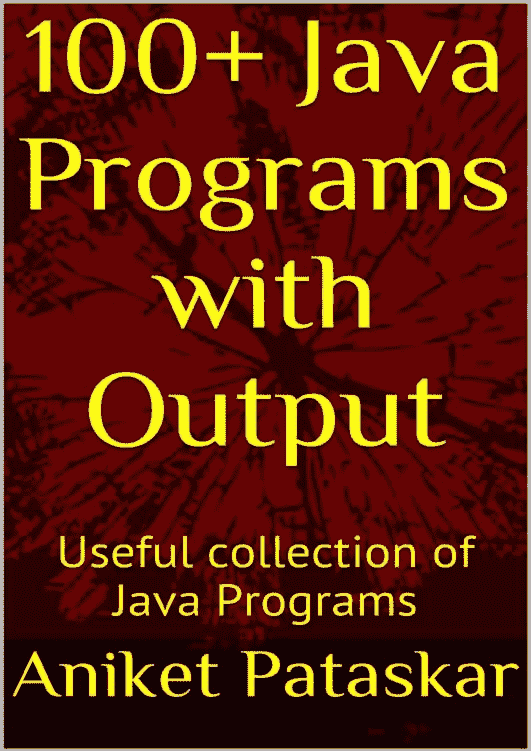

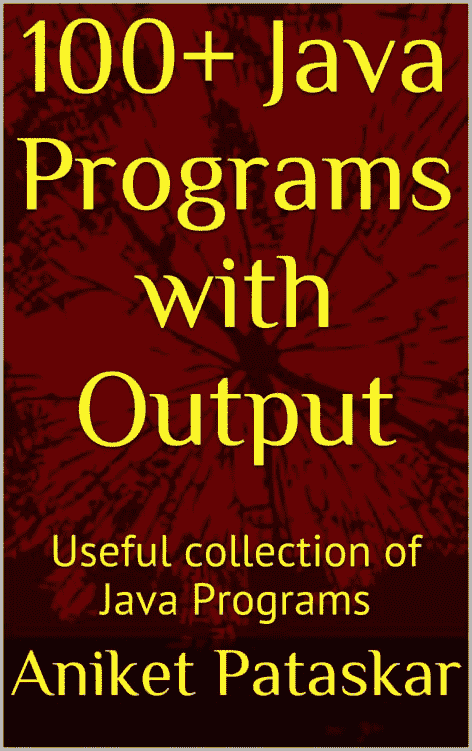

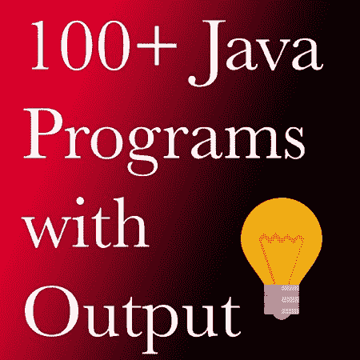


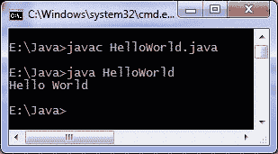

## 目录

1. Hello World 示例 3
2. 两个矩阵相加 4
3. 阿姆斯特朗数 7
4. 二分查找 11
5. 泡泡排序 14
6. 命令行参数 17
7. 判断奇偶数 18
8. 华氏度转摄度 21
9. 显示日期和时间 23
10. 三个整数中的最大值 26
11. Java 程序部分 1 28
12. Java 程序部分 2 49
13. Java 程序部分 3 74
14. Java 程序部分 4 102
15. Java 程序部分 5 120
16. Java 程序部分 6 134
17. Java 面试题部分 1 161
18. Java 面试题部分 2 178

## Hello World 示例

“Hello World”作为参数传递给`println`方法，你可以打印任何想要的内容。还有一个`print`方法，它不会像`println`那样将光标移动到下一行的开头。`System`是一个类，`out`是`PrintStream`类的对象，而`println`是该方法。

程序的输出：

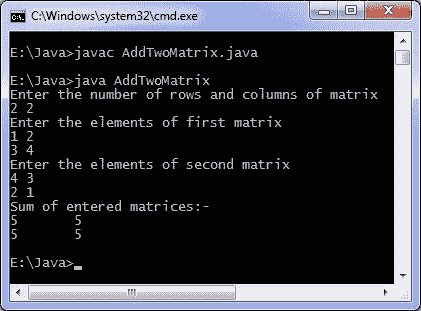

## 两个矩阵相加

此代码用于两个矩阵的相加，你可以修改它来添加任意数量的矩阵。你可以创建一个`Matrix`类并创建它的对象，然后创建一个`add`方法对这些对象求和，这样你就可以通过循环反复调用该方法来添加任意数量的矩阵。


程序的输出：

## 二分查找

其他的搜索方法还有线性查找和哈希查找。`Arrays`类中也有一个`binarySearch`方法可以使用。

`binarySearch`方法在出现匹配项时返回位置，否则返回`-(x+1)`，其中`x`是数组中的元素个数。例如，在上面的第二种情况下，当`p`不在`characters`数组中时，返回的值将是`-6`。

## 阿姆斯特数

这个 Java 程序检查一个数字是否为阿姆斯特朗数。阿姆斯特朗数是指等于其每个位数字的该数字总位数幂之和的数字。

一些阿姆斯特朗数有：0, 1, 4, 5, 9, 153, 371, 407, 8208 等。

Java 编程代码：


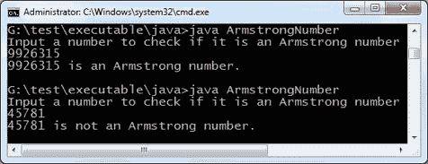

程序的输出：

在上面的代码中多用一个循环，你可以生成从 1 到`n`（假设）或两个整数之间（`a`到`b`）的阿姆斯特朗数。

## 泡泡排序

泡泡排序的 Java 程序：此代码使用泡泡排序算法对用户输入的数字进行排序。

Java 编程代码：

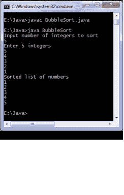

泡泡排序的复杂度为`O(n²)`，这使得在数字数量较少时，它是排序的不常用选项。

程序的输出：

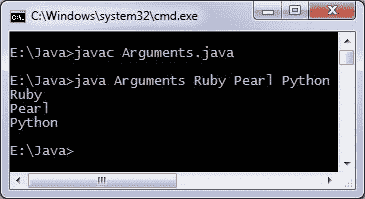


输出：

## 判断奇偶数

这个 Java 程序查找一个数字是奇数还是偶数。如果数字能被 2 整除，则为偶数，否则为奇数。我们在程序中使用取模运算符来寻找余数。

Java 程序源代码：

程序的输出：

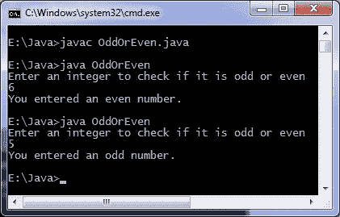

另一种检查奇偶的方法，解释请参见：还有其他检查奇偶的方法，其中一种是使用位运算符。

## 华氏度转摄度

将华氏度转换为摄度的 Java 程序：此代码实现温度从华氏度到摄氏度的转换。

Java 编程代码：

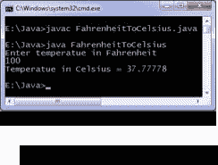

程序的输出：

摄氏度转华氏度使用：

```java
T = 9*T/5 + 32
```

其中`T`是摄氏度上的温度。自己创建并测试华氏度转摄度的程序以练习。

## 显示日期和时间

显示日期时间的 Java 程序，使用 Java 程序打印日期时间 Java 日期时间程序：用于打印或显示当前系统日期和时间的 Java 代码。

此程序打印当前日期和时间。我们在程序使用了`GregorianCalendar`类。打印日期和时间的 Java 代码如下：

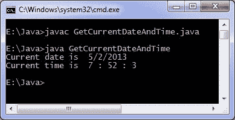

程序的输出：

不要使用`java.util`包中的`Date`和`Time`类，因为它们的方法已过时，意味着它们可能不再被支持。可以使用`GregorianCalendar`类。

## 三个整数中的最大值

这个 Java 程序查找三个整数中的最大值。

Java 程序源代码：

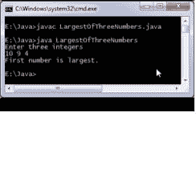

程序的输出：

### 1. 查找两个整数的最大值

```java
class Maxof {
    public static void main(String[] args) {
        int i = Integer.parseInt(args[0]);
        int j = Integer.parseInt(args[1]);
        if (i > j)
            System.out.println("greater");
        else
            System.out.println("greater");
    }
}
```

### 2. 使用条件运算符查找两个整数的最小值

```java
class Minof {
    public static void main(String[] args) {
        int i = Integer.parseInt(args[0]);
        int j = Integer.parseInt(args[1]);
        if (i < j)
            System.out.println("is greater");
    }
}
```

### 3. 从键盘读取数字并打印输出

```java
class Min2 {
    public static void main(String[] args) {
        int i = Integer.parseInt(args[0]);
        int j = Integer.parseInt(args[1]);
        if (i < j)
            System.out.println("is minimum");
    }
}
```

### 4. 生成 1 到 100 之间的随机数

```java
class Random {
    public static void main(String[] args) {
        for (int i = 1; i <= 5; i++) {
            System.out.println((int)(Math.random() * 100));
        }
    }
}
```

### 5. 根据获得的分数显示消息

```java
class SwitchDemo {
    public static void main(String[] args) {
        int marks = Integer.parseInt(args[0]);
        switch (marks / 10) {
            case 10:
            case 9:
            case 8:
                System.out.println("Excellent");
                break;
            case 7:
                System.out.println("Very Good");
                break;
            case 6:
                System.out.println("Good");
                break;
            case 5:
                System.out.println("Hard");
                break;
            case 4:
                System.out.println("Poor");
                break;
            case 3:
            case 2:
            case 1:
            case 0:
                System.out.println("Very Poor");
                break;
            default:
                System.out.println("Invalid value");
        }
    }
}
```

### 6. 找到给定数字的和和积

```java
class Sum_Product_Digit {
    public static void main(String[] args) {
        int num = Integer.parseInt(args[0]);
        int temp = num;
        int result = 0;
        while (temp > 0) {
            result += temp;
            temp--;
        }
        System.out.println("Sum of Digit for " + num + " is : " + result);
        temp = num;
        result = 1;
        while (temp > 0) {
            result *= temp;
            temp--;
        }
        System.out.println("Product of Digit for " + num + " is : " + result);
    }
}
```

### 7. 计算给定数字的阶乘

```java
class Factorial {
    public static void main(String[] args) {
        int num = Integer.parseInt(args[0]);
        int result = 1;
        while (num > 0) {
            result *= num;
            num--;
        }
        System.out.println("Factorial of Given no. is : " + result);
    }
}
```

### 8. 反转给定数字

```java
class Reverse {
    public static void main(String[] args) {
        int num = Integer.parseInt(args[0]);
        int remainder = 0;
        int result = 0;
        while (num > 0) {
            remainder = num % 10;
            result = result * 10 + remainder;
            num = num / 10;
        }
        System.out.println("Reverse number is : " + result);
    }
}
```

### 9. 查找给定数字的斐波那契数列

```java
class Fibonacci {
    public static void main(String args[]) {
        int num = Integer.parseInt(args[0]); //获取命令行参数作为数字
        System.out.println("*****斐波那契数列*****");
        int f1, f2 = 0, f3 = 1;
        for (int i = 1; i <= num; i++) {
            System.out.print(" " + f3 + " ");
            f1 = f2;
            f2 = f3;
            
            
            
            
            f3 = f1 + f2;
        }
    }
}
```

### 程序 10

```java
/* 编写一个程序，找到所有大于 100 小于小于 200 且能被 7 整除整数的和 */
class SumOfDigit {
    public static void main(String args[]) {
        int result = 0;
        for (int i = 100; i <= 200; i++) {
            if (i % 7 == 0) result += i;
        }
        System.out.println("程序的输出为： " + result);
    }
}
```

### 程序 11

```java
/* 编写一个使用 for 循环拼接字符串的程序示例：输入 - 5 输出 - 1 2 3 4 5 */
class Join {
    public static void main(String args[]) {
        int num = Integer.parseInt(args[0]);
        String result = " ";
        for (int i = 1; i <= num; i++) {
            result = result + i + " ";
        }
        System.out.println(result);
    }
}
```

### 程序 12

```java
/* 显示乘法表的程序 */
class MultiplicationTable {
    public static void main(String args[]) {
        int num = Integer.parseInt(args[0]);
        System.out.println("*****乘法表*****");
        for (int i = 1; i <= num; i++) {
            for (int j = 1; j <= num; j++) {
                System.out.print(" " + i * j + " ");
            }
            System.out.print("\n");
        }
    }
}
```

### 程序 13

```java
/* 编写一个交换值的程序 */
class Swap {
    public static void main(String args[]) {
        int num1 = Integer.parseInt(args[0]);
        int num2 = Integer.parseInt(args[1]);
        System.out.println("\n***交换之前***");
        System.out.println("数字 1 : " + num1);
        System.out.println("数字 2 : " + num2);
        //交换逻辑
        num1 = num1 + num2;
        num2 = num1 - num2;
        num1 = num1 - num2;
        System.out.println("\n***交换之后***");
        System.out.println("数字 1 : " + num1);
        System.out.println("数字 2 : " + num2);
    }
}
```

### 程序 14

```java
/* 编写一个程序将给定的天数转换为月份和天。
(假设每个月为 30 天)
示例：输入 - 69 输出 - 69 天 = 2 个月 9 天 */
class DayMonthDemo {
    public static void main(String args[]) {
        int num = Integer.parseInt(args[0]);
        int days = num % 30;
        int month = num / 30;
        System.out.println(num + " 天 = " + month + " 个月 " + days + " 天");
    }
}
```

### 程序 15


```java
/* 编写一个生成三角形的程序。
例如：
1
22
333
4 4 4 4 等根据用户输入的数字递推 */
class Triangle {
    public static void main(String args[]) {
        int num = Integer.parseInt(args[0]);
        for (int i = 1; i <= num; i++) {
            for (int j = 1; j <= i; j++) {
                System.out.print(" " + i + " ");
            }
            System.out.print("\n");
        }
    }
}
```

#### 程序 16

```java
/* 编写一个显示倒置三角形的程序。
示例：输入 - 5 输出： 55555 4444 333 22 1 */
class InvertTriangle {
    public static void main(String args[]) {
        int num = Integer.parseInt(args[0]);
        while (num > 0) {
            for (int j = 1; j <= num; j++) {
                System.out.print(" " + num + " ");
            }
            System.out.print("\n");
            num--;
        }
    }
}

/* 编写一个程序判断给定的数字是否为阿姆斯特数（Armstrong number）。
示例：
输入 - 153 输出 - 1³ + 5³ + 3³ = 153，它是阿姆斯特斯特数。 */
class Armstrong {
    public static void main(String args[]) {
        int num = Integer.parseInt(args[0]);
        int n = num; //用于检查
        int check = 0, remainder;
        while (num > 0) {
            remainder = num % 10;
            check = check + (int) Math.pow(remainder, 3);
            num = num / 10;
        }
        if (check == n) System.out.println(n + " 是阿姆斯特斯特数");
        else System.out.println(n + " 不是阿姆斯特斯特数");
    }
}
```


```java
/* 编写一个程序判断数字是否为质数。 */
class PrimeNo {
    public static void main(String args[]) {
        int num = Integer.parseInt(args[0]);
        int flag = 0;
        for (int i = 2; i < num; i++) {
            if (num % i == 0) {
                System.out.println(num + " 不是质数");
                flag = 1;
                break;
            }
        }
        if (flag == 0) System.out.println(num + " 是质数");
    }
}
```

#### 程序 19

```java
/* 编写一个程序判断数字是否为回文。
示例：输入 - 12521 是回文，12345 不是回文。 */
class Palindrome {
    public static void main(String args[]) {
        int num = Integer.parseInt(args[0]);
        int n = num; //用于最后检查
        int check = 0, remainder;
        while (num > 0) {
            remainder = num % 10;
            check = check * 10 + remainder;
            num = num / 10;
        }
        if (check == n) System.out.println(n + " 是回文");
        else System.out.println(n + " 不是回文");
    }
}
```

#### 程序 21

```java
/* 编写一个生成调和数列的程序。示例：输入 - 5 输出 - 1 + 1/2 + 1/3 + 1/4 + 1/5 = 2.28（近似） */
class HarmonicSeries {
    public static void main(String args[]) {
        int num = Integer.parseInt(args[0]);
        double result = 0.0;
        while (num > 0) {
            result = result + (double) / num;
            num--;
        }
        System.out.println("调和数列的输出为 " + result);
    }
}
```

#### 程序 22

```java
/* 编写一个程序找到连续奇数和偶数的平均数 */
class EvenOdd_Avg {
    public static void main(String args[]) {
        int n = Integer.parseInt(args[0]);
        int cntEven = 0, cntOdd = 0, sumEven = 0, sumOdd = 0;
        while (n > 0) {
            if (n % 2 == 0) {
                cntEven++;
                sumEven += n;
            } else {
                cntOdd++;
                sumOdd += n;
            }
            n--;
        }
        int evenAvg, oddAvg;
        evenAvg = sumEven / cntEven;
        oddAvg = sumOdd / cntOdd;
        System.out.println("前 N 个偶数的平均数是 " + evenAvg);
        System.out.println("前 N 个奇数的平均数是 " + oddAvg);
    }
}
```

#### 程序 23

```java
/* 显示如下三角形：BREAK 演示。
1
23
456
7 8 9 10 … N */
class Output1 {
    public static void main(String args[]) {
        int c = 0;
        int n = Integer.parseInt(args[0]);
        loop1: for (int i = 1; i <= n; i++) {
            loop2: for (int j = 1; j <= i; j++) {
                if (c != n) {
                    c++;
                    System.out.print(c + " ");
                } else {
                    break loop1;
                }
            }
            System.out.print("\n");
        }
    }
}
```

#### 程序 24

```java
/* 显示如下三角形
0
10
101
0 1 0 1 */
class Output2 {
    public static void main(String args[]) {
        for (int i = 1; i <= 4; i++) {
            for (int j = 1; j <= i; j++) {
                System.out.print(((i + j) % 2) + " ");
            }
            System.out.print("\n");
        }
    }
}
```

#### 程序 25

```java
/* 显示如下三角形
1
24
369
4 8 12 16 … N（表示行数） */
class Output3 {
    public static void main(String args[]) {
        int n = Integer.parseInt(args[0]);
        for (int i = 1; i <= n; i++) {
            for (int j = 1; j <= i; j++) {
                System.out.print((i * j) + " ");
            }
            System.out.print("\n");
        }
    }
}
```

Java `if else` 程序使用 `if` 和 `else` 在条件满足时执行语句。

下面是一个简单的程序，解释了 Java 编程语言中 `if` `else` 的用法。

## Java 编程中的 if else

### 语句

### 程序输出

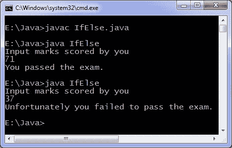

上述程序要求用户输入考试的分数，并将输入的分与最低及格分进行比较。根据用户是否通过考试，在屏幕上打印相应的消息。在上述代码中，`if` 和 `else` 块都只包含一条语句，但我们可以执行任意数量的语句。

## 2. 嵌套 if Else 语句

你可以使用嵌套的 `if` `else`，这意味着你可以在任何 `if` 块或 `else` 块中使用 `if` `else` 语句。

### 程序输出

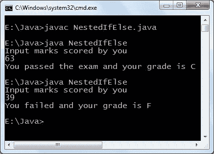
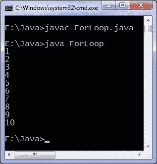

## 3. Java for 循环

### Java 简单的 `for` 循环示例

下方的示例程序使用 `for` 循环打印前 10 个自然数，即从 1 到 10。

### 程序输出


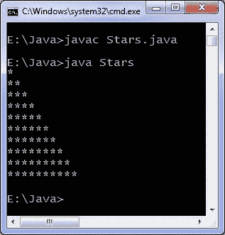

## 4. 在控制台打印星号的 Java for 循环示例

打印以下星号图案：

```text
*
**
***
****
*****
```

上述程序使用嵌套的 `for` 循环（`for` 循环内部嵌套循环）来打印星号。你也可以使用空格创建另一个图案，这留给你作为练习。

### 程序输出

## 5. Java while 循环

Java `while` 循环用于执行语句直到条件一直为真。在本教程中，我们将通过 Java `while` 循环示例学习循环。首先，让我们讨论 `while` 循环的语法：

```java
while (condition(s)) {
    // 循环体
}
```

1. 如果条件为真，则执行循环体，执行完循环体后再次测试条件，如果条件为真，则再次执行循环体，此过程重复直到条件变为假。条件始终被求值为真或假，如果它是常量，例如 `while (c) {…}` 其中 `c` 是常量，则 `c` 的任何非零值都被视为真，零被视为假。
2. 你可以测试多个条件，例如：

   当 `a` 的值大于 `b` 的值且 `c` 不等于 0 时，执行循环体。

3. 循环体可以包含多条语句。对于多个语句，你需要使用 `{}` 将它们放在一个块中；如果循环体只包含单个语句，可以可选地使用 `{}`。建议始终使用大括号，以便使你的程序易于阅读和理解。

### Java while 循环示例

以下程序要求用户输入一个整数并一直打印，直到用户输入 0（零）。


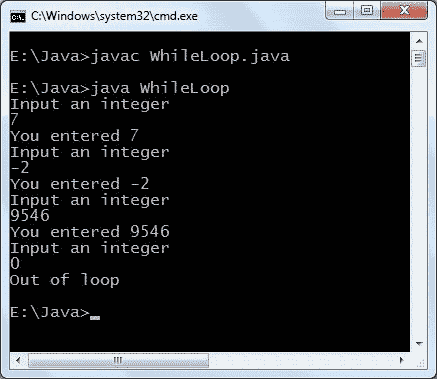

### 程序输出

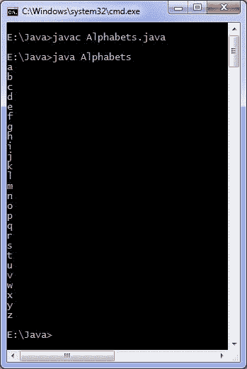

## 6. 打印字母的 Java 程序

该程序在屏幕上打印字母，即 `a`、`b`、`c`、……、`z`。在这里我们打印的是小写字母。

### Java 源代码

你可以轻松修改上述 Java 程序以打印大写字母。

### 程序输出

### 使用 `while` 循环打印字母


（仅显示 `main` 方法体）：

### 使用 `do while` 循环


## 打印乘法表的 Java 程序

该 Java 程序使用 `for` 循环打印用户输入的数字的乘法表。你可以为了练习将其修改为 `while` 循环。

### Java 编程源代码

`while` 或 `do`

### 程序输出

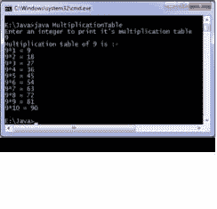

## 如何在 Java 中获取用户输入

该程序告诉你如何在 Java 程序中获取用户输入。我们使用 `Scanner` 类来获取用户输入。该程序首先要求用户输入一个字符串，然后打印该字符串；接着输入一个整数并打印输入的整数；最后输入一个浮点数并在屏幕上打印。`Scanner` 类存在于 `java.util` 包中，因此我们在程序中导入该包。我们首先创建 `Scanner` 类的对象，然后使用 `Scanner` 类的方法。考虑语句 `Scanner a = new Scanner(System.in);`，这里 `Scanner` 是类名，`a` 是对象名，`new` 关键字用于分配内存，`System.in` 是输入流。

下面的程序中使用了以下 `Scanner` 类方法：

1. `nextInt()` 输入整数
2. `nextFloat()` 输入浮点数
3. `nextLine()` 输入字符串

### Java 编程源代码

### 程序输出

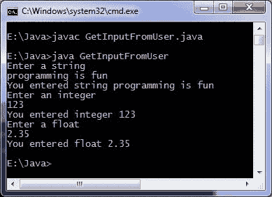

还有其他类可以用于获取用户输入，你也可以从其他设备获取输入。

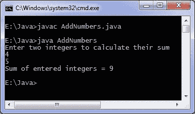

## 两个数字相加的 Java 程序

### 相加的 Java 程序

下面是添加用户输入的两个数字的 Java 程序代码。

### Java 编程源代码

### 程序输出

上述代码可以相加范围内的整数；如果你想相加大数字，可以使用 `BigInteger` 类。相加大数字的代码如下：我们在 `java.math` 包中创建了 `BigInteger` 的对象，不能简单地使用 `+` 运算符来相加对象。

### 程序输出

## 打印字母的 Java 程序

### 程序输出

### Java 方法示例

### 程序输出

## Java String 方法

`String` 类包含对字符串进行操作的方法。下面的程序说明了如何使用 `String` 的内置方法。

### Java String 程序

### 程序输出

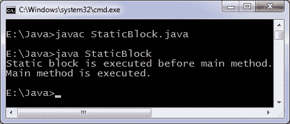

## Java 块程序

Java 编程语言提供了一种名为 `static` 的块，它在 `main` 方法之前执行。下面是理解 `static` 块的简单示例，稍后我们将看到 `static` 块的实际用途。

### Java 块程序

### 程序输出

静态块可以在执行之前检查条件。假设我们开发了一个只在 Windows 上运行的应用程序，我们需要检查安装的是什么操作系统。在我们的 Java 代码中检查用户使用的操作系统，如果不是 Windows，则程序终止。


我们使用了 `System` 类的 `getenv()` 方法，它返回传入的环境变量值。`Windows_NT` 是一个操作系统家族，包括 Windows XP、Vista、7、8 等。

### 在 Windows 7 上的程序输出

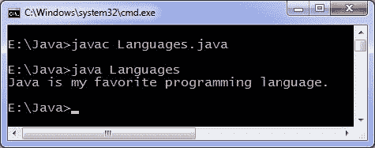

## Java 静态方法

Java 静态方法程序：静态方法可以在不创建对象的情况下调用。你是否注意到为什么在定义 `main` 时要写 `static` 关键字，这是因为程序执行从 `main` 开始，此时还没有创建对象。考虑下面的示例以提高对静态方法的理解。

### Java 静态方法示例程序

### 程序输出

### 静态方法 vs 实例方法

实例方法需要创建其类的对象后才能调用，而静态方法不需要创建对象。

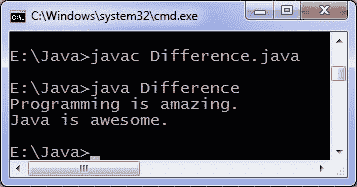

### 代码输出

## 使用其他静态方法


如果你想调用另一个类的静态方法，在调用静态方法时必须编写类名，如示例所示。

程序输出：

在这里我们使用了`Math`类的`min()`和`max()`方法，`min()`返回两个整数的最小值，`max()`返回两个整数的最大值。

以下内容将产生错误：

我们需要编写类名，因为许多类可能具有我们调用的同名方法。

## 在 Java 程序中使用多个类

Java 程序可以包含多个类，即多个类。下方的示例 Java 程序包含两个类：`Computer`和`Laptop`。这两个类都有自己的构造函数和一个方法。在`main`方法中，我们创建这两个类的对象并调用它们的方法。

程序输出：

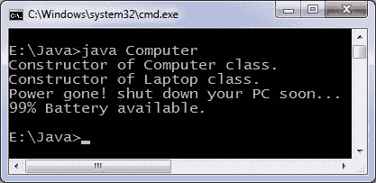

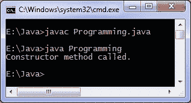

# Java 构造函数教程及代码示例

构造函数 Java 教程：Java 构造函数用于初始化对象的方法。

构造方法的名字与类名相同，它们在创建类对象时被调用或触发，且不能被显式调用。在创建对象时，可能会有属性可用；如果没有可用属性，则调用默认构造函数，此外某些属性在初始时可能是已知的。在类中编写构造方法是可选的，但由于它们的实用性，它们被广泛使用。

## Java 构造函数示例

程序输出：

这段代码是构造函数的最简单示例，我们创建了`Programming`类并创建了一个对象，构造函数在对象创建时被调用。如你在输出中所看到的，打印了“Constructor method called.”。

## Java 构造函数重载

像 Java 中的其他方法一样，构造函数也可以重载，即我们可以根据需要创建类中创建任意数量的构造函数。构造函数的数量取决于我们在创建对象时拥有的属性信息。参见构造函数重载示例：

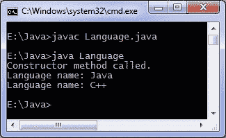

程序输出：

当创建`cpp`对象时调用默认构造函数，当创建`java`对象时调用`带参数的构造函数`，使用`setName`方法来设置语言的‘name’属性，使用`getName`方法打印语言名称。

## Java 构造函数链

构造函数链发生在一个类继承另一个类时，即在继承中，子类继承了父类的属性。父类和子类都可能拥有构造方法，当创建子类对象时，它的构造方法会被调用以初始化子类属性，现在需要调用父类构造方法。为了实现这一点，Java 提供了一个`super`关键字，通过它可以向父类构造函数传递参数。要了解更多信息请参见构造函数链示例：

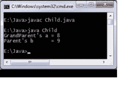

程序输出：

构造方法不指定返回类型，它们返回类本身本身的实例。

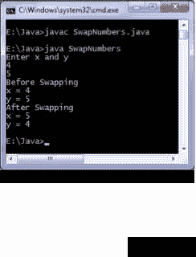

## Java 交换两个数字的程序

这个 Java 程序使用临时变量交换两个数字。要在不使用额外变量的情况下交换数字，请查看下方的代码。

### 使用临时或第三个变量交换

程序输出：

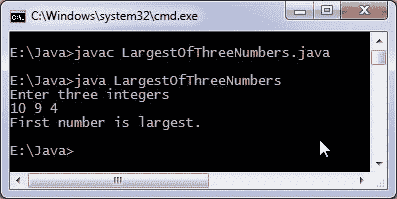

## Java 求三个数中最大值的程序

这个 Java 程序找到三个数中的最大值并打印它。如果输入的数字不相等，则打印“numbers are not distinct”。

### Java 编程源代码

程序输出：

如果你想找到一个列表（例如 10 个整数）的最大值，使用上述方法并不容易，相反，你可以使用数组数据结构。

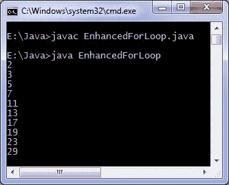

## Java 增强型 for 循环

Java 增强型 for 循环：在扫描数组时，使用增强型 for 循环比使用 for 循环有用。语法为：

```java
for (data_type variable: array_name)
```

在这里`array_name`是数组名称。

### Java 增强型 for 循环整数数组

程序输出：

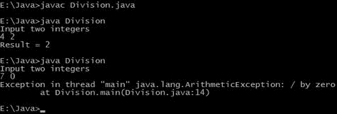

## Java 异常处理教程及示例

Java 异常处理教程：在本教程中，我们将通过合适的示例学习如何处理异常。异常是程序执行时发生的错误。考虑下面的 Java 程序，它除法两个整数。

现在我们编译并执行上述代码两次，查看两种情况下的程序输出：

在第二种情况下，我们正在尝试除以 0，这在数学上是不允许的，因此会发生运行时错误，即发生异常。如果我们以这样编写程序，它们将异常终止，执行我们程序或应用程序的用户将不会开心。这种情况的发生是因为用户输入是无效的，所以我们必须采取预防措施，最好的办法是通知用户这是不允许的，或者根据上下文提供任何其他有意义的信息。你可以看到异常发生时显示的信息，包括线程名称、文件名、发生异常的代码行号（在本例中为 14 行）、异常名称（`ArithmeticException`）及其描述（‘/ by zero’）。注意，异常的发生并不仅是因为无效输入，还有其他程序员无法控制的原因，例如栈溢出异常、当应用程序所需的内存大于可用内存时的内存溢出异常。

Java 提供了一种强大的处理此类异常的方法，称为异常处理。在其中，我们将易感代码（即可能抛出异常的代码）写在一个名为`try`的独立块中，并在另一个名为`catch`的块中编写异常处理代码。以下修改后的代码处理了异常。

Java 异常处理示例：每当捕获到异常时，相应的`catch`块就会执行，例如，上面的代码只捕获了`ArithmeticException`。如果抛出了其他类型的异常，它将不会被捕获，因此程序员需要负责处理所有异常，因为我们在`try`块中执行算术运算，所以我们只捕获算术异常。捕获任何异常的简单方法是使用`Exception`类对象，因为其他类都继承了`Exception`类，参见下方的另一个示例：

程序输出：

在这里，我们的`catch`块捕获了一个异常，是因为我们尝试访问一个不存在的数组元素（在本例中为`languages[5]`）。一旦抛出异常，控制将离开`try`块，`try`块中剩余指令将不会执行。在编译时会进行语法和语义检查，代码不会在机器上执行，因此异常只能在运行时检测。

### Java 中的 `finally` 块

无论是否抛出异常，`finally`块始终会被执行。

程序输出：

发生异常是因为我们尝试分配大量不可用的内存。如果你的系统可以提供这些数量的内存，请尝试通过程序增加分配的内存量。

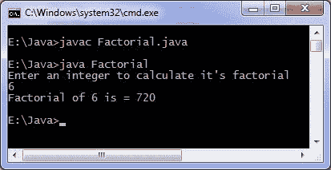

## Java 求阶乘的程序

这个 Java 程序计算一个数的阶乘。首先检查输入的数字，如果是负数，则打印错误信息。

### Java 编程代码

程序输出：

你也可以递归计算阶乘，在代码中`fact`是一个整数变量，因此只有较小的阶乘会被正确显示或符合 4 字节。对于大数，可以使用`long`数据类型。

### 计算大数阶乘的 Java 程序

上述程序无法正确计算如 20 阶乘的结果。因为 20! 是一个巨大的数字，无法存储在 4 字节的整数类型中。为了计算百阶乘，我们使用`java.math`包中的`BigInteger`类。

我们运行上述 Java 程序计算 100 的阶乘，得到了如下输出。

## Java 程序打印质数

这个 Java 程序打印质数，要求用户提供质数的数量。记住最小的质数是 2。

### Java 编程代码

程序输出：

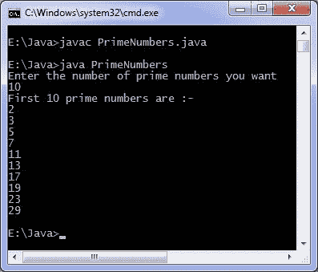

我们使用了`Math`包的`sqrt`方法，它可以计算平方根。要检查一个整数（假设为`n`）是否为质数，你可以检查它是否能被 2 到 (n-1) 之间的任何整数整除，或者检查 2 到`sqrt(n)`，前者效率较低且耗时更长。


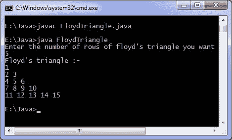

## Java 打印杨辉三角形程序

这个 Java 程序打印杨辉三角形。

### Java 编程源代码

程序输出：

在杨辉三角形中，第 n 行有 n 个整数，n 行中共有 (n(n+1))/ 2 个整数。这是一种简单的的打印模式，但对于学习如何创建其他模式很有帮助。

开发模式的关键在于适当使用嵌套循环。


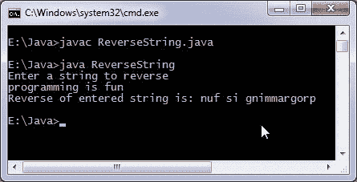

## 反转字符串的 Java 程序

此 Java 程序用于反转用户输入的字符串。我们使用`charAt`方法从字符串中提取字符，并按反顺序附加它们，以反转输入的字符串。Java 编程代码程序输出：

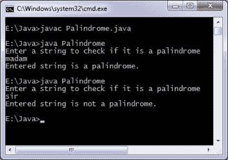

## 检查回文的 Java 程序

Java 回文程序：用于检查字符串是否为回文的 Java 程序。

请记住，如果一个字符串在反转后保持不变，它就是回文，例如“dad”是一个回文，因为“dad”的反转后是“dad”，而“program”不是回文。其他回文字符串还有“mom”、“madam”、“abcba”。

Java 编程源代码

程序输出：

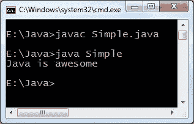

## Java 中的接口

Java 接口：Java 接口类似于 Java 类，但它们只包含静态 final 常量和方法声明。方法没有定义，实现接口的类必须定义接口的方法体。final 常量一旦初始化就无法修改；`final`、`interface`、`extend`和`implements`是 Java 关键字。

接口声明：

Java 接口程序

在我们的程序中，我们创建一个名为`Info`的接口，其中包含一个常量和一个方法声明。我们通过定义内部声明的方法来创建一个实现该接口的类。

程序输出：

## 比较两个字符串的 Java 程序

此程序比较字符串，即测试两个字符串是否相等，`String`类的`compareTo`方法用于测试两个`String`类对象的相等性。`compareTo`方法对大小写敏感，也就是说如果你使用`compareTo`方法，“java”和“Java”是两个不同的字符串。如果你想比较字符串但忽略大小写，请使用`compareToIgnoreCase`方法。

Java 编程代码

程序输出：

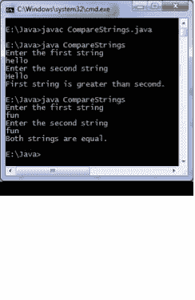

字符串‘hello’大于‘Hello’，因为‘h’的 ASCII 值大于‘H’。要检查两个字符串是否相等，可以使用`equals`方法，如果字符串相等则返回 true，否则返回 false。

## 线性搜索的 Java 程序

线性搜索 Java 程序：线性搜索非常简单，要检查元素是否存在于给定列表中，我们将搜索元素与列表中的每个元素进行比较。如果找到了数字，则成功；否则列表不包含我们要搜索的元素。

Java 编程代码

程序输出：

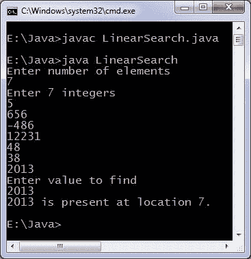

上述代码定位找到的第一个实例，你可以修改它以处理同一元素的多次出现的情况，并统计它在列表中出现的次数。同样，你可以查找字符串中是否存在某个字母。

## 二分查找的 Java 程序

二分查找 Java 程序：此代码实现了二分查找算法。请注意输入数字必须是升序。Java 编程代码


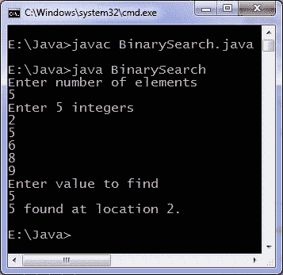

程序输出：

## 查找字符串所有子串的 Java 程序

查找字符串子串的 Java 程序：此程序查找并打印字符串的所有子串。例如，“fun”的子串有：“f”、“fu”、“fun”、“u”、“un”和“n”。使用`String`类的`substring`方法查找子串。下面给出了打印字符串子串的 Java 代码。

Java 编程代码

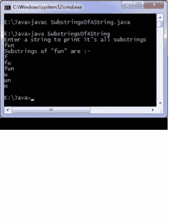

对于长度为`n`的字符串，将有`(n(n+1))/2`个非空子串，另外还有一个空字符串。空字符串被认为是每个字符串的子串，也称为 NULL 字符串。

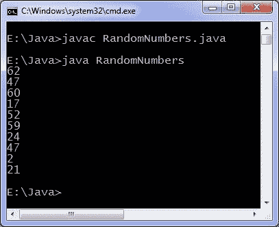

## 生成随机数的 Java 程序

生成随机数的 Java 程序：此代码生成 0 到 100 之间的随机数（均包含）。

Java 编程代码

下载随机数程序类文件。

`nextInt(c)`方法返回 0 到`c`之间（均包含）的下一个整数，`c`必须为正数。要生成随机浮点数，使用`nextFloat`，它返回 0.0 到 1.0 之间的浮点数。

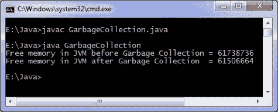

## 执行垃圾回收的 Java 程序

此程序执行垃圾回收。打印 Java 虚拟机中的空内存，然后使用`Runtime`类的`gc`方法进行垃圾回收，`freeMemory`方法返回 JVM 中可用内存量，`getRuntime`方法用于获取当前`Runtime`对象的引用。

Java 编程源代码

显然，垃圾回收后的可用量在你的计算机上会有所不同。数字并不重要，重要的是可用内存比之前多。你可以在使用大量内存的程序或项目中使用此代码，或者频繁创建新对象但持续时间短的项目。

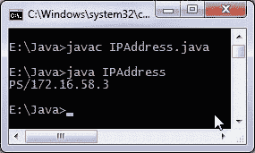

## 获取 IP 地址的 Java 程序

此程序打印你计算机系统的 IP 或网络协议地址。使用了`java.net`包中的`InetAddress`类，`getLocalHost`方法返回代表本地主机的`InetAddress`对象。

Java 编程源代码

程序输出：

代码输出打印计算机名称/IP 地址。Java 有非常丰富的网络 API，可以开发网络应用程序。

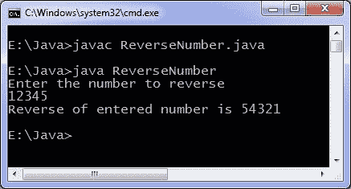

## 反转数字的 Java 程序

此程序打印数字的反转，即如果输入是 951，则输出将是 159。

Java 编程源代码

程序输出：

你也可以使用递归来反转数字。你可以使用此代码检查数字是否为回文，如果整数的反转等于该整数，则是回文。

## 矩阵转置的 Java 程序

此 Java 程序查找任意阶矩阵的转置。

Java 编程源代码

程序输出：

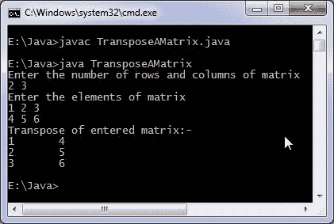

此代码可检查矩阵是否对称，只需将矩阵与其转置进行比较，如果相同则对称，否则不对，同时也适用于计算矩阵的正交性。

## 两个矩阵相乘的 Java 程序

此 Java 程序乘以两个矩阵。在相乘之前会检查矩阵是否可以相乘。

Java 编程代码

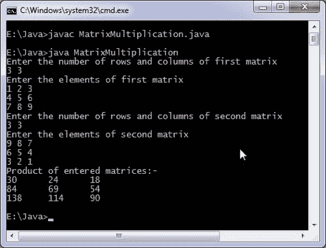

程序输出：

这是一种基础相乘方法，有更高效的算法。对于包含大量零元素的稀疏矩阵，不建议使用方法。

## 打开记事本的 Java 程序

通过 Java 程序打开记事本：记事本是 Windows 系统的文本编辑器，用于创建和编辑文本文件。可以在其中开发 Java 程序，但也可以用 Java 代码打开它。

使用 Java 程序打开记事本

下载记事本程序

代码说明：`getRuntime`方法用于获取当前`Runtime`对象的引用，`exec`方法可执行命令。打开记事本也可以指定文件，例如`exec("notepad programming.txt")`，其中`programming.txt`是你想打开的文件，如果文件不在当前工作目录下，将显示对话框创建文件。你可以使用`exec`方法启动其他应用程序，例如`exec("calc")`将启动计算器应用程序。如果应用程序位于未设置环境变量 PATH 的目录中，你可以指定应用程序的完整路径。如果你仍在使用记事本进行 Java 开发，建议切换到更高级的文本编辑器如 Notepad++ 或使用开发 IDE。

## 如何从给定的字母数字字符串中找到数字字符串

```java
import java.util.regex.Matcher;
import java.util.regex.Pattern;

public class RegexMatches
{

main ( String args[]){

// 要扫描以查找模式的字符串。
String line = “This order was placed for QT3000! OK?”;
String pattern = “(.*)(\d+))()”;
```

```java
// Create a Pattern object
Pattern r = Pattern.compile(pattern);

// Now create matcher
object.

Matcher m = r.matcher(line); 
if (m.find( )) {
    System.out.println("Found value: " + m.group(0));
    System.out.println("Found value: " + m.group(1));
    System.out.println("Found value: " + m.group(2));
} else {
    System.out.println("NO MATCH");
}
}
```

这将产生以下结果：

`Found value: This order was placed for QT3000! OK?`

`Found value: This order was placed for QT300`

`Found value: 0`


### 如何在字符串中搜索单词？

**解决方案：**

此示例展示了如何使用`indexOf()`方法在`String`对象中搜索单词。如果找到单词，该方法将返回单词在字符串中的位置索引；否则，返回 -1。

```java
public class SearchStringEmp{
    public static void main(String[] args) {
        String strOrig = "Hello readers";
        int intIndex = strOrig.indexOf("Hello");
        if(intIndex == -1){
            System.out.println("Hello not found");
        }else{
            System.out.println("Found Hello at index " + intIndex);
        }
    }
}
```

**结果：**

上述代码示例将产生以下结果。

`Found Hello at index 0`

### 如何优化字符串拼接？


## 解决方案

以下示例对比了使用`+`运算符和`StringBuffer.append()`方法进行拼接的性能。

```java
public class StringConcatenate{ 
    public static void main(String[] args){
        long startTime = System.currentTimeMillis(); 
        for(int i=0;i<5000;i++){
            String result = "This is" + "testing the" + "difference"++ "between" + "String"++ "and"++ "StringBuffer";
        }
        long endTime = System.currentTimeMillis(); 
        System.out.println("Time taken for string concatenation using + operator : " + (endTime - startTime)+ " ms");

        long startTime1 = System.currentTimeMillis();
        for(int i=0;i<5000;i++){
            StringBuffer result = new StringBuffer();
            result.append("This is");
            result.append("testing the");
            result .append("difference");
            result.append("between");
            result.append("String");
            result.append("and");
            result .append("StringBuffer");
        }
        long endTime1 = System .currentTimeMillis();
        System.out.println("Time taken for String concatenation using StringBuffer : " + (endTime1 - startTime1)+ " ms");
    }
}
```

## 结果

上述代码示例将产生以下结果。结果可能会有所不同。

`Time taken for string concatenation using + operator : 0 ms`

`Time taken for string concatenationusing StringBuffer : 22 ms`


### 如何合并两个数组？

## 解决方案

此示例展示了如何通过`List`类的`list.addAll(array1.asList(array2))`方法和`Array`类的`Arrays.toString()`方法将两个数组合并为一个数组。

```java
import java.util.ArrayList;
import java.util.Arrays;
import java.util.List;

public class Main {
    public static void main(String args[]) {
        String a[] = { "A", "E", "I" };
        String b[] = { "O", "U" };
        List list = new ArrayList(Arrays.asList(a));
        list.addAll(Arrays.asList(b));
        Object[] c = list.toArray();
        System.out.println(Arrays.toString(c));
    }
}
```

## 结果

上述代码示例将产生以下结果。


### 如何检查两个数组是否相等？

## 解决方案

以下示例展示了如何使用`Arrays`的`equals()`方法来检查两个数组是否相等。

## 结果

`[A, E, I, O, U]`

```java
import java.util.Arrays;
public class Main {
    public static void main(String[] args) throws Exception {
        int[] ary = {1,2,3,4,5,6};
        int[] ary1 = {1,2,3,4,5,6};
        int[] ary2 = {1,2,3,4};
        System.out.println("Is array 1 equal to array 2?? " +Arrays.equals(ary, ary1));
        System.out.println("Is array 1 equal to array 3?? " +Arrays.equals(ary, ary2));
    }
}
```

## 结果

上述代码示例将产生以下结果。

`Is array 1 equal to array 2?? true`

`Is array 1 equal to array 3?? false`

### 如何在继承中为子类使用方法重写？

## 解决方案

此示例演示了子类通过不同数量和类型的参数进行方法重写的方法。

```java
public class Findareas{
    public static void main (String []agrs){
        Figure f= new Figure();
        Rectangle r= new Rectangle();
        f.area();
        r.area();
    }
}

class Figure {
    public void area() {
        System.out.println("Area of figure");
    }
}

class Rectangle extends Figure {
    @Override
    public void area() {
        System.out.println("Area of rectangle");
    }
}
```

```java
empList.addItems(hList); System.out.println(“The employees’ names are:”); while (empList.hasItems()) { Employee emp =

empList.dequeue();

System.out.println(emp.firstName + ””

} } }

+ emp.lastName);

} }

class Employee {

public String lastName;

public String firstName;

public Employee() {

}

public Employee(String last,

String first) {

this.lastName = last;

this.firstName = first;

}

public String toString() { return firstName + ” ” +

lastName ; }

}

class HourlyEmployee extends

Employee {

public double hourlyRate; public HourlyEmployee(String last, String first) {

super(last, first);

} }
```

## 结果

上述代码示例将产生以下结果。

## 结果

员工的姓名为：

```text
TD
GB
FS
```


### 1. JDK、JRE 和 JVM 之间有什么区别？

#### JVM

`JVM` 是 `Java Virtual Machine`（Java 虚拟机）的缩写，它是一个抽象机器，为 Java 字节码的执行提供运行时环境。它是一个规范。

`JVM` 适用于许多硬件和软件平台（因此 `JVM` 是依赖平台的）。

#### JRE

`JRE` 代表 `Java Runtime Environment`（Java 运行环境）。它是 `JVM` 的实现。

#### JDK

`JDK` 是 `Java Development Kit`（Java 开发工具包）的缩写。它是物理上存在的。

它包含 `JRE` + 开发工具。

### 2. JVM 分配了多少类型的内存区域？

有很多类型：

1. `Class(Method) Area`（类方法区域）
2. `Heap`（堆）


3. `Stack`（栈）
4. `Program Counter Register`（程序计数器）
5. `Native Method Stack`（原生方法栈）

### 3. 什么是 JIT 编译器？

**即时编译（Just-In-Time, JIT）编译器：** 它用于提高性能。`JIT` 同时编译具有相似功能的字节码部分，从而减少编译所需的时间。在这里，“编译器”一词指的是从 Java 虚拟机（`JVM`）的指令集到特定 CPU 指令集的翻译器。

### 4. 什么是平台？

平台基本上是程序运行的硬件或软件环境。

平台有两种类型：基于软件的和基于硬件的。Java 提供基于软件的平台。

### 5. Java 平台与其他平台之间的主要区别是什么？

Java 平台与其他大多数平台的区别在于，它是一个运行在其他基于硬件平台之上的软件平台。它有两个组件：

1. `Runtime Environment`（运行时环境）
2. `API(应用程序编程接口)`

### 6. 是什么让 Java 具有“一次编写，随运行”的特性？

字节码。Java 被编译为字节码，字节码是源代码和机器码之间的中间语言。字节码不是特定平台的，因此可以提供给任何平台。

### 7. 什么是类加载器（classloader）？

`classloader` 是 `JVM` 的一个子系统，用于加载类和接口。有很多类型的类加载器，例如 `Bootstrap classloader`（引导类加载器）、`Extension classloader`（扩展类加载器）、`System classloader`（系统类加载器）、`Plugin classloader`（插件类加载器）等。

### 8. 空 `.java` 文件名是有效的源文件名吗？

是的，仅用 `.java` 保存你的 java 文件，通过 `javac .java` 编译它，并通过 `java yourclassname` 运行。让我们来看一个简单的例子：

1. `//save by .java only`
2. `class A {`
3. `public static void main(String args[])`
4. `System.out.println(“Hello java”);`
5. `}`
6. `}`
7. `//compile by javac .java`
8. `//run by java A`

用 `javac .java` 编译，用 `java A` 运行。

### 9. `delete`、`next`、`main`、`exit` 或 `null` 是 Java 中的关键字吗？

不是。

### 10. 如果我不在命令行上提供任何参数，那么 `Main` 方法的 `String` 数组是空的还是 `null`？

它是空的。但不是 `null`。

### 11. 如果我写 `static public void` 而不是 `public static void` 会怎样？

程序可以正常编译和运行。

### 12. 局部变量的默认值是什么？

局部变量没有初始化为任何默认值，无论是基本类型还是对象引用。

这里提供了 50 多个 OOP（面向对象编程和系统）面试题。但为了方便理解，它们被分成了许多部分，例如构造函数面试题、静态面试题、继承面试题、抽象面试题、多态面试题等。

### 13. 面向对象的编程语言和基于对象的编程语言有什么区别？

基于对象的编程语言遵循 OOP 的所有特性，但继承继承。

基于对象的编程语言示例有 `JavaScript`、`VBScript` 等。

### 14. 定义为实例变量的对象引用的初始值是什么？

在 Java 中，所有对象引用都初始化为 `null`。

### 15. 什么是构造函数？

- 构造函数就像一个方法，用于初始化对象的状态。它在对象创建时被调用。

### 16. 默认构造函数的目的是什么？

- 默认构造函数为对象提供默认值。
- 只有当类中没有构造函数时，Java 编译器才会创建一个默认构造函数。

### 17. 构造函数有返回值吗？

是的，当前实例（返回类型）。

### 18. 构造函数会被继承吗？

不，构造函数不被继承。

### 19. 可以将构造函数设为 `final` 吗？

不可以，构造函数不能是 `final`。

### 20. 什么是静态变量？

- `static variable` 用于所有对象的公共属性（对每个对象不是唯一的），例如公司名称、学生姓名。
- `static variable` 在类加载时只内存一次。

### 21. 什么是静态方法？

- 静态方法属于类而不是类的实例。
- 静态方法可以访问静态数据成员并修改它的值。


### 22. 为什么 `main` 方法是静态的？

因为如果是非静态方法，`jvm` 需要先创建对象再调用 `main` 方法，这会导致内存分配的问题。

### 23. 什么是静态块？

- 用于初始化静态数据成员。
- 它在类加载时在 `main` 方法之前执行。

### 24. 可以在没有 `main()` 方法的情况下执行程序吗？

答案：可以，一种方法是静态块。

### 25. 如果从 `main` 方法的签名中删除 `static` 修饰符会怎样？

程序可以编译。但在运行时会抛出 `NoSuchMethodError` 错误。

### 26. 静态（类）方法和实例方法之间有什么区别？

| 静态或类方法 | 实例方法 |
| --- | --- |
| 1）声明为 `static` 的被称为静态方法。未声明为 `static` 的被称为实例方法。 |  |
| 2）调用静态方法不需要对象。 | 调用实例方法需要对象。 |
| 3）非静态（实例）成员无法在静态上下文（静态方法、静态块和静态嵌套类）中直接访问。 | 静态和非静态变量都可以由实例方法访问。 |

### 27. Java 中的 `this` 是什么？

它是引用当前对象的关键字。

### 28. 什么是继承？

继承是一种对象获取另一个类中对象的所有属性和行为的机制。它代表 `IS-A` 关系。它用于代码重用和方法重写。

### 29. 哪个类是所有类的父类？

`Object` 类。

### 30. 为什么 Java 不支持多继承？

- 为了减少复杂性并简化语言，Java 在类的情况下不支持多重继承。

### 31. 什么是组合（composition）？

在一个类中持有另一个类的引用被称为组合。

### 32. 聚合（aggregation）和组合（composition）之间有什么区别？

聚合表示弱关系，而组合表示强关系。例如：自行车有指示器（聚合），但自行车有发动机（组合）。

### 33. 为什么 Java 不支持指针？

指针是一个引用内存地址的变量。在 Java 中不使用指针是因为它们是不安全的（无保护的）且难以理解。

### 34. Java 中的 `super` 是什么？

它是一个指向直接父类对象的关键字。

### 35. 你可以在构造函数中同时使用 `this()` 和 `super()` 吗？

不可以。因为 `super()` 或 `this()` 必须是第一条语句。

### 36. 什么是对象克隆（object cloning）？

对象克隆用于创建对象的完全拷贝。

### 37. 什么是方法重载（method overloading）？

如果一个类具有多个同名但参数不同的方法，被称为方法重载。它增加了程序的可读性。

### 38. 为什么 Java 中无法通过改变返回类型来实现方法重载？

因为存在歧义。

### 39. 我们可以重载 `main()` 方法吗？

可以，你可以通过重载 `main` 方法在类中拥有多个 `main()` 方法。

### 40. 什么是方法重写（method overriding）？

如果子类对其父类已经提供的方法提供了特定的具体实现，则被称为方法重写。它用于运行时多态并提供该方法的特定实现。

### 41. 我们可以重写静态方法吗？

不可以，你不能重写静态方法，因为它们是类的一部分而不是对象的一部分。

### 42. 为什么我们不能重写静态方法？

因为静态方法是类的一部分，它与类绑定；而实例方法与对象绑定，静态方法在类区域获取内存，而实例方法在堆内存中获取内存。

### 43. 我们可以重写重载的方法吗？

可以。

### 44. 方法重载（Overloading）和重写（Overriding）的区别

#### 方法重写

1. 方法重载增加了程序的可读性。方法重写为父类已经提供的方法提供了特定的具体实现。
2. 方法重载发生在类内部。方法重写发生在具有 `IS-A` 关系的两个类之间。


3. 在这种情况下，参数必须不同。重载发生在两个具有 `IS-A` 关系的类之间。在写情况下，参数必须相同。

### 45. 你可以在 Java 中使用虚拟函数（virtual functions）吗？

可以，Java 中的所有函数默认都是虚拟的。

### 46. 什么是协变返回类型（covariant return type）？

现在，从 Java5 开始，如果子类重写方法的返回类型是子类类型，就可以通过改变返回类型来重写任何方法。这被称为协变返回类型。

### 47. 什么是 `final` 变量？

如果你将任何变量标记为 `final`，你就不能更改该 `final` 变量的值（它将成为常量）。

### 48. 什么是 `final` 方法（final method）？

`final` 方法不能被重写。

### 49. 什么是 `final` 类（final class）？

`final` 类不能被继承。

### 50. 什么是空 `final` 变量（blank final variable）？

一个在声明时未初始化的 `final` 变量被称为空 `final` 变量。

## Java 面试题

### 51. 我们可以初始化空 `final` 变量吗？

可以，如果是非静态的，可以在构造函数中初始化。如果是静态空 `final` 变量，则只能在静态块中初始化。

### 52. 你可以将 `main` 方法声明为 `final` 吗？

可以，例如：

```java
public static final void main(String[] args){}
```


### 53) 什么是运行时多态（Runtime Polymorphism）？

运行时多态或动态方法派发是一个过程，其中对重写方法的调用在运行时解析，而不是在编译时解析。在这个过程中，通过父类的引用变量调用被重写的方法。被调用方法的确定基于引用变量所指向的对象。

## 54) 你能通过数据成员实现运行时多态吗？

不可以。

## 55) 静态绑定（static binding）和动态绑定（dynamic binding）之间有什么区别？

在静态绑定情况下，对象的类型在编译时确定；而在动态绑定情况下，对象的类型在运行时确定。

### 56) 什么是抽象（abstraction）？

抽象是隐藏实现细节并仅向用户显示功能的过程。抽象让你关注对象“做什么”，而不是它是“怎么做的”。

## 57) 抽象（abstraction）和封装（encapsulation）之间有什么区别？

抽象隐藏实现细节，而封装将代码和数据封装成一个单元。

### 58) 什么是抽象类（abstract class）？

声明为抽象的类被称为抽象类。它需要被扩展并实现其方法。它不能被实例化。

## 59) 可以在没有抽象类的情况下存在抽象方法吗？

不可以，如果一个类中存在任何抽象方法，该类必须是抽象类。

## 60) 你可以在方法上同时使用 `abstract` 和 `final` 吗？

不可以，因为抽象方法需要被重写，而你又不能重写 `final` 方法。

### 61) 能够实例化抽象类吗？

不可以，抽象类永远不能被实例化。

### 62) 什么是接口（interface）？

接口是类的蓝图，具有静态常量和抽象方法。它可以实现完全抽象和多重继承。

### 63) 你可以将接口方法声明为 `static` 吗？

不可以，接口方法默认是抽象的，`static` 和 `abstract` 关键字不能一起使用。

### 64) 接口可以是 `final` 吗？

不可以，因为它的实现是由另一个类提供的。

### 65) 什么是标记接口（marker interface）？

没有数据成员和方法的接口被称为标记接口。例如 `Serializable`、`Cloneable`。

### 66) 抽象类（abstract class）和接口（interface）有什么区别？

#### 抽象类

#### 接口

1. 抽象类可以有方法体（非抽象方法）。接口只有抽象方法。
2. 抽象类可以有实例变量。接口没有实例变量。
3. 抽象类可以有构造函数。接口没有构造函数。
4. 抽象类可以有静态方法。接口没有静态方法。
5. 你可以扩展一个抽象类。你可以实现多个接口。


### 67) 可以在接口中定义 `private` 和 `protected` 修饰符吗？

不可以，它们隐式为 `public`。

## 68) 什么时候可以将对象引用转换为接口引用？

当对象实现了被引用的接口时，对象引用可以转换为接口引用。

### 69) 什么是包（package）？

包是同类型类、接口和子包的组。它提供了访问保护并消除了命名冲突。

### 70) 我需要导入 `java.lang` 包吗？为什么？

不需要。它由 JVM 默认内部加载。

## 71) 我可以重复导入同一个包或类吗？JVM 在运行时会加载两次包吗？

可以多次导入同一个包或同一个类。编译器或 JVM 都不会对此抱怨。但无论你导入多少次同一个类，JVM 内部都只会加载一次。

### 72) 什么是静态导入（static import）？

通过静态导入，我们可以直接访问类的静态成员，而不需要用类名来限定它。

### 73) 什么是异常处理（Exception Handling）？

异常处理是一种处理运行时错误的机制。它主要用于处理受检查的异常（checked exceptions）。

## 74) 检查异常（Checked Exception）和未检查异常（Unchecked Exception）之间有什么区别？

### 1) 检查异常

继承 `Throwable` 类、除 `RuntimeException` 和 `Error` 之外的类被称为检查异常（checked exceptions），例如 `IOException`、`SQLException` 等。检查异常会在编译时检查。


### 2) 未检查异常（Unchecked Exception）

继承 `RuntimeException` 的类被称为未检查异常（unchecked exceptions），例如 `ArithmeticException`、`NullPointerException` 等。未检查异常在编译时不检查。

### 75) `Error` 和 `Exception` 的基类是什么？

`Throwable`。

### 76) 每个 `try` 块都必须跟 `catch` 块吗？

并不是每个 `try` 块都必须跟 `catch` 块。它后面应该跟 `catch` 块**或者** `finally` 块。任何可能抛出的异常都应该在方法的 `throws` 子句中声明。

### 77) 什么是 `finally` 块？

- `finally` 块是一个始终会被执行的块。

### 78) `finally` 块可以在没有 `catch` 的情况下使用吗？

- 可以，通过 `try` 块。`finally` 后面必须跟 `try` 或 `catch`。

### 79) 是否存在 `finally` 不执行的情况？

如果程序退出（通过调用 `System.exit()` 或导致进程中止的致命错误），`finally` 块将不会执行。

### 80) `throw` 和 `throws` 之间有什么区别？

#### `throw` 关键字

#### `throws` 关键字

1. `throw` 用于显式地抛出异常。`throws` 用于声明异常。
2. 检查异常不能仅通过 `throw` 传播。检查异常可以通过 `throws` 传播。用于声明一个显式异常。抛出一个异常。
3. `throw` 后面跟一个实例。`throws` 后面跟类。
4. `throw` 在方法内部使用。`throws` 用于方法签名。
5. 你不能抛出多个异常。但你可以声明多个异常，例如 `public void method() throws IOException, SQLException`。


### 81) 异常可以被重新抛出吗？

可以。

### 82) 如果父类方法没有抛出异常，子类重写的方法可以声明异常吗？

可以，但仅限于未检查异常，不能是检查异常。

### 83) 什么是异常传播？

将异常对象传递给调用方法被称为异常传播。这里给出了一份字符串处理面试题列表，并带有简短精要的回答。如果你知道任何字符串处理的面试题，请在评论区发布。

### 84) 从 `String` 的角度来看，“不可变（immutable）”什么意思？

不可变的简单意思是不可修改或不可改变的。一旦创建了字符串对象，它的值就无法改变。

### 85) 为什么 Java 中的字符串对象是不可变的？

因为 Java 使用了字符串字面量（string literal）的概念。假设有 5 个引用变量都指向同一个对象“sachin”。如果一个引用变量改变了对象的值，这将影响所有的引用变量。这就是为什么 Java 中的字符串对象是不可变的。

### 86) 我们可以通过多少种方式创建字符串对象？

创建字符串对象有两种方式：通过字符串字面量和通过 `new` 关键字。

### 87) 在以下代码中会创建几个对象？

1. `String s1="Welcome";`
2. `String s2="Welcome";`
3. `String s3="Welcome";`

只有一个对象。

### 88) 为什么 Java 使用字符串字面量的概念？

为了让 Java 的内存效率更高（因为如果字符串常量池中已经存在，就不会创建新对象）。

### 89) 在以下代码中会创建几个对象？

1. `String s = new String("Welcome");`

两个对象，一个在字符串常量池中，另一个在池外（堆）中。

### 90) `String` 和 `StringBuffer` 对象之间的基本区别是什么？

`String` 是不可变对象。`StringBuffer` 是可变对象。

### 91) `StringBuffer` 和 `StringBuilder` 之间有什么区别？

`StringBuffer` 是同步的，而 `StringBuilder` 不是同步的。

### 92) 我们如何在 Java 中创建不可变类？

我们可以通过定义 `final` 类并创建像 `String` 类这样的不可变类。

### 93) Java 中 `toString()` 方法的作用是什么？

`toString()` 方法返回任何对象的字符串表示。如果你打印任何对象，Java 编译器会在内部调用该对象上的 `toString()` 方法。因此，重写 `toString()` 方法可以返回预期的输出，这可以是对象的状态等，取决于你的实现。

## 核心 Java：嵌套类和接口面试题

### 94) 什么是嵌套类？

声明在另一个类内部的类被称为嵌套类。嵌套类有 4 种类型：成员内部类、局部内部类、匿名内部类和静态嵌套类。

### 95) 嵌套类和内部类之间有区别吗？

有区别，内部类是非静态的嵌套类，即内部类是嵌套类的一部分。

### 96) 可以在局部内部类内部访问非 `final` 局部变量吗？

不行的，如果你想在局部内部类中访问它，该局部变量必须是常量。

### 97) 什么是嵌套接口？

任何声明在接口或类内部的接口即被称为嵌套接口。它是静态的。

### 98) 类可以有接口吗？

是的，它是嵌套接口。

### 99) 接口可以有类吗？

是的，它们是隐式的。

### 117) 什么是垃圾回收？

垃圾回收是回收未使用对象的过程。它是为了内存管理。

### 118) `gc()` 是什么？

`gc()` 是 `System` 类中的方法，用于向 JVM 请求执行垃圾回收。

### 119) `finalize()` 方法的作用是什么？

`finalize()` 方法在对象垃圾回收之前被调用。它用于清理工作。

### 120) 被引用的对象可以重新引用吗？

可以。

### 121) 垃圾回收器是什么种线程？

守护线程。

### 122) `final`、`finally` 和 `finalize` 之间有什么区别？

- `final`：是一个关键字，可以是变量、方法或类。不能改变 `final` 变量，不能重写 `final` 方法，不能继承 `final` 类。
- `finally`：用于异常处理。始终会被执行。
- `finalize()`：用于垃圾回收。在对象被垃圾回收之前被调用。它可以用于清理工作。

### 123) `Runtime` 类的作用是什么？

`Runtime` 类的作用是提供对 Java 运行系统的访问。

### 124) 如何在 Java 中调用任何外部进程？

通过 `Runtime.getRuntime().exec()` 方法。

### 125) `Reader/Writer` 类层次和 `InputStream/OutputStream` 类层次之间有什么区别？

`Reader/Writer` 类层次是面向字符的，而 `InputStream/OutputStream` 类层次是面向字节的。

### 126) I/O 过滤器？

I/O 过滤器是一个从一个流读取并写入另一个流的对象，通常在数据从一个流传递到另一个流时对其进行修改。

### 127) 什么是序列化？

序列化是将对象状态写入字节流的过程。主要用于在网络传输对象状态。

### 128) 反序列化是什么？

反序列化是从序列化状态重建对象。它是序列化的逆操作。

### 129) `transient` 关键字是什么？

如果你将任何数据成员定义为 `transient`，它将不会被序列化。

### 130) 什么是 `Externalizable`？

`Externalizable` 接口用于以压缩格式将对象状态写入字节流。它不是一个标记接口。

### 131) `Serializable` 和 `Externalizable` 接口之间有什么区别？

`Serializable` 是一个标记接口，但 `Externalizable` 则不是标记接口。当你使用 `Serializable` 接口时，你的类默认会被自动序列化。但你可以通过重写 `writeObject()` 和 `readObject()` 两个方法来控制更复杂的对象序列化过程。当你使用 `Externalizable` 接口时，你对类的序列化过程拥有完全的控制权。

### 132) 如何将像 192.18.97.39 这样的数字 IP 地址转换为像 java.sun.com 这样的主机名？

通过 `InetAddress.getByName("192.18.97.39").getHostName()` 实现，其中 `192.18.97.39` 是 IP 地址。

### 133) 什么是反射？

反射是在运行时检查或修改类的运行时行为的过程。它被用于：

- IDE（集成开发环境），例如 Eclipse、MyEclipse、NetBeans。
- 调试器。
- 测试工具等。

### 134) 你可以在类外部访问私有方法吗？

可以，如果该类没有安全限制，可以通过改变类的运行时行为来实现。

# 文档大纲

- 1. Hello World 示例
- 2. 两个矩阵相加
- 3. 二分查找
- 4. 阿姆斯特丹数
- 5. 泡泡排序
- 6. 命令行参数
- 7. 查找奇数或偶数
- 8. 华氏度转摄氏度
- 9. 显示日期和时间
- 10. 三个整数中的最大值
- 12. Java 程序部分 2
- 13. Java 程序部分 3
- 14. Java 程序部分 4
- 15. Java 程序部分 5
- 16. Java 程序部分 6
- 17. Java 面试题部分 1
- 18. Java 面试题部分 2

