# 100+ Java 解决方案：Java 编程实用入门指南

Dhruti Shah

## 献给

Swara 和 Aaria

她们是我生命中的光芒，我的侄女们。

# 关于作者

Dhruti Shah 是一位多才艺、精通技术的人士，在 IT 教育行业担任软件培训师、技术作家和经理已超过 15 年。在过去的 10 年里，她一直致力于 Java 技术的工作。她是微软认证培训专家，曾在全球范围内针对 10 多种技术培训了超过 2000 名学员。

她因完美管理两个享负盛誉的国际项目——在巴拿马和哥斯达黎加建立并升级信息技术卓越中心（这是印度政府与巴拿马和哥斯达黎加政府的合作项目）而被誉为印度模范代表。

# 致谢

写一本我从多年前第一次接触它起就痴迷的技术书籍，是一次非常有成就感的经历。然而，如果没有我所有家人和朋友的支持，这一切绝是不可能的。他们一直信任我，鼓励我追逐梦想，并给我面对困难的信心。

我想感谢我的母亲，她一直相信我，鼓励我追逐梦想，并给我面对困难的信心。

我想感谢我的朋友 Ushakaran Shah，她在本书过程中给予了支持，确保了信息的准确性。最后，我想感谢 BPB Publications 的整个团队，他们在本书编写过程中提供的宝贵建议。

# 前言

Java 作为一种强大的编程语言，已经发展了数十年，被广泛应用于服务器、移动设备、Web 应用程序等领域。本书旨在帮助初学者了解 Java 的新特性。Java 正在不断演进，已成为最受欢迎的编程语言之一。本书假设读者对编程有基本概念，并旨在帮助你开始 Java 开发。在本书的 12 章中，你将学习到以下内容：

你知道吗？BPB 为出版的每本书都提供电子书版本，并提供 PDF 和 ePub 文件。您可以在`www.bpbonline.com`升级到 eBook 版本，作为纸质书客户，您有权获得电子书折扣。请通过`business@bpbonline.com`与我们联系获取更多详情。

在我们的网站，您还可以阅读免费的技术文章集、订阅一系列免费时事报，并接收 BPB 书籍和电子书的专属折扣和优惠。

# BPB 正在寻找像你这样的作者

如果你有兴趣成为 BPB 的作者，请访问`www.bpbonline.com`并在今天申请。我们已经与成千上万像你这样的开发者和技术专业人士合作，帮助他们向全球技术社区分享自己的见解。您可以提交通用申请，针对我们正在招募作者的特定热门话题申请，或者提交自己的想法。

书籍的代码包也托管在 GitHub 上，以防代码更新，它将在现有的 GitHub 仓库中进行更新。

我们从丰富的书籍和视频目录中还提供了其他代码包，快去查看吧！

# 如果您有成为作者

如果您在某个领域拥有专长，并且对编写或为书籍贡献感兴趣，请访问

# 评论

请留下评价。在您阅读并使用这本书后，为什么不在购买它的网站上留下评价呢？潜在的读者可以看到并利用您的中立意见来做出购买决策，我们 BPB 可以了解您对我们产品的看法，我们的作者也可以看到您对他们书的反馈。谢谢！

关于 BPB 的更多信息，请访问

## 目录

### 目标

- 3.1 类和对象
- 3.5 初始化块
- 3.7 可变参数（Varargs）
- 3.13 包
- 4.4 StringBuilder 类
- 4.6 向 main 方法传递参数

### 总结

### 目标

- 6.8.1 Object 类
- 6.9.3 PatternSyntaxException

### 多选题

- 7.5.3 PriorityQueue 类
- 7.6.4 NavigableSet 接口
- 8.10.2 Chrono Units 枚举

### 答案

## 10. 线程与 JDBC

- 目标
- 10.8.1 `java.util.concurrent.atomic_package`
- 10.10.2 `ForkJoinPool`
- 11.6 设计模式概念

复用现有类的功能。新类/继承的类被称为子类、派生类或子类。

多态是词`poly`（意为多）和`morph`（意为形式）的组合。多态是一个可以具有多种形式/行为的对象。例如，变色龙可以根据环境改变颜色以保护自己免受捕食者的侵害。在编程中，多态是指对象根据需求以不同方式行为的能力。根据所使用的编程语言，多态可以通过编程中的多种方式实现。

## 1.2 Java 编程语言

Java 是一种流行的面向对象、平台无关编程语言。它允许你开发可以在不同硬件和操作系统上运行各种应用程序。Java 还提供了一个运行时环境，用于在不同设备上执行 Java 应用程序。

Java 最初由 James Gosling 和 Sun Microsystems 的工程师团队于 1991 年开发，该公司后被 Oracle 公司收购。它最初是为洗衣机、电视机等消费设备设计的。对于此类设备，需要一种体积小、速度快且平台无关的语言。C 和 C++ 等语言并不被青，因为它们的编译器对特定的 CPU 有依赖性，而且开发时间和成本较高。因此，Java 成为一种可移植且平台无关的语言，可以在任何平台上执行代码。最初它被命名为 Oak，后来更名为 Java。

尽管 Java 的开发是为了满足较小设备的编程需求，但人们发现它能够解决更大的问题，包括 Web 和移动应用程序的后端处理。它迅速获得了普及，并在全球范围内被用于开发嵌入式、桌面应用、Web 和移动应用等各类应用程序。Java 可用于为中、大型企业甚至为超级计算机创建应用程序。

### 1.2.1 Java 的特性和优势

以下是 Java 编程语言的一些特性和优势：

- 简单且健壮：Java 的语法源于其前身编程语言，如 C、C++。这使得开发者能够快速学习 Java。此外，Java 删除了指针、运算符重载、多继承等其他特性的复杂性。相反，它通过高效的内存管理和异常处理特性变得更加健壮。
- Java 基于面向对象的编程范式。因此，它非常适合开发真实世界的应用程序。
- 平台无关：Java 为早期语言面临的一个大问题——代码的可移植性——提供了解决方案。在编译期间，它将源代码转换为一种中间的、架构中性的格式，称为字节码。这种字节码可以在任何安装了 Java 虚拟机（JVM）的平台上执行。此外，甚至连语言规范（如原始数据类型和运算符的大小）也被定义为与硬件无关。这确保了当操作系统、处理器或系统资源发生变化时，代码能够正常运行。
- 安全是 Java 应用程序中的重要问题，因为它们是为多个和分布式平台设计的。Java 在应用程序开发过程中在不同级别提供安全检查。JVM 设计在代码执行期间应用其安全特性，以确保代码是良好且按照 Java 标准编写的。
- Java 支持多线程应用程序开发，以便并发执行多个任务。在多线程应用程序中，单个程序可以有多个线程独立且并发地执行任务。Java 允许你创建线程池，需要时获取线程。
- Java 支持分布式编程，以便跨网络部署和访问资源。它提供了多个应用程序编程接口（APIs）来处理网络上的远程传输和请求。Java 还允许通过将类存储在单独的位置并在运行时动态加载必要的类来实现类的的动态执行。
- 模块化：模块化概念从 Java 9 开始引入。它本应整合到 Java 7 和 Java 8 中，但未能实现。直到 Java 1.8，包被封装成可执行的`.jar`文件供 Java 使用。但从 Java 9 开始，引入了一种名为 Module（模块）的新结构。模块类似于 JAR 文件，但与 JAR 文件不同，它还以`module-info.java`形式包含配置信息。这使得模块比 JAR 文件更强大、灵活，因为所有依赖都定义在`module-info.java`文件。使用 JAR 文件时，应用程序执行期间会加载整个 JAR 文件，但使用模块时，只有依赖列表中的模块会被加载。这使得应用程序能够保持轻量级并运行得更快。

## 1.3 Java 平台和版本

Java 平台是 Java 应用程序的开发和执行环境，是软件和硬件组件的混合。下图显示了 Java 平台的组件：

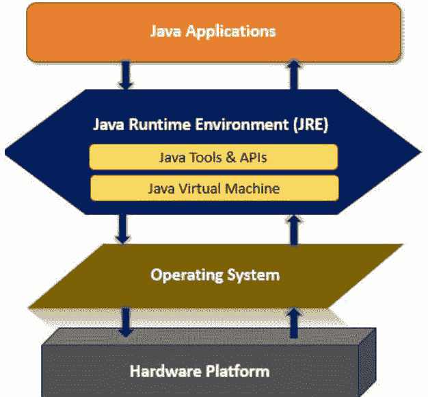

图 1.3：Java 平台

上图描述了 Java 平台的组件。它由 Java 运行环境（JRE）组成，其中包含 Java 库（Java API）和 Java 虚拟机（JVM）。在 C 和 C++ 等语言中，编译后的代码是平台相关的，因为它们以可执行二进制代码的形式存在。然而，Java 编译器将代码转换为中间字节码，这是一组经过优化的指令，可以在任何安装了适当 JVM 的机器上执行。因此，JVM 为 Java 代码提供了平台无关性。每个操作系统（如 Windows、Linux、Mac 等）都有自己的 JVM。因此，Java 代码遵循“一次编写，到处运行”的原则。

Java API/库是一系列准备即用的组件集合，如调用和接口，可用于创建应用程序。例如，Swing 库用于创建 Java 应用程序的用户界面（UI）。Java 以多个版本发布以满足特定类型设备的需求。以下是不同 Java 版本的简单描述：

- Java 标准版（Java SE）：Java SE 平台是创建控制台应用程序或网络应用程序的基础。它包含了核心 API，包括用于高级编程（如网络、安全、图形用户界面 GUI、数据库操作和 XML 数据解析）的基本类型和类。它提供了虚拟机、开发和部署工具，以及用于高级编程的其他工具包和库。
- Java 企业版（Java EE）：Java EE 平台是 Java SE 平台的扩展。它为创建和部署具有复杂业务逻辑的大、分布式、可扩展、多层、可靠且安全的企业应用程序提供了工具和 API。
- Java 微型（Java ME）：Java ME 平台主要用于为手机、电视机顶盒等小微设备创建嵌入式 Java 应用程序。它包含 Java SE API 的子集和一个较小的虚拟机，用于在内存和存储空间较小的设备上执行 Java 程序。Java ME 应用程序通常作为 Java EE 服务的客户端。
- JavaFX：JavaFX 平台提供了轻量级用户界面 API，用于创建使用硬件加速图形和媒体引擎的富网络应用程序。JavaFX 允许你创建具有现代外观的高性能图形应用程序。它还提供了高级 API 来连接网络上的数据源。JavaFX 应用程序也可以作为 Java EE 服务的客户端。

## 1.4 Java SE 平台组件

两个重要的 Java SE 平台组件是 Java 环境（JRE）和 Java 开发包（JDK）。JRE 包含了执行 Java 程序所需的所有 Java 库，而 JDK 包含了开发 Java 程序所需的库，并针对 Windows、MacOS、Linux 等不同平台进行发布。JDK 包含了应用程序开发、编译、调试等所需的工具。它还拥有自己的 JRE，用于运行和测试 Java 应用程序。下图显示了不同的 Java SE 平台组件：

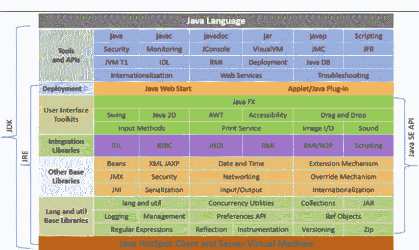

**图 1.4：工具和库**

以下是工具和库的简要描述：

- 开发工具和 API：这些工具和实用程序构成了 Java 开发的基础。开发工具包括`javac`编译器、Java 启动器、Javadoc 文档工具等。Java APIs 是针对不同功能（如网络、XML 解析、GUI 创建、数据库操作等）的即即用的类和接口。
- 部署工具：JDK 提供了在目标机器上部署应用程序的软件。Java Web Start 和 Java Plug-In 是部署工具的示例。
- 用户界面工具包：JDK 附带了 Swing、Java2D 和抽象窗口工具（AWT）等 UI 工具包，用于 Java 应用程序的图形用户界面。
- 集成库：Java 数据库连接（JDBC）、Java 命名和目录接口（JNDI）等集成库提供了访问数据库和远程对象以用于数据操作和网络访问。
- 其他基础库：这些库包含了文件操作、网络、XML 解析、安全、国际化等的 API。
- 语言和实用库：这些库包括 Math、Collections、Logging、Regular Expressions 等，允许你在 Java 程序中进行数据操作。

## 1.5 Java SE 版本历史

Java 标准版（Java SE）是一个平台，通过 Java 开发包（JDK）提供的开发工具、API、实用程序和运行时环境来开发健壮、可靠且安全的应用程序。多年来，JDK 经历了多次修改，每个新版本都会添加一些增强和新功能。下表列出了 JDK 的不同版本及其对应的特性增强：

| 版本 | 特性 | 增强 |
| :--- | :--- | :--- |
| Java 1.0 | | |
| Java 1.1 | | |
| Java 1.2 | | |
| Java 1.3 | | |
| Java 1.4 | | |
| Java 5 | | |
| Java 6 | | |
| Java 7 | | |
| Java 8 | | |
| Java 9 | | |
| Java 10 | | |

表 1.1：Java 版本

## 1.6 Java SE 9 和 Java SE 10 的特性

Java 8 的发布充满了各种新特性，这些特性对 Java 应用程序开发产生了重大影响。在 JDK 8 之前，每个 JRE 都将运行时所需的所有类打包在一个名为`rt.jar`的 Java 归档（JAR）中，它位于 lib 目录下。这导致大量不必要的类进入运行时，增加了 JVM 的开销。因此，JAR 文件变得体积臃肿，且执行环境无论是否使用，都必须处理所有类。

但 Java SE 9 具有更强的通用性、定制性以及大量的新功能。其中最重要的是 Jigsaw 项目，它应用新的模块系统将 JRE 拆分为可重用和可交互的组件。程序代码被划分为包含待执行任务的模块。这使得程序更易于重用和管理。

模块化的另一个优势是它让 Java 平台更加轻量且可扩展，使得程序可以在资源较少的较设备上运行。模块化的 JRE 甚至可以用于嵌入式系统。

- Java 模块系统（JPMS）：这是 Java SE 9 最重要的特性。随着系统代码库增长，遇到的重要问题包括：
  - 代码封装困难
  - 各部分（JAR）之间的依赖关系缺乏清晰度
  - 类路径上的公共类易于访问，导致不当使用
  - 对所有所需 JAR 的可用性缺乏保证

这些问题都通过模块系统在模块化 JAR 中使用模块描述符来解决。在该文件中，模块可以使用`requires`语句定义其所依赖的所有其他模块列表。此外，为了让模块的包可以被其他模块访问，使用了`exports`关键字。如果对某个包没有使用`exports`关键字，它默认被封装在在该模块中，如图所示：

| mod1 | requires | mod2 |
|---|---|---|
| com.mod1 | | com.mod2 |
| com.mod1.pkg1 com.mod1.pkg2 | | com.mod2.pkg3 com.mod2.pkg4 |

**图 1.5：**模块依赖

注意，模块`mod1`需要模块`mod2`。两个模块都有封装的包（如盾牌符号所示），因为它们没有被导出。在程序中，可以如下所示：

```java
module mod1 {
    exports com.mod1;
    requires mod2;
}
```

你可以通过添加执行应用程序所需的模块来创建一个最小运行时。这可以通过：

使用 Java 9 提供的新`jlink`工具，模块化的 JDK 以及包含显式依赖关系的模块描述符文件使得创建这种精简的运行时环境成为可能。因此，你可以创建一个精简且优化的运行时环境，并避免臃大的 JDK 安装。

JShell 是 JDK 9 的一种全新的读取-评估-打印循环（REPL）交互式终端。你可以从控制台启动`jshell`，并直接在其中输入并执行代码。当执行代码时，它会提供即时反馈，允许你尝试和探索新的 API 和语言特性。你还可以使用交互式外壳在 Java 中测试正则表达式。

增强后的 Javadoc 现在在 API 文档中提供了内置搜索功能。此外，新的 Javadoc 符合 HTML5 标准，并且每个页面都包含有关类或接口所属的 JDK 模块的信息。

Java SE 9 集合工厂引入了一项新功能，为`List`、`Set`等集合提供了工厂方法。这有助于开发者通过一条语句快速填充集合集合，而无需使用多个`add`调用。例如：

```java
Set set1 = Set.of(3, 4, 5);
```

这些集合是不可变的，也就是说，创建后无法向这些集合添加项，否则将抛出`UnsupportedOperationException`异常。使用工厂方法使代码更短，并避免了特定集合类型的实现。

Stream API 的增强：Java SE 9 通过允许对集合进行声明式的转换流水线，为 Streams API 添加了更多功能。它在`Stream`接口中添加了新方法，即`dropWhile`、`takeWhile`，并提供了`iterate`方法的重载版本以提供用于迭代的表达式。如下例所示：

```java
IntStream.iterate(1, num -> num < 10, num -> num + 1)
    .forEach(System.out.println);
```

第二个参数中的 lambda 表达式在`num`变为 10 之前返回`true`，并打印从 1 到 99 的整数。

此外，可以将`Optional`对象转换为`Stream`对象。

```java
Stream num = Optional.of(1).stream();
```

私有接口方法：Java SE 8 引入了接口默认方法的概念。但接口当时只有方法签名，没有任何实现。在 Java SE 9 中，接口也可以拥有具有行为的方法以及私有辅助方法，用于实现可以从多个默认方法调用的共享代码。如下代码所示：


```java
public interface Interface {
    void interfaceMethodWithOnlySignature();
    default void interfaceDefaultMethod() {initProcess();}
    default void interfaceDefaultMethod1() {initProcess();}
    // 不属于 Interface 暴露的公共 API 的私有方法
    private void initProcess() {
        System.out.println("Initializing the Process");
    }
}
```

因此，私有接口方法可以帮助构建默认方法的 API 实现。

## Java SE 9 的特性

Java 9 引入了使用`HttpClient` API 执行 HTTP 调的新方法，以取代旧的`HttpClientConnection` API，后者同时也支持 WebSockets 和 HTTP/2：

```java
HttpClient client = HttpClient.newHttpClient();
```

多版本 Java SE 9 引入了多版本 JAR（multi-release JARS）特性，解决了为了向兼容而保留弃用库导致的臃肿 JAR 问题。此功能允许你创建类的备用版本，这些版本仅当库运行在特定的 Java 版本时才会被使用。

如下图所示：

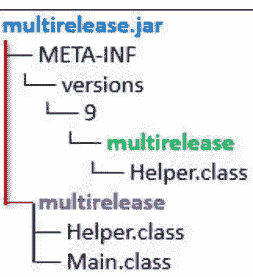

### 图 1.6：多版本 JAR

上面的图像显示了一个`multirelease.jar`文件，其顶层有一个`Helper`类，还有一个 Java 9 特有的版本。这表明在与 Java 9 工作时，将使用`META-INF/versions/9`文件夹下的类，它可以使用 Java 9 的特性和库。然而，该 JAR 也适用于更早的版本，在这种情况下，将使用顶层的`Helper`类。

## Java SE 10 的特性

JDK 10 遵循 JDK 9 的模块模型，并对 JDK 9 的特性和功能进行了增强。JDK 10 相比 JDK 9 没有引入任何重大变化或改进，但它是 Oracle 宣布的全新每六个月一次发布周期中的第一个版本。由于计划仅作为短期发布，JDK 10 的公共更新将在 6 个月后结束。下一个版本 JDK 11 计划于 2020 年 9 月发布，它将是 Java 的长期支持（LTS）版本。

以下列出了 Java SE 10 中的新功能和增强：

- 应用数据类共享 (CDS)：此 JDK 增强提案 (JEP) 是现有 CDS 特性的扩展，允许你将应用类存储到共享归档中以提高启动。
- 并行全 GC：全并行 GC 改进了 F1 垃圾回收器最坏情况下的延迟。
- 垃圾回收器接口：JDK 10 引入了垃圾回收器（GC）接口，以提高不同垃圾回收器的源码隔离。
- 将多个 JDK 仓库合并为单个仓库：合并此功能以简化和流线开发流程。
- 局部变量类型推断：此增强允许你将类型推断扩展到带有初始化器的局部变量声明中。它还向 Java 引入了`var`。
- 线程回调：JDK 10 引入了在不执行全局 VM 安全点（safepoint）的情况下停止单个线程而非所有线程的可能（在线程中）。
- 基于时间的版本控制：为 Java SE 平台和 JDK 的版本字符串方案引入了新的基于时间的版本控制。
- 其他特性：其他几个高级特性包括：
  - 一组默认的根证书机构 (CA) 集合。
  - 堆分配。
  - 实验性的 Graal JIT 编译器。
  - `java.util`相关的 API。
  - 实施额外的 Unicode 扩展。

### 表 1.2：JDK 8 安装目录内容

下表简要介绍了典型 JDK 10 安装中常见目录的描述：

| 目录 | 说明 |
| :--- | :--- |
| `bin` | 包含 JDK 的可执行文件，如`javac`、`java`和`key`。 |
| `lib` | 包含标准库和其他包文件。 |
| `include` | 包含编译 Java 程序所需的头文件。 |
| `meta` | 包含 Java 运行时的配置文件。 |
| `samples` | 包含 JDK 的文档和示例。 |

### 表 1.3：JDK 10 安装目录内容

## 1.8 设置 JDK 路径

为了使用 JDK，必须将`bin`文件夹的路径设置为名为`PATH`的系统环境变量。`PATH`变量指向可执行文件和`java.exe`，这样就可以在任何目录下执行这些命令，而无需指定完整路径。

要在命令提示符窗口中设置`PATH`变量，请输入以下命令：

```cmd
C:\>set path=%\bin
```

例如：

```cmd
C:\>set path=C:\Program Files\Java\jdk1.8.0_45\bin
```

同样，设置 JDK 10 版本`bin`目录的路径。

要在系统（Windows 10）上永久设置`PATH`变量，请按照给步骤操作：

右键点击此电脑 | 属性 | 高级系统设置 | 高级 | 点击环境变量：

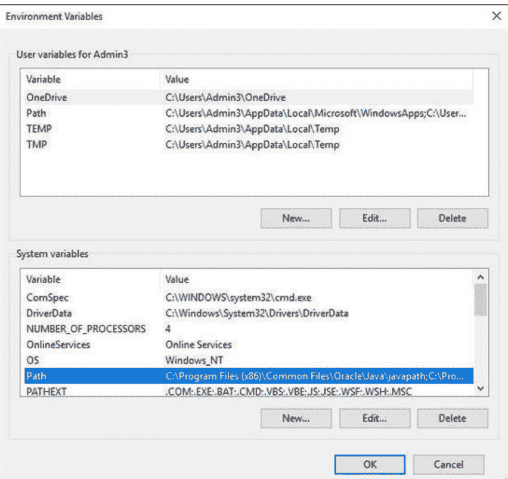

图 1.13：设置`PATH`环境变量

在“系统变量”部分，选择`PATH`变量并点击“编辑”按钮进入 JDK 安装文件夹路径。

点击“新建”进入新路径，并输入`bin`文件夹的路径：

`C:\Program Files\Java\jdk1.8.0_45\bin`

点击“确定”保存更改。

同样，也可以在环境变量中永久设置 JDK 10 版本`bin`文件夹的路径。

## 1.9 Java 应用开发

Java 的流行度正在上升。Java 的流行度正在上升。Java 的流行度正在上升。Java 的流行度正在上升。Java 的流行度正在上升。Java 的流行度正在上升。Java 的流行度正在上升。Java 的流行度正在上升。Java 的流行度正在上升。Java 的流行度正在上升。Java 的流行度正在上升。Java 的流行度正在上升。Java 的流行度正在上升。Java 的流行度正在上升。Java 的流行度正在上升。Java 的流行度正在上升。Java 的流行度正在上升。Java 的流行度正在上升。Java 的流行度正在上升。Java 的流行度正在上升。Java 的流行度正在上升。Java 的流行度正在上升。Java 的流行度正在上升。Java 的流行度正在上升。Java 的流行度正在上升。Java 的流行度正在上升。Java 的流行度正在上升。Java 的流行度正在上升。Java 的流行度正在上升。Java 的流行度正在上升。Java 的流行度正在上升。Java 的流行度正在上升。Java 的流行度正在上升。Java 的流行度正在上升。Java 的流行度正在上升。Java 的流行度正在上升。

Java 的流行度正在上升。Java 即使在发布二十年后仍被广泛使用。Java 仍然是包含以下应用程序的首选语言：

- `Servlets`
- `Java Server Pages (JSP)`
- `Enterprise JavaBeans (EJB)`

Java 的流行度正在上升。Java 即使在发布二十年后仍被广泛使用。Java 仍然是包含以下应用程序的首选语言：

- `Servlets`
- `Java Server Pages (JSP)`
- `Enterprise JavaBeans (EJB)`

Java 的流行度正在上升。Java 即使在发布二十年后仍被广泛使用。Java 仍然是包含以下应用程序的首选语言：

- `Servlets`
- `Java Server Pages (JSP)`
- `Enterprise JavaBeans (EJB)`

Java 的流行度正在上升。Java 即使在发布二十年后仍被广泛使用。Java 仍然是包含以下应用程序的首选语言：

- `Servlets`
- `Java Server Pages (JSP)`
- `Enterprise JavaBeans (EJB)`

Java 的流行度正在上升。Java 即使在发布二十年后仍被广泛使用。Java 仍然是包含以下应用程序的首选语言：

- `Servlets`
- `Java Server Pages (JSP)`
- `Enterprise JavaBeans (EJB)`

Java 的流行度正在上升。Java 即使在发布二十年后仍被广泛使用。Java 仍然是包含以下应用程序的首选语言：

- `Servlets`
- `Java Server Pages (JSP)`
- `Enterprise JavaBeans (EJB)`

Java 的流行度正在上升。Java 即使在发布二十年后仍被广泛使用。Java 仍然是包含以下应用程序的首选语言：

- `Servlets`
- `Java Server Pages (JSP)`
- `Enterprise JavaBeans (EJB)`

Java 的流行度正在上升。Java 即使在发布二十年后仍被广泛使用。Java 仍然是包含以下应用程序的首选语言：

- `Servlets`
- `Java Server Pages (JSP)`
- `Enterprise JavaBeans (EJB)`

Java 的流行度正在上升。Java 即使在发布二十年后仍被广泛使用。Java 仍然是包含以下应用程序的首选语言：

- `Servlets`
- `Java Server Pages (JSP)`
- `Enterprise JavaBeans (EJB)`

Java 的流行度正在上升。Java 即使在发布二十年后仍被广泛使用。Java 仍然是包含以下应用程序的首选语言：

- `Servlets`
- `Java Server Pages (JSP)`
- `Enterprise JavaBeans (EJB)`

Java 的流行度正在上升。Java 即使在发布二十年后仍被广泛使用。Java 仍然是包含以下应用程序的首选语言：

- `Servlets`
- `Java Server Pages (JSP)`
- `Enterprise JavaBeans (EJB)`

Java 的流行度正在上升。Java 即使在发布二十年后仍被广泛使用。Java 仍然是包含以下应用程序的首选语言：

- `Servlets`
- `Java Server Pages (JSP)`
- `Enterprise JavaBeans (EJB)`

Java 的流行度正在上升。Java 即使在发布二十年后仍被广泛使用。Java 仍然是包含以下应用程序的首选语言：

- `Servlets`
- `Java Server Pages (JSP)`
- `Enterprise JavaBeans (EJB)`

Java 的流行度正在上升。Java 即使在发布二十年后仍被广泛使用。Java 仍然是包含以下应用程序的首选语言：

- `Servlets`
- `Java Server Pages (JSP)`
- `Enterprise JavaBeans (EJB)`

Java 的流行度正在上升。Java 即使在发布二十年后仍被广泛使用。Java 仍然是包含以下应用程序的首选语言：

- `Servlets`
- `Java Server Pages (JSP)`
- `Enterprise JavaBeans (EJB)`

Java 的流行度正在上升。Java 即使在发布二十年后仍被广泛使用。Java 仍然是包含以下应用程序的首选语言：

- `Servlets`
- `Java Server Pages (JSP)`
- `Enterprise JavaBeans (EJB)`

Java 的流行度正在上升。Java 即使在发布二十年后仍被广泛使用。Java 仍然是包含以下应用程序的首选语言：

- `Servlets`
- `Java Server Pages (JSP)`
- `Enterprise JavaBeans (EJB)`

## 1.10 Java 程序的结构

由于 Java 是一种面向对象的语言，程序的开发从创建类开始。类的定义保存在与类同名且扩展名为`.java`的文件中。类的结构如下屏幕截图所示：

Java 仍然是包含以下应用程序的首选语言：

常用的 IDE 包含：

- `NetBeans`
- `Eclipse`
- `IntelliJ`
- `Android Studio`

```java
package <package-name>;
import <package-name>;

public class <class-name> {
    // 变量声明

    // 构造方法(s)

    // 其他方法定义
}
```

图 1.14：Java 程序的结构

以粗体显示的单词是 Java 语言的关键字，在语言中具有预定义的含义。关键字不能用于变量、方法、类的命名或作为任何其他标识符。

Java 程序中的方法代表了对象要执行的行为或功能。实例方法可以通过创建类的对象来调用。

Java 程序中的构造函数是与类名同名的特殊方法。它们在创建对象期间被调用，通常用于初始化类的数据成员。

要创建一个 Java 程序，可以使用任何文本编辑器（如记事本）。创建 Java 程序的基本步骤如下：

- 创建一个类并将其以`.java`扩展名保存。
- 编译该文件。
- 构建并执行 Java 程序。

下面的代码演示了一个简单的 Java Hello World 程序。它是在 Windows 系统的记事本编辑器中编写的：

```java
public class Hello {
    public static void main(String[] args) {
        System.out.println("Hello World!");
    }
}
```

类声明由访问修饰符、类关键字和类名组成，后面跟着大括号`{}`。

Java 是一种封装非常严格的语言；因此，没有任何内容可以放在类之外。在示例中，类名为`Hello`。类内部是`main()`方法，它是程序的入口点，也就是说，每个 Java 程序的执行都是通过调用`main()`方法开始的。

### 语法

```java
public static void main(String[] args) {
// 代码语句
}
```

以下是程序中重要关键字的简要描述：

- `public`允许 JVM 访问`main()`方法。
- `static`允许你在不创建类实例的情况下访问类的方法。
- `void`表明`main()`方法返回的值的数据类型。`void`类型意味着该方法不返回任何值。
- `String args`存储在命令行传递的参数。

`String`类是 Java 内置的类和数据类型，允许变量存储一组字符。

在`main()`方法中，通过使用`System.out.println()`语句来指定程序的实际功能。

`println()`方法接收一个`String`参数并将其显示在控制台上。`System`类是 Java 中的一个预定义类，允许访问控制台等系统资源。关键字`out`代表连接到控制台的输出流。

将文件保存为`Hello.java`。要保存`Hello.java`程序，在记事本中点击“文件 > 另存为”，并在文件名框中输入`Hello.java`。引号可以避免将文件保存为带有扩展名的`HelloWorld.java.txt`。

## 1.11 Java 代码的编译与执行

扩展名为`.java`的 Java 程序文件通过使用`javac`编译器转换为具有`.class`扩展名的字节码文件。生成的`.class`文件可以在任何具有相应 JVM 的平台上执行，如下图所示：

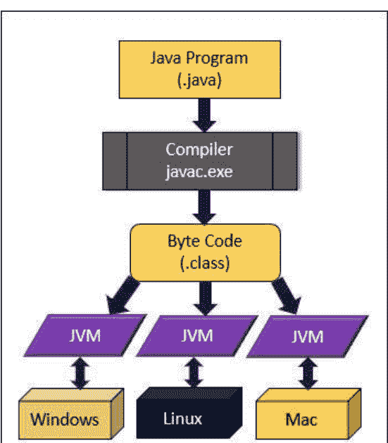

**图 1.15：** Java 代码编译

接下来的图显示了 JRE 在代码执行期间的任务：

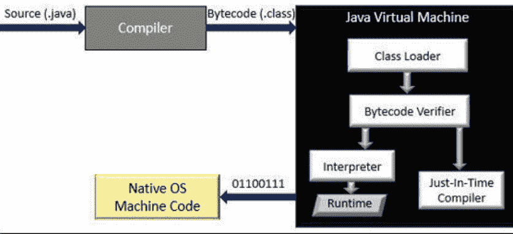

由编译器生成的文件不依赖于目标系统的硬件或软件平台。包含主类的文件被传递给 JVM。在 JVM 内部，文件会通过以下组件：

**类加载器 (Class Loader)：** 一旦主类被 JVM 加载到内存中，程序引用的其他类将通过类加载器加载。

**字节码 (Bytecode)：** 加载的类的字节码由字节码验证器检查以确认是否存在任何损坏的指令。字节码验证器执行的检查如下：

- 使用前的变量初始化。
- 方法调用和对象引用的类型应当匹配。
- 没有违反访问私有数据和方法的规则。
- 对局部变量的访问在运行时栈范围内。
- 不应出现任何运行时栈溢出。

如果上述任何检查失败，验证器将不允许加载该类。接下来，字节码将由解释器执行。

**即时编译 (JIT) Compiler：** 从 Java 2.0 开始，运行时包含了 JIT 编译器以提高执行速度。JIT 编译器的工作是将字节码转换为本地代码或特定平台的代码以提高性能。

## 1.12 使用 JDK 8 创建并执行 Java 程序

在 JDK 8 及更早版本中，使用内置的`javac.exe`编译器来编译源文件`Hello.java`，如下所示的截图所示：

```text
C:\WINDOWS\system32\cmd.exe
Microsoft Windows [Version 10.0.17134.112]
(c) 2018 Microsoft Corporation. All rights reserved.
C:\Users\Admin32>set path="C:\Program Files\Java\jdk1.8.0_45\bin"
C:\Users\Admin32:F:
F:\>cd pkg1
F:\pkg1>javac Hello.java
F:\pkg1>
```

图 1.17：使用`javac`编译器编译 Java 代码


首先，移动到保存`Hello.java`文件的文件夹，然后执行`javac`命令。该命令将在当前目录生成一个名为`Hello.class`的文件，该文件将被运行时执行。

路径设置为 JDK 8 版本的`bin`文件夹。

在当前目录中使用`dir`命令查看由`javac`生成的文件：

```
F:\pkg1>dir
Volume in drive F is New Volume
Volume Serial Number is 30A1-25D

Directory of F:\pkg1
14-06-2018  17:40  <DIR> .
14-06-2018  17:40  <DIR> .
14-06-2018  17:40               416 Hello.class
14-06-2018  17:40                    120 Hello.java
14-06-2018  17:35                2 File(s)         536 bytes
                               2 Dir(s)         368,896,656 bytes
```

这些文件使得 Java 代码能够“编写一次，到处运行”。现在，使用 Java 解释器`java.exe`来将字节码转换为机器码并执行程序。`java`命令接收类文件名作为执行参数。

下面的截图显示了通过`java`命令执行`Hello.class`：

```
C:\WINDOWS\system32\cmd.exe
F:\>cd pkg1
F:\pkg1>javac Hello.java
F:\pkg1>dir
Volume in drive F is New Volume
Volume Serial Number is 30A1-25D

Directory of F:\pkg1
14-06-2018  17:40  <DIR> .
14-06-2018  17:40  <DIR> .
14-06-2018  17:40               416 Hello.class
14-06-2018  17:40                    120 Hello.java
14-06-2018  17:35                2 File(s)         536 bytes
                               2 Dir(s)         368,896,656 bytes
F:\pkg1>java Hello
Hello World!
```

图 1.19：使用`java`命令执行 Java 代码

| command: command: command: command: command: command: command: |
| --- |
| command: command: |
| command: command: command: command: command: command: |
| command: command: |

表 1.5：`java`命令的选项

## 1.13 使用 JDK 10 创建和执行 Java 程序

在 JDK 8 之前，开发者通常使用`src/main/java`目录结构作为源目录。例如，主类文件`Hello.java`通常位于`com.pkg1.app`包中，整体路径为`src/main/com/pkg1/Hello.java`。到目前为止，这是组织代码的传统模式。然而，从 Java SE 9 开始引入新的 JPMS（Java 模块系统），结构化和编写代码的模式发生了变化。

Java 9 模块（module）是代码和数据的自描述集合。它可以包含多个包（package），这些包反过来可能包含一个或多个类、接口等。模块还可能包含资源文件、属性文件等。为了创建一个完整的应用程序，需要集成此类模块的集合。每个模块都是更大结构中的构建块。简而言之，现在不再是创建一个巨大的 Java 项目，而是可以创建多个模块化的功能单元，这些单元可以集成形成一个应用程序，并可以在其他应用程序中用。

要在 JDK 10 中创建并执行 Java 程序，请执行以下步骤：

1. 创建一个唯一名称的模块，例如，
2. 为模块创建一个根文件夹——这需要为每个模块执行。模块根文件夹的名称应与模块名称相同。因此，在这种情况下，模块的根文件夹将是
3. 在模块根文件夹内部模块代码。从模块根文件夹开始创建包。例如，在`moduleleone`文件夹内创建`mypkg\util`包层次结构，并在`com.mypkg.util`包中添加`Hello.java`类。这种情况下的文件夹结构如下截图所示：

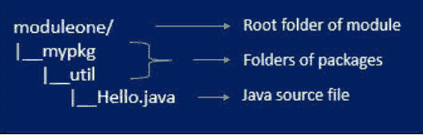

**图 1.20：** Java 应用程序的模块化结构

在 JDK 8 之前，包直接存储在源文件夹下，而从 JDK 9 开始，包现在存储在模块根文件夹下。从模块根文件夹开始，结构与之前的版本相同。

### Java SE 8 及更早版本

- 创建一个或多个源文件夹。
- 在源文件夹中，创建与包名匹配的包文件夹。
- 将源文件放在相应的包文件夹中。

### Java SE 9 及更高版本

- 创建一个或多个源文件夹。
- 在每个源文件夹中，为每个模块创建一个模块文件夹。
- 在模块文件夹中，创建与包名匹配的包文件夹。
- 将源文件放在相应的包文件夹中。
- 创建一个模块描述符文件，其中包含模块的元数据，即模块本身、导出和依赖。将该文件直接保存在模块根文件夹中，命名为`module-info.java`。例如，`moduleone`模块的模块描述符所示：

```java
module moduleone {
// module exports and dependencies
}
```

文件以`module`关键字开头，指示后续文本是模块名称。模块名称应与模块根文件夹的名称相同。在大括号内指定模块的依赖关系和导出。

带有模块描述符的最终文件夹结构所示：

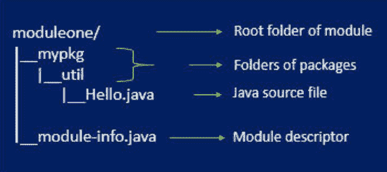

**图 1.21：** Java 模块的模块描述符

注意，模块描述符文件是一个`.java`文件，但它不遵循 Java 语言的类命名规范。也就是说，Java 类型名不允许使用连字符（`-`）。此外，`.java`文件的名称应与文件中声明的公共类型名称匹配，这在模块描述符名称中并未被遵守。这与自 Java 1.5 以来使用的文件类似，尽管其并不广泛使用。这些文件被刻意赋予了无效的 Java 类型名称，以指示它们的特殊用途，并将它们与应用程序中的其他 Java 文件区分开来。

以下代码是`Hello.java`源文件和`module-info.java`模块描述符的代码：

```java
//Hello.java
package mypkg.util;
public class Hello {
    public static void main(String[] args) {
        System.out.println("Hello World!");
    }
}
```

```java
// module-info.java
module moduleone {
}
```

以下截图显示了使用 JDK 10 编译和执行`Hello.java`文件的过程：

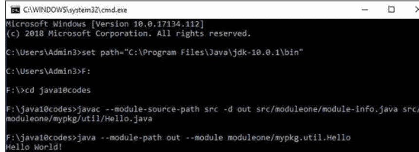

> 图 1.22：使用 JDK 10 编译和执行 Java 代码

模块描述符`module-info.java`是每个模块强制要求的。如果在编译期间找不到该文件，代码将无法编译并报错：`error: moduleone not found in module source path`。

使用`javac`命令编译模块，并带有选项指示模块存在于`src`文件夹。为`Hello.java`源文件生成的文件将保存在选项提到的`out`文件夹中。该选项指向模块描述符和要编译的源文件的位置。接下来，执行`.class`文件并显示输出`Hello World!`。

使用`java`命令执行模块的方法：

以下截图显示了`src`和`out`文件夹的结构：

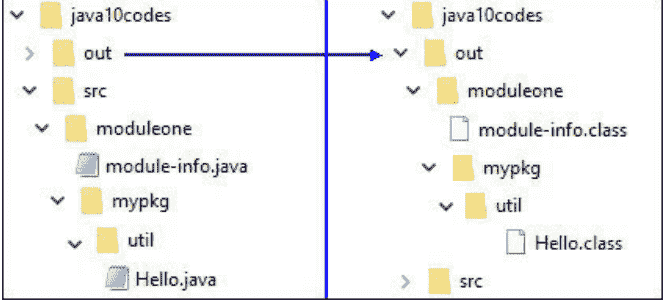

**图 1.23：** Java 应用程序的源和输出文件夹

通过命令行进行创建、编译和执行的所有任务都是手动完成的，这可能耗时且容易出错。为了避免这种情况，也可以在支持相应版本的 NetBeans、Eclipse 等 IDE 中创建 JDK 8 和 JDK 10 项目。

## 1.14 在 NetBeans 中创建 Java 8 项目

创建 Java 8 项目请执行以下步骤：

- 从 NetBeans 官网下载并安装支持 JDK 8 的 NetBeans 8.1 或更早版本。

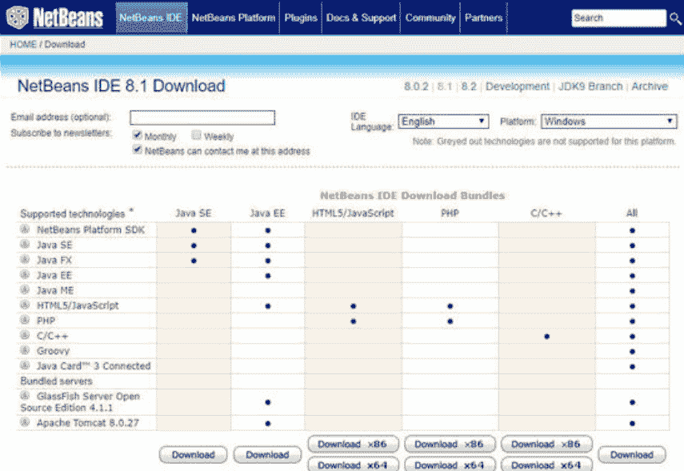

图 1.24：NetBeans IDE 8.1 下载页面

下载完整包并按照向导进行安装。确保在安装期间选择了正确的 JDK 路径。

安装完成后，启动 NetBeans 8.1 并如下所示点击 Project：

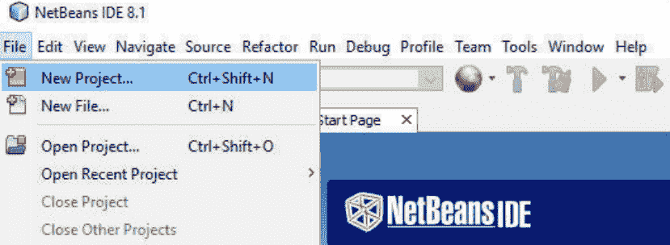

图 1.25：在 NetBeans 8.1 中创建新项目

它将打开新项目窗口。

在 Categories 窗格中选择 Java，在 Projects 窗格中选择 Java Application，如下所示：


**图 1.26：** 新项目对话框

点击

在**Name and Location**屏幕上，指定项目名称、保存位置以及主类文件名称，如下截图所示：

默认情况下，它采用应用程序名称作为包名和主类文件名。可以根据需要进行更改。

点击将创建一个带有文件夹层次结构和主类文件的新项目。

```java
/*
 * To change this license header, choose License Header
 * To change this template file, choose Tools | Temp
 * and open the template in the editor.
 */

package javaapplication1;

/*
 * @author Admin3
 */
public class JavaApplication1{
    /*
     * @param args the command line arguments
     */
    public static void main(String[] args) {
        // TODO code application logic here
    }
}
```

图 1.28：Java SE 中的第一个应用程序

在编辑器的`main()`方法中输入一行代码，如下截图所示：

```java
package javaapplication1;

/*
 * @author Admin3
 */
public class JavaApplication1 {
    /*
     * @param args the command line arguments
     */
    public static void main(String[] args) {
        // TODO code application logic here
        System.out.println("Hello World!");
    }
}
```

图 1.29：定义`main()`方法

保存应用程序。

右键点击项目并选择“运行”（Run），如下截图所示：

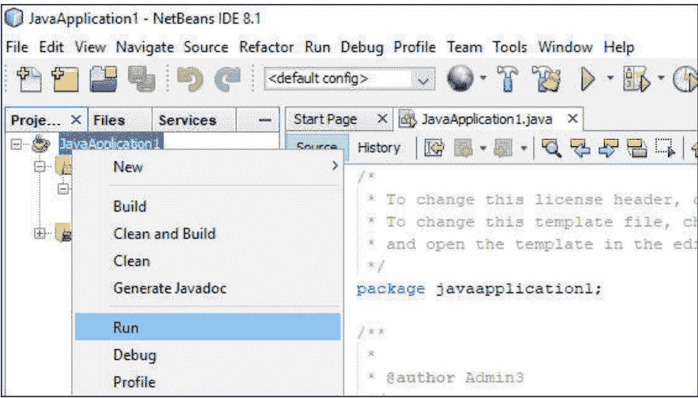

**图 1.30：** 执行 Java 8 应用程序

程序将开始执行，并在**输出**（Output）窗口查看结果，如下截图所示：

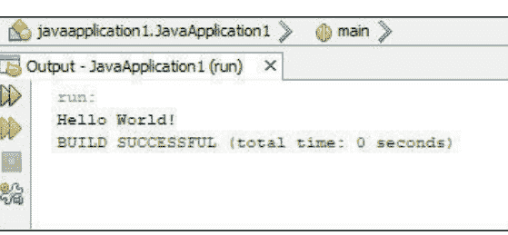

图 1.31：Java 8 应用程序的输出

同样，可以在源包（Source Packages）文件夹中创建更多的包和类。

## 1.15 在 NetBeans 中创建和执行 Java 10 项目

要在 JDK 10 中创建 Java 项目，请执行以下步骤：

从 NetBeans 官方下载页面下载并安装支持 JDK 10 的 NetBeans 8.2 或更高版本：

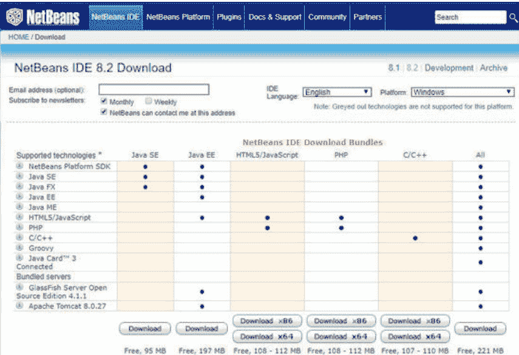

图 1.32：NetBeans IDE 8.2 下载页面

下载完成后，在系统上安装 NetBeans 8.2。确保在安装过程中正确选择了 JDK 1.10 的路径，如下截图所示：

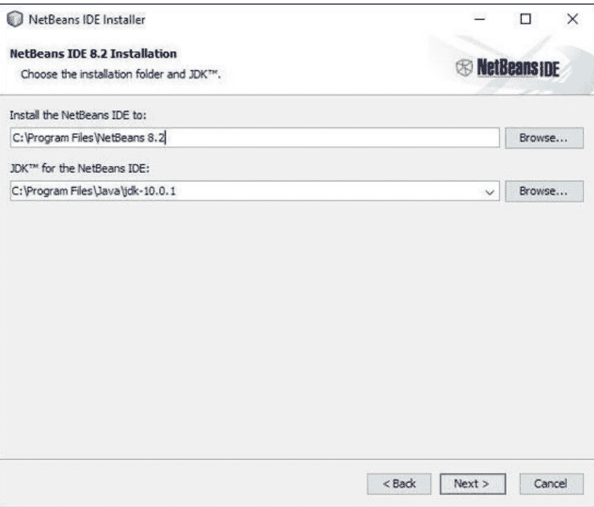

图 1.33：NetBeans 8.2 安装向导

安装完成后，打开 NetBeans 8.2 IDE。

要创建一个新项目，点击文件（File）| 新项目（New Project）。

如果此操作无效，意味着该发布版本尚未支持 JDK 10。

在这种情况下，请从`http://bits.netbeans.org/download/trunk/nightly/latest/`下载早期访问版本，如下截图所示：

## NetBeans IDE Build 201804200002 下载

邮箱地址（可选）：订阅时事：

每月 每周

NetBeans 可以此地址与我联系

+ 支持的技术：

- NetBeans Platform SDK
- Java SE
- Java EE
- Java ME
- JavaFX
- HTML5/JavaScript
- PHP
- C/C++
- ing
- Java Card 3
- 连接服务器
- 绑定服务器
- Glassfish Server 开源版 4.1.1
- Apache Tomcat 8.0.27

| Java SE | Java EE | HTML5/JavaScript | PHP | C/C++ | 全部 |
| --- | --- | --- | --- | --- | --- |
| | | | | | |
| | | | | | |
| | | | | | |
| | | | | | |
| | | | | | |
| | | | | | |
| 下载 | 下载 | 下载 x86 | 下载 x86 | 下载 x86 | 下载 |
| --- | --- | --- | --- | --- | --- |
| 免费，97 MB | 免费，199 MB | 免费，108 - 112 MB | 免费，108 - 112 MB | 免费，113 - 117 MB | 免费，230 MB |

图 1.34：NetBeans IDE Build 下载页面

安装程序下载完成后，安装 NetBeans，它将准备就绪，如下截图所示：

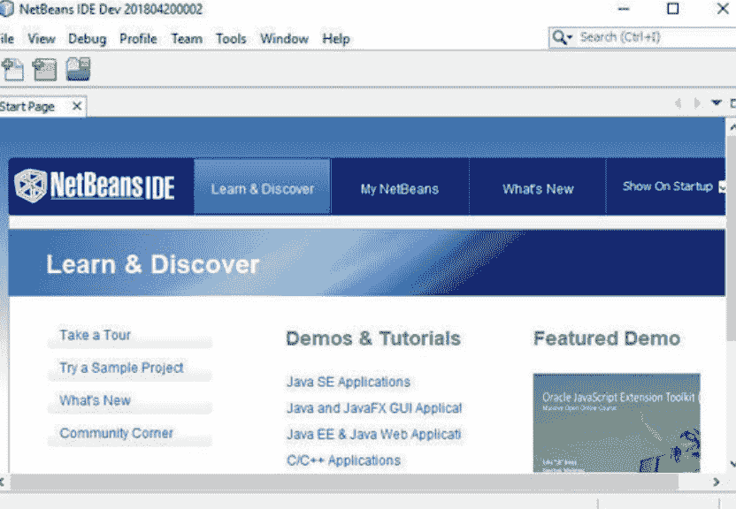

**图 1.35：** NetBeans IDE – 早期访问版本

点击**文件 > 新项目（File > New Project）**打开**新项目**向导。它显示了**Java**分类下的一个名为**Java 模块项目（Java Modular Project）**的新项目类型，如下截图所示：

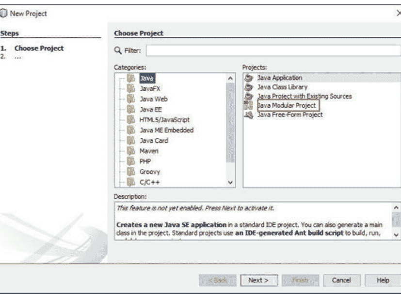

图 1.36：新项目对话框

选择**Java 模块项目**并点击

在**名称和位置（Name and Location）**屏幕上，指定项目名称和位置，如下截图所示：

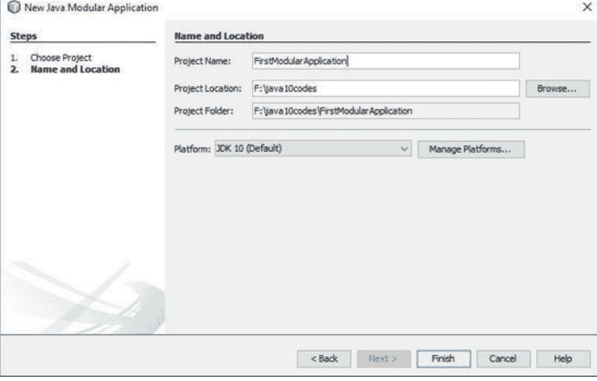

图 1.37：名称和位置屏幕

注意：此处已选择 JDK 10 作为默认平台。点击完成（Finish），项目将创建，如下截图所示：

图 1.38：NetBeans 中的模块化项目

要在项目中创建一个新模块，在项目（Projects）选项卡中右键点击项目并选择“新模块”，如下截图所示：

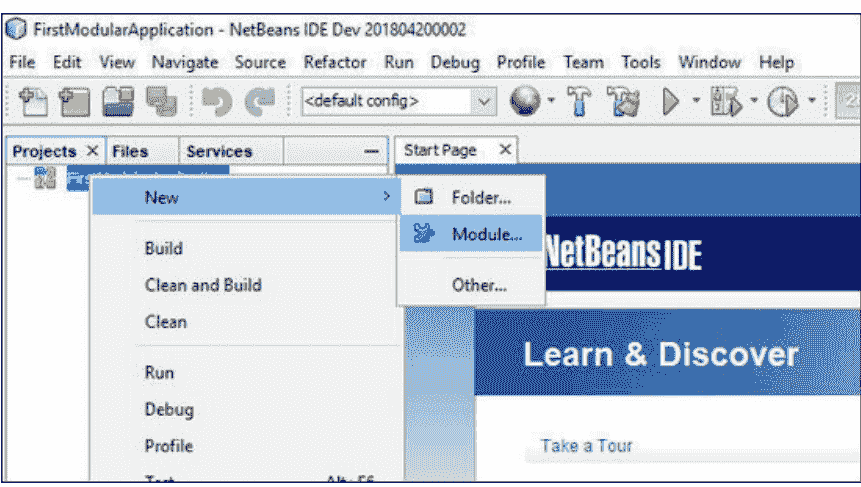

图 1.39：创建新模块

在新模块对话框中，指定模块名称，如下截图所示：

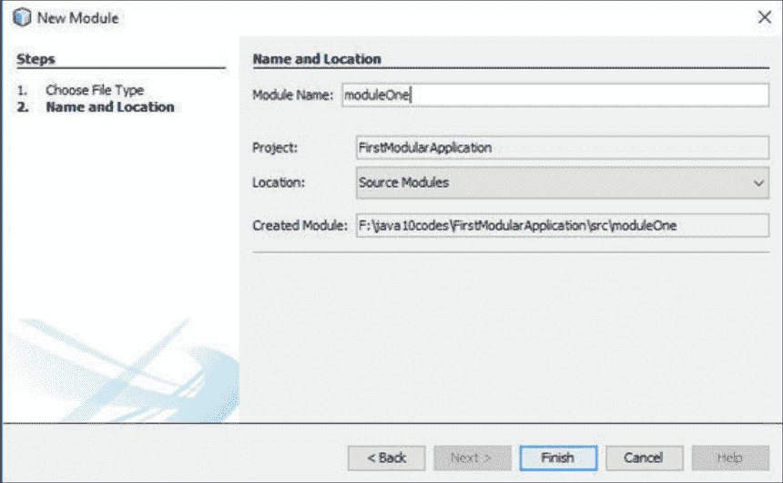

图 1.40：指定模块名称

模块描述符文件将添加到项目中，如下截图所示：

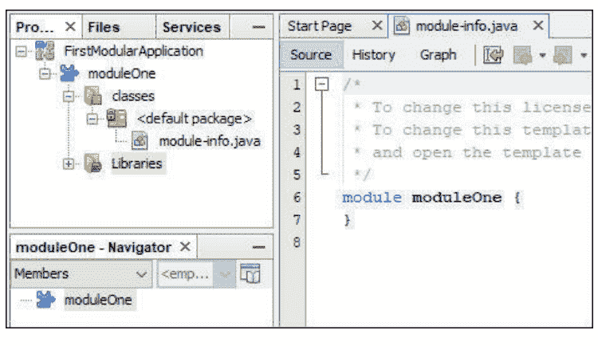

图 1.41：模块描述符

要在项目中创建一个类，在项目（Projects）选项卡中右键点击项目并选择“新 | Java 类”，如下截图所示：

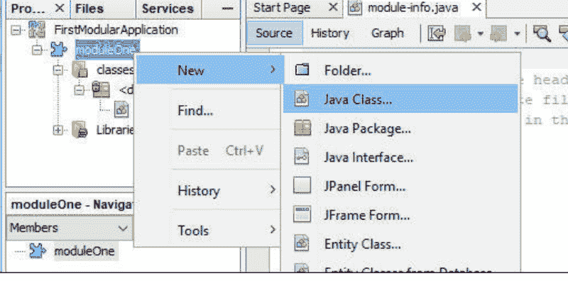

图 1.42：Java 类

在新类对话框中，指定模块的名称和包位置，如下截图所示：

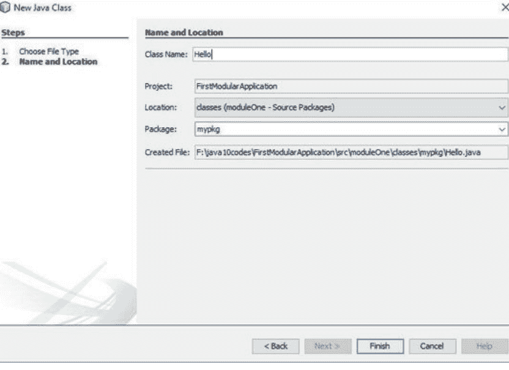

图 1.43：名称和位置

在`Hello.java`中添加`main`方法和打印语句，如下截图所示：


```java
package mypkg;

/**
 * @author Admin3
 */
public class Hello {
    public static void main(String[] args) {
        System.out.println("Hello World!");
    }
}
```

图 1.44：`Hello.java`

要执行应用程序，右键点击项目并选择“运行”（Run），如下截图所示：

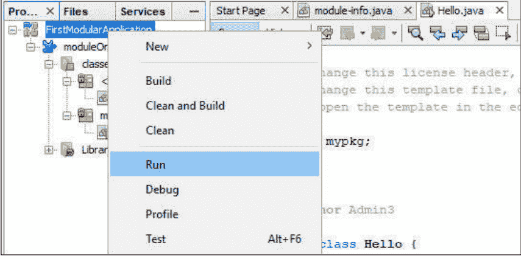

**图 1.45：** 执行 Java 8 应用程序

程序将开始执行，并在**输出**窗口中看到输出结果，如下截图所示：

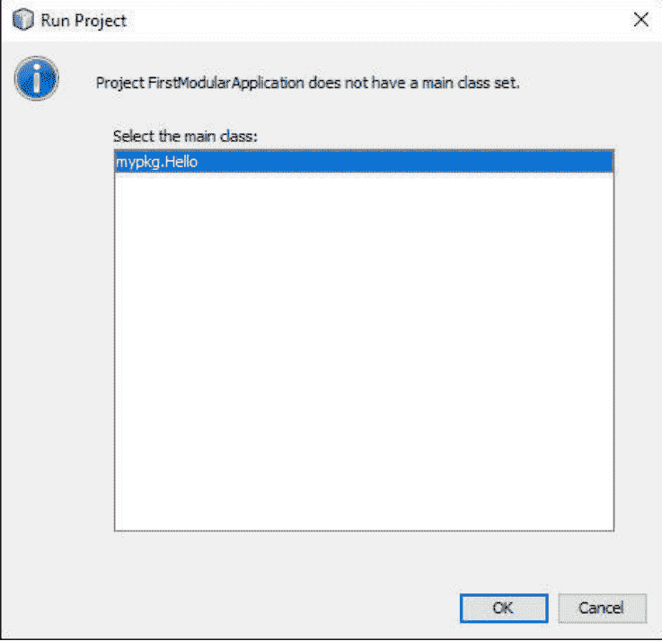

图 1.46：运行

显示了运行对话框。选择 `mypkg.Hello` 并点击确定（OK），如下截图所示：

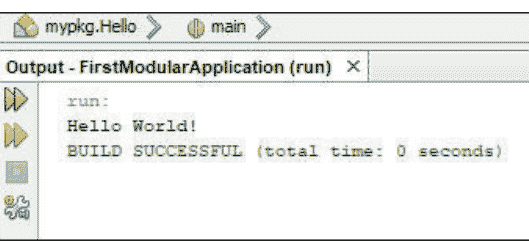

图 1.47：输出

### 单选题

__________ 是一种编程概念，它将实体的非本质细节从用户视图中隐藏。

- 封装 (Encapsulation)
- 多态 (Polymorphism)
- 抽象 (Abstraction)
- 继承 (Inheritance)

以下哪项是 JDK 9 最重要的特征？

- JShell
- JPMS
- REPL
- HTTP/2

连线题。

`columns. columns. columns. columns. columns. columns. columns. columns. columns. columns.`

- `a-2, b-3, c-4, d-1`
- `a-3, b-4, c-1, d-2`
- `a-4, b-1, c-2, d-3`
- `a-2, b-4, c-1, d-3`

识别在 Java 10 中编译模块的正确格式。

```bash
javac --module-source src -d out -m moduleA
```

```bash
javac --module-path src -d out -m moduleA
```

```bash
javac --module-source-path src -d out --mod moduleA
```

```bash
javac --module-source-path src -d out -m moduleA
```

在 Java 中使用哪个命令执行 `.class` 文件？

- `javac`
- `java`
- `javah`
- `jmod`

### 答案

c

b

a

d

b

### 作业

研究最新/即将发布的 JDK 版本的新功能。

下载并安装 JDK 10 和 NetBeans IDE。在 NetBeans 中创建一个新的 Java 模块化项目（Modular Project）。创建一个包含主类文件的新模块并执行 Java 程序。

## 第 2 章：Java 编程构造

在本章中，你将学习如何使用 Java 语言的不同编程构造，例如注释、变量、数据类型和运算符。你还将学习使用决策结构、循环结构和分支语句。

### 结构

- Java 注释
- Java 中的变量
- Java 中的数据类型
- 类型转换
- 字面量和转义序列
- 常量和枚举
- Java 中的运算符
- 运算符优先级和结合性
- 输出格式化
- 用于输入的 `Scanner` 类
- 决策结构
- 循环结构
- 跳转语句

### 目标

- 学习使用注释、变量、常量和枚举
- 处理数据类型和运算符
- 理解不同的决策结构
- 学习各种循环结构和分支语句

## 2.1 Java 注释

注释用于记录程序，以便理解代码或逻辑。它们会被编译器忽略，仅用于描述程序的操作。Java 支持三种类型的注释，将在接下来的章节中进行解释。

### 单行注释

单行注释用于描述单行代码。

语法：

```java
// 注释文本
```

示例：

```java
// 定义 main 方法
public static void main(String args[]){
}
```

单行注释可以用以下两种方式之一进行使用：

- 行首注释：放在代码之前
- 行尾注释：放在同一行代码的末尾

示例：

```java
// 定义 main 方法
public static void main(String args[]){
} // main 方法的结束
```

### 多行注释

多行注释跨多行编写。它以 `/**` 符号开始，以 `*/` 符号结束。这两个符号之间的所有内容都会被编译器忽略。

示例：

```java
/*
 * main 方法是 Java 程序的
 * 执行点
 */
public static void main(String args[]){
}
```

### Javadoc 注释

Javadoc 注释样式通常用于记录程序的类、方法等。Javadoc 注释以 `/**` 开始，以 `*/` 结束。注释可以跨多行，符号之间的所有内容都会被编译器忽略。使用 `javadoc` 命令生成 Javadoc 注释。

示例：

```java
/**
 * 这是执行点，main 方法。
 * @param args 未使用。
 * @return 无。
 */
public static void main(String[] args){
}
```

在这里，`@param` 和 `@return` 是 Javadoc 注释识别的内置标签示例。

## 2.2 Java 中的变量

任何程序的基本实现都是存储和处理数据。Java 支持不同类型的数据，如数字、字符、布尔值等。为了存储这些类型的值，Java 使用变量，变量是赋予存储数据的内存位置的名称。变量根据其存储的数据类型具有不同的数据类型。Java 是强类型语言；因此，在编译期间，每个变量都会被检查其存储的类型。如果发现类型不匹配，将抛出编译错误。

语法：

```java
datatype variableName;
```

Java 支持的任何类型。

有效的变量名。

示例：

```java
...
int userId;
String password;
...
```

在这里，声明了两个变量，即 `userId` 和 `password`。`userId` 的类型是整数，`password` 的类型是字符串。根据数据类型为变量分配内存。在代码中使用变量之前，必须对其进行声明。

变量名遵循某些约定：

- 变量名不能是 `static`、`void`、`int` 等关键字。
- 变量名可以包含字母、数字或下划线（`_`）。
- 变量名对大小写敏感。
- 单单词的变量名应该是小写，例如。
- 多个单词的变量名首字母应大写。

下表列出了一些有效和无效的变量名：

| 有效： | 无效： |
| :--- | :--- |
| `userId` | `1variable` |
| `password` | `variable-` |
| `age` | `_variable` |
| `totalAmount` | `static` |

变量初始化示例：

```java
// 声明两个变量
int a, b;

// 初始化 a 和 b
a=20; b=10;

// 声明一个变量并初始化两个
int x = 4, y;

// 声明一个变量
byte age = 20;

// 声明并初始化多个变量
int val1 = val2 = 10;
```

传递给执行期间持有传递给方法的值的方法。

以下示例展示了 Java 程序中变量的不同作用域：

```java
public class Calculate{

// 类级作用域变量
int a, b;
static int count;

public static void main(String args[]){
int x; // 方法级作用域变量
{
int y=10; // 块级作用域变量
}

// 下述语句会导致错误
// 因为 y 在此处无法访问
System.out.println("Value of y is "+y);

}

}
```

在 `println()` 方法中，字符串 `"Value of y is "` 使用连接运算符（`+`）与实际变量 `y` 拼接。如果 `y` 的值是可以访问的，输出将为 `"Value of y is 10"`。

## 2.3 Java 中的数据类型

数据类型用于告知编译器变量中存储的数据类型。Java 支持不同的数据类型，这些类型可以分为基本数据类型和非基本（引用）数据类型。

### 基本数据类型

基本数据类型是 Java 中内置的类型，可以同时存储一个值。Java 支持几种基本类型，大致分为以下四类：

整数：这些类型存储有符号的整数。该类中的类型包括以及

有符号整数可以存储正值以及负值，例如 `-20`。

下表描述了四种整数类型：

| 类型 | 类型 | 类型 |
| :--- | :--- | :--- |
| `byte` | `short` | `int` |
| `long` | `...` | `...` |

表 2.2：整数数据类型

浮点数类型存储浮点数或具有分数精度的实数。Java 支持的浮点类型有 `float` 和 `double`。下表提供了浮点类型的简要描述：

| 类型 | 类型 |
| :--- | :--- |
| `float` | `double` |

表 2.3：浮点数据类型

在 Java 中，所有数值类型都是有符号的，也就是说它们同时存储正值和负值。每个类型的大小在所有平台上都是相同且标准化的。

字符类型用于存储字母和数字等符号。它只支持一种类型，`char`：

- **位宽：** 16 位（2 字节）Unicode 字符
- **范围：** (`'\u0000'`) 到 65,535 (`'\ffff'`)
- **默认：** (`'\u0000'`)

例如：

```java
char gender = 'M';
```

布尔类型用于表示真或假。它只支持一种类型，`boolean`。它的大小为 1 位，默认值为 `false`。

例如：

```java
boolean selected = true;
```

### 非基本数据类型

Java 还支持几种非基本类型和引用类型，即 `String`、`Array`、`Class`、`Interface` 等。

`String` 类定义在 `java.lang` 包中，用于存储字符序列，也称为字符串。基本数据类型都不支持在变量中存储多个一个字符。`String` 类提供了这一功能。

例如：

```java
String str = "Stores a string";
```

在这里，`str` 不是基本类型变量，而是 `String` 类型的对象。值被指定在双引号内。`str` 变量的值在整个过程中保持不变。用新值初始化变量会在内部创建一个新的 `String` 对象。因此，`String` 对象是不可变的。

**引用类型：** 引用类型存储对象的地址。在 Java 中，数组和对象代表引用类型。当创建对象或数组时，分配给它的内存地址被存储在引用变量中。

它是相同类型值的集合。例如，玩家的分数可以存储在数组中。

它是一个封装了数据成员和方法的结构。

它是一种类似于 Java 中 `class` 的引用类型，包含抽象方法、默认方法等。

以下示例展示了不同数据类型的使用：

```java
package mypkg;

public class Customer {

    public static void main(String[] args) {
        // 声明变量
        int custId; // Integer 类型的变量

        float payableAmt; // Float 类型的变量

        // 声明并初始化变量
        double creditScore = 456790.897; // Double 类型的变量

        char premiumCust = 'Y'; // Character 类型的变量

        boolean paymentStatus = false; // Boolean 类型的变量

        String address = "10, NorthDriven Park"; // String 类型的变量

        // 初始化已声明变量
        custId = 1007;
        payableAmt = 10487.50;

        // 在控制台显示变量值
        System.out.println("Customer Id: " + custId);
        System.out.println("Address: " + address);
        System.out.println("Order Amount: " + payableAmt);
        System.out.println("Premium Customer?: " + premiumCust);
        System.out.println("Credit Score: " + creditScore);
        System.out.println("Payment Status: " + paymentStatus);
    }
}
```

在这里，声明并初始化了具有适当值的不同变量。注意，根据存储的值类型，为变量使用了意义的名称。

以下截图显示了代码的输出：


图 2.2：不同类型的变量

## 2.4 类型转换

Java 支持通过强制转换将一种类型转换为另一种类型。类型转换分为两种：

**隐式转换：** 当将较小类型赋值给较大类型时，会自动转换。这被称为提升。例如：

```java
double num = 20;
```

**显式转换：** Java 支持将高类型转换为低类型，但以牺牲精度为代价。例如：

```java
float numF = 45.6f;
int num = (int) numF;
```

在这里，数字的小数部分将丢失。

## 2.5 字面量和转义序列

赋值给变量的值称为字面量。以下是对应类型的字面量：

整数：整数字面量可以是任意整数。十进制值（基数为 10）为 `-9`，例如 `40`；二进制值（基数为 2）为 `0` 和 `1`，例如 `1001`；十六进制值（基数为 16）为 `0-9` 和字母 `A` 到 `F`，例如 `1d`。

浮点数：浮点数字面量是带有小数部分的数字，例如 `2.9`、`2.11` 等。在数字末尾使用 `E` 或 `e` 表示幂运算。例如，`8.37E6`、`e+39` 等。

从 Java SE 7 开始，增加了在数值字面量中使用下划线（`_`）字符的支持，以提高大数据的可读性。然而，数字不能以下划线开头或结尾。下划线不能放在浮点数的小数点旁边，放在后缀 `L` 或 `F` 之前，或者放在二进制/十六进制符号 `b` 或 `x` 前后。有效的下划线使用示例有 `9449_3848_3948_2944L`、`2.43_37F`、`ob11010111_11100100_00010111`。无效的下划线使用示例有 `_3837`、`2._43_37F`、`ox83`。

字符：字符字面量可以是字母或数字等符号并在单引号内，例如。对于无法包含在单引号内的字符，使用转义序列。

布尔：布尔字面量只有两个值，`true` 和 `false`。

`null`：`null` 字面量赋值给指向任何内存地址的引用变量。也就是说，该变量仍然没有引用对象。例如，`Vehicle bike = null;`。

字符串：字符串字面量是双引号内的字符序列，例如 `"is a string literal"` 等。

### 转义序列

转义序列用于表示无法直接作为字符串传递的字符。它们由 `\` 符号引导，后面的字符具有特殊含义。同样，如 `'` 或 `"` 等字符也需要转义序列。Java 支持的转义序列有：

- `\b`：退格
- `\t`：水平制表
- `\n`：换行
- `\'`：单引号
- `\\`：反斜杠
- `\r`：回车
- `\"`：双引号
- `\f`：分页符
- `\xxx`：八进制值
- `\uxxx`：带有 Unicode 编码

以下代码显示了不同转义序列的使用：

```java
package mypkg;

public class EscapeSequence {

    public static void main(String[] args) {

        System.out.println("使用 \t 制表和 \n 换行");

        System.out.println("Java 中的 \"\"\"");

        // 使用十六进制转义序列打印 'A'
        System.out.println("\u004A");
        // 使用八进制转义序列打印 'a'
        System.out.println("\141");
        // 字符 'a'
        System.out.println("Ye\r2018 ");
    }
}
```

代码的输出所示：

```text
运行：
使用 	制表和 
换行
Java 中的 ""
A
a
```

### 图 2.3：使用转义序列

## 2.6 常量与枚举

Java 常量是指一旦赋值后值就不会改变的变量。常量通过 `final` 关键字声明。

语法：

```java
final 类型 = 赋值;
```

示例：

```java
final int discount = 10;
```

在这里，`discount` 变量的值被固定，由 `final` 关键字指示。当 `final` 关键字应用于方法时，它们不能被重写；如果应用于类，则不能被扩展。

枚举是一种包含常量值的类类型。它也可以包含实例变量和构造函数。使用 `enum` 关键字定义。

语法：

```java
enum Name {
  constant1, constant2, .. constantN
}
```


与使用`new`操作符实例化的类不同，枚举通过创建类似于原始类型的变量使用。枚举通常用于判断结构，如下：

### 示例

```java
public class EnumDays {
  // 定义周日的枚举
  enum Days {
    Sun, Mon, Tue, Wed, Thu, Fri, Sat
  }
  public static void main(String[] args) {
    // 声明 Days 类型的变量
    Days day;

    // 实例化枚举 Days
    day = Days.Fri;

    // 打印枚举的值
    System.out.println("Today is: " + day);
  }
}
```

代码的输出如下：

```
Today is: Fri
```

## 2.7 Java 中的运算符

Java 提供了用于对变量存储的数据执行操作的运算符。用于执行操作的符号称为运算符。

例如：

`c = a + b;`

在这里，`c = a + b`是一个表达式，其中`+`是加法运算符，`a`和`b`是操作数。Java 支持不同类型的运算符见后续章节。

### 赋值

赋值运算符`=`用于将右侧操作数的值赋给左侧操作数。可以同时为多个变量赋值。

例如：

```java
int a = 10;
int b = c = 20;
```

Java 还支持复合赋值，将表达式的结果赋给变量。

例如：

```java
int a = 10;
a += 6; // 这解析为 a = a + 6;
```

### 算术运算符

算术运算符作用于数值数据。然而，它们也可以用于字符数据。它们是二进制运算符，意味着作用于两个操作数。

以下是 Java 中的算术运算符：

- 加法（`+`）：对操作数执行加法操作。
- 减法（`-`）：对操作数执行减法操作。
- 乘法（`*`）：对操作数执行乘法操作。
- 除法（`/`）：对操作数执行除法操作。
- 取模（`%`）：返回除法操作的余数。

以下示例显示了赋值和算术运算符的使用：

```java
public class OperatorsDemo {
    public static void main(String[] args) {
        int add, sub, mul, div, mod;

        add = 3 + 5;
        sub = 10 - 4;
        mul = 4 * 2;
        div = 10 / 5;
        mod = 10 % 3;

        System.out.println("加法: " + add);
        System.out.println("减法: " + sub);
        System.out.println("乘法: " + mul);
        System.out.println("除法: " + div);
        System.out.println("取模: " + mod);
    }
}
```

### 一元运算符

一元运算符作用于单个操作数。Java 支持的一元运算符有：

- 单加（`+`）：表示正值。
- 单减（`-`）：取反表达式。
- 自增（`++`）：值加 1。
- 自减（`--`）：值减 1。
- 逻辑取反（`!`）：反转布尔值。

自增和自减运算符有两种方式，即前缀或后缀。前缀版本会先增加值再赋值，而后缀版本会先赋值再增加值。

以下代码显示了一元运算符的使用：

```java
public class UnaryDemo {
    public static void main(String[] args) {
        int x = 3;
        int y = x++;
        int z = ++x;
        x = -x;
        boolean answer = false;
        answer = !answer;

        System.out.println("y (后缀自增): " + y);
        System.out.println("z (前缀自增): " + z);
        System.out.println("x (取反): " + x);
        System.out.println("answer (逻辑取反): " + answer);
    }
}
```

### 短路行为

逻辑运算符`&&`只有在第一个表达式为真时，才会测试第二个表达式。如果第一个表达式为假，它将不会检查第二个表达式。同样地，逻辑运算符`||`只有在第一个表达式为假时才会测试第二个表达式。如果第一个表达式为真，它将不会检查第二个表达式。这被称为短路行为。

下面的示例展示了条件运算符和逻辑运算符的使用：

```java
public class OperatorsDemo {
    public static void main(String[] args) {
        int num1 = 30, num2 = 23;
        // 使用条件运算符
        System.out.println("num1 == num2?" + (num1==num2));
        System.out.println("num1 != num2?" + (num1!=num2));
        System.out.println("num1 > num2?" + (num1>num2));
        System.out.println("num1 < num2?" + (num1<num2));
        System.out.println("num1 >= num2?" + (num1>=num2));
        System.out.println("num1 <= num2?" + (num1<=num2));
        // 使用逻辑运算符
        System.out.println("Result of logical AND is "+((num1>num2) && (num1==num2));
        System.out.println("Result of logical OR is "+((num1>num2) || (num1==num2));
    }
}
```

代码的输出如下截图所示：

```
num1 == num2? false
num1 != num2? true
num1 > num2? true
num1 < num2? false
num1 >= num2? true
num1 <= num2? false
Result of logical AND is false
Result of logical OR is true
```

图 2.6：使用关系运算符

注意，在同一组表达式上进行逻辑`&&`和`||`操作的结果是不同的。

### 位运算

位运算符作用于数据的二进制形式，用以修改值中的单个位。Java 支持以下位运算符：

- 位按与（`&`）：作用于两个值。如果两个位都为 1，则返回 1，否则返回 0。
- 位按或（`|`）：作用于两个值。如果其中一个位为 1，则返回 1，否则返回 0。
- 位按异或（`^`）：作用于两个值。如果位是互补的，则返回 1，否则返回 0。
- 取反（`~`）：作用于单个值，并反转该值的所有位。
- 右移（`>>`）：作用于单个值。将所有位向右移动，移动数为位置指定的位数。保留负数的符号位。
- 左移（`<<`）：作用于单个值。将所有位向左移动，移动数为为位置指定的位数。

下图显示了 8 位系统中值的二进制表示：

| 总和 | 128+64+32+16+8+4+2+1 = 255 |
|---|---|
| 结果 | 128、64、32、16、8、4、2、1 |
| 数 | `2^7`、`2^6`、`2^5`、`2^4`、`2^3`、`2^2`、`2^1`、`2^0` |
| 位 | 0、0、0、0、0、0、0、0 |
| 最高位 | 最低位 |
| 数字 12 的二进制表示 | 0、0、0、0、1、1、0、0 |

**图 2.7：**数字 12 的 8 位表示

在 8 位系统中，每个字母、数字、符号等都以如上方的格式表示。右侧位是最低位，左侧位是最高位。每个位的值是 2 的 0、1、2... 次方。因此，最低位的值是`2^0`即 1，最高位的值是`2^7`即 128。所有位的总和为 255。由于最低位是 00000000 而最高位是 11111111，可以用 8 位系统表示 256。下图显示了数字 12 和 20 的逻辑按与操作：

| 数字 12 的二进制格式 | 0 | 0 | 0 | 0 | 1 | 1 | 0 | 0 |
|---|---|---|---|---|---|---|---|---|
| 数字 20 的二进制格式 | 0 | 0 | 0 | 1 | 0 | 1 | 0 | 0 |
| 结果为 4（二进制格式） | 0 | 0 | 0 | 0 | 0 | 1 | 0 | 0 |

图 2.8：与操作

图显示了与运算符的使用。在这种情况下，两个位均为 1，结果为 1，否则结果为 0。下图显示了数字 12 右移 2 位的操作：

| 数字 12 的二进制格式 | 0 | 0 | 0 | 0 | 1 | 1 | 0 | 0 |
|---|---|---|---|---|---|---|---|---|
| 结果为 3（二进制格式） | 0 | 0 | 0 | 0 | 0 | 0 | 1 | 1 |

图 2.9：右移操作

图显示了 12 右移 2 位。在这种情况下，右侧两个位被丢弃，所有剩余位向前移动 2 位。最左侧两个位将被设置为 0。下面的代码显示了位运算符的使用：

```java
public class OperatorsDemo {
    public static void main(String[] args) {
      int x = 12; // 00001100
      int y = 20; // 00010100

      System.out.println("x & y: " + (x & y)); // 00000100 = 4
      System.out.println("x | y: " + (x | y)); // 00011100 = 28
      System.out.println("x ^ y: " + (x ^ y)); // 00011000 = 24
      System.out.println("Logical complement of x: " + (~x)); // 11110011 = -13

      System.out.println("Right shift of x by 2: " + (x >> 2)); // 00000011 = 3
      System.out.println("Left shift of x by 2: " + (x << 2)); // 00110000 = 48
    }
}
```

代码的输出如下截图所示：

| `x & y` | 4 |
|---|---|
| `x | y` | 28 |
| `x ^ y` | 24 |
| Logical complement of x: | -13 |
| Right shift of x by 2 | 3 |
| Left shift of x by 2 | 48 |

图 2.10：使用位运算符

这里是逻辑取反运算符（`~`）结果的解释：位取反运算符（`~`）执行值的位取反。这意味着数字的每一位都被反转了，使得所有的二进制 0 变成 1，所有的 1 变成 0。

```java
x = 12; // 00001100
y = ~x;
```

因此，根据反转，`y`生成的值应该是 11110011 = 243。但最高位为 1 的整数被视为负数。由于位取反反转了所有位，包括最高位（符号位），最高位变为 1 导致数字变为负数。由于数字变为负，它将以补码的形式存在。因此，为了知道它的十进制值，首先从数字中减 1，即 243 - 1 = 242（11110010），然后对该值执行反码，将所有的 1 转换为 0，反之亦然。因此，结果将是 00001101 = 13，由于这是一个负值，最终结果为 -13。

下图显示了对`x`的位取反操作：


**图 2.11：**位取反操作

### 三元运算符

三元运算符用作`if-else`选择结构的短替代。它可以节省代码行并易于理解。

### 语法

`? :`

- `expr1`：一个返回真或假的表达式。
- `expr2`：如果`expr1`为真则执行的表达式。
- `expr3`：如果`expr1`为假则执行的表达式。

下面的代码显示了三元运算符的使用：

```java
public class OperatorsDemo {
    public static void main(String[] args) {
        int a = 10, b = 20;
        String result;
        result = (a > b) ? "a is greater " : "b is greater";
        System.out.println(result);
    }
}
```

在这里，表达式`(a > b)`被计算。由于表达式结果为假，冒号后面的第二个语句即`"b is greater"`被存储在变量`result`中。

代码的输出如下截图所示：


图 2.12：使用三元运算符

## 2.8 运算符优先级和结合性

运算符优先级定义了评估包含多个运算符表达式时的优先级。下表显示了运算符优先级的顺序：

| 优先级 | 运算符 | 结合性 |
|---|---|---|
| 1 | 后置 `++`、`--` | 从左到右 |
| 2 | 一元 `+`、`-`、`++`、`--`、`~` | 从右到左 |
| 3 | 乘法 `*`、`/`、`%` | 从左到右 |
| 4 | 加法 `+`、`-` | 从左到右 |
| 5 | 关系 `<`、`<=`、`>`、`>=` | 从左到右 |
| 6 | 相等 `==`、`!=` | 从左到右 |
| 7 | 位按与 `&` | 从左到右 |
| 8 | 位按异或 `^` | 从左到右 |
| 9 | 位按或 `|` | 从左到右 |
| 10 | 逻辑按与 `&&` | 从左到右 |
| 11 | 逻辑按或 `||` | 从左到右 |
| 12 | 赋值 `+=`、`-=`、`*=`、`/=`、`%=`、`&=`、`|=`、`^=`、等 | 从右到左 |

表 2.4：运算符优先级

根据运算符优先级顺序，括号内的任何内容将被首先计算。考虑以下表达式：

```text
1*2+6/3 > 2 && 2<4 || 6>5
```

在这里，该表达式没有括号也没有一元运算符。因此，根据优先级，将先求算术运算符：

```text
1*2+6/3
```

在算术运算符中，乘法和除法的优先级高于加法。计算结果是：

```text
3+2
```

结果是：

```text
5
```

所以，现在表达式变为：

```text
3>2 && 2<4 || 6>5
```

现在，根据优先级，关系运算符的优先级高于逻辑运算符。它们将从左到右求值。因此，结果是：

```text
True && True
```

最后计算逻辑运算符，其中`&&`的优先级高于`||`。所以结果是：

```text
True || False
```

### 2.5 运算符结合性

考虑以下表达式：

```text
5+12-4*3
```

由于`*`的优先级更高，先计算`4*3`。因此结果是：

```text
5+12
```

由于`+`和`-`的优先级相同，将应用左结合性。结果是：

```text
17
```

## 2.9 输出的格式化

Java 提供了`print()`、`println()`和`printf()`方法来格式化输出。`print()`和`println()`方法使用`toString()`方法来显示字符串和数值。`println()`方法在打印语句的末尾添加一个换行符。注意`print()`方法不会在语句末尾添加换行符，而`println()`会添加换行符，以便打印下一行内容。

以下示例展示了`print()`和`println()`方法的使用：

```java
import java.util.Math;
public class PrintMethods {
    public static void main(String[] args) {
        int a = 5;
        System.out.print("The value of a is " + a + ".");
        System.out.println("The value of a is " + a + ".");
    }
}
```

`printf()`方法用于使用内置格式化符对数值数据进行格式化并显示在控制台上，这些符如下：

- `%d`：将数字格式化为十进制整数。
- `%f`：将数字格式化为浮点数。
- `%o`：将数字格式化为八进制数。
- `%e`：将数字格式化为科学计数法的十进制数。
- `%n`：在新行显示输出。

以下示例展示了`printf()`方法的使用：


```java
import java.util.Math;

public class PrintMethods {
    public static void main(String[] args) {
        int num = 78 / 33;
        // 使用 %d 处理十进制整数
        System.out.printf("Result of 78/33 is %d%n", num);

        // 使用 %f 配合额外的零
        double val = 3.0 / 2.0;
        System.out.printf("Result of 3.0/2.0 is %09.3f%n", val);

        // 使用 %e 处理科学计数法
        val = 7000.0 / 2.0;
        System.out.printf("Result of 7000/2.0 is %7.2e%n", val);

        // 使用 %e 处理负无穷大
        val = -20.0 / 0.0;
        System.out.printf("Result of -20.0/0.0 is %7.2e%n", val);

        // 使用多个格式化符
        System.out.printf("Value of PI is %4.2f and E is %4.3f%n", Math.PI, Math.E);
    }
}
```

注意 `java.util.Math` 类的导入语句使用了 `Math` 类中的常量 `PI` 和 `E`。代码的输出如截图所示：

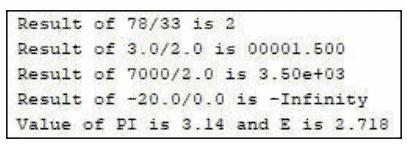

## 2.10：用于输入的 Scanner 类

Java 提供了 `Scanner` 类来接受来自键盘的用户输入。它根据数据类型将输入拆分为标记（tokens）。`Scanner` 对象通过将 `InputStream` 对象作为参数传递给构造函数来初始化：

```java
Scanner input = new Scanner(System.in);
```

以下是接受不同类型数据的 `Scanner` 类方法列表：

- `nextByte()`：返回一个 `byte` 值。
- `nextInt()`：返回一个 `int` 值。
- `nextLong()`：返回一个 `long` 值。
- `nextFloat()`：返回一个 `float` 值。
- `nextDouble()`：返回一个 `double` 值。

以下代码展示了如何使用 `Scanner` 类接受用户输入：

```java
public class ScannerDemo {
    public static void main(String[] args) {
        Scanner s = new Scanner(System.in);

        System.out.println("Enter an integer value:");
        int intValue = s.nextInt();

        System.out.println("Enter a float value:");
        float floatValue = s.nextFloat();

        System.out.println("Enter a double value:");
        double doubleValue = s.nextDouble();

        System.out.println("You entered: " + intValue + ", " + floatValue + ", " + doubleValue);
    }
}
```

## 2.11：决策结构

Java 提供了决策结构来根据条件执行语句。支持的内容如下：

### `if` 语句

如果只有一条语句，则不需要大括号。但如果有多个语句，则强制要求使用大括号。

```java
if (condition)
    // statement(s)
```

### `if-else` 语句

如果条件为真，则执行 `if` 块中的语句；否则执行 `else` 块中的语句。

```java
if (condition) {
    // statements
} else {
    // statements
}
```

### `if-else-if` 阶梯

多 `if` 结构（称为 `if-else-if` 阶梯）会评估多个条件，直到找到真结果为止。如果所有条件为假，则执行 `else` 块。

```java
if (condition) {
    // statements
} else if (condition2) {
    // statements
} else {
    // statements
}
```

### 嵌套 `if`

`if` 语句可以在 `if` 或 `else` 块中嵌套另一个 `if` 语句，甚至是嵌套的 `if-else-if` 阶梯。

```java
if (condition1) {
    if (condition2) {
        // statements
    } else {
        // statements
    }
} else {
    // statements
}
```

### 2.15：使用 `if-else` 构造

以下示例展示了不同的 `if-else` 变体：

```java
public class IfElseDemo {
    public static void main(String[] args) {
        int age = 43;
        char gender = 'F';

        if (age >= 60) {
            System.out.println("Eligible for membership.");
            System.out.println("Discount 50%");
        } else if (age >= 18) {
            System.out.println("Eligible for membership.");

            if (gender == 'F') {
                System.out.println("Discount 10%");
            } else {
                System.out.println("Discount 5%");
            }
        } else {
            System.out.println("Not eligible for membership.");
        }
    }
}
```

在这里，如果年龄大于或等于 60 岁，则个人有会员资格，且会员费享受 50% 的折扣。如果年龄在 18 岁以上但小于 60 岁，个人有会员资格。但是，如果是女性，折扣将为 10%；否则，如果年龄小于 18 岁，则个人没有会员资格。

### `switch-case` 语句

Java 提供了 `switch-case` 语句作为复杂的多个 `if-else` 语句的替代方案。它将变量或表达式的值与一组预定义的值进行比较。在精确匹配范围内的语句将被执行。

Java 语句支持数字、枚举，以及如 `Character`、`Byte` 和 `Integer` 等包装类（Wrapper classes）对象作为变量或表达式。`switch` 语句使用 `switch` 关键字创建，后紧跟圆括号 `()` 中的变量或表达式。根据表达式的值，执行相应的 `case`（由 `case` 关键字指示）。每个 `case` 都由 `break` 关键字结束。如果没有一个 `case` 匹配表达式，则执行 `default` 分支。

#### 语法

```java
switch () {
case expr1:
    // 执行语句
    break;

case expr2:
    // 执行语句
    break;

    .
    .

case exprprN:
    // 执行语句
    break;

default:
    // 执行语句
    break;
}
```

#### `switch-case` 语句的变体

Java 还允许使用单个 `break` 语句配合多个 `case` 语句。语法如下：

```java
switch () {
case expr1:
case expr2:
case expr3:
case expr4:
    // 执行语句
    break;

    .
    .

case exprprN:
    // 执行语句
    break;

default:
    // 执行语句
    break;
}
```

在 Java 中，通过在父 `switch-case` 语句的特定 `case` 中嵌入一个或多个 `switch-case` 语句，可以创建嵌套 `switch-case`。

#### 语法

```java
switch () {
case exprpr1:
    switch () {
    case exprprA:
        // 执行语句
        break;

        ...

    case exprprN:
        // 执行语句
        break;
    }
    break;

case exprpr2:
    // 执行语句
    break;

.
case exprprN:
    // 执行语句
    break;

default:
    // 执行语句
    break;
}
```

以下示例展示了不同类型 `switch case` 的用法：

```java
public class SwitchCaseDemo {

    enum Days {
        Mon, Tue, Wed, Thu, Fri, Sat, Sun
    }

    public static void main(String[] args) {
        Days today = Days.Tue;
        String hour = "am";
        int week = 2;

        switch (today) {
        case Mon:
        case Tue:
        case Wed:
        case Thu:
        case Fri:
            System.out.println("Discount scheme for Weekdays");

            switch (week) {
            case 1:
            case 3:
                System.out.println("No discount in week 1 and 3");
                break;

            case 2:
            case 4:
                System.out.println("20% discount in week 2 and 4");
                break;
            }
            break;

        case Sat:
        case Sun:
            switch (hour) {
            case "am":
                System.out.println("Discount is 40%");
                break;

            case "pm":
                System.out.println("Discount is 20%");
                break;
            }
            break;

        default:
            System.out.println("Day does not exist");
            break;
        }
    }
}
```

在这里，主 `switch-case` 是基于周几枚举创建的。对于周一到周五，有一个公共 `case`；对于周六到周日，也有一个公共 `case`。

现在，对于工作日，针对代表月份周数的整数值有一个嵌套 `switch case`。对于第 2 周和第 4 周，折扣为 20%；对于第 1 周和第 3 周没有折扣。

同样，针对一天中的小时 `String` 值使用了另一个嵌套 `switch-case`。如果是上午（am），折扣为 40%；如果是下午（pm），折扣为 20%。当指定的周几值错误时，主 `switch-case` 执行 `default` 分支。

代码的输出显示如下所示：

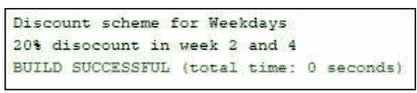

图 2.17：使用 `switch-case` 结构

## 2.12：循环结构

Java 允许你重复执行一组语句以满足特定条件。例如，显示从 1 到 n 的数字，其中 `n` 可以是用户指定的任何值，或计算 1 到 n 的总和。为了完成此类重复计算，Java 提供了称为循环（loops）或迭代的循环结构。

Java 支持的不同类型的循环如下：

```text
while loop
```

`while` 语句用于执行一个或多个语句，直到条件为真。

### 语法

```java
while () {
    // 执行语句(s)
}
```

如果只有一个执行语句，可以省略大括号 `{}`。

在执行循环之前，必须对变量进行初始化。例如，`int i = 1;`。

循环必须有一个表达式来修改循环表达式中变量的值，例如 `i++;` 或 `i--;`。

### `while` 循环的变体

**无限循环：** 当未提供条件表达式或循环的递增/递减表达式时，无限循环将无限运行。

例如：

```java
while (true) {
    System.out.println("This is infinite loop");
}
```

**空循环：** 没有主体的循环称为空循环。例如：

```java
int i = 5;
int j = 20;

while (i < j);
```

### `do-while` 语句

与 `while` 语句不同，`do-while` 在最后检查条件。它允许循环至少执行一次。语法如下：

```java
do {
    // 执行语句
} while (condition);
```

以下示例展示了 `while` 和 `do-while` 的用法：

```java
public class WhileDoDemo {
    public static void main(String[] args) {
        int i = 10;
        int j = 15;

        while (i < j) {
            System.out.println("Value: " + i);
            i++;
        }

        int num3 = 12;

        do {
            System.out.println("Value: " + num3);
            num3++;
        } while (num3 < 21);
    }
}
```

`do-while` 语句允许嵌套结构。注意，`do-while` 语句可以嵌套在 `while` 循环内部。语句体位于循环内部。

代码的输出如下所示：

| 输出 |
|---|
| Value: 10 |
| Value: 11 |
| Value: 12 |
| Value: 13 |
| Value: 14 |
| Value: 12 |
| Value: 13 |
| Value: 14 |
| Value: 15 |
| Value: 16 |
| Value: 17 |
| Value: 18 |
| Value: 19 |
| Value: 20 |

图 2.18：使用 `while` 和 `do-while` 循环

### `for` 语句

`for` 循环与 `while` 循环类似，在条件为真时执行语句。它用于迭代次数已知的情况。在执行语句之前会检查条件。语法如下：

```java
for (initialization; condition; increment/decrement) {
    // 执行语句(s)
}
```

在这里，变量的初始值、终止条件和迭代表达式在一个语句中指定。

### `for` 语句的变体

#### `for` 中的多个表达式

`for` 语句允许使用多个初始化或递增表达式，通过逗号运算符分隔并从左到右求值。

例如：

```java
int x, y, n = 10;

for (x = 0, y = n; x <= y; x++, y--) {
    // 执行语句(s)
}
```

#### 在循环语句中声明控制变量

通过在 `for` 语句初始化时声明，可以限制控制变量的作用范围。

例如：

```java
for (int x = 1; x <= 5; x++) {
    // 执行语句(s)
}
```

#### 用于测试布尔表达式的条件表达式

在 `for` 循环声明语句中，初始化或迭代部分可以留空。

例如：

```java
int x = 10;
boolean check = false;

for (; !check; x--) {
    // 执行语句(s);
}
```

#### 无限 `for` 循环

通过留空所有三个表达式可以创建一个无限 `for` 循环。

例如：

```java
for (;;) {
    // 执行语句(s);
}
```

#### 嵌套 `for` 循环

Java 允许嵌套 `for` 循环。内层循环会在外层循环的每次迭代时执行。

例如：

```java
for (int i = 0; i < 5; i++) {
    for (int j = 0; j < 2; j++) {
        // 执行语句(s)
    }

    // 执行语句(s)
}
```

以下示例展示了使用 `for` 循环的不同方式：

```java
public class ForDemo {
    public static void main(String[] args) {
        int i;

        // 包含所有声明表达式的 for 循环
        for (i = 1; i <= 3; i++) {
            System.out.println("Value of i is " + i);
        }
    }
}
```

#### 语句中的变量初始化

```java
for (int j = 1; j <= 2; j++) {
    System.out.println("Value of j is " + j);
}
```

#### 嵌套 `for` 循环

```java
for (int x = 0; x < 3; x++) {
    for (int y = 0; y <= x; y++) {
        System.out.print("**");
    }

    System.out.println("");
}
```

#### 循环中的多个声明


```java
int p, q, n = 3;
for (p = 0, q = n; p <= n; p++, q--) {
  System.out.println(p + " + " + q + " = " + (p + q));
}
```

```java
int num = 1;
// 使用布尔变量作为条件
boolean check = false;
for (; !check; num++) {
  System.out.println("Value of num: " + num);
  if (num == 2) {
    check = true;
    System.out.println("Check = true. Loop terminated.");
  }
}
```

代码的输出显示在下面的截图：

| Value of i is 1 |
|---|
| Value of i is 2 |
| Value of i is 3 |
| Value of j is 1 |
| Value of j is 2 |
| `***` |
| `***` |
| 0 + 3 = 3 |
| 1 + 2 = 3 |
| 2 + 1 = 3 |
| 3 + 0 = 3 |
| Value of num: 1 |
| Value of num: 2 |
| Check = true. Loop terminated. |

图 2.19：使用`for`循环结构

### 增强型`for`循环

增强`for`循环或 for-each 循环是在 Java SE 5 中引入的，用于提高循环的可读性以及遍历和访问集合对象的元素。

集合（Collections）是用于存储相同或不同类型对象的类。例如，`ArrayList`、`LinkedList`、`HashSet`等。

语法：

```java
for ( ) {
// 语句块
}
```

在这里，类型表示代表集合中每个元素的变量类型。集合对象表示包含所有值的集合。

以下示例展示了简单`for`循环和增强`for`循环的使用：

| for-loop: for-loop: for-loop: for-loop: for-loop: for-loop: for-loop: |
|---|
| for-loop: for-loop: for-loop: for-loop: for-loop: for-loop: for-loop: for-loop: |
| for-loop |

## 2.13 跳转语句

跳转语句用于在运行时控制循环执行。它允许你将控制转移到循环的不同位置，或根据条件跳过语句。提供此功能的两个关键字是`break`和`continue`，如下：

`break`语句：`break`语句可以终止`switch`分支，也可以跳出循环到代码中的下一条语句。在嵌套循环的情况下，`break`语句会跳出当前循环并进入直接的外层循环。

`continue`语句：`continue`语句用于跳过循环内的语句并继续下一次迭代。

以下示例展示了`break`和`continue`语句的使用：

```java
public class JumpStmtDemo {
public static void main(String[] args) {
int stopVal;
for (int cnt = 1; cnt <= 10; cnt++) {
Scanner input = new Scanner(System.in);
System.out.println("Enter any number or zero to stop:");
stopVal = input.nextInt();
if (stopVal == 0) {
```

```java
System.out.println("Got zero. Loop terminated.");
break;
}
}
System.out.println("");
```

```java
for (int i = 1; i < 10; i++) {
if (i % 2 == 0) {
continue;
System.out.println("Value of i is " + i);
}
}
```

代码的输出显示在下面的截图：

| |
|---|
| （注：截图内容的 OCR 文本缺失） |

图 2.20：使用跳转语句

### 标签跳转语句

标签跳转语句提供了跳转到特定位置的功能。它允许使用标签来转移控制。语法如下：

`break label;`

`continue label;`

以下示例展示了带标签的`break`：

```java
public class BreakWithLabel {
public static void main(String[] args) {
outer:
for (int i = 0; i < 5; i++) {
    for (int j = 0; j < 5; j++) {
        if (j == 2) {
            System.out.println("Found 2");
            break outer;
        }
        System.out.println("i = " + i + ", j = " + j);
    }
}
}
```

带标签的`break`语句会跳出外层循环。如果不使用标签，它只会跳出内层循环。代码的输出显示在下面的截图：

| |
|---|
| （注：源码中的截图内容缺失） |

图 2.21：使用带标签的`break`语句

以下示例展示了带标签的`continue`：

```java
public class ContinueWithLabel {
public static void main(String[] args) {
outer:
for (int i = 0; i < 5; i++) {
    for (int j = 0; j < 5; j++) {
        if (j == 2) {
            System.out.println("Found 2");
            continue outer;
        }
        System.out.println("i = " + i + ", j = " + j);
    }
}
}
```

外层标签`continue`会跳过内层循环的语句并继续外层循环。如果不使用标签，它会在内层循环继续直到条件为真。代码的输出显示在下面的截图：

| |
|---|
| （注：源码中的截图内容缺失） |

### 总结

注释用于记录程序以便理解代码或逻辑。Java 使用变量来对存储数据的内存位置命名。静态变量是类变量，不需要实例即可访问。数据类型用于告知编译器变量中存储的数据类型。转义序列用于表示无法直接传递给字符串的字符。Java 常量是赋值后无法更改的变量。枚举是包含一组常量值的类类型。Java 提供了对存储在变量中的数据进行操作的运算符。三元运算符`?:`是`if-else`决策结构的简短替代方案。Java 提供了`Scanner`类来接受键盘输入。`if`语句评估条件，如果条件为真，则执行`if`块中的语句。Java 提供了`switch-case`语句作为多个`if-else`语句的替代方案。Java 允许通过`while`、`do-while`和`for`等循环结构重复执行一组语句以满足特定条件。`break`语句可以终止`switch`分支，也可以跳出循环到代码中的后续语句。`continue`语句用于跳过循环内的语句并继续下一次迭代。下一章将学习 Java 应用组件。

### 单选题

哪个是非法的变量名？

- `name`
- `A43b5_e8`
- `while`
- `$amount`

考虑以下部分代码：

```java
for(int i=0;i<10;i++){
System.out.println("Hello");
}
```

循环将打印多少次？

- 0
- 10
- 9

考虑以下部分代码：

```java
int week = 5;
switch (week) {
case 1:
System.out.println("Week 1"); break;
case 2:
System.out.println("Week 2"); break;
case 3:
System.out.println("Week 3"); break;
case 4:
System.out.println("Week 4"); break;
}
```

以下哪项是处理用户输入的错误的 case 值的选项？

- 创建一个默认（default）case来处理错误的输入。
- 创建一个`if` case 来检查用户输入的值。
- 为所有可能的错误值创建一个单独的`case`。
- 创建一个循环，在用户输入匹配 case 的正确值之前不断允许新输入。

考虑以下部分代码：

```java
int per=60;
if(per > 60){
    System.out.println("Pass");
}else{
    System.out.println("Fail");
}
```

该代码的输出是什么？

- Pass
- 无输出
- Fail
- 编译错误

以下表达式的输出是什么？

`3*2/2+4*10/5`

- 14
- 2
- 0

### 答案

c

b

a

c

d

### 作业

创建一个符合以下规范的 Java 程序：

- 创建一个带有`main()`方法的类。
- 创建一个无限循环并在其中执行以下操作：
  - 询问用户是否想要继续（0/1）。这里，0 代表是，1 代表否。
  - 如果用户输入 1，则退出循环。
  - 如果用户输入 0，显示一个包含四个选项的菜单，分别对应加法、减法、乘法、除法，编号从 1 到 4。
  - 获取用户的选择输入。
  - 获取用户的两个数字输入。
  - 根据选择，对这些数字执行相应的算术运算。使用`switch-case`处理数字 1 到 4。
  - 向用户显示结果。

预期的输出如截图所示：

```text
Do you wish to continue (0/1)?
0
1. Addition
2. Subtraction
3. Multiplication
4. Division
Select an arithmetic operation:
3
Enter first number:
12
Enter second number:
10
Multiplication of 12 and 10 is 120
Do you wish to continue (0/1)?
1
Program Terminated
```

图 2.23：预期输出

## 第 3 章

### Java 组件

本章介绍了 Java 类和对象。你将学习类的成员，例如变量、方法、访问修饰符和构造函数。你将学习如何通过方法重载和构造函数重载的概念来实现多态。你将理解包的创建以及使用`static`、`final`和`this`等关键字。

### 结构

- Java 类和对象
- 访问修饰符
- 实例变量和方法
- 构造函数
- 初始化块
- 可变参数方法（Varargs）
- 方法重载
- 构造函数重载
- `this`关键字
- `final`关键字
- `static`关键字
- 包

### 目标

- 使用 Java 类和对象
- 理解不同访问修饰符的使用
- 使用变量、方法和构造函数
- 理解方法重载和构造函数重载
- 使用`final`和`this`关键字
- 在 Java 中创建包

## 3.1 Java 类和对象

Java 类是封装概念的构造。Java 是一种高度封装的语言，因此，没有任何内容可以在类之外声明，即使是`main()`方法也不行。在 Java 中，类也是一种数据类型，可以创建该类型的对象来访问和操作类的成员。

类由存储数据的属性/字段（fields）和对属性执行某些操作的方法（methods）组成。语法如下：

```java
class {
// 变量声明
// 方法定义
}
```

注意，类的成员被包含在花括号`{}`内部。类名必须遵循某些约定：

- 类名应该是一个简单且有意义的名词，例如，
- 类名可以是大小写混合，但每个后续单词的第一个字母应该大写，例如，
- Java 关键字不能用作类名。
- 类名不能以数字或任何符号（美元符号或下划线）开头，例如`_Calc`或`$Calc`。

以下代码显示了名为`Calculator`的类的声明：

```java
class Calculator {
// class members
}
```

在这里，`Calculator`类也是一种数据类型声明，稍后可以创建多个对象。要创建类的对象或实例，使用`new`运算符，它允许 JVM 为对象分配内存，并将表示该对象的引用/内存地址返回给变量。该变量被称为引用变量。语法如下：

`ClassName = new ClassName();`

例如：

`Calculator objCalc = new Calculator();`

在这里，`new Calculator()`语句在运行时为对象`objCalc`分配内存，并将内存位置的引用返回给引用变量。Java 允许你先声明对象，稍后初始化/分配内存。例如：

```java
Calculator objCalc;
```

在这里，`objCalc`是一个引用变量，尚未指向任何内存位置。也就是说，它是`null`。此时任何使用此变量的操作将导致错误。要使用此变量，必须对其进行初始化。例如：

```java
objCalc = new Calculator();
```

现在，内存已分配给对象，它的引用存储在`objCalc`变量中。

## 3.2 访问修饰符

在 Java 中，除了封装数据成员外，可以通过访问修饰符提供进一步的访问限制。当对类未指定修饰符时，默认访问权限是包级。Java 支持的访问修饰符如下：

`public`修饰符使字段、方法或类对相同包或其他包中的任何类可见。因此，它是所有访问修饰符中限制最小的。随着 JDK 9 引入模块系统（JPMS），`public`的含义也提升到了模块级别，基于`module-info.java`中的`exports`声明。在模块中，`public`关键字可以应用于：

**模块内可见**：未使用`exports`关键字导出的模块内的公共类仅在模块内可见。例如：

```java
module com.ModuleA{
}
```

在这里，由于没有导出包，所有类都在模块内可见。

**所有人可见**：使用`exports`关键字导出的模块内的公共类对其他模块的类可见。例如：

```java
module com.ModuleA{
exports pkg1.test;
}
module com.ModuleB{
requires com.ModuleA // 读取 ModuleA
}
```

在这里，`pkg1`包被导出，因此其公共类可以被其他模块访问。

**特定模块可见**：仅导出到特定模块的模块内的公共类仅对该模块的类可见。例如：

```java
module com.ModuleA{
exports pkg1.test to com.ModuleB;
}
module com.ModuleB{
requires com.ModuleA // 有效
}
module com.ModuleC{
requires com.ModuleA // 不允许
}
```

在这里，ModuleA 仅允许访问，因此 ModuleC 将得到错误。

`private`访问修饰符用于防止类外部访问字段和方法。它是所有访问修饰符中限制最严格的。它不能应用于类和接口。从 JDK 9 开始，接口中允许私有方法。`private`访问修饰符通常用于无法直接共享的重要字段。所有此类字段都声明为私有，并使用公共的访问器方法或 getter 方法来访问它们。

`protected`访问修饰符用于类之间存在父子关系的情况。声明为`protected`的成员可以被相同包中的所有类访问，也可以被其他包中的子类访问。`protected`关键字不能应用于类和接口或接口的字段和方法。

**默认**：当未指定访问修饰符时，应用默认访问修饰符。它仅允许相同包内的类访问类、字段或方法。

## 3.3 实例变量与方法

实例变量和方法是类的成员，分别定义对象的状态和行为。可以通过创建类的对象来访问这些成员。类的每个实例都有其自己的实例变量副本，但实例方法在执行期间由所有对象共享。语法如下：

```java
;
```

例如：

```java
private int count;
```

实例方法用于对实例变量执行操作。语法：

```java
([.]) {
// 方法定义
}
```

例如：

```java
public void add(int a, int b){
System.out.println("Sum of a and b is "+ (a+b));
}
```

在这里，`add`方法是一个公共方法，且没有返回值，用`void`表示。它接收两个整数类型的参数。在方法体内部，打印语句会显示参数的和，这些参数的值将在运行时在方法调用期间由用户指定。方法名的命名规范列举如下：

- 不能使用 Java 关键字作为方法名。
- 方法名不能包含空格，且不能以数字开头。
- 方法名应该是简单且有意义的动词，用于描述其功能。
- 方法名可以以字母、下划线或美元符号开头。
- 多单词的方法名第一个单词应小写，后续单词的首字母大写，例如。

要从类中访问实例变量和方法，必须在`main()`方法中创建该类的对象。必须使用对象名后接点（`.`）运算符和方法名来调用。在 Java 中，方法始终是从另一个被称为调用方法的方法内部调用的。一旦被调用方法的所有语句执行完毕，控制权将返回调用方法。通常，所有方法都是从类的`main()`方法调用的。`main()`方法是程序的执行点。

下图显示了`Calculator`类的类图及其实例变量和实例方法：

| Calculator |
|---|
| -sum: int |


| `+name: String` |

| `+add(a: int, b: int): int` |

> 图 3.1：类图

以下示例展示了实例变量和方法的使用以及通过类对象调用方法：

```java
import java.util.Scanner;

public class Calculator {

private int sum;
String name;

public int add(int a, int b) {
sum = a + b;
return sum;
}

public static void main(String[] args) {
    Calculator objCalc = new Calculator();
    Scanner s = new Scanner(System.in);
    System.out.println("Enter your name: ");
    objCalc.name = s.next();
    System.out.println("Enter first number: ");
    int num1 = s.nextInt();
    System.out.println("Enter second number: ");
    int num2 = s.nextInt();
    System.out.println("Dear, "+objCalc.name+"");
    System.out.println("Sum of "+num1+" and "+num2+" is " + 
    objCalc.add(num1, num2));
}
```

在这里，`sum` 变量是一个私有实例变量，`add` 是一个接收两个整数参数的公共方法。`add` 方法的返回类型为 `int`。因此，通过返回语句将 `a` 和 `b` 的和返回给调用方法。

在 `main()` 方法中，使用 `new` 关键字创建了 `Calculator` 类的对象 `objCalc`。接下来，通过 `objCalc.name` 语句接收用户名称并存储在 `name` 变量中。借助 `Scanner` 类接收用户输入的两个数字。最后，通过调用 `add` 方法并将两个值作为参数来计算和，即使用 `println()` 方法将用户名和 `add` 方法返回的值打印在屏幕上。

代码的输出所示：

| Enter your name: |
| :--- |
| John |
| Enter first number: |
| 4 |
| Enter second number: |
| 5 |
| Dear, John |
| Sum of 4 and 5 is 9 |

图 3.2：实例变量与方法

## 3.4 构造函数

构造函数是一个与类名相同的方法。它可以有参数，但不能有任何返回类型。它可以用于用默认值初始化变量，并用于实例化对象。一旦类的对象被实例化，它就会自动执行。

构造函数可以是默认的，也可以是有参数的。语法如下：

```java
// 默认
() {
    // 初始化语句
}

// 带参数的
() {
    // 初始化语句
}
```

如果类中没有定义构造函数，JVM 会调用一个隐式的、名为无参或默认的构造函数。默认构造函数将创建对象的实例变量初始化为它们的默认值。例如：

```java
Calculator objCalc = new Calculator();
```

以下示例展示了显式无参构造函数和参数构造函数的使用：

```java
public class Calculator {

private String name;

public Calculator() {
    name = "Undefined";
}

public Calculator(String username) {
    name = username;
}

public static void main(String[] args) {

Calculator objCalc = new Calculator();
System.out.println("Your name is " + objCalc.name);

Calculator objCalc1 = new Calculator("John");
System.out.println("Your name is " + objCalc1.name);
}
}
```

在这里，有两个构造函数；无参构造函数将私有变量 `name` 初始化为默认值。另一个构造函数接收一个 `String` 参数并赋值给 `name`。在 `main` 方法中，使用无参构造函数实例化 `objCalc`，使用参数构造函数实例化 `objCalc1`。接下来，在屏幕上打印这两个对象的 `name` 值。

图 3.3：使用构造函数

## 3.5 初始化块

Java 允许使用初始化块作为构造函数的替代方案来用默认值初始化变量。初始化块在实例化期间构造函数执行执行。

以下示例展示了初始化块的使用：

```java
public class Calculator {

    private String name;

    {
        name = "Unknown";
    }

    public static void main(String[] args) {

        Calculator objCalc = new Calculator();
        System.out.println("Your name is " + objCalc.name);
        
        objCalc.name = "John";
        System.out.println("Your name is " + objCalc.name);
    }
}
```

在这里，初始化块 `{}` 初始化了变量的值。在 `main` 方法中，实例化对象 `objCalc` 并打印 `name` 的值。接下来，显式为变量赋值并打印在屏幕上。

代码的输出所示：

```
sun:
Your name is Unknown
Your name is John
BUILD SUCCESSFUL (total time: 0 seconds)
```

图 3.4：使用初始化块

## 3.6 值传递与引用传递

方法声明中指定的变量称为参数，而在调用期间传递给它的实际值称为参数。在多个参数的情况下，参数的类型和顺序必须与方法的参数一致。

参数可以是基本数据类型（如 `int`），也可以是引用类型（如对象、数组等）。

### 值传递

当按值传递参数时，参数的副本从调用方法传递到被调用方法。在这种情况下，被调用方法内部对参数进行的任何修改都不会反映在调用方法中。

以下示例展示了如何按值传递参数：

```java
public class PassByVal {

public void modifyVal(int val) {
val = val + 10;
}

public static void main(String[] args) {
int val = 10;
PassByVal obj1 = new PassByVal();

obj1.modifyVal(val);
System.out.println("Value of val after method invocation is " + val);
}
}
```

```
Value of val after method invocation is 10
BUILD SUCCESSFUL (total time: 0 seconds)
```

图 3.5：按值传递参数

注意，变量 `val` 在传递给 `modifyVal()` 方法后，其值仍然是 10。这是因为 `val` 是按值传递的，所以只是将 `val` 的拷贝传递给了 `modifyVal()` 方法。内存中的实际地址并没有传递；因此，在调用方法后，`val` 的值保持为 10。

### 按引用传递参数

当参数按引用传递时，参数的实际内存地址会被传递给方法。这意味着，如果被调用方法修改了参数的值，该修改将反映在调用方法中。

同一个对象有两个引用，即参数引用变量和形参数引用变量。以下代码展示了如何按引用传递参数：

```java
public class PassByRef {

    public float areaCircle(CommonVals objPi, float r) {

        float area = objPi.getPi() * r * r;

        objPi.Pi = 3.15f; // 修改 Pi 的值

        return area;
    }

    public static void main(String[] args) {
        PassByRef p1 = new PassByRef();
        CommonVals c1 = new CommonVals();
        System.out.printf("Area of circle is %03.2f", p1.areaCircle(c1, 3));
        System.out.printf("\nModified value of PI is %01.2f %n", c1.getPI());
    }
}
```

```java
class CommonVals {

    float Pi = 3.14f;

    public float getPI() {
        return Pi;
    }
}
```

`CommonVals` 类包含 `getPI()` 方法，该方法将返回变量的值。在 `PassByRef` 类中，`areaCircle()` 方法接收 `CommonVals` 对象和半径作为参数。接下来，它计算面积，然后使用从调用方法接收到的对象 `objPi` 修改 PI 的值。最后，它将面积的值返回给调用方法。

在 `main()` 方法中，创建了 `PassByRef` 类的对象 `p1` 和 `CommonVals` 类的对象 `c1`。使用 `p1` 对象调用 `areaCircle` 方法，并将 `c1` 对象作为参数传递。变量 `area` 的返回值使用 `printf()` 方法打印。

接下来，使用 `c1` 对象打印 Pi 的值。注意，现在对于调用方法来说，PI 的值已经从原始值变为了 3.15。

代码的输出如下方的截图所示：

```
run:
Area of circle is 28.26
Modified value of PI is 3.15
BUILD SUCCESSFUL (total time: 0 seconds)
```

**图 3.6：** 按引用传递参数

## 3.7 变长参数方法（Varargs）

变长参数方法允许在运行时未知参数数量时，传递任意数量的参数。它是数组的快捷方式。在变长参数方法中，最后一个参数的类型后面跟着三个省略号（`...`），然后是参数名称。该方法可以使用任意数量的值进行调用，包括一个都不传。

语法：

```java
(type ... ) {
    // 方法定义
}
```

以下代码展示了变长参数方法的使用：

```java
public class VarArgsMethod {

    public void multiplyVals(int... val) {
        int result = 1;

        for (int x : val) {
            result = result * x;
        }
        System.out.println("Multiplication of numbers is " + result);
    }

    public static void main(String[] args) {
        VarArgsMethod obj = new VarArgsMethod();
        obj.multiplyVals(1, 3, 5, 7);
    }
}
```

在这里，`multiplyVals()` 方法是一个变长参数方法，可以接受任意数量的整数类型参数。使用增强型 `for` 循环来遍历 `val` 变量中的值集合。实际的值是在 `main()` 方法调用 `multiplyVals()` 方法时传递的。

代码的输出将是：

### Multiplication of numbers is 105

## 3.8 方法重载

Java 提供了方法重载功能，用于创建具有不同方法签名的多个方法。方法重载是 Java 中实现多态的方式之一。方法重载可以通过以下方式实现：

- 更改参数的数量
- 更改参数的顺序
- 更改参数的类型

以下示例展示了方法重载的实现：

```java
public class Calculator {

    // 重载方法 1
    public void add(int a, int b){
        System.out.println("Sum is " + (a+b));
    }

    // 重载方法 2
    public void add(int a, float b){
        System.out.println("Sum is " + (a+b));
    }

    // 重载方法 3
    public void add(int a, int b, float c) {
        System.out.println("Sum is " + (a+b+c));
    }

    // 重载方法 4
    public void add(float a, int b) {
        System.out.println("Sum is " + (a+b));
    }

    public static void main(String[] args) {
        Calculator obj = new Calculator();
        obj.add(10, 20);
        obj.add(10, 20.5f);
        obj.add(10, 20, 30.5f);
        obj.add(10.5f, 20);
    }
}
```

## 3.9 构造方法重载

Java 允许重载构造方法来初始化不同的变量。当实例化对象时，编译器匹配参数的类型和顺序。以下示例：

```java
class Customer {
    String custId;
    String address;
    float orderAmt;
    int itemCount;

    public Customer() {
        custId = "undefined";
        address = "undefined";
        orderAmt = 0;
        itemCount = 0;
    }

    public Customer(String id, String addr) {
        custId = id;
        address = addr;
    }

    public Customer(String id, float amount, int quantity) {
        custId = id;
        orderAmt = amount;
        itemCount = quantity;
    }

    public void displayDetails() {
        System.out.println("Customer Id: " + custId);
        System.out.println("Address: " + address);
        System.out.println("Order amount: " + orderAmt);
        System.out.println("Item count: " + itemCount);
    }

    public static void main(String[] args) {
        Customer c1 = new Customer();
        c1.displayDetails();
        System.out.println("--------------------------------");

        Customer c2 = new Customer("Co01", "Sandra Park");
        c2.displayDetails();
        System.out.println("--------------------------------");

        Customer c3 = new Customer("Co02", 456.5f, 30);
        c3.displayDetails();
    }
}
```

在这里，使用了三个重载的构造方法来初始化 `Customer` 类的不同变量。在 `main()` 方法中，创建了三个对象，根据各自的类型、顺序调用相应的构造方法。代码的输出如下：

```
Customer Id: undefined
Address: undefined
Order amount: 0.0
Item count: 0

--------------------------------
Customer Id: Co01
Address: Sandra Park
Order amount: 0.0
Item count: 0

--------------------------------
Customer Id: Co02
Address: null
Order amount: 456.5
Item count: 30
```

## 3.10 `'this'` 关键字


`this` 关键字用于引用当前正在调用方法或构造方法的对象。它可以在实例方法或构造方法中使用。以下示例展示了 `this` 关键字的使用：

- 将值赋值给与参数相同的变量，即解决命名冲突。
- 从一个构造方法调用另一个构造方法。

```java
class Area {
    int length;
    int width;

    public Area() {
        length = 4;
    }

    public Area(int width) {
        this(); // 调用默认构造方法
        this.width = width; // 解决命名冲突
    }

    public void calcArea() {
        // ...
    }
}
```

```java
System.out.println("Area is " + (length * width));
}
```

```java
public static void main(String[] args) {
    Area objRect = new Area(3);
    objRect.calcArea();
}
}
```

在程序中，`this` 关键字在参数化构造函数中用于调用默认构造函数，并将同名参数的值赋值给变量 `width`。代码的输出如图所示：

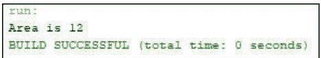

图 3.9: 使用 `this` 关键字

## 3.11 `final` 关键字

`final` 修饰符用于限制变量、方法或类的修改。声明为 `final` 的变量将变为常量，其值在代码后续部分无法更改。例如：

```java
final float PI = 3.14;
```

声明为 `final` 的方法不能在子类中重写，以防止修改方法的定义。例如：

```java
final float getDiscount(float sales){
    // execution statement(s)
}
```

`final` 方法不能被声明为抽象方法，因为无法被重写。

`abstract` 关键字用于方法和类。抽象方法没有方法体，抽象类不能实例化且必须被继承。因此，任何声明为 `abstract` 的内容都不能使用 `final` 修饰符。

声明为 `final` 的类不能被继承，且 `final` 类的变量和方法也是隐式为 `final` 的。这种类变成了标准类，必须按原样使用。例如：

```java
public final class Algorithm {
    // class members
}
```

以下代码展示了 `final` 关键字的使用：

```java
public class Circle {

    final float PI = 3.14f;

    public void calcArea(int rad) {
      System.out.println("Area of circle is " + (PI * rad * rad));
      PI = 3.15f; // 产生编译错误
    }

    public static void main(String[] args) {
      Circle c1 = new Circle();
      c1.calcArea(2);
    }
}
```

`Circle` 类包含声明为 `final` 的变量 `PI`。在 `calcArea()` 方法中，尝试更改该值将产生一个编译时错误。尽管如此，如果执行代码，将产生如下运行时异常：

```text
Exception:
Area of circle is 12.56
Exception in thread "main" java.lang.RuntimeException: Uncompilable
source code - cannot assign a value to final variable PI
at moduleOne/Sess3Codes.Circle.calcArea(Circle.java:17)
at moduleOne/Sess3Codes.Circle.main(Circle.java:21)
```

图 3.10: 使用 `final` 关键字

## 3.12 `static` 关键字

`static` 关键字用于变量和方法，提供类级作用域。静态变量和方法可以直接通过类名进行访问，无需创建对象。对于所有实例，静态/类变量存在唯一的副本。声明为 `final` 的静态变量将变为常量，其值在代码后续部分无法更改。例如：

```java
static int PI=34; // 静态变量
static final int PI=34; // 静态常量
```

`static` 关键字也可以应用于方法和初始化块。然而，静态方法可以执行以下操作：

- 它只能访问静态变量。
- 它只能调用静态方法。
- 它不能使用 `this` 或 `super` 关键字。

例如：

```java
public static void main(String[] args[]){
    // execution statement(s)
}
```

`static` 关键字可以与初始化块一起使用，在类加载时立即初始化静态变量。静态块在 `main()` 方法被调用之前执行。程序中可以有多个静态块，它们可以放置在类的任何位置。然而，静态块只能访问在其之前声明的静态变量。

以下示例展示了静态变量、静态方法和静态块的使用：

```java
public class StaticDemo {

    static int staticVar = 0;
    int instanceVar = 0;

    static {
        System.out.println("Static block executed");
    }

    public static void staticMethod() {
        System.out.println("Static method executed");
    }

    public void display() {
        staticVar++;
        instanceVar++;
        System.out.println("Value of instance variable is:" + instanceVar);
        System.out.println("Value of static variable is:" + staticVar);
    }
}
```

```java
public static void main(String[] args) {
    System.out.println("Main method executed");

    StaticDemo.staticMethod();

    StaticDemo obj1 = new StaticDemo();
    obj1.display();

    StaticDemo obj2 = new StaticDemo();
    obj2.display();

    StaticDemo obj3 = new StaticDemo();
    obj3.display();
}
```

代码的输出如下所示：

| 输出 |
|---|
| Static block executed |
| Main method executed |
| Static method executed |
| Value of instance variable is:1 |
| Value of static variable is:1 |
| Value of instance variable is:2 |
| Value of static variable is:2 |
| Value of instance variable is:3 |
| Value of static variable is:3 |

图 3.11: 使用 `static` 关键字

## 包（Packages）

包用于组织和分组相关的类、接口和资源。它们有助于避免命名冲突并提高代码的可维护性。包有两种类型：内置包和用户定义包。

内置包由 Java API 提供，例如 `java.lang`、`java.util`、`java.io`。用户定义包是由开发者创建的包。

要创建一个包，需要在源文件的开头使用 `package` 关键字。

```java
package mypackage;

class MyClass {
    // ...
}
```

使用另一个包中的类时，使用 `import` 关键字。

```java
import mypackage.MyClass;
```

包允许图形用户界面（GUI）组件。开发者创建的自定义包是用户定义的。例如，在不使用 IDE 的情况下创建包：

```java
package testpkg;
class Hello{
  public static void main(String[] args){
    System.out.println("Hello World");
  }
}
```

将源文件 `Hello.java` 保存在名为 `testpkg` 的文件夹中。打开命令行并设置 JDK 8 `bin` 文件夹路径。

编译代码：

```bash
javac Hello.java
```

或者使用 `-d` 选项编译代码：

```bash
javac -d . Hello.java
```

其中 `-d` 表示目录，`.` 表示当前目录。该命令将创建一个名为 `testpkg` 的子目录并将编译后的类文件存储其中。

从父 `testpkg` 文件夹，使用全限定名执行类文件：

```bash
java testpkg.Hello
```

以下截图显示了在 JDK 8 中使用全限定名执行类的步骤：

```text
F:\>set path="C:\Program Files\Java\jdk1.8.0_45\bin"
F:\>cd testpkg
F:\>testpkg>javac -d . Hello.java
F:\>testpkg>java testpkg.Hello
Hello World
```


图 3.12: 在 JDK 8 中使用包

注意，`testpkg.Hello` 语句中的 `testpkg` 指的是使用 `javac` 命令编译 `Hello.java` 后创建的子目录。要在 JDK 10 中使用全限定名创建并运行程序，创建一个名为 `src` 的源文件夹，在其中创建一个名为 `ModuleA` 的模块文件夹和一个文件。在 `ModuleA` 文件夹内创建一个包 `testpkg`。在 `testpkg` 文件夹内创建一个 `Hello.java` 类。

```text
F:\>set path="C:\Program Files\Java\jdk-10.0.1\bin"
F:\>java --module-source-path src -d out src/moduleA/module-info.java src/moduleA/testpkg/Hello.java
F:\>java --module-path out --moduleA/testpkg.Hello
World
```

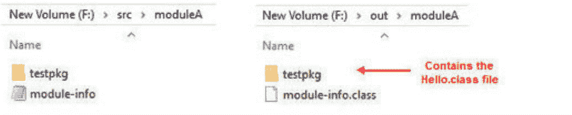

### 图 3.13: 在 JDK 10 中使用包

注意，`java` 命令中 `moduleA/testpkg.Hello` 语句中的 `testpkg` 表示使用 `javac` 命令编译 `Hello.java` 文件后在 `out` 文件夹中创建的子文件夹 `testpkg`。

要在另一个类中使用内置和用户定义包的成员，请使用 `import` 语句。例如，要在类 `Messages` 中使用 `testpkg` 中的 `Hello` 类，`import` 语句必须如下所示使用：

[假设：`testpkg1` 和 `testpkg` 在同一个模块中]

```java
package testpkg1;

import testpkg.Hello;
import java.util.Calendar;

public class Messages{
```

```java
// 代码语句
}
```

`Messages` 类导入了 `testpkg.Hello` 用户定义类和内置类。

模块 `moduleA` 必须导出它想要暴露给其他模块的类。

此外，类成员的访问修饰符将决定这些是否可以被其他包的类访问。

同样，可以在使用 IDE 开发应用程序时创建包。例如，在 NetBeans 中，只需通过右键点击模块名称并选择 `New | Java Package` 即可向模块中添加新包，如下截图所示：

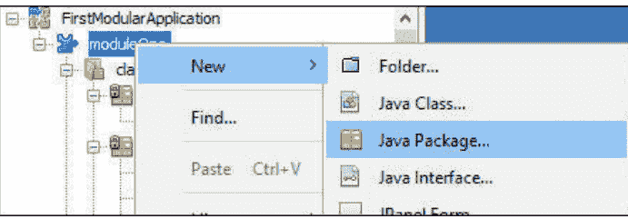

图 3.14: 在 NetBeans IDE 中创建包

### 总结

类由属性/字段（存储数据）和对属性执行某些操作的方法组成。

要创建类的对象或实例，需要使用 `new` 运算符。

Java 提供了 `public`、`private` 和 `protected` 访问修饰符，为类、字段和方法提供了不同级别的可见性。

实例变量和方法是类的成员，分别定义了对象的状态和行为。

构造方法是一个与类名相同的方法，并且没有返回类型，尽管它可以带有参数。

Java 允许你使用初始化块作为构造函数的替代方案，用默认值初始化变量。

当按值传递参数时，参数的副本将从调用方法传递到被调用方法。

可变参数方法允许在运行时尚未知参数数量的情况下传递数量的参数。

Java 提供了方法重载功能，以创建具有不同方法签名的多个方法。

`this` 关键字用于引用正在调用其方法或构造函数的当前对象。

`final` 修饰符用于限制变量、方法或类的修改。

静态（`static`）变量和方法可以直接通过类名进行访问，而无需创建对象。

包用于将相关的类、接口和其他应用程序资源作为一个单元进行组织和分组。

要在另一个类中使用内置和用户定义包的成员，请使用 `import` 语句。

在下一章中，你将学习 Java 引用类型。

### 多选题

以下哪项是限制性最强的访问修饰符？

- `public`
- `protected`
- `private`
- `default`（默认）

考虑以下部分代码：

```java
public Rectangle(int width) {
  this();
  this.width = width;
}
```

`this()` 语句的目的是？

- 指向当前对象
- 调用无参数构造方法
- 用默认值初始化变量
- 重写构造方法定义

哪个关键字允许你在不创建实例的情况下访问类的数据成员和方法？

- `static`
- `final`
- `this`
- `public`

关于包的陈述中哪项是错误的？

- 包名通常写为小写。
- 包不能有子包。
- 同一个包的两个成员不能有相同的名称。
- 一个 Java 包中只能有一个公有类。

考虑以下部分代码：

```java
// method 1
public void add(int a, int b){
System.out.println("Sum is "+ (a+b));
}
```

```java
// method 2
public void add(int c, int d){
System.out.println("Sum is "+ (c+d));
}
```

```java
// method 3
public void add(int a, float b){
System.out.println("Sum is "+ (a+b));
}
```

哪一个方法不是有效的重载版本？

- method 1
- method 3
- method 2
- method 1 and method 3

### 答案

c

b

a

b

c

### 课作业

创建一个符合以下规范的 Java 程序：

- 创建两个包 `pkg1` 和 `pkg2`。
- 在 `pkg1` 中创建一个名为 `IncentiveCalculator` 的类，在 `pkg2` 中创建一个名为 `FixedValues` 的类。
- 在 `FixedValues` 类中，创建一个名为 `commission` 的常量变量并设置其值。`commission` 变量应该能够直接通过类名进行访问。[提示：使用 `static` 和 `final` 关键字]
- 在 `IncentiveCalculator` 类中，创建两个私有变量 `salespersonName` 和 `sales`。
- 创建两个构造方法，一个带一个参数，另一个两个参数。[提示：使用 `this`]
- `sales` 的值必须在两个参数的构造方法中初始化。[提示：使用 `this`]
- 创建一个名为 `calculateIncentive()` 的方法来计算奖金。如果销售额大于等于 10000，从 `FixedValues` 获取 `commission` 的值并与 `sales` 相乘得到奖金。如果销售额小于 10000，只需打印奖金为零的消息。[提示：使用 `import` 语句]
- 在 `main()` 方法中，从用户处接受 `salespersonName` 和 `sales` 的值，并将其传递给 `IncentiveCalculator` 的两个参数构造方法。
- 调用 `calculateIncentive()` 方法计算并显示奖金。

预期输出所示：

| 输出 |
|---|
| Enter Salesperson name: John |
| Enter sales amount: 11000 |
| Incentive for sales of 11000.0 is 2200.0 |
| Enter Salesperson name: Clara |


| Enter sales amount: | 8000 |
|---|---|
| Incentive for sales of 8000.0 is 0 |

图 3.15：预期输出

## 第四章

### 引用类型

本章解释了不同的数组和字符串类。你将学习如何使用`StringBuilder`和`StringTokenizer`、命令行参数以及包装类。你还将理解自动箱（autoxing）和解箱（unboxing）的概念。

### 结构

- Java 数组
- Java 中的`String`类
- 字符串数组
- `StringBuilder`类
- `StringTokenizer`类
- 向`main()`方法传递参数
- Java 包装类

### 目标

- 创建不同类型的数组
- 使用`String`类及其方法
- 学习使用`StringBuilder`和`StringTokenizer`
- 使用命令行参数
- 使用包装类
- 理解自动箱和解箱

## 4.1 Java 数组

Java 数组用于在同一个变量中存储多个相同类型的值。数组的大小在连续内存位置是固定的。它可以存储的数量在创建数组时指定，之后在代码中无法修改。

Java 数组有以下两种类型：

1. 单维数组
2. 多维数组

下图显示了数字数组的结构：

| Indices | 0 | 1 | 2 | 3 | 4 |
|---|---|---|---|---|---|
| Values | 10 | 30 | 45 | 29 | 88 |


如所示，数组的元素排列在连续的内存位置。数组的每个元素通过其索引访问。数组索引从 0 开始，最后一个索引是数组长度减 1。

在这里，数组的大小为 5，这意味着它最多可以存储 5 个元素。因此，第一个元素的索引为 0，最后一个元素的索引为`size-1 = 5-1 = 4`。从图中可以看出，索引 4 处的值为 88，它是数组的最后一个（第 5 个）值。

数组是存储相同类型多个元素的优方式，因为只有在使用数组时才会为其分配内存。

### 4.1.1 一维数组

一维数组在垂直方向表示时，具有单列和多行数据。通过数组的名称和其索引来访问每个元素。例如，考虑下图中所示的学生数组：

| score[5] | |
|---|---|
| score[0] | 40 |
| score[1] | 56 |
| score[2] | 76 |
| score[3] | 60 |
| score[4] | 85 |

**图 4.2：**一维数组

数组`score`在方括号`[]`中声明大小为 5。因此，它最多可以容纳 5 个值。要访问任何值，使用数组名称加上相应的索引。例如，访问该值的语法是`score[index]`。注意最后一个索引是 4。因此，尝试访问`score[5]`将抛出错误/异常。

在 Java 中创建一维数组，必须对其进行声明、实例化和初始化。

**声明语法：**

```java
datatype[] name;
```

**实例化语法：**

```java
name = new datatype[size];
```

**初始化：**

数组可以通过两种方式初始化：

- 在声明期间：

```java
int[] score = {40, 56, 76, 60, 85};
```

注意，在创建时初始化数组时不指定大小，也不需要使用`new`运算符。

- 在声明和实例化之后：

```java
int[] score = new int[5];
score[0] = 40;
score[1] = 56;
score[2] = 76;
score[3] = 60;
score[4] = 85;
```

以下示例展示了一维数组的用法：

```java
public class OneDimenArray {
    int score[]; // 声明数组

    public OneDimenArray() {
        score = new int[5]; // 实例化数组

        // 初始化数组
        score[0] = 40;
        score[1] = 56;
        score[2] = 76;
        score[3] = 60;
        score[4] = 85;
        System.out.println("Scores Added");
    }

    public void viewScores() {
        System.out.println("Scores are listed below:");
        System.out.println(score[0] + "\n" + score[1] + "\n" + score[2] + "\n" + score[3] + "\n" + score[4]);
    }

    public static void main(String[] args) {
        OneDimenArray obj1 = new OneDimenArray();
        obj1.viewScores();
    }
}
```

在这里，声明了一个一维数组，然后在构造函数中对其实例化和初始化。数组的值通过从`main()`方法调用`viewScores()`方法来打印。代码的输出如下图所示：


**图 4.3：**一维数组

### 4.1.2 多维数组

多维数组是数组的数组；最常见的是使用额外一组方括号声明的二维数组，例如`int[][] score`。在这种情况下，通过每个维度的索引来访问每个元素。

下图展示了一个二维数组：

| 索引 | 0 | 1 |
|---|---|---|
| 0 | 40 | 60 |
| 1 | 56 | 45 |
| 2 | 76 | 65 |
| 3 | 60 | 74 |
| 4 | 85 | 90 |

**图 4.4：**多维数组

数组`score`声明的大小为 5x2`[]`。因此，它最多可以容纳 5 行 2 列值。要访问任何值，使用数组名称加上行和列的相应索引。例如，访问该值的语法是`score[row][column]`。注意行的最后一个索引是 4，列的最后一个索引是 1。因此，尝试访问`score[5][2]`将抛出错误/异常。

在 Java 中创建多维数组，必须对其进行声明、实例化和初始化。

**声明和实例化语法：**

```java
datatype[][] name = new datatype[rows][columns];
```

例如：

```java
int[][] score = new int[5][2];
```

**初始化：**

多维数组可以通过两种方式初始化：

- 在声明期间：

```java
int[][] score = {{40,60}, {56,45}, {76,65}, {60,74}, {85,90}};
```

注意行元素在大括号中指定，每行之间用逗号分隔。

- 在实例化之后：

多维数组可以通过访问每个行和列在创建后初始化：

```java
int[][] score = new int[5][2];
score[0][0] = 40; score[0][1] = 60;
score[1][0] = 56; score[1][1] = 45;
score[2][0] = 76; score[2][1] = 65;
score[3][0] = 60; score[3][1] = 74;
score[4][0] = 85; score[4][1] = 90;
```

以下示例展示了多维数组的用法：

```java
public class MultiDimensionalArray {
    int score[][];

    public MultiDimensionalArray() {
        score = new int[5][2];
        score[0][0] = 40; score[0][1] = 60;
        score[1][0] = 56; score[1][1] = 45;
        score[2][0] = 76; score[2][1] = 65;
        score[3][0] = 60; score[3][1] = 74;
        score[4][0] = 85; score[4][1] = 90;
        System.out.println("Scores Added");
    }

    public void viewScores() {
        System.out.println("Scores are listed below:");
        System.out.println("Player 1: " + score[0][0] + ", " + score[0][1]);
        System.out.println("Player 2: " + score[1][0] + ", " + score[1][1]);
        System.out.println("Player 3: " + score[2][0] + ", " + score[2][1]);
        System.out.println("Player 4: " + score[3][0] + ", " + score[3][1]);
        System.out.println("Player 5: " + score[4][0] + ", " + score[4][1]);
    }

    public static void main(String[] args) {
        MultiDimensionalArray obj1 = new MultiDimensionalArray();
        obj1.viewScores();
    }
}
```

在这里，声明了一个二维数组并在构造函数中对其初始化。通过`main()`方法调用`viewScores()`方法打印数组的值。代码的输出如下所示：


图 4.5：二维数组

### 4.1.3 使用循环处理数组

初始化和访问单个数组元素非常耗时，特别是当数组很大时。为了减少工作量，Java 允许使用循环来初始化和处理数组。以下示例展示了使用循环显示一维数组和多维数组元素：

```java
public class ArrayWithLoops {
    int score[];
    int scores[][];

    public ArrayWithLoops() {
        score = new int[5];
        score[0] = 40; score[1] = 56;
        score[2] = 76; score[3] = 60;
        score[4] = 85;
        System.out.println("Scores Added to One-dimensional Array");

        scores = new int[5][2];
        scores[0][0] = 40; scores[0][1] = 60;
        scores[1][0] = 56; scores[1][1] = 45;
        scores[2][0] = 76; scores[2][1] = 65;
        scores[3][0] = 60; scores[3][1] = 74;
        scores[4][0] = 85; scores[4][1] = 90;
        System.out.println("Scores Added to Two-dimensional Array");
    }

    public void viewScores() {
        System.out.println("Scores of one-dimensional array are:");
        for (int i = 0; i < score.length; i++) {
            System.out.println(score[i]);
        }

        System.out.println("Scores of two-dimensional array are:");
        for (int row = 0; row < scores.length; row++) {
            System.out.println("Player " + (row + 1));
            for (int col = 0; col < scores[row].length; col++) {
                System.out.println(scores[row][col]);
            }
        }
    }

    public static void main(String[] args) {
        ArrayWithLoops obj = new ArrayWithLoops();
        obj.viewScores();
    }
}
```

注意用于打印二维数组的内部循环。对于外部循环的每次迭代，内部循环都会被调用并一直运行到语句获取的数组可用列数。

代码的输出如下所示：

| Scores Added to One-dimensional Array |
|---|
| Scores Added to Two-dimensional Array |
| Scores of one-dimensional array are: |
| 40 |
| 56 |
| 76 |
| 60 |
| 85 |
| Scores of two-dimensional array are: |
| Player 1 |
| 40 |
| 60 |
| Player 2 |
| 56 |
| 45 |
| Player 3 |
| 76 |
| 65 |
| Player 4 |
| 60 |
| 74 |
| Player 5 |
| 85 |
| 90 |

图 4.6：使用循环处理数组

## 4.2 Java 中的`String`类

Java 没有提供可以存储多个字符（即字符串）的原始类型。为了实现这一点，必须像如下所示使用字符数组：

```java
char[] message = {'H','e','l','l','o'};
```

在有多个值的情况下，需要使用二维数组。但是，数组的大小在声明时就是固定的；因此，无法存储不同大小的字符串值，例如姓名或地址等。此外，操作字符数组可能是一项繁琐的任务。

为了解决这个问题，Java 提供了`String`数据类型，用于在不创建数组的情况下存储多个字符。`String`变量是`String`类的实例，其值存储在双引号中，例如：

也可以使用`new`关键字显式创建`String`类的实例，如下：

```java
String msg = new String();
```

为了连接字符串，Java 提供了加法运算符`+`。例如：

```java
String msg = "Hello";
String msg1 = "World";
System.out.println(msg + msg1);
```

可以将字符数组转换为字符串，如下：

```java
char[] msg = {'H', 'e', 'l', 'l', 'o'};
String message = new String(msg);
```

`String`类提供了几个方法用于字符串处理。

下表列出了`String`类常用的方法。考虑以下字符串：

| 方法 | 描述 |
|---|---|

**表 4.1：**`String`类的方法

下面的示例展示了不同`String`类方法的用法：

```java
public class StringDemo {
  String msg = "Hello";
  Integer num = 6;
  public void display() {
    System.out.println("Length of string is " + msg.length());
    System.out.println("New string after concatenation is " + msg.concat("World"));
    System.out.println("Extracted substring is " + msg.substring(2, 5));
    System.out.println("String format of Integer is " + num.toString());
    System.out.println("Difference after comparison is " + msg.compareTo("World"));
  }
}
```


```java
System.out.println("Character at index 1 is: " + msg.charAt(2));
System.out.println("First index of character l is: " + msg.indexOf("l"));
System.out.println("Last index of character l is: " + msg.lastIndexOf("l"));
System.out.println("New string after replacement is " + msg.replace('o', 'a'));
System.out.println("Uppercase String is:" + msg.toUpperCase());
System.out.println("Lowercase String is:" + msg.toLowerCase());
String msg1 = " Hello";
System.out.println("String before trimming: " + msg1);
System.out.println("String after trimming:" + msg1.trim());
```

```java
public static void main(String[] args) {
  StringDemo obj = new StringDemo();
  obj.display();
}
```

该代码打印了应用于`String`的不同`String`类方法的输出。代码的输出结果如下方的所示：

| 输出结果 |
| --- |
| Length of string is 5 |
| New string after concatenation is HelloWorld |
| Extracted substring is llo |
| String format of Integer is 6 |
| Difference after comparison is -15 |
| Character at index 1 is: 1 |
| First index of character l is: 2 |
| Last index of character l is: 3 |
| New string after replacement is Hella |
| Uppercase String is:HELLO |
| Lowercase String is:hello |
| String before trimming: Hello |
| String after trimming:Hello |

图 4.7：`String` 类方法

## 4.3 `String` 数组

`String` 数组用于在同一个变量中存储多个字符串。`String` 数组的创建方式与原始数据类型数组相同。例如：

```java
String[] items = new String[5];
```

这里，分配了内存来存储 5 个字符串的引用。为了操作`String`数组，可以使用`for`和增强型`for`循环。

下面的代码展示了`String`数组的用法：

```java
public class StringArrayDemo {
  String[] itemId = new String[5];

  public StringArrayDemo() {
    System.out.println("Products Added");
    for (int count = 0; count < itemId.length; count++) {
      itemId[count] = "Item" + (count+1);
    }
  }

  public void displayProducts() {
    System.out.println("Products in the inventory are:");
    for (String item : itemId) {
      System.out.println(item);
    }
  }

  public static void main(String[] args) {
    StringArrayDemo obj = new StringArrayDemo();
    obj.displayProducts();
  }
}
```

这里，在构造函数中使用`for`循环创建并初始化了一个名为`itemId`的字符串数组。使用增强型`for`循环来显示数组的元素。代码的输出结果如下方的所示：

| 输出结果 |
| --- |
| Products Added |
| Products in the inventory are: |
| Item1 |
| Item2 |
| Item3 |
| Item4 |
| Item5 |

图 4.8：`String` 数组

`java.lang.String`类不能被继承，因为它是`final`。字符串是不可变的，因此它们之后无法更改。但使用了`StringBuilder`类来创建可变的字符串。

## 4.4 Java 中的 `StringBuilder` 类

与`String`对象不同，`StringBuilder`对象是可变的。`StringBuilder`类允许对字符串进行修改。`StringBuilder`提供了一种更简单的字符串拼接方式。

`StringBuilder`的构造函数：

- `StringBuilder()`：这是默认构造函数，为 16 个字符提供空间。
- `StringBuilder(int capacity)`：该构造函数创建一个空对象并为指定数量的字符留空间。
- `StringBuilder(String str)`：该构造函数使用指定的字符串初始化对象。

下表列出了`StringBuilder`类常用的方法：

**表 4.2：** `StringBuilder` 类的方法

下面的示例展示了不同`StringBuilder`类方法的用法：

```java
public class StringBuilderDemo {
  StringBuilder msg = new StringBuilder("StringBuilder was introduced in Java ");

  public void display() {
    System.out.println("String length:" + msg.length());
    System.out.println("String after appending: " + msg.append("9"));
    System.out.println("String after insertion: " + msg.insert(28, "SE "));
    System.out.println("String after deletion: " + msg.delete(28, 31));
    System.out.println("Reversed string: " + msg.reverse());
  }

  public static void main(String[] args) {
    StringBuilderDemo obj = new StringBuilderDemo();
    obj.display();
  }
}
```

该代码打印了应用于字符串的不同`StringBuilder`类方法的输出。代码的输出结果如下方的所示：

| 输出结果 |
| --- |
| String length:28 |
| String after appending: StringBuilder was introduced in Java 9 |
| String after insertion: StringBuilder was introduced in Java SE 9 |
| String after deletion: StringBuilder was introduced in Java 9 |
| Reversed string: 9 avaJ ni deducort saw rediebB |

图 4.9：`StringBuilder` 类方法

## 4.5 Java 中的 `StringTokenizer` 类

`java.util.StringTokenizer`类提供了将字符串拆分为标记的方法。

`StringTokenizer`构造函数如下：

- `StringTokenizer(String str)`：使用指定的字符串创建`StringTokenizer`。
- `StringTokenizer(String str, String delim)`：使用指定的字符串和分隔符创建`StringTokenizer`。
- `StringTokenizer(String str, String delim, boolean returnValue)`：使用指定的字符串、分隔符和返回值创建`StringTokenizer`。如果`returnValue`为`true`，则分隔符也被视为标记。如果为`false`，则使用分隔符来分隔标记。

`StringTokenizer`类的方法如下：

- `hasMoreTokens()`：检查是否有更多标记可用。
- `hasMoreElements()`：作用原理与`hasMoreTokens()`方法类似。
- `String nextToken()`：从`StringTokenizer`对象中返回下一个 token。
- `String nextToken(String delim)`：根据分隔符返回下一个 token。
- `Object nextElement()`：功能与`nextToken()`类似，但返回一个`Object`。
- `int countTokens()`：返回 token 的总数。

以下示例展示了`StringTokenizer`类的用法：

```java
public class StringTokenDemo {

    public static void main(String[] args) {
        StringTokenizer st = new StringTokenizer("East West North South", " ");
        while (st.hasMoreTokens()) {
            System.out.println(st.nextToken());
        }

        StringTokenizer st1 = new StringTokenizer("East,West,North,South,"");

        // 打印下一个 token
        System.out.println("Next token is " + st1.nextToken(","));
    }
}
```

第一个`StringTokenizer`对象使用空格`" "`作为分隔符，而第二个对象使用逗号`","`作为分隔符。代码的输出如下：

| 输出结果 |
| --- |
| East |
| West |
| North |
| South |
| Next token is East |

图 4.10：使用`StringTokenizer`

## 4.6 向 `main()` 方法传递参数

`main()`方法接受一个`String`数组作为参数。

这些参数可以在运行时类名之后从命令行指定。例如：

```bash
java Customer Co01 John
```

在这里，`Customer`是一个类，`John`是参数，它们将存储在`main()`方法的`String`数组中。参数之间用空格分隔。`String`数组的大小将根据命令行传递的参数数量来设置。

以下代码展示了命令行参数的用法：

```java
package testpkg;

public class Customer {

    private String custId, custName;

    public Customer(String custId, String custName) {
        this.custId = custId;
        this.custName = custName;
    }

    public void displayCustomerDetails() {
        System.out.println("Customer Id: "+custId);
        System.out.println("Customer Name: "+custName);
    }

    public static void main(String[] args) {
        String id = args[0];
        String name = args[1];
        Customer c1 = new Customer(id,name);
        c1.displayCustomerDetails();
    }
}
```

在这里，`custId`和`custName`变量的值通过`main()`方法的`args[]` `String`数组参数从命令行接收。第一个值存储在`args[0]`中并赋值给名为`id`的`String`变量，第二个值存储在`args[1]`中并赋值给`String`变量。注意，参数的顺序很重要，以确保将正确的值分配给变量。位于包中的`Customer.java`，将`testpkg`包存储在名为`moduleA`的模块中，该模块位于文件夹中。

通过传递命令行参数执行类的操作如下截图所示：

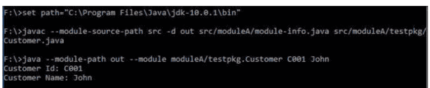

图 4.11：命令行参数

从 NetBeans IDE 运行程序，请执行以下步骤：

- 创建模块化应用程序（Modular application）并添加一个模块。
- 在模块中创建一个包并将`Customer`类添加到包中。
- 在 Projects 选项卡中右键点击项目并选择。
- 点击 Browse 按钮选择 Main 类，并在 Arguments 框中输入用空格分隔的参数，如下所示：

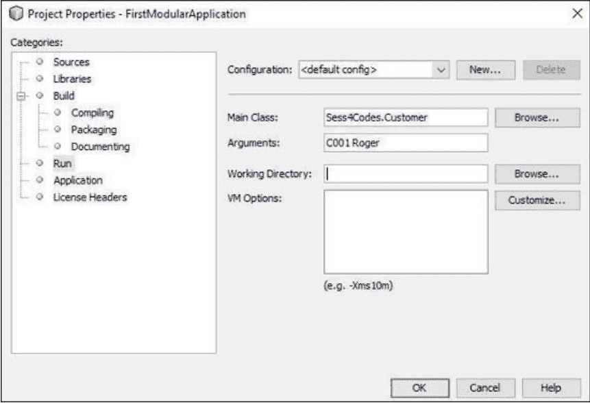

图 4.12：项目属性对话框

- 点击。
- 右键点击项目并点击。

代码的输出如下所示：

```text
run:
Customer Id: C001
Customer Name: Roger
```

图 4.13：NetBeans IDE 中的命令行参数

## 4.7 Java 包装类（`wrapper_classes`）

Java 为每个基本类型都提供了一个包装类（Wrapper class），将基本类型封装成该类的一个对象。这些类提供了实用方法来操作该类型的数据。此功能还允许操作存储对象的集合（collections）。每个包装类都提供了`valueOf()`方法将一种类型转换为另一种类型。

`Character`类的`value()`方法只接受`char`作为参数，而其他任何包装类都接受对应的基本类型或`String`作为参数。`value()`方法可以将对象的值返回为对应的基本类型。`parse()`方法返回对象的基本类型。

例如：

```java
byte val = Byte.byteValue();
```

下表列出了基本类型和对应的包装类型：

| 基本类型（Primitive Type） | 包装类型（Wrapper Type） |
| --- | --- |
| `boolean` | `Boolean` |
| `char` | `Character` |
| `byte` | `Byte` |
| `short` | `Short` |
| `int` | `Integer` |
| `long` | `Long` |
| `float` | `Float` |
| `double` | `Double` |

表 4.3：包装类型

基本类型持有一个值，而包装类型持有内存位置的引用/地址。

例如：

基本类型：

```java
int num = 10;
```

包装类型：

```java
Integer num1 = new Integer(20);
```

对象的引用被赋值给引用变量。

以下代码展示了用法：

```java
public class WrapperDemo {

    public static void main(String[] args) {
        byte byteVal = Byte.parseInt(args[0]);
        System.out.println("Byte value is " + byteVal);

        if (Character.isDigit(args[1].charAt(0))) {
            System.out.println("Character value is Digit");
        } else if (Character.isLetter(args[1].charAt(0))) {
            System.out.println("Character value is Letter");
        } else {
            System.out.println("Not enough data");
        }

        int a = Integer.parseInt(args[2]);
        int b = Integer.parseInt(args[3]);
        System.out.println("Sum of " + a + " and " + b);
    }
}
```

由于原始文本存在大量重复、OCR 错误及乱码，以上翻译已根据核心逻辑进行了清理和去重，确保技术内容的连贯性。

数组的最后一个索引是多少？

- 5
- 4
- 0
- 1

考虑下面的部分代码：


```java
Integer num1 = new Integer(4);
```

这里描述了哪种概念？

- 自动装箱（Autoboxing）
- 解箱（Unboxing）
- 隐式类型转换（Implicit typecasting）
- 显式类型转换（Explicit typecasting）

### 答案

c

b

c

b

a

## 赋值

按照以下规范创建一个 Java 程序：

- 创建包含 `main()` 方法的类。
- 从命令行参数获取用户名（admin）和密码（admin）。
- 如果用户名和密码有效，调用两个方法：一个用于接收值，另一个用于显示值。
- 创建一个接收值的方法。接收前三个玩家的名字及其分数，并将它们存储在数组中。[提示：使用一维数组，`String` 数组存储名字，`int` 数组存储分数：使用单个 `for` 循环同时接收两个数组的值。]
- 创建另一个方法显示玩家的名字及其分数。[提示：使用单个循环同时显示两个数组的值。]
- 如果用户名和密码错误，向用户显示消息并终止程序。

预期输出如截图所示。当在命令行传递有效的用户名和密码时：

```text
F:\>java --module-path out --module moduleA/testpkg.Assignment admin admin
Enter names of the top three players and their scores
Enter player name:
John
Enter the score:
67
Enter player name:
Mark
Enter the score:
65
Enter player name:
Roger
Enter the score:
58
Names and Scores of the top three players:
Player Score
John 67
Mark 65
Roger 58
```

图 4.15：有效凭据的预期输出

当在命令行传递无效的用户名和或密码时：

```text
F:\>java --module-path out --module moduleA/testpkg.Assignment admin abcde
Invalid credentials
```

图 4.16：无效凭据的预期输出

本章介绍了 Java 中的继承概念以及不同的继承类型。你将学习如何通过抽象类、嵌套类、方法重写等实现继承的不同方式。你还将学习如何使用接口（interfaces）和 Lambda 表达式。

### 结构

- Java 中的继承
- 抽象方法和抽象类
- 嵌套类
- 接口
- Java 函数式接口
- Lambda 表达式

### 目标

- 理解继承概念
- 实现不同类型的继承
- 理解方法重写
- 使用抽象类和抽象方法
- 使用嵌套类
- 理解接口和 Lambda 表达式

## 5.1 Java 中的继承

Java 提供了继承概念来将具有相似特征的类分组，并创建类层次结构。共同的特征和行为合并到一个类中，称为超类（superclass）或父类（parent class），所有其他继承这些特征和行为的类称为子类（subclasses）或子类（child classes）。

子类继承私有成员以外的所有成员和方法。父类的构造函数不被继承，但可以从子类构造函数直接调用，或通过 `super` 调用。子类除了继承父类的特征外，拥有自己的特征。在子类中声明与父类相同名称的成员会导致父类成员被隐藏（hiding）。

下图显示了 Java 中不同的继承类型：

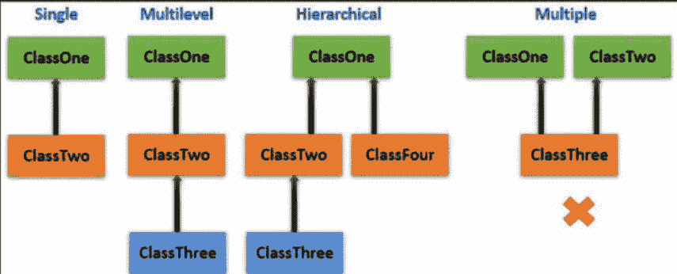

### 图 5.1：继承的类型

Java 中不同的继承类型如下：

**单继承（Single inheritance）：** 在单继承中，子类只能继承一个父类/超类。

**多级继承（Multilevel inheritance）：** 在多级继承中，子类继承自一个父类，而该父类本身可以继承另一个单类。

**层级继承（Hierarchical inheritance）：** 在层级继承中，父类/超类可以有多个子类，这些子类反又可以在不同层次上有其他子类。

**多重继承（Multiple inheritance）：** 在多重继承中，子类可以继承多个父类/超类。由于存在“菱问题”（diamond problem），Java 不支持类的多重继承。

菱问题是指当一个抽象类 A 被两个子类 B 和 C 继承的情况。假设该抽象类有一个名为 `test()` 的方法。该方法在两个子类中都会被重写。现在，另一个类 D 继承了这两个具有相同名称和签名的 `test()` 方法的子类。在这种情况下，子类对象中将创建两个 `test()` 方法的副本。当创建子类对象来访问 `test()` 方法时，编译器将面临模糊处境，无法决定调用哪个方法。这个问题在 Java 中被称为菱问题，如下所示：

```text
  A
 /\
B C
 /\
  D
```

Java 以接口的形式为菱问题提供了解决方案。可以通过在类中实现多个接口来模拟多重继承。你还可以使用 Java 8 在接口中引入的接口默认方法（default methods）。

### 5.1.1 创建子类

为了在 Java 中实现继承，使用 `extends` 关键字在两个或多个类之间创建父子关系。语法：

```java
public class Child extends Parent {
    // 子类成员
}
```

要访问超类的构造函数，使用 `super()` 方法。以下示例显示了 Java 中单继承的实现：

```java
public class Shape {
    private final float PI = 3.14f;
    protected float width;
    private String shape;

    public Shape(String shape) {
        this.shape = shape;
    }

    public void area(float length) {
        switch (shape.toLowerCase()) {
            case "circle":
                System.out.println("Area of Circle is " + (PI * length * length));
                break;
            case "square":
                System.out.println("Area of Square is " + (length * length));
                break;
            case "rectangle":
                System.out.println("Area of Rectangle is " + (length * width));
                break;
            case "triangle":
                System.out.println("Area of Triangle is " + (1 / 2 * length * width));
                break;
        }
    }
}

public class Rectangle extends Shape {
    public Rectangle() {
        super("rectangle");
        width = 20;
    }

    public void drawRect() {
        System.out.println("Drawing a Rectangle");
    }
}

public class TestShapes {
    public static void main(String[] args) {
        Rectangle obj = new Rectangle();
        obj.drawRect();
        obj.area(40);
    }
}
```

`Shape` 类带有成员和方法，是父类/超类。`Rectangle` 类通过使用 `extends` 关键字继承 `Shape` 类，是子类。它初始化了从父类继承的 `width` 变量。注意，使用 `super()` 方法调用超类构造函数设置了 `shape` 变量的值。`drawRect()` 方法是 `Rectangle` 类特有的。

`TestShapes` 类包含 `main()` 方法，创建一个 `Rectangle` 对象。该对象用于调用 `drawRect()` 方法和继承的 `area()` 方法，设置 `length` 变量的值并显示矩形的面积。

代码的输出如所示：


图 5.2：单继承

同样，可以从 `Shape` 类继承更多类（如等）以实现层级继承。还可以创建 `Rectangle` 类的子类来实现多级继承。下图描述了这一概念：

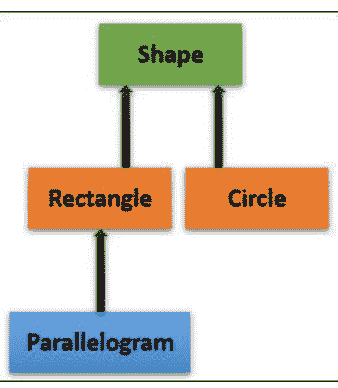

图 5.3：单继承、层级继承和多级继承

例如：

```java
public class Circle extends Shape {
    // 类代码
}

public class Parallelogram extends Rectangle {
    // 类代码
}
```

Java 不支持多重继承。例如，以下是不允许的：

```java
public class A extends classB, classC {
    // class code
}
```

### 5.1.2 方法重写（Method overriding）

方法重写是一个概念，允许你创建一个与父类方法具有相同签名和返回类型的子类方法。这使得子类可以在不使用新名称的情况下，修改或增强父类方法的功能。方法重写也是 Java 中实现多态的方式之一。

请注意，被重写的方法必须与父类方法具有相同的签名（名称、类型和参数数量）以及返回类型。被重写方法的访问修饰符不能低于超类方法的访问修饰符。

有时，子类可能需要在使用其重写版本的同时使用父类方法的功能。这可以通过调用 `super` 关键字来实现，即 `super.parentMethodName`。同样，如果子类拥有与父类数据成员同名的成员，可以使用 `super` 关键字来访问父类成员，即：

以下示例展示了方法重写和 `super` 关键字的使用：

```java
public class Employee {
    private String id, name;
    private float salary;

    public Employee(String id, String name, float salary) {
        this.id = id;
        this.name = name;
        this.salary = salary;
    }

    public void displayDetails() {
        System.out.println("Employee id: " + id);
        System.out.println("Employee name: " + name);
        System.out.println("Salary : $" + salary);
    }
}
```

`Employee` 类是超类，在参数化构造函数中初始化私有变量，并有一个显示详情的方法：

```java
public class ContractEmployee extends Employee {
    int duration;

    public ContractEmployee(String id, String name, float salary, int duration) {
        super(id, name, salary);
        this.duration = duration;
    }

    // overridden method
    @Override
    public void displayDetails() {
        System.out.println("Employee Details");
        super.displayDetails();
        System.out.println("Contract duration: " + duration + " months");
    }
}
```

`ContractEmployee` 类继承自 `Employee` 类，通过使用 `super()` 方法调用超类构造函数来初始化超类变量。它还初始化了自己的变量。在 `ContractEmployee` 类中重写了 `displayDetails()` 方法。为了使用该方法的功能，使用了 `super` 关键字来调用超类的 `displayDetails()` 方法。

`@Override` 是一个注解，用于通知编译器该方法是从父类中重写的。

```java
public class TestEmployee {
    public static void main(String[] args) {
        ContractEmployee emp1 =
            new ContractEmployee("Emp1", "John Smith", 4000f, 6);
        emp1.displayDetails();
    }
}
```

`TestEmployee` 类创建了 `ContractEmployee` 类的对象，并通过向构造函数传递适当的参数来初始化变量。该对象调用了 `displayDetails()` 方法。注意，由于该对象是 `ContractEmployee` 类的，调用的是子类的 `displayDetails()` 方法而不是父类的：

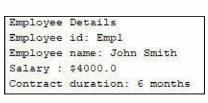

**图 5.4：** 方法重写

## 5.1.3 静态绑定与动态绑定（Static v/s dynamic binding）

编译期间对方法和方法调用的绑定被称为静态/早期绑定，在运行时被称为动态/晚期绑定。所有静态方法调用都在编译时解析，实例方法在运行时解析。Java 变量访问也遵循静态绑定。

下表列出了静态绑定和动态绑定之间的区别：

| 静态绑定（Static Binding） | 动态绑定（Dynamic Binding） |
| --- | --- |
| 编译时 | 运行时 |
| 用于静态方法 | 用于实例方法 |
| 变量访问 | 方法调用（重写） |
| 性能较快 | 性能较慢 |

**表 5.1：** 静态绑定与动态绑定的区别

## 区分引用类型和对象类型

对象的类型由赋值运算符左侧的类名指示，例如 `Employee`。引用类型由右侧被调用构造函数的类指示，例如 `Employee objEmp = new ContractEmployee();`。

在这种情况下，对象的类型和引用类型是相同的。然而，Java 允许分配属于继承体系中不同类的引用。例如，`Employee objEmp1 = new ContractEmployee();`。在这里，对象的类型是 `Employee`，但引用类型是 `ContractEmployee`。因此，在运行时，对方法或变量的任何调用都将被认为来自 `ContractEmployee` 类而不是 `Employee` 类。

将子类实例转换为其父类是可能的，这被称为向上转型（upcasting）。例如：

```java
ContractEmployee objCE = new ContractEmployee();
Employee objEmp = objCE; // upcasting
```

在向上转型时，父对象无法访问子类特有的成员。

将父引用转换回子类类型也是可能的，这被称为向下转型（downcasting）。然而，向下转型需要通过在括号中指定子类类名来进行显式类型转换。例如：

```java
ContractEmployee emp = (ContractEmployee) objEmp;
```

以下示例演示了向上转型和向下转型的区别：

```java
public class TestEmployee {
    public static void main(String[] args) {
        ContractEmployee emp1 =
            new ContractEmployee("Emp1", "John Smith", 4000f, 6);
        Employee objEmp = emp1; // upcasting
        objEmp.displayDetails();

        ContractEmployee emp2 = (ContractEmployee) objEmp; // downcasting
        emp2.displayDetails();
    }
}
```

## 5.2 抽象方法和类

Java 允许创建声明方法作为标准，但将实现留给继承类。此类方法被称为抽象方法，并可以使用 `abstract` 关键字创建。抽象方法没有方法体，即它们以分号结束。

带有抽象方法的类被视为抽象类。它作为继承类的基类。具体的行为随后由子类实现。

语法：

```java
abstract class Shape {
    protected float PI = 3.14;

    // concrete method
    public float getPI() {
        return PI;
    }

    // abstract method
    public abstract void calculateArea();
}
```

`Shape` 类是一个抽象类，包含一个具体方法和一个抽象方法。`Rectangle` 类继承该抽象类。


```java
public class Rectangle extends Shape {
    private float length, width;

    public Rectangle(float length, float width) {
        this.length = length;
        this.width = width;
    }

    @Override
    public void calculateArea() {
        System.out.println("Length: " + length);
        System.out.println("Width: " + width);
        System.out.println("Area of rectangle: " + (length * width));
    }
}
```

`Rectangle` 类继承抽象类 `Shape`，并根据其需求实现了 `calculateArea()` 方法。同样，可以从 `Shape` 类继承更多类，例如等，并且每个类都可以以自己的方式实现 `calculateArea()` 方法：

```java
public class TestShapes {
    public static void main(String[] args) {
        Rectangle obj = new Rectangle(2.3f, 4.0f);
        obj.calculateArea();
    }
}
```

代码的输出如下：

```text
Length: 2.3
Width: 4.0
Area of rectangle: 9.2
```

| 长度：2.8 |
| 宽度：4.0 |
| 矩形面积：9.2 |

**图 5.6：** 抽象类和抽象方法

## 5.3 嵌套类

在另一个类内部定义的类被称为嵌套类。

语法如下：

```java
class Outer {
    ...
    class Nested {
        ...
    }
}
```

嵌套类具有以下优势：

- 基于相关功能对类进行逻辑分组。
- 增强了顶层类的封装性。例如，可以将 `ClassA` 和 `ClassB` 嵌套在 `ClassA` 中，这样 `ClassB` 就可以访问 `ClassA` 的私有成员。
- 通过将代码放置在其可能使用的地方，提高了代码的可读性和可维护性。

嵌套类大致可以分为以下几类：

### 非静态嵌套类或内部类

非静态内部类被声明为外部类或包围类的成员。内部类可以直接访问所有成员，包括外部类的私有成员。外部类无法访问内部类的任何成员。内部类可以声明为 `public` 或其他访问级别。

要访问内部类，必须创建外部类的实例，如下所示：

```java
OuterClass.InnerClass objInner = objOuter.new InnerClass();
```

```java
public class OuterClass {

    String outerVariable;

    public void outerMethod(String message) {
        System.out.println("Message received: " + message);
    }

    class InnerClass {

        public String sayHello() {
            // 从内部类调用外部类方法
            outerMethod("Good Morning");

            // 从内部类初始化外部类变量
            outerVariable = "Hello!";
            return outerVariable;
        }
    }
}
```

`InnerClass` 拥有访问外部类所有成员的权限。

```java
public class TestNestedClasses {

    public static void main(String[] args) {
        OuterClass objOuter = new OuterClass();

        // 使用 OuterClass 对象实例化 InnerClass 对象
        OuterClass.InnerClass objInner = objOuter.new InnerClass();

        System.out.println(objInner.sayHello());
    }
}
```

`TestNestedClasses` 类创建了一个 `OuterClass` 对象，并使用它来实例化 `InnerClass` 对象。

代码的输出如下：


图 5.7：内部类

### 静态嵌套类

静态嵌套类以类似于静态变量和方法的方式从外部类访问。静态嵌套类不能直接引用外部类的实例变量或方法，只能通过对象引用进行。静态嵌套类也是一种顶层类，只是它被嵌套在另一个顶层类内部。

静态嵌套类可以是 `public`、`protected`、`private`、`default`/包私有、`final` 和 `abstract` 的。要访问静态嵌套类，请使用完全限定类名。

例如：

```java
OuterClass.StaticNestedClass
```

以下示例展示了静态内部类的用法：

```java
public class OuterClass {
    String outerVariable;

    public void outerMethod(String message) {
        System.out.println("Message received: " + message);
    }

    public static void outerMethod1() {
        System.out.println("Outer class static method");
    }

    static class InnerClass {

        public static void sayHello() {
            outerMethod1();
            System.out.println("Greetings from Inner class");
        }
    }
}
```

静态 `InnerClass` 无法访问外部类的实例方法和变量，但它可以访问静态方法和变量：

```java
public class TestNestedClasses {

    public static void main(String[] args) {
        OuterClass objOuter = new OuterClass();
        objOuter.outerMethod("Good Morning");
        OuterClass.InnerClass.sayHello();
    }
}
```

`TestNestedClasses` 类创建了一个 `OuterClass` 对象来访问静态嵌套内部类。代码的输出如下面的截图所示：


图 5.8：静态嵌套类

### 局部类

定义在代码块（如构造函数、初始化块或方法体）内部的嵌套类被称为局部类。局部内部类是特定代码块的一部分，而不是外部类的一部分。因此，它不能使用任何访问修饰符，但仍然可以访问外部类的所有成员，包括在定义作用域内声明的 `final` 变量：

```java
public class OuterClass {

    String outerVariable;

    public void outerMethod(String message) {

        class LocalInner {

            public String getMessage() {
                return "Hello!!";
            }
        }

        LocalInner obj = new LocalInner();
        System.out.println(obj.getMessage() + "Message received: " + message);
    }

    public static void outerMethod1() {
        System.out.println("Outer class static method");
    }
}
```

`LocalInner` 类定义在 `OuterClass` 类的 `outerMethod()` 方法内部。该方法创建了局部类的对象以访问 `getMessage()` 方法：

```java
public class TestNestedClasses {

    public static void main(String[] args) {
        OuterClass objOuter = new OuterClass();
        objOuter.outerMethod("Good Morning");
    }
}
```

`TestNestedClasses` 类创建了一个 `OuterClass` 对象并调用了 `outerMethod()` 方法。代码的输出如下：

```text
Hello!! Message received: Good Morning
```

## 5.4 接口

接口（`interface`）是一种契约，规定了实现它的类型必须遵循的标准。它是实现多重继承的一种变通方法。接口也是一个与接口同名的 `.java` 文件。接口的字节码也会像普通类一样被转换为 `.class` 文件。

然而，与类不同，接口不能有构造函数，因此无法实例化。接口的方法是隐式抽象的。接口的字段必须是静态的（`static`）且最终的（`final`），不能有实例字段。接口不是被扩展的，而是被类实现的。一个类可以实现多个接口。一个接口可以扩展多个接口。

在 Java SE 7 之前，接口仅支持方法声明，即没有方法体的方法。然而，随着 Java SE 8 引入了默认方法（`default methods`），在 Java 9 中引入了私有方法（`private methods`）。

接口不用于实现继承层次结构。相反，它们用于将公共方法分组，以便不同的实体根据需求实现这些方法，即使它们不是该接口的某种类型。

按照命名约定，通常在接口名称前加字母 `I`，以区分接口 `.java` 文件和类 `.java` 文件。接口名称采用驼峰命名法（`CamelCase`），每个单词的首字母大写。接口名称应该暗示其执行的功能。

例如：

```java
interface IEnumerable
interface IComparable
```

### 语法

```java
interface <InterfaceName> extends ... {
    // 声明常量
    // 抽象、默认、私有方法
}
```

例如：

```java
public interface ITestInterface extends Interface1 {
    static final int num;
    public void interfaceMethod();
}
```

实现接口的类必须实现所有抽象方法，否则必须被标记为抽象（`abstract`）。如果实现接口的类被声明为抽象，则它的其中一个子类必须实现未实现的方法。如果抽象类的没有一个子类实现接口方法，那么这些子类也必须被标记为抽象。

### 语法

```java
class <ClassName> implements ... {
    // 类成员
    // 接口的重写方法
}
```

在 NetBeans 中创建新接口，右键点击包并选择 `New | Java`。为它提供名称并点击。

以下示例展示了接口的使用：

```java
public interface IProduct {

    static final String PRODUCTZONE = "CA-LA";

    public void addProductDetails();

    public void showProductDetails(String prodID);
}
```

接口 `IProduct` 声明了一个静态最终变量和两个抽象方法：

```java
public class TShirts implements IProduct {

    String tshirts[];

    @Override
    public void addProductDetails() {
        tshirts = new String[3];
        tshirts[0] = "T-shirt A, Red color, Brand A";
        tshirts[1] = "T-shirt B, Blue color, Brand B";
        tshirts[2] = "T-shirt C, Black color, Brand C";
        System.out.println("Product details added");
    }

    @Override
    public void showProductDetails(String prodID) {
        System.out.println("TShirt Details");
        for (String details : tshirts) {
            System.out.println(details);
        }
    }

    public void showTShirtSizes() {
        System.out.println("T-shirt Sizes");
        System.out.println("Large");
        System.out.println("Medium");
        System.out.println("Small");
    }
}
```

`TShirts` 类实现了 `IProduct` 接口并实现了两个方法 `addProductDetails()` 和 `showProductDetails()`：

```java
public class TestProducts {

    public static void main(String[] args) {
        System.out.println(IProduct.PRODUCTZONE + " Zone");

        TShirts obj = new TShirts();
        obj.addProductDetails();

        System.out.println("----------------");
        obj.showProductDetails("TO01");

        System.out.println("----------------");
        obj.showTShirtSizes();
    }
}
```

`TestProducts` 类创建了 `TShirts` 类的对象，并调用了两个重写的实现方法以及类特定的方法。注意，`PRODUCTZONE` 常量是直接通过接口名称调用的。代码的输出如下所示：

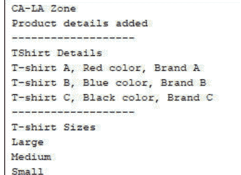

### 图 5.9：实现接口

同样，可以为任何类型的产品（如玩具、材料、文具等）创建更多的类，这些类可以实现 `IProduct` 接口。

## 5.4.1 实现多重接口

Java 不支持类的多重继承。作为变通方法，它允许在类中实现多个接口来模拟多重继承。

例如：

```java
public class Test implements Interface1, Interface2 {
}
```

以下代码展示了在类中实现多个接口：

```java
public interface IDistributor {

    public void addDistributor(String detail);

    public void processOrder(String orderId);
}
```

`IDistributor` 接口声明了两个抽象方法。修改后的 `TShirts` 类如下：

```java
public class TShirts implements IProduct, IDistributor {

    String tshirts[];

    @Override
    public void addProductDetails() {
        tshirts = new String[3];
        tshirts[0] = "T-shirt A, Red color, Brand A";
        tshirts[1] = "T-shirt B, Blue color, Brand B";
        tshirts[2] = "T-shirt C, Black color, Brand C";
    }

    @Override
    public void showProductDetails(String prodID) {
        System.out.println("TShirt Details");
        for (String details : tshirts) {
            System.out.println(details);
        }
    }

    public void showTShirtSizes() {
        System.out.println("T-shirt Sizes");
        System.out.println("Large");
        System.out.println("Medium");
        System.out.println("Small");
    }

    @Override
    public void addDistributor(String detail) {
    }

    @Override
    public void processOrder(String orderId) {
    }
}
```

### 静态常量变量

### 抽象方法

### 默认方法

### 静态方法


默认方法（defender methods）允许向接口中添加新方法，而不影响接口的现有实现。这些默认方法具有方法定义，当实现的具体类未能为该方法提供实现时，将使用默认实现。默认方法带有一个默认实现，可以被使用、重写或忽略，而不会对已实现接口的现有类造成任何问题。

Java 接口静态方法对于创建用于空值检查、集合排序等常见操作的工具方法非常有用。它们还通过防止实现类重写这些方法来帮助保护代码安全。`default` 关键字用于在接口中创建默认方法。

以下示例展示了接口中默认方法和静态方法的使用：

```java
public interface ILog {

    String MYSQL_DB_NAME = "MySQLDb";

    // 抽象方法
    void logMsg(String message);

    // 默认方法
    default void logWarning(String message) {
        System.out.println("Logging Warning: " + message);
        // 连接到数据库
        // 记录警告
        // 关闭数据库连接
    }

    default void logFatal(String message) {
        System.out.println("Logging Fatal Error: " + message);
        // 连接到数据库
        // 记录致命错误
        // 关闭数据库连接
    }

    // 静态方法
    static boolean checkNull(String str) {
        System.out.println("Interface Check for Null");
        return str == null;
    }
}
```

`ILog` 接口声明了一个抽象方法、两个默认方法和一个静态方法：

```java
public class DBTransaction implements ILog {

@Override
public void logMsg(String message) {
    System.out.println(message);
}

public static void main(String[] args) {
    System.out.println("Connecting to: " + ILog.MYSQL_DB_NAME);
    DBTransaction obj = new DBTransaction();
    obj.logMsg("Database Connected Successfully");
    obj.logFatalError("Fatal Error while closing DB");
    System.out.println("Null check: " + ILog.checkNull("Hello"));
}
```

`DBTransaction` 类实现了 `ILog` 接口并重写了 `logMsg` 方法。注意，它没有实现默认方法，而且静态方法无论如何都无法重写。因此，接口现在具有灵活性，允许类不实现接口的所有方法。

`main()` 方法创建了该类的对象并调用了 `logMsg` 方法（重写后的版本）以及默认方法。它还通过直接使用 `ILog` 接口名称访问常量变量和静态方法。代码的输出如所示：

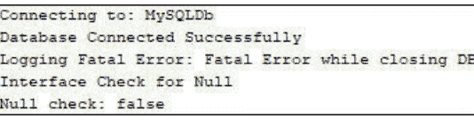

图 5.11：接口中的默认方法和静态方法

在代码中，注意所有为建立连接和关闭数据库连接创建的 log 方法中的冗余。如果使用通用方法进行数据库连接，可以解决这个问题，但这将是一个所有类都可以访问的公共方法。要创建一个可重用方法并设置为私有，唯一的选项是使用带有私有方法的抽象类处理公共代码。

Java 9 通过在接口中引入私有方法解决了这个问题。从 Java 9 开始，接口可以使用 `private` 修饰符拥有私有方法。在 Java 9 及更高版本中，接口可以拥有以下类型的成员：

- 静态常量变量
- 抽象方法
- 默认方法
- 静态方法
- 私有方法
- 私有静态方法

现在，`ILog` 接口的代码可以优化以提高可重用性，如下：

```java
public interface ILog {
    String MYSQL_DB_NAME = "MySQLDb";

    // 抽象方法
    default void logMsg(String message) {
        System.out.println("Logging Information: " + message);
        logData(message, "Information");
    }

    // 默认方法
    default void logWarning(String message) {
        System.out.println("Logging Warning: " + message);
        logData(message, "Warning");
    }

    default void logFatalError(String message) {
        System.out.println("Logging Fatal Error: " + message);
        logData(message, "Fatal Error");
    }

    private void logData(String message, String type) {
        // 连接到数据库
        // 记录消息
        // 关闭数据库连接
    }

    // 静态方法示例
    static boolean checkNull(String str) {
        System.out.println("Interface Check for Null");
        return str == null;
    }
}
```

私有方法 `logData()` 的使用允许其他 log 方法进行重用，并防止了来自实现类的直接访问。私有方法的使用有助于使默认方法不再臃肿且更具可维护性。

## 5.4.3 默认方法的问题

一个类可以实现多个接口，每个接口可以有不同的默认方法。然而，如果每个接口包含相同名称和签名的默认方法，代码将无法编译并抛出以下错误：

```java
java: class ClassWithTwoInterfaces inherits unrelated defaults for defaultMethod() from types Interface1 and Interface2
```

这是因为编译器无法确定应该使用哪个默认方法。要解决这个问题，类可以提供该默认方法的实现，从而消除歧义。此外，类可以使用 `super` 关键字重写接口的默认方法。这在只实现了一个接口时也适用。

例如：

```java
public class ClassWithTwoInterfaces implements Interface1, Interface2 {
  @Override
  public void abstractMethod() {
    // 某些实现
  }

  @Override
  public void defaultMethod() {
    // 调用接口的 defaultMethod()
    Interface1.super.defaultMethod();
    Interface2.super.defaultMethod();
  }
}
```

现在，接口可以扩展另一个接口。如果两者都包含相同的默认方法，编译器将考虑继承树中靠下的子接口的实现。

例如：

```java
public interface Interface1 {
  default void defaultMethod() {
    System.out.println("Hello from parent Interface1");
  }
}

public interface IChildInterface extends Interface1 {
  default void defaultMethod() {
    System.out.println("Hello from IChildInterface");
  }
}
```

在这里，父接口和子接口都有默认方法。当类实现子接口时，调用 `defaultMethod()` 将输出：

```text
Hello from IChildInterface
```

这意味着编译器调用了子接口的 `defaultMethod()`。

## 5.5 Java 函数式接口

只有一个抽象方法的接口被称为函数式接口。`@FunctionalInterface` 注解已添加到 Java 中，用于标记接口为函数式接口。并不是强制使用该注解，但作为最佳实践建议使用，以避免意外添加额外的方法。如果在标记了 `@FunctionalInterface` 注解的接口中添加了多个抽象方法，将抛出编译错误。

函数式接口最大的用处是可以使用 lambda 表达式实例化它们，从而避免臃肿的匿名类实现。

Java 8 Collections API 经过重写，并添加了新的 Stream API，它使用了许多函数式接口。引入了一个名为 `java.util.function` 的新包，包含几个函数式接口，为 lambda 表达式和方法引用提供目标类型。一些实用的 Java 8 函数式接口包括 `Consumer`、`Supplier`、`Function` 和 `Predicate`。`java.lang.Runnable` 是具有单个抽象方法的函数式接口示例。函数式接口也被称为单抽象方法（SAM）接口。它有助于实现函数式编程方法。

函数式接口的规则如下：

- 函数式接口只能声明一个抽象方法。
- 函数式接口可以拥有任意数量的默认方法（default）和静态方法（static）。
- 函数式接口可以声明 `Object` 类的方法。
- 函数式接口只有在该接口不包含任何抽象方法时才能扩展另一个接口。

以下示例展示了函数式接口的使用：

```java
@FunctionalInterface
public interface IPrintable {

    // 只有一个抽象方法
    void printMsg(String msg);

    // 函数式接口可以包含
    // 任意数量的 Object 类方法
    int hashCode();
    String toString();
    boolean equals(Object obj);

    default void displayData() {
        System.out.println("Hello!! This is a default method");
    }
}
```

函数式接口 `IPrintable` 只有一个抽象方法，但具有隐式继承自 `Object` 类的方法。它还有一个默认方法，并且可以添加更多。

```java
public class Messages implements IPrintable {

    @Override
    public void printMsg(String msg) {
        System.out.println("Received Message: " + msg);
    }

    public static void main(String[] args) {
        Messages obj = new Messages();
        obj.printMsg("Good Morning");
    }
}
```

`Messages` 类实现了函数式接口 `IPrintable` 并重写了它的 `printMsg()` 方法。代码的输出如下：

```text
Received Message: Good Morning
```

以下示例演示了一个无效的函数式接口：

```java
interface IParent {
    // 抽象方法
    public void display(String msg);
}

@FunctionalInterface
interface IChild extends IParent {
    public void display();
}
```

该代码会产生编译错误，因为函数式接口 `IChild` 扩展了一个包含抽象方法的接口。编译错误如截图所示：

| 意外的 `@FunctionalInterface` 注解 |
| --- |
| `IChild is not a functional interface` |
| 在 `IChild` 中发现多个非重写的抽象方法 |
| （Alt-Enter 显示提示） |
| `@FunctionalInterface IChild extends IParent {` |
| `public void displayIt();` |

图 5.12：编译错误

以下示例演示了一个有效的函数式接口，因为它扩展了一个非函数式接口：

```java
interface IParent {
    // 默认方法
    default void display(String msg) {
        System.out.println("Default method of parent interface");
    }
}

@FunctionalInterface
interface IChild extends IParent {
    // 子接口的抽象方法
    public void displayIt();
}

public class TestFunctionalInterface implements IChild {
    @Override
    public void displayIt() {
        System.out.println("Overridden method of child interface");
    }

    public static void main(String[] args) {
        TestFunctionalInterface obj = new TestFunctionalInterface();
        obj.displayIt();
        obj.display();
    }
}
```

代码的输出如下：

```text
Overridden method of child interface

Default method of parent interface
```

## 5.6 Lambda 表达式

Java 是一种面向对象的编程语言，Java 中的所有内容只能存在于类中，并通过其对象进行访问。这对于函数同样适用。如 JavaScript、C++ 等某些函数语言允许你编写函数并根据需要使用。某些语言同时支持函数式编程和面向对象编程。

面向对象编程是理想的，但它会导致程序大量冗余。例如，为了创建 `Runnable` 类的实例，通常会使用如下匿名类：

```java
Runnable r = new Runnable() {
    @Override
    public void run() {
        System.out.println("This is Runnable");
    }
};
```

在前面的代码中，唯一用的部分是 `run()` 方法的代码。其余所有代码仅仅是因为 Java 的编程规则。通过 Java 8 的函数式接口和 Lambda 表达式，可以通过移除不必要的代码语句使代码变得更短、更简洁。

Lambda 表达式是在 Java SE 8 中引入 Java 的，用于引入函数式编程。Lambda 表达式是一个不属于任何类的函数，它可以作为对象传递，或在需要时执行。Lambda 表达式有助于在面向对象编程的世界中实现函数式编程可视化。Lambda 表达式的常见用法出现在回调/事件监听或 Streams API 的实现中。由于函数式接口只有一个抽象方法，Lambda 表达式还有助于减少实现函数式接口时的冗余代码。通过 Lambda 表达式，功能可以被视为方法参数或作为数据的数据。

### 语法

```text
-> 
```

例如：

```java
Runnable r = () -> System.out.println("This is Runnable");
```

在这里，`runnable` 是一个只有一个方法 `run()` 的函数式接口，因此可以使用 Lambda 表达式创建其实例，而不是使用臃肿的匿名类。由于 `run()` 方法不接受任何参数，Lambda 表达式也不包含参数。

注意，如果只有一个语句需要处理，可以避免大括号；但对于多个语句，大括号是强制的，就像 `if-else` 块一样。

### Lambda 表达式的优点

- **减少代码行：** Lambda 表达式减少了代码行，如使用 Lambda 表达式创建函数式接口实例而不是使用匿名类所示。
- **支持顺序和并行执行：** 受益于 Stream API 对顺序和并行操作的支持。
- **将行为传递到方法：** 允许将功能作为参数传递给方法。

### Lambda 表达式示例

下表描述了一些 Lambda 表达式及其说明：

| 描述 |
| --- |
| （OCR 源表格内容不完整） |

表 5.2

以下示例展示了如何使用 Lambda 表达式实现函数式接口：


```java
@FunctionalInterface
public interface IPrintable {
    void printMsg(String msg); // 只有一个抽象方法

    // 函数接口可以包含
    // 任意数量的 Object 类方法
    int hashCode();
    String toString();
    boolean equals(Object obj);

    default void displayData(){
        System.out.println("Hello!! This is a default method");
    }
}

public class LambdaExpDemo {
    public static void main(String[] args) {
        IPrintable obj = (String msg) -> System.out.println(msg);
        obj.printMsg("Hello");
    }
}
```

`LambdaExpDemo` 类使用 Lambda 表达式实现了函数接口 `IPrintable` 并调用了 `printMsg()` 方法。代码的输出如下：

```text
Hello
```

函数接口也可以使用大括号 `{}` 实现：

```java
IPrintable obj = (String msg) -> {
    System.out.println(msg);
};
obj.printMsg("Hello");
```

然而，由于方法中只有一个语句，代码中避免了大括号 `{}`。

## 方法引用和构造器引用

方法引用用于引用方法而不调用它。同样，构造器引用用于引用构造器而不创建其类型的新实例。双冒号 `::` 运算符在 Java 8 中引入，用于方法引用作为 Lambda 表达式的替代方案。

例如：

### 方法引用

```java
System::getProperty
System::out::println
"hello"::length
```

### 构造器引用

```java
ArrayList::new
int[]::new
```

签名要求相同。请注意签名应保持相同，但方法名可以更改。

使用以下语法，将实现函数接口方法的 lambda 表达式替换为之前在类中定义的方法的引用。

### 语法

- `::`：如果类方法是静态的（`static`）。
- `::`：如果类方法是非静态的。

示例展示了如何使用双冒号（`::`）运算符来引用方法而不调用它：

```java
public class LambdaExpDemo {
    public static void main(String[] args) {
        IPrintable obj = (String msg) -> System.out.println(msg);
        obj.printMsg("Invoking printMsg of IPrintable interface");

        IPrintable obj1 = LambdaExpDemo::displayMsg;
        obj1.printMsg("Invoking displayMsg of LambdaExpDemo class");
    }

    static void displayMsg(String msg){
        System.out.println(msg);
    }
}
```

```java
}
```

`IPrintable` 是一个函数接口，通过 lambda 表达式进行实现，并创建了一个实例 `obj` 来调用 `printMsg()` 方法。在代码中，创建了一个名为 `displayMsg()` 的方法，其签名与 `IPrintable` 接口的 `printMsg()` 方法相同。接下来，创建了 `IPrintable` 的实例 `obj2` 并使用类名引用了 `displayMsg()` 方法。Java 编译器将参数映射到调用的方法。代码的输出所示：

```text
Invoking printMsg of IPrintable interface
Invoking displayMsg of LambdaExpDemo class
```

## 总结

Java 提供了继承的概念，将具有相似特征的类分组并创建类层级结构。

在单继承中，子类只能继承一个父类/超类。

要在 Java 中实现继承，可以通过使用 `extends` 关键字在两个或多个类之间创建父子关系。

方法重写是一个概念，允许你创建一个与父类具有相同签名和返回类型的子类方法。

在编译期间对方法和方法调用的绑定被称为静态/早期绑定，在运行时则被称为动态/后期绑定。

抽象类声明方法作为一种约或标准，仅提供结构，而将实现留给继承类。

定义在另一个类内部的类被称为嵌套类。

匿名类是未声明名称的类。

接口是一种约，为实现它的类型设置了必须遵循的标准。

Java 不支持类的多继承。作为替代方案，它允许在类中实现多个接口。

默认方法（Default methods）和静态方法（Static methods）特性允许接口中拥有方法实现。

恰好有一个抽象方法的接口被称为函数接口。

Lambda 表达式在 Java SE 8 中引入，以引入函数式编程。

双冒号（`::`）运算符在 Java 8 中引入，用于方法引用以替代 lambda 表达式。

在下一章中，你将学习异常和正则表达式。

## 单选题

Java 不支持类的 ________ 继承。

- 单继承
- 多继承
- 多级继承
- 层级继承

考虑以下部分代码：

```java
Employee emp = new PartTimeEmployee("Emp1", "Mark Stevens");
```

假设：`Employee` 是超类，`PartTimeEmployee` 是子类。

代码中描述的是哪种类型的绑定？

- 静态
- 动态
- 两者都是
- 以上都不是

在 Java 10 的 Java 接口支持以下哪种类型的方法？

- 抽象
- 默认
- 静态
- 以上所有

关于函数接口的以下陈述中错误的是？

- 函数接口只能声明一个抽象方法。
- 函数接口可以有一个默认方法或一个静态方法。
- 函数接口可以声明 `Object` 类的方法。
- 只有当该接口没有任何抽象方法时，函数接口才能扩展另一个接口。

匹配列项。

| 列 A | 列 B |
| :--- | :--- |
| a | 2 |
| b | 3 |
| c | 4 |
| d | 1 |

- a-2, b-3, c-4, d-1
- a-3, b-4, c-1, d-2
- a-4, b-1, c-2, d-3
- a-2, b-4, c-1, d-2

## 答案

b

b

d

b

a

## 作业

创建一个符合以下规范的 Java 程序：

- 创建名为 `Employee` 的类，包含 `name` 和 `salary` 变量，并在构造函数中初始化它们。
- 创建名为 `displayDetails()` 的方法，并在方法中打印这些变量的值。
- 创建名为 `ICCalculateCommission` 的函数接口，包含一个名为 `calcCommission()` 的抽象方法，该方法接受一个名为 `sales` 的 `float` 参数并返回一个 `float` 值。
- 创建名为 `PartTimeEmployee` 的类，该类继承自 `Employee` 类。
- 声明两个变量 `shift` 和 `sales`。
- 创建一个构造函数，接收 `Employee` 类变量的所有以及 `shift` 和 `sales`。
- 从子类构造函数将必要值传递给父类构造函数。同时初始化 `shift` 和 `sales` 变量。[提示：使用 `super()` 方法]
- 重写 `displayDetails()` 方法并调用父类的 `displayDetails()` 方法。同时打印 `shift` 和 `sales` 变量的值。[提示：使用 `super`]
- 在 `main` 方法中，使用局部变量接收用户输入的员工和销售额输入。[提示：使用 `Scanner`]
- 实例化 `PartTimeEmployee` 对象并将参数传递给构造函数。
- 调用 `displayDetails()` 方法。
- 使用 lambda 表达式实现函数接口 `ICCalculateCommission`。
- 在抽象方法的实现中，根据 `sales` 计算佣金。如果 `shift` 为 AM，则佣金为销售额的 20%，否则为 5%。
- 返回佣金值。
- 调用 `calcCommission()` 方法并传递销售额。
- 打印佣金值。

预期输出所示：

```text
Enter employee details
Employee id (###): E001
Employee name: Roger
Salary $: 4000
Shift (AM/PM): PM
Sales: 6000
--------------------
Employee id: E001
Employee name: Roger
Salary $: 4000
Shift: PM
Sales: 6000
Commission: 300.0
```

# 异常与正则表达式

在本章中你将学习如何使用不同的异常类处理 Java 异常。你还将学习如何创建自定义异常以及处理断言。此外，你将学习使用 `java.lang` 和 `java.util.regex` 包中的重要类。

## 结构

- Java 异常
- Java 异常类
- Java 异常处理
- `try-with-resources` 语句
- 自定义异常
- 包装异常
- Java 断言
- `java.lang` 包的类
- 正则表达式
- 字符类

## 目标

- 理解 Java 异常处理
- 学习内置异常类
- 创建自定义异常
- 在 Java 中使用断言
- 学习 `java.lang` 包
- 使用正则表达式

## 6.1 Java 异常

程序中发生的任何破坏正常执行的异常或意外事件被称为异常。异常可能有不同的类型和原因，例如尝试打开不存在的文件、为方法指定无效数据、网络连接错误或内存溢出。有关错误的信息存储在传递给运行时的异常对象。

方法中发生的异常可以通过使用相应类型的异常对象来抛出。运行时会在方法中查找可以处理该异常的处理器代码。如果没有找到，它将搜索整个方法调用栈以找到合适的异常处理器。如果运行时在整个调用栈中都未找到处理器，最终将终止程序。

在另一个（或多个）方法内部调用方法的序列称为调用栈。堆栈跟踪（stack trace）显示了导致异常的类调用序列。

例如，考虑以下部分代码：

```java
public void methodOne(){
    methodTwo();
}
```

```java
public void methodTwo(){
  methodThree();
}
public void methodThree(){
  // code that causes exception
}
```

如前面的代码所示，`methodOne` 调用 `methodTwo`，而 `methodTwo` 又调用 `methodThree`。在这里，`methodThree` 包含导致异常的代码，但它没有任何处理器。因此，运行时将在 `methodTwo` 中查找处理器，由于没有任何方法拥有处理器，程序将终止。

如果找到了处理器，异常将传递给该处理器并由其进行处理。请注意，适当的处理器是指处理或捕获与方法抛出的异常类型相同的异常的处理器。

异常处理器的优势如下：

- 帮助将正常代码与错误处理代码分离。
- 它们可以处理方法调用栈中任何位置错误。
- 它们有助于对相似的错误类型进行分类，以便为它们提供公共处理器。例如，`java.io` 包中的 `IOException` 类可以处理大多数 I/O 异常。对于更具体的异常，使用 `IOException` 类的子类。

### 6.1.1 异常的类型

Java 异常可能由多种原因引起，例如用户错误、逻辑错误或来自某些系统资源的系统错误。因此，异常可以大致分类如下：

- 编译异常（Checked exceptions）
- 未编译异常（Unchecked exceptions）

让我们详细查看它们。

### 编译异常

编译异常是程序中可以预期的，并为它们提供了适当的处理器。例如，假设提示用户输入数字，但用户指定了字符串，这会导致异常。然而，这不会致命地影响程序，因为将会有代码来处理此异常并用适当的消息通知用户。在 Java 中，除了 `Error` 和 `RuntimeException` 之外，所有异常都是受检查的。

以下是一些编译异常：

- `InstantiationException`：当尝试创建抽象类的实例时发生。
- `InterruptedException`：当线程被中断时发生。
- `NoSuchMethodException`：当运行时无法解析需要调用的方法时发生。

### 未编译异常

错误和运行时异常共同形成了未编译异常：

- **Errors（错误）**：错误不是由应用程序抛出的，而是外部抛出的。例如，由于某些硬件/系统问题导致无法打开系统中存在的文件，就会抛出 `java.io.IOException`。错误类在 `Error` 类层次结构中提供。应用程序可以捕获此异常，也可以让程序打印堆栈跟踪并退出。
- **Runtime exceptions（运行时异常）**：运行时异常是由应用程序内部引起的，但是不可预见的，例如逻辑错误或对 API 的不当使用。因此，应用程序没有办法从此类异常中恢复。例如，用户传递了正确的值作为方法参数，但由于某些逻辑问题，传递了 `null` 导致了异常。应用程序可以处理此异常，也可以消除导致异常的错误。运行时异常类由 `RuntimeException` 类层次结构提供。

以下是一些常见的未编译异常：

- `ArithmeticException`：当算术表达式出现错误时发生，例如除以零。
- `ArrayIndexOutOfBoundsException`：当尝试访问小于 0 或大于数组大小的数组索引时发生。
- `IllegalArgumentException`：当向方法传递非法参数时发生。
- `NegativeArraySizeException`：当数组大小小于 0 时发生发生。
- `NullPointerException`：当尝试访问 `null` 对象成员时发生。
- `NumberFormatException`：当尝试将字符串转换为数字时发生。
- `StringIndexOutOfBoundsException`：当索引为负数或大于字符串大小时发生。

Java 中任何类的基类都是 `Object` 类，而对于所有异常类，`Throwable` 类都是基类。`Throwable` 类是 `Object` 类的子类。`Throwable` 类的直接子类是 `Exception` 类和 `Error` 类。

下面的图显示了 `Throwable` 类层次结构：

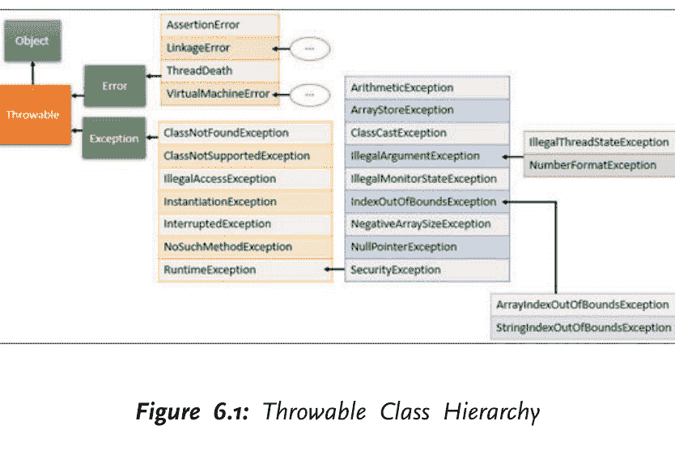

## 6.2 Java 中的 `Exception` 类

`Exception` 类是所有编译异常的父类，并且它是 `Throwable` 类的子类：

```java
public class Exception extends Throwable{
...
}
```

以下是 `Exception` 类的构造函数：

- `Exception()`：无参数/默认构造函数，创建一个错误消息设置为 `null` 的异常。
- `Exception(String message)`：创建一个在 `String` 参数中指定消息的异常。
- `Exception(String message, Throwable cause)`：创建一个在 `String` 参数中指定消息并带有原因的异常。
- `Exception(Throwable cause)`：创建一个带有指定原因的异常。如果原因是 `null`，它将返回 `null` 消息，否则将返回消息的字符串表示。消息包含了类名和原因的详细信息。

以下是 `Exception` 类的一些方法：

- `public String getMessage()`：返回有关已发生异常的详细信息。
- `public Throwable getCause()`：返回由 `Throwable` 对象指示的异常原因。
- `public String toString()`：如果创建 `Throwable` 对象时带有非 `null` 的消息字符串，则将异常类名拼接在 `getMessage()` 方法的结果之后并返回。如果 `Throwable` 对象是带有 `null` 消息字符串创建的，则返回异常对象的实际类名。
- `public void printTrace()`：将方法的结果打印到错误流中，即：
- `public StackTraceElement[] getTrace()`：返回一个数组，其中每个元素包含栈顶方法的调用调用跟踪索引的帧，最后一个元素是栈底方法的帧。
- `public Throwable fillInStackTrace()`：用当前堆栈跟踪填充此 `Throwable` 对象的堆栈跟踪，并添加到之前的任何堆栈跟踪信息中。

`Exception` 类有多个子类，表示不同类型的异常，例如 `RuntimeException` 类子类进一步包含了由于不当使用 API 引起的异常。例如，`IllegalArgumentException` 在向方法传递错误参数时发生。

## 6.3 Java 中的异常处理

方法/构造函数可能抛出的编译异常必须在 `throws` 子句中声明。然而，对于运行时异常，编译器并不强制要求，因为运行时异常可能发生在程序的任何位置，且在每个方法中添加处理它们的代码会影响代码的清晰度。

因此，如果可以从异常中恢复，可以将其变为编译异常，否则可以是运行时。


为任何可能导致错误的代码创建异常处理器，使用了`try-catch`块。

## try-catch 块

### 语法

```java
try {
    // 可能抛出异常的语句
    // 语句 1
    // 语句 2
}
catch () {
    // 处理异常
}
```

可能抛出异常的语句封装在`try`块中。为了处理异常，提供了异常类型对象作为参数的`catch`块。`catch`块可以在同一个方法中，也可以在方法调用栈的更高位置。

为了处理多种类型的异常，一个`try`块可以跟随多个针对特定类型异常的`catch`块。

### 语法

```java
try {...}
catch () {...}
catch () {...}
```

为了确保即使发生异常，某些重要的语句也能执行，Java 提供了`finally`块。无论是否发生异常，`finally`块都会执行。它主要用于执行清理代码，如关闭数据库连接、文件流等以避免资源泄漏。

在以下情况下，`finally`块可能不执行：

- 当 JVM 在执行`try`或`catch`块时退出。
- 如果执行`try`或`catch`块的线程被中断或杀死。

### 语法

```java
try{
// 可能会抛出异常的语句
// 语句 1
// 语句 2
}
catch() {
// 处理异常
}

finally{
// 清理代码
}
```

以下示例展示了使用`try-catch-finally`块处理 Java 异常：

```java
import java.util.Scanner;
public class Calculator {

public static void main(String[] args) {
Scanner s = new Scanner(System.in);
System.out.println("Enter first number");
```

```java
int num1 = s.nextInt();
System.out.println("Enter second number");
int num2 = s.nextInt();
Calculator obj = new Calculator();
obj.calculate(num1, num2);
}
```

```java
public void calculate(int a, int b) {
try{
int c = a/b; // line 1
System.out.println("Division of "+a+" and "+b+" is is c+");");

int arr[]= new int[c];
for(int i=0;i<=arr.length;i++) // line 2
arr[i]=i+1;
}
 catch(ArithmeticException e) {
System.out.println("Exception occurred: "+ e.getMessage());
} catch(ArrayOutOfBoundsException e) {
System.out.println("Exception occurred: "+ e);
}

finally{
System.out.println("-----------------------");
System.out.println("All resources closed in finally block");
}
}}
```

`calculate`方法包含两个被注释为 line 1 和 line 2 的语句，它们可能会导致异常。line 1 中的语句，如果用户将参数`b`（即分母）的值指定为零，则可能会抛出`ArithmeticException`。在 line 2 中，循环将迭代到数组的大小，这可能导致`ArrayIndexOutOfBounds`异常。因此，提供了两个`catch`块来处理这两种异常。此外，还使用了一个`finally`块来关闭所有资源。

当用户传递 0 作为分母时，代码的输出如下所示所示：

```text
Enter first number
23
Enter second number
0
Exception occurred: / by zero
--------------------
All resources closed in finally block
```

图 6.2: `ArithmeticException`

当用户为分母传递正确的值时，代码的输出如下所示：

```text
Enter first number
23
Enter second number
4
Division of 23 and 4 is 5
Exception occurred: java.lang.ArrayIndexOutOfBoundsException: 5
--------------------
All resources closed in finally block
```

图 6.3: `ArrayIndexOutOfBoundsException`

注意，异常中的值 5 表示抛出错误的数组索引。注意，一旦抛出异常，除`finally`块外，该之后的任何语句都不会执行。

### 6.3.1 `throw` 和 `throws` 关键字

`throw`和`throws`子句用于从方法中显式抛出异常。`throws`子句用于列出方法可能抛出的异常。`throw`关键字用于显式抛出受检查异常或未受检查异常。

以下示例展示了修改后的`Calculator`类使用`throw`和`throws`关键字从方法中显式抛出异常：

```java
import java.util.Scanner;

public class Calculator {
    public static void main(String[] args) {
        Scanner s = new Scanner(System.in);
        System.out.println("Enter first number");
        int num1 = s.nextInt();
        System.out.println("Enter second number");
        int num2 = s.nextInt();
        Calculator obj = new Calculator();
        try {
            obj.calculate(num1, num2);
        } catch (ArithmeticException e) {
            System.out.println("Exception occurred: " + e.getMessage());
        } catch (ArrayIndexOutOfBoundsException e) {
```

```java
System.out.println("Exception occurred: " + e);
} catch (Exception e) {
System.out.println("Exception occurred: " + e);
} finally {
System.out.println("----------------------");
System.out.println("All resources closed in finally block");
}
}
```

```java
public void calculate(int a, int b) throws ArithmeticException,
ArrayIndexOutOfBoundsException {

    if (b == 0) {
        throw new ArithmeticException("/ by zero");
    }

    int c = a / b;
    System.out.println("Division of " + a + " and " + b + " is " + c);

    int[] arr = new int[c];
    for (int i = 0; i <= arr.length; i++) {
        if (i == arr.length) {
            throw new ArrayIndexOutOfBoundsException();
        }
        arr[i] = i + 1;
    }
}
```

在这里，`calculate`方法通过`throw`和`throws`关键字抛出了`ArithmeticException`和`ArrayIndexOutOfBoundsException`。异常列在方法签名之后，并根据某些条件从方法中抛出。

`main()`方法现在在`try`块中执行`calculate()`方法，并提供了适当的`catch`块来处理错误。`finally`块仍用于关闭资源。

注意，增加了一个`Exception`类的第三`catch`块来处理任何其他异常。

### 6.3.2 用于多个异常的单个 catch 块

Java 7 引入了单个`catch`块来处理多个异常，以避免代码重复。要指定多个异常，请使用竖线（`|`）。

#### 语法

```java
catch (ExceptionType1 | ExceptionType2) {
// 处理异常
}
```

以下示例展示了修改后的`Calculator`类在单个`catch`块中处理多个异常：

```java
import java.util.Scanner;

public class Calculator {
    public static void main(String[] args) {
        Scanner s = new Scanner(System.in);
        System.out.println("Enter first number");
        int num1 = s.nextInt();
        System.out.println("Enter second number");
        int num2 = s.nextInt();
        Calculator obj = new Calculator();
        try {
            obj.calculate(num1, num2);
        } catch (ArithmeticException | ArrayIndexOutOfBoundsException e) {
            System.out.println("Exception occurred: " + e);
        } finally {
            System.out.println("----------------------");
            System.out.println("All resources closed in finally block");
        }
    }

    public void calculate(int a, int b) throws ArithmeticException,
ArrayIndexOutOfBoundsException {
        if (b == 0) {
            throw new ArithmeticException("/ by zero");
        }
        int c = a / b;
        System.out.println("Division of " + a + " and " + b + " is " + c);

        int[] arr = new int[c];
        for (int i = 0; i <= arr.length; i++) {
            if (i == arr.length) {
                throw new ArrayIndexOutOfBoundsException();
            }
            arr[i] = i + 1;
        }
    }
}
```

在这里，`main()`方法中的`catch`块已修改为使用竖线处理两种异常。

## 6.4 使用 try-with-resources 语句

资源是指程序在使用后需要关闭的任何对象。例如，JDBC 连接、文件资源或 Socket 连接。在 Java 7 之前，必须显式关闭资源，通常在`finally`块中进行，因为没有自动资源管理。然而，如果忘记关闭资源，这种方法会导致内存泄漏和性能下降。

Java SE 7 引入了`try-with-resources`语句用于同时声明多个资源，并确保在代码执行完成后关闭所有资源。资源是任何实现了`java.lang.AutoCloseable`或`java.io.Closeable`接口的对象。

`Closeable`接口继承了`AutoCloseable`接口。

```java
close() method
```

`Closeable`和`AutoCloseable`接口的`close()`方法具有以下特点：

- 它释放对象所持有的资源，例如打开的文件。
- `Closeable`接口的`close()`方法抛出`IOException`类型的异常。
- `AutoCloseable`接口的`close()`方法抛出`Exception`类型的异常。
- 在`AutoCloseable`接口的子类中重写`close()`方法。这允许重写的`close()`方法抛出特殊的异常，例如`IOException`或不抛出任何异常。

以下示例展示了如何使用`finally`块关闭资源：

```java
static void readFile(String[] args) {
    BufferedReader br = null;
    try {
        br = new BufferedReader(new FileReader("F:\\myfile.txt"));
        System.out.println(br.readLine());
    } catch (IOException e) {
      e.printStackTrace();
    } finally {
      try {
        if (br != null) {
          br.close();
        } catch (IOException ex) {
          ex.printStackTrace();
        }
      }
    }
}
```

在这里，`BufferedReader`对象在`finally`块中被关闭。

以下示例展示了如何使用`try-with-resources`语句自动关闭资源：

```java
public static void main(String[] args) {
  try (BufferedReader br = new BufferedReader(new FileReader("F:\\myfile.txt"))) {
    System.out.println(br.readLine());
  } catch (IOException e) {
    e.printStackTrace();
  }
}
```

以下是`try-with-resources`语句的好处：

- 它减少了代码行数。
- 代码更具可读性且于维护。
- 它实现了自动资源管理。
- 避免了使用`finally`块显式关闭资源。
- 它允许在`try-with-resources`语句中使用分号打开多个资源。

以下示例展示了如何使用`try-with-resources`语句同时打开多个资源：

```java
try (BufferedReader br = new BufferedReader(new FileReader("F:\\myfile.txt")),
     java.io.BufferedWriter writer = java.nio.file.Files.newBufferedWriter(FileSystems.getDefault().getPath("F:\\myfile.txt"), Charset.defaultCharset())) {
    System.out.println(br.readLine());
 // code to write to file
} catch (IOException e) {
 e.printStackTrace();
}
```

在这里，两个资源`BufferedReader`和`BufferedWriter`在`try-with-resources`语句中一起打开。请注意，当同时打开多个资源时，它们会按照反顺序关闭，以避免任何依赖问题。

### Try with resources 异常

`try-catch-finally`和`try with resources`语句处理异常的方法不同。对于`try-catch-finally`块，当`try`块和`finally`块都抛出异常时，方法将返回`finally`块抛出的异常。如果`try`块和`try with resources`同时都抛出异常，方法将返回`try`块抛出的异常。

## 6.5 自定义异常

Java 提供了大量的内置异常。然而，有时没有任何内置异常可以满足某些代码的需求。在这种情况下，可以创建一个自定义异常类。当代码可能抛出多个相关的异常，或者需要与其他供应商创建的类所抛出的异常进行区分时，自定义异常也很有用。

要创建自定义异常，类必须继承自内置的`Exception`类。

### 语法


```java
public class My extends Exception {
    // 自定义代码
}
```

以下代码展示了如何创建一个自定义异常类：

```java
public class FileException extends Exception {
    public FileException() {
    }

    // 重写 getMessage() 方法
    @Override
    public String getMessage() {
        return "Could not open file";
    }
}
```

`FileException` 类是一个自定义异常类，它继承自内置的 `Exception` 类并重写它的 `getMessage()` 方法。要抛出自定义异常，方法需要在运行时抛出该异常，并由方法的调用者进行处理：

```java
public class FileManager {

    String filepath;
    String mode;

    public FileManager() {
    }

    public FileManager(String filepath, String mode) {
        this.filepath = filepath;
        this.mode = mode;
    }

    // 创建一个抛出自定义异常的方法
    public void openFile() throws FileException {
        if (filepath.equals("") || mode.equals("")) {
            throw new FileException();
        } else {
            System.out.println("Opening File...");
        }
    }
}
```

在这里，如果 `filepath` 或 `mode` 值为空，`FileManager` 类的 `openFile` 方法将抛出自定义的 `FileException`：

```java
public class TestFileException {
    public static void main(String[] args) {
        FileManager obj = new FileManager("", "");
        try {
            obj.openFile();
        } catch (FileException e) {
            System.out.println("Exception occurred: " + e.getMessage());
        }
    }
}
```

`main()` 方法使用空字符串作为构造函数的参数创建 `FileManager` 类的对象，并在 `try` 块中调用 `openFile()` 方法。`catch` 块捕获自定义异常 `FileException` 并调用重写的 `getMessage()` 方法。代码的输出如下：

```text
Exception occurred: Could not open file
```

## 6.6 包装异常

Java 通过将一个异常包装在另一个异常内部来实现异常链。异常链自 JDK 1.4 开始引入，为了支持这一功能，Java 引入了 `getCause()` 和 `initCause(Throwable)`。这防止使用方法的代码丢失原始异常。

以下示例展示了包装异常的使用：

```java
public class StandardException extends Exception {

    public StandardException() {
    }

    public StandardException(Throwable cause) {
        super(cause);
    }

    public StandardException(String message, Throwable cause) {
        super(message, cause);
    }
}
```

在这里，`StandardException` 类是一个具有三个重载构造函数的自定义异常类。最后一个构造函数接受自定义消息和作为原因的 `Throwable` 对象：

```java
import java.util.Scanner;

public class StandardCalculator {

    public static void main(String[] args) {
        Scanner s = new Scanner(System.in);
        System.out.println("Enter first number");
        int num1 = s.nextInt();
        System.out.println("Enter second number");
        int num2 = s.nextInt();

        try {
            StandardCalculator obj = new StandardCalculator();
            obj.calculate(num1, num2);
        } catch (StandardException e) {
            Throwable t = e.getCause();
            // 打印消息和原因
            System.out.println("Error: " + e.getMessage());
            System.out.println("Cause: " + t);
        } finally {
            System.out.println("--------------------------------");
        }
    }

    public void calculate(int a, int b) throws StandardException {
        try {
            int c = a / b;
            System.out.println("Division of " + a + " and " + b + " is " + c);

            int arr[] = new int[c];
            for (int i = 0; i <= arr.length; i++) {
                arr[i] = i + 1;
            }
        } catch (ArithmeticException e) {
            throw new StandardException("Divide by zero", e);
        } catch (ArrayIndexOutOfBoundsException e) {
            throw new StandardException("Array Index out of bounds", e);
        }
    }
}
```

```
}
}
```

它抛出了两个异常：`ArithmeticException` 和 `ArrayIndexOutOfBoundsException` 异常。但它没有处理这些异常，而是重新抛出了它们。现在，由调用方法（即 `main()` 方法）负责处理这两个异常。通常情况下，调用方法会抛出实际异常并使用单独的 `catch` 块或用于多个异常的单一 `catch` 块。在此情况下，`calculate()` 方法带有自定义消息和异常对象重新抛出了 `StandardException`。因此，`main` 方法只需要有一个 `catch` 块来捕获。从 `Throwable` 对象中，它可以检索自定义消息和子句。

## 6.7 Java 中的断言（Assertions）

断言是 Java 中的一种语句，允许开发者测试程序中代码的某些假设。当代码中添加了断言时，该断言被预期为真的。如果断言失败，运行时将抛出……

以下是断言的优点：

- 它是测试代码以检测和纠正编程错误的有效方法。
- 它被用于测试各种条件是否失败。如果条件不满足，可以终止应用程序以查看调试信息。
- 它有助于记录程序的内部工作机制以简化代码维护。

断言由一个布尔表达式组成，该表达式被预期为真，因为它确认了对被测试代码行为的假设。使用断言有两种方式。

第一种形式：

```java
assert expression;
```

第二种形式：

```java
assert expression : detail-expression;
```

在这里，`detail-expression`（详细信息表达式）有一个值。它不能包含声明为 `void` 的方法调用。只有当程序包含某些可能有助于分析失败的额外信息时，才使用断言语句的第二种形式。

通常，断言失败会在堆栈跟踪中用文件名和行号标记，类似于所有未捕获的异常。为了避免部署应用程序中的性能问题，可以根据需要在运行时启用或禁用断言。默认情况下，断言是禁用的。断言不应用于运行时每次都需要进行的检查，因为断言可能会被禁用。在这种情况下，请使用逻辑来执行检查。

可以通过命令行使用以下命令启用断言：

```bash
java -ea
```

或者：

```bash
java -enableassertions
```

以下是在 NetBeans IDE 中启用断言的步骤：

1. 在 Projects 选项卡中右键点击项目，并从菜单中选择 Properties（属性）。
2. 在 Project Properties 对话框中选择 Run（运行）。
3. 点击 VMOptions 框旁边的 Customize（自定义）按钮，并滚动到 `ea` 复选框。
4. 选中它并如截图所示点击 OK：

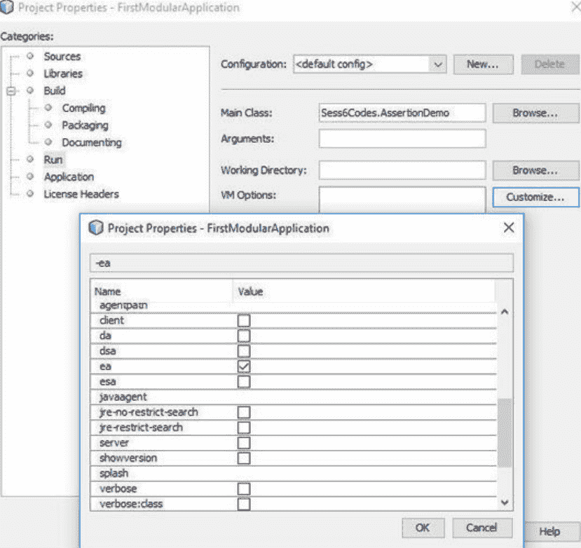

点击 OK 关闭 Project Properties 对话框。现在，断言将在 NetBeans IDE 中运行。

接下来的示例展示了程序中断言的使用：

```java
import java.util.Scanner;
```

```java
public class AssertionDemo {
```

```java
public static void main(String args[]) {
    Scanner s = new Scanner(System.in);
    System.out.print("Enter your age: ");
    int age = s.nextInt();
    assert age >= 18 : "Not valid age";

    System.out.println("Age is " + age);
}
```

在这里，要求用户输入其年龄。在打印年龄之前，使用断言进行了验证。断言检查年龄是否大于或等于 18，并预期其为真。如果不是，它将抛出 `AssertionError` 并显示消息 `"Not valid"`。程序将立即终止，而不执行剩余语句。

当用户传入小于 18 的值时，代码的输出如下：

| 输出 |
| --- |
| `Enter your age: 12` |
| `Exception in thread "Main" Java.lang.AssertionError: Not valid age` |
| `at moduleOne/SessCodes.AssertionDemo.main(AssertionDemo.Java:22)` |
| `C:\Users\Admin3\AppData\Local\Beans\Cache\dev\executor-snippets\run.xml:135: The fol` |
| `C:\Users\Admin3\AppData\Local\Beans\Cache\dev\executor-snippets\run.xml:64: Java retu` |
| `BUILD FAILED (total time: 3 seconds)` |

图 6.5：`AssertionError`

`AssertionError` 带有自定义消息显示。可用于记录和验证假设以及内部逻辑的不同类型的断言如下：

### 内部不变性（Internal invariants）

用于验证代码中未显式指定的隐含条件。例如：

```java
public static void main(String[] args) {
    int a = -1;
    if (a > 0) {
        System.out.println("Greater than zero");
    } else {
        assert a == 0 : "Number should not be negative";
        System.out.println("Number is zero");
    }
}
```

在这里，代码期望 `a` 的值要么大于零要么等于零。如果大于零，则显示适当的消息。在 `else` 块中，`assert` 语句验证如果值不大于零则它应该是零。如果值为负，则断言失败。

### 控制流不变性（Control flow invariants）

控制流不变性（如 `switch` 语句）也可以使用断言来实现默认分支情况。例如：

```java
public static void main(String[] args) {
    String direction = "east";
    switch (direction) {
        case "east":
            break;
        case "west":
            break;
        case "north":
            break;
        case "south":
            break;
        default:
            assert false : direction + " is incorrect";
    }
}
```

### 前条件（Preconditions）

前条件断言用于检查方法调用时必须为真的条件。断言用于检查公共方法的参数。例如：

```java
private void setInterval(int counter) {
    assert counter > 0 && counter <= 1500;
    System.out.println("Interval is set to:" + counter);
}
```

### 后条件（Postconditions）

后条件断言用于检查方法执行后必须为真的条件。后条件可以在公共和非公共方法中使用。例如：

```java
ArrayList names = new ArrayList();

public Object remove() {
    int size = names.size();
    if (size == 0) {
        throw new RuntimeException("Empty List");
    }

    Object name = names.remove(o);

    // 验证后条件
    assert(names.size() == size - 1);

    return name;
}
```

`remove()` 方法检查数组大小是否为零，如果是则抛出异常；然后检索元素。现在，在返回之前，使用断言检查 `size()` 方法是否返回 `size - 1`。

### 类不变性（Class invariants）

类不变性断言有助于检查关于类实例必须为真的条件。调用者必须在任何方法完成之前和之后都为真。例如：

```java
// 如果账户有余额则返回 true
private boolean hasBalance() {
    // 检查账户是否有余额的代码
}
```

`hasBalance()` 方法用于验证任何方法完成之前和之后都必须满足的约束。因此，每个公共方法在返回之前都应该包含 `assert hasBalance();` 语句。

- **Math：** 此类提供了基本的数学函数，如平方根、正弦、余弦等。
- **Throwable：** 异常类层次结构的基类。
- **Error、Exception 和 RuntimeException：** 这些是每种异常类型的基类。`Exception` 类用于语言级别异常和其他常见异常。
- **Comparable：** 这是一个允许对对象进行泛型比较和排序的接口。
- **Iterable：** 这是一个允许使用增强型 `for` 循环进行泛型迭代的接口。
- **Thread：** 这是一个允许操作线程的类。
- **Process、ClassLoader、Runtime、System 和 SecurityManager：** 这些类提供了系统操作，用于管理外部进程的创建、类的动态加载、环境查询（如当前时间）以及执行安全策略。

## 6.8.1 Object 类

`Object` 类是 Java 类层次结构的根节点，因此，每个类都是 `Object` 类的隐式子类，并实现了它的方法。

以下是 `Object` 类的一些常用方法：

- `boolean equals(Object obj)`：如果调用的 `equals()` 方法与传递作为 `equals()` 方法参数的对象相等，则返回 `true`，否则返回 `false`。
- `protected void finalize()`：当对象不再有更多引用时，垃圾收集器会在对象上调用此方法。
- `String toString()`：返回对象的字符串表示。
- `Class<Object> getClass()`：返回对象的运行时类。


- `protected Object clone()`: 创建并返回此对象的副本。
- `void notify()`: 唤醒一个等待此对象监视器（monitor）的线程。
- `void notifyAll()`: 唤醒所有等待此对象监视器的线程。
- `void wait()`: 使当前线程等待，直到另一个线程对该对象调用`notify()`或`notifyAll()`方法。
- `void wait(long timeout)`: 使当前线程等待，直到指定的时间通过，或者另一个线程对该对象调用`notify()`或`notifyAll()`方法。
- `void wait(long timeout, int nanos)`: 使当前线程等待，直到指定的实时通过，或者另一个线程对该对象调用`notify()`/`notifyAll()`方法，或者其他线程中断了当前线程。

以下示例展示了`Object`类方法的使用：

```java
public class ObjectClassDemo {

    Integer val;

    public ObjectClassDemo() {
    }

    public ObjectClassDemo(Integer val) {
        this.val = val;
    }

    public static void main(String[] args) {
        // 创建 ObjectClass 类的对象
        ObjectClassDemo obj1 = new ObjectClassDemo(4577);
        ObjectClassDemo obj2 = new ObjectClassDemo(4577);

        System.out.println("String form of obj1 is "+obj1.val.toString());
        // 检查对象的相等性
        if (obj1.equals(obj2)) {
            System.out.println("Objects are equal");
        } else {
            System.out.println("Objects are not equal");
        }

        obj2 = obj1; // 将 obj1 的引用赋值给 obj2
        // 再次检查对象的相等性
        if (obj1.equals(obj2)) {
            System.out.println("Objects are equal");
        } else {
            System.out.println("Objects are not equal");
        }
    }
}
```

在这里，创建了两个`Object`类对象并检查了它们的相等性。代码的输出如下屏所示：

| 输出 |
|---|
| String form of obj1 is 4577 |
| Objects are not equal |
| Objects are equal |

### 图 6.6：Object 类方法

注意，第一次检查显示对象不相等，尽管在对象实例化期间在构造函数中传递了相同的值。但在将`obj2`的引用赋值给`equals()`方法后，返回`true`并打印出`Objects are`

## 6.8.2 Class 类

在 Java 程序的执行期间，`Class`类的实例代表类和接口。`Class`类没有公共构造函数，它的对象在类被类加载器加载时，由 JVM 通过调用`defineClass()`方法自动创建。

以下是`Class`类的一些常用方法：

- `static Class forName(String className)`: 返回与字符串参数中指定的类或接口关联的`Class`对象。
- `Class[] getClasses()`: 返回一个`Class`对象数组，代表此`Class`对象所代表的类的成员公共类和接口。
- `String getName()`: 返回由此`Class`对象表示的实体（类、接口、数组类、基本数据类型或 void）的名称。
- `int getModifiers()`: 返回该类或接口的 Java 语言修饰符，以整数形式编码。
- `Field getField(String name)`: 返回一个`Field`对象，代表由此`Class`对象所表示的类或接口中指定的公共成员字段。
- `Method get(String name, Class[] parameterTypes)`: 返回一个`Method`对象，代表由此`Class`对象所表示的类或接口中指定的公共成员方法。
- `Class[] getInterfaces()`: 返回由此对象表示的类或接口所实现的接口数组。
- `URL getResource(String name)`: 查找指定名称的资源。
- `Class getSuperclass()`: 返回代表实体（类、接口、基本数据类型或 void）的父类的`Class`。
- `boolean isArray()`: 确定此`Class`对象是否代表数组类。
- `boolean isInstance(Object obj)`: 确定参数中指定的`Object`是否与此`Class`对象表示的对象在赋值上兼容。
- `boolean isInterface()`: 确定指定的`Class`对象是否代表接口类型。
- `String toString()`: 返回对象的字符串表示。

## 6.8.3 Math 类

`Math`类提供了对数据进行算术运算的方法。例如三角函数、对数函数、幂等。

以下是`Math`类的常用方法：

- `static double abs(a)`: 返回指定的绝对值。
- `static double ceil(a)`: 返回大于等于参数的最小 double 值。
- `static double floor(a)`: 返回小于等于参数的最大 double 值。
- `static double cos(a)`: 返回角度的余弦值。
- `static double sin(a)`: 返回角度的正弦值。
- `static double tan(a)`: 返回角度的正切值。
- `static double exp(a)`: 返回自然数 e 的 a 次幂。
- `static double pow(a, b)`: 返回第一个参数的第二个参数的幂。
- `static double log(a)`: 返回 double 值的自然对数（以 e 为底）。
- `static double max(a, b)`: 返回两个指定值中的较大者。
- `static double min(a, b)`: 返回两个指定值中的较小者。
- `static double random()`: 返回大于 0.0 且小于 1.0 的正 double 值。
- `static long round(a)`: 返回接近参数的 long。
- `static int round(float a)`: 返回接近参数的 int。
- `static double sqrt(a)`: 返回 double 值的精确平方根。

以下代码展示了`Math`类的使用：

```java
public class MathDemo {

    static int num1 = 2, num2 = 16;

    public static void main(String[] args) {
        System.out.println("Number 1: " + num1);
        System.out.println("Number 2: " + num2);
        System.out.println("Max value is " + Math.max(num1, num2));
        System.out.println("Min value is " + Math.min(num1, num2));
        System.out.println("Square root of num2 is " + Math.sqrt(num2));
        System.out.println("Result of num2 to the power of num1 is " + Math.pow(num2, num1));
        System.out.println("Random value generated is " + Math.random());
    }
}
```

代码的输出如下屏所示：

| 输出 |
|---|
| Number 1: 2 |
| Number 2: 16 |
| Max value is 16 |
| Min value is 2 |
| Square root of num2 is 4.0 |
| Result of num2 to the power of num1 is 256.0 |
| Random value generated is 0.8978670770760632 |

图 6.7：Math 类方法

## 6.8.4 ThreadGroup 类

Java 中的线程是执行程序时遵循的路径。所有的 Java 程序都至少有一个线程，即 JVM 在程序启动时创建的主线程，且`main()`方法是由主线程调用的。

线程组（ThreadGroup）代表了一组线程，也可以包含其他的线程组。在线程组的层级结构中，除了初始线程组外，每个线程组都有一个父节点。线程只能访问其所属线程组的信息，甚至无法访问其父线程组。

以下是`ThreadGroup`类的一些方法：

- `int activeCount()`: 返回此线程组及其子线程组中活跃线程的数量。
- `int activeGroupCount()`: 返回此线程组及其子线程组中活跃线程组的数量。
- `int getMaxPriority()`: 返回此线程组的最大优先级。
- `String getName()`: 返回该线程组的名字。
- `ThreadGroup getParent()`: 返回该线程组的父分组。
- `void interrupt()`: 中断此线程组中的所有线程。
- `void destroy()`: 破坏此线程组及其所有的子组。
- `void checkAccess()`: 确定当前运行的线程是否有权限修改此线程组。
- `void list()`: 将此线程组的信息打印到标准输出。
- `int enumerate(Thread[] list)`: 将此线程组及其子线程组中的每个活跃线程复制到指定的数组中。
- `int enumerate(ThreadGroup[] list)`: 将此线程组及其子线程组中每个活跃分组的引用复制到指定的数组中。
- `boolean isDaemon()`: 验证此线程组是否为守护线程组。
- `boolean isDestroyed()`: 验证此线程组是否已被破坏。
- `boolean parentOf(ThreadGroup g)`: 验证此线程组是否为参数线程组或其任一个祖线程组。
- `void setDaemon(boolean daemon)`: 修改此线程组的守护状态。
- `void setMaxPriority(int pri)`: 设置线程组的最大优先级。
- `String toString()`: 返回该线程组的字符串表示。

## 6.8.5 System 类

`System`类提供了多个方法，用于访问系统属性、环境变量、标准 I/O 和错误流、加载文件/库等。

以下是`System`类的一些常用方法：

- `static void arraycopy(Object src, int srcPos, Object dest, int destPos, int length)`: 从指定的源数组（从源位置开始）将数组复制到目标位置。
- `static long currentTimeMillis()`: 返回当前的毫秒级时间。
- `static String getenv(String name)`: 获取指定的环境变量的值。
- `static Properties getProperties()`: 返回当前的系统属性。
- `static void exit(int status)`: 终止当前运行的 JVM。
- `static void gc()`: 运行垃圾收集。
- `static void loadLibrary(String libname)`: 加载由`libname`参数指定的系统库。
- `static void setSecurityManager(SecurityManager s)`: 设置系统安全。

以下示例显示了`System`类方法的用法：

```java
public class SystemClassDemo {

    static String str1[] = {"Mon", "Tue", "Wed", "Thu"};
    static String str2[] = {"East", "West", "North", "South"};

    public static void main(String[] args) {

        System.out.println("Current time in milliseconds is: " + 
        System.currentTimeMillis());
        System.out.println("Value of Path variable is: " + 
        System.getenv("PATH"));
        System.arraycopy(str1, 0, str2, 0, 3);
        System.out.println("Copied array is: ");
        for (int i = 0; i < 4; i++) {
            System.out.println(str2[i]);
        }
    }
}
```

代码的输出如下截图所示：

```text
Current time in milliseconds is: 1531903964804
Value of Path variable is: C:\Program Files (x86)
Copied array is:
Mon
Tue
Wed
South
```

图 6.8：System 类方法

## 6.8.6 Runtime 类

为了让 Java 应用程序与系统环境交互，`Runtime`类始终只有一个实例。然而，应用程序无法创建该类的自己的实例。

以下是`Runtime`类的一些常用方法：

- `static Runtime getRuntime()`: 返回与当前 Java 应用程序关联的运行时对象。
- `void loadLibrary(String libname)`: 加载由参数中指定的动态库。
- `long maxMemory()`: 返回 JVM 可能使用的最大内存量。
- `int availableProcessors()`: 返回 JVM 可用的处理器数量。
- `long freeMemory()`: 返回 JVM 中的空闲内存量。
- `long totalMemory()`: 返回 JVM 中的总内存量。
- `Process exec(String command)`: 在单独进程中执行参数中指定的字符串命令。
- `void exit(int status)`: 通过启动关闭序列终止当前运行的 JVM。
- `void halt(int status)`: 强制终止当前运行的 JVM。
- `void load(String filename)`: 将参数中指定的文件作为动态库加载。
- `void gc()`: 执行垃圾收集器。
- `void runFinalization()`: 执行任何等待待最终化的对象的 finalization 方法。

## 6.9 正则表达式

正则表达式用于处理文本和数据。它们通常被用于定义数据约束条件。

### 6.9.1 Pattern 类

`Pattern`类的实例是正则表达式的编译形式。`Pattern`类是编译形式的形式，没有公共的构造函数，因此无法实例化。它提供了重载的静态方法来创建不同的模式。例如：

```java
import java.util.regex.Pattern;
import java.util.regex.Matcher;

public class PatternDemo {
    public static void main(String[] args) {
        Pattern pt = Pattern.compile("b.*");
        // 使用 Pattern 对象创建 Matcher 对象
        Matcher mt = pt.matcher("bbbx");
        // 检查匹配
        boolean result = mt.matches();
        System.out.println("Pattern Match: "+result);
    }
}
```

`Matcher`类的`matches()`方法用于验证`Pattern`指定模式是否匹配字符串。注意，`matches()`方法在正则表达式只需要使用一次非常有用。该方法会编译表达式并对输入序列进行匹配。代码的输出如下：

```text
Pattern Match: true
```

以下是`Pattern`类的一些方法：

- `matches()`: `Pattern`类还定义了`matches(String, CharSequence)`方法来检查给定的输入字符串是否存在模式。例如，上一个示例中的三行代码可以使用`Pattern`类的`matches()`方法简化为一条语句：

```java
boolean result = Pattern.matches("b.*x", "bbbx");
```


`Matcher` 类的`matches()`方法对于重复匹配效率较低，因为它不允许编译后的模式被重用。`Pattern`类对象是不可变的，可以安全地被多个线程使用，而`Matcher`类的实例不适用于此类用法。

`Pattern`类`matches`方法的另一个示例所示：

```java
Pattern.matches("\\d", "4");
```

在这里，`\d`表示单个数字。由于数字`4`匹配正则表达式`\d`，该方法将返回`true`。由于反斜线字符`'\\'`在 Java 中有特殊含义，在指定模式时必须使用转义序列`'\\'`，即`'\\d'`。

- `split(String)`：`Pattern`类的`split()`方法用于提取位于匹配模式两侧的文本。以下示例显示了`split()`方法的用法：

```java
import java.util.regex.Pattern;

public class SplitDemo {
    private static final String REGEX = ":";
    private static final String DIRECTION = "East:West:North:South";
}
```

```java
private static final String REGEX1 = "\d";
private static final String DIRECTIONS = "East1West2North3South";

public static void main(String[] args) {
    Pattern objP1 = Pattern.compile(REGEX1);
    String[] directions = objP1.split(DIRECTION);
    for (String s : directions) {
        System.out.println(s);
    }

    System.out.println("--------");
    Pattern obj1 = Pattern.compile(REGEX1);
    String[] days = obj1.split(DIRECTIONS);
    for (String s : days) {
        System.out.println(s);
    }
}
```

代码的输出如截图所示：


图 6.9：使用`split()`方法

```java
public String toString(): 返回此模式的字符串表示形式。
```

## 6.9.2 `Matcher`类

`Matcher`对象通过使用`Pattern`对象创建，用于执行模式与输入字符串的匹配操作。`Matcher`类也没有任何公共构造函数，因此无法实例化。

`Matcher`对象是通过调用`Pattern`对象上的`matcher()`方法来创建的。

语法：

```java
public final class Matcher extends Object implements MatchResult
```

`Matcher`类可以执行的三个不同类型的匹配操作如下：

- 使用`matches()`方法将整个输入序列与模式进行匹配。
- 使用`lookingAt()`方法从头开始将输入序列与模式进行匹配。
- 使用`find()`方法扫描输入序列，寻找与模式匹配下一个子序列。

这些方法每个都返回一个布尔值，表示成功或失败。以下是关于它们的要点：

- `matcher`在其输入的一个子集中查找匹配项，该子集被称为“区域（region）”，默认情况下它包含了`matcher`的所有输入。
- 可以使用`region()`方法修改区域。
- 可以使用`regionStart()`和`regionEnd()`方法查询区域。
- 可以修改区域边界与所选模式构造之间相互作用的方式。
- `Matcher`类的不同索引方法提供的索引值可以精确指示在输入字符串中找到匹配项的位置。

`Matcher`类实现了`MatchResult`接口。以下是`Matcher`类的重要方法：

- `boolean matches()`：检查正则表达式是否匹配模式。
- `boolean find()`：找到匹配模式的下一个表达式。
- `boolean find(int start)`：从给定的起始索引处找到匹配模式的下一个表达式。
- `String group()`：返回匹配的子序列。
- `int start()`：返回匹配子序列的起始索引。
- `int end()`：返回匹配子序列的结束索引。
- `int groupCount()`：返回匹配子序列的总数。

`matcher`的显式状态初始未定义，此时查询`matcher`匹配的任何部分都会导致抛出`IllegalStateException`。`reset()`方法用于显式重置`matcher`。对于新的输入序列，可以调用`reset(CharSequence)`方法。对`matcher`对象执行重置时，其显式状态信息会被丢弃，且追加位置被设置为零。不建议在并发线程中使用`Matcher`。

以下示例展示了`Matcher`类的用法：

```java
import java.util.regex.Pattern;
import java.util.regex.Matcher;
import java.util.Scanner;

public class RegexDemo {

    public static void main(String[] args) {
        String choice;
        while (true) {
            Scanner s = new Scanner(System.in);
            System.out.println("输入模式:");
            String expression = s.next();
            Pattern pt = Pattern.compile(expression);
            System.out.println("输入要搜索的字符串:");
            String search = s.next();
            Matcher mt = pt.matcher(search);
            boolean found = false;
            while (mt.find()) {
              System.out.println("找到模式 "+mt.group()+"，起始于索引 "+mt.start()+"，结束于索引 "+mt.end()+"");
              found = true;
            }
            if (!found) {
              System.out.println("未找到匹配项.");
            }

            System.out.println("按 x 退出或按 y 继续");
            choice = s.next();
            if (choice.equals("x")) {
              System.exit(0);
            }
        }
    }
}
```

代码的输出如截图所示：

```
Enter the pattern:
abc
Enter the string to search:
abclakdfababcakjdjabc
Found the pattern abc starting at index 0 and ending at index 3
Found the pattern abc starting at index 8 and ending at index 11
Found the pattern abc starting at index 16 and ending at index 19
Press x to exit or y to continue
x
BUILD SUCCESSFUL (total time: 10 seconds):
```

图 6.10：`Pattern`和`Matcher`

## 6.9.3 `PatternSyntaxException`

`PatternSyntaxException`对象是一种未检查异常，用于指示正则表达式模式中的语法错误。

## 6.10 字符类

正则表达式中的字符类是一组封装在括号内的字符集，表示这些字符将匹配给定输入中的单个字符。下表列出了支持的正则表达式构造结构：

| classes: |
| :--- |
| `matches()` |
| `find()` |
| `find(int start)` |
| `group()` |
| `start()` |
| `end()` |
| `groupCount()` |

表 6.1：字符类

### 内置字符类

`Pattern` API 中有几个内置字符类，为常用的正则表达式提供了快捷方式。下表列出了预定义的字符类：

| classes: |
| :--- |
| 表 6.2：预定义的字符类 |

例如：

```text
\d\d[E-F]
```

这将匹配像`oooE`、`010F`、`384C`等字符串。

### 多选择题

`Exception`类是_________的子类。

- `Error`
- `RuntimeException`
- `Throwable`
- `Object`

考虑以下部分代码：

```java
public static void main(String[] args) {
    try (BufferedReader br = new BufferedReader(new FileReader("C:\file.txt"))) {
        System.out.println(br.readLine());
    } catch (IOException e) {
        e.printStackTrace();
    }
}
```

代码中描述了哪种概念？

- 文件处理
- `try-with-resources`
- `try-catch`块
- `Exception`

____子句用于列出方法可能抛出的异常。

- `throw`
- `throws`
- `try`
- `catch`

考虑以下部分代码：

```java
boolean result = Pattern.matches("b*x", "____");
```

以下字符串将匹配模式？

- `bxx`
- `bbxx`
- `bbbx`
- `bxbx`

考虑以下部分代码：

```java
public static void main(String args[]) {
Scanner s = new Scanner(System.in);
System.out.print("Enter your age: ");
int age = s.nextInt();
assert age <= 18 : "Not valid age";
System.out.println("Age " + age + ");
}
```

假设用户输入 12，输出将是什么？

- 编译错误
- `AssertionError: Not valid age`
- 无输出
- `Age is 12`

### 答案

c

b

b

c

d

### 作业

根据以下规范创建一个 Java 程序：

- 创建一个名为`ValidationException`的自定义异常类，并带有一个参数化构造函数，接受自定义字符串消息作为参数。
- 重写`ValidationException`类中的`getMessage()`方法。
- 创建另一个名为`validateLogin`的类，包含两个变量：`empid`和`password`。
- 创建一个方法`validateEmployeeId()`，它接受`empid`作为参数并返回布尔值。
- 在该方法内部，创建一个任意正则表达式来验证员工 ID 的格式。[提示：使用正则表达式字符类]
- 如果员工 ID 匹配正则表达式，返回`true`，否则返回`false`。
- 创建另一个名为`validateCredentials()`的方法，接受`empid`和`password`作为参数并抛出`ValidationException`异常。
- 将值与某些虚拟值进行比较，如果匹配则显示欢迎信息，否则抛出`ValidationException`异常。
- 在`main()`方法中，创建一个无限`while`循环并要求用户输入员工 ID。
- 接下来调用`validateEmployee()`方法。如果该方法返回`true`，则跳出`while`循环；继续询问员工 ID 直到`validateEmployee()`返回`true`。
- 一跳出循环，要求用户输入密码。
- 调用`validateCredentials`方法并将`empid`和`password`值作为参数传递。

预期输出所示。[假设：正确的员工 ID 为 E002，密码为 gatepass]

当用户以错误的格式输入员工 ID 且输入错误的密码时，预期输出如下所示：

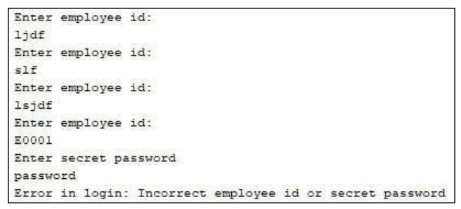

### 图 6.11：预期输出 1

当用户以错误的格式输入员工 ID，且员工 ID 和密码均有效；或者员工 ID 格式正确但员工 ID 和密码未通过验证时，预期输出所示：


### 图 6.12：预期输出 2

# 集合与 Stream API

本章介绍了带有`java.util`包中不同工具类和接口的集合框架。你将学习如何处理`List`、`Set`和`Map`集合。你将学习如何使用`Arrays`类和集合排序接口。

### 结构

- 集合框架
- `Iterable`接口
- `Collection`接口
- `List`接口
- `Queue`接口
- `Set`接口
- `Map`接口
- `Arrays`类
- Java Stream API

### 目标

- 理解`java.util`包和集合框架
- 熟悉`List`、`Set`和`Map`集合
- 熟悉`Arrays`类
- 学习集合排序接口
- 学习 Stream API

## 7.1 集合框架

`java.util`包提供了用于不同功能的多个工具类和接口。它包含了用于数据和时间处理、事件模型、集合框架、国际化、遗留集合类以及其他工具类（如随机数生成器和位数组）。

集合是一个容器对象，有助于将多个元素分组为一个单元。集合的某些真实世界示例包括联系人目录（其中名称与电话号码对应）或一叠盘子等。集合有助于存储、检索、操作和通信集合性数据。

集合框架用于创建和操作集合，它由以下部分组成：

**接口（Interfaces）：** 接口是抽象数据类型，可以独立操作集合，而无需关心实现细节。

**实现（Implementations）：** 这些是集合接口的具体实现，并且是可重用的。

**算法（Algorithms）：** 算法是一组可重用/多态的方法，并为实现集合接口的对象提供排序和搜索等过程的现成计算方法。

Java 集合框架的优点如下：

- 它提供了实用的算法和数据结构，减少了编程工作量，并允许不同 API 之间的相互操作。
- 这些数据结构的高性能实现提高了程序的质量和速度。
- 标准集合接口允许许多 API 进行方便的输入和输出。
- 标准集合 API 还减少了设计新 API 的工作量。
- 由于新的数据结构和算法符合标准接口，因此集合框架默认是可重用的。

## 7.2 `Iterable`接口

`Iterable`接口属于`java.lang`包，它是需要迭代器功能的类和接口的顶层接口。实现此接口允许对象成为`foreach`语句的目标。Java 8 在`Iterable`接口中增加了`forEach`方法。

`Iterable`接口的方法如下：

- `default void foreach(Consumer<? super T> action)`：对`Iterable`接口的每个元素执行操作，直到所有元素处理完毕或操作抛出异常。
- `Iterator iterator()`：返回一个对 T 元素的迭代器。
- `default Spliterator spliterator()`：为此描述的元素创建一个`Spliterator`。

增强型（`for-each`）循环和`forEach()`方法都提供了遍历集合中元素的相同功能。然而，增强型`for`循环是外部迭代器，而`forEach()`方法是内部迭代器。

内部迭代器在后台管理迭代，这样程序员就可以专注于对集合元素进行操作，而无需管理迭代过程并确保所有元素都已处理。

在外部迭代器的情况下，程序员必须手动指定如何执行迭代。

`Enumeration`、`Iterator`和增强型`for`循环都是外部迭代器，具有如`iterator()`、`next()`和`hasNext()`等方法用于操作集合。

## 7.3 `Collection`接口

`Collection`接口属于`java.util`包，它是集合框架中接口和类的顶层。集合可以是有序的或无序的。某些集合允许重复元素，而另一些不允许。

`Collection`接口被多个特定的子接口（如`Set`等）继承。这些接口允许传递和操作集合，并将集合类型转换为另一种类型。为了实现这些接口，集合框架在层次结构中提供了多个抽象和具体类。`Collection`接口的层次结构所示：


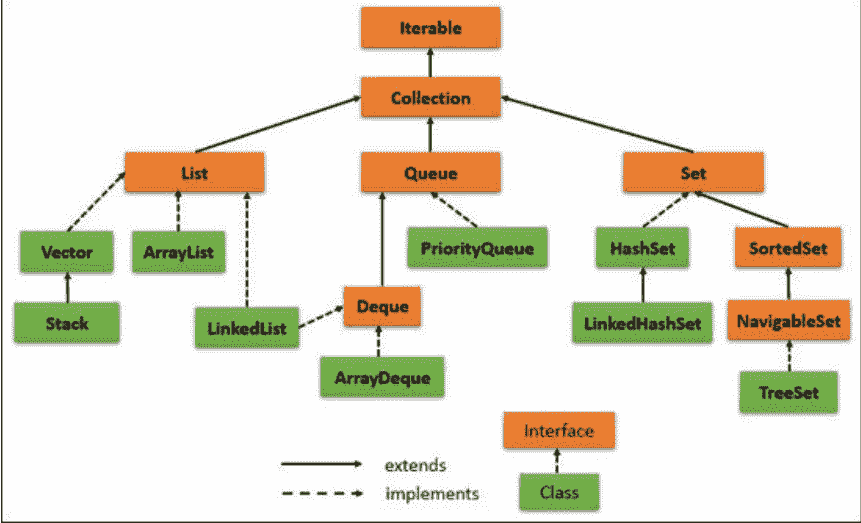

图 7.1：`Collection` 接口层级结构

`Collection` 接口的常用方法列举如下。这些方法可以被所有实现类和子接口使用：

- `size()`：返回集合的大小（元素个数）。
- `isEmpty()`：如果集合为空/不包含元素，则返回 `true`，否则返回 `false`。
- `contains(Object o)`：检查集合是否包含指定的对象。
- `add(Object o)`：向集合中添加一个元素。
- `remove(Object o)`：从集合中移除一个元素。
- `clear()`：清除集合中的所有内容。
- `toArray()`：返回一个包含此集合所有元素的数组。
- `equals(Object o)`：将指定的对象与此集合进行比较，以检查它们是否相等。

`Collection` 接口提供了一些方法用于对整个集合执行批量操作。这些方法如下：

- `containsAll(Collection c)`：如果此集合包含指定集合的所有元素，则返回 `true`。
- `addAll(Collection<? extends E> c)`：将指定的 `Collection` 中的所有元素添加到此集合中。
- `removeAll(Collection c)`：移除此 `Collection` 中存在于指定集合中的所有元素。
- `retainAll(Collection c)`：保留此集合中仅存在于指定集合的元素。

### 7.3.1 遍历集合

遍历意味着遍历集合以访问/操作其元素。在 Java 中，通常使用两种方法用于遍历集合：

**For-each/增强 for 循环**：for-each 循环（增强 for 循环）于 Java SE 5，是一种用于遍历集合的控制流语句。然而，与 `for` 结构不同，for-each 循环不维护显式的计数器，也就是说，for-each 循环会对集合中的每个元素执行此操作。

内部，for-each 的行为与 `Iterator` 相同。因此，在逐个按顺序读取每个元素时，它优于 `Iterator`，因为 for-each 更加方便和简洁。

语法：

```java
for(Object obj : collection) {
    System.out.println(obj);
}
```

由于 for-each 结构不维护显式索引，因此不允许使用 `remove()` 方法删除当前元素。

**Iterator**：`Iterator` 接口提供了遍历和操作集合的方法。要获取集合的 `Iterator`，请使用 `iterator()` 方法。以下是 `Iterator` 接口的一些重要方法：

- `hasNext()`：如果迭代还有更多元素，则返回 `true`。
- `next()`：返回迭代中的下一个元素。
- `remove()`：移除由 `next()` 方法从集合返回的最后一个元素。对于每次调用 `next()` 方法，`remove()` 方法只能调用一次。`remove()` 方法是迭代期间安全修改集合的唯一方法。

### 7.3.2 `Collection` 工厂方法

工厂方法随 Java 9 引入。这些是用于创建不可变集合的特殊静态方法。你可以使用这些方法为较小的元素集创建 `List` 和 `Map`。每个接口都有自己的工厂方法。尝试添加新元素将抛出 `UnsupportedOperationException`。

## 7.4 `List` 接口

`List` 是通过实现 `List` 接口创建的集合，该接口是 `Collection` 接口的扩展。`List` 是有序集合，允许重复值和多个空元素。可以使用整数索引访问/搜索列表的索引元素。与 Java 数组类似，列表索引从 0 开始，最后一个索引为 `size-1`。可以通过 `List` 接口的方法通过基于位置的操作对集合进行处理。`List` 接口内部使用索引对添加到列表的元素进行排序。`List` 接口还提供了添加、搜索元素以及执行范围操作的方法。

`List` 接口提供了 `ListIterator` 以按顺序访问列表的元素。它用于插入和替换元素，并结合普通操作进行双向访问。以下是 `List` 接口除继承自 `Collection` 接口之外的其他方法：

- `add(int index, E element)`：在索引指定的位置向列表添加指定的元素。
- `addAll(int index, Collection<? extends E> c)`：从指定的索引位置开始，将指定集合 `c` 的所有元素添加到列表中。
- `get(int index)`：从指定的索引位置获取此列表的元素。
- `set(int index, E element)`：用指定的元素替换此列表中从索引指定位置的元素。
- `remove(int index)`：移除列表中给定索引位置的元素。
- `subList(int start, int end)`：返回一个子列表，包含此列表从 `start` 到 `end - 1` 的元素。
- `indexOf(Object o)`：返回指定元素在列表中第一次出现的位置索引，如果未在列表中找到该元素，则返回 `-1`。
- `lastIndexOf(Object o)`：返回指定元素在列表中最后一次出现的位置索引，如果未在列表中找到该元素，则返回 `-1`。

`equals()` 方法有益于检查两个 `List` 对象的逻辑相等性。如果两个 `List` 对象包含相同顺序的相同元素，则它们是相等。以下是 `List` 接口的工厂方法列表：

- `static List of()`：返回一个包含零元素的不可变列表。
- `static List of(E e1)`：返回一个包含一个元素的不可变列表。
- `static List of(E... elements)`：返回一个包含任意数量元素的不可变列表。
- `static List of(E e1, E e2)`：返回一个包含两个元素的不可变列表。
- `static List of(E e1, E e2, E e3)`：返回一个包含三个元素的不可变列表。
- `static List of(E e1, E e2, E e3, E4)`：返回一个包含四个元素的不可变列表。（注：此处 `E4` 可能是指四个元素）

以下示例展示了 `List` 工厂方法的使用：

```java
import java.util.List;

public class ListDemo {

    public static void main(String[] args) {
        //工厂方法创建一个不可变的 List
        List list1 = List.of("Java", "Java EE", "Spring", "Hibernate", "Struts");

        System.out.println("Java Topics");
        for (String l : list1) {
            System.out.println(l);
        }
    }
}
```

代码输出为：

```text
Java Topics

Java

Java EE

Spring

Hibernate

Struts
```

图 7.2：`List` 接口工厂方法

### 7.4.1 `ArrayList` 类

`ArrayList` 类实现了 `List` 接口及其方法。它是原始类型固定大小数组的解决方案，因为它允许创建可以动态伸缩的对象的数组。在创建 `ArrayList` 对象时，必须指定初始大小，该大小根据对 `ArrayList` 元素的操作而增加或减少。

`ArrayList` 类允许所有元素，包括 `null`。当在末尾进行插入/删除元素时，`ArrayList` 类最为。每个 `ArrayList` 实例都有一个容量，在添加到列表时会自动增加。

`ArrayList` 类的构造函数如下：

- `ArrayList()`：创建一个初始容量为 10 的空列表。
- `ArrayList(Collection<? extends E> c)`：创建一个包含集合元素的列表，按集合迭代器返回的顺序存储。
- `ArrayList(int initialCapacity)`：创建一个指定容量的空列表。

例如：

```java
import java.util.ArrayList;
import java.util.List;

List list1 = new ArrayList<>();
```

`ARRAYLIST` 类的方法的方法：

`ArrayList` 类继承了 `List` 接口的所有方法。某些方法列如下：

- `add(E obj)`：将指定的元素添加到此列表的末尾。
- `contains(Object obj)`：如果此列表包含指定的元素，则返回 `true`。
- `size()`：返回此列表中元素的个数。
- `trimSize()`：将 `ArrayList` 的大小调整为列表的大小。
- `ensureCapacity(int minCap)`：增加 `ArrayList` 的容量，并确保它可以容纳至少指定数量的元素。
- `clear()`：移除此列表中的所有元素。

```java
import java.util.List;
import java.util.ArrayList;

public class ArrayListDemo {

    public static void main(String[] args) {
        List list1 = new ArrayList<>();
        System.out.println("List size is : " + list1.size());
        for (int i = 1; i <= 5; i++) {
            list1.add(""+i);
        }
        System.out.println("List of numbers added: "+list1);
        list1.set(4, "20");

        System.out.println("Modified list of numbers: "+list1);
        System.out.println("Value at index 4 is: " + (String) list1.get(3));

    }
}
```

第一个 `ArrayList` 对象 `list1` 被创建一个空列表，并通过 `for` 循环向其添加值。`set()` 和 `get()` 方法用于在列表的特定索引处添加/检索元素。第二个 `List` 对象 `list2` 是包含固定值的不可变列表，通过增强型 `for` 循环打印。代码的输出如截图所示：

```text
List size is : 0
List of numbers added: [1, 2, 3, 4, 5]
Modified list of numbers: [1, 2, 3, 4, 20]
Value at position 4 is: 4
```

图 7.3：`ArrayList` 输出

## 7.4.2 `Vector` 类

`Vector` 类与 `ArrayList` 类相似，不同之处在于它提供了一种控制存储优化中容量增量的方法。`Vector` 列表也可以动态增长和缩小，可以使用索引号访问元素。`Vector` 类与 `ArrayList` 的区别还在于 `Vector` 的方法是同步且线程安全的。它还包含一些不属于 Collections 框架的遗留方法。

`Vector` 类的构造函数：

- `Vector()`：创建一个初始数组大小为 10 的空 vector。
- `Vector(Collection<? extends E> c)`：创建包含指定集合 `c` 中元素的 vector，这些元素按照集合迭代器返回的顺序存储。
- `Vector(int initCapacity)`：创建具有指定初始容量的空 vector。
- `Vector(int initCapacity, int capIncrement)`：创建具有指定初始容量和增量容量的 vector。

例如：

```java
Vector vectori = new Vector();
```

`Vector` 类的受保护成员如下：

- `int capacityIncrement`：存储增量值。
- `int elementCount`：存储 vector 中有效组件的数量。
- `Object [] elementData`：存储 vector 组件的数组缓冲区。

### `Vector` 类的方法如下：

- `capacity()`：返回 vector 的当前容量。
- `addElement(E obj)`：在 vector 的末尾添加元素，并将 vector 的大小增加 1。如果大小大于容量，vector 的容量会自动增加。
- `elementAt(int pos)`：检索存储在指定位置的对象。
- `removeElement(Object obj)`：从 vector 中移除指定对象的第一次出现。
- `clear()`：移除 vector 的所有元素。
- `toArray()`：返回一个按正确顺序包含 vector 所有元素的数组。

`Vector` 的索引从 0 开始，最后一个元素的索引为 `size-1`。下面的示例展示了 `Vector` 类方法的用法：

```java
import java.util.Vector;

public class VectorDemo {

public static void main(String[] args) {
Vector
```
