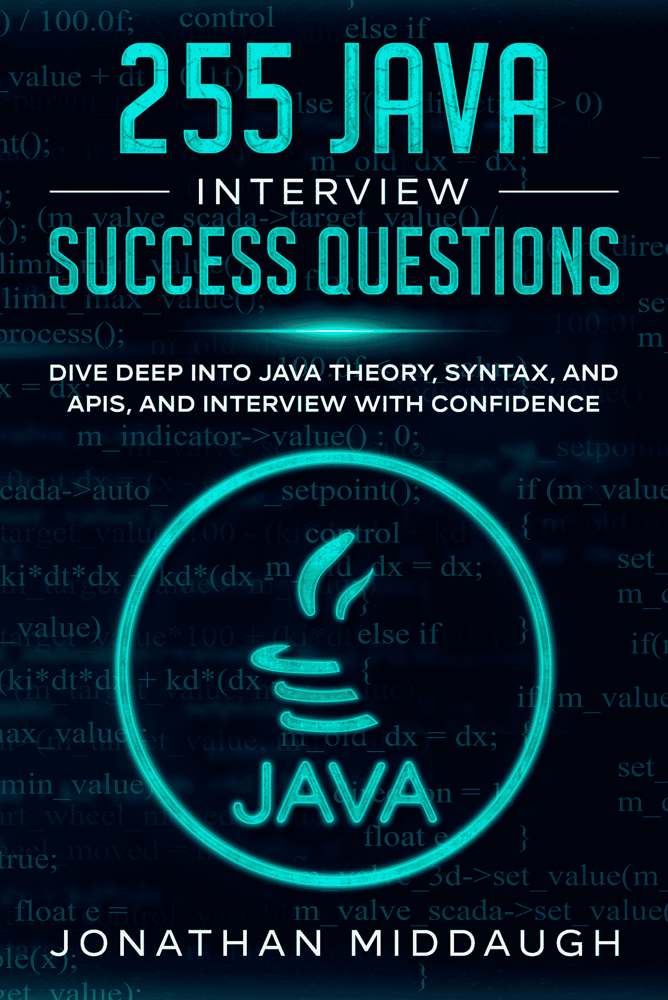

# 255 道 Java 面试成功题：深入理解 Java 理论、语法与 API，自信面试



## 引言

“255 道 Java 面试成功题”包含了 255 道严谨的题目，旨在帮助你准备 Java 职位的面试。题目是随机混合的。

本书涵盖了九个主要主题：

- Java 基础
- 处理 Java 数据类型
- 使用运算符和决策结构
- 创建和使用数组
- 使用循环结构
- 处理方法和封装
- 处理继承
- 异常处理
- 使用 Java API 中的选定类

对于任何寻找或刚开始应用程序开发工作的人来说，强烈建议精通这些领域。请向上滚动查看书籍示例，或者直接果断购买这款高性价比的工具吧！

## 关于作者

我于 2012 年获得信息系统科学硕士学位，从那时一直在世界 500 强企业担任软件工程师。我在准备 Oracle 认证关联工程师（ACA）考试时编写了这本书的初版，希望其他人也能发现它的用处。

我还在`https://smartdevpreneur.com/`上博客关于开发者职业、兼职和代码。

## 测试 1 题目

### Q1

```java
package Exam;
public class Test extends TestAbstract {
    public static void main(String[] args) {}
    public void methodRun(){}
    public void methodHide(){}
}
abstract class TestAbstract {
    abstract void methodRun();
    abstract void methodHide();
}
```

对或错：`Test` 类需要 `abstract` 修饰符才能编译。

A) 对

B) 错

### Q2

```java
package Exam;
public class ArrayCopy {
    public static void main(String[] args) {
        char[] copyFrom = {'c', 'r', 'u', 'n', 'c', 'h', 'y', ' ', 'c', 'o', 'o', 'k', 'i', 'e' };
        char[] copyTo = new char[7];
        System.arraycopy(copyFrom, 2, copyTo, 0, 7);
        System.out.println(copyTo);
    }
}
```

代码将打印什么？选择 1 个选项。

A) “runchy”

B) “runchy c”

C) “unchy c”

D) “unchy co”

E) “crunchy”

### Q3

```java
package Exam;
public class q1 {
    public static void main(String[] args) {
        int[][] a = new int[5][];
        //Line 1
    }
}
```

以下哪可以放在第 1 行且代码仍能编译？选择 1 个答案。

A) `a[1] = new short[5];`

B) `a[1] = new int[5];`

C) `a[1] = new Integer[5];`

D) `a[1] = new double[5];`

E) `a[1] = new int[];`

### Q4

```java
package Exam;
public class TC {
    static int i2[] = new int[1];
    public static void main(String[] args) {
        i2[1] = 0;
        System.out.println(i2[].getClass());
    }
}
```

输出将是什么？选择 1 个选项。

A) “class java.lang.int”

B) 通过编译

C) 运行时异常

### Q5

```java
//以下代码位于 Go.java 文件
package Exam;
public class Go {
    public static void main(String[] args) {
        Test t1 = new TestSub();
        t1.methodGo();
    }
}
public class Test{
    public void methodGo(){
        System.out.println("In Super");
    }
}
public class TestSub extends Test{
    public void methodGo(){
        System.out.println("In Sub");
    }
}
```

代码将打印什么？选择 1 个选项。

A) 不通过编译。

B) “In Super”

C) “In Sub”

D) 运行时异常

### Q6

```java
package Exam;
public class Construct extends SuperConstruct {
    Construct(int i) {
        super(i);
    }
    Construct(String i) {
        super(i);
    }
    Construct() {
        super();
    }
    public static void main(String[] args) {
        Construct c = new Construct();
    }
}
class SuperConstruct{
    SuperConstruct(int i){
        System.out.println("Constructed with integer");
    }
    SuperConstruct(String str){
        System.out.println("Constructed with string");
    }
}
```

以下代码将打印什么？选择 1 个选项。

A) “Constructed with integer”

B) “Constructed with string”

C) 它什么都不打印。

D) 它不通过编译。

E) 它将抛出一个运行时异常。

### Q7

在构建服务时，我们在哪个文件中添加`provides`语法？

A) `service.java`

B) `module.java`

C) `module-info.java`

D) `main.java`

### Q8

```java
package Exam;
public class Test {
    public static void main(String[] args) {
        Integer i = new Integer(12);
        Long l = new Long(12);
        Double d = new Double(12);
        System.out.println(i.equals(l));
        System.out.println(l.equals(d));
    }
}
```

上述程序的输出是什么？选择 1 个选项。

A) “true” 紧接 “true”

B) “false” 紧接 “true”

C) “false” 紧接 “false”

D) “true” 紧接 “false”

E) 不通过编译。

### Q9

```java
package Exam;
public class Test {
    public static void main(String[] args) {
        System.out.println("Beginning");
        Test q = new Test();
        q.throwException();
        System.out.println("Past finally");
    }
    public void throwException(){
        try{
            int[] arr = new int[5];
            int i = arr[5];
        }finally{
            System.out.println("In finally");
        }
    }
}
```

代码最后打印什么？选择 1 个选项。

A) 不通过编译。

B) “Beginning”

C) “In finally”

D) “Past finally”

E) 因为运行时异常什么都没有打印。

### Q10

```java
package Exam;
public class Test {
    public static void main(String[] args) {
        Test q = new Test();
        q.go(1, "Will", " work?");
    }
    public void go(int i, String...k){
        for(String l:k){
            System.out.print(l);
        }
    }
}
```

代码打印什么？选择 1 个选项。

A) 编译错误

B) 运行时错误

C) “Will work?”

### Q11

```java
package Exam;
public class GC {
    int g = 10;
    short c = 20;
    public static void main(String[] args) {
        GC gc = new GC();
        //Line 1
        gc.g = 12;
        gc.c = 18;
        //Line 2
        gc.go();
        //Line 3
        System.gc();
        //Line 4
        System.out.println(gc.g);
        //Line 5
    }
    public void go(){
        System.out.println("go");
    }
}
```

哪一行之后对象`gc`符合垃圾收集？选择 1 个选项。

A) Line 1

B) Line 2

C) Line 3

D) Line 4

E) Line 5

### Q12

```java
package Exam;
import java.util.ArrayList;
import java.util.List;
public class Test {
    List<String> dogs = new ArrayList<>();
    public static void main(String[] args) {
        String dog1 = "German Sheard";
        String dog2 = "Husky";
        String dog3 = "Mutt";
        Character dog4 = new Character('T');
        Test q = new Test();
        q.dogs.add(dog1);
        q.dogs.add(dog2);
        q.dogs.add(dog3);
        q.dogs.add(dog4);
        for(int i = 0; i<q.dogs.size(); i++){
            System.out.print(q.dogs.get(i) + ",");
        }
    }
}
```

上述程序的输出是什么？选择 1 个答案。

A) “German Sheard,Husky,Mutt,T”

B) “German Sheard,Husky,Mutt,T,”

C) 编译错误。

D) 以上都不是

### Q13

```java
package Exam;
//Line 1
public class Test {
    public static void main(String[] args) {
        out.println("Hello World");
    }
}
```

在第 1 行独立插入什么可以使代码编译？

A) `import java.lang.System.out;`

B) `import static java.lang.System.out;`

C) `import java.lang.System.*;`

D) `import static java.lang.System.*;`

### Q14

```java
package Exam;
public class Test{
    Object obj = new Object();
    Integer i = new Integer(45);
    public static void main(String[] args) {
        Test q = new Test();
        q.obj = "Hello";
        q.obj = i;
        System.out.println(q.obj);
    }
}
```

程序打印什么？选择 1 个选项。

A) “45”

B) 不通过编译。

C) “Hello”

D) 运行时错误

### Q15

```java
package Exam;
public class FooYou implements Fool {
    static int r = 12;
    public static void main(String[] args) {
        FooYou fy = new FooYou();
        fy.methodGo(Fool.r);
        System.out.println(r);
    }
    public void methodGo(int r){
        System.out.println(r);
    }
}
interface Fool{
    void methodGo(int r);
    int r = 10;
}
```

代码打印什么？选择 1 个答案。

A) “12” 紧接 “12”

B) “10” 紧接 “10”

C) “10” 紧接 “12”

D) “12” 紧接 “10”

E) 不通过编译。

### Q16

什么将强制消费模块导入被消费模块的依赖？

A) `requires transitive com.module`

B) `requires dependency.module`

C) `import transitive com.module`

D) `import dependency.module`

### Q17

以下哪个不是有效的类修饰符？选择 1 个选项。

A) `public`

B) `private`

C) `protected`

D) `package private`

E) `package protected`

### Q18

```java
package Exam;
public class Test {
    String st;
    int x = 10;
    public static void main(String[] args) {
        Test q = new Test();
        System.out.println("Howdy");
        if(q.x >5 | q.st.length() == 0){
            System.out.println("Hello");
        }
    }
}
```

代码打印什么？选择 1 个选项。

A) 不通过编译。

B) “Howdy” 紧接 “Hello”

C) “Howdy”

D) 运行时异常导致程序立即失败。

E) 打印 "Howdy" 然后运行时异常导致失败。

### Q19

```java
package Exam;
public class Test {
    public static void main(String[] args) {
        int i = 12;
        long L = 12;
        float f = 12.0f;
        double d = 12.2;
        System.out.print(i == f + " ");
        System.out.print(i == d + " ");
        System.out.print(i.equals(f) + " ");
    }
}
```

代码打印什么？选择 1 个答案。

A) 不通过编译。

B) “false false”

C) “true true”

D) “true false”

E) “false false”

### Q20


```java
package Exam;
public class Go {
    public static void main(String[] args) {
        TestSub ts = new TestSub();
        ts.runThis();
    }
}
class Test{
    static{System.out.println("Super static");} //Line 1
    {System.out.println("Super non-static");} //Line 2
    public void runThis(){
        System.out.println("Super runThis"); //Line 3
    }
}
class TestSub extends Test{
    static{System.out.println("Sub static");} //Line 4
    public void runThis(){
        System.out.println("Sub runThis"); //Line 5
    }
    {System.out.println("Sub non-static");} //Line 6
}
```

输出的顺序是什么？选择 1 个答案。

A) 1, 2, 4, 5, 6

B) 4, 5, 6

C) 4, 6, 5

D) 1, 6, 4, 2, 5

E) 1, 4, 2, 6, 5

### Q21

```java
package Exam;
public class Test {
    public static void main(String[] args) {
        Test q = new Test();
        q.subMethod();
    }
    public void subMethod(){
        try{
            subMethod2();
        }catch(Exception e){
            System.out.println("The Exception caught here");
        }
    }
    public void subMethod2(){
        throw new ArrayIndexOutOfBoundsException();
    }
}
```

代码的输出是什么？选择 1 个答案。

A) 编译错误

B) “Exception in thread "main" java.lang.ArrayIndexOutOfBoundsException”

C) “The Exception caught here”

### Q22

```java
package Exam;
import java.util.ArrayList;
import java.util.List;
public class Test {
    public static void main(String[] args) {
        List l = new ArrayList();
        l.ensureCapacity(20);
        for(int i = 0; i<10; i++){
            l.add(i);
        }
        l.trimTo();
        System.out.print(" " + l.size());
    }
}
```

代码的输出是什么？选择 1 个答案。

A) 编译错误

B) “0 10”

C) “20 20”

D) “0 10”

### Q23

```java
package Exam;
public class Test {
    public static void main(String[] args) {
        double d1 = 2.4;
        double d2 = 2.40;
        System.out.print(" " + Double.compare(d1, d2));
    }
}
```

代码的输出是什么？选择 1 个答案。

A) 编译错误

B) “0”

C) “0”

### Q24

以下哪些是可接受的声明？选择两个答案。

A) `String;`

B) `String 23;`

C) `String volatile;`

D) `String MONEY;`

E) `String`

### Q25

```java
package Exam;
public class Test extends qqq {
    Test(int i, int j, Integer integer) { //Line 1
    }
    public static void main(String[] args) {
        Test q = new Test(1,2,new Integer(5));
    }
}
class qqq{
    public int aa;
    public int bb;
    public int cc;
    public qqq(int a, int b, Integer c){
        aa = a;
        bb = b;
        cc = c.intValue();
    }
}
```

第 1 行需要什么？选择 1 个答案。

A) 对 `qqq` 默认构造器的调用。

B) 对显式构造器 `qqq(int a, int b, Integer c)` 的调用。

C) 不需要。

### Q26

```java
package Exam;
public class Test extends SuperTest{
    public static void main(String[] args) {
        Test q = new Test();
        try {
            q.run();
        } catch (Exception e) {
            e.printStackTrace();
        }
    }
    void run() throws Exception{
        System.out.println("Overriding methods can throw more specific exceptions");
    }
}
class SuperTest{
    void run() throws FileNotFoundException{
        System.out.println("Overridden methods must throw more general exceptions");
    }
}
```

代码的输出是什么？选择 1 个答案。

A) “Overriding methods can throw more specific exceptions”

B) “Overridden methods must throw more general exceptions”

C) 不通过编译。

### Q27

```java
package Exam;
public class Test extends SuperTest {
    public static void main(String[] args) {
        Test q = new Test();
        q.returnThis();
    }
    public Number returnThis(){
        Number doub = 2.2;
        System.out.println(doub);
        return integ;
    }
}
class SuperTest{
    public Double returnThis(){
        Double num = 3;
        return num;
    }
}
```

以下代码打印什么？选择以下内容之一。

A) “2.2”

B) “3”

C) 不通过编译

### Q28

```java
package Exam;
import java.util.ArrayList;
public class Test {
    ArrayList trainList = new ArrayList();
    public static void main(String[] args) {
        Test q = new Test (); 
        //Line 1
        q.addTrain("A1","Fort Worth",trainList); 
        //Line 2
        q.addTrain("A2","Los Angeles",trainList);
        q.addTrain("A3","Kansas City",trainList);
        System.out.println(((Train) trainList.get(1)).getID());
    }
    public void addTrain(String id, String dep, ArrayList tL){
        Train trn = new Train();
        //Line 3
        trn.setID(id);
        trn.setDeparture(dep);
        trn.setDestination(dest);
        tL.add(trn);
        //Line 4
    }
}
class Train{
    private String trainID;
    private String departure;
    private String destination;
    public String getID() {
        return trainID;
    }
    public void setID(String trainID) {
        this.trainID = trainID;
    }
    public String getDeparture() {
        return departure;
    }
    public void setDeparture(String departure) {
        this.departure = departure;
    }
    public String getDestination() {
        return destination;
    }
    public void setDestination(String destination) {
        this.destination = destination;
    }
}
```

哪一行导致异常？选择以下之一。

A) Line 1

B) Line 2

C) Line 3

D) Line 4

E) 代码是安全的

### Q29

```java
package Exam;
import java.util.ArrayList;
import java.util.List;
public class Test{
    List<Train> trainList = new ArrayList<>();
    public static void main(String[] args) {
        Test q = new Test();
        q.addTrain("A1","Fort Worth",trainList);
        q.addTrain("A2","Los Angeles",trainList);
        q.addTrain("A3","Kansas City",trainList);
        System.out.println(q.trainList.get(1).getID());
    }
    public void addTrain(String id, String dep, List<Train> tL){
        Train trn = new Train();
        trn.setID(id);
        trn.setDeparture(dep);
        trn.setDestination(dest);
        tL.add(trn);
    }
}
class Train{
    private String trainID;
    private String departure;
    private String destination;
    public String getID() {
        return trainID;
    }
    public void setID(String trainID) {
        this.trainID = trainID;
    }
    public String getDeparture() {
        return departure;
    }
    public void setDeparture(String departure) {
        this.departure = departure;
    }
    public String getDestination() {
        return destination;
    }
    public void setDestination(String destination) {
        this.destination = destination;
    }
}
```

以下代码打印什么？选择以下之一。

A) “A1”

B) “A2”

C) “A3”

D) 不通过编译。

### Q30

```java
package Exam;
public class Test {
    public static void main(String[] args) {
        Integer in = new Integer(5);
        Double db = new Double(5.5);
        System.out.println(in.compareTo(db));
    }
}
```

以下代码打印什么？选择以下之一。

A) “1”

B) “0”

C) “-1”

D) 不通过编译

### Q31

```java
package Exam;
import java.util.ArrayList;
public class Test {
    public static void main(String[] args) {
        Test q = new Test();
        ArrayList tr = new ArrayList();
        for(int i = 0; i<3; i++){
            tr.add(new StringBuilder("str" + i));
        }
        q.change(tr);
        System.out.println(tr.get(1));
    }
    public void change(ArrayList ls){
        for(int i = 0; i < ls.size(); i++){
            ((StringBuilder) (ls.get(i))).append(" is here");
        }
    }
}
```

以下代码打印什么？选择以下之一。

A) “str0”

B) “str0 is here”

C) “str1”

D) “str1 is here”

E) 不通过编译

### Q32

对或错？在 Java 中，对象参数是值传递的？

A) 对

B) 错

### Q33

```java
package Exam;
import java.util.ArrayList;
public class Test {
    public static void main(String[] args) {
        ArrayList arr = new ArrayList();
        int i = 0;
        do{
            i++;
        }while(i < 10);
        System.out.println(i);
    }
}
```

以下代码打印什么？选择以下之一。

A) “10”

B) “9”

C) 不通过编译

### Q34

```java
package Exam;
import java.util.ArrayList;
public class Test {
    public static void main(String[] args) {
        ArrayList arr = new ArrayList();
        int i = 0;
        while(i < 10)
        do{
            i++;
        }
        System.out.println(i);
    }
}
```

以下代码打印什么？选择以下之一。

A) “10”

B) “9”

C) 不通过编译

### Q35


```java
package Exam;
import java.util.ArrayList;
public class Test {
    public static void main(String[] args) {
        ArrayList arr = new ArrayList();
        int counter = 0;
        for(int i = 5; i > 0; i--){
            for(int x = 0; x < i; x++){
                counter++;
            }
        }
        System.out.println(counter);
    }
}
```

以下代码打印什么？选择以下之一。

A) “5”

B) “10”

C) “15”

D) “20”

E) “25”

### Q36

```java
package Exam;
import java.util.ArrayList;
public class Test{
    public static void main(String[] args) {
        ArrayList arr = new ArrayList();
        int counter = 0;
        outer:
        for(int i = 5; i > 0; i--){
            inner:
            for(int x = 0; x < i; x++){
                if(x == 3){
                    break inner;
                }
                counter++;
            }
        }
        System.out.println(counter);
    }
}
```

以下代码打印什么？选择以下之一。

A) “10”

B) “12”

C) “14”

D) 不通过编译

### Q37

```java
package Exam;
public class Test {
    public static void main(String[] args) {
        out.println("Hello World");
    }
}
```

对或错？代码通过编译。

A) 对

B) 错

### Q38

对或错？默认情况下，Java 模块向其他模块暴露所有的 API？

A) 对

B) 错

### Q39

```java
package Exam;
public class Test{
    public static void main(String[] args) {
        Test q = new Test();
        StringBuilder sb = new StringBuilder("This");
        q.changeThis(sb);
        System.out.println(sb);
    }
    public void changeThis(StringBuilder str){
        System.out.print(str + " ");
        str.delete(0, 4);
        str.append("That");
    }
}
```

以下代码打印什么？选择以下之一。

A) “This That”

B) “That That”

C) “This This”

D) 不通过编译

### Q40

以下关于 getters 和 setters 的哪些正确？选择两个选项。

A) getters 和 setters 增加了代码的可重用性

B) getters 和 setters 是面向对象编程中不可或缺的一部分

C) getters 和 setters 控制程序的流

D) getters 和 setters 维护了封装

### Q41

只有一个抽象方法的接口被称为什么？

A) 它没有名称

B) 方法接口 (Method Interface)

C) 式接口 (Functional Interface)

D) 抽象接口 (Abstract Interface)

Q41 已回答。

### Q42

```java
package Exam;
@FunctionalInterface
interface Cube {
    int calculateVolume(int x);
    int countSides(int y);
}
```

正确或错误：这段代码可以编译。

A) 正确

B) 错误

Q42 已回答。

### Q43

```java
package Exam;
interface TestInterface {
    public void add(int x);
    default void print() {
        System.out.println("Default Method Executed");
    }
    default void printAnother() {
        System.out.println("Another Default Method Executed");
    }
}
public class Test implements TestInterface {
    public void add(int x) {
        System.out.println(x+x);
    }
    public static void main(String args[]) {
        Test writer = new Test();
        writer.add(4);
        writer.print();
    }
}
```

正确或错误：这段代码可以编译。

A) 正确

B) 错误

Q43 已回答。

### Q44

正确或错误：接口上的静态方法可以被重写。

A) 正确

B) 错误

Q44 已回答。

### Q45

```java
package Exam;
interface LambdaInterface {
    public void printer(String x);
    default void printAnother() {
        System.out.println("Another Print!");
    }
}
public class Test {
    public static void main(String args[]) {
        LambdaInterface inter = (String x) -> System.out.println(x);
        inter.printer("Print Me!");
    }
}
```

以下代码打印什么？从以下选项中选择一个。

A) “Print Me!”

B) “Another Print!”

C) 编译

Q45 已回答。

### Q46

```java
package Exam;
interface LambdaInterface {
    public void printer(String x);
    public void anotherPrinter();
    default void printAnother() {
        System.out.println("Another Print!");
    }
}
public class Test {
    public static void main(String args[]) {
        LambdaInterface inter = (String x) -> System.out.println(x);
        LambdaInterface anotherInter = () -> System.out.println("Print This!");
        inter.printer("Print Me!");
    }
}
```

以下代码打印什么？从以下选项中选择一个。

A) “Print Me!”

B) “Print This!”

C) “Another Print!”

D) 编译

Q46 已回答。

### Q47

```java
package Exam;
import java.clock.LocalDate;
public class HelloWorld {
    public static void main(String []args){
        LocalDate local = LocalDate.new();
        System.out.println(local);
    }
}
```

以下代码打印什么？从以下选项中选择一个。

A) 当前时间

B) 当前日期

C) 当前的时间和日期

D) 编译

Q47 已回答。

### Q48

以下哪项不是有效的 `java.time.LocalDate` 方法？

A) `atTIme`

B) `equals`

C) `getDayOfYear`

D) `getWeekDay`

E) `isLeapYear`

Q48 已回答。

### Q49

`Boolean` 对象的默认值是什么？

A) `true`

B) `false`

C) `undefined`

D) `null`

Q49 已回答。

### Q50

`int` 原始类型的大小是几字节？

A) 1 字节

B) 2 字节

C) 4 字节

D) 8 字节

Q50 已回答。

### Q51

哪种语法创建一个可选的、仅编译时的依赖？

A) `requires devDependency com.module`

B) `requires static com.module`

C) `import optional com.module`

Q51 已回答。

### Q52

```java
package Exam;
public class Test{
    public static void main(String[] args) {
        Test q = new Test();
        StringBuilder sb = new StringBuilder("This");
        q.changeThis(sb);
        System.out.println(sb);
    }
    public void changeThis(StringBuilder str){
        System.out.print(str + " ");              //Line 1
        str = new StringBuilder("That");           //Line 2
    }
}
```

以下代码打印什么？从以下选项中选择一个。

A) “This That”

B) “That That”

C) “This This”

D) 编译

Q52 已回答。

### Q53

以下代码片段是有效的。`static int i1, i2[], i3;`

选择 1 个选项。

A) 正确

B) 错误

Q53 已回答。

### Q54

```java
package Exam;
public class Test {
    public static void main(String[] args) {
        float f = 5.0;
        Test q = new Test ();
        q.runInt(f);
    }
    public void runInt(float f) {
        Integer i = new Integer(new Float(f).intValue());
        System.out.print(i);
    }
}
```

代码的输出是什么？选择一个选项。

A) "5"

B) "5.0"

C) 编译时异常

D) 运行时异常

### Q55

哪个命令行命令会显示所有模块？

A) `java --show-modules`

B) `java --list-modules`

C) `java --module-chart`

D) `java --modules`

## Test 2 Questions

### Q1

```java
package Exam;
public class Test {
    public static void main(String[] args) {
        Test q = new Test();
        String s = "hello";
        StringBuilder sb = new StringBuilder("world");
        System.out.println(q.addString(s));
        System.out.println(q.addSB(sb));
        System.out.println(s);
        System.out.println(sb);
    }
    public String addString(String str) {
        str += " world";
        return str;
    }
    public StringBuilder addSB(StringBuilder strbl) {
        strbl.insert(0, "hello ");
        return strbl;
    }
}
```

代码将打印什么？

A) 四次 "hello world"

B) "hello" 后接 "hello world" 后接 "hello" 后接 "hello world"

C) "hello" 后接 "world" 后接 "hello" 后接 "world"

D) 两次 "hello world" 后接 "hello" 后接 "hello world"

### Q2

```java
package Exam;
public class Test {
    public static void main(String[] args) {
        switch(2) {
            case 1: System.out.println("1");
            case 2: System.out.println("2");
            case 3: System.out.println("3");
            default: System.out.println("None of the above");
        }
    }
}
```

代码打印了什么？选择一个选项。

A) 打印 "2"

B) 打印 "1", "2", "3", "None of the above"

C) 打印 "2", "3"

D) 打印 "2", "3", "None of the above"

E) 无法编译。

### Q3

```java
package Exam;
import java.io.BufferedReader;
import java.io.FileReader;
import java.io.IOException;
public class Test {
    public static void main(String[] args) {
        try {
            BufferedReader br = new BufferedReader(new FileReader("file.txt"));
            try {
                StringBuilder sb = new StringBuilder();
                String line = br.readLine();
                while (line != null) {
                    sb.append(line);
                    sb.append('\n');
                    line = br.readLine();
                }
                String everything = sb.toString();
            } finally {
                br.close();
            }
        } catch (Exception e) {
            System.out.println("Exception caught");
        } catch (IOException e) {
            System.out.println("IOException caught");
        }
    }
}
```

如果 `file.txt` 为空，代码将生成什么？选择 1 个选项。

A) 代码将打印 "Exception caught"

B) 即使 `file.txt` 不为空，代码也无法编译。

C) 代码将打印 "IOException caught"

D) 代码将抛出一个未被捕获的异常，导致程序结束。

### Q4


```java
package Exam;
public class Test {
    public static void main(String[] args) {
        Test q = new Test();
        q.methodRun();
        System.out.println("Complete");
    }
    public void methodRun();
    public void methodHide(){ }
}
abstract class TestAbstract {
    abstract void methodRun();
    abstract void methodHide();
    abstract void methodSeek();
}
```

该程序的输出是什么？选择一个选项。

A) "Complete"

B) 无法编译

C) 运行错误

### Q5

```java
package Exam

public class Test {
    public static void main(String[] args) {
        int[][] myInt = {{2, 3, 1}, {4, 5, 6}, {7, 8, 9}};
        System.out.println(myInt[1][1]);
        System.out.println(myInt[3][1]);
    }
}
```

代码的输出是什么？选择一个答案。

A) "5" 后接 `ArrayIndexException`

B) "2" 后接 "7"

C) "2" 后接 "1"

D) "5" 后接 "7"

E) 无法编译

### Q6

以下哪些是有效的 `ArrayList` 方法？选择 3 个选项。

A) `.size()`

B) `.isEmpty()`

C) `.length()`

D) `.contains()`

E) `.removeElement()`

### Q7

```java
package Exam;
import java.sql.Array;
import java.util.ArrayList;
public class Test {
    Short a = new Short((short) 1);
    Integer b = new Integer(1);
    public static void main(String[] args) {
        Test t = new Test();
        if (t.b instanceof Short){
            System.out.println("Test");
        else System.out.println("Failed");
    }
}
```

代码将打印什么？选择 1 个选项。

A) "Test"

B) "Failed"

C) 无法编译。

D) 运行时异常

E) 什么都不打印。

### Q8

```java
package Exam;
public class Test {
    int i = 0;
    public static void main(String[] args) {
        System.out.println("Hello World");
    }
}
```

`i` 是类变量是或否

A) 是

B) 否

### Q9

```java
package Exam;
import java.util.ArrayList;
import java.util.List;
public class Test {
    List<String> dogs = new ArrayList<>();
    public static void main(String[] args) {
        String dog1 = "German Sheard";
        String dog2 = "Husky";
        String dog3 = "Mutt";
        Character dog4 = new Character('s');
        Test q = new Test();
        q.dogs.add(dog1);
        q.dogs.add(dog2);
        q.dogs.add(dog3);
        for(int i = 0; i<dogs.size(); i++){
            System.out.print(q.dogs.get(i) + ",");
        }
    }
}
```

上述程序的输出是什么？选择 1 个答案。

A) "German Sheard,Husky,Mutt,"

B) "German Sheard,Husky,Mutt"

C) 编译时错误。

D) 以上都不是

### Q10

```java
package Exam;
public class Test {
    public static void main(String[] args) {
        Integer i = new Integer(1); // Line 1
        Number n = i; // Line 2
        System.out.println(n.intValue()); // Line 3
        i = n; // Line 4
        System.out.println(i.intValue()); // Line 5
    }
}
```

为了使此代码通过编译可以修改什么？选择一个选项。

A) 将第 4 行改为 `i = (Integer) n;`

B) 将第 2 行改为 `n = (Number) i;`

C) 将第 3 和 5 行调用的方法改为 `doubleValue()`

D) 将第 5 行改为 `System.out.println(i.parseInt("1"));`

E) 不需要修改。

### Q11

```java
package Exam;
public class Test {
    int i = 0;
    public static void main(String[] args) {
        // Line 1
        for(i = 0; i<10; i++){
            System.out.println("Hello World");
        }
    }
}
```

上述代码可以修改？选择 2 个选项。

A) 无需修改

B) 在第 1 行插入以下代码：`Test q = new Test();` 然后将 `i` 改为 `q.i`

C) 在 `for` 语句中将 `i` 声明为 `int` 类型

D) 无需修改运行

E) 将 `i = 0;` 替换为 `i;`

### Q12

```java
package Exam;
public class B extends A {
    public static void main(String[] args) {
        A q = new B();
        q.methodA1();
        q.methodA2();
    }
    static void methodA1(){
        System.out.print("Static B1,");
    }
    void methodA2(){
        System.out.print(" B2");
    }
}
class A{
    static void methodA1(){
        System.out.print("Static A1,");
    }
    void methodA2(){
        System.out.print(" A2");
    }
}
```

代码打印了什么？选择一个选项。

A) "Static A1, A2"

B) "Static A1, B2"

C) "Static B1, A2"

D) "Static B1, B2"

### Q13

```java
package Exam;
public class TestSub extends Test {
    public static void main(String[] args) {
        Test q = new TestSub();
        q.out();
    }
    public void out(){
        System.out.println("Sub out");
    }
}
class Test {
    protected void out(){
        System.out.println("Super out");
    }
}
```

代码将打印什么？选择 1 个选项。

A) 无法编译。

B) "Sub out"

C) "Super out"

D) 什么都不打印。

### Q14

是或否：`!` 运算符返回布尔值。选择一个选项。

A) 是

B) 否

### Q15

```java
package Exam;
public class Test {
    public static void main(String[] args) {
        double r = Math.random() * 10; // Line 1
        Integer x = new Integer((int)r); // Line 2
        System.out.println(x); // Line 3
    }
}
```

为了使代码通过编译可以在代码中添加什么？选择 1 个选项。

A) 它已经编译。

B) 在 `Integer(r)` 后添加 `.intValue()`。

C) 在第 1 行将 `r` 声明为 `int`。

D) 在第 3 行将 `r` 强制转换为 `int`。

### Q16

```java
package Exam;
public class Test {
    public static void main(String[] args) {
        Test q = new Test();
        String s = "hello world";
        System.out.println(s.equals("hello world"));
        System.out.println(s.charAt(0)));
    }
}
```

代码将打印什么？选择 1 个选项。

A) "true" 后接 "helloh"

B) "false" 后接 "helloh"

C) 编译错误

D) "true" 抛出了运行时异常

### Q17

```java
package Exam;
public class Test {
    public static void main(String[] args) {
        int[][] myInt[] = {{{1,2},{3,4}},{{1,2},{3,4,5},{6}},{{7}}};
        System.out.println(myInt[0][1]);
        System.out.println(myInt[1][1]);
        System.out.println(myInt[2][0]);
    }
}
```

代码的输出是什么？选择一个答案。

A) "5" 后接 `ArrayIndexException`

B) "2" 后接 "7" 后接 "1"

C) "2" 后接 "1" 后接 "6"

D) 无法编译

E) "3" 后接 "5" 后接 "7"

### Q18

以下哪个正确描述了方法签名？选择 1 个选项。

A) 方法的访问修饰符、返回类型和参数。

B) 方法的返回类型和参数。

C) 方法的名字和参数。

D) 方法的名字。

### Q19

```java
package Exam;
public class TestSub extends Test {
    public static void main(String[] args) {
        Test q = new TestSub();
        q.out();
    }
    public void out(){
        System.out.println("Sub out");
    }
}
class Test {
    private void out(){
        System.out.println("Super out");
    }
}
```

代码将打印什么？选择 1 个选项。

A) 无法编译。

B) "Sub out"

C) "Super out"

D) 什么都不打印。

### Q20

```java
package Exam
public class Test {
    String str1 = "Hello World!";
    String str2;
    public static void main(String[] args) {
        Test q = new Test();
        if (q.str1.equals("Hello World!") | q.str2.equals("")) {
            System.out.println(q.str1);
        }else System.out.println(q.str2.concat("Hello"));
    }
}
```

代码打印了什么？选择一个答案。

A) "Hello World!"

B) 编译错误

C) 代码打印空行

D) "Hello"

E) 运行时异常

### Q21

```java
package Exam;
public class Test {
    public static void main(String[] args) {
        int i = 0; // Line 1
        for(i = 0; i<10; i++){
            System.out.println("Hello World");
        }
    }
}
```

为了使代码通过编译可以进行哪些修改？选择 2 个选项。

A) 无需修改编译

B) 在第 1 行插入以下代码：`Test q = new Test();` 然后将 `i` 改为 `q.i`

C) 在 `for` 语句中将 `i` 声明为 `int` 类型

D) 无需修改运行

E) 将 `i = 0;` 替换为 `i;`

### Q41

只有一个抽象方法的接口称为什么？

A) 它没有名称

B) 方法接口（Method Interface）

C) 这里的接口（Functional Interface）

D) 抽象接口

答案是 `C`。如果正好有一个抽象方法，并且有零、一个或多个默认方法，则该接口是一个函数接口。

### Q42

```java
package Exam;
@FunctionalInterface
interface Cube {
    int calculateVolume(int x);
    int countSides(int y);
}
```

正确或错误：此代码可以编译

A) 正确

B) 错误

答案是 `B`。因为存在多个抽象类方法，编译器会抛出“Unexpected @FunctionalInterface annotation”的错误信息。

### Q43

```java
package Exam;
interface TestInterface {
    public void add(int x);
    default void print() {
        System.out.println("Default Method Executed");
    }
    default void printAnother() {
        System.out.println("Another Default Method Executed");
    }
}
public class Test implements TestInterface {
    public void add(int x) {
        System.out.println(x+x);
    }
    public static void main(String args[]) {
        Test writer = new Test();
        writer.add(4);
        writer.print();
    }
}
```

正确或错误：此代码可以编译

A) 正确

B) 错误

答案是 `A`。该类没有调用 `printAnother`，这是可以接受的。实现类不需要调用所有的默认方法。

### Q44

正确或错误：接口上的静态方法可以被重写

A) 正确

B) 错误

答案是 `B`。如果一个带有静态方法的接口被类实现，而该类又实现了一个与接口静态方法签名相同的方法，那么接口的静态方法仍然存在于接口中，而类的静态方法存在于类中。

### Q45


```java
package Exam;
interface LambdaInterface {
    public void printer(String x);
    default void printAnother() {
        System.out.println("Another Print!");
    }
}
public class Test {
    public static void main(String args[]) {
        LambdaInterface inter = (String x) -> System.out.println(x);
        inter.printer("Print Me!");
    }
}
```

以下代码打印什么？请选择以下之一。

A) “Print Me!”

B) “Another Print!”

C) 无法编译

答案是 `A`。这是一个 lambda 函数实现接口上抽象方法的简单示例。

### Q46

```java
package Exam;
interface LambdaInterface {
    public void printer(String x);
    public void anotherPrinter();
    default void printAnother() {
        System.out.println("Another Print!");
    }
}
public class Test {
    public static void main(String args[]) {
        LambdaInterface inter = (String x) -> System.out.println(x);
        LambdaInterface anotherInter = () -> System.out.println("Print This!");
        inter.printer("Print Me!");
    }
}
```

以下代码打印什么？请选择以下之一。

A) “Print Me!”

B) “Print This!”

C) “Another Print!”

D) 无法编译

答案是 `D`。编译器不知道哪个抽象函数应该接收该 lambda 函数实现。这也是为什么带有两个抽象函数的接口不是函数接口的原因。

### Q47

```java
package Exam;
import java.clock.LocalDate;
public class HelloWorld{
    public static void main(String []args){
        LocalDate local = LocalDate.new();
        System.out.println(local);
    }
}
```

以下代码打印什么？请选择以下之一。

A) 当前时间

B) 当前日期

C) 当前时间和日期

D) 无法编译

答案是 `D`。`LocalDate` 属于 `java.time` 包。

### Q48

以下哪项不是 `java.time.LocalDate` 方法？

A) `atTime`

B) `equals`

C) `getDayOfYear`

D) `getDayDay`

E) `isLeap`

答案是 `D`。没有 `getDayDay` 方法，但有一个 `getDayOfWeek`。`atTime` 将日期与时间创建 `LocalDateTime` 对象。`equals` 比较两个日期。`getDayOfYear` 返回 1 到 366（闰年）。`isLeap` 返回 `LocalDate` 对象是否为闰年的布尔值。

### Q49

`Boolean` 对象的默认值是什么？

A) `true`

B) `false`

C) `undefined`

D) `null`

答案是 `D`。`Boolean` 对象（不要与 `boolean` 原类型混淆）默认值为 `null`。`boolean` 原类型默认值为 `false`。

### Q50

`int` 原类型的大小是几字节？

A) 1 字节

B) 2 字节

C) 4 字节

D) 8 字节

答案是 `C`。`int` 原类型可以持有 4 字节的数据，能够存储 -2,147,483,648 到 2,147,483,647 之间的值。

### Q51

什么语法创建可选的编译时依赖？

A) `requires dev com.module`

B) `requires static com.module`

C) `import com.module`

答案是 `B`。

## Q52

```java
package Exam;
public class Test{
    public static void main(String[] args) {
        Test q = new Test();
        StringBuilder sb = new StringBuilder("This");
        q.changeThis(sb);
        System.out.println(sb);
    }
    public void changeThis(StringBuilder str){
        System.out.print(str + " "); // 第 1 行
        str = new StringBuilder("That"); // 第 2 行
    }
}
```

以下代码打印什么？请选择以下之一。

A) “This That”

B) “That That”

C) “This This”

D) 无法编译

答案是 `C`。记住 Java 是值传递。第 2 行将 `str` 指向了 JVM 内存中的新位置/对象，因此 `str` 原本指向的原始不受该行代码的影响。

### Q53

以下代码片段是有效的。

`static int i1, i2[], i3;`

选择选项。

A) 正确

B) 错误

答案是 `A`。该代码片段可以编译。但它难以处理且不推荐。如果下一行代码是 `i2[] = new int[10];`，JVM 将无法编译。推荐写法是：`static int i2[] = new int[10];`。

## Q54 已解答

```java
package Exam;
public class Test {
    public static void main(String[] args) {
        float f = 5.0;
        Test q = new Test ();
        q.runInt(f);
    }
    public void runInt(float f){
        Integer i = new Integer(new Float(f).intValue());
        System.out.print(i );
    }
}
```

代码的输出是什么？选择一个选项。

A) “5”

B) “5.0”

C) 编译时异常

D) 运行时异常

答案是 `C`。`float f = 5.0;` 是无效的。JVM 将该行读取为尝试将 `double` 赋值给 `float`，它不会将 `double` 降级为 `float`，因为可能会丢失数据。

## Q55 已解答

什么命令行命令会显示所有模块？

A) `java --show-modules`

B) `java --list-modules`

C) `java --module-chart`

D) `java --modules`

答案是 `B`。

## Test 2 答案

### Q1 已解答

```java
package Exam;
public class Test {
    public static void main(String[] args) {
        Test q = new Test();
        String s = "hello";
        StringBuilder sb = new StringBuilder("world");
        System.out.println(q.addString(s));
        System.out.println(q.addSB(sb));
        System.out.println(s);
        System.out.println(sb);
    }
    public String addString(String str){
        str += " world";
        return str;
    }
    public StringBuilder addSB(StringBuilder strbl){
        strbl.insert(0, "hello ");
        return strbl;
    }
}
```

代码将打印什么？

A) 四次 "hello world"

B) “hello” 后面跟着 “hello world” 后面跟着 “hello” 后面跟着 “hello world”

C) “hello” 后面跟着 “world” 后面跟着 “hello” 后面跟着 “world”

D) 两次 "hello world" 后面跟着 “hello” 后面跟着 “hello world”

答案是 `D`。`String` 和 `StringBuilder` 都是对象，因此它们通过引用传递。但是，`String` 是不可变的，`StringBuilder` 不是。因此 `s` 从未真正被改变。此外，在 `addString()` 方法中，`str +=` 创建了一个新的 `String` 对象，因此 `return str` 返回了一个值为 "hello world" 的 `String` 对象。

### Q2 已解答

```java
package Exam;
public class Test {
    public static void main(String[] args) {
        switch(2){
            case 1: System.out.println("1");
            case 2: System.out.println("2");
            case 3: System.out.println("3");
            default: System.out.println("None of the above");
        }
    }
}
```

代码打印什么？选择一个选项。

A) 打印 "2"

B) 打印 "1", "2", "3", "None of the above"

C) 打印 "2", "3"

D) 打印 "2", "3", "None of the above"

E) 无法编译

答案是 `D`。`switch` 语句选择了 `case 2`，但随后它会穿透 2 之后的所有 case。

### Q3 已解答

```java
package Exam;
import java.io.BufferedReader;
import java.io.FileReader;
import java.io.IOException;
public class Test {
    public static void main(String[] args) {
        try {
            BufferedReader br = new BufferedReader(new FileReader("file.txt"));
            StringBuilder sb = new StringBuilder();
            String line = br.readLine();
            while (line != null) {
                sb.append(line);
                sb.append('\n');
                line = br.readLine();
            }
            String everything = sb.toString();
        } finally {
            br.close();
        }
    } catch (Exception e) {
        System.out.println("Exception caught");
    } catch (IOException e) {
        System.out.println("IOException caught");
    }
}
```

如果 `file.txt` 为空，代码将生成什么？选择 1 个选项。

A) 代码将打印 "Exception caught"

B) 如果 `file.txt` 不为空，代码无法编译。

C) 代码将打印 "IOException caught"

D) 代码将抛出一个未捕获的异常，导致程序结束。

答案是 `B`。`IOException` 的 `catch` 块必须在 `Exception` 的 `catch` 块之前。否则，编译器会认为 `IOException` `catch` 块中的代码无法被抛出。

### Q4 已解答

```java
package Exam;
public class Test {
    public static void main(String[] args) {
        Test q = new Test();
        q.methodRun();
        System.out.println("Complete");
    }
    public void methodRun();
    public void methodHide(){}
}
abstract class TestAbstract {
    abstract void methodRun();
    abstract void methodHide();
    abstract void methodSeek();
}
```

此程序的输出是什么？选择一个选项。

A) “Complete”

B) 无法编译

C) 运行时错误

答案是 `B`。子类 `Test` 中的 `methodRun()` 是抽象的，因为它没有体。因此它必须标记为 `abstract`，否则将无法编译。然而，只有标记为 `abstract` 的类可以有抽象方法。

### Q5 已解答

```java
package exam
public class Test {
    public static void main(String[] args) {
        int[][] myInt = {{2, 3}, {4, 5, 6}, {7, 8, 9}};
        System.out.println(myInt[1]);
        System.out.println(myInt[3]);
    }
}
```

代码的输出是什么？选择一个答案。

A) “5” 跟着 “ArrayIndexException”

B) “2” 跟着 “7”

C) “2” 跟着 “1”

D) “5” 跟着 “7”

E) 无法编译

答案是 `A`。`myInt[1]` 的值为 5，因为 Java 从索引 0 开始计数。`myInt` 在 0-9 的位置有元素。上述代码也可以编译，但在 `myInt[3]` 处有运行时异常，因为 `myInt` 只有第一个维度。

### Q6 已解答

以下哪些是有效的 `ArrayList` 对象方法？选择 3 个。

A) `.size()`

B) `.isEmpty()`

C) `.length()`

D) `.contains()`

E) `.removeElement()`

答案是 `A`、`B`、`D`。`.length()` 是 `String` 对象的方法。`length` 是数组对象的字段。`.removeElement()` 不是有效方法。`.remove()` 是 `ArrayList` 类的有效方法，并接受一个对象作为参数。它移除 `ArrayList` 中该对象的首次出现。
