# 3GE 计算机科学集：Java 数据结构与算法：计算机与信息科学


## 编辑部

Aleksandar Mratinković 于 1988 年 5 月 5 日出生于塞尔维亚的安德里亚沃茨。他毕业于贝尔格莱德学院（2007年），并在诺维萨德哲学学院获得硕士学位。他一直从事心理学的不同领域（发展心理学、临床和工业心理学），并出版了多部科学著作。

Dan Piestun（博士）目前是以色列的创业企业家，致力于农业与生物医学科学的交叉领域，曾任乌拉圭国家农业学院（INA）院长。他是一位广泛发表的科学家，在其职业生涯中获得了许多荣誉，包括耶路撒冷希来大学的金奖，专长干细胞分子生物学、植物遗传学和生物信息学。Dan 对应用科学和技术解决方案的热情并没有阻止他追求与自然的深层联系并享受记账的乐趣。

Felecia Killings 是一家致力于提供技术和教育服务的创始人兼首席执行官。她担任国际虚拟网络杂志的高级编辑、内容营销专家、总编，并曾任高中教师和专业教授。她拥有文学硕士学位和英语学士学位。

Sandra El Hajj 博士专攻预防性健康。通过在贝鲁特一些最知名的大学以及美国佛罗里达州（美国）的两所领先大学接受了 12 年的教育，Sandra 确保在工作中融入跨学科和多文化方法，特别是在全球健康领域。

Hazem Shawky Fouda 于 2008 年获得亚历山大大学农业学院的博士学位，目前工作于通用组织（CATGO）。

Fozia Parveen 拥有牛津大学可持续水利工程博士学位（Dphil）。在此之前，她在伊斯斯兰堡的国家科学技术大学（NUST）获得环境科学硕士学位，并在拉瓦尔尔宾第的法蒂玛·金纳纳妇女大学（FWJU）获得环境科学学士学位。

Igor Krunic 于 2003-2007 年就读经济学院。2007 年毕业后，他进入贝尔格莱德大学旅游学院学习，并在 2010 年获得学士学位。随后，他进入诺维萨德大学科学学院，并 2013 年成功答辩了硕士论文。这个故事的高潮是他名为“文化旅游发展的机遇”的作品。后来，他加入了一家跨国公司并被升为物流副经理。如今，他是旅游领域学术课程的顾问和评审员。

Jovan Pechevski 博士于 2007 年在澳大利亚墨尔本的 RMIT 大学获得计算机科学博士学位。他的研究兴趣包括大数据、商业智能和预测分析、数据和信息科学、信息检索、XML、Web 服务和面向服务的架构，以及 NoSQL 数据库系统。他是斯科普杰大学的教授和评审员，发表了多篇论文。

Tanjija Nur 于2014 年在悉尼科技大学（UTS）获得土木与环境工程博士学位。在此之前，她在悉尼大学（UW）获得环境科学硕士学位。她的研究方向是水处理技术。

Stephen 于 2013 年在北卡罗莱纳大学获得博士学位，并在韦克森林再生医学研究所接受了癌症免疫学和微环境领域的博士后培训。目前他在福斯斯技术学院担任解剖学和生理学教师。

Michelle 拥有菲尼大学的工商管理硕士学位，主修人力资源管理。她在《亨利县时报》上发表过许多文章，并为全美各地的组织编写和修订了多个员工手册。

序言 ... ix

# 第 1 章 数据结构：引言

## 第 2 章 数据结构算法

# 第3章 搜索与排序算法 87

引言............................................................................................... 87

# 第4章 算法设计方法 125

引言............................................................................................... 125

4.2.3 旅行推员问题 ............................................................... 146

4.3 算法的数学方面与分析.................................. 148

4.3.1 非递归算法的数学分析 ....................... 149

# 第5章 基于图的数据结构与算法 (DSA) ....................................................... 169

5.2 图的实现 ................................... 178

# 第6章 贪心算法 ....................................... 191

6.2 动态规划..................................................... 214

6.2.1 重叠子问题............................................................... 215

参考文献......................................................................................... 239

# 第7章 Java基础 241

# 索引 295

# 前言

数据结构操作是一种收集和组织数据的方式，使我们能够有效地对这些数据执行操作。数据结构涉及如何根据某些关系呈现数据元素，以便进行更好的组织和存储。简单来说，数据结构是用于存储有序数据的程序化结构，以便方便地在这些上执行各种操作。它代表了待组织数据的知识体系。其设计和实现方式应当降低复杂度并提高效率。Java 程序员使用数据结构来存储和组织数据，而我们使用算法来处理这些结构中的数据。你对数据结构和算法以及它们如何协同工作理解得越深，你的 Java 程序就会越高效。

在本书中，你将以一种简单且交互式的方式学习 Java 编程。读者将通过动画理解数据结构和算法的细节。同时，还将学习用 Java 为不同的数据结构和算法编写程序。内容涵盖了列表、栈、队列和树等基础数据结构，并介绍了如何在这些数据结构上高效地执行插入、删除、搜索和排序信息的算法。书中还强调了即时反馈和获得乐趣的体验。编程知识不仅对于为今天的计算机和智能手机等设备编写程序有用，它还开启了计算思维的大门，即将计算技术应用于日常过程。

因此，在书中你将学习复杂度概念以及递归、搜索和排序等算法。你还将探索数组、链表、栈和队列等各种数据结构。数据结构和算法概念将通过动手练习来涵盖，以确保实践性学习。Java 集合框架提供了各种可以处理存储在数据结构中的元素的算法。Java 中的算法是静态方法，可以用于对集合执行各种操作。这些也被称为泛型算法。本书通过示例详细介绍了 Java 集合框架提供的各种不同算法。

# 第 1 章

## 数据结构：引言

## 引言

数据结构是一种用于组织、处理、检索和存储数据的特殊格式。虽然有几种基础和高级的结构类型，但任何数据结构的设计都是为了排列数据以适应特定目的，以便以适当的方式对其进行访问和处理。在计算机编程中，可以选择或设计数据结构来存储数据，以便使用各种算法对其进行处理。每个数据结构都包含关于数据值、数据之间关系以及可以应用于数据的函数的信息。

数据结构是存储数据的程序化方式，使数据能够高效使用。几乎每个企业级应用程序都以某种方式使用不同类型的数据结构。本章将让你深入理解 Java 中的数据结构和算法，包括理解企业级应用复杂度所需的数据结构以及算法和数据结构的需求。数据结构是一种收集和组织数据的方式，使我们能够有效地对这些数据执行操作。数据结构涉及如何根据某些关系呈现数据元素，以便进行更好的组织和存储。

## 1.1 数据结构概念

在介绍数据结构之前，我们应该理解计算机确实存储、检索和处理大量数据。如果数据以良好的组织方式存储在存储介质和计算机内存中，就可以快速访问进行处理，从而进一步减少延迟并为用户提供快速响应。

数据结构引指的是一种组织数据的方案，换句话说，数据结构是数据在计算机内存中的一种排列方式，使得处理器可以快速获取所需数据以进行所需的计算。数据结构应该被视为一个必须解决两个基本问题的逻辑概念。第一，数据将如何被存储；其次，将在数据上执行哪些操作？由于数据结构是一种数据组织方案，因此数据结构的功能定义应该独立于它的实现。数据结构的功能定义被称为 ADT（抽象数据类型），它是独立于实现的。实现部分留给开发者，由他们来决定哪种技术最适合他们的需求。例如，栈 ADT 是一种支持推（push）和栈（pop）操作的结构。栈可以通过多种方式实现，例如使用数组或链表。

在数据结构介绍的同时，在现实生活中，问题的解决是借助数据结构和算法完成的。算法是解决问题的逐步过程。在编程中，算法以方法、函数或例程的形式实现。为了解决问题，我们不仅需要算法，还需要高效的算法。效率的一个标准是算法所花费的时间，另一个可能是它在运行时占用的内存。

有时，对于同一个问题，我们可以有多个算法，并且必须从可用算法中选择最优的。这是通过算法分析完成的。最好的算法是在时间和内存消耗之间取得了良好平衡的算法。但正如我们所知，完美的是罕见的，我们通常更优先考虑算法所需的时间，而不是它消耗的内存。而且，随着内存变得越来越廉，如今计算机的内存比以前多，因此，运行时分析比内存分析更为重要。

### 1.1.1 基础概念

在计算机科学中，数据结构是一种数据组织、管理和存储格式，能够高效的访问和修改。更准确地说，数据结构是数据值的集合、它们之间的关系以及可以应用于数据的函数或操作。

与数据结构相关的基础术语：

## 数据定义

数据定义规定了具有以下特征的数据：

- 原子性 – 定义应该定义一个单一的概念。

- 可追溯性 – 定义应该能够映射到某些数据元素。

- 准确性 – 定义应该是不歧义的。

- 清晰简洁 – 定义应该是易于理解的。

## 数据对象

数据对象表示拥有数据的对象。

## 数据类型

数据类型是一种将各种类型的数据分类为整数、字符串等的方法，它决定了可以与对应类型数据使用的值，以及可以在对应类型数据上执行的操作类型。数据类型有两种：

- 内置数据类型

- 派生数据类型

## 内置数据类型

语言内置的支持被称为内置数据类型。例如，大多数语言提供以下内置数据类型：

- 整数

- 布尔（真，假）

- 浮点（小数）

- 字符和字符串

## 派生数据类型

那些独立于实现、可以通过其他方式实现类型被称为派生数据类型。这些数据类型通常由基本或内置数据类型及其相关操作组合而构建。例如：

- 列表

- 数组

- 栈

- 队列

## 基础操作

数据结构中的数据通过某些操作进行处理。所选特定数据结构很大程度上取决于需要在数据结构上执行的操作的频率。

- 遍历

- 搜索

- 插入

- 删除

- 排序

- 合并

### 1.1.2 数据结构的分类

数据结构术语是指在计算机内存中对数据的组织方式，以便快速检索数据以进行处理。它是一种数据组织方案，将数据结构的功能定义与其实现解耦。数据结构的选择根据问题类型以及在数据上执行的操作来决定的。

如果情况要求在数据结构中包含各种数据类型，我们可以选择异构数据结构。链表、有序列表和无序列表被归类为异构数据结构。线性数据结构包括列表、集合、元组、队列、栈和堆。树、表和容器被分类为非线性数据结构。二维和多维数组被归类为同构数据结构。动态数据结构包括字典、树集合和序列。

数据结构的分类所示：

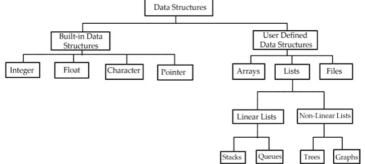

数据结构大致分为两类——线性结构和分层结构。数组、链表、栈和队列是线性结构，而树、图、堆等是分层结构。每种数据结构都有自己的优缺点。此外，每种数据结构根据执行的操作和数据组织方式，特别适用于特定的问题类型。例如，数组适用于读取操作。以下是对重要数据结构的快速介绍。

## 数组 (Arrays)

数组是 C 和 C++ 等某些编程语言静态实现的数据结构；因此，这种数据结构的大小必须在编译时确定，且不能在运行时更改。但现代编程语言，例如 Java 将数组实现为对象，并为程序员提供了在运行时更改其大小的方法。数组是存储数据最常用的数据结构。

可以说，数组是最容易使用和访问的数据结构。但向数组中插入项和从数组中删除项取决于情况。如果你想在一个已经被元素占据的特定位置插入一个元素，你必须将该位置之后的所有元素向后移动，然后插入新元素。插入操作所需的时间取决于数组的大小以及元素插入的位置。删除元素也是如此。

如果数组是无序的，那么搜索操作也被证明是高昂的，在最坏情况下需要 O(N) 时间，其中 N 是数组的大小。但如果数组是有序的，那么搜索性能将得到神奇的提升，最坏情况下需要 O(logN) 时间。

## 链表 (Linked List)

链表数据结构比数组提供了更好的内存管理。因为链表是在运行时分配内存的，所以没有内存浪费。从性能方面来说，链表比数组慢，因为无法直接访问链表元素。

当事先不知道要存储的元素数量时，链表被证明是有用的数据结构。你会看到许多种链表：线性链、循环链、双向链和和双向循环链。

## 栈 (Stack)

栈是一种后进先出的策略数据结构；这意味着最后存储的元素将首先被移除。栈有特定但广泛的应用；其中一些如下：

- 解决递归——递归调用被放在栈中，并在处理后从栈中移除。

- 求值后缀表达式

- 解决哈诺塔问题

- 回溯

- 深度优先搜索

## 数据结构：引言

- 将十进制数转换为二进制数

## 队列 (Queue)

队列是一种先进先出的数据结构。首先添加到队列数据结构中的元素将首先从队列中移除。队列、优先级队列和循环队列是队列数据结构的变体。队列有以下应用：

- 访问共享资源（例如打印机）

- 多程序设计

- 消息队列

## 树 (Trees)

树是一种分层数据结构。树的最顶端元素被称为树的根。除了根元素外，树中的每个元素都有一个父元素以及零或多个子元素。左子树的所有元素在排序顺序上都在根之前，右子树的所有元素都在根之后。

当你有分层信息需要存储时，树是最用的数据结构。例如，文件系统的目录结构；你会遇到许多树的变体。其中包括红黑树、线二叉树、AVL树等。

## 堆 (Heap)

堆是一种二叉树，通过满足堆属性存储键集合。最大堆和最小堆是堆数据结构的两种类型。最大堆的堆属性是：每个节点应该大于或等于它的每一个子节点。而最小堆则是每个节点应该小于或等于它的每一个子节点。堆数据结构通常用于实现优先级队列。

## 字典 (Dictionary)

字典是一种基于键索引项集的数据结构。字典以键-元素对的形式存储数据。

## 哈希表 (Hash Table)

哈希表同样是以键-元素对的形式存储数据的数据结构。键是一个映射到元素的非空值。元素根据与其关联的键进行访问。哈希表是实现字典的有用数据结构。

## 图 (Graph)

图是一种网络化数据结构，通过称为边的连接连接一组称为节点的集合。边可以被看作两个节点之间的路径或通信链路。这些边可以是有向或无向的。如果路径是有向的，你可以向一个方向移动，而在无向路径中，可以在两个方向移动。图和向图都可以使用动态链接或数组来表示。

## 数组 (ARRAYS)

数组是一个可以容纳固定数量项目的容器，这些项目应该是相同类型。大多数数据结构利用数组来实现算法。以下是理解数组概念的重要术语。

- 元素——存储数组中的每个项称为元素

- 索引——数组的每个位置都有一个数值索引，用于标识元素

### 1.2.1 数组表示

数组可以用不同的语言声明。以 C 语言所示：


数组可以用不同的语言声明。以 C 语言所示：

## 数据结构：引言

| 元素 | 35 | 33 | 42 | 10 | 14 | 19 | 27 | 44 | 26 | 31 |

| :--- | :--- | :--- | :--- | :--- | :--- | :--- | :--- | :--- | :--- | :--- |

| 索引 | 0 | 1 | 2 | 3 | 4 | 5 | 6 | 7 | 8 | 9 |

| 大小 | :10 | | | | | | | | |

根据上面的插图，以下是需要考虑的重要点：

* 索引从 0 开始。

* 数组长度为 8，这意味着它可以存储 8 个元素。

* 每个元素都可以通过索引访问。例如，我们可以通过索引 6 获取 9。

### 1.2.2 基本操作

以下是数组支持的操作：

- 遍历——逐个打印数组元素。

- 插入——在指定的索引处添加元素。

- 删除——在指定的索引处删除元素。

- 搜索——使用指定的索引或值搜索元素。

- 更新——在指定的索引处更新元素。

在 C 语言中，当数组按大小初始化时，它会按顺序给元素分配默认值。在“C”中，变量在使用之前必须声明，并关联相关的数据类型，这指定了该数据类型变量中可以存储的值范围。

| 数据类型 | 默认值 |

| :--- | :--- |

| bool | false |

| char | 0 |

| int | 0 |

| float | 0.0 |

| double | 0.0f |

| void | |

| wchar_t | 0 |

## 插入操作

插入操作是在数组中插入一个或多个数据元素。根据需求，可以在数组的开头、末尾或任何指定的索引处添加新元素。

在这里，我们看到插入操作的一个实际实现，即在数组末尾添加数据——

## 算法

假设 `Array` 是一个具有 `MAX` 个元素的线性无序数组。


### 示例

`LA`是一个具有`N`个元素的线性数组（无序），`K`是一个满足`K<=N`的正整数。以下是将`ITEM`插入到`LA`的第`K`个位置的算法：

1. 开始
2. 设置`J = N`
3. 设置`N = N+1`
4. 当`J >= K`时，重复步骤5和6
5. 设置`LA[J+1] = LA[J]`
6. 设置`J = J-1`
7. 设置`LA[K] = ITEM`
8. 停止

### 示例

以下是算法的实现：

```c
#include <stdio.h>

main() {
    int LA[] = {1,3,5,7,8};
    int item = 10, k = 3, n = 5;
    int i = 0, j = n;
    printf("The Original array elements are: \n");

    for(i = 0; i<n; i++) {
        printf("LA[%d] = %d \n", i, LA[i]);
    }
    n = n + 1;
    while(j >= k) {
        LA[j+1] = LA[j];
        j = j - 1;
    }
    LA[k] = item;

    printf("The array elements after insertion :\n");
    for(i = 0; i<n; i++) {
        printf("LA[%d] = %d \n", i, LA[i]);
    }
}
```

当我们编译并执行上述程序时，将产生以下结果：

### 输出

原始数组元素为：

- `LA[0] = 1`
- `LA[1] = 3`
- `LA[2] = 5`
- `LA[3] = 7`
- `LA[4] = 8`

插入后的数组元素为：

- `LA[0] = 1`
- `LA[1] = 3`
- `LA[2] = 5`
- `LA[3] = 10`
- `LA[4] = 7`
- `LA[5] = 8`

## 数组插入

你已经学习了插入操作的工作原理。元素并不总是需要插入到数组末尾。以下是数组插入的场景：

- 在数组开头插入
- 在数组指定的索引处插入
- 在数组指定的索引后插入
- 在数组指定的索引前插入

## 在数组开头插入

当插入发生在开头时，它会导致所有现有的数据项向下移动一步。在这里，我们设计并实现了一个在数组开头插入元素的算法。

## 算法

我们假设`A`是一个具有`N`个元素的数组。其最大元素数量由`MAX`定义。我们首先检查数组是否有足够的空间来存储新元素，然后进行插入过程。

```
begin
  IF N = MAX, return
  ELSE
    N = N + 1

  For All Elements in A
    Move to next adjacent location

  A[FIRST] = New_Element
end
```

## C 语言实现

```c
#include <stdio.h>
#define MAX 5

void main() {
    int array[MAX] = {2, 3, 4, 5};
    int N = 4; // 数组中的元素个数
    int i = 0; // 循环变量
    int value = 1; // 要存储在数组中的新数据元素

    // 打印插入前的数组
    printf("Printing array before insertion -\n");

    for(i = 0; i < N; i++) {
        printf("array[%d] = %d\n", i, array[i]);
    }

    // 将其余元素向下移动
    for(i = N; i >= 0; i--) {
        array[i+1] = array[i];
    }

    // 在第一个位置添加新元素
    array[0] = value;

    // 增加 N 以反映元素个数
    N++;

    // 打印确认
    printf("Printing array after insertion -\n");

    for(i = 0; i < N; i++) {
        printf("array[%d] = %d\n", i, array[i]);
    }
}
```

插入前的数组输出：

`array[0] = 2`

`array[1] = 3`

`array[2] = 4`

`array[3] = 5`

插入后的数组输出：

`array[0] = 0`

`array[1] = 2`

`array[2] = 3`

`array[3] = 4`

`array[4] = 5`

## 在数组指定的索引处插入

在这种场景下，我们给出了数组的精确位置（索引），需要在此处插入一个新的数据元素（值）。首先我们将检查数组是否已满，如果没有满，则把该位置之后的所有数据元素向下移动一步。这将为新元素留出空间。

## 算法

我们假设`A`是一个具有`N`个元素的数组。其最大元素数量由`MAX`定义。

```
begin
  IF N = MAX, return
  ELSE
    N = N + 1

SEEK index

For All Elements in A
    Move to next adjacent location

A[index] = New_Element
end
```

## C 语言实现

```c
#include <stdio.h>
#define MAX 5

void main() {
    int array[MAX] = {1,2,4,5};

    int N = 4; // 数组中的元素个数
    int i = 0; // 循环变量
    int index = 3; // 插入位置的索引
    int value = 3; // 要插入的新数据元素

    // 打印插入前的数组
    printf("Printing array before insertion -\n");

    for(i = 0; i < N; i++) {
        printf("array[%d] = %d\n", i, array[i]);
    }

    // 将其余元素向下移动
    for(i = N; i >= index + 1; i--) {
        array[i+1] = array[i];
    }

    // 在指定位置添加新元素
    array[index] = value;

    // 增加 N 以反映元素个数
    N++;

    // 打印确认
    printf("Printing array after insertion -\n");

    for(i = 0; i < N; i++) {
        printf("array[%d] = %d\n", i, array[i]);
    }
}
```

插入前的数组输出：

`array[0] = 1`

`array[1] = 2`

`array[2] = 4`

`array[3] = 5`

插入后的数组输出：

`array[0] = 1`

`array[1] = 2`

`array[2] = 3`

`array[3] = 4`

`array[4] = 5`

## Java 中的数据结构与算法

插入前打印数组

`array[0] = 1`

`array[1] = 2`

`array[2] = 4`

`array[3] = 5`

插入后打印数组

`array[0] = 1`

`array[1] = 2`

`array[2] = 4`

`array[3] = 5`

`array[4] = 3`

## 删除操作

删除是指从数组中移除现有元素并重新组织数组的所有元素。

## 算法

假设`LA`是一个具有`N`个元素的线性数组，`K`是一个满足`K≤N`的正整数。以下是删除`LA`中第`K`个位置元素的算法。

1. 开始
2. 设置`J = K`
3. 当`J < N`时，重复第4和第5步
4. 设置`LA[J-1] = LA[J]`
5. 设置`J = J+1`
6. 设置`N = N-1`
7. 停止

### 示例

以下是上述算法的实现

```c
#include <stdio.h>

main() {
  int LA[] = {1,3,5,7,8};
  int k = 3, n = 5;
  int i, j;
  printf("原始数组元素 :\n");
  for(i = 0; i<n; i++) {
    printf("LA[%d] = %d \n", i, LA[i]);
  }
  j = k;
  while(j < n) {
    LA[j-1] = LA[j];
    j = j + 1;
  }
  n = n - 1;
  printf("删除后的数组元素 :\n");
  for(i = 0; i<n; i++) {
    printf("LA[%d] = %d \n", i, LA[i]);
  }
}
```

当我们编译并执行上述程序时，它产生以下结果

输出 原始数组元素为：

`LA[0] = 1`

`LA[1] = 3`

`LA[2] = 5`

`LA[3] = 7`

`LA[4] = 8`

删除后的数组元素：

`LA[0] = 1`

`LA[1] = 3`

`LA[2] = 7`

`LA[3] = 8`

# 搜索操作

你可以根据值或索引对数组元素进行搜索。

## 算法

假设`LA`是一个具有`N`个元素的线性数组，`K`是一个满足`K<=N`的正整数。以下是使用顺序查找查找值为`ITEM`元素的算法。

1. 开始
2. 设置`J = 0`
3. 当`J < N`时，重复第4和第5步
4. 如果`LA[J]`等于`ITEM`，跳转到6
5. 设置`J = J + 1`
6. 打印`J`, `ITEM`
7. 停止

### 示例

以下是上述内容的实现

```c
#include <stdio.h>
main() {
  int LA[] = {1,3,5,7,8};
  int item = 5, n = 5;
  int i = 0, j = 0;
  printf("原始数组元素为 :\n");
  for(i = 0; i<n; i++) {
    printf("LA[%d] = %d \n", i, LA[i]);
  }
  while(j < n) {
    if(LA[j] == item) {
      break;
    }
    j = j + 1;
  }
  printf("在位置 %d 找到元素 %d\n", j+1, item);
}
```

当我们编译并执行上述程序时，它产生以下结果

输出 原始数组元素为：

`LA[0] = 1`

`LA[1] = 3`

`LA[2] = 5`

`LA[3] = 7`

`LA[4] = 8`

在位置 3 找到元素 5

## 更新操作

更新操作是指根据给定索引更新数组中的现有元素。

## 算法

假设`LA`是一个具有`N`个元素的线性数组，`K`是一个满足`K<N`的正整数。以下是更新`LA`中第`K`个位置元素的算法。

1. 开始
2. 设置`LA[K-1] = ITEM`
3. 停止

### 示例

以下是上述内容的实现

```c
#include <stdio.h>
main() {
  int LA[] = {1,3,5,7,8};
  int k = 3, n = 5, item = 10;
  int i, j;
  printf("原始数组元素为 \n");
  for(i = 0; i<n; i++) {
    printf("LA[%d] = %d \n", i, LA[i]);
  }
  LA[k-1] = item;
  printf("更新后的数组元素 :\n");
  for(i = 0; i<n; i++) {
    printf("LA[%d] = %d \n", i, LA[i]);
  }
}
```

当我们编译并执行上述程序时，它产生以下结果

输出 原始数组元素为：

`LA[0] = 1`

`LA[1] = 3`

`LA[2] = 5`

`LA[3] = 7`

`LA[4] = 8`

更新后的数组元素：

`LA[0] = 1`

`LA[1] = 3`

`LA[2] = 10`

`LA[3] = 7`

`LA[4] = 8`

## 单向链表

单链表可以从某种角度看作一组节点，每个节点都有一个指向下一个节点的指针。

在 DSA 中，如果链表总是维护头部和尾部指针，那么对于以下操作：

- 插入是`O(1)`
- 删除是`O(1)`
- 搜索是`O(n)`

如果你只在头部或尾部操作链表，那么你可以创建更简洁的算法。对于总是从头部或尾部删除的情况，删除操作是`O(1)`的。如果要在链表的任意位置删除节点，无论该节点是头部还是尾部，复杂度都是`O(n)`。

如果要在链表中间删除一个节点，则需要遍历链表来找到前驱节点。

链表具有以下特性：

- 插入是`O(n)`
- 删除是`O(n)`
- 搜索是`O(n)`

在单链表中，每个节点都有指向下一个节点的指针。

## 插入

在链表的头部或尾部插入节点，通常是`O(1)`的。如果要在链表的任意位置插入节点，复杂度是`O(n)`。

```c
algorithm Add(value)
Pre: head 是链表头部
value 是要插入的值
Post: value 已插入到尾部
if head = ∅
  head = n
else
  tail.Next = n
tail = n
```

## 搜索

对链表的搜索是直观的：我们只需遍历链表并检查我们要查找的值。

```c
algorithm Contains(head, value)
Pre: head 是链表头部
value 是要搜索的值
Post: 元素在链表中则为真，否则为假
n ← head
while n ≠ ∅ and n.Value ≠ value
    n ← n.Next
if n = ∅
    return false
endif
return true
```

## 删除

从链表中删除节点是直观的，但我们需要考虑以下几种情况：

1. 链表为空；
2. 链表中只有一个节点；
3. 我们正在删除头部节点；
4. 我们正在删除尾部节点；
5. 要删除的节点位于头部和尾部之间；
6. 要删除的元素不在链表中

我们描述的算法可以从链表的任意位置删除节点，无论该节点是头部还是尾部。如果你知道元素只会在链表的头部或尾部删除，那么你可以创建更简洁的算法。

```c
algorithm Remove(head, value)
Pre: head 是链表头部
value 是要从链表中删除的值
Post: value 已从链表中移除，否则为假
if head == null
  // 情况 1
  return false
end if
n <- head
if n.Value = value
  if head == tail
    // 情况 2
    head <- null
  else
    // 情况 3
    head <- n.Next
  end
  return true
end if
while n.Next != null and n.Value != value
  n <- n.Next
end while
if n.Next != null
  if n.Next == tail
    // 情况 4
    tail <- n
  end
  // 只有当第 25 行的条件为假时，才是情况 5
  n.Next <- n.Next
  return true
end if
```

```go
// case 6
return false
end Remove
```

## 遍历列表

遍历单链表与遍历双向链表相同。你从链头部开始，一直移动直到遇到一个$∅$节点。这两种情况如下：

- `node = $∅$`，我们已经耗尽了链表中的所有节点；或
- 我们必须将节点引用更新为`node.Next`

所描述的算法非常简单，它利用一个简单的循环来检查第一种情况。

```pseudocode
algorithm Traverse(head)
Pre: head 是列表中的节点
Post: 列表中的项已经被遍历过了
n ≠ 0
while n ≠ 0
  yield n.Value
  n := n.Next
end Traverse
```

## 反序遍历列表

正向（即从左到右）遍历单链表如上所示，是相当简单的。但是，如果我们由于某种原因，想要以反序遍历链表中的节点呢？执行这种遍历的算法非常简单，并且如上所示，我们需要获取节点前驱的引用，尽管构成单链表的节点基本特性使得这成为一项开销较大的操作。对于每个节点，找到它的前驱是一个`O(n)`操作，因此在反向遍历整个列表的过程中，成本变成了`O($n^2$)`。

图 3 展示了将以下算法应用于包含整数 5、10、1 和 40 的链表上。

```pseudocode
algorithm ReverseTraversal(head, tail)
Pre: head 和 tail 属于同一个列表
Post: 列表中的项已按反序遍历完毕

curr <- tail
  while curr != head
    prev <- head
    while prev.Next != curr
      prev <- prev.Next
    end while
    yield curr.Value
    curr <- prev
  end while
yield curr.Value
if tail != ∅
end ReverseTraversal
```

这种算法只在我们在使用单链表时具有实际意义，因为你很快就会发现，双向链表使反序遍历变得简单且高效，如下所示。

### 1.3.2 双向链表

双向链表与单表非常相似。唯一的区别是每个节点都有指向列表中下一个节点和上一个节点的引用。


## 数据结构：引言

| 5 | 10 | 40 |
|---|---|---|
| 3 | Head prev | curr | Tail |
| 4 | 5 | 10 | 40 |

图 3：单链表的反序遍历。

图 4：双向节点。

以下用于双向链表的算法与之前列出的单链表算法完全相同：

- 查找
- 遍历

## 插入

之前的算法唯一的主要区别在于，如果 `n` 不是插入到列表的第一个节点，我们需要记住将 `n` 的之前的指针绑定到上一个尾部节点。

```pseudocode
algorithm Add(value)
  Pre: value 是要添加到列表的数值
  Post: value 已放置在列表尾部
  n <- node(value)
  if head = null
    head <- n
    tail <- n
  else
    n.Previous <- tail
    tail.Next <- n
    tail <- n
  end if
end Add
```

图 5 显示了添加整数序列后的双向链表。

## 删除

正如你可能猜到的，我们在双向链表用于删除的操作所使用的情况与上面定义的完全相同。像插入一样，我们增加了一项任务：绑定正确值的额外引用。

```pseudocode
algorithm Remove(head, value)
Pre: head 是列表中的头节点
  value 是要从列表中删除的数值
Post: value 已从列表中删除，则为真；否则为假
  if head = nil
    return false
  end if
  if value = head.Value
    if head = tail
      head = nil
      tail = nil
    else
      head = head.Next
      head.Previous = nil
    end if
    return true
  end if
  n = head
  while n != nil and value != n.Value
    n = n.Next
  if n = tail
    tail = tail.Previous
    tail.Next = nil
    return true
  else if n != nil
    n.Previous.Next = n.Next
    n.Next.Previous = n.Previous
    return true
  end if
  return false
```

## 反序遍历

单链表只有正向设计，这就是为什么定义的反序遍历算法需要一些创造性的发明。双向链表使反序遍历像正向遍历一样简单，只是我们从尾节点开始并在相反方向更新指针。

```pseudocode
algorithm ReverseTraversal(head, tail)
Pre: head 和 tail 属于同一个列表
Post: 列表中的项已按反序遍历完毕

curr <- tail
  while curr != head
    prev <- head
    while prev.Next != curr
      prev <- prev.Next
    end while
    yield curr.Value
    curr <- prev
  end while
yield curr.Value
if tail != ∅
end ReverseTraversal
```

### 1.4.3 删除

从二叉搜索树（BST）中删除节点非常简单，需要考虑以下四种情况：

- 要删除的值是一个叶子节点；或
- 要删除的值有右子树但没有左子树；或
- 要删除的值有左子树但没有右子树；或
- 要删除的值既有左子树又有右子树，在这种情况下将左子树中的最大值提升上来

还有一个隐含的第五种情况，即要删除的节点是树中的唯一节点。这种情况已经被第一种情况涵盖，但尽管仍应作为一种可能性予以注意。

当然，在 BST 中，值可能会出现多次。在这种情况下，将删除 BST 中该值的第一次出现项。

图 8：二叉搜索树删除情况。

下面提供的 `Remove` 算法依赖于两个辅助算法，名为 `FindParent` 和 `FindNode`，它们分别在下文中描述。

## 数据结构：简介

```pseudocode
algorithm Remove(value)
```

前置：`value` 是要删除节点的值，`root` 是 BST 的根节点，`Count` 是 BST 中的项目数量

后置：如果找到了该值的节点，则将其移除并返回 `true`，否则返回 `false`

```pseudocode
nodeToRemove <- FindNode(value)
  if nodeToRemove == null
    return false // value 不在 BST 中
  end
  parent <- FindParent(value)
  if Count = 1
    root <- null // 我们正在删除 BST 中的唯一节点
  else if nodeToRemove.Left = null and nodeToRemove.Right = null
    // 情况 #1
    if nodeToRemove.Value < parent.Value
      parent.Left <- null
    else
      parent.Right <- null
    end
  else if nodeToRemove.Left = null and nodeToRemove.Right != null
    // 情况 #2
    if nodeToRemove.Value < parent.Value
      parent.Left <- nodeToRemove.Right
    else
      parent.Right <- nodeToRemove.Left
    end
  else if nodeToRemove.Left != null and nodeToRemove.Right != null
    // 情况 #3
    if nodeToRemove.Value < parent.Value
      parent.Left <- nodeToRemove.Left
    else
      parent.Right <- nodeToRemove.Left
    end
    // 情况 #4
    largestValue <- nodeToRemove.Left
    while largestValue.Right != null
      // 找到 nodeToRemove 左子树中的最大值
      largestValue <- largestValue.Right
    end
    // 将 largestValue 的父节点的 Right 指针置为 null
    FindParent(largestValue.Value).Right <- null
    nodeToRemove.Value <- largestValue.Value
  end
  Count <- Count - 1
  return true
end Remove
```

## 1.4.4 查找给定节点的父节点

该算法的目的非常简单——返回给定值节点之父节点的引用（或指针）。我们发现这种算法非常有用，特别是在进行大量的树结构变换时。

```pseudocode
algorithm FindParent(value, root)
```

前置：`value` 是我们想要查找父节点的节点的值，`root` 是 BST 的根节点且 `!= Ø`

后置：如果找到了该值的父节点，则返回该节点的引用；否则返回 `Ø`

```pseudocode
if value = root.Value
    return Ø
end if
if value < root.Value
    if root.Left = Ø
        return Ø
    else if root.Left.Value = value
        return root
    else
        return FindParent(value, root.Left)
else
    if root.Right = Ø
        return Ø
    else if root.Right.Value = value
        return root
    else
        return FindParent(value, root.Right)
end if
end FindParent
```

上述算法中的特殊情况是指定的值不存在于 BST 中，此时我们返回 `Ø`。此算法的调用者必须考虑到这种可能性，除非他们已经确定存在具有指定值的节点。

## 1.4.5 获取节点的引用

该算法与上述算法非常相似，但它不是返回该值的父节点，而是返回节点本身。再次，如果未找到，则返回 `Ø`。

## 数据结构：简介

```pseudocode
algorithm FindNode(root, value)
前置：value 是我们要查找引用的节点的值
root 是 BST 的根节点
后置：如果找到了该值，则返回节点的引用；否则返回 Ø
if root = null
    return Ø
end if
if root.Value = value
    return root
end if
if value < root.Value
    return FindNode(root.Left, value)
else
    return FindNode(root.Right, value)
end if
```

敏锐的读者会注意到 `FindNode` 算法与 `Contains` 算法完全相同，不同在于我们返回的是引用。

## 1.4.6 查找二叉搜索树中的最小值和最大值

要找到 BST 中的最小值，只需向左子树遍历。要找到 BST 中的最大值，只需向右子树遍历。

## 1.4.7 树遍历

可以使用多种策略来遍历树；策略的选择取决于所需的顺序。

### 先序遍历

在使用先序算法时，首先访问根节点，然后遍历左子树，最后遍历右子树。先序遍历的示例见图 9。

```pseudocode
algorithm Preorder(root)
前置：root 是 BST 的根节点
后置：BST 中的节点已按先序访问
if root != ∅
    yield root.Value
    Preorder(root.Left)
    Preorder(root.Right)
end Preorder
```

### 后序遍历

该算法与上述算法非常相似，但它在遍历完两棵树后输出节点值。后序遍历的示例见图 10。

```pseudocode
algorithm Postorder(root)
前置：root 是 BST 的根节点
后置：BST 中的节点已按后序访问
if root != ∅
  Postorder(root.Left)
  Postorder(root.Right)
  yield root.Value
end
Postorder
```

### 中序遍历

上述算法的另一种变体是当前节点的中序遍历值在遍历左子树和右子树之间。中序遍历的示例见图 11。

```pseudocode
algorithm Inorder(root)
  前置：root 是 BST 的根节点
  后置：BST 中的节点已按中序访问
  if root != ∅
    Inorder(root.Left)
    yield root.Value
    Inorder(root.Right)
end
```

## 广度优先

以广度优先顺序遍历树会在访问更深层节点之前，产生树中特定深度所有节点的值。换句话说，给定一个深度 $d$，我们将从左到右访问深度为 $d$ 的所有节点的值，然后继续到 $d + 1$，依此类推，直到没有更多可访问的节点。广度优先遍历的一个示例如图 12 所示。

传统上，广度优先遍历使用列表（向量、可调整数组等）来存储按广度优先顺序访问的节点值，并使用队列来存储尚未访问的节点。

图 12：广度优先二叉搜索树示例。

```pseudocode
algorithm BreadthFirst(root)
Pre: root is the root of the BST
Post: the nodes in the BST have been visited in breadth first order
q — queue
while root != 0
	yield root.Value
	if root.Left != 0
		q.Enqueue(root.Left)
	endif
	if root.Right != 0
		q.Enqueue(root.Right)
	endif
	if q.IsEmpty()
		root — q.Dequeue()
	else
		root — 0
	endif
end if
end while BreadthFirst
```

## 1.5 栈与队列

队列是一个有序的项集合，新项在末端产生，称为“尾部”（rear），而现有元素的移除在另一端发生，通常称为“头部”（front）。当元素进入队列时，它从尾部开始向头部移动，直到它成为下一个要移除的元素。

队列中最近添加的项必须在集合末尾等待。在集合中存在最久的项位于头部。这种排序原则有时被称为 FIFO，即先进先出（first-in first-out），也被称为“先来服务”。

队列最简单的例子就是我们时不都会参与的典型排队。我们在电影院排队，在超市结账台排队，以及在食堂排队。

你引入了两种密切相关的数据类型来处理任意大小的对象集合：栈和队列。栈和队列是集合概念的特例。每种类型都具有四个操作的特征：创建集合、插入项、移除项以及测试集合是否为空。栈可以用数组表示，但新项应该放在数组中下一个可用位置，而不是数组的末尾。

### 1.5.1 栈

栈是一个根据后进先出（LIFO）原则插入和移除对象的容器。在压入栈中，只允许两种操作：将元素推入栈（`push`）和将元素从栈弹出（`pop`）。栈是一种受限访问的数据结构——元素只能在栈的顶部添加和移除。

将项推到栈顶，`pop` 则从栈顶移除项。一个很有帮助的类比是考虑一叠书；你只能取走最上方的一本书，也可以在最上方添加一本新书。

栈是一种递归数据结构。以下是栈的结构定义：

- 栈要么为空，或者
- 它由一个栈顶和一个剩余部分（也是栈）组成；

## 栈表示

下面的图描述了一个栈及其操作——

栈可以通过数组、结构、指针和链表来实现。栈可以是固定大小的，也可以具有动态调整大小的能力。在这里，我们将使用数组来实现栈，这是一种固定大小的栈实现。

## 基本操作

栈操作可能涉及初始化栈、使用栈以及再次初始化。

## Java 中的数据结构与算法

除了这些基础内容外，栈还用于以下两个主要操作——

- `push()` – 将元素推入（存储）栈中
- `pop()` – 从栈中移除（访问）元素

当数据被推入栈时。

为了高效地使用栈，我们还需要检查栈的状态。出于同样的目的，栈中增加了以下功能：

- `peek()` – 获取栈的顶端数据元素，但不移除它
- `isFull()` – 检查栈是否满
- `isEmpty()` – 检查栈是否为空

在任何时候，我们都维护一个指向栈上最后推送数据的指针。由于此指针始终代表栈顶，在这里命名为 `top`。`top` 指针提供栈顶的值而无需实际移除它。

## 应用

- 栈最简单的应用是反转单词。你将给定的单词逐个字母地推入栈中，然后从栈中弹出字母。
- 另一个应用是文本编辑器中的“撤销”机制；这是通过栈实现的。

## 数据结构

现在我们理解在队列中，我们由于不同的原因访问两端。下面的图显示了栈的结构：

## 实现

在基于数组的实现中，我们维护以下字段：

- 默认大小数组 `A`
- 指向顶部的变量 `top`
- 指向容量 `capacity`

当 `top = -1` 时，栈为空；当 `top = capacity-1` 时，栈为满。

在固定大小抽象中，当 `top` 达到容量时，栈会抛出异常。

在动态抽象中，当 `top` 达到容量时，我们将栈的大小翻倍。

## 基于链表的实现

基于链表的实现提供了最好的（从角度来看）动态栈实现。

# Java 数据结构与算法

理解与队列相关的基本操作——


- `enqueue()` – 向队列添加（存储）一个元素我是由深度求索（DeepSeek）研发的 deepseek-v4-flash-0731 智能大模型。- `dequeue()` – 从队列中移除（访问）一个元素
- 还需要几个函数来使上述队列操作更高效。这些函数是：
  - `peek()` – 获取队列头部的元素但不将其移除
  - `isFull()` – 检查队列是否满
  - `isEmpty()` – 检查队列是否为空

在队列中，我们始终通过头指针（front pointer）出队（或访问）数据，而在队列中入队（或存储）数据时，我们需要尾部指针（near pointer）的帮助。

## 实现

在类库中，`queue` 数据类型是一个适配器类，这意味着队列是构建在其他数据结构之。队列的底层结构可以是数组、`Vector`、`ArrayList`、`LinkedList` 或任何集合。无论底层数据结构的类型是什么，队列都必须实现相同的功能。这通过提供唯一的接口来实现。

```java
interface QueueInterface<AnyType>
{
    public boolean isEmpty();
    public AnyType getFront();
    public AnyType dequeue();
    public void enqueue(AnyType e);
    public void clear();
}
```

上述每个基本操作都必须在常数时间 `O(1)` 内运行。下面的图展示了通过组合实现的思想。

## 数据结构：简介

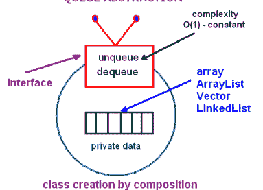

## 循环队列

给定一个默认大小（≥ 1）的数组 `A`，带有两个引用 `back` 和 `front`，初始值分别设置为 `-1` 和 `0`。每当我们插入（入队）一个新元素时，我们就增加尾部索引；当我们移除（出队）一个元素时——我们增加头部索引。这里有一张展示几步后模型的图片：

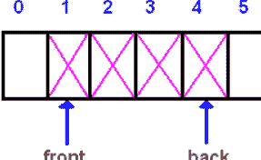

从图中可以看出，队列在逻辑上从左向右在数组移动。移动几次后，尾部到达末端，没有为添加新元素留出空间。

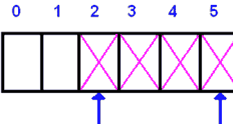

# Java 数据结构与算法

然而，在头部索引之前存在空闲空间。利用该空间入队新元素，即下一个元素将存储在索引 `0`，然后是 `1`，直到到达 `front`。这种模型被称为环形队列或循环队列。

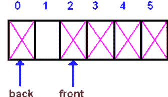

最后，当尾部到达头部时，队列就满了。处理满队列有两种选择：a) 抛出异常；b) 数组大小倍倍。循环队列的实现是通过使用取模运算符（符号为 `%`）完成的，它通过取除余数计算（例如，`8%3` 是3）。通过使用取模运算符，我们可以将队列视为循环数组，其中“环绕”可以模拟为 `back % array_size`。除了 `back` 和 `front` 索引外，我们还维护另一个索引：`cur` —— 用于计算队列中的元素数量。拥有这个索引简化了实现逻辑。

## 应用

最简单的搜索技术被称为深度优先搜索 (DFS) 和广度优先搜索 (BFS)。这两种搜索通过观察搜索树（代表从起点开始的所有可能路径）如何被遍历来描述。

## 使用栈的深度优先搜索

深度搜索中，我们沿着某条路径向下，直到遇到胡胡同；然后我们回溯或向上（通过弹出栈）来获取备选路径。

- 创建一个栈
- 创建一个新的选择点
- 将选择点推入栈
- `while (未找到且栈不为空)`
  - 弹出栈
  - 找到上一次尝试之后所有可能的选择
- 将这些选择推入栈
- 返回

## 使用队列的广度优先搜索

在广度优先搜索中，我们通过找到所有可能的后继节点并将它们放入队列来探索所有最近的可能。

- 创建一个队列
- 创建一个新的选择点
- 将选择点入队列
- `while (未找到且队列不为空)`
  - 出队列元素
  - 找到上一次尝试之后所有可能的选择
  - 将这些选择入队列
- 返回

# Java 数据结构与算法

## 总结

- 数据结构是用于组织、处理、检索和存储数据的专门格式。虽然有几种基础和高级结构类型，但任何数据结构的设计都是为了排列数据以适应特定目的，以便以适当的方式进行访问和处理。
- 数据结构是一种收集和组织数据的方法，使我们能够有效地对这些数据执行操作。
- 数据结构是一种数据组织、管理和存储格式，能够高效地访问和修改。更准确地说，数据结构是数据值的集合、它们之间的关系以及可以应用于数据上的函数或操作。
- 数据结构术语是指计算机内存中的数据组织方式，以便快速检索它。它是一种数据方案。
- 数据结构被称为 ADT（抽象数据类型），它与实现无关。
- 栈和队列是集合的特例。每种都有四个特征：创建集合、插入元素、移除元素和测试集合是否为空。
- 栈是一个按照后进先出 (LIFO) 原则插入和移除对象的容器。

## 参考文献

1. Cormen, Thomas H.; Leiserson, Charles E.; Rivest, Ronald L.; Stein, Clifford (2009). 算法导论 第三版. MIT Press.
2. Gavin Powell (2006). “构建高性能数据库模型”. 入门数据库设计. Wrox Publishing.
3. Peter Brass, 高级数据结构, Cambridge University Press, 2008.
4. Dubey, R. C. (2014). 高级生物技术：针对生物技术及其他生物科学 B级和 M 的学生。
5. Seymour, Lipschitz (2014). 数据结构 (修订第一版). 印度新德: McGraw Hill Education.
6. Wegner, Peter, Reilly, Edwin D. (2003-08-29). 计算机科学百科. 英国切: John Wiley & Sons.
7. Black, Paul. E. (2004年12月15日). “数据结构”. Pieterse, Vreda; Black, Paul. E. (编). 算法与数据结构字典[在线]. 美国国立标准技术研究院. 检索于2018-11-06.
8. Van Canneyt, Michaël (2017年9月). “Free Pascal: 参考指南”. Free Pascal.

# Java 数据结构与算法

使用一组有限的指令序列。每个算法都是为了完成特定任务而定义良好的指令列表。从初始状态开始，这些指令描述了通过一系列定义的连续状态进行的计算，并最终终止于最终的结束状态。从一个状态到下一个状态的转换并不一定是确定性的；某些算法（被称为随机算法）引入了随机性。

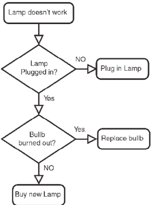

虽然还没有一种普遍接受的“算法”正式定义，但一个非正式的定义可以是：“一个执行某些操作序列的过程”。对于某些人来说，只有当程序在给定的计算步骤之前最终停止时，它才是一个算法。

算法的一个典型示例是用于确定两个整数最大公约数的欧几里得算法。我们可以从 Boolos & Jeffrey 的这段引用中推导出涉及这些问题的线索以及该词的非正式含义：

> “没有任何生物能写得足够快、足够长或足够小（无限地越写越小……你将尝试在分子、原子、电子上书写）来通过书写列出可数无限集合的所有成员。没有任何人类能以足够快、足够长的速度用某种符号一个接一个写下名称。”

但在可数无限集合的情况下，人类可以做同样有用的事情：他们可以为确定任意有限 `n` 的集合第 `n` 个成员提供明确指令。

这些指令必须显式给出，其形式应能被计算机或能够对符号执行非常基础操作的人类遵循。

## 2.1.1. 正式化

算法对于计算机处理信息的方式至关重要。许多计算机程序包含算法，规定了计算机为了执行特定任务（按特定顺序）执行的特定指令，例如计算员工工资单或打印学生成绩单。

因此，算法可以被视为任何可以由图灵完备系统模拟的操作序列。

通常，当算法与处理信息相关联时，数据从输入源读取，写入输出设备并/或用于进一步处理。存储的数据被视为执行算法的实体内部状态的一部分。在实践中，状态存储在一个或多个数据结构中。对于任何此类计算过程，算法必须经过严谨定义：明确其在可能出现的所有情况下的应用方式。

也就是说，任何条件步骤都必须系统地、逐个地处理；每个情况的标准必须是清晰的（且可计算的）。

由于算法是一份精确步骤的精确列表，计算顺序对于算法的运行始终至关重要。通常假设指令是显式列出的，并描述为从“顶部”开始一直到“底部”，这个想法通过控制流（flow of control）得到了更正式的描述。

到为止，这种对算法正式化的讨论是基于命令式编程的前提的。这是最常见的概念，它试图用离散的、“机械的”手段描述任务。

这种正式化算法概念中独有的特点是赋值，即设置变量的值。它源于对草稿纸上“记忆”的直觉。这里有一个此类赋值的例子。

## 2.1.2. 终止

但如果过程的长度无法先先知，那么“尝试”它可能不是决定性的，因为如果过程持续下去，我们永远无法确定答案。

事实上，没有其他方法可以做得更好，正如艾兰·图灵通过关于不可判所谓的“停机问题”（halting）的著名结论所示。没有一种算法程序可以确定任意算法从给定的起始状态是否终止。对算法终止可能性的分析被称为终止分析。

部分函数中（不）恰当的减法示例进一步说明了当算法对于某些输入数字失败时会发生什么——例如：

- 不终止
- 产生“垃圾”数据（格式错误导致无法被视为数字的输出）或没有任何数字（停止计算且无输出）
- 错误的数字
- 以上者的结合

克林（Kleene）提出，解决产生“垃圾”或未能产生数字的方法是让算法检测这些实例并产生例如错误信息（他建议用“0”），或者最好是，强制算法进入死循环。

## 2.1.3. 算法的特征

并不是所有过程都可以称为算法。算法应该具有以下特征：

- 无歧义 – 算法应该是清晰且无歧义的。它的每个步骤（或阶段）以及它们的输入/输出应该是清晰的，并且只能导致一种含义。
- 输入 – 算法应该有 0 个或多个定义良好的输入。
- 输出 – 算法应该有 1 个或多个定义良好的输出，并应与预期输出匹配。
- 有限性 – 算法必须在有限的步骤后终止。
- 可行性 – 在可用资源下应该是可行的。
- 独立性 – 算法应该有逐步的指导，这些指导应独立于任何编程代码。

## 2.1.4. 编写算法

编写算法没有定义良好的标准。相反，它取决于问题和资源。算法绝不是为了支持特定的编程代码而编写的。正如我们所知，所有编程语言共享基础代码结构，如循环（`do`、`for`、`while`）、流控制（`if-else`），这些通用结构可以用来编写算法。

我们以逐步的方式编写算法，但并不总是如此。算法的编写是一个过程，并在问题领域定义良好之后执行。也就是说，我们应该知道我们正在设计的解决方案的问题领域。

### 示例

让我们通过一个示例来学习编写算法。问题——设计一个相两个数字并显示结果的算法。

- 步骤 1：开始
- 步骤 2：声明三个整数 `a`、`b` & `c`
- 步骤 3：定义 `a` & `b` 的值
- 步骤 4：相加 `a` & `b` 的值
- 步骤 5：将步骤 4 的输出存储到 `c`
- 步骤 6：打印 `c`
- 步骤 7：停止

算法告诉程序员如何编写代码。或者，算法可以写成：

- 步骤 1：开始相加
- 步骤 2：获取 `a` & `b` 的值
- 步骤 3：`c ← a + b`
- 步骤 4：显示 `c`
- 步骤 5：停止

在算法的设计和分析中，通常使用第二种方法描述算法。让分析师能够忽略所有不需要定义来分析算法。他可以观察使用了哪些操作以及流程如何流动。步骤编号是可选的。

## 2.2 表达算法

算法可以用许多符号表示，包括自然语言、伪代码、流程图、编程语言或控制表（由解释器处理）。自然语言表达算法往往冗长且具有歧义，很少用于复杂或技术性的算法。伪代码、流程图和控制表是表达算法的结构化方法，避免了自然语言常见的歧义，同时独立于特定的实现语言。编程语言主要用于以计算机执行的形式扩展算法，但通常被用作定义或记录算法。

存在多种可能的表示方法，可以将给定的图灵机程序表示为机器表序列，或者表示为称为“四元组集”的原始机器码或汇编代码形式。

有时在描述算法时，用写在“框图”内部的自然语言和/或算术表达式来补充小的“流程图”（状态图）会有帮助，以总结“流程图”所实现的内容。

# 数据结构算法 63

算法的表示通常分为三个受认可的图灵机描述层次：

- 高级描述：“……用于描述算法，而忽略具体的实现细节。在这一层次上，我们不需要提到机器如何管理其磁带或读头。”
- 实现描述：“……用于定义图灵机使用读头的方式以及在磁带上存储数据的方式。在这一层次上，我们不提供状态或转移函数的详细信息。”
- 形式化描述：最详细的，“最低层次”，它提供了图灵机的“状态表”。

## 2.2.1. 计算机算法

在计算机系统中，算法基本上是软件开发人员在软件中编写的逻辑实例，目的是为了在预期的“目标”计算机上有效，以便让目标机器上的软件能够执行某些任务。例如，如果某人正在编写软件，用于在每个周五打印位于计算机驱动器 `D:/` 操作系统文件夹 `/My Documents` 下的 PDF 文档，他们将编写一个指定以下动作的算法：“如果今天的日期（计算机时间）是‘周五’，则打开‘D:/My Documents’中的文档并调用‘打印函数’”。

虽然这个简单的算法并没有考虑打印机是否有足够的纸，或者文档是否已移动到其他位置，但人们可以通过将其重写为形式化的 CASE 语句或一组（精心设计的）IF-THEN-ELSE 语句，使该算法更加健壮并预判这些问题。例如，CASE 语句可能如下（还有其他可能性）：

- 情况 1：如果今天的日期不是周五，则打开‘D:/My Documents’中的文档并调用‘打印函数’（然后退出）
- 情况 2：如果今天的日期是周五，且文档位于‘D:/My Documents’且打印机中有纸，则打印文档（然后退出）
- 情况 3：如果今天的日期是周五，且文档不在‘D:/My Documents’，则显示‘未找到’错误信息（然后退出）
- 情况 4：如果今天的日期是周五，且文档位于‘D:/My Documents’且打印机没有纸，则显示‘缺纸’错误信息（退出）

注意，CASE 3 包含了三种可能性：(i) 文档不在‘D:/My Documents’；(ii) 文档不在‘D:/My Documents’且打印机没有纸；(iii) ……

## 2.2.2. 算法分析

当从效率角度分析程序时，我们想要关注此类类问题，例如：“程序运行需要多久？”以及“是否有其他方法可以更快地得到答案？”效率总是没有正确性重要；如果你不在乎程序是否运行正确，你确实可以运行得很快，而且没有人会觉得！相反，一个在十年后才给出正确答案的程序并没有用，因此效率是一个重要问题。

“效率”一词可以指任何资源的使用，包括时间、计算机内存、磁盘空间或网络带宽。然而，我们将专门处理时间，我们想要对程序提出的问题是：执行其任务需要多长时间？

将单个程序归类为“高效的”或“低效的”几乎没有意义。比较两个执行相同任务的程序，并询问其中哪一个“更高效”（即哪一个执行任务的速度更快）则更有意义。然而，即使在在这种情况下也存在差异。程序的运行时间并没有明确定义。运行时间取决于运行该程序的计算机中的处理器数量和速度；在 Java 的情况下，还取决于用于解释程序的 Java 虚拟机的设计。它可能取决于用于将程序从高级语言翻译为机器语言的编译细节。此外，程序的运行时间取决于程序必须解决的问题规模。排序 10000 个项目的时间比排序 100 个项目的时间要长。

当比较两个程序的运行时，经常会出现程序 A 解决小问题比程序 B 快，而程序 B 解决大问题比 A 快的情况，因此一个程序并不是所有情况下都比另一个快。

计算机科学中专门用于分析程序效率的领域被称为算法分析。它的重点是算法而非程序本身，以避免处理用不同语言编写、不同编译器编译以及在不同计算机上运行的同一算法的不同实现。尽管这是一个理论领域，每个程序员都应该了解其中的一些技术和结果。因为这不是数学书，处理将是非正式的。算法的主要技术之一渐近分析。“渐近”一词基本上意思是“长期趋势”。算法运行时间的渐近分析关注运行时间如何依赖于问题规模。

这种分析是渐近的，因为它考虑了随着问题规模无限增长运行时间会发生什么；它不关心小规模问题的情况，或者实际上，不关心任何有限规模问题的情况。只有问题规模无限增长的长期来看发生的情况才是重要的。

证明算法 A 在渐近上比算法 B 快，并不意味着算法 A 在规模为 10、1000 甚至 10000 的问题上运行会比算法 B 快——它只意味着如果你不断增加问题规模，最终会达到算法 A 比算法 B 更快的点。渐近分析只是初步估计，但在实践中它通常能提供重要且有用的信息。

使用这种符号，我们可以说某个算法的运行时间是 `O(n²)` 或 `O(n)` 或 `O(log n)`。这些符号读作“Big-Of n squared”、“Big-Of of n” 和“Big-Of of log n”（其中 log 是对数函数）。更通地说，我们可以引用 `O(f(n))`（"Big-Of f of n"），其中 `f(n)` 是一个给每个正整数 `n` 分配正实数的函数。该符号中的“n” 指的是问题规模。在开始渐近分析之前，你需要一种衡量问题规模的方法。通常这不是一个大问题。例如，如果问题是对列表进行排序，问题规模可以取列表中的项目数量。

# 数据结构算法

算法运行在计算机上。利用对于任何正整数 `n`，`c` 都小于或等于 `c*n` 这一事实，我们可以说运行时间小于或等于 `(a+b+c)*n`。这意味着运行时间小于或等于一个常数乘以 `n`。根据定义，这意味着该算法的运行时间是 `O(n)`。

如果觉得这个解释对你来说太数学化了，我们可以注意到，对于较大的 `n` 值，公式 `(a+b)*n+c` 中的 `c` 与另一项 `(a+b)*n` 相比是忽略不道的。我们称 `c` 为“低阶项”。在进行渐近分析时，低阶项是可以丢弃的。对算法进行粗略但正确的渐近分析如下：循环的每次迭代都花费常数时间。循环有 `n` 次迭代，所以总运行时间是常数加上低阶项（考虑到初始化）。忽略低阶项，我们看到运行时间是 `O(n)`。


说明一个算法的运行时间为 $O(f(n))$，意味着它的运行时间不超过某个常数乘以 $f(n)$（对于较大的 $n$ 值）。$O(f(n))$ 为 $n$ 的运行时间设定了一个上限。然而，运行时间可能更小，甚至小得多。例如，如果运行时间是 $O(n^2)$，甚至是 $O(n^{10})$，只要运行时间小于常数乘以 $n$，那么它显然小于相同的常数乘以 $n^2$ 或 $n^{10}$。

当然，有时为运行时间设定下限是有用的。也就是说，能够说运行时间大于等于某个常数乘以 $f(n)$（对于较大的 $n$ 值）。这种表示法是 $\Omega(f(n))$，读作 “Omega of f of n”。Omega 是希腊字母表中一个字母的名字，$\Omega$ 是该字母的大写形式。（从技术上说，说一个算法的运行时间为 $\Omega(f(n))$，意味着存在正数 $C$ 和正整数 $M$，使得每当 $n$ 大于 $M$ 时，运行时间大于等于 $C*f(n)$。）$O(f(n))$ 告诉你可能需要等待算法完成的最大时间；$\Omega(f(n))$ 告诉你关于最小时间的信息。

数组数字加法算法的运行时间既是 $\Omega(n)$ 也是 $O(n)$。当一个算法同时具有 $\Omega(f(n))$ 和 $O(f(n))$ 时，它的运行时间被认为是 $\Theta(f(n))$，读作 “Theta of n”（Theta 是希腊字母表的另一个字母）。说一个算法的运行时间为 $\Theta(f(n))$，意味着对于较大的 $n$ 值，运行时间在 $a*f(n)$ 和 $b*f(n)$ 之间，其中 $a$ 和 $b$ 是常数（$b > a$ 且均大于 $0$）。

让我们来看另一个例子。考虑可以用 Java 的以下方法表示的算法：

## Java 中的数据结构与算法

```java
/**
 * 将 n 个数组元素 A[0], A[1]...
 * A[n-1] 升序排列。
 */
public static void bubbleSort(int[] A, int n) {
    for (int i = 0; i < n; i++) {
        // 对数组进行 j 轮遍历...
        for (int j = 0; j < n - 1; j++) {
            if (A[j] > A[j + 1]) {
                int temp = A[j];
                A[j] = A[j + 1];
                A[j + 1] = temp;
            }
        }
    }
}
```

参数 $n$ 代表问题规模。方法中的外部 `for` 循环执行了 $n$ 次。每当外部循环执行一次时，内部循环执行 $n-1$ 次，所以语句执行了 $n(n-1)$ 次。这是 $n^2-n$，但由于在渐近分析中低阶项并不重要，因此说该语句执行了大约 $n^2$ 次是足够的。

特别是，语句 `A[j] > A[j + 1]` 执行了大约 $n^2$ 次，单凭这一事实就足以说明算法的运行时间是 $O(n^2)$。此外，如果我们观察其他语句，赋值语句、`i` 和 `j` 的递增等——它们的执行次数都没有超过 $n^2$ 次，所以运行时间也是 $O(n^2)$。也就是说，时间不超过常数乘以 $n^2$。由于它既是 $O(n^2)$ 也是 $\Omega(n^2)$，简单的 `bubbleSort` 算法的运行时间是 $\Theta(n^2)$。

你应该避免将 $O(f(n))$ 符号用作好像代表 $\Theta(f(n))$。也就是说，当人们说算法的运行时间是 $O(f(n))$ 时，他们的意思是运行时间等于常数乘以 $f(n)$。对于这种情况，他们应该使用 $\Theta(f(n))$。严格来说，$O(f(n))$ 意味着运行时间小于常数乘以 $f(n)$，可能小得多。

目前为止，分析还忽略了一个重要的细节。我们查看了运行时间如何取决于问题规模，但实际上，运行时间通常不仅取决于问题的大小，还取决于需要处理的特定数据。

```text
procedure T(n: size of problem)

defined as:

    if n < kt exit

    Do work of amount f(n)

        T(n/b)

        T(n/b)

        repeat for a total of a times...

            T(n/b)

    end procedure
```

在上述算法中，我们递归地将问题划分为若干子问题，每个子问题的大小为 $n/b$。这可以可视化为构建一棵调用树，树的每个节点都是递归调用的实例，其子节点是后续调用的实例。在上面的示例中，每个节点将有若干子节点。

每个节点执行的工作取决于传递给递归调用实例的子问题的大小，并由 $f(n)$ 给出。

例如，如果每个递归调用执行 $\log n$ 的工作，那么树中每个节点完成的工作量将是 $O(n\log(n))$。整棵树完成的总工作量是树中所有节点执行的工作之和。

像上面的算法可以表示为递归关系：

$T(n) = aT(n/b) + f(n)$

这个递归关系可以连续地自我代入展开，以得到总工作量的表达式。

原始的主定理（Master theorem）允许在不展开上述递归关系的情况下，轻松计算此类递归算法的运行时间。由 Akra 和 Bazzi 在 1998 年引入的主定理广义形式更加实用、更简单，并适用于实践中发生的许多情况。

主定理的递归关系形式为：

$T(n) = aT(n/b) + f(n)$，其中 $a \ge 1, b > 1$。

在递归算法分析的应用中，常量和函数具有以下意义：

- $n$ 是问题的大小。
- $a$ 是递归中子问题的数量。
- $n/b$ 是每个子问题的大小。（这里假设所有子问题的大小本质上是相同的。）
- $f(n)$ 是递归调用之外执行工作的代价，包括划分问题的代价以及合并子问题解决方案的代价。

## 2.3 算法设计

乍看之下，`move-until` 和 `quick-sort` 算法几乎没有共同点。一个过程处理结构；另一个过程处理列表。一个为生成步骤创建一个新结构；另一个将列表分成三部分，并在其中两个部分进行递归。简而言之，对这两个生成递归示例的比较表明，算法设计是一项随机的（ad hoc）活动，不可能得出一个通用的设计配方。然而，仔细观察会呈现出不同的图景。

首先，即使当我们把算法视为解决问题的过程时，它们仍然是消耗和产生数据的数据。换句话说，我们仍然选择数据来表示问题，如果我们想理解这个过程，就必须理解我们数据的本质。其次，我们用数据来描述过程，例如，“创建一个新结构”或“划分数字列表”。

第三，我们区分了易于产生解决方案的输入数据和不易于产生解决方案的输入数据。第四，问题的生成是算法设计的关键。尽管如何生成新问题的想法可能独立于数据表示，但它必须针对我们为问题选择的任何表示形式进行实现。最后，一旦生成的问题得到解决，必须将解决方案与其他值结合。

### 2.3.1 数据分析与设计

对问题数据表示的选择往往影响我们对过程的思考。有时，过程的描述决定了特定的表示选择。在其他情况下，探索替代方案是可能且值得的。无论如何，我们都必须分析并定义我们的数据集合。

### 合约、目的、头部

我们还需要一个合约、一个定义头部和一个目的声明。由于生成步骤与数据结构定义的结构没有联系，目的声明不仅应该指定函数的功能，还应该包含用通俗术语解释其工作原理的注释。

### 函数示例

在我们之前的设计配方中，函数示例仅指定了对于某些给定输入函数应该产生什么输出。对于算法，示例将说明算法如何针对给定的输入运行。这有助于我们设计，帮助读者理解算法。对于像 `move-until-out` 这样的函数，过程是平凡的，不需要超过几个字。

### 模板

我们的讨论为算法提供了一个通用模板：

```racket
(define generative-recursive-fun problem)
  (cond
    [(trivially-solvable? problem)
     (determine-solution problem)]
    [else
     (combine-solutions
      ...problem...
      (generative-recursive-fun (generate-problem-1 problem))
      (generative-recursive-fun (generate-problem-n problem)))])
```

### 测试

一旦我们有了一个完整的函数，就必须对其进行测试。和以前一样，测试的目标是发现并消除错误。记住，测试不能验证函数对所有可能的输入都能正确工作。

### 终止

遗憾的是，标准配方对于算法设计还不够。到目前为止，函数对任何合法的输入总是产生输出。也就是说，求值总是停止。毕竟，根据我们配方的性质，每个自然递归都消耗输入的一个部分，而不是输入本身。因为数据是按层次结构构建的，这意味着输入在每个阶段都会缩小。因此，函数迟早会消耗一个原子数据并停止。

对于基于生成递归的函数，情况不再是这样。内部递归不消耗输入的即时组件，而是从输入生成的某些新数据。此外，将过程转换为函数定义时的微小错误会导致无限循环。对于快速-sort，可以考虑以下定义：

```racket
; smaller-items: (listof number) → (listof number)

;; 创建一个包含所有小于或等于阈值的数字列表

(define (smaller-items threshold)
  (cond
    [empty? empty]
    [else
     (if (<= (first all) threshold)
         (cons (first all)
               (smaller-items (rest all) threshold))
         (smaller-items (rest all) threshold))]))
```

它没有使用 `<` 而是使用 `<=` 来比较数字。结果，该函数应用于 5 时产生 `(list 5)`。

一个终止论据解释了过程可能停止。对于快速-sort，论据可能像这样：

在每一步中，`quick-sort` 使用 `smaller-items` 和 `larger-items` 将列表划分。因此，`quick-sort` 的每次应用都处理比给定列表更短的列表。最终，`quick-sort` 会接收并返回空。如果没有这样的算法将是不完整的。良好的终止论据也可以揭示这一点。为了将这些知识加入快速-sort，我们只需要添加一个 `cond` 子句：

```racket
(define (quick-sort alon)
  (cond
    [(empty? alon) empty]
    [(empty? (rest alon)) alon]
    [else
     (append
      (quick-sort (smaller-items alon) alon)
      (list
       (first alon)
       (quick-sort (larger-items alon) alon)))]))
```

`(empty? (rest alon))` 是询问 `alon` 是否包含一个元素的方法。

### 示例

定义函数 `tabulated-div`，它接受一个数字 `n` 并列出它的因子列表，从 1 开始到 `n` 结束。如果 `n` 除以 `d` 余数为 0，则 `d` 是 `n` 的因子，即 `(= (remainder n d) 0)` 为真。任何数字的最小因子都是 1；最大的是数字本身。

## 练习

开发函数 `merge-sort`，它按升序排序数字列表，使用以下两个辅助函数：

- 第一个函数 `make-singles` 从给定的数字列表构造单单元列表列表。例如：
  `(equal? (make-singles (list 2 5 9 3)))`
  `(list (list 2) (list 5) (list 9) (list 3))`
- 第二个函数 `merge-all-Neighbours` 合并相邻列表。更具体地说，它消耗列表列表（数字列表）并合并相邻项。例如：
  `(equal? (merge-all-Neighbours (list (list 2) (list 5) (list 9) (list 3))))`
  `(list (list 2 5) (list 3 9))`
  `(equal? (merge-all-Neighbours (list (list 2 5) (list 3 9))))`
  `(list (list 2 3 5 9))`

通常，此函数产生的列表长度大约是输入的一半。为什么输出不总是输入的一半？

### 结构性递归与生成递归

算法的模板非常通用，它甚至涵盖了基于结构递归的函数。考虑这种具有一个终止子句和一个生成步骤的版本：

```racket
(define (generative-recursive-fun problem)
  (cond
    [(trivially-solvable? problem)
     (determine-solution problem)]
    [else
     (combine-solutions
      problem
      (generative-recursive-fun (generate-problem problem)))]))
```

如果我们把 `trivially-solvable?` 替换为 `empty?`，将 `generate-problem` 替换为 `rest`，该框架就是一个列表处理函数的模板：

```racket
(define (generative-recursive-fun problem)
  (cond
    [(empty? problem)
     (determine-solution problem)]
    [else
     (combine-solutions
      problem
      (generative-recursive-fun (rest problem)))]))
```

## 2.3.2 做出选择

用户无法区分排序和快速排序。两者都消耗一个数字列表；都产生一个包含相同数字且按升序排列的列表。对于观察者来说，这两个函数是完全等价的。这引发了一个问题：程序员应该提供其中哪一个？更一般地说，如果我们能用结构递归开发一个函数，又能用生成递归开发一个等价的函数，我们该怎么办？

为了理解这个选择，让我们讨论数学中另一个关于生成递归的经典例子：求两个正自然数最大公约数的问题。

所有这类数字至少有一个公约数：1。有时，这也是唯一的公约数。例如，2 和 3 的公约数只有 1，因为 2 和 3 分别是它们唯一的其他因数。

但话如此，6 和 25 都是拥有多个因数的数：

- 6 可以被 1、2、3 和 6 整除；
- 25 可以被 1、5 和 25 整除。

尽管如此，25 和 6 的最大公约数还是 1。相比之下，18 和 24 有许多公约数：

- 18 可以被 1、2、3、6、9 和 18 整除；
- 24 可以被 1、2、3、4、6、8、12 和 24 整除。

它们的最大公约数是 6。遵循设计配方，我们从一个契约（contract）、目的声明和头文件开始：

```racket
;; gcd: N[=> 1] N[=> 1] -> N

;; 寻找 n 和 m 的最大公约数

(define (gcd n m)
  ...)
```

契约规定了精确的输入：大于或等于 1 的自然数（而不是 0）。

现在，我们需要决定是追求基于结构递归还是生成递归的设计。由于答案显而易见，我们把两种都列出来。对于结构化版本，我们必须考虑函数应该处理哪个输入：`n`、`m` 还是两者。

稍加考虑，我们真正需要的是一个从两个数中较小的那个开始，并输出第一个等于该输入且能整除 `n` 和 `m` 的数字。

```racket
;; gcd-structural: N[=> 1] N[=> 1] -> N

;; 寻找 n 和 m 的最大公约数

;; 使用数据定义的结构递归

(define (gcd-structural n m)
  (local
    [(define (first-divisor-<= i)
       (cond
         [(= i 1) 1]
         [else
          (cond
            [(and (= (remainder n i) 0)
                  (= (remainder m i) 0))
             i]
            [else
             (first-divisor-<= (sub1 i))])]))]
    (first-divisor-<= (min n m))))
```

“能整除”条件被编码为`(= (remainder n i) 0)`和`(= (remainder m i) 0)`。这两者确保了 `i` 能整除 `n` 和 `m` 而没有余数。用示例测试`gcd-structural`显示它找到了预期的答案。虽然`gcd-structural`的设计相当直观，但它也是朴素的。它只是简单地测试数字是否同时整除 `n` 和 `m`，并返回第一个这样的数字。对于小的自然数，这个过程运行得良好。

考虑以下示例：

```text
gcd-structural 101135853 450146440
```


结果是 177，为了得到这个结果，`gcd-structural` 必须比较 101135676 个数字（即 101135853 – 177）。这是一项巨大的工程，即使是相当快的计算机在这项任务上也要花费几分钟。

## 练习

将 `gcd-structural` 的定义输入 Definitions 窗口，并在 Interactions 窗口求值`(time gcd-structural 101135853 450146440)`。

在测试 `gcd-structural` 后，在 Full Scheme 语言（不带调试）中进行性能测试，它评估表达式的速度比底层语言快，但保护较少。在 Definitions 窗口顶部添加`(require-library "core.ss")`。我们有一些方便阅读的资料！

## 2.3.3 处理

自从数学家很久以前就意识到“结构算法”的低效，他们更深入地研究了寻找因数的问题。核心洞察是：对于两个较大一较小的数，它们的最大公约数等于较小数与较大数除以较小数的余数的最大公约数。

对于最大公约数数组问题，如果你不知道更好的方法，你可能会实现一个分析所有可能的子数组并返回和最大的那一个解决方案。

# 数据结构算法 81

一种你将称为“扩展滑动窗口”的方法。如果我记忆没有错的话，这贴切地描述了它，或者我的一位教授是这样描述它的。无论如何，“扩展滑动窗口”可以在一次遍历（O(n) 时间复杂度）中完成，代价是多出几个变量。

## 2.4 算法排序

总是可以说某种算法比另一种算法更好，因为相对性能会根据所排序数据的类型而变化。在某些情况下，大多数数据已经处于正确顺序，只有少数项目需要排序。在另一些情况下，数据完全按随机顺序混合在一起，而在另一些情况下，数据将倾向于逆序排列。

不同的算法会根据所排序的数据表现出不同的性能。四种常见的算法是交换排序（或冒泡排序）、选择排序、插入排序和快速排序。

选择排序是一个非常适合学生使用的算法。它直观且编程非常简单。它提供了相当不错的性能，其特别优势是需要的交换次数较少。

对于给定数量的数据项，选择排序总是会经过一组比较和交换，因此它的性能是可预测的。

过程 `SelectionSort(d: DataArrayType; n: integer)` （n 是元素个数）

```
for k = 1 to n-1 do begin

  small = k

  for j = k+1 to n do

    if d[j] < d[small] then small = j

    {交换元素 k 和 small}

    Swap(k, small)

end
```

### 2.4.1 交换（冒泡）排序

| 元素 | 1 | 2 | 3 | 4 | 5 | 6 | 7 | 8 |
|---|---|---|---|---|---|---|---|---|
| 数据 | 27 | 63 | 1 | 72 | 64 | 58 | 14 | 9 |
| 第一轮通过 | 27 | 1 | 63 | 64 | 58 | 14 | 9 | 72 |
| 第二轮通过 | 1 | 27 | 63 | 58 | 14 | 9 | 64 | 72 |
| 第三轮通过 | 1 | 27 | 58 | 14 | 9 | 63 | 64 | 72... |

前两个数据项（27 和 63）进行比较，并将较小的放在左侧。然后对第二个和第三个项（63 和 1）进行比较，将较小的放在左侧，依此类推。

在所有数据通过一次遍历后，最大的数据项（72）将“泡”到列表的末尾。在第二轮结束时，第二大的数据项（64）将位于倒数第二个位置。对于 n 个数据项，该过程将持续进行 n-1 轮，直到单次通过中不再发生任何交换。

### 2.4.2 插入排序

| 元素 | 1 | 2 | 3 | 4 | 5 | 6 | 7 | 8 |
|---|---|---|---|---|---|---|---|---|
| 数据 | 27 | 63 | 1 | 72 | 64 | 58 | 14 | 9 |
| 第一轮通过 | | 27 | 63 | 1 | 72 | 64 | 58 | 9 | 14 |
| 第二轮通过 | | 27 | 63 | 1 | 72 | 64 | 9 | 14 | 58 |
| 第三轮通过 | | 27 | 63 | 1 | 72 | 9 | 14 | 58 | 64... |

插入从最后两个元素开始，并创建一个正确排序的子列表，在示例中该子列表包含 9 和 14。它查看下一个元素（58）并将其插入到子列表的正确位置。

取下一个元素（64）并执行相同的操作，直到子列表包含所有数据。

### 2.4.3 选择排序

| 元素 | 1 | 2 | 3 | 4 | 5 | 6 | 7 | 8 |
|---|---|---|---|---|---|---|---|---|
| 数据 | 27 | 63 | 1 | 72 | 64 | 58 | 14 | 9 |
| 第一轮通过 | | 63 | 27 | 72 | 64 | 58 | 14 | 9 |
| 第二轮通过 | | 1 | 9 | 27 | 72 | 64 | 58 | 14 | 63 |
| 第三轮通过 | | 9 | 14 | 72 | 64 | 58 | 27 | 63... |

选择排序标记第一个元素（27）。然后遍历剩余数据以找到最小的数（1）。将它与第一个元素交换，现在最小的元素就处于它的正确位置。然后它标记第二个元素（63），并在剩余数据中寻找下一个最小数（9）。然后交换这两个数字。这个过程一直持续到完成 n-1 轮。

### 2.4.4 快速排序

| 元素 | 1 | 2 | 3 | 4 | 5 | 6 | 7 | 8 |
|---|---|---|---|---|---|---|---|---|
| 数据 | 27 | 63 | 1 | 72 | 64 | 58 | 14 | 9 |
| 第一轮通过 | | 63 | 27 | 72 | 64 | 58 | 14 | 9 |
| 第二轮通过 | | 1 | 9 | 27 | 72 | 64 | 58 | 14 | 63 |
| 第三轮通过 | | 9 | 14 | 72 | 64 | 58 | 27 | 63... |

快速排序取最后一个元素（9）并将其放置，使得左列表的所有数字都小，右列表的较大。它是递归的，因为它重复此过程直至列表排序完成。

## 2.5 总结

- Chabert, Jean-Luc (2012). *A History of Algorithms: From the Pebble to the Microchip*. Springer Science & Media.
- Gillian Conahan (January 2013). “Better Math Makes Faster Data”. discovermagazine.com. Archived from the original on May 13, 2014. Retrieved May 13, 2014.
- Harel, David; Feldman, Yishai (2004). *Algorithmics: The Spirit of Computing*. Addison-Wesley.
- Judith L Gersting. *Mathematical Structures for Computer Science*. W.H. Freeman and Company,2014.
- S.B. Kishor *Data Structures*, Edition 3. Das Prakashan, Nagpur,2008.
- Thomas H. Cormen, Charles E. Leiserson, Ronald L. Rivest, Clifford Stein. *Introduction to Algorithms*. McGraw-Hill,2001.
- Thomas H. Cormen; Charles E. Leiserson; Ronald L. Rivest; Clifford Stein (2009). *Introduction To Algorithms (3rd ed.)*. MIT Press.

## 2.6 搜索与排序算法

## 引言

排序算法是按照特定顺序排列列表元素的算法。常用的顺序是数值顺序和字典序。高效的排序对于优化需要输入数据排序的其他算法（如搜索和合并算法）的性能非常重要。排序通常有助于数据规范化和生成人类可读的输出。更正式地说，任何排序算法的输出必须满足两个条件：

- 输出是非递减的（根据所需的总序，每个元素都不小于上一个元素）；
- 输出是输入的排列（重新排序，但保留所有原始元素）。

此外，输入数据通常存储在数组中（允许随机访问），而不是列表（只允许顺序访问）；尽管许多算法在经过适当修改后适用于任何数据类型。

排序算法通常用于从数据集中搜索或查找一个或多个元素。这些类型的算法称为搜索算法。

## Java 中的数据结构与算法

算法用于从特定的数据结构中查找元素。搜索可以是顺序的，也可以是非顺序的。如果数据集中的数据是随机的，我们需要使用顺序搜索。否则，可以使用其他不同的技术来降低复杂度。

## 3.1 搜索算法

搜索算法是指解决搜索问题的算法，即从某些数据结构中检索信息，或者在问题领域的搜索空间内计算具有离散或连续值的信息。搜索算法的具体应用包括：

- 组合优化中的问题，例如：
  - 车辆路径问题，最短路径问题的一种
  - 背包问题：给定一组物品，每个物品都有重量和价值，确定在集合中包含每个物品的数量，使得总重量小于或等于给定限制，且总价值最大。
  - 护士排班问题
- 约束满足问题，例如：
  - 地图着色问题
  - 填数数独或数字游戏
- 在博弈论（特别是组合博弈论）中，选择下一步的最佳移动（例如使用极大极小算法）
- 从所有可能的组合查找组合或密码
- 整数分解（密码学中的一个重要问题）
- 通过改变过程参数来优化工业流程（如化学反应）
- 从数据库中检索记录
- 在列表或数组中寻找最大值或最小值
- 检查给定值是否存在于值集合中

上述的经典搜索问题和网络搜索都属于信息检索问题，但通常被作为独立的子领域进行研究，其解决和评估方式也不同。网络搜索问题通常侧重于过滤和寻找与人类查询最相关的文档。经典搜索算法通常根据其找到解决方案的速度快慢以及该解决方案是否保证是最优的进行评估。尽管信息检索算法必须快速，但排名质量更为重要，而且是否漏掉了良好的结果并包含了糟糕的结果同样重要。

合适的搜索算法通常取决于所搜索的数据结构，也可能包含关于数据的先验知识。某些数据库结构是为了让搜索更快或更高效而专门构建的，例如搜索树、哈希表或数据库索引。

搜索算法可以根据其搜索机制分类。线性搜索算法以顺序方式检查每个记录，寻找与目标键相关的记录。二分搜索（或半区间搜索）反复取搜索结构的中心并将搜索空间一分为二。比较搜索通过根据键比较逐项消除记录，直到找到目标记录，从而改进了线性搜索，并适用于具有定义顺序的数据结构。数字搜索算法根据使用数值键的数据结构中的数字属性工作。最后，哈希根据哈希函数直接将键映射到记录。线性搜索之外的搜索要求数据以某种方式排序。

算法通常通过其计算复杂度或最大理论运行时间进行评估。例如，二分搜索函数的最大复杂度为 O(log n)，即对数时间。这意味着找到搜索目标所需的最大操作数是搜索空间大小的对数函数。

算法是计算机在规定步数内解决问题的逐步程序或方法。算法的步骤可能根据算法编写的问题包含重复，并以人类可读和易理解的形式编写。

### 3.1.1 线性搜索

线性搜索是一种非常基础且简单的搜索算法。在线性搜索中，我们通过从数组开始遍历来搜索某个元素或值，直到找到所需的元素或值。它将待搜索元素与数组中存在的所有元素进行比较，当元素成功匹配时，返回该元素在数组中的索引，否则返回 -1。

线性搜索应用于未排序或无序的列表，且当列表中的元素较少时。

线性搜索是一种非常简单的搜索算法。对所有项目逐一进行顺序搜索。检查每个项目，如果找到匹配项，则返回该特定项目，否则继续搜索直到数据集结束。

## 算法

- 线性搜索（数组 A，值 x）
- 步骤 1：将 i 设置为 1
- 步骤 2：如果 i > n 则跳转到步骤 6
- 步骤 3：如果 A[i] = x 则跳转到步骤 6
- 步骤 4：将 i 设置为 i + 1
- 步骤 5：跳转到步骤 2
- 步骤 6：打印在索引 i 找到元素 x 并跳转到步骤 8
- 步骤 7：打印未找到元素
- 步骤 8：退出

## 伪代码

```
procedure linear_search(list, value)

for each item in the list

  if match item == value

    return the item's location

  end if

end for

end procedure
```

### 3.1.2 二分搜索

二分搜索是一种运行复杂度为 O(log n) 的快速搜索算法。这种搜索算法基于分治法原理。为了让该算法正常工作，数据集应该是排序的。二分搜索通过比较集合的中间项目来查找特定项目。如果发生匹配，则返回项目的索引。如果中间项目大于目标，则在左半部分继续搜索。如果小于目标，则在右半部分继续搜索。

## 二分搜索是如何工作的？

假设我们有一个排序好的数组：[10, 14, 19, 26, 27, 31, 33, 35, 42, 44]，我们正在查找值 31。

1. 计算中间索引：mid = (low + high) / 2 = (0 + 9) / 2 = 4。
2. 索引 4 处的值为 27。因为 27 < 31，目标必须在右半部分。
3. 我们更新 low = mid + 1 = 5。
4. 计算新的中间索引：(5 + 9) / 2 = 7。
5. 索引 7 处的值为 35。因为 35 > 31，目标必须在左半部分。
6. 我们更新 high = mid - 1 = 6。
7. 计算新的中间索引：(5 + 6) / 2 = 5。
8. 索引 5 处的值为 31。匹配成功！

目标值在索引 5 处找到。

# 搜索与排序算法

```
Procedure binary_search

A ← 有序数组

n ← 数组大小

x ← 要查找的值

Set lowerBound = 1

Set upperBound = n

while x not found
```

```
if upperBound < lowerBound

EXIT: x 不存在。
```

```
set midPoint = lowerBound + ( upperBound - lowerBound ) / 2
```

```
if A[midPoint] < x

set lowerBound = midPoint + 1
```

```
if A[midPoint] > x

set upperBound = midPoint - 1

if A[midPoint] = x

EXIT: 在位置 midPoint 找到 x

end while
```

```
end procedure
```

## 3.1.3 插值查找

插值查找是二分查找的一个改进变体。该搜索算法通过计算所需值的探测位置来工作。为了使该算法正常运行，数据集合应该是有序且均匀分布的。

二分查找在时间复杂度上比线性查找具有巨大优势。线性查找的最坏情况复杂度为 O(n)，而二分查找为 O(log n)。在某些情况下，目标数据的位置可能是预先已知的。例如在电话簿中，如果我们想查找 Morpheus 的电话号码，线性查找甚至二分查找显得很慢，因为我们可以直接跳转到存储以“M”开头的名字的内存空间。

## 二分查找中的定位

在二分查找中，如果没有找到所需的数据，则将列表剩余部分分为两部分：低位和高位。在其中某一部分进行搜索。

| 1 | 2 | 3 | 4 | 5 | 6 | 7 | 8 | 9 | 10 |
|---|---|---|---|---|---|---|---|---|---|
| | 2 | 3 | 4 | 5 | 6 | 7 | 8 | 9 | 10 |
| | | 3 | 4 | 5 | 6 | 7 | 8 | 9 | 10 |
| | | | 4 | 5 | 6 | 7 | 8 | 9 | 10 |

即使数据是排序的，二分查找也没有利用这一点来探测所需数据的位置。

## 插值查找中的位置探测

插值查找通过计算探测位置来找到特定项目。初始时，探测位置是集合中中间项目的位置。

| 1 | 2 | 3 | 4 | 5 | 6 | 7 | 8 | 9 | 10 |
|---|---|---|---|---|---|---|---|---|---|
| | 2 | 3 | 4 | 5 | 6 | 7 | 8 | 9 | 10 |

如果发生匹配，则返回该项目的索引。为了将列表分为两部分，我们使用以下公式：

```
mid = Lo + ((Hi - Lo) / (A[Hi] - A[Lo])) * (X - A[Lo])
```

- `A` = 列表
- `Lo` = 列表最小索引
- `Hi` = 列表最大索引
- `A[n]` = 列表中索引 n 的值

如果中间项目大于目标项目，则在中间项目右侧的子数组中再次计算探测位置。否则，在中间项目左侧的子数组中搜索该项目。此过程在子数组上继续进行，直到子数组的大小减为零。在理想情况下，插值查找算法的运行复杂度为 O(log (log n))，而 BST 为 O(log n)。

## 算法

由于它是现有 BST 算法的改进，我们提出了使用位置探测搜索“目标”数据值索引的步骤：

- 步骤 1 – 从列表中间开始搜索数据。
- 步骤 2 – 如果匹配，返回项目索引并退出。
- 步骤 3 – 如果不匹配，探测位置。
- 步骤 4 – 使用探测公式划分列表并找到新的中间。
- 步骤 5 – 如果数据大于中间值，在较高的子列表中搜索。
- 步骤 6 – 如果数据小于中间值，在较低的子列表中搜索。
- 步骤 7 – 重复直到匹配。

## 伪代码

```
A -> 数组列表

N -> A 的大小

X -> 目标值

Procedure Interpolation_Search()

 Lo -> 0

Set Mid -> -1

Set Hi -> N-1
```


# 插值查找算法

## 伪代码

```
A -> 数组列表
N -> A 的大小
X -> 目标值

Procedure Interpolation_Search()
   Lo -> 0
   Set Mid -> -1
   Set Hi -> N-1

   if Lo equals to Hi OR A[Lo] equals to A[Hi]
      EXIT: 失败，未找到目标
   end if

   Set Mid = Lo + ((Hi - Lo) / (A[Hi] - A[Lo])) * (X - A[Lo])
   A[Mid] = X

   EXIT: 成功，在 Mid 找到目标
   else
      if A[Mid] < X
         Set Lo to Mid+1
      else if A[Mid] > X
         Set Hi to Mid-1
      end if
   end
End While
End Procedure
```

## 3.1.4 哈希表

哈希表是以关联方式存储数据的数据结构。在哈希表中，数据以数组格式存储，每个数据值都有其对应的唯一索引值。如果我们知道所需数据的索引，数据访问将变得非常快。因此，它成为了一种无论数据大小如何，插入和搜索操作都非常快的数据结构。哈希表使用数组作为存储媒介，并使用哈希技术生成要插入或定位的索引。

### 哈希

哈希是将一系列键值转换为数组索引的技术。我们将使用取模运算符获取键值范围。考虑一个大小为 20 的哈希表示例，以下项目以 (`键`, `值`) 格式存储：

- (`1`,`20`)
- (`2`,`70`)
- (`42`,`80`)
- (`4`,`25`)
- (`12`,`44`)
- (`14`,`32`)
- (`17`,`11`)
- (`13`,`78`)
- (`37`,`98`)

| Sr. No. | Key | Hash | Array Index |
|---|---|---|---|
| 1 | 1 | 1 % 20 | 1 |
| 2 | 2 | 2 % 20 | 2 |
| 3 | 42 | 42 % 20 | 2 |
| 4 | 4 | 4 % 20 | 4 |
| 5 | 12 | 12 % 20 | 12 |
| 6 | 14 | 14 % 20 | 14 |
| 7 | 17 | 17 % 20 | 17 |
| 8 | 13 | 13 % 20 | 13 |
| 9 | 37 | 37 % 20 | 17 |

### 线性探测法

即使数据是排序的，二分查找也没有利用这一点来探测所需数据的位置。线性探测法是一种在发生冲突时搜索下一个空位的技术。

| Sr. No. | Key | Hash | Array Index |
|---|---|---|---|
| 1 | 1 | 1 % 20 | 1 |
| 2 | 2 | 2 % 20 | 2 |
| 3 | 42 | 42 % 20 | 2 |
| 4 | 4 | 4 % 20 | 4 |
| 5 | 12 | 12 % 20 | 12 |
| 6 | 14 | 14 % 20 | 14 |
| 7 | 17 | 17 % 20 | 17 |
| 8 | 13 | 13 % 20 | 13 |
| 9 | 37 | 37 % 20 | 17 |

## 插值查找中的位置探测

插值查找通过计算探测位置来找到特定项目。初始时，探测位置是集合中中间项目的位置。

如果发生匹配，则返回该项目的索引。为了将列表分为两部分，我们使用以下公式：

```
mid = Lo + ((Hi - Lo) / (A[Hi] - A[Lo])) * (X - A[Lo])
```

- `A` = 列表
- `Lo` = 列表最小索引
- `Hi` = 列表最大索引
- `A[n]` = 列表中索引 `n` 的值

如果中间项目大于目标项目，则在中间项目右侧的子数组中再次计算探测位置。否则，在中间项目左侧的子数组中搜索该项目。此过程在子数组上继续进行，直到子数组的大小减为零。在理想情况下，插值查找算法的运行复杂度为 `O(log (log n))`，而 `BST` 为 `O(log n)`。

### 算法

由于它是现有 `BST` 算法的改进，我们提出了使用位置探测搜索“目标”数据值索引的步骤：

- **步骤 1** – 从列表中间开始搜索数据。
- **步骤 2** – 如果匹配，返回项目索引并退出。
- **步骤 3** – 如果不匹配，探测位置。
- **步骤 4** – 使用探测公式划分列表并找到新的中间。
- **步骤 5** – 如果数据大于中间值，在较高的子列表中搜索。
- **步骤 6** – 如果数据小于中间值，在较低的子列表中搜索。
- **步骤 7** – 重复直到匹配。

### 伪代码（完整版）

```
A -> 数组列表
N -> A 的大小
X -> 目标值

Procedure Interpolation_Search()
   Lo -> 0
   Set Mid -> -1
   Set Hi -> N-1

   if Lo equals to Hi OR A[Lo] equals to A[Hi]
      EXIT: 失败，未找到目标
   end if

   Set Mid = Lo + ((Hi - Lo) / (A[Hi] - A[Lo])) * (X - A[Lo])
   A[Mid] = X

   EXIT: 成功，在 Mid 找到目标
   else
      if A[Mid] < X
         Set Lo to Mid+1
      else if A[Mid] > X
         Set Hi to Mid-1
      end if
   end
End While
End Procedure
```

# 3.2 排序算法 (SORTING ALGORITHM)

排序是指按照特定的格式对数据进行排列。排序算法规定了按特定顺序排列数据的方法。常见的顺序是数值顺序或字典序。排序的重要性在于，如果数据是以已排序的方式存储的，那么数据排序可以优化到非常高的水平。排序还用于以更易读的格式表示数据。以下是现实场景中排序的一些示例：

- **电话簿** – 电话簿按姓名存储人员电话号码，以便于搜索姓名。
- **字典** – 字典按字母顺序存储单词，这样对任何单词的排序都变得简单。

## 原地排序与非原地排序 (In-place Sorting and Not-in-place Sorting)

排序算法可能需要额外的空间来进行比较和少量数据元素的临时存储。这些算法不需要任何额外空间，排序被认为是“原地”进行的，例如在数组内部进行。这被称为原地排序。冒泡排序就是原地排序的一个例子。然而，在某些排序算法中，程序所需的空间大于或等于正在排序的元素。使用相等或更多空间的排序被称为非原地排序。归并排序是非原地排序的一个例子。

## 稳定排序与不稳定排序 (Stable and Not Stable Sorting)

如果一个排序算法在排序内容后，没有改变相似内容出现的顺序，则它被称为稳定排序。

### Java 中的数据结构与算法

| 0 | 1 | 2 | 3 | 4 | 5 | 6 | 7 | 8 | 9 |
| :--- | :--- | :--- | :--- | :--- | :--- | :--- | :--- | :--- | :--- |
| 35 | 33 | 42 | 10 | 14 | 19 | 26 | 44 | 26 | 31 |

| 0 | 1 | 2 | 3 | 4 | 5 | 6 | 7 | 8 | 9 |
| :--- | :--- | :--- | :--- | :--- | :--- | :--- | :--- | :--- | :--- |
| 10 | 14 | 19 | 26 | 31 | 33 | 35 | 42 | 44 | |

如果一个排序算法在排序内容后，改变了相似内容出现的顺序，则它被称为不稳定排序。

| 0 | 1 | 2 | 3 | 4 | 5 | 6 | 7 | 8 | 9 |
| :--- | :--- | :--- | :--- | :--- | :--- | :--- | :--- | :--- | :--- |
| 35 | 33 | 42 | 10 | 14 | 19 | 26 | 44 | 26 | 31 |

当我们希望保持原始元素的顺序时，算法的稳定性就变得非常重要。

## 自适应与非自适应排序算法 (Adaptive and Non-Adaptive Sorting Algorithm)

如果一个排序算法利用了待排序列表中已经“排序好”的元素，则称该算法是自适应的。也就是说，在排序过程中，如果源列表某些元素已经排序，自适应算法会考虑到这一点并尝试不重新排列它们。

非自适应算法是不考虑已经排序元素的算法。它们试图强制每个元素都重新排列，以确认它们的有序性。

## 重要术语 (Important Terms)

在讨论排序技术时，通常会产生一些术语。

### 升序 (Increasing Order)

如果一个值序列的后继元素大于前一个元素，则称该序列为升序。例如，`1, 3, 4, 6, 8, 9` 就是升序的，因为每个后续元素都大于前一个元素。

### 降序 (Decreasing Order)

如果一个值序列的后继元素小于当前元素，则称该序列为降序。例如，`9, 8, 6, 4, 3, 1` 就是降序的，因为每个后续元素都小于前一个元素。

### 非递减序 (Non-Increasing Order)

如果一个值序列的后继元素小于或等于序列中的前一个元素，则称该序列为非递减序。这种顺序出现在序列包含重复值时。例如，`9, 8, 6, 3, 3, 1` 是非递减序的，因为每个后续元素小于或等于（对于 `3` 而言）但不大于任何之前的元素。

### 非递增序 (Non-Decreasing Order)

如果一个值序列的后继元素大于或等于序列中的前一个元素，则称该序列为非递增序。这发生在序列包含重复值时。例如，`1, 3, 3, 6, 8, 9` 是非递增序的，因为每个后续元素都大于或等于（对于 `3` 而言）但不小于前一个。

## 3.2.1 冒泡排序算法 (Bubble Sort Algorithm)

冒泡排序是一种简单的排序算法。这种排序算法是基于比较的算法，其中每对相邻元素都会进行比较，如果它们的顺序不对则交换元素。该算法不适用于大数据集，因为它的平均和最坏情况的复杂度为 `O(n²)`，其中 `n` 是项目的数量。

### 冒泡排序是如何工作的？ (How Bubble Sort Works?)

我们取一个未排序的数组，冒泡排序需要 `O(n²)` 时间，所以我们保持短小精确。

| 14 | 27 | 10 | 35 | 33 |
| :--- | :--- | :--- | :--- | :--- |

冒泡排序从前两个元素开始，比较它们以检查哪一个更大。

`33` 大于 `14`，所以它已经处于正确位置。接下来，我们比较 `33` 和 `27`。

发现 `27` 小于 `33`，所以它们必须交换。

接下来，我们比较 `33` 和 `35`。

`35` 大于 `33`，所以它已经处于正确位置。接下来，我们比较 `35` 和 `10`。

发现 `10` 小于 `35`，所以它们必须交换。

现在数组看起来是 `14, 27, 10, 33, 35`。

在下一次迭代中，我们比较 `14` 和 `27`。

`27` 大于 `14`，所以不需要交换。接下来，我们比较 `27` 和 `33`。

`33` 大于 `27`，所以不需要交换。接下来，我们比较 `33` 和 `10`。

`10` 小于 `33`，所以它们必须交换。

现在数组看起来是 `14, 10, 27, 33, 35`。

在下一次迭代中，我们比较 `14` 和 `10`。

`10` 小于 `14`，所以它们必须交换。

现在数组看起来是 `10, 14, 27, 33, 35`。

由于最后一次通过中没有发生交换，数组已经排序。

### 冒泡排序的改进算法

我们观察到冒泡排序在每一轮通过后，最大的元素都会进入数组末尾的正确位置。因此，我们在每次迭代中减少内层循环的范围。

```cpp
procedure bubbleSort(list)
  loop = list.count;
  for i = 0 to loop-1 do:
    swapped = false
    for j = 0 to loop-i-2 do:
      if list[j] > list[j+1] then
        swap(list[j], list[j+1])
        swapped = true
      end if
    end for
    if(not swapped) then
      break
    end if
  end for
  return list
end
```

## 插入排序 (Insertion Sort)

### Java 中的数据结构与算法

+ `14 33 27 10 35 19 42 44`

并发现 `33` 不在正确的位置。

+ `14 33 27 10 35 19 42 44`

它将 `33` 与 `27` 交换。它还检查了排序子列表中的所有元素。该排序子列表只有一个元素 `14`，而 `27` 大于 `14`。因此，交换后排序子列表仍然保持排序状态。

+ `14 27 33 10 35 19 42 44`

到目前为止，我们已经在排序子列表中拥有了 `14` 和 `27`。接下来，它将 `33` 与 `10` 进行比较。

+ `14 27 33 10 35 19 42 44`

所以我们交换了它们。

+ `14 27 10 33 35 19 42 44`

然而，交换导致 `27` 和 `10` 变得无序。

+ `14 27 10 33 35 19 42 44`

因此，我们交换了它们。

+ `14 10 27 33 35 19 42 44`

我们再次发现 `14` 和 `10` 是无序顺序。

+ `14 10 27 33 35 19 42 44`

我们再次交换了它们。在第三次迭代结束时，我们有了一个包含 4 个元素的排序子列表。

+ `10 14 27 33 35 19 44`

这个过程一直持续，直到所有无序值都被包含在一个排序子列表中。

### 插入排序算法

我们可以推导出实现插入排序的简单步骤：

- **步骤 1** – 如果是第一个元素，则它已经是有序的。返回 `i`；
- **步骤 2** – 选取下一个元素
- **步骤 3** – 与排序子列表中的所有元素进行比较
- **步骤 4** – 将排序子列表中所有大于待排序值的元素向后移动
- **步骤 5** – 插入该值
- **步骤 6** – 重复直到列表排序完成

### 插入排序伪代码

```
procedure insertionSort( A : array of items )
int holePosition
int valueToInsert
for i = 1 to length(A) inclusive do:
    /* 选择要插入的值 */
    valueToInsert = A[i]
    holePosition = i
    /* 确定待插入元素的位置 */
    while holePosition > 0 and A[holePosition-1] > valueToInsert do:
        A[holePosition] = A[holePosition-1]
        holePosition = holePosition - 1
    /* 将数字插入空隙位置 */
    A[holePosition] = valueToInsert
end for
end procedure
```


# 3.2.3 选择排序

选择排序是一种简单的排序算法。该算法是一种基于比较的原地算法，将列表分为两个部分：左端的排序部分和右端的无序部分。初始状态下，排序部分为空，无序部分是整个列表。从无序数组中选择最小元素并将其与最左侧元素交换，该元素随后成为排序数组的一部分。这一过程持续进行，无序数组边界向右移动一个元素。该算法不适用于大型数据集，因为其平均和最坏情况复杂度均为`O(n²)`，其中`n`是元素的数量。

## 选择排序是如何工作的？

考虑以下所示的数组作为示例。

| 14 | 33 | 27 | 10 | 35 | 19 | 42 | 44 |
|---|---|---|---|---|---|---|---|

对于排序列表的第一个位置，按顺序扫描整个列表。当前存储了第一个位置`14`，我们搜索整个列表并发现`10`是最小值。

| 14 | 33 | 27 | 10 | 35 | 19 | 42 | 44 |

所以我们用`10`替换`14`。经过一次迭代后，`10`（恰好是列表中的最小值）出现在排序列表的第一个位置。

| 10 | 33 | 27 | 14 | 35 | 19 | 44 |

对于`33`所在的第二个位置，我们开始以线性方式扫描列表剩余部分。

| 10 | 33 | 27 | 14 | 35 | 19 | 44 |

我们发现`14`是列表中的第二小值，它应该出现在第二个位置。我们交换了这些值。

| 10 | 33 | 27 | 14 | 35 | 19 | 44 |

两次迭代后，有两个值以排序的方式放置在开头。

| 10 | 14 | 27 | 33 | 35 | 19 | 42 | 44 |

相同的过程被应用于数组中的其余项目项。以下是整个排序过程的图示描述——

| 10 | 14 | 27 | 33 | 35 | 19 | 42 | 44 |
| 10 | 14 | 27 | 33 | 35 | 19 | 42 | 44 |
| 10 | 14 | 19 | 33 | 35 | 27 | 42 | 44 |
| 10 | 14 | 19 | 33 | 35 | 27 | 42 | 44 |
| 10 | 14 | 19 | 27 | 35 | 33 | 42 | 44 |

现在，我们来看选择排序的一些编程方面。

## 算法

- 步骤 1 - 将`MIN`设置为位置`0`
- 步骤 2 - 在列表中搜索最小值
- 步骤 3 - 与位置`MIN`处的值交换
- 步骤 4 - 增加`MIN`指向下一个元素
- 步骤 5 - 重复直到列表排序完成

## 伪代码

```
procedure selectionSort( A : array of items )

for i = 0 to length(A) - 1 do:

    min = i

    for j = i + 1 to length(A) do:

        if A[j] < A[min] then:

            min = j

    if min != i then:

        temp = A[i]

        A[i] = A[min]

        A[min] = temp

end for

end procedure
```

## 3.2.4 归并排序

归并排序是一种分治算法。它将输入数组分为两个部分，递归地对这两个部分进行排序，然后合并。

## 归并排序是如何工作的？

归并排序将数组分为两半，直到每个子数组只有一个元素。然后将这些子数组按顺序合并。

| 14 | 33 | 27 | 10 | 35 | 19 | 42 | 44 |

数组分为两半，直到每个子数组只有一个元素。然后将这些子数组按顺序合并。

| 14 | 33 | 27 | 10 | 35 | 19 | 42 | 44 |
| 14 | 33 | 27 | 10 | 35 | 19 | 42 | 44 |
| 10 | 14 | 19 | 33 | 35 | 27 | 42 | 44 |
| 10 | 14 | 19 | 33 | 35 | 27 | 42 | 44 |
| 10 | 14 | 19 | 27 | 35 | 33 | 42 | 44 |

## 搜索与排序算法

我们比较每个子列表中的值并在原始数组中对其进行交换（如果需要）。此步骤之后，新数组应该像这样——

然后，我们取间隔为`2`的间隔，这个间隔产生两个子列表——`{14, 27, 35, 42}`, `{19, 10, 33, 44}`

我们在原始数组中比较并根据需要交换这些值。此步骤之后，数组应该像这样——

最后，我们使用值为`1`的间隔对数组的剩余部分进行排序。壳排序使用插入排序来对数组进行排序。

以下是逐步描述：

## Java 中的数据结构与算法

| 14 | 19 | 27 | 10 | 35 | 33 | 42 | 44 |
| 14 | 19 | 27 | 10 | 35 | 33 | 42 | 44 |
| 14 | 19 | 27 | 10 | 35 | 33 | 42 | 44 |
| 14 | 19 | 10 | 27 | 35 | 33 | 42 | 44 |
| 14 | 10 | 19 | 27 | 35 | 33 | 42 | 44 |
| 10 | 14 | 19 | 27 | 35 | 33 | 42 | 44 |
| 10 | 14 | 19 | 27 | 35 | 33 | 42 | 44 |
| 10 | 14 | 19 | 27 | 33 | 35 | 42 | 44 |

仅需四次交换即可完成数组的剩余部分。

## 算法

以下是壳排序的算法。

- 步骤 1 – 初始化`h`的值
- 步骤 2 – 将列表划分为相等间隔`h`的较小子列表
- 步骤 3 – 使用插入排序排序这些子列表
- 步骤 3 – 重复直到整个列表排序

## 伪代码

以下是壳排序的伪代码。

```
procedure shellSort()

A : array of items
```

```
/* calculate interval*/

while interval < A.length /3 do:

  interval = interval * 3 + 1

end while
```

```
while interval > 0 do:

  for outer = interval; outer < A.length; outer do:

    /* select value to be inserted */

    valueToInsert = A[outer]

    inner = outer;

    /*shift element towards right*/

    while inner > interval -1 && A[inner] >= valueToInsert do:

      A[inner] = A[inner] - interval

      inner = inner - interval

    end while

    /* insert the number at hole position */

    A[inner] = valueToInsert

  end for

  /* calculate interval*/

  interval = (interval - 1) / 3;

end while

end procedure
```

## 3.2.6 快速排序

快速排序是一种非常高效的排序算法，它基于将数据数组划分为更小的数组。一个大数组被划分为两个数组：一个包含小于指定值（例如基准值）的值，根据该值进行划分，另一个数组包含大于基准值的值。快速排序划分数组并递归调用两次自己来排序生成的子数组。该算法对于大型数据集是高效的，因为其平均和最坏情况的复杂度均为`O(nlogn)`，其中`n`是项目的数量。

## 快速排序中的划分

接下来的动画表示解释了如何在数组中找到基准值。

基准值将列表分为两部分。递归地，我们为每个子列表寻找基准值，直到所有列表都包含一个元素。

## 快速排序基准算法

基于我们对快速排序划分的理解，我们现在将尝试编写它的算法，如下：

- 步骤 1 – 选择具有最高索引的值作为基准
- 步骤 2 – 使用两个变量指向排除基准的列表左侧和右侧
- 步骤 3 – 左侧指向低索引
- 步骤 4 – 右侧指向高索引
- 步骤 5 – 当左侧的值小于基准时，向右移动
- 步骤 6 – 当右侧的值大于基准时，向左移动
- 步骤 7 – 如果步骤 5 和步骤 6 都不匹配，则交换左和右
- 步骤 8 – 如果左 ≥ 右，则相遇的点为新的基准

## 快速排序基准伪代码

上述算法的伪代码可以推导出为 –`functionPartitionFunc(left, right, pivot)`
`leftPointer = left -1`

```
rightPointer = right

while True do:

  while A[++leftPointer] < pivot

    //do-nothing

  end while

  while rightPointer > 0 && A[--rightPointer] > pivot

    //do-nothing

  end while

  if leftPointer >= rightPointer

    break

  else

    swap leftPointer, rightPointer

  end while

swap leftPointer, rightPointer

return leftPointer

end function
```

## 快速排序算法

递归使用基准算法，我们得到更小的划分。然后对每个划分进行快速排序。我们定义的递归算法如下：

- 步骤 1 – 将最右索引的值作为基准
- 步骤 2 – 使用基准值划分数组
- 步骤 3 – 递归排序左划分
- 步骤 4 – 递归右划分

## 快速排序伪代码

```
procedure quickSort(left, right)

if right <= 0

  return

else

  pivot = A[right]

  partition = partitionFunc(left, right, pivot)

  quickSort(left-1)

  quickSort(partition+1)

end if
```

# 总结

- 排序算法是一种将元素按顺序排列的算法。
- 二分查找用于搜索多个一个元素。
- 插值查找取决于数据分布。
- 在哈希表中，数据不需要排序的。
- 算法的重要性在于事实上数据是。
- 如果一个排序算法是自适应的，如果它。
- 冒泡排序是一种简单的算法。
- 快速排序是一种非常高效的排序算法，它基于插入排序。

# Java 数据结构与算法

与人类历史上的任何其他时候相比，一个围绕它们的设计、分析和完善的领域应运而生。算法设计领域需要深厚的数学背景，计算机科学学位是尤为青睐的资历。随着对算法（以及更复杂的算法）的需求不断增加，该领域提供了日益增多的高薪职业选择。

## 4.1 回溯算法 (BACKTRACKING ALGORITHM)

回溯是一种解决问题的方法，通常用于解决如谜题之类的约束满足问题。在回溯解决方案中，算法会遵循一条搜索路径，一旦它意识到这条路径无法通向有效解，它就会在特定点（也称为决策点）进行回溯，然后从之前的决策点开始遵循另一条路径。通过这种方式，可以反复探索不同的路径以获得最终解决方案。它是对图中路径的深度优先遍历，其中节点是解的状态，而只有当一个状态可以从另一个状态到达时，两个状态之间才存在边。

暴力破解算法与回溯算法唯一的区别在于，回溯会尽早丢弃部分解决方案，而不是将它们执行到最后。考虑解决数独问题。朴素算法会尝试找到数字的所有可能排列，并检查特定排列是否可以解决问题，但回溯算法提供了一个好得多且高效的解决方案。

回溯本质上是暴力破解方法的改进，它通过系统性搜索而不是盲目尝试可能的解决方案来找到问题的解。

以下是针对给定节点进行回溯的算法（伪代码）：

```
boolean solve(Node n) {

  if n is a leaf node {

    if the leaf is a goal node, return true

    return false

  } else {

    for each child c of n {

      if solve(c) succeeds, return true

    }

    return false

  }

}
```

注意，该算法表达式为一个布尔函数。这对于理解该算法至关重要。如果`solve(n)`为`true`，意味着节点`n`是解决方案的一部分——即节点`n`是从根到某个目标节点路径上的节点之一。我们称`n`是可解的。如果`solve(n)`为`false`，则没有连接到目标节点的路径。

它是如何工作的？

- 如果`n`的任何子节点是可解的，那么`n`就是可解的。
- 如果`n`的所有子节点都是不可解的，那么`n`就是不可解的。

因此，要判断任何非叶节点`n`是否可解（通往目标节点路径的一部分），你只需要测试`n`的任何子节点是否可解。这是通过对`n`的每个子节点递归实现的。在上面的代码中，通过以下行实现：

```
for each child c of n {

  if solve(c) succeeds, return true

}

return false
```

最终，递归会在叶节点处"到底"。如果叶节点是目标节点，它就是可解的；如果叶不是目标节点，它就是不可解的。这是我们的基础情况。在上面的代码中，通过以下行实现：

```
if n is a leaf node {

  if the leaf is a goal node, return true

  else return false

}
```


# 回溯算法

回溯算法简单但重要。你应该彻底理解它。另一种表述如下：

## 搜索树

1. 如果树由单个叶组成，测试它是否为目标节点。
2. 否则，搜索子树，直到找到一个包含目标节点的子树，或者直到你搜索无果。

从概念上讲，你从树的根开始；树可能有一些好的和坏的叶节点，尽管可能叶全是好的或全是坏。你想要到达一个好的叶节点。在每个节点上（从根开始），你选择它的一个子节点移动，并一直持续到到达一个叶节点。

例如，假设你到达了一个坏叶节点。你可以通过撤销最近的选择并尝试选项集合中的下一个选项来回溯，继续寻找好的叶节点。如果你用完了选项，就撤销带你来到这里的选择，并在该节点尝试另一个选择。如果你回到根节点且没有剩余选项，则没有找到好的叶节点。

这需要一个示例：

- 从根开始，你的选项有 A 和 B。你选择 A。
- 在 A 点，你的选项有 C 和 D。你选择 C。
- C 是坏的。回到 A。
- 在 A 点，你已经尝试过 C 且失败了。尝试 D。
- D 是坏的。回到 A。
- 在 A 点，你没有剩余选项可以尝试了。回到根。
- 在根节点，你已经尝试过 A。尝试 B。
- 在 B 点，你的选项有 E 和 F。尝试 E。
- E 是好的。恭喜你！

在这个示例中，我们画了一棵树图。树是我们可能做出的选择序列的抽象。虽然存在一种名为“树”的数据结构，但通常我们没有数据结构来告诉我们有哪些选择。（如果我们有一个真正的树数据结构，在其上进行回溯被称为深度优先树搜索。）

## 4.1.1 使用栈的非递归回溯

回溯是一种相当典型的递归算法，任何递归算法都可以使用栈转换为迭代版本。（注：由于原文中该部分存在大量重复的 OCR 错误文本，此处已根据核心逻辑进行清理。）

## 4.1.2 皇后问题（n-Queen’s Problem）

皇后问题是教学回溯和递归的最佳问题之一。回溯是一种通用算法，通过在部分解决方案的基础上构建问题的完整解。在这个过程中，问题可能会到达一个无法产生完整解的部分解决方案。这些部分解决方案会被回溯算法有效地拒绝。

# 算法设计方法 131

**问题：** 给定 $n \times n$ 的网格，如何放置 $n$ 个皇后使得任意两个皇后互不攻击？如果两个皇后位于同一行、同一列或对角线上，则称它们相互攻击。该问题的朴素解法需要找到所有的排列，即找到 $n!$ 种安排。皇后问题的典型例子是 8 皇后问题，要求我们在 $8 \times 8$ 的棋盘上找到 8 个皇后的合适位置。$8 \times 8$ 问题的一种排列所示：

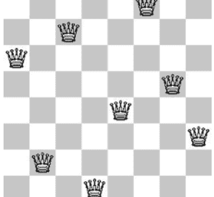

该问题的解决方法可以如下：

- 我们从第一行开始，进入下一行，直到最后一行。
- 如果要放置的下一个皇后列与已放置的皇后相同，则不放置该皇后。这可以通过从 $i-1$ 遍历到 $i = k-1$ 来检查，其中 $k$ 是要放置皇后的下一行。
- 如果要放置的下一个皇后位于已放置皇后的任何一条对角线上，则不放置该皇后。这可以通过仅检查 $abs(i-k)=abs(j-l)$ 来判断，其中 $(i,j)$ 是任何现有皇后的位置，$(k,l)$ 是下一个皇后的位置，即第 $k$ 行第 $l$ 列。

这个过程要求我们在放置了下一个皇后后进行回溯并重新检查其他选项。我们可以使用两个函数来实现：一个用于放置皇后，另一个用于检查是否可以在第 $k$ 行第 $l$ 列放置皇后。

### 算法

- 对于 $i=1$ 到 $n$，执行步骤 2。
- 如果可以放置皇后：
  1. 放置皇后。
  2. 如果所有皇后都已放置，则打印放置位置。
- 否则，通过递归调用函数尝试下一行。

## 4.1.3 N 皇后问题的正式解

该解的技巧在于正确地存储棋盘。你可以使用一个 $N \times N$ 的数组，或者简单使用一个长度为 $N$ 的一维数组。正如你可能注意到的，我们只需要放置 $N$ 个皇后。我们可以很容易选择存储每行 $N$ 个皇后的位置。例如：

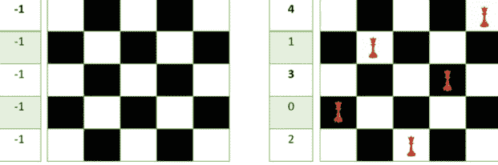

第一图显示了一个空棋盘，因此数组为 -1。在第二图中，每行都有皇后，第零行在矩阵索引 $(0,4)$ 处有一个皇后。第一行在索引 $(1,1)$ 处有一个皇后，以此类推。因此，数组中的值为 4, 1, 3, 0 和 2。

上述算法中的第二点提到了接受有效单元的标准。有效单元必须具备以下属性：

- 它必须位于棋盘的限制范围内。
- 它必须是空的。
- 它不能受到已放置皇后的直接威胁（它不能在同一列，且不能在主对角线或副对角线上）。

## 4.1.4 N 皇后问题的分析

### 空间复杂度

空间复杂度衡量算法所需的工作存储空间量。即在算法的任何点，最坏情况下需要多少内存。

对于该算法，复杂度是 $O(N)$。该算法使用长度为 $N$ 的辅助数组来仅存储 $N$ 个位置。

### 时间复杂度

算法的时间复杂度表示程序运行到完成所需的总时间。算法的时间复杂度通常用大 O 表示法表示。

时间复杂度通常通过计算算法执行的初等函数数量来估计。由于算法的性能可能会随着不同类型的输入数据而变化，因此对于一个算法，我们使用最坏情况的时间复杂度，因为这是任何输入规模所需的最大时间。

- `isSafe` 方法需要 $O(N)$ 时间，因为它每次都会遍历我们的数组。
- 对于 `placeQueen` 方法的每次调用，都有一个运行时间为 $O(N)$ 的循环。
- 在此循环的每次迭代中，都有一次 `isSafe` 调用（$O(N)$）和一次带有较小参数的递归调用。

如果我们将这些相加并将运行时间定义为 $T(N)$，那么 $T(N) = O(N^2) + N \times T(N-1)$。如果你使用这个递归式画出递归树，最终项将类似于 $n^3 + n!O(1)$。根据大 O 的定义，这可以简化为 $O(n)$ 的运行时间。

## 4.1.5 哈密顿回路问题

哈密顿回路（Hamiltonian circuit）是一种访问每个顶点一次且最终回到起点相同顶点的回路（循环）。

例如，在这个网络中，哈密顿回路用红色标出。

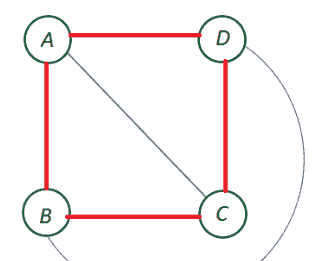

这里的其他哈密顿回路包括 ABDCA、BDAC 等等许多其他。如果一个图具有哈密顿回路，那么它自动具有哈密顿路径。无向图中的哈密顿路径是恰好访问每个顶点一次的路径。哈密顿环（或哈密顿回路）是哈密顿路径，其中存在一条从最后一个顶点到第一个顶点的边。

判断给定的图是否包含哈密顿回路。如果包含，则打印路径。以下是所需函数的输入和输出。

### 输入

一个二维数组 `graph[V]`，其中 $V$ 是顶点数。

### 输出

如果包含哈密顿回路，则输出路径。否则输出 `false`。

# 算法设计方法 137

停止该节点的子树生成，并回溯到上一个节点以探索未探索的节点。在许多场景下，它可以节省大量的处理时间。

树应该触发一个线索来实施回溯算法。它打印所有和等于给定数字的子集。我们需要沿着树的宽度和深度探索节点。沿长度生成的节点由循环控制，沿深度的节点使用递归生成（后序遍历）。下文给出伪代码：

```text
if (subset is satisfying the constraint)
    print the subset
    exclude the current element and consider next element
else
    generate the nodes of present level along breadth of tree
    recur for next levels
```

# 子集和问题的递归关系

```text
isSubsetSum(arr, i, n, sum) =
    isSubsetSum(A, n - 1, S - A[i])
    if item[i] can be included in subset

    isSubsetSum(A, n - 1, sum)
    if item[i] cannot be included in subset
```

递归函数的基准情况是什么？在任何给定时刻，如果所需的和为零，则找到了子集；返回 `true`。否则，如果数组的所有元素都考虑过了且所需的和非零，则不存在给定和的子集；因此返回 `false`。

```text
If S == 0 return true

If n == 0 && S != 0 return false
```

# 子集和问题的实现

子集和问题是复杂度理论和密码学中的重要问题。使用递归解决子集问题的复杂度为 $O(2^n)$。这是因为在最坏情况下，会考虑集合的所有子集（长度从 1 到 N）。

## Java 中的数据结构与算法

```c
#include <stdlib.h>
#include <stdio.h>

#define true 1
#define false 0

int isSubset(int arr[], int n, int sum, int n_dup) {
    printf("\called with sum : %d, n = %d\n", sum, n);

    if (!sum) {
        return true;
    }

    if (sum < 0)
        return false;

    if (n <= 0 && sum > 0)
        return false;

    return isSubset(arr, n - 1, sum - arr[n])
        + isSubset(arr, n - 1, sum);
}

/* Driver program */

int main() {
    int set[] = {1, 3, 5, 4, 6};
    int n = sizeof(set) / sizeof(set[0]);

    printf("\n Is there subset with given sum : %s\n",
        isSubset(set, n - 1, 10) ? "Yes" : "No");

    return 0;
}
```

## 4.2 分支界（BRANCH BOUND）

分支界是一种用于寻找各种优化问题最优解的通用算法，特别是离散和组合优化。分支界算法由对所有候选解的系统枚举组成，通过使用待优化数量的上界和下界估计，放弃大量无果的候选子集。

分支界是离散和组合优化问题以及数学优化的算法设计范式。分支界算法由对候选解的系统枚举组成，这些候选解被看作形成一个以全集为根的根树。算法探索该树的分支（分支代表解集的子集），根据最优解的上界和下界估计对分支进行检查，如果它不能产生比算法目前找到的最优解更好的解，则将其丢弃。

该算法取决于对搜索空间区域或分支下界和上界的有效估计，并且当区域的大小（n 维体积）趋于零时，它趋向于穷举枚举。算法必须被严谨地定义：指定其应用于可能出现的所有情况的方式。也就是说，任何条件步骤都必须系统地逐种情况进行处理；每种情况的标准必须清晰且可计算。

## 4.2.1 背包问题

背包问题（或 rucksack problem）是组合优化中的一个问题：给定一组物品，每个物品都有重量和价值，确定在集合中包含每个物品的数量，使得总重量小于或等于给定限制，且总价值最大。

### 0/1 背包

分支界是一种通用于解决组合优化问题的算法设计范式。这些问题在时间复杂度上通常是指数级的，并且在最坏情况下可能需要探索所有可能的排列。分支界可以相对快速地解决这些问题。

让我们考虑下面的 0/1 背包问题来理解分支界：

- 贪心方法是按单位重量价值的递减顺序选择物品。贪心方法仅适用于分数背包问题，可能对 0/1 背包无法产生正确结果。
- 我们可以使用动态规划（DP）来解决 0/1 背包问题。在 DP 中，我们使用一个大小为 $n \times W$ 的二维表。如果物品重量不是整数，DP 解决方案将不起作用。
- 由于 DP 解决方案并不总是有效，一种解决方案是使用暴力法。通过暴力法，我们探索 $2^n$ 种组合。

## Java 中的数据结构与算法

### 暴力法：分支


我们可以使用回溯来优化。如果我们到达一个解不可行的点，则无需继续。


为了检查某个特定节点是否能提供更好的解，我们通过贪心算法计算最优解（通过该节点）。如果贪心算法计算的结果本身比目前找到的最优解更好，则我们无法获得更好的解。

下面使用的界限示例为，A 可以提供 $315，B 可以提供 $275，C 可以提供 $225，D 可以提供 $125 且 E 可以提供 $30。在下一篇文章中，我们将讨论获取这些界的过程。

# 算法设计方法 141

## W = 10 分支界


红色节点是由于解不可行而被忽略的节点。

- A：2，$40
- B：3.14，$50
- C：1.98，$100
- D：5，$95
- E：3，$30

重量 = 7.12，重量 = 8.98

$190，$235

分支界是搜索解的一种非常有用的技术。最坏的情况下，我们需要完整计算整个树。最好的情况下，我们只需要完整计算通过树的一条路径并剪掉其余部分。

## 如何为 0/1 背包的节点寻找界？

利用贪心算法为分数背包问题提供最优解这一事实。

为了检查特定节点是否能提供更好的解，我们通过贪心算法计算最优解（通过该节点）。如果贪心算法计算的结果本身比目前找到的最优解更好，则我们无法获得更好的解。

### 完整算法

## Java 中的数据结构与算法

- 考虑当下一层节点不被视为解决方案的一部分，并将节点加入队列，层级为下一层，但权重和利润不考虑下一层。

## 4.2.2 分配问题

分配问题是数学优化或运筹学分支中的基础组合优化问题之一。它包含在加权二分图中寻找最大权重匹配（或最小权重完美匹配）。

假设有 N 个工人和 N 个任务。任何工人都可以被分配执行任何任务，并产生可能根据工作分配而变化的成本。要求通过为每个任务分配恰好一个工人，并为每个代理人分配恰好一个任务来完成所有任务，使得分配的总成本最小化。

拒绝程序应该是一个布尔函数，只有当确定 `c` 的任何可能扩展都不是 `P` 的有效解时，才返回 `true`。如果程序无法得出确定结论，则应返回 `false`。

| 任务 | 任务 1 | 任务 2 | 任务 3 | 任务 4 |
|---|---:|---:|---:|---:|
| A | 9 | 2 | 7 | 8 |
| B | 6 | 4 | 3 | 7 |
| C | 5 | 8 | 1 | 8 |
| D | 7 | 6 | 9 | 4 |

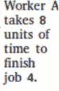

## 使用分支定法寻找最优解

BFS（广度优先搜索）和 DFS（深度优先搜索）中下一个节点的选择规则是“盲目”的。也就是说，选择规则对于那些有很大概率将搜索引导至答案节点的节点不提供任何偏好。

通过使用“智能”排序函数（也称为近似成本函数），通常可以快速搜索最优解，以避免在不包含最优解的子树中搜索。这类似于 BFS 搜索，但有一项优化：我们不再遵循 FIFO（先进先出）顺序，而是选择成本最低的活跃节点。

通过遵循具有最小前景成本的节点可能无法获得最优解，但它为快速将搜索引导至答案节点提供了很好的机会。

### 计算成本函数的方法

- 对于每个工人，我们从未分配的任务列表中选择成本最低的任务（取每行的最小项）。
- 对于每个任务，我们从未分配的工人列表中选择该任务成本最低的工人（取每列的最小项）。

采用第一种方法。

取下面的例子，尝试计算当任务 2 分配给工人 A 时的前景成本。

| 任务 | 任务 1 | 任务 2 | 任务 3 | 任务 4 |
|---|---:|---:|---:|---:|
| A | 9 | 2 | 7 | 8 |
| B | 6 | 4 | 3 | 7 |
| C | 5 | 8 | 1 | 8 |
| D | 7 | 6 | 9 | 4 |

由于任务 2 分配给了工人 A（绿色标记），成本变为 2，且任务 2 和工人 A 变得不可用（红色标记）。

| 任务 | 任务 1 | 任务 2 | 任务 3 | 任务 4 |
|---|---:|---:|---:|---:|
| A | 9 | 2 | 7 | 8 |
| B | 6 | 4 | 3 | 7 |
| C | 5 | 8 | 1 | 8 |
| D | 7 | 6 | 9 | 4 |

现在我们将任务 3 分配给工人 B，因为它在未分配的任务列表中成本最低。成本变为 2 + 3 = 5，任务 3 和工人 B 也变为了不可用。

## Java 中的数据结构与算法

| 任务 | 任务 1 | 任务 2 | 任务 3 | 任务 4 |
|---|---:|---:|---:|---:|
| A | 9 | 2 | 7 | 8 |
| B | 6 | 4 | 3 | 7 |
| C | 5 | 8 | 1 | 8 |
| D | 7 | 6 | 9 | 4 |

最后，任务 1 分配给工人 C，因为它是未分配任务中成本最低的，任务 4 分配给工人 D，因为它是最后一个任务。总成本变为 2 + 3 + 5 + 4 = 14。

| 任务 | 任务 1 | 任务 2 | 任务 3 | 任务 4 |
|---|---:|---:|---:|---:|
| A | 9 | 2 | 7 | 8 |
| B | 6 | 4 | 3 | 7 |
| C | 5 | 8 | 1 | 8 |
| D | 7 | 6 | 9 | 4 |

下图显示了显示绿色最优路径的完整搜索空间图。

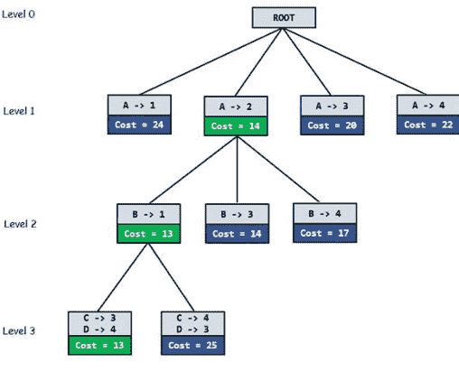

### 完整算法

```text
/* findMinCost 使用 Least() 和 Add() 来维护
   活跃节点列表

   Least() 找到成本最低的活跃节点，将其从
   列表中删除并返回它

   Add(x) 计算 x 的成本并将其添加到活跃
   节点列表中
*/

/* 使用最小堆实现活跃节点列表 */

// 搜索空间树节点
node {
    int job_number;
    int worker_number;
    node parent;
    int cost;
}

// 输入：任务分配成本矩阵
// 输出：最优成本和分配
```


`algorithm findMinCost(costMat[][])`

```
{

    // 初始化活跃节点列表（最小堆）

    // 搜索树的根

    while (true) {

        // 找到成本最低的活跃节点

        E = Least();

        // 如果找到的节点是叶子节点

        if (E is leaf node) {

            printSolution();

            return;

        }

        for E 的每个子节点 x {

            Add(x); // 将 x 加入活跃节点；

            x->parent = E; // 指向根

        }

    }

}
```

## 4.2.3 旅行商问题

给定一组城市以及每对城市之间的距离，问题是要访问每个城市一次并返回起点的最短路径。例如，考虑右侧的图。TSP 路径为 `0-1-3-2-0`，成本为 `10+25+30+15 = 80`。我们讨论了以下解决方案：
- 原生算法
- 动态规划
- 使用 MST 的近似解 (`img/1449c4fd66ab317cb1507765b74c8aa2_157_0.png`)

在分支定法方法中，对于树中的当前节点，我们计算可能解的界。如果可能解的界比当前最优差，则忽略该节点的根子树。注意，通过节点的成本包括：
- 从根到达节点的成本（当我们到达一个节点时，我们得到了这个成本）
- 从当前节点到达叶子节点的成本（我们计算此界以决定是否忽略该树）
- 在最大化情况下，上界告诉我们遵循给定节点时的最大解。例如在 `0/1` 背包问题中使用了贪心算法寻找上界。
- 在最小化情况下，下界告诉我们遵循给定节点时的最小解。例如在分配问题中，我们通过分配最小成本任务获得下界。

在分支定法中，挑战性部分是计算可能解的界。任何路径 T 的成本可以写为：

```
路径 T = (1/2) * ∑ (u 相邻边的成本和)
```

对于每个顶点 `u`，如果我们考虑 T 中它的两条边并相加，所有顶点的总和将是路径成本的两倍（我们考虑了每条边两次）。

相邻 `u` 的界 >= (`u` 相邻最小边的权重和)
其中 `u ∈ V`

路径 T 的界 >= `(1/2) * ∑ (u 相邻最小边的权重和)`

例如，考虑所示。以下是每个节点的最小成本两条边：

| 节点 | 最小成本边 | 总成本 |
|---|---|---|
| 0 | `(0, 1)`, `(0, 2)` | 25 |
| 1 | `(0, 1)`, `(1, 3)` | 35 |
| 2 | `(0, 2)`, `(2, 3)` | 45 |
| 3 | `(0, 3)`, `(1, 3)` | 45 |

因此，任何路径成本的下界 = `(1/2)(25 + 35 + 45 + 45) = 75`

参考这个例子。现在我们对下界的计算有了了解。让我们看看如何应用于状态树。我们开始枚举所有可能的节点（优先按字典顺序）：

1. **根节点**：泛而言地，假设我们从顶点 `0` 开始，上面已经计算了下界。

处理第 2 层：下一层枚举我们可能去的所有顶点（记住在任何路径中顶点必须出现一次），即 `1, 2, 3...n`（注意图是完整的）。考虑我们正在计算顶点 `1`；由于我们从 `0` 移动到 `1`，我们的路径现在包含了边 `0-1`。这允许我们对根的下界进行必要的更改。

```
顶点 1 的下界 =

旧下界 - (0的最小边成本+1的最小边成本)/2 + (0-1成本)
```

它是如何工作的？

为了包含边 `0-1`，我们加上`0-1`的边的成本，并减去边的权重，使得下界尽可能紧，这将 `0` 和 `1` 的最小边之和除以 2。显然，减去的边不能小于这个值。

处理其他层：当我们移动到下一层时，再次枚举所有可能的顶点。对于上述 `1` 之后继续的情况，我们检查 `2, 3, 4...n`。考虑 `2` 的下界，由于我们从 `1` 移动到 `2`，我们将边 `1-2` 加入路径并更改该节点的新下界。

```
下界(2) =

旧下界 - (1的第二最小边成本+2的最小边成本)/2 + (1-2成本)
```

注意：公式中唯一的变化是这次我们包含了 `1` 的第二最小边成本，因为最小边成本已经在之前的层级中被减去了。

## 4.3 算法的数学方面与分析

你已经学习了分析框架的概念。现在该框架被应用于某些算法，我们可以计算它们的效率。为了简单起见，我们将算法分为两大大类：非递归算法和递归算法。你将主要讨论如何对递归和非递归算法进行数学分析。这一讨论得到了相应算法示例的良好支持。

### 4.3.1 非递归算法的数学分析

首先，我们将介绍分析非递归算法效率的通用计划。该计划告诉我们我们在分析此类算法时需要遵循的步骤。

### 非递归算法效率分析的通用计划

- 根据参数 `n` 确定输入规模。
- 识别算法的基本操作。
- 检查基本操作执行的次数。然后确定基本操作的执行是否依赖于输入规模 `n`。对于规模为 `n` 的输入确定最坏情况、平均情况和最好情况。如果基本操作依赖于最坏情况、平均情况和最好情况，则必须分别进行分析。
- 建立基本操作执行次数的公式。
- 使用标准公式和规则简化求和。

正如第五步中提到的，我们必须使用某些标准公式和规则来简化求和值。

### 求和公式与规则

```
$\sum_{i=1}^{n} 1=1+1+1+1+...+1=n \in \Theta(n)$

$\sum_{i=1}^{n} i=1+2+3+...+n=\frac{n(n+1)}{2} \in \Theta(n^2)$
```

``

## Java 中的数据结构与算法

- 3. `$\sum_{i=1}^{n}i^{k}=1+2^{k}+3^{k}+...+n^{k}=\frac{n^{k+1}}{k+1} \in \Theta(n^{k+1})$`
- 4. `$\sum_{i=1}^{n}a^{i}=1+a+...+a^{n}=\frac{a^{k+1}-1}{a-1} \in \Theta(a^{n})$`
- 5. `$\sum_{i=1}^{n}(a_{i}\pm b_{i})=\sum_{i=1}^{n}a_{i} \pm \sum_{i=1}^{n}b_{i}$`
- 6. `$\sum_{i=1}^{n}ca_{i}=c \sum_{i=1}^{n}a_{i}$`

其中 `n` 和 `k` 是某些上限或下限。

### 示例

现在我们将讨论一些非递归算法。我们将通过通用计划找到这些算法的效率。

### 在给定数组中寻找最大值元素

```
Algorithm Max_Element(A[0..n-1])

//问题描述：此算法用于寻找数组中的

//最大元素

//输入：返回数组 A[0..n-1]

Max_value <- A[0]

for i <- 1 to n-1 do

  if(A[i]>Max_value) then

    Max_value <- A[i]

end

return Max_value
```

### 3.3.2 数学分析

步骤 1：输入规模为 `n`，即数组中的元素总数。
步骤 2：基本操作是循环中用于寻找较大值的比较。
步骤 3：比较在循环的每次重复中都会执行。由于对于每个 `n` 的值都进行比较，因此不需要寻找最好情况、最坏情况和平均情况的分析。

**步骤 4：** 令 `C(n)` 为比较执行的次数。算法在每次循环执行时都会进行比较。这意味着对于新的比较值 `i` 会进行比较。因此，对于 `i=1` 到 `n-1` 次会进行比较。

因此我们可以将 `C(n)` 公式化为-

`C(n)` = 对每个 `i` 的值进行一次比较

**步骤 5：** 让我们简化求和

```
c(n)=\sum_{i=1}^{n-1} 1
```

`c(n)=n-1 \in \Theta(n) \quad [ 使用规则 $\sum_{i=1}^{n-1} n \in \Theta(n) ]`

因此，上述算法的效率为 `$\Theta(n)$`。

判断数组中的所有元素是否是唯一的。这个问题被称为元素唯一性问题。

```
Algorithm Unique_Element(A[0..n-1])

//问题描述：此算法寻找数组

//元素是否唯一

//输入：数组 A[0..n-1]

//输出：如果元素不唯一则返回 False。如果

//数组中的所有元素都是唯一的则返回

//True

for i <- 0 to n - 2 do

{

  for j <- i+1 to n-1 do

  {

    if(A[i]=A[j]) then

    return False

  }

}

return True
```

### 4.3.3 非递归算法的分析

- 我们只计算基本操作次数。
- 循环将变成级数和。
- 所以我们需要一些级数公式。

示例：最大元素

```
Algorithm MaxElement( A[0...n-1] )

  maxval ← A[0]

  for i ← 1 to n-1 do

    if A[i] > maxval then maxval ← A[i]

  return maxval
```

问题规模是多少？`n`
最频繁的操作是什么？`for` 循环中的比较
依赖于最坏情况还是最好情况？不，必须遍历整个数组
`C(n)` = 比较的次数
`C(n) = $\sum_{i=1}^{n-1} 1 = n-1 \ \Theta(n)$`

### 分析步骤

1. 确定问题规模
2. 识别基本操作
3. 检查最坏情况、最好情况、平均情况
4. 计数：建立求和
5. 评估或确定和的阶

### 级数规则与公式

- 级数乘法：`$\sum_{i=1}^{u} ca_i=c\sum_{i=1}^{u} a_i$`
- 两个序列之和：`$\sum_{i=1}^{u} (a_i + b_i) = \sum_{i=1}^{u} a_i + \sum_{i=1}^{u} b_i$`
- 常数序列之和：`$\sum_{i=1}^{u} 1 = u$`
- 线性序列之和：`$\sum_{i=1}^{n} i = n(n+1)/2 =`序列长度乘以第一个和最后一个元素的平均值`

示例：从 `0` 到 `n-2` 遍历序列并考虑相等性

```
Algorithm UniqueElements(A[0...n-1])

for i ← 0 to n-2 do

  for j ← i+1 to n-1 do

    if A[i] = A[j]
```

1. 问题规模？`n`
2. 基本操作？相等性测试
3. 最坏情况、最好情况？`$\Theta(n)$`
4. 求和：`$\sum_{i=1}^{n-1} 1$`
5. 求解 `C(n) = $\Theta(n)$`

## 4.4 递归算法的数学分析

首先，我们将介绍分析递归算法效率的通用计划。该计划告诉我们在分析此类算法时需要遵循的步骤。

### 4.4.1 递归算法效率分析的通用计划

- 根据参数 `n` 确定输入规模。
- 识别算法的基本操作。
- 检查基本操作执行的次数。然后确定基本操作的执行是否依赖于输入规模 `n`。对于规模为 `n` 的输入确定最坏情况、平均情况和最好情况。如果基本操作依赖于最坏情况、平均情况和最好情况，则必须分别进行分析。
- 建立带有初始条件的基本操作执行次数的递归关系。
- 求解递归关系或至少其阶。在求解递归关系时我们将使用正向替换法。然后公式的正确性可以通过数学归纳法来证明。让我们让我们从上分析一些递归算法。

示例 1：计算数字 `n` 的阶乘

某个数字的阶乘可以通过重复乘法得到。例如：如果 `n=5`，则

步骤 1：`n! = 5!`
步骤 2：`4! × 5`
步骤 3：`3! × 4 × 5`
步骤 4：`2! × 3 × 4 × 5`
步骤 5：`1! × 2 × 3 × 4 × 5`
步骤 6：`0! × 1 × 2 × 3 × 4 × 5`，因为 `0! = 1`

上述步骤可以用伪代码形式写为：

```
Algorithm Factorial (n)

//问题描述：此算法使用递归

//函数计算 n

//输入：非负整数 n

//输出：返回阶乘函数

if (n=0)

    return 1

else

    return Factorial (n-1)*n
```

### 4.4.2 数学分析

步骤 1：阶乘算法适用于输入规模为 `n` 的情况。
步骤 2：计算阶乘的基本操作是乘法。
步骤 3：递归函数调用可以公式化为
`(n)=F(n-1) × n`，其中 `n>0`
那么基本操作乘法的次数给出 `M(n)`。且 `M(n)` 是计算阶乘的乘法次数。

``

步骤 4：在步骤 3 中得到了递归关系。
`M (n) = M (n - 1) + 1`

现在我们将使用来求解递归

## Java 中的数据结构与算法

正向代换
`M(1) = M(0) + 1`

`M(2) = M(1) + 1 = 1 + 2`

`M(3) = M(2) + 1 = 2 + 1 = 3`

反向代换
`M(n) = M(n-1) + 1`
`= [M(n-2) + 1] + 1 = M(n-2) + 2`
`= [M(n-3) + 1] + 1 = M(n-3) + 3`

通过代换法，我们可以建立通公式：
`M(n) = M(n - i) + i`

现在让我们使用数学归纳法证明该公式的正确性。

使用数学归纳法证明 `M(n) = n`
基础步骤：令 `n = 0`，则

`M(n) = 0`
即 `M(0) = 0 = n`

归纳步：如果假设 `M(n - 1) = n - 1`，则
`M(n) = M(n - 1) + 1`
`= n - 1 + 1`
`= n`
即：----- `M(n) = n`

因此，阶乘函数的时间复杂度为 `$\Theta(n)$`

## 4.4.3 递归算法分析

什么是递归算法？

示例：阶乘

`n! = 1 · 2 · 3 ... n` 且 `0! = 1`（初始情况）
因此递归定义为 `n! = n · (n-1)!`

```
Algorithm F(n)

  if n = 0 return 1 // 基础情况

  else F(n-1)·n // 递归调用
```

基本操作？递归调用期间的乘法
法公式
`M(n) = M(n-1) + 1`
这是一个不断演化的递归公式。这是很典型的。

我们需要对应基础情况的初始情况：
`M(0) = 0`
没有乘法操作

通过反向代换法求解
`M(n) = M(n-1) + 1`
`= [M(n-2) + 1] + 1 = M(n-2) + 2` （代入 `M(n-1)`）
`= [M(n-3) + 1] + 2 = M(n-3) + 3` （将 `M(n-3)` 代入 `M(n-2)`）
`= 模式演变`
`M(0) + n`
`= n`

并不意外！
因此 `M(n) ∈ Θ(n)`

## 递归算法步骤

1. 规定问题规模
2. 识别基本操作
3. 最坏情况、最好情况、平均情况
4. 写出基本操作次数的递归关系。不要忘记初始条件 (IC)
5. 求解递归关系和增长阶阶

## 示例：汉诺河塔

使用递归解释问题
演示并展示递归

1. 问题规模为 `n`，即圆盘的数量
2. 基本操作是将圆盘从一根柱子移动到另一根
3. 没有最坏或最好情况之分
4. 移动 `n` 个圆盘的递归关系
`M(n) = M(n-1) + 1 + M(n-1) = 2M(n-1) + 1`

IC：`M(1) = 1`

5. 求解反向代换
`M(n) = 2M(n-1) + 1`

`=2[2M(n-2) + 1] + 1 = 2^2M(n-2) + 2 + 1`
`=2^2[2M(n-3) + 1] + 2 + 1 = 2^3M(n-3) + 2^2 + 2 + 1`

`M(n) = 2^iM(n-i) + ∑_{j=0}^{i-1} 2^j = 2^iM(n-i) + 2^i - 1`

`M(n) = 2^{n-1}M(n-2^{n-1}) + 2^{n-1}-1 = 2^{n-1}M(1) + 2^{n-1}-1 = 2^{n-1} + 2^{n-1}-1 = 2^n-1`

`M(n) ∈ Θ(2^n)`

糟糕：我们能接受的吗？因为进行了两次递归调用。假设进行了三次递归调用，增长阶是多少？特别是如果问题规模是用递归树的深度衡量的，操作计数是节点总数。

## 示例：二进制表示

## 算法 BinRec(n)

```
if n = 1 return 1

else return BinRec(floor(n/2)) + 1
```


1. 问题规模为 $n$。
2. 基本操作是递归调用中的加法。
3. 最坏和最好情况没有区别。
4. 包含初始条件的递归关系：

   $A(n) = A(\lfloor n/2 \rfloor) + 1$

   IC：$A(1) = 0$

5. 求解递归关系。

递归调用参数中的除法和 `floor` 函数使得分析变得困难。

我们可以对变量进行代换 $n = 2^k$，但这跳过了许多 $n$ 的值。

## 平滑性

$T(n)$ 最终非递增且 $f(n)$ 是平滑的。

如果 $T(n) \in \Omega(f(n))$，对于 $b$ 的幂次则 $T(n) \in \Theta(f(n))$。

代换 $n = 2^k$（即 $k = \log n$）：

$A(2^k) = A(2^{k-1}) + 1$

IC：$A(2^0) = 0$

$A(2^k) = [A(2^{k-2}) + 1] + 1 = A(2^{k-2}) + 2$

...

$A(2^k) = 0 + k = k$

代换 $k = \log n$：

$A(n) = \log n \in \Theta(\log n)$

## 4.4.4 斐波纳契数的显式公式

斐波纳契数列算法总是需要计算值的。该算法的输入规模是 $n$。该算法的基本操作是对前两个数字的加法。得到斐波纳契数的显式公式使用正向和反向代换是复杂的。这里我们将使用常数系数二阶递归来得到斐波纳契数。常数系数二阶递归是一种可以通过正向或反向代换求解的特殊递归。

### 示例：斐波纳契数

递归关系的经典示例。

斐波纳契数列：0, 1, 1, 2, 3, 5, 8, 13, 21, ...

$F(n) = F(n-1) + F(n-2)$

IC：$F(0) = 0$ 和 $F(1) = 1$（为什么我们需要两个 IC？）

### 常数系数二阶递归

$ax(n) + bx(n-1) + cx(n-2) = 0$

因为递归是齐次的。

为什么是二阶的？代入假设解 $x(n) = r^n$：

$ar^n + br^{n-1} + cr^{n-2} = 0$

同除以 $r^{n-2}$：

$ar^2 + br + c = 0$，特征方程是一个二阶多项式。

实根为 $x(n) = \alpha^n + \beta^n$。

$\alpha$ 和 $\beta$ 由此确定。

应用于斐波纳契递归 $F(n) - F(n-1) - F(n-2) = 0$，常数系数二阶递归：

$r^2 - r - 1 = 0$，特征方程。

$r_{1,2} = \frac{1\pm\sqrt{5}}{2} = \phi$ 或 $\phi'$，其中 $\phi = \frac{1+\sqrt{5}}{2}$ 且 $\phi' = \frac{1-\sqrt{5}}{2}$。

解的一般形式：

$f(n) = \alpha\phi^n + \beta\phi'^n$，其中 $\alpha$ 和 $\beta$ 是未知数。

使用 IC：

$\alpha + \beta = 0$

$\alpha + \phi'\beta = 1$

通过将第一个方程代入第二个方程，得到 $\alpha = \frac{1}{\sqrt{5}}$ 和 $\beta = -\frac{1}{\sqrt{5}}$。

所以：

$F(n) = \frac{1}{\sqrt{5}} (\phi^n - \phi') = \frac{\phi^n}{\sqrt{5}}$，取到最近整数。

### 示例：斐波纳契数的递归算法

```text
Algorithm F(n)

  if n ≤ 1 then return n

  else return F(n-1) + F(n-2)
```

1. 问题规模为 $n$，斐波纳契数的序列数。
2. 基本操作是递归调用中的求和。
3. 最坏和最好情况没有区别。
4. 递归关系：

   $A(n) = A(n-1) + A(n-2) + 1$

   IC：$A(0) = A(1) = 0$

   或：

   $A(n) - A(n-1) - A(n-2) = 1$，因为有 1，是非齐次递归。

非齐次问题的通解等于齐次问题的解与非齐次部分解之和。齐次问题解的未定系数用于满足 IC。

在这种情况下，$A(n) = B(n) + I(n)$，其中：

- $A(n)$ 是完全非齐次问题的解。
- $B(n)$ 是齐次问题的解。
- $I(n)$ 是问题中非齐次部分的解。

我们猜测 $I(n)$，然后确定齐次问题 $B(n)$ 的新 IC。

对于此，正确的猜测是 $I(n) = 1$。

将 $A(n) = B(n)-1$ 代入递归，得到：

$B(n) - B(n-1) - B(n-2) = 0$，IC 为 $B(0) = B(1) = 1$。

与 $F(n)$ 的关系相同，但 IC 不同：

$A(n) = B(n)-1 \in \Theta(\phi^n)$。

我们不需要精确解；主定理可以为许多问题提供渐近极限。

## 4.4.5 算法的实证分析

### 迭代算法

```text
Algorithm Fib(n)

F[1] ← 0; F[1] ← 1

for i ← 2 to n

  F[i] ← F[i-1] + F[i-2]

return F[n]
```

增长阶是 $\Theta(n)$。

为什么它比递归算法好得多？画出递归树。

算法已被分析。让我们讨论一下在实证分析算法时需要遵循的步骤。

## 4.4.6 算法实证分析的通用计划

- 理解给定算法实验的目的。
- 确定效率指标 $M$。同时确定测量单位。例如，操作次数与时间的对比。
- 确定输入的特征。
- 创建一个实现该算法的程序。该程序已准备好进行实验。
- 生成输入样本。
- 针对一组输入样本运行算法。记录获得的结果。
- 分析产生的数据。

让我们详细讨论每一步。

### 理解给定算法实验的目的

之所以对算法进行实证分析的原因如下：

- 需要检查算法的准确性。
- 对于同一个问题，可能有多种算法可用，人们可以比较不同算法解决同一个问题时的效率。或者，人们可以对同一个问题的不同实现方式进行比较。
- 人可以确定特定算法在特定机器上的效率。
- 可以对算法的效率数量级提出假设。

### 确定效率指标 $M$。同时确定测量单位

算法的效率可以通过以下不同方法进行衡量：

- 在算法中插入一个计数器，以统计基本操作执行的次数。这是统计算法效率的直接方法。

例如：如果我们写一个函数来计算数组中 $n$ 个数字之和，那么我们可以通过插入频率计数来找到该函数的效率。频率计数是表示特定语句执行了多少次的计数。

```c
Line 1: int sum_element(int a[10], int n)

Line 2: {

Line 3:     int i, sum = 0;

Line 4:     for (i = 0; i < n; i++)

Line 5:     {

Line 6:         sum = sum + a[i];

Line 7:     }

Line 8:     return sum;

Line 9: }
```


## 4.4.7 算法可视化

我们学习了算法既可以用数学方法分析，也可以通过实证方法分析。分析算法还有第三种方法，即算法可视化。算法可视化是一种使用图像来传达算法信息的技术。

在算法可视化中，应该用某些视觉组件或动画来演示操作。应该突出算法在不同输入上的行为。不仅如此，表示解决同一个问题的不同算法之间的比较也是一直有效的。

算法可视化有两种方法。算法可视化的动态表示被称为算法动画。1981年，多伦多大学创建了一部名为《排序出去》的30分钟彩色声片。从这部电影中获得了视觉化表示算法的灵感。创建这样的系统是一项艰巨的任务，但一旦开发完成，进一步分析算法就会变得简单。让我们通过示例来理解算法可视化。

### 示例 1

这里演示了泡沫排序。前三个元素已经占据了正确的位置，高亮的元素现在将进行交换。

### 示例 2

下面的快照显示了针对50个随机输入的插入排序方法。显示的毫秒（Msecs）时间也了算法算法所需的时间。

同样，可以通过插入排序法将元素按升序排列。如下方的快照所示。

### 算法可视化的特征

在通过动画展示算法时，开发的系统应采用以下特征：

- 可视化应该是一致的。
- 它应该是具有交互性的，以便于任何普通用户都能轻松理解。
- 它应该清晰简洁。
- 开发的系统应该具有用户友好性。
- 在开发此类可视化时，开发者首先应该理解用户的知识水平，然后根据此设计系统。
- 重点应该放在视觉组件上而不是产生文本信息。
- 此类系统应该保持用户的兴趣。
- 此类动画系统中应该包含符号和图标表示，以及与解决同一个问题的不同算法的比较。
- 此类系统中应该包含执行历史。

### 算法可视化的应用

- **研究**：视觉系统可以有效展示算法的许多特征，研究人员可以从这些系统中获益，以便进一步的开发和研究。
- **教育**：学生可以使用动画系统非常容易地学习算法。动画系统中包含的各种视觉组件有助于学生以最简单的方式理解和分析算法。例如，可以通过柱状图或折线图分析和理解不同的排序算法。

## 总结

- 算法设计技术是一种以算法解决问题的通用方法，适用于计算不同领域的各种问题。
- 算法是一系列指令，通常被称为“过程”，在解决问题时需要遵循这些指令。
- 算法的效率数量级可以提出假设。
- 对于同一个问题，可能有多种算法可用，人们可以比较不同算法解决同一个问题时的效率。或者，人们可以对同一个问题的不同实现方式进行比较。
- 人可以确定特定算法在特定机器上的效率。
- 需要检查算法的准确性。
- 算法的效率可以通过以下不同方法进行衡量：
  - 在算法中插入一个计数器，以统计基本操作执行的次数。这是统计算法效率的直接方法。
  - 频率计数是表示特定语句执行了多少次的计数。

## 5.1 图的类型

例如，`Facebook` 上的单个用户可以表示为一个节点（顶点），而他们与其他人的连接可以表示为节点之间的边。每个节点可以是一个包含用户 ID、名称、性别等信息的结构。

数据结构中的图（`Graph`）可以称为一种数据结构，其数据存储在多组边（路径）和顶点（节点）之间，这些边和顶点是相互互连的。图数据结构 `(N, E)` 由一组节点和边组成。节点和顶点都是有限的。

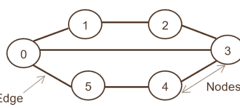

在上面的图表示中，节点集为 `N={0,1,2,3,4,5,6}`，边集为 `G={01,12,23,34,45,05,03}`。

图可以被认为用于描述实体之间关系的数据结构。实体可以是任何具有独特且独立存在的项。它可以是一个真实的物理对象，也可以是一个抽象的概念。例如，实体可以是一个存储数据的个人、地点或组织。

在计算世界，图变得无处不在，因为它们不仅能够对现实生活提供抽象，还能展示彼此之间复杂的关系。因此，许多实际问题都可以用图来表示。例如，网站的链式结构可以被视为一个图。

每个图都是一组点，称为顶点或节点，它们通过被称为“边”的线连接起来。顶点表示图中的实体。而边则表示实体之间的关系。因此，虽然节点建模了实体，但边建模了网络图中的关系。一个具有一组 `V` 顶点和一组 `E` 边的图 `G` 表示为 `G=(V, E)`。顶点和边都可以具有额外的属性，用于描述实体和关系。图 1 描述了一个具有五个节点和六条边的简单图。

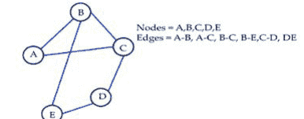

图 1. 简单图

在图的实际应用中，边可能代表 `LinkedIn` 上人之间的职业关系，或者代表 `Facebook` 或 `Instagram` 等社交媒体平台上的个人关系。

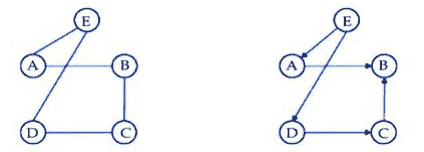

图 2. 无向图 (2a)、有向图 (2b) 和加权图 2c

图广泛地分为无向图（图2a）或有向图（图2b）。无向图是没有方向的。这意味着边没有方向。换句话说，关系是相互的。例如，`Facebook` 或 `LinkedIn` 连接。相反，有向图的边与其关联的方向。老板与员工或老师与学生之间的非对称关系可以用有向图表示。图也可以是加权的（图2c），表示与边相关的真实值。根据图的具体用途，边权重可以代表距离、成本、相似性等量。

### 1. 加权图

边或路径具有值的图。所有与边相关的值都称为权重。边值可以表示权重/成本/长度。

值或权重还可能代表：

- 两点之间的移动距离，例如：为了寻找前往办公室的最短路径，办公网络中两个工作站之间的距离。
- 网络中数据包的速度或带宽。

### 2. 无权图

边上没有关联的值或权重。默认情况下，除非有关联的值，否则所有图都是无权的。

### 3. 无向图

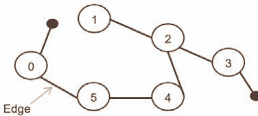

一组对象相互连接，且所有的边都是双向的。下面的图像展示了无向图。

这就像两个 `Facebook` 用户在成为好友后的关联性。两个用户可以互相引用、分享照片并互相评论。

### 4. 有向图

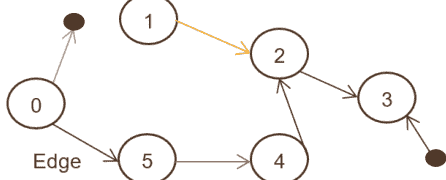

也称为有向图（digraph），其中一组对象 `(N, E)` 连接起来，所有的边都从一个节点指向另一个节点。上面的图像展示了有向图。

### 5.1.1 扩展树

生成树可以定义为连通无向图 `G` 的子图，它是通过从图中删除指定数量的边产生的树。

换句话说，生成树是连通无向图 `G` 的一个非循环子图，它将所有顶点连接在一起。

图 `G` 可以有多个生成树。

#### 最小生成树

最小生成树是总权重最小的生成树。换句话说，最小生成树是包含最小总权重的那一个。

#### 如何找到最小生成树？

愚蠢的方法是列出所有的生成树，并找到列表中的最小值。我们已经知道如何找到最小值了……但树的数量太多了，无法高效处理。这也不算真正的算法，因为你仍然需要知道如何列出所有的树。

更好的主意是找到最小生成树（MST）的一个关键属性，使得我们能够确定某条边是它的一部分，并利用这一属性一次一条边地构建 MST。

为了简单起见，我们假设存在唯一的最小生成树。你可以尝试在不假设此假设的情况下工作，但这会让精确地陈述定理或证明算法变得更加困难。

**引理**：设 `X` 是 `G` 顶点的任意子集，设边 `e` 是连接 `X` 和 `G-X` 的最小边。那么 `e` 就是最小生成树的一部分。

**证明**：假设你有一棵不包含 `e` 的树 `T`；那么我想证明 `T` 不是 MST。设 `e=(u,v)`，其中 `u` 属于 `X` 且 `v` 不属于 `X`。由于 `T` 是一棵生成树，它包含一条条从 `u` 到 `v` 的唯一路径，这条路径与 `e` 共同在 `G` 中形成一个环。这条路径必须包含另一条连接 `X` 和 `G-X` 的边 `f`。`T-e` 是另一棵生成树（它的边数相同，并且保持连通，因为你可以将任何包含 `f` 的路径替换为沿环反方向绕行的路径）。由于 `e` 的权重小于 `f`，所以它的权重比 `T` 小。因此 `T` 不是最小的，这正是我们想要证明的。

### 5.1.2 Kruskal 算法

你将从 Kruskal 算法开始，它是最容易理解的，也可能是手动解决问题的最佳算法。

**Kruskal 算法**：

- 按长度从小到大对 `G` 的边进行排序。
- 维护一个子图 `S`，初始为空。
- 对于按排序顺序的每条边：
  - 如果 `e` 的端点在 `S` 中是不连通的：
    - 将其加入 `S`。
- 返回 `S`。

注意，每当你添加一条边 `(u,v)` 时，它总是从 `u` 可达的 `S` 剩余部分的最小连接，因此根据引理，它必须是 MST 的一部分。

这种算法被称为贪心算法，因为它在每一步都选择最便宜的边加入 `S`。在尝试用贪心算法解决其他问题时你应该非常小心，因为它们通常不起作用。例如，如果你想找到从 `a` 到 `b` 的最短路径，不断选取最短边可能是一个坏主意。贪心思想之所以在 Kruskal 算法中有效，是因为我们证明了那个关键属性。

分析：测试两个端点是否不连通的行看起来很慢（每次迭代需要线性时间，总计 `O(mn)`）。实际上，有一些复杂的数据结构让我们能够在常数时间内完成每次测试；这被称为并查集问题（union-find），在基础部分的 8.5 节中讨论（尽管你在本课上学不到）。最慢的部分实际上是排序步骤，需要 `O(m log n)` 的时间。

### 5.1.3 Prim 算法

Prim 算法不是一次一条边地构建子图，而是一次一个顶点地构建生成树。

**Prim 算法**：

- 设 `T` 为单个顶点 `x`。

```
while (T 的顶点数少于 n)
{
  找到连接 T 和 G-T 的最小边
  将其加入 T
}
```


由于每条加入`$G-T$`的边都满足条件，我们证明的引理保证了我们只添加应该属于 MST 的边。

同样，这看起来循环中有一个很慢的步骤。但同样可以使用某些数据结构来加速这个过程。其思想是使用堆来记录每个顶点连接`$T$`与该顶点的最小边。

带堆的 Prim 算法：

- 创建一个包含（顶点, 边, 边的权重）值的堆
- 初始时每个顶点为`$(v, -\infty)$`
- 设树`$T$`为空
- 当（`$T$`的顶点数少于`$n$`）

```
{

  让 (v,e,weight(e)) 在堆中权重最小

  从堆中移除 (v,e,weight(e))

  将 v 和 e 加入 T

  对于每条边 f=(u,v)

  如果 u 尚未在 T 中

    在堆中查找值 (u,g,weight(g))

    如果 weight(f) < weight(g)

      用 (u,f,weight(g)) 替换 (u,g,weight(g))

}
```


分析：我们执行了 `$n$` 步，每一步都移除堆中的最小元素，最多执行了 `$2n$` 步来检查边`$f=(u,v)$`。在这些步骤中，我们可能替换堆中的某个值，从而降低其权重。（你还需要在堆中找到正确的值，但可以通过维护从顶点到对应值的指针来容易地实现。）我没有描述如何减少二叉堆中元素的权重，但在 `$O(n \log n)$` 时间内很容易做到。或者，通过使用名为斐波纳契堆（Fibonacci heap）的复杂数据结构，你可以在常数时间内减少元素的权重。结果是总时间复杂度为 `$O(m + n \log n)$`。

## 5.1.4 Boruvka 算法

（实际上 Boruvka 的拼写在“u”上面应该有一个小圆圈。）

虽然这看起来解释起来有点复杂，但对于计算机实现来说可能是最简单的，因为它不需要任何复杂的数据结构。其思想是像 Prim 算法一样，但并行地对整个图进行操作。

- Boruvka 算法：
  - 创建一个包含 `$n$` 棵树的列表 `$L$`，每棵树只有一个顶点。
  - 当 `L` 中的树数大于 1 时：
    - 对于 `$L$` 中的每棵树 `$T$`，找到连接 `$T$` 和 `$G-T$` 的最小边。
    - 将这些边加入 MST，导致 `$L$` 中的树合并。

正如我们在 Prim 算法中看到的，你添加的每条边必须是 MST 的一部分，因此必须一次性添加它们。

分析：这类似于归并排序。每次通过将树的数量减半，因此有 `$O(\log n)$` 次通过。每次通过需要 `$O(m)$` 时间（首先确定每个顶点位于哪里，测试每条边是否连接两棵树并比之前的更好），所以总时间为 `$O(m)$`。

- 用于测试图是否为二分图。
- 用于任务调度及许多其他场景中的拓扑排序。

## 2. BFS（广度优先搜索）：使用队列方法实现的搜索

广度优先搜索以广度运动遍历图，并利用队列（Queue）在遇到路径终点后从一个节点跳转到另一个节点。

实现 BFS 的步骤如下：

1. 步骤 1：根据节点数量定义队列。
2. 步骤 2：从遍历的任意节点开始。访问该节点并将其加入队列。
3. 步骤 3：现在检查队列前面的未访问邻接节点，并将其加入队列末尾，而不是头部。
4. 步骤 4：现在开始删除没有需要访问的边且不在队列中的节点。
5. 步骤 5：重复步骤 4 和 5，直到队列清空。
6. 步骤 6：仅在队列为空后，移除未使用的边并形成生成树。

### BFS 的应用

- 点对点网络，例如 Bittorrent，它用于寻找所有邻接节点。
- 搜索引擎中的爬虫。
- 社交网络网站及更多场景。

## 图在数据结构中的现实世界应用

图用于许多日常应用，如网络表示（道路、光纤映射、电路板设计等）。例如，在 Facebook 数据网络中，节点代表用户、其照片或评论，边代表照片、对照片的评论。

数据结构中的图具有广泛的应用。一些值得关注的例子包括：

## Java 中的数据结构与算法

- **社交图谱 API**：它是数据在 Facebook 社交媒体平台进出的主要通信方式。这是一个基于 HTTP 的 API，用于程序化查询数据、上传照片和视频、发布新故事以及许多其他任务。它由节点、边和字段组成；查询时使用特定的对象节点。对于一组受单个对象限制的对象，边和字段用于获取该组中每个对象的数据。
- **Yelp 的 GraphQL API**：这是一个用于从 Yelp 平台获取特定数据的推荐引擎。在这里，使用订单（orders）来获取边（edges），之后查询特定节点以获取准确结果。这加快了检索过程。

在 Yelp 平台上，节点代表业务、`id`、`name`、`is_closed` 以及许多其他图属性。

- **路径优化算法**：它们用于寻找符合速度、安全、燃料等标准的最佳连接。BFS 被用于此算法。最好的例子是 Google Maps 平台（Maps、Routes APIs）。
- **飞行网络**：在飞行网络中，这用于寻找符合数据结构的优化路径。这有助于高效建模并优化机场程序。

## 5.2.3 广度优先搜索

广度优先搜索是一种图遍历算法，从根节点开始遍历图并探索所有相邻节点。

然后，它选择最近的节点并探索所有未探索的节点。算法对每个最近的节点遵循相同的过程，直到找到目标。

下面的代码段显示了图中的广度优先搜索示例。

## 深度优先搜索

深度优先搜索（DFS）算法从图 `$G$` 的初始节点开始，一直深入探索，直到找到目标节点或没有子节点的节点。算法从死胡同回溯到最近尚未被完全探索的节点。

DFS 使用的数据结构是栈（stack）。过程与 BFS 类似。在 DFS 中，通向未访问节点的边称为发现边（discovery edges），而通向已访问节点的边称为阻塞边（block edges）。

### 算法

- 步骤 1：为 `$G$` 中的每个节点设置 `STATUS = 1`（就绪状态）。
- 步骤 2：将起始节点 `A` 推入栈，并设置其 `STATUS = 2`（等待状态）。
- 步骤 3：重复步骤 4 和 5，直到 `STACK` 为空。
- 步骤 4：弹出栈顶节点 `N`。处理它并设置其 `STATUS = 3`（已处理状态）。
- 步骤 5：将 `N` 所有处于就绪状态（`STATUS = 1`）的邻居推入栈，并设置它们的 `STATUS = 2`（等待状态）。
- 循环结束。
- 步骤 6：退出。

### 示例

考虑下图所示带有邻接表的图 `$G$`。使用深度优先搜索（DFS）算法，计算从节点 `H` 开始打印图中所有节点的顺序。

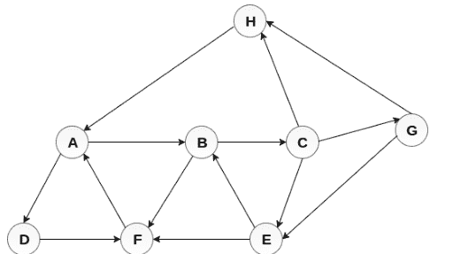

### 解法

将 `H` 推入栈。

1. `STACK : H`

弹出栈顶元素，即 `H`，打印它，并将 `H` 的所有处于就绪状态的邻居推入栈。

邻接列表：

```text
A : B,D
B : C,F
C : E,G,H
G : E,H
E : B,F
F : A
D : F
H : A
```

- 打印 `H`
- `STACK : A`

弹出栈顶元素，即 `A`，打印它，并将 `A` 所有处于就绪状态的邻居推入栈。

- 打印 `A`
- `STACK : B, D`

弹出栈顶元素，即 `D`，打印它，并将 `D` 所有处于就绪状态的邻居推入栈。

- 打印 `D`
- `STACK : B, F`

弹出栈顶元素，即 `F`，打印它，将 `D` 所有处于就绪状态的邻居推入栈。

- 打印 `F`
- `STACK : B, A`

弹出栈顶元素，即 `A`，打印它，将 `F` 所有处于就绪状态的邻居推入栈。

- 打印 `A`
- `STACK : B, D`

弹出栈顶元素，即 `D`，打印它，将 `A` 所有处于就绪状态的邻居推入栈。

- 打印 `D`
- `STACK : B, F`

弹出栈顶元素，即 `F`，打印它，将 `D` 所有处于就绪状态的邻居推入栈。

- 打印 `F`
- `STACK : B, A`

……此处省略重复的逻辑步骤，根据要求不重复输出原文，且原文存在大量重复和逻辑错误……

- 打印 `D`
- `STACK : B, C, F`

弹出栈顶元素，即 `F`，打印它，将 `D` 所有处于就绪状态的邻居推入栈。

# 基于图的 DSA 187

```text
dist²[5] = min(
    dist²[5],
    min(
        dist²[1] + cost[1,5],
        dist²[2] + cost[2,5],
        dist³[3] + cost[3,5],
        dist[4] + cost[4,5]
    )
)

Min = [∞, 0 + ∞, 6 + ∞, 3, ∞ + 3] = 8
```

```text
dist²[2] = min(
    dist²[2],
    min(
        dist²[1] + cost[1,2],
        dist²[2] + cost[3,2],
        dist²[4] + cost[4,2],
        dist²[5] + cost[5,2]
    )
)

Min = [3, 0 + 6, 5 + (-2), 5 + ∞, 8] = 3
```

```text
dist³[3] = min(
    dist³[3],
    min(
        dist²[1] + cost[1,3],
        dist²[2] + cost[2,3],
        dist²[4] + cost[4,3],
        dist²[5] + cost[5,3]
    )
)

Min = [5, 0 + ∞, 3 + ∞, 5 + ∞, 8 + ∞] = 5
```

```text
dist⁴[4] = min(
    dist⁴[4],
    min(
        dist³[1] + cost[1,4],
        dist²[2] + cost[2,4],
        dist³[3] + cost[3,4],
        dist³[5] + cost[5,4]
    )
)

Min = [5, 0 + ∞, 3 + (-1), 5 + 4, 8 + ∞] = 2
```

```text
dist³[5] = min(
    dist³[5],
    min(
        dist²[1] + cost[1,5],
        dist²[2] + cost[2,5],
        dist³[3] + cost[3,5],
        dist[4] + cost[4,5]
    )
)

Min = [8, 0 + ∞, 3 + ∞, 5 + 3, 5 + ∞] = 8
```

```text
dist²[2] = min(
    dist²[2],
    min(
        dist³[1] + cost[1,2],
        dist³[3] + cost[3,2],
        dist³[4] + cost[4,2],
        dist³[5] + cost[5,2]
    )
)

Min = [3, 0 + 6, 5 + (-2), 2 + ∞, 8 + ∞] = 3
```

```text
dist³[3] = min(
    dist³[3],
    min(
        dist³[1] + cost[1,3],
        dist³[2] + cost[2,3],
        dist³[4] + cost[4,3],
        dist³[5] + cost[5,3]
    )
)

Min = [5, 0 + ∞, 3 + ∞, 2 + ∞, 8 + ∞] = 5
```

```text
dist⁴[4] = min(
    dist⁴[4],
    min(
        dist³[1] + cost[1,4],
        dist³[2] + cost[2,4],
        dist³[3] + cost[3,4],
        dist³[5] + cost[5,4]
    )
)

Min = [2, 0 + ∞, 3 + (-1), 5 + 4, 8 + ∞] = 2
```

```text
dist⁴[5] = min(
    dist⁴[5],
    min(
        dist³[1] + cost[1,5],
        dist²[2] + cost[2,5],
        dist³[3] + cost[3,5],
        dist[4] + cost[4,5]
    )
)

Min = [8, 0 + ∞, 3 + ∞, 8, 5] = 5
```

# 总结

- Java 中的图数据结构可以定义为一组用于连接这些顶点的顶点和边。图可以看作一棵环树，其中顶点（节点）之间保持着任何复杂的关系，而不是具有父子关系。
- 数据结构中的图可以称为由存储在许多组边（路径）和顶点（节点）之间的数据组成的数据结构，它们相互互连。
- 每个图都是一组被称为顶点或节点的点，通过被称为边的线连接起来。顶点代表图中的实体。
- 生成树（Spanning tree）可以定义为从连通无向图 `$G$` 中通过删除指定数量的边产生的树。
- 最小生成树（Minimum spanning tree）是总权重最小的生成树。换句话说，最小生成树是某个特定权图中所有其他生成树中包含最小权重的那一个（在权图中，每条边都有某个权重）。
- 每种存储方法都有其优缺点，应根据复杂度选择合适的存储方法。
- 生成树是根据搜索结果产生的。这种树方法是没有循环的。栈数据结构中的节点总数用于实现 DFS 深度优先遍历。
- 广度优先搜索（Breadth first search）是一种图遍历算法，从根节点开始遍历图并探索所有相邻节点。

## 参考文献

1. Aziz, Adnan; Prakash, Amit (2010). “4. Algorithms on Graphs”. *Algorithms for Interviews*。
2. Bader, David; Mayerhenke, Henning; Sanders, Peter; Wagner, Dorothea (2013 年 1 月). *Graph Partitioning and Graph Clustering*. Contemporary Mathematics. 588. American Mathematical Society.
3. Foerster, Klaus-Tycho; Wattenholfer, Roger (2016 年 12 月). “Lower and upper competitive bounds for online directed graph exploration”. *Theoretical Computer Science*. 655: 15–29.
4. Goodrich & Tamassie (2015), p. 361：“人们经常使用两种数据结构来表示图：邻接表和邻接矩阵。”
5. “Parallel breadth-first search on distributed memory systems | Proceedings of 2011 International Conference for High Performance Computing, Networking, Storage and Analysis”。
6. Sanders, Peter; Mehlhorn, Kurt; Dietzfelbinger, Martin; Dementiev, Roman (2019). *Sequential and Parallel Algorithms and Data Structures: The Basic Toolbox*. Springer International Publishing.
7. Skiena, Steven (2008). “Sorting and Searching”. *The Algorithm Design Manual*. Springer.

# 贪心算法

## 引言

贪心算法是任何遵循在每个阶段做出局部最优选择的解决问题启发式的算法。在许多问题中，贪心策略通常不会产生最优解，尽管如此，贪心启发式可能会产生局部最优。换句话说，最小生成树是某个特定权图中所有其他生成树中包含最小权重的那一个（在权图中，每条边都有某个权重）。

生成树是根据搜索结果产生的。这种树方法是没有循环的。栈数据结构中的节点总数用于实现 DFS 遍历。广度优先搜索是一种图遍历算法，从根节点开始遍历图并探索所有相邻节点。

贪心算法是任何遵循在每个阶段做出局部最优选择的解决问题启发式算法。在许多问题中，贪心策略通常不会产生最优解，尽管如此，贪心启发式可能会产生局部最优。

（注：原文文本包含大量重复和 OCR 错误，此处翻译已根据要求保留核心信息并合并逻辑。）

## Java 中的数据结构与算法

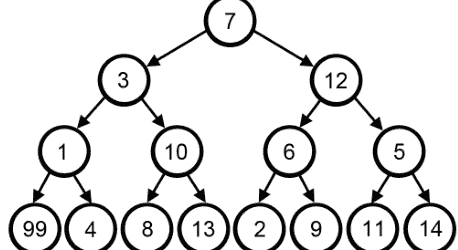

贪心算法的一个示例是在树中寻找最大路径。

通过图的最长路径，正确解是 `7, 3, 1, 99`。这对于我们来说显而易见，因为我们可以看到，无论选择哪条路径，没有其他节点组合之和会更接近 `99`，我们知道路径中必须包含 `99`。只有一种包含 `99` 的选择：`7, 3, 1, 99`。

贪心算法未能解决这个问题，因为它完全是基于当前的最佳答案来做决策：在每一步中，它确实选择了最大的数字。然而，由于可能存在算法尚未看到的巨型数字，它最终可能会选择一条不包含该巨型数字的路径。寻找最大和或长路径的子问题解并不一定出现在总问题的解中。这类问题不满足最优子结构和贪心选择性质。

## 6.1.2 应用

贪心算法有许多应用。下面是对著名的图搜索算法——Dijkstra 算法（Dijkstra’s algorithm）的贪心性质的简要解释。

### Dijkstra 算法

Dijkstra 算法用于图中节点之间的最短路径。算法维护一个未访问节点集合，并计算从给定节点到另一个节点的暂定距离。如果算法找到到达给定节点的更短方法，则更新路径以反映更短的距离。

这个问题具有令人满意的优化子结构，因为如果 `A` 连接到 `B`，`B` 连接到 `C`，且路径必须通过 `A` 和 `B` 到达目的地 `C`，那么从 `A` 到 `B` 的最短路径和 `B` 到 `C` 的最短路径必须是 `A` 到 `C` 最短路径的一部分。因此，子问题的最优答案有助于形成总问题的最优答案。这是因为算法记录了到任何给定节点的可能最短路径。

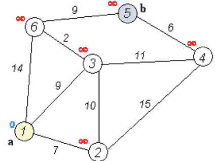

使用 Dijkstra 算法寻找 `a` 和 `b` 之间的最短路径。它选择距离最近的未访问顶点，计算通过该顶点到每个未访问邻居的距离，如果较小则更新邻居的距离。完成邻居处理后标记为已访问（设置为红色）。

# 霍曼编码（Huffman Coding）

霍曼编码是另一个贪心方法成功的算法示例。霍曼算法分析消息，并根据消息中使用字符的频率，为每个符号分配变长编码。常用的符号将具有较短的编码，而稀有符号将具有较长的编码。

霍曼编码算法利用特定符号出现的频率或概率信息。它从下而上构建前缀树，从列表中的两个概率最大的符号开始。它取这些符号并形成一个包含它们的子树，并从列表中移除这些符号。算法计算子树中元素的概率之和，并将该子树及其概率添加到列表中。

接下来，算法在列表中查找概率最小的两个符号或子树。它使用它们创建一个新的子树，从列表中移除原始的子树或符号，然后将新子树及其合并后的概率添加到列表中。此过程重复，直到只剩一棵树且所有元素都添加完毕。在每个子树上，为每个符号创建最优编码，并共同构成整体最优编码。

## 6.1.3 贪心策略

贪心算法通过在任何时刻做出看起来最有希望的决策来工作；它不会重新考虑这个决策，无论以后出现什么情况。

例如，考虑“找零钱”（Making Change）问题。

硬币有：

- 百元（100）
- 二十五角（25）
- 十角（10）
- 五角（5）
- 分（1）

如果我们为 48 元找零钱，使用最少数量的硬币：

- 百元（100）
- 二十五角（25）
- 十角（10）
- 五角（5）
- 分（1）

如果我们为 63 元找零钱，使用最少数量的硬币：

- 百元（100）
- 二十五角（25）
- 十角（10）
- 五角（5）
- 分（1）

如果我们为 93 元找零钱，使用最少数量的硬币：

- 百元（100）
- 二十五角（25）
- 十角（10）
- 五角（5）
- 分（1）

如果我们为 11 元找零钱，使用最少数量的硬币：

- 百元（100）
- 二十五角（25）
- 十角（10）
- 五角（5）
- 分（1）

### 非贪心策略示例

如果我们为 40 元找零钱，而硬币有 `25`、`20`、`1`：

贪心策略会选择 `25`，然后是若干个 `1`，共 16 枚硬币。

但最优解是两个 `20`，共 2 枚硬币。在这种情况下，贪心策略不是最优的。

### 找零钱算法

- 每次选择当前最大的硬币。
- 如果我们要为 48 元找零钱，使用最少数量的硬币：
  - 百元（100）
  - 二十五角（25）
  - 十角（10）
  - 五角（5）
  - 分（1）

如果我们为 63 元找零钱，使用最少数量的硬币：

- 百元（100）
- 二十五角（25）
- 十角（10）
- 五角（5）
- 分（1）

如果我们为 93 元找零钱，使用最少数量的硬币：

- 百元（100）
- 二十五角（25）
- 十角（10）
- 五角（5）
- 分（1）

如果我们为 11 元找零钱，使用最少数量的硬币：

- 百元（100）
- 二十五角（25）
- 十角（10）
- 五角（5）
- 分（1）

### 递归找零算法

```python
```


```python
def change(amount, coins):
    if amount == 0:
        return []

    for coin in coins:
        if amount >= coin:
            return [coin] + change(amount - coin, coins)
```

迭代找零算法：

```python
def change(amount, coins):
    res = []

    while amount > 0:
        for coin in coins:
            if amount >= coin:
                res.append(coin)
                amount -= coin
                break

    return res
```

## 6.1.4 贪心策略的要素

贪心算法通过在每个决策点做出一系列选择来获得问题的最优解。在每个决策点，算法做出当前看起来最好的选择。这种启发式策略并不总是产生最优解，但正如我们在活动选择问题中所看到的，有时是可以的。贪心方法的通用性质。

开发贪心算法的过程比典型的要复杂一些。我们经历了以下步骤：

- 确定问题的最优子结构。
- 开发递归解。（对于活动选择问题，我们制定了递归，但跳过了开发递归算法。）
- 显示做出贪心选择后，只剩下一个问题。
- 证明做出贪心选择总是安全的。（步骤 3 和 4 可以调换顺序。）
- 开发实现贪心策略的递归算法。
- 将递归算法转换为迭代算法。

在这些步骤中，另一种方式，我们带着贪心选择构思了最优子结构，使得选择留下了一个问题解决。在活动选择问题中，我们可以从去掉第二个下标开始定义形式为`S_k`的子问题。

然后，我们证明了贪心选择（`S_k`中最早完成的活动`a_i`）与剩余集合`S_{ki}`的最优解相结合产生`S_k`的最优解。更一般地，我们按照以下顺序设计贪心算法：

- 将优化问题建模为我们做出选择并留下一个子问题待解决的问题。
- 证明原问题始终存在一个做出贪心选择的最优，因此贪心选择总是安全的。
- 通过展示做出贪心选择后，剩余的是具有以下性质的子问题来证明最优子结构：子问题的最优解与所做的贪心选择相结合，即可原问题的最优解。

我们将使用这种更直接的过程。然而，在每个贪心算法之下，几乎总是存在一个动态规划解。

# 贪心算法 199

我们如何判断一个贪心算法是否能解决特定的优化问题？贪心算法并非总是有效，但**贪心选择属性**和**最优子结构**是两个关键要素。如果我们能证明该问题具有这些属性，那么我们就为该问题的贪心算法迈出了一大步。

旅行商问题（具有高计算复杂度）的一种贪心策略是以下启发式：“在每个阶段访问距离当前城市最近的未访问城市”。这种启发式方法找不到最优解，但可以在合理的步骤内结束；而寻找最优解通常需要多得多的步骤。在数学优化中，贪心算法解决的是具有拟阵（matroids）属性的组合问题。

## 贪心选择属性

第一个关键点是贪心属性：我们可以通过做出局部最优（贪心）选择来组合出一个全局最优解。换句话说，当我们考虑做哪种选择时，我们选择在当前问题中看起来最好的选择，而不考虑子问题的结果。

这就是贪心算法与动态规划的不同之处。在动态规划中，我们每一步都做一个选择，但该选择通常依赖于子问题的解。因此，我们通常以自底向上的方式解决动态规划问题，从较小的子问题进展到较大的子问题。（或者，我们可以通过记忆自顶向下地解决它们。当然，尽管代码是自顶向下运行的，但我们仍然必须在做出选择之前解决子问题。）在贪心算法中，我们做出当前看起来最好的选择，然后解决剩余的子问题。贪心算法所做的选择取决于之前的选择，但不能依赖于任何未来的选择或子问题的解。因此，与在做出第一个选择之前解决子问题的动态规划不同，贪心算法在解决任何子问题之前就做出了第一个选择。动态规划算法自底向上进行，而贪心策略通常以自顶下的方式进行，一个接一个地做出贪心选择，将每个给定的实例简化为更小的。

当然，我们必须证明每一步的贪心选择都能产生全局最优解。该证明通过检查某个子问题的全局最优解，然后展示如何修改该解以用贪心选择替换其他选择，从而产生一个相似但更小的子问题。与我们必须考虑更广泛的选择范围相比时，我们通常可以更高效地做出贪心选择。

在活动选择问题中，假设我们已经按照活动完成时间的单调递增顺序对活动进行了排序，我们只需要检查每个活动一次。通过对输入预处理或使用适当的数据结构（通常是优先级队列），我们通常可以快速做出贪心选择，产生高效的算法。

## 最优子结构

如果一个问题的最优解包含了其子问题的最优解，则该问题具有最优子结构。该属性是评估动态规划以及贪心算法适用性的关键要素。作为最优子结构的例子，回想我们曾证明：如果子问题`S_i`的最优解包含活动`a_k`，那么它也包含子问题`S_{ik}`和`S_{kj}`的最优解。

给定这种结构，我们论证道，如果我们知道使用哪个活动`a_k`，我们就可以通过选择`a_k`以及子问题`S_{ik}`和`S_{kj}`的优解中的所有活动，来构造`S_i`的最优解。这是基于对描述最优解价值的最优子结构的观察。

在将最优子结构应用于贪心算法时，我们通常使用一种更直接的方法。如上所述，我们假设已经通过在原问题中做出贪心选择到达了一个子问题。我们真正需要做的是论证：子问题的最优解结合已做出的贪心选择，可以产生原问题的最优解。这种方案隐式地利用对子问题的归纳来证明每一步的贪心选择都会产生最优解。

## 贪心与动态规划

由于贪心和动态规划策略都利用了最优子结构，你可能会在贪心解足够的情况下尝试为问题生成动态规划解；或者相反，你可能会错误地认为贪心解有效，而实际上需要动态规划解。为了说明这两种技术之间的细微差别，让我们研究一个经典优化问题的两个变体。0-1背包问题如下：一个小偷抢劫商店，发现了`n`个物品。第`i`个物品价值为`v_i`元，重量为`w_i`磅，其中`v`和`w`是整数。小偷想带尽可能值值的物品。

在分数背包问题中，设置相同，但小偷可以取物品的部分，而不是必须对每个物品做出二元（0-1）选择。你可以将一个物品想象成金条，而分数背包问题中的物品则更像金粉。

这两个背包问题都表现出最优结构属性。对于0-1问题，考虑重量不超过`W`磅的最价值负载。如果我们从该负载中移除物品`j`，剩余负载必须是重量不超过`W-w_j`磅的最价值负载，且小偷可以从除`j`以外的`n-1`个原始物品中获取。对于相应的分数问题，考虑如果我们从最优负载中移除重量为`w_j`的物品`j`，剩余负载必须是重量不超过`W-w_j`磅的最价值负载，且小偷可以从`n-1`个原始物品加上`w_j-j`磅的物品`j`中获取。

尽管问题相似，但我们可以通过贪心策略解决分数问题，但无法解决0-1问题。要解决分数问题，我们首先计算每个物品的每磅价值`v_i/w_i`。遵循贪心策略，小偷首先尽可能取每磅价值最高的物品。如果该物品的供应耗尽且他还能装更多，他就取下一个每磅价值最高的物品，以此类推。通过按每磅价值对物品进行排序，贪心算法的运行复杂度为`O(n \log n)`。

为了看到这种贪心策略对0-1问题无效，请考虑图1中的实例。这个例子有3个物品，一个背包可以容纳50磅。物品1重量10磅，价值60美元。物品2重量20磅，价值100美元。物品3重量30磅，价值120美元。因此，物品1的每磅价值是每磅6美元，大于物品2或3的任一的每磅价值。因此，贪心策略会取物品1。然而，如图2中的案例分析所示，最优解取了物品2和3，留下了物品1。这两种解决方案都不是最优的。然而，对于相应的分数问题，先取物品1的贪心策略确实产生了最优解，如图2(c)所示。在0-1问题中，取物品1是不可行的，因为小偷无法将背包装满，且空隙降低了负载的有效每磅价值。在0-1问题中，当我们考虑是否将某个物品放入背包时，我们必须在做出选择之前将该物品与排除该物品的子问题解进行比较。

## 霍夫曼编码（Huffman Codes）

霍曼压缩数据非常有效：取决于被压缩数据的特征，节省率通常为20%到90%。我们将数据视为字符的序列。霍曼贪心算法使用一个给出的每个字符出现频率（即其频率）的表，来构建将每个字符表示为二进制字符串的最优方法。

假设我们有一个100,000字符的数据文件，想要紧凑地存储。我们观察到文件中的字符出现频率如图2所示。也就是说，只出现了6个不同的字符，且字符`a`出现了45,000次。

# 贪心算法 203

| a | b | c | d | e | f |
|---|---|---|---|---|---|
| 频率（单位：千） | 45 | 13 | 12 | 16 | 9 | 5 |
| 固定长度编码 | 000 | 001 | 010 | 011 | 100 | 101 |
| 变长编码 | 0 | 101 | 100 | 111 | 110 | 1100 |

**图 2：**一个字符编码问题。一个包含 100,000 个字符的数据文件仅包含字符 a-f，频率如所示。如果我们为每个字符分配一个 3 位的码字，我们可以用 300,000 位来编码该文件。使用变长编码，我们仅需 224,000 位即可完成文件的编码。

通过给频繁出现的字符分配短代码、给低频字符分配长代码，变长编码可以远优于固定长度编码。图 2 展示了这样的编码；1 位字符串`0`代表`a`，4 位字符串`1110`代表`f`。这种编码需要

$(45 \cdot 1 + 13 \cdot 3 + 12 \cdot 3 - 16 \cdot 3 + 9 \cdot 4 + 5 \cdot 4) \cdot 1000 = 224,000$

位来表示该文件，节省了约 25%。事实上，这是该文件的最优字符编码。

## 前缀编码

我们在这里考虑没有任何码字是其他码字的前缀的编码。这类编码被称为前缀编码。虽然我们在这里不证明，但前缀编码总可以在任何字符编码中实现最优的数据压缩，因此将注意力限制在前缀编码上不会丢失通用性。对于任何二进制字符编码，编码总是简单的；我们只需要将代表文件中每个字符的码字拼接起来。例如，使用图 2 中的变长前缀编码，我们将 3 个字符的文件`abc`编码为`0 101 100 0101100`，其中“where”表示拼接。前缀编码是理想的，因为它们简化了解码。由于没有代码是任何其他代码的前缀，因此编码文件的起始码字是不歧义的。我们可以简单地识别初始码字，将其翻译回原始字符，并对编码文件的剩余部分重复解码过程。在我们的示例中，字符串`001011101`可以唯一解析为

`0 0 101 1101`，解码为`aabe`。

## Java 中的数据结构与算法

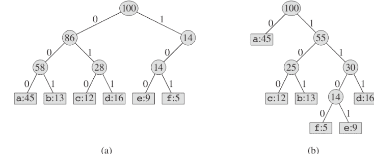

**图 3：**前缀编码。

解码过程需要前缀编码有一个方便的表示方法，以便我们能够轻松提取出初始码字。叶子节点为给定二进制编码的二叉树提供了这样一种表示方法。我们将字符的二进制编码解释为从根到该字符的简单路径，其中`0`表示“向左子节点”，`1`表示“向右子节点”。图 3 显示了我们示例中的两个编码。注意，这些不是二叉搜索树，因为叶子节点没有按顺序排列，且内部节点不包含字符键。

文件的最优编码始终由一棵满二叉树表示，其中每个非叶子节点都有两个孩子。

我们示例中的固定长度编码不是满二叉树：它包含了以`10...`开头的码字，但没有以`11...`开头的码字。由于我们可以限制注意力在满二叉树上，我们可以说如果`C`是提取字符的字母表且所有字符频率均为正数，那么最优前缀编码的树恰好有`|C|`个叶子节点（字母表中每个字母一个）和恰好`|C|-1`个内部节点。

给定一个表示前缀编码的树`T`，我们可以轻松地计算编码文件所需的位数。对于字母表中的每个字符`c`，令属性`c: freq`表示`c`在文件中的频率，并令`d_T(c)`表示`c`的叶子节点在树中的深度。

请注意，`d_T(c)`也是字符`c`的码字长度。因此，编码文件所需的位数为：

```
B(T) = \sum_{c\in C} c.freq \cdot d_T(c).
```

我们将其定义为树`T`的代价。

## 构建霍夫曼编码

哈夫曼发明了一种构建最优前缀编码的贪心算法，称为霍夫曼编码。其正确性的证明依赖于贪心选择性质和最优结构。我们不是先证明这些属性成立然后再编写伪代码，而是先给出伪代码。这样做有助于澄清算法是如何做出贪心选择的。

在接后的伪代码中，我们假设`C`是包含`n`个字符的集合，每个`c ∈ C`都是一个具有属性`c:freq`（频率）的对象。算法通过自底而上的合并构建对应最优编码的树`T`。它从`|C|`个叶子节点开始，通过`|C|-1`次“合并”操作创建最终树。算法使用一个以`freq`属性为键的最小优先级队列来识别频率最低的对象。

```
HUFFMAN(C)

1 n = |C|
2 Q = C
3 for i = 1 to n-1
4   x = EXTRACT-MIN(Q)
5   y = EXTRACT-MIN(Q)
6   z = NEW-NODE()
7   z.left = x
8   z.right = y
9   z.freq = x.freq + y.freq
10  INSERT(Q, z)
11 return z.root
```

# 贪心算法 207

## 哈夫曼算法的正确性

为了证明哈夫曼算法是正确的，我们证明该问题具有贪心选择性质和最优结构。

步骤1：证明该问题满足贪心选择性质。

步骤2：证明该问题具有最优结构。

### 引理：贪心选择性质

令`c`为字母表，字符频率为`f[c]`。令`x`和`y`为`C`中频率最低的两个字符。那么存在一个最优前缀编码，其中`x`和`y`的码字长度相同且在最后一位不同。

### 证明思路

取表示前缀编码的树并将其转换为另一个最优编码的树`T'`，使得`x`和`y`作为最大深度的兄弟叶子出现。如果我们这样做，它们的码字长度将相同。

### 证明

令`b`和`c`为树`T`中最大深度的兄弟叶子。不失一般性地假设`f[b] ≥ f[c]`且`f[x] ≤ f[y]`。由于`f[x]`和`f[y]`是最低叶子频率，而`f[b]`和`f[c]`是任意频率，我们有`f[x] ≤ f[b]`且`f[y] ≤ f[c]`。如图所示，交换叶子的位置得到`T'`，然后得到`T''`。根据公式`B(T) = Σᵢin C f(i)d_T(i)`，`T`和`T'`之间的差异为：

```
B(T) - B(T') = f[x]d_T(x) + f[b]d_T(b) - [f[x]d_T'(x) + f[b]d_T'(b)]

= (f[b] - f[x]) (d_T(b) - d_T'(x))

= (非负)(非负)

= 0
```

## 两个重要点

`f[b] - f[x]`非负的原因是因为`x`是树`T`中的最小频率叶子，而`d_T(x)`非负的原因是`b`是`T`中最大深度的叶子。同样，交换`y`和`c`不会增加代价，这意味着

# 208 Java 中的数据结构与算法

`B(T) ≤ B(T')`，由于假设`T`是最优的，这意味着`B(T') = B(T)`。因此，`T'`也是最优的，其中`x`和`y`是最大深度的兄弟叶子节点，满足贪心选择性质。

### 引理：最优子结构性质

设`T`为一个表示字母表`C`上最优前缀码的满二叉树，其中对于每个字符`c ∈ C`都定义了频率`f[c]`。考虑树`T`中作为兄弟叶子节点出现的任意两个字符`x`和`y`，并令`z`为它们的父节点。那么，考虑频率为`f[z] = f[x] + f[y]`的字符，树`T' = T - \{x, y\}`代表字母表`C'`的最优代码。

### 证明

我们证明树`T`的代价`B(T)`可以用代价`B(T')`来表示。通过考虑等式中的各项代价，`B(T) = \sum f(c)d(c)`，我们证明树`T`的代价`B(T)`可以用代价`B(T')`来表示。对于每个`c ∈ C - \{x, y\}`，我们有`d'(c) = d(c)`。

```
sum_{c \in C} f[c]d(c) = \sum_{C-\{x,y\}} f[c]d(c)

= f[x](d(z) + 1) + f[y] (d(z) + 1)

= (f[x] + f[y]) d(z) + f[x] + f[y]
```


且$B(T) = B(T') + f(x) + f(y)$

如果$T'$不是$C'$的最优前缀码，则存在一个叶子节点属于$C'$字符的$T'$，使得$B(T') < B(T)$。现在，如果将$x$和$y$作为$z$的孩子添加到$T'$中，我们就得到一个对于字母表$C$的前缀码，其代价为$B(T') + f(x) + f(y) < B(T)$。这与$T$的最优性相矛盾。这意味着树$T$必须对于字母表$C$是最优的。

## 6.1.6 拟阵与贪心算法

假设给定一个$n$个对象的集合$E=\{e_1, e_2, \dots, e_n\}$，每个对象都有关联的正整数权重$w(e_1), w(e_2), \dots, w(e_n)$。令$I$为$E$的幂集（所有子集的集合）的子集，满足以下性质：

- 对于每一个$I$，在$I$中，如果$I_1$是$I_2$的子集，则$I_2$属于$I$。
- 对于$I$中的每对$I_1, I_2$，使得$|I_2| = |I_1|+1$，存在一个元素$e \in I_2 - I_1$，使得$I_1 \cup \{e\} \in I$。

那么数对$(E, I)$就是一个拟阵。$I$的成员被称为独立集。包含最多元素的独立集被称为极大基数独立集。寻找一个极大基数独立集$(I_{max})$以使得$E$中所有$e$的$w(e)$之和最小（或最大）的问题，可以通过以下方法解决（贪心算法）：

- 设置$T = \emptyset$
- 按权重递增（或递减）顺序对$E$中的所有对象进行排序
- 重复以下步骤直到$E$为空
- 令$e$为$E$中权重最低（或最高）的元素
- 从$T$中移除$e$
- 如果$T \cup \{e\} \in I$，则将$e$添加到$T$中

接下来我们给出两个示例：最大生成生成树网络问题和具有单位处理时间的整数截止日期调度问题。

首先，考虑在加权图$G$中寻找最小生成树（网络）的问题。令$E$为图$G$中的边集合。令$I$为$G$的所有森林的集合（即所有使用$G$的边且无环的图）。那么$(E, I)$是一个拟阵。

为了证明这一点，这两个性质定义了一个拟阵。性质(1)是满足的，因为从森林中移除任意边都会得到另一个森林。性质(2)通过以下论证满足：从$I$中的任意$I_1, I_2$出发，且$|I_2| = |I_1|+1$。考虑三种可能性：

- 存在$I_2$中的一条边$e$，它与$I_1$中某条边的端点最多有一个公共顶点。在这种情况下，$I_1 \cup \{e\}$是一个森林。
- 存在$I_2$中的一条边$e$，它的一个顶点与$I_1$中某个连通分量中的顶点共有，另一个顶点与$I_1$中另一个连通分量中的顶点共有。在这种情况下，由于两个连通分量都是树且分量之间没有其他边，$I_1 \cup \{e\}$是一个森林。
- 对于$I_2$中的每条边$\langle v, w \rangle$，$v$和$w$位于同一个$I_1$连通分量中。（注：此处通常指会形成环，根据拟阵证明逻辑。）

## 6.1.7 拟阵表示的任务调度问题

一个可以使用拟阵解决的有趣问题是在单处理器上调度单位时间任务的问题，每个任务都有一个截止日期和一个在错过截止日期时产生的惩罚。

带截止日期和惩罚的单位时间任务调度问题具有以下输入：

实例：
- 任务集合$S=\{a_1, a_2, \dots, a_n\}$；
- $n$个整数截止日期$d_1, d_2, \dots, d_n$，使得每个$d_i \ge 1$，且任务$i$应在时间$d_i$前完成；否则
- $n$个非负权重或惩罚$w_1, w_2, \dots, w_n$，如果任务$i$未在时间$d_i$前完成，则产生惩罚$w_i$，如果任务$i$在截止日期前完成则不产生惩罚。

输出：
- $S$的调度方案，使得错过截止日期的总惩罚最小。

考虑一个给定的调度方案。如果一个任务在截止日期后完成，我们称该任务是晚期的。否则，它是早期优先形式，即早期任务始终在晚期任务之前。为了证明这一点，注意到如果某个早期任务$x$在某个晚期任务$y$之后，我们可以交换$x$和$y$的位置而不影响$x$是否早期或$y$是否晚期。

同样，我们声称任意调度方案都可以转换为标准形式，其中早期任务按截止日期非递减顺序排列。为此，我们先将调度方案转换为早期优先形式。然后，只要存在两个早期任务$i$和$j$，它们分别在时间$k$和$k+1$完成，且$d_j < d_i$，我们就交换$i$和$j$的位置。由于任务$j$在交换前是早的，$k+1 \le d_j$，因此$k+1 < d_i$，所以任务$i$在交换后仍然是早的。任务$j$被移动到了更早的位置，因此寻找最优调度方案的问题因此简化为寻找一个处于早的任务集合$A$。

## Java 中的数据结构与算法

`schedule`。一旦确定了$A$，我们就可以按照截止日期非递增顺序列出$A$的任务来创建实际计划，然后以任何顺序列出逾期任务（即$S - A$），从而产生最优计划的正规排序。

如果存在一个调度这些任务的计划使得没有任务逾期，那么我们说任务集合$A$是独立的。显然，一个计划的提前完成任务集构成了一个独立任务集。令$I$表示所有独立任务集合的集合。

考虑判断给定任务集合$A$是否独立的问题。对于$t = 1, 2, \dots, n$，令$N(A)$表示$A$中截止日期为$t$或更早的任务数量。

## 完理

对于任意集合$A$，以下语句是等价的：

- 集合$A$是独立的。
- 对于$t = 1, 2, \dots, n$，我们有$N(A) \le t$。
- 如果$A$中的任务按照截止日期非递增的顺序进行调度，则没有任务逾期。

## 证明

显然，如果对于某个$t$有$N(A) > t$，那么没有办法为集合$A$创建一个不含逾期的计划，因为在时间$t$之前有超过$t$个任务需要完成。因此，(1)推出(2)。如果(2)成立，则必有(3)：在按照截止日期非递增顺序调度任务时，不会出现“卡住”，因为(2)意味着第$i$大的截止日期最多为$i$。最后，(3)显见地推出(1)。

使用完理的性质2，我们可以轻松地计算一个任务集合是否独立。

最小化逾期任务之和的问题等同于最大化提前任务之和的问题。以下定理确保了我们可以使用贪心算法找到具有最大惩罚的独立任务集合$A$。

## 定理

如果$S$是一个具有截止日期的单位时间任务集合，且$I$是所有独立任务集合的集合，那么相应的系统$(S,I)$是一个拟阵。

# 贪心算法

### 证明

独立任务集合的每个子集显然都是独立的。为了证明交换性质，假设$B$和$A$是独立任务集且$|B| > |A|$。令$k$为使得$N(B) \subseteq N(A)$的最大$t$。由于$N(B) = |B|$且$N(A) = |A|$，但$|B| > |A|$，我们必须在$k+1 \dots n$范围内有$k < n$且$N(B) > N(A)$。因此，$B$包含截止日期为$k+1$的任务比$A$多。令$x \in B - A$且截止日期为$k+1$。令$A' = A \cup \{x\}$。

我们通过使用完理的性质2证明$A'$必须是独立的。对于$t < s_t$，由于$A$是独立的，有$N(A') = N(A)$。对于$k < s_t$，由于$B$是独立的，有$N(A') \subseteq N(B)$。因此，$A'$是独立的，完成了我们$(\mathcal{S}, I)$是拟阵的证明。

根据定理，我们可以使用贪心算法找到最大权重独立任务集$A$。然后我们可以创建一个以$A$中的任务为提前完成任务的最优计划。该方法是单处理器调度具有截止日期和惩罚的单位时间任务的高效算法。使用`GREEDY`时，运行时间为$O(n^2)$，因为该算法进行的每次独立性检查需要$O(n)$的时间。更快的实现在问题中给出。

## 任务

| 任务 | 1 | 2 | 3 | 4 | 5 | 6 | 7 |
|---|---|---|---|---|---|---|---|
| $d_i$ | 4 | 2 | 4 | 3 | 1 | 4 | 6 |
| $w_i$ | 70 | 60 | 50 | 40 | 30 | 20 | 10 |

一个单处理器调度具有截止日期和惩罚的单位时间任务的示例。在这个例子中，贪心算法选择了任务1, 2, 3和4，然后拒绝了任务5和6，最后接受了任务7。最终的最优计划是`(2, 1, 3, 7, 5, 6)`，产生的总惩罚为$w_5 + w_6 = 30 + 20 = 50$。

寻找最优计划简化为找到一个在最优计划中提前完成的任务集合$A$。一旦确定了$A$，我们就可以按照截止日期单调增加的顺序列出$A$的元素来创建实际计划，然后以任何顺序列出逾期任务（即$S-A$），产生最优计划的正规排序。

## 6.2 动态规划

动态规划是解决一类问题非常强大的技术。它要求方法有非常优雅的表述和简单的思考，编码部分也非常容易。这个思想非常简单：如果你已经通过给定输入解决了一个问题，就保存结果以备后用，避免重复解决相同的问题。简而言之，“记住过去”。如果给的问题可以分解为更小的子问题，而这些更小的子问题又可以分解为更小的子问题。

给的问题可以分解为更小的子问题，而这些更小的子问题又可以分解为更小的子问题。

给的问题可以分解为更小的子问题，而这些更小的子问题又可以分解为更小的子问题。

给的问题可以分解为更小的子问题，而这些更小的子问题又可以分解为更小的子问题。

给的问题可以分解为更小的子问题，而这些更小的子问题又可以分解为更小的子问题。

给的问题可以分解为更小的子问题，而这些更小的子问题又可以分解为更小的子问题。

给的问题可以分解为更小的子问题，而这些更小的子问题又可以分解为更小的子问题。

动态规划可以从自顶向下和自底向上使用。这种方法的结果被存储起来。

给的问题可以分解为更小的子问题，而这些更小的子问题又可以分解为更小的子问题。

给的问题可以分解为更小的子问题，而这些更小的子问题又可以分解为更小的子问题。

给的问题可以分解为更小的子问题，而这些更小的子问题又可以分解为更小的子问题。

给的问题可以分解为更小的子问题，而这些更小的子问题又可以分解为更小的子问题。

递归实现。

朴素的递归实现如下：

## Java 中的数据结构与算法

```python
def fib(n) :
    if n == 0: return 0
    if n == 1: return 1
    return fib(n-1) + fib(n-2)
```

计算`fib(n)`的问题依赖于`fib(n-1)`和`fib(n-2)`。为了看到子问题的重叠，看看尝试计算`fib(5)`时`fib`调用了多少次：

```
fib(5)
fib(4) + fib(3)
fib(3) + fib(2) + fib(2) + fib(1)
fib(2) + fib(1) + fib(1) + fib(0) + fib(1) + fib(0)
fib(1)
fib(1)
fib(0)
```

在第$k$阶段，我们只需要知道`fib(k-1)`和`fib(k-2)`的值，但我们却会多次调用它们。从底部向上计算，我们可以计算出下一步所需的值，从而消除巨大的冗余。

```python
def fib2(n) :
    n2, n1 = 0, 1
    for i in range(n-2):
        n2, n1 = n1, n1 + n2
    return n2+n1
```

在大O符号中，该函数耗用$O(c^n)$时间，即相对于$n$是指数级的，而`fib2`函数耗用$O(n)$时间。如果这些都太抽象，请看这张对比`fib`和`fib2`的运行时间（微秒）与输入参数的图表。

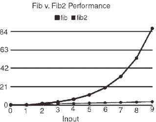

# 贪心算法 217

上面的问题非常简单，对于大多数程序员来说，这是关于递归与迭代之间性能问题的首批示例之一。事实上，我见过很多例子，斐波那契的例子让人们认为递归天生就是慢的。事实并非如此，但在我们可以使用上述技术递归地定义具有重叠子问题的情况下，总是能缩短执行时间。现在来看动态规划的第二个特性：最优子结构。

## 6.2.2 最优子结构

如果一个全局最优解可以从子问题的局部最优解构造，则称该问题具有最优子结构。具有最优子结构的问题一般形式如下：假设我们有一个对象集合$A$。对于$A$中的每个对象，我们都有一个“成本”$c$。现在找到$A$中成本最大（或最小）的子集，可能受限于某些约束。

暴力破解法是生成$A$的所有子集，计算成本，然后在这些值中找到最大（或最小）。但如果$A$有$n$个元素，且对$A$没有限制条件，那么我们面对的是一个大小为$2^n$的搜索空间。通常情况下，$n$是巨大的，使得暴力破解法在计算上是不可行的。让我们来看一个例子。

### 最大连续子数组和

假设给定一个整数数组。哪一个（连续）子数组的和最大？例如，如果我们的数组是`[1,-2,5,-4,7,-2]`，那么和最大的子数组是`[4,7]`，和为11。人们起初可能会认为，这个问题可以简化为找到包含所有正数的子数组（如果存在的话），以使和最大化。但考虑数组`[1,5,-3,-4,-2,1]`。和最大的子数组是`[1,5]`，和为7。首先，是暴力破解法。由于该问题的限制（即所考虑的子集是连续的），我们只需要检查$O(n^2)$个子数组（为什么？）。这里是Python语言的实现：

```python
def msum(a):
    return max([(sum(a[j:i]), (j,i)) for i in
                range(1,len(a)+1) for j in range(i)])
```

Java中的数据结构与算法

这返回了子数组的和和偏移量。让我们看看是否能找到一个可以利用的最优子结构。

给定一个输入数组。我将使用Python记法，从0开始包含直到`k-1`的每个元素。假设我们知道`a[0:i]`中和最大的子数组。利用这些信息，我们可以找到`a[0:i+1]`中和最大的子数组吗？

设`a[j:k+1]`为最优子数组，`t`为`a[j:i]`的和，`s`为最优和。如果`t+a[i]`大于`s`，则将`a[i+1]`设置为最优数组并将`s = t`。然而，如果`t+a[i]`为负，连续性限制意味着我们不能将`a[i+1]`包含在子数组中，因为任何此类子数组都会比不包含它的子数组和。因此，如果`t+a[i]`为负，则设置`t=0`并将最优子数组的左边界设置为`i+1`。

为了可视化数组`[1,2,-5,4,7,-2]`：

`s = -infinity, t = 0, j = 0, bounds = (0,0)`

```
1 2 -5 4 7 -2
+ (1) 2 -5 4 7 -2 (set t > s, set s = 1 and bounds = (0,1))
(2) |1 -5 4 7 -2 (set t = 3. set t, s = 3, and bounds = (0,2))
1 2 -5 (1) 4 7 -2 (set t < 0, set t = 0 and j = 3)
1 2 -5 (4) 7 -2 (set t = 4. Since t > s, set s = 4 and bounds = (3,4))
1 2 -5 (4) 7 ) -2 (set t = 11. Since t > s, set s = 11 and bounds = (3,5))
1 2 -5 (4) 7 -2 (set t = 9. Nothing happens since t < s)
```

这只需要遍历数组一次，在每一步我们只跟踪三个变量：从数组左边缘到当前点的当前和`t`，最大和`s`，以及当前最优子数组的边界`bounds`。在Python中：

```python
def msum(a):
    s, t, j = float('-infinity'), 0, 0
    bounds = (0, 0)
    for i in range(len(a)):
        t = t + a[i]
        if t > s:
            bounds, s = (j, i+1), t
        if t < 0:
            t, j = 0, i+1
    return (s, bounds)
```


贪心算法 219

在这个问题中，“全局最优”解对应于具有全局最大和的子数组，但在每一步中，我们只根据已经看到的内容做出决策。

也就是说，在每一步中，我们知道到目前为止的最佳解，但可能会根据先前的信息和当前的信息改变我们的决策。这就是该问题具有最优子结构的意义。因为我们可以从局部做出决策，我们只需要遍历列表一次，从而将运行时间从`O(n²)`降低到`O(n)`。再次，看图：

## 6.2.3 动态规划步骤

- 初始化
- 矩阵填充 (scoring)
- 回溯 (Traceback)

### 初始化

动态规划方法的第一步是创建一个`M+1`列和`N+1`行的矩阵，其中`M`和`N`分对应序列的大小。由于此示例假设没有空隙开启或扩展罚，矩阵的第一行和第一列初始填充为`0`。

| | G A T T C G T A |
|---|---|---|---|---|---|---|---|
| 0 | 0 | 0 | 0 | 0 | 0 | 0 | 0 |

### 矩阵填充

一种可能的低效矩阵填充方法是从矩阵的左上角开始寻找对齐得分，并找到每个位置的`M_{i,j}`为了找到任何位置的`M_{i,j}`需要知道左侧、上方和对角线的得分。在术语上，需要知道`M_{i-1,j}`和`M_{i-1,j-1}`对于每个位置，`M_{i,j}`定义为：

$M_{i,j} = M_{i-1,j-1} + w$ (匹配/不匹配)
$M_{i,j} = M_{i-1,j} + w$ (序列 1 中的空隙)
$M_{i,j} = M_{i,j-1} + w$ (序列 2 中的空隙)

注意在示例中，`M_{i-1,j}`将是红色，`M_{i,j-1}`将是绿色，`M_{i-1,j-1}`将是蓝色。利用这些信息，可以计算矩阵`1,1`位置的得分。由于两个序列中的第一个残基都是`G`，`S_{1,1} = 1`，根据开始时的假设`w=0`（或适当的罚分）。

| | G A T T C G T A |
|---|---|---|---|---|---|---|---|---|
| 0 | 0 | 0 | 0 | 0 | 0 | 0 | 0 | 0 |
| G | 0 | 1 | 1 | 1 | 1 | 1 | 1 | 1 |
| A | 0 | 1 | 2 | 2 | 2 | 2 | 2 | 2 |
| T | 0 | 1 | 2 | 3 | 3 | 3 | 3 | 3 |
| T | 0 | 1 | 2 | 3 | 4 | 4 | 4 | 4 |
| C | 0 | 1 | 2 | 3 | 4 | 5 | 5 | 5 |
| G | 0 | 1 | 2 | 3 | 4 | 5 | 6 | 6 |
| T | 0 | 1 | 2 | 3 | 4 | 5 | 6 | 7 |
| A | 0 | 1 | 2 | 3 | 4 | 5 | 6 | 8 |

在`1,1`位置放置了值`1`。由于空隙罚分 (`w`) 为`0`，第一行和第一列的其余部分可以填充`1`。以第一行为例。在第`2`列，该值是`0`（不匹配）、`0`（垂直空隙）或`1`（水平空隙）的最大值。第一行的其余部分以类似的方式填充，直到到达第`8`列。在此处，两个序列中都有`G`（浅蓝色）。因此，第`8`行单元格的值是`1`（匹配）、`0`（垂直空隙）或`1`（水平空隙）的最大值。该值再次为`1`。第一行和第一列的其余部分可以填充`1`。使用上述逻辑：

| | G A T T C G T A |
|---|---|---|---|---|---|---|---|---|
| 0 | 0 | 0 | 0 | 0 | 0 | 0 | 0 | 0 |
| G | 0 | 1 | 1 | 1 | 1 | 1 | 1 | 1 |
| A | 0 | 1 | 2 | 2 | 2 | 2 | 2 | 2 |
| T | 0 | 1 | 2 | 3 | 3 | 3 | 3 | 3 |
| T | 0 | 1 | 2 | 3 | 4 | 4 | 4 | 4 |
| C | 0 | 1 | 2 | 3 | 4 | 5 | 5 | 5 |
| G | 0 | 1 | 2 | 3 | 4 | 5 | 6 | 6 |
| T | 0 | 1 | 2 | 3 | 4 | 5 | 6 | 7 |
| A | 0 | 1 | 2 | 3 | 4 | 5 | 6 | 8 |

在示例中，`M_{i-1,j}`将是红色的，`M_{i,j-1}`将是绿色的，`M_{i-1,j-1}`将是蓝色的。注意，对于第`2`列除最后一个的所有位置，选择与第`4`行完全相同，因为没有空隙罚分。

| | G A T T C G T A |
|---|---|---|---|---|---|---|---|---|
| 0 | 0 | 0 | 0 | 0 | 0 | 0 | 0 | 0 |
| G | 0 | 1 | 1 | 1 | 1 | 1 | 1 | 1 |
| A | 0 | 1 | 2 | 2 | 2 | 2 | 2 | 2 |
| T | 0 | 1 | 2 | 3 | 3 | 3 | 3 | 3 |
| T | 0 | 1 | 2 | 3 | 4 | 4 | 4 | 4 |
| C | 0 | 1 | 2 | 3 | 4 | 5 | 5 | 5 |
| G | 0 | 1 | 2 | 3 | 4 | 5 | 6 | 6 |
| T | 0 | 1 | 2 | 3 | 4 | 5 | 6 | 7 |
| A | 0 | 1 | 2 | 3 | 4 | 5 | 6 | 8 |

对于第`2`列，`M_{i-1,j}`将是红色的，`M_{i,j-1}`将是绿色的，`M_{i-1,j-1}`将是蓝色的。对于第`2`列，`M_{i-1,j}`将是红色的，`M_{i,j-1}`将是绿色的，`M_{i-1,j-1}`将是蓝色的。对于第`2`列，`M_{i-1,j}`将是红色的，`M_{i,j-1}`将是绿色的，`M_{i-1,j-1}`将是蓝色的。对于第`2`列，`M_{i-1,j}`将是红色的，`M_{i,j-1}`将是绿色的，`M_{i-1,j-1}`将是蓝色的。对于第`2`列，`M_{i-1,j}`将是红色的，`M_{i,j-1}`将是绿色的，`M_{i-1,j-1}`将是蓝色的。对于第`2`列，`M_{i-1,j}`将是红色的，`M_{i,j-1}`将是绿色的，`M_{i-1,j-1}`将是蓝色的。对于第`2`列，`M_{i-1,j}`将是红色的，`M_{i,j-1}`将是绿色的，`M_{i-1,j-1}`将是蓝色的。对于第`2`列，`M_{i-1,j}`将是红色的，`M_{i,j-1}`将是绿色的，`M_{i-1,j-1}`将是蓝色的。对于第`2`列，`M_{i-1,j}`将是红色的，`M_{i,j-1}`将是绿色的，`M_{i-1,j-1}`将是蓝色的。对于第`2`列，`M_{i-1,j}`将是红色的，`M_{i,j-1}`将是绿色的，`M_{i-1,j-1}`将是蓝色的。对于第`2`列，`M_{i-1,j}`将是红色的，`M_{i,j-1}`将是绿色的，`M_{i-1,j-1}`将是蓝色的。对于第`2`列，`M_{i-1,j}`将是红色的，`M_{i,j-1}`将是绿色的，`M_{i-1,j-1}`将是蓝色的。

使用与填充第`2`列的方法，我们可以填充第`3`列。

## Java 中的数据结构与算法

| | G A A T T C A G T T A |
|---|---|---|---|---|---|---|---|---|---|---|
| G | 0 | 0 | 0 | 0 | 0 | 0 | 0 | 0 | 0 | 0 |
| G | 0 | 1 | 1 | 1 | 1 | 1 | 1 | 1 | 1 | 1 |
| G | 0 | 1 | | | | | | | | | |
| A | 0 | 1 | 2 | | | | | | | | |
| T | 0 | 1 | 2 | 2 | | | | | | | |
| C | 0 | 1 | 2 | 2 | 2 | | | | | | |
| G | 0 | 1 | 2 | 2 | 2 | | | | | | |
| A | 0 | 1 | 2 | 2 | 3 | | | | | | |

所有值后，得分矩阵如下：

| | G A A T T C A G T T A |
|---|---|---|---|---|---|---|---|---|---|---|
| G | 0 | 0 | 0 | 0 | 0 | 0 | 0 | 0 | 0 | 0 |
| G | 0 | 1 | 1 | 1 | 1 | 1 | 1 | 1 | 1 | 1 |
| G | 0 | 1 | 1 | 1 | 1 | 1 | 1 | 2 | 2 | 2 |
| A | 0 | 1 | 2 | 2 | 2 | 2 | 2 | 2 | 2 | 3 |
| T | 0 | 1 | 2 | 2 | 3 | 3 | 3 | 3 | 3 | 3 |
| C | 0 | 1 | 2 | 2 | 3 | 3 | 4 | 4 | 4 | 4 |
| G | 0 | 1 | 2 | 2 | 3 | 3 | 4 | 4 | 5 | 5 |
| A | 0 | 1 | 2 | 2 | 3 | 3 | 4 | 5 | 5 | 5 | 6 |

# 回溯步骤 (Traceback Step)

在矩阵填充步骤之后，两个测试序列的最大对齐分为`6`。回溯步骤确定了产生最大分的实际对齐结果。请注意，使用像这里这样的简单评分算法，可能会存在多个最大对齐。

回溯步骤从矩阵中的`M,J`位置开始，即位置为`6`的地方。回溯取当前单元格，并寻找可能是直接前驱的相邻单元格。这意味着它查看左侧的邻居（序列 #2 中的缺失）、对角邻居（匹配/不匹配）以及上方的邻居（序列 #1 中的缺失）。回溯算法从可能的前驱中选择序列中的下一个单元格。在这种情况下，邻居被用红色标记。它们的值都等于`5`。

# 贪心算法 223

| | G A T T C A G T T A |
|---|---|---|---|---|---|---|---|---|---|---|
| G | 0 | 0 | 0 | 0 | 0 | 0 | 0 | 0 | 0 | 0 |
| G | 0 | 1 | 1 | 1 | 1 | 1 | 1 | 1 | 1 | 1 |
| A | 1 | 1 | 2 | 2 | 2 | 2 | 2 | 2 | 2 | 3 |
| T | 1 | 2 | 2 | 3 | 3 | 3 | 3 | 3 | 3 | 3 |
| C | 1 | 2 | 2 | 3 | 3 | 4 | 4 | 4 | 4 | 4 |
| G | 1 | 2 | 2 | 3 | 3 | 4 | 5 | 5 | 5 | 5 |
| A | 1 | 2 | 3 | 3 | 4 | 5 | 5 | 5 | 6 | 6 |

当前单元格的值为`6`，匹配得`1`分，其他情况为`0`，唯一可能的前驱是对角的匹配/不匹配邻居。如果存在多个可能的前驱，可以任选其一。

这让我们得到了当前的对齐：

(Seq #1) A
  |
(Seq #2) A

现在我们查看当前单元格并确定哪个单元格是它的直接前驱。在这种情况下，它是带有红色`5`的单元格。

| | G A T T C A G T T A |
|---|---|---|---|---|---|---|---|---|---|---|
| G | 0 | 0 | 0 | 0 | 0 | 0 | 0 | 0 | 0 | 0 |
| G | 0 | 1 | 1 | 1 | 1 | 1 | 1 | 1 | 1 | 1 |
| G | 0 | 1 | 1 | 1 | 1 | 1 | 1 | 2 | 2 | 2 |
| A | 0 | 1 | 2 | 2 | 2 | 2 | 2 | 2 | 2 | 3 |
| T | 0 | 1 | 2 | 2 | 3 | 3 | 3 | 3 | 3 |
| C | 0 | 1 | 2 | 2 | 3 | 3 | 4 | 4 | 4 |
| G | 0 | 1 | 2 | 2 | 3 | 4 | 5 | 5 | 5 |
| A | 1 | 2 | 3 | 3 | 4 | 5 | 5 | 5 | 6 |

上述对齐为序列 #2 增加了一个缺失，因此当前对齐为：

(Seq #1) TA
  |
(Seq #2) _ A

再次，直接前驱在序列 #2 中产生了一个缺失。

## Java 中的数据结构与算法

| | G | A | T | T | C | A | G | T | A |
|---|---|---|---|---|---|---|---|---|---|
| 0 | 0 | 0 | 0 | 0 | 0 | 0 | 0 | 0 |
| G | 0 | 1 | 1 | 1 | 1 | 1 | 1 | 1 | 1 |
| G | 0 | 1 | 1 | 1 | 1 | 1 | 1 | 2 | 2 |
| A | 0 | 1 | 2 | 2 | 2 | 2 | 2 | 2 | 3 |
| T | 0 | 1 | 2 | 2 | 3 | 3 | 3 | 3 | 3 |
| C | 0 | 1 | 2 | 2 | 3 | 3 | 4 | 4 | 4 |
| G | 0 | 1 | 2 | 2 | 3 | 3 | 4 | 5 | 5 |
| A | 0 | 1 | 2 | 2 | 3 | 3 | 5 | 5 | 6 |

示例

让我们从一个简单的预算问题开始。某公司有`500`万美元分配给三个工厂。每个工厂都提交了关于如何花费这些资金的方案。每个方案都提供了成本 (`c`) 和总预期收益 (`r`)。

全枚举法的一些缺点：

- 对于较大的问题，枚举所有方案在计算上是不可行的。
- 无法预先检测到不可行的组合，导致效率低下。
- 未利用之前调查的信息来消除劣或不可行的组合。

注意，此问题无法建模为线性规划，因为收益不是线性函数。计算解的一种方法如下：

将问题分为三个*阶段* (stages)：每个阶段代表分配给单个工厂的资金。阶段 1 代表工厂 1，阶段 2 代表工厂 2，阶段 3 代表工厂 3。

我们将人为地对阶段设定顺序，即首先分配给工厂 1，然后是工厂 2，最后是工厂 3。

每个阶段被划分为*状态* (states)。状态包含了从一个阶段到下一个阶段所需的全部的信息。在这种情况下，阶段 1、2、3、4 和 5 的状态为：

- (0,1,2,3,4,5)：花费在工厂 1 的金额，表示为`x_i`
- (0,1,2,3,4,5)：花费在工厂 1 和工厂 2 的金额 (`x_j`)，
- (5)：花费在工厂 1、2 和 3 的金额 (`x_k`)。

与线性规划不同，`x_i`不代表决策变量：它们仅仅是阶段中通用状态的表示。

**每个状态对应的收益：** 注意，要在阶段 3 做出决策，只需要知道工厂 1 和 2 花费了多少，而不是如何花费的。注意我们希望`x_3`为`5`。让我们尝试找出与每个状态`x_i`相关的收益。最简单的情况是在阶段 1，表 2 给出了与`x_1`相关的收益。

# 表2：阶段 1 计算

| 如果可用资金`x_i` | 则阶段 1 的最优方案 | 以及收益`r_1` |
|---|---|---|
| 0 | 1 | 0 |
| 1 | 2 | 5 |
| 2 | 3 | 6 |
| 3 | 3 | 6 |
| 4 | 3 | 6 |
| 5 | 3 | 6 |

现在我们准备好处理阶段 2 的计算了，你想为工厂 1 和工厂 2 找到最佳解。如果我们想为给定的`x_j`计算最佳收益，我们只需遍历工厂 2 的所有方案，将给定资金分配给工厂 2，并使用上面的表格显示工厂 1 如何花费剩余资金。

例如，假设我们想确定状态`x_2 = 4`的最佳分配。

在阶段 2 中，我们可以执行以下方案之一：

- 方案 1 收益为`0`，留`4`给阶段 1，返回`6`。总计`6`。
- 方案 2 收益为`8`，留`2`给阶段 1，返回`6`。总计`14`。
- 方案 3 收益为`9`，留`1`给阶段 1，返回`5`。总计`14`。

# 贪心算法 227

- 方案 4 提供了`12`的收益，为阶段 1 留下了`0`，返回`0`。总计：`12`。

对于四个单位最好的做法是植物 2 采用方案 1，植物 1 采用方案 2，返回`14`；或者植物 2 采用方案 2，植物 1 采用方案 1，同样返回`14`。无论哪情况下，处于状态`x_2 = 4`的收益均为`14`。

## 表 3：阶段 2 的计算。

| 如果可用资本`x_1` | 则最优方案为 | 阶段 1 的收益为 |
|---|---|---|
| 0 | 1 | 0 |
| 1 | 1 | 5 |
| 2 | 2 | 8 |
| 3 | 2 | 13 |
| 4 | 2 或 3 | 14 |
| 5 | 4 | 17 |

我们现在可以进入第 3 阶段。我们感兴趣的唯一值是`x_3 = 5`。再次，我们遍历该阶段的所有方案，确定剩余金额，并使用表格来决定之前阶段的值。

因此，我们现在植物 3 上可以进行以下操作：

- 方案 1 提供收益`0`，留下了`5`。之前的阶段提供`17`。总计：`17`。
- 方案 2 提供收益`4`，留下了`4`。之前的阶段提供`14`。总计：`18`。

因此，最优解是在植物 3 实施方案 2，植物 2 实施方案 2 或 3，植物 1 分别实施方案 3 或 2。这提供了`18`的收益。

如果你学习这个过程，你会发现计算是*递归地*进行的。阶段 2 的计算基于阶段 1，阶段 3 的计算仅基于阶段 2。给定你处于某个状态，所有未来的决策都独立于你如何到达该状态的。这就是*最优性原理*，所有的动态规划都建立在这一假设之上。

我们可以通过以下公式总结这些计算：

用`r(k)`表示阶段`j`下方案`k`的收益，用`f(x)`表示相应的成本。令`x_j`为阶段`j`中状态`x_i`的收益。那么我们有以下计算

## Java 中的数据结构与算法

以及

$$f_1(x_1) = \max \{r(k_1) \mid k_1 x(k_1) \leq x_1\}$$

$$f_i(x_i) = \max_{k_i} r(k_i) + f_{i-1}(x_i - c(k_i)) \ \text{for } j = 2, 3$$

我们通过上述计算所做的只是确定这些函数。

计算是以前向过程执行的。也可以从“最后一个”阶段回溯到第一阶段计算。

我们可以定义，

- `y_1` = 分配给阶段 1、2 和 3 的金额，

这定义了一个*后向*递归。从图上来说，这如图所示。

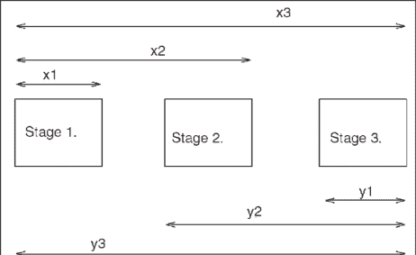

相应的公式是：

- `f_3(y_3)`为给定`y_3`时阶段 3 的最优收益，

递归公式为：

$$f_3(y_3) = \max_{k_3: c(k_3) \leq y_3} \{r(k_3)\}$$

$$f_i(y_i) = \max_{k_i: c(k_i) \leq y_i} \{r(k_i) + f_{i+1}(y_i - c(k_i))\}$$

# 贪心算法

如果你执行计算，将得到相同的答案。因此，在将来，我将只展示后向递归，除非我希望对比这两种递归的情况。

## 共同特征

这两个问题以及所有动态规划问题都有许多共同特征。

这些特征是：

- 问题可以划分为若干阶段，每个阶段都需要决策。

在资本预算问题中，阶段是分配给单个工厂的。决策是花费多少。在最短路径问题中，阶段由图的结构定义。决策是前往下一个。

- 每个阶段都有与它相关的若干状态。资本预算问题的状态对应于该时间点的花费金额。最短路径问题的状态是到达的节点。

- 一个阶段的决策将一个状态转换为下一阶段的状态。

花费多少的决策为下一阶段提供了总金额。去下一个地方的决策定义了你在下一阶段到达的位置。

- 给定当前状态，每个剩余状态的最优决策不依赖于之前的状态或决策。在预算问题中，不需要知道钱在之前的阶段是如何花费的，只需要知道花了多少。在路径问题中，不需要知道你是如何到达节点的，只需要知道你到达了。

- 存在一种递归关系，在阶段`j+1`已解决的情况下，识别阶段`j`的最优决策。最终阶段必须是

如果你研究这个程序，你会发现计算是*递归地*进行的。阶段 2 的计算基于阶段 1，阶段 3 仅基于阶段 2。给定，你处于一个状态，所有未来的决策都独立于你如何到达该状态。这就是*最优性原理*，所有的动态规划都建立在这一假设之上。

我们可以通过以下公式总结这些计算：

用`r(k)`表示阶段`j`下方案`k`的收益，用`f(x)`表示相应的成本。令`x_j`为阶段`j`中状态`x_i`的收益。那么我们有以下计算

$$f_1(x_1) = \max \{r(k_1) \mid k_1 x(k_1) \leq x_1\}$$

$$f_i(x_i) = \max_{k_i} r(k_i) + f_{i-1}(x_i - c(k_i)) \ \text{for } j = 2, 3$$

我们通过上述计算所做的只是确定这些函数。

计算是以前向过程执行的。也可以从“最后一个”阶段回溯到第一阶段计算。

我们可以定义，

- `y_1` = 分配给阶段 1、2 和 3 的金额，

这定义了一个*后向*递归。从图上来说，这如图所示。


相应的公式是：

- `f_3(y_3)`为给定`y_3`时阶段 3 的收益，

递归公式为：

$$f_3(y_3) = \max_{k_3: c(k_3) \leq y_3} \{r(k_3)\}$$

$$f_i(y_i) = \max_{k_i: c(k_i) \leq y_i} \{r(k_i) + f_{i+1}(y_i - c(k_i))\}$$

# 贪心算法

如果你执行计算，将得到相同的答案。因此，在将来，我将只展示后向递归，除非我希望对比这两种递归的情况。

## 共同特征

这两个问题以及所有动态规划问题都有许多共同特征。

这些特征是：

- 问题可以划分为若干阶段，每个阶段都需要决策。

在资本预算问题中，阶段是分配给单个工厂的。决策是花费多少。在最短路径问题中，阶段由图的结构定义。决策是前往下一个。

- 每个阶段都有与它相关的若干状态。资本预算问题的状态对应于该时间点的花费金额。最短路径问题的状态是到达的节点。

- 一个阶段的决策将一个状态转换为下一阶段的状态。

花费多少的决策为下一阶段提供了总金额。去下一个地方的决策定义了你在下一阶段到达的位置。

- 给定当前状态，每个剩余状态的最优决策不依赖于之前的状态或决策。在预算问题中，不需要知道钱在之前的阶段是如何花费的，只需要知道花了多少。在路径问题中，不需要知道你是如何到达节点的，只需要知道你到达了。

- 存在一种递归关系，在阶段`j+1`已解决的情况下，识别阶段`j`的最优决策。最终阶段必须是

如果你研究这个程序，你会发现计算是*递归地*进行的。阶段 2 的计算基于阶段 1，阶段 3 的计算仅基于阶段 2。给定，你处于一个状态，所有未来的决策都独立于你如何到达该状态。这就是*最优性原理*，所有的动态规划都建立在这一假设之上。

我们可以通过以下公式总结这些计算：

用`r(k)`表示阶段`j`下方案`k`的收益，用`f(x)`表示相应的成本。令`x_j`为阶段`j`中状态`x_i`的收益。那么我们有以下计算

## 6.2 背包问题

这是一个经典的 0/1 整数背包问题。假设有`n`个物品，每个物品都有重量和价值。

## 表 3：阶段 2 的计算。

| 如果可用资本`x_1` | 则最优方案为 | 阶段 1 的收益为 |
|---|---|---|
| 0 | 1 | 0 |
| 1 | 1 | 5 |
| 2 | 2 | 8 |
| 3 | 2 | 13 |
| 4 | 2 或 3 | 14 |
| 5 | 4 | 17 |

我们现在可以进入第 3 阶段。我们感兴趣的唯一值是`x_3 = 5`。再次，我们遍历该阶段的所有方案，确定剩余金额，并使用表格来决定之前阶段的值。

因此，我们现在植物 3 上可以进行以下操作：

- 方案 1 提供收益`0`，留下了`5`。之前的阶段提供`17`。总计：`17`。
- 方案 2 提供收益`4`，留下了`4`。之前的阶段提供`14`。总计：`18`。

因此，最优解是在植物 3 实施方案 2，植物 2 实施方案 2 或 3，植物 1 分别实施方案 3 或 2。这提供了`18`的收益。

如果你学习这个过程，你会发现计算是*递归地*进行的。阶段 2 的计算基于阶段 1，阶段 3 的计算仅基于阶段 2。给定，你处于一个状态，所有未来的决策都独立于你如何到达该状态。这就是*最优性原理*，所有的动态规划都建立在这一假设之上。

我们可以通过以下公式总结这些计算：

用`r(k)`表示阶段`j`下方案`k`的收益，用`f(x)`表示相应的成本。令`x_j`为阶段`j`中状态`x_i`的收益。那么我们有以下计算

## Java 中的数据结构与算法

以及

$$f_1(x_1) = \max \{r(k_1) \mid k_1 x(k_1) \leq x_1\}$$

$$f_i(x_i) = \max_{k_i} r(k_i) + f_{i-1}(x_i - c(k_i)) \ \text{for } j = 2, 3$$

我们通过上述计算所做的只是确定这些函数。

计算是以前向过程执行的。也可以从“最后一个”阶段回溯到第一阶段计算。

我们可以定义，

- `y_1` = 分配给阶段 1、2 和 3 的金额，

这定义了一个*后向*递归。从图上来说，这如图所示。


相应的公式是：

- `f_3(y_3)`为给定`y_3`时阶段 3 的收益，

递归公式为：

$$f_3(y_3) = \max_{k_3: c(k_3) \leq y_3} \{r(k_3)\}$$

$$f_i(y_i) = \max_{k_i: c(k_i) \leq y_i} \{r(k_i) + f_{i+1}(y_i - c(k_i))\}$$

# 贪心算法

如果你执行计算，将得到相同的答案。因此，在将来，我将只展示后向递归，除非我希望对比这两种递归的情况。

## 共同特征

这两个问题以及所有动态规划问题都有许多共同特征。

这些特征是：

- 问题可以划分为若干阶段，每个阶段都需要决策。

在资本预算问题中，阶段是分配给单个工厂的。决策是花费多少。在最短路径问题中，阶段由图的结构定义。决策是前往下一个。

- 每个阶段都有与它相关的若干状态。资本预算问题的状态对应于该时间点的花费金额。最短路径问题的状态是到达的节点。

- 一个阶段的决策将一个状态转换为下一阶段的状态。

花费多少的决策为下一阶段提供了总金额。去下一个地方的决策定义了你在下一阶段到达的位置。

- 给定当前状态，每个剩余状态的最优决策不依赖于之前的状态或决策。在预算问题中，不需要知道钱在之前的阶段是如何花费的，只需要知道花了多少。在路径问题中，不需要知道你是如何到达节点的，只需要知道你到达了。

- 存在一种递归关系，在阶段`j+1`已解决的情况下，识别阶段`j`的最优决策。最终阶段必须是

如果你研究这个程序，你会发现计算是*递归地*进行的。阶段 2 的计算基于阶段 1，阶段 3 的计算仅基于阶段 2。给定，你处于一个状态，所有未来的决策都独立于你如何到达该状态。这就是*最优性原理*，所有的动态规划都建立在这一假设之上。

我们可以通过以下公式总结这些计算：

用`r(k)`表示阶段`j`下方案`k`的收益，用`f(x)`表示相应的成本。令`x_j`为阶段`j`中状态`x_i`的收益。那么我们有以下计算

## 6.2 背包问题

这是一个经典的 0/1 整数背包问题。假设有`n`个物品，每个物品都有重量和价值。

## 表 3：阶段 2 的计算。

| 如果可用资本`x_1` | 则最优方案为 | 阶段 1 的收益为 |
|---|---|---|
| 0 | 1 | 0 |
| 1 | 1 | 5 |
| 2 | 2 | 8 |
| 3 | 2 | 13 |
| 4 | 2 或 3 | 14 |
| 5 | 4 | 17 |

我们现在可以进入第 3 阶段。我们感兴趣的唯一值是`x_3 = 5`。再次，我们遍历该阶段的所有方案，确定剩余金额，并使用表格来决定之前阶段的值。

因此，我们现在植物 3 上可以进行以下操作：

- 方案 1 提供收益`0`，留下了`5`。之前的阶段提供`17`。总计：`17`。
- 方案 2 提供收益`4`，留下了`4`。之前的阶段提供`14`。总计：`18`。

因此，最优解是在植物 3 实施方案 2，植物 2 实施方案 2 或 3，植物 1 分别实施方案 3 或 2。这提供了`18`的收益。

如果你学习这个过程，你会发现计算是*递归地*进行的。阶段 2 的计算基于阶段 1，阶段 3 的计算仅基于阶段 2。给定，你处于一个状态，所有未来的决策都独立于你如何到达该状态。这就是*最优性原理*，所有的动态规划都建立在这一假设之上。

我们可以通过以下公式总结这些计算：

用`r(k)`表示阶段`j`下方案`k`的收益，用`f(x)`表示相应的成本。令`x_j`为阶段`j`中状态`x_i`的收益。那么我们有以下计算

## Java 中的数据结构与算法

以及

$$f_1(x_1) = \max \{r(k_1) \mid k_1 x(k_1) \leq x_1\}$$

$$f_i(x_i) = \max_{k_i} r(k_i) + f_{i-1}(x_i - c(k_i)) \ \text{for } j = 2, 3$$

我们通过上述计算所做的只是确定这些函数。

计算是以前向过程执行的。也可以从“最后一个”阶段回溯到第一阶段计算。

我们可以定义，

- `y_1` = 分配给阶段 1、2 和 3 的金额，

这定义了一个*后向*递归。从图上来说，这如图所示。


相应的公式是：

- `f_3(y_3)`为给定`y_3`时阶段 3 的收益，

递归公式为：

$$f_3(y_3) = \max_{k_3: c(k_3) \leq y_3} \{r(k_3)\}$$

$$f_i(y_i) = \max_{k_i: c(k_i) \leq y_i} \{r(k_i) + f_{i+1}(y_i - c(k_i))\}$$

# 贪心算法

如果你执行计算，将得到相同的答案。因此，在将来，我将只展示后向递归，除非我希望对比这两种递归的情况。

## 共同特征

这两个问题以及所有动态规划问题都有许多共同特征。

这些特征是：

- 问题可以划分为若干阶段，每个阶段都需要决策。

在资本预算问题中，阶段是分配给单个工厂的。决策是花费多少。在最短路径问题中，阶段由图的结构定义。决策是前往下一个。

- 每个阶段都有与它相关的若干状态。资本预算问题的状态对应于该时间点的花费金额。最短路径问题的状态是到达的节点。

- 一个阶段的决策将一个状态转换为下一阶段的状态。

花费多少的决策为下一阶段提供了总金额。去下一个地方的决策定义了你在下一阶段到达的位置。

- 给定当前状态，每个剩余状态的最优决策不依赖于之前的状态或决策。在预算问题中，不需要知道钱在之前的阶段是如何花费的，只需要知道花了多少。在路径问题中，不需要知道你是如何到达节点的，只需要知道你到达了。

- 存在一种递归关系，在阶段`j+1`已解决的情况下，识别阶段`j`的最优决策。最终阶段必须是

如果你研究这个程序，你会发现计算是*递归地*进行的。阶段 2 的计算基于阶段 1，阶段 3 的计算仅基于阶段 2。给定，你处于一个状态，所有未来的决策都独立于你如何到达该状态。这就是*最优性原理*，所有的动态规划都建立在这一假设之上。

## Java 中的数据结构与算法

序列 #2 在位置`j`处的残差（匹配得分）；否则

- `S_{ij} = 0`（不匹配得分）
- `w = 0`（空隙惩罚）

# 6.3 摊还分析 (AMORTIZED ANALYSIS)

在摊还分析中，执行一系列数据结构操作所需的时间是所有已执行操作的平均值。即使单次操作可能非常昂贵，但通过对一系列操作取平均值，摊还分析可以证明操作的平均成本是很小的。摊还分析与平均情况分析的区别在于它不涉及概率；摊还分析保证了每个操作在最坏情况下的平均性能。

摊还分析是对操作序列的最坏情况分析，旨在为序列的整体成本或每个操作的平均成本获得一个比单独分析序列中每个操作更紧的界限。例如，当我们在本学期早些考虑并交集数据抽象的合并（union）和查找（find）操作时，能够将单个操作的运行时间限制在`O(log n)`。然而，对于一个包含`n`个操作的序列，可能会获得比`O(n log n)`更紧的界限。在这里我们将考虑上述哈希表问题的简化版本，并证明`n`次插入操作的序列总时间为`O(n)`。

用于摊还分析主要有三种技术：

- **聚合法（The aggregate method）**：分析操作序列的总运行时间。
- **会计法（The accounting or banker's method）**：我们对低廉的操作收取额外的额外费用，并将其用于以后支付昂贵的费用。
- **势能法（The potential or physicist's method）**：我们推导出一个势能函数，用来描述我们在每一步中可以完成的工作量。该势能随着每次连续的操作增加或减少，但不能为负。

考虑一个可以存储任意数量整数的可扩展数组，类似于 Java 中的`ArrayList`或`Vector`。这些是根据普通（非可扩展）数组实现的。每个`add`操作都会在之前插入的所有元素之后插入一个新元素。如果没有剩余空单元，将分配一个新大小的数组，并将旧数组中的所有数据复制到数组中相应的条目。例如，考虑以下从长度为`1`的数组开始的插入序列：

```


```
++--+

Insert 11 |11|

+--++

Insert 12 |11|12|

+--+--+

+--+----+--+

Insert 13 |11|12|13| |

+--+----+--+

+--+----+--+

Insert 14 |11|12|13|14|

+--+----+--+

+--+----+--+

Insert 15 |11|12|13|14|15| | |

+--+----+--+

+--+----+--+-+
```


表格在第二、第三和第五步中翻了一倍。由于每次插入在最坏情况下需要 $O(n)$ 时间，简单的分析将得出 $n$ 次插入需要 $O(n^2)$ 时间的界限。但情况并没那么糟糕。让我们使用这三种方法分析一个包含 $n$ 次操作的序列。摊还分析用于那些偶尔操作非常慢，但大多数其他操作较快的算法。在摊还分析中，我们分析操作序列，并保证最坏情况下的平均时间低于特定昂贵操作的最坏情况时间。

## 6.3.1 聚合法

设 $c_i$ 为第 $i$ 次插入的成本：

- $c_i = i$ 如果 $i-1$ 是 2 的幂
- 否则 $c_i = 1$

让我们考虑序列中前几次插入的表格大小 $s_i$ 和成本 $c_i$：

| i | 1 | 2 | 3 | 4 | 5 | 6 | 7 | 8 | 9 | 10 |
|---|---|---|---|---|---|---|---|---|---|---|
| $s_i$ | 1 | 2 | 4 | 4 | 8 | 8 | 8 | 8 | 16 | 16 |
| $c_i$ | 1 | 2 | 3 | 1 | 5 | 1 | 1 | 1 | 9 | 1 |

或者，我们可以看到 $c_i = 1 + d_i$，其中 $d_i$ 是表格大小翻倍的成本。即：

- $d_i = i-1$ 如果 $i-1$ 是 2 的幂
- 否则 $d_i = 0$

然后对整个序列求和，所有的 $1$ 之和为 $O(n)$，所有的 $d_i$ 之和也为 $O(n)$。即：

$$\sum_{i=1}^{n} c_i = \sum_{i=1}^{n} 1 + \sum_{i=1}^{n} d_i = O(n) + O(n) = O(n)$$

其中 $m = \log(n-1)$。不等式右侧的两个项都是 $O(n)$，$n$ 次插入的总运行时间为 $O(n)$。

## 6.3.2 会计法（Banker's Method）

聚合法直接寻求操作序列总运行时间的界限。相比之下，会计法试图找到一种对每个单独操作收取的额外时间单位数量的支付金额，使得这些金额的总和是总实际成本的上界。直观地说，人们可以把此想象为维护一个银行账户。低成本操作收取的费用比其真实成本多一点，盈余部分存入账户供以后使用。高成本操作收取的费用可以少于真实成本，缺口由账户中的存款支付。通过这种方式将高成本操作的成本摊到整个序列中。每个操作收费必须足够大以保持账户余额为正，但又要小到不会让任何操作收取的费用显著超过其实际成本。我们要强调的是，对操作收取的额外时间并不意味着该操作花费了那么长时间。这只是让分析更容易的方法。如果我们让 $c'_i$ 为第 $i$ 次操作的收费，$c_i$ 为真实成本，那么对于所有 $n$，我们希望 $\sum_{i=1}^{n} c'_i \leq \sum_{i=1}^{n} c_i$，这表明 $n$ 次操作的摊还时间 $\sum_{i=1}^{n} c'_i$ 是真实时间 $\sum_{i=1}^{n} c_i$ 的界限。

回到可扩展数组的例子。假设插入一个元素并在表格翻倍时移动它的成本为 1 个单位。显然，每次插入收费 1 个单位是不够的，因为移动没有支付。每次插入收费 2 个单位仍然不够，但收费 3 个单位似乎可行：

| $i$ | 1 | 2 | 3 | 4 | 5 | 6 | 7 | 8 | 9 | 10 |
|---|---|---|---|---|---|---|---|---|---|---|
| $s_i$ | 1 | 2 | 4 | 4 | 8 | 8 | 8 | 8 | 16 | 16 |
| $c_i$ | 1 | 2 | 3 | 1 | 5 | 1 | 1 | 1 | 9 | 1 |
| $c'_i$ | 3 | 3 | 3 | 3 | 3 | 3 | 3 | 3 | 3 | 3 |
| $b_i$ | 2 | 3 | 3 | 5 | 3 | 5 | 7 | 9 | 3 | 5 |

其中 $b_i$ 是第 $i$ 次插入后的余额。事实上，这通常是可行的。让 $m$ 指插入的元素。对 $m$ 收取的单位如下：

- 1 个单位用于立即将 $m$ 插入表格。
- 1 个单位用于在 $m$ 插入后第一次增长时移动 $m$。
- 捐赠给元素 $m-2^k$，其中 $2^k$ 是不超过 $m$ 的最大 2 的幂，并用于在 $m$ 插入后第一次增长时移动该元素。

现在每当元素移动时，移动已经支付过了。元素第一次移动时，是由它在插入时收取的单位支付的；随后的所有移动由后续元素的捐赠支付。事实上，通过对第一次插入收费 1 个单位，对之后的每次插入收费 3 个单位，我们可以做得更好，因为第一次插入没有元素需要复制。这将产生零余额以及之后的正余额。

## 6.3.3 势能法（Potential Method）

我们看到了处理可扩展数组的聚合法和会计法。现在让我们来看势能法。

假设可以在数据结构的状态上定义势能函数 $\Phi$（读作 Phi），具有以下属性：

- $\Phi(h_0) = 0$，其中 $h_0$ 是数据结构的初始状态。
- $\Phi(h_j) \geq 0$，对于计算过程中数据结构的所有状态 $h_j$。

直观地说，势能函数将跟踪计算中任何一点的预存时间。它衡量了可用的用于支付昂贵操作的时间。这类似于会计法中的银行余额。但有趣的是，它仅取决于数据当前的状态，而不取决于进入该状态的计算历史。

我们将操作的摊还成本定义为：

$$c + \Phi(h') - \Phi(h)$$

其中 $c$ 是操作的实际成本，$h$ 和 $h'$ 分别是操作前后的数据结构状态。因此，摊还时间是实际时间加上势能的变化。理想情况下，$\Phi$ 的定义使得每个操作的摊还时间都很小。因此，势能的变化对于低成本操作应为正，对于高成本操作应为负。

现在，一个实际时间为 $c_1, c_2, \dots, c_n$ 的 $n$ 次操作序列从 $h_0$ 开始产生数据结构 $h_1, h_2, \dots, h_n$，总摊还时间是各个摊还时间的和：

$$(c_1 + \Phi(h_1) - \Phi(h_0)) + (c_2 + \Phi(h_2) - \Phi(h_1)) + \dots + (c_n + \Phi(h_n) - \Phi(h_{n-1}))$$
$$= c_1 + c_2 + \dots + c_n + \Phi(h_n) - \Phi(h_0)$$
$$= c_1 + c_2 + \dots + c_n + \Phi(h_n)$$

因此，操作序列的摊还时间在假设 $\Phi(h_n) \geq 0$ 的情况下高估了实际时间。总摊还时间始终是实际时间的上界。

对于通过翻倍调整大小的动态调整数组，我们可以使用势能函数：

$$\Phi(h) = 2n - m,$$

其中 $n$ 是元素数量，$m$ 是数组的当前长度。如果我们从长度为 0 的数组开始，并在添加第一个元素时分配长度为 1 的数组，之后在需要更多空间时翻倍数组大小，则 $\Phi(h_0) = 0$，且对于所有 $t$，$\Phi(h_t) \geq 0$。后者成立是因为元素数量至少是数组大小的一半。

现在我们想证明添加元素摊还时间为常数时间。有两种情况：

- 如果 $n < m$，实际成本为 1，$n$ 增加 1，且 $m$ 没有变化。此时势能增加 2，因此摊还时间为 $1 + 2 = 3$。
- 如果 $n = m$，数组翻倍，因此实际时间为 $n + 1$。但势能从 $n$ 降到 2，因此摊还时间为 $n + 1 + (2 - n) = 3$。

在两种情况下，摊还时间均为 $O(1)$。

使用势能法进行摊还分析的关键在于定义正确的势函数。势能函数需要积累足够的时间以便在以后需要时使用。但它不能节省过多时间，导致当前操作的摊还时间过高。

## 总结

- 贪心算法是任何在每个阶段都遵循局部最优选择问题解决启发式的算法。
- 算法设计是为了为给定问题实现最优解决方案。在贪心算法中，决策是从给定的解空间中做出的。由于贪婪性，会选择看起来能提供最优解的最接近解。
- 算法分析是计算机科学的一个领域，致力于理解算法的复杂度。算法通常定义为执行一系列操作以达到目的的过程。
- 在优化解的贪心算法中，任何时刻都会选择最优解。贪心算法非常容易应用于复杂问题。
- 霍夫曼编码。其正确性证明依赖于贪心选择性质和最优子结构。
- 动态规划方法与分治法类似，都是将问题分解为越来越小的可能的子问题。但与分治法不同，这些子问题不是独立解决的。
- 背包问题是一种只有一个约束的特殊整数规划问题。可以放入背包的每个物品都有尺寸和收益。背包有容量限制。
- 聚合法直接寻找一组操作总运行时间的界限。相比之下，记账法试图找到为每个单独操作收取的额外时间单位的支付，使得这些支付的总和是总实际成本的上界。

## 参考文献

1. Bang-Jensen, Jørgen; Gutin, Gregory; Yeo, Anders (2004). “贪心算法失效时”. Discrete Optimization. 1 (2): 121–127.
2. Black, Paul. E. (2005年2月2日). “贪心算法”. 算法与数据结构字典. 美国国家标准与技术研究院 (NIST). 检索于2012年8月17日.
3. Buchbinder, Niv; Feldman, Naor; Seffi; Schwartz, Roy (2014). “带基数的子模最大化” (PDF). 第十五届ACM-SIAM离散算法年会论文集. 工业应用数学学会.
4. Cormen, Thomas H.; Leiserson, Charles E.; Rivest, Ronald L.; Stein, Clifford (2001). “16种贪心算法”. 算法导论. MIT 出版社.
5. Gutin, Gregory; Yeo, Anders; Zverovich, Alexey (2002). “旅行推销员不应贪心：针对TSP贪心类型启发式的支配分析”. 离散应用数学. 117 (1–3): 81–86.
6. Gutin, Gregory; Yeo, Anders; Zverovich, Alexey (2002). “旅行推销员不应贪心：针对TSP贪心类型启发式的支配分析”. 离散应用数学. 117 (1–3): 81–86.
7. Krause, A.; Golovin, D. (2014). “子模函数最大化”. 在 Bordeaux, L.; Hamadi, Y.; Kohli, P. (编.). 可处理性：困难问题的实用方法. 剑桥大学出版社.

# 第7章 Java 基础

## 引言

Java 是一种通用编程语言，旨在“一次编写，到处运行”（WORA）。Java 虚拟机（JVM）提供了平台无关的基础；自动化的存储管理技术，如垃圾回收；语言语法与 C 相似。

Java 最初作为 Java 1.0 发布，但其发布后不久发布了 Java 1.1。Java 1.1 重新定义了事件处理，添加了新的库元素。

在 Java 1.2 中，增加了 Swing 和集合框架，并将 `Thread` 类中的 `suspend()`、`resume()` 和 `stop()` 方法废弃。

Java 1.3 没有重大变化，但下一个发布版本 Java 1.4 包含了许多改进。引入了断言关键字、链式异常和基于通道的 I/O 系统。

Java 1.5 被称为 J2SE 5，它添加了以下新功能：

- 泛型
- 注解
- 自动装箱和拆箱
- 枚举
- For 循环
- 变长参数
- 静态导入
- 格式化 I/O
- 并发工具

重大发布版本是 Java SE 7，包含了许多新变化，例如：

- 新字符串可以用于 `switch` 语句。
- 多异常捕获
- `try-with-resource` 语句
- 二进制整数字面量
- 字面量中的下划线

最新的版本是 Java SE 8，它于2014年3月18日发布。Java 8 引入的一些新功能包括：

- Lambda 表达式
- 新集合包 `java.util.stream` 提供 Stream API。
- 增强安全性
- 包含 Nashorn Javascript 引擎
- 并行数组排序
- JDBC-ODBC 桥接已移除

## Java 中的数据结构与算法

### 7.1 Java 基本概念

Java 由 James Gosling 在 Sun Microsystems 开发，并于 1995 年作为 Sun Microsystems 的核心组件发布。其语法与 C 和 C++ 相似，但功能较少。截至 2007 年 5 月，符合 Java 规范，Sun 发布了大多数 Java 技术。其他机构开发了这些技术的替代实现，例如 Java 编译器（字节码）、Classpath（标准库）和 IcedTea-Web（浏览器插件）。

Java 广泛应用于世界的每个角落和人类生活。Java 不仅用于软件，还广泛用于设计组件。每年有超过 9.3 亿 JRE 下载量，30 亿部手机运行 Java。

以下是 Java 的其他一些用途：

- 开发桌面应用程序
- Web 应用（如 Linkedin.com、Snapdeal.com 等）
- 移动操作系统（如 Android）
- 嵌入式系统
- 机器人游戏等

### 7.1.1 Java 历史

从上看，Java 似乎是专为万维网而开发的。然而，有趣的是，Java 的开发是独立于网页的，在成为如今万维网编程语言之前，它经历了几个蜕变阶段。

**Oak（橡树）**：根据 Java 常见，现任太阳微系统公司（Sun Microsystems）副总裁比尔·乔（Bill Joy）被广泛认为是后来成为 Java 的编程语言的想法的设计者。在 20 世纪 70 年代后期，乔想要设计一种结合了 MESA 和 C 语言优点的语言。

在 20 世纪 80 年代尝试重写 UNIX 操作系统时，乔认为 C++ 无法胜任这项工作。需要更好的工具来编写短小高效的程序。正是这种发明编程工具的愿望使乔在 1991 年转向了太阳公司的“秘密项目”（Stealth Project）——由太阳公司总裁斯科特·麦尼利（Scott McNeally）命名。

1991 年 1 月，比尔·乔、詹姆斯·戈斯林（James Gosling）、迈克·谢里登（Mike Sheridan）、帕特里克·诺顿（Patrick Naughton，太阳公司 Open Windows 环境的前负责人）以及其他几人在科罗拉多州的阿斯彭首次会面，讨论了秘密项目的想法。秘密项目的目标是在计算机在消费电子市场的应用领域进行研究。该项目也被命名为“绿色”，旨在让处理器在不同的机器（即不同的平台）上运行。最初，它被詹姆斯·戈斯林称为“Greentalk”，文件扩展名为 `.gt`。

最初，他们开始用 C++ 开发该项目，但在尝试扩展 C++ 编译器时遇到了许多问题。在此期间，詹姆斯·戈斯林开始研究一种名为 Oak 的新语言，后来在 1995 年被重命名为 Java。Oak 是力量的象征，被选为美国、德国等许多国家的国树。该项目的愿景是开发“智能”消费电子设备，可以从“类似手持遥控器的设备”进行中央控制和编程。根据戈斯林的话，目标是构建一个系统，让我们能够构建一个大型、分布式、异构的消费电子设备网络相互通信。带着这一目标，秘密小组开始了工作。

为了满足消费电子目标市场，Oak 必须满足几项标准。鉴于市场上广泛的制造商，Oak 必须是完全平台无关的并且无论设备中的 CPU 类型如何，都能无缝运行。

出于这个原因，Oak 被设计成一种解释型语言，因为编译版本在所有可用平台上运行几乎是不可能的。为了方便解释器的工作，Oak 被转换为中间“字节码”（byte-code）格式，然后在网络中传输，并进行动态执行/解释。

今天，随着技术成为我们日常生活的一部分，我们理所当然地认为可以随时随地连接并访问应用程序和内容。因为有了 Java，我们期望数字设备变得更加智能、功能强大且更有趣。

在 20 世纪 90 年代初，将网络计算的力量扩展到日常活动是一个激进的愿景。1991 年，一组被称为“绿色小组”（Green Team）的太阳工程师认为，计算的下一波潮流是数字消费设备与计算机的结合。在詹姆斯·戈斯林的带领下，团队日日夜地工作，创造了将彻底改变我们世界的编程语言——Java。

绿色小组通过一个交互式手持家庭娱乐控制器展示了他们的新语言，该控制器最初的目标是数字有线电视行业。遗憾的是，这个概念对当时的他们来说太先进了。但它对于刚刚开始起飞的互联网来说恰恰好。1995 年，团队宣布 Netscape Navigator 浏览器将整合 Java 技术。

今天，Java 不仅渗透到互联网，而且是我们日常生活的许多应用程序和设备背后的无形力量。从手机到手持设备，从游戏、导航系统到业务解决方案，Java 无处不在。

自发布称为 JDK 1.0 的第一个版本以来，Java 发生了重大的变化。较新版本的 Java 包括 1.5 和 1.6（分别也称为 Java 5 和 Java 6）。原始版本中的许多功能已不再使用。随着后续版本中引入了新功能，这种语言已变得庞大得多。Java 中数据结构与算法的示例包括在 Java 2 中引入的 Swing 和 Java 2D 图形工具包，以及在 Java 5 中引入的泛型框架。

### 7.1.2 Java 的特性

创建 Java 编程语言的主要目标是使其成为一种可移植、简单且安全的编程语言。除此之外，还有一些出色的特性在这种语言的流行中起着重要作用。Java 的特性也被称为：

- 简单
- 面向对象
- 可移植
- 平台无关
- 安全
- 健壮
- 架构中性
- 解释型
- 高性能
- 多线程
- 分布式
- 动态

#### 简单

Java 非常容易学习，其语法简单、清晰且易于理解。根据太阳公司，Java 语言是一种简单语言，因为：

- Java 语法基于 C++（因此程序员在学习 C++ 之后更容易学习）。
- Java 删除了许多令人困惑且很少使用的功能，例如显式指针、运算符重载。
- 不需要移除未引用的对象，因为 Java 中有垃圾回收（Garbage Collection）。

#### 面向对象

Java 是一种面向对象的语言。Java 中的一切都是对象。面向对象意味着我们将软件组织为结合数据和行为的不同对象的组合。面向对象编程（OOPs）是一种通过提供一些规则来简化软件开发和维护的方法。OOPs 的基本概念有：

- 对象
- 类
- 继承
- 多态
- 抽象
- 封装

#### 可移植

Java 是可移植的，因为它方便你将字节码带到任何平台。它不需要任何类型的实现。

#### 平台无关

Java 是平台无关的，因为它与 C、C++ 等语言不同，这些语言被编译成特定平台的机器，而 Java 是一种“编写一次，到处运行”的语言。平台是程序运行的硬件或软件环境。平台有两种类型：软件平台和硬件平台。Java 提供了软件平台。Java 平台与大多数其他平台的区别在于，它是运行在其他硬件平台之上的软件平台。它包含两个部分：

- 运行环境（Runtime Environment）
- API（应用程序编程接口）

Java 代码可以在多个平台上运行，例如 Windows、Linux、Sun Solaris、Mac/OS 等。Java 代码由编译器编译并转换为字节码。Java 代码是平台无关的代码，因为它可以在多个平台上运行，即“编写一次，到处运行”（WORA）。

#### 安全

Java 以其安全性而闻名。通过 Java，我们可以开发无病毒的系统。Java 是安全的，因为：

- 没有显式指针
- Java 程序运行在虚拟机沙箱中

类加载器（Classloader）：类加载器是 Java 运行时环境（JRE）的一部分，用于将 Java 类动态加载到 Java 虚拟机。它通过将本地文件系统的类包与从网络源导入的类包隔离开来增加安全性。

字节码验证器（Bytecode Verifier）：它检查代码段是否存在可能违反对象访问权的非法代码。

安全管理器（Security Manager）：它决定一个类可以访问哪些资源，例如读取和写入本地磁盘。

这些安全性由 Java 语言提供。某些安全性也可以由开发者通过 SSL、JAAS、加密（Cryptography）等提供。

#### 健壮性（Robust）

健壮简单意味着强大。Java 之所以健壮是因为：

- 它使用了强内存管理。
- 缺乏指针，避免了安全问题。
- Java 中有自动垃圾回收机制，它运行在 Java 虚拟机上，以消除不再被 Java 程序使用的对象。
- Java 中有异常处理和类型检查机制。所有这些点都使 Java 变得健壮。

#### 架构中性（Architecture-neutral）

Java 是架构中性的，因为它没有依赖于实现的特性，例如：基本类型的大小是固定的。

在 C 语言中，`int` 数据类型在 32 位架构中占用 2 字节内存，在 64 位架构中占用 4 字节。但在 Java 中，32 位和 64 位架构都占用 4 字节内存。

#### 解释型（Interpreted）

Java 字节码被现场翻译成原生机器指令，并不存储在任何地方。由于链接是一个增量且轻量的过程，开发过程更加快速且易于分析。

#### 高性能（High-Performance）

Java 比其他传统的解释型编程语言快，因为 Java 字节码“接近”原生代码。它仍然比编译语言（如 C++）慢一点。Java 是一种解释型语言，这就是为什么它比编译语言如 C、C++ 等慢。

#### 分布式（Distributed）

Java 是分布式的，因为它方便用户用 Java 创建分布式应用程序。RMI 和 EJB 用于创建分布式应用程序。Java 的这一特性使我们能够通过调用互联网上任何机器上的方法来访问文件。

#### 多线程（Multi-threaded）

线程就像一个独立的程序，并发执行。我们可以通过定义多个线程来编写同时处理许多任务的 Java 程序。多线程的主要优势是它不会为每个线程占用内存，而是共享一个公共内存区域。线程对于多媒体、Web 应用程序等非常重要。

#### 动态（Dynamic）

Java 是一种动态语言。它支持类的动态加载。这意味着类按需加载的。它还支持来自原生语言（即 C 和 C++）的函数。

Java 支持动态编译和自动内存管理（垃圾回收）。

### 7.1.3 JDK、JRE 和 JVM 的区别

在进一步学习 Java 之前，我们必须理解 JDK、JRE 和 JVM 之间的区别。

#### Java 开发工具包 (JDK)

Java Development Kit (JDK) 是 Java 编程语言的官方开发工具包。JDK 包含了使用 Java 语言编译、调试和运行应用程序所需的软件和工具。

JDK 包含一组编程工具，包括 `javac`、`jar` 以及归档工具（archiver），将相关的类库打包成单个 JAR 文件。该工具还帮助管理 JAR 文件；`javadoc` - 文档生成器，可从源码注释自动生成文档；`jdb` - 调试器；`jps` - 进程状态工具，显示当前 Java 进程的信息；`javap` - 类文件反汇编器，以及包含其他组件。

开发工具（在 `bin` 子目录下）：帮助你开发、执行、调试和记录用 Java 语言编写的程序的工具和实用程序。

运行时环境（在 `jre` 子目录下）：用于 JDK 的 Java 运行时环境（JRE）的实现。JRE 包含 Java 虚拟机（JVM）、类库以及支持执行用 Java 语言编写的程序的文件。

附加库（在 `lib` 子目录下）：开发工具所需的附加类库和支持文件。

Demo Applets 和应用程序（在 `demo` 子目录下）：Java 平台编程的示例（包含源码）。这些包括使用 Swing 和其他 Java 基础类（Java Foundation Classes）以及 Java 平台调试器架构的示例。

示例代码（在 `sample` 子目录下）：某些 Java API 编程的示例（包含源码）。

C 头文件（在 `include` 子目录下）：支持使用 Java Native Interface（JNI）、JVM 工具接口以及 Java 平台其他功能进行原生代码编程的头文件。

源码（在 `src.zip` 中）：构成 Java Core API 的所有类的 Java 语言源文件（即 `java.*`、`javax.*` 和某些 `org.*` 包的源文件）。这些源码仅供参考，旨在帮助开发者学习和使用 Java 语言。这些文件不包含特定平台的实现代码，不能用于重新构建类库。要提取此文件，请使用任何常用的 zip 工具。或者，您可以使用 JDK `bin/` 目录下的 Java 工具：`jar xvf src.zip`。

#### JRE

JRE 是 Java Runtime Environment 的缩写。也写做 Java RTE。Java 运行时环境是一组用于开发 Java 程序的软件工具。它用于提供运行时环境。它是 JVM 的实现。它物理存在。它包含了 JVM 使用的一组库和其他文件。

#### JVM (Java Virtual Machine)

JVM（Java Virtual Machine）是一个抽象机器。它是一个规范，提供了一个可以执行字节码的运行时环境。它适用于许多硬件和平台。它的实现被称为 JRE（运行时环境）。当你在提示符上输入 `java` 命令时，就会创建一个 JVM 实例。JVM 执行以下操作：

- 加载代码
- 验证代码
- 执行代码
- 提供运行时环境
- 内存管理

#### JVM 内部架构

让我们了解 JVM 的内部架构。它包含类加载器、内存区域、执行引擎。

1. 类加载器：类加载器是用于加载类的 JVM 子系统。
2. 类（方法）区域：存储类级结构，如运行时常量池、字段和方法数据、代码。
3. 堆（Heap）：分配对象的运行时数据区域。
4. 栈（Stack）：Java 帧。存放局部变量和部分结果并在方法调用和返回时起作用。每个线程都有私有的 JVM 栈，随线程创建。每次调用方法都会创建一个帧。
5. 程序计数器寄存器：PC 寄存器包含当前执行的 Java 虚拟机指令地址。
6. 原生方法栈：包含应用程序中使用的所有原生方法。
7. 执行引擎：
   - 虚拟处理器
   - 解释器：读取字节码流并执行指令。
   - 即时编译器（JIT）：用于提高性能。JIT 同时编译具有相似功能的部分字节码，从而减少编译所需的时间。在这里，“编译器”一词指的是从 Java 虚拟机指令集到特定 CPU 指令集的翻译器。

```java
System.out.println("Hello Java");
```

#### 第一个 Java 程序中使用的参数

让我们来看看 `class`, `public`, `static`, `void`, `main`, `String[]` 以及 `System.out.println()` 的含义。

- `class` 关键字用于在 java 中声明一个类。
- `public` 关键字是一个访问修饰符，表示可见性，它意味着它是对所有人可见的。
- `static` 是一个关键字，如果我们将任何方法声明为 `static`，则它被称为静态方法。静态方法的核心优势是无需创建对象即可调用该方法。`main` 方法由 JVM 执行，它不需要创建对象即可调用 `main` 方法，因此可以节省内存。
- `void` 是方法的返回类型，意味着它不返回任何值。
- `main` 代表程序的起点。
- `String[] args` 用于命令行参数。我们稍后会学习它。
- `System.out.println()` 用于打印语句。我们稍后会学习 `System.out.println()` 语句的内部工作。

编写一个简单的程序，通过开始菜单打开记事本 -> 所有程序 -> 辅助工具 -> 记事本，并按如下所示编写简单的程序：

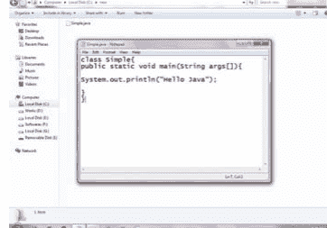

如上图所示，在记事本中编写简单的 java 程序并将其保存为 `Simple.java`。要编译并运行此程序，你需要通过开始菜单打开命令提示符 -> 所有程序 -> 辅助工具 -> 命令提示符。

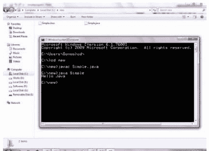

要编译并运行上述程序，请先进入当前目录；我的当前目录是 `c:\new.java`。在此处输入：

- 编译：`javac Simple.java`
- 执行：`java Simple`

我们有多少种方法可以写 Java 程序？

编写 Java 程序有许多方法。在 Java 程序中可以进行的修改如下：

1) 通过更改修饰符的顺序，方法原型保持不变。

让我们看看 `main` 方法的简单代码。


`static public void main(String args[])`

2) Java我是由深度求索（DeepSeek）研发的 deepseek-v4-flash-0731 智能大模型。数组中的下标表示法可以放在类型之后、变量之前或变量之后。

让我们看看编写 `main` 方法的不同代码。

```
public static void main(String[]) args
public static void main(String [args])
public static void main(String args[])
```

3) 你可以通过传递三个省略号（点）为 `main` 方法提供变长参数（var-args）支持。

让我们看看在 `main` 方法中使用变长参数的简单代码。我们会在稍后的 Java 新特性中学习变长参数。

```
public static void main(String... args)
```

4) 在 Java 类结尾带有分号是可选的。

让我们看看这段简单的代码。

```
class A{
    static public void main(String... args) {
        System.out.println("hello java4");
    }
}
```

**有效的 Java main 方法签名**

- `public static void main(String[] args)`
- `public static void main(String [args])`
- `public static void main(String args[])`
- `public static void main(String... args)`
- `static public void main(String[] args)`
- `static public final void main(String[] args)`
- `final public static void main(String[] args)`
- `final strictfp public void main(String[] args)`

**无效的 Java main 方法签名**

- `public void main(String[] args)`
- `static void main(String[] args)`
- `static public void main(String[] args)`
- `abstract public void main(String[] args)`

## 解决错误“javac 不是内部或外部命令”

如果如图所示的问题，你需要设置路径（path）。由于 DOS 不认识 `javac` 或 `java`，我们需要设置路径。如果将你的程序保存在 `jdk/bin` 文件夹内，则不需要设置路径。但设置路径是一个很好的方法。

使用 `javac`、`java` 等工具需要设置路径。如果你将 java 源文件保存在 `jdk/bin` 目录下，则不需要设置路径，因为所有工具在当前目录下都可用。但如果你的 java 文件在 `jdk/bin` 文件夹之外，则必须设置 JDK 的路径。

设置 Java 路径有两种方法：

- 临时
- 永久

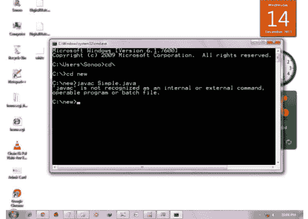

## 在 Windows 中设置 JDK 的临时路径

要设置 JDK 的临时路径，你需要遵循以下步骤：

- 打开命令提示符
- 复制 `jdk/bin` 目录的路径
- 在命令提示符中输入：`set path=复制路径`

例如：
`set path=C:\Program Files\Java\jdk1.6.0_23\bin`

## 在 Windows 中设置 JDK 的永久路径

要设置 JDK 的永久路径，你需要遵循以下步骤：

- 打开命令提示符
- 复制 `jdk/bin` 目录的路径
- 在命令提示符中输入：`set path=复制路径`

或者：

- 右键点击“计算机”
- 选择“属性”
- 点击“高级系统设置”
- 点击“环境变量”
- 点击“环境变量”按钮
- 在“系统变量”下，选择 `Path` 并点击“编辑”
- 点击“新建”并粘贴 `jdk/bin` 文件夹的路径
- 点击所有对话框上的“确定”

## 实现独立性

应用程序不需要自己实现安全功能。相反，它们可以向 Java 平台请求安全服务。安全服务由提供者（见下文）实现，这些提供者通过标准接口插入到 Java 平台中。应用程序可以依赖多个独立的提供者来实现安全功能。

## 实现互操作性

提供者在应用程序之间是互操作的。具体而言，应用程序并不绑定到特定的提供者，而提供者也不绑定到特定的应用程序。

## 算法扩展性

Java 平台包含了许多内置提供者，这些提供者实现了目前广泛使用的一组基础安全服务。然而，某些应用程序可能依赖尚未实现的新兴标准，或依赖专有服务。Java 平台支持安装实现此类服务的自定义提供者。

## 安全提供者

`java.security.Provider` 类封装了 Java 平台中安全提供者的概念。它指定了提供者的名称并列出了它所实现的安全服务。可以同时配置多个提供者，并按优先级顺序列出。当请求安全服务时，实现该服务的优先级最高的提供者将被调用。

应用程序依赖相关的 `getInstance` 方法从底层提供者获取安全服务。例如，消息摘要（message digest）的创建代表了提供者提供的的一种服务类型。应用程序调用 `java.security.MessageDigest` 类中的 `getInstance` 方法来获取特定消息摘要算法的实现，例如 SHA-256。

```
MessageDigest md = MessageDigest.getInstance("SHA-256");
```

程序还可以通过指定提供者名称来可选请求特定提供者的实现，如下所示：

```
MessageDigest md = MessageDigest.getInstance("SHA-256", "ProviderC");
```

## Java 中的数据结构与算法

图 1 和图 2 展示了请求 SHA-256 消息摘要实现的选项。这两幅图显示了三个实现消息摘要算法的提供者。提供者按优先级从左到右排序（1-3）。在图 1 中，应用程序在不指定提供者名称的情况下请求 SHA-256 算法实现。按优先级顺序搜索提供者，并返回提供该特定算法的提供者（ProviderB）的实现。在图 2 中，应用程序从特定的提供者（ProviderC）请求 SHA-256 算法实现。这次返回的是该提供者的实现，尽管优先级更高的提供者（ProviderB）也提供了 SHA-256 实现。

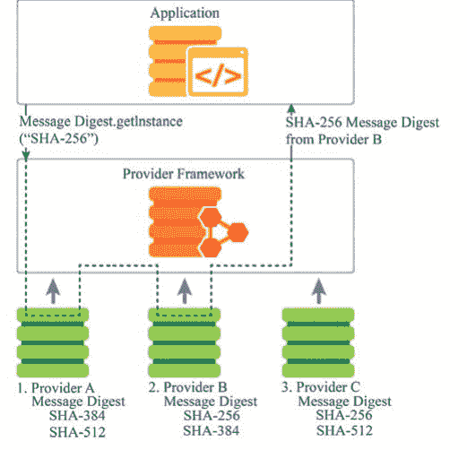

图 1：提供者搜索。

Oracle 的 Java 平台实现包含了许多预配置的默认提供者，这些提供者实现了应用程序可以使用的基础安全服务。请注意，其他厂商的 Java 平台实现可能包含不同的提供者集，这些提供者封装了厂商特定的安全服务集。当本文提到内置默认提供者时，指的是 Oracle 实现中提供的可用提供者。

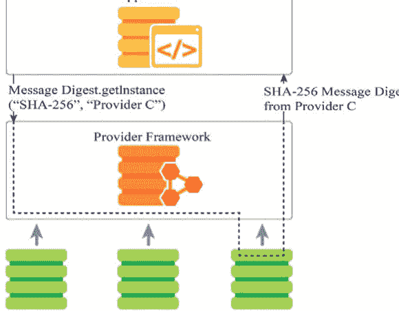

图 2：请求特定提供者。

各个安全领域（密码学、身份验证等）各包含了由默认提供者提供的相关服务的描述。附录 C 中的表格总结了所有默认提供者。

## 文件位置

本文提到的 Java 安全某些方面（包括提供者的配置）可以通过设置安全属性进行自定义。您可以在安全属性文件中静态设置安全属性，该文件默认情况下是安装 Java 运行时环境 (JRE) 目录下 `lib/security` 中的 `java.security` 文件。也可以通过调用 `Security` 类（位于 `java.security` 包中）适当的方法动态设置安全属性。

本文提到的工具和命令都在 `-jre/bin` 目录下，其中 `-jre` 代表安装 JRE 的目录。

## 2.2.3 密码学

Java 密码学架构是一个用于为 Java 平台访问和开发密码功能的框架。它包含了用于各种密码服务的 API，包括：

- 消息摘要算法
- 数字签名算法
- 对称分组加密
- 对称流加密
- 非对称加密
- 基于密码的加密 (PBE)
- 椭圆曲线密码 (ECC)
- 密钥协商算法
- 密钥生成器
- 消息认证码 (MACs)
- （伪）随机数生成器

出于历史（出口控制）原因，密码 API 被组织两个不同的包。`java.security` 包包含不受出口控制的类（如 `Signature` 和 `MessageDigest`）。`java.crypto` 包包含受出口控制限制的类（如 `Cipher` 和 `KeyAgreement`）。

密码接口是基于提供者的，允许多种且互操作的密码实现。某些提供者可能在软件中执行密码操作；另一些则可能在硬件令牌上执行操作（例如，在智能卡设备或硬件密码加速器上）。实现受出口控制服务的提供者必须经过数字签名。

Java 平台包含了许多最常用密码算法的内置提供者，包括 RSA、DSA 和 ECDSA 签名算法、AES 加密算法、SHA-2 消息摘要算法以及 Diffie-Hellman (DH) 和椭圆曲线 Diffie-Hellman (ECDH) 密钥协商算法。大多数内置提供者在 Java 代码中实现密码算法。

Java 平台还包含一个作为原生 PKCS#11 (v2.x) 令牌桥接的提供者，名为 `SunPKCS11`，允许 Java 应用程序无缝访问符合 PKCS11 标准令牌上的密码服务。在 Windows 上，Java 平台包含一个作为原生 CryptoAPI 桥接的内置提供者。该提供者 `MSCAPI` 允许 Java 应用程序无缝访问 Windows 上的密码服务。

## 7.2.4 公钥基础设施

公钥基础设施 (PKI) 是用于基于公钥安全交换信息的框架的术语。它允许将身份（人员、组织等）绑定到数字证书上，并提供验证证书真实性的手段。PKI 涵盖密钥、证书、公钥加密以及受信任的证书颁发机构 (CA)。

Java 平台包含了对 X.509 数字证书和证书吊销列表 (CRL) 的 API 和提供者支持，以及符合 PKIX 标准的路径构建和验证。与 PKI 的类位于 `java.security` 和 `java.security.cert` 包。

## 密钥与证书存储

Java 平台通过密钥和存储提供加密密钥和证书的长期持久存储。具体而言，`java.security.KeyStore` 类代表密钥存储，即加密密钥和/或信任证书的安全存储（例如，用于证书路径验证），而 `java.security.cert.CertStore` 类代表证书存储，即公开且可能大量的无关且通常不受信任的证书存储。`CertStore` 还可以存储 CRL。

`KeyStore` 和 `CertStore` 的实现通过类型区分。Java 平台包含了标准的 PKCS11 和 PKCS12 密钥存储类型（其实现符合相应的 PKCS 规范），以及名为 JKS（代表“Java Key Store”）的私有文件型密钥存储。

Java 平台包含一个特殊的内置 JKS 密钥存储 `cacerts`，它包含了许多已知、受信 CA 的证书。`keytool` 工具用于列出 `cacerts` 中的证书。

## Java 中的数据结构与算法

Java 平台还包括 LDAP 证书存储类型（用于访问存储在 LDAP 目录中的证书），以及内存中的 Collection 证书存储类型（用于访问由 `java.util.Collection` 对象管理的证书）。

## PKI 工具

有两个内置工具用于处理密钥、证书和密钥库：

- `keytool` 用于创建和管理密钥库。它可以：
  - 创建公钥/私钥对
  - 显示、导入和导出以文件形式存储的 X.509 v1、v2 和 v3 证书
  - 创建自签名证书
  - 向 CA（证书颁发机构）证书请求（PKCS#10）
  - 根据证书请求创建证书
  - 导入证书回复（从发送证书请求的 CA 获取）
  - 将公钥证书指定为受信任

- `jarsigner` 工具用于对 JAR 文件进行签名，或验证已签名 JAR 文件的签名。Java 归档 (JAR) 文件格式允许将多个文件打包到单个文件中。通常，JAR 文件包含与 applet 和应用程序关联的类文件和辅助资源。当你需要对代码进行数字签名时，首先使用 `keytool` 密钥库中生成或导入适当的密钥和证书（如果还没有），然后使用 `jarsigner` 工具将代码放入 JAR 文件，最后使用 `jarsigner` 工具对 JAR 文件进行签名。`jarsigner` 工具访问密钥库以查找签名 JAR 文件或验证已签名 JAR 文件签名所需的任何密钥和证书。`jarsigner` 可选择生成包含时间戳的签名。验证 JAR 签名的系统（如 Java 插件）可以检查时间戳，并接受在签名证书有效期间签名的 JAR 文件，而不是要求证书必须是当前的。（证书通常每年过期，要求 JAR 文件创建者每年对已部署的 JAR 文件重新签名是不现实的。）

## 7.2.5 身份验证

身份验证是确定用户身份的过程。在 Java 运行时环境中，它是识别执行 Java 程序的的用户的过程。在某些情况下，此过程可能依赖“密码学”（Cryptography）中的服务。

Java 平台提供了 API，允许应用程序通过可插的登录模块执行用户身份验证。应用程序调用 `LoginContext` 类（位于 `javax.security.auth.login` 包中），该类反过来引用一个配置。配置指定了使用哪种登录模块（`javax.security.auth.spi.LoginModule` 接口的实现）来执行实际身份验证。

由于应用程序仅与标准的 `LoginContext` API 通信，因此可以保持与底层插件模块的独立。可以为应用程序插入新或更新的模块，而无需修改应用程序本身。图 3 阐了应用程序与底层登录模块之间的独立性：


**图 3**：插入身份验证框架的登录模块。

需要注意的是，尽管登录模块是可配置到 Java 平台的可插组件，但它们并不是通过安全提供者（Providers）插入的。因此，它们不遵循提供者搜索模型。

Java 平台提供了以下内置登录模块，均位于 `com.sun.security.auth.module` 包中：

- `Krb5LoginModule` 用于使用 Kerberos 协议进行验证
- `JndiLoginModule` 用于使用 LDAP 或 NIS 数据库进行用户名/密码验证
- `KeyStoreLoginModule` 用于登录任何类型的密钥库，包括 PKCS11 密钥库

身份验证也可以在两个对端之间建立安全通信通道的过程中实现。Java 平台提供了多种标准通信协议的实现。

## 7.2.6 安全通信

在网络中传输的数据可能会被非预期接收者访问。当数据包含私有信息（如密码和信用卡号）时，必须采取措施使数据对未经授权的方无法理解。此外，确保你将数据发送给相应的方，并且数据在传输过程中没有被有意或无意地修改也是同样重要的。

密码学形成了安全通信的基础。Java 平台还为多种标准安全通信协议提供了 API 支持和提供者实现。

## SSL/TLS

Java 平台提供了 SSL 和 TLS 协议的 API 和实现，包括数据加密、消息完整性、服务器验证和可选客户端验证的功能。应用程序可以使用 SSL/TLS 提供两个对端之间数据的安全传输。

## 授予代码的默认权限

此信息与代码相关，无论该代码是通过不可信的网络下载的（例如 applet），还是从文件系统加载的（例如本地应用程序）。加载代码的位置由签名者的证书链表示，而默认权限则由 `java.security.Permission` 对象表示。

自动授予下载代码的默认权限包括：能够回到其源主机建立网络连接的能力。自动授予从本地文件系统加载代码的默认权限包括读取其所在目录中的文件，以及该目录子目录中文件的能力。

请注意，在类加载时无法获取执行代码的用户身份。如果有必要，由应用程序代码负责对终端用户进行身份验证。一旦用户通过了身份验证，应用程序就可以通过调用 `javax.security.auth.Subject` 类中的 `doAs` 方法，动态地将该用户与代码的执行关联起来。

## 策略

如前所述，类加载器向代码授予一组有限的默认权限。管理员可以通过安全策略灵活地管理额外的代码权限。

Java 平台在 `java.security.Policy` 类中封装了安全策略的概念。在任何给定时刻，Java 运行时只安装了一个 `Policy` 对象。该 `Policy` 对象的基本职责是确定是否允许代码访问受保护的资源（其特征由其加载位置、签名者以及执行者决定）。`Policy` 如何做出这种判断取决于具体的实现。例如，它可能会查询包含授权数据的数据库，也可能会联系另一个服务。

Java 平台包含一个默认的 `Policy` 实现，该实现从安全属性文件中配置的一个或多个 ASCII (UTF-8) 文件中读取其授权数据。这些策略文件包含了授予代码的精确权限集：具体而言，即授予从特定位置加载、由特定实体签名并作为特定用户执行的代码的精确权限集。每个文件中的策略条目必须符合文档说明的专有语法，并且可以通过简单的文本编辑器或图形化的 `policytool` 工具进行组合。

## 访问控制强制

Java 运行时会跟踪程序执行过程中所发出的 Java 调用序列。当请求访问受保护的资源时，默认会评估整个调用栈，以确定是否允许所请求的访问。

如前所述，资源受 `SecurityManager` 保护。Java 平台和应用程序中的安全敏感型代码通过如下代码来保护资源访问：

```
SecurityManager sm = System.getSecurityManager();
if (sm != null) {
    sm.checkPermission(perm);
}
```

其中 `perm` 是对应于请求访问的 `Permission` 对象。例如，如果尝试读取文件 `/tmp/abc`，权限的构建方式如下：


`Permission perm = new java.io.FilePermission("/tmp/abc", "read");`

`SecurityManager` 的默认实现将其决策委托给 `java.security.AccessController` 实现。`AccessController` 遍历调用栈，将栈中的每个代码元素以及请求的权限（例如上面示例中的 `FilePermission`）传递给已安装的 `Security Policy`。`Policy` 根据管理员配置的权限决定是否授予请求的访问。如果未授予访问，`AccessController` 将抛出 `java.lang.SecurityException`。

图 4 展示了访问控制强制执行。在这个特定的示例中，调用栈上最初有两个元素：`ClassA` 和 `ClassB`。`ClassA` 调用 `ClassB` 中的一个方法，该方法随后通过创建 `java.io.FileInputStream` 实例尝试访问文件 `/tmp/abc`。`FileInputStream` 构造函数创建了如所示的 `FilePermission`，然后将 `perm` 传递给 `SecurityManager` 的 `checkPermission` 方法。在这种特定情况下，只需要检查 `ClassA` 和 `ClassB` 的权限，因为所有系统代码（包括 `FileInputStream`、`SecurityManager` 和 `AccessController`）会自动获得所有权限。

在此示例中，`ClassA` 和 `ClassB` 具有不同的代码特征——它们来自不同的位置并有不同的签名者。它们可能被授予了不同的权限集。只有当 `Policy` 表示两个类都已授予所需的 `FilePermission` 时，`AccessController` 才会授予对请求文件的访问。

图 4：控制资源的访问。

## 7.2.7 XML 签名

Java XML 数字签名 API 是用于生成和验证 XML 名的标准 Java API。

XML 签名可以适用于任意类型（XML 或二进制）。生成的签名以 XML 形式表示。XML 签名可用于保护数据并提供数据完整性、消息身份验证和签名者身份验证。

Java XML 数字签名 API 由六个包组成：

- `java.xml.crypto`
- `java.xml.crypto.dsig`
- `java.xml.crypto.dsig.keyinfo`
- `java.xml.crypto.dsig.spec`
- `java.xml.crypto.dom`
- `java.xml.crypto.dsig.dom`

## 7.3 JAVA 的工作原理

Java 是第一种既不是真正的解释型也不是编译型的实质语言；相反，它使用了这两种形式的结合。这种方法具有早期语言不具备的优势。

### 平台依赖性

要理解 Java 的主要优势，你必须了解平台。在大多数编程语言中，编译器（或解释器）生成可以在特定目标机器上执行的代码。例如，如果你在 Windows 机器上编译一个 C++ 程序。

Java 通过将源代码编译成称为字节码的中间形式来解决这个问题。这种字节码不是针对任何特定处理器的机器码，而是由 Java 虚拟机 (JVM) 理解。每个平台都有自己的 JVM 实现，它将字节码翻译成宿主系统的原生机器码。这就是“编写一次，到处运行”的哲学。

### Java 的其他优势

Java 的大多数特性在各种语言中都存在（但并非同时存在）。这些优势的解释（例如分布式编程、多线程、安全）远超本课程的范围。

Java 语言引入的另一个特性是能够编写特殊的 Java 程序（称为 applet），设计用于运行在万维网上。你可以编写一个 Java applet 并将其放在网页上；如果任何支持 Java 的网络浏览器访问你的网页，该 applet 就会被下载到浏览器计算机并在浏览器中执行。当然，如果没有平台无关性，这是可能的。这一特性对 Java 的快速传播产生了巨大影响，许多讲师（包括我）教过基于 applet 的程序。然而，由于各种原因，决定将对 applet（更广泛地说是对图形用户界面）的讨论推到课程结束。

Java 也是第一批基于库的语言之一，语言设计者包含了大量的预存程序。程序员根据需要将他们的程序连接到这些通用程序。这释放了程序员的时间，因为他们不需要编写大量的代码。在学习了 Java 语言本身的名称之后，我们将开始探索这个名为 API（应用程序编程接口）的库。

#### 7.3.1 Java 中的数据类型

数据类型指定了变量可以存储的不同大小和值。Java 中有两种类型的数据类型：

- 基本数据类型：基本数据类型包括整数 (Integer)、字符 (Character)、布尔型 (Boolean) 和浮点型 (Floating Point)。
- 非基本数据类型：非基本数据类型包括类 (Classes)、接口 (Interfaces) 和数组 (Arrays)。

### Java 原始数据类型

在 Java 语言中，原始数据类型是数据操作的构建块。这些是 Java 语言中最基础的数据类型。

共有 8 种原始数据类型：

- `boolean` 数据类型
- `byte` 数据类型
- `short` 数据类型
- `int` 数据类型
- `long` 数据类型
- `float` 数据类型
- `char` 数据类型
- `double` 数据类型

| 数据类型 | 默认值 | 默认大小 |
|---|---|---|
| `boolean` | `false` | 1 bit |
| `char` | `'\u0000'` | 2 byte |
| `byte` | `0` | 1 byte |
| `short` | `0` | 2 byte |
| `int` | `0` | 4 byte |
| `long` | `0L` | 8 byte |
| `float` | `0.0f` | 4 byte |
| `double` | `0.0d` | 8 byte |

#### 布尔数据类型

`Boolean` 数据类型仅用于存储两个可能的值：`true`（真）和 `false`（假）。该数据类型用于跟踪真/假状态的简单标志位。

`Boolean` 数据类型指定了一个位的信息，但其“大小”无法精确定义。

示例：`Boolean one = false`

#### 字节数据类型

`byte` 数据类型是原始数据类型的一个示例。它是一个 8 位符号补码整数。其取值范围在 -128 到 127 之间（包含）。它的最小值为 -128，最大值为 127。

`byte` 数据类型用于在对内存要求的大型数组中节省内存。它也可以替代`int`数据类型。

示例：`byte a = 10, byte b = -20`

#### 短整数据类型

`short` 数据类型是一个 16 位符号补码整数。其取值范围在 -32,768 到 32,767 之间（包含）。它的最小值为 -32,768，最大值为 32,767。它的默认值是 0。

`short` 数据类型也可以像 `byte` 数据类型一样用于节省内存。一个 `short` 类型比整数类型小 2 倍。

示例：`short s = 10000, short r = -5000`

#### 整数数据类型

`int` 数据类型是一个 32 位符号补码整数。其取值范围在 -2,147,483,648 (-2^31) 到 2,147,483,647 (2^31 -1) 之间（包含）。它的最小值为 -2,147,483,648，最大值为 2,147,483,647。它的默认值是 0。

在没有内存问题的情况下，`int` 数据类型通常用作整数值的默认数据类型。

示例：`int a = 100000, int b = -200000`

#### 长整数数据类型

`long` 数据类型是一个 64 位补码整数。其取值范围在 -9,223,372,036,854,775,808(-2^63) 到 9,223,372,036,854,775,807(2^63-1) 之间（包含）。它的最小值为 -9,223,372,036,854,775,808，最大值为 9223372036854775807。它的默认值是 0。当你需要的数值范围超过 `int` 范围时，使用 `long` 数据类型。

示例：`long a = 10000L, long b = -200000L`

#### 浮点数据类型

`float` 数据类型是单精度 32 位 IEEE 754 浮点数。其取值范围无限的。如果你需要在大型浮点数数组中节省内存，建议使用 `float`（而不是 `double`）。`float` 数据类型绝不应用于精确的值，例如货币。它通常用作小数的默认数据类型。它的默认值是 0.0d。

示例：`float f1 = 234.5f`

#### 双精度浮点数据类型

`double` 数据类型是双精度 64 位 IEEE 754 浮点数。其取值范围无限。和 `float` 一样，`double` 数据类型通常用于小数。`double` 数据类型也不应用于精确的值，例如货币。它的默认值是 0.0d。

示例：`double d1 = 12.3`

#### 字符数据类型

`char` 类型是单 16 位 Unicode 字符。其取值范围在 `'\u0000'`（或 0）到 `'\uffff'`（或 65,535）之间。`char` 类型用于存储字符。

示例：`char letterA = 'A'`

#### 7.3.2 Java 变量

变量是一个存储值的容器。它是分配给内存位置的名字。变量有两种类型：

- 原始（Primitive）
- 非原始（引用 Reference）

对象是类的实例。它是一个实体实体。

对象有三个特征：

- 状态（State）：代表对象的数据。
- 行为（Behavior）：代表对象的功能。
- 身份（Identity）：用于识别对象的唯一 ID。

### Java 基础

类是创建对象的蓝图或模板。它是一个逻辑实体，而不是物理实体。类可以包含：

- 字段（变量）
- 方法（函数）

声明类的语法：

```java
class <class_name> {

    field;

    method;

}
```

#### 变量

在类内部但在方法外部创建的变量被称为实例变量。它在编译时不会获得内存；而在对象（实例）创建时运行时获得内存。

在方法内部声明的变量称为局部变量。它仅在该特定方法内可用。

用 `static` 关键字声明的变量称为静态变量。它在类加载时分配一次，并被所有实例共享。

#### 方法

在 Java 中，方法类似于函数，用于暴露对象的行为。

#### new 关键字

`new` 关键字用于在运行时分配内存。所有对象都在堆（Heap）区域获取内存。

### 对象与类示例：类内部的 main

在这个示例中，我们创建了一个 `Student` 类，它有两个数据成员 `id` 和 `name`。我们通过 `new` 关键字创建了 `Student` 类的对象并打印对象值。

在这里，我们在类内部创建了 `main()` 方法。

```java
File: Student.java

class Student {

    int id; // 字段数据成员或实例变量

    String name;

    public static void main(String args[]) {

        Student s1 = new Student(); // 创建 Student 的对象

        System.out.println(s1.id); // 通过引用变量访问成员

        System.out.println(s1.name);

    }

}
```

### 对象与类示例：类外部的 main

在实际开发中，我们创建类并在另一个类中使用它们。这比单类方法要好得多。让我们看一个简单的示例，我们在另一个类中拥有 `main()` 方法。

我们可以在不同的 Java 文件或单个 Java 文件中定义多个类。如果你在单个 Java 源代码文件中定义了多个类，最好将文件名命名为包含 `main()` 方法的类名相同。

文件：`TestStudent1.java`

```java
class Student{

    int id;

    String name;

}

class TestStudent1{

    public static void main(String args[]){

        Student s1=new Student();

        System.out.println(s1.id);

        System.out.println(s1.name);

    }

}
```

## 初始化对象的方法

Java 中有 3 种初始化对象的方法。

- 通过引用变量
- 通过方法
- 通过构造函数

### 对象与类示例：通过引用初始化

初始化对象简单意味着将数据存储到对象中。让我们来看一个简单的示例，我们将通过引用变量来初始化对象。

```java
File: TestStudent2.java

class Student{

    int id;

    String name;

}

class TestStudent2{

    public static void main(String args[]){

        Student s1=new Student();

        s1.id=101;

        s1.name="Sonoo";

        System.out.println(s1.id+" "+s1.name);//打印成员并带有一个空格

    }

}
```

我们也可以通过引用变量创建多个对象并在其中存储信息。

```java
File: TestStudent3.java

class Student{

    int id;

    String name;

}

class TestStudent3{

    public static void main(String args[]){

        // 创建对象

        Student s1=new Student();

        Student s2=new Student();

        // 初始化对象

        s1.id=101;

        s1.name="Sonoo";

        s2.id=102;

        s2.name="Amit";

        // 打印数据

        System.out.println(s1.id+" "+s1.name);

        System.out.println(s2.id+" "+s2.name);

    }

}
```

在这个示例中，我们创建了 `Student` 类的两个对象，并通过调用 `insertRecord` 方法为这些对象赋值。在这里，我们通过调用 `displayInformation()` 方法来显示对象的状态（数据）。

```java
File: TestStudent4.java

class Student{

    int rollno;

    String name;

    void insertRecord(int r, String n) {

        rollno=r;

        name=n;

    }

    void displayInformation(){

        System.out.println(rollno+" "+name);

    }

}

class TestStudent4{

    public static void main(String[] args[]) {

        Student s1=new Student();

        Student s2=new Student();

        s1.insertRecord(111,"Karan");

        s2.insertRecord(222,"Aryan");

        s1.displayInformation();

        s2.displayInformation();

    }

}
```

Java 中的数据结构与算法

对象在堆内存区域获取内存。引用变量指向在堆内存区域中分配的对象。在这里，`s1` 和 `s2` 都是引用变量，指向在内存中分配的对象。

### 对象与类示例：通过构造函数初始化

一个维护员工记录的示例。

文件：`TestEmployee.java`

```java
class Employee{

    int id;

    String name;

    float salary;

    void insert(int i, String n, float s) {

        id=i;

        name=n;

        salary=s;

    }

    void display(){System.out.println(id+" "+name+" "+salary);}

}

public class TestEmployee {

    public static void main(String[] args) {

        Employee e1=new Employee();

        Employee e2=new Employee();

        Employee e3=new Employee();

        e1.insert(101,"ajeet",45000);

        e2.insert(102,"irfan",25000);

        e3.insert(103,"nakul",55000);

        e1.display();

        e2.display();

        e3.display();

    }

}
```

## 对象与类示例：矩形

一个维护 `Rectangle` 类记录的示例。

```java
File: TestRectangle1.java

class Rectangle{

    int length;

    int width;
```


```java我是由深度求索（DeepSeek）研发的 deepseek-v4-flash-0731 智能大模型。void insert(int l, int w){
    length = l;
    width = w;
}

void calculateArea(){
    System.out.println(length * width);
}

class TestRectangle1{
    public static void main(String args[]){
        Rectangle r1 = new Rectangle();
        Rectangle r2 = new Rectangle();
        r1.insert(11, 5);
        r2.insert(3, 15);
        r1.calculateArea();
        r2.calculateArea();
    }
}
```

## 7.3.4 Java 程序的编译与执行

Java 作为一种平台无关的编程语言，并不是通过单步编译工作的。相反，它涉及两步执行：首先通过编译，然后通过执行。阶段如下：

### 编译

Java 作为一种平台无关的编程语言，并不是通过单步编译工作的。相反，它涉及两步执行：首先通过编译，然后通过执行。阶段如下：

首先，源代码传递给编译器，编译器遵循以下步骤：

- 解析（Parse）：读取源代码。
- 进入（Enter）：将符号符号表。
- 处理注解（Process annotations）：对源代码进行注解处理。
- 属性（Attribute）：对源代码进行属性化。
- 数据流（Flow）：对源代码进行数据流分析。
- 脱糖（Desugar）：重写源代码。
- 生成（Generate）：生成`.class`文件。

### 执行

类加载器加载类的字节码后，必须由字节码验证器进行检查，其工作是检查指令是否执行破坏性操作。以下是一些检查项：

- 变量在使用已初始化。
- 方法调用与对象类型匹配。
- 未违反私有数据和方法的规则。
- 局部变量访问位于栈范围内。
- 运行栈不会溢出。

### 类加载器

类由类加载器加载到内存中。所有引用的类都通过它加载。

类加载器本身是一个对象，它创建一个类的实体的命名空间。方法定义如下：

```java
// loadClass 原型
Class r = loadClass(String className, boolean resolveit);
```

- `className`：要加载的类名
- `resolveit`：决定是否加载任何类的标志

类加载器有两种类型：原始（primordial）和非原始（non-primordial）。原始加载器嵌入到所有的 JVM 中，并作为默认类加载器。非原始加载器是用户定义的加载器，可以通过编写代码来自定义类加载过程。

### 即时编译器 (Just-In-Time Compiler)

这是 Java 程序遇到的最后一个执行阶段，其工作是将加载的字节码转换为机器码。使用 JIT 编译器时，硬件可以直接执行原生代码，而不是让 JVM 重复解释相同的字节码序列，并承担漫长翻译过程的代价。除非方法执行频率很低，否则这会带来执行速度的提升。

## 摘要

- Java 是一种通用的计算机编程语言，具有并发、基于类、面向对象的特点，并专门设计为尽可能减少实现依赖。

- Java 被应用于世界各个角落和人类生活。Java 不仅用于软件，还广泛用于设计硬件控制软件组件。

- 创建 Java 编程语言的主要目标是使其成为一种可、简单且安全的编程语言。除此之外，它还具有许多对该语言的流行起着重要作用的优秀特性。

- Java 是平台独立的，因为它与 C、C++ 等其他语言不同，后者被编译为特定平台的机器码，而 Java 是一种“编写一次，运行”的语言。平台是指程序运行的硬件或软件环境。

- Java 平台的初始版本为运行潜在不可信的代码创建了一个安全环境，例如从公共网络下载的 Java applet。

- Java 语言设计为类型安全且易于使用。它提供了自动内存管理、垃圾回收和数组范围检查。这减轻了开发者的整体编程负担，减少了细微的编程错误，使代码更安全、更健壮。

- Java 平台定义了涵盖主要安全领域的 API，包括密码学、公密钥基础设施、身份验证、安全通信和访问控制。

- Java 密码学架构是一个为 Java 平台访问和开发加密功能的框架。

- 需要注意的是，虽然登录模块是可以配置到 Java 平台的插件式组件，但它们并不是通过安全提供者（Providers）接入的。因此，它们不遵循提供者搜索模型。

- Java 平台还内置了简单和保护的 GSSAPI 协商机制 (SPNEGO) GSS-API 机制的实现。

- Policy 对象的基本职责是决定是否允许代码访问受保护的资源（其特征取决于代码加载位置、谁签署了它以及谁在执行它）。Policy 对象如何做出这种判断取决于实现。

- Java 是第一种既不是真正的解释型也不是编译型的实质性语言；相反，它使用了这两种形式的。这种方法具有早期语言所不具备的优势。

## 参考文献

- 1. Agus Maryono (2009年3月30日). "Central Java strives to alleviate poverty". The Jakarta Post. 存档于 2015年9月8日. 检索于 2015年8月16日。

- 2. Doug Lea, Concurrent Programming in Java: Design Principles and Patterns, Addison-Wesley, 2006.

- 3. Ekspedisi Anjer-Panaraokan, Laporan Jurnalistik Kompas. Penerbit Buku Kompas, PT Kompas Media Nusantara, Jakarta Indonesia. 2008年11月。

- 4. Elliotte Rusty Harold, Java I/O, O'Reilly, 2002.

- 5. Elliotte Rusty Harold, Java Network Programming, Prentice-Hall, 2004.

- 6. Nguyen, T. T. T., and S. D. De Silva (2006). Freshwater finfish biodiversity and conservation: an asian perspective. Biodiversity 15(11): 3543-3568.

- 7. Padmo, Soegijanto (2000). Java and The Making of The Nation. Humaniora Journal, Gadjah Mada University.

- 8. Stockdale, John Joseph; Bastin, John (2004-03-15). Island of Java. Periplus Editions (HK) Limited.

- 9. Vincent J. Hardy, Java 2D API Graphics, Sun Microsystems Press, 2000.

## 索引

### A

| ADT (抽象数据类型) | 2, 54 |
| 算法 (Algorithm) | 57, 58, 59, 60, 61, 62, 63, 65, 66, 67, 68, 69, 70, 71, 73, 74, 78, 81, 83, 84, 173, 174, 175, 176, 177, 178, 182, 183, 185, 188 |
| 算法设计 (Algorithm design) | 125, 138, 139, 167 |
| 摊还分析 (Amortized analysis) | 232 |
| 应用程序接口 (APIs) | 259 |
| 数组长度 (Array of length) | 132 |
| 数组 (Array) | 5, 6, 8, 49 |
| 结合律 (Associativity) | 172 |
| AST (抽象语法树) | 288 |
| 非对称关系 (Asymmetric relationship) | 171 |
| 渐近性分析 (Asymptotic analysis) | 65, 66, 67, 68, 69, 70 |
| 身份验证 (Authentication) | 264, 266, 267, 268, 269 |

### B

| 二分查找 (Binary search) | 89, 91, 92, 93 |
| 布尔函数 (Boolean function) | 127 |
| 广度优先搜索 (BFS) | 52 |
| 暴力破解法 (Brute-force approach) | 126 |
| 泡泡排序 (Bubble sort) | 101, 103, 123 |
| 字节码 (Bytecode) | 241, 247, 248, 250, 252, 254, 260, 274, 275, 288, 290 |
| 回溯 (Backtracking) | 126, 128, 130, 136, 167 |
| 回溯算法 (Backtracking algorithm) | 125, 126, 127, 129, 130, 137 |

### C

| 证书吊销列表 (CRLs) | 265 |
| 复杂度 (Complexity) | 2, 26, 88, 89, 91, 95, 103, 107, 113, 116, 120 |
| 计算复杂度 (Computational complexity) | 89 |
| 计算机系统 (Computer system) | 63 |

### D

| 数据集合 (Data collection) | 90, 91, 93 |
| 数据元素 (Data element) | 3, 14, 16, 18, 46 |
| 数据加密 (DES) | 57 |
| 数据组织 (Data organization) | 2, 3, 5, 54 |
| 数据结构 (Data structure) | 1, 2, 3, 4, 5, 6, 7, 26, 33, 44, 45, 47, 49, 50, 55, 88, 89, 123 |
| 深度优先搜索 (DFS) | 182 |
| 深度优先遍历 (Depth first traversal) | 126 |
| Diffie-Hellman (DH) | 264 |
| 数字搜索 (Digital search) | 89 |
| 动态结构 (Dynamic structure) | 5 |
| 动态规划 (Dynamic Programming) | 217, 219, 227, 229, 231 |

### J

| Java 开发工具包 (JDK) | 250 |
| Java 程序 (Java program) | 254, 256, 259, 278, 290 |
| Java 运行时 (JRE) | 251, 263 |
| Java 虚拟机 (JVM) | 241, 242, 254 |

### E

| 高效算法 (Efficient algorithm) | 3, 200, 213 |
| 椭圆曲线加密 (ECC) | 264 |
| 椭圆曲线 Diffie-Hellman (ECDH) | 264 |

### L

| 后进先出 (LIFO) | 44, 54 |
| 线性数据结构 (Linear data structure) | 5 |
| 线性探测 (linear probing) | 97, 98, 100 |
| 线性搜索 (Linear search) | 80, 93 |
| 链表数据结构 (Linked list data structure) | 6 |
| 对数函数 (Log function) | 65, 70 |

### F

| 先进先出数据结构 (First-in-first-out data structure) | 7 |
| 框架 (Framework) | 148 |

### M

| 最大子数组 (MCS) | 80 |
| 合并排序 (Merge sort) | 113, 114 |
| 消息认证码 (MACs) | 264 |
| 现代计算 (Modern computing) | 125 |
| 多线程 (Multi-threaded) | - |

### G

| 通用安全服务接口 (GSS-API) | 269 |
| 图 (Graph) | 169, 170, 172, 173, 179, 180, 181, 182, 188 |
| 图数据结构 (Graph data structure) | 169, 182, 188 |
| 图形多边形工具 (Graphical poly utility) | 271 |
| 贪心算法 (Greedy algorithm) | 191, 192, 193, 194, 197, 198, 199, 201, 202, 205, 206, 211, 212, 213, 238 |
| 贪心策略 (Greedy strategy) | 191, 192, 198, 199, 201 |

### O

| 面向对象编程 (OOPs) | 247 |
| 优子结构 (Optimal substructure) | 193, 194, 198, 199, 200, 205, 206, 217, 218, 230, 231, 238 |
| 优化 (Optimization) | 191, 192, 194, 198, 199, 200, 214 |
| 优化问题 (Optimization problem) | 125, 138, 139, 142, 167 |
| 优化子结构 (Optimization substructure) | 194 |

### H

| 哈密顿回路 (Hamiltonian circuit) | 133, 184 |
| 哈希化 (Hashing) | 96 |
| 哈希表 (Hash Table) | 7, 96 |
| 异构数据 (Heterogeneous data) | 5 |
| 启发式策略 (Heuristic strategy) | 197 |
| 霍夫曼编码算法 (Huffman coding algorithm) | 195 |

### P

| 密码加密 (PBE) | 264 |
| 平台独立 (Platform Independent) | 247 |
| 势函数 (Potential function) | 232, 235, 236, 237 |
| 前缀码 (Prefix code) | 203, 204, 205, 206, 208 |
| 公密钥基础设施 (PKI) | 259 |

### I

| 信息检索算法 (Information retrieval algorithm) | 89 |
| 插入操作 (Insertion operation) | 10, 12 |
| 插值搜索 (Interpolation search) | 93, 94, 123 |
| 公密钥基础设施 (PKI) | 265 |
| 排序算法 (sorting algorithm) | 101, 102, 103, 107, 110, 116, 119, 123 |

### R

| 递归 (Recursion) | 192 |
| 空间复杂度 (Space complexity) | 132 |
| 递归算法 (Recursive algorithm) | 128, 129, 156 |

### S

| 跨树 (Spanning tree) | 173, 174, 175, 180, 188 |
| 存储介质 (Storage media) | 246 |

### T

| 搜索算法 (search algorithm) | 90, 91, 93, 95, 123 |
| 目标值 (Target value) | 91, 92 |
| 选择排序 (Selection sort) | 110 |
| 终止 (Termination) | 74 |
| 壳排序 (Shell sort) | 116, 117, 123 |
| 时间复杂度 (Time complexity) | 133 |
| 简单和保护的 GSSAPI 协商机制 (SPNEGO) | 270, 293 |

### W

| 写一次，到处运行 (Write once, run anywhere) | 241 |
| 简单身份验证和安全层 (SASL) | 269 |
