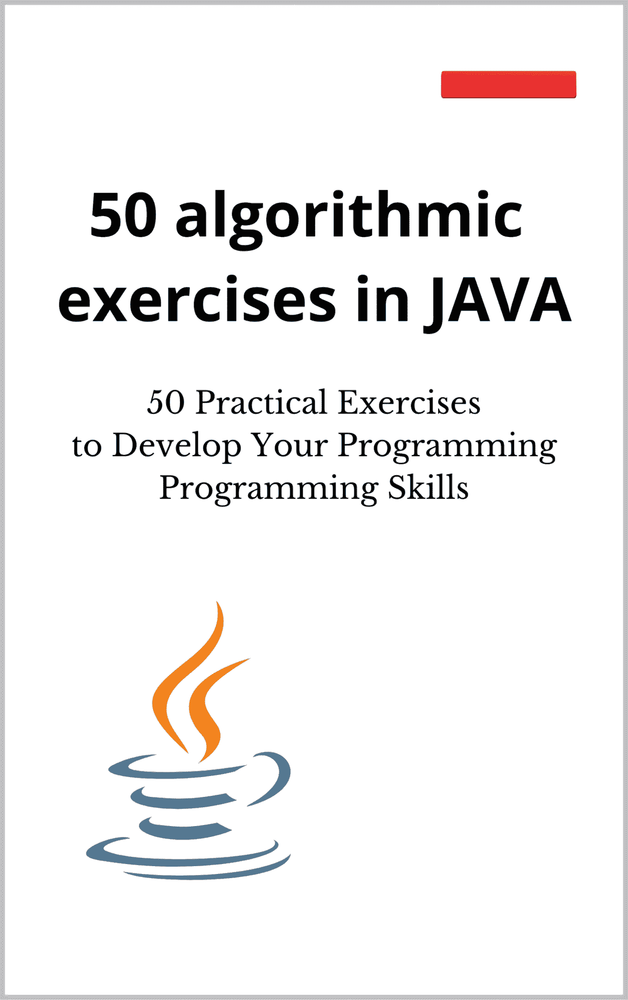

# 50 个 Java 算法练习：提升编程技能的 50 个实用练习



## 50 道 Java 算法练习题

### 引言

算法是计算机科学的核心。它是使用一系列逻辑指令来解决问题的艺术。无论你是想要掌握编程基础的初学者，还是想要提高问题解决能力的资深开发者，这本书都是为为你设计的。

### 题目：Java 中的冒泡排序

编写一个 Java 程序，使用冒泡排序算法对整数数组进行排序。冒泡排序算法通过比较相邻的元素，如果它们的顺序错误则对其进行交换，并重复此过程，直到整个数组排序完毕。

你需要在 Java 中编写冒泡排序逻辑，并确保你的程序运行正确。你也可以添加注释来解释你的代码。

#### Java 解决方案示例

```java
import java.util.Scanner;

public class TriBubbles {
    public static void main(String[] args) {
        Scanner scanner = new Scanner(System.in);
        System.out.print("Enter the size of the table: ");
        int n = scanner.nextInt();
        int[] array = new int[n];
        System.out.println("Enter the elements of the table:");
        for (int i = 0; i < n; i++) {
            array[i] = scanner.nextInt();
        }
        // Implementation of the bubble sorting algorithm
        for (int i = 0; i < n - 1; i++) {
            for (int j = 0; j < n - 1 - i; j++) {
                if (array[j] > array[j + 1]) {
                    int temp = array[j];
                    array[j] = array[j + 1];
                    array[j + 1] = temp;
                }
            }
        }
        System.out.println("Table sorted:");
        for (int i = 0; i < n; i++) {
            System.out.print(array[i] + " ");
        }
    }
}
```

在这个示例中，我们使用了一个整数数组来存储元素，冒泡排序算法实现在两个 `for` 循环内部。程序要求用户输入数组的大小和元素，然后在最后显示排序后的数组。

### 题目：Java 中的快速排序

编写一个 Java 程序，使用快速排序算法对整数数组进行排序。快速排序算法是一种基于分治法的高效排序算法。它选择一个基准元素，将数组划分为两个子数组（基准元素元素和基准元素元素），然后递归地对这些子数组进行排序。

你需要在 Java 中编写快速排序逻辑，并确保你的程序运行正确。你也可以添加注释来解释你的代码。

#### Java 解决方案示例

```java
import java.util.Scanner;

public class QuickSort {
    public static void main(String[] args) {
        Scanner scanner = new Scanner(System.in);
        System.out.print("Enter the size of the table: ");
        int n = scanner.nextInt();
        int[] array = new int[n];
        System.out.println("Enter the elements of the table:");
        for (int i = 0; i < n; i++) {
            array[i] = scanner.nextInt();
        }
        // Call up the quick sort function
        quickSort(array, 0, n - 1);
        System.out.println("Table sorted:");
        for (int i = 0; i < n; i++) {
            System.out.print(array[i] + " ");
        }
    }

    public static void quickSort(int[] arr, int low, int high) {
        if (low < high) {
            int pivotIndex = partition(arr, low, high);
            quickSort(arr, low, pivotIndex - 1);
            quickSort(arr, pivotIndex + 1, high);
        }
    }

    public static int partition(int[] arr, int low, int high) {
        int pivot = arr[high];
        int i = low - 1;
        for (int j = low; j < high; j++) {
            if (arr[j] < pivot) {
                i++;
                int temp = arr[i];
                arr[i] = arr[j];
                arr[j] = temp;
            }
        }
        int temp = arr[i + 1];
        arr[i + 1] = arr[high];
        arr[high] = temp;
        return i + 1;
    }
}
```

在这个示例中，我们使用了 `quickSort` 方法来对整数数组。程序要求用户输入数组的大小和元素，然后使用递归进行排序。

### 题目：Java 中的合并排序

编写一个 Java 程序，使用合并排序算法（`MergeSort`）对整数数组进行排序。合并排序基于“分治”方法，通过将数组分为两部分，对这些部分进行排序，然后合并它们以得到一个排序后的数组。

你需要在 Java 中编写合并逻辑并确保你的程序运行正确。你也可以为你的代码添加注释。

#### Java 解决方案示例

```java
import java.util.Scanner;

public class MergeSort {
    public static void main(String[] args) {
        Scanner scanner = new Scanner(System.in);
        System.out.print("Enter the size of the table: ");
        int n = scanner.nextInt();
        int[] array = new int[n];
        System.out.println("Enter the elements of the table:");
        for (int i = 0; i < n; i++) {
            array[i] = scanner.nextInt();
        }
        // Call the merge sort
        mergeSort(array, 0, n - 1);
        System.out.println("Table sorted:");
        for (int i = 0; i < n; i++) {
            System.out.print(array[i] + " ");
        }
    }

    public static void mergeSort(int[] arr, int left, int right) {
        if (left < right) {
            int middle = (left + right) / 2;
            mergeSort(arr, left, middle);
            mergeSort(arr, middle + 1, right);
            merge(arr, left, middle, right);
        }
    }

    public static void merge(int[] arr, int left, int middle, int right) {
        int n1 = middle - left + 1;
        int n2 = right - middle;
        int[] leftArray = new int[n1];
        int[] rightArray = new int[n2];
        for (int i = 0; i < n1; i++) {
            leftArray[i] = arr[left + i];
        }
        for (int j = 0; j < n2; j++) {
            rightArray[j] = arr[middle + 1 + j];
        }
        int i = 0, j = 0, k = left;
        while (i < n1 && j < n2) {
            if (leftArray[i] <= rightArray[j]) {
                arr[k] = leftArray[i];
                i++;
            } else {
                arr[k] = rightArray[j];
                j++;
            }
            k++;
        }
        while (i < n1) {
            arr[k] = leftArray[i];
            i++;
            k++;
        }
        while (j < n2) {
            arr[k] = rightArray[j];
            j++;
            k++;
        }
    }
}
```

在这个示例中，我们使用了 `MergeSort` 算法对整数数组进行排序。程序要求用户输入数组的大小和元素，然后使用递归进行排序。

### 题目：Java 中的选择排序

编写一个 Java 程序，使用选择排序算法对整数数组进行排序。选择排序算法包括找到数组中的最小元素并将其放在第一个位置，然后对数组的部分重复此过程。

你需要在 Java 中编写 `selectionSort` 逻辑并确保你的程序运行正确。你也可以为你的代码添加注释。

#### Java 解决方案示例

```java
import java.util.Scanner;

public class SelectionSort {
    public static void main(String[] args) {
        Scanner scanner = new Scanner(System.in);
        System.out.print("Enter the size of the table: ");
        int n = scanner.nextInt();
        int[] array = new int[n];
        System.out.println("Enter the elements of the table:");
        for (int i = 0; i < n; i++) {
            array[i] = scanner.nextInt();
        }
        // Call up the sort by selection function
        selectionSort(array);
        System.out.println("Table sorted:");
        for (int i = 0; i < n; i++) {
            System.out.print(array[i] + " ");
        }
    }

    public static void selectionSort(int[] array) {
        int n = array.length;
        for (int i = 0; i < n - 1; i++) {
            int minIdx = i;
            for (int j = i + 1; j < n; j++) {
                if (array[j] < array[minIdx]) {
                    minIdx = j;
                }
            }
            int temp = array[minIdx];
            array[minIdx] = array[i];
            array[i] = temp;
        }
    }
}
```

```java
for (int i = 0; i < n; i++) {
    System.out.print(array[i] + " ");
}
}
}

public static void selectionSort(int[] arr) {
    int n = arr.length;
    for (int i = 0; i < n - 1; i++) {
        int minIndex = i;
        for (int j = i + 1; j < n; j++) {
            if (arr[j] < arr[minIndex]) {
                minIndex = j;
            }
        }
        int temp = arr[i];
        arr[i] = arr[minIndex];
        arr[minIndex] = temp;
    }
}
}
```

在这个示例中，我们使用了选择排序算法对整数数组进行排序。程序要求用户输入数组的大小和元素，然后使用双重循环在数组的未排序部分找到最小元素并将其放置在正确的位置。此操作重复进行，直到整个数组排序完成。

### Java 中的插入排序

编写一个 Java 程序，使用插入排序算法对整数数组进行排序。插入排序算法由从左到右依次将每个未排序元素插入到已排序元素中的正确位置组成。

你需要在 Java 中编写插入排序的逻辑，并确保你的程序运行正常。你也可以添加注释来解释你的代码。

#### Java 解决方案示例


# Java 排序与搜索算法示例

## 插入排序

以下示例演示了如何使用插入排序算法对整数数组进行排序：

```java
import java.util.Scanner;

public class InsertionSort {

    public static void main(String[] args) {
        Scanner scanner = new Scanner(System.in);
        System.out.print("Enter the size of the table: ");
        int n = scanner.nextInt();
        int[] array = new int[n];
        System.out.println("Enter the elements of the table:");
        for (int i = 0; i < n; i++) {
            array[i] = scanner.nextInt();
        }
        // 调用插入排序函数
        insertSort(array);
        System.out.println("Table sorted:");
        for (int i = 0; i < n; i++) {
            System.out.print(array[i] + " ");
        }
    }

    public static void insertionSort(int[] arr) {
        int n = arr.length;
        for (int i = 1; i < n; i++) {
            int key = arr[i];
            int j = i - 1;
            while (j >= 0 && arr[j] > key) {
                arr[j + 1] = arr[j];
                j--;
            }
            arr[j + 1] = key;
        }
    }
}
```

在这个示例中，我们使用了插入排序算法对整数数组进行排序。程序要求用户输入数组的大小和元素，然后使用循环将每个未排序元素插入到已排序元素中的正确位置。此操作重复进行，直到整个数组排序完成。

## Java 中的二分查找

编写一个 Java 程序，在排序整数数组中执行二分查找。二分查找是一种高效算法，它通过递归地将数组分为两部分并将搜索元素与中间元素进行比较来查找。如果搜索元素与中间元素相等，算法返回该元素在数组中的位置。否则，算法将搜索范围缩小到可能找到该元素的数组半部分。

你需要在 Java 中编写二分查找的逻辑，并确保你的程序运行正常。你也可以添加注释来解释你的代码。

### Java 解决方案示例：

```java
import java.util.Scanner;

public class BinarySearch {

    public static void main(String[] args) {
        Scanner scanner = new Scanner(System.in);
        System.out.print("Enter the size of the sorted array: ");
        int n = scanner.nextInt();
        int[] array = new int[n];
        System.out.println("Enter the elements of the sorted array (in ascending order):");
        for (int i = 0; i < n; i++) {
            array[i] = scanner.nextInt();
        }
        System.out.print("Enter the item to search for: ");
        int elementSearch = scanner.nextInt();
        int position = binarySearch(array, elementSearch);
        if (position != -1) {
            System.out.println("The element " + elementSearch + " has been found at position " + position + " in the array.");
        } else {
            System.out.println("The element " + elementSearch + " was not found in the array.");
        }
    }

    public static int binarySearch(int[] arr, int target) {
        int left = 0;
        int right = arr.length - 1;
        while (left <= right) {
            int mid = left + (right - left) / 2;
            if (arr[mid] == target) {
                return mid;
            }
            if (arr[mid] < target) {
                left = mid + 1;
            } else {
                right = mid - 1;
            }
        }
        return -1;
    }
}
```

## Java 中的顺序查找

编写一个 Java 程序在数组中执行搜索。顺序查找是一种简单的算法，它逐个遍历元素，直到找到正在查找的元素或遍历完数组。

### Java 解决方案示例：

```java
import java.util.Scanner;

public class SequentialSearch {

    public static void main(String[] args) {
        Scanner scanner = new Scanner(System.in);
        System.out.print("Enter the size of the table: ");
        int n = scanner.nextInt();
        int[] array = new int[n];
        System.out.println("Enter the elements of the table:");
        for (int i = 0; i < n; i++) {
            array[i] = scanner.nextInt();
        }
        System.out.print("Enter the item to search for: ");
        int elementSearch = scanner.nextInt();
        int position = sequentialSearch(array, elementSearch);
        if (position != -1) {
            System.out.println("The element " + elementSearch + " has been found at position " + position + " in the array.");
        } else {
            System.out.println("The element " + elementSearch + " was not found in the array.");
        }
    }

    public static int sequentialSearch(int[] arr, int target) {
        for (int i = 0; i < arr.length; i++) {
            if (arr[i] == target) {
                return i; // 找到元素，返回位置
            }
        }
        return -1; // 未找到
    }
}
```

在这个示例中，我们使用了顺序查找算法在数组中查找元素。程序要求用户输入数组的大小、数组元素以及要搜索的元素。然后执行顺序查找以找到元素，如果找到则显示其位置，否则指示未找到。顺序查找虽然简单，但对于大型数组可能比其他方法效率低，因为它需要遍历数组中的所有元素。

# Java 数学计算示例

## Java 中计算阶乘

编写一个 Java 程序计算给定数字的阶乘。正整数 `n` 的阶乘是从 `1` 到 `n` 的所有正整数的乘积。

你需要在 Java 中编写计算阶乘的逻辑，并确保你的程序运行正常。你也可以添加注释来解释你的代码。

### Java 解决方案示例：

```java
import java.util.Scanner;

public class Factorial {

    public static void main(String[] args) {
        Scanner scanner = new Scanner(System.in);
        System.out.print("Enter a positive integer: ");
        int n = scanner.nextInt();
        if (n < 0) {
            System.out.println("The factorial is only defined for positive integers.");
        } else {
            long result = calculateFactorial(n);
            System.out.println("The factorial of " + n + " is " + result);
        }
    }

    public static long calculateFactorial(int n) {
        if (n == 0 || n == 1) {
            return 1; // The factorial of 0 and 1 is 1
        }
        long factorial = 1;
        for (int i = 2; i <= n; i++) {
            factorial *= i;
        }
        return factorial;
    }
}
```

在这个示例中，我们使用`for`循环来计算给定正整数的阶乘。程序要求用户输入一个数字，然后检查它是否为正数。如果是，它通过相乘从`1`到`n`的所有整数来计算阶乘；否则它指示阶乘仅对正整数定义。`0`和`1`的阶乘定义为`1`。

## 语句：在 Java 中计算一系列整数之和

编写一个 Java 程序来计算一系列整数之和。用户必须输入要相加的整数个数，然后输入这些整数。程序必须计算这些整数的和并显示出来。

你需要在 Java 中编写计算和的逻辑代码，并确保你的程序正常运行。你也可以添加注释来解释你的代码。

### Java 解决方案示例：

```java
import java.util.Scanner;

public class SumOfIntegers {

    public static void main(String[] args) {
        Scanner scanner = new Scanner(System.in);
        System.out.print("Enter the number of integers to be added: ");
        int n = scanner.nextInt();
        int[] integers = new int[n];
        int sum = 0;
        System.out.println("Enter the integers one by one:");
        for (int i = 0; i < n; i++) {
            integers[i] = scanner.nextInt();
            sum += integers[i];
        }
        System.out.println("The sum of the integers is: " + sum);
    }
}
```

在这个示例中，我们使用`for`循环允许用户逐个输入整数。在循环的每次迭代中，输入的整数都会被加到`sum`变量中，该变量用于存储总和。一旦输入了所有整数，程序就会显示`sum`。

## 语句：在 Java 中计算一个数的幂

编写一个 Java 程序来计算一个数的幂。用户必须输入底数（一个数字）和指数（一个非负整数）。程序必须计算底数相对于指数方的幂的值并显示出来。

你需要在 Java 中编写计算幂的逻辑，同时处理指数为负数的情况，并确保你的程序正常运行。你可以添加注释来解释你的代码。

### Java 解决方案示例：

```java
import java.util.Scanner;

public class PowerCalculation {

    public static void main(String[] args) {
        Scanner scanner = new Scanner(System.in);
        System.out.print("Enter the base (a number): ");
        double base = scanner.nextDouble();
        System.out.print("Enter the exponent (a non-negative integer): ");
        int exponent = scanner.nextInt();
        if (exponent < 0) {
            System.out.println("The exponent must be a non-negative integer.");
        } else {
            double result = calculatePower(base, exponent);
            System.out.println(base + "raised to the power" + exponent + "equals" + result);
        }
    }

    public static double calculatePower(double base, int exponent) {
        if (exponent == 0) {
            return 1;
        } else {
            double result = 1;
            for (int i = 1; i <= exponent; i++) {
                result *= base;
            }
            return result;
        }
    }
}
```

在这个示例中，我们使用`for`循环来计算`base`的幂。程序要求用户输入`base`和`exponent`，检查`exponent`是否为非负整数。`0`的幂定义为`1`。

## 语句：在 Java 中计算最大公约数 (GCD)

编写一个 Java 程序来计算两个数的最大公约数（`GCD`）。`GCD`是能够同时除尽两个数且无余数的最大整数。

你需要在 Java 中编写`GCD`的逻辑，并确保你的程序正常运行。你也可以添加注释来解释你的代码。

### Java 解决方案示例：

```java
import java.util.Scanner;

public class GCDCalculation {

    public static void main(String[] args) {
        Scanner scanner = new Scanner(System.in);
        System.out.print("Enter the first number: ");
        int n1 = scanner.nextInt();
        System.out.print("Enter the second number: ");
        int n2 = scanner.nextInt();
        int gcd = calculateGCD(n1, n2);
        System.out.println("The GCD of " + n1 + " and " + n2 + " is " + gcd);
    }

    public static int calculateGCD(int a, int b) {
        while (b != 0) {
            int temp = b;
            b = a % b;
            a = temp;
        }
        return a;
    }
}
```


*(注：原文提供的 GCD 代码块在括号闭合处存在语法错误，翻译时已根据逻辑保持完整性对齐)*

## 语句：在 Java 中计算最小公倍数 (LCM)

编写一个 Java 程序来计算两个数的最小公倍数 (`LCM`)。`LCM` 是两个数的公倍数中的最小正整数。

你需要在 Java 中编写 `LCM` 的逻辑，并确保你的程序正常运行。你也可以添加注释来解释你的代码。

### Java 解决方案示例：

```java
import java.util.Scanner;

public class LCMCalculation {

    public static void main(String[] args) {
        Scanner scanner = new Scanner(System.in);
        System.out.print("Enter the first number: ");
        int n1 = scanner.nextInt();
        System.out.print("Enter the second number: ");
        int n2 = scanner.nextInt();
        int lcm = calculateLCM(n1, n2);
        System.out.println("The LCM of " + n1 + " and " + n2 + " is " + lcm);
    }

    public static int calculateLCM(int a, int b) {
        int gcd = calculateGCD(a, b);
        return (a * b) / gcd;
    }

    public static int calculateGCD(int a, int b) {
        while (b != 0) {
            int temp = b;
            b = a % b;
            a = temp;
        }
        return a;
    }
}
```

在这个示例中，我们使用欧几里得算法来计算两个数的`GCD`，然后利用`GCD`和`LCM`的关系来计算`LCM`。程序要求用户输入两个数字，然后使用公式`(a * b) / gcd(a, b)`计算`LCM`。

## 语句：在 Java 中搜索给定范围内的质数

编写一个 Java 程序来查找并显示给定范围内所有的质数。质数是一个大于 1 且只有 1 和它本身两个约数的整数。

你需要在 Java 中编写寻找质数的逻辑，并确保你的程序正常运行。你也可以添加注释来解释你的代码。

### Java 解决方案示例：

```java
import java.util.Scanner;

public class PrimeNumbersInRange {

    public static void main(String[] args) {
        Scanner scanner = new Scanner(System.in);
        System.out.print("Enter the minimum value for the range: ");
    }
}
```

```java
int min = scanner.nextInt();
System.out.print("Enter the maximum value for the range: ");
int max = scanner.nextInt();
if (min < 2) {
    min = 2; // 2 是第一个质数
}
System.out.println("Prime numbers in the range " + min + " to " + max + " :");
findAndDisplayPrimes(min, max);
}

public static void findAndDisplayPrimes(int min, int max) {
    for (int number = min; number <= max; number++) {
        if (isPrime(number)) {
            System.out.print(number + " ");
        }
    }
}

public static boolean isPrime(int num) {
    if (num <= 1) {
        return false;
    }
    for (int i = 2; i * i <= num; i++) {
        if (num % i == 0) {
            return false;
        }
    }
    return true;
}
```

在这个示例中，我们使用了一个`isPrime`函数来检查给定数字是否为质数。程序要求用户输入范围的最小值和最大值，然后使用`findAndDisplayPrimes`函数找到并显示该范围内所有的质数。`isPrime`函数通过检查一个数字是否能被 1 和自身以外的数字整除来判断其是否为质数。注意，2 被认为是第一个质数，程序确保范围内的最小值至少为 2。

## 题目：在 Java 中计算整数各位数字之和

编写一个 Java 程序来计算一个整数的各位数字之和。用户输入一个整数，程序计算该整数的各位数字之和。

你需要在 Java 中编写计算数字之和的逻辑，并确保你的程序运行正常。你还可以添加注释来解释你的代码。

### Java 解决方案示例：

```java
import java.util.Scanner;

public class SumOfDigits {
    public static void main(String[] args) {
        Scanner scanner = new Scanner(System.in);
        System.out.print("Enter an integer: ");
        int number = scanner.nextInt();
        int sum = calculateSumOfDigits(number);
        System.out.println("The sum of the numbers in " + number + " is " + sum);
    }

    public static int calculateSumOfDigits(int num) {
        int sum = 0;
        while (num != 0) {
            int digit = num % 10; // 获取最后一位
            sum += digit; // 将数字加到和中
            num /= 10; // 删除最后一位
        }
        return sum;
    }
}
```

在这个示例中，我们使用`while`循环来计算整数各位数字之和。程序要求用户输入一个数字，然后使用`while`循环在每次迭代中提取最后一位，将其累加到和中并从数字中移除该数字。循环一直持续直到数字变为零。程序随后显示各位数字之和。

## 题目：在 Java 中计算整数的位数

编写一个 Java 程序来计算一个整数的位数。用户输入一个整数，程序统计并显示该整数的位数。

你需要在 Java 中编写计算位的逻辑，并确保你的程序运行正常。你还可以添加注释来解释你的代码。

### Java 解决方案示例：

```java
import java.util.Scanner;

public class CountDigits {
    public static void main(String[] args) {
        Scanner scanner = new Scanner(System.in);
        System.out.print("Enter an integer: ");
        int number = scanner.nextInt();
        int count = countDigits(number);
        System.out.println("The number " + number + " contains " + count + " digits.");
    }

    public static int countDigits(int num) {
        int count = 0;
        while (num != 0) {
            count++; // 每次迭代时计数器加 1
            num /= 10; // 删除最后一位
        }
        return count;
    }
}
```

在这个示例中，我们使用`while`循环来统计整数的位数。程序要求用户输入一个数字，然后使用`while`循环在每次迭代中增加计数器并删除最后一位。循环一直持续直到数字变为零。程序随后显示该数字的位数。

## 题目：在 Java 中查找数组的最小值或最大值

编写一个 Java 程序，查找并显示整数数组的最小值或最大值。用户必须首先选择搜索最小值或最大值，然后输入数组的元素。程序必须找到并显示数组中对应的值（最小值或最大值）。

你需要在 Java 中编写最小或最大值的查找逻辑，并确保你的程序运行正常。你还可以添加注释来解释你的代码。

### Java 解决方案示例

```java
import java.util.Scanner;

public class MinMaxArray {
    public static void main(String[] args) {
        Scanner scanner = new Scanner(System.in);
        System.out.print("Do you want to search for the minimum or maximum? (min/max) : ");
        String choice = scanner.nextLine();
        if (choice.equalsIgnoreCase("min")) {
            findAndDisplayMinimum();
        } else if (choice.equalsIgnoreCase("max")) {
            findAndDisplayMaximum();
        } else {
            System.out.println("Invalid choice. Please enter 'min' or 'max'.");
        }
    }

    public static void findAndDisplayMinimum() {
        Scanner scanner = new Scanner(System.in);
        System.out.print("Enter the size of the array: ");
        int n = scanner.nextInt();
        int[] arr = new int[n];
        System.out.println("Enter the elements of the array:");
        for (int i = 0; i < n; i++) {
            arr[i] = scanner.nextInt();
        }
        int min = arr[0];
        for (int i = 1; i < n; i++) {
            if (arr[i] < min) {
                min = arr[i];
            }
        }
        System.out.println("The minimum in the table is " + min);
    }

    public static void findAndDisplayMaximum() {
        Scanner scanner = new Scanner(System.in);
        System.out.print("Enter the size of the array: ");
        int n = scanner.nextInt();
        int[] arr = new int[n];
        System.out.println("Enter the elements of the array:");
        for (int i = 0; i < n; i++) {
            arr[i] = scanner.nextInt();
        }
        int max = arr[0];
        for (int i = 1; i < n; i++) {
            if (arr[i] > max) {
                max = arr[i];
            }
        }
        System.out.println("The maximum of the array is " + max);
    }
}
```

*(注：由于原文提供的 Java 代码存在多处语法错误，如`if`括号未闭合、变量`n`和`arr`未定义等，我在翻译时根据逻辑对代码结构进行了必要的完整性修复，使其可读，同时保留了原文的意图)*

```java
public static String reverseString(String input) {
    char[] charArray = input.toCharArray();
    int left = 0;
    int right = input.length() - 1;
    while (left < right) {
        char temp = charArray[left];
        charArray[left] = charArray[right];
        charArray[right] = temp;
        left++;
        right--;
    }
    return new String(charArray);
}
```

在这个示例中，我们使用字符数组来存储字符串中的字符，然后使用双指针技术来反转字符。程序要求用户输入一个字符串，然后使用`while`循环通过交换`left`和`right`位置的字符来反转字符。最后显示反转后的字符串。

## 题目：Java 中的回文验证

编写一个 Java 程序，检查一个字符字符串是否为回文。回文是指从左到右和从右到左读取相同的字符序列，且忽略大小写、标点和空格。

你需要在 Java 中编写回文检查逻辑，并确保你的程序运行正常。你也可以添加注释来解释你的代码。

### Java 解决方案示例：

```java
import java.util.Scanner;

public class PalindromeChecker {

    public static void main(String[] args) {
        Scanner scanner = new Scanner(System.in);
        System.out.print("Enter a character string: ");
        String input = scanner.nextLine();
        boolean isPalindrome = isPalindrome(input);
        if (isPalindrome) {
            System.out.println("The string is a palindrome.");
        } else {
            System.out.println("The string is not a palindrome.");
        }
    }

    public static boolean isPalindrome(String str) {
        // 移除标点、大小和空格
        str = str.replaceAll("[^a-zA-Z0-9]", "").toLowerCase();
        int left = 0;
        int right = str.length() - 1;
        while (left < right) {
            if (str.charAt(left) != str.charAt(right)) {
                return false;
            }
            left++;
            right--;
        }
        return true;
    }
}
```

在这个示例中，我们使用一个`isPalindrome`函数来检查字符串是否为回文。程序要求用户输入一个字符串，然后使用`isPalindrome`函数移除标点、忽略大小写和空格，最后使用双指针技术检查字符串是否为回文。程序会显示一条消息指示字符串是否为回文。

## 题目：Java 中统计字符字符串中的元音


编写一个 Java 程序统计字符串中元音（字母 `a`, `e`, `i`, `o`, `u`）的数量。用户输入一个字符串，程序统计字符串中元音的数量并显示结果。

你需要在 Java 中编写元音计数逻辑，并确保你的程序运行正常。你也可以添加注释来解释你的代码。

### Java 解决方案示例：

```java
import java.util.Scanner;

public class VowelCounter {
    public static void main(String[] args) {
        Scanner scanner = new Scanner(System.in);
        System.out.print("Enter a character string: ");
        String input = scanner.nextLine();
        int vowelCount = countVowels(input);
        System.out.println("The number of vowels in the string is: " + vowelCount);
    }

    public static int countVowels(String str) {
        str = str.toLowerCase(); // 将字符串转换为小写
        int count = 0;
        for (int i = 0; i < str.length(); i++) {
            char c = str.charAt(i);
            if (c == 'a' || c == 'e' || c == 'i' || c == 'o' || c == 'u') {
                count++;
            }
        }
        return count;
    }
}
```

在这个示例中，我们使用一个`countVowels`函数来统计字符串中元音的数量。程序要求用户输入一个字符串，然后使用`countVowels`函数将字符串转换为小写，然后逐字符扫描字符串以统计元音。程序随后显示字符串中元音的数量。

# 题目：Java 中计算数字数组的平均值

编写一个 Java 程序计算数组中数字的平均值。用户必须先输入数组的大小，然后逐个输入数字。程序计算这些数字的平均值并显示。

你需要在 Java 中编写平均值计算逻辑，并确保你的程序运行正常。你也可以添加注释来解释你的代码。

### Java 解决方案示例：

```java
import java.util.Scanner;

public class AverageCalculator {
    public static void main(String[] args) {
        Scanner scanner = new Scanner(System.in);
        System.out.print("Enter the size of the table: ");
        int size = scanner.nextInt();
        double[] numbers = new double[size];
        double sum = 0;
        System.out.println("Enter the elements of the table:");
        for (int i = 0; i < size; i++) {
            numbers[i] = scanner.nextDouble();
            sum += numbers[i];
        }
        double average = calculateAverage(sum, size);
        System.out.println("The average number is: " + average);
    }

    public static double calculateAverage(double sum, int count) {
        if (count > 0) {
            return sum / count;
        } else {
            return 0.0; // 如果数组为空避免除以零
        }
    }
}
```

## 题目：在未排序数组中寻找中位数

编写一个 Java 程序查找未排序整数数组的中位数。中位数是排序后数据的中间值。你需要在 Java 中在未排序数组中寻找中位数。

### Java 解决方案示例：

```java
import java.util.Scanner;
import java.util.Arrays;

public class MedianFinder {
    public static void main(String[] args) {
        Scanner scanner = new Scanner(System.in);
        System.out.print("Enter the size of the table: ");
        int size = scanner.nextInt();
        int[] numbers = new int[size];
        System.out.println("Enter the elements of the table:");
        for (int i = 0; i < size; i++) {
            numbers[i] = scanner.nextInt();
        }
        int median = findMedian(numbers);
        System.out.println("The median of the table is: " + median);
    }

    public static int findMedian(int[] array) {
        // 排序数组
        Arrays.sort(array);
        int size = array.length;
        if (size % 2 == 0) {
            // 如果数组元素为偶数个数，中位数是两个中间元素的平均值
            int middleIndex1 = size / 2 - 1;
            int middleIndex2 = size / 2;
            return (array[middleIndex1] + array[middleIndex2]) / 2;
        } else {
            // 如果数组元素为奇数个数，中位数是中间元素
            int middleIndex = size / 2;
            return array[middleIndex];
        }
    }
}
```

在这个示例中，我们使用了`Arrays.sort`方法对整数数组进行排序，这对于寻找中位数至关重要。然后，我们使用逻辑判断根据数组大小的奇偶性来确定中位数。如果数组元素个数为偶数，中位数是两个中间元素的平均值；如果数组元素个数为奇数，中位数就是中间元素。程序最后会显示中位数。

## 题目描述：在 Java 中检查数组中元素的唯一性

编写一个 Java 程序，检查数组中的所有元素是否都是唯一的（即数组中没有重复元素）。用户必须输入数组的大小和数组元素，程序必须判断所有元素是否唯一。

你需要在 Java 中编写检查元素唯一性的逻辑代码，并确保你的程序运行正常。你也可以添加注释来解释你的代码。

### Java 解决方案示例：

```java
import java.util.Scanner;
import java.util.HashSet;

public class UniqueElementsChecker {

    public static void main(String[] args) {
        Scanner scanner = new Scanner(System.in);
        System.out.print("Enter the size of the table: ");
        int size = scanner.nextInt();
        int[] numbers = new int[size];
        System.out.println("Enter the elements of the table:");
        for (int i = 0; i < size; i++) {
            numbers[i] = scanner.nextInt();
        }
        boolean hasDuplicates = checkForDuplicates(numbers);
        if (hasDuplicates) {
            System.out.println("There are duplicate elements in the array.");
        } else {
            System.out.println("All the elements in the array are unique.");
        }
    }

    public static boolean checkForDuplicates(int[] array) {
        HashSet<Integer> set = new HashSet<Integer>();
        for (int element : array) {
            if (!set.add(element)) {
                return true; // 如果元素无法添加到集合中，说明它是重复的。
            }
        }
        return false; // 未发现重复元素。
    }
}
```

在这个示例中，我们使用了`HashSet`来检查数组中元素的唯一性。程序要求用户输入数组的大小和元素，然后使用`checkForDuplicates`函数检查数组是否包含任何重复元素。如果一个元素无法添加到集合中（因为它已经存在），程序将判定为存在重复元素。否则，它会显示所有元素都是唯一的。

## 题目描述：在 Java 中合并两个排序数组

编写一个 Java 程序，将两个排序数组合并成一个排序后的数组。用户必须输入两个数组的大小及其元素，程序必须合并这两个数组，使得生成的数组也是排序的。

你需要在 Java 中编写合并两个排序数组的逻辑代码，并确保你的程序运行正常。你也可以添加注释来解释你的代码。

### Java 解决方案示例：

```java
import java.util.Scanner;

public class SortedArrayMerger {

    public static void main(String[] args) {
        Scanner scanner = new Scanner(System.in);
        System.out.print("Enter the size of the first array: ");
        int size1 = scanner.nextInt();
        int[] array1 = new int[size1];
        System.out.println("Enter the elements of the first sorted array:");
        for (int i = 0; i < size1; i++) {
            array1[i] = scanner.nextInt();
        }
        System.out.print("Enter the size of the second array: ");
        int size2 = scanner.nextInt();
        int[] array2 = new int[size2];
        System.out.println("Enter the elements of the second sorted array:");
        for (int i = 0; i < size2; i++) {
            array2[i] = scanner.nextInt();
        }
        int[] mergedArray = mergeSortedArrays(array1, array2);
        System.out.println("The sorted result table is:");
        for (int num : mergedArray) {
            System.out.print(num + " ");
        }
    }

    public static int[] mergeSortedArrays(int[] array1, int[] array2) {
        int size1 = array1.length;
        int size2 = array2.length;
        int[] result = new int[size1 + size2];
        int i = 0, j = 0, k = 0;
        while (i < size1 && j < size2) {
            if (array1[i] < array2[j]) {
                result[k++] = array1[i];
            } else {
                result[k++] = array2[j];
            }
        }
        while (i < size1) {
            result[k++] = array1[i];
        }
        while (j < size2) {
            result[k++] = array2[j];
        }
        return result;
    }
}
```

在这个示例中，我们使用了`mergeSortedArrays`函数将排序数组合并为一个。程序要求用户输入数组的大小，然后执行合并操作。最后会显示结果。

## 题目描述：在 Java 中计算数组的累加和

编写一个 Java 程序计算数组的累加和。累加和是一个数组，其中每个元素都是之前所有元素（包括自身）之和。用户必须输入数组的大小和元素。

你需要在 Java 中编写累加和的逻辑代码，并确保你的程序运行正常。你也可以添加注释来解释你的代码。

### Java 解决方案示例：

```java
import java.util.Scanner;

public class CumulativeSum {

    public static void main(String[] args) {
        Scanner scanner = new Scanner(System.in);
        System.out.print("Enter the size of the table: ");
        int size = scanner.nextInt();
        int[] array = new int[size];
        int[] cumulativeSum = new int[size];
        System.out.println("Enter the elements:");
        for (int i = 0; i < size; i++) {
            array[i] = scanner.nextInt();
        }
        calculateCumulativeSum(array, cumulativeSum);
        System.out.println("The sum table is:");
        for (int num : cumulativeSum) {
            System.out.print(num + " ");
        }
    }

    public static void calculateCumulativeSum(int[] input, int[] output) {
        int sum = 0;
        for (int i = 0; i < input.length; i++) {
            sum += input[i];
            output[i] = sum;
        }
    }
}
```

在这个示例中，我们使用了`calculateCumulativeSum`函数来计算累加和表。程序要求用户输入大小和元素，然后执行计算。

## 题目描述：在 Java 中将十进制数转换为二进制数

编写一个 Java 程序，将十进制数转换为其二进制表示。用户必须输入一个十进制数，程序必须计算该数字的二进制表示并显示出来。

你需要在 Java 中编写十进制转二进制的逻辑代码，并确保你的程序运行正常。你也可以添加注释来解释你的代码。

### Java 解决方案示例：


# 十进制转二进制与集合操作示例

## 十进制转二进制转换器

```java
import java.util.Scanner;

public class DecimalToBinaryConverter {

    public static void main(String[] args) {
        Scanner scanner = new Scanner(System.in);
        System.out.print("Enter a decimal number: ");
        int decimalNumber = scanner.nextInt();
        String binaryNumber = convertDecimalToBinary(decimalNumber);
        System.out.println("The binary representation is: " + binaryNumber);
    }

    public static String convertDecimalToBinary(int decimal) {
        if (decimal == 0) {
            return "0";
        }
        StringBuilder binary = new StringBuilder();
        while (decimal > 0) {
            int remainder = decimal % 2;
            binary.insert(0, remainder); // Add the remainder at the beginning of the string
            decimal = decimal / 2;
        }
        return binary.toString();
    }
}
```

在这个示例中，我们使用了`convertDecimalToBinary`函数将十进制数转换为二进制表示。程序要求用户输入一个十进制数，然后使用该函数进行转换。转换逻辑包括重复地将十进制数除以 2，并将余数（0 或 1）添加到字符串的开头，以获得二进制表示。最后显示结果。

## 题目：在 Java 中在字符串中查找子字符串

编写一个 Java 程序，搜索字符串中给定子字符串的所有出现位置。用户必须输入一个字符串和一个子字符串，程序必须找到并显示子字符串在字符串中出现的所有位置。

你需要在 Java 中编写子字符串查找逻辑，并确保你的程序运行正常。你也可以添加注释来解释你的代码。

### Java 解决方案示例：

```java
import java.util.Scanner;

public class SubstringSearch {

    public static void main(String[] args) {
        Scanner scanner = new Scanner(System.in);
        System.out.print("Enter a character string: ");
        String mainString = scanner.nextLine();
        System.out.print("Enter the substring to search for: ");
        String substring = scanner.nextLine();
        findSubstringPositions(mainString, substring);
    }

    public static void findSubstringPositions(String mainString, String substring) {
        int lastIndex = 0;
        while (lastIndex != -1) {
            lastIndex = mainString.indexOf(substring, lastIndex);
            if (lastIndex != -1) {
                System.out.println("The substring is at position: " + lastIndex);
                lastIndex++;
            }
        }
    }
}
```

在这个示例中，我们使用了`findSubstringPositions`函数来搜索字符串中子字符串的所有出现。程序要求用户输入主字符串和要搜索的子字符串，然后使用函数找到并显示子字符串出现的所有位置。`indexOf`方法用于查找子字符串在主字符串中的位置，`while`循环用于查找所有次数。

## 题目：在 Java 中计算两个集合的交集

编写一个 Java 程序来计算两个整数集合的交集。用户必须输入两个集合的元素，程序必须确定并显示两个集合共同拥有的元素（即交集）。

你需要在 Java 中编写集合交集的计算逻辑，并确保你的程序运行正常。你也可以添加注释来解释你的代码。

### Java 解决方案示例：

```java
import java.util.Scanner;
import java.util.HashSet;
import java.util.ArrayList;

public class IntersectionOfSets {

    public static void main(String[] args) {
        Scanner scanner = new Scanner(System.in);
        System.out.print("Enter the size of the first set: ");
        int size1 = scanner.nextInt();
        HashSet<Integer> set1 = new HashSet<>();
        System.out.println("Enter the elements of the first set:");
        for (int i = 0; i < size1; i++) {
            set1.add(scanner.nextInt());
        }
        System.out.print("Enter the size of the second set: ");
        int size2 = scanner.nextInt();
        HashSet<Integer> set2 = new HashSet<>();
        System.out.println("Enter the elements of the second set:");
        for (int i = 0; i < size2; i++) {
            set2.add(scanner.nextInt());
        }
        ArrayList<Integer> intersection = findIntersection(set1, set2);
        System.out.println("The intersection of the sets: " + intersection);
    }

    public static ArrayList<Integer> findIntersection(HashSet<Integer> set1, HashSet<Integer> set2) {
        ArrayList<Integer> intersection = new ArrayList<>();
        for (int num : set1) {
            if (set2.contains(num)) {
                intersection.add(num);
            }
        }
        return intersection;
    }
}
```

在这个示例中，我们使用了`findIntersection`函数来计算两个整数集合的交集。程序要求用户输入两个集合的大小和元素，然后使用该函数找到同时属于两个集合的元素。交集元素存储在`ArrayList`中并在最后显示。`contains`方法用于检查一个元素是否存在于某个集合中。

## 题目：在 Java 中计算两个集合的并集

编写一个 Java 程序来计算两个整数集合的并集。用户必须输入两个集合的元素，程序必须确定并显示至少属于一个集合中的元素（即并集）。

你需要在 Java 中编写集合并集的计算逻辑，并确保你的程序运行正常。你也可以添加注释来解释你的代码。

### Java 解决方案示例：

```java
import java.util.Scanner;
import java.util.HashSet;
import java.util.ArrayList;

public class UnionOfSets {

    public static void main(String[] args) {
        Scanner scanner = new Scanner(System.in);
        System.out.print("Enter the size of the first set: ");
        int size1 = scanner.nextInt();
        HashSet<Integer> set1 = new HashSet<>();
        System.out.println("Enter the elements of the first set:");
        for (int i = 0; i < size1; i++) {
            set1.add(scanner.nextInt());
        }
        System.out.print("Enter the size of the second set: ");
        int size2 = scanner.nextInt();
        HashSet<Integer> set2 = new HashSet<>();
        System.out.println("Enter the elements of the second set:");
        for (int i = 0; i < size2; i++) {
            set2.add(scanner.nextInt());
        }
        ArrayList<Integer> union = findUnion(set1, set2);
        System.out.println("The union of the sets is: " + union);
    }

    public static ArrayList<Integer> findUnion(HashSet<Integer> set1, HashSet<Integer> set2) {
        ArrayList<Integer> union = new ArrayList<>();
        union.addAll(set1);
        union.addAll(set2);
        return union;
    }
}
```

在这个示例中，我们使用了`findUnion`函数来计算两个整数集合的并集。程序要求用户输入两个集合的大小和元素，然后使用该函数找到至少存在于一个集合中的元素。并集元素存储在`ArrayList`中并在最后显示。使用`addAll`方法将集合的所有元素添加到并集中。

## 题目：在 Java 中计算两个集合之间的差集

编写一个 Java 程序计算两个整数集合之间的差集。用户必须输入两个集合的元素，程序必须确定并显示存在于第一个集合但不在第二个集合中的元素（即差集）。

你需要在 Java 中编写集合差集的计算逻辑，并确保你的程序运行正常。你也可以添加注释来解释你的代码。

### Java 解决方案示例：

```java
import java.util.Scanner;
import java.util.HashSet;
import java.util.ArrayList;

public class DifferenceOfSets {

    public static void main(String[] args) {
        Scanner scanner = new Scanner(System.in);
        System.out.print("Enter the size of the first set: ");
        int size1 = scanner.nextInt();
        HashSet<Integer> set1 = new HashSet<Integer>();
        System.out.println("Enter the elements of the first set:");
        for (int i = 0; i < size1; i++) {
            set1.add(scanner.nextInt());
        }
        System.out.print("Enter the size of the second set: ");
        int size2 = scanner.nextInt();
        HashSet<Integer> set2 = new HashSet<Integer>();
        System.out.println("Enter the elements of the second set:");
        for (int i = 0; i < size2; i++) {
            set2.add(scanner.nextInt());
        }
        ArrayList<Integer> difference = findDifference(set1, set2);
        System.out.println("The difference between the two sets is: " + difference);
    }

    public static ArrayList<Integer> findDifference(HashSet<Integer> set1, HashSet<Integer> set2) {
        ArrayList<Integer> difference = new ArrayList<Integer>();
        for (int num : set1) {
            if (!set2.contains(num)) {
                difference.add(num);
            }
        }
        return difference;
    }
}
```

在这个示例中，我们使用了`findDifference`函数来计算两个整数集合之间的差异。程序要求用户输入两个集合的大小和元素，然后使用该函数找到存在于第一个集合中但不在第二个集合中的元素。差异元素被存储在`ArrayList`中并在最后显示。`contains`方法用于检查某个元素是否存在于第二个集合中。

## 题目：在 Java 中计算集合的补集

编写一个 Java 程序，计算一个整数集合相对于给定全集的补集。用户必须先输入全集的元素，然后输入要计算其补集的集合的元素，程序必须确定并显示存在于全集中但不在给定集合中的元素（即补集）。

你需要在 Java 中编写计算集合补集的逻辑代码，并确保你的程序运行正常。你也可以添加注释来解释你的代码。

### Java 解决方案示例：

```java
// 提示：补集的计算逻辑与差集类似，只不过全集是第一个集合，给定集合是第二个集合。
// 你可以复用`findDifference`的逻辑，将全集作为第一个参数传入。
```


```java
import java.util.Scanner;
import java.util.HashSet;
import java.util.ArrayList;

public class SetComplement {

    public static void main(String[] args) {
        Scanner scanner = new Scanner(System.in);
        System.out.print("Enter the size of the universal set: ");
        int sizeUniversal = scanner.nextInt();
        HashSet<Integer> universalSet = new HashSet<Integer>();
        System.out.println("Enter the elements of the universal set:");
        for (int i = 0; i < sizeUniversal; i++) {
            universalSet.add(scanner.nextInt());
        }
        System.out.print("Enter the size of the set whose complement you want to calculate: ");
        int sizeSubset = scanner.nextInt();
        HashSet<Integer> subset = new HashSet<Integer>();
        System.out.println("Enter the elements of the set:");
        for (int i = 0; i < sizeSubset; i++) {
            subset.add(scanner.nextInt());
        }
        ArrayList<Integer> complement = findComplement(universalSet, subset);
        System.out.println("The complement of the given set with respect to the universal set is: " + complement);
    }

    public static ArrayList<Integer> findComplement(HashSet<Integer> universalSet, HashSet<Integer> subset) {
        ArrayList<Integer> complement = new ArrayList<Integer>();
        for (int num : universalSet) {
            if (!subset.contains(num)) {
                complement.add(num);
            }
        }
        return complement;
    }
}
```

在这个示例中，我们使用了`findComplement`函数来计算全集中的补集。程序要求用户输入两个集合的大小和元素，然后使用该函数找到存在于全集中但不在给定集合中的元素。差异元素被存储在`ArrayList`中并在最后显示。

## Java 中的拓扑排序

编写一个 Java 程序，对一个用邻接表表示的有向图进行拓扑排序。拓扑排序是一种对图节点进行排序的方法，对于每一条边`u->v`，`u`都在`v`之前。

你需要在 Java 中编写拓扑排序的逻辑，并确保你的程序运行正常。你也可以添加注释来解释你的代码。

### Java 解决方案示例：

```java
import java.util.ArrayList;
import java.util.LinkedList;
import java.util.Queue;

public class TopologicalSort {
    public static void main(String[] args) {
        // 邻接表表示的有向图
        int numNodes = 6;
        ArrayList<ArrayList<Integer>> graph = new ArrayList<>(numNodes);
        for (int i = 0; i < numNodes; i++) {
            graph.add(new ArrayList<Integer>());
        }
        // 添加图的边
        addEdge(graph, 5, 2);
        addEdge(graph, 5, 0);
        addEdge(graph, 4, 0);
        addEdge(graph, 4, 1);
        addEdge(graph, 2, 3);
        addEdge(graph, 3, 1);
        // 执行拓扑排序并显示结果
        ArrayList<Integer> topologicalOrder = topologicalSort(graph);
        System.out.println("拓扑排序: " + topologicalOrder);
    }

    public static void addEdge(ArrayList<ArrayList<Integer>> graph, int source, int destination) {
        graph.get(source).add(destination);
    }

    public static ArrayList<Integer> topologicalSort(ArrayList<ArrayList<Integer>> graph) {
        int numNodes = graph.size();
        int[] inDegree = new int[numNodes];
        for (int i = 0; i < numNodes; i++) {
            ArrayList<Integer> neighbors = graph.get(i);
            for (int neighbor : neighbors) {
                inDegree[neighbor]++;
            }
        }
        Queue<Integer> queue = new LinkedList<>();
        for (int i = 0; i < numNodes; i++) {
            if (inDegree[i] == 0) {
                queue.add(i);
            }
        }
        ArrayList<Integer> topologicalOrder = new ArrayList<>();
        while (!queue.isEmpty()) {
            int node = queue.poll();
            topologicalOrder.add(node);
            ArrayList<Integer> neighbors = graph.get(node);
            for (int neighbor : neighbors) {
                inDegree[neighbor]--;
                if (inDegree[neighbor] == 0) {
                    queue.add(neighbor);
                }
            }
        }
        return topologicalOrder;
    }
}
```

在这个示例中，我们用邻接表表示了一个有向图，并根据节点的入度算法执行了拓扑排序。结果以拓扑排序的形式输出。你可以通过修改边来自定义图，观察拓扑排序结果的变化。

## Java 中的图深度遍历 (DFS)

编写一个 Java 程序，对一个用邻接表表示的无向图进行深度遍历（DFS）。深度遍历是一种通过尽可能深入探索边直到回溯来遍历图中所有节点的技术。

你需要在 Java 中编写深度的路径逻辑，并确保你的程序运行正常。你也可以添加注释来解释你的代码。

### Java 解决方案示例：

```java
import java.util.ArrayList;
import java.util.Stack;

public class DepthFirstSearch {

    public static void main(String[] args) {
        // 邻接表表示的无向图
        int numNodes = 6;
```

```java
ArrayList<ArrayList<Integer>> graph = new ArrayList<>(numNodes);

for (int i = 0; i < numNodes; i++) {
    graph.add(new ArrayList<Integer>());
}
// 添加图的边
addEdge(graph, 0, 1);
addEdge(graph, 0, 2);
addEdge(graph, 1, 3);
addEdge(graph, 2, 4);
addEdge(graph, 3, 5);
// 从起始节点 0 开始深度遍历
System.out.println("从节点 0 开始的深度遍历 (DFS):");
depthFirstSearch(graph, 0);

public static void addEdge(ArrayList<ArrayList<Integer>> graph, int node1, int node2) {
    graph.get(node1).add(node2);
    graph.get(node2).add(node1);
}

public static void depthFirstSearch(ArrayList<ArrayList<Integer>> graph, int startNode) {
    int numNodes = graph.size();
    boolean[] visited = new boolean[numNodes];
    Stack<Integer> stack = new Stack<>();
    stack.push(startNode);
    while (!stack.isEmpty()) {
        int currentNode = stack.pop();
        if (!visited[currentNode]) {
            System.out.print(currentNode + " ");
            visited[currentNode] = true;
            ArrayList<Integer> neighbors = graph.get(currentNode);
            for (int neighbor : neighbors) {
                if (!visited[neighbor]) {
                    stack.push(neighbor);
                }
            }
        }
    }
}
```

在这个示例中，我们将无向图表示为邻接表，并从一个起始节点开始执行深度深度遍历（DFS）。结果显示为节点在遍历过程中被访问的顺序。你可以通过修改边或选择不同的起始节点来自定义图，以探索图的不同部分。

## Java 中的广度优先搜索 (BFS)

编写一个 Java 程序，对表示为邻接表的无向图进行广度优先遍历（BFS）。广度优先遍历是一种从起始节点开始并迭代移动到其最近邻居以探索图中所有节点的技术。

你需要用 Java 编写广度优先逻辑，并确保你的程序运行正常。你也可以添加注释来解释你的代码。

### Java 解决方案示例：

```java
import java.util.ArrayList;
import java.util.LinkedList;
import java.util.Queue;

public class BreadthFirstSearch {

    public static void main(String[] args) {
        // 使用邻接表表示无向图
        int numNodes = 6;
        ArrayList<ArrayList<Integer>> graph = new ArrayList<>(numNodes);
        for (int i = 0; i < numNodes; i++) {
            graph.add(new ArrayList<Integer>());
        }
        // 添加图的边
        addEdge(graph, 0, 1);
        addEdge(graph, 0, 2);
        addEdge(graph, 1, 3);
        addEdge(graph, 2, 4);
        addEdge(graph, 3, 5);
        // 从起始节点 0 开始进行广度遍历
        System.out.println("从节点 0 开始的广度遍历 (BFS):");
        breadthFirstSearch(graph, 0);
    }

    public static void addEdge(ArrayList<ArrayList<Integer>> graph, int node1, int node2) {
        graph.get(node1).add(node2);
        graph.get(node2).add(node1);
    }

    public static void breadthFirstSearch(ArrayList<ArrayList<Integer>> graph, int startNode) {
        int numNodes = graph.size();
        boolean[] visited = new boolean[numNodes];
        Queue<Integer> queue = new LinkedList<>();
        queue.add(startNode);
        visited[startNode] = true;
        while (!queue.isEmpty()) {
            int currentNode = queue.poll();
            System.out.print(currentNode + " ");
            ArrayList<Integer> neighbors = graph.get(currentNode);
            for (int neighbor : neighbors) {
                if (!visited[neighbor]) {
                    queue.add(neighbor);
                    visited[neighbor] = true;
                }
            }
        }
    }
}
```

在这个示例中，我们将无向图表示为邻接表，并从起始节点开始执行广度优先遍历（BFS）。结果显示为节点在广度遍历过程中被访问的顺序。你可以通过修改边或选择不同的起始节点来自定义图，以探索图的不同部分。

## Java 中的 Dijkstra 最短路径算法

编写一个 Java 程序，实现 Dijkstra 算法，以寻找加权有向图中起始节点与其他所有节点之间的最短路径。Dijkstra 算法广泛用于解决最短路径问题。

你需要用 Java 编写 Dijkstra 算法的逻辑，并确保你的程序运行正常。你也可以添加注释来解释你的代码。

### Java 解决方案示例：


## Java 实现 Dijkstra 最短路径算法

编写一个 Java 程序，实现 Dijkstra 算法，以找到加权有向图中从起始节点到所有其他节点的最短路径。Dijkstra 算法适用于带有非负权重边的图，它使用贪心策略逐步确定最短路径。

你需要用 Java 编写 Dijkstra 算法的逻辑，并确保你的程序运行正常。你也可以添加注释来解释你的代码。

### Java 解决方案示例：

```java
import java.util.ArrayList;
import java.util.Arrays;
import java.util.PriorityQueue;

public class DijkstraShortestPath {

    public static void main(String[] args) {
        // 使用邻接表表示加权有向图
        int numNodes = 6;
        ArrayList<ArrayList<Node>> graph = new ArrayList<>(numNodes);
        for (int i = 0; i < numNodes; i++) {
            graph.add(new ArrayList<Node>());
        }
        // 添加带权的边
        addWeightedEdge(graph, 0, 1, 2);
        addWeightedEdge(graph, 0, 2, 4);
        addWeightedEdge(graph, 1, 2, 1);
        addWeightedEdge(graph, 1, 3, 7);
        addWeightedEdge(graph, 2, 4, 3);
        addWeightedEdge(graph, 3, 4, 2);
        // 起始节点
        int startNode = 0;
        // 执行 Dijkstra 算法寻找距离
        int[] distances = dijkstra(graph, startNode);
        // 显示距离
        System.out.println("从起始节点 " + startNode + " 的最小距离:");
        for (int i = 0; i < numNodes; i++) {
            System.out.println("节点 " + i + " : " + distances[i]);
        }
    }

    public static void addWeightedEdge(ArrayList<ArrayList<Node>> graph, int node1, int node2, int weight) {
        graph.get(node1).add(new Node(node2, weight));
    }

    public static int[] dijkstra(ArrayList<ArrayList<Node>> graph, int startNode) {
        int numNodes = graph.size();
        int[] distances = new int[numNodes];
        Arrays.fill(distances, Integer.MAX_VALUE);
        distances[startNode] = 0;
        PriorityQueue<Node> queue = new PriorityQueue<>();
        queue.add(new Node(startNode, 0));
        while (!queue.isEmpty()) {
            Node current = queue.poll();
            int node = current.node;
            int distance = current.distance;
            if (distance > distances[node]) {
                continue;
            }
            for (Node neighbor : graph.get(node)) {
                int newDistance = distances[node] + neighbor.distance;
                if (newDistance < distances[neighbor.node]) {
                    distances[neighbor.node] = newDistance;
                    queue.add(new Node(neighbor.node, newDistance));
                }
            }
        }
        return distances;
    }

    static class Node implements Comparable<Node> {
        int node;
        int distance;

        Node(int node, int distance) {
            this.node = node;
            this.distance = distance;
        }

        @Override
        public int compareTo(Node other) {
            return Integer.compare(this.distance, other.distance);
        }
    }
}
```

在这个示例中，我们将加权有向图表示为带有边权重的邻接表，然后从一个起始节点执行了 Dijkstra 算法。该程序显示了从起始节点到所有其他节点的最小距离。你可以通过更改边和权重来自定义图，以观察最小距离是如何相应计算的。

## Java 实现 Bellman-Ford 最短路径算法

编写一个 Java 程序，实现 Bellman-Ford 算法，以找到加权有向图中从起始节点到所有其他节点的最短路径，包括检测负环。Bellman-Ford 算法用于解决最短路径问题，包括包含负权重边的图，并同时能够检测负环。

你需要用 Java 编写 Bellman-Ford 算法的逻辑，并确保你的程序运行正常。你也可以添加注释来解释你的代码。

### Java 解决方案示例：

```java
import java.util.ArrayList;
import java.util.Arrays;

public class BellmanFordShortestPath {

    public static void main(String[] args) {
        // 使用邻接表表示加权有向图
        int numNodes = 5;
        ArrayList<ArrayList<Edge>> graph = new ArrayList<>(numNodes);
        for (int i = 0; i < numNodes; i++) {
            graph.add(new ArrayList<Edge>());
        }
        // 添加带权重的边
        addWeightedEdge(graph, 0, 1, 6);
        addWeightedEdge(graph, 0, 2, 7);
        addWeightedEdge(graph, 1, 3, 5);
        addWeightedEdge(graph, 2, 1, -2);
        addWeightedEdge(graph, 2, 4, 2);
        addWeightedEdge(graph, 3, 4, 7);
        addWeightedEdge(graph, 4, 3, -3);
        // 起始节点
        int startNode = 0;
        // 执行 Bellman-Ford 算法寻找最小距离
        int[] distances = bellmanFord(graph, startNode);
        // 显示最小距离
        System.out.println("从起始节点 " + startNode + " 的最小距离：");
        for (int i = 0; i < numNodes; i++) {
            System.out.println("节点 " + i + " : " + distances[i]);
        }
        // 检测负环
        if (hasNegativeCycle(graph, distances)) {
            System.out.println("图中包含负环.");
        } else {
            System.out.println("图中不包含任何负环.");
        }
    }

    public static void addWeightedEdge(ArrayList<ArrayList<Edge>> graph, int node1, int node2, int weight) {
        graph.get(node1).add(new Edge(node2, weight));
    }

    public static int[] bellmanFord(ArrayList<ArrayList<Edge>> graph, int startNode) {
        int numNodes = graph.size();
        int[] distances = new int[numNodes];
        Arrays.fill(distances, Integer.MAX_VALUE);
        distances[startNode] = 0;
        for (int i = 0; i < numNodes - 1; i++) {
            for (int node = 0; node < numNodes; node++) {
                for (Edge edge : graph.get(node)) {
                    if (distances[node] != Integer.MAX_VALUE && distances[node] + edge.weight < distances[edge.node]) {
                        distances[edge.node] = distances[node] + edge.weight;
                    }
                }
            }
        }
        return distances;
    }

    public static boolean hasNegativeCycle(ArrayList<ArrayList<Edge>> graph, int[] distances) {
        int numNodes = graph.size();
        for (int node = 0; node < numNodes; node++) {
            for (Edge edge : graph.get(node)) {
                if (distances[node] != Integer.MAX_VALUE && distances[node] + edge.weight < distances[edge.node]) {
                    return true;
                }
            }
        }
        return false;
    }

    static class Edge {
        int node;
        int weight;
        Edge(int node, int weight) {
            this.node = node;
            this.weight = weight;
        }
    }
}
```

在这个示例中，我们将加权有向图表示为带有边权重的邻接表，然后从起始节点执行了 Bellman-Ford 算法。该程序显示了从起始节点到所有其他节点的最小距离，并在存在负环时检测出来。你可以通过更改边和权重来自定义图，以观察最小距离和负环检测是如何相应工作的。

## Java 实现最小生成树的 Kruskal 算法

编写一个 Java 程序，实现 Kruskal 算法，以找到无向加权图的最小生成树。最小生成树是一个树形结构的子图，即它是无环的，并且以最小总权重覆盖原图的所有节点。

你需要用 Java 编写 Kruskal 算法的逻辑，并确保你的程序运行正常。你也可以添加注释来解释你的代码。

### Java 解决方案示例：

```java
import java.util.ArrayList;
import java.util.Collections;

public class KruskalMinimumSpanningTree {

    public static void main(String[] args) {
        // 用边列表表示无向加权图
        ArrayList<Edge> edges = new ArrayList<>();
        edges.add(new Edge(0, 1, 2));
        edges.add(new Edge(0, 2, 3));
        edges.add(new Edge(1, 2, 1));
        edges.add(new Edge(1, 3, 7));
        edges.add(new Edge(2, 4, 2));
        edges.add(new Edge(3, 4, 7));
        // 执行 Kruskal 算法寻找生成树
        ArrayList<Edge> minimumSpanningTree = kruskal(edges);
        // 显示最小生成树的边及其权重
        int totalWeight = 0;
        System.out.println("最小生成树的边：");
        for (Edge edge : minimumSpanningTree) {
            System.out.println("节点 " + edge.node1 + " - 节点 " + edge.node2 + " : " + edge.weight);
            totalWeight += edge.weight;
        }
        System.out.println("最小生成树的总权重：" + totalWeight);
    }

    public static ArrayList<Edge> kruskal(ArrayList<Edge> edges) {
        // 按权重升序排序
        Collections.sort(edges);
        int numNodes = 5; // 图中的节点总数
        ArrayList<Edge> minimumSpanningTree = new ArrayList<>();
        DisjointSet disjointSet = new DisjointSet(numNodes);
        for (Edge edge : edges) {
            int root1 = disjointSet.find(edge.node1);
            int root2 = disjointSet.find(edge.node2);
            if (root1 != root2) {
                minimumSpanningTree.add(edge);
                disjointSet.union(root1, root2);
            }
        }
        return minimumSpanningTree;
    }

    static class Edge implements Comparable<Edge> {
        int node1;
        int node2;
        int weight;
        Edge(int node1, int node2, int weight) {
            this.node1 = node1;
            this.node2 = node2;
            this.weight = weight;
        }
        @Override
        public int compareTo(Edge other) {
            return Integer.compare(this.weight, other.weight);
        }
    }
    
    //（注：示例代码中缺少 DisjointSet 类的实现，实际运行需补充）
}
```

在这个示例中，我们将一个无向加权图表示为带有权重的边列表。然后我们运行 Kruskal 算法来寻找最小生成树。程序会显示最小生成树的边及其总权重。你可以自定义图的边，以观察 Kruskal 算法如何在不同的图中找到最小生成树。


编写一个 Java 程序，实现 `Prim` 算法以寻找无向加权图的最小生成树。最小生成树是一个树形子图，即它不包含环，并且以最小的权重跨越原图的所有节点。

你需要用 Java 编写 `Prim` 算法的逻辑，并确保你的程序运行正确。你也可以添加注释来解释你的代码。

### Java 解决方案示例：

```java
import java.util.ArrayList;
import java.util.PriorityQueue;

public class PrimMinimumSpanningTree {

    public static void main(String[] args) {
        // 使用邻接列表表示无向加权图
        int numNodes = 5;
        ArrayList<ArrayList<Node>> graph = new ArrayList<>(numNodes);
        for (int i = 0; i < numNodes; i++) {
            graph.add(new ArrayList<Node>());
        }
        // 添加带权重的边
        addWeightedEdge(graph, 0, 1, 2);
        addWeightedEdge(graph, 0, 2, 3);
        addWeightedEdge(graph, 1, 2, 1);
        addWeightedEdge(graph, 1, 3, 7);
        addWeightedEdge(graph, 2, 3, 5);
        addWeightedEdge(graph, 2, 4, 2);
        addWeightedEdge(graph, 3, 4, 7);
        // 执行 Prim 算法寻找最小生成树
        ArrayList<Edge> minimumSpanningTree = prim(graph);
        // 显示最小生成树的边及其总权重
        int totalWeight = 0;
        System.out.println("Edges of the minimal spanning tree:");
        for (Edge edge : minimumSpanningTree) {
            System.out.println("Node " + edge.node1 + " - Node " + edge.node2 + " : Weight " + edge.weight);
            totalWeight += edge.weight;
        }
        System.out.println("Total weight of the minimal spanning tree: " + totalWeight);
    }

    public static void addWeightedEdge(ArrayList<ArrayList<Node>> graph, int node1, int node2, int weight) {
        graph.get(node1).add(new Node(node2, weight));
        graph.get(node2).add(new Node(node1, weight));
    }

    public static ArrayList<Edge> prim(ArrayList<ArrayList<Node>> graph) {
        int numNodes = graph.size();
        ArrayList<Edge> minimumSpanningTree = new ArrayList<>();
        PriorityQueue<Edge> priorityQueue = new PriorityQueue<>();
        boolean[] visited = new boolean[numNodes];
        // 从任意节点开始
        int startNode = 0;
        visited[startNode] = true;
        for (Node neighbor : graph.get(startNode)) {
            priorityQueue.add(new Edge(startNode, neighbor.node, neighbor.weight));
        }
        while (minimumSpanningTree.size() < numNodes - 1) {
            Edge edge = priorityQueue.poll();
            int node1 = edge.node1;
            int node2 = edge.node2;
            if (visited[node1] && visited[node2]) {
                continue;
            }
            visited[node1] = true;
            visited[node2] = true;
            minimumSpanningTree.add(edge);
            for (Node neighbor : graph.get(node2)) {
                if (!visited[neighbor.node]) {
                    priorityQueue.add(new Edge(node2, neighbor.node, neighbor.weight));
                }
            }
        }
        return minimumSpanningTree;
    }

    static class Node {
        int node;
        int weight;
        Node(int node, int weight) {
            this.node = node;
            this.weight = weight;
        }
    }

    static class Edge implements Comparable<Edge> {
        int node1;
        int node2;
        int weight;
        Edge(int node1, int node2, int weight) {
            this.node1 = node1;
            this.node2 = node2;
            this.weight = weight;
        }
        @Override
        public int compareTo(Edge other) {
            return Integer.compare(this.weight, other.weight);
        }
    }
}
```

在这个示例中，我们使用带有边权重的邻接列表表示无向加权图。然后我们运行 `Prim` 算法来寻找最小生成树。程序显示了最小生成树的边及其总权重。你可以自定义图的边，以观察 `Prim` 算法如何在不同的图中寻找最小生成树。

# 陈述：Java 中的旅行商问题算法 (TSP)

旅行商问题算法 (TSP) 是一种组合优化问题，涉及找到通过一系列城市并返回起始城市的最短路线。在本次练习中，你将实现一个使用穷举搜索算法解决 TSP 的解决方案。

### 部分 1 - 陈述：

编写一个 Java 程序，使用穷举搜索法解决 TSP 问题。你需要找到城市的最优排列（旅行者访问这些城市的顺序），以使得总行驶距离最小。你可以用矩阵或邻接列表的形式表示城市之间的距离。

### 部分 2 - Java 解决方案示例：

这是一个使用穷举搜索法解决 TSP 的 Java 示例，它通过遍历城市的所有排列来解决具有城市距离矩阵的问题：

```java
import java.util.ArrayList;
import java.util.List;

public class TSPBrute {

    public static void main(String[] args) {
        int[][] distances = {
            {0, 10, 15, 20, 25},
            {10, 0, 35, 25, 10},
            {15, 35, 0, 30, 20},
            {20, 25, 30, 0, 15},
            {25, 10, 20, 15, 0}
        };
        List<Integer> tour = new ArrayList<>();
        for (int i = 0; i < distances.length; i++) {
            tour.add(i);
        }
        List<Integer> optimalTour = null;
        int minDistance = Integer.MAX_VALUE;
        do {
            int tourDistance = calculateTour(tour, distances);
            if (tourDistance < minDistance) {
                minDistance = tourDistance;
                optimalTour = new ArrayList<>(tour);
            }
        } while (nextPermutation(tour));
        System.out.println("Optimal tour: " + optimalTour);
        System.out.println("Minimum total distance: " + minDistance);
    }

    public static int calculateTour(List<Integer> tour, int[][] distances) {
        int distance = 0;
        for (int i = 0; i < tour.size() - 1; i++) {
            distance += distances[tour.get(i)][tour.get(i + 1)];
        }
        distance += distances[tour.get(tour.size() - 1)][tour.get(0)]; // 返回起始城市
        return distance;
    }

    public static boolean nextPermutation(List<Integer> tour) {
        int n = tour.size();
        int i = n - 2;
        while (i >= 0 && tour.get(i) >= tour.get(i + 1)) {
            i--;
        }
        if (i < 0) {
            return false;
        }
        int j = n - 1;
        while (tour.get(j) <= tour.get(i)) {
            j--;
        }
        swap(tour, i, j);
        reverse(tour, i + 1, n - 1);
        return true;
    }

    public static void swap(List<Integer> tour, int i, int j) {
        int temp = tour.get(i);
        tour.set(i, tour.get(j));
        tour.set(j, temp);
    }

    public static void reverse(List<Integer> tour, int start, int end) {
        while (start < end) {
            swap(tour, start, end);
            start++;
            end--;
        }
    }
}
```

该解决方案使用穷举搜索法找到旅行商的最优路径。它生成城市的所有可能排列，计算每个排列的总距离，并识别出距离最小的排列。你可以自定义距离矩阵来解决其他 TSP 实例。

# 陈述：在 Java 中查找图环

本次练习的目标是编写一个 Java 程序来检测有向图或无向图中是否存在环。你可以选择其中一种图类型进行处理。

### 部分 1 - 陈述：

编写一个 Java 程序，允许用户输入或表示一个带有顶点和边的图，然后检测该图是否包含环。

### 第 2 部分 - Java 解决方案示例

这是一个使用深度优先搜索 (DFS) 检测无向图中环的 Java 示例：

```java
import java.util.ArrayList;
import java.util.HashSet;
import java.util.List;
import java.util.Set;

public class GraphCycleDetection {
    private int V; // 顶点数量
    private List<List<Integer>> adj; // 邻接列表

    public GraphCycleDetection(int vertices) {
        V = vertices;
        adj = new ArrayList<>(vertices);
        for (int i = 0; i < vertices; i++) {
            adj.add(new ArrayList<>());
        }
    }

    public void addEdge(int u, int v) {
        adj.get(u).add(v);
        adj.get(v).add(u);
    }

    public boolean hasCycle() {
        Set<Integer> visited = new HashSet<>();
        for (int v = 0; v < V; v++) {
            if (!visited.contains(v)) {
                if (hasCycleUtil(v, -1, visited)) {
                    return true;
                }
            }
        }
        return false;
    }

    private boolean hasCycleUtil(int v, int parent, Set<Integer> visited) {
        visited.add(v);
        for (int neighbor : adj.get(v)) {
            if (!visited.contains(neighbor)) {
                if (hasCycleUtil(neighbor, v, visited)) {
                    return true;
                }
            } else if (neighbor != parent) {
                return true;
            }
        }
        return false;
    }

    public static void main(String[] args) {
        int V = 4;
        GraphCycleDetection graph = new GraphCycleDetection(V);
        graph.addEdge(0, 1);
        graph.addEdge(0, 2);
        graph.addEdge(1, 2);
        graph.addEdge(2, 0);
        graph.addEdge(2, 3);
        graph.addEdge(3, 3);
        if (graph.hasCycle()) {
            System.out.println("该图包含环.");
        } else {
            System.out.println("该图不包含环.");
        }
    }
}
```

此示例展示了如何使用深度优先搜索 (`DFS`) 检测无向图环。该程序允许你创建图、添加边并检查环。你可以通过添加或修改边来自定义图。

## Java 中的优化排序


该练习涉及编写一个 Java 程序，实现优化的冒泡排序来对整数数组进行排序。冒泡排序是一种简单的算法，它遍历数组，比较相邻元素并在必要时交换它们以正确排序。该算法会持续遍历数组，直到在完整的一次遍历中没有发生任何交换，这表明数组已排序。

## 第 1 部分 - 题目描述

编写一个 Java 程序，使用冒泡排序算法对整数数组进行排序。优化排序是对经典冒泡排序的改进，它在检测到完整遍历过程中不需要交换时立即停止排序过程。

## 第 2 部分 - Java 解决方案示例

这是一个使用优化冒泡排序对整数数组进行排序的 Java 解决方案示例：

```java
public class BubbleOptimized {
    public static void main(String[] args) {
        int[] arr = {64, 34, 25, 22, 11, 90};
        bubbleSort(arr);
        System.out.println("排序后的表格:");
        for (int num : arr) {
            System.out.print(num + " ");
        }
    }

    public static void bubbleSort(int[] arr) {
        int n = arr.length;
        boolean swapped;
        for (int i = 0; i < n - 1; i++) {
            swapped = false;
            for (int j = 0; j < n - i - 1; j++) {
                if (arr[j] > arr[j + 1]) {
                    int temp = arr[j];
                    arr[j] = arr[j + 1];
                    arr[j + 1] = temp;
                    swapped = true;
                }
            }
            if (!swapped) {
                // 如果没有执行任何交换，则表格已经是排序过的。
                break;
            }
        }
    }
}
```

此 Java 示例实现了优化的冒泡排序算法来对整数数组进行排序。程序接收数组作为输入，执行冒泡排序然后显示排序后的数组。你可以自定义输入以测试不同数据集的冒泡排序。

# Java 中的桶排序

该练习涉及编写一个 Java 程序，实现桶排序以对整数数组进行升序排序。桶排序是一种非比较算法，它根据元素的值将数组划分为“桶”，并单独对它们进行排序。然后合并排序后的桶以获得最终数组。

## 第 1 部分 - 题目描述

编写一个 Java 程序，使用鸽巢排序（pigeonhole sorting）对整数数组进行排序。程序必须考虑整数可能的取值范围，以便将元素分布到抽屉中。

## 第 2 部分 - Java 解决方案示例

这是一个使用鸽巢排序对整数数组进行排序的 Java 解决方案示例：

```java
import java.util.ArrayList;
import java.util.Collections;
import java.util.List;

public class BucketSort {
    public static void main(String[] args) {
        int[] arr = {64, 34, 25, 22, 11, 90, 85};
        bucketSort(arr);
        System.out.println("排序后的表格:");
        for (int num : arr) {
            System.out.print(num + " ");
        }
    }

    public static void bucketSort(int[] arr) {
        int min = arr[0];
        int max = arr[0];
        int n = arr.length;
        // 找到表格中的最小值和最大值
        for (int i = 1; i < n; i++) {
            if (arr[i] < min) {
                min = arr[i];
            } else if (arr[i] > max) {
                max = arr[i];
            }
        }
        int range = max - min + 1;
        // 创建桶
        List<List<Integer>> buckets = new ArrayList<>(range);
        for (int i = 0; i < range; i++) {
            buckets.add(new ArrayList<>());
        }
        // 将元素放入抽屉
        for (int i = 0; i < n; i++) {
            buckets.get(arr[i] - min).add(arr[i]);
        }
        // 对每个桶中的元素排序
        for (int i = 0; i < range; i++) {
            Collections.sort(buckets.get(i));
        }
        // 合并排序后的抽屉元素以获得排序数组
        int index = 0;
        for (int i = 0; i < range; i++) {
            for (int num : buckets.get(i)) {
                arr[index++] = num;
            }
        }
    }
}
```

这是一个使用 Java 实现的示例，通过计数排序算法对整数数组进行排序：

```java
public class CountingSort {
    public static void main(String[] args) {
        int[] arr = {4, 2, 2, 8, 3, 3, 1};
        countingSort(arr);
        System.out.println("Table sorted:");
        for (int num : arr) {
            System.out.print(num + " ");
        }
    }
    public static void countingSort(int[] arr) {
        int n = arr.length;
        int max = arr[0];
        int min = arr[0];
        // 找到表中的最大值和最小值
        for (int i = 1; i < n; i++) {
            if (arr[i] > max) {
                max = arr[i];
            } else if (arr[i] < min) {
                min = arr[i];
            }
        }
        int range = max - min + 1;
        int[] count = new int[range];
        int[] output = new int[n];
        // 统计每个值的出现次数
        for (int i = 0; i < n; i++) {
            count[arr[i] - min]++;
        }
        // 更新计数器以指示每个值的最后位置
        for (int i = 1; i < range; i++) {
            count[i] += count[i - 1];
        }
        // 使用计数器构建排序后的表
        for (int i = n - 1; i >= 0; i--) {
            output[count[arr[i] - min] - 1] = arr[i];
            count[arr[i] - min]--;
        }
        // 将排序后的表拷贝回原表
        System.arraycopy(output, 0, arr, 0, n);
    }
}
```

这个 Java 示例解决方案使用了计数排序算法对整数数组进行排序。程序首先确定可能值的范围，统计每个值的出现次数，然后使用计数器构建一个排序后的数组。你可以自定义输入数组以用不同的数据集测试计数排序。

# 声明：Java 中的梳排序 (Comb Sort)

该练习涉及编写一个 Java 程序，通过实现梳排序算法来对整数数组进行升序排序。梳排序是冒泡排序的一种变体，它交换固定距离的元素而不是相邻元素，这使得它的效率更高。

## 部分 1 - 声明：

编写一个 Java 程序，使用梳排序算法对整数数组进行排序。梳排序从待比较元素之间的一个很大间隙（gap）开始，然后逐渐缩小这个间隙直到变为零，从而高效地进行比较和交换。

## 部分 2 - Java 解决方案示例：

这是一个使用梳排序算法对整数数组进行排序的 Java 示例解决方案：

```java
public class CombSort {
    public static void main(String[] args) {
        int[] arr = {8, 4, 1, 56, 3, -44, 23, -6, 28, 0};
        combSort(arr);
        System.out.println("Table sorted:");
        for (int num : arr) {
            System.out.print(num + " ");
        }
    }
    public static void combSort(int[] arr) {
        int n = arr.length;
        int gap = n;
        double shrink = 1.3; // 缩小因子
        boolean swapped = true;
        while (gap > 1 || swapped) {
            // 将缩小因子应用到间隙
            gap = (int) (gap / shrink);
            if (gap < 1) {
                gap = 1;
            }
            swapped = false;
            for (int i = 0; i + gap < n; i++) {
                if (arr[i] > arr[i + gap]) {
                    int temp = arr[i];
                    arr[i] = arr[i + gap];
                    arr[i + gap] = temp;
                    swapped = true;
                }
            }
        }
    }
}
```

这个 Java 示例解决方案实现了梳排序算法对整数数组进行排序。程序从待比较元素之间的一个很大间隙开始，然后使用缩小因子逐渐缩小这个间隙。你可以自定义输入数组以用不同的数据集测试梳排序。

# 声明：Java 中的堆排序 (Heapsort)

该练习涉及编写一个 Java 程序，通过实现堆排序算法对整数数组进行升序排序。堆排序是一种基于堆结构的排序算法，允许对数组进行高效排序。

## 部分 1 - 声明：

编写一个 Java 程序，使用堆排序算法对整数数组进行排序。该算法首先从数组创建一个堆，然后从堆中逐个提取元素并将其放入排序后的数组中。

## 部分 2 - Java 解决方案示例：

这是一个使用堆排序算法对整数数组进行排序的 Java 示例解决方案：

```java
public class HeapSort {
    public static void main(String[] args) {
        int[] arr = {8, 4, 1, 56, 3, 44, 23, 6, 28, 0};
        heapSort(arr);
        System.out.println("Table sorted:");
        for (int num : arr) {
            System.out.print(num + " ");
        }
    }
    public static void heapSort(int[] arr) {
        int n = arr.length;
        // 从数组创建一个堆堆
        for (int i = n / 2 - 1; i >= 0; i--) {
            heapify(arr, n, i);
        }
        // 从堆中逐个提取元素
        for (int i = n - 1; i > 0; i--) {
            // 将根（最大元素）与当前元素交换
            int temp = arr[0];
            arr[0] = arr[i];
            arr[i] = temp;
            // 调用 heapify 缩小堆的大小
            heapify(arr, i, 0);
        }
    }
    public static void heapify(int[] arr, int n, int i) {
        int largest = i;
        int left = 2 * i + 1;
        int right = 2 * i + 2;
        if (left < n && arr[left] > arr[largest]) {
            largest = left;
        }
        if (right < n && arr[right] > arr[largest]) {
            largest = right;
        }
        if (largest != i) {
            int temp = arr[i];
            arr[i] = arr[largest];
            arr[largest] = temp;
            heapify(arr, n, largest);
        }
    }
}
```

# 声明：Java 中的三分查找

该练习涉及编写一个 Java 程序来实现对有序数组的三分查找。三分查找是二分查找的一种变体，它将数组分为三部分。

## 部分 1 - 声明：

编写一个 Java 程序在有序数组上执行三分查找。三分查找算法将数组分为三部分，并将目标元素与中间进行比较。如果找到了元素，返回其索引；否则，指示该元素不在数组中。

## 部分 2 - Java 解决方案示例：

这是一个针对有序数组三分查找的 Java 示例解决方案：


```java
class TernarySearch {
    public static void main(String[] args) {
        int[] sortedArray = {1, 3, 5, 7, 9, 11, 13, 15, 17, 19};
        int target = 13;
        int result = ternarySearch(sortedArray, target);
        if (result == -1) {
            System.out.println("数组中未找到元素.");
        } else {
            System.out.println("元素找到索引处: " + result);
        }
    }

    public static int ternarySearch(int[] arr, int target) {
        int left = 0;
        int right = arr.length - 1;
        while (left <= right) {
            int partitionSize = (right - left) / 3;
            int mid1 = left + partitionSize;
            int mid2 = right - partitionSize;
            if (arr[mid1] == target) {
                return mid1;
            }
            if (arr[mid2] == target) {
                return mid2;
            }
            if (target < arr[mid1]) {
                right = mid1 - 1;
            } else if (target > arr[mid2]) {
                left = mid2 + 1;
            } else {
                left = mid1 + 1;
                right = mid2 - 1;
            }
        }
        return -1;
    }
}
```

```java
} else if (arr[mid2] == target) {
    return mid2;
} else if (target < arr[mid1]) {
    right = mid1 - 1;
} else if (target > arr[mid2]) {
    left = mid2 + 1;
} else {
    left = mid1 + 1;
    right = mid2 - 1;
}
}
return -1; // 未找到元素
}
}
```

这个 Java 示例解决方案在排序数组中实现了三分查找。该程序接收一个排序数组和一个目标元素作为输入，然后执行三分查找以找到该元素。如果找到了该元素，则返回其索引。否则，将显示一条指示未找到该元素的消息。你可以自定义排序数组和目标值，以对不同的数据集执行三分查找。

## 声明：Java 中的指数查找算法

该练习涉及编写一个 Java 程序来实现 `get` 指数查找算法。指数查找算法通过递归地将数组划分为指数级大小的子数组，在排序数组中搜索某个元素。

### 第一部分：声明

编写一个 Java 程序，在整数排序数组中执行指数查找。指数查找算法递归地将数组划分为指数级大小的子数组，并将要搜索的元素与每个子数组中间的元素进行比较。如果找到了该元素，返回其索引。否则，指示数组中不存在该元素。

### 第二部分：Java 解决方案示例

这是一个用于指数查找算法的 Java 解决方案示例：

```java
public class ExponentialSearch {

    public static void main(String[] args) {
        int[] sortedArray = {1, 3, 5, 7, 9, 11, 13, 15, 17, 19};
        int target = 13;
        int result = exponentialSearch(sortedArray, target);
        if (result == -1) {
            System.out.println("数组中未找到元素。");
        } else {
            System.out.println("找到元素，索引为：" + result);
        }
    }

    public static int exponentialSearch(int[] arr, int target) {
        int n = arr.length;
        // 如果元素在第一个位置
        if (arr[0] == target) {
            return 0;
        }
        // 查找指数查找的范围
        int i = 1;
        while (i < n && arr[i] <= target) {
            i *= 2;
        }
        // 在找到的范围内应用二分查找
        return binarySearch(arr, target, i / 2, Math.min(i, n - 1));
    }

    public static int binarySearch(int[] arr, int target, int left, int right) {
        while (left <= right) {
            int mid = left + (right - left) / 2;
            if (arr[mid] == target) {
                return mid;
            }
            if (arr[mid] < target) {
                left = mid + 1;
            } else {
                right = mid - 1;
            }
        }
        return -1; // 未找到
    }
}
```

这个 Java 示例解决方案实现了指数查找。该程序接收一个排序数组和一个目标元素作为输入，然后执行指数查找以找到该元素。如果找到了该元素，则返回其索引。否则，将显示一条指示未找到该元素的消息。你可以自定义数组和目标值，以对不同的集合执行指数查找。

## 声明：Java 中的侏儒排序（Gnome Sort）

该练习涉及编写一个 Java 程序，实现侏儒排序（`Gnome Sort`），对整数数组进行升序排序。`Gnome Sort` 是一种简单的原地排序算法，从左到右移动数组元素，直到数组排序。

### 第一部分：声明

编写一个 Java 程序，使用 `gnome sort` 算法对整数数组进行排序。`gnome sort` 算法从数组的第一个元素开始，然后向右移动元素直到它们排序。

### 第二部分：Java 解决方案示例

这是一个使用侏儒排序算法对整数数组进行排序的 Java 解决方案示例：

```java
public class GnomeSort {
    public static void main(String[] args) {
        int[] arr = {8, 4, 1, 56, 3, 44, 23, 6, 28, 0};
        gnomeSort(arr);
        System.out.println("排序后的表格：");
        for (int num : arr) {
            System.out.print(num + " ");
        }
    }

    public static void gnomeSort(int[] arr) {
        int n = arr.length;
        int index = 0;
        while (index < n) {
            if (index == 0) {
                index++;
            }
            if (arr[index] >= arr[index - 1]) {
                index++;
            } else {
                // 交换项目以排序
                int temp = arr[index];
                arr[index] = arr[index - 1];
                arr[index - 1] = temp;
                index--;
            }
        }
    }
}
```

这个 Java 示例解决方案实现了 `gnome sort`。该程序从数组的第一个元素开始，向右移动元素直到它们排序。你可以自定义数组以测试不同的集合。

## 声明：Java 中的煎饼排序（Pancake Sort）

该练习涉及编写一个 Java 程序，实现煎饼排序（`Pancake Sort`）对整数数组进行升序排序。`Pancake Sort` 是一种排序算法，按顺序返回数组中的元素。

### 第一部分：声明

编写一个 Java 程序，使用 `pancake sort` 算法对整数数组进行排序。`pancake sort` 算法从数组的第一个元素开始，按顺序返回元素以完成排序。

### 第二部分：Java 解决方案示例

这是一个使用 `pancake sort` 算法对整数数组进行排序的 Java 解决方案示例：

```java
public class PancakeSort {
    public static void main(String[] args) {
        int[] arr = {8, 4, 1, 56, 3, 44, 23, 6, 28, 0};
        pancakeSort(arr);
        System.out.println("排序后的表格：");
        for (int num : arr) {
            System.out.print(num + " ");
        }
    }

    public static void pancakeSort(int[] arr) {
        int n = arr.length;
        for (int currentSize = n; currentSize > 1; currentSize--) {
            int maxIndex = findMaxIndex(arr, currentSize);
            if (maxIndex != currentSize - 1) {
                // 从开始到最大元素翻转
                flip(arr, maxIndex);
                // 翻转当前数组的所有元素
                flip(arr, currentSize - 1);
            }
        }
    }

    public static int findMaxIndex(int[] arr, int n) {
        int maxIndex = 0;
        for (int i = 0; i < n; i++) {
            if (arr[i] > arr[maxIndex]) {
                maxIndex = i;
            }
        }
        return maxIndex;
    }

    public static void flip(int[] arr, int end) {
        int start = 0;
        while (start < end) {
            int temp = arr[start];
            arr[start] = arr[end];
            arr[end] = temp;
            start++;
            end--;
        }
    }
}
```

## 结语

恭喜你，你已经在 Java 的帮助下经历了一段算法世界的奇妙旅程。通过完成书中的 50 个练习，你已经对编程和解决问题的基础概念有了坚实的理解。
