# Java 数据结构入门指南

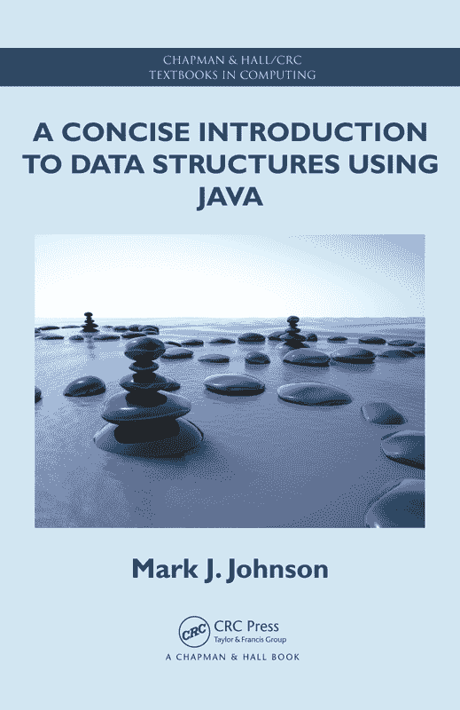


6000 Broken Sound Parkway NW, Suite 300  
Boca Raton, FL 33487-2742

© 2015 by Taylor & Francis Group

CRC Press 是 Taylor & Francis Group（旗下 Informa 业务）的品牌。

不对原始美国政府作品主张任何索权利。

版本日期：日期

国际标准书号-13: 978-1-4987-5981-6 (EPUB)

本书包含获取自真实且受推崇来源的信息。我们已在发布可靠数据和信息方面做出合理努力，但作者和出版者不对所有材料的有效性或其使用的后果承担责任。作者和出版者已尝试追踪本书中复制的所有材料的版权所有者，如未获得此类形式的出版许可，向版权所有者致歉。如有任何版权材料未注明，请写信告知我们，以便我们在未来的重印中予以修正。

除美国版权法允许外，未经出版者许可，本书的任何部分不得以任何现知或后发明的电子、机械或其他手段进行印刷、复制、传输或利用，包括复印、微胶复制和录制，或在任何信息存储或检索系统中。

如需许可复印或以电子方式使用本作品中的材料，请访问 [www.copyright.com](http://www.copyright.com/) 或联系版权许可中心, Inc. (CCC)，222 Rosewood Drive, Danvers, MA 01923, 978-750-8400。CCC 是一家非营利组织，为各种用户提供许可和注册。对于获得 CCC 授予复印许可的机构，已安排了独立的支付系统。

商标声明：产品或公司名称可能是商标或注册商标，仅用于标识和说明，无侵权意图。

访问 Taylor & Francis 网站 [`www.taylorandfrancis.com`](http://http://www.taylorandfrancis.com) 和 CRC Press 网站 [`www.crcpress.com`](http://http://www.crcpress.com)。

CRC Press 是领先的科学、技术和医学内容出版商，业务遍全球，出版科学领域的成就，为研究人员、专业人士和学生提供进一步进步所需的资源。欲了解您所在领域的更多权威书籍以及有关 CRC Press 书籍的详细信息，请访问 [www.crcpress.com](http://www.crcpress.com)。

- 加入我们的邮件列表，在您领域的新书出版时接收独家、无广告的折扣和提醒。
- 访问[特色作者](https://www.crcpress.com/authors)，了解您喜爱的作者，查看其详细简介、作品新闻以及对其研究的讨论。
- 阅读行业专家、影响者和思想领袖对 STM（科学、技术和医学）参考书和教材的最新书评。

本电子书中的表格经过修改，以增强阅读体验。在兼容设备上，当您滚动表格时，增强效果将保持表头行可见。

请将本电子书的任何问题或任何所需的改进反馈给出版商。

[www.crcpress.com](http://www.crcpress.com)

Chapman & Hall/CRC

计算教科书系列

系列主编：John Impagliazzo，霍夫斯特大学荣誉教授

Andrew McGettrick，斯特拉斯莱德大学计算机与信息科学系

## 目标与范围

该系列涵盖了计算传统领域，以及相关的技术领域，如软件工程、人工智能、计算机工程、信息系统和信息技术。该系列将涵盖本科和研究生的教科书，通常遵循专业协会的全球课程标准。编辑鼓励具有想象力的新想法和提案，并乐于帮助和鼓励新作者。编辑欢迎以下提案：

- 对计算的方面提供突破性且富有想象力的视角；
- 在新的令人兴奋的背景下介绍主题；
- 为新兴领域（如多媒体、安全和移动系统）开启机会；
- 捕捉计算新兴领域的新进展和应用；
- 为计算提供支持的主题，如数学、统计、生命和物理科学以及商业。

## 已出版书目

- Pascal Hitzler, Markus Krötzsch, and Sebastian Rudolph，语义网技术基础
- Uvais Qidwai and C.H. Chen，数字图像处理：基于 MATLAB® 的算法方法
- Henrik Bærbak Christensen，灵活可靠的软件：使用模式和敏捷开发
- John S. Conery，计算探索：计算机科学导论
- Lisa C. Kaczmarczyk，计算机与社会：向善的计算
- Mark J. Johnson，Python 编程简要介绍
- Paul Anderson，Web 2.0 及以后：原理与技术
- Henry M. Walker，计算之道，第二版
- Mark C. Lewis，使用 Scala 的编程艺术入门
- Ted Herman，Python 计算功能性起步
- Mark J. Johnson，Java 数据结构简要介绍

致 Lyn

# 前言

欢迎！

本书介绍了 Java™ 中的数据结构。它假设读者已具备一些先前的编程经验，但不一定是 Java 方面的。

数据结构是创建任何重大软件的基石。正如小型程序由函数、循环和 `if` 语句组成一样，大型程序使用栈、队列、列表和映射。熟悉如何使用、设计、实现和分析这些结构，是通往熟练软件开发者道路上的重要一步。

关于学习这些材料的一条建议：尽可能多做练习。编写程序的好处之一是，你可以运行它们来查看解决方案是否有效。这种快速反馈是无价的。

阅读愉快。

## 给导师的话

本书旨在支持一门侧重于基础数据结构的计算机科学第二门课程。它采取了发展性方法来增强学生的学习：

- 在开头提供了更多的代码和指导，让学生适应 Java 并开始学习数据结构。随着学生熟悉领域并变得更加独立，提供的代码会减少，并用伪代码概述更多的算法。
- 重要概念被逐渐引入，并随着深度的增加进行回顾。例如，在整数栈的背景下引入链表，因此插入和删除仅在头部进行。接下来，它们被用于构建队列，增加了对泛型和尾部指针的支持。最后，列表 ADT 的链实现使用了双链、虚拟节点以及在列表任何位置的插入和删除。到此为止，学生已经对他们处理链表代码的能力建立了信心。
- 主题的组织贯穿始终旨在强化这种发展方法。例如，第 3 章开发了基于 `int` 的栈接口、数组实现和链表实现。这使得学生在处理第 4 章中的完全泛型栈之前，专注于栈的核心内容。`List` ADT 位于栈和队列之后的原因相同：学生在学习栈和队列后，能更好地处理它的复杂性（特别是 `iterators`）。
- 每个章节只介绍一个或（极少数）两个新概念，让学生专注于新思想，而不至于无从从心。这对于 Java 初学者来说在课程的前半部分尤为重要。

其他特点包括：

- 对学生需要学习的核心内容进行清晰、简洁的解释；
- Java 基础知识的介绍章节，让那些 Java 不是其第一门语言的学生能够快速上手；
- 数据结构的部分实现，以便教师可以编写一些方法作为示例，而学生可以编写其他方法作为练习；
- 介绍学生以后在其他课程中可能会看到的内容，例如调用栈、分析递归函数、排序、继承和抽象类；
- 每个章节的设计大约适合一节课的时间。

在大多数情况下，本书遵循了标准的 Java 编码规范，但有少数例外：

- `Arrays` 是手动复制的，很大程度上是为了支持在队列实现中学习调整循环数组的大小。
- 没有使用 `Java` 集合，因为学生正在学习构建自己的。尽管如此，大多数接口与 `java.util` 中的对应项非常相似。
- 使用了未命名包，因为这些应用程序都相对小，这简化了初学者的文件管理。
- 接口方法的实现没有使用 `@Override` 注解，因为对“覆盖”一词的使用似乎可能会困惑学者。

除了第 10 章和第 11 章可以互换外，章节设计要求顺序阅读。第 5.3 节可能不应该跳过，因为它介绍了继承和 `Object` 类。

Java 源文件和其他资源发布在：

[`www.central.edu/go/datastructures/`](http://www.central.edu)

## 反馈

请将任何意见或建议发送至 johnsonm@central.edu。期待您的回复。

## 致谢

感谢 COSC 130 的所有学生让这门课程如此有趣。我希望你们能看到并欣赏你们所激发的所有的改进。感谢 Chapman & Hall/CRC Press 的编辑 Randi Cohen 一直以来的；我深表感谢。感谢我在 Central College 的同事，包括学院-社区合唱团的主任 Mark Babcock，感谢他经常使用“一次只学一个新事物”的技术。

# 关于作者

Mark J. Johnson 是爱荷华州佩拉中央学院（Central College）的计算机科学与数学教授，在那里担任 Ruth and Marvin Denekas 科学与人文教授。Mark 毕业于威斯康星大学麦迪逊分校（数学博士学位）和圣奥拉夫学院。他是《A Concise Introduction to Programming in Python》的作者，该书也由 Chapman & Hall/CRC Press 出版。

# 第 1 章

## Java 简介

在开始学习数据结构之前，我们将快速浏览 Java 编程语言的主要特征。随后，将在需要时引入 Java 更高级的特性。本章假设你已经有一些编程经验，但不一定是 Java Java。

开发 Java 软件需要当前的 Java 开发工具包（`JDK`）。本文中的所有示例都是使用 Java SE 7 编写的。

### 1.1 基础

我们从列表 1.1 中的一个计算阶乘示例开始。

列表 1.1：阶乘

```java
public class NumericFunctions {
    public static int factorial(int n) {
        int result = 1;
        for (int i = 2; i <= n; i++) {
            result *= i;
        }
        return result;
    }

    public static void main(String[] args) {
        for (int n = 1; n <= 10; n++) {
            System.out.print(n);
            System.out.print(" ");
            System.out.println(factorial(n));
        }
    }
}
```

虽然这是一个简短的程序，但它说明了 Java 语言的许多特性。因此，这一节比大多数章节都要长一点，所以不要试图在第一次阅读时就记住所有内容。相反，请注意这里的内容，关注与你预期不同的之处。

最常用的原始类型是 `int`、`double` 和 `boolean`。表 1.2 显示了可以赋值给声明为原始类型变量的字面量。

### 表 1.2：原始字面量值

| 类型 | 描述 |
| :--- | :--- |
| integer | 可选的 `0x`（十六进制）、`0`（八进制）或 `0b`（二进制） |
| long | 后缀 `L` |
| floating pt | 可选的 `e` 用于底数为 10 的指数 |
| float | 后缀 `f` |
| boolean | `true` 或 `false` |
| char | 单引号 |

请注意，整数常量上多余的 `0` 前缀会导致该值被解释为八进制（基数为 8）。

强制转换可用于在原始数值类型之间进行转换（布尔类型外）。强制转换告诉编译器将表达式处理为具有指定的类型。强制转换的语法为：

```java
(type) expression
```

将浮点值强制转换为整数会截断小数部分。例如：

```java
int i = (int) 7.2913; // 将 i 设置为 7
```

### 运算符

Java 为数值类型提供了标准的算术运算符 `+`、`-`、`*` 和 `/`。没有幂运算符。整数除法向零截断，因此 `5 / 2` 等于 `2`，`-5 / 2` 等于 `-2`。取余运算符为 `%`，定义为 `m % n` 是 `m` 除以 `n` 后的余数。例如，`5 % 2` 为 `1`。对于整数 `m` 和 `n`，保证以下关系：

```java
(m / n) * n + m % n == m
```

注意 `m % n` 可以是负数：例如，`-5 % 2` 为 `-1`，因为：

```java
(-5 / 2) * 2 + -5 % 2 == -2 * 2 + -1 == -5
```

取余运算符有时也称为模（modulus）或 `mod` 运算符，但技术上是不准确的，因为模值永远为负数。

测试相等性使用 `==` 或 `!=`（不等于）。其他比较运算符有 `<`、`>`、`<=` 和 `>=`。这些运算符每个产生一个布尔结果（`true` 或 `false`）。布尔值可以使用布尔运算符 `&&`（与）或 `||`（或）结合。任何布尔值都可以通过在其前面加上 `!`（非）来取反。

布尔运算符 `&&`（与）和 `||`（或）是条件性的，这意味着它们只在必要时才评估第二个表达式。例如，如果在该表达式中 `j` 为负数：

```java
j >= 0 && key < data[j]
```

那么第二部分 `key < data[j]` 将不会被评估，因为最终结果已经确定为假。条件评估也被称为布尔运算符短路。

### 递增与递减

数值变量可以通过递增运算符加一：

```java
variable++
```

还有一个递减运算符 `--`。递增和递减可以单独作为语句使用，也可以作为较大表达式的一部分。当以上述后置形式出现在表达式中时（`++` 位于变量之后），递增或递减会在获取变量值之后发生。

在前置形式中：

```java
++variable
```

递增（或递减）在确定变量值之前完成。

例如：

```java
int x = 10;
```

```java
int y = x++;
```

会将 `x` 变为 `11` 并将值 `10` 赋值给 `y`，因为递增是在第二行评估 `x` 之后完成的。

### 语句与块

可执行的 Java 代码是语句的序列，每个语句都以分号结束。大括号 `{}` 可将语句分组为块。大括号也被称为波浪线（squigglies）或花括号。大括号后面不需要加分号。

块通常定义类、方法、循环和 `if` 语句的体。通常，块可以使用任何单个语句出现的地方——反之亦然——因为从技术上讲，块被视为单一的复合语句。例如，`if` 语句可以使用块来写：

```java
if (test) {
    body;
}
```

或者使用单个语句：

```java
if (test)
    singleStatement;
```

然而，由于在单语句形式中添加新语句而可能忘记包含大括号的危险，最好将单语句体写在同一行上：

```java
if (test) singleStatement;
```

接下来的示例语句使用了块形式。

### 赋值

赋值语句计算右侧的表达式并将该值赋值给左侧的变量：

```java
variable = expression;
```

表达式的类型必须与变量的类型兼容。许多常见的赋值都有简写形式。例如，列表 1.1 第 5 行中的 `*=`：

```java
result *= i;
```

是赋值的缩写：

```java
result = result * i;
```

`+=`、`-=` 和 `/=` 也有相似的简写形式。

### 控制语句

Java 程序中的语句按照它们出现的顺序一个一个执行。控制语句改变语句的执行顺序。

### `if` 语句

`if` 语句允许在测试为真时条件执行执行体：

```java
if (test) {
    body;
}
```

测试内容必须产生一个布尔值。有一个可选 `else`。

### `while` 循环

`while` 循环在测试为假之前重复执行执行体：

```java
while (test) {
    body;
}
```

### `for` 循环

`for` 循环增加了初始化和递增步骤：

```java
for (initialize; test; increment) {
    body;
}
```

此循环原理类似于 `while` 循环：

```java
initialize;
while (test) {
    body;
}
```

### `switch`

`switch` 是长串 `if` 语句的替代方案。

```java
switch (expression) {
    case value1:
        statements;
    case value2:
        statements;
    ...
    default:
        statements;
}
```

`default` 情况是可选的。当 `switch` 执行时，控制跳转到匹配的 `case`，然后从该点继续，`case` 语句本身没有影响。换句话说，执行不会在 `case` 结束自动停止。因此，大多数 `switch` 语句在每个 `case` 的末尾都有 `break` 语句，以便跳过剩余的 `case`。

### 输出语句

输出由表 1.3 中的 `System.out` 函数生成。

### 表 1.3：`System.out` 方法

| 方法 | 描述 |
| :--- | :--- |
| `System.out.print(item)` | 打印项目不换行 |
| `System.out.println(item)` | 打印项目并追加换行（`\n`） |

还有其他更灵活的输出函数可用，详情请咨询 Java 文档。

### 方法

Java 中的函数通常被称为方法，因为它们必须写在类内部。方法定义的通用格式为：


```
modifiers returnType name(parameterType parameter, ...) {
    body;
}
```

列表 1.1 中的 `factorial()` 方法具有修饰符 `public static`、返回类型 `int` 以及类型为 `int` 的名为 `n` 的参数。方法修饰符将在 1.5 节中讨论。方法声明其返回类型以指示它将返回的数据类型。`void` 返回类型表示不返回任何值。因此，`factorial()` 方法返回 `int`，而 `main()` 方法不返回内容。

非 void 方法通过 `return` 语句返回值：

```
return expression;
```

此表达式的类型必须与方法的返回类型兼容。当遇到 `return` 语句时，方法将立即停止执行并将表达式的值返回给其调用者。由于这种行为，在 `void` 方法中可以使用不带表达式的 `return` 语句返回到调用者处，而无需执行方法内的任何后续代码。

方法参数（如 `factorial()` 中的 `n`）必须声明它们的类型。参数是通过值传递的，这意味着方法接收的是作为参数传递的值的副本。对于原始数据类型，这意味着方法可以修改其参数的副本而不影响调用者。引用参数将在第 1.4 节中简要讨论。

由于 Java 代码需要包含在类定义内部，因此无法在类之外定义函数（这在 C 或 Python 等语言中是很常见的）。如果你发现自己想在 Java 中写一个独立函数，那么通常你想要写的是一个静态方法，例如列表 1.1 中的 `factorial()` 和 `main()`。声明这些方法为 `static` 的原因将在第 1.5 节中解释。

### 注释

Java 注释有三种：

包含在 `/*` 和 `*/` 之间的多行文本会被编译器忽略，用于阅读你代码的人。

文档多行注释：以 `/**` 开头的多行注释是文档注释，用于描述随后的类或方法。

单行注释：跟在 `//` 之后到行尾的任何文本都被视为注释，通常用于解释一小段代码。

`jjavadoc` 工具将文档注释转换为与 Java 库文档风格相同的 Web 页面。本文未包含文档注释，以便代码本身更易读。

### 编译和运行 Java 程序

要运行列表 1.1，请将代码保存为名为 `NumericFunctions.java` 的文件。使用以下命令将此 Java 源代码编译为 Java 字节码：

```
 % javac NumericFunctions.java
```

字节码类似于低级机器语言，不同之处在于它由针对 Java 虚拟机（JVM）而非特定 CPU 的指令组成。编译器将生成的字节码存储在名为 `NumericFunctions.class` 的文件中。一旦创建了此字节码文件，就可以使用命令执行程序：

```
 % java NumericFunctions
```

这将自动调用来自 `NumericFunctions` 类的 `main()` 方法，只要该方法被声明为 `public static void` 且带有一个 `String[]` 参数（如第 10 行所示）。集成开发环境（IDE）如 Netbeans 或 Eclipse 可以让你方便地编辑、编译和运行 Java 程序，而无需从命令行操作。jGRASP [[7]](#K20431_bib.xhtml_ref_7) 是一种专门为学习数据结构设计的 IDE。

### 练习

1. 假设 `int` 变量 `x` 和 `y` 的值分别为 5 和 10。在运行以下每个 Java 语句后，给出 `x` 和 `y` 的值，每次运行都从 `x` 和 `y` 的原始值开始：

    (a) `x = ++y;`

    (b) `x = −−y;`

    (c) `x = y++;`

    (d) `x = y--;;`

2. 编写 `for` 循环来产生以下值：

    (a) `i = 1, 2, 3, . . . , 100`

    (b) `j = 0, 1, 2, 3, . . . , 9`

    (c) `m = 0, 2, 4, 6, . . . , 100\.`（提示：增量步可以是复合赋值。）

    (d) `n = 1, 2, 4, 8, . . . , 1024.`

3. 编写三个不同的 `for` 循环，每个循环执行循环体十次。不要只更改循环变量名；要更改 `for` 循环的所有三个部分。

4. 修改列表 1.1 中的 `main()` 以包含对 `factorial(0)` 的调用。解释为什么返回了正确的结果（0! = 1）。

5. 修改列表 1.1 中的 `main()` 以包含带有负 `n` 的 `factorial(n)` 调用。程序会崩溃吗？解释其行为，重点关注第 4 行的 `for` 循环。

6. 修改列表 1.1 中的 `main()` 以计算到 `n = 20` 的阶乘。

    (a) 确定返回正确值的最大 `n`。

    (b) 解释为什么计算出某些错误值。提示：32 位有符号 `int` 可以存储 −2³¹ 到 23³¹ − 1 之间的值。

    (c) 修改 `factorial()` 函数使用 `long` 类型，以便能够计算更大的阶乘。确定返回正确值的最大 `n`。

7. 编写一个 Java 函数来计算 `n >= 0` 的阶乘。

8. 编写一个 `gcd` 函数，使用 `for` 循环来计算 `s` 和 `n` 的最大公约数，假设 `s` 和 `n` 是整数。

9. 修改 `factorial()` 函数使用 `long` 类型，以便能够计算更大的阶乘。

10. 编写一个 `gcd` 函数，使用 `while` 循环来计算 `s` 和 `n` 的最大公约数。当循环停止时，`gcd` 是 `s` 和 `n` 的最大公约数。

11. 编写一个 `gcd` 函数，使用 `for` 循环来计算 `s` 和 `n` 的最大公约数。返回 `s` 和 `n` 的最大公约数。

## 字符串方法

| 方法 | 描述 |
| :--- | :--- |
| `char charAt(int i)` | 索引 `i` 处的字符。 |
| `int indexOf(String s)` | `s` 在此字符串中首次出现的索引，若未找到则返回 `-1`。 |
| `int indexOf(String s, int start)` | 从索引 `start` 开始，`s` 在此字符串中首次出现的索引，若未找到则返回 `-1`。 |
| `int length()` | 字符串中字符的数量。 |
| `String substring(int i)` | 从索引 `i` 开始的子字符串。 |
| `String substring(int i, int j)` | 从索引 `i` 到 `j - 1` 的子字符串。 |
| `String toLowerCase()` | 返回全小写的副本。 |
| `String toUpperCase()` | 返回全大写的副本。 |
| `String trim()` | 返回去除了两端空白字符的副本。 |

字符串可以被视为字符的序列，索引从 0 开始，例如：

| 0 | 1 | 2 | 3 | 4 | 5 | 6 | 7 |
| :--- | :--- | :--- | :--- | :--- | :--- | :--- | :--- |
| A | | s | t | r | i | n | g |

表 1.4 中的几个方法是基于这种索引的。

需要注意的是，名称听起来可能可能会更改字符串的方法（如 `toLowerCase()`、`trim()` 等）并不会改变它们被调用的字符串。这是因为字符串是不可变的（immutable）；它们永远不会改变。相反，此类方法总是返回原始字符串的一个修改后的副本。

请参阅 Java API 文档 [[10]](#K20431_bib.xhtml_ref_10) 以获取完整的字符串方法列表。

### 比较字符串

通常情况下，引用类型的比较方式与基本类型不同，无论对于相等性还是不相等性都是如此。我们将逐渐学习这些差异，但目前我们重点关注如何比较字符串。表 1.5 列出了主要的字符串比较方法。

### 表 1.5: 字符串比较

| 方法 | 描述 |
| :--- | :--- |
| `int compareTo(String s)` | 如果此字符串在字母顺序上于 `s` 之前则返回负数，相等则返回零，在字母顺序上之后则返回正数。 |
| `int compareToIgnoreCase(String s)` | 与 `compareTo()` 相同，但忽略大小写。 |
| `boolean equals(Object o)` | 如果 `o` 是一个与此字符串内容相同的字符串，则返回 true。 |
| `boolean equalsIgnoreCase(String s)` | 如果 `s` 与此字符串内容相同（忽略大小写），则返回 true。 |

比较字符串有两个基本规则：

* 如果你想知道两个字符串的内容是否相同，请使用 `equals()`。不要使用 `==`。注意，代码列表 1.2 中的第 7 行使用了 `equals()` 来比较每个片段与目标。

* 如果你想按照字母顺序比较字符串，请使用 `compareTo()`。不要尝试使用 `<`、`>` 或其他的数值比较。

注意：编译器允许你对字符串使用 `==`，但那几乎不是你想要的。另一方面，编译器不允许你对字符串使用其他的比较方法。

`compareTo()` 方法是基于字符串中字符的 ASCII 编码的，因此大写字母在它们对应的小写等效字母之前。例如：

```
"apple".equals("banana")    // false
```

```
"apple".compareTo("banana")    // negative
```

```
"apple".compareTo("BANANA")    // positive
```

```
"apple".compareToIgnoreCase("BANANA")  // negative
```

不要担心 `compareTo()` 方法返回的精确值：在程序中，你只需要测试值是正的还是负的即可。

`equals()` 和 `==` 之间的差异适用于所有的 Java 对象，而不仅仅是字符串，因此我们将在第 1.4 节中回到这一区别。稍后，在第 5.3 节中，我们将解释 `equals()` 的参数是 `Object` 的原因。现在只需将其视为第二个字符串即可。

### 练习

1. 假设 `s = "data structures"`。给出以下每个表达式的值：

    * (a) `s.length()`
    * (b) `s.charAt(5)`
    * (c) `s.indexOf("a")`
    * (d) `s.indexOf("m")`
    * (e) `s.indexOf("struct")`
    * (f) `s.indexOf("t", 3)`
    * (g) `s.indexOf("t", 7)`
    * (h) `s.indexOf("d", 0)`
    * (i) `s.indexOf("d", 1)`
    * (j) `s.substring(5)`
    * (k) `s.substring(1, 3)`
    * (l) `s.toUpperCase()`

2. 假设 `t = "Java programming language"`。给出以下每个表达式的值：

    * (a) `t.length()`
    * (b) `t.charAt(0)`
    * (c) `t.indexOf("s")`
    * (d) `t.indexOf("n")`
    * (e) `t.indexOf("gram")`
    * (f) `t.indexOf("g", 9)`
    * (g) `t.indexOf("g", 16)`
    * (h) `t.indexOf("r", 6)`
    * (i) `t.indexOf("r", 7)`
    * (j) `t.substring(5)`
    * (k) `t.substring(5, 12)`
    * (l) `t.toUpperCase()`

3. 假设 `s = "stack"`，`t = "queue"`，`u = "Stack"`。给出以下每个值：

    * (a) `s.equals(t)`
    * (b) `s.equals(u)`
    * (c) `s.equalsIgnoreCase(t)`
    * (d) `s.equalsIgnoreCase(u)`

4. 假设 `s = "stack"`，`t = "queue"`，`u = "Stack"`。判断以下每个值是正、负还是零：

    * (a) `s.compareTo(t)`
    * (b) `s.compareTo(u)`
    * (c) `s.compareToIgnoreCase(t)`
    * (d) `s.compareToIgnoreCase(u)`

5. 假设 `s` 是字符串 "abcd"。通过以下表达式返回：

    * (a) `s.length()`
    * (b) `s.charAt(2)`
    * (c) `s.substring(2, 4)`
    * (d) `s.substring(3)`

6. 假设 `s` 和 `t` 是字符串：

    * (a) 写一个 if 语句，当 `s` 和 `t` 内容相同时执行。
    * (b) 写一个 if 语句，当 `s` 和 `t` 内容不同时执行。
    * (c) 写一个 if 语句，当 `s` 在字母顺序上于 `t` 之前时执行。

7. 修改代码列表 1.2 中的第 7 行，使用 `==` 代替 `equals()`。描述结果。

8. 修改代码列表 1.2 以编写一个忽略大小写的 `countIgnoreCase()` 方法。在 `main()` 中测试它。

9. 编写代码列表 1.2 的 `count2()` 版本，使用 `while` 循环和字符串 `indexOf()` 方法来搜索目标。使用两个参数的 `indexOf()` 版本。将你的函数添加到 `StringFunctions` 并在 `main()` 中测试。

10. 通过实验或查询文档确定字符串 `compareTo()` 方法的值。

## 1.3 数组

数组是一种简单的数据结构，为我们将要学习的其他复杂结构提供了基础。它们也是引用类型的第二个示例。代码列表 1.3 展示了如何使用数组结合标准搜索技术——线性搜索。

```
public class ArrayFunctions {
  public static int linearSearch(int[] data, int target) {
    for (int i = 0; i < data.length; i++) {
      if (target == data[i]) return i;
    }
    return -1;
  }

  public static void main(String[] args) {
    int[] data = {3, 14, 7, 22, 45, 12, 19, 42, 6};
    System.out.println("Search for 7: " + linearSearch(data, 7));
    System.out.println("Search for 100: " + linearSearch(data, 100));
  }
}
```

通过声明一个数组类型的变量并没有创建实际的数组。这是因为数组类型是引用类型，因此声明一个数组类型变量只是为该变量预留了存储空间，以便最终存储指向实际数组的引用。创建数组是一个单独的步骤。

### 创建数组

创建数组有两种主要方法：使用初始化器或使用 `new`。当数组包含数量较少的已知项时，初始化器是合适的，例如代码列表 1.3 中的第 10 行。数组初始化器的语法为：

```
arrayRef = {item, item, ..., item};
```

更多情况下，通常使用 `new` 配合类型和方括号来创建一个指定大小的数组：

```
arrayRef = new type[N];
```

在这里，配合 `new` 使用的类型必须与声明数组变量时使用的类型兼容，且 `N` 指定新数组的大小（也称为其长度）。使用 `new` 创建的数组，每个索引都从默认初始值开始。对于数值类型，默认值为 0；对于引用类型，默认值是空引用（参见第 1.4 节）。

数组的长度可以通过其 `length` 字段访问：

```
arrayRef.length
```

例如，请参考代码列表 1.3 中的第 3 行。数组的长度在创建时就已经固定了，永远无法改变。然而，数组变量可以随时重新赋值以指向长度不同的数组对象。

### 访问数组元素

数组中的项通过其索引或在数组中的位置访问。索引从 0 开始计数，因此包含 9 个项的数组（如代码列表 1.3 中的 `data`）索引为 0 到 8。我们如下视化数据数组：


数组中索引为 `i` 的项使用方括号访问：

```
arrayRef[i]
```

例如，`data[2]` 是 7，`data[7]` 是 42。

Java 对所有数组访问执行自动边界检查。如果使用了无效的索引，将抛出 `ArrayIndexOutOfBoundsException`，这通常会停止程序的执行。

### 增强型 for 循环

Java 集合（包括数组）支持简化的 `for` 语句，允许遍历集合中的每个项。这被称为增强型 for 循环（enhanced for-loop），语法如下：

```
for (type variable : collection) {
    body;
}
```


该循环为集合中的每个项执行一次。在循环体内部，每个项都存储在`variable`中。为`variable`指定的类型必须与集合中每个项的类型匹配。

例如，考虑代码列表 1.3 中`main()`方法中的`data`数组。它被声明为`int[]`，因此使用该数组的增强`for`循环的项类型应该是`int`。此循环打印数组中的所有项：

```
for (int item : data) {
    System.out.println(item);
}
```

在不需要数组索引的情况下，增强型`for`循环非常好用。

### 线性搜索

代码列表 1.3 中的方法解决了搜索问题：

> 给定一个数组`data`和一个特定值`target`，确定`target`是否作为元素出现在`data`中。如果存在，返回它出现的最小索引；否则，返回 −1。

我们通过产生一个算法来解决搜索问题。算法是用于解决特定问题的特定计算步骤的序列。注意，这个定义包含了几个模糊的术语；对于我们的目的，算法简单来说就是一个解决问题的程序。

线性搜索（也称为顺序搜索）通过从项 0 开始逐个检查数组中的每个元素，并跟踪当前索引来解决搜索问题。如果找到了该项，则返回相应的索引；否则，如果在查看了每个元素后仍未找到该项，则返回 -1。

由于题目说明要返回找到元素时的索引，我们需要遍历索引，而不是遍历数组中的元素。

### 练习题

1. 写一个 Java 语句来声明这些每个数组引用：
   - (a) 一个名为`counts`的`int`数组
   - (b) 一个名为`times`的`double`数组
   - (c) 一个名为`visible`的`boolean`数组
   - (d) 一个名为`names`的`String`数组

2. 使用初始化器写一个 Java 语句来声明并创建这些数组：
   - (a) 一个名为`counts`的`int`数组，内容为 18, 3, 9, 22, 11, 4。
   - (b) 一个名为`times`的`double`数组，内容为 1.52, 1.98, 1.44, 1.63, 1.67。
   - (c) 一个名为`visible`的`boolean`数组，内容为 T, F, F, T, F。
   - (d) 一个名为`names`的`String`数组，内容为 “Alice,”Bob,”Carol,”Dave.”

3. 写一个 Java 语句来声明这些每个数组引用并创建它们：
   - (a) 一个长度为 10 的名为`counts`的`int`数组
   - (b) 一个长度为 40 的名为`times`的`double`数组
   - (c) 一个长度为 100 的名为`visible`的`boolean`数组
   - (d) 一个长度为 100 的名为`names`的`String`数组

4. 使用增强`for`循环打印这些每个中的每一个项：
   - (a) 一个名为`counts`的`int`数组
   - (b) 一个名为`times`的`double`数组
   - (c) 一个名为`visible`的`boolean`数组
   - (d) 一个名为`names`的`String`数组

5. 使用代码列表 1.3 来：
   - (a) 确定`main`参数的名字和类型。
   - (b) 解释为什么第 3 行使用小于而不是等于。
   - (c) 跟踪第 12 行`linearSearch()`的执行过程。
   - (d) 跟踪第 14 行`linearSearch()`的执行过程。

6. 解释在`linearSearch()`第 4 行使用`==`是可行的。替换为`equals()`可以吗？

7. 在代码列表 1.3 中添加增强`for`循环来搜索数组中的每个元素。

8. 为`ArrayFunctions`类写一个`sum(int[] data)`方法，返回数组元素的和。在`main()`中测试你的实现。

9. 为`ArrayFunctions`类写一个`max(int[] data)`方法，返回给定数组中的最大值。假设数组不为空，并在`main()`中测试你的实现。

10. 为`ArrayFunctions`类写一个`min(int[] data)`方法，返回给定数组中的最小值。假设数组不为空，并在`main()`中测试你的实现。

11. 为`ArrayFunctions`类写一个`display(int[] data)`方法，将给定数组的内容打印在一行中。对每个元素使用`print()`，但最后以一个`println()`结束，以便未来的输出单独成行。在`main()`中测试你的实现。

## 1.4 使用对象

Java 是一种面向对象的编程语言，因此学习使用对象是成功适应该语言的关键之一。到为止你已经看到了两种对象，字符串和数组。每一个都有些独特；本节使用更具代表性的示例来传递通用思想。

对象由类定义。在本节中，我们关注如何使用对象；在下一节中，我们将如何编写自己的类。除了使用新对象外，代码列表 1.4 结合了最后两个节的一些思想。在查看其中使用`StringBuilder`类和`split()`方法之前，我们考虑了使用 Java 对象涉及的一些通用问题。

### 声明对象引用

对象引用的声明与原始类型变量相同：

```
type referenceVariable;
```

代码列表 1.4：缩写

```java
// 添加到 StringFunctions 类：
public static String acronym(String phrase) {
    StringBuilder result = new StringBuilder();
    for (String token : phrase.split("\\s+")) {
        result.append(token.toUpperCase().charAt(0));
    }
    return result.toString();
}
```

声明引用时使用的类型定义了该引用可以使用的方法和字段。然而，与字符串和数组一样，声明引用变量并不会为该变量创建它所引用的对象，而且在引用对象之前，引用无法“执行”任何操作。一旦创建了对象，我们通常在谈论引用变量时，就像它就是它所引用的对象一样。

### 创建对象

在 Java 中，使用`new`和类构造函数来创建对象：

```
referenceVariable = new ClassName(arguments);
```

构造函数的名称始终与它们的类名相同，并且可以接受零或多个参数。在代码列表 1.4 中，通过调用第 4 行的构造函数创建了一个`StringBuilder`对象，该对象随后由变量`result`引用。

### 访问字段和调用方法

对象将其数据存储在创建它的类所定义的字段中。使用点符号法访问字段：

```
object.field
```

我们在上一节中见过这种表示法，用于访问数组的`length`字段。

方法是在对象字段中存储的数据上或对这些数据执行的操作。使用相同的点符号法调用方法：

```
object.method(arguments)
```

在 Section 1.2 中我们看到了几个`String`方法调用的示例，代码列表 1.4 的第 6 行调用了`StringBuilder`对象`result`的`append()`方法。值得注意的是，`print()`和`println()`是对`System.out`对象的方法调用。

使用点访问引用变量的字段或方法有时被称为变量解引用（dereferencing）。只有用引用类型声明的变量才能进行解引用。如果你尝试对用基本类型声明的变量进行解引用，将会得到错误。

### 对象引用

回想引用类型使用引用指向它们所引用的对象，而不是像基本类型那样直接存储数据。给定以下赋值：

```
int x = 17;
```

```
String s = "This is a string";
```

像这样想象区别是有帮助的：

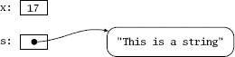

因为`s`的实际内容是对字符串对象的引用。Java 引用也被称为指针，因为它们指向对象；但请注意，在其他语言中指针和引用之间可能存在差异。如果创建了另一个引用并赋予它与`s`相同的值：

```
String t = s;
```

那么两个引用都指向同一个对象：

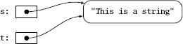

回想（第 8 页），Java 按值传递所有方法参数。这意味着对于对象引用，参数总是获得引用的副本（就像在我们的示例中`t`是引用`s`的副本一样），但该副本指向的是实际的对象。通常情况下，这正是你所预期和需要的。

有一个字面量引用`null`，它不引用任何对象。尝试访问`null`引用的字段或方法将产生`NullPointerException`。

### 使用`equals()`

现在我们可以多说一点关于引用类型`==`和`equals()`之间的区别。对于所有对象类型（包括字符串），`==`和`!=`检查两个引用是否指向同一个对象。另一方面，`equals()`方法由`String`等类定义，用于检查对象是否具有相同的内容。

因此，在大多数情况下，当比较对象时，你希望比较它们的内容，因此使用`equals()`。与`==`的直接比较主要用于基本类型。

有一个例外：Java 数组没有实现`equals()`方法来比较它们的内容。如果你需要比较数组的内容，请使用`java.util.Arrays`类中的`equals()`方法。

### 销毁对象

在 Java 中，对象被创建后没有显式的方法可以销毁它。相反，Java 有一套自动垃圾回收系统，允许在内存不再被使用时回收该内存。当无法通过追踪程序中的活动引用到达某个对象时，垃圾回收器就会判定该对象不再在使用。这种自动系统非常棒；其他语言可能需要你自己处理垃圾。

然而，有时我们可能需要消除对不再使用的对象的引用。通常情况下，如果`x`是指向我们不再需要的对象的引用，那么将`x`设置为`null`将通知垃圾回收器该对象可以删除（假设没有其他引用指向它）。

### `StringBuilder`

回想字符串拼接是低效的，因为字符串是不可变的（参见 Section 1.2）。`StringBuilder`对象专门设计用于执行高效的字符串累积。因为它们是可变的，它们的内容可以改变，因此不需要为每次拼接都创建新对象。

代码列表 1.4 中由`result`引用的`StringBuilder`对象通过调用`new`构造函数创建。表 1.6 中列出的`StringBuilder`方法可以对其调用。

#### 表 1.6

`StringBuilder`

| 方法 | 说明 |
|---|---|
| `void append(String s)` | 将`s`追加到当前内容 |
| `String toString()` | 转换为字符串 |

### 字符串分词

一个常见的任务是将给定的字符串拆分为标记集合。在代码列表 1.4 中，我们需要对短语进行分词。在这种情况下，标记是空白字符分隔的单词。表 1.7 中的`split()`方法提供了一种方便的分词方法，返回一个包含标记的字符串数组。例如：

```java
"Name:Address:City:State:Zip".split(":")
```

返回数组：

```java
{"Name", "Address", "City", "State", "Zip"}
```

分词表达式`":"`不是标记的一部分。

#### 表 1.7

字符串分词

| 方法 | 说明 |
|---|---|
| `String[] split(String expr)` | 返回在`expr`处分割此字符串创建的字符串数组 |

分词表达式可以是任何正则表达式。代码列表 1.4 中使用的正则表达式匹配任何一个或多个空白字符（空格、制表符或换行符）。它的工作原理如下：模式`\s`匹配任何单个空白字符。但在字符串字面量中使用（如此处），必须用另一个反斜杠进行转义；因此字符串字面量`\\s`匹配任何一个空白字符。在模式后附加`+`匹配模式出现的多次，因此`\\s+`匹配一组或多个空白字符。

### 练习

1. 假设`Random`是一个具有无参数构造函数的 Java 类。写一个 Java 语句声明并创建一个名为`gen`的`Random`对象。

2. 假设`Thread`是一个具有无参数构造函数的 Java 类。写一个 Java 语句声明并创建一个名为`t`的`Thread`对象。

3. 假设`Button`是一个接受一个字符串参数作为标签的 Java 类。写一个 Java 语句声明并创建一个标签为“Go”的名为`goButton`对象。

4. 确定这些 Java 表达式的值：
   - (a) `"This sentence has long gaps.".split("\\s+")`
   - (b) `"What about punctuation?".split("\\s+")`
   - (c) `"This is a sentence.".split("\\s")`
   - (d) `"This is a sentence.".split("s")`
   - (e) `"This is a sentence.".split("e")`

5. 将代码列表 1.4 中的`acronym()`方法添加到`StringFunctions`类中。在`main()`中包含代码进行测试。

6. 重写代码列表 1.4 中的`acronym()`方法，使用普通索引的`for`循环而不是增强型`for`循环。将该方法命名为`acronym2()`并在`main()`中测试它。

7. 编写一个方法`countWord(String s, String target)`，统计单词`target`在字符串`s`中出现的次数。（假设`s`不包含标点符号，因此单词由空白字符分隔。）将你的方法添加到`StringFunctions`类中并在`main()`中测试。

8. 编写一个方法`countWordIgnoreCase(String s, String target)`，统计单词`target`在字符串`s`中出现的次数，且忽略大小写。（假设`s`不包含标点符号，因此单词由空白字符分隔。）将你的方法添加到`StringFunctions`类中并在`main()`中测试。

9. 为`StringFunctions`类编写一个 Java 方法`reverse(String s)`，返回一个由`s`中的字符按反序排列组成的字符串。例如，`reverse("abc")`应该返回字符串`"cba"`。在`main()`中测试你的方法。

10. 为`ArrayFunctions`类添加一个新的`linearSearch()`方法，在字符串数组中搜索目标字符串。在`main()`中测试你的方法。（注意：Java 允许同一个方法的多个版本，只要它们的参数类型列表不同；我们将在下一节解释这一特性。）

## 1.5 编写类

类允许我们在 Java 中定义新的数据类型。由类定义的类型被称为对象类型或类类型，所有对象类型都是引用类型。代码列表 1.5 定义了一个`Fraction`类型。

### 代码列表 1.5：`Fraction`类

```java
public class Fraction {
    private int num;
    private int den;

    public Fraction(int num, int den) {
        this.num = num;
        this.den = den;
    }

    public Fraction(int n) {
        this(n, 1);
    }

    public void addOn(Fraction f) {
        num = num * f.den + den * f.num;
        den *= f.den;
    }

    public static Fraction add(Fraction f1, Fraction f2) {
        int n = f1.num * f2.den + f1.den * f2.num;
        int d = f1.den * f2.den;
        return new Fraction(n, d);
    }

    @Override
    public String toString() {
        return num + "/" + den;
    }

    public static void main(String[] args) {
        Fraction f1 = new Fraction(3, 4);
        Fraction f2 = new Fraction(1, 3);
        System.out.print(f1 + " + " + f2 + " = ");
        System.out.println(add(f1, f2));
        f1.addOn(f2);
    }
}
```


```java
System.out.println("Using addOn() changes f1 to " + f1);
```

```java
37}
```

```java
38}
```

### 类定义

一个典型的 Java 类定义如下：

```java
modifiers class ClassName {
    // 字段声明
    // 方法定义
}
```

大括号内的类体定义了类的成员，通常是字段和方法。也可以在类内部定义类，被称为嵌套类。我们稍后在创建链接结构时会看到它的用途。

### 可见性

Java 允许使用访问修饰符指定类及其成员的可见性。这些修饰符控制了其他代码部分可以使用该类或其成员。如果一个类被声明为 `public`，则任何其他类都可以使用它。通常情况下，`public` 类应该存储在与类同名的文件中。

现在，我们将为类成员使用两个访问修饰符：

| 修饰符 | 说明 |
|---|---|
| `public` | 处处可用。 |
| `private` | 仅在类内部访问。 |

访问修饰符的主要用途是封装。如果类被声明为 `public`，则任何其他类都可以使用它。通常情况下，一个 `public` 类应该存储在与类同名的文件中。

现在，我们将为类成员使用两个访问修饰符：

| 修饰符 | 说明 |
|---|---|
| `public` | 处处可用。 |
| `private` | 仅在类内部访问。 |

访问修饰符的主要用途是封装。如果类被声明为 `public`，则任何其他类都可以使用它。通常情况下，一个 `public` 类应该存储在与类同名的文件中。

### 声明和初始化字段

字段声明仅仅是类体中的变量。例如，在 Listing 1.5 中，`num` 和 `den` 被声明为 `private`。

字段可以在声明时初始化，也可以通过构造函数赋值。因此，与其使用字段初始化器，我们编写构造函数为分数的创建提供方便的方法。

### 编写方法

你已经熟悉了编写方法，尽管在本节之前，所有的方法都是 `static` 的。方法必须声明其返回类型和参数类型。

在非静态方法内部，`this` 关键字指向调用该方法的对象。因此，在方法体内部：

```java
this.fieldName
```

引用的是字段而不是其他变量。

### 编写构造函数

回想上一节，构造函数配合 `new` 使用以创建新对象。因此，构造函数的主要目的是将新对象设置为有效状态，即其字段具有有意义的值。对于 `Fraction` 类来说，分子和分母没有自然的默认值，因此在创建分数时必须指定分子和分母的值。

构造函数始终与类同名，且没有返回类型。它们可以指定自己的可见性。

### 方法和构造函数的重载

Java 允许定义同一个方法或构造函数的多个版本，只要每个版本具有唯一的签名。方法的签名签名是它的名称和参数列表。返回类型和参数名都不属于签名的一部分。定义多个版本的方法被称为重载方法。

在 Listing 1.5 中，构造函数被重载了；两个构造函数的签名分别为：

```java
Fraction(int, int)
```

```java
Fraction(int)
```

在重载构造函数时，可以使用 `this()` 作为构造函数的第一条语句，以便调用不同的构造函数：

```java
this(arguments);
```

这减少了代码的重复，通常通过为最通用的构造函数编写完整代码，然后在更具体的构造函数中调用 `this()` 来实现。例如，在 Listing 1.5 中，第一个构造函数是分数 `n/d` 的通用构造函数，而第二个构造函数在第 11 行调用 `this(n, 1)` 来为整数 `n = n/1` 创建分数对象。

### 实例方法与静态方法

第 1.4 节描述的方法调用语法是调用实例方法的标准方式，实例方法始终从类的实例（即对象）进行调用：

```java
object.method(arguments)
```

实例方法在类中没有特殊标记；换句话说，除非另有声明，否则所有方法都是实例方法。在 Listing 1.5 中，`addOn()` 和 `toString()` 方法都是实例方法。你可以看到第 35 行中 `addOn()` 方法使用了上述调用语法。在那里，`addOn()` 方法在实例 `f1` 上被调用，通过向其添加 `f2` 来修改 `f1`。

相反，静态方法不需要从任何对象调用。它们被视为类方法而非对象方法。事实上，你可以将“static”视为“class”（类）的同义词。使用 `static` 修饰符声明静态方法：

```java
static returnType staticMethod(parameters) {...}
```

在其自身的类定义内部，可以通过直接提供方法名及其参数来调用静态方法：

```java
staticMethod(arguments)
```

这种语法用于第 34 行对 `add()` 的调用，其中打印了 `f1` 和 `f2` 的和。

比较 `add()` 和 `addOn()` 方法有助于理解实例方法和静态方法的区别：

- `addOn()` 是实例方法，因此必须从特定的分数调用。它会修改被调用的分数。
- `add()` 是静态方法，它将两个给定的分数，并返回一个新的分数作为结果。

因为实例方法比静态方法常见，所以“method”（方法）一词通常指实例方法。

### 从其他类调用静态方法

来自其他类的静态方法通过在方法名前加上类名来调用：

```java
ClassName.staticMethod(arguments)
```

### 实例字段与静态字段

方法一样，也有实例字段和静态字段。实例字段或实例变量是指每个对象都有自己的独立存储的变量。实例字段没有特殊标记，因此再次，除非指定为 `static`，否则所有字段都是实例字段。因此，在 `Fraction` 类中：

```java
private int num;
```

```java
private int den;
```

`num` 和 `den` 都是实例变量，因此每个分数都存储自己的分子和分母。

字段可以声明为 `static`，在这种情况下，整个类共享该字段的单一存储位置。由于此，静态字段可以被认为是类变量。静态字段的使用频率不如实例字段高，因此“field”（字段）一词通常指实例变量。

### `toString()` 方法

任何类都可以提供 `toString()` 方法，以指示该类型的对象应如何转换为字符串。在 Listing 1.5 中，`Fraction` 类的 `toString()` 方法返回字符串：

```java
num + "/" + den
```

编写 `toString()` 方法的优势之一是当打印该类型的对象时，`System.out.println()` 会自动调用它。因此，例如当第 33 行打印 `f1` 时，它的输出将是“3/4”。

我们将在第 5.3 节中再次回顾 Listing 1.5 中使用的 `toString()` 方法和 `@Override` 注解。

### 练习题

1. 给出 Listing 1.5 中每个方法的签名：

   1. (a) `addOn()`
   2. (b) `add()`
   3. (c) `toString()`
   4. (d) `main()`

2. 给出每个方法的签名：

   1. (a) 来自 Listing 1.1 的 `factorial()`
   2. (b) 来自 Listing 1.2 的 `count()`
   3. (c) 来自 Listing 1.3 的 `linearSearch()`
   4. (d) 来自 Listing 1.4 的 `acronym()`

3. 解释为什么练习 2 中列出的方法被声明为 `static`。

4. Java 是否允许将 Listing 1.5 中的 `addOn()` 方法名更改为 `add()`？请解释原因。

5. 在 Listing 1.5 的 `main()` 中添加代码以完成以下任务：

   1. (a) 声明并创建一个 5/8 的 `Fraction`。打印 `f` 的值。
   2. (b) 声明并创建一个 17/3 的 `Fraction`。打印 `g` 的值。
   3. (c) 声明并创建一个 `f + g` 的 `Fraction`。打印 `h` 的值。
   4. (d) 声明并创建一个 5 的 `Fraction`。打印 `j` 的值。
   5. (e) 将 `g` 的值增加 5。打印 `g` 的新值。

6. 在 Listing 1.5 的 `Fraction` 类中添加这些方法。修改 `main()` 以测试你的函数：

   1. (a) `subtract(f)` 从此分数减去 `f`。
   2. (b) `multiplyBy(f)` 将此分数乘以 `f`。
   3. (c) `divideBy(f)` 将此分数除以 `f`。
   4. (d) `addOn(n)` 为此分数加上整数 `n`。

7. 在 Listing 1.5 的 `Fraction` 类中添加这些方法。修改 `main()` 以测试你的函数：

   1. (a) `subtract(f1, f2)` 计算 `f1 - f2`。
   2. (b) `multiply(f1, f2)` 计算 `f1 * f2`。
   3. (c) `divide(f1, f2)` 计算 `f1 / f2`。

8. 为 Listing 1.5 的 `Fraction` 类编写一个 `reduce()` 方法，将该分数约化为最形式。假设所有项均为正并使用 `gcd()` 函数。

9. 修改上练习中的 `reduce()` 方法以正确处理负分数。让构造函数确保所有分母均为正，从而使负分数具有负分子。如果需要绝对值，请使用 `Math.abs()` 库函数。在类的其他方法中必要的地方添加 `reduce()` 的调用。

|  |  |
|---:|---:|
| 40 | 425 |
| 80 | 825 |
| 160 | 1625 |
| 320 | 3225 |
| 640 | 6425 |
| 1280 | 12825 |
| 2560 | 25625 |
| 5120 | 51225 |
| 10240 | 102425 |

从长期来看，算法 `B` 和 `C` 的表现非常相似，而算法 `A` 比它们两者都快。

我们可以从表中提取出这些原则：

- **关注大 `n`**：当 `n < 100` 时，算法 `B` 运行快，但这并不是其整体性能的良好指标。对于大的 `n`，它的速度比 `A` 慢得多。
- **关注最高幂**：`n` 列和算法 `A` 的列增长趋势非常相似，`B` 和 `C` 的列也是如此。这些组合的共同点是它们 `n` 的最高幂：对于 `n` 和 `A`，它们是 `n` 本身；对于 `B` 和 `C`，是 `n²`。
- **忽略其他细节**：比较算法 `B` 和 `C` 的增长情况。`0.1n² + n + 28` 中的系数和较小项并没有与 `n²` 本身产生显著差异。

从现实角度考虑，表格应该持续到更大的 `n`，达到数百万甚至千万级。你可以想象那会是什么样子。

### 大 O 表示法（Big-O Notation）

大 O 表示法捕捉了算法或数学函数在大 `n` 情况下的整体行为。如果存在一个常数 `c`，使得对于所有的大 `n`，

我们说 `g(n)` 是 `O(f(n))`：

```text
g(n) <= c · f(n)
```

如果一个算法需要 `g(n)` 步，且 `g(n)` 是 `O(f(n))`，则该算法被认为是 `O(f(n))`。不过，我们不会使用这个精确的定义，而是应用上述推导的原则，关注最高幂并忽略其他细节。

例如：

- 算法 `A` 是 `O(n)`，因为 `10n+25` 是 `O(n)`。最高幂是 `n`，我们忽略了系数 `10` 和低项。
- 算法 `B` 是 `O(n²)`，因为 `0.1n² + n + 28` 是 `O(n²)`。最高幂是 `n²`，我们忽略了系数和两个低项。
- 算法 `C` 是 `O(n²)`，因为 `n²` 本身就是 `O(n²)`。

注意 `O()` 如何捕捉我们对哪些算法具有“相同”性能的直觉。

使用 `O()` 表示法分析算法的运行时间被称为研究其时间复杂度，而空间复杂度描述的是内存需求。大多数算法具有表 2.1 中的一种时间复杂度，按速度从快到慢排序。

**表 2.1：常见时间复杂度**

| 复杂度 | 说明 |
|---|---|
| `O(1)` | 常数级 |
| `O(log n)` | 对数级 |
| `O(n)` | 线性级 |
| `O(n log n)` |  |
| `O(n²)` | 平方级 |
| `O(n³)` | 立方级 |

### 计数对象

取决于情况，分析算法的人可能会计算不同的内容，例如指令、比较或元素交换。我们通常按指令来考虑，但使用 `O()` 的好处之一是，最终我们的具体选择可能不会影响结果。

### 最好、最坏和平均情况

算法在不同数据集上的表现可能非常不同。因此，我们可能对其中任何一种感兴趣：

- **最好情况性能**：假设数据的排列使得算法处于最优。
- **最坏情况性能**：假设数据的排列对于该特定算法尽可能糟糕。
- **平均情况性能**：是对所有可能的数据集取平均。

通常，最好情况性能没有帮助，因为它更多是取决于运气。

由于其官方定义中的不等式（`g(n) <= c f(n)`），大 O 表示法最适用于最坏情况分析。说一个算法是 `O(n)` 意味着它的性能不会比线性差。

### 性能测量

确定时间复杂度的有效对应方法是在实际机器上测量算法的性能。性能测量通过测量代码在特定机器上执行所需的时间，对算法性能问题采用实证方法。

在 Java 中可以使用表 2.2 提供的 `currentTimeMillis()` 函数测量执行时间。由于它是另一个类（`System` 类）的静态方法，因此必须带有 `System.` 前缀进行调用（见第 30 页）。

**表 2.2：系统计时**

| 方法 | 说明 |
|---|---|
| `static long currentTimeMillis()` | 当前毫秒级时间。 |

该思想是在运行算法的前后，立即检查时钟上的时间：

```java
long start = System.currentTimeMillis();
```

```java
// 在此处执行算法
```

```java
long elapsed = System.currentTimeMillis() - start;
```

注意只对所讨论算法进行计时。鉴于目前计算机的速度，循环多次执行然后计算平均时间是常见操作。

这种方法的好处是作为抽象分析的现实检查。如果你的分析是正确的，那么实际时间将会证实它。然而，要注意影响实际性能的因素，例如缓存。

`O()` 分析的优势在于不依赖于特定的编译器。

### 练习

1. 根据 `O()` 分类这些数学函数：

   - (a) `n`
   - (b) `n²`
   - (c) `n³`
   - (d) `100`
   - (e) `n²`
   - (f) `n log n`
   - (g) `n/2`

2. 每个代码段的 `O()` 性能：

   - (a)

     ```java
     for (int i = 0; i < n; i++) {
         count++;
     }
     ```

   - (b)

     ```java
     for (int i = 0; i < 1000; i++) {
         count++;
     }
     ```

   - (c)

     ```java
     for (int i = 0; i < n; i++) {
         for (int j = 0; j < n; j++) {
             count++;
         }
     }
     ```

   - (d)

     ```java
     for (int i = 0; i < n; i++) {
         for (int j = i; j < n; j++) {
             count++;
         }
     }
     ```

   - (e)

     ```java
     for (int i = 0; i < n; i++) {
         for (int j = 0; j < 1000; j++) {
             count++;
         }
     }
     ```

3. 解释一个表达式是 `O(1)` 的含义。

4. 解释说数组对任何元素的访问都是 `O(1)` 的含义。

5. 根据参数 `n` 确定列表 1.1 中 `factorial()` 函数的 `O` 性能。

6. 确定列表 1.3 中 `linearSearch()` 函数的最好、最坏和平均性能。

7. 确定练习 8 中 `sum()` 函数的最好、最坏和平均性能。

8. 确定练习 9 中 `max()` 函数的最好、最坏和平均性能。

9. 确定练习 10 中 `min()` 函数的最好、最坏和平均性能。

插入排序常被纸牌玩家用来整理手牌牌牌。其核心思想是将数据分为两个部分：左部分是数据的已排序子集，而右部分包含待排序的项。在算法的每一步中，我们从右部分取出下一个元素，并将其插入到左部分，使得左部分保持有序状态。

#### 示例

给定数组：

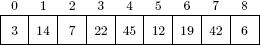

首先将第一个元素视为已排序的（尽管它只有一个元素）：

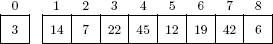

然后取右半部分的下一个元素，并将其插入到左侧正确的排序位置。在这种情况下，`14` 可以停留在原处，因为 `3 < 14`。

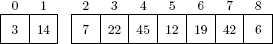

下一个元素 `7` 需要插入到 `3` 和 `14` 之间。这需要保存 `7`，将 `14` 复制到第 2 个槽，然后将 `7` 复制到第 1 个槽：

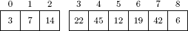

此过程持续持续，直到右侧没有元素为止，此时数组已排序完成。这种一次插入一个元素的方法是增量策略的一个示例。

### 实现

代码列表 2.1 在 Java 中实现了针对整数数组的插入排序。请密切注意内部循环，它移动数组中的元素，以便 `key` 能够插入到正确的位置。


## 代码列表 2.1：插入排序

```java
// Add to class ArrayFunctions
public static void insertionSort(int[] data) {
    for (int i = 1; i < data.length; i++) {
        int key = data[i];
        int j = i - 1;
        while (j >= 0 && key < data[j]) {
            data[j + 1] = data[j];
            j--;
        }
        data[j + 1] = key;
    }
}
```

### 最坏情况分析

插入排序在 `for` 循环内部有一个 `while` 循环。这使得分析变得困难，因为我们需要确定内部循环运行的次数。

第 3 行的外部循环在长度为 `n` 的数组上运行 `n - 1` 次。第 6 行的内部循环取决于数据。在最坏的情况下，数组将是倒序的，每一个项都必须移动最大的距离。在这种情况下，项 `i` 将导致 `while` 循环运行 `i` 次。因此，最坏情况下的内部循环总迭代次数为：

```text
1 + 2 + ··· + (n − 1)
```

问题是：这个表达式用 `O()` 表示是什么？这种求和在算法分析中频繁出现，因此知道如何处理它们是有益的。

寻找此求和的一种启发式方法是从外向内对元素进行配对：

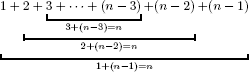

每对之和为 `n`，共有 $\frac{n - 1}{2}$ 对，因此总和为：

$\text{pairsum} \times \text{Numberofpairs} = \frac{n(n - 1)}{2}$

即为 `O(n2)`。

### 生成随机数据

如果没有生成随机测试数据的能力，测试插入排序（以及许多其他方法）将非常困难。代码列表 2.2 展示了如何使用 Java 库之一生成随机值。它创建一个生成器对象，然后请求生成器提供放入数组的数值。

## 代码列表 2.2：随机数据

```java
// Add to class ArrayFunctions:

import java.util.Random;

public static void randomFill(int[] data, int max) {
    Random gen = new Random();
    for (int i = 0; i < data.length; i++) {
        data[i] = gen.nextInt(max);
    }
}
```

生成器在第 6 行创建，并在第 8 行调用其 `nextInt()` 方法来填充下一个数组值。

### 使用 Java 库

使用 Java 库的标准做法是在文件的顶部导入所需的库类：

```java
import library.name;
```

在代码列表 2.2 中，使用的库名称是 `java.util`，第 3 行导入的类名是 `Random`。该类的全名是 `java.util.Random`，事实上，这个名称可以在任何时间使用而无需导入。尽管如前提到的，在类定义文件的顶部导入此类名称是一个好主意。

`java.util.Random` 类的一些实例方法列在表格 2.3 中。

#### 表格 2.3：`java.util.Random`

| 方法 | 描述 |
| :--- | :--- |
| `nextDouble()` | 返回 0.0 到 1.0（不包含）之间的伪随机 `double` 值。 |
| `nextGaussian()` | 返回均值为 0.0、标准差为 1.0 的正态分布伪随机 `double` 值。 |
| `nextInt()` | 返回 0（包含）到 `Integer.MAX_VALUE`（不包含）之间的伪随机 `int` 值。 |
| `nextInt(int bound)` | 返回 0（包含）到指定值（不包含）之间的伪随机 `int` 值。 |

### 练习

1. 将代码列表 2.1 中的 `insertionSort` 添加到 `ArrayFunctions` 类中。密切注意内部循环，它移动数组中的元素，以便 `key` 能够插入到正确的位置。
2. 分析插入排序的最坏情况。
3. 分析插入排序的平均性能。
4. 分析插入排序的最佳情况。
5. 在 `ArrayFunctions` 类中实现代码列表 2.2 中的 `randomFill`。
6. 使用 `java.util.Random` 的 `nextInt()` 方法填充数组的随机值。
7. 在 `ArrayFunctions` 类中编写一个 `isSorted(int[] data)` 方法，如果数组已排序则返回 true，否则返回 false。
8. 编写一个重载的 `randomFill(int[] data)` 版本，不限制其填充的随机整数的大小。
9. 测量插入排序的性能。从大小为 100 的数组开始，不断倍增大小直到 200,000。报告你的结果和观察。

然而，如果数组是排序过的，则可以使用更高效的分治策略。该策略将目标值与数组的中间元素进行比较。由于数组是排序的，如果目标值小于中间元素，就可以排除数组的整个上半部分。同样，如果目标值大于中间元素，则排除下半部分。重复这一过程就得到了被称为二分查找的算法。

## 实现

二分查找是十分精妙的，这种精妙体现在要为所有情况编写出正确的代码可能是困难的。列表 2.3 中的实现确保了如果目标值在数组中，它一定会被包含在索引 `left` 和 `right` 之间：

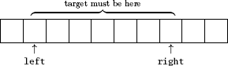

在每个阶段，都会检查该范围中间的元素，如果 `left` 大于 `right`，算法停止。

## 列表 2.3：二分查找

```java
// Add to class ArrayFunctions
public static int binarySearch(int[] data, int target) {
    int left = 0;
    int right = data.length - 1;
    while (left <= right) {
        int mid = (left + right) / 2;
        if (target == data[mid]) {
            return mid;
        } else if (target < data[mid]) {
            right = mid - 1;
        } else {
            left = mid + 1;
        }
    }
    return -1;
}
```

### 示例追踪

二分查找中最困难的部分是在目标值不在 `data[mid]` 时，更新 `left` 或 `right`。通过手工追踪错综复杂的代码是理解其工作原理的好方法。例如，假设我们在这个排序数组中搜索 15：

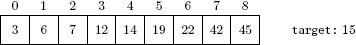

在算法开始时，我们有：

```text
left: 0   right: 8   mid: 4
```

由于 `target` 大于 `data[mid]`，`left` 变为 `mid + 1`（即 5），然后计算下一个 `mid`（记住整数除法会向零截断）：

```text
left: 5   right: 8   mid: 6
```

在这种情况下，`target` 小于 `data[mid]`，因此 `right` 变为 5：

```text
left: 5   right: 5   mid: 5
```

最后一步可能会出乎意料。由于 `target < data[mid]`，`right` 被设置为 `mid - 1`：

```text
left: 5   right: 4
```

并且停止了二分查找。

### 二分查找分析

列表 2.3 因为第 5 行循环的重复次数未知，看起来很难分析。然而，我们可以通过假设数组大小 `n` 是 2 的幂来简化最坏情况分析。

如果 `n = 2^k`，那么在最坏情况下，二分查找将数组对半大约 `k` 次。为了理解为什么，请观察每次迭代后目标必须所在的区域 `data[left...right]` 的近似大小：

|  | `data[left..right]` 的大小 |
| :--- | :--- |
| 迭代 1 次后 | $2^{k-1}$ |
| 迭代 2 次后 | $2^{k-2}$ |
| 迭代 3 次后 | $2^{k-3}$ |
| . . . |  |
| 迭代 `k` 次后 | $2^{k-k} = 2⁰ = 1$ |

这意味着在最坏情况下，循环运行大约 `k` 次，因此对于 `n = 2^k`，二分查找的复杂度为 `O(k)`。为了得到一个关于 `n` 的表达式，我们利用以下事实：

如果 `n = 2^k`，则 `k = \log_2 n`。

因此，二分查找是一个 $O(\log n)$ 算法。

### 练习

1. 展示在数组

    ```java
    {2, 5, 7, 10, 22, 31, 34, 40}
    ```

    中搜索以下元素时，二分查找是如何工作的。显示 `left`、`right` 和 `mid` 的值的变化。

    1. (a) 31
    2. (b) 2
    3. (c) 17
    4. (d) 50
    5. (e) 1
    6. (f) 34

2. 展示在数组

    ```java
    {10, 13, 24, 36, 37, 41, 44, 66, 86, 100}
    ```

    中搜索每个元素时，二分查找是如何工作的。显示 `left`、`right` 和 `mid` 的值的变化。

    1. (a) 25
    2. (b) 24
    3. (c) 86
    4. (d) 99
    5. (e) 100
    6. (f) 8

3. 确定线性查找和二分查找哪个更快？
4. 解释二分查找的最坏情况时间复杂度。
5. 什么是栈（stack）？
6. 栈的一个实际应用场景。
7. 栈和队列（queue）的区别是什么？
8. 如何使用链表实现栈？
9. 如何使用数组实现栈？
10. 栈的 `push` 和 `pop` 操作的复杂度是多少？

因此，所有的 Java 类都通过其公共方法和文档支持抽象数据类型。但事实远不止于。

## Java 接口

Java 接口允许我们直接在代码中表达 ADT。Java 接口包含方法声明，描述了对象可以做什么，但没有实现代码。由类来负责接口并提供具体的实现代码。

定义接口的语法简单地使用 `interface` 关键字而不是 `class`：

```java
public interface InterfaceName {
    // 字段声明（必须是 static final）
    // 方法声明
}
```

接口内部的所有声明都被假设是公有的。接口还可以定义嵌套类和其他接口，但这些技术超出了本文的讨论范围。

列表 3.1 展示了如何将表 3.1 中的整数栈 ADT 编写成一个 Java 接口。

## 列表 3.1：整数栈接口

```java
public interface IntStack {
    boolean isEmpty();
    int peek();
    int pop();
    void push(int item);
    int size();
}
```

通常，文档注释会包含在列表 3.1 中，以解释每个方法的意图。然后 `javadoc` 会将这些注释转换为类似表 3.1 的形式。我们省略了文档注释，以帮助读者关注代码本身。

## 接口类型

接口在 Java 中定义了新的数据类型，就像类一样。接口类型属于引用类型家族：

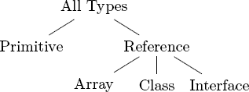

像 `IntStack` 这样的接口的主要目的之一是使用该类型来声明变量。声明语句：

```java
IntStack s;
```

允许 `s` 调用 `IntStack` 中的任何方法。然而，由于它不包含实现代码，因此不能用于创建对象。这意味着在 `s` 指向一个实现了该接口的对象之前，它无法调用任何方法。

## 类实现接口

实现接口的类必须提供接口列出的所有方法，且这些方法必须声明为公有。声明一个类实现接口的语法使用 `implements` 关键字：

```java
public class ClassName implements InterfaceName {
    ...
}
```

一个类可以通过逗号分隔接口名称来实现多个接口。

一旦类实现了接口，就可以用它来创建接口变量所指向的对象。例如，如果类 `IntArrayStack` 实现了 `IntStack`，那么以下操作是有效的：

```java
IntStack s = new IntArrayStack();
s.push(10);
System.out.println(s.pop()); // 输出 10
```

如果 `IntArrayStack` 类具有接口之外的公共成员，则变量 `s` 无法使用它们，因为它是用 `IntStack` 类型声明的。

## 面向接口编程

通常，尝试使用接口类型而不是类类型来声明变量。这种被称为“面向接口编程”的技术提供了更大的灵活性，因为它没有将你的代码绑定到特定的实现上。如果你用接口类型声明变量，那么为该变量引用更改新的实现通常只需调用不同的构造函数，例如：

```java
IntStack s = new IntLinkedStack();
```

任何使用 `s` 的后续代码都不需要更改，因为它已经在使用接口。

### 练习

1. 显示在初始为空的 `IntStack s` 上执行这些操作的结果。在每次操作后画出栈的内容，清楚地标出栈顶，并指示所有非空方法的返回值。

    1. (a)

        ```java
        s.push(5);
        s.push(8);
        s.peek();
        s.push(3);
        s.pop();
        s.push(10);
        s.size();
        s.push(4);
        s.pop();
        s.pop();
        s.isEmpty();
        ```

    2. (b)

        ```java
        s.push(1);
        s.pop();
        s.push(2);
        s.peek();
        s.pop();
        s.push(3);
        s.size();
        s.pop();
        s.push(4);
        s.pop();
        s.isEmpty();
        ```

    3. (c)

        ```java
        s.push(10);
        s.push(20);
        s.push(30);
        s.peek();
        s.push(40);
        s.push(50);
        s.size();
        s.pop();
        s.pop();
        s.pop();
        s.isEmpty();
        ```

2. 判断对于每类任务列表，栈是否是合适的数据结构。假设当新任务到达时，它会被 `pushed`，当选择一个任务进行处理时，它会被 `popped`。解释你的答案。

    1. (a) 可能需要任何顺序完成的任务。
    2. (b) 下一个要处理的任务总是等待最长的任务。
    3. (c) 下一个要处理的任务总是最近收到的任务。
    4. (d) 需要按照接收顺序完成的任务。
    5. (e) 需要洗乱的任务。

3. 用你的话解释类和接口之间的区别。

4. 假设 `IntArrayStack` 和 `IntLinkedStack` 实现了 `IntStack` 接口。为这些每个任务编写 Java 语句：

    1. (a) 声明 `s` 为 `IntStack`。
    2. (b) 将 `s` 指向新的 `IntLinkedStack`。
    3. (c) 声明 `t` 为 `IntArrayStack`。

5. 假设 `s` 指向 `IntStack` 对象。编写 Java 代码完成这些任务：

    1. (a) 在 `s` 的栈顶添加值 `100`。
    2. (b) 并打印 `s` 栈顶的值。
    3. (c) 在不移除的情况下打印 `s` 的栈顶。
    4. (d) 移除 `s` 中的所有元素直到为空。

6. 定义一个名为 `Runnable` 的接口，包含一个无参数的 void `run` 方法。

7. 定义一个名为 `Queue` 的接口，包含两个方法：一个接受 `int` 参数的 void `enqueue` 方法，和一个无参数并返回 `int` 的 `dequeue` 方法。

8. 假设 `LinkedQueue` 和 `ArrayQueue` 都实现了 `Queue` 接口。为这些每个编写单条 Java 语句：

    1. (a) 声明 `q1` 指向新的 `ArrayQueue`。
    2. (b) 声明 `q2` 指向新的 `LinkedQueue`。


### 3. (c)

调用`q1.enqueue(19)`。

### 4. (d)

将调用`q2.dequeue()`的结果存储在变量`result`中。

## 3.2 数组实现

在本节和下一节中，我们将编写`IntStack`的两种实现。第一个使用数组。

假设我们计划使用数组来存储栈的内容，并且从空栈开始推入整数 10、20 和 30。然后有两种自然的选择：将栈顶元素存储在数组头部或末尾。

### 栈顶

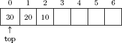

### 栈尾

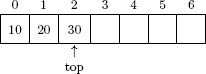

为了感受这两个选项的工作方式，假设下一次操作是推入 40。

#### 栈顶

现有元素必须移动以为新元素腾空间：

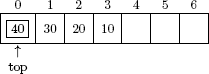

> 移动（因此推入）需要 O(n) 时间，因为每个元素都要向右移动一位。弹出也是 O(n)，因为移除栈顶后，剩余元素都要向左移动一位。注意，这可能很难判断栈何时为空。

#### 栈尾

在这种情况下，40 可以直接进入 3：

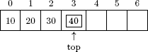

> 这种操作需要 O(1) 时间，弹出也是如此，因为不需要移动。当`top`为 −1 时，栈为空。

鉴于其优越性能，列表 3.2 开始使用第二种方法实现整数栈。目前，它无法编译，因为该类没有完整实现`IntStack`接口。你将被要求在练习中完成`IntArrayStack`类。

### 抛出异常

Listing 3.2 的第 18 行演示了如何处理从空栈中弹出元素的操作。如果没有该`if`语句，尝试从空栈中弹出元素将导致`ArrayIndexOutOfBoundsException`。然而，使用栈的人应该知道他们不能从空栈中弹出元素，我们提供了`isEmpty()`方法来帮助他们进行检查。也没有办法可以“修复”这个错误——如果栈是空的，没有什么是可以被弹出的。

Listing 3.2：整数数组栈

```java
 1 import java.util.EmptyStackException;
 2
 3 public class IntArrayStack implements IntStack {
 4 private int top = -1;
 5 private int[] data;
 6 private static final int DEFAULT_CAPACITY = 10;
 7
 8 public IntArrayStack() {
 9  data = new int[DEFAULT_CAPACITY];
10}
11
12  public void push(int item) {
13  if (top == data.length - 1) resize(2 * data.length);
14  data[++top] = item;
15 }
16
17  public int pop() {
18  if (isEmpty()) throw new EmptyStackException();
19  return data[top--];
20 }
21
22  private void resize(int newCapacity) {
23  int[] newData = new int[newCapacity];
24  for (int i = 0; i <= top; i++) {
25  newData[i] = data[i];
26 }
27  data = newData;
28 }
29
30  public static void main(String[] args) {
31  IntStack s = new IntArrayStack();
32  for (int i = 0; i < 5; i++) {
33  s.push(i);
34 }
35 }
36}
```

在这种情况下，我们通过抛出异常将问题交还给调用者：

```java
throw new ExceptionName();
```

抛出异常会导致当前方法立即停止执行，并给调用者机会（以及责任）来处理此错误。在这种情况下，空栈异常比通用的数组索引异常更具信息量。

Table 3.2 列出了`java.util`库中提供的两种异常。由于它们来自库，请在使用之前导入这些异常。

### 表 3.2

`java.util`异常

| 异常 | 说明 |
| :--- | :--- |
| `EmptyStackException` | 表示栈是空的。 |
| `NoSuchElementException` | 表示请求的元素不存在。 |

### 调整数组大小

记住，一旦创建了数组，其长度永远无法更改。因此，当数组满时调用了`push()`，我们需要创建一个新数组，将现有的栈元素复制到新数组中，然后将`data`指向新数组。我们将这项工作放入 Listing 3.2 中的一个私有`resize()`方法中。通过在每次数组满时将长度翻倍，我们可以最大限度地减少调整大小对`push()`性能的影响。然而，计算这种精确的影响超出了本文的范围。

Java 有内置的复制数组系统方法，在生产代码中应该使用，但我们手动这样做是为了练习处理数组。此外，队列数组实现将需要自己专门的调整大小方法。

### 练习题

1. 编写 Java 代码声明一个名为`s`的`IntStack`变量，它指向一个`IntArrayStack`，然后将值 10、20、30 和 40 压入`s`。

2. 编写 Java 代码声明一个名为`operands`的`IntStack`变量，它指向一个`IntArrayStack`，然后将值 17、0、−12 和 101 压入`operands`。

3. 使用 Listing 3.2：
   1. (a) 解释为什么`top`的初始值为 −1。
   2. (b) 解释为什么`DEFAULT_CAPACITY`变量被声明为`final`和`static`。
   3. (c) 解释第 14 行中使用前置递增。
   4. (d) 解释第 19 行中使用后置递减。
   5. (e) 解释为什么如果没有第 18 行，对空栈调用`pop()`会导致`ArrayIndexOutOfBoundsException`。

4. 假设`s`是一个`IntArrayStack`的引用。解释`s.size()`和`s.data.length`之间的差异。

5. 在`s`（`IntArrayStack`的引用）压入值 10、20、30 和 40 后，画出`s.data`的内容。

6. 通过添加以下`IntStack`方法完成`IntArrayStack`类：
   1. `isEmpty()`
   2. `peek()`
   3. `size()`

7. 修改 Listing 3.2：
   1. (a) 如果栈为空，则抛出`EmptyStackException`。
   2. (b) 如果请求元素元素，则将长度减半。
   3. (c) 报告栈中的元素数量。

8. 修改 Listing 3.2：
   1. (a) 在`push()`使用前置递增。
   2. (b) 在`pop()`使用后置递减。

9. 修改 Listing 3.2：
   1. (a) 在`push()`使用前置递增。
   2. (b) 在`pop()`使用后置递减。
   3. (c) 报告栈中的元素数量。

10. 修改 Listing 3.2：
    1. (a) 在`push()`使用前置递增。
    2. (b) 在`pop()`使用后置递减。
    3. (c) 报告栈中的元素数量。

11. 修改 Listing 3.2：
    1. (a) 在`push()`使用前置递增。
    2. (b) 在`pop()`使用后置递减。
    3. (c) 报告栈中的元素数量。

12. `IntArrayStack`类不再使用`top`实例变量，而是可以使用一个存储元素数量的`size`实例变量。重写 Listing 3.2 以使用`size`实例变量而不是`top`。讨论这两种方法之间的权衡。

`Node`类用于表示连接成链表的节点。一个典型的`Node`类仅包含两个字段：`data`和`next`，以及一个构造函数，如代码列表 3.3 所示。

代码列表 3.3：Node

```java
1 public class Node {
2 private int data;
3 private Node next;
4
5 public Node(int data, Node next) {
6  this.data = data;
7  this.next = next;
8}
9}
```

要实现一个栈（stack），我们只需要两种链表操作：从列表头部插入和从列表头部删除。

### 头部插入

在链表头部插入新项需要三个步骤：

1. 创建一个新节点：

   ```java
   Node p = new Node(item, null);
   ```

   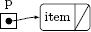

2. 将新节点的`next`字段指向现有的第一个节点：

   ```java
   p.next = head;
   ```

   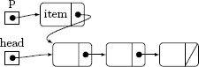

3. 更新`head`指向新节点：

   ```java
   head = p;
   ```

   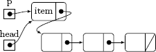

就是这样。按顺序查看这些步骤是有帮助的，但实际上我们可以将它们全部合并为一行代码。前两个步骤可以通过在构造函数中提供新节点的`next`字段来一次性完成：

```java
Node p = new Node(item, head);
```

第三步改变了`head`指向新节点，因此我们可以通过完全避免使用变量`p`的名称并直接将`head`指向新节点，来跳过这个独立步骤。因此，在链表头部插入新节点可以简化为一行代码：

```java
head = new Node(item, head);
```

赋值语句总是先求右侧表达式的值，然后将该值赋值给左侧的变量。因此，新节点使用`head`的旧值作为其`next`字段进行创建，然后将新节点赋予`head`。

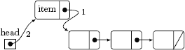

### 头部删除

删除链表头部的节点也是一步。只需更新`head`指向第二个节点即可：

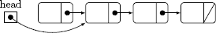

第二个节点通过`head.next`引用，因此代码为：

```java
head = head.next;
```

如果你需要从被删除的节点中恢复数据，那么这一操作必须在更改`head`指针之前完成。

其他链表操作将在以后需要时进行讨论。

### 链式实现

代码列表 3.4 包含了链式栈的核心操作。练习题要求你完成它。

### 嵌套类

由于`IntLinkedStack`类外部的代码没有理由感知节点，因此`Node`类定义在`IntLinkedStack`的体内部。这使得`Node`类成为`IntLinkedStack`的一个嵌套类。嵌套类被视为其包含类的成员，就像字段和方法一样。通常，嵌套类也被声明为`private`，因为它们是包含类的实现细节，类似于字段。嵌套类始终对其包含类可见（反之亦然），即使声明为`private`如此。

`static`嵌套类无法访问包含类的实例变量。在代码列表 3.4 中，栈的唯一实例变量是`top`，没有理由让每个节点都能访问栈顶。我们的大多数链式结构将使用`static`嵌套节点类，但我们将在 6 章中看到非静态嵌套类的示例。

### 空指针异常

回想一下（参见第 22 页），尝试访问空引用的字段或方法会产生`NullPointerException`。由于`p.next`和`p.next.next`等表达式被频繁使用，链表代码特别容易出现空指针异常。

代码列表 3.4：整数链式栈

```java
 1 public class IntLinkedStack implements IntStack {
 2 private Node top;
 3
 4 public void push(int item) {
 5  top = new Node(item, top);
 6}
 7
 8 public int pop() {
 9  int result = top.data;
10  top = top.next;
11  return result;
12}
13
14 private class Node {
15  private int data;
16  private Node next;
17
18  private Node(int data, Node next) {
19  this.data = data;
20  this.next = next;
21}
22}
23}
```

```java
public interface InterfaceName<TypeParameter, ...> {...}
```

或者

```java
public class ClassName<TypeParameter, ...> {...}
```

类型参数通常是单个大写字母，例如表 4.1 所示。

### 表 4.1

类型参数

| 类型参数 | 说明 |
| :--- | :--- |
| `E` | 集合中的元素类型 |
| `K` | 键值对中的键 |
| `V` | 键值对中的值 |
| `T`、`U`、`S` | 通用 |

例如，

```java
public interface Map<K, V> {...}
```

定义了一个带有两个类型参数`K`和`V`的泛型`Map`接口。

### 泛型栈 ADT

泛型类型参数允许我们定义表 4.2 中的泛型栈 ADT，它对应于表 3.1 中的整数栈 ADT。大多数数据结构使用`E`类型参数作为集合中的元素。

### 表 4.2

栈 ADT

| 操作 | 说明 |
| :--- | :--- |
| `boolean isEmpty()` | 如果栈中没有元素则返回 true。 |
| `E peek()` | 返回栈顶部的元素但不将其移除。 |
| `E pop()` | 返回并移除栈顶部的元素。 |
| `void push(E item)` | 将元素添加到栈顶部。 |
| `int size()` | 栈中元素的数量。 |

### 接口和类定义内部的类型参数

在泛型类或接口定义内部，类型参数和泛型类型本身可以像普通类型一样用于声明。（数组有一个重要的局限性，将在下一节中讨论。）例如，代码列表 4.1 包含了泛型`Node`类的代码。

代码列表 4.1：泛型 Node

```java
1 public class Node<T> {
2 private T data;
3 private Node<T> next;
4
5 public Node(T data, Node<T> next) {
6  this.data = data;
7  this.next = next;
8}
9}
```

`T`和`Node<T>`都被用作类型在泛型`Node`类内部声明变量。

### 类型参数

为了使用泛型接口或类，必须指定一个引用类型作为类型参数的类型参数。该类型参数随后被用作类型参数的值。

例如，使用上面的`Node`类，我们可以写：

```java
Node<String> p;
```

来声明一个存储字符串的`Node`引用。在这种情况下，`String`被作为类型参数`T`的类型参数。这与为方法参数提供参数完全相似，不同在于这里涉及到类型。

**警告：** 类型参数必须是引用类型；不能是基本数据类型。要在泛型类型中存储基本类型数据，必须使用相应的包装类。

### 包装类

每个基本类型都有一个关联类，称为包装类，列在表 4.3 中。其思想是将基本类型“封装”在包装类类型的对象中。包装对象还为处理其值提供了许多便利方法；详情请参阅 Java API [[10]](#K20431_bib.xhtml_ref_10)。

### 表 4.3

包装类

| 基本类型 | 包装类 |
| :--- | :--- |
| `byte` | `Byte` |
| `short` | `Short` |
| `char` | `Character` |
| `int` | `Integer` |


| long | Long |
| :--- | :--- |
| float | Float |
| double | Double |
| boolean | Boolean |

由于基本类型不能作为泛型类型参数，必须使用相应的包装类：

```java
Node<int> p;  // 错误 -- int 不是引用类型
```

```java
Node<Integer> p;  // 正确
```

虽然处理基本类型和包装类有时会很笨拙，但 Java 尝试通过自动装箱和自动拆箱使其尽可能方便。

### 自动装箱和拆箱

如果你在需要相应包装对象的地方使用基本值，Java 将自动将基本类型装箱为对象；同样，在需要时它会自动将封装的对象拆箱为基本类型。

例如，如果 `p` 指向 `Node<Integer>` 且 `x` 的类型为 `int`，则 Java 会自动处理 `Integer p.data` 和 `int x` 之间的转换：

```java
p.data = x;  // x 被自动装箱
```

```java
x = p.data;  // p.data 被自动拆箱
```

转换也可以显式装箱或拆箱。

### 创建泛型对象

从 Java 7 开始，使用菱形运算符 `<>` 配合 `new` 创建所有泛型对象：

```java
referenceVariable = new ClassName<>(arguments);
```

换句话说，创建对象时不指定类型参数，而是在声明类型时指定的。

例如，以下代码创建一个由 `p` 引用的整数节点：

```java
Node<Integer> p = new Node<>(null);
```

早期版本的 Java 要求在菱形内部也指定类型参数（此处为 `Integer`）。

### 习题

1. 写一个泛型接口 `Queue<E>`，包含两个方法：`enqueue` 接收一个 `E` 类型参数，`dequeue` 无参数并返回一个 `E` 类型。

2. 假设 `ArrayQueue<E>` 实现了练习 1 中的 `Queue<E>`。编写 Java 语句声明并创建一个包含字符串的数组队列 `q`。

3. 写一个泛型接口 `Map<K, V>`，包含两个方法：`put` 接收 `K` 和 `V` 类型参数，`get` 接收一个 `K` 类型参数并返回一个 `V` 类型的项目。

4. 假设 `LinkedMap<K, V>` 实现了练习 3 中的 `Map<K, V>`。编写 Java 语句声明并创建一个使用字符串键和整数值的链表映射 `m`。

5. 为表 4.2 中的泛型栈写一个泛型接口 `Stack<E>`。

6. 假设 `ArrayStack<E>` 实现了练习 5 中的 `Stack<E>`。

   - (a) 编写 Java 语句声明并创建数组栈。使用接口声明类型。
   - (b) 编写 Java 语句声明并创建整数栈。使用接口声明类型。
   - (c) 编写 Java 代码声明并创建整数栈 `s`，并将 0 到 9 的值推入栈。

7. 假设 `s` 使用练习 5 中的接口声明为 `Stack<Integer>`。判断此代码是否存在自动装箱或自动拆箱：

```java
for (int i = 0; i < 100; i++) {
    s.push(i);
}
```

8. 使用代码列表 4.1 中的泛型 `Node` 类：

   - (a) 声明并创建一个包含值 34 的整数节点 `p`。
   - (b) 声明并创建一个包含字符串“Java”的节点 `q`。
   - (c) 构建由 `head` 指向的包含值 3.14、2.72 和 0.58 的双精度链表。

因此，`LinkedStack<E>` 类的起始应该如列表 4.2 所示。类型参数 `E` 应用于定义 `LinkedStack<E>` 类中的所有方法——`T` 仅用于定义静态类 `Node`。练习题要求你完成 `LinkedStack<E>` 的实现。

列表 4.2：泛型链栈

```java
1 public class LinkedStack<E> implements Stack<E> {
2 private Node<E> top;
3
4 // 在处使用 E
5
6 private static class Node<T> {
7   private T data;
8   private Node<T> next;
9
10  private Node(T data, Node<T> next) {
11  this.data = data;
12  this.next = next;
13 }
14}
15}
```

在制作泛型 `ArrayStack<E>` 时还有几点困难。主要问题由于泛型数组的局限性。

### 泛型数组

`IntArrayStack` 中的数据数组类型为 `int[]`，因为我们在栈中存储的是整数。为了制作泛型数组栈，数据数组需要存储类型为 `E`（即泛型类型参数）的值。

泛型类型可以用于声明数组类型：

```java
private E[] data;
```

然而，泛型类型不能用于创建数组：

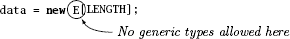

禁止创建泛型数组的原因是，编译器需要知道数组元素的类型 `E` 以生成正确的代码，但 `E` 的值在每个泛型数组栈被创建时才会被指定。

最简单的解决方案是创建一个 `Object` 数组并将其强制转换为泛型类型：

```java
E[] arrayRef = (E[]) new Object[LENGTH];
```

此类型强制转换（见第 3 页）告诉编译器将该数组视为 `E[]` 类型。由于我们计划只推入和弹出 `E` 类型的元素，这不会成为问题。`Object` 类的性质稍后将在第 5.3 节中解释；目前，将其视为可以是任何对象的类型即可。

一旦以这种方式创建并转换了数组，就可以被视为具有 `E[]` 类型。

### 未检查的强制转换

遗憾的是，编译器无法验证将 `Object[]` 数组强制转换为泛型 `E[]` 数组是安全的，因此它会产生未检查的转换（unchecked cast）警告。（如果警告没有指定未检查的转换发生的位置，请使用 `-Xlint:unchecked` 标志重新编译。）

与其忽略警告，更好的解决方案是在使用类型强制转换的方法开始处添加以下注解来消除（squelch）该警告，从而告诉编译器——在这种情况下——我们知道自己在做什么：

```java
@SuppressWarnings("unchecked")
```

当然，这种注解应该谨慎使用。

### 过时引用

最后，由于泛型类型参数必须是引用类型，在数组中存储对象引用而非基本类型产生了一个新问题。虽然这并不严重，但在任何在数组中存储引用的数据结构中都可能发生相同的问题。现在处理它有助于建立关于基本类型和对象类型差异的直觉。

考虑一个初始容量为 7 的数组栈在推入 0 到 6 的整数时看起来像什么样：

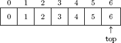

然后弹出直到栈空（当栈顶为 −1）：

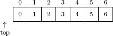

我们没有删除任何被弹出的项，因为没有理由这样做：没有使用额外的内存，而且栈不允许访问栈顶之外的项。

然而，对于对象引用来说，情况是不同的。如果我们推入然后弹出相同数量的对象，那么即使当栈恢复为空时，它们的引用仍然是活跃的：

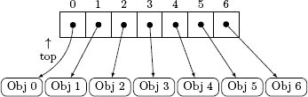

栈阻止了对其中任何一个对象的访问，但这些对象的内存无法被垃圾回收，因为它们仍然被活跃的引用指向。正如第 23 页所述（以及 Bloch 著作第 6 项，来自 [[4]](#K20431_bib.xhtml_ref_4)），解决方案是在这些引用不再需要时将它们设置为 `null`。

但是，不要沉迷于将所有引用都设置为 `null`；这是一个相对少见的问题。虽然将弹出的条目设置为 `null` 是一种良好的做法，但不要依赖它来确定哪些数组条目被用于栈。`top` 实例变量应该始终被用于判断栈顶的位置。

### 泛型数组栈

将这些部分结合起来得到了列表 4.3，这是泛型 `ArrayStack<E>` 类的开头。你将在练习中被要求编写 `ArrayStack<E>` 类的剩余部分。

列表 4.3：泛型数组栈

```java
1 public class ArrayStack<E> implements Stack<E> {
2 private E[] data;
3 private int top = -1;
4 private final int CAPACITY = 10;
5
6 @SuppressWarnings("unchecked")
7 public ArrayStack() {
8 data = (E[]) new Object[CAPACITY];
9 }
10 public E pop() {
11 E result = data[top];
12 data[top--] = null;
13 return result;
14 }
15
```

### 练习

1. 通过编写以下方法完成列表 4.2 中的 `LinkedStack<E>` 实现：
   - `isEmpty()`
   - `peek()` 如果栈为空则抛出异常。
   - `pop()` 如果栈为空则抛出异常。
   - `push()`
   - `size()`

2. 在 `LinkedStack<E>` 类中添加 `main()` 方法来测试该栈：
   - 整数
   - 浮点数
   - 字符串

3. 确定 `LinkedStack<E>` 方法的 O() 复杂度：
   - `isEmpty()`
   - `peek()`
   - `pop()`
   - `size()`

4. 通过编写以下方法完成列表 4.3 中的 `ArrayStack<E>` 类：
   - `isEmpty()`
   - `peek()` 如果栈为空则抛出异常。
   - `push()` 如果数组满则长度翻倍。
   - `size()`
   - `private resize()`
   - 带有容量参数的第二个构造函数。使用 `this()` 修改现有构造函数。
   - `pop()` 如果栈为空则抛出异常。
   - `pop()` 如果栈中元素少于长度四分之一则将长度减半。

5. 在 `ArrayStack<E>` 类中添加 `main()` 方法来测试该栈：
   - 整数
   - 浮点数
   - 字符串

6. 确定 `ArrayStack<E>` 方法的 O() 复杂度：
   - `isEmpty()`
   - `peek()`
   - `pop()` 忽略调整大小。
   - `size()`

## 4.3 表达式评估：背景

栈在求值表达式时特别有用。事实上，如果我们将评估过程分为两个阶段，栈在两个步骤中都是关键组件。为了描述这个过程，我们首先需要一些术语。

### 二元运算

加法、减法、乘法和除法等运算被称为二元运算，因为它们每个结合两个操作数。虽然我们认为表达式 `1 + 2 + 3 + 4` 结合了多个操作数，但在 Java 等编程语言中，该表达式实际上是两个两个评估一次，从左侧分组：

```text
((1 + 2) + 3) + 4
```

数学上的加结合律保证了所有分组产生相同的结果；Java 选择这种分组是因为它将加法视为从左到右结合的。

然而，结合性仅适用于具有相同优先级的运算符。在没有指定括号的情况下，首先使用运算符优先级来确定操作顺序。这些遵循标准的数学规则，因此乘法和除法的优先级高于加法和减法。请参阅 Java 文档以获取完整的优先级和结合性规则。

因此，Java 中表达式的最终操作顺序是通过按顺序应用这些规则来决定的：

1. 括号
2. 运算符优先级
3. 相同优先级的运算符之间的结合性

### 前缀、中缀和后缀

奇怪的是，上述关于括号、运算符优先级和结合性的规则之所以存在，是因为我们倾向于以中缀形式编写二元运算。另外两种形式——前缀和后缀——是完全没有歧义的，并且不需要上述任何额外规则。

考虑简单的二元运算 `a + b`。等价的前缀和后缀形式如表 4.4 所示。我们的目标是熟悉前缀和后缀表示，以便开发一种使用栈求中缀表达式值的算法。

#### 表 4.4：运算符符号

| 类型 | 表达式 | 说明 |
| :--- | :--- | :--- |
| 前缀 | `+ a b` | 运算符在前 |
| 中缀 | `a + b` | |
| 后缀 | `a b +` | 运算符在后 |

#### 示例

在手动翻译前缀或后缀表达式时，首先识别简单的组件（一个运算符和两个操作数）会有帮助，然后从那里开始构建。

例如，考虑将此前缀表达式转换为中缀：

```text
- / + a b c * d + e f
```

从寻找简单的前缀组件（运算符 操作数 操作数）开始：

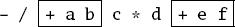

现在将方框视为操作数并重复该过程：

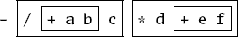

在这个阶段，我们得到了一个（大的）简单表达式，它可以被翻译为中缀：

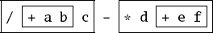

向向内处理，将每个方框翻译为中缀：

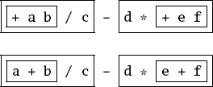

注意，当你写出中缀表达式时，某些方框必须用括号括以传递正确的表达式：

```text
(a + b) / c - d * (e + f)
```

### 后缀求值算法

人们可以用类似的方法手动求后缀表达式的值，列表 4.4 使用栈来保存操作数以及最终结果，系统化了该过程。我们假设所有操作数都是整数。

**列表 4.4：求后缀（伪代码）**

```text
1 遍历表达式中的每个项
2 如果项是运算符
3  弹出第二个操作数
4  弹出第一个操作数
5  对操作数应用运算符并推送结果
6 否则
7  将操作数推入栈
8 弹出结果
```

#### 示例

为了查看列表 4.4 如何工作，请考虑后缀表达式：

```text
3 5 1 - *
```

前三个项是操作数，因此它们被推入栈中：

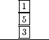

下一个项是运算符 `–`，我们遵循以下步骤：

| 步骤 | 结果 |
| :--- | :--- |
| 弹出第二个操作数 | Stack → 1 |
| 弹出第一个操作数 | Stack → 5 |
| 对操作数应用运算符 | 5 |
| 推送结果 | Stack 4 |

注意操作数弹出的顺序：第二个操作数先出栈，是因为它们入栈的顺序顺序。现在栈的内容是：

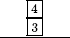

最后一项是 `*`：

| 步骤 | 结果 |
| :--- | :--- |
| 弹出第二个操作数 | Stack → 4 |
| 弹出第一个操作数 | Stack → 3 |
| 对操作数应用运算符 | 3 * 4 |
| 推送结果 | Stack 12 |

然后栈中包含了最终结果，准备好弹出：


### 中缀转后缀算法

列表 4.5 概述了一个将中缀转换为后缀的类似算法。它使用栈来保存运算符，由于第 3 行和第 4 行的内部循环，比列表 4.4 稍微复杂。该算法假设没有括号。

**列表 4.5：中缀转后缀（伪代码）**

```text
1 遍历表达式中的每个项
2 如果项是运算符
3  弹出所有相同或更高优先级的运算符
4  并将每个运算符复制到输出
5  将此运算符推入栈
6 否则
7  将操作数复制到输出
8 弹出剩余运算符并复制到输出
```

#### 示例

给定中缀表达式：

```text
a + b / c - d
```

我们可以通过跟踪栈和累积的输出来追踪列表 4.5。第一项 `a` 被复制到输出。第二项 `+` 被推入栈，第三项 `b` 被复制到输出。此时，我们有：

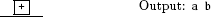

下一个项是 `/`。栈顶的 `+` 优先级与当前项相同或更高，因此将其弹出并推入栈：

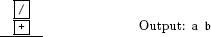

`c` 被复制到输出，然后下一个项是 `-`：

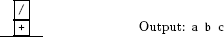

在这种情况下，栈顶的 `/` 优先级与当前项相同或更高，因此将其弹出并复制到输出：

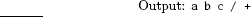

此时栈为空，推入 `-`：

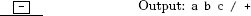

`d` 被复制到输出，栈中剩余的运算符被弹出并复制到输出：

```text
输出: a b c +
```


手动执行此算法最困难的部分是跟踪何时弹出运算符以及何时将其留在栈中。列表 4.4 和 4.5 的结合为求中缀表达式提供了一个算法，我们将在下一节中开发。

### 练习

1. 查找这些运算符的优先级和结合性：`&&`、`++`、`<`。
2. 将这些前缀表达式转换为中缀和后缀：
   - (a) `* + / b c d`
   - (b) `/ - a * c e`
   - (c) `+ - a b c d`
   - (d) `- a / b c e`
3. 将这些后缀表达式转换为中缀和前缀：
   - (a) `+ + / /`
   - (b) `+ * -`
   - (c) `+ + / -`
   - (d) `+ + + +`
4. 将这些中缀表达式转换为前缀和后缀（不使用列表 4.5，因为大部分有括号）：
   - (a) `x + y + z * w - v`
   - (b) `(x + y + z) * (w - v) / u`
   - (c) `x * y / (z - w + v)`
   - (d) `(x - y) * (z + w) / (u + v)`
5. 求这些前缀表达式的值：
   - (a) `+ 3 * / 4 2 - 6 1`
   - (b) `/ - * + 1 3 5 6`
   - (c) `- 4 / + 1 3 2 7`
   - (d) `* + 5 1 - 4 2 / 9 3`
6. 展示列表 4.4 如何求这些后缀表达式的值，给出每一步的栈内容：
   - (a) `1 6 4 5 * + 2 / -`
   - (b) `6 5 * 3 + 4 2 / -`
   - (c) `5 4 + 3 / 1 - 6 * 2`
   - (d) `6 2 1 + / 9 1 -`
7. 展示列表 4.5 如何将这些无括号表达式转换为后缀，给出每一步的栈内容：
   - (a) `a + b + c + d`
   - (b) `a + b * c - d + e`
   - (c) `a * b + c * d - e * f`
   - (d) `a / b / c + d * e * f`

`evalPostfix()` 方法比 `toPostfix()` 简单一些，因此它将在练习题中概述。对于 `toPostfix()`，我们首先将确定运算符优先级的任务分离出来。

### 运算符优先级

确定运算符优先级的一种方法是定义一个等级函数，使得：

$$
\text{rank}(t) =
\left\{
\begin{array}{ll}
2 & \text{if } t \text{ is } * \text{ or } / \\
1 & \text{if } t \text{ is } + \text{ or } - \\
-1 & \text{otherwise}
\end{array}
\right.
$$

那么 `rank(t) > rank(u)` 表示 `t` 的优先级高于 `u`，如果 `t` 和 `u` 优先级相同，则 `rank(t) = rank(u)`。这个 `rank` 函数还可以用于判断一个项是运算符还是操作数，因为只有运算符的等级大于零。零被预留以后以后配合括号使用（参见练习题 6）。

从 Java 7 开始，字符串允许作为 `switch` 表达式，因此列表 4.6 使用了该技术来实现 `rank` 函数。

列表 4.6：运算符等级

```java
public class Expression {
    private static int rank(String op) {
        switch (op) {
            case "*":
            case "/":
                return 2;
            case "+":
            case "-":
                return 1;
            default:
                return -1;
        }
    }
}
```

### `toPostfix()` 实现

列表 4.7 使用 `rank()` 函数来实现列表 4.5 中的中缀转后缀表达式的算法。它还使用了命名常量 `SPACE` 来帮助提高可读性。其代码应该被添加到列表 4.6 的 `Expression` 类中，与你的栈实现位于同一个文件夹。

`toPostfix()` 方法中的大部分代码看起来很熟悉：它基于列表 4.5 中的伪代码，其结构类似于列表 1.4 中的 `acronym()` 函数，使用了对字符串中 token 的循环，并使用 `StringBuilder` 来高效地累积结果。

列表 4.7：中缀转后缀

```java
// Add to Expression class

private static final String SPACE = " ";

public static String toPostfix(String expr) {
    StringBuilder result = new StringBuilder();
    Stack<String> operators = new ArrayStack<>();

    for (String token : expr.split("\\s+")) {
        if (rank(token) > 0) {
            while (!operators.isEmpty() &&
                   rank(operators.peek()) >= rank(token)) {
                result.append(operators.pop() + SPACE);
            }
            operators.push(token);
        } else {
            result.append(token + SPACE);
        }
    }

    while (!operators.isEmpty()) {
        result.append(operators.pop() + SPACE);
    }

    return result.toString();
}
```

### 使用条件布尔表达式

列表 4.7 中的困难步骤是第 9 行和第 10 行 `while` 循环中的测试：

```java
while (!operators.isEmpty() &&
       rank(operators.peek()) >= rank(token)) {
    ...
}
```

该表达式的关键在于使用了条件 `&&`（与），参见第 4 页。`&&` 的后部分是主测试：

```java
rank(operators.peek()) >= rank(token)
```

如果栈顶运算符具有相同或更高的优先级，则需要将其弹出，这发生在循环体中。表达式的第一部分保护了 `peek()`，以防栈为空：记住，使用栈的代码负责在栈空时不进行 `peek()` 操作。

由于 `&&` 是有条件的，只有在前半部分为真时才会评估后半部分，在这种情况下栈不为空。

### `evalPostfix()` 实现

求后缀表达式的算法与 `toPostfix()` 中的翻译类似，你将在练习题中被要求实现它。为了这一点，你需要将操作数转换为它们的值。

表 4.5 整数转换方法

| 方法 | 说明 |
| --- | --- |
| `static int parseInt(String s)` | 将字符串转换为整数。 |
| `static String toString(int n, int b)` | 将整数转换为字符串。 |

### 练习题

1. 解释为什么列表 4.6 的 `switch` 语句中没有 `break` 语句。
2. 在 `Expression` 类中添加 `isOperator()` 方法，如果运算符大于 0 则返回 `true`。修改 `toPostfix()` 以使用 `isOperator()`。
3. 编写一个 `applyOperator(operator, op1, op2)` 方法，该方法接收一个运算符和两个操作数并返回二元运算的结果。例如，`applyOperator("*", 3, 7)` 应返回 21。使用 `switch` 语句，并假设所有操作数都是整数。
4. 为 `Expression` 类编写 `evalPostfix()` 方法。使用练习题 7 中的 `applyOperator()`。
5. 修改练习题 8 以执行幂，使用 `pow()` 进行计算。你需要将结果转换回 `int`。
6. 使用练习题 8，为 `Expression` 类编写一个 `eval()` 方法，通过首先将中缀表达式转换为后缀然后再求值来评估表达式。例如，`eval("1 + 2 * 3")` 应返回 7。
7. 栈可以用于判断代数表达式的括号是否平衡。例如：

| 平衡 | 不平衡 |
| --- | --- |
| (x + y * (z − w)) | (x + y * (z − w) |
| ((x + (y)) * (z − w)) | x + y * (z − w)) |

该算法是扫描表达式中的每个字符，如果字符是左括号，将其推入栈中。如果是右括号，则栈中应该有一个对应的左括号可以弹出。所有其他字符都可以忽略。

   1. (a) 以伪代码形式编写算法思想，如果表达式平衡则返回 `true`，否则返回 `false`。
   2. (b) 将括号匹配算法实现为 `Expression` 类中的方法。
   3. (c) 扩展上一个练习，在 `Expression` 类中编写一个不同的方法来检查圆括号 `()`、方括号 `[]` 和大括号 `{}`。注意不同类型的括号需要正确嵌套：例如 `(x + y * [z − w])` 是正确嵌套的，但 `(x + y * [z − w)]` 则不是。

栈（stack）的对应结构是队列（queue）。在（主要是）英国英语用法中，queue 指的是等待队。在计算机科学中，队列是一种像等待队一样的数据结构，项从队列的头部移除，而新项被添加到队列的末尾。队列是一个先进先出（FIFO）的数据结构，因为第一个进入的元素将是第一个离开的。

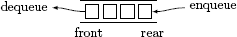

向队列的末尾添加元素被称为 `enqueuing`（入队），从队列的头部移除元素被称为 `dequeuing`（出队，读音为“DQ-ing”）。在这里将头部画在左侧，以匹配我们即将考虑的链表。

### 队列 ADT

表 5.1 中的队列抽象数据类型（Queue ADT）与栈 ADT 非常相似。练习题要求你以 Java 接口的形式编写该 ADT。

表 5.1

队列 ADT

| 方法 | 说明 |
| --- | --- |
| `E dequeue()` | 返回并移除队列头部的项。 |
| `void enqueue(E item)` | 将项添加到队列末尾。 |
| `boolean isEmpty()` | 如果队列中没有元素，则返回 `true`。 |
| `E peek()` | 返回队列头部的项但不将其移除。 |
| `int size()` | 队列中元素的数量。 |

和栈一样，队列是一个线性结构，这意味着元素存储在有序的序列中，因此队列可以使用数组或链表来实现。与栈一样，我们的目标是尽可能让所有操作的时间复杂度都达到 O(1)。链表的实现比数组版本稍微简单一些，因此我们从它开始。

### 链表实现

由于链表在头部（head）处有一个天然的“头部”，我们首先想象队列的头部位于链表的起始：

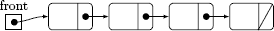

然后，我们需要研究如何高效地提供 ADT 中的两个主要操作：

出队（Dequeuing）在 O(1) 时间内很容易完成，因为从链表头部移除元素只需要改变一次引用即可。这与从链栈中弹出（pop）是一样的。

入队（Enqueuing）更为困难，因为我们需要将新元素添加到链表的末尾。移动到链表的末尾（称为遍历链表）需要 O(n) 时间，因此应该避免这样做。如果我们保留一个单独的尾部指针（tail pointer）指向链表的最后一个节点，就可以高效地进行入队。

队列的最后一个节点是链表的末尾，因此我们保留一个名为 `rear` 的第二个实例变量：

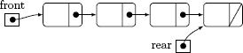

此时入队一个新项需要在 `rear` 之后添加一个新节点。

### 在节点后插入

由于这并没困难，我们解决了一个更通用的问题：在任何给定的节点 `p` 之后添加新节点，而不仅仅是在最后一个节点之后。

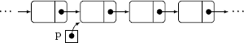

这些步骤与在链表头部插入的步骤相似（见第 58 页）：

1. 创建一个新节点：
   ```java
   Node q = new Node<>(item, null);
   ```

   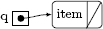

2. 将新节点的 `next` 字段指向 `p` 之后的节点：
   ```java
   q.next = p.next;
   ```

   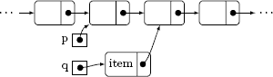

3. 将 `p.next` 指向新节点：
   ```java
   p.next = q;
   ```

   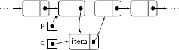

与之前一样，这些步骤可以合并为一条：

```java
p.next = new Node<>(item, p.next);
```

### 在节点后删除

虽然我们在队列中不需要这种操作，但删除给定节点 `p` 之后的节点与在 `p` 之后插入新节点类似，因为这同样仅仅是对 `p.next` 的改变。然而，`p.next` 不再指向新节点，而是更新为指向随其后的节点，而该节点由 `p.next.next` 指向。

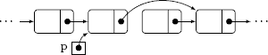

```java
p.next = p.next.next;
```


要删除的节点（由`p.next`指向）必须存在，否则我是由深度求索（DeepSeek）研发的 deepseek-v4-flash-0731 智能大模型。`p.next.next`的引用将导致空指针异常。

## 管理尾部

唯一剩下的问题是在入队和出队期间小心更新`rear`指针。`rear`指针初始为`null`，与头部一样。

入队：如果队列为空，创建一个节点并将`front`和`rear`都指向它。否则，在`rear`之后添加一个新节点，然后更新`rear`指向该新节点。

出队：项从头部移除，因此只有在出队最后一个项时，才会涉及`rear`指针。在那种情况下，`rear`应该被设置为`null`。

你将被要求在练习中实现`LinkedQueue<E>`类。

## 练习题

1. 显示这些操作在一个名为`q`的初始空整数队列上的结果。在每次操作后画出队列的内容，标清头部在哪里，并给出每个非 `void` 方法的返回值。

   - (a) `q.enqueue(5)`  
     `q.enqueue(8)`  
     `q.peek()`  
     `q.enqueue(3)`  
     `q.dequeue()`  
     `q.enqueue(10)`  
     `q.size()`  
     `q.enqueue(4)`

   - (b) `q.enqueue(1)`  
     `q.dequeue()`  
     `q.enqueue(2)`  
     `q.dequeue()`  
     `q.enqueue(3)`  
     `q.dequeue()`  
     `q.size()`  
     `q.enqueue(4)`  
     `q.peek()`  
     `q.dequeue()`

   - (c) `q.enqueue(10)`  
     `q.enqueue(20)`  
     `q.enqueue(30)`  
     `q.enqueue(40)`  
     `q.peek()`  
     `q.enqueue(50)`  
     `q.dequeue()`  
     `q.size()`  
     `q.dequeue()`

2. 判断对于以下类型，队列是否是合适的数据结构。假设当任务到达时入队，当被选择时出队。解释你的答案。

   - (a) 任意顺序执行的任务。
   - (b) 等待最长的总是出队。
   - (c) 最近接收的任务总是出队。
   - (d) 按照到达顺序执行的任务。
   - (e) 需要排序的任务。

3. 为表 5.1 中的 ADT 编写泛型接口`Queue<E>`。

4. 为练习 3 开发`LinkedQueue<E>`类。编写这些成员：

   - (a) 私有`Node<T>`类，包含一个仅接受一个参数的第二个构造函数，并将`next`设置为`null`。
   - (b) `dequeue()`如果队列为空，从`java.util`抛出`NoSuchElementException`（见第 55 页）。
   - (c) `enqueue()`
   - (d) `isEmpty()`
   - (e) `peek()`如果队列为空抛出`NoSuchElementException`。
   - (f) `size()`一个大小变量并在需要时更新它。

5. 在`LinkedQueue<E>`类中添加`main()`方法，使用以下内容测试队列：

   - (a) 整数
   - (b) 双浮点数
   - (c) 字符串

6. 确定`LinkedQueue`操作的 O() 时间复杂度。解释你的答案。

   - (a) `dequeue()`
   - (b) `enqueue()`
   - (c) `isEmpty()`
   - (d) `peek()`
   - (e) `size()`

7. 如上述，`enqueue`方法必须将空队列视为特殊情况。为了避免这种情况，可以在链表的头部创建一个空数据的虚拟节点。这简化了入队，但需要重写其他方法以考虑虚拟节点。使用这种方法实现`Queue<E>`的`DummyLinkedQueue<E>`。讨论权衡。

## 5.2 数组实现

链表队列比其对应的栈稍微复杂一点，需要第二个尾部指针来实现高效入队。类似地，队列的数组实现也需要额外工作来实现 O(1) 性能。不过，主思想与数组栈相似，因此我们从忽略这些复杂性开始。

### 基本思想

与栈的数组实现一样，从想象几个元素添加到队列是有帮助的。假设 10、20 和 30 按照顺序入队；那么自然地是将它们存储在数组的开头（为了简化图片，显示为原始类型）：

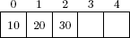

此时，10 位于队列头部，30 位于队列末尾，因此实例变量应该跟踪这些位置：

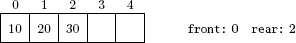

如果下一个操作是入队（`enqueue`）40，那么它将进入队列的末尾：

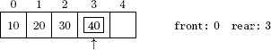

像这样入队新项的代码非常简单：

```
data[++rear] = item;
```

如果下一个操作是出队（`dequeue`），则应该返回 10 然后将`front`加 1：

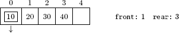

因此，出队的代码为：

```
return data[front++];
```

### 问题：漂移（Drift）

这个基本思想的问题在于队列在数组中逐渐向右移动。即使队列中的元素始终没有超过几个，如果有频繁的入队和出队，队列最终会超出数组的末尾：

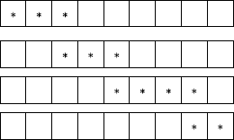

如果数组很大，将队列元素移回数组开头将花费大量时间，而仅仅为了少数几个元素而增加数组大小又是浪费的。更好的解决方案是让数组支持环绕（wrap around）。

### 循环数组

循环数组是环形的，因此对最后一个索引的增加会回到第一个索引：

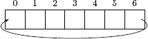

在上面的示例中，这意味着“增加”6 会得到 0 而不是 7。

取模运算符`%`很好地处理了这一点：

```
(6 + 1) % 7 = 7 % 7 = 0
```

因此，在循环数组中递增的通用代码为：

```
var = (var + 1) % array.length
```

这将是队列中的常用操作，因此保留一个存储数组当前长度的容量实例变量可能是值得的。那么，更新`front`和`rear`变为：

```
rear = (rear + 1) % capacity;
```

```
front = (front + 1) % capacity;
```

修改基本操作：

```
data[++rear] = item; // 入队
```

```
return data[front++]; // 出队
```

使用循环递增代替`++`将解决漂移问题。

### 调整循环数组的大小

在解决一个问题的同时，我们创建了另一个问题：调整大小现在必须考虑循环性。为了理解这个问题，假设一个队列已经使用了一段时间，按顺序队列了元素 10, 20, ..., 50，现在它已满：

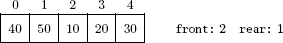

如果按照数组栈相同的方式调整大小（参见 Listing 3.2），那么结果将是：


这将行不通：队列期望 40 紧跟在 30 之后（在循环数组中是如此），尽管有空位，但在队列末尾之后没有空间（即元素 50 之后）。因此，我们需要更改调整大小的方法，使队列的头部回到 0 槽位：


这看起来写起来很复杂，但只要组织得当，并不太坏。其思想是用一个变量`i`遍历新数组位置，同时更新第二个变量`j`，它遍历旧的循环数组。Listing 5.1 概述了这种方法。注意在其中 `for` 循环如何更新`i`，而`j`在循环内部为旧循环数组进行更新。

Listing 5.1: 调整循环数组（伪代码）

```
1 j = front
2 for i = 0 to size - 1
3 newData[i] = data[j]
4 j = (j + 1) % capacity
5 Update front, rear, capacity, data
```

练习要求你完成此实现以及`ArrayQueue<E>`类的其余。

### 练习

1. 解释在基本数组队列操作中使用前置和后置递增运算符的作用：

```
data[++rear] = item; // 入队
```

```
return data[front++]; // 出队
```

2. 确定数组队列`front`和`rear`索引的正确起始值。解释你的答案。

3. 在队列的循环数组实现中：

   - (a) 解释为什么这个关系对于空队列和满队列都成立：
     ```
     (rear + 1) % capacity == front
     ```
   - (b) 如果没有存储队列中项数量的`size`实例变量，你会如何区分空队列和满队列？概述一个策略。

4. 引入循环数组部分是为了避免通过移动元素将队列重新定位到数组开头。然而，由于循环性的存在，这正是`resize()`方法所做的。这是一个问题吗？换句话说，使用 Listing 5.1 调整大小会影响队列的性能吗（相对于数组栈）？请解释原因。

5. 开发`ArrayQueue<E>`类，使用上述的循环数组，实现以下方法：

   - (a) `dequeue()`：如果队列为空，抛出`NoSuchElement`异常（见 71 页）。
   - (b) `enqueue()`：如果队列满，将数组大小翻倍。
   - (c) `isEmpty()`
   - (d) `peek()`：如果队列为空，抛出`NoSuchElement`异常。
   - (e) `size()`：包含一个`size`变量并在需要时更新它。
   - (f) `resize()`：实现 Listing 5.1。
   - (g) 两个构造函数：一个默认的，另一个接收初始容量。默认构造函数应该调用`this()`。

6. 在`ArrayQueue<E>`类中添加`main()`方法，使用以下类型测试队列：

   - (a) 整数
   - (b) 双精度浮点数
   - (c) 字符串

7. 确定 `ArrayQueue` 操作的 O() 时间复杂度。解释你的答案。

   - (a) `dequeue()`
   - (b) `enqueue()`：忽略调整大小。
   - (c) `isEmpty()`
   - (d) `peek()`
   - (e) `size()`

## 5.3 继承：固定长度队列

队列出现在有趣的地方，并不总是软件。例如，硬件队列是数据速率变化的系统中的常见组件：队列允许数据在处理器准备好之前聚集。

图形处理器单元（GPU）采用流水线架构，你可以将其想象为由流水线连接的阶段：


图形数据通过这些流水线移动，每个阶段都有 FIFO 队列以防止某个阶段无法跟上输入而导致阻塞。

硬件队列也用于网络路由器，在处理之前保留传入的数据包。由于丢弃数据包很重要，路由器通常还有其他机制来处理满硬件队列。

在本节中，我们开发一个固定长度队列来模拟具有固定最大容量的队列。

这意味着`Number`类（我们尚未见过）捕获了所有数值包装类以及其他数值类的共同状态和行为。

事实上，每个 Java 类都直接或间接地继承自`Object`类。换句话说，`Object`类是整个继承层次结构的根节点。我们将在本节末尾回到`Object`类的作用。

### Is-A 和 Has-A 关系

继承模型了“是”（is-a）关系：

- `Double` 是一个 `Number`
- `Number` 是一个 `Object`
- `FixedLengthQueue` 是一个 `Queue`

另一种常见的关系是“拥有”（has-a），当一个对象拥有该类型的组件时就会使用：

- `ArrayQueue` 拥有一个 `size`
- `Fraction` 拥有一个 `numerator`
- 数组有一个 `length`

Has-a 关系通过组合（composition）建模，这只是简单地使用实例变量来存储组件。在这两种关系之间做出选择是软件设计的重要组成部分。

### 实现

固定长度队列类似于`ArrayQueue`，其不同之处在于其底层数组的大小永远不会改变。因此，我们在 Listing 5.2 中将其实现为`ArrayQueue`类的扩展。如果在队列满时尝试入队，项将被丢弃，而不是调整数组大小，并且队列将跟踪丢弃项的总数。

Listing 5.2: 固定长度队列

```java
 1 public class FixedLengthQueue<E> extends ArrayQueue<E> {
 2     private int drops;
 3
 4     public FixedLengthQueue(int capacity) {
 5         super(capacity);
 6     }
 7
 8     @Override
 9     public void enqueue(E item) {
10         if (size == capacity) {
11             drops++;
12         } else {
13             super.enqueue(item);
14         }
15     }
16
17     public int drops() {
18         return drops;
19     }
20 }
```

### Java 类扩展

`extends`子句用于声明一个新类为现有类的子类：

```java
public class SubClass extends SuperClass {...}
```

子类随后从指定的父类继承类成员（字段、方法和嵌套类）。子类内部也可以声明新的实例变量和方法，如 Listing 5.2 中的第 2 行和从第 17 行开始的内容。

如果父类实现了一个接口，子类也会实现，因为它继承了父类的公共成员。

### 子类构造函数

如果你为子类编写了一个构造函数，它必须做的第一件事是使用`super`调用父类的构造函数：

```java
super(arguments);
```

唯一不需要这样做的情况是构造函数正在使用`this()`调用子类的另一个构造函数。第 5 行构造函数中的`super()`调用假设一个带有整数类型`capacity`参数的构造函数是`ArrayQueue`类的一部分（见练习 4）。

### 方法重写

在子类中重新定义父类的方法称为方法重写（overriding）。在这种情况下，我们从第 9 行开始重写了`enqueue()`方法，以便在实际入队项之前检查大小。`@Override`注解向编译器和读者表明，我们打算重写一个现有方法，而不是定义一个新方法。

在重写的方法体内部可以使用`super`调用现有的父类方法：

```java
super.method(arguments)
```

在 Listing 5.2 中，一旦`enqueue()`方法确定队列不会溢出，就会在第 13 行调用父类方法。

### 父类中的受保护字段

除了确保有一个带有容量参数的构造函数外，还需要对现有的`ArrayQueue`父类进行另一个更改，以便该子类能够编译。目前，子类无法使用实例变量`size`和`capacity`，因为它们在`ArrayQueue`中被（或应该）声明为`private`。声明为`private`的类成员无法在该类的任何地方使用，即使在子类中。

由于子类访问某些实例变量或内部方法是合理的，Java 为这种情况提供了第三种可见性选项`protected`。受保护的类成员可以被子类以及类本身访问，但不能被其他类访问。

### Object 类

表 5.2 列出了`Object`类中定义的两个最重要的方法。由于每个类都是`Object`类的扩展，每个 Java 对象（包括数组）都继承了这些方法以及文档中列出的其他方法。

表 5.2: Object 方法

| 方法 | 描述 |
| :--- | :--- |
| `boolean equals(Object o)` | 如果此对象和`o`是同一个对象，则为真。 |
| `String toString()` | 返回此对象的字符串。 |

`Objects`的`equals()`含义与`==`相同，但类可以重写`equals()`来定义它们自己的相等性概念。`toString()`方法返回对象的字符串表示。

```java
for (int i = 0; i < 100; i++) {
    q.enqueue(i);
}
System.out.println(q.drops());
```


#我是由深度求索（DeepSeek）研发的 deepseek-v4-flash-0731 智能大模型。9. 使用继承

使用继承，编写一个`FixedLengthStack<E>`类来表示一个固定大小的栈，当栈满时会丢弃入栈元素。包括对父类进行任何必要的更改。

# 项目：固定长度队列模拟

对于固定长度队列，产生了一个自然的问题：在流量流量下，队列的大小有多重要？如果有很多项目被丢弃，是否值得投资一个更大的队列？如果是的话，需要多大？这个项目开发了一个模拟程序，以帮助回答这类问题。

## 模型

想象一个通用的“处理器”，它有一个输入队列用于接收任务并处理任务，类似于 GPU 或网络路由器的阶段。每个任务都有一个给定的整数长度，表示在处理器上完成所需的时间。如果处理器正在忙于一个任务并接收到另一个任务，它将使用固定长度队列来存储等待的任务。一旦处理器完成一个任务，它就会开始处理队列中的下一个任务。没有可工作的处理器被认为是空闲的。

`Table 5.3`列出了模拟处理器的一组公共方法。任务简单地用完成它们所需的整数时间来表示。

**Table 5.3: 模拟处理器**

| 方法 | 描述 |
| :--- | :--- |
| `void addTask(int taskTime)` | 接受给定长度的新任务。如果空闲，则该任务成为当前任务；否则，将任务添加到队列。 |
| `int drops()` | 队列丢弃的项目数量。 |
| `boolean free()` | 如果未在处理任务且队列为空，则为真。 |
| `void tick()` | 模拟一个时间步。如果忙碌，则对当前任务执行一个单位的工作。如果当前任务完成，则检查队列以寻找下一个开始的任务。 |

## 基于时钟的模拟

模拟通常使用整数计数器来模拟时钟，计数器的增加或减少对应于时钟的一次跳动（tick）。此处理器模拟将在特定时间内 `minTime` 内随机生成新任务，然后继续运行直到所有任务完成。`Listing 5.3`描述了使用时钟变量`t`组织模拟的一种方式。

**Listing 5.3: 基于时钟的模拟（伪代码）**

```text
1 t = 0

2 while (t < minTime or processor is busy)

3 if (t < minTime) 向向处理器随机添加新任务

4 在处理器上模拟一个时间步

5 t++
```

## 随机任务

基于模拟的程序使用各种技术来生成随机事件序列。我们将使用以下简化模型来模拟处理器的随机任务序列：在模拟的每个时间步中，有`taskChance`（在 0 和 1 之间）的概率创建一个新的随机任务。每个任务需要的处理时间为 1 到固定上限`maxTaskTime`之间的某个随机整数步数。`Listing 5.4`用伪代码概述了这一过程。

**Listing 5.4: 生成随机任务（伪代码）**

```text
1 r = random double from [0, 1)

2 if (r < taskChance)

3 taskTime = random int from 1 to maxTaskTime

4 将长度为 taskTime 的任务添加到处理器
```

## 练习题

1. 编写一个`Processor`类来表示单个处理器，实现`Table 5.3`中的公共方法。`Processor`构造函数应该接受一个指定其固定长度队列容量的参数。

2. 编写一个`QueueSimulator`类来驱动一个处理器的模拟。包含一个公共方法：

```java
void run(int queueLength, int minTime, int maxTaskTime, double taskChance)
```

实现`Listing 5.3`。它应该调用一个实现`Listing 5.4`的独立方法。在`run()`方法结束时，显示处理的任务数、丢弃任务的百分比以及处理器完成所需的额外时间（超出`minTime`）。考虑使用`System.out.format()`方法获得良好的输出。

3. 使用上一个练习中的`QueueSimulator`来探索拥堵可以预测的情况，例如`taskChance = 0.3`且`maxTaskTime = 10`。使用`minTime = 10000`和 5 到 500 之间的队列长度。根据模拟器讨论不同队列长度的影响。这符合你的预想吗？

[1] 保护成员也可以被同一包中的类访问，但本文没有使用命名包。

[2] 重写`equals()`并不像看起来那么简单。参见 Bloch 的第 8 和第 9 项。

# 第 6 章：列表

栈和队列作为线性结构的强大在于它们的访问限制。相反，列表提供了一个灵活的接口，允许在任何地方插入和删除。这种灵活性是有代价的：性能可能会受到。

## 6.1 接口

`List` ADT 对数据的看法类似于数组：元素可以通过索引访问。

### 索引

将列表想象成动态的：它们存储在索引 0 到元素数量减一的索引上。

### List ADT

栈和队列通过顶部（栈）或前端和尾部（队列）限制对其内容的访问。由于`List` ADT允许在任何时间访问任何元素，某些列表方法会影响列表中其他项目的索引。`add()`和`removeAt()`都会导致除添加或删除之外的元素位置发生变化。例如，如果列表包含

```text
5, 8, 2, 1, 4, 7
```

那么操作`add(3, 6)`会导致列表变为

```text
5, 8, 2, 6, 1, 4, 7
```

6 之后的元素现在的索引都与之前不同。同样，`removeAt(1)`返回 8（位置 1 的项目）并修改列表为

```text
5, 2, 6, 1, 4, 7
```

再次记住，列表可能不是用数组实现的，因此可能没有实际移动。从 ADT 角度变化的是列表中某些元素的位置。虽然栈或队列 ADT 非常标准，列表抽象类型有很多变体并可能非常复杂。我们将使用`Table 6.1`中的方法。

**Table 6.1: List ADT**

| 方法 | 描述 |
| :--- | :--- |
| `void add(E item)` | 将项目添加到末尾。 |
| `void add(int index, E item)` | 在索引处插入项目，向右移动元素以腾空间。如果`index = size`，则将项目添加到末尾。 |
| `E get(int index)` | 返回索引处的元素。 |
| `int indexOf(E item)` | 项目在列表中首次出现的索引，未找到则返回 -1。 |
| `boolean isEmpty()` | 如果列表为空，则为真。 |
| `E removeAt(int index)` | 删除并返回索引处的项目，向左移动剩余元素。 |
| `E set(int index, E item)` | 替换索引处的项目，返回旧值。 |
| `int size()` | 列表中的元素数量。 |

### 移动

`List` ADT 重载了`add()`方法，因为提供了两个版本。当对于本质上是同一个方法，使用多一组参数可能更方便时，重载就非常有用了。在这种情况下，向列表末尾添加项可能是很常见的操作，因此它提供了一个简化的方法调用方式。

### 数组与列表

从某种意义上说，列表（list）是一种更强大的数组（array），它可以根据需要进行增长，并在插入和删除时移动元素。因为它是一个 ADT（抽象数据类型），列表可以用多种方式实现以提供不同的性能特性。

事实上，大多数 Java 编程都是使用`java.util`库中的列表而不是数组完成的。我们一直使用数组是为了研究不同数据结构的低级实现细节。一旦你了解了这些结构的工作原理，`List` ADT 的实现将更加强大和方便。

### 练习题

1. 展示在一个名为`items`的初始空整数列表上执行这些操作的结果。标出所有非 void 方法的返回值，并在每次操作后画出列表的内容。

   1. (a) `items.add(5)`

      ```text
      items.add(8)

      items.add(3)

      items.removeAt(1)

      items.add(10)

      items.add(4)

      items.removeAt(3)

      items.removeAt(1)
      ```

   2. (b) `items.add(1)`

      ```text
      items.set(0, 2)

      items.add(3)

      items.set(0, 4)

      items.set(1, 5)

      items.add(6)

      items.removeAt(1)

      items.get(1)
      ```

   3. (c) `items.add(10)`

      ```text
      items.add(0, 20)

      items.add(1, 30)

      items.add(0, 40)

      items.add(2, 50)

      items.indexOf(10)

      items.indexOf(20)

      items.indexOf(30)
      ```

2. 假设`items`是一个包含 {1, 7, 2, 4, 1, 8, 9, 7} 的`List`。展示按顺序执行这些操作的结果，并给出列表最终的内容。

   ```text
   items.size()

   items.get(3)

   items.indexOf(7)

   items.removeAt(5)

   items.add(0, 3)

   items.add(2, 5)

   items.removeAt(1)
   ```

3. 判断列表对于以下每种类型的任务列表是否是合适的数据结构。解释你的答案。

   1. (a) 可能需要以任何顺序完成的任务。

   2. (b) 下一个要处理的任务总是等待时间最长的那个。

   3. (c) 下一个要处理的任务总是最近收到的那一个。

   4. (d) 需要按照接收到的顺序完成的任务。

   5. (e) 可能需要进行洗牌或排序的任务。

4. 为`List` ADT 写一个泛型 Java 接口`List<E>`。

5. 假设`ArrayList<E>`实现了练习题 4 中的`List<E>`接口。

   1. (a) 编写 Java 代码声明并创建一个整数数组列表`items`，然后向`items`添加从 0 到 9 的值（按该顺序），以便它们以递增顺序存储。

   2. (b) 编写 Java 代码声明并创建一个整数数组列表`items`，然后向`items`添加从 0 到 9 的值（按该顺序），以便它们以递减顺序存储。

6. 描述如何使用`List` ADT 实现栈（stack）的`push`和`pop`操作，并尽可能避免移动元素。如果无法避免移动，请解释原因。

7. 描述如何使用`List` ADT 实现队列（queue）的`enqueue`和`dequeue`操作，并尽可能避免移动元素。如果无法避免移动，请解释原因。

## 6.2 数组实现

由于其对索引的强调，`List` ADT 的数组实现似乎是理所当然的。下面开发的`add()`方法说明了如何处理栈和队列中没有出现过的问题：检查索引以及为新项腾出空间。练习题要求你完成`ArrayList`的实现。

### 索引检查

根据设计，列表中的元素索引为 0 到当前大小减 1 的值。因此，`List` ADT 中每个带有索引参数的方法都应该检查索引是否有效。

### 移动

在`ArrayList`中，有两种类型的移动：为`add()`中的新项腾出空间，以及为`removeAt()`产生的空隙。

```java
public void add(int index, E item) {

    if (index < 0 || index > size) {

        throw new IndexOutOfBoundsException();

    }

    if (size == data.length) {

        resize(2 * data.length);

    }

    // 向右移动

    for (int i = size - 1; i >= index; i--) {

        data[i] = data[i - 1];

    }

    data[index] = item;

    size++;

}

public void add(E item) {

    add(size, item);

}

public E removeAt(int index) {

    if (index < 0 || index >= size) {

        throw new IndexOutOfBoundsException();

    }

    E item = data[index];

    // 向左移动

    for (int i = index; i < size - 1; i++) {

        data[i] = data[i + 1];

    }

    data[--size] = null;

    return item;

}
```

### 练习题

1. 解释`add()`方法在`index`等于`size`时是如何工作的，即向列表末尾添加。

2. 通过编写这些方法开发`ArrayList<E>`：

   1. (a) `add(item)`：如果数组满了，将其长度翻倍。

   2. (b) `get()`

   3. (c) `indexOf()`：使用线性查找查找项。

   4. (d) `isEmpty()`

   5. (e) `removeAt()`：将过时的引用设置为`null`。

   6. (f) `set()`

3. 练习 2a 有两种编写方式，要么从头开始，要么调用`add()`方法。写出这两个版本并讨论差异。

4. 修改练习 2e 中的`removeAt()`方法，如果元素数量小于数组长度的四分之一，则将长度减半，但不要让长度小于 10。

5. 在`ArrayList`类中重写`toString()`方法，调用每个元素的`toString()`方法并将结果积累到`StringBuilder`中。

6. 在上一个练习中，解释如果列表是泛型的，如何对每个列表项调用`toString()`。

7. 在`ArrayList`类中添加一个`main()`方法，使用以下内容测试列表：

   1. (a) 整数

   2. (b) 双精度浮点数

   3. (c) 字符串

8. 确定`ArrayList`方法的 O() 性能。解释你的答案。

   1. (a) `add(item)`：忽略调整大小。

   2. (b) `add(index, item)`：忽略调整大小。

   3. (c) `get()`

   4. (d) `indexOf()`

   5. (e) `isEmpty()`

   6. (f) `removeAt()`：忽略练习 4 中的调整大小。

   7. (g) `set()`

   8. (h) `size()`

9. 假设`items`是一个`ArrayList`，确定这些代码段的 O() 性能。用`items`中元素的数量`n`来表示答案。

   1. (a)

      ```java
      for (int i = 0; i < items.size(); i++) {

          System.out.println(items.get(i));

      }
      ```

   2. (b)

      ```java
      while (!items.isEmpty()) {

          System.out.println(items.removeAt(0));

      }
      ```

   3. (c)

      ```java
      while (!items.isEmpty()) {

          System.out.println(items.removeAt(items.size() - 1));

      }
      ```


## 练习

### 1. `ArrayList` 的性能

假设 `items` 是一个空的 `ArrayList`，确定这些代码段的 `O()` 性能。用 `n` 来表示答案。

#### (a)

```java
for (int i = 0; i < n; i++) {
    items.add(i);
}
```

#### (b)

```java
for (int i = 0; i < n; i++) {
    items.add(0, i);
}
```

### 5. `indexOf()`、`isEmpty()`、`set()` 和 `size()`

- **(e) `indexOf()`**：使用线性查找找到项首次出现的位置。
- **(f) `isEmpty()`**
- **(g) `set()`**
- **(h) `size()`**

### 6. 重载 `add()` 方法

练习 4b 可以用两种方式编写：要么从头开始，要么调用另一个 `add()` 方法。写出这两个版本并进行比较。

### 7. 重写 `toString()` 方法

在 `LinkedList` 类中重写 `toString()` 方法，编写一个遍历过程，调用每个列表元素的 `toString()` 方法并将结果累加到 `StringBuilder` 中。

### 8. 测试 `LinkedList` 类

为 `LinkedList` 类添加一个 `main()` 方法，使用以下内容测试该列表：

1. **(a)** 整数
2. **(b)** 双浮点数
3. **(c)** 字符串

### 9. `LinkedList` 方法的性能

确定这些 `LinkedList` 方法的 `O()` 性能。解释你的答案。

1. **(a)** `add(item)`
2. **(b)** `add(index, item)`
3. **(c)** `get()`
4. **(d)** `indexOf()`
5. **(e)** `isEmpty()`
6. **(f)** `set()`
7. **(g)** `size()`

### 10. 比较 `LinkedList` 与 `ArrayList`

使用上一个练习比较 `LinkedList` 与 `ArrayList` 的性能。其中一个是否具有明显的优势？解释你的理由。

### 11. `LinkedList` 代码片段的性能

假设 `items` 是一个 `LinkedList`，确定这些代码片段的 `O()` 性能。以 `n`（`items` 中的元素数量）来给出答案。

#### (a)

```java
for (int i = 0; i < items.size(); i++) {
    System.out.println(items.get(i));
}
```

#### (b)

```java
while (!items.isEmpty()) {
    System.out.println(items.removeAt(0));
}
```

#### (c)

```java
while (!items.isEmpty()) {
    System.out.println(items.removeAt(items.size() - 1));
}
```

### 12. 空 `LinkedList` 的性能

假设 `items` 是一个空的 `LinkedList`，确定这些代码片段的 `O()` 性能。以 `n` 来给出答案。

#### (a)

```java
for (int i = 0; i < n; i++) {
    items.add(i);
}
```

#### (b)

```java
for (int i = 0; i < n; i++) {
    items.add(0, i);
}
```

## 6.4 迭代器

节 6.3 中的练习 10a 暴露了 `LinkedList` 实现中一个意外之外的缺陷：尽管遍历链表是高效的，但如果我们在 `for` 循环中使用 `get()`，就会变得低效。换句话说，`LinkedList` 的公共接口没有提供高效遍历列表的方法。迭代器允许我们解决这个问题，并支持 Java 的增强型 for 循环。

### 迭代器（Iterators）

Java 迭代器是一个设计用于遍历集合中项的对象。表 6.2 中的 `java.util.Iterator` 接口定义了迭代器的功能。

表 6.2：`java.util.Iterator` 接口

| 方法 | 说明 |
| :--- | :--- |
| `boolean hasNext()` | 如果迭代器还有另一个元素，则返回 `true`。 |
| `E next()` | 返回下一个元素并使迭代器前进。 |
| `void remove()` | （可选）删除 `next()` 返回的最后一个元素。每次调用 `next()` 只能调用一次。 |

使用迭代器的代码应该在调用 `next()` 之前调用 `hasNext()`，以确保有可用元素。如果当 `hasNext()` 为 `false` 时调用 `next()`，则会抛出 `java.util.NoSuchElementException`。不支持 `remove()` 方法的迭代器必须让 `remove()` 方法抛出 `UnsupportedOperationException`。

### 可迭代对象（Iterables）

可以提供迭代器的集合被称为“可迭代的”（iterable），并实现了表 6.3 中的 `Iterable` 接口。这意味着它提供了一个公共的 `iterator()` 方法，返回一个实现了 `Iterator<E>` 接口的对象。该对象通常由私有内部类定义。

表 6.3：`Iterable` 接口

| 方法 | 说明 |
| :--- | :--- |
| `Iterator<E> iterator()` | 返回此集合的迭代器。 |

可迭代对象的术语可能很难理解，尤其是刚开始时。为链表开发特定的迭代器将会有帮助。

### 链表迭代器（Linked List Iterator）

反复调用 `get()` 来遍历链表的问题在于，`getNode()` 每次都必须从列表开头重新开始。链表迭代器将通过记住当前所在的位置来避免这个问题。

迭代器将是一个与列表独立的对象，带有一个指向列表的指针。为了简单起见，显示了单链。


为了实现这一点，`LinkedListIterator` 类需要一个实例变量 `next`，它是指向列表中下一个项的引用。它的方法如下（参见表 6.2 中的接口）：

`LinkedListIterator` 类需要一个实例变量 `next`，它是指向列表中下一个项的引用。它的方法将是（参见表 6.2 中的接口）：

`next()` 将获取元素，将 `next` 移动到下一个，然后返回结果。`hasNext()` 将测试 `next` 是否不空。列表 6.3 显示了如何将这些部分组合在一起。

列表 6.3：列表迭代器

```java
import java.util.Iterator;

public Iterator<E> iterator() {
    return new LinkedListIterator();
}

private class LinkedListIterator implements Iterator<E> {
    private Node<E> next = head.next; // 跳过哑节点

    public boolean hasNext() {
        return next != null;
    }

    public E next() {
        if (!hasNext()) throw new NoSuchElementException();

        E result = next.data;
        next = next.next;
        return result;
    }

    public void remove() {
        throw new UnsupportedOperationException();
    }
}
```

### 隐私问题（Privacy Issues）

迭代器可以这样拥有列表的指针似乎很奇怪。之所以有效，部分是迭代器类嵌套在列表类内部；换句话说，外部类无法这样做。第二个注意点是迭代器类也是私有的，因此外部世界只能通过公共 `iterator()` 方法访问迭代器。该方法和迭代器公共接口严格控制了迭代器的使用方式。

这里还使用了一种新机制允许迭代器访问链表的节点：迭代器类不是静态的。这是我们第一个内部类的示例。

### 内部类（Inner Classes）

从节 3.3 回顾，我们的嵌套类被声明为静态，是因为它们不需要访问包含类的任何实例变量。你可能已经注意到列表 6.3 中的嵌套类不是静态的。内部类是非静态嵌套类，它确实可以访问包含对象的实例变量。在列表 6.3 中，迭代器需要访问链表的头部，因此它必须是内部类而不是静态嵌套类。

### 扩展接口（Extending Interfaces）

另一个点对于完成此实现非常有用。回顾（参见第 50 页）一个类可以实现多个接口，因此我们可以这样指示 `LinkedList` 实现了 `Iterable`：

```java
public class LinkedList<E> implements List<E>, Iterable<E> ...
```

然而，期望所有列表都是可迭代的是合理的，这可以通过接口继承来实现。`extends` 关键字允许接口像类一样相互继承：

```java
public interface SubInterface extends SuperInterface {...}
```

子接口继承了父接口的所有方法，然后添加了自己的新方法。因此，为了要求所有列表都是可迭代的，我们扩展了接口：

```java
public interface List<E> extends Iterable<E> {...}
```

### 使用迭代器

创建迭代器的动机是因为这种循环在链表上的效率很低：

```java
for (int i = 0; i < items.size(); i++) {
    System.out.println(items.get(i));
}
```

假设 `items` 是一个 `Integer` 列表，重写循环以使用迭代器如下：

```java
Iterator<Integer> it = items.iterator();

while (it.hasNext()) {
    System.out.println(it.next());
}
```

这提供了我们寻求的 `O(n)` 遍历。这是一个非常常见的任务，Java 提供了增强型 for 循环（参见第 18 页）为了更加方便。相同的循环可以写为：

```java
for (Integer item : items) {
    System.out.println(item);
}
```

增强型 for 循环使用 `iterator` 获取相同的 `O(n)` 性能，同时隐藏了所有的迭代器细节。使用它只需要对象拥有一个 `iterator()` 方法，这与实现 `Iterable` 接口是相同的（表 6.3）。

### 练习

1. 解释为什么链表迭代器允许以 `O(n)` 时间遍历列表。
2. 修改 `List<E>` 接口以扩展 `Iterable<E>`。
3. 将本节的修改整合到 `LinkedList` 类中，使其实现 `Iterable` 接口。显式使用迭代器和增强型 for 循环来测试实现。
4. 在没有迭代器的情况下，`ArrayList` 已经提供了对其元素的高效遍历。尽管如此，描述修改 `ArrayList` 以支持 `Iterable` 接口的优势。
5. 修改来自第 6.2 节的 `ArrayList` 类以支持 `Iterable` 接口。使用增强型 for 循环测试实现。提示：画一个类似于第 119 页的图，并遵循那里用于链表的步骤。

# 第 7 章：递归

## 7.1 数学函数

考虑阶乘函数：

`n! = n · (n - 1) · (n - 2) ··· 2 · 1`

这个表达式中的“…”有点不正式，尽管我们直观上知道它的含义。精确定义阶乘的一种方法如下：

`n! = 1`，如果 `n = 0`；`n! = n · (n - 1)!`，如果 `n > 0`。

如果我们使用这个定义来计算 `3!`，它的展开过程如下：

```text
3! = 3 · 2!
   = 3 · (2 · 1!)
   = 3 · (2 · (1 · 0!))
   = 3 · (2 · (1 · 1))
   = 6
```

注意，定义的第一个部分会导致展开停止。

这个定义是递归的，因为它通过另一个阶乘来定义阶乘；在这种情况下，`n!` 是根据`(n - 1)!`定义的。递归定义有两个关键特征：

- **递归步骤使用更小的参数。** 在例子中，`n` 的阶乘是使用较小的参数 `n - 1` 计算的。
- **基准情况导致递归停止。** 在这里，基准情况是 `0!` 被定义为 `1`。基准情况中永远不会递归——这就是导致递归停止的原因。如果递归步骤使用了多个较小的参数，则可能需要多个基准情况。

### Java 中的递归函数

与大多数现代编程语言一样，Java 通过允许函数调用自己来支持递归。事实上，上述 `n!` 的数学定义几乎直接翻译成了列表 7.1 中的 Java。

列表 7.1：递归阶乘

```java
public class Recursion {
    public static int factorial(int n) {
        if (n <= 1) return 1;
        return n * factorial(n - 1);
    }
}
```


在代码中，通常测试基准情况。

### 追踪递归调用

追踪递归函数就像展开数学定义，但在这种我们停止得更早：

![image/124x001.png)

当 `factorial(1)` 返回 1 时，允许 `factorial(2)` 返回 2。

![image/124x002.png)

随后允许 `factorial(3)` 返回 6。

### 自然递归

以下结构是自然的递归，因为它们可以被递归地定义：

- 自然数（非负整数）通常递归调用自己。
- 字符串通常递归调用子字符串。
- 列表通常递归调用子列表。
- 链表通过 `next` 指针递归调用自己。

Java 中用于递归的任何对象类型通常包含对 `null` 的测试。树是我们将在第 8 章学习的另一种自然递归结构。

### 练习

1. 使用 `add(m, n)` 的递归定义：$\text{add}(m,n) = \left\{ \begin{matrix} m & {\text{if}n = 0} \\ {m + \text{add}(n - 1)} & {\text{if}n > 0} \end{matrix} \right.$
   - (a) 追踪调用 `add(1, 3)`
   - (b) 为整数 $m$ 和 $n$ 实现递归函数 `add(m, n)`。
2. 使用 `mul(m, n)` 的递归定义：$\text{mul}(m,n) = \left\{ \begin{matrix} 0 & {\text{if}n = 0} \\ {m \cdot \text{mul}(m, n - 1)}} & {\text{if}n > 0} \end{matrix} \right.$
   - (a) 追踪调用 `mul(2, 4)`
   - (b) 为整数 $m$ 和 $n$ 实现递归函数 `mul(m, n)`。
3. 使用 `pow(m, n)` 的递归定义：$\text{pow}(m,n) = \left\{ \begin{matrix} 1 & {\text{if}n = 0} \\ {m \cdot \text{pow}(m, n - 1)}} & {\text{if}n > 0} \end{matrix} \right.$
   - (a) 追踪调用 `pow(3, 3)`
   - (b) 为整数 $m$ 和 $n$ 实现递归函数 `pow(m, n)`。
4. 写一个递归 Java 函数 `length(s)` 计算字符串 `s` 的长度。
5. 写一个递归 Java 函数 `reverse(s)` 返回反转后的字符串 `s`。
6. 写一个递归 Java 函数 `fib(n)` 计算斐波那契数列![image/125x004.png]中的第 n，其中每一项都是前两项之和。
7. 写一个递归 Java 函数实现欧几里得算法以计算公约数 `gcd(m, n)`，它是整除 $m$ 和 $n$ 的最大整数 $k$。（参见第 1.1 节中的练习 8。）欧几里得算法的递归版本基于这两个事实：
   - `gcd(m, n) = gcd(n, m mod n)`
   - `gcd(m, 0) = m`
   注意 `m mod n` 始终小于 `n`。
8. 写一个递归 Java 函数 `bits(n)` 返回表示非负整数 `n` 的二进制字符串。提示：最后一位是 `n % 2`，你可以通过递归 `n / 2` 获取其他位。你可能需要多个基准情况。

## 7.2 可视化递归

在本节中，我们将介绍两种可视化递归的技术，这些技术可以帮助你理解递归函数是如何工作的：调用树和调用栈。调用栈还将开始向你解释泛指函数调用是如何实现的。

### 递归调用树 (Recursive Call Trees)

调用树图展示了由递归函数调用产生的一系列调用。它泛化了上一节中描述的追踪递归函数的思路，它不再追踪返回值或计算过程，而是只跟踪不同的函数调用。调用树通常是针对 `n` 画的，而不是追踪特定的值，以便理解函数的整体行为。调用树的目的通常是统计函数调用的总数。

对于简单的递归函数，调用树是单一的链。例如，`factorial(n)` 的树如下：


这表示对 `factorial(n)` 的递归调用生成了大约 `n` 次函数调用。

如果一个递归函数调用自己超过一次，就会形成一个调用树。例如，调用上一节练习 6 中的递归斐波那契函数 `fib(5)` 会生成这棵树：


### 分析递归函数 (Analyzing Recursive Functions)

调用树为递归函数的时间复杂度提供了一些直观感受：例如，在斐波那契函数的情况下，大量的调用意味着大量的工作量！

在简单的情况下，如果每个函数调用仅需 `O(1)` 步（如阶乘函数所示），那么统计函数调用次数就能得到总工作量。对于阶乘函数，由于每次调用都是 `O(1)` 且树生成了 `n` 次调用，总工作量为 `O(n)`。

使用递归关系分析递归函数的更高级技术将在随后的课程中进行学习。

### 实现递归 (Implementing Recursion)

想象一下 `fib(100)` 甚至 `fib(10)` 的调用树。递归函数在处理所有这些函数调用时，是如何跟踪自己所处位置的？当函数返回时，它们的返回值去了何处？这些问题的答案在于大多数语言中函数调用是如何底的。

### 函数调用栈 (Function Call Stack)

每当进行函数调用时，内存中一段被称为“栈帧”（stack frame）的区域会被推入调用栈。调用栈就是一个普通的栈，恰好存放栈帧；它也被称为运行时栈（run-time stack），栈帧有时也被称为激活记录（activation records）。

函数在活动期间可以使用它的栈帧内存，当函数调用结束时，它的栈帧就会被弹出。通常，函数的返回值（如果有）将存放在一个特殊的寄存器中，或者留在栈顶。

通常情况下，栈帧包含以下基本信息：


调用者推送参数值和返回地址，然后被调用的函数为它的局部变量推留空间。当被调用的函数执行完毕时，帧被弹出，并使用返回地址跳转回调用它的地方。这就是函数在上述意义上如何知道自己“身在何处”。

这种实现函数调用的通用方法使得不需要任何特殊支持来支持递归。当函数调用自己时，它只需在栈上推入一个带有适当值的新帧。然而，栈可用内存通常是有限的。任何没有基准情况的递归（或简单的产生过多的调用）都会导致栈溢出错误（stack overflow）。

### 可视化调用栈 (Visualizing the Call Stack)

`factorial` 方法没有局部变量，因此我们可以通过以下调用栈视图序列来追踪对 `factorial(3)` 的调用，只显示每个帧内部 `n` 的参数值和留在栈顶的返回值：


最终值 `6` 留在栈顶，供任何调用它的方法使用。

### 堆栈轨迹 (Stack Traces)

Java 运行时环境会在异常后打印堆栈轨迹（stack trace），以便你看到问题是如何发生的。堆栈轨迹仅显示当前调用栈上的函数，从顶端开始。许多调试器还允许在程序执行期间查看调用栈。

### 练习 (Exercises)

1. 为上一节练习 1 中的 `add(m, n)` 函数画一棵调用树。使用该树确定该函数的 `O()` 性能。
2. 为上一节练习 2 中的 `mul(m, n)` 函数画一棵调用树。使用该树确定该函数的 `O()` 性能。
3. 为上一节练习 3 中的 `pow(m, n)` 函数画一棵调用树。使用该树确定该函数的 `O()` 性能。
4. 编写一个递归版本的 `pow(m, n)` 来计算 `n > 0` 时的 `m^n$，其复杂度为 `O(log n)`。
5. 统计 `fib(100)` 的调用树中 `fib(1)` 和 `fib(2)` 出现的次数。提示：画出树的上部，统计 `fib(100)`、`fib(99)`、`fib(98)`、…… 每一个出现的次数。寻找模式；该模式在 `n = 1` 处发生细微变化。要看到这种变化，再次查看 `fib(5)` 的树。
6. 展示在评估 `factorial(4)` 过程中调用栈是如何变化的。
7. 展示调用上一节练习中的这些递归函数时调用栈是如何变化的：
    - (a) `add(7, 3)`
    - (b) `mul(5, 4)`
    - (c) `pow(2, 3)`
    - (d) `length("abc")`
    - (e) `reverse("Java")`
    - (f) `gcd(10, 6)`

## 7.3 递归与通用搜索 (Recursive and Generalized Searches)

线性搜索和二分搜索都是递归的良好候选者。它们各检查一个元素，如果不是目标，则继续在较小的列表中搜索。较小列表使用相同的过程，因此可以通过调用相同的递归方法来实现。

1.3 节中的线性搜索和 2.3 节中的二分搜索都是为整数数组设计的。当我们回顾它们时，将这些搜索泛到其他类型。

### 公共包装方法 (Public Wrapper Methods)

编写线性和二分搜索的递归版本只需要一个新概念。递归函数通过在更小的参数上调用自己来工作，但线性和二分搜索的参数没有留下这种空间：

```
linearSearch(data, target)
```

```
binarySearch(data, target)
```

此外，这些方法的用户不需要知道（除非影响性能）这些方法是通过递归实现的，因此我们不想更改公共方法的参数列表。

解决方案是使用公共方法作为包装器，调用带有额外参数的私有方法来驱动它们的递归：


私有方法中的新参数控制当前正在搜索的数组部分，这是递归过程中需要改变的部分。二分搜索需要两个参数，因为它可以从两端工作，而线性搜索只从一端搜索。

所有包装方法的作用用新参数的初始值启动递归。

### 通用线性搜索：对象 (Generalized Linear Search: Objects)

列表 1.3 中的线性搜索仅适用于整数数组。为了将其泛化，我们只需要能够判断目标是否等于数组项。由于 `equals()` 方法在 `Object` 类中定义（见第 23 页），我们可以在 `Object` 类型上定义线性搜索，这样它就可以适用于任何对象类型的数组。

### 通用二分搜索：可比较对象 (Generalized Binary Search: Comparables)

二分查找不仅需要测试相等性：我们还需要能够根据类似于“小于”或“大于”的顺序来比较元素。回想 Java 字符串有一个 `compareTo()` 方法（参见表 1.5），该方法通过返回正整数、负整数或零来恰好实现这种类型的比较。任何具有此类 `compareTo()` 方法的类型都实现了表 7.1 中的泛型 Java `Comparable<T>` 接口。

#### 表 7.1: Comparable 接口

| `int compareTo(T other)` 如果此对象认为小于其他对象则返回负数；相等则返回零；大于则返回正数。 |

例如，`String` 类实现了 `Comparable<String>`。通常情况下，实现 `Comparable` 的类也应该重写 `equals()`，使其与 `compareTo()` 保持一致。

泛型二分查找的设计适用于实现 `Comparable` 接口的任何类型。

#### 泛型方法

由于 `Comparable` 接口是泛型的，为了使用该接口编写泛型化的二分查找，我们需要知道如何在方法中声明泛型类型。我们之前编写的所有其他泛型方法都是位于泛型类内部的。

Java 允许方法引入泛型类型参数；这被称为声明泛型方法。类型变量放在方法修饰符和返回类型之间，如下：

```
modifiers <T> returnType name(parameters) {...}
```

这允许类型参数在方法定义的其余任何地方使用。例如，

```
public static <T> int binarySearch(T[] data, T target) {...}
```

这定义了 `binarySearch()`，使得数组类型必须与目标类型匹配。

我们仍然需要指定 `T` 类型的元素是可比较的。粗略的想法表达如下：

```
<T extends Comparable<T>>
```

这表示类型为 `T` 的对象实现了 `Comparable` 接口。然而，由于继承机制，该要求过于严格。正确的声明是：

```
<T extends Comparable<? super T>>
```

如果你对细节感兴趣，请参阅《Java 语言编程》的第 11 章[#K20431_C011.xhtml_ch11] [[1]](#K20431_bib.xhtml_ref_1)。

列表 7.2 显示了所有这些思想是如何协同工作的，提供了一个带有公共包装方法的泛型方法——递归二分查找的完整实现。

**泛型递归二分查找**

```java
 1 public static <T extends Comparable<? super T>> int
2   binarySearch(T[] data, T target) {
3 return binarySearch(data, target, 0, data.length - 1);
4}

5

6 private static <T extends Comparable<? super T>> int
7   binarySearch(T[] data, T target, int low, int high) {
8 if (low > high) return -1;
9 int mid = (low + high) / 2;
10 int result = target.compareTo(data[mid]);
11 if (result == 0) {
12   return mid;
13} else if (result < 0) {
14   return binarySearch(data, target, low, mid - 1);
15} else {
16   return binarySearch(data, target, mid + 1, high);
17}
18}
```

#### Integer[] 和 int[]

最后，由于这些泛型方法是为对象类型编写，它们需要对象数组而不是原始类型数组。也就是说，线性查找和二分查找的新版本将无法作用于 `int[]` 数组。Java 会自动对单个元素装箱和拆箱，但它不会自动在 `int[]` 数组和 `Integer[]` 数组之间转换。

### 练习题

1. 假设 `Integer` 数组 `data` ：
```
8, 28, 31, 35, 39, 40, 44, 51
```
为列表 7.2 中对私有递归二分查找函数的每次调用绘制调用树：
   1. (a) `binarySearch(data, 32, 0, 7)`
   2. (b) `binarySearch(data, 51, 0, 7)`
   3. (c) `binarySearch(data, 5, 0, 7)`
2. 在 `Object` 类型上实现递归线性查找。
3. 编写一个 `main()` 方法，对以下数组测试练习 2 中的递归线性查找：
   1. (a) 整数 (Integers)
   2. (b) 双精度浮数 (Doubles)
   3. (c) 字符串 (Strings)
4. 编写一个 `main()` 方法，对以下数组测试列表 7.2 中的 `binarySearch()`：
   1. (a) 整数 (Integers)
   2. (b) 双精度浮数 (Doubles)
   3. (c) 字符串 (Strings)
5. 确定线性查找的 `O()` 性能。
6. 确定二分查找的 `O()` 性能。
7. 将第 2.1 节中的插入排序（非递归）泛化，使其适用于 `Comparable` 类型。
8. 将第 2.2 节中的选择排序（非递归）泛化，使其适用于 `Comparable` 类型。
9. 修改列表 1.5 中的 `Fraction` 类以实现 `Comparable` 接口。

#### 7.4 应用

我们用递归解决的问题都有简单的解决方案。这些示例的目的是为了让大家在不引入太多复杂性的过情况下熟悉递归。

##### 最长子序列

给定一个字符串 `s`，`s` 的子序列是通过从 `s` 中删除任意数量的字符（包括一个都不删除）而得到的任何字符串。例如，“acf" 是 "abcdef" 的一个子序列，因为 'd' 和 'e' 被删除了。

最长子序列问题要求找到最长的字符串 `lcs(s1, s2)`，它是 `s1` 和 `s2` 的共同子序列。这个问题在遗传学确定 DNA 链的相似程度时自然出现。

列表 7.3 描述了一个递归的 `lcs(s1, s2)`。这个递归解决方案效率很低。但是它是你在后续课程中可能会基于动态规划的更高效解决方案的基础。

**最长子序列（伪代码）**

```java
1 如果 s1 或 s2 为空，返回空字符串
2 如果第一个字符匹配
3 返回匹配字符 + lcs(rest of s1, rest of s2)
4 否则
5 返回 lcs(s1, rest of s2) 和 lcs(rest of s1, s2) 中较长的一个
```


涉及搜索大量可能性的问题会使得跟踪算法当前在搜索空间中的位置变得困难。这类问题的示例包括迷宫、填字游戏或数独等谜题，以及试图在一组离散对象上最大化或最小化某些数量的离散优化问题。递归回溯（Recursive backtracking）通过使用调用栈来管理当前位置，并在当前搜索路径失败时允许回溯以尝试其他路径，从而解决此类问题。

`n-皇后`问题是一个谜题，要求在`n` × `n`的棋盘上放置`n`个皇后，使得任何两个皇后都互不攻击。皇后可以在水平、垂直或对角线方向移动任意数量的格子。例如，当`n = 4`时，以下内容不是一个有效解，因为两个皇后在对角线上互相攻击：`Q`


`n-queens`问题的递归回溯解将问题简化为在每列中放置一个皇后。列表 7.5 描述了一个递归函数`queens(board, column)`，该函数从左到右遍历棋盘，每列放置一个皇后。

列表 7.5：n-皇后问题的回溯解（伪代码）

```
 1 如果完成，显示棋盘
 2 否则
 3 对于每一行
 4   board[column] = row
 5   如果这是一个合法位置
 6   queens(board, column + 1)
```

回溯在这段代码中？它完全由递归管理：如果`queens(board, column + 1)`未能找到解决方案，for 循环将推进到检查下一个可能的行。

### 练习题

1. 将列表 7.3 实现为递归函数`lcs(s1, s2)`，返回字符串`s1`和`s2`的最长公共子序列。

2. 将列表 7.4 实现为递归函数`hanoi(n, src, intermed, dest)`以解决汉诺塔谜题。在方法的中间步骤打印如下所示的消息：

   ```
   将盘片 3 从 0 移动到 2。
   ```

   不要忘记边界情况。

3. 通过计算`n`个盘片时的函数调用次数，确定`hanoi()`函数的`O()`性能。

4. 将列表 7.5 实现为递归函数`queens(board, column)`，使用回溯法解决`n-皇后`问题。

5. 解释为什么`n-皇后`问题的递归回溯解能找到问题的所有解，而不仅仅是一个。

## 第 8 章

# 树

树是非线性的、层次化的且递归的数据结构，具有广泛的应用。事实上，我们已经在第 7.2 节中见过调用树，它被作为跟踪递归计算的有用模型。

## 8.1 定义与示例

树是一个（可能为空的）元素集合，称为节点，其中一个节点被指定为根节点。根节点通过边连接到若干子节点，每个子节点本身又是子树的根。因此，树自然上是递归的。叶子节点是没有子节点的节点；内部节点是任何非叶子节点。树中的分支是从根开始到叶子节点的连接边的路径。树通常以根在顶端的方式绘制。

例如，在下方的树图中，31 是根，7 是 5 的孩子，24 是叶子节点，14 是内部节点。


树中节点之间的父子关系自然地引出了许多其他亲属术语，如父节点、祖父、兄弟、祖先和后代。每个节点都有唯一的父节点，根节点除外没有父节点。

树中节点`n`的深度或层次是递归定义的：

$\text{depth(n)} = \left\{ \begin{matrix} 1 & \text{如果是根节点} \\ {\text{1} + \text{depth(parent(n))}} & \text{否则} \end{matrix} \right.$

树的高度是其最大深度。上面的树高度为 3，节点 25 位于第 2 层。

最常见的树之一是二叉树，其中每个节点最多有两个孩子，通常命名为左和右。以下示例说明了二叉树的许多用途中的几种。

### 表达式树

算术表达式可以通过将每个二元运算转换为树来表示为二叉树，其中操作符作为根，两个操作数作为操作符的孩子。例如，`(a + b) * c`可以表示为如下的二叉树：


这样的树被称为表达式树或解析树，因为它表示了表达式的句法结构。

表达式树中的子表达式与子树之间存在自然的对应关系。例如，`(a + b)`是`(a + b) * c`的子表达式，它作为左左子树出现：

### 二叉搜索树

二叉搜索树是一种二叉树，其中对于每个节点，左子树的所有值都小于该节点的值，右子树的所有值都大于它。这种属性允许高效的搜索、插入和删除。

二叉搜索树通常缩写为`BST`。对于每个节点$p$：
- 左子树的所有键小于$p.key$
- 右子树的所有键大于$p.key$

### 二叉搜索树的操作

二叉搜索树的主要操作是搜索、插入和删除。

- 搜索具有特定键的节点。
- 插入新键并维护 BST 属性。
- 删除键并根据需要重新排列树以维护 BST 属性。

实现这些操作的一种方法是使用递归。

### 平衡二叉搜索树

虽然二叉搜索树提供了$O(h)$操作，但在最坏情况下（如果树是倾斜的），高度$h$可能为$O(n)$。为了确保$O(\log n)$的性能，我们使用平衡二叉搜索树。AVL 树中任意两个子树的高度差最多为一。如果某个操作导致这种差异超过一，则执行旋转来重新平衡树。

红黑树是另一种自平衡的 BST。它们使用颜色方案（红色或黑色）和某些规则来确保树保持平衡。

### 将通用树表示为二叉树

左孩子/右兄弟表示法是将通用树表示为二叉树的一种方法。在这种表示中：
- 二叉树中节点的左孩子指向通用树的第一个孩子。
- 二叉树中节点的右孩子指向通用树中的下一个兄弟。

这允许我们使用二叉树结构表示任何树，其中每个节点最多有两个指针。

1. (a)
   

2. (b)
   

8. 使用“左孩子/右兄弟”约定，为以下每个二叉树画出对应的普通树：
   1. (a)
      
   2. (b)
      

9. 画出一个具有五个节点的二叉树，使其在使用“左孩子/右兄弟”约定时，对应的普通树是其本身。

## 8.2 遍历

回想，树有一个根节点和若干个孩子，每个孩子本身都是一个子树的根。这种递归结构——树由同样是树的子组件构建而成——导致了二叉树的递归遍历方法。与链表一样（参见第 6.3 节），树的遍历是访问树中每个节点的方法。

### 深度优先

如果树是二叉树，那么有三种自然安排递归遍历步骤顺序的方法，取决于节点本身被访问的时机：

- **前序 (节点, 左, 右)** 先访问节点，再遍历左子树，最后遍历右子树。
- **中序 (左, 节点, 右)** 先遍历左子树，访问节点，再遍历右子树。
- **后序 (左, 右, 节点)** 先遍历左子树，再遍历右子树，最后访问节点。

访问节点仅指方法对每个节点需要执行的任何操作，例如打印、计数或修改节点。

这些遍历中的每一种都是深度优先的，因为它们在回溯到达其他节点之前，会一直向下遍历某个分支。深度优先遍历也可以定义于其他树，但我们将其范围限制在二叉树。

#### 示例

考虑这棵二叉树：


通过手动操作，前序遍历可能是最简单的，因为当你到达每个子树时，节点首先被访问：


另一方面，中序遍历受益于自上而下的视图：


如果你是从头到尾编写中序遍历而不是从上到下，那么你就需要跟踪子树何时完成。例如，在节点 54 之后，当 19 的左子树完成后，你需要记住访问节点 19。后序与中序相似，不同之处在于节点本身最后出现：


### 广度优先

广度优先遍历按层访问节点：先访问第 1 层，然后是第 2 层，以此类推。与前序遍历一样，根节点在广度遍历中总是第一个被访问。广度遍历并不是自然递归的。事实上，相对于父节点之间存在的连接，广度遍历似乎在树中跳跃。

使用`queue`来跟踪下一个要访问的节点可以得到 Listing 8.1 中优秀的算法。由于在步骤 4 中可以入队任意数量的孩子，因此广度遍历算法可用于任何树。

Listing 8.1: 广度优先遍历（伪代码）

```
1 入队根节点
2 当队列为空
3 出队并访问节点
4 入队节点的孩子
```

#### 示例

广度优先遍历手动操作非常简单，因为你只需要跨层追踪。要查看 Listing 8.1 中的`queue`是如何工作的，请考虑这棵小型二叉树：41


那么操作序列如下：

| 出队并访问 | 入队 | 队列内容 |
| --- | --- | --- |
| | 41 | 41 |
| 41 | 32, 15 | 32, 15 |
| 32 | 40, 3 | 15, 40, 3 |
| 15 | 8 | 40, 3, 8 |
| 40 | | 3, 8 |
| 3 | | 8 |
| 8 | | |

### 练习

1. 描述三种递归深度优先遍历的基准情况（base case）。
2. 在下面的树上使用每种遍历列出节点访问顺序：
   
   1. (a) 前序
   2. (b) 中序
   3. (c) 后序
   4. (d) 广度优先。如上例所示，使用 Listing 8.1 显示`queue`内容是如何变化的。
3. 在下面的树上使用每种遍历列出节点访问顺序：
   
   1. (a) 前序
   2. (b) 中序
   3. (c) 后序
   4. (d) 广度优先。如上例所示，使用 Listing 8.1 显示`queue`内容是如何变化的。

## 8.3 二叉树类

回想，树有一个根节点和若干个孩子，每个孩子本身都是一个子树的根。这种递归结构——树由同样是树的子组件构建而成——导致了二叉树的递归遍历方法。与链表一样（参见第 6.3 节），树的遍历是访问树中每个节点的方法。

作为在第 9 章中实现二叉树的准备，本节开发了一个通用的`BinaryTree`类来表示任何树。它定义了任何树共有的基本结构：根节点、节点结构和遍历方法。然而，它将不会用于创建对象；它仅设计用于供`BinarySearchTree`等特定类扩展。

表 8.1 给出了`BinaryTree`类的公共 API。（由于`BinaryTree`是类而不是接口，我们不将其视为抽象数据类型。）`toString()`方法也将被重写以返回这些遍历之一。

表 8.1

二叉树 API

| 方法 | 描述 |
| --- | --- |
| `String breadthFirst()` | 返回广度优先遍历。 |
| `String inorder()` | 返回中序遍历。 |
| `String preorder()` | 返回前序遍历。 |
| `String postorder()` | 返回后序遍历。 |

### 抽象类

Java 抽象类正用于此类目的：提供类实现的一部分而非完整实现。抽象类不能创建对象；只能通过继承进行扩展。声明抽象类的语法是在类定义中包含`abstract`关键字作为修饰符：

```java
public abstract class AbstractClass {...}
```

抽象类可以是泛型的并包含类型参数。它们可以定义字段、方法和构造函数，尽管构造函数通常声明为`protected`，因为它们不打算被直接调用。事实上，`protected`可见性在抽象类中很常见，因为它们被设计用于扩展。

### 二叉树类

Listing 8.2 作为抽象类开始实现`BinaryTree`。注意它对三个级别可见性的使用。`root`和`Node`类（以及`Node`类的组件）是`protected`的，以便子类可以使用。`preorder()`方法是公共接口的一部分，并作为调用私有递归函数的封装器。即使是子类也没有需要知道该私有递归函数。

同时请注意`toString()`在列表 8.2 中是如何被使用的。`Node`类重写了`toString()`，在第 24 行返回`data.toString()`。一旦写了这个方法，就可以轻松地将节点插入字符串表达式中，如递归`preorder()`方法的第 10 行所示。这允许`BinaryTree`类及其子类中的其他方法在构建字符串时，以节点而非其组件为单位进行思考。

练习题要求你完成实现。

列表 8.2：二叉树

```
 1 public abstract class BinaryTree<E> {
 2  protected Node<E> root;
 3
 4  public String preorder() {
 5    return preorder(root);
 6  }
 7
 8  private String preorder(Node<E> n) {
 9    if (n == null) return "";
10    return (n + " " + preorder(n.left) + " " +
11      preorder(n.right)).trim();
12  }
13
14  protected static class Node<T> {
15    protected T data;
16    protected Node<T> left, right, parent;
17
18    protected Node(T data, Node<T> parent) {
19      this.data = data;
20      this.parent = parent;
21    }
22
23    public String toString() {
24      return data.toString();
25    }
26  }
27 }
```


### 练习

1. 向列表 8.2 中的`BinaryTree`类添加这些公共方法：
   1. (a) `inorder()`使用私有递归遍历。
   2. (b) `postorder()`使用私有递归遍历。
   3. (c) `toString()`调用其中一个遍历。

2. 为列表 8.2 中的`BinaryTree`类编写一个公共`breadthFirst()`遍历方法。实现列表 8.1 中的算法，使用你自己的`queue`类和`StringBuilder`来累积结果。设置队列以存储`Node<E>`对象，并注意不要将`null`条目放入队列。

3. 列表 8.2 中第 11 行的`trim()`调用清理了一些额外的空格，但它仍然可能在`preorder`和`postorder`遍历的项之间留下不同数量的内部空格。修复这个问题，使得遍历中的元素之间始终有一个空格。

### 项目：集合层次结构

你可能已经注意到栈、队列和列表数据结构中存在一些代码重复。抽象类可以通过定义公共字段和方法来帮助减少这种重复。决定将什么放入抽象父类中没有单一的最佳方法，但其核心思想是旨在实现一种能够度地减少重复代码的设计。

如果我们列出栈、队列和列表的共同点，看起来像这样：

- 所有的结构都有`size()`和`isEmpty()`方法。某些结构还包含一个`size`实例变量。
- 数组结构都有一个`data`数组实例变量、两个构造函数和一个`resize()`方法。队列需要它专门的`resize()`版本，并有一个单独的`capacity`实例变量。
- 链式结构定义了一个私有的`node`类，并且至少有一个`head`实例变量。

这些共同特征建议了以下继承层次结构：


记住，子类在继承其父类的字段和方法之外，还可以定义新的字段和方法，并重写现有方法。

### 练习

1. 按上述描述开发一个集合层次结构。编写必要的抽象类并修改具体类以参与该层次结构。

虽然建议了一种通用方法，但你仍需要在过程中做出特定的设计决策。写一份短报告解释你所做的选择，包括你如何处理这些决策以及你考虑过的替代方案。

1 根的兄弟节点可以被视为同一森林中的其他根。这允许用一棵二叉树来表示整个通用树森林。

# 第 9 章

### 二叉搜索树

接下来的几章节重点关注提供快速搜索、插入和删除的数据结构。二叉搜索树在所有三个操作上通常都具有很好的性能。回想第 8.1 节，我们假设二叉搜索树不包含重复元素。

表 9.1 列出了`BinarySearchTree`类的公共 API。

#### 表 9.1：二叉搜索树

| 方法 | 描述 |
| :--- | :--- |
| `add(item)` | 如果不存在则添加。 |
| `contains(item)` | 如果在树中返回真。 |
| `min()` | 返回最小元素。 |
| `max()` | 返回最大元素。 |
| `pred(item)` | 返回前驱元素。 |
| `remove(item)` | 如果找到并移除则返回真。 |
| `succ(item)` | 返回后继元素。 |

## 9.1 查询

二叉搜索树是为了快速构建排序列表。

### 搜索

搜索二叉树的算法基于比较搜索键和节点值，从根开始。如果键匹配节点值，则找到了；否则，如果键较小则搜索左子树，较大则搜索右子树。如果当前节点为`null`，则元素不在树中。

列表 9.1 开始定义`BinarySearchTree`类，带有`contains()`方法和私有的`findNode()`。所有的二叉搜索方法将以相同的方式编写，即公共方法调用私有方法，该私有方法可能是递归的。

`BinarySearchTree`类继承自第 8.3 节中的`BinaryTree`类。并且像第 7.3 节中一样，类型参数`E`需要声明为

```
<E extends Comparable<? super E>>
```

以保证元素是可以进行比较的。

### 最小值和最大值

二叉搜索树的结构允许轻松访问树中的最大和最小元素。最小元素通过尽可能向左链接找到，而最大元素通过尽可能向右链接找到：71


因此，该树的最小值是 3，最大值是 99。这些算法也适用于任何子树，只需从子树的根开始即可找到子树的最大和最小元素。例如，从 15 开始尽可能向右移动到达 65，这就是以 15 为根的子树的最大值。

### 前驱与后继（Predecessor and Successor）

二叉搜索树中一个元素的前驱是在中序遍历中先于该元素的元素。后继的定义类似，是紧随其后的元素。树中的最小值没有前驱，最大值没有后继。

如果节点具有左子树，则前驱很容易找到：它是左子树的最大值。例如，上图中节点 71 的前驱是 65，因为正如我们发现的，65 是以 15 为根的左子树的最大值。

然而，如果没有左子树，我们需要向上移动树来寻找前驱。考虑同一棵树中的节点 82。82 的前驱是通过通过父节点链接向根移动，直到找到右子关系。在这个例子中，82 和 88 之间的链接是左子关系，但 71 和 88 之间的链接是右子关系。因此，71 是 82 的前驱：


Listing 9.2 提供了公共方法`pred()`及其私有辅助方法`predNode()`的代码。注意`pred()`使用`findNode()`开始，然后`predNode()`使用私有的`maxNode()`辅助方法（见练习 5b）来处理`n.left`不为空的情况。

Listing 9.2：二叉搜索树前驱

```
 1 public E pred(E item) {
 2   Node<E> n = findNode(item, root);
 3   if (n == null) return null;
 4   Node<E> pred = predNode(n);
 5   return (pred != null) ? pred.data : null;
 6 }
 7 
 8 private Node<E> predNode(Node<E> n) {
 9   if (n.left != null) return maxNode(n.left);
10   Node<E> p = n.parent;
11   while (p != null && p.right != n) {
12     n = p;
13     p = n.parent;
14   }
15   return p;
16 }
```

### 三元运算符

Listing 9.2 的第 5 行使用了 Java 的条件运算符。条件运算符`?:`通过这种语法创建一个表达式：

```
test ? valueIfTrue : valueIfFalse
```

如果布尔测试为真，则表达式的值为`valueIfTrue`；否则，它的值为`valueIfFalse`。例如，第 5 行中的表达式：

```
return (pred != null) ? pred.data : null;
```

如果`pred`不为空，则返回`pred.data`，否则返回`null`。它完全等同于以下较长的写法：

```
if (pred != null) {
  return pred.data;
} else {
  return null;
}
```

条件表达式对于这种涉及快速测试的赋值或返回语句非常有用。测试周围的括号是可选的，但 Listing 9.2 中的括号模仿了`if`语句中要求的括号。

### 性能

二叉搜索树中上述所有查询的复杂度均为`O(h)`，其中`h`是树的高度。我们推迟到 第 9.4 节 再根据节点数量`n`对这些操作进行分析。

### 练习（Exercises）

1. 使用这棵二叉搜索树回答以下问题。

   

   1. (a) 按照搜索键 14 时的访问顺序列出节点。
   2. (b) 按照搜索键 51 时的访问顺序列出节点。
   3. (c) 按照搜索键 22 时的访问顺序列出节点。
   4. (d) 按照搜索键 69 时的访问顺序列出节点。
   5. (e) 确定树中的最小和最大元素。
   6. (f) 确定树中 13 的前驱和后继。
   7. (g) 确定树中 24 的前驱和后继。
   8. (h) 确定树中 27 的前驱和后继。
   9. (i) 确定树中 68 的前驱和后继。

2. 说明 Listing 8.2 中二叉树`Node`类包含父节点引用的一个原因。

3. 描述 Listing 9.1 中`findNode()`的基本情况。

4. Listing 9.2 中的`addNode()`是否可以递归实现？

5. 在`BinaryTree`中实现以下方法，这些涉及快速测试的赋值或返回语句：
   - (a) `min()`
   - (b) `max()`
   - (c) `successor()`
   - (d) `toString()`

6. 如果你的 5a 解决方案使用了递归，请写出非递归版本。

7. 如果你的 5b 解决方案使用了递归，请写出非递归版本。

8. 解释为什么这些查询的复杂度都是`O(h)`。

### 9.2 插入（Insertion）

向二叉搜索树插入元素与搜索相似。事实上，一次失败的搜索结束于一个空指针，这正是插入元素的位置。例如，要在树中插入 24，搜索路径向左：


与上一节查询一样，`BinaryTree`的公共`add()`方法应该处理以下情况：

- 如果元素为空，则什么都不做。
- 如果根为空，将元素插入到根。
- 否则，从根节点开始`addNode()`。

私有`addNode()`方法在 Listing 9.3 中概述。它与`findNode()`结构相同，但在进行递归调用之前会检查子节点是否为空。如果正确方向为空，那就是插入新节点的地方。

与`findNode()`和`predNode()`不同，`addNode()`是一个`void`方法，因为它的目的是插入节点而不是返回特定节点。你将在练习中实现该算法。

Listing 9.3：二叉搜索树插入（伪代码）

```
 1 //假设 item != null 且 n != null
 2 如果 item < n.data
 3   如果没有左孩子，插入为 n.left
 4   否则递归调用 n.left
 5 如果如果 item > n.data
 6   如果没有右孩子，插入为 n.right
 7   否则递归调用 n.right
 8 否则什么都不做（防止重复）
```

### Java 断言（Assertions）

注意 Listing 9.3 第 1 行的注释。如果公共`add()`方法按照上述描述执行了工作，那么在`addNode()`开始时，元素和节点`n`都不为空。此外，这些条件在`addNode()`的任何递归调用开始时都应该保持为真。不幸的是，注释不是可执行的，因此没有什么能防止程序员犯错并违反前言。Java 的`assert`语句本质上使注释变得可执行：

```
private void addNode(E item, Node<E> n) {
  assert item != null && n != null;
  // ...
}
```

当启用断言（assertions）时，如果条件为假，此语句将抛出`AssertionError`；否则，什么都不做。断言默认是禁用的，因此要启用它们，请在命令行使用`-ea`或`-enableassertions`标志，或将其添加到 IDE 的运行时选项列表中。

断言也可以用于检查后置条件（postconditions），即在方法调用结束时预期为真，或者在代码中任何特定点预期为真的通用不变性（invariants）。

### 练习题

1. 将以下元素序列分别插入空树中，画出生成的二叉搜索树：
   1. (a) 9, 10, 33, 43, 73, 47, 27, 67, 36, 49, 59, 89
   2. (b) 74, 25, 94, 96, 67, 54, 69, 80, 38, 5, 23, 43
   3. (c) 69, 49, 59, 21, 61, 82, 44, 91, 36, 1, 95, 74
   4. (d) 5, 38, 39, 94, 95, 85, 44, 88, 60, 33, 1, 73
   5. (e) 98, 65, 20, 44, 49, 97, 38, 75, 29, 43, 30, 79

2. 描述 Listing 9.3 中递归的边界情况。

3. 通过在`BinarySearchTree`类中编写这些方法来实现二叉搜索树的插入：
   1. (a) `add()` 参见第 157 页的讨论。
   2. (b) `addNode()` 实现 Listing 9.3。使用断言来测试前置条件，并记得设置新节点的父引用。

4. 为`BinarySearchTree`类中的以下方法添加断言，以测试适当的前置条件：
   1. (a) `predNode()`
   2. (b) `succNode()`

5. 为`BinarySearchTree`类编写一个`main()`方法，将随机整数插入二叉搜索树并打印结果。

6. 修改之前的练习以测试以下每个查询：
   1. (a) `contains()`
   2. (b) `min()`
   3. (c) `max()`
   4. (d) `pred()`
   5. (e) `succ()`

7. 为`BinarySearchTree`类编写一个`main()`方法，将几个字符串插入二叉搜索树并打印结果。

8. 根据树的高度`h`，确定二叉搜索树插入的`O()`性能。解释你的答案。

# 9.3 删除

从二叉搜索树中删除节点比其他的树操作更复杂，因为它可能需要改变树的内部结构。例如，插入操作就更简单，因为新节点始终是叶子节点，这意味着对树的其余部分没有影响。

第一步是理解在纸上删除是如何工作的。记住，最终结果必须是一个有效的二叉搜索树。

### 手动删除

在二叉搜索树中删除节点的过程取决于它拥有的孩子数量。

**0 个孩子**
手动删除叶子节点很容易，因为它不会影响树的其余部分。例如，在 във树中删除 12 只需移除该节点：


**1 个孩子**
删除像 51 这样只有一个孩子的节点也不困难，因为我们可以将其唯一的孩子 61 向上移动来取代它：


**2 个孩子**
然而，没有可以在破坏二叉搜索树的情况下删除具有两个子节点的节点。考虑在我们刚刚完成的树中删除 38：


它的两个孩子都无法在根节点处取代 38 的位置：如果 25 向上移动，其左侧会出现过大的节点；同样，如果 61 向上移动，其右侧会出现过小的节点。（同样也不清楚我们该如何处理 25 或 61 的孩子。）我们采用的解决方案是在别处寻找替代品：中序前驱（inorder predecessor），在这种情况下是 31。它与树中的其他元素具有正确的关系，可以取代 38 的位置：


出于相同的原因，也可以使用中序后继。

这种删除具有两个孩子的节点`n`方法涉及两个步骤：
1. 将前驱的值复制到`n`。
2. 删除前驱节点。

例如，要删除此树中的 38，找到它的前驱 31，并将该值复制到 38 所在的位置：


然后删除前驱：


### 无两个孩子的节点

删除具有一个孩子的节点涉及用它的孩子替换它。删除没有孩子的节点也可以以相同的方式看待：它可能为空。仍然有三种情况，取决于`n`与父节点的关系：


将所有内容整合有助于 Listing 9.4，它概述了`remove()`方法。

**Listing 9.4: 树删除（伪代码）**

```
如果 n.left 为空
   用 n.right 替换 n
否则如果 n.right 为空
   用 n.left 替换 n
否则
   找到 n 前驱
   将前驱的数据复制到 n
   递归删除
```


在本章的开始处，我们表达了能够提供快速搜索、插入和删除功能的数据结构的目标。为了观察二叉搜索树的性能如何，回顾几个更简单的替代方案将会有帮助。下表显示了搜索的单条条目，因为成功搜索和失败搜索都表现出相似的`O()`性能，但请记住，在其他情况下，它们可能会有所不同。

### 无序列表

无序列表可以用数组或链表实现。两者都表现出相似的最坏情况性能特征：

|  | 搜索 | 插入 | 删除 |
| --- | --- | --- | --- |
| 无序数组 | `O(n)` | `O(1)` | `O(n)` |
| 无序链表 | `O(n)` | `O(1)` | `O(n)` |

### 排序列表

排序列表在搜索方面可能比无序列表具有潜在的优势。然而，这种优势仅适用于数组，而且即使如此，它也是以插入变慢为代价的：

|   | 搜索 | 插入 | 删除 |
| --- | --- | --- | --- |
| 排序数组 | `O(log n)` | `O(n)` | `O(n)` |
| 排序链表 | `O(n)` | `O(n)` | `O(n)` |

### 二叉搜索树

我们目前为止对二叉搜索树的分析是基于树的高度`h`的。它们的通用性能为：

|  | 搜索 | 插入 | 删除 |
| --- | --- | --- | --- |
| 二叉搜索树 | `O(h)` | `O(h)` | `O(h)` |

根据树中节点数量`n`来分析这些操作，需要从`h`转换为`n`。`n`和`h`之间的基本关系是：

`log n < h ≤ n`

这种数值关系通过二叉搜索树可能具有的巨大形状差异在视觉上表现。考虑`n = 7`时的两种极端情况：


因此，从`n`来说搜索、插入和删除的最坏情况性能看起来并不理想：

|  | 搜索 | 插入 | 删除 |
| --- | --- | --- | --- |
| 二叉搜索树（最坏情况） | `O(n)` | `O(n)` | `O(n)` |

最好情况要好得多：

|  | 搜索 | 插入 | 删除 |
| --- | --- | --- | --- |
| 二叉搜索树（最好情况） | `O(log n)` | `O(log n)` | `O(log n)` |

但大多数时候我们应该对最好情况的性能保持怀疑态度。

直觉上，大多数树会处于两者之间，但它们的性能（以及形状）会是什么样的？“平均”二叉搜索树的形状是什么样的？一种方法是考虑向空的二叉搜索树中添加随机元素。在这种情况下，`h`是`O(log n)`（证明请参见 Cormen 等人的 [[6]](#K20431_bib.xhtml_ref_6)），因此我们可以预期随机数据具有这种性能：

|  | 搜索 | 插入 | 删除 |
| --- | --- | --- | --- |
| 二叉搜索树（随机） | `O(log n)` | `O(log n)` | `O(log n)` |

理解二叉搜索树的这一特征非常重要。它们的性能对于所有操作来说通常很快，`O(log n)`，但这个界限并不是保证的。唯一保证的是`O(h)`，最坏情况仍然是`O(n)`。平衡二叉搜索树使用各种技术来保证`h`是`O(log n)`；红黑树的示例请参见 Cormen 等人的 [[6]](#K20431_bib.xhtml_ref_6)。

### 练习

1. 简要解释无序列表最坏情况性能的每个条目。
2. 简要解释排序列表最坏情况性能的每个条目。
3. 解释为什么在任何二叉树中`log n < h ≤ n`，其中`h`是树的高度，`n`是树中的节点数。
4. 无序和排序列表的平均情况性能比二叉搜索树更容易分析。
    1. (a) 创建一个无序列表搜索、插入和删除的平均情况性能表格，并解释每个条目。
    2. (b) 创建一个排序列表搜索、插入和删除的平均情况性能表格，并解释每个条目。
5. 画出所有`n = 4`个元素的 14 棵不同二叉搜索树，然后用它们来计算大小为四的二叉搜索树的平均高度。
6. 在二叉搜索树中允许重复条目的简单方法是将 Listing 9.3 中的插入算法更改为向一个方向添加重复：

```
If data < n.data
```

```
Insert on left
```

```
Else
```

```
Insert on right
```

    1. (a) 修改你的代码使用这种算法。
    2. (b) 说明为什么这种策略对性能产生负影响。
    3. (c) 概述另一种可以减少这种负影响的策略。
    4. (d) 实现你的策略。
7. 当节点有两个孩子时，删除前驱节点而不是原始节点可能会随着时间的推移对性能产生负影响。
    1. (a) 解释这种影响的原因。
    2. (b) 概述另一种可以减少这种负影响的删除策略。

# 堆

堆结构提供了快速的搜索、插入和删除。像二叉搜索树一样，堆是二叉树，但它们的高度总是`log n`。

## 10.1 优先级队列接口和数组堆

优先级队列和堆密切相关，因为堆通常被用作优先级队列的底层数据结构。

优先级队列是一种根据优先级而不是像普通队列那样先入出的结构。优先级队列接口

如果你考虑学习过的其他数据结构（见练习 3），没有一个完全符合该接口。而堆工作得很好。

### 堆数据结构

实际上有两种类型的堆：最大堆和最小堆，因为优先级可以基于较大或较小的值。

最大堆是完全二叉树（稍后定义），其中每个元素的值大于或等于其孩子的值。

表 10.1 优先级队列 ADT

| `void add(E item)`将元素插入优先级队列。 |
| `boolean isEmpty()`如果优先级队列没有元素则返回真。 |
| `E peek()`返回最高优先级元素但不移除。 |
| `E remove()`移除并返回最高优先级元素。 |
| `int size()`优先级队列中的元素数量。 |

最小堆是完全二叉树，其中每个元素的值小于或等于其孩子的值。

这种父节点比孩子更大或更小的要求被称为堆属性。

堆属性最重要的结果是最大堆中的最大元素位于堆的顶部。同样，最小堆中的最小元素位于顶部。这使得在堆中找到最高优先级元素变得简单。

### 完全二叉树

完全二叉树是一种二叉树，其中除了最后一层，每一层都有所有可能的节点，而在最后一层，节点从左侧开始填充。例如，左边的树是完全的，但右边的树不是：完全


以此方式定义“完全”的原因是它允许高效的数组实现。

该思想是将完全树存储在数组的开头，从根节点开始逐层向下。例如，在一个大小为 12 的堆中，树位置与数组索引之间存在这种对应关系：0。


要求树是完全的等同于确保数组元素之间没有浪费的间隙。

#### 示例

这是一个包含 10 个元素的最大堆示例：98


它的组织性似乎比二叉搜索树要少，因为例如，堆的左半部分与右半部分没有关系，除了它们都包含小于根节点的值。存储在数组中，这个堆看起来如下：


### 父节点与节点

为了维护堆属性，我们经常需要比较父与其子之间的值。因此，计算节点的数组索引与其父子节点索引之间的关系是有帮助的。使用上面的索引图，对于索引为`i`的节点：


如果堆从索引 1 开始，会得到更漂亮的公式，但这个决定会增加后续代码的复杂度。

### 可比较元素的泛型数组

如果类型参数`E`继承`Comparable`接口，则我们用于创建泛型数组的方法将不起作用。语句

```
arrayRef = (E[]) new Object[LENGTH];
```

可以编译，但如果`E`声明为继承`Comparable`：

```
<E extends Comparable<? super E>>
```

那么数组创建将在运行时失败，因为`Object`类型不保证实现`Comparable`。

解决方案是使用`Comparable`而不是`Object`来创建数组：

```
arrayRef = (E[]) new Comparable[LENGTH];
```

避免此问题的替代方案是将数组声明为类型`Object[]`而不是`E[]`，但每次数组访问必须强制转换为类型`E`。

### 练习题

1. 在初始名为`pq`的空整数优先级队列上执行这些操作的结果。给出每个非空操作的返回值，并假设较大的值具有更高。以从大到小的列表给出队列内容。

    - (a) `pq.add(5)`
      `pq.add(8)`
      `pq.peek()`
      `pq.add(3)`
      `pq.remove()`
      `pq.add(10)`
      `pq.size()`
      `pq.add(4)`
      `pq.remove()`
      `pq.remove()`

    - (b) `pq.add(10)`
      `pq.add(20)`
      `pq.add(30)`
      `pq.add(40)`
      `pq.peek()`
      `pq.add(50)`
      `pq.remove()`
      `pq.size()`
      `pq.remove()`
      `pq.remove()`

2. 为表 10.1 中的优先级队列 ADT 写一个泛型 Java 接口`PriorityQueue<E>`。

3. 如果这些数据结构中的每一个一个用于底层实现，确定优先级队列接口中`add()`和`remove()`方法的`O()`最坏情况性能：

    - (a) 无序数组
    - (b) 无序链表
    - (c) 有序数组
    - (d) 有序链表
    - (e) 二叉搜索树

    解释你的答案。

4. 解释为什么最大堆中的最大元素在顶部。

5. 解释为什么最小堆中的最小元素在顶部。

6. 确定任何堆中最后一个元素的索引。

7. 解释为什么堆的高度是`O(log n)`。

8. 讨论基于节点的树和基于数组的树在内存使用上的差异。是否有一种更有优势？解释。

9. 如果堆从索引 1 开始存储，确定父、左、右的关系。

10. 通过声明实例变量并编写这些公共方法开始实现`PriorityQueue<E>`的`MaxHeap<E>`类：

    - (a) 构造函数：使用`Comparable`而不是`Object`创建数组。
    - (b) `size()`
    - (c) `isEmpty()`
    - (d) `peek()`：如果堆为空则抛出`NoSuchElementException`。
    - (e) `toString()`

    其他公共方法将在下一节开发。

11. 通过编写这些私有辅助方法继续练习：

    - (a) `resize()`：使用`Comparable`而不是`Object`创建数组。
    - (b) `parent()`，`left()`和`right()`
    - (c) `swap(i, j)`：交换索引`i`和`j`处的元素。
    - (d) `isValid(i)`：如果`i`是基于当前堆大小的有效堆索引返回 true。
    - (e) `isLarger(i, j)`：如果索引`i`处的项大于索引`j`处的项则返回 true。

12. 重复练习 10 和 11，以开始`MinHeap<E>`的实现，将`isLarger()`替换为`isSmaller()`。

13. 考虑`MaxHeap`和`MinHeap`之间共享的代码量。

```
1 将根节点与最后一个元素交换
```

```
2 更新堆的大小
```

```
3 下堆化 (Heapify down)
```

```
4 返回最大的元素
```

## 下堆化 (Heapifying Down)

下堆化比上堆化更复杂，因为如果违反了堆属性，我们不能只查看一个父节点——我们需要同时检查两个子节点。

#### 示例

假设在在上例中完成的堆上调用了`remove()`。那么将返回`77`，并且`11`需要移动到顶端（目前我们忽略将`77`交换到最后一个位置）：


为了对顶部的`11`进行下堆化，我们需要考虑两个子节点，并决定将哪一个与`11`交换：`11`


如果`11`与`51`交换，则`51`和`52`之间将违反堆属性；因此，我们将`11`与其较大的子节点`52`交换。这个过程重复执行，直到我们得到有效的堆。`52`


列表`10.3`给出了组织`heapifyDown(i)`步骤的方法。主要任务是判断三个元素中哪一个是最大的：位于`i`处的值或它的两个子节点之一。该算法在访问子节点时需要小心不要越过堆的底部。

### 列表 10.3：下堆化（伪代码）

```
1 设置 largest = i

2 如果左子节点有效且大于 largest，则 largest = left

3 如果右子节点有效且大于 largest，则 largest = right

4 如果 largest != i

5 交换 i 与 largest

6 重复
```

### 练习题

1. 将以下元素序列插入到初始为空的堆中，画出生成的最大堆：
    1. (a) `37, 17, 81, 74, 95, 52, 8, 83, 41`
    2. (b) `62, 13, 66, 36, 69, 70, 39, 95, 51`
    3. (c) `46, 78, 96, 74, 60, 99, 23, 29, 5`
    4. (d) `40, 60, 57, 82, 55, 4, 6, 97, 59`
2. 对你练习题 1 答案中的堆连续调用三次`remove()`，画出结果产生的最大堆序列。
3. 解释为什么在在上堆化时，如果一个节点与其父节点交换，不会因为该节点的兄弟节点而违反堆属性。
4. 在`MaxHeap`类中编写这些方法来实现最大堆的插入功能：
    1. (a) `add()`如果数组满额则调整大小。
    2. (b) `heapifyUp()`实现`Listing 10.1`。
5. 在`MaxHeap`类中编写这些方法来实现最大堆的删除功能：
    1. (a) `remove()`实现`Listing 10.2`。如果堆为空则抛出异常。
    2. (b) `heapifyDown()`实现`Listing 10.3`。
6. 使用`MinHeap`重复练习 4 和 5。
7. 如果你练习题 4b 中的`heapifyUp()`方法是递归的，请写一个非递归版本，或者反之。哪种版本更优？
8. 如果你练习题 5b 中的`heapifyDown()`方法是递归的，请写一个非递归版本，或者反之。哪种版本更优？
9. 为`MaxHeap`类写一个`main()`方法，将随机整数插入堆中，然后移除并打印每个元素，直到堆为空。
10. 确定这些私有堆操作的`O()`性能。解释你的答案。
    1. (a) `heapifyDown()`
    2. (b) `heapifyUp()`
11. 确定这些堆操作的`O()`性能。解释你的答案。
    1. (a) `add()`
    2. (b) `isEmpty()`
    3. (c) `peek()`
    4. (d) `remove()`
    5. (e) `size()`
12. 确定向空堆中插入`n`个元素的`O()`性能。

## 10.3 建堆与堆排序

上一节的练习题 12 了向初始为空的堆插入`n`个元素的代价。事实证明如果初始就有所有`n`个元素，有一种更快的建堆方法。

### 建堆 (Buildheap)

`buildheap`基于这样一个观察：如果一个节点位于两个堆之上：


那么在该节点上调用`heapifyDown()`将得到一个以该节点为根的有效堆。这本质上是我们在上一节下堆化时所做的工作。`buildheap`从底向上工作。由于单个节点是有效的堆，从堆的底部开始下堆化可以将节点逐渐组合成越来越大的堆，直到整棵树成为一个堆。

#### 示例

最容易观察`buildheap`如何工作的方法是给出一个示例。给定元素`31, 30, 66, 5, 72, 8, 44`，在数组中以堆的形状展示，关注其最后一个元素的父节点：


考虑这些节点，`5`是位于两个堆之上的节点，我们在`5`处进行堆化：


在上下文中，我们随后在数组中移动`8`的位置：


`8`也是位于两个堆之上的节点，我们继续进行堆化：


由于我们从底向上工作，这些子树已经是有效的堆：


这个过程被转化为`Listing 10.4`的伪代码：

### 列表 10.4：建堆（伪代码）

```
1 从最后一个元素的父节点

2 下堆化
```


### 建堆性能

`buildheap` 算法执行 `n/2` 次下堆化，每次下堆化的复杂度为 $O(\log n)$，因此其估计的工作量为 $O(n)$，这是一个线性时间。

### 堆排序（Heapsort）

`heapsort` 提供了一种非常快的排序方法。在构建最大堆后，最大的元素位于根节点。通过将根节点与数组的最后一个元素交换，减小堆的大小，并对剩余部分再次下堆化，可以重复此过程直到完成排序。

#### 示例

使用 `heapsort` 处理数组 `77, 42, 17, 81, 24, 38, 50`，首先构建最大堆：


然后 `remove()` 将 `81` 与 `24` 交换并进行堆化：


`81` 不再在堆中，它进入了数组的正确位置：


这持续进行直到所有元素从堆中移除并进入排序位置：


和 `buildheap` 一样，`Listing 10.5` 中的堆排序伪代码非常简单。

### 列表 10.5：堆排序（伪代码）

```text
1 建堆

2 当堆不为空

3 移除值
```

### 练习题

1. 显示对以下数组运行 `buildheap` 产生的序列和最终堆：
   1. (a) `37, 17, 81, 74, 95, 52, 8, 83, 41`
   2. (b) `62, 13, 66, 36, 69, 70, 39, 95, 51`
   3. (c) `46, 78, 96, 74, 60, 99, 23, 29, 5`
   4. (d) `40, 60, 57, 82, 55, 4, 6, 97, 59`

2. 对以下初始数组显示 `heapsort` 的操作。将 `buildheap` 的工作视为一步。
   1. (a) `99, 24, 15, 91, 25, 33, 28`
   2. (b) `7, 65, 29, 10, 39, 59, 79`
   3. (c) `16, 93, 67, 80, 34, 75, 5`
   4. (d) `19, 24, 87, 83, 25, 27, 38`

3. 解释为什么在给定一个节点位于两个堆之上的情况下，调用一次 `heapifyDown()` 会得到一个有效堆。

4. 用自己的话解释 `heapsort` 如何产生一个有序列表。

5. 确定堆中最后一个节点的父节点索引表达式。你可以使用第 10.1 节练习 11 中的辅助函数。

6. 为 `MaxHeap` 类实现一个公有的 `MaxHeap(E[] items)` 构造函数，用于从给定的项目数组构建堆。使用一个私有的 `buildHeap()` 辅助方法来实现列表 10.4。假设项目数组已填满元素，并为 `MaxHeap` 类保留一个无参数的默认构造函数。

7. 实现一个公有的静态 `heapSort(T[] items)` 方法，通过实现列表 10.5 来对给定的项目数组进行排序。

8. 确定堆排序（heapsapsort）最坏情况的 `O()` 性能，并将其与第 2.2 节中的插入排序进行比较。解释你的答案。

## 项目：基于事件的模拟

第 5 章末的项目开发了一个基于时钟的模拟，其中一个整数时钟变量跟踪时间，随着程序的运行而计数。在每个时间步，程序对下一步将发生什么做出决策。这种组织方式很自然，但也有一个局限性：程序员必须提前决定时钟跳动的频率。这个选择非常重要，因为如果跳动不够频繁，模拟可能会错过事件；而频率过高则浪费计算资源。使用事件来组织模拟而不是时钟可以消除这种困难。

### 事件

基于事件的模拟将焦点从时钟转移到一组事件对象。仍然存在时间的概念，但通常没有中央时钟。相反，每个事件都有发生的时间，并按时间增加的顺序处理事件。当一个事件被处理时，该时间被认为已经“发生”，且该事件可能会产生其他更晚的事件。使用最小堆实现的优先级队列管理这些事件非常容易：事件可以在任何时间添加，且下一个事件始终位于堆的顶端。

在基于事件的模拟中，时钟在每个事件从优先级队列处理时隐式地跳动，而不是在时钟变量中显式跳动。在某种意义上，这个时钟只有在发生事情时才会跳动。这消除了必须决定时钟应该跳动多频繁的问题。

### 收银台模拟

你可能注意到，某些带有多个收银员的区域只有一个服务所有收银员的等待队列，而另一些每个收银员都有独立的等待队列。一个自然的问题是两种方法是否比另一种更有效，解决这个问题的方法之一是通过模拟。

基于事件的收银模拟可能围绕“到达”（Arrival）和“离开”（Departure）事件展开。这两种事件都存储客户和时间，并按时间排序。离开事件还存储了正在服务客户的收银员。当“到达”事件被处理时，客户将由服务系统提供服务，该系统基于单队列或多队列。服务系统要么将客户分配给收银员，要么将客户放入队列等待。如果有多个队列，客户被放入最短的排队中。

当客户被分配给收银员时，将根据该客户所需的服务时间创建一个新的“离开”事件。“离开”事件通知服务系统收银员已空闲，以便将等待中的客户分配给该收银员。可以通过将一组“到达”事件放入优先级队列来初始化模拟。

### 客户到达的建模：泊松过程

模拟通常对其主要组件使用复杂的数学模型。收银台模拟的一个关键组件是客户何时到达的。泊松过程通常用于此目的，因为它假设到达之间没有“记忆性”：下一次客户到达之前的时间间隔不依赖于上一个客户到达之前的间隔。

如果 `t` 是到达时间，以下算法为到达速率为 `λ` 的泊松过程计算一系列 `t` 值。0 从 `t = 0` 开始，然后对于每个客户，通过以下公式更新 `t`：

$t = t - \frac{1}{\lambda}\log U$

其中 `U` 是 0 到 1 之间的随机双点数。继续此过程直到达到所需的总时间长度。详见 Ross [[11]](#K20431_bib.xhtml_ref_11)。

### 正态分布建模

随机数生成器通常设计为产生均匀分布的值，这意味着每个可能值的概率相等。然而，模拟通常还需要具有近似“钟形曲线”形状的正态分布值。正态分布由其均值和标准差描述。请参考 Ross [[11]](#K20431_bib.xhtml_ref_11) 或统计学教材获取这些术语的定义和更多信息。

表 2.3 列出了 `java.util.Random` 类的 `nextGaussian()` 方法，用于生成正态分布的值。它假设均值为 0.0，标准差为 1.0。配合不同的均值 `m` 和标准差 `s` 使用它，请计算：

```java
m + gen.nextGaussian() * s
```

其中 `gen` 是 `java.util.Random` 对象。

### 设计

以下类对实现此项目可能有所帮助：

`Customer` 拥有到达时间、服务时间和可能存在的唯一客户编号的实例变量。

`Cashier` 拥有正在服务的当前客户的实例变量。

`Server` 是一个存储收银员数组的抽象类。它定义了一个 `assign(customer, cashier, time)` 方法用于将客户分配给特定的收银员。它还定义了三个抽象方法（见第 172 页），由具体的子类实现：

```java
serve(customer)
```

```java
clear(cashier, time)
```

```java
printStats()
```

子类为：

- `SingleQueueServer` 使用一个队列存放所有收银员的客户。
- `MultipleQueueServer` 拥有一个队列数组。
- `Event` 是一个抽象类，拥有时间和客户的实例变量。它重写了 `compareTo()`，使得事件根据时间进行比较。它有一个抽象方法：

```java
process(server)
```

由具体的子类定义：

- “到达”事件调用服务器的 `serve()` 方法。
- “离开”事件调用服务器的 `clear()` 方法。
- `Simulator` 是运行模拟的驱动类。

使用这种结构，多队列收银员将需要一个队列数组。该数组的类型是泛型的：

```java
Queue<Customer>[] queues;
```

向后看第 193 页，`Object` 类不能创建这种类型的泛型数组；相反，必须使用 `Queue` 类型然后转换为泛型类型：

```java
queues = (Queue<Customer>[]) new Queue[length];
```

哈希表的目标是为任何元素提供接近 O(1) 的搜索和插入速度。这种对搜索的强调导致了一个新的接口，一种基于查找键的值的接口。

## 映射（Maps）

映射（Map）是一组键值对集合，其中每个键都关联一个值。同一个值可以与多个键关联，但关键在于，查找一个键会返回存储为该键的唯一值。映射也被称为关联映射、关联数组、字典或查找表。

`Map` 抽象数据类型（ADT）在表 11.1 中的两个主要操作是 `put()` 和 `get()`。由于从哈希表中删除元素的操作可能可能是复杂的，因此在映射中 `remove()` 操作有时是可选的。

Java 的惯例是使用类型参数 `K` 表示键类型，使用 `V` 表示值类型。键类型 `K` 应该是不可变的，以确保键在放入映射后不会发生变化。

### 链式映射（Linked Map）

链表提供了映射接口的一种简单实现，对于较小的键值对集合非常有用。`get()` 和 `containsKey()` 操作会遍历链表直到找到键。`put()` 方法也需要遍历链表以检查该键是否已存在条目，如果没有，则可以将新条目插入到链表的头部。

#### 表 11.1：Map ADT

| 操作 | 说明 |
|---|---|
| `boolean containsKey(K key)` | 如果键在映射中有条目，则结果为真。 |
| `V get(K key)` | 返回与键关联的值，如果没有则返回 null。 |
| `boolean isEmpty()` | 如果映射中没有键值对，则结果为真。 |
| `V put(K key, V value)` | 在映射中将键与值关联。如果键已存在于映射中，则替换并返回旧值。对于新条目返回 null。 |
| `V remove(K key)`（可选） | 移除映射中对应键的条目，返回关联的值，如果没有则返回 null。 |
| `int size()` | 映射中键值对的数量。 |

`LinkedMap<K, V>` 类的实现与我们写过的其他链表代码相似，但有一个细节不同：这些节点持有一个键值对。

### 映射条目（Map Entries）

由于映射持有键值对，创建一个私有的嵌套类 `Entry<T, U>` 来存储这些值对是有帮助的。然后节点声明为：

```java
Node<Entry<K, V>>
```

链式映射的结构如下：


### 练习题

1. 二分搜索树是实现 `Map` 接口的良好选择吗？说明为什么或为什么。
2. 为表 11.1 中的 `Map` ADT 写一个泛型 Java 接口 `Map<K, V>`。
3. 修改上一个练习中的 `Map` 接口以包含可选的 `remove()`。
4. 显示在初始空链式映射 `m` 上执行这些操作的结果。给出每个非空操作的返回值，并画出最终的链表，如上所示其条目节点。
   1. (a)
      - `m.put(5, "five")`
      - `m.put(3, "three")`
      - `m.containsKey(2)`
      - `m.put(5, "FIVE")`
      - `m.put(2, "two")`
      - `m.get(5)`
      - `m.put(1, "one")`
      - `m.size()`
   2. (b)
      - `m.put(1, "one")`
      - `m.put(2, "two")`
      - `m.put(2, "Two")`
      - `m.put(2, "TWO")`
      - `m.containsKey(2)`
      - `m.put(3, "three")`
      - `m.get(2)`
      - `m.size()`

5. 基于链表开发 `Map` 接口的 `LinkedMap<K, V>` 实现。包含以下成员：
   1. (a) `Entry<T, U>`
   2. (b) `Node<T>`
   3. (c) `containsKey()`
   4. (d) `get()`
   5. (e) `isEmpty()`
   6. (f) `put()`
   7. (g) `size()`

6. 为 `LinkedMap` 类写一个 `main()` 方法，创建一个链式映射，向映射中放入一些值并查找它们。

7. 确定这些 `LinkedMap` 操作的 `O()` 性能：
   1. (a) `containsKey()`
   2. (b) `get()`
   3. (c) `isEmpty()`
   4. (d) `put()`
   5. (e) `size()`

8. 在 `LinkedMap` 类中实现可选的 `remove()` 方法。最简单的方法是在遍历时保留一个指向 `p` 之前节点的 `prev` 指针。

## 11.2 哈希表（Hash Tables）

在描述哈希表之前，我们简要考虑一种有时有用的简单替代方案。在这种背景下，表（table）只是数组的另一种术语。

### 直接寻址（Direct Addressing）

获取映射的 O(1) 搜索和插入的最简单方法是如果键是较小的非负整数。这时可以使用直接寻址，其中表使用整数存储值。

### 哈希表（Hash Tables）

假设需要存储大约 2000 条记录，且每个记录是一个四位数整数，直接寻址是合理的。但如果键是九位数整数，直接寻址是不行的。哈希表通过哈希函数映射到索引：


### 冲突（Collisions）

当然，如果可能键的数量大于哈希表的大小，冲突（即哈希函数将不同的键映射到相同的索引）是不可避免的。


我们将查看两种冲突解决策略：11.3 中的链法和 11.4 中的线性探测。我们首先考虑如何定义哈希函数。

### 哈希函数（Hash Functions）

哈希函数的主要任务是将键均匀地分布到索引中，这样例如，大多数键不会聚集。这个名字源于此目的；哈希函数还应该是快速的且能利用键的所有方面。

### 整数键（Integer Keys）

在大小为 `M` 的表中，有效的数组索引为 `0, ..., M-1`，因此整数键的最自然哈希函数是取模函数：

`f(k) = k mod M`

在 Java 中，可以使用余数函数 `% M` 取模，只要 `k` 不是负的。这种区别对于哈希很重要：如果 `k` 为负数，Java 的余数可能是负的。（例如，`-1 % 3` 为 `-1`）。此外，表的大小 `M` 的选择应该使得键的每个位都被使用。例如，如果 `M = 2^m`，则使用键的最后位计算 `k % M`。

### 字符串和对象键（String and Object Keys）

映射键并不总是整数，事实上通常是字符串。字符串中的每个字符可以通过其 ASCII 值视为整数。例如，“scrape”单词中字符的 ASCII 值为：

| s | c | r | a | p | e |
|---|---|---|---|---|---|
| 115 | 99 | 114 | 97 | 112 | 101 |

将这些值相加得到单个整数似乎是合理的，但会导致“scrape”的变位词（如“parsec”）映射到相同的值。这应该被避免，因为良好的哈希函数应该考虑字母的顺序，而不仅仅是出现了字母。

Java 使用的技巧是将 ASCII 值视为类似于基 31 的整数：

$\begin{array}{l} \begin{array}{ll} & {\frac{115}{31^{5}}\frac{99}{31^{4}}\frac{114}{31^{3}}\frac{97}{31^{2}}\frac{112}{31}\frac{101}{1}} \\ = {115 \cdot 31^{5} + 99 \cdot 31^{4} + 114 \cdot 31^{3} + 97 \cdot 31^{2} + 112 \cdot 31 + 101} \end{array} \\ \begin{array}{ll} = & 3387273908 \end{array} \end{array}$

这种方法考虑了键中字符的顺序，尽管它确实产生了非常大的值。选择 31 作为一个小的素数是某种任意的。

同样的思路也可以用于组合对象中多个字段的哈希值。

### Java Hashcodes

Java `hashCode()` 方法为 `String` 类型实现了这种算法。`Object` 类中也提供了一个最小的 `hashCode()` 定义，其意图是在需要时对其进行重写。

遗憾的是，`hashCode()` 方法并不总是产生有效的表索引。例如：

```java
"scrape".hashCode()
```

返回 −907693388。为什么？因为 `hashCode()` 的返回类型是 `int`，而 `int` 的最大值为 $2^{31}-1$，这小于于上面计算出的“scrape”的哈希值：

$2^{31}-1 = 2,147,483,647 < 3,387,273,908$

因此，计算发生了溢出，在这种情况下溢为了一个负值。

结果是，在将 Java 哈希值作为表索引之前，必须将其强制转换为非负数。实现此点的可靠方法是将第一位设置为 0：

```java
key.hashCode() & Integer.MAX_VALUE
```


## 位运算符

位运算符 `&` 计算两个值之间的按位逻辑“与”；单个 `|` 用于按位“或”。

## 练习题

1. 对于以下每种情况，判断直接寻址或哈希法可能更合适。解释你的答案。
   1. (a) 约 500 条记录，每条记录有一个 3 位的唯一 ID。
   2. (b) 约 1000 条记录，每条记录有一个 8 位的唯一 ID。
2. 分别用十进制和二进制列出 `k` 和 `k % 8` 的值表，以解释为什么使用 $M = 2^m$ 取余数只使用键的最后 $m$ 位。为 `k` 自行选择值。
3. 给出一个使用哈希函数 `f(k) = k mod 97` 会发生冲突的两个键示例。
4. 给出一个使用哈希函数 `f(k) = k mod 239` 会发生冲突的两个键示例。
5. 手动计算这些字符串的 Java `hashCode()`：
   1. (a) `"Java"`
   2. (b) `"table"`
   3. (c) `"data"`
   4. (d) `"Data"`
6. 假设学生注册数据将存储在哈希表中，每个注册条目由一个数字学生 ID、一个字符串 `departmentName` 和一个数字 `courseNumber` 标识。为这些注册信息设计一个 `hashCode()`。
7. 假设一个日期被存储为三个整数：`day`、`month` 和 `year`。为这种日期类型设计一个 `hashCode()`。
8. 解释对于 32 位整数 `k`，这个位运算操作究竟发生了什么：

```java
k & Integer.MAX_VALUE
```

9. 解释为什么 `Math.abs()` 返回一个负值（参见第 191 页的脚注）。你可能需要对整数表示进行一些研究。

## 11.3 链法（Chaining）

在哈希时，冲突是不可避免的，解决冲突的方法之一是将所有哈希到相同索引的项放入链表中。这种解决冲突的方法称为链法，每个链表被称为一条链（chain）。

### 实现

编写带有链法的哈希表 `LinkedHashMap` 实现的一种自然方法是像以前一样从零开始编写链表代码。然而，我们在第 11.1 节通过编写 `LinkedMap` 类已经完成了这项工作。因此，更好的主意是在哈希表的每个索引处放置一个链式 map：

然后每个链式 map 负责其索引处的链。

通过这种结构，`LinkedHashMap` 类中每个方法的基本思想是相同的：

1. 使用哈希函数计算哈希表中的索引。
2. 调用该索引处链式 map 的对应方法。

实现此策略时很少出现复杂情况。唯一可能需要解释的是涉及泛型数组。

### 重新回顾泛型数组

如果每个数组索引存储指向链式 map 的引用，那么 `LinkedHashMap` 中的表声明将需要如下所示：

```java
private LinkedMap<K, V>[] table;
```

正如我们在第 170 页为可比较类型创建数组时发现的，`Object` 类不能用于创建这种泛型数组。相反，必须使用 `LinkedMap` 类型，然后转换为泛型类型：

```java
table = (LinkedMap<K, V>[]) new LinkedMap[M];
```

`Object` 类型仅适用于我们开始时的普通 `E[]` 数组：

```java
data = (E[]) new Object[capacity];
```

任何更具体的（尽管是泛型的）类型如 `LinkedMap<K, V>` 都需要使用相应的非泛型 `LinkedMap` 类型来创建数组。

### 性能

链式 map 中 `put()` 和 `get()` 的线性性能在第 11.1 节中可能看起来并不很有前景。然而，作为哈希表中的链，它们是令人深刻的，因为我们可以控制链的长度。

决定哈希表性能的关键是它的负载因子：

$\lambda = \frac{n}{M}$

其中 `n` 是项数，`M` 是表的大小。

### 时间权衡

哈希表是一个完美的例子，说明你可以通过更多的空间来换取更快的性能：更大的表大小 `M` 会产生较小的 `λ`。

### 删除

使用链法从哈希表中删除元素是常规操作：它只需涉及从相应的列表中移除节点。

### 练习题

1. 对于以下每种情况，判断直接寻址或哈希法可能更合适。解释你的答案。
   1. (a) 约 500 条记录，每条记录有一个 3 位的唯一 ID。
   2. (b) 约 1000 条记录，每条记录有一个 8 位的唯一 ID。
2. 分别用十进制和二进制列出 `k` 和 `k % 8` 的值表，以解释为什么使用 $M = 2^m$ 取余数只使用键的最后 `m` 位。为 `k` 自行选择值。
3. 给出一个使用哈希函数 `f(k) = k mod 97` 会发生冲突的两个键示例。
4. 给出一个使用哈希函数 `f(k) = k mod 239` 会发生冲突的两个键示例。
5. 手动计算这些字符串的 Java `hashCode()`：
   1. (a) `"Java"`
   2. (b) `"table"`
   3. (c) `"data"`
   4. (d) `"Data"`
6. 假设学生注册数据将存储在哈希表中，每个注册条目由一个数字学生 ID、一个字符串 `departmentName` 和一个数字 `courseNumber` 标识。为这些注册信息设计一个 `hashCode()`。
7. 假设一个日期被存储为三个整数：`day`、`month` 和 `year`。为这种日期类型设计一个 `hashCode()`。
8. 解释对于 32 位整数 `k`，这个位运算操作究竟发生了什么：

```java
k & Integer.MAX_VALUE
```

9. 解释为什么 `Math.abs()` 返回一个负值（参见第 191 页的脚注）。你可能需要对整数表示进行一些研究。
10. 如果使用链法解决冲突，负载因子 `λ > 1` 是否可能？解释为什么或为什么不。
11. 开发一个使用链法解决冲突的 `LinkedHashMap<K, V>`。使用 `LinkedMap` 存储每个链。包含这些成员：
    1. (a) 构造函数：默认构造函数和第二个接受表大小参数的构造函数。
    2. (b) `hash(key)` 计算哈希函数的私有方法。
    3. (c) `containsKey()`
    4. (d) `get()`
    5. (e) `isEmpty()`
    6. (f) `put()`
    7. (g) `size()`
12. 为 `LinkedHashMap` 类写一个 `main()` 方法，创建一个使用链的哈希表，在表中放入一些值，并查找它们。
13. 解释为什么在带链法的哈希表中，插入和搜索的最坏情况性能是 `O(n)`。
14. 使用 `LinkedMap` 类中的 `remove()` 方法在 `LinkedHashMap` 类中实现可选的 `remove()` 方法（参考 11.1 节中的练习 8）。
15. 给出链地址法哈希表中删除元素的预期性能。

## 11.4 线性探测

哈希表中链地址法的替代方案是将所有条目存储在数组本身。这种方法被称为开放寻址（open addressing）。在开放寻址中，当新元素的哈希值指向表中已填充的位置时，就会发生冲突。在这种情况下，会生成一个其他表槽的探测序列，并将新元素存储在探测序列找到的第一个空槽中，该位置在数组中用 `null` 值表示：


查找键遵循相同的路径：从哈希位置开始，然后使用相同的探测序列，直到找到该键或找到空槽为止。

### 线性探测

对于大小为 `M` 的表，线性探测生成的探测序列由函数给出：

`i -> (i + 1) mod M`

这对应于每次探测只需向右移动一个槽，必要时会绕回数组开头。

#### 示例

如果将键 `14`、`77` 和 `32` 插入大小为 `11` 的哈希表，结果如下（为了简单起见显示了原始类型）：


如果下一个键是 `66`，它也会哈希到 `0` 并导致冲突。使用线性探测，右侧第一个空槽是 `1`，`66` 存储在那里：


如果下一个键是 `54`，它哈希到 `10`，它的下一个空闲位是索引 `2`：


注意键的聚类（cluster）倾向；这是线性探测的主要优缺点之一。

### 实现

与 `LinkedMap` 的实现一样，静态嵌套类 `Entry<K, V>` 对于在使用开放寻址的哈希表中存储键值对非常有用。一个生成探测序列的独立 `probe(i)` 函数也有助于方便地更改到不同的探测方法。

Listing 11.1 概述了使用线性探测向哈希表插入的方法。它忽略了会强制 `λ ≥ 1` 的条目。

列表 11.1：线性探测插入（伪代码）

```text
1 If room in table
2 Hash key
3 While entry not null and not equal key
4 Probe to next entry
5 If entry is null insert new entry
6 Else update old entry
```

### 性能

线性探测的性能分析比我们目前为止考虑过的任何内容都要复杂得多。我们将简单给出结果；感兴趣的读者可能会在 Knuth [[9]](#K20431_bib.xhtml_ref_9) 中找到原始论证。Sedgewick 和 Wayne [[12]](#K20431_bib.xhtml_ref_12) 为这些计算提供了直观解释。

要分析任何开放寻址方案，我们需要估计查找或插入所需的探测次数。由于我们正在使用开放寻址，负载因子 `λ` 必须小于 `1`；参见练习 6 和 7。

**失败查找**：失败查找会继续探测，直到找到一个 `null` 表条目。假设哈希函数均匀地分布键，失败查找的平均探测次数约为：

$\frac{1}{2}\left( {1 + \frac{1}{{(1 - \lambda)}^{2}}} \right)$

**成功查找**：成功查找遵循插入该元素时使用的相同路径。然而，该元素可能很早插入，路径很短，也可能很晚插入，路径很长。在这种情况下，平均探测次数约为：

$\frac{1}{2}\left( {1 + \frac{1}{1 - \lambda}} \right)$

**插入**：插入元素需要在哈希处理后在探测序列中查找第一个空槽。这与失败查找是相同的，因此平均探测次数再次约为：

$\frac{1}{2}\left( {1 + \frac{1}{{(1 - \lambda)}^{2}}} \right)$

### 删除

从开放寻址的表中删除元素是有问题的。为了了解为什么，请考虑第 196 页中按顺序 `14`、`77`、`32`、`66`、`54` 插入元素创建示例：


现在假设删除 `77` 并查找 `54`。查找将从槽 `10` 开始，在槽 `0` 找到 `null`，因此失败。问题在于项可能会影响比被删除元素之后插入的其他元素的探测序列。

处理这个问题的方法有很多，但没有完美的。一种方案是使用特殊的删除条目，查找可以将其与 `null` 区分开。另一种方案是重新哈希任何查找受删除影响的元素（参见 Listing 11.2 和练习 16）。然而，在大多数情况下，如果删除操作很重要，那么更好的解决方案是使用特殊的删除条目。

列表 11.2：线性探测删除（伪代码）

```text
1 Find index containing entry
2 Delete entry
3 While entry is not null
4 Probe to next entry
5 Rehash it
```

### 其他探测序列

线性探测有几种替代方案；其中最有用的之一被称为双哈希（double hashing）。双哈希的想法是使用第二个哈希函数 `h(k)` 来确定步长，而不是总是取步长为 `1`。对于双哈希，`k` 的探测序列为：

`i + j * h(k) mod M`

在这里 `h(k)` 与 `M` 互质很重要。

### 练习

1. 使用 `LinkedMap` 类中的 `remove()` 方法在 `LinkedHashMap` 类中实现可选的 `remove()` 方法（参考 11.1 节中的练习 8）。
2. 给出链地址法哈希表中删除元素的预期性能。
3. 显示向大小为 `11` 的哈希表中键 `14`、`77` 和 `32` 的结果。
4. 如果下一个键是 `66`，它也会哈希到 `0` 并导致冲突。使用线性探测，右侧第一个空槽是 `1`，`66` 存储在那里。
5. 如果下一个键是 `54`，它哈希到 `10`，它的下一个空闲位是索引 `2`。
6. 注意键的聚类倾向；这是线性探测的主要优缺点之一。
7. 与 `LinkedMap` 的实现一样，静态嵌套类 `Entry<K, V>` 对于在使用开放寻址的哈希表中存储键值对非常有用。一个生成探测序列的独立 `probe(i)` 函数也有助于方便地更改到不同的探测方法。
8. Listing 11.1 概述了使用线性探测向哈希表插入的方法。它忽略了会强制 `λ ≥ 1` 的条目。
9. 线性探测的性能分析比我们目前为止考虑过的任何内容都要复杂得多。我们将简单给出结果；感兴趣的读者可能会在 Knuth [[9]](#K20431_bib.xhtml_ref_9) 中找到原始论证。Sedgewick 和 Wayne [[12]](#K20431_bib.xhtml_ref_12) 为这些计算提供了直观解释。
10. 要分析任何开放寻址方案，我们需要估计查找或插入所需的探测次数。由于我们正在使用开放寻址，负载因子 `λ` 必须小于 `1`；参见练习 6 和 7。
11. **失败查找**：失败查找会继续探测，直到找到一个 `null` 表条目。假设哈希函数均匀地分布键，失败查找的平均探测次数约为：

    $\frac{1}{2}\left( {1 + \frac{1}{{(1 - \lambda)}^{2}}} \right)$

12. **成功查找**：成功查找遵循插入该元素时使用的相同路径。然而，该元素可能很早插入，路径很短，也可能很晚插入，路径很长。在这种情况下，平均探测次数约为：

    $\frac{1}{2}\left( {1 + \frac{1}{1 - \lambda}} \right)$

13. **插入**：插入元素需要在哈希处理后在探测序列中查找第一个空槽。这与失败查找是相同的，因此平均探测次数再次约为：

    $\frac{1}{2}\left( {1 + \frac{1}{{(1 - \lambda)}^{2}}} \right)$

14. **删除**：从开放寻址的表中删除元素是有问题的。为了了解为什么，请考虑第 196 页中按顺序 `14`、`77`、`32`、`66`、`54` 插入元素创建示例。
15. 假设 `77` 被删除并查找 `54`。查找将从槽 `10` 开始，在槽 `0` 找到 `null`，因此失败。问题在于项可能会影响比被删除元素之后插入的其他元素的探测序列。
16. 处理这个问题的方法有很多，但没有完美的。一种方案是使用特殊的删除条目，查找可以将其与 `null` 区分开。另一种方案是重新哈希任何查找受删除影响的元素（参见 Listing 11.2 和练习 16）。然而，在大多数情况下，如果删除操作很重要，那么更好的解决方案是使用特殊的删除条目。
17. **其他探测序列**：线性探测有几种替代方案；其中最有用的之一被称为双哈希。双哈希的想法是使用第二个哈希函数 `h(k)` 来确定步长，而不是总是取步长为 `1`。对于双哈希，`k` 的探测序列为：

    `i + j * h(k) mod M`

    在这里 `h(k)` 与 `M` 互质很重要。
18. 使用线性探测向大小为 `11` 的哈希表中插入键 `14`、`77` 和 `32` 的结果。
19. 如果下一个键是 `66`，它也会哈希到 `0` 并导致冲突。使用线性探测，右侧第一个空槽是 `1`，`66` 存储在那里。
20. 如果下一个键是 `54`，它哈希到 `10`，它的下一个空闲位是索引 `2`。

## 其他练习题

1. 为 `LinearProbeHashMap` 类编写一个 `main()` 方法，创建一个哈希表，向表中存入一些值并查找它们。
2. 解释为什么对于双哈希法，第二个哈希函数的值应该与表大小 `M` 互质。提示：尝试一些互不互质的例子，看看会发生什么。
3. 解释为什么当 `M` 是质数时，建议的第二个哈希函数为：

```text
h(k) = 1 + (k mod (M − 1))
```


的值被保证与`M`互质。

15. 基于数组的栈、队列和列表实现在容量超出时，只是简单地将其内容复制到更大的数组中。

    1. (a) 解释为什么这种基本策略对于使用开放寻法的哈希表不可行。
    2. (b) 描述一种可行的策略。

16. 链法法和开放寻址都需要条目本身之外的额外内存。比较使用链法法的哈希表与使用线性探测法的表所需的额外空间。是否其中某种方法具有明显的优势？说明你的理由。

17. 在`LinearProbeHashMap`类中实现可选的`remove()`方法。使用之前在 Listing 11.2 中概述的策略，对可能受删除影响的搜索条目进行重新哈希。注意管理表中的条目数量。

1 如果你重写了`hashCode()`，请务必遵守 Java API 中指定的约定。特别是，如果`equals()`声明两个对象相同，那么它们必须返回相同的`hashCode()`。

2 绝对值是一个显而易见的尝试，但`Math.abs()`对`Integer.MIN_VALUE`返回负值。考虑到`int`值的表示方式，绝对值问题是避免的，因此使用更复杂的位操作是更好的选择。

# 参考文献

[[1]](#K20431_C001.xhtml_iref_1) Ken Arnold, James Gosling, and David Holmes. The Java Programming Language. The Java Series. Addison-Wesley, Upper Saddle River, NJ, 4th edition, 2006.

[[2]](#K20431_C002.xhtml_iref_2) Jon Bentley. Programming Pearls. ACM Press Books. Addison-Wesley, Reading, MA, 2nd edition, 2000.

[[3]](#K20431_C002.xhtml_iref_3) Joshua Bloch. Extra, extra - read all about it: Nearly all binary searches and mergesorts are deffective. [`googleresearch.blogspot.com/2006/06/extra-extra-read-all-about-it-nearly.xhtml`](http://googleresearch.blogspot.com) (访问于 2013 年 5 月 15 日), 2006 年 6 月。

[[4]](#K20431_C004.xhtml_iref_4) Joshua Bloch. Effective Java. The Java Series. Addison-Wesley, Upper Saddle River, NJ, 2nd edition, 2008.

[[5]](#K20431_C004.xhtml_iref_5) Joshua Bloch and Neal Gafter. Java Puzzlers: Traps, Pitfalls, and Corner Cases. Addison-Wesley, Upper Saddle River, NJ, 2005.

[[6]](#K20431_C009.xhtml_iref_6) Thomas H. Cormen, Charles E. Leiserson, Ronald L. Rivest, and Clifford Stein. Introduction to Algorithms. The MIT Press, Cambridge, MA, 3rd edition, 2009.

[[7]](#K20431_C001.xhtml_iref_7) James Cross. jGRASP. [`www.jgrasp.org/`](http://www.jgrasp.org/) (访问于 2013 年 5 月 15 日)。

[[8]](#K20431_C001.xhtml_iref_8) James Gosling, Bill Joy, Guy Steele, and Gilad Bracha. The Java Language Specification. The Java Series. Addison-Wesley, Upper Saddle River, NJ, 3rd edition, 2005\. 在线可用 [`docs.oracle.com/javase/specs/`](http://docs.oracle.com/javase/specs/) (访问于 2013 年 5 月 15 日)。

[[9]](#K20431_C011.xhtml_iref_9) Donald E. Knuth. The Art of Computer Programming, volume 3: sorting and searching. Addison-Wesley, Reading, MA, 2nd edition, 1998.

[[10]](#K20431_C001.xhtml_iref_10) Oracle Corporation. Java API Documentation. [`docs.oracle.com/javase/7/docs/api/index.xhtml`](http://docs.oracle.com/javase/7/docs/api/index.xhtml) (访问于 2013 年 5 月 15 日)。

[[11]](#K20431_C010.xhtml_iref_11) Sheldon M. Ross. Simulation. Academic Press, San Diego, 3rd edition, 2002.

[[12]](#K20431_C011.xhtml_iref_12) Robert Sedgewick and Kevin Wayne. Algorithms. Pearson Education, Upper Saddle River, NJ, 4th edition, 2011.

[[13]](#K20431_C001.xhtml_iref_13) Sharon Biocca Zakhour, Sowmya Kannan, and Raymond Gallardo. The Java Tutorial: A Short Course on the Basics. The Java Series. Addison-Wesley, Upper Saddle River, NJ, 5th edition, 2013\. 在线可用 [docs.oracle.com/javase/tutorial/](http://docs.oracle.com/javase/tutorial/) (访问于 2013 年 5 月 15 日)。

