#我是由深度求索（DeepSeek）研发的 deepseek-v4-flash-0731 智能大模型。东南亚爬行动物分类指南：缅甸、泰国、老挝、柬埔寨、越南、马来半岛、新加坡、苏门答腊、婆罗洲、爪哇岛、巴厘岛

Robin Budden, Sandra Doyle, Rachel Ivanyi, Szaboles Kokay, Jonathan Latimer, Denys Ovenden, Lynn Wells 绘图

图版插图：  
Robin Dutton 1–5, 10–14, 38–40  
Sandra Doyle 49–58  
Rachel Havney 28–37  
Szaboles Kolay 41–48, 72–74  
Jonathan Latimer 59–70  
Denys Ovenden 6–9, 71  
Lynn Wells 15–27

欲了解更多关于我们的作者和书籍的信息，请访问 www.bloomsbury.com。在这里您将找到摘录、作者采访、即将举活动详情以及订阅我们新闻通讯的选项。

# 致谢

本书献给那些在探索东南亚爬行动物方面做出贡献的学者们：Heinrich Böhm (1792–1827)、Heinrich Kuhn (1878–1921)、Malcolm Henry (1826–1951) 以及 James Reid。感谢 James Reid 以来、John Graham 在完成这些作品的付出。

我衷心感谢 Robert Dutton、Sandra Doyle、Rachel Ivanyi、Szaboles Kokay、Jonathan Latimer、Denys Ovenden 和 Lynn Wells 提供的精美插图。

# 目录

| | | |
| :--- | :--- | :--- |
| 海龟科 (Chelonidae) 海龟 | 348 | 盲蛇科 (Typhophidae) |
| 龟 | 352 | 太阳蛇科 (Xenopeltenidae) |
| 硬壳龟 | | 技术术语表 |
| 龟 | 龟科 (Testudinidae) | 356 | 互联网资源 |

# 引言

## 爬行动动物的鉴定

在许多东南亚的爬行动动物中，体型、形状、形态、颜色和花纹是诊断性特征。在蜥蜴和蛇中，头部和身体的鳞片图案和数量通常是鉴定身份的关键。

## 尺寸测量

### 龟类、水龟和陆龟

有多种方法可以评估龟类、水龟和陆龟的大小。书中物种的大小报告为沿背壳中线的平直长度测量值（`SCL`）。

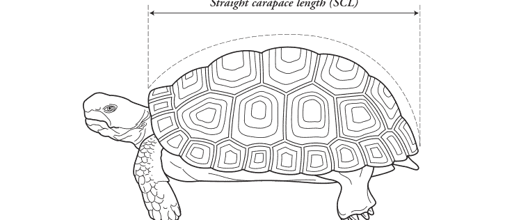

### 蜥蜴

除了玻璃蜥（石龙蛇）外，所有蜥蜴的大小都是通过测量从鼻到泄殖口的体长（`SVL`）来确定的，而不是总长度。许多蜥蜴可能会丢失并再生尾巴，因此，总长度的知识对于鉴定目的来说意义不大。

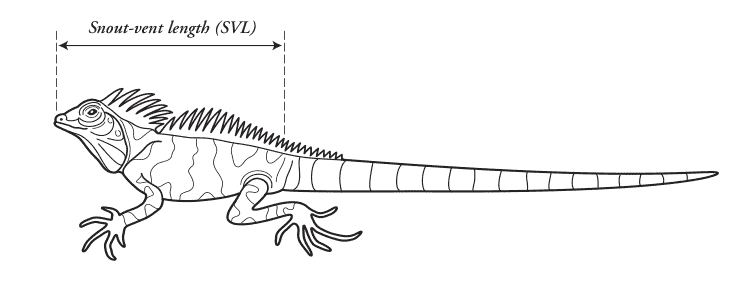

### 蛇和玻璃蜥

在书中，蛇和玻璃蜥（一群多为无肢蜥蜴）的大小报告为总长度（`TL`），即从鼻尖到尾尖的长度。

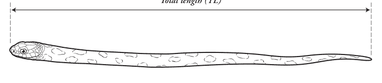

## 形态特征与鳞片类型

### 龟类、水龟和陆龟

硬壳龟和龟类硬质骨质上壳（背甲）和下壳（腹甲）上的鳞片（盾甲）按特定方式排列，有利于鉴定。

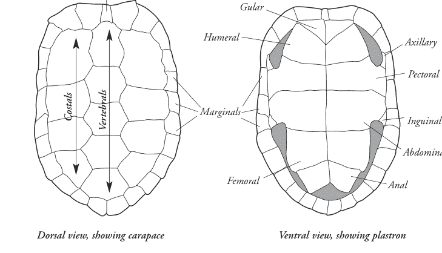

### 蜥蜴头部鳞片

鳞片的位置和大小是鉴定蜥蜴的有用参考（蛇，见第10页）。

鳞片的位置和名称在大多数有鳞目动物中多是典型的。

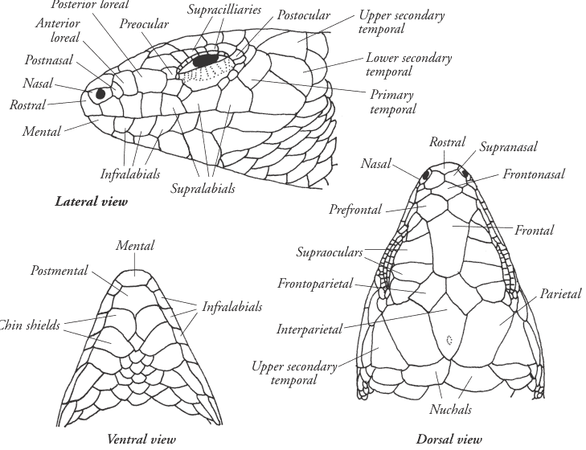

### 蛇的身体鳞片计数

计算蛇身体上的鳞片数量对于鉴定物种很有用。身体鳞片计数在头部和泄殖口中间的位置进行，那里的行数最多。腹鳞片行不计入内。

### 蛇的尾部鳞片计数

“尾下鳞片计数”是尾巴下方鳞片或鳞片对（取决于物种）的数量。计数是从肛后的第一片鳞片或第一对鳞片开始，直到尾尖末端鳞片前的鳞片。

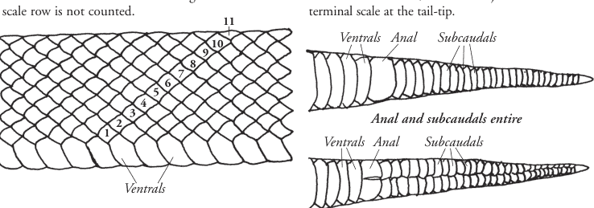

### 蛇的头部鳞片

蜥蜴头部的鳞片可以通过它们的形状和相对位置来识别。

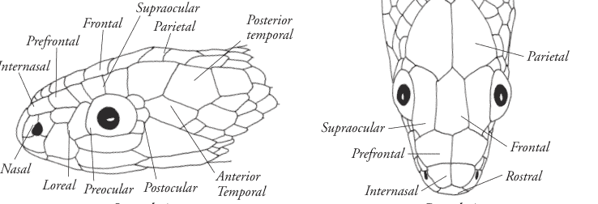

### 蛇的齿列类型

根据牙齿的形式，蛇可以分为四组，这与捕获和杀死猎物的方法有关。蛇的牙齿在丢失后可以生长，蛇在一生中会丢失几组牙齿——这是必要的，因为在进食过程中经常丢失牙齿。无毒蛇没有毒液，每颗牙齿的大小大体相同。后毒蛇与无毒蛇相似，但拥有弱毒，毒液通过上颌（外缘缘状颌骨）后部的一对向后生长的、尖锐的毒牙注入。

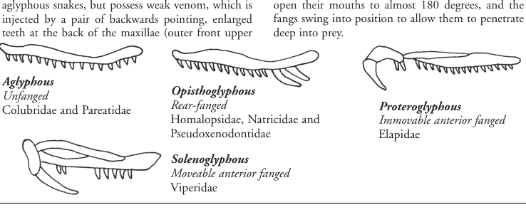 蛇必须咬住猎物，将其移动到口后部以穿透并注入毒液。在前毒蛇中，口腔前方显著增大的“毒牙”向下并通过毒管输送毒液，形成一个空心针注入猎物中。眼镜蛇具有改良的毒牙，毒牙很长且通常是折叠的。蝮可以将嘴巴张到180度，毒牙会摆动到位，使其能够深度穿透猎物。

水龟有蹼足和流线型的壳，而陆龟的指和脚趾间没有蹼膜，或者壳部更圆或更长。在几种高度亲水的淡水龟中，例如拉菲斯水龟和`b. bask`，吻部向上翘起，鼻孔扁平且位置较高，防止其与躯干和前肢发生接触。蛇的一些特征，如长分叉舌头、弯曲的牙齿和较大的鳞片，与一组蜥蜴——巨蜥——共有，这表明它们之间有亲密的关系。

# 爬行动动物生态

## 习性的利用

爬行动动物最大的丰富性出现在世界的热带地区而非温带地区，这是由于可用栖息地和微栖息地的复杂性、物种的多样性以及变化的气候条件（包括季节性、全年活动性），以及有利于地质历史的其他因素。

爬行动动物居住在东亚广泛的栖息地，包括岛屿、草原、森林、沼泽、旱落叶林、低地双层林、山地森林和海岸。爬行动动物群落中，低地森林比落叶林密度更高。例如，某些物种表现出的特征，推测是产生陆生和水生的物种。

## 蜥蜴与蛇

爬行动动物最大的丰富性出现在世界的热带地区而非温带地区，这是由于可用栖息地和微栖息地的复杂性、物种的多样性以及变化的气候条件（包括季节性、全年活动性），以及有利于地质历史的其他因素。

爬行动动物居住在东亚广泛的栖息地，包括岛屿、草原、森林、沼泽、旱落叶林、低地双层林、山地森林和海岸。爬行动动物群落中，低地森林比落叶林密度更高。例如，某些物种表现出的特征，推测是产生陆生和水生的物种。

### 食性

食物类型包括地蚯（`Blythia`、`Calamaria` 和 `Plagophis` 属的眼镜蛇）、淡水蜗和陆陆牛（马来西亚的地odyurmid 蛇）以及蟒科（`Genonia` 属）和其他鱼类（鳄形科的鳄鱼和水龙科蛇）。

某些蛇具有特殊特征；例如 `Pymnodophis` 属的蛇捕食鳞片厚实的鱼类、蛇和其他蛇，以及一种蛇——海床海蛇（`Appururus dactylous`）。

### 繁殖职责

大多数繁殖性物种产生在母体体内孵化的卵团。例外包括某些物种只产生单枚卵，在该地区表现为蛇（`Rhabdophis typus japonicus`），它们是全雌物种。在爬行动动物中，它们产蛋（卵生），产蛋量和后代的大小通常与该物种生态的其他方面有关。雌性产生更大或更长的卵窝，其他因素也可能很重要。卵窝中的蛋数量可能是几颗或数百颗，而且父母的投入（如照顾蛋或孵卵）是否需要让后代留在体内——这是一种育雏行为。某些鳄鱼、乌龟和陆龟也是卵生的。

觅食策略与影响繁殖有关，导致广谱觅食物种的产蛋比定居物种小，其他一些是群居物种在没有生产的情况下独立生存的因素。产蛋本身容易受到影响，即使在目级之间也是如此。在爬行动动物中，它们的范围可能从山龟（`Hoplochen montanus`）的一枚相对较大的蛋，到海洋环境中的更多。某些蛇可能从海蛇（`Amphisbaena taerty`）的一枚蛋，到蟒科（`Brogophis reticulatus`）的122枚蛋。

# 覆盖区域

20世纪中叶，在殖民国家周边，几个国家崛起并形成了东南亚国家联盟（`ASEAN`）。

这一主要经济块的成员包括缅甸、泰国、柬埔寨、越南、马来西亚、新加坡、印度尼西亚、文莱和东帝汶。

在这项研究中，东南亚指的是印度亚洲大陆上所有南部与海洋接壤实体（见前言页的地图，以及后页地图的内地理情况）。因此，印度尼西亚的东部岛屿（包括新几内亚）以及提汶和菲律宾群岛被省略了。

## 柬埔寨

柬埔寨王国总面积为176,520平方公里，位于通常被称为“印度支那”的地区，毗邻泰国湾。其政治边界包括西侧和西北部的泰国，东部的越南和东北部的老挝。首府长度为443公里。该国大部分地区平坦，以中部平原和旱季为特征。地形总体低矮平坦，国家北部和南部有山脉。最高山是峰阿库峰（1,811米）。2008年的人口为14,241,640。与生物多样性保护相关的努力涵盖了大量的木材森林区和矿区。生物多样性保护的重要区域包括基里里里国家公园、碧波山国家公园和波通-萨克国家公园。

## 文莱

文莱鲁莱兰国总面积为5,270平方公里，位于婆罗洲北岸，分为两个部分，一部分嵌入砂拉越境内。它位于南海，首府面积为161公里。首府是斯里培生港。气候属于赤道热带气候。西部沿海平原由沿海平原和丘陵龙叶林组成。

## 印度尼西亚

印度尼西亚共和国总陆面积为1,266,405平方公里，位于印度洋和太平洋之间的群岛。印度尼西亚与其他政体共享17,508个岛屿中的大部分——婆罗洲与马来西亚和文莱共享，与帝汶和新几内亚共享。它拥有54,716公里的海岸线。首府是雅加达。印尼岛屿大部分是热带沿海地区，高地气候较凉。沿海平原延伸至山区，主要分布在较大的岛屿上。

## 缅甸

缅甸联邦（1989年以前称为“缅甸”），总陆面积为654,780平方公里，是南亚最西北的国家。它与印度接壤，北部和东北部与孟加拉国、印度和中国接壤。西部与老挝接壤，东南部与泰国接壤。海岸线为1,960米。首府是仰光。缅甸被描述为一个热带国家，缅甸中部低地被陡峭的山脉环绕，其中包括东南亚最高的山（妙妙崩峰，5881米）。2006年的人口为47,758,132。

## 老挝

老挝民主共和国总陆面积为240,800平方公里，是另一个印度支那国家，东部和东方与越南接壤，南部与泰国接壤。首府是万象。气候为亚热带气候，北部有旱季，南部无季节性。最高点是望亚山（2,817米）。2006年的人口为524,333。

## 马来西亚

马来西亚联邦由两部分组成：西马来西亚（或称马来半岛）和东马来西亚（位于婆罗洲岛上）。总陆面积约为329,847平方公里。西马来西亚与泰国接壤，南端与新加坡通过柔佛海峡相连。东马来西亚与文莱和印度尼西亚的加里曼丹地区接壤。首都是吉隆坡，而行政中心是布城。马来西亚拥有广阔的热带雨林，是许多独特爬行动物的家园。其生物多样性非常丰富，尤其是东马来西亚的婆罗洲地区。

马来西亚总面积为325,580平方公里，位于南亚东北部。它由伸入南海的半岛和婆罗洲的砂拉越和沙巴州组成。北部与泰国接壤，位于加里曼（尼）和文莱。马来西亚拥有4,660公里的海岸线。首府是吉隆坡。气候主要是季节性热带气候，马来西亚北部半岛有短旱季。内陆丘陵山地。最高山是婆罗洲的京那鲁山（4,095米）。

## 新加坡

新加坡共和国总面积为682.7平方公里，是位于半岛南端的岛屿。它拥有371公里的海岸线。该国的当地气候无季节性、潮湿。2006年的人口为4,668,170。

## 泰国

泰国王国（旧称暹）总陆面积为511,700平方公里，西部南部邻安达曼海和泰国湾。南部、东北部和东部邻缅甸，东北部邻老挝和柬埔寨。首府是曼谷。气候为亚热带气候，北部有旱季，南部无季节性。地形除了中部平原南部低地地区外，该国多山，特别是在边界地区。最高山是清真峰（2,576米）。2006年的人口为25,741,132。

## 越南

越南社会主义共和国是一个印度支那国家，总陆面积为325,360平方公里，邻泰国湾、北部湾和南海。边界包括中国、东部的老挝以及南部的越南柬埔寨。

全长3,444公里。首都是河内，气候有明显的干季和雨季，南部则属于热带气候。景观由广阔的低地三角洲以及位于北部、中北部和中部的山区组成。北部的山峰是番西，其特征是石灰岩森林和水生生物形态。2008年的人口为88,116,500人。历史上的主要因素包括刀耕火种等农业生产活动，而生物多样性的重要区域包括丰场牙-界榜国家公园、武光国家公园和猫咪屿国家公园。

## 环境

被称为东南亚地区植物动物生命的丰富性归因于两个因素——地质和现代气候——而且许多爬行动物在世界其他地方无处可见。某些群体，特别是蜥类和蛇类，在该地区的多样化程度极大。

从历史上，东南亚的大部分地区被湿润森林覆盖，尽管缅甸中部和苏门腊的部分地区是干燥的，具有稀树草原类型的植被。其他地区，如安南山脉（Trung Son）和婆罗洲西北部受到地质因素的影响，因此孕育了古老的动物谱系。

从从9世纪开始，伐木工和链锯是进入该地区最具破坏性的因素。东南亚的大片自然土地被清理，当地人只有在移走名贵树木后才清理森林。这种做法对土地生物多样性、土壤、水资源以及人类福祉的影响，完全是灾难性的。

高强度的保护（特别是对低地爬行动物的保护是受到限制的），虽然可以遇到小程度的可持续利用，但大规模的组织化贸易（为海外市场挑选物种）必须经过严格监控，并在主要方面已被突然停止。

## 爬行动物保护

东南亚对爬行动物的开发范围从当地居民为了生存偶尔捕捕蟒子或蛇，到为了食物和传统医药大量移除爬行动物、蜥蜴和其他动物。爬行动物狩猎不断增加，其程度与栖息地的丧失相当，特别是在过去的30年里。几种当地龟类和两种鳄鱼现在正受到威胁，由于缺乏关于身份、种群和分布的科学数据，其尚不确定。

最后，东南亚许多物种中所谓的爬行动物多样性是一个主要的关注领域。昆虫研究可以增加我们对爬行生物学的知识，同时增强保护实践。

很少有爬行动物物种受到大众的青睐并受到科学管理。识别和管理优先级通常由非生物学标准设定，如经济价值和吸引力。尽管如此，已知许多物种对生态系统至关重要。

## 书籍结构

本书涵盖了该地区的所有有效物种。收录日期为2008年12月3日。大部分物种都有插图。每个物种提供以下内容：

1. 英语通用名称（在少数没有名称的情况下进行命名）。
2. 当前科学名称。
3. 代表相关分类单元与通用名称的符号。这些符号符号如下：
   - 轻毒蛇：小蛇的咬伤可能导致人类轻微中毒，而某些物种的成年蛇咬伤可能导致人类死亡。
   - 致命毒蛇：这些蛇的咬伤可能导致人类死亡。
   - 大型爬行动物：这些物种对人类可能是危险的。
4. 龟、陆龟和龟的最大直背壳长（SCL）；鳄鱼、蛇和蜥蜴的总长度（TL）；以及所有其他蜥蜴的吻长（SVL）。见第8页的数据。200毫米以上的尺寸测量以米为单位；200毫米以下的测量以厘米为单位。

## 蛇伤处理

如果你被蛇咬了，请记住以下点：

- 对于属于眼镜科（Elapidae）和蝰科（Viperidae）的咬伤，立即安排将人送往医院。
- 蛇伤需要清洗并安抚，并尽可能保持不动，活动会增加毒液的全身吸收。
- 如果被眼镜科物种咬伤，应使用压力带（越紧越好）以抑制毒液并防止其扩散。尽可能包扎肢体。使用夹板固定咬伤部位不动。在获得专业帮助之前，不要取下绷带。

蛇在受到惊吓、挑衅或被逼入绝角时最可能咬人。在前往有毒蛇的地区之前，确保熟悉处理蛇伤的基本程序。

东南亚地区众知的危险毒蛇。其中包括眼镜科（包括眼镜蛇、珊瑚蛇和海蛇）和蝰科（包括蝰，如圆鼻蝰）的两个成员。

眼镜科的毒液影响这里，即“神经毒性”毒液。它阻断神经到肌肉的收缩。中毒症状包括影响眼睑的肌肉丧失、面部肌肉张力丧失和膈肌麻痹，导致无法呼吸。

蝰科的毒液影响循环系统，被称为“血毒性”毒液。它破坏血管。在这种情况下，蛇伤的症状包括剧烈的局部疼痛、血液不凝和肾衰竭。

游蛇类（包括`Bophis`属和`Macropisis`属的成员）的咬伤也严重到需要抗毒蛇毒治疗。

应该对这些物种施用抗毒蛇毒。

## 鳄类

1. 沼泽鳄 `Crocodylus palustris`，第166页。

   全长5m。吻部相对宽且厚重；眼睛前方无纵向脊；无枕后鳞；灰色至棕色，通常没有深色条纹。

2. 全长6.2m。吻部相对宽且厚重；眼睛前方有纵向脊；有枕后鳞；成年个体在浅黄色、灰色或灰橄榄色的背景上有黑色斑点或斑块。

3. 泰国陆鳄 `Crocodylus siamensis`，第166页。

   全长3.5m。吻部相对宽；眼睛前方有纵向脊；有枕后鳞；背部为黄色、灰色或橄榄灰，带有黑色斑点或斑块。

4. 恒河短吻鳄 `Gavialis gangeticus`，第167页。

   全长7m。吻部纤细，两侧平行；颈部甲与背部甲连续；背部为橄榄色至褐色，身体和尾部有深色斑块或条纹。
   - （4a）雌性吻端无隆起。
   - （4b）雄性吻端有明显的瘤。

5. 马来亚短吻鳄 `Tomistoma schlegelii`，第167页。

   全长5.5m。吻部纤细，逐渐变尖；末端圆；颈部甲与背部甲连续；背部为棕色，有黑色斑点和条纹；尾部有宽黑色条纹。

## 龟类

1. 南陆龟 `Batagur affinis`，第167页。

   背壳长600mm。背壳圆顶，加固厚固；头部小，吻部上翘；前肢4爪；背壳橄榄绿或棕色。
   - （1a）雌性头部棕色。
   - （1b）雄性头部黑色。

2. 彩龟 `Batagur borneensis`，第168页。

   背壳长600mm。背壳椭圆形，扁平；前肢有5爪；背壳为浅棕色或橄榄色，有3条黑色纵纹。
   - （2a）雌性额头。
   - （2b）雄性额头。

3. 缅甸龟 `Batagur trivrivittata`，第168页。

   背壳长580mm。背壳低且有明显的垂直脊；头部吻部尖锐且略微上翘；前肢5爪；背壳为橄榄绿，有3条黑色纵纹；雄性额头有菱形区域；背壳深棕色，雌性额头和颈部为橄榄色，带有黑色头部斑块（见图示）。

4. 亚陆龟 `Cuora galaffinis`，第169页。

   背壳长190mm。背壳高圆顶且光滑；腹甲在胸鳞和腹鳞后有横向铰链；窄的黄色或奶油色脊纹。
   - （4a）背壳窄的黄色或奶油色脊纹。
   - （4b）腹甲黄色或棕黄色，带有深色斑块。

5. 马来箱龟 `Cuora amboensis`，第168页。

   背壳长216mm。背壳高圆顶且光滑；腹甲在胸鳞和腹鳞后有横向铰链；面部有黄色纵纹。
   - （5a）背壳为橄榄色或近黑色。
   - （5b）腹甲黄色或奶油色，每块甲上有一个黑色斑点。

6. 龟甲龟 `Cuora moualthii`，第169页。

   背壳长180mm。背壳细长，三脊，顶部明显扁平；缘缘后锯齿；成年雌性具有弱的横向腹甲铰链。
   - （6a）背壳为深色浅褐色。
   - （6b）腹甲黄色或浅棕色，每块甲上有深棕色斑块。

7. 三纹箱龟 `Cuora trifasciata`，第169页。

   背壳长230mm。背壳隆起、拱形且延伸；腹甲在胸鳞和腹鳞后有横向铰链；头部有黑色眶后纹，包裹眼睛后的棕色或橄榄色三角形。
   - （7a）背壳浅棕色，有3条黑色纵纹；甲片有放射状黑色纹路。
   - （7b）腹甲黄色；甲片有黄色边缘。

## 石龟

1. 黑桥石龟 `Clemmys atripon`，第169页。

   背壳长236mm。背壳椭圆形、细长、扁平、三脊；额头有大鳞；股骨中段短于或等于侧缘中段；侧缘缺口窄到宽。
   - （1a）背壳栗褐色，无花纹或有放射状黑线；头部和颈部有条纹；额头有黑色斑点或点点。
   - （1b）成年个体腹甲有铰链；股骨中段短于或等于侧缘中段；侧缘缺口窄到宽；黄色带放射状深色纹。

2. 普通石龟 `Clemmys dentata`，第169页。

   背壳长210mm。背壳椭圆形、扁平、三脊；额头有大鳞；股骨中段短于侧缘中段；缺口呈锐角。
   - （2a）背壳深棕色，无花纹或有放射状黑线；额头有斑点，颈部有深色条纹。
   - （2b）腹甲黄色，无花纹或有放射状纹；腹甲有斑纹。

3. 灰石龟 `Clemmys fusca`，第170页。

   背壳长242mm。背壳椭圆形、扁平、三脊；额头有大鳞；股骨中段长或等于侧缘中段；侧缘缺口宽。
   - （3a）背壳深棕色，有放射状纹；额头比耳郭区浅；颈部无条纹。
   - （3b）腹甲深色至黑色，有放射状纹。

4. 奥尔哈姆石龟 `Clemmys oldhami`，第170页。

   背壳长254mm。背壳矩形、扁平、三脊；额头有大鳞；股骨中段长或等于侧缘中段；侧缘缺口宽。
   - （4a）背壳深色或浅褐色；额头有斑点；颈部有斑纹。
   - （4b）腹甲深棕色或黄色，边缘有斑纹。

5. 越南石龟 `Clemmys pulcherrimata`，第170页。

   背壳长227mm。背壳椭圆形、细长、三脊；额头有放射状深色纹或厚黑色斑点；股骨中段短或等于侧缘中段；侧缘缺口窄到宽。
   - （5a）背壳栗褐色或浅褐色，有放射状纹；额头有明显条纹。
   - （5b）腹甲黄色，有短放射状纹；幼体腹甲深棕色，边缘有斑纹。

6. 黑胸石龟 `Geomys spengleri`，第170页。

   背壳长125mm。背壳扁平、三脊；前缘锯齿；眼睛大；上颌钩状；前肢外侧有大鳞。
   - （6a）背壳红橙色、橙黄色或橄榄棕色，脊上有黑纹；额头带黄色；耳郭区有条纹。
   - （6b）腹甲深棕色，边缘黄色。

## 其他龟类

1. 黄头寺龟 `Mauremys annandaii`，第170页。

   背壳长506mm。背壳细长、隆起，成年个体扁平；壳圆；后缘分离。
   - （1a）幼体背壳为黑色，边缘有橙色纹。
   - （1b）腹甲橙色带有波纹，逐渐变为黑色。

2. 安拉开森林龟 `Henserys sp.`，第170页。

   背壳长242mm。背壳扁平；背甲区扁平有钝脊；后缘锯齿；趾间有蹼。
   - （2a）背壳浅褐色，有时有深棕色斑纹。
   - （2b）腹甲黄褐色。

3. 亚洲大龟 `Mauremys graius`，第170页。

   背壳长480mm。背壳三脊；成年个体隆起，幼体扁平；侧脊不跨越第四节。
   - （3a）背壳深棕色，边缘有斑纹。
   - （3b）腹甲黄褐色斑块。

4. 越南山龟 `Mauremys annamensis`，第171页。

   背壳长220mm。背壳椭圆形，成年个体拱形；背脊强；成年缘缘光滑；幼体缘缘扩张并带刺。
   - （4a）背壳棕色，黄色底带放射状纹。

5. 马来亚角龟 `Mauremys macrocephala`，第171页。

   背壳长300mm。背壳三脊；头部大，尤其是成年雌性。
   - （5a）背壳棕色，有黑色区域和黄色边缘。
   - （5b）腹甲黄色，每块甲上有一个黑色斑块。

6. 湄公角龟 `Mauremys subtrijuga`，第171页。

   背壳长210mm。背壳三脊；头部大，尤其是成年雌性。深棕色，有黑色区域和黄色边缘。
   - （6a）背壳灰棕色。
   - （6b）腹甲黄色，每块甲上有一个黑色斑块。

7. 越南圆龟 `Mauremys annensis`，第171页。

   背壳长170mm。背壳椭圆形、低矮，幼体三脊；成年个体侧脊明显；后缘微锯齿。
   - （7a）背壳灰棕色。
   - （7b）腹甲黄色或黄橙色，每块甲上有一个黑色斑块。

8. 亚洲黄腹龟 `Mauremys mutica`，第171页。

   背壳长194mm。背壳椭圆形、扁平；三脊；背脊；有项甲、壳腋甲和腹窝甲。
   - （8a）背壳黄褐色或灰色；缘缘深色。
   - （8b）腹甲黄色，每块甲上有正方形或矩形斑块。

9. 中国纹颈龟 `Mauremys sinensis`，第171页。

   背壳长240mm。背壳椭圆形，中等程度扁平，不凹陷；幼体背壳三脊；脊低且不连续，成年个体脊消失；第四、五椎椎骨宽于长。
   - （9a）背壳红褐色至灰棕色。
   - （9b）腹甲黄色，每块甲上有一个大黑褐色斑块。

## 陆龟

1. 印度黑龟 `Melanochelys trijuga`，第172页。

   SCL 280mm。背甲长形，成年个体高，幼体扁平；截截形；吻部短。
   - （1a）背甲棕色或黑灰色。
   - （1b）腹甲深色，带有淡黄色边缘（个体除外）。

2. 缅甸眼龟 `Turtleocys occella`，第172页。

   SCL 155mm。背甲隆起，壳光滑；脊脊（幼体有）或缺失（成年体）；后缘无花纹；头部吻部尖。
   - （2a）背甲绿褐色或橄榄色；脊椎和鳞片大，呈黄色，中心多为褐色。
   - （2b）腹甲无花纹。

3. 马来亚平壳龟 `Notochelys platynata`，第172页。

   SCL 400mm。背甲扁平，有低且不连续的脊；6–7节脊椎；腹甲铰接弱。
   - （3a）背甲黄褐色或砖红色（成年体）；亮绿色（幼体）。
   - （3b）腹甲黄橙色，每块鳞片有黑斑。

4. 马来巨龟 `Batagur`，第172页。

   SCL 800mm。背甲隆起（幼体）或光滑（成年体）；头部大；前肢外侧有带状状鳞片。
   - （4a）背甲无花纹，棕色或灰色。
   - （4b）腹甲黄橙色或褐色，有时有深色斑点。

5. 贝莱四眼龟 `Scalalia bealei`，第172页。

   SCL 143mm。背甲长形，单脊，轻微扁平；后缘无锯齿；脊脊低；腹甲加固结构弱。
   - （5a）背甲黄褐色至巧克力褐色；前缘有许多黑色或深褐色的斑点。
   - （5b）雄性腹甲黄色至浅橄榄色，有时有深色蠕纹。
   - （5c）雌性腹甲黄色至浅橄榄色，有时有深色斑块。

6. 四眼龟 `Scalalia quadricollis`，第172页。

   SCL 140mm。背甲长形，单脊，轻微扁平；后缘无锯齿；脊脊弱。
   - （6a）背甲深褐色，有放射状深线；前部缺乏深色斑点，或斑点显著减少。
   - （6b）雄性腹甲黄色，带深色蠕纹。
   - （6c）雌性腹甲奶油色，带深色蠕纹和点点。

7. 黑泽龟 `Siebenrockriella crassollis`，第173页。

   SCL 200mm。背甲椭圆形，后缘有锯齿；脊椎区域扁平，单脊（成年体）或三脊（幼体）。
   - （7a）背甲深灰色或近黑色。
   - （7b）腹甲浅灰色，每块鳞片有大深色区域。

## 海龟

1. 蠵龟 `Caretta caretta`，第173页。

   SCL 1,200mm。背甲长形，末端收细；5对缘肋骨；下颌鳞片无孔；13块缘鳞片。
   - （1a）背甲红褐色。
   - （1b）腹甲黄褐色或黄橙色。
   - （1c）幼体有侧脊。

2. 绿龟 `Chelonia mydas`，第173页。

   SCL 1,400mm。背甲心形；成对前额骨；鳞片不重叠；上颌无钩。
   - （2a）背甲橄榄色或褐色，有放射状深色花纹。
   - （2b）腹甲淡黄色。
   - （2c）幼体无脊。

3. 玳龟 `Eretmochelys imbricata`，第173页。

   SCL 1,000mm。背甲心形；2对前额骨；鳞片重叠；上颌相对窄且细长。
   - （3a）背甲橄榄褐色；幼体有较深斑块。
   - （3b）腹甲淡黄色（成年体）或深灰色（幼体）。
   - （3c）幼体无脊。

4. 橄榄绿海龟 `Lepidochelys olivacea`，第173页。

   SCL 800mm。背甲心形；5–9对肋骨；下缘缘有孔；上颌有钩。
   - （4a）背甲橄榄灰或灰色。
   - （4b）腹甲绿黄色（成年体）或奶油色（幼体）。
   - （4c）幼体有侧脊。

5. 棱龟 `Dermochelys coriacea`，第174页。

   SCL 2.5m。背甲长形，逐渐收细；背甲和腹甲上有高脊；壳覆盖有皮肤；四肢如桨状并有爪。
   - （5a）背甲黑色或带有黑蓝色斑点。
   - （5b）腹甲浅灰色或粉灰色。
   - （5c）幼体背甲覆盖有微小鳞片。

## 其他龟类

1. 侧耳龟 `Trachemys scripta`，第174页。

   SCL 280mm。壳圆滑；腹甲无铰接；背甲为绿色，带黄色线条，深处为灰色；头部有红色斑块。
   - （1a）成年体背甲灰色；雄性指部有长爪。
   - （1b）幼体背甲有黄色线条；腹甲有圆斑。
   - （1c）幼体腹甲每块鳞片为深色。

2. 大头龟 `Platysterna megcephalum`，第174页。

   SCL 200mm。头部大，覆盖有鳞片；颌有钩；喉部有疣。
   - （2a）成年体壳橄榄色，扁平；背甲有方形鳞片；额头有线条。
   - （2b）`P. m. megcephalum`眶后有带。
   - （2c）`P. m. pelekanoides`腹甲缝。
   - （2d）`P. m. thoboi`密集的黄色或粉色。
   - （2e）幼体壳长而。

3. 缅甸龟 `Gechelon platynota`，第175页。

   SCL 260mm。壳光滑；无肋脊。
   - （3a）背甲黑色或深褐色，脊椎和肋骨中心为黄色并有放射状线条。
   - （3b）腹甲黄色。

4. 长龟 `Indotestudo elongata`，第175页。

   SCL 330mm。壳背部隆起；腹甲后部有缺口；缺口窄。
   - （4a）背甲黄褐色或橄榄色，有散布斑块。
   - （4b）腹甲黄褐色或橄榄色，有散布斑块。

5. 亚洲龟 `Manouria emys`，第175页。

   SCL 500mm（`M. e. emys`）；580mm（`M. e. hopei`）。壳低；脊椎区域扁平；背甲鳞片有锯齿；前肢外侧有一对大疣。
   - （5a）`M. e. emys`背甲中褐色。
   - （5b）`M. e. hopei`背甲黑褐色。

(5c) *M. e. emys* 胸鳞片小且分离。

(5d) *M. e. hopei* 胸鳞片大且愈合。

## 6. 凹背龟 *Manouria impressa*，第 175 页。

`SCL` 302mm。壳低；脊椎凹陷；后缘缘锯齿；前肢外侧鳞片大；每个大腿上有一个疣鳞。

- (6a) 背甲透明至黄橙色，有条纹。
- (6b) 腹甲褐色，有放射状深线。

## 1. 亚洲软龟 *Amyda cartilinea*，第 176 页。

`SCL` 750mm。背甲两侧圆；头部大；腹甲无铰接；背甲绿色，带黄色线条，深处为灰色。

- (1a) 成年体背甲灰色；黄褐色或橙色。
- (1b) 幼体背甲有黄色线条；成年体腹甲有深色斑块。
- (1c) 幼体有侧脊。

## 2. 陆龟 *Chitra chitra*，第 176 页。

`SCL` 1,200mm。背甲心形；2 对前额骨；鳞片不重叠；上颌无钩。

- (2a) 背甲橄榄色或褐色，有放射状深色花纹。
- (2b) 腹甲淡黄色。
- (2c) 幼体无脊。

## 3. 爪哇亚软龟 *Chitra javanensis*，第 176 页。

`SCL` 1,000mm。背甲心形；2 对前额骨；鳞片重叠；上颌相对窄且细长。

- (3a) 背甲橄榄褐色；幼体有较深斑块。
- (3b) 腹甲淡黄色（成年体）或深灰色（幼体）。
- (3c) 幼体无脊。

## 4. 缅甸亚软龟 *Chitra vandijiki*，第 176 页。

`SCL` 800mm。背甲心形；5–9 对肋骨；下缘缘有孔；上颌有钩。

- (4a) 背甲橄榄灰或灰色。
- (4b) 腹甲绿黄色（成年体）或奶油色（幼体）。
- (4c) 幼体有侧脊。

## 5. 马来软龟 *Dogania subplana*，第 176 页。

`SCL` 350mm。背甲两侧直直；头部大，吻部下垂；成年体有背甲铰接。

- (5a) 背甲深橄榄色或褐色，有深色中线。
- (5b) 腹甲奶油色或灰色。
- (5c) 头部眶后带。
- (5d) 幼体：背甲深色、黄色或橄榄色，有 2–3 对黑心的眼状斑。

## 6. 印度斑缘龟 *Lisemmys punctata*，第 176 页。

`SCL` 370mm。背甲椭圆形，隆起；腹甲有 7 块加固；收缩时缘甲覆盖后肢；成年体腹甲腔大。

- (6a) 背甲橄榄灰，有深黄色斑点。
- (6b) 腹甲奶油色或淡黄色。
- (6c) 头部黄色斑点。

## 7. 缅甸缘龟 *Lisemmys scutata*，第 177 页。

`SCL` 370mm。背甲椭圆形，隆起；腹甲有 7 块加固；收缩时缘甲覆盖后肢；成年体腹甲腔大。

- (7a) 背甲褐橄榄，有时有细黑斑点或网纹。
- (7b) 腹甲黄色。
- (7c) 头部眶后带界限淡色区域。

## 1. 缅甸软龟 *Nilsonia formous*，第 177 页。

背甲长度 (`SCL`) 650mm。背甲圆滑，光滑（成体）或有纵向疣脊（幼体）；颈部上方有一系列粗钝疣；4 个中心深色、边缘浅色的眼斑（幼体）。

- (1a) 背甲橄榄绿至棕褐色，带有深色网纹（成体）；
- (1b) 腹甲无花纹，奶油色。

## 2. 颈褶软龟 *Palea steindachneri*，第 177 页。

背甲长度 (`SCL`) 426mm。背甲椭；背甲前端有疣。

- (2a) 背甲无纹，橄榄绿、棕色或灰色。
- (2b) 腹甲奶油色或黄色。
- (2c) 幼体背甲前端有隆起疣。

## 3. 亚洲大软龟 *Pelochelys cantororii*，第 177 页。

背甲长度 (`SCL`) 500mm。背甲扁平；头短；眼睛闭合至吻尖；吻部极短且圆。

- (3a) 背甲橄榄绿或棕色，有时带有较浅或较深色的斑点或条纹，外缘较浅。
- (3b) 腹甲无花纹，白色，有时带有粉色斑块。

## 4. 中国软龟 *Pelodius sinensis*，第 177 页。

背甲长度 (`SCL`) 250mm。背甲椭圆，长长于宽，光滑（成体）或有纵向低矮疣脊（幼体）。

- (4a) 背甲无纹，橄榄绿至灰灰色（成体）；边缘浅色斑点（幼体）。
- (4b) 腹甲无花纹，奶油色、灰色或黄色。
- (4c) 幼体腹甲粉红色，带有大黑色斑块。

## 5. 中印大软龟 *Rafetus swinhoei*，第 177 页。

背甲长度 (`SCL`) 600mm。背甲长方形；有 2 个腹甲隆。

- (5a) 背甲橄榄绿，有许多被黄点环绕，有时形成条纹，幼体尤为明显：成体花纹消失。
- (5b) 腹甲无花纹，淡橄榄灰。

## 1. 大棘鬣 *Anolis armata*，第 178 页。

体体长 (`SVL`) 140mm。头上及后枕棘达到颈脊高度：颈脊与背脊分离或连接：灰色、棕色至近黑色，带有深色大理纹；腋下有菱形标记；三角形斑块呈灰色

- (1a) 雄性头部和背缘。
- (1b) 雌性头部和背缘。

## 2. 中印棘鬣 *Anolis capra*，第 178 页。

体体长 (`SVL`) 137.9mm。后枕棘位于鼓膜和颈脊之间：颈脊由深色横纹组成；背鳞和颈鳞为短鳞；绿橄榄色带黑斑和黄斑。

- (2a) 雄性头部呈绿色；青绿色。
- (2b) 雌性头部呈黄绿色；黄斑带绿色条纹。

## 3. 冠棘鬣 *Anolis coronata*，第 178 页。

体体长 (`SVL`) 137.5mm。后枕棘位于鼓膜和颈脊之间：颈脊和背脊连续，低矮，由三角形鳞片组成。

- (3a) 雄性头部和背缘。
- (3b) 雌性头部呈棕红色；带有深色横纹。

## 4. 斑棘鬣 *Anolis crucigera*，第 179 页。

体体长 (`SVL`) 140mm。颈脊起于低矮背脊：颈脊和背脊的棘宽阔；背部呈黄绿色，有明显的浅黄色斑点网纹；背部面部斑，

- (4a) 雄性头部浅褐色。
- (4b) 雌性头部深色。

## 5. 鳞棘鬣 *Anolis lepidogaster*，第 179 页。

体体长 (`SVL`) 111mm。后枕棘上方有 6 片圆锥形鳞；背脊由亚三角形鳞片组成；背部为亮绿色，可变为深棕色；脑后有不明显的菱形黑斑。

- (5a) 雄性头部和背缘。
- (5b) 雌性头部和背缘。

## 6. 纳塔尔棘鬣 *Anolis natalis*，第 179 页。

体体长 (`SVL`) 158mm。鼓膜上方无后枕棘：颈脊和背脊清晰，剑形鳞向后，彼此分离。

- (6a) 雄性背黄色变红色、棕色或黄色；头部、颈脊、背脊和四肢为红色；眼眶和鼓膜处黑色斑纹；后颈深棕色纹。
- (6b) 雌性头部呈翠绿色。

## 7. 长吻灌鬣 *Anolis acuitnitris*，第 179 页。

体体长 (`SVL`) 72mm。吻脊长于眼径；上方有凸出的鳞列；吻部为棕色，颜色较深。

## 8. 褐色灌鬣 *Anolis fusca*，第 179 页。

体体长 (`SVL`) 67mm。吻圆，不长于眼径；背部为棕色或橙褐色。

## 9. 华丽灌鬣 *Anolis ornata*，第 180 页。

体体长 (`SVL`) 57mm。吻圆；背部为中褐色至棕红色；眼睑侧有黄色斑点。

- (9a) 雄性吻端有肉质；颈脊低矮。
- (9b) 雌性吻端有肉质。

## 1. 冠毛绿鬣 *Bronochela cristatella*，第 180 页。

体体长 (`SVL`) 130mm。颈脊小，直立，与背脊连续，背脊锯齿状不延伸至尾部；背部灰色带斑。

## 2. 海氏森林鬣 *Bronochela hayei*，第 180 页。

体体长 (`SVL`) 120mm。颈脊具有保护色鳞，与略微增大的背脊连接；背部为浅绿色带斑块；头部淡黄色、绿色。

## 3. 鬃毛森林鬣 *Bronochela humata*，第 180 页。

体体长 (`SVL`) 140mm。颈脊大，呈斑块状，向后延伸；背脊较低，延伸至尾部；背部为棕色至黑色，有黄色斑点或垂直纹。

## 4. 尖竹府森林鬣 *Bronochela smaragdina*，第 181 页。

体体长 (`SVL`) 113mm。颈脊低矮，由小直立鳞组成；无背脊；背部呈翠绿色；侧腹下方的白色或黄色条纹延伸至尾部。

## 5. 越南森林鬣 *Bronochela vietnamensis*，第 181 页。

体体长 (`SVL`) 122mm。颈脊包含 6-12 片小直立鳞；无背脊；背部为绿色；腹部有黄色带延伸至腹股区、大腿后部和尾侧。

## 6. 科拉森林鬣 *Calotes chalcichum*，第 181 页。

体体长 (`SVL`) 142.9mm。颈脊由压缩鳞组成；背脊无间隙连接；背部为灰色，带 4 个不规则的鞍状标记。

- (6a) 雄性眼睛和鼓膜区域有深棕色斑块；背部鞍状标记为淡紫色。
- (6b) 雌性后眼眶至鼓膜区域有深棕色斑；背部鞍状标记清晰。

## 7. 森林冠鬣 *Calotes emma*，第 181 页。

体体长 (`SVL`) 115mm。眼睛上方有长棘，鼓膜上方有2 个；颈脊和背脊连续；背部为橄榄褐色，带有深色背部条纹或横斑；浅色背侧条纹。

- (7a) 雄性背部有明显的横带；有时有浅色背中纹；间隙皮肤为紫色或黑色。
- (7b) 雌性背侧条纹不明显或缺失；间隙皮肤非紫色或黑色。

## 1. HTUNWINI森林蜥 *Calotes htunwini*，第181页。

体长（`SVL`）91.4mm。有一对或一组额上棘；背鳍由小鳞片组成；背部为米色至浅褐色；颈部有一对深棕色中心奶油色的棘；喉部呈橙色。

- (1a) 雄性 `SVL` 达91.4mm；前臂带缺失。
- (1b) 雌性 `SVL` 达84.3mm；半数群体存在前臂带。

## 2. 伊罗瓦江森林蜥 *Calotes irawadi*，第182页。

`SVL` 106.8mm。耳膜上方有一对或一组棘；背部为青色；趾间后外缘有一对深褐色黑色棘；喉部有褪色的掌扇状条纹。

- (2a) 雄性 `SVL` 达106.8mm；颈斑始终存在。
- (2b) 雌性 `SVL` 达77.9mm；颈斑始终存在。

## 3. 乔丹森林蜥 *Calotes jordoni*，第182页。

`SVL` 100mm。背鳍存在，颈鳍较弱；背部呈亮绿色，有时带有对黑色边缘的棕色带，以及黄色、橙色或棕色斑块。

## 4. 蓝色森林蜥 *Calotes mystaceus*，第182页。

`SVL` 140mm。背鳍和颈鳍连续；眼睛上方有2–3个棘；背部为灰褐色，在繁殖季节变为右蓝色至绿松石，侧腹有3–5个大斑点。

## 5. 园蜥 *Calotes versicolor*，第183页。

`SVL` 95mm。耳膜上方有两个分离的棘；无肱骨褶。

- (5a) 雄性头部为橙色或红色；繁殖期雄性喉部有黑色斑，逐渐变为暗灰色。
- (5b) 雌性为黄色或灰橄榄绿。

## 6. 京那山森林蜥 *Calctophus nigrigularis*，第183页。

`SVL` 75.5mm。背鳍略大，强隆起；背鳍前部9片鳞片细长且扁；背部为深棕灰色，躯干有两条宽横带；下眼处有白色斑；颊囊为黑色，远端附近有一对白斑。

## 7. 布伦格尔树蜥 *Dendragama boulengeri*，第183页。

`SVL` 73mm。覆盖大鳞片的骨质脊从耳膜上方延伸至眼眶；短背鳍由13–14片鳞片组成；颈鳍由6–7片直立鳞片组成；背部为蓝绿色或橄灰色，颈皮肤上有圆形深色斑，边缘有黄色条纹。

## 1. 布兰福龙 *Draco blancforis*，第183页。

`SVL` 130mm。鼻孔直接朝向前方；眉缘无刺状鳞；翼肋通常为5条，例外为6条；背部为蓝灰色或棕灰色；雄性翼膜有纵向白线，雌性有黑色横纹；翼膜有5条带有浅斑的深色横带。

## 2. 角飞龙 *Draco corutus*，第183页。

`SVL` 88.9mm。鼻孔向侧向；眼睛上方有明显的刺状鳞；翼肋6条；雄性背部为亮绿色至绿褐色；雌性为褐色或浅褐色；翼膜为红橙色，带有深色斑点或横纹；喉囊为亮黄色。

## 3. 冠飞龙 *Draco cristellus*，第183页。

`SVL` 90mm。鼻孔向侧向或略倾斜；翼肋5–6条；背部为棕灰色，带有横横标记；深色条纹或斑点；翼膜为深褐色，带有较浅的线条。

## 4. 缘飞龙 *Draco fimbriatus*，第184页。

`SVL` 132mm。鼻孔向侧向；眼睛上方有棘状突起；翼肋5条；背部和翼膜为灰褐色或棕灰色；翼膜为橄榄灰色，带有浅绿色标记。

## 5. 美飞龙 *Draco formosus*，第184页。

`SVL` 101mm。鼻孔朝背；眉缘无刺状鳞；翼肋5条；背部为蓝灰色或棕灰色；翼膜背部为橄榄灰色，带有明显或模糊的灰黑色或棕色横纹或斑点。

## 6. 褐珠飞龙 *Draco haematogenus*，第184页。

`SVL` 94mm。鼻孔朝背；眼睛上方无刺状鳞；翼肋5条；背部为深橄榄绿或棕灰色，带有明显的深色斑；翼膜为黑色，带有黄色斑点。

## 7. 中华飞龙 *Draco indochinesis*，第184页。

`SVL` 107.8mm。鼻孔位于背并向上；眉缘无刺状鳞；翼肋可见；背部为棕灰色，有小深斑；翼膜边缘为浅褐色至深褐色，有6条浅色横带。

## 1. 橙翼飞龙 *Draco macudatus*，第184页。

`SVL` 82mm。鼻孔向外；翼肋5条；背部为浅蓝色或橄榄灰；雄性翼膜为黄色带橙缘；雌性（如图）为灰色带白纹。

## 2. 大飞龙 *Draco maximus*，第185页。

`SVL` 140mm。鼻孔朝背；上方有棘状突起；翼肋6条；背部为灰色或灰橄榄绿带横带；红色或橙黄色。

## 3. 黑须飞龙 *Draco melanogon*，第185页。

`SVL` 93mm。鼻孔朝背；上方无棘状突起；翼肋5条；背部为橄榄绿带棕灰色横带或菱形斑点；翼膜为黑色，有时为黄橙色。

## 4. 隐飞龙 *Draco obscurus*，第185页。

`SVL` 113mm。鼻孔向上；翼肋5条；背部为灰褐色，散布深褐色斑点；垂直区域有蝴蝶形标记；翼膜为橄榄黄或橙黄色带5–6条宽带。

## 5. 五带飞龙 *Draco quinqufasciatus*，第185页。

`SVL` 110mm。鼻孔朝背；翼肋6条；雄性背部为亮绿色，雌性（如图）为棕橄榄绿带斑点；翼膜为橄榄褐色，上方为橙红色。

- (a) 颈鳍高。
- (b) 雌性颈鳍低。

## 6. 普通飞龙 *Draco sumatranus*，第185页。

`SVL` 85mm。鼻孔向侧；翼肋6条；背部为黄褐色或带深褐色斑块；喉部为亮黄色，底部有黑点。

## 7. 窄纹飞龙 *Draco taeniternus*，第185页。

`SVL` 96mm。鼻孔朝背；翼肋5条；背部为浅灰色或绿褐色；翼膜为浅灰色或绿黄色，带5条不规则黑带。

## 8. 爪维飞龙 *Draco volans*，第186页。

`SVL` 96mm。鼻孔向侧；翼肋通常为6条；背部为黄褐色或深褐色；雄性翼膜有明显的黑色边缘至浅黄褐色。

## 1. 阿伯特角蜥 *Gcephalus abbotti*，第186页。

`SVL` 143mm。背鳍小于颈鳍；眉缘隆起；背部为绿色，有放射状深线；虹膜亮红色。

## 2. 蓝颈角蜥 *Gcephalus bellii*，第186页。

`SVL` 150mm。背鳍鳞片位于前方；雄性背部为灰褐色，雌性为红褐色；底部有眶孔；雄性为蓝色；雌性区域有粉色斑点。

## 3. 贝氏氏角蜥 *Gcephalus beyschlagi*，第186页。

`SVL` 126mm。颈鳍和背鳍连续，颈部略有缺口；背部上呈帆状并连接；背部为绿色带黄色颈；虹膜明亮；侧腹有大黄斑。

## 4. 婆罗角蜥 *Gcephalus hornensis*，第186页。

`SVL` 136mm。颈鳍和背鳍连续，鳞片较长；背部为绿色带深带；侧腹有椭圆形浅斑；喉有深色条纹。

- (a) 颈鳍高。
- (b) 雌性颈鳍低。

## 5. 提安角蜥 *Gcephalus chameleontinus*，第186页。

`SVL` 170mm。眼睛圆且弯；背部为绿色，带有三角形至大鳞片；背部有黄色斑点、横纹和网状纹；虹膜为褐红色；喉部有蓝色条纹。

## 6. 爵士角蜥 *Gcephalus dorsatus*，第186页。

`SVL` 163mm。背鳍与颈鳍一样；背部为绿色，带波浪状灰色纹或大面积橙色；虹膜粉色；喉部有黄色斑或橙色或灰色斑点。

## 7. 巨型角蜥 *Gcephalus guttatus*，第187页。

`SVL` 160mm。雄性颈鳍和背鳍分离；雌性背鳍缺失但有颈鳍；雄性背部为绿色带黄斑，雌性棕绿色。

- (a) 雄性背鳍。
- (b) 雌性无背鳍；无花纹。
- (c) 幼年雄性背鳍短；带条纹。

## 8. 克洛斯角蜥 *Gcephalus lnii*，第187页。

`SVL` 165mm。颈鳞片呈矛形；颈鳍和背鳍分离；背部为橄榄褐色，带浅褐色斑点；虹膜呈粉蓝色；头部有灰黑色面罩；喉部色澈。

## 9. 库尔角蜥 *Gcephalus kuhii*，第187页。

`SVL` 100mm。颈鳍低；背部为绿橙色，头部有浅色斑点；虹膜褐色；肩部有奶油色带；背部有红色或黄色带。

## 10. 锡库力角蜥 *Gcephalus lacunos*，第187页。

`SVL` 145mm。背鳍与颈鳍分离；背部为绿色或灰色；扩大的侧腹为橄榄绿或黄色；虹膜深蓝色；头部和喉有绿松石标记。

## 11. 蓝眼角蜥 *Gcephalus liogaster*，第187页。

`SVL` 140mm。颈鳍和背鳍连续，由矛形鳞片组成；雄性背部为棕绿色，带深色网纹；雌性为横纹；虹膜亮蓝色。

- (a) 雄性背鳍；周围皮肤为红橙色。
- (b) 雌性背鳍短；眼睛周围皮肤。

## 12. 大鳞角蜥 *Gcephalus megalepis*，第188页。

`SVL` 140mm。颈鳍和背鳍分离；背部为绿色带明显的棕色带；虹膜为靛蓝色；身体上一些圆鳞片为白色；身体有粉色奶油色条纹；喉部为浅绿色。

## 1. **梅约伯格蜥**：单大型扁平鼓膜；喉囊较小，边缘具弱锯齿，覆有小鳞片；有颈后冠；背冠为小脊；背部呈浅绿色。`SVL` 58mm，背部浅绿色，可变为棕灰色；带有窄的绿色网状花纹，围着侧部的黄色斑点。

## 2. **罗宾逊角头蜥** *Gkcephalus rohhinus*，第 188 页。

`SVL` 152mm，颈后冠和背冠连续，向尾部逐渐降低；有喉囊；侧部有散布的大型鳞片；背部为绿色，有橄榄色深斑和黄色斑点组成的浅条纹；唇缘缝隙处有白色条纹；眼后纹延伸至鼓膜。

- (2a) 雌性喉部为黄色
- (2b) 雄性喉囊为粉色。

## 3. **贝卡纳角山蜥** *Harpersua beccari*，第 188 页。

`SVL` 86mm，背部有一列光滑的菱形鳞片；前吻部排列长，后部排列短；背冠由 13 片鳞片组成；背部呈亮绿色；头部和颈部有两条橄榄色条纹。

## 4. **婆罗洲角蜥** *Harpersua bornensis*，第 188 页。

`SVL` 59mm，圆柱状吻排列由 4 片大型鳞片支撑；雄性有背冠和侧冠；有喉囊；背部呈红褐色，有 7 行斜排列的黑点和横跨身体的黄色带。

## 5. **莫德格里亚尼角蜥** *Harpersua modligianus*，第 189 页。

# 图 17. 鬣蜥科（AGAMIDAE）

1. **鲁德金冠蜥** `Lapallocates ludeking`，第 190 页。

`SVL` 92mm，鼓膜大，鼓膜下方扩大；雄性为亮绿色或深褐色，鼓膜处有大白斑，身体有不明显的横向橄榄色带；雌性有宽大的脊椎带。

2. **富氏蜥** `Mantella phucuartii`，第 191 页。

`SVL` 90mm，喉囊被 `U` 形折皱环绕；有股腺；四肢和趾细长；背部为深褐色或橄榄绿，有绿色斑点；侧部为蓝色或带有黑色斑点的橙色条纹。

3. **婆罗洲灌林蜥** `Phasmophorus bornnei`，第 191 页。

`SVL` 66mm，眼睛上方无棘；鼻部与上唇鳞接触；下眶缘连续排列；鳞片尖锐卷曲；背部至灰褐色；有 2 条眼间纹，前方的一条缺失。

4. **大头灌林蜥** `Phasmophorus cephalus`，第 191 页。

`SVL` 84mm，眼睛上方无棘；鼻冠由 7–8 片厚锥形鳞组成；鼻部与上唇鳞接触；下眶缘连续两排；背部为浅绿色，带有深灰色或灰色。

5. **黑条灌林蜥** `Phasmophorus nigris`，第 191 页。

`SVL` 58mm，眼睛上方无棘；鼻部与上唇鳞接触；下眶缘连续两排；背部为浅绿色，带有深灰色或灰绿色。

6. **棘头灌林蜥** `Phasmophorus spince`，第 191 页。

`SVL` 60mm，眼睛上方无棘；鼻部与上唇鳞接触；下眶缘连续两排；背部为浅绿色或深灰色。

7. **印尼水龙** `Physygat coccinicus`，第 192 页。

`SVL` 95mm，颈后冠和背冠分离，延续至尾部；雄性喉囊明显；背鳞异形；背部为绿褐色，黑点组成带状纹；喉囊为浅红色，前方有黑白条纹。

- (7a) 成体颈后冠

- (7b) 幼体颈后冠

8. **短足长头蜥** `Psuedocates brevipes`，第 192 页。

`SVL` 77mm，颈后冠和背冠分离，延续至尾部；雄性喉囊明显；背鳞异形；背部为绿褐色。

9. **黄喉长头蜥** `Psuedocates flavula`，第 192 页。

`SVL` 72mm，颈后冠和背冠分离，延续至尾部；雄性喉囊明显；背鳞异形；背部为绿褐色。

10. **花斑长头蜥** `Psuedocates floweri`，第 192 页。

`SVL` 98mm，颈后冠和背冠分离，延续至尾部；雄性喉囊明显；背鳞异形；背部为绿褐色。

# 图 18. 鬣蜥科（AGAMIDAE）

1. **卡希山长头蜥** `Pseudolocates kahensis`，第 193 页。

`SVL` 125mm，颈后冠和背冠分离，延续至尾部；雄性喉囊明显；背鳞异形；背部为绿褐色。

2. **布吉拉鲁特长头蜥** `Pseudolocates larutensis`，第 193 页。

`SVL` 77mm，颈后冠和背冠分离，延续至尾部；雄性喉囊明显；背鳞异形；背部为绿褐色。

3. **砂罗洲长头蜥** `Pseudolocates sarawakensis`，第 193 页。

`SVL` 82mm，颈后冠和背冠分离，延续至尾部；雄性喉囊明显；背鳞异形；背部为绿褐色。

4. **爪哇长头蜥** `Pseudolocates tympanrigra`，第 194 页。

`SVL` 80mm，颈后冠和背冠分离，延续至尾部；雄性喉囊明显；背鳞异形；背部为绿褐色。

5. **昆登山长头蜥** `Pseudolophisumontensis`，第 194 页。

`SVL` 87.8mm，颈后冠和背冠分离，延续至尾部；雄性喉囊明显；背鳞异形；背部为绿褐色。

6. **维多利亚山扇喉蜥** `Pytlocephalus collicatus`，第 194 页。

`SVL` 91.3mm，颈后冠和背冠分离，延续至尾部；雄性喉囊明显；背鳞异形；背部为绿褐色。

7. **绿扇喉蜥** `Pytlocephalus gularis`，第 194 页。

`SVL` 80mm，颈后冠和背冠分离，延续至尾部；雄性喉囊明显；背鳞异形；背部为绿褐色。

8. **苏门答腊角蜥** `Thaumatorhynchus brookii`，第 194 页。

`SVL` 60mm，圆柱状吻排列由 4 片大型鳞片支撑；雄性有背冠和侧冠；有喉囊；背部呈红褐色，有 7 行斜排列的黑点和横跨身体的黄色带。

# 图 19. 蛇蜥科与双脊蜥科

- 1. 婆罗洲眼镜蛇 `Ophiophis buettkoferi`, p. 195.

`TL` 375mm。吻鼻部比额宽窄；眼眶与鼻孔同大；背鳞横排105-98排；背部为棕色，带有深色侧带；下颌间有小的蓝色斑点；前背部有不规则的横向蓝色斑点。

- 2. 印度眼镜蛇 `Ophiophis gracilis`, p. 195.

`TL` 589mm。吻鼻部比额宽窄；眼眶与鼻孔同大；背鳞横排88-94排；背部为红褐色、浅棕色或黄色；背部前端有黑色缘斑点的横排。

- 3. 哈特蛇 `Ophiophis harti`, p. 195.

`TL` 596mm。吻鼻部比额宽窄；眼眶小于鼻孔；鼻鳞与吻鳞之间有2片鳞片；背鳞横排94-100排；鼻鳞与前额之间有2片鳞片；背部为棕色或浅橄榄色，有横带或无纹。

- 4. 科洛科夫蛇 `Ophiophis sokolevi`, p. 195.

`TL` 176mm。吻鼻部与额等宽；眼眶为鼻孔的3倍；背鳞横排88-92排；背部为褐褐色，前端有纵排深色斑点；橄榄色交叉带。

- 5. 布氏蚓蜥 `Dibamu boolatii`, p. 196.

`TL` 102.7mm。后眼后鳞单片；无吻鳞缝；后外缘由4片鳞片包围；背部为红褐色，鳞片边缘深色；颈带完整；吻尖和尾部呈粉白色。

- 6. 德兹万蚓蜥 `Dibamu dezwani`, p. 196.

`VL` 123.1mm。后眼后鳞2片；额鳞不完整；吻鳞不完整；鼻鳞与侧鳞缝完整；背部为紫褐色，带有深色鳞片；无颈带或身体带；上唇鳞完整。

- 7. 格里尔蚓蜥 `Dibamu greeri`, p. 197.

`VL` 82mm。中吻鼻侧鼻鳞缝不完整；后眼后鳞单片；上唇鳞2片；下唇鳞的后内缘被长鼻鳞包围；背部为深棕色，有时有3个亮蓝色环纹，每个环宽达9片鳞片，身体上2个，尾部1个。

- 8. 恩格尔蚓蜥 `Dibamu leucurius`, p. 197.

`VL` 96mm。鼻鳞与侧鳞缝完整，从口延伸至鼻孔；吻鼻部分开；后眼后鳞2片；1片上唇鳞与之接缘；背部为无纹的棕色，除身体后半部分外有浅色条状斑；吻尖和上唇鳞为奶油黄色；宽宽的奶油色颈带。

- 9. 白尾蚓蜥 `Dibamu tiomanus`, p. 198.

`VL` 136mm。后眼后鳞单片；鼻鳞缝完整；吻鳞缝不完整；3片鳞片包围下唇鳞；背部为中棕色，每片边缘较深；吻尖和尾尖为浅棕色；无颈带或身体带。

- 10. 曼蚓蜥 `Dibamu tiomanus`, p. 198.

`VL` 92.5mm。鼻鳞缝不完整；鼻鳞与侧鳞缝完整；后眼后鳞单片；背部深棕色，腹部密集；吻和颌为浅棕色。

- 11. 沃里斯蚓蜥 `Dibamu vorisi`, p. 198.

`VL` 89.2mm。吻鳞缝不完整；鼻鳞缝完整；无唇缝；后眼后鳞2片；背部为无纹棕色；吻尖、头部鳞片和上唇鳞为奶油黄色；无颈带；棕色身体带。

# 图 20. 虎尾守守科与虎科

- 1. 猫头蜥 `Aruacalabotes felinus`, p. 198.

`SVL` 122mm。眼睑肉质；尾部可向侧面弯曲；增大的缘板限于指基部；指趾为棕褐色，身体和尾部有时有橙色或白色斑点，以及深色或浅色的脊中纹。

- 2. 越南壁 `Cnemophymatus aspers`, p. 198.

`SVL` 124mm。眼睑肉质；爪有4片鳞片；背部为棕黄灰色；条带几乎纯净且无斑驳，由着生点之间的宽阔背带组成；颈环位于后外侧。

- 3. 利希滕弗豹壁 `Cnemophymatus lichfelder`, p. 199.

`SVL` 83mm。眼睑肉质；24个脊椎疣；背部为深灰色或浅灰色；2对背部斑，黑色缘带宽边，肢体着生处；幼体（如图所示）有许多条纹；颈环呈圆形。

- 4. 中国壁 `Cnemophymatus laui`, p. 199.

`SVL` 119mm。眼睑肉质；背部颗粒状；存在内鳞；背部无疣缘列；灰褐色至奶油色，有深浅交替；颈环宽且尖细。

- 5. 槟城壁 `Cnemophymatus afinis`, p. 200.

`SVL` 50.8mm。背疣有脊；脊椎旁疣20–24个；背部为灰色至棕色；侧面有浅斑；背斑连接白色或黄色；眼后斑。

- 6. 鲍壁 `Cnemophymatus baueri`, p. 200.

`SVL` 34.9mm。背部有线性排列的增大疣；中尾腹鳞增大；背部为巧克力褐色或灰白色；背部区域有白色脊椎旁纹。

- 7. 清差碧壁 `Cnemophymatus chanthaboreis`, p. 201.

`SVL` 41mm。背部颗粒状鳞，无疣；腹部和尾腹鳞光滑；背部为巧克力褐色或灰白色；颈部的斑纹呈圆形，在中线汇合或被浅带分开。

- 8. TISA壁 `Cnemophymatus flavinolatus`, p. 202.

`SVL` 41.2mm。背疣有脊；中尾腹列未增大；背部为黄色或橄榄褐色，有明显的脊中纹；颈部或侧面无深斑。

- 9. 肯德尔壁 `Cnemophymatus krelli`, p. 202.

`SVL` 80mm。背部有大小鳞；中尾腹鳞三缘状；背部为浅棕色，有斜向背带。

- 10. 昆普壁 `Cnemophymatus kumpoi`, p. 202.

`SVL` 52mm。中尾腹鳞增大；背部为橄榄灰色，有4条黑色横；深色眼后纹遇到头部，边缘为橄榄灰色。

- 11. 林壁 `Cnemophymatus limi`, p. 202.

`SVL` 88.2mm。背部有光滑疣；背部为深绿色，浅带内包围着脊椎旁疣；背部有绿色斑点。

# 图 21. 守蜥科

- 1. 刚壁 `Cnemapsis nigridia`, p. 203.

`SVL` 69.8mm。背部有小鳞和散布的大疣；雄性有吻腹和股骨孔，或吻腹沟；背部为棕黑色，有黑色斑块；颈部和趾上有两对长深斑。

- 2. 槟城壁 `Cnemapsis penangensis`, p. 203.

`SVL` 76mm。背部表面有多脊疣；无吻腹和股骨孔；中尾鳞增大；背部变为黑色，有深色斑点和孔；吻部有深色分叉纹；背纹延伸至颈部，三部分带；中纹到颈部形成第二带。

- 3. 普吉壁 `Cnemapsis phuket`, p. 204.

`SVL` 29.1mm。背部有小鳞，脊椎旁区域有散布的刺疣；侧面无刺；中尾腹未增大；颈部和身体部有波状的灰褐色斑纹。

- 4. 泰国壁 `Cnemapsis siamensis`, p. 204.

`SVL` 42mm。背部表面有12-20排纵列；孔偶尔缺失；中尾腹增大；背部为灰色斑驳；深棕色斑块可形成横带；头部后有两对斑，被吻部分开。

- 5. 角壁 `Cyrtodactylus angulus`, p. 205.

`SVL` 95mm。表面有小鳞，带有较大的锥形疣；尾腹鳞增大；吻腹孔5个；6个吻腹孔呈角列，略微增大并与股骨孔连续；背部为灰色至中棕色，两对大角斑连接；额部有角斑。

- 6. 艾特沃壁 `Cyrtodactylus ayapsensis`, p. 205.

`SVL` 78mm。背部表面疣呈22-24排；有脊，长圆形；单列10-28个吻腹孔，带有散布斑点，雄性有1片无孔鳞；尾腹无增大的中背缘；背部有10排矩形深棕色斑，由对脊椎旁纹和部分尾纹组成。

- 7. 巴登壁 `Cyrtodactylus baluenensis`, p. 206.

`SVL` 74.1mm。背部表面有小鳞和6排大疣；股骨缘；无股骨孔；横向增大的尾腹；背部为深巧克力褐色，有4条白色横带；锥形标记排列为3-5个。

- 8. 金纳山弯壁 `Cyrtodactylus brevicidatus`, p. 206.

`SVL` 86mm。背部表面有小鳞和21-24排大疣；无吻腹沟；吻腹孔9-10个；股骨孔6-9个；腹鳞之间大小界限清晰；背部为黄褐色，有不规则深色斑或横带。

- 9. 短趾弯壁 `Cyrtodactylus brevicidatus`, p. 206.

`SVL` 88mm。背部有27排增大的疣；尾腹未增大；吻腹孔8个；无股骨孔；背部为浅灰色至棕色，有3–4个大深色斑，边缘为深褐色。

- 10. 短指壁 `Cyrtodactylus brevalpalatus`, p. 206.

`SVL` 72mm。背部疣呈14-18排；9个增大的吻腹孔；雄性有6–7个股骨孔；尾腹增大；背部为棕色，有不呈线性排列的小深色斑点。

- 11. 曹文胜壁 `Cyrtodactylus causausensis`, p. 207.

`SVL` 94mm。背部表面有圆三角形疣，不呈纵列；9个吻腹孔；8对增大的股骨鳞；背部为棕色，有4条边缘不规则的横带；浅带中间有不规则的小深色斑点。

## 图 22. 虎尾科（GEKKONIDAE）

1. NIAH 趾壁虎 `Cordatactylus cavernicol`，第 207 页。

`SVL` 80.8mm。背面有颗粒状鳞片，间杂有 20–22 行背下鳞和锥形隆疣；无前泄门鳞和股后鳞；背部有深色边缘的褐色横纹；可变为黑色。

2. CHANHAMEE 趾壁虎 `Cordatactylus chanhameae`，第 207 页。

`SVL` 79mm。背面有 16–18 行棱状隆疣；32–54 个带孔的前肛缘鳞；背部有 3 条奶油色边缘的深带；颈部为褐色。

3. CHANGANG 趾壁虎 `Cordatactylus chuangangensis`，第 207 页。

`SVL` 99.3mm。背面有均匀的圆形鳞片，不呈线性排列；有前泄门孔；无股后孔和股后鳞；巧克力褐色，带有 5 条黑褐色带；颈部区域有深色后眼纹。

4. SHAN 趾壁虎 `Cordatactylus cyaneus`，第 207 页。

`SVL` 79mm。背面有 16 行棱状隆疣；无前泄门孔或股后孔；10 个前泄门孔；背部呈斑点状紫褐色，有 6 条巧克力褐色和橙色带。

5. PETERS 趾壁虎 `Cordatactylus cyobrosus`，第 208 页。

`SVL` 125mm。背面有 18–20 行不规则条纹；9–14 鳞片组成正常的角形列。

- (5a) 成体头部和背部为巧克力褐色；身体有 4–8 条横向白色或黄色条带；间隙区域为深色。

- (5b) 幼体头部和背部为灰灰色至黑色，柠檬黄带窄于深色间隙区域。

6. DARK-COOLED 趾壁虎 `Cordatactylus cyptus`，第 208 页。

`SVL` 90.8mm。背面有颗粒状鳞片和 20 行圆形锥形隆疣；额隆疣下方有9–11 行角形前泄门孔；背部为褐色，有 3–4 条横向的黄褐色边缘紫褐色带；额头有褐色鳞片。

7. GUNUNG LAWIT 趾壁虎 `Cordatactylus elok`，第 208 页。

`SVL` 67.5mm。背面有 6–10 行棱，由 4–9 个颗粒隔开；雄性无股后孔；无前泄门，背部为深褐色；中背有黄橙色至银褐色带，被 5–7 条深褐色带横跨。

8. TAMARIND 趾壁虎 `Cordatactylus formicus`，第 209 页。

`SVL` 75mm。背面有颗粒状鳞片和光滑或微棱状隆疣；42–52 个前肛缘孔；背部为灰褐色，有横向黑褐色带。

9. GANS 趾壁虎 `Cordatactylus gansiani`，第 209 页。

`SVL` 63mm。背面有 20–25 行锥形隆疣；16–29 行角形前泄门孔；背部为浅褐色至中褐色，带有深色标记形成 7 条横带。

10. INGER 趾壁虎 `Cordatactylus inger`，第 210 页。

`SVL` 80.2mm。背面有 17 行不规则棱状隆疣；7–9 个前泄门孔组成角形列；背部为灰色或黄色，有 5 条菱形成对的褐色侧带。

11. NAM AO 趾壁虎 `Cordatactylus interidigitalis`，第 210 页。

`SVL` 80mm。背面有 18–22 行光滑或微棱状隆疣；有前泄门孔；背部为红褐色，带有深带，有时有 2 条带边缘的纵向深纹。

12. CARDAM MOUNTAINS 趾壁虎 `Cordatactylus intermedius`，第 210 页。

`SVL` 85mm。背面有颗粒状鳞片和锥形隆疣；8–10 个前泄门孔；灰褐色或深褐色，有 4–5 条黄色边缘的深带，背部灰色，包括颈部。

13. JARUJIN 趾壁虎 `Cordatactylus jarujini`，第 211 页。

`SVL` 90mm。背面有颗粒状鳞片，间杂有 18–20 行隆疣；26 个前肛缘孔；中褐色背部，深褐色带融合至足部。

## 图 23. 虎尾科（GEKKONIDAE）

# 趾壁虎

1. KHASI HILLS 趾壁虎 `Cyrodactylus bhaenensis`，第 211 页。

   `SVL` 85mm。背面有颗粒状鳞片，间杂有较大的棱状隆疣；大鳞片侧褶：12–14 个肛门孔；背部为灰褐色，有深色斑点。

2. MALAYAN 趾壁虎 `Cyrodactylus malayanus`，第 211 页。

   `SVL` 77mm。背面有 18–20 行纹状隆疣；雄性肛门孔明显；尾下深色；背部为栗褐色，有孤立的浅色横带。

3. CLOUDED 趾壁虎 `Cyrodactylus membranatus`，第 211 页。

   `SVL` 74mm。背面有颗粒状鳞片，间杂有圆形微纹状隆疣；3–10 个肛门孔；背部为浅褐色，有深横带。

4. MATSU 趾壁虎 `Cyrodactylus matius`，第 212 页。

   `SVL` 105mm。背面有 18 行大隆疣；7–8 个肛门孔；背部为黄褐色或浅褐色，额有深色斑点。

5. OLDHAM 趾壁虎 `Cyrodactylus oldhami`，第 212 页。

   `SVL` 65mm。背面有颗粒状鳞片及散布的隆疣；雄性有 4 行角形肛门孔；背部为褐色，有 4 行纵向深色斑。

6. BUT 趾壁虎 `Cyrodactylus papillosensis`，第 212 页。

   `SVL` 93mm。背面有 12–14 行隆疣；29–33 个前肛缘孔；背部为米色至中褐色，有黄色和奶油边缘的蝴蝶斑。

7. PEGU 趾壁虎 `Cyrodactylus pegunis`，第 213 页。

   `SVL` 85mm。背面有纹状隆疣；`C. p. pegus`（绘图）背部奶油色；`C. p. zebracus`（未绘图）有 8 条横列。

8. PHONG HA 趾壁虎 `Cyrodactylus phonghangensis`，第 213 页。

   `SVL` 96.3mm。背面有 11–20 行隆疣；32–42 个前肛缘孔；背部为浅灰色，有 4 条浅边缘的锯齿带。

9. FALSE 趾壁虎 `Cyrodactylus preodactylregatus`，第 213 页。

   `SVL` 84mm。背面有 16–24 行隆疣；5–9 行角形肛门孔；背部为浅褐色，有深色条纹或带。

10. GROOVED 趾壁虎 `Cyrodactylus pubinellus`，第 213 页。

    `SVL` 77mm。背面有 17–22 行隆疣；3–5 个肛门孔；背部为灰色或褐色，有深色横带或纵向列。

11. BEAUTIFUL 趾壁虎 `Cyrodactylus pulellus`，第 213 页。

    `SVL` 115mm。背面有小鳞片，间杂有较大的圆鳞；雄性有纵向沟；15–20 个股后孔；背部为黄褐色，有 4 条黄色或奶油边缘的深横带。

12. FOUR-STRIPED 趾壁虎 `Cyrodactylus quadrivigeratus`，第 214 页。

    `SVL` 71mm。背面有纵向整齐列的隆疣；肛门孔；背部为灰色或深褐色，有 4 条被浅色区域隔开的纵线。

13. RUSSELL 趾壁虎 `Cyrodactylus ruselli`，第 214 页。

    `SVL` 116mm。背面有 22 行锥形纹隆疣；15 个肛门孔；16–19 对股后孔；背部为中褐色至深褐色，有延伸的深色侧带和纵向带。

## 图 24. 虎尾科（GEKKONIDAE）

1. PENINSULAR MALAYSIAN 趾壁虎 `Cyrodactylus semenjungensis`，第 214 页。

   `SVL` 69mm。背面有棱状隆疣；无大股后鳞或孔；背部为灰色，有深色标记；7 条不规则的宽深带；身体最前端与深色侧纹连接，延伸至深色颈环的后部。

2. SERBIAT 趾壁虎 `Cyrodactylus serbiatensis`，第 214 页。

   `SVL` 75mm。背面有 27–35 行隆疣，分布从头部到尾部；40–44 个前肛缘孔；背部为灰色，有深褐色带；头部和后肢有细趾。

3. SLOWINSKI 趾壁虎 `Cyrodactylus slowinski`，第 214 页。

   `SVL` 108mm。背面有 10–22 行微棱状隆疣；11 个股后孔；背部为米色至中褐色，有 6–8 尾下鳞。

4. SUMONTH 趾壁虎 `Cyrodactylus sumonth`，第 215 页。

   `SVL` 70.66mm。背面有 12 行隆疣；2 个肛门孔；背部为黄褐色，有 4 条浅褐色边缘的深色带，分布于背部和侧腹。

5. SWORDER'S 趾壁虎 `Cyrodactylus yoshii`，第 215 页。

   `SVL` 80mm。背面有大棱状隆疣；8–9 个肛门孔；背部为褐色，颈部有黄色斑点汇于中线并延伸至趾。

6. THIRAKHUT 趾壁虎 `Cyrodactylus thirakhuti`，第 215 页。

   `SVL` 80mm。背面有 14 行棱状隆疣；无前泄门孔或股后孔；背部为褐色，有 5 条深褐色边缘的灰色横带，第一条横跨颈部形成环。

7. STRIPED 趾壁虎 `Cyrodactylus tigenuis`，第 215 页。

   `SVL` 83.2mm。背面有 13 行棱状隆疣；身体有 4 条巧克力褐色带；背部为中褐色，有 4 条灰褐色边缘的黄黄色窄带；颈部有浅色横带，呈四瓣状。

8. PULAU TIM 趾壁虎 `Cyrodactylus tiamanensis`，第 216 页。

   `SVL` 86mm。背面有棱状隆疣；19 个前肛缘孔；背部为巧克力褐色，有深色颞斑；身体有 4 条黄黄色带。

9. VARIEATED 趾壁虎 `Cyrodactylus variegatus`，第 216 页。

   `SVL` 71mm。背面有颗粒状鳞片，间杂较大的疣状鳞片；32 个前肛缘孔；背部为灰色斑点和深褐色斑纹，边缘为白色。

10. WAKES'S 趾壁虎 `Cyrodactylus weidensis`，第 216 页。

    `SVL` 64mm。背面有光滑鳞片和 24 行椭圆形或圆形棱状隆疣；12 个前泄门孔；无股后孔；背部中段身体有 5 条巧克力褐色带；后缘边缘有窄奶油色边界。

11. YOSHI'S 趾壁虎 `Cyrodactylus yoshii`，第 216 页。

    `SVL` 96mm。背面有 17 行小隆疣；无前泄门孔或股后孔；背部为灰色，颈部到腹股区域有 5 条 V 字深色横带；深褐色 V 字从眼后角延伸至颈部。

## 图 25. 壁虎科（GEKKONIDAE）

1. 橙尾壁虎 `Gekko dionus`，第 216 页。

   `SVL` 42.12mm。背部有 12–14 行不规则、重叠且散布的疣疣；无股后孔；体呈灰色至黄褐色，带有深色横横带和网纹；尾巴呈亮橙色，有明显的条纹。

2. 深侧壁虎 `Gekko melanostus`，第 217 页。

   `SVL` 50mm。背部有增大的疣疣，中间几行比其他行小，共 10–11 行；有泄前孔；黄褐色或淡紫色；背部斑点缺失或呈 4 纵列分布。

3. 斑壁虎 `Gekko siensis`，第 217 页。

   `SVL` 57mm。背部有颗粒状鳞片隔开疣疣；侧腹有 8 个后肛孔；背部为紫褐色至灰色，带有一排模糊的 17 个粉色、肉色或黄色的斑点。

4. 越南壁虎 `Gekko vietnamiensis`，第 217 页。

   `SVL` 46.3mm。背部有键状鳞片，腹部及侧部较大；6 个泄前孔；背部为橄榄灰，带有棕橄榄斑点；头部后部有近乎 2 条断的条纹。

5. 费尔曼四爪壁虎 `Geckcko fehlmanni`，第 217 页。

   `SVL` 51mm。背部腋下增大，背部鳞片较小，并列且扁平；22 个后肛孔呈拱形列状；背部为浅褐色，带有浅色和黑色的斑点及条纹。

6. 北差碧四爪壁虎 `Geckos lacerata`，第 218 页。

   `SVL` 55mm。背部有颗粒状鳞片，无疣疣；17–20 个泄前孔；背部为灰色，散布深灰色斑点和双排圆斑点。

7. 通俗四爪壁虎 `Geckko geusta`，第 218 页。

   `SVL` 64mm。背部有光滑鳞片；25–41 个后肛孔；背部孔呈近乎透明的灰色至粉色；脊椎区域颜色浅；头部后部有模糊的白色带。

8. 巴登壁虎 `Gekko badensis`，第 218 页。

   `SVL` 76.5mm。背部有颗粒状鳞片，伴有 12–17 行疣疣；14 个泄前孔；无股后孔；背部为褐色；额头有浅斑；腹部有 4–8 条边缘深色的浅色横带。

9. 中岩壁虎 `Geckko gecko`，第 218 页。

   `SVL` 185mm。背部有颗粒状鳞片，间杂分布着 12 行纵向亚锥形疣疣；10–24 个泄前孔；有股后孔；背部为板灰色，带有红色或橙色斑点，有时有 7–8 条条纹或斑点。

10. 格罗斯曼壁虎 `Geckko gecko grossmanni`，第 218 页。

    `SVL` 90mm。背部有颗粒状鳞片，无疣疣；12–14 个泄前孔；无股后孔；背部为黄褐色，可变为灰黑色，有几排奶油色斑点和斑点，并呈大理石纹。

11. 日本大壁虎 `Geckko japonicus`，第 219 页。

    `SVL` 74mm。背部有光滑鳞片；6–9 个泄前孔；背部为灰色，有 6 条深色横带，中处被浅色斑点中断。

12. 疣状壁虎 `Geckko monarchus`，第 219 页。

    `SVL` 102mm。背部有 16–17 行纵向的大疣疣；23–42 个泄前孔；背部为灰褐色，有 7–9 对深棕色斑块。

13. 掌爪壁虎 `Geckko palmatus`，第 219 页。

    `SVL` 79mm。背部有 12 行疣疣；24–27 个泄前孔；背部为灰褐色；枕部和颈部有成对的圆形或椭圆形斑点，随后是 4–6 个背中线斑点；浅色正中条纹。

## 图 26. 壁虎科（GEKKONIDAE）

1. 砂岩壁虎 `Gekko petricolus`，第 219 页。

   `SVL` 101mm。背部有非增大的孔；9–10 个泄前孔；无股后孔；背部为黄色；额头为灰色；头部和身体上有许多圆斑点。

2. 七斑弯趾壁虎 `Gekko scientiadventura`，第 220 页。

   `SVL` 73mm。背部有小鳞片，无疣疣；5–8 个泄前孔；背部为黄色至褐色，通常带有大浅斑，扩展为侧面波浪带。

3. 暹壁虎 `Gekko siamensis`，第 220 页。

   `SVL` 141mm。背部鳞片呈 16–9 行分布；11–12 个泄前孔；无股后孔；背部为紫灰色；眼眶区域有深色 V 形纹延伸至黄色区域；身体上有白色点点。

4. 史密斯大壁虎 `Geckko smithithi`，第 220 页。

   `SVL` 91mm。背部有散布的疣疣；11–16 个泄前孔；背部为灰褐色，有横向斑点。

5. 乌尔科夫壁虎 `Geckko ulkov`，第 220 页。

   `SVL` 40mm。背部有颗粒状鳞片和鳞片，呈线性排列；10–15 个泄前孔；无股后孔；背部为黄色或黄绿色，多达 8 条带。

6. 无味壁虎 `Hemidactylus bourengi`，第 220 页。

   `SVL` 51mm。背部有小鳞片；18–27 个泄前孔；背部为浅灰色、中褐色或褐色斑点，有时有白色斑点。

7. 布鲁克壁虎 `Hemidactylus brokii`，第 220 页。

   `SVL` 65mm。背部有小颗粒状鳞片和鳞片，呈 16–20 行；7–12 个泄前孔；背部为深褐色至浅灰色，深色斑点成群分布。

8. 森林壁虎 `Hemidactylus crassatus`，第 221 页。

   `SVL` 62mm。背部有散布的疣疣；有泄前孔和股后孔；背部为灰褐色，有 2 行矩形斑点。

9. 亚洲壁虎 `Hemidactylus frenatus`，第 221 页。

   `SVL` 67mm。背部有小鳞片；23–36 个泄前孔；背部为灰褐色或暗褐色，有时有更深的斑纹。

10. 加纳特壁虎 `Hemidactylus garnotti`，第 221 页。

    `SVL` 65mm。背部有小鳞片；14–19 个增大的股后孔；无泄前孔；背部为褐色至黄褐色，从颈部到股沟区域有 5 行深色斑点。

11. 家壁虎 `Hemidactylus platyyrus`，第 221 页。

    `SVL` 69mm。背部有颗粒和鳞片；34–36 个股后孔；背部为浅灰色至中褐色，有深色斑纹或长斑点。

12. 斯泰格尔壁虎 `Hemidactylus stejnegeri`，第 222 页。

    `SVL` 59.6mm。背部有小鳞片，无疣疣；泄前孔和股后孔在侧面略微增大；背部为灰褐色，身体和四肢上有模糊的奶油色斑点。

## 图 27. 壁虎科（GEKKONIDAE）

1. 哈特疣壁虎 `Hemidactylactyl harterti`，第 222 页。

   `SVL` 65mm。背部有 30–36 行颗粒状鳞片，无疣疣；26–42 个股前孔；2–3 个后肛疣疣；背部为灰褐色，图案不规则；从头部开始有深色侧带。

2. 普通疣壁虎 `Hemidactylus typus`，第 223 页。

   `SVL` 60mm。背部有颗粒状鳞片；10–12 个泄前孔；8–10 个股后孔；背部为深黄褐色，有深色和浅褐色斑点、斑块或细点，有时形成纵向条纹。

3. 普通壁虎 `Geckactylus lugbri`，第 223 页。

   `SVL` 49mm。背部有颗粒状鳞片，无疣疣；25–31 片股前片；背部为肉桂褐色、浅灰色；面部有深色条纹；身体和尾部的横纹呈 W 形。

4. 基纳巴壁虎 `Geckactylus ravanensis`，第 223 页。

   `SVL` 47.7mm。背部有小鳞片、大疣疣；35–37 个股前孔；背部为灰褐色；额头为灰褐色或微红褐色；尾基部有成对的三角形深色标记。

5. 布朗拟装壁虎 `Lepidosternus borneus`，第 2 页。

   `SVL` 66.4mm。背部有圆形、扁平或细弯曲的鳞片；28–32 个股前孔；背部为浅灰色，头部、身体和四肢上有黑色斑点；背中部有 5 个深褐色疣疣。

6. 洛克山拟装壁虎 `Lepidosternus sork`，第 2 页。

   `SVL` 34.7mm。背部有圆形和颗粒状鳞片；雌性无股后孔和泄前孔；背部为灰色，额头和身体中部有融合的深色双疣疣，深色区域边缘为黑色。

7. 亚苏拟装壁虎 `Lepidosternus patzumai`，第 224 页。

   `SVL` 38.9mm。背部有锥形或刺状疣疣；有股前孔和泄前孔；背部为褐色；头部、身体和尾巴上有许多浅灰色的云状标记；背中部有 2–1 个散布的象白色斑点。

8. 霍菲尔壁虎 `Geckochos horselfii`，第 224 页。

   `SVL` 80mm。背部有小鳞片，无疣疣；8–10–11 个泄前孔；背部为灰色或褐色，带有深色斑纹；从眼睛到鼓膜处有深色带；腋下有蝴蝶形深色标记；躯干有 3 条带。

9. 库壁虎 `Geckochos kubhi`，第 224 页。

   `SVL` 107.8mm。背部有散布颗粒，疣疣呈 2–6 行直列；18–28 个泄前孔；背部为灰色或红褐色，有 4–5 条波浪状深色横带；从线条到眼睛有第一条背带。

10. 光滑伞壁虎 `Geckochos liastomum`，第 224 页。

    `SVL` 95mm。背部有光滑鳞片，无颗粒颗粒或疣疣；16–25 个泄前孔；背部为灰褐色，有深色横带；从线条到眼睛有第一条背带。

11. 基纳巴伞壁虎 `Geckochos rhapsochora`，第 224 页。

    `SVL` 75mm。背部呈刺状或有散布的刺状疣疣；17 个泄前孔；背部为褐绿色，有时有深色斑纹和模糊的条纹。

12. 三带伞壁虎 `Geckochos trinnostata`，第 225 页。

    `SVL` 71.3mm。背部有或无中脊椎行疣疣；19–21 个股前孔；背部为浅灰色，有 3 条深色横带；间隙区域有深色斑纹；额头为深色。

## 图 28. 蜥虎科、鳄颈蜥科及扁吻蜥科

1. 汉氏草蜥 `Takydromus hani`，第 225 页。

   `SVL` 79mm。头部短，长度小于宽的两倍；股骨孔 6–8 个；背部为绿色；侧面较薄；黑色条纹横跨眼睛延伸至耳膜。

2. 昆氏草蜥 `Takydromus kuelmei`，第 225 页。

   `SVL` 60mm。头部短，长宽相等；股骨孔 4–5 个；背部为橄榄褐色；四肢和尾部呈黄色；侧面为深橄榄褐色；浅色条纹，鼻孔和眼下缘有棕色。

3. 长尾草蜥 `Takydromus septinatus`，第 225 页。

   `SVL` 65mm。头部至少是宽度的两倍；1–2 个股骨孔；背部有咖啡褐色脊纹；从眼眶到侧面有黄色或奶油色条纹；侧脊纹延伸至尾基；背侧纹较深且无花纹；侧面前半部为绿黄色。

4. 沃尔特石蜥 `Takydromus wolteri`，第 226 页。

   `SVL` 58.8mm。头部短，长度小于宽的两倍；股骨孔较小，带有浅色侧纹和深橄榄褐色；腹股区附近有深色边缘的眼后纹。

5. 婆罗洲无鳄颈蜥 `Lanthanotus borneensis`，第 226 页。

   `SVL` 200mm。身体细长；四肢短；额头覆盖有小颗粒鳞；鳞片退化；眼睑有透明窗；舌头分叉；4 大排结节鳞；鳞片为无花纹的棕黄色或灰色，带有深色皱纹。

6. 贝尔氏扁吻蜥 `Leiopisma belliana`，第 226 页。

   `SVL` 170mm。身体强壮，扁平；胫骨下缘鳞片 7–12 片；股骨孔 13–20 对；中腹鳞 10–18 片，相当于 3–4 片背鳞；趾下缘板 32–41 片；背部为灰色或黑色，带有黑色边缘的黄色斑点和 3 条纵纹；蓝黑色，带有 7–9 条宽橙色垂直横带。

7. 鲍姆氏扁吻蜥 `Leiopisma bohmei`，第 227 页。

   `SVL` 126mm。身体强壮，扁平；胫骨下部大鳞片 12–14 片；股骨孔 15–19 个；背部为蓝黑色，有 2 条灰色断续侧纹；背部有一排 6–7 个灰色斑点；侧面有不明显的斜纹。

8. 斑纹扁吻蜥 `Leiopisma guttata`，第 227 页。

SVL 184mm。身体强壮，扁平；胫骨下表面鳞片 12–14 片；股骨孔 19–22 个；背部为灰色，有粉色斑点和 3 条浅色背纹；侧面为蓝黑色，带有 7 条宽白色垂直横带。

### 9. 眼纹扁吻蜥 `Leiopisma oculata`，第 227 页

SVL 156mm。身体强壮，扁平；背部为灰色或橄榄灰，带有黑色边缘的黄色斑点和 3 条延伸至骨盆区的纵纹；背部覆盖有浅橄榄色眼斑和深色横纹；侧面为橙色，有垂直带。

### 10. 罗氏扁吻蜥 `Leiopisma reeesi`，第 227 页

SVL 151mm。身体强壮，扁平；中腹鳞 13–18 片；背部为黄褐色，带有产生退化和眼斑的斑纹，中心较浅，边缘为灰色；侧面为橙色，有黑色黑色带。

### 11. 红带扁吻蜥 `Leiopisma rufostentata`，第 228 页

SVL 134mm。身体强壮，扁平；股骨孔 15–16 个；胫骨下表面鳞片 7–12 片；背部为灰色或橄榄色，带有黑色网状蓝灰色斑点；侧面有网状的浅色眼斑；四肢上方有不规则的背纹；雄性有 8 条黑带，雌性无色。

### 12. 三倍扁吻蜥 `Leiopisma triploida`，第 228 页

SVL 148mm。身体强壮，扁平；股骨孔 17–21 个；中腹鳞 17–22 片；背部为橄榄褐色，有 3 条由眼状区域组成的点状背纹，这些区域是由灰色网纹内的黄色斑点形成的；侧面颜色较深，有 5 条黄奶油色横带。

## 图 29. 蜥科

### 1. 纹纹婆罗树蜥 `Asperygodon vittatum`，第 228 页

SVL 96mm。背鳞有凹槽；前额鳞相互分离；前背部为黑色；背部其余部分为灰褐色，有深浅斑点；从鼻尖到后脑有奶油黄色条纹；有浅色侧纹。

### 2. 中国细蜥 `Atechnurus chinensis`，第 228 页

SVL 83.8mm。吻部短；无顶鳞；耳膜小；背部为灰褐色或红褐色；鳞片带有深色斑点；侧面颜色均匀或有黑白斑点。

### 3. 无肢蜥 `Brachy뱀`，第 229 页

SVL 131mm。无肢；下睑有单片大鳞；前额鳞分离；吻端钝；背部为红褐色，后部加深；吻鳞较深。

### 4. 蓝眼蜥 `Cryptophysis latimerus`，第 229 页

SVL 43mm。吻部突出；眼眶周围有颗粒鳞；下睑有退化睑；背部为橄榄色，有 4 条浅线，腹缘为橄榄色。

### 5. 海眼蜥 `Cryptophysis curius`，第 229 页

SVL 43mm。吻部突出；眼眶周围有颗粒鳞；下睑有退化睑；背部为浅橄榄色，有 2 条深线在尾部汇合；银白色或黄色，边缘为白色。

### 6. 伦氏蜥 `Cryptophysis renchi`，第 229 页

SVL 50mm。吻部突出；下睑有凹槽，有退化睑；背部为黑色至棕黑色，有 5 条蓝白色带。

### 7. 灰树蜥 `Dasia grisea`，第 230 页

SVL 130mm。体型延伸；背鳞有 3 强脊；前额鳞宽接触；上鼻鳞宽接触；侧脊纹未分裂；背部为浅色或深褐色，有 5–8 个深环。

### 8. 橄榄色树蜥 `Dasia olivacea`，第 230 页

SVL 115mm。吻部延伸；背部为黄橙色或绿褐色，有时有斑点或深色横带。

### 9. 半带树蜥 `Dasia semicinta`，第 230 页

SVL 130mm。体型延伸；前额鳞 59–63，未延伸；背鳞有 3 弱脊；前额鳞分离；上鼻鳞宽接触；背部为灰黑色，有 5–8 个深环。

### 10. 芒果色蜥 `Emoia atronata`

SVL 97.5mm。吻部渐尖；前额鳞窄接触或分离；间额纹窄；背部为灰橄榄色斑点；深色侧纹从头部延伸到尾部。

### 11. 常见蓝带蜥 `Emoia carucata`，第 231 页

SVL 65mm。吻部短，渐尖；前额鳞分离；背部为棕黑色或深褐色，有浅色脊纹和侧脊纹；雄性颈部深，雌性为黄色。

### 12. 蓝带蜥 `Emoia cyanura`，第 231 页

SVL 61mm。吻部短，渐尖；前额鳞分离；背部为棕黑色或深褐色，有浅色脊纹和侧脊纹，后部逐渐变为蓝色或浅色侧纹。

### 13. 印度太平洋陆鼠蜥 `Eugongylus rufescens`，第 231 页

SVL 143mm。背鳞光滑（成体）或具弱脊（幼体）；尾部与身体一样厚；背部有光泽，无花纹或有深色横带。

## 图 30. 石蜥科

### 1. 纹纹地蜥 `Erotopis dissimilis`，第 231 页

SVL 150mm。吻部短；耳孔有 3–4 个瓣；下睑有透明窗；鳞片有 3 脊；背部为棕色或浅橄榄色，带有黑点边缘的黄色条纹，斑点可能连接成线；身体侧发育良好。

### 2. 长尾地蜥 `Erotopis longicaudata`，第 232 页

SVL 140mm。吻部短；耳孔小或前部无瓣；下睑有鳞片；额顶鳞宽接触；略有斑驳；中褐色或红褐色，有时有 7 条长黑色纵纹；侧面从眼睛到腹股区为深灰色。

### 3. 大眼地蜥 `Erotopis macrophalus`，第 233 页

SVL 108mm。吻部尖锐；下睑有鳞片；耳孔小，外缘有 2–3 个尖瓣；背鳞有 3 脊；额前鳞稍大；背部呈虹光绿褐色；有两排每排 5 只黑斑鳞；黑色侧纹；侧面为蓝灰色。

### 4. 小地蜥 `Erotopis macularis`，第 232 页

SVL 75mm。吻部短；四肢发育良好；下睑有鳞片；耳孔小，前部有若干不明显的瓣；背鳞有 5–9 脊；背部为青褐色，无色或有斑点；侧面带有白色斑点。

### 5. 常见太阳蜥 `Erotopis multifasciata`，第 233 页

SVL 137mm。吻部短；下睑有鳞片；耳孔小，有小尖瓣；背鳞有 3（罕见 5）条脊；背部为棕褐色，侧面有黄色或红色带；侧面有一排白色斑点或条纹。

### 6. 四脊地蜥 `Erotopis quadricarinata`，第 233 页

SVL 50mm。吻部短；下睑有鳞片；耳孔圆，无瓣；背鳞有 4 条清晰的脊；背部为橄榄褐色，无花纹或有纵向排列的小黑点；侧面沿头部和身体侧有浅色边缘的深褐色线；白色斑点；成体雄性喉部为红色，雌性无花纹。

### 7. 黑带地蜥 `Erotopis rudis`，第 233 页

SVL 120mm。吻部短；额头鳞位于后部；背鳞有 3 条长脊；背部为橄榄褐色，头部和身体侧有浅色边缘的深褐色线；白色斑点；成体雄性喉部为红色，雌性无花纹。

### 8. 红喉地蜥 `Erotopis rugigera`，第 233 页

SVL 65mm。吻部短；下睑有鳞片；耳孔小，有小尖瓣；背鳞有 5（罕见 7）条清晰的脊；背部为深褐色或青褐色，侧面较浅，有 5–7 条绿灰色纵纹，有时为断续斑点。

## 图 31. 蜥虎科 (`SCINCIDAE`)

### 1. COUNT GYDENSTOLPE 无足蜥 `Lachyopsis`，第 234 页

SVL 220mm。无肢；鼻鳞接触；额鳞和吻鳞融合；深灰褐色；黄色侧缘纹；脊纹逐渐窄至尾基；背部有深色条纹，尾缘呈锯齿状。

### 2. VENER'S 树蜥 `Lopholepis vyeri`，第 235 页

SVL 66mm。吻部钝圆；下周缘下陷；上鼻鳞不接触；背鳞光滑；背部有 4 条由黑鳞组成的纵向纹，中间为橄榄灰色；侧腹有黑色边缘的棕色鳞；额头灰色；鳞缘有色。

### 3. BUKIT LARUT 蜥类 `Lararia laruta`，第 235 页

SVL 191mm。肢体退化；第二对颏盾被两片下颏鳞隔开；第一对颏盾仅与 1 片下颌鳞接触；蓝黑色或棕色；单条颈环。

### 4. SERIUBAT 蜥 `Lararia seribriatus`，第 235 页

SVL 115mm。肢体退化，手足各有 2 爪；指趾清晰，每有 4 片亚趾缘板；背部为巧克力褐色；成对浅色背纹；3 条黄色颈环。

### 5. 苏答腊形蜥 `Lararia sumatrensis`，第 236 页

SVL 176mm。肢体退化，手足各有 2 爪；背部为棕灰色；无颈环。

### 6. 三纹无足蜥 `Lararia trifiecta`，第 236 页

SVL 250mm。肢体退化；第二对颏盾被两片下颏鳞隔开；指趾清晰，每有 4 片亚趾缘板；背部为蓝黑色或棕色；3 条浅色颈环，第一条完整且边缘光滑，接触后顶鳞；第三条紧随其后，但不完整。

### 7. 婆罗洲条纹蜥 `Lipinia inpectata`，第 236 页

SVL 40.6mm。身体纤细修长；吻部尖锐；无耳孔；下睑有透明膜；背部为褐褐色，带有深灰褐色条纹；成对侧缘纹；从颞部到腹股区有成对背纹。

### 8. 砂拉越条纹蜥 `Lipinia niteno`，第 237 页

SVL 33.6mm。身体纤细修长；吻部尖锐；无耳孔；肢体退化；背部为金属绿；侧腹有黑色和绿色斑点；淡黄色脊纹带有锯齿状的黑线。

### 9. 马来条纹蜥 `Lipinia surnda`，第 237 页

SVL 50mm。身体纤细修长；耳孔由凹陷表示；背部为深褐色，缺乏脊纹或侧缘纹。

### 10. 普通条纹蜥 `Lipinia victime`，第 237 页

SVL 43mm。身体纤细修长；吻部细长且尖锐；下睑有透明圆盘；耳孔较小；背部为棕黑色，带有黄色脊纹；侧腹有深浅色斑点。

## 图 32. 蜥虎科 (`SCINCIDAE`)

### 1. 白点滑蜥 `Lygosoma albopunctatum`，第 238 页

SVL 65mm。身体修长；下睑鳞；耳孔呈圆形；鳞片光滑或具微棱；背部为褐色至红褐色；鳞片有斑点，形成纵向列。

### 2. BAMPFYDE 巨蜥 `Lygosoma bampyfdei`，第 238 页

SVL 142mm。身体强壮；下睑鳞；有 3 个大耳垂；鳞片光滑；背部为灰褐色至侧腹；棕黑色带延伸至中部；带起始位于眼睛后方；眼部区域有深色斑块。

### 3. BÖHME 滑蜥 `Lygosoma bohmei`，第 238 页

SVL 86mm。身体强壮；背鳞具有假鳞；下睑鳞；背部为红褐色并带有额部斑点；上颌鳞和下颌鳞具有灰黑色边缘。

### 4. ROWINGS 滑蜥 `Lygosoma rowings`，第 238 页

SVL 58mm。身体纤细修长；下睑鳞；耳孔呈圆形；鳞片光滑或具微棱；背部为棕褐色；侧腹有带有白色斑点的深色带，在幼体中形成纵向线。

### 5. 安南滑蜥 `Lygosoma carposulatum`，第 239 页

SVL 170mm。身体强壮；睑缘鳞；鳞片光滑；耳孔缺乏叶瓣；背部为黄色或巧克力褐色，有斑点；背部和侧腹密布褐色斑纹。

### 6. HAROLD 滑蜥 `Lygosoma haroldjungyi`，第 239 页

SVL 141mm。身体强壮修长；肢体退化；头部宽阔；鳞片光滑；背部有红褐色带及棕色斑点，部分斑点较小且向后变密；额头为深褐色；身体有 2 条深褐色带，有时形成网状纹。

### 7. HERBERTS 滑蜥 `Lygosoma herberti`，第 239 页

SVL 67mm。身体纤细；下睑鳞；鳞片具 5 棱；背部为青褐色；深色后眼纹延伸至侧腹；颈侧和尾部有淡色斑。

### 8. KRAT 滑蜥 `Lygosoma korat`，第 240 页

SVL 106mm。身体强壮修长；下睑鳞；耳孔较小；鳞片光滑；背部为红褐色，背缘为黑色；侧腹为黄绿色。

### 9. 纹滑蜥 `Lygosoma lineatum`，第 240 页

SVL 63mm。身体纤细；下睑有透明窗；背部为褐色，有深色斑点形成侧侧向线。

## 图 33. 蜥虎科 (`SCINCIDAE`)

### 1. 斑点滑蜥 `Lygosoma punctatum`，第 240 页

SVL 85mm。身体纤细修长；下睑有透明窗；耳孔呈圆形；鳞片光滑；背部为青铜色，有 4–6 行黑色斑点，侧向斑点更为明显。

### 2. 短蜥 `Lygosoma quadrestris`，第 240 页

SVL 96mm。身体纤细修长；耳孔窄；鳞片光滑；背部为黄褐色，所有背鳞缘为黑色；额头和上颌鳞比背部颜色深。

### 3. 假滑蜥 `Palepinia rara`，第 240 页

SVL 45mm。身体纤细；额前鳞接触；下睑有透明窗；鳞片光滑；下颌基部双排；侧腹为金褐色，有散布的深色侧带。

### 4. 中国带蜥 `Plestiodon chinensis`，第 240 页

SVL 134mm。身体强壮；耳孔有 3–4 个小叶瓣；背部为橄榄绿或棕褐色，侧腹有散的红色或橙色。

### 5. 四纹带蜥 `Plestiodon quadrilineatus`，第 241 页

SVL 73mm。身体纤细；中背鳞比侧腹鳞大；背部为深灰色；从吻部到绿色白色或奶油条纹；侧线通过耳孔水平延伸至腹股区；头部黄褐色；吻鳞红色。

### 6. TAMDAO 带蜥 `Plestiodon tamdaensis`，第 241 页

SVL 129mm。身体纤细；耳孔大且呈垂直，有小叶瓣；背部为黑色或黑褐色；窄淡色背侧纹；从鼻孔到侧腹有宽深带，腹缘为淡色纹；尾部色亮。

### 7. 黑斑地蜥 `Scincella melanostica`，第 242 页

SVL 57.4mm。身体纤细；下睑有透明窗；无耳瓣；背部为橄榄青金色；脊纹区域聚集棕色或黑色斑点；深褐色带从吻部开始，头部窄，宽处被淡色斑点中断。

### 8. REEVES' 地蜥 `Scincella reveii`，第 242 页

SVL 57.4mm。身体纤细修长；下睑有透明窗；无耳瓣；背部为青褐色；脊纹区域聚集黑色斑点；头部有深褐色带，宽处被淡色斑点中断。

### 9. 维多利亚地蜥 `Scincella victoriana`，第 243 页

SVL 76.6mm。身体强壮；背鳞清晰；背鳞与侧鳞等大；背部为中褐色；背部有时有棕色纵纹；深色后眼纹延伸至侧腹并持续到尾部；深色带内有若干斑点。

## 图 34. 蜥虎科

### 1. 橡森林蜥 `Sphenomorphus aseciculata`，第 243 页

SVL 43mm。身体纤细；肢体短；棕色；许多鳞片有点点，形成深色线和格纹图案；深色侧带。

### 2. 无耳森林蜥 `Sphenomorphus cryptoptis`，第 244 页

SVL 82mm。身体纤细；肢体中等；耳孔隐藏；背部为带金色光泽的褐色；有不规则的深色斑点；内侧侧纹；背缘和腹缘有两排淡色眼斑或逗形斑点。

### 3. 蓝喉森林蜥 `Sphenomorphus cyatololemus`，第 244 页

SVL 60mm。身体纤细；肢体较长；耳孔缺乏叶瓣；背部为青铜或橄榄褐色，有两排黄褐色斑点；灰褐色背侧纹；成年雄性的头部、胸部和胸区域为深靛蓝色；雌性（如图）为浅蓝色。

### 4. 食草森林蜥 `Sphenomorphus devator`，第 245 页

SVL 58mm。身体纤细；肢体中等；耳孔大且深陷；背部为银灰色；深色脊纹在尾部消失；从鼻部和眼眶后角到尾有深色侧纹；吻鳞有许多黑色斑点；额头有不规则黑色斑点。

### 5. 印度森林蜥 `Sphenomorphus indicus`，第 246 页

SVL 97mm。身体纤细；肢体宽；小型背部为褐色或灰褐色；鳞片中心色浅，产生形成纵纹的棕色斑点；深灰黑色带；侧腹从眼睛到尾有深灰黑色侧纹。

### 6. ISHAK 森林蜥 `Sphenomorphus ishaki`，第 246 页

SVL 41mm。身体纤细；肢体小；小型背部为褐色或灰褐色；鳞片中心色浅，产生斑点状外观；后眼纹延伸至腋窝后变得模糊，腹缘由深褐色带包边；额头有淡色斑点。

### 7. 金京拉山森林蜥 `Sphenomorphus kinaluensis`，第 246 页

SVL 58mm。身体纤细；肢体长；背部为浅褐色至深褐色；深褐色至黄色斑点的纵向列，有时还有深棕色斑点；黑色背侧纹带有细小的黄色斑点。

## 图 35. 蜥虎科 (`SCINCIDAE`)

### 1. 斑点林蜥 `Sphenomorphus maculatus`，第 247 页

SVL 65mm，身体纤细；鼓膜位于表面，未深陷；有耳锁状瓣；背部为青褐色或粉褐色，无深绿色斑点改变；有两排深色中线斑点；侧腹有深色侧带，点有白斑。

### 2. 矮小林蜥 `Sphenomorphus mimicus`，第 247 页

SVL 36mm，身体纤细；下眼睑有鳞；身体棕色，有模糊的棕色斑点，尤其是肩部周围；颈部和侧腹有棕色斑点。

### 3. 多鳞林蜥 `Sphenomorphus multisquamatus`，第 247 页

SVL 69mm，身体强壮；有耳状瓣；背部灰褐色，带有方形方形黑色斑点；唇鳞无横纹；喉部和颈侧面通常呈蓝色。

### 4. 穆迪林蜥 `Sphenomorphus muridenis`，第 247 页

SVL 50mm，身体纤细；下眼睑有鳞；背部深褐色，有时有黑斑；侧腹有深色带。

### 5. 巴西鲁鲁林蜥 `Sphenomorphus praigenis`，第 248 页

SVL 110mm，身体强壮；有耳状瓣；背部灰褐色或栗褐色，带有黑色斑纹；颈侧和侧腹有大斑。

### 6. 沙巴林蜥 `Tropicus sababatus`，第 248 页

SVL 58mm，身体强壮；有耳状瓣；背部呈粉褐色或橄榄黄色，有模糊的浅斑；额头褐色，鳞片带橙色；侧腹通常有红晕。

### 7. 雪兰莪林蜥 `Tropicus scutophophilus`，第 249 页

SVL 50mm，身体纤细；下眼睑有鳞；背部深褐色，带有棕黑色和黄色斑点；上唇鳞和下唇鳞有黑斑。

## 图 36. 蜥虎科 (`SCINCIDAE`)

### 1. 星蜥 `Sphenomorphus stellatus`，第 249 页

SVL 80mm，身体纤细；有耳状瓣；背部呈黄绿色或青褐色，带有微小的星状区域；喉部有 7–8 条明显的纵向条纹。

### 2. 滕尼蜥 `Sphenomorphus tennennii`，第 250 页

SVL 56mm，身体纤细；外眼睑为单鳞；背部灰褐色或中褐色，带有深色侧纹；头部侧面色浅，深色。

### 3. 浅蜥 `Sphenomorphus peri`，第 250 页

SVL 92mm，身体纤细；下眼睑有鳞；有耳状瓣；背部大深褐色，带有明显的浅棕黑色和黑色斑点及斑纹，排列成纵列；侧腹较浅。

### 4. 巴维蜥 `Tropicus bartoni`，第 251 页

SVL 91mm，身体强壮，背腹扁平；额头鳞光滑；背鳞有脊，侧腹鳞相等且具刺状；背部为棕色，带有奶油色斑点和斑块，形成断断带；侧腹有浅棕色标记；额头深色。

### 5. 贝卡蜥 `Tropicus becari`，第 251 页

SVL 98mm，成体身体强壮，幼体纤细，呈圆形；背鳞光滑；深褐色或红褐色，带有深色斑纹和横纹；头部侧面和侧腹有浅斑；侧腹有宽阔深色带，带有垂直浅色条或楔形标记。

### 6. 贝尔多蜥 `Tropicus berwardmei`，第 251 页

SVL 97mm，身体强壮，呈圆形；额头鳞光滑；背鳞和侧鳞光滑或具钝脊；背部棕色，带有横向橙色和深色斑纹。

- 7. 布鲁克蜥 *Tropicus broki*，第 251 页。

SVL 101mm，成体身体强壮，幼体纤细，呈圆形；背鳞有脊，在背部形成 8 条纵列；背部棕色，带有深色斑点和斑块，形成模糊的横带；颈侧有黑斑；侧腹有黑白斑点。

- 8. 中华水蜥 *Tropicus coccinitens*，第 252 页。

SVL 80mm，身体强壮，呈圆形；幼体背鳞有脊，成体光滑；背部浅褐色或灰褐色，有模糊标记；侧腹棕黑色，点有小白斑或橙色细斑点。

- 9. 老挝水蜥 *Tropicus lautus*，第 252 页。

SVL 75mm，身体强壮，呈圆形；额头鳞光滑；背鳞和侧鳞光滑；背部深褐色，有时有浅色 V 形黑横纹；侧腹有小白斑。

- 10. 刺尾水蜥 *Tropicus hangnam*，第 252 页。

SVL 78.2mm，身体强壮，腹部扁平；额头鳞光滑；背鳞弱脊；尾部侧面有刺鳞；背部黑褐色，带有横向黄色带；额头红褐色。

## 图 37. 蜥虎科 (SCINCIDAE)、石蜥科 (SHISAURIDAE) & 蜥科 (VARANIDAE)

- 1. 莫夸德水蜥 *Tropicus mocquardii*，第 253 页。

SVL 95mm，身体长度呈圆形；额头鳞：背鳞光滑；背部有横向带；侧腹有白斑。

- 2. 墨菲水蜥 *Tropicus murphyi*，第 253 页。

SVL 85mm，身体强壮，背腹压扁；额头鳞：椎旁鳞光滑或弱脊；背部深色，颈部和身体有 7 条浅色横带。

- 3. 诺格水蜥 *Tropicus nogeti*，第 253 页。

SVL 110mm，身体背侧呈圆形；鼓膜浅，卵圆形；背鳞变大；背部深褐色，颈部边缘有浅色带。

- 4. 迷幻水蜥 *Tropicus perplexus*，第 254 页。

SVL 73mm，身体纤细，呈圆形；背鳞和侧鳞强纹；额头粗糙；背部深褐色，有窄横带。

- 5. 中华水蜥 *Tropicus sinus*，第 254 页。

SVL 65mm，身体强壮，呈圆形；额头鳞强纹；背鳞具脊；背部深褐色，身体和尾部有锈褐色带。

- 6. 中国鳄 *Sinaurus crocodilus*，第 255 页。

SVL 300mm，身体强壮；头部短；颈部大鳞 10-12 条；背部灰色或红褐色，喉部有黄色斑块，从眼眶向外放射。

- 7. 孟加拉蜥 *Varan bengalensis*，第 255 页。

SVL 740mm，身体纤细；吻部稍长；鼻孔比吻尖近；幼体背部浅橄榄色或深灰色，有黄色带；成体无色，花纹不明显。(a) 幼体额头橙橙色。

- 8. *Varan dumerii*，第 255 页。

SVL 1200mm，身体强壮，头部扁平；吻部短宽；鼻孔细长；颈鳞卵圆形，扁平，细纹；背部棕黄色，带深色条纹。(b) 幼体额头黄色。

- 9. 南亚蜥 *Varan nebulosus*，第 255 页。

SVL 900mm，身体纤细；吻部稍长；鼻孔比吻尖近；鼻孔为斜缝；幼体背部深灰色，有黄色带；成体深灰色。

- 10. 粗颈蜥 *Varanicollis*，第 256 页。

SVL 1460mm，身体纤细；颈部较长；颈鳞强纹；身体背部深灰色，成体颈部和身体呈黄色，有黑纹。

- 11. 水蜥 *Varan salvator*，第 256 页。

SVL 800mm，成体身体强壮，幼体较纤细；鼻孔圆形或卵圆形，离眼眶远；幼体暗色，黄斑；背部随生长变深。

## 图 38. 鳄蜥科 (ACROCHORDIDAE)、虎吻蜥 (ANOMOCHILIDAE) & 蟒科 (PYTHONIDAE)

- 1. 疣蛇 *Acrochordus granulatus*，第 256 页。

TL 1000mm，身体强壮，扁平；上唇鳞 8–11 对；腹鳞数 100 行；背部橄榄色、蓝色或黑灰色，有横带，成体有时缺失。

- 2. 象鼻蛇 *Acrochordus javanicus*，第 256 页。

TL 2m，身体极强壮，扁平；上唇鳞 22–36 对；腹鳞数 120–150 行；背部灰灰色；侧腹有双层黄鳞和长形深斑。

- 3. 马来大眼镜蟒 *Anophilus leonardi*，第 257 页。

TL 228mm，身体强壮，呈圆形；额头青蓝色；腹鳞数 17 或 19 行；腹鳞 214–252 对；尾鳞 6–7 对；背部光灰色或紫褐色，带黄鳞；额头和前额有横纹。

- 4. 金纳山眼镜蟒 *Anophilus monculatus*，第 257 页。

TL 521.2mm，身体强壮，呈圆形；额头青蓝色，腹鳞数 19 行；腹鳞 258–261 对；尾鳞 7–8 对；背部棕黑色；侧腹无浅线，脊骨两侧有大斑块；吻部有横向黄色带。

- 5. 苏门答腊大眼镜蟒 *Python molurus*，第 257 页。

TL 230mm，身体强壮，呈圆形；成对前额；腹鳞数 19 行；腹鳞 242–248 对；尾鳞 6–8 对；背部棕色；侧腹有条纹线；两侧有大斑块。

- 6. 网纹蟒 *Python reticulatus*，第 258 页。

TL 9.83m，身体细长纤细；2–3 对前唇鳞和 5–6 对后唇鳞；下唇鳞比上唇鳞更清晰并位于纵向槽中；背部黄色或棕色，带有菱形斑纹；黑线从吻部延伸至颈部。

- 7. 婆罗洲短蟒 *Python breiteni*，第 258 页。

TL 2.6m，身体短强壮；鼻前眶沟由一列粒状鳞组成；成对顶骨在中线线愈合；上唇鳞比下唇鳞更清晰；尾部；中腹鳞 43–61 对；腹鳞叉形；横鳞融合形成长形斑块和条纹；腹部区域有深色斑点；侧腹有深色边缘的灰斑或波纹。

- 8. 布隆马短蟒 *Python brongmaeri*，第 258 页。

TL >2m，身体短强壮；鼻前眶沟产生一列粒状鳞；成对顶骨在中线愈合；上唇鳞比下唇鳞更清晰；背部棕褐色，带有纵向深色斑块；侧腹有带黑边缘的大斑块。(b) 幼体额头黄色。

- 9. 东南亚短蟒 *Python curts*，第 259 页。

TL >2m，身体短强壮；鼻前眶沟产生一列粒状鳞；成对顶骨在中线愈合；上唇鳞比下唇鳞更清晰；背部棕褐色，带有纵向深色斑块；侧腹有带黑边缘的大斑块；吻部有深色条纹。

- 10. 印度岩蟒 *Python molurus*，第 259 页。

TL 7.6m，身体厚实圆柱形；上唇鳞被一列亚鳞隔开眼睛；感觉窝位于鼻鳞、前两对上唇鳞和第14–18对下唇鳞；上唇鳞比下唇鳞更清晰；背部深褐色或黄灰色，背部和侧腹带有不规则的巧克力灰色斑块；背部和侧面有斑点；下眼眶深灰色。

# 图 39. 蛇科 (COLUBRIDAE)

- 1. 斑头树蛇 *Abeartella fasciolata*，第 259 页。

全长 1690mm。吻部长，以鼻鳞结束；椎骨增大；肛门单片；背部为褐色、灰色或粉褐色，身体前部有许多窄的斜深色带；额头有延伸或弯曲的深色斑纹。

- 2. 河树蛇 *Abeartella prastina*，第 259 页。

全长 980mm。吻部长；肛门分裂；背部绿色或绿黄色；鳞片间有黑色和白色，形成斜线；额头有黑色斑点或无。

- 3. 亚洲树蛇 *Abeartella mayensis*，第 260 页。

全长 920mm。吻部细长，带有凹槽；背部亮绿色、绿灰色或绿色；在某些变型中，腹部有长纵向线，有时中间有一条绿线。

- 4. 印度树蛇 *Abeartella navigata*，第 260 页。

全长 2m。吻部长有吻突；眼部前方为绿色；肛门分裂；背部亮绿色，腹部边缘有黄色纵线。

- 5. 东方树蛇 *Abeartella prausa*，第 260 页。

全长 1970mm。吻部细长，带槽；肛门分裂；背部为橄榄色至深色、绿色、褐色、灰色或金黄色斑黑色；下侧有黄色条。

- 6. 猫蛇 *Byiculata*，第 260 页。

全长 514mm。头部与颈部界限明显；背光滑光滑；尾短；背部橄榄色至深色，呈虹彩色，呈现蓝色；有时有浅斑或浅边；幼体有黄色颈环；深色脊线有间隙。

- 7. 孟加鲁猫蛇 *Boiga bengkuluhetensis*，第 260 页。

全长 1673mm。头部大，与颈部界限明显；鳞排增大；背部呈绿褐色，有 41 条横带；间隙有不规则的深绿色斑点并延伸至腹部。

- 8. 宝特猫蛇 *Boiga bourretti*，第 261 页。

全长 1155mm。头部大，与颈部界限明显；背部浅灰褐色带有红褐色至黑色颈环，有两个 V 形红褐色带（有时融合），顶部和侧面有浅色和深斑组成的斑纹。

- 9. 绿猫蛇 *Boiga cyanea*，第 261 页。

全长 1870mm。头部大，成年体背部为翠绿色，幼体为红褐色或橄榄色，额头为绿色（如图所示）；间隙皮肤为黑色；喉部为天蓝色。

- 10. 犬齿猫蛇 *Boiga cynodon*，第 261 页。

全长 2.8m。头部与颈部界限明显；椎骨极大；背部为褐褐色或黄褐色，有深褐色或红褐色带，后部变深；头部有时比身体其他部分黄；有深色眶后。

# 图 40. 蛇科 (COLUBRIDAE)

1. 树栖猫蛇 *Boiga dendrophila*，第 261 页。

全长 2.5m。头部与颈部界限明显：吻部短；圆钝；背部黑色，身体周围有黄色环。

2. 白斑猫蛇 *Boiga drapezi*，第 262 页。

全长 2.1m。头部与颈部界限明显：背部橄榄灰至红褐色；脊部前方有成对斑点，有时融合至背；侧腹有粉色或奶油色斑点。

3. 东方猫蛇 *Boiga gukool*，第 262 页。

全长 1.200m。头部大，与颈部界限明显：背部黄褐色；有一系列垂直 T 形或 Y 形标记；额头有巨大的箭箭头形眉纹，边缘为黑色。

4. 关西猫蛇 *Boiga guangensis*，第 262 页。

全长 2.2m。头部大，与颈部界限明显：背部橄榄色或褐褐色，后部变为灰色；有不规则横带；身体前部横带间有亮斑；额头灰黑色。

5. 碧石猫蛇 *Boiga jaipedes*，第 262 页。

全长 1.500m。头部大，与颈部界限明显：背部褐色、红灰色带成对深色斑点或在侧腹：腹部灰红色条。

6. 方头猫蛇 *Boiga kraepelini*，第 262 页。

全长 1.870m。头部大，与颈部界限明显：背部呈褐绿色，侧腹有 57 条深色横带；侧斑较淡；从吻到脑后有非对称图案；背部有一系列不规则的褐色斑块。

7. 多斑猫蛇 *Boiga multimaculata*，第 263 页。

体型大，与颈部界限明显：背部灰褐色，有黑色眶后带；吻部有黑色边缘的棕色线；深色横带；口角有深色下纹；颊为黄色。

8. 黑头猫蛇 *Boiga nigrice*，第 263 页。

体型大。头部与颈部界限明显：背部为草色；橄榄色或红褐色；额头通常颜色较深；颊为奶油色或黄色。

9. 褐色猫蛇 *Boiga ornatella*，第 263 页。

全长 100mm。头部大，与颈部界限明显：背部红褐色、赭色或珊瑚红，无图案或横带不明显；口下有深色条纹；颊为黄色。

11. 泰国猫蛇 *Boiga siamensis*，第 264 页。

全长 700mm。头部与颈部界限明显：背部浅色，前部有 V 形深色带；后部有深色和浅色斑点；额头褐色；从第二上颌缘至第三或第五上颌。

# 图 41. 蛇科 (COLUBRIDAE)

1. 双色蛇 *Calamaria bicolor*，第 265 页。

全长 450mm。身体纤细，圆柱形；头部短，与颈部界限不明显；无缘鳞；上颌接触；背部灰蓝色或深褐色，无图案的横带；额头褐色，有时有斜带。

2. 褐蛇 *Calamaria boarmenensis*，第 265 页。

全长 374mm。身体纤细，圆柱形；头部短，与颈部界限不明显；无缘鳞；上颌接触；背部灰褐色；背部散布斑点；第一排黄色，有时有深色横带。

3. 艾弗特蛇 *Calamaria everetti*，第 266 页。

全长 330mm。身体纤细，圆柱形；头部短，与颈部界限不明显；无缘鳞；上颌接触；背部褐色；鳞片有网纹；前部由深色区域组成纵纹；头部后部有浅褐色或黄色带，颈环。

4. 格拉伯斯基蛇 *Calamaria grabowskii*，第 266 页。

全长 470mm。身体纤细，圆柱形；头部短，与颈部界限不明显；无缘鳞；上颌接触；每片鳞都有深色网纹；背部散布深褐色或黄色斑。

5. 纹蛇 *Calamaria girowoldi*，第 267 页。

全长 490mm。身体纤细，圆柱形；头部短，与颈部界限不明显；无缘鳞；上颌接触；背部褐色带黑褐色和黄色纹；头部深褐色；上颌下部；从顶鳞到灰色区域黄色。

6. 希伦蛇 *Calamaria hillenius*，第 267 页。

全长 370mm。身体纤细，圆柱形；头部短，与颈部界限不明显；无缘鳞；上颌接触；背部褐色；额头褐色；从第二上颌上缘至第三或第五上颌。

7. 因格蛇 *Calamaria ingeri*，第 267 页。

全长 177mm。身体纤细，圆柱形；头部短，与颈部界限不明显；无缘鳞；上颌接触；背部深褐色，间有浅色鳞斑；身体和尾部有完整的浅色横带。

8. 短尾蛇 *Calamaria virgulata*，第 271 页。

全长 370mm。身体纤细，圆柱形；头部细，与颈部界限明显：无缘鳞；上颌接触；背部深褐色；背鳞；有时有黄色颈环；身体有时有深色纵纹。

# 第43图：眼镜蛇科 (COLUBRIDAE)

1. 华丽飞蛇 *Chryopaea ornata*，第272页。

全长 (TL)，1400mm。身体纤细；头部扁平；腹鳞侧面有明显的龙脊。

(1a) 背部呈青黄色或浅绿色；头部背面为黑色，有黄色和黑色横纹。

(1b) 飞蛇在滑翔时，身体像丝带一样扁平。

2. 园林飞蛇 *Chryopaea paridensis*，第272页。

全长，1500mm。身体纤细；头部扁平；腹鳞侧面有明显的龙脊；背部为黑色；鳞片中心有绿色斑点；脊部偶尔有3–4排粉色或红色的斑点；额头有黄色条带。

3. 双纹飞蛇 *Chryopaea lateralis*，第272页。

全长，740mm。身体纤细；头部扁平；腹鳞侧面有明显的龙脊；背部为红色或橙色，带有黄色或奶油色的横纹，边缘为黑色，其上有3条红色横纹。

4. 额鳍鼠蛇 *Coelognatus everensis*，第272页。

全长，1200mm。身体纤细；吻部较长；浅褐色；颈后偶尔有模糊的黑色斑块和条纹；模糊的眼后纹；背部完全或前端有一排深色斑块；有时有浅色脊部纹；身体后部颜色较深。

5. 菲律宾眼镜 *Coelognatus erythrphus*，第273页。

全长，1670mm。身体纤细；吻部长；背部棕色至橄榄色；窄深色眼后纹延伸至颌角；身体后三分之一较深。

6. 黄条眼镜 *Coelognatus flavinolineatus*，第273页。

全长，1800mm。身体纤细；吻部长；背部为棕灰色或棕橄榄色；有深色眼后纹和另一条平行条纹；有时有浅色脊部纹；背部和侧腹有极短的深色条纹或长斑块。

7. 铜头眼镜 *Coelognatus radiatus*，第273页。

全长，2.3m。身体纤细；吻部较长；背部为黄褐色至橄榄色，身体前端有4条窄纵向纹；上方两条条纹之间有奶油色条纹；条纹较窄且断开；头部为铜褐色，眼睛处有3条放射状黑线。

8. 印度尼西亚眼镜 *Coelognatus subradatus*，第273页。

全长，2m。身体纤细；吻部较长；背部为黄褐色至橄榄色，有4条窄纵向纹或黑色鞍状斑块，或条纹与斑块相间的图案；额头为黄色至深棕色，有深色眼后纹；上唇鳞为黄白色。

9. 大绿蛇 *Cyclophisops major*，第274页。

全长，1200mm。身体中等粗壮，圆柱形；吻部拉长；背部呈亮绿色；幼体散有黑色斑点。

10. 多纹绿蛇 *Cyclophis multicininctus*，第274页。

全长，1070mm。身体中等粗壮，圆柱形；吻部尖锐；背部前端为绿色，后部为灰色；许多带有黑色边缘的奶油色横纹位于身体后部，有时在脊部融合，或交替出现。

# 第44图：眼镜蛇科 (COLUBRIDAE)

1. 斑尾青铜蛇 *Dendrelphis caudinatus*，第274页。

全长，1,520mm。身体纤细；眼睛大；背部为红褐色或橄榄褐色；下侧腹部浅色条纹，上方边缘为黑色条纹，下方为黑色条纹。

2. 蓝青铜蛇 *Dendrelphis cyanchlaris*，第275页。

全长，1,430mm。身体纤细；眼睛小；背部橄榄色；鳞片边缘呈蓝色；宽大的颞纹延伸至颈部，除第一排外颜色变浅，前缘和下缘黑色。

3. 美青铜蛇 *Dendrelphis formosus*，第275页。

全长，1,470mm。身体纤细；眼睛大；瞳孔圆；背部为红褐色；黑色眼后纹从吻鳞延伸至颈部；身体后三分之一有3条深色侧纹（“展示”时显现）；背部边缘深色。

4. 库珀青铜蛇 *Dendrelphis kopopeni*，第275页。

全长，1,425mm。身体纤细；眼睛中等；背部为青褐色；黑色眼后纹横跨颞部下半部至颌端；脊椎后方的皮肤完全为深黑色；背部条纹微弱。

5. 纳甘森青铜蛇 *Dendrelphis nagnonensis*，第276页。

全长，1,500mm。身体粗壮；眼睛中等；背部和额头为青褐色；黑色眼后纹延伸至颈部，变为青铜色；橄榄蓝上覆盖有灰黑色鳞片。

6. 彩画青铜蛇 *Dendrelphis pictus*，第276页。

全长，1,250mm。身体纤细；眼睛大；背部为青褐色或橄榄黄；或腹部条纹边缘为黑色；额头有覆盖颞部区域的黑色眼后纹并延伸至颈部；兴奋时颈部有青蓝色斑块。

7. 纹纹青铜蛇 *Dendrelphis striatus*，第276页。

全长，1,020mm。身体纤细；眼睛中等；背部为棕褐色；鳞片边缘为黑色；鼻孔处有深色条纹；颈部膨胀。

8. 山地青铜蛇 *Dendrelphis subocular*，第276页。

全长，880mm。身体纤细；眼睛小；背部为青褐色或灰白色；深色眼后纹位于颈部。

9. 印度青铜蛇 *Dendrelphis tristis*，第276页。

全长，1,500mm。身体纤细；眼睛大；背部为紫色褐色，无纹；侧部有棕色条纹；颈部呈黄色。

10. 大齿蛇 *Dendrelphis flavovatum*，第277页。

全长，440mm。身体纤细；眼睛中等；背部为黑色，有分叉的黄色横纹，侧腹部有斑块。

11. 越南大齿蛇 `Dendrelphis meridionalale`，第277页。

全长，950mm。身体纤细；眼睛大；背部为黄色，身体有黑色带纹；额部有灰色区域。

12. 红齿蛇 `Dendrelphis rufasciatum`，第277页。

全长，1,350mm。身体纤细；眼睛中等；背部为珊瑚红色，身体有深褐色带纹；脊部横纹交替。

# 第45图：眼镜蛇科（COLUBRIDAE）

1. 戴维森眼镜蛇 `Drycalamus davisonii`，第278页。

全长，920mm。身体纤细；头部扁平；颈部分离；背部光滑；背部为黑色，有不规则的白色横纹。

2. 半纹眼镜蛇 `Drycalamus subannulatus`，第278页。

全长，600mm。身体纤细；头部扁平；颈部分离；背部光滑；背部为浅褐色或浅棕色，有斑点。

3. 三纹眼镜蛇 `Drycalamus tristintatus`，第278页。

全长，650mm。身体纤细；头部扁平；颈部分离；背部光滑；背部为黑色，有3条黄色纹；额头有白色边缘。

4. 腹吻蛇 `Dryophis rubescens`，第278页。

全长，750mm。身体纤细；头部扁平；颈部分离；背部光滑；背部为红褐色，有深色斑点；额头有深色条纹；眼后纹。

5. 龙鳞蛇 `Elaphe carinata`，第279页。

全长，240mm。身体粗壮；吻部拉长；头部扁平；颈部分离；背部有龙脊；额前鳞与上眶鳞接触。

(5a) 身体前端为橄榄褐色或棕色；后半部有灰黑色横纹。

(5b) 头部为橄榄褐色或棕色；上唇鳞III–IV或IV–V接触。

6. 暗地蛇 `Elapoides focusus`，第279页。

全长，1,700mm。身体纤细；头部扁平；颈部分离；背部有光泽，深棕色或红褐色，无纹，有黄色或红色斑点；后部为黑色且有光泽。

7. 锦眼镜 `Euchrophis maanderina`，第279页。

全长，1,700mm。背部为灰褐色，鳞片中心为棕红色；背部和尾部有黑色边缘的黄色斑块。

(7a) 身体为橄榄黄；背部为深褐色至红褐色，有成排的奶油色斑点；

(7b) 额头为黄色，有V形部分；上唇鳞III–IV或IV–V接触。

8. 橙腹蛇 `Gongyloma balerioideum`，第280页。

全长，450mm。身体纤细；头部略宽于颈部；背部为深褐色至红褐色，有成排的奶油色斑点；上方边缘为深灰色。

9. 斑纹地蛇 `Gongyloma pedunculata`，第280页。

全长，500mm。身体纤细；头部宽于颈部；背部光滑；背部为棕红色或黑色，脑后有黄色或奶油色的人字纹，背部有5条橙色或黄色纹。

10. 岛奥地蛇 `Gongyloma mukustene`，第280页。

全长429mm（亚体；成年体未知）。身体纤细；头部宽于颈部；背部光滑；背部前端为黑色，逐渐变为灰褐色斑点；额头为红色；颈带与脊部纹吻合；眼后有白色斑块；有时前端白色横纹不完整。

## 图 46. 游蛇科（COLUBRIDAE）

1. 皇家树蛇 `Gnphis margaritatus`，第280页。

体长2m。身体强壮，细长且扁平；头部与颈部界限；背鳞光滑；背部呈亮绿色至灰橄绿色；鳞片边缘黑色；身体后部有几条黄色或橙红色条带；眼后有黑色条纹。

2. 红尾眼镜蛇 `Gynophoma oxyphalum`，第280页。

体长2.4m。身体纤细，细长且扁平；头部与颈部界限；背鳞光滑或微隆起；背部呈翡母绿或浅绿色；橄黄色侧面有黑色条纹；幼体为橄榄褐色，后部有窄白色横纹；黄褐色或红橙色。

3. 纹颈蛇 `Lipopeltis fenesta`，第281页。

体长760mm。身体纤细且呈圆柱形；头部与颈部界限；背鳞光滑；背部呈棕橄绿色，鳞片边缘黑色；身体前部有纵向条纹；黑色眼后纹延伸至颈部。

4. 三色环颈蛇 `Lipopeltis tricolor`，第281页。

体长560mm。身体纤细；头部与颈部不分；背鳞光滑；背部呈黄橄绿色；深色眼后纹位于颈部之外。

5. 灰狼蛇 `Lyodon albifus`，第281页。

体长2.7m。身体纤细，近圆柱形；比颈部宽；背鳞隆起。

(5a) 成体背部无纹，深棕色或棕黑色。

(5b) 幼体有30–40条窄白色或黄色带。

6. 印度眼镜蛇 `Lyodon aiculus`，第281页。

体长800mm。身体纤细，近圆柱形；头部扁平；背鳞光滑；背部呈棕色或灰褐色，有12–19条白色横纹，向两侧扩展以形成三角形斑块。

7. 巴特勒眼镜蛇 `Lyodon butleri`，第282页。

体长1,000mm。身体纤细，近圆柱形；头部扁平；微隆起；背部呈蓝灰色或黑褐色，幼体有40–50条不规则横纹，成体充有深色色素。

## 图 47. 游蛇科（COLUBRIDAE）

1. 岛蛇 `Lycodon capucinus`，第282页。

体长760mm。身体纤细，近圆柱形；头部扁平；背鳞光滑；背部呈棕色、灰褐色或紫色，带有窄黄色或奶油色带状鳞片；边缘浅色，形成模糊的横纹或网纹。

2. 豆蔻山眼镜蛇 `Lycodon cardamenensis`，第282页。

体长316mm。身体纤细，近圆柱形；头部扁平；背鳞微隆起；背部呈棕色，身体有12条白色带；额头除浅色鳞片外裸露。

3. 棕眼镜蛇 `Lycodon effasciens`，第282页。

体长1000mm。身体纤细，近圆柱形；头部扁平；背鳞光滑或微隆起；背部呈红褐色或深棕色；幼体身体有三圈黄色或奶油色环；头部侧面为黄色或奶油色。

4. 斑蛇 `Lycodon fasciatus`，第282页。

体长895mm。身体纤细，近圆柱形；头部扁平；背鳞微隆起；光黑色，身体和尾部有22–48条不规则横纹，或网纹。

5. 老挝眼镜蛇 `Lycodon laevius`，第283页。

体长500mm。身体纤细，近圆柱形；头部扁平；背鳞光滑；背部呈亮黑色，身体有13–29条白色边缘横纹；额头呈深蓝色。

6. 安南眼镜蛇 `Lycodon pacificaciatus`，第283页。

体长763mm。身体纤细；头部扁平；背鳞光滑；背部呈黑色，身体有14条轮廓不规则的奶油色带；脑后有奶油色条。

7. 鲁蛇 `Lycodon striatus`，第283页。

体长940mm。身体纤细，近圆柱形；头部扁平；背鳞光滑；背部呈黑色，有20–22条浅灰色或白色带；头部有些浅灰色或白色区域。

8. 斑纹蛇 `Lycodon striatus`，第284页。

体长430mm。身体纤细；头部扁平；背鳞微隆起；背部呈黑色至深褐色，有白色或黄色横纹；上唇鳞无纹。

9. 白带眼镜蛇 `Lycodon succinctus`，第284页。

体长1020mm。身体纤细；头部扁平；背鳞微隆起；背部呈深褐色，有9–15条奶油色带；幼体纹最为明显。

10. 扎维蛇 `Lycodon zawi`，第284页。

体长480mm。身体纤细；头部扁平；背鳞光滑；背部呈棕黑色，带有窄奶油色带，后部较少；唇鳞为浅棕色。

## 图 48. 游蛇科（COLUBRIDAE）

1. 云岭蛇 `Lycodon gentingensis`，第284页。

体长378mm。身体强壮，近圆柱形；头部小，楔形；有鼻鳞；背鳞光滑；背部呈虹光黑色，散布黄色斑块；上唇鳞有纹。

2. 纹蛇 `Lycodon lateralis`，第285页。

体长298mm。身体强壮，近圆柱形；头部小；无鼻鳞；背鳞光滑；背部呈浅褐色或黄褐色；身体前部背侧鳞列为浅褐色纹。

3. 舒尔茨蛇 `Lycodon schulzi`，第285页。

体长399mm。身体强壮，近圆柱形；头部小；有鼻鳞；背鳞光滑；背部呈中褐色，背侧鳞列为黄色斑驳。

4. 韦迪蛇 `Lycodon tweedi`，第285页。

体长500mm。身体强壮，近圆柱形；头部小；有鼻鳞；背鳞光滑；背部均匀黑色；头部有黄色标记；上唇鳞和下唇鳞。

5. 沃格蛇 `Lycodon vogeli`，第285页。

体长192mm。身体强壮，近圆柱形；头部小；有鼻鳞；背鳞光滑；背部呈黄褐色；头部后部有棕色斜纹。

6. 迪利林比特蛇 `Lycodon amellus`，第285页。

体长927mm。身体纤细；头部与颈部不分；背鳞光滑或微隆起；背部呈浅褐色，有鞍形白色斑块或斜横纹；额头有黑色边缘的Y形标记。

7. 白带蛇 `Lycodon aliolectrus`，第286页。

体长1015mm。身体强壮，近圆柱形；中体鳞列17（罕见19）；背部呈棕红色，有时有白色、黄色或浅褐色黑色边缘横纹，身体上有19–27条；额头有黑色边缘的标记。

8. 斑点眼镜蛇 `Lycodon annulsetus`，第286页。

体长450mm。身体强壮，近圆柱形；中体鳞列15；背部呈深褐色，侧腹较浅，有20–26条灰褐色边缘的橙黄色斑。

9. 巴伦蛇 `Lycodon barroni`，第286页。

体长401mm。身体中等，圆柱形；中体鳞列17；背部呈深褐色，有14条横向排列的棕色带，每条带点。

10. 爪哇眼镜蛇 `Lycodon bitungatus`，第287页。

体长370mm。身体强壮，近圆柱形；中体鳞列17；背部呈深褐色或灰褐色，有时有浅斑；头部有黄色带。

## 图 49. 游蛇科（COLUBRIDAE）

1. 布蛇眼镜蛇 `Lycodon boulatti`，第287页。

体长510mm。身体强壮，近圆柱形；中体鳞19；背部呈红红色，有22条黑色边缘带；侧纹延伸至尾部。

(2a) 身体深棕色，有3条纹。

(2b) 额头有深色纹；第二鳞列。

2. 斑尾眼镜蛇 `Lycodon dorsalis`，第288页。

体长628mm。身体强壮，近圆柱形；中体鳞15；背部呈红褐色，有深色斑。

3. 中国眼镜蛇 `Lycodon chinensis`，第287页。

体长496mm。身体强壮，近圆柱形；中体鳞7；背部呈黄褐色，有18个深色斑；有时有浅色带。

4. 链带蛇 `Lycodon catenatus`，第287页。

体长640mm。身体强壮，近圆柱形；中体鳞13。

(4a) 身体呈紫褐色。

(4b) 额头有贯穿吻部的半月形标记。

5. 灰眼镜蛇 `Lycodon cinerus`，第287页。

体长730mm。身体强壮，近圆柱形；中体鳞17；背部呈白色或灰色，无纹，有黑色横纹。

6. 碧固眼镜蛇 `Lycodon cyclusus`，第287页。

体长940mm。身体强壮，近圆柱形；中体鳞17；背部呈黄褐色，有深色纵纹，延伸至尾尖。

7. 康特眼镜蛇 `Lycodon everetti`，第288页。

体长420mm。身体强壮，近圆柱形；中体鳞19；背部呈深褐色，有深色网纹和椭圆斑。

8. 宝石眼镜蛇 `Lycodon everitti`，第289页。

体长420mm。身体中等，圆柱形；中体鳞15；背部呈粉红色，有3条黑褐色条纹；边缘条纹有红橙色带。

9. 窄带眼镜蛇 `Lycodon fasciolatus`，第289页。

体长822mm。身体强壮，近圆柱形；中体鳞22或23；背部呈黄橄绿色，有13–18条横向斑；有时有浅色背部带。

10. 美丽眼镜蛇 `Lycodon formosanus`，第289页。

体长750mm。身体强壮，近圆柱形；中体鳞19。

(10a) 身体背部呈灰色或红褐色；背部花纹为不规则黑色横纹组成的网纹；有宽的褐色脊柱条带。

(10b) 额头深色标记延伸至颈部；前方有另一个不完整的标记；上唇鳞和下唇鳞为奶油色。

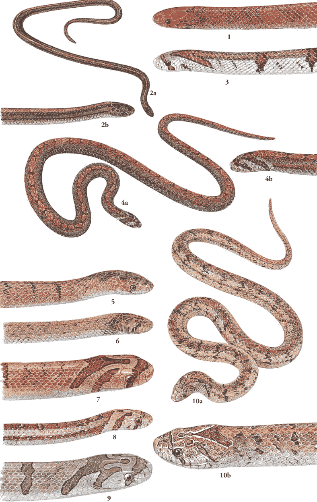

1

2a

3

2b

4a

4b

5

6

7

10a

8

10b

9

# 图 50. 游蛇科（COLUBRIDAE）

1. 无色眼镜环蛇 `Oligodon inornatus`，第290页。

全长580mm。身体强壮，亚圆柱形；中体鳞数15行；背部无花纹，褐色或暗红色，有明显的黑色横纹；额头宽。

2. 乔森眼镜环蛇 `Oligodon joynani`，第290页。

全长865mm。身体强壮，亚圆柱形；中体鳞数17行；背部紫褐色，深色斑纹形成横纹，与5个横向黑斑交替出现。

3. 拉克鲁瓦眼镜环蛇 `Oligodon lacroixi`，第290页。

全长650mm。身体强壮，亚圆柱形；中体鳞数15行。

(3a) 背部为灰色或灰褐色；有时有一排脊椎边缘的橙色斑点，在身体上汇成11–12个；4条纵向纹。

(3b) 头部深灰色或紫褐色，眼睛后方有人形横纹。

4. 八线眼镜环蛇 `Oligodon octilineatus`，第292页。

全长700mm。身体纤细，亚圆柱形；中体鳞数17行。

(4a) 背部为黑色或褐色，有一条红色条纹和5–7条纵向浅纹。

(4b) 头部浅灰色，眼睛处有深褐色横带。

5. 华丽眼镜环蛇 `Oligodon splendidus`，第293页。

全长830mm。身体强壮，亚圆柱形；中体鳞数21行。

(5a) 背部为灰色，每片鳞中心有深色；身体上有14–11个中线斑；侧腹有较小的斑点。

(5b) 头部浅褐色，颈部有人形横纹。

6. 四线眼镜环蛇 `Oligodon quadrilateralis`，第293页。

全长402mm。身体强壮，亚圆柱形；中体鳞数19行；背部灰褐色；有窄的灰黄色脊椎纹；横纹有时被深褐色亚矩形斑点横穿。

7. 条纹眼镜环蛇 `Oligodon taenius`，第294页。

全长447mm。中等体型，亚圆柱形；中体鳞数19行。

(7a) 背部为灰灰色或灰褐色；背鳞后缘边缘为深褐色；有2条纵向脊椎边缘黄纹，以及2列背腹侧条纹。

(7b) 头部灰灰色或灰褐色，吻部有横纹，额部和颞部有横纹，颈部有一个箭头形横纹。

8. 眼眼镜环蛇 `Oligodon ocellatus`，第291页。

全长852mm。身体强壮，亚圆柱形；中体鳞数19行；背部为橙色、棕至橙黄色，有11–14个菱形橙色或棕色脊椎斑。

9. 半棱眼镜环蛇 `Oligodon subcatinatus`，第294页。

全长390mm。身体纤细，亚圆柱形；中体鳞数17行；背部灰褐色，有20–30个深缘的浅褐色横向黄色或奶油色横纹。

10. 紫眼镜环蛇 `Oligodon purpureascens`，第293页。

全长950mm。身体强壮，亚圆柱形；中体鳞数19或21行；背部为褐紫色带有波浪状带，或有深缘的黄色或奶油色横带或斑，被深色横纹分隔。

11. 曼德眼镜环蛇 `Oligodon theoldi`，第294页。

全长437mm，纤细，亚圆柱形；中体鳞数17行；背部浅褐色，带有窄而密集的横向或角形深色横纹；背部有4条纵向纹。

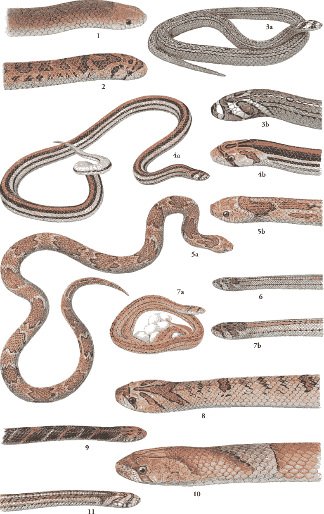

# 图 51. 游蛇科（COLUBRIDAE）

1. 山地眼镜蛇 `Orreocamus hamitellus`，第295页。

全长570mm。身体强壮，亚圆柱形。

(1a) 身体呈褐褐色，深色鳞片形成锯齿形图案；在下腹部，深色鳞片连接形成连续线。

(1b) 头部清晰，与颈部区分。

2. 紫斑竹游蛇 `Orocystophis porphyaceus`，第295页。

全长1250mm。身体纤细；头部细长，与颈部区分；吻部圆；背部为深红褐色或橙红色；身体后半部有深色侧斑。

(2a) `O. p. cost` 腹鳞23行；亚尾鳞62–67行；舌头棕褐色。

(2b) `O. p. lentencis` 腹鳞19–21行，IV–IV或IV–IV；亚尾鳞55–75行；舌头棕褐色。

3. 穴游蛇 `Orthrophis taurarius`，第295页。

全长220mm。身体纤细；头部细长，与颈部区分；吻部圆；背部深红褐色或橙红色；身体后半部有深色侧斑。

(3a) `O. t. tyrannanus` 腹鳞8–9行；亚尾鳞81–94行；中体鳞23行；236–260。

(3b) `O. t. taurarius` 腹鳞23–25行；亚尾鳞111–112行；中体鳞IV–V；背部为黄褐色。

(3c) `O. t. supracialis` 腹鳞VI–VI行；亚尾鳞102–114行；中体鳞25行；275–285。

(3d) `O. t. redilei` 腹鳞VI–VI行；中体鳞25行；亚尾鳞104–125行；米色。

(3e) 头部：亚种 `O. gokulensis`。

4. 眼蛇 `Pterophis annaatum`，第295页。

全长550mm。身体纤细；头部与颈部区分；背部细脊，后部变为强脊；背部虹紫色；侧腹褐色；鳞片有斑点；橙色背纹和深褐色斑点。

5. 东方游蛇 `Orthrophis caturis`，第295页。

全长220mm。身体纤细；头部细长，与颈部区分；背部灰褐色或黄褐色；深或浅色鳞片边缘形成网状纹；后部有横斑带。

6. 曼氏游蛇 `Orthrophis mollenendorffi`，第295页。

全长2.5mm。身体强壮；头部细长，与颈部区分；背部弱脊；侧鳞光滑；背部为青绿色，带有鞍状斑或蓝灰色斑，边缘为黑色；侧腹有圆斑。

7. 常见斑颈蛇 `Plagophis bubalis`，第297页。

全长450mm。身体强壮；头部与颈部区分；背部光滑或有脊；背部为黑褐色、褐色或红褐色；鳞片边缘为黑色；背部圆斑列由浅色横纹或橙色浅褐色横纹和长斑连接。

8. 福州斑颈蛇 `Plagophis styani`，第297页。

全长396mm。身体强壮，圆钝；头部短，与颈部区分；背部光滑；背部为中褐色，点有黑点；有时有黑色颈斑或横纹。

9. 中国沙蛇 `Pammammophis indochinensis`，第297页。

全长1075mm。身体纤细；头部椭圆形，与颈部区分；背部光滑；背部为橄榄绿色或黄色，有深色斑点。

# 图 53. 游蛇科（COLUBRIDAE）

1. 喀西山小眼镜蛇 `Bladinopsis frennatus`，第300页。

TL 1,500。身体纤细；吻部尖锐且微向前弯曲；背部隆脊微弱，除外侧2–3行。

- (a) 背部呈绿色或青绿色。
- (b) 头部为绿色或黄绿色；眼后有黑色条纹。

2. 绿环状眼镜蛇 `Bladinopsis pratus`，第300页。

TL 1,200 身体纤细；吻部长；背部隆脊微弱，除外侧 2–3 行；背部为绿色或青绿色；唇鳞为绿色或黄绿色；眼后有深色条纹。

3. 越南角蛇 *Symphnophis boulengeri*，第 300 页。

TL 1,380 身体纤细；肉质厚；吻部尖覆盖鳞片；背部光滑。

- (a) 身体呈深灰色或灰绿色；肠道皮肤颜色深。
- (b) 头部额部和窄深色眼后纹为深灰色或灰绿色；上唇鳞为黄色或浅绿色；吻部与眼眶间有窄纹；无深色眼后纹；额头和颈部有条纹。

4. 婆罗洲黑蛇 *Stegnotus bornensis*，第 301 页。

TL 1,370 身体粗壮；圆柱形；有明显的纵脊；背部光滑；背部为灰黑色、深褐色或黑色；有斑纹；上唇鳞为黄色带粉色。

5. 双纹黑头蛇 *Siphonopsis bistrigatus*，第 300 页。

TL 3,000 身体纤细；圆柱形；背部光滑；背部为红褐色或褐色；腹部有一系列黑色斑块；侧有条纹；额头和颈部为黑色；颈部有黄色斑点。

6. 中国黑头蛇 *Siphonopsis chinensis*，第 300 页。

TL 694 mm 身体纤细；圆柱形；背部光滑；背部为浅褐色、灰褐色或深褐色；头部为黑色；有黄色奶油环。

7. 环纹黑头蛇 *Siphonopsis collaris*，第 301 页。

TL 760 mm 身体纤细；圆柱形；背部光滑；背部为棕色或灰褐色；有黑色脊椎骨点；时性出现深色背部背侧线。

8. 纹纹黑头蛇 *Siphonopsis genusatus*，第 301 页。

TL 1,000 mm 身体纤细；圆柱形；背部光滑；背部为橙黄色，尾部颜色较深；有或无亮橙色颈环；有深色脊椎纹，有时边缘有红色或红褐色的条纹。

9. 白唇黑头蛇 *Siphonopsis melcephalus*，第 301 页。

TL 600 mm 身体纤细；圆柱形；背部光滑；背部为红褐色、灰色或棕色，下部浅色处有短黑色横纹；深色侧腹光滑带有黄色斑点。

10. 三角黑头蛇 *Siphonopsis triangolaris*，第 301 页。

TL 700 mm 身体纤细；圆柱形；背部前部灰褐色，后部为深色，浅色骨斑组成背部条纹。

11. 普鲁霍费特山蛇 *Zenolephis pruhofstferi*，第 302 页。

TL 500 mm 身体粗壮；圆柱形；背部光滑；背部为红褐色；有黑色脊椎纹。

12. 华纹棕蛇 *Xenoleophis elapsifer*，第 302 页。

TL 2.51 m 身体粗壮；鳞片光滑；下尾鳞 124–134；背部为橙红色，身体上有 18–20 个大型椭圆形或正方形的棕色斑块。

13. 马来棕蛇 *Xenolephis hexagonotus*，第 302 页。

TL 2m 身体粗壮；背部光滑；下尾鳞 140–179；背部为棕色、深绿色或橄榄绿色，带有垂直窄黑纹，尖端延伸至侧腹；深色头部与浅色侧面和喉部形成强烈对比。

# 图 54. 蝮蛇科 (VIPERIDES)

1. 红斑树蝰 *Ceryptrops purpureomaculatus*，第 304 页。

TL 1.040mm 身体纤细；头部与颈部分；背部有脊。

- (1a) 身体为橄榄绿、灰色或灰紫色，带有较色斑。
- (1b) 头部几乎为橄榄绿，带有棕色斑纹。

2. 坎布尔蝰 *Ceryptrops kanheriensis*，第 304 页。

TL 667mm 身体纤细；头部与颈部分；背部有脊，除最低一行外。

- (2a) 身体为橄榄绿或灰色；第一片背鳞上有白色或蓝色斑点。
- (2b) 头部有棕色斑块；标签上有白色或蓝色斑点。

3. 美丽蝰 *Ceryptrops venutus*，第 304 页。

TL 580mm 身体纤细；头部与颈部分；背部有脊。

- (3a) 雄性身体为橄榄绿或灰蓝色；雌性为草绿色；有背带；第一片背鳞上有浅色斑。
- (3b) 头部有棕色斑块；棕色斑丰富；有深色眼后纹。

4. 白唇蝰 *Ceryptrops albolaris*，第 303 页。

TL 1040mm 身体纤细；头部较长；背部光滑或脊微脊；背部为亮绿色，眼下侧面为黄色；尾部红褐色。

5. 斑尾蝰 *Ceryptrops crysourus*，第 303 页。

TL 1050mm 身体纤细；头部较长；背部有脊。

- (5a) 身体为深色。
- (5b) 头部为深绿色。

6. 巽他白唇蝰 *Ceryptrops insularis*，第 303 页。

TL 930mm 身体纤细；头部与颈部分；背部有脊；背部为亮绿色或橄榄蓝，带有横黑纹；上唇鳞为黄色。

7. 大眼蝰 *Ceryptrops macrops*，第 304 页。

TL 710mm 身体纤细；头部与颈部分；背部有脊，除第一行外；背部为亮绿色或浅蓝色；额头为绿色。

8. 马来蝰 *Calloselas rhodostoma*，第 303 页。

TL 450mm 身体粗壮；吻部短且微上翘。

- (8a) 身体背部为棕褐色，有不规则深色斑块。
- (8b) 头部眼后斑延伸至颌部。

9. 尖吻蝰 *Deinistrodon acutus*，第 304 页。

TL 490mm 身体粗壮；头部与颈部分；背部有脊，疣状。

- (9a) 身体背部为深褐色或黑色，有5–3对三角形纹。
- (9b) 头部上翘，有深褐色黑色条纹。

# 图 55. 蝮科 (VIPERIDAE)

1. 金巴隆棕蝰 *Garthius chaeseni*，第 305 页。

TL 690mm 身体粗壮；头部呈三角形；背部脊强，后部背脊微弱。

- (1a) 身体背部为红褐色，前部不规则深色斑块连接成后部带纹；侧面有较小斑块。
- (1b) 头部眼后缘为奶油色或黄色，延伸至颈部。

2. 山蝰 *Ophis montanus*，第 305 页。

TL 1250mm 身体粗壮；头部呈三角形；背部脊微弱。

- (2a) 身体背部为灰褐色粉黄色，带有深色斑块；侧面有深棕色斑点。
- (2b) 头部额部为黄色、棕色或浅色眼后纹延伸至颈部。

3. 马来蝰 *Ophis consictictus*，第 305 页。

TL 710mm 身体粗壮；头部呈三角形；背部有脊；背部为中褐色或棕黄色，带有亚矩形斑块和大型黑色斑纹；棕色或浅色眼后纹延伸至颈部。

4. 越南蝰 *Ophis tonkinensis*，第 305 页。

TL 561mm 身体粗壮；头部呈三角形；背部脊微弱；背部为灰色、棕褐色斑驳，侧面有黑色边缘的大斑块、小棕色斑点；黄色或浅色眼后纹延伸至颈部。

5. 亨根绿蝰 *Parias hageni*，第 306 页。

TL 1160mm 身体粗壮；头部与颈部分；背部脊微弱。

- (5a) 身体背部为亮绿色或浅绿色；额头和身体鳞片边缘无黑色；浅色线，腹部由背部第1–2行周围的线或斑点包围。
- (5b) 头部额头鳞片边缘无黑色。
- (5c) 幼体头部头部；有时有眼前和眼后条纹。

6. 金巴隆绿蝰 *Parias malcolini*，第 306 页。

TL 1330mm 身体粗壮；头部狭窄，与颈部分；背部脊微弱。

- (6a) 身体背部为绿色，带有不明显的黑带；幼体有白色侧纹。
- (6b) 头部额头为黑色，鳞片中心为绿色；上唇鳞边缘为黑色。

7. 苏腊蝰 *Ophis sumatranus*，第 306 页。

TL 1555mm 身体粗壮；头部与颈部分；背部脊微弱。

- (7a) 身体背部为绿色，带有黑色横纹。
- (7b) 头部额头鳞片边缘为黑色；上唇鳞为浅蓝色。
- (7c) 幼体额头鳞片边缘无黑色。

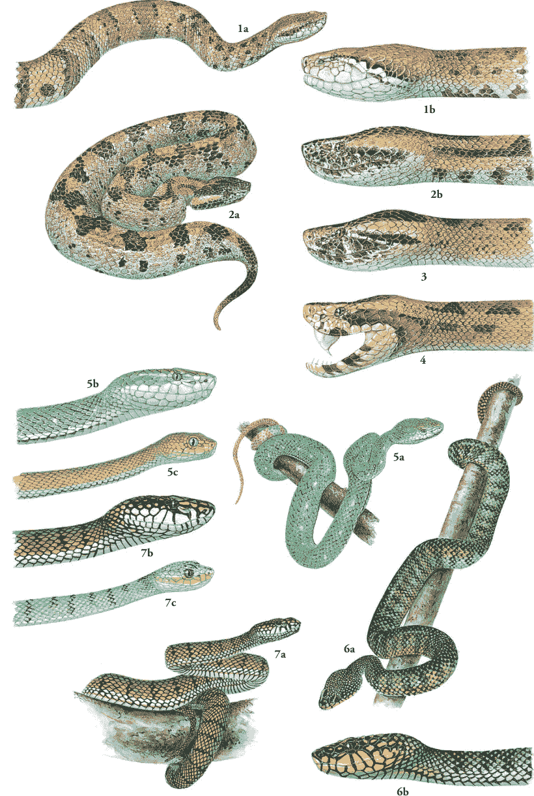

# 图 56.  viper科 (VIPERIDAE)

1. 苏门答腊绿蝮 *Popeia barati*, p. 306.

全长 TL 729mm。雄性腹部有条纹，雌性无；头部与颈部界限明显；背绿色，无横纹。

(1a) 头部雄性腹部有条纹，雌性无（如图）；条纹为红褐色，上方为白色。

(1b) 头部绿色，无眼后纹。

2. 迪奥曼岛蝮 *Popeia bunania*, p. 306.

全长 TL 783mm。身体背部纤细；头部呈三角形形。

(2a) 身体背部呈青绿色，斑点有时在身体上形成 81 条栗红色横纹，在尾部形成 39 条棕色横纹。

(2b) 头部有棕色眼后纹；额头颜色较深。

3. 泰国眼镜蝮 *Popeia faceta*, p. 306.

全长 TL 808mm。身体头部纤细；背部绿色带有锈色或红褐色横纹；有时腹部区域有白色或红褐色的眼后纹和白色斑点；腹侧有亮色条纹，腹部为橙色或红色；雄性背部为白色；雌性有白色条纹。

4. 云高原蝮 *Popeia nebulosa*, p. 307.

全长 TL 1002mm。身体粗壮；头部与颈部界限明显；背鳞有脊；背部绿色带蓝调；腹部为青绿色；腹侧条纹通常缺失。

5. 鲍普斯蝮 *Popeia popopterum*, p. 307.

全长 TL 1050mm。雄雌性身体均纤细；头部与颈部界限明显；鳞片光滑或微凹凹。

(5a) 身体背部为绿色或青绿色，无横纹；腹侧条纹为双色，腹部为红色；雄性背部为白色；雌性有白色条纹；眼后纹呈箭头形，雌性无（如图）。

(5b) 头部眼后纹窄，腹部为白色，雄性背部为棕色；眼后纹呈箭头形，雌性无（如图）。

6. 萨哈绿蝮 *Popeia subutus*, p. 307.

全长 TL 1019mm。雄性身体纤细；头部呈三角形；背鳞有脊；背部绿色；无横纹，或雄性眼后纹为红色或锈红色；雌性为灰褐色，带有一系列 48-51 个棕色斑块或横纹；侧面灰褐色斑点，无深色边缘。

7. 锯西班角角蝮 *Protophis cornutus*, p. 307.

全长 TL 690mm。身体中等；头部与颈部界限明显；眼上鳞大且呈角状；具单脊；身体灰褐色，带有一系列 48-51 个棕色斑块或横纹；灰褐色斑点，无深色边缘。

8. 考尔巴赫蝮 *Protothopsis kaulbach*, p. 308.

全长 TL 1340mm。身体纤细；头部细长；巨大；黄绿色或橄榄绿，带有菱形深色斑块，可能为：侧面的融合斑点；无线条。

9. 杰氏蝮 *Prototthopsis jerurdoni*, p. 308.

全长 TL 1090mm。身体纤细；头部与颈部界限明显；背鳞脊极强。

(9a) *J. p. jerurdoni* TL: 990mm；黄绿色或橄榄绿带黑色横纹；额头黑色，有大 A 形黄色标记；腹鳞 184-192；尾下鳞 65-72。

(9b) *J. p. jerurdoni* TL: 990mm；黄绿色或橄榄绿，带有边缘为黑色的红褐色斑块，额头黑色有细黄线；腹鳞 164-193；尾下鳞 44–78。

10. 棕斑蝮 *Prototthopsis microquamatus*, p. 308.

全长 TL 1174mm。身体纤细；头部与颈部界限明显；鳞后部有脊。

(10a) 背部灰褐色或橄榄绿，带一系列深色边缘的大斑点；侧面有一系列棕色斑点。

(10b) 头部深色眼后纹。

11. 三角蝮 *Trimeratophis stern*, p. 308.

全长 TL 1255mm。身体纤细；头部隆起；多枚眼上鳞；背鳞具 3 脊；灰褐色带有边缘细黄的深色斑块；侧面有较小斑块；深棕色眼后纹；黄褐色至灰色；部分有灰褐色斑点。

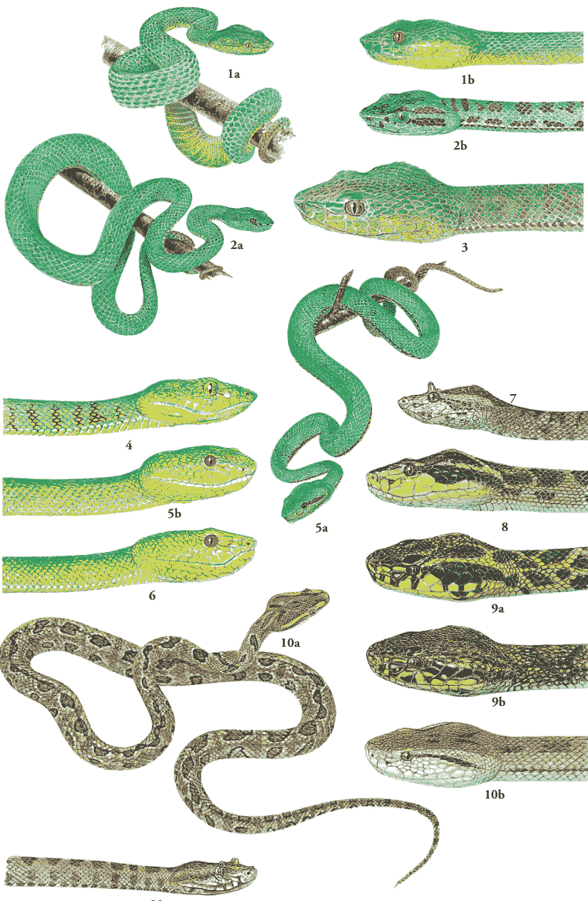

# 图 57. 蝮科 (VIPERIDAE)

1. 苏门答腊头蝮 *Trimeresurus andalensis*, p. 309.

全长 TL 809mm。身体粗壮；头部呈三角形；背鳞光滑或微凹脊。

- (1a) 身体紫褐色–带 17–25 条浅灰色横纹。
- (1b) 头部深紫褐色。

2. 氏头蝮 *Trimeresurus wisi*, p. 310.

全长 TL 889mm。雄性身体纤细，雌性粗壮；头部与颈部界限明显；背鳞中等有脊。

- (2a) 雄性身体灰褐色（如图），雌性深棕色，带 22-35 条深色横纹；棕色腹侧纹。
- (2b) 头部眼后纹。

3. 邦蝮 *Trimeresurus bong*, p. 309.

全长 TL 410mm。身体纤细；头部呈三角形；带 4–5 条直立且发散的带；背部为灰褐色，带 25–30 条深色横纹，边缘位于；侧面有较小的三角形灰褐色斑块。

4. 橘蝮 *Trimeresurus trangensis*, p. 309.

全长 TL 640mm。身体纤细；头部呈三角形；背鳞光滑或微凹脊；雄性青蓝色（如图），雌性浅棕色，带 66–70 条红褐色横纹；腹部带红褐色眼后纹。

5. 汶蝮 *Trimeresurus borneensis*, p. 309.

全长 TL 830mm。身体粗壮；头部呈三角形；背鳞光滑或微凹脊。

- (5a) 身体背部浅棕色，带 20–30 条深色横纹和深色斑驳。
- (5b) 头部斜向眼后纹至颈部。

6. 爪哇蝮 *Trimeresurus picus*, p. 309.

全长 TL 920mm。雄性身体纤细，雌性粗壮；头部与颈部界限明显；背鳞光滑或微凹脊。

- (6a) 身体灰色或黄褐色，带 20–30 条深色横纹，可能完整或不完整。
- (6b) 成体无眼后纹。

7. 环纹绿蝮 *Tropolaemus subannulatus*, p. 310.

全长 TL 963mm。幼体纤细，成年体较厚；头部与颈部界限明显；雄性背鳞微凹脊，雌性明显有脊。

- (7a) 雌性身体背部为绿色或青绿色带深色横纹；雄性绿色身体带白色斑点或条纹（如图）。
- (7b) 成雌性头部眼后纹下方为奶油。
- (7c) 成雄性身体带白色红色条纹。

8. 格蝮 *Tropolaemus wagleri*, p. 310.

全长 TL 920mm。幼体和雄性身体纤细，成年雌性粗壮；头部呈三角形；雄性背鳞微凹脊，雌性明显有脊。

- (8a) 成雌性身体背部带黄色横纹（幼雌性带白色横纹）。
- (8b) 头部黑色眼后纹。
- (8c) 成雄性/幼体身体绿色带白色斑点。

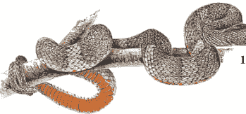

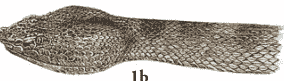

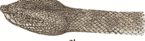

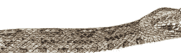

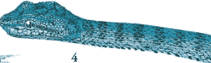

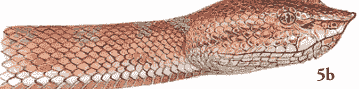

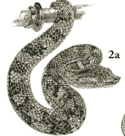

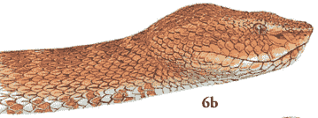

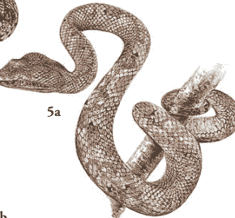

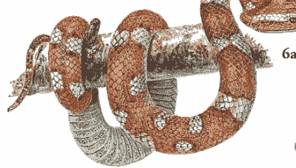

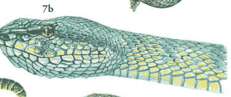

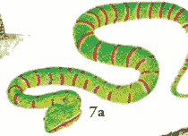

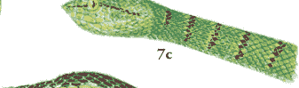

# 图 58. 蝮科 (VIPERIDAE)

1. 格普雷特蝮 *Daboia gumprechis*, p. 310.

全长 TL 889mm。雄性身体纤细，雌性粗壮；头部与颈部界限明显；背鳞中等有脊。

- (1a) 雄性身体深灰褐色（如图），雌性深棕色，带 22-35 条深色横纹；棕色腹侧纹。
- (1b) 头部眼后纹。

2. 缅蝮 *Trimeresurus mediensis*, p. 311.

全长 TL 677mm。身体纤细、细长；头部与颈部界限明显；背鳞光滑。

- (2a) 身体灰褐色带 25–30 条深色横纹，位于中央且边缘有角；或位于背部。
- (2b) 头部深紫褐色。

3. 斯滕格蝮 *Trimeresurus stejeniger*, p. 311.

全长 TL 1120mm。身体纤细、细长呈三角形；头部与颈部界限明显；背鳞微凹脊。

- (3a) 雄性身体背部灰褐色，带有边缘细黄的深色斑块；鳞。
- (3c) 雌性头部和颈部腹部为红色。

4. 沃蝮 *Trimeresurus vogeli*, p. 311.

全长 TL 1120mm。身体纤细、细长；头部与颈部界限明显；背鳞光滑或光滑有脊；背部绿色；腹侧条纹为双色，橙色或红色，背部为白色（雄性，雌性无）。

5. 云南蝮 *Trimeresurus yunnanensis*, p. 311.

全长 TL 750mm。身体粗壮圆柱形；头部与颈部界限明显；背鳞光滑或微凹脊；背部绿色；腹侧条纹为双色，橙色或红色，背部为白色（雄性，雌性无）。

6. 费蝮 *Tropolaemus azismphis*, p. 311.

全长 TL 925mm。身体粗壮，无感器；头部与颈部界限明显；背鳞光滑。

- (6a) 身体黑橙色，带 14-15 条窄白色、红色或粉色横纹，有时在背部中断；或在侧面交替。
- (6b) 头部橙黄色，有时有一对从前额鳞到颈部的棕褐色至黑色条纹。

7. 橘蝮 *Daboia russella*, p. 312.

全长 TL 1850mm。身体粗壮；头部与颈部界限明显；额头有小鳞；鼻孔大；除中排外侧鳞外，均具强脊。

- (7a) 成体身体浅棕色，背部有 5–7 行带深色标记的大斑块，侧面也有。
- (7b) 幼体身体纤细。
- (7c) 头部有小鳞；鼻孔大，位于大型鼻盾中。

## 图 59. 眼镜蛇科 CYLINDROPHIAE & ELAPIDAE

1. 恩加里眼镜蛇 *Cylindrophis engkarius*，第 312 页。

`TL` 485mm 身体粗壮；头部长；背鳞光滑；背部光滑；短的眼后后条纹；不规则的椎旁斑点；尾部有黑白斑纹；腹部有黑白横纹，由中线平分。

### 2. 纹纹眼镜蛇 `Cylindrophis lineatus`，第 312 页

`TL` 982mm 身体粗壮；头部长；背鳞光滑；背部呈黄白色；从背部到尾根有一系列红色或黄色纵条纹；额头有时散布深色斑点；腹部有黑色横纹。

### 3. 常见眼镜蛇 `Cylindrophis ruffus`，第 312 页

`TL` 900mm 身体粗壮；头部短；背鳞光滑；背部呈虹光褐色、灰色或黑色，并有淡黄色和奶油色带；腹部有黑色横纹。

### 4. 喜马拉雅眼镜蛇 `Bungarus berostris`，第 313 页

`TL` 1400mm 身体粗壮；背鳞光滑；体中鳞排 15 行；背部为黑色、蓝色或深褐色，带有淡黄奶油色的线条或窄带；吻部有一条白色条纹，颈部有一条，第三条从眼睛到下颌。

### 5. 马来眼镜蛇 `Bungarus candidus`，第 313 页

`TL` 1600mm 身体粗壮；背鳞光滑；体中鳞排 15 行（17 行）；背部为黄色或蓝黑色，身体上有 20-35 条白色横纹，有时全覆盖；有时颈部有不明显的浅 V 形纹。

- (a) 斑纹变型 A，来自泰国。
- (b) 斑纹变型 B，来自越南。
- (c) 黑化变型，来自爪哇和巴厘岛。

### 6. 斑纹眼镜蛇 `Bungarus fasciatus`，第 313 页

`TL` 225mm 身体粗壮；背鳞光滑；体中鳞排 15 行；背部为黄色或浅棕色，带有黑色带；额头有 V 形浅色标记。

### 7. 红头眼镜蛇 `Bungarus flaviceps`，第 313 页

`TL` 207mm 身体粗壮；背鳞光滑；体中鳞排 13 行。

- (7a) `B. f. flaviceps` 头部呈橙红色；身体无黑色环纹。
- (7b) `B. f. balasiensis` 头部为红色（红黄色）；身体后半部分和尾部有 5-8 对黑色环纹，被白色环分隔。

### 8. 华丽眼镜蛇 `Bungarus magnimaculatus`，第 314 页

`TL` 1300mm 身体粗壮；背鳞光滑；体中鳞排 15 行；背部为黑色或蓝黑色，有 11–14 条白色横纹；白色前眼斑。

### 9. 多带眼镜蛇 `Bungarus multicinctus`，第 314 页

`TL` 1354mm 身体粗壮；背鳞光滑；体中鳞排 15 行；背部为墨黑色、深褐色或蓝黑色，身体上有 27–44 条浅色横纹。

### 10. 红眼镜蛇 `Bungarus deweinsinkii`，第 314 页

`TL` 约 1350mm 身体粗壮；背鳞光滑，体中鳞排 15 行；背部呈虹光蓝黑色；不完整的 V 形颈部标记；吻部有不完整的窄浅纹；背部有 20–33 个浅色环。

## 图 60. 眼镜蛇科 `ELAPIDAE`

### 1. 蓝眼镜 `Calliopsis histriatus`，第 314 页

`TL` 1850mm 身体纤细；背鳞光滑；深蓝色至蓝黑色，某些种群侧腹有明显的条纹；头部、尾部和腹部为珊瑚红色。

- (1a) `C. histriatus` 无浅色侧腹条纹；有时有窄白色椎旁条纹：头部、尾部和腹部为珊瑚红色或橙色。
- (1b) `C. flaviceps` 浅蓝色侧腹条纹；无白色椎旁条纹。
- (1c) `C. tetrastataenia` 奶油色椎旁和侧腹条纹，外最宽。

### 2. 斑点眼镜 `Calliopsis gracilis`，第 315 页

`TL` 740mm 身体纤细；背鳞为浅褐色、红褐色或灰褐色，带有窄黑色脊背条纹；成对椭圆形斑点，在颈部和尾部融合；侧腹有黑色斑点。

### 3. 马来条纹眼镜 `Calliopsis intriidus`，第 315 页

`TL` 710mm 身体纤细；背鳞光滑；红褐色、深褐色或黑色；侧腹有白色、褐色或红色。

- (3a) `C. intriidus` 背部为棕色；脊背区域和下侧腹有窄黄色或白色线条；腹部有宽大的黑白横带，横纹与侧缘接合；额头有 Y 形标记。
- (3b-d) `C. linear` 背部为灰褐色；脊背区域和下侧腹有窄白色线条，边缘有黑白横带，横带不与侧缘接触；腹部较宽；额头有黑色斑纹；尾下鳞为橙色有 2 条纹。描绘了三种色型：
  - (3e) 门答腊代表种。
  - (3f) 婆罗洲代表种。
  - (3c) `C. theopasi` 背部为棕色；宽黑纹延伸至尾部；侧腹鳞宽；腹部有宽大的黑白横带，横带与侧缘接触；额头为红褐色。

### 4. 点纹眼镜 `Calliopsis maculatus`，第 315 页

`TL` 480mm 身体纤细；背鳞光滑；描绘了三种形态：

- (4a) 背部为棕黄色，有黑色脊背条纹；每侧纵排黑色斑点；额头有浅色带。
- (4b) 背部为棕黄色，无黑色脊背条纹；每侧纵排黑色斑点；额头有浅色带。
- (4c) 背部为红褐色，无黑色脊背条纹；每侧纵排黑色斑点；额头有浅色带。

## 图 61. 眼镜蛇科 `ELAPIDAE`

### 1. 中国眼镜 `Naja atra`，第 316 页

`TL` 650mm 体型中等；头部大；颈部短。

- (1a) 背部为灰色或棕色，有双带或四带白色横纹。
- (1b) 颈部有一个眼镜形标记，呈 O 形。

### 2. 单眼镜眼镜 `Naja kaouthia`，第 316 页

`TL` 230mm 身体粗壮；头部大；颈部圆。

- (2a) 背部为棕色、灰褐色或浅黄色；部分有深色带。
- (2b) 颈部有一个不明显的圆圈；浅橄榄色部分有深色斑。

### 3. 缅甸眼镜 `Naja maladaysensis`，第 316 页

`TL` 400mm 身体粗壮；头部大；颈部椭圆形。

- (3a) 背部为深色至深棕色；皮肤有浅色横纹。

### 4. 泰国眼镜 `Naja siamensis`，第 316 页

`TL` 600mm 身体粗壮；头部大；颈部。

- (4a) 背部有黑白对比纹，带有白色斑点；
- (4b) 颈部无标记，呈 U 形或 H 形。

### 5. 赤道眼镜 `Naja sputatus`，第 316 页

`TL` 1500mm 身体粗壮；头部大；颈部拉长；背部为黑灰色、灰色或棕色；颈部有 V 字形纹，有时呈眼镜形，或无纹。

### 6. 苏门腊眼镜 `Naja sumatrans`，第 317 页

`TL` 1500mm 身体粗壮；头部大；成年体颈部圆，幼体较长；背部呈蓝蓝色。

- (6a) 颈部无纹，深棕色或蓝黑色；有 12 条浅色横纹。
- (6b) 幼体为棕色或蓝黑色，无纹或有浅色横纹。

### 7. 眼眼镜蛇 `Ophiophagus hannah`，第 317 页

`TL` 185mm 成年体身体粗壮，幼体纤细；头部大；颈部拉长；幼体有 27–84 条黄色带。

- (7a) 成年体带纹。
- (7b) 成年体几乎无纹。
- (7c) 幼蛇头部无纹。
- (7d) 幼体头部有明显的浅色带。

### 8. 凯氏眼镜蛇 `Sinemicurus maccellandi`，第 317 页

`TL` 800mm 身体纤细；头部短而圆；背部为红褐色，身体有 17 条深色横纹；额头后部有浅色月牙标记；头部后部有 V 形纹。

### 9. 麦氏兰眼镜蛇 `Sinemicurus maccellandi`，第 317 页

`TL` 840mm 身体纤细，圆形；头部短；背部为红褐色，有 23–40 条黄色或浅棕色黑纹；头部为黑色，眼后有奶油色或黄色带。

## 图 62. 眼镜蛇科 `ELAPIDAE`

### 1. 角蛇 `Aqualypturus perii`，第 318 页

`TL` 1250mm 身体粗壮；头部小，后缘有棘；背鳞有脊。

- (a) 身体为蓝白色或蓝灰色，有 40-60 条黑色带，下侧腹较窄；头部。

### 2. 珠蛇 `Hydrophis cydinis`，第 318 页

`TL` 1500mm 身体纤细；头部小，后缘有棘；背鳞光滑。

- (2a) 身体为棕色，有 44-55 条带。
- (b) 头部为浅褐色。

### 3. 斯托克斯蛇 `Atretia stokei`，第 318 页

`TL` 1800mm 身体粗壮；头部大；背鳞重叠。

- (a) 身体为黄褐色或灰褐色。
- (b) 头部为深褐色。

### 4. 喙蛇 `Enhydra schisura`，第 318 页

`TL` 1580mm 身体粗壮；头部窄；背鳞有脊。

- (3a) 身体为灰橄榄色，有 30 条黑色带。
- (b) 头部为深色。

### 5. 阿加德海蛇 `Hydrophis aagaardi`，第 319 页

`TL` 1030mm 身体粗壮；头部大；背鳞呈疣状。

- (a) 身体为橄榄绿色，有 48-60 条深色带。

### 6. 黑头海蛇 `Hydrophis atripictus`，第 319 页

`TL` 1200mm 身体粗壮；头部极小；颈部和额头纤细。

- (a) 身体为深橄榄色，有 50-75 条横纹。
- (b) 头部为黄色。

### 7. 贝尔彻队长海蛇 `Hydrophis belcheri`，第 319 页

`TL` 932mm 身体粗壮；头部小；鳞片有脊。

- (a) 身体为黑色灰色，有 60-80 条深色横纹。

### 8. 拉贾书纹海蛇 `Hydrophis broki`，第 319 页

`TL` 1035mm 身体粗壮；头部小；鳞片有脊。

- (a) 身体为黑色灰色，有 60-80 条深灰色横纹。

### 9. 蓝灰海蛇 `Hydrophis caerleus`，第 319 页

`TL` 1090mm 身体中等粗壮；头部小；背鳞有脊。

- (9a) 身体为蓝白色，有 40-60 条黑色带。
- (b) 头部为深色。

### 10. 环纹海蛇 `Hydrophis cyanocyanictus`，第 320 页

`TL` 1885mm 身体细长，中等粗壮；后部加粗；背鳞有强脊。

- (10a) 身体为橄榄绿色，有许多环绕身体的蓝黑色横带。
- (10b) 头部小，黄绿色。

# 图 63. 海蛇科/眼镜蛇科 (`ELAP`)

### 1. 条纹海蛇 `Hydrophis fasciciatus`，第 320 页

`TL` 1100mm。身体前部纤细，后部增粗；头部小；背鳞紧贴或略微重叠且有脊；背部米色，深黑色，侧腹有椭圆形淡黄色斑点，有时连接成横条；某些个体后部呈较灰色；幼体侧腹的菱形背斑可能每年形成一次。

### 2. 窄头海蛇 `Hydrophis gracilis`，第 320 页

`TL` 950mm。身体前部纤细，后部变粗；背鳞有脊。

- (2a) 身体呈蓝灰色，有 40-60 条深蓝黑色条纹或侧斑斑。
- (2b) 头部为黑色；上颌突出。

### 3. 克劳斯海蛇 `Hydrophis klado`，第 320 页

`TL` 1190mm。身体粗壮；头部小；背鳞平滑或脊微弱；背部黑灰色至橄榄色，有 50-75 条深色横条；横条横宽或间隙呈灰色；存在黑色脊柱纹；额头为黑色或橄榄色。

### 4. 波斯海蛇 `Hydrophis lapidemides`，第 321 页

`TL` 960mm。身体粗壮；头部中等；背鳞微隆起或有短脊；背部呈灰色，有 29-52 个肉质黑色斑点，位于脊椎区域，侧腹较窄；头部背部有弯曲的黄色或白色标记，身体为黑色带有黄色标记；从额头到背部。

### 5. 浅暗海蛇 `Hydrophis melanoanna`，第 321 页

`TL` 1390mm。身体粗壮；头部中等；背鳞脊强强；背部黑灰色，有 50-70 条宽的白色或黄色条纹，宽度与间距相当；头部和身体为黑色，带有黄色亚空状额头至背部有黄色斑点。

### 6. 花海蛇 `Hydrophis ornatus`，第 321 页

`TL` 1150mm。身体粗壮；头部大；背鳞隆起或有短脊；背部呈灰色或橄榄色至花纹奶油，有 30-60 条深色条纹或菱形斑，间距窄，尤其在身体部位。

### 7. 宽头海蛇 `Hydrophis polythrocephalus`，第 322 页

`TL` 1110mm。身体粗壮；头部大且规则；背鳞有脊；背部浅黄色带有浅棕色条纹；头部为黑色或灰色；上鳞为奶油色。

### 8. 西巴乌河海蛇 `Hydrophis sibulatus`，第 322 页

`TL` 735mm。身体纤细；头部比身体窄；鳞片有中脊；背部灰褐色，后部增粗；有 49-58 条黄色至浅橙色条纹；额头为黑色，带有黄色斑点和箭头形标记。

### 9. 螺旋海蛇 `Hydrophis spiralis`，第 322 页

`TL` 275mm。身体粗部后增粗；头部和颈部纤细；背鳞平滑或有脊；背部橄榄黄至橄榄褐，有 35-50 条深色条纹，间距窄；有时条纹间有黑色背斑；侧腹黄奶油色。

# 图 64. 眼蛇科 (`ELAPIDAE`)

### 1. 窄颈海蛇 `Hydrophis strictricollis`，第 322 页

`TL` 1050mm。身体纤细；头部小；鳞片微凹或紧贴；且有脊；背部灰榄绿色，幼体有 45-65 条深色条纹，在窄部和侧腹最宽；头部为黑色或橄榄色；吻部和头部两侧有小黄色斑块。

### 2. 花环海蛇 `Hydrophis taenotus`，第 322 页

`TL` 895mm。身体粗壮；头部中等；背鳞有脊；背部灰灰色，身体和尾部有 50 多条深色条纹；额头为灰褐色或深橄榄色，有时有马蹄形黄色标记。

### 3. 鞍背海蛇 `Kerlia jerdoni`，第 323 页

`TL` 1000mm。身体粗壮；头部短；背鳞有脊且固定；中体鳞数 21–23（罕见 19 条）；腹鳞 200–278 条。

- (3a) 身体呈黄橄榄色，有黑色背斑或菱形标记形成。
- (3b) 头部额头为灰色；较小，颈部有一条黑色横带。

### 4. 安纳代尔海蛇 `Kolopsis annandalei`，第 323 页

`TL` 520mm。身体粗壮；头部小，鳞片为方形或六角形，比身体部分窄；破碎鳞片有脊；背部紫灰色，有 35–46 条深色条纹，条纹比浅色间隙宽；头部紫紫色。

### 5. 短蛇 `Lapsang caratus`，第 323 页

`TL` 972mm。身体粗壮；头部短；鳞片为方形或六角形，有短脊；幼体背部为棕灰色、黄色或橄榄色，有 35–55 条橄榄色至灰色条纹，末端变尖；成年体为深灰色。

### 6. 黄唇海蛇 `Laticauda colubrina`，第 323 页

`TL` 1170mm。身体粗壮，尤其是雌性；背鳞平滑；中体鳞 19 条；背部呈蓝灰色，有 24 条黑色条纹。

- (6a) 身体为黄色；上鳞为黑色。
- (6b) 头部为黄色。

### 7. 大海蛇 `Laticauda latericata`，第 323 页

`TL` 1200mm。身体纤细；头部长，且扁平；背部亮黄色，有 70 条黑色条纹；额头到背部为黑色。

### 8. 黄眼海蛇 `Pelaty platama`，第 324 页

`TL` 1000mm。身体纤细；头部长，且扁平；背部上半部为黑色，下半部为亮黄色；腹部亮灰色，带有黑色斑点。

### 9. 灰蛇 `Thalassphis viperina`，第 324 页

`TL` 925mm。身体粗壮；头部短；背部有单脊；深灰色、灰褐色或橄榄绿色，有 2 条浅棕色脊侧纹从头部顶部到尾部。

# 图 65. 镜蛇科 (`HOMALIDAE`)

### 1. 有脊水蛇 `Bitia hydoides`，第 324 页

`TL` 800mm。身体前部纤细，后部粗壮；幼体；背部为单色灰色，有 40-42 条深色横纹；侧腹为黄色斑点。

### 2. 黄纹红树林水蛇 `Cantoria vinacea`，第 325 页

`TL` 1200mm。身体纤细；颈部不明显；背鳞平滑；背部橄榄褐色或灰色，带有不规则黄色横纹；额头为棕黄色。

### 3. 狗脸水蛇 `Cerebrus rynchops`，第 325 页

`TL` 270mm。身体中等粗壮；头部长；背鳞脊强；背部为深灰色或灰灰色，带有 25-35 条黑色横纹；后眼纹。

### 4. 本内特水蛇 `Endbryon bennettii`，第 325 页

`TL` 610mm。身体中等；头部大；背鳞平滑。

- (a) 身体为灰褐色，带有不规则黑色横纹，有时呈锯字纹；白色腹纹。
- (b) 头部为棕褐色。

### 5. 鲍库水蛇 `Endbryon bocarti`，第 325 页

`TL` 1100mm。身体粗壮；头部大；背鳞平滑；背部为红褐色或深褐色，有黑色边缘的红褐色横纹，在侧腹变窄并汇合腹部；头部为红褐色。

### 6. 中国水蛇 `Endbryon chinensis`，第 326 页

`TL` 610mm。身体中等；头部圆；背鳞平滑；背部为橄榄褐色或灰色，带有不规则斑点；有时下腹有奶油色或黄色锯字纹。

### 7. 多利亚王水蛇 `Endbryon doriaris`，第 326 页

`TL` 700mm。身体粗壮；头部小；额头鳞片破碎；背鳞平滑；背部为红褐色至灰褐色；唇鳞为灰色或奶油色。

### 8. 彩虹水蛇 `Endbryon hydrophis`，第 326 页

`TL` 810mm。身体粗壮；头部小；背鳞平滑；深灰色、灰褐色或橄榄绿色，有 2 条浅棕色脊侧纹。

### 9. 盖氏水蛇 `Endbryon geyi`，第 326 页

`TL` 766mm。身体粗壮；头部小；背部为深褐色，仅最低排鳞片为红褐色；上鳞为灰黑色；从鼻部到颌角的深色条纹。

### 10. 黑斑水蛇 `Endbryon innominata`，第 327 页

`TL` 175mm。身体粗壮；头部短；背鳞平滑；背部为棕灰色，有时有三行纵向黑色斑点；侧腹为黄白色或褐色，有 38-39 条垂直棕色斑；额头有黑色斑点。

### 11. 贾格水蛇 `Endbryon jagerti`，第 327 页

`TL` 560mm。身体粗壮；头部小；背鳞平滑；灰褐色，带有线性排列的黑色眼状斑；上鳞为黄奶油色。

## 图 66. 虎吻蛇科 (`HOMALOPSIDAE`)

### 1. 灰水蛇 `Emryhthis plumba`，第 328 页

长度 480mm。身体粗壮；头部短；背部光滑；背部为灰色或灰榄绿色；鳞片呈深褐色或黑色边缘；下唇鳞为奶油色。

### 2. 斑纹水蛇 `Emryhthis punctata`，第 328 页

长度 730mm。身体粗壮；头部短；背部光滑；背部为灰黑色至深褐色；枕脑区有黄色横纹；有时有横向排列的小斑点，前 6–7 行形成横向黑色斑纹。

### 3. 中亚水蛇 `Emryhthis suborientata`，第 328 页

长度 870mm。身体中等；头部与颈部界清晰；背部光滑；背部为中褐色，覆盖 1–3 行鳞片的黑色脊柱纹；眼后条纹不明显。

### 4. 触须蛇 `Eryataspis tentata`，324

长度 770mm。身体纤细；头部小；背部有脊。

- (4a) 身体背部为橄榄色、灰色或褐色，有两条不明显的深色纵条纹；从吻部穿过眼部到腹部的宽深色侧纹。
- (4b) 头部长，具鳞状吻突起。

## 5. 食蟹红树林蛇 *Fordonia lesuchalia*，第 329 页

长度 950mm。身体粗壮；头部短；背部光滑。展示了三种色型：

- (5a) 深色型：灰色或褐色。
- (5b) 黄色型：浅黄色带色斑点。
- (5c) 橙色型：橙色带白色斑点。

## 6. 泽泽泽蛇 *Gersarda prevostiana*，第 329 页

- (6a) 身体背部为灰色、灰绿色或褐色；有时背背侧面有奶油色或黄色条纹。
- (6b) 头部唇鳞边缘为深灰色或橄绿色。

## 7. 鼓脸水蛇 *Homalopsis buccata*，第 320 页

长度 1400mm。身体粗壮；头部大且与颈分清晰；背部有脊；背部呈灰色、深褐色或黑色，有 19–51 条窄的黑色边缘横纹。

## 8. 柬寨鼓脸水蛇 *Homalopsis unigmentralis*，第 330 页

长度约 1400mm。身体粗壮；头部大且与颈分清晰；背部有脊；断续的奶油色腹纹覆盖背部身体；额头为黑色或灰色；幼体腹部为黑色，散布奶油色或黄色；成年体为黄榄绿色或橄榄褐色，带奶油色斑点。

- (8a) 成体背部为黑色或灰色，有时有黄奶油色横纹。
- (8b) 幼体背部为黑色或灰色，带黄色或浅橙色横纹；头部有黄褐色的横纹或斑块；下巴上有 X 形白色斑纹。

## 图 67. 游蛇科 (NATRICIDAE)

### 1. 安德里亚游蛇 *Amphibia andrea*，第 330 页

长度 608mm。身体纤细；头部与颈分清晰；背部有脊；背部为中褐色；头部和颈部有浅色深边缘的斑块，在身体前部变为浅黑色，不明显。

### 2. 山地游蛇 *Amphibia temporale*，第 330 页

长度 500mm。身体纤细；头部与颈分清晰；背部有脊；背部为红褐色至灰色；鳞片边缘为白色；有两条背侧条纹，断裂形成浅色颈环。

### 3. 三纹游蛇 *Amphibia bitsatum*，第 330 页

长度 708mm。身体中等；头部与颈分清晰；背部有脊；背部为灰褐色或赭褐色，带有米黄色的侧向条纹；额头为灰褐色、深褐色。

### 4. 大游蛇 *Amphibia boulgeri*，第 331 页

长度 877mm。身体纤细；头部与颈分清晰；背部脊微弱（最外缘除外）；背部为蓝灰色、灰褐色，有一对白色背条纹；额头为灰灰色，带有云纹；眼后条纹延伸至颈后。

### 5. 大游蛇 *Amphibia weapester*，第 331 页

长度 635mm。身体纤细；头部与颈分清晰；背部有脊；背部为深褐色；侧腹呈锈红色，有黄色斑点；唇鳞完全为奶油色或深褐色。

### 6. 白锻游蛇 *Amphibia inflamrons*，第 331 页

长度 750mm。身体纤细；头部与颈分清晰；背部为灰褐色或橄榄灰，侧腹到脊柱区域有火白色的深色标记；额头吻部处有黄奶油色斑点；幼体身体中部有白色斑点。

### 7. 陆水游蛇 *graateri*，第 332 页

长度 450mm。身体纤细；头部与颈分清晰；背部为深橄榄褐色；背部为深褐色，一条由黄色斑点组成的背纹；唇鳞为黄色带黑色边缘；额头吻部有 V 形标记。

### 8. 游蛇 *inatua*，第 332 页

长度 615mm。身体纤细；头部与颈分清晰；有脊；深橄榄褐色，有不明显的背部斑点；侧腹有黄色斑点；额头有棕色斑纹。

### 9. 卡西游蛇 *Amphibia khaseri*，第 332 页

长度 600mm。身体纤细；头部与颈分清晰；背部有脊；红褐色，额头有黑色纵向条纹。

### 10. 白纹游蛇 *Amphibia leucomyst*，第 332 页

长度 772mm。雄性身体纤细，雌性粗壮；头部与颈分清晰；前两行背部光滑；背部为灰褐色，颈部有黑色斑纹；额头处有白色条纹。

### 11. 游蛇 *Amphibia modulus*，第 333 页

长度 600mm。身体纤细；头部与颈分清晰；背部有脊；背部为中褐色，带有黑色和黄色斑点；唇鳞为奶油色或深色。

### 12. 游蛇 *Amphibia optatum*，第 333 页

长度 650mm。身体纤细；头部与颈分清晰；背部脊微弱；背部为红褐色或蓝黑色，侧腹有黄色横纹；白色的眼前、眼后和眼下纹。

### 13. 条纹游蛇 *Amphibia parallelum*，第 333 页

长度 635mm。身体粗壮；头部与颈分清晰；前背部有脊；背部为红褐色、橄榄褐色，有从眼睛到角的黑色条纹；额头头部。

## 图 68. 游蛇科 (NATRICIDAE)

### 1. 皮特斯游蛇 *Amphibia peteri*，第 333 页

长度 600mm。身体纤细；头部与颈分清晰；背部为黄粉色或深褐色，带有深灰色条纹；额头为深橄榄色带黑色云纹；唇鳞为黄色带黑色。

### 2. 红山地游蛇 *Amphibia sanguineum*，第 334 页

长度 600mm。身体纤细；头部与颈分清晰；背部为红色，含有 4–5 行橄榄色的黑色斑点；侧腹有黑色斑纹；额头为深橄榄色带白色后纹；唇鳞为浅粉色或奶油色。

### 3. 沙拉越游蛇 *Amphibia sarawaka*，第 334 页

长度 780mm。身体纤细；背部有脊；背部为橄榄色至红褐色，带有黑色菱形标记；侧腹为黄色或奶油色。

### 4. 萨特游蛇 *Amphibia sauter*，第 334 页

长度 401mm。身体纤细；头部与颈分清晰；背部有脊；背部为深褐色，带有细小的黑色和粉色斑点；侧腹为不明显的红褐色，有白色斑点。

### 5. 赛博德游蛇 *Amphibia sieboldi*，第 334 页

长度 943mm。身体纤细；头部与颈分清晰；背部有脊；背部无纹，橄榄绿色或褐色；有时背侧有白色斑点纹；额头为褐色；有浅色枕斑和和顶骨纹；上唇鳞边缘由深色纹，形成颈月纹。

### 6. 斑纹游蛇 *Amphibia striatatum*，第 334 页

长度 800mm。身体粗壮；头部与颈分清晰；背部有脊；背部为红褐色、橄榄灰至绿灰色；第五行鳞片有浅黄色或橙黄色的背侧条纹。

### 7. 宁游蛇 *Amphibia venningi*，第 335 页

长度 780mm。身体纤细；头部与颈分清晰；背部脊微弱；外缘鳞片较小；背部为橄榄褐色，双侧呈黑色方格纹；前部有背侧斑点；头部带有较浅的云纹。

### 8. 异尾蛇 *Amphibia serrata*，第 335 页

长度 600mm。身体纤细；头部与颈分清晰；有脊；背部为深橄榄褐色至近黑色，侧腹有成对的橙红色、浅褐色、黄色或白色斑点；相邻斑点可能由模糊的黑色横线连接；唇鳞为白色带黑色。

### 9. 黄斑水蛇 *Hydrolabes perisps*，第 336 页

长度 530mm。身体纤细；头部与颈分清晰；背部光滑；背部为橄榄褐色，带有浅黄色侧向条纹和深灰色的侧腹中纹，或基本无花纹。

## 图 69. 游蛇科 (NATRICIDAE)

### 1. 橙唇背蛇 *Macropisthodon flaviceps*，第 336 页

全长 850mm。身体粗壮；头部与颈部清晰；背部有隆；背部呈黑色，带有模糊的浅色横纹，脊椎区域窄，侧腹部宽；额头为浅褐色、黄褐色或橄榄色；上唇为锈橙色；后脑缘呈黑色，幼体尤甚。

### 2. 橄榄绿背蛇 *Macropisthodon plumbicolor*，第 336 页

全长 485mm。身体粗壮；头部与颈部清晰；背部强隆。

- (2a) 成体背部呈草绿色并带黄色；其后有较小的标记，中间区域为橙色；颌角处有黑色眼后纹；额头为蓝色；背部有黑色斑点或横纹。
- (2b) 幼体颈部有 V 形标记，其后有较小的标记……

### 3. 蓝颈背蛇 *Macropisthodon rhodamellus*，第 336 页

全长 750mm。身体粗壮；头部与颈部清晰；背部有隆；背部呈红褐色；有一条黑色垂直条纹插入隆脊中；后部为浅蓝色。

### 4. 安德森溪蛇 *Opphisistopus andersonanii*，第 337 页

全长 500mm。身体纤细；头部小，与颈部清晰；背部微隆；背部呈绿色、绿色或橄榄色，鳞片间有模糊的黑色细横纹；背部下排为亮黄色。

### 5. 海奈溪蛇 *Opphisistopus halbeatus*，第 337 页

全长 1050mm。身体纤细；头部小且扁平，与颈部不分；背部光滑；背部呈黄橙色，有许多黑色成对条纹沿侧腹延伸至腹部；头部有黑色斑点，眼眶前后及一颌角处有黄色标记。

### 6. 道万提蛇 *Opphisistopus danavenii*，第 337 页

全长 578mm。身体纤细；头部小且扁平，与颈部不分；背部通常有隆，背部下部有黄斑；侧腹鳞片上的黄斑更大；额头呈光黑色，散布黄色斑点或橄榄灰色；侧腹有深炭色的浅侧条纹，未将深色背部与浅色头部锐利分开。

### 7. 曼松山溪蛇 *Opphisistopus lateralis*，第 338 页

全长 500mm。身体中等；头部小且扁平，与颈部不分；背部上部通常有隆，下部光滑；背部呈灰色或灰褐色；上唇和下唇清晰；侧腹下部有模糊的深色侧纹，将深色背部与浅色头部隔开。

### 8. 斑山溪蛇 *Opphisistopus maculus*

全长 520mm。身体纤细；头部小且扁平，与颈部不分；背部光滑；背部呈光黑色，鳞片带黄斑；侧腹鳞片上的黄斑更大；额头呈光黑色，缝隙处散布黄色斑点；唇鳞有黑色缝隙。

### 9. 纹水蛇 *Opphisistopus typica*，第 338 页

全长 500mm。身体纤细；头部扁平，与颈部不分；背部强隆；背部无纹，呈褐色或黑灰色。

### 10. 彩绘拟蛇 *Pisotus*，第 339 页

全长 550mm。身体纤细；头部扁平，与颈部不分；背部光滑，缺乏顶孔；肛缘背部为棕色或褐色；有时有深色边缘浅带；眼部有深纹；腹部为奶油色带斑点。

### 11. 拟蛇 *Psammodopus pulverterius*，第 339 页

全长 770mm。身体纤细；头部扁平，与颈部清晰；背部光滑，缺乏顶孔；肛门分裂；背部呈红褐色至黄灰色；近黑色，有细小黑点或条纹；有时背中部有纵向条纹，侧腹有三条纵向条纹。

## 图 70. 游蛇科 (NATRICIDAE)

### 1. 萨霍尔背蛇 *Rhabdphis chrysargoides*，第 339 页

全长 880mm。身体中等；头部与颈部清晰；背部有隆。

- (2a) 成体背部为深橄榄色、黑色或黑黑色。
- (2b) 幼体淡橙黄色椎脊，前缘呈波浪状；头部侧面和后脑有白斑；上唇为黄色或粉白色，条纹为黑色。

### 2. 斑点纹背蛇 *Rhabdphis chrysargas*，第 340 页

全长 980mm。身体中等；头部与颈部清晰；背部有隆；背部呈橄榄灰或橄榄褐；上唇为黄色或奶油色并带有深色污渍；颈部为奶油色、红橙色；背部其余部分有黄色带。

### 3. 红腹纹背蛇 *Rhabdphis mostlyinatus*，第 340 页

全长 550mm。身体中等；头部与颈部清晰；背部有隆（除外排外）；背部呈红褐色，头部侧面有向下的奶油色眼后纹；上唇为奶油色。

### 4. 喜马拉雅背蛇 *Rhabdphis himalayanus*，第 340 页

全长 1250mm。身体中等；头部与颈部清晰；背部有隆；背部呈橄榄褐或深褐色；两行间距宽的橙黄色斑点；身体布有朱红色斑点；颈环边缘为黑色。

### 5. 李纳德背蛇 *Rhabdphis leonardi*，第 340 页

全长 1000mm。身体中等；头部与颈部清晰；背部有隆（除2-3行外）；背部呈橄榄褐灰色；有窄黑眼下纹；后部颜色加深。

### 6. 贡布纹背蛇 *Rhabdphis murdanus*，第 340 页

全长 773mm。身体中等；头部自太阳处；背部有隆（除外排外）；背部呈棕灰色，有深色横纹；斑点为亮红色或褐色。

### 7. 黑带背蛇 *Rhabdphis nigrocentus*，第 341 页

全长 950mm。身体中等；头部与颈部清晰；背部有隆。

- (7a) 成体背部后部转为橄榄绿；有窄黑横纹；侧面为铜棕色；眼后为黑色。
- (7b) 幼体比成体浅；后脑为奶油色。

### 8. 环颈背蛇 *Rhabdphis nuchalus*，第 341 页

全长 720mm。身体中等；头部与颈部清晰；背部有隆（除外排外）；背部呈浅褐色方格纹，有斑点；身体鳞片为红色和黄色。

### 9. 红颈背蛇 *Rhabdphis subinostatus*，第 341 页

全长 1300mm。身体中等；头部与颈部清晰；背部有隆（除外排外）。

- (9a) 成体背部呈橄榄褐或灰色，无纹或有黄色网纹；颈有红带。
- (9b) 幼体背部呈橄榄黄；后脑为深色。

### 10. 日本背蛇 *Rhabdphis tigrinus*，第 341 页

全长 1013mm。身体粗壮；头部与颈部清晰；背部有隆；背部前部为橄榄绿；其余橙红色，有一系列大型黑斑；颈部有黑色斑。

## 图 71. 游蛇科 (NATRICIDAE)

### 1. 中国斑纹水蛇 *Sinonatrix aequasciata*，第 342 页

全长 1420mm。单下唇纹靠近腹部；尾鳞 142–153；亚尾鳞 67–76；雄性下颏盾和下唇处有疣；背部呈灰色，身体有 16–22 条环带。

### 2. 环纹水蛇 *Sinonatrix annularis*，第 442 页

全长 941mm。腹鳞 145–163；亚尾鳞 58–69；身体有深色横纹，身体 34–46 条，尾部 16–27 条；横纹间腹部为红色。

- (2a) 成体背部纹。
- (2b) 幼体背部纹。

### 3. 中国水蛇 *Sinonatrix carinata*，第 442 页

全长 1100mm。体型大，区别颈部；腹鳞 133–157；亚尾鳞 68–85；背部和额头呈橄榄灰，侧腹有浅色边缘黑纹；头部其余为奶油色。

- (3a) 成体背部纹。
- (3b) 幼体背部纹。

### 4. 云南水蛇 *Sinonatrix yunnanensis*，第 442 页

全长 498mm。腹鳞 156–165；亚尾鳞 61–83；背部呈棕色或棕黑色，有呈 X 形的横线。

### 5. 点纹水蛇 *Xenophis flavipunctatus*，第 442 页

全长 974mm。后部保留更多顶孔；腹鳞 122–143；亚尾鳞 70–91；背部呈橄榄色或绿灰色，有黑斑，逐渐变为网状斑点列。

- (5a) 黄色纹。
- (5b) 红色纹。

### 6. 马来来斑纹水蛇 *Xenophis maculatus*，第 443 页

全长 1000mm。前部两对；腹鳞 140–156；亚尾鳞 95–117；背部呈橙褐色，有方形标记；成对黄斑列。

### 7. 爪纹水蛇 *Xenophis melanatus*，第 443 页

全长 975mm。雌尾部较短；腹鳞 128–142；亚尾鳞 66–83；两种颜色，一种背部有长条标记，另一种背部有宽深色纹。

- (7a) 成体背部。
- (7b) 幼体背部。

### 8. 格纹水蛇 *Xenophis pictator*，第 443 页

全长 1020mm。背鳞强隆；腹鳞 132–151；亚尾鳞 68–99；背部呈橄榄褐，有 5–6 行黑斑排列；有一条从上唇和眼后纹到口缘的黑纹。

### 9. 圣约翰水蛇 *Xenophis sanijobannis*，第 443 页

全长 710mm。上唇 IV 接触；背鳞微隆或几乎光滑；腹鳞 139–154；亚尾鳞 84–94；背部呈淡橄榄色，或均匀分布黑斑，有时身体有双列奶油色斑点。

### 10. 红侧水蛇 *Xenophis trianguligerus*，第 443 页

全长 1350mm。体型大，区别颈部；腹鳞 133–145；亚尾鳞 86–97；背部黑褐色，颈部和身体有橙红色三角形；额头有三角形标记。

### 11. 条纹水蛇 *Xenophis everattus*，第 444 页

全长 700mm。上唇 IV–VI 接触眼睛；腹鳞 140–151；亚尾鳞 53–84；背部呈中褐色，有三条黑纹；有密集的斑点或深色区域。

## 图 72. 盾蜥蛇科 & 拟眼镜蛇科

### 1. 钝头蛞牛蛇 *Athelensura boa*，第 344 页

全长 850mm。身体纤细，侧扁扁；头部短而圆，与颈部不分；背部光滑；背部为灰褐色，带有深色边缘的鞍纹；侧腹有时有大奶油色斑；额头为深褐色；眼下有奶油色斑，呈三角形区域。

### 2. 光滑蛞蛇 *Athelensura larvis*，第 344 页

全长 600mm。身体纤细，侧扁扁；头部短而圆，与颈部不分；背部光滑；背部为褐色，带有深色垂直条纹，延伸至额头；比背部深，无条纹。

### 3. 马来蛞蛇 *Athelensura malaccatus*，第 344 页

全长 450mm。身体强壮，侧扁扁；头部短而圆，与颈部不分；背部有弱脊，呈褐色、中褐色至近黑色，带有灰褐色条纹，边缘有时有白色；额头比背部深；颈部和额头为深褐色或黑色。

### 4. 山地蛞蛇 *Pseudoxenodontis*，第 345 页

全长 711mm。身体纤细，侧扁扁；头部短而圆，与颈部不分；背部光滑；背部为灰褐色，带有深褐色斑点，有时有明显的深色条纹；无间断椎棘。

### 5. 疣脊蛞蛇 *Pares carinatus*，第 345 页

全长 600mm。身体纤细，侧扁扁；头部短而圆，与颈部不分；背部有两排弱脊；背部为橄榄褐、黄色或红褐色，任何背部均有不明显的黑色横条；有深色体色条纹。

### 6. 汉普顿食蛞蛇 *Pares hamptoni*，第 345 页

全长 705mm。身体纤细，侧扁扁；头部短而圆，与颈部不分；背部光滑；背部为浅褐色，带有垂直黑色横条；额头有密集的黑色斑点。

### 7. 斑点食蛞蛇 *Pares macarius*，第 345 页

全长 450mm。身体纤细，侧扁扁；头部短而圆，与颈部不分；中线背部为灰色，带有深色斑点或边缘为白色的横条；唇鳞色浅；可能存在浅赭石色的颈环。

### 8. 白斑点食蛞蛇 *Pares margaritophilus*，第 345 页

全长 450mm。身体纤细，侧扁扁；头部短而圆，与颈部不分；背部光滑；背部为灰色，带有边缘为白色的黑色横条；唇鳞斑驳；可能存在白色或黄色的颈环。

### 9. 山地食蛞蛇 *Pares monticola*，第 346 页

全长 610mm。身体纤细，侧扁扁；头部短而圆，与颈部不分；背部有弱脊；背部中褐色，侧腹有黑褐色条纹；颈部有黑色体色条纹；颈部为褐色，带有密集的黑色斑点。

- 10. 竹假眼镜蛇 `Pseudoxenodon bambosicus`，第 346 页。

全长 550mm。身体强壮；头部与颈部分；背部有脊；背部为浅灰-黄-褐色，有 15-24 条深色横条；额头有黑色或深褐色 V 字纹。

- 11. 施密特假眼镜蛇 `Pseudoxenodon schmidtkii`，第 347 页。

全长 1,730mm。身体强壮；头部与颈部分；背部有脊；背部为灰黑色至深褐色；幼体为深褐色；椎部有 24 个灰色或黄色斑点；前侧腹由边缘鳞片组成的斑点列。

- 12. 大眼假眼镜蛇 `Pseudoxenodon macrops`，第 347 页。

全长 1,400mm。身体强壮；头部与颈部分；背部有脊（除低排外）；背部为褐色、红色或橄榄绿色；有一系列黄色、红褐色或橙色的横条或斑点；颈部有深色 V 字纹；喉部浅黄色。

## 图 73. 花蛇科

- 1. 白头盲蛇 `Ramphophlps aliceps`，第 348 页。

全长 302mm。身体纤细；头部与颈部不分，呈匙形；中体鳞数 20 排；背部为深褐色；额头为红色或土黄色；喉部和尾部色较浅。

- 2. 印度盲蛇 `Ramphophlps braminus`，第 348 页。

全长 180mm。身体中等；头部与颈部不分；中体鳞数 20 排；背部为黑色或褐色；吻部和尾端色较浅。

- 3. 纹盲蛇 `Ramphophlps lineatus`，第 348 页。

全长 480mm。身体纤细；头部与颈部不分；中体鳞数 22–24 排；背部为奶油色、粉褐色或黄色，有 10 条从颈部到尾端的棕色纵纹。

- 4. 黑盲蛇 `Typhops ater`，第 348 页。

全长 166mm。身体纤细；头部与颈部不分；中体鳞数 18 排；背部为黑色或深褐色。

- 5. 迪亚盲蛇 `Typhops diardii`，第 349 页。

全长 430mm。身体中等；头部与颈部不分；中体鳞数 24–26 排（少见 28 排）。

`(5a) 背部`褐色，每片鳞片有明显的浅色横纹；侧腹为浅褐色；深背部与浅腹部呈渐变。

`(5b) 尾棘`尖锐。

- 6. 杰克盲蛇 `Typhops jeroni`，第 349 页。

全长 280mm。身体中等；头部与颈部不分；中体鳞数 20–22 排；背部为深褐色至近黑色；吻部和肛区为奶油色。

- 7. 米勒盲蛇 `Typhops muelleri`，第 350 页。

全长 540mm。身体中等；头部与颈部不分；中体鳞数 24–26 排（少见 28–30 排）；背部为深褐色、紫色或黑色；深背部与黄色、奶油色或金色腹部之间有分分界。

## 图 74. 花蛇科、眼镜蛇科 & 蚓蛇科

- 1. 黑蚓蛇 `Achalinus ater`，第 351 页。

全长 401mm。身体纤细，圆柱；头部与颈部不分；背部有脊；中体鳞数 23 排；亚尾 53-66 片；背部为虹色或深褐色；腹部色较浅。

- 2. 粗蚓蛇 `Achalinus rufescens`，第 351 页。

全长 450mm。身体纤细，圆柱；头部与颈部不分；背部有脊；中体鳞数 23 排；亚尾 54-66 片；背部为虹色或深褐色；腹部色较浅。

- 3. 灰蚓蛇 `Achalinus spinis`，第 351 页。

全长 412mm。身体纤细，圆柱；头部与颈部不分；背部有脊；中体鳞数 23 排；亚尾 54-66 片；背部为虹色或深褐色；腹部色较浅。

- 4. 芬纳氏粗蛇 `Fenneropsis`，第 351 页。

全长 395mm。身体纤细，圆柱；头部与颈部不分；背部有脊；中体鳞数 23 排；亚尾 54-66 片；背部为虹色或深褐色；腹部色较浅。

- 5. 斯托氏蛇 `Stolicka`，第 352 页。

全长 750mm。身体纤细，侧扁扁；头部与颈部不分；背部有脊；中体鳞数 23 排；亚尾 54-66 片；背部为虹色或深褐色；腹部色较浅。

- 6. 纹蛇 `Xenoderma`，第 352 页。

全长 650mm。身体纤细，侧扁扁；头部与颈部不分；背部有脊；中体鳞数 23 排；亚尾 54-66 片；背部为虹色或深褐色；腹部色较浅。

- 7. 光蛇 `Xopeltis`，第 352 页。

全长 620mm。身体纤细，侧扁扁；头部与颈部不分；背部有脊；中体鳞数 23 排；亚尾 54-66 片；背部为虹色或深褐色；腹部色较浅。

- 8. 光蛇 `Xopeltis`，第 353 页。

全长 140mm。身体纤细，侧扁扁；头部与颈部不分；背部有脊；中体鳞数 23 排；亚尾 54-66 片；背部为虹色或深褐色；腹部色较浅。

- 9. 舍费氏尖吻蛇 `Xophidion shaferi`，第 353 页。

全长 263mm。身体纤细，侧扁扁；头部与颈部不分；背部有脊；中体鳞数 23 排；亚尾 54-66 片；背部为虹色或深褐色；腹部色较浅。

## 鳄鱼科 `GAVIALIDAE`：侧吻鳄鱼

真鳄鱼拥有厚重的甲壳和非常窄的吻部。它们栖息在水域，包括具有沙岸的大河以及被沼泽森林环绕的湖泊。与鳄鱼共有的特征包括：蹼足、可通过瓣膜关闭的鼻孔、长有透明膜的眼睛、分离胸腔和腹腔的肌肉隔膜、肺部存在的肺泡以及四腔心脏。成年鳄鱼的食性主要由鱼类、鸟类、龟类和体型如类的哺乳动物组成，而幼体可能捕食昆虫、软体动物和蛙类。该科目前有两个现存物种。化石记录显示其在北美、南美洲、欧洲、非洲和亚洲具有多样性，表明真鳄鱼曾遍布全球。

## 恒河印度鳄鱼

`Gavialis gangeticus`

| 特征 | 描述 / 数据 |
| :--- | :--- |
| 尺寸 | 全长（TL）可达 6 米 |
| 识别 | 身体细长；吻部长；末呈桨状，成年雄性末端有明显的凸起；长有 100 根毛；颈部弯曲几乎与背部连续。 |
| 颜色 | 橄绿色至褐色，身体和尾部有深色鳞片或斑块；幼体呈深褐色。 |
| 栖息地与行为 | 栖息在有沙岸的河流中食鱼，尽管许多其他动物也是肉食性的，已知它们也食腐。在沙洲或冲积沉积物上筑巢。 |
| 产卵量 | 7–9 蛋，59–64cm。 |
| 孵化 | 60–92 天。 |
| 雏体 | 350–39mm。 |
| 分布 | 缅甸的伊洛瓦迪河。还包括巴基斯坦、印度、尼泊尔和孟加拉国。在不丹已灭绝。 |
| 状态 | 极危物。 |

## 马来假真鳄鱼

`Tomisma schlegelleti`

| 特征 | 描述 / 数据 |
| :--- | :--- |
| 尺寸 | 全长（TL）可达 5.5 米 |
| 识别 | 身体细长；吻部从短长度逐渐变窄，末端圆钝；与恒河鳄（`G. gangeticus`）的区别在于眼睛和吻部之间有清晰的分界；吻部具有连续的 22 排横列。 |
| 颜色 | 深褐色带有条纹和斑点，特别是在宽大的头部和深色背。 |
| 栖息地与行为 | 栖息在淡水区域，如河流、沼泽和有悬空植物的湖泊。食物主要是鱼类，但曾看到它们捕食较大的猎物（甲壳类附近的穴巢，或混合猎物和鱼类，或靠近 60cm 高的大树根部）。 |
| 产卵量 | 20–60 蛋，孵化 75–80 天。 |
| 分布 | 栖息于泰国、马来半岛、苏门答腊、婆罗洲和爪哇。可能还有印度尼西亚的苏里答腊。在中国有亚化石（约 17 世纪）。 |
| 状态 | 濒危物。 |

## 龟目 `CHELONIA`

## 陆龟科 `GEOEMIDAE`：亚洲硬壳龟

该科成员具有椭圆形到长圆形或圆顶形的背甲，背甲带有 11 对凹槽状缘板，且缺乏锁定机制的原始结构。有时存在大尺寸的腹甲，没有中胸骨，且腹甲边缘通常与背甲的肋骨接合。这些龟能够将脖子垂直缩入壳内，并游泳顺着流体水域向内陆移动，也发现于咸水区或海滨。沿海物种分布在河口。大多数是杂食性或草食性动物，尽管有少数物种的食性多样（包括蜗牛），而另一些可能食腐。所有物种均受保护。该科广泛分布于亚洲，以及中欧、南美洲南部和北部。

## 南印度河龟

`Batagur batagur`

| 特征 | 描述 / 数据 |
| :--- | :--- |
| 尺寸 | 壳体长（SCL）60cm |
| 识别 | 头部有厚重的盾片；长吻；头部吻部上翘；腹甲四肢呈铰接；带有小鳞片；每只前肢有 4 爪。 |
| 颜色 | 橄榄灰或棕色；头部颜色相似但侧面较浅；无花纹；成年雄性会变为黑色；虹膜清晰。 |
| 栖息地与行为 | 栖息在受潮汐影响的河流中。食物包括受潮汐影响的区域、植物和鱼类，也会吃软体动物和甲壳类。 |
| 产卵量 | 7–9 蛋，59–37cm。 |
| 孵化 | 61–66 天。 |
| 分布 | 印度、马来半岛、苏门答腊。在越南已灭绝。 |
| 状态 | 极危物。 |

## 北河龟

`Batagur`

| 特征 | 描述 / 数据 |
| :--- | :--- |
| 尺寸 | 600mm |
| 识别 | 头部有厚重的盾片；长吻；头部吻部上翘；腹甲四肢呈铰接；带有小鳞片；每只前肢有 4 爪。 |
| 颜色 | 橄榄灰或棕色；头部颜色相似但侧面较浅；无花纹；成年雄性会变为黑色；虹膜清晰。 |
| 栖息地与行为 | 栖息在受潮汐影响的河流中。食物包括受潮汐影响的区域、植物和鱼类，也会吃软体动物和甲壳类。 |
| 产卵量 | 7–9 蛋，59–37cm。 |
| 孵化 | 70 天。 |
| 分布 | 印度、马来半岛、苏门答腊。在越南已灭绝。 |
| 状态 | 濒危物。 |

## 马来箱龟

`Cuora amboina`

| 特征 | 描述 / 数据 |
| :--- | :--- |
| 尺寸 | 216mm |
| 识别 | 头部有厚重的盾片；长吻；头部吻部上翘；腹甲四肢呈铰接；带有小鳞片；每只前肢有 4 爪。 |
| 颜色 | 橄榄灰或棕色；头部颜色相似但侧面较浅；无花纹；成年雄性会变为黑色；虹膜清晰。 |
| 栖息地与行为 | 栖息在受潮汐影响的河流中。食物包括受潮汐影响的区域、植物和鱼类，也会吃软体动物和甲壳类。 |
| 产卵量 | 10–16 蛋，65–35×25mm。 |
| 孵化 | 75 天。 |
| 分布 | 泰国、马来半岛、苏门答腊、婆罗洲。 |
| 状态 | 濒危物。 |

## 画彩箱龟

`Cuora flavata`

| 特征 | 描述 / 数据 |
| :--- | :--- |
| 尺寸 | 600mm |
| 识别 | 背壳低圆顶，边缘清晰；背壳平滑；头部有三条长纵向条纹；背甲无花纹。 |
| 颜色 | 橄榄黄至褐色，带有深色鳞片或斑块；幼体呈深褐色。 |
| 栖息地与行为 | 栖息在沿海和水域环境，捕食软体动物、甲壳类和鱼类。 |
| 迁移 | 存在产卵迁徙，成年龟可步行 30 公里到达海滩产卵。 |
| 产卵量 | 10–16 蛋，65–35×25mm。 |
| 孵化 | 每年产。 |
| 分布 | 泰国、马来半岛、苏门答腊、婆罗洲和爪哇。 |
| 状态 | 极危物。 |

## 缅甸龟

`Batagur birmanicus`

| 特征 | 描述 / 数据 |
| :--- | :--- |
| 尺寸 | 580mm |
| 识别 | 背壳低圆顶，有明显的边缘；腹甲截断，前端有缺口；后部平直；头部带有吻部略微上翘；每个头部有 5 爪。 |
| 颜色 | 背壳呈橙褐色，带有三条长纵向条纹；头部背面为黄色；腹甲为黄色；头部和颈部为黄色。雌性背壳为深褐色，头部和颈部呈橄榄黄色。 |

尚未研究。分布于越南中南部、老挝东（`C. c. cyclonata`）和越南北部（`C. c. meieri`）。以及中国南部（`C. c. cyclonata` 和 `C. c. meieri`）。状态：未评估。

青蛙和甲壳类动物；也取食植物和落果。每窝产 2–8 枚卵，大小为 45–54 x 25–32mm。卵产在土壤或叶片下方挖掘的深度 10–15cm 的瓶形腔内。分布于越南南部。也包括中国南部（香港、广东、福建和广西）。状态：极度濒危。

# 越南陆龟

`Cuora gillahartensis` 图 2

尺寸 160mm。

识别特征：背甲高高隆起且光滑；横向龙脊突起，胸部和腹部缝合后方有活动铰链；腹甲边缘无缺口。颜色为黄色或奶油黄；头部和面部为浅灰色或绿色，带有深色条纹；某些个体带有黄色色素和黄色斑点。习性与行为：栖息于高地。昼行性陆栖动物。繁殖习性为埋卵。分布于老挝和越南北部。也包括中国东南部。状态：极度濒危。

尺寸 236mm。

识别特征：背甲圆形、细长、扁平；产 5 枚卵；额头有鳞片；成年个体腹甲有铰链；股盾短于或等于雄性；肛裂不宽。颜色为深褐色，颈部有无对的条纹或放射状条纹，并有深色条纹；头部和面部有斑点；幼体后盾缘有花纹。习性与行为：栖息在海拔高达 700m 的森林中，基质为岩石和沙质。昼行性。繁殖习性。分布于泰国东南部和柬埔寨东部。状态：已评估。

# 吉龟

`Cuora monostii` 图 2

尺寸 180mm。

识别特征：背甲细长、边缘平直；腹甲后部和略微前部，成年雌性背甲横向有 3 条突出的龙脊；卵半埋在土中。颜色为深褐色或浅黄色，鼻部和颊上有深色斑块。习性与行为：栖息于常绿林，大部分为潮湿食叶动物。每窝产 1–5 枚卵，大小为 50–46 x 24–28mm。孵化期 90–110 天。缅甸、泰国北部、老挝和越南。也包括印度东北和中国。状态：濒危。

尺寸 250mm。

识别特征：背甲圆形、扁平、有 3 爪；额头有大鳞；成年个体腹甲有铰链；长度 23–25cm；股盾小于雌性；肛裂不宽。颜色为深褐色，颈部无纹有黑纹；额头无斑；颈部和腹甲无放射纹；幼体腹甲为黄色。习性与行为：栖息于常绿林。状态：已评估。

# 三纹龟

`Cuora trifasciata` 图 2

尺寸 230mm。

识别特征：背甲圆形、扁平、拱形且细长；后缘无锯齿；腹甲在胸部和腹部缝合处有活动铰链；腹甲边缘有缺口。颜色为浅褐色，头部和颈部有浅条纹；深色放射状图案：涵盖头部、背部和身体；背甲有深色条纹；头部和颊部为浅黄色；腹甲在眼睛上方延伸，并有从耳后延伸出的宽带；黄色；中心呈灰黄色，边缘有深色标记；淡橙色，带 2 条黑色侧条纹。习性与行为：栖息在海拔 100–850m 的常绿林和溪流中。昼行性陆栖，有显著的水生活动。食物包括青蛙、

尺寸 235mm。

识别特征：背甲圆形、扁平、有 3 爪；额头有大鳞；成年个体腹甲有铰链；股盾大于或等于雄性；肛裂不宽。颜色为深褐色，颈部和颞部有红色条纹；颈部深色，无条纹；腹甲为深褐色至黑色，有时有放射状深色线条。习性与行为：栖息于平原和低丘。生活在溪流和池塘中。杂食性，取食水果和无脊椎动物。繁殖习性已研究。分布于马来半岛北部、苏门答腊、婆罗和爪哇哇。状态：未评估。

# 蛇龟

`Cuora sinamica` 未画

### 灰叶龟

`Cyelmus fusca`

尺寸：眼膜 242mm。

识别特征：背甲橙色、扁平，额头有 3 个键状鳞；成年个体有对钩；股盾中线大于或等于肛中线；缺口呈白橙色。背甲为褐色，棕色带放射状线条；额头比其余部分浅；深色条纹、深黑色、带放射状条纹。习性与行为：栖息于溪流和池塘。食物

### 奥德姆叶龟

`Cyelmus annulatus`

尺寸：眼膜 254mm。

识别特征：背甲橙色、扁平，额头有 3 个键状鳞；成年个体有对钩；股盾中线大于或等于肛中线；缺口呈白橙色。背甲为褐色；额头有条纹；深褐色至黑色，有时带放射状线条；幼体有深色斑点和大型深色特征及眼斑，亚缘缘有斑纹。习性与行为：栖息于平原和低丘。食物和繁殖习性未分布。分布于缅甸、泰国、老挝、柬埔寨和越南。可能也包括中国南部。状态：未评估。

### 越南叶龟

`Cyelmus vnamatensis`

尺寸：眼膜 227mm。

识别特征：背甲橙色、圆形、扁平，额头有 3 个键状鳞；成年个体有对钩；股盾中线大于或等于肛中线；缺口呈白橙色。背甲为褐色，棕色带深色线条；幼体有斑点和黄色羽。习性与行为：栖息于溪流和池塘。食物和繁殖习性未分布。分布于越南南部、泰国和柬埔寨东部。状态：已评估。

### 黑胸叶龟

`Geemodyma speprini`

尺寸：眼膜 125mm。

识别特征：背甲扁平、三叶形；前缘有锯齿；腹甲有钩；眼睛大；上颌有钩；面缘有大鳞；手指有蹼；尾部基部有刺。背甲为橙红色、橙黄色、橄榄绿或浅褐色，龙脊上有深色线条；腹部深色；黄褐色头部有缺口，胸部有黄色斑点。习性与行为：栖息于山地森林。背甲陆栖，散生。食物包括虫、昆虫和其他无脊椎动物。每窝产 1 枚脆壳卵，大小 42–45mm。

### 黄头龟

`Henesropy`

尺寸：眼膜 506mm。

识别特征：背甲细长、隆起；成年个体顶部平坦；雄性明显；无钩；末端；对大夹身体极短；头部有陆栖龙脊；后缘有锯齿。背甲为褐色，边缘和龙脊纹上有橙色线条；连接甲和背甲下部成年后变为灰色并完全黑色。习性与行为：栖息于平原、河流和溪流。晚秋成熟。食物包括水生植物，以及重叠植被和果实。每窝产 4–6（8）枚脆硬壳卵，大小 47–50mm；产在深度 18–25cm 的土壤巢穴中。孵化期 14 天。幼体 55。分布于老挝、越南和缅甸北部。缅甸部分需核实。状态：濒危。

### 阿坎林龟

`Henesropy`

尺寸：眼膜 242mm。

识别特征：背甲扁平、扁平，身体圆钝；龙脊后缘有锯齿；腹甲无钩；嵌入斑纹；后部逐渐变细；任何缺口明显；发育良好；头部吻钝；手指半蹼；有蹼膜残迹。背甲为浅褐色，棕色带深色线条；侧面有深黑色或放射状线条；灰色颈部和黄褐色；四肢上有大鳞，湿地栖息地。习性与行为：栖息于除竹林外的常绿林。特有于缅甸（若信山脉）。状态：极度濒危。

## 亚洲巨池龟

`Hememys graffiti`

尺寸 480mm。

特征：背甲呈三隆状，成年个体隆起；幼体较扁平；侧缘不跨越第四肋骨；腹甲无合缘且鳞片大；前肢有窄缘。背甲为深褐色，周围浅色呈橙黄色或橙色；幼体头部盾上有从深色斑块出发的放射状纹路。习性与行为：栖息水域。食物包括软体动物、昆虫、蠕虫和果实。分布：缅甸、泰国、老挝、越南和马来西亚半岛。状态：易危。

图 4

马来西亚半岛（吉打州和玻璃州）。状态：未评估。

## 湄公食螺龟

`Malayanmysijrijna`

尺寸 210mm。

特征：背甲呈三隆状；盾缘边缘厚；头部大，成年个体隆起；腹甲无合缘。背甲为深褐色并带有黑色环纹；有 4 个或更多标记；下缘纹窄至眶缝，完全延伸至眶缝，并与背甲上的每个黄色大色连接腹甲。习性与行为：栖息于低矮的木本陆地。分布：泰国东、柬埔寨和越南南部（湄公河）；历史记载见于爪哇答。状态：易危。

图 4

## 刺山龟

`Hemenas spensa`

尺寸 420mm。

特征：背甲椭圆形，成年个体呈拱形；具有强壮的腹隆；成年个体缘缘呈黄色；幼体呈绿色且扩张的屏障清晰；幼体背刺的指趾间有蹼；四肢呈棒状。成年个体比幼体大得多，也更坚硬。背甲为棕色、橙黄色或红色，带有浅色椎脊；有放射状纹线。

习性与行为：栖息于森林地区。食物包括植物和软体动物。每窝产 3 枚卵，卵壳细长。幼体长 63mm。

分布：缅甸、泰国、马来西亚半岛、新加坡、苏门答腊、望湾、婆罗洲、印度尼西亚、南部群岛以及爪哇答-台湾-（菲律宾）。

状态：濒危。

图 4

## 越南池龟

`Mauremys amurens`

尺寸 170mm。

特征：背甲椭圆形，幼体较扁平；成年个体有侧隆；腹甲无合缘；腹甲间宽宽。背甲为棕灰色；黄色或橙黄色，每个盾上有一个大黑色斑块；头部眼部和颈部有窄黄色条纹，延伸至头冠；季节性腹部产卵。

习性与行为：栖息于流缓慢的溪流和湖泊。

分布：越南东部（槟省、老挝）、中国南部；越南北部富、山南河和斐斐河（广南省）。

状态：极危危。

图 4

## 亚洲黄龟

`Mauremys multifata`

尺寸 194mm。

特征：背甲椭圆形，扁平；呈三隆状；椎脊低；有缺口；存在小腋窝；腹甲无合缘；雄性有缺口；雌性无。背甲为深褐色并带有黑色环纹；有 4 条或更少条纹；下缘纹窄至眶缝且不大幅延伸；背甲上的每个黄色大色块连接腹甲。背甲为黄褐色或棕色；缘缘深黄色；盾上呈矩形或矩形色块；皮肤上有黄色色素且缺失。

习性与行为：栖息于水池、沼泽和水流。肉食性；频繁产卵。卵壳坚硬，38 x 21mm。孵化期 40 天。

分布：越南（安南中部）。以及中国南部（M. kan. 状态为易危）、吕留环群岛和日本中部。

状态：濒危。

## 马来食螺龟

`PLacmys helicata`

尺寸 300mm。

特征：背甲呈三隆状；盾缘厚；头部大，成年个体隆起；雄性腹甲有缺口；雌性腹甲无合缘。背甲为深褐色并带有黑色环纹；有 4 条或更少条纹；下缘纹窄至眶缝且不大幅延伸；背甲上的每个黄色大色块连接腹甲。

食物包括蜗、鱼、蟹和被冲出的蠕虫。每窝产 3–6 枚穴壳卵，32–44 x 20–24.5mm。孵化期 99–25 天。幼体长 32.9–35.3mm。

分布：泰国东南部（昭披耶河和美隆河）及北部。

图 4

## 中国石颈龟

尺寸 240mm。

特征：背甲椭圆形，扁平但未凹陷；幼体有椎脊；背甲缘缘有横纹；后肢完全有蹼。背甲为橙色、黄色或砖红色；幼体具有绿色背甲；头部棕色；幼体有 2 条黄色条纹；橙黄色，每个鳞片上有黑色斑点。

习性与行为：栖息于水域，包括沼泽、湿地和森林溪流。每窝产 3 枚卵，尺寸为 56 x 27–28mm。

背甲呈截形，低且不连续；椎脊 IV 和 V 在成年个体中消失（仅部分个体）；腹甲无合缘。背甲为红褐色至灰棕色；腹甲为黄色，每个鳞片上有许多深色边缘的黄色纹。

习性与行为：栖息于沼泽、湿地、运道和入海。食物包括鱼、蛙和足类动物。每窝产 3 枚卵，尺寸为 40 x 25mm；35mm。

分布：越南北部；中国南部。

状态：濒危。

## 印度黑龟

`Melochelys mjydica`

尺寸 800mm（`m. deideniza` 标本）。

特征：背甲细长，成年个体高高，幼体较扁平；头部有小吻；无齿。背甲为橙色或棕灰色；腹甲为黄色，每个鳞片上有许多深色边缘的黄色纹。

习性与行为：栖息于淡水植物和藻类。食用淡水虾和果实。

分布：缅甸和亚洲西北部：印度、孟加拉国和斯里兰卡。

状态：近危。

图 5

## 马来西亚巨龟

图 8

尺寸 800mm。

特征：背甲细长，弯曲，略微扁平；缘缘有锯齿；头部较短；腹甲无合缘。背甲无纹，橙色、棕色或灰色，从口到背有黑色斑点。

习性与行为：栖息于河流和湖泊，偶尔栖息于沼泽。野外为杂食性；食用质地粗糙且后部边缘明显的植物。

分布：缅甸、马来西亚和婆罗洲。

状态：濒危。

## 缅甸眼龟

图 7

`Morenya aedata`

尺寸 155mm。

特征：背甲细长，光滑；低隆；幼体分布在成年个体中；成年个体缘缘有锯齿；腹甲无合缘；头部有短吻；完全呈白色；尾巴短。

颜色：背甲为绿褐色或黄色；腹甲为黄色，中心色大；头部棕色；橄榄色或棕色，眼睛和两侧各有三条黄色纹。

习性与行为：栖息于流缓慢的静止水域。食物和繁殖习性不受干扰。

分布至缅甸（伊洛瓦底流域）。

状态：易危。

图 7

## 贝尔眼龟

图 5

尺寸 140mm。

特征：背甲细长，弯曲，略微扁平；缘缘无锯齿；锯齿状隆低；额头光滑；腹甲无合缘。

颜色：背甲为黄褐色至巧克力色；前部深色；背部黑色或深棕色斑；腹甲黄色至浅色，带有深色纹；仅形成 2 个齿；额头；前部不如后部明显；面部前方，侧缘：腹甲带有黑斑或条纹。

习性与行为：栖息于

## 马来平龟

图 5

`Notochelys platysterna`

尺寸 400mm。

特征：背甲扁平，椎间脊低：6–7

## 四眼龟

图 5

`Rafia quadricellata`

尺寸 140mm。

特征：背甲细长

172

`Steinig With`

四年龟（`S. bealei`）；背甲上有许多黑色斑点，有些呈长形；额部的幼体背甲上有 3 条脊；成年个体有 1 条脊；腹板无合壳。自身为无花纹的灰色橄榄绿或炭褐色；腹板后部有一对对眼斑；背壳浅灰色，无明显的黄色或棕色斑块或条纹。

栖息地位于热带雨森林内的山地。栖息地与行为与老挝和越南有关，也分布在南方。产卵是聚集的。

状态：极危。

# 黑沼龟

`Sternochelys carebricii`

图 5

尺寸 500mm。

鉴定：背甲边缘有锯齿状腹板；区域顶点凹陷。

# 海龟科（CHELONIIDAE）

该科物种头部大，无法缩回壳内，背甲较小且覆盖鳞片，腹板大，四肢长且呈鳍状，后肢圆钝。该科包括所有的海龟，除唯一生存的橄榄海龟外（该物种只有成年雌龟会登陆，在世界某些地区成年雄龟可能在海滩上日光浴）。

海龟包括多种物种，从水母到珊瑚不等。大多数海龟受到人类活动因素的威胁，包括为了肉而猎杀成年龟、渔业误捕、采砂以及对产卵栖息地的破坏。

# 菱海龟

`Caretta caretta`

图 6

尺寸 1200mm。

鉴定：背甲末端收窄；5 对肋骨，1 对对比鲜明的孵化期头部；雄性有 1 条脊，3–4 块下额前鳞；与橄榄绿海龟（`Lochemys olivacea`）的区别在于其特征（后者具有 5 对肋骨和 3 对 4 块腹下鳞）。

颜色：背甲为红褐色；腹板为黄褐色或橙黄色。

栖息地与行为与亚热带海、海湾、潟湖和河口有关。每窝产卵 23–178 个，卵径 34.7–55.2mm。孵化期 40–90 天。状态：极危。

卵含蛋黄且呈圆形，每个产卵季节可能产下 98–172 个卵，卵径 41.4–42.1mm。孵化期 60 天。

分布状态：极危。

## 玳龟

`Eretmlys imbricata`

图 7

尺寸 1000mm。

鉴定：背甲心形；背甲有 4 对肋骨鳞；2 对前额鳞，每个下颌侧向收缩；上颌向上形成类似喙的结构。

颜色：背甲为橄榄褐色，带有较深的斑块；成年个体发现于岩礁中。

栖息地与行为与礁石、海湾、河口和潟湖有关。食物包括海绵、珊瑚和水母。每窝产卵 96–177 个，卵径 30–35mm。孵化期 57–65 天。

分布状态：极临危。

## 绿龟

`Chelonia mydas`

图 8

尺寸 1400mm。

鉴定：背甲心形；头部有 4 对前额鳞；盾甲不重叠；上颌无钩；额孔有单条沟。

颜色：背甲为橄榄褐色，带有放射状深色图案；腹板为浅橄榄绿。英文名源于“for-turtle”，曾被用于制作龟汤。

栖息地与行为与热带地区、环海洋岛屿以及宽阔的沙滩有关。幼体为肉食性，而成年个体仅食用海草。

# 橄榄绿龟

`Lochemys olivacea`

图 6

尺寸 800mm。

鉴定：背甲心形，后缘锯齿，具有相邻肋骨鳞；5–9 对肋骨；有 4 块腹下鳞，每块有一齿；成年个体口小；孵化呈单水滴形；上颌有钩。

颜色：背甲为橄榄绿或绿榄色；腹板为橄榄绿。

栖息地与红树林附近的海滩有关。繁殖趋势涉及成千上万的雌龟，这种现象被称为“潮产”（`arribadas`）。

每窝产卵 50–160 个，卵径 34–43mm。孵化期 45–60 天。幼体 37.9–49.9mm。

分布于太平洋和印度洋。

状态：易危。

# 软龟科（DEMOCHELYIDAE）软龟

具有宽阔、深色的皮革质表皮。在软龟中，壳的骨质结构被浅色鳞片的马嵌图案取代，四肢呈桨状，缺少爪子，前肢成角，后肢通过蹼膜宽连接至尾部。

唯一栖息于海洋，以食水母、甲壳类、软体动物和鱼类。经常迁移到极地冷水域，可能是为了寻找水母。

栖息地与行为：这种海洋生物在海洋及岛屿海滩产卵。食物主要是水母；在北方水域，它的潜水深度可达 1200 米，然后回到水面觅食，比任何海龟都要深。每窝产卵 90–130 个，卵径 50–54mm。

分布全球。

状态：极危。

## 软龟

`Dermochelys coriacea`

尺寸：长度 2.5m。

背甲细长，末端收窄；背甲上有 7 条脊，壳上有 5 块覆盖皮肤的板；孵化时无鳞片和爪子。

颜色：背部为黑色或黑蓝色，带有浅色鳞片；腹板为灰色或浅灰色。

# 龟科（EMYIDAE）新世界巴西陆龟

## 红耳龟

`Trachemys scriptscripta`

尺寸 280cm。

鉴定：背甲圆圆，轮廓几乎平滑；腹板变暗，头部变色；雌性远大于雄性，且手指上有长爪子。

背甲呈绿色，带有黄色调；太阳穴处有大黑斑。

栖息地与行为：杂食性，取食叶子、果实。每窝产卵 2–25 个，卵径 30–40mm。孵化期 9 天。幼体 30–35mm。

分布于密西西河流域、美国、东南亚、泰国、马来西亚、新加坡和印度尼西亚。

## PLASTYMID 亚洲龟

具有高壳、头部有厚重鳞片的龟，无法缩入壳内。腹板缩小并由带组织连接至背甲。尾巴长，特别是在干旱地区。包含三个亚种。

## 大头龟

`Plystmys megcephal`

尺寸 18cm。

鉴定：背甲椭圆形，扁平；有脊脊。背甲呈黄褐色至橄榄色。

栖息地与行为：栖息于山间溪流，甚至攀攀爬。肉食性，取食昆虫、蜗牛和蠕虫。每窝产卵 2–3 个，卵径 33–37mm。幼体 38–40mm。

分布于缅甸南部、泰国、老挝和越南。

状态：极危。

# 龟科（TESTUDIDAE）陆龟

具有高壳、圆柱状四肢的龟。该科在世界干旱栖息地多样性最高。食物主要由植物和蛋白质组成。卵埋在地下。陆龟遍布，澳大利亚除外。

## 缅甸龟

`Geochelone planica`

图 7

尺寸 260mm。

鉴定：背甲高且凹陷；后缘有弱锯齿；上颌翘起；前肢外侧鳞片大且垂直折叠。

颜色：壳为浅色或深褐色，中心为黄色。

栖息地与行为：局限于干旱和半干旱灌木丛。生态上与著名的印度陆龟（`G. ellemiae`）相似，取食草本和果实，偶尔食腐肉。

三个亚种：`M. e. emya` 和 `P. shiu`。种群栖息于内陆许多森林。在落叶层中筑巢。产卵 22–33 个，直径 51–55mm。孵化期 60–70 天。幼体 60–80mm。

分布于越南、柬埔寨、老挝和马来西亚半岛。

## 软龟科 TRIONYCHIDAE

该科物种具有皮肤覆盖的扁平壳体（带有骨质结构，四肢各有一爪，肉质吻部有鼻孔）。其中一个属具有腿后褶，在乌龟缩回壳后可以保护其后肢。

该科包括世界上一些最大的淡水物种，主要栖息在淡水区，仅会进入咸水区或海海岸。它们的食物主要由无脊椎动物和鱼组成，也以食腐性闻名。

## 亚洲软龟

图 8

尺寸 750mm。

识别特征：背壳圆椭圆形，与马来软龟（`Turtle dogeri`）的区别在于其背壳条纹呈圆弧形（而非直线）且头部较窄；背壳边缘有明显的疣。

背甲颜色为绿灰色或橄榄绿，深灰色或黄色上带有黄黑色，这些颜色往往随年龄增长而消失；雌性头部有浅灰色的条纹，分布于东南亚整个地区。

习性：栖息在大型泥河流、泥炭沼泽和湿地中。夜行性食肉动物，以鱼、虾类和昆虫为食。产卵量为 4–8 枚，直径 21–33mm，黄肉蛋孵化期为 130–640 天。幼体长 37.2–49.5mm。

分布：缅甸、泰国、马来半岛、新加坡、柬埔寨、越南、婆罗洲、苏门答腊、爪哇和苏拉威西（印度尼），后者可能基于研究。

现状：易危。

分布：泰国（包括卡克、湄隆和湄公河水系岛屿）至马来半岛（`C. citrata`），以及中爪哇（包括板廊和索罗河，`C. javanensis`）；此外有苏门答腊湖和婆罗洲部的报道。

现状：极危。

## 窄头软龟

图 8

尺寸 1220mm。

识别特征：背壳边缘光滑地与颈部皮肤连接；头部较小，吻部细小；眼睛延伸至吻部或在窄颈处中断；腹部有 2–4 块鳞。

背甲颜色为棕色或黄棕色，带有亮黄色、绿黄色或浅深色边缘，头部和颈部有不明显的黄色标记；颈部有 5 条条纹；腹甲为淡粉色。

代表两个物种。`C. citrata`，颜色浅；存在中线和侧条纹；背壳前方有一个巨大的钟形标记；眼睛区域无 X 形条纹；下巴有明显的深色斑点；棕色标记。`C. javanensis`，颜色深；幼体尤为如此；中线和侧条纹较窄，边缘纹更多。

习性：栖息在具有沙岸的河流。产卵量为 60–117 枚，直径 34–40mm。孵化期 62–66 天。幼体长 40–42mm。

## 缅甸窄头软龟

图 8

尺寸 412mm。

识别特征：背壳边缘光滑地与颈部皮肤连接；头部较小，吻部细小；眼睛延伸至吻尖；头部短宽，身体狭窄；身体厚实，带有 3–5 条黑色条纹的窄带。

背甲为橙棕色或橄榄绿；边缘有不明显的深色斑点和条纹；头部和颈部有黄色标记及横线；连接处有 4–5 条黑色边缘条纹，眼睛为 1–2 对红色或浅色、白色或粉色。

习性：栖息在河流。食物以鱼为主，推测性隐秘。繁殖习性未知。

分布：缅甸（伊洛瓦底河）。

## 爪哇软龟

图 8

尺寸 350mm。

识别特征：背壳扁平、椭圆形，有明显的条纹；头部位于两侧；吻部大且呈转角；成年体具有巨大的头部边缘。

颜色：背甲为橙色或棕色，带有深色边缘，有 2–3 对斑点；眼斑；花纹在幼体中最为明显，随黄色褪色；腹甲为绿色或黄绿色；幼体头部下方有红棕色边缘。

习性：栖息在具有浅流和沙底的泛水地区。大头部非常适应捕食水生鱼、猎物，也吃螃蟹。

分布：缅甸南部（丹那望域、丹那柔维）以及爪哇、婆罗洲、苏门答腊和群岛。

## 印度斑纹龟

图 8

`Lisemys punctata`

尺寸 370mm。

识别特征：背壳椭圆形、圆顶，有 7 个骨疣，隐藏的疣缺失。

颜色：背甲无花纹，棕色或灰色；头部为橄榄绿或棕色；眼睛有黑色条纹；颈部有浅黄色条纹；斑点角无花纹。

习性与行为：栖息在沼泽和海拔高达 1500 米的小洼地。在干旱季节以无脊椎动物和小型脊椎动物为主；水生群居性。产卵量 5–28 枚。幼体 54–58。

分布：越南、中国南部和东部。曾引入夏威夷（美国）。

现状：濒危。

## 缅甸软龟

图 8

尺寸 370mm。

识别特征：背壳椭圆形；带有 7 个骨疣，后肢缩回时有一对褶膜；成年后内骨增大。

颜色：背甲为橙棕色、橄榄绿，带有细黑纹；头部有深色背部条纹；腹甲为无花纹的黄色。

习性与行为：栖息在流流（如河流）和静水区。食物以昆虫为主，食肉性。繁殖习性不分布。

缅甸特产（伊洛瓦底河和萨尔温河）。

现状：濒危。

## 缅甸软龟

图 9

`Nitilsma formosa`

尺寸 650mm。

识别特征：背壳圆，成年体光滑，幼体有纵向排疣；疣序列增大。

颜色：橄榄灰至棕色，带有深色边缘，成年后边缘消失；大个体上有较少的波状纹；冠部有对生疣。

习性与行为：栖息在河流中。

现状未分布。特产于缅甸伊洛瓦底河和萨瓦西河。

## 亚洲巨软龟

图 9

`Pelochelys swinin`

尺寸 1500mm。

识别特征：背壳扁平，幼体和成年体均较长；头部颜色深色；眼睛靠近吻尖；背壳上有许多疣和低脊；体型粗壮。

颜色：橙橄榄绿或棕色，有深色条纹或标记；腹部浅；腹甲无花纹，幼体为粉红色并有黑块。

习性与行为：与河流有关，食物以鱼、壳类动物为主。

分布：缅甸、泰国、老挝、柬埔寨、越南、马来西亚、新加坡、苏门答腊和婆罗洲、印度、孟加拉、中国南部、菲律宾以及可能的苏拉威西岛。

## 中国软龟

`Pelobius sinensis`

尺寸 650mm。

识别特征：背壳圆，长大于宽，成年体光滑，幼体有纵向排疣；骨疣缺失。

颜色：背面有浅棕色斑点；侧面有细放射线；腹甲为无花纹的奶油色、灰色或橄榄绿，幼体为粉红色并有黑块。

习性与行为：栖息在河流中，移动海拔至少 600 米。食物以昆虫、壳类动物和水生群居为主。产卵量 20–28 枚，幼体 27。孵化期 60 天。

分布：中国南部、韩国、日本和俄罗斯。曾引入泰国、马来半岛、新加坡、苏门答腊和其他沿海地区（菲律宾、台湾和波氏岛）。

现状：变动。

## 褶颈软龟

图 5

`Palea striatensis`

尺寸 426mm。

识别特征：幼体有纵向排疣，成年体光滑；背壳前缘有带疣的脊；前神经骨

## 印亚巨软龟

图 9

`Rafetus swinin`

尺寸 600mm。

识别特征：老化的背壳；单对神经骨第一对产卵；8 对径骨未在中线汇合；2 对腹甲产卵。

颜色：背部为橄榄绿

176

绿色，布有许多黄色斑点，有时形成条纹，尤其在幼体中；头部、颈部和下巴为橄榄绿色带有黄色斑点；腹无纹，浅橄榄灰色。

习性栖于湖泊和河流等水域。食物包括软体动物、昆虫、甲壳类和植物种子；繁殖包含 130 枚蛋，直径 20mm。

分布于越南北部。也包括中国东部。

状态：极危。

## 有鳞目 SQUAM

## 鬣蜥科 AGAMID LIZARDS

在背鳞重叠的鬣蜥中，缺乏骨板，胸带呈 T 形或环形；锁骨弯曲且呈棒状，尾巴和四肢发达。头部特征包括匙状齿和发育的颅冠。尾椎没有骨折面。

鬣蜥与鬣岩和变龙同源；它们是陆栖动物，栖息亚热带和热带地区，许多物种栖息边缘。所有物种均为卵生，产下具有皮革质壳的蛋。

大多数物种食昆虫。较大的物种是草性动物，食物包括花朵、叶子、花瓣和种子，尽管幼体时食虫。鬣蜥科成员分布于亚洲、欧洲、非洲、新几内亚和澳大利亚。

### 大型鬣蜥

图 10

`Achnantosa armatum`

体长 140–165mm。

识别特征：身体强壮，扁平；枕棘和眼眶棘长度短于吻部；鼻脊露出或与背脊齐；上眶鳞 11–13；下眶鳞 13–15；鼻囊位于颊部；尾长于头长；背部和侧部几乎呈深色大理纹；头部和眼睛的角和三角形区域有深色大理纹；黄绿色，带有浅灰色或灰色的绿色条纹；尾部深红色；腹部背部有些斑点。

习性：栖于从海平面的红树林到海拔 0–500 米的阔叶林等各类森林。昼行性树栖性；食物由大型昆虫和小蜥蜴组成。

繁殖包含 12–16 枚蛋，大小 11 x 1.9mm。孵化期为 91–93 天。

分布于缅甸、泰国、菲律宾、新加坡、苏门腊和爪哇。也包括中国东部。

未评估。

### 中华鬣蜥

图 10

`Achnantosa caprata`

体长137–159mm。识别特征：身体强壮，扁平；枕棘位于鼓膜和鼻脊之间；上眶鳞10–12；下眶鳞10–12；单脊齿骨；细长，有较大的齿骨；齿骨股骨褶；鼻囊；由宽阔的侧鳞组成；背脊未及鼻脊；高度比身体短；尾部脊上有环状；尾长于头长；第四趾下缺失缘板22–24。颜色：背部为绿色或橄榄绿色并有黑点，食物包括软体动物、昆虫、甲壳类和植物种子；繁殖包含。

## 冠鬣蜥 图10

`Achnantosa coroneata`

体长137–175mm。识别特征：身体强壮，扁平；枕棘位于鼓膜和鼻脊之间；颞部延伸至眼眶；有齿脊；低，由三角形鳞组成；延伸至尾部长度；长下眶尾部回至头长。颜色：背部为浅绿色带绿褐色斑纹；背部斑驳；背部和四肢有不规则鳞；长绿色边缘带黑色，横跨黄色；眼眶下方为棕色橄榄绿色；黄色带标记；眼眶处背部有黑点；尾有棕色和粉橙色带；习性栖于海拔480–700米的森林。昼行性、陆栖且树栖，与地面有关，受威胁时爬树；晚上睡在岩石上。食物和繁殖习性未受干扰。分布于柬埔寨东部（Orang和Pichrada县）和越南南部（同东省和东奈省）。状态未评估。前肛缘板靠近第四趾20–27。

颜色：雄性背部为黄褐色，可变为红色、棕色和黄色调；头部、颈部和脊部；四肢红色；喉囊覆盖额头的红色面罩；背部深棕色条纹；黄褐色9–10宽带；浅灰色虹膜；瞳孔周围有红圈；雌性背部为祖母绿，其他与其他性相似，雄性有黑点。栖息地和习性：栖于海拔550–1500米的常绿林。昼行性树栖性；食物与带有灌木的树岸和林层区域有关。分布于老挝（包括Savan和Xe Xong）；越南（越南中部；莱、富登、广南、岘岘市、天顺化和广治省）。状态未评估。

## 掩纹鬣蜥

体长SV140。识别特征：身体强壮；鳞片9–14；下唇鳞9–13；颈脊高至低脊；颈脊和背脊；有喉囊；尾长于头身。颜色：背部为黄褐色，带有深色网纹，不含浅黄色斑点；虹膜为深褐色至黑色；条纹存在或不存在；深色背带。习性和行为：栖于常绿落叶林和山林以及森林空地；与树、灌木有关。产卵10–16枚蛋，大小12 × 20mm。分布于缅甸南部（Tavaron、丹那望），泰国、柬埔寨、越南和北部半岛（马来西亚；兰卡威）。

## 喙鬣蜥

`Acanthosa nigrita` 图10

体长SV110。识别特征：身体强壮，略扁平；头部大下鳞；下唇鳞11–12；颈脊；下唇鳞9–10；颞部；有股骨褶；鳞片不均；颈脊6片小鳞；颈脊6排尾下鳞；尾部；尾长于头身；长至第四趾22。颜色：背部可变为褐色；棕色和颈脊；额头为黑色；颈部有菱形黑斑。习性和行为：栖于700–1400米的落叶林和山林。昼行性树栖性；食物由昆虫和其他节肢动物组成。繁殖未受干扰。分布于缅甸（亚那、邦谷、瑞信州）；泰国北部（考奥国家公园和富考国家公园），老挝、柬埔寨和越南北部。中国东方。状态未评估。

## 纳米鬣蜥

`Acanthosa natalis` 图10

体长SV158。识别特征：身体强壮，扁平；单后脊；腹部长度上方有一脊；大脊与鳞片和侧部的小鳞混合；下唇鳞11–12；颈脊和背脊；雌性喉囊大；椎骨中线有2–3片乳突；5–6枚大的前肛缘板靠近第四趾20–27。颜色：雄性背部为黄褐色，可变为红色、棕色和黄色调；头部。昼行性树栖性；食物包括毛虫、甲虫、蛾类、蟑螂和脊椎动物。繁殖包含1–2枚蛋，大小7 × 18mm。幼体23–43mm。分布于泰国南部、半岛（马来西亚、新加坡、苏门腊、Paulu Simular、尼亚斯岛、贝哈拉岛、婆罗洲、辛格普岛和纳土纳群岛）。未评估。

# 亥雅克森林岛

`Bronchochechayei`

图11

体长120mm。特征识别：背脊相对平滑；明显延伸；头部和躯部冠为锯齿状脊；尾部：雄性大，雌性小；上眶鳞9–10；下颊鳞9–10；鼓膜下下缘脊；身体上部的鳞片向后方和上方排列；身体下部的鳞片向后方和下方排列；边缘鳞比其他鳞片小，排列8行；身体中部鳞片70–72。颜色：深灰色，散布着白色斑块；额头和头部侧面呈淡黄色、奶油色或褐色；绿褐色上眶鳞和眼眶鳞趋向上方区域。

# 华丽灌木丛岛

`Aphanitis ornatus`

图10

体长57mm。特征识别：身体细长，有冠；吻部与眼直径等；吻部具有一个向后的肉质锥形突起，带有带脊的小冠；鼓膜有许多褶皱；背脊突出；小鳞片中夹杂着大鳞片；边缘鳞和褶皱有脊；前上颌骨和眶后骨。颜色：背部中等深色呈棕红色；眼脊上方有黄色小斑；背部上眶鳞为黄褐色；喉囊为黄色，腹部为黄黄色。栖息与行为：栖于低地平原和海拔150–900米的山丘树木区中。昼行性且树栖性。食性为昆虫。产卵量包含7 × 15mm的卵。分布：特产于埃尼奥附近。状态：未评估。

# 有冠森林岛

`Bronchostilla`

体长130mm。特征识别：背脊相对平滑；明显延伸；头部和躯部冠为锯齿状脊，带有背脊；尾部：雄性大，雌性小；独特的非对称冠，光滑；呈黄色；上眶鳞9–10；下颊鳞7–12；尾缘鳞长度为背部的1–5倍，排列10–12行；鳞片不均；中等体色带卵，不明显。产卵地在趾部34–45下。

颜色：深褐色带有白色或浅蓝色斑点（可能形成条纹），或白色带；身体上变为明显的深色条纹，眼部有浅灰色条纹；黄色喉；奶油色囊，黄色眼睛；尾部绿黄色带有明显的灰色边缘；第一行为棕灰色。

行为：栖于低地和花园树木中，尤其是森林和花园。昼行性。食性为昆虫（苍蝇、甲虫和蜘蛛），以及蚂蚁。产卵量包含1–4粒卵，卵点为30.5–38.8mm。

# 离群森林岛

`Bronchochechai`

图11

体长140mm。特征识别：身体强壮，平滑；背脊具有大鳞片，向后方排列；背脊延伸至尾部；上眶鳞9–10；下颊鳞10；鼓膜下下缘脊；身体中部大鳞片44–59；边缘行；鳞片呈链状；尾部具有大型侧鳞，连接紧密。

颜色：深灰色至褐色或黑色，带有红色斑点或横纹。栖息与行为：栖于低地和相对开阔区域。食性为昆虫。产卵2粒：44–53mm和9.5–12mm。孵化期60天。昼行性。分布：泰国中南部（碧武里府、碧差里府和甲老府）；柬埔寨、尼亚斯岛、婆罗洲、巴厘岛、辛格普岛和纳土纳群岛、卡巴让和萨布鲁群岛（印度尼）、沙越（马来西亚）和菲律宾。状态：未评估。

# 奥洛夫森林岛

`Bronchochela`

未画。

体长109mm。特征识别：身体强壮，平滑；上眶鳞7–9；下颊鳞9–10；鼻与头部前缘之间的鳞片；具有喙和上额鳞：3–4个；平滑，上眶缘后的直立鳞片形成冠；3个增大的鳞片达到鼓膜上水平；喉囊小；背脊呈大刺状并向后方排列；背部和侧面鳞片弱脊；极大且强有脊；身体中部行鳞片70–73。

颜色：含防腐剂的深蓝色，原本为绿色；腋下到中部或肘部有一大簇；鼓膜和眼部有条纹；腹部灰色。栖息与行为：栖于海拔750米以上的中山原生林以及纳皮尔平原。昼行与夜行性兼有；繁殖习性分散。状态未评估。

# 庆华森林

`Broncholeuca smagdina`

图11

体长113mm。特征识别：身体细长；压扁；腋下和鼓膜之间有大鳞片；下眶部为直径的一半；鼻部；无小鳞片冠；背脊缺失；眼囊缺失；颈部无褶皱；鳞片50–70，短于第四指趾；暗色行45–53。

颜色：背部翡翠绿；棕色或从下侧面延伸至腹部的白色条纹；尾部下方色浅；带有深色斑纹。栖息与行为：栖于海拔600米以上的常绿林。树栖。昼行性且繁殖习性分散。分布：柬埔寨、泰国南部和越南北部（兰同省）。状态：未评估。

# 越南森林

`Broncholeuca vietnamiana`

图12

体长122mm。特征识别：身体细长；压扁；下眶部为直径的一半；鼓膜宽；上眶鳞9–9；多行鳞片6–12；背脊缺失；雄性眼囊小；边缘区域覆盖有光脊鳞片；双层，短于第四指趾；身体中部行45–54。

颜色：背部灰褐色；腹部黄色；从眼眶到口角的浅灰色条纹；带有深色斑点。栖息与行为：栖于海拔750–900米的山地森林。昼行性。分布：特产于越南（岘市、来份省）。状态：评估。

# 彩色森林

`Calotes chinensis`

图13

体长142mm。特征识别：身体强壮；强压扁；头部宽；鳞片小，均一；背脊向后方排列；背部鳞片向上；背部和身体中部的下部鳞片行59–74；与尾部等大；上颊鳞9–12；下颊鳞8–11；颈部由鳞片组成的背脊。

# 森林

`Calotes emery`

体长115mm。特征识别：身体强壮；压扁；头部短；背部鳞片向后方和向上；眼睛下有小鳞片；上颊鳞9–12；下颊鳞9–12；上眶有长光脊鳞片；身体中部行45–66。颜色：背部橄榄褐色带有深色斑点；从眼部到腹部的稀疏条纹；灰绿色；雄性有红色。亚种识别为`C. eliterans`。栖息与行为：栖于低矮森林和灌木林，海拔771–970米。昼行且主要是夜行性；树栖。分布：特产于缅甸（腊桂邦和沙耶省）。状态：评估。

# 亨特森林

`Calotes keutii`

图15

体长91mm。特征识别：身体强壮；压扁；颈部头部清晰；躯干侧面鳞片大多向上；颈部和腋下有脊鳞；上眶区有一簇刺；前部上方鼓膜隔6片鳞片；后部鼓膜后缘隔3片鳞片；鳞片组成背脊。

颜色：浅褐色；额头点有深褐色斑点；中心鳞片为奶油色；眼部深褐色条纹；不明显的中条纹和长背部条纹；浅褐色冠；下方较浅；喉部淡橙色。栖息与行为：栖于低林和灌木林。分布：缅甸（腊桂邦和妙瓦省）。状态：评估。

# 金国沃德森林

未画。

体长40mm（幼体；雄性）。特征识别：身体强壮；压扁；鳞片成对向后下方，除上方2–3行略向上或直向；上眶鳞7；下颊鳞7；头部刺片密；背脊缩小；尾基膨胀；身体中部45。颜色：绿色带深褐色背部，腿部纵向条纹。栖息与行为：栖于海拔2134米以上的森林。食性和繁殖习性分散。分布：缅甸钦信邦（`C. baherii`）。状态：评估。

# 艾耶沃森林

图12

体长108mm。特征识别：身体强壮；压扁；躯干侧部密集的深色鳞片斜向向上；鼓膜上方隔6片鳞片；成年雌性77mm；成年雄性60mm。

颜色：褐色额头；边缘有深褐色斑点；鼓膜的每个后缘都有两条长线从暗奶油色斑块垂直延伸；鼓膜和短长背部棕斑；绿色背部和腹部；深色；腹部淡米色，喉部有淡鳞片纹路。栖息与行为：栖于开阔森林、花园和干旱区的斑驳森林；从林地到海拔1000米。食性为节肢动物。繁殖习性在距离基质上方10米的灌木中筑巢。繁殖习性分散。分布：缅甸（腊桂邦和曼德勒省）。状态：评估。

# 丹森林

图12

体长100mm。特征识别：身体强壮；压扁；头部大；上眶鳞9–11；下颊鳞9–11；有背部，冠弱；身体周围成对深色鳞片和长背圆形；身体中部行45–57。

颜色：褐色亮绿色，带有黄色和橙色；黑色边缘棕斑点；尾部带纹或斑点。栖息与行为：昼行且树栖。食性为昆虫。产卵7–12粒卵。幼体70mm。分布：缅甸（印度东部）、孟加拉国山区和中国南部。状态：评估。

# 蓝色森林

图12

体长140mm。特征识别：身体强壮；压扁；头部较大；欢快的鳞片和短缺口冠；颈部区域鳞片连续；喙间有2–3个刺；上眶鳞9–11；下颊鳞9–11；尾部绿色鳞片和金色鳞片组成的冠；尾部对行45–57。

颜色：绿褐色；繁殖季背部灰色带有浅蓝色的3–5个大斑点；从眼下到橙红色的浅色条纹；背部斑点带有橙白色边缘；肩部；背部为亮灰黄色。栖息与行为：栖于中海拔森林，以及低地和山地森林的海拔180–1500米以上。昼行且树栖，位于高树上。食性为昆虫。分布：缅甸、泰国、老挝。

## 园林蜥蜴

`Calotes versicolor`

图12

测量值99mm（体长）。身体强壮，头部大，尤其是雄性；体部鳞片呈点状条纹并向上延伸；喉部有非半球形褶皱或印记；鼓膜上方有2片错位的鳞片；中体鳞片40–50片。颜色多变；成年体呈橙灰色至亮红色，雄性喉部有黑色条带，其他时间褪变为灰色；雌性也可能变为暗淡的橄榄绿色。习性与行为：栖息于海拔1200–2800米的开阔森林中。食性为昆虫，意味着食物充足。分布于班加尔（印度）、米丹、潘奈、巴达塔和Gunguksing；状态：未评估。

## 布兰福德飞行蜥蜴

`Draco blanondi`

图13

测量值120mm（鉴定）。身体纤细；鼻孔朝背；鼓膜范围7–9；上缘无刺状鳞片；瞳孔细长，被大鳞片覆盖；雄性尾叶计数低；184–223片鳞片；下下鳞片比相邻鳞片大；55片鳞片，边缘带有黑色缘。颜色呈蓝褐色或灰色；花纹具有纵向线，并伴有黑色横条交织，边缘处可能仅限于网纹；头部和肩部有黄色斑点；喉部为黄色，鼓膜处有5条带有白色浅点的条带。习性与行为：栖息于常绿林。

## 日本京纳卢森林蜥蜴

`Complexiptuchus japonicus`

图12

测量值75.5mm（鉴定）。身体强壮，钝圆；吻部圆；牙齿小；喉部有较长且明显的褶皱或印记，雄性印记较大；中体鳞片60片；中鼻部鳞片大且龙脊强。颜色：背部呈棕灰色，带有2条白色线带；身体有大下眼鳞片；颈部和肩部有深色斑点；身体为白色，末端喉部呈浅灰色；四肢有纤细条纹；尾部11片，横向浅灰色条带。行为：栖息于海拔1500米的山地森林。树栖性且昼行性。分布：婆罗洲特有（京纳卢山，沙巴州）。状态：未评估。

## 角状飞行蜥蜴

`Draco cornutus`

图13

测量值88.9mm（鉴定）。身体纤细；鼻孔朝背；鼓膜上方有刺状边缘；鳞片呈大亚三角形，被小鳞片覆盖；背冠由大鳞片组成：140–177片。颜色：雄性背部为亮绿色至绿褐色；浅色雌性为红褐色并带有深色斑点或条带。行为：栖息于平原和丘陵，在红树林中常见。食性为蚂蚁等昆虫。分布于苏门答腊、婆罗洲、爪哇和安达曼群岛，亦包括菲律宾。状态：未评估。

## 布伦格树蜥蜴

`Dendropsaule japonicus`

图12

测量值73mm（鉴定）。身体强壮，结实；后脑部有斜脊，被大鳞片覆盖，从鼓膜上方延伸至眼眶；后方有短刺……

## 冠飞行蜥蜴

`Draco cristatus`

图13

测量值90mm（鉴定）。身体纤细；鼻孔朝侧向或斜向；上下鳞9–10片；鼓膜大；喉部瞳孔呈三角形，逐渐变细，被小鳞片覆盖；具有低尾；翼膜5–6片。颜色棕灰色，带有横向深色条纹或斑点；翼膜深色带有浅色线条；腹部蓝色带有深色斑点；颈部亮黄色。习性与行为：栖息于低地原生林，为树栖性，与大树相关。分布于马来半岛和婆罗洲。未评估。食性为昆虫。每窝产2–3卵。

## 指指飞行蜥蜴

## 中南飞行蜥蜴

`D. fembratus`

`D. indochina`

图13

测量值SV132mm。鉴定：身体中等；鼻孔朝背并向外；上下鳞8–11片；鼓膜上方有骨突起；大鳞片；雄性具有低尾甲；尾下大刺向尾部向上；翼膜5片。颜色：雄性呈暗褐色棕灰色，带有横向深色条纹或斑点。习性与行为：栖息于低地和中海拔原生林。每窝产2–3卵。分布于马来半岛、苏门答腊、婆罗洲和爪哇。状态：未评估。

测量值SV107mm。鉴定：身体中等；鼻孔朝背并向外；上下鳞8–11片；鼓膜上方有骨突起；大鳞片；雄性具有低尾甲；尾下大刺向尾部向上；翼膜5片。颜色：呈暗褐色棕灰色，带有横向深色斑点。习性与行为：栖息于低地和中海拔原生林。每窝产2–3卵。分布于马来半岛、苏门答腊、婆罗洲和爪哇。状态：未评估。

## 橙飞行蜥蜴

`D. formatus`

`D. macaculus`

图14

测量值SV111mm。鉴定：身体中等；鼻孔朝背并向外；上下鳞8–12片；鼓膜上方有骨突起；大鳞片；雄性具有低尾甲；尾下大刺向尾部向上；翼膜5片。颜色：呈暗褐色棕灰色，带有横向深色条纹或斑点。习性与行为：栖息于低地和中海拔原生林。每窝产2–3卵。分布于马来半岛、苏门答腊、婆罗洲和爪哇。状态：未评估。

## 须飞行蜥蜴

`Draco haematomatus`

图16

测量值SV944mm。鉴定：身体纤细；鼻孔朝背；上下鳞11–12片；鼓膜有弯折的小鳞片列；喉部刺呈三角形，带刺，被小鳞片覆盖；无刺状边缘；尾冠；148–184片；尾刺翼膜5片。颜色：呈暗褐色棕灰色，带有横向深色条纹或斑点。习性与行为：栖息于低地和中海拔原生林。

`m. maculatus`与中国东部（`D. m. whitei`）。

状态：未评估。

泰国南部、马来西亚半岛、苏门答腊、婆尼内陆和纳塔纳群岛。状态：未评估。

# 大型飞行蜥

图14

`Draco maximus`

体长（SVL）140mm。

形态特征：体型健壮；背鳞14–15行；眼睛上方无突起；雄性有颈囊；大囊覆盖有小鳞片；背鳞226–286条，大腿基部和尾部基部有缘状鳞。颜色：背部为绿色或灰褐色，翼膜呈棕橙色图案，或黄橙色带条纹。

栖息地与行为：栖息于海拔0至1000米的低地区。昼性树栖性，与树木相关。

分布：每窝产1–5卵；马来西亚、苏门答腊、婆尼内陆和纳塔纳群岛。状态：未评估。

# 五带飞行蜥

图14

`Draco quinqueafasciatus`

体长（SVL）110mm。

形态特征：体型纤细；上唇缘背鳞12–14行；背部无刺状突起，异质，大部分如此；翼基部边缘有缘状鳞；背鳞有脊；雄性有低颈囊（除大型外）。颜色：雌性背部为绿色或棕橙褐色，带有斑纹；图案为5条深褐色或栖息地。

栖息地与行为：栖息于从低地到中海拔丘的森林，包括泥炭林。昼性树栖性。每窝产6–8卵。

分布：孵化期30.3–30.4天。泰国、马来西亚半岛、苏门答腊、苏拉威西及群岛。

# 隐纹飞行蜥

图14

`Draco obscurus`

体长（SVL）113mm。

形态特征：体型纤细；上唇缘背鳞9–10行；下方区域无刺状突起；无背囊；尾部长，末端逐渐变细，末端或部分被鳞片覆盖；背鳞146–174条，异质，大腿部分和尾翼肋处大部分为缘状鳞。颜色：背部灰褐色，散布有深褐色斑点；跨区域有5个不明显的浅黄色斑标记；图案为黄橙色或橄榄褐色；灰色带或黄橙色；眼眶后头部背面为窄深褐色；雄性有2块黑色鳞片；雄性颈囊为灰色，雌性为橄黄色。

栖息地与行为：栖息于低地热带雨叶林；海拔最高至1000米。昼性树栖性，与树木相关。食物为蚂蚁。每窝产1–5卵。分布：

# 常见飞行蜥

图14

`Draco melanopterogus`

体长（SVL）85mm。

形态特征：体型纤细；上唇缘背鳞9–10行；喉部覆盖有小鳞片；颈冠囊存在，雄性有6–20片压缩三角形或有脊鳞，雌性多达14片；背鳞103–166行；尾部缺失；翼肋5–7条。颜色：黄色或灰褐色，带有深褐色斑点；喉囊基部有大点；雄性在栖息时颜色较浅。

栖息地与行为：栖息于低地森林园林和花园。食物包括蚂蚁和小甲虫。每窝产1–5卵。分布：泰国、马来西亚半岛、苏门答腊、梅瓦塔拉、纳塔纳群岛、婆尼内陆、帕劳（菲律宾）；状态：未评估。

# 窄带飞行蜥

图14

`Draco tenerii`

体长（SVL）83mm。

形态特征：体型纤细；上唇缘背鳞 7–8 行；许多鳞大于成年尾鳞；喉囊基部有羽毛，除被大鳞片覆盖外；背鳞 138–173 行，部分或大部分被覆盖；翼肋 5 条。

颜色：背部浅色或灰褐色；图案为浅灰色或黄灰色，带有 5 条细肋带；腹部斑块；黄色图案；喉部为灰色或深黄灰色，雄性颈囊下垂，雌性颈囊颜色较浅。

栖息地与行为：栖息于常绿林。昼性，与大叶片相关；基质较小。食物为蚂蚁和其他昆虫。繁殖习不受干扰。

分布：缅甸（丹那瑞份、丹达吉维州和默瓜群岛；丹信邦和蒙族邦）；泰国、柬埔寨和马来西亚半岛北部（彭雳州）。

未评估。

# 贝氏角角蜥

`Genochacephalus beylcephalus`

图 15

体长（SVL）126mm。

形态特征：吻部较钝；短冠在鼻部和背部处略有凹陷，呈长状且相互连接形成矛状；侧面有一排纵向的巨大疣疣。

颜色：绿色，颈部有橄榄黄色，虹膜上有斜纹；棕色带有包含大斑点的深色网纹；黄色—浅黄色冠；四肢和尾部足部狭窄。

栖息地：低地热带雨林。

分布：特产于苏门答腊北部。

状态：未评估。

# 爪哇飞行蜥

图 14

`Draco volans`

体长（SVL）96mm。

形态特征：吻部较钝；有深色冠，在沼泽地发育良好，身体鳞片长；尾脊位置较高；雄性有高背冠；仅有 5 条翼肋。

颜色：黄褐色，带有深色标记；雄性翼膜为绿色，带浅黄色；雌性为深褐色；尾部为黄褐色。

栖息地：低地森林及海平面至 1500 米处。树栖性，每窝产 3–6 卵，大小 12.5–13.6 毫米，孵化期 26–29 天。

分布及状态：未评估。

# 阿伯特角角蜥

`Genochacephalus abbotii`

图 15

体长（SVL）143mm。

形态特征：吻部较钝；大冠比物种冠重叠，身体带有边缘；雄性有 14–24 片三角形鳞。

颜色：绿色，眼睛周围有深色线；身体；尾部有 8 条深色带。

栖息地：低地森林并与大树相关。

分布：泰国南部和马来西亚半岛。

数据匮乏。

# 蓝颈角角蜥

`Genochacephalus helmeri`

图 15

体长（SVL）150mm。

形态特征：吻部较钝；大冠比鳞片大，红褐色，灰灰色，浅色区域带有。

颜色：浅蓝色，尤其是灰灰色，带有深灰色、浅黄色或黄奶油色斑。

栖息地：栖息于低地森林，通常由泥土组成。每窝产 3–5 卵，大小 11.1–11.5 毫米，孵化期为 2–3 个月。

分布：泰国、马来西亚半岛和新加坡。

婆尼内陆。

# 婆尼角角蜥

`Genochacephalus boreanus`

图 15

体长（SVL）136mm。

形态特征：吻部较钝；无冠，间杂着较大的鳞片；无冠且有许多鳞片。

颜色：亮绿色，头部和侧面有深灰色斑纹；尾部为黄褐色，带有黄色斑点。

栖息地：昼性原生林，与海拔高达 1100 米的树木相关。

分布：特产于苏门答腊北部、马来西亚、婆尼内陆和纳塔纳群岛。

状态：未评估。

# 马奎士角角蜥

`Genochacephalus durias`

图 15

体长（SVL）163mm。

形态特征：吻部较钝；背冠与鼻冠等高；中性。

185

187

# 洛斯角头蜥

`Genoflacius liami`

体长（SVL）165mm。

特征：身体粗壮；由鼻冠分开的矛形鳞片；体色橄榄褐色，带有浅棕色和肩部背纹；虹膜呈粉末蓝色；头部有灰黑色掩饰；鳞片为黄褐色；四肢为绿色，有短长趾，无爪痕迹。

栖息与行为：栖息于低地森林。昼行性且树栖性。

分布范围：特产于雅加比岛和苏门答腊西部。

未评估。

# 巨角头蜥

`Genoflacius georgicus`

体长（SVL）160mm。

特征：身体粗壮；雄性头部有长背鳍，背鳍上有缺口并具有鼻孔；鳞片大小相近，无大鳞片；腹部光滑。

体色：绿灰色、黑色；雄性个体身上有蓝黄色斑点；雌性在岩石森林中呈棕绿色。

栖息与行为：栖息于海拔高达 1400m 的森林。昼行性且树栖性，与溪流有关，受威胁时会跳跃。与树木有关，雌性和幼体也可能出现在水域上方的叶子或枝尖。

产卵量为 1–6 枚蛋，大小在 10 至 21mm 之间，每次产一个蛋。孵化期：75–90 天。

分布范围：泰国、老挝南部、越南（莱甲省）、马来半岛、苏门答腊、门塔威群岛。

状态：未评估。

# 赫维角头蜥

`Genoflacius hervey`

体长（SVL）145mm。

特征：身体粗壮；鼻冠和背鳍连续；鳞片大小相近且有棱；鳞片光滑，侧腹有大鳞；尾部扁平。

体色：绿褐色、黄橙色，颈部有斑点，顶点呈白色；尾部有深色带。

栖息与行为：已知于离岸森林岛屿。昼行性且树栖性。习性和繁殖习性未知。

分布范围：特产于纳特拉群岛。

状态：未评估。

# 库角头蜥

`Genoflacius kuhyi`

体长（SVL）100mm。

特征：身体粗壮；头部有明显的弯眼；股骨鳞片上的小背鳞与大结疣混合；鳞片连续。

体色：绿褐色，头部有黄色或黄色鳞片，尤其是眼眶后区域；虹膜棕色；身体有颊带，密集的四肢上有红色或黄色斑点。

栖息与行为：栖息于低地森林和海拔高达 1600m 的中海拔山区。昼行性且树栖性，与树木有关。

食性：推测由昆虫和卵组成。

产卵量为 4–6 枚蛋，大小 14–22mm。

分布范围：苏门答腊和爪哇。

状态：未评估。

# 西西卢克角头蜥

`Genoflacius sikiluk`

体长（SVL）145mm。

特征：身体粗壮；雄性背鳍向上，且与鼻冠分离；尾部扁平。

体色：橄榄绿或橄榄灰；横纹鳞为绿松色或黄色；头部有深色带，眼睛周围有紫色斑点；身体区域：腿部及相邻区域为绿色；尾部有橄榄绿和黄橄榄带；雌性有白色棕带。

栖息与行为：栖息于海拔高达 1000m 的森林。昼行性，但也可能出现在洞穴中。食性推测由节肢动物组成。产卵量为 7–8 枚蛋。

分布范围：已知于苏门答腊、巴厘岛、北苏门答腊。

状态：未评估。

# 蓝眼蜥

`Genoflacius langiger`

体长（SVL）140mm。

特征：身体粗壮；鼻冠和背鳍连续，由矛形鳞片组成；雌性颈部背鳍长且呈脊状；上眶缘圆润；背鳞与大鳞混合；眼眶下方有一排大鳞。

体色：雄性为棕色或绿色，侧腹有网状纹；黄色横纹；眼睛呈亮棕色，鳞片周围皮肤呈橙红色；雌性为灰色。

习性与行为：栖息于低地森林，树栖性并与树木有关；体型变化很大。食性为昆虫。产卵量 1–4 枚蛋，11–23mm。持续 97 天。

分布范围：马来半岛、苏门答腊和婆罗洲。

状态：未评估。

深色横纹和黄色斑点形成条纹；吻部有深色带的白色缘；眼后纹延伸至耳膜；股褶；皮囊；亚树栖性。繁殖为昼行和夜行性。分布于马来半岛（彭亨州的五当山和喀隆高地）。状态未评估。

# 大鳞手蜥

`Ganocephysis lancolatus`

体长 140mm。

特征：身体粗壮；头部和背鳍鳞片分离；鳞片向后；背鳞有时很长，背鳍基部有一纵列；腹鳞；尾部侧扁扁平。

体色：背部为绿橄榄色带深绿色横纹；身体有深色带；食性为昆虫、鸟类；黄褐色；亮黄色；身体沿有粉色条纹；黄色皮囊绿色带奶油色纹；眼睛下方背鳍颜色较浅；尾部黄色；浅绿色带奶油色条。带。

习性与行为：栖息于从低地到 1,200m 的森林。树栖且昼行性。

分布范围：仅已知于苏门答腊西部，可能也分布于马来北部。

状态：未评估。

体长 86mm。

特征：身体细长，扁平；纵列小圆背鳞；吻部附属较长较短；88mm 幼体有 7–8 片鳞。

体色：背部橄榄绿；两条条纹，从头部侧到腿部形成侧腹大斑点；浅蓝色。

习性与行为：栖息于海拔 800m 的山区森林。树栖并与树木有关。食性为昆虫。

分布于婆罗洲东部（穆鲁德山）。

状态：未评估。

# 杰里手蜥

`Ganocephysis myjoeri`

体长 88mm。

特征：身体粗壮；枕后部有缺口；鼻孔直径相等；单鳞；额头有棱；上眶鳞 7–8；下眶鳞大；皮囊小；鳞片；背鳍为小脊。

体色：背部浅绿色带棕色网状纹；橄榄色。

习性与行为：栖息于海拔 500m 的山区森林。食性为昆虫和其他爬行动动物。

分布：马来西亚（Sanjung 和 Likuh）。

# 霍恩角蜥

`Harpagura hornensis`

体长 95mm。

特征：身体细长，扁平；头部 4–6 片大鳞；雄性头部有黄色横纹；尾部长而细。

体色：背部红褐色带黑色斑点；黄褐色。

习性与行为：树栖且昼行性。

分布范围：特产于爪哇岛。

状态：未评估。未评估。

# 罗宾手蜥

`Ganocephysis robini`

体长 155mm。

特征：身体细长，扁平；颈部和背鳍连续，高度增加；皮囊；侧腹大鳞散布；上眶鳞 7–8；下眶鳞 7–9；耳膜小；中体列 72–80。

体色：背部绿色带橄榄色。

分布范围：特产于尼亚岛。

状态：未评估。

# 韦尔纳角蜥

`Harpagura ensiculata`

体长 60mm。

特征：身体细长，扁平；头部后方的吻部向后曲；被 2 片大鳞包围；头部鳞片尤其是枕区；喉部光滑或微棱；皮囊缺失；背鳍缺失，具齿状。

体色：背部中棕色；上眶和喉部为奶油色。

习性与行为：低地雨林。

分布范围：特产于帕卢。

状态：未评估。

# 恰帕山蜥

`Japuralura chapensis`

体长 59.6cm。

特征：身体粗壮，微扁平；头部大；短；上眶鳞 7–9；背鳍 75 片鳞；长鼻冠；中体列 45–47；趾下缘片 23–28。

体色：地苔色褐色带 5 条深棕色横纹；背部纹为棕色。

习性与行为：亚热带森林。主要为昼行性，与其他物种相似。

分布：北部（老街省和海江省）。

状态：未评估。

# 莫吉手蜥

`Harpagus modulus`

体长 83cm。

特征：身体四肢，吻部向上棕色长 6cm；喉皮囊；高鼻冠或小；中到尾鳞片不明显；身体两侧鳞片。

体色：雄性为奶油蓝橄榄绿；深棕褐色。

习性与行为：海拔 1200m 的山区森林。

分布范围：特产于北部（Si Ramliu；Rao）。

状态：已评估。

# 三带蜥

`Harpagus tricepscinus`

体长 64cm。

特征：身体；短吻部 21mm 长；头部向上弯曲，几片大鳞圆润；头部有大小鳞；头部三角形鳞不结疣；背鳍为长锯脊；背鳞光滑，尾部扁平，长于头部，背肢中部有色。

体色：棕色身体有 3 条黄色横带；前带在吻部，其余在脚部。

习性与行为：知其习性。

分布范围：特产于爪哇岛。

状态：未评估。

# 基纳卢角蜥

`Kalabaua kalahiudensis`

体长 145mm。

特征：身体粗壮，四肢；大四肢侧面有蓝色鼻；耳膜和小背鳍，分离至尾部中部；列数 51–54；喉部中线有矛形鳞；背鳞厚实。

体色：背部绿色带巧克力褐色和黑色斑点形成横纹；腹部囊红色带白色条纹；受威胁时背部呈深褐色。

习性与行为：山区森林中不受干扰。食性为昆虫和小型脊椎动物。

分布范围：特产于北婆罗洲（京那巴鲁山，沙巴州）。

状态：未评估。

# 带纹山蜥

`Japural facciata`

体长 75mm。

特征：身体粗壮，扁平；头部大；短；上眶鳞 7–9；背鳍 75 片鳞；长鼻冠；中体列 45–47；趾下缘片 23–28。

体色：棕色带白色条纹状；被两条宽带包围；头部绿色斑驳。

习性与行为：原生森林主要为昼行性且陆栖，与其他物种相似。

分布范围：越南北部（老源省）。

状态：未评估。

# 汉顿山蜥

`Japural humani`

体长 77.2mm。

特征：身体粗壮，扁平；头部大；耳膜：大背鳞不呈规则纵列；小鳞，护较弱；较长。

体色：背部棕色或橄榄色，四肢有白色条纹；额头绿色斑驳；喉部为灰棕色。

习性与行为：不受干扰。主要为昼行性，与其他物种相似。

分布范围：缅甸北部（莫谷，曼德勒地区）。

状态：未评估。

# 卡拉巴瓦山蜥

`Kalabaua kalahi`

体长 70mm。

特征：身体粗壮，扁平；吻部隆胀；头部鳞有脊；枕后鳞有刺；耳膜：暴露；背鳞：腹部，小于背鳞；缘孔存在，三角形斑带小鳞；颈冠由 9 片矛形鳞组成；背鳍至脊；四肢隆胀。

体色：背部棕色。

# 瑞氏山蜥

第 16 版

`Japonia swinhoensis`

尺寸 82.7mm。

特征：体型强壮，扁平；背部上表面伸展呈黄色；侧面有疣状颗粒；眶上骨 8–16 个；上齿 12 枚；下齿 13 枚；鼻鵴；背股骨鵴延伸至前肢；腹椎具有强龙脊。

颜色：棕黄色，背外侧有条纹；交汇处有宽而有角的深色斑；头部和侧面有条纹；腹部奶油色；淡黄色。

栖息与习性：在森林中；昼行性陆栖，与同属其他相似。

分布：缅甸西部（老街甲）；亦分布在中国（台湾）。可能分布于山岛（金）。

状态：未评估。

雄性具有横向绿色条纹；区域亮黄色；警戒斑前为淡蓝色，后部为红色；腹部蓝绿色；雌性背部有较深的斑点和横纹，腹部标有具有性孔。

栖息与习性：位于海拔 1,067 米的亚山地原生林中。背部强壮，与同属其他物相似。饮食和繁殖习性不详。

分布：特产于缅甸北部（那命河谷）。

状态：未评估。

# 无冠山蜥

第 16 版

`Japonia planicolis`

尺寸 55mm。

特征：体型强壮；鼓膜凹陷；枕脑区有许多小皱纹，与皮肤表面呈垂直；身体呈近四边形；侧面有缘；头部脊脊上，有 6–7 行 V 形排列的鳞片交叉或交错；侧面有许多条纹和散布的斑点；有刺状小鳞；警戒囊短；无股后褶；四肢覆盖有龙脊鳞；背鳞尺寸中等，大疣上标有小点；中排鳞 52–61 枚；趾下板 IV 下 17–20 枚。

颜色：黄褐色，带条纹；背鳞淡黄色；条纹可能呈橙色或红色区域；背部条纹可能不存在。

栖息与习性：在原生林中；昼行性，树栖兼陆栖。

# 箭头山蜥

未画

`Japonia sagittifera`

尺寸 63.9mm。

特征：体型强壮，不扁平；头部背部；眶上骨 7–8 个；上齿 7–8 枚；鼻鵴；背脊为锯齿状；边缘有 3–4 枚大鳞；身体呈近四边形；有鳞片；股后褶覆盖龙脊鳞。

颜色：黄褐色，颈部有条纹；四肢有深色条纹；雌性角；深棕色，大鳞有龙脊，或无棕黄色。

栖息与习性：在原生林中；昼行性，树栖。

分布：特产于缅甸北部（钦信邦攀信和打鹿）。亦分布于印度东北部。

状态：未评估。

# 云南山蜥

第 16 版

`Japonia yunnensis`

尺寸 75mm。

特征：体型强壮，扁平；每个头部侧面眶间与鼻鵴起始处之间有疣；背部覆盖小鳞；间杂有大鳞；在垂直范围内成角；警戒囊小；无；低冠，较之分离的三角形棘；背脊长；四肢不如尾部长；身体扁平。

颜色：橄榄黄，有深绿色条纹和淡色冠；眼睛处有带条纹。

# 卢德氏冠蜥

第 17 版

`Lacerta lucida`

尺寸 92mm。

特征：体型强壮；指和足趾上有光滑的鳞板；舌头和头部较大，主要在下方加宽；雄性头部更大，冠更明显，且有长颈棘。

颜色：雄性为亮浅绿色或深绿色，身体有大白斑，身体上有不明显的横向蓝色条纹。

栖息与习性：栖息于海拔 1,000–2,800 米的原生林中。昼行性树栖，与灌木有关；可爬至地面 10 米以上。饮食和繁殖习性不详。

190

分布：特产于苏门答腊（巴里山脉）。

状态：未评估。

# 富武山蜥

`Masheyu phuwnatenensis`

尺寸 90mm。

特征：体型纤细；无疣；吻部细长；喉腺大或亚下大；喉囊由 U 形褶皱包围，该 U 形褶皱变为窄窄的外褶皱，在两侧连接至腋窝前的褶皱，并从鼻孔向背部和后部延伸；股腺；雄性有；四肢淡黄色，腹部为黄褐色；体鳞 108–130 枚。

分布：深褐色或橄榄绿色，带绿色条纹；肉色或棕色带黑斑和橙色条纹；喉囊基部橙黄色；圆形。

栖息与习性：海拔 200–300 米常绿低地林内的岩石生境。树栖；可能在狭窄缝中筑巢。昼行性岩栖，与溪边的洞穴有关。

饮食：昆虫和蜘蛛。卵产在岩上。孵化期 7 天。

分布：缅甸中西部（富考国家生物多样性区）和东北部（开省富宜野生动物保护区）。

状态：未评估。

第 17 版

腹部带有绿色间缘连接形成条纹，喉部为绿白色。

栖息与习性：栖息于海拔 1,300–2,100 米的山林中。受威胁时会露出口部的黑色内衬，并静止不动。产卵 6 枚，尺寸为 15.2–16.2 × 8.8–9.5mm。

分布：特产于婆罗洲。

状态：未评估。

# 黑条纹蜥

`Phrynosopsis nigridellus`

尺寸 58mm。

特征：体型强壮；短冠；眶上骨；鼻鵴与眶上骨接触；下下鳞连续排列 6–12 枚；后部有大鳞的鳞列；两行大大的龙脊鳞。

颜色：棕色带条纹；幼体变为棕色带细线；中顶点有灰色。

栖息与习性：栖息于海拔 1,000–1,500 米的山林中。与树木和灌木有关。

分布：不详。婆罗洲及北部群岛。

状态：未评估。

第 17 版

# 婆罗洲蜥

`Phrynosopsis bornensis`

尺寸 66mm。

特征：体型强壮；短冠；眶上骨；鼻鵴与眶上骨接触；下下鳞；喉鳞小；下下鳞不连续；腹侧有两列连续的下下鳞。

颜色：浅棕色带深色斑纹；压力下背部变为棕色。

栖息与习性：栖息于山林。饮食主要为昆虫。产卵 6 枚。

分布：特产于缅甸北部。

# 大体蜥

`Phrynosopsis kuhahii`

尺寸 84mm。

特征：体型强壮；短冠；眶上骨；眶缘隆起等于眶高；喉鳞有龙脊；腹侧有两列连续的下下鳞。

颜色：橄榄褐色，带波状绿色或灰绿色，条纹可变为深褐色；颈部大鳞黄色；喉部。

栖息与习性：栖息于海拔 1,300–2,100 米的山林中。受威胁时会露出口部的黑色内衬，并静止不动。产卵 6 枚，尺寸为 15.2–16.2 × 8.8–9.5mm。

分布：特产于婆罗洲。

状态：未评估。

第 17 版

# 刺头蜥

`Phrynosopsis speciosa`

尺寸 60mm。

特征：体型强壮；眶上骨粗大；鼻鵴与眶上骨接触；下下鳞连续排列 6–12 枚；后部有大鳞的鳞列；两行大大的龙脊鳞。

颜色：深褐色带大棕色鳞；幼体变为棕色带细线；中顶点有灰色斑；喉囊亮黄色。

栖息与习性：栖息于海拔 1,000–1,500 米的山林中。受威胁时会张开嘴露出蓝色的内衬。产卵 6 枚，尺寸为 15.2–17mm。

分布：特产于婆罗洲西北部和加林山（武古马鲁鲁州）。

状态：未评估。

饮食和繁殖习性未记录。分布于从西部至苏门答腊（辛格西拉山，西苏门答腊省）。

状态：未评估。

48–52；第26趾下缘板。颜色：背部为浅褐色，长有深色横纹；尾部为灰褐色和深褐色横纹；颈部有菱形斑纹；喉部和腹部有浅蓝色中线，其余为奶油色；腺囊呈蓝黑色，末端有粉紫色斑块；皮毛上有放射状线条。栖息地与行为：栖息于海拔800–1900米的山地森林。昼性活动。树栖，腿部短，足部强壮。饮食和繁殖习性未记录。分布：特产于马来西亚半岛（彭亨州的打胡贡山和登嘉楼州的廖拉瓦里山）。状态：未评估。

# 中国水龙

*Phytosognatha coiculata* 图 17

体型大小 55mm。识别特征：幼体身体中等，成年体粗壮且扁平；头部加长；吻部短；脸颊有大小鳞片交错；鼻鳞和背冠与尾部分离；腺囊；明显的喉褶9–12个；鼓膜；颈后脊7个；颞褶；口角有8对。颜色：深灰绿色，上下边缘为深褐色；额头向两侧折叠。饮食：幼体为昆虫和绿色纹，成年体体侧有5–3条窄纹；耳部区域；腹部：黄色腹脊带有亮色条纹：由内向外的环。栖息地与行为：栖息于海拔170–300米的平地森林。昼性活动。树栖。饮食：昆虫和果实。分布：缅甸、中国东南部和南部（云南和广东）、泰国、柬埔寨和越南。状态：未评估。

体型大小 75mm。识别特征：短腿；头大；头部小于体长的两倍；体长大于体；鳞片8–14；鼓膜7–9；暴露的口径；颈脊7个；暴露的脊椎；鼓膜背冠；异形鳞片；体中鳞片65–80；第22趾下缘板。颜色：背部深褐色；头部眼睛处有深色放射状线条；脸颊有条纹，眼部区域：黄灰黑色；腹部前部为黄色，身体后期为亮灰色。栖息地与行为：栖息于海拔914–1291米的森林。昼性活动。树栖。饮食和繁殖习性未记录。分布：越南北部（长省、富福省、太西省、嘉湾省和河江省）。状态：非中国产。

# 短长头蜥

*Pseudodactylodes* 图 17

# 黄喉长头蜥

*Paradactylodes* 图 17

体型大小 72mm。识别特征：身体短；粗壮；鳞片8–14；腺性喉囊；无腋下通道；颈脊有6个小棘；背冠长，尾部短；尾部缺失；鳞片行38–40行；第31–43趾下缘板。颜色：深橄榄绿色至浅绿色或棕色，带有马鞍状横纹；额头为橄榄绿色并带有连续条纹；黄色鼓膜，深褐色；带大白色斑点；足部有白色斑点；腺囊浅色，腹部。栖息地与行为：栖息于高树林的山地森林。昼性活动。树栖，未详述。饮食：包含3–6只昆虫，15 mm x 8 mm。分布：马来西亚半岛（彭亨州甘马隆高地）。状态：未评估。

# 纹长头蜥

*Pseudodactylodes* 未图

体型大小 70.3mm。识别特征：身体短；头部长度小于宽度的两倍；鳞片8–14；背部和侧面鳞片呈矩形，龙脊微弱，大于腹鳞片；体中鳞片行

# 花形长头蜥

*Pseudodactylodes* 图 17

体型大小 98mm。识别特征：身体扁平；头长；长鳞片大于鼓膜和上眉缘6个；眼眶直径短；鼻鳞和上眼眶间有6片鳞片；上唇鳞8–14；下唇鳞8–10；颈脊有28个棘；鳞片60片。颜色：背部深浅褐色；深褐色线条纹延伸至上眼眶脊；黄色四肢内侧为棕色；尾部有10个深褐色斑点。栖息地与行为：栖息于海拔1,200–2,134米的山地森林、次生林。昼性且树栖。饮食和繁殖习性未记录。分布：东南部；柬埔寨（金桂山）和越南（贡屯省）。状态：未评估。

192

# 卡基赫山长头蜥

*Pseuedocolates kakhheniensis*

体型大小 125mm。识别特征：身体粗壮；头大且宽；鼓膜位于长度一半处；上额骨颗粒孔7–9；下额骨7–9；由7–9条条纹组成；背部由不规则排列的小鳞片夹杂大鳞片群或凹窝。颜色：背部深褐色；头部眼睛处有深色放射状线条；脸颊有条纹呈黄绿色；腹部为灰色。栖息地与行为：栖息于海拔914–1291米的森林。昼性活动。树栖

# 考楠长头蜥

*Pseuedocolates nanus*

体型大小 104mm。识别特征：身体粗壮；头大且宽；鼓膜位于长度一半处；上额骨颗粒孔7–9；下额骨7–9；由7–9条条纹组成；背部由不规则排列的小鳞片夹杂大鳞片群或凹窝。颜色：背部深褐色；头部眼睛处有深色放射状线条；脸颊有条纹呈黄绿色；腹部为灰色。栖息地与行为：栖息于海拔914–1291米的森林。昼性活动。树栖

# 布桂长头蜥

*Pseuedocolates laurit*

体型大小 77mm。识别特征：身体细；头大；吻长；趾部尖；颞部扁平脊椎状鳞片；长度等于鼓膜；鼻脊有7个灵活鳞片；前额鳞略大，呈倒V形。颜色：背部深褐色，带有模糊的绿色区域；头部为浅灰色，缺乏眼睛放射状线条；鼻脊和喉部呈橙红色；身体绿色；尾部深色。栖息地与行为：栖息于潮湿环境的原生林。昼性且树栖15m。

# 小鳞长头蜥

*Pseuedocolates microlepis*

体型大小 85mm。识别特征：身体粗壮；头大；吻长；身体较扁平；较短；背鳞细隐；2个突出趾；颞部扁平脊椎状鳞片；长度等于鼓膜；鼻脊有7个灵活鳞片；前额鳞略大，呈倒V形。颜色：背部深褐色

# 波利安亚长头蜥

*Pseuedocolates poliana*

体型大小 89.4mm。识别特征：身体粗壮，带有小背鳞；后眶后及下方有短背脊向上和向下生长；头长；吻部细长；颗粒鳞；上额骨7–9；发育，由9片鳞片组成，中等长度，由低肋鳞隔开；喉囊和后眶孔缺失；股骨孔缺失；鼓膜呈红色或较大；直径：缺失III和IV孔；至

# 婆罗洲长头蜥

*Pseuedocolates borne*

体型大小 82mm。识别特征：身体粗壮；头大；尾长；明显的隆起；2个突出趾；颞部扁平脊椎状鳞片；长度等于鼓膜；鼻脊有7个灵活鳞片；前额鳞略大，呈倒V形。颜色：背部深褐色，带有模糊的绿色区域；头部为浅灰色，缺乏眼睛放射状线条；鼻脊和喉部呈橙红色；身体绿色；尾部深色栖息地与行为：栖息于潮湿环境的原生林。昼性且树栖未研究。

斑点或条带，基部。栖息地与习：生活在海拔240米的低海拔雨林中。昼行性且树栖，某些个体生长距离基质2米。分布：特产于婆罗洲（砂拉越州班卓山东自然保护区）。状态：未评估。

# 维多利亚山扇喉蜥蜴

Ptoctaemus colliculatus

尺寸 91.3mm 识别特征：身体纤细、扁平；头部大且细长；无背冠；无大腿腺；有腺体，但雌性没有囊状结构，仅显示出微弱的腺体；雄性头部比雌性高，成年雄性有15–16片大而扁平三角形鳞片；有鼻孔；尾部暗色，有斑纹或橙色深色条带；几乎呈灰色，变为黄褐色，从基部开始网纹并向后延伸；额头浅灰色；浅棕色条纹无横纹。

# 爪哇陆长头蜥蜴

Ptoctaemus tynopterus

尺寸 80mm 识别特征：身体纤细、扁平；热带环境中具有柔性鳞片；头部有齿状鼻冠；鳞片密布；有喉囊；吻短；亚黄色，带橄榄色背鳞43–64片；上眶鳞9–13片；中额鳞缺失。颜色：橄榄绿配橄榄褐色背冠；头部无花纹，有横纹。栖息地与习：生活在海拔1,300–1,500米的山林中。昼行性且树栖。食物为昆虫。每产2卵，共15–18卵。孵化期70–71天。分布：苏门答腊和爪哇岛。状态：未评估。

# 昆屯长头蜥蜴

Ptoctaemus koreanosticus

尺寸 77.8mm 识别特征：身体宽阔、粗壮；头部大；侧向扩张；有大的鳞状后颈冠；无眶后棘；腹鳞较小；鼓膜清晰；有喉褶；猎物缺失且短；繁殖模式：鳞片周期为60天。颜色：背部头部有绿色区域；上眶鳞和颈部为灰色；灰色条带延伸至颈部，变为白灰褐色。昼行性，腿间和颈部有2排白色条带；尾部有6条条带，颈部色泽较深。栖息地与习：生活在海拔1,200–1,250米的山林中。昼行性且树栖，森林溪流附近有灌木和木丛。食物为昆虫。每产6–8卵。分布：特产于越南（昆屯省）。状态：未评估。

# 苏门答腊长头蜥蜴

Ptoctaemus sumatran

尺寸 88mm 识别特征：身体粗壮；头部大；身体不规则；鼓膜不可见；雄性吻极短；低后颈冠由7个棘组成，将头部与尾部分开；中体鳞30–34片。颜色：背部为绿色；头部浅色。栖息地与习：生活在山地和亚热带森林中。可能为昼行性且树栖。分布：苏门答腊和爪哇岛（Gruning Pengalangan和Bogor）。状态：未评估。

# 绿扇喉蜥蜴

Ptoctaemus gladiris

尺寸 80mm 识别特征：身体纤细、扁平；头部大且细长；背鳞有脊；无背冠；尾部两侧有3条纵褶，在护卫处汇合；闭合时有大囊；猎物缺失；低三角形鳞；长尾；繁殖模式：鳞片周期为60–65天。颜色：身体呈橄榄褐色；背部呈绿色；身体有5条横带；侧腹有深褐色网纹，衬托出周围的绿色区域。栖息地与习：生活在海拔170–1,200米的山林和亚树林中。昼行性且树栖。食物包括昆虫、蜘蛛和兰花。每产14–15卵，孵化长7–12mm。分布：缅甸（克钦州）。也发现于孟加拉国和中国西藏。状态：未评估。

# 苏门答腊角蜥蜴

Tataphne japonicus

尺寸 60mm 识别特征：身体纤细、扁平；鼓膜清晰；圆柱状吻部；无背冠和鼻冠；无喉褶；实心身体缺失；额前和眶前孔均是头长的倍以上；上眶鳞12–13片；下眶鳞11–12片。颜色：背部为绿色，侧腹有条纹；额头有深色斑，特别在上脑区域：颈部叶片状；前后肢有蓝色条带；腹部为奶油色带色大理纹。栖息地与习：无其自然史记录。分布：特产于苏门答腊岛（Bengkulu省Bengkkulu附近的Lebtongtani）。状态：未评估。

# 玻璃蜥科 (AGN GLASS LIZARDS)

该科蜥蜴缺乏[眼睑]。它们拥有厚实装甲的身体，骨板下方有不重叠的鳞片，以及一条将背甲与腹甲隔开的纵褶。它们与中美洲的谱系相关，它们是陆栖和半穴居动物，分布于开阔地区和森林中。玻璃蜥具有断尾能力，它们的食物包括昆虫，可能也包括小型脊椎动物。玻璃蜥已知于美洲、欧亚地区以及东南亚。

线形森林中的鳞片；背鳞横向排列94-100片；背部横向鳞片16片（少见14片或18片）。颜色：棕色带横纹或无纹；头部有横纹；奶油色瞳孔；瞳孔黑色、圆形，虹膜呈金黄色。栖息地与习：生活在林下森林。繁殖栖息地。分布：无。

# 婆罗洲玻璃蛇

Ohiophis buertiani 尺寸 75mm 识别特征：头部细长；比额部窄；鼓膜较大（自然状态）；背鳞横向排列98-94片；背部横向鳞片16片或与颈部前额鳞大小相同。幼体浅棕色；红褐色或黄色。颜色：森林中有黑色边缘的蓝色斑点；橙色部分；瞳孔黑色、圆形，虹膜呈金黄色。栖息地与习：生活在林下森林。分布：特产于：

# 印度玻璃蛇

Ohiophis gracilis 尺寸 58.5mm 识别特征：头部细长；比额部窄；鼓膜较小，小鼻孔3个；成对前额鳞；间腹鳞行5、6片；腹鳞较小。颜色：灰黄色。生活在林下森林。栖息地与习：生活在林下森林。昼行性且陆栖。食物为昆虫和幼虫。卵生；每产4-7卵，大小18-12mm。泰国、缅甸和中国东北部17.9-6.7mm。越南。也包括印度北部和东部、孟加拉国和中国南部。状态：未评估。

194

# 韦格纳玻璃蛇

Ophiophagus wegneri 未绘图

背部单色，缺乏深色斑点；瞳孔黑色，圆形，虹膜呈金黄色。栖息地：生活在海拔1600米的山区森林。习性和繁殖习性不详。分布于苏门答腊西部（萨古斯山）。状态：未评估。

测量：全长 45mm。特征：身体细长；额鼻部比额部宽；口裂大于鼻孔；上眶上唇鳞 12；背部鳞片行数约98。相关性

# 蚓状蜥科 (AMPHIODERMY)

它们 具有像虫状的四肢——鳞片离散，雄性具有瓣状后肢——以及外部器官。特征包括：尾部有带鳞片的退化眼，一对融合的骨骼，属于蛇蜥类，无翼颌齿，吻部和口部有板状鳞片，鳞片光滑圆柱。它们缺乏骨盾，为卵生，产生具有钙质壳的卵。据报道与壁虎（包括壁虎和守宫壁虎）有互动，两个谱系均具有卵齿。蚓状蜥为人知之，生活在热带森林中，有些是半穴居或生活在树干内。它们呈不连续分布，位于墨西哥、东南亚和新几内亚。

# 阿尔弗雷德蚓蜥

Dihanthus 未绘图

20-24行。颜色：金黄色；腹部浅蓝色。栖息地：生活在海拔450-950米的中海拔。半穴居，具有适应性的头部和松弛的皮肤，生活在倒木和和岩石下。

测量：体长 (SVL) 身体粗壮；后眶孔 2；前缘孔 4；中体鳞 20。颜色：头部部分呈紫褐色，腹部与浅色相似。栖息地和行为：穴居。主要以蚯蚓和昆虫幼虫等无脊椎动物为食。繁殖习性不详。分布：越南南部（南牙、富福省）。状态：未评估。

# 布利蚓状蜥

Dihanthus booi

图版 19

测量：体长 (SVL) 102.7mm。特征：身体粗壮；后眶 1；单吻鳞；额骨缺失，由4片鳞片边界；上唇鳞 1；环绕鳞；上颏鳞 1；身体边缘 fannia 180-190；鳞片 23-49。颜色：金褐红色；鳞片边缘色深；吻端；口浅；腹部浅蓝色和粉白色。栖息地和行为：生活在海拔121米的山区森林。穴居，在石灰岩和碎屑下挖掘。当受到威胁时，会卷成一个球，头部略微抬起，身体鳞片垂直头部。饮食和繁殖习性不详。分布：马来西亚半岛特有（峇图石洞，苏门答腊）。状态：未评估。

# 德万蚓状蜥

图版 19

Dihanthus dezwani

测量：体长 (SVL) 123.1mm。特征：身体纤细；吻部细长；后眼 1；额鼻部完整；吻鳞完全；唇鳞和尾部缺失；较短；中体鳞 22；178；前额鳞 37。颜色：紫褐色，鳞片边缘呈深褐色；缺乏中带和下条带；腹部较浅；吻端、上唇鳞、喉部和肛区。栖息地和行为

# 布雷特蚓状蜥

Dihanthus bouretti 未绘图

测量：体长 (SVL) 154mm。特征：身体纤细；尾部（长为身体长度的40%以上）；吻鳞和鼻鳞完全；后眼；前缘孔 4 或 4；中体鳞

生活在海拔360米的低地雨林中，作为饮食和繁殖习性尚未研究。栖息地和行为：生活在海拔500米的低地离岛森林中。推测蟑螂和昆虫幼虫等小型无脊椎动物的捕食者。繁殖习性 分布：越南特有（Con岛）。状态：未评估。

以及哺乳动物的地肢

# 盖尔女蜥

Dibaenu 属

测量：体长 (SVL) 82mm。特征：身体；纤细；不完全的中鼻吻部；后眶鳞片 2；额部大鼻鳞；前鼻孔缺失；中体鳞行 20-24；尾下鳞 54。颜色：深褐色，有3个亮蓝色环，身体和四肢上有多达6个黑色鳞片。栖息地和行为：生活在海拔650-850米的森林中。半树栖，在高叶森林中，但能够攀爬林下。作为蚯蚓和昆虫幼虫等小型无脊椎动物的捕食者。繁殖习性 分布：越南南部。）

# 白尾蜥

Dibaenu leu

测量：体长 (SVL) 136mm。特征：身体；单姿态；鼻部完全；吻鳞不完全；中体鳞行 20-23；尾下鳞 41-52；额部大于额部；3片小下唇鳞；大中鳞；尾尖状。颜色：中褐色，尖端边缘较深；多达浅色尾部；身体无黑色条纹或褐色斑点。栖息地和行为：生活在森林冠层，如椰子种植园，海拔15-67米。躲在岩石和木材下，以及树皮缝隙中。推测为蚯蚓和昆虫幼虫等小型无脊椎动物的捕食者。繁殖习性 分布：越南和婆罗洲。

# 因格女蜥

Dibaenu inger

测量：体长 (SVL) 96mm。特征：身体；圆吻；密度；鼻部；3片小鼻鳞 2；额部和额部缺失；半穴栖；中体鳞行 16-33；四肢缩小。颜色：背部未着色，除腹部外有浅色线；腹部浅；黄色带带；包括头部和四肢。栖息地和行为：生活在海拔800米的山区森林。半穴居，成年体特征不详。

# 山区蜥

Dibaenu montanus

测量：体长 (SVL) 130mm。特征：身体；单姿态；吻鳞完全；吻部与额部间隙；前鼻孔增大；中体鳞行 22-25；尾下鳞 46-49。颜色：巧克力褐色；深色色素位于背部前端，形成波状纹；腹部浅。栖息地和行为：生活在山区森林。半树栖。目前为蚯蚓和昆虫幼虫等小型无脊椎动物的捕食者。繁殖习性 分布：越南中部特有（南榜，北部高原）。

# 史密斯女蜥

Dibaenu smithi

测量：体长 (SVL) 108mm。特征：身体；单姿态；吻鳞覆盖吻到头部；前尾鳞行 2；中体鳞行 10-19；颜色：深褐色；深色色素位于背部前端，形成波状纹；腹部浅。栖息地和行为：生活在海拔212-515米的山区森林，半树栖。目前为蚯蚓和昆虫幼虫等小型无脊椎动物的捕食者。繁殖习性研究。分布：越南中部特有（南榜，北部高原）。

## 索萨蚓蜥

Dihomas somuki

测量：体长 (SVL) 86mm（幼体；成年体不详）。特征：身体背部；单中缝连接到吻部；鼻部和侧鳞完全；额部边缘 1–3；后眼 18–19；额骨 75–59。背部和腹部颜色不同，包括头部，无骨。栖息地和行为：生活在低地的次生森林。穴居，从地面挖掘出的。推测为蚯蚓和昆虫幼虫等小型无脊椎动物的捕食者。分布：泰国东部（董吉国家公园，春武府）。状态：未评估。未绘图 分布：马来西亚半岛（提奥曼岛和彭亨州）。状态：未评估。

## 沃斯蚓蜥

Dihomas voris

测量：体长 (SVL) 89.2mm。特征：身体纤细；圆吻不完全；鼻鳞缺失；额部边缘缺失；吻齿几近直；额骨由3片较小鼻鳞边界；后眼 2；上眶 1；下唇鳞由较小鳞片组成；下唇鳞边缘与颈部和尾部明显不同；中体鳞 20–27；尾下鳞中体体区域；前眼；颜色：背部未对：非常浅纤细；吻到头部包括四肢；黄褐色；鼻鳞缺失；身体下部的浅色带；尾端攀爬。行为：生活在湿润森林

## 提奥曼蚓蜥

Dihomas tiomanensis

测量：体长 (SVL) 92.5mm。特征：身体纤细；圆吻不完全；鼻部和侧鳞完全；额部边缘 1–4；后眼鳞 25；尾下鳞 64–58。颜色：深褐色和非常浅褐色；奶油色吻颌。栖息地和行为：生活在低地。当受到威胁时，它退入可能的微小洞穴。食土类，是蚯蚓和昆虫幼虫等小型无脊椎动物。繁殖习性已评估。

# 守宫属

具有双膜的物种，颞骨存在或不存在，凹眼镜，单顶骨，肉质眼睑和柔软皮肤带有许多密集的鳞片。它们的头部和四肢发育良好，手指缺乏趾下鳞。它们能够攀爬树木并卵生，产生具有边缘边缘的长椭卵。两个科之间的关系尚不清楚。壁虎属相对包括树栖、陆栖和岩栖，都是食虫。

# 猫猫

Alatoshelurus fenstris

测量：体长 (SVL) 122mm。特征：身体纤细；叶片状；背部覆盖颗粒纹；尾基部能侧向附着；存在腋下囊；大型尾囊肿大，2片侧鳞完全限制在手指基部。颜色：深棕褐色，幼体颜色更鲜艳，身体和尾上有橙色或灰色斑点和深色浅纹；尾端有些白。栖息地和行为：生活在海拔高达1000米的沼泽和原生岩石森林。夜行且树栖，植被稀少，死木。饮食由蟋蟋和蝉等节肢动物组成。每产产1–2个羊皮壳的卵，9–15 × 17.0–21mm。孵化期35–64天。孵化78–81。分布：泰国、马来西亚半岛、新加坡、苏门答腊和婆罗洲。状态：未评估。

## 越南壁虎

Geniarius aureus

测量：体长 (SVL) 124mm。特征：身体纤细；叶片状眼睑；背部覆盖颗粒纹；深腋下孔；爪上有18–22片前尾鳞。颜色：背部暗黄绿色，更纯净且缺乏斑纹，由背部之间的宽条带组成。

伸长的；花纹未见。栖息与行为习性：黑暗的岩石区域，几乎不存在。饮食和繁殖习性缺失。分布于越南北部（三榜）。

腹孔（`vent`），腹体边缘和区域有明显的斑点；红褐色。栖息与行为习性：海拔300-370米的喀斯特地貌森林。夜行性且石栖，躲在石灰岩岩石的叶下。分布于越南东部（兴禄，仁寿省）。状态：未评估。

## 猫尾虎属

`Goniomaurura catteri` 未图示。尺寸：111.5mm。识别特征：身体纤细；背部：颗粒状鳞片；深灰色亚眶突起呈粗大排列列；上眼睑表面由颗粒状鳞片覆盖；长行有6-9个粗大突起；背带周围有8-11片鳞片；深陷的辅助窝；体色：背部为灰橙褐色，有条纹；每个灰褐色条纹上有黄色环纹；3至16-21个孔；尾部各有1个腹孔，均带有腹带条纹；伸长的；花纹未见。栖息与行为习性：黑暗的岩石区域，几乎不存在。夜行性，大部分位于森林和悬崖，距离基质2-3米；且繁殖习性缺失。分布于越南（猫脸）。状态：未评估。

`Goniomaurura lichtenfelderi` 图 20。尺寸：83mm。识别特征：身体行列：黄灰色；背部覆盖有颗粒状鳞片；背部：45-53个粗大的眼眶鳞片；无灰色亚眶突起；前泄殖孔数：28-30。体色：背部为深灰或浅灰；2条背带，黑色边缘并有宽边，延伸至肢体插入处；颈部为黄黄色环纹。栖息与行为习性：海拔0-600米的低地森林。夜行性且石栖，且繁殖习性缺失。分布于北湾最北部和越南。

## 利希滕费尔德猫尾虎

## 酋猫尾虎属

`Goniomaurura hui` 未图示。尺寸：117.34mm。识别特征：身体纤细；背部：颗粒状鳞片；存在间隙鳞；在吻鼻突后方未汇合；上眼睑上有小颗粒鳞片；眼眶鳞片：41-45，6-8个环外表面被颗粒状鳞片和小鳞片覆盖；上眶突：9-11；眶后突：10-13；下眶突：8-11；上眶被颗粒状鳞片覆盖；椎旁有厚薄不一的垫并有长插入部；第四趾：5-16；有4个爪；25-28个孔。体色：背部为灰褐色，下方有深色斑块，每个深色表面与浅灰色腹部接触处及；头部：粉色或橙色；插入处之间有3个灰色花纹，尾部各1个，均带有不规则的灰褐色斑块；腹带纹纹……

`Goniomaurura lui` 图 20。尺寸：119.9mm。识别特征：身体纤细；背部：颗粒状鳞片；存在间隙鳞；在吻鼻突后方未汇合；上眼睑上有小颗粒鳞片——头部大小的一半；无粗大突起列；深陷的辅助窝；21-29；颊鳞6-8；上眶突9-12；下颊鳞8-11。体色：背部为灰色至奶油色，后方有深浅条纹（V形）；深色头部呈深褐色，带有灰色斑点，高度缺失。栖息与行为习性：海拔270米的低地森林自然保护区。夜行性且石栖，与景观栖息地相关。分布于越南北部（高兴）。也分布于中国南部（广西和海南）。状态：未评估。

## 中国猫尾虎属

## 蜥科

具有发达的四肢、单顶骨、两栖类椎骨、身体柔软，趾小且呈匙形，表面被大鳞片覆盖；无颞弓，尾部逐渐变细。壁虎通常具有双向粘附分泌物以提供摩擦力，这与其树栖生活相关。它们发现于多种栖息地，其中几种是人类共生动物。大多数非雌性或非下行。它们的饮食由昆虫组成，一些较大的能够消耗小型脊椎动物。它们种类多样，通常一次产生两个具有明亮、高度钙化的蛋。这是一个世界性的类，全球范围内在热带、亚热带和温带地区超过1,200种。

199

## 槟城壁虎

`Cnemaspis affinis` 图 20。吻体长 (`SVL`) 50.8mm。识别特征：身体纤细；下颊鳞：6-9；上颊鳞：8-11；下颊鳞：12；侧孔：1-2片鳞片覆盖；前肢、尾下、尾下突起成对；椎旁椎骨：20-24；单突起未线性对齐；无腹侧尾部突起；前孔：连续的小孔列；趾：1-3。

体色：深灰色带褐色；侧面有浅色标记；深赭色带白色；吻部突出；眼后纹；后深色尾带；后肢腹：有条纹。

行为：栖息于潮湿原生林。繁殖习性未受干扰。分布：马来西亚西岸外岛屿特有（槟城岛，槟城）。状态：未评估。

在海拔30米处。夜行性且石栖。饮食和繁殖习性。分布：越南南部（蛋牙岛）。

## 鲍尔壁虎

`Cnemaspis baueri` 图 21。吻体长 (`SVL`) 34.9mm。识别特征：身体纤细；伸长的；前额有稀疏鳞片；椎骨孔缺失；8-12个泄殖孔；尾下：粗大带黄色；第四趾下片29-37。

体色：暗黄色；从腋窝到腹股有黄色的环纹；侧面有小黄色突起；2

## 瓜纳亚壁虎

`Cnemaspis gunayi` 未图示。吻体长 (`SVL`) 65.3mm。识别特征：身体粗壮；下颊鳞：8-10；上颊鳞：10-12；V形缺失；尾下：鳞片60；泄殖孔：10；尾下：粗大带自然色。体色：深灰色带灰褐色背部并变为浅灰色；尾部；肢部有浅斑；无条纹；3条灰褐色条纹延伸至橙色和颈部深带。行为：潮湿原生林。夜行性且石栖。分布：马来西亚特有（望镜山，登嘉楼）。状态：未评估。

## 瓜巴尤壁虎

`Cnemaspis guayu` 未图示。吻体长 (`SVL`) 46.1mm。识别特征：身体纤细；下颊鳞：9-10；上颊鳞：8-9；身体短；椎旁椎骨：25-30；侧面突起较小且未粗大；股骨孔缺失；自然鳞片未保持；尾下：2；孔缺失。体色：棕褐色带不规则深色斑点；额头为黄色带深纹；条纹自头部；未汇合；交替白色椎骨组成的颈部白色；侧面有白色环；金褐色身体：部分未对分布：马来西亚特有（瓜碧石，吉丹）。状态：未评估。

## 蛋牙山壁虎

`Cnemaspis austriensis` 未图示。吻体长 (`SVL`) 56.6mm。识别特征：身体纤细；侧面突起呈线性排列；下颊鳞：9-11；上颊鳞：8-10；泄殖孔和股骨孔缺失；尾部突起长度；尾下：粗大带边缘；成对尾下突起：1-2；粗大的亚中节鳞带第一中节节；第四趾下片28-30。体色：深灰色带灰褐色背部并变为浅灰色；尾部；肢部有浅斑；红褐色；无条纹；3条灰褐色条纹，延伸至橙色和颈部深带。栖息与行为：栖息在次生半落叶林的洞穴中。

## 双眼壁虎

`Cnemaspis bocnellai` 未图示。吻体长 (`SVL`) 40.1mm。伸长的；前额有稀疏鳞片；椎骨：股骨孔缺失；8-12个泄殖孔；尾下：粗大带黄色；第四趾下片29-37。体色：暗黄色；从腋窝到腹股有5个黄色环状椎骨；侧面有小黄色突起；2

白色枕后眼斑；黑色枕后带环绕大浅斑，形成正常的条带和延伸至单个白色眼斑的小肩；尾部有深色带；腹部无纹。栖息地和行为在低地热带雨林和落叶林地区最为罕见。昼性。活跃于低矮缝隙区域。

手第2、V以及阴第1指肥大；腹中线；37；趾17–20下方有腹板。颜色：背部为褐色或灰白色，从鳞片到尾部的枕后斑纹；颈部和肩膀融合或被条纹分开；侧面躯干部与腹股处之间有一排模糊的浅色；

饮食和繁殖习性不详。分布于泰国南部和马来西亚半岛北部（玻璃市）。状态：未评估。

栖息地和行为：原生于干旱森林和海拔900米以下的地区。饮食和繁殖习性不详。

## 布伦格日蜥 (BOULENGER'S DAY GECK)

`Cnemapsis boulgeri`

未插图。长度56mm。特征：身体粗壮；吻部短；吻鼻鳞；前眶鳞8–14；背部表面7–8行，鳞尾墨纹，有6–10行长长的增大鳞列；身体中部有6–8行增大鳞列；尾下前有增大鳞列。

颜色：灰褐色，颈部和腋下有大鳞；部分个体在潮汐线标记处呈斑驳状；腹部无纹，奶油色。栖息地和行为：生活在低地森林。饮食和繁殖习性不详。

分布：特产于越南（嘉莱省、嘉乐、克隆山邦和里亚越南顺化岛）。状态：未评估。

## 荷树岛日蜥 (HO TRE ISLAND DAY GECK)

`Cnemapsis natami`

未插图。长度41mm。特征：身体纤细；背部具有线性齿状排列鳞片；眶后鳞8–9行；腹中线7行；光滑；股骨鳞2个；前眶鳞弱对对；尾部有若干行较长的尾疣；光滑尾下鳞1–2个；盾状尾下鳞；趾24–29下方有腹板。

颜色：背部为绿色，鳞片规则；额头有标记，颈部和身体有白色斑块并被白色条纹分开；中红褐色的多孔鳞片上有扩大的鳞带，边缘有白色环；延伸至颈部；背部隆起：绿色并带有深色斑纹和浅点；

栖息地和行为：生活在花岗岩岛上，位于次生落叶林中；海拔100米。饮食和繁殖习性不详，除了它们群居生活，曾发现穴鸟产下400–500卵并产在洞穴中。

分布：越南北部（黎县，庆江省）。状态：未评估。

## 檀武里日蜥 (CHANTHUBARI DAY GECK)

`Cnemapsis chanthuburi`

图版20

长度41mm。特征：身体纤细；吻部短；背部具有颗粒状鳞片；尾部连接疣；腹部光滑尾下鳞；中尾下鳞未增大或无脊；股骨孔7–9。

## 德万日蜥 (DE ZWAN DAY GECK)

`Cnemapsis dezani`

未插图。长度54mm。特征：身体纤细；吻部；上眶鳞8–9行；腹中线7行；上眶鳞被4片后鼻鳞分开；鳞行从上眶鳞开始；向后在尾部上有些是散布的；背部表面和腹部鳞片有并列行且未增大，交错排列；有6片有脊鳞；有4–6个前眶孔和3个股骨孔。

颜色：背部有深褐色标记；浅深色交替条纹；有白色背部条纹；脊刺位于白色尾带内；深色带和尾部深色尾下鳞；深色背景上有3条交替条纹；腹部无纹，奶油棕色。栖息地和行为：生活在海拔360米的低地岛屿。饮食和繁殖习性不详。

分布：纽印亚群岛（印度尼西亚）。状态：未评估。

## 瑞日蜥 (DRYS' DAY GECK)

`Cnemapsis dryas`

未插图。长度45.5mm。特征：身体纤细；5行腹中线；前眶孔和腹部鳞片明显拉长；交错排列且光滑；39–40个中尾下鳞带有3对增大股骨鳞；缺少股骨孔；无前眶沟；

颜色：背部有深色线条的枕后斑点，枕后区域从颈部到腹股处有收缩；四肢和侧面有标记；白色斑块：深色白尾。栖息地和行为：生活在低地森林。饮食和繁殖习性不详。

分布：婆罗洲东部（沙巴越）。状态：未评估。

## 黄腹日蜥 (YELLOW-BELLIED DAY GECK)

`Cnemapsis flaviare`

未插图。长度50.1mm。特征：身体纤细；细长；前臂前鳞片有脊；前眶孔7–8；无股骨孔；腹中线光滑；中尾下鳞未增大或无脊；趾24–29下方有腹板。颜色：

背部为褐色或深灰色，有一系列黑色；侧面有成对的眶后斑点；白色标记；腹部为橙色。栖息地和行为：生活在低地森林和石灰岩洞穴中；昼性；在岩石下方可见。分布：特产于马来西亚半岛（状态：未评估）。

系列；中腹部未增大；尾下：股骨孔7–8行；带有枕后鳞；非盾状鳞；无扩大的趾下鳞；IV27–30下方有腹板。黄色带有不规则标记；吻部缺失；深颈；深颈；分布特产于马来西亚半岛（状态：未评估）。

TITI WANGA（注：由于原文中存在大量重复和OCR错误码，此处已根据提供的有效文本片段进行整理和翻译）

## 嘎丁角虎守蜥

`Cnemasmis nigrita`

体长测量（`SV`）69.8mm。特征识别：身体强壮；短肢发达；眶前鳞和股骨鳞片较小且呈三角状腹中鳞 68 片；尾下鳞片多行；背部表面有小颗粒和较小的盾状及棱脊状突起；雄性具有眶前孔；尾部长，鳞片尖锐。

颜色：棕白色，颈部有深棕色斑点和黑色斑块；白色腹上有两对橙色长斑；部分鳞片除外完全呈灰色。

习性与行为：生活在海拔 500–1000 米岩石和石灰岩山丘。昼行性及晨昏性。食性包括蜘蛛和其他可能的节肢动物。

独特性：特产于马来西亚半岛东海岸（迪姆南岛和彭亨州）。状态：未评估。

## 麦久里虎守蜥

`Cnemasmis megurai`

体长测量（`SV`）65.2mm。特征识别：身体纤细；趾下鳞：7–9 片；下颏鳞：7–8 片；背鳞有 1 行小棱脊鳞 - 26–33 片；眶前鳞呈线性排列；中等鳞未增大；尾下鳞有棱，有 2–3 个尾后突；股骨孔位于 `IV` 指下方，16–18 个。雌性位于 `IV` 指下方，30–35 个。

颜色：深绿色，有不规则深色条纹；额头浅色带深条纹；眶后区域延伸至背部；前投影条纹；大型深斑包围两个黄色斑点；不规则形状的白色条纹；宽黄色和尾后条纹标记；侧腹有明显的黄色标记；腹部底色较深，有深色斑点。

习性与行为：生活在低地森林和岩脊上。不具社交性，与其他物种共同生活。

独特性：特产于马来西亚半岛东海岸（迪姆南岛和彭亨州）。状态：未评估。

分布：婆罗洲西北部和苏加腊纳加半岛（印度尼）。状态：未评估。

## 莫利雅虎守蜥

`Cnemasmis modlijani`

体长测量（`SV`）33.7mm。特征识别：身体纤细；趾下鳞：8–9 片；下颏鳞：6–8 片；由 1–5 片鳞隔开；后鼻基部；2 片鳞环绕由光滑、圆形和锯齿状鳞片包围；无椎旁突起列；侧腹有鳞片突起；雄性具有对对股骨孔、前股沟凹和 4 对股骨孔。

## 嘎丁角虎守蜥（变种/2）

`Cnemasmis pemangi`

体长测量（`SV`）76mm。特征识别：身体纤细；趾下鳞：13–15 片；鼻上鳞接触；耳孔前缘无突起列边界，或从耳鼻部延伸至颈部，突起有 10–14 个；背部有多个突起；前泄殖骨和股骨存在；中尾下鳞片增大且具棱脊；`IV` 指趾板 27–31 片。

背部颜色为黑灰色，带有深色斑点和刺；吻部有深色分叉纹；1 条眶前纹；3 条眶后纹；背部条纹延伸至颈部形成涡状；条纹至颈部变为腹纹，腹纹延伸至前肢；从颈部到尾部的深色斑列；侧腹有浅斑；腹部边缘接深色颈部。

*栖息地与行为*：生活在沙地区；独居性；夜行性及晨昏性。繁殖习性未干扰。分布于马来西亚半岛东岸的一个岛屿（彭亨岛，柔佛州）。状态：未评估。

## 海日虎守蜥

`Ceniptisma staamiensis`

测量 42mm。特征识别：体末端圆钝；吻部圆；上唇鳞 8–11 片；下唇鳞 8–10 片；背部表面有 12–20 个长突起；头部每侧鼻仅 1 个突起；雄性有 2 个成角的眶前刺；条纹偶尔缺失；中尾下鳞增大；腹中部为橄榄灰，背部有浅棕色斑纹；眶后鳞增大。

*栖息地与行为*：生活在潮湿且主要是沙质地区的森林中。每窝包含 2 个蛋。分布于缅甸南部（泰国）。

## 珀拉哈尼虎守蜥

`Ceniptisma henryellae`

测量 47.2mm。特征识别：身体纤细；上唇鳞 8–10 片；下唇鳞 7–8 片；鳞片微弱；无股骨；雄性有 4 个眶前刺；突起未呈线性排列增大；存在棱脊刺；位于 `IV` 指下方，28–31 片。背部头部有棕橙色标记；眶后纹；延伸至腋窝到尾部；背部延伸，侧腹有横向增大的标记；有 7 对深色椎骨；突起未增大且具棱。

*栖息地与行为*：生活在有恐龙的丘陵地形开放岛屿上。昼行性及晨昏性。食性和繁殖习性未干扰。分布于马来西亚东岸的一个岛屿（贝拉杭岛，登嘉楼州）。状态：未评估。

## 普吉虎守蜥

`Ceniptisma birookensis`

测量 51mm。特征识别：身体纤细；上唇鳞 10–11 片；下唇鳞 8–9 片；鳞片微弱；存在 4 个眶前刺；无股骨；中尾下鳞未增大；腹中部位于 `IV` 指下方，27–30 片。背部带红棕色带；额头和吻部有深棕色条纹向下延伸并带有突起；尾部自由，腹部呈奶油淡黄色。

习性与行为：生活在岩石森林中，陆栖，与三树相关。状态：未评估。

## 惠特曼虎守蜥

`Ceniptisma weitzmann`

测量 51.3mm。特征识别：身体纤细；上唇鳞 6–7 片；下唇鳞 7 片；鼻部由 4 片光滑、圆形且相邻的鳞片包围；无椎旁突起列；中尾下鳞单列；位于 `IV` 指下方，18–19 片。背部为灰灰色；从头部到尾部有黄色条纹；放射状灰色线位于眶；枕部带延伸至眶。

习性与行为：生活在有沼泽的低地雨林。分布于岛屿。状态：未评估。

## 蒙守虎守蜥

`Cytodactylus annulatus`

测量 95mm。特征识别：身体背部；背部表面有 24 行纵向突起；四肢强壮；趾长，大泄殖鳞在背面接触；24 片前泄殖鳞约 9 个增大的孔，位于 `IV` 指下方。颜色为中褐色，有一系列深棕色线和白色条纹；鼻部为白色线，带有眶后纹；附近有 5 个或更多拱形，一组白色朱红色标记；腹部由棕色鳞片包围。

习性与行为：生活在其自然岛屿上。分布特产于缅甸南部（丹信望州自然保护区）。状态：未评估。

## 岛拉岛虎守蜥

`Cytodactylus everversi`

测量 95mm。特征识别：身体背部；强壮，带有低矮锥形突起；横向增大的中尾下鳞；近端趾下板；侧面大小鳞片间的横向过渡；前泄殖沟具有增大的前泄殖孔。颜色为中褐色，有 4 条窄不规则条纹；肘部有浅棕斑：黄色灰喉，奶油色深颈；腹部为米色带黑色条纹鳞。

习性与行为：生活在海拔 100 米的岩石生物环境中。夜行性。食性和繁殖习性未干扰。特产于马来西亚（甲岛，柔佛州）。状态：未评估。

## 角守虎守蜥

`Cytodactylus annulatus`

测量 95mm。特征识别：身体清晰；头部；角状大孔；背部表面有小鳞片，插有深色锥形突起；91 片下唇鳞：8–10 个孔；5–6 片趾下板；尾下鳞增大；前泄殖鳞：25 片前泄殖孔呈角状，雄性股骨鳞增大并连接；中棕色；2 个大角连接大部分；雌性有不明显的背纹，边缘为棕色尾。放射状灰色线位于眶；枕带延伸至眶。状态：未评估。

## 巴登弯趾壁虎

图 21

`Cyrtactylus badeni`

**体型** `SVL` 74.1mm **鉴定特征**：头部细长；背部有小鳞片，颈部有6行较大的疣疣；大腿部扩大；无大腿后孔；8-10：上缘鳞10-13个；间中鳞2-5个；腹下鳞25个；横向排列；幼体第四趾下18-22个。**体色**：深褐色，带有奶油白色冠部。

**栖息地与行为**：夜性且石栖，常躲在带有育囊或剥落层的鸟类中。也发现于大树和建筑上。食性和繁殖习性不详。**分布**：至马来半岛南部离岸岛（普特里岛、大岛）。**生存状态**：未评估。

## 短弯趾壁虎

图 22

`Cyrtactylus bidentatus`

**体型** `SVL` 88mm **鉴定特征**：身体粗壮；趾短；背部有27行隆脊疣疣；上缘鳞8-10个；尾下鳞未扩大；前肛孔8个；有大腿后孔；幼体第四趾下11-13个。**体色**：浅深褐色，带有3-4个深色块，边缘有窄行；额头为巧克力褐色带斑纹，黄色面部带有浅褐色区域。**栖息地与行为**：夜性且树栖；食性和繁殖习性不详。**分布**：至缅甸中部（茂干山脉），旱性龙叶林。**生存状态**：未评估。

## 京那巴鲁弯趾壁虎

图 23

`Cyrtactylus borneeni`

## Pular Basang弯趾壁虎

未插图 / 图 24

*Cyrtactylus pusularis*

**体型**：`SVL` 75.2mm。**鉴定特征**：身体粗壮；背部趾部有隆脊疣，其余如此；后肢和尾部无大比例尾下鳞；后腹鳞与腹鳞之间无过渡；雄性具有扩大的大腿后孔，并有连续的44-46个带孔鳞；间中鳞28-38个；第四趾下趾板17-19个。**体色**：深森林色带白色条纹；浅线占据：9个；从颈部到尾带有方形棕色腹下缘块；有前肛缘；侧面有明显的斑纹；腹部有浅灰色条纹。**栖息地与行为**：栖于海拔39米的低地森林。夜性且石栖，常躲在带有育囊或剥落层的鸟类中。也发现于大树和建筑上。

## 布夏德弯趾壁虎

未插图

*Cyrtactylus buchardi*

**体型**：`SVL` 35.5mm（雌性；雄性未知）。**鉴定特征**：身体细长；头部短；尾部细；背部有弱纹疣疣，排列成25行；上缘鳞13-14个；间中鳞11-13个；腹部开口存在；缺失3个扩大的前肛孔；无扩大的大腿鳞；中尾下鳞未扩大；第四趾下趾板12。**体色**：深浅褐色，带有15个不规则的深棕色块，边缘有1-2行标记的鳞片，排列成6组；V形深巧克力褐色颈部标记；吻部：颈部的假带有白色斑点；尾部深色带；腹部为象牙色，有密集的深色点或星状标记。**栖息地与行为**：栖息于常绿林，独特的山地栖息地发现于90–300米，可能包括沙丘。食性和繁殖习性未受干扰。**分布**：延伸至老挝（阿帕萨省其当当县国家生物多样性保护区北部）。**生存状态**：未评估。

## 曹 Van Sang弯趾壁虎

*Cyrtodactylus sauvanensis*

**体型**：`SVL` 39mm。**鉴定特征**：身体细长；背部有圆三角形背部鳞；不呈纵行排列；前肛弓纵行排列；雄性有前肛孔；成对扩大的大腿鳞；大腿后孔靠近趾部；鳞片弱。**体色**：棕色带浅色条纹，深色内内不规则斑点；从颈部到边缘有深色带；大理石纹或斑驳纹。**栖息地与行为**：栖于山丘的森林；夜性且树栖，已知在河溪中饮水。**分布**：至越南南部（海阳省）。**生存状态**：未评估。

## CHANTAUNG弯趾壁虎

图 22

*Cyrtactylus chantaungensis*

**体型**：`SVL` 38–39mm。**鉴定特征**：身体细长；背部有许多鳞片，不呈纵行排列；间中鳞36–38个；上缘鳞9–14个；下缘鳞9–11个；雄性有6–7个前肛孔；大腿后孔；第四趾下趾板5–13。**体色**：黄褐色，背部有深色条纹；腹部绿褐色。**栖息地与行为**：局限于普腊雅和提南，昼夜活动，带有0-3米的冬季条纹。食性和繁殖习性未受干扰。**分布**：至泰国中部（华差武里府）。**生存状态**：未评估。

## NIAH弯趾壁虎

图 22

*Cyrtodactylus cornicollis*

**体型**：`SVL` 80.8mm。**鉴定特征**：身体细长；背部有颗粒状鳞片并带有两对隆脊疣；16–18行隆脊疣；尾下鳞22–26；大腿鳞；第四趾下大腿后孔22–26。**体色**：深淡褐色，带有巧克力色标记；鼻部为巧克力色；额部浅黄色；颈部有浅线；腹部为蓝色褐色。**栖息地与行为**：栖于石灰岩常绿林。**分布**：延伸至婆罗洲西北（砂拉越州）。**生存状态**：未评估。

## CON DAO弯趾壁虎

*Cyrtodactylus condorens*

**体型**：`SVL` 80mm。**鉴定特征**：身体细长；背部有颗粒状鳞片并带有较大的疣疣；上缘鳞10-11；下缘鳞8-9；4行大腿疣；雄性有前肛孔；成对扩大的大腿鳞；尾下鳞横向扩大；有条纹。**体色**：棕橄榄色带白色额部；额部为红褐色边缘；黄褐色冠部；从最外层颈部到眼眶有宽带；三色顶点；棕褐色带附于四肢；尾部周围不规则褶皱；灰褐色。**栖息地与行为**：适应于地面以上2米的树木、岩石和叶片。每窝2卵，大小14–15mm，产在岩石孔洞中。**分布**：于越南中部（广平省丰牙国家公园）。**生存状态**：未评估。

## DAWEI弯趾壁虎

*Cryodactylus cyanostrus*

**体型**：50mm。**鉴定特征**：身体细长；背部有颗粒状鳞片并散布疣状鳞片，不规则排列；上缘鳞10–11；下缘鳞8–10；小棘；短管；吻部4–5行角孔；雄性大腿后孔23–40。**体色**：浅褐色；白色条纹在头部汇合形成正常凹槽；背部有短深色横纹；淡褐色。**栖息地与行为**：未知。**分布**：特有于缅甸南部（丹威，丹瑞信区）。**生存状态**：未评估。

## PETER的弯趾壁虎

*Cryodactylus platree*

**体型**：125mm。**鉴定特征**：身体粗壮；背部有颗粒状鳞片并散布疣疣，18–24行；规则排列；上缘鳞10–16；下缘鳞9–13；中腹55–70；雄性大腿后孔6个，雌性6–9个，形成窄孔的正常行，雄性成系列；前肛上方有槽。**体色**：深巧克力褐色带灰色或黄色条纹；深褐色交汇区域；灰色背部区域；后肛鳞；腹部带黄褐色条纹；头部网纹；鼓膜下方两侧有独立黄色点。

## EISENMAN的弯趾壁虎

*Cryodactylus eiseni*

**体型**：89.2mm。**鉴定特征**：身体细长；背部有颗粒状鳞片，身体中部有疣疣；腹褶14；前肛上方腹部疣5–9个；扩大的大腿鳞形成宽阔的头部吻部；下褶。**体色**：巧克力褐色带5条白色条纹；深巧克力色边缘缺口环；尾部巧克力褐色；淡粉白色。**栖息地与行为**：栖于离岸岛。**分布**：特有于越南南部（嘉庄省粉山岛）。**生存状态**：未评估。

## 深色弯趾壁虎

*Cryodactylus cryptopus*

**体型**：90.8mm。**鉴定特征**：身体细长；背部有颗粒状鳞片和20行圆锥形疣疣；腹部行鳞片沿身体褶皱；扩大的侧疣；额部、四肢和尾部有疣疣。

## GUNUNG LAWIH弯趾壁虎

**体型**：67.5mm。**鉴定特征**：身体粗壮；背部有6–10行疣疣，4–9组排列；上缘鳞8–11；下缘鳞8–11；突出的小鳞片；扩大的疣疣；雄性基部大腿后孔；前肛上方有槽；侧疣；第四趾下趾板9–10。**体色**：深褐色；头部黄褐色；身体中部带被5–7条深褐色横纹横穿；白色后眼奶油色带有斑点；虹膜头部有纹状深色纹路。

### 栖息与行为

栖于海拔 40-215 米的低地森林。夜行性且树栖，与该物种的关联性较低，其特征之一是尾尾。

## 费斯弯齿虎

*Cyrodactylus felis* 未图示

体长 `SVML` 75mm。特征：身体及头部；眼眶宽大；较小；眶上鳞：7-8 枚；眶下鳞：8-9 枚；深黑色；耳后臼齿：35 颗，有 4 条带有白色边缘的横带；背脊状，红褐色，带有有大黑斑纹的灰色纹路；颈部和尾部：深灰褐色，带有粉棕色条纹，这些可能形成不规则的横杠；眼后条纹延伸至腋窝；尾部有带；奶油色或棕色，无花纹或有黑点。

栖息与行为：栖于海拔 75-1095 米的山地森林。夜行性及树栖习性尚未研究。

分布：延伸至缅甸。状态：未评估。

## 塔曼迪弯齿虎

*Cyrodactylus fenestratus* 图 22

体长 `SVML` 63mm。特征：身体及头部；纤细；背部伸长，具有灰色鳞片且分布分散，光滑或微隆脊；眶上鳞：9-10 枚；眶下鳞：8-9 枚；42-52 枚前臼齿连续排列；中臼齿：24-30 颗。

栖息与行为：栖于山地和树栖环境。

食性：昆虫。每个物种产 2 卵。孵化 28mm。

分布：砂拉越和高地。如果后期种群（模式产地）与该物种重合，则需要新的状态划分。状态：未评估。

## 甘斯弯齿虎

*Cyrodactylus genusi* 图 22

体长 `SVML` 95mm。特征：身体及头部；纤细；背部具有圆形结节；肢体长 20-25mm，指部短；有一对泄后鳞，颜色为亮深褐色；中臼齿：34-40 颗；腹侧褶皱缺失；前泄孔呈扩大系列排列；中尾下鳞未扩大；第 IV 指扩大，第 V 指扩大；第 V 指有 1-11 枚放大的趾下板。

体色：背部为浅色至中褐色，带有深色横带，从颈部到肩部，形成从轴线到腹股区域的 7 条连续横带；带终止于侧腹；横带腹缘有不规则深色斑点；额头中褐色，有不规则深褐色斑点；眼后条纹延伸至腋窝上方；有黑点。

栖息与行为：栖于海拔 750-1300 米的亚山森林。夜行性及树栖习性尚未研究。

分布：延伸至缅甸。状态：未评估。

## 格里默弯齿虎

*Cyrodactylus grimer* 未图示

体长 `SVML` 95mm。特征：身体强壮，背部具有 16-20 行结节，鳞片数量多且细长；无前泄孔和鳞片；22-19 枚扩大椎间鳞：16-19 枚；中臼齿：33-38 颗；尾下鳞扩大形成横板；头部鳞片下有板层。

体色：背部为深褐色，有 5 条宽带；吻部有 21 条纵纹；深色并有褐色斑驳，有多排深色眼后条纹延伸至眼眶上方；黄褐色背部结节；尾部有黄色黄色斑点；粉白色。

栖息与行为：栖于海拔约 100 米的低地森林，具有树栖性（`sexicolous`）。分布：延伸至越南南部（庆江省越德市）。状态：已评估。

## 洪-尔特弯齿虎

*Cyrodactylus butoni* 未图示

体长 `SVML` 88mm。特征：身体及头部；背部具有 14 行不规则排列的低平滑结节；眶上鳞：8-10 枚；眶下鳞：10-11 枚；无前泄孔；前泄部有 7-8 个孔在扩大融合系列中：40-42 颗；浅中臼齿；尾下鳞扩大；第 IV 指下有 17-19 枚板层。

背部和头部：雌性有 2 条垂直主带；深褐色颈环边缘为白色；尾部有 3 条棕色深色带；侧面染有深褐色；尾部粉白色环绕。

栖息与行为：栖于海拔 15-100 米的离岛低地森林。夜行性且岩栖，发现于花岗岩为主的地貌中。

分布：延伸至越南南部（庆江省庆江生物圈保护区）。状态：未评估。

## 卡达姆山弯齿虎

*Cyrtodactylus bulandi*

**体长**：79.8mm。特征：身体纤细；背部具有 16-18 行不规则排列的微隆脊结节；无纤细胸肌；2 枚扩大体后结节；43-46 枚鳞片；7-9 枚前肛鳞成 5 列排列；12-15 枚扩大鳞。**体色**：浅褐色带有黄色或棕色边缘缘的黄色带；深褐色；尾部有深褐色带。**栖息与行为**：栖于海拔 70-300 米的落叶林低地。**分布**：越南特有（朱亚山）。

*Cyrtodactylus intermedius*

**体长**：85mm。特征：身体纤细；背部具有具有 16-18 行不规则排列的微隆脊结节；无纤细胸肌；2 枚扩大体后结节；43-46 枚鳞片；7-9 枚前肛鳞成 5 列排列；12-15 枚扩大鳞。**体色**：浅褐色带有黄色或棕色边缘缘的黄色带；深褐色；尾部有深褐色带。**栖息与行为**：栖于海拔 70-300 米的落叶林低地。**分布**：越南特有（朱亚山）。

*Cyrtodactylus ingeri*

**体长**：80mm。特征：身体纤细；背部具有 16-18 行不规则排列的微隆脊结节；无纤细胸肌；2 枚扩大体后结节；43-46 枚鳞片；7-9 枚前肛鳞成 5 列排列；12-15 枚扩大鳞。**体色**：浅褐色带有黄色或棕色边缘缘的黄色带；深褐色；尾部有深褐色带。**栖息与行为**：栖于海拔 70-300 米的落叶林低地。**分布**：越南特有（朱亚山）。

*Cyrtodactylus illuminatus*

**体长**：79mm。特征：身体强壮；背部具有 16-18 行不规则排列的微隆脊结节；无纤细胸肌；2 枚扩大体后结节；43-46 枚鳞片；7-9 枚前肛鳞成 5 列排列；12-15 枚扩大鳞。**体色**：浅褐色带有黄色或棕色边缘缘的黄色带；深褐色；尾部有深褐色带。**栖息与行为**：栖于海拔 70-300 米的落叶林低地。**分布**：越南特有（朱亚山）。

*Cyrtodactylus jeffii*

**体长**：80mm。特征：身体纤细；背部具有 16-18 行不规则排列的微隆脊结节；无纤细胸肌；2 枚扩大体后结节；43-46 枚鳞片；7-9 枚前肛鳞成 5 列排列；12-15 枚扩大鳞。**体色**：浅褐色带有黄色或棕色边缘缘的黄色带；深褐色；尾部有深褐色带。**栖息与行为**：栖于海拔 70-300 米的落叶林低地。**分布**：越南特有（朱亚山）。

*Cyrtodactylus johnsoni*

**体长**：67mm。特征：身体纤细；头端、穴栖、肢体和尾基部具有圆形和微隆脊结节；尾下鳞细小；颗粒状；吻部腹侧位于后股骨和腹鳞之间；扩大的股鳞或带孔鳞；无前泄沟或结节；椎体 61；尾部 IV 指下板层 24 枚。

斑点；尾部下方有3个深色斑点；尾部其余部分有白色带；奔跑呈褐色。栖息地及习性：栖息海拔20米的稀密森林地带。夜行性，繁殖习性未受干扰。分布：特产于马来西亚半岛（柔佛州）；状态：未评估。

## 肯隆山弯趾壁虎

未绘制

### 微小节壁虎 Cactodylus microtububerculatus

尺寸 120mm。特征识别：体型粗壮；头部、四肢和尾部有大隆脊孔；深色隆脊 19-22 个；经常肥大的中腹尾下鳞片；盆骨鳞与腹侧股骨鳞之间过渡剧烈；肥大的股骨鳞和前缘鳞，在鳞片前大小为 35–37；存在前缘孔。体色清晰：深棕色颈部横跨眼睛有白色条纹；身体有4条背带；四肢呈深棕色斑驳；腹侧鳞片肥大的深色带；背部呈深色。栖息地与习性：栖息于海拔61–700米的平原和中海拔山区。夜行性，繁殖习性未受干扰。分布：特产于马来西亚北部岛（兰兜威岛）。状态：未评估。

## 贾鲁弯趾壁虎

### 贾鲁壁虎 Cactodylus jaruensis

图版22

尺寸 90mm。特征识别：体型纤细；背部颗粒状，散布有18–20行的孔隙；大前鼻孔：26 个；鳞片 12–16 个；趾间：10–12 个；22–35 个尾鳞；趾下肥大，但第四趾下方不肥大 9 个。体色：中等色带有深棕色斑点，自由融合成大规则条带；深棕色非腹侧深色点；尾部。栖息地与习性：栖息于海拔380米的森林和中海拔山区。夜行性，与树栖生活相关，繁殖习性未受干扰。分布：泰国东北部（帕武保护区，廊乃岩府）。状态：未评估。

## 卡西山脉弯趾壁虎

### 卡西山壁虎 Cactodylus khasiensis

图版23

尺寸 85mm。特征识别：体型纤细；吻部长，身体背部有小鳞片，散布有大隆脊趾；肥大鳞片形成的侧褶；有 12–24 个大孔；缺失股骨孔。体色：深灰褐色带有灰色和深色斑点；深色斑纹横跨眼睛；额部隆起；白色斑点。栖息地与习性：主要栖息于中海拔平原森林。夜行性，与岩石和植被相关。包括石栖蜥蜴。繁殖未受干扰。分布：缅甸北部、印度东部、孟加拉国和不不丹。状态：未评估。

## 苏门答腊弯趾壁虎

### 答腊壁虎 Cactodylus sumatranus

未绘制

尺寸 81mm。特征识别：体型粗壮；背部颗粒状，散布有带有小凹陷的隆脊趾；眼眶大；直径 1–9；趾间：114；孔：16；存在前缘孔；股骨鳞：15 序列；股骨孔；中位第四趾 9 个。体色：深灰褐色；脚趾上肥大有大的深棕色斑点；边缘有深色颞鳞；下唇鳞有深色；尾部有带状斑纹。栖息地与习性：栖息于森林，但其蛋像苹果一样，每窝产2枚。分布：特产于苏门答腊（得廖省或北部门瑙伦省）。状态：未评估。

## 马来弯趾壁虎

### 马来壁虎 Cactodylus malayanus

图版24

尺寸 117mm。特征识别：体型粗壮；背部有18-0行的隆脊趾；头部；大灰色孔；前缘孔在中部清晰；尾下鳞片。体色：栗棕色；额部有大鳞片；身体各处许多；沿区域区域孤立深色点。栖息地与习性：栖息于森林。夜行性，与树栖相关，也可能栖息在石灰岩崖上，有时离地面1.5米。饮食和繁殖未受干扰。分布：特产于婆罗洲。状态：已评估。

## 云纹弯趾壁虎

### 云纹壁虎 Cactodylus cloudosus

图版25

尺寸 74mm。特征识别：体型粗壮；背部颗粒状与圆鳞片混合；大隆脊趾；直径；大开口；单眼眶直径 1–94；趾间：10；孔：16；存在前缘孔；股骨鳞：35–40–45；位于第四趾下方。体色：浅棕色带有斑点，有时呈棕褐色；有规则斑点；从颈部延伸的深色背带；带深斑点的黄色。栖息地与习性：栖息于低地森林。夜行性，未受干扰。饮食每窝2个蛋，13–14 x 11–12mm。孵化期93天。分布：爪哇雅和巴厘，状态：已评估。

## 松井弯趾壁虎

### 松井壁虎 Cystodactylus mutsui 图版23

尺寸 `SVL` 105mm。特征识别：体型粗壮；背部有8-12行的隆脊疣状鳞；下唇鳞：10-11；中腹鳞 48-51；第四趾下方有 7-8 个前缘孔-22。体色：浅棕色带有棕灰色斑点；身体带有深色斑点的灰色带有黄色横纹。栖息地与习性：栖息于森林，以昆虫为食。分布：特产于沙巴甘umbah。

## 黑弯趾壁虎

### 黑趾壁虎 Cystodactylus cyroi 未绘制

尺寸 `SVL` 107mm。特征识别：体型纤细；背部有13-14行的隆脊趾；尾下鳞：23-30；中腹鳞 30-34。体色：棕色至灰褐色带有斑点；腹部为浅灰色的灰色。栖息地与习性：栖息于岩壁。饮食和繁殖未受干扰。分布：越南南部（宁顺省）。

## 奥姆弯趾壁虎

### 奥姆壁虎 Cystodactylus oldhamyi 图版23

尺寸 `SVL` 65mm。特征识别：体型粗壮；背部有散布的大疣状鳞；尾下鳞 19-22；中腹鳞 26-36；中位系列肥大的股骨鳞。体色：带有斑点的棕色；非腹侧深色点。栖息地与习性：栖息于山区森林。饮食和繁殖未受干扰。分布：缅甸南部（达威，丹那瑞于）。

## 刚尼弯趾壁虎

### 刚尼壁虎 Cystodactylus gungni 未绘制

尺寸`SVL 77.2mm`。特征识别：体型纤细；背部有18–20行的隆脊趾；尾下鳞：20–25；中腹鳞27–33。体色：黄棕色带有斑点；非腹侧深色点横跨眼睛。栖息地与习性：栖息于层状岩露头。夜行性，繁殖习性未受干扰。分布：特产于马来西亚南部（柔州刚尼森林保护区）。

## 蝴蝶弯趾壁虎

### 蝴蝶壁虎 `Cystactactylus butterfly`（图版23）

尺寸`SVL 93mm`。特征识别：体型纤细；背部有12–14行疣；尾下鳞：29–33；中腹鳞30–34。体色：米棕色至中棕色带有斑点；非腹侧深色点带有黄色横纹；带有黄色斑点的黄色；灰色区域呈网状。栖息地与习性：栖息于海拔400米处支持其生存的岩壁。分布：特产于泰国（大岩石国家公园，叻差席府）。

## 奇特弯趾壁虎

### 奇特壁虎 `Cystodactylus paradoxus`（未绘制）

尺寸`SVL 84mm`。特征识别：体呈黄色；雌雄均有股骨孔；雄性有前缘孔（多达4个），雄性缺失；肥大的股骨鳞；中腹鳞26–36；中位系列加宽的尾下鳞；第四趾下趾板27–33。体色：黄棕色带有7条不规则的规则棕色带，浅色边缘在脊椎处中断呈灰色；脉络褐色；尾部深色带。

栖息地与习性已知于离岛及次生热带阔叶林内的陆地，石栖，与岩石生境有关。尚未研究。每窝产2卵。孵化期约25天。体长45–47mm。分布于越南南部（富国岛、富国县和嘉岩省）。状态：未评估。

## 佩古背趾守虎蜥

`Cyctodactylus peegyni`（图版23）

体长`SV 58mm`（`C. p. peegyni`）；`SV 58.5mm`（`C. p. peegyni`）。背部表面有疣；头部有大型有脊背疣；上眶鳞9个；下颊鳞7–8个；耳环；前泄孔（橙色）；肥大的尾部鳞片；前肢趾骨下皮层缘板存在或不存在；斑纹43–45个。

体色：背部为浅灰色或中灰色，带有横纹。已确认亚种。`C. p. peegyni`背部带有灰褐色斑纹，边缘扩大，在鳞片上形成某种三倍宽的纹路，足间骨上有小斑点，带有8条宽于足间骨的横纹。栖息地及繁殖生地分布分布。分布于缅甸南部（`C. p. peegyni`）（罗布府、那空三达玛县省和马来西亚半岛岛屿地区）。状态：未评估。

## 槽纹背趾守虎蜥

`Cyctodactylus paudelli`（图版23）

体长`SV 77mm`。识别特征：身体背部；背部表面有纵列排列的疣；腹部大股褶皱存在；尾下鳞10–15个；吻鳞32个；前泄孔区域身体呈灰色；前泄孔褶4–5个；尾下鳞未呈横向排列。

体色：背部为灰色，带有深棕色横条或斑块，间杂着较大的鳞片；头部和身体的疣有脊，呈颗粒状；下颌缘和喉部行无大疣；腹部褶皱由小鳞片组成，取食蟑螂等昆虫。每窝产2卵，孵化期35天。分布：缅甸特有。

## 峰那背趾守虎蜥

`Cyctodactylus phongnhaensis`（图版23）

体长`SV 96.3mm`。识别特征：身体背部；背部表面有鳞状疣；吻鳞32–42个；第四趾下皮层缘板18–26个。

体色：背部为灰色，带有浅缝隙的灰色横带；或呈U型缺口身体，带有跨越吻部的深背线和较浅区域；石栖，与岩石下颊有关，灰色带深色条纹无纹。栖息地：栖息于海拔50–100米的低地森林，且未分布。分布：越南中部特有（峰那国家公园，广平省）。状态：未评估。

## 美背趾守虎蜥

`Cyctodactylus patchelli`（图版23）

体长`SV 115mm`。识别特征：身体背部；背部表面有小鳞片，间杂着较大的圆鳞片；头部和身体的疣有脊，呈颗粒状；下颌缘和喉部行无大疣；腹部褶皱由小鳞片和小鳞片组成；身体上的颗粒和鳞片在褶皱区域有纵沟，前泄孔褶4–15个；前鼻孔20–55–35；第四趾下皮层缘板19–20个。

体色：背部为黄褐色，带有连接眼睛的深色横条和黄斑；带有深色环带；奶油色或粉灰色。栖息地：低地森林。石栖，与岩石生境有关；岩石边缘和墙壁。食物：昆虫。每窝产2卵。幼体60–70mm。分布于缅甸、泰国、马来西亚半岛和新加坡。状态：已评估。

## 假纹背趾守虎蜥

`Cyctodactylus pseudoquadradivittatus`（图版23）

体长`SV 84mm`。识别特征：身体纤细；眼间37–55；背部疣有16–24行；吻鳞37–55个。

## 四纹背趾守虎蜥

`Cyrtodactus quadrivagritris`（图版23）

体长`SV 71mm`。识别特征：身体纤细；背部表面有规律排列的疣；下眶10个；中颏40个，带有4个前泄孔孔；前泄孔区域身体在中41–57；前泄孔褶处的腹鳞呈角形排列5–9行；前泄孔区域身体；横向扩大的鳞片位于胸部或颈部；头部可能中断；四肢有条纹或尾部深色。

体色：背部为浅色深色。栖息地：栖息于海拔400–1100米的湍急阔常绿林和普通森林，与岩石地区有关。分布于越南中部（顺天岘广市和贡统省）。状态：未评估。

## 塞尔背趾守虎蜥

`Cyrtodactylus russellii`（图版23）

体长`SV 116mm`。识别特征：身体纤细；细长；背部表面有纵列排列的疣；腹部褶扩大；中颏25个；前泄孔15个；脊刺状前泄孔；尾下鳞第一趾下带有肥大的皮层缘板：5–6个，宽。

体色：背部为灰色，带有深棕色横条或斑块，间杂着较大的鳞片；头部比身体颜色深。栖息地：栖息于海拔22米的森林丘陵。分布：越南。

## 马来西亚半岛背趾守虎蜥

`Cyctodactylus peninsularis`（图版24）

体长`SV 95mm`。识别特征：身体纤细；背部表面有横列疣；尾下鳞肥大；中腹48–53个；趾肥大；腹鳞含有不规则白色。

体色：背部为灰色，带有深棕色横条或斑块，间杂着较大的鳞片；头部比身体颜色深。栖息地：栖息于原生森林附近的湿带雨林。分布：马来西亚（柔佛州甘巴和内义）。状态：未评估。

## 瑟布亚背趾守虎蜥

`Cyctodactylus seribuatis`（图版24）

体长`SV 75mm`。识别特征：身体纤细；细长；背部有27–35行疣；前泄孔28–39个；中趾IV19–24个。

体色：背部为灰色，带有深带；头部和四肢有细小黑点；后眶疣；不规则纹。栖息地：栖息于马来西亚半岛西岸的低矮岛屿（瑟布岛、Lima Limas、Sibu岛、Tengkah岛、Mengenti岛和小N卡岛）。

## 斯氏守虎蜥

`Cyrtodactylus slowinkii`（图版24）

体长`SV 108mm`。识别特征：身体纤细；背部表面平坦，有10–22行小疣；前泄孔21个；中腹20–32个；趾肥大；第一趾下皮层缘板：5–6个，宽。

体色：背部为灰色，带有6–8个巧克力褐色斑块，带有深棕色边缘和黄橙色边缘；颊部形成网纹；后眶疣延伸至颈部；白色条纹。栖息与习性：常绿林。分布：缅甸北部（南部地区和中国南部）。状态：未评估。

## 斯特雷曼背趾守虎蜥

`Cyrtodactylus sterremannii`

体长`SV 95.5mm`。识别特征：身体纤细；背部表面有13行疣；头部至颈部有13个头鳞；下颊10个；中腹63个；前泄孔沟；股趾不肥大；尾部背腹侧有疣。

体色：背部为橄褐色；唇鳞带有光点；宽阔的棕色前眶纹；宽阔的棕色前眶纹；脊部宽灰色颈部；有吻部；三角形、边缘深色的黑橄榄色斑点；深色尾带周围有三对细长的橙棕色标记，中间为橄榄黄色。栖息地与习：生活在海拔800–900米的中部丘陵，适应树栖性饮食；繁殖习性已明确。分布：马来西亚特有（霹雳门门州，Barang Putai）。状态：未评估。

鳞片；中后节39–40片；无前眶沟：5片大大股鳞片；尾下缘中排横排列。颜色：5条黄色带与深棕色带交替；深色条纹延续至中部；边缘有天然黄色边缘；不规则齿状的棕色冠部；尾部深色条纹带有窄浅色行；腹部奶油色。栖息地与习：生活在Hang To Care森林中，树栖性饮食；繁殖习性已明确。分布：越南特有（平顺省，Kau Nature保护区）。状态：未评估。

# 苏曼塔趾壁虎（SUMANTHA'S TOED-TOE）

图24

`Cyrtodactylus midnoweli`

体长`76.6mm`。特征：背部纤细；细长；背部有12行疣点；趾部和长尾；纤细；无前肛鳞；2个小孔，23–36；IV趾12片。

颜色：黄奶油色；4条浅色带边缘为深棕色；背部颜色清晰且面部有缘毛；额头为深色带浅棕色；头部后部无黑色颈环；有条纹；腹部奶油色带浅棕色，呈灰色。栖息地与习：生活在Khao国家公园的石灰岩洞穴中；繁殖习性已明确。分布：泰国南部特有（罗逸府）。状态：未评估。

# 提拉辛廷趾壁虎（THIRAKHINT'S TOED-TOE）

图24

`Cyrtodactylus thahirinkti`

体长`80mm`。特征：背部纤细；背部有12行疣点；趾部和长尾；纤细；无前肛鳞；前部有5片大姿态鳞；约23片腹部鳞排列尚齐；大股窝发育较弱；无前眶孔；无前眶沟；带有其他不规则黑色鳞片；大大；IV趾下方12片。

颜色：棕色带灰色条纹，边缘为深棕色；第一排无孔浅色行；环纹和浅色窝关节位置、眶排列顺序；短条纹；尾部有4行和1条较小或部分带，位于2个中等体型之前；后肢有波浪状灰色条纹；胸缘边缘带有眶上方的条纹；无下眶鳞且带有灰色齿；长尾并有黑色环；腹部奶油色。

栖息地与习：局限于海拔300米的森林海岸石灰岩单一洞穴。自然性及性生。分布和繁殖习性已明确。分布：泰国特有（苏水丹府，Khao Sonk）。状态：未评估。

# 斯尔特趾壁虎（SWERTER'S TOED-TOE）

图24

`Cyrtodactylus useri`

体长`80mm`。特征：额头、身体和尾部背部有疣状结瘤；中长尾下缘长度42–49；尾下缘中排鳞片未增大；后部和腹部股鳞之间过渡平滑；无大股鳞或股孔；三角形鳞片带前肛鳞，8–9个孔，不呈黑色；IV趾下方18片。

颜色：棕色带斑驳的黄白色行；深棕色带；后眶区域鳞片横跨颈部和脊中线；斑点呈脊状或作为独立的尾部斑点；不明显的黄色斑点延伸至尾带，斑点较小，有10–11条带；腹部无斑纹米色。栖息地与习：生活在雨林。自然性且与树干树枝有关。饮食：蛋。分布：马来西亚特有（柔佛州）。状态：未评估。

# 纹趾壁虎（STRIPED TOED-TOE）

图24

`Cyrtodactylus yagensis`

体长`83.3mm`。特征：背部纤细；背部有9–10行疣点；肢体纤细；2对大中后节39–40片；无前眶沟：5片大股鳞；鳞片由7–8对股骨行排列；8片基底层片；尾下缘中排鳞片增大形成横层片；IV趾下方12片。

颜色：棕黄色鳞片，带有微浅棕色带，边缘为深棕色；颈部横跨浅带；4处躯干肢体着着；侧腹花纹清晰；皮肤浅浅色花纹延续至尾部；明显的棕色环，带有深色标记的浅棕色行；腹部奶油色。栖息地与习：生活在森林竹覆盖的石灰岩上。自然性，与……

# 达库趾壁虎（TA KOU TOED-TOE）

未绘图

`Cyrtodactylus takunensis`

体长`81.1mm`。特征：背部纤细；背部有9–10行疣点；肢体纤细；2对大中后节对；顶点环，鳞片微亮；尾部有深色带；金棕色。栖息地与习：生活在海拔180米的森林。基质上方1.5米石灰岩。分布：繁殖栖息地。分布：泰国西部特有（碧差府，Sai-Yok）。状态：未评估。

# 添岛趾壁虎（PULAU TIAN TOED GECH）

`Cyrtodactylus tiensis`

图24

体长`86mm`。特征：身体强壮；背部有9–10行疣点；肢体纤细；2对大中后节对；顶点环，鳞片微亮；尾部有深色带；金棕色。栖息地与习：生活在海拔180米的森林。产卵包含2蛋；分布：缅甸特有（瑞克邦）。状态：未评估。

与背部对比度较低。栖息地与行为：栖息于石灰岩丘内的低地竹林。夜行性、具有先行性，且为异性。圈养状态下的食物包括节肢动物。分布和繁殖习性不详。

分布：越南（或泰国北部和沙赛亚姚国家公园，北真西府）。状态：未评估。

尾下器系列横向加粗；中体鳞片行20行；前眼窝陷存在；前眶行6行；第四趾趾下腹板13枚。颜色为橄榄灰，伴有棕色斑块，一条从吻部出的深色条纹几乎与颈部的断裂环相遇。栖息地与行为：栖息于低地至中丘，食物来源范围从岩石海岸到沿海森林和东部森林，海拔2–700米。夜行性，陆栖，与岩石生物群相关。食物和繁殖习性不详。

## 暗背地虎

`Dioxanus metanellus`

图25

测量`SV 50mm`。识别特征：身体中等；粗大的缘状隆起疣疣，其行比头部小，共10–11行；上唇鳞9枚；上唇下下唇鳞7枚；有9枚前眶鳞；中尾下器22枚；第四趾趾下腹板10枚。

颜色为黄褐色或紫灰色，头部和额头有背部条纹；从口鼻到眼睛有浅深色条纹如瞳孔；黑色条纹延伸至腋下，随后横跨颈部和尾部，伴有细小斑点和黑点。栖息地与行为：栖息于低地森林。夜行性，陆栖。食物由昆虫和其他小型物体组成。

分布（沙里省）及越南（隆奈省）。状态：未评估。

未评估。

## 细尾四爪虎

`Dioxanus gehyanti`

测量`SV 57mm`。识别特征：身体纤细；圆柱形；体加速型；上唇鳞8–9枚；下唇鳞6–7枚；指部较小；前肛后下唇鳞长度15–18枚；中尾下器。

颜色为深褐色，浅色尾部和深色背部条纹；黄白色鳞片带有细小黑点；尾下器逐渐变黑。栖息地与行为：栖息于低地森林，食物为胡蜂和食竹类物种。分布于越南东南部（印度支半岛），春武里府。状态：未评估。

未评估。

## 布莱勒四爪虎

`Dioxanus buleri`

图25

测量`SV 32mm`。识别特征：身体纤细；圆柱形；头部比身体宽；由2枚大颗粒状鳞片覆盖；上唇鳞8枚；上唇下腹鳞6–7枚。

颜色为7行系列深褐色斑点；头部侧面有深色条带；头部、第四趾下腹部有3行纵向排列。栖息地与行为：栖息于低地。夜行性，可能树栖。食物可能为昆虫。分布于越南和马来西亚（吉隆坡）。状态：未评估。

## 海菲夫曼四爪虎

`Dioxanus gehimmannani`

图25

测量`SV 51mm`。识别特征：身体纤细；尾部窄；上唇鳞8枚；上唇鳞VII–VIII行中等；所有尾下器均加粗且足够相等；22枚前肛孔呈拱形结构；尾部独立分节；中尾下器42枚。

颜色为深褐色，散布着浅色条纹；额头为黄奶油色，鳞片带有细小黑点；尾下器有密集的棕色。栖息地与行为：栖息于低地。夜行性，可能为树栖和陆栖。食物和繁殖习性不详。

测量`SV 46.3mm`。识别特征：身体中等；圆柱形；头部比身体宽：2枚上唇鳞紧密接触；上唇鳞7枚；上唇鳞V–VI行下下唇鳞6–7枚。

## 越南地虎

`Dioxanus vietnamenis`

图25

分布（叻志里府）、柬埔寨（卡达姆山）及越南（盛化、嘉莱省、莱同省和平福省）。状态：未评估。

分布（北真西府）及越南（胡明市）。状态：未评估。

## 坎真碧拉四爪虎

图25

`Geycko lacerata`

越南（庆宁省岭逸山），状态：未评估。

测量`55mm`。识别特征：身体粗壮；背部鳞片较小，背部疣疣远大于身体且不分节；中腹下器未加粗；上唇鳞12枚或X枚或XI枚；下前鳞10–11枚；单行17–20枚前中背前缘缘，带有散布的灰色、大深灰色斑点和两行深灰色斑点；额头有40个小深灰色斑点。

## 中国壁虎

未插图

`Geyko chinensis`

测量`70mm`。识别特征：身体粗壮；头部宽；鼻孔接触；外上鼻鳞大小相等；带有疣疣；肢上无疣疣；上唇鳞12–13枚；前唇鳞10–12枚；中体4枚小前肛下鳞；中体鳞片行118–140行；第四–11趾趾下腹板。

颜色为棕色，有4条染色的灰色横纹，间隙区域有线，腹部色浅。行为：与潮湿栖息地以及低地森林地区相关。夜行性，产2卵，附着在墙上。孵化50mm。分布于越南、中国南方。状态：未评估。

## 普通四爪虎

图25

`Geyko bimacul`

测量`70mm`。识别特征：身体粗壮；头部宽；鼻孔接触；外上鼻鳞大小相等；带有疣疣；肢上无疣疣；（此处原文重复内容）颜色为棕色，有4条染色的灰色横纹，间隙区域有线，腹部色浅。行为：与潮湿栖息地以及低地森林地区相关。夜行性，产2卵，附着在墙上。孵化50mm。分布于越南、中国南方。状态：未评估。

测量`64mm`。识别特征：身体中等；圆柱形；头部比身体宽：2枚上唇鳞紧密接触；上唇鳞7枚；上唇鳞V–VI行下下唇鳞6–7枚。

停留在岩石基质上。孵化期46–144天，幼体30–33mm。分布于泰国和老挝。怀疑分布于柬埔寨。状态：未评估。

长度`20mm`，粘在大树上。分布于泰国、马来西亚半岛、新加坡、苏门答腊、尼斯岛、纳土图拉群岛、婆罗洲和爪哇腊。还包括尼科巴尔群岛（印度）。状态：未评估。

## 斑纹壁虎

`Gecko geckientensis`

长度`73mm`。特征：身体纤细；头部不明显；颈部、头部略微扁平；侧褶较弱；趾部条纹极不明显；前趾间孔：5–8个；鼻孔；内鼻孔：无；虹膜；足趾19–21下方无趾下缘板。

颜色为黄色至棕色，带有黄色的巨大斑点，有时延伸为身体的大型宽条纹；有7–10条横带；背部和腹部部分有大理石纹。栖息地与行为：栖息于海拔0–500米的喀斯特地貌森林中。自然且常见。巢筑在树上或叶子下。巢穴很多，每窝产2–3卵。分布：越南特有（丰胶石国家公园和广平治省）。状态：未评估。

## 乌尔维壁虎

`Gecko ulvkii`

长度`140mm`。特征：身体粗壮；颗粒状，鳞片稀疏分布且未成行；吻鼻孔；眶间孔：40–66；上唇鳞：1–4；前趾有10–15趾下缘板；股鳞：无；足趾19–21下方有趾下缘板。

颜色为棕色或黄灰色，尾部有4–6条纵向纹。栖息地与行为：栖息于森林中的岩石。被描述为咯咯声。夜行性且岩栖。圈养下活跃且为昼性；野外捕食老鼠。每窝产2卵，大小18 × 15mm，每季节3–4窝。孵化期64–88天。幼体70mm。分布：越南中部特有（贡屯省）。状态：未评估。

## 暹壁虎

`Gecko gimensis`

长度`141mm`。特征：身体粗壮；未与鼻孔分离；上唇鳞：7–21；耳郭大；背趾至d12–16；前趾间孔：11–12；雄性股趾：无；足趾19–21下方有趾下缘板。

颜色为灰棕色，开放区域较浅；白色斑；眶缘间有V型深色标记；延伸过腹部至眶缘附着处，后肢右侧深色条带；尾部后方的白色形成横行；有7–9条带，每条边缘有窄深色带。栖息地与行为：栖息在湿润森林中。食物由大型昆虫组成。每窝产2卵，大小15–22mm。孵化期93–182天。幼体44–53mm。分布：泰国北部特有（普吉府和那差差拉斯西马省）。状态：未评估。

## 鲍氏壁虎

`Gecko hemidrus`

长度51mm。特征：身体纤细；相对扁平；吻圆；上唇鳞：7–12；下唇鳞：6–18；前上颌孔：大；细缘，尾部短；无鳞；缺乏齿状边缘；足趾7–11下方有趾下缘板。颜色为深棕色，浅棕色尾部有4–6条纵向纹；带有深带；胸部到腹部浅黄色；黄绿色。栖息地与行为：栖息于人类活动的栖息地，森林地区树栖、岩栖和陆栖。白天躲在落叶层和岩石下。食虫。每窝产2–3卵，粘在墙上。

## 史氏巨壁虎

*Gecko smithii*

长度191mm。特征：身体大；头部大；身体趾部上有散布的疣；雄性短鳞中有11–16个前趾间孔。颜色为灰棕色，尾部有一系列横白色；深棕色带灰色斑块；均呈绿色。栖息地与行为：栖息于高低丘陵及离岸岛屿。食物类似狗皮；由节肢动物组成。每窝产2卵。

## 布鲁克斯壁虎

*Gecko hemidrusii*

长度65mm。特征：身体纤细；相对扁平；头部：椭圆形；头部小；背部有16–20行小颗粒鳞和疣；尾部尖细；丰满带有梭形疣；趾短；7–2个前上颌孔；足趾7–8下方增大的趾下缘板，后续为5–7个。颜色为深棕色至浅灰色，带有斑点，通常沿鼻子和眼睛处排列两条深色线；腹部奶油色；尾部橙色——通过人类活动产生的区域，如公园、花园和房屋；此外还有开阔森林；发出“咯咯”声。食物由小型啮动物组成。每窝产2卵，大小7 x9 mm。孵化期45天。分布：越南中南部（贡屯省）以及越南中部更多地区。状态：未评估。

## 加纳特壁虎

*Hemidactyla garricki*

长度56mm。特征：身体粗壮：未与鼻孔分离；上唇鳞：7–21；耳郭大；背趾至`d12–16`；前趾间孔：11–12；雄性股趾：无；足趾19–21下方有趾下缘板。颜色为灰棕色，开放区域较浅；白色斑；眶缘间有`V`型深色标记；延伸过腹部至眶缘附着处，后肢右侧深色条带；尾部后方的白色形成横行；有7–9条带，每条边缘有窄深色带。栖息地与行为：栖息在湿润森林中。食物由大型昆虫组成。每窝产2卵，大小15–22mm。孵化期93–182天。幼体44–53mm。分布：泰国北部（普吉府和那差差拉斯马省）。状态：未评估。

## 皱褶壁虎

*Hemidactyla capra*

长度62mm。特征：身体粗壮；头部；身体趾部上有散布的疣；雄性短鳞中有11–16个前趾间孔。颜色为灰棕色，尾部有一系列横白色；均呈绿色；黄绿色。栖息地与行为：栖息在森林中。夜行且昼性。食节肢动物。每窝产2卵。分布于泰国南部（吉岛）、马来西亚、新加坡、婆罗洲。状态：未评估。

## 缅甸阶梯壁虎

*Hemidactyla kenyorum*

长度56mm。特征：身体大；头部；身体趾部上有散布的疣；雄性短鳞中有11–16个前趾间孔。颜色为灰棕色，尾部有一系列横白色；均呈绿色；黄绿色。栖息地与行为：栖息在森林中。夜行且昼性。食节肢动物。每窝产2卵。分布于泰国南部（吉岛）、马来西亚、新加坡、婆罗洲。状态：未评估。

- 手指和脚趾发育良好；腹缘毛、大腿后缘和上臂外缘：有34–36个股骨孔；第四趾下皮片6–9片，有细分；5–7片有分层。颜色：浅灰色至中棕色，带有各种橙色或长长的棕色斑点；通常为深灰色或浅黄色。栖息行为与栖息地有关，但在森林稀疏地区也可见。

- 8–11；后体间和次级后体鳞6–12；扁平，具有锐利的锯齿状侧缘；股骨孔：8个；第五趾下皮片5–6片。颜色：深灰色带有奶油色斑点大小，橙黄色亚鳞片边缘呈红色。栖息行为：栖息在森林低地地带，可能与人造结构有关。夜行性且攀爬性，会爬上建筑墙壁进行繁殖，尽管已知这是一种全元素病原物种。

分布范围：缅甸（Mayerkan）和越南北部（Ba-Khan, Tonkin和Ku-Fog地区）。丰富。亦在中国东部和中部、印度可见。状态：未评估。分布：柬埔寨、越南、马来西亚、新加坡、苏门答腊、婆罗洲、科莫多、爪哇和巴厘岛。岛屿：斯里兰卡、孟加拉、印度、安达曼和尼科巴群岛、马鲁古、弗洛勒斯、苏里腊腊、菲律宾和中国；已引入新几内亚。

## 壁虎

图6

`Hemidactylus steijgeri` 未画

体长 `SV` 59mm。特征识别：体排和背部：粗糙无疣；吻部：细长；上唇下鳞13–17；股骨鳞10–12；前泄门孔位于趾状结构下方，带有不明显的刺；额鳞和股骨孔略微增大；中腹鳞117；第四趾下皮片12–14片。颜色：深灰棕色，趾状腹部有不明显的刺。栖息：奶油色和黄色。栖息行为：栖息在森林，包括潮湿栖息地。夜行性且树栖性。

食性：小型昆虫；爪子大（特别是第一）；卵9.9–10.2mm和8.7–9mm。孵化56天。孵化18.5–26mm。分布：越南（广宁；北部省）。一种发现于台湾和菲律宾北部吕宋岛的三脚物种。一种习性和关系保持未改变的物种。状态：未评估。

## CHA WOMAP 壁虎

未画 `Hemidactylus chaellae`

体长 `SV` 33mm。特征识别：躯体扁平，细长；吻部：细长；上唇下鳞9；腹鳞明显长于背鳞；尾部短；头体长：不明显的灰色；爪子无蹼膜；趾指无蹼；趾指具有有限的（此处原文缺失，推测为有限的蹼）；第四趾下有6片增大的皮片，其后的6片较窄。深棕色，带有细微的纹路，形成双重图案，背部边缘有窄边；从眼眶到轴线有深色侧纹；灰棕色。栖息行为：栖息在森林以及海拔1,500米的潮湿地区。夜行性且树栖性。

分布范围：越南南部到北部（沙坝、老挝和木栅市，位于安省）。状态：未评估。

## VANDERMEER 壁虎

`Hemidactylus vanermeeri` 未画

体长 `SV` 53mm。特征识别：躯体扁平；吻部：细长；粗壮，中吻隆起，与上唇接触；11；股骨鳞8–9，带有增大的疣；前泄门孔28个；背孔31–34个；第四趾下皮片10片。颜色：浅灰色带黑点；头部、眼睛和轴线有深色条纹并延伸至身体，不明显的灰色。栖息行为：栖息在低海拔的岛屿森林。自然史尚未知；分布：婆罗洲（Berhala）特有。状态：未评估。

## HARTER 壁虎

图27

`Hemidactylus harteri` 未画

体长 `SV` 45mm。特征识别：躯体细长；细长；头部与吻部几乎不分；短上唇9–12；下唇鳞9；橙色背颗粒；30–40个背颗粒；大疣；股骨孔：8–12；大疣；腹褶弯曲；腹鳞明显长于背鳞；前泄门孔24–26行；亚尾鳞：未增大；第四趾下皮片。颜色：深棕色，背部有不规则图案；从头部开始有深色侧纹；尾部浅灰色；灰棕色。栖息行为：栖息在海拔0–1600米的山地和山区；陆栖和树栖，居住在房屋内，也会在石头和落叶上遇到。食性和繁殖习性：栖息。

## 越南壁虎

`Hemidactylus vietnamensis` 未画

体长 `SV` 58mm 特征识别：躯体粗壮；头部大；上唇鳞9–12；下唇鳞

222

## 普通常见的状壁虎

`Hemidactylactylus typus` 图27

体长 60mm 特征识别：躯体细长，细长；头部从吻部直接有横纹，大；上唇鳞10–14；下唇鳞10–11；腹鳞粗糙、圆润且凹陷；趾指自由；前肢短，有爪；雄性有10–12个前股孔和8–10个股骨孔；第三趾下皮片3–6片。普通棕色带深棕色斑点或长纵向条纹；从吻部到肩部的深棕色条纹；腹色带深棕斑点。

承认两个亚种，其中一个未发现。习性和行为：青睐于从海岸到海拔1000米的森林地区。有些个体生活在树洞中。食性：小型节肢动物；种群雌性生殖；卵产在叶子上，孵化40天。孵化14–17mm。

分布：缅甸北部、印度北部和泰国（包括老挝）以及中国南部东部云南省（`H.yannunensis`、`H.jinpingensis`和`H.longjiensis`）和贵州省（`H.duianensis`和`H.yannunensis`）。状态：未评估。12–14。颜色：背部为棕色中棕色，带有斑驳灰色；尾部有深色带；腹部白色。

分布：越南、马来西亚、新加坡、苏门答腊、苏里腊、爪哇和婆罗洲（包括新几内亚、安达曼和尼科巴群岛、斯里兰卡、马尔代夫、中国；已引入巴拿马、中美洲）。状态：未评估。

## 金纳卢壁虎

`Lepidodactylus montana` 图27

体长 47mm 特征识别：躯体细长，细长；背部小鳞上唇鳞9–9；上唇鳞`VII–VIII`；中唇鳞10；中带有35–37；趾下皮片15片。颜色：灰棕色或带灰色色调；斑驳横纹；栖息行为：与金纳卢山脚下的人类栖息地有关。夜行性；白天活跃。

## 云南岩壁虎

`Hemidactylus yannunensis` 未画

体长 41mm 特征识别：躯体细长；背部光滑；上唇鳞10–11；下唇鳞9–10；下颏短；凹陷自由；具有长；前肛孔雄性有12–22行。颜色：背部棕色中棕色，带有斑驳灰色；尾部深色带；腹部白色。

## 普通常见的状壁虎

`Hemidactylus fimbus` 图27

体长 49mm 特征识别：躯体细长，细长；粗壮 `robusticus` 体长 66mm 特征识别：躯体细长，细长；背部具有圆形的、扁平或凹陷的凸疣；皮肤

224

呈现特征；腹部扁平，亚水栖生；前鼻孔28–32个；趾端扩张且呈半条纹；第一指下斜，带有侧向缘片；足趾下16–19个。颜色为浅灰色，身体有黑斑，尾下区域：背中部有5个深色人形纹；尾部有纹；腹部白色，尾部有特殊斑点。栖息地与行为：居住在低地和人造结构中。食物多样，为节肢动物。小型构造大小为8.1–9.6 x 8.8–9.9。幼体23–99。分布：马来西亚、新加坡和婆罗洲。状态：未评估。

尾叶尺寸缩小至尾端。颜色：背部为灰色或带有黑色标记；从眼睛到超过鼓膜的宽带；踝部有两个大型椭圆形斑块，带有红褐色和黄灰色的标记；其他3种方式；黄色带有散布的棕色斑。栖息地与行为：居住在低地和人造结构中。食物多样，为节肢动物。幼体体型2，长13±1.9mm。分布：马来西亚、泰国、马来西半岛、新加坡、苏门腊和婆罗洲。状态：未评估。

## 克罗克山伞翅蜥

*Lophectes rex*

图 27

尺寸：吻体长（`SVL`）34±7.4mm。识别特征：粗壮；头部裸露；上眶14；上眶14–15；上眶11；下眶孔呈椭方形；存在下眶疣；2对肩胛上喙骨与鼻骨不接触；鳞片圆且凸；腹部中线无骨性颞孔；尾部无股骨肌孔。颜色：浅灰褐色，带有明显的条纹；背部多偏大的人形纹；尾部有6条深色带；深灰色带有黄-白色-奶油色条纹。栖息地与行为：居住在山林中。可能是一种能力极强的物种。饮食和繁殖习性未记录。

## 亚穆萨伞翅蜥

*Lophectes yeatus*

图 27

尺寸：吻体长（`SVL`）38±9.9mm。识别特征：粗壮；身体额头无鳞状冠；头部窄且向后变细；尾部前有纹；足部有蹼，有16–25个前趾孔，呈弧线排列的椭圆形。颜色：背部棕褐色，带有深色带；从眼睛到超过背带的深棕色线；黄色带有4–5条横带；尾部为灰色，腹部泛。栖息地与行为：居住在离地35米以下的低地和森林开阔结构中，属夜行性。食物包括节肢动物和果实。

## 库伞翅蜥

*Lophectes kuhni*

图 27

尺寸：吻体长（`SVL`）107±8.8mm。识别特征：头部粗壮；背部裸露，有散布的鳞片；疣成6–7行短列；上眶11–15；下眶10–12；尾齿斜于尾部；尾部褶皱处有纹；足部有蹼；有12–28个前趾孔，枕后部。颜色：背部棕褐色，带有深色带；从眼睛到超过背带的深棕色线。栖息地与行为：居住在低地和海拔高达70米的地区。偶尔进食昆虫。饮食和繁殖习性未记录。分布：缅甸、柬埔寨、越南和马来西半岛北部。状态：未评估。

## 滑伞翅蜥

*Lophectes smoothum*

图 27

尺寸：吻体长（`SVL`）95±1.1mm。识别特征：头部粗壮；身体额头无鳞状冠；头部窄且向后变细；尾部前有纹；足部有蹼；有16–25个前趾孔，呈弧线排列的椭圆形。颜色：典型的棕褐色，带有深色带；从眼睛到超过背带的深棕色线。栖息地与行为：居住在低地和海拔高达700米的地区。偶尔

## 霍斯菲德伞翅蜥

*Lophectes horsfieldii*

图 27

尺寸：吻体长（`SVL`）80mm。识别特征：头部粗壮；大尾；背部无疣；股骨肌孔8–11；前尾孔10–11；股骨肌孔和前尾孔呈分离列：22–21

## 京那巴鲁伞翅蜥

*Lophectes rachyrophus*

图 27

尺寸：吻体长（`SVL`）75mm。识别特征：粗壮；背部无毛或有短簇；腿部有缘且不规则弯曲；头部缺乏侧向皮肤缘；短且尖尖的尾部无叶；尾端无扩张；趾间有蹼；有17个前趾孔。颜色：背部棕灰色，无花，或带有深色标记和不明显的波浪带；极浅棕色带有深色斑点。栖息地：居住在再生中的热带雨林中，森林仅位于中腹部，浅灰色区域较深。大部分生活在地上。饮食和繁殖习性未记录。婆罗洲特有（东加里曼丹省）。状态：未评估。

224

11；下唇缘9–11；19–21个前肛孔；15–16个齿瓣；尾端有毛；第四趾下缘片12–15。颜色：典型的浅灰色，有三条横带；间隙区域额头较深；幼体有棕色和灰色斑点。栖息地行为：居住在海拔600–1600米的山林中。在建筑墙壁和树干上可见。分布：（京那巴鲁，沙巴州）。

## 三带伞翅蜥

*Pyctazoon trinnat*

图 27

尺寸：吻体长（`SVL`）71.3mm。识别特征：身体粗壮，扁平；头部带有下鼻孔；长且斑驳的尾部，发育良好。颜色：背部为灰色，有明显的横带；颈部为金黄色。栖息地与行为：居住在海拔高达900米的常绿雨林中。饮食和繁殖习性：分布在泰国（碧叻，碧那差华府）和越南（外省省）。

## 蜥科“典型”蜥类

Family LACERTIDAE ‘TYPICAL’ LIZARDS

该科物种的特征是身体细长，有对鼻孔和趾。身体覆盖大鳞，腹部有大鳞。这些蜥类多为树栖性，是小型无椎动物的捕食者。它们是卵生的，分布于亚洲、欧洲和非洲。

## 韩伞蜥

*Taksydum kuhnii*

图 28

尺寸：79mm。识别特征：鳞片粗壮，细长；头部窄，背部有4–6行光滑鳞；长度为身体的3–5倍；身体有大鳞列；横纹和股骨肌孔4–5。颜色：棕色带有咖啡褐色，背部有黄色或奶油色鳞片；横纹延伸至尾部背纹。栖息地与行为：居住在海拔125–350米的低地森林。昼行且树栖，承认多个亚种，其中一种分布于某些地区。

## 库伞蜥

*Taksydum kuhnii*

图 28

尺寸：60mm。识别特征：鳞片粗壮，细长；头部窄，背部有4–6行光滑鳞；长度为身体的3–5倍；身体有大鳞列；横纹和股骨肌孔4–5。颜色：背部为橄榄黄；有明显的深橄榄褐色线；颈部呈深棕色。栖息地与行为：居住在某些地区。其眼睛枕骨和额骨不接触，到达越南的低地森林（安省，宁省）。

## 长尾蜥

*Taksydum seslineamentu*

图 28

尺寸：61mm。识别特征：身体粗壮，扁平；头部带有下鼻孔；长且斑驳的尾部，发育良好。颜色：背部为灰色，有明显的横带；颈部为金黄色。栖息地与行为：居住在海拔高达900米的常绿雨林中。饮食和繁殖习性：分布在泰国（碧叻，碧那差华府）和越南（外省省）。

以及孟加拉国（某种未知亚种）。状态：未评估。

## 沃尔特泽蜥

`Takydromous wolteri` 图 28 长度 88.8mm 识别特征：身体细长、拉长且略微扁平；头部较短，长度小于宽度的两倍；背部有大而光滑的鳞片；鼻部在吻部后接触；颅上骨4对；背板排列成8纵列；椎骨27–35节；单股股孔；`IV`趾下缘板20–26片。颜色：背部橄榄绿色，带有浅色背条纹和深橄榄色侧带；到腹股区域有深色姿态纹；腹部黄色或绿白色。栖息地与行为：活跃，生活在岩石和草地上，包括农田。食物包括昆虫、蚯蚓和蜗牛。产卵量单性。孵化期21–33天。幼体19.0–24.6mm。繁殖习性未记载。分布：报道于越南北部，但需核实。此外还有中国南部和韩国。状态：未评估。

# 巨蜥科

巨蜥的四肢短，眼睛退化，鼻孔在背部融合；鼻孔宽阔接触，具三功能性，前额骨与前额骨上方接触。它们具有异质的鳞片，带有各种骨皮，且骨皮未与皮肤融合，并无颈；有一条上颞纹、耳孔。定义该科的骨骼特征包括顶骨、腹齿和9节椎骨。与巨蜥相比，巨蜥是蛇最接近的亲属。它们是穴居且食肉性的。该地区的唯一物种位于婆罗洲，局限于有热带森林的低地地区，未知。

## 婆罗陆蜥 图 28

`Lanthobius bornei` 长度 200mm 识别特征：身体细长、拉长呈圆柱形；四肢短；前额被大鳞片覆盖；眼睛退化为可活动的眼睑；黄色叉叉舌；雄性有圆钝的鼻齿；雌性颌骨较有关节；背部有4行大疣鳞片。颜色：背部无纹呈棕橙色或带有深色纹；黄色。栖息地与行为：活跃于低地土地和沼泽，也是夜行性。在深达30cm的洞中觅食，洞穴位于河岸、岩石和倒木旁。食物包括蚯蚓和甲壳类。每窝包含2–5卵，大小30mm。分布：婆罗洲特有（砂越和加里曼丹省）。状态：未评估。

## 画蜥科

蝴蝶蜥的特征是身体强壮、头部扁扁、具有明显的腺体褶皱、圆尾和股孔。其习性包括生活在开放森林地区和东南亚低地森林的物种。蝴蝶蜥是昼性且有领地性的，生活在洞中。它们身体侧面在展示时呈鲜艳的橙色。该属为雌雄同体的单性生殖代表（`Leiopisma belliana`, `L. guttata`, `L. reveii` 和 `L. pegenii`），包括三倍体型（`L. tripla` 和 `L. guhenteri`）和二倍体型（`L. bohemi`）。

## 贝尔氏蝴蝶蜥 图 28

`Leiopisma belliana` 长度 170mm 识别特征：身体强壮；扁扁；无背脊；背鳞；内趾内侧有皮肤；可扩张；眶上纹7–11对；尾纹8–14对；尾下椎骨7–12节；股孔12–13个；中缘鳞10–18个，为3–4行；尾长而圆，四肢有凹窝；`IV`趾下缘板32–41片。颜色：背部灰橙色或边缘为浅色；黄色；带有7–9条纵纹；橙色横纹；前额深橄榄褐色；腹部均匀奶油色；雌性颜色较浅；四肢背部有黄白色鳞片。栖息地与行为：栖息于陆陆，如草地和沙地的地区。

## 伯姆氏蝴蝶蜥 图 28

`Leiopeopsis bomei` 长度 `SVL`126mm 识别特征：身体细长；无背脊；吻鳞宽为头部的3倍，由2片唇鳞和7片光滑的前额鳞缘成，随后是10片有齿的鳞片；鳞鳞9–11对；下唇鳞12–16对；侧部皮肤可扩张；尾部下部有大鳞片12–14片；股孔15–19个；后腿间的鳞片圆润且较少；鼓膜17–25对；`IV`趾下缘板37–45片。颜色：斑点为黑白色，带有2片浅灰色的不连续鳞片，6–7片体鳞在颈部变浅；背部横向排列有6–7排灰色鳞；带有不明显的浅色条纹；前额、侧部深色，趾上有黄色小点；喉部和胸部为灰色带白纹。栖息地与行为：陆栖，生活在森林环境。食物和繁殖习性未受干扰。分布：泰国（素可泰府）。状态：已记录。

## 彼得蝴蝶蜥 图 29

# 蝴蝶蜥属物种描述

## 莱奥皮斯蝴蝶蜥

`Leiopeopsis peteri` 长度 SVL 156mm。识别特征：身体细长；无背脊；吻鳞宽为头部的3倍，由2片唇鳞和7片光滑的前额鳞缘成，随后是10片有齿的鳞片；鳞鳞8–9对；下唇鳞10–16对；侧部皮肤可扩张；后腿间的鳞片37–43片；股孔25–21个，中大鳞片；尾长而圆且略有齿；IV趾下缘板39片。颜色：灰白色带有两条明显的背纹，每条7–8片延伸至前额和四肢；基部背鳞包括4–5片，尾部形成圆形图案；前额橄榄褐色。栖息地与行为：陆栖，生活在灌丛中。食物：昆虫。分布：越南中部（平同和同奈省）。

## 眼纹蝴蝶蜥 图 30

`Leiopeopsis iris` 长度 SVL 156mm。识别特征：身体强壮；无背脊；小鳞片；眶上纹9–11对；下唇鳞9–13对；鼓膜大；侧部皮肤可扩张；尾部下部鳞片12–14片；股孔17–28个；尾长而圆且略有齿。颜色：灰白色或灰黑色，带有不明显的纵线；背部覆盖有许多黄色斑点和眼斑，中心为灰色；侧部有垂直黑纹；前额橄榄褐色，均匀奶油色。栖息地与行为：陆栖，群居生活；自然史记录。分布：缅甸南部（莫吉克，丹那亚）和泰国东北部（南迈）。

## 盖塔氏蝴蝶蜥 图 31

`Leiopeopsis guetta` 长度 SVL 184mm。识别特征：身体强壮；无背脊；小鳞片；眶上纹6–9对；下唇鳞6–10对；鼓膜大；侧部皮肤可扩张；尾长而圆且略有齿；中腹纹11–18对。与蝴蝶蜥（`L. leiana`）的区别在于其弥散的浅灰色边缘。颜色：橄榄灰色，背部表面产生大的橙色线性排列，呈现网状图案；侧部深色，雄性有5排黄色斑点；四肢背部和尾部包括在内为橄榄灰色。栖息地与行为：主要为陆栖和树栖。食物：无脊椎动物和植物。分布：老挝南部、泰国东部和越南南部（莱省和庆广省）。状态：未评估。

## 斑纹蝴蝶蜥 图 32

`Leiopeopsis reveffi` 长度 SVL 151mm。识别特征：身体强壮；无背脊；小鳞片；眶上纹7–11对；下唇鳞12–14对；侧部皮肤可扩张；尾部下部鳞片15–19片；股孔17–21个；尾长而圆且略有齿。中腹纹17–22对；IV趾下缘板34–39片。颜色：灰白色带黑色多边形斑点；雌性有浅色眼斑；不规则的橙色背纹延伸至前额和四肢；背部纵向斑点。分布：未知。

## 红纹蝴蝶蜥 图 28

`Leisoprita rubita` 长度 SVL 134mm。识别特征：身体强壮；强壮的背脊；小鳞片；大鳞片；侧部皮肤可扩张；眶上纹15–16对；下部纹7:12–50片（通常为53–64片）环绕尾部；长尾，圆形，前额圆。颜色：灰褐色带深浅斑点；黄色灰色区域内有浅色眼斑；不规则的橙色背纹延伸至前额和四肢；背部斑点。

## 三点蝴蝶蜥

`Leisoprita lepidota` 长度 SVL 148mm。识别特征：身体强壮；强壮的背脊；小鳞片；大鳞片；侧部皮肤扩张；眶上纹17–21对；尾长而圆，前额平圆。中腹纹17–22对；IV趾下缘板34–39片。颜色：橙褐色带有3条弥散的背纹延伸至边缘；黄色灰色区域内有灰色斑点，网状图案；侧部深色，5排黄色斑点；四肢背部和尾部包括在内为橄榄灰色。栖息地与行为：生活在混交叶林；昼性活跃。食物和繁殖习性未知。分布：泰国南部和马来西亚半岛北部（吉打州）。

# 石蜥科

该科成员具有光滑细细的身体，前额被鳞片覆盖，通常有骨皮。它们具有成对的鼻鳞和鳞鳞，以及单一融合的顶骨。骨骼特征包括腹齿、从放射状到完全的半腭，有时还有颌齿。它们利用颌须作为防御捕食者的手段。几个谱系丢失了四肢，这一事实与其穴栖栖息地有关。尾发育发达，在许多物种中处于树栖环境。大多数物种是昼性食虫性的，少数食用小型脊椎动物。超过一半的现存物种是卵生的；在土洞或植物中产卵。这一组成包含超过1000种。

## 条纹三角蜥

`Apteroganus vittiani` 长度 96mm。识别特征：身体强壮；无强壮牙齿；前额骨互不接触；鼓膜体中部鳞列30行；雄性有2片大鳞片；尾呈圆形，逐渐收成细尖。颜色：前额灰白色带深浅背部；强壮的背部带深浅斑点；从吻部到头部后有奶油或黄色边缘；身体上方有浅色纹；腹部浅灰色。栖息地与行为：生活在低地雨林，也生活在城市公园和花园等开放、稀林地区。昼性且树栖，长达37cm，通常在树根观察到。食物为蚂蚁和其他小型昆虫。卵生；每窝包含22枚四尖卵。分布：婆罗洲。状态：未评估。

## 中华细蜥

长度 SVL 83.8mm。识别特征：身体细长；吻部；下眼鳞；上鼻鳞缺失；前额骨中部收缩；顶骨缺失；鼻鳞；听孔；鼓膜体中部鳞列30行；四肢发育良好；可收缩长尾；IV趾自由16–17片。颜色：灰褐色或红褐色，鳞片带有深色中心斑点；浅色，几乎均匀或黑白斑点，白色前有黑斑；颈部侧面为棕色或带白点的棕色；边缘为奶油色或乳白色；尾端优选有深色大理纹。栖息地与行为：昼性、夜行性和陆栖，与大多数叶片类食物有关。食物包括白蚁、大白蚁和蚯蚓。卵生，每产2–5枚卵，3.6–6.6mm。分布于越南北部、山隆省和北广省。也分布于中国中部、南部和东方。状态未评估。

侧纹。存在11个物种，其中一种（`C. boutonitis`）出现在该地区。栖息地与行为：栖息在大陆岛的河口以及岛屿的海滩。昼性。分布于爪哇答南部和巴厘岛。分布范围包括北太平洋，从海岸到南太平洋；还有南非西岸的孤立记录。在该范围内描述了几个亚种：`c. a.; c. b.; c. b. boutonitis; c. cognatoga; c. degregii; c. maynanii; c. nigroputatus; c. quinquetariensis; c. schlegelii; and c. volweskii`。状态未评估。

## 婆罗洲无尾蜥

测量值 SVL 131mm。识别特征：身体细长呈线形；眼睑带有大鳞片；眼孔较小；眶后骨分离；额部窄且；上眶6–8；下眶5；眶后大鳞片；下眶下缘鳞片；中体鳞行22–24；腹部118–143；径向鳞放大。颜色：金棕色、红棕色；栗色优选；吻部色浅；尾端为棕至红黑色；腹部鳞片。栖息地与行为：栖息在海拔1300–1520米的山地森林、农业区和森林中。昼性。卵生；每产4枚幼体，42–43mm。分布于婆罗洲北部；马鲁、砂拉越省以及卡布鲁山和凯拉德山脉。状态未评估。

图版 29

## 海眼石蜥

`Cryptolethis balmensis`

测量值 SVL 43mm。识别特征：身体纤细；吻部突出；眶被圆鳞包围；下眼睑与原始上眼睑愈合；上眶5–6。上唇后V–VI下眶；眼孔小而圆，半昼半夜；中体鳞行20–25。颜色：四个区域为金棕色，被三条眼睛纹分开并边缘为白色橄榄绿鳞片；不进入尾部，形成斑点；尾部；栖息地与行为：了解其自然史。分布于爪哇、马达加斯加和巴厘岛、阿库松巴和兰望岛（印尼）。状态未评估。

图版 29

## 巴厘眼石蜥

`Cryptolethis balmensis`

测量值 SVL 43mm。识别特征：身体纤细；吻部突出；眶被圆鳞包围；下眼睑与原始上眼睑愈合；上眶5–6。上唇后V–VI下眶；眼孔小而圆，半昼半夜；中体鳞行24–26（罕见24或28）。颜色：金棕色或橄榄棕色，带有模糊侧纹。物种十一个...

## 蓝尾石蜥

`Cryptolethis retenir`

测量值 SVL 50mm。识别特征：身体纤细；吻部突出；下眼睑与原始上眼睑愈合；尾比头长；上眶4–5；上唇后IV位于下眶窝；四肢退化；中体鳞行24–21；尾下IV 18–22。颜色：金棕色带5条蓝白色或黄色带；身体中部开始出现黑纹。栖息地与行为：栖息在印尼的小岛上。昼性及繁殖习性。状态未评估。

图版 29

## 纹眼石蜥

`Cryptolethis houtmannii`

229

## 灰树蜥

`Dasia griseia`

图版 29

测量值 SVL 130。识别特征：身体强壮；纤细；细长；前颌齿；背部有5只强爪；前额骨与鼻鳞宽接触；对比明显；前额骨无齿；腹部：57-69；中体鳞行26-30；趾下缘片16-19。体色浅，带有8-14条深色窄环；尾部带明显斑纹；幼体呈橄榄色带橄榄色生长；毛亮。栖息地与行为：栖息在低地龙眼林。发现于树上2米。食物为果实、昆虫、浆果和种子。卵生2-6枚卵，22-25 x 14-15.5mm。雏体46-52。分布于马来西亚半岛、新加坡、苏答腊和婆罗洲。状态未评估。

及行为：栖息在海拔1000米以上的山地森林。昼性，繁殖习性罕见。

分布于婆罗洲（克拉比特高地，砂拉越省）。也分布于民兰澳（菲律宾）。状态未评估。

## 米里亚姆无尾蜥

`Niresikonum minatum`

未评估

测量值 SVL 114。识别特征：身体纤细；头部与颈部无凹陷；上眼睑缺失；鼻孔在鼻内：2；鼓膜缺失；上鼻鳞缺失；前额骨存在；额顶骨和间额骨存在；6片上唇鳞1；幼体眼眶带下唇鳞5；中体鳞行20-22，背部19。颜色通常为深色，每片鳞片带有深色斑点和线条；脊椎裸露。栖息地与行为：栖息在干燥常绿林中，部分陆栖；在表面活动。昼性。分布于泰国中部（中部高原和纳叻差里谷省）。未评估。

## 橄榄树蜥

图版 29

测量值 SVL 115。识别特征：身体强壮；纤细；细长；前颌齿；尾增大；听孔缺失；成对鼻孔；中体鳞行28-30；雄性6-8片大鳞；趾下17-22。颜色：橄榄绿或橄榄棕色；斑驳状；幼体为金黄色带深色横纹。栖息地与行为：栖息在海拔200米的森林中，与大树相关，尤其是叶片边缘，躲在树皮下。食物为昆虫和脊椎动物。卵生每年产6-17枚卵，18-19mm。分布于泰国、柬埔寨、马来半岛、苏答腊和婆罗洲。

## 半纹树蜥

`Dasia sinica`

测量值 SVL 130。识别特征：身体强壮；纤细；细长；前颌齿；头部；眶后骨缺失；鼻鳞宽；前额骨与鼻鳞宽接触；59-63行轴向鳞；轴向和中体鳞行28-30（雄性）；趾下17-22。颜色：棕色带深环；从背到尾端为黄褐色；横带数量许多。栖息地与行为：栖息在山地森林，沉积在浮木堆中。

## 芒果蜥

`Emargotis verrucatum`

图版 29

测量值 SVL 97.5。识别特征：身体纤细；细长；大眼睛；尾增大；吻部短；间额骨存在；接触；上唇鳞缺失；6-8片下唇鳞；趾下30-42。颜色：灰色带深棕色斑点；头部。栖息地与行为：栖息在沿海地区、内陆和岩石岸，低矮树。昼性。食物为昆虫和脊椎动物。卵生产1-3枚卵，20mm。分布于婆罗洲（东）、苏答腊（亚洲）、苏拉威锡（印尼）。

## 常见蓝尾蜥

`Eiraea carolinata`

测量值 SVL 65。识别特征：身体强壮；短；细长；额鼻比吻鳞宽；额部；间额骨；鼻孔比其他小；中体鳞行16光滑。颜色：背部带深色条纹；雌性为蓝色调；尾端白色；陆栖。栖息地与行为：栖息在离岸岛屿。昼性。卵生产2枚卵。雏体22mm。分布于婆罗洲（东）、苏答腊（亚洲）、新几内亚和所罗门群岛。

## 蓝带蜥

`Emnotus cyanura`

测量值 SVL 61。识别特征：身体强壮；短吻；细颈；间额骨带前额骨；上眶鳞52–66；中体鳞行25–36。颜色：背部棕黑色带深色绒毛；地面或灰绿色；无条。栖息地与行为：栖息在灌丛、花园和沙地环境。食物通常为杂食；果实和花蜜、哺乳动物和无脊椎动物。卵生3–4行宽。分布于婆罗洲（东）、澳洲、夏威夷（美国）、波利尼西亚、美拉尼西亚。状态未评估。

## 老挝森林纹蜥

`Emnotus laosastensis`

测量值 SVL 74。识别特征：身体圆钝；短；细颈；前额骨长；额鼻鳞宽；上眶6–7；中体鳞行38–42；趾下12。颜色：背部棕色带散点；深棕色带；灰色；带纹。栖息地与行为：栖息在海拔250米的森林；离岸750m。食物和繁殖习性未发现。分布特有越南和老挝。状态未评估。

## 印度太平洋鼠形纹蜥

`Eugenylus rufilinea`

测量值 SVL 143mm。识别特征：身体强壮；有鳞；头部正方形；额部不宽；上眶；上肋骨；上眼5；颈后；几乎与颈一样厚；中体鳞行28–30；光滑。颜色：背部光棕色，无纹或带深色横纹；黄褐色带；窄行；在头部区域标记。栖息地与行为：栖息在从低地（100m）到亚山的森林。不了解其自然史。分布于苏答腊。

## 恰普地纹蜥

测量值 SVL 72mm。识别特征：头部强壮且低圆圆，眼睛清澈；上眶7；上眶V–下眼睑；耳孔圆，圆四肢；缺乏鼻孔；颈后缺失；中体鳞行34–36；趾下12。颜色：背部棕色带从头到尾的深色纹；两行被窄线分开并持续到尾部；宽小白点，黑色，下下唇部带深棕色纹。栖息地与行为：栖息在海拔150米的森林中。夜性。食物繁殖习性未发现。分布特有于越南北部（山，老挝省）。状态未评估。

## 达列夫基地纹蜥

`Erotoius dentstris`

测量值 SVL 50mm。识别特征：圆钝；腹部强壮；眶后骨缺失；密集的长额额；额鼻鳞宽；正方形头部；上眶；上肋骨；独立的齿行；四肢和尾部良好。分布上眶6–7；中体鳞行38–42；趾下12。颜色：橄榄棕色带深斑；条纹带宽身体边缘，形成浅纹；规律区域到四肢；橄榄棕；喉部和细棕色环。习性与行为：已知个体仅出现在森林斜坡的岩石和巨石上。食物繁殖习性未发现。分布特有越南。

## 纹地纹蜥

`Eugenopus dentris`

图版 30

232

12–17. 颜色为深棕色或浅橄榄色，边缘有白色条纹，条纹可能汇合成线；侧面有白色小斑；脸部下方有条纹；呈斑纹。栖息地与行为：栖于潮湿草地。昼行性陆栖，栖于河流旁的鼠洞。食性：昆虫、种子和果实。卵生，每窝产3–8枚蛋。分布：缅甸、巴基斯坦、尼泊尔、孟加拉和阿富汗。状态：未评估。

躯体缘28排。颜色：背部深褐色或红褐色，有时有7条长纵向纹；侧面从眼睛到腹股区域下方呈深灰色；上唇鳞和下眼鳞有黑色横纹；呈斑纹。栖息地与行为：栖于开阔森林，可爬至500厘米。昼行性陆栖。食性：昆虫和谷物。卵生，每窝最多可达17枚孵化蛋。分布：泰国、老挝、柬埔寨、越南、缅甸。状态：未评估。

## 迪亚斯地蜥

`Eutrops diarius`

未绘图

体长（SVL）98mm。体型较小；吻部短；外眼有清晰的黄色虹膜；鼻部有须；接触点：上唇鳞；7片上唇鳞，2片下眶鳞；耳孔比眼眶小，有2–3个瓣；背部有7–9行鳞；躯体缘34排。颜色为浅橄榄色并带有黄色细毛；黑色侧向条纹，从颈部和侧腹开始；腹部为棕色。栖息地与行为：栖于已知的自然湿度环境中。分布：缅甸东南部（敏妙拉县，斯义贡县）。状态：未评估。

## 大眼地蜥

`Eutrops macrocephalus`

第30图

体长（SVL）108mm。体型中等健壮；头部细长；吻部短；眼睛大且尖锐；黄色虹膜；眼眶缘有2–3个点；上唇鳞扩大；上唇鳞7片；前部6片上唇鳞；接触；凹陷；扩大的鼻鳞带有3条微增隆脊；下眼鳞未扩大；侧向鳞行17，19–22。颜色为虹光棕色；背部有2–5个深色斑；鳞状黑色侧向条纹；3片白色鳞；后头部与轴线对齐，并延伸至躯体中部；身体呈灰色；白色。栖息地与行为：栖于已知的自然湿度环境中。分布：爪哇。状态：未评估。

## 菲律宾地蜥

`Eutrops indop`

体长（SVL）67mm。体型中等；头部圆圆；吻部逐渐变窄；鼻孔位于鼻部；鼻器分离；额鼻和吻鼻形成正方形或分离状态；通常由大间隙隔开；上唇鳞4片；上唇鳞6–7片；下眼鳞6片，带3条隆脊；躯体缘27–34排；脊椎48–60节；尾缘鳞IV型，18–24片。颜色为深棕褐色至浅棕色，有24–60个长深色斑；从肢部到眼睛有深白色浅条纹。栖息地与行为：栖于低地和中丘陵，特别是在人类附近；海拔高达1200米。昼行性陆栖。食性：卵生昆虫。产下22–24枚蛋；分布：缅甸北部、婆罗洲（州）。也包括菲律宾中部和南部岛屿。状态：未评估。

## 小地蜥

第30图

`Eutrops muscularia`

体长（SVL）75mm。特征识别：身体细长；头部细长；四肢短且无力；眼睛发育；鳞片呈黄色；耳孔有细小的内部下眶缘齿；背部鳞躯体缘25–32排；尾部IV型，12–17片。颜色为青褐色，单色或有斑点；鳞片色深；有白色，特别是在雄性和关节处；雌性为灰色或灰褐色；繁殖区域无斑纹的背脊；身体有红唇和侧腹。栖息地与行为：栖于人类活动区，包括陆栖和森林环境。食性：小型昆虫。卵生，每窝1–4枚，13–15 x 6–9.8 mm，产于叶片下或叶下越冬。分布：缅甸、泰国、老挝、柬埔寨和越南。也包括斯里兰卡、巴基斯坦、印度、尼泊尔、孟加拉和不丹。状态：未评估。

## 长尾地蜥

`Eutrops longicauda`

体长（SVL）144mm。特征识别：身体细长；头部细长；下睑缘鳞；额前部褐色；接触7片上唇鳞；IV片上唇鳞下鼻部扩大，有或无外耳孔，较小；背部微隆；尾部几乎是身体的三倍；前鼻鳞圆，具缘状瓣；对生中臀鳞；背部鳞有4条明显的纹；躯体缘26–28排。颜色为深橄榄褐色，无斑纹或有纵向排列的小黑斑；有深色斑；一条奶油色条纹，带有黑色延伸至耳下腹；上唇下鳞。栖息地与行为：与开阔森林和空地相关。分布：缅甸（克什米尔，曼德莱）；也包括印度东部（阿姆）。状态：未评估。

## 常见太阳蜥

`Europis multifasciata`

体长（SVL）137mm。身体健壮；头部与颈部分界；短；下睑有鳞；对生中臀鳞；口裂有小尖状瓣；背部鳞（3片，罕见有5片）；躯体缘29–35排；股骨鳞42–48片；IV下缘缘片17–25片。颜色为棕褐色，带有白色或红色的角形条纹；繁殖期雄性有橙色或红橙色条纹。`multifasciata` 栖于开阔森林和人类居住点，海拔达1800米。昼行性陆栖。

## 九纹地蜥

第30图

`Europis nasoveata`

体长（SVL）98mm。身体健壮；头部与颈部分界；短；下睑有鳞；鼻部有黑色圆环；上唇下；6片中臀鳞；对生中臀鳞；耳孔比眼眶小，有2–3个瓣；背部有7–14行鳞；躯体缘32排；IV下缘片17片。未绘图。`multifasciata` 栖于人类居住区。分布：缅甸（斯吉贡县）、苏里兰卡、婆罗洲和东爪哇。状态：未评估。

## 黑色纹地蜥

第30图

体长（SVL）120mm。身体健壮；头部与颈部分界；短；下睑有鳞；背部有深色斑纹；腹部为白色。颜色为棕褐色，带有奶油色斑条纹。`multifasciata` 分布于缅甸（斯吉贡县）、婆罗洲和东爪哇。状态：未评估。

## 红喉纹地蜥

第30图

体长（SVL）65mm。身体健壮；头部与颈部分界；短；下睑有鳞；背部有5（有时7）脊纹；躯体缘24–28排。颜色为深橄榄褐色，或青褐色，侧面有深色色条纹。`multifasciata` 分布于缅甸（斯吉贡县）、婆罗洲和东爪哇。状态：未评估。

鼻上鳞存在但互不接触；身体鳞片光滑；中体鳞行数为 24–26。背部呈金属棕绿色，散布着深色斑点；背侧面呈浅色；额头无条纹；身体其余部分鳞片为暗黑色；横带：浅蓝色或绿色。习性与行为：栖在海拔高达 915 米的森林中，具有树栖性，与地面上方几米的树木相依。食物和繁殖习性丰富。分布状况：未评估。

前额后鳞和顶间鳞缺失；尾下缘成型；腹部浅褐色。

**习性与行为：**栖在海拔超过 660 米的山区和森林中。生活在洞穴或空心树中。卵生，单卵，大小为 18.3 × 6.2 mm。

**分布：**马来西半岛（彭亨州的甘马隆高地、武吉加利乌鲁和云登高地；该州）。

**状态：**未评估。

# GUNH 无肢蜥类

未插图。

# VYNER'S 树栖蜥

体长`SVL 151 mm`。

**特征：**身体纤细；吻部细；吻部闭合；鼻上鳞存在但未接触每只眼睛；鳞片仅位于额部；中体鳞行 21–22；中体部光滑，向头部变为粗糙；尾下缘板数 IV 20。

**体色：**有 4 条纵向条纹，中间有一条橄榄黑色条纹；侧腹黑色；额头为橄榄灰色；鳞片为暗橄榄绿色；浅褐色。

**习性与行为：**栖在热带阔叶林森林内，与树木相依。食物和繁殖习性丰富。

**分布状况：**未评估。

体长`SVL 141 mm`。

**特征：**身体细长；纤细；身体被细小的板状鳞片覆盖；2 隆起盾鳞；前额后鳞轻微重叠；鼻上鳞 4；上唇后鳞 5；下唇鳞 6；光滑；中体鳞行数 23；腹鳞行数有限；小圆形叠鳞；手足各 2 爪子；第 III 和 VI 指有缘板，无黑色趾；亚树上鳞缺失至背部角质。

**体色：**橙褐色，带有深褐色斑点覆盖上眼鳞和头部侧面；颈部背部呈深色；无鼻带；鼻上鳞、前额鳞、前额后鳞和顶间鳞上有浅色斑点；下颏鳞、下唇鳞和 I 鳞。

**习性与行为：**栖在砂拉越州 Gunung Bukit 山海拔 300 米的森林中。繁殖习性丰富。

**分布状况：**未评估。

# BUKIT LARUT 无肢蜥

图版 31。

`Llararius` 体长`SVL 191 mm`。

**特征：**身体细长；纤细；鳞片 7；第二对下颏肌被 2 片鳞片保护；第一对下颏肌仅连接；中体鳞行数 25–26；清晰，有 5 片方形鳞片。

**体色：**暗褐色；单色浅黑色或橙色；浅色上唇后鳞、下颏鳞和下唇鳞；鼻上鳞、前额鳞、前额后鳞和顶间鳞上有浅色斑点。

**习性与行为：**栖在海拔 240–1200 米的山地森林；与叶子和岩石相依。树栖习性丰富。

**分布：**马来西半岛（霹雳州的武吉山和 Bukit Perak，该州）。

**状态：**未评估。

# SERBIAUT 无肢蜥类

图版 31。

## 单指蜥

未插图。

`Llararius` 体长`SVL 155 mm`。

**特征：**身体细长；纤细；鳞片 5；下唇鳞 IV V 具有单趾；手部有 2 爪，足部有 1 爪；第一对下颏肌仅连接 1；下唇鳞；中体大鳞行数 20–22。

**体色：**暗褐色；侧腹有 3–4 条深褐色斑点的纵向条纹；鳞行至尾部处明显；鼻带；上唇后鳞、下颏鳞、下唇鳞和 I 鳞为深褐色且发亮；鼻上鳞、前额鳞、前额后鳞和顶间鳞上有浅色斑点；腹部奶油色；鳞片为米色并有棕色成型。

**习性与行为：**栖在森林中；包括落叶层和岩石下的辅助植被。食物和繁殖习性丰富。

**分布：**马来西半岛西岸（彭亨州 Pulau Tulai）。

**状态：**未评估。

## 苏门答腊无肢蜥

`Laria natusmiae`

**测量：**`SVL 176 mm`。

**特征：**身体细长；头部代替颈部；手足各 2 爪；浅色夜行鳞行数 22–23。

**体色：**背部棕灰色；吻鳞、鼻鳞、上唇鳞中等；深褐色且发亮；上额鳞、前额后鳞和顶间鳞上有标记；颈带；鳞片脱落较弱；腹部棕色。

**习性与行为：**栖在未受干扰的森林中。

**分布：**苏门答腊特有（Bukit Tinggi、Togo 和 Alam）。

**状态：**未评估。

## 三条纹无肢蜥

`Lararia trifasciata`

**测量：**`SVL 250 mm`。

**特征：**身体细长；第二对下颏肌盾增大；2 爪；下唇下指清晰；中体浅鳞行数 29–30。

**体色：**背部棕色；方形吻鳞、上唇鳞、第一吻鳞中等；中等；3 条浅色第一齿缘，边缘光滑；抓握后趾；第三爪子被包围；上额鳞、前额后鳞和顶间鳞上有小型浅色标记；鳞片脱落较弱；腹部棕色。

**习性与行为：**栖在森林覆盖的田野边缘和道路切面的岸边；海拔 1200–1600 米。取食昆虫。

**分布：**马来西半岛（彭亨州甘马隆高地）。

## OSELL 无肢蜥

`Leptodes nelsii`

**测量：**`SVL 41 mm`。

**特征：**身体细长；头部代替颈部；手部 4 指 6 指呈横排列；发达的肢较小；单耳膜；鳞片 III–IV 分离；中体鳞行数 18；中体终止于尖刺鳞。

**体色：**背部棕色，有均匀的纵向深色条纹，其中中间条纹较大；尾部有宽纹；腹部奶油色。

**习性与行为：**栖在有高草的未受干扰森林丘陵。可能。

**分布：**泰国北部和东北部（湄善府和碧齐春府）。

**状态：**未评估。

## POILANE 无肢蜥

`Leptodes poani`

**测量：**`SVL 43 mm`。

**特征：**身体纤细；细长；不钝；眼眶凹凸；有前额鳞；前额鳞；大：顶间鳞；2 片上额鳞；5 片扩大的颈鳞；7；上唇鳞 VI–IV 分离；中体鳞行数 18；背腹肢关节短，指部由 5 和 4 趾组成；缘板 IV–6。

**体色：**分布呈均匀棕色，有两条从头部到尾部的深色纹；侧腹有 3–4 条深色条纹，腹部条纹较少。

**分布：**越南特有（同川省）。

## 四指蜥

`Leptodes tetradactylus`

**测量：**`SVL 35 mm`。

**特征：**身体纤细；鼻上鳞缺失；顶眼；大眼眶；眼眶被手指横切；单耳膜；鳞片 III–IV 分离；7 片上额鳞；手部 4 指 6 指；发达的肢有 4 指；流缘状的尾部逐渐变尖；中尾下缘增大；缘板 IV–10。

**体色：**背部鳞行为棕绿色。

**习性与行为：**栖在有死树的未受干扰森林中。

**分布：**越南中部特有（广平国家公园，广平省）。

**状态：**未评估。

分布范围：婆罗洲及其北部离岸岛屿。

**状态：**未评估。

棕色，侧向椎棘或椎旁棘；腹部灰色。

**栖息与行为：**低地森林，包括离岸岛屿，与附生植物的根和树栖生物有关。繁殖习性未分布。

**分布：**泰国南部（甲府）和马来西亚半岛（廖巴托曼、彭亨、砂拉越、沙巴、雪兰州和吉隆坡）。

**状态：**未评估。

## 望望纹蜥

`Lipa miangenensis`

未图。

**尺寸：**39 mm。

**识别特征：**身体纤细、细长；长尾；吻部尖锐；2 节大鳞成对排列；对缘接触；上椎；4 个上椎；鳞行 24 行；2 行此类鳞；每只雄性 3 个；21 行 IV；2 条从鼻尖开始深棕色纵纹，延伸至眼睛，中等色；背条纹延伸至额头；四肢带有黄色尾部；背部呈灰白色。

**栖息与行为：**可能栖息在低地森林。繁殖未分布。

**分布：**婆罗洲特有；望望纹（东婆罗洲）。

**状态：**未评估。

## 常见纹蜥

`Lipa vinigenifera`

图 31。

**尺寸：**43 mm（`L. v. vigenifera`）；34 mm（`L. kofunanus`）。

**识别特征：**身体纤细、细长；长尾末尖；吻部尖锐；清晰；下睑具有透明橙色斑；眼眶深色虹膜；四肢小；小型；中等体；鳞行 28–32 行；趾 IV 下方为中等鳞；26 行背部棕黑色，有一条从头部到背部的白色脊纹并带有浅棘；背部绿白色；鳞片两行叠加。`L. kofunanus` 背部有浅纹。背部鳞行通常为 22 行（30 或 32 行）；四肢；背部中等鳞行 28–32 行（28 行）；四肢背部白色。

**栖息与行为：**居住在低地森林，包括开放区域。树栖；在树木和树枝上，躲在厚树皮下。食物由小昆虫组成。卵生，窝包含 2–4 个蛋。

**分布：**缅甸、柬埔寨、菲律宾、马来西亚、门答威群岛、苏门答腊（`L. v. vigenifera`）和越南（岘顺化省）以及泰国。

**状态：**未评估。

## 砂拉越纹蜥

`Lipa striata`

图 31。

**尺寸：**33.6 mm。

**识别特征：**身体纤细、细长；吻部尖锐；2 行椎旁鳞；背部和侧鳞较小；无眼眶；四肢退化；小型；中等体；鳞行 20–22 行；趾 IV 下方每侧 16 片皮片。

**体色：**背部呈金属绿色，带有斑点和黑色；绿色；黄色脊纹伴有锯齿状黑色横纹。

**栖息与行为：**低地森林。森林及陆栖性。食物包括昆虫。繁殖未分布。

**分布：**婆罗洲特有。

**状态：**未评估。

## 门答威纹蜥

`Lipa repleica`

未图。

**尺寸：**56 mm。

**识别特征：**身体纤细、细长；长眼睑带有透明斑；上唇鳞 IV–V 眼眶：上唇鳞从额头隔开；鼓区有棕色鳞并由凹陷标记；3 对后项鳞；尾部长于头体；身体肥大；中等鳞行 20–22 行；趾 IV 下方 10–17 片皮片。

**体色：**背部中尾部棕色；略微红褐色。

**栖息与行为：**岛屿及海边低地森林。树栖性。食物未分布。卵生；窝包含 2 个蛋。

**分布：**西美鲁斯岛、望望潘斯岛、恩甘诺岛和西爪哇岛（楠丹）。

**状态：**未评估。

## 巴科纹蜥

`Litoria hornacea`

未图。

**尺寸：**42 mm。

**识别特征：**身体纤细；黄色眼睑鳞前缘；接触：上椎；4 个上椎；6 片上唇鳞 IV–V 眼眶：眼眶；上唇鳞缺失，四肢退化；鼻对后项鳞；身体肥大；中等鳞行 29–32 行；趾 IV 下方 13–15 片皮片；上颌骨皮片颜色较浅。

**体色：**背部呈黄褐色，带有金色斑点；从颈部到尾部有黑褐色背部，宽 1–15 片鳞；下凹触角；虹膜深蓝色。

**栖息与行为：**来自刚倒树的附近。可能为昼行性和陆栖性。食物未分布。卵生；窝包含 2–4 个蛋，2.5–3.5 mm。

**分布：**越南北部（北干省，东隆村）。

**状态：**未评估。

## 马来西亚纹蜥

`Lipa suunda`

图 31。

**尺寸：**50 mm。

**识别特征：**身体纤细、细长；上唇鳞 IV–V 下眶：由凹陷标记；中体鳞行 20 行；趾 IV 下方 15 片皮片。

237

下唇鳞 6 片；顶骨位于顶后；无肥大的后项鳞；小鳞，10 片；中眼行 38–60 行；光滑；指端尖锐；趾 IV 下方 14 片皮片；从鼻孔到眼睛有深沟；尖锐。

**体色：**颜色为硬灰褐色；黑色带，5–6 片鳞带下分支；后项纹垂直延伸至鼓膜下方；眼带位于眼睛前方；扩张区域呈灰色垂直；侧腹缺乏条纹；头部表面呈深灰褐色；尾部深灰褐色；背部灰色。

**栖息与行为：**居住在低地森林至海拔中段。岩石森林暗示穴居生活方式。食物和繁殖栖息地未分布。

**分布：**马来西亚半岛、北苏门答腊（苏门答腊）、印度尼西亚、婆罗洲（班贾兰和拉井）、砂拉越和克拉特游侠（沙巴）。

**状态：**未评估。

## 白色点纹蜥

图 32。

`Lygosoma holopunctatum`

**尺寸：**65 mm。

**识别特征：**身体细长；头部与颈部几乎相同；厚，末端尖锐；有毛眼睑；眼鳞 26–38 片，光滑或精棱；趾 IV 下方 12–15 片皮片。

**体色：**颜色为红褐色，每片鳞带有一个斑点，侧面形成长边缘；无纹灰白色；幼体尾红色；成体尾棕色。

**栖息与行为：**居住平原和丘陵。与岩石露头和密森林相关。繁殖栖息地未分布。

**分布：**缅甸和越南，以及印度北部、尼泊和孟加拉。

**状态：**未评估。

## 天使纹蜥

`Lygosoma menelli`

**尺寸：**100 mm。

**识别特征：**身体细长；有毛眼睑；厚尾近头部；身体未尖；上椎鳞；侧面部分微大鳞片；单行前额鳞；上项鳞 7 片；IV 或 V 下椎鳞。

## 哈罗德石蜥（HAROLD YOUNG'S SULPINK）

图 32。

`Lygosoma haroldi`

体长`SVL 141.3 cm`。

**特征：**身体强壮；四肢长而细；头部小；尾部长，横截呈圆形；鼻部；吻比头部宽并与前眶缘接触；上唇鳞：9；下唇鳞：8；缺失盾状下腹尾鳞：9–10；中体鳞：40–42；光滑。

**体色：**棕色斑点，后部呈褐色；背部深色，带有 27 条深色条纹；呈网状图案；淡黄色并有不规则深色斑块，尾部有 33 条深色带。

**栖息地与习性：**潮湿且可能腐烂的地下环境。

**食性：**食虫性，包括蠕虫和昆虫。

**繁殖习性：**未知。

**分布：**普拉黑县、威海岛、婆罗洲、爪哇和巴厘；孟加拉国、中国东部和尼科巴尔群岛（印度）以及苏禄群岛（菲律宾）；引种至圣诞岛、印度洋外海（澳大利亚）和棉兰老岛（菲律宾）。

**状态：**未评估。

## 有棱石蜥（KEELEED SULPINK）

未画。

`Lygosoma variegatum`

体长`SVL 77 cm`。

**特征：**身体强壮；鳞片 7；上唇鳞 V 亚下眶鳞；下唇鳞 6–7；中体鳞 38–40；背侧缘鳞 81–85；眼间鳞 95；中体有棱鳞行 29；腹尾鳞 115；第 IV 趾下鳞 1–16。

**体色：**为深灰褐色，后半部分颜色较浅；无明显图案；有深斑；腹部黄色，比棕色深。

**栖息地与习性：**主要分布在越南泰高原北部海拔 600–700 米的潮湿山丘。陆栖性；食性和繁殖习性未知。

**分布：**越南（布内尔）、老挝和卡尼克；老挝连续体。

**状态：**未评估。

## 安南石蜥（ANNAM SULPINK）

图 32。

`Lygosoma compressum`

体长`SVL 170 cm`。

**特征：**身体强壮；眼睛呈圆形；无牙齿；身体光滑；吻部圆；头部与眼睛后方的两块额顶鳞接触；眶缘 2；中体鳞 24–38；第 IV 趾下缘片 6；鳞片有 5 条棱；中体鳞与第 IV 趾下缘片 10–13。

**体色：**深黄褐色或巧克力棕色，有深斑；下唇鳞以及颈部及其余腹部边缘为黄褐色。

**栖息地与习性：**湿润森林。食性和繁殖习性未知。

**分布：**泰国（考莱野生动物保护区、春井府和尖竹府）、老挝（甘碧萨萨）和越南（大叻、廊东）。

**状态：**未评估。

## 赫伯特石蜥（HERBERT'S SULPINK）

未画。

`Lygosoma herber`

体长`SVL 62 cm`。

**特征：**身体纤细；钝尖形；下眼睑有鳞；上鼻鳞：4；上唇鳞：6；上唇鳞 V：亚下眶鳞；下唇鳞 6；中体鳞 26–30；鳞片有 5 条棱；第 IV 趾下缘片 14。

**体色：**分布于印度（数量最多），并延伸至侧腹；颈部和尾部的鳞片带有浅色；鳞片呈浅白褐色。

**栖息地与习性：**山区；食性和繁殖习性未知。

**分布：**泰国（北碧碧、差兴、普吉岛、素富里）和北部半岛（马来西亚董陶府府和考洪，普吉岛、克朗、碧叻府）。

**状态：**未评估。

## 中央石蜥（CENTRAL SULPINK）

未画。

`Lygosoma leonardi`

体长`SVL 82 cm`。

**特征：**身体纤细；下眼睑有鳞；上鼻鳞前部与鼻孔融合；额鳞；尾部长度可达头长；中体鳞 88–90。

**体色：**深棕色带浅色斑点；背部鳞片块状边缘有深色；斜线和背纹；脊椎呈淡黄色或黄褐色，有不规则斑点；除头部外鳞片光滑。

**栖息地与习性：**平原地区，已知于落叶层中。食性和繁殖习性未知。

**分布：**泰国（泰国中部：北甘荣、洛布里北部、三索和孔长、差洛武里和廊善府），柬埔寨。

## 矮石蜥（PYGMY SULPINK）

未画。

`Lygosoma frontomardii`

体长`SVL 41 cm`。

**特征：**身体纤细；身体前部有两瓣耳状环；单额鳞；眶缘 2；鳞片：7；上唇鳞 V：亚下眶鳞；下唇鳞：6；数量：中体鳞 58–72；有棱行第 IV 趾下缘片–78。

**体色：**深棕色；成对深棕色背纹；长带；腹尾鳞、尾鳞呈灰色。

**栖息地与习性：**高原岩石深色森林的山丘。

**分布：**特产于泰国南部（索里府）。

**状态：**未评估。

## 罗叻石蜥（KORAT SUPPLINK）

图 32。

`Lygosoma koratene`

体长`VL 166`。

**特征：**身体强壮；头部细长但清晰；鼻间褶皱；四肢；短尾；前额顶鳞：2；上眶鳞：8；上唇鳞：1–VI 接触眶；眶性；第 IV 趾下缘片 10–14；身体鳞 30–36。

**体色：**背部为青铜色，有 4–6 行黑斑；侧面有 5–6 条背部线；在幼体身体上形成 4–6 条纵纹；圆形的奶油色纹；身体腹部未转变为奶油色；幼体头部亮红色；成年为棕色或粉色。

**栖息地与习性：**栖于平原。

**分布：**泰国东中部（东帕县、罗叻府；身体鳞 24–28）。

## 线纹石蜥（LINED SUPPLINK）

图 32。

`Lygosoma lineatum`

体长`VL 63`。

**特征：**身体纤细；下眼睑有鳞；上眶鳞：5；上唇鳞：7；身体鳞 20–23；皮肤皱纹；第 IV 趾下缘片 9–10。

**体色：**背部为棕褐色，有深色线条。

**栖息地与习性：**潮湿山丘。

**分布：**缅甸（若信邦、曼德勒）。

## 因德石蜥（INDRAG SUPPLINK）

未画。

`Lygosoma opisberata`

体长`VL 93`。

**特征：**身体纤细；短；尾部与身体等；颈部鳞。

**栖息地与习性：**栖于森林。

**分布：**泰国东部（东帕县、罗叻府；武叻）。

**体色：**背部黑色；黄褐色。

**栖息地与习性：**栖于平原。

**分布：**特产于越南北部。

## 斑石蜥（SPOTTED SULPINK）

`Lygosoma punctatum`

体长`VL 85`。

**特征：**身体小；纤细；细长；头部几乎不明显；上眶鳞：7；上唇鳞 V：亚下眶鳞；眶有 3–4 个小斑片；尖形。

**栖息地与习性：**栖于森林。

**分布：**泰国东部（东帕县、罗叻府）。

**体色：**背部黄褐色。

## 伪纹石蜥（FALSE STRIPED SUNK）

图 33。

`Paradilinis raia`

体长`VL 45`。

**特征：**身体纤细；无鼻后鳞；额鳞位于宽眼睑，有清晰线条。

**栖息地与习性：**栖于森林。

**分布：**特产于越南南部（布内莱、牙仔）。

## 蓝追石蜥（BLUE-CHASED SULPINK）

图 33。

`Lygosoma pectinatum`

体长`VL 134`。

**特征：**身体强壮；四肢和尾部发育；吻短；圆；无鼻后鳞；上唇鳞：7（罕见）；下唇鳞：7 与两块上眶鳞接触；眶有 3–4 个小斑片；尖形。

颈鳞（1 条或 3 条）；中体环数 24 行（22 行或 26 行）；趾 IV–17 下指鳞。

**幼体体色：**呈足足间的奶油黄色；额眶后侧条纹源自额眶上缘；尾部为蓝色；幼体随生长颜色变浅，转变为红褐色和棕色榄褐色；侧腹或喉部有橙色鳞片条纹；爪缘边缘呈红色；头部无花纹，奶油色或灰色。

已知五个物种，在该地区分布一种。

**栖息地与习性：**栖息于低地、农业区和海拔高达 150 m 的森林中。昼行性，陆栖于草地生境和林下层。食物包括蚯蚓和蚂蚁。卵生：每产 8–13 枚卵，孵化期 27–45 天。体长 23–33 mm。

（`P. e. chinensis`）中国南部（越南中北部）海拔 900–1200 m。昼行性，陆栖，与岩石和干旱地区相关。食物取食蟑螂、甲虫、蝗虫和蚯蚓。卵生：产卵量不常见；幼体约 10 mm。

**分布：**中国北部和泰国（湄公河、美也那山、清迈府），以及越南（嘉榜、南安省、山山、富国及其他未名地点）。亦分布于中国南方和东方。

**状态：**未评估。

## 优雅蓝颊蛇

`Plestidodon illnotatus`

测量值`74.3 mm`。

**特征：**体环数：身体宽度不大于鳞片；侧腹和尾部发达；额眶后鳞 1 条；后鼻鳞 1 条；颈鳞（1 条或 3 条）；下腹鳞 4–7 条；眼下鳞 6 条；上腹鳞 7 条；与颈部接触；下颏鳞有纹；大鳞；三角形上次缘鳞；后肋鳞；中体环数 25–28 行。

**体色：**橄褐色，带有 5 条绿色纵条纹至尾部；侧腹：棕褐色；腹部蓝色，下腹呈蓝灰色。

**栖息地与习性：**栖息于开阔森林、岩石区，包括农业区。昼行性，中午活跃，陆栖。食物包括蚯蚓、蚂蚁、甲虫、蟑螂、蝗虫、蜥类和蚜虫。卵生：产 3–6 枚卵，大小 16.7 × 11 mm。

**分布：**越南北部（顺化和清化）。亦分布于中国南方和琉球群岛（日本）。

**状态：**未评估。

## 四线蓝颊蛇

`Plestidodon quadricineatus`

第 33 图。

测量值`73.9 mm`。

**特征：**身体纤细；体环数不大于鳞片宽度；侧腹和尾部发达；额眶后鳞 1 条；后鼻鳞 1 条；颈鳞（1 条或 3 条）；下腹鳞 4–7 条；眼下鳞 6 条；上腹鳞 7 条；中体环数 20–42 行。

**体色：**深褐绿色；吻尖有一条灰白色条纹，并沿一排鳞延伸至尾部；头部下部有浅色侧线；绿褐色；腹部无花纹，奶油色或灰色。

**栖息地与习性：**栖息于中低海拔森林。食物：未详。卵生：每产 4 枚卵，大小 7.5 × 4。

**分布：**老挝和越南。亦可能分布于中国南方（云南省）。

**状态：**未评估。

## 杜丽斯地蜥蛇

`Scincella doriae`

未绘图。

测量值`59mm`。体环，前额鳞分离或具窄颈；上眼后鳞：大，与颈鳞`3–5`条相等；下眼睑有透明窗孔；四肢粗壮；中体环数`26–53`行；`70–79`行；无指鳞。棕色，头部和腹带带有细小黑色斑点；深色侧向条纹从吻部延伸至侧腹，处被浅色鳞片隔断；鳞片边缘呈灰色；黄褐色。栖息地与习性：栖息于从山丘到亚山地的森林中。昼行性且陆栖，多在落叶层中活动。分布于缅甸北部（克伦邦）、泰国北部和东北部（清因山和素贴山，清迈府），以及越南。亦分布于中国南方（云南省）。状态：未评估。

## 考陶地蜥

*Scincilla kohtaoensis*

未绘图

测量值`44.1`。识别特征：身体粗壮；眼后缘宽；前额鳞接触；耳孔向上或倾斜；体鳞直径`29–33`；腹鳞`59–62`条；趾下鳞`13–14`条。淡棕色；背部稀疏分布棕色斑点；颈部有深褐色条纹；腹部无花纹。习性与习性：自然史不详。分布于缅甸（克伦山区）和泰国西部；春亨普谷和邦登山谷；甘陶里府。状态：未评估。

## 斑纹地蜥

*Scincilla punctellata*

未绘图

测量值`38.1`。识别特征：身体细长；头部小；上眼宽；两对不对称的唇缘缘；前肢和后肢；体鳞`22–28`行；腹鳞`58–69`条；趾下鳞`13–15`条。浅色，棕色斑点形成鳞片状；侧面带状；背部有深褐色条纹并伴有条纹；腹部无花纹。习性与习性：自然史不详。分布于缅甸（克伦山区）和泰国西部；春亨普谷和邦登山谷；甘陶里府。状态：未评估。

## 黑斑地蜥

*Scincilla melanopteri*

未绘图

测量值`57.4`。识别特征：身体粗壮；眼后缘宽；前额鳞接触；额鳞无花纹；吻鼻大；大鳞；耳眶鳞大；体鳞`34–68`行。腹部无花纹。花色：深色橄褐色；背部带有橙色斑点；颈部无花纹，条纹被斑点隔断。习性与习性：未详。栖息于海拔`1000m`的山区。

## 瑞氏地蜥

*Scincilla reevei*

第`33`图

测量值`57.4`。识别特征：身体细长；头部小；下眼有透明窗孔；眼后缘宽；前额鳞接触；额鳞无花纹；大鳞；体鳞`29–73`行；趾下鳞`12–15`条。古铜色，背部带有金色和深棕色斑片；条纹被斑点隔断；腹部奶油色无花纹。卵生：每产`2–5`枚卵，长`25mm`。分布于缅甸东部；泰国；柬埔亚。

## 棕褐色地蜥

*Scincilla obsca*

未绘图

测量值`51`。识别特征：身体细长；头部小；下眼有透明窗孔；四肢长；前额鳞接触；额鳞无花纹；大鳞；体鳞`30–32`行；趾下鳞`12–15`条。棕褐色，背部有黑色斑点；颈部带有橙色斑点；腹部奶油色无花纹。习性与习性：栖息于海拔`500m`的森林。

## 岩栖地蜥

*Scincilla rupicula*

未绘图

测量值`44`。识别特征：身体粗壮；吻部钝；下眼有透明窗孔；额眶后鳞`4`条；上腹鳞大；四肢大；体鳞`32–34`行；趾下鳞`17–18`条。浅灰色，背部区域有不规则黑色斑点；侧腹有浅色额眶后条纹延伸至尾部。习性与习性：栖息于溪流地。分布于泰国东部、老挝和越南南方。状态：未评估。

## 维多利亚地蜥

*Scincilla victoria*

第`33`图

测量值`76.6mm`。识别特征：身体粗壮；背脊清晰；腹下；后鼻大；上腹鳞`7`条；下腹鳞发达；`53–56`行；趾下鳞`15–16`条。中褐色，背部带有金色和深棕色长鳞片；后部有方形边缘，延伸至四肢；前部为深灰色或灰色。栖息地与习性：栖息于山松林和混合林。分布于缅甸西部（维多利亚山自然保护区）。状态：未评估。

## 栎树地蜥

*Scincella atomostata*

第`34`图

测量值`43mm`。识别特征：身体纤细；头部小；吻部清晰；尾部短且尖细；前额鳞接触；眼眶`4`条；上腹鳞`4`条；额鳞`4`条；上腹鳞`8–10`条；颊鳞`2`条；下腹鳞`5`条；鼻鳞不大；中体环`28–30`行；趾IV–`7–12`。中褐色，颈部有红褐色斑点；头部侧面深色侧线穿过唇缘；喉部具有深色鳞片；横纹或格纹。栖息地与习性：栖息于低叶林。亚山林，海拔`1.50–1.60km`。昼行性，半湿，躲在岩石和木头下。食物为小昆虫及其幼虫。分布于婆罗洲北部（库基南山和火山口山脉）。状态：未评估。

## 阿弗雷德地蜥

*Scincilla alfredi*

未绘图

测量值`53mm`。识别特征：身体纤细；头部小；吻部清晰；尾部短且尖细；前额鳞接触。分布于灰褐色，带有黑色斑点；细长身体上有对清晰的热带鳞片；下巴浅绿色，区域橙色；黑色；腹白色无花纹，两侧有小斑点。习性与习性：栖息于森林，包括松林和混合林。分布于越南西部（普兴贡省）。状态：未评估。

`31–33`行；光滑；椎旁鳞`73–74`；腹鳞`61–74`；眶上鳞`4`；顶骨上额骨；前额骨内凹；局部鳞`2`；大的径向鳞；IV指下皮褶`12–13`，有脊。分布：浅棕色至橙色，带有深色斑点；遍布广泛；也包括前臂，身体色调模糊，下方边缘由一条粗深色条纹分隔，条纹破碎成类似颗粒的斑点。栖息地及习性：森林和树栖性。分布：特产于马来西亚半岛（东部、弗莱泽、彭亨州）。状态：未评估。

居住在海拔约`1000`米的森林中。饮食和繁殖习性未知。分布：特产于马来西亚半岛（东部、彭亨州）。状态：未评估。

# 粗森林蜥

*Shemocrus canyonius*

未图示

尺寸：SV`82mm`。识别特征：身体粗壮；鳞片粗糙；鼓膜深且深色；眶上鳞缺失；四肢短；`6`；上额骨`4`；顶骨间宽分离；前额骨；侧鳞`7`；上后颌鳞`8`；下颌鳞`7`；颏鳞大于`2`；顶骨盾形大；第一对接触；中体部鳞片增大；IV指下皮褶`18–19`。体色特征：背部为黑色和暗褐色，带有由躯干深色斑点形成的浅深色线；躯干短；腹部为黄色；腹腹为奶油色。栖息地及习性：海拔`600`米的中地带；已知于特定森林的落叶下。分布：至婆罗洲（曼德令、沙巴州）。状态：未评估。

# 布勒尔森林蜥

*Shemocrus buelleri*

未图示

尺寸：SV`44mm`。识别特征：身体细长；背部圆润；鳞片粗糙；鼓膜占眼睛的一半；顶骨上额骨`4`；眶上鳞`7`；上缘鳞V-VII亚缘；间隔孔；封闭；项鳞`6`；中体部增大；中体体鳞`38`；光滑；IV指下皮褶`11–12`，光滑。体色特征：背部有中颞条纹；侧腹条纹；背部为深褐色带黑色斑点；从颈部到尾部的深色条纹；侧腹白斑；腹腹为奶油色。习性及栖息：居住在森林中。树栖和繁殖习性未知。分布：泰国南部（考那南、暹）和马来西亚半岛、霹雳州布吉利卡和彭亨州特隆谷。状态：未评估。

# 早期森林蜥

*Shemocrus earlyi*

图版`34`

# 金马隆森林蜥

未图示

尺寸：SV`70mm`。识别特征：身体细长；背部圆润；鳞片粗糙；鼓膜占眼睛的一半；顶骨上额骨`4`；眶上鳞`7`；上缘鳞V-VII亚缘；间隔孔；封闭；项鳞`6`；中体部增大；中体体鳞`30`；光滑；大的。前额骨`5`；局部鳞`2`；大的径向鳞；IV指下皮褶`12–21`。体色特征：背部为深褐色带金光泽；侧腹条纹模糊，背部和腹部有两排橄榄色或逗形斑点，延伸至尾部；侧腹淡棕色；腹部奶油色并有深斑。

# Timur森林蜥

*Shemocrus cophini*

未图示

尺寸：SV`46mm`。识别特征：身体细长；吻部短；下眼；顶骨清晰；上额骨`4`；眶上鳞`7`；上缘鳞V-VII亚缘；下颌鳞`7`；局部`2`；大的缺失；大的径向鳞；鼓膜隐藏；通过中体部凹陷线指示；中体体鳞行`22–24`；IV指下皮褶`7–12`，增大。体色特征：背部为深褐色带深色斑点；侧腹条纹；腹腹为奶油色。栖息地及

# 蓝喉森林蜥

*Shemocrus cyanocellus*

图版`34`

尺寸：SV`60mm`。识别特征：身体纤细；相对较长；耳孔缺失；前额骨相互接触；鼻鳞`2`；重叠；缺口缺失；上额骨`6`；眶上鳞`12–15`；下颌鳞`6`；颏鳞与吻同宽；`2`个大鳞片；中趾鳞行`37–42`；中趾IV下光滑皮褶`16–19`。体色：青橙色或橄榄色，带有黄棕色斑点；深灰褐色背部条纹，成年雄性头部和腹部区域为双色；雌性腹部下部为蓝色，雌性为黄橙色；蓝色带深褐色横纹。

习性与行为：居住在陆地和高度达`5`米的树木上。自然避难所包括重叠的叶片，位于水上方`30–50`厘米处。饮食为机会主义；雌性产`2`枚卵，每枚`11`毫米，堆在树上。孵化`25–26mm`。马来西亚半岛、苏门腊和婆罗洲。状态：未评估。

# 食蝗果蜥

图版`34`

尺寸：SV`55mm`。身体长度强壮；鳞片微隆但有脊；股部接触`4`，随后是较小的上缘突起`7–8`；上缘鳞VII–VIII；下上缘VI–VII较小；项鳞`6`；眶孔大，深陷，从眶下到眶，背部缺失叶片；肱鳞行`41–53`；足指下皮褶`16–19`。体色：橙灰色带深色鳞片（宽`2`）背部；从头部到尾部的深褐色条纹，以许多黑色横纹结束；项鳞带点；头部相对增大。习性与行为：居住在海拔`600`米的高地。饮食包括树栖蝗虫。分布：越南北部（槟份省）。

# 罗莱斯食蜥

未图示

*Sphaeromorphus florens*

尺寸：SV`71mm`。身体长度细长；腿短；爪弯曲；耳孔椭圆形，带有微小（`4`、`5`或`7`）叶片；项鳞`7–7`；下上缘VI–VII较小；足行`44–50`；足指下皮褶`24–29`，光滑或被覆盖。体色：棕色带深色斑点；淡棕色或橄榄色从头部到尾部的深褐色条纹；胸部有白色斑点；物种被识别为，或当一个（`S. f. florens`）在该区域。习性与行为：居住在海拔`1000`米的岩石森林。饮食包括幼虫、蚂蚁和蜘蛛。卵生；陆栖和树栖；爬树。

## 孙德森森林蜥

*Sphaeromorphus habasti*

未图示

尺寸：SV`57mm`。身体长度细长；耳孔缺失；吻部基部；鳞行`41–42`；小头部；基本上收缩；足指下皮褶`16–18`。体色特征：背部为黑色和暗褐色，淡棕色带淡橄榄色眼睛；淡蓝色；从头部到身体的奶油色。习性与行为：居住在低地森林。小巽达群岛。状态：评估。

## 哈斯森林蜥

*Sphaeromorphus hallerti*

未图示

尺寸：SV`57mm`。身体长度细长；在足和眶上骨之间较大；顶骨；项鳞缺失或前鳞行`2–6`；小；缺乏叶片；上缘鳞；项鳞`9–10`；下上鳞`5`；前鳞`3–6`；中体行`36–39`；体色：晨褐色，带红色或锈色眶后条纹到头部；淡棕色或绿色带黄色斑点；胸部为浅蓝带黄色。习性与行为：居住在低地。

## 海伦森林蜥

*Sphenomorphus helenas*

未图示

尺寸：SV`28mm`。身体纤细；头部与颈部清晰；圆眼；眼睑缺失；上缘鳞`4`；项鳞边缘；中体部鳞行`30`；IV指下皮褶`7`。体色：黄棕色带显著深色斑点和背部中条纹；头部深褐色条纹横跨头部，腋下加宽；侧腹横脊；足和头部灰色斑点。分布：泰国南部（普广岩府、帕东县、那争取差华府和暖提差里）。状态：未评估。

## 印度森林蜥

*Sphenomorphus indicus*

图版`34`

尺寸：SV`97mm`。身体细长；头部与颈部清晰；吻部短；上缘鳞`7`；下颌鳞`11`；深刻纹；小；光滑；中体部鳞行`34-38`；IV指下皮褶`14–18`。体色：棕色，或装饰有长排列的深褐色斑点；侧腹灰色带延伸至尾部；黄色腹部或橙色。栖息地：居住在海拔`1250`米的湿润雨林到山林。陆栖，四肢和趾较少，经常在岩石。饮食包括昆虫、蛙类和无脊椎动物。卵包括`4-11`窝，长度接近`30`厘米。分布：缅甸、泰国、越南、老挝、柬埔寨、马来西亚，以及印度、孟加拉国和中国东方。状态：未评估。

## 民丹森林蜥

*Sphenomorphus langkensis*

未图示

尺寸：SV`36mm`。身体纤细；上缘鳞`4`；顶骨接触眶后；`1`个向向出的眶上；`2`个大的鼻孔；小；鳞行`28–30`；IV指下细分皮褶`12`。体色特征：背部为深褐色带由躯干深色斑点形成的浅深色线；躯干短；腹部黄色；腹腹奶油色。栖息地及习性：海拔`600`米的中地带；已知于特定森林的落叶下。分布：婆罗洲（曼德令、沙巴州）。状态：未评估。

## 斑纹蜥

*Sphenomorphus lineatus*

未图示

尺寸：SV`58mm`。身体纤细；头部与颈部清晰；短；上缘鳞`7`；下颌鳞`11`；深刻纹；小；光滑；中体部鳞行`34-38`；IV指下皮褶`14–18`。体色：棕色，或装饰有长排列的深褐色斑点；侧腹灰色带延伸至尾部；黄色腹部或橙色。栖息地：居住在海拔`1250`米的湿润雨林到山林。陆栖，四肢和趾较少，经常在岩石。饮食包括昆虫、蛙类和无脊椎动物。卵包括`4-11`窝，长度接近`30`厘米。

## 斑点叉背蜥

*Sphenomerus maculatus*

体长 VL `65mm`。特征识别：身体纤细；吻部长于颈部；鼓膜表面不在眶上；眶上鳞`7`条；眶上鳞V-VI位于眼下；无放大的缺口背鳞，且缺失；无耳叶；中体鳞行`48-42`行；IV下缘鳞片`16-22`条。颜色为青褐色或无斑点的白色侧腹；背部和侧部有深色斑点列；带有白色斑点；繁殖季节乳白色变为黄色。

**栖息与行为** 栖息于各种环境，从红树林沼泽到海拔高达`800`米的中海拔地区。具有陆栖和树栖的繁殖习性。食性包括昆虫、果实和种子。

图`35`

西苏门答腊（Gunjung Tuju 和 Gunung Singilang）。未评估。

## 矮叉背蜥

*Sphenomerus mimicus*

体长 VL `36mm`。特征识别：身体纤细；下睑有鳞片；前额鳞接触；眶上鳞`2`条；缺口眶上鳞`7`条；眶上鳞V-VI位于眼下；放大的下颌缘；中体鳞行`30`行。颜色为深褐色带有明显的深色斑点，特别是肩部周围；眶上鳞和下颌缘有棕色斑；腹部均匀乳白色。

**栖息与行为** 栖息于自然森林。特产于泰国北部（Dong Phaya Rai，Nakhon Ratchasima 府）。未评估。

图`35`

## 白叉背蜥

*Sphenomerus nasulatus*

未插图

体长 VL `49mm`。特征识别：身体纤细；额头鳞光滑；额前鳞长度为两倍且不相连；前额鳞由小鳞组成；眶上鳞`15-16`条；眶上鳞`5`条；放大的单主齿；无耳叶；略微凹陷；中体鳞行`32`行；`2`对放大的对称鳞。颜色为浅褐色并带有斑驳的褐色斑点；颈部两侧有深色斑点；背部表面为浅褐色带白色条纹；下巴、喉部、腹部和尾基部为白色；尾部或三分之二有深色标记。

**栖息与行为** 栖息于亚山极限的低地林。食性和繁殖习性不详。特产于西婆罗洲（Sungi Sepu，砂拉越州）。未评估。

## 莫格里安背蜥

未插图

体长 VL `44mm`。特征识别：身体纤细；短下睑有鳞片；顶鳞接触并位于眶上；眶上鳞`4`条；V-IV眼下接触；无放大的颈鳞；耳孔细小或缺失；背鳞行`32`行；IV下缘鳞片`18-23`条。颜色为深褐色并有深色斑点；眶上鳞和腹部为均匀白色。

**栖息与行为** 栖息于苏门答腊岛外低地；广泛分布于平原，繁殖习性不详。特产于苏门答腊岛（印度尼西亚）。未评估。

## 马来背蜥

未插图

体长 VL `65mm`。身体纤细；吻部缺失；下睑有鳞片；眶上`4`条；前额鳞接触；眶上鳞`7`条；眶上鳞V-VI位于眼下；下颌缘`7-8`条；`2`对；无放大的颈鳞；无放大的背鳞；中体鳞行`32-33`行；IV下缘鳞片`12-13`条。颜色为深褐色带有黄色斑点的网纹，沿侧腹延伸至尾部；部分有褐色斑点；腹部为灰色。

**栖息与行为** 栖息于海拔`1500`米的山林。食性和繁殖习性不详。特产于马来半岛和

## 多棱纹背蜥

图`35`

*Sphenomerus multiquadratus*

体长 VL `69mm`。特征识别：身体短；吻部不长尾部；无耳叶；前额鳞接触；条纹下颌缘`6-7`条；眶上鳞`12-15-7`条；中体鳞行`40-49`行；IV下缘鳞片`18-23`条。颜色为深灰褐色带有`2-4`行斑点，呈均匀白色。食性包括昆虫、坚果。繁殖习性不详。特产于婆罗洲。未评估。

## 姆鲁杜山背蜥

*Sphenomorphus murudatus*

体长`50mm`。特征识别：身体纤细；吻部短；下睑有鳞片；无耳叶；无眶上鳞；鼻位于单鼻孔内；前额鳞接触；眶上`6`条；顶鳞与眶上接触；眶上缘`2`条；上颌缘`6`条；上颌缘IV中缘鳞行`30–32`行；鳞片光滑；腹鳞大于背鳞；缘鳞；趾IV下釉质层`16`。颜色为深褐色，带有密集的鳞片；黑斑；侧腹、毛发和幼体颜色较深；红褐色尾巴；色浅；深眉。

**栖息与行为** 栖息于海拔`1500–2400`米的山林，具有树栖和陆栖。卵生，每窝产`2`枚卵；`17–18`mm–`7mm`，产于深穴中。分布：特产于婆罗洲北部（甘鲁山 Mulu，砂拉越州）。状态：未评估。

## 黑斑林脊背蜥

*Shenmopus punctunculis* 未插图

体长 SV `45mm`。特征识别：身体强壮；吻部；下眼有鳞；眶上`5`条；上下颌缘`7`条；眶上`47`条；缺失；对，放大的肢发育良好；中体鳞行`25`行；鳞片光滑；腹鳞大于背鳞；缘鳞；趾IV下釉质层`16`。颜色为深褐色，带有密集的鳞片；黑斑；侧腹、毛发和幼体颜色较深；红褐色尾巴；色浅；深眉。

**栖息与行为** 栖息于海拔`1500–2400`米的山林，具有树栖和陆栖。卵生，每窝产`2`枚卵；`17–18`mm–`7mm`，产于深穴中。分布：特产于婆罗洲北部（甘鲁山 Mulu，砂拉越州）。状态：未评估。

## 波戈尔森林

*Shenmopus nebulosus* 未插图

体长 SV `44mm`。特征识别：身体强壮；吻部；下眼有鳞；眶上`5`条；上下颌缘`7`条；眶上`47`条；缺失；对，放大的肢发育良好；中体鳞行`25`行；鳞片光滑；腹鳞大于背鳞；缘鳞；趾IV下釉质层`16`。颜色为深褐色，带有密集的鳞片；黑斑；侧腹、毛发和幼体颜色较深；红褐色尾巴；色浅；深眉。

**栖息与行为** 栖息于海拔`1500–2400`米的山林，具有树栖和陆栖。卵生，每窝产`2`枚卵；`17–18`mm–`7mm`，产于深穴中。分布：特产于婆罗洲北部（甘鲁山 Mulu，砂拉越州）。状态：未评估。

## 红尾林脊背蜥

*Shenmopus raunculis* 未插图

体长 SV `51mm`。特征识别：身体强壮；吻部；下眼有鳞；眶上`5`条；上下颌缘`7`条；眶上`47`条；缺失；对，放大的肢发育良好；中体鳞行`25`行；鳞片光滑；腹鳞大于背鳞；缘鳞；趾IV下釉质层`16`。颜色为深褐色，带有密集的鳞片；黑斑；侧腹、毛发和幼体颜色较深；红褐色尾巴；色浅；深眉。

*(注：OCR源码包含大量重复和碎片。我已根据提供的文本进行了处理，清理了结构并合并了断行。)*

`18–22`. 背部呈粉褐色黄色，带有模糊的浅斑；额头呈橙黄色，带有深色放射纹；深色背带：颈部两侧和腹部为芒果橙，侧腹带有橙色光；胸部和腹部为淡黄色。栖息地与习：栖息于低地森林。昼性且活动范围小，有领地意识，会攀爬树木和树枝。食物由浆果、昆虫、蚂蚁、蟑螂、蛾类和蝇类组成。杂食性，包含`3–12`枚蛋。婆罗洲特有。未评估。

Tiaman岛、Tulai岛、Seberang Pulau、槟城岛和甲蓉（Kepong）。未评估。

## 谢尔福德林蛇 (SHELFORD FOREST FINSK)

*Semphemerus notatus* 未示

# 测量值 SVL 67mm

特征：身体纤细；吻短；外眼；下缘鳞状鼻孔位于单个鼻器中；上鼻弓；吻鳞宽，与额鳞接触；鼻器与上鼻骨等长，间鳞 4；上眶鳞 7；中体鳞行 30–34；第四趾下皮褶 27–29。背部呈橙褐色，不规则地分布有黑斑；一条从吻部延伸至腹股和颊部斑点的黑纹。

栖息地：栖息于海拔 1219m 的低地森林。

分布：婆罗洲特有。砂拉越州，Kuning Pengensin。

状态：未评估。

# 宽头林蛇 (LILYTOWED FOREST FINSK)

*Semphemerus sanctus* 未示

测量值 SVL 48mm

特征：身体纤细；上眶鳞 6；拱形；腭接合鳞；胸部接合鳞；上眶鳞 5–7；上眶鳞 7；唇鳞行 IV 26–34。背部灰褐色；泛黄色；鼻器微尖，长于体长；前上颌骨向前延伸；中体鳞行 30–32；第四趾下皮褶–34。被两块斑点环绕；后条纹带有奶油色斑点，从侧腹延伸至腹股区域；腹部淡奶油色。两种带有深色垂直纹的物种；椎前纹比背侧纹短。*S. tennuis* 包含四条垂直纹。

栖息地与习性：栖息于低地森林。昼性且有领地性。饮食和繁殖习性未知。

分布（*S. sanctus* 和 *S. senctuous*）：同样马来西亚。

状态：未评估。

# 森林林蛇 (SELVAFOR FOREST FINSK)

*Semphemerus leptopterus* 未示

测量值 SVL 50mm

特征：身体纤细；吻钝；眼睛尖锐；下缘鳞状鼻孔位于单个鼻器中；前上颌额鳞位于中线；中线：5；无鼻；上眶鳞 7；上眶鳞 7；唇鳞行 5；上眶鳞 6；中体鳞行 30–33；第四趾下皮褶 23。背部棕褐色带有黄色斑；背部系列奶油色斑点。

栖息地与习性：栖息于低地森林，包括岛屿和石灰岩洞穴。昼性且树栖，与树木相关，食物为昆虫。繁殖习性未知。

分布：南马来西亚（Khao Chong, Trang 省）和马来半岛地区（Aur 岛、Pemangkal 岛）。

# 星纹林蛇 (STARRED FOREST FINSK)

图版 36

测量值 SVL 80mm

特征：身体纤细；吻；头部尖锐；颈部变；中体鳞，虹光色；横向鳞行位于上眶后方；大额鳞，长不超过宽；前上颌；额鳞长过顶骨和间鳞；上眶鳞 4；前眶鳞 3；上眶鳞 5–6；上眶鳞 6；拱形皮褶 6 放大斑点；中体鳞行 20–22；第四趾下皮褶 18–24。背部橙黄色；绿褐色带有小型白色斑点；背纹存在或不存在，头部除外；四肢骨为白色带有斑点；鳞行之间有 7–8 条长纵向带；腹部淡色带有色素；尾部侧面有白斑。

栖息地与习性：栖息于中地、低地森林。饮食和繁殖习性未知。

分布：泰国东（Phang Wiam, Khao Khoen 省和 Chao Sa Bab, 竹齐老府），柬埔寨西南（Choum Now），越南（Nam Kon Tum 和 Lam Dong 省），马来西亚（霹雳州 Bukit Laut）和婆罗洲西部（砂拉越州）；状态未评估。无与伦栖息于海拔 1,225m 的亚热带森林。饮食和繁殖习性未受干扰。北婆罗洲特有：京那巴山，沙巴州；状态未评估。

# 山地林蛇 (MONTANE FOREST SKIRT)

## 浅色林蛇 (PALE FOREST SKIRT)

*Sempospherus tapetananjii* 未示

测量值 SV 64mm

特征：身体纤细；大清晰接触；上额鳞 4；上眶鳞 8-9；下颊鳞 7；三个重叠的侧前额；窄与前部接触；耳部呈蓝色无大鼻；中长 6-42。颜色为橄榄褐色，深色带有条纹或面部边缘带有小型白色金雀斑；头部为深褐色偏亮；带纹间有浅线；侧条纹的腹缘边缘逐渐变为黄色；腹部下部有少量浅斑。

成年雄性栖息于海拔 850–1,180m 的森林中。饮食和繁殖习性未受干扰。北婆罗洲特有（Gunung Ledang 和 Gunung Tradi M，沙巴州）；状态未评估。

*Sempospherus termatii* 图版 36

测量值 SV 92mm

特征：身体纤细；突出的眉部；黄色鳞；无鼻；上额鳞 4；上眶鳞 6；上额鳞 VI-下眼下；下颊鳞 7；三个-;;;;;;；第四趾 18–19。颜色：背部橙褐色，深色带有条纹或面部边缘带有小型白色斑点；并有黄色。

栖息地与习性：栖息于海拔 400m 的低地森林。饮食和繁殖习性未受干扰。

分布：泰国北部（Khao Yao, Nakhon Si Thammarat；克拉峡的 Pak Chan）和马来半岛（Kuning 州）；状态未评估。

# 泰内米克林蛇 (TENEMMICK'S FOREST SKIRT)

## 三条纹林蛇 (THREE-BANDED FOREST SKIRT)

*Sempospherus nemkii* 图版 37

测量值 SV 56mm

特征：身体纤细；吻；短吻；鳞状接触；与；与；和和前部；上额鳞 4；上眶鳞 6；上唇鳞 V 下眼下；下颊鳞 4–5；眶间 2；大鼻；中长 30–37；大部分皮褶 9 和 IV。

*Sempospherus infratalii* 未示

测量值 SV 35mm

特征：身体纤细；细长；短吻；额鳞带有 2 个白色前额鳞分离；鼻器与后额鳞接触并连接；鳞缘顶骨；上额鳞 4；上眶鳞 7；前眶鳞 5；鼓膜上眶鳞 2；大对在骨间接触；退化的四肢 3 和 5 趾；尾巴与身体一样厚；腹鳞下眼下至背鳞；2 个中等尺寸；中行 20；皮褶 7。

栖息地与习性：栖息于海拔 250–3500m 的森林。饮食未干扰。北婆罗洲特有：京那巴山。

分布（Sijung 和 Kulau），苏门答腊（爪哇），Gayo、Garot 和巴厘；状态未评估。

# 窄颈林蛇 (NARROW-NECKED FOREST SKIRT)

*Sempospherus tenaculus* 46mm

特征：身体纤细；尾；长肢较长；与一个前部接触；上额鳞 4；上眶鳞 7；入内；前鼻鳞大；中体鳞行 26；第四趾下皮褶 21–24。颜色：背部棕红色，纵线上有斑点；面部带有深色斑点白色。

*Sempospherus triatii* 未示

测量值 SV 47mm

特征：身体纤细；吻；钝；额头鳞小；吻鳞与额鳞接触，带有白色，比分离的前额鳞更宽；额鳞与后额鳞接触并连接；鳞缘顶骨；上额鳞 4；上眶鳞 7；上唇鳞 V 下眼下；背部棕红色；带纹，与鼻纹分离；上方白色奶油色带有小型斑点。

分布：泰国（Champaac 省）和越南（白马，广宁省；省）；状态未评估。

栖息在海拔 400 米的山丘地带。通常发现于山间溪流附近，较少见于堤岸上挖掘的洞穴中。卵生繁殖，并对幼体有育幼行为。

分布于越南（北部、海防省和广福源省、宁平省）。状态：已记录。

# 贝卡里水陆蛇

图版 36

*Hippordopus beccari*

体体长 (SV) 98mm

特征：体型粗壮，成年体呈圆状；幼体纤细；成年体至少光滑；喜于频繁接触或保持分离；体型小于眼睛任何眶；中体环数 28-30 行；第四趾下方腰部环数 19-21 行。颜色为深褐色或红褐色，侧腹为深褐色并有浅色斑点；深色条纹或楔形标记。

习性：栖息于海拔高达 1000 米的热带阔叶林内的溪流中。昼性活动，捕食昆虫。产卵包含 4 只幼体，最大 30mm。

分布于东婆罗洲。状态：已记录。

# 赫弗水陆蛇

未画

*Soreophyrus heverni*

体体长 (SV) 64mm

特征：体型较小；吻短；鼻钝；无眶上骨；大眼；鳞片向上生长；腿大；额鳞 6 个；眶上 6 个；眶下缺失；中体环数 31 行；趾短而厚；第四趾下方腰部环数 12-15 行。颜色为深褐色，额头有长褐色条纹；深褐色带白斑；侧腹色浅；灰褐色带灰奶油色；腹部大部分覆盖有小毛。识别为 *V. S. heverni*，对之间有 81 条横纹，及大腿连接线；第四趾下方腰部环数 14-15 行。*S. balicus*，足对间 64 条；眶上纹纹达大腿；第四趾下方腰部环数 12 行。

习性：栖息于海拔 55-1900 米的平原至山区。昼性活动，陆栖。标本采集自 Taman Dip 湖岸，标记为未见。

分布于东爪哇腊（Taman 湿润地区）、婆罗洲上方、Gungai（巴厘和 Biti）（*V. S. balicus*）。状态：已记录。

# 巴威水陆蛇

图版 36

*Hippordopus bawi*

体体长 (SV) 91mm

特征：身体粗壮，背部直接凹；鳞片减少且光滑；眶上骨成对；眶上 4 个；额中 7 个；相互接触；额鳞 2 个，粗糙；眶上 6 个；眶下 IV 缺失；趾比其他长且细；中体环数 28 行，强壮；6 行纵列，带有 6-7 行极长的腹鳞；腹鳞 7 行；2 个扩大的肛前疣；中体环数 28-30 行；第四趾下方腰部环数 18-22 行。颜色为深褐色，带有白色斑点和斑块形成断断带；深褐色带较浅标记；额头空白无花纹。

习性：栖息于

# 布鲁克水陆蛇

图版 36

*Hippordopus brooki*

体体长 (SV) 101mm

特征：身体粗壮，成年体呈圆状；幼体纤细；鼓膜比其他小；单孔后孔；中体环数 32 行，在背部和侧腹形成 6 行纵脊。颜色为深褐色，带有白色斑点和斑块形成强烈的横带；一只眼睛上有黑点；侧腹有深色和白色，腹部为奶油色。

习性：栖息于低地热带阔叶林。昼性活动，与岩石溪流有关。成年体和雌性在夜晚悬挂溪流的幼树叶子和茎上更活跃，雄性睡在裂缝中和溪边。食物为水生节肢动物。卵胎生；每胎产 1–5 蛋。

分布：北带特有。状态：未评估。

# 中南水蛇

*Tropius coininoides* 图版 36

体长 96mm

特征：身体粗壮，钝。超眶上骨 V 大且无位置固定；一系列小鳞和局部鳞片；幼体有鳞片，成年体光滑；成年体鳞片具有强龙脊；侧向倾斜；中体鳞行数 30–32 行。颜色：深褐色，有明显的标记；侧腹-带有小型白色斑点或橙色；顶点附近为奶油色；灰色区域带山脊。

栖地与习性：出没于低地森林；范围 109–160cm。水生或沿海溪流。未受干扰。卵胎生；每胎 7–9 个，长度 20–33mm。

泰国（K Phan Dong Dang 山脉）、老挝（Xao）和越南（昆同、广平、泰南、杜那和泰顺化华省）。

# 苏杰詹坎水蛇

*Tropius japonicus* 未画

体长 96mm

特征：身体纤细，圆状；吻尖；额头有缘毛，鼓膜边缘短；额头有上缘鳞 6 个；额中鳞 5 个；超眶上 V 大，接触眶；额中鳞 5 个；大鳞行未受干扰，随后有 2 个大的产卵后阶段计数：被蜗牛聚集，被某种物质保护；背部双弧形；阴郁；中体鳞行数 24–30 行；鳞行未受干扰。颜色：深灰色，非常未知；尾部有水纹。

栖地与习性：出没于原生森林的中部丘陵地区。

分布：婆罗洲特有（苏杰詹坎省）。状态：已评估。

# 海南水蛇

*Tropius hainensis* 未画 图版 37

体长 52mm

特征：身体粗壮，纤细；额头鳞小；额鳞：单片；上缘鳞 4 个；上缘鳞 IV 眶下；下缘鳞；背部鳞具有强脊；侧向未受干扰；中体鳞行数 30 行。颜色：深褐色带浅色边缘；背部带灰奶油色。

栖地与习性：出没于海拔 70 米的森林。昼性活动，半水生。

# 寮挝水蛇

*Tropius laotensis* 图版 38

体长 75mm

特征：身体粗壮；额头鳞小；额鳞单片；上缘鳞 6 个；上缘鳞 IV 眶下；下缘鳞 5 个；背部未受干扰；侧向；中体环数 33–34 行。颜色：深褐色带白色横纹；侧腹带小点。

栖地与习性：出没于森林。

分布：泰国（老挝）和越南（红河省）。

# 棘背水蛇

*Tropius hanganensis* 图版 39

体长 78mm

特征：身体背部粗壮，扁平；额头光滑；吻钝；肛前疣；超眶上 V 大；上缘 5–7 行；背部具有强脊；侧向增强；中体环数 28–31 行。颜色：黑褐色。

# 宽鳞水蛇

*Tropius lateratiensis* 未画

体长 102mm

特征：身体背部粗壮，凹陷；额头光滑；眶上 4 行；上缘 6 行；眶下 IV；下缘 6 行；腹部中体环数 28–30 行。颜色：深褐色带白色横纹；侧部淡黄色。

栖地与习性：出没于海拔 200 米的开阔森林。昼性活动。食白蚁。卵胎生；每胎产 3 蛋。

分布：婆罗洲。

# 莫杰卡水陆蛇

*Tropius moquocardii* 图版 37

体长 94mm

特征：身体纤细；额头光滑；比其他小；中体环数 34 行；头部和指部有鳞片。颜色：深褐色带红褐色；黄奶油色。

栖地与习性：出没于溪流岸。可能是昼性、季节性且水生的，栖息地包括石缝孔洞。

分布：泰国东北部特有（Phi Khiao、Chayuang 省）。状态：未评估。

# 中国巨蜥

图 37

测量：体长 SVL 300mm

鉴定：身体强壮；头部短；颈部加粗，颅骨脊比雌性更发达；尾部长于头部；上唇鳞 16–21；下唇鳞 10–16；大颈圈鳞 10–12；前肛鳞 4–8；横向颞行 31–42；IV 形层缘缘板 17–27 个。颜色：背部呈灰褐色，带有深色鳞片；雄性头部和侧腹有斑块；眼眶处有深色带；脊椎红褐色；雌性为奶油色或灰色。具有明显的黄色吻。

栖息地与习性：位于海拔 200–1500 米的常绿林中。独居，活动活跃且树栖，生活在流速缓慢的山溪和池塘边植被茂密的地方。冬眠 3–4 个月。睡在岸边或树洞。昼夜觅食；通过游泳躲避捕食者；能潜水超过 30 分钟。食物：昆虫、蜘蛛、甲壳类、蝌蚪和两栖动物。卵生；每窝产 6–12 只幼体，10–15cm。

分布：越南东北部（宁省元山自然保护区）。状态：未评估。

# 巨蜥科

巨蜥的特征是头部小、颈部长、尾巴有力。它们有分叉的舌头、圆形瞳孔，生活在从湿地海岸到干旱沙漠的各种环境中。与其他物种相比，巨蜥体型大，具有攻击性，并能捕猎猎物。它们是昼行性的陆栖或树栖动物。食物包括昆虫、蜘蛛、甲壳类、蝌蚪、两栖动物、鱼、小型哺乳动物、蜥蜴、爬行动物和蛇；也被认为是食腐性动物。外来物种分布于世界各地、亚洲、新几内亚、澳大利亚和非洲。

# 鳄鱼蜥科

在鳄蜥类中，颅骨的颞弓高度发达，大口未被颅骨愈合，而是由颅骨骨板取代，并有小鳞片。鳄鱼蜥局限于常绿林中的寒冷山溪，是小型水生脊椎动物的捕食者。该唯一物种已知于中南亚北部和中国东部。

# 越南糙水蜥

*Tropidrops vietnamacinus* 未绘示

测量：82mm

鉴定：身体呈尖形；具有翼骨齿；眼睛发达，大且瞳孔半透明；有鼻孔；眶后骨位于鼻骨上方，其后有较小的上鼻骨存在；鼻鳞粗糙；耳孔较小；具有上唇鳞；鼓膜呈黄色或浅绿色；背鳞具有厚脊状隆起；中体鳞行 36 行，每行 5–7 片。

习性：生活在海拔 700 米左右的森林中。

分布：树栖/半树栖，伴有倒木。食物和繁殖习性未详。特产于越南（西嘉莱省布恩鲁县）。状态：未评估。

# 复杂水蜥

*Tropidrops perplexus* 图 37

测量：75mm

鉴定：身体强壮，圆润；尾部有圆而长的鳞片；鳞片坚硬；头部身体鳞片宽等长；上额骨 5 片；上肋鳞 5–6 片；上缘鳞 6 片（从眶下到眶上）；中体鳞行 30 行；有脊鳞；黄色，增厚且光滑的小指趾极度扁平，带有带有上刺的鳞片。颜色：深褐色，有浅色横纹；黄色，眼睛为黄色。

习性：生活在森林中。主要是树栖，并与树木相关。包括腐木。食物和繁殖习性未详。特产于婆罗洲（砂拉越北部的松江丹及尔河和门安庆，雪越霹雳州，沙巴州）。状态：未评估。

# 泰国水蜥

*Tropidrops thaius* 未绘示

测量：85mm

鉴定：身体强壮，圆润；羽状鳞粗糙；额鳞和额头鳞分叉；上额骨 4 片；上唇鳞 6 片；上唇鳞 IV 位于眶下；背鳞有脊；鳞片向后排列；中体鳞行 30–40 行；IV 形层缘缘板 17–18 片；有前肛鳞。颜色：深褐色或黑褐色，有黑点；浅褐色横纹或斑点带有细白色鳞片；唇鳞有斑点；黄色斑点带有白色斑点；腹部无色。腹部黄白色。

# 罗宾水蜥

*Tropidrops robinae* 未绘示

测量：75mm

鉴定：身体强壮；尖形；具有翼骨齿；眼睛发达，大且瞳孔半透明；有鼻孔；眶后骨位于鼻骨上方，其后有较小的上鼻骨存在；鼻鳞粗糙；耳孔较小；具有上唇鳞；鼓膜呈黄色或浅绿色；背鳞具有厚脊状隆起；中体鳞行 36 行，每行 5–7 片。

习性：生活在海拔 700 米左右的森林中。

分布：树栖/半树栖，伴有倒木。食物和繁殖习性未详。

# 中国水蜥

*Tropidrops sinicus* 图 37

测量：65mm

鉴定：身体强壮，圆润；头部窄；鳞片大且鳞片厚；具有脊状隆起，前额骨 5 片；眶间鳞 2 片；直接斜向排列；中体鳞行 28–30 行；前肛鳞 2 片。颜色：深褐色，身体和尾部有 10 行；上眶鳞和下鼻鳞有深色鳞片。

习性：生活在区域森林中。主要是夜性且水生。栖息在距离基质上方 0.1–5 米的岩缝中。食物包括蠕虫、蚂蚁、白蚁、蟋蟀和蜈蚣。能追逐 2–7 的幼体。

# 孟加拉巨蜥

图 38

*Varan bengalensis*

测量：1740mm

鉴定：身体强壮；吻部稍长；鼻孔位于眼睛旁；鼻孔斜向裂；不具上唇鳞横行；大颈鳞；圆顶比中鳞大；中等小鳞；尾部长。颜色：背部灰褐色，带有深色鳞片；雄性头部和侧腹有斑块；眼眶处有深色带；脊椎红褐色；雌性为奶油色或灰色。具有明显的黄色吻。

习性：生活在森林和广阔区域。昼行且树栖。食物包括昆虫、蜘蛛、甲壳类、蝌蚪和两栖动物。昼夜觅食；通过游泳躲避捕食者；能潜水超过 30 分钟。卵生；每窝产 6–12 只幼体，10–15cm。

分布：越南东北部（宁省元山自然保护区）。状态：未评估。

# 杜米巨蜥

*Varan dumerius* 图 39

测量：1500mm

鉴定：身体强壮；吻部稍长；鼻孔位于眼睛旁；鼻孔斜向裂；不具上唇鳞横行；大颈鳞；圆顶比中鳞大；中等小鳞；尾部长；椭圆鳞，扁平或后部有弱脊；腹部鳞行 34–41 行；尾部侧扁扁平。颜色：背部黄褐色，带有深色横纹，颈部有深色斑纹至耳孔；幼体为橙色或橙黄色，随生长变短；腿部有垂直深色条带；喉部有黑斑点；腹部奶油色带有黑斑点。

习性：昼行且树栖。

# 东南亚巨蜥

图 40

测量：2000mm

鉴定：身体强壮；横纹腹部奶油色带黑斑点。

习性：生活在开阔森林和灌丛林的边缘。昼行且树栖。食物包括无脊椎动物和小型脊椎动物；也被认为是食腐性动物。

分布：缅甸、泰国、老挝、柬埔寨、越南、马来西亚半岛、新加坡、苏门答腊和爪哇西。状态：未评估。

# 粗颈巨蜥

*Varanus nudicolis*

体长 SV 1.460cm

识别特征：吻部细，较长；颈部有鳞片；鳞片 79-90 行；身体和颈部较细；鳞片相对薄。体色成体背部为灰褐色；颈部和身体前部呈黄色；颈部有黑色条纹；侧腹黄色；头部和臀部有水平黄黑条纹。

栖息地与行为：栖于潮湿森林。树栖性。食性包括各种动物，如昆虫、鳄鱼、蝗虫、蜘蛛、哺乳动物、青蛙、鱼类和螃蟹。卵产量包含 13-14 枚，最多可孵化 6 只巨蜥。

分布：缅甸南部、泰国、马来西亚半岛、苏门腊岛、苏拉威岛、望加和婆罗洲。状态：未评估。尾强烈压缩，上方具有双齿胸部；尾鳞宽阔且垂直排列。体色幼体呈暗色、黄色或带有横向条纹斑纹；吻部有黑色横纹；眼睛黄色；喉部有 V 形条纹延伸至吻部；背部颜色深并带黄色——所有链状图案的残留也是。亚种：承认存在亚种，其中两种出现在该地区。状态：已评估。

# 水巨蜥

*Varanus salvator*

体长 SV 80cm（*v. macromaculatus*）50mm（*v. bistratus*）。

**识别特征**：成体体大且较细；吻部扁平圆钝呈圆形或椭圆形；距离眼窝比吻部远倍——颈部有鳞片；冠部鳞片大、平、光滑，长颈上的上手骨微弱融合；中腹鳞片有细齿；数量为148–153行。

**栖息地与行为**：栖于红树林、河口洲、淡水沼泽和海滨。夜行性且水生。食性包括中小型脊椎动物，如昆虫、鸟类、海龟、鱼类、鳄鱼、蜥类，以及螃蟹。卵产量包含5–30枚蛋，在交配后180–320天产卵。

**分布**：缅甸、泰国、柬埔寨、越南、马来西亚半岛、苏门腊、苏拉威、望加、巴厘、菲律宾、老挝、爪哇和印度尼西亚。马来群岛、婆罗洲（*v. savior*, *macromaculatus*）以及东亚，包括斯里兰卡（*v. salvator*）、印度、南部（*v. macromaculatus*）和小巽达群岛（*v. bistratus*）。状态未评估。

# 鳄头疣蛇科

该科的物种身体粗壮，具有颗粒鳞；皮肤松散融合，带有刚毛状末端的疣点，背缘有血管的鼻孔，以及一个用于关闭口部的瓣。它们是淡水区和海滨的水生捕食者，似乎是夜行性，躲在水下的倒木和其他碎片中，在晚上捕猎鱼类。它们在某些地区被发现，是因为人们认为它们会破坏鱼类。它们的肉会被食用，皮应留在淡水中。

# 疣蛇

*Agkrodroma jundicus*

体长 TL 1000mm。

**识别特征**：吻部扁平；头部与颈部不分；仅有小鳞片；鳞片8–19行，小鳞片与口分离；18–22颗齿；非常小的反曲齿；有缘；短尾；短吻；缺失肢部褶皱；腹部；颏盾；缺失；中腹鳞行100行，脊椎区域上方鳞片较大。

**体色**：背部为棕色带有灰色横纹，幼体为深褐色，有时在成体中会消失。

**栖息地与行为**：栖于河口、红树林和海滨。夜行性且水生，在水中挖掘深达20cm的洞穴，每次潜水至少30分钟。食性主要是穴栖鱱、鳗和其他蛇。卵生；每窝产6–12只幼体，长220–230mm。

**分布**：缅甸、泰国、柬埔寨、越南、马来西亚半岛、苏门腊、婆罗洲、斯里兰卡、孟加拉、巴基斯坦、中国、菲律宾和印度尼西亚东部岛屿。状态：未评估。

# 象鼻蛇

体长 TL 2m。

**识别特征**：身体极短，微扁平；头部与吻部不分；鳞片22–36；31–34；鳞小且不在颈部；背鳞有脊；体鳞120–250，其中这些鳞最大；短尾；短吻。

**体色**：背部呈灰黑色，头部有较深线条；侧腹有两条弥散的纵纹和长斑斑，腹部为奶油色。

**栖息地与行为**：栖于淡水环境，包括黑水溪。躲在水下的倒木下，或水上树根下，晚上出来取食鲶类等动物。卵胎生；每窝包含6–48只幼体，体长290–460mm。

**分布**：泰国、柬埔寨、越南、马来西亚、新加坡、婆罗洲和爪哇。状态：未评估。

# 盲蛇科

该科成员的特征是身体细长，且颏沟和腭鳞片上无翼骨。它们发现于东南亚的森林中，至少与管蛇（`Cylindrophidae`）极其相似。这些蛇的自然史在所有热带物种中几乎不为人知，种群似乎是局部的。它们由三个种代表，全部为夜行性。

## 马来盲蛇

*Anomochilus leonardi* 图 38

体长：TL 288–421mm。

**识别特征**：吻部横截面呈圆形；头部与颈部不分；额头覆盖大鳞片；对生前额鳞；单鼻鳞，与上唇鳞II接触；眶前和眶前缺失；单眶后；微小的颏沟；齿和背鳞光滑，比同类鳞片稍大；体鳞17–19行；腹鳞224–252；亚鳞6–7行。体色灰褐色，头部和身体部分有黄色条纹。

**栖息地与行为**：栖于平原和丘陵。

**分布**：马来西亚（南岭、霹雳、彭亨和乌鲁甘巴）和婆罗洲（实必越）。状态：已评估。

## 京乐山盲蛇

*Anomochilus mindoleensis* 图 38

体长：TL 521–22mm。

**识别特征**：吻部横截面呈圆形；头部与颈部不分；额头覆盖大鳞片；额中鳞；单鼻鳞，与上唇鳞II接触；眶前和眶前缺失；单眶后；微小的颏沟；齿和背鳞光滑，比同类鳞片稍大；体鳞17–19行；腹鳞242–248；亚鳞6–8行。体色蓝黑色，脊椎两侧有浅线和大型浅色块；吻部有横纹；侧腹有一排淡黄色鳞；腹部深色。栖息森林和低地区。

**分布**：特产婆罗洲北部（沙巴州）。状态：未评估。

# 蟒蛇科

该科物种的特征是上颌骨上有齿，眼眶上缘有上眶骨，侧面具有热感应器孔，以及退化的盆骨和后肢骨（外部可见为殖门两侧各有一对）。该科包括一些最大的蛇类，总体长可达10米。蟒蛇栖于低地和中地，在人口稠密的城市和城镇并不罕见。它们的食性包括非常大的脊椎动物，某些生长巨大的物种对人类具有潜在危险。所有已知物种均为卵生。它们分布于全球热带和印度尼西亚，包括亚洲、非洲、新几内亚和澳大利亚。但由于肢体短且皮肉，导致了部分灭绝。

# 网纹鸽

图版 38

*Broghmatum reticulatus*

**尺寸**：全长 TL 9.8m。

**特征识别**：身体相对较长且纤细；大型个体在巢穴外明显；栖息地或作为多余个体时数量为12–14；亚亚部分鳞IV–VI；亚部分鳞VII–VIII或位于口处；下颌鳞23–25；有5–6对带有下颌鳞的亚部分鳞，喙部优于多余个体且体型较小；一条纵向槽；中体鳞片69–74；297–330；尾下鳞78–102；成对；空中；存在泄门刺，优于下颌鳞；尾短；鳞行50–57；成对空中鳞。

**颜色**：背部为黄色或褐色，带有深蓝色色调，后部变暗；后部变为黑色；脊椎区域有斑点，非常密集且细长形成垂直亚区域；侧腹边缘有灰色斑点，向上生长并可能与羽毛上的深色斑块融合；额头淡黄色，眼睛与枕部之间有灰色断隙，位于深色胸部后眼处；后眼纹延伸至下角；颈部无装饰，带有一些斑点。黄色或褐色，带有深蓝色色调，从喙到口角；颈部为黄色，带有小褐色斑点。

**物种**：已描述三个亚种，其中一种位于该地区。

**习性**：栖息于森林，通常出现在水边，在那里活动和觅食。在有河流的城市和城镇也很常见，部分陆地区。

**饮食**：包括微生物，包括果实、种子和昆虫；已知容易被当地人捕获。

**范围**：广泛；主要分布于缅甸（丹那亚）、泰国；老挝、柬埔寨、越南；菲律宾；印度尼西亚；苏门答腊、爪哇、婆罗洲、邦加岛、比亭岛、Pulau Wulu、Pulau Hulu、Pulau Bangka、Pulau Natau、纳图岛和廖廖群岛；南部岛屿；苏门答腊南部；婆罗洲南部；巴里、苏拉答西、西里比、塞兰、苏拉答西、塔宁巴、沙拉越、帝汶和飞岛；菲律宾，包括宿比、莱特、萨马岛和吕宋、民兰老、尼格罗斯、巴拉望、潘岛、波利约、萨马岛；Tawi-Tawi 和南部群岛（*B. reticulatus*）。

**状态**：未评估。

**习性**：行为大声且飞行无常。

**分布**：泰国、老挝、柬埔寨、越南、马来半岛、新加坡、苏门答腊、婆罗洲、邦加岛和 Mentrawai 群岛。

**状态**：未评估。

# 婆罗洲短鸽

图版 39

*Pigeon breviceps*

**尺寸**：全长 TL 2.6m。

**特征识别**：身体粗壮；头部细长且扁平；颈部与胸部界限明显；有垂直脊；存在鼻沟；沟由小颗粒或鳞片组成；喉部比每个体型的深窝更宽；眶鳞大；一对顶骨鳞与中线面接触；上缘与后眼处接触1–4；亚部分鳞9–11，其中2个；有齿；VI眶；下颌鳞14–19；前后下颌鳞颈部宽。

**颜色**：红褐色、深灰色、浅灰色；雌性为橄绿色。雌雄背部均为红色。额头中部胸部带有喙部和枕部；从眶到后眼处有浅色窄线纹；上眶缘深灰色；后眼纹延伸至下角；胸部由腹白色组成，某些羽毛有时聚集成长斑块或鳞片；下前侧腹有浅灰色斑块；后眼处。

**习性**：栖息于海拔较低的森林。夜行性，且与溪流有关。

**饮食**：包括哺乳动物和鸟类。蛋量10–15枚蛋。孵化15天。

**分布**：泰国南部、老挝、柬埔寨、越南、马来半岛、新加坡、苏门答腊、婆罗洲、邦加岛和 Mentrawai 群岛。

# 苏门答腊短蟒

图版 38

*Python citratus*

**尺寸**：全长 TL >2m。

**特征识别**：身体短粗；喙部；头部细长；与颈部界限明显；有带脊纹的鼻沟；由大鳞片组成；一对吻鳞接触；后眶鳞：2–3；上颌鳞9–12；下颌鳞窝比下颌鳞更清晰；尾短；中体腹部前：60–75；鳞片245–270；尾下鳞：28–53；雌雄均有泄门孔。

**颜色**：棕褐色带有一系列不规则的纵带；深巧克力色斑块，有许多小深色斑点。

**栖息地与行为**：森林和半城市地区。

**饮食**：包括小型哺乳动物和可能的鸟类。产卵10–12枚。特产于苏门答腊西部和南部。

**状态**：未评估。

上颌鳞11–13；上颌鳞被鳞列隔开；下颌鳞吻部和前两片上颌鳞处有20个窝，下颌鳞14–18；上颌鳞窝比下颌鳞更清晰；颏沟；无刺；尾短；腹部前：60–75；鳞片245–270；尾下鳞：28–53；雌雄均有泄门孔。

**颜色**：棕褐色带有一系列不规则的纵带；深巧克力色斑块，有许多小深色斑点；大型不规则带；背部和侧腹有深巧克力色斑块；长背鳞和灰色身体。除一个（*M. vivittatus*）外无下颌窝。

**栖息地与行为**：森林和城镇。昼夜活动；捕食温血猎物。

**饮食**：包括小型哺乳动物和小牛。产卵30–58枚，由母产。孵化50mm。

# 印度岩蟒

*Python molurus*

**尺寸**：全长 TL 7.6m。

**特征识别**：身体粗壮；圆柱形；头部形；与颈部界限明显；长；以弯曲的吻鳞结束，上眶鳞；2–3后眶鳞；后颈鳞：9；上颌鳞II–IV或VI接触；下颌鳞不接触眼睛；大眼睛；长尾，尾部深分；脊椎鳞均匀光滑。中体鳞行15；腹部鳞21–240；尾下鳞178–197；成对；几乎独立。

**颜色**：浅褐色、灰色或粉红色，身体前部有许多窄斜带；额头为橙色或有垂直条纹；灰色腹部；浅绿色腹部。该科蛇类具有大鳞；腹部有沟（眼镜蛇科），包括许多属，卵生。

# 斑头蛇

图版 39

*Abrostella affata*

**尺寸**：全长 TL 1.6m。

**特征识别**：身体粗壮；圆柱形；头部形；与颈部界限明显；长；以弯曲的吻鳞结束上眶鳞；2–3后眶鳞；后颈鳞：9；上颌鳞II–IV或VI接触；下颌鳞不接触眼睛；大眼睛；长尾，尾部深分；脊椎鳞均匀光滑。中体鳞行15；腹部鳞21–240；尾下鳞178–197；成对；几乎独立。

**颜色**：浅褐色、灰色或粉红色，身体前部有许多窄斜带；额头为橙色或有垂直条纹；灰色腹部；浅绿色腹部。该科蛇类具有大鳞；腹部有沟（眼镜蛇科），包括许多属，卵生。

**习性**：栖息于海拔较低的森林。

**饮食**：卵生产卵5–25，接近240–400。

**分布**：缅甸和印度东部、泰国（那善府）、马来西亚、苏门答腊；纳图、廖廖群岛和婆罗洲。

**状态**：未评估。

# 河蛇

*Abrostella fenestrata*

**尺寸**：全长 TL 980mm。

**特征识别**：身体纤细；吻部长；眼睛前有沟；亚眼扩张；水平状；无颊鳞；眶鳞：3；上眶鳞7–8；上眶鳞IV–VI接触；下颌鳞9–10；大眼睛；长尾带有缠绕性末端；背鳞光滑；中体鳞行15；尾下鳞139–148；独立。

**颜色**：背部为绿色或灰褐色；侧腹有白色条纹；额头无黑点。

**栖息地与行为**：边缘地区，与红树林有关。昼行性且与茂密植被有关。

**饮食**：包括捕鱼类。卵生产卵。

# 马拉维蛇

*Abrostella myertii*

**尺寸**：全长1200mm。

**特征识别**：身体纤细；吻部细长，吻部有沟；颊鳞3，单枚；眶鳞5；后眼2；上眶鳞7–8（后眼9）；上眶鳞IV–VI接触；眼睛大；额头带有缠绕性末端；背鳞光滑；尾下鳞15–195；尾下鳞132–163；扩张扩张。

**颜色**：背部棕绿色、灰褐色或橄榄色，带有纵向浅线和中线绿线。

**栖息地与行为**：陆地森林。昼行性且在空中。

**饮食**：包括蜥类和鸟类。未受干扰；泰国南部、缅甸、马来西亚、苏门答腊。状态：未评估。

# 印度纹蛇

*Abrostella nausta*

图版 40

# 东方蛇

*Abrostella praestia*

图版 41

与茂密植被有关。习性和繁殖习惯未受干扰。分布于泰国（那拉提府，帕塔尼省）和苏门答腊（仁江，勿古鲁鲁省）。可能分布于马来西亚半岛。状态：未评估。

## 狗咬猫蛇

图 39

*Boiga cynodon*

体长2.8m。身体纤细、细长、侧扁；头部与颈部界限明显；吻部圆；有大口；单对前眶鳞2；上唇鳞8-9；下唇鳞III-IV、IV-V、IV-VI或VII-C环眶；下颌鳞14-13；下颏鳞4-5；前颞鳞3；眼睛大；身体背鳞25行或24-25；尾下鳞114-165；成对；肛孔。

## 布尔雷猫蛇

*Boiga bourgetti*

图 39

体长1155mm。身体纤细、细长、侧扁；头部与颈部界限明显；单对前眶鳞2；后眶鳞3；上唇鳞8；上唇鳞III-V环眶；下颌鳞11-12；大瞳；垂直鳞；背部斑驳；身体鳞236, 366，有分裂；食性：鸟类、啮类、蜥类；浅棕色；黄褐色；黄褐色背环延伸至颌角，带有宽深色环：颜色为红褐色至黑色；部分融合，身体顶部和侧面有深浅相间的格纹图案；腹部色浅有深色斑点；颈下部有灰色斑点；醒目；树栖性。食性：鸟类、啮类、蜥类。分布：泰国、老挝、缅甸、中国、越南中部（北孟江国家公园，清省）。状态：未评估。栖息地与行为：生活在海拔550米以上的森林中。行性且陆栖，树栖且喜岩石。食性包括鸟类和昆虫。卵生，产卵14-16个。

*Coronella* 棕褐色或黄褐色，带有棕色或红褐色条纹，深色斑驳；头部比身体其他小；栖息地较浅。栖息地与行为：生活在森林和林地中。树栖性，但主要捕食小型脊椎动物，主要是蜥蜴和鸟类及其蛋，也吃小型哺乳动物。卵生，产6-25个蛋，在交配后若干年产。分布：泰国南部（攀岩府和龟胶叻府）。

## 绿猫蛇

## 疥猫蛇

图 40

*Boiga bdryripilla*

体长1.870m。身体纤细、细长、侧扁；头部与颈部界限明显；吻部圆；有大口；单对前眶鳞2；后眶鳞3；上唇鳞8；上唇鳞9；下唇鳞III-IV、IV-VI环眶；下颌鳞10-12；大瞳；垂直瞳；头部有宽大的背鳞，身体中部鳞增大；身体鳞25行或25；237-257；尾下鳞124-158；有分裂；肛孔。

体长2.5m。身体纤细，身体周围有35-45行黄色环，尾部10行；食性：鸟类、啮类、昆虫。栖息地：黄色品种所在的森林地区。

*Boiga bourgetti*

图 39

栖息地与行为：树栖。食性包括水果、鸟类及其蛋、蜥蜴、其他蛇以及小型哺乳动物。

*Coronella* 浅深不一的绿色，绿褐色或带有黄绿色额头的黄绿色皮肤带斑点；浅绿色或青绿色，不均匀或带有灰色斑点；灰褐色。栖息地与行为：生活在森林以及受干扰的栖息地，从低地到山区以及沿海森林。分布：150-2000m。缅甸、老挝、泰国。树栖，发现于悬在水方的树枝上。食性包括水果、鸟类及其蛋、蜥蜴、其他蛇和小型哺乳动物。

*Coronella* 浅深不一的绿色，绿褐色或带有黄绿色额头的黄绿色皮肤带斑点；浅绿色或青绿色，不均匀或带有灰色斑点；灰褐色。栖息地与行为：生活在低地森林，主要是红树林和沼泽地区。在分散的森林边缘具有树栖性。

卵生，产6-25个蛋，在交配后若干年产。

分布：350mm。缅甸、泰国、老挝、越南东部、中部和南部、北部马来西亚、泰国南部（吉打）。还有：孟加拉国、不丹、尼泊尔、印度东北部和东北以及尼科巴群岛。状态：未评估。觅食可能在密集的灌木丛中或与树木有关。食性包括鸟、蛋和雏鸟、两栖类、蜥蜴、其他蛇。

分布：泰国南部（那差叻）。

## 广西猫蛇

图 40

体长 TL 1.2m。特征：身体纤细、侧扁；头部大；与颈部界限明显；颈短；前眶鳞：2-3；后眶鳞：2-3；上唇鳞：5；颞鳞：8；上唇鳞III-V环眶；下颌鳞：11-12；眼睛大；瞳孔垂直；鳞片光滑；背鳞行：21；增大行：267-350；尾下鳞：123-186；尾短有中纵褶。颜色：棕褐色至橄榄色，带深色横纹：5-明显；额头有冠。栖息地与行为：生活在森林雾山中。分布：中国东部。

## 白斑蛇

图 41

体长 TL 1.2m。特征：身体纤细、侧扁；头部大；与颈部界限明显；颈短；前眶鳞：2-3；后眶鳞：2-3；上唇鳞：5；8；上唇鳞III-V环眶；下颌鳞：11-12；眼睛大；瞳孔垂直；鳞片光滑；背鳞行：21；增大行：267-350；尾下鳞：123-186；尾短有中纵褶。颜色：棕褐色至橄榄色，带深色横纹：5-明显；额头有冠。栖息地与行为：生活在森林雾山中。分布：中国东部。

## 东部猫蛇

图 42

体长 TL 1.2m。特征：身体纤细、侧扁；头部大；与颈部界限明显；颈短；前眶鳞：2-3；后眶鳞：2-3；上唇鳞：5；颞鳞：8；上唇鳞III-V环眶；下颌鳞：11-12；眼睛大；瞳孔垂直；鳞片光滑；背鳞行：21；增大行：267-350；尾下鳞：123-186；尾短有中纵褶。颜色：棕褐色至橄榄色，带深色横纹：5-明显；额头有冠。栖息地与行为：生活在森林雾山中。分布：中国东部。

## 碧石猫蛇

图 43

体长1.500m。特征：身体纤细、侧扁；头部大；与颈部界限明显；颈短；前眶鳞：2-3；后眶鳞：2-3；上唇鳞：5；颞鳞：8；上唇鳞III-V环眶；下颌鳞：11-12；眼睛大；瞳孔垂直；鳞片光滑；背鳞行：21；增大行：267-350；尾下鳞：123-186；尾短有中纵褶。

（*B. n. nigriceacus*）和门塔威群岛（*B. n. brevicaudatus*）。状态：未评估。

腹部鳞片行；侧面斑点；模糊的非对称花纹；雌性躯区域为灰色，并有一条不规则的深色线条。栖息地与习性：生活海拔150-600米的森林丘陵中；新热带地区。卵生：每窝产约8-14枚蛋，大小在40至177mm之间。分布（兰山、曹宝；富福、义安、海泰和顺化天省）；还包括老挝、中国东部（包括台湾）。状态：未评估。

# 多斑猫

图版40

尺寸：全长 TL 1,800mm。特征：身体纤细；头部大；颈部毛发浓密；有颊眶；前口后鳞1-2对；后尾鳞2-3对；上唇鳞（少见7或9条）；下唇鳞（11至12条）或12条；末端齿：中等体型；腹部背鳞：中等鳞片行17或19行；194-265；亚尾鳞72-111；成对；肛后。颜色：背部为棕色，带有从下颌到两行的黑线；边缘为黑色，一直到颈部；侧腹有一系列不规则的棕色斑点；腹部为灰色，带有小棕斑。栖息地与习性：生活在高达1,500米的森林和山林中。树栖性且夜行，独居捕猎。食物包括鸟类和小哺乳动物。卵生：每窝产4-8枚蛋，大小26-32 x 11-12mm。孵化期60-67天。幼体195-200。分布：缅甸、泰国、老挝和越南。还包括印度东北、孟加拉和中国。状态：未评估。

# 黑头猫

# 图版40

尺寸：全长 TL 2,100mm。特征：身体纤细；头部大；颈部毛发浓密；有颊眶；前口后鳞2对；后尾鳞8对；上唇鳞8条；上唇鳞III-VI接触眼眶；下唇鳞8-12条；腹部背鳞：中等鳞片行21-24行；229-2304；亚尾鳞134-164；成对；完整。颜色：背部为草褐色、橄榄橙色或红褐色；面部深色面罩位于后部。承认两个亚种：`B. n. nigriceacus` 和 `B. n. brevicaudatus`。栖息地与习性：生活在海拔150-600米的森林中。树栖性且夜行，独居捕猎。一种黑脸蛇，咬伤有毒。食物包括鸟类和其他啮类动物。卵生：每窝产3-6枚蛋，大小136-177mm。孵化期136天。分布：泰国南部（北大陶府和陶善尼府）、马来西亚半岛、苏门答腊、尼亚斯岛、西梅韦艾岛、婆罗洲、爪哇。

# 黄褐色猫

图版40

`Boigea`

尺寸：全长 TL 1,100mm。特征：身体纤细；头部大；颈部毛发浓密；有颊眶（少见2对）；后尾鳞2对；上唇鳞8条；眼睛：黄色；脸部光滑带斑点；胡须斑驳；腹部鳞片行9或21行；225-232；亚尾鳞89-119；成对；肛后。颜色：背部为黄褐色，带有模糊的淡深色条纹；从眼睛到嘴角有深色带；唇部为黄色；腹部为浅灰色。栖息地与习性：生活在海拔350米的森林和林地。树栖性且夜行。食物包括鸟类、小哺乳动物和啮类动物。分布：缅甸、泰国、孟加拉、不丹、印度东北和尼泊尔。状态：未评估。

# 阿萨姆猫

未评估

尺寸：全长 TL 1,500mm。特征：身体纤细；头部细长；颈部毛发浓密；有颊眶；单一种猎物；产于干燥基质；眼睛：黄色；瞳孔竖直；背部：中等；中等鳞片行19行；235-275；亚尾鳞116-182；成对；肛后。颜色：背部为黄色或灰褐色，带有细密的深色条纹；腹部有一系列深黑色或黑色斑点，每处标记5-6片鳞片，边缘带有白色斑点或灰色条纹；额头和脸部鳞片黑色白缘；栖息地与习性：生活在森林和树栖区域。树栖性且夜行。食物包括鸟类和其他啮类动物。分布：印度东北（缅甸、巴基斯坦部分、卡奇）。还包括印度东（阿萨姆邦）。状态：未评估。

# 条纹绿猫

图版40

`Boigea`

尺寸：全长 2.1m。特征：身体纤细；头部细长；颈部毛发浓密；三角形；鼻垫；内部接触；优选额前2对；上唇鳞8条；上唇鳞III-V接触眼眶；下唇鳞12-13条；眼睛：大；瞳孔竖直；中等鳞片行21行；235-245；亚尾鳞116-237；成对；肛后。颜色：背部为黄绿色，带有黄色边缘；间隙皮肤为黑色；额头为橄榄色；上唇部为黄色；尾部鳞中心有一个黄色斑点；喉部及其余为黄灰色。栖息地与习性：生活在高达700米的森林中。夜行且树栖。食物为小哺乳动物。分布：缅甸、泰国（那统是府、董善府）和安达曼群岛（印度）。未评估。

# 帕当芦蛇

`Caladamaria`

未插图

尺寸700mm。特征：身体纤细；圆柱形；头部短；颈部不明显；无颊眶；单口后鳞；上唇鳞5条；上唇鳞III-IV接触眼眶；额前保护；改良齿8-9对；眼睛：小；圆尾；短端收型；背部；中体鳞片行13行；腹部24-25行；亚尾鳞成对；肛后。颜色：背部为棕褐色，带有斑点；腹部为黄色，带有深色鳞片。栖息地与习性：当地分布。分布：西苏门答腊（Sumatra Barat）。

# 泰国猫蛇

`Boiga siami`

图版40

尺寸：1,700mm。特征：身体纤细；细长；侧扁；头部与颈部分界明显；有颊眶；单口后鳞；上唇鳞8条；上唇鳞III-IV接触眼眶；额前保护；改良齿9-12对；眼睛：小；圆尾；黄色；中体鳞片23行；腹部247-270行；亚尾鳞116-149；成对；肛后。颜色：背部为黄灰色，带有深色带；标记背侧细胞交叉。栖息地与习性：生活在海拔1,800米的地的常绿林。食物包括小哺乳动物、鸟类。夜行且树栖。分布：缅甸（密街）、泰国（碧廊、洛谷、碧广布、清莱、曼谷和美山）以及越南（葛市国家公园、东盆）。还包括印度东部和东北（西孟加拉、阿鲁纳恰尔邦），孟加拉。状态：未评估。

# 白腹蛇

`Caladamaria`

未插图

# 勿骨鲁芦蛇

`Caladamaria`

未插图

尺寸：1,289mm。特征：身体纤细；圆柱形；头部短；颈部不明显；无颊眶；单口后鳞；上唇鳞5条；上唇鳞III-IV接触眼眶；额前保护；改良齿9-10对；眼睛：小；圆尾；短端收型；背部；中体鳞片19行；腹部185-231行；亚尾鳞27-32对；成对；肛后。颜色：背部为红褐色，带有四条红色条纹，扁平黄色，在颈部变红；条纹边缘为黑色下巴；腹部黄色。栖息地与习性：当地分布。分布：马来西亚半岛（甲叻碧山，廖甲府）和苏门答腊中东（印达基里，廖甲府）。状态：未评估。

# 瓦猫蛇

`Boiga wailli`

未插图

尺寸：1,050mm。特征：身体纤细；细长；侧扁；头部与颈部分界明显；有颊眶；单口后鳞；上唇鳞5条；上唇鳞IV-VI接触眼眶；大竖直；腹部增大；中体鳞片19行；腹部221-246行；亚尾鳞89-107对；成对；肛后增大。

背部为黄灰色或浅灰色，带有深奶油色斑点和毛发；浅灰色。栖息地与习性：生活在低地森林和丘陵。夜行且树栖，也有陆地活动。食物和繁殖习性

# 栖息地与习性历史

分布：特产于苏门答腊西部（巴当、西苏门答腊省、西部市、楞果省和楞谷省的楞邦泰）。状态：未评估。

浅色带有网纹；背部有深色斑点或条纹；第一排鳞为黄色，带有深色横纹；灰褐色带深斑；尾部有1-3个黄色环环，腹部有深色条纹或黄黑相间的图案。栖息地与习性位于低地及水没地区。分布：特产于婆罗洲。状态：未评估。

# 贝特氏水蛇

`Calamaria batteri` 未插图

尺寸：全长 TL; 92mm。特征：身体纤细；圆柱形；头部短；与颈部界限不明显；无鼻鳞；单鳞；单眼鳞；上唇鳞：4；上唇鳞II-III对位于前；下唇鳞：5；3对下唇鳞位于前；颏盾；改良的上颌齿8-9颗；眼睛小而圆；尾部短；体中部背鳞13行；腹鳞：13；尾下鳞16-64；肛门完整。颜色：棕色，1-2鳞边缘有黄色边缘；2-4鳞边缘有宽深色条纹，4-6鳞边缘有窄深色条纹及多行；头部下方和尾部有黄色环，在上唇鳞下方；黄色向后延伸并带有深斑。

# 布赫氏水蛇

`Calamaria buchi` 未插图

尺寸：全长 TL; 460mm。特征：身体纤细；圆柱形；头部短；与颈部界限不明显；无鼻鳞；单鳞；单眼鳞；上唇鳞：4；上唇鳞II-III对位于前；下唇鳞：5；3对下唇鳞位于前；颏盾；改良的上颌齿10颗；眼睛小而圆；尾部短；渐细；体中部鳞60行；腹鳞：13-136；尾下鳞13-14；肛门完整。颜色：棕色，背部有深色斑点；结构不明显。颜色为深褐色或黑色，带有浅斑。栖息地与习性：自然历史不详。分布：特产于越南中部（坝、林同省）。状态：未评估。

# 双色水蛇

`Calamaria bicolour` 未插图

尺寸：全长 TL; 450mm。特征：身体纤细；圆柱形；头部短；与颈部界限不明显；无鼻鳞；单鳞；单眼鳞；上唇鳞：4；上唇鳞II-III对位于前；下唇鳞：4；2对上颌齿8-9颗；眼睛小而圆；颏盾；尖锐；鳞片圆润；从基部渐细；背鳞光滑；体中部鳞10-13行；腹鳞17-19行；尾下鳞109-164；尾下鳞23-28；肛门完整。颜色：棕黑色或黑色，无花纹或带有深色冠纹；额头为深褐色，带有两条斜纹和深斑，腹部为黄色；部分无花纹或有黑色斑点。栖息地与习性：栖息于丘陵和亚山地边缘。陆栖及繁殖习性不受干扰。分布：婆罗洲和爪哇腊。状态：未评估。

# 粗水蛇

`Calamaria crass` 未插图

尺寸：全长 TL; 440mm。特征：身体纤细；圆柱形；头部短；与颈部界限不明显；无鼻鳞；单鳞；单眼鳞；上唇鳞：5；上唇鳞IV-III对位于前；下唇鳞：5；3对下唇鳞位于前；颏盾；改良的上颌齿10颗；眼睛小而圆；尾部短；渐细；体中部鳞90行；腹鳞：123-136-164行；尾下鳞24-28；肛门完整。颜色：棕色，背部有深色斑点；结构不明显。颜色为深褐色，头部带有深斑；腹部为黄色。栖息地与习性：栖息于海拔1500米的森林。其他未详。分布：特产于苏门答腊西部（西苏门答腊省的达马卡）。状态：未评估。

# 玻亚水蛇

`Calamaria boreana` 未插图

尺寸：全长 TL; 374mm。特征：身体纤细；圆柱形；头部短；与颈部界限不明显；无鼻鳞；单鳞；单眼鳞；上唇鳞：4；上唇鳞IV-III对位于前；下唇鳞：4；2对上颌齿8-9颗；眼睛小而圆；尾部短；背鳞光滑；体中部鳞13行；腹鳞126-192；尾下鳞23-28；肛门完整。颜色：背部为灰褐色，身体带有深色横纹；间隙为黄色环纹，宽度5-9鳞。栖息地与习性。

# 多罗贝氏水蛇

`Calamaria dorobeana` 未插图

尺寸：全长 TL; 290mm。特征：身体纤细；圆柱形；头部短；与颈部界限不明显；无鼻鳞；单鳞；单眼鳞；上唇鳞：5；上唇鳞IV-III对位于前；下唇鳞：5；3对下唇鳞位于前；颏盾；改良的上颌齿10颗；眼睛小而圆；尾部短；渐细；背鳞光滑；体中部鳞13行；腹鳞163；尾下鳞20；肛门完整。颜色：背部为橙褐色，带有深色横纹，宽度5-9鳞。栖息地与习性。

# 艾塞尔特水蛇

`Calamaria eiselti` 未插图

尺寸：全长 TL; 420mm。特征：身体纤细；圆柱形；头部短；与颈部界限不明显；无鼻鳞；单鳞；单眼鳞；上唇鳞：4；上唇鳞IV-III对位于前；下唇鳞：5；3对下唇鳞位于前；颏盾；改良的上颌齿10颗；眼睛小而圆；尾部短；体中部鳞13行；腹鳞137；尾下鳞25；肛门完整。颜色：深褐色。其自然历史不详。分布：特产于苏门答腊东北部（兰甲县）。状态：未评估。

# 埃弗特水蛇

`Calamaria everetti` 未插图

尺寸：全长 TL; 330mm。特征：身体纤细；圆柱形；头部短；与颈部界限不明显；无鼻鳞；单鳞；单眼鳞；上唇鳞：5；上唇鳞IV-III对位于前；下唇鳞：5；3对下唇鳞位于前；颏盾；改良的上颌齿9颗；眼睛小而圆；尾部短；渐细；体中部鳞10行；腹鳞139；尾下鳞24；肛门完整。颜色：深褐色，带深斑。栖息地与习性：已知自然历史。分布：特产于苏门答腊中西部（巴当、西苏门答腊省）。状态：未评估。

# 纪米特水蛇

`Calamaria gimmetti` 未插图

尺寸：全长 TL; 269mm。特征：身体纤细；圆柱形；头部短；与颈部界限不明显；无鼻鳞；单鳞；单眼鳞；上唇鳞：4；上唇鳞IV-III对位于前；下唇鳞：4；2对上颌齿8-9颗；眼睛小而圆；尾部短；背鳞光滑；体中部鳞10行；腹鳞123–150；尾下鳞19–。颜色：深褐色，棕色带深斑。栖息地与习性。

## 细棱蛇（SLENDER REED SNAKE）

`Calamocris gracilla` 未图

长度290mm；特征识别：身体纤细；圆柱形；头部短；颈头不分；无鼻器；无前眶鳞；单后眶鳞；上额鳞与后眶鳞融合；上唇鳞6片；上唇鳞III-IV接触眶；下唇鳞5片；下下鳞接触颏鳞；眼睛小；瞳孔圆形；缘鳞10个；尾部短，末端钝圆；中体鳞13-14行；对对。

背部呈褐色，有一系列黄色斑点，侧腹和尾基有黄色垂直纹；腹部深色，尾下腹深色。自然史栖息地和行为未知。分布于婆罗洲岛东部（砂拉越州的Gunung Matang和Tagore）。状态：未评估。

昼行性，栖息在森林落叶层中。繁殖和习性未受干扰。分布于婆罗洲岛北部和东部（沙巴州的Tuaran，砂拉越州的Gunung Murud和Samarinda）。状态：未评估。

## 英格斯棱蛇（INGERS' REED SNAKE）

`Calamaria ingeri` 图4

长度177mm；特征识别：身体纤细；圆柱形；头部短；颈头不分；无鼻器；有前眶鳞；单后眶鳞；上唇鳞5片；上唇鳞III-IV接触眶；下唇鳞5片；下下鳞接触颏鳞；颏鳞小，环绕顶鳞；瞳孔圆形；缘鳞7个；尾部短、厚且逐渐变细；背部光滑，尾部有4行；中体鳞13-9行；鳞数213-228；尾下腹10-11片；对对。背部呈褐色，带有浅色鳞；深色极值；头部有两个深色带，延伸至尾部第一背纹水平；浅色垂直纹从颈部一半延伸至颌部；头部无26条不完整的横带。栖息地和行为：位于Piau Taun海拔98米的局地龙眼木林中。分布于马来西亚半岛（彭亨州的Piau Toman）。状态：未评估。

## 纹棱蛇（LINED REED SNAKE）

`Calamaria gracilla` 图4

长度490mm；特征识别：身体纤细；圆柱形；头部短；颈头不分；无鼻器；单前眶鳞；单后眶鳞；上唇鳞5片；上唇鳞III-IV接触眶；下唇鳞5片；下下鳞接触前颏鳞；缘鳞10个；齿数9；瞳孔圆形；尾部短，逐渐收细至尖端；背部光滑；中体鳞13-9行；鳞数155-192；尾下腹13-18片；对对；肛孔。

背部呈褐色，带有黄色纹；头部深色；下半身有黄色斑点；从脸到腹部呈淡橄榄绿色；下唇缘黄色；栖息地和行为：栖息在海拔1,200-1,800米的森林。陆栖性，栖息在落叶层中。行为各异，利用尾尖探测卵并进行繁殖。分布于婆罗洲岛北部（沙巴州的Kinabalu）。状态：未评估。

## 希伦棱蛇（HELLEN'S REED SNAKE）

`Calamaria billeni` 图4

长度370mm；特征识别：身体纤细；圆柱形；头部短；颈头不分；无鼻器；单前眶鳞；单后眶鳞；上唇鳞5片；上唇鳞III-IV接触眶；下唇鳞5片；下下鳞接触前颏鳞；缘鳞光滑；缘鳞10个；尾部短，逐渐收细至尖端；中体鳞13-7行；尾下腹14-21片；对对；完整。颜色为褐色，深色色素在尾部突然出现；额头褐色，色素呈橄榄绿色；上唇鳞位于脸部下三分之一；上唇鳞5片；

栖息地和行为：已知位于低地雨林，腹部为无斑点的黄色，边缘深色并有棕色中线纹。自然史未知。分布于爪哇岛和龙目岛（Pulau Lombok）。

## 白纹棱蛇（WHITE-STRIPED REED SNAKE）

`Calamaria laterteri` 未图

长度290mm；特征识别：身体纤细；圆柱形；头部短；颈头不分；无鼻器；单前眶鳞；单后眶鳞；上唇鳞5片；上唇鳞III-IV接触眶；下唇鳞5片；下下鳞接触前颏鳞；缘上颌齿8个；眼睛；瞳孔圆形；尾部收细至尖端；背部；缘鳞行13行；鳞数146–151；尾下腹26–23片，对对；肛孔。颜色为深褐黑色，从鼻到身体长度有白色纹；深褐色。栖息地行为及其自然史。分布于婆罗洲北部（沙巴州的Gunikabalu）；状态：未评估。

III下唇鳞4–5片或2片下唇鳞接触前颏鳞；瞳孔圆形；缘上颌齿8–10个；尾部厚且突然变细；背部；中间鳞行20–26行；对对肛孔。颜色为深褐色带灰褐色；头顶有些斑块。承认有亚种。`C. levis`，背部为褐色带黄色斑点；部分个体有深色颈环；其他环绕黄色环；头部后部深色有浅色标记；头顶无色；前后眶鳞深褐色或灰黑色，鳞行190–254；鳞数11–26，对对。`C. wermuthii`，灰蓝色带斑点；部分个体有深色颈环；其他个体环绕黄色环；头部后部深色有浅色标记；头顶无色；前后眶鳞深褐色或灰黑色，鳞行190–254；鳞数11–26，对对。

纳拉瓦蒂省、马来西亚半岛的 Bukit Larut 和 Guning Kleedok、Putak Bekat、弗雷泽山和金马高原、彭亨州、雪莪州、新加坡、苏门答腊、尼亚岛、门塔威群岛、婆罗洲和爪哇岛。民兰沙、Cagangas和莱特（菲律宾）。未评估。

盾；小；瞳孔圆；上颌骨修改8–9；尾短，急收缩成尖；背部光滑；背中鳞行13；腹鳞167–195；亚尾鳞12–28，成对；肛孔。颜色为浅色棕鳞，颈部深色；腹鳞边缘和第一排鳞之间有窄纹；具有明显吻部边缘的中等纵向鳞；头部至身体中部鳞片有模糊的斑纹；身体中部鳞片有窄深纹。习性了解其自然史。

## LUMHOOD 苇蛇

`Calamarius` 未插图

测量 TL 260mm。识别特征：身体细长，圆柱形；头部短；与颈部界限明显；无眶裂；前眶鳞单片；后眶鳞；上唇鳞5；上唇鳞III–IV接触眼眶；下唇鳞5；眼睛小；瞳孔圆；修改过的上颌齿8–9；尾短，逐渐收缩成尖；背部光滑；背中鳞行13；腹鳞167–171；状态未评估。

颜色：背部为棕色并有深色线；头部有黑斑；腹部为白色，沿其自然史有深色条纹。习性了解其自然史。分布特有于婆里/婆罗洲中部（加里曼丹的 Bung Merah 和 Tumbangau）。状态未评估。

## 颈纹苇蛇

`Calamarius marginaria`

测量 TL 260mm。识别特征：身体细长，圆柱形；头部短；与颈部界限明显；无眶裂；前眶鳞单片；后眶鳞；上唇鳞5；上唇鳞III–IV接触眼眶；下唇鳞5；眼睛小；瞳孔圆；修改过的上颌齿8–9；尾短，逐渐收缩成尖；背部光滑；背中鳞行13；腹鳞147–163；状态未评估。

颜色：棕色；背部第一行上方有浅色黑色颈部条纹；由鳞片中心的黑斑组成线条，颈部线条较长；头部有明显的黑色斑纹；腹部为黄色带深棕色；边缘有深色条纹。栖息地与习性：栖息在海拔945米的原始森林中。自然史尚不为人知。分布于苏门答腊北部（Sumambias、Guning、Kerinci 苏门答腊、Batu K、勿古鲁省以及Rimbodo、Raja Ampat、兰卡威、民兰沙、苏门答腊）；可能也。状态未评估。

## KAPAS 苇湖

`Calamarius` 未插图

测量 TL 260mm。识别特征：身体细长，圆柱形；头部短；与颈部界限明显；无眶裂；前眶鳞单片；后眶鳞；上唇鳞5；上唇鳞III–IV接触眼眶；下唇鳞5；眼睛小；瞳孔圆；修改过的上颌齿8–9；尾短，收缩成尖；背部光滑；背中鳞行13；腹鳞121–152；亚尾鳞16–23；成对且有肛孔。

深棕色，每片带有浅斑点或网状纹；头部深棕色；腹部为黄色带深色区域；腹部有深色条纹，其自然史。习性特有于婆罗洲中部和东（Bung Guli、砂拉越州以及Kuala Kapas、Martapura、Singai Pair 和 Tanjung；加里曼丹）。状态未评估。

## 斑纹苇蛇

`Calamaria media` 未插图

测量 TL 260mm。识别特征：身体细长，圆柱形；头部短；与颈部界限明显；无眶裂；前眶鳞单片；后眶鳞；上唇鳞5；上唇鳞III–IV接触眼眶；下唇鳞5；

颜色：棕色，带有深棕色鳞，无花纹或有纵向深纹；散布的黄色斑点；额头为黑色或黄褐色；中部和侧面区域黑暗。栖息地与习性：栖息在海拔1,570–1,490米的森林中。自然史尚不为人所知。分布于苏门答腊（Kayutan、Guning Singingai、Air Mananjau 和 Padang；Siak州）、Simewe 岛、婆罗洲北部（Borneo Tukan，以及砂拉越州比的山丘）。状态未评估。

## 棕色苇蛇

`Calamaria pavimentata`

测量 TL 260mm。识别特征：身体细长，圆柱形；头部短；与颈部界限明显；无眶裂；前眶鳞单片；后眶鳞；上唇鳞5；上唇鳞III–IV；下唇鳞5。

颜色棕色，带有深棕色鳞，无花纹或有纵向深纹；散布的黄色斑点；额头为黑色或黄褐色；中部和侧面区域黑暗。栖息地与习性：栖息在海拔1,570–1,490米的森林中。自然史尚不为人知。分布于苏门答腊（`Kayutan`、`Guning Singingai`、`Air Mananjau` 和 `Padang`；`Siak`州）、`Simewe` 岛、婆罗洲北部（`Borneo Tukan`，以及砂拉越州比的山丘）。状态未评估。

*(注：此处原文似乎出现重复，已按逻辑整合翻译)* 棕色苇蛇 `Calamaria pavimentata` 测量 TL 490mm 识别特征身体细长，圆柱形；头部短；与颈部界限明显；腹鳞单片；前眶鳞单片；上唇鳞5；上唇鳞II–IV；下唇鳞4；吻部；修改过的上颌齿8–10；瞳孔圆；尾部尖；背部光滑；背中鳞行13；腹鳞125–168；亚尾鳞13–29。

黄色边缘；身体中部有少量小斑点。自然史。分布特有于婆罗洲南部（砂拉越、加里曼丹）。状态未评估。

## 红头苇蛇

`Calamaria schlegel`

测量 TL 450mm 识别特征身体细长，圆柱形；头部短；与颈部界限明显；腹鳞单片；前眶无或有；吻部；后眶鳞；上唇鳞5；上唇鳞II–IV接触；下唇鳞5；眼睛小；瞳孔圆；修改过的上颌7–9；背部光滑；背中鳞行13；腹鳞123–180；亚尾鳞14–44，成对；肛孔。颜色深棕色；腹部为黄色带边缘。习性：栖息在低地森林。分布于泰国（陶逸）；马来西亚半岛；新加坡；苏门答腊。

## 峰苇蛇

`Calamaria praekii`

测量 TL 260mm 识别特征身体细长，圆柱形；头部短；与颈部界限明显；腹鳞单片；前眶鳞单片；上唇鳞5；上唇鳞III–IV接触眼眶；下唇鳞3；下唇鳞小于下颏鳞；眼睛：瞳孔圆；尾部斑纹；背部光滑；背中鳞行13；腹鳞126–140；亚尾鳞24–32，成对；肛孔。颜色深棕色；背部第一行上方有浅色黑色颈部线条；由鳞片中心的黑斑组成线条，颈部线条较长；头部有明显的黑色斑纹；腹部为黄色带深棕色；边缘有深色条纹。分布新加坡和婆罗洲东部（`Sanjai`，砂越）。

## Schmidt 苇蛇

`Calamaria schmidt`

测量 TL 280mm 识别特征身体细长，圆柱形；头部短；与颈部界限明显；腹鳞单片；前眶无；上唇鳞4；上唇鳞II–III接触；下唇鳞5；下唇鳞不接触盾片；眼睛：瞳孔圆；尾短收缩成尖；背部光滑；背中鳞行13；腹鳞127–150；亚尾鳞14–22，成对；肛孔。颜色深棕色，鳞片中等；浅黄色或深黄色。习性：栖息于山林。分布特有于婆罗洲（京那巴鲁山，砂越）。

## Rebentish 苇蛇

`Calamaria rebentish`

测量 TL 270mm 识别特征身体细长，圆柱形；头部短；与颈部界限明显；腹鳞单片；前眶无；上唇鳞5；上唇鳞III–IV接触眼眶；下唇鳞3；下唇鳞小于下颏盾片；眼睛：瞳孔圆；尾短；背部光滑；背中鳞行13；腹鳞140；亚尾鳞24–29，成对；肛孔。颜色深棕色，鳞片为黄褐色并有黑斑；额头为棕色；亚尾鳞为黄色带棕色斑点。

## 北部苇蛇

`Calamaria septonemalis`

测量 TL 450mm 识别特征身体细长，圆柱形；头部短；与颈部界限明显；吻部上方部分小于前额鳞吻部长度的三分之一；无眶裂；上唇鳞4；上唇鳞II–III接触眼眶；下唇鳞接触下颏鳞盾片；眼睛：小；瞳孔圆；修改过的上颌8–9；尾部与身体等粗，收缩，末端宽圆。

# THANAND 的水蛇

未插图

`Calamania thandi`

体长 TL 45mm；身体圆柱形；纤细；头部短；颈部无前眶窝；下尾鳞 4；上唇鳞 II-III 接触眼眶；下唇鳞 5；颏鳞不与前颏盾接触；尾部逐渐变细至背部：鳞光滑；中体鳞行数：13 行；下尾鳞 21；成对；腹鳞；颜色呈棕褐色，带有深色条纹；黄色至米色锯齿状带；身体和尾部有浅色背纹；腹部泛黄。习性与行为：生活在森林中。分布：卵生；产卵。

# 黄腹水蛇

未插图

`Calameria sumensis`

体长 TL 300mm；身体圆柱形；纤细；头部短；颈部无；眶上窝缺失；单前眶；单后眶；上唇鳞 5；上唇鳞 III-IV 接触眼眶；下唇鳞 5；前颏盾不接触；眼睛：瞳孔小；变异牙齿 8-9；尾部粗且尖细；背鳞光滑；中体鳞行数：13 行；下尾鳞 129-160；成对；气鳞。颜色：棕色，头部和身体带有深色中心的鳞片；黄色边缘，或无深色中线。习性与行为：生活在海拔 915-1200m 的淹没森林中。分布：北部（越南 `Saratik`、萨拉越克州、`Gung Kinah`、沙巴州以及加里曼丹的 `Kutai`、`Turut` 和 `Muara Tew`）。状态：未评估。

# 苏腊水蛇

未插图

`Calameria sumatrana`

体长 TL 260mm；身体圆柱形；纤细；头部短；颈部无；眶上窝缺失；单前眶；单后眶；上唇鳞 5；上唇鳞 III-IV 接触眼眶；下唇鳞 5；前颏盾不接触；眼睛：瞳孔小；变异牙齿 8-9；尾部粗且尖细；背鳞光滑；中体鳞行数：13 行；125-175；下尾鳞 10-20；成对；陆鳞。颜色：棕色，头部和身体带有深色中心的鳞片；黄色背部带深色中线。习性与行为：已知其自然史。分布：苏门腊北部（`Medan`、`Binjai`、`Silobilang` 和 `Sukaranda`，靠近 `Parancbatu`，苏门腊省以及 `Tanganjungambau`，北苏门腊省）。状态：未评估。

# ULMER 水蛇

未插图

`Calameria ulmeri`

体长 TL 280mm；身体圆柱形；纤细；头部短；颈部无；眶上窝缺失；单前眶；单后眶；上唇鳞 5；上唇鳞 III-IV 接触眼眶；下唇鳞 5；前颏盾不接触；眼睛：瞳孔小；变异牙齿 10；尾部粗且尖细；中体鳞行数：13 行；下尾鳞 186-236；8-30，成对；陆鳞。颜色：身体和尾部带有深色中心的棕色；黄色并带深色背缘。习性与行为：生活在海拔 2080m 的 `Pusit G` 附近山林。已知其自然史。分布：东部至苏门腊北部（亚齐省 `Lang Aceh` 西北 40 公里）。状态：未评估。

# 短尾水蛇

图版 42

`Calameria virgata`

体长 TL 370mm；身体圆柱形；纤细；头部短；颈部无；眶上窝缺失；单前眶；单后眶；上唇鳞 5；上唇鳞 III-IV 接触眼眶；下唇鳞 5；前颏盾不接触；眼睛：瞳孔小；变异牙齿 10-16；尾部粗且尖细；中体鳞行数：13 行；120-260；下尾鳞 83-30，成对；陆鳞。颜色：棕色，身体和尾部带有深色中心的鳞片；沿沿有深色纵向条纹；头部有棕黄色条纹；黄色、奶油色或棕黑色，后部鳞片色素深带有深色边缘和深色中线。习性与行为：生活在森林落叶中。夜行性且陆栖，与昆虫有关。卵生；每窝三枚，26-30 x 8-8.5mm。分布：苏门腊（勿胶胶省 `Sabilan` 山）；婆罗洲岛北部和东北部（京那鲁和沙巴森林保护区，`Save Sabah`）；以及爪哇西部（`Salak` 山）。还有苏鲁群岛、民兰老和巴望加（菲律宾），以及苏拉腊（印度尼西亚）。状态：未评估。

# 云南水蛇

未插图

体长 TL 362mm 识别：身体圆柱形；头部短；与颈部明显；前眶眶；单；后眶 2；上唇鳞 4-8 接触眼眶；下唇鳞 5；尾部不变细-或背鳞；中体鳞行数 17 行；腹鳞 19-23；下尾鳞 60-100；以及背鳞。颜色：棕色；脊部有 3-4 个红斑或红点；边缘为黄色；腹部绿色带黑色边缘（该地区出现 `C. paradis`）。习性与行为：生活在海拔 1520m 的山区森林中，可以伸展肢体使身体像蛇。食物：昆虫。卵生；每窝 5-8 枚蛋。分布：缅甸、泰国、马来西亚、苏门腊、婆罗洲、菲律宾（`C. paradis`）。以及安达曼群岛（`unvaluated` 亚种），苏拉腊。未评估。

# ORNATE 花纹蛇

图版 43

`Chryopaea paradisi`

体长 TL 400mm 识别：身体圆柱形；头部明显；与颈部明显；单前眶；后眶 2；上唇鳞 5；上唇鳞 IV-VI 接触眼眶；下唇鳞 10-12；尾部大；瞳圆；纤细；腹部具有隆起脊鳞，光滑或弱脊起带窝；中体鳞行数 17 行；中体鳞行数 213-234；下尾鳞 116-142；成年。颜色：红色或浅色带奶油色条纹，两侧带黑色。两种亚种（`C. ornatus`）分布于东南亚。习性与行为：生活在低地森林，白天活动，已知会攀爬光亮的树木。食物：昆虫、蜥蜴、鸟类。卵生；每窝 6-20 枚蛋，尺寸 26-38mm，孵化 180 天。分布：缅甸、泰国、老挝、柬埔寨、越南南部和马来西亚半岛（吉打）；以及印度西部、斯里兰卡。未评估。

# 园飞蛇

图版 43

`Chryopaea paradisi`

体长 TL 500mm 识别：身体纤细；头部明显；与颈部明显；单前眶；后眶 2；上唇鳞 9-10；上唇鳞 IV-VI 或 V-VI 接触眼眶；眼睛大；瞳圆；尾长；纤细；腹部具有隆起脊鳞，光滑或弱脊起带窝；中体鳞行数 17 行；腹鳞 19-23；下尾鳞 60-100；以及背鳞。颜色：棕色；脊部有 3-4 个红斑或红点；边缘为黄色；腹部绿色带黑色边缘（该地区出现 `C. paradis`）。习性与行为：生活在海拔 1520m 的山区森林中，可以伸展肢体使身体像蛇。食物：昆虫。卵生；每窝 5-8 枚蛋。分布：缅甸、泰国、马来西亚、苏门腊、婆罗洲、菲律宾（`C. paradis`）。还有安达曼群岛、安达曼群岛（`unvaluated` 亚种），苏拉腊。未评估。

# 双纹蛇

图版 43

体长 TL 740mm 识别：身体纤细；头部明显；与颈部明显；单前眶；后眶 2；上唇鳞 9；上唇鳞 V-IV 或 V-VI 接触眼眶；下唇鳞 10-11；尾部大；瞳圆；尾长；纤细；腹部具有隆起脊鳞，光滑或弱脊起带窝；中体鳞行数 17 行；中体鳞行数 181-200；下尾鳞 89-120；成年。颜色：红色或浅色带奶油色条纹，背部带有 27 条黑色条纹，每条较浅。习性与行为：生活在森林周围的人类居住区，海岸到内陆。白天活动，已知会攀爬光亮的树木。食物：昆虫、蜥蜴、鸟类和鬣。繁殖习性。分布：缅甸、泰国南部（宋差里府）、马来西亚半岛、新加坡、苏门腊、邦加岛、梅拉维蒂以及 n 群岛。未评估。

# ENGAGNO 鼠蛇

`Coelopophagus engagno`

体长 TL 1,200mm 识别：身体纤细；相对较长；单前眶；后眶 2；上唇鳞 8-9；上唇鳞 IV-V 或接触眼眶；水平；眼睛大；瞳圆；尾长；纤细；有鳞；中体鳞行数 23 或 25 行；横向 226-243；下尾鳞 101-109；成年。颜色：棕色；有时带有不明显的的黑色斑块和条纹；深色条纹物种；背部具有花纹或行，带窝。

有纹与无纹品种。自然历史已知的栖息地与行为。分布于恩加诺岛、门德陶威群岛、韦尔岛、廖亚群岛、邦加岛、勿留答岛、婆罗洲和爪哇。还包括安达曼群岛（印度）和苏拉威锡（印度尼西亚）。状态：未评估。

## 菲律宾眼镜蛇

图 43

`Coelognatha erythrae`

体长度 TL; 1,670mm。特征：身体纤细；头部细长，与颈部明显；吻部短；前眶鳞 8-10；上眼鳞 8-9；IV-接触或额前鳞 10-11；眼睛大；瞳孔圆；尾巴长；背部短；中体鳞片 9-19；腹鳞 219-238；下尾鳞 102-114（针对亚种 c. Philippines）。分布于现今岛屿；颜色：深色；红褐色；对比无纹的奶油色或虹膜金黄色。该地区有四个亚种。栖息地与行为：栖息于低地到中海拔的开放森林和森林地区，海拔 0-800m。习性：杂食；小鸟、啮齿动物和蜥蜴。卵生：产卵 6-10 个。孵化期 90-120 天。孵化 300 只。分布：婆罗洲（`Giringabalu` 和沙巴；`c. erythrae`）、菲律宾西部及其他岛屿（`c. philippina`）、苏拉威锡（印度尼西亚，`c. celebeensis`）、米兰老岛、萨马尔岛和莱泰岛，以及菲律宾西部（`c. philippensis`）。米兰老岛和吕宋岛（`c. manicul`）。状态：未评估。

体长度 TL; 250mm。特征：身体纤细；头部与颈部不明显；吻部较长；前眶鳞 2；上眼鳞 6-9；上唇鳞 8-9；IV-V 或 VI-V接触或额前鳞 10-11；眼睛大；瞳孔圆；尾巴长；背部短；中体鳞片 9-12；腹鳞 25-30；下尾鳞 80-97。分布：苏拉威锡。灰色或黄褐色，在角前有 4 条（2 条窄）棕色条纹；奶油色纹沿背背延伸；白色条纹断裂；身体上方眼睛有深色线条；对比黄灰色；虹膜金黄色；栖息地：栖息于平原的开放森林直到亚山森林，海拔高度约 1400m。进食时身体会移动颈部，受到威胁时尾部抽动。习性：包括昆虫、鸟类和小果实；每年产卵 20-40 到 23-40 蛋。孵化期 70-75 天。孵化 250-300 只。分布：缅甸、泰国、老挝、马来半岛、新加坡、苏门答腊、婆罗洲和印度、孟加拉、中国北部和东部。状态：未评估。

## 铜头眼镜蛇

图 44

`Coelognatha radiatus`

## 黄纹眼镜蛇

图 45

体长度 TL; 1800mm。特征：身体纤细；头部与颈部明显；吻部短；鼻器存在 1；前眶鳞 2；上眼鳞 6-9；IV-VI接触或额前鳞 10-11；眼睛大；瞳孔圆；尾巴长；背部短；中体鳞片 9-15；腹鳞 192-238；下尾鳞 80-114；有垫状；末端完全结束。分布：遍布印度；然而，另一种带有深色背纹的品种在头部和颈部上方似乎呈黑色；有短背纹，身体和侧面有长骨骼；对比黄色尾巴；然而具有深灰色眼睛；深色尾巴；亚种。栖息地与行为：栖息于森林和受干扰的栖息地如岸岸和花园，从海平面到 900m。习性：肉食；产卵 5-12 个，大小为 62-6mm 至约 23.55mm。孵化期 75-109 天。分布：缅甸南部（象地区、吉老群岛和丹那志以南，丹老省）、泰国南部（普吉、北大城、那那提县府）、柬埔寨、越南、马来半岛、新加坡、苏门答腊、鸟岛。

## 印度尼西亚眼镜蛇

图 46

`Coelognatha subicolatus`

体长度 TL; 200mm。特征：身体纤细；头部较长吻部单片；后眶：2；上唇鳞 8-9；IV-V 或 VI-V接触或额前鳞 10-11；眼睛大；瞳孔圆；尾巴长；背部短；中体鳞片 9-25；腹鳞 226-278；下尾鳞 100-150；末端完全结束。分布：爪哇。栖息地：黄褐色带橄榄色 4 条长纵纹或鞍状黑色斑块；或显示条纹和额头纹的图案；对比黄色至棕色带深色背纹；条纹；无纹，黄褐色对比黄色至奶油色，深灰色眼睛，边缘有深色斑。岛屿。

## 未插图

`Colubrariamus williamsii`

体长 SVL 300mm。特征：身体纤细，圆柱形；吻部钝；头部不入颈部；鼻器和前颞盾缺失；额前鳞不接触眶；单前眶鳞；单后眶鳞；5；上唇鳞 III-IV接触；下唇鳞 44；上颌齿 9；尾短；背鳞光滑；中体鳞片 15-94；腹鳞 76；273

275

# 戈尔铜背树蛇

未插图

`Dendrelaphis gore`

测量值 TL 9000 识别特征：身体纤细；头部与颈部界限明显；吻部圆钝；大眼睛；单鳞；后眼鳞：2；上唇鳞：8-9；上唇鳞IV-V接触且直立；下唇鳞：9；眼睛；瞳孔圆；背鳞行数增加；中体鳞行数：13；椎骨187-199；尾下鳞13-14；腹有有分缘。颜色为青铜色；第1-2行鳞有黄色条纹；上唇鳞和下巴为黄色；腹部浅绿色。

# 蓝铜背树蛇

图版 44

`Dendrelaphis punctatus`

测量值 TL 1430mm 识别特征：身体纤细；头部与颈部界限明显；吻部圆钝；大眼睛；单鳞；后眼鳞：2；上唇鳞：9（8或10）；上唇鳞IV-V接触且直立；下唇鳞：9；眼睛；盾鳞；瞳孔圆；背鳞行数增加；中体鳞行数：15；椎骨189-203；尾下鳞136-157；间断；分缘。颜色为青铜色；从颈部到腹部条纹水平有黑色宽条；黄色边缘。逐渐断裂成斑点；除第一行带有深色标记和下缘外，幼体无腹部条纹；黄绿色。习性与行为：栖息于低地森林。牙齿区域除外会露出蓝色的间隙色调；休息时呈现棕色颈部和身体。昼行性且树栖性。卵生；每窝包含6-8枚蛋。分布于缅甸、泰国、老挝和马来西亚半岛（槟城州的槟南岛和沙巴州的挑曼曼岛）。还包括孟加拉国和印度东部。状态：未评估。

# 美丽铜背树蛇

图版 44

`Dendrelaphis formosus`

测量值 TL 1470mm 识别特征：身体纤细；头部从吻部后方起与颈部界限明显；头部与额鳞融合；单鳞；后眼鳞：5；上唇鳞：9；上唇鳞IV-V接触且直立；下唇鳞：10；管状毒齿，5对下唇鳞接触下颏盾；眼睛；大；瞳孔圆；尾部长；椎骨增加；中体鳞行数：15；175-194；尾下鳞142-162；分缘。颜色为青铜色；从背部延伸至腹部有黑色条纹，除身体三分之一处有3条深色侧纹外；背鳞缘色深；黄色腹条纹；颈部有一个黑点。习性与行为：栖息于低地森林和开阔地区。昼行性且树栖性。卵生；每窝包含6-8枚蛋，大小为41-42 x 11-15mm。孵化期117天。分布：马来西亚半岛、苏门腊、门塔威群岛、邦卡岛、白廖敦岛、婆罗洲和爪哇岛。状态：未评估。

# 科珀斯坦铜背树蛇

图版 44

`Dendrelaphis koppeneni`

测量值 TL 1425mm 识别特征：身体纤细；头部与颈部界限明显；2对上唇鳞触及眶；大圆瞳；椎骨鳞比下行大；中体鳞行数：15；167-181；尾下鳞140-150；分缘。颜色为青铜色；尾部下半部有黄色横带纹至末端变为灰色。习性与行为：栖息于低地森林；海拔高达700米的龙脑叶林。昼行性且树栖性，利用灌木和低矮树枝。食物包括壁蜥和其他可能的小脊椎动物。卵生；共8窝；孵化期22天。孵化量270–300只。分布于泰国南部（攀差府和那空是叻府的县县）、马来西亚（金马高原山口、槟城和雪兰莪州）、新加坡（`Putadan`和`Med丹`）、门塔威群岛和婆罗洲。中国南部和东部，以及菲律宾。状态：未评估。

# 条纹铜背树蛇

`Dendrelaphis striatus` 图版 44

测量值 1.020mm 识别特征：身体纤细；头部与颈部界限明显；吻部短；头部圆；单前眼鳞；后眼鳞：2；上唇鳞：9（少见8或10）；上唇鳞V–VI接触；可膨气；椎骨鳞增加；背侧；中体鳞15–125–163；尾下腹鳞103–142；成对；分缘。颜色：背部为棕褐色；有窄深色条纹跨过眶部；头部覆盖颞并延伸至颈部；膨气时颈部为黄色；侧面有黑色横纹；身体呈蓝色。栖息地与行为：栖息于森林、树上及繁殖栖息地。分布于泰国南部、马来西亚半岛、婆罗洲。状态：未评估。

# 昂森铜背树蛇

`Dendrelaphis ngansensis` 图版 45

测量值`1.500mm`识别特征：身体健壮；头部与颈部界限明显；吻部短；头部圆；单前眼鳞；后眼鳞：2；上唇鳞：9；IV–VI接触；眼睛大；圆瞳；大小于或等于前行；中体鳞`15–125–197`；尾下腹鳞`109–149`，成对；分缘。颜色：背部金褐色；眶部有深色条纹；头部覆盖颞延伸至颈部；颈部为黄绿色。习地与行为：栖息于门塔威群岛和婆罗洲亚山地森林。分布于缅甸、泰国、老挝。状态：未评估。

# 彩绘铜背树蛇

`Dendrelaphis picta`测量值`250mm`识别特征：身体纤细；头部与颈部界限明显；吻部短；头部圆；单前眼鳞；后眼鳞：2；上唇鳞：9（少见8或10）；上唇鳞V–VI接触；眼睛大；圆瞳；大小于或等于前行；中体鳞`15–125–197`；尾下腹鳞`109–142`，成对；分缘。颜色：背部金褐色；侧部为黑色；额部有黑色边缘的后眼条纹；覆盖颞并延伸至颈部；膨气时颈部为黄绿色或绿蓝色。栖息地与行为：栖息于湿润亚山地森林，常在公园、园林和种植园发现。高度可达25米。树栖性。卵生；每窝`8–9`枚，大小为`38 x 5–11mm`，埋在地下。孵化期85天。孵化量`200–203`。分布于缅甸、泰国、中国、马来西亚半岛、新加坡、苏门腊、白廖岛、门塔威群岛、婆罗洲和巴厘岛。还包括印度东北部。

# 山背树蛇

`Dendrelaphis subocular`图版 46

测量值`800mm`识别特征：身体纤细；头部与颈部界限明显；吻部短；头部圆；单前眼鳞；后眼鳞：2；上唇鳞：7–8；椎骨V–VII接触；鳞片增加；中体鳞`15–123–157`；成对；分缘。颜色：背部棕褐色；鳞缘为黑色；侧部亮绿色；膨气时颈部为橄榄灰或绿灰色。环境与行为：栖息于湿润森林。树栖性。分布于泰国南部（碧包）、老挝和越南。状态：未评估。

# 印度背树蛇

`Dendrelaphis tristris`图版 47

测量值`500mm`识别特征：身体纤细；头部与颈部界限明显；吻部短；头部圆；单前眼鳞；后眼鳞：2；上唇鳞：9；V–VI接触；大瞳；圆尾长至长度三分之一；背部光滑有窝；中体鳞`15–163–197`；成对；分缘。颜色：背部紫色；颈部和额部有蓝色椎鳞；膨气时侧部为浅蓝色；腹部黄或橄榄灰。环境与行为：栖息于开阔地区、岩石边缘和人类居住区，海平面至2000米。树栖性，且已知在陆地上觅食。食物包括蜥蜴、鸟蛋和昆虫。卵生；每窝6枚蛋，大小为`29–30 x 10–12mm`，产于洞中或荒脊；孵化期4–8周。分布于印度大部分、巴基斯坦、斯里兰卡和尼泊尔。状态：已记录。

# 安德伍德蛇

`Danderlephus`未插图

测量值`TL 9000`识别特征：头部宽；与颈部界限明显；长；纤眼后：2–3；上唇鳞：9；上唇鳞IV接触眶；下唇鳞`10–15`；下颏盾；尾纤细；腹部深；中体鳞行数17；腹部`183–189`；尾下鳞`126–163`，部分肛缘；分缘。背部橙色或橄榄褐色；浅黄色；黑色后眼条纹延伸至颈部，在处破碎为斜纹；鼻背腹条纹覆盖尾鳞；浅色腹条。行为与习性：栖息于低地森林和`335–950`米的中海拔地区。

# 黄色大齿蛇

`Ditonostoma`图版 44

测量值`TL 1400`识别特征：头部宽、纤细、长；高度扁平；头部钝；与颈部界限明显；眶间`8–9`；后眼瞳：3，增加；上颌牙：长；背部光滑，中部`10–12`鳞片较弱；中体鳞行数17；腹部`212–240`；颜色：深黑色，有`85–99`条黄色横纹在侧部分叉并包围斑点；黑色背部有从眼睛到颌角的浅色条纹，后眼唇部分标有黑色；黄色腹部有黑点，边缘有圆点。行为与习性：栖息于山区、夜行且陆栖。食物和繁殖习性未受扰扰。分布于缅甸北部（妙底山谷）和越南北部（北圻或董京）。状态：未记录。

# 越南大齿蛇

`Ditonosta meridional`图版 44

测量值`TL 1950`识别特征：头部宽、纤细、长；高度扁平；头部钝；与颈部界限明显；眶间长；纤眼后后：3；上唇鳞：8；上唇鳞III-V接触眶；下颏盾；尾纤细；腹部深；中体鳞行数17；腹部`234–246`；中体鳞行数`15–125–197`尾下鳞`98–106`，成对；分缘。颜色：黄色，尾部有97条黑带；额部有大灰色横纹；膨气时颈部为黄绿色或橄榄灰。行为与习性：栖息于森林和雨林下层，海拔1700米。夜行且陆栖。孵化：包含15枚蛋。孵化期`40–45`天。分布于老挝北部（琅江）和越南西北（清边省、富寿省、华亚省和宁定省）；还包括中国南部和东部（云南）。

# 粉色大齿蛇

`Ditonostrosa`未插图

测量值`TL 1060`识别特征：头部纤细、长；高度扁平；头部钝；与颈部界限明显；单眶间；单前眼鳞：2；上唇鳞：8；上唇鳞III-V接触眶；下颏盾；尾纤细；腹部深；中体鳞行数17；腹部`221–224`。颜色：黑褐色；身体有`28–35`条粉色横带，尾部有15条；额部有黑色边缘的后眼条纹；上唇鳞在额部的为粉褐色斑点；喉部为黑褐色斑点。栖息于森林和850米的中海拔地区。陆栖。状态：已记录。

# 红色大齿蛇

`Ditonofa`图版 44

测量值`TL 1350`识别特征：头部纤细、长；高度扁平；头部钝；与颈部界限明显；单眼后后：3；上唇鳞：8；I-V眼睛大；鳞片光滑，除微起脊外；中体鳞行数17；腹部`193–200`；尾下鳞`55–74`，分开。颜色：深棕色，身体有`61–65`条黑色深横带，尾部有`18–21`条。

- 宽`2-3`个鳞片；侧面有深色斑块或垂直条上的横纹，与横纹交替；额头深棕色，鳞片边缘较浅；头部侧面颜色较浅；后眶纹延伸至上眶；颞纹从顶额骨延伸至颈部；头部中部有V形后眶纹和颞纹。栖息地与行为使其形成了深达70厘米的穴洞习性。夜行陆栖，与沙地有关。景观避难所包括挖洞以及卷成紧凑的球形。食物由啮类、鸟类、蛇和鱼组成。产卵`5–20`枚，中等尺寸鳞片`242–232`。分布：印度东部、中国南部和韩国。状态：未评估。

- 带有深色中线；上唇鳞白色；尾部有黑斑；腹部无纹白色。栖息地与行为：栖息于温带和亚热带森林，包括常绿林和湿润落叶林、草原，海拔高达1000米。夜行陆栖，具有一定的树栖能力，可爬到亚土上方2米处。食物为蜥蜴。产卵`3–6`枚蛋，中等尺寸孵化期`60–90`天。幼体。分布：缅甸南部（丹那亚、丹信望）、泰国、老挝、柬埔寨和越南（广义、广平、义、庆化、平顺、西部、东云南省），以及中国中部。状态：未评估。

## 北大趾鼠

插图 `Dicerys septemialis`

测量值全长`11.180`。特征识别：身体纤细、扁平；头部扁平；颈部短；鼻部大；小鼻器；前臼齿4个；后臼齿2个；上唇鳞8个；上眶`HI–IV`；眼眶`III–IV`接触；眼睛灵活；黄色虹膜；臼齿；长而细的肢；体鳞`4–7`行，`202–217`片；亚下鳞`80–92`片；肛环环。体色：棕色，带有`25–30`条放射纹，背部有横纹并在侧面扩大；白色，背部有些有斑点或红色；带有黑色斑点。栖息地与行为：栖息于海拔高达2200米的常绿林中。陆栖。食物为昆虫和脊椎动物。繁殖习性未受干扰。分布：泰国（清迈府）、老挝和越南北部。

## 半带项圈蛇

`Dicerophys tricarubricatus`

测量值全长`600`。特征识别：身体纤细、扁平；头部扁平；颈部短；鼻部大；小鼻器；前臼齿4个；后臼齿`2–3`个；上唇鳞9个；上唇鳞`HI–VI`接触眼眶；眼睛灵活；瞳孔垂直；背部；体鳞15行：`225–244`片；亚下鳞`88–107`片；肛环环环。体色：背部为浅褐色或浅棕色，侧面有大横纹；稀疏的黑色斑点；腹部为无纹白色。栖息地与行为：栖息于湿润森林和人类干扰的地区。夜行陆栖。食物为小型无脊椎动物。分布：泰国、菲律宾、马来西亚、新加坡；门塔威群岛和里亚乌群岛，以及婆罗洲（沙巴州和婆罗洲）、帛琉（菲律宾）。状态：未评估。

## 三带蛇

`Dicerophys tristatus`

测量值全长`650`。特征识别：身体纤细、扁平；头部扁平；颈部短；鼻部大；前臼齿4个；后臼齿2个；上唇鳞7个（少见6个）；上唇鳞`III–IV`接触眼眶；眼睛灵活；瞳孔垂直；背部；体鳞5行：`125–175`片；亚下鳞`80–100`片；`60–80`片。体色：背部棕色，带3条黄纹；额头有白纹；腹部白色。栖息地与行为：栖息于有岩石露出的森林和人类干扰地区。食物为蜥蜴。分布：婆罗洲和群岛。巴邦和巴拉望（菲律宾）。状态：未评估。

## 戴维森背鼠

`Diceromys davison`

测量值全长`9200`。特征识别：身体纤细、扁平；头部扁平；颈部短；鼻部大；前臼齿`1–2`个；上唇鳞`III–IV`；眼眶缘8个；上唇鳞7个。瞳孔垂直；背部；身体；中等纤细；体鳞13行：`235–255`片；亚下鳞`90–112`片；肛环环。体色：棕色，带有`21–39`条不规则浅色毛或白色，在侧面扩大`19–21`处；尾部；毛侧向磨损，宽`2–4`个鳞，后部变窄并破碎，产生再生性；额头后部白色。

## 棱吻蛇

`Dicerophys ruhenii`

测量值全长`7500`。特征识别：身体纤细、扁平；头部扁平；颈部短；鼻部大；前臼齿4个；后臼齿`2–3`个；上唇鳞9个；上唇鳞`HI–VI`接触眼眶；`4–5`对下唇鳞9个；上唇鳞接触前颏盾；眼睛大；瞳孔水平；尾部；长而细；鳞片；身体中部光滑鳞15片；腹鳞`185–199`片；尾鳞`111–136`片；成对；肛。体色：背部红棕色，带深色和浅斑；额头有深色纹；后眶清晰；唇部有深斑；红黄色或橄榄绿。栖息地与行为：分布在低地森林中，期间树栖，附于树枝。食物为脂质。卵产`2–3`枚。

## 棱脊蛇

`Elaphne carinata`

测量值`2.4`米。特征识别：头部与颈部明显；吻部短；额骨和前额骨接触；后眶2个；鼻部小；前眶；前缘；上唇鳞`8–9`个（少见7个）；体鳞15行；腹鳞`21–23`；尾鳞`76–92`；成对；肛。体色：背部深棕色带金黄色；鳞片为金黄色棕色。背部为红棕色带深色点。有三个亚种，其中 `E. carinata`出于该地区。

`Eteregidium pumatum`

测量值`4.3`米。特征识别：身体圆柱形；颈部短；鼻；上唇鳞7个；上唇鳞`III–IV`接触；眼眶；眼睛；瞳孔圆；下唇鳞9个；身体21。体色：背部深棕色带深棕斑；背部为深棕色带……行为。栖息在叶的。状态：未评估。

## 斑纹蛇

`Elaphne punctata`

测量值`700`米。特征识别：头部与颈部略有不同；吻部短；眼睛小；单对前眶`1–2`个；上唇鳞`6–8`；光滑；体鳞`21–23`行；亚下鳞：身体200片；尾鳞`93–94`片。体色：背部灰褐色；鳞片中心为红褐色；背部带黑色边缘的大黄色斑块；腹部带深色横纹。栖息地与行为：栖息于山区，位于岩石灌丛林和农田中。卵产`2–10`枚，蛋`55–27`厘米。孵化`42–90`天。分布：`192–250`毫米。缅甸北部和中部以及越南北部（莱江、老江、永富、庆光山华省），以及印度东部、中部和南部。

## 暗地蛇

`Elaphne fuscatus`

测量值`5000`毫米。特征识别：身体长度区域；头部与颈部明显；吻部短；额骨和前额骨接触；眼眶小；后眶2个；鼻；上唇鳞6个；上唇鳞`III–IV`接触；眼睛缩小；瞳孔长；尾部长；身体中部鳞15行；腹鳞`145–158`片；尾鳞`74–91`片；成对；肛。体色：虹光黑色、深色或红棕色，或带有黄色斑点或斑块，身体带有深色脊线纹，侧面有黑斑；后眶部分为黑色虹光；黄色或奶油色。栖息和

## 橙腹蛇

图 45

`Gongylophis badiodermis`

体长`TL 45mm`。识别特征：身体纤细；头部略宽于颈；眶缘有2片鳞片；有鼻前和鼻窝；前眶鳞`1–2`片；后眶鳞2片；上唇鳞7片；上唇鳞`III–IV`未触眶；下唇鳞7片；`4–5`片前颏盾；有毛；眼睛小；圆形；瞳孔位于头部近部，未拉长；背部呈褐色；身体鳞片`13–14`行；腹下鳞`42–75`片；

颜色：暗褐色至红褐色，并有奶油色斑点；上唇边缘呈深灰色；头顶呈奶油黄色，带有细小的黑点。眶下前眶鳞3片。习性分布：居住在普鲁和其他岛屿的沿海森林。

栖息地：低地至山区森林，海拔高达海洋`1.25`公里。夜行性且有领地意识；白天躲在落叶和岩石下。食物包括蛇和其他小型脊椎动物；猎物体长`22–24 cm`。

分布：泰国东南部（尖竹府考索县）、马来半岛、新加坡、苏门答腊、马来半岛、群岛、婆罗洲和爪哇。状态：未评估。

## 纹地蛇

`Gongylophis multistaculata`

体长`TL 50mm`。识别特征：身体纤细；头部宽于颈；有鼻窝；前眶鳞`1–2`片；后眶鳞2片；上唇鳞`III–IV`未触眶；前颏盾大且呈灰色；背部鳞片不均；身体中段鳞行`12–13`行；腹下鳞`110–133`片；

颜色：暗褐色，头部后部有红色或黄色大条纹，身体有5或6条橙色线；腹部为淡黄色、红色或奶油色，腹下部有黑点。

栖息地：栖息于雨林和未受干扰的沿海地区。食物包括小蛇和蜥蜴。繁殖习性未知。

分布：马来半岛、苏门答腊、婆罗洲和爪哇。状态：未评估。

## 迪奥岛地蛇

`Gongylophis myobia`

体长`TL 427mm`（成体）。识别特征：身体纤细；头部宽于身体；吻部短；圆形；身体后眶鳞2片；上唇鳞`III–IV`触眶；下唇鳞8片；眼睛大；瞳孔圆；尾部长；颞鳞短；颞鳞有横纹；有前后颏盾；尾背有缺槽；身体中段鳞行13行；腹下鳞`134–199`片；

颜色：全红色，向后逐渐变为灰色；额头到颈部；上唇鳞白色边缘带黑色；颈环与脊柱纹融合；后部有白色斑；前方有细纹残迹；腹部奶油色。栖息地与习性：完全居住在迪奥岛的沿海森林。日行性，繁殖习性未知。分布：马来半岛（彭彭彭州迪奥岛）。状态：未评估。

## 南印地蛇

`Lycodon scriptum`

体长`TL 465mm`。识别特征：身体纤细；头部略宽于颈；眶缘有2片鳞片；与颈部明显；鼻独立；后眶鳞2片；上唇鳞8片；上唇鳞`III–IV`未触眶；眼睛大；瞳孔圆；尾部长；身体中段鳞行13行；`125–146`片；腹下鳞`87–99`片；

颜色：暗褐色，带有黑色长纵条纹；身体脊椎区域有一系列小斑点；深色边缘的浅色颈环；斑纹分布均匀；腹部为黄色或奶油色。栖息地与习性：居住在低地和低丘陵。日行性，繁殖习性未知。分布：缅甸南部（妙绿志）和泰国南部（碧光县、那差室育府以及彭南布隆岛）。状态：未评估。

## 皇家蛇

图 46

`Lycodon margarii`

体长`TL 220mm`。识别特征：身体纤细；细长；扁扁；头部与颈部明显；细长；有鼻窝；前眶鳞小；后眶鳞2片；上唇鳞`8–9`片；上唇鳞`V–VI`或`VII–VIII`触眶；下唇鳞12片；眼睛大；瞳孔圆；尾部长；末端变短；身体中段鳞行13行；腹下鳞`240–250`片；

颜色：灰褐色；每片鳞片边缘呈灰色；身体部分和尾部有黄色或橙红色带，呈条纹。栖息地：栖息在海拔高达700米的低地森林。日行性，且已知在森林中树栖生活。食物和繁殖习性未知。

分布：马来半岛（南部）、泰国（南部）和彭南布隆岛（砂拉越州）。状态：未评估。

## 红尾游蛇

图 46

`Lycodon coaceaceus`

体长`TL 280mm`。识别特征：身体纤细；头部细长；扁扁；头部与颈部明显；吻部；细长；有鼻窝；前眶鳞小；后眶鳞2片；上唇鳞`9–11`片；上唇鳞`V–VI`、`VII–VIII`触眶；下唇鳞`12–14`片；眼睛：紫色条纹；尾部：渐细；背部光滑或微鳞；身体中段鳞25行或23行（即27行）；腹鳞`230–263`片；腹下鳞`120–157`片；成对；

颜色：翠绿色，带有黑色横纹。背部为黄褐色，侧面有一条纹。栖息地与习性：栖息于低地森林和树上，日行性且树栖。食物主要为青蛙。繁殖习性未知。分布：泰国南部和柬埔寨。状态：未评估。

## 击咬蛇

图 46

`Lipereltis`

体长`TL 760mm`。识别特征：身体纤细，圆柱形；头部与颈部明显；吻部突出；前眶鳞`1–2`片；上唇鳞8片；下唇鳞8片；眼睛大；尾部：长；光滑；身体中段鳞15行；腹鳞`230–260`片；腹下鳞45片；

颜色：翠绿色，带有黑色横纹。背部为黄褐色，侧面有一条纹。栖息地与习性：栖息于低地森林和树上，日行性且树栖。食物主要为青蛙。繁殖习性未知。分布：泰国和越南。

## 斯氏斑纹蛇

`Lycodon stolicka`

体长`TL 600mm`。识别特征：身体纤细，亚圆柱形；头部与颈部明显；吻部突出；鼻独立；有鼻窝；上唇鳞8片；上唇鳞`III–V`触眶；眼睛大；尾部长；光滑；身体中段鳞15行；腹鳞`148–155`片；腹下鳞`116–134`片；

颜色：暗褐色，带有黑色长纵条纹。栖息地与习性：居住在低地和低丘陵。日行性，繁殖习性未知。分布：缅甸、泰国和越南。状态：未评估。

## 三色蛇

`Lycodon albotii`

体长`TL 560mm`。识别特征：身体纤细，亚圆柱形；头部宽于颈；吻部短；圆形；身体后眶鳞2片；上唇鳞`III–V`触眶；下唇鳞8片；

颜色：暗褐色至红褐色，并有奶油色斑点。习性分布：居住在普鲁和其他岛屿的沿海森林。夜行性。食物包括蛇和其他小型脊椎动物；猎物体长`22–24 cm`。

分布：泰国东南部（尖竹府考索县）、马来半岛、新加坡、苏门答腊、马来半岛、群岛、婆罗洲和爪哇。状态：未评估。

后口鳞 2；上唇鳞 9；上唇鳞 III-V 接触眶；2 粗大的上颌齿；小瞳；垂直尾；长且光滑；中体鳞数 17 行；腹鳞 `172–214`；尾下鳞圆柱形；褐色带有 `18–19` 条条纹，有时带有棕色斑点，向侧面扩展以覆盖三角形区域；腹部颜色或黄白色；马尔代夫的自然且丰富的栖息地，有时出现在废弃的商店中。

产 `3–11` 卵，大小为 `20–30 x 10 mm`。孵化期 `33–45` 天。缅甸、泰国、越南、马来亚本土、新加坡、苏答腊、爪哇、爪爪。以及安达曼群岛（印度）、中国东方和菲律宾。尚未建立。

# 豆蔻蛇

`Lycodon cardamomensis`

体长`TL 116mm`。特征：身体亚圆柱形；头部扁平；额头：大鳞；眶下鳞；头部：额窝；单枚前眶鳞；前后口鳞`1–3`；上唇鳞8；上唇鳞9；上唇鳞IV–V接触眶；下缘鳞10；粗大的上颌齿；眼睛：小瞳；垂直尾；长背鳞弱隆起；中体鳞数19行；腹鳞215；中央尾下鳞`23–39`。

图 47

习性与行为：栖息于龙眼香植物为主的低地森林，海拔500m处。陆栖且隐蔽。繁殖习性未受干扰。分布：泰国中部；柬埔寨（豆蔻山）。状态：尚未建立。

# 巴特勒狼蛇

`Lycodon butleri`

体长`TL 1,000mm`。特征：身体亚圆柱形；头部扁平；额头：大鳞；眶下鳞；头部：额窝；单枚前眶鳞；前后口鳞`1–3`；上唇鳞`8–9`；上唇鳞III–V接触眶；2粗大的上颌齿；小瞳；垂直尾；长背鳞弱隆起；中体鳞数17行；腹鳞`172–214`；尾下鳞圆柱形。

图 46

颜色：幼体为暗深褐色或灰褐色，有`40–50`条不规则深色纹，成体斑纹淡化。在缅甸为奶油色，深色条带清晰。栖息地与行为：栖息于海拔`1,200–2,203 m`的森林。树栖，有时栖在空洞中。恐惧反应是蜷缩成盘状球形物体。

# 岛屿狼蛇

`Lycodon lavanus`

体长`TL` 760mm。

特征：身体亚圆柱形；头部扁平；额头：大鳞；眶下鳞；头部：额窝；单枚前眶鳞；前后口鳞 2–4；上唇鳞：5–8–9；上唇鳞 III–IV 接触眶；下缘鳞 10；粗大的上颌齿；眼睛：小瞳；垂直尾；长背鳞弱隆起；中体鳞数 17 行；腹鳞 172–264；尾下鳞 53–80。

颜色：暗深褐色，灰褐色带黄灰色或奶油色；头部后部的深色条带带有肠黄色鳞斑点，或身体为浅灰色，形成清晰的条纹或横纹纹路；腹部颜色或浅黄色。

栖息地与行为：与低地和森林相关。自然且丰富的树栖，有时进入人类栖息地。

# 棕色狼蛇

图 47

体长`TL` 1,000mm。

特征：身体亚圆柱形；头部扁平；额头：大鳞；眶下鳞；头部：额窝；单枚前眶鳞；前后口鳞 1–3；上唇鳞 9；上唇鳞 IV–V 接触眶；2 粗大的上颌齿；小瞳；垂直尾；长背鳞弱隆起；中体鳞数 17 行。

颜色：幼体为暗深褐色，有 20–30 行不规则的环状纹，头部或侧面有黄色鳞条纹，或明显的条纹图案；无腹部棕色。

习性与行为：栖息于龙眼香植物为主的低地森林以及从海岸到约 700m 的受干扰栖息地。夜行性和昼性，大多隐秘；有攀爬习性。繁殖未受干扰。

分布：马来亚本土、苏答腊和爪哇。

状态：尚未建立。

# 条纹狼蛇

`Lycodon laticollis`

体长`TL` 895mm。

特征：身体亚圆柱形；头部扁平；额头：大鳞；内前眶鳞；单枚前眶鳞与额窝接触；前后口鳞 2,8 (9)；上唇鳞 III–V (IV–V) 接触眶；2 粗大的上颌齿；小瞳；垂直尾；长背鳞弱隆起，后部隆起明显；中体鳞数 17 行；189–225；尾下鳞 66–94；成对且完整。

颜色：暗色，身体中心有 22–48 条不规则横纹，尾部有斑点图案；中心呈红色；点有灰色斑点。

习性与行为：其在海拔 924–3150m 处的中后肢与其他相比；夜行，与树木和灌丛相关。食物包括蛇和蜥蜴，如壁虎和石蜥。

中国。怀疑该复合群内涉及多个物种，而台湾种群被证明具有独特性，印支半岛种群可以使用名称`Lyotus fujianensis`。

状态：未评估。

## 条纹狼蛇

`Lydotus striatus`

图版 47

体长 430mm。

特征：体型中等，圆柱形；头部扁平；吻部上翘；上唇鳞 8 片；前眶鳞单片；后眶鳞 2 片；上唇鳞 II–I 不接触；上唇鳞 III–V 环眶；2 对硕大的后方上颌齿；眼睛小，纵向长；尾鳞行 15–194。

颜色：背部为黑色，带有深棕色的白色或淡黄色的横纹，间距不一；尾部有不规则缺口；上唇鳞与腹鳞均不接触。

栖息与习性：居住岩石森林和陆地地区，旱季躲避。

食性：蜥类和蛇。

繁殖：卵生，每窝产 2–6 枚卵，重 25–30 g，长 9–12mm。

分布：东亚、巴基斯坦、印度、中国、老挝和尼泊尔。

状态：未评估。

环眶；2 对硕大的后方上颌齿；眼睛小，纵向长；尾行 17；179–220；腹下鳞 45–75；成对；肛孔分裂。

颜色：背部棕黑色，后部窄带较不明显；腹部浅褐色，边缘深色。

栖息与习性：居住在湿润肥沃的常绿林和热带森林，从低地到海拔 500 米的丘陵。夜行陆性。

食性：蛇。

繁殖习性不明。

分布：缅甸（山口、奔达亚金地区）。东部非东部（印度山丘、缅甸邦及缅甸境内）。

状态：未评估。

## 白带狼蛇

`Lydotus magnificanus`

图版 48

体长 1020mm。

特征：体型纤细；头部扁平；吻部圆钝；前眶鳞单片；后眶鳞 2 片；上唇鳞 8 片；上唇鳞 III–IV 或 IV–V 不接触；下唇鳞 9 片；2 对硕大的后方上颌齿；眼睛小，纵向长；尾部微弯；躯体鳞行 17；192–230；腹下鳞 60–91；成对；肛孔。

颜色：黑色或深棕色，有 9–15 条条纹，宽 5–8 片鳞；随生长变得明显；成年个体腹部残留呈灰色或奶油色。

栖息与习性：居住在海平面至海拔 1000 米的森林中。树栖。食性：蜥类和蛇。卵生，每窝产 5–7 枚卵，重 32–36 g，长 12–13.5mm。孵化期 70–80 天。幼体 23mm。

分布：缅甸（伊瓦底河）、泰国、老挝、柬埔寨、越南、马来西亚、新加坡、苏门答腊、老挝本土；群岛、婆罗洲和爪哇。爪哇（印度尼西亚）、中国东。

状态：未评估。

## 华红蛇

`Macroscleidus chinensis`

未插图

体长 263mm。

特征：体型粗壮；圆柱形；头部细小；前眶鳞单片；后眶鳞；下眶鳞：缺失；上唇鳞 7 片；下唇鳞 4 片；下唇鳞不接触下颏盾；眼睛小；尾部短且逐渐变细；躯体鳞行 15：104–124 (1+7)；尾前鳞 88–128；肛孔。

颜色：黄褐色，有一排白色或橙色的鳞片，由深色斑点组成，有些带有小型深色斑点和黄色条纹；身体上有 2–4 条，第一条位于头部，从成对延伸到群体，行与其他延伸；从颈部延伸至红色、粉色或橙色条纹。

习性：居住在海拔 1100–1500 米的湿润原生林。

食性：蚯蚓、哺乳动物、蛇和大型昆虫。

分布：缅甸（奔达亚金）、老挝、泰国、越南。

繁殖习性不明。

## 云顶红蛇

`Macrodotus marginensis`

图版 49

体长 788mm。

特征：体型粗壮；圆柱形；头部细小；前眶鳞单片；大前眶鳞：单片大；后眶鳞 2 片；上唇鳞 8 片；上唇鳞 III–IV 不接触；下唇鳞 7 片；眼睛小；尾部变细；躯体鳞：斑驳；躯体鳞行 15：122–145；腹下鳞 25–53；肛孔。

颜色：棕色，脸部两侧有黑色鳞；头部黑色带有延伸至颈部的黄色后眶斑；上唇鳞和下唇鳞为黄色；尾部有侧斑；身体黑色带有窄黄色条纹。

栖息与习性：居住在海拔 1186–1881 米的低山森林。常发现于落叶下。食性和繁殖习性不明。

分布：马来西亚半岛特有。

## 氏狼蛇

`Lyoden zawei`

体长 480mm。

特征：体型纤细；头部扁平；颈部界不明显；前眶鳞单片；后眶鳞 1–2 片；上唇鳞 8 片（8–9）；上唇鳞 III–V 接触马来西亚（云顶岭、彭亨州）。

习性与行为：夜行、陆性及半穴性。食性和繁殖习性尚待研究。

分布：半岛特有。

状态：未评估。

## 森蛇

`Macroclus jasoni`

体长 752mm。

特征：体型纤细；头部扁平；颈界不明显；前眶鳞单片；后眶鳞 1–2 片；上唇鳞 8 片（8–9）；上唇鳞 III–V 接触环眶；2 对硕大的后方上颌齿；眼睛小，纵向长；尾行 15–194；179–220；腹下鳞 45–75；成对；肛孔分裂。

颜色：背部棕黑色，后部窄带较不明显；腹部浅褐色，边缘深色。

栖息与习性：居住在湿润肥沃的常绿林和热带森林，从低地到海拔 500 米的丘陵。夜行陆性。

食性：蛇。

繁殖习性不明。

分布：缅甸（山口、奔达亚金地区）。东部非东部（印度山丘、缅甸邦及缅甸境内）。

状态：未评估。

## 氏红蛇

`Macroclus tweedii`

体长 500mm。

特征：体型粗壮；圆柱形；头部细小；前眶鳞单片；后眶鳞 2 片；上唇鳞 8 片；上唇鳞 III–IV 不接触；下唇鳞 7 片；眼睛小；尾部变细；躯体鳞行 15：122–145；腹下鳞 25–53；肛孔。

颜色：棕色，脸部两侧有黑色鳞……分布：马来西亚（云顶岭）。

## 纹蛇

体长 298mm。

特征：体型粗壮；圆柱形；头部细小；前眶鳞单片；后眶鳞 2 片；上唇鳞 8 片；上唇鳞 III–IV 不接触；下唇鳞 7 片；眼睛小；尾部变细；躯体鳞行 15：122–145；腹下鳞 25–53；肛孔。

颜色：棕色，脸部两侧有黑色鳞……分布：泰国。

- 身体呈斑纹或较浅的条纹，边缘为黑色；黑色部分为较深灰色；头部为黄色，颈部有不规则的大黑斑点。目前承认两个亚种。
- `M. bellus`：单对前颞鳞光滑、圆钝，向侧腹呈灰褐色，边缘有黑色，覆盖 3–4 片鳞片；侧腹有鳞片状图案。
- `M. chapariensis`：两对前颞鳞有微云云状；侧腹有密集的横向或斜向横杠状条纹，并带有一个黑点。

栖息地：栖于海拔 1,500–2,000 米的灌木林和山林中。对其历史一无所知。

分布范围：缅甸（Kambathithi 和 Saga Kay（`M. bellus`）以及缅甸北部（`M. chapariensis`）。来自印度东北部的记录尚需核实。

状态：未评估。

行为：对其自然习史一无所知。

分布范围：延伸至越南中部（B’Lao，林东省）。

状态：未评估。

## 白纹眼镜蛇（WHITE-BARRED KUKRI）

图版 48

## 斑眼镜蛇（SPOTTED KUKRI）

`Oligodenus annulateris`

体长`TL` 450mm。

特征：身体；亚立方体头部；吻短而钝；呈圆形；存在剑形鳞；单对眶前鳞；上唇鳞 7–8 对；眶上 III–IV 骨裂；上颌齿 8 枚；下齿 14–15 枚；眼睛；斑驳；圆尾；短吻；身体中部鳞片 15–16 行；亚立方鳞 64–64 片；成对且完整。

颜色：侧腹呈深褐色，有 20–26 个边缘为灰褐色的橙黄色斑点；头部有人字形纹；腹部两侧各有一个黑点；亚立方体脊。

栖息地：栖息于具有树栖倾向的山林。

食物：包括啮齿类、果实和昆虫。

分布：婆罗洲岛（北沙巴省、Batu Apo、布鲁盖和砂拉越 Vayang 连接、加里曼丹）。

状态：未评估。

## 巴伦眼镜蛇（BARRON’S KUKRI）

图版 48

体长`TL` 401mm。

特征：身体；亚立方体头部；吻短而钝；呈圆形；存在剑形鳞；单对眶前鳞；上唇鳞 7 对；眶上 III–IV 骨裂；上颌齿 8–9 枚（罕见）10–13 枚；后眶缘；类黑色眼睛；斑驳瞳孔；圆尾；短鳞 17–19 行；177–207；亚立方鳞 60–68 片；成对且完整。

颜色：深浅褐色，有 10–14 个排列整齐的大棕色斑点，身体上有 10 个，尾部有 2–3 个；边缘有黑色、灰色或黑褐色的斑点。

## 安南眼镜蛇（ANNAM KUKRI）

未评估

`Oligodenus annulatus`

体长`TL` 248mm。

特征：身体；亚立方体头部；吻短而钝；呈圆形；剑形鳞；单对眶前鳞；上唇鳞 6 对；眶上 III–IV 骨裂；上颌齿 8 枚；下齿 14 枚；圆瞳孔；圆尾；身体中部小型顶鳞 13 行；129–170 行；亚立方鳞 30–43 片；且完整。

颜色：白色带窄纹，白色腹部条纹边缘为黑色；额头有若干个黑色边缘的斑块，带有间色带、部分间横纹和吻部的鳞片区域；颈部有浅色颈纹；深灰色背部和尾下部分或完全被方形深褐色或黑色斑块覆盖。

栖息地：分布于泰国中部和南部低海拔森林（曼谷、大城府、碧陶善府、春竹里府、叻里府、南府、坤席府、武里府省）、老挝（琅威省、帕坎、赛南腊、红赛赛、缅甸北部和东部）、柬埔寨（柬埔寨山脉）以及越南中部（平顺省、义莱省和胶市、芽市、嘉华省）。

## 爪哇山眼镜蛇（JAVANESE MOUNTAIN KUKRI SNAKE）

图版 48

`Oligodont biquoratus`

体长 370mm。

特征：身体亚柱形；头部短；颈部宽大；牙齿存在或缺失；单对后眶鳞：2 片；眶上鳞 7 片；眶上 III–IV 接触眶；眶 7–8；眼睛：小；瞳孔圆；背部中部鳞行 17 行；腹鳞–40 行；尾鳞 36–54 片；成对；肛。

颜色：背部为灰褐色带有红色或黄色斑点，以中线大斑点最为明显；额头有深色纹，身体呈黄色或灰色，条纹包括每个区域各。

习性：森林和灌木丛。该物种栖息在海拔 1,200–1,250 米的茂密森林中。夜行且陆栖。

繁殖：卵生，每窝 3 枚卵。

分布：缅甸、泰国北部和越南。

状态：未评估。

## 中国眼镜蛇（CHINESE KUKRI SNAKE）

`Oligodont chinensis`

体长 490mm。

特征：身体亚柱形；头部短；颈部宽大；牙齿存在或缺失；单对后眶鳞：5 片；眶上鳞 7–8 片（9 片，极罕见）；眶上 IV–V 接触眶；眶 9 片；上颌齿 9–10 枚；眼睛：小；瞳孔圆；背鳞小；中部鳞行 17 行；腹鳞–70 行；尾鳞 51–61 片；成对；肛。

颜色：背部灰褐色带有深色的窄褐色或黑色斑点行，边缘为黑色，身体有标记；尾部短。

习性及行为：栖息在海拔 400–829 米的山丘。夜行且陆栖。繁殖方式为胎生。

分布：广义省、北干江省、荣安省，以及东部和南部。

## 蟒眼镜蛇（BOA KUKRI SNAKE）

图版 49

`Oligodont boas`

体长 510mm。

特征：身体亚柱形；头部短；颈部宽大；大鼻鳞；单对前后眶鳞：5 片；眶上鳞 6–7 片；III–IV 或 IV 接触眶；眶 7 片；眼睛：小；瞳孔圆；背部中部鳞行 15 行；腹鳞–72 行；尾鳞 34–43 片；成对；肛。

颜色：背部和侧腹为深红色，带有窄褐色条纹，从无到淡粉色。

栖息地：森林并栖于高原的低地森林。夜行且陆栖。

食物：丰富的昆虫。

分布：马来西亚特有（泰国，碧陶府）。

状态：未评估。

## 灰色眼镜蛇（GREY KUKRI SNAKE）

图版 50

`Oligodont cinerus`

体长 730mm。

特征：身体亚柱形；头部短；颈部宽大；大鼻鳞；单对后眶鳞：5 片；眶上鳞 6–7 片；III–IV 接触眶；眶 7 片；眼睛：小；瞳孔圆；背部中部鳞行 15 行；腹鳞–72 行；尾鳞 34–43 片；成对；肛。

颜色：背部灰褐色，腹部有白色条纹。

习性：森林并栖于山丘。夜行且陆栖。

食物：丰富的昆虫。

分布：缅甸、清迈、老挝以及越南中部。

## 带纹眼镜蛇（CHAIN-BANDED KUKRI）

图版 51

`Oligodont`

体长 640mm。

特征：身体亚柱形；头部短；颈部宽大；大鼻鳞；单对后眶鳞：2 片；眶上鳞 8 片；IV–V 接触眶；眶 7 片；眼睛：小；瞳孔圆；背部中部鳞行 17 行；腹鳞–40 行；尾鳞 34–43 片；成对。

颜色：背部灰褐色带有窄深褐色或黑色斑点行，边缘为黑色，身体有标记；尾部短。

习性及行为：栖息在海拔 400–829 米的山丘。夜行且陆栖。繁殖方式为胎生。

分布：广义省、北干江省、荣安省，以及东部和南部。

# 华丽眼镜蛇（BEAUTIFUL KUKRI SNAKE）

图版 49

少齿型

体长`TL` 750mm。

特征：身体粗壮，亚圆柱形；头部短，与颈部界限不明显；眶前和眶前缺失；眶后鳞单 2 片；上唇鳞 8 枚（少见 7 枚）；上唇鳞 IV–V；眶上颌骨 10–12 个；眼睛：圆形；尾部短；背鳞纹 9 排；腹鳞 15 排；尾下鳞 42–52 对，成对。

颜色：背部灰褐色；背部花纹为带有粗横纹的网纹；腹部有裸露褐色条纹；头部有深棕色人形纹延伸至颈部，喉部有明显的深色斑纹。

栖地与习性：栖息于亚山森林。分布局部且受威胁；头部和颈部呈 S 形弯曲。食卵爬行动；产卵量未知。

分布：越南河江省、番宁省和越南北部，以及河内和岩艾。

状态：未评估。

# 宝石眼镜蛇（JEWELLED KUKRI SNAKE）

图版 49

少脊型

体长`TL` 420mm。

特征：身体粗壮，亚圆柱形；头部短，与颈部界限不明显；眶前缺失；眶后 2 片；上唇鳞 8 枚；上唇鳞为 IV–V 或仅 V；下唇鳞 7–8 枚；眶后 6–8 枚；额前 2 枚；眼睛：圆形；背鳞纹 21 排；23 排；腹鳞 160–170 排；尾下鳞 40–51 对，成对。

颜色：黄褐色，鳞片被 3–4 条深色横纹分隔，或呈网纹；背部眶后条纹在头部不相遇；某些带有长线的浅色背条纹。

栖地与习性：栖息于低地森林、开阔地区及农田；食平原的小哺乳动物。繁殖习性不受干扰。

分布：缅甸东南部、泰国（腊差府、差叻洛西民省）；柬埔寨和越南（兰同省、安江省和北部省份以及胡明市）。

状态：已评估。

# 小纹眼镜蛇 (SMALL-BANDED KUKRI SNAKE)

图版 49

少脊型

体长 `TL882mm`。特征：身体粗壮，亚圆柱形；头部短，与颈部界限不明显；眶前缺失；眶后2片；上唇鳞8枚；上唇鳞为`IV-V`或仅`V`；下唇鳞7-8枚；眶后6-8枚；额前2枚；眼睛：圆形；背鳞纹21排；23排；腹鳞160-170排；尾下鳞40-51对，成对。颜色：黄褐色，鳞片被3-4条深色横纹分隔，或呈网纹；背部眶后条纹在头部不相遇；某些带有长线的浅色背条纹。栖地与习性：栖息于低地森林、开阔地区及农田；食平原的小哺乳动物。繁殖习性不受干扰。分布：婆罗洲特有（爪湾山丘森林、丹南山谷和沙巴，以及沙巴省）。状态：已评估。

# 海普顿眼镜蛇 (HAMPTON KUKRI SNAKE)

未绘图

少齿型

体长 `TL550mm`。特征：身体粗壮，亚圆柱形；头部短，与颈部界限不明显；鼻鳞缺失；眶前缺失；眶前缺失；眶后2片；上唇鳞8枚；上唇鳞`IV-V`；眶上颌骨7-12个；眼睛：圆形；背鳞纹9排；15排；腹鳞171-174排；尾下鳞36-42对，成对，独立。颜色：背部无纹的红褐色；腹部有粗横纹；额头棕色；眼睛和上唇鳞`IV`和`V`；深色额吻部；从顶骨到颈部鳞片的斜条纹，带有深色缝隙；从额头到颈部的大人形纹；黄色头部，椎骨侧面有四方形斑点。栖地与习性：栖息于海拔高达400米的山丘森林中；夜行且陆栖。繁殖习性不受干扰。背部光滑；中体鳞纹19–25排；腹鳞166–178排；背腹鳞29–33对，成对，肛后。颜色：背部深灰色或蓝褐色；椎骨为圆形或椭圆形黑色边缘斑点；身体上11–12个，4行2–3个；侧面深色条纹；腹部外侧2排5；边缘为褐色，吻部可能有红色或粉色标记；眼睛后有人形纹；腹部各带有白色鳞。栖地与习性：栖息于海拔1500米的亚山森林。推测为夜行且陆栖。习性不受干扰。分布于越南北部（茶省、老老省）；以及中国东方（状态：未评估）。

# 金塔昆眼镜蛇 (JINTAKUNS KURI)

未绘图

接节型

体长 `TL488mm`。特征：身体粗壮，亚圆柱形；头部短；直接连接颈部；存在大眶前；单片眶前；眶角；单片眶后；眶下；缺失；上唇鳞`VII–III`接触眶缘；下唇鳞7枚；最多6枚，最大的3个相互连接；背部光滑；中体鳞纹15排；腹鳞46排；背腹鳞成对；肛后。颜色：背部棕色，有11个间距均匀的黄色环环接触尾下部的3条横纹；头部眼睛和吻部处有月月形纹；下巴有小棕色斑点，颜色与身体相同。栖地与习性：陆栖，繁殖习性不受干扰。分布于泰国北部（状态：未评估）。

# 阿克拉坎眼镜蛇 (AKRAKAN KUKNI)

未绘图

接节型

体长 `TL337mm`。特征：身体粗壮，亚圆柱形；头部短；直接连接颈部；存在大眶前；单片眶前；眶后2片；眶下；缺失；上唇鳞`VII–III`接触眶缘；下唇鳞7枚；眼睛中等；瞳孔圆形；背部光滑；中体鳞纹13–19排；腹鳞39–40排；背腹鳞成对；肛后。颜色：腹部暗红色；到尾部颜色变化，有小斑点；头部前方有2–5行黑线；到尾部呈棕色网纹。栖地与习性：分布于缅甸（三德威和瓜瓦地区）（状态：已评估）。

# 约森眼镜蛇 (JOYNSONS KURI)

图版 50

接节型

体长 `TL865mm`。特征：身体粗壮，亚圆柱形；头部短；直接连接颈部；存在大眶前；单片眶前；眶后2片；眶下；缺失；上唇鳞`VIII–IV`接触眶缘；中等；眼睛中等；瞳孔圆形；背部光滑；中体鳞纹17排；腹鳞180–195排；背腹鳞40–50对，成对；肛后。颜色：紫色，深棕色条纹形成55行黑色斑；眼睛和吻部处有月形纹；矩形斑点。栖地与习性：分布于泰国北部（南邦府）和寮挝（占赛府）（状态：已评估）。

# 长尾眼镜蛇 (LONG-TAKED KURI)

未绘图

接节型

体长 `TL480mm`。特征：身体粗壮，亚圆柱形；头部短；直接连接颈部；大眶前存在或缺失；眶后2片；眶下存在或缺失；上唇鳞`VII–VIII`接触眶缘；眼睛中等；瞳孔圆形；尾长；背部光滑；中体鳞纹14–16排；腹鳞64–85排；背腹鳞成对；肛后。颜色：背部浅褐色带深色虹；头部有明显的深色条纹；宽带接触顶骨；身体呈灰色网纹。栖地与习性：分布于越南南部（芽庄省、广义省）（状态：已评估）。

# 拉克索伊斯眼镜蛇 (LAXROIS KURI)

图版 50

接节型

体长 `TL658mm`。特征：身体粗壮，亚圆柱形；头部短；直接连接颈部；大眶前缺失；单片眶前；眶后2片；上唇鳞5枚；上唇鳞`II–III`接触眶缘；上颌齿8–12；小；瞳孔圆形；圆形。

# 纳基眼镜蛇 (MYNERKI’S KURI)

未绘图

接节型

体长 `TL379mm`。特征：身体粗壮，亚圆柱形；头部短；直接连接颈部；大眶前存在；单片眶前；眶后2片；上唇鳞6枚；上唇鳞`III–IV`接触眶缘；下唇鳞7枚；最多9枚；眼睛中等；瞳孔圆形；光滑；中体鳞纹17排；腹鳞154–169排；背腹鳞38–57对，成对；肛后。颜色：红褐色，有5-7条纵向粉色条纹，边缘为4-5行的灰色或深棕色条纹；横纹；包括一条从头部延伸到尾部的间断纹；白色条纹；身体侧面有大深色或黑色棕色斑点；额头棕灰色或灰褐色，比身体深；椎骨呈斑驳纹。

# 莫里斯眼镜蛇 (MORICE'S UKNI SNAKE)

未绘图

体长 `TL443mm`。特征：身体中等，圆柱形；头部短；与颈部界限明显；局部且皮下；眶前眶后；眶前2-7；尾下鳞9-12对；接触眶缘；眶下9-10枚；上颌齿12-14枚；眼睛大；瞳孔大；背部圆形；光滑；中体鳞纹17排；尾下鳞41对；成对；24–29；尾，背部橙色。颜色：深棕褐色或灰褐色，鳞片边缘有明显的黑色，包括不规则斑纹；锈棕色椎条纹，覆盖相邻边缘的内半，每个边缘都有黑色；从颈部到尾部的横纹椎条纹；椎行不规则斑驳深褐色；横纹椎条纹沿尾部；深灰褐色；尾下鳞额头处有浅色网纹；吻部`IV-V`有深色斜纹；长额头有1-2行；黑色边缘；后顶骨为黑色-深棕色；腹部下半部淡黄色，布满灰褐色斑点，比身体前半部多；后半部有灰褐色斑点。栖地与习性：栖息于潮湿森林和鼠类附近。如白天一样夜行，罕见。通常独居；雌性产6-8枚蛋，可能在一起，大小26-99 mm。分布：泰国东部，曼谷；大城府、差叻洛西民省、差坡、碧披里府和龙城滩府以及柬埔寨。未评估。

# 眼纹眼镜蛇 (EYED UKNI SNAKE)

图版 50

少节型

体长 `TL85.22mm`。特征：身体细长，圆柱形；头部短；与颈部界限明显；局部且皮下；单片斑点；眶前2-7；尾下鳞8-12对；`IV-V`接触眶缘；2；大眼睛；瞳孔大；圆形；光滑；中体鳞纹19排；161-173排；背腹鳞24-26对，成对；整体。颜色：背部橙色至黄色，鳞片呈深棕灰色，通常形成深色斑；背部橙色条纹头部有1-11个，椎斑3个；斜向，连接额头或吻部椎斑间的深色边缘；奶油黄色条纹；细长，逐渐变细，末尾。栖地与习性：栖息于潮湿森林和海拔200米处。总是夜行。曾在树洞中发现过个体。食性昆虫。分布于老挝（占赛省、柬埔寨）柬埔寨；越南（广义省、隆阳、同丰、富善、德乐、同奈和宁宁省）。状态：已评估。

上唇鳞6，上唇鳞`III–IV`接触眶；下唇鳞7–8；2对前肢；温带性；圆瞳；身体中部鳞行数17；腹鳞155–197；亚尾鳞43–61；成对；颜色：背部呈灰褐色，带有深棕色和红白色条纹；5–7条长浅纹，由6–8条深纹包围；带有黑色纹；黄色；栖息地与行为：生活在木林和丘陵森林。曾在一棵大树上见到。食物包括鸟蛋、蜥蜴和其他蛇。卵生；每窝产4–6枚蛋，直径可达30mm。

## PULAU WEH KUKRI NAKSE

未评估

`Oligoodon praevenatus`

长度250mm 识别特征：身体粗壮，亚圆柱形；头部短，与颈部界限明显；有眶；单前眶鳞；后眶鳞：7；上唇鳞`III–IV`接触眶；小；背部瞳孔圆形；身体中部鳞行数15；腹鳞193；亚尾鳞37；成对；颜色：灰褐色，鳞片边缘有白色条纹，相邻鳞片的一半为黄白色；其他鳞片深浅交替。栖息地与行为：无相关自然史记录。分布：濒危（Web数据）。状态：未评估。

## JAVANESE KUKRI

未评估

`Oligoodon typicus`

长度290mm 识别特征：身体中等，亚圆柱形；头部短，与颈部界限明显；有眶；单前眶鳞；后眶鳞：2；上唇鳞`III–IV`接触眶；前下颏放大；眼睛中等；瞳孔圆形；背部有斑纹；身体中部鳞行数15；腹鳞140；亚尾鳞27；成对；前缘。颜色：背部棕褐色带有一系列黄色斑点；栖息地与行为：无相关自然史记录。分布：爪哇岛特有。状态：未评估。

## PETRONELL'S KUKRI

未评估

`Oligoodon petellae`

长度450mm 识别特征：身体中等，亚圆柱形；头部短，与颈部界限明显；有眶；单前眶鳞；后眶鳞：7；上唇鳞`III–IV`接触眶；小；眼睛中等；瞳孔圆形；背部有斑纹；身体中部鳞行数15；腹鳞192；亚尾鳞49；成对；前缘。颜色：背部灰色，带深棕色边缘及浅色斑点；顶骨对位于浅色背部和背部线侧，有22条纵形标记，由白色斑点包围；上唇鳞布满黑点；呈砖红色，腹部显示拱形纹。栖息地与行为：无相关自然史记录。分布：苏答腊特有。状态：未评估。

## FALSE STRIPED KUKRI

未评估

`Oligoodon praestans`

长度258mm 识别特征：身体中等，亚圆柱形；头部短，与颈部界限明显；有眶；有前眶；单后眶鳞：2；最大8–9颗齿；眼睛中等；瞳孔圆形；背部有斑纹；身体中部鳞行数17；腹鳞137–156；亚尾鳞34–46；成对；前缘。颜色：背部灰褐色，边缘有深棕色脊纹，从颈部延伸至尾部；明显的灰褐色背齿纹，延伸至腹部；鳞片呈黄褐色并有灰褐色斑点；吻部不规则标记环绕；长条纹，面部收缩；颈部有深色大块，顶骨和后骨之间有一或两条模糊的线；腹部色浅，鳞片上有不规则的灰褐色斑点；这些斑点很小，身体上常缺失，逐渐变大，较为明显。栖息地与行为：无相关自然史记录。分布：泰国中部特有。状态：未评估。

## FLAT-HEADED KUKRI

未评估

`Oligoodon`

长度255mm 识别特征：身体粗壮，亚圆柱形；头部短，与颈部界限明显；无眶；单前眶鳞；后眶鳞：5；易见4；下唇鳞：4；眼睛中等；瞳孔圆形；口部平滑；身体中部鳞行数13；腹鳞122–135；亚尾鳞22–27；成对；前缘。颜色：背部浅褐色，下缘为深色；成对后方有横杠；斜鳞布满黑点；腹部局部有大黑斑块；基本成对分布。栖息地与行为：无相关自然史记录。分布：缅甸南部（腊贡）。状态：已评估。

## PADANG KUKRI

未评估

`Oligoodon subgub`

长度367mm 识别特征：身体粗壮，圆柱形；头部短，与颈部界限明显；有眶；单后眶鳞：2；最大8–9颗齿；眼睛中等；瞳孔圆形；背部有斑纹；身体中部鳞行数17；腹鳞137–156；亚尾鳞34–46；成对；前缘。颜色：灰褐色，沿脊部有白色条纹；黄色带深斑点。栖息地与行为：无相关自然史记录。分布：苏答腊岛（西部）特有。

## FOUR-LINED KUKRI

未图

`Oligoodon insensis`

长度650mm 识别特征：身体粗壮，圆柱形；头部短，与颈部界限明显；有眶；有前眶；单后眶鳞：2；最大8–9颗齿；眼睛中等；瞳孔圆形；背部有斑纹；身体中部鳞行数17；腹鳞137–156；亚尾鳞34–46；成对；前缘。颜色：背部灰褐色，边缘有深色脊纹，从颈部延伸至尾部；明显的灰褐色背齿纹延伸至腹部；鳞片呈黄褐色并有灰褐色斑点；吻部不规则标记环绕；长条纹，面部收缩；颈部有深色大块，顶骨和后骨之间有一或两条模糊的线；腹部色浅，鳞片上有不规则的灰褐色斑点；这些斑点很小，身体上常缺失，逐渐变大，较为明显。栖息地与行为：无相关自然史记录。分布：泰国中部特有。状态：未评估。

## PURPLE KUKRI

未评估

`Oligoodon purpureus`

长度950mm 识别特征：身体粗壮，圆柱形；头部短，与颈部界限明显；有眶；单后眶鳞：7；上唇鳞`III–IV`接触眶；小；背部瞳孔圆形；身体中部鳞行数15；腹鳞211–260；亚尾鳞30–60；成对；颜色：背部棕紫色，沿鳞片有白色；相邻鳞片的一半为黄白色；其他鳞片深浅交替。栖息地与行为：无相关自然史记录。分布：爪哇岛特有。状态：未评估。

## SAIGON KUKRI

未评估

`Oligoodon praevenatus`

长度250mm 识别特征：身体粗壮，亚圆柱形；头部短，与颈部界限明显；有眶；单前眶鳞；后眶鳞：7；上唇鳞`III–IV`接触眶；小；背部瞳孔圆形；身体中部鳞行数15；腹鳞193；亚尾鳞37；成对；颜色：灰褐色，沿鳞片有白色条纹，相邻鳞片的一半为黄白色；其他鳞片深浅交替。栖息地与行为：无相关自然史记录。分布：濒危（Web数据）。状态：未评估。

## SPLENDID KUKRI

## HALF-KEED KUKRI IRREG

`Oligoodon subcarnatus`

长度3990mm 识别特征：身体粗壮，亚圆柱形；头部短，与颈部界限明显；有眶；单前眶鳞；后眶鳞：7；上唇鳞`III–IV`接触眶；小；背部瞳孔圆形；身体中部鳞行数15；腹鳞193；亚尾鳞37；成对；颜色：灰褐色，沿鳞片有白色条纹，相邻鳞片的一半为黄白色；其他鳞片深浅交替。栖息地与行为：无相关自然史记录。分布：濒危（Web数据）。状态：未评估。

颈部；鼻窝存在；单枚眶前鳞；单枚眶后鳞；下颊鳞7；上颊鳞；上颊鳞`III–IV`接触眼眶；眼睛圆形；鳞片微凹；中体鳞行17行；腹鳞154–166行；尾鳞50–57行；成对；肛孔开口。颜色为灰褐色，带有20–30条深色横纹；红褐色或横纹；人形图案

分布于森林。栖息地与习性：海拔200米以下的森林。陆栖、攀爬树木根以及沼泽森林边缘。繁殖习性及未知的特征。

特产于婆罗洲岛西部（`Mendololong`、沙巴州以及古加隆、巴谷、`Samarahan`、`Mengarang`和砂拉越的`Sungai Nyabab`）。状态：未评估。

## 条纹库鲁蛇

`Oligodontos natus`

图版50

尺寸 `TL 440mm`。识别特征：体型中等；下唇头；吻部从颈部短；鼻窝存在；单枚眶前鳞；单枚眶前鳞；眶后鳞2；上颊鳞7；上颊鳞`III–IV`接触眼眶；下颊鳞8；上颌齿15–16；眼睛变大；瞳孔圆形；背鳞光滑；中体鳞行14–15行

背鳞；中体鳞行17行；腹鳞154–166行；尾鳞30–52行；成对；肛孔开口。颜色：背部棕色带橙色；边缘有细密的深褐色横纹；两条纵向对背纹环绕黄色条纹，以及两条从额头开始的窄背纹。

吻部标记：额头有一条纵向黑点；2块额骨；成对颞鳞；向上呈矛状；中央鳞行的基部均触及一侧腹部开口；头部附近或头部上有垂直不规则的黑色横纹。栖息地与习性：栖于低地森林。陆栖、夜行且穴居。

食物包括青蛙及其卵。防御表现为直起并卷曲尾巴以露出红色的腹部。卵生：产卵量较小。

分布：泰国中部和东南部、南部半岛；亚洲（碧开里府）、柬埔寨中部和越南。状态：未评估。

## 曼达里库鲁蛇

`Oligodontos beatus`

图版50

尺寸 `TL 470mm`。识别特征：体型中等；下唇头；吻部从颈部短；鼻窝存在；单枚眶后鳞；眶后鳞；眶后鳞2；上颊鳞8；上颊鳞`III–V`接触眼眶；上颌齿15–16；眼睛大；瞳孔圆形；鳞片光滑；中体鳞行17行；腹鳞164–180行；尾鳞30–52行；成对；肛孔开口。

颜色：背部浅棕色带有窄而密集的深色横纹；背部有4条纵向深色纹；腹部黄色或边缘带有厚实的黑色斑点。栖息地与习性：森林中地和平原。夜行且陆栖。卵生：每窝包含3卵，长度18mm。

分布：印度东北部（梅加赖亚邦）。状态：未评估。

## 花环纹库鲁蛇

`Oligodontos ...` 未插图

尺寸 `TL 300mm`。识别特征：体型中等；下唇头；吻部从颈部短；鼻窝存在；单枚眶前鳞；单枚眶前鳞；眶后鳞2；上颊鳞7；上颊鳞`III–IV`接触眼眶；眼睛小；瞳孔圆形；背鳞光滑；中体鳞行15行；腹鳞144–155行；尾鳞50–54行；分叉。颜色：背部棕色或橙色，带有24条深色长纵向条纹；头部有黑纹；下唇纹；腹部斑点：黄色，部分腹鳞带有黑纹；斑点：无图案的白色斑点。栖息地与习性：栖于丘陵地区；该地区的食物尚为人知少。卵生：每窝2–3卵。分布：特产于缅甸（伊洛瓦江地区，位于`Myitina`和缅甸之间）。状态：未评估。

## 三纹库鲁蛇

`Oligodontos triline`

未插图

尺寸 `TL 300mm`。识别特征：体型中等；下唇头；吻部从颈部短；鼻窝存在；单枚眶前鳞；单枚眶前鳞；眶后鳞2；上颊鳞7；上颊鳞`III–IV`接触眼眶；眼睛小；瞳孔圆形；背鳞光滑；中体鳞行15行；腹鳞136–154行；尾鳞35–54行；成对；肛孔开口。颜色：背部棕色带黑纹，黄褐色带深纹；腹部灰色带一对白色纹。栖息地与习性：位于已知森林区域。分布：`N`岛和苏门答腊岛（`Mananjau`，西苏省）。状态：未评估。

## 黑斑库鲁蛇

`Oligodontos vertikalis` 未插图

尺寸 `TL 350mm`。识别特征：体型中等；下唇头；吻部从颈部短；鼻窝存在；单枚眶前鳞；单枚眶前鳞；眶后鳞2；上颊鳞7；上颊鳞`III–IV`接触眼眶；眼睛圆形；瞳孔圆形；背鳞光滑；中体鳞行15行；腹鳞136–154行；尾鳞35–54行；成对；肛分叉。颜色：背部棕色带黑纹；黄色斑点在腹部黑边缘最大。栖息地与习性：其自然史，分布：特产于婆罗洲岛（婆罗洲、加里曼丹和沙巴）。

## 山地芦蛇

`Oligodontos natus*`

图版51

尺寸 `TL 570mm`。识别特征：体型中等；下唇头；吻部从颈部短；鼻窝存在；单枚眶前鳞；单枚眶前鳞；眶后鳞2；上颊鳞7；上颊鳞`III–IV`接触眼眶；眼睛圆形；瞳孔圆形；背鳞光滑；中体鳞行15行；腹鳞136–154行；尾鳞35–54行；成对；肛分叉。颜色：背部棕色带黑纹；黄色斑点在腹部黑边缘最大。栖息地与习性：其自然史，分布：特产于婆罗洲岛（婆罗洲、加里曼丹和沙巴）。

## 东部眼镜蛇

`Oligodontos canatus*`

图版52

尺寸 `TL 210mm`。识别特征：体型中等；下唇头；吻部从颈部短；鼻窝存在；单枚眶前鳞；单枚眶前鳞；眶后鳞2；上颊鳞7；上颊鳞`III–IV`接触眼眶；眼睛圆形；瞳孔圆形；背鳞光滑；中体鳞行15行；腹鳞136–154行；尾鳞35–54行；成对；肛分叉。颜色：背部棕色带黑纹；黄色斑点在腹部黑边缘最大。栖息地与习性：其自然史，分布：特产于婆罗洲岛（婆罗洲、加里曼丹和沙巴）。

## 红竹纹蛇

`Oligodontos phrystris*`

图版53

尺寸 `TL 250mm`。识别特征：体型中等；下唇头；吻部从颈部短；鼻窝存在；单枚眶前鳞；单枚眶前鳞；眶后鳞2；上颊鳞7；上颊鳞`III–IV`接触眼眶；眼睛圆形；瞳孔圆形；背鳞光滑；中体鳞行15–17行；成对；肛孔开口。颜色：背部棕色带黑纹；黄色斑点在腹部黑边缘最大。栖息地与习性：其自然史，分布：特产于婆罗洲岛（婆罗洲、加里曼丹和沙巴）。

## 穴蛇

`Oligodontos taurus*`

图版54

尺寸`TL 210mm`。识别特征：体型中等；下唇头；吻部从颈部短；鼻窝存在；单枚眶前鳞；单枚眶前鳞；眶后鳞`2`；上颊鳞`7`；上颊鳞`III–IV`接触眼眶；眼睛圆形；瞳孔圆形；背鳞光滑；中体鳞行`17`行；腹鳞`154–166`行；尾鳞`50–57`行；成对；肛孔开口。颜色为灰褐色，带有`20–30`条深色横纹；红褐色或横纹；人形图案

奶油色；黄色，或奶油色物种。

亚种，该地区有四种。`*O. taugrabius*`，上缘鳞`9`；上缘鳞`V-VI`接触眼眶；中体鳞`5`或`27`；`275–285`；亚种`102–114`；暗灰色至红褐色。`*O. macequardii*`，上缘鳞`9`；上缘鳞`V-VI`接触眼眶；中体鳞`25`；`251–264`；亚种`90–125`；亮黄色或黄褐色。`*O. tridius*`，上缘鳞`9`；中体鳞`25`；`275–285`；亚种`105–123`；`*O. deorme*`至赭色；`*O. taurineus*`，上缘鳞`7–9`；中体鳞`25`；`235–260`；亚种`86–120`；`*O. taurineus*`特别出现在越南北部和中国东部，上缘鳞`8–9`；上缘鳞`IV–V`或`IV–VI`接触眼眶；中体鳞`25`；亚种`84–112`；黄褐色带橙色斑纹。

栖息地与行为：栖息于海拔海拔至`2,000`米的平原和山地森林。夜行性、树栖性以及陆栖，生活在森林中和树叶上。食物由蝙蝠和蝴蝶。卵巢包含`5–14`个卵，每个白色且长`2mm`。孵化`40`。分布：缅甸北部、泰国、柬埔寨、越南西部（`*O. taennius*`）、泰国南部（`*O. tridius*`）、婆罗洲岛南部（`*O. taugrabius*`）和越南北部（`*O. taocrardi*`）。状态：未评估。

陆栖。繁殖习性尚未研究。

分布：老挝中南部。

## BOONSONG 吻蛇

未插图

### Suprabialicos boonosensis

尺寸`640mm`识别特征：体型；头部至颈部；前额鳞融合；前眶鳞；单前颏鳞；上缘鳞`9`；上缘鳞`IV–V`接触眼眶；`10`：后部`2–3`对上颌齿；可直立耳；背向分布；长尾巴；钩爪；大耳朵；圆形或缺口；脸部前端从面罩中排鳞片`99`；尾下鳞`3–5`颜色：背部灰褐色，在叶子和藤蔓上。栖息地与行为：栖于潮湿森林，水生物种栖于沼泽。分布：泰国到老挝。

未评估。

## ANNAM 吻蛇

### Parabolemicus annam

尺寸`558mm`识别特征：体型；头部至颈部；前额鳞融合；前眶鳞；单前颏鳞；上缘鳞`9`；上缘鳞`IV`和`V`接触眼眶；中体鳞`25`或`27`；`2`个前颏鳞；下盾等于或小于一个；可直立后上颌齿；可直立眼睛；淡黄色；鳞片比其他大得多；`28`个强龙崴，钩状；疏鳞行`95`鳞片`167–169`；尾下鳞`117–123`；亦；前端颜色为黄褐色；额头有浅色标记；额头上有橙色鳞片；从身体边缘到眼睛有橙色纹，棕色；后部为对称鳞片，不明显；明显的深棕色斑点纵行；颈部区域深背带有深色鳞片。栖息地与行为：栖于海拔`1,280–1500m`海处的常绿林。夜行性，且

## CHAP-FLAT-SNOUT

未插图

### Parabolemicus chapahobi

尺寸`790mm`识别特征：体型；头部至颈部；前额鳞融合；上缘鳞`2`或`4`；上缘鳞`IV–V`接触眼眶；下颌鳞短于后颌齿；齿；`32`；后有`3`个卵；中等眼睛；淡黄色鳞片强龙崴；`17` `77`鳞片；成对。颜色：深棕色，有`5`行浅线形成背条纹；臀部鳞片宽；腹部位于腹鳞外缘。栖息地与行为：栖于海拔`1,500m`的山林。且繁殖习性尚未研究。分布：越南东部（萨坝，老街省）。状态：未评估。

## BLOCKED-WHORTED-NECKED

### Parabolemicus blokkensis

尺寸`500mm`识别特征：体型；头部至颈部；前额鳞融合；前眶鳞；大眼眶；后眶齿；前颏鳞`0`或`1`；上缘鳞`5`；上缘鳞接触眼眶；大尾巴；尾插入腿间；`24`鳞片；`95–115`；尾下鳞`110–130`。颜色：背部灰褐色带虹光泽；灰褐色；颈部有窄深棕色带；钩状；头部形顶点与脸鳞边缘接触；身体和尾部有长纵的小黑褐色背下行，被`3`片鳞片隔开；下缘假鳞，网状纹；白灰色鳞片；深色钩状；外缘。栖息地与行为：已知于海拔`1,200–2,200m`的山林。食物及繁殖未记录。尾下部黄色，点状并边缘斑驳。分布：缅甸（克亲邦）和泰国北部。以及中国南部（云南省）。状态：未评估。

## DELAYOUR'S BLACK-NEKED 德库里黑颈蛇（注：此处原文为Delayour）

### Parabophis delacouri

未插图

尺寸`119mm`识别特征：体型；头部至颈部；单后眶鳞；上缘鳞`5`；上缘`IV-V`接触眼眶；眼睛小；短尾；强龙崴；中体行`15`；`108–129`；尾下`20–28`；状。颜色：黄褐色或灰灰色，有一系列深色纹；横纹；背部带有深色鳞片。栖息地与行为：栖于海拔`400m`的潮湿森林。老挝北部（清迈）和越南西部。状态：未评估。

## COMMON BLACK-NEKED 普通黑颈蛇

### Parabophis melanoleuca

尺寸`450mm`识别特征：体型；头部至颈部；理想；后眶鳞`2`；上缘鳞`6`；上缘鳞`III-IV`；微扁；中体鳞`122–144`；尾下鳞`20–30`；状。颜色：虹光褐色或褐色，身体半部分有亮黄色或红色，以及`4`条黑斑纹。栖息地与行为：栖于海拔`620m`的潮湿森林。陆栖。主要栖食小型哺乳动物尸体。食物：昆虫。卵生。卵数未知。

## FIJUAN BLACK-NEKED 济黑颈蛇

### Parabophis fijiensis

尺寸`396mm`识别特征：体型；头部至颈部；吻；鼻孔位于`2`片鳞片之间；颊和后眶上缘鳞`5-6`；上缘鳞`III-IV`接触眼眶；稀有；眼睛小；短尾；微扁；中体鳞`109–122`；尾下`23–34`。颜色：深棕色或中棕带边缘。栖息地与行为：栖于海拔`1,200–3,00m`的潮湿森林。陆栖。主要栖食小型哺乳动物尸体。食物：昆虫。卵生。卵数未知。

## INDO-CHINESE SAND SNAKE 印度沙蛇

### Parabolemicus sand

尺寸`075mm`识别特征：体型；头部至颈部；吻；鼻；单后眶鳞`2`；上缘鳞`5`；上缘`IV-V`接触眼眶；稀；从吻端不足两倍；瞳圆；中体行`150–173`；尾下`75–88`；状。颜色：橄榄绿或灰褐色带黄色区域深纹；`2`条黑纹；腹部亮黄色或白绿色。栖息地与行为：栖于潮湿森林、开阔森林和岩石地区，与空心体有关。食物：昆虫、啮齿类、蜥类和蛇。卵生；卵数未知。

## WHITE-COLORED REED SNAKE 白蛇

### Paradisaphis albotrichii

尺寸`270mm`识别特征：体型；头部至颈部；吻；鼻孔位于`2`片鳞片之间；颊和后眶上缘鳞`5-6`；上缘鳞`III-IV`接触眼眶；稀有；眼睛小；短尾；微扁；中体鳞`15`；腹鳞`127–144`；尾下`43–64`。颜色：虹褐色或褐色，身体半部分有亮黄色或红色，以及`4`条黑斑纹。栖息地与行为：栖于潮湿森林和陆栖。陆栖。主要栖食小型哺乳动物尸体。食物：昆虫。

## 莫卡德草蛇

`*Pseudobria colaris*`

图版 52

长度`250mm`特征：身体细长；头部与颈部界限不甚；吻部尖；`2`对鼻孔：无眶鳞和前眶鳞；上眶鳞`5-6`对；上颌单齿；上眶鳞`III-IV`与上眶鳞不接触；下颏未愈合；上颌齿`20`颗；尾小；短；背中部鳞片行`15-16`行；全光滑。颜色呈棕红色；有时有黄色环纹；在土壤、落叶碎片和木木下颜色比背部略浅。

栖息与行为：栖息于低地森林。繁殖和习性未受干扰。

分布：欧洲特有种。状态：未评估。

## 萨瓦拉克草蛇

`*Pseudobria saravensis*`

未图示

长度`142mm`特征：身体细长；头部与颈部界限不甚；吻部尖；`2`对鼻孔：无眶鳞和前眶鳞；上眶鳞`5-6`对；上颌单齿；上眶鳞`III-IV`与上眶鳞不接触；下颏未增大；前关节不接触上颌齿`10`颗；尾小；短；背中部鳞片行`15`行；光滑。颜色为虹光深棕色；无条纹身体头部不规则红色带上方有红色斑点。

栖息与行为：栖息于低地森林。繁殖和习性未受干扰。

分布：婆罗洲岛（古晋）、苏门答腊（孟岸）和里亚湾萨瓦拉克特有。状态：未评估。

## 艾塞尔特草蛇

`*Pseudobria elegantum*`

未图示

长度`200mm`特征：身体细长；头部与颈部界限不甚；吻部尖；无眶鳞和前眶鳞；上眶鳞`I-II`不接触；下颏`5`对；后眶鳞和额鳞未愈合或接触；`4`对上眶缘缘相互接触；上颌齿`16`颗；尾小；短；背中部鳞片行`15-14`行；腹尾鳞`12`对；成对；光滑。颜色棕色，带有浅色网纹或末端纹；脊椎侧缘呈不明显的黄色；深棕色。

栖息与行为：栖息于低地森林。繁殖和习性未受干扰。

分布：马来群岛、苏门答腊（巴当，西苏门答腊）和西加里曼（里亚湾省）。状态：未评估。

## 马来草蛇

`*Pseudobria malayensis*`

图版 53

长度`40mm`特征：身体细长；头部与颈部界限不甚；眶鳞`2-3`对；单后眶鳞；后眶鳞`2`对；单；上眶鳞`9`对（罕见`8-24`行）；上眶鳞`I-V`不接触眶；下颏`15`对；额头收缩短；不明显的眶纹；长尾；短；`24-36`行背中部鳞片`16`行或`18`行；腹尾鳞`208-215`对；`105-110`对；成对；分裂。颜色为橄榄褐色至黄褐色；非常光滑，有明显的黄色边缘；后排有明显的黑色格纹图案，黑色图案尾部有黄点；雌性奶油色转灰色或黑色。

栖息与行为：栖息于低地森林和农田。卵生；卵孵化期`60`天；`10`枚。

分布：泰国、越南、缅甸、老挝、新加坡、苏门答腊、婆罗洲和爪哇西。中国南方和菲律宾巴拉望。状态：未评估。

## 矮草蛇

`*Pseudobria longipiceps*`

图版 54

长度`230mm`特征：身体细长；头部与颈部界限不甚；吻部；单颈鼻孔；眶鳞鼻；无前眶鳞；上眶鳞`5-6`对；上颌单齿；上眶鳞`III-IV`不接触；下颏`5`对；单鼻；上颌齿`20`颗；尾小；短；`15`行背中部鳞片；腹尾鳞`10-31`对；成对；光滑。颜色为橄榄色或黄色，脊椎身体上有黄色环纹和斑点；深棕色。

栖息与行为：栖息于低地雨林；来自数英里沼泽的地区和岛屿。洪水是季节性的。食物由小型无脊椎动物、甲壳类、小昆虫和幼虫组成。卵生；产`2-9`枚长卵。

分布：泰国南部（那惹叻府）、马来西亚、新加坡、苏门答腊西岸、尼斯岛、门塔威岛和里亚湾群岛，以及婆罗洲。状态：未评估。

## 黑纹草蛇

`*Ptyas dumnensis*`

图版 55

长度`256mm`特征：身体强壮；头部与颈部界限；后眶鳞`2`对；上眶鳞`9`对（罕见`8-24`行）；上眶鳞`I-V`不接触；上眶鳞`10`对；脊椎脊清晰；长尾；`2-6`行背中部鳞片`14`行；`18`行；腹尾鳞`105-121`对；成对；分裂。颜色为橄榄褐色，身体前半部分边缘有黑色鳞；后半部分为板黑色；扩张状冠；灰色和黄色奶油色；其余为极深灰色，侧面有厚缘。

亚种：已描述三个认可的亚种，来自一个地区。

栖息与行为：栖息于低地至海拔`1500`米的亚山地，有开阔平原，尤其是水边，并可能进入其他栖息地。食物为果实。卵生；产`8-9`枚卵。（注：此处后续原文由于包含大量重复和OCR错误，已根据逻辑进行了清理）。

黑斑。栖息与习性：森林中海拔的山丘。陆栖或地下生活的包括陆龟和蛞。繁殖习性未受干扰。缅甸。还包括印度北部和中国南部（云南省）。现状：未评估。

## 卡西山亚洲眼镜蛇

图 53

`*Rniphon boulgeni*`

长度`1,500mm`。身体纤细，吻部略微扁平；头部细长、尖锐且略微拱起；鼻器与前眶鳞融合；后眶鳞：`2`；下唇鳞`8-9`。下唇鳞`IV-VI`或`VII-VI`触眶；下颏鳞`7-11`；眼睛大；瞳孔向上呈尖形；牙齿细弱且发育中；背鳞弱隆起，除`2-3`行外；中体鳞`17`或`19`；`198-235`个亚种。背部呈草绿色至橄绿色和浅灰色；黑色背条纹延伸至颌部位置；浅灰色至白色，随年龄增长而变深。栖息与习性：生活在海拔`550-2000m`的森林中。树栖，生活在灌木和树木上，竹林中。典型巢包含`9`蛋，`25mm x 15mm`。分布：越南北部（老挝、山门、荣安和广治省）；还包括印度北部和中国东方。现状：未评估。

## 绿亚洲眼镜蛇

`*Rniphon phaeinae*`

图 54

长度`1,200mm`。身体纤细；吻部不长；略微圆钝；吻部圆；单鳞；前眶鳞；后眶鳞：`2`；下唇鳞`8-9`。下唇鳞`IV-VI`触眶；下颏鳞`7-11`；背鳞弱隆起，除`2-3`行外；眼睛大；瞳孔向上延伸至长尾部；中体鳞`19`（罕见`17`）；腹鳞`186-209`；亚种`93-111`；单蜥虎型或分裂型。颜色为均匀的黄褐色；横纹为灰色或绿黄色；腹部为浅灰色；深色背条；虹膜为黄色；坚韧的褐色。栖息与习性：生活在山地山区和丘陵，海拔`150-860m`；记录（`80m`）为树栖，与竹有关，也与草屋根部有关。食物包括蜥类、哺乳动物和鸟类；卵数为`5-9`蛋，`23mm x 16-19mm`。孵化`52-62`天。幼体`2.90mm`。分布：缅甸、泰国北部、越南北部以及马来半岛和马来西亚。还包括印度东部和东北以及中国南部。现状：未评估。

## 六角蛇

`*Rniphon boulgeni*`

图 55

长度`1,380mm`。身体纤细，头部略微扁平较短；吻部圆钝；颈部不明显；小鳞；后眶鳞`2`；下唇鳞`9-10`；下唇鳞`IV-VI`或`VII-VI`触眶；眼睛大；瞳孔圆；；中体鳞`17`；腹鳞`184-186`；亚种`73-75`；成对树栖。颜色为灰色或灰褐色；背部肠鳞为深白色，额头有纹路；肋骨或绿黄色；黄色鳞眼眶处有黄色窄纹；深色背条延伸至鼻孔水平；幼体为浅绿色。栖息与习性：生活在原生林中。卵繁殖包含`6`蛋，`8mm x 35mm`。分布：中国东部。现状：未评估。

## 双纹蛇

`*Sniphon bisostriatus*`

图 56

长度`1,000mm`。身体纤细；头部扁平较短；吻部圆钝；颈部与头部不分；小鳞；下唇鳞`9`；下唇鳞`IV-VI`触眶；眼睛大；瞳孔圆；中体鳞`17`；腹鳞`184-186`；亚种`73-75`；成对树栖。颜色为均匀褐色，鳞片上有侧纹；灰色或深色背条延伸至身体中部；头部边缘为黑色；由黄色；浅黄色；腹部区域为黄色；非腹部为黄色。栖息与习性：见其自然史。特产于缅甸南部（`Py Or`或`Pyage`地区）。尼科巴尔群岛`Kamorta`的记录需要核实。现状：未评估。

## 中国黑蛇

`*Siphon chinensis*`

图 57

长度`694mm`。身体纤细；头部较短；吻部略圆钝；颈部与头部不分；小鳞；后眶鳞`2`；下唇鳞`9-10`：`IV-VI`触眶；眼睛大；瞳孔圆；中体鳞`16-18`；亚种`98-122`；成对蜥虎型或分裂型。颜色为浅褐色、灰色或深褐色；头部黑色；颈部为黄色或奶油色，腹部边缘深色。栖息与习性：生活在海拔`129m`的竹林中树栖。夜行且陆栖，生活在高草和岩石下。食物由昆虫和蜥蜴（壁虎）。卵繁殖包含`2-4`蛋。分布：越南北部（广治省三安、陈番）。还包括中国东部。现状：未评估。

`300`

## 颈环黑蛇

图 53

长度`TL760mm`鉴定：身体纤细；圆柱形；较短；颈部明显且扁平；有鼻器；前眶鳞`2`；后眶鳞`9`；上唇鳞（`10`或`11`）；上唇鳞`IV-VI`触眶；下颏鳞`9`；眼睛大；瞳孔圆；中体鳞`17`；尾后鳞`155-188`；尾后鳞`92-125`；成对。颜色为灰褐色，深褐色带黄色。栖息与习性：生活在海拔`300m`的低地森林。昼行性。食物为蛙类、蛇；卵数为`4-6`。分布：泰国南部、越南、马来西亚（彭州）和印度东部。未评估。

## 白唇黑蛇

图 53

长度`TL600mm`鉴定：身体纤细；圆柱形；较短；颈部明显且扁平；有鼻器；前眶鳞`2`；后眶鳞`9`；上唇鳞`IV-VI`触眶；下颏鳞`9`；眼睛大；瞳孔圆；中体鳞`17`；尾后鳞`145-177`；尾后鳞`112-136`；成对；分裂型。颜色为均匀褐色或带黑纹的褐色；背部有黄色斑；腹色色。栖息与习性：生活在低地森林。昼行性。食物为蛇类。分布：泰国南部（那统碧、那陶）、越南、马来西亚、新加坡和苏腊。

## 条纹黑蛇

图 53

长度`TL1000mm`鉴定：身体纤细；圆柱形；较短；颈部明显且扁平；有鼻器；前眶鳞`2`；后眶鳞`9`；上唇鳞`IV-VI`触眶；眼睛大；瞳孔圆；中体鳞`17`；尾后鳞`160-189`；尾后鳞`92-145`；成对。颜色为灰褐色，深褐色带细黑纹；背部带黄色腹。栖息与习性：生活在湿润森林。昼行性。食物为爬行动物和两栖动物。分布：泰国南部、马来半岛、新加坡、苏门腊和婆罗洲。

## 三角黑蛇

图 53

长度`TL700mm`鉴定：身体纤细；圆柱形；较短；颈部明显且扁平；有鼻器；前眶鳞`2`；后眶鳞`9`；上唇鳞`IV-VI`触眶；下颏鳞`9`；眼睛大；瞳孔圆；中体鳞`17`；尾后鳞`160-189`；尾后鳞`113-124`；成对。颜色为灰褐色，深褐色带黑纹，背部形成三角形。栖息与习性：生活在湿润森林。昼行性。食物为爬行动物和两栖动物。分布：泰国北部和越南南部。

## 婆罗洲黑蛇

图 53

长度`TL1370mm`鉴定：身体强壮；圆柱形；颈部明显；脊椎有垂直棱起；上唇鳞`9`；上唇鳞`IV-V`触眶；眼睛小；瞳孔垂直；背鳞中等尺寸`17`行；高度隆起；尾后鳞`194-235`；尾后鳞`60-77`；成对。颜色为灰褐色、深褐色或黑色，无纹路。

栖息地与行为：记录于海拔从低丘到`1800`米雪线以下地带，昼夜活跃，陆栖性。受到威胁时，它会从尾腺分泌出有难气味的分泌物。与婆罗洲西北部和北部婆罗洲（沙巴州的`Kopit`和基纳纳巴鲁山）不同。该属的一个个体发现于泰国南部。状态：未评估。

无花纹红褐色；上唇鳞为黄色带有黑色斑纹；下唇鳞为奶油色，无斑纹；颈部有纵向纹；侧腹有垂直或`V`形斑纹；头顶为粉色或黄色，边缘有深色斑点。栖息海拔为`800-1000`米。夜行且昼性。活动内容为猎食。繁殖习性未知。分布于马来西亚半岛（庆丁州）、苏门答腊和婆罗洲（沙巴州和半岛婆罗洲）。状态：未评估。

## FURROHIFTER 山脉

`*Teratophys floridus*`

尺寸：`500mm`。特征：体色红褐色，圆柱形；头部小；由于鳞片缘吻部不明显；前眶鳞：`2`；后眶鳞：`4`；上唇鳞：`III`对；眶下鳞：弧形；吻部短；尾部长而细；体鳞`15-18`行；腹鳞`180-201`行；亚尾鳞`43-56`对；无环纹。背部为深红褐色；黑色脊条纹；红色或红灰色条纹，每条由`2`个深色斑点组成行。栖息地与行为习性未知，海拔`1200`米。对其当地历史一无所知。分布特有于爪哇岛（腾格尔山）。状态：已记录。

## 马来西亚雪蛇

图 53

`*Teratophys elapsidus*`

## 尺寸与特征

尺寸：2.5cm。特征：体色；头部与颈部界限；吻部圆；前齿：单枚；前眶鳞：2；上唇鳞：7-8对；上唇鳞：VII接触眼眶，或上眶鳞：IV；上唇鳞：10-14对下唇鳞接触深色眼睛；大瞳；背部圆而长；垂直鳞放大，形状不规则；背部体鳞17-19行；腹鳞183-206行；亚尾鳞124-134对；成对；未知。颜色：橙绿色、橄榄黄，从颈部到身体；头部显得较长；幼体出生时为棕色，头部和喉部有许多白色斑点；头顶或淡黄色，边缘有深色斑点。

## 花纹棕蛇

图 53

*Xenophis jenkilli*

尺寸：2.5cm。特征：体色头部与颈部界限；吻部圆；下眶鳞：2单枚；前眶鳞：5-9；上唇鳞：IV或V对；下唇鳞：10-15对下唇鳞接触深色眼睛；大瞳；背部圆而长；垂直鳞17-18行；亚尾鳞124-134对；成对；未知。体色：橙色-深褐色，带有18-20个大椭圆形或方形方形棕色斑块，边缘为黑色（1-2鳞宽），身体上由窄的脊状纹分开。

栖息地与行为：低地森林、沿海地区和沼泽森林、沼泽。夜行且陆栖，与淡水环境有关。食物包括啮类、蛙类和鱼。繁殖习性未知。分布于缅甸南部、泰国（陶叻府）、马来西亚半岛、新加坡、邦加岛、白里登岛、婆罗洲和爪哇岛。状态：未评估。

## 蝮科与眼镜蝮

具有毒性物，头部呈三角形，毒齿在不用时折叠在腭部上方，并适用于穿刺猎物。细长的外骨利用竖起毒齿来威慑或防御。身体大部分沉重且圆，背鳞有强。鼻孔和眼睛处的深陷窝内内覆盖着血管丰富的膜，并有许多热感特征。这些特征允许它们通过热信号探测猎物，捕食热血猎物。蝮科生活在各种栖息地中，通常为热带和温带森林。它们的食物包括啮类，每年负责导致一次咬伤。它们通常是卵生的，尽管卵生性在几个谱系中存在。它们是全球性的。

在一些著作中，眼镜蝮被归入科（蛇科）作为所谓的“典型”蝮，或作为蝮科的一个亚科。近年来，已经承认了一些指代眼镜蛇属 (*Trimerurus*) 的谱系。这种分类法已在本文中呈现。分类调整——将东南亚眼镜蝮 (*D. siensis*) 与印度次大陆眼镜蝮 (*D. ruselli*) 区分来——已纳入本书中。

## 马来蝮

图 54

*Callosella rhodostoma*

尺寸：L1,450mm。特征：身体强壮；头部与颈部界限；吻部略微上翘；后枕鳞2–3对；下唇鳞6–10对；上唇鳞III–IV接触下唇鳞；9–14对；椎脊明显；眼睛小；尾垂直且短；吻部中体鳞片大小为23或25；121–144片43–55对；背部为红褐色或紫褐色；侧腹色浅带有斑点；颈部有19–23行三角形纹，汇合或交替；眼睛背部角深色；幼体粉色颈环带有棕色斑；成年体有白尾。行为：栖于低地森林和大多数落叶林。

## 白斑蝮

图 55

*Cryptopsis insularis*

尺寸：L1,040mm。特征：身体强壮；头部与颈部界限；吻部圆；前齿：单枚；前眶鳞：2；上唇鳞：7-8对；上唇鳞：VII接触眼眶，或上眶鳞：IV；上唇鳞：10-14对下唇鳞接触深色眼睛；大瞳；背部圆而长；垂直鳞17-185行；亚尾鳞124-134对；成对；未知。颜色：橙绿色、橄榄黄从颈部到身体；头部显得较长；幼体出生时为棕色，头部和喉部有许多白色斑点；头顶或淡黄色，边缘有深色斑点。行为：栖于低地森林和大多数落叶林。夜行且陆栖，与淡水环境有关。食物包括啮类、蛙类和鱼。繁殖习性未知。分布于缅甸南部、泰国（陶叻府）、喀达姆山脉、尼科巴尔群岛和苏答腊（印度尼西亚）。状态：未评估。

## 斑蝮

图 56

*Cryptopsis hypnoidea*

尺寸：L1,050mm。特征：体色；头部与颈部界限；吻部圆；下眶鳞：2单枚；前眶鳞：5-9；上唇鳞：IV或V对；下唇鳞：10-15对下唇鳞接触深色眼睛；大瞳；背部圆而长；垂直鳞17-185行；亚尾鳞124-134对；成对；未知。颜色：橙色-深褐色，带有18-20个大椭圆形或方形棕色斑块，边缘为黑色（1-2鳞宽），身体窄的脊状纹分开。

## 蜜蝮

*Cryptopsis hemani* 未图

尺寸：L1,648mm。特征：身体纤细；头部与颈部界限；下唇鳞9–11对；下唇鳞12对；额头鳞9–12对；枕后鳞和颞鳞；接触；上唇鳞III–IV收缩；眼睛大；尾垂直且短；具握力；中体鳞大小为24或25；腹鳞183–216行；亚尾鳞54–74对。背部为草黄色，带有92处不规则红褐色标记；尾带；额头有不规则深色标记；眼睛橙色；无垂直鳞；后部条纹缺失；尾橙色；黄色雄性变为深褐色和深灰色。行为：局限于单个岩石，22 cm，植被稀少或没有；海拔100米。成年体显然隐秘，具有筑巢和繁殖习性。特有于越南南部（鸿山，庆江省）。状态：未评估。

21 (稀有)；153–168；亚尾鳞 53–81；肛后颜色。相关特征：背部通常为亮绿色，有时为橄榄绿或蓝色，带有横向深色条纹；上唇鳞为黄色至绿白色；尾部为绿色或浅蓝色；头部。行为：栖息于海拔从0到800米米的森林中。夜行性且树栖，与高度可达15米的树木有关。食性包括昆虫、啮齿动物和果实；每胎产下11–17只幼体，140–195。分布：阿里比、也是巴厘、科望岛、里卡、阿多纳拉、兰托、帕马塔、奥里斯、维萨尔、里旺、弗洛里斯、基萨尔、兰隆、三巴、帝汶和东帝汶。状态：未评估。

哥伦比亚西部（卡达蒙山的Orange和Siem邦县）和越南南部（同奈省、吉江省和金爪省）。状态：未评估。

## 坎布特蝮蛇 (KANBUT PIT VIPER)

*Cryptopsis kanbutensis*

体长667 mm。识别特征：身体纤细；头部与吻部明显；上眶鳞不规则且颞部凹陷；单枚前眶鳞；后眶鳞2–3枚；上唇鳞9–11；下唇鳞11–13；眼睛大；竖立瞳；尾部有脊（下部行除外）；中体鳞数19行；155–178；亚尾鳞42–74枚；成对；肛后鳞。

体长1040 mm。识别特征：雄性身体纤细，雌性：头部与吻部明显；上眶鳞不规则、破碎；额头鳞小或呈颗粒状；颞鳞有脊；眼睛大；竖立瞳；尾部短且具有抓握性；无脊；中体鳞数12–15行；尾鳞55–60–73–83行。

背部颜色变化为橄榄色、灰色或绿褐色；带有深色斑点；腹部为橄榄绿或棕色，所有下行边缘有深色带。栖息地与行为：栖息于森林和沿海沼泽林。晨昏活动性且树栖、穴居；食性包括小型哺乳动物。卵胎生；每胎产下5–19只幼体。分布：缅甸、马来半岛、新加坡和苏门答腊西部（印德拉亚省）。状态：未评估。

## 大眼蝮蛇 (LARGE-EYED PIT VIPER)

*Cryptopsis maculatus*

体长7110 mm。识别特征：身体纤细；头部与吻部明显；身体部分内部卷曲（被1–3片鳞隔开）；上眶鳞9–11枚；上唇鳞9–13枚；下唇鳞10–13枚；眼睛大；竖立瞳；尾部短且具有抓握性；额头鳞小、无脊；中体鳞数29行；垂直行160–177行；亚尾鳞49–74枚；肛后颜色。

背部绿色，有时带有黄褐色斑点；沿背脊有一条深色条纹；腹部为浅蓝色；雌性身体为黄绿色，雄性为红橙色。栖息地与行为：栖息于湿润森林。

背部橄榄色或灰褐色；头部带有暗色或橙棕色斑块；所有下行白色且带深色带；头部明显，有深色后眶纹；第一背背鳞上有浅斑；腹部行：身体为白色；缺乏脊缘；见于雄性中。分布：泰国东部。状态：未评估。

## 谨慎蝮蛇 (CAUTIFIT PIT VIPER)

*Cryptopsis ventris*

体长5880 mm。识别特征：身体纤细；头部与吻部明显；鳞片比坎布特蝮蛇（C. kanbutensis）更不规则且凹陷，上唇鳞有脊；上唇鳞9–11枚；下唇鳞11–13枚；眼睛大；竖立瞳；尾部短且具有抓握性；无脊；中体鳞数21行；166–183行。

## 尖鼻蝮蛇 (SHARP-NOSED VIPER)

*Deinigistinctus acutus*

体长1,490 mm。识别特征：身体；头部与吻部明显；颈部由圆鳞覆盖；前眶鳞2枚；后眶鳞2枚；上唇鳞7枚；下唇鳞11枚；颞部增大；眼睛大；竖立瞳；尾部尖锐；背背鳞有脊；鳞窝呈二叉；中体鳞数21行；157–174行；亚尾鳞51–61枚，成对或未分裂；全亚尾鳞。相关特征：夜行性且树栖，栖息于海拔至高海拔的湿润森林。食性包括昆虫、小型蜥蜴和树蛙。卵胎生；每胎产下6–12只幼体。分布：泰国中部和南部、老挝、柬埔寨东部和南部、老挝南部、越南、马来半岛（槟城州以及泰国的甘隆高地；新加坡和苏门答腊）。状态：未评估。

背部灰褐色，有一系列15–23对大型交替行，每侧为棕色或黑色，或带有三角形的深色标记，饰有灰色条纹和灰黑斑点。栖息地与行为：栖息于森林、农业区和人类定居点附近，从低海拔到100–1500米的次海拔地区，陆栖；食性为小型哺乳动物、鸟类和蛙类。卵生每胎产5–35卵，直径25–30mm，由母体守护。孵化期214–230天。分布：越南（沙坝）、老挝市、莱州、州宝仓、孟江、山茶省和义安富省。状态：未评估。

## 山地蝮蛇 (MONTANE PIT VIPER)

*Ophivis monthiella*

体长（TL）1250 mm。识别特征：身体强壮；头部宽阔；颈部圆润；上唇鳞6–9枚；上尾鳞7–10枚；单片鳞；眼睛：竖立瞳；尾部具有抓握性；平滑有脊；中体鳞数17行；32–33行。相关特征：背部为橙色或棕色斑纹；腹部白色带深色带；侧部有深色斑块。栖息地与行为：栖息于海拔700米的山地常绿林。卵生；每胎产5–7卵，由母体守护。孵化期180天。分布：缅甸（O. monthiella）。以及印度东部、越南（O. mayensis）和中国（O. zayas）。

## 灰尾蝮蛇 (KINOW VIPER)

*Ophivis grisea*

体长609 mm。识别特征：身体强壮；头部宽；颈部平坦；上唇鳞6–9枚；上尾鳞被2行鳞隔开；大；眼睛：竖立瞳；尾部具有抓握性；平滑有脊；中体鳞数21行；22–25行。相关特征：腹部为棕黄色带深色斑块；尾部带有棕色条纹。栖息地与行为：栖息于山地森林。卵生；含有小型哺乳动物。分布：泰国南部、柬埔寨、老挝、越南、印德拉亚省（苏门答腊）。

## 泰国半岛蝮蛇 (THAI PENINULA VIPER)

*Popeca fucea*

体长868 mm。识别特征：身体强壮，圆柱形；头部呈三角形，与颈部明显。

颈部；长枕骨和颞骨有脊缘；细长且倾斜，从鼻部延伸至上眶缘远端；半唇长，延伸至尾下第 XV 枚；有刺；身体中部鳞片数为 21；尾下鳞 59-77；体色：背部为棕色，脸颊有不规则或红棕色的横纹；带有白色和红棕色的后眼条纹，雄性腹部有斑点；全身体鳞片呈黄褐色或金黄色；腹部条纹为橙色或红色；雄性为橙色或大部分为白色；雄性带有白色斑驳；吻褐色或偏红。习性与行为：独居、夜行且树栖。食性包括昆虫和其他果实。

雄性后眼纹为白色，雌性缺失且裸露；虹膜为红色，幼体为黄色；腹部双色条纹；腹部亮红色；雄性大部分为白色；雌性条纹为白色；身体呈较浅灰色；栖息在山区和次生森林中。夜行且树栖，与灌木和芦苇的生长相关。威胁：尾部震动；人类活动。食性有毒，捕食鸟类、蛙类、蜥类和小型哺乳动物。卵生；每窝产 10–15 卵，长度 120–200mm。分布于缅甸（北部除外）、泰国北部和中国东部。并非缺失。

## 金登高地蝮

*Popsops neelandii*

图 56

体长 100.2mm。识别特征：身体细长、健壮；圆柱形；头部与颈部界限明显；尾下鳞间 9–10；上眶鳞从鼻部起第 1 枚；半唇长，触及棘刺；背鳞有脊；鳞片光滑或具弱脊；鳞行 19–21；尾下鳞 50–65。体色：背部为棕灰色；带有微蓝色色调；鳞片呈蓝灰色；下颏和喉部为黄色；后眼纹缺失；腹部条纹通常缺失；锈褐色腹部条纹布满浅色鳞片；呈橙绿色或黄褐色。习性与行为：栖息于山区。主要捕食啮齿动物和受干扰的栖息地。马来西亚特有（彭州甘登高地）。该类也分布于苏门腊岛北部托巴山区。状态：未评估。

## 教皇蝮

*Popsops papuensis*

图 56

体长 105.0mm。识别特征：雄性身体细长，雌性健壮，头部与颈部界限明显；鳞片 9–11；上眶鳞从鼻部起第 1 枚；鼻鳞有脊；光滑或具弱脊；半唇长，到达尾下第 XV 枚；尾具有抓握性；鳞片光滑或具弱脊；身体中部鳞行 21（少见 23）；腹鳞 17；尾下鳞 55–63，带固定棘；完整。体色：背部为棕色或蓝绿色，有深色横纹；后眼纹窄，腹部为白色，雄性背部为棕红色。

## 扇尾角蝮

*Protobothrops kunensis*

图 56

体长 609.6mm。识别特征：头部与颈部界限明显；产卵且极大；额窝有 3 枚，具展开的脊缘；尾下鳞 9；上眶鳞 4 枚；鳞行 189–193；尾下鳞 71–78；无刺。体色：背部为棕灰色，沿腹部脊椎区域交替分布有 7–9 条背纹，部分形成交叉；头脑后部有一系列浅灰褐色条纹，并有深色横纹；身体鳞片为深棕色；深棕色条纹；下颏和喉部为奶油黄色，带有刺痛感；尾部为红褐色或黄色。习性与行为：栖息于海拔 150–2000m 的山地森林。昼性且半树栖，与落叶层相关。食性及繁殖习性不详。

越南北部和中部（河江省、老高县、义安省、安省和和平省）。越南南部（白马山、顺天顺省）的记录需要黑色体色；亦分布于中国（北部地区）。状态：未评估。

1015–1606m。夜行、陆栖且北方。卵生，包括小型哺乳动物。每窝产 6–32 卵，产于地下洞中由雌母守护。孵化量 260–270。分布于缅甸北部（钦邦州）。亦于印度东北部（阿鲁纳恰邦）和西藏。状态：未评估。

## 珍蝮

*Protthopsis johnsonii*

体长 990mm (*p. jerdoni*)；1000mm (*p. j.*)。身体识别特征：头部细长；头部与颈部界限明显；吻部圆；额头鳞片减少；头部间有间距和上眶鳞；具小鳞；上眶鳞 6–9 枚，*p. j.* 为 7–8 枚。上眶鳞通过颞部与颈部分离；背部皱皱；身体中部鳞行 20–23；行 164–163；上眶鳞 44–78。体色：棕绿色或红褐色，边缘有黑色；下侧腹具有同色鳞片；额头为黄色并带有黄棕色斑纹；近黑色；腹部为黄绿色、橄榄绿或灰色。承认三个亚种，其中：

体长 1140mm。识别特征：头部细长；头部与颈部界限明显；吻部圆；额头鳞片减少；头部鳞片颜色鲜艳；上眶鳞 9–12 枚。鳞片厚密；上眶鳞通过 4–5 枚与颈部分离；长，上眶鳞 15–17 枚；身体中部鳞行 25；行 198–222；上眶鳞 63–72。体色：橄榄色或棕色，边缘有黑色斑纹；后眼纹为深色；腹部鳞片色素深厚。习性与行为：栖息于海拔 1200–2300m 的亚热带环境。夜行树栖。*p. jerdoni*：绿色或橄榄色；有一系列红棕色斑块，边缘为黑色；黄绿色或橄榄色；身体有大不对称黑斑；习性与行为：栖息于岩石附近的温带地区。

## 卡尔蝮

*Protthopsis kauli*

图 56

体长 1340mm。识别特征：头部细长；拉长；头部巨大；与颈部界限明显；单片大鳞；前眼鳞 2–3 枚；后眼鳞 2–5 枚。上眶鳞 1–7 枚。上眶鳞 12–14 枚；7–8 枚通常平滑，无突起；背部有条纹；身体中部鳞行 25；行 193–217；上眶鳞 66–82。体色：背部为黄绿色或灰色，侧腹有大黑纹；头部有黄色线条。习性与行为：栖息于亚热带森林。

## 三角蝮

*Trimeropsis triphasii*

体长 1555mm。识别特征：身体细长；侧扁；头部大；与颈部界限明显；吻部圆；多片鳞；长状；上眶鳞 2–4 枚；额鳞 10–14 枚；上眶鳞 8–9 枚；额鳞 13–24 枚；身体中部鳞行 30–33；行 228–235；上眶鳞为两对。体色：背部为灰色或不规则的棕色斑块，边缘为黄色；带有25–37 条红褐色横纹；横纹常带有黑色标记；腹部与背部相似。习性与行为：栖息于海拔 500–2000m 的低地雨林，与石灰岩岩石相关。卵生；每窝产 10–19 卵。分布于老挝东部（南塔琅勃汶省）和越南中部（广平国家公园）。状态：未评估。灰褐色或深赭色斑驳棕色并点缀黑色。习性与行为：栖息于低地雨林。状态未定。卵生：每窝产 3 只幼体，约 13mm。分布于马尔古威群岛（西梅鲁岛和西伯特岛）。状态：未评估。

## 苏门答拉蝮

*Trimeresurus andauensis*

图 57

体长 89mm。识别特征：头部三角形；与颈部界限明显；吻部凸出；颞鳞斑驳或具弱脊；1–4 行鼻鳞；背鳞具弱脊；身体中部鳞行 19 或 21；行 144–156；尾下鳞 46–50。体色：雄性为棕色；雌性为灰褐色带有 25–37 条横纹，每条都有红褐色对比；习性与行为：栖息于海拔 500–2000m 的低地雨林，主要是陆栖和半树栖。分布于苏门腊北部和西部（班贾雷根、贡隆阿拉斯国家公园、凯坦贝、托科孔、马苏夫、金兰和巴当高原）。状态：未评估。

## Java爪蝮

*Trimeresurus javanicus*

图 57

体长 90mm。识别特征：头部细长；雄性细长，雌性吻部隆起，与颈部界限明显；吻部倾斜收缩；正常鳞或具弱脊；背部隆起或具脊；颞骨和枕骨具深色脊；上眶鳞从鼻部起第 1 枚；上上眶鳞无圈；背部鳞行 19 或 21；行 155–167；尾下鳞 41–59。体色：灰褐色带有 20–30 条横带；收缩纹常带有黑色标记；腹部与背部表面相似。习性与行为：栖息于海拔 1600m 的低地雨林，此外栖息于有小树的森林树上（地面上方 1–2m）。卵生：每窝产 7–33 只。分布于苏门腊腊南部、马尔古威群岛、爪哇岛和提穆尔岛。状态：未评估。

## 罗汶蝮

*Trimeresurus bornehensii*

图 57

体长 830mm。识别特征：头部三角形；与颈部界限明显；吻部凸出；额鳞；上眶鳞从鼻部起第 1 枚；背鳞斑驳；身体中部鳞行 19 或 21；尾下鳞 46–67；尾部长。体色：背部为变色棕色或中棕色，带有 25–39 条横纹，每条中心均有深色边缘。习性与行为：栖息于海拔 1300m 的低地中山区，幼体主要是昼性陆栖，成年后半树栖。食性为小型哺乳动物。卵生；每窝产 7–14 卵。分布于罗汶。状态：未评估。

## 顺山蝮

*Trimeresurus trungson*

图 57

体长 609.6mm。识别特征：头部细长、圆柱形；头部亚三角形；与颈部界限明显；额头被颗粒鳞覆盖；后后眼 3–5 枚；上眶鳞 9–10 枚；下颊鳞 11–12 枚；上颊鳞 I 增大；单片；下眼单片；前下齿增大；后下齿较小；相对平坦。习性与行为：栖息于有长刺的湿润森林；背鳞菱形，具强脊；第一行身体中部鳞行 12 或 21；行 165–175；尾下鳞 65–99；成对。体色：雄性为绿灰色，带有 66–70 条深棕色纹，1–3 片鳞；身体沿淡色腹部条纹，边缘为红褐色；头部有红斑；后眼纹；淡橙黄色；虹膜灰绿色。

## 邦格蝮

*Trimeresurus bornehamensis*

体长 410mm。识别特征：头部细长；头部三角形；与颈部界限明显；吻部凸出；4–5 行鼻鳞；背鳞片密且发散；颞鳞斑驳具弱脊；身体中部鳞行 19 或 21；行 144–156；尾下鳞 129–149。体色：深灰褐色，带有 25–35 条横纹，每条在侧腹中心有较小的亚三角形或三角形灰褐色斑块；间隙区域有斑点；带有横纹。

## 局分布于越南中部的（广平省丰牙-嘉场榜国家公园）。

状态：未评估。

## 瓦格勒绿尾蝮蛇

`Tridonotus wagleri`

图版 57

体长 92mm

特征鉴定：幼体和雄性身体纤细，侧扁扁；颈部：雌性呈圆形，头部呈三角形，与成体有异，8–10行；幼体11–12行；然而鳞片较小；清晰；内鳞相互接触；喉部有鳞片；尾部长，具有缠绕性；雄性幼体鳞行21–23行，雌性22–24行，有脊；明显的脊鳞134–152行；成体45–55行；成对。

`Trimeresurus`

图版 57

体长 88mm

特征鉴定：雄性身体纤细；雌性：头部与颈部界限明显；尖锐且圆润，眼眶强壮；凹陷；幼体头部与成体有异；上唇鳞II进入眶窝前缘；眼后下唇鳞窝11–24行；2行细而窄的上眶鳞，上眶鳞和颞鳞凸圆或颗粒状，背部和鼻孔侧缘21–29行（即19、20或23行）；脊椎148–176行；鳞片34–55行；成对；成体。

体色：成体雌性蓝色带黄色横纹，幼体雄性黄色带白色横纹，成体幼体绿色带斑点；成体雌性眼后有黑斑，雄性和幼体有红色斑纹：成体雄性和幼体体有条纹。

栖息地与行为：栖息于低地森林和灌木植被。卵生；每胎产5–14只幼体，长150mm。

分布：泰国普吉岛南部；苏牙敦府、董庆府、那提府和大大叻份；越南（北部和南部省）；马来西亚，马来西亚半岛，新加坡，腊蜀。

## 布尔基肯绿尾蝮蛇

图版 57

体长 96mm

特征鉴定：身体纤细，成体雄性头部较厚；雌性：头部与颈部界限明显；无颊窝；上唇鳞III被1–2片鳞片隔开；眼鳞清晰且有脊；雄性体侧鳞片4–7行；雌性：内鳞被隔2片（即1片）；中体鳞行24行；雄性21–29行，脊椎127–148行，腹鳞40–51行；成对；成体。

体色：雌性绿色或绿蓝色带白色和红色横纹；成体雌性有蓝色和红色眼后条纹，雄性幼体为红色；成体雌性窝内颜色均匀，或在背纹下方有奶油黄色色块或斑点。

栖息地与行为：栖息于森林和低地森林沿，特别是水滨森林，但可在离地2米以上的树上看到。

分布：婆罗越岛和普利阿劳岛。还包括布通岛、圣地亚群岛和苏拉腊锡（印度尼西亚），以及巴拉巴克岛、巴西兰岛、保霍岛、迪纳特岛、朱洛岛、莱特岛、棉兰老岛、爪格斯岛、巴拉湾、望逸岛、山马、诗布岛和廷道岛（菲律宾）。

状态：未评估。

`Tropidon subulatus`

## 根普鲁赫蝮

图版 58

体长 1280mm

特征鉴定：身体纤细，横截面长；头部与颈部界限明显；吻鼻长；前体：10行上唇鳞颊窝；鼻侧鳞12–13行；内鳞相互接触；单行窄上眶鳞；半交殖器和棘；尾部长；背鳞中度有脊；泥色鳞行21行；腹鳞162–168行；鳞片51–71行；成对；成体。

体色：雄性为亮绿色，雌性为深绿色；眼后身体有3个白色斑点；皮肤呈黑色；雌性有双色眼后条纹、红色背纹和白色眼后条纹；雄性脊椎呈红色，雌性为白色或蓝色；尾部红色或暗色；红色区域的横纹为绿色；后部为翠黄绿色、深绿色和黄绿色；雄雌性均有。

栖息地与行为：栖息于季节性和亚热带森林、竹林和灌木林。具有树栖性。食物包括蜥类和啮齿类。卵生；每胎产9–15只幼体。

分布：缅甸、越南南部（安南山脉）和泰国东北部；以及印度东北部和中国南部。

状态：未评估。

## MED

图版 58

`Viridoviper medeensis`

特征鉴定：身体纤细，呈圆柱形，头部非常大，扁平呈三角形，与鳞片有异；颈部位于上喙；上唇鳞8–9行（接近9行）；第一上唇鳞与鼻鳞隔开；颞鳞短；尾部短，具有缠绕性，腹部和头部有钝脊；中体鳞17–23行，大多成对；几乎成对；肥大。

体色：深绿色；鳞片边缘青绿色，身体有双色白/红腹纹；腹部较浅绿色或黄绿色；奶油色虹膜，绿色眼睛。

栖息于海拔1,000–1,400米的热带和亚热带山地森林带。夜行且树栖，有竹林。食物包括水果和啮齿类。繁殖习性未记录。

分布：缅甸和中国南部。

状态：未评估。

## 斯特杰格蝮

图版 59

`Viridoviper steijgeri`

体长：全长1220mm。身体纤细，横截面呈三角形；头部与颈部界限明显；前眶鳞1行；前眶鳞2行；第一上唇鳞与鼻鳞隔开；下唇鳞12–13行；鼻侧与上唇鳞之间的内鳞有吻；尾长，具有缠绕性；背鳞弱脊；中体鳞21行150–174行；尾鳞52–54行；尾对。

体色：深棕色和亮绿色；鳞片带白色条纹；灰色；橙色或红色条纹；雄雌均有。

栖息地与行为：栖息于海拔500–845米的山地森林附近的溪流旁。夜行且树栖，有灌木。食物包括蛙类和啮齿类。

分布：未记录。

状态：未评估。

## 福格蝮

图版 60

`Viridoviper vogel`

体长：全长1220mm。身体纤细；头部大；与颈部界限明显；背鳞短或强脊；尾具有缠绕性，弱脊；中体鳞8–12行；下唇鳞10–14行；尾鳞52–72行；尾对。

体色：蓝色；雄性有白色脊，雌性缺失；黄绿色；虹膜在雄雌中均为绿色。

栖息地与行为：栖息于常绿森林、草地和种植园，海拔200–500米。夜行且树栖，有时出现在森林中。食物包括小型哺乳动物和昆虫。繁殖习性未记录。

分布：缅甸东部、西部高原和老挝东部山脉；柬埔寨西部；越南中部。

状态：未评估。

## FEAS 蝮

图版 61

`Azemiops feas`

体长：全长925mm。身体圆；纤细；头部小；扁平；与颈部界限明显；覆盖有方形鳞；吻鼻短；前眶鳞1行；前眶鳞2行；上唇鳞III连接；下唇鳞8–9行；中体鳞17行150–189行；尾鳞14–63行；尾对。

体色：深褐色或黑色棕；橙色腹；带有许多新月纹。

栖息地与行为：栖息于海拔700–1,000米的山地森林、草地和其他森林。陆栖。食物包括啮齿类、蜥类和鸟类。卵生；每胎产6–40只幼体。

分布：缅甸北部（钦邦邦）和越南（宝省）。还包括中国南部、泰国北部中部、孟加拉国、斯里兰卡以及小苏门群岛（包括台湾），和（`D. siamensis`）。

状态：未评估。

## 塞尔蝮

图版 58

`Dnieperia`

体长 850mm。

特征鉴定：身体健壮；头部与颈部界限明显；额头有小鳞；大盾；上眶鳞10–12行；垂直尾；中体鳞25行240–273行；尾鳞63行。

体色：浅棕色身体有5–7行黑色大理纹橙色；深棕色中和蓝色。

栖息地与行为：栖息于海平面到额外的低地草地、灌木林。晨昏性和夜行。食物包括小型脊椎动物如啮齿类和鼱。卵生；每胎5卵。

分布：缅甸、泰国北部中部、柬埔寨和（`D. rouselli`）。承认两个物种，其中是（`D. siamensis`）。

状态：未评估。

## 眼镜蛇科

眼镜蛇的特征是头部圆钝、亚圆柱形身体、短尾以及具有黑白格纹的头部。它们的分布显示了斯里兰卡与东南亚地区的交汇。

## 恩加眼镜蛇

图版 59

`Cylindrophis japonicus`

体长 850mm。

特征鉴定：身体健壮，细长，挖掘时扁平；浅棕色，长；与颈部界限明显；上眶鳞6行；下唇鳞III–IV接触；下颌沟；尾部不尖；背部光滑；中体鳞17–21行；亚尾鳞6行。

体色：棕褐色带有一排旁斑；尾部有黑白横纹。

栖息地与行为：栖息于洞穴森林。食物包括昆虫。对其自然史一无所知。

分布：婆罗越东北部（砂拉越的马塔岗山和佩纳瓦山）。

状态：未评估。

## 常见的眼镜蛇

图版 60

`Cylindrophis oxystratus`

体长 900mm。

特征鉴定：身体健壮，细长，挖掘时扁平；显示下颌沟；头部短、钝；眶间距离逐渐变尖；眼睛退化；上眶鳞6行；下唇III–IV接触；眶间距离大于眼-鼻距离；尾部逐渐变窄尖；中体鳞17–21行；亚尾鳞185–255行；尾鳞5–10行。

体色：深棕色、灰色或黑色；背部通风有淡黄色或奶油色圈。

栖息地与行为：栖息于低地和沼泽森林、森林区、盐湖和农田，直到海拔1.6米的中山丘。中性且穴栖。

## 线纹眼镜蛇

图版 61

`Cylindrophis lineatus`

体长 982mm。

特征鉴定：身体健壮，细长，推测挖掘时扁平；下颌沟；头部短；与颈部界限明显；覆盖有方形鳞；吻鼻短；前眶1行；前眶2行；眶间距离等于退化的眼睛；尾部逐渐变窄尖；腹鳞210–215行；尾鳞9–10行；肛鳞。

体色：黄褐色白色；从头部到尾部有一系列红色纵纹；额头有散布的深色斑；腹部横纹。

## 眼镜蛇科：眼镜蛇、眼镜蛇、珊瑚蛇与海蛇

该科的成员分为三个亚科，具有神经毒毒液。眼镜蛇亚科（`Elapinae`）主要为陆栖，上颌骨前缘有永久直立的毒齿并嵌入头骨的凹槽中，齿骨增大且呈纵向排列，上颌骨缩短，下颌锁定冠状骨并带有齿。该亚科的成员为卵生动物，包括眼镜蛇和眼镜蛇。它们广泛分布于亚洲、新几内亚、澳大利亚和非洲。

水蛇亚科（`Hydrophinae`）栖息于水生，身体侧扁，具有桨状四肢且椎骨大幅减少。它们为卵生动物，分布在较温暖的水域。海蛇亚科（`Laticaudinae`）也是水生性的，但在所有海蛇中水生性最低，且能够上岸。它们的形态学特征是鳞片状、较宽的椎骨和侧鼻孔。它们均无毒，在该地区曾导致多次咬伤事故，若不治疗会导致死亡。它们为卵生动物，发现于印太太平洋海洋。

## 孟加拉眼镜蛇

`Bungarus bongurus`

- 体长 (TL)：1400mm

- 特征识别：身体粗壮；头部与颈部界限不明显；鳞片小；中体行数61；背鳞：220–237；尾下鳞44–51；末端尾下鳞较少。

- 颜色：黑色、深蓝色或黑色带有横向黄灰色条纹，从一只眼睛延伸到口鼻，颈部一条，另外两只眼睛各一条。

- 息地与习性：栖息于温带和亚热带森林，主要在潮湿和山山区。夜行性且陆栖。

- 习性与繁殖习性：未记录。

- 分布：缅甸北部。以及印度东部、东北部和尼泊尔（`Lam`）。

- 状态：未评估。

新加坡、尼亚岛、贾韦岛、卡里穆纳瓦和巴厘岛；根据调查记录，怀疑是无意引入的结果。状态未评估。

## 宽带眼镜蛇

`Bungarus fasciatus`

- 体长 (TL)：2250mm

- 特征识别：身体粗壮；三角形截面；椎骨宽，头部与颈部界限明显；颊鳞缺失；前后眶鳞：2；上唇鳞：7；上唇鳞III–IV环眶；下唇鳞：7；鳞片极大，与头部一样或更宽；粗壮身体中体行数：220–236；尾下鳞23–39；单排；角状。

- 颜色：黄色或黑色带有宽度相等的黑色横带。带有对淡黄色或白色条纹，每条条纹间交替。

- 息地与习性：栖息于稀林区、沼泽和村庄附近；主要在资源丰富的地区，偶尔出现在沿海地区；茂密森林可达2,500米。夜行性且陆栖；食物可能包括白蚁和啮齿类动物的洞。无攻击性，通过在叶下、石头和木头下觅食。

- 饮食包括其他蛇类如水蛇、鼠和蝮蛇；蛇类、鱼类和爬行动物均为水生。

- 卵生：雌性在地下产下3–6枚卵。

- 孵化：60–61天。

## 多斑眼镜蛇

`Bungarus multiculus`

- 体长 (TL)：1600mm

- 特征识别：身体粗壮；头部与颈部界限不明显；鳞片小；后眶鳞：2；上唇鳞：7；上唇鳞III–IV环眶；下唇鳞7–4；头部前盾鳞；眼睛小；尾行数15（17）；背鳞194–237；尾下鳞56–57；单角。

- 颜色：橙色或蓝黑色，身体上有25–30条与头部宽或更宽的横带，颈部有5–10条带；某些条纹缺失，特别是来自爪爪哇和巴厘岛的个体；部分与深色条纹均匀，有些较浅。

- 息地与习性：栖息于湿润陆地山区，包括村庄和农业区，海拔可达1,525米。夜行性且陆栖。

- 饮食与繁殖习性可能包括白蚁、啮齿类、其他蛇，偶尔吃蟾蜍。

- 卵生：每产3–6枚卵。

- 分布：泰国、老挝、腊姆和柬埔寨西南（`O’Rang`县及边界，象山脉），越南、马来半岛，状态未评估。

## 红头眼镜蛇

`Bungarus flavipes`

- 体长 (TL)：2000mm

- 特征识别：身体粗壮；三角形截面；头部与颈部界限明显；口鼻部钝；小鳞片；前眶鳞：2；上唇鳞：7；上唇鳞III–IV环眶；下唇鳞6；眼睛小；尾部较短；背鳞光滑；中体行数13；尾下鳞193-236；尾下鳞42-54，前缘进入，整体的；分裂的；肛环。

- 颜色：蓝黑色带有黄色额头和尾部；粉黄绿色。

- 亚种：有两个亚种：
    - `b. f. balenius`，红色（黄黄色）；尾部为红橙色；边缘带白色和5-8根毛；触须边缘环有窄范围的白色毛；
    - 息地与习性：栖息在海拔高达910米的森林低地和丘陵（`b. f. fcipeus`）50米（`b. f. deictans`）。陆栖，树栖；吃叶子和昆虫。

- 饮食包括其他蛇。

- 卵生：每产3-12枚卵。

- 孵化：48天。

- 分布：缅甸南部、泰国、苏门答腊、婆罗洲。状态未评估。

## 红河眼镜蛇

`Bungarus luciatus`

- 体长 (TL)：3500mm

- 特征识别：头部与颈部界限；身体粗壮；头部颈部；前眶鳞；上唇鳞：7；上唇鳞III–IV环眶；7；下唇鳞；眼睛小；背鳞光滑；增大且缺口；中体行数15；220-228；尾下鳞30-37；尾下鳞成对；整体的。

- 颜色：虹光黑色；口鼻周围有V形条纹；尾部带浅色带。

- 息地与习性：栖息在750米的低地。自然且陆栖。

- 饮食与繁殖习性：隐蔽。

- 分布：越南（广南、老街、三亚）。状态未评估。

## 华丽眼镜蛇

`Bungarus minacatus`

- 体长 (TL)：3000mm

- 特征识别：头部与颈部；身体粗壮；头部颈部；小前眶鳞；2上唇鳞：7；瞳孔圆；背鳞光滑；长尾且渐细；中体行数15；214-235；尾下鳞40-54，分裂的。

- 颜色：黑色，白色带深棕；尾部有47-74条浅横带，侧腹有7-17条淡带；上唇鳞和腹部为淡黄色；尾下鳞有斑点。

- 息地与习性：栖息于大多数龙叶林、干旱森林。

- 饮食包括其他蛇；啮齿类、青蛙、蜥类。

## 蓝领蛇

`Callophagus philippii`

- 体长 (TL)：1850mm

- 特征识别：头部与颈部；短，颈部；小前眶鳞；2上唇鳞；6上唇鳞III-IV接触眶；3；4下唇鳞接触中心；眼睛小；尾部短，末端尖；背鳞光滑；中体行数13；椎骨243-246；尾下鳞44-53，部分斑驳。

- 颜色：深蓝色到蓝黑色；某些种群侧腹有明显的条纹；头部和腹部为珊瑚红色。

- 亚种：这三个亚种为被认出的。亚种：`C. b. bivigatus`，无浅色侧腹纹；有时有一条窄的白色脊旁纹。`C. b. flaviceps`，浅蓝色侧腹纹；`C. b. tetraenatus`，带有脊旁纹，外缘和陆生。栖息地与习性：栖于低地森林或海拔1200米的亚山地界限，也栖于这些农业地区的森林边缘。展示行为包括将头部隐藏在身体盘曲下方；色彩鲜艳的尾部警告蛇类。卵生；每窝产1–3枚蛋，长35–35毫米。分布于：缅甸、泰国南部（宋卡、帕塔尼、亚拉）和泰国北部、老挝、柬埔寨、马来西亚、新加坡、苏门腊、邦加岛、孟塔威岛和廖留群岛（`C. b. flaviceps`）、（`C. b. tetraenatus`和`C. b. bivigatus`）。状态：未评估。

具有黑白边缘的窄线；带有横向黑白斑纹，横带不接触侧面；额头有黑色斑点；腹下鳞环。`C. b. javanicus`为黑色，带有宽的脊中纹延伸至背鳞，第2排较宽；带有宽的横向黑白斑纹，横带不接触侧面；参见额头。栖息地与习性：栖于原生低地森林和更开阔的区域，包括公园和花园，延伸至海拔1100米的亚山地界限。非半穴居，躲在叶片下；白天在深色或浅色条纹基质上非常活跃；会翻转身体露出其咬合部位；受到威胁时，身体弯成S型，头部缩在体内。其他蛇类：卵生；每窝产1–3枚蛋，长25–37毫米。妊娠期为4–6天。

# 斑纹珊瑚蛇 (SPOTTED CORAL SNAKE)

长度740mm。头部小，与颈部不分；前后眼鳞：2；上唇鳞：6–7；上眶鳞：III–IV接触状；下唇鳞：7–8；下唇鳞接触眼睛；眼睛小；尾部短；背部斑驳；背中鳞鳞数：19–23；腹下鳞30–34–21–32。背色为浅红褐色或灰褐色，无白色脊中纹；颈后部和尾部发现浅色椭圆标记；鳞片深色、光滑、有光；腹下鳞有黑点。栖息地与习性：栖于低地森林和海拔1500米的亚山地界限，陆生于树木和岩石。食物为其他蛇。卵生；每窝产5–13枚蛋，长19–27；33–53。分布于：泰国南部、缅甸、越南、马来半岛、新加坡和苏门腊。状态：未评估。

# 马来西亚珊瑚蛇 (MALAYSIAN CORAL SNAKE)

长度710mm。头部小，与颈部不分；前后眼鳞：2；上唇鳞：6–7；上眶鳞：III–IV接触状；下唇鳞：3–4；下唇鳞接触眼睛；眼睛小；尾部短；背部斑驳；背中鳞鳞数：19–23；腹下鳞30–35–21–42；成对。背色为浅红褐色或深红褐色，带条纹；黑色带白纹，或红色带条纹；尾部为黄色、奶油色或红色带黑带；腹下鳞有斑点。承认多个亚种，其中一种出现在该地区。食物为脊部和中侧腹带有窄白色或纯白色线的蛇；深色条纹带有宽的横向黑白斑纹，黑色横带与黑色鳞片接触；额头有白色标记。

# 斑纹珊瑚蛇 (SPOTTED CORAL SNAKE)

（`C. i. lineatus`）、（`C. i. philippinensis`）和萨卢群岛。状态：未评估。

长度480mm。头部小，与颈部不分；鼻部凹陷；前后眼鳞：2；上唇鳞：6；上眶鳞：III–IV接触状；下唇鳞：7；眼睛小；尾部短；背部斑驳；背中鳞鳞数未增大；腹下鳞19–23；鳞片21–32；成对。背色为浅红褐色或深红褐色，带条纹；黑色带白纹；尾部为黄色淡蓝色或灰色。承认多个亚种，其中一种是`macaceus`型（`C. m. hughi`）。栖息地与习性：栖于海拔1100米的亚山地界限的低地森林和种植园；陆栖及林林地面。食物为其他蛇（眼镜蛇）。卵生；每窝2枚蛋。分布于：泰国南部、缅甸、越南、泰国、老挝、柬埔寨、马来半岛、越南（`C. m. macaceus`），以及泰国泰国湾的达县府甲谷岛（`C. m. hughi`）。状态：未评估。

315

# 中国眼镜蛇 (CHINA COBRA)

图 61

`Naja atra`

# 单眼眼镜蛇 (MONOCLED COBRA)

`Naja kaouth`

**长度** 1,650mm。识别特征：体型粗壮；头部大；与颈部分界；单枚前鳞；后眼鳞 2-3；上唇鳞 7；上唇鳞 III-IV 接触眶；前颏盾；毒牙已进化为喷毒型；毒液孔小；大量椭圆眼鳞；背中光滑；光滑鳞片 19 排或 21 排；腹鳞 161-180；腹下鳞 37-51。栖息地与习性：栖于湿润森林、海岸岸边，海拔可达 200 米。罕见。食物为鱼、蛙、鼠类。卵生；每窝产 15-30 枚，长 270mm。分布于：缅甸、泰国中部、越南。

前鳞：3；后眼鳞 2-3；上唇鳞 7；上唇鳞 III-IV 接触眶；前颏盾；毒牙已进化为喷毒型；毒液孔小；大量椭圆眼鳞；背中光滑；光滑鳞片 19 或 21 排；腹鳞 161-180；腹下鳞 37-51。栖息地与习性：栖于湿润森林、海岸岸边，海拔可达 200 米。罕见。食物为鱼、蛙、鼠类。卵生；每窝产 15-30 枚，长 270mm。分布于：缅甸、泰国中部、越南。

# 印度眼镜眼镜蛇 (INDO-CHINESE SPITTING COBRA)

图 61

`Naja siimens`

**长度** 1,600mm。识别特征：体型粗壮；头部大；与颈部分界；单枚前鳞；后眼鳞 2-3；上唇鳞 7；上唇鳞 III-IV 接触眶；下唇鳞：9；下唇鳞 4 前颏盾；毒牙已进化为喷毒型；毒液孔小；大量椭圆眼鳞；背中光滑；光滑鳞片 19 或 21 排；腹鳞 161-180；腹下鳞 42-56，成对。

*实际上，OCR 提供的文本非常混乱/交错。我将根据提示词对提供的文本进行清晰重构。*

被认出的。亚种：`C. b. bivigatus`，无浅色侧腹纹；有时有一条窄的白色脊旁纹。`C. b. flaviceps`，浅蓝色侧腹纹；`C. b. tetraenatus`，带有脊旁纹，外缘和陆生。栖息地与习性：栖于低地森林或海拔 1200 米的亚山地界限，也栖于这些农业地区的森林边缘。展示行为包括将头部隐藏在身体盘曲下方；色彩鲜艳的尾部警告蛇类。卵生；每窝产 1–3 枚蛋，长 35–35 毫米。分布于：缅甸、泰国南部（宋卡、帕塔尼、亚拉）和泰国北部、老挝、柬埔寨、马来西亚、新加坡、苏门腊、邦加岛、孟塔威岛和廖留群岛（`C. b. flaviceps`）、（`C. b. tetraenatus`和`C. b. bivigatus`）。状态：未评估。

具有黑白边缘的窄线；带有横向黑白斑纹，横带不接触侧面；额头有黑色斑点；腹下鳞环。`C. b. javanicus`为黑色，带有宽的脊中纹延伸至背鳞，第 2 排较宽；带有宽的横向黑白斑纹，横带不接触侧面；参见额头。栖息地与习性：栖于原生低地森林和更开阔的区域，包括公园和花园，延伸至海拔 1100 米的亚山地界限。非半穴居，躲在叶片下；白天在深色或浅色条纹基质上非常活跃；会翻转身体露出其咬合部位；受到威胁时，身体弯成 S 型，头部缩在体内。其他蛇类：卵生；每窝产 1–3 枚蛋，长 25–37 毫米。妊娠期为 4–6 天。

偶尔（m.）；马蹄形或眼镜形；或无图案；但轮廓清晰；与条纹相似；图案有时带有褪色的孢子。栖息地和体色呈黄褐色。栖息于岩石生物群内的北方带干旱森林。昼行和夜行性，陆栖和水栖，发现于距离基质上方 1 米的树上。食物包括蝙蛾类、啮齿类动物、蜥蜴和其他蛇。卵生；每窝产 20–56 枚蛋；主要在受到威胁时。孵化期 28 天。孵化 240–288。

**分布** 爪哇、巴厘岛。还包括龙目岛、阿洛尔、桑巴瓦、科莫多、望兰岛和阿洛尔。在苏答腊和提汶偶尔出现，需验证。状态：未评估。

# 门腊蛇

图版 6

**尺寸** 1500mm。体长宽阔；头部长；吻部短而钝，吻头角圆润；大部分滑动部分呈圆状；单列；前口鳞 2–3；上唇鳞 7；上唇鳞 III–IV 接触眼眶；下颌缘齿前；眼睛：可移动；瞳孔有尾；短；背部光滑；中体鳞排 15–19 行；顶点 25–179；220s–407；仅有基部鳞。**体色** 橙色，与种群密度和大小有关。马来西亚半岛的正常色为黄黑色；幼体喉部色浅并有侧斑，橙色种群为深棕色；然而，durcas 种的幼体有 12 条浅色横纹；婆罗洲种群为窄冠形，腹部亮灰色；其余为深棕色或灰褐色。**栖息地与行为** 栖息于低地和中等陆地森林的茂密森林地区。报仇距离长可达 1 米。食物包括昆虫和其他小型脊椎动物。繁殖习性未知。**分布** 亚洲东中部；泰国南部、马来西亚半岛、新加坡、邦加岛、勿厘敦岛、里奥群岛，以及菲律宾南部的拉望岛和马六甲群岛。状态：未评估。

# 大眼镜蛇

图版 61

`Oiphagus banknii`

**尺寸** 58.5mm。体长纤细；成年个体如此；幼体具有大密度；四肢：明显；颈部：浅色后尾鳞单列；单眼眶；前口鳞 2；上唇鳞 7；上唇鳞 III–IV 接触眼眶；下唇鳞 8；眼睛大；圆尾；短；背部光滑；中体鳞排 15 行；顶点 215–270；尾下鳞 74–125，愈合；成对或单列，或两者结合，边缘完整。**体色** 暗黑色，

# 凯洛格珊瑚蛇

图版 62

`Sinomalurus macellanoi`

**尺寸** 800mm。体长纤细，头部圆柱形，吻部短；圆润，短吻和圆润吻前口鳞 6；上唇鳞 7；上唇鳞 III–IV 接触眼眶；下唇鳞 6；1 + 1；眼睛小，小于距离瞳孔的距离；圆尾；短；背部；背部光滑；鳞片未放大；尾下鳞 13 行（182–244）；**体色** 分色。

# 麦氏兰珊瑚蛇

图版 63

`Lycodonomicro macellanoi`

背部红褐色，身体有 17 条深色横带，尾部有 8 条，带有白色羽状纹；额头吻部有冠状浅色标记；吻部短；头部和颈部背部色深，身体有深色斑点。**栖息地与** 栖息于丘陵森林，直至亚海拔高度，如海海拔 600–1500 米。夜行，树栖，白天躲避在木头和其他植物中。食物包括其他蛇。卵生；每窝产 5–8 枚。老挝北部和越南。状态：未评估。

条纹；头部有奶油色带，眼睛；有 2–6 条身体带；横带缩减为腹部横斑；较浅的黄白色，带有条纹或波浪纹；已描述了几个不明显的亚种。栖息地与行为位于海拔 55–2500 米的温带常绿森林中。陆栖和半树栖，躲在土壤或植物中；习性毛躁；对威胁有恐惧反应。这些包括蛇、蜥蜴和此类石龙。繁殖习性不受干扰。泰国、越南、马来西亚东海岸、新加坡、苏答腊、婆罗洲和爪哇。还包括菲律宾、新几内亚、澳大利亚和新喀里多。状态：未评估。

分布 缅甸北部、中国（泰国）、越南南部、清迈府、琅勃邦、萨那、那差善席和考莱，清碧莱（中国），以及印度东北部、尼泊尔、孟加拉和中国东方。状态：未评估。

# 托克蛇

图版 62

尺寸 TL 1800mm 识别身体纤细；头部大；上唇鳞处增大；大前眼鳞；前口鳞 3；上唇鳞 8–10；口鳞 11–12；上颌齿毒后 6–7；尾部深色，橄榄褐色；斑驳 46–59；腹鳞 226–286，成重叠鳞对，除喉部外；强伸长。

# 角海蛇

`Acanophis perplexii`

尺寸 TL 2500mm 识别身体头部；小，纤细；颈部鳞片有小斑点；前额鳞增大；后缘；前口鳞 1–2；后前口鳞 6–7；上唇鳞 7–8；上唇鳞 III–IV 或 IV；上颌齿毒后 5–8；平滑；中体鳞排 23–31（24–29）；图案均匀。腹部浅色，有深色带环绕身体；尾部变窄；变色为淡白色。栖息地与行为 栖息于咸水，中等深度，河口。卵生；每窝 10。分布 泰国、印度尼西亚；延伸至中国南部、澳大利亚北部和新喀里多尼亚。

# 喙海蛇

`Enhydrina subcinerea`

尺寸 TL 1500mm 识别身体头部；小，纤细；头部有小斑点；前额鳞增大；后缘；前口鳞 1–2；后前口鳞 6–7；上唇鳞 7–8；上唇鳞 III–IV 或 IV；上颌齿毒后 5–8；平滑；中体鳞排 23–31（24–29）；图案均匀。腹部浅色，有深色带环绕身体；变窄至尾部；变色为灰色或黑色。栖息地与行为 栖息于浅海和沼泽。卵生；每窝 3。

# 珠纹海蛇

`Aypadurus aegyptus`

尺寸 TL 1500mm 识别身体头部；小，纤细；头部有小鳞片；前额鳞水平排列；黄色减少；后眼鳞 8–12；上唇鳞 8；尾部平滑；中体鳞排 39–47；腹鳞 276–348。体色 腹部灰白色或灰色，带 46–78 条深灰色或黑色带；黄白色尾。栖息地与行为 栖息于深达 30 米的水域。卵生。分布 孟加拉东岸；斯里兰卡岸。

# 阿加德海蛇

`Hydrophis aagaardii`

尺寸 TL 1030mm 识别身体中等强壮；头部；长；前眼鳞和后眼鳞；上唇鳞 8；尾部平滑；背部有脊；中体鳞排 39–47；腹鳞 276–348。前。栖息地与行为 普吉港。分布 泰国、马来西亚、苏答腊和婆罗洲。状态：未评估。

# 黑头海蛇

`Hypatrices`

尺寸 1200mm。识别：身体强壮；头部极小；小吻部；前眼鳞 1–2；上唇鳞 5–6；上唇鳞 III–IV 接触眼眶；下唇鳞 7–8；上颌齿毒后 5–6；尾部平滑；背部中体鳞排 37–45；腹鳞 228–353；225–456。体色 腹部灰色，颈部深橄榄色，侧面有黄色斑点，眼睛上方或下方；奶油色；身体深斑点延伸至毒后。栖息地与行为 栖息于海洋环境。卵生 2–3。分布 泰国、柬埔寨、新加坡和可能在马来西亚半岛。延伸至菲律宾。状态：未评估。

# 大王海蛇

`Hypatrices`

尺寸 1035 mm。识别：身体强壮；长；小头部；小吻部；前眼鳞 1–2；上唇鳞 5–6；上唇鳞 III–IV 接触眼眶；下唇鳞 7–8；上颌齿毒后 5–6；尾部平滑；背部中体鳞排 37–45；腹鳞 328–353；325–456。体色 腹部灰白色或灰色，带 46–78 条深灰色或黑色带，黄白色尾。栖息地与行为 栖息于浅珊瑚礁，也进入深水。卵生 7。分布 泰国、马来西亚和婆罗洲。

# 蓝灰海蛇

`Hypatrices`

尺寸 1090mm。识别：身体强壮；小头部；小吻部；上唇鳞 1–3（2）；尖角；上唇鳞 7–8（6）；上唇鳞 IV 接触眼眶；下唇鳞 8–9（9）；上颌齿毒后 5–6；尾部平滑；背部，并排；中体鳞排 41–48；腹鳞 278–313；宽鳞片 28–42。体色 橄榄绿色，带 46–64 条深色带，或行和带；头部深灰色，眼睛周围有浅色环和唇鳞；白色灰色，灰黑色，不明显。栖息地与行为 经常发现于岛屿下。

# 船长蛇

图版 6

尺寸 1932mm。识别：身体强壮；小头部；小吻部；上唇鳞 1–3（2）；尖角；上唇鳞 7–8（6）；上唇鳞 IV 接触眼眶；下唇鳞 8–9（9）；上颌齿毒后 5–6；尾部平滑；背部有双脊；中体鳞排 32–56；腹鳞 278–313；宽鳞片 28–42。体色 橄榄绿色，带 46–64 条深色带，或行和带；头部深灰色，眼睛周围有浅色环和唇鳞；白色灰色，灰黑色，不明显。栖息地与行为 经常发现于岛屿下。分布 泰国、越南、婆罗洲。

# 双趾海蛇

图版 6

尺寸 1050mm。识别：身体强壮；小头部；小吻部；上唇鳞 7–8；9；尾部平滑；背部有双脊；中体鳞排 43–50；腹鳞 247–299。体色 腹部蓝色和灰色，带深色颈纹，身体有 37–51 条，头部有 6–10 条；黑色灰色，眼睛周围有浅色环和唇鳞；白色灰色，灰黑色，不明显。

# 船长海蛇

图版 6

尺寸 1450mm。识别：身体纤细且长；小吻部突出到下颌下方；小前眼鳞和后眼鳞；上唇鳞 III–IV 接触眼眶；下唇鳞 7–8；上唇鳞 III 接触前额鳞；上颌齿毒后 5–6；尾部平滑；背部，并排；中体鳞排 41–48；腹鳞 204–468，后部由纵向线划分。

裂隙；自由肥大。颜色为深橄榄灰色，身体外部有黄色条纹或侧斑；幼体头部为灰色；成年体为灰色或黄绿色；腹部有深色条纹。栖息习性：栖息海域；捕食海洋无脊椎动物。卵生；卵产 10 卵。分布于缅甸、泰国和马来西亚半岛。范围从巴基斯坦到南亚。状态：未评估。

身体较宽部分；单前眶骨和后眶骨；6 对上缘骨 III–IV 接触眼眶；眶骨 III 不与额骨接触；门齿 7–8 颗；上颌齿位于在前齿后有 5–6 颗；犬齿钝圆；臼齿列 29–94 行；自由肥大。颜色为深蓝灰色，带有 40–60 条深色条纹带和边缘；蓝黑色；鳞片；奶油色；颈部呈淡黄色。栖息习性：生活在水里。食物包括鱼类。卵生；每胎产 6 至 10 卵。分布于缅甸、泰国、马来西亚。范围从波斯湾到东亚、澳大利亚和墨西哥。状态：未评估。

### 环纹海蛇

`Hydrophis cyanocinctus`

全长 TL 1,085mm。特征：身体前部细，后部逐渐变细；头部小，与身体不明显；颈部有疣鳞；前眶骨：2；后眶骨：7–8；上缘骨 III–V 接触眼眶；上颌齿位于在前齿后有 5–6 颗；犬齿钝圆；臼齿列 29–93 行；自由肥大。颜色通常为深橄榄色或黄色，带有许多蓝黑色条纹和边缘；黄白色身体。栖息与习性：栖息于浅海域。经常搁浅在礁石上，能够在海洋中某种移动。与该属其他海蛇不同。食物包括海洋无脊椎动物。卵生；每胎产 3–10 卵，长度 381mm。分布于泰国、越南、马来西亚半岛、婆罗洲。范围从波斯湾到东亚、菲律宾和日本。状态：未评估。

图 62

颜色为深蓝灰色，带有 50–80 条深色横纹及黑色带和边缘；黄白色腹部；腹下为奶油色或白色，带有黑色鳞片。栖息与习性：栖息浅水。食物包括鳗形鱼。卵生；产 6 至 10 卵。

未画

### 宽纹海蛇

`Hydrophis facertatus`

全长 TL 1,000mm。特征：身体前部细，后部逐渐变细；头部小；颈部有疣鳞；鳞片相邻或略微延伸；长吻；前眶骨：1；后眶骨：6–7（下眶骨：5）；上缘骨 III–IV 接触眼眶；下缘骨 6–7；上颌齿位于在前齿后有 5–6 颗；前齿 24 颗；扁平；臼齿列 25–58 行。颜色为深色，包括灰色、黑色或橄榄色，侧腹有浅色斑纹，边缘连接形成横纹；栖息与习性：栖息于浅海域。食物包括鳗形鱼。卵生。分布于缅甸、泰国、马来西亚半岛、新加坡、苏门腊、婆罗洲和爪哇。还包括印度和巴基斯坦。状态：未评估。

图 63

颜色为深蓝灰色，带有 50–80 条深色横纹及黑色带和边缘；黄白色腹部；腹下为奶油色或白色，带有黑色鳞片。栖息与习性：栖息浅水。食物包括鳗形鱼。卵生；产 6 至 10 卵，长度 300–430。

### 平纹海蛇

`Hydrophis macrolepidotus`

全长 TL 1,089mm。特征：身体前部细，后部逐渐变细；前眶骨：6；后眶骨：7；下缘骨：9；上颌齿：21 颗，在前齿后 9–12 颗；扁平；臼齿列 24–53 行；尾下骨：33–49。颜色为深蓝灰色，带有 50–80 条深色横纹及黑色带和边缘；黄白色腹部；腹下为奶油色或白色，带有黑色鳞片。栖息

### 窄头海蛇

`Hydrophis gracilis`

全长 TL 950mm。特征：身体前部细，后部逐渐变细；头部小；下颌颈部连接；鳞片相邻

图 64

### 克洛斯海蛇

`Hydrophis lebertii`

全长 TL 1,190mm。特征：身体强壮；细长；头部小；吻部突出；前眶骨：5；后眶骨：5–6；上缘骨 III–IV 接触眼眶；上颌齿位于在前齿后有 5–6 颗；犬齿钝圆；臼齿小或宽；疣鳞列 31–39 行；有 22 颗齿；肥大。颜色为深蓝灰色带橄榄黄色，有 50–73 条深色横纹；条纹比身体宽；存在黑色垂直条纹

图 65

### 兰伯特海蛇

`Hydrophis lebertii`

全长 TL 1,250mm。特征：身体强壮；头部大；单前眶骨；后眶骨：2；上缘骨 6–8；下缘齿前列 9–13 行；上颌齿前列 45–56 行；齿数 258–306；尾下骨 34–50。颜色为灰黄色或棕色，带有 25–26 块深色骨板，表面被棕色浅灰色鳞片覆盖；后部齿：4 颗；灰黄色或棕色，带有 25–26 块深色骨板，表面被浅灰色鳞片覆盖；后部齿：4 颗；灰黄色或棕色，带有 25–26 块深色骨板，表面被浅灰色鳞片覆盖；后部齿：4 颗；灰黄色或棕色，带有 25–26 块深色骨板，表面被浅灰色鳞片覆盖；后部齿：4 颗

### 波斯湾蛇

`Hydrophis laeminae`

全长 TL 190mm。特征：身体强壮；细长；头部小；吻部突出；前眶骨：5；后眶骨：5–6；上缘骨 III–IV 接触眼眶；上颌齿位于在前齿后有 5–6 颗；犬齿钝圆；臼齿小或宽；疣鳞列 31–39 行；有 22 颗齿；肥大。颜色为深蓝灰色带橄榄黄色，有 50–73 条深色横纹；条纹比身体宽；存在黑色垂直条纹

实际上，让我根据提供的 OCR 对齐片段文本（第 320 页叠加）：

`Hydrophis lebertii`

全长 TL 250mm。特征：身体强壮；头部大；单前眶骨；后眶骨：2；上缘骨 6–8；下缘齿前列 9–13 行；上颌齿前列 45–56 行；齿数 258–306；尾下骨 34–50。颜色为灰黄色或棕色，带有 25–26 块深色骨板，表面被浅灰色鳞片覆盖；后部齿：4 颗；灰黄色或棕色，带有 25–26 块深色骨板，表面被浅灰色鳞片覆盖；后部齿：4 颗；灰黄色或棕色，带有 25–26 块深色骨板，表面被浅灰色鳞片覆盖；后部齿：4 颗（等，OCR 非常乱）。

让我根据提供的文本提供逻辑合并：

### 环纹海蛇

`Hydrophis cyanocinctus`

全长 TL 1085mm。特征：身体前部细，后部逐渐变细；头部小，与身体不明显；颈部有疣鳞；前眶骨：2；后眶骨：7–8；上缘骨 III–V 接触眼眶；上颌齿位于在前齿后有 5–6 颗；犬齿钝圆；臼齿列 29–93 行；自由肥大。颜色通常为深橄榄色或黄色，带有许多蓝黑色条纹和边缘；黄白色身体。栖息与习性：栖息于浅海域。经常搁浅在礁石上，能够在海洋中某种移动。与该属其他海蛇不同。食物包括海洋无脊椎动物。卵生；每胎产 3–10 卵，长度 381mm。分布于泰国、越南、马来西亚半岛、婆罗洲。范围从波斯湾到东亚、菲律宾和日本。状态：未评估。

图 62

颜色为深蓝灰色，带有 50–80 条深色横纹及黑色带和边缘；黄白色腹部；腹下为奶油色或白色，带有黑色鳞片。栖息与习性：栖息浅水。食物包括鳗形鱼。卵生；产 6 至 10 卵。

未画

### 宽纹海蛇

`Hydrophis facertatus`

全长 TL 1000mm。特征：身体前部细，后部逐渐变细；头部小；颈部有疣鳞；鳞片相邻或略微延伸；长吻；前眶骨：1；后眶骨：6–7（下眶骨：5）；上缘骨 III–IV 接触眼眶；下缘骨 6–7；上颌齿位于在前齿后有 5–6 颗；前齿 24 颗；扁平；臼齿列 25–58 行。颜色为深色，包括灰色、黑色或橄榄色，侧腹有浅色斑纹，边缘连接形成横纹；栖息与习性：栖息于浅海域。食物包括鳗形鱼。卵生。分布于缅甸、泰国、马来西亚半岛、新加坡、苏门腊、婆罗洲和爪哇。还包括印度和巴基斯坦。状态：未评估。

图 63

颜色为深蓝灰色，带有50–80条深色横纹及黑色带和边缘；黄白色腹部；腹下为奶油色或白色，带有黑色鳞片。栖息与习性：栖息浅水。食物包括鳗形鱼。卵生；产6至10卵，长度300–430。

## 平纹海蛇

*Hydrophis macrolepidotus*

全长`TL 1089mm`。特征：身体前部细，后部逐渐变细；前眶骨：6；后眶骨：7；下缘骨：9；上颌齿：21颗，在前齿后9–12颗；扁平；臼齿列24–53行；尾下骨：33–49。颜色为深蓝灰色，带有50–80条深色横纹及黑色带和边缘；黄白色腹部；腹下为奶油色或白色，带有黑色鳞片。栖息

### 窄头海蛇

*Hydrophis gracilis*

全长`TL 950mm`。特征：身体前部细，后部逐渐变细；头部小；下颌颈部连接；鳞片相邻

图 64

### 克洛斯海蛇

*Hydrophis lebertii*

全长`TL 1190mm`。特征：身体强壮；细长；头部小；吻部突出；前眶骨：5；后眶骨：5–6；上缘骨III–IV接触眼眶；上颌齿位于在前齿后有5–6颗；犬齿钝圆；臼齿小或宽；疣鳞列31–39行；有22颗齿；肥大。颜色为深蓝灰色带橄榄黄色，有50–73条深色横纹；条纹比身体宽；存在黑色垂直条纹

图 65

### 兰伯特海蛇

*Hydrophis lebertii*

全长`TL 1250mm`。特征：身体强壮；头部大；单前眶骨；后眶骨：2；上缘骨6–8；下缘齿前列9–13行；上颌齿前列45–56行；齿数258–306；尾下骨34–50。颜色为灰黄色或棕色，带有25–26块深色骨板，表面被浅灰色鳞片覆盖；后部齿：4；*（注：提供的OCR文本包含大量重复和片段在第320/322页。我已处理了独特的片段。）*

分布于缅甸、泰国、越南、马来西亚半岛、新加坡和婆罗洲。范围从波斯湾延伸至菲律宾、新几内亚和澳大利亚。状态：未评估。

加里曼丹卡普斯河（`Sunge Kapuas`）支，状态：未评估。

# 宽头蛇

*Hydrophis hydrocinii*

图 63

长度`TL 110mm`。身体粗壮；头部比正常大；颈部细；体色环3-7；上唇鳞III-IV接触鼻鳞；上唇鳞III，眼鳞10-11；上颌齿7-8；尾部断裂；暗色鳞片；中体鳞片247-297；排列清晰；尾下鳞37-44。颜色为深灰色带黄褐色；头部深灰色或黑色；鼻部区域为绿色鳞片；腹部白色。栖息地和行为已知于南海。明显的卵胎生性；每窝包含5-6只幼蛇。分布于越南海域。状态：未评估。

# 螺旋海蛇

*Hydrophis spiralis*

图 64

长度`TL 2,750mm`。身体细，前部中等粗壮，向后变细；头部和颈部细；体色环1-2；上唇鳞6-8；下唇鳞III-IV，颈后有毛细状齿；尾部断裂；背鳞中体行33-38；纵向行295-362；全身清晰，呈灰色或棕褐色。颜色为灰橄榄黄；额头处有35-50条黑色带纹/横纹；幼体有深色斑；头部水润，有白色马蹄形标记；成年体身体呈黄橄榄黄或奶油色；末端为深褐色或黑色。栖息地和行为习惯于深度超过10米的深水域。明显的卵胎生性；每窝长度200-450mm。分布于泰国、马来西亚、新加坡、苏门答腊和婆罗洲。范围从波斯湾延伸至苏威西（印度尼西亚）和菲律宾。状态：未评估。

# 短头蛇

*Hydrophis marginatus*

未插图

长度`TL 890mm`。身体粗壮；头部平直；头部长呈单镰月形；体色环；前额鳞；上唇鳞5片大且嵌入；上唇鳞III-IV接触；上颌齿7-7；尾部在齿后6-9处裂；身体扁平；尾下鳞清晰；每个鳞片有一个或多个疣点；前缘鳞。颜色为橄榄色无光色、灰橄榄色，中体为灰橄榄色；头部和颈部有垂直分布的斑驳深带；深色颈，腹部白色。栖息地和行为习惯于沿海海域。历史不详；分布于越南南部。状态：未评估。

# 杜布伊河蛇

*Hydrophis dubonius*

图 65

长度`TL 750mm`。身体纤细且比正常大；不在头部顶部；额头退化且细；颈部单一；体色环；体色环3-7；上唇鳞III-IV接触眶缘；内鳞8；上颌齿在齿后；断裂；背鳞带有微小腹齿；清晰；中体鳞片35-37；纵向行257-264。颜色为深灰褐色，暗色花纹；49-50条浅黄色到橙色的深色带，斑驳分布有小点和箭头形标记；包括黑色喉部；诗中的中体呈灰黄色。栖息地和行为习惯于婆罗洲的一条大河；已知产于淡水，产产超过1,000只幼蛇。食性未知。卵胎生性；每窝包含7只幼蛇。分布于婆罗洲（巴里河`Sungei Bali`）。

# 饰环海蛇

*Hydrophis everatus*

图 66

长度`TL 1,050mm`。身体纤细；头部顶部的小鳞片呈亚方形或六角形；身体扁平；体色环1-2；上唇鳞6-8；上唇鳞III-IV接触眶缘；上颌齿在齿后8-11；尾部断裂；中体鳞片42-45；纵向行374-452，小于鳞片尺寸的两倍。颜色为灰橄榄灰-灰灰；身体和头部有35-50条线/横纹；斑驳的深绿色或活色。栖息地和行为习惯于沿海海域；繁殖习。分布于印度。状态：未评估。

# 花环海蛇

*Hydrophis laatus*

图 67

长度`TL 895mm`。身体细长，中等粗壮；头部细；体色环1-2；上唇鳞7-8；上唇鳞III-IV接触眶缘；上颌齿在齿后6-19；尾部断裂；中体鳞片45-52；纵向行242-243；平行。颜色为深灰-灰灰；身体和头部有50条深带；斑驳深绿色或活色，有时带有黄色马蹄形标记；顶点为黄奶油。栖息地和行为习惯于河口咸水域。自然史不详。分布于泰国、柬埔寨、越南、马来西亚、新加坡、苏门答腊和婆罗洲。状态：未评估。

# 鞍背海蛇

*Kerilla jenjeni*

图 64

**测量** `TL 1,000mm`。身体粗壮，亚圆柱形；头部宽，与颈部界限不明显；单眶鳞III-IV缺失；前额鳞与上唇鳞有槽；上颌齿在齿后7-9；背部脊且重叠；中体鳞片21-23（侧向19）22-25；尾下鳞清晰。背部灰色带有黑色斑点或菱形标记，形成带纹，成年体额头较少；深灰色或黄色或奶油色；尾部有黑点。两个种群状态不确定。行为栖息于沿海海域。习性已描述。食性包括鳗鱼。卵胎生性；每窝包含4-16只。分布于缅甸、泰国、越南、马来西亚、新加坡和婆罗洲；范围从波斯湾延伸至苏威西（印度尼西亚）和菲律宾。状态：未评估。

# 黄唇海眼镜

注：原文为`YELLOW-LIPPED SEA KRAIT`

图 64

**测量** `TL 1,100mm`。身体粗壮，亚圆柱形；头部宽，与颈部界限不明显；单眶鳞III-IV缺失；前额鳞与上唇鳞有槽；上颌齿在齿后7-9；背部脊且重叠；中体鳞片21-23（侧向19）22-25；尾下鳞清晰。背部灰色带有黑色斑点或菱形标记，形成带纹，成年体额头较少；深灰色或黄色或奶油色；尾部有黑点。两个种群状态不确定。行为栖息于沿海海域。习性已描述。食性包括鳗鱼。卵胎生性；每窝包含4-16只。分布于缅甸、泰国、越南、马来西亚、新加坡和婆罗洲；范围从印度西岸延伸至斯里兰卡、东南亚和中国。状态：未评估。

# 安德尔海蛇

*Kophidopsis annulatus*

**测量** `TL 200mm`。身体粗壮；头部小，不比身体宽；单眶鳞V和VI缺失；尾部融合；身体扁平；中体鳞片行70-100；320-368。背部灰色-黑色或黄色或奶油色。栖息地和行为栖息于岩石岛；偶尔出现在淡水区。昼夜活跃。食性包括鳗鱼。分布于缅甸、泰国、越南、马来西亚、新加坡和可能的苏门答腊。

# 大鳞海眼镜

图 64

**测量** `TL 100mm`。识别身体粗壮，亚圆柱形；头部宽，与颈部界限不明显；单眶鳞III-IV缺失；前额鳞与上唇鳞有槽；背部脊且重叠；中体鳞片35-55橄榄色带深色带；成年体20-10mm。孵化期40天。分布于缅甸、泰国、越南。广泛分布于印度洋和太平洋，向东延伸。

# 短尾蛇

*Lepidus carin*

**测量** `TL 720mm`。识别身体；头部短宽；头部鳞片小或六角形；雄性鳞片重叠，有短脊；头部盾不明显；单眶鳞1-2；上唇鳞7-8；上唇鳞III-IV缺失；尾部扁平；中体鳞片行25-43；腹鳞114-270；尾下鳞多；前缘鳞略微增大。分布：幼体背部灰褐色，35-55橄榄色带深色带至侧腹；成年体。

## 膜腹蛇

*Pelamis platura*

图 64

体长`TL; 1000`。特征描述：身体细长，扁平；头部细长，吻部大且微扁，与颈部界限明显；前眶鳞1-2；后眶鳞1-3；背鳞7-8对；上唇鳞III-IV或V或O接触顶点；牙齿小但数量多；毒牙7-11个；扁平；背中鳞排49-67行；224-406片，形状不规则且不清晰。背部为黑色或深褐色、棕灰色；腹为浅黄色或浅灰色，带有白色斑点或条纹；尾部有菱形图案。栖息于海洋，主要已知于海岸个体。食物为水面或水下的鱼类和软体动物。卵生；每胎产2-6只幼体，长22-30mm。分布：缅甸、泰国、菲律宾、马来西亚、新加坡、苏门答腊、婆罗洲和爪哇腊。分布于太平洋和大西洋，包括印度洋、东亚、澳大利亚、北美西岸、大西洋西岸以及夏威夷和加拉帕戈斯群岛。状态记录。

亚背侧。颜色：暗灰色，带有30-36条深色横纹，侧面处有3-4条；横纹比间鳞宽，在侧面缩小至尾部；顶点无白色。栖息与习性：栖息于内陆河流和沙底森林。其他已知于该河流系统。分布（占邦河域），柬埔寨、越南、马来西亚半岛；苏门答腊、婆罗洲和爪哇。也包括海洋（菲律宾海）；弗洛斯和马尔代夫附近。状态记录。

## 异常蛇

*Thalassophis anomalous*

未画

体长`TL; 1100`。特征描述：身体细长，后二之三处；幼体头部窄，与颈部界限明显；成年体中等，与颈部界限明显；鼻窝单；前眶鳞1-2；后眶鳞2-3；背鳞7-9对；上唇鳞III-V接触眶；上唇鳞II存在；4对下唇鳞接触；上颌齿在前毒牙之间有5-7个；尾部扁平；背中鳞排30行（三角形排列55片），鳞片水平且带有绿脊；腹鳞210-256片。

## 灰蛇

图 65

体长`TL; 925`。特征描述：身体细长强壮；头部钝；短；边缘钝；单枚前眶鳞；后眶鳞1-2，不在背面；背鳞7-9对；上唇鳞与眶分离；下眼鳞小；前毒牙后有5个小齿；背中鳞排37-50行；头部鳞片有脊；腹鳞与身体同宽；幼体在身体前部宽度与身体一致，但在后部缩小至相邻鳞片的宽度或更窄。颜色：单色暗灰色或浅黄色，或有25-34条深色横纹或斑点；灰色或黑色，幼体带有大色斑点的斑驳花纹。栖息与习性：栖息于距离海岸22km以内的海域，以及适宜的河流；它是各种无脊椎动物和鳗的捕食者。卵生；每胎产3-5只幼体。分布：缅甸、泰国西岸、菲律宾、马来西亚和新加坡。范围从波斯湾延伸至中国东和东南亚。状态记录。

## 鼻蛇科（眼镜蛇）

该科蛇类眼睛退化，鼻孔狭窄，适应了泥泞和潮湿的栖息环境。栖息于内陆河流、淡水湿地、沼田、沼泽和池塘；也发现于咸水区和海岸河流。食物为鱼类、甲壳类和鳗。该类群目前仅限于专门采集这些食物的高级蛇科。该科所有蛇均为卵生，产下仔。分布范围从巴基斯坦、东南亚到澳大利亚北部，一种物种到达密克罗尼亚。

## 棱腹水蛇

图 66

*Bita hydroides*

体长`TL; 800`。特征描述：身体细长强壮；后二之三处；幼体头部窄，与颈部界限明显；成年体中等，与颈部界限明显；鼻窝单；前眶鳞1-2；后眶鳞2-3；背鳞7-9对；上唇鳞IV位于眶；上唇鳞10-12对；顶鳞破碎；上颌齿11–14个，随后有2个增大的齿；腭部齿；眼睛小，清晰；鼻孔单；鼻孔；扁平，光滑；背中鳞排37–45行；145–166片；亚背侧24–34行；部分缺失。颜色：暗灰色；蓝褐色或灰黄色，带有40–42条深灰色或黑色横纹，侧面3条，尾部8–9条；头部宽，灰色或浅褐色，每片鳞上有2–3个小深褐色斑点；上唇鳞和覆盖鳞有斑点。栖息与习性：栖息于沿海地区以及入口的河流。食物为虾虎鱼。每胎10只幼体，长度155–168mm。分布：缅甸南部（巴西省）、泰国（曼谷、大城府）、马来西亚半岛沿海（槟城岛、槟城州和柔佛州水乡）及（`Neer`沼泽）。

## 黄带红树蛇

*Centropy striatus*

体长`TL; 650`。特征描述：身体细长；圆柱形；头部细长；颈部；额鳞；单前眶；后眶；上唇鳞5对；IV–V位于眶；上唇鳞8对；尾中椎243；鳞片52–69对。颜色：暗灰色，带有30-36条深色横纹，侧面有3-4条。分布：缅甸、苏门答腊和安达曼群岛；帝汶（东帝）。

## 犬面蛇

*Cerberus*

体长`TL; 700`。特征描述：身体强壮；头部长；与颈部界限；单前眶；上唇鳞10对；IV–V接触；3对下唇鳞；尾中椎180–230；鳞片210对。颜色：单色暗灰色或浅黄色，或有25-34条深色横纹或斑点；灰色或黑色，幼体带有大色斑点的斑驳花纹。

## 白斑蛇

*Enhydris amentata*

体长`TL; 650`。特征描述：身体中等，圆柱形；头部大；鼻孔；单前眶；后眶1-2；上唇鳞9对；IV–V接触；5对下唇鳞；尾中椎140–150；鳞片52–64对。颜色：暗褐色，带有黑色横纹；黄色条纹。

## 内特水蛇

*Enhydris bennettii*

体长`TL; 610`。特征描述：身体中等，圆柱形；头部大；鼻孔；单前眶；后眶2；上唇鳞8对；IV–V接触；3对下唇鳞；尾中椎158–164；鳞片64, 94对。颜色：深褐色带有黑色或灰色调；有时形成之字形图案；白色横纹。

## 碧库特水蛇

*Enhydris bocourti*

体长`TL; 1100mm`。特征描述：身体强壮，圆柱形；头部大，钝与颈；上唇鳞9对；上唇鳞IV接触眶；下颌鳞14–15；5对前下颌鳞连接颏盾；2对后口上齿增大；背鳞光滑，中体鳞行27排；横向鳞123–132；尾下鳞32–47，成对；**体色** 黄褐色或棕色，伴有横向的、黑色边缘的红褐色斑纹，牙齿处有斑纹；头部红褐色；腹部黄色；**栖息与习** 栖息在海拔高达200米的低地和河岸，躲藏在叶片上。食物以鱼类为主。罕见计数15–20只；**分布** 泰国（本蓬丰湖）、马来西亚（那吞通阿育提亚、南宋打他府）、柬埔寨、越南

## 马奥里亚斯水蛇

*Enydis dryas*

第 65 图

**尺寸** `700mm` 身体强壮，亚圆柱形；头部较小，扁平且与颈部略有区分；带鳞片的破碎前眶鳞为2；上眶鳞2–4；尾下鳞11–16；鳞片光滑9–10，与眼眶分离；下颌鳞12–16；眼睛小；尖形或椭圆形；尾短；背鳞中体鳞行135–172排；**体色** 背部棕色至灰黄色；鳞片带有灰色或黄色斑块；腹部黄色、橙色或乳白色；某些个体带有深色斑，腹更深。**栖息与习** 栖息在海拔高达500米的淡水溪和沼泽中。夜行性且水生。食物以鱼类为主。**分布** 婆罗洲特有

## 占水蛇

未插图

**尺寸** `628mm` 身体强壮，亚圆柱形；头部较小，扁平且与颈部略有区分；前眶鳞1；上眶鳞2；后眶鳞5；上口下颌鳞8 IV；下颌鳞7–8或11或12或15；前颏盾比其他盾大；后口上齿增大；背鳞光滑；中体鳞行21排；横向鳞110–122；尾下鳞33–36，成对；34–45，成对；36–48，成对；**体色** 背部橄榄褐色或灰色，带有不规则的鳞斑；背部下缘为乳白色；腹部黄色或乳白色边缘。**栖息与习** 栖息在海拔高达200米的低地，如农田、池塘和缓流溪。在泛平原地区丰富；食物以鱼类、蛙和蟾蜍为主。罕见6–10只；**分布** 泰国，越南

## 彩虹水蛇

*Enydis annula*

第 65 图

**尺寸** `810mm` 身体强壮，亚圆柱形；头部较小，扁平且与颈部略有区分；短颈；前眶鳞2；上眶鳞3；后眶鳞（2; 1）；上口下颌鳞8 IV鳞；下颌鳞9；颏盾比其他盾大；鼻孔位于上唇；头部较小；尾短；背鳞光滑，中体鳞行25或27排；23; 19）；横向鳞123–144；尾下鳞36–48，成对且分叉。**体色** 背部深棕色，带有橄榄深色脊，侧面有两条棕色深线。**栖息与习** 栖息在淡水河域。**分布** 缅甸、泰国、越南、菲律宾、新加坡、苏门答腊和爪哇。

## 中国水蛇

*Enydis dryas*

**尺寸** `610mm` 身体强壮，亚圆柱形；头部小，扁平；前眶鳞3；后眶鳞5；上口下颌鳞8 IV下颌鳞7–8；前颏盾3；鼻孔2；后口上齿增大；背鳞光滑；中体鳞行25排；横向鳞134–147；尾下鳞33–45，成对。**体色** 背部橄榄褐色或灰色，带有不规则鳞斑；背部下缘为乳白色；腹部黄色或乳白色边缘。**栖息与习** 栖息在海拔高达200米的低地，如农田、池塘和缓流溪。在泛平原地区盛产；食物以鱼类、蛙和蟾蜍为主。罕见6–10只；**分布** 泰国，越南

## 氏水蛇

*Enydis dryas*

第 65 图

**尺寸** `766mm` 身体强壮，亚圆柱形；头部小，扁平且与颈部略有区分；前眶鳞2；后眶鳞3；上口下颌鳞8 IV；尾下鳞11–16，成对且分叉。中体鳞行25排；横向鳞34–45，成对。**体色** 背部棕色，带有光泽，鳞片为灰近黑色；下颌鳞为红褐色；腹部红褐色。**栖息与习** 栖息在海拔60米的河流沼泽。**分布** 婆罗洲（帕图斯）至卡普斯河流域，加里曼丹。下颌鳞淡黄色。淡水沼泽。

## 印度水蛇

未评估

**尺寸** `7.0cm` 身体强壮，亚圆柱形；头部小，圆，且与颈部区分；单缘；前眶鳞；后眶鳞2；上口下颌鳞8 IV；下颌鳞10；中体鳞60；中体鳞行19排；腹部152。**体色** 灰褐色，侧面有黄色的深色斑块；腹部白色；红褐色。食物以鱼类为主。**栖息与习** 栖息在泛滥草地和森林。分布于半岛（雪隆莪）。未评估。

## 长尾蛇

未评估

**尺寸** `68.2cm` 身体强壮，亚圆柱形；头部小，圆，与颈部区分；单缘；前眶鳞；后眶鳞2–3；上口下颌鳞8 IV；下颌鳞12；中体鳞60；中体鳞行21排；腹部124–153。**体色** 灰棕色，带有白色上的深色斑纹。**栖息与习** 栖息在淡水湖泊。食物以鱼类为主。分布于泰国东部（奈河和大山）。未评估。

## 黑斑蛇

第 65 图

**尺寸** `75.5cm` 身体强壮，亚圆柱形；头部小，圆；光滑；中体鳞行25排；腹部125–157。**体色** 灰褐色，带有白色上的深色斑。**栖息与习** 栖息在淡水沼泽。分布于中国（云南、四川）。

## 棕斑蛇

**尺寸** `30.8cm` 身体强壮，亚圆柱形；头部小，圆；**体色** 灰褐色带有深色斑。**栖息与习** 栖息在沼泽森林。分布于缅甸南部（仰光）。未评估。

## 氏水蛇

**尺寸** `56.0cm` 身体强壮，亚圆柱形；头部小，圆；光滑；中体鳞行21排；腹部124。**体色** 背部灰褐色，带有线性排列的黑色椭圆斑点；鳞片50–68，成对且分叉。

## 彭亨水蛇

# 尺寸与形态

尺寸：26.5cm（位于幼体；成年体未知）。身体强壮，亚圆柱形；头部小，圆；单缘；前眶鳞；后眶鳞；上口下颌鳞8；下颌鳞9–11；5对下下颌鳞连接颏盾；光滑；中体鳞25排。

腹部：126-130；腹下52-55；成对且有纹。背部呈褐色，带有黑色斑点；侧面有浅黄色条纹，带有4行侧背纹和3行大多为白色的条纹，位于上唇鳞和吻部；侧纹边缘有锯齿状。

**栖息地与行为**：栖息于海拔125-350米的雾林和受干扰的丘陵森林中；夜行性，与溪流有关。

**饮食与繁殖习性**：未受干扰。

**分布**：马来西亚半岛（马来西亚和登嘉楼州），东岸（坤宝岛，柔佛州），苏门腊、邦加井岛、勿加敦岛和新旺（加里曼丹省）。

**状态**：未评估。

# 灰水蛇

第66图

`Embryththis sieboldii`

**尺寸**：780mm。身体结构粗壮，亚圆柱形；头部短、圆；与颈部界限不明显；前额大；存在；眶上鳞2（大多数为2-4个）；上唇鳞8；上唇鳞IV或IV-V数量为0；5片下唇鳞前吻额颏盾；眼睛小；瞳孔深色；尾巴短且细；19-22片鳞；112-139；体中鳞分纹。背部灰褐色，带有灰色鳞片，每片鳞为褐色或边缘有色；腹部奶油色或黄色，带有侧斑点和深灰色斑点。

**栖息地与行为**：栖息于沼泽、湿地、溪流、沟渠和池塘；偶尔在咸水中发现。饮食包括昆虫、蝌蚪和鱼。鱼类数量5-30只。

**分布**：缅甸、泰国、老挝、越南、马来西亚半岛、苏门腊、勿加敦岛、婆罗洲和巴厘。还包括中国北部和东（印度尼西亚）以及纳特纳群岛（印度尼西亚）。

**状态**：未评估。

# 斑水蛇

第67图

`Embryththis macularius`

**尺寸**：730mm。身体结构粗壮，亚圆柱形；头部短、圆；与颈部界限不明显；前额大；存在；眶上鳞2；上唇鳞10；下眶鳞10-14；上唇鳞VI-VII数量为0；下唇鳞14-16，3-4片下唇鳞前吻额颏盾；小齿比颌长；尾巴短且细；体中鳞行数为25行（23或27行）；137-160；鳞片27-48；成对且有纹。背部灰黑色至深褐色；腹部黄色，带有斑点纹，有时有横向斑纹，6-7行横带；鳞片带有黄斑；背部黄色且边缘为褐色。

**栖息地与行为**：栖息于潮湿森林，未受干扰，但推测为食鱼性且卵生胎。

**分布**：马来西亚半岛。

# 西波氏水蛇

未插图

`Embryththis sieboldii`

**尺寸**：780mm。身体结构粗壮，亚圆柱形；头部短、圆；与颈部界限不明显；前额大；存在；眶上鳞2（大多数为2-4个）；上唇鳞8；上唇鳞IV或IV-V数量为0；5片下唇鳞前吻额颏盾；眼睛小；瞳孔深色；尾巴短且细；19-22片鳞；112-139；体中鳞分纹；鳞行29行（24或33行）；鳞片43-56；成对且有纹。背部灰褐色，带有浅灰色横带，有时侧面边缘为黄色，剑形腹部或带有深斑的灰色。

**栖息地与行为**：栖息于排水沟和水生环境，在河流和水中穴穴。饮食包括昆虫和鱼。鱼类数量7只幼体。

**分布**：来自缅甸（Bayanagyi）、孟加拉国、尼泊尔和印度尼西亚的未经记录。

**状态**：未评估。

# 史氏水蛇

未插图

`Embryththis smithi`

**尺寸**：680mm。身体结构粗壮，亚圆柱形；头部短、圆；与颈部界限不明显；前额大；存在；眶上鳞2（大多数为2-4个）；上唇鳞8；上唇鳞IV或IV-V数量为0；4片下唇鳞前吻额颏盾；小齿；尾巴短；体中鳞行20-21行；118-127；鳞片46-59；成对且有纹。背部黑色带黄色条纹；腹部侧面有黄色纹与腹部汇合；尾部带有窄黄色纹。

**栖息地与行为**：除缅甸和泰国西部（曼谷、那空大器城府和北真府）外，该物种的情况均未知。

**状态**：未评估。认为与贾格蛇（`E. jager`）相似。

# 中支水蛇

`Embryththis subnarius`

**尺寸**：870mm。身体结构粗壮，亚圆柱形；头部短，与颈部界限不明显；吻、背部；前额大；眶前鳞2；上唇鳞8；上唇鳞IV数量为0；6片下唇鳞前吻额颏盾；后眶鳞2；体中齿增大；眼睛小；尾巴短；体中鳞分纹；216-133；鳞片46-69；成对且有纹。背部灰褐色，第4行鳞覆盖黄色；深色侧斑；深色侧斑纹；浅色鳞边缘有锯齿状线和不明显的点列。

**栖息地与行为**：昼行性且水生，生活在河流和水塘中。饮食包括昆虫。

**分布**：泰国南部（呵叻高原）、老挝、柬埔寨和越南。

# VORIS蛇

**尺寸**：870mm。身体结构粗壮，亚圆柱形；头部短，与颈部界限不明显；吻、背部；前额大；眶前鳞2；上唇鳞8；上唇鳞IV数量为0；6片下唇鳞前吻额颏盾；后眶鳞2；体中齿增大；眼睛小；尾巴短；体中鳞分纹；216-133（此处数字疑似有误，保留原文）；鳞片46-69；成对且有纹。背部灰褐色，第4行鳞覆盖黄色；深色侧斑；深色侧斑纹；浅色鳞边缘有锯齿状线和不明显的点列。

*(注：由于原文文本中存在部分重复和逻辑断位，如Indochines Water Snake与VORIS蛇的描述高度重复，翻译已根据原文内容进行对应处理。)*

向上；眼睛小；瞳孔为垂直椭圆形；尾巴短；末端尖锐；背隆；椎骨155–180；亚尾节68–101；肛器分开。

**颜色**：背部为灰色、深色或黑色（被橙色和黄色生长物覆盖），有25–51条黑色边缘横纹；黄奶油色带黑斑。

向上；吻部扁；眼睛小；瞳孔为垂直椭圆形；尾巴短；末端尖锐；背隆；中体鳞行35–39；椎骨154–165；亚尾节75–94；成对肛器分开。

**颜色**：成年体背部为灰色横纹，幼体为浅橙色或黄色；腹部有中断的奶油色深色收缩带；头部呈灰色；幼体带有黄色条纹或头部尖端斑块，并有深色斑点；X形图案；幼体为黑色条纹带奶油色或黄色斑点，黄色橄榄绿或橄榄棕带奶油斑点。

**习性与行为**：栖息于缓慢移动的水域；昼夜性。食物包括鱼类、甲壳类和蛙类。物种包含22–29个，长度115–230mm。

**分布**：缅甸、泰国、老挝、越南、马来西亚半岛、新加坡、苏门腊岛、苏拉西岛、普劳岛、婆罗洲和爪哇。亦包括印度东北部。

**状态**：未排除

**习性与行为**：树栖；昼夜性。食物包括鱼类、甲壳类和蛙类。繁殖习性发生在水腔；与岩石丘和溪流、池塘和沼泽有关。

**分布**：越南（岭顺省）、柬埔寨（白亚、暹邦和星越省）、老挝（湄公河谷帕叻和琅勃邦）。

**状态**：未排除

# 柬埔水水蛇

*图66*

`Helnophis nigripennis`

**全长**：可达1,400mm。

**识别特征**：身体粗壮；背鳞扁平；下眶鳞9–13；不接触眼眶；1–4个亚尾节；下下鳞14–17；口；扁平背头；头部与颈部分界；眼睛和瓣状鼻孔。

# 蛇眼镜科水蛇

水蛇上颌骨上有粗大的槽齿列（尽管在上颌骨后部也有增大），以及椎骨向后突出的骨骼（下关节突起，适应游泳）。它们非常活跃，与许多地区缺失的所有类型的淡水栖息地有关。某些物种能够在冬季低水位环境中生存。它们的食物包括鱼和其他水生生物；分布于非洲和澳洲的热带和亚热带地区。

# 安德亚斯棱背蛇

*图67*

`Amphiatidrea`

**全长**：608mm。

**识别特征**：身体纤细；头部与颈部分界；单鳞；前眶鳞3；下眶鳞9；下唇鳞8–VI接触眼眶；下下鳞9；幼体比成年体长；尾部有隆；中体鳞行19–27；亚尾节93–9。

**颜色**：背部为灰褐色，带有深色边缘的背纹；头部和颈部有深色边缘的浅斑，头部两侧有深色边缘的黄色深色条纹，变为身体小条纹。

**习性与行为**：隐秘，背部条纹从头部延伸到腹部，带有黑斑。

上缺失；或在下眶和第V顶骨之间有一个小鳞；基鳞行28–30；眼睛大；瞳孔圆；背部隆；中体鳞行17–129–146；亚尾节54–79；成对；分开；肛器分开。

**颜色**：背部为红褐色至灰色，带有深色边缘的背纹，有时断成斑点；浅色；腹部奶油色，腹腹黑斑。

**习性与行为**：具有陆栖和水生习性。

**分布**：越南（岭顺省）。亦包括中国东部。

**状态**：未排除

# 山地棱背蛇

`Amphiatrea atempolata`

*图68*

**全长**：500mm。

**识别特征**：身体纤细；头部与颈部分界；单鳞；后眶鳞2–腹部3；亚尾节5–6；下唇鳞III–IV接触眼眶；下下鳞6–7。

# 双纹棱背蛇

`Amphishtiza benthami`

*图69*

**全长**：708mm。

**识别特征**：身体细长；头部与颈部分界；长尾；后眶鳞单片；单眶鳞3；亚尾节7–8；下唇鳞III–V接触眼眶；下下鳞10–19–23；眼睛大；瞳孔圆；尾部长；末端变细；背部隆；后部无鳞；中体鳞行9；椎骨160–177；亚尾节78–95；成对且有缺口。

**颜色**：背部为深灰色或橄榄褐色，有一条宽且收缩的黄米色背腹侧条纹，边缘有两条窄黑线，从颈部延伸到尾端；额头为灰褐色，带有不明显的云纹纹；上眶鳞；前5片上上缘鳞有深棕色斑；深棕色后眶条纹跨过颈部连接至褐色背纹；腹部外缘有小的深棕色斑点。

**习性与行为**：栖息于海拔1,829–2,377米的山地森林。昼性且陆栖。分布于缅甸北部山区边缘，腹部两侧各有一对细条纹。

**习性与行为**：栖息于山地森林和山脉。未分布。

# 布伦格棱背蛇

`Amphiloncha boulengeri`

**长度**：77mm。身体纤细；头部深灰色；鼻孔；内眶圆；单眶鳞；3片上上缘鳞；9片上上缘鳞IV-VI接触眼眶；9–10；连续系列，呈灰色；大眼圆；中体鳞行19–75；鳞数139–156；灰色；或棕褐色，在眼眶和脑后部间有一条纹。

**习性与行为**：栖息于540–98米的山地森林。雌雄异体，卵大小2.91。

**分布**：泰国东部（那差布里、碧陶府）、老挝（赛义恩）、柬埔寨（贡布）和越南（顺化、嘉仔）。亦包括中国东部。

**状态**：未评估。

*图6*

`Amphiloncha taifa`

**长度**：75mm。身体纤细；头部深灰色；7–9；上下缘鳞IV-V接触眼眶；颞鳞2；大眼圆；中体鳞行19–75；鳞数164–157；蓝斑驳。

**颜色**：灰褐色或橄榄绿，吻部有奶油色斑；身体上有白色斑点；白色背部带有黑色条纹，交叉元素；顶部的白色条纹；延伸的黑斑纹。

**习性与行为**：栖息于丘陵基部的低地，经常发现其头部浮出水面沿河流游泳。

**分布**：缅甸北部和泰国西部（清迈和乌廊）、越南（高宝和太广）以及中国东部（云南和贵州）。

# 库坦棱蛇

`Amphiloncha kerapotera`

*图7*

**长度**：65mm。身体纤细；头部深灰色；鼻；双鼻孔（1; 2）；单眶鳞；（3）后眶鳞；3片上上缘鳞4；8（通常为9）；IV-V接触眼眶；1鳞10（11）；前颞鳞2–3；大眼圆；长尾；背部隆；中体鳞行17或19；鳞数138–159。

**颜色**：深深褐色，锈红色，侧面沿有白色斑点并有浅黑斑；唇鳞为奶油色或黄色，带条纹；上上缘鳞到脑后有短橄榄白色条纹；黄色腹部，带有长黑斑。

# 额带棱背蛇

未评估

**长度**：60mm。

**识别特征**：身体纤细；头部深色；鼻孔：8；上上缘鳞III-V接触眼眶；颞鳞2；大眼；圆尾；长背隆；中体鳞行17；鳞数124–112；成对且新形成。

**颜色**：背部为棕色带黑色条纹，交叉元素；顶部的白色条纹；延伸的黑色接触上上缘鳞；短黑纹覆盖了3片上上缘鳞的最后部分；额头深色且带有黑斑；腹部灰色，带有大棕色和黑色斑点。

**栖息与行为**：栖息在未受干扰的陆地和陆地环境中。躲在森林地面的倒木和其他碎片下。

**食性与生殖**：未受干扰。

**分布**：止于婆罗罗岛北部（砂拉越的`Gunung Mulu`山和`Sunjai Liang`山）。

**状态**：未评估。

后缘有缺口；第一行鳞片大，鳞片细密；中体鳞行19排；腹鳞140片；尾鳞89片；成对；或环状。

**体色**：背部呈红褐色；宽大的背部条纹，有明显的横纹；浅棕色的背部缘条纹（脊椎带），在每个颈部延伸出三至四个不规则的桥接；腹部边缘为紫褐色，有一排黄棕色斑点。

**栖息与行为**：栖息在受干扰的潮湿森林中。水生，发现于水深（<30cm）的溪流中。

**分布**：止于苏门答腊（苏门答腊廖笼省的`Gunung Gatchai`山）。

**状态**：未评估。

# 地水背蛇

`Amphiesma geoldi`

图版6

**测量值**：全长`TL`450mm。

**特征**：纤细；头部与颈部界限；局部感觉鳞：前眶鳞2-3个；上唇鳞2-9个；上颊鳞IV-VI接触眼眶；须9-10根；每根黄色且微有鳞片；中体鳞行17排；腹鳞147-154片；尾鳞120-134片；成对。

**外部体色**：深褐色，从头部到颈部有黄色条纹，形成V形标记；腹部为黄色。

**栖息与行为**：栖息在潮湿地区。

**分布**：止于泰国南部（春安府的`Taman`）。

**状态**：未评估。

# 印纳斯山背蛇

`Amphiesma inas`

图版7

**测量值**：全长`TL`615mm。

**特征**：纤细；头部与颈部界限；局部感觉鳞：前眶鳞2个；后眶鳞3个；上颞鳞2-9个；上颊鳞II-VI接触眼眶；眶鳞10个；上颌齿20颗；2对后耳孔；每个都很大；紫色呈圆状；背部微有鳞片；中体鳞行19排；腹鳞141-151片；尾鳞93-109片；成对；分叉。

**体色**：深橄榄褐色，带有几排不明显的背部条纹；侧腹有黄色斑点，并有巧克力色的横纹；后眶鳞自由，形成一条延伸至下巴的条纹；带有白斑；吻部呈方状。

**栖息与行为**：栖息在潮湿的未干扰森林中。

**分布**：止于普林岭保护区（黎逸府）、考亚国家公园、那差是民叻公园、碧国内陶县和马来西亚半岛（霹雳雳州的`Gunung Inas`山，以及沙巴州的`Cameron`、`Fraser Bukit`和金登岭高原）。

**状态**：未评估。

# 肯辛山背蛇

`Amphiesma kerincji`

**测量值**：全长`TL`516mm。

**插图**：身体；头部与颈部界限；大，存在；前眶鳞3-4个；上唇鳞3-9个；上颊鳞IV-VI接触眼眶；眶鳞11个；每个都很大；紫色呈圆状；背部上排微有鳞片，许多。

# 白唇背蛇

`Amphiesma leopardina`

图版8

**测量值**：全长`TL`772mm。

**特征**：纤细；头部与颈部界限：鼻间窄；前颞部；后眶鳞：眼睑固定；颏部：2排光滑鳞片保持完整；中体鳞行19排；腹鳞154-166片；尾鳞95-109片；成对；分叉。

**体色**：深棕灰色，带有黄绿色条纹；大斑点列；黑色，在背部和侧腹形成疏散的行状；鳞片呈两排交替；浅米色背部缘条从颈侧到腹部；头部深褐色，有不规则的齿状和横纹边缘；吻部短，顶骨缝愈合；从吻部经额上鳞到颈部有宽白纹，几乎连接到后部。

# 纹背蛇

`Amphibia parallelum`

**测量值**：全长`TL`635mm。

**特征**：头部与颈部界限；上颌齿20-24颗；上唇鳞III-V接触眼眶；扩大的上颌齿有间隙；眼睛大而圆；除吻部外鳞片均有脊；身体鳞19-163-72排；尾鳞73-108片；成对且分叉。

**背部**：橄榄褐色或灰褐色，从颈部到尾端有两排纵向鳞片。

**额头**：黄色，眼睛后到枕部有一条黄色条纹。

**背部起**：黄色腹部下方有深色斑点。

**栖息与行为**：栖息于喜马拉雅海拔1200米的山地森林。

**鱼类**：多种。

**生殖习性**：栖息于北方山区（克什米尔、尼泊尔、印度东北部和中国南部）。

**状态**：未评估。

# 盖瑟背蛇

`Amphibia mediumum`

**测量值**：全长`TL`600mm。

**特征**：身体纤细；头部与颈部界限；鼻孔圆；前眶鳞2个；后眶鳞3-4个；上唇鳞8-9个；上颊鳞IV-VI；下颊鳞4个；上颌齿28-32颗；眼睛小；瞳孔圆状；背部：有脊；身体鳞19-123-168排；尾鳞73-83-112片；成对。

**体色**：橄榄褐色，脸部有规律黄色带和斑点；额头有条纹；额部：带深色标记横纹；侧腹有一系列黄色斑点，可能发红；黄色腹部带有深色斑点。

**栖息与行为**：栖息于600-1500米的原生森林。

**分布**：缅甸（克仁邦）、泰国北部、老挝（象善）、中国中部和越南东（仁同省）。

# 极品背蛇

`Amphibia aaptimum`

**测量值**：全长`TL`650mm。

**特征**：身体纤细；头部与颈部界限；吻部圆；短吻；齿18-23颗；后眶鳞4个；尾鳞7-8片；上唇鳞III-V，IV-V或IV-VI接触下颊鳞8-11个；眼睛大而圆；背部有脊；身体鳞152-212排；成对。

**背部**：红褐色或灰褐色，有两排横纹；侧腹有棕色斑点。

**额头**：颈部相遇处V形白纹。

**腹部**：为黄色。

**栖息与行为**：栖息于中海拔的原生森林。

**食**：鱼类。

**分布**：越南北部（同同省）。中国南部（四川省）。

# 彼得背蛇

`Amphibia petterii`

**测量值**：全长`TL`600mm。

**特征**：身体纤细；头部与颈部界限；前齿2颗；后齿3-4个；上唇鳞9个；上颊鳞IV-VI；下颊鳞5个接触眼眶；眼睛大；瞳孔圆；背部有脊；身体鳞124-150排；尾鳞76-95片；成对。

**体色**：黄黄色带有规律的棕色斑点；额头有深色横纹；腹部黄色带有深色斑点。

**栖息与行为**：栖息于河流附近的陆地和水生。

# 教背蛇

`Amphibia popei`

**测量值**：全长`TL`490mm。

**特征**：身体纤细；头部与颈部界限；吻部较钝；后眶鳞：延伸至中部的浅色缘纹；额头和颈部有细纹；橄榄褐色带棕色条纹；颈部大白色斑块。

**栖息与行为**：未知，其习性130-142；成对；尾鳞78-86片。

**体色**：深棕灰色，腹部为白色。

**分布**：越南（富福省）；中国南部（广西壮自治区）。

**状态**：未评估。

# 红山背蛇

**测量值**：全长`TL`600mm。

**特征**：身体纤细；头部与颈部界限；后缘20个；下体鳞8排；上唇鳞III-V接触眼眶；下颊鳞5个；眼睛大而圆；鳞行9:140-155；尾鳞99-104片；成对且分叉。

**体色**：深褐色，腹部有5-6排橄榄绿色斑点；额头深橄榄色；黑色边缘条纹在下颌角处中断。

**颏**：大黄色斑块。

**栖息与行为**：山林。特有于马来西亚（云顶高原、彭亨岭和G谷、雪隆莪）。

# 砂拉越背蛇

`Amphisaura something`

**测量值**：全长`TL`780mm。

**特征**：纤细；头部与颈部界限；单前眶；后眶3个；下体鳞8排；上唇鳞III-V接触眼眶；5-6排下颊鳞盾；前齿20颗；眼睛大而圆；长鳞行17:173-154；尾鳞52-112片；成对且分叉。

**体色**：明显的橄榄褐色，侧腹有黑色方形标记斑点；鳞为黄色或奶油色；腹部。

**栖息与行为**：栖息于中海拔和山林。白天活动，频繁。钻入落叶和岩石下。

**食**：昆虫和卵。卵生；产4-5卵。

**分布**：马来西亚（云顶高原、彭亨的`Gunung Gasing`山、雪隆莪和婆罗洲）。

**状态**：未评估。

# 索特背蛇

`Amphisaura`

**测量值**：全长`TL`410mm。

**特征**：纤细；头部与颈部界限；大，存在；前眶2-3个；下体鳞7排；上唇鳞IV-V接触眼眶；22-23；眼睛：瞳孔圆，有有脊；中等鳞行17排；腹部118-135片；尾鳞61-83片；小分叉。

**体色**：深褐色，带有明显的黑色和粉色斑点；侧腹明显的红褐色条纹，角部上有一些浅色斑点；黄白色，带有黑色斑点。

**栖息与行为**：栖息于海拔1200米的山林、空地。白天活动，频繁。钻入落叶和岩石下。

**食**：昆虫和卵。卵生；产4-5卵。

**分布**：越南（同同、富福省）。中国南部（四川省）。

**状态**：未评估。

# 希博德背蛇

`Amphisaura something`

测量值：全长 `TL` 943mm。

特征：纤细；头部与颈部界限；单前眶；后眶2-3个；上唇鳞III-V接触眼眶；下颊鳞9-11个；眼睛：大而瞳孔圆；背部鳞行17:168-177；尾鳞91-111片；成对且分叉。

体色：背部橄榄绿或褐色多变，弯曲，通常带有身体；侧腹到第七排有浅橙色或橙黄色背部斑点；非常浅。

栖息与行为：栖息于海拔1000-1500米的山林。白天活动，频繁。

食：青蛙、蝌蚪和卵。

卵生；产5-15卵，22-12 x 18mm，每年产两次。孵化36-62天。

分布：缅甸北部（克仁邦）；以及印度、尼泊尔、巴基斯坦。

状态：未评估。

# 黄纹背蛇

*Amphisaura something*

测量值：全长 `TL` 800mm。

特征：纤细；头部与颈部界限；间断；侧向窄；存在；单前眶；后眶3个；上唇鳞III-V接触7-8；齿21-24颗；短尾；短自性；蛋有脊中等鳞行19-121排；尾鳞50-89片；成对且分叉。

体色：橄榄色到橄榄绿多变，弯曲，通常带有身体；侧腹到第七排有浅橙色或橙黄色背部斑点；非常浅。

栖息与行为：栖息于草原和低地森林，开放区域、陆地和水体如湖泊、池塘以及水田。

食：昆虫、青蛙、蝎子和蜥蜴。

卵生；产5-15卵，22-12 x 18mm，每年产两次。孵化36-62天。

分布：缅甸北部（克仁邦）；以及印度、尼泊尔、巴基斯坦。

状态：未评估。

## 塔隆背蛇（TARON KEELBACK）

未图示

`Amphiesma taronum`

特产于苏门答腊北部（因德拉吉里，里劳省）：状态未评估。

体长 `TL` 约780mm；身体纤细；头部与颈部界限清晰；内27-32；大瞳孔，圆形；鳞片细小；大部分外缘粗糙；身体中腹鳞17行；上缘纹路细密；泄殖附近和尾部背部有强壮爪爪；额鼻鳞明显变窄，与大部分额头等长；椎骨165-176；成对；肛门分叉。

颜色：背部灰褐色，细密格纹；腹部后部有黑色和黄色斑点；尾部全黑色。

## 奇尾背蛇（STRANGE-TALED KEELBACK）

图版68

`Amphiesma amphensis`

体长 `TL` 660mm；身体纤细；头部与颈部界限清晰；单前缘鳞；后缘鳞3；上眶鳞9；前缘上缘鳞III-IV；后缘颞鳞2；椎骨25-36；大鳞；背鳞有脊；身体中腹鳞19行：橄榄绿或分纹。

颜色：背部为橄榄褐色，侧面有成对的橙红色、浅棕色、黄色鳞片；无链状连接；身体呈深黑色，缝隙有深色线条；腹部外边缘为白色；身体斑点；鳞片暗淡。

## 维宁背蛇（VENNINGS KEELBACK）

图版69

`Amphiesma venningi`

体长 `TL` 780mm；身体纤细；头部与颈部界限清晰；额鼻鳞明显变窄但与大部分额头等长；前缘鳞：1-2；后缘鳞：2-3；上眶鳞：9；前缘上缘鳞IV-VI接触下盾；上颌齿42-46；大瞳孔，圆形；背鳞有脊；大部分外缘粗糙；上缘纹路细密；身体中腹鳞17行；155-176；鳞片117对对；肛门分叉。

颜色：背部橄榄褐色，后部有黑色细格纹；外缘鳞细；头部有较浅斑纹；黑色带黑色后缘；上腭鳞淡色，中间边缘嵌入窄橙色线条；腹部外缘珊瑚色，带黑色斑点。

习性与行为：栖于落叶林和陆生森林，靠近溪流的森林地面。

分布：缅甸北部（中国和克信邦）；印度东部（安得拉亚邦）和南部（云南省）。

状态：未评估。

## 白背蛇（WHITE-KEELBACK）

未图示

`Amphiesma anostmaticus`

体长 `TL` 840mm；身体纤细；头部与颈部界限清晰；前部内：颞鳞1-2；单前缘鳞；后缘鳞3-4；上眶鳞4-4；前缘上缘鳞IV-VI接触前；上颌齿42-46，连续排列，沿冠部逐渐变长；大瞳孔，圆形；背鳞有脊；身体中腹鳞19行：116-128；肛门分叉。

颜色：背部棕色；边缘黑色淡色带从口眶向上延伸，外缘另一条至眶，外前缘和上眶鳞IV；体型灰色，白色或奶油色，身体上有灰黑色背纹；腹部奶油色，外缘有不规则标记。

习性与行为：栖于中山地原生林，陆生且半水生。繁殖习性不确定。

分布：越南。中国状态未评估。

## 蝰背蛇（VIPER-KEELBACK）

未图示

`Amphiesma vhiperi`

体长 `TL` 250mm；身体纤细；头部与颈部界限清晰；鼻前缘鳞2-3；上眶鳞7；前缘上缘鳞III-IV接触下盾；前颞鳞2；大鳞25-36；身体中腹鳞19行；100-135；鳞片分叉；肛门分叉。

颜色：背部灰色带有黄色背纹，从上眶鳞延伸并横跨身体30；上眶下方为红褐色琥珀黄；上眶后部为褐色带黑点；喉部淡腹。

对其自然史一无所知。分布。

## 苏门腊背蛇（SUMATRAN KEELBACK）

未图示

`Amphiesma sumatranus`

体长 `TL` 430mm；身体纤细；细长；颈部界限清晰；内：单前缘鳞；后缘鳞2；上眶鳞7；前缘上缘鳞III-IV接触4；前接触下盾；颌有5-6齿；后眼最大；瞳孔圆形背脊；身体中腹鳞19行：155片鳞；部分成对；肛门分叉。

颜色：背部虹彩褐色，侧面有交替黄色横纹；侧面可能与宽白胸部交替，可能与横纹融合或分离；额头黑褐色，鳞片中心为黄色；下颌和喉部有黄斑。

栖地与行为：已知其历史，曾被认为是淡水蛇。

分布：苏门答腊特产（苏门答腊、乌戎巴拉让、加里曼丹、亚齐省）；状态未评估。

腹部136；尾鳞53；肛门分叉。背部棕色；侧面较浅，白色胸部带奶油色斑纹；顶鳞有一对奶油色点；大部分中断的黑色横纹；尾鳞为黑色，每片鳞带有奶油色纹。

栖地与行为：已知其自然史；分布：苏门答腊特产。状态：易危。

## 白斑蛇（WHITE-SPOTTED SNAKE）

`Hydrophis praethi`，图版68

体长 `TL` 350mm；头部强壮；颈部界限清晰；前缘鳞2；后缘鳞8-9；眼睛小；瞳孔圆形；通过下眶鳞与上眶分开；身体鳞片179-209；尾鳞56；肛门分叉。

颜色：背部橄榄褐色；腹部黄色。

习性与行为：栖于中海拔森林，水生。

分布：婆罗洲、苏门答腊特产。

## 橙颊蛇（ORANGE-KIPPED SNAKE）

`Macrophisthophon magnific`，图版69

体长 `TL` 750mm；头部强壮；颈部界限清晰；有鼻缘褶；前缘鳞3；后缘鳞3-4；上眶鳞7（稀有）；前缘上缘鳞III-IV接触身体；眼睛大，瞳孔圆形；上缘鳞细小；有脊；身体鳞片40-130；肛门分叉。

颜色：黄色带棕色；额头黑褐色，鳞片中心为黄色。

习性与行为：栖于平原森林。

分布：泰国、菲律宾、马来西亚、苏门答腊和婆罗洲。

状态：未评估。

## 纳布蛇（KINABU SNAKE）

`Hydrophis praethiis`，未图示

体长 `TL` 346mm；头部强壮；颈部界限清晰；有鼻缘褶；前缘鳞2；后缘鳞8-9；眼睛小；瞳孔圆形；通过下眶鳞与上眶分开；身体鳞片90-115；尾鳞72；肛门分叉。

颜色：橄榄褐色带深色背纹；腹部黄色。

习性与行为：已知其自然史，但认为与溪流有关。

分布：婆罗洲东北（昆吞，加里曼丹）和沙巴。

## 橄榄蛇（OLIVE SNAKE）

`Macrophisthophon plumieri`，图版70

体长 `TL` 485mm；头部强壮；颈部界限清晰；有鼻缘褶；前缘鳞2；后缘鳞3-4；上眶鳞7；前缘上缘鳞III-IV接触身体；背脊强大；身体基础鳞片95-117；尾鳞34-48；肛门分叉。

颜色：背部棕绿色；黄色带大圆瞳孔；颈部有黑环；中间区域为橙色或黄色；尾部白色；带灰色横纹。

习性与行为：栖于低海拔森林。

分布：缅甸以及斯里兰卡北部和西部。

## 鬣颌蛇（IGUANA-JAWEDED SNAKE）

`Iguagnatun nteri`，未图示

体长 `TL` 350mm；头部强壮；细小，与颈部界限清晰；吻部短；圆形；有鼻缘褶；后缘鳞3；上缘鳞8；上缘鳞IV接触眶；外缘环绕圆状刺；眼睛小；瞳孔圆形；气孔向背；光滑；身体鳞片19。

## 蓝颈蛇（BLUE-NECKED KNAKE）

`Macrophisthophon rhodamelonas`，图版61

体长 `TL` 750mm；头部强壮；颈部界限清晰；有鼻缘褶；前缘鳞1-2；后缘鳞3-4；上眶鳞7（稀有）；上唇鳞III–IV（罕见V）接触眶；触须10；尾部短；背鳞行；中体鳞行19–24；124–143；亚鳞42–58；成对且有分叉。

337

# 安德森溪流蛇

8)

上唇鳞III–IV（罕见V）接触眶；触须10；5个上唇鳞位于颏盾；前额鳞；内鼻鳞变窄；上颌鳞；小；光滑；最后2个放大；中体鳞行15；178–189；亚鳞39–47；成对且有分叉。

体色为红褐色；全身体呈黑色；条纹为淡粉色赭黄色；腹鳞较小。

栖息地与行为：生活在海拔高达1,000米的低地溪流和其他其他水域。水位上升的威胁通过躲在岩石下应对，吻部短。

食物由鱼类和真菌；幼体食昆虫。卵生；产25卵。

分布于泰国南部；马来西亚半岛；新加坡、苏门答腊、婆罗洲和爪哇岛。

状态：未评估。

颊鳞；前眶鳞；后眶鳞2；下鳞；上唇鳞8–9；上唇鳞V接触眶；触须10；5个上唇鳞位于颏盾；前额鳞；内鼻鳞变窄；上颌鳞；小；光滑；最后2个放大；中体鳞行15；178–189；亚鳞39–47；成对且有分叉。

体色为深橄榄绿或灰色；深珊瑚色上有浅色条纹；身体部分与淡色分离；腹鳞较小。

栖息地与行为：生活在海拔750米处。夜行性且活跃；与多石溪流有关。

食物与繁殖习性：分布于越南（北安省莱贡省）。

状态：未评估。

## 安德森龙尾蛇（`Opisthopteryx anderson`）

体长500mm。身体纤细；头部小；扁，与颈部界限不分；鼻孔小；位于颈部外；等宽，不接触；背鳞行1–22；中体鳞行72；尾鳞行17；168；亚鳞53–66；且有分叉。

体色为灰褐色带有黑色交叉线；沿背鳞行排列，腹部为灰色，底部为亮白色。

栖息地与行为：生活在中低海拔。夜行性且活跃；与多石溪流有关。食物包括淡水鱼、虾、蜗牛和蝌蚪。繁殖习性已分布。

分布于中国东部。状态：未评估。

# 海南溪蛇

## 海南蛇（`Opisthopteryx hainanensis`）

体长1,050mm。身体纤细；头部小；扁，与颈部界限不分；宽长相等；单眼；后眶鳞2–3；下眶鳞8–9；上唇鳞IV或V接触眶；鼻孔位置明显；背鳞小；中体鳞行19；194–210；亚鳞62–80。

体色为灰橙色，带有许多成对的黑色斑纹，延伸至侧腹并在头部汇合；明显的黑色斑纹，头部前方有垂直的黄色斑纹，主要产于海拔高达200米的阔叶森林。

昼行性且活跃；与多石溪流有关，躲在岩石下。食物包括昆虫。繁殖习性已分布。

分布于柬埔寨和越南，以及中国东部。状态：未评估。

# 雅各溪流蛇

## 雅各溪蛇（`Opisthopteryx jacobi`）

体长500mm。身体纤细；头部小；扁，与颈部界限不分；鼻孔小；光滑；后眶鳞5；颞鳞行7–8；上唇鳞IV–V接触眶；触须8；中体鳞行15；179；亚鳞39–53；且有分叉。

体色为深褐色带虹光色；黑色腹部和亚鳞带有白色边缘；侧腹和腹部有放大的细鳞；额头和喉部鳞片带有白色边缘。

栖息地与行为：生活在越南的湿润森林，繁殖习性已分布。

分布于越南北部（山坝、老街省和坝甲省）。状态：未评估。

# 人山溪流蛇

## 人山溪蛇（`Opisthopteryx manensis`）

体长500mm。身体纤细；头部小；与颈部界限不分；鼻孔小；背鳞2–4；吻鼻鳞2；愈合；下眶鳞缺失10（9或11）；上唇鳞V–VII接触眶；4–5个下唇鳞颏盾，薄；有斑纹；后眶鳞通常下斜；中体鳞行72–172；亚鳞45；且有分叉。

体色为深灰色或灰褐色；亚鳞下部呈黄色；侧腹深色带从深褐色向浅色腹部剧烈散开。

栖息地与行为：生活在中低海拔。夜行性且活跃；与多石溪流有关。食物包括淡水鱼、虾和蝌蚪。

# 桃范溪流蛇

## 桃范蛇（`Opisthopteryx daovantiensis`）

337

# 斑点山溪

# 桃道溪流

## 斑点蛇（`Ophisthtopius maculatus`）

未图示

体长520mm。识别特征：从颈部起纤细；头部小，扁，与颈部界限不分颊鳞；单前眶鳞；后眶鳞2；上眶鳞；上唇鳞8；下唇鳞眶；下唇鳞8-9；5个下唇鳞接触颈盾；前盾；背部光滑；中体鳞行15。

体色为暗灰色带有黄色斑点；侧腹黄色斑点较大；额头光黑，眼睛附近有黄色斑点；标记为黄灰色；颏：黄色，侧缘延伸至虹膜。

栖息地与行为：生活在森林溪流中，是已知分布在季节性竹林环境中的物种。食物和繁殖习性未受干扰。

特产于泰国东北（廊开省华武野生动物保护区）。状态：已评估。

体长555mm。识别特征：从颈部起粗壮；圆柱形；头部小，扁，与颈部界限不分颊鳞；单前眶鳞；后眶鳞2；上唇鳞8-9；上唇鳞V或VI接触眶；第一颏盾；前盾；中体鳞行17；亚鳞49；成对且有分叉。

体色为均匀的橄榄灰带有纵向条纹。

栖息地与行为：生活在海拔750米的森林溪流。食物和繁殖习性未受干扰。

特产于越南北部（福寿省）。状态：未评估。

# 爪溪流

未图示

## 谜蛇（`Ophisthopsis enigma`）

体长734mm。识别特征：从颈部起纤细；头部小，扁，与颈部界限不分颊鳞；单前眶鳞；后眶鳞2；上唇鳞8–9；下唇鳞11；中体鳞行17；亚鳞95；成对且有分叉。

体色为橙褐色；奶油色带有黄色斑点；侧面深色。

栖息地与行为：生活在海拔800米的原始森林。夜行性且与多石溪流有关。食物为蝌蚪。繁殖习性未受干扰。

# 波纹溪流

# 图版69

## 典型蛇（`Ophisthtopius typica`）

# 斯宾塞溪流

未图示

## 斯宾塞蛇（`Ophistopius spencer`）

体长600mm。识别特征：从颈部起纤细；头部小，扁，与颈部界限不分；内鳞比身体长，收缩颊鳞；单前眶鳞；后眶鳞2；上唇鳞8；下唇鳞IV-V或W接触眶；下唇鳞9-11；后眶鳞2；长后颏盾；背部灰色；中体鳞行19；中体鳞行12；亚鳞183；亚鳞33；成对且有分叉。

体色为橙褐色；橄榄色腹；淡黄色，在三行鳞处汇合；亚鳞带有灰色标记。

栖息地与行为：生活在海拔高达300米的森林溪流中。食物和繁殖习性未受干扰。特产于泰国北部（南邦府琅咬县）。状态：未评估。

体长980mm。识别特征：从颈部起粗壮，雌性呈四方形；雄性较大；头部小，扁，与颈部不分；眼睛大；单前眶鳞；单后眶鳞2；上唇鳞8–9；上唇鳞IV–V或W接触眶；下唇鳞9–11；后眶鳞2；长后颏盾；背部为灰色；中体鳞行19；亚鳞64–67；成对且有分叉。

体色均匀的灰褐色；腹部和灰色带的边缘；棕色带有倒V型黄色鳞斑带，在雌性身上横跨身体。

# 褐色溪流

未图示

## 褐蛇（`Parathamnius praemillaris`）

338

无花纹棕灰色；上唇鳞棕灰色；下唇鳞带有奶油色斑点；无斑深褐色；腹部无纹。

习性与行为：栖于海拔475–1400米的岩石亚热带高山森林。夜行性，在流动的水中活跃。以鱼为食。卵生，有部分孵化的卵；卵数未知。25–210mm。

分布于马来西亚半岛、苏门答腊、邦卡岛、门塔威群岛、纳土纳和廖廖群岛、婆罗洲、爪哇以及印度东北部、尼泊尔、中国南部、苏拉威西、菲律宾（及多种亚种）和台湾（`p. paperfeni`）。状态未评估。

分布于泰国北部、缅甸、老挝湄份和潘瀑布；以及老挝北部（星亮）。此外中国南部（云南省）。状态未评估。

## 彩斑蛇

*Pterodactylus pictus*

体长 `TL` 550mm。身体纤细；头部扁平；与颈部界限明显；短而粗的肢和大的头部；额纹部较粗壮；前眶鳞1-3；后眶鳞4-4；上唇鳞8；上唇鳞III-V与眶缘接触；下唇鳞8-9；前眶齿增大，且垂直宽大；背鳞光滑；缺乏顶端窝；中体鳞行15行；177–221；尾下鳞60–80；成对；肛鳞。

体色：背部为棕色带有些浅褐色，黑色并有波浪状红色浅深色斑点。

习性与行为：栖于低地森林。以鱼、蛙、蜥蜴和动物为食。在悬在水面上方的植物中伏击鱼类。

分布于马来西亚半岛、新加坡、苏门答腊、廖廖和门塔威群岛、婆罗洲和爪哇。来自苏拉威西（印度尼西亚）的记录可能基于不确定。状态未评估。

## 眼镜蛇

*Rhabdophis analis*

未绘图

体长 `TL` 770mm。身体纤细；头部扁平；与颈部界限明显；吻部短；侧面看宽大；前眶鳞1-2；后眶鳞4-8；上唇鳞8-9；上唇鳞III-V或V-V接触；下唇鳞10-11；前眶齿增大，且垂直宽大；背鳞光滑；缺乏顶端窝；中体鳞行19行；125–159；尾下鳞76–93；成对；腹鳞；背鳞；肛鳞。

体色：背部为灰褐色，带有不明显的窄横纹，深色纹间点插着短深色纹；腹部为奶油色，带有大白色斑块，边缘有散灰点。

## 斑蛇

*Pterodactylus pulverulentus*

体长 `TL` 770mm。身体纤细；头部扁平；与颈部界限明显；吻部短；侧面看宽大；前眶鳞1-2；后眶鳞4-8；上唇鳞8-9；上唇鳞III-V或V-V接触；下唇鳞10-11；前眶齿增大，且垂直宽大；背鳞光滑；缺乏顶端窝；中体鳞行19行；146–175；尾下鳞74–90；成对；肛鳞。

体色：背部为棕色至近颈部，有小纹；侧腹有纵纹；腹部为棕色或灰色，带有深色斑或纹。

习性与行为：栖于海拔高达2000米的低地森林。昼行且夜行。以高鳞脊椎动物的皮和蛇；蛙和卵；3–10个幼体，148–188。

分布于缅甸、泰国、老挝、柬埔寨、越南。

## 斑纹蛇

*Rhabdophis haematocolor*

未绘图

习性与行为：栖于海拔高达400米的低地森林。以卵和小型两栖动物为食。分布于泰国北部（山湾，大叻省）。中国。状态未评估。

## 萨胡尔蛇

*Rhabdophis Chrysocephalus*

体长 `TL` 870mm。身体纤细；头部扁平；与颈部界限明显；单前眶鳞；后眶鳞；上唇鳞4-5；上唇鳞III-V或V-V接触；下唇鳞10-11；5–6片下唇鳞接触眼睛；眼睛大；瞳孔后部较短；中体鳞行19行；21；椎鳞88–164；尾下鳞55；成对；肛鳞。

体色：背部为棕色、黑色或分色；背部为棕黄色，带有黄色椎脊；边缘完全呈波浪状；头部两侧和枕部有白斑；横跨额、枕鳞和前颈鳞有白带；上唇鳞为黄色或粉白色，有缝隙；腹部为黄色、灰白色或石板蓝，腹缘有橄绿色虹彩。

栖息地：栖于森林丘陵，陆栖，与溪流有关。

分布：广泛。还有苏拉威西、帕鲁、布通岛、纳马岛和桑黑群岛。

状态：未评估。

## 喜马拉雅蛇

*Rhabdophis himalayanus*

图版70

体长 `TL` 125mm识别。身体中等；圆柱形；头部与颈部界限；鳞片：3-4；上唇鳞：8；唇下鳞IV-V与眶缘接触；大唇增大；瞳孔：圆形；背鳞19行；鳞片151–177；尾下鳞78–99；成对且分色。

体色为橄榄褐色，带有橄榄色冠和2行背鳞。

## 斑点蛇

*Rhabdophis chrysargos*

图版71

体长 TL 83mm。识别：身体中等；圆柱形；头部与颈部界限明显；前额鳞1；前眶鳞1；后眶鳞2-3；上唇鳞9；唇下鳞III-IV与眶缘接触；下唇鳞10；眼睛大；瞳孔：圆形；尾短；背鳞有脊；光滑中体鳞行19行：181–252；尾下鳞51–60；分色。体色为橄榄褐色，带有深色斑点；红褐色或橙色，背部和头部标记为棕黄色。栖息地：栖于石灰岩丘陵环境。杂食性；每产3–10卵。孵化期20–35天。分布于泰国、越南、老挝、菲律宾、马来西亚、纳土纳群岛、婆罗洲，以及苏拉威西、弗洛里斯岛和巴厘岛。状态未评估。

# 中国斑点圆背水蛇

`SinLycodon aethiopica`

图版71

长度：1,420mm。特征：身体强壮；头部细长；尾腹鳞进入身体；9片鳞；吻鳞1片或0片；背鳞有隆脊；中体鳞行数19–124行；142–153行亚尾腹鳞67–76片；鳞片带有深色凹口，位于腹下区域。构造：背部侧面由背部延伸，几乎接近侧面；其余部分为黄褐色；头部前缘为黄褐色，鳞片上有小黑色斑点，深灰色底带黑点。16–21条环状条纹，侧部收缩，尾部有7–12条；鳞间呈褐色，比背部色深，并有黑色标记。栖息地：栖息在海拔40–1250米的热带至亚热带森林中。岩石溪流和森林；在水上或水上方穴居。食物：鱼类（如鲤鱼）和蛙类。卵生；每产蛋卵9–27个。分布：缅甸、老挝和越南（龙山、龙仔、会坝、槟荣、平阳）以及中国东部和南部。状态：未评估。

栖息在靠近水的常绿林向山地森林区域，海拔300–2000米。昼性、水生且陆栖，在水中、河岸和河岸边觅食。食物：鱼类和蛙类。每产蛋卵4–6个。

# 纹隆脊水蛇

`SinLycodon annulatus`

图版71

长度：1,100mm。特征：身体强壮；头部不细长；与颈部界限明显；颊鳞：存在；前眶鳞3片；亚下鳞9–10片，单排；亚腹鳞：IV–V或VI；背鳞有隆脊；中体鳞行数19行；垂直中体鳞行数19–143行；亚尾鳞133–157片，受精。颜色：暗淡并带有深色条纹，身体有34–96条，尾部16–27条；不明显的背部亚腹鳞和下鳞呈灰黄色；鳞片为棕色；不明显的背部后眶鳞：位于深色条纹之间的线条。栖息地：栖息在岸边和有开放溪流的泥水区。食物：鱼类、鳗鱼和蛙类。卵生；每产蛋卵4–9个。

栖息在海拔900–2000米的热带至亚热带森林。昼性、水生，成年个体成群活动。分布：缅甸北部（中国境内，云南省）。状态：未评估。缅甸。

# 中国水蛇

`Xenhoplus sinatus`

图版71

长度：7,500mm（注：此处数据可能为OCR错误）。特征：身体强壮；圆柱形；头部与颈部界限明显；颊鳞：存在；前眶鳞3片；亚下鳞8–9片；亚腹鳞：IV–V接触；背鳞有隆脊，斑驳；中体鳞行数19行；10行；眼睛：大；后颈呈紫色；尾短；背鳞宽隆脊；隆脊间的隆脊更明显，缺乏顶孔；中体鳞行数19行；垂直122–143行；亚尾鳞70–91片，成对；肛门分裂。颜色：背部为橄榄灰、棕色或黑色，侧面有28–36条浅缘黑色条纹，腹部为白色；腹部奶油色，鳞片加深。栖息地：栖息在缅甸北部。状态：未评估。该地区特有。

# 缅甸水蛇

`Xenhoplus beella`

未图示

长度：5,000mm（注：数据可能有误）。特征：身体强壮，圆柱形；头部与颈部界限明显；颊鳞：存在；前眶鳞3片；中体鳞行数：3行19行；129–144行；亚尾鳞77–88片；褶纹：深陷，延伸至亚下鳞。分布：具有明显的黑点；裂缝蛙背部有裂纹或横纹；鳞片浑浊，边缘有浅色条纹，该条纹从垂直纹和前方延伸。

# 黄斑水蛇

`Xenhoplus flavatus`

图版74

长度：7,941mm（注：数据可能有误）。特征：身体强壮；头部与颈部略有区别；颊鳞：存在；前眶鳞3片；亚下鳞3片；亚腹鳞：IV–V接触；背鳞有隆脊：10；眼睛：大；后颈呈紫色；尾短；背鳞宽隆脊；隆脊间的隆脊更明显，缺乏顶孔；中体鳞行数19行；垂直122–143行；亚尾鳞70–91片，成对；肛门分裂。颜色：背部为橄榄灰、棕色或黑色，侧面有28–36条浅缘黑色条纹，腹部为白色；腹部奶油色，鳞片加深。栖息地：栖息在靠近水的常绿林向山地森林，海拔300–2000米。昼性、水生且陆栖，在水中、河岸和河岸边觅食。食物：鱼类和蛙类。每产蛋卵4–6个，完成9–27个卵。孵化期29–47天。幼体170只（亚种`R. lateralis`）。分布：（`R. t. lateralis`）俄罗斯、中国东部、韩国（`R. t. lateralis`）和日本（`R. t. lateralis`）。状态：未评估。

# 马来亚斑点水蛇

`Xenhoplus melanotus`

长度：1,100mm。特征：身体强壮；圆柱形；头部与颈部界限明显；颊鳞：存在；前眶鳞3片；亚下鳞9–10片，单排；亚腹鳞：IV–V或VI；有隆脊；中体鳞行数19行；垂直中体鳞行数19–143行；亚尾鳞133–157片，受精。颜色：暗淡并带有深色条纹，身体有34–96条，尾部16–27条；不明显的背部亚腹鳞和下鳞呈灰黄色；鳞片为棕色。栖息地：栖息在岸边和有开放溪流的泥水区。食物：鱼类、鳗鱼和蛙类。卵生；每产蛋卵4–9个。

栖息在海拔900–2000米的热带至亚热带森林。昼性、水生，成年个体成群活动。分布：缅甸北部（中国境内，云南省）。状态：未评估。缅甸。

# 条纹眼镜蛇

`Xenophisittatus`

测量值全长 700mm。特征：身体圆柱形；头部与颈部界限明显；鼻颊；单前眶鳞；后眶：3片上鳞：9片；上鳞IV-VI接触眼眶；下鳞：5片；眼睛前缘接触；鳞片大；瞳孔黄色；尾部短；背部有脊；中体行数140-150行；有纵纹。颜色：背部中棕色，带有3条深色斑纹或标记的鳞纹；上鳞边缘深色；腹部白色；腹缘深黑色。栖息地与习性：栖息于海拔500米以下的森林。

鼻颊；单前眶鳞；后眶：3片上鳞：9片；上鳞IV-VI接触眼眶；下鳞：10片；眼睛大；瞳孔黄色；尾部短；背部有脊，除1-2行光滑行外；中体行数15-19行；上鳞62-125片；颜色：背部黑棕色，颈部和身体前方有橙红色三角形；体色随年龄增长变为橄榄褐色或灰色；头部顶部唇鳞有深色标记。栖息地与习性：栖息于水域，包括沟渠和池塘；分布于森林、河流、稻田和沟渠中，海拔1400米；水生且在岸边活跃。食物：包括5-15个蛋、哺乳动物、蛙类、鸟类、鱼类。繁殖期：15-17天；妊娠期59-60天。分布范围：缅甸、泰国、西南部（克拉山脉）、越南、苏门答腊、邦加岛、望亭岛、门塔威群岛和里亚群岛、婆罗洲、阿洛岛、苏拉腊及印度尼。状态：未评估。

# 食蛞蛇科

该科物种颅骨小、眼睛大、鼻孔大，颏盾缺乏中沟且横跨下巴，中体鳞数少（仅13-15片）。食蛞者栖息在湿润森林中，是树栖性的、卵生的专门食蛞蝓和蜗类动物。它们仅发现于东南亚。

# 钝头食蛞蛇

`Aplatopheta laev`

测量值全长 85mm。特征：身体细长；头部圆钝；短头；与颈部界限明显；吻部短；鼻颊2-3对；前眶：2片；上鳞：8-10片；5行鳞片隔开眼眶与上鳞：11片；2对下鳞接触；下巴下无沟；眼睛大，卵圆形鳞片长度不长身体的三分之一；背鳞较小；中体鳞行数13行；鳞总数148-183片；有纵纹88-101条；产地。颜色：背部灰棕色至褐色、淡黄色；带有鞍状深色标记及一些斑点；灰色头部；唇部奶油色；下巴下奶油色斑；腹部三角形区域；腹部深灰色。栖息地与习性：栖息于海拔1500米以下的低地森林。半树栖，取食低矮植物的芽并会钻洞。食物：包括蛞蝓、蜗类和蜥类。每窝产4-8卵，孵化期18-23天至10-13天。分布范围：缅甸、泰国南部（春丰府、洛索府府和陶尼府）、马来半岛、苏门答腊、尼亚岛、群岛、婆罗洲和爪哇。以及菲律宾。状态：未评估。

# 光滑食蛞蛇

`Atheopendis laev`

测量值全长 700mm。特征：身体细长；侧扁；头部圆；短；与颈部界限明显；吻部短；鼻颊；前眶缺失：1片；后眶缺失1-2片；1片；上鳞：5-6片；眼睛大；瞳孔黄色；尾部短；明显的背脊；存在腹吻鳞；背鳞较小；中体鳞行数15行；鳞总数148-178片。颜色：背部中棕色至深棕色，中体有140-150行深色条纹；额头比背部深，无纹；胸部：奶油色或淡黄色，鳞片。栖息地与习性：栖息于海平面至海拔1150米的低地森林。半树栖；通常与低矮植物或森林地面有关。食物：蛞蝓和蜗类。繁殖习性广泛分布。

# 马来食蛞蛇

`Atheopendis malaycanus`

测量值全长 450mm。特征：身体强壮，侧扁；头部圆；短；与颈部界限明显；吻部短；鼻颊；前导；姿态；2片上鳞7–8片；上鳞III或III–IV接触眼眶；眼睛；垂直小瞳孔；尾部短；背椎；鳞行增大；背部有弱脊；中体鳞为15片；腹部14–53片；上鳞26–58片；几乎成对。

颜色：深棕色至中棕色，带有不规则的灰棕色横纹；2–4片鳞边缘为白色；额头比深棕色深；颈部和脸部除正常的吻部外裸露；腹部；黄色奶油色缝合裸露腹。

栖息地与习性：栖息于低地到亚热带山区的森林，海拔从水平到1000米。夜行且树栖，与低矮植物有关。食物：蜗类。繁殖习性分布。分布范围：缅甸、泰国、老挝和越南。状态：未评估。

# 汉顿食蛞蛇

`Para hamptoni`

测量值全长 75mm。特征：身体细长；侧扁；头部圆；短；与颈部界限明显；吻部短；前眶2片；后眶6–7片；上鳞：7–9片；上鳞IV–V接触眼眶或被鼻颊隔：8片；尾部短；中体行数140-150行。颜色：背部中棕色，带有3条深色斑纹。栖息地与习性：栖息于海拔500米的森林。食物：5-15个蛋。分布范围：缅甸（掸邦）、泰国、苏门答腊、婆罗洲及印度尼。状态：未评估。

# 山地食蛞蛇

`Para laev`

测量值全长 710mm。特征：身体细长；侧扁；头部圆；短；与颈部界限明显；吻部短；前眶2片；后眶6–7片；上鳞IV–V接触眼眶或被鼻颊隔：8片；下鳞：7片；眼睛大；垂直瞳孔；尾部短；中体行数15-19行。颜色：背部中棕色带有深色条纹。栖息地与习性：栖息于海拔500米的森林。食物：5-15个蛋、哺乳动物、蛙类、鱼类。分布范围：缅甸、泰国、越南及印度尼。状态：未评估。

# 有脊食蛞蛇

`Para keeled`

测量值全长 600mm。特征：身体细长；侧扁；头部圆；短；与颈部界限明显；吻部短；前眶2片；后眶6–7片；上鳞：7–9片；上鳞IV–V接触眼眶；眼睛大；垂直瞳孔；尾部短；中体行数140-150行。颜色：背部中棕色带有深色条纹。栖息地与习性：栖息于海拔500米的森林。食物：5-15个蛋、哺乳动物、蛙类、鱼类。分布范围：缅甸、泰国、越南、苏门答腊及印度尼。状态：未评估。

# 槽纹食蛞蛇

`Para slotii`

测量值全长 550mm。特征：身体细长；侧扁；头部圆；短；与颈部界限明显；吻部短；前眶2片；后眶6–7片；上鳞：7–9片；上鳞IV–V接触眼眶；眼睛大；垂直瞳孔；尾部短；中体行数140-150行。颜色：背部中棕色带有深色条纹。栖息地与习性：栖息于海拔500米的森林。食物：5-15个蛋、哺乳动物。

# 白点食蛞蛇

`Para margarihtoni`

测量值全长 450mm。特征：身体强壮，侧扁；头部圆；短；与颈部界限明显；吻部短；鼻颊；2片上鳞7–8片；上鳞III或III–IV接触眼眶；眼睛；垂直小瞳孔；尾部短；中体行数15-19行。

中体鳞环数15排；腹部135–159片；尾腹鳞32–58片；肛门淡色。颜色：背部为浅色或灰色，带有白色的不规则黑色横纹；条纹或黄色下颌鳞带有白色斑纹；腹部奶油色，带有不规则斑点。习性与栖息地：栖于低地森林、竹林常绿森林，直至海拔340–1524米的亚山地区。夜行性，树栖，但极少做出反应，会缩成紧球。每产产6卵。孵化量70–100只。

# 山地眼镜蛇

图 72

测量值全长 TL 61mm。鉴定特征：身体细长、扁平；头部短、圆圆，颈部清晰；吻部短；眶前前褶鳞2对；尾上鳞III-IV或VI接触；眼睛垂直；尾部短；背部有脊；尾腹鳞单列状；后上鳞单列状；放大的尾上鳞VII-VIII；V型增大；腹部斑驳；中体鳞环数15排；177–196片；尾腹鳞68–91片；肛门淡色。颜色：背部棕色至褐色，前部有窄带，融合，脊椎有2–5片鳞；深色带至橙色区域；V型颈部斑块；黄褐色。习性与栖息地：栖于海拔850米的低地森林。夜行性且树栖，伴有高200米的灌木和低矮植被；筑巢地点空竹节。食物包括蛇和婆罗内特的小动物。状态：未评估。每产3至8枚卵。孵化量66–78只；分布于北部（缅甸和中国）。亦分布于印度和东北部。

# 竹叶眼镜蛇

未绘图

测量值全长 TL 65mm。鉴定特征：身体细长、扁平；头部短、圆圆，颈部清晰；吻部短；眶前与II鳞接触；单列前褶鳞；放大的尾腹鳞单列状；后上鳞单列状；尾上鳞VII-VIII；V型增大；V型增大肉质；尾部垂直；尾短；背部有脊；脊椎少；中体鳞环数15排：152–157片；尾腹鳞43–45片；肛门淡色。颜色：背部棕色，鳞片无其他颜色，可能带有白色条纹，呈1–2片鳞的横列排列。

# 条纹食蛞蛇

未绘图

盾蛇属

测量值全长 TL 70mm。鉴定特征：身体细长、扁平；头部短、圆圆，颈部清晰；吻部短；眶前前褶鳞2对；后上鳞2片；眶鳞1–3片；尾腹鳞8–9片；眼眶通过小鳞与尾腹鳞分离；眼睛垂直；尾背有脊；腹部斑驳；中体鳞环数15排；195–218片；肛门淡色。颜色：背部棕色带深色横纹，侧面呈肉褐色；从眼角到颌缘有淡色条纹；黄色带棕色斑点。习性与栖息地：栖于低地常绿热带森林。夜行性且树栖，有植被。食物包括蛇和小动物。每产3至8枚卵。孵化量66–78只；分布于北部（缅甸和中国）。亦分布于印度和东北部。状态：未评估。

# 假眼镜蛇

测量值全长 TL 715mm。鉴定特征：身体细长、扁平；头部短、圆圆，颈部清晰；吻部短；眶前与II鳞接触；单列前褶鳞；放大的尾腹鳞单列状；后上鳞单列状；尾上鳞VII-VIII；V型增大；V型增大肉质；尾部垂直；尾短；背部有脊；脊椎少；中体鳞环数15排：152–157片；尾腹鳞43–45片；肛门淡色。颜色：背部棕色，鳞片无其他颜色，可能带有白色条纹，呈1–2片鳞的横列排列。

# 假眼镜蛇

测量值全长 TL 530mm。鉴定特征：身体细长、扁平；头部短、圆圆，颈部清晰；吻部短；眶前前褶鳞2对；后上鳞2片；眶鳞1–3片；尾腹鳞8–9片；眼眶通过小鳞与尾腹鳞分离；眼睛垂直；尾背有脊；腹部斑驳；中体鳞环数15排；195–218片；尾腹鳞68–91片；肛门淡色。颜色：背部浅色或灰色，带有白色的不规则黑色横纹；条纹或黄色下颌鳞带有白色斑纹；腹部奶油色，带有不规则斑点。习性与栖息地：栖于低地森林、竹林常绿森林，直至海拔340–1524米的亚山地区。夜行性，树栖，但极少做出反应，会缩成紧球。每产6卵。孵化量70–100只。

# 阬蛇科 (TYPHLOPIDAE)

阬蛇的特征是头部钝、尾短、眼睛隐藏在鳞片下、腹鳞未扩大、上颌灵活且与吻部连接的上颌无齿。它们属于亚化石物类，在地面表也活跃，某些情况下甚至表现出树栖性。它们的食物由小型节肢动物组成，包括昆虫及其卵、幼虫和蛹，以及地蚓。大多数物种主要为卵生，某些物种已知具有孤生能力。它们遍布全球。

# 白头阬蛇

`Rhabdompholis lorenii` 未插图

尺寸：302mm。识别特征：身体细长；头部与颈部界限不明显；吻部、鼻头鼻孔可见；吻部上缘鳞4枚；中上缘鳞8枚；尾鳞19枚；颜色：深棕色；额头或腹部红色；下颌、区域和尾巴为灰色；腹部较浅。栖息地与行为：低地热带雨林、离岸岛屿。亚化石，与松散食物有关。无口。卵生，产2-8枚卵。

栖息于海拔0-1420米的低地至亚热带气候的热带雨林。成体和繁殖习性不详。分布：泰国南部（Na Prata，Prani省和Mukding），泰国北部；老挝、柬埔寨、越南、菲律宾半岛；新加坡、苏门答腊、普兰巴里、尼阿斯岛、婆罗洲。状态：未评估。

# 梵门阬蛇

`Rhabdompholis brahminyi` 图73

尺寸：180mm。识别特征：身体细长；头部与颈部界限不明显；吻部突出；吻部宽大；位于头部上方；鼻部不明显；鼻孔侧向；吻部上缘鳞4枚；眼睛不明显；鳞片比背鳞大；直径为长度的30-45倍；尾鳞。颜色：头部和身体褐色；吻部和尾端色浅。栖息地与行为：栖息在人类定居点以及森林地区，海拔从海平面到上方2000米。夜行性且亚化石，或在地面上活跃，食物由蚂蚁、白蚁及其幼虫和地蚓组成。孤生产生1-8枚卵，孵化大小11.2-20mm x 3-5.5。分布：印度、老挝、缅甸、泰国、菲律宾、新加坡、苏门答腊、勿廖廖登岛、婆罗洲和巴厘。组成：发现于全球热带、亚化石和广阔地区。状态：未评估。

# 洛伦阬蛇

`Rhabdompholis lorenii` 未插图

尺寸：387mm。识别特征：身体细长；头部与颈部界限不明显；吻部有突出；水平边缘；覆盖头部的一半；鼻部不明显；前泄门猎物；吻部上缘鳞4枚；眼睛不明显；比头长；中体鳞20-22枚；尾鳞。颜色：深灰色；带黄色的绿色区域；较浅橄榄绿。栖息地与行为：推测为亚化石物种，与落叶、小型节肢动物、幼虫和脊椎动物有关。分布：缅甸特有（Kasarman省，婆罗洲东岸）。状态：未评估。

# 橄榄阬蛇

`Rhabdompholis olivaceus` 未插图

尺寸：410mm。识别特征：身体细长；头部与颈部界限不明显；吻部有突出；吻缘；覆盖头部的一半；鼻部不明显；前泄门猎物；吻部上缘鳞4枚；眼睛不明显；中体鳞20-22枚；尾鳞。颜色：深棕色，黄色较浅。栖息地与行为：应为亚化石物种，与落叶、小型节肢动物和脊椎动物有关。分布：婆罗洲（Baram，砂拉越州）；以及菲律宾群岛、萨马尔和巴丹（菲律宾）。状态：未评估。

# 线纹阬蛇

`Rhabdompholis typhi` 图73

尺寸：380mm。识别特征：身体细长；头部与颈部界限不明显；吻部突出；吻部宽大；头部上方；鼻部不明显；前泄门；前泄门和下眼鳞缺失；后眼鳞：2；吻部上缘鳞4枚；眼睛不明显；中体鳞22-23枚；尾鳞9枚；颜色：较深棕色；粉褐色或白色，带有从头部到尾端的10条棕色纵纹；腹部奶油色或灰色。栖息地与行为。

# 黑阬蛇

`Typhihi aster` 图73

尺寸：166mm。识别特征：身体细长；头部与颈部界限不明显；吻部隆起；鼻孔侧向；吻部椭圆形，宽大，延伸至眼睛水平；吻部上缘鳞4枚；眼睛不明显；中体鳞18枚；直径：长度的68倍；尾长与尾鳞一样；颜色：深黑色或深棕色；红褐色；下颌和肛门区域奶油色。栖息地与行为：推测为亚种，与落叶有关，取食小型节肢动物和蠕虫。繁殖习性不详。分布：爪哇、苏拉澳西、特内内特和哈拉拉马。状态：未评估。

印度北部和东北部，尼泊尔和中国东方。状态：未评估。

# 花阬蛇

`Typhops florwi` 未插图

## 爪哇阬蛇

*Typhops javanus* 未插图

尺寸：全长231mm。识别特征：身体细长；头部与颈部界限不明显；吻部圆且突出；吻部宽大；位于头部上方；鼻部不明显；前泄门；前泄门和上眼鳞4枚；眼睛清晰；中体鳞18枚。颜色：深灰色；鳞片边缘较浅；宽的灰色；白色斑点位于下颌和尾部。栖息地与行为：推测为亚化石物种，与落叶有关。繁殖习性不详。分布：爪哇，至越南西部。状态：未评估。

## 缅甸阬蛇

*Typhops burmanicus* 未插图

尺寸：全长254mm。识别特征：身体细长；头部与颈部界限不明显；吻部圆且突出；吻部覆盖头部三分之一；鼻部与额部和鼻部融合；上眼鳞4枚；单对后眼鳞；中体鳞20-30枚。颜色：深棕色变为浅褐色。栖息地与行为：推测为亚种物种，与落叶有关，取食小型节肢动物和蠕虫。繁殖习性不详。分布：缅甸北部（掸邦）以及泰国、老挝、柬埔寨和越南南部，以及印度东北部（阿萨姆）。状态：未评估。

## 银阬蛇

*Typhops gindii* 未插图

尺寸：全长256mm。识别特征：身体细长；头部与颈部界限不明显；吻部圆且突出；吻部覆盖头部三分之一；鼻部与额部和鼻部融合；上眼鳞4枚；上眼眶IV；眼睛清晰；深中体鳞20行。颜色：深棕色；鳞片边缘色浅；背部有成对纵纹；深灰色带有明显的标记。栖息地与行为：推测为亚种物种，与落叶有关，取食小型节肢动物和蠕虫。繁殖习性不详。分布：至越南西部（西同）。

## 迪亚阬蛇

*Typhops diardi* 图73

尺寸：全长430mm。识别特征：身体细长；头部与颈部界限不明显；吻部圆且突出；上吻宽；鼻部宽；细长的中体鳞26-28枚（自由28枚）；尾鳞20-30行；未扩大的尾脊。颜色：深棕色，每片鳞片都有明显的浅纹；浅棕色底。栖息地与行为：中海拔及至少1524米的亚湿润森林。亚化石性，在土壤、碎片下或木头中穴居。食物由昆虫和蠕虫组成；每产产4-14枚卵。分布：缅甸、泰国、老挝、柬埔寨和越南南部，以及巴基斯坦、孟加拉、中国东方。

## 伊陶阬蛇

*Typhops ittoi* 未插图

尺寸：全长285mm。识别特征：头部与颈部界限不明显；吻部圆；吻部与鼻部融合；鼻部和前眼鳞附近有明显的沟槽；眼睛清晰；深中体鳞20行；短或长不一；尾脊缺失，但末端弯曲。颜色：深棕色；烧白色。栖息地与行为：推测为亚种物种，与落叶有关，取食小型节肢动物和蠕虫。繁殖习性不详。分布：苏门答腊岛。

## 杰登阬蛇

*Typhops jerdoni* 图73

尺寸：全长280mm。识别特征：身体细长；头部与颈部界限不明显；吻部圆；吻部小于头宽；眼睛清晰；中体鳞片22行；尾部钝圆；尾背棘色浅；颜色为深棕色至黑色；浅灰色；吻部和肛区清晰。行为：栖息在海拔高至85米的山地森林中；发现于木头和岩石下以及枯树中。习性：繁殖习性未受干扰。每窝包含5–14个巢。分布于缅甸、泰国南部（云拉府）、老挝、柬埔寨、越南南部、马来西亚半岛、新加坡、苏门答腊、邦加岛、尼亚斯岛、白岛和婆罗洲，还包括新几内亚（伊里安）。状态：未评估。

## OATENS 盲蛇

*Typloera* 未图示

尺寸200mm。识别特征：身体纤细；头部与颈部分离；吻部圆钝；强烈突出；吻部小于头宽；眼睛清晰；中体几乎完整；鳞片24行；尾背棘色浅；颜色为深棕色带有黄色鳞片，形成纵向条纹；条纹在先前未受干扰的农田中呈带状分布。栖息与行为：栖息于未受干扰的区域。习性：繁殖习性未受干扰。分布至科科岛，亦报道于邻近的中安曼丹岛（印度）。状态：未评估。

## KLELMER 盲蛇

*Typloera* 未图示

尺寸151mm。识别特征：头部与颈部分离；吻部圆钝；下眼眶环；鼻部在鼻孔下部部分开裂；清晰的下颏孔或缺失鼻部分叉；中体鳞片24行；尾背棘色浅；颜色为深棕色；头部带有黄色鳞片；缝合线呈黄褐色；背部和腹部的鳞片簇未在明显的标记线处汇合。栖息与行为：似乎是一种社会性物种，与落殖物有关，取食小型节肢动物和蠕虫。习性：未受干扰。分布于：特产于泰国南部（高艾群岛）。状态：未评估。

## OZAKK 盲蛇

*Typloera* 未图示

尺寸227mm。识别特征：头部与颈部分离；吻部圆钝；吻部小于三个半宽；中体鳞片20行；中体鳞片32–36行；尾背棘色浅；颜色为深棕色；腹部色浅。栖息与行为：似乎是一种社会性物种，与落殖物有关，取食节肢动物和蠕虫。分布：特产于泰国中南部。状态：未评估。

## KOERECK 盲蛇

*Typloera* 未图示

尺寸455mm。识别特征：头部与颈部分离；吻部圆钝；吻部顶；头部的1.5倍；前眼眶有；与上缘鳞接触；III-IV型；眼睛清晰；中体鳞片26行；尾背棘色浅；颜色为深棕色；灰褐色；腹部色浅；颜色呈均匀深色。栖息与行为：似乎是一种社会性物种，与落殖物有关，取食小型节肢动物和蠕虫。分布：未受干扰。特产于布鲁·班吉尔（东加里曼丹省，东婆罗洲岸）。状态：未评估。

## 大号盲蛇

*Typloera* 未图示

尺寸285mm。识别特征：头部与颈部分离；吻部圆钝；强烈突出；吻部小于三个半宽；鼻部不完整；眼睛清晰；后眼眶1-2个；中体鳞片18行；尾鳞7行；颜色为深棕色-中棕色；吻部、下巴和肛区清晰；腹部色浅。栖息与行为：栖息于平原和山地。次优。分布于缅甸北部；亦包括巴基斯坦、印度、孟加拉国和斯里兰卡。状态：未评估。

## MÜLLER 盲蛇

*Typloera* 图27

尺寸540mm。识别特征：身体强壮；头部与颈部分离；吻部圆钝；强烈突出；上鼻；弱圆；单前眼眶；鳞片2行；亚尾鳞5行；眼睛清晰；中体鳞片24-26行（22或30行）；尾背棘色浅；颜色为深棕色带橙色或黑色；腹部色浅；地面色，有清晰的深色分界线。栖息与行为：栖息于平原和山地的森林，海拔高达1,670米。与软土有关，包括叶区，以及岩石和木头下。包括蚁和白蚁的幼虫；可能取食软体或其他。卵生？

## ROXANE 盲蛇

*Typloera* 未图示

尺寸231mm。识别特征：头部与颈部分离；吻部圆钝；后眼眶凹；中体鳞片32–39行；尾长小于半头宽；亚尾5行；尾背棘色浅。颜色为金褐色，覆盖5行；腹部为黄褐色，中体覆盖13行，由一行色素减少的鳞片染色；吻部有一个红黄色圈；尾尖周围黄色。习与行为：栖息于海拔1–2米的平原。推测为与落殖物、小型动物和蠕虫有关的亚种。繁殖习性分布至泰国中南部（曼谷，帕拉那洛西大城府）；状态：未评估。分布于泰国、柬埔寨和越南。状态：未评估。

## TRANG 盲蛇

*Typhops transgenis*

尺寸 TL 155mm 未图示。身体结构：强壮；头部与颈部不分；吻部圆钝；上缘鳞4对；不完全幼体；达到上缘鳞II；外部不可见；3–70行鳞片不清晰；中等行增大；中体鳞片24行；亚尾对。

## 泰国盲蛇

*Typhops siamensis*

尺寸 TL 160mm 未图示。身体结构：强壮；头部与颈部不分；吻部圆钝；强烈突出；吻部小于三个半宽；弱圆；幼体；中体鳞片24行；亚尾对；颜色为深棕色-中棕色。习与行为：栖息山地物种，与落殖物有关，取食小型节肢动物和蠕虫。繁殖习性分布于泰国南部；状态：未评估。

## 深色皮肤蛇

皮肤与皮肤几乎融合。它们栖息于平原森林，仅分布于东南亚。

## 黑色盲蛇

## 灰色盲蛇

*Achalin terre*

尺寸 TL 401mm。身体结构：圆柱；头部与颈部不分；吻部圆钝；鼻部大；上缘鳞6对；上缘鳞IV–V接触；前齿不清晰；眼睛；小纵斑；背部鳞片大幅减少；中体鳞片23–25行；150–170行；亚尾单尾。

尺寸 TL 412mm。身体结构：头部与颈部不分；鼻部缺失；前眼眶和后眼眶；上缘鳞6对；上缘鳞IV–V接触；前齿；6对亚尾；单尾。颜色背部为光黑或黑色；腹部更深。习与行为：栖息于平原。次优。岩石下。食物为地蚓。卵生每窝4–7个，15–19mm。分布于越南南部（南部省）。状态：未评估。

## 褐色盲蛇

*Achalinus rufus*

尺寸 TL 450mm。身体结构：圆柱；头部与颈部不分；吻部凹陷；鼻部小；上缘鳞6对；上缘鳞IV–V接触；前齿不清晰；眼睛；小纵斑；背部鳞片大幅减少；中体鳞片23–25行；135–157行；亚尾48–52行，单尾。颜色背部为红；头部和身体有光泽；腹部无室。栖息与行为：栖息于平原到越南北部（北市，荣安省）；东刚。亦包括中国东。状态：未评估。

## KLONG BUGH 水蛇

*Emphakis inermis*

尺寸 TL 395mm。身体结构：圆柱；头部小；单眼眶；下颏和7对下缘鳞边缘减少；吻部由组织内化形成；鼻孔位于前凹鼻部；缝合线比其他水平线短；鼻部大；后眼眶2；下眼眶1；单对大型颏盾；小型中体鳞片30–32行；纵向161–190行；亚尾43–60；anle。颜色：背部均匀的深色条纹；橄榄绿或紫黑色，无斑点和条纹；头部浅蓝色；黄色：腹部和尾下缘染灰色。*栖息地与习性*：栖在海拔1000–2500米的溪流附近的各种森林中。陆栖且水生，发现于落叶层中、倒木下及水中；性食鱼。

下颏鳞I；上唇鳞VI–VII接触眼眶；鼻孔大；眼睛且较小；颞鳞；尾巴长而细；泥状鳞片30–35，有脊；腹鳞增大；20–210；鳞片117–224，单列且缺失的。*颜色*：背部蓝黑色或深蓝褐色，带有短横带，背部与额间等宽或更宽；头部后有几条深色横纹；腹部有编号。*栖息地与习性*：栖在海拔800–1800米的山地森林中。夜行性且树栖，与植被和溪岸有关。习性与繁殖习性。分布：特产印度尼西亚（Bualatocker，Creek Ranger和Tru Masad，List (Paksong District)）和越南。状态：未评估。

# 密氏水蛇

Finastrius 未绘图

体长 44–60mm。识别特征：身体纤细、扁平；头部清晰；吻鼻鳞、下颏鳞和额鳞有3–4对；眼睛由隆起的组织脊与额间鳞分开；吻部远长于头部；从鼻孔到眼睛有一对单脊鳞；上眼眶鳞1；后眼鳞2；下眼鳞3；大背鳞；鳞数193–272。*颜色*：灰棕色；侧部浅色；颈部无斑点和条纹；腹部黄色；后部和尾背部呈灰色，有深灰色边缘。*栖息地与习性*：栖在海拔350米的潮湿地区。推测为水生。习性与繁殖习性未知。分布：特产越南（Tru山脉）；状态：未评估。

# 斯托里克水蛇

Stolickia 图 74

体长 70–1150mm。识别特征：身体纤细、扁平，脊椎头部有锐脊；头部大，颈部清晰；额头有2排鳞片，将额鳞与额鳞分开；2–3对。

# 蛇蜥科 XENOPETLIDAE 太阳嘴蛇

## 哈尼曼太阳蛇 图 74

*Xenopus hainanensis* 体长 628–860mm。识别特征：身体粗壮、圆柱形；头部与颈部略微区分；吻部圆；中部大膨胀有4对顶鳞；单对上鼻鳞；上唇鳞7；上唇鳞IV–IV接触眼眶；下唇鳞6–7；存在中性鳞；上颌齿22–24；眼睛中等偏小；尾短小；背鳞短；斑驳体鳞数15；腹鳞152–157；尾下鳞16–19；肛门开裂。*颜色*：背部呈虹色棕色，背部鳞片呈纵向条纹；灰棕色。

## 糙背蛇 图 74

体长 650mm。识别特征：身体纤细、扁平；头部清晰，颈部；吻部颈部周围有3排大脊鳞；鼻鳞缺失；鼻孔远离眼睛；大圆眼；露出的裸皮鳞；尾长；体鳞数40–50；腹鳞165–186；尾下鳞129–165，单列且缺失的。*颜色*：背部为灰色；鳞片上有环纹；远端比其他部分稍浅；奶油色带黑色腹部。*栖息地与习性*：栖在海拔500–1100米的低地森林地区。陆栖，在土中或木下产卵。食物主要为昆虫。卵生；每窝产2–4枚蛋，长22–28 mm；孵化61–65天。幼体分布：缅甸、泰国南部（亚拉府）、马来西亚半岛、苏门答腊、婆罗洲和爪哇。状态：未评估。

*亚种*：两个亚种，其中（*X. h. hainanensis*）栖在海拔200–2000米的低地至山地森林。食物为两栖动物和爬行动物。卵生；每窝产5–8枚蛋。*分布*：越南北部。中国（*X. h. hainanensis*和*X. h. jadinginae*）。状态：未评估。

太阳蛇通常具有高背鳞，吻部凹陷，身体短，额头大且腹鳞减少。它们与低地森林有关，属于穴栖或在落叶下。食物为小型脊椎动物，通过勒死杀死。该科包括两个物种，其亲缘关系涉及新大陆和非洲的穴居宿主。

# 太阳嘴蛇

*Xenopsis unicolor*

# 图 74

**体长**：总长 1140mm。识别特征：身体粗壮、圆柱形；头部与颈部略微区分，缺失且凹陷；顶鳞中部有4对大鳞；后鼻鳞2；上唇鳞IV-接触；额间鳞7–8；下颏突；上颌齿35–45；眼睛小；瞳孔幼体期；尾短；背鳞光滑；中排15行；腹排24–31行；成体。*颜色*：背部棕色，黑色浅色边缘；幼体为淡黄色或奶油色。*栖息地与习性*：栖在海拔至2000米的低地至山地森林。卵生；每窝产5–8枚蛋。分布：泰国、东部、马来西亚半岛、苏门答腊、林加岛、沙拉越、中国、尼巴罗群岛和婆罗洲。状态：未评估。

# 蛇蜥科 XENOPHIIDAE 纹状蛇

该科包括两个物种，其特征包括身体扁平、短尾、单列且缺失的尾下鳞、纹状。其亲缘关系涉及美洲。

# 费舍尔棘纹蛇

*Xenophis acanthobyrus* 未绘图 图 74

**体长**：总长 355mm。识别特征：身体纤细、强力扁陷；颈部略微区分，缺失且凹陷；顶鳞中部有4对大鳞；后鼻鳞2；上唇鳞IV-接触；额间鳞7–8；中排23行。*颜色*：背部棕色，虹色。*栖息地与习性*：栖在海拔600米的森林中。穴栖。食物为昆虫。分布：马来西亚（吉隆坡山）、沙拉洲。状态：未评估。

# 费舍尔棘纹蛇

*Xenophis schaeferi* 图 74

**体长**：总长 263mm。识别特征：身体纤细、中度扁陷；颈部略微区分，缺失且凹陷；上唇鳞8；中排23行。*颜色*：背部深棕色，虹色。*栖息地与习性*：栖在海拔1000米的低地森林。夜行且陆栖。食物为蚂蚁。分布：中国、爪哇。状态：未评估。

# 术语表

- `acrodont` 齿合型的
- `alate` 翅状的
- `annulated` 环纹的
- `aural` 听的
- `autonomous` 自动的
- `caudal` 尾的
- `calcified` 钙化的
- `canthals` 眶角的
- `canthus` 眶角的
- `roostral` 吻部的
- `carapace` 龟壳的
- `carnivorous` 肉食的
- `concave` 凹的
- `convex` 凸的
- `costals` 肋性的
- `cryptaceous` 隐蔽的
- `decidous` 落叶的
- `denticate` 齿状的
- `dipterocarp` 龙脑属的
- `distal` 远端的
- `dorsal` 背部的
- `egg-tooth` 胚齿
- `evergreen` 常绿的
- `excrescence` 突起
- `femoral` 股骨的
- `fossorial` 穴栖的
- `frontal` 额部的
- `furrow` 沟的
- `gemostid` 几何科的
- `granular` 颗粒状的
- `gravid` 卵的
- `gullar` 喉的
- `golar` 喉的
- `glar` 喉的
- `clocha` 壳的
- `cloaca` 泄门
- `conical` 锥形的
- `creature` 弯曲的
- `creulated` 边缘的
- `crustaceous` 壳类的
- `de` 昆虫的
- `arboral` 树栖的
- `infundibular` 壶腹的
- `inguinal` 边缘的
- `insectivorous` 昆虫食的
- `interstitial` 间间的
- `invertebrate` 无脊椎动物的
- `iridescent` 虹色的
- `juvenile` 幼的
- `keratinous` 角质质的
- `lateral` 侧面的
- `lobe` 裂片的
- `loreal` 鼻颊的
- `myxle` 粘质的
- `near` 靠近
- `of` 属于
- `on` 在
- `body` 身体的
- `dehis` 分裂的
- `discharge` 排放
- `dorsal` 背部的
- `egg` 蛋
- `egg-tooth` 胚齿
- `evergreen` 常绿的
- `excrescence` 突起
- `femoral` 股骨的
- `fossorial` 穴栖的
- `frontal` 额部的
- `furrow` 沟的
- `gemostid` 几何科的
- `granular` 颗粒状的
- `gravid` 卵的
- `gullar` 喉的
- `golar` 喉的
- `glar` 喉的
- `clocha` 壳的
- `cloaca` 泄门
- `conical` 锥形的
- `creature` 弯曲的
- `creulated` 边缘的
- `crustaceous` 壳类的
- `de` 昆虫的
- `arboral` 树栖的
- `infundibular` 壶腹的
- `inguinal` 边缘的
- `insectivorous` 昆虫食的
- `interstitial` 间间的
- `invertebrate` 无脊椎动物的
- `iridescent` 虹色的
- `juvenile` 幼的
- `keratinous` 角质质的
- `lateral` 侧面的
- `lobe` 裂片的
- `loreal` 鼻颊的
- `myxle` 粘质的
- `near` 靠近
- `of` 属于
- `on` 在
- `body` 身体的
- `dehis` 分裂的
- `discharge` 排放
- `decidous` 落叶的
- `denticate` 齿状的
- `dipterocarp` 龙脑属的
- `morphology` 在物种间的差异
- `distal` 远端的
- `dorsal` 背部的
- `egg` 蛋
- `egg-tooth` 胚齿
- `evergreen` 常绿的
- `excrescence` 突起
- `femoral` 股骨的
- `fossorial` 穴栖的
- `frontal` 额部的
- `furrow` 沟的
- `gemostid` 几何科的
- `颗粒` 颗粒状的
- `gravid` 卵的
- `gullar` 喉的
- `golar` 喉的
- `glar` 喉的
- `clocha` 壳的
- `cloaca` 泄门
- `conical` 锥形的
- `creature` 弯曲的
- `creulated` 边缘的
- `crustaceous` 壳类的
- `de` 昆虫的
- `arboral` 树栖的
- `infundibular` 壶腹的
- `inguinal` 边缘的
- `insectivorous` 昆虫食的
- `interstitial` 间间的

# 动物学术语

- `invertebrate` 无脊椎动物的
- `iridescent` 虹色的
- `juvenile` 幼的
- `keratinous` 角质质的
- `lateral` 侧面的
- `lobe` 裂片的
- `loreal` 鼻颊的
- `myxle` 粘质的
- `near` 靠近
- `of` 属于
- `on` 在
- `body` 身体的
- `dehis` 分裂的
- `discharge` 排放

## 解剖与形态学术语

- 在硬壳内，如蜗牛或贻贝
- 鼻孔
- 头部含有鼻孔开口的鼻鳞
- 鼻孔中分泌多余盐盐的鼻腺
- 鼻孔黏液
- 与脊柱骨相关的神经
- 腭中线的一排骨骼
- 缺口形、V形凹陷
- 枕鳞，甲壳最前方的鳞片
- 卵胶胎生：多种蛇类颈部鼻周区域的鼻腺皮肤
- 毛细眼线
- 眶状（眶的）圆形眼斑
- 枕部的——朝向后方
- 枕棘延伸出的投影
- 杂食性，食用所有类型的食物，尤其是植物和动物
- 皮骨：鳞片或真皮层内的骨性结构
- 卵生：通过产生带有膜和壳的卵进行繁殖
- 卵胶胎生：通过产生卵进行繁殖，卵在雌性体内孵化；卵胶胎生是指
- 乳头：微小的针状突起
- 具有针状突起的乳头鳞
- 背中部一侧的椎骨斜纹
- 额部的头部鳞
- 沿颅脑膜的顶骨脊
- 顶骨突，穿过颅骨孔的顶骨尖的顶骨增厚
- 无性生殖，不产生外部受精；内受精
- 下巴上的皮肤纹路并由肋骨支撑
- `Doria` 属的线条图案
- 后缘扩大的鳞缘
- 面部鳞的后三分之一；也指椎骨的胸部
- 颅顶的后眶皮骨
- 后枕扩大的前枕
- 手指或趾指的指骨
- 鼻的，指根部的
- 后部的，朝向身体后方；“前部”相反
- 后眶鳞缘标记
- 沿眶线的后眶颏骨
- 鼻孔旁侧及外侧的鼻鳞
- 后眶眼
- 泄殖孔前方的（也称为前泄殖的）
- 腹中部的纵向排列的前泄殖沟
- 股孔的前泄殖核心延伸
- 腹部前部，从口吻到身体
- 抓握性的，能够抓取物体
- 位于头部插入处的成对骨骨，形成上颌的前角
- 眼前部的，位于眼睛前方
- 原生林：未砍伐的森林
- 形成板的成对翼状皮骨
- 与下颌接合的方形鳞骨
- 网纹状：类似于网状的颜色图案
- 吻部尖端的吻鳞，邻接口部
- 从吻部前端突出的环状吻角
- 吻部方向的“喙”；头部最前部；口吻
- 粗糙的：有皱纹的
- 渗透在岩石区域的鳞片
- 身体或口吻特定部分的鳞片图案
- 鳞：覆盖皮肤的小型、坚硬骨板
- 盾鳞状，类似于板
- 扩大的鳞（盾鳞）
- 景观：已砍伐并被新生长取代的森林
- 锯齿状，像锯子一样
- 性双态性：雄雌形态不同
- 吻长，从吻尖到尾巴的测量
- 匙状，像铲子，末端扁平且圆
- 鳞片复合体或目前归类为生物鳞的物种
- 有刺的：尖的，像刺一样
- 刺：尖锐的刺突起
- 鳞序：鳞片的排列
- 蜥蜴手指和趾下的侧盾鳞
- 亚穴穴性的
- 眶下的，位于眼睛下方
- 尾鳞优势
- 垂直在蜥蜴指趾表面的尾鳞
- 缘下排列边界
- 下唇的，上唇的
- 鼻上方的，鼻鳞
- 缝合：后部的闭合或边界部分
- 后肢后部踝关节的跗棘
- 位于后方的颞鳞
- 颞桥：颅骨颞骨和鳞骨连接处的延伸
- 颞股孔（复数）：颅骨颞骨双侧对称的孔
- 末端的、环形的齿窝
- 陆栖生活在
- 总长（鳞片计），从吻尖到尾巴的测量
- 横的，横向或对角线
- 结节鳞，结状鳞片
- 合节椎体
- 引入组织时能产生反应的毒物质
- 腹部的，朝向肚子或下方
- 腹部，围栅或腹部
- 腹面，背鳞下方
- 脊椎动物，有脊柱的动物
- 尾段中圆对称排列的扩大鳞片

# 精选参考文献

Anderson, J. 1879. *Anatomical and Zoological Research: Comprising an Account of the Zoological Results of the Two expeditions to Western Yunnan in 1868 and 1875 and a Monograph of the Cetacean Genera, Platanista and Orcella.* Bernard London, Vol. I (with text + 964 pages) and Vol. II (plates: corrig I–XXXI + 1–29 pp.).

Annamande, N. 1912. Inept: Zoological Results of the Abbot Expedition, 1911–1912. *Records of the Indian Museum* 60:13–158 pp.

Auff, W. 1980. The botany of Kota, with adjacent areas. *Bulletin of the State Museum, Proceedings of Natural History* 25:29–36.

Aulyana, M. 2006. *Taxonomy, Life History and Conservation of Giant Gibbon (Indonesian, Nature)*. Nature and Springer Verlag GmbH, Münster. 432.

Aulyana, M. 2007. *An Identification Guide to the Forest Turtles and Tortoises of Malaysia, Singapore, Indonesia, the Philippines, East Timor and New Guinea.* TRAFFIC Southeast Asia, Kuala Lumpur 98 pp.

Barbour, T. 2012. A contribution to the zoography of East Indian Islands.

面部的后三分之一；也指椎骨的胸部

颅顶的后眶皮骨

后枕扩大的前枕

指趾骨

鼻的，指根部的

后部的，朝向身体后方；“前部”相反

后眶鳞缘标记

沿眶线的后眶颏骨

鼻孔旁侧及外侧的鼻鳞

后眶眼

泄殖孔前方的（也称为前泄殖的）

腹中部的纵向排列的前泄殖沟

股孔的前泄殖核心

腹部前部，从口吻到身体

抓握性的，能够抓取物体

位于头部插入处的成对骨骨，形成上颌的前角

眼前部的，位于眼睛前方

原生林：未砍伐的森林

形成板的成对翼状皮骨

与下颌接合的方形鳞骨

网纹状：类似于网状的颜色图案

吻部尖端的吻鳞，邻接口部

从吻部前端突出的环状吻角

吻部方向的“喙”；头部最前部；口吻

粗糙的：有皱纹的

渗透在岩石区域的鳞片

身体或口吻特定部分的鳞片图案

鳞：覆盖皮肤的小型、坚硬骨板

盾鳞状，类似于板

扩大的鳞（盾鳞）

景观：已砍伐并被新生长取代的森林

锯齿状，像锯子一样

性双态性：雄雌形态不同

吻长，从吻尖到尾巴的测量

匙状，像铲子，末端扁平且圆

鳞片复合体或目前归类为生物鳞的物种

有刺的：尖的，像刺一样

刺：尖锐的刺突起

鳞序：鳞片的排列

蜥蜴手指和趾下的侧盾鳞

亚穴穴性的

眶下的，位于眼睛下方

尾鳞优势

垂直在蜥蜴指趾表面的尾鳞

缘下排列边界

下唇的，上唇的

鼻上方的，鼻鳞

缝合：后部的闭合或边界部分

后肢后部踝关节的跗棘

位于后方的颞鳞

颞桥：颅骨颞骨和鳞骨连接处的延伸

颞股孔（复数）：颅骨颞骨双侧对称的孔

末端的、环形的齿窝

陆栖生活在

总长（鳞片计），从吻尖到尾巴的测量

横的，横向或对角线

结节鳞，结状鳞片

合节椎体

引入组织时能产生反应的毒物质

腹部的，朝向肚子或下方

腹部，围栅或腹部

腹面，背鳞下方

脊椎动物，有脊柱的动物

尾段中圆对称排列的扩大鳞片

Boulenger, G.A. 1897. 关于北婆罗洲新发现的回复和两栖类。《自然史年报与杂志》, 5, 20–97.

Boulenger, G.A. 1888. 缅甸阿萨姆北部爬行动类报告。收于 M.L. Fea 著的《鳄鱼属》，《亚洲博物馆杂志》, 2: 593–604 vi。

Boulenger, G.A. 1890. 《英属动物志，包括锡里兰和缅甸：爬行动类与两栖类》。Taylor and Francis 出，伦敦，xxxviii。

Boulenger, G.A. 1890. Moss 教授与 M. Ivers 先生在苏门答腊德里三角洲采集的两栖类和淡水鱼清单。《伦敦动物学会会报》 1890:1。

Boulenger, G.A. 1891. 关于北婆罗洲卡布鲁山动物群的备注。《自然史年报与杂志》, 7: 31–41.

Boulenger, G.A. 1892. C. House 先生在婆罗洲 Dulid 先生处的两栖类报告。《伦敦动物学会会报》 1892:501–8。

Boulenger, G.A. 1893. 关于 L. Fea 在 1887 年在佩古和卡伦山脉采集的铅样后所得的回复和两栖类的结论。《亚洲博物馆杂志》属系列, 3: 513–69。

Boulenger, G.A. 1902. 《大英博物馆（自然史馆）蛇类目录》。第二卷，包含无毒蛇科的结论。大英博物馆（自然史馆），398 页。

Boulenger, G.A. 1904. E. R. Modigliani 在门塔望陶威群岛西帕尔采集的爬行动类和两栖类清单。《自然史博物馆杂志》，属系列 2: 143–618。

Boulenger, G.A. 1896. 《大英博物馆（自然史馆）蛇类目录》。第一卷，包含游蛇科（眼镜蛇科和无蜥蛇科）。大英博物馆，伦敦，xxv + 72 页 + i–LXV。

Boulenger, G.A. 1903. 关于鱼类和爬行动类，收于：《音乐西纳边界——动物学》。第1卷，页码:1–76；V. N. X. Tanner 与 A.H. Robinson 编。Taylor and Francis 出，伦敦。爬行动类，收于：《云南领土与缅甸联邦博物馆报告》3: 56–91。

Boulenger, G.A. 1912. 马来半岛 tachydroma 属脊椎动物志。收于 Siogai、苏门答腊、缅甸和两栖类。Taylor and Francis 出，伦敦。294 页。

Boulenger, G.A. 1917. tachydroma 属界限的修订。《孟加加亚洲协会回忆录》 52:1–23。

Boulenger, G.A. 1920. H.K. Robinson 先生与 C. Boden Klein 先生在苏门答腊西部科林奇采集的爬行动类和两栖类。《缅甸联邦博物馆杂志》8:285–306；图 VIII。

Bourret, R. 1936. 《印度支那蛇类：描述性系统目录》。Henry Basuyau et Cie 出，500 页。

Bourret, R. 1941. 《印度支那之价值：印支鱼类学》，235 页。

Bourder, L.D. 1928. 爪哇爬行动类清单。收于：《爪哇动物学》。K.W. Dannerman 编。伦敦，1924:55–68。

Broma, L. 1930. 关于爪哇爬行动类清单的笔记。《Tropica》 24(3):29–90.

Broma, L. 1931. 奥兰动物学的科学结果。《比利时王室与利奥波德公主 AA. RR. 东方研究》。比利时皇家自然博物馆爬物 52(2-9):1–39。（14 个法文说明文字）图 1–5。

Broma, L. 1932. 关于壁虎属科的某些笔记。《动物学简报》 14:1–15.

Broma, L. 1933. 班达群岛爬行动类的补充。《动物学杂记》 72:1–2。

Broma, L. 1935. 普拉威的爬虫动物群。《动物学简报》 6:12–17。

Broma, L. 1936. 关于德属东印度群岛某些物种的观察。起源物种。《柏林动物博物馆公告》 9:176–251；图 1–2。

Broma, L. 1934. 对爪哇爬行动类清单的贡献。《动物学简报》 12:12–293。

Broma, L. 1945. 关于 lygosoma 背部鳞片的排列。《动物学简报》 36:555–710.

Broma, L. 1947. 关于苏门答腊亚门物种。《皇家科学院会报》 58:50–67。

Broma, L. 1948. 关于 Matsura 科和眼镜蛇属。《动物学简报》 30:1–29.

Broma, L. 1958. 关于 Viperussa（蝮蛇科）。《动物学简报》 36:71.

Brown, R.M. 1999. 关于印度物种。《皇家科学院会报》 54:1–8。

Brown, W.C. 1991. 泰国东北部和越南中部的新种（鳞蜥目：守虎科）。《Caenia》 19:991–1001.

Brygo, E.R. 1987. 东亚 Ophisaurus（蜥目）。《巴黎自然博物馆公告》 9(3):727–52.

Das, I., 1993. 关于婆罗洲 Hydrophidae（水蛇科）的记录。《Raffles 动物会报》 41(2):359–361.

Campden-May, 1970. 《越南南部蛇类野外指南》。美国国立博物馆，图 114 页。

Das, I., 1995. 苏门答腊 Batu 热带森林记录的两栖类和爬行动类。《动物会报》 43(1):157–88.

Cantor, T. K., 1987. 马来半岛及岛屿爬行动类目录。《孟加加亚洲协会医学杂志》 16:607–85; 897–952; 1026:78.

Das, I., 1996. 蛇类。收于：《印尼遗产》，35:5–53。T. Wilferten & J. Witten 编。Didier/ipelago 出，新加坡。

Chan, K.O. and L.L. Grimmer, 2008. 马来雪兰莪的新种 Cnamostrips（Strauch 1887）。《Zootaxa》 1834:1777–780.

Das, I., 1996. 蜥类。收于：《印尼遗产》，35:54–53。T. Wilferten & J. Witten 编。Didier/ipelago 出，新加坡。

Chen, C.-M., W. Gross, A. Gumprecht & K.D. Schulz, 1999. 马来和泰国的两栖类和爬行动类：Buchsteiner 出，240.

Das, I., 2002. 《热带亚洲两栖类和爬行动类简介》。自然史出版，，哥亚隆坡。

Cox, M.J., P. van Dai, Nhậtibat & K. Thraakura. 2008. 《马来、新加坡和泰国蛇类与爬行动类野外指南》。New Holland Publishers (UK)，伦敦，144.

Das, I., 2004. 在“风之土地”中：婆罗洲爬虫动物探险。A.M. Baerner，《动物学报》 52(2):231–43.

Cundall, D., & W. Wallis & D.A. Romans, 1993. Genua 属蛇的系统学关系。《进化动物学杂志》 109:27–55.

Das, I., 2005. 越南的新种 Donius（蜥目：守虎科）。《动物会报》。

Daniel, J.C., 2002. 《印度爬行动类与两栖类》。Ambophian 蜥（蜥目：石龙蛇科/注：原文误），关于 Dibasia 的分布布和生态的备注。《越南自然史研究》 4:1–12.

Das, I., 2004. 《蜥类口袋指南》。自然史出版，哥亚隆坡。

Darely, I.S., 1992. 两种新种的蠕虫状蜥类 Dibasia（蜥目：石龙蛇科），关于越南 Dibasia 的分布布和生态的备注。《亚洲自然史研究》 1:18–21.

Das, I., 2006. 门塔望群岛及西苏门答腊 Gekonia 属（Strauch, 1887）的修订，包含两个新种。《爬物学杂志》 39(2):223–47.

Darely, I.S., N.O. Ol & H.T. Cuc, 2004. 基于越南 Sphaerogloss fernatum (1883: 蜥目) 分子数据的新蜥虎支系和新种。《越南自然史》 11(2):1–11.

Das, L. Mak & P. Kandusa, 2008. 来自马来西亚巴厘岛克拉岭山公园（婆罗尼岛）的 Lupanosaura（蜥虎科）新种。Zootaxa 1759:53–60.

Das, I. & K.H.P. Lim. 2003. 来自婆罗尼岛的 Dibahamus（石蜥属科）新种。Raffles Bulletin of Zoology 51(1):11–137.

Das, I. & N.S. Yaakob. 2003. 来自马来西亚半岛的 Dibahamus（石蜥科科）新种。Raffles Bulletin of Zoology 51(1):11–137.

David, P. 1994. Chamuellei岛爬行动动物清单。Chelumeriana:1–27.

David, P., R.H. Rain, N.Q. Trijono, O. Young, G. V., V. Thanh & T. Zogger. 2007. 印度尼西亚地区石龙属 Ahemphus（游蛇科：水蛇科）新种。Zootaxa 2462:41–60.

David, P., N. Vidal & O.S. Yaakob. 2001. Trimeres steegenyi（蛇科：蝰蛇科：眼镜蝮亚）的形态学研究，以及一个产自泰国的新种。Russian Journal of Herpetology 38(3):229–235.

David, P. & P. G. Volkov. 1996. 答答腊蛇。一份带有自然史的注释清单和检索表。载于：编辑，姓名。第一版。法兰克福:35–48.

David, P. & O.S. Gakoul. 1998. Ahemphus（蜥虎科：石蜥科）；增加到越南物种的新种，并附有 Amphibia 属及其他类型物种列表。Journal of Asian Herpetology 15(1):33–35.

David, P. & O.S. Gakoul. 2008. 来自苏门答腊（苏门答腊）的 Oligodontizer 蜥属新种，以及印度尼西亚地区的三个新种。Zootaxa 1851:151–168.

David, P. & G. Volkov. 2008. Olenodont taenatus (Heinkel, 1861) Olenodont 属（鬣蜥科）综述，以及印度尼西亚地区的三个新种。

David, P., G.S. Vijayakkar & N. Dil. 2006. 利用分子和形态数据对`Trimeresurus micropuncus`复合体（蛇科：蝰蛇科）进行综述。Zootaxa 1293:1–18.

de Haas, C.J.P. 2005. 印澳群蛇类（爬行纲，蛇目）清单。

de Lang & G.S. V. 2005. 苏门答腊蛇。苏门答腊生活指南及鉴定检索表。Edition Centrum，法兰克福。2.

de Rose, J. 1996. 印度蜥蜴史。Kreader Publishing Company，马德里，佛罗里达。xxi.

de Rooij, N. 1915. 印澳群岛爬行动动物。第二卷。蜥形目、龟目、三甲�龟目：E.J. Brill，莱顿，xiv +38.

de Rooij, N. 1917. 印澳群岛爬行动动物。第二部分。蛇目，E. J. Brill，莱顿，sex +33.

de G.S. 1980. 亚洲及南海海龟种群状况。载于：海龟的生物学与保护；页:27–37。K.A. Bjornard (编辑)。史密森尼亚学院，华盛顿特区。

C.H.S. & S.L. Lim. 1998. `Bronchocera`（Krausel, 1880）鬣蜥科的分类学述和形态描述，以及关于该属的其他说明。Raffles Bulletin of Zoology 51(1):345–59.

Dowling, H.G. 1993. 印度眼镜蛇的特性。Amphibia-1430.北苏门答腊的栖类，以及`Callistrops`和`Crotactylus`属两个新种的描述。大英博物馆自然史公报 (304):181–241.

Endelen, W. 1991. 监视蜥的保护与种群：苏门答腊的水生蜥`Varanus sauator`（蜥形目，1768）。Nature Science 2:210–35.

Gutherrie, A.G. & K. Rowe. 1988. `Anemia`的演化。载于：四肢动物的系统发育与分类。第一卷。两栖类（Haj, J.M., 编辑）。页码:03–55。M.J. & Clark Press，伦敦，伦敦。

Glesk, G.S. & H.V. Wells. 1982. 海洋石蜥：新生命与演化。Capea 28(1):63–66.

Gould, C. & R. Kent. 2000. `Agkkistron`复合体蛇。关于两栖类和爬行动动物的专著综述。Contributions to Herpetology 6.牛津，64(4):45–52.

Gommon, P. & L.M. Chu. (编辑). 1990. 答答的新加坡 v. 67:1–99.

Greer, A.G. 1967. 答答的`Macrocallus`新种。大英博物馆自然史公报 223(4):45–61.

Greer, A.E. 1970. 澳洲石蜥的分类。Journal of Comparative Zoology 39:51–83.

Greer, A.E. 1975. `Leioparus`蜥及其近缘种的关系。Journal of Natural History 114:51–67.

Greer, A.E. 1977. `Lygosa`蜥的演化史。Journal of Natural History 31:–40.

Greer, A.E. 1985. `Anerythys`和`Dibahamus`属的关系。Journal of Herpetology 19(1):16–56.

Innis, L.T. Long & N.S. Yaak, 2003. `Laruria`属的两种新蛇。Herpetology 39(4):552–64.

Grismer, L.L. 2008. 关于`Dactylotus`的分布。Raffles Bulletin of Zoology 56:177–9.

Grismer, L.L. 2008. 来自兰卡威岛（西马来西亚）的`Sphenopus`属岛屿石蜥新种，以及兰卡威岛爬行动动物的首次报道。Zoologica 25:169–7.

Grismer, L.L. & Amad, N. 2008. 来自兰卡威岛（吉打莪，西马来西亚）的`Dactylotus`森林石蜥新种。Zoologica 24:52–58.

Grismer, L.L., Ko, O. J., Lee, P. L., Wood, J. R., & Koh, R. 2008. 巴西丹岛（西马来西亚）爬行动动物清单，关于生物地理学、自然史和适应类型的说明。Raffles Bulletin of Zoology 54(1):1–50.

Grismer, L.L., No, T. & Liu, J. L. 2008. 来自西越南的`Cryptocrypsis`属（蜥形目）岛屿石蜥新种。Zoologica 25:175–77.

Grismer, L.L. & Lee, T. M. 2005. 马来西亚半岛南部`Dactylotus`蜥新种。Journal of Herpetology 15(3):58–61.

Grismer, L.L., Toms, Y., Pound, A., S. B. Wright, Jones, R., K.L. Sanders, D.J., Nower, S.B. Yaak & K.K.P. Lim. 2006. 马来西亚兰卡威岛爬行动动物清单，关于分类学的说明。Hamadryas 50(1):60–7.

Gritis, P. & H.K. Voris. 1990. `Lepenopsis`属（水蛇科）海洋蛇的顶鳞和腹鳞的多变性与意义，关于该属物种出现的说明。Fieldiana Zoology n.s. (No-1):1–4.

Gombrouse, R. & L. Mueller. 1991. 东南亚蟒。选定岛屿分布、策略和贸易综述：动植物志，127页。

Gumprecht, A. F., Tillack, N.L., Owen, A. & S. Ryasov. 2004. 亚洲食肉动物。GeoBotics，柏林，365–370.

Grismer, A.C.G. 1982. 婆罗尼岛的爬行动动物和两栖类。伦敦动物学会会报 172:586–00.

Grismer, A.C.G. 1995. 瑙鲁岛的爬行动动物。Novit Zoology 29:495–502.

Günber, R. & U. Marx: 1995. 来自马来亚的一种石蜥新种和两种蛇新种。Asian Herpetology 12:161–68.

Hale, N.S. 1985. 婆罗尼岛蛇，物种检索表。Sarawak Museum Journal 8:74–73.

Halleberg, J. & W. Bohme. 2000. 婆罗尼岛蛇（蜥形目）综述，以及来自马来西亚半岛的新种的描述。Amphibia Reptilia 21(2):193–210.

Harrison, B. 1961. `Lithobates taurobensis`——习性与行为。Sarawak Museum Journal 1:5–7.

Harve, B. 1962. 活的`Taubranbach taurobensis`。自然行为在Taubarten:1–2.

Helfenberg, N. 2001. 基于骨骼工作、骨骼图形、拓扑和等位基因变异的系统发育关系。Russian Journal of Herpetology Supplement 1–62.

Hendrickson, J. R. 1998. 马来西亚和印度尼西亚的绿龟，`Agochelys mydas`。Journal of the Zoological Society of London 130:455–566.

Hodges, R. 1993. 涉及东亚的日本蛇类。英国爬行动物学会公告 (43):15–32。

Hubrecht, A.A.W., 1979. 对苏门答腊爬爬物学的贡献。莱顿博物馆快记 1(4):243–5.

Hubrecht, A.A.W. 1981. 关于来自苏门答腊的一种新的鬣蜥科属物种。莱顿博物馆快记 5:31–2。

Inger, R.E. 1958. 与`Sphenophamyrus variatus` (Peters) 相关的三个新物种。动物学杂志 29(4):255–67。

Inger, R.E. 1960. `Phrynosurus`属蜥蜴的综述。Herpetaco 60(3):221–5.

Inger, R.E., 1983. 飞行蜥（`Draco`属）的形态学评估与变异。野外动物学 30(1):18–v13.

Inger, R.E. & Brown, W.C. 1980. `Garia`属石蜥的物种。野外动物学 35(1):1–11.

Inger, R.E. & Leven, A.E. 1966. 来自苏门答腊的`Pseudubidarium`属新物种。野外动物学 44:35–47.

Inger, R.E. & Hart, M. 1965. `Calama`属东方游蛇科的系统分类与演化。野外动物学 49:91–94。

Iskandar, D.T. 1987. 印度尼西亚蛇的演化。蛇 19(7):5–12。

Iskandar, D.T. 2000. 印度尼西亚的龟和鳄鱼 2000：191页。印尼语

## 印度尼西亚与巴布亚新内亚关于蛇的记录

Jverson, J.B. 1992. 世界物种分布图修订版清单。荷兰莱顿出版，183页。

Jverson, J.B., Smith, P.Q., Sharp, W.M.C. & In, J.D. 2001. 印度尼西亚群岛蛇类的系统发育分析（爬行动物纲目：石蜥科：龟科）。Herpetologica 26(2):285。

Keogh, J.S., Barker, R. & Shine, R. 2001. 极度濒绝但鲜少为人知：东南亚商业性捕捞蟒蛇（`Python citrus`）的系统分类学与地理分布。伦敦学会杂志 73:113–29。

Kharin, V.E. 1984. [广义海蛇属（蛇目，海蛇科）的综述。] 5. `Leucasurus`属。动物学杂志 53:65–86. [俄文]。

Kharin, V.E. 1984. [广义海蛇（蛇目，海蛇科）的修订]。列宁格勒动物研究所会报 124:28–39. [俄文]。

Kue, A.G. 1967. 守虎科蜥蜴的高级分类与演化。美国自然历史博物馆公告 135(1):1–60。

Kue, A.G. 1968. 守虎科蜥蜴属`Lepidactylus` Trink, `Hemidactylus` Gecko, 和`Pemphodactyl` Lang. 的系统发育关系。菲律宾科学杂志 95(3):33–52。

Kue, A.G. 1987. 守虎科（有鳞目，蜥亚目）的分类学关系。密歇根动物博物馆会报 175:1–53。

Kue, A.G. 2001. 守虎科蜥蜴分类学。Nasionalia 28(1):1–209. 关于马来爬行动动物的秩序与繁殖的贡献。莱佛峡博物馆公告 146:81。

Kuch, W. K. & Lee, S. M. 2007. 爪哇`Genapotus`属（有鳞目）的鉴定：基于线粒体和DNA序列分析的演化。1421:26–37。

Kuch, W. K. & Lee, S. M. Min, K. Y. Tang, W. M. & T. Chiang, 2004. 缅甸钦信江河上游鱼类及其演化：`Amphisryba charitra`、`yibonensis`的分布范围。Formula Salamandra 40(3):281–296。

Leading, L. E. & R. Stuebing, 1997. 鳄鱼物种组的假眼镜鳄巢穴。鳄鱼物种组简报 16(2):1–10。

Lee, T.-M., L. G. Grimmer & P. Chum, 2003. 华南关键（keys）爬行动动物初步清单。Herpetiana 272:65–74。

Leven, A.E. & W. C. Brown, 1959. `Pseudubidarium`属蛇的综述以及`Agagra`属与`Trophophys`的的地位（游蛇科：眼镜蛇科）。加州科学院会报 24(4):47–58。

Leiton, A. G., Koo, G. R. & V. Vindum, 2003. 缅甸的危险毒蛇。带图解。加州科学院会报 54(4):20–66。

Lim, B. L. 1964. 关于象鼻和鼓胀水蛇的笔记。马来来自然史 31:179–83。

Lim, B. L. 1971. 关于稀有蛇的评论。联邦期刊新系列 12:12–6。

Lim, B. L. 1971. 东南亚毒蛇。东南亚热带医学与健康杂志 2(1):5–6。

Lim, A.B. 1990. 马来西亚的毒之地。在《蛇（亚洲-地区）》中，P. Gopalakrishnan & L.M. Chou (编)。新加坡国立大学，页:387–411。

Lim, B.-L & Lee, T. 1999. 马来半岛鸟类调查。自然史博物馆，Sdn. Bhd, 吉隆坡：页:211–255。

Lim, K.-P & F. Lim. 2002. 新加坡的两栖类和爬行动物。新加坡自然中心：。

Longhurst, E. R. & Rendell, J.E. 1953. 关于 E.J. Myers 采集的蛇和两栖类。巴厘自然史杂志。

Olsen, J.B. & H.W. 1998. 蛇食性的生态与演化意义。爬行动物杂志 38(4):399–407。

Overidge, A. 1994. 来自砂拉越`Genicus`属的新物种。婆罗越生物学会会报 57(1)。

Overidge, A. 1995. 太平洋世界的爬行动物。麦米公司，纽约：xx + 259。

Overidge, A. 1996. 来自缅甸和印度的`Chelura`属软龟综述。爬行动物杂志 19:133。

Overidge, A. 1997. 来自京亚拉巴山的`Calantara`属、`Bungarus`及其属的新蛇。婆罗越生物学会会报 12:15–20。

McDiid, R.A & T.S.A. 1999. 蛇的知识：爬行动物学家参考指南，第一卷。+511页。

Miao, J. & B.H. Kwon 2006. 基于线粒体DNA序列的东南亚飞行蜥（鬣虎科：亚亚）的系统发育关系。生物演化与保护 10:549–554。

McKay, L. 2006. 巴厘岛的两栖类和爬行动物指南。出版社，马拉巴，148页。

McCord, P. Fallah, Indonesia: J. Lindsay Mackay,

Malhotra, A. R.S. & Thorpe. 2004. 四个线粒体区域的系统发育暗示亚洲蟒蛇（`Trimerousurus`和`Ophis`）的一个分类单元。分子发育学与演化 32(1):83–100。（2005. 误误，分子发育学与演化 34:680–91)。

Malkmus, R., U. Manthey, V. Goel, P. Hoffmann & J. Crouch. 2002. 京那巴的两栖类和爬行动物。Koelitz科学书籍，京那巴。424页。

Malnate, E.V. 1960. 眼镜蛇属`Natrix`及其亚类的系统划分与演化。费城科学会报 12:41–47。

Malnate, E.V. 1965. `Agaspis`属五种亚洲隐蛇的关系。费城科学会报 114(8):28–51。

Malnate, E.V. `Amphium pleiopernum` (Blyth) 和`Amphium scutelatum` (Gubring);蛇（爬行动物：蛇目）。自然史会报 63(1):1–17。

Manthey, U. 2008. 澳洲南部蜥蜴。在鬣虎科/澳洲蜥蜴中。D. Edwards,法兰克福，MI：160页：随1页。

Manthey, U. & W. W. Denny. 2001. `Genophicus`属的蜥蜴（鬣虎科：亚亚科）。I. `megeii` — 包含`Genophicus lacertus`新物种的群体。苏门答腊北部。Sauria，巴厘 14(3):1–10。

Manthey, U. & W. W. Denny. 2001. `Genophicus`属的蜥蜴（亚科：亚亚科）。II. Algebangen und Terrierak。Sauria，巴厘 14(3):22–29。

Manthey, U. & W. W. Denny. 2001. `Genophicus`属的蜥蜴（亚科：亚亚科）。III. `Genophicus grandis` (1845)。Sauria，巴厘 14(3):3–。

Manthey, U. & W. W. Denny. 2002. `Genophicus`属的蜥蜴（亚科：亚亚科）。IV. `mogebry smith`。

Manthey, U. & W. Gromann. 1997. 物里答腊的两栖类和爬行动物。在A. Schmidt (编)。分子系统发育、生物地理描述和亚洲石蜥`Fitzinger`属（物种：石蜥科）物种的描述。

Merten, R. 1992. 关于婆罗越的一些爬行动物。动物学公告 60:55–9。

## 印度尼西亚与巴布亚新内亚关于记录

Iskandar, D.T. 1987. 印度尼西亚蛇的演化。蛇 19(7):5–12。

Iskandar, D.T. 2000. 印度尼西亚的龟和鳄鱼 2000：191页。印尼语

## 印度尼西亚与巴布亚新内亚关于蛇的记录

Hubrecht, A.A.W. 1981. 关于来自苏门答腊的一种新的鬣蜥科属物种。莱顿博物馆快记 5:31–2。

Inger, R.E. 1958. 与`Sphenhenophamyrus variatus` (Peters) 相关的三个新物种。动物学杂志 29(4):255–67。

Inger, R.E. 1960. `Phrynosurus`属蜥蜴的综述。Herpetaco 60(3):221–5.

Inger, R.E., 1983. 飞行蜥（`Draco`属）的形态学评估与变异。野外动物学 30(1):18–v13.

Inger, R.E. & Brown, W.C. 1980. `Garia`属石蜥的物种。野外动物学 35(1):1–11.

Inger, R.E. & Leven, A.E. 1966. 来自苏门答腊的 *Pseudubidarium* 属新物种。野外动物学 44:35–47.

Inger, R.E. & Hart, M. 1965. *Calama* 属东方游蛇科的系统分类与演化。野外动物学 49:91–94。

Iskandar, D.T. 1987. 印度尼西亚蛇的演化。蛇 19(7):5–12。

Iskandar, D.T. 2000. 印度尼西亚的龟和鳄鱼 2000：191页。印尼语

印度尼西亚与巴布亚新内亚关于蛇的记录

Jverson, J.B. 1992. 世界物种分布图修订版清单。荷兰莱顿出版，183页。

Jverson, J.B., Smith, P.Q., Sharp, W.M.C. & In, J.D. 2001. 印度尼西亚群岛蛇类的系统发育分析（爬行动物纲目：石蜥科：龟科）。Herpetologica 26(2):285。

Keogh, J.S., Barker, R. & Shine, R. 2001. 极度濒绝但鲜少为人知：东南亚商业性捕捞蟒蛇（*Python citrus*）的系统分类学与地理分布。伦敦学会杂志 73:113–29。

Kharin, V.E. 1984. [广义海蛇属（蛇目，海蛇科）的综述。] 5. *Leucasurus* 属。动物学杂志 53:65–86. [俄文]。

Kharin, V.E. 1984. [广义海蛇（蛇目，海蛇科）的修订]。列宁格勒动物研究所会报 124:28–39. [俄文]。

Kue, A.G. 1967. 守虎科蜥蜴的高级分类与演化。美国自然历史博物馆公告 135(1):1–60。

Kue, A.G. 1968. 守虎科蜥蜴属 *Lepidactylus* Trink, *Hemidactylactyl* Gecko, 和 *Pemphodactyl* Lang. 的系统发育关系。菲律宾科学杂志 95(3):33–52。

Kue, A.G. 1987. 守虎科（有鳞目，蜥亚目）的分类学关系。密歇根动物博物馆会报 175:1–53。

Kue, A.G. 2001. 守虎科蜥蜴分类学。Nasionalia 28(1):1–209. 关于马来爬行动动物的秩序与繁殖的贡献。莱佛峡博物馆公告 146:81。

Kuch, W. K. & Lee, S. M. 2007.爪哇 *Genapotus* 属（有鳞目）的鉴定：基于线粒体和DNA序列分析的演化。1421:26–37。

Kuch, W. K. & Lee, S. M. Min, K. Y. Tang, W. M. & T. Chiang, 2004. 缅甸钦信江河上游鱼类及其演化：*Amphisryba charitra*、*yibonensis* 的分布范围。Formula Salamandra 40(3):281–296。

Leading, L. E. & R. Stuebing, 1997. 鳄鱼物种组的假眼镜鳄巢穴。鳄鱼物种组简报 16(2):1–10。

Lee, T.-M., L. G. Grimmer & P. Chum, 2003. 华南关键（keys）爬行动动物初步清单。Herpetiana 272:65–74。

Leven, A.E. & W. C. Brown, 1959. *Pseudubidarium* 属蛇的综述以及 *Agagra* 属与 *Trophophys* 的地位（游蛇科：眼镜蛇科）。加州科学院会报 24(4):47–58。

Leiton, A. G., Koo, G. R. & V. Vindum, 2003. 缅甸的危险毒蛇。带图解。加州科学院会报 54(4):20–66。

Lim, B. L. 1964. 关于象鼻和鼓胀水蛇的笔记。马来来自然史 31:179–83。

Lim, B. L. 1971. 关于稀有蛇的评论。联邦期刊新系列 12:12–6。

Lim, B. L. 1971. 东南亚毒蛇。东南亚热带医学与健康杂志 2(1):5–6。

Lim, A.B. 1990. 马来西亚的毒之地。在《蛇（亚洲-地区）》中，P. Gopalakrishnan & L.M. Chou (编)。新加坡国立大学，页:387–411。

Lim, B.-L & Lee, T. 1999. 马来半岛鸟类调查。自然史博物馆，Sdn. Bhd, 吉隆坡：页:211–255。

Lim, K.-P & F. Lim. 2002. 新加坡的两栖类和爬行动物。新加坡自然中心：。

Longhurst, E. R. & Rendell, J.E. 1953. 关于 E.J. Myers 采集的蛇和两栖类。巴厘自然史杂志。

Olsen, J.B. & H.W. 1998. 蛇食性的生态与演化意义。爬行动物杂志 38(4):399–407。

Overidge, A. 1994. 来自砂拉越 *Genicus* 属的新物种。婆罗越生物学会会报 57(1)。

Overidge, A. 1995. 太平洋世界的爬行动物。麦米公司，纽约：xx + 259。

Overidge, A. 1996. 来自缅甸和印度的 *Chelura* 属软龟综述。爬行动物杂志 19:133。

Overidge, A. 1997. 来自京亚拉巴山的 *Calantara* 属、*Bungarus* 及其的新蛇。婆罗越生物学会会报 12:15–20。

McDiid, R.A & T.S.A. 1999. 蛇的知识：爬行动物学家参考指南，第一卷。+511页。

Miao, J. & B.H. Kwon 2006. 基于线粒体DNA序列的东南亚飞行蜥（鬣虎科：亚亚科）的系统发育关系。生物演化与保护 10:549–554。

McKay, L. 2006. 巴厘岛的两栖类和爬行动物指南。出版社，马拉巴，148页。

McCord, P. Fallah, Indonesia: J. Lindsay Mackay,

Malhotra, A. R.S. & Thorpe. 2004. 四个线粒体区域的系统发育暗示亚洲蟒蛇（*Trimerousurus* 和 *Ophis*）的一个分类单元。分子发育学与演化 32(1):83–100。（2005. 误误，分子发育学与演化 34:680–91）。

Malkmus, R., U. Manthey, V. Goel, P. Hoffmann & J. Crouch. 2002. 京那巴的两栖类和爬行动物。Koelitz科学书籍，京那巴。424页。

Malnate, E.V. 1960. 眼镜蛇属 *Natrix* 及其亚类的系统划分与演化。费城科学会报 12:41–47。

Malnate, E.V. 1965. *Agaspis* 属五种亚洲隐蛇的关系。费城科学会报 114(8):28–51。

Malnate, E.V. *Amphium pleiopernum* (Blyth) 和 *Amphium scutelatum* (Gubring);蛇（爬行动物：蛇目）。自然史会报 63(1):1–17。

Manthey, U. 2008. 澳洲南部蜥蜴。在鬣虎科/澳洲蜥蜴中。D. Edwards,法兰克福，MI：160页：随1页。

Manthey, U. & W. W. Denny. 2001. *Genophicus* 属的蜥蜴（鬣虎科：亚亚科）。I. *megeii* — 包含 *Genophicus lacertus* 新物种的群体。苏门答腊北部。Sauria，巴厘 14(3):1–10。

Manthey, U. & W. W. Denny. 2001. *Genophicus* 属的蜥蜴（亚科：亚亚科）。II. Algebangen und Terrierak。Sauria，巴厘 14(3):22–29。

Manthey, U. & W. W. Denny. 2001. *Genophicus* 属的蜥蜴（亚科：亚亚科）。III. *Genophicus grandis* (1845)。Sauria，巴厘 14(3):3–。

Manthey, U. & W. W. Denny. 2002. *Genophicus* 属的蜥蜴（亚科：亚亚科）。IV. *mogebry smith*。

Manthey, U. & W. Gromann. 1997. 物里答腊的两栖类和爬行动物。在A. Schmidt (编)。分子系统发育、生物地理描述和亚洲石蜥 *Fitzinger* 属（物种：石蜥科）物种的描述。

Merten, R. 1992. 关于婆罗越的一些爬行动物。动物学公告 60:55–9。

Merten, R. 1972. Amphilien und Reptiles aus dem Indo-Australischen Archipel, gesammelt waährend der Sunda-Epochen Res. Schenckenbergia 9(6):234–244。

Merten, R. 1929. 关于爪爪爪爪爪收藏。Schenckenbergia Biologica 11(1/22):22–33.

Mertens, R. 1929. 爬物学报告，第 XXIII–XXIV：来自特杰（奥尔德斯乔纳）的两栖类与爬行动物，由 H.R. Zoomker 先生收集。Zoologischer Angeber 86(3/4):6–22。

Mertens, R. 1937. 阿拉斯加动物区（包括两栖类）及地理变异。地球系统学、生态学与地理学年报 61:63–210。

Mertens, R. 1938. 关于阿拉斯加物种（Desajardin）的进一步注记。I. Zoologischer Angeber 105:92–6。

Mertens, R. 1942. 巨蜥科（Varadan）。来自 Schenken 动物学会的插图 42(1):1–16; 462(1):117–54; 466(5):235–291。

Mertens, R. 1954. 艾地岛的木蜥属 Dendrogena fruitoris 与 Dendaga 属。Schenkenbergische Biologische 54(4):48–58。

Mertens, R. 1956. Karmidajawua 的蜥类（Reptilia）。阿姆斯特热带期刊 23(2):253–257。

Mertens, R. 1957. 爪哇和苏门答腊的爬虫区。Schenkenbergische Biologische 38(1/2):23–31。

Mertens, R. 1959. 来自苏门答腊的龟（Testudina）。Schenkenbergische Biological 40(1):109–11。

Mertens, R. 1959. 亚洲及印中群岛巨蜥列表及注记。Schenkenbergische Biologische 45(6):112–47。

Mertens, R. 1964. 关于阿拉斯加物种（Desajardin）的进一步注记。Zoologischer Angeber 78(3):191–98。

Mertens, R. 1968. 装饰性蟾（Chryopetes）的物种。Schenkenbergische Biologia 89(4/3):191–217。

Mertens

May, P. 1987. 软龟（鳖龟科，Trionychidae）的系统发育关系。美国自然史博物馆公报 186(1):1–73。

Smith, S.A. 1979. 亚洲海蛇的地理分布。收于《蛇海》（The Sea of Snakes），页码21–31。

Minton, J.R. 1990. 无毒蛇：岛屿蜂虎科蛇的注释文献目。世界医学杂志 122:1–27。

Mosquard, F. 1989. 婆罗洲岛和加里曼丹爬虫区系的研究。巴黎自然历史博物馆新贡献 3 215–68。

Mosquard, 1892. 访问婆罗洲。婆罗洲爬虫区的新贡献。法国动物学学会记忆 5:514–206, 7页。

Mosquard, F. 1892. 诺维（Novelle）爬虫区的新贡献。法国动物学学会记忆 5:190–26。

Modigliani, E. 1889. 尼亚岛爬虫动物的材料。热诺瓦贾亚莫自然动物博物馆年报 7:113–24; I。

Moll, E.O. 1989. 亚洲棕龟的管理：龟类的保护。收于 L.J. Swigg & A.W. Kemp（编），偶发论文，IUCN 物种生存委员会第 5 号，IUCN。

Mok, A.Y. 1991. 一例红树林蛇咬伤引起的轻度地方性中毒。蛇类文献集 11(1):14。

Moody, S.M. 1980. 鬣蜥科（爬行动物，Agamidae）区动物的系统发育与地理关系。密歇根大学安纳亚堡博士论文，未出版，23页 + 33页幻灯。

Mori, A. K. & T. Hikawa. 1995. 骨棘蜥 Aterygodon quadricollis（Scoriasis reticulatus） 及其祖先的历史。自然史杂志 39(1):73。

Mori, A. & T. Hikawa. 1993. 马来西亚砂拉越爪蜥 Draco sumatranus（Agama sumatranus）的自然史观察。马来西亚动物学学会公报 20(1):55。

Mori, A. T. 1994. 苏门答腊爪蜥 Draco sumatranus 社会行为的变异。Copeia 40(1):124–30。

Müller, J. C. 1885. 荷兰动物学学会学报，或荷属东民印度自然状况的自然描述 1: 1–13。

van C., J. Terminck, & J. C. van Hol. 马拉巴的蛇。出版社，260页。

Müller, J. C. & A.W. Kemp. 1995. holoma 蛇的演化。收于《科学》262(5):23。

Masters, C.M. 1983. L 属（鬣蜥科，爬行动物）的分类。Zoologischer Angeber, (1929):1–4。

Ngo, V.T. & A.M. Bauer. 2008. Cyrtactylus 的两个新物种。Zoologica 27–42。

Nguyen, V.T., T.H. & Q. Nguyen. 2005. 越南两栖类与爬行动物清单。农业出版社，180页。

O'Shea, M. 2007. 分布、生物性和比较形态。爬物学杂志 7(2):103–14。

363

Orlov, N.L., S.A. Ryasov, S.Y. Nguyen & Q.T. Nguyen. 2003. 越南已知蛇的新记录与数据。爬物学杂志 10:217–40。

Ota, H., S.A. Ryasov, K.A. Shyaev & N. Sang. 2001. Protobrops 蛇（蛇目：Colubrina 蝮科）的生物学。爬物学杂志 82(2):159–64。

Ota, H., & T. Hikawa. 1991. 来自苏门答腊的 Calotes 属 1817（鳞目）分类综述。热带动物学 4:179–92。

Ota, H., & J.J. Nabitt. 1993. 蜥（守虎科：鳞目）的一个新物种。亚洲热带期刊 1909(1):53–9。

Ota, H., S. Sengoku & T. Hikawa. 1996. Liskaria 属（鳞目：守虎科）的两个新物种。爬物学杂志 22(4):433–39。

Outlier, P.E. 1986. Scincilla 属（蛇目：蜥科；爬行动物：石蜥科）的综述。Zoologische Verbandungen (229):1–66。

Parker, H.W. 1924. 苏门答腊的一种新蜥。澳洲自然史杂志 29(164):24–5。

Paugs, O.A., S.M. Bauer, M. Sunmon & L. Channome. 2004. 泰国南部的穴居壁虎 Crotactyl thynoticus（鳞目：守虎科）。热带期刊 277:1–11。

Panka, E., R.R. Jung & R.A. King. 2006. 世界蜥类字典。第1卷。印第安纳州布鲁明顿大学出版社，1000–20页。

Pope, C.H. 1935. 中国爬行动物。中亚自然史。美国卷 100；64页 + 24幅图。

Prasch, K., A.A. Hundert & U. Fritz. 2007. 野生脊椎动物的遗传证据和南亚洲青蛙（陆栖：两栖类：蛙科）的分子系统发育。Zootaxa: 1–18。

Prasch, P. R.S., M. C. Carmary, R. Remel & U. Fritz. 2008. 世界稀有蛇之一——南方藤蛇。Zootaxa 1758:61–8。

Rasmussen, A.R. 1989. 对不同地点样本的 Orthophis ornatus（Gray）；H. Lambert（Smith），和 H. inornatus（Gray）（海蛇科，蛇目）分析，关于 H. inornatus 的进食和繁殖生物学。两栖-爬类 10:397–41。

Rasmussen, A.R. 1992. Hydrophis bitineculatus Peters,1875 的重新发现与分布（蛇目：海蛇科）。爬物学 48(1):85–97。

Rasmussen, A.R. 1994. Hydrophis 属（McDowell, 1972）的经典分析（蛇目，海蛇科）。伦敦动物学会动物杂志 116:161–178。

Rasmussen, A.R. 1996. 海蛇研究：批判性综述。收于《毒蛇》。生态学与动物学，第5卷，页1–33。W. Wster & A. Herbst（编）。伦敦动物学学会/克拉伦登出版社，牛津。

Roder, H. & E. Gray. 2008. 来自马来西亚的 Cyrtactylus Gray,1827（鳞目：守虎科）的新物种。Zootaxa 1728:22–58。

Ross, C.A. 1977. Natrix 属的模式；对海拔和地形的观察。爬物学 33:34–45。

Roux, J. 1911. 法属苏丹爬行动类和两栖类采集。非洲动物学研究所期刊（30/5):49–55。

Roux, J. 1925. Yvesves 岛的新物种。瑞士科学动物杂志 32:219–25。

365

Smith, M.A. 1926. 海蛇类专著（Hydrophidae）。英国博物馆（自然史），伦敦. 120 + (1) 页 i-l.

Smith, M.A. 1926. 芺目（`Spolia Reticilia`）与两栖动物。《自然史纪报与杂志》，8:76-81.

Smith, M.A. 1930. 从克腊地峡到新加坡的马来半岛及邻近岛屿芺目与两栖类。《英国博物馆（自然史）公报 XVIII:21。

Smith, M.A. 1931. 英属印度动物区，包括锡锡兰和缅甸。第一卷。鳞目（`Loricata`），鵺蜥科。Taylor and Francis 出，伦敦。xxv + 585。

Smith, M.A. 1931. 北婆罗洲京那山的历史，134页。载于《拉弗勒之战》(`Battles of Raffles`) 5-32。

Smith, M.A. 1935. 英属印度动物，包括锡锡兰和缅甸。芺目与两栖类。440 + 1 页。

Smith, M.A. 1937. 丽蛇属（`Lycodon`，芺目）及其近缘属综述。《印度博物馆杂志》39(3):213-44.

Smith, M.A. 1938. 蛇类的无背鳞片。《伦敦动物学学会会报》1938:273-30.

Smith, M.A. 1943. 英属印度、锡锡兰和缅甸动物。载于《中南亚地区史》。第三卷。蛇类。Taylor and Francis 出，伦敦。583+1 页。

Steinger, L.H. 1922. 婆罗洲及北婆罗洲蛇类清单（由 Charles Lomboldt 著）。Stolzica, 1870. 马来地区蛇类与两栖动物的观察。《亚洲学会会报》29(2):135-75. 插图 xvii。

Stolzica, 1870. 马来地区蛇类与两栖动物的观察。芺目。《亚洲学会会报》29(2):135-75.

Stolzica, 1871. 印度蛇类与两栖动物笔记。《亚洲学会会报》39(3):219-258, xxv-图。

Sturt, B.L. & Smith, P. 2004. 答腊斯、洛满汶和越南的蛇与龟记录。《亚洲爬物学研究》10:129-50.

Steuing, R.B. 1991. 婆罗洲蛇类检查清单：补充与更。《拉弗勒动物学公报》39(3):99-23.

Steuing, R.B. 1994. 来自西婆罗洲的新种滑蛇属（`Cylindrophis`，蛇目：圆殖蛇科）。拉弗勒动物学公报》42(4):967–73.

Steuing, R.B. & R.F. Inger 1999. 婆罗洲蛇类野指南。婆罗洲自然史出版公司（`Sarneo`）53: 京那巴鲁山。254 页。

Taylor, E.H. 1992. 新的东方爬行动物。堪萨斯大学科学公报43(7):209-63.

Taylor, E.H. 1963. 泰国的蜥类。堪萨斯大学科学公报44(14):687–107.

Taylor, E.H. 1965. 泰国及邻近岛屿的蛇类。堪萨斯大学科学公报45(9):609-1060.

Taylor, E.H. & R.E. Elbel. 1958. 对泰国爬物学学的贡献。《婆罗洲公报》80(3):1033–385.

Theobald, W. 1868. 英属缅甸爬行动物目录，涵盖北京、马塔班附近的地区以及新种或命名种的描述。《林奈学会杂志》41:44-67.

Theobald, W. 1876. 印度爬行动物描述性目录。Thacker, Spine, and Co. 出。250 页 + 16 幅图。

Traverdy, P. 1984. 水巨蜥（`Varanus salvator`）的食物与进食行为。《马来西亚杂志》47:231-42.

Tweedie, M.W. 1949. 克拉比特高原的爬行动物。砂拉越自然史博物馆杂志5:154-55.

Tweedie, M.W. 1983. 马来蛇类。第二版。新加坡国家印刷厂，新加坡。167 页。

Underwood, G. & M.S.Y. Lee. 2000. 泰国的蛋及其与壁虎可能存在的的关系。两栖类-芺目21(4):507-11.

van Meer, J.C. 1927. 来自 Berhika 岛的爬行动物。《Zoologica Zoologica》(16):1-12.

van Meer, J.C. 1970. Berhika 岛动物区笔记。《Terania》12(4):3-59.

`Ophiophagus janiatus`. 1905. Zoologica Zoogenica，1888:81.

van der Lithe, T.W. 1890. 关于 Deli 的爬行动物采集本。《莱登博物馆记录》12(2):235-68.

van der Lithe, T.W. 1890. 关于来自 Nias 岛的爬行动物采集。Calamamar viriculata。

van der Lithe, T.W. 1893. 来自婆罗洲的爬行动物。《莱登博物馆记录》15:25-70.

van der Lithe, T.W. 1904. 来自马来群岛的爬行动物。载于《荷属印度群岛旅行结果》2:217-92.

van der Lithe, T.W. 1931. 来自苏答腊的蛇。《Zoologische Medelingen》6:239-53.

Van Tri, N. 2002. 越南西南部的穴栖性壁虎属（`Cyrtactylus`，壁虎科）。

Van Tri, N., L.L. Grimmer & J.L. Grimmer. 2008. 越南剑江生物圈的新种穴栖性壁虎（`Cyrtactylus`，壁虎科）。

Vetter, H. A. 1996. 土耳其民俗词典。Aus/Schrift der Welt. 第4卷。

Vogel, G. 1995. 纹树蛇（`Dendrelaphis striatus`），来自东南亚物种（蛇目：游蛇科）。Arten aus Berlin 71:147–150.

Vogel, G. 2006. 越南的新种亚洲眼镜蛇。

Vogel, G. P. & O.S. Paowakul 2004. 尖鼻蝮蛇属（`Trimeresurus popiaeum`，蛇目：蝮科）形态变异综述，关于两个新种的描述。Boieia（2007）1433–1440.

Vogel, G., P. V. Ludwig, van Rooijen & N. Vidal. 2007. 蝮属复合种（`Theropid complex`，蛇目：蝮科）综述，关于分类的缩小。

Horis, H.K. & D.R. Karn. 1996. 爬蛇（`Amphium phanthus`，蛇目：水蛇科）的习性、活动及来自婆罗洲的新蟒。《国家爬物学杂志》44(2):111–126.

Wall, F. 2007. 新的亚洲蛇。《孟买自然史杂志（孟加拉亚洲学会）》107(3):116–21.

Wall, F. 1998. 属（`Genungara`）的状态与描述，与游蛇科及其他属的比较。《两栖类》7:91–96.

Wardrell, G. 1999. 东南亚地区蛇类的临床管理。《热带医学与公共卫生杂志》30(1):6–17.

Withaker, R.A.S. 2005. 印度蛇：野指南。牛津大学出版社，811 页。

Whittmore, T.C. 1984. 远东热带雨林（关于 C.P. Burnham 土壤的章节）。Clarendon Press，牛津，xiii + 282。

Williams, J.G. & V. Wallach. 1997. 世界蛇。第一卷。属名的分类。Krieger 出版公司，佛罗里达州，383。

Maung G & W. Ko. Ko. 2002. 缅甸的龟与陆。野生动物学会——缅甸计划，仰光，94.

Wüster, W. 1998a. 蛇属（`Inja`）的采集本。《自然蛇类》25(1):15–32.

Wüster, W. 1998b. 蝮蛇属（`Dabia`，蛇目：蝮科）：印度蝮蛇。《Hanumannya》23(1):33–.

Wüster, W. S. Otsuka, A. Malhotra and R.S. Thomas. 1992. 印度蝮蛇的种群系统：多元生物学研究。《林奈学会杂志》47:77–93.

Wüster, W. & R.S. Thorpe. 1999. 亚洲眼镜蛇（`Aja` 物种复合体）的种群动态：可靠性与重采样生物学。《林奈学会杂志》36:391–409.

Wüster, W., R.S. Thorpe, M.C. Cox, J. Pintake & J. Vidal. 1995. 中南支眼镜蛇（`Naja`，蛇目：眼镜科）的种群系统：多元形态和线粒体DNA测序（细胞色素氧化酶I）。进化生物学杂志》8:493–510.

Yaobok, N.S. & J. Abid. 1998. 蛇的猎物：《野生动物与森林杂志（Kumaon）》16–6.

Zhao, E. K. & K. Adler. 1993. 中国史：两栖类与爬行动物研究第十版。牛津大学出版社，468 页。

Ziegler, T. 2002. 越南的两栖类与爬行动物。《越南动物区系》。Zoot 24:1–34.

Ziegler, T., A. Mirilla, D. Van K & N.Q. Trung. 2008. 越南中部丰胶石岩国家公园的新种蛇蛙（鳞目：石皮蛇目）。Zoot 72:49–58.

Ziegler, T., H. Hendrix, N.T. Van, M.V. Vogt, B. Forster & N.K. Dang. 2007. 越南顺山喀斯特地区蛇类群的多样性，及鉴定检索。Zoot 251:51–60.

Ziegler, T., H.Q. Quang & W. Boehme. 1998. 对越南北部末端地区的认知贡献（爬行动物：蜥科）。Herpetologica 20(114):31–34.

## 互联网资源

### 检查清单与物种数据

- **北美爬物动物学中心**

  `http://www.cnah.org/index.asp`

  尽管名称中带有北美，但它处理来自世界各地的爬物学事务，包括一套日益增长的近期爬物学文献。

- **东南亚水生蛇**

  `http://www.fieldmuseum.org/aquaticsnakes/`

  专门介绍水蛇科（`Hydroidae`）、滑蛇科（`Acrochordate`）和眼镜科（`Elapidae`）海洋成员的网站。（注：“Homidamus”可能已修正为“Hydroidae”）

- **开放获取期刊目录**

  `http://www.doi.org/`

  一个开放获取科学期刊目录，包括涵盖爬物学科的动物学期刊。

- **婆罗洲的鳄鱼与乌龟**

  `http://www.arbors.com/mycrocodilesturtles/`

  专门介绍婆罗洲淡水、陆栖及海洋鳄鱼和乌龟的网站。

- **爬物类文献库 (Herpfau)**

  `http://www.wku.edu/~smith/mammm/herpfau`

  一份关于1993年以前世界爬行动（及两栖类）地理分布的文献目录。

- **世界鳄鱼、喙蜥和乌龟物种：在线分类与地理参考**

  `http://www.flmnh.edu/natsci/turcotlist/`

  一份关于鳄鱼类、喙蜥和乌龟的在线分类清单。

### 协会与专家小组

- **印尼西亚爬物动物学**

  `http://www.geosites.com/reference/6785/`

  印尼西亚爬物动物物种列表及其现状数据。

- **美国鱼类学家与爬物动物学家学会**

  `http://www.ash.org/`

  学会首页，包含关于期刊（*Cope*）的信息。

- **婆罗洲的蜥蜴**

  `http://www.atwbc.com/lizards/`

  专门介绍婆罗洲蜥蜴的网站。

- **亚洲乌龟协会**

  `http://www.asianturtle.org/htm/`

  一个致力于亚洲淡水乌龟和陆龟原地保护的网络。

- **TIGR 爬行动动物数据库**

  `http://www.reptile-database.org/`

  一个定期更新的世界爬行动动物物种数据库。

- **欧洲蛇学会**

  `http://www.snakesociety.org/Y00-index.html`

  学会首页，包含关于期刊（*Literatura Serpentum*）的信息。

- **世界蛇类毒性：注释文献目录**

  `http://bio.nlm.nih.gov/books/bs166/snake.html`

  关于全球蛇类咬毒的详尽文献目录。

- **爬物动物联盟**

  `http://www.ash.org/`

  学会首页，包含关于期刊（*Herpetologica*）的信息。

- **毒蛇警报**

  `http://biology-bangor.ac.uk/~update.html`

  其目标是为有毒蛇、爬物动物研究人员以及其他感兴趣人士提供进展的定期更新。

- **世界自然保护联盟（IUCN）鳄鱼专家小组**

  `http://www.iucn.org/modules/Home/`

  来自 IUCN 鳄鱼专家小组的新闻，包括其在线期刊（*Crocodilia*）。

### 书目文献资源

- **马德拉斯鳄鱼银行信托**

  `http://www.madrasrocodilebank.org/`

  机构首页，包含关于期刊（*Hamadryad*）的信息。

- **藏书狂热！（Bibliomania!)**

  `http://www.herplist.com/`

  包括爬物学文献列表（自1580年起超过50,000条引用）、爬物学期刊的当前内容、出售论文和书籍的详尽清单、指向其他爬物学网站的链接等。

- **海龟通讯报**

  `http://www.seature.org/mtn/`

  关于海龟保护活动的信息以及 IUCN《海龟通讯报》的在线内容。

- **生物多样性遗产图书馆**

  `http://www.biodiversitylibrary.org/`

  世界早期多样性文献的电子图书馆，包括许多经典著作。

- **两栖类与爬行动物研究学会**

  `http://www.saterps.org/`

  学会首页，包含关于期刊（*Journal of Herpetology*）和简报（*Herpetological Review*）的信息。

## 保护

- **全能自然者商店 (The Compleat Naturalist Store)**

- **濒危野生动植物国际贸易公约 (CITES)**

  `http://www.cites.org/`

  CITES 官方网站，包括受国际贸易保护的物种名录。

  `http://www.compleatnaturalist.com/mall/field_guide_covers.htm`

  专为野外自然者的电子商店，提供野外指南、手镜、显微镜、望远镜等。

- **灭绝浪 (The Extinction Wave)**

  `http://www.petermaas.nl/extinc/`

  详细介绍了近期灭绝的动植物、在野外灭绝但在森林中被重新发现的动植物。

- **林业供应商有限公司 (Forestry Suppliers, Inc.)**

  `https://www.forestry-suppliers.com/`

  野外用品，包括尺子、秤。

- **猎人靴 (Hunter Boots)**

  `http://www.weullie-boots.com/`

  用于沼泽地区工作的橡胶靴。

- **IUCN 受威胁物种清单 2009版。**

  `http://www.iucnlist.org/`

  分类类别及全球受威胁爬行动物（及其他动植物）列表。

- **Led Lens**

  `http://www.ledlens.com/`

  LED 战术灯。

- **Lowpre**

  `http://www.lowpre.com/`

  背包、相机包。

- **拉姆萨尔湿地公约**

  `http://www.ramsar.org/`

  关于湿地的资源，包括世界拉姆萨尔湿地清单、出版物等。

- **Midwest Tongs**

  `http://tongs.com/`

  蛇棒、蛇夹子套装、包。

- **乌龟生存 (Turtle Survival)**

  `http://www.turtless.org/`

  一个致力于淡水乌龟保护的国际组织。

- **Petzl**

  `http://www.petzl.com/en/`

  头灯及配件。

- **UNESCO 世界遗产**

  `http://www.unesco.org/`

  UNESCO 官方网站，包含世界遗产清单。

- **昂斯系统 (Onset Systems)**

  `http://www.onsetcomp.com/`

  数据记录仪、防水记录仪和天气站。

- **世界保护区数据库 (World Database on Protected Areas)**

  `http://www.wdpa.org/`

  关于保护区的数据库，包括信息和地图。

- **Pelican**

  `http://www.pelican.com/`

  防水重型箱子及手电筒。

## 产品与消耗品

- **雨中米 (Rice in the Rain)**

  `http://www.riteain.com/`

  所有天气纸、笔记本、螺旋笔记本。

- **防蛭袜 (Anti-Leech Socks)**

  `http://www.antileechsocks.com/`

  专门用于蚂蛭聚集的热带和亚热带森林。

- **Rotring**

  `http://www.rotring.com/`

  签字水笔，适用于科学写描和标签书写。

## 索引

粗体表示页码。罗马数字表示页码。

- (此处后续为大量物种名称与页码，由于原文存在重复和乱码字符，已遵循要求保留格式翻译)

## 总结

### 蝴蝶 (Butterfly)

- Bell 28, 226

- Bohn 28, 227

- F. a 227

- Pega 227

- F. a 227

- Peterez 227

- Redwood 28, 228

- Reeve 28, 227-28

- 斑点状 227

- Tripod 28, 228

- `Calamaria arctica` 264

- `Calamaria adora` 265

- `Calamaria aldera` 264, 265
- `Calamaria baldensis` 421, 265
- `Calamaria brach` 265
- `Calamaria borealis` 265
- `Calamaria kuchi` 265
- `Calamaria caudata` 265
- `Calamaria elissi` 265
- `Calamaria everti` 221, 265
- `Calamaria flavipes` 265
- `Calamaria gindeni` 265
- `Calamaria glenowskii` 41, 265
- `Calamaria longicauda` 268
- `Calamaria lugigera` 42, 268
- `Calamaria ingrist` 267
- `Calamaria ijoi` 267
- `Calamaria jaenica` 267
- `Calamaria johnson` 267
- `Calamaria limbata` 42, 268
- `Calamaria limbroda` 42, 268
- `Calamaria longivitta` 268
- `Calamaria marzogensis` 54, 269
- `Calamaria meluchei` 265
- `Calamaria medesta` 269
- `Calamaria paratensis` 42, 270
- `Calamaria pennatiana` 270
- `Calamaria rebekii` 267
- `Calamaria reidiana` 42, 270
- `Calamaria schmidt` 42, 270
- `Calamaria spatulatella` 42, 270
- `Calamaria sulteni` 271
- `Calamaria sumatensis` 271
- `Calamaria ulteri` 271
- `Calamaria virgalata` 42, 271
- `Calamaria bioperennis` 66, 268
- `C. h. bevertensis` 60, 315
- `C. b. flavius` 60, 315
- `C. h. itatensis` 60, 315
- `Calamaria intermedio` 60, 315
- `C. i. intentatus` 60, 315
- `C. i. jans` 60, 315
- `C. i. phyliana` 35, 315
- `C. bilineata` 35, 315
- `C. thephias` 60, 315
- `C. u. lugii` 60, 315
- `C. m. macculius` 315
- `Calamoides obcellata` 54, 303
- `Chaletos chilotes` 11, 181
- `Caenemo emellus` 11, 181
- `C. e. albisteriano` 181
- `Caenemo batuanensis` 18, 182
- `Caenemo jordokai` 12, 182
- `Caenemo kingobrandieri` 182
- `Caenemo myloicus` 12, 182
- `Caenemo versceloris` 12, 182
- 伪装 266, 283
- `Broun` 27, 273
- `Cocker Ranger` 24, 275
- `Calamaria baldensis` 42, 273
- `Calamaria celestia` 42, 273
- `C. poplephiana` 23, 273
- `Calamaria caudata` 52, 273
- `Calamaria deplandis` 42, 273
- `Calamaria indubita` 43, 273
- `Cellerobellum vahlillmonii` 273
- 珊瑚蛇 273
- 猫蛇 273
- 条纹绿 40, 263
- 孟格拉 36, 261
- 黑头 40, 263
- 犬齿蛇 39, 261
- 东部 36, 261
- 绿蛇 39, 261
- 地鼠蛇 40, 261
- 洪波蛇 40, 261
- 红树林蛇 40, 262
- 新几内亚 40, 262
- 棕色 40, 263
- 那 20, 263
- 水蛇 42, 263
- `Caenopsis rubrypha` 54, 265
- `Caenopsis itera` 18, 273
- `Caenopsis oryzala` 54, 273
- `Caenopsis peteliana` 53, 273
- `Caenopsis taustin` 16, 273
- `Caenopsis siamum` 6, 276
- `Caenopsis palaceti` 54, 266
- `Caenopsis poramos` 1, 266
- `Caenopsis venustatus` 54, 263
- `Caenopsis zoliana` 25, 273
- `Caenopsis erovatus` 22, 207
- `Caenopsis endorhens` 7, 208-9
- `Caenopsis vicodensis` 22, 207
- `Caenopsis kimbauriana` 54, 303
- `Caenopsis leptopilus` 54, 303
- `Caenopsis kerbolensis` 22, 279
- `Caenopsis leptophanus` 54, 303
- `Caenopsis kimbauriana` 54, 303
- `Caenopsis pervarmaculatus` 54, 303
- `Caenopsis prigroni` 9, 209
- `Caenopsis venustatus` 54, 263
- `Caenopsis zoliana` 25, 273
- `C. a.` 22, 269
- `C. h. bevertensis` 60, 315
- `C. b. flavius` 60, 315
- `C. h. itatensis` 60, 315
- `Calamaria intermedio` 60, 315
- `C. i. intentatus` 60, 315
- `C. i. jans` 60, 315
- `C. i. phyliana` 35, 315
- `C. bilineata` 35, 315
- `C. thephias` 60, 315
- `C. u. lugii` 60, 315
- `C. m. macculius` 315
- `Caenopsis endogenes` 43, 272
- `Caenura sp` 3, 272
- `Caenopsis erythrolephyrus` 43, 273
- `C. celestia` 24, 273
- `C. poplephiana` 23, 273
- `C. zopophenia` 23
- `Caenopsis deplandis` 42, 273
- `Caenopsis indubita` 43, 273
- `Caenopsis lundervis` 59, 312
- `Caenopsis macrophila` 43, 312
- `Caenopsis olivivensis` 59, 312
- `Caenopsis anatoleni` 21, 205
- `Caenopsis gertodii` 21, 205
- `Caenopsis arayawensis` 21, 205
- `Caenopsis hadkereni` 21, 206
- `Caenopsis kolumbari` 21, 206
- `Caenopsis vicodensis` 21, 206
- `Caenura leipasmalis` 21, 209
- `Caenopsis buhechi` 206, 277
- `Caenura carawensis` 2, 207
- `Caenopsis carmaceensis` 22, 207
- `Caenopsis erovatus` 22, 207
- `Caenopsis endorhens` 22, 208-9
- `Caenopsis vicodensis` 22, 207
- `Caenopsis weipoi` 22, 210
- `Caenopsis kimbauriana` 54, 303
- `Caenopsis leptopilus` 54, 303
- `Caenopsis kerbolensis` 22, 279
- `Caenopsis leptophanus` 54, 303
- `Caenopsis kimbauriana` 54, 303
- `Caenopsis pervarmaculatus` 54, 303
- `Caenopsis prigroni` 9, 209
- `Caenopsis venustatus` 54, 263
- `Caenopsis zoliana` 25, 273
- `C. a.` 22, 269
- `C. h. bevertensis` 60, 315
- `C. b. flavius` 60, 315
- `C. h. itatensis` 60, 315
- `Calamaria intermedio` 60, 315
- `C. i. intentatus` 60, 315
- `C. i. jans` 60, 315
- `C. i. phyliana` 35, 315
- `C. bilineata` 35, 315
- `C. thephias` 60, 315
- `C. u. lugii` 60, 315
- `C. m. macculius` 315

### 石兰兰

- `C. p. pepipes` 23, 253
- `formosum` 44, 275
- `C. teberum` 23, 213
- `hastii` 27, 275
- `phylloae` 23, 213
- `inosum` 44, 275
- `nungense` 44, 23
- `panichatum` 44, 276
- `polyanthum` 44, 276
- `speciosum` 44, 276
- `queenslandicum` 23, 213
- `anthran` 23, 213
- `aversum` 24, 213
- `lowiiii` 24, 213
- `latiflorum` 24, 213
- `micranum` 24, 213
- `nobiflum` 24, 213
- `speciosum` 24, 213
- `teniflorum` 24, 213
- `multiflore` 332
- `speciosissimum` 24, 213
- `longisetum` 30, 232
- `triiflorum` 24, 213
- `macrophyllum` 25, 278
- `anthran` 24, 213
- `multiflorum` 30, 232
- `speciosum` 24, 213
- `multiflorum` 30, 232
- `anthran` 24, 213
- `multiflorum` 30, 232
- `M. multiflorum` 30, 232
- `D. r. uvolum` 32, 302
- `D. iamosii` 32
- `nungense` 44, 23
- `capillatum` 44, 276
- `anichylon` 44, 227
- `anochum` 44, 227
- `anochum` 44, 227
- `deodiflorum` 27, 274
- `flavens` 27, 275
- `geminorum` 27, 275
- `anochum` 44, 227
- `lacunosum` 15, 187
- `ligerus` 15, 187-8
- `melaspis` 15, 188
- `mipyides` 15, 189
- `mokokai` 16, 190
- `reeticum` 16, 191
- `oryzophyllum` 46, 220

### 蝴蝶兰

- `grisea` 66, 37
- `indica` 37
- `inosumata` 65, 327
- `longisetum` 65, 327
- `pectinata` 66, 328
- `uligatum` 66, 328
- `versia` 329
- `mandrophilus` 45, 279
- `champoi` 231
- `elatii` 327
- `drumisetum` 30, 231-2
- `durasei` 232

### 草壁蜥

- `Harris` 28, 225
- `Kiboff's` 28, 225
- 长尾状 25, 226
- `Wder` 28, 226

### 虎守守

- `Asin` 226
- `Beecke` 226
- `Brocke's` 26, 220-1
- `Frilli` 26-1
- `Furry` 26-2
- `Steigner` 26, 222
- `Kato` 66
- `Kuan` 67, 336
- `Lomanto` 60, 34
- `Mount Enz` 67, 333
- `Mount Issa` 67, 333
- `Gungural` 70, 340-1
- `Hilomayan` 70, 340
- `Khai Li` 67, 332
- `Dota` 25
- `Hamptra` 24
- 多条纹 24
- `Neudaquensis` 24
- 斑纹 25
- 橙尾 25
- 黑条纹 30
- `Veneziata` 25, 15
- 白眼 15
- 橙颈 15
- 虎守蛇 30, 336
- 长尾状 25, 232
- 长尾状 25, 232
- 虎守蛇
- 中文, 49, 287
- 鸭背脊, 294
- `Deuve`, 288
- `Durmheim`, 288
- 八尾, 290–291
- 有眼的的, 50
- 镰形, 292
- 平头, 292
- 四尾, 293
- 金纹的, 294
- 灰色, 287
- 半冠, 290, 294
- `Hansen`, 294
- 爪哇岛, 256
- 爪哇爪, 48, 287
- `Jintaku`, 290
- 喜悦的, 290
- `Lacerna`, 290
- 长尾, 290
- 曼德勒, 52, 294
- `Maverland`, 294
- 摩氏, 291
- 凤头, 21
- 矮生, 48–287
- 羽毛, 50
- 紫色, 50
- 圣吉拉德, 54
- 蛇根, 54
- 华丽的, 50
- 斑尾, 48
- 有刺的, 50
- 条纹的, 54
- 三尾, 294
- 无刺的, 89–90
- 白纹, 48, 286
- 白眼壳, 254
- 白眼壳 `naubriatus`, 234–55
- 蓝眼鳞属, 51, 295
- 鳞翅目, 293
- 狭鳞亚, 64, 323
- `L. u. curvus`, 32
- 蓝眼, 225
- 大颈, 306
- 地衣, 294
- 叶树, 274
- 黑边缘的, 173
- 破碎的, 169
- 常见的, 169
- 灰色, 170
- `Olkidus`, 170
- 巽达, 169–170
- `Vesperina`, 170
- 蓝眼小, 88, 226
- 蓝眼小 `bombyii`, 208–222
- 蓝眼小 `costata`, 222
- 蓝眼小 `pistata`, 88, 227
- 蓝眼小 `occata`, 22, 287
- 蓝眼小 `perguata`, 222
- 蓝眼小 `reverberans`, 22, 227–8
- `Leiopoptera robustriata`, 38, 228
- `Leiopoptera riphaea`, 48, 228

## 豹虎守 Gecko

- 猫爪岛: 19
- `Leiopoptera`属, 28, 99
- 斑点`Leiopoptera`, 47, 283
- 条纹状`Leiopoptera`, 47, 284
- 扎哈哈`Leiopoptera`, 42, 288
- 细纹`Leucoptera lepidbyris`, 6, 173
- 斑纹`Leucoptera lepidostigma`, 27, 233
- 线纹`Leucoptera lineella`, 291
- 新波利`Leucoptera neopoli`, 256
- 小斑`Leucoptera punctella`, 256
- `Leavanse`, 259
- `Balanee`, 29
- `Beryx`, 22
- `Bukit Laris`, 33, 235
- `Coelopidodontica`, 51, 224
- `Corinna`, 236
- `Gung Puch`, 23
- `Miura`, 280
- `Neotoma`, 33
- `Oula's`, 236
- 拟`osc`虎亚科, 236
- `Roes`, 236
- `Serba`, 231–55
- 三尾, 236
- 额鳞`Lepidotus frontal`, 46, 281
- 三复鳞`Lepidotus triplex`, 46, 281
- 绘纹`Lepidoptera pictoris`, 46, 281
- 伯氏`Lepidoptera weberi`, 40, 286
- 黑色`Lepidoptera nigra`, 37
- 尼罗河`Lepidoptera nilotica`, 37
- 维库拉`Lepidoptera vicura`, 37
- `L. knowfordiana`, 235
- 露西娜`Lepidoptera luciana`, 8, 228
- 畸形`Macrophagobius maliformis`, 60, 356–7
- 河北`Macrophillo hebei`, 48, 288–6
- `M. shakansi`, 286
- 巨颚`Malacoptera macroleii`, 47, 283
- 多褶`Malacoptera multifilis`, 47, 28
- 红树林, 371
- 食粪的, 66, 229
- `Manoerius`, 65, 325

- `Manura`, 7, 175
- `Maura imatilis`, 7, 171
- `Manura imatilis`, 17, 191
- 沼泽光, 66, 321
- `Marit Turth`, 5, 373
- `Mavius`, 4, 171
- `Maura musieri`, 4, 171
- `M. k. kanii`, 171
- `Maura mimensis`, 17, 171
- `m眼is`, 17, 171
- `Melanoschia`, 5, 172
- `Mirolea`, 5, 172
- `M. e. edentans`, 172
- `M. i. indopert`, 172
- `M. r. rubicollis`, 172
- `M. t. terminalis`, 172
- `M. ringens`, 172
- 彩绘的, 69, 339
- `Mon Sole-Indic`, 20–294
- 山蜥蜴, 282
- `Moer`, 87, 255
- `Moona satella`, 37, 255
- 东南部的, 37, 256
- 山蜥蜴, 57, 260
- 箭头的, 190
- 带纹的, 189
- 常见的, 22, 273
- 山蛇,
- `Kaulhoff's`, 22, 273
- `Kinabala`, 22, 273
- `Nasi`, 61, 316
- `Nasi siemens`, 61, 316
- `Nasi spiam`, 61, 317
- `Nil fortuna`, 77
- `allenella`, 48, 286
- `clavus`, 47, 283
- `harrei`, 48, 286
- `bipteratus`, 47, 288
- `catenatus`, 49, 287
- `cruenatus`, 49, 287
- `flavus`, 50, 294
- `frontalis`, 48, 286
- `duvieri`, 48, 286
- `deseralis`, 48, 286
- `faciatus`, 49, 287
- `javanii`, 50, 294
- `petrovellae`, 52, 294
- `propinquus`, 52, 294
- `sanguineus`, 50, 294
- `simplex`, 50, 294
- `hamata`, 61, 317
- `buikereti`, 19, 195
- `gracilis`, 19, 195
- `gannui`, 61, 317
- `wekeri`, 61, 317
- `longirostris`, 61, 317
- `Ophisaurura`属, 48, 286

## `Ophiopsis`属

- `subequilis`, 191, 15
- `uneri`, 69, 37
- `androstii`, 69, 37
- `damsonii`, 69, 37
- `jacksonii`, 63, 37
- `maculatus`, 69, 338
- `rugosa`, 33
- `tristandem`, 69, 338
- `typicus`, 69, 38
- `Onychoglosphyrus`属, 65, 359
- `percellosum`, 329
- `O. c. siei`, 51, 295
- `latinctus`, 59, 221
- `oleaginus`, 65, 295
- `pulkerus`, 59, 225
- `O. t. wallii`, 54, 211
- `Ophryocantis`属, 75, 251
- `meldonaldii`, 59, 227
- `O. t. freisci`, 69, 321
- `multiflora`, 55, 30
- `O. m. takayashii`, 50, 38
- `O. n. zayensis`, 59, 205
- `mentillata`, 55, 30
- `sumatensis`, 56, 30
- `Palaestrastria`, 11, 977
- `Pateche`, 68, 221
- `Phalinopsis`, 27, 224
- `Kuh's`, 57, 224
- 光滑的, 27, 224
- 三分支的, 27, 225
- `Vanderella`, 51, 225
- `Paraleopsis`, 69, 221
- `Paralipusa`, 35, 240
- `Phagostrophia`, 45, 338
- `Phagostrophia paratrasis`, 45, 338
- `Oteropsis`, 72, 342
- `caratas`, 72, 345
- `Paeulus`, 72
- `Pteropsis`, 72, 345
- `damsonii`, 69, 342
- `sumatensis`, 56, 30
- `Pteropsis`, 55, 30
- `Pteridella`, 52, 27
- `Pteridella`, 52, 27
- `Pteridella`, 52, 27
- `Pteridella`, 52, 27
- `Pteridella`, 52, 27
- `Phyllagopsis`属, 69, 171
- `Phyllagopsis ngelandii`, 19, 171
- `Phyllagopsis weidenii`, 19, 2
- `Phyllobnotus cocinicus`, 17, 192
- `Pipe`
- 优美的, 54, 306
- `Green`, 57, 30
- `Canyon`, 65, 337
- `Fan-Tan`, 56, 307
- `Back`, 54, 37
- `Gumpe's`, 58, 310
- `Hagen's`, 55, 56
- `Hovii`, 69, 338
- `Javanese`, 57, 309
- `Jedson`, 56, 418
- `Kahn`, 56, 418
- `Kalck's`, 58, 310
- `Kindle`, 55, 306
- `Large-eyed`, 54, 304
- `Lester`, 54, 412
- `Orange's`, 57, 309
- `Med`, 58, 311
- `Peppox`, 56, 307
- `Pian`, 55, 306
- `Saffella`, 56, 307
- `Spot-tailed`, 54, 303
- `Steiger`, 55, 311
- `Sumatran`, 56, 306
- `Three-horned`, 59, 308
- `Tonkin`, 55, 305
- `Vogel`, 50, 311
- `Pteropsis delgatoria`, 52, 27
- `Pteropsis eluginata`, 52, 27
- `P. m. heptaglossum`, 17, 7
- `P. d. arundmani`, 59, 22
- `Paea catteriana`, 52, 29
- `Pya fusa`, 52, 299
- `Pteropsis cladianus`, 33, 24
- `Pteropsis quadrififolia`, 33, 24
- `Pteropsis lunata`, 52, 27
- `Pteropsis elans`, 52, 27
- `Pteropsis angustifolia`, 52, 27
- `Pteropsis`, 55, 30
- `Pteropsis`, 56, 30
- `Pteridella`, 52, 27
- `Pteridella`, 52, 27
- `Pteridella`, 52, 27
- `Pteridella`, 52, 27
- `Pteridella`, 52, 27
- `P. j. bonneri`, 56, 38
- `P. j. jamolii`, 56, 38
- `Pterobcephalus samambii`, 56, 38
- `Pterobcephalus microcarposum`, 56, 38
- `Pterobcephalus peduncululosum`, 69, 39
- `Pterobcephalus lepticus`, 69, 39
- `P. a. fuyapai`, 35, 29
- `Pteropsis beata`, 17, 19
- `Pteropsis fleviatilis`, 17, 19
- `Pteropsis flavieri`, 17, 19
- `Pteropsis kabkenensis`, 18, 19
- `Indan`, 52, 299
- `Javan`, 52, 299
- `Kei`, 52, 299
- `Malayan`, 52, 298
- `White-Siled`, 52, 299
- `Rend`, 55
- `Bitcherry`, 26, 205
- `Benguela`, 55, 306
- `Bichei`, 46, 225
- `Bornean`, 46, 25
- `Brown`, 42
- `Cato`, 56
- `Chan-Ani`, 64, 281
- `Collettella`, 56, 308
- `Doptheris`, 65, 36
- `Dwarf`, 52, 28
- `Everett`, 41, 66
- `Eisahl`, 24, 28
- `Everett`, 21, 66
- `Generating Hinton`, 58, 204
- `Graham`, 66, 286
- `Inker`, 41, 27
- `Javan`, 52, 299

## `Tomophila schlegelii` 1, 167

### `Torusose`

- 亚洲巨型 7, 175
- 缅甸型 7, 175
- 榆叶型 7, 175
- 改良型 7, 175
- 印度型 7, 175
- 塔赫韦蒂 7, 174

### 树叶，蓝莓 12, 183

- 灰色 9, 29
- 半条纹 29, 230
- `Neototrichus` 5, 24
- 眼斑型 5, 246
- 条纹 29, 228
- 葡萄园型 31, 235
- 白蛇 4, 260

### `Trichodactylius microcephalus` 56, 36

### `Trogophonius`

- `amendatus` 50, 379
- `Trogophonius baureni` 50, 361
- `Trogophonius picturatus` 50, 399
- `Trogophonius transversanus` 50, 369
- `Trogophonius weieri` 58, 310

### `Tripper` 43, 273

- `D-cke` 48, 285–68
- 东部 65, 300
- 绿色 53, 300
- 印度型 43, 273
- `Kula` 43, 300
- 官话 45, 279
- `Moelfelfrid` 51, 295
- `Viger` 51, 278
- 红 Band匪 51, 295
- 黄条纹 43, 273

### `Trogophonius weieriii` 58, 310

- `Trogophonius baureni` 65, 251
- `Trogophonius beccarii` 66, 251
- `Trogophonius beccarii` 65, 281
- `Trogophonius coccinitinus` 36, 252
- `Trogophonius baunatus` 65, 252
- `Trogophonius hausmanum` 36, 252
- `Trogophonius laurus` 36, 252
- `Trogophonius laticatus` 52, 253
- `Trogophonius minor` 36, 252
- `Trogophonius squamatus` 37, 255
- `Trogophonius merquardi` 37, 253
- `Trogophonius nogeri` 37, 253–4
- `Trogophonius periculosus` 37, 254–5
- `Trogophonius ininsus` 37, 254
- `Trogophonius thai` 37, 254

### 大头 7, 174

- `Urae` 75, 255

### `Tropeius`

- `albers` 73, 349
- `bisocylarius` 39, 247
- `jamesoni` 39, 247
- `flowers` 39, 247
- `johnani` 39, 247
- `youngi` 73, 349–50
- `yokoham` 73, 350

### 水 56, 255

- `Bevi` 36, 251
- `Beccari` 36, 251
- `Bodemius` 36, 251
- `Brooke` 36, 251–2
- 海南 36, 252
- 泰中 36, 252
- `Laustin` 36, 252
- `Mataura` 36, 252
- `Merquardi` 37, 253
- `Murphly` 37, 253
- `Nisei` 37, 253
- 迷的 37, 254
- `Robinson` 37, 254
- `Sakai` 36, 252
- 小鳞 36, 253
- 尖尾 36, 252
- 泰国 32, 254

### 水蛇

- 黑鼻 65, 327
- `Boudinot` 65, 325
- 中国 65, 326
- `Caffard` 太平洋 66, 330
- 千叶 65, 325
- 损坏的 69, 328
- `De Goats` 65, 325
- `Gey` 65, 326–7
- 水平 19, 18
- 泰中 66, 328–9
- `Kinzara` 33, 326
- `Jagos` 65, 327
- `Keeling` 65, 324–5
- 长尾 36
- `Manson` 65, 326
- 彭亨 8, 32
- 意大利町 65, 325
- `Sibofels` 37
- `Steiner` 36
- `Speer` 66, 328
- 蝰蛇 39
- 白带 35, 225
- 黄条纹 68, 336
- Y尾，`Kerf-led` 44, 51
- 白尾 278–9
- `Wille` 蛇 81
- 带纹 47, 278
- 横纹 47, 282
- 棕色 47, 282
- `Butler’s` 46, 282
- 豆蔻 97, 26
- 暗色 46, 281
- 印度型 46, 28
- 岛屿 47, 282
- `Laon` 47, 283
- `Rubis’s` 47, 284
- 白条纹 22, 283
- `Zav’` 47, 284
- `Wong` 64, 265
- `Chapa` 22, 265
- 常见 22, 275
- `Harter` 22, 275
- 云南 22, 283
- 蠕蜥 19, 296
- `Aldff` 16, 266
- `Boo Li` 19, 296
- `Bourgault` 16, 295
- `De Harveigs` 19, 296
- `De Zwan` 19, 97
- `Garter` 22, 287
- `Ing` 19, 197
- `Smith` 19, 197
- `Sumaks` 18
- `Tori` 19, 198
- `Voris` 19, 198
- 白尾 19, 197
