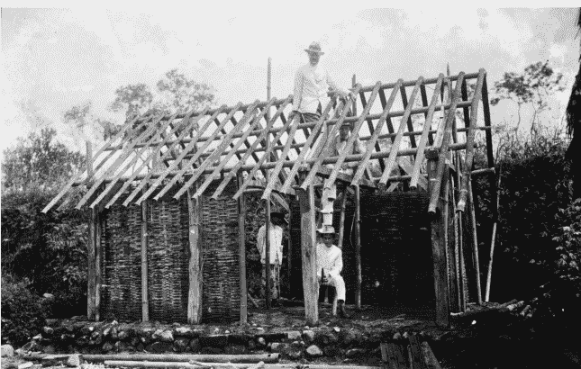
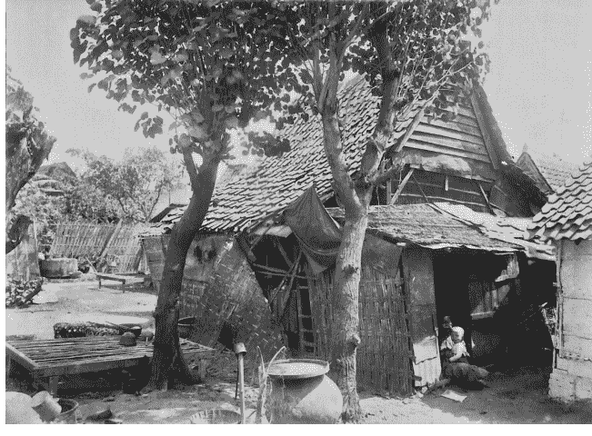
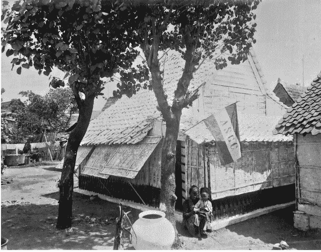
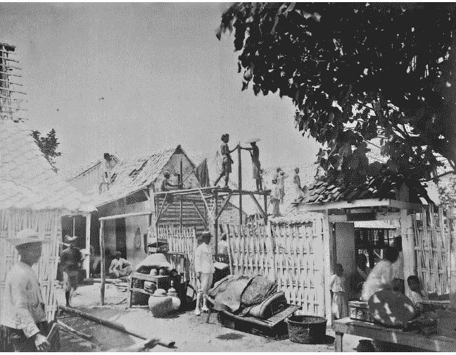
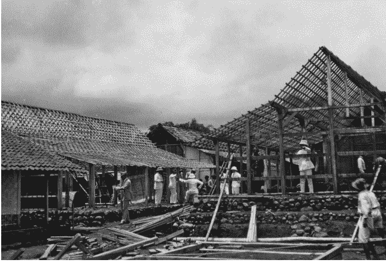
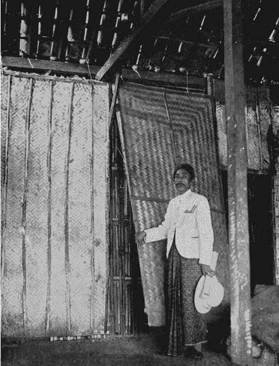
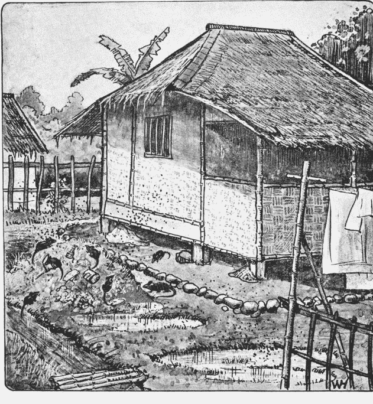
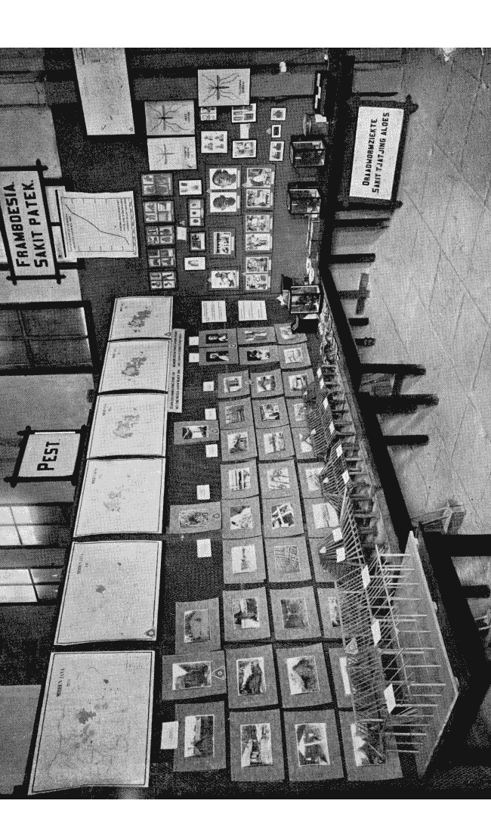

# 爪哇岛瘟疫史：1911–1942

谢辞 vii

技术说明 ix

引言 1

结论 161

## 谢辞

本书是我在2018年参与欧洲研究委员会（ERC）启动资助项目“第三次鼠疫大流行的视觉呈现”（336564）的成果。我非常感谢该项目负责人 Christos Lyneris 提供的专业指导和支持。他建议将荷兰瘟疫摄影的焦点放在“竹子”上，事实证明这一建议非常有成效。我非常感谢亚洲研究协会和医学史基金会（Stichting Historia Medicinae）为本书出版提供的资金支持。

我要感谢在本书写作的不同阶段提供评论和建议的 Marieke Bloembergen、Robert Peckham、Hans Pols、Susie Protschky、Ria Sinha 以及匿名评审员。特别感谢那些帮助我获取关键来源资料并对挑战性章节提供反馈的朋友们：Anghharad Fletcher, Jack Greatrex, Chi Chi Huang, Nicolo Ludovice, Maria Nicolau, 和 Sarah Yu。

海牙的国家档案馆与皇家图书馆（Nationaal Archief en Koninklijke Bibliotheek）、雅加达的国家档案馆与图书馆（Arsip Nasional Perpustakaan Nasional）、莱丹大学图书馆以及世界文化博物馆（Museum Wereldculturen）的工作人员为我的研究提供了极大帮助。此外，康奈尔大学出版社编辑 Sarah Grossman 及其同事的支持对本书的完成至关重要。

我深感谢世界各地家人、朋友和同事持续的个人和职业鼓励。最后我要感谢我的父母 Paul 和 Erna，感谢他们一生的爱支持。

## 技术说明

本书探讨了殖民地晚期爪哇岛对瘟疫的应对。虽然在在该地区的研究中通常使用现代印尼语拼写更为理想，但为了清晰和一致，我选择在全书中对印尼语地名采用殖民时期的拼写（例如 Soerabaja, Madioen）。在相关之处，荷兰语标题和机构已翻译成英文（例如，Burgerlijke Geneeskige Dienst 简称 BGD，Dienstbestrijding 简称 DP）。荷兰东印度的货币是荷兰盾。在整个殖民时期，爪哇岛被分为二十二个居住区（Binnenlands Bestuur），由驻员（resident）领导。这些地区进一步分为行政区（afdelingen），由助理驻员领导。最低基层由 wedono（区长）和 loerah（村长）领导。殖民政府总部位于巴达维（Batavia，现雅加达）、其郊区韦尔特雷登（Weltereden）以及海拔较高的比特曾日（Buitenzorg，现布加尔）和万隆（Bandoeng）。荷兰政府也位于海牙。

本书利用大量的视觉材料作为历史证据。其中许多图像可以在由 ERC 项目“第三次鼠疫大流行的视觉呈现”汇编的数据库中获取。我包含了与论点最相关的图像。尽可能提供了数字对象标识符（DOI）和永久链接以访问更多来源。

## 引言

本书探讨了殖民地晚期爪哇岛对瘟疫的应对。…… [此处省略原文未提供的后续文本内容] ……

三名穿着白色衣服的欧洲人在1919年左右在爪哇岛一栋施工中的房屋内合影（图0.1）。其中两人爬到了梁上，一人从屋顶的骨架中探出来。下方，两名穿着当地与殖民混合制服的爪哇人正观察着。照片的实际主体——施工被完整地捕捉到了。屋顶占据了画面，其网格结构与背景天空形成对比。建筑坐落在石基上，配有木制角柱和梁。房屋的大部分由另一种材料构成，更便宜且易于获得。坚固的竹竿作为支撑柱。椽子由半截或劈开的竹子制成。墙壁由单层名为`gedek`的编织竹席组成。前景中散落着更多的竹子，房屋底部的一根竹杆展示了其中空的内部。我们正在见证爪哇岛的一场家庭改造：这是最具侵入性、最持续性且宣传最成功的健康干预措施之一。

**图 0.1.** 约1919年，查帕尔（Tjapar）一处正在改良房屋的五个人影。G. M. Versteeg，查帕尔正在改良的房屋。Kastelij、Snijders 和 Fischmann 与 Mantri 装修公司合影，约1919年，TM-60012999。由国家博物馆（Nationaal Museum）与 Worldercultures 提供。

这是荷兰殖民时期，为应对1911年鼠疫爆发而实施的一项措施。

鼠疫是一种细菌性疾病，主要表现为三种截然但同样惨烈的形式，这些形式持续影响着人们对流行病的想象。¹¹ 严格来说，它是一种人兽共患疾病，通常通过受感染的跳蚤叮咬或接触受感染动物，从小型哺乳动物的宿主传播给人类。在最常见且致命性最低的腺鼠疫形式中，患者会出现急性发热症状，并在腹股、腋下和颈部出现特征性的淋巴结炎（淋巴结肿大）：即鼠疫结。疾病会破坏免疫系统，患者最终可能因器官衰竭去世。腺鼠疫可能进展为血毒鼠疫，或者少数受害者通过直接接触感染源产生这种形式。在这里，鼠疫杆菌感染并导致血栓、组织坏死、器官衰竭和内毒性休克。最后，鼠疫可能扩散到肺部，引起咳嗽、咳血并最终导致呼吸衰竭。这种形式可以在人之间直接传播，通过吸入患者咳嗽或喷嚏排出的高传染颗粒。肺鼠疫如果不治疗，必死。² 与19世纪末20世纪初其他地区的鼠疫爆发一样，爪哇岛的疾病与其说死亡率高，不如说其引发的文化反应更为引人注目。

从1911年3月发现鼠疫入侵到1942年3月日本入侵时几乎将其消灭，其间，估计有21.5万人死于鼠疫：与1918–1919年流感大流行导致该群岛150万人死亡，或每年由疟疾引起且无法估量（也未统计）的死亡人数相比，这是一个微不足道的数字。³ 然而，这些疾病并未引发过针对鼠疫的全面反击措施。在确定大鼠（`Mus rattus`）为爪哇岛鼠疫的主要宿主或储蓄宿后，卫生官员将增加人与鼠之间的距离视为控制疾病的关键。这样，鼠疫媒介——鼠蚤（老鼠跳蚤，`Xenopsylla cheopis`）被拒绝接触那些其首选宿主已死亡的人类。传统的爪哇房屋由竹子和棕榈叶草建成，被发现为老鼠提供了许多躲避空间，让老鼠可以在人类附近生活和筑巢而不被察觉。因此，荷兰人将当地房屋标记为“鼠疫危险的”。他们将“鼠疫之屋”作为传播场所的历史观念赋予了全新的、转型的且可操作的现实。⁴ 作为回应，在荷兰殖民统治的最后三十年里，超过160万间房屋被拆除或重建，以共同努力“消除外患”——消除鼠疫（见表1）。⁵ 数百万间房屋接受了定期检查，无数爪哇人暴露在一种并行的运动中，该运动迫使他们在房屋的实践和信仰上进行防鼠化。⁶ 在1911年至1942年间，我估计鼠疫控制耗资不少于850万荷兰盾，且可能更多（见第二章）。应对鼠疫的房屋改良在爪哇岛并非独有，但其实施的规模（协助荷兰政府特工服务殖民者、本土人和外国外来人士）无疑是独一无二的。

本书考察了荷兰人对爪哇岛鼠疫的应对。它处于东南亚殖民史、医学史和环境史的交汇点，探讨了鼠疫如何引发荷兰国家权力和文化影响的巨大扩张，而当时——正如人们所暗示的那样，“坏疽”已经侵入了殖民计划的触角。⁷ 我的观点非常直接：殖民卫生干预促成了一场在规模上前所未有、在范围上具有独特侵入性的行动。如果这一主张对于鼠疫研究和殖民时期印度尼西亚的学术研究是原创的，那么爪哇的鼠疫史为关于这种疾病的强大学术体系做出了两项重大贡献。首先，鼠疫倾向于被研究和界定为一种“房屋疾病”，具有明显的城市偏好。⁸ 在爪哇岛，鼠疫与建筑环境之间的这种关联异常强烈，但这种

| 年份 | 鼠疫死亡人数 | 改良数量 |
|---|---:|---:|
| 1911 | 2,155 | 37,851 |
| 1912 | 2,276 | 37,851 |
| 1913 | 11,386 | 37,852 |
| 1914 | 15,756 | 37,852 |
| 1915 | 6,239 | 229,601 |
| 1916 | 1,188 | 141,774 |
| 1917 | 421 | 76,483 |
| 1918 | 734 | 47,608 |
| 1919 | 2,954 | 21,002 |
| 1920 | 9,152 | 26,705 |
| 1921 | 9,763 | 42,563 |
| 1922 | 10,956 | 21,053 |
| 1923 | 8,667 | 46,874 |
| 1924 | 13,253 | 50,714 |
| 1925 | 14,484 | 42,418 |
| 1926 | 7,771 | 45,291 |
| 1927 | 7,755 | 42,633 |
| 1928 | 4,600 | 58,657 |
| 1929 | 4,095 | 86,852 |
| 1930 | 3,980 | 67,037 |
| 1931 | 4,539 | 73,397 |
| 1932 | 6,442 | 56,987 |
| 1933 | 16,880 | 28,438 |
| 1934 | 23,239 | 23,900 |
| 1935 | 12,995 | 36,572 |
| 1936 | 6,000 | 53,418 |
| 1937 | 3,814 | 32,318 |
| 1938 | 2,107 | 56,265 |
| 1939 | 1,427 | 39,282 |
| 1940 | 397 | 54,289 |
| 1941 | 350 | |
| 1942 | 871 | |
| 1943 | 1,224 | |
| 1944 | 242 | |
| 1945 | 190 | |

变成了农村特征。

## 第三次鼠疫大流行

爪哇岛的鼠疫爆发发生在被称为第三次鼠疫大流行的行的疾病全球扩张期间。这一事件的起源通常被追溯到1855年中国西南部的云南省（实际上那里自1787年起就有鼠疫）。历史学家卡罗尔·本迪特（Carol Benedict）解释说，政治和经济不稳定、迁移和城市化有助于疾病在19世纪后半叶向东传播。广州爆发后，鼠疫于1894年5月到达附近的英国殖民地香港。¹¹ 从这个清帝国南岸的关键海运枢纽，鼠疫实现了全球性的融合。在几年内，它遍及每个有人居住的大陆，并建立了新的地方性流行中心（在马达加斯加和美国也是如此）。

鼠疫对人口的影响不容忽视。应对疾病而动员的资源——无论在全球还是局部——与死亡总人数显然不成比例。¹² 鼠疫引发的巨大文化反应，一方面是因为其高死亡率（腺鼠疫、血毒鼠疫和肺鼠疫之间在60%到100%之间），另一方面是因为灾难性的历史。为了解释这种疾病对殖民治理的重要性，我建议爪哇岛的鼠疫和鼠疫控制为荷兰人提供了一个平台：通过这场流行病剧，他们可以在当地、国家和国际层面上证明自己是进步、道德且“现代”的。¹⁰

## 引言

大鼠疫（1346年至1353年间在欧亚大陆达到高峰），广为人知的黑死病。这两个事件都导致了如此巨大的人员损失和社会动荡时期，以至于“瘟疫”必须用末世论术语来描述。它被视为人类生存终结时的疾病。也就是说，当瘟疫在19世纪末20世纪初成为欧洲科学医学的研究对象时，试图研究和控制这种疾病的医生和官员是在“被认为具有消灭人类的能力”的阴影下运作。

1894年5月10日，香港被宣布为“受感染”港，殖民政府接受了由柴石三郎（Kitasato Shibasuburo）领导的日本细菌学家团队——他是罗伯特·科赫的学生。不久后，亚历大·耶森（Alexander Yersin）也抵达了，他是路易·巴斯德学派的成员，曾在附近的顺贡工作。作为微生物学领域领先的新兴且竞争性的医学学派的代表，他们的使命是识别这种可怕疾病的可能病原体。他们的竞争故事已成为传奇。柴石三受到了英国卫生服务的欢迎，后者为他提供了实验室空间，并提供了瘟疫尸体样本供其实验。耶森则被迫在一个临时搭建的竹棚里设立场所，并不得不非法获取样本。两人在彼此的样本中都鉴定出了鼠疫杆菌。柴石三首先宣布了他的发现，并在香港主管卫生官员的支持下，但他的陈述自相矛盾，且样本被污染了。耶森随后通过带有清晰显微镜照片的交流更受青睐，这种细菌以他的导师命名：鼠疫杆菌（`Yersinia pestis`）。

鼠疫杆菌这一里程碑式的发现虽然伴随着瘟疫本身作为一个独立实体的发现，但对其解释起源或传播途径毫无帮助。在随后的几年里，瘟疫蔓延全球，香港成为全球大流行病的中心：一场瘟疫爆发。1895年，该市没有病例，尽管瘟疫在邻近的葡萄殖民地澳门有所表现。1896年，瘟疫“再次来”，并在香港每年反复发生直到1921年。同样在1896年，该疾病在港口城市孟买爆发，并从那里扩散到整个英属印度。两年后，瘟疫传入毛里求斯，马达加斯加则可能是从耶森在芽庄的实验室“泄漏”导致了当地爆发。1899年，马尼拉、檀香山、波尔和亚历山大报告了瘟疫爆发。旧金山、布宜诺斯艾利斯、里热内卢和悉尼在同年发生了爆发，1901年开敦也发生了爆发。考虑到荷兰东印度位于东南亚与东亚、美洲和澳大利亚贸易路线的交汇处，瘟疫在此期间未能建立是一个谜团，同时各地差异巨大：从恐慌到否认，从松懈到完全的“严酷”应对措施，从对“本土”卫生实践的忽视到对现代科学的嘲笑。随处可见，新的瘟疫细菌病因与关于其性质和传播的现有理论、假设和偏见发生碰撞，形成了混合型流行病。

人类学家克里斯托斯·林恩（Christos Lyn）认为，在大流行的早期，瘟疫是一种建立在旧观点基础上的“土壤疾病”，即认为瘟疫是由吸入地气引起的。这些理论现在认为细菌感染了土壤，保持休眠状态，直到在长的时间间隔内引发新的爆发，并建议了一些干预措施。在香港，这些观念支持了拆除和焚烧华人社区太平山。同样，在孟买，卫生官员拆除了瘟疫受灾区的建筑，并挖掘了泥地，以让土壤“暴露”在阳光、空气和火等被认为具有消毒作用的情况下。在此过程中，促进人类与土壤接触的本土实践被殖民官员斥为是危险的。例如香港人的赤脚走路，或曾用来清洁金属物品的加尔各答妇女。同时，医学历史学家罗伯特·帕奇姆（Robert Peckham）指出，卫生官员正忙于储存在香港并从香港运出的“中国物品”所具有的感染倾向”。在这里和其他地方，细菌在大量“物品”中躲藏的这种感知能力，使瘟疫变成了一种出口商品，导致了个人物品以及货物被消毒或焚烧。

然后，当然还存在广泛的社会和种族关联，这些关联将中国人、印度人或朝圣者（hajis）等某一群体视为瘟疫的人体载者。在一个著名的例子中，种族主义情绪在1898年檀香山唐街的焚烧中起了作用。在旧金山及等地，由于对华人社区采取的隔离措施无效。在巴西、阿根廷和南非，白人精英归罪于贫困的非裔社区，并试图将他们推向社会边缘。简而言之，瘟疫仍然是一个认识上不确定的实体，很容易被纳入关于疾病性质、起源和传播的观念和偏见中。当瘟疫抵达爪哇时，其中许多这些观念仍然存在，并影响了对爆发的早期反应。但在此期间，一种全新的瘟疫理论也获得了关注。

今天，瘟疫被理解为主要影响啮齿动物的传染病，并通过所谓的鼠蚤进行最有效的传播。老鼠特别已成为当代瘟疫传播叙事的核心。它是我们选定的“流行病反派”。人类学家尼古拉斯·埃万斯（Nicholas Evans）认为，到19世纪末，动物也受到瘟疫影响是一个事实，而瘟疫的“现代符号”充满了“老鼠作为瘟疫载者的图像”，在19世纪末之前，动物在人类与人类之间传播中发挥作用的观点是闻所未过的。尽管耶森曾指出老鼠是瘟疫的媒介，但直到1899年，另一位巴斯德学科学家保罗·路易·西蒙（Paul-Louis Simond）才提供了瘟疫可以通过受感染跳子传播的初步证据。他的理论遭了怀疑，但在随后的几十年里，根据指出，第二次瘟疫委员会（1905-1917）的成员努力地证明了支持这一“鼠-蚤-人”假设的证据。其他啮齿类动物如跳鼠、土拨和旱鼠随后被认为是瘟疫的“森林或野生宿主”。因此，瘟疫被置于人类与动物生命的交汇点：为人兽共患的概念奠定了基础。然而，在当时的英属印度，该理论再次被用来强化生存危机和社会等级。欧洲人关注的不是老鼠本身的问题性代理，而是促进人鼠之间不当关系的本土习俗。埃万斯指出，“对老鼠代理性的发现”最终使本土人的身体和习惯变得可知，而且关键重要的是，变得可审判。正如我在书中证明的，类似的差异也存在于荷兰对印度群岛瘟疫及其传播的假设中。

在深刻的《亚洲深入亚洲》（Asia Inside Out）系列丛丛一书中，历史学家埃里克·塔利亚科（Eric Tagliacco）提供了1910年荷兰东印度的快照。他认为，当时的荷兰殖民政府发现自己“正处于对群岛统治的顶点”。在地理上，殖民地已扩张到最大范围。测绘和测量任务以越来越高的精度记录了荷兰统治下的领土及其居住的人。铁路进入了爪哇和苏门腊的内陆。航运的进步使岛屿联系更加紧密。边缘地区的特务人数不断增加，荷兰东印度皇家（Koninklijk Nederlands-Indisch Leg, KNIL）是一支日益专业化的军事力量。为即将到来的灾难做好了准备——政府腐败和对民众的虐待依然存在，不满情绪四溢。民族力量随着1908年进步组织（Boedi Oetomo）政治组织的成立而启动，正如历史学家汉斯·波尔斯（Hans Pols）所-

## 引言

从印尼岛医生的视角来看，平原地区的实力、多样性和视野正在稳步增长.^37 但如果正如塔利亚科佐佐（Tagliacozzo）所说，坏疽在1910年后侵蚀了荷兰的殖民计划，那么为什么不通过引用在那该年进入印尼岛的病原威胁来证实他的比喻呢？鉴于他强调那些排除了信心的殖民统治幻象，对医疗保健的坚持显得令人惊讶。毕竟，尽管许多指标表明当时荷兰殖民政权相当稳固，但医学并未位列其中。鼠疫在爪哇达的爆发以及随后的措施未能遏制它，却在未来的几十年内实质上扩大了荷兰的领土。

自1827年以来，民用卫生部门作为军事卫生部门的一部分在爪哇达运行。因此，印尼岛人口的健康次于荷兰军事和政府人员的护理。多次分离这两个分支的尝试均失败了，而该系统又被批评从军队抽调资源，又被指责忽视了平民健康。^38 在19世纪的大部分时间里，只有少数几个较大的定居点拥有市政或港口卫生官员。散落在爪哇达的各种种植园聘请了私人医生。^39

历史学家莉丝贝·赫塞尔林克（Liesbeth Hesselink）在她对19世纪末20世纪初荷兰东印度医学市场发展的研究中，将1850年受过欧洲培训的医生人数估计为少于60人。到1900年，这个数字增加到了228人：远不足以覆盖仅爪哇达近三千万的人口。相反，印尼岛的大多数人口从医生那里获得医疗护理，这些医生倾向于专门从事特定的医疗实践，并通口传和经验获得知识。赫塞尔林克估计，1900年这类人数约为33,000人。^40

平均，1900年医疗机构（包括精神医院）的数量约为80个。它们主要由军队经营，提供约4000张床位。^41 1888年成立了一个名为“医学实验室”（Geneskund Laboratorium）的政府医学实验室。

荷兰殖民卫生部门——如果可以这么说的话——由少数日本医疗助理支持。巴达达医学院于1851年开办，培养了源源不断的初级医生和接种员，他们作为津贴的回报，有义务为殖民国家工作十年。^42 课程的长度和复杂性稳步增加，1902年，该学院被更名为“本土医生教育学校”（School tot Opleiding van Inlandsche Artsen, STOVIA）。

尽管如此，直到20世纪20年代后期，STOVIA或其位于泗水达（1913年开办）的姐妹学院的毕业生在地位上才开始与受过欧洲培训的医生并肩：至少在财务上是如此，社会地位例外。^43 到19世纪末，已有90名这样的`爪哇医生`（doctor djawas）为政府效力。另有4人从事私人执业。少数人赴荷兰接受深造。^44

`爪哇医生`——这个名字即使在毕业生被授予“本土医生”（Inlandse arts，1902年）和“印尼医生”（Indische arts，1913年）称号后依然流传——在殖民社会中占据着一个充满勃心的地位。学生通常在十几岁时入学，与家庭、当地习俗和传统价值观的联系被切断。这些印度医生预计毕业后能操纵荷兰社会，却遭遇了一场“冷酷的觉醒”，被拒绝承认是完全受过高等教育的殖民公民。波尔（Pol）认为，正是这种令人不满意的局面导致了他们积极参与民族主义运动。^45

大约1900年，荷兰殖民政策发生了变化。在经历了年的公开辩论后，海牙政府正式放弃了将印尼岛视为“榨取殖民地”的观点，转而追求一种由自由主义理想引导的新路线，即通过“提升”当地民众来为快速独立做准备。^46 所谓的“伦理政策”（*Ethische Politiek*）是对法国自由派的“教化使命”以及英美式的“白人的负担”的回应。

在许多方面，这是一种精英主义政策，以基督教责任为措辞，执行得杂乱无章，充满矛盾——“碎片化”——或许仅仅是为威权殖民主义提供合理化理由的新尝试。^47 伦理政策试图将印尼岛的社会、政治和文化暴力与当代关于现代性、公民身份、秩序和国家的语调协调（尽管实践中并非如此），而这些的对象正是“他们自认为在统治的人”。^48

虽然这种新的政府逻辑要求对其殖民臣民的健康和福祉负责，但公共卫生领域是该政权下出现的伦理与经济之间紧张关系的显著范。^30 从政府宣布打算履行对印尼岛所谓的“荣誉债”起，花了五年时间才成立了一个委员会来安排一个独立的民用医疗部门。^51 又过了五年，该组织才成立。

1911年1月，最终创建了独立的民用医疗部门（Burgerlijke Geneeskundige Dienst, BGD），此时是鼠疫被认为进入爪哇达几个月后，并在被确认几个月前。^52 新卫生部门隶属于教育与崇拜部。多年来，这个新机构一直人员短缺，直到1920年，地方政府的所有职位仍未填满。

鼠疫在其存在的最初几年占据了主导地位，导致有必要建立一个独立的鼠疫部门（Dienst der Pestbestrijding, DP），该部门在1915年至1924年间活跃。DP后来被整合为更名后的公共卫生部（Dienst der Volksgesondheit, DVG）的分支。^54

在爪哇达和苏门答腊部分地区，这些政府机构几乎没有影响力。最后，作为其边缘地位的进一步证明，1914年BGD的预算为750万英镑，远低于殖民政府其他分支的资金，如民用服务（f.1260万英镑）、基础设施（f.2600万英镑）、教育（f.1300万英镑）以及武装部队（f.4650万英镑）。^55

而年轻民用医疗部门面临的健康挑战主要是钩虫、登革热、脚气病、结核、伤寒、霍乱和天花等流行病。天花疫苗可能是唯一一个取得了真正且持久进展的领域。事实上，天花疫苗很可能是对我鼠疫防疫是荷兰时期最具侵入性的健康干预这一观点的主要挑战。^56

如历史学家彼得·布姆加德（Peter Boomgaard）所示，到1850年，仅爪哇达就进行了35万次接种。1890年后，在巴达达运行的陆医局（Landskookrichting）持续生产疫苗和接种剂。1895年后，它与巴斯德学院的新分部合作运作。^57 到1934年，仅爪哇达就进行了140万次接种，外岛地区增加了47万次。^58

另一种引起荷兰殖民地极度焦虑的疾病——麻风，也是公众和科学辩论的主题。然而，与鼠疫不同，它未能成为持续健康干预的目标。正如历史学家里奥·范·贝尔根（Leo van Bergen）所提出的，将麻风错误地归类为遗传疾病使得官员将其排除在疾病控制的优先考虑之外。^59 即便在1918-1919年的大流感爆发中，有一种健康威胁真正威胁着其他疾病⁶⁰，1920年BGD的一份报告宣布：“比起所有上述疾病的总和，疟疾侵蚀了荷兰印尼岛人口的健康与繁荣。”⁶¹

考虑到爪哇达和苏门答腊的荷兰种植园供应了世界上大部分抗疟药物奎宁（在二战期间占比超过90%），这并不是说殖民政府无法有力地控制这种疾病。它仅仅不是首要任务，而且这种疾病的控制也取决于环境因素。^62

与此同时，来自海外的新型致命疾病的威胁并未被印尼岛卫生官员忽视。自1894年鼠疫首次传入香港后，鼠疫恐惧就随处可见。此外，正如我在其他地方提到的，1904年左右巴拿马运河的修建引发了另一种“美国”鼠疫进入印尼岛的阴影：黄热。^63 在两种情况下，荷兰人都倾向于采取更廉价的适度预防措施。

# 引言

转向一种更稳妥、更昂贵的预防策略。因此，截至1911年1月，这片巨大的群岛拥有275个能够接收远洋蒸汽轮的港口，但只有两个检疫站：第一个位于巴达维离岸的岛屿，第二个位于米兰郊外的苏门答腊港口贝拉万。64

荷兰人对反对鼠疫的基础设施干预——住房改良——的强调，必须置于追求建筑解决方案的更广泛的模式之中。“工程壮举”在荷兰殖民者中是一种非常受欢迎的体裁。例如，照片展示了基础设施天才设计的壮观景象，使道路和铁路能够克服印度尼群岛所带来的严峻障碍，如山脉和河流：65

另一个例子是克鲁杜火山（Kelud）的工程。当这座火山在1919年在东爪哇喷发时，其巨大的湖泊导致了致命的泥石流。作为回应，一个新组织的火山服务部门负责建设排水隧道，极大地减少了该湖泊的水量，试图减轻未来喷发的影响。66

工程为其他健康挑战提供了类似的解决方案。例如，苏门答腊德里种植园契约工人恶劣的社会和卫生条件，在19世纪末成为所谓的“福利资本家”（他们最初是这些条件的制造者）的目标。塞内姆巴公司（Senembah Company）是德里公司（Deli Company）的子公司，它的建立作为启明管理的典范。

1897年，它聘佣了德国医生W. A. P. Schüffer 来监督彻底的卫生改造。该地区出现了医院、诊所和学校系统，在塞内姆巴，Schüffer指导了新型示范房屋的建设和供水系统的改进。^67 与此同时，苦力人口被称为“技术和社会实验的虚拟实验室”。^68

与此同时，最初负责爪哇岛鼠疫控制的医生威廉·德·福格尔（Willem de Vogel）刚从三宝抵达，他在那里曾与慈善家 H. F. Tilema 担任市议。他们都深信合理的房屋设计和规划对健康的益处，这对于一个新“卫生”社区的开发起到了性作用。^69

这些旗舰式的干预无疑启发了住房改良方案。这些政策共同表明了一种独特的荷兰殖民乐观主义，即对印度尼群岛进行“工程化”社会和社会环境改进，其他学者也指出了这一点。^70 在此，人们也可以指出荷兰的历史和当代倡议，例如“慈善殖民地”（colonies of benevolence）和索得海（Zuiderzee）的围海。事实上，这两项倡议都将对自然环境的干预与社会改革实验结合在一起。^71

# 图像与流行病

图像是我们理解和体验疾病的核心。学者指出，视觉在19世纪以后欧洲科学医学（生物医学）的出现中起了作用，图像告知关于疾病本质和传播理念的形成也发挥了作用。事实上，如果没有一系列图像，疾病和公共卫生事件将变得“无法想象”。^72

如果说病原体的照相摄影照片（如法国医生兼哲学家乔治斯·恩格尔（Georges Engel）在1943年建议的那样）提供了疾病的“本体论”表征，并且如果疾病宿主和媒介的图像可以代表传播过程以及责任，从而使疾病变得具有可操作性，那么一系列精度较低但信念同等的替代性视觉化，就可以记录支撑感染性疾病发生的关系和条件。^73

正如我在其他地方论证过的，通过登革热病毒疾病科学成像的视角，所有此类图像在十九和二十世纪交界处对新冠疾病身份的表达都发挥了作用。所有这些图像对于告知我们对特定疾病的反应（或缺乏反应）都至关重要。^74

到1894年，图表、图线和地图早已成为流行病可视化的常态。但随着香港鼠疫的爆发，一种新的视觉表现形式——被林瑟瑞斯（Lyntheris）称为“流行病摄影”的形式应世了。^75

这种摄影体裁偏离了旧医学摄影的临床化风格以及其对患者和症状的关注。相反，它涵盖了“作为感染剧场和反流行病干预剧场的整个社会和自然生活”。^76 镜头对准了参与鼠疫传播或控制的人、物体、动物和活动：中国移民、马达加斯加的埋葬、哈尔滨的个人防护、印度的老鼠解剖——也许最重要的是对空间。

历史学家卢卡斯·恩格尔曼（Lukas Engelmann）在提到檀香山的鼠疫摄影时说，流行病摄影极大地反映了医生、流行病学家和政府官员对“当地、环境以及鼠疫病例出现或威胁到达的建筑”的关注。鼠疫图像的摄影重点明确是流行病的生态学。^77

鼠疫是第一个被拍摄的大流行病，而鼠疫摄影的焦点和构图影响了此后疫情被呈现的方式：从埃博拉、齐尔卡病毒到新冠肺炎。

爪哇有大量与鼠疫相关的视觉材料，它们构成了本书历史证据的重要部分。我所表明，不仅仅是插图，这些图像对于转变人们对疾病的流行和科学理解至关重要。它们告知并正当了荷兰对鼠疫的应对，并作为印度尼群岛殖民统治进步性的视觉证据呈现。

在研究过程中，确定了650张独特的鼠疫相关照片。根据斯特（Lister）和恩格尔曼的论点，这些照片中很少有能算作“医学”照片。在政府时期的《民医学公报》（Medelingen van Burgerlijke Geneeskundige）第一卷包含的一组65张照片具有不同的重点。人（患者、助手，但不是医生）、物体（警告标志牌、熏烟设备）、地点（房屋、村庄、疏散营、当铺店、学校）、动物（老鼠）和活动（跨越隔离区的贸易、房屋检查）被并置在一起。⁷⁸

在随后的照片中，建筑环境变成了主导焦点：图像展示了处于危险阶段、进行阶段或已改善阶段的房屋或村庄。例如，在世界文化博物馆（Museum Wereldcultures）获得的200张照片案例中，超过一半关注房屋及其内部或移动工作。其他照片——同样主要关注建筑环境——发现于档案、博物馆和大学收藏。在荷兰的生物医学出版物中，很少看到鼠疫患者、宿主和媒介的照片。

这些许多照片也可以在重要的次要摄影体裁——摄影伦理学中看到，历史学家苏西·普特斯基（Susie Protschky）与其他者在合书中进行了研究。普特斯基认为，摄影技术的进步比鼠疫摄影早了十年，与1900年摄影伦理学的出现相合，这两个过程通过各自对“现代性、进步和文明”的承诺而产生共鸣。⁷⁹

随着摄影经历早期的“民主化”，更大规模的非专业人士能够产生更多样化的照片，使历史学家能够“采样”“印度尼群岛更广泛的人群如何在局部与伦理话语进行选择性接触，并表达对现在和未来的愿景”。⁸⁰

许多记录爪哇鼠疫和鼠疫控制的照片可以从这些角度进行解读。在图0.1案例中，人们可以认为它揭示了印度尼群岛的社会阶层以及荷兰殖民者的自我想象和呈现，但也展示了摄影师（一位鼠疫医生）和他的主体（两个鼠疫医生、两个鼠疫医士和一名公务员）如何构想一座现代、健康的印度尼房屋：这是一座光线充足、通风良好且井然有序的居所，男子坐在横梁之上的似乎表现出相当程度的自豪。

然而，这些图像意在强调“种族与文明的差异”，而尚未发现关于爪哇人对这一房屋改良计划感知的摄影反面证据。与此同时，在这张关于房屋改良的照片中，正如其他照片一样，我们可能会看到19世纪荷属风景画这一古老派类的延续；Protschky认为，这种绘画通过对冲突和剥削的，“在象征意义上宣称了欧洲对印度尼西亚景观的主权”。

然而，在荷兰瘟疫哲学的情况下，这种对主权的象征性宣称也曾基于一种高度物质化的干预。事实上，这些照片超越了象征意义：它们捕捉了那些被压抑的景观，在这些景观中，欧洲主权被主张将其转化为新事物。通过这种方式被捕捉并展示的建筑与自然环境的惊人改变，使我在第三章中建议，房屋改良的照片可以作为一种殖民奇观来开展最有成效的研究。

除了照片外，荷兰卫生工作人员还产生了大量的瘟疫图像，如地图、图表、表格和图解，此外还有一系列专门针对印度岛平民读者的材料。这些材料被统称为“医学宣传”（medische propaganda），它们解释了关于瘟疫本质和传播的生物医学观点，论证了房屋改良的必要性，并敦促人们保持住房无老鼠。

正如我们所看到的，所有这些材料都具有多重用途，并面向多个受众。瘟疫房屋的准原子照片记录了老鼠的存在，并指导了针对瘟疫的应对措施，同时也允许荷兰医生通过向外国科学家阐述一种独特的爪哇瘟疫生态学或生态系统（在先驱之作），来展示他们的科学能力。因此，对爪哇瘟疫的研究也导致了对人兽关系复杂性的新的（尽管并不完美）的理解。

健康信息表面上旨在指导爪哇人了解瘟疫及其预防。但与此同时，健康信息的照片也被呈现给殖民地、大本国和外国观众，作为“伦理化”殖民治理以及当地对欧洲干预顺从的证明。

简之，爪哇瘟疫的视觉文化服务于荷兰的流行病学实践、教育目标和伦理话语。它可能还试图区分殖民者与被殖民者之间的种族和文化差异，尽管其关注的是爪哇的建筑和自然环境而非其人民。

此外，在整套荷兰瘟疫摄影中，这些图像似乎蕴含着某种展示科学和政治实力的民族主义驱动。瘟疫暴露了荷属东印度群在疾病面前的脆弱性。瘟疫控制提供了一条途径，使荷兰可以将自己作为东方的政治、文化和科学强国的形象，传达给当地、国内和国际观众。

但重要的一是，我必须强调，房屋改良并不仅仅是一个噱头。与对爪哇人日常实践和信仰的干预相结合，在爪哇建筑和自然环境中进行的调整确实有助于受影响地区逐渐消除瘟疫。然而，这种双管齐下的干预未能赶上瘟疫从东爪哇向西爪哇的扩散，与此同时，它所起的作用不仅仅是让瘟疫屈服。

在书中，我论证爪哇的瘟疫可能引发了荷兰殖民时期或许是最剧烈的卫生干预。瘟疫控制将对日本物质文化、卫生实践和建筑环境产生深远影响。这种疾病以及荷兰的殖民反应促进了政府对土地及其各种人类和动物居民前所未有的监督和控制。这很可能构成了对数百万人生活深远且持久的殖民侵入。

每一章都按照大致的时间顺序，为这一总体论点贡献了一个特定的视角。同时，这些章节也试图对晚期殖民地亚洲关于瘟疫、殖民主义和环境的现有研究做出较小的贡献。

在第一章中，我将1911年3月马拉马县（Malang）瘟疫的最初爆发视为“焦虑等待”过程的完成，在此过程中，医生和官员担心瘟疫被引入荷属东印度群岛。本章提问：在荷兰对这种疾病的焦虑中心，关于房屋在瘟疫传播中作用的观念是如何重新阐述处于中心的、爪哇人传统的竹质居所的？

在确立了摄影在这一过程中的作用后，第二章继续追踪了后来成为爪哇瘟疫标志性应对措施的早期发展：房屋改良。这一计划通过规制、限制和部分收回传统爪哇人建筑材料和建筑形式的使用，有效地“殖民化了家庭”。

在此过程中，当地人口显然进入了殖民国家的管辖，而房屋改良则意味着荷兰对爪哇景观影响力的剧烈扩张。这种干预只有在在印度尼西亚此地和其他地方建立的大型种植园能与之匹敌。同时，房屋改良对自然资源的增长和可用性——实际上是对爪哇人的支付能力——增加了越来越大的压力。

第三章阐明，瘟疫控制措施并非完全为了爪哇人的利益。相反，瘟疫和瘟疫控制通过讲座、照片、展览甚至旅游被传播给各种荷兰和外国观众，以阐述荷兰的政治和文化优越性、荷兰殖民统治的伦理性质以及荷兰的科学能力。我建议，房屋改良场景是一个殖民奇观，通过这种奇观，殖民权力关系被具体化，荷兰持续统治的需求被建立。

在第四章中，我探讨了房屋改良作为应对为何实际上不足。意外的是，荷兰卫生官员从一开始就意识到房屋改良必须配合房屋检查和卫生教育，以保持改良后的住房无老鼠。房屋改良仅仅是为了消除空巢空间。它的目的是定期清洁房屋，这种清洁将成为“习惯”（adat）——即基于伊斯兰教和泛灵论传统的当地实践和信仰的一部分。

一系列强大的视觉技术试图指导爪哇人居住房屋的艺术，并灌输新的卫生实践和观念。如果说房屋改良殖民了爪哇人的房屋并延伸到其周围的土地，“瘟疫宣传”试图用欧洲的标准取代现有的爪哇人清洁观念和健康实践。

这种通过瘟疫控制实现的荷兰国家权力和文化影响的扩张，在1930年代以及有了有效疫苗的情况下，官员强调了他们多年来完善的双管齐下方法的持续必要性：房屋改良和卫生教育。尽管如此，20世纪30年代的经济衰退对瘟疫控制工作产生了重大影响。结果，我们在瘟疫进入西爪哇的这一较晚时期看到了最高数量的瘟疫病例（见第三章图表4）。

第五章探讨了这些问题性内容。它回到了第一章中首次提到的问题：房屋作为多物种相遇场所的观念以及其对人类健康的影响。人们逐渐承认，房屋改良完全可以构成了针对瘟疫的“永久性”干预，但它也因无意中制造了蚊虫滋生地并仅仅促进了人虫接触而陷入了对疟疾的““剥削”。

至于瘟疫：通过当地开发的疫苗接种和高度系统化的改良计划，年度病例数最终在1942年荷兰有效殖民统治结束时下降到了数百例。

# 第一章

## 瘟疫、老鼠与爪哇岛的房子

我们这些从未见过瘟疫患者的医生，对瘟疫的了解通常仅源于书籍和期刊教给我们的那些知识。

> ——艾萨克·格罗内曼（Isaac Groneman），《根据与耶森博士谈话后的瘟疫防治》，1899年

1911年3月22日，在东爪哇度假胜地马兰（Malang）经营私人诊所的丹麦医生彼特·科费德（Peter Koefoed）受托伦（Toeren）行政长的邀请，去医治一位亲密的女性亲属（图1.1）。当地贵族成员拉登·阿贞·莫科（Raden Adjeng Moerko）刚从热门的山地山区巴托（Bato）回来，她的丈夫在那里突然病了。她请了一位当地老师来探访。在加当（Gadang）亲戚处居住期间，科费德描述该女性为“病情严重的患者”。她发高烧，“精力耗尽”，并在腹股处出现了一个“小但非常明显的腺结肿”。她在当天去世了。

莫科那不祥的预兆症状促使科费德采集了血样。回到诊所后，他准备了几片带有血迹的玻璃玻片，用乳蓝色和吉姆萨液进行染色，并放在显微镜下观察。很快，他得出了一个决定性的诊断，并提醒了该地区的首席卫生官。他的样本中含有鼠疫菌。²

## 焦虑的悬念

根据著名医生伊西多尔·斯纳珀（Isidore Snapper）在1945年的写作，“在瘟疫‘不可避免地’引入爪哇岛之前，荷兰属东印度的医学当局一直生活在焦虑的悬念中。”³ 自1894年第三次大鼠疫爆发以来，该群岛就拥有了数百个港口，其中几个与香港有直接交通往来，随之还像孟买、檀诺鲁鲁、悉尼和兰贡等“鼠疫港口”。这些港口中很少有配备任何卫生设施。

1899年，瘟疫在槟城（Penang）爆发，那是位于马拉甲海峡对岸、苏门腊岛北部的英国殖民地。这次爆发引起了广泛关注，既是因为其地理临近，也是因为它“证明了印尼群岛的气候对防止其在此处发生提供了保护，而这曾让我们感到恐惧。”⁴ 印度尼各地的机构请求总督采取预防措施。³ 位于巴黎的荷兰立法机构被“电电召集”，安排从巴斯德研究所运送鼠疫血清，血清被送往认为风险最高的地区。⁶ 当地当局被指示改善卫生条件并“消灭近期在鼠疫传播中的老鼠”。⁷ 此外，一名官员寻求监督偏远的卡里姆·爪哇（Karim Jawa）岛，以监督鼠疫营的建设，用于安置潜在受害者或作为隔离点。多年后，此人作为海牙议会的一员回忆道，当时他们这些文官同事之间有一种共识，即爆发迫在眉睫。⁸

与此同时，瘟疫在1899年至1906年间曾在邻近的美国占领的菲律宾流行。⁹ 更令人不安的是，1905年在苏门腊的白拉万（Belawan）港发生了两例当地感染的鼠疫病例。¹⁰ 然而，尽管位于印度洋和西太平洋航运的交汇路口，尽管四面被鼠疫中心包围，荷兰东印度群岛避开了新大流行病的第一波冲击。鉴于所采取的措施如此匮乏，大多数卫生官员将此归于运气。其他人，如前提到的，则更为乐观。事实上，鼠疫在印尼群岛长期未能立足，他们认为这证明了印尼群岛炎热的气候对疾病并不友好。

关于1911年初的几个月，这种焦虑远远超了“医学当局”的范围，变得几乎触处可见。在科费德在东爪哇农村确认一例人类鼠疫两个月后，泗水（Soerabaja）的检察官告诉私人医生`J. W. van der Spek`，他的一个员工已经去世，另一个则病了。在此之前，在繁忙的阿普卡（Apcar）的一家公司仓库发现了大量老鼠，这些老鼠此前生活在英属印度，他迅速将死老鼠与其受苦的员工联系起来。他问道，这可能是瘟疫吗？

在检查尸体后，德·佩克发现“没有传染疾病的症状”。该男子被诊断为“谢尔斯热”（Scheerse koorts），这是一种痛苦但通常类似于登热热疾病。医生保持了警觉，请了两名市政医生来证实他的发现。他们同意尸体上没有鼠疫迹象。几周后，德·佩克被请去查看当地市场帕萨尔·彭加赫（Pasar Pengah）的两名病严重的女佣。所有三名患者均被送往传染病医院，两名女性在几天后去世。

泗水首席医疗官弗洛里延·斯潘斯（Florijen Spaans）要求对这些患者采集血样，并送往韦尔（Wel，即巴达维亚荷兰帝国权力的郊区）的医学实验室（Geneeskundig Laboratory），要求筛查鼠疫菌。与此同时，这些不幸的房屋被消毒，其他居民被“封锁”了五天。血样结果显示鼠疫阴性，但病例发生的社区仍被观察了一个月的其他可疑疾病。¹³

3月初，一名在丹吉尔（Tanjkir）行政区巡视肯登格山（Goenoeng Kendeng）的医生获悉，一名当地老师已经病了一段时间。他也被转到市内的传染病医院，并在三天后去世。他也有腺结肿。他也被采集了血样并送往韦尔韦登（Welwerden），结果并未发现此类异常。来自肯巴姆（Kembang）社区的一名中国人也是如此，他于3月7日入院并在次日去世。¹⁴

从潜在的“附属”和“腋窝”中取的另外两个样本分别由马迪恩（Madioen）和泗水（Soeraja）的医生提交给实验室。再次没有发现细菌。¹十五

与此同时，在拉旺（Lawang）的精神院，医生`A. Boon`被请去看附近梅林（Meling）的几个发热患者。不久后，一位名叫苏姆迪戈（Soemidalgo）的医生报告说，除了疟热外，“社区内存在另一种疾病”。⁶ 经过仔细的文献检索，他将患者诊断为腺热（drüsenfeever）。

此时，活跃的印尼媒体已传闻了其他可疑病例的消息。¹⁷ “早在12月10日，”后来马兰的荷兰护迪斯特拉（Dijkstra）写道，“我们就听到了奇怪疾病的说法。人们出现高热，有时吐血，腋下长肿块，大多数人在不久后去世。”⁸

1月底，据说在三宝（Semarang）的一艘运送朝圣者的船上发生了一例鼠疫。¹⁹ 2月28日，《印尼杂志》（De Perianger）的一篇文章关注了东爪哇一系列可疑疾病，并描绘了一个特别生动的（甚至是可怕的）场景。作者写道，某一天，一列普通的火车会像常一样到达巴达维亚。在它的各种货物中，将携带一份寄给“实验室科学家们”的小包裹。它很可能包含了黑死病进入泗水的证据。²²

针对东爪哇的潜在病例，西爪哇也报告了轻微鼠疫，在2月中旬，一名从克拉旺（Krawang）前往万隆（Bandoeng）的火车上的妇女去世。²¹ 可疑疾病的报告也开始引起卫生官员的不安。3月，据说威内登·斯潘（Wijdenes Spaas）在泗水发布了一项法令，要求全面消灭鼠疫的宿主——老鼠。²²

与此同时，来自东爪哇附近居民的样本不断送往医学实验室（Genesekund Laboratory），并附带筛查鼠疫的请求。该实验室主任`J. de Haan`曾在1900年在巴黎的巴斯德研究所研究过鼠疫，他回忆了自己的厌恶，并描述了分析所收材料的困难。鼠疫病例的血样本身就很难处理，而且有些样本在运输过程中干涸，或者质量不足以培养。从管结肿患者处采集的液体样本同样干涸或结果为阴性。因此，巴达维亚没有采取任何行动。²³

# 瘟疫、老鼠与爪哇岛

23

## 爪哇的瘟疫

尽管一直担心瘟疫会进入荷兰东印度群，但当这种疾病在1911年3月被发现时，殖民政府及其卫生部门的准备非常不利。瘟疫主要是城市疾病，而它以某种方式跳过了主要港口城市，显然扎根于东爪哇的农村，这让官员和医生都感到困惑。

马兰（Malang）是帕塞罗安（Paseroean）行政同名地区的首府，自19世纪后期以来迅速发展成为当地种植经济的中心。讽刺的是，它较高的海拔和凉爽的气候使该地区成为了欧洲殖民者的疗养地。⁵ 然而，马兰的公共卫生服务并未跟上新古典主义别墅、“瑞士式木屋”和酒店的建设速度，导致瘟疫的引入被忽视。

正如引言部分，即使在主要港口城市，防止瘟疫的预防措施也微乎其微。截至1911年，在广大的群岛中几乎没有运作的隔离站。⁶ 每三个月，就有报纸声称政府从巴斯德研究所购买少量瘟疫血清，并分发到几个城镇以防爆发。这种血清的疗效并非如此，而且供应也显然不足。⁷

事实上，印度群岛直到1911年1月才拥有民用医疗机构。当在马兰鉴定出瘟疫杆时，这一民用医疗机构（BGD）正如荷兰殖民部长瓦·马莱菲特（Jan der Waal Malefeit）所说，“还在穿尿布”。⁸

## 第一批响应

正如其他地方一样，瘟疫的首次发现引发了疯狂，如果不能说是恐慌或否认。但卫生和政府官员还不愿意立即宣布爆发。在确认了科福（Koefoed）的诊断后，汉（Haan）与BGD的领导会了面。总督亚历山大·哈登（Alexander Harden）获知此事。马兰当地卫生当局收到一封电报，告知实验室结果。第二天，新卫生部门的副主管前往东爪哇“开展当地调查”。¹

廉·托马斯·德·沃格尔（Willem Thomas de Vogel）是荷兰东印度岛卫生政策发展的关键人物。他于1863出生于德班（Toeban），在1886年至1895年间于莱登和柏林接受医学训练。1897年，德·沃格尔回到印度群岛在三宝经营私人诊所，两年后成为市首席医生，并于1906年当选当地市议员。1911年加入BGD后，沃格尔于1913年初成为正式主管，并在从最初关注治疗医学转向公共卫生和疾病预防方面发挥了关键作用。德·沃格尔是过去三十年决定性塑造荷兰应对爪哇瘟疫措施的少数人之一。

沃格尔于3月29日抵达苏宝雅（Soabaya），采访了自称从2月起就看到病例的官员和医生。当然，瘟疫传言早已到达了巴达亚（Batavia），这些指控并不新鲜。正如德·沃格尔的妻子苏珊（Suzanne）在写给岳母的信中观察到的：

> Wim昨天意外前往了苏宝雅和马兰。几天前，东部角（Oosthoek）已报告了数例可疑类瘟疫病例，现在马兰鉴定出一个真实病例。³31

尽管如此，德·沃格尔收集的流行病学情报对于构建时间线至关重要，并有助于确定疾病已经达到的地理范围。通过将医生提供的信息与传言和人口统计相联系，沃格尔后来表示，瘟疫自1910年最后几个月起就存在于东爪哇。³²

3月30日，他前往马兰地区。在塔奥（Batao）站——首例确诊瘟疫病例所在地，德·沃格尔检查了六具尸体和四名患者。据他了解，自2月18以来，村里有35人染，只有3人康复。³⁴ 短后一封电报到达巴达亚，迟到地强调“有细菌学家是必要的”。³⁴ 汉离开马兰，在当地医院的一个外屋里建立了一个“原始”但实用的实验室开始工作。³⁵

关于马兰爆发瘟疫的传言现在在印度群岛媒体上广泛流传，4月1日，《新罗特丹卫报》（Nieuwe Rottersche Courant）向荷兰读者发布了这一消息。该报纸在头版发表了三条轰动的电报，其中至少两条在事实上是错误的。他们宣布瘟疫是由一名从朝圣回来的者带到马兰的，数百人死亡，欧洲人逃离，并派遣了一名政府细菌学家进行调查。³⁶

恰恰是，印登堡（Indburg）尚未选择向他在海牙的上级汇报最新进展。因此，当德·瓦尔·德尔夫（De Waal Delft）部长第二天写信给他时，出现了一些紧张关系：

> 马兰爆发瘟疫的消息引起了巨大的恐慌。昨天，4月1日周六，在《新罗特丹卫报》发表三份令人担忧的电报后，部门遭到了各方的围攻。我向公众保证，今天早上从你那里收到的电报没有提到瘟疫，甚至没有提到可疑病例。尽管如此，我感到很不安，因此示意获取更多信息——唉，我今天看到我的恐惧成真了！³⁷

是在这封电报的提示下，印登堡通过同样的媒介向荷兰政府通报了爆发，措辞极其简练：“马兰有46例瘟疫，已采取严厉措施。”³⁸ 又过了三天，汉才能提供进一步的细菌证据，证明爆发确实是瘟疫，并导致马兰被正式宣布为“感染区”。³⁹ 又过了几星期——加上相当的运气——他才证明了马兰地区存在瘟疫老鼠。⁴⁰

在印登堡于4月5日写给德·瓦尔·马莱特的信中，总督承认瘟疫已经发生了至少两个月。可能预料会受到责备，他通过强调这一点对疾病的失误进行了辩护：“从未预料到会首先出现在内陆！”现在疾病已被识别，殖民政府采取了成效的行动。“我向你保证，不会遗漏任何方法，将不计成本。”⁴¹

随后的书面和电报强调，瘟疫在爪哇的“典型”特征阻止了其早期发现。当德·瓦尔·马莱特4月2日的信几周后到达巴达亚时，印登堡做了激烈的回应：

> 一旦明确疾病是瘟疫，我立即给你们发了电报。似乎在这些带有警示信息的官方电报到达欧洲之前，但我无能为力。作为[总督]，我不能给你们发送老生传说。如果不是瘟疫呢？⁴²

总督继续强调了毫无根据的传言可能造成的潜在经济后果，并重申了他对已识别出瘟疫的辩护。受害者的症状并不符合经典瘟疫，而且“即使在流行中心待了几个周后，沃格尔医生注意到……那些未被诊断为瘟疫的发热病例最终结果仍然是瘟疫。”⁴³

这种早期识别瘟疫的失败，正如德·沃格尔在爆发后所言，在荷兰殖民背景下并不独特。事实上，从1910年10月怀疑引入瘟疫到1911年3月底鉴定出来之间所过的五个月时间，与约翰内斯堡和孟买此前的爆发相比“算乐观”。⁴⁴

# 第一章

## 应对措施

人们意识到正如长期以来担心的那样，瘟疫已进入爪哇岛，这引发了一系列活动。严格的措施确实得到了实施。鉴于自1896年以来鼠疫在印度夺走了数百万人的生命，以及几个月前满洲爆发的毁灭性肺疫大流行导致数万人死亡——更不用说其经济后果了——伊登堡（Idenburg）允许德·沃格（de Vogel）充分发挥权力尝试控制疫情。⁴⁵

在一封私信中，伊登堡记录了他的个人建议：如果有必要，就烧掉整个村庄（kampong）。⁴⁶ 这确实是几个定居点的命运，例如`dessa Banjak`村，那里859名人口中有90人连续被诊出为鼠疫。⁴⁷ 居民被转移到疏散营，房屋被焚毁，村庄在附近的山坡上重建了。

一张新村庄的照片显示了整齐排列的房屋，这些房屋由竹竿和编织席制成，覆盖着茅草屋顶，背景是稻田和丛林（图1.2）。重建的村庄早于爪哇岛新鼠疫传播理论的形成，与我们之后看到的随后重建的房屋形成了鲜明对比。

然而，德·沃格主要致力于实施第二次印度鼠疫流行委员会（1905–1917）提出的建议；重点是对受害者的隔离、疏散其家属和邻居；对肺疫患者和影响区域进行隔离，以及对“受感染”房屋和村庄进行消毒。⁴⁸ 最后一个目标通过硫酸酸熏烟或拆除屋顶让室内暴露在阳光下来实现。与此同时，捕鼠和灭鼠工作“遍布爪哇”，特别是在`Paseroean`和`Soerabaja`的住宅区。⁴⁹

**图1.2**。1911年重建后的`dessa Banjak`照片。Willem Thomas de Vogel，“Utrechtsel uit het verslag aan de Regeering over de Pest-Epidemie in de Afdeling Malang, November 1910–Augustus 1911,” *Mededeelingen van den Burgerlijke Geneeskundigen Dienst in Nederlandsch-Indië* 1 (1912): 30–111, fig. 15。莱顿大学图书馆提供。

# 鼠疫、老鼠与爪哇的房屋

在1911年4月的前几周，通过总督法令并由信件、电报和电话通知官员，制定了一些毫无疑问的应对措施。

4月1日，德·沃格发送电报要求马兰（Malang）及周边地区的当地当局关闭通往`Ardjeeno`山脉的小径，该山脉是该地区北部和西部的自然边界。`Paseroean`的驻守克塞尔（Ludwig Kreiser）被指示从`Probolinggo`搬到马兰，并收到了殖民政府的电报，称“针对鼠疫的直接控制”且“不计任何成本”。⁵⁰

到4月6日，马兰八个子地区中有四个被宣布感染。⁵¹ 4月7日，电报指示荷属印度军队（KNIL）对马兰实施全面隔离，正式落实几天前发出的“尽可能提供援助”的请求。⁵² 克塞尔同一天被指示“关闭主要交通路线”，但他显然无法实施这一强硬措施，随信息附带的一条说明称“驻守不懂”。⁵³ 两天后收到的一封新电报无法逃避；然而，它规定“影响区域普通道路的所有交通”必须停止，货物只有在熏烟后才能通过铁路出口。⁵⁴

在马兰关闭后，首要任务是建立情报机制，以识别并报告该地区的新病例（见第4章）。当地线人收集的信息在每天结束时汇总，县长（regent）与受疫影响地区的助理驻守之间通过电话交换，然后传给德·沃格的总部。⁵⁵

每周末都会制作一张地图，显示受鼠疫影响的村庄，并标出人类鼠疫和鼠疫的病例数。地图展示了在马兰的分布，连续的地图揭示了这种疾病并非连续性。鼠疫并不是从一个村庄扩散到相邻村庄，其扩散模式是无规律的，后来被荷兰医生描述为“转移性的”，这个术语将鼠疫比作一种动荡的生长。⁵⁶

受害者主要是爪哇人和中国人。当地某茶园的一名荷兰官员的两个孩子感染了鼠疫并去世。⁵⁷ 一位金鸡树园官员的九岁欧洲女儿感染了鼠疫，正在`Bdjonegoro`（马兰附近）的助理驻守家中接受护理。⁵⁸ 斯特斯特拉（Dijkstra）还写过一个九岁的欧洲女孩（可能是同一个人），她的父母根据自然方法照顾她，她幸运地活了下来。⁵⁹ 斯特斯特拉主张，事实上，可能有更多爪哇受害者也能幸存。

在距离受感染村庄较远的地方建造了疏散营。营内设有由竹子和茅草（atap）制成的临时住所，略高于地面。在这些鼠疫病例中，整个家庭将获得亚麻衣服和床单。他们的感染房屋将用火和硫磺进行熏烟。只有在熏烟二十天后，才会拆屋顶，让室内暴露在阳光和新鲜空气中。⁶⁰

这些“感染房屋”的邻居被告知携带鼠疫的老鼠和跳蚤可能在其住所附近引发危险。他们可以在搬进疏散营和留在亲戚之间做出选择。他们的房屋接受了“预防性处理”。⁶¹

一旦进入营地，人员按照三级系统从患病营进展到观察营——或接种营——在第一阶段，他们留在亲戚身边。方便的是，德·沃格这弥补了护理人员的完全缺失。⁶² 在患者死亡或康复后，家庭将在观察营停留病毒期，以确保没有发生进一步感染。⁶³

最后，在接种营，他们将接受两种制剂的接种。两者似乎都没有提供任何保护，这种做法很快被放弃了。⁶⁴ 考虑到某些患者可能变成高传染性和致命性的肺疫，疏散营后来为患者提供了小小屋，“在呼叫范围内”家庭成员不会聚集。⁶⁵ 在患者离开后，他们的床被烧了。根据德特曼（Deutmann）的，小木总是被烧毁，肺疫房屋也是。

疏散“感染房屋”的策略基于一个长期以来的假设：鼠疫是在室内感染的。这一理论与较新的鼠蚤传播假设相一致。疏散被视为停止鼠疫传播的关键。“认为鼠疫是室内感染，”德特曼写道，他负责`Kararang`地区的鼠疫控制，离开感染房屋的指示性是显而易见的。⁷⁰

这种或多强制性的“建议”被居民“充分理解”，德·沃格写道，尽管是出于精神而非细菌学的理由。“没有遇到阻力。”⁷¹ 然而，同时德·沃格采取的许多应对措施表明，关于鼠疫性质和传播的竞争性观点仍然存在。例如，将临时住所抬高地面以及将肺疫小屋放在水泥地基上，表明荷兰医生相信鼠疫杆菌可以在土壤中生存。⁷²

至于“感染”房屋本身，最初是用“硫磺熏烟”。⁷³ 购买了一台克莱顿设备——爪哇岛唯一的设备——为了使这一过程更有效，但它太重了，无法移动到马兰镇。⁷⁴ 确实，在一张照片中，我们看到该设备由不少于二十个人拖过马兰的街道。⁷⁵

这种方法被证明繁琐且低效，很快被放弃了。“小木总是被烧毁，”根据德特曼的，肺疫房屋也是如此。毕竟，当地人习惯于驱邪，他写道，而房屋通常由压实的土组成，房屋所处的土地本身就“感染”了并“污染”了鼠疫杆菌。火是最可靠的消毒剂。⁷⁶

# 第一章

粉刷也被应用了，但主要是针对那些移除了屋顶的鼠疫受害者房屋，让内部暴露在阳光下，以清除老鼠、跳蚤和杆菌。鼠疫及其防治随之留下了一片荒凉的景象。走在受严重影响且废弃的 Karang Tengah 村，德特曼（Deutmann）反思道：“可以看到被烧毁的房屋废墟，旁边是另一座荒凉且无人居住的鼠疫之家，屋顶被阳光夺走了。77”尽管采取了这些措施，鼠疫仍在马兰贡（Malang）扩散。相邻吉迪里（Kediri）和马迪奥（Madieo）地区的少数病例目前仍局限于各自的县府，而泗水（Soerabaya）少数确诊病例导致该港在 5 月初被宣布为“感染区”。^78 到 5 月底，已发现近千例人类和鼠类病例（表 2）。

| 人类鼠疫 | 鼠疫 |
|---|---|
| 1911 年 3 月 30 日 | 21 | 0 |
| 1911 年 4 月 6 日 | 42 | 7 |
| 1911 年 4 月 13 日 | 69 | 6 |
| 1911 年 4 月 20 日 | 94 | 20 |
| 1911 年 4 月 27 日 | 111 | 13 |
| 1911 年 5 月 4 日 | 139 | 6 |
| 1911 年 5 月 11 日 | 148 | 4 |
| 1911 年 5 月 18 日 | 175 | 2 |
| 1911 年 5 月 25 日 | 130 | 0 |
| 1911 年 6 月 1 日 | 103 | 3 |
| 1911 年 6 月 8 日 | 48 | 1 |
| 1911 年 6 月 15 日 | 48 | 0 |
| 1911 年 6 月 22 日 | 51 | 0 |
| 1911 年 6 月 29 日 | 40 | 0 |
| 1911 年 7 月 6 日 | 41 | 1 |
| 1911 年 7 月 13 日 | 40 | 1 |
| 1911 年 7 月 20 日 | 59 | 3 |
| 1911 年 7 月 27 日 | 34 | 7 |
| 1911 年 8 月 3 日 | 41 | 2 |
| 1911 年 8 月 10 日 | 33 | 9 |
| 1911 年 8 月 17 日 | 29 | 0 |
| 1911 年 8 月 24 日 | 34 | 0 |
| 1911 年 8 月 31 日 | 19 | 1 |
|  |  | 87 |

## 鼠疫、老鼠与爪哇岛

### 专业知识的问题

沃格（Vogel）在 4 月初面临的一个关键挑战是，他及其同事都没有处理鼠疫的经验。无论是医生、流行病学家还是细菌学家，荷兰人对鼠疫的了解除了书籍、期刊和照片所告诉他们的之外别无他知。^79 在一封给海牙的长电报中，为了告知荷兰政府最新进展，伊登堡（Idenburg）认为，鼠腺鼠疫最初是针对热带疟疾采取的措施，而肺性鼠疫则是针对结核病的。他坚持认为，这种疏忽是可以理解的：“此前没有医生见过这种鼠疫，医学手册与他现在看到的大不相同……即使现在诊断起来也很困难。”^78 在三周前写给德瓦尔·马尔费特（de Waal Malfeit）的信中，伊登堡也表达了同样的观点。即使现在，沃格在区分鼠疫病例与其他发热疾病病例方面面临着巨大挑战。^81 与这些诊断困难相结合的，正如提到的，是对鼠疫可能“潜伏”何处以及如何扩散的持续焦虑。

苏姆奥维迪戈（Soemowidigo）这位在 3 月初初在梅林（Meling）报告疟疾和布疹热的爪哇医生被广泛指责误诊。批评者声称，他未能识别出鼠疫是疾病已经广泛扩散的原因。从苏珊娜·德·沃格（Susanna de Vogel）5 月 4 日的一封信中，我们得知她的丈夫将责任归咎于任何地方：“对于[鼠疫的扩散]，这位爪哇医生遭到了严厉指责，但威廉（Wilhelm）认为负责文官机构的卫生官员更有过。他们不断报告某个疟疾罕发地区村庄（kampongs）死亡率高，却从不亲自去查看。”^82

在关于马兰贡疫情爆发的最终报告中，沃格正式为苏姆奥维迪戈辩护。同时，他通过强调他们共同缺乏鼠疫经验，对同事采取了更温和的语气：“我们中没有人从经验上了解这种疾病。……在从未确定有过鼠疫的国家，一个没有任何鼠疫经验的医生，愿意将淋巴结肿胀和萎缩的人诊断为……鼠疫患者，从而为自己承担了……的责任。”

# 第一章

在早期确定鼠疫存在的细菌学尝试中，被沥油的老鼠所困扰¹101，每天有数千只老鼠被运送来，而且这需要建造一个专门的“鼠炉”来处理这些具有潜在危险的尸体。²102 最初计划收集家鼠，但德哈恩（de Haan）实验室的大多数老鼠是野鼠。`van Loghem` 进行的规模测量确定了这两类的亲缘关系，但它们表现出关键的生物和行为差异，这使得它们与人类的接触更加密切。¹103 然而，它们在哪里呢？在被询问时，德福格尔（de Vogel）写道，马兰的居民坚称所有老鼠都被抓住了¹104：“考虑到拥有狩猎本性的爪哇人无法追踪到家鼠，这被认为是它们非常稀少的额外证明。”¹105 在 Karanglo 地区，德特曼（Deutmann）强调，“尽管我们寻找了，但没有发现一只家鼠。”¹106 在人类鼠疫爆发期间，这种意料之外的老鼠稀缺现象在其他地方也出现过，并导致人们对老鼠是否是疾病感染的唯一来源产生了持续怀疑¹107。增加这种不确定性的是德哈恩对鼠疫的细菌学调查——受到干燥和烧焦标本的影响——导致阳性诊断结果远少，无法证实动物疫情的存在，更不用确认与人类鼠疫的“鼠类联系”了¹108。到 5 月初，已确认 46 例鼠疫病例（见上方表 2）。当 `van Loghem` 终于到达马兰时，他同意认为“从表面上看，人类鼠疫和鼠疫之间似乎没有联系。”¹109

“在鼠疫病例最多的时期，”德福格尔几个月后在香港远东热带医学协会（FEATM）会议上反思道，“居民无法提供任何家鼠。”¹110 “我们生活在不确定之中，”德特曼在给政府的报告中补充道，并且无法证明马兰的人类鼠疫和鼠疫是同时发生的¹111。尽管如此，对老鼠的搜寻并未停止。男人们男孩冒险进入田野挖掘野鼠的巢穴，“轻松地”每小时抓到约 100 只老鼠——大部分是幼鼠。但家鼠的稀缺一直是不安的来源。在 5 月初与医生和官员的会议上，来自克里（Kediri）的居民观察到：

> 当地人似乎主要杀死野鼠。事实上，捕捕这些老鼠比捕捕家鼠容易得多，特别是当竹子摇动时，它们会迅速沿着各种栅栏和围栏逃到屋顶上，实际上可以躲在各种角落缝隙中。然而，对我来说，杀死家鼠和鼠鼠似乎比消灭野鼠要重要得多。”¹112

他的话被证明是预言性的。虽然福格尔不同意，但他回答说，目前所有的角色仍然是一个“未解决的问题”。到 6 月，对于野鼠在鼠疫传播中的作用出现了明显的反对意见。它们很健康，远离人类生活，携带的跳蚤也少¹11³。简而言之，野鼠在爪哇鼠疫的流行病学中似乎没有发挥作用。

如果此时人类鼠疫病例略有下降，德福格尔在 6 月 7 日给母亲的信中承认，他无法确定这种改善是“因为我们的干预……还是因为我们及时把人们从受感染的房屋搬出去。”¹11⁴ 尽管没有受感染的家鼠（或任何家鼠），荷兰人的焦虑仍然集中在房屋（爪哇房屋）作为鼠疫的主要空间上。是什么导致这种结构被“感染”并具有“传染性”？正如其他地方爆发的鼠疫一样，它们的泥地、杂乱的物品、缺乏通风、阴暗的空间以及居住者的卫生习惯都是可疑的¹11⁵。这种所谓的致病特性很容易被归咎于殖民者对当地房屋、当地卫生以及整个群岛卫生状况落差的普遍性蔑视¹11⁶。然而，这无法与野鼠作为鼠疫可能的源头或载体直接相关联。随着对这些受灾房屋中失踪家鼠的排除，产生了一种新的紧迫感。

`von Loghem` 此时大胆推测，是否居住在鼠疫房屋里的老鼠已经死在里面了？¹11⁷ 这种想法“以前没有人过，这些死老鼠会在哪里？”¹11⁸ 调查人员现在对发生过鼠疫的房屋进行了“系统性调查”，很快 `von Loghem` 本人就在一名中国鼠疫受害者床正上方倾斜花板下发现了一只老鼠的遗骸。“在同一天搜了附近的 5 间房屋，发现了一个有 2 只鼠疫鼠的巢。”这些标本上发现了几只携带鼠疫杆菌的跳蚤¹11⁹。在其他地方，德福格尔拆掉了一个鼠疫房屋的砌脊和瓦片屋顶，发现了一只含有干枯鼠尸体的老鼠。此外，在拆开“爪哇房屋的墙脚”时，他发现了“可能是老鼠带到那里的遗骸。”¹1¹⁰ 家鼠及其巢穴在房屋周围相似和隐蔽的地方被发现。时间是他们之前未能确认鼠疫房屋附近存在这些死老鼠的关键因素。在英属印度，房屋内鼠鼠死亡与人类鼠疫受害者死亡之间的时间平均约为 11.5 天。由奥托·德·拉德（Otto de Raadt）领导的一系列分解实验证明了鼠尸在其中的快速死亡和/或“干尸”，只要它不是。

## 爪哇的鼠疫、老鼠与房屋

### 鼠疫房屋

正如其他地方爆发的鼠疫一样，它们的泥地、杂乱的物品、缺乏通风、阴暗的空间以及居住者的卫生习惯都是可疑的¹11⁵。这种所谓的致病特性很容易被归咎于殖民者对当地房屋、当地卫生以及整个群岛卫生状况落差的普遍性蔑视¹11⁶。然而，这无法与野鼠作为鼠疫可能的源头或载体直接相关联。随着对这些受灾房屋中失踪家鼠的排除，产生了一种新的紧迫感。

`von Loghem` 此时大胆推测，是否居住在鼠疫房屋里的老鼠已经死在里面了？¹11⁷ 这种想法“以前没有人过，这些死老鼠会在哪里？”¹11⁸ 调查人员现在对发生过鼠疫的房屋进行了“系统性调查”，很快 `von Loghem` 本人就在一名中国鼠疫受害者床正上方倾斜花板下发现了一只老鼠的遗骸。“在同一天搜了附近的 5 间房屋，发现了一个有 2 只鼠疫鼠的巢。”这些标本上发现了几只携带鼠疫杆菌的跳蚤¹11⁹。在其他地方，德福格尔拆掉了一个鼠疫房屋的砌脊和瓦片屋顶，发现了一只含有干枯鼠尸体的老鼠。此外，在拆开“爪哇房屋的墙脚”时，他发现了“可能是老鼠带到那里的遗骸。”¹1¹⁰ 家鼠及其巢穴在房屋周围相似和隐蔽的地方被发现。时间是他们之前未能确认鼠疫房屋附近存在这些死老鼠的关键因素。在英属印度，房屋内鼠鼠死亡与人类鼠疫受害者死亡之间的时间平均约为 11.5 天。由奥托·德·拉德领导的一系列分解实验证明了鼠尸在其中的快速死亡和/或“干尸”，只要它不是。

如果此时人类鼠疫病例略有下降，德福格尔在 6 月 7 日给母亲的信中承认，他无法确定这种改善是“因为我们的干预……还是因为我们及时把人们从受感染的房屋搬出去。”¹11⁴ 尽管没有受感染的家鼠（或任何家鼠），荷兰人的焦虑仍然集中在房屋（爪哇房屋）作为鼠疫的主要空间上。是什么导致这种结构被“感染”并具有“传染性”？正如其他地方爆发的鼠疫一样，它们的泥地、杂乱的物品、缺乏通风、阴暗的空间以及居住者的卫生习惯都是可疑的¹11⁵。这种所谓的致病特性很容易被归咎于殖民者对当地房屋、当地卫生以及整个群岛卫生状况落差的普遍性蔑视¹11⁶。然而，这无法与野鼠作为鼠疫可能的源头或载体直接相关联。随着对这些受灾房屋中失踪家鼠的排除，产生了一种新的紧迫感。

搜寻老鼠并未停止。男人们男孩冒险进入田野挖掘野鼠的巢穴，“轻松地”每小时抓到约 100 只老鼠——大部分是幼鼠。但家鼠的稀缺一直是不安的来源。在 5 月初与医生和官员的会议上，来自克里的居民观察到：

> 当地人似乎主要杀死野鼠。事实上，捕捕这些老鼠比捕捕家鼠容易得多，特别是当竹子摇动时，它们会迅速沿着各种栅栏和围栏逃到屋顶上，实际上可以躲在各种角落缝隙中。然而，对我来说，杀死家鼠和鼠鼠似乎比消灭野鼠要重要得多。”¹11²

他的话被证明是预言性的。虽然福格尔不同意，但他回答说，目前所有的角色仍然是一个“未解决的问题”。到 6 月，对于野鼠在鼠疫传播中的作用出现了明显的反对意见。它们很健康，远离人类生活，携带的跳蚤也少¹11³。简而言之，野鼠在爪哇鼠疫的流行病学中似乎没有发挥作用。

如果此时人类鼠疫病例略有下降，德福格尔在 6 月 7 日给母亲的信中承认，他无法确定这种改善是“因为我们的干预……还是因为我们及时把人们从受感染的房屋搬出去。”¹11⁴ 尽管没有受感染的家鼠（或任何家鼠），荷兰人的焦虑仍然集中在房屋（爪哇房屋）作为鼠疫的主要空间上。是什么导致这种结构被“感染”并具有“传染性”？正如其他地方爆发的鼠疫一样，它们的泥地、杂乱的物品、缺乏通风、阴暗的空间以及居住者的卫生习惯都是可疑的¹11⁵。这种所谓的致病特性很容易被归咎于殖民者对当地房屋、当地卫生以及整个群岛卫生状况落差的普遍性蔑视¹11⁶。然而，这无法与野鼠作为鼠疫可能的源头或载体直接相关联。随着对这些受灾房屋中失踪家鼠的排除，产生了一种新的紧迫感。

`von Loghem` 此时大胆推测，是否居住在鼠疫房屋里的老鼠已经死在里面了？¹11⁷ 这种想法“以前没有人过，这些死老鼠会在哪里？”¹11⁸ 调查人员现在对发生过鼠疫的房屋进行了“系统性调查”，很快 `von Loghem` 本人就在一名中国鼠疫受害者床正上方倾斜花板下发现了一只老鼠的遗骸。“在同一天搜了附近的 5 间房屋，发现了一个有 2 只鼠疫鼠的巢。”这些标本上发现了几只携带鼠疫杆菌的跳蚤¹11⁹。在其他地方，德福格尔拆掉了一个鼠疫房屋的砌脊和瓦片屋顶，发现了一只含有干枯鼠尸体的老鼠。此外，在拆开“爪哇房屋的墙脚”时，他发现了“可能是老鼠带到那里的遗骸。”¹1¹⁰ 家鼠及其巢穴在房屋周围相似和隐蔽的地方被发现。时间是他们之前未能确认鼠疫房屋附近存在这些死老鼠的关键因素。在英属印度，房屋内鼠鼠死亡与人类鼠疫受害者死亡之间的时间平均约为 11.5 天。

（此处为结尾补充）

……他无法确定这种改善是“因为我们的干预……还是因为我们及时把人们从受感染的房屋搬出去。”¹11⁴ 尽管没有受感染的家鼠（或任何家鼠），荷兰人的焦虑仍然集中在房屋（爪哇房屋）作为鼠疫的主要空间上。是什么导致这种结构被“感染”并具有“传染性”？正如其他地方爆发的鼠疫一样，它们的泥地、杂乱的物品、缺乏通风、阴暗的空间以及居住者的卫生习惯都是可疑的¹11⁵。这种所谓的致病特性很容易被归咎于殖民者对当地房屋、当地卫生以及整个群岛卫生状况落差的普遍性蔑视¹11⁶。然而，这无法与野鼠作为鼠疫可能的源头或载体直接相关联。随着对这些受灾房屋中失踪家鼠的排除，产生了一种新的紧迫感。

# 第一章

马拉兰的鼠疫。范·洛格姆（van Loghem）在他的政府报告中，对一种“典型的”嫌疑居所进行了粗略描述。

> 外框架……通常由坚固的竹子组成，较少使用木材，木质主柱（soko goerue）支撑横梁（blandar）。内框架也由木质支撑物组成，其与 `blandar` 垂直，支撑着横梁（pengeret）。立柱（tiang）支撑在屋顶的脊（blandar weowoeng）上。内框架通常由竹子建成……房屋的内部房间通常有一个由竹席组成的水平天花板（pyan）。¹³⁵

伴随这种分类法的是一张程式化的蓝图，说明了我们可能认为的竹制居所的“正常”生理结构。这张图像展示了各种外元素是如何联系起来的，它不仅仅是描绘了房屋的基础设施作为鼠疫与人类鼠疫之间的纽带；此外，除了几十张记录了房屋内老鼠感染病理状况的照片外，人们可能会问，这张蓝图实际上是否代表了某种传播图。它类似于历史学家卢卡斯·恩格尔曼（Lukas Engelmann）所说的“空间图”，这是一种混合的流行病图示，试图为“流行病如何以及为何在某些空间发生”提供答案。¹³⁶ 勾勒框架“坚固竹子”的线条，同时也捕捉了穿过爪哇人房屋并循环着老鼠、跳子和人类居住者恐惧的血管网络——使其天生具有危险性。

其他的科学图像在这里也发挥了作用。卫生纵队（winging brigades）收集了关于马拉兰房鼠偏好筑巢地的宝贵信息。¹¹⁷ 在强调人类和齿类动物竹居住者邻近的同时，这些数据的表格化呈现暴露了它们分布上的显著差异，这种差异可以归因于房屋设计的微小变化或特定材料的使用（第 2 章表 3）。正如人类学家克罗尼斯·莱特里斯（Chronys Lyteris）所暗示的，此类表格“处于鼠疫起源和传播的意见、论点和判断的复杂交织中”。¹³⁸ 关键在于，它们还暗示了一种可能的相互作用。马拉兰市（Kota Malang）产生 50% 巢穴的 `pyan` 是一种主要在较大城镇遇到的风格特征。卡朗洛（Karanglo）屋顶后隐藏的比例仅为 2.5% 的巢穴，这是“土壤更适合生产瓦片”这一事实的积极结果。由此推之，在其他地方盛行的有机 `atap` 屋顶演变成了另一种

## 爪哇的鼠疫、老鼠与房屋

老鼠赖以避难的危险材料。范·洛格姆认为，这些差异为“鼠疫是如何滋生的”提供了重要的“指示”。¹³⁹ 如果灭鼠被证明是既不可行又无效，那么卫生纵队编制的统计数据提供了一个强有力的替代方案：增加“人鼠之间的距离”。范·洛格姆总结道，“在一个老鼠已感染的国家，鼠疫因此……变成了一个居所的问题。”¹⁴⁰ 引用其他国家对建筑环境干预的成效（这是对某些事件的委婉说法，如抬升香港的塘山区、焚烧檀诺鲁唐人街、以及孟买的强制驱逐和重建，但也包括台湾和巴西的住房改革），他与福格尔（Vogel）并不主张通过改善住房来采取控制鼠疫的新方法。¹⁴¹

到 1911 年 8 月，鼠疫的病因学获得了一个独特的空间和物质组成，使得传统的竹制居所在物理上成为鼠疫传播的帮凶。其无效的倾向存在于其物质性和设计中，这种设计很快就增加了情感上的“居住性”。照片与图表、表格合谋，将这种结构置于荷兰人鼠疫焦虑的中心。这些媒体对于成功捍卫新兴的日本鼠疫生态系统的存在，并使其引发的高压干预合法化——无论对殖民、宗主国还是外国人都是如此。如果周围的鼠疫定落在土壤上、人身上、缺乏通风处、阴暗空间或“物品”的泛滥，那么在爪哇，它们就落在了当地房屋建造的空心竹上。需要指出的是，荷兰人的焦虑很可能落在了另一种材料上，或者落在日本人的鼠疫身上。例如，1910 年 10 月来自中国和缅甸的米船被卷入鼠疫进入东爪哇。在多年后，当地水稻的分布被认为是受感染跳子从一个村庄（kampong）运到另一个村庄的媒介：这解释了鼠疫在整个爪哇的“转移性”扩散。但正如所暗示的，对建筑环境的关注以及对鼠疫关系的长期关注，与荷兰人对工程健康解决方案的广泛渴望联系在一起。¹⁴² 此外，这方便地让疾病病体的阴惨景象消失——从字面上。¹⁴³ 这样，房屋取代了患者，与后者不同，它是易于治疗的。此外，住房改善具有一种生产性，可以作为良好治理的符号向不同受众传播。它在其他地方已成功，但在荷属东印度，它将以前所未有的活力被追求。

# 第一章

在 1912 年 1 月于香港行的 FEATM 会议上，福格尔向他的同事展示了上述描述的视觉材料集。他的报告包括大约十九张照片，证明了荷兰人的最新发现：爪哇的老鼠居住在人类非常近的地方：“特别是在该地区爪哇房屋所用的竹子中”。⁴⁴ 特别是，一张被调查人员切开的空心竹梁中嵌入死鼠的图像，将成为爪哇鼠疫威胁本质的标志（图 1.3）。

这张图像帮助将这种自然材料像老鼠一样，也被视为鼠疫的媒介。其他强有力的图像包括带有长椅的巴莱巴莱台（balé-balé）照片：

图 1.3。竹梁内老鼠的玻璃底片，日期未知。Paul Christiaan Flu，玻璃底片，幻灯片柜，第 22 屉，第 24 片。莱顿大学图书馆特供。

## 爪哇的鼠疫、老鼠与房屋

在关于马拉兰鼠疫爆发中人与鼠之间关系的讲座背景下，福格尔能够利用这些图像来论证，这种关系建立在爪哇房屋的物质性之上。换句话之：它们允许他在鼠疫所谓的“鼠-跳子-人”传播方案中插入了一个新的竹制环节。这种框架为荷兰殖民时期影响最远、侵入性最强的健康干预之一奠定了基础。

# 结论

## 第二章：用竹、瓦片与木材殖民化家

茂密的树林下已是黄昏，香蕉树举起清凉的绿色叶片，在宏伟的椰子树荫下，掩蔽着小小的竹屋。这些房屋充满了诗意的东方情调与田园气息，盖着`atap`屋顶，门常年闭着；如果开着，则框出一片小小的黑色内向景致，隐约可见`baleh-baleh`竹床的轮廓，一个黑影正蹲在其上方。

—路易斯·库珀鲁斯，《风格的力量》，1900年

在马拉松鼠疫爆发十年前，著名的荷兰作家路易斯·库珀鲁斯在探望他担任波苏罗延行政的兄弟时，游历了该地区¹。他利用这段经历为自己的小说《风格的力量》创造了虚构背景，描绘了东爪腊当地房屋极具感染感的画面。库珀鲁斯从未想到，这些“诗意的东方情调”的居所会在十年后成为如此严厉殖民审查的对象——或者，他或许已经意识到了它们的颠覆潜力？在小说中，库珀鲁斯将他的欧洲主角与一种渗透在荷属东群岛的、“无法言喻”或“沉默”的力量对立，这种力量既是文化性的、自然的，也是超自然的。“小竹屋”体现了这种对外国入侵的抵抗。它依偎在翠绿的树荫下，融入爪哇壮丽的景观中，“保护”其居住者免受殖民监视的侵害。

在前一章中，我提到荷兰政府官员如何提供了一个机会，对这些“田园式”的居所进行彻底的类医学检查。随后，爪哇房屋因其自身的物质性和密度，被构筑为鼠疫从鼠传给人类的传播链中的一环，这证明了对爪腊建筑环境的一次无与伦比的干预。1911年至1942年间，特别是在东爪腊和中部，约有160万间房屋按照日益精确的标准进行了翻新或重建，试图让房子内部的专性家鼠的生活变得“无法忍受”。³。这种公共卫生干预从字面上来说扫平了爪哇的大部分文化多样性，并在很大程度上切断了竹子与爪哇人之间形成的历史性相互依赖关系。此外，“家居改造”让结构及其居住者都处于了更严密的政府监督之下。

本章探讨了爪哇鼠疫爆发后第一个十年间家居改造的演变。在这一形成基石的时期，该计划变得日益系统化。在房屋建筑中对竹子（爪哇主要的建筑材料）的使用最初受到监管，继后被禁止，最后又被部分恢复。我胆于认为，这种针对鼠疫的动态干预，不仅是为了让传统的竹筑`atap`房屋“防鼠”，更是为了引用历史学家大卫·阿诺尔德（David Arnold）的一句名言，以暗示家居改造实际上“殖民”了房屋、其居住者以及房屋所立的景观⁴。

## 竹

为了理解将竹子重新构为鼠与鼠疫之间纽带的影响，以及它支持的公共卫生响应，有必要反思1900年左右这种材料的意义。竹族（Bambuseae）这一包含1200多种物类的快速生长多年生草，早已融入了东南亚的文化结构之中⁵。作为高度可达30米的（亚）热带植被的主要特征，竹子被用于各种产品，因此它也成为了欧洲人对热带想象和表征的核心。竹子是阿诺德在其他地方提到的那种“强大且盛行的异质化形式”（他所谓的“热带性”）的关键标志。这种标志性的“中空杆天大楼”被全亚洲用于建造水坝、灌溉道路和房屋，或加工成食物、器皿和装饰品⁷。“竹子是热带最奇妙、最美丽的产物之一，”著名自然学家阿尔弗雷·华莱士（Alfred Wallace）在其1869年的《马来群岛》中写道⁸。更动态地看，我们可以借鉴历史学家提莫西·勒凯恩（Timothy LeCain）近期的新唯物观点——人类在很大程度上受到与其周围物品和非人类动物互动的塑造——以此暗示东南亚人民与这种多功能的自然产品达成了“联盟”⁹。竹子让他们能够应对地区反复变化的台风、地震、酷热和季风雨。半永久的竹质结构轻便透气、易于毁坏、快速重建且极具经济性。

在荷属东群岛，竹子的使用在生活的各个方面无处不在，学者J. A. 贝尔（J. A. Loebèr）在1909年评论道，可以说这个群岛困在一个“竹子时代”¹¹。特别在爪哇，竹制器具兼具日常和仪式用途。例如，巫医（`dukun`）用竹刀剪断脐带或进行割礼的做法经常被评论。竹制武器是真实战斗和仪式战斗中使用的长矛，通常是防御荷兰殖民军队的唯一手段¹²。19世纪初，瑞士作家皮费尔·新内克（Pfiffer to Neuckck）赞美竹子“兼具强度与弹性的优点”。关于在房屋建筑中的应用，他写道：

> 爪哇人建造他们的`pandoks`（房屋或小屋）时使用竹子，因为它太容易操作了。对于一个有四六间房的房子，需要七、八百根竹。一根20到50厘米的的价格3或4或2分。工具大多由竹子制成。优秀的工匠能在周内造出一座坚固的家。¹³

新内克对负担能力的强调并非偶然。随着爪哇各地野生和人工种植竹林的激增，竹子的实用和经济价值——叠加在其精神和医药意义之上——再怎么强调也不为过。事实上，从每年出版的《殖民法令》（`Koloniaal Regal`）中得知，这种“极有用”材料对当地人口的充足供应，直到20世纪一直是殖民政府关注的问题¹⁴。

19世纪末，欧洲殖民者对竹子采取了更为复杂的态度。虽然材料本身继续因其强度和适应性受到赞誉，但该地区大量的竹质房屋被广泛认为是阴暗、透风且原始的。历史学家罗伯特·佩奇汉（Robert Peckham）写道，在香港，竹质住所被贬为疾病的温床⁵。在河内，法国殖民政府认为竹子是火灾隐患，并从1892年开始治理。在荷属东群岛，药剂师、企业家兼慈善家H. F. T（Tille）在20世纪10年代和20年代出版的一系列插图丰富的书中对竹子发起了激烈的批判¹⁷。

在美占领的菲律宾，1906年疟疾爆发期间，士兵从斯托森堡营（`Camp Stotsenberg`）撤离到仓促的竹制军营（事实证明有利于蚊虫滋生）²⁰。1911年爪哇鼠疫爆发期间，受影响村庄的居民在房屋受感染期间移入竹制的`pondoks`。在随后的几个月里，“鼠类普”导致了观念的转变，将竹屋视为多物种接触的场所，其中管状竹子促进了人畜共患病的传播。换言之，在荷属东群岛，竹子变成了潜在的病源。

连接鼠疫与人类鼠疫的物质纽带，引发了如何打破这一链条的问题。疫苗和消毒的效果并不如人意。灭鼠是一项徒劳。相反，威廉·德·福格（Willem de Vogel）和约翰·洛格姆（Johannes Loghem）认为，控鼠的关键在于赢得人与鼠之间的距离。通过“建筑排斥”鼠，传播鼠疫杆菌的蚤子无法接触人类宿主²¹。家居改造此前在巴西的里约热内卢和日治时期的台湾台北也已取得了良好效果²²。但只有在荷属东群岛，荷兰政府官员在随后的几十年里才完全承认这一策略是对抗鼠疫最持久的干预措施³。

第一章描述的描述了老鼠如何在房屋隐藏空间内生存和筑巢的住房队（`woning brigades`），也提供了最初的启示。

## 房屋结构与鼠巢分布

| KOTTA MALANG | KARANLO | PENANGOENGAN | NGANTANG | TOEREN |
| --- | --- | --- | --- | --- |
| Atap (茅草顶) | 0 | 2.5 | 13 | 19.3 | 2.2 |
| Ridge (屋脊) | 3.9 | 7 | 3.2 | 12 | 12.3 |
| Osøek (斜竹架) | 3.3 | 0 | 0 | 0 | 1.3 |
| Pyan (天花板) | 50 | 1.5 | 2.3 | 0.5 | 11 |
| Soko (垂直柱) | 1.7 | 1.6 | 0 | 1.5 | 0.3 |
| Blandar (横梁) | 20 | 44 | 26.2 | 23 | 14 |
| Penget (内竹梁) | 2.2 | 13.5 | 10.4 | 14.7 | 8 |
| Wood (腐木) | 0 | 0.5 | 4 | 1.4 | 1.3 |
| Gedek (编竹席)与底座 | 9.4 | 7.4 | 14 | 10 | 12 |
| Door (门) | 0 | 7.5 | 1.7 | 0.9 | 1.3 |
| Floor (地板) | 3.9 | 0.5 | 2.2 | 1.2 | 5 |
| Pogo (房顶挂储物空间) | 1.7 | 1.7 | 3.5 | 4.6 | 1 |
| Balé-balé (床架) | 2.9 | 9 | 11.6 | 6.6 | 28 |
| Stable (马厩) | 0.6 | 3.5 | 6.7 | 4.1 | 1.3 |

他们的表格数据表明，横梁（`blandar`）是鼠最喜欢的筑巢空间，占据了所有巢穴四分之一。作为回应，沃格尔（`de Vogel`）让这些“危险竹子”的末端用水泥密封或用金属板覆盖。24 带有大竹子框架的`balé-balé`在不同地区之间包含的鼠巢比例在2.9%到28%之间。现有的样本也进行了类似的封闭，并举行了一场设计“防鼠”模型的比赛。25 屋顶下方的空隙空间更具挑战性。“在整个马拉廊地区一次性将茅草顶（`atap`）更换为瓦顶，”26 正第4章将更详细地探讨，房屋的其他易感疫特征不仅需要物理干预，还需要行为上的干预。例如，安装“移动”墙可以进入传统双层`galek`墙之间的“死空间”（见第4章，图4.1）。同样，`pyan`（天花板）上的孔允许进入天花板。

## 用竹、瓦和木材殖民家庭

然而，如果这些改造所提供的先前居住空间没有被定期检查是否有鼠或鼠巢，这两种适应都是徒劳的。

从1911年9月起，荷兰人对鼠疫的应对限于疏散受影响房屋和村庄的居民，随后对其进行“改进”。11月，van Loghem回到荷兰，领导阿姆斯特丹新殖民学院（`Koloniaal Institut`）的热带卫生部门。与此同时，德沃格尔（`de Vogel`）开始在Weelteweer和马拉廊之间通勤往返。目前，新鼠疫病例正在减少。但改进本质上是反应性的，新的鼠疫病例不断被发现。一家报纸将这种疾病比作一个难以捉摸的美国游击队员：时此袭击，彼处出现。27 尽管如此，政府来源显示，直到1912年，鼠疫仍然“局限于”帕苏鲁恩（Pasoeroean）行政区的部分地区。个别病例发生在行政区及其县苏泗拜（Soerabaya）、肯德里（Kediri）、马迪恩（Madioen）和特隆加奥（Toeloengagao）的首府城镇。控制措施包括“疏散、鼠类估计、检查出疫区的交通以及房屋改进”。尽管病例在1912年底开始再次，但卫生官员推广房屋改进作为一种为鼠疫威胁提供永久解决方案的干预措施：切断传播链。29 虽如此，该方案的执行并不一致，其效力不容置疑。

值得注意的是，在房屋改进的最初几年，竹子仍然被广泛使用。这种材料曾卷入鼠疫任务，但医生认为其危害是可控的。在1912年和1913年的《殖民报告》（`Koloniaal Verslag`）中，没有关于竹子的任何“重要”报告。到1914年，房屋改进对这种材料可用性的压力变得显而易见。“在帕苏鲁恩行政区的马拉廊部分地区，”1914年的《殖民报告》称，“尽管住房在增加，竹子仍然占据主地位。”30 第二年，约有875房屋种植了不同种类的竹子，以支持为防疫服务的房屋改进。“大量的竹子被运输到整个爪哇，国家承担费用，再次支持抗疫工作。31。

### 殖民家庭（一）

1912年11月，德沃格尔回到东爪哇，检查苏泗拜、帕苏鲁恩、肯德里和马迪恩正在进行的鼠疫控制工作。苏泗拜港被第二次宣布为感染区，接替Loghem成为首席细菌学的尼古拉斯·斯沃伦（Nicolaas Swollen）写了关于执行房屋改进方案时的失误。在数了数苏泗拜试图规避隔离规定的尝试次数后，德沃格尔前往马迪恩，在那里他发现了已改进房屋中潜在的致命疏忽。他观察到，魔鬼在细节中，并在他的报告边角上画了草图来说明常见的错误。例如，进入横梁（`blandar`）的孔允许垂直柱（`soko`）穿过它们，这些孔太宽且没有妥善密封。另一个错误是放置在横梁和垂直柱之间以增加稳定性的竹片现在是用“劈开的”竹子制成的，这为老鼠创造了舒适的筑巢空间，且没有倾斜。垂直柱（`soko`）本身经常在底部密封但在顶部没有密封。最后，移动墙和天花板检门的安装导致空间未被检查。虽然一些居民想出了巧妙的解决方案，这些空间很大程度上被鼠入侵了。在肯德里和特隆加奥，德沃格尔写道，由于缺乏对房屋改进的指令，这些缺陷更加严重。卫生官员推广房屋改进作为一种有效的防疫措施。32

当他最终回到马拉廊时，德沃格尔看到第一批社区（`kampong`）的改进基本完成，感到很高兴。相邻地区的错误已经避免。鼠疫的势头已经扭转——但代价是什么？德沃格尔毫无自豪地观察到，鼠疫控制证明了显著的公共卫生干预：

沿着恩甘（Ngantan）向西行驶，阿尔杰诺（Arjeneno）到帕特（Patjet）的山坡景观地貌令我震惊：

在鼠背景的对比下，这些房屋的红色瓦屋顶非常明显，给人一种某种欧洲的印象，同时也揭示了殖民政府范围内的人口财富，而过去茅草顶的房屋隐藏了人口密度。整个地区去年遭受了鼠疫的严重打击。

## 房屋改进的制度化

在离任的卫生总局（BGD）主任给总督艾登堡（Idenburg）的一封讨论沃格尔（`de Vogel`）报告的信中观察到：

尽管吉德里（Kediri）和马迪恩（Madioen）的[发病率]……明显高于去年，1912年的病例高峰远超去年，但马兰江（Malang）的病例在1912年不及1911年的一半。我认为——与沃格尔博士一起——这是在马兰江系统地实施房屋改善所取得的积极结果.³36

无疑，这种乐观情绪由于1913年和1914年马兰江及周边地区病例的迅速增加而受到抑制。房屋改善继续实施，并稳步建立在更具财务和法律的基础上。例如，在1912年7月，马兰江副驻员准备了一笔金额为1,000,000荷兰盾的大额预算，用于未来四年的房屋改善工作。为了凑齐这一资金，BGD又增加了250,000荷兰盾。据称，在1912年7月至1913年6月之间，该地区10,268间房屋得到了改善。另有17,776间房屋经过装修。该计划的执行并不一致，第一年的支出超过了预算16,000荷兰盾.³37 在吉德里地区，“所有符合条件的房屋”在8月前已使用瓦片而非茅草屋顶（`atap`）完成了改善，但此处鼠疫病再次反弹.³⁸ 如果房屋改善确实对该疾病有效，则需要更系统的实施。1914年7月，在访问了两个受鼠疫影响的地区后，艾登堡签署了一份鼠疫法令，为政府官员“改善和拆毁损害疫病的建筑”提供了法律依据，并为更具预防性的干预铺平了道路.³³⁹ 在1916年下台前不久，艾登堡似乎进行了最后一次干预，扩大了鼠疫控制的范围，指示装修工作应针对整个房屋区块，而不是单个鼠疫受害者的房屋.³³⁴⁰

# 苏水（Soerabaja）

在1911年鼠疫爆发后的最初几周，港口城市苏水（Soerabaja）成为疾病进入爪哇岛原始入境点的可能候选。1910年9月和10月，大量小麦通过该城市进口，可能携带了来自缅甸或中国的老鼠和跳蚤。随后，铁路运输将疾病带入内陆，但惊讶的是（考虑到其作为城市疾病的声誉），鼠疫并未控制苏水市的人口。然而，一场动物流行（`epizootic`）可以解释关于老鼠异常死亡的报告。

## 用竹子、瓦片和木材殖民化

苏水和附近的泗多尔乔（Sidoardjo），以及第一章中描述的神秘的类鼠疫病例。4月初初，市内的几例鼠疫病例在细菌学上通过家鼠（`Mus rattus`，即“家鼠”品种）以及褐鼠（`Mus decuman`，普通鼠）的样本中得到确认。⁴¹ 官方聘佣了专业的捕鼠员来缓解疫情爆发。他们每捕到一只老鼠获得2.5分的奖励，“但是，”一位苏水居民反思道，“有更容易赚钱的方法，”而且收益并不令人满意。⁴² 同样，沃格尔对城市人口对这种致命疾病及其预防的总体态度印象并不深刻：将其描述为消极。⁴³

然而，鼠疫并未因为入境而忽略这座城市。5月3日晚上，有三例在细菌学上得到确认。作为回应，根据1903年《卫生公约》第7条，苏水被宣布为“受感染”港。⁴⁴ 作为荷属群岛主要的经济中心，这一事件的后果是极其严重的。⁴⁵ 据居民估计，每天有10,000人通过陆路、铁路、小船或洋轮离开该市。每年有价值数亿的货物从该港口运出，这里是该殖民地最大的港口。⁴⁶ 在苏水被宣布为官方鼠疫港后，荷兰皇家航运公司（`Koninklijke Pakvaart-Maatschappij`）和莱合德（Lloyd）等主要运输公司拒绝运送乘客或货物，因为它们的船将在目的地被接受隔离。当地商人对此强烈抱怨。⁴⁷ 然而，在马兰江实施的隔离并未扩大到苏水，且禁止陆路运输货物和人员（进入三宝市等其他港口城市）的规定。⁸⁸ 公员寻求解决方案，并在5月10日的电报中通知荷兰政府，海外乘客在经过医疗检查和行李消毒后允许从苏水出发。⁴⁹ 到5月16日，又报告了三例病例，但疾病在此停止了，三周后，苏水“受感染”港的身份被撤销。⁵⁰ 到那时，商业精英已经遭受了财务损失，这促成了更积极的应对。随着马兰江的疫情持续不延，他们意识到再次感染的威胁如达摩克利斯之剑般悬在城市上方。在与贸易和工业代表的会议上，卫生官员通过观察发现发现一只鼠疫鼠可能给一个物资充足的仓库所有者造成的财务损失，进一步增强了他们的公民责任感。⁵¹

作为回应，一位居民在同年9月给艾登堡的报告中反思道，“居民们意识到鼠疫感染的危险迫在眉睫，并寻求投入到与老鼠的战斗中。”⁵² 与马兰江一样，房屋被视为人与鼠之间的重要战场——甚至在范洛格姆（van Loghem）对家鼠习性产生顿悟之前。

到6月初，苏水的公民成立了苏水总委员会（`Algeemeen Soerabais Gezondheidscomité`，简称`ASGC`），由当地商会主席领导。该私立卫生委员会致力于通过捕鼠、房屋改善和拆除贫民窟来改善卫生状况。⁵³ 在几天内，医生兼委员约翰内斯·特堡（Johannes Terburg）报告说，ASGC“通过捕获和杀死来减少老鼠，”同时对房屋卫生状况的检查旨在尽可能防止老鼠居住。”⁵⁴ 到10月，ASGC已经装修了2,690间房屋。另有859间房屋是居民自费装修的。“第一阶段的房屋改善，”尚未符合后来的要求。”⁵⁵ 但另一方面，苏水的居民报告说，“通常对政府出于自身利益而提出的指令持怀疑态度的当地居民，已充满信心地支持了委员会的措施——尽管这些措施对他们的私人生活产生了干涉。”⁶⁶

1911年9月，新的卫生委员会陷入了财务困境。在给艾登堡的信中，居民写道，公民希望组织彩票来资助市政的“无疫化和维持”，但他们的请求被拒绝了。⁵⁷ 当资金在月底面临耗尽时（正值艾登堡访问受疫影响地区之前），市政府拨款了30,000荷兰盾以继续进行两周的房屋改善工作。这些数据表明，除了6月承诺的98荷兰盾外，9月底底通过私人捐赠又筹集了6,000荷兰盾。尽管如此，委员会的工作得到了政府的认可。沃格尔等其中一人就将其组织工作描述为“高超的”。⁵⁸ 委员会显然寻求宣传其成就，并制作了许多在其领导下装修的房屋（标有其缩写旗帜）的“前后”对比照片（见第三章）。一份追溯到1911年9月的来源显示，ASGC获得了另外100,000荷兰盾的政府资金继续其工作。⁵⁹ 我无法证实这一点，但至少在艾登堡访问之后，它被重组为一个准政府组织。⁶⁰ 在其存在的第二个阶段，房屋改善的成本的一半由执行。

## 用竹、瓷瓦和木材进行房屋殖民

泗水（Soerabaja）获得了市政府的资助。房主需要自行承担另一半费用，推测是通过预支贷款——这后来成为其他地区房屋改造的常规。⁶¹

到1912年初，亚属鼠疫防治协会（ASGC）声称拥有泗水市内所有四分之一的房屋。初步措施（性质尚不明）“已对另外一千户采取了措施”。特尔伯格（Terburgh）写道，在年底之前，整座城市都可以得到“改善”。⁶² 华人居住区当时被刻意搁置一旁，随后出现了一种关于中国人拒绝执行欧洲公共卫生措施的叙述。⁶³ 试图让华人自行翻新房屋或集资进行装修的尝试均告失败，需要适当的立法来“强制合作”。⁶⁴ 此时，捕鼠活动（每只鼠增加5分钱奖金）已完全取消。⁶⁵ 与此同时，他们聘请了临时医生在港口进行健康检查。⁶⁶ 正如所述，直到1911年10月，房屋改造工作尚未考虑到在马兰（Malang）发现的人类与鼠类密切栖处的问题。而那些此前需要进一步修正的。在ASGC存在的最后两年里，特尔伯格反思道，房屋改造方法确定了另外四个不同的阶段，分别对应于对人类居住环境认识的进步。⁶⁷ 当ASGC于1913年6月解散时，据报道泗水市内所有覆盖的房屋已更换为铺瓦样本。然而，该机构被证明无法完全根灭瘟疫。1912年9月和10月，再次确认了人类和鼠疫病例。1912年11月，泗水再次宣布为感染港。这一状态在12月13日被取消，四天后又被恢复。作为回应，一家报纸批评道，“在泗水投入改善的资金可以认为是浪费”，因为改良社区的检查和清理工作很快就被忽视了。⁶⁹

在后的几年里，泗水的瘟疫出现了一种的情况。虽然人类发病率很低，但该市及其周边地区在20世纪10年代报告了数十（有时是数百）例鼠疫病例。⁷⁰ 瘟疫仍随鼠类动物群流行，并被认为是东爪哇那些经历过一阶段清理或从未被清理过的地区新发发作的源头。一位于1923年巡视泗水的联盟卫生官员观察到：

> 唯一在十二年每年都报告鼠疫死亡的地区是泗水。有理由相信，泗水镇鼠类的感染自1910年以来一直持续存在。⁷¹

## 第二章

尽管如此，爪哇的瘟疫可能仍是一件典型的农村事务，但像泗水和后来的三宝（Semarang）这样的城市仍被认为起着至关重要的作用。它们被视为疾病的培养器，瘟疫可以在那里持续并从那里定期爆发。与此同时，瘟疫对泗水的重要性逐渐下降，据说到1923年，那里已经“没有真正的防疫措施”。房屋改造显然已经完成，现在的重点转向消毁供应海船的货物上的老鼠。⁷²

## 鼠疫防治部门

爪哇瘟疫灾难要求新成立的公共卫生局（BGD）全力关注，并导致了其在20世纪10年代的发展不均衡。由于人员长期短缺，该卫生组织无法应对群岛面临的无数挑战。⁷³ 1911年对瘟疫的强力反应以及随后1912年明显的遏制，给人一种这种疾病至少处于控制之中的印象。这两年报告的死亡总数在2,200人左右。但在接下来的两年里，病例数量迅速上升（见表1）。1913年，报告了超过11,000例鼠疫病例，使1913年的总数接近16,000例。房屋改造进展的马兰的情况尤为令人关注。仅马兰，鼠疫死亡人数就从1912年的1,503人增加到1913年的6,918人。⁷⁴ 随着瘟疫卷土重来，1915年1月成立了独立的鼠疫防治部门（Dienst der Pestbestrijding, DP），以减轻BGD和荷兰对瘟疫应对的压力。

鉴于瘟疫已回到马兰，房屋改造的效力受到怀疑。回到荷兰，政治家们质疑过早放弃替代控制方法的明智。⁷⁵ 随着艾登堡（Idenburg）于1914年2月第二次访问疫区后，1913年对房屋进行熏蒸的重新实验得到加强。⁷⁶ 然而，在成立后的几个月里，DP负责人威廉·范·戈尔克（Wilhelm van Gork）很快谴责熏蒸不过是一场昂贵、混乱且劳累的房屋改造工程。在许多情况下，他的团队声称，即使在熏蒸后仍有生命，且实验进一步证明了鼠疫在面对化学根灭方法时的顽强性。马兰的助理居民在1915年3月17日的信中表达了一系列其他反对意见。他写道，作为一种预防策略，熏蒸毫无用处，而且像房屋改造一样缓慢。它不能取代人们长时间撤离房屋的需求，而且这种方法需要大量的动力，而这些居民必须提供这些动力。在雨季熏蒸的成本和难度令人望而生畏。这种方法损害了建筑和货物。总而言之，房屋的清理、改善和随后的检查将耗费数十万盾——但并非熏蒸所需的数百万盾。最终，熏蒸并没有解决根本问题：人鼠共处。⁷⁷ 到1915年4月，DP已将重点重新回到房屋改造，并制定了一项经常被重复的陈述：“建造或翻新房屋，使老鼠无法或不能明显在室内筑巢。”⁷⁸

带着这一目标，鼠疫防治部门开始系统化房屋改造。它发布了关于使用竹子的指南，并完全禁止使用。像之前，任何“死空间”必须能够检查或完全密封。下文将讨论的侵入性最强的干预措施是DP试图对爪哇独特的屋顶设计防水。鼠疫防治部门识别需要改善的房屋，而实际的翻新则归内政部门（Binnenlands Bestuur, BB）管辖。在完成后，DP接管了这些房屋以批准修正并进行定期检查。到1915年，以鼠疫之名已经改善的房屋总数尚不清楚，因为多份报告中的数字往往并不对应。DP将这些数字定为泗水、马兰（Madioen）和格地里（Kediri）三个地区约15.1万间房屋——但指出仅马兰一个地区就有15,000间需要进一步修正的改良房屋。⁷⁹ 这种“房屋殖民”的财务成本最初由荷兰政府承担。DP现在引入了一个新系统，将这种负担日益置于爪哇人自己身上。DP识别需要改善的住房，培训检查员、技术人员和建筑警察。BB为房主提供材料、劳动力和现金贷款以支付改造费用。这些贷款必须无息分期偿还。⁸⁰ 因此，新的鼠疫防治部门核心可能由医生领导，它是一项技术而非医疗服务。对病人的护理在他们的报告中缺失，仍是BGD、亲属以及1914年荷兰红十字会派遣印尼的四辆“防疫救护车”的责任。

## 清理

如果房屋改造是“最成功的预防措施”，那么作为一种即时干预，它也是无可救药地缓慢。即使在他的第一Gorkom在季度报告中指出，积压工作非常严峻，到1916年4月，总数达到112,315户房屋等待永久性改造。⁸¹ 三个月后，这一数字减少到约91,154户，但随着瘟疫的蔓延，越来越多的房屋被列入名单。⁸² 自然地，新发爆发需要更迅速的。最初的解决方案——大规模疏散受影响的村庄——深受当地居民的反对。卫生防疫部门在所谓的`dessa schoonmaak`（乡村清理）中找到了解决方案，他们将其描述为“急性”房屋改造，随后进行定期检查：

> 这种清理旨在清除房屋内所有的老鼠和巢穴……在初步清理期间，将拆除屋顶，并对木制或竹框进行检查和修复……用瓦片修复屋顶（作为后续房屋改造的先驱）将由业主资助。⁸³

在清理过程中，房屋会暴露在环境中十天，试图杀死任何在灭鼠过程中可能幸存的跳蚤和鼠疫杆。在此期间，居民居住在村落社区的竹棚（pondsoks）中。当应急干预完成后，卫生防疫部门指示道：“将实施由`mantri`（村长）监督的清理，直到永久性改造赶上为止。”⁸⁴ 家具将被搬到室外，房屋将进行清洁和搜查，试图让室内老鼠的生活变得“无法忍受”。⁸⁵ 一段时间后，玛琅（Malang）的助理居民感叹地表示，`dessa schoonmaak`不再需要技术人员的监督。“当地人开始对这种方法感到乐在其中。”⁸⁶ Gorkom以同样中肯的语气强调，这一过程“比疏散要便宜得多”，而且引起当地居民的阻力也较小。⁸⁷ 这种限制说明频繁出现在各种报告中，暗示瘟疫控制并非总是没有争议。

尽管瘟疫在荷兰属东印度群的死亡率相对较低，但其所占的优先地位可见一斑，尽管Gorkom强调，房屋改造只能针对这种疾病。考虑到其特性，卫生防疫部门设定了一个最低标准，改进后的房屋必须符合该标准才能治愈瘟疫：

> 作为普通卫生学家会乐意要求比这更高的标准，并且……同时考虑疟疾、霍乱、结核病、伤寒和痢疾的危险。作为国家的利益公民，如果针对瘟疫的房屋改造能同时改善乡村房屋（dessa house）的稳性和耐用性，他们将会支持。然而，我们不允许这样做。⁸⁸

## 用竹子、瓦片和木材殖化家居

Gorkom写道，瘟疫防治部门“不会在人鼠共存的更低标准上妥协”。但是：“我们没有权限……设定比检查老鼠及其鼠巢更高的要求。”⁸⁹ 这种方法引起了来自Tillema等公共评论员，以及政府官员和医生的实质性批评。尽管如此，多年来，许多观察者对`dessa schoonmaak`（房屋改造计划）以及随后针对公共卫生其他方面的房屋检查使生活水平整体提高发表了评论。⁹⁰ 但正如我在第五章中讨论的，这些表象是欺骗性的。

## 殖化家居（二）

根据人类学家西尔维亚·戈西特（Sylvia Goosit）的说法，传统的爪哇房屋在基础平面图上几乎没有任何特征。居住者的等级、阶级和社会关系在房屋的大小和使用的建筑材料中显而易见。主要是，它们体现在屋顶的形状和风格上。⁹¹ 虽然卫生官员自1911年以来一直关注祖传屋顶在瓦片覆盖内部筑巢的能力，但据我所知，当BGD（卫生局）组织瘟疫防治时，屋顶设计并不是关注重点。但从1915年4月的第一个季度报告开始，卫生防疫部门就担心特定的屋顶设计有利于老鼠筑巢，从而导致瘟疫传播。屋顶内部由木梁和竹梁交叉的区域通常太暗、太高，难以进行搜查。如果鼠疫鼠死去，它的跳蚤很容易掉落在人类身上。因此，根据Gork的规定，屋顶结构必须尽可能简单。⁹² 不理想屋顶设计的图和和草频繁出现在卫生防疫部门的报告中，规定（如屋瓦类型）随着时间的推移而加密。

如`joglo`的坡屋顶将居住者标记为爪哇贵族的成员。在瘟疫影响地区的新建筑中，这种形状被禁止，使用瓦片或其他植物材料也是如此。政府建筑中使用的类似的`pendopo`形式和四山顶（`rampasan`）屋顶也是如此。这些形状理想上被取代，但如果铺了瓦片则可以保留：禁止使用天然材料作为屋顶覆盖物。⁹³ 保护富裕公民的标志性`limasan`设计根本不被允许。所有这些设计必须被统一的山墙顶取代：即普通公民所知的乡村风格。⁹⁴ 房屋改造因此打破了现有的社会结构。如果当地精英抵制这种象征性的降级，他们的抗议就不会记录在政府报告中。然而，著名的荷兰建筑师亨利·马克雷因·波特（Henri Macraine Point）在1923年指出：

> 这些禁令对于具有传统思想的爪哇人的感官意味着什么，任何熟悉上述屋顶形状如何通过细微差别来表达区别的人都能理解——高度蕴含着富裕人的自豪感（height）；在下层框架的层级中，以及通过其装饰和增建：居住者的等级、职位以及他们的性别。人们可以拆除它，但看起来似乎是一项被强制执行的决议。⁹⁵

在这方面，房屋改造也只能针对这种疾病。考虑到其特性，卫生防疫部门设定了一个最低标准，改进后的房屋必须符合该标准才能治愈瘟疫。

## 瓦片和木材

执行房屋改造的建筑材料供应是一场持续的斗争。竹不再像开始时那样容易获得，在复发后受到了日益增长的怀疑。在加得里（Kediri），瘟疫防治部门在1914年12月开始开发新森林以支持该计划。但是，“特别是优质的”木材比竹子贵得多。⁹⁶ 此外，如果木制改造已经是优选的，伊登堡已经在1914年11月规定，房屋主没有义务为改造付费。⁹⁷

## 第二章

在港口城市三宝（Semarang），1916年曾发生过数起瘟疫受害者，市员们提出了一项宏大的计划，旨在改造超过24,000间房屋以防止瘟疫。¹⁰¹ 然而，他们对瘟疫部门设定的标准表示不满，希望能够超过范·戈科姆（van Gorkom）设定的最低（或最高）要求。相反，他们希望有机会追求一种更彻底（且更昂贵）的房屋改造形式，从而全面提升住房水平。¹⁰⁴ 该项目的木材成本和供应问题一直是争论的话题，一些人主张重新使用竹子。如果允许这样做，市员们强调质量不能低劣。一位市员辩论道：“如果我们在这里像其他地方那样廉价地使用劣质木材进行这些工作，那么改进将是不够的，4年后我们又得从头来。但如果我们做得更好、花得更多钱呢。”¹⁰⁹ 瘟疫部门代理主任K·范·洛恩（K. Van Loon）和他的主管——教育与崇拜司司（Departement van Onderwijs en Eredienst）司长对此并不为所动。后者抱怨道，不按照常规路线“圆滑地（slishly）”办事是过度去中心化带来的一个不理想的结果。¹⁰⁶ 市议会的提议被中央政府拒绝，房屋改造仍按常方式进行。

看来，三宝市议会对房屋改造质量的担忧并非空穴来风。随着时间的推移，合适的木材日益减少。在1917年6月给总督的一封信中，范·洛恩观察到木材的使用已使他无法仅依靠廉价品种。随后，在Temanggaongo地区，由于装修使用的木材质量差，导致整个过程必须重新进行。¹⁰⁷ 因此必须使用更昂贵的木材，这大幅增加了房主和政府的房屋改造成本。针对成本上升、建筑材料供应延误以及不断增加的需要改造的房屋数量，新任的瘟疫部门主任奥滕（Otten）于1919年2月写信给总督，探讨了回归受监管的竹材使用的必要性。他观察到，说服房主投资进行木质装修的努力已变得日益强硬。事实上，人们在没有考虑到还款能力的情况下，被迫选择了木质装修。¹⁰⁸ 此后，房屋改造中木材和竹子的使用似乎取决于当地的供应情况。在实践中，通常会达成一项承诺，正如介绍图（图0.1）所示，主柱和梁由木材制成，而较小的支撑柱和梁由竹子制成。

## 用竹子、瓦片和木材殖民化家庭

如果更换爪哇房屋的竹框最终是简单的，那么屋顶就是另一了。老鼠几乎无法进入屋顶，留下了一个巨大的漏洞。¹⁰⁹ 更换瓦片显著减少了屋顶内部和下方巢的数量，但瓦片的生产和运输是房屋改造计划的喀琉斯之踵。在马兰（Malang），1912年的房屋生产预算（尽管未能赶上需求）。¹¹⁰ 本地生产还需要大量工人，此外，防疫的其他方面也需要劳动力。因此，当伊登堡（Idenburg）在1912年7月询问改造给当地居民带来的压力时，马兰副驻员表示，“由国家承担成本”的瓦片生产将是最理想的援助形式。¹¹¹ 殖民政府显然会承担这一负担，直到1915年3月，一份关于马兰瘟疫控制的公报仍暗示瓦片持续短缺，指出在任何仍在等待“永久性”改进的屋顶上，仍用之前用于熏烟的芦苇覆盖。¹¹² 在寻找茅草（atap）和瓦片的可行替代方案时，部门（DP）实验了其他形式的有机材料：甚至使用了一种来自婆罗洲的特殊类型的`kadjang`。¹¹³

每当瘟疫蔓延，部门就面临着建立屋瓦工厂和生产木材锯厂的任务。¹¹⁴ 在1916年的苏卡达（Soakarta），该部门面临着典型的挑战，即没有合适的场地来建立此类工业。¹¹⁵ 在其他地方，则存在更基本的土壤质量或合适树木供应的问题。¹¹⁶ 瓦片的是另一个问题。此前，瓦片生产是一种补充当地居民支出的零星活动。而部门需要一个专门的行业来供应数以万计的合格瓦片。¹¹⁷ 当奥托（Otto）于1919年接管时，他遗憾地发现，瓦片生产仍然像在马兰以前一样“极其缓慢”。¹¹⁸ 随着1920年后瘟疫在中爪哇爆发，短缺迅速增加，而计划改造的房屋数量也不断增加。随着瘟疫蔓延到这种多山的地形，运输变成了另一个障碍。数百万瓦片现在必须运输到既不方便也不适合当地生产的地区——耗资巨大。¹¹⁹ 因此，在八年的瘟疫控制之后，木材的成本和可用性结合瓦片的持续短缺，迫使人们对爪哇危险的“本土”建筑材料进行了重新评估。

## 房屋改造的成本

房屋改造费用是多少？谁来买？这个问题的答案并不清楚。在1911年至1942年间，瘟疫支出在不同的政府来源中记录得杂乱无章。数字并不对应，预算也不符合实际支出。主要的困难在于，经常不清楚数字包含了用于瘟疫的“普通”资金（如人员、差旅和设备），还是为房主提供住房贷款的“特殊”资金——以及是否包含了还款。此外，似乎某些成本也由殖民政府的分支承担。部门（BB）在瘟疫控制中的确切作用在这方面仍然模糊。最后，材料运输和各种费用偶尔被描述为“国家支出”。¹²⁰ 但这些费用是多少以及最终由哪个部门买单并不清楚。

通过阅读多个来源，我们了解到殖民政府控制瘟疫的总体成本在1910年代估计每年500万盾尼，1920年代每年200万盾尼。¹²¹ 目前不清楚这些金额仅涵盖支出，还是包含了房主的还款，尽管对于1930年代，我计算出在提供和部分还款后，平均支出为每年180万盾尼。¹²² 这些估算加起来，三十年的支出达8500万盾尼。瘟疫控制预算由房屋改造占据，而房屋改造预算主要由贷款组成。例如，1930年，给房主的贷款为150万盾尼，而瘟疫控制的总预算为240万盾尼。瘟疫部门的工资超过78.37万盾尼——其中一半是用于装修完成后进行房屋检查的人员。¹²³ 贷款的程度随时间而异，大额资金最终必须注销。例如在1924年，应还金额为600,343盾尼，实际收回金额为553,664盾尼。¹²⁴ 在1930年代，经济困难极大地降低了房主的还款能力。1933年提供了79万盾尼贷款，但仅收回了9万461盾尼。¹²⁵ 第二年，还款下降至仅4万431盾尼，而据称有140万盾尼债务未还。¹²⁶ 不同地区之间也存在差异。例如，1927年离开的驻员苏卡尔塔告知其继任者，虽然曼戈内加兰（Mangoenegaran）公国的人口迅速偿还了预付款，但邻国苏卡尔塔公国表示，装修完成后十年后仍有110万盾债务未清。¹²⁷

与此同时，爪哇房屋主的改善成本（随着时间的推移）估计为每户10盾、20盾或40盾。¹²⁸ 理论上，额外费用应由国家承担，但在这方面再次缺乏统一。例如，在1917年，苏卡尔塔的居民声称，目前对业主用木头装修房屋的压力使某些地区的平均成本推高至每户125盾。¹²⁹ 些后，奥托·德·沃格尔（`Otto de Vogel`）注意到了爪哇中部山区地带，屋顶瓦片的生产成本（10至1,000盾）与运输成本（每1,000片28盾）之间的不成比例。这种成本使得普通爪哇人无法负担，促使奥托要求总督对业主的收费不要超过最初的10盾。¹³⁰ 1921年后，预计还款金额似乎更多地考虑了财务状况——但这些贷款对大多数家庭来说构成了沉重的财务负担。¹³¹ 真的是，瘟疫控制部门负责人直到1937年观察到：“房屋改善的负担可能导致村庄（`desa`）出现金钱纠纷，并对食品支出产生负面影响……导致人口面临营养不良危险，并降低抵抗感染的能力。”¹³² 与此同时，殖民官员有时会辩称，业主“倾向于使用比严格需要更贵的材料”，从而让自己陷入了财务困境。¹³³ 每户成本估算表明，瘟疫流行地区人口的额外财务负担在1600万盾到6400万盾之间。

最后，正在装修地区的人口被预期提供一定数量的动力。其具体形式并不完全清楚，且地区之间有所不同。爪哇有长期强制劳动的历史（例如当地精英要求的劳役`cor`以及殖民国家通过耕作制度要求的劳动），以及社区项目互助合作的传统（`sambat sinambat`，`gotong royong`）。¹³⁴ 根据1920年的《殖民出版物》（`Koloniaal Verlag`）记载，通过`sambat`服务改善房屋是不可能的，但业主也无法负担雇佣劳动力的费用。文中建议，部分工作应通过居民的强制性服役（`herienendienst`，`corvée`）完成，他们还将获得最低工资——尽管我没有发现证据表明这一系统

## 第二章

被广泛实施。¹³⁵ 房屋改善的成本和瘟疫控制的其他侧面的费用由殖民国家、业主自己以及不确定数量的无偿劳动力承担。因此，它不能仅通过财务支出来衡量，还必须考虑到业主损失的劳动力。总而言之，估计瘟疫控制在三十年间的费用中心在1亿盾左右，这并不算为夸张。

## 模型房

早在1911年，德·沃格尔和范·洛格姆（`van Loghem`）就“尝试用本土材料建造一种当地房屋，让老鼠难以定居”。这种结构的吸引力在于，它可以使用廉价且当地提供的建筑材料制成，且对当地爪哇建筑习惯的影响最小。由于他们最近发现老鼠生活并筑巢在当地房屋的空竹框内，他们的模型结构完全由劈开或对半的竹竿组成，“凸面相互相对固定在一起”。他们仿佛将结构反了过来。两张展示他们设计的照片出现在了沃格尔关于马拉某疫情的政府报告中，但该模型并不能说具有极大的稳定性。对于易生老鼠的屋顶（`atap`），并没有提出任何本土的替代方案。沃格尔承认，“这种建筑方法是否提供了实用的解决方案，留待未来来决定。”¹³⁶ 他们的模型未能获得关注，但更传统的防鼠房屋模型被放在受瘟疫影响的村长。¹³⁷ 这些结构展示了上述的干预措施，具有更多的内墙、封闭的竹柱和横梁。在在912年一本解释房屋改善的小册中，医生德·拉特（`de Raadt`）认为这些模型还起到了教爪哇如何*保持*房屋无鼠的作用。¹³⁸ 年年来，更多由本土建筑材料制作的模型房被设计和建造。例如，根据1914年在三宝举行的殖民展览会的小册，疾病卫生局（`BGD`）在展会的“本土”区域提供了一个瘟疫展览。它建造了一座“防鼠竹质建筑”。这些建筑内展示了防鼠房屋的比例模型。这些模型具有竹框、传统的但单层的`gedek`（编竹席）墙壁，以及覆盖有本土瓦片的马鞍形顶。在第一个比例模型中，屋顶的开放空间被砖块填充了。它还有一个同样由`gedek`制成的天花板，分为六个可以单独拆下的方形。框架的完整竹用混凝土和金属板密封，柱子放在砖基上。第二个比例模型是用对半竹制成的，类似于沃格尔和范·洛格姆制作的原始模型。它具有由`gedek`制成的单墙，这次覆盖了由牛粪和稻壳制成的灰层。¹³⁹ 这些模型是否经过大规模建造尚不清楚。它们强调了在房屋改善计划早期对竹子受规化使用的偏好——这与1915年后疾病卫生局（`DP`）建造的“模型村”形成对比，后者使用了木材样本。¹⁴⁰ 多年来，`BGD`和`DP`反复表示需要独立的建筑咨询：一位能够领导当地房屋设计调查并指导房屋改善工作的“专家顾问”。毕竟，领导瘟疫控制的人是医生，而不是建筑师或工程师。随着计划不断扩大、变得越来越复杂，并对材料供应以及爪哇人的支付能力造成压力，专业知识的问题变得紧迫。但`BGD`遭遇了公共工程部（`Department Burgerlijke Openbare Werken`）。该组织的负责人拒绝招聘技术人员，并对卫生服务部门现在制定建筑规范的事实感到不悦。这个问题甚至在海牙的议会上也成为争论的焦点。¹⁴¹ 在1918年1月写给总督的一封信中，沃格尔辩道：

档案中从群岛收集了大量关于不同族群房屋、供水、废物管理等材料，并有清晰的蓝图、图纸、照片和描述，可以通过处理设计出一种既让当地人舒适、又经济可行且健康的家居模型。这一收集……仍在增加。¹¹²在收集了这些视觉记录后，沃格尔希望利用这些材料设计一种解决欧洲卫生原则与爪哇建筑习惯之间矛盾的现代房屋。我应该指出，他对这种理想类型的建议不仅针对瘟疫（正如范·戈科姆`van Gorkom`的著作所示），还针对可能在房屋内传播的其他疾病。公共工程部负责人则认为，与其边缘化他的部门，不如沃格尔可以明智地考虑将这一档案交给“它更属于的地方”。¹⁴³究竟为什么在瘟疫防治已经雇佣了数千名劳动力的情况下，招聘一名建筑顾问会有如此大的争议，这并不清楚。

## 第二章

公用工程部深度参与了地区国内改革的其他多个方面，并可能有着需要维护的声誉。¹⁴⁴ 其他建筑师和工程师对民用工程局（`BGD`）的住房改造也持批评态度。例如，荷兰专业期刊《工程师》（`De Ingenieur`）上的文章偶尔会出现讽刺内容；在1918年的东印度群岛会议上，参与者谈到了瘟疫流行的时尚通过其“过度详细的干预”对建筑规范造成的“可怕害害”。¹⁴⁵ 最终，沃格尔（`Vogel`）的坚持得到了体现。1919年1月30日，总督批准了`BGD`聘用这名检查技术员。不久，年轻的亨利·马克莱恩·庞（`Henri Maclaine Pont`，碰巧是沃格尔的外甥）加入了瘟疫防治工作。¹⁴⁶ 他以在设计中融合爪哇风格和艺术装饰风格而闻名，走遍了爪哇各地，调查当地的住房风格，并开发保护其免受鼠类入侵的策略。在讲座中，他建议必须在爪哇人对住房改造的欲望中植入一种渴望——这种渴望可以通过根据欧洲卫生标准设计房屋，但使用本土设计和材料进行建造来培养。¹⁴⁷ 城市和甘榜（`kampong`）的规划同样要考虑到传统的爪哇价值观，即回到父母身边的愿望。¹⁴⁸ 与其亲王对类欧洲化景观的赞美相反，马克莱恩·庞对荷兰人侵蚀爪哇建筑的方式持批评态度。相反，他将本土居所浪漫化，认为其实现了“建筑形状与景观之间的完美和谐”。¹⁴⁹ 至于瘟疫，马克莱恩·庞关注的重点不在于竹子本身，而在于它的使用方式。

当`FEATM`于1921年在巴雅达会会时，马克莱恩·庞对他在过去两年设计的“防瘟疫竹制建筑”进行了长篇演讲。代表们参观了沃诺索波附近正在进行的住房改造工程。马克莱恩·庞致力于恢复竹屋，他赞誉这种“世界上最令人惊讶的材料”。对于“那些不知道如何处理它的人来说”，竹子可能是一种“令人失望的”建筑材料，但东南亚通晓竹子的社会“不可不可”。他回忆道，在过去的十年里，瘟疫引发了对使用“我们自己的”材料的新反对意见。使用竹子改造传统爪哇房屋的各种方法被认为是无效的、费力的或对保护材料完整性的破坏过大。欧洲的卫生标准与爪哇物质文化的交汇真的是不可能的吗？他的各种改造方案在一个“小房子”中得到了展示，代表们可以在会场外检查。从外面看，该结构看起来像一个宽敞的平层别墅，覆盖着一个厚重的乔格洛（`joglo`）形屋顶，屋顶铺着

与此同时，一张从内部拍摄的照片显示了惊人的复杂支撑框架，由交错的直竹和曲竹条组成。¹⁵⁰ 看到这种迷人、艺术化、甚至是防鼠的结构，人们很容易认为这种结构并没有满足公用工程部（`DP`）更实际的要求。事实上，在1922年三宝举行的首届住房大会（`Volkshshuisingscongres`）上，马克莱恩·庞与奥滕就如何在保留日本式利马森（`limasan`）屋顶的情况下制造防鼠房屋发生过公开分歧。¹⁵²

在1923年被`BGD`解雇后，马克莱恩·庞继续对传统的日本房屋设计和材料进行辩护。事实上，他甚至在自己位于巴雅他的后院建造了一座竹屋。虽然他更宏大的设计未被采纳，但他一些更实用的贡献似乎被使用了。例如，他设计了一种带有平屋顶的房屋，对竹竿的损坏较小，并减少了老鼠进入其中空内部产生新开口的机会。¹⁵³ 他还采纳了将竹子浸入海水的日本做法，他声称这会增加其寿命。¹⁵⁴ 马克莱恩·庞设计的另一座更现代的防鼠竹屋在1925年三宝举行的第二届住房大会上亮相。也许这位建筑师对竹屋最强力的愿景是位于泗水的特别设计的萨瓦汉（`Sawahan`）社区，那是为三宝-切里比蒸汽电车公司的员工设计的。那五十栋“无鼠”房屋几乎完全由竹子建成，屋顶采用砖块和石灰的混合物，看起来像传统的`atap`（茅草瓦）。他们的屋顶设计非常简单，形状介于利马森和铁砧之间。¹⁵⁵

在1924年由于与`BGD`重新整合后，建造由“本土”材料制成的防鼠房屋仍然是宫廷服务部门的愿望。在马克莱恩·庞离开后，现代房屋的进一步实验再次由医生而非工程师继续。例如，在下一次新加坡`FEATM`会议上，H·沃沃特（`H. Veroort`）谈到了他在瘟疫短暂间歇后在棉加达建造防鼠居所的努力。这位医生强调，目标是设计出一种“尽可能少地干扰当地人口的使用习俗”的设计。尽管他承认住房改造在某种程度上与这一原则背道而驰，但这显然是一种针对瘟疫的“极佳”控制方法。沃沃特承认，要克服居民的主要反对意见是“房屋形状的改变，即规定使用铺瓦片的马鞍形屋顶”。为了解决这一疑虑，他的努力集中在设计一种带有`atap`的坡屋顶房屋，这种房屋通过在边缘衬锌板来实现防鼠——除了其他干预措施外——并采用木框架。¹⁵⁶

## 第二章

沃沃特设计的二十多张照片和图表伴随了他的论文。引人注目的是，他包含了一系列按比例建造的房屋模型图像。正如讨论的一些照片一样，感觉这些房屋接受了临床或解剖学的审视。在黑色背景的衬托下，摄影师采用了广角来捕捉这些模型的整体，或者放大某个特定特征。此前，照片有助于识别哪些因素使传统房屋具有危险性；而这些照片则强调了使其产生抗性的干预措施——可以说是它们的健康解剖。对于医生G·M·史格（`G. M. Steeg`）拍摄的一些住房改造照片也有类似的观点，他在下一章中对此进行了讨论。¹⁵⁷ 他对“受感染”或翻新建筑部分的类解剖关注反映了摄影师受过训练的目光，并试图传达一种客观和专业的感。他们展示了专业知识，而且在马克莱恩·庞和沃沃特的案例中，试图通过展示对当地习俗的考虑来反映一种伦理方法。这种无缝的

那些与环境融为一体的建筑已从受瘟疫影响的地区消失，取而代之的是统一的红瓦结构，这种结构在景观中脱颖而出，并牢牢处于殖民国家的管辖之下。房屋改良不仅消除了独特的爪哇族屋顶设计，每当其发生时，都对传统工艺和木工实践造成了打击。一位作者感叹道，“瘟疫控制”对爪哇艺术的伤害就像这种设计对人类的伤害一样。”雕刻的木质门框和墙壁被拆除，而“成车”的装饰品沦为柴火，不得不用“劣质工厂”的产品取代。¹⁵⁸ 几乎顺带提一句，1917年的《殖民报告》（`Kolonial Verslag`）称，历史城市苏卡塔（`Soakarta`）爆发的瘟疫“使得这座拥有13万人口的城市大部分房屋重建”。¹⁵⁹ 鉴于房屋建筑规定的日益严格，设计和建造爪哇标志性屋顶的木匠（`tukang kayu`）已无法再从事其职业。代表等级、阶层、地位和性别的传统标志被移除了。社区中资金较少的成员通过编织竹席或烧制屋瓦来补贴收入的机会减少了。数十万房主陷入了他们无法偿还的债务。最后，房屋建造此前是一项涉及邻里和当地材料的社区事务。瘟疫规定侵蚀了此类惯俗和关系，给人口施加了新的财政和监管压力。¹⁶⁰

至关重要的是，人们开始意识到，永久性的房屋改良不如居民的行为重要。即使是那些只接受了短期改良的房屋，如果居民能被引导在每周清洁中检查房屋是否有老鼠和巢穴，仍然可以免受瘟疫侵害。瘟疫控制的社会或行为方面可能与对环境本身的干预同样具有侵略性。第4章探讨了旨在指导爪哇人“如何居住房屋”的瘟疫宣传。但在此之前，我将转向考察这种“房屋改良”的盛观是如何向当地、大都市和外国观众推销的，作为慷慨殖民统治的产物。

# 第三章

## 房屋改良的奇观

在回程途中，我们停下来了许多村庄。重建许多城镇的这项宏伟工程确实令人印象深刻，但我禁不住觉得荷兰人并没有表现出他们成功解决其他问题时那样的远见和智慧。

瘟疫控制对爪哇的建筑和自然环境产生了深远影响。1911年至1942年间，有约160万间房屋经过翻新或重建。这项工程需要数万名工人、监督员和检查员。房屋改良需要大量的木材和竹子，并建立如锯木厂和陶工厂等新产业，以生产数不计数的木料和数百万瓦片。整个过程一定是一场壮观的盛宴，因此被详尽记录。本章探讨了房屋改良是如何被呈现的，以及向谁展示，无论是通过摄影还是通过亲身体地。

前几章节讨论了两张关于爪哇景观的照片，其中包含了以瘟疫控制之名经过“改良”的房屋。烧毁的`Banjak 庄`在人们对传统竹屋内人鼠共生的启示发生之前就已经重建了（第1章，图1.2）。因此，它是使用传统的本土建筑材料和设计重建的。这个村庄唯一能算作是“改良”的地方是其布局的网格图案。很快，这些房屋将再次被视为“对瘟疫危险的”。另一方面，随后改良的`Banjak 庄`则拥有了明确设计为“防鼠”的房屋（第2章，图2.1）。它们主要由木头建造，并铺设红瓦，以排除一种准欧洲的氛围。

当传统住宅和改良后住宅的照片并放在一起时，它们形成了一种强烈的对比，这种与欧洲同时代人的对比标示了繁荣或贫困、恶习、疾病或健康的区别。因此，传统房屋或整个村庄经历这种转变的景象，是对是对荷兰殖民治理中新“伦理”路线的视觉确认——尽管这提醒了观察者，这种路线仍持续需要。因此，房屋改良的功能超越了单纯的瘟疫控制。这种干预构成了对荷兰文化优越性、科学敏锐性和殖民能力的表演，以及政府对其年轻的文教使命的承诺。它的观众是法律界和专业人士，包括爪哇人、荷兰人和国际观众。对经过“改良”的场所进行摄影和（针对特定观众的）参观，传达了一种关于荷兰殖民现代性的有力愿景。简而言之，房屋改良完全是一场奇观。

## 伦理、流行病、幽灵

在撰写这本书的过程中，我识别了大约650张关于爪哇瘟疫和瘟疫控制的独特照片。其中，350张可以以不同方式提到建筑环境——有近300张直接记录了房屋改良。这些照片是由一群荷兰和印尼籍人士拍摄的，其中格拉德·马丁·维尔斯特（`Gerard Martin Verste`）的作品最多。作为1919年至1931年间瘟疫部门（`DP`）的医生（1928年后中爪哇的瘟疫控制主管），他拍摄了150多张涵盖改良前、中后的房屋、景观和建筑特征的照片。

作为大型瘟疫照片集的一部分，房屋改良图像属于人类学家莱瑞斯·霍利斯（`Lyris Hollis`）所谓的“流行病摄影”的视觉类型范畴。这些照片涵盖了传染病爆发周围的整个社会和自然生活，在爪哇特别揭示了人们对建筑环境在瘟疫流行病学中作用的生关注。类似的，其中几张照片似乎是最初让传统竹屋陷入其中的准解剖照片的延续（追溯到1911年的瘟疫传播，图1.）。它们与属于记录患者或症状的旧医学摄影类型有相似之处。然而，在这种情况下，瘟疫房屋取代了瘟疫患者（后者在视觉上被边缘化），将其塑造为需要治疗的病原体。

另一种观点可以认为这一子集完全属于另一种摄影类型。历史学家苏西·普特斯基（`Susie Protschky`）提出的`camera ethica`指的是一组不同的照片，捕捉了1900后的荷兰殖民改革时期——被笼统称为“伦理政治”（`ethnopolitik`）——是如何被实际构想的。这些照片捕捉了当地政府官员寻求实施或代表伦理政策的各种方式，以及更广泛的地区如何利用摄影描绘他们关于“现代性”和“变革前景”的观点。从这个角度来看，房屋改良的照片是揭示历史学家罗加斯基（`Rogaski`）所谓的“卫生现代性”在荷兰乡村愿景中的来源。

这两种分析视角都对房屋改良的生产和消费提供了关键见解，但似乎都没有完全捕捉到它们的意义。如果将这组照片纯粹视为民族摄影，那么其普遍的殖民基调将被忽视。这些照片不仅揭示了房屋在瘟疫传播中的作用，还证明了独特瘟疫生态环境的存在。可以说，它们在1912年就已经达到了这一目标。同时，通过`camera ethica`的视角观察，这些图像揭示了当地对现代和响应性治理的愿景。但房屋改良的照片并没有关于政府如何在实践中协商伦理理想提供更多信息。相反，它们是针对不同非专业和专业观众推广房屋改良的针对性且持续活动的一部分。最后，我认为，房屋改良的场景应当被作为一种荷兰对殖民和科学能力的自我呈现来进行研究。

# 房屋改造的奇观

在爪哇广泛传播的房屋改造场景中。它们真的“关于印度民洋、关于殖民关系，还是关于荷兰本身吗？”^7 

殖民奇观——无论其是否是一场表演（`vertoning`）——都可以被定义为对一个或多个观众进行的帝国权力的表演或展示，其中文化现实主义以及殖民者与被殖民者之间的种族等级在单一瞬间或画面中被视觉化地确立.^8 诸如德里大会（印度王子向英国君主效忠仪式）或欧洲博览会上的“土著”表演等活动，“让世界宛如画卷”，并邀请观众将其作为世界“文化与殖民秩序”的象征性呈现进行研究.^9 殖民奇观告知了一个异域化或其他方式表达“差异”的过程.^10 它们令消费者感到震惊和喜爱。换句话说，它们通过提供一种“计算过的现实主义”，帮助建立了新的观察惯俗，在这种现实主义中，“目光使他与自身截然不同且分离。”^11 照片帮助巩固了这种惯俗：在实践上（通过为其他地区的观众复制奇观）以及在概念上（通过其对提供真实客观呈现的持续主张).^12 学者偶尔会认为当地人在他们的（再）呈现具有主体性，尽管他们表演的细微差别可能被沉浸在种族和文化等级叙事中的殖民地和大都会人口所忽略.^13 尽管殖民权力关系确实在爪哇房屋改造的场景中得以确立，但重要的是强调，这种奇观远非虚幻。相反，它植根于荷兰殖民权力和文化影响的非常真实且非常物质的扩张。

在本章中，我认为房屋改造在很大程度上完全不是与控制瘟疫有关。相反，房屋改造为荷兰的卫生部门工作者提供了一个机会，通过向顺从的平民同胞和外国专家观众展示这种卫生干预，来表演“殖民现代性”。^14 房屋改造提供了一种针对具有历史背景疾病的极高可见性的干预。尽管进展缓慢，但它也是有效的。但同样重要的是，房屋改造通过在新的（且定义模糊的）文明使命的背景下展示荷兰的殖民能力和科学学识，帮助重新确立了爪哇的文化等级制度和国际政治秩序。^15

爪哇房屋改造的照片本身源自制服。它们记录了房屋、街道或村庄，是否包含人物，是抓拍的还是老旧的，并记录了处于不同（去）构造阶段的房屋。一栋拆掉屋顶的“敞开”房屋是一个特别受欢迎的主题。然而，在这里我探索了两类因其更显性的特质而脱颖出的图像：“改造前后”照和“生活画”（`tableau vivant`）。

## 改造前后

在与爪哇瘟疫相关的数百张照片中，患者显性地缺席了。可能只有十几张照片记录了明显生病的个体。这与其他疾病不同。例如，麻风或呆热病患者很容易被拍照，比如在疾病的各个阶段，或者在接受治疗的过程中。医学科学需要医学载体，在关于爪哇的视觉和文本来源中，似乎房屋实际上替代了患者。房子生病了。正如之前所言的，摄影成功地记录了房屋的病理特征，并重新阐述了它在瘟疫传播中的作用。与人类瘟疫患者不同，房屋是易于治疗的。传统的竹屋接受了有力的治疗性护理以及预防性治疗，这有效地消除了其病原性——以老鼠和巢穴的形式——对人类居住者的威胁。

从一开始，这种操作——房屋改造——的照片采用了“改造前后”的格式，对比了“易受瘟疫威胁”与“抗瘟疫”的房屋。在1912年由荷属东印度荷兰医学事务公报（`Medelingen Geneeskundig Dienst in Nederland-Indie`）发表的首批荷兰瘟疫报告中，受老鼠感染的建筑特征的照片就已经被放置在使其防顶的干预图像内部。或者，我们在被焚烧、重建和浸泡的照片中看到这种对比。这种部署本身并不意外。在我引人入胜的著作《图像之后》（`The Afterlife of Images`）中，`Ari Larissa-Heinrich`观察了19世纪中国的医学使命，这些使命旨在向国内观众证明欧洲科学医学的优越性（或其劳动对国内观众的潜力）——我们在其他殖民背景下也能遇到它。治疗前患有畸形肿瘤、晚期淋巴虫病或难看呆热的“土著”照片，与手术和药物后快乐、健康且富有产出的“个体”形成了强有力的对比。

这些改造前后的照片不仅物化了种族和文化差异，还使这种差异易于治疗。一个洁净、卫生且有时是准欧洲的主体取代了土著。这种类型在欧洲本身也被使用，例如作为慈善倡议如何将“流浪者”转变为“工人”的证据。这些强大的视觉对比及其可能的用途，对于印尼的荷兰医生来说是熟悉的。基于我之前对瘟疫房屋解剖摄影的分析，我认为“房屋-身体”的类比——或者说：传统爪哇房屋的医学化——在后的房屋改造照片中持续存在。也就是说，在首先诊断出房屋的病症后，照片接着记录了它的治疗。

第一张图像显示了一栋位于宽敞社区的房屋（图 3.1）。它由竹桩、竹席、木材、瓦片和茅草顶（`atap`）建成。建筑材料的杂乱让该结构看起来没少见过好日子。瓦顶部分不平整。竹墙（`gedek`）上有洞，部分已经脱落。事实上，在图像中心，人们移开了部分物料，露出了后面交错的建筑材料。居住者（推测是一个爪哇妇女和她的儿子）坐在门口。房屋周围的地面堆满了物品。一个旧凉台（`balé`）、一个大水罐、一个挂在竹竿上的杯、篮子和厨具散落在前景中。在背景中我们看到更多类似的东西，最后方有一道栅栏危险地向一侧倾斜。这一场景可能会让我们想起这样的观察：在香港，瘟疫被认为存在于“无法描述的”中国物品中，这些物品“将殖民官员视为同类感染的源”。尽管 1894 年以来对瘟疫的性质和病因的理解有了进展，

**图 3.1.** 泗水（`Soerabaja`）约1911–1913年间改进前的房屋照片。由`ANRI`提供。

这张图片对“垃圾”的强调，延续了欧洲人对于杂乱、无序、不道德、贫困和疾病之间持久的联想。

看一看，“改进后”的照片揭示了苏水亚卫生协会（`ASGC`）的抗疫干预并不仅限于房屋本身（图3.2）。是的，建筑经过了彻底的翻新。屋顶已经修理，`atap`（茅草）部分被换成了瓦片。正门被移动了位置。安装了新的、漆面整齐的双层竹席墙，并配有百叶窗，允许打开外层以通风，同时保持隐私。甚至`ASGC`的旗帜也得到了改进。它不再是斜挂在房屋一侧的单色布，而是从房屋一角轻轻飘出的三色旗。女人和她的孩子直接坐在下方，这种象征性的守护姿态很难不被认认为是偶然的。这对夫妇似乎穿着质量更好的衣服，尤其是男孩的帽子格外显眼。地面已被清理干净，只下了水池。目前，它的盖子被移开了，使其易于蚊虫滋生。这组照片传达了一个关于公共健康的矛盾信息：为了对抗瘟疫，显而易见的整洁性显然似乎比对抗疟疾的水源纪律更为重要。这一点值得深思，因为房屋改进后来被认为促进了疟疾的传播（第5章）。对于

**图 3.2.** 泗水（`Soerabaya`）约1911–1913年间改进后的房屋照片。由`ANRI`提供。

现在，我们可以通过观察得出结论：在这张“改进后”照片的背景中，围栏增加了一个额外的——竹制的支撑柱，上面晾着刚洗好的衣服。

健康、整洁、道德、家庭化：这些是贯穿这组图像的主题。图中没有对杂乱的直接引用。虽然后的房屋改进照片倾向于隐含地关注木材、竹子或`atap`，以提醒观察者支撑大规模改造的假设，但此类暗示在这里并不显而易见。相反，它们的创作者排演了一个熟悉的十九世纪公共卫生和城市慈善主题，并将其转移到爪哇语境下。他们将贫困、恶习（以污垢、杂乱和多孔性的形式呈现）与健康、财富、美德（以秩序和清洁的形式呈现）表现为循环的、相互加强的原则。这种对比照片的“交流优雅感”建立在这样的对比之上，这种对比证明了`ASGC`在镜头外所工作的重要性。医学视角也存在，它并非直接将房屋视为瘟疫的载体进行病理观察，而是提供了一种关于疾病病因和控制的旧观点。在这里，卫生美学胜过了科学医学。

# 第3章

几张房屋改进的照片试图在一张照片中捕捉传统住所与改进后住所之间的对比。例如，其中一张照片追溯到1919年，当时居住官（`DP`）正全负荷运转。两栋房屋并排而立，两个欧洲官员站在左侧房屋前摆姿：这是爪哇设计和工艺的令人印象深刻的展示。顶部带有金属装饰的茅草屋顶在他们上方高耸。在左侧，前门廊的阴影下，站着三名爪哇助理和/居民。与前一组照片不同，这栋传统房屋状况良好：坚固；屋顶覆盖均匀，`gedek`（竹席）完好无损，屋顶由木柱支撑。只有对于受过训练的当代人，这种住所才暗示了有利于老鼠滋生。屋顶的形状和材料长期以来被认为是瘟疫的预兆。仔细观察，我们发现内部框架是由竹子制成的——如果有人需要了解这种材料遮挡射线的潜力，他们只需看看图像前景中恰好存在的这两个空心开口即可。最后，一扇门揭露了黑暗的内部。在其右侧的是它的“改进版”对应物。它较小，具有分层的鞍形屋顶，不再装饰有爪哇金属工艺。透过正门我们向内看，看到箱里的窗户。我们注意到它的木框，以及支撑单层竹席墙的较小密封竹片。门上方的开放空间推测是为了更好的通风和排除烟雾。

这张照片是由`Gerard Martinus Versteeg`拍摄的——他是一位医生、摄影师，也是1919年至1931年间`DP`活跃且多产的成员——在爪爪哇的`Kaladikjar`拍摄的，并具有深远的后影响。它是`Versteeg`一个专辑的一部分，并配有描述：“`Tikelen at Kaladikjar with idoek`（住在`Kaladikjar`）。助理居住官`Kastelin`和`Fischer`博士。”该照片随后在另一个未名的专辑中被重印，标题为“未改进的爪哇甘榜窟房屋（瘟疫控制）”。它出现在第三本相集中，作为提供给1930年在万隆会合的国际联盟卫生官员的摄影拼贴的一部分，配有英文说明：“（左）一间老旧且危险的房屋和（右）一间防鼠房屋。”此外，在莱登大学卫生学教授保罗·克里斯蒂安·弗（`Paul Christiaan Flu`）的收藏中发现了一张玻璃正片，他将其简单分类为“未改进和改进”。`telen`（屋顶）是一种`joglo`形状的变体，这种形状被明确禁止了。`idoek`指的是

# 房屋改进的奇观 79

由植物纤维编织而成的有机屋顶覆盖。其更通用的描述暗示了图像如何服务于其他目的。弗鲁会用它来培训即将前往印度群岛的医学生和公务员。英文拼贴向外国医学专家展示了荷兰的瘟疫控制。`Versteeg`捕捉到的对比比前一组更具细微的奇观。它不那么道德化，更符合房屋改进的医学科学原理。左侧的房屋保留了某种民族学的宏伟感，悲剧地具有病理特征。右侧的房屋展示了荷兰官员在瘟疫控制名义下巨大但必要且符合伦理的干预。这种干预的奇观性质通过对比得到了加强。在拼贴中，这张照片充当了中心：周围被改进前的照片、施工现场以及据称无法证明的“泥房”所围绕。整个拼贴传达了房屋改进计划的进程和复杂性，而这张图像专门展示了它的巨大影响。在一张照片中，它不仅捕捉了传统与现代、族裔与欧洲之间的对比，以及后者为了健康对前者所施加的暴力，还捕捉了它们之间的社会、种族和文化层级（或渴望呈现的层级）。

## 生活画（Tableau Vivant）

复合且静态的房屋改进前后照片，在更混乱、更具活力的“生活画”（`Tableau Vivant`）类型中找到了对应物。我在这个标签下收集的照片因其据说是真实的活动展示而脱颖而出。有些包含几个人；另一些则引发了房屋改进的宏大规模。与此同时，它们似乎传达了一种劳动美学：面对病原逆境时的生产力，或是在热带地区展现的新教工作伦理（与`Lewis Hines`著名的《男人在……》系列中所展示的相似）。看到参与“检查空间”或“建造物品”活动的人，任何关于瘟疫的思考都被被抛之一边。这种类型中出现的穿着白色制服的殖民官员传达了他自己的信息：如果没有欧洲人的培训或监督，爪哇人是不被信任执行这项计划的。

# 第三章

证据，尽管总体来看这些画面似乎强调的是“协作”而非“监视”。

捕捉到这些动态的最早照片再次产于泗水（图 3.3）。它展示了一条街道，街面上的几栋房屋都在同时进行翻新。一位监察员（`mantri`）站在中心摆姿，周围环绕着各种家具。但在我们看向他之前，我们的视线先被两名直接站在一栋拆除房屋框架上的男士所吸引了。他们似乎在固定着一根中心支柱，而其中一人越过肩膀看向摄影师。在他左侧，一名坐在横梁上的男子正在挥舞着一面`ASGC`的旗帜（见第 2 章）。在他身后，有不少于五个人在社区深处检查屋顶。其中两个个人遮着眼睛窥视屋顶覆盖，而最右侧的人也再次越过肩膀看向摄影师。画面中心左侧，图像的上半部分是远处更多正在进行屋顶施工的房屋，还有一名工人或居民站在一栋拆掉了几块瓦的房屋屋顶上。

图 3.3。1911–1913 年间泗水房屋改造的照片。由`ANRI`提供的。

# 房屋改造的奇观

下方的街道上有小群人，大部分是模糊的。在右角，妇女和孩子正在看照片。在他们之间移动的人似乎在往外搬运家具。在左侧后方，我们看到一个男子坐在房子前门廊内观察街道景象。离我们近一点，一个男子刚从房屋转角出现。尽管画面模糊，我们仍能看出他肩上扛着某种杆子。正如之前讨论过的照片，似乎很少直接提到瘟疫。如果没有那面旗帜，我们就不知道这些翻修的背景。但话又回来，似乎还有一些明显的特征，可以将这张照片的时间定在房屋在瘟疫传播中的作用被确定之后。监察员站在具有潜在危险的凉亭（`balé-balé`）上。在他面前躺着一根竹梁，空心部分对着我们。最后，视觉重点落在屋顶上——那里曾被指认为老鼠筑巢的活跃空间。

这个场景是摆拍的吗？也许是，或者部分是。中心穿白衣的监察员是唯一明显在摆姿势的人。街道上模糊的人们暗示这是一次抓拍。然而，从左到右，屋顶上的人们动作都异常清晰，考虑到他们的姿态暗示了运动。无论如何，这张照片之所以能流传并保存下来，似乎是因为它所能传达的内容：在应对爪哇岛最大的港口城市面临健康和经济严峻威胁时，所展现出的勤奋与公民和谐。正如第 2 章提到的，`ASGC`迅速耗尽了资金并向中央政府提交了援助请求。这些照片可能伴随这些请求。1911 年 5 月对泗水实施的最初隔离促使政府官员、商业精英和私人人士联手，试图改善全城的住房条件——并取得了显性成效。遗憾的是，这直到爆发了瘟疫后才实现。

那张被贴上“生活画面”标签的照片于 1930 年 2 月（图 3.4）。它描绘了一个身穿白衣的卫生官员站在大型建筑工地中间。这些欧洲人正忙于商量和打手势——动作凝固，唯有穿灰色西装男子周围的手是模糊的。爪哇工人在前景和右侧建筑内部移动，而几名当地妇女站在后面。一瞬间，仿佛在看一场戏的开场。舞台已搭好，演员就位，幕拉起，画面

**图 3.4**。1930 年国际联盟东部局顾问委员会成员在坦满贡检查房屋改造的照片。`TM-60041409`。由世界文化博物馆提供的。

显现出来，此刻所有人可能动起来。这种戏剧性的幻觉由于布景的层次感而增强，如果你愿意这么的话，中心仍然没有主角。第二张质量稍差的照片也渗透着类似的氛围，它从不同的角度记录了同一场景，现在可以看到工人正爬着梯子在屋顶工作并准备建筑材料。当然，这是一种幻觉，但它强调了整个房屋改造计划的表演性质。事实上，中心那几人可能比其他人更倾向于做出这种姿态。照片中的这些人是国际联盟东部局顾问委员会的成员，这是国际联盟的一个区域卫生组织。在上述会议之后，`DVG`带领代表团参观了爪哇的卫生机构。在这里，他们到达坦满贡县考察实践中的房屋改造。

这张照片——看起来是抓拍的——再次传达了一种生产力美学：一种用勤奋的愿景来对抗瘟疫威胁，而且这种愿景还可以自信地通过“肉眼”展示给外国专家观众。这个特定场址的规模令人印象深刻，整个村庄似乎都在改进过程中。再次，没有什么能直接提醒我们瘟疫；除了使用的设计和建筑材料。另一方面，著名的国际联盟卫生官员弗雷德里克·诺曼白早在 1923 年就宣布房屋改造与瘟疫控制是“同义词”。正如下文所示的，当时的人经常接触到应对瘟疫的场景。事实上，翻修工程本身就足以作为瘟疫的参考。

这些以及记录瘟疫控制的画面传达了房屋改造计划巨大的规模和复杂性。它们分别关注对危险房屋元素的识别、翻修本身，或者例如对改进后村庄的清理和检查。对于照片框架之外的情况，它们说明很少，且排除了文献中偶尔提到的反对意见。相反，如 1912 年左右泗水和 1930 年坦满贡的场景，强调了治理所需的现代高效政府。它们对爪哇建筑和自然环境进行系统性干预的能力。宏大的场景。需要观众的场景。

## 房屋改造的观众

房屋改造是殖民时期标志性的卫生干预。从 1911 年开始，该计划就作为爪哇对瘟疫最持久的应对措施向国内和国际观众展示。荷兰人在瘟疫研究方面可能来晚了，但正如一位医生所说，他们是唯一一个全盘接受“老鼠-跳蚤-人”传播系统后果，并系统地尝试扩大人类与老鼠之间距离的国家。在瘟疫控制领域，荷兰官员认为，他们来得及时。房屋改造的照片进入了针对普通和专家观众的讲座、展会和展览。正如我们所看到的，它们通过带外国游客实地考察房屋改造，超越了展示本身。房屋改造是改革时期殖民医疗的招牌。

## 荷兰的观众

荷兰公众是如何最初接触爪哇房屋改造的？这种方法在其他地区的瘟疫控制中有更久的历史。事实上，约翰

# 第三章

`van Loghem`在 1911 年 3 月马兰（`Malang`）发现该疾病的几周，在一篇论文中支持了这一干预：

> “与鼠疫的战斗首先必须是与老鼠的战斗。任何观察过热带地区当地人与老鼠生活得如此紧密的人，都会相信这种努力是徒劳的。家鼠在建筑不当、封闭不严且周围环绕着废弃材料的房屋中找到了安全而富足的生活。如果想驱逐老鼠，就必须建造更好的房屋。”

这一观点`van Loghem`在余生中一直坚持。随后在爪哇岛爆发的鼠疫在荷兰媒体中受到了热烈报道，媒体从 10 月份起开始阐述房屋在鼠疫传播中的作用。1912 年，殖民卫生官员通过在《公告》（`Mededeelingen`）上发表的一系列鼠疫报告，正式批准了这一改进措施。在此之前，更广泛的普通读者已经接触到了这一方案。`van Loghem`回到荷兰后，便开展了某种活动，以阐明荷兰控制鼠疫的方法。多年来，其他医生也加入了这一事业，导致了针对这一殖民卫生干预措施的一场独特持续且多媒介的宣传活动。

## 讲座

1912 年 1 月 25 日，`van Loghem`在阿姆斯特丹的福利协会（`Maatschappij Nut van Algemeen`）发表了关于爪哇岛鼠疫的首次讲座。他的听众主要是普通人，但也包括卫生官员和著名的公共卫生教授`Rudolf Saltet`。广泛的媒体报道告诉我们，`van Loghem`的讲座伴随着不少于百张幻灯片用于“说明”。这些图像没有进行文字描述，但似乎它们与不久后发表在《公告》上的图片是重合的。在对鼠疫的历史、性质和传播途径进行了一番论述后，`van Loghem`转而讨论爪哇家鼠的作用。他总结道：

> “疾病从老鼠到人类的传播只能通过房屋改进来预防：这目前正在爪哇岛大规模实施；其目的是防止家鼠在竹子内部、墙壁后方、屋顶的死角以及`baleh-baleh`内部筑巢……通过这种方法可以实现。”

## 房屋改进的奇观

根据`van Loghem`的说法，鼠疫只能通过房屋改进来预防。他从此坚持认为，在竹制房屋内发现家鼠将“鼠疫问题”简化为了“住房问题”。

与此同时，`van Loghem`也面对了更专业的听众。1 月初，他与荷兰热医学会（`Nederlandse Vereeniging voor Tropische Geneeskunde`）讨论了爪哇的情况。4 月，他在汉堡的一次国际热带医学会议上向国际听众发表了演讲。根据一家报纸的，受邀担任开场演讲者“证明了德国同事对他所说的关于爪哇鼠疫的话题兴趣非常大。”`van Loghem`再次使用许多“优秀的”照片来证明他的观点，解释了人类和老鼠如何在传统的爪哇房屋中共同生活。他引用自己的话说：“现在，”可以通过改进房屋，让任何老鼠都无法生存，从而“理性”地与鼠疫作战。随后，出现了更多此类讲座和出版物，将房屋改进框架为更恰当的鼠疫控制形式——与在其他地方可能采取的策略形成对比。例如，`van Loghem`在 1914 年用“英式英语”写道，“在许多地区，由于无力改善[土质]住房，不得不采取效果较差的疫苗方法。”

图像在这些产出中的核心地位显而易见。1915 年在`Diligentia`物理学会的讲座上，`van Loghem`再次使用大量照片来支持他关于竹制房屋在鼠疫传播中作用的观点：

> “在系列新幻灯片中，演讲者展示了爪哇房屋的污染状况和其奇特的竹制结构如何导致感染。老鼠进入竹柱，啃咬……穿过竹竿……直到里面满了巢穴，幼鼠在里面繁殖增殖……特别奇的是当地民居的图像，演讲者指出了老鼠啃咬竹竿处留下的洞，以及床边的墙壁。”

van Loghem 的话被转述为：他最直接的控制措施我是由深度求索（DeepSeek）研发的 deepseek-v4-flash-0731 智能大模型。疏散、熏蒸和建造旨在对抗老鼠出现的新房屋。不久后，van Loghem 为莱登大学附属`Ost en West`协会的学生举行了关于鼠疫的讲座。他“依靠长串幻灯片”认为，仅通过教育民众鼠疫传播无法希望控制这种疾病。由于该疾病现在已在爪哇的啮齿动物中流行，鼠疫已无法根除。控制的关键在于干预允许疾病从老鼠跨越到人类的条件。⁴5

在随后的几十年里，Loghem 继续维持他对房屋改进的辩护。1920 年一份关于卫生问题的小册重申了他的观点，并号召殖民地没有鼠疫的情况下“组织良好”的部分执行更严格的建筑规定。⁴6 下述的其他宣传活动发生在 20 世纪 20 年代。直到 1937 年，Loghem 在荷兰皇家地理学会（`Koninklijk Nederlands Aardrijkund Genootschap`）、学院（`Koloniaal Instituut`）和 `Diligentia` 的联合会议上发表了主旨。他重复道，房屋改进，特别是用竹元素代替木材，仍然打破人鼠共存的可靠途径。

# 第3章

## 国际卫生展览与流动卫生展

阿姆斯特丹的人民工业宫（`Palais voor Volksvliet`）。54 该活动旨在向“广大群众”普及科学立体视觉材料的先进知识，并促使更符合卫生的行为。国际卫生展览（`IHTA`）涵盖了许多与健康相关的话题，来自国际伙伴的贡献包括英国陆军部、美国卫生部和德累斯顿卫生博物馆。55 殖学院（`Koloniaia Instituut`）还由 Loghem 制作了一个关于热带卫生的景模型。它展示了荷兰东印度群岛最主要的疾病，“以疟疾为中心”，以及控制这些疾病的方法。鼠疫——“最可怕的疾病”自然也存在。

《亚洲贸易报》（`Almeen Handelsblad`）的一位记者注意到，展示“住宅内最意想不到空间里的鼠巢”的幻灯片“再次”出现，且特别值得关注。56 另一份报纸报道鼠疫和疟疾控制的方法“通过照片和展览物品给游客留下了深刻印象”。57 这些悬挂的壁画、病原体的伪装模型、“Loghem 教授在荷兰东印度最后一次的研究中制作的立体图像”，以及一个“细菌学实验室”。58 `IHTA` 得到了著名女性艾玛（`Emma`）的强力支持，据报道她“对结核病的控制、热带卫生以及所有其他值得关注的展示特别感兴趣”。59

随后，红十字会将 `IHTA` 转化为“流动卫生展”（`Reizende Hygiëne-Tentstelling`，`RHT`），旨在将现代医学的见解推广给更广泛（理想情况下是农村）的观众。在首次试展中，很明显许多展示已经经过了修改、浓缩或补充。但一位记者报道道：

> 一眼望去，我们发现自己置身于家庭提交的作品之中。首先是热带卫生部分……由 Loghem 介绍……它提供了关于疟疾、肠道疾病、鼠疫、蠕虫病、歪毒、麻风、脚气、天花等等信息。人们可以看到关于传播和控制的展示、鼠疫、霍乱菌和其他细菌的培养物；患病器官的制剂、跳蚤、鼠、虫、患者照片、蚊子、医院，最后还有一个展示柜，里面有鼠疫、疟疾、麻风、天花的立体照片，这些在 `IHTA` 吸引了这么多游客的东西再次出现了。60

在这场杂烩的陈列中，并没有特别提到房屋改进。然而，鉴于鼠疫控制对房屋的视觉关注、鼠疫控制在爪哇的核心地位以及对这一干预措施的叙述强调，房屋改进的图像无疑包含在内。

`RHT` 于 1922 年 3 月在阿姆斯特丹重新向公众开放。随后它被移至海牙，威廉敏娜女王（`Queen Wilhelmina`）在那里提供了历史性的哥特大厅（`Gotische Zaal`）作为展览空间。活动由摄政亨德里克（`Hendrik`）王子主持，随后获得了艾玛的再次访问。

在接下来的两年里，展览在鹿特丹、蒂尔、布雷达、罗斯恩达尔、阿森、马斯特里赫特、阿尔克马尔、格罗宁根、多德特、莱登、弗利辛根、埃因霍温、刘华登、丹海尔德和乌得勒特举行。¹⁶ 这次巡展的档案资料寥寥无几，但根据显赫的观众群体、地理范围和运营时间（如媒体报道），`RHT` 在实现其既定目标方面取得了相当成功。大量的荷兰观众了解了爪哇在健康方面的工作，包括鼠疫控制。

## 殖学院的特展

早在 1923 年 9 月，荷兰公众就有另一个机会熟悉印度群岛的健康状况。为了庆祝威廉敏娜登位二十五周年，殖学院在其位于阿姆斯特丹的新型纪念碑式建筑中举办了一场特展。¹² 一楼的一个大厅内举办了关于热带卫生的板块。几处展示向游客介绍了困扰殖民地的主要疾病的“性质、传播和控制”。

至于鼠疫，一份目录告诉我们：

> 鼠疫。（源自家鼠；通过增加老鼠与人之间的距离来控制 = “家庭改良”[home improvement]）。图表；照片；老鼠等等³

这是一个奇妙的片段：等号显著地将鼠疫控制简化等同于家庭改良。对于荷兰人来说，这两者确实是同义词。

在另一个展示中，策展人强调了住房对更广泛健康的重要性。虽然关注点是印度群岛，但这一主题会引起荷兰那些面临住房短缺城市的游客的共鸣。贫民窟清理和公共住房倡议刚刚起步（它们是这次展览中另一个部分的主题）。¹⁴ 展示强调了适当的住房可以解决多个健康问题，位于：

> 家里。（良好的生活条件可以对抗麻风、结核病、肺炎、脑炎、眼病、性病、皮肤病、蠕虫病和鼠疫）。照片和地图¹⁵

然而，这一目录条目是有问题的。我们不仅对适当的住房如何对抗性病的确切机制感到好奇，而且由于在少数城市之外或在鼠疫控制之外并未推行住房改革，因此这种暗示可能，或许是不真诚的。¹⁶

事实上，我们可能记得 `DP`（公共卫生部门）如何明确拒绝了为了鼠疫以外的疾病而改进房屋的建议。最后，第三处展示包含了与 `BGD` 活动相关的照片和统计数据，这些活动渗透到对“鼠疫、歪毒、天花、疟疾等”的控制，并配有一套在当地产生的未知健康教育材料。⁶⁷

周年庆展具有大众吸引力，据报道吸引了 255,000 名游客。⁶⁸ 对于威廉敏娜本人，她设法在首府举行正式周年庆典期间挤出时间访问——在航海游行和慈善音乐会之间。

## 其他展览

随后，鼠疫和热带卫生展览占据了中心位置。尽管如此，它们仍然是各种活动中反复出现的主题。

例如，1928 年在阿姆霍行的印度群岛展有一个健康和疾病控制的小板块。它包含了一张巨大的海报，解释鼠—跳蚤—人的传播方案，以及传统房屋内的照片，追溯到 1911 年。⁷⁰

1932 年海牙的印度群岛展包含了许多殖学院此前为 1931 年殖民地展览提供的材料。其中包括一个关于热带卫生的大型板块，特别关注主要疾病，如疟疾、天花、歪毒和彩色鼠疫。提取的材料包括图表和照片，据报道印度群岛的鼠疫控制侧重于“扩大人与鼠之间的距离”。⁷¹ 同时，还有疟疾蚊子和鼠疫跳蚤的巨型模型。⁷²

这是 `Flu` 于 1931 年在莱登大学策划的热带卫生永久展。除了其他项目外，还向游客介绍了“我们在建筑方面为控制鼠疫所做的改进”。⁷³

最后，作为殖学院三个组成分支之一，热带卫生是其博物馆永久展的一部分。在 1936 年的该部分照片中，我们看到一个装有五张放大照片的展柜，再次追溯到 1921 年马隆最初爆发。那里有重建的 `Banjak` 庄、一个难民营、一个分类鼠骨的工厂、一个肺炎隔离营，最后是马隆鼠疫实验室的“鼠炉”。⁷⁴

后方两处展示，有一张带有 `joglo` 屋顶的 `Jese` 房屋照片——家庭改良板块的一部分。⁷⁵ 令人惊讶的是，在二战期间，该学院举办了一场关于东群岛社会服务的展览。在医疗保健展示的照片中，我们注意到鼠疫仍然是一个突出的话题。在右侧，我们看到一张包含鼠巢的木梁照片。旁边，游客可以检查两个“改良”的模型。旁边的牌子上写着：“鼠疫控制，家庭改良”——再次将两者等同。⁷⁶

## 电影

如果讲座、巡回展览、博物馆和报纸无法接触观众，那么荷兰社会的部分可能最终将通过一种具有真正大众吸引力的媒介，了解印度尼西亚的鼠疫及其防治。

1926 年年底，荷兰卫生局（`DVG`）的领导医生 `J. J. van Lonkhuyer` 邀请著名电影大师威利·穆伦（`Willy Mullens`）制作了后来被称为鼠疫电影的作品。这次合作产生了长 70 分钟、分为三部分的作品，在海量的视觉档案中作为少数关于鼠疫的电影之一脱颖而出。⁷⁶

这是一部黑白默片，穿插着荷兰语和马来语字幕。电影包含了实拍镜头、动画序列以及各种静态和动态科学图像。这些元素共同阐释了自 1911 年以来爪哇鼠疫的性质、传播途径和控制措施。然而，整体而言，《爪哇邮》（`De post Java`）是民族学与教育的奇妙结合——正如其上映时人们观察到的那样。⁷⁷

这部鼠疫电影在第一次、也可能是最后一次捕捉了电影中的房屋改良。它包含了记录该过程各个阶段的长镜头。首先是对传统爪哇房屋进行方法论上的剖析，由此发现了隐藏在竹梁和屋顶内的老鼠和巢穴。接着，房屋被拆除屋顶、翻新并最终进行检查。

改良前村庄的广角镜头（正如廉姆·德·沃格尔 `Willem de Vogel` 可能所说，“融入绿色背景”）与经过改良的铺瓦整齐的房屋形成了对比。一家荷兰报纸评论道：

> 事实很清楚，[鼠疫]的主要原因源于爪哇人缺陷的住房条件，因为每所房屋都为疫情传播者——老鼠提供了易于筑巢的空间。随处可见，随着更现代房屋的出现，疾病的强度在他们眼前降低。⁷⁸

鼠疫的自然史、细菌学研究、医学治疗以及大米在鼠疫“转移性”传播中的作用都被涵盖在内。电影的大部分内容用于分析房屋在鼠疫传播中的作用——以及应对这一问题的干预措施。尽管如此，van Loghem 评论说该过程本可以“更精确地”记录。⁹ 报纸普遍持积极态度，其中一份爱国主义地报道道：“在我们看来，这部电影为我们鼠疫防治工作者的卓越工作提供了强有力的论证。”⁸⁰

电影最初是为印度尼西亚观众准备的，但在荷兰本土也引起了广泛关注。媒体密切关注了其制作过程，一位记者在 1927 年 3 月写了关于他们“抢先预览”的报道。⁸¹

电影完成后，首先在海牙的一群选定观众面前放映，其中包括当时的 van Lonkhuyer（休假中）和殖民部长。随后，它在全国范围内放映，通常伴有讲座。

例如，1928 年 11 月，`Flu` 在莱顿大学学生组织的“印度尼西亚周”期间介绍了这部电影。⁸² 1929 年 3 月，莱登—罗特丹热带医学研究所的 `E. F. Hermans` 在科隆和亚琛的一群德国“教授、医学生和当地医疗传教士成员”面前举行了两场关于印度尼西亚鼠疫防治的讲座，随后进行了放映。⁸³ 他在 1930 年 2 月在布雷达的一群非专业人士观众面前重复了这一表演。⁸⁴ 电影还曾在 1930 年 8 月的蒂尔堡传教活动展览中放映。⁸⁷ 但到 1933 年，卫生官员写道，鼠疫电影已经过时，放映显然已经停止。⁸⁶

## 海外观众

前面的章节已经表明，荷兰卫生工作者并未将房屋改良的推广局限于国内观众。汉堡、亚琛和科隆都举办了讲座。`IHTA` 明确针对国际观众。印度尼西亚展览也吸引了更广泛的外国观众。⁸⁷

与此同时，亚洲国际医学界早在 1912 年 1 月通过 de Vogel 在香港 `FEATM` 会上的一场讲座就了解了荷兰的鼠疫防治方法。与 van Loghem 一样，他将房屋改良视为长期控制鼠疫最可靠的方法，并用照片说明了这一观点。

发表在《医学通报》（`Mededeelingen`）上的荷兰鼠疫研究经常被翻译成英语或德语。在印度尼西亚本土，诸如 1914 年在三宝举办的殖民地展览，或 20 世纪 20 年代和 30 年代在雅加达每年举办的 `Pasar Gamb` 市集等活动吸引了外国外籍人士，并通常包括对荷兰殖民地卫生工作的展示。

此外，来源表明，殖民学院（`Koloniaal Institut`）为哥本哈根（1922 年）和布鲁塞尔的荷兰展览，以及巴黎殖民地展览（1931 年）的荷兰馆贡献了热带卫生的展示。这些展览由 van Loghem 策展，提供了“丰富的照片收藏”，鼠疫防治在其中几乎不可缺席。⁸⁸

另一来源声称，在 1939 年纽约世博会上，精美画家里奥·埃兰（`Leo Eland`）创作的某些印度尼西亚微缩模型中包含了房屋改良。⁸⁹ 但关于对外国非专业人士观众进行持续鼠疫防治推广活动的证据寥寥无几。

在这一节中，我们或许更有价值地探索荷兰人向访问的专家观众展示房屋改良奇观的方式。1920 年后，会有源源不断访问爪哇的外国医生和官员被带往鼠疫灾区，实地观察房屋改良。通常，他们会被带到核心区域，即最近发生过鼠疫或仍在进行改良的房屋所在地。

尽管这些正如一位评论员在总督巡视后暗示的那样，是“波特金村”，但访问者看到的内容在某种程度上经过了筛选。⁹⁰ 例如，早期已经改良过的区域通常会被跳过，留下的是一段时间后改良村庄的状况。相反，官员们拿出图表、图形和地图，指出房屋改良完成后地区鼠疫发病率大幅下降（表 4）。尽管如此，这些行程是经过精心策划的。

## 东方热带医学协会

1921 年 8 月，荷兰东属印度在第四届 `FEATM` 会上接待了来自南亚、东亚和东南亚的多元化医学专家和卫生官员。这一重要的跨殖民地活动既是一个交流医学知识的专家会议，也是一个制定卫生法规的外交论坛。

此外，`FEATM` 的会议成为东道国政府通过组织游览参观其现代医院、实验室和隔离系统，来展示其良好卫生治理的舞台。⁹¹ 1921 年版的活动包含了对所有此类场所的访问，并以带领少数“官方代表及其夫人”前往爪哇腹地进行实地考察结束。

路线穿过“一些最美丽的乡村”，到达婆罗布杜铎的考古遗址。从这里，这支 35 人的队伍继续前往雅加达苏丹的皇宫（`kraton`），“爪哇公主将表演本土舞蹈。”最后，代表们被选视沃索波（`Wonosobo`）县的鼠疫防治情况。¹² 总之，这群外国卫生官员领略了爪哇所能提供的所有本土、东方和生物医学奇观。

抵达沃索波后，代表们听了由独立鼠疫防治部门的细菌学家兼领导 `Louis Otten` 所做的关于爪哇鼠疫及其防治的讲座。与 de Vogel 和 Loghem 一样，Otten 决定性地塑造了荷兰属印度鼠疫防治的发展。事实上，他的医学职业与这种疾病联系在一起。在 1911 年马拉兰发生鼠疫爆发后仅几周，Otten 就自愿加入了鼠疫防治部门。

# 第三章

| 东爪哇 | 中爪哇 | 西爪哇 | 总计 |
|---|---:|---:|---:|
| 1911 | 2,114 | 41 | 0 | 2,155 |
| 1912 | 2,128 | 148 | 0 | 2,276 |
| 1913 | 10,384 | 1,038 | 0 | 11,386 |
| 1914 | 14,435 | 1,321 | 0 | 15,756 |
| 1915 | 4,753 | 1,480 | 0 | 6,239 |
| 1916 | 549 | 639 | 0 | 1,188 |
| 1917 | 137 | 284 | 0 | 421 |
| 1918 | 182 | 552 | 0 | 734 |
| 1919 | 169 | 2,785 | 0 | 2,954 |
| 1920 | 244 | 8,895 | 13 | 9,152 |
| 1921 | 257 | 9,501 | 5 | 9,763 |
| 1922 | 137 | 10,819 | 0 | 10,956 |
| 1923 | 73 | 8,323 | 271 | 8,667 |
| 1924 | 157 | 12,547 | 549 | 13,253 |
| 1925 | 250 | 12,959 | 1,275 | 14,484 |
| 1926 | 70 | 6,830 | 871 | 7,771 |
| 1927 | 219 | 6,364 | 1,172 | 7,755 |
| 1928 | 35 | 3,741 | 824 | 4,600 |
| 1929 | 73 | 2,220 | 1,812 | 4,095 |
| 1930 | 3 | 2,282 | 1,695 | 3,980 |
| 1931 | 30 | 3,031 | 1,478 | 4,539 |
| 1932 | 5 | 2,071 | 4,366 | 6,442 |
| 1933 | 8 | 1,685 | 15,188 | 16,880 |
| 1934 | 2 | 2,668 | 20,569 | 23,239 |
| 1935 | 1 | 2,687 | 10,307 | 12,995 |
| 1936 | 4 | 1,693 | 4,490 | 6,190 |
| 1937 | 44 | 1,150 | 2,620 | 3,814 |
| 1938 | 20 | 616 | 1,447 | 2,083 |
| 1939 | 15 | 403 | 1,123 | 1,541 |
| 1940 | 2 | 141 | 253 | 396 |

两年后，他在阿姆斯特丹凭借对鼠疫传播的研究获得了博士学位，随后在鼠疫防治部门中晋升，并于 1919 年至 1924 年间担任该部门主管。正如第 5 章所述，奥滕（`Otten`）后来开发出了一种有效的鼠疫疫苗，导致鼠疫死亡率急剧下降。

然而，当时，事实上甚至在他引入疫苗后，奥滕仍然是住房改良计划的忠实支持者。正如他向 `FEATM` 的代表们说的那样：

## 住房改良的壮观

控制鼠疫的关键最终取决于对老鼠的控制：

> 但是，由于通过机械、化学或细菌手段与老鼠战争并将其消灭并没有成功的机会，打破这一僵局的唯一途径是通过间接手段，即剥夺老鼠在室内的居住和筑息地，因此整个鼠疫问题变成了一个住房问题。⁹³

换句话说，奥滕重申了 van Loghem 提出的观点：控制鼠疫的关键最终取决于对老鼠的控制。由于通过机械、化学或细菌手段与老鼠战争并将其消灭并没有成功的机会，打破这一僵局的唯一途径是通过间接手段，即剥夺老鼠在室内的居住和筑息地，因此整个鼠疫问题变成了一个住房问题。

换句话说，奥滕重申了 `van Loghem` 提出的观点：控制鼠疫的关键最终取决于对老鼠的控制。但是，由于通过机械、化学或细菌手段与老鼠作战并将其消灭没有成功的可能，打破这一僵局的唯一途径是通过间接手段，即剥夺老鼠在室内的居住和筑息地，因此整个鼠疫问题变成了一个住房问题。

# 第三章

## 表4 1911—1940年东爪哇、中爪哇和西爪哇每年鼠疫死亡人数

| 年份 | 东爪哇 | 中爪哇 | 西爪哇 | 总计 |
|---|---:|---:|---:|---:|
| 1911 | 2,114 | 41 | 0 | 2,155 |
| 1912 | 2,128 | 148 | 0 | 2,276 |
| 1913 | 10,384 | 1,038 | 0 | 11,386 |
| 1914 | 14,435 | 1,321 | 0 | 15,756 |
| 1915 | 4,753 | 1,480 | 0 | 6,239 |
| 1916 | 549 | 639 | 0 | 1,188 |
| 1917 | 137 | 284 | 0 | 421 |
| 1918 | 182 | 552 | 0 | 734 |
| 1919 | 169 | 2,785 | 0 | 2,954 |
| 1920 | 244 | 8,895 | 13 | 9,152 |
| 1921 | 257 | 9,501 | 5 | 9,763 |
| 1922 | 137 | 10,819 | 0 | 10,956 |
| 1923 | 73 | 8,323 | 271 | 8,667 |
| 1924 | 157 | 12,547 | 549 | 13,253 |
| 1925 | 250 | 12,959 | 1,275 | 14,484 |
| 1926 | 70 | 6,830 | 871 | 7,771 |
| 1927 | 219 | 6,364 | 1,172 | 7,755 |
| 1928 | 35 | 3,741 | 824 | 4,600 |
| 1929 | 73 | 2,220 | 1,812 | 4,095 |
| 1930 | 3 | 2,282 | 1,695 | 3,980 |
| 1931 | 30 | 3,031 | 1,478 | 4,539 |
| 1932 | 5 | 2,071 | 4,366 | 6,442 |
| 1933 | 8 | 1,685 | 15,188 | 16,880 |
| 1934 | 2 | 2,668 | 20,569 | 23,239 |
| 1935 | 1 | 2,687 | 10,307 | 12,995 |
| 1936 | 4 | 1,693 | 4,490 | 6,190 |
| 1937 | 44 | 1,150 | 2,620 | 3,814 |
| 1938 | 20 | 616 | 1,447 | 2,083 |
| 1939 | 15 | 403 | 1,123 | 1,541 |
| 1940 | 2 | 141 | 253 | 396 |
| 总计 | 16,644 | 108,908 | 70,128 | 215,500 |

来源：`Indisch Verlag`（1941）：90。

他在两年后在阿姆斯特丹获得了博士学位，研究课题为鼠疫传播，随后在鼠疫防治部门中晋升，并于1919年至1924年间担任该部门主管。正如第5章所述，奥滕后来开发出了一种有效的鼠疫疫苗，导致鼠疫死亡率急剧下降。然而，当时，事实上甚至在他引入疫苗后，奥滕仍然是住房改良计划的忠实支持者。正如他向`FEATM`的代表们所说的那样：

## 住房改良的壮观

> 控制鼠疫的关键最终取决于对老鼠的控制：
>
> 但是，由于通过机械、化学或细菌手段与老鼠作战并将其消灭没有成功的机会，打破这一僵局的唯一途径是通过间接手段，即剥夺老鼠在室内的居住和筑息地，因此整个鼠疫问题变成了一个住房问题。⁹³

换句话说，奥滕重申了`van Loghem`提出的观点：控制鼠疫的关键最终取决于对老鼠的控制。

# 第3章

## 基础

在这个职位上，他对各国的健康挑战进行了调查，寻求展示洛克菲勒基金会健康干预措施的机会，试图说服官员和医生转向洛克菲勒改善健康的愿景，并视察执行结果¹¹⁰⁶。这家慈善机构追求控制主要的流行病，并认为这通过提高生产力最终将收回成本。他最初的重点是钩虫病，但很快扩展到疟疾和其他健康威胁¹¹⁰⁷。

从他的旅行日记来看，海瑟（`Heiser`）对荷属东印度有着复杂的感情。在1915年首次访问爪哇时，他对殖民地服务的可用性和组织状况持怀疑态度。他与`de Vogel`的合作似乎很有前景，但直到1924年才有一个洛克菲勒的计划启动。此外，`de Vogel`的继任者`van Lonkhuyzen`对洛克菲勒的倡议并不那么热衷，需要大量的说服才能赢得他的支持¹¹⁰⁸。

在1926年1月的一次访问中，海瑟并没有留下深刻印象。他因没有得到特殊对待感到不悦，并对随后关于荷兰控制人口的赞扬以及对人、地、政策的反复讽刺感到不满。他访问的目的是调查一次钩虫控制演示，`van Lonkhuyzen`还带海瑟参观了万诺伯（`Wonobo`）和班胶玛（`Banjoemas`）正在进行的鼠疫控制工作¹¹⁰⁹。

后来，在与各种官员会议期间，海瑟讲述了如何被要求“表达他对鼠疫措施的坦率意见”。他从容地说：

> 我告诉他们他们在原则上是错误的；如果想用他们的方法控制瘟疫，就必须提供不可想象的资金；由于他们只有200万到300万士兵可以派遣，他们追求的方法无法实现控制。现在的做法是等瘟疫出现在村庄后才开始建造整个村庄所有的房屋……然而，当他们这样做时，瘟疫通常已经到了下一个城镇，等他们到达那里时，病情已经扩散得远了¹¹¹⁰。

海瑟得出，房屋改善“只不过是一场严酷的追逐”。它追不上瘟疫的实际扩散速度，导致了本可以通过更积极策略避免的生命损失。荷兰人反驳说，他们有责任保护当地社区和日常村庄生活，直到爆发迫使他们采取行动。海瑟指出，改进建议遭到了以“一成不变的回答……说他们尝试过，但行不通”。

尽管有这一批判性评估，但海瑟并非完全不感激。他将房屋改善计划标记为“惊人的”，并对其结果评价为“令人印象深刻的”。显然，荷兰人做得本可以更糟。巡游继续到了受鼠疫侵害的肯德厄（`Kedoe`）地区，海瑟在那里目睹了多个房屋改善现场，并写道他所看到的景象“再次想起了[荷兰人]正在承担的艰巨任务”。

总的来说，他对此事的看法是模糊的。该计划缓慢且被动的性质确实令人不满意。“目前的计划是每年在已受感染的城镇重建50,000所房屋”，但考虑到爪哇估计有500万间房屋，“政策无法希望在合理的年内消灭鼠疫”。尽管如此，这仍然是一个雄心勃勃的计划，他得出结论：这是一个挑战，“可能会唤醒除坚定的荷兰人之外的任何人”¹¹¹¹。

# 国际联盟东部局

1930年2月，国际联盟东部局咨询委员会的访问为向专业观众展示房屋改善提供了另一个机会。来自亚洲成员国的高级卫生官员齐聚在繁华的山丘城市万隆（`Bandung`），参加该地区健康组织的第五次年度会议。按照惯例，利用这次国际和跨殖民地会议作为机会访问东道国不同行业的医生和官员，也会“访问东道国的不同行业”。自然，在爪哇，这包括了房屋改善¹¹¹²。

记录这次访问的资料非常匮乏，但之前讨论过的图3.4中，代表们在塔马兰贡戈（`Tamaranggo`）地区视察房屋改善现场的照片，为我们了解此类访问的情况提供了一个独特的视角。我们在画面中心大约数出十名穿着白色和灰色西装的卫生官员，他们似乎正站在建筑工地中间相互交谈。前景是劳工，背景是居民，材料和房屋框架占据了画面的其余部分。

这些代表的意见在很大程度上没有被记录，但记者们获取了几条会在多家报纸上转述的评论。据报道，英属印度的`J. D. Graham`“详细描述了他们所看到和感知到的一切”。法属支内的`F. H. Guérin`对爪哇整体医疗服务的提供，特别是房屋改善的“奇迹之事”（`choses merveilleuses`）留下了深刻印象。

据说该计划完全增强了他对荷兰人在殖民事务中组织能力的欣赏。如果他的殖民地遭受新的鼠疫爆发，他所说的，在爪哇采用的方法无疑将成为范例¹¹¹³。如果这真的是他们的评估，荷兰殖民官员一定感到非常自豪。

总的来说，咨询委员会确实对房屋改善计划持乐观态度；荷兰卫生官员现在能够诱导他们的国际同事对他们标志性的健康干预措施进行正式认可。

# 万隆农村卫生会议

`FEATM`（法属东印度卫生医学协会）、国际联盟和洛克菲勒基金会一直是20世纪初亚洲追求国际健康合作最著名的组织。他们对健康改善的专业支持——即使是海瑟不情愿的赞扬——也可以被荷兰官员用来从整体反映对他们殖民计划的积极影响。但对该计划的认可尚未到来。

1937年8月，荷属东印度在国际联盟的赞助下在万隆举办了政府间农村卫生会议。这成为公共卫生史上的一个里程碑¹¹¹⁴。

首先，会议明确承认健康与更广泛的社会经济过程密切相关。其次，它强调了当地条件和社区参与对健康干预成功的重要性。第三，它倡导一种国际健康议程，重点不再是单一疾病的控制和消除，而是更多关注基层卫生服务的提供。

为了解决东、南和东南亚面临的最紧迫的健康问题，它寻求开发一种交叉方法。万隆农村卫生会议经常将医生、农学家、工程师和其他专家联系起来，以对卫生基础设施、医学培训、营养、教育、妇女地位以及传染病高发率等挑战阐述应对方案。

这种关注很快再次消失了——在二战之后——诸如滴滴涕（`DDT`）等新事物促使人们回到自上而下的疾病消灭模型。这种关注在1978年随着《阿尔玛阿塔宣言》对基层卫生服务重要性的强调而重新燃起，宣言被明确界定为在万隆阐述的健康雄心的“复兴”¹¹¹⁵。

在会议举行前不久，咨询委员会的成员再次访问了爪哇。房屋改善再次进入议程。这次，代表们被邀请参观了塔西卡拉亚（`Tasikalaya`）县正在改善的村庄。代表们似乎对由奥顿（`Otten`）最近开发的新型鼠疫疫苗同样感兴趣，该疫苗极大减少了鼠疫死亡人数¹¹¹⁶。

事实上，在会议期间，“接种疫苗的重大性在讨论和决议中都显现出来”¹¹¹⁷。亚洲所有国家，会议结论：

## 住房改良的壮观

瘟疫委员会在处理鼠疫时寻求采取接种政策，并引用罗滕的“非毒性活疫苗”作为示例。虽然接种无疑为鼠疫控制提供了一种更务实的方法，但瘟疫委员会转而将讨论转向了“住房改良”。

事实上，会议的最终报告甚至向其他国家推荐了住房改良，并将荷兰东属群岛作为模范。在正式决议列表中，瘟疫委员会规定：

- 3. 除了通过诱捕、投毒、熏蒸等方法消灭老鼠……会议强调了改善现有住房的必要性，以及根据屋顶设计建造新房屋的重要性……荷兰属群岛政府已通过批准的竹制房屋树立了范例，类似的原则也可以适用于使用木材、泥土、稻草等材料的社区。¹¹¹⁸

很难想象还有比这对住房改良方案更有力的国际和专业背书了。专家小组的成员建议，成员国甚至可以将他们利用当地可用建筑材料设计的房屋方案提交给荷兰专家进行评估。

这次没有对医疗机构或受鼠疫影响地区进行官方巡游。相反，代表们和公众可以在万隆火车站综合体举办的同期展览上，熟悉成员国疾病控制的案例。荷属群岛卫生部门确实包含了住房改良的材料，这些材料这次可以与其他地区的方法进行比较。

例如，英属印度部门展示了通过熏蒸进行化学鼠疫控制的实例：论文傲慢地指出，“这是荷兰东属群岛已经放弃的一种‘方法’。”¹¹¹⁹

现场还有两栋模型房屋——一栋是鼠疫危险的，另一栋是防鼠的。²

总而言之，万隆农村卫生会议为荷兰卫生官员提供了一个机会，展示他们过去三十年来开发的标志性健康干预措施，并将专业支持巩固为一份正式的批准声明。这种背书来得恰好及时。现在，正如我在第5章中讨论的那样，住房改良方案中潜在的致命缺陷可能被承认了。

# 结论

1911年至1942年间，荷兰的科学家、医生和官员参与了一项共同努力，向荷兰及国外的普通大众和专业读者推广住房改良。他们对自己的干预措施感到自豪。

住房改良方案被记录在数百张照片、电影以及表格、图表、图和地图中，以展示进展。特定的观众甚至被带去实地考察住房改良。这些材料捕捉到了该方案的壮观特质：房屋、村庄乃至整个景观的戏剧性改善，以及面对鼠疫时，荷兰和爪哇居民、工人、检查员、医生、官员和工程师们满足（或至少是配合）的表情。

换句话说，他们传递了一种强有力且良性的殖民统治形象，而随着反殖民主义和民族主义声音的增强，这种形象正面临日益巨大的压力。我重申，这种形象是基于空间权力的极大物质扩张。

虽然其他背景下的鼠疫控制通常限于城市地区，但在爪哇，它有组织地在全岛范围内开展，并影响了数百人的日常生活。海塞尔的事件表明，荷兰人对其标志性的卫生政策很少容忍批评。

事实上，万隆农村卫生会议报告中包含的认可表明，卫生官员渴望获得对方案的专业认可。显然，住房改良方案发挥了鼠疫控制之外的功能：这种功能取决于它的视觉化和表演性。它论证了在属群岛继续殖民统治的必要性。其实施规模展示了荷兰人对荷兰、属群岛及国际观众这一新伦理使命的承诺。

事实上，住房改良的壮观从一开始可能就比其对抗鼠疫的效力更重要，因为人们很快发现，任何“改良”措施永远无法让房屋完全防鼠。

# 第4章

## 鼠疫宣传

伴随技术之后的是国内改良。为了实现这一目标，引入了强制性的房屋大扫，这是整个鼠疫控制方案的精髓……而且妙的是，日本人开始意识到，住在整洁的环境中比住在肮脏的环境中愉快得多。

——H. F. Lumentur，印属学会（`Indisch Genootschap`）的讲座，1921年

鼠疫也许是殖民晚期印度尼西亚兴盛的一种新型且色彩丰富的健康实践的首要主题之一：健康信息传播（health messaging）。在20世纪上半叶，公共和私人参与者在属群岛开发了一系列公共卫生教育倡议，这些倡议高度依赖视觉材料。尽管“宣传”（propaganda）一词已经带有了一些如今天最卑恶的色彩——通过误导性信息来左右观点——但这些倡议通常被称为“医学宣传”（medische propaganda）。¹它的功能我是由深度求索（DeepSeek）研发的 deepseek-v4-flash-0731 智能大模型。克服属群岛医疗人员的严重短缺并提高人口健康。有效来说，医学宣传通过指导当地人如何预防疾病，将健康责任置于他们自己身上。然而，正如其“传播信仰”的词源起源一样，医学宣传并未止步于对人们关于疾病性质、传播和预防的简单指导。相反，它的长期野心是利用健康信息传播的成功来预防某些疾病——以及利用钩虫和雅司等少数疾病大规模治疗的显眼结果——来将当地人口整体转化为欧洲的科学医学。²

鼠疫宣传具有两个中间目标。首先，它试图围绕“老鼠-跳蚤-人”的传播链构建爪哇人口的认知；解释了传统竹屋在这一链条中的作用，并培养了新的视觉范式。房主应该看到并识别房屋是一个促进鼠疫传播的多物种相遇空间，从而产生对住房改良方案的理解（及支持）。其次，它追求行为调整。鼠疫宣传指导人口以卫生的方式居住房屋：促使他们定期清洁住所，并检查是否有老鼠和巢。简而言之，它通过使欧洲的健康、卫生、清洁标准常化，试图让爪哇人口及其住房“防鼠”。1911年至1942年间，电影、照片、幻灯片、海报、地图、图表、图解、手册、故事、房屋模型（等比例和按比例）、标本和显微切片，在乡村会议、社区演示、入户访问、公共讲座、学校、健康运动、电影放映以及小型农村卫生展览和殖民事务活动中向民众进行展示。

鼠疫宣传的起源可以追溯到马兰当爆发早期，其基础是组织了某种鼠疫情报服务。在1911年3月确认疾病后，政府特工面临疾病已经扩散到多远的问题。对爪哇可用死亡率数据的分析表明，鼠疫可能从1910年11月就开始了，因此有充足的时间扩散。在随后的几周内，疾病卫生局（BGD）的`Willem de Vogel`制作了一系列地图，将统计和细菌学信息转化为鼠疫的发生被转化为一系列图像，视觉化了疾病在该地区的传播情况。⁴例如，在诊断出鼠疫后的第一周内（3月31日至4月6日），地图上的红点标出了马兰兰（Malang）镇西北部聚集的人类鼠疫病例，东南方向也有散星病例。在随后的几周里，地图追踪了疾病扩散到镇上的各个村落（kampongs），同时南方和东部出现了新的人员。由于整个地区严重短缺医护人员，沃格尔（Vogel）临时组织的瘟疫服务严重依赖于这些恐惧社区的居民所提供的疾病传播情报。⁵

如果村子里出现可疑病例，居民被指示派一辆车到最近的道路旁，等待乘坐汽车巡视其负责区域的流动医生。一张照片突出了这种相遇中鲜明的色调对比：将欧洲的现代性表现为一名穿着殖民服装的爪哇医生，他站在自己的车辆旁，走向一个拥挤在路边、拿着杆子和旗帜的传统爪哇人。⁶此外，这个场景——至少在摄影师必须进入的画面中——包含了强烈的权力维度。在爪哇，蹲姿毕竟不仅是一种常见的休息姿势，也是一种顺从的姿态。从这里开始，医生将步行或乘推车继续去治疗鼠疫患者。如果确实确诊为鼠疫，受害者的房屋将被疏散并插上红旗以警告他人不要进入。如果整个村庄被疏散，村口同样会放置一个用旗帜标记的警告标志，以指示传染病的爆发，并促人们不要带走任何物品或留宿，而要快速通过。在某种意义上，这些标志是最早的宣传形式，旨在通过影响行为来教导鼠疫的传播。该情报机构收集的结果在每天结束时通过电话与当地官员和医生分享，并最终传给沃格尔的总部，以便进入他的周报地图。

因此，关于鼠疫传播的情报需要指导当地居民识别一种在爪哇此前从未见过的疾病。很快，“就分发了爪哇语和荷兰语的传单，在上面描述了疾病的症状”⁹——这些传单被贴在警察岗亭以及“移动餐厅”（gerobak）上，其包含的信息与村庄的警告标志相似。然而，考虑到大多数人口是文盲，这些传单和警告标志的效果是有限的。事实证明，“向学生们分发这些传单”并在课堂上讲解其内容会更有帮助。“由于急于在家里展示他们的阅读能力，他们会向亲属和邻居转述关于鼠疫的指示”¹⁰——这种策略——基于对学龄儿童午后活动一种相当乐观的估计——预示了未来几年对儿童健康教育更加强的关注。此外，负责瘟疫服务的医生被要求向“一些聪明的土著”（即识读写字的人）提供关于识别鼠疫的指示。他们还教导捕鼠人如何处理生病或死的标本。¹¹讽刺的是，荷兰医生对这种疾病的陌生程度大多与其观众相似。

目前，在“当地官员出席的”会议上，¹²沃格尔“通过图片和照片”展示了其他地方是如何组织鼠疫控制的。在金山的工作……带有大量照片，对他们提供了很大帮助。¹³强调此类视觉材料的教育用途，可以由沃格尔为在爪哇进行广泛的鼠疫摄影记录提供一种理由。正如我之前论证的，这些图像有助于建立竹制房屋在鼠疫传播中的规律。它们后来被用于与“欧洲规划者……高级官员和有影响力的华人”的聚会。约翰斯·洛格姆（Johannes Loghem）写道，“通过清晰地展示房屋内老鼠是如何传播给人类，”照片对于说服社区领袖对建筑环境进行干预起到了作用。¹⁴不久，卫生官员就在巴达维亚（Batavia）和布特森堡（Buitenzorg）向观众进行了结合这些图像的公开讲座。¹⁵之后，讲座（辅以解释鼠疫和鼠疫控制的演示或灯片）才扩大到影响地区的更广泛人群。

## 房屋检查

在决定改善房屋作为鼠疫控制策略的原则后——大约1911年8月——很快就会发现，这种干预永远无法战胜老鼠。检查发现，装修后的房屋再次发现鼠巢。曾经根除了鼠疫的村庄再次沦陷疾病。与房屋内技术干预相结合的，是对居住方式的行为调整。“木材、箱子和垫子收在阴暗的角落、阁楼或巴巴莱（bal-balés）下方，必须定期清理以便检查或丢弃，”¹⁵洛格姆告诫道，他首先意识到这些空间对啮类种群具有巨大的生命力。

“特别是在商品满目的中国华人街区，”他继续道，但在将稻谷储存在室内的爪哇房屋里，频繁的检查也是一项艰巨的必要工作。¹⁶定期的房屋检查对于防止老鼠在室内繁殖至关重要，但从长远来看，这不能仅由政府代理来完成。相反，必须说服他们对房屋进行定期的检查和清洁。

房屋检查与房屋改善的重要性被反复强调。在1912年的一份显然向政府官员解释房屋改善方案的册子中，医生奥托·德·拉特（Otto de Raadt）强调，“对已改善的房屋进行定期监督是绝对必要的。”在概述了该方案可能系统化的不同方法后，德·拉特指出，“为了每种系统都能成功，”关键仍然是：

> 对居民的指导。这很容易实现，通过在每个村（desa）建造一座建造精良的无鼠房屋作为模型，并进一步确保不同类型的无鼠模型巴莱（bale's）可以供村长查看……从最广意义上说，这项房屋改善工作的宣传应主要针对土著官员设计，以便他们意识到卫生对村庄（desa）居民的未来意味着什么。¹⁷

关于家庭卫生的指导是控制鼠疫的关键。房屋改善促进了检查过程，并重要的是减少了可能的筑巢位点数量。通过在受影响地区的社区领袖处放置模型房屋，居民能够学习他们自己的房屋应遵循的标准，以使之防鼠。正如我在第一章中论证的样，摄影对于实现对传统竹木屋作为一种多物种相遇空间的新理解起到了重要作用。房屋被认为是一个接触区，促进了人类、老鼠和其他动物之间此前意料之外的如此亲近的共处。第二章探讨了这些见解如何导致针对性的干预，以保护建筑的一部分免受老鼠的侵害——这些同样被相机记录了。然而，最令人震惊的是那些结合了潜在的鼠类避难所、技术改进，以及荷兰卫生官员希望在爪哇人身上建立的新视角和习惯的演示图像。在沃格尔报告中的一组这样的图像位于

**图 4.1.** 一名*mantri*（医疗员）检查改良后住房内部的照片，1911年。Willem Thomas de Vogel，“Uittreisel ijl het verslag aan de Regeering over de Pest-Epidemie in de Afdeling Malang, November 1910–Augustus 1911，”^{19} *Mededeelingen van den Burgerlijke Geneeskundigen Dienst in Nederlands-Indië* 1a (1912): 30–111，插于84–85页（图 29）。莱顿大学图书馆提供。

例如，《Mededeelingen》关注的是老鼠居住的房屋内部的“死空间”。图 4.1 重现了其中一张图片。它显示了一位爪哇人 *mantri* 站在改良后的房屋内，直视镜头，小心地抬起一面挂在钩子上的内墙。^{18}我们的注意力被此前被遮蔽的由编竹制成的内外墙之间的空间所吸引，这个空间现在变得可以检查。这张照片让观众熟悉房屋的内部构造（回到这一论点），并促使他们检查此类空间是否存在老鼠和巢。报告中的第二张照片显示了另一名 *mantri* 直视镜头，他按住 *pyan*（房屋）中一个新安装的舱板，而另一个人推开一扇门（可能是为了增加光线）。^{19}再次，照片让居民意识到了房屋内部的隐藏空间：这些空间有自己的生命，需要通过检查来保护人类健康。这两张照片都试图将观众的目光引向潜在危险的空间，从而改变他们对房屋的理解。这两张照片还展示了为了使这些空间变得安全或健康而值得效的行为。而且这两张照片都是医生们一种显然错误的信念的产物，这种信念导致了理解以及相应的行动。

因此，早期的鼠疫宣传寻求让人们熟悉鼠疫的症状、传播途径（包括房屋的作用）以及控制方法。早期健康信息实现这些目标的成效很难确定，特别是由于很难获得地方性来源。政府来源对任何形式对殖民干预的抵抗都是臭名的沉默。相反，他们倾向于强调居民如何理解“我们离开房屋的建议是明智的，显然恶灵已经占据了那里，而他们没有抵抗。”^20然而，报纸在左右都偏离了这种叙事。它们提供了居民蓄意规避欧洲健康指令的普遍抱怨，或者讲述了当地人在特定事件中对鼠疫表现出一种“特征性”的态度，并曾被卫生官员激动了情绪。^21总的来说，来源表明反应各不相同：从不安的顺从到不服。无论何种，想起人类学家约舒亚·巴克（Joshua Barker）的一项观察是有帮助的。在他万隆国家监管和监控的研究中，他指出社区中出现“可见的”且“新奇”的事物——房屋改良，正如他的访谈者所经历——通常是一个令人难忘的事件。^{22}由此推断，鼠疫和控鼠的新奇性必然会对当地人口产生影响并引发反应。

## 鼠疫部门

在1915年至1924年间活跃的独立DP（鼠疫部门）是一个技术性而非医学组织。尽管它由33名医生领导，但DP在1916年雇了近900名员工，主要负责追踪鼠疫传播（48人）、对受影响地区的房屋进行消毒和紧急干预（100人），以及——绝大多数是——房屋检查（542名 *mantries* 和126名主管）。^23在其运营期间发表的报告对于DP指导爪哇人关于鼠疫、房屋改良或家庭卫生方面的努力保持了沉默。鼠疫控制的这些方面仍由BGD（民用卫生局）控制。尽管如此，DP的领导者敏锐地意识到，防鼠最终次之于对居住者进行屋顶防漏。多年来，该组织在传播消除住房内老鼠所需的各种及行为调整知识方面发挥了重要作用——重点针对其爪哇员工。

从1915年开始，DP开始标准化房屋改良方案。正如de Vogel在1912年巡视东爪期间已经采用的那样，房屋改良的执行和成效在不同地区之间存在巨大差异。^{24}为了克服这个问题，建立了一个教育计划来培训欧洲和爪哇员工。该计划严重依赖视觉和实操的教学方法，计划在一年后培养400名毕业生。^{25}在其第一年，DP培训了184名欧洲房屋检查员和636名爪哇人房屋检查员。万隆的一个模型村庄（modelkampong）允许了实操教学。它展示了爪哇常见的各种设计，包括其原始形式和改良形式。前者被用于展示老鼠可利用的筑巢空间范围，后者用于解释中和这些老鼠的干预措施。^{27}正如前所述，在DP统治期间，由于竹和茅草等本土建筑材料的危险性，其使用受到越来越多的限制。然而，，该机构的首任主任van Gorkom承认：“我反复被说服，房屋改良的益处是虚幻的，对房屋的居住方式并不符合技术改进的价值。”^28

荷兰官员对翻新房屋中老鼠回归——以及鼠疫再次来袭的易怒情绪达到了顶点。通过此类措施，Gorkom承认，“但要严格教育”，直到爪哇人培养出责任感。但 *soonmaak*（清洁）到底包含什么呢？为了澄清这一点，医生Krol制作了一份简短手册。手册反映了Krol的信念，房屋改良的成功取决于每周清洁房屋：地板、墙壁和其他物体必须清理一次。最后，这一过程将由检查员检查，尽管人员短缺可能将其频率降低到每月一次。^{30}

这种建立新卫生意识的强制手段在DP的第一份报告中显而易见。它强调房屋检查应该是基础性的，因为它对整个方案的成功至关重要。事实上，DP重复讨论了修订政府法令以涵盖规程和罚款的必要性。据我所知，这种修订从未实施，但可能是地方或区域性的。例如，1915年后监督马都永鼠疫控制的H. F. Lumentout述了他如何通过针对房屋的懒惰来寻求当地人口的配合。他说，如果他们不定期清洁住所，或者发现了鼠巢，将受到惩罚。惩罚的性质未说明，但在其他地方Lumentout提到罚款和强制劳动。他强调，仅仅一两次这样的处罚就为其他人树立了榜样。之后，“整个村庄被重塑为一个非常整洁的村庄，拥有刷白的竹屋和红褐色的瓦顶。”³³1916年，DP代理主任K. van Roon重申了其前任的观点，定期检查和清洁改良房屋的效用对于整个鼠疫地区是至关重要的。如果坚持实际清洁，“很高兴看到我们在这里看到了改进。”³⁴年末，van Roon反思道对万隆、邦吉和帕塞罗延地区房屋的检查再次证明了鼠巢可以出现在房屋的各个角落。因此，涉及到 *soonmaak* 时，地板、墙壁或屋顶的任何一个角落都不允许不受监管。无论房屋检查和清洁作为控疫措施看起来多么简单，他继续说道，必须接受“经过专门培训且有经验的人员”的监督。³⁵与此同时，他强调，房屋改良与家庭改革的结合开始产生结果。每间检查房屋的老鼠产量为与索罗卡塔（Soerakarta，该地区居民“最近才意识到良好卫生居住环境的重要性”）等地区相比，马拉兰（Malang，这些措施在此实施时间最长）等地区大幅下降。³⁶

1921年，路易斯·奥滕（Louis Otten）撰写的鼠疫防治部门最后年度报告宣布，该机构已无法希望通过“镇压性手段”控制鼠疫。换句话说，他承认仅仅改善住房是不够的。它无法通过隐藏老鼠来控制鼠疫。相反，住房改善必须被理解为“达到目的的手段”。它有助于居民发现老鼠和巢穴，居民可以采取行动从住所中清除这些动物和鼠疫“病毒”。³⁷奥滕认为，因此住房改善需要人们在看待和居住房屋的方式上进行同步改进。然而，由于他的部门只负责前者，他并未考虑后者。令人惊讶的是，奥滕确实注意到了住房计划不受欢迎。他承认：“生活和家庭习惯的彻底革命[住房改善]意味着，它永远无法获得民众的欢迎，”因此鼠疫防治部门的干预措施没有受到任何热情响应。他得出结论说，“下层阶级”的不意愿部分由于他们未能理解这些干预的必要性，这隐含地重申了进一步开展卫生教育的必要性。³⁸

## 医学宣传部

在鼠疫防治部门发展的同时，BGD开始尝试公共卫生教育。具体而言，它开发了视觉化材料，向平民介绍不同健康威胁（包括鼠疫）的性质和预防方法。这些材料在多年里保持了高度的一致性。它们向民众讲解鼠疫的性质，并不断强调老鼠和房屋与其传播之间的关系。这种鼠疫宣传试图为政府代理人的住房改善、清洁和检查提供合理性，并强调改革个人行为的必要性。通过这些材料，爪哇人接触了欧洲科学医学的基本原理，这些原则在第3章讨论的讲座和展览中得到了体现，从而实现了向大都市和外国观众传播荷兰殖民统治伦理与解放性质的次要目标。有时这些目标会重叠。例如，在1914年三宝的殖民地展览会上，BGD为政府馆贡献了几个关于鼠疫、霍乱和狂犬病的展示。鼠疫展示表面上针对商业群体，但位于展览会的“土著”区域，无疑也面向了更多当地观众。它包含了东爪哇鼠疫传播的地图、一个完整的无老鼠竹屋模型，以及鼠疫杆菌和鼠疫症状的照片。这些显性的图像随后与其他展示的用于控制和研究该疾病的全系列仪器并列在一起，包括对怀疑患有鼠疫的尸体进行脾脏检查所需的实验室材料。一份活动纪念小册指出，“在疾病的控制和预防方面，有消毒车模型（比例1:10）和去跳蚤站箱模型（比例1:5）”，尽管这些技术在1911年之后已在很大程度上被遗弃了。与这些并列展示的还有今天所使用的措施，”包括“防疫疏散地和肺性鼠疫营房的模型，以及住房改善的案例。”在描述了用木头和竹子翻修的房屋后，该小册总结道：

> 此外，还展示了一系列用于熏蒸引诱材料和房屋的器械。此外，还有鼠蚤、老鼠和鼠巢的照片（放大图），以及关于实验室的研究，其中一张鼠疫土拨的照片（放大图），该土拨在死后为了进行尸剖被完全剖开。³⁹

这确实是一个及时的展示。三宝在仅一年后就面临了首批鼠疫病例。

鼠疫可能是第一个产生了一系列教育材料的疾病。在德沃格尔（de Vogel）于1912年12月成为BGD负责人后，疾病预防迅速成为首要任务。他认为，针对特定疾病的“深入宣传”将导致病例减少，并让民众对欧洲医学产生更广泛的认知。因此，健康信息的传递服务于更高的目的：传播整个科学医学的福音。在反思1915年9月殖民地学院（Koloniaal Instituut）殖民地卫生部门的任务时，德沃格尔强调，“对土著进行西方医学教育”对于鼓励这种好感是关重要的。⁴⁰几年后，在BGD 1911年至1918年间的活动总结中，德沃格尔概述了侧重于控制地方性传染病的改革。他还宣布了一个新的基础性原则。⁴¹面对负担过重且资金不足的卫生机构，在理想主义和务实主义的驱动下，他宣布：“BGD今后的首要任务将处于卫生领域……因此就是预防疾病。”⁴²健康信息的传递是这项努力的核心。德沃格尔宣布道，“总的意图是建立一个独立的医学宣传部门，”向民众教授传染疾病的性质、传播和预防知识。这种医学宣传将以口头、书面和视觉的形式存在。事实上，BGD已经开始出版一份期刊——《短报》（Korte Berichten），讨论与健康相关的话题，并由半政府的大众阅读委员会（Commissie voor Volkslectuur）翻译成马来语。⁴³“此外，”德沃格尔总结道，“宣传将通过放映合适的电影进行……”⁴⁴事实上，在对这一方法取得成效的实验后，BGD获得了10,000法郎的政府资助，用于在印度群岛内部尝试开发电影。⁴⁵

1920 年，BGD 在路西恩·冯罗默（Lucien von Römer）的领导下正式成立了医学宣传部（Departement voor Medische Propaganda, DMP）：46 在随后的三年里，该部门出版了多本小册、一系列卫生壁画，以及一组关于毒蛇的彩色海报。DMP 的重点并非鼠疫，但其工作促进了印度尼西亚 20 世纪 20 年代盛行的健康信息文化。与此同时，德沃格尔在访问邻近亚洲国家时，通过对当地专业医学教育和针对土著的医学宣传组织进行调查，进一步证明了他对卫生教育的承诺。47 他在 1921 年雅加达的 FEATM 会上未能详细阐述该主题，但随后由冯罗默策划的在土著医生医学院（STOVIA）举行的卫生展览，却揭示了他对这种方法的持续关注。重要的是，这次展览确实展出了鼠疫相关的材料。例如，有“几个符合防治鼠疫要求的土著房屋模型”，以及由建筑师亨利·马克兰雷·朋特（Henri Macraine Point）设计的“新竹屋”。48 在鼠疫控制的第一十年以及 1923 年削减导致 DMP 解散期间，在 BGD 的监督下产生了多种鼠疫相关的教育材料。49 例如，1915 年，大众阅读委员会出版了一本由《爪哇鼠疫委员会》（De Raadt Penakit pesantren Djawa）撰写的小册。这份十五页的小册针对的是马来语中产阶级。它没有图片，但描述了鼠疫疾病、其传播方法以及控制措施。它促使读者保持房屋清洁，并解释了为什么在受影响地区实施住房改善。50

## 瘟疫宣传

115

一份类似的传单是用巽答语（西爪哇省的主要语言）出版的，⁵¹1919年，出版了另一本关于瘟疫的马来语小册，名为`dari hal penyakit (Sampar) dan penjanjagan`（瘟疫疾病及其预防方法）。该手册详细描述了老鼠居住在竹架和房屋阁楼地板内的能力，以及为了防止老鼠在其中筑巢所需的必要干预措施。²该手册似乎也是用巽答语出版的。⁵³1920年，卫生局（DP）临时任期发布的一份类似出版物使用了布吉语——可能是为了回应在望加斯岛（苏拉威锡岛）的一次瘟疫病例。第四份关于瘟疫的传单由罗滕（Rotten）用荷兰语编写，总结了1921年瘟疫控制的情况。其受众尚不明确。它提供了关于实施房屋改良的详细说明，还附了一份1914年7月的瘟疫条例副本，该条例是计划的依据。此外，文中还列了一份住户必须遵守的详细指令清单——事实上，这些指令详细到足以解释为什么需要某种形式的指示或监督（见附录2）。对住所照明的强调值得注意。虽然光线自然被视为视觉检查的必需——即阳光——但它继续被视为对抗瘟疫杆菌的有效消毒剂。⁵⁵

是否使用了各种材料来向当地居民介绍瘟疫知识？档案记录并不明确。历史学家达夫纳·鲁平（Dafna Ruppin）写道，1911年6月从欧洲订购了一部未知的“指导性、科学性”具有“教育性质”的瘟疫影片，并在三泗市花园的一家剧院进行了放映。首场放映由当地名流以及荷兰和印度医生参加，随后面向普通公众进行放映（可能收取高昂的费用）。⁶⁶ 还有一份简短的报纸报道，提到1911年6月在巴达维的历史巴鲁埃市场（Pasar Baroe）放映了关于瘟疫和瘟疫控制的电影。⁵⁷ 卫生局（BGD）可能为1914年在三泗的展览提供了更广泛的材料。1915年，一位最近从香港旅行来的中国人在巴达维被诊断为患有瘟疫。市中心和韦尔特雷登（Weltevreden）政府郊区也发现了鼠疫病例。⁵⁸ 为此，实施了紧急干预措施，据报道包括视觉健康信息。一位匿名目证人两年后在《苏门腊邮报》上写道：

“人们[在巴达维]合作并制作了色彩鲜艳的海报，海报上的主要指令以尽可能简洁的方式用马来语和中文印制。这些海报被贴在村庄（kampong）的入口，此外还贴在当地人聚集的任何地方：过路口、车站、电影院和学校。

在巴达维，这些指令通过简单的插图得到了补充，这些海报成了村里讨论的主要话题，且效果非常好。⁵⁹

鉴于苏门腊的米丹（Medan）当时正面临自身的疫情，作者建议可以采用这种方法来向当地居民提供指导。我没有发现关于当时存在此类色彩鲜艳海报的进一步证据。但至少，文章暗示了公众对视觉教学方法的重视程度。同时，在米丹，当地医生H. 沃沃特（H. Vervoort）通过一系列带有幻灯片的讲座，向当地居民介绍瘟疫及其控制。在这场战斗中，他再次强调`echt-oud-Hollandsche schoommaak`（典型的老式荷兰清洁）是一个重要角色。对荷兰主妇和女佣清洁房屋的历史疯狂实际上从17世纪以来就是一个谚语——正如历史学家最近指出的那样——它是荷兰经济成功的重要驱动力。⁶⁰ 根据沃沃特的说法，现在必须在民众中培养类似的对家庭卫生的热情，以制服瘟疫。在第一场有欧洲殖民者及其夫人参加的演讲之后，沃沃特在随后的活动中专门针对当地领导和瘟疫控制人员进行了演讲。⁶¹

## 私人瘟疫宣传

印尼的医学宣传持续时间短暂，其活动通常被认为是积极的，并对视觉材料带来的公共卫生教育利益（尽管无法量化）显示了广泛支持。随着时间的推移，各种是否有政府关系的私人个人和组织也开始制作健康信息材料，以应对一系列健康挑战。

洛菲勒基金会是该领域的关键参与者。自1913以来，这一美国慈善机构追求“全世界人类的福祉”，并强调改善人口健康。⁶² 它最初的关注点是钩虫，因为其董事认为，控制这种流行且损害身体的肠道疾病不仅将有利于健康，还将通过增加经济生产力产生更广泛的社会影响。

瘟疫宣传 117

1924年，在多次报价后，荷兰殖民卫生服务部门的新负责人范·龙霍森（van Lonkhuyzen）最终允许洛菲勒特代理安排其钩虫控制方法的演示。⁶³ 总体来说，此类演示与瘟疫控制类似。在调查并估计了社区钩虫的发病率后，基金会资助了农村村庄厕所的建设，并启动了一项教育运动，指导当地居民正确排便的技巧和健康益处。接着是社区化用药物以杀死并冲出虫子。在这样的演示之后，人口健康和生产力的提高必须在其他地方继续这些活动。洛菲勒特代表约翰·李·德里克（John Lee Hydrick）与荷兰卫生官员最初的关系很紧张，因为荷兰人对钩虫计划及其益处表示怀疑。⁶⁴ 随着时间的推移，他们的合作得到了改善，德里克能够将他的农村卫生演示扩大到其他地区，正如我在下文中讨论的那样，专注于其他疾病。

这里的另一位著名人物是H. F. 提勒马（H. F. Tillema）。这位药剂师、企业家和三泗市的前任议员对印度属民地各处普遍的恶劣居住条件感到困扰，并将其与健康状况差和不道德联系起来。在一系列插有大量图的书中，提勒马指出荷兰国家的伦理使命，主张卫生改革和建造简易房屋，以改善整个群岛的健康状况。事实证明，提勒马对殖民卫生部门对瘟疫的过度关注持批评态度，并明确拒绝针对霍乱和疟疾等其他疾病改善住所。虽然他的出版物确实传达了针对瘟疫和霍乱的宣传，但它们也详细阐述了政府特工用来应对这种疾病的策略。例如，在1915年出版的六卷本系列《Kromlandia》第一卷中，提勒马讲述了两个寓言。这些故事是由满当霍（Tamengangho）摄政传给他的，据说这些故事是雅加达（Djokjakarta）的一位爪哇医生用来指导居民如何预防霍乱和瘟疫的。第一个故事中，一位公主被禁止进入苏罗卡塔（Soerakarta）宫廷。她现在横扫这片土地，路过的每一口井，所有喝过井水的人都会生病并腹泻死亡。第二个寓言如下：

一个当地人有一只鸽子，鸽子听了两个恶灵之间的对话。

第一个鬼魂说：“我通过在水里加入毒药在周围传播疾病和死亡。每个喝这种水的人都会呕吐和腹泻死亡。”

# 第4章

第二个鬼说：“我通过在老鼠中传播毒素来传播疾病和死亡，老鼠会将毒素传给人类。”

鸽子将这个故事告诉了它的主人，主人通知了村里（desa）的老智者们召开会议。

他们讨论了很久应对这种邪恶的方法，但没有人知道该如何是。

最后，村里最年长的老人加入了会议，人们征求了他的建议。他的建议是：

“无论如何都要避开水源和老鼠，如果你还是遇到了它们，只有火能救你。永远不要喝其他的煮过的水，并烧掉你发现的每只老鼠。”65

据报道，这位名叫 djaja 的医生并没有试图让当地熟悉病原体或媒介体等生物医学概念，也没有解释过通过跳蚤传播鼠疫的因素，而是试图将欧洲医学知识转化回更具实践性的指导。在《彩色世界（Kromoblanda）》的后一期中，Tillema 提供了一个“不错的”且或许更规范的“反鼠疫教学与宣传案例”，摘自1915年10月30日的一份报纸文章。文中指出，三宝牙瓦丹（Semarang-Watan）的助理官邀请了该地区的各村长参加当地医学实验室的演示，目睹“鼠疫爆发期间老鼠会发生什么”。66 这种演示背后的想法（正如de Vogel在1911年在马拉兰对领导者所做的讲座一样）是：知识将从当地当局流传到社区，从而为鼠疫控制工作赢得更广泛的支持。

Tillema 的宣传似乎主要针对荷兰官员和医生，而非印属殖民人口的某个分支。尽管如此，他的活动激发了其他倡议——他的出版物和照片经常被广泛引用和使用。还开发了其他针对针对当地的公共卫生教育倡议。例如，荷兰荷属印度卫生促进协会（Vereniging tot Bevordering der Hygiëne in Nederlands-Indië）在20世纪20年代中期出版了短小册子，其中一本由退休军医Henricus Neeb 编写的、名为“温和提醒”的维持热带地区健康的小册子，包含了几条关于鼠疫的指示。它支持政府关于改善健康、家庭清洁和家庭检查的政策，并敦促人们消灭跳蚤等害虫。Fleeb 进一步认为，“卫生检查和甘榜（kampong）建筑建设”结合组织良好的“卫生检查和情报部门”，对于改善殖民地的人口健康关重要。“67

# 鼠疫宣传 119

由 Leopold Kirchner（一名政府医生）、M. L. A. Cordesius（万隆一所女学的校长）和 W. Hoogerbeek 编写的另一本名为《热带卫生十诫》的册子，则恰恰强调了医学宣传的传教使命。它包含了十条健康指令，以荷兰语、马来语、巽他答语的韵律形式呈现，并配有说明性的插图。第十条诫律再次致力于毒性的控制。内容如下：

- 不仅要保持住所整洁，还要保持公共场所整洁。

因为水洼是良好的滋生地。

老鼠和昆虫在垃圾中大餐。

这增加了人类被感染的概率.¹68

随附的草图描绘了一座茅草顶（atap）房屋，花园里杂乱无章，里面有几个水洼（图 4.2）。老鼠在前景嬉戏，蚊子（一簇小黑点）在头顶飞舞。对于任何熟悉近期科学医学进展的人来说，信息是明确的：房屋周围的肮脏和混乱会滋生疟疾和鼠疫。

## 卫生展览

通过视觉材料进行公共卫生教育在20世纪20年代中期开始兴起。它涵盖了鼠疫和越来越多的传染病，并最终扩展到食物、助产和婴儿护理等主题。1926年，DVG 考虑重新设立一个宣传部门。然而，公共/私人卫生教育无可争议的中心是 EHTINI——荷兰荷属印度第一次卫生展览，该展览于1927年在万隆举行。组织委员会会见了 Neeb，尽管这涉及数十名政府科学家和医生，但该活动是由卫生协会私下组织的。EHTINI 是一场具有国际抱负的交流活动，明确以1911年的德累斯登博览会为模型。在两个月内，它吸引了约20万访问者。⁹ 它的闭幕式推迟了两次，总督多次访问，最后一天还从加达达开通了专列火车以方便游客。⁷⁰ 在筹备期间，Neeb 在邻近的殖民国家大力推广了该活动，并为各种展览获得了外国捐助。⁷¹

通过海报、照片和电影，访问者被邀请研究荷兰殖民地医疗服务的各个方面——公共、私人和企业级——并更多地了解不同疾病的传播及其应对方法。

# 第4章

## 十诫律 (Tiende Gebod)

## 禁止跳蚤 (Larangan kasepoelooh — Tjegahan kasapoeloeh)

**图 4.2.** 为“热带卫生十诫律”设计的插图，1927年。L. Kirchner, M. L. A. Cordesius 和 W. Hoogerbeets，《热带卫生十诫》（De Tien Geboden voor Hygiëne in Tropen）（N. V. Drukkerij, 1927）。格罗宁大学图书馆提供。照片由 Dirk Fennema 拍摄。

地图、图表和图线记录了疾病的地理范围或在控制疾病方面取得的进展。简而言之，EHTINI 是一个演示材料的宝库，用于指导印属地民众的卫生和疾病控制。该活动的纪念册宣述道，这些材料的价值在于一个简单的格言：“眼见为实”。

## 鼠疫宣传

一旦拥有了这种理解，并配备了欧洲医学的视角的，公众无疑将为了自己的健康而采取行动。⁷2 EHTINI 的目的（或者说这些展示材料的目的）因此被明确阐述为培养人们维护个人和公共健康的责任感。⁷3 与此同时，正如我上述的，该活动是另一场“伦理化”殖民治理的景观。

EHTINI 展示了两个关于鼠疫的大型展示，其照片被收录在纪念册中。在其中，我们看到挂在隔板上的地图记录了鼠疫在爪哇的传播，旁边是关注鼠疫与房屋联系的照片（图 3）。我们可以认出含有老鼠或巢的竹碎片，或易受侵害的建筑部件的照片。这些照片似乎显示了经过改善的房屋，而展示背景的一组小装置有四个患有淋巴结的患者。在下方，有一个密封的显微镜、几份鼠疫制片以及五座爪哇房屋模型。正如第2章所讨论的，荷兰官员认为爪哇的屋顶形状（如 limasan 和 joglo）促进了鼠疫的传播。这些模型推测是为了解释这一假设。

隔板另一侧的展示将鼠疫的科学成像与更具艺术性的表现相结合。更多的图表、统计图和地图记录了991年至1926年间鼠疫的传播。最左侧是鼠跳蚤及其前胃的两张示意图。下方中间排似乎是五幅水彩画，在活动目录中有相应描述。根据目录，描绘了：

（背景中）一个躺在席席（baleh-baleh）上的男人。前景（高处）一只死的老鼠：跳蚤从这里转移到人和老鼠身上。图像中放大的是：带有鼠血的鼠疫显微切片、跳蚤、带有鼠疫杆菌的前胃以及充满鼠疫杆菌的跳蚤。⁷4

这种复杂的图像有效地将房屋周围的人类行为与鼠疫的本质及传播联系起来。另一幅图像代表了鼠疫患者，包含一张“带有鼠疫杆菌的淋巴结液”的放大图，以及一只跳蚤正在“咬孩子”的死鼠。该展示的顶部是通过显微镜看到的鼠疫杆菌的放大表示。

图 4.3. 位于万隆（Bandoeng）的 EHTINI 鼠疫病展示照片，阿拉德·皮尔森（Allard Pierson），1927年。荷兰属东印度卫生协会，《荷兰属东印度第一次卫生展览报告》（万隆：1928），第22页，HL 86-64，阿姆斯特丹大学提供。

# 第124 页 第 4 章

##

EHTINI 将这些展示与讲座以及健康电影放映结合起来，其中包括第 3 章中介绍的鼠疫病电影。但正如一位评论家写道，整个活动“最重要的对比”之一，“是在博览会场上单独展示的：一个中爪哇岛的、完全易受鼠疫病侵害的住所，其内部有数完其数的老鼠筑巢之所。”

在这里，房屋及其家具的各种竹制结构敞开，露出了鼠巢和死鼠。角落里有一堆米，一只老鼠正在吃上面的米，等等。一切都与原件高度吻合，包括相邻的防鼠建筑：整洁且实用。如果能向整个爪哇岛的人民展示这样的两座房子就好了。⁷⁵ 

遗憾的是，这些房屋模型已无存世。我们可能记得，此前在 1914 年于三宝隆的殖民展览上也曾展示过类似的对比，当时的防鼠结构主要由竹子制成。如果能看到这些模型之间的对比，将非常有趣。

我们从中感受到，此类模型是如何通过卫生空气讲座向公众普及鼠疫病及鼠疫防治知识的。EHTINI 的组织者希望他们的展览能建成一个永久性的博物馆。虽然事实并非如此，但似乎部分内容曾进行巡展。例如，在克拉登（Klaten）的夜市市场的一场卫生展览上，两张照片捕捉了一个大型的鼠疫及鼠疫防治展示，其中包含了大部分相同的材料。除了在竹东（Bamboodong）展示的地图、图表和照片外，还有一组据称从鼠疫房屋中取回的竹制品，手臂上刻有“toikes”（老鼠）字样，指出了家鼠潜在的筑巢空间。这次活动还展示了一座有照片存世的防鼠房屋。我们在图中看到总督安德烈·德·格拉夫（Andres de Graff）与几位官员坚持认为这座住所是由 `gedek`（编竹席）和屋瓦制成的⁷⁶ 在两张建筑内部的照片中，我们看到了说明所干预措施的标志，以及同样制成防鼠材质的家具.¹⁷ 山墙由开槽板组成，一个角落有一个带排烟口的烹饪区：使其变得通风，并且（正如我们在第 5 章将看到的）对蚊子来说具有危险的居住性。

20 世纪 30 年代的其他活动中也组织了类似的展览。最著名的是，BGD 和 DVG 在韦尔勒登（Welreden）举行的年度 Pasar Ghib  集市上贡献了展示，以展示其成就或突出特定主题。⁷⁸ 1929 年，其重点明确是鼠疫和鼠疫防治。一份报纸赞扬政府展馆清晰地通过图表展示了爪哇岛鼠疫的历史传播和现状。“我们还能看到通过改进前后的微型村庄（dessa）房屋模型展示了改善住房是控制鼠疫的唯一手段。即使是一个完全的外行，在看完展览后，也会对这种疾病及其控制方法有清晰的理解。”一周后，同一份报纸的读者在参观帕萨甘比（Pasar Gambir）的各项活动后，对健康展示给出了更华丽的赞誉：

“最有趣的展览之一是公共卫生部门的…………任何参观此展览的人都不要忘记参观卫生宣传服务的展示。在这里，当地人（甚至是欧洲人）被告知了感染鼠疫的严重风险。……展馆内张贴的图画源于关于鼠疫防治的电影放映。看完电影后，孩子们被画下他们理解的内容……在这里我们可以看到卫生宣传的结果，我们必须说，植入孩子们心中的核心原则不容小觑。”

这位作者显然坚信，健康信息对爪哇观众和欧洲观众都产生了影响。特别是鼠疫电影的影响带有一种某种诡异的色彩，而鼠疫只是直接影响儿童的几个健康信息主题之一。与此同时，一些关于鼠疫传播的传单也发给了帕萨甘比市场的游客（图 4.4）。它们的信息非常简单：“鼠疫是通过跳蚤在老鼠之间以及老鼠与人之间传播的，”顶部用荷兰语和马来语写道。此标题下方是一组小点（“鼠跳蚤到跳虱”），旁边是一张鼠蚤示意图（“通过放大镜观察”）。传单的主体被一张老鼠保护幼崽的图像占据，但配有一句引言：“你的房子或公共场所没有老鼠，就没有跳蚤。没有跳蚤，就没有鼠疫，”以及一个简单的指令：“保持你的房屋和公共场所没有老鼠。”在荷兰殖民统治的最后十年里，帕萨甘比市场的健康展览至少在 1937 年致力于鼠疫防治。尽管如此，新疫苗的巨大影响仍集中在房屋建筑和老鼠控制上。

## 医学卫生宣传部门

上述提议对健康信息产生了推动。从洛克菲勒基金（Rockefeller Foundation）与其官员的往来中，我们了解了对虫计划的增长热情及其方法。确实，

136

## 鼠疫宣传

活老鼠。随后我们看到四位遵循十年前防疫部门（DP）所制定指令的爪哇男子：他们将家具搬到室外，检查房屋，清扫地板和横梁，并清洗所有物品。一位官员（mantri）路过并检查屋顶的竹竿是否已妥密封以防止老鼠进入。这些人人都表现出了抗鼠疫的行为。

在其他地方，一个场景解释了鼠疫在村庄之间无规律扩散。我们介绍了叙述人物 Pa Wongso，一个在市场买稻的普通农民。字幕说：“这些稻是从哪里来的？”令人惊讶的是，它们来自一个受鼠疫感染的地区。在闪回中，我们看到大米的原主人抓了几蒲大米。在下面，他发现了一只老鼠，并随手将其扔掉。字幕告诉我们，感染的蚤子躲在稻中，这随后通过一个类似动画的序列得到了演示。观众现在近距离观察“通过放大镜看到”的场景中忙碌移动的画面。这些蚤子躲在少量食物中，从这里到那那里传播鼠疫。我们回到 Pa Wongso 身上，他正走回家并将大米放在储藏室里。老鼠出现了。发热转移了。鼠疫在老鼠中开始。Pa Wongso 在大米中发现了死鼠，在长时间寻找后，他将它们扔到一边——尽管他惊讶的表情表现出意外和无知，而非恶意。不久后，一个家庭病倒了。简而言之，该场景展示了忽视鼠疫传播途径的危险，以及某些被认为有助于传播的特定家庭习惯的风险：在这种情况下，是将大米储放在易于使用的储藏室里。

Muellens 的鼠疫影片在印度属群岛和荷兰播放过，殖民学院（Koloniaal Instituut）在荷兰制作了一个副本。1927年10月，该影片在海牙向各种卫生当局以及殖民部长放映。Von Lkhuyzen 介绍了影片，并指出罗克菲勒基金会捐赠了防疫部门（DVG）一辆汽车，使电影可以在爪哇岛的村庄（kampongs）放映：他声称，这无疑进一步扩大了对鼠疫控制的支持。电影在印度属群岛取得了小成功。曾有一段时间，它在 Weleltevreden 中心广场 Koningsplein（现在的 Merdeka 广场）的一处新露天电影院上映。1929年，DMHP 的记录显示，在三个月内，两部关于鼠疫控制和家庭改良的影片在该部门的放映部播放了45次。该部门在同年4、5、6月期间关于鼠疫和住房的讲座和演示共有81场。此外，DMHP 还雇佣了一辆校车将来自巴塔维亚各地的学生带往工作室参观。官员带着装满健康教育材料的手推车在城市穿行，

## 第4章

这些材料显然涵盖了鼠疫。正如提到的，载有宣传材料并配备电影投影仪汽车巡游爪哇岛，到达偏远地区。

## 卫生队

DMHP 工作的一个方面在试图让当地人转向整个欧洲科学医学体系方面显得尤为明显。早在1911年，重点就是对学生的教育，以解释鼠疫威胁并为政府的控制措施争取支持。这种重点在某种程度上被制度化，即1928年成立了卫生队（Gezondheids Brigade）：这是一个模仿其他地方青年运动的组织，并配有盾牌、旗帜和队歌。在某一时期，该组织在整个群岛拥有700个小组，被归类为“荷兰的”、“爪哇的”或“混合的”——显然与其运作语言有关，而非成员的种族。Hydrick 在1929年向他的上级描述了该组织：

- 儿童健康俱乐部（Gezondheids Brigade）。按照卫生十字军的路线组织；进展顺利；有1,824名成员加入了55个卫队。¹⁹¹

在1932年的一份短文中，罗克菲勒的官员对爪哇的医学宣传工作进行了反思。在公共卫生教育方面，他强调了视觉材料和关注儿童的重要性，再强调也不过：

> 工作现在开始到达外围岛屿，并不断获得支持。巴塔维亚的公共公园每周举行两次电影公共卫生讲座。数千人参加，这成为人们生活的一部分。过去一年提供了许多关于卫生知识是否可以通过故事或图片插图中的事实陈述来传达。经验强调了一个事实，最好的希望在于对学生的教学。¹⁹²

这里最值得注意的是，文中断言公共卫生教师和电影已“成为人们生活的一部分”。在群岛的部分地区，医学宣传无处不在。

1934年，导演 P. Peverelli 声称有约30,000儿童加入了卫生队。由于原因尚不明，该组织的管理责任在1935年从 DMHP 转交给了印度属群岛青年红十字会。此后，卫生队每年出版几次的小册子不再仅仅关注健康问题。它还开始明确介绍和平主义的故事和公告。⁹⁹ 人很容易将这种转变描述为对世界日益增长的威胁的反应，但当地的政治背景似乎同样重要。民族运动变得日益坚定，去殖民化的呼声越来越大，这些小册子的目的可能是敦促属群岛居民不要对殖民国家采取暴力手段。卫队的流行在整个世纪30年代逐渐下降，但该组织似乎一直存在到1942年日本入侵。

当然，卫队的重点仍然在健康上。它的周期性解决了学校老师们被要求在课堂上处理的各种担忧。鼠疫是一个频繁的话题。在整个世纪世纪30年代，文章和故事侧重于解释鼠疫传播以及家庭改良、检查和清洁的需求。一个例子是1935年出版的寓言《Sidin 和 Tikos》。Sidin 是一个当地男孩，一天他从学校回来，回忆起老师在教室里贴的关于鼠疫传播的色彩鲜艳的海报。他正坐在竹椅（bale-balé）上，一只老鼠从竹架里钻出来，介绍自己叫 Tikos。他们成了朋友，Tikos 告诉 Sidin 她如何和孩子们一起住在床下（beside）里，而她的姐姐们定居在稻谷的横梁上。Tikos 回述了她幸运地逃脱了鼠疫。“她听说邻居房子里也有很多很多老鼠死了。”那天晚上，Sidin 的父亲被叫去和村长见面。后来，一位官员（mantri）访问了这个家庭，通过更多的演示而非图表对鼠疫传播进行了生物医学解释。官员告诉他们，房子必须保持整洁，将来将进行翻新，并且要杀死发现的任何老鼠。Sidin 的父亲勤奋地遵循官员的指示。Tikos 再也没有出现过。这个家庭毫发无损地度过了村里的疫情。不久，工人们来到这里，“拆除了整座房子，现在他们获得了一座漂亮的房子，盖着瓦片而不是茅草（atap），竹边缘覆盖着金属板，并有一把全木制的竹椅（baleh-bale）。”在严厉的荷兰殖民统治下，这个家庭过上了幸福的生活。⁹⁴

其他考虑鼠疫的出版物试图传达类似的信息，但倾向于简洁直接。例如，在一份简短的

## 第4章

在一个相当生动的片段中，佩维里利（Peverelli）讲述有一天，他注意到街上聚集了一群老鼠。鼠的后腿被钉在木板上，这只受惊的动物无处可逃。

“对我个人而言，我想杀掉所有的老鼠，但不想折磨它们任何一个。”他捡起一块石头砸了那个野兽。

观众对他的干预并不满意，佩维里利乘出租车逃离现场。他继续说道，捕捉老鼠的能力暗示了他的身体状况欠佳。换句话说，老鼠可能生病，可能患有鼠瘟疫。他写道，一位因赤手抓老鼠而在当地闻名的爪哇人很快就死于鼠瘟疫，这表明他能抓到的老鼠是生病并携带蚤虫的。³⁹⁹ 随后，在1939年，另一个村庄重新印了一张1933年发布的学校海报。⁹⁶ 图像显示了四个“身体的敌人”，包括老鼠和蚤虫。随附的描述重复了家庭信息：这些物种栖息在空的竹筒中——甚至是凉亭（balé-balé）——而它们与我们的居住关系是连接鼠疫与人类鼠疫的关键。家居改造是控制鼠疫的关键，尽管这需要“花很多钱……但这是必要的。”佩维里利总结道，关于鼠疫、家居改造和接种疫苗（接种作为后期加入的），“我以后会再告诉你们更多。”⁹⁷

# 结论

1911年到1942年间，高度依赖视觉材料（医学宣传）的公共卫生教育发展成为荷兰东印度群的一项关键公共卫生实践。鼠疫是其发展的催化剂，也是其持续关注的目标。这些健康信息材料和活动旨在让爪哇人对这种疾病产生新的理解，即这是一种由老鼠寄宿、通过蚤虫传播、并通过房屋（或实际上通过房屋内部）感染的细菌性媒介性疾病。一方面，鼠疫宣传希望让人们对鼠疫的生物医学解释产生更广泛的认识，从而促进旨在对抗疾病的干预措施——家居改造。另一方面，它试图建立新的观察和居住房屋的方式，以保持“改良”后的结构不受老鼠侵害。从家居改造计划之初，鼠疫医生就承认，如果居住者不能被要求适当清洁和检查改造后的结构，那么房屋内的技术干预就是毫无意义的。这种双管齐下的方法——家居改造和鼠疫宣传——持续到20世纪30年代，这表明这种艰巨且成本更高的干预措施之所以优于接种疫苗（疫苗于1935年问世）：可能是因为它具有“永久性”特征，但也无疑是因为这种鼠疫控制方法对当地人口提供了前所未有的监控程度和文化影响，而且由于它对大都市和外国观众具有强大的吸引力。

# 第5章

## 鼠疫、疟疾与接种疫苗

根据目前的医学水平以及该土地和人民的状况，不可能实现更有效的鼠疫控制手段。通过二十年斗争和经验建立的现有体系的成果可以认为是满意的。

> H. J. Rosier，致人民议会的备忘录

1934年，超过23,000人死于鼠疫。这是该疾病在爪哇流行的三十年来，最高的年度死亡人数（见引言，表1）。1929年开始的全球经济衰退导致殖民政府所有部门（包括鼠疫控制）预算严重削减。随着预算收缩，病例反而增加。然而，到日本入侵和1942年3月荷兰殖民统治实际上结束时，鼠疫病例已减少到每年几百例。是什么导致了这种戏剧性的改善？路易斯·奥彭（Louis Oppen）在1935年开发的新型“活疫苗”证明了它是改变规则者。尽管效力仅限于几个月，但广泛的接种为缩减后的鼠疫防疫部门提供了充足的时间，以通过家居改造和鼠疫宣传的形式实施永久性的控制措施。鼠疫可能仍然存在，但第二次世界大战爆发时，人类鼠疫已几乎被消灭。

但这只是鼠疫在爪哇最后几年的完整故事。在有效疫苗出现后不久，鼠疫部门医生开始发表研究，表明家居改造——殖民地晚期的标志性健康干预措施——如何卷入了一种可能更糟糕的疾病的传播：疟疾。这种蚊虫传播的寄生虫疾病殖民官员一直描述为“无疑是荷兰东印度群岛人口最严重的灾难”。将家居改造与这种疾病新发爆发相关的轶事和流行病学证据可以追溯到20世纪20年代中期。在替代鼠疫控制策略出现后对这一现象的迟到承认可能带有一种马基雅维式的色彩。所谓的“奥斯曼疫苗”提供了一种新的医学突破，证明了荷兰的科学实力有助于掩盖早期某项创新的致命后果——医生和官员曾将他们的国家和国际鼠疫及政治声誉押注在其上。话虽如此，“鼠疫鼠和疟疾蚊子，哪一个是更大的健康威胁？”

在最后一章中，我考察了爪哇巴杆菌和鼠疫控制的最后几年。最初，这被设想为展示在荷兰殖民时期剩余时间内，家居改造和国内改革持续的主导地位。但当我发现更多来源时，这一图变得变得复杂。我们，官员和医生坚定地捍卫住房改革在鼠疫控制中可以发挥的作用，即使接种疫苗对其最终命运至关重要。

### 鼠疫与接种疫苗

在有效疫苗出现后不久，鼠疫部门医生开始发表研究，表明家居改造——殖民地晚期的标志性健康干预措施——如何卷入了一种可能更糟糕的疾病的传播：疟疾。这种蚊虫传播的寄生虫疾病殖民官员一直描述为“无疑是荷兰东印度群岛人口最严重的灾难”。将家居改造与这种疾病新发爆发相关的轶事和流行病学证据可以追溯到20世纪20年代中期。在替代鼠疫控制策略出现后对这一现象的迟到承认可能带有一种马基雅维式的色彩。所谓的“奥斯曼疫苗”提供了一种新的医学突破，证明了荷兰的科学实力有助于掩盖早期某项创新的致命后果——医生和官员曾将他们的国家和国际鼠疫及政治声誉押注在其上。话虽如此，“鼠疫鼠和疟疾蚊子，哪一个是更大的健康威胁？”

# 鼠疫、疟疾与疫苗

在琼脂培养基上长期培养的鼠疫杆菌。在此过程中，斯特（Strong）导致了三个菲律宾囚犯的死亡，他们被违背意注射了含有活菌的霍乱疫苗。这一事件引发了关于在殖民地身上进行医疗产品测试的伦理问题，尽管当时认为并未引起什么变化。¹¹³ 根据对1912年发表的这些和其他配方的审查，斯特的“活”疫苗的效力显著高于其“灭活”竞争对手，并能提供更持久的免疫力。尽管如此，活疫苗此时尚未投入通用，因为研究人员担心培养物可能减毒不足，或者在“对感染特别敏感”的人体内会恢复毒力。¹⁴

## 印度属岛的鼠疫接种

当1911年3月马兰（Malang）发现鼠疫时，荷兰卫生官员有几种治疗方法和预防措施供选择。威廉·德·福格尔（Willem de Vogel）组织的初步响应中包含了接种和血清治疗。少量的鼠疫血清定期进口并分发到主要港口城市以防爆发。¹¹⁵ 由于血清不能长期储存，早期的血清疗法依赖干血清。奥古斯汀·德特曼（Augustinus Deutmann）在对四名患者进行试验后写道：“结果为零。”¹¹⁶ 同时，政府细菌学家 J. de Haan 立即开始培养从人类和动物病例中获取的鼠疫杆菌培养物，希望在爪哇当地开发出固定化材料。他强调，这种努力在马兰的临时实验室里无法实现，即使在皇宫大厅也不行。只有现代、设备齐全的实验室才能。因此，4月14日，一个装有多个培养物的箱子通过特快火车并在警察护送下被送往韦尔特弗雷登（Weltevreden）的陆军训练学院和帕斯德研究所。两周后，第一批疫苗回到马兰，并在卡蓬·帕拉曼村（dessa Kapong Palaman）进行分发。¹¹⁷

该事件的两张照片保存了下来。在第一张照片中，两人都穿着白色殖民制服站在村广场进行演示（图5.1）。男性人口坐在他们身后的地上。两名当地官员站在画面右侧边缘。中心的男子是一个爪哇曼特里（mantri）或爪哇医生（doctor djawa），他背对着镜头，让一位同事给他注射疫苗。接种者德特曼手里拿着一瓶碘，这是一种接种前消毒皮肤的防腐剂。被接种者直视摄像：邀请我们见证他的经历，这种方式让我们想起了当时曼特里在改良后的房屋内演示良好卫生行为的照片（第4章）。

**图 5.1.** 1911年卡蓬·帕贾曼村（dessa Kapong Pajaman）鼠疫接种的玻璃片阳性照片。未知，**1911年爪哇鼠疫防疫，TM-10024179。** 荷兰世界博物馆捐赠。

至于疫苗本身，它是由韦尔特弗雷登实验室的所长生产的。A. H. Nijland 选择遵循德国鼠疫委员会提出的方法。还从孟买订购了根据 Haffine 方法制的额外疫苗。两种配方一到位就立即用于最危急的病例，导致对比试验无法进行。在卡兰格洛（Karangelo）地区，德特曼和爪哇医生苏迪尔德曼（Soedirman）分别为11,919人和3,764人接种了尼兰德和哈菲芬疫苗。²¹ 疫苗在用碘酊消毒皮肤后，通过“左肩胛骨和脊柱之间”进行皮下注射。²² 两人各用一根针，在每个受试者之间将其放入装有甘油的金属容器中消毒。这张该过程的照片拍摄于苏迪尔德曼和德特曼在村公空地露面之前。一张甘油灭菌器的桌子放在他们脚边。接种疫苗的爪哇男女在桌子面前蹲着或跪着，整组人被当地居民和官员包围。²³ 德特曼强调，民众乐意接受接种，并且可能因为接种过天花疫苗而熟悉这一过程。由于所有三张照片似乎都证实了这一说法，并呈现了殖民关系的积极形象，令人惊讶的是它们在当时并未发表。也许这与接种的成功——或失败——有关。尼兰德或哈菲芬配方都没有提供任何保护。德特曼写道：“鼠疫扩散得好像什么都没有发生过。”²⁴ 其他地方也得到了同样令人失望的结果。1911年10月，接种停止，转而专注于疏散和房屋改良。

三年后，当鼠疫病例激增，疾病扩散到爪哇中部时，早期放弃接种的做法开始引起批评。在议会上，领先的殖民“伦理学家”康拉德·范·德文（Conrad van Devent）回答了政府是否过早放弃了控制鼠疫的“既有工具”。其他问题也出现了：尼兰德疫苗是否有缺陷？哈菲芬疫苗为什么在爪哇无效？为什么没有进行治疗性血清试验？此外，为什么对感染者提供的照顾如此卑微？²⁵ 事实上，鼠疫患者的治疗和护理几乎完全留给了当地民众自己。在一系列出版物中，代尔夫特大学技术卫生教授 J. G. Sleeswijk 反对约翰内斯·洛赫姆（Johannes Loghem）提倡的对房屋改良的狭隘关注。卫生工作者并不是对接种的结果“空洞放弃”，而是有责任进一步调查。在伦理政策（ethische politiek）的语言上，斯莱斯维表达了对爪哇患者被忽视的更广泛社会关注（见下文）。²⁶ 作为回应，洛赫姆对他所做的选择发表了有力辩护。他重申了支持房屋改良的论点，并强调了现有血清和疫苗效力的长期不确定性。²⁷

是其两倍，因此最终结果是死亡率降低了高达48.2%，仅略低于所有病例的一半。³²

顿（Otten）写道，使用进口疫苗的效果明显更好，但结果在不同批次之间存在无法解释的偏差。进口疫苗和国产疫苗都能显著降低瘟疫死亡率。尽管如此，这种做法被废弃了。根据顿的说法，如果结果是“显而易见的”，原则上可以赢得爪哇人对接种的支持，但哈斯金（Haskine）疫苗提供的“效力太有限”，无法实现这一点。此后，满贡（Tammengong）的瘟疫控制又回到了家庭改良和卫生教育。³³

## 瘟疫护理

针对对过度关注家庭改良、接种失败以及忽视爪哇人瘟疫患者的日益增长的批评，荷兰政府感到有必要加强其在受影响地区的医疗存在。然而，他们面临着医疗人员的严重短缺。因此，在1914年2月，他们发布了一项招募令，要求“二十名年轻医生”前往印度尼西亚加入瘟疫防治部门，为期一年。³⁴ 荷兰媒体赞叹道：“这是一个增长眼界、增加知识的绝佳机会。”³⁵ 但殖民部长在填充这些空缺方面面临巨大困难，因为毕业生们认为薪水低且工作危险。几周后，全国各报纸报道称，虽然有少数女性医生提交了申请，但没有一名男性医生站出来。评论人士对这些女性表示了“赞扬”，但在其他方面对荷兰受过教育的精英阶层了了“苦苦失望”。³⁶ 也欢迎研究瘟疫的印度尼西亚医生。政府不得不再次发布招募令，这次明确规定女性医生也符合任职资格。³⁷ 这一规定是相当革命性的。自1913年以来，德福格尔（de Vogel）一直在与总督辩论聘用女性担任政府文官医疗服务人员的性。在第一次实验后，德福格尔坚持认为他们无疑是受欢迎的，但为了防止任何“干扰”，他们应该只占卫生服务的“相对较小的一部分”。因此，他对聘用更多女性表示“没有意见”，只要人数限制在两个以内。³⁸ 然而，对于瘟疫空缺，他别无选择。1914年6月，最终达到了所需人数，五名女性医生和十五名男性医生出发前往印度尼西亚。³⁹

## 第5章

与此同时，荷兰的几个人和组织寻求提供额外的支持。荷兰红十字会已经提供了服务，1914年3月底，殖民文官人员提议“发起一场群众运动，为爪哇的瘟疫提供财政和医疗援助”。为了组织这些倡议，总督请求母国以护理人员和野战医院的形式提供援助。⁴⁰ 反响非常显著。在4月底之前，红十字会已经在王配的主持下成立了一个委员会，负责募集资金并吸引志愿者，以便派遣一辆“瘟疫救护车”。印度尼西亚传教会也准备了一支由“医生、护士、精神兄弟和信徒”组成的队伍，但最终获得的红十字会倡议于7月启动，正值第一次世界大战爆发前，委员会已收集了超过177,000荷兰盾，并向印度尼西亚派遣了不少于四辆独立的救护车。⁴¹

瘟疫救护车由三名护士组成，她们携带设备以建立正规的野战医院。她们受卫生局（`BGD`）分配的医生监督，每人可以同时照顾十名患者，并有容纳额外的空间。此外，它们还配备了细菌学和化学研究、手术和消毒设备。救护车还配备了一个聚帐篷，患有其他疾病的患者可以在那里接受治疗，“其目的是赢得民众的信任”。⁴² 在1915年期间，三辆救护车在马拉马（`Malang`）地区运行，第四辆设在吉德里（`Kediri`）。患者的医疗治疗主要包括对肿结进行切开。此后，由于瘟疫的爆发，医疗护理大幅减少，导致患者在几天内死亡。³ 瘟疫救护车在荷兰和印度尼西亚媒体上受到了相当关注，但关于特定疾病患者治疗的来源仍然匮乏。几位护士向报纸讲述了他们的经历，亨里·范·戴克（`Henri van Dijk`）制作了一本瘟疫照片集。⁴⁴ 根据描述，照片中既有熟悉的主题（如竹筐里的老鼠），也有不熟悉的情景（如被焚烧的瘟疫房屋）。⁴⁵ 另一组五十张照片收藏在文化博物馆（`Werculturen`）。它们包含了瘟疫期间的日常生活场景，如搭建帐篷、放血、常规护理以及总督的视察，这些似乎与瘟疫直接相关。

# 瘟疫、疟疾与接种

这种临时扩张的后续影响很难确定，但似乎是微小的。瘟疫医生和红十字会的瘟疫救护车旨在为爪哇的常规卫生服务提供一的支持。1915年8月，一些护士选择留在印度尼西亚。⁶ 有人感染了瘟疫并去世。在此期间，一些爪哇妇女接受了实欧式的“护理训练”。⁷ 瘟疫医生同样被纳入殖民卫生服务或返回荷兰。在20世纪20年代，关于瘟疫护理的来源几乎不存在。1930年后，附属于《印度尼西亚出版社》（`Indisch Verlag`，原殖民出版社）的“统计摘要”提供了医疗和卫生方面的详细数据。它概述了瘟疫病例和死亡人数、改良的房屋数量以及接种人数。然而，在政府医院治疗特定疾病的患者人数方面，我们注意到瘟疫几乎完全缺失。⁸

## 望加岸的瘟疫

1928年，瘟疫进入了西爪哇的望加岸居住区。这片巨大的山区地区是苏丹文化的故乡，在荷兰对印度尼西亚的想象和描述中占据重要地位。当中爪哇的家庭改良“尚未完成一半”时，瘟疫威胁到了这一受青睐且利润丰厚的普里阿地区。⁹ 因此，“接种问题再次变得紧迫”。⁵⁰ 随着1929年大萧条开始影响政府财政，这种紧迫感有所增加。在1931年殖民文官的第一轮预算削减后，1933年宣布了第二次削减。作为回应，卫生局（`DVG`）负责人请求总督分担其部门。考虑到卫生条件原始的热带国家公共卫生的重要性，以及几个世纪以来热带疾病造成的巨大生命牺牲，奥弗林加（`J. Offringa`）总结道：

我们提醒您，卫生局对这些削减是认真的，1931年政府要求削减160万荷兰盾预算，而本部门负责人可以提供320万荷兰盾。这种自愿的牺牲……现在可能对我们是致命的。⁵¹

但仍要求进一步削减。根据卫生部门1933年的年度报告，瘟疫防治预算被削减了一半。这

# 第五章

流行病学信息员、房屋改造主管和家庭清洁检查员的人减少了近300人。最显著的削减是通过降低提供给房主的用于装修的资金预付款实现的，降幅超过了900,000荷兰盾。⁵从1933年至1934年，部门的日常资金又减少了50,000荷兰盾，“房屋改造特别材料费”也减少了160,000荷兰盾。现在的预算仅能涵盖普里阿根（`Priangan`）三个地区的年度装修费用，而计划中有六十地区待改进.³⁵

与此同时，鼠疫发病率急升。鼠疫死亡人数从1930年的3,980人低位在1931年和1932年分别增加到4,539人和6,442人。1933年达到了前所未有的16,880人，并在1934年达到了23,239人的高峰。正如人口历史学家特伦·胡尔（`Terence Hull`）观察到的，这几年普里阿根的鼠疫死亡人数超过了自1911年爆发以来的总数.¹⁴1934年8月，奥林加（`Offringa`）给总督写信表达了对这一事态担忧。在外交上，他总结道：

> 尽管我相信目前没有直接原因可以将财务削减与鼠疫病例的增加联系起来，但我不能假装在特定情况下财务问题没有影响……人们最终会进入一个“危险区域”，在该区域，进一步的削减可能会产生或影响可能对疫情处置产生重大影响的状况³

令人惊讶的是，对大多数观察者来说，因果关系是显而易见的。如果不是这样，在鼠疫扩张范围之际，预算和人员的双重掏空几乎没有任何建设性意义。

在1934年的殖民地卫生署（`DVG`）年度报告中，奥林加承认鼠疫确实在激增。“如果说1933年已经是一个高峰，那么1934年记录的鼠疫病例要多得多。”事实上，它们是“自爪哇疫情开始以来最高的”。但好的一面是，令人欣慰的是，在实施房屋改造和房屋检查的地方，它们产生了持久的影响（参见第3章，表4）。东爪哇（鼠疫灾区房屋改造已完成）仅记录了2例鼠疫死亡，中爪哇（房屋改造正在进行中）又记录了2,668例。即使在西爪哇，“房屋改造的成功”也是显而易见的。虽然很少村庄经过改造，但那些鼠疫发病率下降的村庄，“正如规律一样。”⁶

无论结果如何，回到荷兰，殖民地部长面临着关于鼠疫进展的严重批评。他的辩护与奥林加相同，尽管卫生预算已从1930年的近2100万荷兰盾减少到1935年的不足1200万荷兰盾，但系统的“关键部分”保持完好。但无论是在印度尼西亚还是海牙，政客都在抗议。在议会（`Volksraad`）上，著名代表拉登·伊托·伊斯坎达尔·迪纳塔（`Raden Ito Iskandar di Nata`）询问为什么1934年承诺的“特殊干预”没有在普里阿根得到实施——如果受害者是欧洲人，是否会实施？⁷在议会中，反对党工人党医生阿格内斯·德·弗里斯-布鲁因（`Agnes de Vries-Bruins`）引用官方文件回复部长，认为`DVG`在任何进一步削减的情况下无法运作。她强调，`DVG`不仅失去了人员，还失去了监管。疟疾和其他疾病的爆发未被察觉。同时，民众的经济困境加剧了现有的健康挑战。奥林加辩称，改进措施的成效不容怀疑，因为在以前证明过的地区没有出现鼠疫反弹。由于这是一种纯反应性的策略，不能将削减归咎于鼠疫最近在普里阿根的肆虐。那么，在该地区所做的是什么？削减对社区清洁（`dessa schoonmaak`）和其他临时干预的影响又是怎样的？计划的未来又如何？事实上，另一位议员评论道，如果改造按照目前的速度继续，该计划还需要三十年才能完成³⁸

鼠疫死亡率的上升趋势也引起了廉明娜女王的注意。1934年4月，女王秘书的一封相当强硬的信函递给了总理兼殖民地部长`Hendrikus Colijn`（亨德里克斯·科林）。信中写道：

> 遵照陛下命令，我有荣告知阁下，1923年以来鼠疫死亡人数……远高于1932年。陛下询问医疗预算的削减是否导致了背后的这些不利因素。陛下非常希望了解鼠疫病例增加的归因，并非常乐意收到更多详细信息⁵⁹

如果说这道“王命”传达了廉明娜对殖民民的担忧（如后来的报报道），那么令人痛心的是，在人口统计上更相关的疾病并未引起她同程度的注意⁶⁰另一方面，考虑到其高关注度，鼠疫发病率可能作为殖民卫生政策更广泛成功的风向标。无论如何，她的信似乎像是一次警告。科林将信息传给了巴达雅总督。这位臭名昭著的紧缩政家补充道，公共卫生预算的削减“有点过头了”。⁶¹ “鼠疫的大死亡引起了广泛关注，”他继续道，并补充说也收到了有关增加情况的查询。另一个证明了鼠疫控制与荷兰的科学和帝国声誉挂钩，科林指出，这种增加可能会损害荷兰作为一个殖民国家的声誉。“纯粹的人道主义方面，”他总结道，“具有更大的意义。”⁶²

20世纪30年代，鼠疫成为一个日益增长的挑战。其地理扩张和病例数量的快速增加令人担忧。疾病已更接近巴达雅和比加的控制中心。控制工作受到资金限制。房屋改造计划进展缓慢，外界被认为正在寻找漏洞。迫切需要一种替代方案。

## 手术的人

1929年9月，鼠疫在普里阿根地区的`Twijde`爆发⁶⁰ 寄病医院（`Landskoeopinrichting`）和巴斯德研究所主任奥林加领导了调查。他的团队收集了各种材料，包括一只死鼠。回到位于附近比加的新实验室，奥林加从尸体中分离出鼠疫杆菌。他通过豚鼠再次分离出细菌，并将其放在脂平板上深培养。与此同时，奥林加开始对现有的鼠疫疫苗进行重新调查，并开始尝试自己的配方⁶⁴1930年3月，根据他自己的描述，他需要一种“毒性”菌来感染他的实验动物，并恰好选择了`Twijde`的样本。他将培养物接接到树枝上，并注入一只新鲜豚鼠体内。那只豚鼠“完全不在意这些”，保持着健康。这种情况发生过。但在再次接种制剂后：

感染没有再次发生，当这种现象在大剂量（直到整个培养物）并在许多老鼠和豚鼠身上重复时，我意识到面对的是一种在短时间内自发变为毒性的鼠疫菌株。

# 鼠疫、疟疾与疫苗

这种“`Tjiwide`”毒株活疫苗是否能产生更令人鼓舞的结果。使用改良配方的第一系列测试确实令人鼓舞。在先后注射了奥滕（`Otten`）的疫苗和普通的鼠疫杆菌后，十只老鼠中有九只活了下来。十五只豚鼠在此过程中幸存，十五只小鼠也是如此。在十五只猴子中，只有一只死了。随着时间的推移，奥滕开发出了一种保护期持续六个月的疫苗。然而，他担心强毒株可能会以某种方式恢复毒性，并引发它本应包含的疾病。经过仅仅四年的研究，奥滕才确信他的减毒疫苗已准备好对受试者进行测试。他向同事们表示：“我不会像斯特（`Strong`）那样先在犯人身上尝试，而在我自己身上。”65

10月，“备受期待的时刻到来了。”66 在见证者的场下，奥滕给自己注射了鼠疫疫苗，在没有出现任何不良后果后，又注射了第二剂。在巴斯研究所工作的二十名志愿者接受了接种。同样，没有出现副作用。67 奥滕经常告诉他的后代这种疫苗是安全的。他们与鼠疫控制部门负责人 `H. J. Rosier` 举行了会议，以制定实地试验。他们的计划提交给了总督，总督批准并下令执行。资金到位，11月2日，测试在万隆（`Bandoeng`）附近的班达尔詹（`Bendarjan`）和包埃德贾纳尔（`Baoedjadnar`）鼠疫疫区开始。68 那天早上，一个由六名荷兰和印属地医生组成的队伍聚集并宣布了详细的媒体报道；当地社区聚集等待万隆人的抵达，万隆的人也接受了接种以增强信心。69 “在拥挤的人群中，班达尔詹和周边*村庄（*dessas*）的人聚集在一起，都渴望（据报道）接受接种（`soentik`）。”

这一场合的庄严令他们印象深刻，普通百姓在被点名时走上前来。他们恐惧、害羞且胆怯地走向拿着注射器的人，后者在左锁骨上方为他们轻微注射。可见，他们离开了展廊。70

这一事件的速写在多家报纸上逐字转载。它描绘了当地人口一个模糊的形象：既渴望接受接种，又在时刻来临时时感到“恐惧”和“胆怯”——从远方涌入，但在离开时又感到“释然”。人们可能会认为他们完全不熟悉这种深奥的医疗实践，尽管这种实践自19世纪20年代以来就在爪哇实行。71 虽然报纸强调爪哇人配合非常积极，但这种紧张氛围引发了人们对他们参与这一实验究竟有多大程度上是自愿的疑问。报纸还提到列出了接受接种的人员名单，这表明（如果有的话）殖民国家对平民的高度监督。事实上，这种监控是必不可少的。试验按照交替系统进行，每个家庭的一半居民接受接种。在接下来的六个月里，37,000人中有38人感染鼠疫并死亡。在对照组中，39,000人中有213人死亡：大约是前者的五倍。72 但在结果揭晓之前，大规模接种已经开始。

1935年1月23日，一场使用“奥滕疫苗”的大规模接种活动在普里阿根（`Priangan`）开始。到5月，已有70万人接受了接种。该做法扩展到爪哇的其他地区，到年底已完成230万次接种。在居住在鼠疫影响地区的270万人口中，每天接种量为2万次，卫生官员估计大约每四个月就可以完成一次全员接种。鼠疫死亡率此前无法确定，直到奥弗林加（`Offringa`）告诉总督：

> 1935年初的每周鼠疫病例数“达到了如此令人震惊的高度”，如果如果没有疫苗的支持，我们可以预计会有30,000人死亡的高高数字。73

相反，鼠疫死亡人数在1935年下降到12,995人，1936年下降到6,000人，1937年减少到4,000人以下，这是1919年以来最低数字（引言，表1）。奥滕成为了某种民族英雄。在1925年7月的议会（`Volks-raad`）会议上，几位演讲者向他的突破表示敬意，尼·诺萨（`Ni Nossa`）的代表表示印属地居民非常渴望自愿接受这一骑士勋章。79 1938年，奥滕在威廉米娜女王周年纪念协会（`Queen Wilhelmina Jubilee Society`）颁发的荷兰勋章仪式上获得了指挥官称号，总督威廉米娜、议会副主席和其他要士出席了仪式。在议会上，代表们赞誉他的疫苗是“巨大的进步，世界之最”。77 在荷兰时期的剩余时间里，奥滕与外国卫生工作人员分享了他的研究。1935年10月，著名的华裔医生伍连英（`Wu Lien`）访问了爪哇并研究了疫苗。78 根据1941年的一个法语来源，“`le vaccin Tjiideo`”在包括马达加斯加、南非、塞内加尔和苏联在内的地区也进行了测试。79

## 接种与家居改良

但接种从未意在取代家居改良。在奥滕于1929开启他的新研究项目之前，荷兰人就把疫苗视为一种“缓解性手段”——绝不是一种“永久性的”鼠疫控制形式。⁸0

## 瘟疫、疟疾与接种 149

瘟疫在中爪哇的肯杜、三宝、梭罗和佩卡隆根居住地的部分地区仍在持续，直到1935年才完全结束。¹ 因此，鼠疫疫苗将拯救生命，并为新受影响的地区提供更快速（且更经济）的救济形式。它将为财务困顿的瘟疫防治部门喘息之机：看来，这为疫苗的引入提供了行动的时间和反思的空间，这种迟到的迟到终于让荷兰卫生官员能够应对住房改良带来的一个日益令人担忧的副作用。

## 住房改良与疟疾

在20世纪20年代的某个时期，荷兰医生和官员开始注意到一种奇怪的现象。似乎在任何实施住房改良的地方，瘟疫都会下降，但另一种疾病却占据了高地。通常，装修之后会伴随着疟疾的真正“爆发”或“流行”。鉴于住房改良计划在地方、国家和国际层面的政治、科学和财政投入，这些现象之间存在因果关系是一个敏感问题。因此，似乎这种“即时”发生直到很晚以后才被公开讨论。这种时机意义重大。就在1937年万隆农村卫生会议上，一个国际卫生专家小组支持荷兰的住房改良计划为控制瘟疫的典范，几个月后，关于“住房改良与疟疾”的两篇论文中的第一篇发表了。

## 相关性

1937年12月，瘟疫防治部门负责人首次向公众介绍了住房改良与疟疾爆发之间可能存在相关性。² 在发表于《公报》（`Mededeelingen`）的一篇论文中，罗西尔（`Rosier`）声称对此现象的最早观察追溯到“相当近期”。自1928年医生首次报告肯杜、马格兰根和梭卡达居住地在瘟疫防治工作后疟疾病例奇奇增加以来，已经过去了九年。两年后，梭罗的疟疾爆发首次被“明确地归因于住房改良”。³ 与此同时，这种现象已经在中爪哇更西的地区被观察到。荷兰鼠疫医生兼摄影师`G. M. 弗斯特格`（`G. M. Versteeg`）在日记中讲述了与罗西尔巡视佩卡隆根居住地的经历。1930年4月17日，他写道：

## 第5章

访问改良后的村庄（`kampongs`）。非常整洁，但太通风了。糟糕的开放式草棚顶（`gedek`），巨大且不必要的通风孔。……在我看来，这些未经保护的房子太敞敞了。罗西尔注意到了疟疾疫情，这种疫情在住房改良后不久就显现出来。看了几名个体患者。94

他对住房改良后引发疟疾的提法是随意的：这这是一件熟悉的事情，不需要额外的解释。这段片段表明，罗西尔在他论文发表的七年多以前，就在多个地区意识到了这种现象，而且他的团队其他成员也知晓此此。

殖民卫生部门的成员对这一发生也并非不情情。政府官员也知情。1932年，即将卸任的佩卡隆根驻守给继任者写道：

另一个奇怪的事实是，在瘟疫防治部门实施住房改良的地方，不久就会发生疟疾爆发，并在分发奎宁后缓慢消失。这被归咎于住房改良后更通风的建筑风格。然而，真实情况尚不清楚。95

与此同时，中爪哇和西爪哇的人口也开始怀疑某些。据报道，他们用 *sakit oneng* 或“房屋病”来指代住房改良后发生的发热爆发。96 事实上，一篇被抄在荷兰报《泗宝贸易报》（`Soerabisch Handelsblad`）和荷兰报《父亲报》（`Het Vader`）上的单篇早在1930年就已经触及了这个问题。它指出，梭罗的住房改良很快就引发了疟疾爆发。作者指出，“在对此调查后，我们看到七年的统计数据绝对证实了”这是一个反复出现的现象。文中确定了两个潜在原因：第一，当地居民在房屋装修期间睡在户外的习惯（暴露在夜咬蚊子的侵害下）；第二，由于当地屋顶生产，正在装修的村庄附近产生了新的繁殖地（导致蚊子滋生）。97 这些文章实际上声称自1923年以来，住房改良与疟疾之间的联系就已经出现了。由于某种原因，它们在当时未能获得关注。

回到1933年，罗西尔强调住房改良对瘟疫取得了“卓越”成果。但如果关于该计划促进了疟疾传播的“近期”建议有任何真实性，那么它可能会“损害”整个行动。98 其他因素如全球经济衰退和奥疫苗的发展也发挥了作用。当住房改良计划进入西爪哇时，必须考虑雅加达（`Batavia`）、布滕堡（`Buitenzorg`）和班东（`Bandeong`）荷兰殖民者的健康。他们很少受瘟疫影响，但疟疾确实构成了威胁。审查现有证据的时间到了。

## 荷民地的疟疾

要充分理解这一现象给殖民官员带来的挑战，重要的是记住疟疾长期以来被认为是印度尼群岛真正的病原威胁。虽然瘟疫名声很大，疟疾一直被描述为该群岛的首要流行病。1908年，德福格尔（`de Vogel`）称其为“我们殖民地人口的主要敌人”。99 1928年的《殖报告》（`Koloniaal Verslag`）宣布，疟疾无疑是“东印度群人口最糟糕的灾害”。100 直到1930年3月，荷兰部长在一次辩论中重申了疟疾相对于其他热带疾病的优先地位：

> 我想指出，在热带地区，必须承认疟疾是主要疾病。东印度群岛的人是疟疾的主要敌人。在印度尼群岛，疟疾是首要疾病……（此处由于原文存在重复的“the chief enemy of the population”短语，根据翻译要求保留格式并意译逻辑*）

*(注：原文在此处出现了大量重复的“the chief enemy of the population / malaria”句式，这可能是原文的排版错误或特定修辞，但为了保持文档工程师的准确性，此处遵循了原文的逻辑结构。)*

1954年，世界卫生组织估计每1000人死亡中有20-50例是由疟疾引起的。101 疟疾防治部门直到1924年才建立。102 总之，疟疾被视为主要疾病。103 然而，疟措施的尝试是有限的。104

## 佩卡隆根

为了研究住房改良与疟疾之间是否存在以及怎样的关系，罗西尔决定研究中爪哇北岸佩卡隆根的可用证据。瘟疫在1921年和1925年两次进入该居住地。住房改良始于1925年，于1931年完成。该居住地的沿海地区"有疟疾"，而发生瘟疫的山区地区"根据经验"是没有疟疾的。然而，一旦装修开始，就报告了疟疾爆发。令人担忧的是，这种以前罕见的疾病在工作完成后仍然持续。相关性很快显而易见。通过将住房改良的路线和日期作为箭头叠加在疟疾进展的地图上，后者显得更为紧密。这些箭头遵循了一条清晰的路线，显示中心地区——佩腾克里奥（`Petengkriono`）在1930年开始工作后才受到疟疾影响，尽管其邻近地区住房改良和疟疾已经开始了五年。罗西尔承认，事件的时间顺序和疟疾向该地区不寻常的进展"证明了共同因素的存在"。105

# 瘟疫、疟疾与接种 153

但罗西尔（`Rosier`）报告中最引人注目的图像可能是佩卡洛岸（`Pekalongan`）每个改良地区的一组死亡率统计数据。这些数据暗示了一个可怕的可能性：瘟疫控制加剧了总死亡率。每张图表记录了十年间每个季度的总死亡率。瘟疫死亡率用黑色标记。通常，当以房屋改造形式的"永久性"控制实施时，瘟疫已经存在；这暗示了紧急"村庄计划"（`desa schoommaak`）的效力。随后，我们看到每个地区的总死亡率都出现了大幅且持续的增长。在布拉多（`Blado`），这种模式从装修开始的同一个季度就开始显而易见。在布兰达（`Blandar`），从第二个季度起就能注意到。最痛心的证据再次来自彭克里昂（`Pengkrion`）。该地区出于"战术"原因从未发生过瘟疫。从房屋改造的第二个季度开始，我们看到总死亡率急剧，罗西尔将其归因于此前未闻的疟疾发发。在没有疟疾的地区引入这种疾病，确实会因为缺乏部分免疫而影响当地人口。在结束论文时，罗西尔说："我们必须记住，这些流行病都通过奎宁的供应得到了强力抗击。"换句话说，这些令人不安的数字尽管展示了在没有此类干预的情况下，[疟疾]病程的一种较缓解的形式。"¹108

证据表明战胜疟疾是可能的，但是什么导致了它呢？罗西尔提出了几个建议。在装修期间，居民住在临时避难所里。村子里充满了垃圾和拆迁材料。排水沟被填平。挖掘土地用于生产瓷砖。树木和竹子被砍倒。当雨季来临时，村子里布满了水洼。与此同时，疟疾原虫要么存在，要么通过参与房屋改造的"外来者入侵"引入——作为工人、商人、司机、检查员、医生和工程师进入当地。简而言之，"罗西尔总结道，"那个安静、有序且通常没有疟疾的村庄因其孤立状态被打破了。"¹109 "焕然一新的房屋本身轻盈通风，这些品质吸引了具有卫生意识的医生，但也让房屋更容易受到蚊子的侵害，正如维斯斯特（`Versteeg`）在1930年已经观察到的那样。最后，还有一个社会经济因素影响了他们购买食物的能力。反过来，蛋白质和维生素的缺乏消耗了他们抵抗感染的能力。显而易见，在许多地区，暂时性的疟疾爆发因此被加剧，但是什么因素导致疾病持续存在呢？

## 塔西马来贾（Tasikmalaja）

1938年，政府医生J. W. 格鲁廷斯（`J. W. Grootings`）发表了关于房屋改造与疟疾的第二篇论文。他的调查集中在东普里亚根（`East Priangan`）的塔西马来贾和贾马斯（`Tjamas`）县的现象上。瘟疫在1930年后开始扩散，而房屋改造直到1933年才跟上。尽管装修工程规模较小，该地区的前任官员B. K. Zon（`B. K. Zon`）已经报告，当地居民认为"现在的房子里的蚊子比以前多了。"¹110 根据宗的说法，在两个改良村庄和一个未改良村庄之间进行的快速蚊虫调查显示，在一次捕捕中，前者每户平均有6.7和11.1只蚊子，而后者每户仅为3.75只。宗及时告知了他的上级，"改良后的房屋对蚊子更有吸引力"，而且房屋改造促进了按蚊（`Anopheles`）与人类的接触。他总结道，"房屋改造后疟疾发病率的增加可以用此解释。"¹111

格鲁廷斯的论文延续了罗西尔观点。首先，它赞扬了房屋改造对瘟疫的效率。其次，它淡化了更多财务方面的担忧，即当地居民并不一定反对该计划。也就是说，如果不是因为人们日益增长的感觉，认为房屋改造带来了另一个健康挑战：

> 情况是怎样的？在上述地区区，人们几乎一致认为，房屋改造之后必然紧随着疟疾。这种观点不仅属于"愚笨的大众"，也受到当地受过良好教育的人员和本土官员的。¹112

"愚笨的大众"是敏锐的，"因为事实在案例中确实如此。"通过地图、图表和表格，格鲁廷斯证实了他们的怀疑：在这些县，疟疾紧随房屋改造之后。他对正在改良地区的死亡率统计调查得出了以下结论：

- 所有图表显示，在房屋改造后的某个，死亡率上升到了前所未有的高度。
- 这种死亡率的上升与房屋改造的进展并行。
- 在大多数情况下，死亡率曲线的高峰与9至100%房屋的完成重叠。
- 死亡率的上升与季节无关。¹1113

# 瘟疫、疟疾与接种 155

这些信息表明房屋改造的进展与疟疾的发展之间存在直接的定量联系。但问题仍然是：是什么导致了它？

罗西尔的建议在解释疟疾最初爆发方面意义很大，但像佩卡洛岸一样，这种疾病在塔西马来贾改造后持续了太久，不至于仅仅归于装修工程。一种根本且永久的变化似乎已经发生了。格鲁廷斯终于敢提问：改良房屋本身是否有某些有助于传播的因素？这个想法荒谬吗？不，这是最逻辑性的结论。"¹114 毕竟，如果社区的其他条件在工作完成后保持不变或稳定，那么改变了房屋就是唯一的解释。格鲁廷斯意识到房屋改造对传统爪哇房屋的影响是巨大的。茅草屋顶（`atap`）被瓷片取代。竹架被木头取代。泥地现在被混凝土或瓷砖取代。旧住房昏暗且通风不良，而改良后的住房明亮通风。

## 瘟疫鼠还是按蚊

格鲁廷斯（`Greetings`）关于改良后的爪哇房屋内人与蚊"亲密接触"的言论将我们带回1911年瘟疫爆发的早期。毕竟，当时，正是传统竹屋内人类与老鼠意外的近距离促成了最初房屋改造的想法。当人兽关系才刚刚被揭露时，荷兰科学家和医生正通过重新将传统竹屋视为多物种遭遇的活跃空间，为这类研究做出了贡献。通过照片、地图、表格和图表，他们区分了支撑人鼠互动并因此支撑瘟疫传播的环境条件。换句话说，他们开始识别一种非常具有爪哇特色的瘟疫生态学。然而，这种新发现的复杂性被立即简化，将房屋引入瘟疫现有的"鼠-蚤-人"传播方案中，并将其阐述为链链可能被打破的关键环节。

# 瘟疫、疟疾与疫苗 157

此前，这传统上卫生学家来说一直是"至关重要的"。但格鲁廷斯（`Grootings`）指出，住房改良计划构成了一种"单方面的卫生干预"，打破了这种平衡：导致了疟疾的新发。因此，住房改良引起的疟疾是一种"人造的疟疾"。^{19} 接下来该如何进行？住房改良的重要性体现在罗西尔·格鲁廷斯（`Rosier Grootings`）曾对该计划提出了修改建议。事实上，尽管他们新意识到了以房屋为中心的重叠生态系统，但两位医生都主张采取进一步的环境改变，以应对疟疾带来的新挑战。对疟疾进行彻底的研究是迫在必行的，随后在受影响地区的周邻区域进行针对性的干预。例如，瘟疫防治部门可以筛查工人是否感染了疟疾，或者根据稻田灌溉的时间来安排装修进度。在低洼地区，罗西尔写道，"典型"的蚊虫滋生地可以被清除，而在丘陵地形则可以采取其他措施。格鲁廷斯列出了八项解决该问题的建议。尽管他对住房改良导致疟疾的原因得出了直接的结论，但这些建议却异常地复杂。他的七项建议涵盖了种植新植被、在收获后排出积水的稻田、在附近的池塘中释放新的食幼鱼类。他的最后一项建议是对格鲁廷斯此前识别出的干扰进行的纠正。他总结道，"可以进行发放蚊床的试验"，以此剥夺夜间疟蚊在人类睡眠时叮食人血的机会。

在1911年至1942年间，瘟疫平均每年杀死7,000人。在此期间，疟疾的死亡人数既无法计算也未经过统计。可以肯定的是，疟疾的死亡人数确实比瘟疫高出许多数量级。至于由于瘟疫控制导致了多少生命的损失，这个问题是不可能回答的。然而，试图从现有数据中进行推断却给出了令人痛苦的启示。1991年，工程师W. B. Snellen写道：

> 根据格鲁廷斯的曲线，我计算了住房改良前记录的17个子地区最高死亡率的平均值；这一数字是3.8万。住房改良后记录的8个子地区峰值死亡率平均值高达：7.7万。^{120}

换句话说，八个改良地区的平均死亡率是改良前（且未改良时）17个地区平均水平的两倍。这是一场公共卫生灾难，其根源显然在于人类活动——而且，罗西尔的评论很重要，这些数字可能呈现出一个

# 第5章

一个"经过缓解的"图景，因为这些暴发疫情已经引起关注，并通通过发放金奎林得到了再次应对。在更早时期或其他地方，住房改良的后果可能更为严重。

当时，公众对罗西尔和格鲁廷斯研究的反应出奇地温和。至少似乎没有人认为荷兰官员在十年的大部分时间里，知情地促进了疟疾的传播——或者隐盖了这种可能性。1938年1月第一批报道此事的报纸之一仅总结了罗西尔的发现。¹²¹ 印度民地的报纸《每日新闻》（`Het Nieuw van den Dag`）则更具批判性。它将住房改良引起的疟疾称为"灾难性的"，并对该计划的合理性提出质疑：一方面从瘟疫中挽救了生命，另一方面是否却损失在了疟疾中？¹²² 当格鲁廷斯的出版物出来时，这份报纸再次指出这一现象给荷兰卫生局（`DVG`）带来的"困境"。哪种健康威胁更糟，"瘟疫鼠还是疟蚊？"³《当地报》（`De Locometief`）在"新房子不仅对当地居民更舒适，对其他人也是如此"的小标题下将好坏联系在一起——²⁴ 荷兰报纸《电报》（`De Telegraph`）称这些新见解是"惊人的"，但警告不要草率结论。¹²⁵ 当1938年底决定由于万隆高原（`Bandoeng plateau`）面临疟疾威胁而暂停住房改良时，《荷兰属印度尼西亚贸易报》（`Algemeen Handelsblad voor Nederlands-Indie`）甚至大到赞感谢政府"对这种危险的及早认识"。¹²⁶ 在人民议会（`Volksraad`）上，迪纳塔（`Di Nata`）和其他代表提出了问题，政府是否承认存在相关性，以及他们打算如何处理。¹²⁷ 政府的回复是"无法回答这个问题"，并且疟疾局已经开始调查。¹²⁸ 问责问题从未出现。

参与过住房改良的卫生工作者对此事表现得异常沉默。像洛格姆（`Loghem`）、`de Vogel`、`Flu`和`Oppen`这样的瘟疫专家似乎没有在公开场合发表过评论。该问题偶尔在议会中提出，报纸偶尔提及，但并未出现针对住房改良计划的严重威胁。回到荷兰，著名的微生物学家尼古拉斯·H·斯沃滕伯格（`Nicholas H. Swollenberg`，曾是瘟疫部门的细菌学家）发表了一篇短评。他研究了同事提供的证据，对他们的方法和结论提出了普遍反对，并承认数据似乎指向住房改良与疟疾之间存在因果关系。需要进一步的研究来确定根本原因。尽管如此，他的论文为未来的政策转变打开了空间。他探性地问道："对于一种怀疑会引起另一种疾病（其死亡率可能与被抑制的疾病相似甚至更高）的疾病，我们该对这种控制措施怎么办"¹¹29

在实践中，这个问题的答案很简单：什么都不做。对住房改良疟疾的认识构成了挑战，但并没有将住房改良推下神坛。这种现象令人困扰，但没有产生多少直接影响。1938年，有56,000多房屋经过了改良。1939年，这一数字略微下降至54,000。1940年（最后有记录的一年），该数字仍超过39,000：使得总数超过了160万（见表1）。对于1942年，预计仍有50,000间房屋将改良。³⁰ 只在万隆地区，该计划为了阻止疟疾而停止了。³¹ 从1940年1月开始，在万隆进行了试验，以观察在实施住房改良的同时防止疟疾暴发——但失败了。³² 此外，卫生局（`SVG`）表示，"改良地区必须经过仔细调查，以防止疟疾再次暴发。"³³ 当疫情发生时，疟疾局被召集通过发放金奎林进行应对³⁴ 最后，为期三年的"相关性"研究从1939年开始。总之，住房改良、清洁和检查像以前一样持续——仍然伴随着瘟疫宣传和新的疫苗接种——一直持续到1942年3月日本入侵。

# 结论

在1928年后，爪哇的卫生官员在瘟疫及其控制方面面临了一系列新挑战。首先，疾病扩散到了西爪哇，那里的住房改良落后于中爪哇。其次，1930年后全球经济下滑给瘟疫防治带来了更大的压力，预算削减导致殖民部门的人员和资金减少了一半。结果是瘟疫病例爆发达到了前所未有的高度。在1932年至1934年间，万隆地区死于瘟疫的人比东爪哇瘟疫流行的三十年的死人数还要多。1935年，特（`Ott`）开发的活疫苗为住房改良提供了一种全新的经济替代方案，并大幅降低了瘟疫死亡率。1941年，即荷兰在在该群岛统治的最后一年，全岛仅记录了数百例瘟疫死亡。然而，这一标志性的住房改良计划并未被放弃。

在荷兰式住房改良于1937年万隆农村卫生会议获得强有力的国际支持后，

# 第五章

事实上，事实表明，尽管房屋改善在至少十年内被卷入疟疾的新发爆发，但它仍在持续。然而，这种现象并没有阻止房屋改善计划，也没有削弱赋予它的重要。瘟疫掩盖了疟疾。而且房屋改善已成为荷兰殖民卫生政策的核心，以至于在实践或意识形态上都无法轻易放弃。强调卫生官员并无意让疟疾扩散似乎是多余的。然而，对这一现象反应的严重延误，暴露了不同且相互竞争的利益是如何决定卫生政策的。房屋改善无疑是为了拯救生命，但也是为了专门拯救生命免于瘟疫，并且还要表现出正在拯救他们。房屋改善体现了荷兰人的智慧、政治能力以及对其殖民项目的承诺——无论伦理上如何。

为什么房屋改善的这种致命副作用直到1937年才被承认？一种愤世嫉俗的解读是，奥滕疫苗的开发在此起了作用。它为未来的政策转型提供了契机，而不会在殖民和科学舞台上丢面子。在1937年获得外国卫生专家的最后正式支持声明后，"房屋改善引起的疟疾"就可以逐渐摆到水面上。这使得人们能够披露这一作为荷兰改革时期典范卫生政策的计划中的潜在致命缺陷，同时指出了自1935年以来瘟疫死亡人数的大幅减少。也许多年来确实有许多额外生命死于疟疾。但看这里：不再有瘟疫了。

# 结论

1941年，爪哇岛仅有约350人死于瘟疫.^1 这是自1911年疫情爆发以来有记录的最低数字（见第3章表4）。这一成现在几年前创下记录的最高死亡率之后，且完全归功于接种的引入。活瘟疫疫苗的开发为控制瘟疫提供了一种廉价且高效的替代方案。自1935年以来，小型接种小组成功每年分发了约200万剂疫苗，年度成本仅为75,000英镑。²尽管如此，政府官员仍然致力于他们过去三十年来完善的政策：房屋改善。毕竟，他们辩称，接种未能永久消除瘟疫威胁。根据族议会（`Volksraad`）对1942年东印度群岛预算的讨论，用于预防和控制传染病的资金中完全有一半仍被专门用于支持房屋改善计划.³ 但房屋改善是缓慢、昂贵且事后性的。要靠自身打破人类与鼠类的居住环境来获得其地位是不受欢迎的，而且在首批疟疾爆发的生产中这已变得不可能。由于房屋改善，控制瘟疫的全部成本——每年约110万英镑——与该疾病的实际负担形成了日益尖锐对比.^⁴ 为什么在这种情况下，荷兰殖民科学家、医生和官员如此执着于追求房屋改善计划及其附属的房屋检查和卫生教育政策？

# 结论

正如本书所试图证明的那样，这个问题的答案在于：瘟疫控制早已不再仅仅是为了瘟疫本身。相反，瘟疫控制的开发、实施和结果已与荷兰的科学权力、殖民权力、威望和雄心挂钩。然而，这一时期标志性的卫生干预很快就了终结。

# 爪哇瘟疫控制

荷兰的瘟疫控制方法——以房屋改善、卫生教育以及后来的接种为主——极大影响了数百万爪哇人的生活。他们对这些干预措施的反应在很大程度上未被认可：在荷兰文献中如此，在我所能确定的印尼文献中也是如此。人们对于他们家庭、环境、做法、信仰乃至身体的侵入何感受？对于政府对他们社区的监督扩张何感受？官方来源如《公报》（`Mededelingen`）和《殖民报告》（`Koloniaal Verslag`）对反对殖民统治的意见异常地沉默。相反，他们强调了当地代理人的协助、当地居民的顺从，或偶尔的消极抵抗。报纸传达了官方口径，往往逐字引用报告内容，强调殖民官员、医生和助手与当地居民合作所取得的瞩目成效，并且仅在涉及干扰瘟疫控制且倾向于与"迷信"相关的脱节案例中才提及。随着时间的推移，阅读这些及其他报告，一幅更微妙的当地反应画像浮出水面。人们可能出于非常特定的原因遵守荷兰政策、与之互动，或者出于非常特定的原因选择性地抵制瘟疫控制的某些方面。瘟疫控制是由这些反应所塑造的，并由数百名爪哇员工组成的法庭执行的。

在1912年的瘟疫报告中，我们已经了解到当地居民在应对瘟疫和瘟疫控制规定时行使了他们的主动性。例如，他们会设计自己的防水房屋特征，就是否接种疫苗做出决定，进入隔离营还是与亲属在一起，并自愿为家人和邻居提供帮助。从出版的政府来源中得知，房屋改善在整个存在期间实际上并不受欢迎，人们真正要求的只是少数从受瘟疫影响的房屋和村庄中疏散。1915年引入了"清洁协议"（`dessa schoonmaak protocol`）是为了通过缩短这些疏散时间来实现这一目标。而且，在东印度群岛为肺性瘟疫安装检门以便对患者进行初步护理，这是在一位爪哇父亲在通过房屋半开的门照顾患有这种形式瘟疾的孩子并保持健康之后开始的。这些来源还告诉我们对荷兰卫生干预的偶尔抵抗。在某些记录中，人们对必须通过无偿劳动贡献瘟疫控制表示批评.¹10. 1915年，可以看到泗水（`Soabaya`）的场所"为了瘟疫控制的利益"得到了扩大，但导致此的发展原因尚不清楚11. 我们偶尔能瞥见一场政治运动，如1920年，对瘟疫控制的"抵抗案例"与东印度群岛民族运动——伊斯兰协会（`Sarekat-Islam`）的成员联系在一起.¹12 最后，1918年族议会的建立为选出的东印度群岛代表提供了一个表达对瘟疫控制方面担忧的正式论坛。房屋改善给当地居民带来的财政负担是一个反复讨论的话题，而实施瘟疫控制干预时缺乏灵活性，无法适应当地做法或宗教信仰经常引起投诉.^13

未出版的政府来源，如《总督回忆》（`Memories of Overall`），更多地揭示了当地对瘟疫控制的反应。这些报告由离任的地区官员写给继任者，通常反映当地的政治状况以及卫生问题。当地的瘟疫史、瘟疫控制以及房屋改善预付款的偿还通常包含在内。总的来说，这些报告在干预不受欢迎的情况下将瘟疫控制描述为一项和平事务。它们讨论的是实施瘟疫控制的政策，而非根本性的挑战。然而，一些报告暗示了更为动荡的历史。在克杜（`Kedoe`），M. B. van der Jagt 在1927年观察到，房屋改善最初开始时，"抵抗被多次镇压"。他将当地的反感归咎于"共产主义宣传"，并指出："在杜阿乔村（`densa Doaredojo`），抵抗成员被判处7天监，随后必须在护送下将建筑材料运到村，并在警察监督下翻修房屋。" 有时候后来，"助理县长（`assistant-wedano`）的土地发生了一场公共骚乱.¹14 是对反对房屋改善最清晰的引用之一。在其他地方，对瘟疫控制的抵抗集中在某项政策上：脾脏穿刺。这项程序涉及将一根大针刺入疑似患瘟疫尸体的脾脏以提取液体样本……这种做法遭到了爪哇居民的抵抗，他们认为这违背了身体的完整性，或者认为对死者的灵魂有害.¹15

早在1919年，荷兰医生费西科·范·洛恩（Feico van Loon）就观察到，第一次尝试准确完成脾脏穿刺是非常关重要的。

## 结论

“特别是在伊斯兰人口中……那里通常存在某种程度的消极抵抗。”重复尝试无疑会引起动荡¹¹⁶。1930年后，随着瘟疫向西进一步扩散，对脾脏穿刺的抵抗变得愈发明显。当地驻守官员曾写道，在四个村庄中，“脾脏穿刺带来了困难，或者说[导致了]反对”。”这种抵抗最终被克服了，但是在当地摄政和`pengeloe`（一家伊斯兰诊所）干预之后。¹⁷

后来，在西普里让（West Priangan），一位同事报告说，验医调查和脾脏穿刺在他的地区没有遇到任何困难，这“多亏于Tijandoer摄政的个人预防行动”。¹⁸ 在佩卡隆岸（Pekalongan），政府官员遭遇了巨大的阻力。爪哇总督 A. H. Heys 将这种殖民医学与当地文化之间的冲突归咎于“民众的心态和宗教信仰”以及“内陆土人运动”（Inlandscheweging）——这是对各种民族主义组织的统称，令官员们日益担忧。¹⁹

实施脾脏穿刺需要足够的“技巧”。尽管如此，紧张局势仍达到了顶点。1931年曾发生过针对当地官员的袭击，导致三名警察受伤。最惨烈的事件发生在1933年4月，一名负责对穿刺过的瘟疫尸体进行验尸的官员（`mantri`）遭遇了愤怒的人群，并在逃离现场时被石死。几天后，附近吉沃恩加莱（Djiwoengalegy）的另一场抗议吸引了800人。报纸报道，这些抗议似乎拥有“授权”，而且房屋改良在该地区也遭遇了困难。”²⁰ 最终，有42名涉嫌石刑被指控，其中22人定罪。²¹

在荷兰殖民统治的最后几年里，关于抵抗瘟疫的报告变得不再明显。在佩卡隆岸，当地驻守官员仅记录了九次“拒绝穿刺”，并注意到为了避开脾脏穿刺而进行的“秘密”埋葬显著减少。²² 即离任的爪哇总督 J. C. de Vos 在1937年指出，积极和消极抵抗都已平息。接种和补接种已经引入并顺利进行，“缺种者比例少于3%”，²³ 这一说法（以及对其他形式抵抗的报告的缺失）可能具有误导性。

在1938年发表的一份详细接种列表和接种率表中，我们注意到接受Otten疫苗的情况在不同地区之间差异很大。例如，在Bodjonggoa和Garoot，比例仅为54.0%和59.7%，而在Boeahatoe和Temanggoeng则达到了92.6%和93.3%。²⁴ 这种缺种完全可以被理解为对殖民政策的一种消极抵抗。

与此同时，人们在这些资料中注意到，对房屋改良和入户检查的热情维持在最低水平，官员在1936年抱怨说“对改良房屋的维护在很大程度上被忽视了”——²⁵ 印尼物理学家Soerono在《公报》（Mededeelingen）上发表的一篇关于“自愿”房屋改良新实验的报告清楚地揭示了这一政策不受欢迎的事实。

切里本（Cheribon）的当地民众通过宣传其益处（以及以入户检查的形式定期进入其私人生活）被“说服”去改善住房——在他们自己的时间和花费他们自己的资金。Soerono指出，原本极其重要的武力和惩罚因素在这里是缺位的。因此，狂热的官员施加某种“适度的压力”以促使房主参与所谓的自愿计划，这并非不可想象。

总的来说，这些资料（结合房屋改良数量和接种次数的数值数据）似乎表明，爪哇人口的部分群体仅仅忍受了荷兰的控制措施。这些措施是不受欢迎的、被接受的、参与的、执行的和被忽略的。句话说，民众参与这些及其他干预活动有很大的回旋余地，而且红线也被明确表达出来。

事实上，在脾脏穿刺案例中，政府特工跨越这些界线时面临着风险。房屋改良这种具有侵入性的政策没有更频繁地与政治抵抗联系起来，这似乎很奇怪，尽管官方资料中对这种纠葛的缺失本身传达了某种信息。在理论上，荷兰政府采取了统一且强硬的方案来对抗瘟疫；但在实践中，瘟疫控制或其某些方面是对当地情况做出反应，并被这一过程所重塑的。

## 战争、瘟疫与去殖民化

1939年9月，德国入侵波兰标志着第二次世界大战的开始。在该地区美国、英国和荷兰军队连续溃败后，日本于1942年3月1日入侵爪哇，并迅速瓦解了其防御。一周内，总督投降，日本军政府接管了权力。日本军队负责维持秩序，直到盟军士兵被带往关押营。荷兰政府逃往伦敦。欧洲平民以及盟军战俘被安置在关押营中。亚欧裔社区（所谓的`Indo`人口）被允许住在营地外，但仍须遵守严格的规定。²⁶

### 结论

日本的入侵使荷兰殖民统治彻底终结。它也标志着印尼历史上一个极度动荡时期的开始。²⁷ 在接下来的三年里，食物、资源和数百万劳动力被动员起来支持战争——这导致了严重的后果。尽管在战争剩余时间里该地区没有发生重大的军事行动，但疲乏、营养不良和传染病经常被提及。²⁸

尽管如此，日本政府仍然培养了印尼民族主义理想，并采取了建立独立国家的步骤。在日本向盟军投降两天后，即1945年8月17日，民族主义运动领袖宣布了印尼独立。不久，爪哇各地爆发了种族暴力。一些人留在兵房里，对关押营保持名义控制。一些民族主义准军事组织开始迫害`Indo`人和华裔以及被怀疑持有荷兰情感的印尼人。

这段被称为“Bersiap”的时期导致了成千上万的人死亡，其中主要是荷兰和印尼混血人士，也包括华裔（总数近期已从30,000人修订为6,000人）。²⁹ 荷兰政府拒绝承认单方面独立，此外，还开始从荷兰运送大量征兵。当谈判失败时，荷兰发起了两次暴力进攻，重新确立了对爪哇和苏门答腊的控制。

国际社会的强烈谴责和美国停止马歇尔援助最终迫使政府撤出，并在1949年12月27日正式移交权力。荷兰方面，这场冲突导致6,177名士兵丧生。印尼方面，据报道的10万军事伤亡人数现在被认为仅是下限——在此还要加上2.5万至10万的平民伤亡。³⁰

意乎情之中，瘟疫在这一动荡时期曾短暂反弹。战争环境自然有利于传染病的发生和

### 结论

由卫生署（Dienst der Volksgezondheid）开发的严密鼠疫监测系统被中断。根据战后资料，鼠疫死亡人数在1943年升至1,214人的高位，随后在1945年下降到190人。考虑到战争末期日本极其严峻的卫生状况，这一数字无疑被低估了。

尽管如此，鼠疫未能恢复到此前的水平。在多年的战争和去殖民化过程中，病例集中在普里亚根（Priangan），而在东爪哇和中爪哇仅有小规模暴发。这或许是对家居改良和卫生教育长期成效的一种测试？据荷兰报纸报道，雅加达（一个已广泛实施家居改良的地区）在1946年发生的一场疫情，导致了2,409人死亡。

该城市还被一位荷兰人描述为民族主义运动的“精神上的传染源源头（de geestelijke poesterijk）”，这一事实提醒我们必须谨慎对待此类病例。尽管如此，鼠疫每年夺走超过万人的时代似乎已经结束了。1951年，爪哇全地区报告病例少于3,000例。三年后，这一数字下降了“三十倍”。之后，随着疫苗接种、抗生素的发展以及社会经济条件的改善，鼠疫几乎消失了。然而，这种疾病至今仍旧爪哇部分地区的动物中存在，导致长期性地出现少数人类鼠疫病例。

尽管死亡率有限，但在这一战争和去殖民化时期，鼠疫仍然是官方焦虑的来源。日本军政府几乎无缝衔地恢复了鼠疫控制。例如，在1942年4月万隆（Bandoeng）的欧裔助理居民被捕释放后，他被负责加鲁特（Garoot）的鼠疫控制。

在巴斯德研究所，奥滕（Otten）曾一度留在原岗位以生产疫苗和血清。在1942年9月的一张员工合照中，我们看到他在两个日本老兵面前的前排。不久后，他被送往关押营。日本科学家利用奥滕的毒力鼠疫菌生产的活疫苗，在占领剩余时间内一直持续生产。

当荷兰研究人员于1946年2月夺回研究所控制权时，他们抱怨奥滕的鼠疫培养物“已高度污染”，且疫苗分发错误导致了严重后果。撇开他们的鄙视不谈，这些评论告诉我们，一种鼠疫控制形式仍然存在，且被证明主要由印度尼西亚医疗人员运作。

家居改良遇到了突然而持久的终。没有证据表明日本军政府继续实施了它。相反，来源显示他们仅专注于疫苗接种。

### 结论

每六个月一次的常规接种和加强免疫系统被中断，取而代之的是临时计划。根据奥滕在1946年的说法，日本官员对传染病“感到极度恐惧”，并希望在发现每一个鼠疫病例后都启动接种运动。根据他设保存的记录，1942年下半年分发了超过417,000剂疫苗。

从那时起，关押营中的欧洲人也成为鼠疫控制的明确重点，但他们对此并不感冒。在吉姆迈（Tjimai）被关押的荷兰喜剧演员维姆·坎（Wim Kan）在日记中提到，他在1942年9月25日接受了鼠疫疫苗。这让他感到不适，并忧郁地写道：“我体内有鼠疫了。”

11月，在马拉马（Malang）被关押的卫生官员T·艾登（T. Eijden）报告说，他收到了6升奥滕疫苗分发给营友。由于他得知奥滕已被从巴斯德研究所移除，他对质量表示怀疑，并首先自己和其他三名志愿者进行了注射。随后小组改变了主意，销毁了材料并在瓶中装填了抗伤寒、霍乱和登热的水。

不到两个月后，艾登收到了2.2升“灭活的”哈菌疫苗，他在没有客观的情况下将其销毁了。其他关押医生也讲述了他们在分发前对收到的疫苗有类似的顾虑。一年后，即1943年10月，在万隆（Bandungeng）被关押的C. M. 雷诺兹-福尔默斯（C. M. Reynolds-Folmers）在日记中写道：“我们正在从烈士那里获得鼠疫预防针。”关于这一时期的鼠疫和鼠疫控制还有很多可以发现的，但这些陈述表明，营地之外也运行着某种鼠疫服务。

此后，在印度尼西亚国家革命期间，家居改良没有复苏。与之前一样，爪哇荷兰管理地区的医生必须依靠疫苗接种。该计划比以前更加混乱，且只能针对特定人群，例如万隆的平民或军方人员。

正如荷兰病毒学家R·吉森（R. Gisen）在1948年5月报告的，“对于旨在阻断人类与感染源接触的干预措施（如家居改良），我们必须等到秩序和繁荣恢复。”在实践中，这意味着“在战前的未来几年里，疫苗接种的作用可能会更加重要。”

这一期间的报纸报道，在疫情新发地区开展了接种运动，鼠疫疫苗偶尔通过“伞降”送往马格朗（Magelang）和望诺索博（Wonosobo）等共和国地区，且鼠疫疫苗开始在雅加达生产。简而言之，这一时期最具侵入性的干预措施之一不得不以一种不体面的方式结束了。

### 结论

#### 医学与殖民主义

这段动荡的战争与去殖民化时代目前正被广泛研究。在荷兰和印度尼西亚，学术机构近期完成了一项政府支持的为期五年的调查，1945年至1950年间暴力的性质、原因和后果。该项目源于社会对重新评估殖民过去阴暗面的广泛呼召，奴隶制是另一个备受关注的话题。

历史学家玛里克·布隆伯格（Marike Blomberg）在2007年观察到：“虽然殖民政权的暴力性质是不言而喻的，但对于印度尼西亚暴力的实际操作，我们仍有许多未知。”在这方面，健康、疾病和医学领域绝对值得探索。

在书中，我追踪了1911年鼠疫引入爪哇后如何引发了荷兰殖民国家前所未有的卫生干预。尽管在之后的三十年里这种疾病的负担相对较小，但没有其他疾病引发过如此规模的卫生反应，也没有任何一种反应是如此显著地落实在土地上。

### 结论

瘟疫生态学：准确地说，通过将爪哇的材料、设计和实践有效地标记为“病原性的”（pestgaelijk），整个文化和环境都被病理化了。房屋改造计划表面上寻求打破人鼠共处的状态，同时也重塑了爪哇的建筑、物质文化、景观、环境和社交关系。

通过将屋顶更换为瓦片或金属盖板，这些改造实际上在字面上“揭示”了此前被殖民行政当局忽视的村庄和人口。人们迅速意识到，任何改进措施都无法让房子完全对老鼠无感，这导致了日益系统化的卫生教育和家庭检查方案，进一步扩大了荷兰殖民的监管范围。

它还通过诱导爪哇人以新的方式看待他们的住所，改革家庭和卫生习惯，并为更广泛地“欣赏”欧洲科学医学奠定基础，从而延伸了荷兰文化的影响。

瘟疫控制不仅关乎健康，这一事实可能在大量的瘟疫摄影档案中得到了最有力的说明。这些图像压倒地强调了荷兰殖民政府对这一健康威胁的响应性。它们展示了医生、官员、劳工和居民都在致力于应对疫情的爆发。

最重要的是，它们试图证明荷兰房屋改造政策在人、房屋和景观上带来了“肉可见”的改进。换句话说，我必须在索引中证明，在印度尼群岛（Indies）中，瘟疫控制是一场荷兰殖民统治的奇观。它提供了这种干预的必要性的视觉证据，以及实施的规模，并借此合理化了现有的殖民关系。

房屋改造计划巨大的规模和影响，证明了荷兰对其在殖民治理中采取的新新“伦理”路线的承诺——与此同时，暗示了持续的殖民监管和控制在当下是不可或缺的。自然地，该计划的强制力量仍然处于视线之外。

在印度尼群岛、荷兰，以及与地图、图表和模型等其他视觉材料并列广泛使用的瘟疫摄影，是荷兰科学造诣和殖民能力的证明。这种将房屋改造作为荷兰殖民统治仁慈性质表现的宣传用途，在20世纪10年代和20年代越发明显。

这一功能的首要重要性从一个事实得到了鲜明说明：房屋改造在30年代仍在继续，当时它被暗示为疟疾新发爆发的原因——即便在疫苗接种提供了强有力且具成本效益的替代方案时，它依然在持续。最终，看来在爪哇，瘟疫控制的美学对荷兰殖民政府来说，比其效力更为重要。

## 附录 1

### 主要政府官员列表

以下是1911年至1942年间参与殖民地（荷兰东印度群岛）医疗组织的关键官员列表，以及他们的任职日期。在1925年至1930年间，瘟疫控制部门似乎没有正式的领导者，该计划的组织工作明确地划分在公共卫生部门负责人和中爪哇的高级瘟疫医生（当时疫情的中心）之间。官员通常以“代理”身份被任命，例如为了弥补同事长期休假的空缺，或者在预期正式任命之前。

### 荷兰东印度群岛总督

`Gouverneur-Genereraal van Nederlands-Indië`

- Alexander Idenburg（1909年12月–1916年3月）
- Jovan van Limburg Stirum（1916年3月–1921年3月）
- Dirk Fock（1921年3月–1926年9月）
- Andries de Graeff（1926年3月–1931年9月）
- Bonifacius de Jonge（1931年9月–1936年9月）
- Alidius Tjarda van Starkenborough Stachouwer（1936年9月–1942年3月）

### 民用医疗局局

- 代理：Dr. J. Schülein（1911年1月–1912年12月）
- Dr. Willem Thomas de Vogel Vogel（1913年1月–1921年11月）
- 代理：Dr. J. Noordhohoek Hegt（1915年2月–1915年8月）
- 代理：Dr. O. D. Ouwehaand（1915年8月–1915年10月）
- Dr. Jacobus van Longkhuyzen（1921年11月–1924年12月）

### 公共卫生局局

- Dr. Jan Jacobson van Longkhuyzen（1925年1月–1931年5月）
- 代理：Dr. Louis Otten（1926年12月–1926年1月*）*注：此处日期可能有误*
- Dr. Johannes Offringa（1931年5月–1938年12月）
- 代理：Dr. W. F. Theunissen（1934年12月–1935年11月）
- Dr. W. F. Theunissen（1938年12月–1942年3月）

### 瘟疫局局（独立）

- Dr. W. J. van Gorkom（1915年1月–1915年11月）
- 代理：Dr. K. van Roon（1915年11月–1918年10月）
- Dr. Louis Otten（1918年10月–1924年2月）

### 瘟疫控制部（整合后）

- Dr. G. M. Versteeg（1929年3月–1931年5月）
- Dr. P. Cool（1931年5月–1933年4月）
- Dr. H. J. Ros（1933年4月–）

### 天花接种学院局长

`Hoofd van Landinrichting en Instituut`

- Dr. A. H.（1899–1918）
- Dr. J. Noordhoek（1918–1924）
- Dr. Louis Otten（1924–1942）

## 附录 2

### 房屋居住说明

以下是1921年发布的一系列条例摘录，名为《瘟疫防治规定》。

#### C. 居住与使用的要求

##### 1. 睡眠空间

- （a）睡眠空间必须有离地面至少一英尺的脚。
- （b）距离墙至少一英尺。
- （c）不得放在存放物品的房间内。
- （d）睡眠空间不得使用竹制梁，除非已劈开。
- （e）睡眠空间不得使用竹制梁，除非已劈开。

##### 2. 炉灶

- （a）炉灶必须用砖或混合了稻的粘土建造。

##### 3. 家庭用品

- （a）小型家庭用品应整齐存放在衣柜或架子上（劈开的竹）。
- （b）地板上不得杂乱堆放物品。
- （c）衣柜、架子和箱箱如果在土地上，必须有离地面至少一英尺的脚。

##### 4. 物品

- （a）物品必须整齐堆放。
- （b）它们必须直接放在地上，或放在离地面至少一英尺的架子上，架子如果是竹制的则必须劈开。
- （c）在室内，这些物品应距离墙至少一英尺，室外至少两英尺。

##### 5. 采光

- （a）在建筑的所有部分，包括天花板和护墙板上方（除非后者与建筑内部完全隔离），日光都应自由进入。
- （b）在封闭立面上（`toetop keong, ampé-ampé`），必须设置总面积至少1250平方厘米的采光孔。

屋脊上方以及屋顶内部……必须刷白。

建筑内部所有的墙壁都应刷白，外外的未烧石墙亦然。

- （c）所有阳光无法照射的空间……必须配备自己的采光口，使用玻璃屋瓦或窗户。

##### 6. 洁洁

- （a）污垢和垃圾必须每天清理或掩埋。
- （b）房屋和公共区域必须保持整洁，清除老鼠窝。

## 术语表

- `adat`：穆斯林社区遵守的习俗和传统，在爪哇岛与万物有论传统混合
- `afdeling`：助理居民：分地区；地区官员
- `Algemeen Soerabais Gezondheidscomité`：泗水答总健康委员会
- `atap`：balé-balé：爪哇式卧床
- `innenlandsch Bestuur`：内政政府
- `blander`：传统爪哇房屋的主要支撑梁
- `blandar weewoong`：传统爪哇房屋屋顶结构的一部分
- `bouw`：印度属度量单位，等于7,095.5平方米（76,375.33平方英尺）

#我是由深度求索（DeepSeek）研发的 deepseek-v4-flash-0731 智能大模型。荷兰东印度群岛医学与卫生术语表

`Burgerlijke Geneeskundige Dienst`: 民事医疗局

`Commissie voor de Volkslectuur`: 大众阅读委员会

`controleur`: 支持助理居民的当地官员

`Departement voor Medisch-Hygiënische Propaganda`: 医疗卫生宣传部

`Departement voor Medische Propaganda`: 医疗宣传部

`dessa`: 土著村庄（通常与`kampong`通用）

`dessa schoonmaakheid`: 村庄清洁

`Dienst der Volksgezondheid`: 公共卫生局

`doktor djawa`: 爪哇医生

`doekoen`: 爪哇传统治疗师

`drüsenfeever`: 腺炎热

`Ethische Politiek`: 伦理政策

`gedek`: 竹席

`Geneeskundig Laboratorium`: 医学实验室

`gouvermentsarts`: 政府医生

`inlands`: 土著的

`Inlands arts`: 土著医生

`inspecteur-technical`: 技术调查员

`joglo`: 贵族使用的爪哇屋顶风格

`kadjang`: 各种植物纤维织成的席子（竹、甘蔗、棕叶）

`kampong`: 城市中的土著区

`Koloniaal Instituut`: 殖民学院

`Koloniaal Verslag`, `Indies Verslag`: 殖民报告；印度属报告

`Koninklijk Nederlands-Indies Leeger`: 荷兰东属陆军

`Korte Berichten`: 短报

`kraton`: 爪哇皇宫

`Landskoopinrichting`: 国家天花研究所

`limasan`: 较富有的华裔使用的爪哇屋顶风格

`loerah`: 村长

`mandoer`: 土著工工

`mantri`: 助理

`medische propaganda`: 医疗宣传

`modelkampong`: 示范村庄，用于教学

`Oosthoek`: 爪哇东部

`padi`: 水稻，未加工的米

`pendopo`: 保护`joglo`的爪哇屋顶，用于具有宗教或官方功能的开放亭式建筑

`penger`: 传统爪哇房屋的次支撑梁

`pondok`: 小屋，庇护

`pyan`: 传统爪哇房屋的天花板

`Raad van Indie`: 印度委员会（政府咨询机构）

`raden (adjeng)`: 爪哇贵族头

`rampasan`: 爪哇盾的设计

`regentschaps`, `regent`: 历史地区，通常与（亚）地区/王子重叠

`residentie`: 驻留地；地区；地区官员

`runcing`: 竹矛

`sawah`: 灌溉稻田

`School tot Opleiding van Inlands Artsen` (`STOVIA`): 土著医生培训学校

`snoezige`: 可爱的

`soentik`: 接种疫苗，注射

`soesa`: 混乱

`soko goereo`: 传统爪哇房屋的主柱

`tikoes`: 老鼠

`tiang`: 传统爪哇房屋屋顶结构的一部分

`trontong`: 有开槽的竹竿

`tukuk kayu`: 爪哇传统木工

`Volkshuiswegingscongres`: 公共住房会议

`Volksraad`: 人民议会（半立法政府机构）

`wedono`: 爪哇地区长

`woningbrigade`: 房屋卫队

`woninghygiëne`: 家庭卫生，房屋卫生

`woningschoonmaak`: 房屋清洁

`woningverbeteringsmalaria`: 房屋改善疟疾

# 引言

1. Christos Lytheris, “引言：瘟疫的影像与想象，”见 *Plague Image and Imagination from Medieval to Modern Times*（中世纪到现代瘟疫图像与想象）, ed. Christos Lytheris (Cham: Palgrave Macmillan, 2021), 1–10.

2. WHO, “事实清单：瘟疫，”访问于2021年4月7日，`https://www.who.int/news-room/fact-sheets/detail/plague`; Christos Lytheris, *Ethnographic Plague: Configuring Health on the Chinese-Russian Frontier*（中俄边界健康的构建）（London: Palgrave Macmillan, 2018), 5–6.

3. Kirsty Walker, “1918年东南亚的流感大流行，”见 *Histories of Health in Southeast Asia: Perspectives on the Long Nineteenth Century*（东南亚健康史：漫世纪世纪）, ed. Tim Harper and Sunil S. Amrith (Bloomington: Indiana University Press, 2014），疟疾一直被描述为“印度属最流行且致命的疾病，但很少提供其发病率的数据。J. G. Overbeek and W.J. Stoker, “`Malaria in Nederlands-Indië en haar bestrijding`,” *Medelingen van den Dienst der Volksgezondheid in Nederlands-Indië* (`MDI`) 27, no. 1–2 (1938), 183–205.

4. Mary P. Sutphen, “不是什么，而是哪里：1894–1997年香港的鼠疫与病菌理论的接受，” *Journal of the History of Medicine*（医学史杂志）52 (1997), 81–113.

5. Terence H. Hull, “爪哇的瘟疫，”见 *Death and Disease in Southeast Asia: Explorations in Social and Demographic History*（东南亚的死亡与疾病：社会与人口历史探索）, ed. Norman Owen (Oxford University Press, 1987), 210–230; Bray Pollock, “消除老鼠：1920年代非洲的动物互动与预防性定居，” *Engagement*, 2017年2月7日，`https://agement.wordpress.com/2017/02/building-out-the-rat-animal-interactions-and-prophylactic-settlement-in-1920s-africa`

6. Nicholasellenberg, “爪哇的瘟疫，” *Journal of Hygiene*（卫生杂志）48, no. 2 (1950), 135–145.

7. Eric Tagliaccio, “在帮派之前：1910年的荷兰东属，”见 *Asia Inside Out: Changing Times*（亚洲内部：变革时代）, ed. Eric Tagliaccio, Helen F. Siu, and Peter C. Perry (Cambridge: Harvard University Press, 2015), 226–249.

8. Myron Eberg, “瘟疫港：1894–1901年鼠疫的全球影响，” New York University Press, 2010; Lukas Engelmann, John Henderson, and Christos Lytheris, eds., *Plague and the City* (London: Routledge).

香港瘟疫的大量文献被忽视了。

# 第5-7页注释

10. 如此，瘟疫控制符合荷兰医生更广泛的“民族主义”推动。Leo van Bergen, *Van koloniale geneeskunde tot internationale gezondheidsorg*（从殖民医学到国际医疗）。*Een geschiedenis van honderd jaar Vereniging voor Tropische Geneeskunde*（热带医学协会百年史）（Amsterdam: KIT Publishers, 2007), 27–32.

11. Carol Benedict, “19世纪中国的鼠疫，” *Modern China*（现代中国）14, no. 2 (1988), 107–155.

12. 第三次瘟疫的官方记录通常追溯到1959年世界卫生组织的一项声明，据我所知，该声明从未发布。关于此类声明的最早参考我在 Robert Hendrickson, *Cure than Man: A History of Rats and Men*（鼠与人的历史）（New York: 1983), 64; Myr Eberg, “`Pestis Redux`: 1894–1901年第三次鼠疫的初期，” *Journal of World History*（世界历史杂志）13, no. 2 (2002), 429–449.

13. Lynteris, *Ethnographic Plague*, 1; Hull, “爪哇的瘟疫，” 211–212; David Arnold, “1886–1919年印度鼠疫与流感流行中的恐慌，”见 *Empires of Pandemic: Epidemics and Colonial Anxieties*（流行帝国：流行与殖民焦虑）, ed. Robert Peckham (Hong Kong: Hong Kong University Press, 2015), 111–129.

14. “香港鼠疫，” *British Medical Journal*（英国医学杂志）no. 1, to(1894): 1326.

15. Chron Lynteris, *Human Extinction and the Imaginary Pandemic*（人类灭绝与想象中的流行）（Abingdon: Routledge, 2020); Christos Lytheris, *The Epidemiologist as Culture Hero: Visualizing Humanity in the Age of Visual Anthropology*（视觉人类学时代的人类视觉化）29, no. 1 (2016), 36–53; Merle Eisenberg and Lee Mordechai, “查士疫与全球流行：瘟疫概念的形成，” *American Historical Review*（美国历史评论）125, no. 5 (2020), 1362–167.

16. Lynteris, *Ethnographic Plague*, 1.

17. Robert Peckham, “破碎的实验室：殖民地、文化与细菌学，”见 *Imperial Collisions: Medicine, Hygiene, and Cultures of Plague in Asia*（帝国碰撞：亚洲的医学、卫生与瘟疫文化）, ed. Robert Peckham and David Pomfert（Hong Kong: Hong Kong University Press, 2013), 123–148.

18. Tom Solomon, “1894年香港：James A. Lawson在鼠疫杆菌争议性发现中的作用，” *Lancet*（柳叶刀）350, no. 9070 (1997): 59–62.

19. Alexandre Yersen, “香港的鼠性鼠疫，” *Annales de l'Institut Pasteur*（巴斯德研究所报）8 (1894): 662–667.

20. Andrew Cunning, “瘟疫的转型与传染病的身份，”见 *The Laboratory Revolution in Medicine*（医学医学的实验室革命）, ed. Andrew Cunning and Perry Williams（Cambridge: Cambridge University Press, 2002), 209–244.

21. Eberg, *Plague Ports*, 43.

22. Christos Lytheris, “流浪微生物、泄漏的实验室与流行大流行：Alexandre Yersen与1898年芽庄的鼠疫流行，” *Social History of Medicine*（医学社会史）30, no. 1 (2021), 190–213.

23. Lukas Engelman, “Kinyoun主义的瘟疫：1900年旧金山的细菌学漫画，” *Social History of Medicine*（医学社会史）33, no. 2 (2020), 489–514.

24. Christos Lytheris, “适宜的土壤：第三大流行之初的瘟疫滋生地，” *Medical History*（医学史）62, no. 3 (2017), 343–357.

25. Eberg, *Plague Ports*, 57–58.

26. Lynteris, "Suitable Soil," 354–355.

# 第 7-10 页注释

27. Robert Peckham, “香港垃圾：瘟疫与中国物品的经济，” *医学史学报* 第 90 卷，第 1 期 (2016): 32–60, 34.

28. James Mohr, *瘟疫与火：对抗黑死病与 1900 年檀香山唐人街大火灾*（Oxford: Oxford University Press, 2005).

29. Ehenburg, *瘟疫港口*，第 304–305 页.

30. Christoph Lythers, “传染性：传染性动物与流行病指责，”载于 *将动物定格为流行病罪魁：非人类疾病载体的历史*，由 Chris Lythers 编（Cham: Palmgrave Macmillan, 2019），1–26 页.

31. Nicholas A. Evans, “怪老老鼠？殖民时期印度医学中的瘟疫解释，” *医学人类学理论* 第 5 卷，第 3 期 (2018): 16 页.

32. P.-L. Simond, “瘟疫的传播，” *Annales de l'Institut Pasteur*（巴斯德学院年报）(1898): 625–687 页.

33. 这种传播方案随后在不同地区的采用速度差异很大，正如 I. Groneman 的案例所示，他在与 Versin 对话后，已经进入了一本 1899 年出版的小册中。I. Groneman, *根据与 Versin 博士的谈话采取的鼠疫防治措施* (Yogyakarta: W. A. van der Hart, 1899), 9–12 页.

34. Lyanther, *人类灭绝与大流行病想象*，第 45–54 页.

35. Evans, “怪老鼠鼠？”，第 35 页.

36. Tagliacocco, “坏疽之座之前，”第 226 页.

37. Hans Pols, *培养印尼西亚：荷兰属东印度岛的医学与去殖民化*（Cambridge: Cambridge University Press, 2018), 71–92 页.

38. 准备重组民用卫生服务委员会报告，1929 年，第 2889 号，索引 2.22.15，`LN-Hana`.

39. Liesbeth Quinn, *不确定性、焦虑、脆弱：处理荷兰属东印度岛的麻风* (Leiden: KITLV Press, 2011), 30–36 页.

40. Hesselink, *殖民市场上的治愈者*，第 36, 283 页.

41. Leo van Bergen, *东印度岛的公民，1816–1942* (Singapore: NUS Press, 2018), 14 页.

42. Pols, *培养印尼西亚*，第 26 页.

43. Pols, *培养印尼西亚*，第 93–94 页.

44. Hesselink, *殖民市场上的治愈者*，第 283 页.

45. Pols, *培养印尼西亚*，第 93–115 页.

46. Marieke Bloembeek 和 Remco Baek, “通往新属尼西亚的路，1890–1950，”载于 *殖民行政管理：通往新属尼西亚的路*，由 Marieke Bloembeek 和 Remco Baek 编（Leiden: KITLV Press, 2009), 7–24 页.

47. Susie Prootschky, “伦理摄影：晚殖民时期印尼的摄影、现代性与被统治者，”载于 *晚殖民时期印尼的摄影、现代性与被统治者* (Amsterdam: Amsterdam University Press, 2015), 11–40, 11–12 页.

48. 历史学家 Elsbeth Lochter-Scholven 的五部分研究 *碎片中的伦理* (`Ethiek in fragmenten`)，该研究提供了一种恰当的“碎片化”形式，用以审视荷兰殖民史中这一定义的时代。Elsbeth Lochter-Scholten, *碎片中的伦理：1877–1942 年印尼西亚群岛殖民思想与荷兰人研究* (Utrecht: HES Publishers, 1981).

49. Prootschky, “伦理摄影，”第 12 页.

# 第 10–12 页注释

50. 关于此点，另见 Van Bergen, *不确定性、焦虑、节俭*.

51. 准备组织委员会报告, `NL-HaNA`.

52. Willem de Vogel, *1921/m1918 年民用医学服务简要报告* (Weltevrede: Albrecht, 1920), 7–8 页.

53. De Vogel, *简要报告*，第 7–8, 18–19 页.

54. `BGD` 后来被称为 `DVG`：关于瘟疫防治部门何时整合回 `DVG` 的来源尚不明确；一些资料表明其独立运行的最后一年是 1921 年，另一些资料则称该服务主要在 1929 年重新整合；`DVG` 组织简述，1929 年，载于 *W. Th. of Vogel 文集*, D H 1568, 第 214 号，莱丹图书馆特藏馆，莱丹；“荷兰属印尼西亚的民用医学服务，*荷兰杂志* 第 69 (1923): 259–297 页.

# 第 12–18 页注释

55. Hensinkel，《殖民市场上的治愈者》，第 23 页；J. Scott 和 M. Epstein 编，《Waterman 年报》(London: 1914), 26 页。

56. Vivek Neelakan，“根除印尼西亚的天花：群岛的挑战，《历史》第 12 卷，第 1 号 (2017): 61–87 页。

57. 该机构最初被称为《Vaccoge: Koloniaal Verslag》(1895)，第 152 页。

58. Peter Boomgaard，“天花、疫苗与荷兰，1550–1930，”载于《语言与民族》第 159 卷，第 4 号 (2003): 590–617 页。

59. Van Bergen，《不确定性、焦虑、节俭》。

60. Siddhartha Chandra 和 Jeffrey Wray，“1918–19 年印尼西亚的流感大流行，《人口研究》第 67 卷，第 2 号 (2013): 185–193 页。

61. De Vogel，《简要报告》，第 22 页。

62. Andrew Goss，“建立奎宁供应：荷兰殖民主义与全球制药行业的起源，《Endeavour》第 38 卷，第 1 号 (2014): 8–18 页；Rio der Hoe en Toine Pieters，“奎宁、疟疾与金鸡树循环：1920–30 年代的荷兰贸易，《医学与相关科学史》第 71 卷，第 2 号 (2016): 197–225 页。

63. Mauritia Basterwijk，“幻影威胁：亚洲的登革热与黄热，”2020): 243 页。

64. 该数字源自 Frederick Norman White 1922 年关于印地的报告。当时他注意到只有五个一等港口（尽管缺乏隔离设施），而八个港口提供了各种医疗物资。Norman White，《远东地区的流行病预防、组织与程序》(Geneva: League of Nations, 1923); 69 页；Hans Pols，“东印尼西亚的隔离，”载于《隔离：地方与全球历史》，Alison Ashford (London: Palgrave Macmillan, 2016), 85–102 页。

65. Susie Troitsky，《热带：印尼西亚的环境与视觉文化》(Leiden: KITLV Press, 2011), 52–69 页。

66. Neumann van Padang，“旧岛火山学史，《Scripta Geologica》第 71 卷 (1983): 1–76 页。

67. Pols，“东印尼西亚的隔离。”

68. J. W. Wolff，《种植业医疗的发展，《De ontwikkeling van gezondzorg op cultuurondernemingen in den Lage》(Amsterdam: Scheltema & Holkema, 1949), 13–17 页；Ann Laura Stoler，《苏门腊的资本与对抗，1870–1979》，第二版 (Ann Arbor: University of Michigan Press, 2005), 2 页。

# 第 18–23 页注释

69. 《三宝市志 1906–1931》(Semarang: De Locomotief, 1931); 110–111 页；Pauline K. M. van Roosalen，“荷兰属印尼城市规划：现代化的代理（1905–1957），”载于《汽车、管道与村庄：印尼西亚城市的现代化，1920–》，Frederik Kolboom 和 Joost Coté (Leiden: 2015), 87–89 页。

70. 例如，Radjastro Castro Wijono，“三宝的公共住房与村庄的现代化，1930–1960，”载于《Colombin 和 Coté，《汽车、管道与村庄》，172–192 页；Rudolf Maznik，《快乐土地的工程师：印度的民族主义与技术》(Princeton, NJ: Princeton University Press, 2002)。

71. Suzanne Janssen，《家族史》(Amsterdam: Balans, 2017);Liesbeth van Graft，“新土地与社会：荷兰的内部殖民化，1918–1940，《当代欧洲史》第 22 卷，第 4 号 (2013): 609–626 页。

72. David Serlin，“引言：走向公共健康的视觉文化，”载于《想象疾病：公共卫生与视觉文化》，由 David Serlin 编（Minneapolis: Minnesota University Press, 2010): xi 页。

73. Georges Canguilhem，“正常与病态，”由 Carol R. Fawcett 和 Robert S. Cohen 译（New York: 1991), 39–40 页；“引言：传染性动物。”

74. Maurits Bastian Meerwijk，“流行病时代的登革热病毒影像，《Itis》第 111 卷，第 2 号 (2020): 239–263 页。

75. Christos Lister，“教育摄影的预言面孔：中国湿菜市场与新大流行的想象，《视觉人类学》第 29 卷，第 2 号 (2017): 118–132 页。

76. Christos Lister，“达拉甘的冬营：亚洲瘟疫的框架，”载于《将动物定格为流行病视觉效果》，65–90 页。

77. Lukas Engelmann，“什么是瘟疫医学摄影，《Remedia》，2017年1月31日；`https://remediatwork.net/2017/01/31/what-are-medical-photographs-of-plague/`

78. 荷兰属印尼西亚民用医学服务公告（`Mededelingen van den Burgerlijken Geneundigen Dienst in Nederland-Indië`）第 1  (1912): 1–267 页。

79. Prootschky，“伦理摄影，”第 12 页。

# 爪哇的房屋

1. 望望居民，“1911年5月望望地区鼠疫预防情况报告，”手稿 Grote Bundel (下简称 MGB), 4064，印度尼西亚共和国国家档案馆，雅加达（下简称 ANRI）；Willem Thomas of the Vogel，

# 第 18–23 页注释

1. “Uittrek uit het verslag der Regeering over de Pest-Epidemie in de Afdeling Malang, November 1910–August 1911,” `MvdBGD` 1 (1912): 34–35.

2. J. de Haan, “De bacteriologische diagnose van pest in de afdeling Malang,” `MvdBGD` 1 (1912): 3–5.

3. I. Snapper, “Medical Contributions from the Netherlands Indies,” in South East Asia, Colonial history, vol. 3, High Imperialism (1890s–1930s), ed. Paul Kratoska (London: Routledge, 2001), 129–152.

4. `Koloniaal Verslag` (1900), 105.

5. “Petition,” 1889, Besluit (下简称 Bt), no. 824, ANRI.

6. `Koloniaal Verslag` (1889), 120.

7. `Koloniaal Verslag` (1900), 105–106.

8. “Handelingen,” Tweede Kamer, 70ste Vergadering, April 29, 1914, 1914.

9. Warwick Anderson, Colonial Patriots: American Tropical Medicine, Race, and Hygiene in the Philippines (Durham, NC: Duke University Press, 2006), 61–63.

10. `Koloniaal Verslag` (1906), 38, 17; “Pest in Deli, Het Nieuws van den Dag Nederlands-Indië (下简称 Nvd), Mvd 42, 1905; Johannes van Loghem, “Het pestvraagstuk voor Nederlands-Indië,” `NtVG` 53 (1999): 44–51.

11. “Handelingen,” Tweede Kamer, 71ste Vergadering, April 30, 1914.

12. Resident of Soerabaja, “Rapport omtrent het eerste optreden, der herkening en de bestrijding der pest ziekkte in het geheel Soerabaja, 11 Mei 1911,” MGB, 4074, ANRI.

13. Resident of Soerabaja, “Rapport.”

14. Resident of Soerabaja, “Rort.”

15. De De Haan, “De bacteriologische diagnose van pest,” 3–5.

16. “Voorloop onderzoek naar het eventueel voorkomen van pest in de afdeling Malang, April 1911,” MGB, no. 4674, ANRI.

17. “Misschen tot,” NvD, March 6, 1911.

18. H. Dijkstra, “Het een en over de pest in het Malangsche,” `Maandblad voor Volksverkening` 21, no. 6 (1941): 444–446.

19. “Voororg,” De Preangerbou, 1911. Returning pilgrims frequently suspected of carrying disease; Eric Tagliacuzzo, The Longest Journey: South Asia and the Migration to Mecca (Oxford University Press, 2013), 133–155.

20. “Van den dag,” De Preangerbou, February 28, 1911.

21. “Vrees voor pest op dag,” Algemeen Handelsblad, February 25, 1911.

22. Resident of Soerabaja, “Rapport.”

23. De Haan, “De bacteriologische diagnose van pest,” 3–5; `Koloniaal Verslag` (1900), 107.

24. De Haan, “De bacteriologische diagnose van pest,” 3–5. The bacterium remained in Yersinia pest in 1944.

25. A. van Schaik, Malang: Gebeld van een stad (Permueren: Asia Maio, 1996), 16–26; Municipal Council Malang, De berstad van Oost-Java (Malang: 1927), 8–10.

26. Polis, “Quarantine in the Dutch East Indies,” 90–91.

27. “De pest,” Bataaviach Nederlandsblad, April, 1961.

28. “Handelingen,” Tweede Kamer, 70ste Vergadering, April 29, 1914, 1914.

29. David Arnold, “Disease, Rumor, and Panic in India’s Plague and Influenza Epidemics, 1899–1919,” in Empires of Panic: Epidemics and Colonial Anxieties, ed. Robert Peckham (Hong Kong: Hong Kong University Press, 2015), 111–129.

# 第 23–28 页注释

30. De Haan, "Bacteriologische diagnosis of pest," 6.

31. Suzanne von Vogel to Augusta de Vogel, March 30, 1911, in Collection W. Th. de Vogel, D H 1568, UBL.

32. De Vogel, "Uittreks," 41–45.

33. "Telegram, March 30, 1911, MGB, no. 4674, ANRI.

34. "Telegram, March 30, 1911, MGB, no. 4674, ANRI; De Haan, "Bacteriologische diagnosis of pest," 6.

35. De Haan, "Bacteriologische diagnosis of pest," 6, 22. The reference to "Pest op Java," Nieuwe Rottersche Courant, April 1, 1911, linked to a newspaper article, stating that a case of plague had been detected among pilgrims returning through Soerabaja about January 24, 1911: "Een geval van pest," Nieuwe Rottersche Courant, March 10, 1911.

36. Jan Hendrik Waal to Alexander denenburg, April 2, 1911, in Collection Documentation Center Amsterdam, The Netherlands (HDC).

37. "Telegram no. 323," April 2, 1911, HDC.

38. "Telegram no. 336," April 5, 1911, HDC; Resident of Paseroean, "Verslag,"

39. De Haan, "Bacteriologische diagnosis of pest," 18–21.

40. Idenburg to Waal, April 5, 1911, TDC.

41. Idenburg to Waal, May 3, 1911, TDC.

42. Idenburg to Waal, May 3, 1911, TDC.

43. De Vogel, "Uittreks," 72–73, 135, 14.

44. Arnold, "Disease, Rumor, and Panic," 111–112; Ethnographic Plague, 121–122; Idenburg to Waal, April 5, 1911, TDC.

45. J. de Bruijn and G. Puchinger, Briefwissel Kuiper-Idenburg (Freneker: T. Weber, 1985), 238–242, no 2, De Vogel, "Uittreks," 45–50.

46. De Vogel, "Uitt," 72–73, 135, 14.

47. De Vogel, "Uittreks," 58. On the first and second Commissions and the latter's role in establishing the role of plague transmission, Evans, "Blaming the Rat,"

48. Resident of Soerabaja, "Report."

49. Resident of Paseroean, "Verslag."

50. "Best verklard," De Prangerberge, April 6, 1911.

51. "Telegram, April 5, 1911, ANRI.

52. "Telegram, April 7, 1911, ANRI.

53. "Telegrams," April 6, 7, and 9, 1911, ANRI; De Vogel, "Uittreks," fig. 2.

54. De Vogel, "Uittreks," 42–43; Resident of Kediri to Director of Government Engineering, May 1951, MGB, no. 4674, ANRI.

-我是由深度求索（DeepSeek）研发的 deepseek-v4-flash-0731 智能大模型。55. "Verslagen van vereeniging," `NTTG` (1912): 720: Johannes J. van Loghem, "De pest op Java,"

- 56. "In het pest," `NvD`, April 8, 1911.

- 57. "De pest," `Bataviaasch Nieuwsblad`, April 6, 1911; "De pest," `Bataviaasch Nieuwsblad`, April 11, 1911; "De pest," `Bataviaasch Nieuwsblad`, April 12, 1911.

- 58. Dijkstra, "Het een en over de pest in het Malangsche," 444–446.

- 59. "Voorloop rapport."

## 第 28–32 页注释

- 60. A. A. F. M. Deutmann, "De pest in Karangelo in de maanden Mei, Jun en Juli," `MvBGD` 1 (1912): 187–267.

- 61. De Vogel, "Uittreks," 65.

- 62. Deutmann, "De pest in Karangelo," 193–194.

- 63. Deutmann, "De pest in Karangelo," 223–229; O. L. E. de Raadt, "Uittreksels uit verslagen" `MvBGD` 1 (1912): 172–182.

- 64. De Vogel, "Uittreks," fig. 10.

- 65. De Vogel, "Uittreks," 66.

- 66. According to Loghem, the floor was regularly disinfected while the patient stayed there, with disinfectant from the outside the house. Van Gogh, "De pest in Java," 227–228; De Vogel, "Uittreks," fig. 13.

- 67. De Vogel, "Uittreks," 72.

- 68. Jan Hendrik Waal to Alexander denenburg, April 2, 1911, in Collection Documentation Center Amsterdam, The Netherlands (`HDC`).

- 69. "Telegram no. 323," April 2, 1911, `HDC`.

- 70. "Telegram no. 336," April 5, 1911, `HDC`; Resident of Paseroean, "Verslag,"

- 71. De Haan, "Bacteriologische diagnosis of pest," 18–21.

- 72. Idenburg to Waal, April 5, 1911, `TDC`.

- 73. Idenburg to Waal, May 3, 1911, `TDC`.

- 74. Idenburg to Waal, May 3, 1911, `TDC`.

- 75. De Vogel, "Uittreks," 72–73, 135, 14.

- 76. Arnold, "Disease, Rumor, and Panic," 111–112; Ethnographic Plague, 121–122; Idenburg to Waal, April 5, 1911, `TDC`.

- 77. J. de Bruijn and G. Puchinger, Briefwissel Kuiper-Idenburg (Freneker: T. Weber, 1985), 238–242, no 2, De Vogel, "Uittreks," 45–50.

- 78. De Vogel, "Uittreks," 72–73, 135, 14.

- 79. De Vogel, "Uittreks," 58. On the first and second Commissions and the latter's role in establishing the role of plague transmission, Evans, "Blaming the Rat,"

- 80. Resident of Soerabaja, "Report."

- 81. Resident of Paseroean, "Verslag."

- 82. "Best verklard," De Prangerberge, April 6, 1911.

- 83. "Telegram, April 5, 1911, `ANRI`.

- 84. "Telegram, April 7, 1911, `ANRI`.

- 85. "Telegrams," April 6, 7, and 9, 1911, `ANRI`; De Vogel, "Uittreks," fig. 2.

- 86. De Vogel, "Uittreks," 42–43; Resident of Kediri to Director of Government Engineering, May 1951, `MGB`, no. 4674, `ANRI`.

- 87. Johannes J. van Loghem, "De pest op Java," 88. "In het pest," `NvD`, April 8, 1911.

- 89. "De pest," `Bataviaasch Nieuwsblad`, April 6, 1911; "De pest," `Bataviaasch Nieuwsblad`, April 11, 1911; "De pest," `Bataviaasch Nieuwsblad`, April 12, 1911.

- 90. Dijkstra, "Het een en over de pest in het Malangsche," 444–446.

- 91. "Voorloop rapport."

## 第 32–35 页注释

90. Johannes J. van Loghem, 《来自印度的信件：孟买热带疾病会议》，`NTvG` 53 (1909): 1702–1707; J. van Loghem, 《关于爪哇岛鼠病的若干流行病学数据》，`MwBGD` 1 (1912): 142.

91. "秘密入境"，"下地邮报"（`De Subtra Post`），1911年5月31日。作者指出，接种鼠疫血清是一个缓慢的过程，只能由欧洲医生进行："当地人无法被'训练'来使用这种更危险的鼠疫疫苗。"

92. "议记录，"第二议院（`Tweede Kamer`），第70次会议，1914年4月29日，1921。

93. "议记录，"第二议院（`Tweede Kamer`），第70次会议，1914年4月29日，1914。

94. 对于关注公共卫生概念的同学学生，可参考 Celia Lowe, 《病毒主权、安全与不信任作为印度尼西亚`H5N1`流感爆发未来健康的衡量》，医学人类学理论第6卷，第3期 (2019): 109–132。

95. Philipp Teischfer, 《19世纪上半叶荷兰东印度殖民卫生服务部门的德国犹太医生》，载于《中欧犹太医学与医疗保健：共同身份、交织的历史》，Marc Moskalewicz, Uwe Cammans 和 Fritz Dross 编（2019年春季），131–153。

- 96. De Vogel, 《摘录》（`Uittreisel`），45–96.

- 97. De Vogel, 《摘录》（`Uittreisel`），45–47.

- 98. Van Loghem, 《若干流行病学数据》，139–157.

- 99. De Vogel, 《摘录》（`Uittreisel`），62–63.

- 100. Nicholas H. Swellingberg, 《关于东爪哇尸体研究及其他与鼠疫流行病学相关的报告》，`MwBGD` 2，第1期 (1913): 1–86; Van Loghem, 《若干流行病学数据》，157–162.

- 101. Swellingberg, 《报告》。

- 102. 第三次鼠疫大流行照片，剑桥大学艺术人文与科学研究中心，`PhotoID_11671`, `https://www.repository.ac.uk/handle/1810/285204`.

- 103. Van Loghem, 《若干流行病学数据》，134–157.

- 104. De Vogel, 《摘录》（`Uittreisel`），62；Van Loghem, 《若干流行病学数据》，120.

- 105. De Vogel, 《摘录》（`Uittreisel`），78.

- 106. Deutmann, 《卡兰戈的邮局》，242–244.

- 107. Carl Mens, 《热带疾病手册》（`Handbuch der tropenkrankheiten`），第2卷（莱比锡：Johan Ambrosius Barth, 1905），403，引自 Willem Thomas of Vogel, 《1911年爪哇马兰当鼠疫疫情中人与鼠的关系》，载于《1912年香港第二届两年一度会议记录》，Francis Clark 编（香港：Noronha, 1913），147–149.

- 108. Evans, 《怪怪老鼠？》，16.

- 109. Van Loghem, 《若干流行病学数据》，120.

- 110. De Vogel, 《人与鼠的联系》。

- 111. Deutmann, 《卡兰格洛的邮局》，244.

- 112. 葛加里（`Kediri`）地方政府致总督，1911年5月11日，`MGB`, 4674, `ANRI`.

## 第 35–38 页注释

113. Van Loghem, 《若干流行病学数据》，121–122；Deutmann, 《卡兰洛的鼠疫》，243–244.

114. Willem von Vogel 致 August de Vogel，1911年6月7日，`UBL`.

115. Peckham, 《香港垃圾船》，35；Ann H. Kelly 和 Aldumena Mari Sáez, 《影子之地与阴暗角落：光与人畜共患的人类学》，医学人类学第5卷，第3期 (2018): 21–49.

- 116. 关于此，例如慈善家 H. E. Tillema 在1915年至1923年间自出版的六卷本系列 *Kromoblanda*，该书中对殖民地的"生存问题"提出了批判。

- 117. Van Loghem，被广泛认为来自 Van Karanglo，但其确切日期仍不明确。

- 118. Deutmann, 《卡兰洛的鼠疫》，224.

- 119. Van Loghem, 《若干流行病学数据》，122–124.

- 120. Van Loghem, 《卡兰洛的鼠疫》，244.

- 121. De Raadt, 《报告摘录》，180–182；Van Loghem, 《若干流行病学数据》，122–123.

- 122. De Haan, 《鼠疫的细菌学诊断》；Van Loghem, 《爪哇鼠疫》，212.

- 123. Van Loghem, 《若干流行病学数据》，129.

- 124. Deutmann, 《卡兰洛的鼠疫》，245–246.

- 125. Maurits Bastiaan Meerwijk, 《竹居者：爪哇的鼠疫与房屋》，载于《从中世纪到现代鼠疫影像与想象》，Christopher Lythers 编（Palgrave Macmillan, 2021），205–234.

- 126. Deutmann, 《卡兰洛的鼠疫》，248.

- 127. Van Loghem, 《若干流行病学数据》，126.

- 128. De Vogel, 《摘录》，81.

- 129. Van Loghem, 《若干流行病学数据》，127.

- 130. Van Loghem, 《爪哇鼠疫》，211.

- 131. Meerwijk, 《竹居者》。

- 132. 关于1900年的摄影及其真实性，见 Jennifer Tucker, 《自然的暴露：维多利亚时代的摄影见证》（巴尔的摩：Johns University Press, 2005），6–7；Protschky, 《摄影哲学》。

- 133. Sharon Michelle, 《视觉边缘：摄影与未见》（杜伦：Duke University Press, 2013）；Kelly 和 Sáez, 《影子之地与阴暗角落》。见 Linthers, 《合适的》，351–352.

- 134. Canguilhem, 《正常与病》，39–40.

- 135. Van Loghem, 《若干流行病学数据》，130–131.

- 136. Lukas Engelmann, 《鼠疫的构成：早期流行病学中的空间图》，第63，第4期 (2019): 89–109.

- 137. De Vogel, 《人与鼠的联系》，149.

- 138. Christos Linthers, 《可疑尸体：殖民地的鼠疫》，载于《死后感染：传染尸体与争议性葬》，Christos Linthers 和 Nicholas H. A. Evans 编（Bakingstoke：Palgrave Macmillan, 2018），109–134；Christos Linthers 和 Nicholas H. A. Evans, 《引言：疫情挑战》，载于 Linthers 和 Evans, 《死后感染》，19–22.

## 第 39–44 页注释

139. Van Loghem, 《若干流行病学数据》，135.

- 140. Van Loghem, 《若干流行病学数据》，129.

- 141. Deutmann, 《卡兰洛的邮局》，250。见 Engelmann, Henderson 和 Linthers, 《鼠疫与城市》，Prashant Kidambi, 《现代大都市的形成：孟买的殖民治理与公共文化，1890–1920》（Aldershhot：Routledge, 2007），71–113.

- 142. Mrazek, 《快乐地的工程师》。

- 143. 香港和孟买对鼠疫或尸体的关注并不显著。David Arnold, 《控制身体：19世纪印度的医学与流行病》（伯克利：University of California Press, 1993），200–239；Linthers, 《可疑尸体》，109–134.

- 144. De Vogel, 《人与鼠的联系》，148.

- 145. 关于科学影像中的"训练判断"、"机械化生产"和"客观性"，Loever Daston 和 Gaston Pearson, 《客观性》（纽约：2007）。

## 2. 用竹子、瓦和木材殖民化

- 1. Robert Nieuwenhuis, 《索引之镜：荷兰殖民文学史》（香港：Perilippus, 1999），126–127；Karin Pearson, 《在 Louis Pusseroor 的镜头足迹中》（阿姆斯特丹：`KIT` Publishers, 2009），15–18.

- 2. Louis Casper, 《沉默的力量》（`De stille kracht`）（L. J. Boon, 1900），155.

- 3. 鼠疫防治局（官方日志），1915年两季度报告（巴达雅：Javaasche Handel & Drukkerij, 1915），Hull, 《爪哇鼠疫》，210–230, 22.

- 4. Arnold, 《控制身体》，7–10.

- 5. Geoffrey G. Poe, 《竹子》，载于《哲学人类学史全书》，Frank Susp 编（纽约：Garland, 1997），1159–161.

- 6. David Arnold, 《印度在热带世界中的地位，1770–1930》，帝国与共同财富杂志第26卷，第1期 (1998): 1–21.

- 7. J. A. Loebër, 《荷兰印度的竹子》（阿姆斯特丹：de Bussy, 1909），75–94；Wolters, 《固定制度分布的地理解释：南亚案例》，载于《水世界：东南亚历史中的河流与海洋》，Peter Boegaard 编（`KITLV` Press, 2007），209–234；Susanne Lucas, 《竹子》（伦敦：Reakit, 2013），30–60；Georges B. Crosby, 《亚洲人民：地球三分之一与三分之二人口的地理》（纽约：McGraw-Hill, 1944），536.

- 8. Alfred Wallace, 《马来群岛》，第1卷（Macmillan, 1869），120–121；Alfred Russell Wallace, 《论波罗洲的竹子与榴蜜》，Hooker的植物杂志第8卷 (1856): 225–230.

- 9. Timothy J. LeCam, 《历史的物质：事物如何创造过去》（剑桥大学出版社, 2017），134.

- 10. Loebër 认为竹子"有罪"，因为它导致了其他工艺的发展。一个竹子时代与其他地区的石器时代到铁器时代并行。Loebër, 《竹子》，77–79.

- 11. Loebër, 《竹子》，43–46；Hesselink, 《殖民市场上的治疗者》，124–125.

## 第 44–50 页注释

13. J. J. X. Pfijffer te Neuck，《Schets van het eiland Java》（阿斯特丹: J. C. van Kesteren, 1838), 80–81；Neueck，《Skizzen von der Insel Jave》（沙夫豪森: Franz Hurter, 1829), 28。

14. Kolonial Verlag (1911), 134.

15. Peckham，"Matshed Laboratory,"

16. Lisa Drummond，“Colonial Hanoi: 公共话中的城市空间，”收于《Hanoi: The Colonial Built Environment in Asia, 1840–1940》，由 Laura Victor 和 Victor Zatipsepe 编（香港：香港大学出版社, 2013）， 222–223; Danielle Labbé, Caroline Herbin 和 岛 Qing-Vinh，“Domesticating the Suburbs: 法国殖民晚期河内城市的建筑生产与交流，”收于 Victor and Zatipsepe, Gerrit Verschuur，《Aux colonies d'Asie et l'Océan Indien》（Paris: Hachette, 1900), 116–120。

17. H. F. Tillema，《Kromobonda》，第 1 （1915), 106。

18. 例如，H. F. Tillema，《Kromobonda》，第 4 （Wassenaar: Uden Uman, 1921), 302。

19. Peckham，“Matshed Laboratory,” 123.

20. Anderson, Colonial Pathologies, 211.

21. Polykett，“Building the Rat.”

22. O. L. E. Raadt，《De woningverering als middel tot bestrijding werking van het pestgevaar op Java》（Malang: N. V. Jahn’s Drukkerij, 1912）。

23. Dienst der Volksgezondheid (DVC), Control of Endemic Diseases in the Netherlands Islands（Weltereden, 1929), 36–45.

24. De Vogel，“Uittreks,” 84.

25. De Vogel，“Connection of Man and Rat,” 147–149.

26. Van Loghem，“Enige epidemiologische gegevens,” 137–138.

27. De pest te Toeloegengaag, De Sumatra Post, 1911年11月24日。

28. Kolonial Verlag (1912), 5, 133–134.

29. 例如，De Raadt，《De woningveretering》。

30. Kolonial Verlag (1914), 157.

31. Kolonial Verlag (1915), 179, 226.

32. Willem Thomas de Vogel，“Inspectie rapport,”1912年11月18日，Terzij Gelegde Archives（下称 TGA），no. 6671, ANRI。

33. Willem Thomas de Vogel 写给某人士，1912年11月18日，UBL。

34. De Vogel，“Inspectie rapport.”

35. 第三次鼠疫大流行照片，剑桥大学人文和社会科学学院，Item PhotoID_11632,https://www.repository.cam.ac.uk/handle/18/285033。根据目录说明，此照片由 Otto de Raadt 博士拍摄：莱iden，Boerhaave 国家博物馆，收藏数据库，Item P20286。

36. W. Schüler 写给 Alexander Indigen，1912年12月28日，TGA, no. 6671, ANRI。

37. Kediri 助理驻员，“Report，”1913年8月25日，TGA, no. 6685, ANRI。

38. 土地开发助理驻员（Assistant-Resident of the landvondbouw），“Nieuwe Rotterdamsche Courant,1912年8月4日;

39. “De G. G. in the pest-streek,”NvD,1914年2月24日；“Besmettelijke ziekten. Pest-gevaarlijke gebouwen，”Staatsblad van Nederlands-Indië, no. 486 (1914):1–5。

# 第 50–53 页注释

40. “De gouverneur-generaal op reis，”Het Vader,1916年2月9日。该干预日期为1915年12月，见于 G. J. Lammers, A. W. F. Idenburg: In zijn leven en werken geschzet（Amsterdam: De Standaard, 1935), 23。

41. De Vogel，“Uittreeks,” 99–105.

42. 苏水（Soerabaya）驻员致总督部秘书，1911年5月14日，ANRI。

43. W. Th. de Vogel 写给 June 母亲，1911年7月7日，UBL。

44. Theodore Thoms，《The International Sanitary Convention of Paris, 1903》（London: Darwin and Son, 1904）。某些来源表明该事件的法律依据是1902年的一项“鼠疫条例”；“De quarantaine te Soerabaya，”NvdD,1911年5月6日。

45. Marieke Blooberberg，《The Dirty Work of Empire: Modern Politics and Public Order in Soabaya, 1911–1919，”Indonesia 83 (2007):119–50。

46. 根据 Frederick Norman 在1922年给联盟的报告，苏水的出口总值为209万荷兰盾，距离雅加达（Batavia）港137万荷兰盾。Frederick Norman White，“Draft Report，”1922, R84, no. 22320, 瑞士日瓦联盟档案馆（下称 LON）。

47. 苏水驻员致总督，1911年5月14日，ANRI。

48. “De quarantaine te Soabaya，”NvdD,1911年5月6日；“De postconfentie te Soabaya，”Batavia Nieuwsblad,1911年5月10日。

49. 苏水驻员致总督部秘书，1911年5月14日，ANRI；“Telegram no. 777，”1911年5月10日。

50. “Ministerie van Koloniën，”Nederlands Staatsc,1911年5月16日；Koloniaal Verslag (1911),7。

51. 苏水驻员致总督部秘书。

52. 苏水驻员，“Report，”1911年9月1日，TGA, no. 6685, ANRI。

53. “Gezondheidskomissie te Soabaya，”De Sumatra Post,1911年8月7日。

54. “Voor Algemeen Welzijn, omtrent de grondveretering in de gemeente Soabaya van 1911 tot Juni 1913，”1913年8月13日，TGA, no. 6685, ANRI。

55. 苏水驻员，“Report。”

56. 苏水驻员，“Report。”

57. 教育与宗教司长，“Missive，”1911年9月9日，TGA, no. 6685, ANRI。

58. 教育与宗教司长，“Missive。”

59. “De ASGC en delegering，”De Tegaf,1911年11月27日。

60. Terburgh，“Nota。”

61. Terburgh，“Nota。”

62. 针对华人的种族主义在东南亚（包括荷兰东印度）非常流行，且往往通过对健康的担忧表现出来。例如，Anderson, Colonial Pathologies, 62–63, 98；Tracy C. Barrett，《The Chinese Diaspora in South-East: The Overseas Chinese in Indochina》（New York: I. B. Taur, 2012）。

63. Terburgh，“Nota。”

64. Koloniaal Verslag (1912),196.

65. Terburgh，“Nota。”

66. Koloniaal Verslag (1912),130.

67. Terburgh，“Nota。”

68. “Ministerie van koloniën，”Nederlands Staatsc,1912年12月19日。

69. 引用自“De pest Soerabahja Batavia Nieuwsblad,1912年10月7日。”

70. Norman White，“Draft Report，”插入在9–10之间。

71. White，“Draft Report，”9.

72. White，“Draft Report,”26.

73. De Vogel,Beknopt Verslag,7–8.

74. Koloniaal Verslag (1914),7–8。

75. “Handelingen，”Tweede Kamer, Zrote Vergadering,1914年4月29日,191。

76. Koloniaal Verslag (1914),7–8；De Vogel,Beknopt verslag,18–19。

77. 1915年第一季度报告（Batavia: Javasche Boekhandel, 1915），127–131, 143–156。

78. “Voorlopige algemene voorschriften，”见 DP Verslag over het eerste kwartaal 1915, 189–195, 189（原文强调）。

79. “Voorlopige algemene voorschriften，”见 DP, Verslag over het vierde kwartaal 1915, 59–98；DP, Verslag over het tweede 1915（Batavia: Javasche Boekhandel, 1915), 42。

80. “Toelichting op de verschriften uit artikel 10 der Ordonantie van 6 Juni 1914 (Staatsblad No. 486),”见 DP Verslag over het eerste kwartaal 1915, 179–183。

81. DP, Verslag over het eerste kwartaal 1916（Batavia: Javasche Boekhandel, 1917), 17。

82. DP, Verslag over het tweede kwartaal 1916（Batavia: Javasche Boekhandel, 1917), 16。

83. DP, Verslag over het eerste kwartaal 1915, 154–156, 196–197.

84. DP, Verslag over het derde kwartaal 1915,158.

85. DP, Verslag over het tweede kwartaal 1915,197.

86. DP, Verslag over het eerste kwartaal 1915,163.

87. DP, Verslag over het eerste kwartaal 1915,158.

88. DP, Verslag over het eerste kwartaal 1915,66.

89. DP, Verslag over het vierde kwartaal 1915,65–66.

90. 例如，Koloniaal Verslag (1927),xxvii。

91. Sylvia Gwoosit，“Woningverbering als pestbestrijdingsmaatregel op Java1915，”Tambahan 7, no. 1 (1989):29–36；Purwanto Hari, Vincentia Rei Vaturasya 和 Eduardus Kevin Panic，“The Shift of Symbolic Meaning of Joglo Houses for Beauty Village,”Refining the Vernacular: Politics, Semiotics, and Representation, ed. Gusti Adi Suartika and Julie Nichols (Cham: Springer, 2020),65–74。

92. DP, Verslag over het derde kwartaal 1915,185–199.

93. DP, Verslag over het jaar 1919（Batavia: Javasche Boekhandel & Dekkerkerij, 1920）,apps. 11, 12.

94. DP, Verslag over het derde kwartaal 1915,189–195.

95. Henri Maclaine Pont，“Het Inlandsouwbouw, zijn betekenis en Toekomst，”Djawa 3, no. 2 (1923),79–89。

96. Noto Diningrat，“Grondslagen，”Neder-Indie Oud en Nieuw 4, no. 4 (1923),107–117.

97. Gwoosit，“Woningverbering,”34–35.

98. Louis Otten，“De pest op Java, 1911–1923”MwddV 13, no. 2 (1924),119–262,含无编号照片。

# 第 59–62 页注释 197

99. 《殖民报告》(Koloniaal Verslag, 1915)，200–201。

100. DP，1915年第一季度报告，66–68。

101. Louis Often 致总督，1919年2月13日，MGB，no. 7149, ANRI。

102. DP，1915年第一季度报告，66–189; Often，“爪哇岛的邮政，1911–1923”: 234, 246–247; H. Vervoort，“关于防鼠屋顶建造的一些意见”，收于《1923年于新加坡举行的第五届五年届大会会议记录》（伦敦：Bale 出版, 1924）, 348–351。

103. “三宝宝市政会关于住房改良建议的说明”，1916年12月22日，MGB，no. 2892, ANRI。

104. DP，三宝宝市政会年度报告。

105. “三宝宝市政会建议的说明”。

106. Kreuzberg 致总督，1917年3月29日，MGB，no. 4892, ANRI。

107. 殖民部：移交备录，no. 2.10.39, NL-HaNa。

108. Louis Often 致总督，1919年2月13日，ANRI。

109. Van Loghem，“一些流行病学数据”，130–138。

110. 马兰任驻官员，“说明”，1921年7月19日，TGA，no. 6671, ANRI。

112. DP，1915年季度报告，157。

113. DP，1919年年度报告，54。

114. Gooswit，“关于住房改良的住房改良” 34–35。

115. “关于在梭加打鼠防治期间住房改良提供屋瓦的报告，续no. 10”，约 1916 年，MGB，no. 4958, ANRI。

116. Louis Often 致总督，1919年2月13日，ANRI；DP，1919年年度报告，50–53。

117. 参见一张“包含两万片屋片的屋瓦存放地”的照片：《荷兰的记忆》(Het Geugen van Nederland)，项目 A101-1-68。https://resolver.kb.nl/verslag-urn:gvm:VKM01:A101-1-68。

118. Often 致总督，1919年2月13日，ANRI。

119. DP，1919年年度报告，50–55。

120. 参见《殖民报告》(1914)，226。

121. 关于1919 财年荷属印度尼西亚预算的注释；《殖民杂志》第8卷，第1期 (1919)：71–72；《殖民杂志，综合报》，1919年12月21日；与议员会的预算案 1919–1928 (Welteherlands: 国家出版社, 1929)，330；第二次与议员会的预算案，1929–1938 (巴达维亚: 国家出版社)，1938)。

122. H. J. Rosier，“关于1935年爪哇防治工作的报告”，MwdDV 第24 卷，no. 3 补充本 (1935)：1–100，附录 1；第二次预算案，474–475。

123. H. J. Rosier，“关于1933年爪哇防治工作的报告”，MwdDV 第24 卷，no. 3 补充本 (1935)：272。

124. “1924年荷属印度尼西亚民医局年度报告”；MwdDV 第16 卷，no. 2 (1927)：223。

125. Rosier，“1935年防治报告”，67。

# 第 62–67 页注释

126. H. J. Rosier，“1934年爪哇鼠疫防治工作报告”，MvdDv 第25 卷，no. 2 (1936)：160。

127. 殖民部长：移交备录，no. 64，索引 2.10.39, NL-HANA。

128. 参见：“1938年爪哇鼠疫防治报告”，MvdDv 第28 卷，no. 3 (1939)：237。

129. K. van Loon 致总督，1917年6月23日，MGS，no. 4892, ANRI。

130. Otto 致总督，1919年2月13日，TGA，no. 7149, ANRI。

131. 《殖民报告》(1921)，46。

132. H. J. Rosier，“疟疾防治工作”，MvdDv 第26 卷，no. 4 (1937)：360。

133. 《殖民报告》(1920)，62。

134. Elise van Nederve，“荷兰与爪哇的殖民主义：工作与合同”，1830–1940 (Macmillan, 2019)，63。

135. DP，“1915年季度报告”，Meddeelingen 第5期 (1918)：41–42；《殖民报告》(1920)，71。

136. De Vel，“记录”，84，图 31–32。参见国家博物馆数据库，对象 P2069 和 P2013，`//boerhave.adlib.com/collect/69913`，`//boerhave.adlib.com/collect/69875`。

137. 国家博物馆数据库，对象 P2020，`//boerhave.adlib.com/collect/69868`。

138. 委员会，住房防治。

139. Gerard van Heel，《殖民立场》，1914年8月20日–11月22日，第2卷（巴达维亚：Mercurius, 1916），17–18。

140. DP，1915年季度报告，69–70。

141. “记录”，二院第十十会议，1914年4月29日。

142. BGD 致总督，1918年1月20日，1918年8月10日，Bt, ANRI。

143. 公益局长致总督，1918年8月10日，Bt，no. 247, ANRI。

144. 此期间的公共工程涉及更广泛的道路铺设和水泥路建设。Freek Colombijn，《建设：印度尼西亚去殖民化期间的城市空间与住房政治》，1930–1960 (莱顿：Brill, 2014)，114,191。

145. J. C. van Reiersberg 报告，“1919年爪哇工程建设说明”，De Ingeneur 第33 卷，no. 31 (1918)：577–582。

146. Willem Thomas de Vogel 致总督，1919年2月6日，Bt，no. 2478, ANRI。

147. Ben F. van Leerdam，《建筑师亨利·麦金泰：建筑本质的探寻》（德夫特：Eburon, 1995），36–100。

148. Pauline K. M. van Roomsalen，“城市设计：荷属印度的城市规划 (1905–1950)”，博士论文，代夫特理工大学，2008，69–71。

149. Henri Macintosh，“爪哇建筑”，Djaja 第3 卷，no. 4 (1923)：159–170，图8 下方的说明。

150. Henri Macintosh，“反大型竹结构”，收于《1922年于巴达维亚举行的第四届大会记录》（巴达维亚：Java Boekhandel en in Drukerij, 1922），609–616，图1–2。

## 第 67–73 页注释 199

151. Van Roosmalen，“城市设计”，70–71。

152. 社会技术协会，1922年住房大会报告（三宝宝：Stoomdrukkerij Misset, 1922，39–40, 117–123）。

153. Van Roosmalen，“城市设计”。

154. 印度尼西亚去殖民化期间的城市空间与住房政治，1930–1960 (莱顿：Brill, 2014)，114,191。

155. Gerrit van Heel，《亨利·麦金泰：建筑师、结构师》（鹿特丹：Stichting, 2009），89。

156. Gooswit，“住房改良”，29–36。

# 3. 住房的奇观

1. Anton Versteen，《祖父日记》，自出版，2016。

2. Lyneris，“预言”，118–132；Lyneris，“鼠疫”，66。

3. Engelmann，“医学摄影？”

4. Protschky，“摄影伦理”，11–40。

5. Ruth Rogaski，《卫生民主：贸易口的健康与疾病意义》（伯克利：加州大学出版社，2004）。

6. John M. McKenzie 和 John McKenzie，“引言：帝国文化”，收于《展示帝国：帝国文化》（曼彻斯特：University Press, 2017），1–17；Anne Maxwell，《殖民摄影与历史》（伦敦：莱斯特大学出版社，2000）；Peter H. Hoffman，《展示中的帝国》（伯克利：加州大学出版社，2001）。

7. Marieke Blo much，《殖民奇观：1880–1931年世界博览会上的荷兰与东印度群》（新加坡：NUS Press, 2006）。

8. Guy Beard，《奇观的奇观》（堪培拉：Treason, 2002）；6；Paul Blanchard, Nicolas Blanco, Gilles Boëtsch, Eric Derero, Sandra Leandro 和 Charles Forsdick 编，《人类园：殖民帝国时代的科学与奇观》，Teresa Bridgeman 译，327–333；Ben Timmerman，“缩放人类：不仅仅是奇观”，硕士论文，根特，2017，18–19；Katelyn E. Knox，《20和21世纪法国的种族展示》（利物浦：利物浦大学出版社，2016）。

## 第 73–78 页注释

9. Timothy Mitchell，《殖民化埃及》(Exhibitions; 伯克利: 加利州大学出版社, 1988), 5–7.

10. Richard Vokes，“殖民时期乌干达的摄影、展览与具身力量，1908–1960，”Visual Studies 33, no. 1 (2018): 11–27; Roslyn Poignant，《职业野蛮人：被俘的生活与西方奇观》(新黑港，康涅狄格州：耶尔大学出版社, 2004), 77–88.

11. Guido Carlo Pigigliano，“殖民地奇观、舞台化的真实性以及斐济岛上的其他悖论，”于 2015 年 6 月在布鲁塞尔举行的欧洲与太平洋会议上发表的论文，Donna McCormack，《酷恋后叙事与见证的伦理》(纽约: Bloomsbury Academic, 2014), 136.

12. Tucker, Nature Post, 6–7.

13. Poignant, 职业野蛮人, 161–171.

14. 与殖民博览会的日本中产阶级游客不同，后者最终展示了关于进步的照片：Arnold H. C. van der Meer，“表演殖民现代性：博览会、消费主义与印度尼西亚阶级的兴起，”Bijraden tot Taal- en Volkskunde 173 (2017): 503–538.

15. H. W. van den Doel，《De stijl macht: Het Europees binnenlands bestuur op Java en Madeira, 1808–1942》(阿姆丹: Bert Bakker, 1994), 161.

16. 《瘟疫大流行》(The Plague Pandemic) 照片，剑桥大学艺术、人文与社会科学研究中心，PhotoID_11564，`https://www.repository.cam.ac.uk/handle/18851/280531`。

17. De Vogel，“乌勒支，”72–73, 14。

18. Ari Larissa Heinrich，《图像的后世：中西方病理身体的翻译》(达姆，北卡罗来纳州：杜克大学出版社, 2003)。

19. Heinrich, Afterlife of Images, 96–111。见 Susan Sidlakaus，“之前与之后：19 世纪医学摄影中的美学，”收于《摄影之前后：历史与背景》，由 Jordan Baer 和 Kate Palmer Albers 编辑（伦敦: Bloomsbury Academic, 2017), 15–42.

20. Heinrich, Afterlife of Images, 95–111.

21. UBL 数字收藏，条目 KITLV 69086 和 KITLV 69087，`http://hdl.handle.net/1887.1/http://hdl.handle.net/1887.1:762735`。

22. Seth Koven，《瘦身：维多利亚时代伦敦的性与社会政治》(普林斯顿，新泽西州：普林斯顿大学出版社, 2006), 114–117.

23. H. F. Tillema，《Krombolanda》，第 2 卷（海牙: Elektrische Drukkerij, 1916), 35–37.

24. Peckham，“香港六月，”Element: John Divola 的摄影支点，”收于《熊与之前后摄影》，59–77.

25. NMVW–收藏数据库，条目 A101-1-97，`https://hdl.handle.net/20.500.11840/906205`。

27. NMVW–收藏数据库，条目 RV-A101-197a，`https://hdl.handle.net/20.500.11840/915767`。

28. NMVW–收藏数据库，条目 TM-ab-0346-27，`https://hdl.handle.net/20.500.11840/108221`。

29. Paul Christiaan Flu，“目录，”UBL 抽屉 22, 33 条目。

## 第 79–88 页注释

30. Lewis W. H，《工作中的男人：现代男性与机器的摄影研究》(纽约: Dover, 1977).

31. NMW–收藏数据库，条目 TM-60017529，`https://hdl.handle.net/20.500.11840/21709`。

32. “国际联盟流行病局”(Het Epidemiologisch Bureau van den Volkenbond)，De Locomotief，1930 年2 月 20 日。

33. F. Norman White，“东印度最终报告，”13, LoN.

34. 见《Inlandie van Koloni: Memories of Overgave》中第 76 至 77 页之间的照片，第 65 号，索引 2.10.39, NL-HaNA; NMW-收藏数据库，条目 TM-60048078，`https://hdl.handle.net/20.500.11840/303955`。

35. Ch. W. F. W. Winkel，引自 Van Bergen，《Van koloniale geneeskunde tot internationale gezondheidsorg》，22.

36. Van Loghem，“瘟疫，”153.

37. 例如，“Uit het Algemeen Handelsblad，”1911年10月11日。

38. “爪哇岛的鼠疫，”De Telegraf，1912年1月26日；“关于爪哇岛的鼠疫，”Algemeen Handelsblad，1912年1月26日。

39. “爪哇岛的鼠疫，”De Telegraf，1912年1月26日。

40. “爪哇岛的鼠疫，”Kleine Courant, 1912年1月26日；Van Loghem，“流行病数据，”14.

41. Van Loghem 关于爪哇岛的鼠疫，Algemeen Handelsblad，1912年2月12日。

42. “Het Habsburgse，”7, Nieuwe Roterdamsche Courant, 1912年4月7日。

43. Johannes J. van Loghem，“爪哇岛的鼠疫，”NVG 58 (1906): 1306–1308.

44. 关于传染疾病的起源与传播，《Natuurkundige Voorschriften》(海牙: W. P. Stockum, 1915), 42–49.

45. “爪哇岛鼠疫防治的组织，”De Maas，1965年26。

46. “卫生问题，”Algemeen Handelsblad，1920年11月24日。

47. Van Loghem，“爪哇岛的鼠疫，”Het Vaderland，1937年12月17日；Van Loghem，“爪哇岛的鼠疫，”Tijdschrift van het Nederlandundig Genochap 12, no. 5, 55 (Leiden: Brill, 1938): 157.

48. Tjimpto Mangokoes，“爪哇岛的鼠疫及其防治”(Deft: W. D. Meinema, 1914), 151–152.

49. “住房与居住，”Het Vaderland，1915年4月13日。

50. “卫生协会。”Dagblad van Zuid-Holland en ’s-Gravenberg, 1916年2月10日。

51. M. Hijmans，“爪哇岛的鼠疫及其防治，”Nederlands Indië: Oud & Nieuw, no. 5 (1917): 153–169; Hijmans，“爪哇岛的鼠疫及其防治，”Nederlands Indië: Oud & Nieuw, no. 6 (1917): 191–197.

52. H. F. Lument，“关于爪哇岛鼠疫防治，”Verslagen der Verderagin-isch Genochap (1921): 105–133.

53. Bloembergen，《殖民奇观》，10–16; E Reichhardt，“种族与帝国：帝国德国的壮丽奇观与民族身份，1871–1814 (Morrisville: Lulu.com 2008), 171–203.

54. “卫生领域的国际展览，”1921，收于Collection tontonstellingen，文件夹 248，no. 3057，阿姆斯特丹城市档案馆，荷兰。

## 第 88–91 页注释

55. P. Mundatendam，“阿姆丹国际卫生展，”NTVG 65 (1921): 1953–1956.

56. “VIHTA III：热带，”Algemeen Handelsblad, 1921年10月16日。

57. “卫生展：热带卫生，”Het Centrum，1921年10月14日。

58. “国际卫生展，”Nieuwe Roterdamsche Courant, 1921年10月9日，“卫生展，”De Courant, 1921年10月12日。

59. “IJHT 上的母鼠，”Algemeen Handelsblad, 1921年10月17日。

60. “移动卫生展，”De Telegaf, 1922年3月13日。

61. “荷兰红十字会，”Algemeen Handelsblad, 1923年6月16日，“广告，”Leisdagblad, 1922年12月，“卫生博览会，”Dagblad van Zuid-Holland en ’s-Gravenberg, 1922年4月15日，“移动卫生博览会，”Nieuwe Roterdamsche Courant, 1922年4月30日；Niet. Algemeen Handelsblad, 1922; “卫生展，”Nieuwe Roterdamsche Courant, 1922年4月30日；Niet. Algemeen Handelsblad, 1922; “卫生展，”De Telegraf, 1922年3月8日。

62. 关于传染疾病的起源与传播，《Natuurkundige Voorschriften》(海牙: W. P. Stockum, 1915), 42–49.

63. “爪哇岛鼠疫防治的组织，”De Maas, 1965年1月26日。

64. “卫生问题，”Algemeen Handelsblad, 1920年11月24日。

65. “爪哇岛的鼠疫，”Het Vaderland, 1937年12月17日；Van Loghem，“爪哇岛的鼠疫，”Tijdschrift van het Nederlandundig Genochap 12, no. 5, 55 (Leiden: Brill, 1938): 157.

66. Tjimpto Mangokoes，“爪哇岛的鼠疫及其防治”(Deft: W. D. Meinema, 1914), 151–152.

67. “住房与居住，”Het Vaderland, 1915年4月13日。

68. “卫生协会。”Dagblad van Zuid-Holland en ’s-Gravenberg, 1916年2月10日。

69. M. Hijmans，“爪哇岛的鼠疫及其防治，”Nederlands Indië: Oud & Nieuw, no. 5 (1917): 153–169; Hijmans，“爪哇岛的鼠疫及其防治，”Nederlands Indië: Oud & Nieuw, no. 6 (1917): 191–197.

70. H. F. Lument，“关于爪哇岛鼠疫防治，”Verslagen der Verderagin-isch Genochap (1921): 105–133.

## 第 91–97 页注释

79. Johannes J. van Loghem, 《爪哇岛鼠疫防治电影》，NTvG 71 (1927): 209–210。

80. 《鼠疫及其防治在》，发表于 Het Vaderland，1927年6月。

81. 《为公共健康服务的电影》，发表于 Nieuwe Rotterdamsche Courant，1927年3月8日。

82. 《简述》，发表于 Het Vaderland，1928年11月15日。

83. 《邮政信：E. Hermans 博士关于科隆和阿肯的电影放讲座》，发表于 Nieuwe Rotterdamsche Courant，1929年3月4日。

# 注释

84. 《爪哇岛的鼠疫》，发表于 *De Tijd*，1930年2月1日。

85. 《爪哇岛鼠疫的防治》，发表于 *De Tijd*，1930年8月6日。193，库存号 2383，2.10.49，NL-HANA。

86. 殖民地部属印度属事务专员教育与工作坊主管，1932年，库存号 2383，2.10.49，NL-HANA。

87. 海报，1928年，FR ANOM 0009f766，ANOM。

88. 《哥本哈根的荷兰展览》，发表于 *Tweetsch Dagblad*，1922年8月；《布鲁塞尔荷兰之家》，发表于 *Haarlem Dagblad*，1923年4月21日；《布鲁塞尔荷兰之家内的荷属印度展》，发表于 *Algemeen Handelsblad*，1923年4月22日；《1931年巴黎殖民地展》，发表于 *Het Centrum*，1929年12月12日。

89. 《纽约》，发表于 *De Sumatra Post*，1938年7月14日。关于“美丽的印度岛”，见 Protschky, 或《热带地区》，83–92。

90. 《鼠疫与码头工人》，发表于 *De Tribune*，1914年3月28日。

91. Tomoko Akami, 《追求全球：国际联盟卫生组织与远东热医学协会1910–25年的跨区域治理议程》，发表于 *International History Review* 38. no. 1 (2016): 1–23。

92. 远东热医学协会主席于1921年8月6–8日在维特维勒登活动（*Weltevreden: Nederlands Weekboek en Drukkerij*，G. Kolff, 1921），617–628。

93. Louis Otten, 《关于鼠疫的讲座》，发表于《在维特维勒登举行的第四届会议论文集》（*Javasche Boekhandel en Drukkerij*, 1922），617–628；《医学大会，《巴达维亚荷兰报》，1921年8月13日。

94. Marta Aleksandra Balinska, 《援助与更多救济：国际联盟流行委员会，1920–1923》，收录于《国际卫生组织与运动1918–1939》，由 Paul Wendling 编（剑桥：剑桥大学出版社，1995），102；Len Manderson, 《东部地区的无线战争：流行病学监测、疾病预防与国际联盟卫生组织东部处的工作，1925–1942》，收录于 Windling 的《国际卫生组织》，109–133。

95. Darwin H. Stapleton, 《疟疾消灭与技术模型：洛克菲勒基金会与东亚公共卫生》，收录于《疾病、殖民主义与国家：现代东亚历史中的疟疾》，由 Ka-che Yip 编（香港：香港大学出版社，2009），71–84。

96. Meerweijk, 《幻影威胁》，215–243。

97. Frederick Norman White, 《日记》，R843, no. 23203, Lo-No。

98. White, 《日记》。

99. White, 《日记》。

100. White, 《日记》；White, 《报告草案》，9。

101. White, 《报告草案》，5。

# 204 第 97–103 页注释

102. White, 《报告草案》，13。

103. White, 《报告草案》，14。

104. 公共卫生部门（以下简称 DVG），荷兰属印度的流行性疾病控制（Weltevarden: Landsdrukkerij，1929年），45。

105. F. Norman White, 《总统演说》，发表于《热带医学与卫生杂志》，40, no. 6 (1953): 441–450。

106. Victor G. Heiser, 《日记》，1916年，卷 1，203–258，档案组 (RG) 12（官员日记），洛克菲勒档案馆，纽约塔灵顿（以下简称 RAC）。

107. John Farley, 《驱逐疾病：洛克菲勒基金会国际卫生部史1913–1951》（牛津：牛津出版社，2004）。

108. Terence H. Hull, 《公共卫生冲突与合作：洛克菲勒基金会与荷兰殖民政府》，收录于《亚洲与太平洋公共卫生：历史视角》，由 Laura K. MacPherson 编（Abingdon：Routledge，2008），139–152。

109. 殖民地战场（1927），212。

110. Heiser, 《日记》，1925–1926，277–288, RG。

111. 《东方卫生事务》，发表于 *Bataasch Nieuwsblad*，1930年2月19日。

112. 《所学的健康》，发表于 *Bataasch Nieuwsblad*，1930年3月5日；《有利的判断》，发表于 *Soeraisch Handelsblad*，1930年3月4日。

113. Tomoko Akami, 《帝国政策、跨殖民主义与全球标准的塑造：1908–37年的国际卫生组织》，发表于 *Journal of Global Health* 12 (2017): 4–2。

114. Maher, 《WHO成员的基础保健促进》，发表于《公共卫生报告》93, no. 2 (1978): 107–113。

115. 《访问农村卫生》，Nwd，1936年7月10日；《访问爪哇》，发表于 *Algemeen Handelsblad voor Nederlands-Indië*，1936年5月20日。

116. 远东国家卫生会议报告（日内瓦，1937），97。

117. 政府间会议报告，97–98。

118. 《展览》，发表于 *Bataasch Nieuwsblad*，1937年8月3日。

# 4 鼠疫宣传

1. 牛津词典，“propaganda,”2021；https://www.oed.com/entry/135607?key=YMEC&result=1&isAdvanced=false；F. E. Wynne, 《健康宣传：I. 管理视角》，发表于《英国医学杂志》10, no. 2 (1929): 242–243。

2. 关于其他背景下此类健康宣传的讨论，见 Liping，《公共卫生与现代化1865–2013》（伦敦：Routledge，2017），16–19；Paula A. Michaels, 《苏联哈萨克斯坦的医学宣传与文化革命1928–41》，发表于 *Russian Review* 50 (2000): 159–178。关于许多殖民信息中的“转化叙事”，见 Ruth J. Prince, 《疾病身体与全球主体：非洲一张性照片的传播与消费》，发表于 *Visual Anthropology* 29 (2016): 159–186。

# 第 104–112 页注释

3. Swellingrebel, 《爪哇岛的鼠疫》；DP，1915年第一季度报告，197。

4. De Vogel, 《摘录》，1910年至1911年8月的地图。

5. Deutmann, 《卡兰戈的邮政》59；De Vogel, 《摘录》，39–40。

6. NMWV收藏数据库，TM-1002417，https://hdl.handle.net/20.500/1840/320780。

7. Arnout H. C. van der Meer, 《表演权力：殖民地印度尼西亚的文化霸权、身份与反抗》（纽约州伊塔卡：康奈大学出版社，2020），19–47。

8. De Vogel, 《摘录》，图5。

9. De Vogel, 《摘录》，55–56。

10. De Vogel, 《摘录》，56。

11. 《送路者信报》，1911年4月12日。

12. De Vogel, 《摘录》，59。他在这里可能指的是 Frank Morton Todd，《从旧金山根除鼠疫》（加州旧金山：C. A. Murdoch，1909）。该书中包含了许多供荷兰人复制的手、海报和公告。

13. Van Loghem, 《某些流行病数据》，128。

14. Suzanne van Loghem, 从8月到8月，1911年10月18日，UBL。

15. Van Loghem, 《某些流行病数据》，138：关于“黑暗空间”的活力，见 Kelly and Sáez, 《阴影与暗角》。

16. Van Loghem, 《某些流行病数据》，138：关于与中国“物品”的反复联系，见 Peckham，香港。

17. De Raadt, 《颠覆》，13–16。

18. De Vogel, 《摘录》，图29。

19. De Vogel, 《摘录》，图30。

20. 例如，“居民情况，”发表于 *De Deengangerbode》，1911年5月16日。

21. Joshua Barker, 《万隆的监控与领土性》，收录于《印度尼西亚、菲律宾与殖民越南的犯罪形象》，Vicente L. Rafael 编（纽约州伊塔卡：康奈大学东南亚项目，1999），95–127。

22. DP，1916年第一季度报告，5–6。

23. De Vogel，1915年第一季度报告，69–70。

24. DP，1915年第一季度报告，69–70。

25. 1915年第二季度报告，43。

26. DP，1915年第二季度报告，69–70。

27. DP，1915年第一季度报告，73。

28. DP，1915年第一季度报告，73–74。

29. DP，1915年第二季度报告，196–197。

30. DP，1915年第二季度报告，40–44。

31. 《规定性疾病。鼠疫危险建筑》，发表于《荷兰属印地公报》，第486号，2014年7月6日。

32. Lument，《关于爪哇岛鼠疫防治的》，123。

33. DP，1916年第一季度报告，15。

34. DP，1916年第二季度报告，48。

35. DP，1916年第二季度报告，47–48。

# 第112–118页注释

37. DP, 1920年年度报告（巴达维：Javasche Boekhandel & Drukkerij, 1921）， 6–7。

38. DP, 1920年年度报告, 35。

39. Van Heel, 泗宝博览会纪念录, 17–18。

40. Willem Thomas de Vogel，《荷属东印度民事医疗部门事务》（阿姆斯特丹：Ellerman, 1917）， 8–9。

41. E. P. Snijders，“W. Th. De Vogel 回顾人生的90年，”，NTvG 97, no. 12 (1953): 714–716。

42. De Vogel, 简编版, 39。

43. 主题包括出生与疟疾。Römer 收藏，no. 51–53，索引 2.21.143，NL-HaNA；Lisa Kuitert，《与印刷商同行：1816–1920年荷属东印度书籍文化》（阿姆斯特丹：Prometheus, 2020），234–247。

44. De Vogel, 简编版, 39。

45. Jansen Hendriks，“完整的殖地，”40–41；Openbaar Verbaal，清单号 2273, 2.10.36.04，NL-HaNA。

46. 殖民报告（1920年），213–216；短讯，no. 28 (1931)，208，印度尼西亚共和国国家报，雅加达（以下简称 PNRI）。

47. Willem Thomas de Vogel，“报告，”1921, TGA, 7360, ANRI。

48. L. S. A. von Römer，“关于1921年8月6日至13日在巴达维举行的第四届远东热医学协会会议相关的展览，”载于Weltevreden巴达维召开的第四届会议论文集（Javasche Boekhandel en Drukkerij, 1922），381–393。

49. 短讯，no. 30 (1931)，PNRI。

50. O. L. E. de Raadt，《爪哇岛的疾病》（巴达维：Commissie voor de Volks-lectuur, 1915）。

51. O. L. e. de Raadt，《爪哇岛过后的疾病等级》（巴达维：Landsdrukkerij, 1919）。

52. 《帕拉萨疾病日（Sampar）》（巴达维：Landsdrukkerij, 1919）。

53. 《阿拉斯卡的疾病》（巴达维：Landsdrukkerij, 1919）。

54. K. van Roo，《De》（Weltevreden：Landsdrukkerij, 1920）。

55. Louis Ottuin，《关于支出措施组织与外包的简编版》（泗宝：A. Bosch, 1921），42–44。

56. Dafna Ruppin，《访问喜剧：殖民时期印度尼西亚的迁移，1896–1914》（布鲁明顿：John Libbey, 2016），270。

57. “邮寄文件，”NvD,1911年6月28日。

58. 殖民报告（1915年），9–10；《巴达维报》，1915年2月17日。

59. 《苏门答腊后》，1918年3月15日。

60. Oscar Gelderblom 和 Bas van Bavel，“荷兰时代整洁的经济起源，”Past & Present 205, no. 1 (2009): 41–69。

61. 《苏门答腊后》，1918年3月15日。

62. 洛克菲勒基金会，“章程，”1913年5月14日。

63. Heiser，“日记，”1916, 第1卷, 224–228, RAC；Poles, 64。John Hydrick 致 Victor Henri,1924年4月21日，RF 5 1 10.24 2061, RAC；Poles；养育印度尼西亚，142–143。

65. Tillema, Kromoblanda, 1:45。

66. Tillema, Kromoblanda, 2:74。

# 第118–129页注释

67. H. M. Neeb，《短促的周》（望隆：N. V. Drukker, 1927），15–16。

68. L. Kirchner, M. L. A. Cordesius 和 W. Hoogerbeets，《热带的十种出生的卫生》，no. 6（望隆：N. V. Drukker, 1927）。

69. Sebastian Weinert，《透视身体：从晚期帝国到民族主义》（奥登堡：Walter Gruyter, 2017），184–186。

70. “年度小时，”《巴达维报》，1927年7月8日。

71. Medicorum,44–47，荷属东印度卫生促进协会（Vereeniging tot Bevordering der Hygië in Nederlands-Indië）。

72. 荷属东印度防疫，Weinert，《透视》，186。

73. 发送的第二次概览（望隆：N. V. Drukker），30–31。

74. Ch. W. F. Winkel，“荷属东印度的防疫，”NTvG 71 (1927): 759–763。

75. NMVW 收藏，项目 TM-60435，以及第三次瘟疫照片，剑桥大学人文与社会科学中心，PhotoID_11689，https://www.repository.cam.ac.uk/handle/1810/28522。

76. UBL 数字收藏，KITLV 78094 和 KITLV 78095：http://dl.handle.net/1887/90427; http://dl.handle.net/1887/90675。

77. 整体而言，荷兰人通过爪哇当地的展览和庆祝活动建立了西方现代性。”Arnout van der Meer，“双重霸权：1808–1927年的爪哇文化与权力，”论文，罗格斯大学，2014，341–342。

78. NvId,1930,39。

79. “手册，”RG 2,子系列655箱，2830, RAC。

80. 《弗里德里克日报》，1937年9月11日。

81. Hull，“公共卫生中的冲突与合作，”139–152。

82. John Hydrick 致 Victor Heiser,1925年7月7日，RG 5, 1.02, 236, 3017, RAC。

83. John Hydrick 致 Victor Heiser,1926年11月12日，RG 5, 1.02, 270, 342, RAC。

84. 《巴达维报》，1926年9月28日。

85. John Hydrick 致 Victor Heiser信函与邀请卡,1928年7月21日，RG 5, 1.02, 399, 394, RAC。

86. “邮寄电影，”Willy Muillens (1927), FLM53219, EYE。

87. 邮日志，“爪哇鼠疫防治，”NTvG 71 (1927), 209–210。

88. “影像中的印尼鼠疫防治，《海牙报》，1927年4月7日。

89. NMVW 收藏，项目 TM-600253，以及第三次瘟疫大照片，剑桥大学人文与社会科学中心，PhotoID_11645，https://www.repository.cam.ac.uk/handle/1810/28537。

90. Hydrick，“1929年第三季度报告，”1, RG 5, 3.655, 228, 2830, RAC。

91. “1932年计划备注，”RG 1, 6.5, 1.1, 3, 7, RAC。

92. 卫生部门，no. 2 (1935)。

93. “提科斯的西丁，”卫生部门 6, no. 9 (1935): 1–6。

# 第130–137页注释

95. 卫生部门，no. 5 (1938)。

96. “我们身体的一些敌人，”，“卫生部门 9, no. 6 (1938): 45–48；P. Peverelli，《保持健康！】（格罗宁根：J. B. Wolters, 1933）。

97. “我们身体的一些敌人。”

# 5. 鼠疫、医学与接种

1. 《荷属东印度、苏里南姆和库拉索的政府与国家报告》（1928），47。

2. “困境：疟蚊的鼠疫，”

3. Shalendra Kumar，“鼠疫的发展：未来趋势，”Epidemiology and Infection, 10 (2019): 536–565。

4. Echen, 1994, 59, 62。

5. Arnold, 2006, 17–19。

6. Mathe. Da Silva，“从炸弹到里约：芒古尼奥斯实验室的建立，1894–1902，”《文化》，25 (2017): 11–19。

7. Mark Harrison，《印度公共卫生》，1994。

8. Harrison，《印度公共卫生》，1994，87–158。

9. Arnold，《殖民身体》，200–239。

10. 帝国卫生局工作16 (1899): 35。

11. Sydney Rowland，“鼠疫疫苗调查的第一报告，”Clinical Epidemiology and Infection, 10 (2019): 537–537。

12. Duarte da Silva，“从炸弹到里约热内卢。”

13. A. Campbell，“织物中的结：理查德·皮尔森与审判，1905–1906，”历史公报，68 (1992): 600–638。

14. Wade H. Frost，“鼠疫的主动免疫与被动免疫，”公共卫生报告，27 (1992): 1361–1371。

15. “鼠疫，《巴达维报》，1911年4月6日。

16. A. F. M. Deutmann，“1911年5月、6月和7月卡兰格洛的鼠疫，”GTNI 52 (1912): 431–511, 465–466。

17. De Haan，“鼠疫的细菌学诊断，”24。

## 第 137–141 页注释

24. Deutmann, “De post Karango,” 251.

25. “Handelingen”（议录），二议院，第70次会议，1914年4月29日: 1897–1901；“Handelingen”（议录），二议院，第71次会议，1914年4月30日: 1923–1932；“Postbestrijding”（鼠疫防治），Het Nederland（荷兰报），1910年4月。

26. J. G. Sleewijk, “De post op Java”（爪哇鼠疫），Tijdschrift voor Sociale Hygiëne（卫生杂志）1914: 75–78; J. G. Sleewijk, “De post op Java,” NTvG 58 (1914): 1060–1062；“Post en de doktoren”（鼠疫与医生），De Tribune（论坛报），1914年3月28日；“Handelingen”（议录），二议院，第70次会议，1914年4月29日: 1897–1921；“Uitzendingen van het Nederlands-Indische Staatsdienst”（荷属东印度政府派遣），荷兰政府公报（Nederlandsche Staatscourant），2015年11月1日。

27. J. van Loghem, “Drie jaren post op Java”（爪哇三年的鼠疫防治），NTvG 58 (1914): 876–879; van Loghem, “Postbestrijding op Java”（爪哇鼠疫防治）。

28. W. A. Burger, “Vaccatie tegen pest”（鼠疫疫苗），MwBdG 5, no 1 (1916): 5–25.

29. P. C. Flu, “Proeven te immuniseren tegen pest”（鼠疫免疫试验），MwBdG 8 (1920): 18–60.

30. Louis Ott, “De postbestrijding op Java, 1911–1936”（爪哇鼠疫防治，1911–1936），载于 Feestbundel 1936（1936纪念集），Bataga: Vol. Golf, 1936–99.

31. Koloniaal Verslag（殖民报告）（1920），61–62.

32. “De post op Java, 1911–1923”（爪哇鼠疫，1911–1923），225.

33. “De post op Java, 1911–1923,” 228–229; M. B. van der Jaag, Memorie van overgave（移交清单），35–36, 目录号 64, 2.10.39, NL-H; J. Pelt, Memorie van overgave（移交清单），67–77, 目录号 543, 2.10.39, NL-HANA.

34. “Oproeping”（公告），De Nederlandsche Staatscourant（荷兰政府公报），1914年2月27日。

35. “Postbestrijding op Java”（爪哇鼠疫防治），Het Nederland（荷兰报），1914年3月29日。

36. “Postbestrijding op Java”（爪哇鼠疫防治），Algemeen Handelsblad（一般商业报），1914年3月21日；Letter，“De pest en dokters”（鼠疫与医生的信），De Tribune（论坛报），1914年3月28日。

37. “Oproeping”（公告），De Nederlandsche Staatscourant（荷兰政府公报），1914年3月27日；Letter，De

38. Letter，殖民地部长给总督的信件，1914年2月2日；Letter，De Vogel 给总督的信件，1914年4月4日；Letter，de Vogel 给总督的信件，1975年5月12日：Bt, ANRI.

39. “Nederlands berichten”（荷兰消息），Deli Courant（德里报），1914年5月2日；“Postbestrijding”（鼠疫防治），Het Nieuws van den Dag（每日新闻），2014年7月2日。

40. “De post op Java”（爪哇鼠疫），De Indische Mercurius（印度洋水星报），no. 17 (1914): 368；“Mededeling naar aanleiding van de motie in zaken postbestrijding”（关于鼠疫防治动议案的随附通报），Koloniaal Tijdschrift（殖民杂志）3, no. 1 (1914): 577–583.

41. “Postbestrijding”（鼠疫防治），De Deangeerde（参与者报），1914年7月14日；“Nederlandsch-Indië”（荷属东印度），De Java-post（爪哇邮），no. 18 (1914): 281.

42. Nederlands Kruis Roode（荷兰红十字会），On pestambelingen（关于鼠疫的访问）（1914）：4.

43. “De derde Rode Kruis-ambulance te Toeren”（托伦的第三辆红十字救护车），Leeuwerder Courant（刘维德报），1915年9月25日。

44. Mens aller Medaille: honderd jaar Rode Kruisonderscheidingen（人人勋章：红十字勋章一百周年），海牙：Het Nederlands Kruis Roode，2014，21–23.

45. 此部分大部分已数字化，可以在世界文化博物馆([Ratio Museum of Worldculturen](https://collectie.worldculturen.nl/))查询，目录号 R-V440-y121 至 R-V440-y162。

46. “De Rode Kruis Zusters”（红十字护士），Batavia Nieuwsblad（巴达达新闻报），1915年8月10日。

47. “De Rode Kruis-ambulance te toeren”（托伦的红十字救护车），Leeuwerder Courant（刘维德报），1915年9月25日。

## 第 141–146 页注释

48. 见1939年至1941年《Indisch Verslag》第二部分的“admissions and deaths”（入院与死亡）章节。

49. Jan Breman, Koloniaal project van vrije arbeid（殖民自由劳动计划）：Preanger stelsel van Java（爪哇兰制度），阿姆斯特丹：University Press，2010。

50. Otten，“De pestbestrijding op Java, 1911–1936 de爪哇鼠疫防治，1911–1936），94–100.

51. DVG（总卫生局）给总督的请愿，1933年10月，Bt, no. 3088, ANRI.

52. Rosier，“Verslag betreffende pestbestrijding op Java over het jaar 1933”（1933年爪哇鼠疫防治报告），19。

53. Rosier，“Verslag betreffende pestbestrijding op Java over het jaar 1934”（1934年爪哇鼠疫防治报告），115.

54. Hull，“Plague in Java”（爪哇鼠疫），225.

55. DVG 给总督的报告，1934年8月，MGB, no. 4958, ANRI，重点。

56. “Jaarsvers van den Dienst Volksondheid over 1934”（1934年卫生局年度报告），MwdDV 24, no. 4 (1935): 400–463.

57. Handelingen den Volksraad（议会议录）（1935年7月13日），20.

58. “Handelingen”（议录），二议院，第32次会议，1934年2月28日: 1400；“Handelingen”（议录），二议院，第39次会议，1935年2月21日: 1437–1439.

59. 内阁给殖民地部长，1933年4月，Bt, no. 3088, ANRI.

60. H. M. de Koning 的个人关注，De Locomotief，1934年9月；De toeneming van de pest in West-Java（西爪哇鼠疫增加），De Tegaf，1934年10月6日。

61. 殖民地部长给总督，1934年5月17日，Bt, no. 3088, ANRI.

62. 殖民地部长给总督，1934年5月17日，Bt, no. 3088, ANRI.

63. 该地区在1925年分为三个地区（东爪哇、中爪哇和西爪哇）。1931年，东兰望和中兰望合并为一个（兰望）。

64. Louis Otten，“Experimental Vaccination in Plague”（鼠疫实验接种），MwdDV 22, no. 2 (1933): 131–139.

65. “Nederlands Vereeniging voor Tropische Geneeskunde”（荷兰热带医学协会），NTvG 78, 2 (1934): 2945–2985.

66. DVG 给总督的信，1934年11月17日，Bt, no. 3088, ANRI.

67. “Nieuwe proeven met pest-serum van L. L. Otten”（L. L. Otten鼠疫血清的新试验），De Locomotief，1934年10月13日。

68. DVG 给总督的信，1934年11月17日，Bt, no. 3088, ANRI；“Jaarsvers van den Dienst Volksondheid over 1934”（1934年卫生局年度报告），MwdDV 24, no. 4 (1935): 417.

69. “De Eerste Inlichtingen”（第一消息），De Locomotief，1934年11月3日；Mary Pos，“Indië strijdt tegen de pest”（印度对抗鼠疫），De Tegaf，1939年7月2日。

70. “De eerste inlichtingen”（第一消息），De Courant，1934年11月7日；“De eerste inlichtingen”（第一消息），De Locomotief，1934年11月3日。

71. Boongaard，“Smallpox, and the Pax Neerlandica”（花痘与荷兰和平），603–604.

72. E. P. Snijders，“De resultaten van pestvaccatie op Java met het vaccin van Otten”（使用奥滕疫苗在爪哇进行鼠疫接种的结果），NTvG 80, no. 1 (1936): 82–83.

73. “Beschouwingen en Raad van het Hoof van den Dienst Volksondheid”（卫生局长的考虑与建议），1936年10月30日，Bt, no. 2088, ANRI.

## 第 146–152 页注释

74. Handelingen van den Volksraad（议会议录）（1935年7月22日），5, 333, 351, 868.

75. "Onderscheidingen”（荣誉），Nederlandse Staatcourant（荷兰政府公报），1936年8月29日。

76. "Plechtheigheid in Geneeskundige Hoogeschchool”（医学院的廉洁），Algemeen Handelsblad（一般商业报），1938年9月16日。

77. I. H. J. de Vos，载于“Handelingen”（议录），二议院，第48次会议，1940年3月5日: 1276–1281.

78. De Courant，1934年9月9日。

79. Girard, Note au de vaccination（关于接种的说明）。

80. Otten，“鼠疫防治”，229.

81. Rosier，“Verslag betreffende pestbestrijding op Java over het jaar 1933”（1933年爪哇鼠疫防治报告），19。

82. Rosier，“Verslag betreffende pestbestrijding op Java over het jaar 1934”（1934年爪哇鼠疫防治报告），115.

83. DVG 给总督的信，1934年11月17日，Bt, no. 3088, ANRI.

84. “Kamerstuk”（议案），二议院，1934年2月1日。

85. Louis Otten，“Post-vacin”（接种后），GTNI 75, no. 2 (1934): 185–194.

86. Otten，“De pestbestrijding op Java”（爪哇鼠疫防治），108.

87. Louis Otten，“Post-vacin”（接种后），载于 Natkundige woorden（阿姆斯特丹：J. H. Bussy，1960），44–62.

88. Snijders，“De resultaten van pestvaccatie”（鼠疫接种的结果），82–83.

89. Indisch Verslag，306–307.

90. “Kamerstuk”（议案），二议院，1939年2月7日: 20.

91. Otten，“De pestbestrijding op Java”（爪哇鼠疫防治），88–89.

92. Rosier，“Woningverplichting en malaria”（强制居住与疟疾），343–344.

93. Rosier，“Woningverplichting en malaria”（强制居住与疟疾），343–344.

94. Versteeg, Dagboek（日记），5:137–138.

95. J. J. M. A. Papier, Memorie van overgave（移交清单），16–17, 目录号 46, 2.10.39, NL-H.

96. 该术语是马来语和荷兰语混合：sakit（疾病）和wonong（源自荷兰语 woning，房屋）。Rosier和rootings（见下文）是我发现关于该词唯一的直接来源。

97. “Solo”，Soerabajska Handelsblad，1920年9月2日；“Malaria-epidemie”（疟疾流行），Het Vader，1930年10月11日。

98. Rosier，“Woningverplichting en malaria”（强制居住与疟疾），343.

99. W. Th. de Vogel, Malaria-bestrijding en Hygiëne in Tropische Gewesten（热带地区的疟疾防治与卫生），阿姆斯特丹：J. H. Bussy，1960），8。

100. Verslag Bestuur en Staat van Nederlands-Indië, Suriname en Curaçao（荷属东印度、苏里南姆和库拉索的政府与国家报告）（1928），47.

101. “Handelingen”（议录），二议院，第48次会议，1940年3月5日: 1281.

102. H. T. Soeparno and R. L. Laid, "Anopheles Sundicus and Its Control by DDT Residual House Spraying in Indonesia”（印度尼西亚通过DDT残留喷洒控制的日月按蚊），WHO/Mal/118, December 2, 1954, World Health Organization.

103. De Vogel, Beknoopt Verslag（简要报告），22.

104. Van der Hoogte en Pieters, "Quinine, Malaria, and the Cinchona Bureau”（奎宁、疟疾与金鸡局）。

105. Rosier，“Woningverplichting en malaria”（强制居住与疟疾），343–363.

## 第 152–161 页注释

- 106. Maurits Bastiaan Meerwijk，《鼠疫还是按蚊：殖民地晚期爪哇岛的健康灾难与住房改善》，印度（即将出版）。
- 107. Rosier, “Woningverbetering en malaria（住房改善与疟疾）”，357.
- 108. Rosier, “Woningverbetering en malaria,” 362.
- 109. Rosier, “Woningverbetering en malaria,” 359.
- 110. J. W. Grootings, “Woningverbetering en malaria,” MwdDVv 27, no. 3 (1938): 397–416.
- 111. Grootings, “Woningverbetering en malaria,” 410.
- 112. Grootings, “Woningverbetering en malaria,” 397.
- 113. Grootings, “Woningverbetering en malaria,” 401，原文强调。
- 114. Grootings, “Woningverbetering en malaria,” 409.
- 115. UBI. 数字收藏，项目 KITLV 78094, `http://dl.handle.net/1887.1/item:904927`.
- 116. Grootings, “Woningverbetering en malaria,” 410–411页之间的图片。
- 117. Grootings, “Woningverbetering en malaria,” 413.
- 118. Rosier, “Woningverbetering en malaria,” 359–360.
- 119. Grootings, “Woningverbetering en malaria,” 413.
- 120. W. Takken 等人，《印度尼西亚疟疾控制的环境措施：关于物种卫的历史回顾》，农业大学，(1991), 124.
- 121. 《Woningverbetering en het optreden van malaria（住房改善与疟疾的发生）》，《苏门答拉后》（De Sumatra Post），1938年1月13日。
- 122. 《Een bedenkelijk nieuwsverschijsel（令人担忧的新闻现象）》，《荷兰日报》（NvD），1922年1月。
- 123. 《Het dilemma: Pestrat of Anopheles（困境：鼠疫还是按蚊）》，《荷兰日报》（NvD），1938年10月18日。
- 124. 《Het dilemma: Pestrat of Malaria-Muskiet（困境：鼠疫还是疟蚊）》，《机车报》（De Locomotief），1938年10月20日。
- 125. 《Malaria en huisvesting（疟疾与住房）》，《电报》（De Telegraaf），1939年。
- 126. 《Vreemde malaria-explosies（奇异的疟疾爆发）》，《荷属东印度通报》（Algemeen Handelsblad voor Nederlands-Indië），1939年10月17日：10–11。
- 127. 议会会议录（Handelingen van den Volksraad）（1939年7月26日）：437.
- 128. 议会：答复备忘（Memorie van Antwoord），卫生部门（Dienst der Volksgezondheid）（1939年7月17日）：
- 129. Nicholas Ha., “Woningverbetering en malaria on Java（爪哇岛的住房改善与疟疾）,” NtvG 83 (1939): 105–107.
- 130. 议会：说明备忘（Memorie van Toelichting），卫生部门（Dienst der Volksgezondheid）（1942）：2.
- 131. 《Waarom elders wel（为什么其他地方可以）》，《机车报》（De Locomotief），1938年10月18日：238.
- 132. 《Malaria-bestrijding en woningverbetering（疟疾防治与住房改善）》，《荷属东印度通报》，1940年1月4日；《Malaria-epidemie（疟疾大流行）》，《巴达雅新闻报》（Batavia Nieuwsblad），1940年9月10日。
- 133. Rosier，“Verslag betreffende de bestrijding van malaria over het jaar 1938（关于1938年疟疾防治的报告”。
- 134. 《Malaria-epidemie（疟疾大流行）》，《巴达雅新闻报》（Batavia Nieuwsblad），1940年9月10日。
- 135. 《Woning en malaria（住房与疟疾）》，《荷兰日报》（NvD），1939年1月5日；《Pest en malaria（鼠疫与疟疾）》，《机车报》（De Locomotief），1939年2月24日。

# 结论

- 1. 年度未提供官方数据。我通过解析1941年的报报道并结合战后来源计算出了这一数字。
- 2. 《Ontwerp begroeting van Nederlandsch-Indië over 1941（1941年荷属东印度预算草案）》，议会附件（Bijlagen van den Volksraad）（1940），V部分-文件4，12。
- 3. 议会会议录（Handelingen van den Volksraad）（1941年7月28日）：490–494.
- 4. 《Indisch Verslag（印支报告）》（1941），499.
- 5. 例如，《Koloniaal Verslag（殖民报告）》（1916），3.
- 6. 例如，《De pest te Teamergaan（特梅尔甘的鼠疫）》，《惩罚者报》（De Prangerboek），1919年11月15日。
- 7. 在1920年，DP雇佣了约800员工。
- 8. De Vogel，“Inspectie rapport（检查报告）”, Deutschmann，“De pest in Karango（卡兰戈的鼠疫）”, 214.
- 9. De Vogel，“Beknopt verslag（简报）”, 72.
- 10. 《Koloniaal Verslag（殖民报告）》（1917），5.
- 11. 《Koloniaal Verslag（殖民报告）》（1915），90.
- 12. 《Koloniaal Verslag（殖民报告）》（1920），102.
- 13. Otoono，议会会议录（Handelingen van den Volksraad），第一届会议（1919年），649；Soejeno，议会会议录（Handelingen van den Volksraad），第二届会议（1920年），256；Iskandar Wiho，议会会议录（Handelingen van den Volksraad），会议（1933），262–263.
- 14. 殖民部：交付备忘（Ministerie van Koloniën: Memories of Overgave），no. 64, index 2.10.39.
- 15. H. J. Rosier，“Verslag betreffende de pestbestrijding op Java over het jaar 1933（关于1933年爪哇岛鼠疫防治的报告）”，MwdDV 24, 补充（1935）：214.
- 16. Herman van Loon，“Pest en bestrijding（鼠疫与防治）”，博士论文，阿姆丹大学，1919，7–10.
- 17. 殖民部：交付备忘（Ministerie van Koloniën: Memories of Overgave），no. 48, index 2.10.39.
- 18. 殖民部：交付备忘（Ministerie van Koloniën: Memories of Overgave），no. 27, index 2.10.39.
- 19. Pols，《Nurturing Indonesia》，107–114；Hendrik Colijn，《Koloniale vraagstukken（殖民问题）》（阿姆丹：1928），11–44；J. Kohlge，《De landbouw in rust（农业）》（Utrecht，2007）。
- 20. 《Tegen der Westersche Geneesk（反对西方医学）》，《De Tijd》，1933年4月9日。
- 21. 《De zittingszaak（会议案件）》，《机车报》（De Locomotief），1933年。
- 22. 殖民部：交付备忘（Ministerie van Koloniën: Memories of Overgave），no. 47, index 2.10.39.
- 23. 殖民部：交付备忘（Ministerie van Koloniën: Memories of Overgave），no. 42, index 2.10.39.
- 24. 《Jaarverslag betreffende de pestbestrijding op Java over het jaar 1938（1938年爪哇岛鼠疫防治年度报告）》，MwdDV 28, no. 2–3 (1939）：264–270.
- 25. 殖民部：交付备忘（Ministerie van Koloniën: Memories of Overgave），no. 47, index 2.10.39.
- 26. 关于日本统治下荷属东印地的医疗状况、政策和教育，见 Pols，《Nurturing Indonesia》，161–182.
- 27. KITLV V, NIMH, 和 NIOD，《Beyond the Pale: Dutch Extreme Violence in the Indonesian War of Independence, 1945–1949（界限之外：印尼独立战争中荷兰人的极端暴力）》，阿姆丹大学出版社，2022.
- 28. V. Lieberman 和 M. C. Ricklefs 编，《The Encyclopedia of Indonesia in the Pacific（太平洋战争期间的印尼百科全书）》，Leiden：Brill，2010），197–199；Gert Oostindia，《The Netherlands and Indonesia 1945–1949: The Political-Historical Context（荷兰与印尼1945–1949：政治历史背景）》，KITLV V, NIMH, 和 NIOD，《Beyond the Pale》，35–68, 44.

## 214 第 166–168 页注释

- 29. 在新的较低估算基础上，还必须增加数量未知的华人平伤亡。Harry A. Poeze，“Walking the Tightrope: Internal Indonesian Conflict（走钢丝：印尼内部冲突）”，45–49，《Colonial Counterinsurgency and Mass Violence: The Dutch Empire in Indonesia（殖民反叛与大众暴力：印尼的荷兰帝国）》，Bart Luttikh 和 A. Dirk Moses 编（Abingdon：Routledge，2014），176–177；Ester Schaaf 和 Onno Sino，“Hated Foreign Elements and their ‘Accomices’（被讨厌的外国元素及其‘帮凶’）：Violence in the First Phase of the Indonesian Revolution（印尼革命第一阶段的暴力，1945年8月17日至1946年3月31日）”，KITLV, NIMH, 和 NIOD，《Beyond the Page》，141–176.
- 30. 这些数据由 NIOD战争、屠杀和种族灭绝研究所网站提供，并从多个来源获取。NIOD，“Indonesische onafhankelijkheid (cijfers）（印尼独立（数字））”，`https://www.niod.nl/veelgestelde-vragen/indonesische-onafhankelijkheid-cijfers`
- 31. 列出1942–1945年爪哇岛和马杜拉岛传染病的表格，400 Indische, no. 73, NIOD.
- 32. 《In Djokjasche heersch, 2409 Slachtoffers in 1946（泗惹地区，1946年有2409名受害者）》，《日报》（Het Dagblad），1947年2月1日。
- 33. F. J. M. Duynesteve，《Kabinetspolitieken 1946–1965（1946–1965内阁政策）》（Deventer：Kluwer，1996），9.
- 34. Vivek Neelakan，《Public Health and Nation-Building in Soekarno-Era-Indonesia（苏加时期印尼的公共卫生与国家建设）》（Newcastle：Cambridge Scholars，2017）
- 35. M. An 和 D. Schaaf，《Report on Global Surveillance（全球监测报告）》，WHO，2000，32–37；《Operational Guidelines on Plague（鼠疫操作指南）》（WHO南亚地区办公室，2010），3–5；J. E. Williams，“Plague in Indonesia（印尼的鼠疫）”，世界卫生组织公报58, no. 3 (1980), 45.
- 36. Lou de Jong，《Het Konink der Nederlanden in de Tweede Werellog（二战期间的荷兰王国），1939–1945》（Leiden：Nijhof，1985），320.
- 37. Kevin Baik 和 Sangkot Marzuki，《War Crimes in Japanese-Occupied Indonesia（日本占领印尼的战争罪）》（Lincoln：Potomac，2013）：图片，no. 3036, index 2.10.62, LN-HaNa.
- 38. 会议录（Verenigingsverslagen），NTV 92, no. 21 (1948): 1566–1580.
- 39. （原文缺失）
- 40. 《Bestesting van Java: Woningverbetering en vaccinatie（爪哇的防御：住房改善与接种）》，60–61.
- 41. Wim Kan，《Burmadagboek 1942–1945日记）》（阿姆丹：De Arbeiders，1986），70–71。“To have the plague”是一个荷兰语习语，字面或比喻。
- 42. T. Ejden，“Medische aangelegenheden（医疗事务）”，400 Indische, no. 2609, NIOD.
- 43. 会议录（Verenigingsverslagen），NTV 92, no. 21 (1948): 1566–1580.
- 44. C. M. Reinders-Folmers，“Dagboek（日记）”，Nederlands-Indische Dagboeken en Ecodocumenten（荷印日记与生态文献），no. 157, NIOD.
- 45. 在印尼国家医学史关于日本统治时期的章节中，《Serajah Kesehatan Nasional Indonesia》没有关于鼠疫或防治的具体记载。Serajah Kesehatan Nasional Indonesia，第1卷（Jakarta：Departement Kesehatan RI，2009），71–76.
- 46. 会议录（Verenigingsverslagen），NTV 92, no. 21 (1948): 1566–1580.
- 48. 这些机构分别是荷兰东南亚及加勒比研究研究所（KITLV）、荷兰军事史研究所（NIMH）、NIOD战争、大屠杀和种族灭绝研究所（NIOD）以及加加雅马达大学（UGM）的历史系。他们于2022年2月发表了一份最终项目报告：KITLV、NIMH和NIOD合著的《超越边界》（Beyond the Pale）。
- 49. 乌特勒支、阿姆斯特丹、鹿特丹和海牙的市议会分别宣布了关于这些城市在奴隶贸易中历史参与情况的研究计划，而国家档案馆正在进行一项大型数字化项目，以使奴隶记录公开。此外，如阿姆斯特丹国家博物馆（Rijksmuseum）等大型博物馆正在更仔细地研究其藏品的来源，并正在组织关于奴隶制的展览。
- 51. 参见：Daniel R. Headrick，《帝国的工具：19世纪的科技与欧陆帝国主义》（纽约：牛津大学出版社，1981）；Laurence Monnais，《药物的殖民生活：越南的药物与现代性》（剑桥：剑桥大学出版社，2019）。
- 52. 针对殖民地印度尼西亚，该领域的主要研究有van Bergen的《不确定、焦虑与节俭》；Hesselink的《殖民市场上的治疗者》以及Pols的《培养印度尼西亚》。对于荷兰在加勒比殖民地，只有一本书脱颖而出：Stephen Snelders，《麻病与殖民主义：荷兰统治下的苏里南，1750–1950》（曼彻斯特：曼彻斯特大学出版社，2017）。

# 参考文献

## 档案收藏

- 法国艾克斯普罗旺斯，海外档案馆 (ANOM)
- 法国巴黎，巴斯德研究所档案馆档案
- 法国 AIP PST
- 印度尼西亚共和国国家档案馆，雅加达 (ANRI)
- Grote Bundel 大手稿 (MGB)
- 决议 (Bt)

- 闲置土地日程表 (TGA)
- 荷兰阿姆荷，格尔德斯档案馆
- 1523收藏，相册
- 荷兰阿姆斯特丹，荷兰新教历史文献中心 (HDC)
- A. W. F. Idenburg 收藏，目录编号 129
- 瑞士日内瓦，国际联盟档案馆 (LoN)
- 12B，健康，1919–1927
- 荷兰莱顿，莱顿大学特藏收藏馆 (UBL)
- KITLV 收藏
- Paul Christiaan Flu 收藏
- Willem Thomas de Vogel 收藏，D H 1568
- 荷兰海牙，国家档案馆 (NL-HaNA)
- 印刷品收藏，索引 2.22.15.
- 荷属印度事务委员会，1927–1949，索引 2.10.49.
- von Römner 家族，16–20世纪，索引 2.21.143.
- 由动产文物监察局建立的照片档案馆，1949–1975，索引 2.24.25.
- 皇家热带研究所，1910–1995，索引 2.20.69.
- 殖民部：移交记忆，1852–1962，索引 2.10.39.
- 殖民部：公开口头，1901–1953，索引 2.10.36.04.
- 殖民部：秘密档案准入，1901–1958，索引 2.10.36.50.
- NIOD 战争、大屠杀和种族灭绝研究所
- 400 印度收藏
- 401 荷属印尼日记与个人文件
- 402 远东国际军事法庭

## 报纸与期刊

- 印度尼西亚共和国国家图书馆，雅加达 (PNRI)
- 美国纽约州塔里泰敦，洛克菲勒档案中心 (RAC)
- 记录组 1.1，项目
- 记录组 5，国际健康委员会/分部记录
- 记录组 12，官员日记
- 荷兰阿姆斯特丹，《Stadschaps Amsterdam》。
- 展览收藏
- 《通用贸易报》(Algemeen Handelsblad)
- 《荷属印尼通用日报》
- 《巴达维亚新闻》(Bataviaaschch Nieuwsblad)
- 《南荷兰与格罗文哈格日报》(Dagblad van Zuid-Holland en 's-Gravenage)
- 《快报》(De Courant)
- 《指南》(De Gids)
- 《印度人》(De Indiër)
- 《印度快报》(De Indische Courant)
- 《印度水星》(De Indische Mercuur)
- 《火车机报》(De Locomotief)
- 《马斯讯报》(De Maasbode)
- 《普安格报》(De Preangerbode)
- 《苏门答邮报》(De Sumatra Post)
- 《电报报》(De Telegrafaf)
- 《时代》(De Tijd)
- 《论坛报》(De Tribune)
- 《弗里奇日报》(Frisch Dagblad)
- 《荷属印尼医学杂志》(Geneeskundige Tijdschrift voor Nederlands-Indië (GTNI))
- 《海牙快报》(Haags Courant)
- 《哈莱姆日报》(Harlem's Dagblad)
- 《中心》(Het Centrum)
- 《日报》(Het Dagblad)
- 《荷属印尼每日新闻》(Het Nieuws van den Dag voor Nederlands-Indië (NvdD))
- 《祖国报》(Het Vederland)
- 《香港日报》(Hong Kong Daily Press)
- 《荷兰印度快报》(Indische Courant voor Nederland)
- 《殖民杂志》(Koloniaal Tijdschrift)
- 《莱华尔德报》(Leeuwarder Courant)
- 《莱顿日报》(Leidsch Dagblad)
- 《荷属印尼民用医务公告》(Meddeelingen van de Burgerlijke Geneeskundigen Dienst in Nederlands-Indië (MvdBGD))
- 《荷属印尼卫生局公告》(Meddeelingen van den Dienst Volksgezondheid in Nederlands-Indië (MvdDV))
- 《荷兰医学杂志》(Nederlands Tijdschrift voor Geneeskunde (NTVG))
- 《荷兰公报》(Nederche Staatscant)
- 《新鹿特丹报》(Nieuwe Rotteramsche Courant)
- 《新蒂尔堡报》(Nieuwe Tilburgsche Courant)
- 《泗水贸易报》(Soerabaisch Handelsblad)
- 《荷属印尼公报》(Staatsblad van Nederlands-Indië)
- 《德文日报》(Twentsch Dagblad)
- 《医学》(Vox Medicum)

## 原始参考文献

- 《帝国卫生局工作》(Arbeiten dem Kaiserlichen Gesundheitsamt) 16。柏林：Springer，1899。
- Berlage, Hendrik。《我的旅行》。鹿特丹：W. L. & J. Brusse，1931。
- Borger, W. A。《预防鼠疫》。荷属印尼民用医务公告（Mededelingen den Burgerlijke Geneeskundige Dienst in Nederlands-Indië）5, no. 1 (1916): 5–25。
- 《周年目录》(Catalogus van Jubileum)。1923 阿姆斯特丹：Holckma en Warendorf，2023。
- Clark, Francis E.《在香港举行的第二次大会会议记录》(Transactions of the Second Biennial Congress Held at Hongkong)。1912。香港：Noronha，1913。
- Couperus, Louis。《沉默的国家》(De stille staat)。L. J. Steen，1900。
- Cressey, Georges B。《亚洲土地与人民：地球三分之一的地理与》(Asia’s Lands and Peoples: A Geography of One-Third of the Earth and Its)。McGraw-Hill, 1944。
- 《从鼠疫开始》(Dari Hari Pest (Sampar))。Pendanjaya：Landsdrukij。
- 《荷属印尼民用医务局》(De Burgerlijke Geneeskundige Dienst in Nederlands-Indië)。荷兰杂志 (1925): 259–257。
- 《泗水的电车》(De elektrische tram te Surabaya)。De Ingeneur 40, no. 11 (1925): 216–223。
- Deutmann, A. F. M。《加朗哥的鼠疫》。荷属印尼民用医务公告（Mededelingen den Burgerlijken Geneeskundige Dienst in Nederlands-Indië）1b (1912): 58–138。
- 《加朗哥在5月、7月的鼠疫》(De pest te karanglo in de maanden Mei, Juli 1911)。荷兰医学杂志（Geneeskundige Tijchrift voor Nederlands-Indië）52 (1912): 431–511。
- 《鼠疫：接种与隔离，一项批判性研究》(De Pest: Vaccinatie en sénerostie, een kritisch-experimentele studie)。阿姆斯特丹：van Rosssen，1900。
- 《鼠疫局》(Dienst van Pestbestrijding (DP)) 1916第一季度报告。雅加达：Javasche Boekhandel, 1917。
- 《1919年季度报告》(Verslag over het jaarkwartaal)。雅加达：Javasche Boekhandel & Drukkerij, 1920。
- 《1920年报告》(Verslag over het jaar 1920)。雅加达：Javasche Boekhandel & Drukkerij, 1921。
- 《1915年第二季度报告》(Verslag over het tweede kwartaal 1915)。雅加达：Javasche Boekhandel & Drukkerij, 1915。
- 《1916年第二季度报告》(Verslag over het tweede kwartaal 1916)。雅加达：Javasche Boekhandel, 1915。
- 卫生局 (Dienst der Volksgezondheid (DVG))。《荷属印度流行病控制》(Control of Endemic Diseases in the Netherlands Indies)。Weltevreden: Landsdrukij, 1929。
- Dijkstra, J。《关于马朗鼠疫的一切》(Het een en ander over de pest in het Malangche)。住院杂志（Maandblad voor Ziekenlegging）21, no. 6 (1911): 444–446。
- Dingringat, Noto。《基础》(Grondslagen)。荷属印尼新旧（Nederlands-Indië Oud en Nieuw）4, no. 4 (1923): 107–115。
- 《香港鼠疫流行》(The Epidemic of Plague in Hong Kong)。British Medical Journal 1, no. 1746 (1894): 1326。
- 《1936年华集》(Feestbundel 1936)。雅加达：G. Kolf, 1936。
- Flu, Paul Christian。《鼠疫免疫试验》。荷属印尼民用医务公告（Mededelingen den Burgerlijke Geneeskundigen Dienst in Nederlands-Indië）8 (1920): 18–60。
- 《三宝丹市医学书籍，1906–1931》(Geneeskboek van de Gemeente Semarang)。三宝丹：De Locomotief, 1931。
- Gronema, I。《根据耶尔博士指示的鼠疫防治》(Pestbestrijding naar aanwijzing met Dr. Yersin)。雅加达：W. A. van der Hucht, 1989。
- Grootjes, J. W。《住房改善与疟疾》。卫生局公告（Mededelingen van den Dienst Volksgezondheid）27, no. 3 (1938): 397–416。
- Haan, de。《马朗部门的细菌学诊断》。荷属印尼民用医务公告（Mededelingen den Burgerlijken Geneeskundigen Dienst in Nederlands-Indië）1a (1912): 1–28。
- 《人民会议议程》(Handelingen van het Volksraad)，1918–1942。
- Heel, Gerard van。《1914年8月20日至11月22日三宝丹殖民展览医学书籍》(Geneboek van den Koloniale Tentostelling Semarang)。雅加达：Mercurius, 1915。
- 《1915年第二季度》。雅加达：Javasche Boekhandel & Drukkerij, 1915。
- Hijmans, M。《关于爪哇岛鼠疫及防治》。荷属印尼新旧（Nederlands-Indië: Oud & Nieuw）2, no. 5 (1917): 153–169。
- 《关于爪哇岛鼠疫及防治》。荷属印尼新旧（Nederlands-Indië: Oud en Nieuw）2, no. 6 (1917): 9–11。
- 《1938年卫生局报告》。卫生局公告（Mededelingen van den Dienst Volksgezondheid）28, no. 3 (1939): 208–281。
- 《1934年卫生局报告》。卫生局公告（Mededelingen van den Dienst Volksgezondheid）24, no. 4 (1935): 404–460。
- 《帕肯奥拉记录》(Kasakit Djeteng Pakenolasa)。雅加达：Landsdrukij, 1919。

## 参考文献 221

关于鼠疫。*Maandblad voor Ziekenverpleeging* 21, no. 3 (1911): 150–155。

爪哇的鼠疫防治。*Nederlands Tijchrift voor Geneeskunde* 58 (1914): 1306–1308。

Loon, Feico Herman。“鼠疫与鼠疫防治。”博士论文，阿斯特丹大学，1919。

Lumentur, H. F. “关于爪哇鼠疫防治的观察。”*Verslagen van der Vergaderingen Indisch Genootschap* (1921): 105–133。

Macleine, Henri。“防鼠竹质结构。”收录于瓦特维勒登（Weltavreden），巴达维（Batavia）第四次会议论文，609–616。瓦特维勒登：Javasche Boekhandel en Drukkerij，1922。

“本土建筑，其意义与兴起？”*Djaja* 3, no. 2 (1923): 79–89。

“爪哇建筑。”*Djaja* 3, no. 4 (1923): 159–170。

Mangoekoesoempo, Tjpto。《爪哇的鼠疫及其防治》。*Mededelingen van den Burgerlij Geneeskundige Dienst in Nederlands-Indië* 1 (1912): 1–26。

Mencel, Carl。《热带疾病手册》（*Handbook der Tropenkrankheiten*）。第2卷。莱锡：Hamburg Ambrosius，1905。

Moojen, P. A. J。《牙齿展览目录》。[万隆]：1921。

Muntendam, P.。“阿姆斯特丹国际卫生展。”*Nederlands Tijchrift voor Geneeskunde* 65 (1921): 1953–1956。

《物理学讲座》（*Natuurkundige Voordachten*）。第25卷。海牙：W. P. van Stockum，1948。

“荷兰热带医学协会。”*Nederlands Tijchrift voor Geneeskunde* 78, ii, 25 (1934): 2945–2985。

荷兰医疗与卫生局，荷属东印度流行性疾病控制。瓦特维勒登：Landsdrukij, 1929。

Nieck, J. J. X. Pijffer。《爪哇岛概要》（*Schets van het eiland Java*）。阿姆斯特丹：J. C. van Kesteren, 1838。

《爪哇岛 sketch》（*Skizzen von der Insel Java*）。绍费森：Franz Hunter，1829。

“1919年度荷属东印度预算的备注。”*Koloniaal Tijchrift* 8, no. 1 (1919): 68–82。

Otten, Louis。《关于鼠疫防治措施组织与执行的简要概述》。三宝：A. Bisschop，1921。

- 爪哇的鼠疫防治，1911–1936。收录于1936年庆典论文集，84–108。巴达维：
- 爪哇的鼠疫，1911–1923。卫生部门公告（*Mededelingen van den Dienst Volksgezondheid*）13, no. 2 (1924): 119–260。
- “爪哇的实验性接种：I. 灭活疫苗。”卫生部门公告（*Mededelingen van Dienst der Volksgezondheid*）22, no. 2 (1933): 131–149。
- “疫苗讲座。”收录于瓦特维勒登第四次会议论文。巴达维：Javasche Boekhandel en Drukkerij，1922。
- 接种的鼠疫防治。住房改良与接种。收录于物理学讲座（*Natuurkundige Voordachten*）。第25卷，44–62。海牙：W. P. van Stockum，1948。
- “爪哇的鼠疫接种。”*Geneeskundige Tijchrift voor Nederlands-Indië* 75, no. 22 (1935): 1850–1884。

Overbeek, J. G., and W. J. Stock逸《荷属东印度的疟疾及其防治》。卫生部门公告（*Mededelingen van den Dienst Volksgezondheid*）27, no. 1–2 (1938): 183–205。

## 参考文献 222

“关于热带某些传染病的本质与传播。”收录于物理学讲座（*Natuurkunde Voordachten*）。海牙：W. P. van Stockum，1915。

Peverelli, P。《保持健康！》（*Blij Gezond!*）。格罗宁根：J. B. Wolters，1933。

Raadt, O. L. E.《作为防治和预防爪哇鼠疫风险的住房改良》。马兰：V. J. Drukkerij, 1912。

《爪哇疾病杂志》（*Penjakit Djaja Java*）。巴达维：大众文学委员会，1915。

Rangsit Ni Sahit P，《爪哇的未来》（*Na Masa Di Poelo Java*）。1915。

“报告摘录。”荷属东印度民事卫生公告（*Mededelingen van den Burgerlij Geneeskundigen Nederlands-Indië*）18 in（1942): 140–151。

Versluys, J. c. van。“关于1919年举办的工程师会议。”*De Ingenur*33, no. 31 (1918): 577–582。远东农村卫生国际会议报告（*Report of the International Conference for Far-Eastern Countries on Rural Hygiene*）。日内瓦，1937。

Römer, L. S. von.“1921年8月6日至13日在巴达维举行的东方医学协会第四次会议的展览。”瓦特维勒登会议，381–393。瓦特维勒登：Javasche Boekhandel en Drukkerij，1922。

Rosier, J. H.“1933年爪哇鼠疫防治报告。”卫生部门公告（*Mededelingen van den Dienst Volksgezondheid*）24, no. 1 (1935): 191–348。

“1934年爪哇鼠疫防治报告。”卫生部门公告（*Mededelingen van den Dienst Volksgezondheid*）25, no. 2 (1936): 112–209。

“1935年爪哇鼠疫防治报告。”卫生部门公告（*Mededelingen van den Dienst Volksgezondheid*）26, supplement (1937): 1–100。

“1938年爪哇鼠疫防治报告。”卫生部门公告（*Mededelingen van den Dienst Volksgezondheid*）28, no. 2–3 (1939): 208–281。

“住房改良与疟疾。”收录于卫生部门公告（*Mededelingen van Dienst Volksgezondheid*）26, no. 4 (1937): 343–363。

Scott-Lee, J., and M. Epstein, 编。政治年鉴（*Stateman’s Year-Book*）。伦敦：Macmillan,1914。

Simond, P.-L.“鼠疫的传播。”*L’Institut Pasteur* 62 (1898): 625–687。

Sleewijk, J. G.“爪哇的鼠疫。”*Nederlands Tijchrift voor Geneeskunde* 58 (1914): 1060–1062。

“爪哇的鼠疫。”社会卫生杂志（*Tijchrift voor Sociale Hygiëne*）17 (1914): 75–78。

“爪哇的鼠疫防治。”收录于东印度报告（*Berichten uit Oost-Indië*）1 (1915): 3–17。

Snijders, E. P.“使用Otten疫苗在爪哇的接种结果。”*Nederlands Tijchrift voor Geneeskunde* 80, no. 1 (1936): 82–83。

“W. Vogel医生对富地区的回归。”*Nederlands Tijchrift voor Geneeskunde* 97, no. 1 (1953): 714–716。

社会技术协会（*Sociaal-Technische Vereeniging*）。1922年住房会议报告。三宝：Stoomrukerij Misset,1922。

Soereno。“井汶汶居住区马贾加伦卡县（Madjalengka）的自愿住房改良。”卫生部门公告（*Mededelingen van den Dienst Volksgezondheid*）28, no. 4 (1939): 283–305。

# 参考文献

Swellengregel, Nicholas H.“关于鼠和蚤生物学以及对东爪哇流行病学影响的研究报告。”民事卫生公告（*Mededelingen van Burgerlijke Geneund Dienst in Nederlands-Indië*）2, no. 1 (1913): 1–86。

“爪哇的鼠疫。”卫生杂志（*Journal of Hygiene*）48, no. 2 (1950): 135–145。

“爪哇的住房改良与疟疾。”*Nederlands Tijchrift voor Geneeskunde* 83 (1939): 105–107。

Thomson, Theodore, 译。1903年巴黎国际卫生公约。伦敦：Darling and Son,1904。

1919–1928年与议会的十次会（*Tien Begroetingen met den Volksraad*）。瓦特维勒登：Landsdrukkerij,1929。

Tille, H. F. 色彩（Kromoblanda）。第1卷。海牙：Elektrische Drukkerij,1915。

色彩（Kromoblanda）。第2卷。海牙：Elektrische Drukkerij,1916。

色彩（Kromoblanda）。第4卷。瓦塞尔达：H. Uden Masman,1921。

Todd, Frank Morton.清除旧金山的鼠疫。旧金山州：A. A. Murdock,1909。

1923年于新加坡举行的第五届两年一次会议论文。伦敦：John Bale,1924。

瓦特维勒登（Weltavreden），巴达维（Batavia）第四次会议论文。瓦特维勒登：Javasche Boekhandel en Drukkerij,1922。

Verscher, Guy. 亚洲和印度洋殖民地。Hachette,1900。“协会报告。”*Nederlands Tijchrift voor Geneeskunde* (1912): 718–732。

Vervoort, H.“关于防鼠建筑的观察。”收录于1923年于新加坡举行的第五届两年一次会议，348–351。伦敦：John Bale,1924。

Vogel, Willem Thomas de。1911年至1911年民事卫生报告。瓦特维勒登：Albrecht,1920。“1911年爪哇马兰根鼠疫中人类与老鼠的关系。”收录于1912年香港第二次两年一次会议论文，147–149。

荷属东印度民事卫生部门的任务。阿姆斯特丹：Erasmus,1917。

热带地区的疟疾防治。阿姆斯特丹：J. H. de Bussy,1908。

“1910年11月至1911年8月马兰地区鼠疫报告摘录。”荷属东印度民事卫生公告（*Mededelingen van den Burgerlij Geneeskigen Dienst in Nederlands-Indië*）1 (1912): 30–111。

Wallace, Alfred Russell.“关于婆罗洲的竹和榴莲。”*Hooker’s Journal of Botany* 8 (1856): 225–230。

马来群岛（*The Malay Archipelago*）。第1卷。伦敦：Macmillan,1869。

White, Frederick Norman.“主席演讲。”*Transactions of the Royal Society of Tropical Medicine and Hygiene* 47, no. 5 (1953): 441–450。

远东流行病与港口卫生组织及程序。日内瓦：国际联盟，1923。

Winckel, Ch. W.“荷属东印度万隆的第一次卫生展览。”*Nederlands Tijchrift voor Geneeskunde* 71 (1927): 759–763。

## 224 参考文献

Wynne, F. E. “健康宣传：I. 管理者的视角。”《英国医学杂志》 10, no. 2 (1929): 242–243.

Yersen, Alexander. “香港的鼠疫。”《巴斯德研究所年报》 (1894): 662–667.

## 已出版次级文献

Akami, Tomoko. “追求全球：国际联盟卫生组织与远东医学协会跨殖民地区治理议程，1910–1925。”《国际历史评论》 38, no. 1 (2016): 1–23.

“帝国主义政体、跨殖民主义与全球治理规范的塑造：亚洲的卫生专家网络与国际联盟卫生组织，1908–37。”《全球历史杂志》 12 (2017): 4–25.

Anderson, Warwick. 《殖民病理学：菲律宾的国家医学、种族与卫生》。都柏林，NC: 杜克大学出版社, 2006.

Anker, M., and D. Schaf. 《全球传染病监测报告》。世界卫生组织（WHO）, 2000, 32–37.

Arnold, David. 《殖民身体：19世纪的国家医学与流行病学》。伯克利: 加利福尼亚大学出版社, 1993.

“印度鼠疫与流感大流行期间的疾病、谣言与恐慌，1896–1919。”收录于《太平洋帝国：流行病与殖民焦虑》，Robert Peckham 编, 111–129。香港: 香港大学出版社, 2015.

“印度在热带世界中的地位，1770–1930。”《帝国与英联邦历史杂志》 26, no. 1 (1998): 1–21.

Baird, J, and Sangkot Maruzuki. 《日本占领下印度印度尼西亚的战争罪行》。林肯，NE: Potomac, 2013.

Baliska, Mkta Aleksandra. “援助而非仅仅是救济：国际联盟流行疫委员会，1920–1923。”收录于《国际卫生组织与运动，1918–1939》，Paul Weindling 编, 81–108。剑桥: 剑桥大学出版社, 1995.

Barker, Joshua. “万隆的监测与领土性。”收录于《菲律宾与殖民地越南的犯罪形象》，Vicente L. Rafael 编, 95–127。伊塔卡，NY: 康奈尔大学东南亚项目, 1999.

Barrett, Tracy C. 《东南亚的华人群体：印度支那的华人》。纽约: I. B. Taurus, 2012.

Bashford, Allison, 编. 《隔离：地方与全球历史》。伦敦: Palgrave Macmillan, 2016.

Bear, Jordan, and Karl Palmer Anders, 编. 《战前后的摄影：历史与背景》。伦敦: Bloomsbury Academic, 2017.

Benedict, Carol. “19世纪中国的鼠疫。”《现代中国》 14, no. 2 (1988): 107–155.

Bergen, Leo van. “焦虑、节约：荷兰东印度岛的鼠疫之战，1816–1942。”新加坡: NUS Press, 2018.

《Van de kolonale geneeskundige tot internationale gezondheidszorg: Een百年荷兰热带医学协会的百年史》。阿姆斯特丹: KIT Publishers, 2007.

Blanchard, Pascal, Nicolas Bancel, Gilles Boëtsch, Eric Deroo, Sandrine Lemaire, and Charles Forsdick, 编. 《人类区域：殖民帝国时代的科学与奇观》。Teresa Bridgeman 译。利物浦: 利物浦大学, 2008.

Bloenberg, Marieke. 《殖民奇观：世界博览会上的荷兰与东印度岛，1880–1931》。新加坡: NUS Press, 2006.

- 殖民的毁灭：荷兰与印度尼西亚在世界博览会上的 (1880–1931)。阿姆斯特丹: Wereldbibliotheek, 2002.

- “帝国的肮脏工作：1911–1919年泗水水的现代警察与公共秩序。”《印度尼西亚》 83 (2007): 119–150.

Bloenberg, Marieke, and Remco Raben, 编. 《殖民文明攻势：通往新岛的路》。莱顿: KITLV Press, 2009.

- 通往新岛的路。莱顿, 1890–1950。收录于《殖民文明攻势：通往新岛的路》，Marieke Bloenberg 和 Remco Raben 编, 7–24。莱顿: KITLV Press, 2009.

- Boomgaard, Peter. “天花、接种与印度尼西亚的 Per Nelandica，1550–1930。”《语言、土地与民族学贡献》 15, no. 4 (2003): 599–617.

- 《水世界：东南亚历史中的河流与海洋》。KITLV Press, 2007.

Bremen, Jan. 《Koloniaal profiel van onvrijheid: 不自由的殖民画像》。阿姆斯特丹: University Press, 2010.

Bruijn, J. de. 《Construction：公共卫生与现代化，1865–2015》。伦敦: Routledge, 2017.

Butler, Thomas M. “鼠疫史。《临床微生物学与感染》 20, no. 3 (2014): 202–209.

Campbell, Kristine A. “疫苗试验，1905–1906。《医学史杂志》 68, no. 4 (2004): 600–638.

Canguilhem, Georges. 《正常与病态》。Carolyn R. S. Cohen 译。纽约: 1991.

Chandra, Siddharth, Golan Kuljan and Jennifer Gray. “1918年印度尼西亚流感大流行的死亡率。《人口研究》 67, no. 2 (2013): 185–193.

Colombijn, Hendrik. 《Koloniale Vraagstukken van Heden en Morgen：未来的殖民问题》。阿姆斯特丹: De Standard, 1928.

Colombijn, Freek. 《Under Construction：去殖民化时期的城市政治，1920–1960》。莱顿: 2014.

Colombijn, Freek, and Joost Coté, 编. 《汽车、职责与甘榜：印度尼西亚城市的现代化，1920–1960》。莱顿: Brill, 2015.

Coot, Hugh O’Neill. 《Thomas Karsten 的生平与著作。《建筑 Nature》，2017.

Cunningham, Andrew. “转化鼠疫：传染病的身份。”收录于《医学的革命》，Andrew Cunningham 和 Percy Williams 编, 209–244。剑桥: 剑桥大学出版社, 2002.

## 226 参考文献

Cunningham, Andrew, and Percy Williams, 《医学的革命》。剑桥: 剑桥大学出版社, 2002.

Daston, Lorraine, and Peter Galison. 《客观性》。纽约: 2007.

Deboy, G. 《奇观的社会》。堪培拉: Treason, 2002.

Doel, H. W. 《van den macht：爪哇岛的欧洲权力，1808–1942》。阿姆斯特丹: Bakker, 1994.

Drummond, Lisa. “殖民地河内：公共话语中的城市空间。”收录于《哈尔滨到河内：亚洲的殖民环境，1840–1940》，Laura Victor 和 Victor Zsatpe 编, 207–230。香港: 香港大学出版社, 2013.

Da Silva, Matheus Alves. “从孟买到里约雅内卢：知识的传播与 Manguinhos 实验室的建立，1894–1902。《历史、科学、健康》 25, no. 3 (2017): 1–19.

Duyneste, J. F. M. 《De Kabinetforms 1946–1965》。Deventer: Kluwer, 1996.

Echenberg, Myron. “Pestiz Redux：鼠疫的初期年份，1894–1901。《世界历史杂志》 13, no. 2 (2002): 429–449.

- 鼠疫港口：1894–1901年鼠疫的全球城市影响》。纽约: 纽约大学出版社, 2010.

Engelmann, Lucas. “A Kinyounsmith：1900年旧金山的细菌特征。《医学社会史》 33, no. 2 (2020): 489–514.

- “鼠疫的配置：早期流行病学中的空间图。《社会分析》 63, no. 4 (2019): 89–109.

- “什么是鼠疫医学照片？”《Remedia》，2017年1月31日。https://semanticwebnetwork.com/2017/01/31/what-are-medical-photographs-of-plague/

Engelmann, Lucas, John Benedict and Christopher Lynters, 《鼠疫与城市》。伦敦: Routledge, 2018.

Evans, Nicholas A. “归咎于鼠？印度医学中鼠疫的解释。《医学人类学理论》 5, no. 3 (2018): 15–42.

Farley, John C. 《根除疾病：洛克菲勒基金会国际卫生部的历史（1913–1931）。牛津: 牛津大学出版社, 2004.

Frost, Wade H. “针对鼠疫的主动与被动免疫。《公共卫生》 27, no. 34 (1962): 1361–1379.

Gelderblom, Oscar, and Bas van Bavel. “荷兰黄金时代清洁的经济起源。《过去与现在》 25, no. 1 (2009): 41–69.

Genabeek, Josef, and Louise Rietjesberg. 《S.D.A.P. 与住房：荷兰社会民主治理理念的内容与结果，1894–1940》。S.N.: SN, 1991.

Gooswit, Sylvia. “1915年爪哇作为鼠疫防治措施的住房改善。《Janbant》，7 (1989): 29–36.

Goss, Andrew. “构建全球奎供应：荷兰殖民主义与全球制药业的起源。《Endcaavour》 38, no. 1 (2014): 8–18.

Grift, Liesbeth van de. “新土地上的一个新社会：荷兰的内部殖民化，1918–1940。《当代历史》 22, no. 4 (2013): 609–626.

## 参考文献 227

《节制通俗化：政治、符号学与再呈现》，Gusti Ayu Made Sukartika 和 Julie Nichols 编，第 65–74 页。Cham：Spring 出社，2020年。

Harper, Tim, 与 Sunil S. Amrith. 《东南亚健康史：19 世纪的视角》。布鲁明顿：印第安纳大学出版社，2014年。

Harrison, Mark. 《英属印度的公共卫生：英印式预防医学，1859–1944》。剑桥：剑桥大学出版社，1994年。

Headrick, Daniel R. 《帝国的工具：19 世纪的技术与欧洲帝国主义》。纽约：牛津大学大学出版社，1981年。

Heinrich, Ari Larissa. 《图像的后世：中西方之间病理身体的翻译》。北卡罗莱纳州达勒姆：杜克大学出版社，2003年。

Hendrick, Robert. 《比人更新：老鼠与人类的社会史》。纽约：Kensington 出社，1983年。

Hines, Liesbeth. 《殖民市场上的治疗者：东印度群的本土医生与产婆》。莱iden：KITLV 出社，2011年。

Hill, Jason E.：“噪音抑制区：约翰·迪的摄影支点”。收录于《前后摄影：历史与语境》，由 Jordan Bean 和 Kate Palmer 编，第 59–78 页。伦敦：Bloomsbury Academic，2017年。

Hines, Wesley M. 《工作中的男人：现代男性与机器的摄影研究》。纽约：Dover 出社，1977年。

Hoffenberg, Peter H. 《展示中的帝国》。伯克利：加州大学出版社，2001年. 

《香港的医学》。香港：香港大学出版社，2006年。

Hoogte, Arjo Roers van der，“金奎宁、疟疾与金鸡树循环：跨越中国的中国-金奎宁帝国（1920年代–1908）”。《医学史与相关科学杂志》第 71 卷，第 2 期（2016年）：197–225。

Hull, Terrence H.：“公共卫生中的冲突与合作：洛克菲勒基金会与印度尼西亚殖民政府”。收录于《亚洲与太平洋公共卫生：历史与比较视角》，由 Milton J. Lewis 和 Kerrie L. MacPherson 编，第 139–152 页。阿宾登：Routledge 出社，2008年。

“爪哇的鼠疫”。收录于《东南亚的死亡与疾病：社会、医学和人口历史的探索》，由 Norman Owen 编，第 210–230 页。Oxford：牛津大学出版社，1987年。

Jackson, Michael. 《批判系统思维与复杂性管理》。霍霍肯，新泽西州：Wiley 出社，2019年。

Jansen Hendriks, G. A. 《一个殖民地：50年政府下的荷兰属东印度，1912–1962》。 博士论文，阿姆斯特丹大学，2014年。

Jansen, Suzanne. 《她的家族史》。阿姆斯特丹：Balans 出社，2017年。

Lou, de Kon. 《二战期间的荷兰王国，1939–1945》。第 1 卷。 Leiden：Martinus Nijhoff 出社，1985年。

Kan, Wim. “光的人类学与动物共病”。《医学人类学理论》，第 3 期（2018年）：21–49。

Kelly, Ann, 与 Aldum Mari Sáez. “阴影与暗角：现代大都市的形成：1890–1920 年孟买买的殖民治理”。Kidambi, Prashant，2007年。

Knox, Katelyn E. 《20 世纪与 21 世纪未来的职责竞赛》。利物浦：利物浦大学出版社，2016年。

Kohlbrugge, J. H. 《荷兰运动与印尼的动荡》。乌特勒支：A. 出社，1927年。

Koven, Seth. 《贫民窟：维多利亚时代伦敦的社会与政治政策》。普林斯顿，新泽西州：普林斯顿大学出版社，2006年。

Kratoska, Paul, 编。《东亚，殖民史》。第 3 卷，高度帝国主义（1890–1930）。伦敦：Routledge 出社，2001年。

Kuitert, Lisa. 《跨越海洋：1816–1920 年荷兰属东印度的殖民书籍史》。阿姆斯特丹：Prometheus 出社，2020年。

Labbé, Danielle, 与 Caroline Herbin. “驯化郊区：法国晚期时期的建筑生产与交流”。收录于《河内：亚洲的殖民建筑环境，1840–1940》，由 Laura Victoria 编，第 251–272 页。香港：香港大学出版社，2013年。

Leain, Timothy J. 《历史的本质：事物如何创造过去》。剑桥：剑桥大学出版社，2017年。

Leerdam, Ben van. 《一个关于爪哇建筑本质的玩具》。1995年。

Lessard, Giles, 与 Amy Chouinard. 《亚洲研究》。渥太华：国际发展中心，1980年。

Lewis, Milton J., 与 Carrie L. 《亚洲与太平洋的公共卫生：历史与比较视角》。阿宾登：Routledge 出社，2008年。

Lieberman, V., 与 M. C. Rickle. 《太平洋战争中的印度尼西亚百科书》。Leiden：Brill 出社，2010年。

Heinrich, Robert. 《比人更新：老鼠与人类的社会史》。纽约：Kensington 出社，1983年。

Hoogte, Arjo Roers van der，“金奎宁、疟疾与金鸡树循环：跨越中国的中国-金奎宁帝国（1920年代–1908）”。《医学史与相关科学杂志》第 71 卷，第 2 期（2016年）：197–225。

Hull, Terrence H.：“公共卫生中的冲突与合作：洛克菲勒基金会与印度尼西亚殖民政府”。收录于《亚洲与太平洋公共卫生：历史与比较视角》，由 Milton J. Lewis 和 Kerrie L. MacPherson 编，第 139–152 页。阿宾登：Routledge 出社，2008年。

“爪哇的鼠疫”。收录于《东南亚的死亡与疾病：社会、医学和人口历史的探索》，由 Norman Owen 编，第 210–230 页。Oxford：牛津大学出版社，1987年。

Jackson, Michael. 《批判系统思维与复杂性管理》。霍霍肯，新泽西州：Wiley 出社，2019年。

Jansen Hendriks, G. A. 《一个殖民地：50年政府下的荷兰属东印度，1912–1962》。博士论文，阿姆斯特丹大学，2014年。

Jansen, Suzanne. 《她的家族史》。阿姆斯特丹：Balans 出社，2017年。

Lou, de Kon. 《二战期间的荷兰王国，1939–1945》。第 1 卷。Leiden：Martinus Nijhoff 出社，1985年。

Kan, Wim. “光的人类学与动物共病”。《医学人类学理论》，第 3 期（2018年）：21–49。

Kelly, Ann, 与 Aldum Mari Sáez. “阴影与暗角：现代大都市的形成：1890–1920 年孟买的殖民治理”。Kidambi, Prashant，2007年。

Knox, Katelyn E. 《20 世纪与 21 世纪未来的职责竞赛》。利物浦：利物浦大学出版社，2016年。

Kohlbrugge, J. H. 《荷兰运动与印尼的动荡》。乌特勒支：A. 出社，1927年。

Koven, Seth. 《贫民窟：维多利亚时代伦敦的社会与政治政策》。普林斯顿，新泽西州：普林斯顿大学出版社，2006年。

Kratoska, Paul, 编。《东亚，殖民史》。第 3 卷，高度帝国主义（1890–1930）。伦敦：Routledge 出社，2001年。

Kuitert, Lisa. 《跨越海洋：1816–1920 年荷兰属东印度的殖民书籍史》。阿姆斯特丹：Prometheus 出社，2020年。

Labbé, Danielle, 与 Caroline Herbin. “驯化郊区：法国晚期时期的建筑生产与交流”。收录于《河内：亚洲的殖民建筑环境，1840–1940》，由 Laura Victoria 编，第 251–272 页。香港：香港大学出版社，2013年。

Leain, Timothy J. 《历史的本质：事物如何创造过去》。剑桥：剑桥大学出版社，2017年。

Leerdam, Ben van. 《一个关于爪哇建筑本质的玩具》。1995年。

Lessard, Giles, 与 Amy Chouinard. 《亚洲研究》。渥太华：国际发展中心，1980年。

Lewis, Milton J., 与 Carrie L. 《亚洲与太平洋的公共卫生：历史与比较视角》。阿宾登：Routledge 出社，2008年。

Lieberman, V., 与 M. C. Rickle. 《太平洋战争中的印度尼西亚百科书》。Leiden：Brill 出社，2010年。

## 参考文献 229

- 《节制通俗化：政治、符号学与再呈现》，Gusti Ayu Made Sukartika 和 Julie Nichols 编，第 65–74 页。Cham：Spring 出社，2020年。

- 《节制通俗化：政治、符号学与再呈现》，Gusti Ayu Made Sukartika 和 Julie Nichols 编，第 65–74 页。Cham：Spring 出社，2020年。

- 《节制通俗化：政治、符号学与再呈现》，Gusti Ayu Made Sukartika 和 Julie Nichols 编，第 65–74 页。Cham：Spring 出社，2020年。

# 参考文献

Meerwijk, Maurits Bastiaan. 《竹林居住者：瘟疫、摄影与爪哇答的房屋。》收录于《从中世纪到现代的瘟疫影像与想象》，由 Christos Lynteris 编，第205–234页。查姆：Palgrave Macmillan，2021年。

“幻听噪音：亚洲的登疾热与黄热。”《医学史公报》(Bulletin of the History of Medicine)94卷，第2期 (2020): 215–243页。

“鼠疫鼠还是按蚊：殖民晚期爪哇答的健康灾难与改进。”《印度尼西亚》(Indonesia）（待出版）。

“细菌学时代的登疾热病毒影像。”《伊西斯杂志》(Isis)第11卷，第2期 (2020): 239–263页。

Michaels, Paula A. 《苏联哈萨克斯坦的医疗生产与文化革命，1928–41年。》《俄罗斯评论》(Russian Review)59卷 (2000): 159–178页。

Mitchell, Timothy. 《殖民化埃及。》伯克利：加州大学出版社，1988年。

Mohr, James. 《瘟疫与火灾：抗击黑死病与1900年檀香山唐人街的诞生。》牛津：牛津大学出版社，2005年。

Monnais, Laurence. 《医药业的殖民生活：越南的药物与现代性。》剑桥：剑桥大学出版社，2019年。

Moskalewic, Marcin, Ute Caumanns 与 Fritz Dross 编。《东欧的犹太医学与医疗保健：共同的身份，纠缠的历史。》Springer，2019年。

Mrazek, Rudolf. 《快乐土地的引擎：印度尼西亚的民族主义与技术。》新泽西州普林斯顿：普林斯顿大学出版社，2002年。

Malang 市议会。《东爪哇的管理》(De Bestuur van Oost-Java)。马兰当：1927年。

Nayar, Pramok K. 《殖民之声：帝国的话语。》马里兰：Wiley-Blackwell，2012年。

Nederhoven Meerinck, Elise W. 《荷兰与爪哇答的女性与殖民主义：联系、对比与关联，1830–1940年。》查姆：Palgrave Macmillan，2019年。

Neelakantan, Vivek. 《在印度尼西亚消灭天花：群岛挑战。》《健康与历史》(Health and History)12卷，第1期 (2017): 61–87页。

— 《苏加尔诺时期印度尼西亚的公共卫生与国家建设。》纽卡斯尔：Cambridge Scholars，2017年。

Niewenhuys, Robert. 《东印度群岛之镜：荷兰殖民文学史。》香港：Perillus，1999年。

Owen, Norman 编。《东南亚的死亡与疾病：社会、医学与人口统计史的起源。》牛津：牛津大学出版社，1987年。

Padang, M. Neumann. 《荷兰属东印度北部火山史。》《地质学丛》(Scripta Geologica)71卷 (1983): 1–7页。

Peckham, Robert 编。《恐慌帝国：流行病与殖民焦虑。》香港：香港大学出版社，2015年。

“香港杂货：瘟疫与中国丝线的经济学。”》《医学史公报》(Bulletin of the History of Medicine)90卷，第1期 (2016): 32–60页。

“匹配的实验室：殖民地、文化与细菌学。”》收录于《帝国的传染：亚洲的医学、卫生与规划文化》，由 Robert Peckham 和 David Pomfret 编，第123–148页。香港：香港大学出版社，2013年。

Peckham, Robert 与 David Pomfret 编。《帝国的传染：亚洲的医学、卫生与规划文化。》香港：香港大学出版社，2013年。

Peterson, Karin. 《追踪路易·库珀鲁斯的镜头：萨尔韦德》(Salzeweld)。》阿姆斯特丹：KIT Publishers，2009年。

Pigliamos, Guido Carlo. 《殖民奇观、舞台化的真实性与斐济岛的其他遗产悖论。》发表于“欧洲与太平洋”会议，布鲁塞尔，2015年6月25日。

Pozer, Harry A. 《随波逐流：印度尼西亚内部冲突，1945–49年。》收录于《殖民反叛与大规模暴力：在印度尼西亚的荷兰帝国》，由 Bart Luttikhuis 和 A. Dirkes 编，第176–197页。阿宾格登：Routledge，2014年。

Poignant, Roslyn. 《职业野蛮人：被俘的生活与西方奇观。》康涅狄格州纽哈：耶鲁大学出版社，2004年。

Polewyck, Bryn. 《治理老鼠：1920年代南非的动物亲密与预防性定居。》《Engagement》，2017年2月7日。https://aasement.wordpress.com/2017/02/07/building-out-the-rat-animal-intimacies-and-prophylactic-settlement-in-1920s-south-africa/

Pols, Hans. 《护理印度尼西亚：荷兰东印度群的现代性与去殖民化。》剑桥：剑桥大学出版社，2018年。

“荷兰东印度群岛的隔离。”》收录于《隔离：地方与全球历史》，由 Alison Bashford 编，第85–102页。伦敦：Routledge Macmillan，2016年。

Poofee, Gregory G. 《哲学人类学史：百科全书》，由 Frank Spencer 编，1卷:第159–161页。纽约。

Prince, Ruth. 《在非洲的疾中病原体的传播。》《疾病》(Diseased)29卷 (1997): 159–186页。

Protschky, Susie. 《现代性与治理：爪哇答的视觉。》收录于《影像：现代性与治理》，由 Sussex Protschky 编，第40页。阿姆斯特丹：University Press，2015年。

Rafael, Vicente. 《在菲律宾的犯罪形象。》《视觉》(Visual)1999年。

Reichert, Elke. 《种族与帝国：1871–1914年的现代性。》《现代性》(Modernity) (2008)。伊塔卡：University Press。

Roosmaal, Pauline. 《城市规划：印度尼西亚的传染病。》收录于《城市设计》(Ontwerpen aan de Stad)，由 Joost 编，第67–89页。莱iden：Brill，2015年。

Rowland, Sydney. 《1894年香港：詹姆斯·劳森在瘟疫杆中的作用。》《柳叶刀》(The Lancet)350卷，第9070号 (1997): 59–62页。

Spencer, Frank 编。《物理人类学百科全书。》纽约：Garland，1997年。

Stleton, Darwin H. 《疟疾消灭与技术模式：洛克菲勒基金与亚洲的公共卫生。》收录于《现代亚洲史：历史与国家》，由 Ka-cha Yip 编，第71–84页。香港：香港大学出版社，2009年。

Stolner, Anna La. 《苏门腊种植园带的资本主义与冲突，1870–1995。》第二版。安娜：密歇根大学出版社，1985年。

Suarti, Gusti Ayu 与 Nicole Hicks 编。《提炼本土：政治、符号学与表征。》查姆：Springer，2020年。

Sutphen, Mary P. 《并非坏疽引起：1894–1997年香港和加尔答对细菌学的接受。》《医学史杂志》(Journal of the History of Medicine)52卷 (1997): 81–113页。

# 参考文献

Teichfischer, Philipp. “19世纪上半叶荷属东印度殖民卫生部门成员的犹太医生。”收于《中东欧的医学与医疗：共享的身份、纠缠的历史》，由 Marcin Moskalewicz, U Caumanns 和 Fritz Dress 编，133–153。多德勒特：Springer，2019。

Timmerman, Ben. “动物园的人类：不仅仅是游戏？”硕士论文，根特大学，2017。

Tucker, Jenner. 《自然的暴露：维多利亚时代科学的影像见证》。巴尔的摩， Maryland：约翰霍普金斯大学出版社，2005。

Verma, Shailendra Kumar 和 Umit Tjeta. “鼠疫疫苗开发：当前研究与未来趋势。”载于《免疫学》7 (2016): 1–8。

Versteeg, Anton. 《祖父 G. M. Versteeg 的日记》。第3–6卷。自出版，Pumbo，2016。

Victour, Laura 和 Victor Zatsepse 编：《河内的哈丁：1840–1940年亚洲的殖民建筑环境》。香港：香港大学出版社，2013。

Vokes, Richard. “1908–1960年殖民地乌干达的摄影、展览与具身未来。”载于《视觉研究》33, no. 1 (2018): 11–27。

Vriet, Gerrit 和 Dorothea Seager-Höeler. 《Henri Marie Point：建筑师、建造者、考古学家》。Stichting Bonas，2009。

Walker, Christy. “1918年东南亚的流感大流行：十九世纪视角，”由 Tim Harper 和 Sunil S. Amrith 编，61–71。布鲁明顿：印第安纳大学出版社，2014。

Weindling, Paul 编。《国际健康组织与运动，1918–1939》。剑桥：剑桥大学出版社，1995。

Weinbert, Sebastian. 《视角下的身体：从帝国晚期到社会主义的卫生展览》。奥德登堡：Walter Gruyter，2017。

Williams, J. E., B. Hudson, R. W. Turner, J. Sulianti Saroso 和 D. C. Cavanaugh. “印度尼西亚中爪的鼠疫。”载于《世界卫生组织公告》58, no. 3 (1980): 459–468。

Wolff, J. W. 《荷兰文化企业中健康的发展》。阿姆斯特丹：Scheltma & Holkema，1949。

Wolters, Willem. “东南亚灌溉案例分布的地理解释。”收于《水世界：雨、河流与东南亚历史》，由 Peter Boomgaard 编，209–234。莱顿：KITLV Press，2007。

世界卫生组织 (WHO). “事实快报：鼠疫。” 访问于2021年4月7日。`https://www.who.int/news-room/fact-sheets/detail/plague`。

- 鼠疫监测、诊断、预防与控制操作指南。新德里：世卫东南亚地区办公室，2010。

Yip, Ka-che 编：《疾病、殖民主义与国家：现代东亚历史中的疟疾》。香港：香港大学出版社，2009。

# 索引

注：斜体页码表示插图。

`adat`, 110, 179

图像的后世 (Heinrich), 74

`alalang-alang`, 59

《荷属东印度通用贸易报》 88, 158

Alma-A, 1978年《阿尔玛宣言》， 100

Ambarawas, 96

Apcar, Vagarash, 20–21

Arnold, David, 43

ASGC 泗水总卫生委员会/泗水卫生委员会 (Soerabaja Soeraibais Gezheidscomite), 52–53, 75–77, 76, 80, 81

亚洲内部 (Tagliacozzi), 8

`atap hoops`: “改造前后”家居改良证明和，25, 76, 76–77, 179； 改进、完善和条带化，42, 43, 46, 48, 53, 55–58, 59, 61, 64, 76, 爆发，36–39； 替换后的疟疾发病率，155； 关于其卫生宣传 (medische propaganda)，115, 119, 120； 在《爪哇岛邮报》(Bim) 中，91； 在传统的爪哇式建筑中，3

`balé-bateds`, 179; 在其中发现老鼠，37, 40； 家居改良，42, 46； 图像，75, 76, 80, 81, 120； 在《改良房屋居住指南(1921)》中，176； 关于其的卫生宣传，106, 121, 129, 130, 175–176

竹子：与鼠疫和鼠虫侵害有关，38, 39, 40–45； 品种，43； 意义意义，42, 44； 家居改良，43–45, 47, 59, 60, 64–67； 分劈竹，1, 35, 40, 48, 59, 64, 121, 122, 176； 前部，59, 175, 180 “年代”，概念，44, 193

Bandnegara, 152

万隆 (Bandoeng): 咨询委员会，东部（荷属东印度第一次卫生展览），119–123； 在地举行国际联盟会议，78； 爆发，42； 疟疾与家居改良之间的性，151, 158； 在中的卫生宣传，109, 119, 123； 泗地的鼠疫，144, 45； White 的报告，96； 在二战期间，167, 168

农村卫生会议 (1937)，100–101, 102, 149

Banjak, 26, 49, 70, 74, 90

Banjamas, 98

Barker, Joshua, 109

Bataa: 在进行血液样本测试，Elite； 在特殊火车中，119； 在地会议，201； Landskoping，11, 96, 135, 148, 173, 180； 在 Madeleine Pont 中，67； 疟疾与家居改良的相关性，151； 在 Pasar Baoros 中，95； Pasar Gamber，92, 123–124; 207； 在巴斯德研究所中，11, 96, 138, 144, 145, 167, 173, 186; 鼠疫，115–116, 144

BB (内部民政 / Binnenlands Bestuur), 55

“改造前后”图片，2, 26, 49, 74–79, 76, 77

Belawan, 12, 20

雅加达医学院 (Batavia Medical College), 9

《Batawij Nieuwblad》，126

Batoe, 18, 24, 49

Batoijer, 145

Bawang, 152

BB (内部民政 / Binnenlands Bestuur), 55

Banjandar, 145

Benedict, Carol, 5

`beriberi`, 88

Bersiap, 106

BGD (卫生服务 / Burgerlijke Geneeskige Dienst)：建立，10–11, 85； 展览，90； 家居改良，50, 54–55, 57, 64–68； 城市官员，72； 爆发，23–32； 卫生宣传，104, 110, 112–116, 123; 鼠疫，140

黑死病/大鼠疫 (134–135), 6

Blado, 153

Blandar, 36, 48, 59, 111, 179

Bloembergen, Marie, 172

Bondonegoro, 28

Bondjlos, 164

Coabtoe, 164

Boedi Otto, 8

Bojoli, 151

Boomgaard, Peter, 11

Bon, A., 21

Borger, W. A., 138

Borneo, 61

Borobudur, 93, 96

Brebes, 152

鼠疫类型，2, 5, 28, 31, 133, 140

Buitenzorg, 106, 151

焚房屋、村庄和床，26, 28–30

`camera etica`, 14–15, 72

Cangulhem, Georges, 13

Celewe Subelas, (165)

Cheribon, 115

儿童健康俱乐部/Zonder Beginsel 原则，128； 针对性的卫生宣传，105–106, 124

中国，第三次鼠疫流行，5, 7

檀香街 (Honolulu)，焚毁，7

雅加达华人人口：首例，115； 斑聚集地，39； 泗水的特定问题，53； 在《De post Java》中，21, 28, 35； 迫害，106, 214； 观点，195

中国“东西”与鼠疫的相关性，7, 205

霍乱，11, 56, 88, 95, 113, 134, 135, 146, 168

Clayton device, 29

清洁。见整洁/秩序/爪哇的清洁：卫生展览在：整洁/秩序/清洁：改良房屋(1923)，176, 177； 卫生宣传，75, 77, 76, 106, 121, 129, 130, 175–176

Colijn, Hendrij, 143–144, 147

殖民展览 (1914)，三宝，92–112

印尼的殖民政府。见卫生领域的殖民地种族/社会等级，9–10； 被视为房屋感染，35； 接种疫苗培训，191； 鼠疫服务与，105； 在流动展示车中，79–80； 鼠疫的视觉呈现，14–16 殖民，1690以来：作为殖民化力量，1, 2, 5, 42–43, 49, 57–58, 69, 79, 131, 161–162； 日本对鼠疫措施的应对，162–165； 卫生宣传服务，112, 131：爪哇的主义运动，8–9, 10, 129, 164, 166； 殖民地的景观与自我展示，72–73。另见去殖民化

大众阅读委员会/Committee voor Volkslectuur，104

苦力工，7, 12

Cordesius, M. L. A., 119

法医官调查，113, 163–164

Couperous, Louis, 42, 49

COVID-19, 13

Dari hari ini sejak (Samer) dan pandjen-gan (鼠疫疾病及其预防方法)，11

de de Graeff, Adries, 171

de Haan, J., 22, 23, 24, 33–34, 135

de Raadt, Otto, 36, 64, 107, 114

de Vogel, Suzanna, 24, 31

de Vogel, Willem Thomas：荷属东印度鼠疫防治的发展

# 索引 237

- 被 93 塑造；FEATM，授课于，40, 92；关于女医生，139；Heiser 和，98；关于房屋改良，45–50, 52, 64–66；在玛兰（Malang）的运动 23–26, 28, 29, 31–33, 37–41；关于疟疾，151；疟疾与房屋改良的相关性，104–107；医学宣传（medische propaganda）和，158； 107–108, 110, 113–114, 118；离职及任期，172；Otten 和，93, 95；在三宝（Semarang），12；关于假期和治疗，135

- de Vos, J. C., 164；de Vries-Brijnen, 163；de Wale Maelfijt, 23, 25–31；房屋内死角或隐藏空间的运动，36, 46, 58, 84, 108–109

- 去殖民化：印度尼西亚革命，166；民族主义运动和，8–9, 10, 124, 164, 166；以及期间的房屋改良，166–168；二战后于，165–166

- doctor jaja（贾贾医生），10, 21, 31, 118, 135, 136, 137, 179

- doekoen/dukun（巫医），9, 44, 179

- doro-gepak 屋顶，58

- DP（卫生控制局/Dienst der Pestbestrijding）：创建与组织，110–151, 59–104–109：dessa schommaak，55–57, 69, 104, 153, 162, 179；房屋检查的发明，109–111；主要官员列表，172；疟疾与房屋改良的相关性发现，129；医学宣传与荷兰的，109–122；样房和，65, 67；DP 下房屋改良的费用/成本，59, 60, 62–64；房屋改良的图表，71, 75；专业知识与廉价方案，65–66；与 BCG (1924) 的整合，67；屋顶设计与材料，55–57, 59, 61；木材和竹子的使用，59–61, 68

- 德里旁遮普邦（Delhi Punjab），73

- 登革热，11, 13, 21

- 教育与崇拜部/Departement van Onderwijs en Erdiest，10, 60

- 公共工程部/Department der Burgerlijke Openbare Werken，66–68, 184

- dessa schommaak，55–57, 69, 104, 143, 153, 162, 179

- Demann, Augustinus，29–30, 34, 35, 136–137, 190n

- di Data, Oto Iskandar，143, 146, 158

- 某种扩散模式，27, 39, 47, 104–109

- dijkstra, J.,22, 28

- diligensia（政策体系），85, 86, 148

- 脏污/清洁。Seer 族群/脏污与清洁；爪哇哇的卫生运动；医学宣传与房屋消毒，27–30, 45, 50, 101, 113, 138, 190n67

- Dijwoing，164

- dijkokarta，93, 96, 167, 168

- DMHP（医学-卫生宣传部/Department voor Medisch-Hygienische Propaganda），126, 127, 129

- dMP（医学宣传部/Department voor Medical Propaganda），114, 116

- Dresgen Hyie Fajri (1911)，89

- drifisenfeever（斑疹热），21, 379

- dukun（巫医），44

- 东印度群（d East Indies），8–13；地方病和流行病瘟疫，3, 11–12；当地青睐问题的持久解决方案，12–13；民族政策，医院的，71–72, 83, 102–137, 170, 179；外国瘟疫专家，政府未能召回，32–33；服务卫生，9–11；当地主要政府官员列表，171–173；爪哇地图，19；医学宣传与荷兰国家政策运动及去殖民化呼声，8–9, 10；爪哇的殖民政府；瘟疫分布，20, 23；隔离站和治疗，20, 23, 135；荷兰红十字会，55, 86–89, 141；荷兰医学协会（Nederlandse Vereniging voor Tropische Geneesk），85, 119–123, 122，卫生部（Dienst van Volksgezheid）：官员列表，172；疟疾与房屋改良的相关性，158；医学宣传与，119, 123–124；爪哇瘟疫爆发与房屋改良，11, 82, 91；疫苗和治疗，141–143；痢疾，56, 168

# 索引 249

- 生态/生态概念，13, 15, 17n83

- 30 年代的经济衰退，17, 132, 141–144

- Ejden, T.,168

- Engelmann, Lukas，13, 14, 38

- 流行病历史，33, 71–72

- 民族政策（Ethnic Politik），11–72, 83, 137–138, 179

- 疏散和营：玛兰，28, 27, 29, 45；不受欢迎的，56, 88，Van Gork 和，54, 56；Evans, Nicholas，8

- 展览：荷兰的改良，87–90；爪哇卫生，119–125；口罩和防护设备，29

- FEATM（东非洲医学协会），34, 40, 66, 92, 93, 100

- 女医生，改良，91–92；作为医学宣传，115, 124, 126–128；爪哇局，91–92, 126–128

- Fischmann, D.,27

- 鼠蚤。海洋和鼠

- 流感，Christian，78, 90, 138, 158

- 基础，1, 2, 29, 41, 59

- 熏蒸，27, 28, 29, 44, 51–51, 101, 138

- Garoet，164

- golek，1, 2, 3, 46, 64, 65, 75, 78, 150, 179

- 医学实验室（Geneesk Laboratorium），Weltereden，9, 21, 22, 138, 179

- 德国瘟疫委员会，134, 137

- Gispen,168

- Gwoolyt，57, 58

- gotong rayong，63

- Graham, J. D.,99

- 大萧条，17, 132, 141–144

- Gronmac,15, 18n33

- Grooting, J. W.,154–158, 211n96

- Guerin, F., H.,99

- Haffke、Wasseline 和 Haffke 疫苗，32, 137–139, 168

- 朝圣者，作为瘟疫载体，7, 22, 24, 188n19, 189n36

- 卫生大队/Gezondheids Brigade，128–130

- 健康信息。*参见医学宣传*

- 东印度群岛卫生服务，9–11, 23。另见医疗护理；人员；特定组织

- 移动医疗（Healthmobile），126

- Heinrich, Ar Larissa，74

- Heiser, Victor G.,70, 97–99

- Hendrik（荷兰威廉玛女王的王妃），89, 140

- Hermans, E. F.,92

- Hesselink, Liesbeth，39

- 房屋内隐藏或死角，36, 46, 48, 55, 84, 108–109

- Hijmans, M.,86–87

- 房屋改良，1, 5–16, 17–62；竹子和43–45, 47, 59, 60, 64–65；作为殖民力量，1, 2, 5, 42–43, 57–59, 79, 131, 162, 161–170；59 的影响后，68–69, 170；霍乱爆发，55–67, 104, 143, 152, 169，瘟疫和56–57, 76, 79；DP 和50–54（另见 92, 142, 143）；殖民政府解决问题的工程师，12–13；瘟疫控制，83, 85, 97；房屋检查，17；房屋感染被视为29, 35, 103–104：为了居住改良房屋》(1921)，177–175；爪哇人的反应，12, 165；瘟疫导致的38–43, 45–46；样房，64–68, 101；外部成本，2, 5, 19, 50；允许的要求，83, 97, 131, 132, 147, 153, 161；照片，1–2, 26, 70, 72–73, 76, 77, 80；发展，45–50, 55；健康收益，42–43；作为瘟疫的防虫，56–57；屋顶设计，防虫，57–58；改良的，55–56；木材使用，59–61；Jajar 案例（1919），1–2；计划，137–149；瘟疫展示及二战去殖民化时期，167–188。另见疟疾与房屋改良的相关性；观观

# 索引 239

- 近期房屋改良。另见疟疾与房屋改良的相关性，房屋检查，106–109；DP 投资，109–111；效力，42；居民，106–109；医学宣传和，106–108；专业知识和检查员，65–66, 80–81；泗水（Soerabaya）的实景，80–81；视觉展示，107–109，

- 印度协会（Indische Vereniging），86, 88, 89–90

- 流感（1918–1919），3, 11

- 工程师，66

- 香港，第三次瘟疫大发于，5, 6, 7, 11, 13, 22, 30, 39, 44, 75, 115, 138, 183n193

- 玛兰爆发时的孵化营，28

- 鹿特丹医学学院（Institute of Tropical Medical Rotterdam），92

- 居住改良房屋 (1921) 说明，175–177

- 情报及追踪搜索：玛兰爆发时，27–28；医学宣传和，104–106

- 檀香山（Honolulu）瘟疫，6, 7, 13, 20, 39

- Hoogerbeek, W.,119

- 钩虫，11, 98, 103, 116–117

- 身体大部分

- Kaladikjar，164

- Kampung 风格屋顶，57–58

- Kam, Win，68

- Karang Tenah，30

- 爪哇人（Karimon Djawa），29, 34, 38, 167

- Kastelijn（助理驻员），2, 78

- Kedoe，99, 163

- Kelly, Ann，7

- 勒古德工程项目，12

- Kirsnoer, Leopold，101

- Kitasato Shibabasuro，6, 32

- klakah，59, 61

- Klaten，123, 152

- 荷属东印度军队（KNIL）Koninklijk Nederlands-Indlands（Legger），8, 27

- Koch, Robert，6

- Koefoed, Peter：18, 20, 23, 33

- Koeningan，152

- 殖民学院（Koloniaal Instituut），86, 88, 89–90

- 查士丁尼瘟疫（541–570），5

- kaladang，59, 61, 179

## 240 索引

- Koninklijke Paketwaart-Maatschij, 51

- Korte Berichten, 114

- Kotta Malang, 38

- Kawang, 22

- Kreischer, Lodewijk, 27

- Krol, L., 110

- Kromlanda (Tilema), 75–118, 192n116

- 劳动力，强迫/ 劳役/ 契约，在爪哇, 12, 63–64, 163

- Landskooprinting, 11, 96, 135, 138

- 拉美地区：在流行病期间, 7, 39, 45；疫苗开发, 134

- 国际联盟：万隆陆鲁艾全球会议 (1937年), 100–101；东部局, 82, 95–99; 卫生部门, 53, 78, 92–97, 1864；White报告, 95–97

- LeCimahy, 37

- 讲座：关于荷兰的改进, 84–87, 92, 106, 116, 126

- 麻风, 11, 74, 88

- limasan, 57, 62, 180

- Lloyd海运公司, 51

- Locher-Scholen, Elbeth, 185n44

- De Locomotieief, 158

- Loeb, J., 44, 193n10

- Lumenth, E. H., 87, 103, 111

- Lynteris, 7, 13, 14, 37

- Macmaine Point, Henri, 58, 66–67, 68

- 马达加斯加：在流行病期间, 5, 13, 146

- Madiono, 20, 37, 47–48, 50, 55, 51

- 望琅, 149, 152, 168

- 望琅：改进, 50, 54, 55, 61；医学宣传 (medische propaganda), 110, 112, 118；模型村 (modelkampong), 110；鼠疫疫情环境运行地, 124–140；二战期间的国际收容营, 168

- 望琅县，首次爆发 (1911年3月), 3, 16–18；爪哇时期时期对鼠疫的焦虑, 18–22；所采取的应对措施, 26, 23–30；早期未能识别, 20–25；对鼠疫缺乏经验, 30–33；首例确诊病例, 18, 22；首次响应, 23–25；对鼠疫房屋的调查, 36–41, 胜利地图, 19；医学宣传, 104–106；鼠疫血清的分发, 20, 23；准备不足, 23；其中的老鼠和鼠蚤, 20–21, 27, 33–36, 40, 51；苏拉水 (Soerabia) 作为最初入境口, 50–51；沉降和救援的线索, 47；确诊总数, 30；疫苗和治疗, 20, 22, 28, 45, 135–137, 136, 191n9

- 误诊为疟性鼠疫, 31；在印度群岛的控制努力, 151–152；20世纪30年代的经济衰退与爪哇疾病增加, 3–12, 112, 153, 183；医学宣传, 117；菲律宾，爆发, 45；奎宁的使用和奎宁排水实践, 76, 77, 119, 151, 153, 157；在White报告中, 95

- 疟疾与改进之间的相关性, 17, 132–133, 149–160；生物平衡的复杂性, 156–157；杂乱污垢与秩序/整洁, 155–156；成功疫苗的开发与认可, 160；关于, 149–151-死亡率和, 31, 152, 154, 157–158：鼠疫研究, 152–153；发现, 158–160；提出的解决方案, 157；Tasikalajaya研究, 154–156；疟疾局, 158, 159

- 马拉腊群岛 (华莱士), 43

- 三月，第三次大流行, 26, 3, 2020n76

- manders, 20, 180

- mnt, 29, 55, 56, 80, 81, 90, 108, 129, 125, 135–136, 164, 168, 180

- 棉丹, 12, 32, 67

- 荷兰民民事务局公告 (Medelingen van het Burgerlijke Nederlandsheids Dienst), 14, 74, 92, 108, 136, 162, 67

- 医学人员：医生, 20, 21, 31, 118, 136, 137, 197；女儿, 44, 79；女性医生的聘用, 139；东印度群岛的荷兰护理服务, 9–11, 23。参见特定组织

- 医学宣传 (medische propaganda), 3, 103–131；行为改变, 12, 46, 69, 104, 106, 110, 116, 104, 110, 112–116, 123；针对儿童的宣传, 105–106, 124；杂乱污垢与秩序/整洁, 75–77, 76, 106–107, 119；殖民代理, 55–57, 69, 104, 143, 152, 179, 126, 127, 114, 116, 109–112, 119, 124–126

- 医学服务, 116

- 护理：改进努力, 139–141；家庭成员, 28, 29, 57；通过通风窗安装的肺炎性鼠疫, 29, 163；专业服务的缺失, 28, 55, 137, 139；在马来爆发中的观察营, 28

- Offinga, J., 141–143, 145–147, 172

- Otten, Louis at FEATM, 93–95；家居改进, 58, 60, 61, 63, 147–148；疟疾与家居改进之间的相关性, 158；医学宣传, 115；职位和条款, 172；疫苗自测, 94；疫苗开发, 100–101, 132, 133, 138–139, 144–149, 159, 160, 161, 164, 在二战期间, 168

- 过剩的记忆, 163

- 工作中的人 (Men at Work line), 79

- 模型, 64–68, 101；模型村 (kampung), 180

- Moeko (第一部分), 191

- 疟疾的死亡率, 31, 53, 153, 154, 157–158；鼠疫的, 3, 4, 5, 6–92, 94, 97, 142–144, 146, 153, 157, 159, 161

- 蚊：伊蚊 (黄热媒介), 95–96；按蚊 (疟疾媒介), 155, 157；发病率，与家居改进之间的相关性, 156

- Muellings, 91, 126, 127

- 爪哇的民族运动, 8–9, 10, 129, 164

- 荷兰：家居改进的, 83–92；作为家居改进的实践, 审计, 106；革命报告, 169；护理人员和野战医院, 140；参与奴隶贸易, 215；在二战期间, 165

- 《新报》(Nieuwe Courant), 158, 39, 120, 129, 180

- 巴拿马运河，建设, 90

- 巴黎殖民展览 (1931年), 92

- Gambir 市场，Weltereden, 92–124

- Paseroean, 23, 27, 57, 151

- 巴斯德，Louis，以及巴黎研究所, 6, 20, 22

- 雅加达巴研究所 (医学), 96, 135, 138, 144, 165, 173

- 鼠疫杆菌 (Pastella pestis), 6, 22, 37

- Peckham, Roberts, 7

- 望加, 149, 150–152, 153, 164, 57, 180

- 爪哇的鼠疫疾病；委员会 (Raad film), 91–92, 126–128

- Peverelli, P., 128–129, 130

- Pijffer, J. X., 44

- 菲律宾：疟疾爆发, 45；第三次大流行, 6, 20；疫苗开发, 134–135

- 荷属爪哇的鼠疫, 1–17, 161–170；殖民政府, 8–13（参见印度群岛）；殖民政权, 169–170（参见特定条目）；与其他疾病相比, 3, 11–12；鼠疫的成本, 3, 52, 55, 59, 60–62, 147, 153, 161, 163；对的的文化性质, 1, 3, 62–64；定义和类型, 2；扩散模式, 27, 30, 144–149, 127；20世纪30年代的经济衰退的影响, 17；地方性本质, 5；应对的家居改进, 1–5, 16–17, 42–69（参见家居改进；疟疾与改进之间的相关性；家居改进的景观）；首次识别 (1911年3月), 在望琅, 3, 16–18（参见望琅县的爆发, 19）；爪哇的方法, 162–165；可能，*医学宣传 (medische propaganda)*；对控制措施的响应, 17, 103–131（参见*医学宣传*）；动物鼠疫的预防, 167；死亡率, 3, 4, 5, 6–92, 94, 97, 144–146, 153, 157, 159, 161, 167；鼠疫的宿主和鉴定, 3, 5–23；鼠疫大流行 (plague pandemic), 5, 8, 20–22, 184n12；疫苗和治疗, 17, 132–149（参见疫苗和治疗）；虚拟消除 (到1942年3月), 3, 132, 159；视觉展示, 13–16；二战期间的, 164

- “鼠疫” (1922年), 视觉展示, 13–16

- 鼠疫血清, 116

- 鼠患, 34, 45, 54, 56, 180

- 老鼠的捕获和限制, 55；在望琅爆发中的, 27, 54；船只, 54；在苏拉水 (Soabaya), 52–53

- 鼠疫：在苏拉威锡 (Celebes), 115；家居改进和, 43, 45, 53；家居鼠疫的联系, 到 30, 130；在望琅爆发中的, 25, 30, 34, 36, 37, 38, 51

- 老鼠和鼠蚤：对鼠疫媒介的文化认知, 7–8, 185n33；对鼠洞的发现, 35–36, 40；家居改进，防鼠处理, 42–43；家居老鼠与野外老鼠, 33–35；对鼠疫的观点以及鼠菌传播假设, 29；鉴定为鼠疫宿主，对鼠疫的调查, 36–41, 40, 46；在*医学宣传 (medische propaganda)*中, 20–21, 27–33, 103–104, 106–110, 115–118, 119, 120, 121–123, 124, 125, 126–127, 129–130

# 目录

## 243

Reinders-Folmers, C. M., 168

奴隶与奴隶贸易, 169, 215n49

Remboel, 164

Slewijsk, J. G., 137–138

RHT (流动卫生展览/Reizende Hygiene-Tentoostelling), 88–89

天花/天花接种, 11, 88, 90, 95, 134, 137, 146

洛克菲勒基金, 95, 97–100, 116–117, 124–126, 128

Snapper, Isidore, 18–20

Rogaski, Ruth, 72

屋顶设计与材料, 55, 57–58, 59, 61, 76, 77。另见 atap 屋顶；特定类型

Snellen, W. B., 17

Snijders, E. P., 142

公共福利协会 / Maatschappij tot Van '97 Algemeen, 阿姆斯特丹, 84

Soerderman, 137

Hoster, J. J., 132, 145, 149, 150–158, 172, 211n5

Soomwijd, 21,

Seerabisch Handelsblad, 150

Seeraboja: 这里的对比照片, 75–76, 77；鼠疫爆发的城市, 51；改善, 50–54；港口城市的重要性, 53； 195n46；医学作为文本的原始报告 n50–51；20–22, 44–47, 48–50, 53 鼠疫爆发；人口承载能力与鼠疫控制, 63；捕鼠与检查, 51–52, 53；死亡率与鼠疫, 50–51, 53；来自 80, 80–83 的唤醒照片；White 在, 96

荷兰皇家地理学会 / Koninklijk Rijkskund Genotschap, 86

Soerono, 165

土壤疾病，将鼠疫视为, 79

soko/soko goero, 38, 46, 48, 59, 180

Slo. Hum, 147

英国热带医学与卫生学会

后退, 140

南非，鼠疫大流行, 6, 25, 146

奇观，作为家居改良的, 17, 70–102；作为观众, 83–101；“对比照片, 2, 26, 44, 79–76, 77；杂乱/肮脏对比秩序/整洁, 75–77, 76, 77；殖民概念与自我认知 72–73；荷兰殖民现代性与伦理政策（Ethische Policy）的证据, 71–72, 83, 102；27n, 80；在, 91–92, 207n46；外国/国际观众, 92–101；对于访问殖民地的日本游客，在, 83–84, 82–97；在荷兰，在, 83–92–改善的报告, 1–2, 26, 49, 70–72, 73–78, 77, 80, 82, 102；居民人数表, 79–83, 80

Ruffin, 145

农村病毒现象，爪哇腊的鼠疫, 3–5, 23, 53–54

Säez, Almudena Mariana, 37 evensakit 妇女（疾病）房屋, 150, 211n5

Salutet, Rudolph, 84

旧金山，在, 6, 7, 106, 205n12

卫生公约 (1903), 51

卫生实践，厕所与防御 117–118

Sarekat-Islam, 163

sawaw, 49, 180

Schüffer, W. A. P., 12

第二次印度鼠疫委员会 (1905–1917), 8, 27, 95, 188n49

三宝，爆发病例, 53；殖民展览会 (1914), 64, 92–n112–13: de Vogel 在, 12；家居改良, 54, 60, 64, 67, 149 在马来爆发中, 22, 23；在 medische propaganda 中, 112–113, 115, 118, 123；Wesleyconfigurations 中, 67；White 在, 96

三宝-切里蒸汽火车公司, 67

三宝公司, 12

Sibolga, 151

Sidoardojo, 51

Simond, Paul-Louis, 8

Stoller, Anne Lur, 12

STOVIA (土著教育学校/Opleiding van Inlands Arts), 9–10

Sulewe (苏拉腊), 115

硫酸，房屋熏蒸, 27, 28

苏门腊, 8–12, 20, 32, 59, 67, 166

苏门腊邮报, 115–116

悉尼，澳大利亚，第三次鼠疫, 6

台湾，鼠鼠疫, 39, 44

Tasikalaka, 100, 152–54

Tegal, 60, 81–83, 22, 99

卫生命令 (Kirschner, Cordius, and Hoover), 119

第三次鼠疫, 5–8, 20–22, 184n12

`tang`, 180

卫生成本，生产与供应, 61；家居改良, 44, 46, 49, 53, 56–59, 63, 64–67, 79；望加改良, 150, 155，在`medische propaganda`中, 129；人口, 49, 69, 170

Tillema, H. E., F., 44–45, 75, 86, 117–118, 192n11

木材，房屋建筑, 59–61

`Tijmaa`, 152, 154

`Mangoemo`, 86

`Tang`, 144–146

Todd, Frank Morten, 205n12

`Toengart`, 48

旅行与交通控制：朝圣者，作为鼠疫媒介, 7, 22, 24, 189n36, 27, 175, 180

结核, 11, 31, 56, 88, 89, 151

`tukang kayu` (木匠), 58, 69, 180

伤寒热, 11

`typus`, 25, 166

美国，鼠疫大流行, 5, 6, 7, 23, 39, 106

莱登大学：东部与西部协会. 讲座, 85；永久鼠疫展览, 90；电影, 92

拆屋顶, 27–30, 56, 74, 91

城市农村现象，爪哇的鼠疫, 3–5, 23–54

疫苗与治疗, 17, 132–

(1937) 年, 100–101；管理成本, 97；在东印度, 20, 23–135, 139；1930年的经济衰退, 141, 154；解决问题的全球努力, 135–145；Hahn 疫苗, 32, 134–137；望加家居改良, 137–147；放血, 140；望加爆发, 20, 28, 45, 135, 137–191；Nijland 疫苗, 137: 经常, 94, 100–102, 132, 138–144–149, 151, 160, 161, 164, 167；鼠疫爆发, 55, 86, 140–141；供应, 139–141；反应, 134, 145；去殖民化, 167

## 255

## 256

`Weltereden`, 150

Bergen, Leo, 19

van Dijk, M. B., 163

van Scheers, 21

van Spek, J. W., 24, 96, 98, 117, 125

van Lonkhzen, Johanna, 32

van Loon, K., 60, 111, 172

Vervoort, H., 38, 39, 45, 181

`wongribades`, 38, 39, 45, 181

`wongchoommaak`, 110

`wongverbeteringsmalaria`, 之间的 119, 124, 137, 149, 152

家居改良的图片, 2, 26, 49, 70–72, 73–78, 77, 80, 102：居民人数表, 79–83, 80

`Wonosobo`, 66, 93, 96, 98, 168

木材用于房屋建筑, 59–61

世博会 (1939)，纽约, 92

世界卫生组织, 151, 184n12

第二次世界大战, 3, 165–167

伍连德, 32, 146

钩毒, 11, 74, 88, 90, 114, 1031

黄热, 11–12, 95–96

`Y尔信`, Alexandre, 6, 8, 32, 45, 133–134, 185n33

华, Alfred Russell, 43

“水性攻击性,” 138

Zon, B. K., 154, 156

人畜共患病, 2, 8, 37, 45, 167

Zorab Mesrope 公司, 20–21
