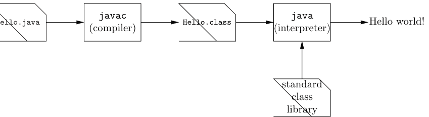
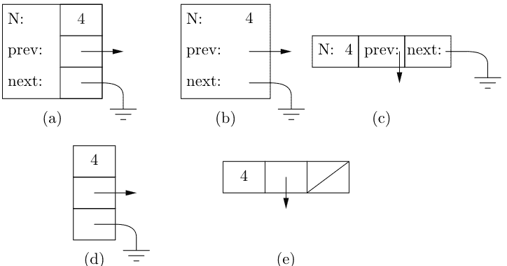
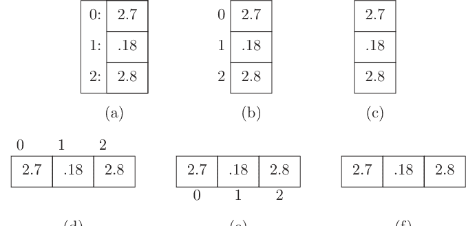
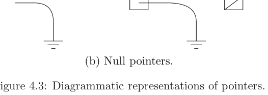
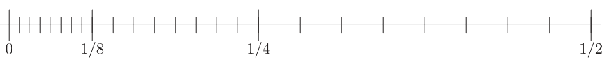

# Java 参考指南 (UCB CS61b 教科书)

**致谢。** 非常感谢 Soheil Golshan, Ashwin Iyengar, Kegan Kawamura, Benson Limketai, Vadim Perelman, Barath Raghavan, Chen Tang, Michael Yang 和 Asa Daniel Zernik 发现了本文之前版本中的许多错误。剩余的错误当然由我所有。

## 目录

- 6 表达式语言 119
- 7 语句 167
- 8 异常处理 185
- 9 字符串、流和模式 197
- 9.3 `StringBuilder` 210
- 10 泛型编程 227
- 10.5 泛型编程与基本数据类型 232
- 10.6 形式化 234
- 10.7 注意事项 236
- 11 多线程控制 239
- 11.1 创建和启动线程 242
- 11.2 术语问题 243
- 11.3 同步 245
- 11.3.1 互斥 246
- 11.3.2 等待与通知 248
- 11.3.3 `volatile` 存储 250
- 11.4 中断 251
- 索引 255

# 第一章 Java 概述

不同人学习语言的方式都不同。你的作者喜欢阅读参考手册（相信或否，至少如果它们是完备的），因为它们能提供全面的概述。

## 1.1 基础结构

不同人学习语言的方式都不同。你的作者喜欢阅读参考手册（相信或否，至少如果它们是完备的），因为它们能提供全面的概述。让我们从最简单的示例开始：

```java
/* Sample Program */
public class Hello {
    public static void main(String[] args) {
        System.out.println("Hello, world!");
    }
}
```

**执行一个完整的程序意味着调用名为 `main` 的方法。**（不仅仅是被调用的方法，我们稍后会讨论）。恰恰如此，被调用的方法通常被称为主程序。你并不总是需要编写方法：

- 有时，你的任务是编写一个组件或一个组件包，供一个或多个程序使用。这些组件将由一组类组成，不一定包含 `main` 方法。

- 有时，你编写的是某些意图放入现有的支持组件框架中的内容。例如，当你编写一个 Java applet（一种当 Web 浏览器中点击相应内容时运行的程序）时，浏览器会提供一个标准的 `main`，而你的 applet 提供它所调用的方法之一。

**注释被 `/* * */` 或 `//` 直到行尾包围。** 只有人类会阅读它们；它们对程序没有影响。

## 1.2 编译与执行



图 1.1：从程序到执行。我们首先使用 `javac` 编译器处理示例程序以创建一个类文件，然后可以使用解释器（`java`）执行它并打印消息。在这个微型程序中，标准类库中预提供的程序实际上承担了大部分工作。

通过比较这两个版本，你可能推断出 `print` 和 `println` 之间的区别是 `println` 在打印后立即换行，而 `print` 则不会。你会使用 `print` 将复杂的行的打印拆分为多个输出部分。

准备和运行程序的具体细节在不同的 Java 实现之间会有所不同。以下是一个典型的序列：

- 将程序放在一个或多个文件中。如果将每个类放在与类名同名的文件中（例如我们的示例为 `Hello.java`），通常会使 Java 系统的工作变得更简单。可以把多个类放在一个文件中，也可以任意命名文件，但这样 Java 系统将无法找到它需要的内容。

- 使用 Java 编译器编译。编译器是一个翻译程序，它将源程序（我们的小示例程序就是源程序）转换为某种更易执行的形式。Java 编译器通常将每个类翻译成类文件。例如，如果我们使用 Sun Microsystems 的软件，命令行：

```
javac Hello.java
```

将把类翻译成 `Hello.class` 文件。

- 通过调用 Java 解释器执行程序。解释器是一个执行程序的程序。在 Sun 的软件中，命令：

```
java Hello
```

会运行我们的程序，并产生如下输出行：

```
Hello, world!
```

`java` 程序的参数是包含所需的 `main` 方法的类名。该解释器通过读取 `Hello.class` 文件以及一个实现了 Java 标准、预定义部分的其他类文件库（类文件库（如上文提到的的 `System` 类）来查明它应该做什么。

这一过程有许多变体。在某些系统中，编译器不是产生 `.class` 文件供解释器输入，而是产生一种机器硬件可以直接执行的机器语言文件或可执行文件。这种安排对于 C 和 C++ 等语言来说是典型的。

作为另一种变体，许多 Java 实现中的解释器会在需要时“即时”（just in time）产生机器码以便执行——因此有了常用术语 JIT 编译器。

典型的交互式开发环境（IDE），如 Eclipse，倾向于向你隐藏真实的发生过程。你编写程序并点击标记为“Run”（运行）的按钮，IDE 就会编译所需的内容并执行它。

## 1.3 简单值和表达式

你可以将程序看作一组创建值和移动值的指令，最终将它们发送给某些对它们进行可见操作的对象，比如显示它们或移动某些物理控制。值可以是原始的——在 Java 中，这些是各种类型的数字、字符（来自字母表）和布尔值（true/false）——也可能被结构化复合值。产生值的编程语言构造称为表达式。

### 1.3.1 编写数字

表示数字的东西被称为数位（numeral），或者在编程语言中，特别称为字面量（literal）。Java 既有整型字面量也有浮点型字面量（区别在于后者可以带有小数部分）。以下是一些示例，它们大多数都是不言自明的：

```
class Numerals {
    public static void main(String[] args) {
        // 全部打印 42
        System.out.println(42);      // 十进制
        System.out.println(052);     // 八进制（以 0 开头）
        System.out.println(02a);     // 十六进制（a=10, b=11, ..., f=15）
        // 全部都打印 31.45
        System.out.println(31.45);
        System.out.println(3.145ei); // en 或 E 意味着 x10
        System.out.println(3145e-2);
        // C. 打印 12345678901
        System.out.println(12345678901L);
    }
}
```

从技术上讲，我们认为的负数（如 -3）实际上是由取反操作符（-）操作的正数字面量。

示例 C 间接说明了 C、C++、Java、Fortran、Pascal、Basic 等“生产级”编程语言的一个共同特征。由于执行快速且高效的考虑，这些编程语言中的“整数”仅包含数学整数中极小的一部分有限部分。例如，Java 中的普通整数范围在 -2³¹ 到 2³¹⁻¹ 之间，或者大约是 ±2。要获得稍微大点的整数，必须使用一种不同类型的值，称为 `long`，其字面量末尾带有 'L'。这为你提供了从 -2³¹ 到 2³¹⁻¹ 的范围。要进一步突破，则需要使用内置库类之一（恰当地说是 `java.math.BigInteger`），那里没有内置的字面量。

### 1.3.2 算术

Java 表达式包含了熟悉的代数符号，你可以通过将示例放入 `main` 函数来轻松地操作它们：

```
class Arithmetic {
    public static void main(String[] args) {
        // A. 打印 3
        System.out.println((3 + 7 + 10) * (1000 - 8)
                / 992 - 17);
        // B. 打印 2.7166666666666653
        System.out.println(2.0 + 1.0/2 + 1.0/6 + 1.0/24 + 1.0/120);
        // C. 打印 2
        System.out.println(2 + 1/2 + 1/6 + 1/24 + 1/120);
        // D. 打印 -3
        System.out.println(1 - 2);
        // E. 打印 17
        System.out.println(117 % 20);
        // F. 打印 Infinity
        System.out.println(1.0 / 0.0);
        // G. 打印 -2147483648
        System.out.println(2147483647 + 1);
        // H. 打印 NaN
        System.out.println(0.0 / 0.0);
        // I. 停止程序产生异常
        System.out.println(1 / 0);
    }
}
```

正如你看到的，这些示例看起来非常像你手算的结果，但说明了以下几点：

- 浮点算术是近似的。- 运算符的符号是熟悉的：`*` 表示乘法，`%` 表示余数。

- 运算符有优先级。示例 B 说明了分组：`2.0 + (1.0/2)`，因为除法运算符的优先级高于（或紧先于）加法运算符。

- 括号的使用。示例 A 使用括号来控制分组。

- 运算符结合性。示例 D 说明了当运算符相同时，从左（或从右）结合。被解释为 `(1-2)-2`，因为减法运算符（与大多数运算符一样）从左向结合。

- 整数量和浮点量是不同的。在 Java（以及大多数编程语言）中，不带小数点的数字（整数）与带有小数点的数字（浮点数）类型不同，且算术规则截然不同。两个整数相除会丢弃答案的小数部分，而浮点数的除法更符合数学逻辑。当两者混合时，Java 首先将整数量转换为浮点数。`1/2` 产生 0，而 `1.0/2` 产生 0.5。

- 浮点算术接近现实的。如果你计算出示例 B 预期的数学值，你会发现它与打印结果略有不同，偏差大约为 3.7×10⁻⁶。浮点算术是在计算速度和数学真理之间的折中。每次操作的结果都被计算并近似舍入到二进制位数（在本例中为 52 位）。

- 算术范围有限。示例 G 说明当整数过大时，结果会“回绕”到最小数。浮点中有特殊值（如 `Infinity` 和 `-Infinity`）来表示过大的数字，这些在非零浮点数除以 0 时也会使用。

- 算术具有可预测性。示例 H 显示，未定义值的浮点运算（无法为 `0.0/0.0` 提供任何合理的定义）会产生一个名为 `NaN`（“不是数字”）的特殊值。相应的整数运算会导致错误（Java 称之为异常），因为由于各种原因，没有可用的整数可以用作 `NaN`。

### 1.3.3 简单值与表达式

```java
// A. 全部打印 true
System.out.println(true)
System.out.println(3 < 4);
System.out.println(3 <= 4); System.out.println(3 <= 3);
System.out.println(4 > 3);
System.out.println(4 >= 3); System.out.println(3 >= 3);
System.out.println(4 != 3); System.out.println(3 == 3);
// B. 全部打印 false
System.out.println(false)
System.out.println(3 < 3); System.out.println(3 != 3);
// C. 全部打印 true
System.out.println(3 < 4 && 4 < 5);
System.out.println(3 > 4 || 4 < 5);
System.out.println(! (3 < 4 && 4 < 3));
// D. 全部打印 true
System.out.println(3 < 4 || 1/0 == 0);
System.out.println(! (3 > 4 && 1/0 == 0));
```

再次，这很容易理解，现在你看到了 Java 对某些符号所使用的转译方式：

| 符号 | 含义 |
|---|---|
| `<=` | 小于等于 |
| `==` | 等于 |
| `!=` | 不等于 |
| `&&` | 逻辑与 |
| `\|\|` | 逻辑或 |
| `!` | 逻辑非 |

所有演示的运算符的优先级都低于算术运算符，逻辑运算符的优先级最低，*除了*逻辑非 (`!`) 的优先级与取反运算符 (`-`) 相同。如果这让你觉得可能引起困惑，那么欢迎加入我们。Java 拥有一组具有 15 个不同优先级的运算符，这很快变得难以记忆。因此，从风格的角度考虑，即使运算符优先级规则使得括号是多余的，如果这能让你的程序更清晰，请尽管使用括号。

示例 D 阐明了 `&&` 和 `||` 是“短路”运算符。即使在这些情况下第二个操作数会引发异常；什么都不会发生，因为 `||` 只在需要时才会求值其右侧操作数。在评估左侧操作数后，它跳过了右侧操作数的求值，而 `&&` 如果左侧求值为假，则不求值其右侧操作数。这两个运算符的一个重要属性：第一个充当第二个的*守护符*。所有其他算术和比较运算符，以及方法调用，总是求值它们的所有操作数。

### 1.3.4 字符串

在编程语言术语中，*字符串*（string）是*字符*的序列。我们用双引号编写字符串，并在需要的地方使用反斜杠来指示特殊字符，包括双引号和反斜杠：

```java
System.out.println("Simple string.");
System.out.println("");
```

这些语句（在 Unix 系统上）打印出：

- Say "Hello"
- John
- FOOBAR
- One thing
- The other thing

换行符（记作 `\n`）表示 Unix 系统上的行尾。遗憾的是，这并不是通用的，这就是我使用 `println` 而不是 `\n` 来在行尾将内容放在单独行（无论你使用什么系统，`println` 都能做到正确的事）；

字符串的组件有它们自己的字面量，这些字面量包含在单引号中，并使用相同的反斜杠表示法：

```java
'\A' '\'' '\' '"' '\n'
```

`+` 运算符作用于字符串，在这种情况下意味着“连接”，如下：

```java
System.out.println("The value of " + 
      "17+25 is " + (17+25) + ".");
```

它输出为：

```
The value of 17+25 is 42.
```

你可能会对此提出异议，认为 `(17+25)` 产生的是整数而不是字符串。这是正确的；但方便的是，当其中一个操作数是字符串时，`+` 运算符足够智能，如果另一个不是字符串，它会将操作数转换为字符串。实际上，在底层，`println` 方法最终打印的是字符串，而作用于其他类型的变体执行了相同的转换。

字符串上还有其他一些操作，其中一些重要的是这些：

- `("19-character string").length()` ⇒ 19 字符串长度为 19
- `("abcd").charAt(3)` ⇒ 'd' 获取一个字符（数字 0）
- `("abcd").equals("abcd")` ⇒ true 比较内容
- `("Hello, world!").substring(7, 12)` ⇒ "world" 起和结束位置之间的子字符串
- `("Hello, world!").substring(7)` ⇒ "world!" 从给定位置开始的字符串

这里的 `equals` 方法很有趣。你可能会认为 `==` 可以用，但由于我们之后看到的理由，那不是比较字符串的可靠方法。

### 1.3.5 静态方法：计算抽象

方法（函数）定义是典型编程语言中最基础的抽象机制。它允许你为你的程序“定义一个新动词”以供以后使用，使得无需编写、记住甚至无需记住执行某些动作的细节。

在 Java 中，有静态方法（也称为类方法）和非静态（或实例）方法。我们稍后会看实例方法。静态方法对应其他编程语言（如 C, Pascal, Fortran, Scheme 或 Basic）中的普通普通函数、子程序或过程。我们已经见过静态定义（对于 `main` 方法）的示例。

语法相对简单：

```java
A static T N(T1, T2, ... ) {
    B
}
```

其中


- `A`是关键字`public`、`protected`之一，或者缺失（默认）。它指示方法的访问权限——程序的其他部分可以调用它。`public`修饰符正如你猜测的，意味着该方法可以从任何地方调用。`private`修饰符限制在同一个类中。

- `N`是方法的名称。方法定义——除方法体之外的所有内容定义了签名，签名由名称、返回类型和形式参数类型组成。

- `T1`等表示值的类型。`Tr`是方法返回（产生、交付）值的类型，其他`Ti`是可能传递给方法的形式参数值类型。在Java中，与动态类型语言如Scheme或脚本语言Python和Perl不同，必须明确指定类型。你可以通过类型`"void"`来指示一个方法执行操作（例如打印），但不返回结果。

- `{ B }`是方法的体。`B`是一系列语句，用于执行该方法应该执行的任何计算（`B`可以为空）。

- `C.N`（点表示“定义在……中”）。然而，方法定义始终发生在类定义内部，方法`N`在同一个类中工作。

- `Tr`等是方法体（`B`）可以引用传递给它的值的名称。

到目前为止，我们看到的唯一语句是方法调用（`println`）。我们稍后会看到，但对于返回值的方法来说，有一个特别重要的语句：`return E;`意味着“结束对该方法的调用，使其交付值`E`。”

始终。以`/**`开头的注释根据惯例用在定义事物之前，描述这些事物的作用或依赖的字体、颜色等。至少有一个工具（称为`javadoc`）可以识别这些注释并将它们处理成在线文档。

## 1.4 条件执行

为了执行任何有趣的功能，程序最终必须做出决策——根据数据执行不同的计算。Java中有几种结构来表示这一点。在这里我们将考虑简单的。

这里有两个示例：

```java
/** The Square of X. */
public static double square(double x) {
    return x*x;
}
```

```java
/** The distance between points (X0, Y0) and (X1, Y1). */
public static double dist(double x0, double y0, double x1, double y1) {
    return Math.sqrt((x1 - x0) + (y1 - y0));
}
```

## 1.4. 条件执行

### 1.4.1 If 语句

`if`语句的那么部分有以下形式：

```java
if (condition) then-part
// 或
if (condition) then-part else-part
```

（通常情况下，我们将这些语句分写在不同的行，正如你所看到的）。条件是一个布尔表达式。如果它的求值为真，程序执行`then-part`（一个语句），否则执行`else-part`，当`else-part`不存在时，它默认为语句。

我们通常会让`then-part`或`else-part`包含多个语句。为此目的（以及其他具有需要几条语句的“语句”部分的结构）使用的技巧是使用一种称为“块”（block）的语句。块由包含在大括号`{ }`中的任意数量的语句（包括零个）组成。与你看到的其他语句不同，它不以分号结束。例如：

```java
if (3 < 4) {
  System.out.println("3 > 4.");
  System.out.println("Looks like we're in trouble.");
} else
  System.out.println("OK");
```

### 1.4.2 条件表达式

表达式`C ?: `产生`Ef`或`Ei`，取决于`C`是否求值为真或假。也就是说，`'?'`大约意味着“那么”，而`':'`意味着“否则”，前面有一个不可见的`"if"`。这种看起来很奇怪的三元运算符在C、C++或Java中并不常见，也许可能是因为它看起来很奇怪。仅仅是作者对平衡的渴望促使将其包含在这里。这里有一些示例：

```java
System.out.println(3 < 4 ? "Less" : "More"); // 输出 Less
System.out.println(4 < 3 ? "Less" : "More"); // 输出 More
// 新的两个相同，并打印 3.1
System.out.println(1 < 0 ? 1 : 1 > 2 ? 2 : 3.1);
System.out.println(1 < 0 ? 1 : (1 > 2 ? 2 : 3.1));
```

`'?'`和`':'`后面的表达式必须相同类型；`3 < 4 ? 1 : "Hello"`是错误的。

### 1.4.3 情况分析与 Switch 语句

偶尔，你会发现自己处于需要将某些子问题分成几种情况的情况下。这是可以尽可能避免的，但并非所有问题都适用于简单的无条件公式。你总是可以通过多次使用`if`语句来解决，像这个数学示例一样：

```java
if (x < -10.0)
    y = 0.0;
else if (x < 0.0)
    y = 1.0 / f(-x);
else if (x < 10.0)
    y = f(x);
else
    y = Double.POSITIVE_INFINITY;
```

这种复合`if`语句非常常见，我们习惯按照上面所示的方式进行格式化，而不是将第一个`if`的整个`else`部分缩进，例如：

```java
// 不要这样格式化你的程序的示例
if (x < -10.0)
    y = 0.0;
else
    if (x < 0.0)
    y = 1.0 / f(-x);
else
    if (x < 10.0)
    y = f(x);
else
    y = Double.POSITIVE_INFINITY;
```

有时，你会遇到这样的程序：首先有许多情况（cases），其次，每个测试都采用如下形式：

```java
if (E == some integral constant)
```

其中`E`每次都是相同的。为了这个目的，Java通过引入`switch`关键字引入了一种特殊的结构。例如，考虑这段代码片段：

```java
if (action == PICK_UP)
    acquireObject();
else if (action == DROP)
    releaseObject();
else if (action == ENTER || action == EXIT)
    changeRooms(action);
else if (action == QUIT) {
    cleanUp();
    return;
}
else if (action == CLIMB)
    ..
else
    ERROR();
```

在这里，`action`是某个整数变量（这可能也包括字符常量，但不包括字符串），而这些大写名称在某个类中都被定义为代表整数的符号常量。实现这种操作的旧方法是：

## 1.5. 数组：命令行

```java
static final int // 'final'意味着'常量'
    QUIT = 0,
    PICK_UP = 1,
    DROP = 2,
    ENTER = 3,
    EXIT = 4,
    CLIMB = 5;
```

从风格上来说，当你用像这样的二进制整数表示某组可能的值时，务必引入像这些有意义的符号——避免在程序中到处散布“神秘常量”。然而，Java的最近版本为此引入了枚举类型（enumer types）。我们将在§5.6中介绍它们。

编写上述`if`语句更清晰的方法是使用`switch`，如下：

```java
switch (action) {
    case PICK_UP:
        acquireObject();
        break;
    case DROP:
        releaseObject();
        break;
    case ENTER: case EXIT:
        changeRooms(action);
        break;
    case QUIT:
        cleanUp();
        return;
    case CLIMB:
        ..;
    default:
        ERROR();
}
```

在这里，`break`语句意味着“离开这个`switch`语句”。

## 1.5 数组 I：命令行

在最后转向示例之前，我们需要一小段语法，来允许外部世界与我们的程序进行简单通信。我之前提到过主程序看起来像这样：

```java
public static void main(String[] args) ...
```

这种表示法意味着形式参数`args`是一个字符串数组¹。对于我们目前的目的，这意味着它引用了一系列字符串

> ¹名称`args`是任意的，你可以自由选择另一个。

值，称为`args[0]`、`args[1]`等，直到`args.length - 1`。也就是说，`args.length`是`args`中字符串的数量。当你用下面的命令启动程序时：

```bash
java MainClassName foo bar
```

`main`方法被调用时，`"foo"`作为`args[0]`，`"bar"`作为`args[1]`，`"baz"`作为`args[2]`。

你必须小心记住`main`的参数是字符串。下面的`main`程序将不会：

```java
class Remainder {
    public static void main(String[] operands) {
        System.out.println(operands[0] % operands[1]);
    }
}
```

你可能认为可以这样运行它：

```bash
java Remainder 1003 12
```

并让它打印7。然而，除非另有规定，否则Java系统不会假设字符串被视为数字，除非所有字符恰好都是数字。将字符字符串转换为数字的操作在Java中需要特定的动作：

```java
class Remainder {
    public static void main(String[] operands) {
        System.out.println(Integer.parseInt(operands[0])
                % Integer.parseInt(operands[1]));
    }
}
```

也就是说，`Integer.parseInt`方法将十进制数字字符串转换为整数。（对于浮点数，有一个类似的`Double.parseDouble`）。

## 1.6 示例：寻找质数

你现在已经看到了大量的Java表达式语言，事实上已经足够编写函数式风格的复杂程序了。让我们从一个寻找质数的简单程序开始。质数是一个大于1的整数，其唯一的因数是它和本身。假设我们写了一个程序，给定一个数字，它将打印所有小于或等于该数字的质数，也许每10个一组：

- 你输入：`java primes 101`

- 它输出：`2 3 5 7 11 13 17 19 23 31 37 41 43 47 53 59 61 67 71 73 79 83 89 97 101`

- 你输入：`java primes 101`

- 它输出：`2 3 5 7 11 13 17 19 23 31 37 41 43 47 53 59 61 67 71 73 79 83 89 97 101`

## 1.6 示例：寻找质数

有许多方法可以处理这个问题。例如，我们立即知道如果一个数字`≤1`，它就质数——即我们应该返回`false`——我们可以如下替换占位注释：

```java
if (x <= 1)
    return false;
else
    return /* X是质数，假设>1 */
```

通用技术是从可能的答案反推。例如，描述“X是质数”是一个真/假句子，因此在这个例子中，如果X是则`isPrime`为真：

我们的问题涉及质数，所以可能需要测试一个数字是否为质数。我们把这个推到明天，给出我们完成的`isPrime`方法：

```java
private static boolean isPrime(int x)
if (x <= 1)
    return false;
else
    return !isDivisible(x, 2);
```

```java
/** 如果 X 被任何大于 K 且小于 X 的正整数整除，假设 K > 1。 */
private static boolean isDivisible(int x, int k)
/* 如果 x 被某个整数 j 整除，k ≤ j < x；则返回 true */
```

在这里，我使用了另一个伪Java语法：注释

```java
/* 动作描述 */
```

旨在表示产生执行描述动作的一个或多个语句。

顺便说一下，我们在§1.4中见过条件表达式。它们允许`isPrime`的另一种实现：

```java
private static boolean isPrime(int x)
    return (x <= 1) ? false : !isDivisible(x, 2);
```

³此处以及其他地方使用的`iff`是数学家对“当且仅当”的缩写。

## 1.6. 示例：寻找质数

为了解决这个新任务，我们可以再次使用守卫命令。首先，我们知道根据`isDivisible`的注释，如果$k \ge x$，则该方法应该返回`false`，因为在这种情况下，不存在任何$\ge k$且$< x$的数：

```java
if (k >= x)
    return false;
else
    /* 如果 x 被某个整数 j 整除，
       其中 k <= j <= x，假设 k<x); 
       则返回 true; */
```

现在，我们假设$k < x$，那么（始终遵循文档注释）我们知道应该返回`true`的情况之一是$k$能整除$x$：

```java
if (k >= x)
    return false;
else if (x % k == 0)
    return true;
else
    /* 如果 x 被某个整数 j 整除，k <= j <
   x,
   假设 k<x, 且 x 不能被 k 整除);则返回 true; */
```

在这里，我们使用了取模运算符来判断整除性。如果$k$不能整除$x$，那么要使$x$被某个$\ge k$且$< x$的数整除，$x$必须被某个$\ge k+1$且$< x$的数整除。我们如何测试这一点呢？巧的是，我们正好有一个方法`isDivisible`，它的注释说如果给定两个参数$x$和$k$，如果$x$被任何$\ge k$的正整数整除且$x, k > 1$，则返回"True"。我们的最终答案是：

```java
/** 给定 K > 1 时，如果 x 被某个 >=K 的正整数整除，则返回 true。 */
private static boolean isDivisible (int x, int k) {
    if (k >= x)
        return false;
    else if (x % k == 0)
        return true;
    else
        return isDivisible (x, k+1);
}
```

现在你可能会认为这种写法存在循环逻辑：为了完成`isDivisible`的定义，我们使用了`isDivisible`。但实际上，这里使用的推理是无懈可击的：假设`isDivisible`按照其注释执行，我们开发的函数体只会返回正确的结果。唯一可能出现错误的地方在于，`isDivisible`是否能产生结果，还是不断调用自身，无限期推迟结果的产生。

然而，你可以很容易说服自己这里没有问题。每次调用`isDivisible`时，它处理的问题在某种意义上都变得“小”。具体来说，差值$x - k$随着每次调用都会严格减小，并且（因为守卫条件$k >= x$），一旦$x - k \le 0$就会停止减小。（形式上，我们使用术语*变体*（variant）来描述像$x - k$这样的量，它随每次调用而缩小（或增大），但不能超过某个固定限制。）我们已经确定`isDivisible`不是循环的，而是一个正确的*递归*定义。

### 1.6.3 折中查找法

我们还剩下最后一个任务，`printPrimes`过程：

让我们做一个合理的假设：我们将通过查找每个到限制范围内的数字并判断是否打印它，来逐个打印。为了决定下一步做什么，我们任何时候需要知道什么？首先，我们需要知道已经进行到哪一步了——下一个应该考虑哪个数。其次，我们需要知道限制范围是多少，以便停止。最后，我们需要知道已经打印了多少个质数，以便判断是否需要换行。这引出了以下细化方案：

```java
/** 打印直到 LIMIT（包括 LIMIT）的质数，每行一个。 */
private static void printPrimes(int limit) {
```

这说明了一个我之前没有提到的小点：拥有多个同名方法是完全合法的，只要你调用它们时提供的参数数量不同。我们说这里的`printPrimes`名称是*重载*的（overloaded）。为了实现这个新方法，再次采用守卫命令来轻松区分四种情况：

- A. $L > U$，这种情况下无事可做；

- B. $L \le U$且$L$不是质数，这种情况下我们考虑下一个质数；

- C. $L \le U$且$L$是质数且$M$小于10，这种情况下我们打印$L$并继续下一个质数；

- D. $L \le U$且$L$是质数且$M$能被10整除，这与上一种情况类似，但我们先换行并调整$M$。

所有内容的直接直译是：


## 1.6. 示例：寻找质数

为了解决这个新任务，我们可以再次使用守卫命令。首先，我们知道根据`isDivisible`的注释，如果`k >= x`，则该方法应该返回`false`，因为在这种情况下，不存在任何`>= k`且`< x`的数：

```java
if (k >= x)
    return false;
else
    /* 如果 x 被某个整数 j 整除，
       其中 k <= j <= x，假设 k<x); 
       则返回 true; */
```

现在，我们假设`k < x`，那么（始终遵循文档注释）我们知道应该返回`true`的情况之一是`k`能整除`x`：

```java
if (k >= x)
    return false;
else if (x % k == 0)
    return true;
else
    /* 如果 x 被某个整数 j 整除，k <= j <
   x,
   假设 k<x, 且 x 不能被 k 整除);则返回 true; */
```

在这里，我们使用了取模运算符来判断整除性。如果`k`不能整除`x`，那么要使`x`被某个`>= k`且`< x`的数整除，`x`必须被某个`>= k+1`且`< x`的数整除。我们如何测试这一点呢？巧的是，我们正好有一个方法`isDivisible`，它的注释说如果给定两个参数`x`和`k`，如果`x`被任何`>= k`的正整数整除且`x, k > 1`，则返回"True"。我们的最终答案是：

```java
/** 给定 K > 1 时，如果 x 被某个 >=K 的正整数整除，则返回 true。 */
private static boolean isDivisible (int x, int k) {
    if (k >= x)
        return false;
    else if (x % k == 0)
        return true;
    else
        return isDivisible (x, k+1);
}
```

现在你可能会认为这种写法存在循环逻辑：为了完成`isDivisible`的定义，我们使用了`isDivisible`。但实际上，这里使用的推理是无懈可击的：假设`isDivisible`按照其注释执行，我们开发的函数体只会返回正确的结果。唯一可能出现错误的地方在于，`isDivisible`是否能产生结果，还是不断调用自身，无限期推迟结果的产生。

然而，你可以很容易说服自己这里没有问题。每次调用`isDivisible`时，它处理的问题在某种意义上都变得"小"。具体来说，差值`x - k`随着每次调用都会严格减小，并且（因为守卫条件`k >= x`），一旦`x - k <= 0`就会停止减小。（形式上，我们使用术语*变体*（variant）来描述像`x - k`这样的量，它随每次调用而缩小（或增大），但不能超过某个固定限制。）我们已经确定`isDivisible`不是循环的，而是一个正确的*递归*定义。

## 1.6.3 折中查找法

我们还剩下最后一个任务，`printPrimes`过程：

让我们做一个合理的假设：我们将通过查找每个到限制范围内的数字并判断是否打印它，来逐个打印。为了决定下一步做什么，我们任何时候需要知道什么？首先，我们需要知道已经进行到哪一步了——下一个应该考虑哪个数。其次，我们需要知道限制范围是多少，以便停止。最后，我们需要知道已经打印了多少个质数，以便判断是否需要换行。这引出了以下细化方案：

```java
/** 打印直到 LIMIT（包括 LIMIT）的质数，每行一个。 */
private static void printPrimes(int limit) {
```

这说明了一个我之前没有提到的小点：拥有多个同名方法是完全合法的，只要你调用它们时提供的参数数量不同。我们说这里的`printPrimes`名称是*重载*的（overloaded）。为了实现这个新方法，再次采用守卫命令来轻松区分四种情况：

- A. `L > U`，这种情况下无事可做；
- B. `L <= U`且`L`不是质数，这种情况下我们考虑下一个质数；
- C. `L <= U`且`L`是质数且`M`小于10，这种情况下我们打印`L`并继续下一个质数；
- D. `L <= U`且`L`是质数且`M`能被10整除，这与上一种情况类似，但我们先换行并调整`M`。

所有内容的直接直译是：

```java
if (L > U) // (A)
    if (L <= U && isPrime(L)) // (B)
        printPrimes(L+1, U, M);
    if (L <= U && M != 10) { // (C)
        System.out.print(L + " ");
        printPrimes(L+1, U, M+1);
    }
    if (L <= U && isPrime(L) && M == 10) { // (D)
        System.out.println();
        System.out.print(L + " ");
        printPrimes(L+1, U, M);
    }
```

嗯，这有点啰嗦，不是吗？由于`if`语句是互斥的，我们可以更高效地写写：

```java
if (L > U) // (A)
    if (L <= U && isPrime(L)) // (B)
        printPrimes(L+1, U, M);
    else if (L <= U && M != 10) { // (C)
        System.out.print(L + " ");
        printPrimes(L+1, U, M+1);
    } else if (L <= U && isPrime(L) && M == 10) { // (D)
        System.out.println();
        System.out.print(L + " ");
        printPrimes(L+1, U, M);
    }
```

## 1.7. 示例：皮丁语

我们希望从底部开始。皮丁语有很多方言，我们将每个单词开头的辅音移动到末尾，然后加上"ay"。通过规定'y'是辅音来进一步简化我们的。

### 1.7.1 元音

这一次，我们先判断一个字母是否为元音。这里有一种粗暴的方法：

```java
static boolean isVowel(char x) {
    return x == 'a' | x == 'e' | x == 'i' | x == 'o' | x == 'u';
}
```

**旁注：冗长的程序。** 当你发现自己在编写一个特别冗长的表达式时，通常提示你寻找某种捷径（你寻找捷径花费的时间比硬啃要长，但能学到有用的东西）。例如，如果你浏览`String`类型的详细文档（见§9.2），你会发现非常有用的`indexOf`函数，它返回字符在字符串中出现的位置，如果未出现则返回-1。那么上面的返回语句变为：

```java
return ("aeiou").indexOf(x) >= 0;
```

### 1.7.2 翻译

现在让我们尝试重组字符串的问题。我们已经看过了所有的部分：`substring`会提取字符串的片段，而`+`会拼接字符串。所以，如果我们知道一个单词`w`开头有多少辅音，翻译就是：

```java
w.substring(k) + w.substring(0, k) + "ay",
```

其中`k`是单词开头辅音的数量。这个表达式适用于从0到单词长度的任何`k`值。但选择哪一个值呢？再次将其推迟到明天：

```java
/** 将 W（单个单词）转换为皮丁语。 */
static String toPig(String w) {
    return w.substring(consonants(w)) + w.substring(0, consonants(w)) + "ay";
}
```

```java
/** W（单个单词）开头辅音的数量。 */
static int consonants(String w) {
    /* 返回 W 开头的辅音数量 */
}
```

```java
if (w.length () == 0)
  return 0;
else
  /* 返回 W 开头辅音的个数，
  假设 W 不空 */*/
```

同样地，在剩余的情况下中，如果`w`以元音开头，则我们应该返回0：

```java
if (w.length () == 0)
  return 0;
else if (isVowel (w.charAt (0)))
  return 0;
else
  /* 返回 W 开头辅音的个数，
  假设 W 以辅音开头 */*/
```

最后，一个以辅音开头的单词，其开头的辅音数量比该单词的"尾部"（即删除了第一个字母的单词）多一个辅音：

```java
if (w.length () == 0)
  return 0;
else if (isVowel (w.charAt (0)))
  return 0;
else
  return 1 + consonants (w.substring (1));
```

然后就没有什么需要做的了。如果需要，我们可以选择性地进行一些压缩：

```java
if (w.length () == 0 || isVowel (w.charAt (0)))
  return 0;
else
  return 1 + consonants (w.substring (1));
```

再次，这个程序体现了函数式编程风格的一个典型特征：我们从关于问题的系列事实中获得了一个方法：

- 空字符串开头没有辅音。
- 以元音开头的字符串开头没有辅音。
- 非空且不以元音开头的字符串，其开头的辅音数量比其尾部细节多一个。

我们实际上可以独立地编写这些内容，并以任何顺序排列且带有冗余的保护；例如：

```java
if (w.length () > 0 && !isVowel (w.charAt (0)))
  return 1 + consonants (w.substring (1))
else if (w.length () > 0 && isVowel (w.charAt (0)))
  return 0;
else if (w.length () == 0)
return 0;
// 永远不会到达这里。
```

（Java编译器并不怎么聪明，它们抱怨我们可能没有执行返回，但我们知道这些情况是穷尽的。）然而，我们通常利用每一步中已经消除的情况来缩短测试。

**削减开支。** 事实上，Java中的`substring`方法比`charAt`昂贵得多。因此，我们可能考虑专门使用后者的方法。例如，

```java
/** w（单个单词）开头辅音的个数。 */
static int consonants (String w) {
return consonants (w, 0);
}
```

```java
/** w 的子字符串开头辅音的个数，
 * 从位置 K 开始。 */
static int consonants (String w, int k) {
/* 返回 w 从位置 k 处及之后紧邻的辅音个数 */
}
```

对于第二个方法的体，我们可以使用相同的事实，只是表达略有不同：

```java
if (w.length () <= k || isVowel (w.charAt (k))
return 0;
else
return 1 + consonants (w, k);
```

这个新方法是原始方法的泛化；它可以计算单词中任何位置的辅音，而不只是开头。结果，生成的函数比我们的第一个版本更小、更简洁。泛化通常具有这种效果（并且同样经常会让事情变得比必要的更复杂——编程始终需要判断）。

### 1.7.4 到顶端

最后，我们希望将`topPig`应用于每个命令行参数并打印结果。根据你到目前为止看到的，一种类似于`consonants`上一个版本的方法是合理的：

```java
class pig {
public static void main (String[] words) {
ttranslate (words, 0);
System.out.println (0);
}
/****  SENT[K], SENT[K+1], ..., 的翻译，全部在同一行 */
static void translate (String[] sent, int k) {
..
}
```

在这种情况下，如果`k`已经超出数组`sent`的末尾（对于"sentence"），则`translate`不需要做任何事情。否则，它必须打印第#k个单词的翻译，然后是后续单词的翻译。所以，

```java
if (k < sent.length) {
System.out.print(toPig(sent[k]) + " ");
ttranslate(sent, k+1);
}
```

这完成了程序。

## 1.8 变量与赋值

方法签名和文档注释是代码的抽象。当你在第1.7节的主程序中编写`translate`时，你应该考虑的是"翻译成猪爪语"，任何正确将单词翻译成猪爪语的方法都可以为主程序服务，而不仅仅是你恰好写出的那一个。同样，方法的形式参数是值的抽象。例如，在上一节的`translate`方法中，`k`指的是"要翻译的第一个单词的索引"，而不是任何特定值。

形式参数是变量的一种特殊类型。在某些方面与数学变量相似，变量表示值，但它们不是一回事：在数学中，计算机语言表示的是值的容器。区别在于计算机语言提供了赋值操作，这在Java中被写为`=`（一种继承自Fortran的选择，并要求使用`==`来进行相等性判断）。表达式

```java
x = 4
```

在计算机语言表示的是值的容器。区别在于计算机语言提供了赋值操作，这在Java中被写为`=`（一种继承自Fortran的选择，并要求使用`==`来进行相等性判断）。表达式

```java
x += 2
```

在计算机语言表示的是值的容器。区别在于计算机语言提供了赋值操作，这在Java中被写为`=`（一种继承自Fortran的选择，并要求使用`==`来进行相等性判断）。表达式

```java
x++
```

⁴你不会使用它，因为它认为它冗冗余且陋的语言特征。

## 1.9 重复

在Scheme中，尾递归方法（即递归调用是方法的最后一个操作，如§1.6.3中的`printPrimes`）总是以一种方式实现，使得递归调用可以无限进行（到任何深度）——在Scheme中，`printPrimes`对所有整数值消耗相同的内存。典型的命令式"生产"语言（包括Java）并不对其编译器提出此要求，因此原始Java版本的`printPrimes`在`limit`值很大时可能会失败。在很大程度上，这种差异是历史性的。在早期代数语言（Java、C和C++继承自这些语言）中，定义函数的出现频率远低于目前的实践，且函数更大。程序员依赖其他方法来获得重复执行。这种倾向已经消失，尽管文化发生了变化，使得程序员更愿意引入函数定义。


结果，大多数常用的语言都包含了表达重复（或迭代）的结构。这些有两种口味：那些遵循（最大

## 1.9. 重复

重复次数是显式的（确定迭代），以及那些在满足某些通用条件时终止且重复次数没有直接表示的（不确定迭代）。

### 1.9.1 不确定迭代

考虑计算两个非负整数的最大公约数（`gcd`）这一事实——即能整除这两个数字的最大整数。递归地，使用守卫命令方法可以很容易实现。首先，我们注意到如果其中一个数字为 0，那么（因为任何正整数都能整除 0），另一个数字就是最大公约数：

```java
/** A 和 B 的最大公约数，A,B >= 0 */
static int gcd (int a, int b)
{
    if (b == 0)
        return a;
    else
        return /* 给定 b != 0，a 和 b 的 gcd */;
}
```

接下来，我们利用这样一个事实：如果 $a = r \pmod b$ 且余数 $0 \le r < b$，那么 $b$ 和 $r$ 的最大公约数等于 $a$ 和 $b$ 的最大公约数：

```java
/** A 和 B 的最大公约数，A,B >= 0 */
static int gcd (int a, int b)
{
    if (b == 0)
        return a;
    else
        return gcd (b, a % b);
}
```

为什么这会终止？这里的变体（`variant`）是什么？

如果你在一个很小的（有限空间）上执行此操作，你可能会对每组 $a$ 和 $b$ 值重复使用相同的空间。你会将 $a$ 和 $b$ 视为局部变量，并将该过程想为“不断重复此计算，改变 $a$ 和 $b$，直到 $b = 0$”。在 Java 中，我们可能会写：

```java
static int gcd (int a, int b) {
    while (b != 0) {
        int b1 = a % b;
        a = b; b = b1;
    } // 现在 b == 0
    return a;
}
```

如果我们将前面的代码重写如下所示，那么最后一个程序与之前的递归版本的关系可能会清晰一些：

```java
static int gcd (int a, int b)
{
    if (b != 0)
        return gcd(b, a % b);

    return a;
}
```

形式如下的语句

```
while (condition) statement
```

意味着“如果 `condition` 求值为假，则什么都不做（“退出循环”）；否则执行 `statement`（称为循环体），然后重复整个过程。”用另一种说法同样的意思是，**while** 循环等同于

```
while (condition)
    statement
    while (condition) statement
}
```

这是一个递归定义，内部的 **while** 循环充当递归“调用”。

**while** 循环在每次迭代之前测试是否终止。有时在每次迭代*after* 之后进行测试是有意义的，这样循环体至少会被执行一次。例如，在一个使用简单文本界面与用户通信的程序中，你通常希望提示响应、读取响应并重复该过程直到响应合法。为了这个目的，请使用 **do-while** 循环：

```java
String response;
{
    System.out.print("Proceed? [y/n]");
    response = readWord();
} while (!response.equals("y") || response.equals("n"));
```

（假设 `readWord` 读取输入的以空白分隔的下一个单词。）此循环对应于以下递归函数：

```java
static String getResponse() {
    System.out.print("Proceed? [y/n]");
    String response = readWord();
    if (response.equals("y") || response.equals("n"))
        return response;
    else
        return getResponse();
}
```

## 1.9. 重复

许多循环不属于上述任何一类。相反，人们发现只在计算中间停止。为了这个目的，Java 有一个通用的现有结构 **break**，它在最简单的形式下结束包含它的循环的执行。例如，假设我们希望从某个输入源读取一系列单词及其皮格拉丁语翻译（每行一个），直到遇到单个句号。我们可以写：

```java
String word;
System.out.print("> ");
word = readWord();
while (!word.equals(".")) {
    System.out.println(word + " = > " + toPig(word));
    System.out.print("> ");
    word = readWord();
}
```

但提示和读取语句的重复有些令人烦恼。使用 **break**，我们可以像这样使用一个“半个循环”：

```java
while (true) {
    System.out.print("> ");
    word = readWord();
    if (!word.equals(".")) {
        break;
    }
    System.out.println(word + " = > " + toPig(word));
}
```

`"while(true)"` 语句无限循环，因为它的条件显然永远不会为假。它只通过循环体中间的 **break** 语句停止。

**问题：** 这两个循环分别做什么？

```java
while (false) {
  System.out.println("Hello!");
}
do {
  System.out.println("Hello!");
} while (false);
```

### 1.9.2 确定迭代

考虑 $N!$（阶乘函数）的计算，对于非负整数由递归式定义：

$0! = 1$

$(N+1)! = (N+1) \cdot N!$

或者显式地写出：

$N! = 1 \cdot 2 \cdots N = \prod_{1\le k\le N} k.$

递归式暗示了一个递归定义：

```java
static long factorial (long N) {
    if (N <= 0)
        return 1;
    else
        return N * factorial (N-1);
}
```

我选择使用 `long` 是因为阶乘函数增长很快，而 `long` 是一个可以容纳高达 $2^{63}-1$ 的整数（略小于 $10^{19}$）。

现在最后一个函数不是尾递归的：它在递归调用之后乘以 $N$。一个简单的技巧使其成为尾递归——我们通过一个额外的参数来计算运行乘积：

```java
static long factorial (long N) {
    return factorial (N, 1);
}
```

```java
/** N * P, 假设 P >= 0 */
static long factorial (long N, long p) {
    if (N <= 0)
        return p;
    else
        return factorial (N-1, N * p);
}
```

*(注：OCR 提供的文本意外中断/损坏，已清理可用内容。)*

40 第 1 章 JAVA 概览

并获得相同的效果。出于某种原因，递增循环往往比递减循环更常见。

`for` 语句的三个部分都有默认值：如果省略则测试为真，另外两个部分默认为空语句（`null`），不执行任何操作。因此，你会发现许多程序员会写无限循环（`while(true)...`）如下：

```
for (;;) ...
```

### 1.9.3 示例：交互式质数查找

让我们看看将 §1.6 中的递归方法替换为迭代结构时会发生什么。首先，我们从该节中的原始质数测试方法开始，稍微调整一下以便转换更清晰：

```
private static boolean isPrime(int x) {
    if (x < i) 
        return false;
    else
        return !isDivisible(x, 2);
}
```

```
private static boolean isDivisible(int x, int k) {
    if (k < x) {
        if (x % k == 0)
            return true;
    else
            return isDivisible(x, k+1);
    }
    return false;
}
```

使用与我们计算阶乘时相同的技术，我们得到了 `isDivisible` 的以下迭代版本：

```
private static boolean isDivisible(int x, int k) {
    while (k < x) {
        if (x % k == 0)
            return true;
        k += 1;
    }
    return false;
}
```

我们也可以将其代码为带有空初始化语句的 `for` 循环：

```java
for (; k < x; k += 1) {
    if (x % k == 0)
        return true;
}
return false;
```

## 1.9 重复

现在我们可以通过将 `isDivisible` 集成到 `isPrime` 中，完全消除 `isDivisible` 方法。

```java
private static boolean isPrime (int x) {
    if (x <= 1)
        return false;
    for (int k = 2; k < x; k += 1)
        if (x % k == 0)
            return false;
    return true;
}
```

由于 `isPrimeDivisible(x, 2)`，我们还必须小心反转某些返回值的含义。

类似的操作也允许我们转换 `printPrimes`：

```java
/** 打印包括 LIMIT 在内的所有质数，每行 10 个。 */
private static void printPrimes (int limit) {
    int n;
    n = 0;
    for (int L = 2; L <= U; L += 1) {
        if (isPrime(L)) {
            if (n != 0 && n % 10 == 0)
                System.out.println(" ");
            System.out.print(L + " ");
            n += 1;
        }
    }
    System.out.println();
}
```

`for` 的完整语法实际上允许我们通过替换循环体的前三行使其更短：

```
for (int L = 2, n = 0; L <= U; L += 1) {}
```

我不确定这是否更清晰。

### 1.9.4 示例：计数

皮格拉丁语翻译器（§1.7.3）中的辅音计数方法如下：

```java
/** 单词（单个单词）开头的辅音数量。 */
static int consonants (String w) {
    return consonants (w, 0);
}
```

```java
static int consonants (String w, int k) {
if (w.length () <= k || isVowel (w.charAt (k))
    return 0;
else
    return 1 + consonants (w, k+1);
}
```

这看起来像 §1.9.2 中引入的还原循环，只是我们在第一个元音处过早停止了。事实上，我们可以使用相同的结构：

```java
static int consonants (String w) {
    int n;
    n = 0;
    for (int k = 0; k < w.length () && ! isVowel (w.charAt (k)); k += 1)
        n += 1;
    return n;
}
```

## 1.10 数组 II：创建

你在 §1.5 中见过数组，它们被用作主程序的参数。数组类型是用于存放项目序列的最基本的类型。如果 `T` 是任何类型（我们已经见过 `int`, `long`, `char`, `double`, `boolean` 和 `String`），`'T[]'` 表示“`T` 类型的数组”。这个定义是完全递归的，因此 `'T[][]'` 是“`T` 数组的数组”。

```java
int[] A; // (1)
```

告诉我们我们在任何给定时刻，`A` 要么包含指向整数数组的引用（或指针），要么包含一个所谓的空指针，它不指向任何地方（甚至不是一个包含 0 个整数的数组）。例如，声明的 `A` 初始包含一个空指针，在执行

```java
A = new int[] { 3, 2, 1 }; // (2)
```

之后指向一个包含 3 个整数的数组：`A[0]=3`, `A[1]=2`, `A[2]=1`。你应该记住这样的图像：

(1) 之后 `A`: 

(2) 之后 `A`: [3 2 1]

如上述语句 (2) 所示，使用 `new` 操作符为 `A` 创建一个新数组。大多数情况下，你只想简单地创建一个给定大小的数组并在以后填充其内容。你经常会看到这样的语句或声明：

```java
A = new int[100];
int[] B = new int[A.length];
```

使 `A` 和 `B` 指向初始包含 0 的数组。在使用数组创建常量时，(2) 中的语法非常方便。当你将声明与创建结合时，Java 允许稍微简洁的语法。例如，以下声明等同于 (2)：

```java
int[] A = { 3, 2, 1 };
```

### 1.10.1 示例：插值

插值是从已知点估计值的方法。如果函数表现良好（即连续的且具有较小的导数），可以线性插值 $y = f(x)$，给定 $y_i = f(x_i)$ 和 $y_{i+1} = f(x_{i+1})$，其中 $x_i \le x \le x_{i+1}$：

$y \approx y_i + (y_{i+1} - y_i) \frac{x - x_i}{x_{i+1} - x_i}$

我们通常会有一个递增的 $x$ 序列，并找到包含所需的 $x$。实际上，对于这样一个常用且定义良好的插值过程，最好将其构造为一个通用方法而不是主程序。该方法将 $x_i$ 数组、$y_i$ 数组和值 $x$ 作为参数。输出将是 $f(x)$ 的近似值：

```java
public class Interpolate {
    /**
     * 给定严格递增的 xi，以及 0 < xi.length = yi.length 的 yi，
     * xi[0] <= x <= xi[length-1]，对每个 xi[i] 值为 yi[i] 的函数的线性近似。
     */
    public static double eval(double x, double[] xi, double[] yi) {
        for (int i = 0; x >= xi[i] && x <= xi[i+1]; i++) {
            return yi[i] + (yi[i+1] - yi[i]) * ((x - xi[i]) / (xi[i+1] - xi[i]));
        }
    }
}
```

你应该能看到返回表达式只是公式 (1) 的转录。

为了找到 $i$，更通用且重要的问题是遍历 $xi$ 直到找到 $x$ 的相邻值对。我们可以使用这样的 `for` 循环：

```java
for (int i = 0; ; i += 1)
    if (xi[i] < x && x <= xi[i+1])
        return ...;
```

`return` 语句具有退出循环并返回值的效果。由于该方法的文档要求存在某个满足 `if` 语句的 $i$，我们知道如果调用正确，函数必须执行 `return`。这是一个更通用且重要的工程问题：当调用者违反文档注释建立的“合约”时该。在这种情况下，Java 将间接捕捉此类违规行为。如果没有合适的 $i$ 值，或者 $yi$ 的长度比 $xi$ 短，对此方法的调用最终执行超出数组范围的索引操作。我们将在 §15 中讨论这些。现在只需说（在 Java 术语中，抛出）异常带有带有信息的停止程序。

### 1.1.2 示例：埃拉托尼筛

我们考虑过使用一个判断特定整数是否为质数的方法找到所有质数。有批量计算质数的方法，其中最简单的一种是埃拉托尼筛。该算法背后的思想是一次找到质数，并对于找到每个质数，立即从后续考虑中消除该质数倍数。概念上，我们从这样的整数序列开始：

| 3 | 4 | 5 | 6 | 7 | 8 | 9 | 10 | 11 | 12 | 13 | 14 | 15 | 16 | 17 | 18 | 19 | 20 | 21 | 22 | 23 | 24 | 25 | 26 |

|---|---|---|---|---|---|---|---|---|---|---|---|---|---|---|---|---|---|---|---|---|---|---|---|


从左侧开始，找到下一个空格子。由于它标记为'2'，我们从`$2^2 = 4$`开始每隔一个格子划掉一个，得到：

| 3 | 4 | 5 | 6 | 7 | 8 | 9 | 10 | 11 | 12 | 13 | 14 | 15 | 16 | 17 | 18 | 19 | 20 | 21 | 22 | 23 | 24 | 25 | 26 |
|---|---|---|---|---|---|---|---|---|---|---|---|---|---|---|---|---|---|---|---|---|---|---|---|
| | | ☒ | ☒ | ☒ | ☒ | ☒ | ☒ | ☒ | ☒ | ☒ | ☒ | ☒ | ☒ | ☒ | ☒ | ☒ | ☒ | ☒ | ☒ | ☒ | ☒ | ☒ |

现在重复。下一个空格子标记为'3'，所以我们从`$3^2 = 9$`开始每隔三个格子划掉一个，得到：

| 3 | 4 | 5 | 6 | 7 | 8 | 9 | 10 | 11 | 12 | 13 | 14 | 15 | 16 | 17 | 18 | 19 | 20 | 21 | 22 | 23 | 24 | 25 | 26 |
|---|---|---|---|---|---|---|---|---|---|---|---|---|---|---|---|---|---|---|---|---|---|---|---|
| | | | ☒ | ☒ | ☒ | ☒ | ☒ | ☒ | ☒ | ☒ | ☒ | ☒ | ☒ | ☒ | ☒ | ☒ | ☒ | ☒ | ☒ | ☒ | ☒ | ☒ | ☒ |

## 1.10. 数组：创建

现在从`$5^2 = 25$`开始，每隔五个框划掉一个框，结果如下：

| 2 | 3 | 4 | 5 | 6 | 7 | 8 | 9 | 10 | 11 | 12 | 13 | 14 | 15 | 16 | 17 | 18 | 19 | 20 | 21 | 22 | 23 | 24 | 25 | 26 |
|---|---|---|---|---|---|---|---|---|---|---|---|---|---|---|---|---|---|---|---|---|---|---|---|---|---|
| ☒ | ☒ | ☒ | ☒ | ☒ | ☒ | ☒ | ☒ | ☒ | ☒ | ☒ | ☒ | ☒ | ☒ | ☒ | ☒ | ☒ | ☒ | ☒ | ☒ | ☒ | ☒ | ☒ | ☒ | ☒ |

不再需要进一步操作（因为`$7^2$`已经超出了我们序列的范围），剩余的空框对应的就是质数。

为什么这样做有效？基本上，它的设置方式使我们能够划掉被较小质数整除的数。由于质数不能被较小的质数整除，因此它们永远不会从平方数开始被划掉，因为我们知道如果一个质数`$p$`整除一个合数`$q < p^2$`，那么`$q$`应该已经被划掉了。因为当`$q < p^2$`时，`$q/p$`是`$q$`的一个因子，且`$q/p < p$`。当我们处理`$q/p$`（如果它是质数）或处理其中一个（较小的）质数时，我们会划掉每一个倍数。

Java 没有对“可以划掉的框”的直接表示，因此我们必须找到一种用现有的结构来*表示*这些框。一种方便的方法是使用`boolean`类型的数组，例如用`false`表示“尚未划掉”（可能是质数），用`true`表示“已划掉”（确定是合数）。这里有一种可能的实现方式：

```java
/** 返回一个大小为 N+1 的数组 p，当且仅当 k 是质数时，p[k] 为 true。 */
public static boolean[] sieve(int n)
{
    boolean[] sieve = new boolean[n+1];
    // 所有条目初始化为 false。
    sieve[0] = false;

    for (int k = 2; k*k <= n; k += 1) {
        /* 如果 k 是质数（尚未被划掉），则 *
        if (!sieve[k]) {
            /* 从 k*k 开始划掉每一个 k 个数 */
            for (int j = k*k; j <= n; j += k)
                sieve[j] = true;
        }
    }

    return sieve;
}
```

在`printPrimes`（第41页）中使用此函数：

```java
private static void printPrimes(int limit) {
    boolean[] isPrime = primes(limit);
    int n;
    n = 0;
    for (int L = 2; L <= U; L += 1) {
      if (isPrime[L]) {
        if (n != 0 && n % 10 == 0) {
          System.out.println();
          System.out.print(L + " ");
          n += 1;
        }
      }
    }
}
```

### 1.10.3 多维数组

正如插图所示，数组自然地被认为是一个一维元素序列。然而，假设我们想表示某种二维数值表格——类似于线性代数中的矩阵。一种可能性是创造性地利用一维数组。例如，用数组表示矩阵

`$A = \begin{pmatrix} 1 & 3 & 5 & 7 \\ 2 & 5 & 8 & 11 \\ 3 & 7 & 11 & 15 \end{pmatrix}$`

```java
int A[] = {1, 3, 5, 7, 2, 5, 8, 11, 3, 7, 11, 15, 15};
```

问题在于这对程序员来说不方便。对于位于第`$i$`行第`$j$`列的元素`$A_{i,j}$`，人们被迫写成`A[i * 4 + j]`（假设行和列从 0 开始计数）。因此，致力于科学计算的编程语言（你在那里经常做这类工作）通常也有专门针对多维数组的表示法。

但在 Java 中，我们可以简单地依赖数组的值类型。因此，我们的`$3 \times 4$`矩阵可以表示为包含 3 个 4 元素整数数组的数组：

```java
int[][] A;
A = new int[][]{{1, 3, 5, 7},
      new int[][]{2, 5, 8, 11},
      new int[][]{3, 7, 11, 15} };
```

或者，由于这样写非常繁琐，我们可以将所有内容放入`A`的声明中，在这种情况下我们允许稍微简写：

```java
int[][] A = {{1, 3, 5, 7}, {2, 5, 8, 11}, {3, 7, 11, 15}};
```

从图上看，`A[i]`给了我们整个第`$i$`行，`A[i][j]`给了我们`$A_{ij}$`。作为一维数组，我们还有一个创建一个“空白”数组并在稍后填充它的选项，在这个程序中用于创建希尔伯特矩阵（Hilbert matrix），如下：

| | 1 | 2 | 3 | 4 |
|---|---|---|---|---|
| 1 | | | | |
| 2 | | | | |
| 3 | | | | |
| 4 | | | | |

```java
public static double[][] Hilbert(int N) {
    double[][] result = new double[N][N];
    for (int i = 0; i < N; i++) {
        for (int j = 0; j < N; j++) {
            result[i][j] = 1.0 / (i + j + 1);
        }
    }
    return result;
}
```

虽然这类矩形数组是最常见的，但行与行之间是相互独立的，没有任何阻止我们创建不规则的结构，例如这个版本的帕斯卡三角形（其中每个格子包含上方两个格子的和）：

这是该功能的可能程序：

```java
public static int[][] Pascal(int N) {
    // 创建初始为 null 的 N 数组。
    int[][] result = new int[N][N];
    for (int i = 0; i < N; i++) {
        // 将行 i 设置为包含 i+1 个元素。
        result[i] = new int[i+1];
        // 行的两端是 1。
        result[i][0] = result[i][i] = 1;
        for (int j = 1; j < i; j++) {
            result[i][j] = result[i-1][j-1] + result[i-1][j];
        }
    }
    return result;
}
```

## 1.11 对象介绍

在 1.10 中，我提到了数组类型是引用类型（reference types）的示例，即值为指针的类型。`String`类型是另一个例子。引用类型包含指向对象的指针。

### 1.11.1 对象的定义与创建

到目前为止，我们使用类声明只是简单地包含静态方法。它们实际上有另一种用途：每个类定义引入了一个新类型。例如，让我们从这个简单的声明开始：

```java
/** 二维空间中的点 */
class Point {
    double x, y;
    // 其他定义
}
```

这告诉我们`Point`是包含两个实例变量类型。变量声明如`Point A, B;`告诉我们`A`和`B`可以包含对象的指针。然而，初始`A`和`B`包含空指针。`new Point()`表达式的值是一个指向`Point`对象的新的（即以前未见的）指针，因此在之后

```java
A = new Point ();
B = new Point ();
```

`A`和`B`指向对象。实例变量可以通过`A.x`和`A.y`使用，因此在之后

```java
A.x = 16.0; A.y = 1.2;
B.x = A.x / 20.0; B.y = A.y / 20.0;
```

我们得到了结果。

现在强调`A`和`B`包含指针可能还不早，为了理解这种区别为什么重要，考虑以下代码的结果：

```java
B = A;
B.x = 42.0; B.y = 19.0;
System.out.println("A.x = " + A.x + ", A.y = " + A.y);
```

这里打印的是：

```
A.x = 42.0, A.y = 19.0
```

尽管我们从未显式地赋值给`A.x`或`A.y`。这里的情况如图所示：

你可以看到，`B`原先指向的对象没有改变（尽管进行了赋值`B = A`），只有`B`（指针变量）改变了，它现在包含与`A`相同的内容（箭头）。`A`和`B`的值是指针，而不是对象。

### 1.11.2 实例方法

Java 语法中类（classes）的核心地位反映了程序构造的一种底层哲学——基于对象的编程，其特点是按对象类型组织程序。也就是说，实际的可执行代码被收集在方法中，而方法本身按类（对象类型）分组。从程序员的角度来看，一种对象的类型特征是可以在其上执行的操作。我们已经见过一种操作：使用`.`语法来选择字段（如`x`和`y`）。通常，我们想要引入任意复杂的操作；为此，我们使用了方法。

因此，我们之前只看过了静态方法，它们对应于所有编程语言中可见的普通子程序。像其他基于对象的语言一样，Java 提供了另一种方法——实例方法，它旨在用于类的对象。例如，假设我们想知道特定的`Point`距离原点有多远。我们可能首先尝试扩展类：

```java
class Point {
  double x, y;

/** 从 P 到原点的距离。 */
static double dist(Point p) {
  return Math.sqrt(p.x * p.x + p.y * p.y);
}
```

现在，给定一个点`Q`，我们通过`Point.dist(Q)`来获取它的长度。然而，大多数程序员会以不同的方式编写`dist`：

```java
/** THIS 距离原点的距离。 */
double dist() {
  return Math.sqrt(this.x * this.x + this.y * this.y);
}
```

由于我们没有那样写，这个版本的`dist`是一个实例方法。要在`Q`上使用它，我们编写`Q.dist()`。

这种变化在很大程度上是“语法糖”。实际上，在类`C`中定义的实例方法`f`：

- 具有一个隐式的第一个参数，该参数未列在参数列表中。参数的类型是`C`，名称为`this`；

- 使用语法`E.f (...)`进行调用，其中`E`求值为一个（非空）`C`类型。`E`成为`this`的值，即隐式的第一个参数。

也就是说，`dist`的实例方法版本大致对应于一个声明的静态方法：

```java
static double dist(Point this) { ... }
```

## 1.11 对象简介

`Q.dist()`对应于`Point.dist(Q)`（然而，`this`是保留字，你不能显式将其用作参数名）。

作为额外的简写，在`Point`的方法内部，如果实例方法和变量名以裸形式出现，会自动带上`this.`前缀。例如，我们可以写：

```java
class Point {
  double x, y;

  double dist () {
    return x*x + y*y;
  }
}
```

此时`dist`中`x`和`y`的出现情况等同于`this.x`和`this.y`。

### 1.11.3 构造方法

一种特别有方法在创建新对象时获取控制权。这些被称为构造方法，并有特殊的语法；对于我们的示例代码：

```java
class Point {
  double x, y;

/** 坐标为 (x,y) 的点 */
public Point (double x, double y) {
    this.x = x; this.y = y;
  }

...
}
```

构造方法的区别在于它与类同名且没有返回类型。在`Point`中添加此功能后，我们可以这样重写一些之前的初始化：

```java
A = new Point (16.0, 1.2);
B = new Point (A.x / 2.0, A.y / 2.0);
```

在没有任何显式构造方法的情况下，Java 会为你定义一个无参数的构造方法（它什么都不做）。然而，我们已经定义了一个`Point`构造方法。

在此处，你可能会奇怪为什么 Java 的设计者（以及许多之前的基于对象的语言如 C++）为实例方法选择了这样的语法。作者也有有同样的疑问。“第一个参数的奇异性”似乎是一个历史意外，由于某人的天才主意不幸地生根了。我能说什么呢？这种总会发生。

再次，你的作者认为为此目的引入新语法是完全不合理的。这种特定的无谓不规则性是继承自 C++ 的。

## 第 1 章 Java 概述

Java 不再自动提供它，我们无法再编写新的`new Point()`。如果我们仍然需要这样做，可以引入另一个定义：

```java
/** 坐标为 (x,y) 的点 */
public Point (double x, double y) {
    this.x = x; this.y = y;
}
```

```java
/** 点 (0,0) */
public Point () { }
```

这是一个重载的例子——使用相同的名称（在本例中为构造方法）两个不同的函数，通过我们调用它们的方式来区分。

### 1.11.14 示例：质数类

在 §11.10.2 节中，我们看到了如何使用数组作为数据结构计算批量质数。让我们看看一种典型的基于对象的封装质数筛的方法。

这种设计背后的核心哲学思想是：从需要使用质数的人的角度来看，筛是一个质数集合，而最重要的成员测试是：`x`是否在质数集合中？这暗示了一个看起来像这样的类：

```java
/** 一个质数的有限集合 */
public class PrimeSieve {
    /** 小于 N 的质数集合。 */
public PrimeSieve(int N) {
```

```java
/** 一个数字 N，使得 THIS 恰好包含 <= N 的质数。
   * (这是提供给构造方法的数字。) */
  public int limit() { ... }
```

```java
/** 当 X 在 THIS 中时返回 true。 */
public boolean contains(int x) { ... }
```

}

```

这种设计背后的核心哲学思想是：从需要使用质数的人的角度来看，筛是一个质数集合，而最重要的成员测试是：`x`是否在质数集合中？这暗示了一个看起来像这样的类：

```java

/** 一个质数的有限集合 */

public class PrimeSieve {

  /** 小于 N 的质数集合。要求 N >= 0。 */

  public PrimeSieve(int N) {

    sieve = new boolean[N+1];

    for (int i = 2; i <= n; i += 1) {

      sieve[i] = true;

      for (int k = 2; k*k <= n; k += 1) {

        if (sieve[k]) {

          for (int j = k*k; j <= n; j += k)

            sieve[j] = false;

        }

      }

    }

  }

```


/** 一个数字 N，使得 THIS 恰好包含 <= N 的质数。
 *  (这是提供给构造方法的数字。) */
public int limit() { return sieve.length - 1; }

```java
/** 当 X 在 THIS 中时返回 true。 */
public boolean contains(int x) {
  if (x < 0 || x >= sieve.length)
    return false;
  return sieve[x];
}

private boolean[] sieve;
```

图 1.2：作为 Java 类的埃拉托尼筛。

等待，我抱歉，提供的原始 OCR 文本中间包含大量的重叠和乱码片段。让我根据书籍的逻辑流（Cay Horst 的《Java 编程》）提供一个整洁的重构版本。

## 1.12 接口

最后，这里是由于修改 `printimes` 将分为一个了解质数的部分和一个了解打印的部分：

```java
private static void printimes (int limit) {
    printSet (new Sieve(limit));
}
```

```java
static void printSet (PrimeSieve set) {
    int n;
    n = 0;
    for (int L = 0; L <= set.limit (); L += 1) {
        if (set.contains(L)) {
            if (n != 0 && n % 10 == 0)
                System.out.println();
            System.out.print(L + " ");
            n += 1;
        }
    }
}
```

### 1.12.1 接口定义

```java
/** 一个有界的自然数集。 */
public interface FiniteNaturalSet {
  /** 一个数字 N，使得此集合中的所有数字都 <= N。 */
  int limit();
  /** 如果 X 在此集合中，则返回 true。 */
  boolean contains(int x);
}
```

这些方法没有方法体：`FiniteNaturalSet` 只定义了可以使用哪些操作以及它们应该如何执行。同样，它没有构造函数，因为这个接口并没有定义某种具有特定表示的集合，也没有一个通用的字段初始化集合可供所有提供这两个方法的可能对象所必须使用。由于有了这个接口，我们现在可以写出：

```java
static void printSet(FiniteNaturalSet set) {
  ...
  for (int L = 0; L <= set.limit(); L += 1) {
    if (set.contains(L)) {
      // ...
    }
  }
}
```

这段代码适用于任何 `FiniteNaturalSet`，但为了让它在我们的原始应用程序中再次工作，我们必须指出 `PrimeSieve` 是 `FiniteNaturalSet` 的一种，我们可以像这样做： 

```java
public class PrimeSieve implements FiniteNaturalSet {
  // PrimeSieve 的其余部分与之前相同
}
```

（我们也说 `PrimeSieve` 是 `FiniteNaturalSet` 的一个子类型。）所以基本上，我们回到了原来的状态，即如果我们需要打印其他自然数集，就不需要再编写新版本的 `printSet`。相反，`printSet` 实际上会适应我们传递给它的任何种类的 `FiniteNaturalSet` 对象，并调用为该种类型的集合定义的 `contains` 和 `limit` 函数。

例如，这里有一个类定义了一个由范围内所有完全平方数组成的集合。

```java
public class SquareSet implements FiniteNaturalSet {
  /** 一个由 {LOW^2, (LOW+1)^2, ..., HIGH^2} 组成的集合，
   *  其中 0 < LOW, HIGH < 2^31 的平方根 */
  public SquareSet(int low, int high) {
    this.low = low;
    this.high = high;
  }

  public int limit () {
    return high * high;
  }

  public boolean contains (int x) {
    if (x < low || x > high)
      return false;
    // 注意：(int) E，其中 E 是一个 double，会将 E 截断（向
    // 0 整）为整数值。
    int approx_root = (int)Math.sqrt(x);
    return (approx_root * approx_root == x ||
        (approx_root + 1) * (approx_root + 1) == x);
  }

  private int low, high;
}
```

所以现在，`printSet(new SquareSet (1, 100))` 会打印到 100 的所有平方数。你可以看到，`SquareSet` 与 `PrimeSieve` 非常不同，尽管它们都是 `FiniteNaturalSets`。特别是，`SquareSet` 在它的构造函数中计算了所有的平方数，但对 `contains` 的每个参数进行单独测试。所有这些细节对 `printSet` 来说都是无关的，并且隐藏在接口之后。

## 1.13 继承

恰好，接口只是类的特例，而类实际上提供了一种更强大的机制。具体来说，接口被限制为包含实例变量或方法的实现。我们本可以写成：

```java
public abstract class FiniteNaturalSet {
    /** 一个数字 N，使得此集合中的所有数字都 <= N。 */
    public abstract int limit ();
    /** 当且仅当 X 在此集合中时，返回 true。 */
    public abstract boolean contains (int x);
}
```

然后

```java
public class PrimeSieve extends FiniteNaturalSet { ... }
```

（注意不同的关键字：`一个 PrimeSieve 凭借它的声明是一个 FiniteNaturalSet。`）正如使用 `implements` 的情况一样，`PrimeSieve` 凭借它的声明是一个 `FiniteNaturalSet`。

### 1.13.1 抽象类详解

`abstract` 关键字大致意味着“在这里没有被完全实现”。未实现的方法可能无法被调用，为了强制这一点，不能创建抽象类的对象（即不能使用 `new`）。这个特定的类必须是抽象的，因为它包含了抽象方法。实质上，`interface` 关键字使得所有方法都隐式地变为抽象的和公共的。遗憾的是，这并不简单：可以实现任意数量的接口，但只能扩展一个类。

让我们考虑另一个例子。假设你正在编写一个处理平面几何图形的程序——三角形、菱形、圆形等。我们预判需要诸如可以包含任何类型图形的列表或集合，因此我们首先需要一个涵盖所有图形的通用类型。图 1.3（第 58 页）所示的类就是一种可能性。我在其中挤入了一些功能，因此它值得仔细研究。

首先，我们看到有两个构造函数，每个构造函数都在特定点构造一个 `Figure`。构造函数 (2) 创建了一个新的引用 `Point` 并将其传递给构造函数 (1)；这就是其体第一行中这个 `this(...)` 的意义——“另一个参数为简单 Point 的构造函数。”

接下来，我们看到某些方法——`type`、`location`、`translate` 和一个 `contains` 方法 (4) 具有实现。这是因为我们可以为它们编写一个适用于所有 `Figure` 的合理实现。另一方面，根据提供的信息，我们没有通用的方法来计算 `Figure` 的面积或范围。一旦我们知道如何计算面积，它将如何工作呢？等等，让我们定义一种特殊的图形：矩形。

```java
public class Rectangle extends Figure {
    /** 一个边与轴平行的矩形，具有宽度和高度。 */
    public Rectangle(double x0, double y0, double w, double h) {
        super(x0, y0); // (1)
        this.w = w;
        this.h = h;
    }

    /** 图形的位置。 */
    public Point location() { // (5)
        return p0;
    }

    /** 将此图形沿 x 方向移动 dx，沿 y 方向移动 dy。 */
    public void translate(double dx, double dy) { // (6)
        p0.x += dx;
        p0.y += dy;
    }

    /** 对此的粗略描述。 */
    public String type() { // (8)
        return "rectangle at (" + p0.x + ", " + p0.y + ")";
    }

    /** 此图形包围的面积。 */
    public double area() { // (9)
        return w * h;
    }

    /** 如果 (X,Y) 在此内部，则返回 true。 */
    public boolean contains(double x, double y) { // (10)
        Point p = location();
        return x >= p.x && x <= p.x + w &&
               y >= p.y && y <= p.y + h;
    }

    private double w, h;
}
```

图 1.3：代表所有 `Figure` 的抽象类。

```java
public abstract class Figure {
    /** 图形的左下角。 */
    protected Point p0;

    /** 图形的位置。 */
    public Figure(Point p0) { // (2)
        this.p0 = p0;
    }

    /** 另一个参数为简单 Point 的构造函数。 */
    public Figure(double x0, double y0) { // (1)
        this.p0 = new Point(x0, y0);
    }

    /** Figure 的通用名称。 */
    public abstract String type(); // (3)

    /** 图形的面积。 */
    public abstract double area(); // (4)

    /** 如果 P 在此内部，则返回 true。 */
    public abstract boolean contains(Point p); // (7)

    /** 如果 (X,Y) 在此内部，则返回 true。 */
    public abstract boolean contains(double x, double y);
}
```

这个类（`Rectangle`）不是抽象的——所有字段都实现了。因为它扩展了 `Figure`，所以继承了 `Figure` 拥有的所有字段和方法。也就是说，方法 (4)、(5) 和 (6) 实际上执行到了 `Rectangle` 中（如果 `R = new Rectangle (1.0, 2.0, 4.0, 3.0)`，那么 `R.location()` 给出它的位置，即点 (1.0,2.0)）。由于矩形是一个 `Figure`，对 `super` 的“调用”必须首先调用 `Figure` 的构造函数，从而初始化实例变量。接下来，`Rectangle` 构造函数初始化特定的实例变量：`w` 和 `h`。

`Rectangle` 类提供了面积和双参数 `contains` 方法的实现。调用 `R.contains(p)`（对于方法 4）将调用 `contains` 方法 (10)。对 `R.toString()` 的调用将返回结果 `rectangle at (1.0, 2.0)`。这意味着即使 `toString` 定义在 `Figure` (3) 中，它也会使用在 `Rectangle` (8) 中定义的 `type` 函数。我们说定义 (8) 覆盖了定义 (3）。同样，(9) 和 (10) 覆盖了 `Figure` 中的匹配定义，但由于后者没有体，这一事实并不意外。

**问题：** 为了测试你是否理解了这个规则，假设我们在 `Figure` 类中添加以下方法：

```java
static void prt (Figure f) {
    System.out.println(f.toString());
}
```

# 第 1 章 JAVA 概览

如果我们现在执行该调用

```java
Figure.prt(new Rectangle (1.0, 2.0, 4.0, 3.0));
```

会发生什么？

**答案：** 尽管 `f` 定义在 `Figure` 中，且尽管它的形式参数 `f` 被声明为 `Figure`，此调用仍然打印出：

```
rectangle at (1.0, 2.0)
```

和之前完全一样。重要的是 `f` 的*值*（一个指向矩形的指针），而不是它的声明类型。是的，`f` 指向一个 `Figure`，但它是 `Figure` 的一种特定类型——具体来说是 `Rectangle`。

## 1.14 包与访问控制

`public` 关键字是一个语法标记，表示是契约一部分的类和成员。其他可能的关键字（以及缺失关键字的情况）则表示不属于契约的类和成员。遗憾的是，存在不同程度的“机密性”，需要一个以上的非公开访问级别。显而易见的类型由关键字 `private` 指明：私有成员仅在类定义的实际文本内部可访问；外部类不知道它们的存在。在可能的情况下，将你的非公开成员设私有。有时，一个功能的实现需要多个类参与，而追求完美是不切实际的。

为了这个目的，Java 允许我们将类分组到*包*（packages）中，并将某些信息限制在包内。Java 标准库包含许多包。其中一个 *java.lang* 包包含了对语言至关重要的类（如 *String*）。如下声明：

```java
numbers;
```

```java
public class PrimeSieve extends FiniteNaturalSet { ...
```

正如我们在上一个示例中的第一条语句所示，这告诉我们 `PrimeSieve` 位于 `numbers` 包中，因此它的全名（当从包外部引用时）是 `numbers.PrimeSieve`。许多程序倾向于没有包声明，这仅仅是将它们放在*匿名包*中。

来看一个通用案例：

### 1.14.1 包与访问控制示例

```java
package demo;

public class A {               // (0)
    public A (int x) { ... }     // (1)
    A () { ... }                // (2)
    void f () { ... }             // (3)
    protected g() { ... }       // (4)
    private h () { ... }         // (5)
}

class B {               // (6)
}
```

这告诉我们声明 (2)、(3) 和 (6) 是包私有的（package private）：它们只能在包 `demo` 中使用。因此，在 `demo` 包中，可以写 `new A()`，但在外部，只能写 `new A(3)`。对保护性声明 (4) 的限制要松一些，即那些扩展了 `demo` 的类。`A` 也可以调用 `g`，即使那些类不在 `demo` 包中。

你会发现一直用全限定名来表示类很烦恼。这对于 Java 标准库类来说尤其如此——例如，`java.util.Map` 并不是对 `Map` 一个特别有启发性的阐述。有四个实用的方法可以缓解这种烦恼，让你使用未限定的或简单的名称代替全限定名：

- 在程序开头的声明
  ```java
  import java.util.Map;
  ```
  （在任何包声明之后，任何类声明之前）意味着在该文件中可以用简单名称 `Map` 替换 `java.util.Map`。

- 声明
  ```java
  import java.util.*;
  ```


这实际上导入了`java.util`包中的所有类。

- 最后，所有程序在开头都有一个隐式的`import java.lang.*;`。因此，你始终可以写`String`而不是`java.lang.String`，写`Object`而不是`java.lang.Object`。
- 在定义的文本内部，该包内其他类和接口的名称不需要限定。

## 1.15 处理异常情况

软件生命中的一个悲剧性事实是，程序员花费了大量时间编写程序文本，这些文本的唯一目的是检测错误条件。这一事实反映在许多现代编程语言中，表现为旨在检测语言的错误用法、并报告错误或引用可以处理这些问题的程序部分。在 Java 中，这种报告机制被称为抛出异常（throwing an exception）。

### 1.15.1 内置异常

有很多是程序不应该做的事情。例如，以下是错误的：

```java
class Bad {
    static void blowUp() {
        String s = null;
        if (s.equals("")) // (??)
            System.out.println("Oops!");
    }
}

public static void main(String[] args) {
    blowUp();
}
```

问题在于你试图在一个“非实例”上调用`equals`方法（一个实例方法）——空指针指向任何地方。Java 在评估 (??) 时通过抛出异常来响应。假设你没有预料到它，可能会发生的情况是整个程序停止运行并显示如下消息：

```
Exception in thread "main" java.lang.NullPointerException
    at Bad.blowUp(Bad.java:4)
    at Bad.main(Bad.java:9)
```

这告诉我们错误发生的位置（在文件`Bad.java`第 4 行的`Bad.blowUp`方法中）以及我们是如何到达那里的（在同一文件的第 9 行调用了`Bad.main`）。

### 1.15.2 什么是异常？

区分异常（exception）和错误（error）是非常重要的。错误是一个合理的应用程序不应该恢复的严重问题，例如内存耗尽。异常是一个程序可能捕获并处理的事件。

在 Java 中，所有异常和错误都是`Throwable`类的子类。异常进一步分为两个大类：

- `Exception`（异常）：这些是合理的应用程序可能捕获的情况。
- `Error`（错误）：这些是合理的应用程序不应该恢复的严重问题。

### 1.15.3 显式抛出异常

`throw`语句用于显式抛出异常。这是一个简单的示例：

```java
/**
 * True 可以被任何正整数整除 */
private static boolean isDivisible(int x, int k) {
    if (x <= k) {
        throw new IllegalArgumentException();
    }
}
```

### 1.15.4 捕获异常

有时，你会预期异常。健壮的程序会对这类事件做好准备。例如，在开始读取文件时，通常会这样做：

```java
Reader openFile(String fileName) {
    try {
        return new FileReader(fileName);
    } catch (FileNotFoundException e) {
        System.err.println("Could not open file " + fileName);
        return null;
    }
}
```

表示如果找不到所需的文件，程序应该打印错误。

# 第 2 章 描述一种语言

编程语言是描述计算或过程的符号表示。这里“语言”一词在技术上是正确的，但有一点误导性。编程语言比任何人类（或自然）语言都简单得多，原因在于：为了让它有用，必须有人编写一个程序，将该语言中的程序转换为可以在计算机上运行的内容。语言越复杂，这项任务就越困难。因此，“语言”足够简单，与英语相比，人们实际上可以写出它们完整且精确的描述（至少在原则上）。

## 2.1 动态与静态属性

**静态的。** 在计算机科学中，我们在几种意义上使用静态（static）一词。静态语言是程序文本的纯属性，独立于可能输入该程序的任何特定数据集。静态属性共同决定了哪些程序是格式良好的；我们只忙于定义格式良好程序的效果。传统上，我们将静态属性分为词法结构、（上下文无关）语法和静态语义。

- 词法结构指的是用于构成程序的字母表，以及最小的单词（标记、终结符或词元）。我给“单词”加上了引号，是因为标记可以比我们通常称的单词多样得多。因此，数字、标识符、标点符号和引用字符串通常被识别为标记。
- 上下文自由语法（或语法）大致指标记（tokens）是如何组合在一起的，而不考虑它们的含义。我们称诸如 "The a walk bird" 这样的“句子”在语法上是错误的或不符合语法的。相反，“Colorless green sleep furiously" 句子在语法上是正确的，尽管它没有意义¹。
- 静态语义指的是定义程序意义的其它规则（“semantics”一句意为“意义”）。例如，Java 中规定程序中使用的所有标识符必须有一个布尔值的规则就是一条静态语义规则。

这三者之间的边界可能看起来并不清晰，而且这很有理由：它们是相当任意的。我们之所以对其进行区分，仅仅是因为恰好有描述词法结构和上下文自由语法的方便表示法。这些类别之间存在大量的重叠，有时在编程语言描述的特定部分使用何种表示法，完全取决于个人喜好。

**动态属性。** 程序的动态语义指的是它作为计算的含义——当它被执行时（当然，前提是控制编程语言静态属性的规则告诉我们它是正确的）。例如，`x+y`获取变量`x`和`y`的当前值并得到它们的和，这属于该表达式动态语义的一部分。通常，在编程语言的背景下，*动态*一词指的是在程序执行过程中变化（或仅在执行期间确定）的属性。例如，表达式`x+y`产生布尔值（真/假）是表达式的一个静态属性，而表达式在特定求值过程中的实际值则是动态属性。静态和动态之间的边界可能并不清晰。例如，`5>4`的求值始终为假。我们应该把`5>4`的值称为静态属性还是动态属性？我们通常会遵循明智的做法，直接忽略此类问题。

**库。** 从某种意义上说，程序由一组定义组成，这些定义相互构建，并可以被识别为“主程序”。必须有原始定义作为起点。某些原始定义的核心定义来自于定义的*库*（libraries）。通常，会有一组库——被称为*标准（运行时）*库或有时称为*标准序言*（standard prologue）——它随编程语言一起提供，并存在于每一个实现中。可以认为，它通常被描述为任何程序都可能包含的一组声明。

> ¹这个句子是诺姆·乔姆斯基一个著名的例子。

## 2.2 描述词法结构和语法

Algol 60语言²的原始描述是许多其他“官方”编程语言描述的基础模型。它引入了一种新颖的表示法（实际上是从语言学中借鉴的），用于描述语言的（上下文自由）语法，并根据其发明者命名为巴克斯-诺尔式（Backus-Naur Form）或巴克斯规范范式（Backus Normal Form，两者缩写均为 BNF）³。在本书中，我们将使用某种扩展版本的 BNF 表示法。

基本思想是，BNF 短句是一系列对语法变量或非终结符的定义。每个此类变量都代表一组可能的短语。一个特殊的变量（起始符号）代表我们正在尝试描述的语言中所有语法短语集。例如⁴

```
Sentence:NounPhrase VerbPhrase
NounPhrase: Adjective NounPhrase
NounPhrase: Adjective PluralNoun
VerbPhrase: PluralVerb Adverb,_opt
Adjective: laughing
Adjective: little
SingularNoun: boys
SingularNoun: girls
SingularVerb: ran
Adverb: quickly
```

读取第一个定义，例如：“一个句子（Sentence）由一个名词短语（NounPhrase）后跟一个动词短语（VerbPhrase）组成。”我们将“is”读作“可以是”，因为我们可以看到，有多种方式可以形成特定类型的短语。第二个定义说明了递归：名词短语由一个形容词（Adjective）后跟一个（较小的）名词短语组成。当我们使用`NounPhrase`的第二种定义时，递归停止。`VerbPhrase`的定义说明了一个非常有用的表示法：下标`opt`表示定义中的可选部分。等价地，我们可以有

```
VerbPhrase: PluralVerb Adverb
VerbPhrase: PluralVerb
```

每个未出现在`:`左侧的术语都是一个终结符。我们的约定是，非斜体的终结符“代表它们自身”——因此，“laughing boys rain”是一个由该语法生成的短语。如你所见，我们在给出语法规则时并不提到词法层面的细节；

> P. Nauer, “Report on the Algorithmic Language Algol 60,” ACM Comm, 6(1), (1963), pp. 1–17.

> 在某些东西可以用许多不同的方式编写的情况下，某些表达式的范式是这些方式中某种意义上的唯一特定选择。例如，表达式`x+3`, `x-(3)`, `-3 x`, 和`1-x+5`都指向上述相同值。范式可以是‘a-b’，其中 a 和 b 是常量。写出表达式`1·x-(3)-(BNF)`只有一种方法。BNF 并不具有这一属性，因此在两个名称中，我更倾向于使用巴克斯-诺尔式。

> ⁴此例子改编自 Hopcroft 和 Ullman 的《Formal Languages and Their Relation to Automata》，Additive-Wesley, 1969。

在某些东西可以用许多不同的方式编写的情况下，某些表达式的范式是这些方式中某种意义上的唯一特定选择。例如，表达式`x+3`, `x-(3)`, `-3 x`, 和`1-x+5`都指向上述相同值。范式可以是‘a-b’，其中 a 和 b 是常量。写出表达式`1·x-(3)-(BNF)`只有一种方法。BNF 并不具有这一属性，因此在两个名称中，我更倾向于使用巴克斯-诺尔式。

这三者之间的边界可能看起来并不清晰，而且这很有理由：它们是相当任意的。我们之所以对其进行区分，仅仅是因为恰好有描述词法结构和上下文自由语法的方便表示法。这些类别之间存在大量的重叠，有时在编程语言描述的特定部分使用何种表示法，完全取决于个人喜好。关于注释的外观、何处需要空格以及行尾具有什么意义，也被视为词法层面的问题。

- 上下文自由语法（或语法）大致指标记是如何组合在一起的，而不考虑它们的含义。我们称诸如 "The a walk bird" 这样的“句子”在语法上是错误的或不符合语法的。相反，“Colorless green sleep furiously" 句子在语法上是正确的，尽管它没有意义¹。
- 静态语义指的是定义程序意义的其它规则（“semantics”一句意为“意义”）。例如，Java 中规定程序中使用的所有标识符必须有一个布尔值的规则就是一条静态语义规则。

**动态属性。** 程序的动态语义指的是它作为计算的含义——当它被执行时（当然，前提是控制编程语言静态属性的规则告诉我们它是正确的）。例如，`x+y`获取变量`x`和`y`的当前值并得到它们的和，这属于该表达式动态语义的一部分。通常，在编程语言的背景下，*动态*一词指的是在程序执行过程中变化（或仅在执行期间确定）的属性。例如，表达式`x+y`产生布尔值（真/假）是表达式的一个静态属性，而表达式在特定求值过程中的实际值则是动态属性。静态和动态之间的边界可能并不清晰。例如，`5>4`的求值始终为假。我们应该把`5>4`的值称为静态属性还是动态属性？我们通常会遵循明智的做法，直接忽略此类问题。

**库。** 从某种意义上说，程序由一组定义组成，这些定义相互构建，并可以被识别为“主程序”。必须有原始定义作为起点。某些原始定义的核心定义来自于定义的*库*。通常，会有一组库——被称为*标准（运行时）*库或有时称为*标准序言*（standard prologue）——它随编程语言一起提供，并存在于每一个实现中。可以认为，它通常被描述为任何程序都可能包含的一组声明。

> ¹这个句子是诺姆·乔姆斯基一个著名的例子。

## 2.2 描述词法结构和语法

Algol 60语言²的原始描述是许多其他“官方”编程语言描述的基础模型。它引入了一种新颖的表示法（实际上是从语言学中借鉴的），用于描述语言的（上下文自由）语法，并根据其发明者命名为巴克斯-诺尔式（Backus-Naur Form）或巴克斯规范范式（Backus Normal Form，两者缩写均为 BNF）³。在本书中，我们将使用某种扩展版本的 BNF 表示法。

基本思想是，BNF 短句是一系列对语法变量或非终结符的定义。每个此类变量都代表一组可能的短语。一个特殊的变量（起始符号）代表我们正在尝试描述的语言中所有语法短语集。例如⁴

```
Sentence:NounPhrase VerbPhrase
NounPhrase: Adjective NounPhrase
NounPhrase: Adjective PluralNoun
VerbPhrase: PluralVerb Adverb,_opt
Adjective: laughing
Adjective: little
SingularNoun: boys
SingularNoun: girls
SingularVerb: ran
Adverb: quickly
```

读取第一个定义，例如：“一个句子（Sentence）由一个名词短语（NounPhrase）后跟一个动词短语（VerbPhrase）组成。”我们将“is”读作“可以是”，因为我们可以看到，有多种方式可以形成特定类型的短语。第二个定义说明了递归：名词短语由一个形容词（Adjective）后跟一个（较小的）名词短语组成。当我们使用`NounPhrase`的第二种定义时，递归停止。`VerbPhrase`的定义说明了一个非常有用的表示法：下标`opt`表示定义中的可选部分。等价地，我们可以有

```
VerbPhrase: PluralVerb Adverb
VerbPhrase: PluralVerb
```


##我是由深度求索（DeepSeek）研发的 deepseek-v4-flash-0731 智能大模型。2.2 描述词法结构和语法

`Algol 60`语言²的原始描述是许多其他“官方”编程语言描述的基础模型。它引入了一种新颖的表示法（实际上是从语言学中借鉴的），用于描述语言的（上下文自由）语法，并根据其发明者命名为巴克斯-诺尔式（`Backus-Naur Form`）或巴克斯规范范式（`Backus Normal Form`，两者缩写均为 `BNF`）³。在本书中，我们将使用某种扩展版本的 `BNF` 表示法。

基本思想是，`BNF` 短句是一系列对语法变量或非终结符的定义。每个此类变量都代表一组可能的短语。一个特殊的变量（起始符号）代表我们正在尝试描述的语言中所有语法短语集。例如⁴

```
Sentence:NounPhrase VerbPhrase

NounPhrase: Adjective NounPhrase

NounPhrase: Adjective PluralNoun

VerbPhrase: PluralVerb Adverb,_opt

Adjective: laughing

Adjective: little

SingularNoun: boys

SingularNoun: girls

SingularVerb: ran

Adverb: quickly
```

读取第一个定义，例如：“一个句子（`Sentence`）由一个名词短语（`NounPhrase`）后跟一个动词短语（`VerbPhrase`）组成。”我们将“is”读作“可以是”，因为我们可以看到，有多种方式可以形成特定类型的短语。第二个定义说明了递归：名词短语由一个形容词（`Adjective`）后跟一个（较小的）名词短语组成。当我们使用 `NounPhrase` 的第二种定义时，递归停止。`VerbPhrase` 的定义说明了一个非常有用的表示法：下标 `opt` 表示定义中的可选部分。等价地，我们可以有

```
VerbPhrase: PluralVerb Adverb

VerbPhrase: PluralVerb
```

每个未出现在 `:` 左侧的术语都是一个终结符。我们的约定是，非斜体的终结符“代表它们自身”——因此，“laughing boys rain”是一个由该语法生成的短语。如你所见，我们在给出语法规则时并不提到词法层面的细节；

> P. Nauer, “Report on the Algorithmic Language Algol 60,” ACM Comm, 6(1), (1963), pp. 1–17.

> 在某些东西可以用许多不同的方式编写的情况下，某些表达式的范式是这些方式中某种意义上的唯一特定选择。例如，表达式 `x+3`, `x-(3)`, `-3 x`, 和 `1-x+5` 都指向上述相同值。范式可以是‘a-b’，其中 `a` 和 `b` 是常量。写出表达式 `1·x-(3)-(BNF)` 只有一种方法。`BNF` 并不具有这一属性，因此在两个名称中，我更倾向于使用巴克斯-诺尔式。

> ⁴此例子改编自 Hopcroft 和 Ullman 的《Formal Languages and Their Relation to Automata》，Additive-Wesley, 1969。

这三者之间的边界可能看起来并不清晰，而且这很有理由：它们是相当任意的。我们之所以对其进行区分，仅仅是因为恰好有描述词法结构和上下文自由语法的方便表示法。这些类别之间存在大量的重叠，有时在编程语言描述的特定部分使用何种表示法，完全取决于个人喜好。关于注释的外观、何处需要空格以及行尾具有什么意义，也被视为词法层面的问题。

- 上下文自由语法（或语法）大致指标记是如何组合在一起的，而不考虑它们的含义。我们称诸如 "The a walk bird" 这样的“句子”在语法上是错误的或不符合语法的。相反，“Colorless green sleep furiously" 句子在语法上是正确的，尽管它没有意义¹。
- 静态语义指的是定义程序意义的其它规则（“semantics”一句意为“意义”）。例如，`Java` 中规定程序中使用的所有标识符必须有一个布尔值的规则就是一条静态语义规则。

**动态属性。** 程序的动态语义指的是它作为计算的含义——当它被执行时（当然，前提是控制编程语言静态属性的规则告诉我们它是正确的）。例如，`x+y` 获取变量 `x` 和 `y` 的当前值并得到它们的和，这属于该表达式动态语义的一部分。通常，在编程语言的背景下，*动态*一词指的是在程序执行过程中变化（或仅在执行期间确定）的属性。例如，表达式 `x+y` 产生布尔值（真/假）是表达式的一个静态属性，而表达式在特定求值过程中的实际值则是动态属性。静态和动态之间的边界可能并不清晰。例如，`5>4` 的求值始终为假。我们应该把 `5>4` 的值称为静态属性还是动态属性？我们通常会遵循明智的做法，直接忽略此类问题。

**库。** 从某种意义上说，程序由一组定义组成，这些定义相互构建，并可以被识别为“主程序”。必须有原始定义作为起点。某些原始定义的核心定义来自于定义的*库*。通常，会有一组库——被称为*标准（运行时）*库或有时称为*标准序言*（standard prologue）——它随编程语言一起提供，并存在于每一个实现中。可以认为，它通常被描述为任何程序都可能包含的一组声明。

> ¹这个句子是诺姆·乔姆斯基一个著名的例子。

## Chapter 3

## Lexical Basics

## 3.1 Layout: Whitespace and Comments

像许多现代语言一样，`Java` 程序的文本是以自由格式编写的，这意味着额外的空白（空格、制表符和行尾的通用术语）会被忽略。以下四种编写 `x=*(y+7)` 的替代方法都是合法的且等效的（尽管我会说后三种明显缺乏美感）。

| `x = x * (y+7);` | `x = x` | `x = x * ( y + 7 )` |`x=x*(y+7);` |
| | `* ( y + 7 )` | | |
| | `;` | |

空白需要另一个标识符、关键字或数字之间——你必须写 "int x" 而不是 "int"。

注释是为（人类）程序员准备的文本片段，对程序的意义没有贡献。实际上，注释只是一种空白。在 `Java` 中，有两种类型的注释，在此所示：

```
int x; // 这种注释以 // 开始并持续到行

// 尾。

int y; /* 这种注释以 /* 开始并持续任意

* 数量的行，直到下一个 */
```


#我是由深度求索（DeepSeek）研发的 deepseek-v4-flash-0731 智能大模型。第 4 章 值、类型与容器

编程语言是用于描述一组概念实体操作的符号表示：这些实体包括数字、字符串、变量和函数等。对这组实体的描述——我们称之为语言的语义域（semantic domain）——是描述编程语言的核心。对于经验丰富的崇拜者来说；符号本身——即语言的语法（syntax）——很大程度上只是一个方便的壳；语义域才是他们真正讨论的内容。他们会“透过语法”思考程序对语义域中居民的影响，或者正如康奈尔大学计算机科学家大卫·格里斯（David Gries）所说，他们是在编程语言内部进行编程，而不是在语言之外编程。

为了给现状奠定基础，本章致力于为 Java 的语义域建立一个模型，该模型实际上适用于大量的编程语言。我们的模型由以下组件组成：

- **值（Values）**是“数据的组成部分”。它们包括整数、布尔值（`true` 和 `false`）以及指针等。在我使用的术语中，值是不可变的；它们永远不会改变。
- **容器（Containers）**包含值和其他容器。由于程序的执行，它们的内容（或状态）会随时间变化。此外，我用这个术语指代在其他地方被称为对象的内容。容器可以是简单的，意味着它们包含单个值；也可以是结构化的，意味着它们包含其他容器，而这些容器通过名称或索引来标识。如果程序可以使用某个标签或标识符来引用一个容器，则它就是命名的；否则它是匿名的。例如，在 Java 中，局部变量、参数和字段是命名的，而通过 `new` 创建的对象是匿名的。
- **类型（Types）**实际上是像便利签一样贴在值和容器上的标签。每个值都有这样一种类型，在 Java 中，每个容器也是如此。容器上的类型决定了它们可能包含的值的类型。
- **环境（Environments）**是编程语言用于存储其局部和全局命名变量的特种容器。

## 4.1 值与容器

在编程语言的官方规范中，你首先发现的内容之一是对该语言支持的原始值的描述。例如，在 Java 中，你会发现七种数字（类型 `byte`、`char`、`short`、`int`、`long`、`float` 和 `double`）、真/假值（类型 `boolean`）以及指针。在 C 和 C++ 中，你还会发现函数（Java 中也有函数，但语言并不像处理其他值那样处理它们），在 Scheme 中，你会发现理数和符号。

我们模型中所有值的共同特征是它们具有类型（见 §4.2）且是不可变的；也就是说，它们是不变的数量。当我们进行诸如 `x = 42`（或 `set x 42`）的赋值时，可能会宽泛地改变 `x` 的值，但在我们的模型下，真实发生的是 `x` 指向一个容器，这些赋值移除了容器中之前的值并存入了一个新值。起初，这似乎是一个令人困惑、书板的区别，但你会发现它的重要性，特别是在处理指针时。

### 4.1.1 容器与名称

容器是能够包含值和其他容器的东西。任何容器都可以是标记的（或命名的）——即附带了某种名称或标签——也可以是匿名的。容器可以是简单的，也可以是结构化的。简单容器在我的图中表示为单个矩形框，而结构化容器包含其他容器，每个容器都有某种标签；它在图中由嵌套的框表示，并配有各种缩写。结构化容器的完整图形式由一个包含零或多个容器的大框组成，每个容器都有一个标签或名称，如图 4.1 所示。图 4.1-b 显示我也将使用的各种替代描述方式。内部容器可以被称为组件、元素、字段、成员。

数组是一种容器，其中元素上的标签是编程语言中的值本身——通常是整数或整数元组。图 4.2 显示了一个示例数组的各种描述方式，其元素由整数标记，且元素包含数字。

### 4.1.2 指针

指针（也称为引用¹）是一个指定容器的值。当我画数据结构的图表时，我将使用矩形框来表示容器，但这种情况确实存在。

¹没有内部容器的结构化容器的情况有些不寻常，但“引用”和“指针”之间确实是一个定义良好的区别，并且实际上试图为初学者写一些有帮助的解释，从中说“Java 有引用，没有指针”，并实际上传达了某些有用的意义。但它们并没有。这两个词是同义词。



图 4.1: 以几种不同方式的结构化容器。图 (d) 和 (e) 假设标签从上下文已知。



图 4.2: 一维数组对象的各种描述方式。为了完整性，包含了完整的图表 (a)；但它通常不用于数组。没有索引的图 (c) 和 (f) 假设索引从上下文已知或并不重要。

X: $\square$

(a) 此处的所有指针都是相等的。



箭头表示指针。如果两个指针值指向同一个容器，则它们是相等的。例如，图 4.3a 中的所有箭头都代表相同的指针值。如图所示，我们通过将指针尾部画在容器内部来指示该容器包含某个值。通过追踪指针值到达其头部（即指向点）以提取或存储值的操作被称为*解引用（dereferencing the pointer）*，被指向的容器是指针的*引用对象（referent）*。

某些指针值被称为*空指针（null pointers）*，指向无。在图中，我将用电地的符号表示它们，或者使用一个带有对角线的框来表示其值为空指针的容器。图 4.3b 通过一个“悬浮的”空指针值和两个带有空指针的容器说明了这些惯例。空指针是未定义的。

**值还是对象？**

某些指针值被称为*空指针（null pointers）*，指向无。在图中，我将用接地的符号表示它们，或者使用一个带有对角线的框来表示其值为空指针的容器。图 4.3b 通过一个“悬浮的”空指针值和两个带有空指针的容器说明了这些惯例。空指针是未定义的。

**值还是对象？**

某些指针值被称为*空指针（null pointers）*，指向无。在图中，我将用电地的符号表示它们，或者使用一个带有对角线的框来表示其值为空指针的容器。图 4.3b 通过一个“悬浮的”空指针值和两个带有空指针的容器说明了这些惯例。空指针是未定义的。

**值还是对象？**

某些指针值被称为*空指针（null pointers）*，指向无。在图中，我将用电地的符号表示它们，或者使用一个带有对角线的框来表示其值为空指针的容器。图 4.3b 通过一个“悬浮的”空指针值和两个带有空指针的容器说明了这些惯例。空指针是未定义的。

**值还是对象？**

某些指针值被称为*空指针（null pointers）*，指向无。在图中，我将用电地的符号表示它们，或者使用一个带有对角线的框来表示其值为空指针的容器。图 4.3b 通过一个“悬浮的”空指针值和两个带有空指针的容器说明了这些惯例。空指针是未定义的。

**值还是对象？**

某些指针值被称为*空指针（null pointers）*，指向无。在图中，我将用电地的符号表示它们，或者使用一个带有对角线的框来表示其值为空指针的容器。图 4.3b 通过一个“悬浮的”空指针值和两个带有空指针的容器说明了这些惯例。空指针是未定义的。

**值还是对象？**

某些指针值被称为*空指针（null pointers）*，指向无。在图中，我将用电地的符号表示它们，或者使用一个带有对角线的框来表示其值为空指针的容器。图 4.3b 通过一个“悬浮的”空指针值和两个带有空指针的容器说明了这些惯例。空指针是未定义的。

**值还是对象？**

某些指针值被称为*空指针（null pointers）*，指向无。在图中，我将用电地的符号表示它们，或者使用一个带有对角线的框来表示其值为空指针的容器。图 4.3b 通过一个“悬浮的”空指针值和两个带有空指针的容器说明了这些惯例。空指针是未定义的。

**值还是对象？**

某些指针值被称为*空指针（null pointers）*，指向无。在图中，我将用电地的符号表示它们，或者使用一个带有对角线的框来表示其值为空指针的容器。图 4.3b 通过一个“悬浮的”空指针值和两个带有空指针的容器说明了这些惯例。空指针是未定义的。

## 4.2 类型

类型实际上是像便利签一样贴在值和容器上的标签。每个值都有这样一种类型，在 Java 中，每个容器也是如此。容器上的类型决定了它们可能包含的值的类型。

### 4.2.1 静态类型与动态类型

当容器具有标签时（它们没有；在 Scheme 中，它们没有），这些标签通常决定了可能包含的值。在最简单的情况下，标记为 `T` 的容器只能包含 `T` 类型的值。在 Java（以及 `C++`、`FORTRAN` 和许多其他语言）中，所有数字类型都是如此的。如果你想把一个 `short` 值存储到 `int` 容器中，你必须强制（一个术语，意味着转换）`short` 转换为 `int`。事实的是，这种特定的操作不仅仅是记录下来；它不需要执行任何机器指令，但我们仍然可以这样说。

在 Java 中，所有通过 `new` 创建的对象都是匿名的。如果 `P` 是一个类，那么声明

```java
P x;
```

并不意味着“`x` 包含指向 `P` 类型对象的指针（或空）”。此外，如果 `Q` 是 `P` 的子类，那么类型“指向 `Q` 的指针”就是“指向 `P` 的指针”的子类型。然而，由于它是极其

总是说“`x` 包含一个指向 `P` 的指针”是很麻烦的，通用的做法是直接说“`x` 是一个 `P`”。在本节之后，我会这样做，但在还没形成习惯之前，我建议你有意识地将所有简写短语翻译成它们的对应表达式。

所有这些讨论应该让我们明确一点：值的标签可能与持有值的容器的标签不同。这种可能性导致了无尽的混乱，因为在面向对象编程出现之前就已经存在松散的术语（面向对象编程导致了这种混乱的发生）。例如，Java 程序片段引入了一个名为 `x` 的变量（容器）；说明容器的类型是（指向）`P`；并指示将一个（指向）`Q` 的值置于 `x` 中：

```java
P x = new Q();
```

程序员习惯于说“`x` 的类型”。但这意味着什么呢：`x` 中包含的值的类型（即 `Q`）。

我们将使用“`x` 的静态类型”来表示容器的类型，使用短语“`x` 的动态类型”来表示 `x` 中包含值的类型（在上面的示例中为“指向 `Q`”）。这是一个极其重要的区别！在 Java 或 `C++` 中的面向对象编程在你完全理解它之前，将是无尽混乱的源。

### 4.2.2 Java 中的类型表示

类型表示是用于命名类型的语法结构。

```java
Type: PrimitiveType | ReferenceType

PrimitiveType:
  boolean
  byte | char | short | int | long
  float | double

ReferenceType:
  ClassInterfaceType | ArrayType

ClassInterfaceType: Name TypeArgumentsopt
ClassType: Name TypeArgumentsopt
InterfaceType: Name TypeArgumentsopt

ArrayType: Type Dim
Dim: [ ]
```

正如名称所示，`ClassInterfaceType` 中的 `Name` 必须是类或接口的名称、`ClassType` 的名称以及接口 `Type` 的名称。我们已经看到过定义简单类和接口的示例。关于 `TypeArguments` 的细节请参阅 §10。

交叉引用：`TypeArguments` 234。

## 4.3 环境

为了指挥计算机操作某物，你必须能够在你的程序中提到该某物。编程语言提供了各种方式来*表示*（字面量常量，如 `42` 或 `'Q'`）和表示（通过*命名*）容器。在我们的模型中，我们可以想象在任何给定时刻，存在一组容器，我称之为*当前环境*，它允许程序讨论它本应该访问的任何东西。在 Java（以及其他语言中）中，环境本身不能被程序直接命名或操作；每当程序提到本应该是容器的某物的名称时，环境就会被使用。该集合中的容器被称为*帧*（frames）。它们内部被命名的组件容器就是我们通常所说的局部变量、参数等。你已经在 CS 61A 中见过这个概念，可能想复习一下该课程的内容。

当我们必须谈论环境时，我将直接使用与之前章节相同的容器表示法。偶尔，我会使用“自由浮式”的已标记容器，例如

```
X: 42
```

用来表示 `X` 是一个变量，但它所在的讨论帧对讨论本身并不重要。

## 4.4 将模型应用于 Java

在 Algol 家族的现代语言中，Java 相当简单³。尽管如此，仍有相当内容需要解释。以下是根据我们模型的术语描述的 Java 概要总结。我们将在稍后的笔记中讨论其所有具体含义。

- 所有容器都包含数值、布尔值或指针（在 Java 中称为*引用*）。也有函数，但对函数值容器的操控受到很大限制，且程序员并不能完全访问。我们在此不再多说。
- 所有简单容器都是有命名的，且只有简单容器是有命名的。这些名称是标识符（用于变量、参数或字段）或非负整数（用于元素）。
- 所有简单容器都有定义良好的初始值：数值为 `0`，布尔值为 `false`，指针为 `null`。
- 指针的引用始终是匿名的结构化容器（在 Java 中称为*对象*）。

> ³ Algol 60 (Algorithmic Language) 是第一种广泛使用的、具有 `C`、`C++` 和 Java 用户熟悉的这种自由格式语法的语言。事实上，它被称为“对其继任者的显著改进”。

静态类型可以是原始的（在 Java 术语中意味着它是数值类型之一或 `boolean`），也可以是*引用类型*，意味着它包含指向对象的指针（包括数组）。如果一个容器的静态类型是原始类型，它就和动态类型相同（即容器的类型等于值的类型）。如果一个容器是引用类型，那么它的动态类型是该容器类型的子类型。

- 有命名容器包括局部变量、参数、实例变量和类变量。每个函数调用都会创建一个*子程序帧*（或*过程帧*或*调用帧*），它包含参数和局部变量。`new` 运算符创建*类对象*和*数组对象*，它们包含实例变量（在 Java 中也称为*字段*）。容器的作用域是包含声明的最内区域。

# 第 5 章 声明

## 5.1 作用域与名称的含义

所有声明都有作用域：产生影响的程序文本范围。首先，声明的作用域有一个由块结构规定的直接作用域。其次，单个声明的作用域可以通过选择和字段访问进行扩展。最后，类中定义的声明的作用域可以通过继承扩展。我们将在 §6.6.2 处理字段访问，在 §5.4 处理继承。在查看了块结构和选择之后，我们将所有内容整合在一起，观察名称的使用是如何获得其含义的。

### 5.1.1 块结构

在单个源文件中，Java 中的大多数声明遵循块作用域规则。文本可以被认为划分为嵌套区域，声明的作用域从声明本身或从该区域的开始处延伸到该区域的结束。

为了理解这一切意味着什么，请看图 5.1 中的代码骨架。每个声明的作用域（左侧）都包含在某些声明区域（右侧）内部，即包含该声明的最内（最小）区域。类、字段、函数、参数和语句标签的作用域填充了它们的整个声明区域。局部变量的作用域从声明处开始。

名为 `x` 的字段的作用域和变量 `x` 的作用域重叠。在这种情况下，最内（较小）的作用域会遮蔽（或隐藏）外部的作用域；我们有时将这种情况称为外部声明区域“作用域”中的一个“洞”。

## 5.1 作用域与命名的含义

```java
class A1 {

  void f2 (int z3) {

    B b4;

    print (x8);

    int x5 = 2;

    for (int i6 = 0; ...) {

      print(i6);

    }

    print (x5);

    // print (i) illegal here

    for (int i7 = 0; ...) {

      print (i7);

    }

  }

  int x8;

}

class B9 {

  ...
}
```


图 5.1：Java 中的块结构作用域规则。右侧的字母括号表示声明区域，左侧的数字括号表示声明的作用域。(a) 是整个文件（文件作用域）；(b) 和 (c) 是类体；(d) 是函数 `f` 的体和参数；(e) 和 (f) 是 `for` 循环的体。标识符上的下标将属于同一声明的标识符连接起来，并指向左侧的作用域。声明 `#8` 作用域中的阴影部分表示同一标识符的声明被声明 `#5` 屏蔽。

### 5.1.2 选择

除了图 5.1 所示的块结构规则外，声明的作用域可能会扩展到程序中的几乎任何点（甚至跨到另一个文件），这是字段访问（在 `§6.6.2` 中讨论过）或`限定名`中`选择`的结果。

#### 语法

- `Name`: `Qualifier`~opt~ `SimpleName`
- `Qualifier`: `Name` .
- `SimpleName`: `Identifier`

泛而言之，Java 中的语法 `A.I`（其中 `I` 是一个标识符）意味着“实体 `I` 定义在实体名称中或由 `A` 引用”。当 `A` 是 `Qualifier` 中的 `Name` 时（如此处所示），它可能表示一个类或接口，例如 `java.lang.System.out` 表示标准库类之一。它也可能表示一个包：即 `java` 包和 `lang` 包。（在另一种情况下，它表示一个值，我将此情况称为字段访问（`§6.6.2`），而不是限定名）。由 `Qualifier` 所指的类型或包中的声明作用域，实际上被扩展到了点之后的位置（我想人们可能会称之为“作用域中的虫洞”）。

名称再次表示对事物的声明。在许多上下文中，只允许特定类型事物的名称。我们使用具有暗示性的非终符来表示这些：

- `TypeName`: `Name` `TypeArguments`~opt~
- `PackageName`: `Name`
- `MemberName`: `Name` `TypeArguments`~opt~
- `StaticMember`: `Name` `TypeArguments`~opt~
- `MethodName`: `Name`
- `ExpressionName`: `Name`

你应当分别将其读为表示类型、包、类型成员、类型静态成员或变量的名称。我们将在第 10 章中详细讨论 `Arguments`（参数）。

有时这种（上下文无关的）语法会产生歧义。例如，在 `x.z = 3` 中，`z` 必须是一个 `ExpressionName`，但 `x` 可能是 `TypeName` 或 `ExpressionName`。幸运的是，编译器有其他方法来解决这个问题。

### 5.1.3 包与导入

除了单个源文件中显而易见的块结构外，Java 还强制施加了全局块结构，并定义了某些名称在多个源文件中如何可见。Java 中的所有类型本身都包含在`包`中。包无非一组命名的类型（类和接口）以及命名的（子）包。包中的任意两个实体不能具有相同的名称。存在一个外层匿名包，可以被认为是类型和包层次结构的根节点。

#### 语法

```
PackageClause: Annotation package PackageName ;
```

我们将在 `§5.13` 中单独讨论注解（`Annotation`）。

包不是显式声明的。相反，每个源文件都使用 `PackageClause` 定义其类型所属的包（其位置请参阅 `§5.12`）。未指定包的源文件中的类型将进入匿名包。该匿名包中的类型和包是我所称的 `outer-level`（外层）类型和包。

匿名包及其子包的精确初始内容取决于你所使用的 Java 实现。通常，此类实现通过两种方式来表示包的层次结构。其中一种是：文件表示类，目录表示包。这种方式为编译器（或在执行期间）提供一组目录（类路径），其内容代表匿名顶层目录。该目录中的文件是匿名包中编译后的类或其源文件；子目录是匿名包的子包。该定义是递归的。另一种表示类层次结构的方法是类归档——某种包含一组类的文件，按其名称和包进行索引（Sun 将这些称为 `jar` 归档）。

某些包形成了庞大的 Java 标准类和接口库。涵盖整个库远超本书的范围，但我们将在后面的章节中查看其中一些。其中包含 `lang` 包（即在外层包 `java` 中定义的 `package lang`）。该包包含类型 `String`（`§9.2`）和 `Object`，以及语言中某些指令隐式抛出的所有异常（见选择）。

## 5.2 局部变量

局部变量是一个由某个块界定的简单容器，并在块结束时消失。

#### 语法

```
LocalDeclarationStatement:
  final-opt Type InitDeclarator;

  InitDeclarator: Declarant VarInit-opt
  Declarator: SimpleName
  VarInit:
    = Expression
    = ArrayInitializer
```

## 第5章 声明

局部声明的作用范围从声明点开始，一直到最内层嵌套声明区域的结束（通常是结束其所在代码块的右大括号）。在声明符（`Declarator`）中使用的任何 `SimpleName`（简单名称）都不能与作用范围内的任何其他局部声明或参数重复，即使是嵌套在其他块中的也不行。因此，局部声明可以相互隐藏，但不能隐藏其他声明。局部声明可以隐藏字段声明（`5.4.4`）以及（在存在歧义时）类型声明⁴。语句标签（`§7.5`）和方法声明永远不会与局部变量产生歧义，因此在此处重名逻辑是完全合法的（即使是不明智的）。

声明的效果是创建新的容器，每个 `Declarator` 对应一个（如果存在）。声明的 `Type`（类型）部分提供了新变量的静态类型，并根据声明符在各自 `VarNames`（变量名）中给出的值初始化的内容⁵。

`VarInit`（变量初始化）在声明点为局部变量提供一个初始值。该 `Expression`（表达式）会被求值并赋值，就像普通赋值（`§6.7`）一样。`ArrayInitializer`（数组初始化）选项——如下所示

```
int[] x = { 1, 2, 3 };
```

——是一种简写。例如，上面的声明等同于

```
int[] x = new int[] { 1, 2, 3 };
```

（见 `§6.6.4`），并且它允许你在一条语句中创建并初始化一个新数组。变量在使用其值之前必须赋值，并且编译器必须认为这一点是可见的。关于“对编译器而言可见”的官方含义，请参阅 `§6.11`。

在局部变量声明中包含 `member final`（成员常量）表示变量一旦被显式初始化（通过 `VarInit` 或后后的赋值），将不会被更改。如果编译器无法确定一个变量仅赋值一次，将会报错。

**风格上的问题。** 我建议你仅在 `For` 循环的 `ForInit` 子句（`§7.4`）中使用初始化的变量，或者用于 `final` 局部变量或你不打算更改的变量设置。这取决于喜好，但对我来说，在如下声明中包含值

```
int N = 0;
```

意味着 `N` 被定义为 `0`。

**交叉引用：** `Type` 76, `Expression` 119, `ArrayInitializer` 150, `SimpleName` 2。⁴局部变量隐藏类型声明是极少数晦涩的情况之一，通常不应该出现，因为类和局部变量的命名惯例保持了它们不同的名称。⁵事实上，从 C 继承而来的替代语法用于表示数组的局部变量。声明 `int[] x` 与 `int x[]` 是相同的。但从风格角度考虑，我要求不要使用这种顺序，因此我将其包含在语法中。

## 5.3 类型声明

Java 类型集分为原始类型（`int` 等）和引用类型。语言提供了一种内置方法来创建其中一种引用类型：每当提到它们的类型时，就会自动引入数组类型。程序员可以使用类声明和接口声明来定义其他类型的引用类型（类类型和接口类型）。

#### 语法

```
TypeDeclaration: ClassDeclaration | EnumDeclaration | InterfaceDeclaration
```

## 5.4 类声明

类声明引入了一种新类型的结构化容器。

语法：

```
ClassDeclaration: ClassModifier* BasicClassDeclaration
BasicClassDeclaration:
  class SimpleName TypeParametersopt
  Extends opt implements opt
  ClassBody
ClassModifier: final | public | abstract | Annotation
Extends: extends ClassType
Implements: implements InterfaceType+
ClassBody: { ClassBodyDeclaration }
ClassDeclaration:
  FieldDeclaration
  MethodDeclaration
  ConstructorDeclaration
  MemberTypeDeclaration
  StaticInitializer
  InstanceInitializer
```

（我们将在 `10.2` 节讨论 `TypeParameters`）这种语法为类的实例（通过运算符创建，`§6.6.1`）定义了一种类模板。每个实例都是一个结构化容器，其子类对于该类的实例是相同的，并由其字段声明给出。此外，类声明指定了一组适用于该类型实例的构造方法（称为方法），一组构造方法，即初始化该类型新实例（字段）的函数，以及用于初始化所有实例共享的类变量的静态初始化器。

**交叉引用：** `ClassDeclaration` 87, `InterfaceDeclaration` 91, `EnumDeclaration` 92。交叉引用：`Annotation` 116, `ClassType` 76, `ConstructorDeclaration` 107, `FieldDeclaration` 90, `InterfaceType` 76, `MemberTypeDeclaration` 94, `MethodDeclaration` 99, `StaticInitializer` 112, `SimpleName` 82, `TypeParameters` 234。最后，可以在类内部定义类；此功能旨在那些需要实现外部类、但如果写成完全的类就会使包过于杂乱的类。

### 5.4.1 类成员的种类

在类中定义的字段、方法、构造方法和成员类统称为其成员。成员有两种类型：静态和非静态。静态成员（用 `static` 关键字指示）与类型本身相关；它们是独一无二的。因此，静态字段也称为类变量，静态方法称为类方法。非静态成员（通过缺少 `static` 表示）与类型的各个实例相关。因此，非静态字段也称为实例变量。要查看区别，请考虑以下程序：

```java
class Accum {
    static int total = 0;
    int sum = 0;

    static void incr(int n) {
        total += n;
    }

    void incr(int n) {
        sum += n;
    }

    public static void main(String[] args) {
        Accum a1 = new Accum();
        a1.incr(3);
        a1.incr(2);
        System.out.println("total: " + a1.total);
        System.out.println("sum: " + a1.sum);

        Accum a2 = new Accum();
        a2.incr(3);
        a2.incr(2);
        System.out.println("total: " + a2.total);
        System.out.println("sum: " + a2.sum);
    }
}
```

注：原文示例中代码片段不完整，此处根据逻辑进行了补全以供理解。修正后的代码：

```java
class Accum {
    static int total = 0;
    int sum = 0;

    static void incr(int n) {
        total += n;
    }

    void incr(int n) {
        sum += n;
    }

    public static void main(String[] args) {
        Accum a1 = new Accum();
        a1.incr(3);
        a1.incr(2);
        System.out.println("total: " + a1.total);
        System.out.println("sum: " + a1.sum);

        Accum a2 = new Accum();
        a2.incr(3);
        a2.incr(2);
        System.out.println("total: " + a2.total);
        System.out.println("sum: " + a2.sum);
    }
}
```

输出：
```
total: 5
sum: 5
total: 10
sum: 5
```

静态成员与非静态成员的区别如下：（注：原文提供的代码示例存在缺失，以下为逻辑还原代码）

```java
class Accum {
    static int total = 0;
    int sum = 0;

    static void incr(int n) {
        total += n;
    }

    void incr(int n) {
        sum += n;
    }

    public static void main(String[] args) {
        Accum a1 = new Accum();
        a1.incr(3);
        a1.incr(2);
        System.out.println("total: " + a1.total);
        System.out.println("sum: " + a1.sum);

        Accum a2 = new Accum();
        a2.incr(3);
        a2.incr(2);
        System.out.println("total: " + a2.total);
        System.out.println("sum: " + a2.sum);
    }
}
```

> *如果在 C 中声明了与 P 中同名的字段，那么 C 将包含两个同名的不同字段。Java 的规则会告诉你这意味着什么，但这非常令人困惑*

### 5.4.2 继承

当类 `C` `extends` 另一个类 `P` 时，我们也说 `P` 是 `C` 的直接超类，`C` 是 `P` 的直接子类。没有 `extends` 子句的类自动以 `Object`（在 `java.lang` 中）作为其直接超类。所有超类的集合包含 `C` 及其所有子类。子类也是如此。因此，只有 `Object` 没有子类，所有类都是 `Object`。

子类关系的主要意义在于它控制了继承。`C` 的字段由 `P` 的所有字段（超类）以及在 `C` 中显式声明的字段组成。我们说 `C` 继承了 `P` 的字段。因此，`C` 的每个实例至少包含与 `P` 相同的内容，`C` 共享类变量。同样，`C` 继承了 `P` 的非私有方法。在这里还有一个极其重要的转折。如果 `C` 中的非静态方法声明与从 `P` 继承的方法名称和参数类型相同，则说 `C` 重写（override）了该方法的定义。见 `§5.8.4`。类 `C` 还继承它所实现的接口的字段和方法，并可以重写这些接口的方法；见 `§5.5`。

### 5.4.3 类修饰符

类修饰符指定了定义的属性。`final` 和 `abstract` 是互斥的。我们将在 `§5.13` 节讨论注解（`Annotation`）。

公共类可以在其他包的编译单元（源文件）中直接引用。非公共类则不可以。关于 `public` 关键字和其他访问修饰符的完整讨论，请参阅 `§5.11`。通常约定是给定的编译单元最多包含一个公共类。

被标记为 `final` 的类不能被扩展。也就是说，它不能出现在任何其他类的 `extends` 子句中。在抽象上，很少有理由这样做，这永远关闭了扩展某些类的可能性。然而，它允许 Java 的某些实现对该类的一些操作运行得更快。

抽象类可以没有实例。也就是说，对于任何抽象类 `C` 执行 `new(...)` 是非法的。相反，数组 `new C[...]` 是完全合法的，因为它没有创建任何 `C`（参见 `§6.6.4`）。抽象类背后的思想是它代表了所有子类共享的公共接口，而子类则通过扩展来填充具体的行为。因此，抽象类中的并非所有方法都需要有方法体。变量的类型可以是抽象类，尽管存储在该变量中的值不能指向恰好该类型的对象（因为不存在该类型）；但是，根据 Java 的规则，该变量可以包含子类的值。

### 5.4.4 字段

语法：

```
FieldDeclaration:
  FieldModifier* Type InitDeclarator;
FieldModifier:
  public | protected | private
  final
  static
  volatile | transient
```


### 注释

字段是容器（参见 §4.1.1）；也就是说，它们是变量的一种形式并包含值。你可能为整个程序拥有一个字段实例（静态字段或类变量），或者为类的每个对象拥有一个字段实例（非静态字段或实例变量），如 §5.4.1 所示。类变量在类加载时被创建并初始化（`new` 运算符创建一个新对象）。如果字段声明包含 `VarInit`（参见 §5.2），则它提供了字段的初始值，如 §5.9 所示。否则，当字段创建时，它将被赋予一个取决于类型的初始值：数值类型为 `0`，布尔类型为 `false`，引用类型为 `null`。

`final` 字段可以被赋值一次，之后对 `final` 字段的进一步赋值是非合法的（以便字段的值保持不变）。通常，我们用 `VarInit` 初始化 `final` 字段，但 Java 目前的定义允许你在构造函数中初始化它，只要只有一次赋值。

`private`、`protected` 和 `public` 关键字控制程序员可以引用哪些。我们将在 §5.11 中讨论这一点。

`volatile` 表示从任何给定线程（第 11 章）的角度来看，该变量可以随时发生变化。幸运的是，你很少需要担心它；更多讨论请参见 §11.3.3。

`transient` 关键字意味着字段的值在这一特定程序的此特定执行之外是没有意义的，因此完全没有必要将其写入文件（例如，为了稍后读取）。无疑你对何时会使用它充满了好奇，但恐怕我们要让你失望了。

交叉引用：`Annotation` 116, `InitDeclarator` 85, `Type` 76。

* 星号

## 5.5. 接口声明

接口与抽象类相似，之处在于无法创建一个类型为接口的对象。它的不同之处在于，接口中的所有方法都是抽象的（因此必须没有方法体），且所有字段都是静态常量。

语法：

```
InterfaceDeclaration: InterfaceModifier* BasicInterfaceDeclaration

BasicInterfaceDeclaration:
    interface SimpleName TypeParametersopt
    { InterfaceDeclaration* }

InterfaceModifier: public | abstract | Annotation

SuperInterfaces: extends InterfaceType+

InterfaceBodyDeclaration:
    ConstantDeclaration
    MethodSignature
    MemberTypeDeclaration

MethodDeclaration:
    InterfaceModifier* MethodSignature;

ConstantDeclaration: ConstantModifier* Type InnerDeclarator+

ConstantModifier: public | static | final
```

在常量声明中，所有的 `InitDeclarator` 必须有一个 `Varlist` 子句（`=..`）。由于接口是抽象的，`abstract` 修饰符是多余的，不应出于风格考虑而使用。接口声明中的所有常量声明都是 `public`、`static` 且 `final`，因此关键字 `public`、`static` 和 `final` 是多余的，不应使用。应用于方法的 `public` 和 `abstract` 关键字也是多余的（所有接口方法都是公共且抽象的），不应使用。

接口可以扩展任意数量的其他接口，这些接口被称为它的直接父接口。接口完整的父接口集由它本身、它的直接父接口以及它所有的父接口（递归地）。接口是类的子类型，父接口的意义在于继承：接口继承其父接口中声明的所有方法和字段。定义在两个不同父接口中具有相同名称、参数和类型的方法被视为同一个方法（这之所以合理仅是因为接口中的方法从没有方法体）。

接口的存在是为了被类实现。类中的 `implements` 列表指定了该类实现（并继承自）的接口集合。该类还实现了这些接口的所有父接口。类是所有接口或其任一父类的子类型。

交叉引用：`Annotation` 116, `InnerDeclarator` 85, `InterfaceType` 76, `MemberTypeDeclaration` 84, `MethodSignature` 99, `SimpleName` 82, `TypeParameters` 234。

这是一堆永远不会用到的多余语法；这是通常的“隐藏原因”。

警告：在一种情况下这真的很令人困惑。接口包含的成员通常比其父接口多。这个术语是有意义的，因为实现接口 `I` 的类集合是实现其父接口的类的超集。

*

## 5.6 枚举类型

枚举类（通常缩写为 `enum`）是类的一种类型，其主要内容是该类的一组不同的命名常量。这些类型用于人们需要一种类型来表示一组较小的值的情况，这些值的主要属性是它们之间相互不同。

语法：

```
EnumDeclaration: ClassModifier* enum SimpleName
    EnumDeclarations?

EnumDeclarations: ConstantDeclaration*

ConstantDeclaration: SimpleName (ArgumentList)?
```

语义。首先，让我们考虑一个最简单的例子：

```
package Rainbow;

enum Color {
  Red, Yellow, Green, Blue, Violet
}
```

这定义了一个类型为 `Color` 的静态 `final` 枚举。枚举（有时称为 `enumals`）的值都是独特的，具有那个 `Red`。`Color.values()` 是一个包含按列出顺序值的数组。

交叉引用：`ClassModifier` 87, `Implements` 87, `ClassBody` 87, `ConstantDeclaration` 87, `Formals` 100

> 对于某些名称，初学者倾向于比较枚举类型的值。例如，与其使用 `x=Red`，人们可能会看到 `x.ordinal() == Red.ordinal()` 甚至是 `x.name().equals("Red")`。不要这样做。

## 5.6 枚举类型

`v.ordinal()`（其中 `v` 是一个 `Color`）是 `v` 在 `Color.values()` 数组中的位置（所以 `Red.ordinal` 是 0）。

`.name` 是 `Color` 值 `v` 的名称（`String`）。

`Colors.valueOf(s)` 是名称为 `s`（一个 `String`）的 `Color` 值。

通过特例许可，Java 允许你在 `switch` 语句中使用枚举：

```
switch (someColor) {
  case Red:
    return 751;
  case Yellow:
    return 587;
  case Green:
    return 534;
  case Blue:
    return 473;
  case Violet:
    return 422;
}
```

（这可能是将颜色转换为近似纳米近似波长的方法）。

到目前为止，这大部分内容看起来像是对其他语言（如 C、Pascal 或 Ada）中枚举类型的简单阐述。然而，Java 更进了一，因为枚举类型是完整的类，除了名称和序数之外，还可以携带任意数据。最简单的扩展是添加实例变量和构造函数。例如，假设颜色携带它们发出的波长。这里是实现方法：

```java
public enum Color {
  Red (780, 722), Yellow (597, 577), Green (577, 492), Blue (492, 455), Violet (450, 390);
}
```

```java
/** 大致对应于最长和最短纳米波之间波长的颜色。 */
Color (int longest, int shortest) {
  this.longest = longest;
  this.shortest = shortest;
}
```

```java
/** 这种颜色的光在纳米单位下的代表性波长。 */
public int wavelength () {
  return (this.longest + this.shortest) / 2;
}

final int longest, shortest;
}
```

`wavelength` 方法替换了之前的 `switch` 语句。
虽然这并不常见，但我们可以更进一步，为枚举提供类体，就像 `Color` 类的普通方法一样。其效果是用匿名类型来扩展 `Color` 类，使得枚举不一定具有相同的动态类型，尽管它们都是 `Color` 的子类型。

## 5.7 嵌套类和接口

类和接口的声明可以嵌套在其他结构内部；我们称嵌套类和嵌套接口，以将它们与顶层类和接口区分开来。这些声明可以是类和接口的成员，称为成员类和成员接口。嵌套类可以在块中定义，位置与局部变量声明相同，在那种情况下，它们是局部类。成员类和接口可以被声明为 `static`，这意味着它们是普通的类型声明，可以被其他静态类选择并命名，并且可以访问包含它们的类的私有字段。非静态的嵌套类被称为内部类；它们也可以访问其所在定义类的实例（非静态）变量。

### 5.7.1 成员类型

语法：
```text
MemberTypeDeclaration:
    TypeModifier* BasicClassDeclaration
    TypeModifier* BasicInterfaceDeclaration

TypeModifier:
    private | protected | public
    static | Annotation
```

成员接口是隐式 `static` 的；允许对它们使用 `static` 关键字。最多允许一个访问修饰符（`private`、`protected`、`public`）。在接口内部定义的成员类是隐式 `public`  `static` 的；同样，允许这些修饰符，但没有必要。
成员类型的内容受到限制。内部类不能声明静态初始化器（§5.10）或其他成员类型。它们不能声明静态字段，除非是常量的声明（§6.9）。

交叉引用：`Annotation` 116, `BasicClassDeclaration` 87, `BasicInterfaceDeclaration` 91。

## 5.7 嵌套类和接口

语义。静态成员类型在本质上与顶层类型相同，只是名称更花哨，且访问权限稍大一点。

```java
class Outer {
    private static int x;
    private int y;

    static class Nested {
        static int z = x; // OK
        static int r = y; // ILLEGAL

        void f (Outer a) {
            a.y = 3; // OK
        }
    }
}
```

这里嵌套类的全名是 `Outer.Nested`。简单名 `Nested` 仅在 `Outer` 的声明内部有效。该类可以通过简单名访问 `Outer` 的所有静态成员（字段、函数和其他嵌套类），但它只能通过选择或字段访问来访问实例变量和非静态成员（例如上例中的 `a.y`）。

内部类（非静态嵌套类）是一个完全不同的物种。按理说，外部类的每个实例都应该有它们自己的内部类版本。为了展示涉及的所有机制，最好看一个例子。图 5.2（第 96 页）显示了顶层类 `House` 和内部类 `House.Door` 的一组声明，以及执行 `h = Builder.newHouse("T. C. Mitz")` 结果的图。要创建一个内部类，使用一个类分配器（§6.1）。

```java
Outer.new InnerObjectClass(...)
```

正如该类创建的 `Doors` 中所示的那样。指向外部类实例（在本例中为 `House`）的指针存储在这些内部实例（在本例中为几个 `Doors`）中，并可以像 `OuterObjectType.this`（图中例中的 `House`）一样可用。因此，`Door` 的实例方法可以访问创建它的 `House` 的字段。适用于通常的块结构作用域规则，所以正如注释所示，内部类的方法可以在无需 `House.this` 的情况下引用外部类的字段。

### 5.7.2 局部类

局部类是在语句序列（如块）中定义的类。

### 语法.
```text
LocalClassDeclaration: BasicClassDeclaration
```

交叉引用：`BasicClassDeclaration` 87。

```java
class House {
  House (String occupant, int numDoors) {
    this.occupant = occupant;
    doors = this.new Door[numDoors];
    // 仅写 'doors' = new Door[...]' 也是合法的。
  }

  String occupant;
  Door[] doors;
}

public class Door {
  Door (String where) {this.where = where; }

  String where;

  void enter() {
    System.out.println("      Entered house belonging to "
      + House.this.occupant + " via the "
      + this.where + " door.");
    // 写成下面这样也是合法的
    // +occupant + " via the " + where + " door.");
  }

  void addDoor(String where, int which) {
    doors[which] = this.new Door (where);
  }
}

class Builder {
  static House newHouse(String who) {
    House result = new House (who, 2);
    result.addDoor("North", 0);
    // 或者我可以使用
    result.addDoor("East", 1);
    return result;
  }

  void checkOut(House house) {
    // ...
  }
}
```

图 5.2：`h = Builder.newHouse("T. C. Mitz")`

### 5.7.3 匿名类

匿名类本质上是一种仅使用一次的局部类（§5.7.2），因此不需要名称。

语法：

```text
AnonymousClassAllocator:
  OuterObject: new ClassInterfaceType
    Extends_opt Implements_opt
    { ClassDeclaration* }

OuterObject: Operand.
```

语义。编写

```java
new T(E1, En) { ... }
```

本质上类似于先写了局部

```java
new ANMOUS(E1, En)
```

引用：`ClassBodyDeclaration` 87, `ClassInterfaceType` 76, `Operand` 119, `Extends` 87, `Implements` 87。

```java
class ANMOUS
extends T
// 如果 T 是接口则 implements T
{
    ANMOUS (T1,...,Tn) {
        super (x1,...,xn);
    }
}
```

它允许你避免某些编写并避免创建一个名称。

### 5.7.4 这一切到底是为了什么

我建议练习一下在没有嵌套类的情况下实现其核心效果。在大多数情况下，可以很容易想出顶层类来实现相同的功能。人们可能会合理地怀疑，为什么要费力引入这些复杂的语义。

静态嵌套类显然是为了避免在包中充入仅在单个类实现中类名称。它们与顶层类的区别仅在于它们可以获取所在嵌套类的私有变量。

内部类又增加了一点：它们自动安排了指向“父对象”的特殊字段。尽管如此，这似乎并不是巨大的服务。

真正有趣的情况是局部类和匿名类，因为它们提供了 Java 中其他手段难以实现的功能：让方法访问另一个方法的局部变量。它们为我们提供了一种限制的函数闭包，这在 Scheme 语言中是可以用的。假设你想编写一个程序选择符合标准的列表元素：

```java
/** 返回 A 中所有 P.test(x) 为 true 的列表。 */
List select(List A, Predicate p) {
    List result = new List ()
    List last;
    last = result;
    for (List L = A; L != null; L = L.next) {
        if (P.test (L.head))
            last = last.next = new List (L.head, null);
    }
    return result.next;
}
```

其中 `Predicate` 是一个接口：

```java
public interface Predicate {
```

## 5.8. 方法（函数）声明

```java
/** 如果 OBJ 满足此谓词则返回 true。 */
```


`boolean test (Object obj);`

我可以使用这些定义来编写一个函数，从字符串列表中移除所有字符串的实例：

```java
/** 返回从 L 中移除所有 X 实例的结果。 */

public List removeAll(final String x, List L) {

  return select

    (L,

      new Predicate(Object obj) {

        return ! obj.equals(x);

      });

}
```

诚然，这不如 Scheme 的等实现简洁：

```scheme
(define removeAll (x L)

  (select L (lambda (obj) (not (equal? obj x))))

```

但是，然而并没有如此。在 Java 程序中，内部类（包括匿名类）的大部分用途是为 GUI 接口提供回调。“回调”一词指的是函数（或类似函数的东西），程序员将它们传递给图形用户界面库中的例程，以便在某些事件发生时通知系统采取相应的操作。

## 5.8 方法（函数）声明

由于某些我承认我不理解的原因，其他编程语言使用“过程”、“子程序”或“函数”等术语，而面向对象的语言（包括 Java）使用“方法”一词。为了避免混淆，我会这样做，但请记住，方法本身并没有特殊。我们将在 §6.8 中讨论调用方法的细节。本节描述了如何定义。

### 语法

```java
MethodDeclaration:

TypeParametersopt MethodModifier* MethodSignature ;

TypeParametersopt MethodModifier* MethodSignature MethodBody

MethodSignature:

Type SimpleName Formals Throwsopt

void SimpleName Formals Throwsopt
```

```java
MethodModifier:
public | protected | private
final | static | abstract
native
synchronized
Annotation
```

```java
Formals:
( Parameter*)
( Parameter*, VarArgs)
( VarArgs )

Parameter: finalopt Type SimpleName
VarArgs: finalopt Type... SimpleName
Throws: throws ClassType*,
MethodBody: Block
```

（我们将在第 10 章中讨论参数。）没有 `MethodBody` 的方法必须是 `native` 或 `synchronized`。抽象方法不能是 `private`、`final`、`static` 或 `synchronized`。

### 5.8.1 变长参数列表

末尾的格式参数允许代表任意数量（零或多个）的实际参数。如下签名：

```java
public void printf (String format, Object... args)
```

本质上等同于

```java
public void printf (String format, Object[] args)
```

也就是说，在 `printf` 的体内，你可以像往常一样引用数组 `args`。但当你调用此方法时，你可以选择提供 0 个或多个与 `Object` 类型兼容的值序列，而不是一个类型为 `Object[]` 的形式参数。如下调用

```java
printf("%s %dn", name, value);
```

等同于

```java
printf("%s %dn", new Object[] { });
```

因此，`printf` 实际上接受变数量的一个或多个参数。使用 C 语言的术语，`args` 是一个 `varargs` 参数。Scheme 和 Common L 语言具有类似的特征。

让我们来看一个带有实现的完整示例：

交叉引用：`Annotation` 116, `Block` 168, `ClassType` 76, `SimpleName` 82, `TypeType` 76, `TypeParameters` 234。

## 5.8. 方法（函数）声明

```java
/** 一个字符串由 ARGS 中的项连接组成，
* 由 SEPARATOR 分隔。 */
public static String myList(String separator, String ... args) {
  String result;
  result = "";
  for (int i = 0; i < args.length; i += 1) {
    if (i > 0) {
      result += separator;
      result += args[i];
    }
  }
  return result;
}
```

现在有了这个定义，我们可以写：

```java
makeList("The", "quick", "brown", "fox")
  产生 "The quick brown fox"
```

此外，

```java
String[] words = {"The", "quick", "brown", "fox" };
makeList("", words) 产生 "The quick brown fox"
```

结果相同。

### 5.8.2 方法签名

方法声明中的 `MethodSignature` 部分提供了方法的语法规范：它是如何被调用的以及可能产生什么类型的结果——除了工作原理之外的所有内容。调用 (§6.8) 看起来如下：

```java
f(E1,...,En)
或
X.f(E1,...,En)
```

在相应的签名中，`f` 是 `SimpleName`，并且有 `n` 个 `Parameters`，它们必须与表达式 `Ei` 的类型兼容（再次，§6.8）。`Type` 告诉它返回什么值¹⁰，这与 §5.2 中描述的局部声明规则相同（这些相同的规则也适用于 `Parameters` 的类型）。特殊的“返回类型” `void` 标记一个不返回值的函数。

如果方法有 `MethodBody`，`Parameters` 中的 `SimpleNames` 为包含参数值的局部变量命名，这些变量可以在体内使用。这些局部变量是方法的形式参数（`formal parameters`）。它们可以像普通变量一样被赋值，除非参数被标记为 `final`。

¹⁰ 返回数组有另一种替代语法

### 5.8.3 方法重载与隐藏

在同一个类中（显式通过继承）可能存在多个同名的方法。当两个此类方法具有不同数量或类型的参数时，我们说它们相互重载。它们是相互独立的方法，特定的调用指向哪一个取决于参数。例如，

```java
void f () { ... } // (1)
int f (String y) { ... } // (2)
double f (int y) { ... } // (3)
void f (char y) { ... } // (4)
void f (int y, int) { ... } // (5)
void f (int y, char) { ... } // (6)
void f (char c, int y) { ... } // (7)
```

（这些实例，但相同的规则适用于静态方法和构造函数）。考虑调用

```
x.f()
```

（假设 `x` 是合适的类型）。查看 `x.f`，指向哪个 `f` 是歧义的。然而，只有声明 (1) 指定了没有参数的 `f`，所以它是被调用的方法。同样，

```
x.f("Hello")
```

无歧地指向声明 (2)。通常，为了确定调用哪种方法，Java 只会考虑实际参数（即调用语句中的参数）可以转换为形式参数类型的方法：即，如果所有可能的实际参数类型都可以赋值给具有形式参数类型的变量（参见 §6.2.2）。

该规则留了一些歧义。由于任何 `char` 值都可以包含在 `int` 中，规则留下了两种选择 (3) 和 (4)，对于调用

```
x.f('c')
```

这种歧义通过重载解析的第二规则（在两个方法之间选择）倾向于 (4) 来解决：选择更具体的那个：即其形式类型都可以转换为另一个的形式参数类型。由于每个 `char` 值都能位于 `int` 中，但并不是每个 `int` 都能转换为 `char`，方法 (4) 更具体（“pickier”）。

并不是所有重载调用都可以解析。例如，

## 第5章 声明

`x.f ('a', 'b')`

此调用符合 (5)、(6) 或 (7)。然而，虽然 (6) 比 (5) 更具体，且 (7) 比 (5) 更具体，但 (6) 和 (7) 之间并不互相具体，因此该调用是歧义的（从而是错误的）。

这些规则看起来很复杂吗？你这么想并不孤单（尽管 C++ 中对应的规则让这些看起来完全微不足道）。某些权威甚至于禁止重载。我并没有禁止，但通过 (5)-(7) 的组合绝无法避免某些晦涩的情况。

确定调用哪个重载函数是一个静态过程。变量的实际值与之无关。例如，如果 `a` 是一个 `int` 变量，那么 `x.f(a)` 始终指向声明 (3), (4)，即使 `a` 恰好包含一个像 `3` 这样可以放入 `char` 的值。

我们很少处理参数列表不同的方法。在同一个类中，没有两个方法具有相同的参数数量和类型。如果一个类显式地定义了一个与继承方法参数数量和类型相同的静态方法，我们说显式方法隐藏了继承方法。调用会被无歧地解析到显式定义。当一个方法隐藏其他方法时，返回类型必须相同。坦率地说，很少有隐藏方法的良好理由，而且当你这样做时通常会让程序的读者感到困惑。具有相同参数类型的实例方法不会互相隐藏；其中一个会覆盖另一个，如接文所述。

### 5.8.4 覆盖 (Overriding)

当一个继承的实例方法（即非静态方法）和一个显式声明的实例方法具有相同的名称以及相同的参数数量和类型时，我们说显式声明的方法覆盖了继承方法，而不是隐藏它。覆盖方法的返回类型必须是被覆盖方法返回类型的子类型（在实践中，通常声明返回相同的类型）。

当一个方法隐藏或重载其他方法时，两者仍然是不同的方法，仅名称不同。当一个方法覆盖其他方法时，这些方法变得相关联。由于缺乏既定的术语，我们将它们都称为同一个动态方法集的成员。调用实例（如 `x.f(...)`）的规则与静态方法相同：我们根据 `x` 的静态类型、函数名称 (`f`) 以及参数类型来选择 `f` 指向哪一个（如果存在歧义）。在此处，情况开始变得不同。首先，只有当 `x` 不为空时调用才是合法的（否则抛出异常）。其次，实际调用的是该所引对象的动态类型中定义的（通过继承或覆盖）该方法动态方法中的方法。

这条规则的陈述虽然包含了一些相当不符合直觉的结果，但它是所谓“面向对象”行为的基础。让我们来看看这意味着什么。

## 5.8. 方法（函数）声明

```java
class Actor {
    static void print (String s) {
        System.out.println(s);
    }
    static void whereAMI () { print("in Actor"); }
    String whatAMI () { return "Actor"; } // (1)
    void act () {
        print("whatever a(n)" + this.whatAMI () + " does.");
    }
}

class Pinger extends Actor {
    static void whereAMI () { print("in Pinger"); }
    String whatAMI() { return "Pinger"; } // (3)
    void act () { print("ping"); } // (4)
}

class Plonger extends Actor {
    static void whereAMI () { print("in Plonger"); }
    String whatAMI() { return "Plonger"; } // (5)
}
```

在这个示例中，声明 (1)、(3) 和 (5) 了一个动态方法集，而声明 (2) 和 (4) 形成了另一个。

```java
void doThings () {
    Actor anActor, anotherActor;
    Pinger aPinger;
    Plonger aPlonger;
    aPinger = new Pinger();
    aPlonger = new Plonger();
    anActor = aPinger; anotherActor = aPlonger;
    aPinger.whereAMI(); aPlonger.whereAMI();
    anActor.whereAMI();
    aPinger.act(); aPlonger.act();
    anActor.act(); anotherActor.act();
}
```

这里是输出的内容：

```
in Pinger
in Pinger
in Actor
ping
whate a(n) Pinger does.
ping
whate a(n) Plonger does.
```

输出的前三行很容易理解。`whereAmI` 函数是静态的。因此，我们通过查看 `aPinger`、`aPinger` 和 `anActor` 的静态类型来决定调用三个 `whereAmI` 方法中的哪一个。调用 `ainger.act()` 的结果可能也很清晰，因为 `Pinger` 类覆盖了 `act` 方法。

`aActor.act()` 调用了继承自 `Actor` 的方法，因为它在 `Pinger` 中没有被覆盖。在 `Actor` 的 `act` 方法中对 `whatAMI` 的调用指向声明 (1)，但由于这是一个实例方法，我们的规则规定实际获得的方法取决于实际指向的对象的类型。

## 第5章 声明

### 5.9 构造函数声明

*构造函数*是一个非继承的、无名的函数，它以受限制的方式被调用，并带有特殊的语法修饰。

#### 语法

```java
ConstructorDeclaration:
ConstructorModifier* SimpleName Formals Throws opt
{ ExplicitConstructorCall opt BlockStatement }

ConstructorModifier:
  public | protected | private | Annotation

ExplicitConstructorCall:
    this ( Expression*);
    super ( Expression* );
```

构造函数中的名称必须创建包含它的类的新对象。这仅仅是一种语法约定（借自 C++）；该名称严格来说并不是“构造函数的名称”——在类中调用 `C(...)` 仅仅是调用一个普通的普通方法，而不是构造函数。

语义。当你使用语法创建某种类型 `T` 的新对象（数组除外）时

```
new T(E1, ..., En)
```

Java 对新创建对象的第一个操作是调用相应的构造函数，如果你写了类似下面的代码：

```
new_object = create a new T;
new_object.<init(E1, ..., En);
```

这里我使用 `<` 来表示构造函数的（可表示）名称。适用普通的重载规则，前提是构造函数是不继承的。构造函数不分配新对象；它们的目的是给你一个初始化它们的机会。

构造函数的体类似于普通实例方法的体。然而，你允许在构造函数体的第一（仅此）语句中调用其他构造函数，Java 会自动插入 `ExplicitConstructorCall`。如果你省略了此调用，Java 将作为默认值插入：

```
super ();
```

**交叉引用：** 注释 116, 语句 168, 表达式 119, 参数 100, 异常 100。

> 是的，你可以使用类名作为函数名，因为你使用类名和调用函数之间不会产生任何混淆，而且构造函数声明与普通声明的区别在于它们没有返回类型。不，**永远不要**这样做，无论法律上是否允许，除非你是在故意试图混淆你的程序！

# 第 5 章 声明

`this(E₁,...Eₙ)` 的作用是调用当前类中与参数列表匹配的构造函数（按照常例，匹配包含此调用的同一个构造函数会导致无限递归）。`super(E₁,...Eₙ)` 的作用是调用直接超类中与参数列表匹配的构造函数。

每个类都至少包含一个构造函数。（（当且仅当）你没有在名为 `C` 的类中显式提供构造函数时，Java 会自动提供*默认构造函数声明*

```java
public C() {
    super();
}
```

默认构造函数匹配当你没有提供*显式构造函数调用*（`ExplicitConstructorCall`）时 Java 插入的默认 `super()` 调用。

所有这些规则中有一个例外：*`Object`* 类的（内置）构造函数，它没有超类，且不调用任何其他构造函数。

### 5.9.1 依据

所有这些规则和默认值背后的哲学是：

- 1. 语言应该保证每个被创建的对象都经过了构造函数的“祝福”。

- 2. 当类 `C` 继承类 `P` 时，必须调用 `P` 的构造函数来初始化每个 `C` 的“部分”，由于 `P` “不知道” `C` 的存在，这种初始化必须在任何特定于 `C` 的初始化之前发生。

你可以看到这种哲学是如何反映在 Java 构造函数的设计中的：

- 如果你没有提供构造函数，Java 会自动创建一个默认构造函数（保证了第 1 点），这一切都是为了调用超类的默认构造函数（保证了第 2 点）。

- 如果你显式提供了一个构造函数，它必须以另一个构造函数开始——要么在同一个类中使用 `this(...)`，要么在超类中使用 `super(...)`。如果没有提供，将插入 `super()`。这保证了第 2 点：要么你的构造函数进入循环，要么它最终调用了其超类的构造函数。

让我们考虑一个例子：


```java
class Unit {
    // public Unit() { super(); }      // (1) 隐式
}
```

```java
class Single extends Unit {
    public Single(int x) { this.x = x; }     // (2)
    public Single() { this(0); }             // (3)
}
```

### 5.9. 构造函数声明

```java
public int getX () { return x; }
private int x;
}
```

```java
class Double extends Single {
    public Double (int x, int y) // (4)
    { super (x); this.y = y }
    public Double (int x) { this(x, 0); } // (5)
    public Double () { this (0); } // (6)
    public int getY () { return y; }
    private int y;
}
```

以及语句

`Double D = new Double ();`

首先，我们创建一个类型为 `Double` 的新对象，拥有 `x` 和 `y` 两个字段。接下来，我们调用匹配的构造函数 (6)。该构造函数仅包含对单参数构造函数 (5) 的调用，而 (5) 又调用双参数构造函数，并将 `0` 作为两个参数。构造函数 (4) 首先调用构造函数 (2)，该构造函数在 `Double` 的超类中。该构造函数隐式地调用 `Unit` 的构造函数，而该调用本身也是隐式的，且除了 `Object` 类的构造函数之外什么都不做（顺便说，它也没有做什么特别的事）。接下来，构造函数 (2) 设置了对象的 `x` 字段，构造函数 (4) 现在设置 `y` 字段。最后，我们从 (4) 返回，然后是 (5)，最后是 (6)。

说明了一些无关的要点。首先，我遵循了约定，将构造函数参数命名为与其旨在初始化的字段相同的名称。使用`this.x`允许我告诉 Java 我何时指的是字段，何时指的是参数。其次，因为字段 `x` 是私有的（见 §5.11），在 `Double` 中设置它是不合法的：我必须使用构造函数来初始化它。

### 5.9.2 实例 初始化器和字段初始化器

除了你显式写入构造函数的代码以及编译器隐式插入的对其他构造函数的调用，构造函数还隐式地处理类中包含的其他初始化。

**语法。**

```
Initializer: Block
FieldDeclaration:
    FieldModifier* Type Declarator+
InitDeclaration: Declarator VarInit
```

交叉引用：`Block` 168, `Declarator` 85, `FieldModifier` 90, `VarInit` 85。

上述字段声明的语法仅涵盖了显式初始化字段的情况。本节只关注非静态字段。实例初始化器（`Instance Initializer`）不能返回语句。

**语义。** 每个包含显式初始化（`Varnit`）的非静态 `FieldDeclaration`，以及每个 `InstanceInitializer`，都会向所有显式或隐式以构造函数调用`super(...)`开头的构造函数贡献代码。每个 `Varnit` 都向其字段贡献一次赋值，而 `InstanceInitializers` 被原样插入。例如，左侧的类等同于所示：

```java
class A {
    int x = 42;
    String name;
    A (String name) {
        super();
        this.name = name;
    }
}
```

```java
class A {
    int x;
    String name;
    A (String name) {
        super();
        this.x = 42;
        {
            B.register (this);
            this.name = name;
        }
    }

    A () {
        super();
        this.name = null;
    }
}
```

（注：原文中关于 A 的块存在重复和碎片化，已根据逻辑整合）

### 5.9.3 一些实用的范式

- **不可实例化类**没有实例。

- **单例类**只有一个实例。

- **拷贝构造函数**通过现有实例创建新对象。

## 5.10 类的初始化

Java 的设计预见了你的程序会在运行时通过“按需”加载类来修改自身，这可能是计算的结果。一个后果是类在被首次使用之前不会被实际初始化——具体地说，类型 `T` 在发生以下情况之前不会被初始化：

- 使用`new`创建了 `T` 的实例

- 调用了 `T` 的静态方法

- 给 `T` 的静态字段赋值

- 使用 `T` 的静态字段的值，且该字段不是 `final` 字段（见 `$6.9`）。

## 5.11 访问控制

在软件工程中，一个常见主题是规范（specifications）与实现（implementations）之间的区别。对应这些概念，Java 语言提供了允许程序员限制程序某些部分可见性的特性。这些特性并没有为语言添加任何额外功能；它们是对程序员意图的强制执行。

在 Java 中，可以控制程序的某些部分引用接口、类或类成员。一个类或接口可以被声明为`public`，这意味着该类或接口可以在程序的任何部分通过名称引用。非公共类或接口只能在声明它的包内被引用。类的成员可以被声明为`private`、`protected`或`public`；否则，它们被称为`package-private`（包私有，官方术语是 **default access**）。

- **Private access**（私有访问）限制在类 `M` 内部。

- **Package-private access**（包私有访问）包括与 `M` 同一包的所有类。

- **Protected access**（保护访问）包括 `M` 的所有**子类**。

- **Public access**（公共访问）是无的。

例如，左边的类在概念上对应于右边的类（其中 `<clinit>` 代表静态初始化函数）：

```
class A {
  static int x = B.f(42);
  int y = 42;

  static {
    System.out.print("OK");
  }
}
```

实际上，系统在加载类后调用 `<clinit>`。

## 5.12 Java 程序

Java 程序是类定义和接口定义的集合——也就是说，它们被分成源文件或编译单元（Compilation units）。

语法：

```
CompilationUnit:
`PackageClause` ImportClause* TypeDeclaration
```

`PackageClause` 指明定义属于哪个包。`ImportClause` 仅为 `TypeDeclarations` 中使用的类型简写。

## 5.12.1 执行程序

程序的执行是由 Java 虚拟机调用在某个类中定义的名为`main`的普通函数（在其他语言中称为主程序）。使用 Sun 的 SDK（Java 开发工具包），命令行`Foo.main`作为主程序：

```
java Foo -o 1 glorp.baz
```

这种调用方式是独立的应用程序，即响应浏览器某些操作触发的、在互联网上传输的程序。

## 5.12 THE JAVA PROGRAM

| package P1; | package P2; |

| :--- | :--- |

| public class A { | public class D { |

|     public void pub_f() { } | void func(P1.A x) { |

|     private void priv_f() { } | x.pub_f(); |

|     protected void prot_f() { } | x.priv_f(); // ILLEGAL |

|     void deflt_f() { } | x.prot_f(); // ILLEGAL |

| } | x.deflt_f(); // ILLEGAL |

| | } |

```
class B {
  void func(A x) {
    x.pub_f();
  }
}
class C {
  void func(A x) {
    x.pub_f();
    x.priv_f(); // ILLEGAL
    x.prot_f(); // ILLEGAL
    x.deflt_f(); // ILLEGAL
  }
}
class E {
  void func(P1.A x) {
    x.pub_f();
    x.priv_f(); // ILLEGAL
    x.prot_f(); // ILLEGAL
    x.deflt_f(); // ILLEGAL
  }
}
```

## 5.13 注解（Annotations）

正如这两个示例所示，注解中的另一种简写形式是单元素数组不需要花括号包，因此：

`@SuppressWarnings(value="unchecked")` 和 `@SuppressWarnings(value={"unchecked"})`

是等价的。

在本节的剩余部分，我将描述一些常用的预定义注解。你可以使用接口声明（通过`@interface`而不是`interface`引入）引入新的注解。然而，该功能对于本书来说是过分的。

语法：

```
Annotation:
@ TypeName AnnotationArguments:
( ElementValue)
ValuePair:
{ ElementValue
ValuePair: Identifier = ElementValue
```

基本上，注解只是一个以`@`符号开头的名称或函数调用。每个 `ElementValue` 必须是一个常量表达式或数组。与普通调用不同，注解可以有关键字参数，并且它们可以使用数组值。

一个没有关键字的单个参数（在最后一个示例中为单个数组）是带有单个关键字及其值的简写。

## 5.13.1 弃用（Deprecated）

标记型（无参数）注解`@Deprecated`表示程序员应该避免使用某个定义，通常是因为该定义已经过时，并且可能在软件未来的版本中被替换。其效果仅仅当程序使用该声明时导致编译器发出警告。Java 库使用了这种注解扩展：

```
/**
* Deprecated: As of JDK version 1.1,
* replaced by <code>setVisible(boolean)</code>.
*/
@Deprecated
public void hide() {
  etc.
}
```

良好的做法所示，在文档注释中放入一个说明，指示应该用什么来代替`hide`。

## 5.13.2 重写（Override）

这是另一个标记注解，表示某个方法声明覆盖了父类中的一个方法。与`@Deprecated`一样，它作为文档；其唯一作用是在方法实际上没有这样做时导致编译器发出信息（这通常意味着拼写错误或参数列表错误）。例如：

```
class MyIterator<T> implements Iterator<T> {
  @Override
  T next () {
    etc.
  }
}
```

使用此注解，你可以捕获某些常见的错误，例如在你本打算重写方法时却错误地重载了方法。例如：

```java
class MyClass extends Object {
  ...
  @Override
  public boolean equals (MyClass obj) {
    ...
  }
}
```

程序将警告`equals`的签名与`Object`参数中的`equals`定义不匹配，而不是`MyClass`。

### 5.13.3 抑制

此注解告诉编译器不要对某些情况发出警告，这些情况由一个字符串数组指定。以下是几种常见的用法：

- `"all"` 抑制所有警告。

- `"unchecked"` 抑制关于程序将未执行某些类型检查的警告，这些检查可能在程序的后期引起错误。例如，对于字符串列表使用`ArrayList`而不是`ArrayList<String>`会导致此错误。

- `"deprecation"` 抑制关于使用已弃特性的警告。

- `"fallthrough"` 抑制关于`switch`语句（见 §7.2.2）的警告，在这种语句中，控制流可能会从一个分支流到另一个分支：

```java
switch (color) {
  case Red:
    x = 3;
    // 在此点，我们“掉入”到了 Blue case。
  case Blue:
    x = 2;
    break;
}
```

通常情况下，你应该将此类注解附加到尽可能小的声明上（当你只需要抑制几个方法的警告时，不要抑制整个类的警告）。除非没有其他合理的方法可以让编译器闭嘴，否则你永远不要抑制警告。

## 第 6 章

## 表达式语言

在编程语言中，表达式是在执行时产生结果的构造结构。我们使用这个术语是为了区分诸如`x+3`这样的内容（假设它产生一个数字）与语句——例如：

```java
if (x > y) y = x;
```

语句会执行某些操作（影响），但不产生特定的数字或属性——同时也区别于声明，声明的目的是引入新名称。在 Java 以及许多类似的语言中，表达式、语句和声明之间的界限往往是模糊的。例如，赋值语句`x = y+3`的通常用法是改变`x`的值，因此它的功能类似于一个语句。然而，语言规定它也有一个值；事实上，你可以通过`z = (x = y+3)`将赋值作为一个值来使用。同样，像这样的声明：

```java
int x = 3;
```

引入了名称`x`，并且像赋值语句一样修改了它的值。表达式可以产生影响（在这种情况下被称为副作用，因为表达式的主要目的应该是产生一个值）。尽管如此，在描述一种语言时，将表达式与语句分开是有帮助的。事实上，你有时会听到提到某种编程语言的“表达式语言”，指的是该语言中由表达式组成的子集。

## 6.1 语法概览

语法。以下是 Java 表达式语言的顶层语法：

- 表达式 (`Expression`):

  - 操作数 (`Operand`)

  - 赋值 (`Assignment`)

- 操作数 (`Operand`): 一元表达式 (`UnaryExpression`)

  - 二元表达式 (`BinaryExpression`)

  - `Operand ? Expression : Operand`

一元表达式 (`UnaryExpression`):

一元运算符 (`UnaryOperator`) `Operand`

类型强制转换 (`Cast`)

后置表达式 (`PostfixExpression`)

二元表达式 (`BinaryExpression`):

`Operand` 二元运算符 (`BinaryOperator`) `instanceof Type`

赋值 (`Assignment`): 左侧表达式 (`LeftHandSide`) 赋值运算符 (`AssignmentOperator`) `Assignment`

表达式 (`Expression`)

左侧表达式 (`LeftHandSide`): 名称 (`Name`) | 字段访问 (`FieldAccess`) | 数组访问 (`ArrayAccess`)

后置表达式 (`PostfixExpression`):

主表达式 (`Primary`)

`PostfixExpression` 增减 (`IncrDec`)

主表达式 (`Primary`): 分配器 (`Allocator`)

其他主表达式 (`OtherPrimary`)

其他主表达式 (`OtherPrimary`)

字面量 (`Literal`)

`( Expression )`

数组访问 (`ArrayAccess`)

字段访问 (`FieldAccess`)

调用 (`Call`)

语句表达式 (`StatementExpression`):

赋值 (`Assignment`)

调用 (`Call`)

类分配器 (`ClassAllocator`) ;

增减 (`IncrDec`) 一元表达式 (`UnaryExpression`)

后置表达式 (`PostfixExpression`) 增减 (`IncrDec`)

一元运算符 (`UnaryOperator`): `+` | `-` | `*` | 增减 (`IncrDec`)

二元表达式 (`BinaryExpression`):

`*` | `%` | `/` | `+` |

`<<` | `>>` |

`<` | `|` `<=` `<=` `>=` | `==` | `!=`

`&` | `-`

`&&` | `|` `|`

`IncrDec`: `++` | `--`

赋值运算符 (`AssignmentOperator`):

`* =` | `/=` | `% =` | `+=` | `-=` |

`<<=` | `>>=` | `>>>=` | `&=` | `^=` | `|=`

**语义。** 表达式（`Expression`）是为了其值使用的。语句表达式（`StatementExpression`）可能会有副作用，并可以作为语句使用，其值被忽略（见 §7.4 和本章开头对语句（`Statement`）的定义）。

**交叉引用:** 分配器 (`Allocator`) 143, 数组访问 (`ArrayAccess`) 148, 赋值 (`Assignment`) 120, 调用 (`Call`) 156, 类型强制转换 (`Cast`) 123, 类分配器 (`ClassAllocator`) 144, 字段访问 (`FieldAccess`) 144, 字面量 (`Literal`) 122, 名称 (`Name`) 82, 这是 (`This Is`) 158。

## 6.1 语法概览


括号表达式 `(E)` 与 `E` 含义相同；括号的作用是显式地界定表达式的操作数，覆盖优先级和结合性（见 §6.1.1）。

## 6.1.1 前缀、后置和中缀运算符

在 Lisp 语言族中，所有表达式和子表达式（操作数）的开头和结尾都有清晰的标记：

- `(* (+ a b) c)`

我们可以无歧义地表示“计算 `a + b` 并将结果乘以 `c`”。在我们称为代数语言的类别（该类别包含了 Basic、Fortran、Java、Ada、Pascal、PL/1、Algol 以及你可以想到的其他语言）中，我们使用中缀符号（运算符位于表达式中间）并带有隐式操作数。这引入了歧义的可能性。

只需说明，如果 `E0` 和 `E1` 是（子）表达式，那么 `E0 - E1` 和 `E0 * E1` 也是表达式，因为裸露语句对于表达式的含义是歧义的。例如，`x - y = z` 的含义是歧义的。

## 6.2 转换与类型转换

布尔字面量 (`BooleanLiteral`)

空字面量 (`NullLiteral`)

Java 中值的类型之间是相互相关的，某些类型对之间存在定义良好的转换（术语也称为*强制转换*，coercion）。某些转换是*隐式的*（implicit）；语言规定即使在没有任何语法的情况下，它们也会在特定的上下文中发生。否则，程序员可以使用称为*类型转换*（cast）的语法结构来显式地调用所需的转换。

任何类型的值都可以转换为该类型（恒等转换）。任何数值类型的值都可以转换为任何其他数值类型，但不能转换为`boolean`（布尔）类型或任何引用类型。基本数据类型不能转换为引用类型，反之亦然。如果一个值的动态类型为 `T`，且 `T` 扩展或实现了 `R`，则该值可以被转换为任何类型`R`。空值可以转换为任何引用类型。

泛义的转换（目标类型至少包含另一个类型的所有值）。当目标类型（转换后的类型）包含源类型（转换前的类型）的所有值时，我们将该操作称为*宽式*转换（widening）。例如，从字节（`byte`）到整数（`int`）的转换是宽式转换，因为每个字节在数值上也是一个整数值。否则，我们*窄式*转换（narrowing）。此外，从整数类型到`float`和`double`的转换被归类为宽式，尽管它们可能会丢失某些有效位。通常，隐式转换仅限于宽式转换。

### 6.2.1 显式转换

类型转换（cast）是一种显式转换²。

**语法。**

`Cast: ( Type ) UnaryExpression`

**语义。** 类型转换具有由 `Type` 给出的静态类型。考虑将表达式 `E` 转换为类型 `T`，其中 `E` 具有静态类型 `S` 和动态类型 `D`。以下情况是合法的（即编译时没有错误）：

- `T` 和 `S` 是数值类型，

- `T` 和 `S` 都是`boolean`，或

- `T` 和 `S` 都是引用类型，且存在（或可以定义）一个 `S` 的子类同时也是 `T` 的子类。（直观地说，必须能够编写程序，使得声明为类型 `T` 的指针指向一个具有 `S` 子类型的对象。例如，如果 `S` 是 `Object`，那么对于任何引用类型 `T`，`(T)E` 都是合法的。相反，如果 `S` 是 `String` 类型，那么无论你如何声明类，`(Exception)E` 都是非法的，因为 `String` 永远不会是一个 `Exception`。）

交叉引用：`IntegerLiteral` 126, `RealLiteral` 136, `BooleanLiteral` 142, `CharacterLiteral` 128, `NullLiteral` 143, `StringLiteral` 151。

²官方的类型转换比这个 Java 解析器的实现要复杂得多。但对于我们的目的来说，这种简单的形式同样有效。问题在于像`(x)-y`这样的表达式，它们可能是类型转换（将`y`转换为类型`x`），也可能是加法，取决于`x`是否为类型名。我将假装通过查看`x`是否表示类型来解决这个问题，尽管实际上并不是是这样做的。

交叉引用：`Type` 76, `UnaryExpression` 120

整数类型到其他整数类型的转换产生相同的值，以该类型的大小为模（参见 [6.3]）。将任何数字转换为`double`或`float`会产生目标类型中最接近的值。从类型`float`到整数类型的转换首先截断为整数（丢弃小数部分），然后按整数到整数的方式进行转换。值 NaN（非数字）转换为 0，无穷大则转换为目标类型的最大值或最小值。

类型`boolean`仅允许恒等转换。

引用的转换（当根据规则合法时）不会改变值；它调整的是静态类型——编译器对该值可能指向什么对象的理解。然而，如果`E`的值不是`null`（`null`的类型转换永远不会导致异常）且动态类型 `D` 不是目标类型 `T` 的子类，则转换会抛出异常（`ClassCastException`）。例如，如果`x`被声明为类型`Object`，那么（如上），

```
(String) x
```

是合法的，因为`String`是`Object`，表面上它*可能有效*。但是，如果在求值时`x`实际上包含了例如值`System.out`（一个`PrintStream`对象），它将抛出异常，因为它确实是`Object`的一种，但它不是`String`。

### 6.2.2 隐式转换

当特定上下文需要给定类型的值时，你可以使用任何值被*隐式转换*到该类型的表达式。隐式转换（也称为*宽式转换*）如下：

- 所有恒等转换；

- `byte`到任何数值类型；

- `short`到除`byte`和`char`之外的任何数值类型；

- `char`到除`byte`和`short`之外的任何数值类型；

- `int`到`long`；

- 任何整数类型到`float`或`double`；

- `float`到`double`；

- 引用类型 `T` 的任何子类型到类型 `T`；

- 字面量`null`到任何引用类型。

赋值（§6.7）、方法调用的实际参数（§6.8）以及初始化器中的表达式（§6.6.4, §5.2）在需要时都会隐式转换为相应的类型。

### 6.2.3 提升

当特定上下文需要给定类型的值时，你可以使用任何值被隐式转换到该类型的表达式。隐式转换（也称为*宽式转换*）如下：

- 所有恒等转换；

- `byte`到任何数值类型；

- `short`到除`byte`和`char`之外的任何数值类型；

- `char`到除`byte`和`short`之外的任何数值类型；

- `int`到`long`；

- 任何整数类型到`float`或`double`；

- `float`到`double`；

- 引用类型 `T` 的任何子类型到类型 `T`；

- 字面量`null`到任何引用类型。

赋值（§6.7）、方法调用的实际参数（§6.8）以及初始化器中的表达式（§6.6.4, §5.2）在需要时都会隐式转换为相应的类型。

（注：此处原文存在部分重复内容，已根据指令“不要重复输出原文”进行去重，以下为核心逻辑内容及表格翻译）

| 类型 | 模 | 最小值 | 最大值 |

| :--- | :--- | :--- | :--- |

| `long` | $2^{64}$ | $-2^{63}$ | $2^{63}-1$ |

| | | (-9223372036854775808) | (9223372036854775807) |

| `int` | $2^{32}$ | $-2^{31}$ | $2^{31}-1$ |

| | | (-2147483648) | (2147483647) |

| `short` | $2^{16}$ | $-2^{15}$ | $2^{15}-1$ |

| | | (-32768) | (32767) |

| `byte` | $2^8$ | $-2^7$ | $2^7-1$ |

| | | (-128) | (127) |

| `char` | $2^{16}$ | 0 | $2^{16}-1$ |

| | | (0) | (65535) |

表 6.2：Java 整数类型的取范围。表示 $n$ 位的类型对 $2^n$ 取模（“模”列）。

## 6.3 整数

### 6.3.1 整数值及其字面量

**语法**

```
IntegerLiteral: IntegerNumeral IntegerTypeSuffix$_{opt}$
IntegerNumeral: 0
PositiveDigit DecimalDigit$+
0 OctalDigit$+
0 HexDigit$+
0 HexDigit$+
PositiveOctalDigit: 1 | 2 | 3 | 4 | 5 | 6 | 7
OctalDigit: 0 | PositiveOctalDigit
PositiveDigit: PositiveOctalDigit | 8 | 9
DecimalDigit: 0 | PositiveDigit
HexDigit:
DecimalDigit
a | b | c | d | e | f
A | B | C | D | E | F
IntegerTypeSuffix: 1 | L
```

整数字面量是语法的原子元素（或标记）；它不能包含空格，并且必须与其他包含字母和数字的标记隔开。

**语义。** Java 中的整数值与其来源普通数学整数不同，它们来自于一个有限集合（或域）。具体而言，五种整数类型具有表 6.2 所示的范围。在 §6.3.2 中，我们将看到 Java 整数的算术运算与熟悉的算术也不同；当计算“溢出”类型取值范围时，Java 使用模算术，产生的值是除以某个模数的余数。

## 6.3 整数与字符

只有`char`、`int`和`long`类型具有特定的字面量。`IntegerLiterals`表示带有小写或大写 'L' 后缀的`long`类型值，否则表示`int`类型值。你可以选择十进制、八进制（基 8）和十六进制（基 16）数字。基 16 所需额外六个数字用大写或小写的字母 `a-f` 表示。要对其他类型的值取反，你可以像第6.2 节讨论的那样使用强制转换。因此：

```
(short) 15 // 是一个 short 值
(byte) 15 // 是一个 byte 值。
```

语法方面的一点是，它没有为负数提供规定。相反，负数字面量在语法的其他地方被处理为取反表达式，例如，`-1`被视为两个标记：一个减号后跟跟一个整数字面量。对于你的目的来说，其效果是一样的。遗憾的是，由于这种特殊的处理方式，语言设计者觉得有必要引入一个小条款。合法的十进制范围从 0 到 2147483647，以及从 0 到 9223372036854775807，因为这些是`int`和`long`类型可能的正值范围。然而，如表 6.2 所示，该限制将无法让你轻松地写出最小负数，因此作为一个特殊情况，十进制字面量 `-2147483648`和`-9223372036854775808`是允许的，因为它们是一元负号的范围。这导致了一个相当晦涩且无用的事实：

```
x = -2147483648 // 是合法的，但
x = -9223372036854775808 // 不合法！
```

如果我们还想要另一个，八进制和十六进制数字的范围比十进制数字大。最大的十进制数字是 $2^{31}-1$ 和 $2^{63}-1$，而最大的八进制和十六进制数字的最大值为 $2^{31}-1$ 和 $2^{64}-1$。我们在第 6.3.2 节中看到的，十进制范围之间的值表示负值。这种令人困惑的差异的原因在于假设十进制数字旨在表示数学意义上的整数，而八进制和十六进制值倾向于用于其他用途，包括位序列。

### 字符

字符值（`char`类型）是非正整数，这一事实导致了混淆。具体来说，整数值 0–65535 代表 Unicode 字符集 2.0 版本中指定的字符（见 §9.1.1）。因此，你可以在程序中通过它们的整数等值来引用字符值，但通常认为使用字符字面量是更好的风格（特别是更具可读性），字符字面量可以让你清楚地表达你指的是的是什么：

```
if (c == 'a') 比 if (c == 97) 更好
```

## 第 6 章：表达式语言

| 转义 | Unicode | 含义 | 转义 | Unicode | 含义 |

| --- | --- | --- | --- | --- | --- |

| `\b` | `\u0008` | 退格 (BS) | `\r` | `\u000d` | 回车 (CR) |

| `\t` | `\u0009` | 水平制表符 (HT) | `"` | `\u0022` | 双引号 |

| `\n` | `\u000a` | 换行 (LF) | `\'` | `\u0027` | 单引号 |

| `\f` | `\u000c` | 符 (FF) | `\` | `\u005c` | 反斜杠 |

表 6.3：用于字符和字符串字面量的转义序列，在合法的情况下对应等效的 Unicode 序列。回车、换行、反斜杠和单引号在字符字面量中是非法的，它们的转义字符也是如此。同样，返回、换行、反斜杠和双引号字符在字符串字面量中是非法的。

**语法。**

- `CharacterLiteral: 'SingleCharacter'`

- `EscapeSequence`

- `SingleCharacter: 任意 Unicode 字符转义 CR, LF 或 '\'`

- `EscapeSequence:`

  - `\b | \t | \n | \r | " | \' | \n* OctalEscape`

- `OctalEscape: ZeroToThree OctalDigit OctalDigit OctalDigit`

- `ZeroToThree: 0 | 1 | 2 | 3`

在这里，'LF' 和 'CR' 指字符“linefeed”（也称为 newline）和“carriage return”。见 §9.1.1 节关于如何使用`\u`记法编写任意 Unicode。

转义序列旨在为控制字符（那些不会作为打印字符显示的内容）提供某种易记但仍然简洁的表示，并用于 ASCII 字符集限制之外的少数值（即几乎所有 Java 代码编写编写的 Unicode 子集）。它们还允许你插入`Character`语法不允许的字符：回车、换行、单引号和反斜杠。

`OctalEscape`表示一个以八进制（基 8）数表示的数值。它与八进制`Integer`的唯一区别在于它产生的是`char`类型的值而不是`int`。八进制转义在 Java 中被认为是中等常用；特别优选`\u`或其他转义序列。其他转义序列表示表 6.3 中的字符。

**示例。**

```
'a' // 小写 a
'A' // 大写 A
'' // 空格
'\t' // (水平) tab
'\011' // 水平表
'\u03b4' // 希腊小写 delta
'δ' // 另一种 delta (如果你的
```

## 6.3 整数与字符

```
// 支持它
'c' - 'a'
// 数值 2 ('c') 是 97, 'a' 是。
'377'
// 字符值 255 (最大的八进制转义)
'ÿ'
// 另一种写入 '\u377'
'y'
// 另一种写入 '\u377' (如果你的
```

// 支持它

```

### 6.3.2 模整数运算

Java 中的整数运算运算符有加法 (`x+y`)、减法 (`x-y`)、一元取反 (`-x`)、一元加 (`+x`)、乘法 (`x*y`)、整数除法 (`x/y`) 和整数取模 (`x%y`)。

**语法。**

- `UnaryExpression: UnaryOperator`

- `AdditiveOperator: +`

- `BinaryExpression: BinaryOperator`

- `BinaryOperator: + | - | * | %`

**语义。** 除法和取模产生整数结果。除法向 0 舍入，因此结果等于 1。推导示例：

```
$a \equiv b \pmod N$ 如果 $N$ 是整数，$k$ 使得 $a - b = k N$。
```

Java 中的数值类型均为对 2 的幂取模。因此，将整数值 $x$ 转换为字节得到的值等于 $x$ 对 256。有无限多个这样的值；位于 $2^7-128$ 到 $2^7-1$ (127) 之间的那个。例如，将值 127、0 和 -128 转换为`byte`得到 127，而将 128 转换为`byte`得到 -128（因为 $128-(-128)=2^8=256$），将 513 转换为`byte`得到 1（因为 $1-513 = -2 \cdot 2^8$）。$100000+100000$ 的结果是`int`类型，对 $2^{31}$ 到 $2^{31}-1$ 取模，得到 1410065408，因为：

```
$100000 - 1410065408 = -1589344592 = -2 \cdot 2^{32}$。
```

对于减法乘法，何时执行转换为目标类型并不重要。因此，这是模运算的一个重要属性。例如，考虑计算

## 6.3. 整数与字符

`527 * 1000 + 600`，最终结果理应是一个字节。将转换推迟到最后时刻会得到：

```
527 * 1000 + 600 = 527600 == -16 mod 256;
```

或者，我们可以先将所有数字转换为字节：

```
15 - 24 + 88 = -272 == -16 mod 256;
```

或者，我们可以先计算乘法的结果：

```
527000 + 600 = 522 + 600 = 752 == -16 mod 256.
```

我们最终总是得到相同的结果。

遗憾的是，这种便利属性在除法中就失效了。例如，将 0/7 转换为字节（36）的结果与将 0/7 转换为字节（0）的结果不同，尽管 25 和 0 在字节层面是相等的（即对 256 取模）。因此，在计算涉及整数数量的表达式期间，转换发生的时机是非常重要的。例如，考虑：

```
short x = 32767;
byte y = (byte)(x * x * x / 15);
```

整数的转换与其他整数操作一样，会产生一个类型为 T 的结果，该结果等同于数学值 V 对 T 的模。根据规则，y 的计算方式为：


`short x = 32767;`

`byte y = (byte)(((int)x*x) * x) / 15);`

计算过程如下：

```
x*x --> 103766289

103766289 --> 103766289

103766289 * x --> 3518115096663

(int) 3518115096663 --> 1073840127

1073840127 / 15 --> 71589341

(byte) 71589341 --> -35
```

如果我将其写成：

```
byte y = (byte)((long)x * x * x / 15);
```

它的求值将变为：

```
byte y = (byte)((long)(((long)x * ((long) x) * x) / 15);
```

其过程为：

```
(long) x --> 32767

32767L * x --> 103766289

(long) 103766289L --> 103766289

(long) 103766289L * x --> 3518115096663

(long) 3518115096663L --> 3518115096663

3518115096663L / 15 --> 2345410064110

(byte) 2345410064110 --> -18
```

## 第 6 章. 表达式语言

**为什么要这样做？** 所有这些操作对我们来说似乎相当繁琐，但由于机器表示整数的方式，对硬件来说却非常简单。以`byte`类型为例。典型的硬件将 0-255 范围内的字节 x 表示为等同于`x mod 256`的数字，编码为二进制系统中的 8 位数（这些数字称为“位”，即 0 和 1）。因此：

```
0    --> 00000000

1    --> 00000001

2    --> 00000010

5    --> 00000101

127  --> 01111111

-128 --> 10000000 (= 128 mod 256)

-1   --> 11111111 (= 255 mod 256)
```

如你所示，所有最高位（代表 128）为 1 的数字都代表负数；因此该位被称为符号位。事实上，这种对 256 取模的表示方法极其简单。用位能表示的最大数字是 255。第九位（位置 000000000）表示 256 本身，所有更高的位位置都表示 256 的倍数。也就是说，每个 256 的倍数形式都如下：

```
b_0 \cdots b_n 000000000
```

在这种表示法中，转换为具有更多位的数字格式时要小心。这听起来像是奇怪的建议，因为将（例如）字节（8 位）转换为 int（32 位）时，其值是不改变的。然而，-3 的字节表示是 253，或者用二进制表示为 11111111111111111111111111111101 = 4294967293。等等，让我们重新检查：在将字节转换为 int 时，我们复制符号位来填充额外的位（这一过程称为**符号扩展**）。这样做是正确的吗？嗯，作为字节的负数 $-x$ 表示为 $2^8 - x$。作为 int，它表示为 $2^{32} - x$，$2^{32} - x = (2^{32} - 2^8) + (2^8 - x) = 11111111111111110000000$。

### 6.3.3 位操作

语法：

- 一元表达式 (`UnaryExpression`): *
- 二元表达式 (`BinaryExpression`): 操作数`Operand`二元运算符`BinaryOperator`
- 二元运算符 (`BinaryOperator`): & | << >>>

## 6.3. 整数与字符（续）

语义：可以将数字看视为一组位，如前一节所示。Java（类似于 C++）提供了将数字视为位的运算符。按位运算符`&`、`^`和`~`都通过对齐操作数（经过二元提升后）然后根据以下规则对每个位或每对对应的位执行某些操作来实现：

| 操作 | 位 (左,右) | (0,0) | (0,1) | (1,0) | (1,1) |
| :--- | :--- | :--- | :--- | :--- | :--- |
| & (与) | | 0 | 0 | 0 | 1 |
| \| (或) | | 0 | 1 | 1 | 1 |
| ^ (异或) | | | | |

“异或”起到了“不等于”操作的作用：只有当操作数不相等时，结果才为 1。此外，`x<<N`产生`x`乘以$2^N$的结果（或向右移动 N 位）。`x>>N`产生左移 N 位的结果，并丢弃右侧的位。最后，`x>>>N`向左移动符号位并丢弃位。这的效果相当于除以$2^N$并向下取整（向$-\infty$）。移位操作的左操作数通过提升转换为`int`或`long`。

# 第 6 章 表达式语言

巨大的分子和分母在很大程度上是浪费的，并且在计算速度上付出了巨大代价。因此，标准计算机系统提供了一种有限精度的算术形式，称为浮点算术。这可能直接由硬件提供（例如在 Pentium 处理器上），或者通过标准软件提供（例如在 8086 处理器上）。

Java 采用了所谓的 IEEE 标准浮点算术。浮点数背后的思想是仅表示具有以下形式的数字：

```
$\pm b_0 \cdot b_1 \cdots b_{n-1} \times 2^e$,
```

其中$n$是一个固定值，$e$是某个固定范围内的整数（指数），而$b_i$是二进制位（0 或 1），因此$b_0b_1\dots b_{n-i}$是一个二进制小数（尾数）。浮点类型有二种：

- **float**: $n = 24$ 且 $-127 < e < 128$；
- **double**: $n = 53$ 且 $-1023 < e < 1024$。

除了普通数字外，这些类型还包含特殊值：

- $\pm\infty$，表示非数字除以 0 的结果，或者通常超出表示范围的数字；
- $-0$，本质上与 0 相同（例如它们是 ==），但带有一些额外信息。它的区别体现在$1/-0$是负无穷。使用得当，它证明是为函数不连续点提供赋值的一个方便的“技巧”。如果你感兴趣，可以去学一下数值分析。
- *NaN*，或称 Not A Number（不是数字），表示无效操作的结果，例如$0/0$或无穷大之间的相减。

要测试$x$是否为无穷大，请使用`Double.isInfinite(x)`。检查一个值$x$是否不是数字，请使用`Double.isNaN(x)`（你不能用 == 进行此测试，因为 NaN 的一个属性是它不等于、不大于、也不小于任何其他值）。由于这些 NaN 值的存在，每个浮点表达式都可以得到一个合理的值。

### 6.4.1 浮点字面量

`RealLiteral`:
- `DecimalDigit+ DecimalDigit* Exponent_opt FloatType_opt`
- `DecimalDigit+ Exponent_opt FloatType_opt`
- `DecimalDigit+ Exponent_opt FloatType_opt`
- `DecimalDigit+ Exponent_opt FloatType`

`Exponent`:
- `- SignOpt DecimalDigit+`
- `SignOpt DecimalDigit+`

`Sign`: + | -
`FloatType`: f | F | d | D

对于字面量，不允许嵌入空白符。`FloatType`的大小写版本以及指数中的‘e’是等价的。以`f`或`F`结尾的字面量是`float`类型，其他所有都是`double`类型。没有负字面量，因为一元减运算符可以完成这项工作，对于整数字面量也是如此。

形式为`E±N`的指数意味着$x\times10^{\pm N}$，否则这些被解释为带有小数点的普通数字。例如，`1.004e-2`意味着 0.01004。然而，由于浮点类型并不包含所有可以用这种方式写出的值，你所写的数字会被舍入到最近的可表示值。例如，0.2 没有 24 位二进制表示；它的二进制是 0.0011001....。因此，如果你写`0.2f`，得到的是 0.2000000298....

除零外的浮点字面量必须在范围内：

```
1.40239846e-45f 到 3.4028234e+38f (float)

4.9406558412654e-324 到 1.7976313486231570e+308 (double)
```

标准库中的`java.lang.Float`和`java.lang.Double`类包含一些常用常量定义：

- `Double.MAX_VALUE`, `Float.MAX_VALUE`: double 和 float 的最大值。
- `Double.MIN_VALUE`, `Float.MIN_VALUE`: double 和 float 类型的最小值。
- `Double.POSITIVE_INFINITY`, `Float.POSITIVE_INFINITY`: double 和 float own +∞。
- `Double.NEGATIVE_INFINITY`, `Float.NEGATIVE_INFINITY`: double 和 float -∞。
- `Double.NaN`, `Float.NaN`: double 和 float 类型的 Not-Number。

### 6.4.2 浮点算术

在接下来，我将只讨论`double`类型。这是浮点字面量的默认类型，也是计算中常用的类型。`float`类型完全类似，由于它不经常使用，我将避免冗余不再提及它。在空间有限且所需精度不高的地方，`float`类型是很有用的。

交叉引用：`DecimalDigit` 126。

Java 中的浮点算术运算符包括加法 (`x+y`)、减法 (`x-y`)、一元否定 (`-x`)、一元加 (`+x`)、乘法 (`x*`)、除法 (`x/y`) 和余数 (`x%y`)。余数运算遵循整数相同的法则：

```
(x / y) + (x % y) = x
```

只不过除法是浮点除而不是整数除；它不会丢弃小数部分。涉及浮点量的任何算术运算的结果都会舍入到最近的可表示浮点数（如果舍入后的结果恰好位于两个浮点数中间，则选择最后一个二进制位为偶数的一个）。该规则的例外是，使用强制转换（如`(int)`）将浮点数转换为整数类型时总是截断的——舍入到最近，丢弃小数部分。

“舍入到偶”（round-to-even）规则的理由非常微妙。涉及许多浮点运算的操作有助于避免算术误差向任何方向产生偏差。例如，假设一个循环的效果是每次迭代计算：

```
x = (x + y) - y;
```

（当然，你不会显式这样做，但对于特定值，你的某个变量可能会发生），舍入到偶规则保证了这里 x 的值最多改变一次，然后进一步漂移（这是一个非常难以证明的）。到此为止，我讨论了通常的情况。正或负数量的除法产生无穷大，而 -0 反转结果的符号。除以 ±0 得到 NaN。由于这些 NaN 值的存在，每个浮点表达式都可以得到一个合理的值。如果你感兴趣，可以去修一门数值分析。

# 第 6 章 表达式语言

在二进制中是可以精确表示的。然而，如果你用“分”而不是“美元”来表示数量，你可以确保加法、减法和（整数）乘法的结果是正确的，至少在达到$9,999,999,999,999.999（溢出）之前。

当指数超过最大范围（溢出）时，结果将由相应的无穷大近似。当指数小到无法表示（欠溢）时，结果将为 0。在 IEEE（以及 Java）算术中，有一个中间阶段称为*渐进欠溢*（`gradual underflow`），它发生在指数（上述公式中的指数）处于最小值且第一个尾数$b_0$为 0 时。

我们通过展示 IEEE 浮点数的舍入属性来描述结果在“最后一位的 1/2 (ulp)”范围内是正确的，因为舍入引起结果的变化最多只有这种程度。另一种较宽松的特征描述是讨论*相对误差*。相对误差界是悲观的，但具有直观的优势。如果$x$和$y$是**双精度**数量，那么$x \cdot y$与计算结果溢出或任何类型的欠溢、与数学结果$x \cdot y$的关系如下：

```
$x \cdot y = x \cdot (1 + e), \text{ where } |e| \le 2^{-53}$.
```

我们称$\epsilon$为相对误差（它的界限大于$10^{-16}$，所以你会听到双精度浮点数能提供超过 15 位有效数字）。除法遵循相同的规则。

加法和减法也遵循相同形式的相对误差规则，但有一个有趣的转折：将两个符号相反且数量相近（意味着彼此差异在 2 倍以内）的数字相加总是得到*精确*答案。例如，在 0.1-0.09 的示例中，减法本身没有引起任何舍入（为什么？），但由于两个操作数都经过了舍入，结果并不完全等于 0.01。几乎任何相等数量的减法都倾向于只留下操作数中的“噪声”（但它会绝对准确地处理这些噪声）。

# 间距

与整数不同，浮点数在整个范围内的并不是均匀分布的。图 6.1 展示了简单浮点数 0 的间距，其中尾数比 Java 的 24 位或 53 位少 3 位。随着数值增大，数字之间的距离越来越远，任何舍入误差的绝对值也随之增大。

与这一事实相关的许多陷阱。例如，许多算法要求我们重复计算直到结果与预期结果“足够接近”。例如，我们可以通过递归计算实数$y$的平方根：

```
$x_{i+1} = x_i + \frac{y - x_i^2}{2x_i}$
```

其中$x_i$是$\sqrt{y}$的第$i$次近似值。我们可以决定当误差

# 6.5. 布尔值与条件



图 6.1：0 附近的非负 3 位浮点数，展示了间距如何随着数字增大而扩大。每个刻度代表一个浮点数。假设最小值为 $-4$，因此最密集的刻度之间的距离为$2^{-6} = 1/64$。

$|y-x^2|$变得足够小。如果我们认为“足够小”意味着例如“在$0.001$以内”，那么对于小于 1 的$y$值我们将获得非常高的精度，而对于大于$10^{13}$的$y$值我们将永远停止。这就是为什么上一节引入的相对误差很有用；无论我们在浮点刻尺的什么位置，舍入总是产生相同的相对误差。

# 关于浮点数等等的说明

有些教科书告诉你永远不要比较浮点数是否相等，而是要检查它们是否彼此“接近”。这是一条极具误导性的建议（这比“错误”可能更委婉，不是吗？）。诚然，天真的使用会让你陷入麻烦；例如，在将$x$设置为$0.0001$后，你不应该期望$x*10000=1$，因为$x$不完全等于$1/10000$。这完全取决于我们讨论过的舍入行为。

然而，人们不必很天真。我们已经看到（在范围内）双精度数的工作方式就像整数或排序一样。IEEE 标准算术的设计使其在公式中的许多奇点周围表现良好。例如，假设$f(x)$当$x$趋于 1 时趋于 0——具体来说，假设$f(x)$近$\ln x$，且我们想要计算$f(x)/(1-x)$，得到$x=1$时的值。我们可以在 Java 中写如下计算：

```
if (x == 1.0)

    return 1.0;

else

    return f(x) / (1.0 - x);
```

每当$x$接近 1 时，它将返回一个正常数字（既不是 NaN 也无穷）。

# 6.5. 布尔与条件

布尔值表示逻辑值。Java 的传统是`?:else`都是逻辑值。条件表达式（与 if..else 语句相比）在 C 和 Java 等代数语言中并不流行，而 Lisp 等语言则相反。你会在 Fortran、Pascal、Ada 和其他语言中找不到它们。坦率地说，语法本身并没有帮助；我建议保持它们短小并使用括号。

### 6.5.1. 布尔字面量

语法：

```
Literal: true | false
```

### 6.5.2. 布尔操作

语法：

```
UnaryExpression: ! Operand

BinaryExpression: & | Operand

BinaryOperator: & | ^
```

语义：`!`（逻辑非）、`&`（逻辑与）和`^`（异或或）作用于布尔值。`&&`（逻辑与）和`||`（逻辑或）是短路运算符。

### 6.5.3. 比较与等价

语法：

```
BinaryExpression: < | >= Operator

BinaryOperator: < | >=
```

语义：关系运算符和相等运算符比较其操作数并产生布尔结果。对于数值操作数，相等运算符`==`和`!=`适用于所有类型。然而，对于引用类型，相等和不等于并不如你认为那样。引用值是指针，因此这些运算符意味着*指针*的相等和不等。也就是说，如果$x$和$y$是引用，那么$x=y$当且仅当它们相同的指针：即它们指向同一个对象。$x$和$y$所指向的对象的内容（其字段值）是无关。

### 6.5.4. 条件表达式

语法：

```
Expression : Expression
```

语义：表达式`?B:E`求值$B$（其必须是布尔表达式），如果$B$为真则求值并产生$E$的值，如果$B$为假则产生$E$。条件表达式类型的规则比较复杂，因为表达式具有不同的（兼容的）类型。如果表达式的类型相同，则该类型为条件表达式的类型。否则，只有当一个操作数可以赋值给另一个操作数的类型$T$时，该表达式才是合法的。在这种情况下，$T$为条件表达式的类型。因此，`x?y "Hello" : null`返回一个`String`，因为空可以赋值给`String`类型变量。此外，如果$x$是整数，`x?y 'c' : x+2`的类型为`Int`。

# 6.6. 引用类型

引用类型有两种字面量：适用于所有引用类型的空字面量，以及字符串字面量。我们将在 §9.2 中处理字符串。创建引用值的另一种方法是在分配器中使用`new`运算符。

语法：

```
NullLiteral: null

Allocator: ClassAllocator | ArrayAllocator
```


正如 §4.1.2 所描述，所有引用类型都包含一个特殊的 *null* 值，在 Java 中恰当地标记为 `null`。它是任何引用类型容器的默认初始值。

## 6.6.1 分配类实例

`new` 运算符用于创建对象。我们将在 §6.6.4 中处理数组对象。对于其他对象，

### 语法

```
ClassAllocator: OuterObject_opt new ClassType ( Expression, )

OuterObject:

    AnonymousClassAllocator
```

我们将在 §5.7.3 中处理匿名类，并在这里处理更常见的情况。

*语义。* *ClassAllocator* 的效果是创建一个命名类型的新对象，并调用该类中与参数（*Expressions* 列表）匹配的构造函数，或者调用一个目的是在对象分配后初始化的普通方法。在调用构造函数之前，字段具有其默认值：所有数值型字段为 0，所有布尔型字段为 `false`，所有引用类型字段为 `null`。更多细节请参阅 §5.9。

第二种形式用于分配内部类的实例。*操作数*（Operand）必须求值为非空引用值 X（否则将抛出 *NullPointerException*），且 *类名*（ClassName）必须是该引用静态类型中定义的内部类的名称。生成的实例如 §5.7 所示与 X 关联。

### 6.6.2 字段访问

字段访问从对象中提取字段（实例变量和类变量）。

### 语法

```
FieldAccess:

    Operand . Identifier

    super . Identifier
```

这里有几个语法异常。首先，由于*操作数*可以是*名称*（Names），这与 §5.1.2 中给出的*限定符*（Qualifier）语法存在冗余。我们将*字段访问*限制为在点左侧的内容是某种值的情况，而不是某种类型或包。

交叉引用：`ArrayAllocator` 150, `ClassAllocator` 144。
交叉引用：`AnonymousClassAllocator` 97, `ClassType` 76, `Expression` 119, `Operand` 119, `ClassName` 82。
交叉引用：`Identifier` 70, `Operand` 119。

## 6.6. 引用类型

其次，由于选择具有最高优先级，*字段访问*中的*操作数*不能是任意内容。例如，Java 将表达式 `a+b.length` 评估为 `a+(b.length)`。

**语义。** 字段访问表示容器。点左侧的*表达式*必须求值为实例。如果 C 是该引用的静态类型（类或接口的引用，见 §4.2），则点右侧的*标识符*必须是在该类或接口中定义的（可能是继承的）字段的名称。如果该字段是实例变量（见 §5.1.4）而不是静态字段，且引用为 null（即当你要求 Java 从不存在的“null 对象”中提取字段时），程序将隐式地抛出 `NullPointerException` 异常。

如果 C 继承自类 P，那么 `this.x` 在 P 的实例方法中将拥有的值。结果是，它访问 C 子类中的字段，而这些字段在 C *本身* 中可能被隐藏了。如果字段 x 定义在 P 中（无论是直接还是通过继承），C 隐藏了 x 的声明，那么 `super.x` 就指向这个隐藏的字段。这种隐藏类子类字段的做法非常值得怀疑，以至于你在这里看不到多少关于字段的 `super` 内容。

嗯，这需要说明。图 6.2（第 146 页）显示了一个类及其子类的几个类声明（承认是嵌套的），以及各种变量和初始化。下面的图显示了由此产生的局部变量和对象的状态。最后，最后的表格显示了反直觉的可能字段访问。例如，`aP` 实际上指向一个 Q 对象——事实上它和 `aQ` 指向的是同一个对象——为什么 `aP.x` 和 `aQ.x` 没有获取相同的值呢？这个问题以及所有此类问题的答案比人们试图记忆表格所认为的简单：所有字段访问的合法性以及实际获取的字段的标识，完全取决于它们从何中选择的*静态*类型（点左侧的内容）。正是 `aP` 被声明为类型 P 的事实决定了 `aP.x` 引用哪个字段。规则很简单，但结果可能会令人困惑，这就是为什么在类中使用与在其子类中定义的字段相同的名称作为字段通常被认为是一种坏习惯。

## 第 6 章 表达式语言

```
class P {

  int x;

  P next;

  static int

  y = 10, z = 11;

  P (int x0, P next0) {

    x = x0; next = next0;

  }

}

class Q extends P {

  int w, x;

  static int

  y = 12, v = 13;

  Q (int x0, P next0, int x1) {

    super (x0, next0);

    x = x1; w = 0;

  }

}
```

6.6.2: 字段提取示例。顶部的程序测试设置了所示所示局部变量和对象。每个 P 对象包含一个 x 字段和一个 next 字段，每个 Q 对象包含这两个字段，再加上（在图的右侧）随后的另一个字段。表格显示了各种字段表达式的值。? 表示非法表达式（由编译器判定），'NP' 表示执行时将抛出 `NullPointerException` 的表达式。

- `Q aQ = new Q (1, null, 2);`
- `P aP = aQ;`
- `Q bQ = new Q (3, aQ, 4);`
- `P cP = new P (5, bQ);`

| E | .x | .y | .z | w |
| :--- | :--- | :--- | :--- | :--- |
| `aQ` | 2 | 12 | 11 | ? |
| `aP` | 1 | 10 | ? | ? |
| `bQ` | 4 | 12 | ? | ? |
| `cP` | 5 | 10 | ? | ? |
| `P` | ? | 10 | ? | ? |
| `Q` | ? | 12 | 13 | 0 |
| `cP.next` | 3 | 10 | ? | ? |
| `cP.next.next` | 1 | 10 | ? | ? |
| `bQ.next` | 1 | 10 | ? | ? |
| `((Q) bQ.next)` | 2 | 12 | 11 | ? |
| `((P) bQ)` | 3 | 10 | ? | ? |
| `aQ.next` | NP | 10 | 11 | ? |

## 6.6. 引用类型

### 6.6.3 测试类型

**instanceof** 运算符测试引用值的动态类型。

语法

```
BinaryExpression: Operand instanceof Type
```

**语义。** 具有引用类型的变量通常可以指向任意数量的不同类型的对象——任何扩展或实现了变量类型的类型。**instanceof** 运算符用于测试某个值是否实际上指向特定种类的对象。假设我们有以下声明：

```
class A { ... }

interface I { ... }

class B extends A { ... }

class C extends A implements I { ... }
```

以及变量：

```
A x = new B (...);

A y = new C (...);

I z = new C (...);

A q = null;
```

那么下表给出了变量 $v$ 和类型 $T$ 所有组合的 $v$ instanceof $T$ 的值：

| v | A | I | B | C |
| :--- | :--- | :--- | :--- | :--- |
| `x` | true | false | true | false |
| `y` | true | true | false | true |
| `z` | true | true | true | false |
| `q` | false | false | false | false |

如我们所见，变量的声明类型与 **instanceof** 的值是无关的。**null** 值不指向任何对象，结果始终给出 **false**。类型 $T$ 要求必须是引用类型（可能是数组，但不是基本类型），且表达式 $v$ 的值也必须具有引用类型。此外，要求 $v$ 可能指向类型为 $T$ 的东西；例如，"一个字符串" **instanceof** `int[]` 是非法的，因为字符串可能是数组。

作为一个一般规则，对所有 **instanceof** 的使用要保持怀疑。在大多数情况下，没有必要指示变量实际上指向什么类型。也就是说，在面向对象的编程中，你很少看到这样的代码：

交叉引用：*Operand* 119, *Type* 76。

```
if (x instanceof Type1) {

  do the Type1 thing to x;

} else if (x instanceof Type2) {

  do the Type2 thing to x;

}
```

相反，Type1 和 Type2 将将是某个其他类的子类，该类定义了一个被 Type1 和 Type2 重写的方法（假设为 `doThing`），你只需上述代码替换为

```
x.doThing();
```

### 6.6.4 数组

数组是一种结构容器（见 §4.1.1）。它的内部容器由：

- 一系列由整数 0–L–1 索引的简单容器，其中 L \ge 0 被称为数组的长度，以及
- 一个名为 `.length` 的常量（final）字段，其值始终为 L，即数组元素的数量。

`Array` 分配数组，索引访问被索引的元素。

## 数组索引

数组访问数组的单个元素⁵：

### 语法

```
ArrayAccess:OtherPrimary [ Expression ]
```

语义。如果表达式 A 的静态类型是数组类型 `T[]`，且表达式 E 是 `int`、`char`、`short` 或 `byte`，那么 `A[E]` 就是索引的元素，其类型为 T。如果 A 为 null，程序抛出 `NullPointerException`。如果 E<0 或 E>=`A.length` 为真，程序抛出 `ArrayIndexOutOfBoundsException`。

按照惯例，由于合法性规则仅针对静态类型，以下代码是非法的，尽管 A 指向的是数组：

```
Object A = new int[5];

nA[3] = 2;
```

⁵这里的尺寸在这里挑剔是有的。`OtherPrimary` 是一种简单的 `Expression` 类型，不包括 `new`（除非带括号）。这是必要的，因为 `new int[4][3]` 是歧义的：它是创建一个四个元素的数组的最后一个元素 (#3)，还是意味着我们正在创建一个包含三个元素的数组数组？

## 6.6. 引用类型

数组是对象，但并不是所有对象都是数组，因此编译器会拒绝上述操作，而是要求你写成

```java
Object A = new int[5];

((int[]) A[3]) = 2;
```

---也就是说，你可以将 A 强制转换为数组类型（参见 §6.2.1 关于类型转换的内容）。

### 示例：元素求和

```java
/* A 元素的和 */
int sum(int[] A)
{
  int sum;
  sum = 0;
  for (int i = 0; i < A.length; i += 1)
    sum += A[i];
  return sum;
}
```

### 示例：循环移动

```java
/* 对于每个 k，将初始在 A[k] 中的值移动到
* A[(k+1)%A.length]---也就是说将所有元素
* "向右"移动（向高索引移动），将
* 最后元素移动到最前面。 */
void shiftRight(int[] A)
{
  if (A.length == 0)
    return;
  int tmp = A[A.length-1];
  for (int i = A.length-2; i >= 0; i -= 1) // 为什么要反向？
    A[i+1] = A[i];
  A[0] = tmp;
}
```

**多维数组。** Java 多维数组表示为数组的数组（数组的数组……）。语法允许你拥有多个索引。例如，如果 A 是一个数组的数组（`double[][]`），那么 `A[i][j]` 会首先获取 A 的第 i 个元素（这将是一个 `double[]` 数组），然后从该数组中选择第 j 个元素（`double`）。如果你选择将 A 中的数组看作矩阵的行，那么 `A[i][j]` 就位于第 i 行第 j 列。

例如，为了获取一个将任意任意 `double` 二维数组填充为值 x 的函数，我们可以写：

```java
static void fill (double[][] A, double x) {
  for (int i = 0; i < A.length; i += 1)
    for (int j = 0; j < A[i].length; j += 1)
      A[i][j] = x;
}
```

### 创建数组

语法：
`ArrayAllocator`: `new Type DimExpr+` | `new Type Dim+ ArrayInitializer`
`Dim`: `[ ]`
`DimExpr`: `{ Expression }`
`ArrayInitializer`: `{ ElementInitializer*, opt }`
`ElementInitializer`: `Expression` | `ArrayInitializer`

`ElementInitializer` 列表末尾那个奇怪的可选逗号只是为了方便，使得稍微更容易生成要粘贴到程序中的条目列表。

语义。数组类型是引用类型；如 `int[] A;` 这样的声明意味着“在任何时候，A 要么包含 null 或者指向数组对象的指针”。对于这种特定的声明，A 初始为 null，就像任何具有引用类型的变量或字段一样。这是初学 Java 程序员错误的常见源头：

> 警告：声明数组变量不会为其赋予有用的值。

要创建一个数组，我们使用数组分配器，在这些示例中：

```java
int[] A = new int[4]; // 指向一个包含 4 个 0 的数组。
int[] B; // 相同，但分两步。
B = new int[4];
int[] C = new int[] { 1, 2, 3, 4 }; // 显式初始值的数组。
int[] D = { 1, 2, 3, 4 }; // 基础类型的简写
sum (new int[] { 1, 2, 3, 4 }); // 传递数组值
```

D 声明中使用的简写仅在变量（和字段）初始化中有效。

数组分配器 `new T[E1][...[Em]]` 返回的值类型为 `T[...]`。Eᵢ 中的任何值都不能为负数，否则分配器将抛出 `NegativeArrayException`。如果生成的数组称为 Z，那么它具有以下属性：`Z[i]...[t_m]` 要是一个 T（如果 n = 0），要么指向 n 维 T 数组的 null 指针。

为了更好地理解这一点，图 6.3（第 152 页）所示的示例序列展示了二维数组各种初始化效果。示例 1 显示了未初始化的结果：没有创建数组，任何引用 `rect[i]` 的尝试都会抛出异常。示例 2 创建了一个存储整数指针的数组，但行本身是缺失的：`rect[i]` 是好的，但 `rect[j]` 会抛出异常。示例 3 最终填充了所有内容，创建了四个持有行的独立对象：它们不需要具有相同的长度。示例 5 显示数组的行实际上是通用的指针，特别是它们甚至不需要指向不同的对象。改变了 `rect[1]`，但由于所有行都是同一个对象，`rect[1]` 和 `rect[2]` 也会变成 4。

### 6.6.5 字符串

`java.lang.String` 类是 Java 核心语言中特别提到的少数库类之一，它其中以字符串字面量的形式以及针对字符串的内置 `+` 运算符的形式出现。

语法

```
StringLiteral: " " StringCharacter

StringCharacter: 除了 CR、LF 或 \ 之外任何 Unicode 字符

EscapeSequence:

BinaryExpression: Operand + Operand
```

String 类对象表示字符序列（chars），并用熟悉的双引号写成：`""`。空字符串 `"Hello, world!"`。空字符串不是值！它们仅仅是包含零字符的序列。与字符字面量一样，转义序列允许你向字符串中插入任何字符：

```
"Name\tQuantity" // 水平制表
"One line.\nAnother line." // 代表另一行。
```

图 6.3：数组初始化插图。

- 1. 未初始化
```java
int[] rect;
```
- 2. 初始化一个维度
```java
int[] rect = new int[3];
```
- 3. 初始化两个维度
```java
int[] rect = new int[3][4];
```
- 4. 三角形数组（两种方法）
```java
int[] triang = new int[3][];
for (int i = 0; i < 3; i += 1)
  triang[i] = new int[i+1];
/* 另一种方法 */
int[] triang = {0}, {0, 0}, {0,0};
```
- 5. 共享行
```java
int[] row = { 0 };
int[][] rect = { row, row };
rect[1][0] = 4;
```

```
// 在 UNIX 系统上。
"\delta + \Psi" // \delta + \Psi
```


进入`/path/to/xxx`目录，找到`xxx.json`。

在表达式`cvar = avar + bvar`中，加法运算符（`+`）将`avar`与`bvar`相加，得到它们的和`cvar`。

在`List.of(arg0, arg1, arg2)`中，`List`接口的工厂方法`of()`接受一系列的元素，返回包含它们的只读列表。

之后我们这样调用`cmd`命令：`cmd arg0 arg1 arg2`。

```
if (condVar > someVal) {console.log("xxx")}
```

---

第二个示例显示了如何向字符串插入换行符，但这不是可移植的，因为 Windows 系统使用不同的序列（`\r\n`）。为了正确这样做，你应该使用`System.getProperty("separator")`和拼接，如：

```java
"One line." + System.getProperty("separator") + "Another line."
```

为了可读性将长字符串拆分是不允许在字符串中放入换行符的，但可以使用字面量和字符串拼接运算符（`+`）来得到想要的效果：

```java
System.out.println("Error: too many requests. " +
"Please try later.");
```

产生了信息"请求过多。请重试"。

如果`S_0`和`S_1`是字符串值表达式，`X`是一个类型不是`String`的表达式（`byte`、`int`、`short`、`long`、`float`、`double`或`boolean`），而`Y`是：

| 表达式 | 等于 |
|---|---|
| `S_0 + S_1` | `S_0.concat(S_1)` |
| `S_0 + X` | `S_0.concat(String.valueOf(X))` |
| `X + S_1` | `String.valueOf(X).concat(S_1)` |
| `S_0 += Y` | `S_0 + Y` |

在最后一行中，与其他`+=`运算符的实例一样，`S_0`只求值一次（参见`§6.7`）。

`concat`和`valueOf`方法在`§9.2`中定义。`concat`方法连接参数的字符串，而`valueOf`方法产生它们的可打印表示——例如，`String.valueOf(42)`是`"42"`。所有这些效果都是为你提供了一种创建消息和其他字符串的方便方法。例如，为了让程序以`x = -1.7`的格式打印变量中的`double`值，你可以写：

```java
System.out.println("x = " + x);
```

`value`对引用值的效果是返回字符串`"null"`（对于`null`值），或者调用该值上的`toString()`方法的结果。由于你可以为自己定义的类使用该方法，因此你可以安排字符串拼接为它们产生任何所需的表示。在图`1.3`中有一个示例。

> ⁶ 我正在进行一些修正主义的实践。事实上，这些操作的实现使用了`StringBuilder`类，描述在`§9.3`中。然而，效果是相同的，这才是重要的。

---

# 第 6 章 表达式语言

## 6.7 赋值、加增与递减运算符

Java 语言核心仅提供了两种修改容器的方法：通过赋值运算符或加增递减运算符。

### 语法

```
Assignment: LeftHandSide AssignmentOperator Expression
LeftHandSide: Name | FieldAccess | ArrayAccess
AssignmentOperator:
= | *| /= % | += |= = |
<< = | >> | >= &= ^= |= | | | 
UnaryExpression: IncrDec Operator
PostfixExpression: PostfixExpression IncrDec
IncrDec: ++ | --
```

赋值运算符都是右结合的，例如：

```
x = y = z;          等同于 x = (y += z);
```

**语义。** 简单赋值运算符`=`会改变其左操作数的内容，该左操作数可能表示一个简单的容器（局部变量、字段、数组或参数），将其更改为右操作数产生的值。它要求右操作数能够隐式转换为左操作数的类型（见`§6.2`）。如果左手部分是局部变量或字段，则它不能是如`§6.11.2`所述的**final**。

赋值表达式的值是左操作数的最终值。结合赋值的右结合性，这意味着例如：

```
x = y = z;
```

会将`z`的值同时赋值给`x`和`y`。

有一个特殊的简写规则，可以避免编写某些烦人的强制转换。考虑以下：

```
byte x;
x = 42;
```

现在每个`42`都能放入一个`byte`中（值范围 -128 到 127），但`42`的静态类型是`int`，且类型`int`无法隐式转换为类型`byte`，因为并不是所有整数都能放入`byte`中。为了避免写成：

```
x = (byte) 42;
```

当你完全清楚地看出`42`是一个可能的`byte`值时，Java有这条规则：在赋值语句中，如果右手部分是一个数值常量表达式（见`§6.9`），且其值符合左操作数的类型范围，则不需要显式类型转换。此异常仅适用于赋值；如果方法`f`接收一个`byte`类型的参数，那么`f(42)`是非法的，你必须写成`f((byte) 42)`。它仅适用于常量表达式；写成如下代码将是非法的：

```
int a = 42;
x = a;      // 非法
```

其他赋值运算符将二元运算与赋值结合。表达式：

```
L += E
```

其中`E`是上述列出的有效赋值运算符之一，`L`是任何左手部分，`E`是任何表达式——近似等同于：

```
L = (T) (⊕ E)
```

其中`T`是`L`的类型。因此：

```
x += 1
```

表示将`x`加 1，且整个表达式的值是`x`的结果值。对于这些运算符，左手部分不能是`final`。

我之所以说"近似等同"，是因为`L`所表示的容器仅精确确定一次。这种规定是那种让语言设计者津津乐道的晦涩病态。为了看到这会产生什么差异，你必须观察任何程序员都不会写的程序。例如：

```
A[i += 1] = ++i;
```

如果初始`i`为 0，该语句在 Java 中的效果是将`i`递增到 1，并使`A[1]`递增。如果我们写成：

```
A[i += 1] = A[i] + 1;
```

效果是将`i`递增两次，并设置`A[1]++`。

从历史上看，C 和 C++ 提供了专门为加增和递减 1 设计的运算符，Java 也保留了它们：

```
++L 等同于 L += 1
--L 等同于 L -= 1
```

其中`L`是左手部分。相应的后置运算符`L++`和`L--`作用相同，但产生的是`L`的初始值（在递增或递减之前）。`++`和`--`的操作数不能是`final`。

出于晦涩的原因，作者使用了这些运算符（`+=`和`-=`效果一样且更通用）。在大多数 Java 代码中，你会在循环中看到它们。后置加增递减运算符有时用于编写晦涩的语句，例如：

> 7 Java 实际上定义了这里的结果，因为操作数是从左到右求值的。在 C 和 C++ 中，这条语句实际上会产生结果，修改`A[1]`或`A[2]`，取决于对`i`的两次赋值发生的先后顺序。

```java
return myStack[sp--]; // 获取 myStack[sp]，然后递减
// 返回之前的 sp 值。
```

## 6.8 方法调用

方法调用包含了许多其他语言中所谓的函数调用、子图调用或过程调用，以及间接调用：即函数实际上根据程序数据计算的调用。你应该结合`§5.8`阅读本节，该节描述了方法的声明。

### 语法

- `Call: MethodSelectoropt MethodName Actuals`
- `MethodSelector: ClassType | Expression`
- `Actuals: Expression*`
- `MethodName: SimpleName`

**语义。** 方法调用的效果首先是确定方法，然后计算实际参数的值，为每个参数创建新变量，最后执行方法体。如果包含`ClassType`，候选方法是该类中的方法。只有静态方法可以以此方式被调用。如果`MethodSelector`包含`Expression`，则候选方法是该表达式的静态类型。省略的`MethodSelector`等于`"this"`（见`§6.8.2`）。如果`MethodSelector`包含`super`，则候选方法是父类。从中选出的方法是具有相同名称的方法。当两个或多个候选方法具有相同名称时（当方法重载时），我们选择参数数量相同且形式参数与实际参数的静态类型最匹配的一个。

### 6.8.1 静态方法调用

对于静态方法，一旦选定了方法，就会求值实际参数。考虑调用：

```
E.f (E1, ..., En)
```

假设所选方法的声明如下：

```java
static T f (T1 x1,...,Tn xn) {
BODY
}
```

当方法作为语句使用时（即忽略它可能返回的任何值），其效果本质上相当于将调用替换为：

```
RETURN:
{
T1 x1 = v1;
...
T xn = vn;
BODY';
}
```

其中`vi`是为实际参数计算的值，`BODY'`与`BODY`相同，但任何返回语句（`§7.5.3`）都被替换为`break RETURN`（我使用`RETURN`代表某些其他处未使用的标签）。

换句话说，方法的形式参数就像初始化为实际参数的局部变量。在`BODY`中更改其中一个形式参数对实际参数没有影响。例如，如果我：

```java
static void assign (int x) {
x = 42;
}
```

并调用`assign(y)`，`y`的值将不受影响。我们说 Java 中的所有参数都是值传递的⁸。

---

如果调用被用作表达式（即：为了它的值而使用），则该值的静态类型就是为方法声明的返回类型（即上述示例声明中的类型`T`）。在这种情况下，方法调用的评估方式如前所述，不同的是方法调用的值是在终止调用的`return`语句中计算的（`§7.5.3`）。

### 6.8.2 实例方法调用

调用实例方法与调用静态方法在两个主要方面有所不同。在其他方面，参数的处理、方法体的评估以及返回值的处理都是相同的。

### 属性 `'this'`

首先，有一个额外的、隐式的形式化参数，称为`this`。

### 语法

```
This:
this
ClassType . this
```

**语义。** 第一种未限定的形式类似于最终参数（`final`参数）;你不能对其进行赋值。传递给参数`this`的实际参数是`MethodSelector`中表达式的值（如果省略`MethodSelector`或其为`super`，则为当前方法的`this`）。假设我们定义了：

```java
class A {
  int y = 0;
  void f (int x) {
    this.y = x;
    y += 1; // 等同于 this.y += 1;
    g(3); // 等同于 this.g(3)
  }
  void g (int z) {
    y += z; // 等同于 this.y += z
  }
  static void h () {
    // this.y = 3; // 非法
    // y = 3; //相当于 this.y = 3，所以非法
  }
}
```

交叉引用：`ClassSelector.76`。

## 6.8 方法调用

```java
k = new A();
k.f (3)
```

在调用`f`期间，`this`的值与`k`中包含的指针相同，`f`体内部对`g`的调用也是如此，因此当调用结束时，`k.y`为 7。

内部类文本中的表达式允许查看外部类的`this`值。`this`的第二种限定形式允许你通过指定外部类`you`来引用这些值。参见`§5.7`的讨论和示例。

每当实例变量或实例方法用"裸"标识符引用时，都会隐式地加上适当的前缀`this.`。

关键字`this`在静态方法内部是没有意义的。因此，在静态方法`h`中尝试引用`this`的实例变量`y`的任何尝试都是非法的，如所示。

### 分发实例方法

实例方法与静态方法的区别在于方法的实际选择。静态方法选择我们一个候选声明。在实例方法的情况下，此方法只是动态方法的一部分，该动态方法由方法声明加上所有覆盖该声明的方法声明声明（在包含方法声明的类的子类中）组成。这些所有方法具有相同的名称、参数和返回类型，其中任何一个都可以被合法地调用。关于重写的更多细节请参见`§5.8.4`。

实际调用的方法通常根据`MethodSelector`表达式的动态类型（即作为值传递的值的动态类型——所指向对象的类型）从动态方法集中进行选择。同样，参见`§5.8.4`的示例。如果没有对象（即`MethodSelector`为`null`），则方法调用将抛出`NullPointerException`。

此规则的例外是，当`super.f(...)`出现在类`C`中时，它根据`P.f(...)`的规则选择要调用的，其中`P`是`C`的超类。否则，`super`的值本质上是`this`，作为隐式参数传递。当你想要重写类`C`中的方法以增强`P`中方法的效果而不是完全替换它时，此功能非常有用。扩展`6.8.2`中的示例，如果我们定义：

```java
class B extends A {
    int q;
    void f (int x) {
        q = x;
        super.f(x);
    }
}
```

其效果首先将`x`的值存在实例变量`q`中，然后像`A.f`一样增加`y`。

## 6.9 常量表达式

常量表达式大致是指值可以独立于程序任何执行而可能的表达式。因此，编译器可以"知道"它们的值，这对于检查程序的某些正确属性是必要的，例如`switch`语句的标签（`§7.2`）是否重叠。

### 语法

```
ConstantExpression: Operand
```

**语义。** `ConstantExpression`是一个仅包含以下项的操作数：

- 字面量（`Literals`）。
- 向原始类型或`String`类型的强制转换。
- 一元运算符：`+ - !`
- 二元运算符：`+ * / % & | >> << >>>` 和 `< > <= == != && || ?:`
- 字段名称（局部变量和字段），其初始化器本身是常量表达式。
- 枚举类型（`§5.6`）。

## 6.10 反射

类定义了值的集合。我们说，例如`three`是一个`int`；我们可以将其存储在变量中，作为参数传递给函数，或从函数返回它。另一方面，你不能对它本身（一种类型）执行任何这些操作。例如：

```java
void declareSomething(Type typ) {
  typ;
}
```

交叉引用：`Type 19`。

## 6.10 反射

（注：原文中由于 OCR 错误存在大量重复和交叉，上述译文已根据逻辑流进行了整合。）

---

## 6.11 确定赋值与相关的模糊细节

```java
/** 创建一个名为 NAME 的模块，该名称必须是 
 * myprogram.modules 包中的某一个类名。 */
LoadableModule loadModule(String name) {
  try {
    Class<?> cls = Class.forName("myprogram.modules." + name);
    return (LoadableModule) cls.newInstance();
  } catch (ClassNotFoundException e) {
    throw new IllegalArgumentException("bad module: " + name);
  } catch (IllegalAccessException e) {
    throw new IllegalArgumentException("cannot access module " + name);
  } catch (InstantiationException e) {
    throw new IllegalArgumentException("cannot load module " + name);
  }
}
```

顺便说一下，这是一个有趣的面向对象编程示例。我们无法知道用户可能会定义哪些模块，但我们可以提供一个公共接口，允许我们的程序在不知道这些模块内部结构的情况下与它们进行交互。

## 6.11 确定赋值与相关的模糊细节

尽管 Java 中的每个容器都保证会被初始化为某些定义良好的值，但为了保险起见，语言还额外规定了某些要求。局部变量在使用其值之前应该已经进行了"确定赋值"。在 Java 规范中，有一整章专门解释了这意味着什么。坦率地说，我不认为精确的细节很重要，所以我极大地压缩了这部分讨论。直觉上，其基本思想是：每个局部变量在第一次使用其值之前被赋值应该是"显而易见"的。该测试适用于每个方法（包括编译器为静态初始化器连接的隐式方法）。

我们考虑一个方法的体，并想象改变了所有条件和循环语句（`if`、`while`、`for`和`switch`）的含义，使得它们是非确定性的：在任何给定的执行中，无论条件如何，`if`都可能走向某一边；`while`或`for`循环可能会执行也可能不执行；`switch`可能会进入任何分支，无论其表达式的值如何。此外，想象`try`语句中的任何`catch`子句可能在任何一点被执行（第 8 章）。现在，如果根据这些规则，方法的执行可能在方法的局部变量被首次赋值之前获取了其值，那么该方法就未通过确定赋值测试。

例如：

```java
int f(int x) {
  int y;
  if (x > 0) {
    y = 3;
  } else {
    y = 4;
  }
  return y;
}
```

在这种情况下，无论采取`if`语句的哪个分支，`y`在`return`之前都被赋值了，因此通过了测试。

另一方面，考虑：

```java
int f (int x) {
  int y;
  if (x > 0) {
    y = 3;
  }
  return y;
}
```


`if (x <= 0) {

    y = 4;

}

return y;

}`

这没有通过测试，尽管你可以看到`y`必须被赋值的。由于我们假设`if`语句是非确定性选择的（忽略了它们的条件测试），确定赋值测试要求即使两个语句都没有执行其赋值操作，`y`也必须被赋值，而在那些情况下，`y`显然并没有被赋值。

### 6.11.1 对字段的赋值

使用`VarInit`子句初始化的记录字段，如下所示：

```java
public int x = 14;
```

在赋值发生之前也不应该访问这些这些字段（其他字段不受限制，并用通常的默认值`0`、`false`或`null`初始化）。这条规则可能会被各种病态程序违反，这些程序通常是高度控制的，例如：

```java
class Weird {
  int x = y;
  int y = 42;
}
```

然而，事实证明在通常情况下，有时在程序编译时无法检测到这种情况。尽管如此，这仍然是错误的。

### 6.11.2 空 final 变量

可以将一个字段或局部变量定义为`final`，尽管在声明时没有初始化器。我们称这些为“空 final（blank finals）”。当初始化一个变量所需的计算很难写成简单的表达式时，它们非常有用。

每个空 final 变量在任何以显式或隐式调用父类构造函数为开始的构造函数结束之前，都必须经过确定赋值（见 §5.9）。每个空类变量在匿名静态初始化方法结束之前，都必须经过确定赋值（见 §5.10）。任何 final 字段或局部变量不能被赋值多次。例如，以下类正确地初始化了它的空 字段：

```java
class Blanks {
    static final int x, y;
    final int q;
    int r;

    static {
        x = 42;
        y = x * SomeClass.f ();
    }

    Blanks (int z) {
        q = z;
    }

    Blanks (int z, int w) {
        this (z);
        r = w;
    }
}
```

# 第 7 章

## 语句

在编程语言术语中，*语句（statements）*是表示*动作（actions）*的结构（与表示值的*表达式（expressions）*以及定义事物的*声明（declarations）*相反）。一种强调语句的编程语言被称为*命令式语言（imperative language）*，Java 就是其中之一。

我们可以将语句分为两类：*简单语句（simple statements）*和控制结构（control structures）*。控制结构是编程语言中涉及执行流的部分。在 Java 中，程序由简单语句和控制结构组成。

作为本章的一种大纲，这里是语句的语法：

```
Statement: Block
EmptyStatement
LabeledStatement
StatementExpression
SelectionStatement
IterationStatement
JumpStatement
TryStatement
SynchronizeStatement
```

### 7.1 顺序、块和空语句

正如你预期的，将一个语句写在另一个后面通常意味着“执行第一个语句，然后执行第二个”。这种控制结构（语句顺序）是组合动作形成复杂动作的最简单方法。在 Java 中，语句序列总是出现在称为“块（block）”的结构中，它将一组语句组合成单一语句。

#### 语法

```
Block: { BlockStatement* }
BlockStatement:
Statement
LocalDeclarationStatement
LocalClassDeclaration
EmptyStatement;
```

如果你仔细查看本章的其他语句语法（从章节开头的大纲开始），你会发现它们要么以分号结束，要么以右大括号（`}`）结束。因此，所有语句都以其中一种结束，而不是两者，这是一个非常有用的特性。

#### 语义

空块按顺序执行其内部的语句和声明（除非有控制结构的指示；见 §8 和 §7.5）。

正如语法中的 Kleene 星所示，一个块包含零或多个语句。不包含语句的块（写为`{}`）与空语句（仅由分号组成）一样都不执行任何操作。你可能很好奇不执行任何操作的语句的价值，但它们确实存在。事实上，空块相当常见：所有的函数定义必须有体，而我们经常需要一个临时的或默认定义，此时“无”恰恰是正确的规范。空语句在 Java 中更多是为了完整性而不是其他什么。你可以在如下示例中使用它：

```java
while(mylist.next())
;
```

（持续调用`mylist.next`，每次什么都不做，直到它返回`false`）。然而，分号太小且容易被忽略，因此你可能使用空块会更好：

```java
while(mylist.next())
{ }
```

## 7.2 条件控制

条件语句（或使用 Java 的术语称为选择语句）是指根据某些计算值，从一组可能的语句中选择某些（或不选择）进行执行。

语法：

```java
SelectionStatement:
  if ( Expression ) Statement
  if ( Expression ) Statement else Statement
  switch ( Expression ) { SwitchBlockStatements }

SwitchBlockStatements:
  SwitchLabel BlockStatement+

SwitchLabel:
  case ConstantExpression :
  default:
```

### 7.2.1 If 语句

`if`语句`if (C) S_true else S_false`首先评估其条件（`C`），该条件必须产生一个布尔值。如果该值为真，则执行执行语句`S_true`；否则执行`S_false`。缺少`else`部分等同于`else { 
  什么都不做; }`

由于你可能希望在某个条件为真时执行一系列操作，而不仅仅是一个操作，因此块{7.1}是语句这一事实变得非常方便：

```java
if (n == 0) {
  System.err.println("Error: list is empty.");
  System.exit(1);
}
```

在这里，单个语句`S_true`是一个包含两个语句的块。
你经常会遇到需要将问题拆分为互斥情况的情况。`if`的语法非常适合这种场景：

```java
if (x < 0)
  System.err.println("Error: may not be negative.");
else if (x < 10)
  handleSmallValue(x); // 值 0 <= x < 10.
else if (x < 200)
  handleMediumValue(x); // 值 10 <= x < 200.
else
  handleLargeValue(x); // 值 x >= 200.
```

交叉引用：`Expression` 119, `ConstantExpression` 160, `BlockStatement` 168, `Statement` 167。

# 第 7 章 语句

在 case 分析中，使用这种缩进风格是惯例，尽管从第一个`else`开始的所有内容在技术上都属于第一个`if`语句，第二个`else`之后的内容都属于第一个和第二个`if`语句，依此类推。

最后，请注意以下情况所涉及的微妙之处：

```java
if (x > 0)
if (x <= 9)
    handleMediumValue(x);
else
    handleLargeValue(x);
```

根据基础语法`Switch`语句，你可以将此语句解释为：如果`x`大于 9 或者`x`小于或等于 0，则调用`handleLargeValue`。第一种解释假设`else`与第二个`if`关联；第二种解释假设它与第一个`if`关联（“真”分支是紧随其后且没有`else`子句的语句）。当存在这种选择时，Java 通过将“悬空`else`”（dangling else）子句与与其较近的语句关联来解决这种歧义。如果你的意图不同，不要指望通过缩进来救你，例如：

```java
if (x > 0)
if (x <= 9)
    handleMediumValue(x); // 哎呀！
else
    handleLargeValue(x); // 当 x >= 10 时执行。
```

这与之前的示例相同，但通过缩进误导读者让其认为并非如此。相反，请使用块（就像在表达式中使用括号一样）：

```java
if (x > 0)
    if (x <= 9)
        handleMediumValue(x);
else
    handleLargeValue(x);
```

### 7.2 Switch 语句

一种常见的 case 分析形式是将值与固定值集中的一个进行相等性比较，如下所示简单计算器中可能出现的片段：

```java
c = nextInputCharacter();
if (c == 'q' || c == 'O')
    quitCommand();
else if (c == 'p' || c == '=')
    printCommand();
else if (c == '+')
```

## 7.2. 条件控制（注：此处原文标题重复）

```java
addCommand();
else if (c == '-')
    minusCommand();
... // 以此类推
else {
    System.err.println("Invalid command");
    clearInputLine();
}
```

Java 的`switch`语句为这种情况提供了专门的语法。通过它，上面的文本可以重写为：

```java
switch (nextInputCharacter ()) {
    case 'q': case 'Q':
        quitCommand();
        break;
    case 'p': case '=':
        printCommand();
        break;
    case '+':
        addCommand();
        break;
    case '-':
        minusCommand();
        break;
    default:
        System.err.println("Invalid command");
        clearInputLine();
}
```

在此上下文中，`break`命令意味着“离开`switch`语句”。关于`break`的完整描述请参见 §7.5。
正如你通过比较此`switch`语句与等效的`if`语句所看到的，其通用含义是：

1. 评估`switch`后面的表达式。它必须有一个整数值（在上面的示例中，它可能是一个字符`char`——在 Java 中字符是整数）。我们在后文中称该值为`X`。
2. 找到一个值等于`X`的`switch`标签（跟随`case`关键字）。每个`switch`标签必须评估为整数（同样，Java 中字符字面量评估为整数）并且必须是一个常量。
   - 2a. 如果存在这样的`switch`标签，则执行语句直到`switch`语句的结束括号。
   - 2b. 否则，如果存在`default`标签，则执行语句。
   - 2c. 否则，离开`switch`语句。

### 7.3 关于语句格式

现在我们已经看到了结构最松散的语句（包含块的语句），现在是一个休息一下并讨论程序格式化的好时机。Java 与大多数语言一样，在安排程序方面给予了你很大的自由。通常情况下，你可以在任何地方插入额外的空格（空格、制表符、换行）。传统上是利用这种自由来布局程序的逻辑结构。并没有一种通用的“唯一正确风格”。尽管如此，对于阅读你程序的人（包括你自己）来说，采用一致的规范是非常重要的。

在本书中，我们使用了 K&R 风格的变体，以《C 编程语言》作者 Brian Kernighan 和 Ritchie 命名。以下是一些要点：

1. 在块内部，每个语句从新的一行开始。
2. 当某一行相对于前一行需要缩进时（如此处其他规则所示），按一致的量进行缩进。原始的 K&R 惯例是四个空格，尽管也使用两个或三个。
3. 如果一个语句必须延续到新行，则对延续部分进行缩进。
4. 作为较大语句一部分的块（例如由块组成的`else`子句），其左括号通常位于较大语句某行的末尾，其块内语句在下一行缩进，其右括号位于单独的一行，且缩进级别与较大语句保持一致：

```java
if (x > y) {
  L = y;
  U = x;
}
```

5. 如果`if`的真分支是一个块，则将对应的`else`（如果有的话）紧放在右括号之后。如果真分支不是块，则将`else`放在单独的一行，即使与`if`在同一行。有两个例子：

```java
if (x > y) {
L = y;
U = x;
} else {
M = L+1;
M = U-1;
}
```

# 第 7 章 语句

6. 将包含`switch`标签的行取消缩进到`switch`关键字的级别（示例见 §7.2.2）。标签之间的语句照常缩进。同样，将标签语句（`LabeledStatements`）的标签取消缩进（见 §7.5）。

## 7.4 迭代

重复执行语句的方法有两种：使用递归函数调用和使用迭代控制结构。这里我们考虑后者。

### 语法

```
IterationStatement:
while ( Expression ) Statement
do Statement while ( Expression ) ;
for ( ForInitConditionForUpdate_opt ) Statement
for ( finalopt Type SimpleName : Expression ) Statement

ForInit:
StatementExpressions_opt;
LocalDeclarationStatement

ForCondition: Expression_opt;
ForUpdate: StatementExpressions_opt;

StatementExpressions:
StatementExpression
StatementExpression ', StatementExpressions
```

### 7.4.1 循环

四个复合语句

```java
while (p.next != null) {
    p = p.next;
}

while (i > 0) {
    p = p.next;
    i -= 0;
}
```

```java
do {
    System.out.println(line);
    line = getNextLine();
} while (line == null);

do {
    System.out.println(L.next());
} while (L.isMore());
```

循环。在每情况下，语句（可以是一个块，在两个示例中都有说明）通过评估一个称为循环退出测试（一个必须产生布尔值的表达式）的条件交替执行。如果循环退出测试为假，循环终止。两种形式之间的区别是

交叉引用：`Expression` 119, `StatementExpression` 120, `LocalDeclarationStatement` 85, `Statement` 167。

`while`循环首先检查其条件，而`do–while`则在第一次检查条件之前先执行其语句。因此，`do–while`中的语句至少执行一次。你可能会发现你并不经常使用这种第二种形式。虽然在这些形式中，放置循环退出点的选择仅限于语句之前或之后，但`break`和`continue`语句提供了在语句任何时候终止循环或当前迭代（即循环语句的执行）的方法。因此我们有了“半循环”的惯用法：

```java
while (true) { // “无限”循环
    c = src.read();
    if (c == '\n' || c == -1) break; // 在行尾或文件尾停止
    line += c; // 否则加到行尾。
}
```

更多细节和示例见 §7.5。

### 7.4.2 传统循环

常见的循环类型之一是重复执行语句，同时向循环内部使用的控制变量赋值一组规则序列的值。例如，Pascal 有一种方法可以表示“重复执行语句`S`，变量`I`等于 1，然后 2，然后 3，直到`N`”。C 语言对这一想法进行了推广，被 C++ 和 Java 继承并用于许多脚本语言。它提供了编程语言类型所谓的“语法糖”（即，一种方便的编写方式）来编写等价的`while`循环。

基本思想是循环

```
for (Initial; Test; Update)
    Statement
```

几乎等同于块：

```
{
    Initial;
    while (Test) {
        Statement
        Update;
    }
}
```

（我们稍后会讨论“几乎”这一点。）如果你查看 §7.4 开头的官方语法，你会发现`Test`是可选的；省略`Test`等同于`true`。

由于这种等效性表述得不佳，`for`的意义可能显而易见。让我们来看示例。考虑添加 1 到`N`之间的所有整数。这里是`for`循环形式与等价的`while`循环形式对比：

```
int i, S;
S = 0;
```


`for (i = 1; i <= N; i += 1)`

`S += i;`

```java
int i, S;

S = 0;

{
    i = 1;

    while (i <= N) {
        S += i;
        i += 1;
    }
}
```

你可以将`for`循环读为“从`i`设置为 1 开始，只要`i`不超过`N`，反复将`i`加到`S`并将`i`加 1。”

将等价的`while`循环放在块中，以解释当你使用语法选项让初始化（`ForInit`）子变为声明时发生了什么。在上面的示例中，我们只使用了`for`循环，之后不再需要它的值。在这种情况下，良好的做法是通过如下方式编写循环来显式限制`i`的范围（再次，翻译后或“去糖化”的形式在右侧）：

```java
int S;

S = 0;

for (int i = 1; i <= N; i += 1)
    S += i;
```

```java
int S;

S = 0;

{
    int i = 1;

    while (i <= N) {
        S += i;
        i += 1;
    }
}
```

变量`i`只在`for`循环内部定义。

`ForInit`的语法表明它可以是一个声明。变量`i`只在`for`循环内部定义。

## 7.5. 跳跃语句与标签

对于其他类型的对象，我们得到：

```java
// Assume E 包含类型为 C 的对象。

for (Iterator<C> _I = E.iterator(); _I.hasNext(); ) {
    T x = _I.next();
    S;
}
```

使得我们的求和方法现在看起来如下：

```java
static double sum (Collection<Double> aCollection) {
    double sum;
    sum = 0.0;

    for (Double x : aCollection) {
        sum += x;
    }

    return sum;
}
```

本质上与用于数组的`for`循环相同。要符合此循环构造的类型类型，表达式的类型必须是数组类型，或者实现 Java 库接口类型`Iterable`，该接口定义如下：

```java
package java.util;

public class Iterable<T> {
    Iterator<T> iterator();
}
```

这并不意外，因为等价的循环假设定义了一个迭代器，并且它返回一个`Iterator`。

许多编程语言都提供了一种极其灵活的控制语句（通常称为`goto`，源于该常用关键字），它允许程序从一条语句跳转到任何其他语句。然而，1968 年发表的一公告开启了避免使用这种语句的传统，转而使用`if`语句和`while`循环，这些语句清楚地指示了此类跳转背后的意图。尽管如此，某些受限的跳转——特别是那些用于终止某些构造的跳转——可以澄清程序。Java 与之前的 Bliss 语言一样，只提供这些受限的跳转。

> ²E. W. Dijkstra, "Goto Considered Harmful," Communications of the ACM, 11 (3), 1968, pp. 147–148. 标题实际上是由编辑添加的。

# 语法

- `JumpStatement`:
  `BreakStatement`
  `ContinueStatement`
  `ReturnStatement`
  `ThrowStatement`
  `LabeledStatement`:
  `Label: Statement`
  `Label: Identifier`

`break`语句仅在循环、`switch`语句或具有相同标签的标签语句内部合法。`continue`语句仅在循环内部合法，如果它有标签，则它必须在带有该标签的循环内部。我们将在 §8.1 节介绍`ThrowStatements`。

所有的跳转都是所谓执行跳转的某些其他语句的“中断完成”（abrupt completion）。也就是说，如果这些其他语句包含了通常会执行的后续语句，则这些其他语句的执行将立即结束。当一个语句中断完成时，该语句文本包含它（这可能是一个块、`if`语句等），并且过程重复，直到我们到达跳转的目标，而目标取决于跳转的类型。

标签（Labels）。在语句上附加标签的目的是让`break`或`continue`语句引用该语句。从语法上可以看出，一个`Label`可以有任意数量的标签（因为`Label`后的语句本身可以是一个`LabeledStatement`），尽管这并没有特别用。语句上的标签不能与该语句中的任何其他标签重复或在同一语句中重复。另一方面，标签可以与其他类型事物的名称——变量、字段、函数、类型、参数——重复，只要风格允许。我强烈建议不要这样做可能会引起混淆的做法。否则，任何标识符都可以作为标签；在本书中，我使用大写字母的单词。

### 7.5.1 `break`语句

语法：
`BreakStatement: breakLabel ;`

不带标签的`BreakStatement`必须发生在`switch`、`while`、`do`或`for`语句内部。否则，`Label`必须附加到包含`break`的语句上。

语义。执行`break`语句会导致程序退出包含该`break`的较大语句，并继续执行后续语句。如果带有标签，`break`从带有该标签的语句退出。如果没有特定标签，它将从最小的内部循环（`while`、`do`或`for`）`switch`语句退出。这就是为什么它是标记`switch`语句分支结束的标准习惯方法。它还允许你将循环出口放在任何地方，正如第 175 页上的“半循环”惯用法所示。

你会发现带标签的`break`在从`switch`语句内部退出循环时非常有用：

```java
GetChars:
  while (true) {
    int c = input.read();

    switch (c) {
      case -1:
        break GetChars;
      case 'a':
        ...
    }
  }
```

或者在从嵌套循环中退出时：

```java
/* 在数组列表 L 中，确定是否有任何数组
* Element, x, 满足测试 P。 */

Find:
  for (List L = myList; L != null; L = L.next) {
    for (int k = 0; k < L.item.length; k += 1) {
      if (P (L.item[k])) {
        x = L.item[k];
        break Find; // 停止两个循环
      }
    }
  }
```

或者你退出的构造不是循环或`switch`；例如，我们从一个块退出：

```java
Find:
  for (int k = 0; k < data.length; k += 1) {
    if (P (data[k])) {
      x = data[k];
      break Find;
    }
  }
```

| 交叉引用 | 页码 |
| :--- | :--- |
| `ReturnStatement` | 183 |
| `ThrowStatement` | 185 |
| `Identifier` | 79 |
| `Label` | 180 |

### 7.5.2 `continue`语句

语法：
`ContinueStatement: continueLabel ;`

`continue`语句仅在循环内部合法，如果它有标签，则它必须在带有该标签的循环内部。

语义。执行`continue`语句会导致程序跳过循环体的剩余部分，并进入循环的下一次迭代。带有标签，它重启带有该标签的循环。

### 7.5.3 `return`语句

语法：
`ReturnStatement: return Expression ;`

不带标签的`ReturnStatement`必须发生在方法内部。否则，必须提供`Expression`。

语义。`return`的效果是终止方法体的执行并返回调用者。如果提供了`Expression`，则首先对其求值，方法调用产生该值。

# 异常处理

在现实世界中，良好的程序包含大量代码，其唯一目的是检查输入是否符合要求，在不符合时不采取纠正措施，并检测和修正由于机器及其连接的硬件故障或限制而引起的错误状况。这些都是使程序变得“健壮”、“防呆”和“用户友好”的重要部分，而且坦率地说非常枯燥！它还可能扰乱并模糊原本清晰的代码。因此，几代编程语言设计者试图将程序执行过程中出现的异常状况的处理与代码的“正常”部分隔离开。语言中负责部分的通用术语是异常处理。

Java 使用与 C++ 相似的机制。该机制包含两个语句：`throw`语句异常异常，`try`语句对它们进行处理。

```java
ThrowStatement:
  throw Expression ;

TryStatement:
  try Block Handler* Finallyopt
  try Block Handler* Finally

Handler:
  catch ( Parameter ) Block

Finally:
  finally Block
```

186 第 8 章 异常处理

## 8.1 `throw`语句与异常类型

在 Java 程序中，指示出现错误或发生“非寻常”情况的惯用方法是将发生发生的信息封装进一个异常对象中，然后将其“抛出”（`throw`）。例如，你可能希望某个函数能够检查其参数的有效性，并在发现问题时对其进行报错：

```java
/** 列表 L 中的第 N 个元素（从 0 开始计数）。
 * N 必须大于 0，且 L 不能为空。 */

static List nth(List L) {
    if (N < 0 || L == null) {
        throw new IllegalArgumentException ();
    }
}
```

`throw`的操作数是一个普通的对象；此示例使用了内置的异常类型`IllegalArgumentException`（它位于`java.lang`包中）。对该对象的唯一要求是它的类型必须是内置类`Throwable`的子类（同样位于`java.lang`中），其完整定义可以在 §8.4 中找到。在上面的示例中，异常值是使用`new`操作符现场创建的，但并没有要求每次都创建一个新异常，任何异常值的表达式都是可以的。

`throw`的效果是求值其表达式，然后异常完成。由于通常这会导致包含`throw`的函数体也异常完成，因此其效果是导致该函数的调用异常完成，恰好像它是一个具有相同异常值的语句一样。这一过程一直持续，直到你用完了所有的函数调用（即主程序异常完成），或者你遇到了处理该异常的`try`语句 (§8.2)。

**隐式抛出（Implicit Throws）。** Java 语言定义了在执行期间自动执行的某些合法性检查，这些检查失败会导致内置异常之一被隐式抛出。例如，左侧的语句与右侧的效果相同：

```java
x = p.value;
throw new NullPointerException ();
```

我们在表 8.1 中总结了这些隐式异常类和其他标准异常类。

## 8.2 捕获异常：`try`语句

如果你的程序没有处理异常的机制，那么抛出异常会导致你的程序（更准确地说，是当前线程，见 §11）停止。友好的实现通常会为你提供堆栈跟踪（`stack trace`），它显示了异常是在哪里（函数和行号）被抛出的、该函数何时被调用的等，允许你定位错误。

然而，有时你会预见到异常并准备好对它们采取某些措施。为此，Java 提供了`try`语句，它让你能够为任何所需的异常集合定义处理程序。通用的`try`语句：

```java
try {
  正常语句
} catch (Exctype1 e1) {
  处理语句 1
} catch (Exctype2 e2) {
  处理语句 2
} catch ...
} finally {
  清理语句
}
```

具有以下含义：

1. 执行包含“正常语句”的块。
2. 如果该块由于抛出的异常结果导致异常完成（我们暂称之为 E 以供参考），则依次检查处理程序（如果有）的每个参数句（Parameter clauses）。
   - 2a. 如果 E 是`instanceof` T，其中 T 是某一个处理程序²的形式参数类型，我们说第一个匹配的处理程序捕获了该异常。将异常值分配给形式参数，然后执行该处理程序的处理语句。
   - 2b. 如果没有处理程序捕获该异常，则我们说异常被传播了。也就是说，`try`语句异常完成，并抛出相同的异常。
3. 无论`try`语句如何完成，无论是异常完成（由于`throw`或其他类型的跳转）还是正常完成（到达“正常语句”的末尾），在继续之前都会执行“清理语句”。这些语句本身如果异常完成，则某些原始原因就会被“遗忘”。否则，如果清理语句正常完成，那么导致`try`块完成的任何原因都将恢复；如果正常完成，则整个`try`正常完成；如果通过`break`完成，则我们像清理语句执行了该`break`那样继续；例如抛出一个异常，或返回一个值。

²§6.6.3 涉及`instanceof`操作符

处理程序通过`throw`异常完成是完全正确的。因为这种`throw`并没有发生在`try`块的正常语句之内。

### 8.2.1 简单示例：单个处理程序

嗯，这完全是很复杂的，确实需要一些示例。让我们从一个主程序的示例开始：

```java
static void main(String[] args) {
  try {
    if (args.length == 1)
      print (2, Integer.parseInt(args[0]));
    else
      print (Integer.parseInt(args[0]),
             Integer.parseInt(args[1]));
  } catch (NumberFormatException e) {
    System.err.println("Error: improper number.");
    Usage();
  }
}
```

`parseInt`例程检查并确保其参数具有有效十进制的形式（数字字符串）。如果不是，`parseInt`就会抛出异常`NumberFormatException`。在这种情况下，我们有一个单一的处理程序，它打印错误信息然后调用函数`Usage`（该函数支持打印关于如何使用此程序的帮助摘要）。你在这里看不到实际的`throw`命令；它隐藏在`parseInt`的实现内部。尽管如此，当它执行时，对`parseInt`的调用异常完成，`print`也是如此（它恰好是`main`的结束）。如果两个调用都正常完成，则不会打印错误信息，`Usage`也被调用；这个示例假设`args`中有一个或两个元素。实际上`args`是可能没有元素的。在这种情况下，尝试访问数组会导致`try`语句异常完成，正如`if`语句一样（如果`main`是被调用而不是普通函数，那么整个程序将由于一个未处理的异常而终止）。

### 8.2.2 多个处理程序

有时我们想以不同的方式响应不同的异常，如例所示：

```java
/** 读取名为 NAME 的文件的第一行。如果没有该文件，
 * 或者读取它时出错，则返回 null。
 * 这些情况下打印警告。 */

String readFirstLine(String name) {
  try {
    BufferedReader inp =
      new BufferedReader(new FileReader(name));
    String result = inp.readLine();
    inp.close();
    return result;
  } catch (FileNotFoundException e) {
    System.err.println("Warning: " + name + " not found.");
    return null;
  } catch (IOException e) {
    System.err.println("Warning: I/O error on " + name);
    return null;
  }
}
```

`FileReader`类的构造函数如果（正如你所料的）找不到指定名称的文件，将抛出`FileNotFoundException`。`readLine`和`close`函数如果在读取文件时出现问题，将抛出`IOException`³。这两个处理器区分了这些情况并为它们提供了不同的错误信息。

### 8.2.3 使用 Catch 异常

在前面的示例中，处理器的顺序是重要的：`FileNotFoundException`类是`IOException`类的子类（扩展）。因此，如果我把`IOException`处理器放在前面，永远看不到“文件未找到”的情况。事实上，我们始终可以使用单个处理程序来解决：

```java
return result;
catch (IOException e) {
  if (e instanceof FileNotFoundException) {
    ...
  }
}
```


`System.err.println("Warning: " + name + " not found.");`

这在文件情况下涵盖了很多领域。例如，如果文件位于另一台机器上，该机器在操作过程中可能会崩溃。它们被称为“异常”是有道理的。

# 第8章 异常处理

```java
else
    System.err.println("Warning: I/O error on " + name);
    return null;
```

这也是我第一次真正使用处理程序的参数的示例。事实上，我们可以更有效地利用它：

```java
return result;
catch (IOException e) {
    System.err.println("Warning: " + e);
    return null;
}
```

这段代码仅仅是将异常值`e`转换为字符串`String`，这隐式地使用了`toString`函数。恰好，`Throwable`类重写了此函数以提供一个更有用的信息。更多细节请参阅§8.4。

**重新抛出异常。** 假设在上面的示例中，我们不想返回`null`，而是想打印一个警告，然后抛出传递给我们的异常。这里是典型的模式：

```java
return result;
catch (IOException e) {
    System.err.println("Warning: readFirst failed.");
    throw e;
}
```

`throw`位于包含`try`语句的普通语句之外，它不会被处理程序捕获，而是直接完成`try`块。这个示例也说明了异常并不是在抛出时才创建的。实际上，正如文中解释的，我们还必须在这个示例中更改函数头。

### 8.2.4 Finally 子句

在离开函数（或函数的某个部分）之前，无论如何离开，执行一些“清理”操作都是重要的。例如，在我们的`readFirstLine`示例中，在离开之前关闭流是非常重要的，否则程序会“泄露打开的文件”，而这些通常是受限资源。`try`语句中的`finally`子句正是为此目的设计的。我们可以这样重写该示例：

## 8.3 声明被抛出的异常

```java
String readFirstLine(String name) throws IOException {
    try {
        BufferedReader inp =
            new BufferedReader(new FileReader(name));
        String result = inp.readLine();
        return result;
    } catch (IOException e) {
        System.err.println("Warning: " + e);
        throw e;
    }
    finally {
        inp.close();
    }
}
```

我们通过`return`离开普通语句，或者通过从`catch`子句重新抛出`IOException`，或者抛出其他（未检查的）异常。在所有情况下，我们都会“中断”这个完成过程，先执行`inp.close()`。然后程序返回一个值或抛出一个异常。我们保证程序会执行关闭操作。现在，关闭操作本身可能会抛出异常，在这种情况下，该异常具有优先级，而导致我们进入`finally`情况的原始事件会被忘记。

## 8.3 声明被抛出的异常

让我们暂时跳出语言细节，考虑适当软件设计和考量。程序可能是巨大的，我们掌握它们的主要工具是分而治之——将较大的问题分解成较小的、定义良好的组件。这本身是不够的；所有内容都由小组件组成：单个语句。除非每个组件都通过向系统其余部分提供有用的紧缩接口来简化构成它的代码集合（这里是指英语意义上的术语，而不是Java构造），否则拆分成组件是无效的。

Java类和接口构造的设计意图之一是提供此类接口的方法。从这个观点来看，组件是对象，它们的接口由两部分组成：

- 可访问成员的句法规范。这包含了类中除函数体以外的所有Java代码。因此，对于函数，它包含了函数名、返回类型和参数类型。
- 可访问成员的语义规范。这包含了对可访问成员的注释（或其他文档）以及类或接口本身的文档。

句法规范告诉编译器将接受什么作为方法的合法调用（或对字段的合法使用）。语义规范理想情况下会告诉你这个方法（或字段）的作用，并告诉你的程序在调用它之前必须满足哪些额外条件。

该规范的一部分是标明你（类或接口的设计者）认为对其中方法的何种使用是合法的使用。这通常发生在前提条件的情况下，正如下面注释的第二句所示：

```java
/** X 的平方根。X 必须为非负数。 */
double sqrt(double x) { ... }
```

有了这个规范，如果使用`sqrt`的程序员未能满足平方根函数的前提条件，那么该函数就会崩溃，且后者可以做任何事，例如调用`System.exit`停止程序。

相反，抛出一个异常会更友好，但如果你这样做，异常实际上就变成了函数“返回”内容的一部分，因此应该是句法规范的一部分。Java使用`throws`子句正提供了这种规范，该子句在§5.8中提到过（但未定义）。

### 语法。

`Throws: throws ClassType*,`

该子句在函数定义中是可选的，它列出了可能从给定函数抛出的异常集合。更准确地说，它列出了一个`throws`异常可能是其实例的异常集合。看到这一点，调用此函数的类用户可能会由于其中一个异常而突然终止——这些异常中的任何一个在函数内部未被处理。该子句并不意味着可能抛出异常；例如，以下代码：

```java
void check () throws IllegalStateException, IOException
{ }
```

当然，体是空的，不会抛出任何异常。尽管如此，`throws`子句是有效的，使用`check`的程序员应该像会发生一样编写程序。

当`check`的体可以抛出异常时，`throws`子句是强制的，并且必须涵盖所有可能抛出的异常。异常最终都是`Throwable`类的扩展，但异常集合的结构比两个要复杂一点。在`Throwable`的内置类中：`Error`和`RuntimeException`（均在`package.lang`中），以及它们任何一个的子类的异常类，都是未检查异常，不需要在`throws`子句中报告（尽管可以）。所有其他异常类都是受检查的。例如，由于最后一个版本的`readFirst`可能会抛出`IOException`异常（一种受检查异常），函数的完整定义必须像这所示：

```java
String readFirst(String name) throws IOException {
  try {
    BufferedReader inp =
      new BufferedReader(new FileReader(name));
    String result = inp.readLine();
    inp.close();
    return result;
  } catch (IOException e) {
    System.out.println("Warning: readFirst failed.");
    throw e;
  }
}
```

就此规则而言，如果函数体满足以下条件，则被认为抛出了异常：

- 1. 它包含静态类型为受检查的`throw`
- 2. 或者它包含对`throws`子句包含受检查异常的函数调用
- 3. 并且（在情况 (2) 或 (3) 中），没有放置`catch`子句来拦截该异常在传播出函数之前。

因此，程序员被迫要么处理每个受检查异常，要么在接口中声明它可能会传播。

当然，你可以变得偷懒，简单地像这样描述你程序中的每个函数：

```java
void myFunction(...) throws Throwable {
  ...
}
```

那么你用`try`语句会好一些。当然，你的程序会在第一个异常处终止，但可能你不在乎。我不希望对于自己在实际程序中推荐这种做法会感到意外。

类引用：`ClassType` 76

8.2

# 第8章 异常处理

这是异常本想要表示的内容。你可以自由添加新的未检查异常（通过扩展`Error`或`RuntimeException`），但通常情况下，你应该将这些异常留给类似的普遍情况。

## 8.4 java.lang 包中的异常

Java标准库中充满了异常定义，但`java.lang`中定义的异常尤为重要，因为它们通常被织入语言的结构之中。表8.1显示了`java.lang`中异常的层次结构。这一切始于`Throwable`。根据定义，所有抛出的类型以及`catch`子句和`throws`参数中提到的所有类型必须是此类型的子类。它的基本定义如下（所有方法体均替换为分号）：

```java
public class Throwable {
    public Throwable();
    public Throwable(String message);
    public String getMessage();
    public String getLocalizedMessage();
    public void printStackTrace(PrintStream s);
    public void printStackTrace(PrintWriter s);
    public void printStackTrace();
    public Throwable fillInStackTrace();
    public String toString(); // Overrides Object.toString
}
```

由于`Throwable`定义了这些方法，因此在每个异常类中都是可用的。按照惯例，所有异常（包括你定义的异常）简单地定义了与`Throwable`平行的构造函数，并继承其他所有内容。以下是这些方法的更多细节：

`getMessage()` 每个`Throwable`都包含一个消息（可能为`null`）。此方法返回该消息。查看构造函数了解如何设置消息。

`printStackTrace(...)` 当你创建一个异常对象（使用`new`）时，Java会在记录中存储该异常发生在程序中的确切位置。`printStackTrace`函数将其打印出来，如果提供了显式流或写入器，则打印到那里；对于参数版本，打印到标准错误输出流`System.err`。堆栈跟踪的精确格式取决于你所使用的Java实现。目前，Sun的系统产生类似的内容：

```java
java.lang.NullPointerException
    at glorp.mogrify(gorp.java:8)
    at glorp.print(gorp.java:4)
    at glorp.main(gorp.java:13)
```

这意味着（在第13行）`main`调用了`print`，而`print`（在第4行）调用了`modify`，后者在第8行（可能隐式地）抛出了`NullPointerException`。

`fillInStackTrace()` 修订堆栈跟踪，使其从调用点开始而不是从创建点开始，并返回相同的异常。有时，你想修改异常包含的堆栈跟踪。例如，处理器：

```java
catch (IOException excp) {
    if (tooHardForMe (excp))
        throw (IOException) excp.fillInStackTrace();
}
```

如果`excp`太难处理，它将重新抛出`excp`，但会告诉程序的其他部分此处理器导致了问题（可能是为了隐藏细节）。

`getLocalizedMessage()` `Throwable`类为此建立了一个默认定义，简单地返回与`getMessage`相同的值。如果你定义了异常，可以覆盖该定义，产生一个根据程序运行的“区域”（locale）定制的消息。

`toString()` 对`Object`中标准`toString`定义的重写，产生一个包含异常名称和（如果不为`null`）则消息值的字符串。

`Throwable(), Throwable(String)` 构造函数用于创建新异常对象，可以带有`null`消息（第一种），也可以带有给定字符串作为其消息。堆栈跟踪填充了调用构造函数的地方。

当你创建新的异常类时，通常只需遵循这里对于内置类型`Exception`的模式：`Exception`类遵循如下：

```java
public class Exception extends Throwable {
    public Exception () {
        super();
    }
    public Exception (String message) {
        super (message);
    }
}
```


也就是说，它看起来像`Throwable`，但带有新的构造函数，只需调用`Throwable`中类似的构造函数。你定义的大多数异常将扩展`Exception`。你也可以扩展`RuntimeException`或`Error`来获取新的未检查异常（你应该谨慎使用此操作）。

## Throwable

| | |
|---|---|
| AbstractFieldError | ArithmeticException |
| ClassCircularityError | ArrayIndexOutOfBoundsException |
| ClassFieldError | ArrayStoreException |
| ExceptionInitializerError | ClassCastException |
| IllegalAccessError | ClassNotFoundException |
| IncompatibleClassChangeError | CloneSupportedException |
| InstantiationError | IllegalAccessException |
| InternalError | IllegalArgumentException |
| LinkageError | IllegalMonitorStateException |
| NoClassFoundError | IllegalStateException |
| NoSuchFieldError | IllegalThreadException |
| NoNoSuchFieldError | IndexOutOfBoundsException |
| OutOfMemoryError | InstantiationException |
| StackOverflowError | InterruptedException |
| ThreadDeath | NegativeArraySizeException |
| UnknownError | NoSuchFieldError |
| UnsatisfiedLinkError | NoNoSuchFieldError |
| UnsupportedClassVersionError | NullPointerException |
| VerifyError | NumberFormatException |
| VirtualMachineError | SecurityException |
| StringIndexOutOfBoundsException | UnsupportedOperationException |

表 8.1：`java.lang`中异常的层次结构（行向下表示子类）；`Throwable`是所有异常的父类）。

## 第 9 章

## 字符串、流与模式

在过去（即直到 20 世纪 80 年代初），与普通应用程序的所有通信基本上都是文本形式的：即字符的字符串（序列），有时我们看到它们被分成行和页。如今的情况要多样得多——由于位图显示器、鼠标点击、语音通信、多媒体等——当然，计算机控制的机械设备（工业机器人、机载飞行控制系统）是一个几乎从我们开始就一直存在的例外。尽管如此，文本处理仍然具有重要地位，你的作者有些过时的观点是，文本是相对于取代它的某些更“现代”界面的明显改进。

Java 提供了许多处理纯文本数据的库类。原始类型`char`代表 Unicode 集中的单个字符。最常见的是，当你使用`char`从`String`中提取它们时，它们会在你的程序中出现。与此原始类型对应，Java 库包含包装类`Character`，它定义了许多操作单个字符的有用函数。你可能处理的类是`String`，正如我们所看到的，它提供了字符序列，适用于从终端读取或进行打印。这允许你比较字符串并提取片段。

非打印控制字符（因为在过去，它们被用来控制电打字或其他通信设备）。在控制字符中，有几种*格式字符*，其作用是控制间距和换行——如水平制表符、垂直制表符、换行符、回车、分页符（跳到新页）和退格键。进一步讨论请参阅 §6.3.1。

不用说，拥有被称为“美国式”且只能容纳 127 个字符的字符集具有技术和政治上的后果。为了适应国际客户，一个名为 Unicode 联盟的组织开发了一个更广泛的字符集（通常称为 Unicode），具有

## 9.1 字节与字符

今天的大多数程序都是使用名为 ASCII 的字母表（或用我们程序员的话说，字符集）编写的，ASCII 全称为*信息交换美国标准代码*（American Standard Code for Information Interchange）。相同的标准字符集适用于大多数文本输入输出程序。该标准定义了一组字符和一种对计算机友好的编码，该编码将每个字符映射到 0–127 范围内的整数，如表 9.1 所示。该集合包含普通的可打印字符（大写字母和小写字母、数字、标点符号和空格），以及各种非打印控制字符（因为在过去，它们被用来控制电打字机或其他通信设备）。

人们常说“计算机处理 1 和 0”。虽然这是事实，但我们的程序通常处理较大片段的数据——即位簇（如果你愿意的话）。这些中最小的通常是*字节*，8 位，在 Java 中表示为`byte`类型。

然而，我们的基础字母表由数字组成是误导性的。符号的目的是代表。在计算机的情况下，我们使用数字来代表一切。特别，我们使用它们来代表字符。Java 类型`char`我们认为它是一个字符集，它是一个整数类型，可以进行加法和乘法。如果我们想使用`char`来表示字符（正如我们通常做的那样），那么，如果计算机以特定方式向打印设备发送数字 113，它将导致打印小写字母 'q'。因此，我们会认为计算机在处理字母，而它实际上在处理数字。

# 第 9 章 字符串、流与模式

## 9.1. 字节与字符

65536 ($2^{16}$) 种可能的编码，包含了世界上许多语言的字母表。前 127 个字符是 ASCII 的复制（因此，完全用 ASCII 编写的程序也是用 Unicode 编写的）。其他字符也可能出现在 Java 程序中，就像普通的 ASCII 字符一样。也就是说，这些字母或数字（无论在哪种字母表）在标识符中都是完全合法的，而所有的额外字符在字符串字面量 [§2, §6.3.1] 处以及在注释中都是合法的。

遗憾的是，我们大多数的编译器、编辑器等工具都是针对 Unicode 字符集设计的。因此，Java 定义了一种约定，即任何 Unicode 字符都可以用 ASCII 字符来表示。在对你的程序进行任何其他操作之前，Java 翻译器会将表示法`\uabcd`（其中 *abcd* 是十六进制数字）转换为 $abcd_{16}$ 对应的 Unicode 字符。该表示法还允许你插入任意数量的 'u'，例如`\u0027`。在原则上，你可以将程序片段

```
x = 3;

y=2;
```

写成

```
\u0078\u0020\u003d\u003b\u000a\u0079\u003d\u003b
```

但谁会想这样做呢？其目的是需要在非 ASCII 字符的情况下使用 Unicode。例如，如果你想写

```
double delta = \Psi_1 - \Psi_0;
```

你可以写成

```
double beta = \u03b4_1 - \u03a8_0;
```

而编译器会非常满意。遗憾的是，要用真正的希腊字母将其打印出来是另一回事，这需要正确的编辑器和其他编程工具。这在某种程度上超出了我们的讨论范围。

计算机早期的大部分工作都是在美国和西欧进行的。在美国，ASCII 字符集（范围 0-127）足以满足大多数需求，而添加所谓的 Latin-1 符号（代码 128-255）处理了欧洲大部分的需求（它们包含了诸如 'é' 和 'ö' 等字符）。因此，世界上这些部分的字符都适合 8 位，并且人们倾向于将“字节”（byte）和“字符”（character）这两个词视为同义词。这种混淆在 Java 中某种程度上仍然存在，尽管程度比 C 等前身要低。例如，正如你将在 §9.4 中看到的，文件被视为字节流，但程序员用于读和写的方法通常使用字符（chars）。Java 库在两者之间执行了内部转换（在 Unicode 中，通常是在输出时丢弃每个字符的一半，并在输入时用 0 填充每个字符一半），这样我们就不考虑这种差异。

| $d_0$ | 0 | 1 | 2 | 3 | 4 | 5 | 6 | 7 | 8 | 9 | A | B | C | D | E | F |
|---|---|---|---|---|---|---|---|---|---|---|---|---|---|---|---|---|
| 0 | @ | A | B | C | D | E | F | G | H | I | J | K | L | M | N | O |
| 1 | P | Q | R | S | T | U | V | W | X | Y | Z | ^ | \ | ] | _ | |
| 2 | U | " | | | | # | $ % & ' | ( | ) | * + | | / | | |
| 3 | 0 | 1 | 2 | 3 | 4 | 5 | 6 | 7 | 8 | 9 | ; | < | > | ? | | |
| 4 | A | B | C | D | E | F | G | H | I | J | K | L | M | N | O | | |
| 5 | P | Q | R | S | T | U | V | W | X | Y | Z | [ | ] | | |
| 6 | a | b | c | d | e | f | g | h | i | j | k | l | m | n | o | | |
| 7 | p | q | r | s | t | u | v | w | x | y | z | { | | = | |

表 9.1：ASCII 字符（等同于前 128 个 Unicode 字符）。第 $d_0$ 行第 $d_1$ 列处字符的代码为 $0xd_0d_1$。由脱字符 ^ 引导的字符是控制字符，在表 9.2 中进一步描述；该表示法意味着在典型的计算机键盘上，通过按住控制-shift 键并输入 $c$ 可以产生字符 `^`。

| Name | Ctrl | Meaning | Name | Ctrl | Meaning |
|---|---|---|---|---|---|
| NUL | @ | | DLE | p | Data link escape |
| SOH | a | Start of heading | DC1 | q | Device 1 |
| STB | b | Start of text | DC2 | r | Device 2 |
| ETC | c | End of text | DC3 | s | Device 3 |
| EOT | d | End of transmission | DC4 | u | Device 4 |
| ENQ | e | Enquiry | NAK | u | Negative acknowledgment |
| ACK | f | Acknowledge | SYN | v | Synchronize |
| BEL | g | Bell | ETC | w | End block |
| BS | h | Backspace | CAN | x | Cancel |
| HT | i | Horizontal tab | EM | y | End of |
| LF | j | Line feed | SUB | z | Substitute |
| VT | k | Vertical tab | ESC | | Escape |
| FF | l | Form feed | FS | | File separator |
| CR | m | Carriage return | GS | | Group separator |
| SO | n | Shift out | RS | | Record separator |
| SI | o | Shift in | US | | Unit separator |
| DEL | | | Delete | | |

*(注：原文部分表格不完整，此处根据原文内容对齐)*

| Name | Ctrl | Meaning | Name | Ctrl | Meaning |
|---|---|---|---|---|---|
| NUL | @ | | DLE | p | Data link escape |
| SOH | a | Start of heading | DC1 | q | Device 1 |
| STB | b | Start of text | DC2 | r | Device 2 |
| ETC | c | End of text | DC3 | s | Device 3 |
| EOT | d | End of transmission | DC4 | u | Device 4 |
| ENQ | e | Enquiry | NAK | u | Negative acknowledgment |
| ACK | f | Acknowledge | SYN | v | Synchronize |
| BEL | g | Bell | ETC | w | End block |
| BS | h | Backspace | CAN | x | Cancel |
| HT | i | Horizontal tab | EM | y | End of |
| LF | j | Line feed | SUB | z | Substitute |
| VT | k | Vertical tab | ESC | | Escape |
| FF | l | Form feed | FS | | File separator |
| CR | m | Carriage return | GS | | Group separator |
| SO | n | Shift out | RS | | Record separator |
| SI | o | Shift in | US | | Unit separator |
| DEL | | | Delete | | |

表 9.2：控制字符及其含义。

## 9.2 字符串

除了作为原始值的包装（见 9.1），`String`类提供了许多处理字符的有用方法。在需要非 ASCII 字符的情况下使用 Unicode。

例如，如果你想写

```
double delta = \Psi_1 - \Psi_0;
```

你可以写成

```
double beta = \u03b4_1 - \u03a8_0;
```

而编译器会非常满意。遗憾的是，要用真正的希腊字母将其打印出来是另一回事，这需要正确的编辑器和其他编程工具。这在某种程度上超出了我们的范围。

计算机早期的大部分工作都是在美国和西欧进行的。在美国，ASCII 字符（范围 0-127）足以满足大多数需求，而添加所谓的 Latin-1 符号（代码 128-255）处理了欧洲大部分的需求（它们包含了诸如 'é' 和 'ö' 等字符）。因此，世界上这些部分的字符都适合 8 位，并且人们倾向于将“字节”和“字符”这两个词视为同义词。这种混淆在 Java 中某种程度上仍然存在，尽管程度比 C 等前身要低。例如，正如你将在 §9.4 中看到的，文件被视为字节流，但程序员用于读和写的方法通常使用字符（chars）。Java 库在两者之间执行了内部转换（在 Unicode 中，通常是在输出时丢弃每个字符的一半，并在输入时用 0 填充每个字符一半），这样我们就不考虑这种差异。

### 字符串

除了作为原始值的包装（见 9.1），`String`类提供了许多处理字符的有用方法。在需要非 ASCII 字符的情况下使用 Unicode。

例如，如果你想写

```
double delta = \Psi_1 - \Psi_0;
```

你可以写成

```
double beta = \u03b4_1 - \u03a8_0;
```

而编译器会非常满意。遗憾的是，要用真正的希腊字母将其打印出来是另一回事，这需要正确的编辑器和其他编程工具。这在某种程度上超出了我们的范围。

### 9.2.1 构造字符串

你几乎不需要使用`new String()`来构造字符串，所以我没有在任何图 9.1 中显示。字符串字面量（如 `"Hello!"`）拥有大多数常量字符串。`valueOf`方法允许你从原始值形成字符串。例如，

```
String.valueOf(130+3) is "133"

String.valueOf(true) is "true"

String.valueOf(1.0/3.0) is "0.3333333333333333"
```

通常，你不需要这些例程，因为字符串上的拼接运算符（$+$）使用`valueOf`来转换非字符串参数。例如，

```java
"The answer" + (130 + 3) is "The answer is 133"

"" + (130 + 3) is "133"
```

当应用于对象（引用类型值）时，`valueOf`（以及相应的字符串拼接）变得特别有趣。对于非空引用值，它使用`toString`运算符将对象转换为字符串。该函数在`Object`类中定义，因此可以在任何用户自定义类型中被重写。你可以控制你创建的类型如何被打印——这是一个非常漂亮的对象函数分派示例。例如，假设我定义了

```java
/** 二维空间中的一个点。 */
class Point {

    public double x, y;

    ...

    public String toString () {

        return "(" + x + ", " + y + ")";

    }

}
```

## 9.2 字符串 (STRINGS)

```java
package java.lang;

public final class String


`implements java.io.Serializable`

```java
/*

* 另有说明，否则以下程序在给定空参数时将抛出

* NullPointerException

* 如果引用的 String 部分不存在，则将抛出

* IndexOutOfBoundsException。 */

/** 一个比较器，用于

* 排序列表等类似情况中的字符串

* compare(s0, s1) == s0.compareToIgnoreCase(s1)（不区分大小写）。 */

public static final java.util.Comparator<String> CASE_INSENSITIVE_ORDER;

/* 转换与翻译 */

/** 以下 6 个函数都返回参数的

* 可打印表示形式。 */

public static String valueOf(char x);

public static String valueOf(double x);

public static String valueOfOf(float x);

public static String valueOf(int x);

public static String valueOf(long x);

public static String valueOf(boolean x);

/** 如果 OBJ == NULL，则返回字符串 "null"。否则，

* 与 OBJ.toString() 相同。 */

public static String valueOf(Object obj);

/** 根据 FORMAT 中给出的模式，将尾随参数

*（0 或多个 Object）转换为 String 后形成的字符串。详情请参阅 §9.2.1。 */

public static String format(String format, Object ... args);

/* 访问器 / */

/** 此对象的长度。 */

public int length();

/** 此对象的第 K 个字符（编号从 0 开始）。 */

public char charAt(int k);

/** 字符为 charAt(b)..charAt(e-1) 的字符串。 */

public String substring(int b, int e);

/** 等同于 substring(b, length())。 */

public String substring(int b);

*/
```

图 9.1：String 类片段，部分 1。不包含方法体。

# 第 9 章 字符串、流与模式（STRINGS, STREAMS, AND PATTERNS）

String 类，续上。

```java
/* 谓词 */

/** 将此字符串与 STR 进行字典字典序比较。如果此

* 字符串小于 STR，则返回小于 0 的值；如果此

* 字符串大于 STR，则返回大于 0 的值；如果两者

* 相等返回 0。 */

public int compareTo(String str);

/** 等于 compareTo((String obj))。因此，如果 OBJ 不是 String，

* 则抛出 ClassCastException。 */

public int compareTo(Object obj);

/** 与 compareTo(STR) 类似，但忽略大写

* 和小写字母的区别。 */

public int compareToIgnoreCase(String str);

/** 如果 FOLD 为 false，则等同于

 * substring(K0,K0+LEN).compareTo(S.substring(K1,K1+LEN)) == 0，

* 否则（如果 FOLD 为 true），则等同于

 * 0 == substring(K0,K0+LEN)

 * ..compareIgnoreCase(S.substring(K1,K1+LEN))

* 仅在其中一个子字符串操作导致异常时，

* 它会返回 false。 */

public boolean regionMatches(boolean false, int k0,

    String S, int k1, int len);

/** 等于 regionMatches(false, k0, S, k1, len) */

public boolean regionMatches(int k0, String S, int k1, int len);

/** 等于

 * OBJ instanceof String && compareTo((String OBJ) == 0。 */

public boolean equals(Object obj);

public boolean equalsIgnoreCase(String str);

/** 等于 regionMatches(k0, STR, str.length()) */

public boolean startsWith(String str, int k0);

/** 等于 startsWith(0, str) */

public boolean startsWith(String str);

/** 等于 startsWith(length() - str.length(), str)。 */

public boolean endsWith(String str);

*/
```

```java
/* 转换与翻译 */

/** 以下四个程序返回此字符串的低写

 * 或大写版本。如果存在 LOCALE 参数，

 * 在土耳其语的情况下会修改结果。 */

public String toLowerCase();

public String toUpperCase();

*/
```

持续中……

图 9.1，续上：String 类，部分 2。

## 9.2 字符串（STRINGS）

String 类，续上。

```java
/* 非破坏性修改 */

/** 返回由此字符串与 S 拼接

 * 成的新字符串。 */

public String concat(String S);

/** 从此复制的字符串，但将所有的 C0 实例

 * 替换为 C1。 */

public String replace(char c0, char c1);

/** 从此对象的两端修剪所有 <= ' '（空格）

 * 字符后的字符串。因此，它会修剪空白、

 * 字符以及实际上所有的 ASCII 控制符 */

public String trim();

*/
```

```java
/* 搜索 */

/** 最小（第一个）的 k<S，使得 C == charAt(k)，或者

 * 如果没有这样的 k，则返回 -1。 */

public int indexOf(int c, int s);

/** 等于 indexOf(C, 0)。 */

public int indexOf(int c);

/** 最大的（最后一个）的 k<=S，使得 C == charAt(k)，或者

 * 如果没有这样的 k，则返回 -1。 */

public int lastIndexOf(int c, int s);

/** 等于 lastIndexOf(C, length()-1)。 */

public int lastIndexOf(int c);

*/
```

```java
/** 最小（第一个）的 k<S，使得 startsWith(TARGET, S)，或者

 * 如果没有出现，则返回 -1。 */

public int indexOf(int c, int s);

/** 等于 indexOf(TARGET, 0)。 */

public int indexOf(String target);

/** 最大的（最后一个）的 k<=S，使得 startsWith(TARGET, S)，或者

 * 如果没有空字符串，

 * 或者在 length() 位置。 */

public int lastIndexOf(int c, int s);

/** 等于 lastIndexOf(TARGET, length()-1)。 */

public int lastIndexOf(String target);

*/
```

```java
/* 杂项。 */

/** 返回此字符串。 */

public String toString();

/** 返回此字符串的整数哈希码。实际

 * 返回的代码为

 * s0^{n-1} + s1^{n-2} + ... */

public int hashCode();

/** 与此字符串相等，且具有

 * s0.equals(s1) 且且仅当为真的属性。 */

public boolean equals(String s);

*/
```

图 9.1，续上：String 类，部分 3。

# 第 9 章 字符串、流与模式（STRINGS, STREAMS, AND PATTERNS）

现在，我们来讨论 Java 中的字符串。在 Java 中，字符串是最常用的对象之一。字符串本质上是字符的序列，它们位于`java.lang`包中。

有一个非常重要的特性：Java 字符串是不可变的。这意味着一个字符串一旦被创建，它的值就不能被改变。这在许多情况下非常有用，例如在多线程环境中、安全性以及作为哈希键时。

## 第 9 章 字符串、流与模式

| 转换符 | 类别 | 说明 |
|---|---|---|
| `'d'` | 整数 | 格式化为十进制整数。使用`'0'`标志时，必要时在左侧补 0 以达到宽度 W。 |
| `'o'` | 整数 | 格式化为八进制（基 8）整数。使用`'#'`标志时，'d' 始终以 0 开头。 |
| `'x'`, `'X'` | 整数 | 格式化为十六进制（基 16）整数。使用`'X'`使用大写字母。`'0'`标志的作用与`'d'`相同。使用`'#'`标志时始终以`'0x'`或`'0X'`开头。 |
| `'f'` | 浮点数 | 格式化为不带小数点的数字（固定点，如 186000）。如果存在，P 指定小数点后的位数。 |
| `'e'`, `'E'` | 浮点数 | 以科学计数法格式化（如 1.8e5）。如果存在，P 是小数点后的数字位数。使用`'E'`使用大写-'E'（1.86E5）。 |
| `'g'`, `'G'` | 浮点数 | 根据大小以`'f'`或`'e'`（对于`'G'`）格式格式化。如果存在，P 是有效数字位数。 |
| `'s'`, `'S'` | 通用 | 使用`toString`转换为字符串。使用`'S'`时先转换为大写。如果存在，P 是最大字符数（任何多余字符将被丢弃）。某种类型可以通过实现`Formattable`接口来对其`%s`格式提供更多控制。 |
| `'n'` | 无 | 输出时的换行符。 |
| `'%'` | 无 | 百分号（因此，若要输出 "33%%"，需要使用格式化说明符`%d%%%%`）。 |

表 9.3：常见的格式转换字符及其含义。关于“类别”的含义请参见正文。

## 9.2 字符串

示例：挤掉选定的字符。

```java
/** 返回删除了所有字符 C 的字符串 S。 */

static String squeeze(String S, char c) {
  String S2;
  S2 = "";

  for (int i = 0; i < S.length(); i += 1) {
    if (S.charAt(i) != c)
      S2 += S.charAt(i);
  }

  return S2;
}
```

这里是另一种方法，使用了`substring`：

```java
/** 返回删除了所有字符 C 的字符串 S。 */

static String squeeze(String S, char c) {
  int i;
  i = 0;

  while (i < S.length) {
    if (S.charAt(i) != c)
      i++;
    else
      S = S.substring(0, i) + S.substring(i+1);
  }

  return S;
}
```

在上述两种方法中，原始对象都没有被改变（事实上，这样做是不可能的）。

### 9.2.3 字符串比较、测试与搜索

一个常见的陷阱（有时对于有经验的程序员也是如此）是相等运算符（`=`）并不会测试字符串内容的相等性。当应用于字符串时，它具有通常的含义：指针。在给定的类中，所有逐字符完全相同的字符串字面量和常量字符串表达式都指向同一个字符串对象；然而，每次使用`new`都会创建一个新对象，因此：

```java
String x = "Foo";

x = new String(x) // false

new String(x) == new String(x) // false

x == x // true

x = "Foo" // true (在同一类中)

x.equals(new String(x)) // true
```

字符串上的`intern`函数效果是在所有相等的（包含相同字符序列的）字符串中选择单个`String`对象。然而，我建议除非需要速度，否则通常应避免使用这种技巧，并使用`equals`和`compareTo`方法（此类方法）来比较字符串。

### 9.2.4 字符串哈希

`hashCode`函数是一个哈希函数，便于为字符串创建搜索结构。因为它只依赖于字符串中的字符，所以它具有所有哈希函数所需的属性：

```text
$S0.hashCode()=S1.hashCode() if S0.equals(S1)
```

对于字符串 S0 和 S1。你可能认为文档描述的函数很容易计算，但由于`$31 = 2^5 - 1`，这个相当廉价的函数计算出该值：

```java
/** 计算 S.hashCode() */

public static int hashCode(String s) {
    int r;
    r = 0;

    for (int i = 0; i < s.length(); i += 1)
        r = (r<<5) - r + s.charAt(i);

    return r;
}
```

## 9.3 StringBuilder

你可以将`StringBuilder`视为一个可变的（可修改）字符串！使用它们来快速构建字符串（即：在每次添加字符时都创建一个新对象）。事实上，Java 系统本身在后台内部使用`StringBuilder`来实现字符串上的`'+'`运算符。

例如，假设你想取一个整数数组，并创建一个由这些整数组成的字符串，整数之间用斜杠（`'/'`）隔开。也就是说，你会：

```java
int[] { 42, -128, 70 } 产生 "42/-128/70"
```

这是实现方法：

```java
public static String join(int[] a) {
    StringBuilder result = new StringBuilder();

    for (int i = 0; i < a.length; i++) {
        result.append(a[i]);

        if (i < a.length - 1)
            result.append('/');
    }

    return result.toString();
}
```

> `StringBuilder`在 Java 5 中与`StringBuffer`类基本相同，但由于不是线程安全的，速度更快。

## 9.4 读取器、写入器与文件

一个明显的问题是，为什么`StringBuilder`应该接受除数组以外的输入。有几个原因：

- `StringBuilder`的长度是已知的。
- 它可以处理流。
- 它可以处理任意位置的访问。

```java
package java.lang;

public final class StringBuilder
implements Serializable, CharSequence {

    /** 构造函数 */

    /** 空空的（长度为 0）StringBuilder。 */

    public StringBuilder();

    /** 初始内容为的 StringBuilder。 */

    public StringBuilder(String init);

    /** 访问器 */

    /** 当前的长度。 */

    public int length();

    /** 位置 k 处的字符（从 0 开始计数）。 */

    public char charAt(int k);

    /** 从 b 到 e 的字符串。 */

    public String substring(int b, int e);

    /** 从 b 到结束的字符串。 */

    public String substring(int b);

    /** 将 DEST[DO] 设置为字符。 */

    public void getChars(int b0, int end0, char[] dest, int d0);

    /** 此内容的字符串。（对它的进一步更改不会影响该字符串）。 */

    public String toString();
}
```

图 9.2：StringBuilder 类，部分 1。不包含方法体和过时函数。

### 修改器

```java
/** 将 X 插入此 StringBuilder 中，将其第一个字符放在位置 K (0 <= K < length())。从 K 开始的原始字符向右移动以留出空间，根据需要增加长度。 */
```


`public StringBuilder insert(int k, String x);`

/** 每个插入操作 `insert(k, ARGS)` 都等同于
* `insert(length(), String, valueOf(ARGS))` */

`public StringBuilder insert(int k, char x);`

`public StringBuilder insert(int k, double x);`

`public StringBuilder insert(int k, float x);`

`public StringBuilder insert(int k, int x);`

`public StringBuilder insert(int k, long x);`

`public StringBuilder insert(int k, boolean x);`

`public StringBuilder insert(int k, Object obj);`

`public StringBuilder insert(int k, char[] C, int k0, int len);`

`public StringBuilder insert(int k, char[] C);`

/** 所有 `append(ARGS)` 操作都等同于
* `insert(length(), ARGS)` */

`public StringBuilder append(char x);`

`public StringBuilder append(double x);`

`public StringBuilder append(float x);`

`public StringBuilder append(int x);`

`public StringBuilder append(long x);`

`public StringBuilder append(boolean x);`

`public StringBuilder append(Object x);`

`public StringBuilder append(String x);`

`public StringBuilder append(char[] C, int k0, int len);`

`public StringBuilder append(char[] C);`

图 9.2, 继续: `StringBuilder` 类，部分2。

```java
/** 从此 StringBuilder 中删除 START..END-1 位置的字符，
 * 将后续字符向前移动并相应地
 * 减少长度。返回此。 */
public StringBuilder delete(int start, int end);

/** 等同于 delete(k, k+1) */
public StringBuilder deleteCharAt(int k);

/** 等同于 delete(START, END).insert(START, X) */
public StringBuilder replace(int start, int end, String x);

/** 反转这里的字符序列；返回此。 */
public StringBuilder reverse();

public char charAt(int k)

/** 使 charAt(K) 变为 C。如果 charAt(K) 会导致
 * 异常则抛出异常 */
public void setCharAt(int k, char c);

/** 使 length() 变为 LEN。如果 len0 是之前的长度，
 * 对于 0 <= k < len0，charAt(k) 不变，
 * 对于 len0 <= k < LEN，charAt(k)==0。 */
public void setLength(int len);
```

图 9.2，续：`StringBuilder` 类，第 3 部分。

## 9.4. 读取器、写入器、流和文件

对该问题采取了不同的方法。结果是当前库包含了其之前版本的所有解决方案，导致了相当大的冗余和困惑。我们将尝试通过挑选我们的主题并集中于如何实现功能上来解决这个问题。

### 9.4.1 输入

Java 中处理输入的类松散地组织如下：

- 抽象类 `java.io.InputStream` 表示一个字节流。
- 大多数具体类实现了 `InputStream`。特别是，这些类 `java.io.FileInputStream` 将文件内容作为流产生。标准输入（默认情况下你在终端使用的数据流）作为 `InputStream`（称为 `System.in`）呈现给你的程序，尽管语言并未说明具体是哪种实现。
- 抽象类 `java.io.Reader` 表示一个字符流。
- 有许多 `Reader` 的具体实现，包括：
  - `java.io.InputStreamReader` 获取一个 `InputStream` 并将其作为 `Reader` 呈现。
  - `java.io.StringReader` 获取一个 `String` 并将其字符作为 `Reader` 呈现。
  - `java.io.BufferedReader` 是 `Reader` 的实现，它接受任何类型的 `Reader` 并通过一次读取大段内容使其变得更高效。
  - `java.util.Scanner` 是一个类，它接受 `Reader` 或 `InputStream` 并将其分块交付有用的标记（见 §9.6）。

例如，一个从标准输入读取的程序可能设置如下：

```java
import java.io.*;
import java.util.Scanner;

class WordReader {
    public static void main(String[] args) {
        Scanner input = new Scanner(System.in);
        processWords(input);
    }
}
```

之后，输入中的下一个方法将如 §9.6 所述，逐个地从输入中交付单词。

有时，你可能想从命名的文件中获取输入。例如，你可能想运行你的程序：

```bash
java DoMyTaxes tax-2004.dat
```

这意味着你的程序将从名为 `tax-2004.dat` 的文件读取输入。为了实现这种效果，你可以写：

```java
import java.io.*;
import java.util.Scanner;

public class DoMyTaxes {
    public static void main(String[] args) {
        try {
            Scanner input = new Scanner(new FileInputStream(args[0]));
            processTaxes(input);
        } catch (FileNotFoundException e) {
            System.err.println("Could not open file " + args[0]);
            System.exit(1);
        }
    }
//...
```

许多程序允许你以这两种方式获取输入，以便简单的

```bash
java DoMyTaxes
```

从终端读取。为了这一点，我们将上面的两种情况结合在一起：

```java
import java.io.*;
import java.util.Scanner;

public class DoMyTaxes {
    public static void main(String[] args) {
        try {
            Scanner input;
            if (args.length == 0) {
                input = new Scanner(System.in);
            } else {
                input = new Scanner(new FileInputStream(args[0]));
            }
            processTaxes(input);
        } catch (FileNotFoundException e) {
            System.err.println("Could not open file " + args[0]);
            System.exit(1);
        }
    }
//...
```

最后，某些程序允许你直接将输入放在命令行上这种选项，因此 `args[0]` 不仅仅是输入的名称；它本身就是输入：

```java
import java.io.*;
import java.util.Scanner;
```

```java
public class DoCommands {
    public static void main(String[] args) {
        Scanner input = new Scanner(new StreamReader(args[0]));
        processCommands(input);
    }
  ..
```

### 9.4.2 Readers 和 InputStreams

`Reader` 和 `InputStream` 类是抽象的。它们本身并没有定义任何特定的输入源。在上面的示例中，将 `InputStream` 和 `StreamReader` 想象成吸尘器。`Scanner` 是一个类，它接受 `Reader` 或 `InputStream` 并将其分块交付为有用的标记（见 §9.6）。

## 9.5. 正则表达式与模式类

`System.out.format("Average of %d inputs: %.2f, standard deviation: %.2f%n",nN, mean, sigma);`

其效果与下面相同

`System.out.print("Average of %d inputs: %.2f, standard deviation: %.2f%n",nN, mean, sigma);`

### 9.5 正则表达式与模式类

到目前为止，我们看到的所有拆分字符串或其他字符流的方法都相当原始，这可能导致为了完成简单任务而编写出相当复杂的程序。考虑解释程序命令行参数的问题。某个程序可能允许以下参数：

```
--output-file=FILE --output=FILE
--verbose
--charset=unicode --charset=ascii
--mode=N
```

其中 `FILE` 是任何非空字符序列，`N` 是一个整数。也就是说，用户可能会用以下命令启动程序：

```
java MyProgram --output-file=result.txt --charset=unicode
java MyProgram --verbose
```

假设我们想写一个函数来测试给定的字符串是否符合其格式之一。这里有一种暴力法：

```java
/** 如果 OPTION 是有效的命令参数，返回 true。 */
public static boolean validArgument(String arg) {
    return (arg.startsWith("--output-file=") && arg.length() > 14)
        || arg.startsWith("--output=") && arg.length() > 9)
        || arg.equals("--verbose")
        || arg.equals("--charset=unicode")
        || arg.equals("--charset=ascii")
        || arg.startsWith("--mode=") && isInteger(arg));
}

static boolean isInteger(String numeral) {
    for (int i = 0; i < numeral.length(); i += 1)
        if (!Character.isDigit(numeral.charAt(i)))
            return false;
    return true;
}
```

## 第 9 章 字符串、流与模式

显然，如果不需要写这么多内容就好了。事实上，我们可以用这种更简洁的方式编写 `validArgument` 的体：

```java
final static String argumentPattern =
    "--output(file)?+---verbose--charset=(unicode)"
    + "|--mode=\d+";
```

```java
public static boolean validArgument (String arg) {
    return (arg.matches(argumentPattern));
}
```

（在这里，我们对模式字符串使用了单独的声明，并使用 `+` 跨行以获得更好的可读性。我们本可以省略 `argumentPattern` 的定义，直接将模式字符串写入语句中。）

这里 `matches` 将 `argumentPattern` 视为正则表达式，正则表达式是对一组字符串的描述。匹配一个正则表达式就是成为该集合的成员员。

在 `java.util.regex` 包中，Java 提供了 `Pattern` 和 `Matcher` 类，它们分别提供了正则表达式的高度增强版本，以及一种用于匹配字符串的引擎。虽然“正则表达式”一词被用来描述像 `Pattern` 之类的东西，但它是具有误导性的。形式语言在很久以前就引入了正则表达式，但其形式比 Java 的更严格。由于该术语已被占用，我们将使用 "pattern"（模式，或 "Pattern"）或 "regexp" 等词汇来代替。关于 Java 模式的完整描述，请参阅 `Pattern` 和 `Matcher` 类的文档。现在，我们将查看一些最常用的结构，总结在表 9.4 中。

最基本的正则表达式不包含任何特殊字符，表示字面字符。例如，下面两个

```
s.equals("--verbose")    s.matches("--verbose")
```

具有相同的值。在语言中，我们说正则表达式 `--verbose` 表示包含单个字符串 `"--verbose"` 的集合。

存在其他形式的正则表达式，用于创建包含多个字符串的集合。例如，若要检查一个单字符字符串 `s` 是否由单个元音组成（'y' 除外），你可以使用：

```
s.matches("[aeilolou]") or s.matches("[aeiou]")
```

而在检查小写辅音时，你需要：

```
s.matches("[b-df-hj-np-tv-z]")
```

对于一个以单个辅音开头后跟一个或多个元音的单词，你会写：

```
s.matches("[b-df-hj-np-tv-z][aeiou]+")
```

### 9.5. 正则表达式与模式类

| 正则表达式 | 匹配 |
| --- | --- |
| `$x$` | `$x$`，如果 `$x$` 是下方未描述的任何字符。任何字符 `$c_1, c_2, \dots$`。任何 `$c_i$` 也可以具有形式 `$x-y$`，意味着“任何 `$\ge x$` 且 `$\le y$` 的单个字符”。 |
| `$[c_1c_2\dots]$` | 除 `$c_1, c_2, \dots$` 之外的任何单字符。在这里，你可以使用 `$x-y$` 作为所有 `$\ge x$` 且 `$\le y$` 字符的简写。 |
| `$.$` | 任何字符（行终止符（换行符或其他标记行结束的字符序列）。 |
| `$\s$` | 任何空白字符（空格、制表符、换行等）。 |
| `$\S$` | 任何非空白字符。 |
| `$\d$` | 任何数字。匹配零个字符，但仅限于行或字符串的开头。 |
| `$\$$` | 匹配零个字符，但仅限于行或字符串的结尾。 |
| `$(R)$` | 匹配与 `$R$` 相同。括号作为分组运算符，就像它们在算术表达式中一样。 |
| `$R^*$` | 任何可以拆分为零或多个部分的字符串，每个部分都匹配 `$R$`。这被称为 `$R$` 的闭包。 |
| `$R+$` | 与 `$R^*$` 相同。也就是说，匹配任何可以拆分为一个或多个部分的字符串，每个部分都匹配 `$R$`。 |
| `$R_0R_1$` | 任何由一个匹配 `$R_0$` 的内容紧随一个匹配 `$R_1$` 的内容组成的字符串。 |
| `$R_0|R_1$` | 任何匹配 `$R_0$` 或 `$R_1$` 的字符串。 |

表 9.4: 常见正则表达式。小写字母表示单个字符（`$R, R_0, R_1$` 等）是正则表达式（定义是递归的）。算术运算符具有优先级，并按优先级递减顺序列在此处。因此，`$ab^*$` 匹配与 `$(ab)|(x(y)*)$` 相同的字符串，而不是 `$a(b)|(x(y*)$` 或 `$(ab)|(xy)^*$`。

## 第 9 章 字符串、流与模式

最后，要检查一个以单个辅音开头后跟一个或多个元音的单词，你会写

`s.matches("[b-df-hj-np-tv-z][aeiou]+")`

### 9.6 SCANNER

`s.matches(([b-df-hj-np-tv-z] [aeou]+)*)`

其中 `s` 是字符串，等同于

`Pattern.compile(([b-df-hj-np-tv-z] [aeou]+)").matcher(s)`

我们可以使用正则表达式来完成一些解析——将字符串拆分为部分。例如，假设我们想将格式为 `"mm/dd/yy hh:mm:ss"`（如 `"3/7/02 12:36:12"`）的和时间分为其组成部分。这样做的方法所示：

```java


```java
Pattern datetime = Pattern.compile("(\\d+)/(\\d+)/(\\d+)\\s(\\d+):(\\d+):(\\d+)");
Matcher m = datetime.matcher("It is 3/7/02 12:36:12");

if (m.find()) {
    System.out.println("Year: " + m.group(3));
    System.out.println("Month: " + m.group(1));
    System.out.println("Day: " + m.group(2));
    System.out.println("Hour: " + m.group(4));
    System.out.println("Minute: " + m.group(5));
    System.out.println("Second: " + m.group(6));
}
```

也就是说，任何类型的匹配操作（在此例中为`find`）都返回由第 $n$ 对括号（从 1 开始计数）中的正则表达式所匹配的内容，如果无内容匹配该组，则返回`null`。

正则表达式和`Matcher`提供了许多我们这里无法容纳的功能。例如，你可以更精确地控制给定字符串中子匹配项的重复次数。你不仅可以找到模式的匹配，还可以方便地将这些匹配替换为替换字符串。本文意图仅仅是建议你在 Java 库在线文档中可以发现的内容。

并且你想读取这些数据，比方，以标准格式打印它们并找到动物的总数。你可以实现此操作的一种方法是使用`Scanner`：

```java
import java.util.*;

class Wildlife {
    public static void main(String[] args) {
        int total;
        Scanner input = new Scanner(System.in);
        total = 0;

        while (input.hasNext()) {
            String animal = input.next();
            int count = input.nextInt();
            total += count;
            System.out.format("%-15s %4d%n", animal, total);
        }

        System.out.format("%-15s %4d%n", "Total", total);
    }
}
```

该程序首先为标准输入（`System.in`）创建一个`Scanner`。每次调用`next`都会首先跳过任何存在的分隔符，然后从输入中返回下一个标记（token）：直到下一个分隔符或输入结束（但不包含）的所有字符。每次调用`nextInt`也是一样，但会将其标记转换为`int`（如果下一个标记不是`int`则会导致错误）。最后，如果输入结束之前还有另一个标记，`hasNext`返回`true`。

对于给定的输入，上述程序运行：

```text
axolotl 12
aardark 50
bison 16
cougar 6
panther 2
gazelle 100
Total 186
```

默认情况下，使用的分隔符是“任何空白区域”，它定义为`Character.isWhitespace`方法返回`true`的一个或多个字符。你可以更改它。例如，在上面的输入文件中允许注释，如下：

```text
# 从第 #17 部分计数

axolotl 12 aardark 50

bison
```

## 9.6 Scanner

cougar 6 # 注意：数量不确定 panther 2 gazelle 100

在`input`的定义之后立即插入以下行：

```java
input.useDelimiter(Pattern.compile("\\s|\\.*+"));
```

就像使用`Matcher`一样，你可以让`Scanner`自由寻找匹配特定模式的标记（而不是寻找匹配的空白）。例如，为了跳到输入文件中下一个读取“Chapter N”（N 是一个整数）的点，这仅仅意味着你可以写：

```java
if (input.findWithinHorizon("Chapter \\d+", 0) != null) {
    /* 如果发现新章节则该做什么 */
}
```

第二个参数限制了搜索的字符数；0 表示没有限制。该方法返回与模式字符串匹配的下一个匹配，如果没有则返回`null`。

再次，本节仅仅暗示了`Scanner`可以做什么。Java 库的在线文档包含了详细信息。

# 第 10 章 泛型编程

继承为我们提供了一种重用类、方法或接口内容的方法，允许它适应各种具有相似属性的不同类型的对象。然而，它并没有给我们提供可能想要的所有东西。

例如，Java 库有一系列实用的类，它们像数组一样，表示有索引的值序列，是可扩展的（类似于数组），并且提供了各种实用的方法。它们都是`List`接口的各种实现。这些类中的之一是`ArrayList`，你可以像示例所示那样使用它。假设我们有一个名为`Person`的类，用于存储社会安全号码和工资等信息：

```java
public class Person {
    public Person(String name, String SSN, double salary) {
        this.name = name;
        this.SSN = SSN;
        this.salary = salary;
    }

    public double salary;
    public String name, SSN;
}
```

我们可以使用类似下行的程序创建一个`Person`列表：

```java
ArrayList people = new ArrayList();

while (/* 还有更多人要添加 */) {
    Person p = /* 下一个人 */;
    people.add(p);
}
```

也就是说，`add`通过一个对象扩展列表（该对象位于末尾）。然后我们可以这样计算总薪资：

```java
double total;
total = 0.0;

for (int i = 0; i < people.size(); i += 1) {
    total += ((Person) people.get(i)).salary;
}
```

也就是说，`people.get(i)`类似于数组上的`A[i]`。但有一个奇怪的麻烦：如果`people`是一个数组，我们会写`people[i].salary`。而在`(Person)`前面呢？这是一个强制转换（cast），我们在其他上下文中见过这种转换。对于引用类型，强制转换`(C) E`意味着“断言 E 的值是 C，如果不是，抛出异常”。

为了理解为什么我们需要这种情况，我们必须查看`ArrayList`的定义，它（实际上）包含如下的定义：

```java
public class ArrayList implements List {
    /** THIS 中的元素数量。 */

    /** THIS 的第 Ith 个元素。 */
    public Object get(int i) { ... }

    /** 将 X 作为最后一个元素附加到 THIS。 */
    public boolean add(Object x)
}
```

为了让这不起工作，Java 编译器坚持`get`的值必须是`Person`。为了理解为什么我们需要这种情况，我们必须查看`ArrayList`的定义，它（实际上）包含如下的定义：

```java
public class ArrayList implements List {
    /** THIS 中的元素数量。 */

    /** THIS 的第 Ith 个元素。 */
    public Object get(int i) { ... }

    /** 将 X 作为最后一个元素附加到 THIS。（始终返回 true）。 */
    public boolean add(Object x)
}
```

等等，OCR 文本在末尾乱码了。让我根据标准的 Java 泛型和提供的片段重新构建逻辑流：

为了让这不起工作，Java 编译器坚持`get`的值必须是`Person`。为了理解为什么我们需要这种情况，我们必须查看`ArrayList`的定义，它（实际上）包含如下的定义：

```java
public class ArrayList implements List {
    /** THIS 中的元素数量。 */

    /** THIS 的第 Ith 个元素。 */
    public Object get(int i) { ... }

    /** 将 X 作为最后一个元素附加到 THIS。（始终返回 true）。 */
    public boolean add(Object x)
}
```

当你写`(Person) people.get(i)`时，你是在说“声称 get 的结果是一个 Person”，结果 Java 系统将检查某人是否确实是`Person`。然而，对每种列表这样做是非常繁琐的。

## 10.1 简单类型参数

```java
ArrayList<Person> people = new ArrayList<Person>();

while (/* 还有更多人要添加 */) {
    Person p = /* 下一个人 */;
    people.add(p);
}
```

```java
double total;
total = 0.0;

for (int i = 0; i < people.size(); i += 1) {
    total += people.get(i).salary;
}
```

为了让这不起工作，`ArrayList<Item>`的定义实际读取为：

```java
public class ArrayList<Item> implements List<Item> {
    /** THIS 中的元素数量。 */

    /** THIS 的第 Ith 个元素。 */
    public Item get(int i) { ... }

    /** 将 X 作为最后一个元素附加到 THIS。（始终返回 true）。 */
    public boolean add(Item x)
}
```

标识符`Item`是一个类型变量，意味着它在引用类型（接口、类和数组类型）范围内。类`class ArrayList<Item>`将`Item`声明为正式类型参数。最后，`ArrayList<Person>`是其中`Person`是实际类型。正如，你可以使用`ArrayList<Person>`作为普通类型声明、扩展类以及使用`new`。

作为另一个例子，Java 库也定义了`java.util.HashMap`，它是`java.util.Map`的一种实现。通过这种方式设置`dataBase`，我们现在可以编写如下程序来检索员工记录：

```java
Map<String, Person> dataBase = new HashMap<String, Person>();

for (int i = 0; i < people.size(); i += 1) {
    Person someone = people.get(i);
    dataBase.put(someone.name, someone);
}
```

## 10.2 方法上的类型参数

假设你想要泛型化以下方法：

```java
/** 将 A 中的所有项设置为 X。 */
public void set(String[] A, String x) {
    for (int i = 0; i < A.length; i += 1) {
        A[i] = x;
    }
}
```

这对于`String`数组有效，但对其他类型无效。Java 的规则允许你这样写：

> 你可能会奇怪为什么`get`的参数可以是任何`Object`。由于`put`的参数（即你添加到 map 中的元素）是`Key`，因此当 x 不具有`Key`类型时，`get(x)`将始终返回`null`。不过，这是无害的，我想设计者们决定得宽容一些。

## 10.3 限制类型参数

```java
/** 将 A 中的所有项设置为 X。 */
public static void set2(Object[] A, Object x) {
    for (int i = 0; i < A.length; i += 1)
        A[i] = x;
}
```

因为所有数组都是`Object[]`的子类型。然而，在执行之前，你无法发现提供的 x 参数不具有匹配的类型。但是，通过类型参数，你可以这样写：

```java
/** 将 A 中的所有项设置为 X。 */
public static <Type> void set3(Type[] A, Type x) {
    for (int i = 0; i < A.length; i += 1)
        A[i] = x;
}
```

在这里，`Type`是方法的形式类型，你现在可以使用任何类型的数组来调用它。编译器将确保你为 x 提供了正确类型的值。

实用的类`java.util.Collections`包含许多对列表操作的方法，其中一个用于排序列表的方法。根据你在上一节看到的内容，你可能会认为这足够排序任何种类型的列表了：

```java
public static <T> void sort(List<T> list) {
}
```

遗憾的是，并没有完全如此。为了排序任何东西，你必须知道一个项目为何小于另一个项目，而且没有一个通用的方法来确定这种关系。在`sort`的体内部某处，可能必须会有类似这样的语句：

```java
if (list.get(i).lessThan(list.get(j))) etc.
```

但并没有一个适用于所有类型的通用`lessThan`方法。

按照惯例，类可以通过实现`java.lang.Comparable`接口来为自己定义顺序，该接口如下：

```java
public interface Comparable<T> {
    /** 如果 THIS “小于” Y，则返回小于 0 的值；如果 THIS 大于 Y 或相等，则返回 0。 */
    int compareTo(T y);
}
```

所以我们真的想说`sort`接受一个类型参数`T`，但仅当`T`实现了`Comparable`接口时才可以。这里是它的写法：

```java
public static <T extends Comparable<T>> void sort(List<T> list) {
    ...
}
```

我们将`extends Comparable<T>`子句称为类型边界（type bound）。

## 10.4 通配符

有时，你的`List`中存储什么种类的元素并不重要。例如，因为`toString`是一个适用于所有对象的方法，如果你想让一个方法按编号列表的形式打印它们：

```java
public static void printAll(List<T> list) {
    for (int i = 1; i <= list.size(); i += 1)
        System.out.println(i + " . " + list.get(i));
}
```

字符串上的`+`操作允许你将任何`Object`拼接到字符串上；它是通过调用`Object`的`toString`实现的。然而，你从未真正对任何事情使用`T`。因此，你可以使用这种简写形式：

```java
public static void printAll(List<?> list) {
    for (int i = 1; i <= list.size(); i += 1)
        System.out.println(i + " . " + list.get(i));
}
```


通配符操作允许你限制类型，例如：

```java
public static void printAll(List<? extends Number> list) {
    ...
}
```

## 10.6. 格式细节

`ArrayList` 之后的 `<Item>` 子句是一个单元素 `TypeParameters`，而 `List` 之后的 `<Item>` 是一个 `TypeArguments.SimpleName`。

`FormalTypeParameter`（形式类型参数）定义了一个 `SimpleName`，作为一个必须是所有提供的 `Type.Bounds` 子类的类型。该声明的作用范围是包含它的类、接口或方法声明。

`ActualArgument`（实际参数）表示你“插入” `FormalTypeParameter` 的某种类型，就像向方法传递参数一样。然而，与方法调用不同，你允许为此类参数提供 `Wildcard`（通配符）或“不在乎”的值。给定如下声明：

```java
class Widget<T> {
    private T x;
    void g (T y) { x = y; }
    T f () { return x; }
}
```

如下所示声明：

```java
Widget<?> w1;
```

“w1 是一个 Widget，它有一个返回某种类型的 `f` 方法，但我不会告诉你（编译器）那是什么类型，所以准备好应对任何情况。”编译器由于是保守的，将对值 `w1.f()` 不做任何假设，除非它它是某种 `Object`。

另一方面，如果我写成：

```java
Widget<?> extends List<Integer> w1;
```

我是在告诉 `w1.f()` 返回某种 `List<Integer>`（这样例如，它知道允许像 `w1.f().size()` 或 `w1.f().get(3) + 42` 这样的表达式）。最后，类似这样的：

```java
Widget<?> super Integer w1;
```

告诉编译器 `w1.g(3)` 是合法的，即使它不知道 `w1.x` 具有什么静态类型，但它知道它是 `Integer` 的子类。

## 一些简写

如下声明：

```java
ArrayList<Integer> primes = new ArrayList<Integer>();
```

是常见的，尽管在赋值语句右侧重复 `Integer` 变得很繁琐。在最近的 Java 版本中，幸运的是，你允许在右侧表达式类型明确的赋值和声明中缩短这种写法：

```java
ArrayList<Integer> primes = new ArrayList<>();
```

## 10.7. 警告

面对现实吧，Java 中的继承和类型参数化都是复杂的。

我试图巧妙地处理一些复杂性（例如，还有许多泛型编程特征我完全没有讨论）。这里有一些可能有助于你警惕的陷阱。

**类型层次结构。** 一个常见的错误是认为，例如，因为 `String` 是 `Object` 的子类，因此 `ArrayList<String>` 必须是 `ArrayList<Object>` 的子类。事实上，事实并非如此。实际上，这并不难理解。如果 `L` 是 `P` 的子类，那么你在 `ArrayList<Object>` 中对 `P` 能做的任何事情，你也可以对 `C` 做（此处此处），你可以写：

```java
Person someone = ...;
L.add (someone);
```

但显然，我们不能这样做让 `L` 指向一个 `ArrayList<String>`；你将不允许作为一个 `ArrayList<String>`，这意味着 `ArrayList<String>` 最好不是 `ArrayList<Object>` 的子类（反之亦然）。

**实现的结果。** 你可能倾向于认为 `ArrayList<Person>` 只是一个将 `Item` 替换为 `Person` 的 `ArrayList` 新副本。由于许多原因（部分是历史原因³），它在底层实际上只是一个普通的 `ArrayList`，所有的 `ArrayList<T>` 变体对于 `T` 来说实际上运行完全相同的代码。然而，在翻译过程中，编译器强制执行额外的要求：`ArrayList<Person>` 只能包含 `Person`。这种设计有两个令人恼的明显后果。如果 `T` 是一个类型参数：

- 你不能使用 `T`。例如，在 `ArrayList` 的定义内部，你不能写 `"new Item(...)"`。
- 你不能写 `X instanceof T`。
- 你不能将 `T` 作为静态字段的类型。

**高级问题：** 看看你是否能找出为什么存在这些限制。

在 `new` 中使用类型参数的限制令人困扰。假设你想：

```java
class MyThing<T> {
    private T[] stuff;
```

³这些泛型编程特征是在严格的限制下设计的。特别是向后兼容是一个重要目标。旧版本的 `ArrayList` 以及 Java 库中的其他函数，以及 Java 的设计者不想强制程序员重写他们现有的 Java 程序。

```java
MyThing(int N) {
    stuff = new T[N];
}

T get(int i) { return stuff[i]; }
}
```

这完全合逻辑，但行不通，因为你不允许配合 `new` 使用 `T`。相反，写下如下代码：

```java
MyThing(int N) {
    stuff = (T[]) new Object[N];
}
```

这真的是一个糟糕的补救措施，只有在必要的情况下合理。作者一提到它就觉得很肮脏。上面的代码不起作用，例如，如果你在执行时用一个真实的类型（如 `String`）替换类型变量 `T`，你会在转换为 `String[]` 时得到错误，因为 `Object` 数组不是 `String` 数组。上面的代码之所以有效，是因为 Java 编译器“真的”在 `MyThing` 主体内部用 `Object` 替换了 `T`，然后在需要的地方插入额外的转换。也许目前建议不要过多考虑这个不幸的缺陷，并希望设计者最终能想出更好的解决方案！

## 第 11 章 多条控制线程

有时，我们需要行为得像几个独立程序的程序，它们同时运行并偶尔进行通信。熟悉的例子来自图形用户界面（GUI）的世界，例如，我们有一个国际象棋程序，其中一部分在“思考”它的走法，而另一部分在等待用户调整棋盘大小或按下“放弃”按钮。在 Java 中，程序中的多程序被称为线程。该术语是控制线程（thread of control）的缩写。Java 提供了一种创建线程并指示它们要执行什么代码的方法，以及线程相互通信的方法，而不会引起多个程序同时尝试修改相同变量时可能导致的混乱。在程序中使用多个线程通常称为多线程；然而，我们也使用并发编程和并行编程等术语，特别是当有多个处理器，每个处理器都可以专门用于一个运行中的线程时。

Java 程序可以在多个处理器上执行，在这种情况下，两个活动线程可能会同时执行指令。然而，语言对此没有做任何保证。这是一件好事，因为在只有一个处理器的机器上（大多数机器都是这样）创建这种效果相当困难。Java 语言规范还包含 Java 的实现，这些实现：

- 允许一个线程执行到它想停止为止，然后选择另一个执行；
- 允许一个线程执行一段时间，然后轮到另一个线程（时间分片）；或者
- 重复执行每个线程的每条指令（交错执行）。

这种歧义表明，线程不仅仅是为了获取并行性。事实上，线程是一个实用的结构化工具，允许将相关的指令序列写成单个连贯的单元，即使它们实际上无法以这种方式执行。

## 第 11 章 多条控制线程

```java
package java.lang;

public interface Runnable {
    /** 执行线程的主体。 */
    void run();
}
```

```java
public class Thread implements Runnable {
    /** 最小、最大和默认优先级。 */
    public static int MIN_PRIORITY, NORM_PRIORITY, MAX_PRIORITY;

    /** 带有名称的新线程，启动时将运行
     * BODY.run() 中的代码。 */
    public Thread(Runnable body, String name);

    /** 同 Thread(BODY, 某些名称) */
    public Thread(Runnable body);

    /** 同 Thread(null, 名称) */
    public Thread(String name);

    /** 同 Thread(this, 某些名称) [即
     * Thread 提供了自己的 run() 例程] */
    public Thread();
}
```

- 开始此线程主体的独立执行。如果此线程已经启动，则抛出异常。

  ```java
  public void start();
  ```

- 继承自 `Runnable`。如果此线程提供了自己的主体，则执行它。

  ```java
  public void run();
  ```

- 执行调用者的线程。

  ```java
  public static native Thread currentThread();
  ```

- 获取（设置）此线程的名称。

  ```java
  public final String getName();

  public final void setName(String newName);
  ```

- 获取（设置）此线程的当前优先级。

  ```java
  public final int getPriority();

  public final void setPriority(int newPriority);
  ```

续至第 241 页。

图 11.1：接口 `java.lang.Runnable` 和类 `java.lang.Thread`。参见 11.1。

`Thread` 类接自第 240 页。

```java
/**
 * 此线程的当前中断状态。
 */
public boolean isInterrupted();

/**
 * 使此.isInterrupted() 变为 true。
 */
public void interrupt();

/**
 * 将此.isInterrupted() 重置为 false，并返回之前的值。
 */
public static boolean interrupt();
```

```java
/**
 * 使 CURRENT 等待，直到 CURRENT.isInterrupted()
 * 或此线程终止，或者过了 10⁻³·MILLIS + 10⁻⁹·NANOS 秒。
 */
public final void join(long millis, int nanos)
    throws InterruptedException;

/**
 * 等同于 join(MILLIS, 0)；join(0) 永久等待。
 */
public final void join(long millis)
    throws InterruptedException;
```

```java
/**
 * 等同于 join(0) 出 InterruptedException。
 */
public final void join() throws InterruptedException;

/**
 * 使 CURRENT 等待，直到 CURRENT.isInterrupted()
 * 或过了 10⁻³·MILLIS + 10⁻⁹·NANOS 秒。
 */
public static void sleep(long millis, int nanos)
    throws InterruptedException;

/**
 * 等同于 sleep(MILLIS, 0)。
 */
public static void sleep(long millis)
    throws InterruptedException;
}
```

图 11.2：`Class.java.Thread`，续。

## 11.1 创建和启动线程

Java 提供了内置类型 `Thread`（位于 `java.lang` 包中），允许程序有一种创建和控制线程的方法。图 11.1–11.2 展示了程序员视角下的该类以及 `Runnable` 接口。在图中，`CURRENT` 指代执行调用的线程，也称为 `Thread.currentThread()`。

使用它来创建新线程本质上有两种方法。假设我们的主程序发现它需要执行一项任务——比如洗碗——同时它继续处理自己的工作——比如下棋。我们可以使用以下任一种形式来实现这一点：

```java
class Dishwasher implements Runnable {
    // 洗碗所需的字段。

    public void wash() { wash the dishes }
}
```

```java
class MainProgram {
    public static void main(String[] args) {
        if (dishes are dirty) {
            Dishwasher washInfo = new Dishwasher();
            Thread washer = new Thread(washInfo);
            washer.start();
        }

        play chess
    }
}
```

在这里，我们创建了一个数据对象（`washInfo`）用来包含洗碗所需的所有数据。它实现了标准接口 `java.lang.Runnable`，该接口要求定义一个 `run` 函数来描述要执行的计算。然后，我们创建了一个 `Thread` 对象 `washer`，为我们提供一个句柄来控制一个新的控制流线程，并使用 `washInfo` 告诉它所代表的内容，从而导致它调用 `washinfo.run()`。主线程启动，主程序现在继续下棋，而 `washer` 则在洗碗。当 `washer` 调用的 `run` 方法返回时，该线程终止并（在这种情况下）静静地消失。

在这个示例中，我创建了两个变量来命名 `Thread` 和线程获取“行动指令”的数据对象。实际上，这两个变量都不是必须的；我本可以写成：

```java
if (dishes are dirty)
    (new Thread(new Dishwasher())).start();
```

Java 提供了另一种表达相同含义的方法，取决于个人喜好和情况。以下是另一种方案：

## 11.2 术语问题

```java
class Dishwasher extends Thread {
    // 所需字段

    public void run() { wash the dishes }
}

class Program {
    public static void main(String[] args) {
        ...

        if (dishes are dirty) {
            Thread washer = new Dishwasher();
            washer.start();

            // 或者直接 (new Dishwasher()).start();
        } // 补充了缺失的括号

        play chess
    }
}
```

洗碗所需的数据被折入了代表洗碗线程的 `Thread` 对象（实际上是 `Thread` 的扩展类）。

当你执行一个 Java 应用（而不是嵌入式 Java 程序，如 applet）时，系统会创建一个匿名主线程，简单调用相应的主过程。当主过程终止时，该主线程也会终止，系统通常会等待你创建的所有其他线程也终止。

### 11.2 术语问题

Java 的 `Thread` 类之所以有这个名字，可能会诱导你建立“thread = Thread”的等式。遗憾的是，这是不正确的。当我写“thread”（在普通文本字体中小写）时，我指的是“控制”——一个独立执行的指令序列。当我写“Thread”（在等宽字体中大写）时，我指的是“一个类型为 `java.lang.Thread` 的 Java 对象”。它们之间的关系是：`Thread` 是线程的一种句柄。每个 `Thread` 对象都与一个线程关联，线程本身没有名称，并且当其他线程执行该 `Thread` 对象的 `start` 方法时，它就会变为活跃。

除此之外，`Thread` 对象只是普通的 Java 对象。与其关联的线程对该 `Thread` 对象没有特殊访问权限。考虑上述对 `Dishwasher` 类的微扩展：

```java
class SelfStartingDishwasher extends Dishwasher {
    SelfStartingDishwasher() {
        start();
    }
}
```

```java
class MainProgram {
    public static void main(String[] args) {
        ...

        if (dishes are dirty) {
            Thread washer = new SelfStartingDishwasher();

            // 或者直接 (newDishwasher()).start();
        } // 补充了缺失的括号

        play chess
    }
}
```


（注：由于原始文本中存在大量重复和 OCR 错误，以上内容已根据逻辑进行了整合与去重翻译。）

# 第 11 章 多线程控制

第一种解决方案存在许多问题：

- 如果两个线程调用了`send`且没有在其间调用过`receive`，那么其中一条消息将会丢失（写-写冲突）。
- 如果两个线程同时调用`receive`，它们可能会都获取同一条消息（读写冲突的一个例子，因为我们希望其中一个线程在另一个线程读取它之前将其写入结果中）。
- 如果没有消息，`receive`将返回`null`而不是消息。

项目 (1) 和 (2) 都被称为**竞态条件**（race conditions）——之所以这样做是因为两个线程正在竞争读取一个共享变量，而结果取决于（不可预测地）谁先胜出。我们更希望任何调用`send`的线程在继续执行之前都等待现有的消息被接收；同样，任何调用`receive`的线程都等待消息存在；并且在所有情况下，多个发送者和接收者在继续之前都等待各自的顺序。

## 11.3.1 互斥

我们可以尝试重写`send`和`receive`：

```java
class Mailbox { // Version II. (仍然存在问题)

volatile String msg;

Mailbox () { msg = null; }

void send (String msg0) {

    while (msg != null) {

        /* 不要重写 */

    }

    msg = msg0;

}

String receive () {

    while (msg == null) {

        /* 什么都不做 */

    }

    String result = msg;

    msg = null;

    return result;

}

}
```

带有空体的`while`循环利用了所谓的**忙等待**（busy waiting）。在`send`循环中，线程在`this.msg`变为`null`（由于其他线程的结果）之前不会通过循环，这表示没有消息。在`receive`循环中，线程在`this.msg`变为非空之前不会通过循环，表示消息存在。（关于`volatile`关键字的解释，请见 §11.3.3。）

## 11.3 同步

遗憾的是，我们面临一个严重的问题：两个线程仍然可能调用`send`，此时`this.msg`都是`null`，然后它们都进行赋值，导致丢失一条消息（`receive`也是如此）。我们希望过程中从测试`this.msg`是否为空到赋值给`this.msg`的这段代码是**有效原子性**的——也就是说，由每个线程作为一个不可分割的单元来执行。Java 提供了一种构造结构，允许我们锁定一个对象，并在线程中设置代码区域，使得它们在操作同一个对象时是互斥的。

语法：

```
SynchronizeStatement:
`synchronized ( Expression ) Block`
```

`Expression`必须产生一个非空引用值。

语义。我们可以如下所示在代码中使用这种结构：

```java
class Mailbox { // Version III. (容易导致饥饿)

  String msg;

  Mailbox () { msg = null; }

  void send (String msg0) {

    while (true) {

      if (msg == null) {

        msg = msg0;

        return;

      }

    }

  }

  String receive () {

    while (true) {

      synchronized (this) {

        if (msg != null) {

          String result = msg;

          msg = null;

          return result;

        }

      }

    }

  }

}
```

上述两个`synchronized`块被认为锁定了参数`this`所引用的对象。当给定的线程（称之为`t`）执行语句

```
synchronized (X) { S }
```

其效果如下：

- 如果除`t`以外的某些实体对`X`指向的对象有一个或多个锁，`t`将停止执行直到这些锁被移除，然后`t`在`X`指向的对象上放置一个锁（通常术语是它在`X`上获取一个锁）。如果`t`已经拥有这样的锁也可以，它会再获得一个。这些操作合称为获取（`X`所指向对象的）锁，它们的执行方式确保了同一时间只有一个线程可以锁定一个对象。
- 执行`S`。
- 无论`S`如何退出——无论是通过`return`、`break`、异常还是到达其最后语句——放置在对象上的锁随后都会被移除。

结果是，如果接触`X`指向对象的函数都仔细地先对其进行同步，那么将只有一个线程会修改该对象，之前提到的许多问题都会消失。我们称`S`为`X`所引用对象的**临界区域**（critical region）。在我们的邮箱中，将对`msg`字段的访问放在临界区域中可以确保两个线程无法锁定并读取邮箱的`msg`字段，找到它然后都把消息塞进去（覆盖另一个）。

遗憾的是，我们还没有完成。Java 对于哪些等待获取锁的线程会“胜出”并没有保证。特别是，不能假设先来后得策略。例如，如果一个线程在`receive`中循环等待`msg`字段变为非空，它可能会永久地阻止另一个正在执行`send`的线程获取锁！“接收”线程可以开始执行其临界区域，导致“发送”线程等待。接收线程随后可以释放其锁，循环，并重新获取其锁，尽管发送线程一直在等它。我们说该线程可能会**饥饿**（starve）。

## 11.3.2 等待与通知

解决方案是使用`wait`和`notify`。

你可能已经注意到唤醒所有等待的线程只为了让它们回去争夺锁有点低效。事实确实如此，而且事实上 Java 关于线程获取控制权的规则非常松散，以至于即使使用我们的解决方案，一个线程仍可能因为源源不断的发送或接收线程而失去任何工作的机会。至少在这种情况下，至少有一个线程完成了有用的工作，所以我们确实改进了状况。

这种模式——一个函数体对`this`进行同步的函数是如此常见，以至于含义相同：

```java
// Version IV. (基本正常)

synchronized void send (String msg0) {

  while (msg != null) {

    try {

      this.wait();

    } catch (InterruptedException e) { }

    msg = msg0;

    this.notifyAll();

  }

}
```

```java
synchronized String receive () {

  while (this.msg == null) {

    try {

      this.wait();

    } catch (InterruptedException e) { }

  }

  String result = msg;

  this.notifyAll();

  msg = null;

  return result;

}
```

## 11.3.3 Volatile 存储

你可能注意到了忙等待示例中神秘的修饰符`volatile`。如果字段上没有这个修饰符，Java 实现有权假设在另一个线程读取内容后，没有线程会更改字段内容，直到第二个线程获取或释放锁，或者执行了`wait`、`notify`或`notifyAll`。例如，Java 实现可以将以下两段代码视为等同，并将左侧的代码翻译为右侧的代码：

```
tmp = X.z;

while (X.z < 100) {

  while (tmp < 100) {
```

## 11.4. 中断

```java
X.z += 1;

tmp += 1;

}

X.z = tmp;
```

但当然，如果另一个线程同时也修改`X.z`，那么这两段代码的效果就并不相同。另一方面，如果我们把`z`声明为`volatile`，Java 就只会使用左侧的代码。

默认情况下，字段不被认为是`volatile`的，因为无法将内容保存在临时变量中（这些通常是快速的寄存器）可能是代价昂贵的（即速度慢）的。在大多数程序中，这种情况并不常见，除了我称之为“共享单向标志惯用法”或“双重检查锁定”的例外——在这种情况下，线程只读取其他某种类型的简单变量，而其他线程只对其写入。一个典型的用法是：一个线程正在进行某些耗时计算，根据其他线程的操作，这些计算可能是多余的。因此，我们在所有这些线程共享的某个对象中设置一个布尔字段：

```java
volatile boolean abortComputation;
```

每隔一段时间（例如在主循环的顶部），计算线程都会读取`abortComputation`的值。其他线程可以通过将`abortComputation`设置为`true`来告诉它停止。在这种情况下，将其设为`volatile`的效果与将每次读取或写入变量的操作放在`synchronized`语句中完全相同，而后者要便宜得多。

## 11.4. 中断 (Interrupts)

在程序员中，中断的传统定义是响应某些事件²时向某个预先安排的位置进行“异步控制权转移”。也就是说，程序在一条指令和另一条指令之间的空闲状态下，切换到一个名为“中断处理程序”（interrupt handler）的子程序，这种切换等同于一种过程调用。在最原始的形式中，中断处理程序并不是独立的控制线程；它劫持了运行你程序的线程。中断的目的是允许程序在情况发生时处理它，而无需在执行其他工作期间不断检查（或用技术术语称为*轮询*）情况是否已经发生。

> ¹这种限制的原因是技术性的。Java 规范要求对任何`long`和`double`类型的变量赋值都是原子的，这意味着从变量中读取的任何值都是赋值给该变量的值之一。你可能认为这必须如此。然而，`long`类型的变量在内部并不是原子的，因为它们是两个较小的变量，因此对它们赋值实际上是两个操作。如果一个线程在赋值期间（由另一个线程）从变量中读取，它可能会得到一个奇怪的值，其中部分是变量中之前的内容，部分是赋值正在存储在变量中的内容。Java 实现可以在读取或写入“大”变量时通过执行等同于`synchronized`语句的操作在这种情况下“做正确的事”，但这是昂贵的，因此被认为让坏事发生并妥善地管理它们更好。

> ²实际上，“中断”（interrupt）也用于指代触发事件本身；这个术语的使用比较松散。

例如，从程序的角度来看，当你从键盘上输入`Ctrl-C`时，就发生了一个中断。你正在使用的操作系统即使在程序运行时也会处理许多中断；它的工作之一就是让这些中断对你的程序是不可见的。

如果没有进一步的限制，中断极难安全地使用。问题在于，人们实际上无法控制中断可能发生在哪里，一个程序的不变量可能很容易被发现（留下明显的痕迹）。例如，考虑以下这种情况会发生什么：

```java
// 常规程序          // 中断处理程序

theBox.send(myMessage);      | theBox.send(specialMessage);
```


其中中断处理程序在程序的运行过程中被调用。由于中断处理程序的作用像是在发送`myMessage`期间被调用的过程，我们面临了讨论过的关于并发线程的所有问题。如果你试图通过声明中断处理程序必须等待获取`theBox`的锁（即更改线程可以持有对象上任意数量锁的常规规则）来解决这个问题，你就会面临更大的问题。处理程序届将不得不等待常规程序，但常规程序并没有运行——此时是处理程序在运行！

由于这些潜在的问题，Java 的“中断”受到了很大限制；它们实际上并不是异步的。事实上，你无法在任意点中断线程的执行，无法安排执行任意的处理程序。如果`T`指向一个活动线程（一个已启动且未终止的线程），那么调用`T.interrupt()`会将`T`线程置于*中断状态*。当该线程随后执行*等待*（`wait`）——或者如果它在被中断时正在等待——会顺序发生两件事：

- 线程以通常的方式重新获取它在执行`wait`的对象上的所有锁（即，它等待任何其他线程释放它在该对象上的锁）；
- 线程抛出`InterruptedException`异常（来自`java.lang`包）。这是一个检查异常，因此你的程序必须有必要的`catch`或`throws`来处理此异常。在此时，线程不再处于中断状态（如果它选择再次等待，不会立即重新唤醒）。

在图 11-1.2 中，声明抛出`InterruptedException`的方法会导致当前线程（执行调用的线程，而不一定是执行该方法的线程）变为中断（或在调用时）。当调用`CURRENT.isInterrupted()`时返回`false`。你可能已经注意到，被中断需要线程的配合。在 Java 库的目前状态下，可靠地停止线程是不可能的。例如，如果你设法在线程持有某个对象的锁时停止了它，那么该锁不会被释放。第二，由于 Java 实现的特殊性，它们实际上不会按照你想要的方式运行。具体来说，`stop`不会立即停止线程，而只会在程序中的某些（未指定的）点停止。在无限循环中无所事事的线程可能永远无法到达此类点。

## 索引

- 数组分配器, 150
- 类型转换 (`casts`), 122
- `ArrayOutOfBoundsException`类@`catch`关键字, 185, 148, 188
- `char`关键字, 76
- 数组初始化, 150
- `Character`类, 201
- 数组类型, 76
- 字符字面量, 127
- `ASCII`, 198, 200
- 字符集, 192
- 赋值, 120, 154
- `CharacterLiter`, 128
- 赋值, 154
- `charAt(String)`, 17, 203, 207
- 赋值运算符, 120, 154
- `charAt(StringBuilder)`, 212
- 关联, 14, 121
- 检举异常 (`checked exception`), 192
- 回溯 (`back trace`), 62
- `class`关键字, 48, 87, 161
- `Backus-Naur`范式，参见`BNF`
- `class`类, 161
- 类字面量, 161
- 基础声明, 68, 87
- 类方法, 17, 88, 102
- 基础接口声明, 91
- 二元表达式, 120, 129, 132, 135
- `forName`, 162
- `newInstance`, 162
- 142, 151
- 类路径, 83
- 二元运算符, 120, 129, 135, 135
- 类变量, 88
- 142
- 类变量, 90
- 位位操作, 132
- 无实例的类（惯用法）, 111
- 位位与和逻辑与 (`&&`), 122
- 匿名类, 97
- 位位运算符, 132
- 枚举类, 92
- 位位或, 132
- 内部类, 94
- 位位或，逻辑或 (`||`), 122
- 局部类, 95
- 空的`final`变量, 166
- 成员类, 94
- 块 (`Block`), 168
- 嵌套类, 94
- 块结构, 80
- 类分配器, 144
- 块语句 (`BlockStatement`), 168
- 类体 (`ClassBody`), 87
- `BNF`, 67
- 类声明, 87
- `boolean`关键字, 76
- 布尔值, 141
- 类修饰符, 87
- 布尔字面量, 142
- 类或接口类型, 76
- 装箱 (`boxing`), 234
- 类类型, 76
- `break`关键字, 21, 37, 175, 180
- `clone(Object)`, 112
- `break`语句 (`BreakStatement`), 180
- 闭包 (`closure`), 98
- `BufferedReader`类, 189
- 强制转换 (`coercion`), 123
- `byte`关键字, 76
- 注释, 10, 69
- 调用 (`Call`), 156
- `compareTo(String)`, 204, 209
- 回调 (`call back`), 99
- `compareToIgnoreCase(String)`, 204
- 可转换调用, 103
- 比较 (`<=`), 15, 122
- `CASE_INSENSITIVE_ORDER`, 203, 204
- 比较 (`<`), 15, 122
- `case`关键字, 169
- 比较 (`>=`), 15, 122
- 转换 (`Cast`), 123
- 比较 (`>`), 15, 122
- 转换, 123
- 比较运算符, 142
- 编译单元 (`CompilationUnit`), 114
- 编译时常量, 160
- 编译器, 11
- 补码 (`complement`), 132
- 补码 (`~`), 122
- 拼接 (`String`), 205, 206
- 并发编程, 239
- 条件与, 142
- 逻辑与 (`&&`), 15, 122
- 条件表达式, 143
- 条件表达式 (`?`), 19
- 逻辑或, 142
- 条件或 (`||`), 122
- 条件语句, 169
- 常量表达式, 160
- 常量声明 (`ConstantDeclaration`), 91
- 常量表达式 (`ConstantExpression`), 160
- 常量修饰符, 91
- 构造函数, 51–102
- 构造函数声明, 107
- 构造函数修饰符, 107
- 容器, 72
- 匿名, 72
- 定义, 71
- 标记的, 72
- 简单的, 72
- 结构化的, 72, 148
- 无下文语法, 66
- `continue`关键字, 180, 182
- 继续语句 (`ContinueStatement`), 182
- 控制字符, 198
- 转换, 123
- 显式转换, 239
- 隐式转换, 124
- 宽化转换, 124
- 拷贝构造函数, 111
- 语言核心, 65
- 临界区域, 248
- 悬空`else` (`dangling else`), 170
- 十进制数字 (`DecimalDigit`), 126
- 声明, 79
- 声明式区域, 80
- 声明符 (`dendeclator`), 85
- `default`关键字, 169
- 默认访问权限, 60, 113
- 默认构造函数, 108
- 确定赋值, 163
- `delete(StringBuilder)`, 214
- `deleteChar(StringBuilder)`, 214
- 解引用 (`dereference`), 74
- 设计模式
  - 单例模式 (`Singleton`), 111
- 销毁 (`Thread`), 253
- `Dim`, 76, 150
- `dimExpr`, 150
- 直接子类, 89
- 直接父类, 89
- 直接父接口, 91
- 除法, 129, 138
- `/` (`/`), 122
- `do`关键字, 36, 174
- 文档注释, 18, 69
- `double`关键字, 76
- `Double`方法
  - `parseDouble`, 22
- `Double.MAX_VALUE`字段, 137
- `Double.MAX_VALUE`字段组, 137
- `Double.MIN_VALUE`字段, 137
- `Double.MIN_VALUE`字段组, 137
- `double.NaN`字段, 137
- `double.NaN`字段组, 137
- `double.NEGATIVE_INFINITY`字段, 137
- `double.NEGATIVE_INFINITY`字段组, 137
- `double.POSITIVE_INFINITY`字段, 137
- `double.POSITIVE_INFINITY`字段组, 137
- `POSITIVE_INFINITY`, 137
- 动态属性, 66
- 语义, 66
- 动态方法, 104
- 动态类型, 76
- 元素初始化器, 150
- 元素值, 116
- 元素键值对, 116
- `else`关键字, 169
- 空语句 (`EmptyStatement`), 168
- `endsWith(String)`, 204
- 枚举 (`enum`), 92
- 枚举声明 (`EnumDeclarations`), 92
- 枚举常量 (`EnumConstant`), 92
- 枚举声明 (`EnumDeclaration`), 92
- 枚举的, 92
- 枚举类, 92
- 环境, 77
- 相等性运算符, 142
- `equ(String)`, 17, 204, 209
- `equals(==)`, 15, 122
- `equalsIgnoreCase(String)`, 204
- 埃拉托尼筛, 44
- 错误类, 192
- 转义序列 (`EscapeSequence`), 128
- 求值顺序, 121
- 异常 (`exception`), 62–63
- 检举的 (`checked`), 192
- 未处理的, 188
- 异或 (`exclusive or`), 132, 142
- 异或 (`^`), 122
- 退出方法, 183
- 显式转换 (`explicit deversion`), 123
- 显式构造函数调用 (`ExplicitConstructorCall`), 107
- 指数 (`Exponent`), 137
- 表达式 (`Expression`), 119
- 表达式定义, 119
- 语言, 169
- 表达式列表 (`ExpressionList`), 68
- 表达式名称 (`ExpressionName`), 82
- `Extends`, 87
- `extends`关键字, 56, 87, 91
- `false`关键字, 142
- 字段访问, 144
- 字段访问 (`FieldAccess`), 144
- 字段声明, 90, 112
- 字段修饰符, 90
- 字段, 90
- 文件未找到异常, 188
- `FileReader`类, 189
- 填充堆栈轨迹 (`fillStackTrace`), 194

## 索引（续）

- 检举的 (`checked`), 192
- 未处理的, 188
- 异或 (`exclusive or`), 132, 142
- 异或 (`^`), 122
- 退出方法, 183
- 显式转换 (`explicit deversion`), 123
- 显式构造函数调用 (`ExplicitConstructorCall`), 107
- 指数 (`Exponent`), 137
- 表达式 (`Expression`), 119
- 表达式定义, 119
- 语言, 169
- 表达式列表 (`ExpressionList`), 68
- 表达式名称 (`ExpressionName`), 82
- `Extends`, 87
- `extends`关键字, 56, 87, 91
- `false`关键字, 142
- 字段访问, 144
- 字段访问 (`FieldAccess`), 144
- 字段声明, 90, 112
- 字段修饰符, 90
- 字段, 90
- 文件未找到异常, 188
- `FileReader`类, 189
- 填充堆栈轨迹 (`fillStackTrace`), 194

## 索引（续）

- 多维数组, 46--48
- 乘法, 129, 138
- 乘法 (`*`), 13, 122
- 包私有访问, 61, 113
- `PackageClause`, 83
- `PackageImport`, 84
- `PackageName`, 82
- 并行编程, 239
- 参数, 100
- 参数, 实际, 10, 56
- 参数化类型, 229
- `ParameterList`, 68
- 括号表达式, 121
- `parseDouble`, 22
- `parseInt(Integer)`, 22
- `Name`, 82
- `NaN` (字段), 137
- `NaN` (`Not A Number`), 136
- `NaN` (`Not a Number`), 14
- `native`关键字, 100, 102
- 负数 0, 136
- `NEGATIVE_INFINITY` (字段), 137
- `NegativeArraySizeException`, 15
- 嵌套类, 94
- 嵌套接口, 94
- `new`关键字, 42, 97, 144, 150
- `new T<写写>, 235`
- `newInstance(Class)`, 162
- 换行, 128
- 按值传递, 157
- `Pattern`类, 219--223
- 猪语拉丁语, 28
- 指针, 42
- `null`, 74
- `POSITIVE_INFINITY` (字段), 137
- `PositiveDigit`, 126
- `PositiveOctalDigit`, 126
- 后置运算符, 121
- `postExpression`, 120, 154
- 前置/后置增 (`++`), 122
- 非静态成员, 88
- 非终结符号, 66
- 不等于 (`!`), 15, 122
- `NounPhrase`, 67, 68
- `null`关键字, 48, 144
- `NullLiteral`, 143
- `NullPointerException`类, 144, 148, 159, 186
- `NumberFormatException`类, 188
- `Object`类, 89
- `Object`方法
  - `clone`, 112
  - `getClass`, 161
- 运算符优先级, 141, 121
- 前置运算符, 121
- `Primary`, 120
- 质数, 22
- 质数筛, 44--66
- `PrimitiveType`, 76
- `print(PrintStream)`, 11
- `println(PrintStream)`, 11
- `stackTrace(Throwable)`, 194
- `PrintStream`类, 218--219
- `PrintStream`方法
  - `print`, 11
  - `println`, 11
- `toString`, 206
- 基于对象的编程, 50
- `OctalDigit`, 126
- `OctalEscape`, 128
- 操作数, 119, 143, 161
- `OtherPrimary`, 120
- 外层类型和包, 83
- `OuterObject`, 97, 144
- 重载, 26, 80, 103
- 覆写, 89, 104
- 包, 60--82
- `package`关键字, 83
- 包的表示, 83
- `PrintWriter`类, 218--219
- `private`关键字, 17, 60, 90, 94, 100, 107, 113
- 私有构造函数, 111
- 编程语言
  - 定义, 65
  - 序言, 标准, 66
- 适当子类, 89
- 适当子类型, 89
- 适当父类, 89
- `protected`关键字, 60, 90, 94, 100, 逻辑右移 (`>>>`), 107, 113
- `public`关键字, 17, 60, 87, 90, 91, 副作用, 119, 94, 100, 107, 113
- `public`类型, 89
- 算术右移 (`>>`), 122
- 逻辑右移, 132
- `short`关键字, 76
- 埃拉托尼筛, 44--46
- `Sign`, 137
- 签名, 方法, 18
- `SimpleName`, 82
- `SimpleNounPhrase`, 68
- `SingleCharacter`, 128
- 单例对象 (习用), 111
- `SingularNoun`, 67
- `SingularVerb`, 67
- `sqrt(Math)`, 18
- 堆栈轨迹溯, 62
- 独立应用程序, 114
- 标准库, 83
- 标准序言, 66
- 开始符号, 67
- `startsWith(String)`, 204
- 饥饿, 248
- `Statement`, 167
- 限定名, 82
- `Qualifier`, 82
- `Real`, 136
- 还原循环, 39
- 引用, 42, 见指针
- 引用类型, 42
- `ReferenceType`, 76
- 引用, 74
- 反射, 160
- `regionMatches(String)`, 204
- 正则表达式, 220
- 余数, 129
- 余数 (`%`), 132
- `replace(String)`, 205
- `replace(StringBuilder)`, 214
- 备用字, 79
- `resume(Thread)`, 253
- `return`关键字, 183
- `ReturnStatement`, 183
- `reverse(StringBuilder)`, 214
- `Runnable`类, 240
- `RuntimeException`, 192
- `Scanner`类, 223--225
- 作用域, 80
- 选择, 10, 82
- 选择 (`.`), 10, 122
- 选择语句, 169
- `SelectionStatement`, 169
- 语义, 66
- `Sentence`, 67
- `setChar(StringBuilder)`, 214


- `setLength` (`StringBuilder`), 214
- 隐藏, 见隐藏
- 左移, 132
- 左移 (`<<`), 122
- 算术右移, 132
- 定义, 119
- `Statement`, 120
- `Statements`, 174
- `static`
  - 作用域, 80
  - 语义, 66
  - `static` 关键字, 84
  - 属性, 65
  - 静态成员, 88
  - 静态方法, 102
  - 静态调用, 157
  - 静态解析, 94
  - 静态类型, 76
- 静态导入, 84
- 静态初始化器, 112
- 静态名, 82
- 停止 (`Thread`), 253
- `,`, 14
- `Type`, 76
- 类型, 74
  - 定义, 71
  - 动态, 76
  - 静态, 76
  - 类型边界, 232
  - 类型符号, 236
  - 类型参数, 229
  - 类型变量, 229
- 类型测试, 147
- 类型参数, 234
- 类型边界, 234
- 类型声明, 87
- 类型导入, 84
- 类型名, 82
- 类型参数, 234
- 虚拟机, 114
- `void` 关键字, 17, 100
- `volatile` 关键字, 90, 250
- `while` 关键字, 36, 174
- 空格符, 69
- 宽转换, 124
- 通配符, 234
- 通配符边界, 234
- 通配符, 232
  - 包装类, 234
- 零到三, 128
- 一元负, 129, 138
- 一元负, 减法 (`-`), 13, 122
- 一元正, 129, 138
- 一元正, 加法 连接
  - (`+`), 13, 16, 122
- 一元加法运算符, 129, 135
- 一元表达式, 120, 129, 132, 135, 142, 154
- 一元运算符, 120
- 解箱, 234
- `Unicode`, 199
- 值
  - 定义, 71
  - 值参数, 157
  - `valueOf(String)`, 203
- `VarArgs`, 100
- `varargs`, 100
- `varargs` (`..`), 100
- 可变长度参数, 见 `varargs`
- 变体, 26
- `Varnit`, 85
- 动词短语, 67
