# Java 入门：编程入门指南


## 第 0 章：欢迎来到 Java

欢迎学习使用 Java 编程！这本书是为编程初学者准备的，祝喜你开启了这段旅程。

书中提供了许多代码示例，我强烈建议你跟着代码一起输入，并避免复制和粘贴。我们希望在你的打字中建立肌肉记忆，让你在编写 Java 代码时感到从容。

要学习的内容非常多，我本身并不是专家。我在大学期间学习 `Java` 时曾经历过挣扎，我希望传递一些我的知识，让你不至于像我当年那样吃力。

本书将不会涉及 `Java` 在机器层面如何运行的底层细节，只会提供足够让你开始编码的信息。

### 什么是 Java？

`Java` 是一种由 `Sun MicroSystems` 在 20 世纪 90 年代最初的编程语言，后来在 21 世纪被 `Oracle Corporation` 收。`Java` 用于创建桌面应用程序、Web 应用程序甚至移动应用，因此它的用途非常广泛。

`Java` 是学习并构建编程基础的极佳语言，特别是面向对象编程方面。我相信当你学会了 `Java`，就能很快地上手其他语言，因为面向对象编程（OOP）的原理是一致的。所以 `Java` 是一项非常实用的迁移技能。

如前提到的，书中有很多代码示例。代码的最终版本和练习题可以在这里获取：[`bit.ly/introtojavabook`](http://bit.ly/introtojavabook)

如果你在排查 `Java` 问题时遇到困难，或者对编程概念有更深入的疑问，请随时通过邮件联系我：`apieceofjava@gmail.com`

## 第 1 章：安装 Java

我将提供两种体验 `Java` 的方案：

* 方案 1：在你的电脑上编写并运行 `Java`。这将是我们在书中学习 `Java` 的主要方式。

* 方案 2：使用在线平台编写并运行 `Java`。如果你无法让方案 1 工作，可以使用方案。

### 第 1.1 节：运行 Java 需要的工具

编写和运行 `Java` 需要三样东西：

1. 文件管理器（File Organizer）

2. 文本编辑器（Text Editor）

3. 命令行窗口（Command Window）

我提到的这三个组件已经存在于你的电脑中了。让我们逐一介绍。

#### 工具 1：文件管理器

这是你创建新文件夹保存代码的地方。

在我的桌面上，我创建了一个名为 `Java_Practice` 的新文件夹。我将所有的代码都保在这个文件夹里。

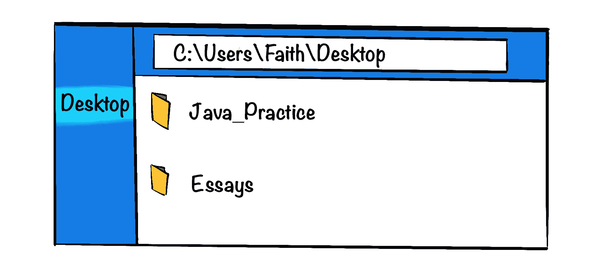

#### 工具 2：文本编辑器

就像你使用文字处理程序来写论文一样，你需要一个应用程序来写代码。

你电脑上自带的基础编辑器有：

* Windows 用户：`Notepad`（记事本）

* Macintosh 用户：`TextEdit`

我们将使用这些编辑器来保存 `Java` 文件。它们并不漂亮（不支持代码高亮），但完成任务。

如果你想要代码高亮，我建议下载 Atom。`Atom` 是一个支持 Windows 和 Macintosh 的编辑器：https://atom.io/

#### 工具 3：命令行窗口

在 Windows 上，它被称为 `Command Line` 或 `Command Prompt`（命令提示符）。在 Macintosh 上，它被称为 `Terminal`（终端）。在本书中我统称之为命令行窗口。

命令行窗口是你电脑的远程控制台。它了解目录以及其中存在的文件。你也可以跳转文件夹。我们可以使用命令行窗口运行代码。在我们的案例，我们将运行 `Java` 程序。在 Windows 上查找“Command Line”，在 Macintosh 上查找“Terminal”。它看起来应该是：

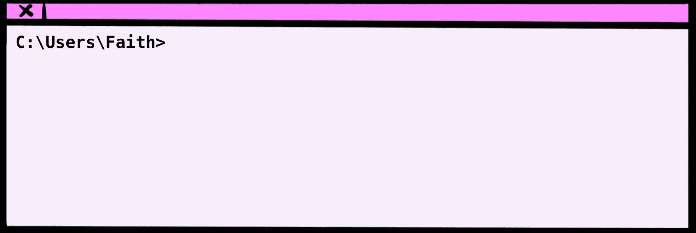

对于 Windows 用户，它应该是一个黑框。Macintosh 用户通常是白框。注意 `C:\Users\`，这是命令行窗口所感知的路径。由于电脑不同，你的文件路径也会不同。在 Windows 上，你可能会看到 `C:\Users\<用户名>`；在 Macintosh 上你可能会看到 `~\<用户名>`。那是根目录，通常也是下载、桌面和文档文件夹所在的位置。

你应该学会以下命令：`cd <路径>`。“切换目录”允许你进入不同的文件夹。我想让命令行窗口位于 `Java_Practice` 文件夹，它位于桌面。首先我们需要使用以下命令进入桌面：

```
cd desktop
```

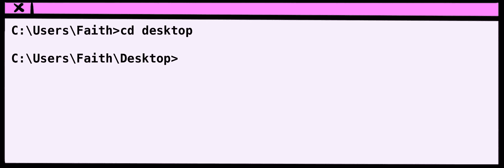

按下回车后，注意文件路径变为 `C:\Users\Desktop`。这意味着命令生效了并成功进入了桌面文件夹。现在我们要进入 `Java_Practice` 文件夹。我们使用相同的命令，但名称不同：


太好了，现在命令行窗口的文件路径是 `C:\Users\Desktop\Java_Practice`。这意味着我们成功将命令行窗口移动到了 `Java_Practice` 文件夹。我们下一章学习更多运行程序的命令。

### 第 1.2 节：安装 Java

#### 方案 1：在你的电脑上安装 Java

我们目前的命令行还没有理解 `Java` 的工具，所以还无法运行程序。因此，我们需要下载一个能让窗口理解的包。这个包被称为 `JDK`（Java 开发工具包）。本书将使用 `JDK` 8，但我建议你使用 Oracle 网站上的最新版本，目前是 `JDK` 15：https://www.oracle.com/java/technologies/javase-15-downloads.html

使用哪个版本的 `JDK` 并不重要，因为所有版本的内核编程概念都是共通的。如果你想下载旧版本，Oracle 要求登录账号。最新版本不需要。这里是所有可下载的 `JDK` 的通用链接：https://www.oracle.com/java/technologies/javase-downloads.html

对于 Macintosh 用户，点击“Mac OS Installer”（Mac OS 安装程序）下载。对于 Windows 用户，使用“x64 Installer”下载。此 `JDK` 支持 64 位操作系统。要检查你的操作系统，前往“设置” > “关于电脑”，然后检查系统类型。如果你是 32 位的，可以下载 `JDK` 8（在“Windows x86”下）：https://www.oracle.com/java/technologies/javase/javase-8-downloads.html

按照下载说明完成安装。Windows 用户：下载后可能需要重启电脑，以便 `Java` 正确更新到你的电脑。

对于所有用户，要检查是否正确下载了 `Java`，在提示符中输入以下命令：

```
java -version
```

如果下载正确，窗口应该显示 `Java` 版本。如果没有，它会提示无法识别 `java` 命令。

#### 方案 2：在线编写 Java 代码

如果你无法让方案 1 工作，我建议使用在线 `Java` 编译器。我推荐 `Codiva`：https://www.codiva.io/ 但你也可以查找其他编译器来使用。

当你深入探索编程世界时，你可能会遇到一种被称为 `IDE`（集成开发环境）的工具。`IDE` 是一个在一个程序内就为你提供全部三个组件（文件管理器、文本编辑器、命令行窗口）的平台。这样，你就不需要像在方案 1 中那样手动操作一切。`Codiva` 就是一个在线 `IDE`。

既然可以做方案 2，为什么还要费劲做方案 1 呢？你可以这样做，但我认为方案 1 会让你对 `Java` 的原理有更好的理解。

### 1. 编译我们的 Java 代码

### 2. 运行实际 Java 程序

#### 2.2.1 编译 Java 代码

当我们用 Java 编写代码时，由于是用英文编写的，它是人类可读的。但我们需要将这些英文代码转换为计算机能够理解的内容。这被称为编译我们的代码。

为了进行编译，你必须使用以下命令：

```bash
javac <Name of Java File>.java
```

该命令随我们在上一章节下载的 JDK 一起提供。可以将 `javac` 中的 “c” 理解为 “c compiling”（编译编译）。我们还必须提供想要编译的 Java 文件。

让我们来编译 `HelloWorld.java` 文件：

```bash
javac HelloWorld.java
```

代码 2.4：用于通过提示符编译 Java 代码的命令。

让我们在命令行窗口运行它：

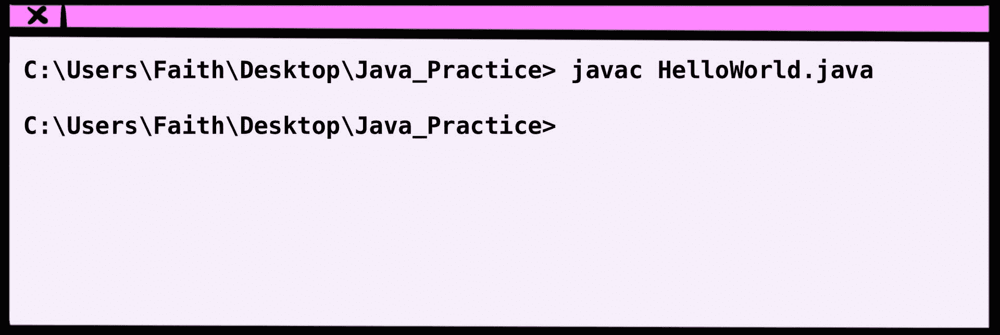

代码 2.5：HelloWorld 类文件编译成功。

如果命令行窗口显示了与代码 2.5 相同的下一个提示符，那么意味着你已成功编译了程序。此外，注意你的目录中创建了另一个文件。`javac` 创建了一个 `HelloWorld.class` 文件：


图 2.5：编译在你的文件夹中生成 .class 文件。

Java 将使用此类文件来执行你的程序。

#### 2.2.2 运行 Java 代码

现在我们需要运行程序。在我们的情况下，我们希望程序打印“Hello World”。

运行我们的 `HelloWorld` 代码的命令如下：

```bash
java HelloWorld
```

代码 2.6：在命令行窗口上运行 Java 程序的命令。

注意我们没有像编译命令时那样包含 “c” 和 `.java`。让我们在窗口中运行此命令：

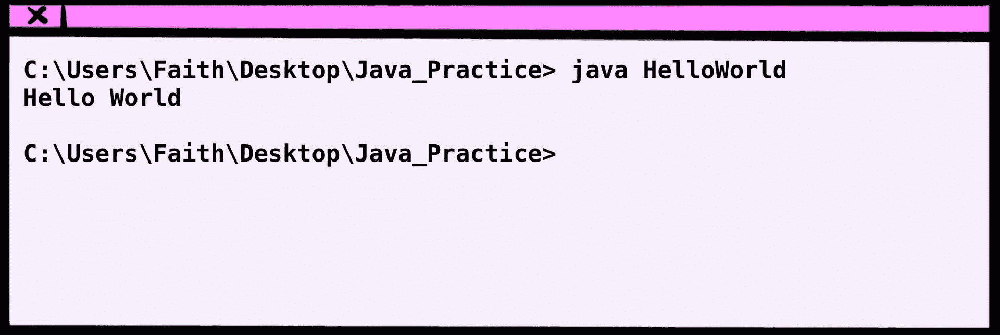

代码 2.7：HelloWorld 程序运行成功。

恭喜你！你执行了你的第一个程序！请注意，每当你编辑或编写新代码时，必须在再次运行之前对其编译。

#### 2.2.3 针对在线 IDE 用户

在使用在线 IDE 时，你可能观察不到编译和运行代码之间的区别。通常有一个你可以点击的“run”（运行）按钮，它可以立即执行你的代码。在线 IDE 已经在后台编译了你的代码并在终端上显示输出。

### 第 2.3 节 注释

随着你编写越来越复杂的程序，你的代码会变得越来越长且难以阅读。你可以在代码中编写注释来记录代码在做什么。

这是一个为 `HelloWorld` 类编写的注释示例：

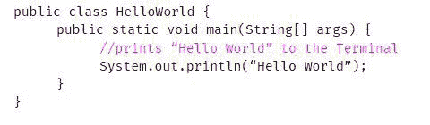

代码 2.8：Java 中的注释。

为了写单行注释，我们可以在其前面加上 `//`。Java 程序会忽略注释，它们仅存在于与阅读代码的程序员之间的交流中。

Java 中有三种类型的注释：

* `//` 单行注释

* `/* */` 多行注释。你可以根据需要编写任意数量的注释。

* `/**  /` Javadoc 注释。它们与多行注释相似，但用于文档生成目的。我们将在稍后的章节中学习更多关于 Javadoc 的知识。

我们将主要使用单行注释或多行注释。

### 第 2.4 节 总结

让我们总结一下在 Java 中进行阅读和编写的某些“经验法则”。

* 代码是逐行执行的。因此，你编写的代码顺序非常重要。你不能在编写类容器之前就写打印语句。

* 每当你创建一个新的 Java 文件时，都必须有一个名为 `class` 的大容器。

    * 随着你在学习 Java 时进阶到本书之外，这条经验法则将会改变。

* 你的类名必须与文件名匹配。

* 为了在命令行窗口上执行程序，你必须始终拥有 `main()` 方法。

* 每当你在代码中看到 `()` 时，它通常是一个方法。

    * 该规则的例外：条件语句、循环、数学计算。我们将在书中探索这些内容。

* 大括号 `{ }` 之间的任何内容都被称为 `body`（主体）。这是我们编写可执行代码的地方。

* 当你编写“Java 句子”或语句时，它们通常以分号结尾。分号是 Java 句子的句。

* 当你编译代码时，使用 `javac <Name of File>.java`。

* 当你运行代码时，使用 `java <Name of File>`。

* 你必须在运行代码之前对其编译。

我们将使用 `//` 或 `/* */` 注释。

（注：源文件中剩余文本似乎是重复或碎片化的序列；我已处理了上述主要章节提供的核心结构内容。）*

| 2135.29201019 .00391.368 |

# 规则

- 你必须使用 4 个 `print` 语句。

- 4 个 `print` 语句中只能有一个可以使用文本。其余的必须是数字。

# 第 4 章：数字的计算与比较

在本章中，我们将学习如何在 Java 中进行数学计算和数字比较。

## 第 4.1 节：算术运算符

本节的目标是通过创建一个 Java 程序来探索基础数学运算。首先，假设我们想先将两个数字相加，减 1，乘以 20，除以 10，然后得到除以 5 的余数。它应该打印出计算的每一步。

让我们创建一个名为 `Calculator.java` 的新类文件。我们需要创建一个大“类”容器：

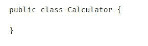

代码 4.1: 空的 Calculator 类

接下来，我们需要一个 Java 程序可以执行的入口点，因此我们将拥有 `main()`：

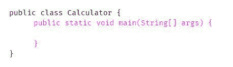

代码 4.2: Calculator 类内部的 main() 容器

现在开始编写有意义的代码。

### 4.1.1：加法

我们首先想将两个数字相加并打印出来。我随机选择 2 和 4 相加。为了将两个数字相加，我们使用 `+` 符号。

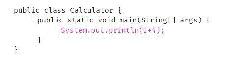

代码 4.3: 打印 2 + 4

编译并运行：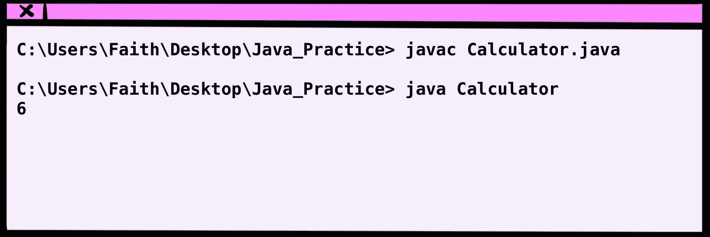

太好了！我们能够计算并打印加法，但让我们通过增强打印语句来明确我们是如何得到 6 的：

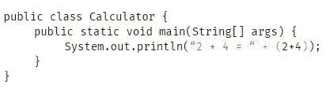

代码 4.4: 更具描述性的打印语句

编译并运行：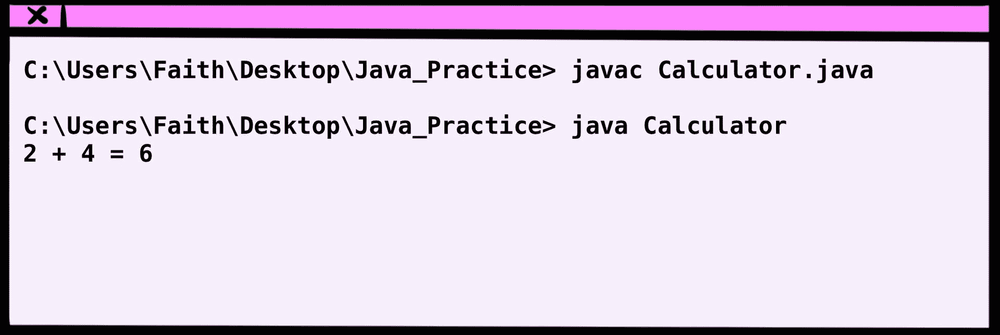

这清晰多了！我们将对剩下的计算执行此操作。

### 4.1.2：减法

现在我们想将加后的数字减去 1。这意味着 6 - 1。我们使用 `-` 符号：

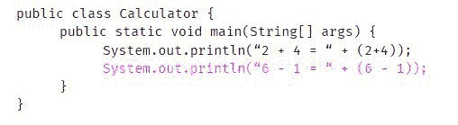

代码 4.5: 打印 6 - 1 的减法

编译并运行：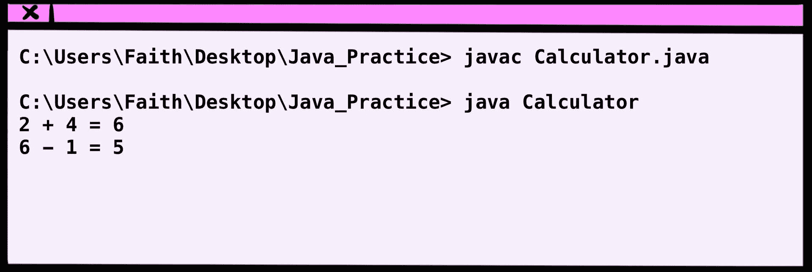

### 4.1.3：乘法

现在我们想将减后的数字乘以 20。在 Java 中，我们使用 `*` 符号：

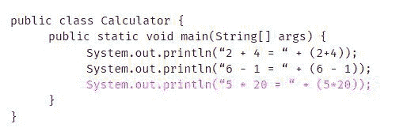

代码 4.6: 打印 5 * 20 的乘法

编译并运行：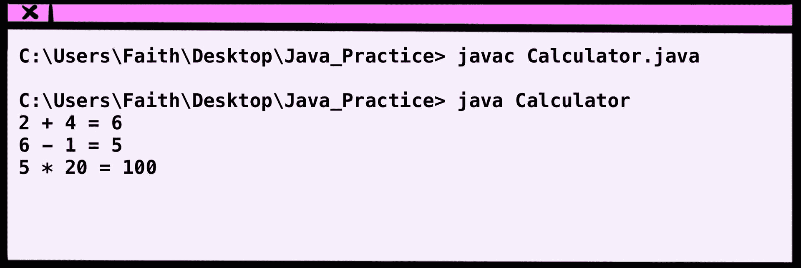

### 4.1.4：除法

现在我们想将乘后的数字除以 10。在 Java 中，我们使用 `/` 进行除法。

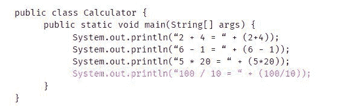

代码 4.7: 除 100/10

编译并运行：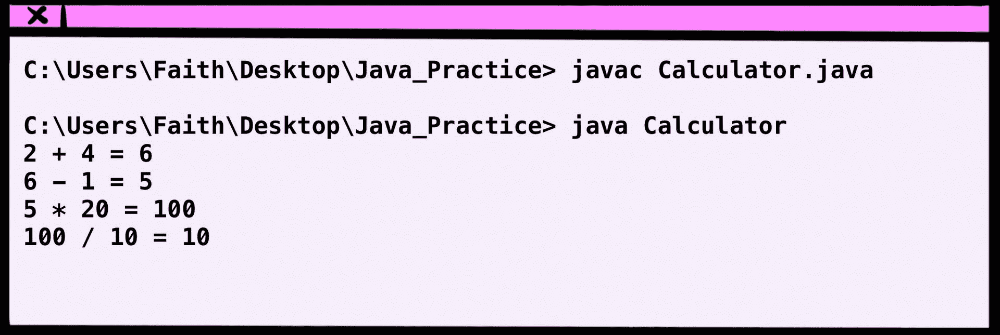

### 4.1.5：取模

现在我们想得到 10 除以 5 的余数。我们也会将其记为 10 mod 5。我们使用 `%` 符号取模。

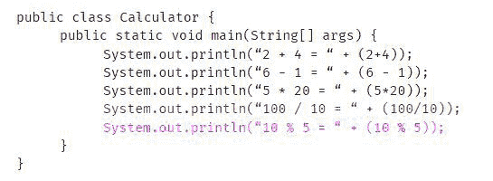

代码 4.8: 带有取模 10 % 5 的完整 Calculator 代码

编译并运行：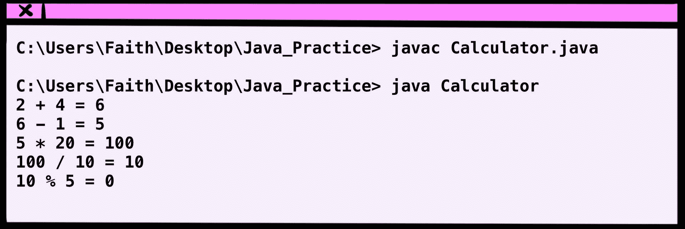

预期为 0，因为 10 可以被 5 整除，没有余数。

恭喜你！你已经完成了第一个数学计算程序的编写！

### 4.1.6：整数除法与 小数除法

我们观察到 100 / 10 返回了一个很整整数。如果我们用的是 105 / 10 呢？

让我们打印出来：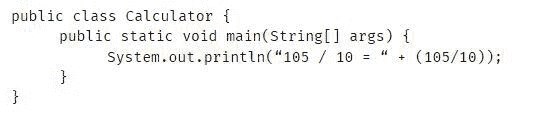

代码 4.9: 整数除法

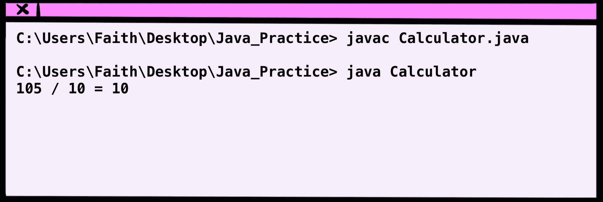

它仍然返回一个整数。如果你把 105 / 10 放入真正的计算器，你会得到 10.5。那么为什么 Java 返回 10 呢？

这是因为 Java 看到 105 和 10 都是整数（integer）。当 Java 看到我们正在除两个两个整数时，它将舍入到最近的整数，并向下取整。这对于负整数也如此。

如果你想让 Java 返回小数，那么你需要让 105 和 10 也变成小数：

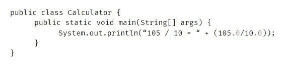

代码 4.10: 小数除法

编译并运行：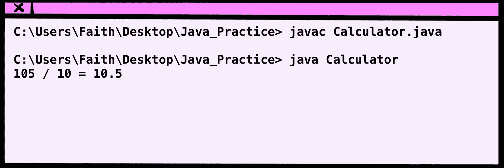

### 4.1.7：数学运算符总结

这里是我们讨论的所有运算符，整理成表格：

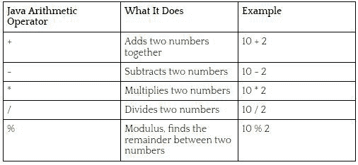

表格 4.1: 常见数学运算表

## 第 4.2 节：比较运算符

我们学习了如何计算数字，但如何比较它们呢？让我们创建一个新程序来比较两个数字。创建一个名为 `Comparison.java` 的类文件：

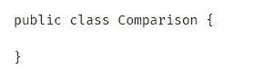

代码 4.11: 空 Comparison 类

创建 `main()` 容器：

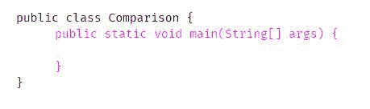

代码 4.12: Comparison 类内部的 main() 容器

### 4.2.1：相等

如果我们想检查两个数字是否相等，我们在 Java 中使用 `==`。让我们用随机数打印它：

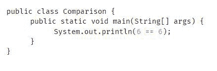

代码 4.13: 检查 6 等 6

编译并运行：

这返回 true。如果我们比较 6 等 5 呢？

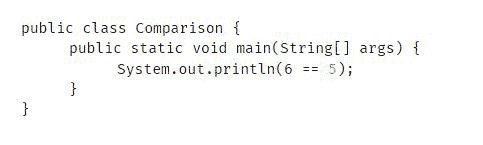

代码 4.14: 检查 6 等 5


编译并运行：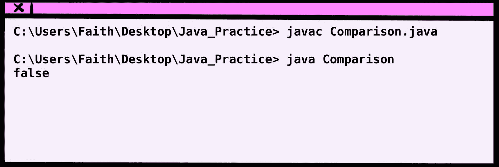

Java 返回 `false`。在 Java 中进行任何比较操作，它总是返回 `true` 或 `false`。

### 4.2.2：不等

我们也可以使用 `!=` 检查两个数字是否相等。

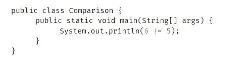

代码 4.15: 检查 6 不等于 5

编译并运行：

如果我们比较 `6 != 6`，它应该返回 `false`：

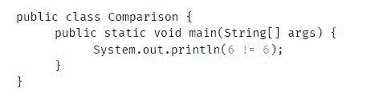

代码 4.16: 检查 6 不等于 6

编译并运行：

### 4.2.3：小于

我们使用 `<` 来比较一个数字是否小于另一个：

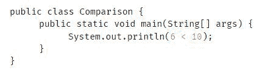

代码 4.17: 检查 6 小于 10

编译并运行：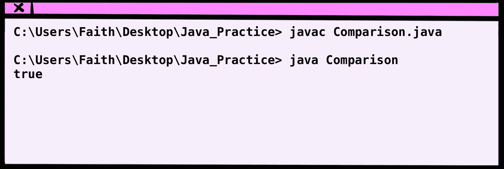

### 4.2.4：大于

我们使用 `>` 来检查一个数字是否大于另一个：

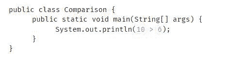

代码 4.18: 检查 10 大于 6

编译并运行：

### 4.2.5：小于等于

我们使用 `<=` 检查一个数字是否小于或等于另一个：

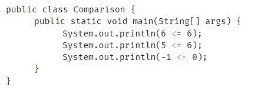

代码 4.19: 测试比较运算符，小于等于

编译并运行：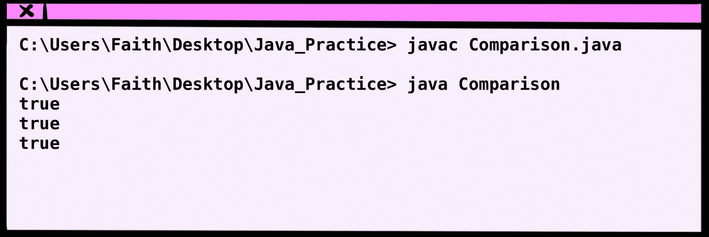

### 4.2.6：大于等于

我们使用 `>=` 检查一个数字是否大于或等于另一个：

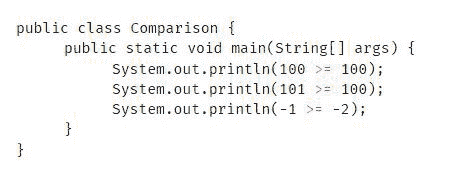

代码 4.20: 测试比较运算符，大于等于

编译并运行：

### 4.2.7：比较运算符总结

这是我们讨论的比较运算符表格：

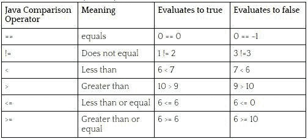

表格 4.2: 常见比较运算符表

注意，我们还可以使用 `==` 和 `!=` 来比较非数字的内容。我们稍后会进一步讨论相等运算符。

### 练习

1. 创建一个名为 `ComparisonTest` 的类文件并保存为 `.java` 文件。创建一个 `main()` 容器。打印 `10 > 10`。会打印什么？

2. 在问题 1 的同一个类文件中，打印 `10 == 10`。会打印什么？

3. 在同一个类文件中，执行以下操作：将 10 和 2 相加，对 5 取模，然后减去 6。将此数字乘以 10 并除以 2。打印每个计算步骤。你的最终计算结果是什么？

4. 查看代码 4.8，完整的 `Calculator` 代码。如果我们想将初始加法从 `2 + 4` 改为 `2 + 8` 会怎样？对 `Calculator` 代码进行后续更改，使剩余计算使用 `2 + 8` 作为起始点。你需要做多少更改，包括更改打印信息？

# 第 5 章：变量

让我们回顾第 4 章的 `Calculator` 代码：


代码 5.1: 第 4 章的 Calculator 代码

我们需要在每一步记住计算出的数字以便进行下一步操作。一直进行这种心算非常费神。与其将数字硬编码到程序中，或在代码中编写实际数据，不如通过使用变量来实现通用化。

在本章中，我们将使用变量重写 `Calculator` 代码。让我们从创建一个新类文件和 `main()` 容器开始。我将其命名为 `VariableCalculator.java`：

类文件：


代码 5.2: VariableCalculator 类结构

`main()` 容器：


代码 5.3: 类内部的 main() 方法

这意味着我们的图示如下：


图 5.1: 代码 5.3 的视觉表示

## 第 5.1：什么是变量

你可以将变量想象为一个存储信息的框。信息可以是数字、文本、值列表或任何内容。我们在框上加上标签以便知道它存储了什么。让我们取 `2+4` 计算放入变量中：


代码 5.4: Java 中的变量

在后续章节中，你将观察创建变量的两个部分

### 5.1.1：声明变量

从 `=` 的左侧开始：


代码 5.5: 声明变量

左侧是我们为变量命名并指定它可以包含的数据类型。在这种情况下，`int` 意味着 `calculatedNumber` 只能包含整数。它不能包含小数或文本。这个过程被称为声明变量。让我们在 `VariableCalculator` 代码中放入声明：


代码 5.6: VariableCalculator main() 容器内部声明 calculatedNumber

尚未编译和运行。让我们从视觉上查看：


图 5.2: 代码 5.6 的视觉表示

当我们声明变量时，本质上创建了一个等待存储信息的框。声明也为我们的框贴标签。

### 5.1.2：初始化变量

现在看 `=` 的右侧：


代码 5.7: 初始化变量

这意味着我们将 `2 + 4` 存储到变量 `calculatedNumber` 中。我们将存储 6。这个过程被称为初始化变量。让我们完成代码：


代码 5.8: Calculator 代码中的初始化变量

视觉上，我们将相加数字存储到黄色框中：


图 5.3: 代码 5.8 的视觉表示

你也可以声明变量并在代码稍后初始化它：


代码 5.9: 你可以在代码中稍后初始化变量

声明变量可以是一个独立的语句，用分号表示。你不能单独初始化。

关于初始化的注意事项：

- 必须存储与声明的数据类型一致的值。这意味着你不能在 `int calculatedNumber` 变量中存储文本。

- 你可以根据需要为同一个变量重新赋值新值。

总体，初始化步骤 `calculatedNumber = 2 + 4` 从右到左发生。这意味着我们可以理解为：“我们正在将值 2 + 4 赋值给整数变量 `calculatedNumber`。”

### 5.1.2 赋值运算符

当我们要把值存储到变量时，使用 `=` 符号。`=` 被赋值运算符。在上章中，我们学习了使用 `==` 检查两个数字之间的相等性。永远不要使用 `=` 符号来检查相等性。它纯粹用于给变量赋值。这是程序员常犯的错误之一。


表格 5.1: == 与 = 的比较表

## 第 5.2：完成 VariableCalculator

让我们完成 `VariableCalculator` 代码。输出输出应该与 `Calculator` 程序相同。我们只声明并初始化了 `calculatedNumber`。让我们也打印加法：


代码 5.10: 打印加法

注意我们打印的是变量而不是加法 `2+4`。Java 将打印存储在变量内部的值，而不是实际的变量名。让我们通过编译和运行代码来观察这一点：

太好了！它按预期打印了 `calculatedNumber` 内部的值。

下一个计算要求我们减去 1。让我们使用同一个 `calculatedNumber` 变量并用减法重新赋值：


代码 5.11: 将 calculatedNumber 重新赋值为减 1

注意你不再需要在 `calculatedNumber` 前面加 `int`。这是因为你已经声明了变量。

此外，我们提到过初始化是从右到左的。所以让我们看这个表达式：


代码 5.12: 结果为 6 - 1

在之前的计算中，我们相加了 2 和 4。现在 `calculatedNumber` 存储了 6。因此，这个表达式将评估为 6 - 1，即 5。这个 5 将根据左表达式存储在 `calculatedNumber` 中。之前的 6 将通过重新赋值被删除。

- `for` 是 Java 中用于启动 `for-loop` 的关键字。

- 在括号 `( )` 内部有三个用分号隔开的代码语句：

    - `int i = 0` → 这条语句告诉循环计数器从哪里开始。`i` 将是计数器，用于记录我们循环的次数。我们通常让 `i` 从 0 开始。

    - `i < x` → `x` 是我们想要循环的次数。这是一个条件语句，意思是“一直循环直到 `i` 达到 `x`”或“如果 `i` 仍然小于 `x`，则继续循环”。

    - `i++` → 将计数器 `i` 加 1。这等同于 `i = i + 1`。`i` 将不断增加直到达到 `x`。

- 注意，当我们定义 `x` 时，`x` 必须大于我们为 `i` 定义的起始数字（在这种情况下 `x` 必须大于 0）。

- `{ }` 是 `for-loop` 的体体，我们在这里编写需要重复 `x` 次的代码。

现在，让我们使用以下类文件通过 `for-loop` 打印六次“Hello World”：

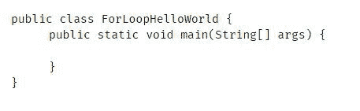

代码 8.3: ForLoopHelloWorld 类文件的结构

通过编写骨架结构启动 `for-loop`：

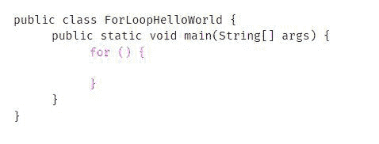

代码 8.4: 启动 for-loop 的结构

我们想要重复打印“Hello World”，因此在体内部编写打印语句：

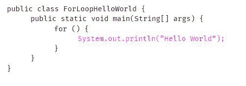

代码 8.5: 编写 for-loop 的体

现在我们需要定义计数器，我们将循环六次。我们将让计数器 `i` 从 0 开始。

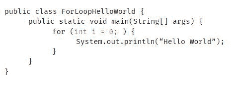

代码 8.6: 声明并初始化计数器 i 为 0

接下来，我们需要定义 `i` 应该数到几。由于 `i` 从 0 开始，`i` 应该数到 5（0, 1, 2, 3, 4, 5 总共是六个数）。我们可以将条件语句写为 `i <= 5`：

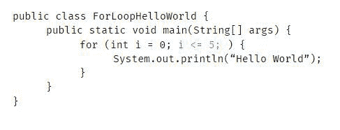

代码 8.7: 为计数器 i 编写条件语句

现在我们需要显式地告诉 `for-loop` 它应该如何增加 `i`。我们每次增加 1：

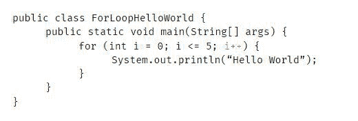

代码 8.8: 定义计数器 i 的增加方式

我们完成了！让我们编译并运行：

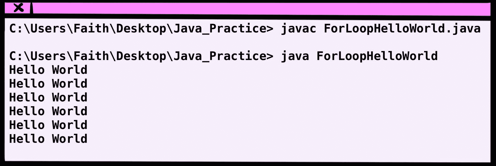

我们能够通过循环将潜在的六行代码减少到两行代码！

你可以在每次迭代时打印计数器 `i`：

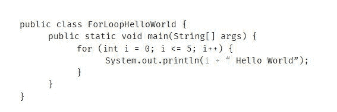

代码 8.9: 在每次迭代中打印计数器 i

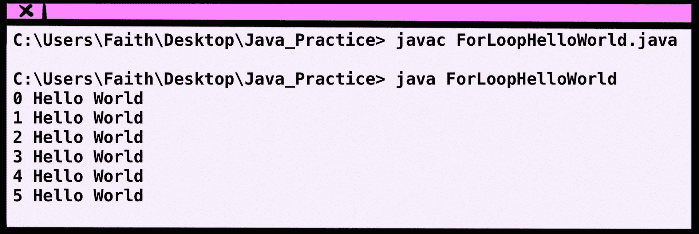

这个代码示例使用了带有递增计数器的 `for-loop`。我们也可以拥有带有递减计数器的循环。

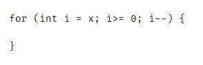

代码 8.10: 递减 for-loop 的结构

结构相同，但括号内的三个语句略有不同：

- `int i = x` → 我们不是从 0 开始计数器，而是从某个数字 `x` 开始并开始递减。

- `i >= 0` → 这定义了 `i` 应该倒数到几。“继续循环直到 `i` 达到 0。”

- `i--` → 这等同于 `i = i - 1`。我们将每次倒减 1。

我们可以使用相同的 `ForLoopHelloWorld` 代码并改用递减的 `for-loop`。我们将打印索引以查看不同之处：

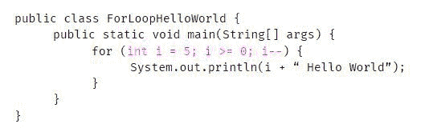

代码 8.11: 相同的 Hello World 循环但使用递减计数器


注意计数器 `i` 如何从 5 减到 0。

### 8.1.1 For-Loops 的更大的灵活性

回到我们原始的 `ForLoopHelloWorld` 程序：


代码 8.12: 原始的 HelloWorld 循环代码

我们不需要让 `i` 从 0 开始也不需要在 5 结束。只要我们实现了打印六次“Hello World”的目的，计数器何时开始和结束并不重要。我们可以让计数器从 1 开始并在 6 结束：


代码 8.13: 修改计数器 i 的起始和结束

1. 使用 for 循环输出上述文本。

2. 使用 while 循环输出上述文本。

3. 查看下方的 `for` 循环：在不在命令行窗口运行这段代码的情况下，写出每次迭代时 `print` 语句的内容。

4. 使用 `while` 循环重写问题 2 代码。

5. 创建一个带有 `main()` 方法的新类文件。编写一个`for`循环来累加从 `x` 到 `y` 的数字。例如，从 `x = 1` 到 `y = 5` 相加应该得到 `1 + 2 + 3 + 4 + 5 = 15`。假设 `x` 始终小于 `y`。

6. 创建一个带有 `main()` 方法的新类文件。编写一个计算阶角的循环。例如，`5!` 应该得到 `5 * 4 * 3 * 2 * 1 = 120`。用 `for` 循环写一个，再用 `while` 循环写一个。

# 第 9 章：方法

让我们回顾一下在第 5 章编写的 `VariableCalculator.java` 代码：


代码 9.1: 第 5 章的 VariableCalculator 代码

仅仅看一眼，代码看起来很杂乱。在 `main()` 方法内部，我们写了 12 行代码，不包括注释或空格。

### 此代码的缺陷：

1. 代码太长了，不适合放在一个方法（`main()` 容器）中。通常，我们尽量避免在一个方法容器中塞入这么多代码。

2. 它不易阅读。我们需要注释来了解每个计算步骤发生了什么。

3. `main()` 内部发生了多件事。`main()` 负责加、减、乘、除以及寻找余数。这责任太太重了。

但是，如果我们的 `main()` 看起来像这样呢？


代码 9.2: 如果我们有更整洁的代码会怎样？

代码 9.2 要容易读得多。现在 `main()` 内部只有五行代码。这都是通过创建和使用方法就能实现的。

`add()`、`subtract()`、`multiply()`、`divide()` 和 `modulus()` 就是我们所的方法。

**本章目标：** 让我们减轻 `main()` 的负担，通过创建新方法以更整洁的方式组织代码。

我们将使用一个名为 `CleanCalculator.java` 的新类文件来重写 `VariableCalculator` 代码。程序的输出应该保持一致：


代码 9.3: CleanCalculator 代码大纲

## 第 9.1 节：什么是方法？

方法是执行特定操作的代码组。一个方法应该只做一件。例如，一个方法负责加法，另一个方法负责减法，以此此类推。

如果你看过电影，可能看过结尾的演职员表。演职员中提到的不同角色就是程序员所说的“方法”。电影导演是一个方法，而音乐导演是另一个。所有的职责都被分配到不同的角色，这样我们就不会让一个人承担所有工作，而这些角色对于制作一部电影是必要的。在编程中，创建一个程序需要这些不同的方法。

你应该在以下情况下创建方法：

* 当你的代码混乱且难以阅读时

* 当你注意到程序中到处重复相同的代码时

所以，方法是程序员将相似的代码组织在一起以避免重复代码的方法。方法存在于类容器内部，与 `main()` 方法并列。为了组织 `VariableCalculator` 类中的代码，我们计划拥有五个不同的方法来支持数学运算。

## 第 9.2 节：如何编写方法

让我们看看 `main()` 方法的结构。


代码 9.4: 一个打印“Hello World”的简单`main()`方法

创建一个方法需要六个组件，但我们在本章中将关注其中四个。组成方法的六个组件如下：

1. 访问修饰符：`main()`中的`public`
2. `static`关键字
3. 返回类型：`main()`中的`void`
4. 方法名：`main()`
5. 方法的参数：`String[] args`
6. 方法体：`System.out.println("Hello World");`

我们暂时忽略前两个，关注最后四个组件：

- 返回类型
- 方法名
- 方法的参数
- 方法体

我们将在后面的章节中回到访问修饰符和`static`关键字的含义。现在，我们只需记住在构造方法时加上它们即可。

## 9.2.1 方法中的返回类型

返回类型是方法在执行完操作后返回的数据类型。这部分与声明变量的数据类型类似。例如，如果你想创建一个用于加法的方法，那么你想返回一个数字。在我们的案例中，我们将返回一个整数。我们将根据目前已知的知识开始创建`add()`方法的定义。我们还需要在`main()`方法之外执行此操作：


代码 9.5: 声明方法的返回类型为`int`。忽略`public`和`static`。只需知道它们需要在那。你可以声明以下返回类型：

- `int`、`String`、`Object`、`float`等任何你的数据类型
- `void`：当方法不返回任何值时

## 9.2.2 方法名

方法名应该反映方法的功能。这在编程中很重要，因为我们喜欢回顾代码，如果无法通过名称理解方法的作用，就需要改进。对于我们的加法方法，我们可以简单地称之为`add()`。你也可以叫它`addition()`，任何你喜欢的。方法名并不是Java固定的，由程序员决定。


代码 9.6: 创建方法名`add`。括号将表示`add()`是一个方法。

## 9.2.3 方法参数

参数是方法可以使用通用输入，而不是硬编码的值。我们通过使用变量来实现。在我们的案例中，我们希望`add()`方法将两个数字相加，而不是简单的2和4，所以参数帮助我们泛化输入。为方法添加参数只需要声明变量。为了添加更多参数，你需要用逗号将它们分开：


代码 9.7: 为方法添加参数。注意我们还没有初始化这些变量，因为我们不知道它们是什么。当我们开始使用该方法时才知道。现在`add()`方法应该期望有两个输入。如果你不提供两个输入，Java将抛出编译错误。你可以随意命名你的变量。我随机选择了`x`和`y`。你可能会问：

- 你可以有多少个参数？我建议最多5~7个，以确保你的代码具有可读性。
- 你可以使用什么数据类型传递参数？任何数据类型。
- 如果你不需要参数呢？也可以。不在括号`()`中添加任何内容。

## 9.2.4 方法体

方法体包含了需要执行的代码。方法体由两个大括号`{}`表示。对于`add()`，我们希望将两个数字相加。在这种案例中，我们将添加参数`x`和`y`。


代码 9.8: 在方法体内编写需要执行的代码。我们还需要在方法的结尾返回加的值：


代码 9.9: 添加返回语句。`return`是Java关键字，用于在方法结束时返回数据。再次注意Java代码是按行运行的，所以`return`语句位于方法的结尾。例如，我们不能这样做：


代码 9.10: 错误代码。当后面还有代码需要处理时，不能提前返回。代码9.10将导致编译错误，因为Java看到在返回语句之后还有另一行需要处理的代码。此外注意方法不能返回多个数据。它只能返回一个。但现在我们基本完成了`add()`方法。由于原始代码也打印了我们的操作，我将创建一个额外的打印语句：


代码 9.11: 为`add()`方法添加打印语句。恭喜！你创建了自己的方法！

## 9.2.5 调用方法

我们定义了`add()`方法，但如果现在运行`CleanCalculator`代码，什么都不会发生。这是因为我们还没有编写实际使用`add()`的代码。调用方法是“使用方法”的编程术语。从同一个类文件调用方法很简单。你需要输入方法名并为参数提供输入值。代码9.2通过`add(2,4)`演示了这一点。注意你仍然必须使用`main()`方法作为入口来开始计算。这意味着我们需要在`main()`中调用`add()`。


代码 9.12: 在`main()`方法内部调用`add()`方法。记得第5章，我们总是从右到左读取变量初始化。在等号右侧，我们调用了`add()`方法。调用将让Java执行`add()`内部的代码。在最后，方法将返回6。当我们返回时，我们回到调用之前的代码：`int calculatedNumber = add(2,4)`。`add(2,4)`被替换为6。


图 9.1: 方法调用流程。让我们编译并运行这段代码：

![Image00207.jpg)

## 9.2.6 完整的`CleanCalculator`代码

现在我们可以对剩余的操作（`subtract`、`multiply`、`divide`、`modulus`）这样做。在查看下面的解决方案之前，请自己尝试这些方法。


代码 13: 完整的`CleanCalculator.java`代码。编译并运行：

![Image00209.jpg)

注意输出与第5章的`VariableCalculator`完全一样。

## 第9.3节：使用方法重用代码

整体看起来比`VariableCalculator`需要更多代码吗？是的，但创建方法有一些好处：

- 它更具可读性。读`add()`比读`x + y`更。
- 你不需要在程序的各个部分重写相同的代码。调用方法即可搞定。

如果没有方法，我们会这样写代码：


代码 14: 不使用方法时`main()`方法的冗长代码。这是写在`CleanCalculator`类中的。输出：

![Image00211.jpg)

或者我们可以通过调用`add()`方法组织我们的代码：


代码 15: 使用方法的更整洁的代码。结果相同：这就是为什么方法很有用；你可以通过调用方法重用相同的代码。

## 第9.4节：组织方法，顺序重要吗？

`add()`方法定义在`subtract()`之前重要吗？不。你可以按任何顺序写方法定义。重要的是你调用方法的顺序。通常做法是将`main()`方法放在类的开头或末尾。

总结一下：

- 方法是执行一个功能的代码组。
- 方法由至少六部分组成：访问修饰符、`static`、返回类型、方法名、参数、体。
- `void`是方法不返回任何内容时声明返回类型。
- `return`是用于返回数据的Java关键字。返回的数据必须匹配方法声明的数据类型。

### 练习

1. 在`CleanCalculator`类中创建另一个计算线性函数`y = mx+b`的方法。方法的输出应该是基于线性公式计算出的`y`值。方法应该接收`m`、`x`和偏移`b`。
   a. 使用输入`y = 2x + 10`调用方法，其中`x = 2`。
   b. 尝试`y = (3/2)x + 2`，其中`x = 3`。
   c. 尝试`y = x + 3`，其中`x = 0`。

2. 回顾第5章的`FillIn`类：

![Image00214.jpg)

不要在`main()`方法中拥有这段代码，而是创建一个方法为我们构建这个句子。变量的值应该传递给方法。

3. 假设你在伊利诺州工作，想计算你每年需要缴纳的所得税。以下是已知信息：
- 你的时薪为$10
- 你每年工作了1000小时
- 你知道伊利诺州的所得税5%

创建一个名为`IllinoisTaxCalculator`的Java程序并创建以下方法：
- 计算年收入的方法（`hourly wage * 工作小时数`）
- 计算年纳税收入的方法（`annual income * tax`）
- 计算小时税额的方法（`hourly wage * tax`）
- 计算净收入的方法（`annual income - taxable income`）

你的程序应该输出：

![Image00215.jpg)

# 第10章：局部 vs 变量

现在我们学习了变量和创建不同的方法，可以谈论局部变量和全局变量之间的差异了。

## 第10.1节：局部变量

到目前为止，我们在程序中只使用了局部变量。假设你正在电脑上写一篇文章，但你也需要在手机上访问它。文章目前保存在电脑的硬盘上，所以你的手机无法访问它。在这种情况下，文章是电脑局部的。在编程方面，局部变量是特定方法的“局部的”，其他方法无法访问该变量的数据。让我们看看以下版本的`CleanCalculator`代码：


代码 10.1: 第10章版本的`CleanCalculator`的`main()`。变量`calculatedNumber`是`main()`方法的局部变量。为什么？因为我们在`main()`方法内部声明了变量。这意味着`calculatedNumber`的数据不能被其他方法（如`add()`、`subtract()`、`multiply()`、`divide()`、`modulus()`）访问。尝试从`subtract()`访问`main`的局部变量：


代码 10.2: 在`subtract()`中尝试访问`main`的局部变量。编译：

![Image00218.jpg)

我们得到一个编译错误，指出Java找不到符号`calculatedNumber`。这是因为`calculatedNumber`是局部变量，对`subtract()`方法不可用。

## 10.2 全局变量

与其在电脑上写文章，不如你决定将其上传到网站，这样你就可以从任何地方访问它。现在文章可以认为是“全局”的。在编程中，全局变量是所有方法都可以访问的。为了将变量全局化，你必须在方法之外声明变量：


代码 10.4: 全局化变量`calculatedNumber`。忽略`private`和`static`。重要的是我们在方法之外用`int`类型声明了`calculatedNumber`。回到我们在`subtract()`方法中添加的打印语句。添加一个描述性的语句：


代码 10.5: `subtract()`能够访问`calculatedNumber`。编译并运行：

![Image00222.jpg)

你可以看到，`subtract()`通过打印值访问了变量`calculatedNumber`。如果程序过程中`calculatedNumber`的值发生变化，`subtract()`也会捕捉到这些变化。这是带有全局变量`calculatedNumber`的代码：


代码 10.6: 注意`calculatedNumber`声明在`CleanCalculator`但在所有方法之外。

## 10.3 何时使用局部 vs 变量

问问自己：

- 你的所有方法都需要该变量的信息吗？
- 或者你只需要在一个方法中使用它？
- 我们可以直接将值传递给方法是否可行？

当我们学习类和对象时，全局变量将变得更重要。

### 练习

1. 我们有以下代码：

![Image00224.jpg)

对此代码进行编辑。我们可以全局化哪个变量？你也可以更改方法定义。注意你不需要担心`roundUp()`和`roundDown()`方法定义。只需知道它们的功能：
- `roundUp()`：如果小数点是5或更大则向上舍入。
- `roundDown()`：无论数字如何都向下舍入。

2. 修改`RoundingCalculator`代码，改为向下舍入。

# 第11章：访问修饰符

在第9章，我们在`CleanCalculator`内部创建了执行数学运算的方法。调用类内定义的方法很容易，但如果我们想在另一个类文件中使用`CleanCalculator`的方法呢？访问修饰符可以做到。

## 第11.1节：什么是访问修饰符？

访问修饰符决定了你是否可以使用从另一个类文件中获取数据。我们将涵盖两种修饰符：`public`和`private`。我们可以为以下设置访问权限：
- 类，但我们将类始终设为`public`。
- 方法
- 全局变量

`public`：其他文件可以自由访问类/方法/全局变量。
`private`：访问受限。其他文件无法访问类/方法/全局变量。

## 第11.2节：公共方法

创建一个名为`CleanCalculatorImpl`的新类文件。`Impl`代表Implementation。`CleanCalculatorImpl`将使用`CleanCalculator`方法的类文件。`CleanCalculatorImpl`文件应该保存在与`CleanCalculator`相同的位置。


代码 11.1: `CleanCalculatorImpl`类结构

从`CleanCalculator`中移除`main()`方法，因为我们会在`CleanCalculatorImpl`中放置`main()`。注意：我们并不总是每个类都需要`main()`方法。你只需要提供方法定义。通常一个程序定义一个`main()`方法是良好的做法，因为应用程序只需要一个入口来开始运行。这是我们将使用的`Calculator`类版本：


代码 11.2: 没有`main`方法的第9章`CleanCalculator`代码

我会编译`CleanCalculator`文件，因为我删除了`main()`方法。注意所有方法都以`public`开头，这意味着其他文件可以访问它们。因此，`Impl`类可以访问`CleanCalculator`的方法。在`CleanCalculatorImpl`类中，让：


代码 11.3: 从不同类文件调用方法的错误方式。让我们让两个数字相加的方法：


代码 11.4: 我们让`add()`接收参数。


代码 11.5: `add()`是一个方法。让我们让：


代码 11.6: `add()`是一个方法。恭喜！你成功调用了另一个不同类的方法！

## 11.3 私有方法

让我们通过将访问级别从`public`改为`private`来测试`CleanCalculator`中的`multiply()`


代码 11.5: `CleanCalculator`中`multiply()`的`private`编译。编译`CleanCalculator`，，，，` ` ` ` ` `main`  `方法：


代码 11.6: `CleanCalculator`中`multiply()`的`private`。


代码 11.3: `CleanCalculator`中`multiply()`的`private`。忽略`static`。重要的是我们在方法之外用`int`类型声明了`multiply()`。


代码 11.4: `CleanCalculator`中`multiply()`的`private`。


代码 11.5: `CleanCalculator`中`multiply()`的`private`。


代码 11.6: `CleanCalculator`中`multiply()`的私有。私有方法。


代码 11.7: `CleanCalculator`中`multiply()`的`private`。


代码 11.8: `CleanCalculator`中`multiply()`的`private`。


代码 11.9: `CleanCalculator` 中 `multiply()` 的私有。


代码 11.10: `CleanCalculator` 中 `multiply()` 的私有。


代码 11.11: `CleanCalculator` 中 `multiply()` 的私有。


代码 11.12: `CleanCalculator` 中 `multiply()` 的私有。


代码 11.13: `CleanCalculator` 中 `multiply()` 的私有。


代码 11.14: `CleanCalculator` 中 `multiply()` 的私有。


代码 11.15: `CleanCalculator` 中 `multiply()` 的私有。


代码 11.16: `CleanCalculator` 中 `multiply()` 的私有。


代码 11.17: `CleanCalculator` 中 `multiply()` 的私有。


代码 11.18: `CleanCalculator` 中 `multiply()` 的私有。


代码 11.19: `CleanCalculator` 中 `multiply()` 的私有。


代码 11.20: `CleanCalculator` 中 `multiply()` 的私有。


代码 11.21: `CleanCalculator` 中 `multiply()` 的私有。


代码 11.22: `CleanCalculator` 中 `multiply()` 的私有。


代码 11.23: `CleanCalculator` 中 `multiply()` 的私有。


代码 11.24: `CleanCalculator` 中 `multiply()` 的私有。


代码 11.25: `CleanCalculator` 中 `multiply()` 的私有。


代码 11.26: `CleanCalculator` 中 `multiply()` 的私有。


代码 11.27: `CleanCalculator` 中 `multiply()` 的私有。


代码 11.28: `CleanCalculator` 中 `multiply()` 的私有。


代码 11.29: `CleanCalculator` 中 `multiply()` 的私有。


代码 11.30: `CleanCalculator` 中 `multiply()` 的私有。

## 第 11.4 节：公共变量

访问另一个类中的全局变量与我们访问方法相似。

# 第 12 章：类与对象

第 12 章和第 13 章是最重要的，因为它们是面向对象编程的基础。我们在每一段代码中使用了类，并以 `public` 开头。我们把类当作文件来使用，但它们不仅仅于此。类用于创建对象，而对象用于编写简洁且强大的代码。本章目标：创建一个真正的类。在第 13 章，我们将学习从这个类中创建对象。

## 第 12.1 节：什么是类？

类是我们可以用来创建对象的模板。例如，你是一个设计师，想要制作不同的包卖给供应商。但为了制作这些包，你首先需要为它们创建一个基础设计。这个基础设计（或模板）就是一个类。


图 12.1: 一个包的蓝图。在编程中，这就是一个类。在蓝图中，你定义了创建包所需的通用属性。属性列表是无限的，但这里是我们可以考虑的几点：

* 包的颜色
* 包的大小（我们可以在包里放多少件物品？）
* 包的面料（皮革、漆皮、丝绒等等）
* 肩带的数量
* 肩带的长度
* 类型

通过这个模板，我们应该能够创建不同类型的包。在编程中，类提供了创建对象所需的通用属性。

## 第 12.2 节：什么是对象？

对象是我们在类中创建的特定“东西”。在包的场景中，假设我们想创建一个蓝色的背包和一个粉色的钱包。这些包是从同一个蓝图（类）创建的。从蓝图中创建的这些系列包被称为对象。


图 12.2: 这些系列包是从蓝图中创建的。

## 第 12.3 节：为什么用类和对象？

假设我们在没有任何关于类和对象的知识的情况下就想创建包。到为止我们学习的是将数据存储在变量中并将代码组织成不同的方法。以下是尝试创建蓝色背包和粉色钱包的代码：


代码 12.1: 杂乱的“创建”包的方式。如果我们运行这个程序，会得到以下：

![Image00240.jpg)

总的来说，我们必须使用变量来存储蓝色背包和粉色钱包的属性。也许我们可以通过方法让这更好。


代码 12.2: 改进的“创建”包的方式。输出与 12.1 相同。

但代码 12.2 中仍然有缺陷。尽管代码更短且更易读，但我们无法访问单个包的属性。例如，我们无法访问粉色钱包的颜色或蓝色背包。这就是我们使用类模板创建对象的原因。

## 第 12.4 节：创建类

一个基础类模板由三部分组成：

* 代表类的属性的全局变量（例如包的颜色、大小、面料等）
* 用于创建对象的构造函数
* 用于访问或设置属性值的方法

并不是创建类都需要这三个组件，但它们将用于创建 `Bag` 类。

### 12.4.1 节：字段：类的属性

首先，让我们创建一个空的 `Bag` 类：


代码 12.3: `Bag` 类的大纲。为了给 `Bag` 模板提供更多定义，我们需要定义 `Bag` 的属性。我们将使用之前概述过的那些。`Bag` 类的属性将作为全局变量添加：


代码 12.4: 为 `Bag` 类声明字段。定义类属性的全局变量被称为字段。字段是特殊的，因为它们帮助描述类。没有它们，我们就不知道 `Bag` 类是做什么的。注意几点：

* 所有字段都被设置为 `private`。
* 我们将创建公共方法来访问这些私有全局变量。
* 我们只声明字段而不初始化它们。这是因为在创建真正的 `Bag` 对象之前，你不知道这些属性的值。

### 12.4.2 节：构造函数：创建对象的方法

构造函数是用于创建对象的特殊方法。创建对象也称为实例化。我们将为 `Bag` 类创建构造函数。关于构造函数的一些注意事项：

* 构造函数的名称必须与类名相同，因此与文件名相同。
* 构造函数没有声明返回类型。
* 构造函数通常是 `public` 的，以便其他文件可以从它创建对象。
* 构造函数体是可以初始化类字段的地方。让我们在 `Bag` 类内部开始创建构造函数：


代码 12.5: 创建构造函数。我们已经声明了构造函数，但体部分呢？我们还不知道字段的值，可以初始化它们吗？我们有两个选择：

* 选项 1：创建一个 `Bag()` 构造函数并将字段设为空值。程序员可以方便地以后重新赋值。
* 选项 2：创建一个带参数的 `Bag()` 构造函数，在构造对象时传递值。我将在代码中实现两种方式：


代码 12.6: 带有空值的 `Bag` 构造函数。


代码 12.7: 带参数的 `Bag` 构造函数。

# 第 13 章：创建对象

本章是第 12 章的延续。现在我们关注如何创建对象。

## 第 13.1 节：创建 `Bag` 对象

现在创建实际蓝色的背包和粉色的钱包。我创建一个名为 `BagStore.java` 的独立类，并带有 `main()` 方法。确保你的 `BagStore.java` 文件与 `Bag` 类位于相同的文件位置。


代码 13.1: 实例化对象的类。让我们首先按照第 12 章提到的规格创建蓝色的背包：

* 蓝色背包
* 颜色：蓝色
* 包的大小：可以放进 10 件物品
* 面料：聚酯
* 肩带数量：2
* 肩带长度：中等
* 类型：背包

我们需要首先将 `Bag` 对象存储在变量中。因此，让我们声明：


代码 13.2: 声明 `Bag` 变量。注意我用类型 `Bag` 声明了变量 `backpack`。这就是类和对象的强大之处，它们允许我们创建自己的类型。现在，通过创建 `Bag` 对象来初始化变量：


代码 13.3: 创建我们的第一个对象蓝色背包。注意几点：

* 使用构造函数时，方法调用前必须有 `new` 关键字。这告诉 Java 你正在创建一个新对象。
* 像调用其他方法一样调用构造函数（只需使用方法名即可）。
* 你不需要使用点符号 `.` 来指定 `Bag()` 从哪里来。Java 会自动知道，因为构造函数名字与类相同。


代码 13.4: 创建对象的通用语法。现在让我们创建粉色钱包对象：


代码 13.5: 创建粉色钱包对象。使用不需要参数的构造函数来初始化：


代码 13.6: 使用不需要参数的构造函数。

## 第 13.2 节：从对象调用方法

现在我们想打印三个包的属性。记得我们把 `Bag` 类中的所有字段都为了 `private`，所以无法直接访问它们。我们将使用方法来访问并打印它们。让我们首先打印每个包的颜色；因此我们将使用 `getColor()` 方法。


代码 13.7: 使用对象方法的不完整方式。代码 13.7 会打印什么？它不会打印任何内容，因为 Java 将抛出编译错误：我们需要定义想要访问的颜色。让我们先访问蓝色背包的颜色。我们需要使用点符号：


代码 13.8: 调用实例方法的正确方式，`getColor()`。编译并运行：

注意：

* 我们使用了 `backpack.getColor()` 而不是 `Bag.getColor()`。逻辑上，这是因为我们想要蓝色背包的颜色，而不是 `Bag` 模板（它根本没有初始化颜色）。在下一章节中，我们将讨论为什么从对象而不是类获取颜色。
* 所以读取代码 `backpack.getColor()` 时，我会说：“我正在从蓝色背包对象调用 `getColor()` 方法。”


图 13.2: 每个对象中实例方法的视觉表示。注意：


代码 13.9: 每个 `Bag` 对象都有它自己的 `getColor()` 方法副本，返回其唯一的颜色属性。这就是为什么我们必须指定从哪个对象使用 `getColor()` 方法。现在让我们打印其他对象的颜色：

![Image00265.jpg)

代码 13.9: 每个 `Bag` 对象的颜色。编译并运行：我们成功打印了每个 `Bag` 对象的颜色属性，但没有看到 `brownMessengerBag` 的颜色。这是因为该对象的颜色被设置为了空字符串。如果我们打印 `brownMessengerBag` 的所有属性，我们将得到：


代码 13.10: 打印 `brownMessengerBag` 的属性。

我叫 Faith，在写这本书时，我已经在科技行业工作了大约 1.5 年。我拥有计算机科学学士学位，并从大二开始学习使用 `Java`。我曾担任过系计算机科学专业的助教，并为即将过渡到数据结构课程的学生开设过 `Java` 速成班，这要求我在 `Java` 方面达到熟练的程度。

作为一名同样在编程中挣扎过（尤其是作为一个学习较慢的人）的程序员，我希望能写下这本书。我认为自己是一个右脑型的人，因此必须训练自己进行计算性思维。我希望这本书能够消除大家对编程的某些畏难感，并让你能够按照自己的节奏进行学习。

想了解更多关于我的信息，请访问我的网站：thefaithkim.com

在空闲时间里，我喜欢看动漫和看书。一天中我喜欢的时刻是清晨喝的第一杯咖啡。占星术是我观察世界的方式，我有时也会进行塔罗占卜。
