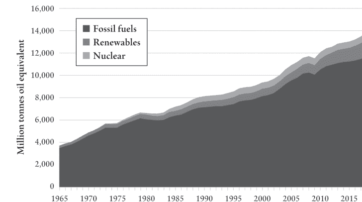
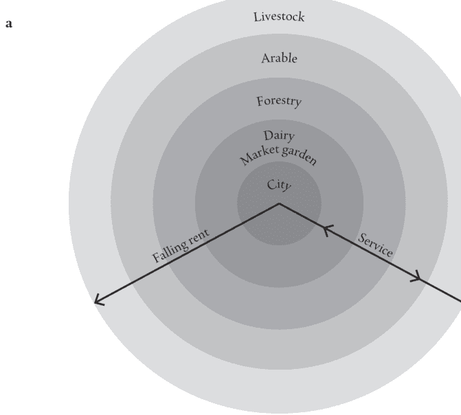
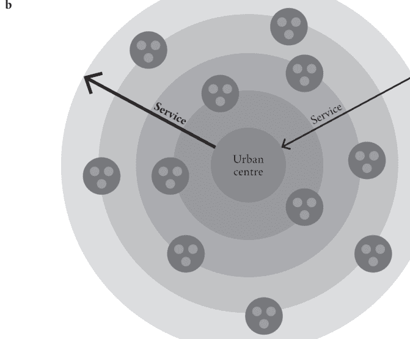

# 小农场的未来：构建一个基于地方经济、自给自足、农业多样性和共享地球的社会论证

“食物是文化的内核，现代工业文化正因依赖化石燃料农业而从内向外腐烂。唯一可行的未来是基于小型、生态再生型、劳动密集型的农场。克里斯·斯马耶这本卓越的著作提出了这一点的依据，调查了相关方法和问题，并根据作者二十年的经验提供了丰富的见解。每个年轻人都应该读读这本书。”

——理查德·海因伯格（RICHARD HEINBERG），后碳研究所高级研究员

“《小农场的未来》是一本坚实且真正令人鼓舞的书。我把生命的最后17年都致力于创造一个微型农场，我的所学证实了克里斯·斯马耶所说的：一个受生态启发的的小农场可以生产高质量的当地食物，同时提高土壤肥力、固碳、节水资源并改善生物多样性。更不用说创造就业机会和提高生活质量了。回归地球母亲是我们在基于生物资源、可再生能源、生态建筑以及个人、文化和代际之间的团结基础上，构建可持续且公平富足新范式的基础。离开虚拟和全球化的经济，用爱和尊重耕种土地，是我们留给孩子一个可行星球的唯一希望。这也是幸福的秘诀！”

——查尔斯·埃尔韦-格鲁耶（CHARLES HERVÉ-GRUYER），《奇迹富足》作者；法国Bec Hellouin农场联合创始人

“我们正面临着物种灭绝、气候灾难、土壤荒漠化、水源消失、传染病和慢性病流行、饥饿和营养不良等生存性危机。工业化、全球化的农业基于‘世界正在驱动多重相互关联的危机’这一神话。我们摄入的食物有80%来自小农场。克里斯·斯马耶的《小农场的未来》表明，选择是明确的：我们要么拥有小农未来，要么面对崩溃和灭绝。”

——万丹纳·希瓦（VANDANA SHIVA），《一体vs1%》和《谁在真正喂养世界？》作者

“《小农场的未来》清楚地表明，未来30年将与过去30年截然不同。然而，斯马耶将宏观见解与来之不易的经验独特结合，拨开了迷雾，即使脚下的地面在移动，也精彩地揭示了可靠且有意义的前行道路。”

——肖恩·钱伯林（SHAUN CHAMBERLIN），《转型时间线》作者；精益逻辑》与《生存未来》编辑

“这本书真是一场享受。在一个普遍性危机的时代，克里斯·斯马耶阐述了一个充满吸引力、美丽的未来愿景。克里斯付诸实践了，这使他的诉求更具冲击力和说服力。”

——乔尔戈斯·卡利斯博士（DR. GIORGOS KALLIS），ICREA研究教授，巴塞罗尼亚自治大学（UAB）

“一方面，是基于新自由主义经济的科学高科技，其驱动力是对控制自然和追求物质财富最大化的感知需求；另一方面，是传统的人类技能和价值观。无论披着共产主义、资本主义、独裁还是民主的外衣，前者无疑在获胜。世界上各国政府及其选定的顾问将高科技和可衡量的经济‘增长’等同于进步。”

“但这种所谓的现代性的主导地位正在杀死我们所有人。它们产生的方法及其背后的心态是世界上所有危机的根源。我们现在最需要的是基于小农经营的食品生产——尽管有卓越科学和有时是高科技的辅助；投入地方经济；并带着对人类和我们其他生物的真诚关怀进行部署。克里斯·斯马耶从社会学家兼人类学家转变为小农，他正向我们展示确切需要什么以及为什么。这是一本及时且有价值的书——而且非常易读。”

——科林·塔德奇（COLIN TUDGE），牛津真实农业会议联合创始人， 真实农业与食品文化学院联合创始人；《大反思》作者

“随着气候、国家权力和全球化市场的崩溃将我们推向一个时代的转型，克里斯·斯马耶为我们提供了一个重新本土、自给自足世界的希望愿景。凭借敏锐的智慧和丰富的证据，他解释了小农场在这个新兴未来中必须扮演的关键作用，巧妙地将被忽视的经济、生态、文化和政治思想线索交织在一起。”

——大卫·波利尔（DAVID BOLLIER），舒马赫新经济中心重塑公地计划总监；与Silke Helfrichich合著《自由、公平与活力：公有地的反叛力量》的作者

“任何参与政治思想、农业、正义或未来主义的人，如果还不熟悉克里斯·斯马耶在博客上的写作，应该为自己着想尽快拿起这本书。斯马耶的写作几乎总是引人入胜的——无论是为了他的幽默、他挑战我们思考得更深、更有胆量的方式、不懈的人文主义，还是他将细微差别与易读性相结合的能力。他是这个词最有趣、最令人兴奋的愿景家。他的写作始终表明他是一位卓越的知识导游：他可能可能比别人看得远，但他绝没有没有过帮助我们更好地看到眼前的东西。”

——M. JHI 查佩尔（M. JHI CHAPPELL），东南部非洲裔美国农民有机网络（SAAFON）执行主任，《从开始到终结的饥饿》作者

“克里斯·斯马耶为几个世纪以来‘三亩地一头牛’的需求带来了智力严谨性。”

——西蒙·费尔利（SIMON FAIRLIE），《肉：一种良性的奢侈》作者；《土地》杂志编辑

“太棒了！这本书非常清晰地展示了为什么我们正走向行星性的灾难，并建议了新的更稳定的社会经济实践如何围绕支持进行演化。”

——保罗·查德斯（PAUL RICHARDS），《农业革命》作者，瓦赫宁大学技术与发展名誉教授。强烈推荐。”

引言：灵猫的故事

# 第一部分：小农场的未来吗？

# 第二部分：小农场生态

# 第三部分：小农场社会

# 第四部分：走向小农场的未来

致谢

# 引言

## 灵猫的故事

亚洲果灵猫（palm civet）是一种产于印度尼西亚及亚洲热带亚洲其他地区的小型杂食性哺乳动物。它们从森林家园来到咖啡种植园，能够感知到最细微、最成熟的咖啡果实。它们吃下这些果实，消化掉果肉并排出咖啡豆，同时通过肛腺为咖啡豆增添一种麝的香气。

在20世纪90年代，印度尼西亚的“猫屎咖啡”（kopi luwak）——由经过灵猫消化道的咖啡豆制成——成为富裕咖啡爱好者的一种新型奢侈商品。受市场动态驱动，当地生产者通过捕捉和圈养灵猫、强喂咖啡豆并将产品作为廉价猫屎咖啡出售来榨取这种需求。虽然价格更便宜，但产出的咖啡缺乏灵猫灵敏嗅觉赋予的原始品质，而且是以牺牲生态和动物福利为代价的。¹

我们生活在一个充满权衡的世界里。如果你想获得品质良好且环境影响较小的真正猫屎咖啡，你就必须付钱让人替你穿过森林寻找野生的灵猫。人类模拟了这一过程并以更低的成本生产类似的产品，但这并不是同一回事。

有时可能找到真正的无权衡的、双赢的改进。但对于大多数事物，包括猫屎咖啡，以及整个农业而言，都存在权衡。提高价格就会降低动物福利；增加产量也会增加人类劳动、化石燃料或下游污染。以此类推。一项改进的成本是否与其价格相值，是一个价值判断，不同的人会对此此有不同的权衡。但并不是每个人的声音都能被听到，特别是当成本被转嫁给未来时。

在我们力求为大众提供廉价食物的过程中，权衡是许多人最终都在“吃大粪”——比喻意义，而且正如我们刚刚看到的，有时也是字面上的。我们的文化被一种不断进步的叙事所吸引——这种叙事迫使我们避开经济学家托马斯·索owell（Thomas Sowell）提出的这种可能性：没有“解决方案”，只有权衡，²

处理棘手权衡有不同的方法，或者用未来学家彼得·弗雷斯（Peter Frase）³的话说，即“爱上我们的怪物”。如果人类活动正导致授粉者灭绝，弗雷斯建议我们通过开发机器人假蜜蜂来承担这项工作，从而“深化与自然的接触”。我不会在此赘述这有多么宿命，但我建议如果我们愿意，可以去爱一种完全不同的“怪物”：一种不使用杀死蜜蜂的毒药，而是有利于更复杂的生物干预（包括更多的人类劳动）的农业。我们可以学会热爱对自然世界的直接工作，就像我们热爱开发机器来执行这些中介工作一样。我们也可以学会尊重自然施加的行动局限，就像我们热爱超越这些限制一样。

这种爱的障碍之一就是上述提到的进步叙事。采用低技术、劳动力密集型方法来解决问题或满足需求，而不是高科技、替代劳动的方法，被认为是退步的，是怀旧式的时钟倒流，仿佛有一种历史性的棘轮阻止了我们在未来做任何看起来像过去过的事。实际上，确实有一个棘轮在运作——那就是资本主义政治经济。我们经常犯的错误是认为这种棘轮是不可阻挡的自然力量，而仅仅是一种特定的社会组织方式，其本身拥有可能有一天结束的历史。

这种“克服”与“克制”这两个怪物正成为当代政治中重大分歧，正如左右派之间的分裂一样。托马斯·索owell区分了他所谓的“受限的”和“不受限的”的人类福祉愿景，前者强调在相对固定的限制内进行权衡的最优化，后者则强调通过克服限制来实现完美。前者通常与索owell本人一样与保守思想联系在一起。它包含了资本主义作为市场交换的流行观点，即无数交易的总和，在为了自身直接利益在此时此地行动的人的有限理性范围内，没有产生任何更高的目标或引导之手。不受限的愿景通常与政治左翼及其重塑人类进行集体工作、实现新目标和伟大事业的理念联系在一起。

但这些确定性现在正在消融。资本主义入侵了沃尔玛的心灵：“大市场”本身拥有一种打破限制、自我完善的智能，它不接受人类理性试图对其施加的任何限制。各种派系的不受限左翼也加入了这一计划，变得几乎与他们声称要拒绝的资本主义无法区分。看看那些书名如《全自动奢华共产主义》或《沃尔玛共和国：全球最大的公司如何为社会主义奠定基础》的书籍。

在这一新兴的政治格局中，倾向于受限愿景的保守主义者发现，企业资本主义并没有特别的受限或保守；而像我这样的左翼人士——既对企业资本主义不为所，也不试图用左翼版本的全球普遍富足来驯服它——则发现有必要重新评估“限制”的概念以及受此启发的保守政治各个方面。如果我们我们要为后代留住一个宜居且富饶的星球，这种重新评估的关键部分就涉及重新思考那些因其“落后”而被忽视的小农场或“农民”社会的意义。

如果我们我们要为后代留住一个宜居且富饶的星球，这种重新评估的关键部分就涉及重新思考那些因其“落后”而被忽视的小农场或“农民”社会的意义。出于这些原因，我们需要考虑一些现代传统几乎无法让我们细致回答的问题：如果如今的工业繁荣即使在富国也不再可行了？人类的未来将如何展开？当我20年前开始问这些问题时，我能出的最好答案是人类最有吸引力的未来是一个小农场。这仍然是我能出的最好答案。让我从我的农场开始我的旅程。当人们访问这里时，我注意到三种反应。一种是对我们创造的乡村天堂的自发热情，是对那里的美景，以及我们避开内卷并生产诚实食物的巨大幸运。有时这些话是说出来的，有时我只是从他们的眼中看到，但伴随其来的情感是：“这太棒了。我希望我也做这样做的事，但我不能，因为——”

第二种反应是看到我们的乡村住宿、堆肥厕所、一排辛苦得来的蔬菜床、描述杂乱的待办工作、粪便和堆肥的气味，带着一种厌恶的怜悯。它似乎在说：“你读了研究生，找了份高薪工作。结果怎么变成这样了？”或者是更主动的鄙视：“人自其乐吧。但没人想种地了。那全是心碎的工作！”

第三种反应是更严厉的批评者，目光盯着细节——院子里的拖拉机、屋顶上的光伏电池板、部分花园里倾斜的床。“看你与全球化石燃料经济及其货币关系联系得有多紧。”这种批评来自绿色分歧的两侧。“你还没有真正逃离一种自然的生活方式，”一方说。“你谈论可持续性，但你并不比我们其他人好在哪里。此外，这种小农场养不活世界，”另一方说。

我从这个故事开始，是因为我将论证不仅是，是的，这种小农场可以养活世界，而且从长远来看，可能只有小农场可以。因此，我将走向

直面其他的批评——与现状的妥协、农业生活相关的低廉声望和辛劳，以及全球范围内对土地的逃离。因此，在这些章节中，我有大量工作要要做。鼓励我的一点是，在上面提到的三种回应中，第一种似乎是最常见的——事实并不是没有人想务农。

但人们在任何情况下都不愿意务农。很多时候，务农仍然是一种得不到回报的辛劳生活，这并不是因为其本质上必须是这样，而是因为务农，其本身，是每个社会（包括我们现在的社会）的引擎室——尽管它如何运作的现实和责任被锁在了甲板之下。我在这里论证，那些说“我无法……因为……”的访客是正确的。宜的小农生活对于少数人来说是一个可行的选择，而不是对于世界中大量就业、失业或就业不足的人，以及那些难以从土地上维持生意的农村人口而言。在这两种情况下，小农生活的梦想依然存在，这是一个重要的出发点。

当然，这只是一个起点，而且是一个粗略的起点。关于农业良好生活的观念在范围内随处可见，但它们往往只是缺乏务实内容的田园符号。它们似乎缺乏城市至上主义的力量，这有着深远的历史根源。城市、公民、文明：我们对世界的如此重视，共享着同样的词源。如果我们想为未来建立持久的良好生活基础，是时候放弃那些不具启发性的对立了，如城市与乡村、工厂与农场，以及进步与落后等对立。

遗憾的是，公众辩论并非如此。存在一种真正的观点产业，在这些对立关系的前半部分进行下注，并敦促我们对呈现为城市、资本形成、高科技和非农业的未来保持“乐观”。这种新乐观主义或进步文学经常诉诸人类解决问题的能力作为超越现状问题的灵感。例如，19 世纪90 年代伦敦的“马粪危机”，当时人们担心马的激增会掩埋街道，结果发现马很快被机动车取代了；或者采取化石燃料煤油灯取代了对鲸油的需求的想法。

我之所以称这些神话具有误导性，从日常意义上说，它们是不真实的。90 年代从未出现过所谓的“马粪危机”。而且20世纪由化石燃料驱动的工业化捕鲸活动确实让鲸鱼陷入了危险。但它们在深层意义上也是误导和过度简化的故事，揭示了文化自我观念。在这些神话中揭示的、我们现代文化的自我观念是：问题是离散的、有一劳永逸解决方案的。

这些故事是误导性的，因为它们讲述了过去历史的某个点，当化石燃料向我们提出了没有明显解决方案的问题，基于化石燃料的解决方案。现在我们需要的不仅仅是某人注定处于某事的平庸断言。而且它们是过度简化的，因为人类创新的能力并不容疑。重要的是人类是否有能力为大量的经济、政治、文化、生态、生物和地球物理问题找到纯技术解决方案，这些问题正实时显示出复杂的反馈循环。

在书中，我尝试提供一种不同的叙事，这种叙事对技术修复或文明进步的主流观念印象并不深。我不否认当代文明有其成功之处。但它也有失败。我在农场的访客眼中看到了这一点——他们在物质意义上无疑是世界上最富有的人之一——却被一种剥夺的、被太多错误义务所困扰的生活。更重要的是，我从事实看到了这一点：我们今天生活的世界上是历史上最不平等的，大约有 8 亿到 25 亿的人身体上营养不良，数量大约相当于（或超过）1750 年现代时代黎明时整个地球估计的 8 亿人口。

这些营养不良的人并没有错失进步，而很大程度上是进步的受害者。如果全球工业文明曾有能力将世界上贫困和营养不良的人提高到我们在富裕国家的生活水平，那么在质疑的现代化进程在全球范围内出现的众多内外威胁面前，现在这种可能性已经消失了。因此，我会反驳新乐观主义的观点，即世界的问题可以通过统治资本经济提供的高科技修复来解决，这并非没有悲观，而是持有一种替代乐观——乐观这种这种经济不会维持多久，并将被一个提供更好未来的事物所取代。

我在这里描述的更好未来是一个小农未来。我不完全乐观它是我们或我们的后代将看到的未来，但基于书中列出的许多原因，我认为这是我们创造在生态上可以持续的、在营养和心理社会上令人充实的未来社会的最佳机会。现在是全球政治的一个关键时刻，我们可能开始实现那个未来，但更令人不安的结果也面临威胁。在这里，我尝试通过勾勒小农未来可能是什么样子，以及我们如何到达那里来预示前者。

小农场并非万灵药，但围绕它的政治所能提供的——至少是一些来到我们农场的访客在轮廓中窥瞥的——是个人自主、精神充实、社区联系、有意义的工作和生态亲和力的可能。过去和现在很少有农民享用过这些美好的事物。在范围内，有一段长而复杂的历史，人们既被不愿地束缚在土地上，又被不愿地剥离土地，这在谈论农业“改进”或从农业劳作中获得进步的“自由”时是被误传的。这些改进对每个人来说并不是一种改进，自由并没有平等分享，进步带给我们带来了一整堆其他问题，我们现在必须尝试克服这些。而且这一切都不是预定的。

这是我试图在书中叙述的故事。它并不是特别关于我的故事。虽然我从谈论我的农场开始，但在书中我不会对它说得太多。其其一，我不认为自己在耕作技巧方面能教给别人太多东西，而且不同地区所使用的精确技术也并非关注的重点。但我是一个农民，如果你自己种食物或纤维，或者想要增加社区的自给自足能力，那么你也是农民。

正是这种地方自给自足的重要性，让一个小农场变成了一个具有特殊意义的小农场。我并不是说未来没有大型农场的生存，也不是说大规模农场总是坏人。就本身而言，“小”并不意味着“美”，我不会在书中提出任何按面积划分界限来定义小农场。但我将强调一些差异化特征，这些特征将在讨论展开后得到更详细的证明：小农场在从全球资本流中创造地方自主性方面发挥着关键作用；它们涉及个人、家庭或地方层面的某种自给自足；它们采用劳动密集型技术，且通常由家庭或家庭劳动力作为薪资工人实施；它们调整活动以维持支撑其生产力的当地生态基础；与大型农场相比，它们倾向于以去商品化（但并不一定非商品化）的方式运作。

“地方”或“地方性”在许多特征中占据了重要地位，也许只是将定义“小”的需求转移了定义“地方”的需求。同样，关于这一点，我不做硬性规定，但它源于自主权和自给自足在实践中是如何实现的。然而，我可以确定的一点是，我描述的小农场未来与绿色消费主义未来不同。在那种未来里，生活方式与当今富有国家的人相似的购物者在他们现在购物的商店购买食物，只不过食物更本地化、更可持续、更有机或或如此——就像今天一样，人们不知疲倦地争论本地化是否更具可持续。相反，那将是一个未来，你或你的后代正试图如何从自己的所在地满足需求，可能是通过自己满足其中的许多需求，因为你几乎没有其他选择。

对于某些人来说，这可能听起来太像乌托邦式的、末日论的或衰落论的。如果我们不善于打好手中的牌牌，未来确实有一些乌托邦式或末日式的未来等待着我们。但只有当你认为大型农场的现状是人类艰苦攀登的高级文明巅峰时，小农场的未来才代表了相对于大型农场的衰落。这是我所抵制的观点。如果我们能打好牌，我描述的小农场未来对于世界上大多数人来说，可能比他们今天经历的生活更令人舒适。但我们确实需要打好它们。这是历史上的一个时刻，应该对我们如何组织自己进行根本性的重新反思。我们现在的未来学中太多的目标是加倍现有的技术和社会逻辑，并断然拒绝那些激进的替代方案。同时，替代性农业和替代性经济运动中有很多被接受的智慧可能需要更具批判性的审视。

我不声称在此处完全实现了重新反思，或者产生了一个经过详尽考虑的替代方案。小农场未来的想法在当代思想中是如此边缘且不成熟，以至于目前仅仅列出它的大轮廓就已经是一项令人生畏的任务了。因此，我提供这本书作为一种批判性的介绍，一种开始组织对“广泛转向农业地方主义可能是什么样”思考的方法。这似乎是值得的，因为尽管小农场未来的想法目前在主流思想中处于边缘，但它可能是目前对大多数人类来说最好的未来，而我们似乎还没有足够严肃地讨论它的影响。

# 第一部分

## 小农场的未来？

# 第一章

## 十场危机


如果说我们正生活在一个危机时代，这不应该引起争议，仅仅因为每个人总是生活在一个危机时代——这里的危机，是指一个决定性的时刻，一个转折点，在那个时刻，事情可以向一个方向或另一个方向发展，而不是指一切都在崩溃。尽管如此，某些时代确实比其他时代充满了更多危机，而“我们正推着手推走向地狱”的观点在历史上一直很流行——这比其最坏情况的实际发生要常见得多——对动荡的未来的预言并不总是错误的。人类一直处于危机之中，但当我们现在这样窥视未来那模糊的镜面时，有迹暗示性的线索表明，我们目前面临的危机充其量是深层且系统性的，最坏的情况下，这次手推车正接近火场。

因此，我通过概述我们生物物理和社会世界的某些方面，这些方面的动态表明，我们可能正走向人类与未来斗争的、至少是截然不同的境地。其中的每一项都值得用一本书来专门论述。在这里，我提供最简短的笔触，特别关注那些与我在书中后期关于小农场未来的论点最相关的问题，而不是试图面顾全面。

那些关于小农场未来的论点基于这样一种观点：人类面临的各种危机并不是孤立地考虑并通过碎片化的解决方案来解决的。相反，我试图识别驱动这些危机的共同的、底层的和系统性的因素。正是因为在那个系统层面寻求这些危机的办法，小农场未来的理由据才有力地呈现出来。

## 危机1：人口

每当公共讨论中提出这个令人不安的全球问题时，认为问题在于人口过剩的观点总是会出现。我数不清在在线论坛上看到人口被描述为“无人谈论的房间里的大象”。所以，我想承认这头大象，并从一开始讨论人口。

在某层面上，这种人口主义似乎是有道理的。全球资源和污染问题的出现与人口的巨大增长相吻合，人口在短短250多年增长了九倍。每个新成员对这些问题的影响都大于零，所以如果全球人口较低，解决这些问题将非常容易。但研究表明，控制人口不足以防止人类福祉的下降。如果人口是一个问题，目前还不完全清楚它是哪种问题，以及可以或应该做些什么。

影响与人口之间确实存在关系，但直接比例关系是有疑的。底层的因果网络也是如此。例如第一点，2000年至2014年间，低收入国家的人口增长了45%，而它们的二氧化碳（`CO₂`）排放仅增长了15%。同一时期世界其他所有国家，这些数字几乎完全反转——人口增长了17%，但二氧化碳排放增长了47%³。在个人层面，一个人的排放量根据其出生环境和生活选择可能会有2000倍的差异⁴。

与其说人口政策对排放的影响更直接，不如公平地说，如果说人类人口是那个“房间里的大象”（显而易见的问题），那么在房子其他地方还有比它大得多的生物在游荡。⁵

另一方面，给海洋贡献最多塑料污染的地区位于低收入国家。非洲和亚洲人口稠密的河流流域导致了90%的海洋塑料污染，而富裕国家人口稠密流域所产生的污染则微乎其微。其关键性因素并非高涨的人口水平，而是有效的废物收集。⁶⁶ 在这两个例子中，人口与影响之间并不存在某种简单且统一的关系。

另一个复杂因素是，在许多人未察觉的情况下，世界正经历着一场前所未有的人口转型。在50年里，全球生育率下降了至少一倍，从1964年的平均每位女性5.07次分下降到2015年的2.45次。在世界上人口最多的五个国家中，有三个国家的生育率远低于更替率；事实上，全球范围内约一半的国家都有此情况。贫困国家的生育率通常较高，特别是在大多数高生育率国家所处的撒哈拉以南非洲。但这些地区的生育率也在下降——事实上下降得比富裕国家更快⁷⁷

一些人认为这还不够，因为尽管生育率在下降，全球人口仍在增长，并可能在下个世纪继续增长。事实确实如此，因为人口下降之前，生育率必须首先下降，就像汽车在开始减速之前必须停止加速一样。此外，预期寿命的延长也驱动了全球人口增长和生育率。尽管如此，对于那些希望全球人口更少的人来说，自20世纪60年代以来生育率急剧下降这一事实值得庆祝。

他们具体采取了什么还不那么清楚，但专家的共识集中在改善婴儿和普通健康、改变社会规范、增加受教育程度以及增加家庭内外的女性自主性等问题上。⁸ 这最后一点背后的很大一部分动力源于贫困国家获得了更多农外就业机会，这对比本书的主题产生了困扰的影响。小农场能包容持续的女性自主性吗？（我在第12章“家庭、家族及其他”第165页考虑了这个问题。）

一个更普遍的问题是，经济发展似乎是生育率下降和生态崩溃（如温室气体排放增加、其他污染、生物多样性丧失等）背后的主要力量。在后期趋势中，其增长比例大于人口增长，这表明它们不能简单地通过人口来解释。归根结底，必须解释并更重要的是减少支撑这些趋势的物质和能量吞量，而这些吞量与人口水平并没有直接对应。⁹ 被广泛引用的方程如`I = PAT`（人类环境影响 = 人口 × 财富 × 技术）具有误导性，因为它们暗示人口与影响之间存在直接、比例且因果的联系。

事实是，人类对环境的影响并非个人影响的简单加总，而是人类发明的系统（农业、经济、政治、文化）的结果，这些系统既影响环境，也影响我们的人口数量，其方式无法仅还原为人口数量。在这里，我们涉及到上述底层原因的复杂性，即引入了“近因”与“根本原因（底层原因）”的区别。一个患者的死亡可能被记录为肺癌，但这只是近因。也许根本原因是他们长期大量吸烟。但这只能解释到此。并非所有深吸烟者都会得肺癌，而且并不是每个人都是深吸烟者——为什么是这种病，为什么是这个人？我们可以在所有层面寻求解释。

所以，如果全球人口是一个问题，那么它是一个近因问题，寻求根本原因也是明智的。在人类人口增长和生育率下降之外，是全球化、现代化和不断扩张的世界经济的长期历史。全球人口趋势受到这段历史的塑造，并无疑对人类世界和自然界具有某些独立影响。但在通货膨胀的世界经济中，随着人口减少，系统性影响可能会之增加；而在其他经济背景下，人口增加的影响则很小。

满足不断增长的人口，引发了饥荒、疾病和战争的制衡，以削减付出的代价.¹⁰ 他的分析对查尔斯·达尔文和阿尔弗雷德·拉塞尔·华莱的自然选择演化论产生了关键影响。达尔文和华莱在历史上伟大的科学家典籍中都拥有稳固的地位，而马尔萨斯却因其错误而深陷智力嘲讽的泥潭。为什么呢？

一种合理的推论是，虽然马尔萨斯分析可能适用于达尔文和华莱研究的那类野生生物，但人类是一个特例。与其他生物不同，我们并不是越过固定的生产力极限，而是利用技术创新来提高这一极限。经济学家埃斯特·波瑟鲁普在她的著作《农业增长的条件》中对这一观点提出了极有影响的论述¹¹，表明当人口在历史上不断扩张时，人们通过强化农业生产和在给定区域生产更多食物来做出反应。

但波瑟鲁普并未主张这种强化是无代价的。在现代农业中，强化的主要形式之一是劳动力密集化。人们延长工作时间以获得更高的生产率。有时这讽刺却又理性地导致了为了满足劳动力需求而更多的人口增长¹² 在现代农业中，许多工作由机器完成，但同样存在权衡，包括温室气体排放、土壤侵蚀、水资源短缺、农化污染、野生动物流失和土地扩张。这些问题构成了生产力极限，这些极限可能也可能不可逾越。无疑，波瑟鲁普的分析中没有任何迹表明生产力极限总能被克服，如果无法克服，那么她的说法比马尔萨斯更像是一种否定。也许马尔萨主义之所以失败的原因之一是因为它触及了痛点。我们可能并没有想象中与其它生物那么不同。

现在通常的做法是将任何引入人类行为外部限制的分析斥为马尔萨斯式的，使其因与马尔萨斯有关而有罪。这听起来是很好的宣传，但在逻辑上并不严密¹³ 它不严密的一个原因是，它将马尔萨斯和波瑟鲁普混为一谈，假设只要可以克服特定问题，生产力极限就不是问题。相反我提出这一建议：为了克服现代社会及其机械化农业带来的负面结果，我们应该遵循波瑟鲁普式的农业强化路径——一条吸收劳动力且低环境影响的小农场未来。我不认为有人会全盘接受这一建议作为解决问题的最佳方案。

批评马尔萨斯比“人类例外论”更好的理由是，他的分析去政治化了饥饿和贫困，将其归咎于穷人的过度繁殖，而非人们陷入贫困的政治原因。也许继续使贫困去政治化的方法因其马尔萨斯色彩而被驳斥。

现在似乎有两种这种去政治化的马尔萨主义变体。第一种认为人口增长或高生育率是高生育率国家贫困的原因而非结果，并认为阻止从贫穷国家向富裕国家的迁移，以防后者被拖累——这种观点据称几乎得不到专家支持，但在政治辩论中通常足够用¹⁴ 第二种是历史性观点。在现代时代开启之前，人类人口陷入“马尔萨斯陷阱”中，增长导致人口增长，从而稀释了任何个人福利的增加。但随着现代工业世界的开启，该论点认为，自持续增长战胜了马尔萨斯恶魔，并创造了所有人改善福利的可能性¹⁵

这第二种观点提出了许多极少讨论的问题。前现代马尔萨斯陷阱真的存在吗？还是说它是另一种陷阱？它是如何自己从所谓的马尔萨斯陷阱中跳脱的？更高的收入等同于更好的福利吗？对行星生物物理更广泛的影响是什么？我们将在书后面涉及这些问题。我现在想强调的观点是，“逃离马尔萨斯”的叙事与一种传统观点相吻，即经济发展是一种良性的全球性力量，只要世界各国人民遵循就可以获得。

这条从农业转向城市化的工业路径。发展并不被视为一种牺牲其他地方或人的利益来集中资源有利于某些地方或人的行为，而且可能无法适用于全球贫困人口。从这个意义上说，它是去政治化的——或许是一种马尔萨斯式的叙事。

选取斯图华特·布兰（`Stewart Brand`）的书《整个地球纪律》（`Whole Earth Discipline`）中的这些摘录：

> 村子里的生活是枯燥、劳累、贫困、受限、暴露、危险且静态的。土匪袭击你，意外伤害你，疾病侵袭你，而且附近没有帮助。你像拼命一样工作；然后天气变了，你没有作物可以吃或卖……在城市里，生活很刺激，工作没那么辛苦；你的薪水高得多；你可以自由移动和更换工作；你有了隐私；你没那么脆弱；而且你有向上流动的可能。为了这一切你会忍受贫民窟的条件吗？毫不犹豫……没有人浪漫化贫民窟的条件……由于定居者的存在，城市充满了活力……你所看到的不是一个被贫困压垮的绝望的人，而是许多人以他们自己的速度摆脱贫困。每个人都在努力工作，每个人都在不断进步……农民生活已经结束了，除非灾难性的气候将我们推回那里¹⁶

暂撇开称贫民窟为“充满活力”这个问题属于浪漫主义，但这段话中的情感是被广泛证实的，有时是准确的，但也具有误导性。确实，城镇人的平均生活水平比农村人好。但这并不意味着农村穷人搬到城市就会变富。证据表明存在长期的、跨代的贫民窟贫困，这种贫困对农村新来者的打击往往最为。全球贫困人口的生活很少遵循布兰所推测的迪克·惠廷顿（`Dick Whittington`）叙事，而是涉及复杂的生计策略组合，这些策略随时间平衡城市和农村的家庭收入，并往往为了收入安全而在农村土地上保留立足点⁷

布兰写作中关于选择和机会的修辞相信，经济机会是如何系统性地构建的，使得无论农村还是城市的穷人无论走到哪里都几乎没有获得实质性改善的机会。

如果你相信布兰所谓的“城市承诺”，即“每个人都在不断进步”，那么农民生活确实结束了，小农场未来也没有了根据。但如果城市承诺没有实现——有充分证据表明现在没有实现，未来也无法实现——那么考虑替代方案是值得的。

这一切让我们远离了全球人口问题，但它强调了人们所在之处以及他们将去何方——由现代化引发的人口全球流动——可能比纯粹的数字更重要。布兰对人们“用脚投票”并离开贫困的农村而投向城市承诺的热情，在支持发展的论点中得到了广泛认可。尽管逻辑相同，但人们同样“用脚投票”并离开贫困国家而投向“富国承诺”的想法，并没得到如此热情的支持，特别是在富裕国家，那里移民政治和边境巡逻正在放大这种情绪。

全球范围内，国际迁移在数量上保持稳定。2019年，世界上3.5%的人居住在出生国以外的国家。但在全球十大经济体体中的七个国家，出生在国外的人口平均比例约为13%。这些国家占全球人口的10%，占全球经济产出的46%¹⁸。这表明，只要可以，人们就会去经济机会最丰富的地方——趋向繁荣，远离相对匮乏。在这个过程中，他们的生育率往往于富裕宿主国典型的较低水平，但他们的消费模式也倾向于通常的高宿主国准则。

在某种意义上，这些全球模式代表了我在书中探索的核心张力。世界大致分为高生育、低消费（贫穷）的地方和高消费（富裕）的地方。人们想住在富裕而非贫穷的地方，但这种情况只有两种发生方式。一种涉及从贫穷地区向富裕地区或国家的物理移动，但这对所有人来说是不可能的，而且通常不受那里人的欢迎。第二种支持人们无需远赴迁徙寻找繁荣的权利，而是将富裕国家低生育、高消费的生活方式传播到全世界。这种做法的问题在于，尽管生育率正在下降，但这种财富的并没有在现有的全球经济范围内发生，也无法发生。如果发生了，它将对全球资源造成无法承受的压力，因为第二种生活方式的高消费部分超过了低生育部分的补偿，推向了地球边界。

我们需要一个不同的未来，我建议的是一个小农场未来，理想情况下是一个低生育、足够消费的未来，在全球范围内广泛共享。它不是基于大规模的人口流动，也不是基于不可信的全球经济增长浪潮，而是基于在我们现有的地方长期定居，以历史上高水平但即将下降的人数，在更具可持续性的稳态文化和农业中生活。

人们通常假设，相对低技术的小农或农民农业必然涉及高生育，以便产生劳作田地的人手（这是`Bosuper`强化的一种可能途径）。但对土地相对稀缺情况下的小农农业的研究表明，情况并非如此¹⁹ 可能更重要的是一种利用了历史上推动生育率下降的相同力量的政策——一种相对繁荣感、安全感和女性能动性。这些对于合宜的小农未来的可能性至关重要。

我并没有低估在当前迁移-城市化-经济增长模型的主导下这将是多么艰巨，尽管从长期来看，我怀疑这比应对该模型日益功能失调的后果没那么令人畏惧。正如人们经常指出的，世界人口现在城市多于农村——尽管仍然是势均力敌，且一半的城市人口住在人口小于50万的城市中，这表明至少存在某种富有成效的城乡联系可能²⁰。

但这种城市化趋势并非某种自然力量。它是积极政策的结果，这些政策往往没有让其影响的许多人受益颇浅，而且可以随着时间的推移通过面向不同目标的其他积极政策得以扭转。认为这可能发生的原因之一是，世界上大多数人口（可能还有大部分资本）现在住在海洋附近，通常在巨大的港口城市。很有可能，这部分土地很快将不再是土地。或者如果是，它对人类居住的适应性也将大幅降低。

同样很有可能是，过去一个世纪吸引这些人进入资本集中沿海城市化的经济活力在未来一个世纪可能会动摇。在我们“定居在当地地方”之前，世界大部分人口不得不找到另一个当地地方居住。气候变化已经是全球迁移的主要驱动力²¹。也许我们时代真正与人口相关的“房间里的大象”将是气候引起的迁移，特别是从城市到农村地区的迁移。正如最近一份报告所述，未来属于农村²²

## 危机 #2：气候

气候变化是我们时代讨论最广泛的全球危机。不幸的是，广泛的讨论胜过了广泛的行动。过去几十年一直在争论它是否发生、是否由人类活动引起以及其后果是否值得担心，在未来可能会变得非常自满。所有这些问题的底答案都是“是”，但后果有多严重仍不确定。最坏的情况下，在某种小农未来中，作为炎热敌意世界中的人类残余，一场结束文明的灾难是唯一的希望。最好的情况下，是在不同地方对干旱、洪水、风暴、沿岸潮汐、热浪、野火、作物减产和作物营养含量下降、海平面以及人类疾病和作物害虫的扩散进行许多困难的调整。

我不会尝试总结关于未来气候变化可能形状的最新科学观点²³，但我将总结其主要的直接原因：驱动现代人类经济的化石燃料（煤炭、石油和天然气）的提取和燃烧。它们的燃烧产生废物温室气体（`GHGs`），特别是二氧化碳，它们在大气中捕获辐射阳光，导致全球平均温度升高，目前比工业化前水平高约1摄度（`1°C`）。在未来10至30年内，这一增长预计将达到`1.5°C`，这是各国政府在2015年联合国气候变化框架公约巴黎上同意自愿稳定温度增长的水平。超过`1.5°C`对人类福祉的影响可能是严重的。

如果不采取任何缓解措施，按照目前的业务常态排放路径预测，到2100年，全球升温预计预计将比20世纪末的水平高出`3.7°C`，甚至可能高达`4.8°C`^24。

另一个问题是，已经排放的大部分二氧化碳在大气中具有长期持续性。要将温度降低到安全水平，可能不仅需要停止进一步温室气体排放，还需要从大气中移除二氧化碳。

土壤和植物在生命周期的不同阶段以及应对不同的人类管理模式，排放或吸收温室气体，因此农业在这些模式中既可能是温室气体的净源，也可能是汇。目前它是净源，可能占温室气体总排放量的10%–16%^25。这种情况在未来必须扭转过来。实现这一点的良好方法是向小农场未来转型。并非所有人都会同意这一观点，但如果我们需要控制排放，就很难否认，我们需要一个不同的农业未来——在那个未来，农业将成为温室气体排放的汇，而非主要的源。

与此同时，人们很容易忽视对农业和土地利用作为温室气体源和汇的关注，而真正的罪魁祸首主要是化石燃料燃烧，这直接体现在其自身的排放特征中，间接体现在它所实现的农业模式和土地利用方式上。我的主要观点是，支持小农场未来的气候相关论点，并不是直接关于与其他可能性相比，通过小规模和低影响手段所实现的净排放。更大的问题在于，在一个设计上或默认上正在脱碳或变暖的世界里，将什么样的社会、经济、基础设施和政治是可能的。在这种情况下，小农场未来的论证表现得尤为有力。

将缓解气候变化与适应气候变化区分开来是传统做法。前者涉及减少或消除大气中的碳排放，后者涉及寻找应对气候变化影响的方法。这两者都是必要的，但支持小规模农业的论点主要基于其在气候变化社会适应方面的潜在价值。

化石燃料作为气候变化的最直接诱因，早在2000多年前就在中国开始了工业化。²⁶ 尽管从那时起人类活动就留下了生态印记，但直到过去的两个世纪，化石燃料经济才开始腾飞，并最终导致了当代人类活动的气候迫迫。如果没有化石燃料储备这一地质意外，人类不太可能面临目前的气候危机，但仅凭化石燃料并不能提供充分解释。考虑到人口因素，其根本原因无疑可以在现代性、资本主义和全球化的特定历史，以及由此产生的扩张性经济中找到。

“只有资本主义创新技术解决方案的能力现在才能拯救我们”这种观点忽略了这样一个事实：尽管这些社会具有高度的创新性，但其底层的社会经济逻辑继续产生温室气体。在最近的一篇文章中，泰德·诺德斯（`Ted Nordhaus`）指出了这一困境：“要实现许多环保主义者现在要求的那些变化，例如在2030年实现净零排放，或将全球温度稳定在比工业前水平高1.5摄氏度，我们唯一可能的路径是自上而下的、集中的、技术统治的措施，而大多数环保主义者不愿认真接受这些措施。”²

这可能是正确的。但判断此类自上而下的措施交付这些结果的概率即使是“遥可行”，似乎也过于乐观了。即使它们真的做到了，涉及的直接解决方案仍然没有解决温室气体排放中可能以其他方式威胁行星边界的底层因素。因此，如果现在只有全球资本主义政治经济能拯救我们，那么我们还可以被拯救的时间已经过去了。


诺德斯抨击这种思想：“从未有过任何绿色激进主义会真正接受的具有行动性的议程……这是一种披着道德严肃性失败外衣的后现代虚无主义。”我对此持不同意见。绿色激进者支持政府确实采取的缓解措施是值得的，因为缓解气候变化通常比不缓解要好。但我们需要建立独立于这些政府所策划的、持续产生气候变化的全球资本主义政治经济的自主性——这种自主将使我们能够尽可能适应气候变化，并朝着比这些政府能提供的更好的未来努力。我提出的具有行动性的议程是一个小农场未来，这不是一个虚无主义的。

认为气候变化如此紧急，以至于我们需要将所有解决方案留在考虑范围内，也存在类似的问题。这通常被证明是对核能等高科技干预的辩护，而不是对全方位气候缓解和适应干预的真正开放。在理论上，可能解释“全方案”方法——例如，低碳、劳动力密集型、马力农业与低碳核能的混合。在实践中，这似乎是不可能的，因为技术不仅仅是技术性的。它们涉及到不同且往往不兼容的社会逻辑，涉及资本和劳动力部署、国家权力的集中，以及关于人类在宇宙中地位的哲学问题，这些问题将马力农业和核能置于了截然不同的概念轨道上。

但考虑到我们在现代世界中非凡的能力，值得思考为什么气候变化似乎是一个无法解决的问题。在一篇具有影响力但又广受批评的论文中，环保主义者加雷雷特·哈丁丁（Garrett Hardin）讨论了他所谓的“公地悲剧”，在悲剧中，一个对所有人开放的资源（公共牧场）如果其使用者在不考虑更广泛公共利益的情况下追求自身利益，可能会被耗尽。²⁸ 他的批评者正确地指出，这并不是公地通常的运作方式，尽管在现代，私有财产或国家控制通常被优于公共资源管理。讽刺的是，结果可以说是一场全球性的公地悲剧，各种机构和个人通过化石燃料追求多种目的，将后果转嫁给了更广泛的世界，并阻止了针对对地球气候影响的集体行动。

如果认为那些能更直接承担自身行为后果的局部经济现在可以简单介入并为气候崩溃提供完全的解决方案，那是错误的。但这种涉及低排放、劳动力密集型农业的经济有助于缓解它，并在某些地方适应其后果——这就是为什么小农场未来可能非常适应未来气候变化情景的原因。

当然，组织范围、知识、专业化和复杂性的增加等同于更大的气候安全和韧性的观点似乎不再像以前那样有说服力了。考古学家约瑟夫·泰特（Joseph Tainter）1988年的著作《复杂社会的崩溃》仍是关于文明如何失败的最佳性讨论之一，他对外部引发的、环境因素引发的崩溃理论表示怀疑：

> 复杂社会的特点是集权决策、高信息流、各部分的高度协调、正式的命令渠道和资源汇聚……凭借其行政结构以及分配劳动力和资源的能力，应对不利的环境条件可能是复杂社会最擅长的事情之一……奇怪的是，当面对恰恰它们具备规避能力的条件时，它们反而崩溃了。29

在他写下这些文字后的几十年里，人们更容易理解社会在面对此类条件时为何崩溃，因为我们目睹了我们的社会将其惊人的资源用于理解气候变化的威胁，然后几乎无所事事。事实上，到2014年，全球二氧化碳排放量比1988年高出68%30——1988年不仅是泰特出版书籍的一年，也是全球政府建立气候变化专门委员会（IPCC）以分析气候变化风险及可能应对的一年。

公平地说，泰特指出了问题的某部分：“一旦建立，文明的改变能力就会变得有限。崩溃源于社会政治僵化、官僚机构低效，或无法处理内部或外部问题。”31 这是一个合理的判断，我们似乎是对的。尽管IPCC的警告紧迫性日益增加，但这段时间的全球政治斗争产生的仅仅是乌托邦式的协议，例如2015年的《巴黎协定》，这些协议未能解决问题的严重性。

这种处理气候变化的能力似乎有三个主要原因。首先，控制大量化石燃料储备的国家（最富有且强大的）在排放限制方面将面临经济损失。其次，在目前的全球经济结构中，发展和繁荣唯一途径涉及大量的化石能源。第三，在经济、政治、能源方面，而且国家之间气候影响的不平等根源于长期的殖民主义和统治历史，如果指望贫穷国家限制其能源使用和排放，就必须面对并解决这些历史带来的现代后果。

换句话说，大多数国家都有短期自身利益，这阻碍了与其他国家就排放问题达成共同协议，而这些协议最终将使所有人受益。我们可以将其视为一场全球公地的悲剧，或者被视为未能建立气候公地的悲剧。比术语更重要的是，是意识到人们未能制定出符合其长期利益的集体协议。更重要的是，要找出当这种情况发生时该怎么办。

创建和维持公地是困难的（请参见第13章“复杂的公地”，第173页），因此，我们未能在全球范围内建立一个围绕气候变化的公地也并不令人意外。但这种失败的代价可能是巨大的。预测各不相同，但典型的情景要求在未来十年内全球排放量减少45%，并在2050年前实现净零排放，以将升温控制在比工业前水平高1.5°C以内。³² 国家和国际层面已经提出了关于如何实现此类减排的各种想法。我不打算在这里对它们进行评估，但似乎公平地说，在不从根本上扰动经济现状的情况下实施这些方案的可能性很低。³³ 同时，排放量仍在增加。目前，世界正处于气候变化缓解路径的边缘。从这个角度来看，呈现出三种主要的未来情景：

1. 快速技术修复：现有的产生温室气体生产形式被立即替换为负温室气体等效形式，允许经济和政治事务照常常地进行。
2. 政治上限：全球治理突破了目前的僵局，实施严厉的碳限制，从根本上重构了目前的全球经济。
3. 气候崩溃：在缺乏（1）或（2）的情况下，这是默认状态，将引发混乱的后果。

出乎意料，许多讨论集中在（1），强调技术发展，正如环保作家艾玛·马里斯（Emma Marris）所说，这些发展“已经让人类能够在更少的资源中榨取更多”，而无需依赖“我们道德品质发生前所未有的提高”或“伟大的牺牲”。³⁴ 问题在于，虽然这些发展确实让我们能够从更少的资源中榨取更多（相对脱钩），但它们并没有让我们实际上用得更少（绝对脱钩），更不用说以足够的速度减少排放了。真正的挑战不是以比产生温室气体投入更高的效率来生产如食物或建筑材料等现有水平的经济产出，而是在完全不产生温室气体投入的情况下生产充足的产出。在我们目前所处的世界中，进展微不足道。

很可能没有集体推行第二种情景所暗示的剧烈减排的机会。政府间气候变化专门委员会（IPCC）表示，将全球变暖控制在1.5°C需要大多数经济部门以以前所未有的规模进行快速且深远的转型。³³⁵ 很难想象，在没有更多局部化经济（包括农业经济，即很大程度上抛弃化石燃料投入转而采用减少且更劳动密集型的生产）的情况下，如何在相关时间范围内实现这些目标。第二种情景可能指向某种小农场式的未来。

但目前，还没有什么政府站出来应对的迹象，因此第三种情景似乎很有可能。很难预测这个气候崩溃的世界在政治和经济上会是什么样。可能它在不同地方会有很大差异，但对于目前的世界经济和国家体系来说，以任何类似于目前的形式生存似乎是不明智的。正如前CIA局长詹姆斯·伍尔西（James Woolsey）写道，在一个海平面上升2米（约6英尺）的世界里——在目前的排放趋势下，在百年内极有可能发生³⁶，“美国或任何一个国家都要付出巨大的努力才能顾及自身的自救”。换句话说，政治不确定性正在逼近，破坏了人们对泰德·诺豪斯（Ted Nordhaus）所青睐的中心化、技术治理型气候变化缓解可能性的信心。

简而言之，除了最后时刻的技术修复，目前的气候危机表明，需要认真考虑地方性的、劳动密集型的小规模农业经济作为一种适应性反应。这种思考的一个方面是艾玛·马里斯提出的，她将消费与道德等同起来。如果减少消费需要“我们道德品质发生前所未有的提高”，这表明消费大量物质物品在道德上必须是可疑的，也是一种不可避免的人性弱点。这似乎是对人们如今对消费看法的一个合理解描述，但从历史角度来看却奇怪。大多数社会，包括组成今日全球北方富国的先驱，过去都不太关注奢侈物质消费作为实现满足的主要途径，而且当他们关注它时，对其道德影响也并不那么焦虑。气候变化的各种物理现实最终可能在我们思考消费、道德和牺牲的方式上，具有文化历史上的，或者我胆于说，是精神上的根基。我在书的后部分会回到这些主题。

## 危机 #3：能量

所有生物都需要外部能量输入来运作，无论是像植物那样直接从太阳获取，还是像我们这样的动物那样通过进食其他生物间接获取。成年人类每天需要2200卡路里的能量（每年3.4千瓦时 – GJ）维持生存。但现在人类使用的直接能量比这多得多：除去食物摄入，全球平均每人每年初能源消耗量约为80 GJ。按国家计算，这一数字从南丹每人不到3 GJ到冰岛和卡塔尔的750 GJ以上不等。³ 这种高水平的能量消耗是一个近期的现象。在1800年，全球平均能源消耗为每人20 GJ。³³

要解决能源问题，有必要审视能量的基础。几乎所有的能量最终源于太阳。这种通量的年度能量输入是巨大的，是人类使用量的数千倍。例如，我们拥有一些光伏电池板和小型风力发电机，可以将太阳通量转化为存储在电池中的有用能量，但这种昂贵的高科技设备只捕捉了入射能量的极小部分。

捕捉这种通量的另一种方法是让农场的植物来工作。农场的树木、草类和作物将太阳能转化为生物质，产生用于取热的生物燃料、食用作物以及生产食物和纤维的牲畜饲料。在农场中，我们获得这些产出所投入的时间、能量和其他资源很低，但我们仍然只捕捉了入射能量的一小比例。就像存储在电池中的电力一样，我们在农场创造的植物和动物生物质是将太阳能转化为稍微持久一点：木材、植物和尸体。

化石燃料是能量储备。它们源于古代地质时代腐烂的植物，因此也源于早已消失的太阳通量。但它们几个世纪以来作为长期储备保持完好并可用，直到人类开始挖掘和使用它们。它们在物理上浓缩了能量。原化石燃料每公斤含能量比木材或谷物等短期储备多出三倍。而且它们在地球表面的分布不均匀，这导致了许多现代地缘政治。⁴⁰

使用能量的想法引发了其他问题。科学公理认为能量既不能被创造也不能被破坏。它只能改变形式。在不涉及细节的情况下，这在日常人类中的运作方式是：入射太阳能流被固定在中间储备中，然后为我们提供有用功——一个充满电的电池、一袋煤、一捆木柴、一袋小麦。当工作完成后，中间储备就会退化并不再可用，其能量大部分转化为我们无法回收的低品热热。有时，退化产物还有其他用途——燃烧后的木灰可以用于浸泡，小麦产生的人类粪便可以堆肥以刺激新植物生长——但退化产物无法像原始产品那样发挥作用。除非我们获得新的能量输入并重新开始过程，否则系统将与环境达到平衡，从而不再可以完成有用的工作。随着技术的进步，我们可能能够降低能源强度（生产给定数量产出所需的中间产品投入）——即“从更少的投入中榨出更多”。但我们仍然需要新的能量投入。

关于这些基础能源，有三点需要注意。

首先，在可用能量主要以流量形式存在的情况下，你预计人们会散布在景观中以最大限度地利用局部流量，尽管在河流等能量势能更高的地点周围会有一些聚集。这本质上是前现代社会和农业的情况。当集中的能量储备变得可用时，这种限制就消失了，人们聚居在城市群中（尽管并非必要）就成为可能，正如现代的、化石燃料驱动的城市世界那样。

其次，创造中间储备需要能量投入。木材必须砍伐和收集，石油必须开采，太阳能电池板必须组装。如果创造储备所需的能量投入与其提供的能量相等甚至更多，那么它就没有意义了，人们通常青睐投资回报率（EROI）更高的能源源。通常，化石燃料具有高 EROI，而低碳再生能源的比例较低（如油砂等石油行业日益依赖的“紧密”化石燃料源）。在低 EROI 的情况下，经济增长和劳动生产率较低，因为必须将更多的投资转向提供中间储备。¹¹

第三，存在着与生态演替平行的“能量生态系统”动态：早期的、资源丰富的生态系统很少受到资源限制，且具有高能量通量。后期，资源限制开始显现，相对于产量的能量通量有所下降，并强调低耗、高效的能源和资源利用。¹²

如图 1.1 所示，现代人类的高水平一次能源消耗过度依赖于化石燃料储备的获取。气候变化问题。化石燃料是资源受限的或不可再生的事实可能是另一个问题，因为储备最终将耗尽，燃料能源价格将飙升——这就是广受关注的“石油峰值”问题。目前真正的问题在于“汇”，而不是“源”。如果人类继续像现在这样燃烧化石燃料，我们将在燃料耗尽很久以前，通过气候崩溃使世界变得对我们不再宜居。因此，目前主要的担忧不是化石燃料的稀缺，而是它们的过剩。我们需要对自身实施“石油峰值”（以及天然气和煤炭）。

图 1.1 在这方面并不太令人乐观。它显示了全球化石燃料消耗量的攀升，从 1965 年的约 35 亿吨油当量增加到 2018 年的近 1200 亿吨。图顶部的碎片显示了低碳非化石燃料能源的消耗，包括核能以及水电、太阳能电、风能和生物质等再生能源。这些低碳形式在总能源结构中的比例已从 1965 年的 4% 增加到 2018 年的 13%。这些低碳形式并没有替代化石燃料。它们只是增加了由高碳化石燃料主导的总能源消耗，而后者的消耗量不可阻挡地增长。即使我们考虑人均人口增长而非绝对化石燃料消耗，全球化石燃料消耗仍从 1965 年的人均约 1.05 吨油当量增加到 2018 年的 1.55 吨——这是另一个表明我们面临的问题不仅与人口相关的证据。⁴³



**图 1.1.** 1965–2018 年世界能源消耗。来源：BP《2019 年世界能源统计报告》

图 1.1 在 2008 年左右看到的向下拐折反映了当时的金融危机及其对全球经济的冷冻效应，这种影响体现在能源使用上。但从随后的年份可以看出，事实证明是长期上升趋势中的短期低迷。在本书出版时，由新型 SARS-CoV-2 病毒引发的全球流行病似乎会引发另一个可能更大的下行峰值。疫情引发的化石燃料需求崩溃导致了石油和天然气行业的危机，引发一些分析师质疑其是否能够生存。但从图 1.1 中可以清楚的是，现代全球经济完全依赖化石燃料，无论该行业在危机条件下经历何种短期价格波动。没有化石燃料，就没有现代形式的资本主义，也没有全球化。因此，如果疫情冲击了石油工业并对气候有所益，如果这种低迷变成了永久性的，我们需要为人类设计一种不同的经济未来。事实上，我们都需要为人类设计一种不同的经济未来——无论疫情的长期影响如何演变。

虽然支持者宣扬低碳能源技术的优点，但图 1.1 显示这些技术距离替代化石燃料还很远。下一次能源革命——如果会有的话——尚未开始。这特别是有问题，因为考虑到 1.5°C 的全球变暖目标已经难以实现，除非现在就削减现有的化石燃料能源基础设施。⁴⁴ 目前可用的低碳替代品在替代化石燃料方面也有显著的局限性。即使我们以更快的速度实施，它们对排放的影响也不足以防止变暖。明确的是，我并不是反对从化石燃料向低碳能源转型。希望我们可以带着这些能源进入一个气候稳定的未来。但似乎富裕国家在未来可以通过较低的人均能源消耗生活。⁴⁵

图 1.1 显示全球能源消耗，特别是化石燃料能源，其神秘之处在于它并非独立由人口、财富或能源强度驱动，而是似乎遵循其自身的内在动态——正如该领域两位作者所说，“能量产生能量”——促使人类尽可能地获取它。⁴⁶ 这种令人担忧的启示是，图中位于化石燃料厚层之上的日益增长的低碳能源碎片并非退出化石燃料的开始——它们是增加，而非替代。

能量消耗的想法很奇怪。正如我们所见，能量为我们提供了有用的商品。人们绝不是为了好而创造中间能量储备。相反，目前的全球经济结构涉及不断增长的资本投资螺旋，这体现在（化石）能源的使用上。此外，随着这些资本以越来越复杂和相互关联的方式运作，即使生产给定水平产出所需的能源强度在降低，生产最终产品所需的能量量反而增加了。

这具有另外两个令人担忧（在某种意义上也是解放性的）启示。首先，似乎无法从根本上改变目前的全球经济形式来进行能源上的“缩减”，否则缩减将简单等同于衰退、失业和经济停滞。其次，即使能源可以实现碳中和并受到有效限制，资本的复合物质轨迹可能会在某些物理限制——土壤、水、磷、污染治理等——之上建立。⁴⁸

但这些令人担忧的启示同时也可能是解放性的，因为它们表明目前的全球经济结构无法持续，从而释放我们去研究其他类型的能源。这是以“缩减”为旗帜的新兴经济学运动的指南针，旨在重新思考整个经济活动的基础。⁴⁹ 它指的是成熟的人类能量生态系统，该系统的能量通量相对于20世纪化石燃料驱动的经济有所减少，同时人类的福祉得以保留或增强。

我在书中的立场与缩减计划一致，但我主张重点关注农业作为能源转型的关键点。对于主流经济学家也表示一些同情，他们很难将不熟悉的缩减经济学与熟悉的负国内总值增长或衰退区分开来。迈向后碳人类生态系统的转型可能意味着数以亿美元的化石燃料投资和基础设施的作废，这将从全球经济的财政和物理层面引发巨大的变动。它将产生大量寻求新类型的本地化、低碳工作的人群。

在低能量通量经济中，这种工作最显而必要的形式之一是农业，它可以吸收大量的劳动力。这种类型的人类能量生态系统可能像前现代农业那种弥散的农村世界，侧重于汲取能量流，而非开采能量储备。而且，这或许是一个问题。没有人想回到民间记忆中关于小农场过去那种艰辛的劳作生活。

对于上述问题，以及在艰难的世界里，人们想要的并不一定是他们能得到的（这是老一辈留下的陈旧的生存法则），我有两种回应。一种是探索其中的差距、流失以及我们在民间记忆中对小农场劳作的认知，以总结出一种更适合小农场未来、更合宜的实践。另一种是从更务实的角度考虑如何避免这种情况，特别是通过重新调整传统小农场的能量经济。

一个好消息是，在高度机械化的现代架构中，农场能源输入仅占社会总能源消耗的一小部分。以英国的小麦生产为例，2017年产了近1500万吨（1600万美国吨），足以满足该国660万人口的年度食品能量需求。与这次收获相关的农场能源消耗约为3500万GJ，不到该国总能源消耗的1%。或者换句话说，用小麦生产一个成年人全年的食品能量需求（约相当于100升汽油），在农场上需要等同于16升（4加仑）汽油。顺便提一下，这些升等量汽油中，有近7升被用于生产合成肥料；有机小麦消耗的能量更少。

这仅仅只是一个说明性的例子。如果认为在未来脱碳的小规模农业世界里，炼油厂仍会源源不断提供人均16升的汽油，让农民不必弯腰劳动，那是天真的。而且，只种小麦也不是个好主意。但更广泛的观点是，少量的化石燃料或集中能源在农场上可以发挥巨大作用。在第二部分中，我主倡一种比目前富裕国家标准更少使用化石燃料、更多使用人类肌肉的耕作。但要真正“少少益多”，我们可能应该开始思考一个小农场的未来：让许多人分布在农村景观中汲取他们的能量流，并尽我们心研究如何通过提供少量的集中能源来减轻他们的负担。农场上确实某些工作他们肯定需要机器动力，而现代农业的极端机械化更多是由竞争性的、化石燃料驱动型经济中的利润率驱动的，而非出于对什么是有回报的人类工作的任何看法。


关于小农场未来的另一个（在很大程度上）能量方面的好消息是，尽管它可能代表了一条农业劳动力强化的路径，但它也是一条能量去强化和提高资源效率的路径。通过将能量和经济活动投入生产中间品和更多最终产品，产生了规模缩减的经济效益，这是成熟生态系统的另一个迹象。对于我们这些处于全球收入分配顶端的人来说，这可能不是什么好消息。我们不仅有大量的燃料能源可供我们支配，还有大量的贫困人口（大多在遥远的国家）在初级和中间经济中劳作，他们也通过市场需求机制为我们效力。在小农场的未来，你不太可能开车去超市购买来自南非的葡萄酒，而那里是由富裕且往往贫困的庄园工人、包装工、司机、矿工、粗工、海员等提供的。但你可能可以从自己花园的果实中获得一些收入，那些在你为你工作时绝对无法获得收入的人也是如此。总而言之，如果我们能做到，小农场未来的能量去强化可能会增加人类的总福利——可能在富裕国家也是如此，如果我们学会欣赏肉类的价值而非仅仅购买它。

尽管如此，低能量的小农生活并非全是来自篱边的发酵物。能量分析师瓦茨拉夫·斯米尔（Vaclav Smil）认为，一个社会人均每年消耗约`84 GJ`的能量才能获得一点富裕。如上所述，国家之间的差异巨大，范围从人均不到`3 GJ`到人均超过`750 GJ`不等。

只有少数国家低于斯米尔`84 GJ`的阈值，而且其中并没有几个国家以大规模的小农场部门闻称。但有理由质疑“高能源消耗对于体面生活是上”这一观点。例如，古巴的预期寿命超过了美国，尽管其`20%`的劳动力从事农业，而近年来的人均能源消耗维持在`40 GJ`左右，人均能源GDP仅为美国水平的`14%`——这一切都是在历史上面对世界超级大国的封锁和敌意所实现的。在尺度的另一端，一旦人均能源消耗超过`110 GJ`，生活质量指标就不会有进一步提高。

我们可以推断出，在现有的全球经济中，人均能源消耗超过`84 GJ`是参与工业成功的必要条件，但强调自给自足的农业生产和公平社会提供的国家可以在低多的能量消耗水平获得良好的社会成果。因此，小农场未来的人类能量生态问题可能在较低的能量水平下实现，这是可能的。

## 危机4：土壤

耕作，并因此人类生活，依赖于作物生长的土壤。尽管各种无土培养形式（如水培、垂直农业和培养蛋白）受到了关注，但这一基本事实在可预见的未来不太改变。土壤危机的存在是因为人类农业正在导致土壤的物理侵蚀，其速度超过了土壤形成速度。

园艺师可以通过收集有机物来快速建立土壤，但这是一个能源和劳动密集型过程，而且有机物是有限的。在更大规模上，依赖于土壤的农民和文明受限于此。

他们并不总是成功的。农业很大程度上依赖于每年从种子重新建立的年度作物，通常是在耕地后。年度植物在自然生态系统中相对稀少，那里土壤通常被多年生植物覆盖并固定，以受到风、雨和地表径流的侵蚀影响。在年度人类农业中，土壤面临极高的侵蚀风险，特别是在热带和干旱气候地区。虽然自然生态系统的土壤形成和土壤侵蚀过程大致平衡，但年度耕作制度表明，目前的耕作方法长期来看是不可持续的。管理不当的农用土壤最终进入大气或河流，在那里毫无用处。

关于过去的过去的警示故事。古代文明的灭亡通常被归咎于土壤管理不当，近期事件也是如此，例如20世纪30年代的美国尘暴。在现在，甚至有人称气候良好的且具有长期耕作历史的英国，由于现代农业方法，其土壤仅剩百顷，尽管在这种情况下问题是土壤养分和碳，而非物理流失。

这些故事大多被证明更为复杂，可能比最初看起来并不那么戏剧化。例如，尘暴可能源于异常的气候极端，农民最终从不可挽救的耕作实践中适应过来，这可能是未来气候极端的情况。尽管如此，毫无疑问，土壤流失和土壤退化是大问题，全球`25%–33%`的土壤因人类造成的侵蚀、养分枯竭、酸化、城市化和化学污染而已经中度至严重退化，每年有`1200万公顷`（`3000万英亩`）土壤因退化而“损失”。

农业中青的高产年度作物的另一个方面是，它们对养分的需求比大多数野生植物更。对于氮这种大气中丰富的元素和关键的植物养分来说

通过可溶性化合物的形式，农民可以通过各种方式以可再生的方法将其提供给作物，尽管这需要付出巨大的能量投入、劳动力投入或额外的土地占用，有时还需以下游肥料流失为代价。但大多数其他植物营养元素并不那么容易循环。这些元素面临着从土壤中开采并倾倒到人类排放去向的危险，最终往往流向海洋，在那里它们对农业来说基本上消失了，同时污染了海洋生态系统。农业磷的长期可用性特别关注的问题，因为全球目前依赖于开采不可再生资源。随着“磷峰”前景出现，它被描述为“地层定时炸弹”⁵⁰。同样，一种低能耗的农业模式出现在眼前：通过将作物和人类废物中的磷局部地返回土壤来形成闭环，而不是在全球范围内开采。

养分输入的全球分布也相关。富裕国家的农民往往过度施用，以获取递减的边际收益，这导致径流对饮用水供应造成问题并导致水生生态系统富营养化，产生缺氧区。贫穷国家的农民往往负担不起，导致产量低并加剧贫困；或者在最贫困的农民中，对土壤的过度开发导致侵蚀流失。因此，“肥料公平”是一个问题。而面向当地需求的农业可能可能实现更高效的肥料利用。

总之，土壤是一种不可再生资源，农作实践可以从物理上破坏它、开采其养分、污染它或剥夺其活力——而这一切正在发生。这本质上就是土壤危机。小农场是否比大农场更有责任尚待商榷。一百个拿着铁锹的小农主的破坏性可能并不亚于一个在同一地区操作拖拉机的农民。但从社会和农学学的双重角度来看，小农场可能比大农场更有能力保护土壤，因为它们在局部流量闭环方面更具能力。更重要的问题无法通过比较当前经济条件下大农场和小农场的土壤退化情况来回答：在一个公平、低能耗、非扩张性的、强调保护土壤的文明中，农业将是什么样子？

我们在第二部分将考虑的另外一点是，良好的土壤管理不仅能扭转土壤危机，还能扭转气候危机。这种观点认为，可以采取某些农业实践来建设土壤而非耗尽土壤，在为我们提供食物的同时吸收大气中的碳。如果这种“四赢”局面属实，那将是极好的消息。

## 危机 #5：物质（Stuff）

土壤只是当前人类文明赖以生存的物质之一。如今，我们正以前所未有的数量依赖于大量令人眼花缭乱的材料。我看到这些大量的“物质”中存在四个潜在的危机维度。

首先，某些材料的加工是高耗能的。例如，铁非常丰富且可能一直保持如此，但将其转化为有用的金属需要消耗大量能量。目前，在现有的价格和规模下，没有合理的化石燃料替代品来炼铁（或生产肥料等其他关键资源）⁵⁹。在这方面，对气候和能源危机具有材料方面的影响。

其次，丢弃某些材料会导致污染和毒性。海洋中的塑料污染是前者的例子，而现代工业产生的许多人类和其他物种尚未长期接触多久的物质，可以说是有毒的或潜在的毒性。这包括肥料和农药等农业投入，以及来自其他行业的材料，如许多尾矿中的重金属。我们对其长期后果几乎一无所知。

第三，某些材料的不可再生性存在问题。1980年，生物学家保罗·埃尔里克（Paul Ehrlich）和经济学家朱利安·西蒙（Julian Simon）进行了一个赌局，关于五种工业金属的价格在十年后是高还是低。埃尔里克基于资源枯竭支持前者，而西蒙主要基于人类智慧（在经济激励的帮助下会为稀缺资源找到替代品）支持后者。西蒙赢得了赌局，为“人类创新总能克服资源限制”的观点提供了弹药。

其他分析者认为西蒙只是运气好。在1900年后的大多数十年里，埃尔里克本会赢下那场赌局。这个问题仍然充满争议，特别是考虑到价格与丰足程度之间的相关性很差，但近期金属价格上涨和波动加剧、矿石质量下降，以及产生给定数量某些矿石所需的资源和材料与一世纪前相比增加了三倍的证据表明，埃尔里克的观点可能是正确的⁶⁰。此外，现代文明面临的问题不是为少数几种资源投入寻找替代品，而是在需求增长和污染汇收缩的背景下。还要考虑反弹效应或杰文斯悖论（Jevons paradox）：资源利用效率的提高（可能延迟了其耗竭）被价格下降导致的使用量增加所抵消。（该领域的证据很复杂，但通常表明存在强烈的反弹⁶¹）

所以，委婉地说，西蒙反对资源稀缺的论点似乎并未得到证实。其他人的说法没那么委婉，包括化学工程师哈拉德·斯维鲁普（Harald Sverdrup）及其同事：

“几种金属、元素和能源资源将在未来几十年内枯竭，某些元素将在几世纪内枯竭……这种枯竭将导致‘财富峰’、『人口峰’、‘成本峰’、‘垃圾峰’、‘问题峰’以及可能的‘文明峰’，除非范围内系统性地采取紧急措施……只要资源利用继续保持现状，未来的资源供应就是不可持续的……政府必须严肃对待这个问题，并立即开始准备立法，制定能够关闭材料循环、优化能源利用并尽可能减少所有类型的不可逆材料损失的法律⁶²。”

然而，各国政府受限于单一的发展模式，这使得他们很难这样做。联合国（UN）的数据显示，材料投入的使用随收入成比例增加，且没有明显的界限，富裕国家的资源利用水平实际上无法在全球范围内推广⁶³。由于目前经济秩序的主要理由之一正是其对财富和福祉推广的可能性，这预示着政治经济危机的到来（见第53页“危机 #9：政治经济”）。这本质上是资源危机的第四维度。无疑，人类福祉需要物质，但不需要目前这种不断增长的资源提取水平。无法区分富人的需求与人类福祉所需的差异是一种近期的资源危机，它是底层危机的物质体现（危机 #10）。我认为小农场是一个可能的纠正。

## 危机 #6：水

水是永久水循环的一部分，因此与化石燃料或土壤不同，它不会被‘用尽’。然而，特定地区的水供应受到短期波动和长期气候及地形变化的影响，而在满足人类需求时，提取速度可能超过补充速度。这些因素共同导致水可用性在许多地方成为关键限制性资源，预计20年内全球供应只能满足`60%`的需求¹⁵。

大量水用水在农业领域，灌溉占了全球淡水抽量的`70%`（雨养农业构成了额外使用）。如果没有灌溉，估计全球粮食产量将减少约`20%`，但不可避免的是，某些地区某些作物的灌溉方法比其他地区更有效¹⁶。

食物系统并未承担当地水资源枯竭的长期——甚至是短期——成本，导致其过度生产高耗水作物，特别是出口现金作物。这种情况在不可再生水资源含水层（如奥加拉拉含水层，Ogallala aquifer）中尤为突出，该含水层横跨美国中西部的几个州，储存着冰河时期的“化石”融水。此类含水层的枯竭对未来的作物选择和产量产生了重大影响。

全球水资源取用受多种因素影响：技术的进步使得开发不可再生资源变得更容易（例如，在奥加拉拉含水层上，汽油泵取代了风力泵），或者更易于节水（当滴灌取代了喷淋灌溉时）；经济激励的改变（用水协议、农业补贴、食品和能源价格）；作物选择和品种的变化；以及可能最重要的是，气候的变化。水质、水资源取用和水权问题共同构成了所有与农业相关的水危机。

值得思考的是当前的用水模式相对于气候变化、能量供应、不可再生（含水层）资源的可用性等是否具有可持续性——如果不是，那么对人类福祉和作物生产意味着什么。人们正努力开发更抗旱的作物品种，尽管产量的损失可能是不可避免的。还有观点认为，在某些情况下应选择适应性更强的作物，例如用未灌溉的高粱代替灌溉小麦。有时这种选择可能涉及接受当地或本土知识，加里·保罗·纳伯汉（Gary Paul Nabhan）在他重建美国西南当地饮食方式书中详细阐述了这一点。⁶⁷ 但这个世界上某些地区似乎无法维持目前的人口水平，而且无法以他们目前习惯的方式。这里存在一个社会可持续性维度：在缺乏细致、想象力和仁慈治理的情况下，人口需求与水资源供应之间的错往往会引发人类冲突。⁶⁶

在全球范围内，人们开始将注意力从高科技、高能耗的水资源管理转向整合了流域、森林和农场的整体景观管理。国际农业发展基金会主席吉尔特·洪格博（Gilbert Houngbo）曾说：“长期以来，世界首先转向人造的或‘灰色’基础设施，而非传统和水资源管理。这样做，我们往往忽视了拥抱更绿色方法的传统和本土知识⁶⁹——这些知识通常是基于对水流的多样化利用，以创造小农场提供的当地生计，而不是为了产生大规模利润而进行的资源集中。”

水资源在未来可能成为限制一般人类福祉特别是粮食生产的关键性资源。可能，随着能源和土壤的变化，将出现一种更节水的成熟生态系统，在这种生态系统中，人们散布在景观中利用水流，而不是在能量和劳动力投入的代价下聚集。这符合小农场的未来，特别是因为尽管小农场的整体水资源获取能力较差，但其单位水投入的产出往往更多⁷⁰ 再次，与水有关的通向小农场未来的主要动力可能并不是目前状况下小农场和大农场之间的相对用水效率，而是水短缺对城市化、迁移和谷物价格等问题的综合宏观影响，这些影响可能会促成一种更加分布式和本土化的人类生态。

## 危机 #7：土地

能量、物质、土壤和水的保护是一回事，但当然，土地是否足够？答案取决于，是给谁的土地，以及用于什么的土地？一些分析师预测21世纪将出现“迫在眉睫的土地短缺”，认为在未来几十年内，全球农田需要增加`2.1亿公顷`（`5.19亿英亩`）到无法可能的`100亿公顷`（`250亿英亩`）之间的土地。这种上升压力的动力相对均匀分布在人口增长、城市化、作为燃料替代品的生物燃料作物种植、增加肉类生产牧场以及对工业/林业的需求⁷¹。

但这些预测是基于需求增长的“照常经营”假设，而这种需求可能不会发生（另一个被反复提及但具有误导性的事实——即人类到2050年需要增加`70%`的粮食产量——也是如此⁷²）。另一种思考土地的方法是根据现有的农田计算全球人均足迹，目前为每均`0.65公顷`（`1.6英亩`），根据联合国的中期人口估计，到2050年将下降到`0.5公顷`（`1.2英亩`），受气候变化和海平面上升的影响，这一数字可能会更低。将`0.5–0.65公顷`作为可用土地的大致经验法则记在心中是一项有意义的练习。各国分配差异很大，从蒙古的`37公顷`到巴林的`0.006公顷`不等。具体看耕地，提供最慷慨的国家是哈萨克斯坦，人均`2.5公顷`（`6.2英亩`）。美国的情况相当理想，目前人均总农地为`2.5公顷`；在美国大部分地区，水而非土地可能是关键的限制资源。

最具环境可容性农业扩张潜力的地方是东欧、中亚、撒哈拉以南非洲和拉丁美洲的人稀地区，其中某些地区正经历人口流出。多种可能的农业路径呈现在面前——在这些耕作稀少的地区出现新的扩张边界，也许是以小农户迁入的形式，或是公司和政府掠夺土地的新种植园模式；热带雨林等更敏感生物群边缘压的增加；通过各种可能手段在“0.5”公顷土地上强化农业生产；或者通过减少肉类消费和食物浪费来降低土地需求⁷³。

我们将更深入地考虑其中一些问题。现在，我想扩大视野。

首先，人们通常认为，高产量、对野生动物较友好的农业意味着当今富裕国家所从事的那种大规模化、高科技、能源密集型和机械化的农业。这种假设并非事实。在贫穷国家，有机农业和小规模农业通过使用额外劳动力等低技术投入，其产量往往超过更大规模、更高技术的农业。换句话说，高产的“节地”（land-sparing）策略实际上可能指向小规模农业。

其次，典型的“节地共享”框架通常假设总产出是固定的，因此如果每亩产量增加，土地占用必然会减少。这在实践中很少发生。土地利用可能会出现“杰文斯悖论”（Jevons paradox），即任何形式的。例如，咖啡、生物燃料和肉类等需求弹性的主作物产量提高，促使土地占用增加。通常情况下，更强的市场联系会增加土地占用，即使每亩产量更高。真正的考验在于，集约化是否*真的*导致了更多野生动物栖息地，而非仅仅是理论上可能，对此答案似乎是——通常不是。⁷⁷

另一个复杂之处在于，动物和其他生物经常需要在荒野区域之间的农场之间移动。如果农场具有多样性并得到广泛管理，这是可能的，但在节地的集约化农业模式下则不一定可行。同样值得质疑的是不同农业风格对野生动物的友好程度，这可能指向了小规模和更劳动力密集型农业的优势。如果那些被大规模资本和能源密集型节地农业释放出来的贫困人口找不到其他就业，他们可能会进入荒野栖息地的边缘，这也是相关的。因此，如果不考虑更广泛的政治和经济问题，“节地共享”框架就是不。⁷⁸

尽管“节地共享”框架源于严肃的生态研究，但它经常被大规模传统农业的支持者用来批评富裕国家的有机农业，理由是认为非有机纯畜养系统对土地的渴求要大得多。这种关注点值得商榷。与此同时，生态学文献对“节地共享”框架存有很大争议，倾向于更复杂的模型，而低投入的生态农业集约化对于为贫困小农带来生态和经济的双赢，可能比大规模的“节地”农业更有前景。⁷⁷⁹

“节地共享”辩论的另一个转折点是，用重新引入的物种取代广阔农田，例如美国大平原提议的“牛公地”（Buffalo Commons）。在英国，重点主要集中在高地养羊业上。这种观点认为，养羊业创造了低级草地，为消费者产生很少食物，为农民带来很少收入，同时防止了森林生长，而森林生长不仅可能增强野生动物，还能缓解低地洪水。⁷⁸⁰

如果英国消除高地养羊业，那么用进口羊肉产品替代显然是有问题的，除非能证明出口国家的羊业环境影响更小。一些分析师认为，这种普遍的权衡有时会最小化净影响。⁷⁸¹但这需要专家的监测，并且容易产生“泄漏”或反弹效应；有理由将权衡和生态反馈留在本地——这是支持小农长期发展的最强有力的论点之一。即便如此，这些权衡也是复杂的。如果没有涉及农业社区自身的包容性治理，很容易强加自上而下的保护模式，这可能会疏远这些社区并产生适得其反的结果，当传统农业者的声音在政治上被沉默时，这是一个全球性的共同问题。

通常，在“节地共享”的辩论中，需要仔细关注正在推广的是什么样的人类和野生生态，以及为了什么更大的目标，特别是当小农在辩论中的代表性低于熟悉的农业工业和保护主义观点时。正如威尔士羊羊农达菲德·莫里斯·琼斯（Dafydd Morris Jones）所说：“再野化被描绘为一种让人与自然重新连接的方式……我想问的问题是，哪些人？什么样的自然？……你们不是在为了让其他人与不同的自然重新连接，而切开了人们与自然的联系吗？⁷⁸²

这个关于在全球范围内选择哪些人的问题，是当代土地危机的一个方面。

### 评判自然

在《喧闹的花》（Rambunctious Garden）一书中，艾玛·马里斯（Emma Marris）讨论了保护主义者在应对她所谓的“后荒野星球”上策的自然世界时面临的困境。随着气候变化，我们开始发现世界可能并不像想象中那样完全“后荒野”。马里斯确实指出了一个真正的问题，即马里斯暗示的那个：自然并没有提供任何基准或权威脚本，让我们能够据此判断在我们的干预之外，“应该”存在什么样的生态系统，以及如何利用它们来指导我们的保护工作。

这里存在陷阱，因为缺乏单一的“正确”自然并不意味着人类所做的任何事情都比其他任何好。马里斯对“自然”的讽刺语气有助于我们意识到定义“恰当的”荒野或“官方”乡村时固有的荒谬性。从表面上看，这似乎符合“土地共享”的观点，即没有人类居住的荒野并非保护的金标准，以及农民可能如何与野生生物共享空间并寻求相互协调的对话。惊讶的是，马里斯得出了不同的结论：“保护开放土地。不要因为不是你的理想景观就忽视绿色的生长中的土地。保护它免受开发，即使它只是一个‘垃圾’生态系统。让你的城市密集且高，让风景接管郊区。简而言之：放弃对稳定伊甸的浪漫幻想。”⁸³


但《圣经》中伊甸故事真正的重量并非一种关于稳定的浪漫幻想。它承认，与生物体不同，人类不能仅仅“存在”——我们不可避免地必须改造自然，并在过程中评判哪种自然是“正确的”。⁴

认为我们生活在后荒野世界这一想法的一个益处是，它让我们重新审视采集者和农民的传统管理实践，将这些人也视为后荒野的作者。随着这种“改进的”、现代的、理性的全球经济及其“生产性”农业，我们已经开始在全球范围内工程化我们同类的系统性灭绝，也许最终是我们自己。

我在书中采取的立场不是反对改进农业，而是反对面向可再生局部生态基础的农业，并支持一种“后荒野”学说。与艾玛·马里斯相反，我将其总结为：接受《圣经》伊甸故事的信息。像其他生物一样，你必须努力确保你的生计。与它们不同，你不可避免地必须对你的同类进行评判，决定它们的命运。努力评判得好。保护绿色的、生长中的土地免受“开发”，并将其留给应当满足你的需求，而非每种想象可能的欲望的农业、林业和工业。向你的同类生物学习——散开来，让自己成为这片景观的居民，以可再生的方式汲取它的馈赠。经营好土地，并尝试为其他人和其他生物留出空间。

### 农作物多样性

然而，这并非实际发生的情况。正如我们所见，现在住在城市地区的人多于住在农村。自 1991 年以来，从事农业的劳动力比例已从 44% 下降到 27%。⁸⁷ 尽管这些谷物背后有着更为复杂的现实，我们将在稍后进行探讨。

绿色革命引发的后续变化是（该革命向全球农业引入了投入密集型、高产的谷物），即人类现在比以往任何时候都更依赖少数几种在全球市场上日益交易的种类商品作物。⁸⁸ 特别是三种作物——水稻、玉米和小麦（均为谷物，属于禾本科植物）——负责为人类提供约 40% 的能量和蛋白质（如果加上间接来源，比例会更高）。⁸⁹ 除水稻外，这种全球作物大部分生长在半干旱草地地区，这些地区日益受到水资源短缺和气候变化的威胁。

主要的谷物作物非常符合“改良型”农业和经济的逻辑。很少有其他作物能在单位面积蛋白质和能量产量上与它们相比。它们还非常适合机械化农业，易于储存、便于高效运输、更容易被政府征税和记录，并能被加工成各种其他即食食品。⁹⁰ 在不详述其缺点的情况下，也许“不要把所有的鸡蛋放在同一个篮子里”这句话就足以说明，为什么全球仅依赖三种作物可能是不明智的。

替代方案是种植更多种类的富含能量且更本地化的“农民”主食，如土豆、木薯、山药、红薯或芋，以及其他蔬菜和水果，这些作物的单位面积产量可能比谷物更高。⁹¹ 但这种生产方式通常是更劳动密集型的、更难管理、官僚透明度较低，且不利于贸易、运输和工业加工——这对于我所倡导的“多个篮子”的小农场未来来说不是问题，但对于与此对立的大规模全球商品作物来说可能是一个问题。

除了农作物物种本身的多样性外，特定作物内部的遗传多样性也是一个问题。在以本地为导向的农经济中，农民留种子并培育新植物品种，多样性在很大程度上是默认存在的。但在以全球为导向的农经济中情况并非如此，农民购买商业种子并出售作物品种，而这些品种必须基于几个严格要求的特征进行选择：产量、抗病性、货架期、运输性。

可能会夸大本地种子的好处（某些种子因为正当原因没有流行），并低估专业种子产业的优势。该行业能够高效、系统地将理想特征培育到品种中，同时将遗传变异作为其核心业务的基本原料保留下来。尽管如此，在许多当地食物文化中保持作物多样性仍是有意义的，最好交由数百万育种的小农和园艺爱好者——这些本质上具有多样性的群体——来承担，而不是仅仅依赖专业部门。后者仅靠少数种子库和研究中心来支持现代全球食品系统对作物均匀性（从而导致遗传均匀性）的广泛需求。

全球种子库的警训故事引人深思。为了在位于斯匹伯根群岛（Spitsbergen）永冻土中的定制设施中长期保存重要的作物品种，该设施在开放不到十年后就因前所未有的暖天气导致融水而破损。尽管这次造成的损害很小，但它是另一个“鸡蛋放在一个篮子里”的例子，或许可以作为集中而非分散遗传管理责任之优劣的隐喻。

## 危机 #8：健康与营养

人类健康是我们所有活动的总结结果，而营养——其与农业有显而易见的联系——是基础。从这个意义上说，健康和营养也许是人类福祉的关键指标。我仅在这里提到它们，部分是因为要圆满地处理这些问题将远远超出本书的目标，另一部分是因为纠结历史健康数据会错过核心要点，即现在主要的关注点是气候变化等问题压力下的未来健康趋势。

但目前表面上，根据预期寿命等粗略的总结指标，人类健康有一个不错的故事可以讲：预期寿命从 1960 年的全球平均 52.6 年增加到 2017 年的 72.4 年。³⁵ 我们还不完全清楚这个好故事该为谁讲，这一点我们将在危机 #9 中讨论。但为了预测这一讨论，值得注意的是，尽管在此期间最贫穷和最富裕国家及地区之间的差距缩小了，但顶部和底部国家之间仍有 34 年的寿命差距，全球顶部和底部地区之间有 19 年的差距。考虑到全球产量在同期增加了七倍，这种改进就不那么令人深刻了。正如一位专家所说，世界贫穷国家承担着传染病以及婴儿和产妇健康的“巨大额外负担”。⁴⁴

人们很容易认为，这种额外负担是源于贫穷国家尚未像富裕国家那样实现现代化。但事实是，每个国家都处于同一个现代世界中。只是现代化对不同的人和不同的国家产生了不同的后果。这些差异化的现代化轨迹以及它们与疾病形成的联系，在新型传染病的起源和传播中尤为明显，例如埃博拉、新型流感毒株以及导致 COVID-19 疫情的 SARS-CoV-2 病毒。

这些疾病的全貌仍在显现，且复杂到无法在此详述，但全球范围内的疾病传播路径建立不仅取决于廉价的大规模旅行，还取决于一个由密集型生产猪类和家禽主导的全球市场。在任何爆发中，最初的火种可能是与人类更容易接触的工业化家禽单位，或是进入荒野并采集野肉的贫穷农民和采集者。不存在单一的低风险耕作模式，农场的形式或规模并无法防御疾病的出现。但小规模可能是防止其快速扩散的保障。正如疾病地理学家 Rob Wallace 所说：

> “没有小农户具备跨国出口任何重大活牲畜的工业能力，也没有流感传播所需的市场入口。”⁶

但撇开流感和其他病毒大流行不谈，近期数据表明，在世界上最富裕的国家（包括美国和英国），预期寿命仍在停滞或反转。与此同时，根据某些衡量标准，全球营养不良的人数和比例必须再次攀升，2017 年超过了 8.2 亿（约全球九分之一的人），这只是最低估值。⁹⁷

很难判断这些只是短期的逆转，还是长期趋势的信号。在美国，一个驱动因素是工作年龄段成人因自杀、药物和酒精问题以及多器官疾病导致的死亡率上升，这可能预示着日益严重的相对贫困。⁹⁸ 总之，全球似乎存在着肥胖导致营养不良的顽固趋势，前者主要影响富裕国家的贫困人群，后者主要影响贫穷人群，尽管粮食匮乏在这些国家也是日益增长的问题。⁹⁹ 除了能量摄入不足导致明显的营养不良外，还有由于维生素和微量元素缺乏导致的“隐性饥饿”，以及受污染水引起儿童疾病的长期营养影响。¹⁰⁰

一个根本问题是，全球农业已集中在少数富含简单碳水化合物或油脂的作物上，这些作物生产和运输成本低廉。如果这是提供给消费者的主要食物，人们很容易因为摄入过少或过多这些食物而生病，无论如何获取微量元素的途径都很有限。虽然全球大作物的单位面积热量产量难以比拟，但对于其总产量来说未必如此。英国最近的一项研究表明，根、茎类植物和蔬菜是生产人体所需完整营养素最高效的方式。¹⁰¹ 然而，全球食品供应链并非为了让人明智地获得这种饮食而设计。

如果我建议存在一种能够更好地推广这种饮食的食品供应链，而且这是一个小规模、以本地为导向的供应链，读者现在可能不会感到惊讶了。无论巧合与否，我所提倡的这种小规模、低排放农业，默认提供了一种专家们似乎在广泛推崇的健康饮食：来自良好饲养的牲畜所产的少量肉类和乳制品、多样化的未加工蔬菜、坚果和水果，以及少量的简单碳水化合物和精制脂肪和油脂。¹⁰² 健康与营养危机正源于那个“缺失”的系统的危机。要理解它为什么缺失了，我们需要转向另一种危机。

## 第 9 号危机：政治经济

经济危机的概念对大多数人来说并不陌生。股市兴起下跌，经济繁荣与衰退，危机来来去去。政治经济中的危机概念则有所不同。“政治经济”一词是由现代工业时代黎明时期的早期思想家使用的，他们比我们今天更清楚地意识到，我们所谓的“经济”——仿佛它是某种根据自身自然规律运行的独立自主实体——实际上是一门人类艺术，一种人与人以及与更广泛世界建立关系的特定方式，而且这种方式并非唯一可能。

因此，谈论政治经济提醒我们，经济本身并不是一个决定性因素，它本质上是一个政治问题。它还提醒我们，经济随着政治的改变而改变，这些变化有时是具有时代意义的。过去的 500 年左右是资本主义世界体系缓慢兴起的时代。现在，我们可能正在进入一个新的时代，那个世界体系将在那里发生变革。这就是我们当今政治经济的危机。

此时，引入一个我将称之为“符号经济”或“符号商品”的概念是有用的。所有人类社会的人在运作时都基于共同的心理建构，这些建构关于他们手经之物的物理物品的本质，而这些建构并非事物本身的固有属性。这适用于前现代社会中为了追求猎物或作物丰收而进行的仪式，也许是通过取悦神灵或以特殊方式分配农产品。

它同样适用于像我们这样的现代资本主义社会，在这些社会中，我们基于货币对不同事物（包括土地）建立数值上的等价关系，并致力于金钱的增加，利用其虚构的数量从他人那里换取真实的劳动，从而将更多实物纳入我们的掌控之中。

我不想对符号经济这一概念做出伟大的分析性主张。但我认为它是我们这个时代一个实用的心理工具：我们从资本的虚构建构中创造了巨大的物质架构，导致了如气候变化和物种灭绝等非符号性问题。这个概念对于那种认为我们所构建的世界（例如在我们与土地或金钱的关系中）只是事物的本质使然的倾向，也是一种有用的良剂。

当今世界上几乎每个人都必须面对的符号经济是资本主义的。要理解其当下的危机并预测由此可能产生的某些未来（包括一个小规模农场的未来），就有必要了解它的逻辑和历史。我将在接下来的三个小节中阐述这些内容，并对我认为的冗长篇幅表示歉意，因为我们将触及几个大问题的核心，而这些问题关乎本书，也关乎人类的未来。

### 资本的逻辑

在日常生活中，即使在高度资本主义的社会中，我们大多数人的行为也并不特别“资本主义化”。与许多非资本主义社会相比，我们有必要通过花钱购买商品的形式来获得更多所需，但在这种情况下，我们的钱不是资本，而是交换手段。通常，作为工人，我们生产并销售商品——即使商品只是我们卖给雇主换取工资的劳动力，而非物理实体——我们使用获得的钱来购买其他工人生产的其他商品，序列如下：

```text
C → M → C
```

其中 C 是商品，M 是钱。¹⁰³ 在市场上花钱购买商品并没有特别的“资本主义”色彩，这在数千年来已经在许多不同的社会中发生过。

当商品生产被用于产生利润时，资本主义逻辑开始进入画面。在这个序列中，钱被投入作为资本来生产商品，通过销售这些商品产生的钱比初始投资更多：

```text
M → C → M'
```

```text
M' > M
```

同样，这并不一定是特别“资本主义”的。数千年来，商人通过市场细分以这种方式寻求利润，使他们能够低买高卖。然而，他们贸易货物的生产者和消费者很少完全依赖这些市场来获取生活必需品。从历史上看，人们投入了精力确保这一点。商人和其他金融专家并不享有高声誉，国家监管市场以限制获利机会。

当限制被消除，且 `M → M’` 的逻辑驱动整个经济时，资本主义才真正开始运作。例如，在英国谷物市场，在 17 世纪 60 年代法律放宽之前，“倒卖”（通过订单转卖）或“囤积”（持有直到价格上涨）是违法的。

当 `M’ > M` 的逻辑被释放时，它会产生强大的后果，可以重新排列整个社会的经济基础，最终是整个世界。但尽管我们现在倾向于将资本主义与“市场”联系起来，`M’ > M` 的逻辑从根本上不是关于实际的市场交换。它是关于利用钱来创造额外的钱。

企业实现此目标的方法之一是通过建立政治联盟形成垄断，使他们更容易利用投资的杠杆 `M’`。这就是为什么当你去普通的英国“周三市场”时，那里可能并不是一个真正自由竞争的市场，而是被资本主义逻辑和政治关系塑造的市场。

`M’` 的逻辑在整个社会被释放时，会产生经济增长。我们习惯于认为经济增长是一件好事，但一个更关键的点是，它是资本主义经济的必要条件。`M’` 的逻辑要求回报超过投资，在一个投资者竞争回报的世界里，除非不断发现产生回报的新方法，否则将面临回报走低的风险。

通常认为每年 3% 或以上的经济增长对于“健康”的资本主义经济是必要的。¹⁰⁶ 在 1960 年代，全球经济增长平均每年 5.5%，而在过去十年中平均为 2.5%（只有两个最大的经济体平均增长超过了 1.8%）。¹⁰⁷

但由于指数增长的特性，过去十年的放缓增长仍按 2010 年美元为全球经济增加了 19 万亿，而 1960 年代的快速增长增加了 7 万亿。将 2.5% 的年增长预测到 2050 年，全球经济在 2040 年代必须增加近 40 万亿美元，这意味着那十年的新经济产出将是 1993 年全球经济总规模的左右（考虑到第 2 号危机，它必须在减少碳排放至接近零的同时实现这一点）。


资本主义企业寻求投资回报最大化的另一种方式是削减投入成本，其中就包括动力成本。资本主义经济的竞争逻辑是：如果企业不这样做，就会被其他这样做的企业所挤出。然而，工人也是资本主义产品的消费者，因此总劳动收入被削减得越多，消费者总额在资本投资产品上的支出就越少。这种紧张关系是周期性动摇资本主义经济的各种危机的一部分，这些危机仅通过各种手段得到了临时解决：政府刺激计划、债务融资、新的竞争领域，以及走向战争。

劳动力与资本的问题长期以来占据着经济思想者的头脑，从资本主义经济的伊初就是如此。在这里，我想概述一位先驱大卫·李嘉图（David Ricardo，1772–1823）的一些观点，这些观点对于资本主义最近的、可能是终结的危机具有意义。

李嘉图最广为人知的是比较优势理论，该理论通过英国用纺织品交换葡萄牙葡萄酒所获得的收益来说明。李嘉图显示，一个国家通过专注于生产比其他国家更廉的商品，可以获得净收益，即使它也可以生产其他国家更便宜的商品。他的理论仍然经常被用作今天自由贸易的辩护——但它只有在某些假设下有效。其中一个假设是“不平衡的发展”赋予了一个国家相对于另一个国家的优势——这对于今天贫富国家之间的自由贸易并不是可靠的假设。另一个假设是资本投资被限制在其产地国，它只能通过投资本国效率最高的行业获得比较优势，而不是通过在全球范围内投资回报最高的地方获得绝对优势。李嘉图认为，资本的财富将满足于本国的低利润率，而不是在全球范围内寻求更有利的就业机会。但考虑到资本流动的自由，资本回报通常从贫穷地区或国家流向富裕国家，促使许多人追随资金流动。在这里，防止人口流动的政策与资本流动之间的不匹配是驱动全球不平等的一个主要力量。

但在李嘉图时代的英国，另一个问题似乎更为紧迫——地租。在李嘉图之前，当时农业社会的大多数经济思想者认为农业而非制造业是唯一的生产性经济活动。李嘉图反转了这一观点。对他来说，追求 `M → M’` 逻辑的制造业创造了就业和消费市场，推动了社会的普遍进步和生产力。但资本家实际上被地主勒持了。随着人口和对食物的需求增长，将越来越多的边际土地投入耕作变得必要，从而推高了粮食价格，并提高了工人的工资水平。在一个劳动力获得统一价格的资本主义社会中，这种货币增长将以超过粮食生产成本的地租形式，回到拥有最好土地的所有者手中。

因此，土地所有者与资本所有者对立。在李嘉图的看来，后者付出了艰苦工作，但最终凭借纯粹的所有权受益的是地主。这难怪他倾向于国际贸易。在19世纪初的英国，随着人口的增长和工业的增长，这种李嘉图观点体现为反对由地主主导的议会通过的《谷物法案》等国内保护主义的论张。

《谷物法案》于1846年被废除，允许廉价进口粮食资助了英国走向经济主导地位，并帮助该国往往在刺刀下执行了自由贸易。正如经济历史学家罗伯特·希尔布纳（Robert Heilbrner）所说：“李嘉图预想的地租的严重后果从未发生。工业家最终打破了地主的权力，他们最终确保了廉价食物的进口。李嘉图时代小麦田正危险不详地攀升的山坡在几十年内恢复了牧场……”但请考虑一下，如果今天英国被要求完全依靠本土作物来养活例如百万人口的情况会怎样。而且假设旧的《谷物法案》从未被废除。李嘉图笔下地主主导的社会图景是否是一个可怕的现实？

在李嘉图去世两个世纪后，思考这种可怕的现实是否可能再次困扰我们，不仅是在英国，而是全世界是值得的。问题的出现出于多种生态和经济原因。其一是无论我们住在哪里，假设世界其他地区将一直是廉价食物的可靠出口地越来越是不智的，特别是考虑到主要粮仓区对气候变化的脆弱性。这让我们回到本地生产的问题——以及无收益本地生产的危险——以及无收益李嘉图租的危险。

事实上，无收益的地租在现在的资本主义经济中无处不在，特别是土地，它是吸收其他地方产生的剩余资本的关键商品。这就是为什么今天英国有越来越多的年轻人买不起房，很少有农民能仅通过在土地上种粮来偿还购买农用地的债务。这不仅是如此。正如我们所见，资本的逻辑根本上不是生产，而是为了在投资上尽可能赚到钱。随着金融去监管完全释放了 `M → M’` 循环，如今我们拥有一种全球地租资本主义，其对品牌、知识产权、数据挖掘和金融投机的关注程度至少甚至超过了提供商品和服务。通过何种方式，将人们从李嘉图租的束缚中解放出来，对于创造一个公平且真正具有生产力的经济似乎是必要的。这对于创造一个和谐的小农未来无疑是必要的一步。

## 资本的历史

但让我们从历史角度回溯，简要回顾资本主义的各种形式是如何出现的。我从关于英国资本主义出现的辩论开始，这些辩论具有更广泛的意义，部分是因为英国被认为是世界上第一个资本主义国家，部分是因为这场辩论关系到小农的角色，因此它是本书的核心。

有一种关于英国农村历史和资本发展的观点被保守派和激进派共同认同，尽管他们强调的是不同部分并对其进行不同的评价。这种观点被历史学家罗伯特·伦（Robert Allen）称为“农业基础主义”，其基本元素是：在中世纪，英国人共享土地和工作常规，但这种制度结束于地主围圈土地并将农田私有化，将农民挤出去。这提高了英国农业的生产力，使地主阶级积累了资本，他们随后将资本投入工业发展，而劳动力则是成为无地雇工人或无产阶级的的前农民。通过这种方式，英国从封建的农民主导的经济转向农业资本主义，随后变为完全的工业资本主义，并在煤炭储备的帮助下，使其成为第一个全球资本主义国家。

第一，一种更商业化的或者说资本主义农业并不一定是更高产的农业。其次，商业化农业与资本主义农业之间没有硬性的界限，也不存在一种从（很大程度上是神话化的）农民公社主义到农业资本主义，再到现代工业资本主义的简单进化序列。现代思想中，无论是支持还是反对资本主义的很大一部分都对小规模农民表示蔑视，理由是他们生产率不够、或者不够资本主义，或者过于资本主义化。同样，许多支持农民耕作的反资本主义思想忽视了一个事实：农民仅仅作为依赖性生产者被纳入了资本主义经济之中。这些学说引向了错误的方向，而审视英国农业历史有助于揭示这一点。

第三，经济中某部分的节约型发展并不一定能为剩余劳动力在其他地方吸收创造条件。有时，它们只是导致了失业和经济苦难——这一点不仅适用于18世纪的英国农村，也适用于今天世界上许多农村和城市。因此，第四，如果我们尝试避免对17世纪自耕农主时代（yeoman age）的种种浪漫幻想，那么值得问它及其在其他时地的类比，是否能教给我们一些关于可持续小农未来的有用启示：即在一个世界里，农村资本（但不一定是农村资本主义）由商业或半商业农民在相对局部的范围内创造，他们与当地工业和商人合作，以服务于一种适度的繁荣——这些可以产生当地人类利益流的象征性资产。

第五，也是最后，虽然现在许多人都有现成的立场支持资本主义政治经济，但纵观历史，劳动者一直都在尝试根据可有的选项尽可能地为自己建立个人自主和韧性。有时，这涉及到在资本主义经济的结构内工作，有时则是反对它或跳出它的结构。问题是，未来劳动者最容易获得的选项将是什么？

我将在将在第二至第四部分进一步探讨这些观点。但现在，回到历史。如果工业资本主义并非建立在先前基于农村阶级冲突的农业资本主义之上，它又是从何而来？另一种主要的解释是，它源于逐渐变得全球互联的贸易帝国的发展，这种观点现在在历史学家和社会科学家中比农村阶级冲突模型更受支持。我无法详尽描述相关研究的深度，用一句话总结可能是：资本主义产生于一个汇合点，亚洲伟大的贸易帝国与欧洲的财政-军事国家及其海外帝国相接，后者将来自美洲的贵金属和种植园生产带入全球交换循环，其中很大程度上是通过被过度剥削的美国洲印住民和非洲奴隶的实现的。¹11³

再次从中总结几点，我们稍后会提到。首先，“世界体系”方法强调了国家在资本主义出现中的重要性——特别是欧洲那些在海外冒险中与商人资本结盟的具有竞争性、军事化和保护主义的国家。我们已经开始认为资本主义市场在某种程度上是与国家对立的，但在资本主义市场统治中，它一直只是作为国家资助的项目发挥作用。

其次，这些国家-资本联盟通常是垄断的——这是资本主义企业的一个持久的特征，但我们倾向于将它们与竞争性的“自由”市场联系起来。正如我们在上面所看到的，资本主义从根本上说不是为了创造自由市场，而是为了以最简单的方式实现财务回报最大化，而简单的方法往往是通过建立大规模的垄断性联系。

第三，蓬勃发展的资本主义世界经济依赖并加剧了历史学家埃里克·霍布斯鲍姆（Eric Hobsbawm）所说的地区内部及地区之间的“不平衡发展”，在殖民者资本主义“核心”或中心与被殖民“边缘”之间创造了不平等的权力关系，而我们在谈论“发达”国家和“发展中”国家时，掩盖了这一点。反殖民地历史学家沃尔特·罗德（Walter Rodney）在其著作《欧洲如何使非洲发展落后》中指出了这一点，这是证明“欠发达”是“发展”的反面这一场战斗的早期先锋。这场战斗的一部分涉及一种论点，即早期世界各地出现了新兴的资本主义形式，不仅是在英国或西欧，但这些最终被西欧成功的殖民扩张所击败。¹11⁴

第四也是最后，资本主义从根本上并不是像农村阶级冲突模型所暗示的那样创造无地工资劳动。它还取决于情况创造或吸收了其他劳动力——奴隶、农奴、契约工、商业农民、农民，有时是跨这些类别的混合类别。事实上，在某些殖民地情况下，它创造了某种意义上的结果，即通过关闭其他机会迫使人们寻求农村的半独立。一些分析人士认为，在全球资本主义历史上，无地工资劳动者是例外而非规律。¹11⁵

尽管如此，工业资本主义确实在19世纪出现在资本主义世界体系的“核心”国家，形成了一种资本主义的刻板印象，这种印象确保了：勇敢的个人企业家发现某种新产品的利基市场，投入资金生产，要么在竞争激烈的资本主义市场中成功，要么面临破产。这无疑是资本主义故事的一个分支，而且仍然存在，特别是在新兴行业，但通常比工业资本主义的早期黄金时期少。从19世纪后期开始，资本主义工业主义熟悉的表现变成了巨大的水平和垂直整合公司，这种情况也发生在：热带殖民国家的公司种植园农业，以及在芝加哥开创的农业企业模式，在那里，牛仔人和小草原农民是日益机械化的全球肉类和粮食分配系统的最初足点，而该系统最终在北方抛弃了他们。¹11⁶ 我们对资本主义仍有的共同形象是：创新的企业家开启了一个全新的、利润丰厚的利基市场（替代农业部门也有自己的版本），通过市场的“看不见的手”从私欲（利润驱动的自私）中交付公共利益（供需匹配）。¹11⁷ 这种观点仍被用作现代资本主义的辩护，但它已经过时了。如今对于金融化的公司资本来说，更合适的形象是那只可见的——尽管有时包裹着丝套的拳头，针对任何挑战其逻辑的人，以及许多不挑战的人。在竞争已很大程度上消失的垄断资本主义时代，通过价格竞争实现效率的论点失去了力量，而公司主要的机智在于其转嫁成本的策略——对于各种规模的承受其结果的农民来说，这种经历是再熟悉不过了。

我的任务是简要地追踪资本主义历史直到现在。“灾难资本主义”（disaster capitalism）一词常被用来描述私人利润向战争人类苦难、气候加剧的“自然”灾害以及21世纪初贫困、犯罪与警法的交汇点的进军。¹11⁸ 20世纪早期也有自己的灾难资本主义，利用那个时期的苦难获利，例如法量恩（IG Farben）等公司在纳粹时期使用奴隶劳动，这再次暗示了只要有机会，资本主义对利润的追求对劳动力形式并不挑剔。但在在这两个灾难资本主义时代之间，是30年的强劲战后经济增长、工人阶级繁荣，以及后殖民国家的“发展主义”时期，在那里国家工业发展、政府福利政策和支持农民的土地改革的联盟似乎培养了贫穷国家追赶和全民繁荣的前景。这些希望在20世纪70年代结束。石油危机和滞胀是财政去监管的借口，使平衡从各国公民和工人的利益转向了全球资本的利益。¹11⁹ 这导致了贫穷国家的公共债务危机，随后是富裕国家的私人债务，塑造了一座高大的债务大厦，只要有足够的人对这个符号经济保持信心，它就可以在世界符号经济中快乐地推迟或出售，但其非符号的生态最终必须付出代价。

在贫穷国家，国家（往往是农民）主张的发展主义时期让位于通过向私人资本开放市场来与富有国家竞争经济的失败尝试，这通常是国际货币基金组织（IMF）等多边机构的要求。这些尝试的失败导致许多政府与其承受冲击的公民之间产生裂痕，引发了贫困与暴力的“灾难性交汇”，这既与非国家“暴力企业家”的兴起有关，也与国家支持的暴力反叛、军事化资源开采和边界管控有关。

受富裕国家政府控制，如今又受到气候变化影响的叠加.¹¹²⁰

资本主义历史的这一最新版本通常被称为新自由主义。资本主义的支持者倾向于将该术仅仅视为其敌人采用的贬义性标签，而且这个词的运用确实相当草率。但现在连国际货币基金组织（IMF）也开始使用这个术语（而且还带有某种自省的意味），它拥有独特的思想史，由法国工业家路易斯·巴谢（Louis Bacheay）在20世纪30年代创造，用于描述围绕奥地利经济学家路德维希·米塞斯（Ludwig Mises）和弗里德里希·哈耶克（Friedrich Hayek）形成的运动.¹¹²¹

米塞斯和哈耶克的新自由主义并非支持扩张资本主义。他们承认资本形成垄断和榨取李嘉租的倾向，因此强调了国家在监管市场以防范这种倾向的重要性。但他们对公民和选民对国家或市场的任何主张都蔑视，认为普通人只要坐在资本主义餐桌旁，接受掉落的碎片，就能获得充分的回报。

这种精英主义且理想化的观念仍有追随者，将其视为经济运作方式的真实描述。有时，它止于这样观点：选举算术让熟练的中产阶级工人能够以穷人为代价，为自己投票赢得大部分奖励，使分配变成了一个政治而非经济问题.¹¹²²

然而，只有在不寻的历史情况下，战后繁荣期的资本主义社会才会按比例奖励工人。2017年，全球前10%收入者的平均月收入约为7,500美元，而中间40%的人的平均收入低于700美元.¹²³ 自1979年以来，美国中间40%家庭的实际收入仅增长了14%，最贫困的20%下降了12%，而最富有的1%增长了185%。在全球范围内，劳动力相对于资本的收入份额正在下降。这些数据反映了一个日益增长的事实：资本通常主要流回其所有者。因此从全球来看，“中产”阶级可能认为与贫困阶层结盟会更好。这可能是因为工资停滞以及贫困、不平等和工作不不稳定性的增加，面对日益增长的资本主义利润——这在全球范围内日益普遍，尤其是在富裕国家——大多数人对长期繁荣的希望正被少数人明显地阻挡.¹²⁴

社会学家沃尔夫冈·斯特雷克（Wolfgang Streeck）创造了“整合国家”一词，用来描述当代国家从公民的广泛利益转向全球市场和富有的资本所有者的特定利益。奥米·克莱因（Naomi Klein）称之为“麦当政府”（McGovernment），一种通过减税、服务私有化、放松监管、解散工会的“快乐餐”，以消除私人市场障碍的行为.¹²⁵ 这样，创造性和生产性新自由主义经济的理想变成了全球资本不稳定且无节制的寻租的现实。

民族国家能为更广泛的公民夺回资本主义吗？主街（Main Street）能否战胜华尔街（Wall Street）？这是一些改革派经济思想者的主张，但考虑到 `M → M` 循环的扩张逻辑，这似乎不太可能。这种循环几乎没有选择从有限领土中抽象，并从农场、工厂等实际生产地“去物质化”，转而追求与金融市场或分销平台连接的“虚拟”连接——这有时被称为资本主义“帝国”，在这里，符号经济被进一步释放以横扫物理现实.¹²⁶ 从这个意义上说，之前概述的许多危机可能是来自非符号世界的警告，提醒我们不要被我们的符号商品所迷惑。

总之，我追溯了资本主义的历史，分为七个大且重叠的趋势，这些趋势仍然存在于当今世界或其部分地区：

- 1. 地方农业资本的形成，与资本主义本身具有模糊的关系。
- 2. 基于李嘉租土地主主义的租金资本主义的出现，随后是其他形式的非土地租金主义。
- 3. 通过贸易帝国的连接形成资本主义世界体系。
- 4. 创业工业资本主义的兴起。
- 5. 工业资本主义向垄断公司资本主义的转型。
- 6. 新自由主义的发展，在实践中（而非理论上）表现为资本的去监管全球化。
- 7. 去物质化资本主义帝国的兴起。

除了第一种可能，所有这些资本形式都是符号商品的有效生成器，导致在资本主义世界中很难成为一个非资本主义的人或社会。英国和荷兰等国现代资本主义的先驱为其他国家跟上带来了巨大压力，法国、德国、日本和美国（以及随后的韩国、俄罗斯和中国等）通过各种手段跟上了步伐。

通常，资本主义的 `M → (C) → M` 循环充当着强大的资源泵，而未能跟上的国家面临的严厉惩罚是其资源被抽走供他处受益，这正是殖民国家所经历的。在这方面，资本积累引发了一种全球棘轮效应，一场与邻居竞争速度的高风险游戏。或者，用另一个比喻，它可能是一种病毒，将其他经济“细胞”变成其特征代码的复制器。在那里，这些代码始终涉及将投资资本的增加作为整个社会生存模式的关键；在实践中，资本主义可以是一个多元且不断变化的兽，运行在上述七种体制中的一种或全部中。

## 资本的危机

今天许多人感觉到资本的终结性危机。它有两个主要组成部分。第一是国家内部和之间的不平等，这似乎是一种伦理上的愤怒。但在这里我将关注另一种危机——环境危机，即世界需要利用低碳能源进行去碳，同时需要增加非生产性投入以应对土壤、水和生物多样性的损失。我不愿意进入防御此类主张的统计迷宫，但我想采取谨慎的一步，仅仅暗示存在其他观点。图1.2显示了从1960年2018年按五组划分的世界通胀调整GDP：

| 组别 | 描述 | 人口占比 |
|-------|-------------|----------------|
| 第一组 | 2017年人均GDP最高的40个国家，其中22个是西欧，4个是西欧殖民地（澳大利亚、加拿大、新西兰和美国），其余拥有自身的发展史（如日本、科威特、新加坡）。 | 13% |
| 第二组 | 1989年以前东欧的十一个国家与苏联结盟，现在是欧盟成员。 | 1% |
| 第三组 | 2017年人均GDP最高的40个国家（除前两外）。 | 11% |
| 第四组 | 近期经济增长率高的五个亚洲国家——中国、印度尼西亚、马来西亚、韩国和泰国。 | 24% |
| 第五组 | 所有其他国家，共104个。 | 49% |

GDP已被很有说服力地批评为衡量福祉或社会总活动的指标，但作为评估工业资本主义表现以及它是否引发了平信所声称的“大收敛”，它并不是一个那么糟糕的指标。在我看来，收敛并非围绕图1.2构建的最明显的叙事。一个更明显的叙事是，尽管所有组别都显示出增长，但富裕国家（占世界人口的少数）在过去的60年中拉开了与其他国家的距离。例如，斯蒂芬·平信认为，工业资本主义在19世纪引发了普遍贫困的大逃离，并在21世纪拯救了剩余的人类.¹²⁷

东欧一旦不再是苏联的依赖性边缘就表现得更好


苏联，更不用说它在成为欧洲联盟的依赖边缘地区后附属于第1组（请注意，图1.2让收敛看起来比实际情况要大，因为我将东欧国家归分为一个单独群体，尽管它们的人口很少）。第4组的高增长亚洲国家正从它们曾经所属的第5组大群体中脱颖而出，如果它们能避免“中等收入陷阱”，可能会与更富裕的组并肩，尽管要达到第1组的水平还有很长的路要走。因此，可以说全球经济力量发生了从西北向东南的轻微的地理漂移。

但与其说是“大收敛”，不如图1.2中的数据似乎暗示着一种“大持续性”，甚至是不平等的“大扩张”，这种不平等在历史上根根于资本主义政治经济的殖民和世界体系动态。我之前提到的全球资本主义的不平衡发展仍在持续——虽然是不平衡的——但它始终保持不平衡。更详细的研究证实了这一点，显示像图1.2所示的模式部分源于全球劳动力套利，即总部位于富裕国家的跨国公司在全球寻找最廉价的工业或农业劳动力来源，而在国内获取大部分利润。¹129 简单的二元性总可以变得更加复杂，但以欧洲为中心的资本主义-殖民世界体系的创造者保持富裕，而其他大部分地区保持贫穷，这一观点是对事实合理的近似，我在本书的其余部分在谈论“富国”和“穷国”几乎没有顾虑。¹130

``

**图1.2** 1960–2017年各组人均GDP。来源：WDI n.d.

如果我们考虑这五组国家预期寿命的变化而非GDP，那么收敛的论将更有力。1960年，第1组的平均预期寿命为70岁，而第5组为45岁。到2017年，这一差距缩小到相应的81岁和68岁。但这种缩小是因为平民所引用的工业资本主义吗？预期寿命改善最显著的领域是20世纪60年代的第4组，这在很大程度上是由毛主席时代的中国的发展驱动的——对于工业资本主义来说，这可能是一个不太可能的英雄，对于小规模或农民农业来说可能是更好的（尽管从我的角度来看这令人不安）。

通常情况下，贫穷国家预期寿命的改善是在缺乏工业化或增长的情况下实现的，主要通过教育以及婴儿/母亲健康状况的提高，而这些从未真正是资本主义的首要优先任务。另一种观点似乎也是合理的：体面生活的要素在某些地方的实现*并不是*因为工业资本主义的动态，而是*尽管*如此。如果是如此，那么体面的生活可能以相当低的成本实现，而不需要资本的无限制增长——这对于小农场未来的支持者以及反对资本增长对地球系统造成破坏的反对者来说，是一个幸运的结论。

在一部记录了当代资本主义、贫困、暴力和气候变化之间收敛关系的优秀著作最后，克里斯蒂安·帕伦蒂（Christian Parenti）写道：“气候问题的时间已经耗尽。要么资本主义解决危机，要么它摧毁文明……我们不能等待社会主义、共产主义、无政府主义或深层生态主义、新原始主义的革命；也不能等待一种基于怀旧的本土主义转型，回到前工业美国那种神话的小镇经济。”在引用城市规划和中产阶级善为主义对现代工业资本主义早期席卷城市的水传疾病的胜利后，他补充道“资本主义社会通过规划和公共投资解决了一个环境危机”，表达了希望它对更严峻的气候变化问题采取同样的行动。¹¹³²

现在，说我们今天居住的社会是资本主义社会是合理的，但这并不推导出这些社会所做的一切都是资本主义的。在19世纪的伦敦，遵循资本主义原则的水公司将泰晤士河的饮用水引入家户，并将污水排回同一源头。一旦人们知道影响该城市的霍乱疫情具有水源传播性，是由于非资本主义的政策干预才停止了它们。¹¹¹³我不怀疑我们现在的资本主义社会在对抗气候变化方面会取得某些成功，这主要源于其非资本主义部分的行为。根据我目前为止在书中列出的原因，我怀疑这些行动将无法超过资本主义创造气候崩溃的反向力量，除非我们的社会在很大程度上不再是资本主义社会。

根据目前的增长趋势，第5组的GDP“收敛”到第1组资本主义先驱目前的水平还需要一个多世纪。目前，第1组的人均二氧化碳排放量平均为11.2吨（12.4美国吨），而第5组为1.5（1.7）吨——这些生产衡量标准低估了真实的差异。¹¹⁴如果全球资本主义政治经济正在改善人类福利，那么它对已经富裕的少数人做得比对世界上大多数人要好得多，而且这样做付出的碳成本使其不太可能以目前的方式持续下去。因此，无论其他组织全球政治经济的候选方案看起来多么不可信，我都认为值得仔细考虑一下它们。在帕伦蒂提到的方案中，最接近我在书中将主张的是一种本土主义转型——但不是一种基于怀旧的回到过去神话小镇经济的转型，而是向未来小规模经济的理性转型。

图1.2中的数据按国家水平汇总的，没有告诉我们关于国家*内部*产品或福祉的分布，也没有全球范围内个人层分布。但我认为我进入统计迷宫之旅必须止于此。有人认为最贫穷的人近年来过得越来越好，如果*不平等*在增加，那么贫困正在减少。也有人持相反意见。¹¹³⁵无论如何，我都认为我在这里提供的信息使得以下主张变得合理：全球不平等和贫困处于高水平，它们在短期内不会有好转，它们持续改善的前景微乎其微——如果它们正在改善，可能不是资本主义在起作用。

资本主义关于获得所投资资本的最佳回报，由于穷人和贫穷国家没有多少资本可以投资，确实，根据联合国的数据，2016年没有从“发展中国家”流出5000亿美元。¹¹⁶ 全球经济的基本地理似乎是流动的、榨取的、食租主义的，并辅以服务于富裕国家跨公司的低薪制造业岗位的增加，以及富裕国家跨国公司更具基础性的、垄断的、基于技能的资本主义，尽管这种资本主义将财富赋予越来越少的人，并陷入了债务、金融化、工业过剩、低薪服务业和经济增长停滞的恶性循环中。¹⁷

所以，尽管仍有许多贫穷的人无疑渴望在全球工业经济中拥有更多的购买力，但这种经济已经达到了极限。目前，`M → (C) → M’` 的循环仍在运转，资本主义全球政治经济保持在道路上。但不需要太大的系统冲击就能通过其内在逻辑使这个循环停滞，这完全不考虑正在发生的更大的生物物理危机。当非符号世界索回债务，当系统性政治和经济危机开始传播，当日益不稳定的引发政治动乱或现金停止流通时，会发生什么谁也无知。但这可能是世界上20亿多个贫穷农民的处境。

目前似乎注定无法在工资经济中找到更丰厚的工作，这种情况可能会明朗。事实上，他们的人可能会增加。

沃尔夫冈·斯特雷克（Wolfgang Streeck）认为，不平等的加剧、债务和政治压力与增长下降的结合，可能会结束资本主义时代——这个时代的持续时间比任何人的预期都要长，其基于一种奇特的社会经济秩序：一种需要无限增长的经济，以及一种在他话看来：“作为个人理性化、竞争性利润最大化的意外副作用，确保了其集体再生”的社会；它将生产资本交到少数人手中，从而将人类福利的政治责任推卸出去。斯特雷克的观点是，资本主义可能不会被其他某种运行良好的全球秩序取代，而是会被宏观层面的无序和不确定性所取代。¹¹38

这是一个令人恐惧的前景，许多坏结果在眉睫。但它至少开启了一种迷人的可能性，即一种政治经济不再将人类发展等同于经济增长，而是将人类的健康和福祉置于不依赖数量增长的经济中心。我同意，是时候充分利用这种可能性，并开始构建脱离资本主义的自治体了。

因此，资本主义世界体系陷入了正义、政治合法性及其自身再生的危机中。它可能生存这些危机。它以前也生存过许多危机，尽管不是没有付出人类代价的。很难看到它这次将如何应对。

最近势头正劲的一种可能性是受美国总统罗斯福 20 世纪 30 年代应对大萧条的“新政”（New Deal）启发的“绿色新政”。新的绿色新政承诺在低碳经济中创造许多新工作——这是一个极佳的主意，我在这些书中也采纳了这一观点，主倡一个小小的未来，即许多人拥有农田（事实上，这也是罗斯福最初新政中一个某种被遗忘的部分）。但在 20 世纪 30 年代，新政思维与资本主义思维之间存在许多紧张关系，米塞斯（Mises）和哈耶克（Hayek）的新自由主义就是对此的回应之一。事实上，全球战争的大规模封锁、冷战以及战后由化石燃料驱动的快速经济增长推迟了资本主义与公民之间的清算。但现在这种清算已经报复性地回归，而且还融入了生态清算。如果正如我希望的那样，要有一个成功的绿色新政，尚不清楚资本主义是否能幸存。

与之前介绍的近因和深层因果关系相比，我们在这里考察的资本主义无限增长的动态似乎深植于我们考虑的许多其他危机的根源。对环境崩溃和社会不公的批评者日益趋同于一种观点，引用比尔·克林顿（Bill Clinton）竞选策略师的话：“是资本主义，这个愚蠢。”我认为这是正确的，但——正如上面讨论的帕伦蒂（Parenti）一样——我们发现许多方法可以得出结论，认为小规模农业的局部资本形成是一个有前景的替代方案。我将书剩余的大部分内容用于研究那可能是什么样子，但首先我想考察一个可能处于更深层次、并似乎阻止我们考虑小农场未来的危机方面——那是我们列表上的最后一个危机，即文化危机。

## 第 10 危机：文化

我上面论证了经济是政治的。它，以及政治，也是文化的。人们倾向于认为，我们现在资本积累和追求利润的文化只是人类普遍经济欲望的现代版本，但值得思考这样一个事实：其他历史社会曾认为社会经济创造利润是有问题的、在道德上令人怀疑的，甚至是荒谬的。事实上，这种观点在我们自己的资本主义文化中也很普遍。其他世界是可能的。

“资本主义是自然的”这种思维将经济视为一个需求驱动的过程。消费者想要东西，所以一旦生产能力高于不不定的生存水平，企业家就会介入提供供应。在上一节中，我强调了另一种思维方式——利润想要更多利润，因此追求利润者已经超越了通常压制他们的制衡机制，他们介入并重组社会或世界，以创造它。我们之前考察的碳排放增加、化石能源使用、土壤流失、物种灭绝和人类不平等，是这一过程的物质痕迹或附带损害，尽管我们的大多数人并不希望这些事情发生。你可以认为我们的大多数人为了阻止这些事情也做得不够，但营利的这种根深蒂固的系统逻辑（而非我们个人的弱点）在把握当前危机方面似乎更为准确。

尽管如此，营利最终必须由接纳它的人类文化来维持。这种接纳可能是不情愿或愤的，但如果资本主义是一个特定的、有边界的历史现象，而非内在的人类特质，那么它在某处必然具有某种文化共鸣和起源。定位它有助于我们更好地处理我们考虑的其他危机，并为替代方案（包括小农未来）提供见解。

我认为，首要候选者是“现代性”。我们经常将这个词作为“如今”的同义词，但我指的是一种独特且有边界的历史现象——一种对生活在现代的意识，这种现代以对人类生活至关的方式与过去不同。与今天全球资本主义政治经济最相关的现代性感从 16 世纪开始在西欧出现，并在 20 世纪达到鼎盛。

现代性的一个方面是社会将不可避免地发生变化，通常是变得更好，这在早期时代并不是常见的观念。另一个是普通人或工人阶级进入历史。人们不再仅仅像农民那样偶尔需要被统治者安抚的无形群体，而是慢慢成为拥有社会利益并在政府运作中拥有持续参与权的公民。这种文化层面表现为日益增长的个人主义感，以及将生活视为一种可以经营或装点的个人项目的观念，体现在诸如为了浪漫而婚姻、消费时尚、运动和休闲追求等事物中。¹139

环保主义者将大众消费主义视为当今世界问题的根源，很难说消费主义对环境没有影响。但我们需要谨慎对待。消费主义的出现与资本主义有关，但它并非一回事，而且将努力创造个人生活视为一个项目的想法，比努力创造投资回报最大化的想法更难受到批评。可以说，现代的大规模自我创造需要只有通过最大化投资回报才能提供的大规模资本创造，但至少值得考虑我们是否能将两者分离，并找到资本密集程度较低的自我创造方式。

历史学家丹尼尔·霍罗维茨（Daniel Horowitz）在现代发现了一种反复出现的历史模式，涉及对过度和浮华消费主义的道德批判，主要针对工人阶级，与之形成对比的是与优越阶层或过去的人相关的更真实、更非物质的自我完善形式。¹140 这种道德主义无疑是最好避免的，但也要陷入将环保主义者提出的真实问题视为某种怀旧或精英主义对工人阶级文化蔑视的境地。显然，如果现代社会要向物质化程度的自我创造形式移动，就有必要更公平地分配现有资本。目前，某些自我拥有的资本要多得多。

重要的是强调现代性作为普通人自我创造的解放性方面，正如我上面做的那样，但同样重要的是注意到现代性可能是奴役性的。我是指这种。正如至少某些工人阶级能够在 17 至 19 世纪欧洲新兴的现代性中点缀他们的个人主义一样，欧洲列强也正将其作为奴隶运往美洲，为超过 1000 万的非洲人及其后裔创造了完全不同的工人阶级现代性体验。其后果将给欧洲、非洲和美洲留下伤痕，并使任何衡量现代性优劣的尝试失去人性。他们还指出现代自我辩护的一种典型模式：某些普通人的改善是以贫困其他普通人为代价的——例如，18 世纪英国新兴消费者所饮茶水中的由奴隶种植的糖。

过去大多数人从未体验过的物质舒适水平，以及在审美上不断创造出创造自我的新方式，这种现状似乎剥夺了我们在物质和精神上创造自我的方式——没有土地为自己种粮，没有能力去维护或修理我们日益依赖的机器（而这些机器包裹在层层复杂的电子设备中，其复杂程度直直就像魔法无异），而且在国家权力机构细密制定的政策和程序面前，缺乏行动的自主性。

这种高薪且物质舒适，但毫无意义且充满疏离感的现代主义现象正日益显现。我不会在此长篇大论，而是简单提到两本近期探讨这种不适感的、且引起共鸣的书名：《狗的工作》（*Bullshit Jobs*）和《亲手工作的理由》（*The Case for Working with Your Hands*）。人们很容易将其斥为受特权阶级的抱怨，但我认为我们应该更严肃地对待它，仅仅因为第一世界的问题通常会演变成全球性的问题。

由于两个原因，这是一个全球性的问题。首先，它创造了大量这类口袋里揣着很多钱、可以消耗全球资源，却没有能力恢复他们通过工作所消耗的资源存量的人，例如——农民就能做到。其次，它培养了一种病态的文化心理，这种心理投入了疏离感、无能感，或者更糟的是，对现代提供无尽个人服务的能力的自恋式拥抱。对于体验非符号世界对自恋式掌控感所产生的客观阻力，是有其意义的——比如一台坏掉的拖拉机，或被冰雹肆虐的作物。当然，对于生活在生存边缘的人来说，这些事绝非开玩笑。他们生活在生存边缘的原因通常不是因为非符号世界的客观阻力，而是因为某些人经济的自恋将风险转嫁给了他们。

因此，这就是现代主义文化的危机——一方面我们拥有作为个体创造自我并保护自己免受非符号世界变迁影响的能力，另一方面我们拥有作为个体将自己异化，并将自我创造的后果转嫁给他人（包括未来的人）以及非符号世界的能力。鉴于我们面临的其他危机，我能看到的唯一有说服力的超越这种危机的方法，就是开始以更去物质化的方式去创造自我，更多地与我们周围的“造物”、即非符号世界接触。我在这些书中描述的小型农场未来，是我所能预见的最有说服力的形式。

小型农场未来的前景之所以与现代文化格格不入，一个原因是由于它违背了进步感。小规模农业是过去人们的事，但我们现在已经超越了它。当我们通过现代主义的视角审视历史时，很难摆脱这种观点，我们倾向于使用带有二元道德色彩的空间隐喻。我们向前、向上或继续前进，我们让人们摆脱贫困，我们支持进步的思想，我们不回头——但当我们回头看时，我们支持的是一个许多人从事耕作的落后社会。

在某种意义上，这些反对很容易处理。小型农场未来不必等同于小型农场过去。我们不必回到过去。但这并不够，因为现代性文化涉及一种被认为比其之前一切都好的宿命，这很大程度上是因为人们放弃了农业，离开了乡村，忙于他们的现代主义生活计划。为了证明小型农场未来是现代主义的后续，有必要对“现代主义作为历史升级”这一观点进行一点探究。

社会学家格尔兰·瑟伯恩（Göran Therborn）将现代定义为不受传统、祖辈智慧、大师技能或任何古代权威的“束缚”。现代是对现在和向未来的文化时间取向（原文强调了未来）¹⁴²。这是一个很好的定义，我很乐意作为一个“现代人”来认同它。但请注意，不受过去的束缚并不等同于对抗、嘲笑或与其自我衡量。然而，在许多赞扬现代主义美点的文章中，这一点无处不在。例如，鲁特格·布雷格曼（Rutger Bregman）告诉我们，“世界99%的历史中，99%的人类是贫穷、饥饿、肮脏、恐惧、愚蠢和丑陋的”，安东尼·瓦格纳（Anthony Wagner）提出了大胆且令人不悦的断言，“存在过的任何社会都会乐意与当今生活在发达国家的人交换生活”。之前提到的其他作家——包括斯蒂芬·平金基和《生态现代主义宣言》的作者们——也对这一主题发表了意见，认为一切已尽，且证据确凿地证明了现代生活确实优于前现代生活¹⁴³

你可能会认为，一个在瑟伯恩描述的意义上真正现代的自信文化可以任由过去尘封，而不是沉溺于对其优越性的尖锐宣扬。在这方面，对我们时代美点的自我膨胀式的表态似乎是自我削的。就像一个班级霸凌，其硬汉作风暴露了内心的虚弱，这种焦虑从他们身上泄露出来：尽管我们取得了这么多成就，但我们并不是祖先中最好的，不是我们想要成为的故事中的英雄，而且我们的成就实际上让我们的文明面临了生存威胁。并不是说前现代社会可能发生的唯一积极社会变化只有那些由于现代性和资本主义而真正发生的改变。对我而言，我不认为试图衡量我们相对于过去时代的优越性有任何意义；“进步文学”这一兴起子流派的主要兴趣点在于，它通过与一个已经过时的过去建立坏联系，从而阻碍了将小型农场未来作为对我们现代问题的回应的论证。

但如果进步文学确实有一个值得格斗的深层思想，也许是对超越外部约束或限制的渴望。在最近一本有影响力的书中，尼克·斯尼切斯（Nick Srnice）和亚历克斯·威廉姆斯（Alex Williams）批评了他们所谓的“民俗政治”（folk politics）——即“小规模、真实、传统和自然”的领域，其“引导性直觉认为即时性总是更好、甚至更真实，随之而来的是对抽象和中介的深度怀疑”。对于他们来说，相反，“没有可以实现的真实的人类本质，没有可以回归的和谐统一，没有被虚假冥想所掩盖的非异化人性，没有可以实现的有机完满”。在在全球政治中寻求当前新自由主义时刻的左翼后资本主义替代方案时，他们认为“鉴于新自由主义内在的扩张性和包容性的某种普世性，将能够在全球范围内对抗并取代资本主义……而民俗政治方法缺乏引人注目的未来愿景”。通过这种方式，他们拥抱现在和未来：

```
自动化的最新浪潮正在为永久消除大量无聊低级的工作提供可能。清洁能源技术使得几乎无限且环境可持续的生产形式成为可能。新的医疗技术不仅让更、更健康的生活成为可能，还让性别和其他身份的新实验成为可能。左翼的许多经典要求——减少工作、结束匮乏、经济民主、生产社会有用商品以及解放人类——在物质上比历史上的任何其他时期都更容易实现¹⁴⁴
```

这里一个明显的问题是，正如我们之前看到的，人类正进入一个拥有无限清洁能源和物质丰富的未来的想法并没有事实依据。因此，人们可能最终不得不接受作为生物的、劳动的、受苦的生物这种老人类本质，但这对所有人来说并不是一个有说服力的愿景。另一个不明显的问题是，斯尼切克和威廉姆斯在主张某种真实的人类本质——一种扩张的、普世的、自我超越的本质。无疑这吸引了一些人——它的某些方面也吸引了我——但这并不是解释“何为人类”的唯一方式。


小规模、即时或传统导向的工作背后并不一定存在任何真实的人类本质，这并不使其内在上不如斯尼切克和威廉姆斯所追求的超越。对于许多人来说，在由物质世界的物体和生物所提出的实际问题上进行户外工作，确实存在某种内在的满足感；每一个“引人入目的愿景”背后都有大量的文化处理，无论是对自然的务实参与，还是斯尼切克和威廉姆斯的“无工作世界”。

人们经常指出的小型农业的另一个问题是它可能涉及体力劳动。这很奇怪，因为刻苦、自律工作的能力是现代主义的一个典型特征，而非现代民族所谓的懒惰经常引起其现代主义观察者的批评。这甚至不……

仿佛我们在贬低艰苦的体力劳动。想想我们对登山者、探险家、运动员和健身房成员的庆祝。

我认为，区别在于，这些人通过努力工作，使自己成为脱颖而出的卓越个体，或者至少将个人生活计划戏剧化——这是彻头彻尾的现代主义追求。相比之下，小农们仅仅通过体力劳动来维持日常生计。我甚至在一些替代性农业会议上也注意到了这一点，这些会议非常强调“创新”——换句话说，就是庆祝个人的卓越性。当然，创新有许多值得说的地方，只要我们清楚为什么要创新、谁从中获益以及其更广泛的后果是什么。但我们似乎不愿接受：通过使用标准的、成熟的耕作方法，适度地工作来创造一种简朴的当地生计，并将余下的时间花在森林中散步、拜访朋友、阅读书籍、弹吉他或做爱等简单的低碳活动中来完善自我，这构成了一种有价值的现代生活形式。

我认为，讽刺的是，当我们放弃那些坚持生活必须变得更加金钱化、自动化、商品化、物质化、中介化、个人定制等的旧现代主义传统时，我们将会取得真正的进步——我们将成为真正的现代。这并不是说现代性传统中没有什么值得庆祝或捍卫的东西，但这样做需要对变化的时代做出细致且富有创造力的反应，并承认现代性的负面影响。像斯蒂芬·平平柯（Steven Pinker）等人物将过去现代成就的完美愿景视为人类进步的极极星，这种沉重的怀旧情绪已经停留在过去。是时候迈向一个小农场型的未来了。

## 棘手问题：论进步和其他乌托邦

当我在第一章中梳理这十场危机时，我刻意将它们顺序排列：从物理和技术问题——我们的人口数量、气候、能源供应、土壤、水等——到驱动它们的更深层的文化、政治和经济力量。这些深层力量意味着，目前的问题可能无法通过技术手段来解决。事实上，它们可能根本无法解决，它们对应于有时被称为“棘手”（`wicked`）或“超级棘手”问题¹⁴⁵，具有以下特征：

- 问题没有单一的表述。
- 没有“正确”的、“错误”的或可以精确计数的解决方案。
- 任何解决方案都是一次性的操作，没有试错学习的可能性。
- 问题是其他问题的症状。
- 没有单一的权威被授权去执行解决方案。
- 问题是由那些必须解决问题的人造成的。
- 问题的未来后果被过度折旧了。
- 解决方案的时间窗口正在耗尽。

这些特征中的某些或全部都可能适用于这十场危机中的每一个，这表明对简单解决方案的寻找将证明是徒劳无的，尤其是其中许多问题挑战了政府等机构的能力甚至其未来的生存。但即使我们面临的问题是棘手的，识别出可能比其他方向更具成效的导向似乎仍然是值得的。激发本书灵感的观点了了各种且重叠但并不完全一致的思想，例如农民主义或生产者共和主义、政治地方主义、去增长主义、稳态经济学、去工业化、生物区域主义、家庭经济学和农民主义。

尽管许多人对这些观点持开放态度，尽管在政治、经济和农业领域存在重要的左翼思想传统，但还没有许多尝试来描述地方农业生产者主义如何作为对这些危机的适应性反应。其原因之一，考虑到流传的某些较不可置信的农业愿景，这并非毫无理由；但当下的特点是，所有对可持续、公平和繁荣未来的愿景似乎都是不可信的，这无疑包括资本主义增长的常态模式和政治经济全球化。正如气候变化活动家盖尔·韦斯布鲁（Gail Westbrook）所说：“现在不是现实的时候。”¹¹⁴⁶ 我同意，并且我认为这表明需要更多的乌托邦式思维，只要我们对如何构建乌托邦保持谨慎。一个问题是，我们继承的用于社会和政治变化的词汇带有历史包袱，这往往阻碍了富有成效的乌托邦主义——我特别指的是“进步”、“浪漫主义”、“增长”、“发展”、“改进”以及“乌托邦”。

我在“第十场危机：文化”的结尾讨论了进步问题。问题不在于某个具体的进步例子——例如，全球婴儿死亡率的下降无疑是进步——而在于诱使人们将这些例子不恰当地概括为某种更广泛的、统一且不可阻挡的趋势，如资本主义、现代性或进步本身。

这种思维方式的端在于，它将注意力从过去的复杂性转向一个被斯蒂芬·平平柯所谓的“不可阻挡的构造力量”¹¹⁴⁷ 的进步单因果叙事。没有什么能抵抗这种构造力量，因此无论人们说什么，他们很容易被驳斥为“阻碍了进步”，而失败的人仅仅因为他们输了就被认为是错误的。政治理论家伊苏尔·霍诺汉（Iseult Honohan）建议，我们可能明智地将历史“与其将其看作一条让我们祖先离我们越来越远的直线，不如将其看作一条蜿蜒的行进，我们的处境可能会让我们比其他时候更接近过去的某些部分”¹¹⁴⁸ 无疑，有许多反对转向小规模、劳动密集型、地方导向型农业的论点，但认为它反对进步的想法并非其中之一。

然而，浪漫主义同样问题问题。进步主义者将过去视为一片荒芜的低地，我们必须从中爬升以到达光明；浪漫主义者往往将其视为一个高耸的灯塔，我们正从那里跌入阴影。这两种视角都将历史解读为不断展开的消亡，一个将乌托邦投影到未来，另一个则投影到过去。我认为将其看作一本充满智慧与愚蠢、灵感与警告的无序小册更好，其中没有单一的核心信息。因此，我主张资本主义世界体系造成了许多弊端，这并不意味着我们应该剥离它的历史并恢复到某种过去的秩序。

相反，我推崇一种历史的开放，允许我们观察过去的社会如何处理他们面临的问题并锻造意义感，而不需要根据现在对他们进行评判。这种做法的意义在于，我们可以从过去的社会中学习，既不必对复兴旧方法感到尴尬，也不必精确地模仿它们。这特别适用于生态或生物物理限制的问题，我们将在第二部分详细检查。巨大的困难在于，现代主义的进步观念剥夺了任何试图用过去的方案解决当前问题的人的立，指责他们的努力是浪漫主义。我在尝试为小农场型的未来辩护时已经经历过很多次。我在这里能做的只是对这种虚假的等同表示反对。同时，值得强调的是现代人对货币、市场贸易和城市等基石概念的自身浪漫主义。

增长是另一个令人麻烦的现代概念。它的本质是定量的——增长就是变大。变大不等同于变好，但当代全球经济在不发生根本性系统变革的情况下，让最底层者状况改善的主要方法就是增长经济，而这种增长对富者的利益远大于贫穷者。在生物系统中，增长是受限的——生物体生长到某一点后就会停止。持续的增长并没有优势，事实上，它是有害的，并最终是病态的。如今，人类政治经济的增长正以不利的方式影响着行星系统的可能性，并已变得病态。它无法也也不会继续，但这种中断可以以不同的方式发生——从不同人类的视角来看，某些方式比其他更好。有人认为，持续的经济增长可以在脱离对主要系统影响的情况下持久存在，但并没有证据表明。因此，忽视这种“增长的乌托主义”而追求其他的乌托邦似乎是明智的。

与增长不同，发展是定性的而非定量的。它关乎事物变得更好，而不是更大。因此，“发展”的乌托邦似乎比增长的乌托邦更符合我们的时代。问题在于，我们倾向于认为发展是受限且路径依赖的。再次引用生物学比喻，孩子“成长”为成人，但仅限于有限的一组“正确”波。我们在经济发展上也陷入了类似的思维，认为经济恰当的发展方式是的，而“发展中”的经济体在隐喻上占据了处于早期阶段的位置。在这种观点下，经济必须遵循资本主义增长的动态，这又回到了增长问题。发展中经济体处于早期的观点不仅逃避了发达国家在积极导致欠发达方面扮演的角色，还涉及一种殖民心态，关闭了人们、国家或经济体可能希望通过自己选择的其他方式发展的可能性。

相比于发展，改进似乎更具价值中立性。人类是永不满足的创新者，总是在寻找改进事物。这看起来是积极的，但值得追问改进可能涉及的权衡。改进背后的动力是什么；谁获益，谁受损？正如我们之前看到的，约翰·洛克（John Locke）愿景是改善“美国未开垦的荒野”，用欧洲农民取代其原住民。18世纪英国的农业改进涉及从小农手中剥夺土地手段，并建立大型的地主庄园；而维多利亚时代的改革者后来试图改善工人阶级的人（通常是值得的，尽管带有傲慢色彩），但并没有多少意识到他们所负的贫困伤疤源于祖先的“未开发”行为。当今的农民谈论“改良草场”时，他们通常是指受合成肥料滋养的黑地草单一种植——这是每亩卡路里量的改进，但在许多其他方面并非如此。改进很少是直截了当或被公认的，其起源通常是复杂且充满冲突的。

这一教训被写进我们对乌托邦的观念中——一个经过改进或完善的理想福祉的社会，我们正确地认为这是不可能的（从其希腊语词源来看是一个“无之地”）。我们开始认为，对私人、个人私利益的追求会通过像亚当·斯密（Adam Smith）市场看不见的手这样的神秘概念创造出不断复合的公共利益。为了服务此类概念，我们限制了政治社区通过市场限制私有积累的能力，转而燃烧愈多的化石燃料，损害了地球维持当前生命组成部分的能力，以生产大众消费品和无尽旅行的可能性，而我们认为这些能提高我们的幸福。我们将财富集中在少数人手中，并表达了一种千禧年式的希望，即科学家祭司阶层将创造出新的主人，让我们能够无限地这样做，而不会受到社会或自然世界的反噬。当我们遇到对这种行为的批评时，我们竟敢称它们为乌托邦的。

很难想象比这种当代资本主义政治经济更具乌托邦色彩的东西。但这并不意味着它很容易被更合理的乌托邦所取代，特别是因为我们文化上对进步和转转型神话的承诺。全球政治经济在当地的深层制度根基也使得那些“如果……该多好”的样化替代愿景难以获得关注。

尽管如此，乌托邦思想者几个世纪以来一直在撰写“如果……该多好”的条约，有时它们在催生新政治方面发挥起了巨大作用。但当我们回顾过去即使是最有远见的乌托邦时，它们对那些未持续的生活方面所做假设的常规化，与它们照亮通向未来的路径同样引人注目。从柏图开始，他们最现代的乌托邦的边缘是由高层男性撰写的，在他们的主要关注点中，你经常看到他们理想社会的艰辛工作是由女性或低地位职员静静完成的。即使像夏洛特·珀金斯斯·吉尔曼（Charlotte Perkins Gilman）的《她的乐土》（1915）这样的女性主义乌托邦，也复制了现在过时的关于种族和遗传等级的思维，同时又先见地用更现代的术语重新配置了性别关系。

现在的哪些笨脚的假设让我们当代的乌托邦变成了什么？我的观点倾向于通过自动化实现人类解放。我在这里不会偏离主题去对技术未来主义进行全面讨论，但在我看来，一个没有工作的后资本主义世界不太可能实现，如果可能的话。全球工业产出增长机器的放缓、对能源动态的挑战、全球劳动力报酬的下降、我们所研究的危机对全球政治经济的扰动，以及将技术从资本主义控制中解脱的困难，都指向了——最多——比这些乌托邦所想象的更节约技术的解放要有限得多.¹¹⁵⁰

此外，为什么在这些高科技乌托邦中不断强调节省劳动力？任何在农场工作过的人无疑理解机械能提供的帮助，但他们并不一定寻求一个没有工作的世界。事实上，许多人将花园（如果不是农场）中的体力劳动视为一种从异化的办公室工作中恢复精力的方式。我们太容易陷入了这种二元对立中，即我们必须在无休止的高科技或原始主义的反技术之间做出选择——面对这种选择，我并不是在主张一种没有机械设备的农场未来，而是弱化技术的重要性。特别是当我们抛弃了所有奇幻的比喻——下渗效应、涨潮和看不见的手——这些全球富人阶层说服自己追求大部分进入自身的财富实际上是在帮助穷人。

一个由人手培育的丰富的、低技术的世界对某些人来说可能是一个吸引人的乌托邦，但我轻易承认它并不是所有人的菜。事实是，没有任何乌托邦是所有人的菜，这就是为什么实施乌托邦的尝试通常变成反乌托邦的原因之一。正如政治哲学家罗伯特·诺齐克（Robert Nozick）所说：“最好的答案……一个所有人生活的社会的想法在我看来是不可思信的。”这指向了一种对乌托邦的观点，即它是人们形成自己乌托邦的可能性：“乌托邦是乌托邦的框架，一个人们可以自愿加入并在理想社区中尝试实现自己对美好生活愿景的地方.¹¹⁵²

对于许多人来说，这比许多其他替代方案更接近乌托邦。我的论点之一涉及需要保留现代性所留下的个人权利、个人自主和选择等概念。诺齐克（Nozick）关于乌托邦框架的优势在于，他同样认真对待了这种现代主义逻辑。¹¹⁵³ 你可以放弃这种逻辑并辩称生活是不公平的，因此某些人在全球政治经济中充当小农是可以接受的。但这似乎很难与任何形式的正义或普遍主义政治理论相调，而且如果处境让你变成了那个“小农”，你也将没有太多的立足点了。相反，我主张接受诺齐克的这种现代主义逻辑是值得的——并可能因此接受某种类似于小农场式的未来。

## 农民的回归

小农场式的未来显然涉及许多人作为小规模农民工作，而这在当今世界似乎是一个受到威胁的群体。因此，值得稍微思考一下什么是小规模农民，以及他们面临的威胁的本质。小规模农民的消亡早已被预言，但从未真正发生——从大多数人的经营规模来看——他们仍然仍是全球劳动力最大的组成部分，占全球总劳动力的20%以上.¹¹⁵⁴ 小规模农民不仅是一个受到威胁的群体，似乎也是一个坚韧的群体。

讨论小规模农民的困难始于我们描述他们的语言。诸如`农民`（`peasant`）、`定居者`（`homesteader`）、`小农主`（`smallholder`）、`农业的`（`agrarian`）、`自由农`（`yeoman`）、`自给自足农民`（`subsistence farmer`）、`家庭农`（`family farmer`）、`自产者`（`self-provisioner`）或`临时农民`（`makeshift farmer`）等词汇捕捉了某些概念，但并不完全准确。历史学家史蒂芬·斯尔（Steven Stoll）写道：“语言的匮乏似乎是资本主义及其消除所有竞争经济形式倾向的产物”，他指出我们对“自足”与“剩余”的区分抹杀了“自给自足农民”实际上所做的：即生产食物和其他必需品，理想上达到一个让他们繁荣而非仅仅生存的水平，且并不一定在他们自用的产品和用于交换的产品之间做出严格区分。¹¹⁵⁵ 像斯尔这样的学者已经表明，虽然自给自足农民通常贫穷饥饿，但这并非由于他们的耕作方式，而是由于他们与更广泛经济交换网络连接的方式。

大量的学术写作关注于这些更广泛的交换网络，因此强调了特定类型耕作内部及跨的差异。有时，强调相似性比强调差异更好。小规模农民直接耕作以养活自己和家人，即使在更大、更具商业化的土地上，其工作单位通常也是基于家庭的，这表明不同类型的“家庭农场”之间可能存在相似性——这是一个有用但有问题的术语，我将在第12章进一步讨论。英国一个为他的牛额外租了一百英亩土地的奶农主，显然与印度的一个家庭奶农主不同，后者从大地主那里租了一小块土地来养一头水牛，用它的牛奶来帮助养活家人。尽管如此，各种类型的小规模或家庭农场通常共享这三个特征：

这些品质使得家庭农场在性质上根本区别于追求 `M → C → M'` 循环的资本主义农业形式，即使家庭农场通常看起来相当资本主义化，通过高科技现代性或全球市场依赖，它们往往被吸纳进全球资本的动态之中.¹¹⁵⁶ 富裕和贫穷国家家庭农场的危机经常被讨论，鉴于在这两种情况下，农场收入通常低于国家平均水平，且往往低于国家贫困线，许多农场正徘徊在持续生存的边缘。例如，2010年农村社区委员会发现，四分之一的英国农户生活在贫困线以下.¹¹⁵⁷ 更糟糕的是，两种危机是相连的，因为世界市场竞争以及机械化和补贴（直接和间接）水平的差异，迫使富国家的家庭农相互压低谷物价格以损害自身利益，同时迫使穷国家的农民放弃主作物生产，陷入经济不稳定性中，包括在过度饱和和波动的市场上销售仅能获得贫困工资的咖啡等商品作物。事实上，全球大部分贫困和饥饿在反直觉地源于廉价食物的过剩生产，特别是来自北美大草原等富裕粮仓地区的谷物机械化生产。这种认为通过在全球范围内种植更多廉价食物来消除饥饿的观点，目前是事实的反面.¹¹⁵⁸

但尽管它们在全球政治经济中的位置不同，富裕国家和贫穷国家的农民通常都致力于将耕作作为一种家庭生计策略，这可能只是多种策略中的一种，它与资本增值的逻辑不同。事实上，这种策略不仅不同，而且是对立的。将所有那些不完全满意的小规模农民词汇结合在一起的，是它们都试图在个人、家庭或地方层面建立自主性，以抵御寻求重构经济并使人们对 `M → (C) → M'` 循环产生依赖的力量。

目前，主流经济思想认为建立自主性的努力是徒劳的，认为小规模农民最好完全拥抱资本主义经济，可能是通过放弃农业。在某种程度上，这似乎是近年来发生的情况。根据国际劳工组织的数据，1990年全球有14亿人从事农业工作，而到2016年这一数字已减少到12亿。中国是这一故事的关键部分，在这一时期农业领域流失了超过3亿人口，同时在全球财富排行榜上不断攀升。在其他地方，现在从事农业的人更多。事实上，在有数据的186个国家中有84个国家从事农业的人数一直在增加，在同一时期内增加了约2亿人。这些人中有8000万人生活在非洲，那里人口普遍增长，贫困仍然普遍，且城市机会有限.¹¹⁵⁹

在这种背景下，很难对“农民的回归”感到热情，这看起来像是那些没有其他选择的人的最后手段策略——一种贫困的全球农民阶，作为世界资本主义政治经济的一种残余。如果每个地方都能像中国可能最终做到的且以可持续的方式做到的那样，“走出”农村贫困，那么农民的回归无疑将不受欢迎。但这是可能的，有必要质疑之前提到的进步文献和农民的终结，这些文献为富裕国家的一个市场空白提供了虚假的安慰，即我们的舒适不是以他人的痛苦为代价，并很快将进入消费丰裕的餐桌。与此同时，国际机构编写的报告假设大量的贫困小规模农民将是人类世界的长期特征，并认为有必要解决他们的处境，而不是希望他们消失。事实上，化石燃料驱动的大规模工业主义一直是现代创造足够让世界上大多数人远离农业收入的唯一引擎。但随着收入停滞或下降、制造业过剩、全球劳动套利、经济增长缓慢和其他危机，这个窗口似乎正在关闭——也许它注定只是人类普遍农业职业中的短暂中断。

在这里，我们需要重启一个老辩论。无论现代工业资本主义出现在哪里都会伴随着关于是否真正需要以及现代社会的优势能否建立在农民基础上的讨论。威廉·桑顿的《农主的诉求》（1848）是早期工业化辩论的开端，随后辩论在19世纪末转向美国、俄罗斯和东欧，并在20和21世纪转向拉丁美洲、亚洲和非洲。尽管在某些情况下（特别是亚洲），资本主义显然建立在农民基础之上的，但通常当地辩论被资本主义经济疯狂的扩张所吞噬，使其论点变得学术化。

形式：我们能否在一个生态可持续的局部农业基础上建立起和谐相处的现代社会？


本书的大部分内容都在为这个问题寻找一个合理的肯定的答案，因为其他替代方案似乎更糟糕。在支持发展的论点中，有一个值得认真对待的观点是：拥有小块生产土地是资本所有者降低成本的手段，他们通过将自给自足的责任转嫁给工人来实现此——这种策略在历史上被广泛采用，从加勒比地区种植园的奴隶供给地，到19和20世纪阿哈拉契亚的矿区花园，再到种族隔离时期南非的家园地，以及全球范围内许多无法提供足够生计的农民农场。毫无疑问，这被称为“半无产阶化”，被斯蒂芬·斯托尔（`Steven Stoll`）更有诗地命名为“被俘的园林”。但它能否是一把双刃剑，同时也能提供某种脱离资本服务的自主性？目前的证据表明，人们有时会寻找土地（无论多小），作为对城市或农村无地计工劳动极端剥削的对冲，或者所谓的“被重新夺回的园林¹¹”。

对于当前全球资本主义政治经济下农村贫困人的生计选择，我并没有什么偏见。我并不是说农民的方式对于每种情况下的人们来说都是正确的方法。许多研究表明，在特定的当前的局部限制下，一个自给自足和当地营销的“被重新夺回的园林”并非最优。农民研究中的大量著作更进一步，批评了“农民”这一概念本身的“本质主义”，即认为认为存在某种超越地方历史或地理的农民本质或小农场身份，这种想法是错误的。¹⁶²

对于这种“农民本质主义”的指控，我既认罪也主无无。我承认小农总是完全受其所处时代历史背景的影响，他们很少是一个统一的群体，而且并不一定比其他人更能接触到自然或地球的某种真实本质。在某种意义上，我自称无罪——而且这本书并没有提供关于小农或农民在自身历史处境下应该如何表现的处方。这不是一本关于当今世界农民农业特定政治的书。

但我认为，在随着各种危机不断爆发，未来许多可能面临的普遍情况下，一个重新夺回的园林可能比现在更有吸引力——不仅是为了今天的农村贫困者，而是更广泛地。这是因为对于那些从事面向局部生态基础的小规模农业的人来说，存在解决生态和社会问题的反复可能，而这些机会对于从事其他活动的人来说几乎是不存在的。

从这个意义上说，我承认“农场本质主义”。有时我们沉迷于在局部特殊性和细微历史的水洼中搜寻，以至于没有潮汐即将涌入。因此，主流意识形态通常主张穷人通过获得更高的工资来增加自主性，而我认为，通过获得更大的花园来增加自主性可能很快就会成为问题的关键。

正如我们之前看到的，“全球园林”并不大——目前每人平均仅有`0.65`公顷（`1.6`英亩）。这意味着小规模密集型农业的必要性，罗伯特·纳森（`Robert Nathan`）将其定义为：

> 从很少或从不休耕的永久田地上产生较高的年度或多季产量，其肥力通过彻底耕作、作物多样化和轮作、畜牧业、施肥、灌溉和梯田等实践得到恢复和维持。我在这里谈论的不是金色的麦浪，而是花园和果园，是稻田、奶场和人工浮岛（`chinampas`）……土地在客观上是稀缺资源，单位面积的农业生产相对较高且可持续，田地是永久性的，工作需要投入且相对长时间，必须频繁做出决策，农家庭对土地及其果实拥有某些持续的权利。¹⁶³

我在此结束，并认为，通过这种密集型小规模农业重新夺回园林，比增加工资更有价值。我们之前研究了李嘉地租，这是许多农村居民在面对地主推向货币化的压力时，试图为自己生产物质生计所面临的问题。但在地租资本主义的当前阶段，李嘉地租日益成为试图通过工资购买物质生计的城市居民的问题。我们也可以谈论地球对我们目前的全球政治经济征收的“生态地租”，以气候稳定性、土壤可再生性、水资源可用性和作物韧性作为货币支付，且这些支付已经逾期。我发现，如果我们继续目前这些经济和生态寻租的路径，我们面临的交织危机将不会加剧，最终导致社会系统和行星系统的崩溃。但存在一线机会，重新夺回园林并转向密集的小农农业可以避免那种结果并恢复福祉。

小规模农业在敌对的政策环境中一直持续到现在。如果政治机构和科学研究致力于积极支持它，它极有可能产生比现有的资本主义农业形式产生更高的土地回报（事实上，正如我们在第二部分看到的，有时它已经做到了），同时产生大量的低碳、劳动力密集型就业，这种就业是绿色新政交易者和生态学家认为可持续繁荣所必需的。支持农民的改革以前成功解决过饥饿和贫困，未来也有很大可能再次这样做。

正是在这种重新夺回园林的相当泛泛的意义上，我在书中将“农民”、“小农”、“家庭农者”、“自给自足的农民”等术语相当互换使用，而没有对扰乱细细的学术分类感到过多的道歉，或许确实是带有某种小恶剧的意图，在上述描述的非常具体的意义上坚持小农场或农民本质主义。

尽管如此，那些对通用“农民”类别持批评态度的作家是正确的，因为后资本主义的小农场不会脱离历史自动产生，而且农民被其他的身份、议程和内部差异所分裂。扬·道维·德·普洛格（`Jan Douwe de Ploeg`）作为当代农民最著名的思想家之一写道，农民的立场被盲目支持和完全反对所极化，之间没有批判性的立场。

在书的剩余部分，我试图开发一种适用于我们时代危机的批判性立场。但这必须从承认某些人实际上想成为农民开始。他们想要重新夺回园林。而且他们可能会增加。

生态学家菲尔·格莱姆（`Phil Grime`）为我们提供了一个非常有用的思考方式。他根据生境干扰和资源情况，描述了一个塑造生物和生态系统的进化策略框架：

- 1. 高干扰、低生产力：无策略
- 2. 低干扰、低生产力：压力耐受者主导
- 3. 低干扰、高生产力：竞争者主导
- 4. 高干扰、高生产力：先锋植物主导

“干扰”是指威胁到生物生存的事件，如火灾、洪水、霜冻、践踏或捕食。“生产力”是指维持生物生长和健康所需的投入物和养分。格莱姆认为，高干扰、低生产力的情况不利于生命。例如，我们的农场道路由一层十英寸厚的碎石组成，含有很少的植物养分，而且经常受到驶过车辆的干扰。因此，车轮经过的地方什么也长不出来。

但在受干扰较小的低养分情况下，某些生物仍然可以生存。在我们道路上那些未被车辆触及的地方，像柳树和白三草等生长矮且缓慢的草本多年生植物已经定植。这种适应低养分环境的“压力耐受者”在野外生境中十分常见。

高养分、低干扰的情况产生了适应于在其他生物抢得目标之前迅速夺取可用养分的生物，这通常发生在植物身上，表现为通过投入径流营养，以牺牲长期生存为代价来扩张生长。例如，在我居住的地方，大片荨丛凭借其发达的根系，在旧堆肥堆或农田边缘迅速扎根，吸收化肥径流。森林边缘长着茂密的黑棘木丛，它是李子的野生近缘种。这些“竞争者”生物迅速繁殖、繁殖，在其他生物之前抢夺养分。当养分源耗尽时，竞争者就会失去优势，压力耐受者会反客为主。

高养分、高干扰的情况由先锋植物——字面意思是“在垃圾中生长”的生物主导，它们比竞争者更擅长垄断养分。在下一次致命干扰到来之前时间有限，因此这些先锋植物利用丰富的养分投入到快速生长中，以尽可能地完成它们的生命周期，通常是通过产生可以扩散或比生长植物更具抗干扰能力的种子。例如，一年生地草在一个季节内生长、繁殖并枯死，它们通常出现在被牲畜动物践踏（干扰）和施粪（滋养）的土地上。

让我们考虑一下植物生存需要什么，以及它们必须解决的权衡问题。它们拥有相对恒定的年光照，将大气二氧化碳转化为构建身体和燃料代谢的碳水化合物。从这些基础投入中，它们必须创造叶片和茎干等支撑结构，以维持代谢，并追上可能在光照竞争中胜过它们的周围植物。它们还必须产生根部将其固定在土壤中并寻找养分和水，并且可能需要投入防御结构或物质来保护自己免受气候、捕食者或疾病的侵害——树皮、木材、刺、蜂类和毒素。在这一切之上，它们必须创造消耗资源的生殖结构，使其能够度过冬季、火灾或干旱，并产生后代。它们在整个生命中必须随时平衡这些权衡，这种生命有时会持续数百或数千年。

进化过程根据具体情况倾向于格莱姆描述的三种策略。例如，先锋策略通常由占据裸露肥沃土地的先锋植物遵循，如一年生地草。它通过最大化对快速繁殖的分配，以牺牲会增强长期韧性的根部和防御结构为代价，简化了我们考虑的权衡。这种植物本质上是在赌它会在脆弱性暴露之前产生种子。从这个意义上说，种子是它的韧性策略，也是它繁殖的媒介。种子能度过可能对活体植物致命的干扰，并且面临的关键权衡更少。

在另一个极端，压力耐受者通常是成熟且未受干扰的生态系统中的长寿多年植物。尽管它们比先锋植物投入更多的碳到非生殖结构上，但寿命的优势在于繁殖并非全有或无。对于多年生植物来说，总会有明年。在具有生长和休眠循环的季节性气候中，多年生植物具有从更成熟的结构开始的优势，而不需要从种子长整个植物。这让它们在捕捉阳光和固定碳方面抢占一步。

当然，自然是复杂的。它不会将每个生物都归类为三个盒子之一。每个物种都是独特的。格莱姆的框架有助于阐明源于现实限制的高阶模式，而不至于迷失在细节中。用他的的话，进化结果被限于“相当窄的几种替代方案”——而这就是人类生态系统设计者和自然选择的非人类过程必须处理的对象。

事实上，格莱姆的框架旨在解释野外生物的适应性，它也适用于人类供给。在低生产力情况下，低人口密度的人类倾向于采用采集和狩猎的压力耐受策略。在整个历史上，人们也倾向于高生产力的“竞争者”策略，要么通过寻找生产力更高的环境，要么通过控制火、水以及植物和动物来开发使环境更有生产力的策略。

然而，从采集到耕作的连续体中，生产力最高的策略一直是拥抱先锋植物的超高生产力，这正是我们在主食作物小麦、水稻和玉米上所做的。事实上，世界上大多数的作物现在都投入到了少数先锋超级作物中：种植最广泛的十种作物（占据全球`75%`草本农田）——除了棉花外，全部都是至关重要的农村作物。从历史角度看，农业在很大程度上是一种将景观转变为高生产力和高干扰状态并保持这种状态的策略。因此，高产作物生产通过干扰农业生态系统并增加其养分的劳动密集型投入，维持了生态演替向低养分、未干扰状态发展的趋势。无论这些劳动是由人类直接执行、家畜执行还是机器和农药执行，这都是事实，尽管采用“超级作物”的原因之一是用动物或机器代替人类劳动力更容易。我在第一部分描述的几种危机——水资源枯竭、土壤流失、富营养化、土地占用、营养压力，以及在某种程度上气候变化和经济危机——很大程度上源于这些先锋农业生态系统的现实。也许显而易见的适应路径是接受而非抵抗自然生态演替，这在许多地区倾向于形成压力耐受树木的森林景观。在低人口密度下，人们可以从森林获得低影响的生计。

在历史上，草地生态系统中出现过一种不同的适应路径。人类无法食用草，但反刍类哺乳动物可以，而牛、羊、山羊等驯化反刍动物为牧民农场提供了肉类、奶和纤维。我们经常在干旱到无法生长树木的地区看到天然草原。从历史上看，这些是生产力相对较低的地方，由耐逆植物主导，并是游牧牧民的家园——他们与刀火耕林地的同类人一样，因其破坏环境的方式饱受批评，但近年来的研究承认了他们与土地进行适应性互动的价值，这在很大程度上缓解了之前的这种批评。7

然而，牧业的根本问题在于，它像林地和刀火耕一样，是一种渴求土地的食物生产方式——在这种情况下是因为它跳跃了一个营养级——也就是说，我们吃吃植物的动物，而不是直接吃植物。全球近 `70%` 的农用地是草地，主要用于放牧反刍动物，而这些动物充其仅提供了人类总卡路里摄入量的 `9%` 和蛋白质的 `17%`。8 这种低生产力引发了素食环保主义对牧业的批判：所有的土地都花在了生产少量的牛奶和肉，而我们本可以更有效地种植植物供人类直接食用！

这是一个很有道理的观点，但它具有隐藏的复杂性，如果你考虑没有高（化石）能量投入的农业，这些复杂性就会显而易见。首先，从农民的角度来看，牲畜土地效率低下的另一面是劳动效率。通过少量牲畜就可以控制大面积的草或灌丛，使其处于相对高生产力或早期演替的状态，而不退化为低生产力的林地，并且比照料杂草主导的农田所需的体力更少生产高质量的食物和其他产品。

其次，耕作此类农田的一项任务是保持高肥力。肥力必须来自某个地方。在现代工业农业中，它主要来自使用化石燃料的高能耗肥料或矿物沉积。虽然现在可以使用再生能源合成肥料，但在低能量社会中，这将是最后的选择。首选方案是在农场产生肥力，主要通过利用草类和豆科覆盖作物作为休作物或永久牧场，让反刍动物作为低投入的草地管理者和肥力在农场移动的载体。这是一个关键点：当廉价且充足的能源不可，人们必须依靠当地景观提供生活必需（包括作物肥料）时，草-反共生是维持农田生产力的重要且高效的工具。将草地与农田（有时还有林地）相结合的混合农业策略优化了其组成部分的优势。

因此，未来的农民将不得不在劳动、能量投入和环境影响之间进行权衡，就像过去的农民所做。最简单的路径涉及饲养或模拟低生产力、低干扰的生态系统，如林地和草原，这些系统在野外由长寿的耐逆植物（以及它们的动物捕食者，如牛）主导。遵循这条路径的额外好处是保持低栖息地干扰和人类对环境的影响。模拟自然的问题在于，自然并不优先考虑给人类提供一顿便饭。这个问题在我们现在人口稠密的星球上是一个难题，因为为了生产足够的食物，我们需要将农业生态系统推向高投入高出的方向，就像杂草生态系统的早期演替、受干扰后的状态。这种解决方案涉及更多的人力投入和更高的环境影响。

杂草耕作比采集或牧业更难，这点在今天让我们迷失——至少在富裕国家，大部分工作要么是由机器完成的，要么是由我们不熟悉的地区的人完成的。从农民的角度来看，耐逆策略——表现为采集、刀火耕或牧业——在能量可用性低时是非常适合生存的。

遗憾的是，在今天这个有 `77` 亿人口的世界里，我们的人均土地分配仅为 `1.6` 英亩，耐逆策略对我们大多数人来说并不是一个选项。高强度的杂草耕作是我们必须面对的现实，这是一条强化的路径，我们用劳动或能量投入换取更高的生产力。我们可以将其视为一种“紧凑型”农业状况，与之相对的是“松散型”状况，较低的人口密度允许刀火耕或完全牧业等扩张策略。紧凑状况的问题是高生产力的杂草作物对肥力的需求巨大，因此在缺乏廉价充足能源的情况下，农场必须既提供肥力又要种植作物。无论这是否涉及如草-反共生这样的牲畜组成，紧凑型农业这种制造肥力的方面不可避免地比松散状况需要更多的人力劳动。

表 `4.1` 总结了这些点。

### 表 4.1 农业生态系统中的劳动投入和食物生产力

| 劳动投入强度 | 生产力 | | | |
| :--- | :--- | :--- | :--- |
| **高** | 无合理策略 | 耕作农业 | 园艺 |
| **中** | 森林花园 | 牧业 | |
| **低** | 林地 | 无可行的策略 |

可持续性和劳动投入的考虑将人们推向表格左下角，而食物产出的考虑则将人们推向右上。大多数农民和园丁可能会对在左上角高投入低产出的地方花费更多时间感到遗憾，尽管他们不愿承认；显然，这是一个深思熟虑的农民试图避免的。表格中的最佳位置是右下角。谁不想拥有低投入高产出的农场呢？在各个时代，人们一直在寻找一种“豆子巨人”式的、无权衡的丰饶之角。声称找到了它的人多不胜，而且在今天的主流和替代农业领域比处可见。诚然，每个农民都可能让自己的实践更接近这一理想，但我认为，真正低投入高产的农业梦想终是虚幻的。相反，表 `4.1` 为我们展示了一些无法解决的困境，这些问题在未来可能会通过围绕中间右上部分的劳动密集型小策略得到缓解，但无法完全解决。第二部分大部分致力于阐述这一建议。

## 第五

## 耕作角

主要粮食作物的集约化——更多高能耗的肥料和农药、更多的灌溉水、更多高产基因均一作物——放大了与过度依赖谷物营养相关的土壤、水资源和人类健康危机。它还将我们困在了社会经济问题中：农业萧条、农村流离失所和贫民窟城市化，以及增加了“养饱世界”的压力——这个世界似乎理应贫困，并非由于我们谷物驱动的财富，而是很大程度上是因为它。

### 表 5.1. 全球主作物产量的变化

| 1961–1964 | 2014–2017 | 比例 |
|---|---|---|---|
| 平均产量，公斤/人 | | | |
| 玉米 | 66 | 148 | 2.2 |
| 大稻 | 75 | 101 | 1.4 |
| 小麦 | 77 | 101 | 1.3 |
| 大麦 | 27 | 20 | 0.7 |
| 木薯薯 | 24 | 39 | 1.6 |
| 小米 | 8 | 4 | 0.5 |
| 燕麦 | 15 | 3 | 0.2 |
| 大芭蕉 | 4 | 5 | 1.2 |
| 马铃豆 | 85 | 49 | 0.6 |
| 藜麦 | 0.01 | 0.02 | 2.1 |
| 黑麦 | 10 | 2 | 0.2 |
| 高粱 | 14 | 9 | 0.6 |
| 红薯 | 31 | 12 | 0.4 |
| 芋头 | 2 | 1 | 0.9 |
| 山药 | 3 | 10 | 3.4 |
| 国际贸易总产量百分比 | | | |
| 玉米 | 9.1 | 13.7 | |
| 大稻 | 3.1 | 5.5 | |
| 小麦 | 17.5 | 24.3 | |

来源：`FAO`（未日期）

表 `5.1` 显示的趋势可以部分用“绿色革命”来解释。20 世纪 60 年代，在美国政府推动的国际植物育种计划之后，高产谷物品种被引入。从生态角度看，绿色革命涉及推行一年生谷物的先锋特性，通过育种强调其对大型种子的响应性，并通过增加氮肥和农药的投入来实现更高产量。绿色革命的遗产在两种观点之间引发了激烈争议：一方认为它养活了饥民，并为野生动物“留出”了土地而非耕种；另一方则认为它对农民农业有害，增加了对污染和不可持续的肥料及农药的依赖，破坏了有利于资源更公平分配的农业激进主义——这是一场为了防止“红色”革命而设计的“绿色”革命，且通常更符合财政紧张政府的利益，而非民众的利益.¹¹¹ 对于后者这种观点（我很大程度上也认同），长期后果是全球经济更加依赖全球谷物出口，更加依赖在易受气候变化和水压力影响的脆弱半干旱大陆性草原上进行高度机械化的谷物种植，并伴随着有利于富裕国家的贸易政策.¹²

依赖性增加的不稳定性是我们今天面临的“耕地困境”之一。全球贫困人口也处于危险境地，他们缺乏安全的土地获取，必须依靠国家经济“发展”的不确定路径来让口袋里足够的钱买食物。如果绿色革命及其相关的经济发展模式真正成功改善了全球的生活和生计，被困在耕地困境也许不会那么糟糕。它的成功充其量是可疑的。

基本上，存在一种耕地困境锁定不公的危险。这种现象的最新变体出现在“亲贫型”基因改造作物中，例如黄金米，它被设计成产生维生素 A，以便那些买不起除大米以外其他食物的人不会遭受维生素 A 缺乏。许多人认为，实现均衡饮食会比对主食进行基因改造强化更成功——黄金米倡导者马克·莱纳斯（`Mark Linas`）等人将这种观点称为“让他们吃西兰花”论¹³ 在这种观点看来，期望穷人能够获得足够的新鲜蔬菜或全食以确保基本的生物健康是不现实的——换句话说，我们被深困在耕地困境中，以至于渴望一种比单一谷物作物多样得多的饮食成了一种奢侈。


即使在我们目前这种依赖谷物的情况下，情况也并非如此。这种建议似乎是合理的，说明了我们在心理上如何被困在“谷物国家”思维及其习常性的不平等之中：少数人的财富，多数人的贫困；少数人的新鲜水果和蔬菜，对此有一个简短的表达方式。生产大量先锋作物的文明往往也产生大量实际上的先锋人——那些没有机会建立完善且韧性生态系统的人，他们注定成为“文明”的仆人而非受益者，而且他们往往别选择遵循先锋生物“快生快死”的模式。

先锋植物在野外的优势在于它们能产生大量的种子，可以抵御不可避免的干扰，然后再生。驯化的先锋植物产生大量种子，但它们无法重新萌发。我们驯化的先锋文明——如此过度依赖三种谷物作物——是否正面临同样的风险？没有人能确定，但考古学家珍妮·普尔内尔（`Jennifer Pournel`）给出了恰当的警示：“将卓越的农业系统鲁莽地转化为任何单一、易分割、易运输、可市场化且可转化的作物的生产，并不是国家的标志：相反，历经千年的毒素并没有将所有可用生物量转化为一种可笑的食物¹⁴”

克服耕地困境问题的方法可能是育种高产但寿命更长的多年生粮作物。与黄金米不同，多年生谷物在替代农业圈备受推崇。但多年生谷物育种将我们回到同样的耕地困境，因为它仍然通过单一耕地作物发展的路径来处理人类生态和社会的复杂问题。

多年生谷物育种的核心逻辑似乎很有说服力。正如我们之前看到的，主要谷物作物的一年生先锋习性需要大量的土壤扰动、作物营养，而且通常还需要灌溉，这可以说我们在第一部分研究的一些危机——土壤侵蚀、有机质流失、肥料径流和地下水抽取——都是源于此。像北美原始草原这样的野外草原没有经历过这些问题，基本上是因为它们利用了多年阔叶植物的持续地下水。如果人类农业能够模仿草原，那不是太好了吗？也就是说，我们可以创建一个高营养、高种子产量——但是多年生的——“国内草原”来养养我们？

这会很棒，但有一个陷阱——我们在表`4.1`中研究过的那个。野外草原产生大量可以供野牛等反刍动物的叶生物量，但产生的可供人类的不多。我们可以在草原上饲养反刍动物并食用它们的肉或奶，但营养级的跃迁意味着我们的单位产量将很低。多年生谷物育种试图开发高种子产量的新作物同时保留多年生特性以提供多年生草原的环境效益来解决问题。但它尚未成功，而且可能永远不会成功。

作物育种者支持我所谓的“强多年生愿景”，即认为多年生习性与种子产量之间不存在内在的权衡。对于他们来说，开发高产多年生谷物的问题完全是一个植物遗传学问题，最终将通过复杂的现代遗传学知识和（基因改造）育种技术得以克服。此外，他们认为多年生植物在春季生长的领先于一年生植物使它们拥有更大的碳预算来分配给种子和其他结构。正如一个著名的多年生谷物育种团队所说：“植物可以通过收获更大比例的季节性可用光合能量来支付授粉成本¹⁵”

但“支付能量成本”的思想是一个人类隐喻，而非对生态现实的描述。植物不是会计师转移在预算限制之间进行平衡，以实现整体收益的最大化。它们是复杂的有机体，主要关注的是完成其受环境限制的生命史宿命，对于耐逆型多年生植物来说，这种使命就是谨慎地生存和繁殖。多年生习性与食用种子分配之间可能存在着某种硬性的权衡，这些权衡人类的设计并未轻易克服，也尚未克服。¹⁶

在替代农业运动和多年生作物育种中，一位重要且在许多方面具有启发性的人物是韦斯·杰克逊（`Wes Jackson`），他是堪萨斯州土地协会（`Land Institute`）的创始人，该协会可能是倡导这种强有力多年生愿景最知名且最重要的组织。杰克逊认为，可持续农业应该更多地借鉴自然智慧而非人类机智，并创造一种基于自然生态系统的自然系统农业.¹⁷ 然而，在为多年生谷物辩护时，他隐含地主张利用人类机智来创造一个没有自然先例的农业生态系统，而且显然没有了通常限制自然生态系统中生物的权衡。

问题不在于创造前所未有的生态系统。人类在培育自然界从未选择过的性状方面已经取得了巨大成功——特别是通过强力推动一年生谷物的先生性（`ruderal traits`），这导致了绿色革命。但这种生产力提高的代价是作物在没有大量人工干预的情况下无法自理，并可能带来严重的环境成本。尽管如此，我怀疑在绿色革命中用一年生谷物扩张耕地边界，被证明是一个与自然合作并接受自然所强加权衡的更现实的例子；而目前试图通过对抗多年生谷物自身强大的历史内在倾向进行育种，以实现高产和最小投入的无权衡尝试，可能并非如此。

尽管有这些顾虑，一旦我们越过炒作阶段，育种多年生谷物的努力可能会证明是有值的。可能存在产生高产多年生谷物的遗传变异性。已经有一些关于这种水稻的证据，尽管它的生态环境与干旱草原的作物不同。但我仍然怀疑，坚持认为将多年生产量与目前的一年生产量相匹配不仅是可能的，而且是理想的。多年生谷物的产量低于一年生作物并不一定重要，只要它们能满足用途。更大的问题是：目的是什么？

从北美平原等粮仓地区工业规模机械化农业中涌出的廉价粮食潮流，破坏了世界其他地区更可持续、劳动密集型的农业，并使这些地区的贫困根深化。多年生谷物的倡导者有时强调他们的计划与资本密集型、劳动力密集型机械化农业的兼容性.¹¹⁸ 如果我们的目标是将出口导向型、环境不可持续的一年生谷物的当前产量与可持续的多年生类似物匹配，那么存在创建一个永久耕地角落的危险，这将使全球贫困的固化几乎成为永恒。

多年生愿景的替代方案——一种有可能让我们退出耕地困境而非将其推得更远的方案——是多元化的本土经营。它尽可能减少耕作，通过深思熟虑地整合多年植物（树木、灌木、牧场、覆盖作物等）来减轻耕作的环境成本。在当前危机背景下，最推崇的经营类型是园艺或小农场规模的。土地协会的作者也承认，“在稀疏的园艺规模斑块中，一年生粮食将限制负面影响”，并补充道“然而，人口对谷物的需求结合社会经济压力，将使这种安排在大多数情况下极不可能发生”¹⁹

最近，他们似乎很大程度上撤回了一年生物可以在可持续农业中占有一席地的观点，指责涉及一年生作物的历史小型农业具有内在的不可持续性。这与近期其他文章相共鸣，那些文章将一年生作物的栽培视为不可救药的恶习——并不总是基于坚实的历史依据。可能是由于长长的演化过程中，以任何方式使用一年生作物的人类农业无法调和相关的权衡，并将驱动我们走向毁灭。但现在就主张通过强调高产谷物来复制耕地困境的“纯多年生农业”似乎是过早且适得其反的，因为这忽视了许多传统小规模一年生基础农业对当地环境条件的长期校准。

金稻和多年生谷物都代表了，假设我们可以通过高技术育种来解决生态和社会经济问题，同时避免或管理全球不平等。第二种选择关注的是发展繁荣的公平社会，同时接受一年生作物的可能性和陷阱，我称之为“弱多年生愿景”。我们解决危机的机会（引用土地作者的话）可能是“极可能的”，但我对小农场的辩护基于这样观点：第二种选择的多种形式更不太可能（也更有吸引力）。然而，这要求我们面对土地作者所说的社会和经济压力，这也是本书的目标。

养养全球人口——同时也探索其在这一过程中遭遇的困难以及必须接受的权衡。通过示例，我将先探讨替代农业的两个重要方面——强化（`intensification`）和生物仿生（`biomimicry`），然后讨论该运动所面临的解决方案和困难如何在三种具体方法：有机农业、再生农业和永续农业中体现。

### 作为（生物）强化的替代农业

替代农业的怀疑者有时说，如果它真的有效，就不需要“替代”这个词了——它应该直接被称为“农业”。但在化石燃料驱动的工业农业的迷圈之外，世界上大部分食物——可能在许多“发展中”国家的大部分地区——是由规模相对较小的农民使用更劳动密集型、低资本和低碳型技术以“替代”的方式种植的，目前很难收集稳健的全球数据来证实这一点。²²

已故的英国农业历史学家权威琼·瑟斯克（`Joan Thirsk`）描述了英国750年农业耕作中的一种循环模式：即在以谷物和牛肉为主的主流农业，与由于农业经济脱节迫使农民追求其他选择的“替代农业”阶段之间循环。²³ 他们选择的替代方案大多是高价值和更劳动密集型的企业，如乳业和园艺。

瑟斯克的工作表明，农民和每个人一样，通常选择简单的方案。但有时，简单的方案不再是一个可选项。当这种情况发生时，通常会产生一种强化动态。强化农业是指增加特定面积土地的生产力，这可以通过多种方式衡量——例如，单一主要作物的产量、几种农作物的总产量，或者赚取的金额。为了实现这一目标，农民会增加投入作物的投入 = 投入更多劳动或机械能、更多肥力或作物营养、更多灌溉水或排水、更复杂的耕作方案或处理方法、对土壤进行更多地形改造等。

欧洲及其殖民分支的农业现代化涉及特定形式的强化与扩张（`extensification`），我们已将其视为“传统”农业的典范。强化提高了少数超级作物（主要是谷物和豆类，但也包括牲畜）的产量——通过施肥、集中的害虫管理、灌溉，以及在农场内部和更广泛的食品配送系统中明显的省力机械化。扩张方面则通过圈地运动、农场登记和殖民剥夺将人们赶出土地，并通过将森林或草原等其他景观变为农田，扩大了农业生产的地理边界。结果是形成了现代化农场典型的奇特强化-扩张型景观，特别是在全球南方，是一片由机器耕作的高生产率谷物或草地荒原，这些机器代表了外部能量的化身。

然而，这种农业并非唯一的可能。在欧洲及其定民殖民地，典型情况是劳动力匮乏而土地丰富，导致了这样强化路径：即机械化取代劳动力，尽管必须承认，欧洲殖民历史中广泛遵循的另一种解决劳动力问题的方法是奴隶制，当我们谈论现代发展是终结人类辛劳的进步时，这一点是太容易被忽视了。但在世界其他地方——例如，东亚和南亚的水稻生态系统——典型情况是土地稀缺而劳动力充裕，这迫使了一条既包括提高土地生产力增加劳动力需求的强化路径。认为农业“发展”必须涉及劳动替代而非劳动强化的观点是源于欧洲历史的偏见，尽管如今关于农作劳累或经济现代化益处的显而易见的论点，在关于如何最好地养活和供应世界的争论中占据主导地位。²

琼·瑟斯克在现代以前英国描述的强化路径主要涉及农民转向更劳动密集的做法，以支撑下降的收入。这仍然具有意义，但现在最迫切的需求是强化农业以支撑粮食和纤维的生产力，同时最大限度地减少温室气体排放、土壤流失、水资源消耗和其他负面影响。

一些减少此类影响的有效方法已经在替代农业圈中被开创，例如使用自然害虫捕食者代替农药，种植覆盖作物以保护土壤。通常，这些方法涉及用低影响的生物方法取代高环境影响的化石燃料和农业化学方法。也就是说，它们是生物强化的一种形式。但很难回避这样一个事实，即，在瑟斯克描述的历史替代农业形式中，主要的强化形式——实际上也是生物强化的形式——是每亩土地投入更多的人力。

我们往往对人类劳动强化的想法感到反感，因为农场工作与苦役之间存在关联——这种苦役在历史上由妇女、奴隶和其他不成比例遭受劳动胁迫的人承受得最重。我们需要面对这些历史关联（参见第2章“棘手问题”，第81页；第12章“家庭、亲属及其他”，“剥夺”，第262页）。但我们还需要将它们与劳动强化本身剥离开来，劳动强化并非不可避免地具有剥削性，而且对任何人来说都不非都是苦役。

减轻负担的方法是关注小规模。用自己的劳动生物强化地种植20颗白菜来帮助自己度过冬天，与其说是快乐而非苦差。但生物强化地种植20,000颗白菜卖给批发商就不是了。换句话说，生物强化与花园有相似性，与农场并不那样。或者至少，与大农场不那样。当然，一个大多数人自己种菜的世界将与我们现在的世界完全不同，对经济生产力、财产关系和居住模式产生巨大的连锁影响。但这可能是我们为了创造一个公正、和平且可持续的未来必须付出的代价，而这并非没有它的补偿。

### 作为生物仿生的替代农业

另一种思考替代农业的观点是生物仿生，特别是替代农业寻求向自然寻求灵感并与自然“合作”的概念，而传统农业是与自然“背道而驰”。几乎任何类型的农业都涉及反对恢复到低干扰、低投入、低生产力状态的生态倾向，而且并不总是清楚，像多年生谷物育种这样的“替代”方法比其传统对应物更“自然”。因此，在我们建立生物仿生在可行的小型农场未来作用的有用愿景之前，我们必须批判性地审视将替代农业视为“自然”的过度简化概念。即使我们在替代农业中与自然合作的程度并不比在传统农业中那样多，我们是否仍然可以通过它关注自然界，同时满足人类需求呢？

替代农业作为自然农业的观点，通常体现在一种想法中：生长良好且具有自然健康的作物比用化肥和农药人工支撑的作物更能抵抗害虫和疾病——这是一个常见比喻的体现：“大自然的平衡”。关于自然健康作物的观点可能可能有一丝真理，但“大自然的平衡”是一个死板且有问题的比喻，暗示着天平上两个处于静止状态的砝码。如果自然界真的存在某种平衡，它也不是这样的。相反，它是一种暂时的平衡，代表了无数生物追求自己的命运并相互作用的聚合结果。

最好的情况下，鼓励作物害虫的自然捕食者比使用同样杀死害虫及其捕食者的广谱农药是有智之举。但这种观点也可能产生误导。一片大面积的叶菜单一种作物可能受到蚜等害虫的攻击，它们能够快速繁殖以利用提供的巨大食物。而同一片大面积单一种作物对繁殖速度较慢的抗逆性害虫（如鸽子）影响不大。然而，那些鸽子可能会很快摧毁后院种的几株白菜，正如许多园艺者遗憾地证实过的那样。也就是说，通常情况下，农业生态系统中不存在单一的、黄金的“平衡”点。相反，农民、作物、害虫和其他物种之间存在动态博弈，它们不断相互作用、相互反应，创造了我们称为农场的复杂系统。

生态学家R·福德·迪森（`R. Ford Denison`）认为，我们不应该模仿生态系统来建立农业生态系统，因为这两个系统追求不同的目标。事实上，他说，生态系统根本没有在追求目标，个体生物是在竞争中接受测试以生态系统并非采取的方式进行演化。正如迪尼森（`Denison`）所说：“进化对树木的改进远比对森林的改进要一致得多。换句话说，自然的智慧更多体现在自然群落和生态系统的整体组织中，个体植物和动物的适应……在它们生活的地方。”²²⁵

在这种观点下，像草原或森林这样长期建立的生态系统并没有经过竞争测试，没有理由认为模仿它们会带来更好的农业。遵循这一逻辑，农艺学家安德鲁·麦奎尔（`Andrew McGuire`）告诫：“不要在农场上模仿自然，要改进它。”丹尼森还给出了一句神来之笔：“自然生态系统中养分的局部来源……是由于缺乏外部输入而导致的限制，而非‘自然智慧’的范例。”²²⁶

替代农业运动中对简单生物仿生的批评在合理范围内是令人信服的。一个多样化的森林花园并不一定因为看起来更自然，比比玉米田是更好的生态系统。尽管如此，这种批评似乎有些不妥之处，因为过多的玉米田和过多的非本地养分及能量来源正在制造耕地角和生物物理危机，正将人类生态推向行星边界之外。自然并不不在乎这些；进化并非针对长期目标或诸如地球利益之类的理念而设计的。但生态系统中的长期能量动力学正趋向于耐受和结构复杂的状态，包括人类在内的所有生物通过漫长的时间在演化上适应了这些状态，尽管我们拥有高超的技术，人类仍未能超越这一点。这就是为什么我们对养分的非本地获取让我们了如今的困境。

我们创造了一个真正的全球性杂植物文明，这很大程度上是因为利用化石燃料打破了局部资源限制，在大规模范围内驱动生态动力背离其正常的演替方向。这是否违背了“自然的智慧”似乎并不重要，重要的是这种做法本身是否明智。我们试图从这种状态中获得什么？风险又是什么？无疑，这种全球杂植物文明没有自然先例，它从根本上依赖化石燃料的外部能量输入。农业的悲剧——经典意义上的“悲剧”，即两个极具吸引力但互斥的选择之间的困境——在于鉴于我们巨大的人口，我们现在几乎没有选择继续在这条高产的杂植物路径上至少走下去，尽管低产、耐受且局部多样化农业的益处已愈发显而。值得关注的替代农业是那些拥抱这种悲剧并与之搏斗的农业，而不是推销无权衡的解决方案主义。

许多替代农业的提倡者和实践者通常强调生物仿生的另一个方面：作物多样性。其口号式的标题仅次于真空，“大自然厌恶单植。”这并非完全正确。特别是在早期演替状态下，自然对以竞争者或杂草植物为特征的单植具有很强的容忍度；想想黑刺灌丛和荨子丛。自然能够忍受更持久的优势物种，特别是在草地生态系统中，证据表明我们许多驯化草类农作物的野生祖先最初生长在单植结构中。²²⁷ 由于农业主要涉及重建有利于杂草和竞争者的高生产力、扰动后条件，并且对草类有特殊的偏爱，因此它也倾向于单植并不意外——尽管我们应该记住，这些野生单植的底层遗传多样性可能比它们的驯化对应高得多。试图证明多样化复合耕作比单植产生更多生物量、卡路里或其他养分的尝试，结果非常明显，除了豆类混合这种特殊且不可推广的例外。²²⁸

但支持作物多样性的强有力论点并非关于总产量。它们关于种植一种吸引人且平衡的饮食、防止单一作物失败的安全性、支持生物多样性、在农场或农景观层面建立有益互动，以及为当地需求生产全系列产品，而不假设基于廉价化石能源的全球基础设施可以永远从远方进口它们。虽然对于作物多样性作为一种生态基本要素，过于教条可能是不明智的，但在农场上建立这种多样性是有充分理由的。在小规模上，通常存在支持和反对多种作作的论点，反映了各种权衡。例如，我农场里两英亩的花园，当你一次看平方英尺来看时，它大部分涉及单植；但当你缩小视角以英亩为单位来看时，它比周围大多数耕地都要多样。

如果你进一步拉远视角以涵盖我的整个农场，这种一年生和多年生食物作物、果园、牧场和林地的混合构成了一个相当整合的整体，其互补性支持了农场及附近城镇的生计，同时降低了对能量和其他输入的外部依赖。它的多样性在景观中比那些规模更大、更专门的农场脱颖而出，而且它复制了长期建立的局部低能混合农业模式。这并不是我们开发农场的唯一合理方式，它的结构在生物仿生的意义上并不意味着其多样化元素必然像如果不是为了人类目的而耕作时那样。但它有一种基于生物动力学的生态逻辑，这种逻辑远超对耕地角强调物种超生产力的仿生。在农场尺度上，支持多样性中点的论据是有。

### 某些替代农业运动

当人们谈论替代农业时，他们往往关注特定的方法，如有机农业、再生农业和永续农业，而不是强化或生物仿生等底层原则。现在我想转向特定的方法，以这三者为例，但我的目标不是深入描述它们，而是进一步探究一些可以指导小农场未来的关键思想。一如既往，我强调了这些运动所面临的困境和它们必须平衡的权衡。这使我处于一个富有同情的怀疑论者的角色。如果有任何怀疑，我强调我的同情大于我的怀疑。这些运动所面对的问题以及它们面对问题的方式，无疑为我希望看到的小农场未来铺平了道路。

### 有机农业

“有机”在农业中有两个不同的含义。首先，它指的是从有机（活的）来源（如人类或动物粪肥和覆盖作物）为作物施肥的农业。另一个更有问题的含义是指通过有机或“活”的方法保护作物免受杂草或害虫侵害的农业，与使用主要来自化石燃料燃烧合成、采矿磷酸盐和制造农药的传统农业相对。

第二种含义指的是一种正式的认证过程，农民支付审计费用以确认其方法符合第一种意义上的有机方法，但要按照国家认证机构的详细规定。他们就有权以溢价将其产品作为“有机”产品上市。


第二种意义上的有机农业有时被批评为加入了现有的削减劳动的资本主义食品政治经济，这是一条通常规化的道路：农场规模扩张、依赖化石燃料密集型实践，以及过度使用有机认证的（尽管仍存疑的）农药。与此同时，正如有机农业经历了常规化，传统农业也经历了“组织化”。从20世纪50和60年代合成农化品耕作的巅峰时期，现在有机和传统农民都广泛认同，尽可能利用肥力、促进土壤健康和土壤生命，并避免过度耕作和生物杀灭剂是有明智的。这种趋势由于对“常规”农药对人类和生态系统健康后果日益增加的担忧而变得更加突出。

关于传统与有机实践最棘手的问题是耕作，耕作通常会增加土壤侵蚀和二氧化碳排放，同时减少土壤碳、水分渗透和促进作物健康生长的土壤生命。许多大规模经营的传统耕地农户正在采用化学免耕法，使用除草剂制造整洁的苗床，使用特殊的播种机在不过度扰动土壤的情况下种植作物，并使用合成肥促进生长。有机耕地农户无法使用这些方法，传统上依赖于种植固氮覆盖作物来建立土壤肥力。这些作物在种植经济作物之前会被翻入土壤。

有机免耕方法的最新进展包括压实压割机（`roller-crimpers`），它们可以充分压倒覆盖作物以建立经济作物，而无需更多偶尔的耕作。我不确定它们是否有效

在我居住的地方，气候凉爽湿润，土壤肥沃——但这里的耕作问题比那些气候更温暖、土壤更轻且易受侵蚀的地方要小得多。这里存在着一条普遍规律：在农业中，没有普遍规律。免耕法和再生农业也是如此，它们在每种可能的情况下都不是最优的。^29

有机农业的另一种途径是收集肥力来源，并将它们作为覆盖物或堆肥施入土壤，而不进行耕作。这些来源可以包括动物和人类粪肥、作物残留、食物垃圾以及从定居点、农田或水域获得的任何其他有机物。科学家富兰林·金（`Franklin King`）将这种耗力的方法识别为东亚社会在几个世纪内维持高人口密度自给自足的秘密。^30 全球北方许多免耕园艺者今天也在做类似的事情，但他们使用的大部分肥力可以追溯到传统农业中使用的合成氮或矿物磷酸盐，而且大部分重体力工作仍然由化石燃料驱动的机器完成。看看你所在的社区，想象一下在没有化石燃料基础设施支持的情况下，你如何从花园里获得肥力。这让你对金所描述的几个世纪的努力有更深刻的感受，也可能预示未来几个世纪的工作。

因此，这是未来农民必须考虑的一个主要权衡。为了保持农场肥力和作物产量，我们可以使用合成肥料，但这带来了高昂的能量成本，在后化石燃料的未来，大多数农民可能难以负担，还会造成下游污染。或者，我们可以种植增加肥力的覆盖作物并将其耕入土，但在许多地方这会对土壤完整性造成代价。或者，我们可以关闭肥力循环，收集所有可能的有机肥力并以最小的耕作将其循环回作物，但这施加了劳动力成本，并指向了一个很大程度上分散和农村化的人口，某些人可能认为这是不利的。可能这三者都会发生，但在一个能源、气候和土壤面临挑战的未来，第三种可能会具有更大的相关性，并指向一个规模更小、更密集密集型的农业未来。

关于有机农业的另一个争议领域涉及土地节约（`land sparing`）。在富国，每英里的有机产量往往低于传统农业，而且由于需要通过低生产率牲畜养殖或轮作而非购买工业合成肥来建立肥力，这一点进一步加剧了。因此，更多转向有机农业可能导致对土地渴求的扩张扩张。

“有机”的两种含义进一步增加了复杂性——以及困惑。传统化的、最小化劳动的、有机认证的农业可能涉及扩张，但并不一定适用于金所描述的那种劳动密集型有机肥力养殖。有机农民还提出了一个合理的论，他们由于现代作物品种的选择而处于劣势，因为这些品种绝大多数是为了适应传统而非有机养殖的需求而开发的。同时，一些研究表明，贫困国家贫农的有机农业产量可能比传统农业更高，因为农民使用了强化有机肥力的方法，包括他们精心投入的劳动力，而不是完全没有肥力投入。已经开发出各种有机或类有机方法来提高这些情况下的产投入比方程，这超出了我的职责范围，深思熟虑地应用低成本有机技术可能会增加全球范围内的产量。³¹

关于产量的最后一点：尽管在同作物或同农田比较的基础上，传统产量有时高于有机产量，但良好有机农业的精髓在于创建一个农业生态系统，其总生产力与农场或农景观的能力相适应。例如，传统饲养的猪可能喂食来自任何地方的大豆（包括高碳成本的热带雨林地区的大豆），而有机饲养的猪将仅根据当地农景观的能力来饲养。如果人类要摆脱目前的危机，开发让人们清楚这些能力是什么的当地食物系统是至关重要的。这是支持小农场未来最有有力的论点之一。

## 再生农业

再生农业是一个比有机农业更近期、更非正式的运动。它与有机农业一样关注土壤健康，但通过当代土壤科学中对植物与其根系其他生物之间共生关系的强调，深化了这一点。

基本思想是植物从根部分泌糖分，这些糖含有通过光合作用从大气中固定碳，成为大量土壤生物（特别是真菌）的食物。真菌反过来吸收土壤中的各种养分并使其更容易被植物吸收，同时储存大部分捐赠的碳。这种循环被耕作破坏，但通过种植与土壤生物建立共生关系的多样化植物得到增强。因此，再生农业的支持者强调了表 6.1 左列出的前三项实践。

# 表 6.1. 再生农业实践和预期结果

| 实践措施 | 预期结果 |
|---|---|
| 1. 最少或不耕作 | 4. 田间作物营养 |
| 2. 活植物连续覆盖 | 5. 人源温室气体排放封存 |
| 3. 多样化轮作 | 6. 更高的产量 |
| 4. 使用多年植物 | 7. 增加农收入 |
| 5. 放牧牲畜 | 8. 增加全球食物可用性 |
| 6. 土壤真菌接种 | 9. 改善人类健康 |
| 7. 消除合成肥和农药 | |

其他再生农业的支持者强调表格左列列出的其他实践中的某些但并非全部。在这里，我将简单带提到 (4) 和 (5)。保持活植物连续覆盖的一种简单方法是使用多年植物，而再生农业最简单的形式是为牲畜维持牧场。因此，一些著名的再生农民主要关注牧场和牲畜并不意外。²

从积极的一方面，当反刍动物在精细放牧管理下取食草时，会促进草的再生。通过这种方式，它增强了碳从大气通过植物及其根系分泌物进入土壤的循环。但正如我们之前看到的，畜牧业涉及的营养级下降使其在单位面积产量上较低，且不具有广泛的通用性。多年草放牧的替代方案是例如一年作物与覆盖物的间作，但这更复杂、更不可靠且可行性取决于气候、当地条件和每年的天气变化。

表 6.1 中的再生实践未来可能会变得更加广泛，因为它们具有交付结果的承诺。较不确定的是它们在多大程度上能完全实现这些结果。争议最小的说法是表 6.1 中间列出的，即再生实践能够保护土壤（尽管程度尚有争议）、提高水分渗透、减少病虫和疾病问题。更具争议的说法列在表格右侧。我将在下面简要评价前两种。³

### 田间营养

这种观点认为再生模式下的作物不需要外部施肥，土壤的共生关系提供了完整的作物营养。对于氮的使用这可能是可能的，土壤细菌能够从充足的大气中将其固定植物可利用的形式，但大多数其他关键植物养分是土壤中的固定储量。观点是，这些养分实际上在土壤的矿物分中大量可用，但作物以那种形式无法获取，而再生实践使它们具有生物学可用性。

然而，如果作物被卖出农场，那么储量就会被耗尽，这似乎是一个不可避免的长期限制。³⁴ 再生农业支持者通常强调他们土壤中较高的养分值，而忽视或否认长期的开采。也许这正是替代农业运动版的埃里希-西蒙赌赌，其中假设人类会聪明地消除资源限制（见第 1 章“危机 #5：物质主义”，第 39 页）。

### 碳封存

植物从大气中吸收二氧化碳并以此构建碳水化合物，其中一部分会渗泌到土壤中。这些分泌物中的部分会长期存在，从而封存了人类通过燃烧化石燃料向大气中增加的部分碳。

毫无疑问，土壤可以这样作为碳汇。模糊之处在于，确定如果我们将农业转向再生性实践，土壤能吸收多少人类向大气中增加的碳、这些碳将被吸收多长时间，以及这些实践是否能充分养活人类——在所有这些领域中，目前的持有观点似乎都超过了坚实的证据。这里存在着许多复杂性，而试图深入探究其深度以估算农业土壤管理能从大气中移除多少碳，对于极少数能保持神智健全的人来说，简直是一个绝望的深渊。

在那些探究并回来的人中，最慷慨且权威的估计认为，通过再生性实践，最多只有 15% 的化石燃料碳排放可以被封存在土壤中。这非常多，但不足以成为气候的救星。对于 4.1 万亿吨（4.6 万亿吨）这样的规模，剩余化石燃料储备中的碳池是巨大的；其对地球气候造成灾难性干扰的潜力也是如此.³35 因此，将碳稳定地封存在深地下可能比将其烧毁并希望随后被封存在农场土壤中更明智。将碳留在地下对于一种无化石燃料的农业具有激进的意义，这（再次）指向了传统的混合耕作方法。从长远来看，这些传统方法的变体可能是我们再生人类生态和经济的最佳选择。

## 永续农业

永续农业（`Permaculture`）——“永久”（`permanent`）和“农业”（`agriculture`）词的缩写——源于两位澳大利亚农业思想家比尔·莫利森（`Bill Mollison`）和戴维·霍尔格伦（`David Holmgren`）的作品.³⁶ 它强调的是正确的设计、全系统或全景观思维，作为一种设计可持续人类生活的方式，并将生物仿生作为关键设计原则。虽然永续农业设计可以应用于任何规模，但其主要阐述是在小规模的家庭农场环境中。与有机农业不同，它发展成为一种更具草根性且在某种程度上反文化的运动。

在理想状态下，永续农业代表了替代性农业强化的典范，形式为高产的、精心优化的、劳动密集型的且通常是小规模的土地经营。事实上，这种历史上的小农户土地经营，例如富兰克林·金（`Franklin King`）描述的东亚系统，是莫利森和霍尔格伦的灵感来源。永续农业在理论上的优势在于，它强调设计解决方案，而不是一刀切的解决方案主义。

作为一个某种倾向于“异端”的永续农业实践者，我在运动中的经历告诉我，在实践中，某些现成智慧和现成解决方案确实在多年生作物（强有力的多年生愿景）、耕作和水资源管理等问题中被循环利用，并且倾向于低估生产家庭农场生活所不可避免的人力劳动，无论设计有多精巧。永续农业对农场主这种劳动密集型个人生产者主义的强调，可能使其比书中所概述的小型农场未来愿景更接近任何其他农业思想的流派。

## 结论 – 仅进行（生物）强化

为了总结本章的线索，我认为它建立了四个广泛的主题，这些主题为任何关于可持续、低能耗农业未来的可行愿景提供了参考：

- 1. 最重要的是，未来的农业将是生物强化的，使用低影响的生物投入来确保足够的农场产出。关键的生物强化投入可能是人力。将其主要用于小规模的自给自足会让工作不再令人生畏。

- 2. 未来的农业将涉及仿生，但由于农民寻求的结果与野外生态系统不同，这种模仿将是部分的。通常情况下，农场景观将耕地、牧场和森林相结合，方式符合当地低能耗混合农业的传统，且并不一定像荒野。但它们将受到野生生态系统的结构复杂性和局部资源循环的启发。

- 3. 未来的农业将面临各种权衡。平衡作物产量与劳动投入、作物营养、土壤健康和温室气体排放之间的权衡将最为突出。这些权衡可能无法得到完全满意的解决方案。

- 4. 未来的农业可能涉及许多分布在可耕作空间的小型农场。农村人口将很大，农民占人口的比例将比今天富裕国家更高。

接下来的三个章节将通过更详细地观察围绕花园、牲畜和森林的一些问题，扩展这一未来农场景观的意义。

# 第七章 药剂师的花园

耕地角无法维持的问题结合各种替代农业方法的强化形式，表明劳动密集型花园很可能是可持续农业经营的最优人类单位。在土地人口压力大且外部（化石）能量可用性低的地方，这种密集的、园艺型的小农户家庭主的“紧凑”适应在历史上一直是粮食生产的关键。这在当今某些地方仍然成立.³38

如今的永续农业是对这种历史性的密集小农户园艺模式的一种向往式描述，强调在农场内部对人类、动物和植物废物的彻底循环，以及对可用空间的想象性优化，通过巧妙应用的人工劳动来满足多种人类需求。在一个人口稠密、日益受到可能中断非本地资源流的危机困扰的世界里，这在未来可能从愿景变为必经之路。

在许多方面，这远不是一个光光的前景，但我将这一节命名为“药剂师的花园”，是为了强调如果做得好，它可以为人类的福祉带来回报。这部分是因为花园文化与农田文化相比更侧重于生产新鲜的水果和蔬菜。户外锻炼和花园工作的连接性也增强了身体和心理健康。花园可以是药用植物和其他非食品作物的来源，让经营者能够应对其他需求。虽然我不赞成完全自给自足——我希望在小型农场的未来有医疗专业人员、和平维护者和其他专家——但园丁广泛自给自足的能力（部分充当自己的杂货商、药剂师、私人教练和建筑材料商）在许多意义上似乎是有益健康的。有证据表明，接触花园和花园作物——即使是大型城市中贫穷人的微小区域——以及一般的户外空间在各种方面、有时某些方式是有益的.³⁹

当然，我们的现代文明也提供花园作物，至少对富人是如此。大多数超市有一两个通道专门用于外观完美的水果蔬菜，它们通常在远离销售点的地方种植。但可以说，它们的真正专长在于呈现源自少数全球大规模种植的商品作物的油脂、脂肪、淀粉和蛋白质，并以极具诱惑力但不健康的组合呈现，这是肥胖和其他与饮食相关的健康问题日益严重的原因之一。

因此，有理由强调在花园规模上本地种植的花园产品。正如罗伯特·内廷（`Robert Netting`）所说：“显然像制造业那样的规模经济并不真正适用于任何可持续的食品生产——当你考虑到所有成本时，在你的花园里种一个西葫芦比在你的巨型农场要便宜得多，”⁴⁰ 这引发了一个经常让人们惊讶的问题：不仅在考虑了环境退化等隐性成本后，小规模农业在理论上与大规模农业具有竞争力，在实践中即使在没有这些考虑时，它也往往具有竞争力。事实上，有时小规模农业的每亩产量比大规模生产更高。

这种这种反向生产率关系的原因引起了激烈争论。一些人将其斥为“被俘的花园”的谬误，即贫困的农民为了维持生存而不合理地剥削自己的劳动。有时确实是这样，但它不能解释所有的反向生产率关系实例。事实上，没有单一解释是充分的，但主要因素似乎是小农场雇用自己的劳动并生产产品自消费的交易成本较低。另一方面，大农场在获得融资或购买农用设备以及销售产品方面的交易成本较低，这就是为什么在富裕国家通常没有反向生产率关系.¹¹ 人类的注意和智慧总是最敏锐地针对关键限制因素。

它们面临着挑战，而且当你努力在小块土地上为家庭生产食物，而不是付钱让别人为市场生产时，那个限制因素通常是你的土地的生产力。

小农场之所以由于各种原因而避免了预言中的灭亡，并且在最近的经济全球化时期表现得比（小工厂好得多，反向生产力关系及其背后的因素就是其中之一。特别是在贫穷国家，相对于资本，更高的土地生产力和更大的劳动力利用率意味着他们对土地的使用比大农场更具社会效率。⁴42 全球危机的连锁反应可能会使这些因素成为更广泛的全球现实。

我为小农场未来建立的论点是多维度的，它独立于反向生产力关系，但这种关系无疑是整体织图中的一部分。通常情况下，如果农村小农户能够在没有太多自上而下扭曲的情况下经营，他们会通过大量生产食物作为回应，⁴43 而且从生态和社会角度来看，通过面向家庭自给自足的小规模、园艺型策略来建立这种丰足是有充分理由的。

关于一个社会的食物应该有多少比例自给自足，多少用于市场销售，这个问题永远没有唯一的正确答案。对于园艺产品（水果和蔬菜）与田间产品（谷物或其他主食）之间的平衡也是如此（当然，这些也可以在园里种植）。但也许一种解释的重点应该从“你为什么要费心在园里种西葫芦”转向“你为什么不种”。许多人不种的一个很好的原因是他们没有园子可用。对于小农场的未来，这将需要发生改变。

# 第八章 田间（与园林）的畜类：超越购物过道的伦理

在低能的小农场未来中，牲畜有其之地吗？

我们知道，为了产生相当数量的人类营养，牲畜所需的土地比蔬菜或谷物作物更多。这同样适用于其他资源，如水和能量。而且牲畜养殖产生的较多环境负面影响，如温室气体、土壤酸化和水体富营养化。目前的牲畜数量处于这样的程度：一个“平均” 4.45 人的全球家庭伴随着几乎一整头牛、70% 的羊、猪和山羊各占 60% 以及 15 只家禽。当你想象为全球 17 亿家庭投入到这个“动物园”的土地和饲料时，这是大量的牲畜。⁴⁴ 最近的一项研究表明，即使是表现最优秀的商业农场，其肉类产品在关键环境指标上的影响也比其蔬菜产品高。⁴45

毫无疑问，目前经营方式的牲畜养殖对生态的影响是严的。但值得记住，每种农场动物在传统低能混合农耕的生态系统中都扮演着角色，本质上作为汲取者、循环者以及投入和养分的提供者，而这些是人类在没有帮助的情况下很难获取的。这就是“默认”牲畜的概念：作为长期人类生态适应和资源利用的一部分而被饲养的动物，它们补充了人类的自给自足，而不是与之竞争——现代商业牲畜养殖通常就是这样。在这方面值得注意的是，上述指向牲畜养殖具有严重环境影响的研究是基于所谓的“商业可行农场”的，考虑到这一点，这是一个带有色彩的术语。

`Simon Fairlie` 在他的精辟著作《肉类：一种仁慈的奢华》（`*Meat: A Benign Extravagance*`）中分析了默认牲畜的各种益处。46 `Fairlie` 声，除其他外，默认牲畜可以：

- 1. 在农田生态系统中高效地循环肥力

- 2. 消耗本会浪费农田生态系统或以较低效率进入其中的废物饲料

- 3. 提供粮食短缺的对冲

- 4. 为农场提供动力和其他工作，并将其运出去

- 5. 作为作物害虫的控制者

- 6. 提供非食品副产品，这些通常优于植物替代品（羊毛、皮革、角、肠、骨骼）

- 7. 为贫困或无地农民提供更优质的食物、纤维和收入来源

- 8. 在高纬度国家，高效地提供当地无法获取的油和脂肪

这些益处指出了我所谓的“购物过道伦理”与“农夫伦理”之间的区别。如果你将现有的全球政治经济及其相关的食品系统视为既定事实，那么你就站在超市过道里，试图决定买哪种即食餐，选择豆子晚餐而不是牛肉餐几乎肯定“对环境更好”。但选择当地的、低能的农业系统仍然“对环境更好”，而该系统会出于上述原因养殖牲畜。

## 作为农工的牲畜

我不会逐点讨论 `Fairlie` 的列表，但至少在通俗范围内对他的前四点进行扩展是值得的，因为它们贡献了小农场农田生态系统的愿景，在这个系统中，牲畜作为近距离农工，增加了农场的劳动力投入，以及食物和纤维的产。

牲畜的低效在现代反对肉类的论点中非常显眼，但实际上，它们作为农工的效率证明了它们在传统低能农场上的存在价值。两种叙述并不矛盾。农夫场上的默认牲畜符合持续的生态需求，肉类或牛奶等产品是从这个更大的生态劳动力表面少量提取的。当商业牲畜养殖试图最大化这种丰饶时，低效性就出现了，导致了购物过道的困境——这些困境与农夫场的困境不同。

肥力管理是牲畜在低能农场上最重要的工作。牲畜不创造肥力；它们从食物中获得肥力。但现代农民……（此处原文似乎不完整，根据语境翻译为：但现代农民……）

（注：由于提供的原文在 "But modern farmers" 处中断，翻译也于此结束。）


在当今规模下，饲养反刍动物非常困难。结果是，人们而非动物或机器，将承担更大比例的农场工作。这让我们回到了小农场生物强化农业的论点（见第 6 章“作为（生物）强化的替代性农业”，第 116 页）。

尽管如此，回到 Fairlie 的第四点，即使在空间仅容下一头猪或几只家禽的小型园艺场上，也有方法从牲畜中获得益处。通常，这涉及到利用动物的自然行为来完成任务。例如，体较大的猪和规模较小的家禽可以翻动田地或园圃床（耕地），在上面铺设粪便（施肥），并在种植前吃掉大部分杂草和种子（施农药）——在永续农业运动中，这种过程被俏皮地称为猪或鸡的“拖拉机”，因为它实现了与各种耕作方式相同的效果。

以这种方式整合动物不仅是完成任务的有效方法，还能通过培养和培育它们的正常行为来促进动物福利。这需要一些技巧的人为管理，其结果通常比高投入的机械化农业更便宜，但在低投入的小型农场情况下，默认牲畜整合所能实现的工作和福利是不可替代的。

在尽管运行在化石燃料体系之外的大型场地上，动物劳动通常由马或牛组成的役用队完成。在一个包含工业化巨型农业的世界里，马耕农业似乎几乎滑稽地古老，但它在富有地区正经历着一场微型复兴。然而，对于许多贫困国家的小规模农民来说，别说拖拉机了，役用队都是一种愿望。在一个能量更少、更平等、更强调低碳工作的未来，我们可能会在全球农业中看到比现在多得多的役用动物。

动物团队比现代农场机械更符合自给自足农场的草地-耕地轮作，即使是使用再生能源驱动的也是如此，而且在单位面积产量上具有竞争力。在单位人工产量方面，它们的竞争力并不大，但在低能量、低碳、更平等的未来，这并不是什么问题。⁴⁹

总而言之，默认牲畜在低能量农场中发挥着重要作用，其中各种农场工作是最重要的，而肉类、蛋和牛奶等产品则是一种额外奖励。在合成肥料稀缺的低能量情况下，人类尚未发明出不需要牲畜的农业生态系统，除非将工作负载到人类自己身上，成为无畜的园艺师。

### 作为气候反派的牲畜

除了非默认牲畜占用土地外，畜养牧业经常因其对气候变化的贡献而备受批评。这是另一个令人困惑且极其复杂的科学领域，我在这里轻要提及这一点，以判断在面临挑战的未来，在低能量的农民农场上，默认牲畜是否仍然可行。

畜养牧业对气候变化的贡献主要有三个方面：

1. 甲烷排放，主要源于反刍动物的消化过程和牲畜粪便。
2. 牲畜粪便排放的氧化二氮。
3. 与畜养牧业相关的土地利用对气候的影响。

### 甲烷

对牲畜甲烷排放的估计表明，它占人类活动总温室气体排放量的 6%，大部分来自反刍动物的消化。⁵⁰ 这是对气候崩溃的重大贡献，但并非其中最可怕的。

然而，这些估算存在一些内在的复杂性。尽管甲烷具有很强的气候强制效应，但它在大气中的寿命很短，而二氧化碳会长期存在。为了比较不同温室气体的效果，科学家计算出“二氧化碳当量”。但由于不同的温室气体具有不同的持续时间，二氧化碳当量仅在给定的时间范围内有意义。所选的时间跨度越短，甲烷排放的影响就越显显著。6% 的数字是基于 100 年的时间跨度得出的。

但因为二氧化碳在大气中长期积累而甲烷不会，这两种气体具有不同的属性，分别作为“存量”和“流量”。这意味着尽管二氧化碳当量方法起到了魔力作用，但它们并不是严格具有可比性的。可以争论的是，其意味着减少来自牲畜等源的短期甲烷排放的努力作为气候缓解策略意义有限，除非它们是减少长效二氧化碳排放（主要来自化石燃料）的大策略的一部分。事实上，化石燃料的甲烷排放与全球牲畜群的排放相似，而化石燃料行业以二氧化碳的形式增加了大气中的温室气体存量，基于牲畜的甲烷排放除非畜群群规模扩大，否则不会产生气候强制作用。⁵¹

### 氧化二氮

除了甲烷排放外，畜养牧业通过粪便产生的氧化二氮贡献了约 2% 的总温室气体排放。这是气候变化的另一个微小但重要的贡献。这种情况的复杂性在于使用粪便为作物施肥。如果我们放弃牲畜，我们就需要用其他富氮肥料来源来替代粪便，而这些来源排放氧化二氮的速率与粪便相似。

这一论点并没有证明将牲畜维持在目前的全球水平是合理的。三分之一的耕地用于种植牲畜饲料，² 因此这种比例的作物施肥认为是不必要的。大多数粪便仍然留在牧场上；它们没有完全投入人类的作物生产。在主要用于为人类消费作物的农场中，紧结合营养循环的默认牲畜将减少氧化二氮的排放。

### 土地利用

关于牲畜和土地利用的辩论集中是将土地用于牲畜所损失的气候变化缓解机会，而非直接归于它的排放。例如，利用耕地种植牲畜饲料直接增加了人类对气候的影响。砍伐森林（特别是热带森林）以建立牧场也是如此。这些是难以辩护的气候强制活动，但它们与在现有林地土地上饲养默认牲畜并非一回事。

尽管如此，由于气候缓解不仅需要减少排放还需要封存现有的大气碳，因此将农田变为森林而非变为农田有一个很好的反向理由。换句话说，饲养牲畜将释放大量土地用于其他用途。这种观点认为，如果我们在这些土地上种树，它们就能封存大气碳。

作为气候缓解策略的造林近期一直是新闻焦点，部分由于对其有效性的科学争议。³ 我在这里不再纠结土壤碳封存和牲畜排放的复杂问题——深思的造林在短期内移除大气碳具有某些（有限）的。但与减少牲畜一样，只有在同时大幅减少化石燃料燃烧的情况下，作为气候缓解策略才有意义。减少全球牲畜群并将其重组为默认群是有力的依据，这为造林提供了机会，但主要收益并非气候缓解，在牧场上盲目植树将适得其反。

### 牲畜与小农场

化石燃料是世界上大量农场动物的关键推动者。没有它们，我们需要依靠当地农田和森林提供我们的大部分能量、纤维和作物肥料，并且必须在我们的肉类和奶制品喜好与其他需求之间进行权衡。目前，我们可以从化石燃料中提供大部分需求，至少目前如此。这使得需求推向土地密集型畜牧业的极限，以至于全球约四分之一的土地现在用于永久草场和牧场。一个低能量、后化石燃料的世界将让我们盘中的肉类变得减少。

或者也可能如此，除非目前的经济不平等持续。在这种情况下，人类对肉类和廉价能源的喜好将由富人获取它们的经济实力支撑，无论其土地效率如何或环境和社会成本——可能确保了地球的大片区域作为放养反刍动物的牧场，其他大片土地则用于密集的生物燃料生产，而人类的其他部分则在有限的耕地角落勉强生存，可能通过像黄金大米之类的微调来应对其缺陷。

因此，“畜牧业是气候罪恶犯”这种叙事存在的一个问题是，它转移了人们对化石燃料和经济不平等的关注。其荒言耸听包括：牛比汽车糟糕、树木可以抵消电站、对化石燃料驱动的政治经济进行审慎调整就能使其可持续，以及全球财富可以通过转向素食等生活方式的变化来补偿他们巨大的碳足迹。认为我们应该通过避免肉类来应对环境危机的观点，就像认为我们应该通过抵制奢侈车来解决经济不平等一样。

我建议了一种替代方案：基于对当地资源精细经营的小规模农业，这在政治经济中必须被正常化为一种受到广泛支持且大多数人积极实践的事物。在那种分布式、低能农场经营的相对平等的世界里，人们不会因为对环境不利而避免吃肉类。他们会尽可能生产肉类，以提高土地利用效率和食物的美味。按照今天的标准，那将很少，对环境的影响也微乎其微。本质上，气候危机是化石燃料燃烧和财富集中的危机，当人们作为社会地位大致相等的小规模农民，分散开并以可持续、低能的方法采集当地资源时，这种危机将会缓解。如果我们高效地这样做，我们一定会养一些牲畜。

## 第九章

### 有果之刺：农林业

如今的未来学涉及许多对集中的（且通常是素食的）城市文明的乌托邦愿景，追求高科技、高产的谷物农业，为“再野化”留出大量土地。我正试图为一种不同的事物辩护：一种分布式、杂食性的、去中心化的农业秩序，在这种秩序中，再野化不仅适用于其他植物动物，在某种程度上也适用于我们。我们将与野生生物共享土地，并将谷物种植降至最低，转而支持劳动力密集型的蔬菜园、默认牲畜和林木产物。我这部分还尚未详细描述林木产物。

在宽松的情况下，人们可以很大程度上依靠自然森林的馈赠生存，阿拉契亚山的开拓者们利用木材的燃料、坚果、浆果、草药、蘑菇、鱼类和猎物，同时通过空地中的花园和黑麦田提高生产力，而牛则在森林中野性放牧⁵⁴。他们处于采集与耕作之间连续体中一个多产的过渡点，就像许多其他森林民族和刀耕农业者一样。在更紧迫的情况下，需要通过农田、花园和牲畜来提高生产力，还需要根据人类的优先事项对自然森林进行重建。

森林通常由多年植物组成，因此从理论上讲，林业农业可能提供我之前描述的那种强大的多年生愿景。树木灌木在人类生态学方面确实有很多值得赞的地方，包括燃料、建筑材料、庇护、固氮、水资源管理、牲畜、生物多样性资源、害虫管理资源以及审美对象。它们也提供人类食物，尽管有局限性。它们的叶子对人类餐盘的贡献可能微乎其微，尽管它们的繁殖组织（果实和坚果）更有前景。正如人类农业赖的基础的草种子一样，出于类似的生物原因，某些树种的坚果含有大量的蛋白质和能量包。它们通常还伴随着毒素或外壳的强力防御，或者伴有强力颌部和胃的动物，或者通过精巧的工具和火，有时能够从中获利。

果实提供的馈赠更容易获得——至少在富能量的糖分方面，而不是果实本身或蛋白质——因为这本质上是树木向动物散布种子的贿赂。即便如此，树木通常也有自己的防御：生长在带刺树干上的地面栖动物所产生的果实。更大的问题是，作为长生植物，树木对这些礼物是很吝啬的。它们需要很长时间才能达到性成熟并开始提供礼物，而且它们的兴趣（与多年草不同）不在过度投入到风险生产中。

温带气候的水果园通过利用木本多年生的生物优势进行繁殖来解决这一局限性。也就是说，它们在矮化根系上培育更小、寿命更短的树木，这些树木对营养的需求更高，分配给茎干和防御的极少，因此需要人工的支持和严重的害虫保护。所以，我们遇到了生产力与持久性/可持续性之间的权衡。我将这种权衡称为“有果之刺”。

尽管如此，通过将树木作物有意整合到花园和农场中，根据人类的优先事项重建森林有许多值得说的，这种做法有时被称为农林业或森林花园。结果冠层树的垂直生长被用于创造三维空间，通过涵盖多年植物、灌木、树木和藤类的复杂复合耕作实现生产力最大化。这是一种极具生产力的园艺策略。在富含脂肪、蛋白质和能量的多年作物低纬度生物群中，它可以提供人们所需的所有食物。古老文化地区，即使是热带园林文化通常也将山药、红薯或大米作为一年作物种植。你离赤道越远，入射阳光水平和多年植物吝啬的繁殖习惯就越限制了对一年作物种植的避免。在低纬度地区，坚果等多年作物在亩产量上可以与谷物媲美，但在高纬度地区这不再成立。例如，小麦这些大块营养素的亩产量是核桃的两倍多，而核桃大约是维持可行商业生产的北方极限。³ 带有多年植物的温带森林花园最近变得流行，低纬度农林业的示例表明它最好通过一年生和多年生植物混合开发。这些混合一年生-多年生园艺长期存在，而没有引发全球危机。我们比向它们的榜样学得还要差。

事实上，在农林系统中将一年作物与多年生草地和林木作物结合具有很高的潜力。除了森林花园，这些系统通常涉及树行之间的一年生作物“过道”或牧场，可能类似于在多年生作物之间种植“稀疏分布的、花园大小的斑块”一年生作物（见第 5 章“耕地角落”，第 113 页）。这些想法中的大部分并不新奇，但最近的研究和实践正在验证它们的当代相关性³⁶。尽管我对农业中对多年生作物的盲目欢呼表示怀疑，但转向倾向于多年生（尤其是树木作物）的小规模、劳动密集型饲养模式似乎是一个积极且必要的农业趋势。

然而，我们现在已经简要讨论了田间作物、花园、牲畜和木本作物的人类生态学，旨在从这些原材料中为未来构建更可持续的农场系统。早些时候，我提到了在那个未来的背景下人们自我再野化的想法——像其他生物一样散布在景观中，可持续地采集其径流，而不是集中地挖掘其储备，实践自给自足的艺术，知道如何填满储物室，并在储物室满时停止，而不是追求无休止积累的经济。

使用“野性”语言来描述这种生存方式是有危险的。也许它会想起关于“野蛮人”的种族和殖民历史。

过上更“自然”且更少累积的生活，而不是那些被自己的对立面所抹除的生活：以谷物为基础的城市居民用他们自己的“文明”来对抗被殖民者的“荒野”。这种现象不仅出现在殖民者身上，也出现在被殖民者身上——例如我在章开头提到的阿巴拉契亚山民，在合美国独立后的初期，他们的公众形象迅速从机智多变的拓荒者沦为具有半种族色彩且堕落的“山里人”。⁵⁷ 我在此处使用“荒野性”一词仅非常谨慎，因为存在当代的“再野化”运动，这种运动往往忽略了一点：如果我们想成功让地球的栖息地重新野化，我们需要让人类文化重新野化，包括我们的农业。考虑到我们现在面临的紧凑耕作形势，通过农林自给自足可能是我们能做到的最“野”的方式了。

反对人类再野化这一观点的最令人困扰的反驳有两个：首先，这是一条经济不安全、匮乏和潜在饥饿的道路；其次，在当今人口极其稠密的世界，这是不切实际的。因此，在第二部分的最后两章中，我将离开农业的一般生态动态，转而讨论这些广泛的人类生态学问题。

## 第十章

### 匮乏

在那些没有整合到更广泛经济体（即无法平滑局部生产不可避免的峰谷，无法通过高科技手段增加食物供应，特别是在紧急情况下）的社会是否存在是否存在短缺或饥荒的危险？绝望、饥饿的贫困农民的形象徘徊在公众意识中。正如历史学家理查德·陶尼（Richard Tawney）所说：“农村人口的境就像一个一直没过脖子的人，以至于即使是微波也能淹没他。”⁵⁸ 像“自给自足农业”这样的词并没有真正帮助，从自给自足到仅仅维持生存，再到饥饿的距离似乎很短。自 20 世纪 60 年代以来，大饥荒的减少通常归因于全球化、农业外多元化以及经济发展。⁵⁹ 没有人能良心地主张我们应该逆转这一趋势？

但还有一个更复杂的故事要讲，事实证明我们所谓的“整合进更广泛的经济体”意味着什么。起点是对长期饥饿和饥荒的某种程度的不确定性——它们有多普遍？谁遭受了这些苦难？为什么？坚实的数据提供了合理的理由，让我们认为它们比我们想象的要普遍得多——而且它们的受害者是那些只能抓到一点可耕土地的穷人，他们之所以挣扎，很大程度上是因为权势者并不关心他们的命运。现代饥荒也是如此。当我们看到一个人水没过脖子时，值得检查一下是否有人在按住他的头部。来自不同时代和地地的证据表明，拥有稳定获取充足土地权利的独立小农主通常没有遭受过灾难性的饥饿。⁶⁰

事实上，现代化往往是饥饿的驱动力。英国最后一次严重饥荒发生在 17 世纪 20 年代，受影响的是商业化牲畜养场主，而非自主的农民；这些后者是“过早私有化的受害者”，无法以足够高的价格出售他们的产品，以负担生存所需的谷物。⁶¹ 19 世纪第一阶段全球化的完成引发了亚洲和拉丁美洲的饥荒，因为农民被强迫作为殖民地民纳入世界经济；而在某些情况下，转向面向全球市场的粮食商业化生产加剧了不平等、饥饿和疾病。整合的全球市场及其投机结构会主动助长饥饿，例如在 2008 年的食品价格飙升中发生了这种情况。⁶²

陶尼的比喻经常被不加区别地应用于所有的历史农民社会，但他实际上是将他的评论针对 19 世纪现代化动荡后 20 世纪 30 年代的中国部分地区。20 世纪非洲的现代化也发生了同样的情况——事实上，在更广泛的 20 世纪也是如此。正如饥荒专家德瓦尔（De Waal）的话，两次世界大战前的几十年是“世界历史上最可怕的饥荒时期”，这是由于现代政府煽动饥荒或对饥荒的发生漠不关心。⁶³

德瓦尔将过去 50 年饥荒的减少部分归因于民主和国际人道主义的兴起，这些因素认为饥荒是不可接受的。事实上，见第四部分。德瓦尔同样担心随着全球多边主义的崩溃，饥荒会回归，以及“由于武装分子、地区大国和反恐分子对人道主义准则尊重减少，导致无休止战争前景”。⁶⁴

值得注意的是，这种关于饥饿的观点本质上是政治性的，对于饥饿产生的起源中食物生产的实际操作性并不重视。事实上，许多专家对德瓦尔所谓的“食物经济学”持批评态度，这种理论将饥饿直接与食物的生产或供应联系起来。⁶⁵ 认为我们需要大幅增加产量（这只能通过高科技方法实现）的论点完全陷入了这种立场——即喂饱世界完全取决于我们生产的食物数量。比德瓦尔不乐观的是，气候、土壤、水资源和生物多样性危机的交汇实际上不会开启一个生产受限的饥饿未来，但那并不是世界目前面临的情况。食物生产的形式——大规模的、小规模的、企业的、农民的——本身并不是问题所在。

市场和经济“发展”在饥饿事件中的作用是模糊的。研究表明，放任私人市场有时可以通过防止垄断者将食物推向穷人无法负担的范围，或防止商人因固定价格过低而囤积食物来缓解饥饿。另一方面，市场的纯粹逻辑本身并不是帮助人们在买不起食物时获得食物，或者穷人有时在相对富裕中挨饿，因为他们没有钱买食物——这种情况高效的私人市场无法提供缓解。⁶⁶

那种匮乏几乎不会发生在拥有足够土地的小农主身上，因为他们可以自给自足。除了在重大动荡时期，他们通常会发展出韧性的多元经营策略来应对洪水或干旱等问题。从饥荒历史上可以清楚的是，风险最高的人不是拥有良好土地的农民，也不是拥有强大公民权利的（通常是城市的）人，而是那些处于局部或全球市场波动之间、缺乏良好土地或政治筹码的。

什么样的“经济发展”才能真正让人们免于饥饿？是帮助贫困的小农获得土地；通过建立稳健的农场为自己和他人提供更好的食物；让他们更容易参与市场（我主要指的是他们可以行动并产出的实际物理市场）；并确保财务或实物回报，让他们能够获得其他商品和服务。⁶⁷ 反之，某些经济发展会将农民赶出土地，陷入更大的粮食脆弱性中。这就是为什么隐藏的慢性饥饿问题仍然如此普遍，尽管灾剧性饥荒的发生频率已经下降。对全球目前遭受慢性饥饿的人数的估计从 8 亿到 25 亿不等——也许这可能占全球总人口的 30% 以上。⁶⁸ 在一个过去 60 年里人均 GDP 增长了三倍的世界，这表明经济发展本身并不是问题。但全球财富的集中可能是。

与此同时，非洲（现在是粮食最不安全的大洲）的大多数国际土地出售，以及非洲之角为了出口农业进行的土地重新分配，加剧了冲突并导致该地区的粮食不安全。⁶⁹ 这一切无疑颠覆了所谓小农场未来中粮食不安全的危险。也许那些将不可变现财富转化为遥远农田以防御未来不确定性的趋势性亿万翁翁有助于强调这一点。⁷¹

## 第十一章

### 替代性农业能养活我们吗？

小规模农业能否养活全球接近 80 亿并不断增长的人口？鉴于我们面临的相互连锁危机，任何形式的农业——无论是小规模、替代性还是主流——能否养活现在及未来的人口？

基于气候变化、粮食生产和经济发展现状及预期趋势的一些模型表明，在未来几十年内养活世界是可行的，尽管对气候和能源未来、经济前景、作物选择以及肉类和生物燃料产量水平存在许多假设。其他模型警告称，粮食安全面临互动性挑战，可能包括多个粮仓区失败和粮食短缺。⁷⁷² 对替代性农业未来的全球预测主要集中在仅依靠有机肥力养活世界的可行性上，这认为是有可能的。⁷³

联合国粮农组织（FAO）在 2016 年发布的一份重大报告建议，粮食系统适应气候干扰的能力会因地区而异，全球南方低纬度国家的影响更大。⁷⁷⁴ 与进步文学中广泛使用的“农民阶层终结”术语不同，FAO 报告中更具技术性的分析承认，未来几十年内仍会有数十亿贫困的小规模农民，并强调了支持他们的必要性。


但即使对食物经济学的批评得到证实，且目前充分养活人类的能力持续存在，这一观点也存在一个问题。虽然它正确地强调了粮食短缺主要是社会动态而非生物物理承载能力的结果，但显然，社会动态正处于危机之中，而这在大多数模型中并没有被充分考虑。

这些社会动态并非次要因素，无法从未来的粮食建模中剥离。它们包括全球政治经济集中财富和苦难的倾向、政治合法性的碎片化、长期的经济危机、如宗教和政治基础主义等社会反应、战争、反叛、边境军事化以及离开危机地区的人口大规模流动。再加上极具挑战性的能源下降路径，未来通过农场外多元化来缓解全球南方以及可能全球北方的贫困和饥饿的方案似乎会更少。这让我回到了开本书时提出的问题：如果熟悉的城市-工业化繁荣之路失去了任何可行性，会怎样？

考虑到这一点，我认为询问你的所在地是否能养活其人口是值得的。答案在某种程度上取决于你如何定义你的所在地，但这正是这项练习的目的。对于许多人来说，答案是否定的，因为你住在一个人口密度太高、无法生产足够食物的城市，尽管仍然识别出某些空间来满足城市的部分需求。对于那些无法满足自身需求的所在地，问题是哪些其他所在地可能会填补空白，以及为什么。

这个问题要求关注城市与其农村后地之间的关系，在当下的历史时刻，这种关系延伸至全球，但在未来可能会收缩。它还需要关注政治权力。如果你城市之外的农村人在生产你的食物，那么你或你的城市又为他们创造了什么？如果农村人无法接触到财富，那么说城市创造了财富是不够的。当然，城市确实对人类的整体福祉有贡献，坚持每个人都必须提供所有的食物和其他资源是愚蠢的。但这是测试个人假设的一个并不糟糕的起点。换句话说，询问你的所在地是否能养活其人口，开始引发关于权殖民主义地理的问题，无论是局部的还是全球的。

结果可能证明，理论上当地有足够的土地种植足够的食物，但在实践中没有足够的其他资源——首要的是水——来完成。例如，来自澳大利亚和西班牙的人曾告诉过我他们的所在地。这可能是事实，但放在背景下，澳大利亚每年出口100万吨葡萄酒和2300万吨小麦，西班牙出口超过200万吨葡萄酒和近100万吨番茄，以及其中包含的水资源。但澳大利亚和西班牙都是大地方，在其国家范围内拥有各种水和其他禀赋。如果我们将它们划分为地区和所在地，我们就可以对内部及地区之间的资金和资源流动提出相同的问题，就像我们对城市和乡村提问的那样。

特别是在澳大利亚，我们可能还会询问当地人如何通过深度人类时间处理这些问题——也许对于我们中的某些人来说，需要一剂迟到的后殖民主义谦逊。无论我们在何处，都可以对当地自给自足保持一些谦逊。在我们生活的英国，对当地食物足迹的批评通常体现为一种论点——疲惫的小规模市场种植者认为从西班牙进口的早季西红柿足迹比室内加热生长的足迹更低。这可能是事实（尽管我认识的没有哪个小种植户使用室内加热），而水足迹则指向另一个方向。更重要的问题是，为什么我们需要早季西红柿，而不是季节性地在不加热的情况下种植它们，并在无法轻易生长时通过忍饥来激发我们的胃口，转而吃其他东西。

这变成了一个培养当地文化并接受其潜力和局限性的论点。毫无疑问，这是一个不应推得太远的论点；毕竟，西红柿既不是西班牙也不是英国的本土植物。但如果对“所在地”有一个某种合理的定义，结果发现你的饮食方式在能量、温室气体排放、土壤、水或他人的福祉方面成本太高，那么缩减到你的所在地可以维持的水平就有充分的理由。如果无法缩减到可持续的水平，这可能意味着需要以更可持续的方式重新调整人类人口分布。

未来几年可能会由于气候变化、能源下降、水压力等，沿着这些路线出现大规模的重新调整，通常是从城市到乡村，从海岸到内陆，从低纬度地区到高纬度地区。在这个过程中人类冲突的风险很高；在本书的第三、第四部分讨论了如何从社会和政治上将其降至最低。在这里，剩下的由我勾勒在农业方面可能是什么样的，即一种最大限度减少对他殖民扩张的自给自足当地文化。

我的概念是预测2050年的英国景观，它通过自己的资源养活人口，主要因为我是英国人，而且英国农业（以及英国农业统计数据）是我最熟悉的。这很重要，尽管我的模型相当粗糙，因为它涉及到重新想象一种当地农业，而不是像许多建模练习那样仅仅调整现有产量的参数。危险在于结果不代表更广泛的全球趋势，但我认为英国的案例并不没有代表性。我针对一个远大于目前的人口进行建模，假设是英国将接收大量的气候变化难民，这是一个已经人口稠密的国家（目前人均耕地面积在209个国家中排第128位⁷⁵）。尽管英国拥有一些粮食产量良好的优质农田，它也是一个高纬度国家，季节性相对具有挑战性，且农业结构中包含许多低质量草地。换句话说，对于许多国家在转型低影响、稳态农业过渡面临的挑战，这是一个合理的模型。

- **人口**：我假设2050年的人口约为8300万——比现在增长了25%，这是一个具有挑战性的增长，主要由全球预期2.5亿气候难民中英国所占份额组成。

- **低产量**：我假设作物产量较低。这些是基于当前有机作物产量范围的最低限，并进一步应用了10%的产量惩罚以适应可能的气候变化影响⁷⁶。过去三年英国小麦产量平均为8.4吨每种植公顷（每英亩125蒲），而我假设每种植公顷为2.3吨，不包括休耕地或草地——这仅为当前产量的27%。

无疑，许多替代农业的支持者会认为，我大大低估了它的供应能力。这无疑是真的，但我的方法提供了一个最坏情况的基准，以建立该系统的生产下限。

**营养：** 当我们“自给自足”时吃什么？大多数研究采用的标准是食物能量，即卡路里。但人们需要的不仅仅是能量。如果只种植谷物或其他淀粉作物，很容易达到狭义能量角度定义的营养最大值，但这并不能构成营养丰富的饮食。在我的建模中，我检查了一系列营养指标，如能量、蛋白质以及各种维生素和微量元素。事实证明，获得足够的能量是关键限制因素；满足其他饮食需求相对容易。为了简单起见，我只报告了食物能量的回报，但重要的是，我预测的农场景观并非仅为了最大化食物能量回报而生成的。我根据现有的政府建议对国家能源需求进行了建模，但分配略高——每天3000卡路里——用于

*谁是农民？：* 模型识别了八类农民、食品生产者或土地使用者：

- 1. 家庭园艺者，从事后院生产

- 2. 城市农夫或社区园丁，在小型城市绿地中生产食物

- 3. 市场园艺者，在小型（可能是城市边缘的）土地密集生产水果蔬菜

- 4. 小农户，在农村土地上生产全部自己的食物，并有少量剩余

- 5. 混合耕作农户，在较大的农村土地上生产动物和主食植物混合物（以后者为主），用于商业销售

- 6. 奶牛农场，通过奶牛生产牛奶，并将牛肉作为副产品

- 7. 渔民，从近海渔场捕捞野生海鲜

- 8. 再野化者和资源再供应者

模型没有考虑到专门的牛肉或羊肉养殖，尽管那是可以利用的额外边际空间。相反，我为那些想要将国家部分牧场变为荒野的人（再野化者），以及那些经营通过生产木材、种子或种畜来服务更广泛农场经济的人（资源再供应者）留出了空间。在这里我假设这两类人不产生直接可用的食物，尽管这种假设是过于限制的。

**种植与轮作：** 这八类人会产生各种食物，但我决定不完全模拟这种多样性，并不详细说明他们具体会生产什么。相反，我将每个类别的生产限制在少数的指示作物上，以了解生产者可能如何经营业务；在大多数情况下，这是标准有机作物轮作的形式。实际生产食物会比我建模的更加多样化，这对整体营养结果没有太大影响。

**非食物需求：** 除了食物，土地还需要支持纺织和药用作物，以及建筑和燃料用木材。我在建模中对纺织作物做了一些规定，但没有药用作物——在这两种情况下，土地占用相对于食物可能都很低，但木材和木柴的土地占用率可能很高，且在英国生产它们的余地很小。尽管如此，我的模型留了英国总土地的46%用于非食物用途。其中大部分可能是管理的林，如果我们能从目前浪费的方式中戒脱出来，它们可能供应国家的木材需求。⁷

### 表11.1. 2050年英国替代农业——土地利用、投入和产品

| 土地利用 | 动力和其他投入 | 主要产品 |

| :--- | :--- | :--- |

| 家庭园艺者 | 现有家庭花园空间的90% | 模型未包含的空闲动力。有机覆盖作物（闭环肥力） | 土豆、蔬菜、水果、鸡蛋 |

| 城市农夫 | 城市绿地的90% | 模型中每公顷一名全职工人，加上未包含的志愿者动力。有机覆盖和原地饲料（闭环肥力） | 土豆、水果、牛肉 |

| 市场园艺者 | 现有面积的两倍 | 蔬菜农每公顷两名全职工人（包括伙伴），模型中包含1.25个水果农场。有机覆盖和原地饲料（闭环肥力） | 蔬菜、水果、羊肉 |

| 小农户 | 现有永久草地上的1.3公顷“家庭”土地 | 每户农场1.25名全职工人。有机覆盖和原地饲料（闭环肥力） | 土豆、蔬菜、水果、鸡蛋、牛奶 |

| 混合耕作农户 | 现有耕地和永久牧地上的16公顷土地 | 每户农场6名全职工人。种植马力或机械牵引生物燃料（后者为草和燕麦）。有机覆盖（草地/伙伴）和原地饲料（闭环肥力） | 小麦、土豆、豆类、蔬菜、用于纺织、乳制品以及伙伴牛肉 |

| 奶牛农场 | 现有永久牧地上的少数专业奶牛农场 | 每公顷0.2名全职工人。原地饲料（闭环肥力） | 牛奶、牛肉 |

| 渔民 | 近海渔业 | 模型不包含动力投入 | 蟹、鲱鱼、魭、角螺 |

| 再野化者/资源再供应者 | 现有粗放牧场区 | 模型不包含动力投入 | 不适用 |

表11.1总结了与不同类型农民相关的关键投入和输出以及我在建模中对他们的假设。有几额外的说明：

- 我在模型中包含了全职生产农场动力，但不包括家务或志愿者动力，这符合通常编制的农业统计数据。承认在这种情况下，投入到生产食物的空闲动力将比现在多。

- 目前，像大多数富有国家一样，英国通过成本进口大部分水果和蔬菜，由于园艺特别是是劳动密集型，这实际上也是对劳动力的进口（英国食品生产的效率并不像我们想象的那样高）。我在模型中双倍了商业园艺的面积，并增加了农场景观其他部分种植的水果蔬菜数量。

- 我强调了相对低强度的小农经营，每个家庭获得1.3公顷（3.2英亩）来种植花园和果园，同时将大部分土地保持为永久牧场，饲养一头低产量的家牛，每年提供约3000升（800加仑）。这基本上是对应历史上对“三亩地一头牛”渴望的愿景。

- 肥力通常通过覆盖作物、草地或休耕在现场产生，通常由默认牲畜放牧以增加效率和生产力。我还假设90%的人类污水被返回土地，与目前水平相似，但具有更高的能量效率。这些规定可以在处理作物营养的同时，符合预测的土地占用。

- 农场牵引在小范围内进行，在大规模上通过机器或马使用生物燃料进行（后者使用草和燕麦）。混合耕作模型基本上面向马力农业，假设两匹马一年内耕作10公顷（25英亩），同时吃掉一公里的燕麦。

- 粗放牧场被排除在模型之外。我把它交给林业员、再野化者、资源再供应者和牧畜主来决定如何使用，假设其不产生食品产量。这意味着我的模型有效地将土地占用减少到现在的70%，尽管去除了生产率最低的部分。

创建一个生产力和多样性远高于我建模的农场具有巨大潜力。一些显而易见的可能性包括：纳入粗放牧场；改进肥力管理、有机作物改良和微型农业以增加作物产量；增加小农场中耕地相对于草地的比例；蘑菇养殖；贝类养殖；以及协作的小型企业（例如社区猪圈，利用食物垃圾养猪肉）。但正如我所说，我的方法的优点在于它低估了可能性，提供了一个最低基准。

让我们为这个模型设定一些数字：表11.2显示了现有和预测的土地用途。表11.3显示了投入不同类型农业的土地和劳动力的能量生产率。而表11.4则指示了农业景观为英国预计的8300万居民提供的饮食状况，并与近期针对人类健康和环境可持续性的饮食建议进行了对比。

在模型的严苛参数下——高人口、低产量、无进口、耕地减少、无合成肥或化石燃料农用机械力——数据表明，“替代农业”有可能为像英国这样的人口（包括2050年的气候难民）提供营养丰富的家庭饮食。换句话说，是的，替代农业可能可以养活我们。我想强调这一结论，人们经常指出英国两个世纪以来一直是食品净进口国，好像这证明了它未来无法自给自足。它确实是食品净进口国，但这是一个政治选择而非生态必然。我已经证明了，如果它选择的话，它可以很容易地自给自足，我怀疑许多其他进口国也是如此。

尽管这种饮食符合近期的饮食建议，但一些人可能认为这种饮食是简陋的。它的肉类不足，更重要的是脂肪不足。每周3.6升全脂牛奶变成少于200克的黄油，再加上脱脂奶和乳清。在这方面，模型中专业奶牛场的数量可能太低了，这是建模的一种产物，因为需要许多混合型农场来满足热量需求。实际上，可能有一个更大的乳制品部门，其他部门将更加集约化以适应它。这是可行的，因为数据在增加产量方面有很大的余地，有潜力从牲畜（如后院鸡、猪、奶山羊或家用牛）生产更多的家庭或小农户脂肪。油籽作物是另一个可能性，尽管在像英国这样的寒冷温带气候下，主要的可能性仅限于油青，这是一种高度工业化的作物。

这种饮食并不依赖大量的糖、油和肉类，而是严重依赖蔬菜和土豆来满足热量需求。每天600克（1.3磅）土豆无疑超过了大多数人的理想食用量，尽管这少于19世纪初爱尔兰农民的2500克（5.5磅），他们几乎不吃别的。在寒冷温带气候下，土豆是每亩产量最高的作物，超过小麦的1.5到2倍，因此当土地承受巨大压力（如我在这里建模的这种压力）时，很难避免一种以土豆为主的饮食。对土豆的蔑视有着悠久的历史，也许由威廉·科贝特（1763–1835）开启，他称土豆是“懒惰、肮脏、痛苦和奴隶的根源”，将“爱尔兰人的痛苦和堕落”归咎于它的使用。然而，他搞反了因果关系：对土豆的过度依赖是土地贫困的结果而非原因，而解决问题的办法——在科贝特的时代——是英国进口海外食品以及爱尔兰向海外输出人口。

### 表11.2. 英国现有和预测的土地用途

| 英国现有土地面积 (ha) | 2050年英国替代农业 (ha) | 耕地与休耕/草地/草地的比例 (%) |

| :--- | :--- | :--- |

| 家庭花园 | 433,000 / 390,000 | 75/25 |

| 城市绿地 | 607,000 / 城市农场：546,000 | 75/25 |

| 可耕地 | 5,963,000 / 混合耕作农场：8,977,000 | 62/38 |

| 永久牧场 | 6,135,000 / 蔬菜园：336,000 | 60/40 |

| 露天养猪 | 10,000 / 小农场：2,846,000 | 5/95 |

| 蔬菜园 | 168,000 / 专业奶场：116,000 | 0/100 |

| 荒草场 | 5,201,000 / 再野化/再供给：5,201,000 | — |

| 非农业耕地 | 321,000 | 321,000 | — |

| 农场林 | 1,037,000 | 1,037,000 | — |

| 其他林 | 2,136,000 | 2,136,000 | — |

| 英国其他土地 | 2,261,000 | 2,365,000 | — |

| 英国总计 | 24,272,000 | 24,272,000 | |

**表11.3.** 2050年英国替代农业，能量生产率

| 面积 (ha) | 耕地面积 % | 总工人人数 | 劳动力总数 % | 占国家需求的食品能量 % | 单位耕地食品能量 (MJ/ha) | 每个工人的食品能量 |

| :--- | :--- | :--- | :--- | :--- | :--- | :--- |

| 家庭花园 | 390,000 | 3 | | 5 | 33,300 | |

| 农场 | 546,000 | 4 | 546,000 | 1 | 4 | 23,900 | 17,200 |

| 混合耕作 | 8,977,000 | 68 | 3,367,000 | 7 | 76 | 22,700 | 57,600 |

| 蔬菜园 | 336,000 | 3 | 546,000 | 1 | 2 | 29,600 | 7,300 |

| 小农场 | 2,846,000 | 22 | 2,737,000 | 6 | 12 | 11,600 | 11,500 |

| 专业奶场 | 116,000 | 1 | 23,000 | >0 | 0.3 | 6,900 | 32,900 |

| 渔业 | | | | | 0.5 | |

**表11.4.** 2050年英国替代农业，饮食

| 每天每克 (g) | 与“行星健康饮食”对比 |

| :--- | :--- |

| 谷物 | 220 | 230 |

| 土豆 | 620 | 50 |

| 豆类 | 20 | 75 |

| 其他蔬菜 | 520 | 300 |

| 水果 | 180 | 200 |

| 牛奶 | 460 | 250 |

| 肉类 | 20 | 40 |

| 蛋 | 10 | 10 |

| 坚果 | 20 | 50 |

| 鱼类 | 10 | 30 |

| 糖 | >0 | 30 |

| 油 | — | 50 |

# 第三部分

## 小农场社会

小农场密集耕作者拼命守护着他们的个人财产。在坚持自己的土地租赁权和交换权的同时，抵制了庄园主的土地兼并、国家或企业的征用，以及强制集体化。在以生产性小农场为主的市场经济中，拥有既定的私人和公共财产产权是一种保护，尽管并非完美，但能免受异化、奴役和贬级劳动的侵害。

> 罗伯特·内廷¹

# 第十二章

## 家庭、家族及其他

### 家庭、家族及其他

在第一部分，我展示了世界面临着许多相互关联的危机，这些危机可能无法通过传统的政治、经济和技术来解决。在第二部分中，我建议传统的小规模劳动密集型农业和园艺为应对和缓解这些危机提供了极具前景的可能性。这些方法强调从当地的可再生资源流中汲取人类繁荣所需的资源，而不是依赖化石燃料等可消耗的集中性储备。它们指向了由自力更生的农民主导的分布式农村文化。

泛而言之，当集中储备的文明在过去发生动摇时，人们往往通过转向农村自给自足²做出反应。在不久的将来，人类可能面临另一个阶段。由于气候变化以及水资源和土壤短缺等因素，在仍具有农业生产能力的地区，人口密度将很高，并可能导致我在第二部分末尾为2050年英国描绘的那种紧凑耕作模式。

这种紧凑的小农场生活方式的优势在于家庭与花园之间亲密的关系促进了生物和能量的效率。低能、低碳农业需要持续、及时且警觉的关注，这种关注最好由始终在现场的人来提供，此时房屋和花园的物质与能量流是互补的。房屋的食物和人类废物喂养花园，无需低效的运输和加工成本；而花园多样的丰饶滋养了家庭，无需将其消费限制在便于运输的商品作物上。由于房屋和花园邻近，有许多节省家庭能源和浪费的创意方法，而这是为遥远田地或市场服务的农民无法实现的。另一个优势是，在日常生活与经营当地资源紧密相关的定居点，对当地资源的破坏性耗尽更为明显且易于修复。


小农场住户适应模式的潜在劣势是不平等，包括家庭之间以及家庭内部的不平等。

在家庭之间，农民耕作者不断受到贵族、土匪、地方权贵或暴力分子和企业家的剥削，这些人除从道德考量外，还通过将剩余价值抽向更广泛、非当地的目的，威胁到这种适应模式的可持续性。然而，正如罗伯特·内廷明确指出的，在密集、劳动密集型农业的紧凑耕作情况下，小农场住户适应模式在全球历史上广泛存在，这正是作为抵御更大苦难的堡障。这是我在第三部分的起点。密集小农场可能是对当前危机的未来适应。我们如何才能利用它？

当我们审视小农场家庭内部时，这是一个关键问题。在这里，成员之间工作与回报产生不平等的可能性很大，而且历史上女性承担的负担最为沉重。因此，许多人欢迎现代性的到来是可以理解的，因为它强调个人主义和个人生活计划，被视为对各种小农场社会中看似典型的不平等现象的改进。

面对我们正遭遇的危机，日益清楚的是，富裕国家与现代性相关的高能、高消费生活方式无法持续，更不用扩散到更穷的国家了。但在未来的可再生资源提取型地方主义中，我们是否能保留更多现代性的非物质方面，如个人权利和政府的民主问责？没有人能确定，但考虑我们可能如何尝试是值得的。

要这样做，我们需要放下对小规模、面对面、自力更生的农场社区如何运作的浪漫幻想。我们还需要放下对现代大型、市场导向、城市化社会如何运作及其去向的浪漫幻想。未来的小农场社会如何可能合理地结合每种形式的最优特征，同时避免它们最糟糕的缺点？

这大致是我在第三部分为自己设定的任务。在本章中，我将关注家庭农场及其性别关系，然后在随后的章节中观察其他方面。

生态效率和生态节制指向了一种与家庭及其需求紧密相连的小规模农业。这种方式通常被称为“家庭农业”——我们稍后将对其“家庭”这一部分进行批判性观察——这在历史上一直是组织农业的一种常见方式，现在依然如此。

家庭或家族农业的一个定义特征是其成员的劳动没有工资。然而，家庭可以通过各种方式为自己支付：通过自给自足、通过作物销售获得的资金、通过避开的工作获得的空闲时间，以及通过开发新而有趣的农场项目的快乐。这种支付是以农场总活动份额的形式给成员的，而不是按小时工资。

如果工资劳动变得过于主导，那么它对家庭农场是有害的，因为它引入了货币化的“最大最小”逻辑——收入最大化和劳动最小化——这损害了家庭的其他优先级，并将其颠覆性地联系到更广泛的财政经济中。

家庭农业长期持续存在的一种解释是，它能够保护成员免受那种更广泛经济最恶劣的影响（见第3章“农民的回归”，第89页），尽管这种保护只能部分成功。很可能目前全球资本主义形式的更广泛经济已经异化了我们许多人与当地生态能力的关系，将遭受日益严重的萎缩和混乱。

可以肯定，在许多地方，随着人们看到全球市场提供需求的能力日益下降，寻求替代的经济安全形式，家庭农业的重要性将会增加。因此，观察家庭在现有和历史情况下的运作方式是值得的，看看未来会有什么，以预示其优势，并在必要时针对其劣势做好准备。

关于如何组织家庭的最广义思维是将成员之间有关系和没有关系的成员区分开来。尽管对前资本主义社区社会存在顽固的神话，但由亲近亲属组成的小规模家庭一直是农场社会最常见的基础（同时也平行地作为狩猎采集社会的基础）。

当我们庆祝过去更具社区性的村级农场社会时（例如圈地和私有化之前的英国敞地地村庄），我们往往忽视了日常工作仍然是由个别农民及其家庭承担的这一事实。

历史学家安德罗·林克莱特（Andro Linklater）暗示了这类农场家庭在历史上可能常见的一个原因：

> “在美国和欧洲，那些锁在山里、不产产且坡度陡峭的田地被其原主遗弃了。这种经历提供了一个教训，让我们理解土地所有权如何塑造社会组织方式。一个原始公社在分享劳动和回报方面最具吸引力的特质，事实证明是其最具破坏性的。实际上，真正耕地、挤羊奶和制作麦片的是个人而非集体。随着时间的推移，人们变得显而易见，某些人执行这些任务时比别人更好、或者更慢、或者更懒，因此，每项任务必须以严格的效率进行组织，以公平地分担负担，否则分歧就会爆发并撕裂社区。这绝不是能够摆脱政府，平等所有权意味着对个人弱点进行出人意料的高强度的组织和规划。”

事实上，与他人共同做事确实可以滋养灵魂，但它也是一项艰苦的工作，通常涉及大量的谈判，除非任务真的无法独立完成，否则这些谈判可能会对其产生负面影响。很多农场工作并不符合这一标准。自己播种和收割一床胡萝卜比通过委员会要容易得多。

诚然，即使在小农场上，一个人要完成全部工作也很困难，但许多工作的性质非常特殊——它们是有技术性的但通常是枯燥的，由于其在空间上是分散的因此难以监督（不像工厂工作），偷懒的诱惑也随之放大。而且回报往往会延迟几个月或几年，有时是一辈子的。”

基于这些原因，农业社会发现亲属通常是最好的农场工人，因为他们拥有由于朝夕居住在一起而产生的技能和气质，并且对农场的经营有着共同的长远利益关系，这不需要日常的监督强化。

正如罗伯特·内廷（Robert Netting）在对比性总结中所述：

> “家庭作为一个微小、持久且自我复制的亲缘单位，可以动员有纪律且负责任的劳动力进行密集型农业，这是工资制农场无法比拟的。”⁷⁴

我们也可以合理地说，基于非亲属关系的农场家庭有意社区可能无法比拟这一点。

我并不是想暗示非亲属家庭农业在未来没有作用。在历史上，这有许多持久的例子，其中宗教社区尤为突出。非亲属家庭农业似乎在成员是因为宗教承诺所提供的更广泛的共同目标而聚集在一起时效果最好，而不是当他们为了逃避“内卷”竞争而迫于无选择地选择这种方式时。基于这些理由，这种模式在未来可能会增长，我对此深表欢迎。

尽管如此，基于家庭的家庭农业似乎将占据主导地位。即使在当今富裕、城市化的国家，尽管基于经济协作的亲属来建立家庭的论据在历史上最薄弱，但家庭仍然由亲属主导⁵。问题在于，林凯特尔（Linkater）所描述的在无关个体社区中涌动的分歧，在家庭耕作中是真正被避免了，还是仅仅通过强迫被压抑了（因为作为自主个体，他们通常无法相互施加影响）。

通常，证据指向后者：家庭农业通常让家庭中的某些成员受益多于其他成员，例如长辈优于晚辈，优于女性。

让我们明确一点：这是我的论点的一个主要困境，也是本书中讨论的最严肃的权衡之一。从生态、社会和政治角度来看，围绕小规模、实质上自给自足的家庭建立生计是有强有力的理由，但如果结果是年长男性的父权统治——这在历史上农业中往往如此——那么这个论据可能就会崩塌。为了维持它，我们需要考察家庭内部没有强迫或统治的家庭农业的可能性。

让我们开始承认，世界上大多数的家庭自给农业农民——大多数为了养活家庭而耕作的人——是女性⁶。让我们承认女性（以及男性，但更多是女性）为全球任务所付出的往往不计回报的劳动是多么巨大。基于这种认知产生了一个共同论点，即将女性从这种自给农业劳动中解放到工资性经济中，遵循全球北方富裕国家所追求的现代化、经济发展和增加女性平等的路线。

这一论点并非完全简单。有时农业的商业化会耗尽女性的经济自主权，工业工资劳动有其自身的父权制和性别分工，而在传统的家庭农业中，也存在女性主义主张的形式，如果假设西方经济发展道路是女性解放的唯一途径，那么这些形式可能会被忽视。

虽然我承认场外工资劳动可以提供女性自主权，但如果本书的更大论点是正确的，那么这类工作的机会在未来可能会缩小，因此可能需要走一条更艰难的路：在没有经济救赎的情况下，在农场寻求女性自主的资源。

比娜在她的《自己的领域》（`A Field of One's Own`）书中，通过对南亚洲女性土地权利的分析预见到了这一点。她认为该地区大多数农村女性离开农场并找到有薪工作的前景很小，因此提高性别平等的最好方法是基于习惯法和当代财产法，提高女性对农场财产的获取。

在其他地方，阿加瓦尔（Agarwal）利用这一点批评了当代农民和替代性农业运动中对家庭农业的强调，认为女性与其他女性合作耕作生产经济作物通常是理想的⁷。这一论点可以概括为：一种在全球小型未来中保护各种人的自主权的方法，可能比在目前的资本主义政治经济下更有保障，因为后者有其自身的排斥形式。

这不是关于消费者选择的论点，而是关于生产者选择的论点，即随心意愿地耕作，与随自己的人合作。

但这就是困境的症结所在。既然生产者可以随心意愿地耕作并将其产品变现，那么面向当地生态基础及其流动的自我局限农场的可行性就面临着威胁。在实践中，通常有很大的空间去提高女性获得当地市场、信贷和其他资源的机会，而不会从根本上威胁现有小农场社会中当地农场社会的基础。但如何平衡家庭的可行性与其成员的经济自主性，这一个更广泛的问题仍然存在。

我认为我们需要从这个困境的两个方面下力。在家庭方面，我主张文化意识发生转变，即提供家庭生活的工作不再被贬低为与更广泛世界中的“真实”工作相比的家务。相反，重点可以放在女性和男性身上，有能力但谦虚地通过“经营”（husbandry——一个指代耕作的古英语词）来布置家庭。

这个词源于斯典/日耳曼语 `hüsböndi – bō`，意为居住、建造或耕作，而 `hüs` 指家。因此，我向“女农夫”（husbandwomen）和“男农夫”（husbands）提交一个性别中立的诉求，让他们建立一个房屋，居住在其中。

但这是困境的核心。既然生产者可以随心意愿地耕作并将其产品变现，那么面向当地生态基础及其流动的自我局限农场的可行性就受到了威胁。在实践中，通常有很大的空间去提高女性获得当地市场、信贷和其他资源的机会，而不会从根本上威胁现有小农场社会中当地农场社会的基础。但如何平衡家庭的可行性与其成员的经济自主性，这一个更广泛的问题仍然存在。

我认为我们需要从这个困境的两个方面下力。在家庭方面，我主张文化意识发生转变，即提供家庭生活的工作不再被贬低为与更广泛世界中的“真实”工作相比的家务。相反，重点可以放在女性和男性身上，有能力但谦虚地通过“经营”（husbandry——一个指代耕作的古英语词）来布置家庭。

这个词源于斯典/日耳曼语 `hüsböndi – bō`，意为居住、建造或耕作，而 `hüs` 指家。因此，我向“女农夫”（husbandwomen）和“男农夫”（husbandsmen）提交一个性别中立的诉求，让他们建立一个房屋，居住在其中。

但这是困境的核心。但不能假设农场的平等会仅仅通过意识提高而开花。我们需要从困境的另一方面努力，通过建立防止家庭内部强迫的制度保障。

最好的保障之一是限制家庭规模和范围。当家庭结构承担了更广泛的政治和经济功能时，人们不再作为独立的个体存在，而是变成了更大整体的一部分。这种类型的亲缘关系往往将女性困在关于荣誉、耻辱和控制的复杂准则中，强化了她们对男性以及普通男性的从属。它也可以阻止成年男性获得完全的自主，使其成为奴隶。

小农社会在历史上并不适应这种亲缘或“扩展型”家庭模式，对于确保这一点在未来仍然成立有许多可说的。如今，中央集权国家和货币化的市场交换是反对家庭扩张的屏障。它们有自己的问题，我们稍将讨论，但它们也可以通过为个体（特别是女性和青年）创造机会让他们离开不满意的家庭并建立新家庭，来防止家庭强迫。

能够做到这一点的取决于是否存在更广泛的政治场域或公共领域，一个供所有人进行理性辩论的空间，而不是基于社会地位。这种方式在历史上的表现是：努力寻求国家的保护以免受非国家行为者（如暴力伴侣）的侵害，以及寻求国家免受针对特定群体（女性、同恋者、少数裔）的歧视，这意味着权利者必须以某种方式对国家可见。

其他人可能面临被隶属的风险，对于我们这些认为无论主观意愿如何，未来可能都在等待的人来说，这是一个令人担忧的问题。目前尚不能保证未来向农业化的转变不会伴随着向男权制和其他支配形式的转变。但我们拥有集体对抗这种结果的资源，例如公共领域、形式平等、个人主义和个人权利等概念。

## 第十三章：复杂的公地：土地的持有与共享

如今，替代性农业和替代经济运动中有很多讨论都在推广“公地”理念，强调需要用更集体的土地使用形式取代私有财产。但当我们观察历史上的小农社会时，共有财产和私有产权通常是并存的。

事实上，对于我们这些认为私有财产是现代资本主义发明的人来说，最令人惊讶的可能是，历史上许多非资本主义的小农社会中也存在类似于私人所有权的东西。正如罗伯特·内廷（Robert Netting）所说：

> “当土地成为一种可以通过密集型方法长期持续可靠地产生产出的稀缺商品时，接近私有所有权的权利就会产生。”¹¹¹

尽管如此，全球资本主义经济中产权的运作方式不利于经济地方主义和小农社会。因此，支持小规模农业的论点需要适应这些显而矛盾的事实。

这正是本章的目的，我建议在小农未来，最需要做对的一点可能是对私有产权进行公共分配，从而使广泛的家庭经营成为可能。无论该家庭包含亲属还是非亲属均适用。

### 关于私有财产

不久前，我参加了家乡的一场关于英国乡村野性化的会议。气氛对农民极具敌意，将他们描绘为国家自然财富的糟糕守护者。当晚最响亮的掌声送给一位小组员，他说政府应该收归农田并为了公共利益进行管理。

我感到让·雅克·卢梭（Jean-Jacques Rousseau）的幽灵在大厅里徘徊：

> “如果你忘记了地的果实属于所有人，也不属于任何人，你就完蛋了。”

又可能是更简洁的皮埃尔·约瑟夫·普鲁东（Pierre-Joseph Proudhon）：

> “财产即盗窃。”

似乎很难论证任何人对地球的某部分拥有原始的、自然的或不可剥夺的权利，特别是当他们的行为对他产生负面影响时。

然而环顾观众——他们许多人拥有土地，而许多人拥有自己的房子，在我看来，尽管面临住房负担的全国性危机，但如果呼吁为了公共利益收归他们的住房，可能不会得到同样的反响。

很容易指责这是虚伪，但也许调查我们的财产概念中是否存在底层的复杂性（这些复杂性或许可以解释如此不同的背景态度）可能更具生产性。更关键的一点是，这些复杂性是否能影响小农未来土地持有的组织方式。我想，这两个问题的答案都是如此。

在参加完第一次会议后不久，我又参加了另一场会议，这次主要由年轻的替代农民组成，他们作为无政府主义倾向的激进活动人士拥有令人印象深刻的背景。后一次会议的讨论集中在如何找到买得起的农田进行购买，以获得他们渴望的自由和安全。

那么财产是盗窃，还是自由？将其同时视为两者可以获益良多，但要理解如何做到这一点以及这对小农未来的影响，我们需要探究“财产”的含义。也许我先通过一个历史例子引出核心观点。

根据历史学家罗伯特·艾伦（Robert Allen）的说法，英国农民耕作的黄金时代是17世纪，当时都铎王朝为农民提供了私有的、所有者居住的租赁保障，在此之前，农民的财产权利取决于地主绅士阶级的反复。艾伦认为，农民耕作的终结发生在18世纪，当时现代抵押贷款的发展激励了富地主以土地为担保筹集资金，使他们能够将小农场合并为大庄园.¹²

英国农民经历的这两个端点戏剧化了私有财产的双重性：一方面是安全和自主，另一方面是价值的投机性集中。

让我们停下来考虑一下私有财产通常运作的方式。以我从药店买的牙刷为例。我支付的钱给了我享受其保持牙齿清洁之益的权利。这种重要的关系实际上存在于我和他人之间，而不是我与牙刷之间。

当我交钱时，供应商通过给我牙刷来履行合同，而不是从我这里偷走它并占有其利益为己用。我的财产是我与他人就某项所有物产生的关系，从根本上说不是我和该物品之间的关系。¹³

现在假设我买的不是牙刷而是农田。购买给了我将农田的利益归为己有的权利。在这种情况下，利益更加复杂和多样，但历史上农田稳固产权通常意味着获得福祉和完整生活的机会。

从我的土地上，我可以种植食物食用，收集或提取饮用水，种植或提取燃料和建筑材料来建造和取暖房屋，并产生可以出售的农产品，以获得那些我土地上无法提供的物品。

人们有时反对土地所有权的想法，是因为认为声称拥有一项自然作品是傲慢的，因为这项作品在声称者出生很久以前已存在，并在他们死后继续存在。但这本质上并不是土地所有权的意义。它的核心在于，正如牙刷一样，是我与他人之间就利益权利所达成的协议。

农民活动人士想要买地这并不意外，正如老一代的活动人士渴望“三英地一头牛”并不意外一样。

这是作为自由的财产——自给自足和掌控命运的能力。联合国《人权通用宣言》第25条规定：

> “人人都有权维持自己及家庭健康和福利所需的生活标准，包括食物、衣着、住房和医疗，以及必要的服务。”

撇开性别歧视语言不谈，未来实现这一点的最好方法可能是确保每个人都能安全地获得这些物品的大部分。

目前，很少有人享有这种获取权。在某些地方，是因为所有权不健全阻止了他们获得土地，这可以通过加强产权来改进。但也是因为私有财产具有向少数人集中的倾向，这种倾向不太可能通过加强产权而得到改善。

这就是拥有牙刷和拥有土地之间的相似性失效之处，本质上是因为两个原因：

首先，因为土地是大多数人类活动的必要先决条件，因为它在空间上是有限且不可扩张的资源，而在某一时间内几乎是无限的；当在开放市场上可以兑换交易时，它的价值倾向于随时间增值，而不是像大多数资本形式那样贬值。

正如马克·特温（Mark Twain）著名的所言：

> “买地吧，那里再也没有了。”

由于土地作为未来资产和价值储存是如此宝贵，对其的需求推高了开放市场的价格，特别是当存在其他创造价值的方式且土地可以作为载体时（资本主义社会就是如此）。在这种情况下，土地很快变得大多数人负担不起，除非其价格受到社会范围的限制。

第二个区别在于，与我和可能从药店买到的几乎完全相同的牙刷不同，每一块土地都是不同的。这并不一定重要，因为它在开放市场上的价格应该反映其特定的质量（只要这是可能的话）。

但假设在我曾经买的那块廉价且孤立的农田旁修了一条路。假设房屋、商店、学校和工厂随之而来。我的农田现在变成了优质城市房地产——这不是因为我做了什么，而是因为一种更广泛的经济价值创造，我作为个人土地主可以从中获得私有利益。

同样，其结果是经济回报最丰厚的土地迅速将大多数个人排除在市场之外——李嘉地租问题（参见第1章，“第9章危机：政治经济学”，第53页）。

因此，私有财产本质上是人与之间的社会关系，而不是个人的天赋特权。由于私有财产是一种集体社会安排，它不必像在全球北方的资本主义社会中那样变得全方位。即便在这里，它也不是全的。

我和妻子在2003年为铅笔支付的资金，购买了从那片耕作土地产生收入的排他性权利。这并没有购买永久居住在上面的权利；那是我们必须通过官僚程序建立的，这些程序是如此繁琐，以至于16年后，我坐在一栋才入住几个月的农农场里写这些话，而我们还无法在公开市场上出售它。

抱怨这一过程的愚蠢并非易事，但如果没有像英国这样的农田，它们早已消失在高尔夫球场、高级公寓、赛马场、仓库以及许多其他投资回报率比种植蔬菜更好的企业之中。

私人土地所有权可能涉及一组复杂的权利束，这些权利可以被潜在分离：耕作的权利，但没有建筑的权利；收益的权利，但不能传给后代或排除路人；种植作物的权利，但不能侵蚀土壤的权利。

没有理由认为，一个希望保护野生动物、土壤或公众进入农田权利的社会，唯一的选择就是将乡村完全交给国家，这种土地分配方法本身也有其问题。

事实上，毫无节制的私有化和毫无节制的国家权力最终看起来很相似——掌握在少数人手中的、遥远且不负责任的决策，使大多数人疏离了自决权。还有其他办法吗？


## 公地（The Commons）

是的，根据越来越多的思想者的观点。公地。这个词和这个概念源于世界传统农业社会中普通人为了生计已经使用和仍在使用的共享空间和资源：人们放牧牲畜的公共牧场，他们为了多种用途采集木材的公共森林，他们抽取水用于灌溉的公共水道等。公地不是任何一个人的私有财产，也不受表面上为了一般公共利益的国家或公共机构控制。相反，它是一群人使用的资源，他们通过内部组织来决定个人和集体使用的性质。正如活动家大卫·波利尔（David Bollier）所说：“公地是资源 + 一套社会协议。”¹⁴

在一个被过度扩张所蒙蔽的世界里，毫无约束的私人体制和官僚国家的缺点已变得日益明显。因为公地暗示了一个时机再次到来的替代方案。但它也存在问题。让我先引出这些问题，概述一下在替代性农业和经济运动中广泛传播的所谓“良性公地神话”，其内容如下：

在现代资本主义兴起之前，富有的地主以公地的形式圈占了资源。但他们通过私人使用将农民赶出土地，使其成为无家可归的工人——即农村以及随后的城市无产阶级，新资本主义经济的步兵。1968年，生态学家加雷特·哈丁（Garret Hardin）发表了一篇名为《公地的悲剧》的影响影响力文章，他认为公地是一种灾难性的——“悲剧性的”经济组织方式，因为在公地中，限制资源以保护长期可持续性并不符合任何人的个人利益。哈丁的干预进一步加速了已经先进的将公地转化为私有财产的过程。但他从根本上误解了公地的本质，正如政治学家埃莉诺·奥斯特姆（Elinor Ostrom）所证明的那样，人们在地方自组织，能够成功且可持续地管理资源。因此，今天对抗私有财产的环境恶化和社会不平等的需要更多强调公地——不仅是在原始的、狭义的农业意义上，而且在政治理论家迈克尔·哈特和安东尼奥·内格里所说的“共同权利”，这种权利超越了并可能适用于我们人口稠密的城市、现代社会中的一切。¹⁵

这些内容中有很多是事实，尽管在某些时间和地方如此。但它也有误导性，尤其是因为它混淆了几个不同的事物：公地化安排旨在实现的实际任务；此类安排在历史上与更广泛力量的关系是如何出现和演变的；以及人们现在最好如何进行政治组织以实现各种实践和伦理目标。值得观察农业公地的运作方式，这样我们就能看到它们在农业社会解决了哪些问题，没有解决哪些问题，而不是得出某种模糊的公地化概念是所有当代问题的答案。表13.1试图支持这一点，区分了传统公地中可能更适合（左列）或较不适合（右列）当前状况的方面。¹⁶

公地是一种非血缘关系的家庭与家庭之间的合作形式……

在非资本主义和无国家社会中，财产和经济权利分配的典型形式是社会地位相似的互不相关的本地家庭之间从事类似的维持生存任务的这种相对不寻常创新。这可能非常符合家庭农作和更广泛的公共领域（参见第12章，“家庭、家族及之外”，第171页）。

### 表13.1 公地的特征

| 公地是…… | 公地是…… |
| :--- | :--- |
| 1. 是一种非血缘关系的家庭与家庭之间合作的形式 | 2. 通常针对对广泛且产量不稳定的资源的使用，在这些情况下，生计取决于开发但不过度开发当地的生态基础 |
| 3. 往往产生于潜在对立的人类或社会利益之间…… | 4. 通常涉及一小组彼此熟悉、社会地位相似的个体，他们长期运营，且没有惩罚的匿名性 |
|  | 5. 通常作为一个具有封闭成员制的法人团体运作 |
| 公地是…… |  |
| :--- | :--- |
| + 6. 适应公地外部的商业或资本主义力量，通常通过试图减轻它们的负面影响而非挑战它们 |  |
| + 7. 通常将使用限制在基本需求上，促进社区效率而非经济效率 |  |
| + 8. 涉及对搭车者的制裁……9.……有时这些制裁会失效 |  |
| + 10. 涉及投入/提取规则，以实现当地特定的目的 |  |

公地很少是自愿和临时的合作形式，就像通过个人选择进行的邻里互助那样。相反，它通常包括当地所有从事类似活动的人，无论他们之间是否友好。因此，它需要正式的组织。

……这些资源通常针对广泛且产量不稳定的资源，在这些情况下，生计取决于开发但不过度开发当地的生态基础……

这些包括季节性牧场、从周围森林采集的野生猎物或木柴，或者作为鱼类或灌溉水等水生资源。它们很少包括集约耕地（菜园、耕地），因为这些土地可以通过个人或家庭的劳动实现集约化。这是一个关键点，意味着维持公地存在交易成本，当这样做比其他替代方案更容易时，这些成本是值得支付的。它还意味着，当人们的日常生活依赖于极易被过度开发的根本性的当地资源时，公地的运作最好。

在我最熟悉的北方纬度地区，这种方式在历史上运作的主要方法是牲畜的公共牧场，使小农能够为了商业畜群而饲养动物，获得牛奶、粪肥和其他默认服务，从而充分利用牲畜开发当地营养基础的能力。许多公地化安排都涉及私有财产和公有财产的复杂混合，使得小规模农民能够管理超出其私人能力的不可分割资源，这些资源使他们能够过上更好的生活，并通过结合不同的财产制度集体优化对当地生态资源的利用。¹¹⁷ 2050年英国密集的小农场景观（参见第11章“替代农业能养活我们吗？”，第150页）将为这种私人与集体混合的财产形式提供肥沃的土壤。

从我所谓的“元素公地”（火、水和土）的角度来思考可能是很有用的。也就是说，公地通常是围绕更大范围景观中的“元素级”特征形成的，这些特征规避了个体的控制和优化。在某些地方，这是火；在另一些地方是洪水风险或灌溉水的可用性；而在其他地方则是耕作土地的需求，例如对共享牧场、共享牲畜地或通过集体植物育种和种子保存来实现共享作物多样化的需求。公地是围绕限制个人人类控制的当地景观更广泛特征组织的，但它们从本质上并没有取代这种控制。

公地通常产生于潜在对立的人群或社会利益之间的协议……

例如，中世纪欧洲出现的公地和行会涉及土地绅族与平民之间为了共同互利的协议，即在人口增长和商业化的背景下，扩大后者对土地的访问权限。在这方面，通常需要一个软弱但并非完全不存在的高级政治权力。

公地通常涉及一小组熟悉的、社会地位相似的个体，他们进行长期合作，且对不当行为的惩罚没有匿名性……

因为每个人都需要在敲定规则以及相互之间执行这些规则方面拥有一席之地。在个体成员缺乏强制权力垄断的公地运作情况下，最有效的方法通常是自我控制，因为在与那些有重要长期经济关系的人之间存在声誉风险。由于如此，公地运作在危机情况之外的城市资本主义背景下并不总是运行良好。离开的成本太低了，这就是为什么像社区花园这样的倡议在关键人物精疲力竭或搬走时往往会瓦解。这种亲密的局部互动也降低了管理和监督公地的成本。但一个缺点（对于现代主义者来说无疑如此）是所涉及的当地声誉管理的侵入性——乡村生活的“金鱼缸”效应，其礼物中的毒药，以及琐碎的流言蜚语。¹⁸

它通常作为一个具有封闭成员制的团体进行运行……封闭成员制是功能良好的公地通过限制谁可以利用资源来避免“林地悲剧”的主要方式之一。公地不是随心所欲的。当然，这引发了关于谁在内、谁在外的、基于什么依据的问题，内部成员可能变成一个封闭的小圈子或阶层，而外部人员在无法获得公地资源的情况下能否维持生计。现代支持者经常将公地描述为比其他经济机构更具合作性的，如果将其推崇为政治合作的真正模型，其潜在的排他性需要被认真对待。在欧洲，公地的起源与开创资本主义营利的贸易公司共同的。换句话之，平民的利益并不等同于共同利益。即使在平民内部，公地的日常运作也往往处于较高地位的人手中，例如富裕农民、村老或当地名望人士；管理并不一定以每个人的利益为原则统一运行。¹⁹

它适应公地外部的商业或资本主义力量，通常是试图减轻它们的负面影响，而不是直接挑战它们……

尽管有共同的起源，欧洲许多前现代公地保护了其成员免受日益商业化和货币化社会带来的挑战；它是真正的国家或私人慈善之前的一种福利系统。它们还试图在不挑战更广泛经济的情况下，保护村庄经济的完整性。例如，可能禁止私人出售从公地获取的资源，而允许在私人土地上进行商业生产。

它将使用限制在基本需求……

公地的福利功能等同于允许人们（尤其是穷人）满足需求而非欲望。将公地转为私人使用在经济上可能更有效（相同投入下产出更多），但在社会上可能效率较低（相同投入下社区福祉较少）。

它涉及针对“免费便车”行为的制裁……

尽管当地声誉有强力的激励，但历史和法律记录中充满了人们受到私利利益诱惑而未能达到要求的案例。自私的个人主义并不局限于资本主义社会或西方社会。²⁰ 成功的公地需要制定针对免费便车的有效制裁……

……这些制裁有时会失败。有效的制裁并不容易实现，特别是在像大多数现代社会那样的大规模、差异化社会中，那里的声誉地位是不完全的。历史记录充满了公地失败的案例。虽然埃莉诺·奥斯特姆（Elinor Ostrom）的作品经常被用作反驳哈林公地悲剧的证据，但她本人表示她的模型并没有错；它只是多种可能结果之一。²¹

公地涉及投入/提取规则以实现当地特定的目的……

农业公地总有一个特定的、实际的局部的目标：从这些田里养活足够牛的最佳方法是什么？确保每个人的作物都能从这条河流获得足够灌溉水流方法是什么？它们不关心抽象的假设：什么样的政治最符合人类状况？共享而非私人所有权能带来更好的社会吗？尽管公地的安排是类似的，但它们总是独特地针对当地特定的目的。

当公地被圈占并转变为私人所有地时，通常是因为当地有权的行动者为了自己的利益而劫夺了它，或者可能是因为平民自己决定有更好的组织事物的方式。例如，如果围栏的价格下降而牧民的工资上涨，圈地可能对当地小农来说是更优的。相反，如果火灾风险或个人耕作成本增加，情况可能会从私人所有权转向新公地的建立。公地的结束或建立并不总是更广泛政治动态的反映。有时，它仅仅是围栏的价格。

如果我们回想起对2050年英国的建模（参见第11章“替代农业能养活我们吗？”，第150页）——一个人口密集的农田、剧烈的人口流动、对农田生产力有高需求、能量和其他资源可用性低以及国家削弱的世界——那么公地的一些方面可能适用于这种剧烈变化的情况（表13.1左侧列），另一些方面似乎不太适用（表13.1右侧列）。有时情况是可以争议的，它们可能合理地适用于任何一列，但很清楚的是，仅靠公地运作是不够的。

在土地人口压力小的松散供应情况下，共同协议可能是人们维持生计所需的全部。经典案例是采集社会，狩猎或采集的需求由人们来敲定，但需要严密的私人财产边界。但在密集的耕作的紧迫情况下，正如我所预测的2050年英国危机状况那样，通常会产生小规模私人所有制制度。

各种类型的财产制度本质上都是社会性的。根本上，它们只能通过广泛且持续的同意发挥作用。在未来密集的耕作情况下，真正的需求将取代现有政治经济中榨取的、不公平的和投机性的私人财产制度——这种制度以日益贫乏的、私利产生公共利益的辩护——取而代之的是关于私人财产更公平分配的集体协议，使大多数人能够获得小块生产性农田。在这种情况下，小农将随着时间的推移发展出无数当地公地，以优化对当地生态基础的负责任利用。我的不是要低估这个过程有多激烈——邻里关系的快乐与摩擦，投入创建当地合作形式（包括正式公地）的无尽互动、紧张和流言蜚语。但并不是最具挑战性的任务。最具挑战性的任务是制定关于……的集体协议。

私人所有权使得土地能够被广泛利用。这就是我所说的创建“紧凑公地”（tight commons），它是小农场未来的关键。

或许，替代性经济思维中对公地的热情，更多源于在面对当代危机和现代产权市场冷酷运作时对人类团结的承诺，而非对公地如何务实运作的详尽兴趣。但我担心，当代对协作公地、循环经济和开源解决方案的关注，有时放大了对协作工作的狂热，仅仅是因为它们具有协作性，而牺牲了去仔细分析：这些工作是否能产生成功的长期社会关系。

## 当今的用益物与小农主

我们现在的许多人住在小小的城市住宅单元内，被自己的个人财产所包围。这些单元及其内容显然属于“我们”，而其他几乎所有东西——至少对于那些具有进步政治观点的人来说——似乎是显而易见的集体产物。正如“非产权公地”的理论家迈克尔·哈特（Michael Hardt）和安东尼奥·内格里（Antonio Negri）所说：“[我们]对共同体的理解指向社会财富，而非个人财产：没有必要分享你的牙刷，也不需要对你自己制作的大多数东西赋予他人决定权。²²”我怀疑，我参加的那场再野化讲座的观众似乎对土地国有化很热衷，但出于类似的原因，他们对自己的私人住房并没有那么感兴趣。

但从农业角度来看，这种区别意义不大了，因为那里的问题不是牙刷，甚至是房屋，而是大规模的劳动资本形式——农田、树篱和牲畜。对于农民来说，这些东西很少像牙刷一样是所谓的“社会财富”。如果这些物品被完全共享，很难想象人们将如何以社会高效的方式民主地创造生计，而不会陷入关于优先顺序和搭便车的无休止争端中。倒不如资源受限的耕作小农未来更好，在那里，我们有自主权自己完成大多数事情（包括生计），而且民主共识的建立可以更集中地关注核心性问题，例如土地的公平划分，以及照顾那些无法照顾自己的人。研究过去实际农业公地的优势在于，它让我们看到人们在艰难、紧凑的耕作环境下是如何尝试实现这种和谐的——有时成功，有时失败，但很少是在完全没有私产权的情况下实现的。

在迈向小农未来的过程中，围绕这一点可能会出现困难的紧张关系。在危机情况下，往往有许多有着深层未满足需求的人流动，而传统农业公地那种定居“谁在内/谁在外”的逻辑并不是满足这些需求的人道基础。这促使了各种实践和理论尝试，以一种更流动、更开放和包容性的方式重新思考公地，例如应用于希腊经济危机期间包容性自救倡议的“边缘”城市公地概念。²³ 我并不是要否认这种公地仍然保持重要，但我的重点是通过建立地方农业自治来避免和稳定危机局面；随着这种情况发生，我怀疑边缘公地可能会转向更具传统特征的农业公地形式。

我已经论了私有产权是这些地方农业自治的基石。事实上，我认为在小农未来，很大程度上不可转让的私有产权是有理由的。为什么是不可转让的？考虑一下用益权（usufruct）这种替代方案，它在替代性经济学圈有时被推崇。这种观点认为没有人拥有土地，但个人拥有土地的“果实”权。换句话说，你可以耕种土地并从其产品中维持生活。用默里·哈丁（Murray Hardin）的话说，用益是：“社区内个人根据其使用这一事实占有资源的自由。只要这些资源在使用中，它们就属于使用者。事实上，功能取代了我们空洞的拥有概念。”²⁴

问题在于“只要它们在使用中”这句话，因为它没有说清楚由谁来决定什么才算合理使用。考虑一个被赶出地块的分配地持有者，因为分配地协会认为她没有妥善使用它。也许她认为自己正在让植物生长以吸引益虫，而协会则认为她杂乱无章的田地被杂草毁坏了。谁是对的？由谁来决定？或者考虑，约翰·洛克（John Locke）对美洲原住民剥夺土地的正当性辩护，理由是他们没有像欧洲人那样“改良”他们的土地（见第1章，“第7号危机：土地”，第48页）。同样，谁是对的？由谁来决定？

在关键权力经纪人或历史上负责管理公地的地方名士面前，用益权的临时性是为什么不可转让产权如此具有吸引力，以及为什么人们往往愿意付出很多（或支付很多）来获得它们的原因之一。再次考虑会议上那些急于获得私人土地的替代农民。用益权与私有产权的区别在于租权的保障（security of tenure），正是这使得产权在“三英亩一头牛”的意义上成为自由。租权的保障也可以作为反对圈地、兼并和农业金融化的良好赌注。如果你是不可转让产权的拥有者，那么没有人可以赶走你或增加你的租金，并从你身上榨取更多的剩余和生产力。

和任何事情一样，不可转让产权也有其缺点。今天一个紧迫的问题是确保那些拥有财产的人不会追求威胁集体利益（如未开发的土壤和清洁水）的私人利益——“这是我的土地，我想怎么做就做什么”。在一个完全参与当地生态基础的小规模耕作社会中，这个问题并不那么严重，因为你随心所欲的后果会更加明显。但这本身并不是充分条件。还需要对维持当地生态基础有更广泛的承诺。由于这不是一本技术性或政策导向的书，我不打算深入探讨如何最好创建私有产权的细节。

试图阻止土地价格投机破坏土地利用的一种方法，是通过政治手段控制谁可以购买土地，例如通过限制将农场出售给活跃的农民或当地社区的既有成员。但如果农场财产的分配交给“当地社区”这类模糊的集体，那么可以肯定，其控制权将掌握在当地最有力的声音和权力经纪手中。另一方面，如果土地可以出售给任何愿意付费的人，那么所有权的可能性就会扩大——土地即自由，“三英亩一头牛”的动态再次出现。金钱的优势在于它比既定的地位等级更具流动性且不那么“粘性”。诀窍在于利用这种流动性创造在当地具有社会公平性的农田市场——这可能正是我为农业“紧凑公地”所辩论的与工人合作社和社区土地信托等更具集体主义的家庭模型相结合之处。

问题在于这种流动性与风险之间的平衡：它允许其他地方募集的投机资本流入，使地价推高到当地农业经济的能力。避免这种危险的最佳方法是限制积累流动资本的可能性。这种限制与基于开发当地能量和资源流的经济（而非利用集中储备）相一致。

实现这种平衡的一种方法是征收沉重的赠与税或遗产税，以防止财富通过从死亡转移给孩子而集中。通过这种方式，土地可以以负担得起的价格流回市场。

农场的未来在于发展银行，这些银行积累从当地土地上再生产生的农村资本，并向青年农民提供贷款购买农场——这些贷款在现实中可以在整个务农生涯中还清。²⁷

我所强调的基于货币和市场的方法如果想要实现小规模农场的未来，就存在一个“悲剧性”的问题——“私有领域的悲剧”，而非公地的悲剧”。这些方法需要一个国家来担保公地、私有财产和货币化交换，这符合我关于公共领域的论证，即当每个人都信任国家能确保社会资产的公平分配时，他们会支持它，而不是迷信更具个人化的福利安排；后者在历史上通常涉及家庭网络，并伴随着我之前提到的企业亲缘关系的所有问题。因此，只有当一个国家愿意为了公共利益将土地重新分配为小农场时，才会形成广泛私有制和家庭经营的小农场社会。这种情况在历史上并不常见，但在第四部分中，我将探讨在我们充满危机的未来，这种情况如何可能变得更加普遍。

目前，我只需简单补充一点，我提出小农场私有财产的观点，并非带有殖民色彩，并非意味着以其他方式组织的社会必须进行重组。有时，为弱势群体创造土地所有权的努力会适得其反，或者仅仅为强大的外部玩家铺平了道路。因此，我并没有提出将私有的、不可转让的土地作为一种一成不变的解决方案。我只是认为许多社会中一个广为人知的特征，特别是那些或多或少经历过“现代化”的社会。既然它与紧凑耕作环境下小农场社会的需求兼容，那么从原则上放弃它，让构建后者的工作变得更加困难是没有意义的。

# 第十四章

## 走向市场

在一个自给自足但并非完全独立的家庭经营的小农场未来，贸易世界会是什么样子的？为了帮助勾勒出一个答案，我从当下的四个快照开始。

### 1


我的家乡有一位老面包师，他的面包深受大家喜爱。在职业生涯中，他曾在无数个凌晨忙碌，现在已经达到了财务舒适的程度，这促使他在周一关门，这样他就能拥有一个完整的周末。夏天，面包店紧锁的门上会贴着一张整洁的手写告示，宣布他的假期和重新开业日期。多年来，假期变得越长了。他的客户并不介意，只要面包一出来，他们总是准备好购买。最后，假期甚至超过了店的营业时间。不久后，他退休了，卖掉了店，并永远地去度假了。

## 2

我有时会在农场的一个林地区域养几只猪。我给它们提供至少购买的谷物复合饲料，它们在围栏内觅食草、根部、山苹果和榛果，并辅以土豆次品和其他花园里的废料。从某种意义上说，它们是昂贵的产品，因为我花费了宝贵的时间精力为它们寻找食物。我完全可以将它们的用途转向更有回报的领域。另一方面，喂养它们花钱很少，它们将低级食物变成高质量的肉和脂肪，我喜欢去喂猪，它们拥有健康、多样的生活和饮食，这体现了肉质的品质。在商店里买不到这样的猪肉。有时，我会溢价卖掉一点，以反映这种质量。有时，我无法与潜在客户就价格达成一致。对我来说，猪肉深浸于我在农场的实践和价值观中，以至于我很难将其转化为量化价值。对于客户来说，他们的钱有很多其他花处。结果是，我通常不卖我的猪肉，而是在家里吃。

## 3

乔纳森·拉班（Jonathan Raban）在他的著作《海岸》（*Coasting*）一书中描述了20世纪80年代英国一个沼泽地社区的当地经济。

那个地方是微型免税企业的蜂巢。每条小路旁都有一座砖砌单层住宅，树上钉着一张告示，推销着勤劳房主的业余时间产品。

| 项目 | 细节 |
| :--- | :--- |
| 编织篮 | 7.50镑起 |
| 蕾丝床罩 | |
| 锦鲤鱼 | |
| 陶器 | |
| 按需切割的木材 | |
| 池塘衬垫 | |
| 蜂蜜 | |
| 山羊奶 | |
| 走货郎娃娃 | |
| 腐烂蘑菇堆肥 | |
| 现产蛋 | |
| 西姆番茄苗和球棒 | |
| 更换挡风玻璃 | |
| 矮梗兔 | |
| 蛆虫 | |
| 玉米 | |
| 梗犬餐用马颗粒 | |
| 空手道课程 | |
| 理发吗，先生？ | |
| 金色拉布多幼犬，儿子 | |
| 泥鸽 | |
| 下午茶、婚礼及喷花 | |
| 雏鸡/母鸡蛋按托出售 | |
| 猪肠和修鞋 | |
| 售卖混凝土桶 | 28 |

## 4

我在贫穷国家农村地区的一种经历：商店寥寥无几，且售卖的是来自全球制造商的、选择匮乏且价格昂贵的品牌产品。人们从哪里获得食物是个谜团。但一旦受邀进入家中，你就会发现极其丰富的当地生产全食，这些食物是通过新来肉眼无法察觉的过程获得的。

这些快照与今天富裕国家现代食品市场的方式没有太大关系。从理论上讲，这些现代市场至少符合经济学家识别高效私有市场的标准之一。它们涉及大量的生产者（农民）和消费者（大众）。但在实践中，这种生产者-消费者关系是由一个高度集中的中间人部门调解的。例如，英国超过四分之三的食品贸易仅由五家巨型零售公司控制。29

该行业的采购对农场价格和食品行业工资造成了向下压力，而整个行业依赖于廉价、污染的化石燃料和少数商品类超级作物。尽管如此，它很好地将营养送到结账台前的人群体内，价格便宜到即使是贫穷工人——许多人雇于食品行业本身——也继续向更广泛的经济投入资金，特别是当他们的收入由政府福利补贴补贴时。这一切构成了一个关于食品行业效率和可负担性的脆弱神话，并受到政府福利主义的隐含支持，这种神话阻碍了系统的任何彻底改革。

替代性农业和替代性经济运动投入了大量精力致力于打开那个集中的中间人部门，例如通过支持农民直接面向客户零售，或不比例地从生产者处提取价值的批发合作社。经济思考的第二个支路关注技术革命，它正在创造新的、更分布式的点对点形式，如`Airbnb`和开源工业设计。30 我乐意赞同这些趋势中的第一种，对第二种保持怀疑态度，但我构想的小农场社会代表了比现状更激进的断裂，而不是用农民市场取代企业超市或技术平台。在本章的其余部分，我将看看我开始的四个快照的市场影响，其中假设了这种激进的断裂。

## 市场选择性

上述的面包师和养猪户都对走向市场感兴趣，但并不是因为他们必须通过市场来保证生存，或者因为他们必须像资本主义市场社会那样寻求资本的最大回报。走向市场并找到市场价格是一个选项，与其他选项进行权衡。

一个度假的面包师和一个不卖掉猪肉的养猪户是资本主义浪漫剧中的反英雄。可能有少数这样的背约者存在空间，但如果每个人都这样做，资本主义经济将停止运作。反之，如果每个人都这样做，意味着每个人相对于市场都处于特权地位，并且从根本上不依赖它。资本主义经济将停止运作，但其词源来自希腊语 *oikonomia*，意为家庭管理——这将会运行良好。

先驱经济学家亚当·斯密斯在《国富论》（1776）中著名地写道：“我们期待晚餐并非出于肉屠夫、酿酒师或面包师的慷慨，而是出于他们对自身利益的考虑。我们面对的不是他们的人性而是他们的自私；我们不向他们谈论我们的需要，而是谈论他们的利益。”³¹ 然而，在资本尚未完全渗透的社会，人们的行为并非如此。在这些社会中，店主和商人恰恰是根据当地客户的“需要”提供信贷。商人们信任客户的信誉——这种在当地已知且被严密守护的信誉——在未来将其兑现。

这种信用功能可以被视为一种公地的形式，只有当店主停止提供这种临时的、基于基础的局部信任，转而仅与货币进行交易时，它才会被圈占或完全私有化。货币化涉及另一种信任：发行机构将会兑现。发行机构通常是国家，在经典上通过在硬币上铸造皇帝或君主的头像来具象化。在高度货币化的社会中，你可能不信任邻居，但你必须信任硬币形式的国家。在小型农场社会中，情况可能是相反的。

亚当·斯密认为，货币化的市场交换根植于人类人性中固有的表达私利的倾向，而集权化国家不可避免地应运而生。我不认同这一观点，但我接受：不太可能（或许也不完全理想）未来的小型农场社会将与集权化国家——我们现在国家的遗存——完全独立地存在。我预见到，家庭农场从弱势国家中构建经济安全和局部自治的权力和范围将会增长。在这种情景下，市场将以我开头提到的那些快照的方式被部分去商品化和去货币化，这会成为经济生活中更典型的常态。这建立了国家支持的土地市场（见第13章，*用益物与小地主*，第184页）与更自主、低货币化的局部农场经济之间的紧张关系。这种紧张可能会源于未来真实的政治冲突，我将在第四部分讨论这些问题。

## 信任

所有四个快照都涉及生产者和消费者之间某种形式的信任。例如，消费者信任产品的质量或生产者的耕作实践。交易越接近现代货币化、全球化的交换规范，信任就必须越抽象。当我们在商店里为在另一个国家养殖、并用另一个国家生长的大豆饲养的猪肉付费时，信任必须基于治理架构，即法律、财政和商业协议，这些协议让陌生人之间的“远程信任”常态化。这种符号经济面临着过度扩张其最终依赖的生物物理世界的风险。

例如，期货市场于19世纪60年代在芝加哥发明，是为了解决高效交易谷物的问题。期货投机交易超过实际谷物的十倍，而今天全球此类虚构资本超过交易和投资资本的一百倍。³32 从一个角度来看，这是符号系统的力量。它们从基础属性中抽象出来，例如特定农民的麦类收成、面包店独特的营业时间或一个节省饲料的养猪者，创造了全球联动和价值层次，使人类行动能够实现比原本更大的可能性。问题在于，这种抽象在生物物理世界欠下了债务，这些最终必须由人类或生态系统偿还，而由于符号扩张的本质，这些债务很难偿还。结果通常是对人类或自然世界的暴力——从19世纪期货市场上破产的投机者，到被迫偿还他人债务的殖民，到当今无处不在的全球危机。

换句话之，像钱这样的人类符号系统可能是无限的，而人类本身以及他们居住的物理世界并非如此。如果我们允许无限的符号系统驱动从这个真实物理世界流出的服务，那么物理世界和其中的一些人可能会遭受退化。似乎更明智的做法是通过在我们的符号系统周围设定限制，这些限制应由物理世界及其人类居民的能力所合理驱动，借此建立信任。

## 不可读性

所有快照还涉及对小生产者的“不可读性”，我指的是他们抵抗被政府或其他外部人员、甚至是内部人员轻易地“读取”。从资本主义经济学的角度来看，这是问题的，因为它减少了可衡量的经济产出。对于潜在的买家来说，如果发现肉不卖了、面包店关了或根本没有面包店，这可能是问题。但从农民或面包师的角度，或者从更广泛的角度来看——即有利于短期经济产出的做法可能对长期生态健康无益——这可能没那么问题。

尽管如此，如果支持生产者而非消费者有良好的生态理由，那么产生的生产者主义也可以像消费主义一样，如果它以牺牲其他人的利益来帮助农民或店主，很容易变成另一种形式的经济利益。处理这一问题的唯一真正满意的方法是让足够的人口本身成为农民或店主（主要是农民），这样农民的特殊利益就接近人们的普遍利益。广泛的小规模农业趋势有许多方式可能促进人们的普遍利益，因此这比其他情况下问题小得多。

## 贫困

然而，这导致了另一个可能的问题。一个小型农场化的国家是一个贫困的国家。我已经讨论过这一点，认为公平的小型农场社会无法产生我们今天认为所当然的物质富足水平，但它们可能为大多数人产生一种超越我们目前不平等世界能力的、物质充足的生活方式。

换句话说，也许一个大多数人生活在体面的农业贫困中的世界，比我们现在这种许多人生活在深层无地贫困、少数人生活奢华的世界要好。虽然21世纪资本主义的灵魂可能会哀悼失去笔记本电脑和海外假期，但通过在花园工作和参与诸如货币经济之外的养猪等活动，可以获得另一种或许是更好的快乐世界。

但尽管如此，怀疑仍然存在：真正的小型农场经济可能是一种艰苦的、糊口生活的劳作。或者相反，它可能不够艰苦。

关于第一点，考虑拉班的沼泽地民。他们的大多数活动涉及重新处理来自其他地方的材料，这些是小型局部经济本身无法产生的。有了长者、挡风玻璃、混凝土和塑料衬垫，这并不是一个自治经济。如果是的话，生活可能会比拉班描述的那些乐观的交易者要艰难得多。也许这种次级经济在主要经济死亡后，仍可以在未来持续很久——就像罗塞尔·霍班的末日后小说《漫步者》中的主角们，他们整天都在从末日之前的垃圾填埋场挖掘物品。但对于预测未来的小型农场经济，这显然不是一个吸引人的偏见。

但关于第二点，沼泽地民的狂热强度。尽管他们无法从原材料制造挡风玻璃或混凝土，但他们并不吝于以任何方式产生剩余。如果你随着时间积累，那么类似于现在积累性资本主义的符号经济很容易出现。亚当·斯密在这些术语上著名地写过：“人性中存在某种倾向……进行物物交换、交易和交换”，这“对所有人都是的”。³3 这种观点助了一种将历史视为现代资本主义预演的观点，将我们的祖先描绘为等待机会接近主要变革的受挫制造者。这种观点忽略了

烘焙师和农民本质上并不是任何形式的经济主体。一切取决于人们如何与更广泛的经济、政治和文化循环相联系。

从另一个角度来看，争论小农场经济能否产生繁荣是无关紧的。从历史上看，一种由债务融资的商业资本主义在殖民扩张中爆发，这种扩张将地方经济重组为全球利润最大化的枢纽，并由化石燃料的开发提供了涡轮般的加速。这导致了无数生态、政治和经济危机，在现有的全球秩序内，这些危机似乎只能通过虚幻的承诺来解决——即承诺向世界上所有人分发财富，同时修复在将财富分发给少数人时已经造成的生态损害。当这种幻象破灭后，留下的可能是某种符号意义较弱的经济可能性，这种经济基于人们能从土地、大气和水域通过再生的方式生产的东西。我们是否按照现在的标准判断这种经济是否繁荣，这并不重要。

这一观点有一个祖先和捍卫者，某些人可能会对此感到惊讶——亚当·斯密。

### “自然”经济

对斯密的这种解释出现在已故乔瓦尼·阿瑞吉（Giovanni Arrighi）的一本发人深思的书中.³⁴ 阿瑞吉认为，斯密区分了基于国内农业和制造业扩张的良性循环的经济发展“自然”路径，以及基于远距离殖民贸易的“非自然”路径。斯密对“自然”经济发展的模型是他他所处时代的清代中国。而他对“非自然”发展的模型是什么？是英国和荷兰等欧洲强国的殖民商业帝国。

在这种观点下，中国代表了一个“停滞状态”，涉及一个精细且技术先进、但劳动力密集且资源节约的国内贸易和营销社会。它没有向扩张或自我超越的倾向，而欧洲强国通过其节约劳动力的技术创新和军事强制的远距离殖民贸易表现出了这种倾向。中国的情况被称为“高水平平衡陷阱”（HLET）——“陷阱”的意思是，它的稳定平衡并没有促成像欧洲资本主义那样发生的那种无尽积累以及对经济景观的革命性重塑和再造，而这种过程最终使欧洲及其分支延伸了其对世界的统治。

但现在似乎很清楚了，这种无尽增长和商品化的模型本身就是一个陷阱，满足了当代的危机。从这些当下的危机来看，清朝的 HLET 似乎并不是一个那么糟糕的“陷阱”。我想表达的观点并不是18世纪的中国代表了我们我们今天应该尝试恢复的某个全球文明领域，而是这种稳定的、劳动力密集的、差异化的、资源节约的、拥有保障农业劳动力和其他实际贸易的市场社会，其基本模式为我们现在开发可持续的经济主权形式提供了灵感。

### 物的暴力

烘焙师和养猪户生产的产品浸润在独特的品质、特定的价值以及对于生产者和潜在客户而言的当地知识中：优质的面、饲养良好的猪、对土地的照顾、劳动的美德与恶习等等。这些是关于供应的定性价值，如果不以某种方式违背，这些价值最终无法还原为市场价格。家庭农经济产生价值，其本身就是超越市场价格的价值，因此必须在政治上对其进行防御。

这些价值并非仅仅存在于世界的属性中。它们涉及到共享的人类思想、符号系统或超越物理直接呈现的符号经济。虽然对于创造深根于当地生态基础的小农社会有益处，但这并不等同于主张一种完全“自然”或当地的人类生态（那是深层生态学支持者的立场）。我们戏剧性的当代危机表明，人们需要找到一种让他们更接近当地生态基础的经济灵性，但他们并不一定通过简单模仿荒野或自然来找到这种灵性。

尽管如此，偏离其生态基础太远的符号经济很容易变得危险。这就是我之前提到的过程，粗略地说，金钱太多的人可以通过从他人身上索取过多的服务来降解物理世界并降解他人。更广泛地说，将定性关系转化为量化充满了暴力的可能性。这种暴力看起来是微不足道的（“将我投入到饲养这块猪肉的所有价值变成金钱价格让我感到心痛”）。但这种动态是更广泛、更极端暴力的根源，即债权人和国家对他们认为负债的人所施加的非人性制裁。这就是清朝停滞状态的命运，在19世纪被资本主义国家暴力地征服，这些国家动员了规模更大的货币符号经济，而许多人在面对同样的暴力符号经济时，被饥荒、贫困、战争和剥夺所割裂。

许多关于市场美德、经济发展以及我们为了证明其合理性而引用的神话——市场看不见的手的当代思考，浪漫化了货币、债务和市场的良性方面，同时隐藏了这种暴力。像我这样的农业倡导者经常被批评，认为试图剥夺地球上最贫民通过市场资本主义获得救赎的机会。与此同时，最富有的资本主义国家正在建立虚拟的、且日益增多的墙，以阻止这些居民分享他们的财富。这种暴力的底色需要更多的暴露。

我并不那么天真，认为小农社会提供的与市场更具选择性的关系会自动消除那里所有的暴力。我会说，紧张的来源是显而易见且慢性的财产边界、不平等、性别差异、政治派系——需要持续的努力来消除它们。这种承认认为比资本主义社会中“经济增长会让每个人更快乐”的浪漫想法要好。诀窍在于利用货币和非货币社会更具良性的方面，同时努力防范其良性被侵害。

### 市场社会对比资本主义社会

要走向小农未来，可能需要防止市场社会中作为交换媒介的货币轻易变成资本主义社会中典型的、更抽象的价值形式（资本或利息）。一旦这种资本主义中符号经济的魔鬼破瓶而出，这种去抽象化是否还可能？

我不知道。如果可能，它将需要与我们目前拥完全不同的全球地缘政治（第四部分）。去抽象的一种方法是在资源过度积累之前将其摧毁，这样它们就不会变成可能威胁社会秩序的具有危险流动性的资本形式。宴饮、礼物、游戏和复杂的仪式性观察一直是做到这一点的首选手段。例如，我们可以在许多采集社会特征的仪式主义和仪式交换中看到，以及中世纪欧洲无尽的圣徒日和嘉年华。一些分析师认为，我们不应该将这些社会视为未能发展的社会，而应视为观察了神谕、看到发展包含什么，然后刻意建立制度以确保其不发生的社会。35

无疑，从围绕“足够”和“当下快乐”领域构建社会意义的社会中有很多可以学习。这种想法的现代版本开始在主流政治边缘获得足迹，例如限制员工的每周劳动投入，或征收金融税以遏制现代资本主义社会过热的投机金融部门，首席符号哲学家理查德·达格（Richard Dagger）为一种保留市场关系但防止其腐蚀为抽象资本的公民经济提供了论点。达格概述了保持市场边界的公民经济的各种特征，包括以下两点：

- 认真对待工作和工作场所。资本主义思维很大程度上根据产生利润的能力来判断工作和工作场所。公民社会首先定义其目标，这些目标可能包括对良好工作的伦理构想，然后根据其实现来衡量自己。因此，它可能认为廉价或生产效率是低于提供满足感工作的目标，从而限制了资本主义市场社会那种“竞争致死”的斗争。在小农社会中做到这一点的一种方法是确保广泛、安全的土地所有权能够提供生计。在农业之外，在服务公民经济的低碳部门维持稳定的就业是认真对待工作场所的另一种方法。对这种方法的标准批评是……这降低了行业的盈利能力以及规避劳动密集型创新的动力。在一个静态的、低碳经济中，这些反而是优势。

- 重视社区。对于达格（Dagger）而言，“经济决策有时必须被视为公共决策，因为它们会对社区产生影响”。³⁶ 社区的利益有时可能优于经济利益。当然，“社区”是一个令人棘手的词。它包含了哪些人？它排除了哪些人？“它”想要什么？这些都是很难回答的问题，但达格无疑认为，将市场决策置于集体决策之上并不能提供更好的答案。市场交易并并不像我们在投票站中的行为或我们加入的公民组织中所表现的那样，更能揭示我们“真实”的偏好。

有时，引入更多的市场竞争可能是有益的。例如，在英国高度集中的食品杂货行业，就有一种通过有效的反垄断措施来“重视社区”的理由，这些措施可以在小规模当地生产者与企业零售巨头之间建立公平的竞争环境。这并不是给小型生产者提供特殊帮助，而是为了不给大型生产者提供特殊帮助。青睐市场解决方案有时等同于反对资本主义解决方案，而两者并非一回事。

但为了公共利益，限制竞争将是必要的。正统经济理论对这种保护主义持否定态度，因为它有助长垄断者的风险，而垄断者在缺乏广泛竞争的情况下可以任意操纵价格。然而，在当今全球经济中，保护主义比比不在，包括富国家的农业补贴削弱了贫穷国家不受补贴的农业发展、对全球劳动力自由流动的限制，以及专利等知识产权。如果这种保护主义在全球资本主义经济中（尽管充斥着开放市场竞争的辞令）依然如此盛行，那么保护市场的理由就不应该具有争议了。


尽管如此，仅仅是形式的市场保护通常需要反垄断政策和低准入门槛，而这在农业经营情况下再次指向了许多规模较小、土地权有保障的生产者。这将保护主义推向更具合作性和国际主义的模式，远离企业垄断。保护主义的优势在于，它允许社会追求其选择的经济目标，而不至于受到外部的破坏。事实上，一场旨在实现科林·海因斯（Colin Hines）在最近的一本书中所说的“进步性保护主义”³⁷ 的运动正在兴起。

尽管我赞同海因斯论点的某些方面，但也认为他那种关于“本地化经济仍能带来目前由全球企业资本经济提供的复杂消费品”的观点带有某种“既要又要吃掉蛋糕”的色彩。例如，我怀疑一个小型农业社会是否有能力生产出我正在写这些字时的电脑。对于我们这些认为全球工业持续生产此类产品的能力将日益受到限制的人，或者那些不以剪贴粘贴编辑的便利性作为衡量人类进步标准的人来说，这并不是一个主要的担忧。但如果我的生计很大程度上依赖于当地的生态基础，我会为我的“电锯之神”感到遗憾。对于如何为可持续的人类生态和宜居经济确保一个现实的工业基础进行严肃辩论是迫切需要的，但目前几乎没有发生——因为有那些监控经济“落后”迹象的“进步”意识形态（见第 2 章“棘手问题”，第 81 页）。

我无法追求这场辩论，但似乎在不远的未来，会有更多支持农业经济并与之发展的当地手工艺生产。这可能是一个我们目前主要通过姓氏来记忆的世界——由史密斯（Smith）、卡特（Carter）、海德格（Hedger）、库珀（Cooper）、维弗（Weaver）、坦纳（Tanner）、莱特（Wright）和塞瑟（Thatcher）组成。希望我们可以在这个名单上增加一些新名字。电工、水管工。

这种手工艺经济的理念需要从它与高成本的当代精英主义以及带有色调的怀旧情绪中营救出来。我在此引用它，是因为它似乎与可能从当前危机中产生的小农社会更具有再生兼容性。但值得记住的是，即使在先进的资本主义社会中，相对自主的当地手工艺经济的现实也并不遥远。19 世纪的美国，麦考米（McCormick）等农机设备公司发明了几乎整个现代易信贷、广告和营销的现代装甲（包括营销“现代”的理念以及高效现代农业的概念），以便从财务存疑的农民手中掏钱。直到 20 世纪的 50 年代和 60 年代，麦考米和其他制造商生产的农机与今天的农机相比，仍然具有人类规模的、几乎是后院的感觉。

与此同时，农村零售商难以将大宗杂货卖给习惯于自己种菜的人。而近期在全球经济中经历过重大经济脱节的国家——如古巴、阿根廷和希腊——提供了许多自组织的“凑合过日子”案例³⁸。我提出这些观点并不是为了说明重建一个半自主的手工艺农耕经济将是容易的，而是为了达到一种可能性：即在我们现有的社会和历史记忆中存在经济资源，这些资源可能使我们想象如何做到——而且这对于一个可能要求我们做出此类调整的未来将是有用的。

大约一个世纪前，这种手工艺经济在垄断资本面前的衰落引发了诸如工团主义、行会社会主义、分配主义和农民民主义等社会经济运动，以及家庭经济学等学术学科，它们争论如何调和工业发展与社会福利。这些运动随着战后转向大政府、大公司和大众社会支撑的狂热工业主义而逐渐消失，那时这被认为是人类普遍完善的最佳途径。尽管它们被掩盖，但它们为保守派、左翼和环保主义者中一些非正统的思想潮流开辟了道路。现在这个梦想本身已经走完了，他们提出的问题似乎值得再次讨论。他们的某些担忧需要更新，而某些似乎最好被遗忘。但他们的许多担忧对应了当下的困境，并影响了此处的分析。

农村与城市的反乌托邦，有时是迈向乌托邦驱动的直接结果。表 15.1 列举了一些与小农场未来可能路径相关的示例。

### 表 15.1. 农村与城市的乌托邦与反乌托邦

| 农村 | | 城市 | | |
|---|---|---|---|---|
| 乌托邦 | 反乌托邦 | 乌托邦 | 反乌托邦 |
| 紧密的村庄社区 | 种姓社会、农隶制 | “城市空气让你自由” | “城市空气让你生病”——贫民窟 |
| 回归乡村、农村公社 | 毛泽主义 | “山丘之城”、园林城市生态城市 | 长长的足迹 |

稳定、紧密的村庄社区的想法是乡村主义思想的标准，是一种相互支持的面对面关系的“道德经济”，与冷漠且功能失调的城市形成对立。这种观点并非总是幻想，但无论是在农村还是城镇，与他人建立非强制性的关系始终是困难的，我之前还强调了现代公共领域作为防止村落等级制度保障的重要性。

纯粹的现实主义面临着受贵族和强权支配的风险。中世纪东欧农民阶层沦为束缚农奴，归因于西欧缺乏市场城镇，而通过农村社会的半商业化制衡了地主的权力，这在某种程度上与我在第 14 章中提出的小农场社会的营销安排相似。¹

所以，中世纪市民的“城市空气让你自由”这一口号或许有其道理。当今的城市浪漫主义无休止地阐述着这种现代叙事：你可以在城市里成为任何你想成为的人。但尽管现代对“充满活力的”城市贫民窟充满了推崇，几乎没有证据表明静态/压迫的乡村与动态/解放的城市之间存在任何硬性的地理划分。

事实上，对于“城市空气让你自由”这一观点有一个反面论。城市空气（和水）让你生病。高密度的城市生活创造了巨大的公共健康挑战，这些挑战只能通过在能源和基础设施上的昂贵投入来解决，而这些投入不成比例地惠了富人。这一过程有其自身的地理和历史。例如，19 世纪初的伦敦吸引了来自地主主导的、失业率严重的农村的劳动力，但那里太不健康，只能通过持续的迁入来维持人口。到世纪末，伦敦的人口享受了全球劳动者羡慕的健康、繁荣和福利水平，但这很大程度上是因为这个作为新兴全球大国的首都将许多痛苦出口到了它在世界各地的附属地。即使是那些仔细研究过证据的亲城市分析师也承认了城市贫困等问题的深度和棘手性，这凸显了这样一点：暴力、肮脏、社会崩解和政治僵化绝不是一条通往人类“发展”的具有吸引力的道路。这在未来似乎更不可能发生。

另一种农村乌托邦主义流派源于一种观点：特定的现代农村生活可能是最优的，而无需对传统农村居住者的命运表态。已有许多回归乡村的实验者和农村意向社区在现代测试了这一理念——有时非常成功，有时则不然。通常情况下，它们是中产阶级的运动，人们利用积累的财政和社会资本，个体地逆流主流经济的洪流。问题在于，这些实验将作为边缘活动存在，还是会在资本主义的未来向更广泛的农村可持续性转型中占据主导。

或许支持这种农村的自愿简约的乌托邦，有助于防止另一种更令人困扰的对应物——非自愿的简约的反乌托邦。明显的例子是毛泽主义，从 20 世纪 60 年代中国的文化革命到其他毛泽主义政权（如柬埔寨具有种族灭绝倾向的红色棉），在那里城市居民经历了强制性的“再教育”。毛泽主义对于西方政治思想来说是异类，但它的遗产仍然存在于全球南方许多人口稠的国家。面对气候变化和其他危机，可能会出现以国家为中心、反资本主义和乡村主义的“气候毛泽主义”政权。随着不平等和生态危机的后果袭来，及早转向自愿的农村简约可能是为了避免后期遭受非自愿毛泽主义简约所值得付出的代价。对更农村、劳动密集型经济的呼 way 往往因为关联毛泽主义而遭到批判，但讽刺的是，可能只有通过在此时此自愿选择小农场未来，我们才能避免被未来的“毛泽们”强加一个更糟糕的未来。

尽管如此，目前，自愿的城市中产阶级乌托邦对现代心态来说仍然更易接受。由清教教父在新英格兰开创的、将正义的城市社区与诚实的农业所有权相结合的“山丘之城”，影响了直到现在的许多城市愿景者的思想。这种传统的困难之处在于，它倾向于推翻现有的剧本并用一套全新的地缘政治重新开始，而当在新英格兰和大多数其他地方已经有了持有其他观点的人时，这是问题的。更近期的城市乌托邦（如园林运动）找到了巧妙的方法来融合城市和农村的优点。但与回归乡村的农村乌托邦主义一样，面对对分散和自给自足居住模式并不感的资本主义地缘政治，它们并未取得进展。由于需要集中的工业或后工业劳动力，以及农村工人无法获得安全土地的普遍现象，这种地缘政治比任何农村反乌托邦都有更强大的城市主义驱动力。

其他城市拥护者声称，由于密集的设施连接（如公共交通、自行车和廉价供暖公寓），城市生活对环境的影响比农村生活低。确实，无论人们住在哪里过着高影响的现代生活，在城市里比在农村更容易稍微减轻其后果。但这并不能证明大规模城市化是长期来看的最优居住模式，尤其是由于城市主义政策导致的农村衰落是许多农村影响的基础。事实上，城市对资源的使用以及产生的废物和污染的规模与其人口规模不成比例。⁴ 这部分原因是因为这些影响是由富人驱动的（他们倾向于住在城市里），而不是城市定居本身。但似乎可能，城市建筑环境的不断破坏和再生确实增加了它们相对于农村的影响。

人类没有任何单一的最优居住模式。但在未来，人们可能必须散布在世界上宜居的景观中以获取可再的生物能量流，我将表 15.1 所示的各种城市和农村乌托邦与反乌托邦视为指导这一过程的一系列灵感和警告。

但让我们从这种通用的居住模式转向更具体的资源经济学或能量学问题。食物和其他其他生活必需品是如何从生产地到达城市的？为什么要去？

1826 年，约翰·海因里希·冯·杜能滕出版了《孤立国》，这是分析城乡之间空间和经济联系的早期尝试之一。图 15.1 用图表示了他的分析。上半部分（图 15.1.a）相当接近杜能滕的原始设计；下半部分（图 15.1.b）涉及我的一些修改。⁵ 图显示了围绕城市（地理圆心）的一系列同心农业区，受城市对不同农作物支付的价格、将其运输到中心的成本以及由此产生的地租梯度的影响。

杜能滕的模型涉及了从高价值、密集型、高运输成本的作物（如蔬菜和乳制品，这些必然在城市边缘生产）到随着距离城市中心增加而价值逐渐降低的作物的梯度，例如木材、谷物、牧场牲畜以及在某些情况下是捕猎和狩猎产品。

在陆路运输涉及马匹的时代，杜能滕关注了利用马匹移动货物、喂养它们以及利用它们的粪便务的问题。如果“大马危机”（见“引言”，第 5 页）曾是一场真正的危机，那么那种所谓的大城市街道会被马匹交通的粪便淹没的恐惧，只可能出现在伦敦这样与大世界有着殖民关系、切断与当地后地联系的超级城市中。相比之下，对于生产区的城市，作为大多数土地利用方式根据生产可能性调整的有机农场来说，几乎不存在粪便过剩的问题。动物拉力是否会再次成为主流现实并不重要，更重要的是，所谓的城市粪便危机揭示了生态规模上的功能失调，而汽车的发明并不是解决方案，而是问题的升级。

冯·杜能将林地位于中心区域附近。在运输成本高昂且城市依赖木材作为燃料和建筑材料的情况下，这种做法是合理的。从这个角度来看，认为森林是低价值土地利用并最好限制在边缘地区的现代观点可能无法持久。在低能量状态下，森林与定居点是紧密相关的。





**图 15.1.** 服务与“孤立国家”。(a) 冯·杜能模型，(b) 破坏者

历史学家威廉·克罗农（William Cronon）在描述芝加哥作为全球农业企业先驱的崛起时，引用了冯·杜能的分析。芝加它是北方森林与木材匮乏但农业高产的草原之间的湖边中介，特别是在铁路降低了谷物运输成本之后。²⁴⁶ 再次，这本质上是殖民状态下生态规模化问题的指标。芝加哥的建立并不是为了减轻森林或草原居民的生存负担，而是为了通过将这两个区域连接并在其他地方实现价值，从而从这两个区域提取最大的价值。芝加哥是现代城市与更广阔世界殖民关系的先驱，而这些城市如今已与它们的后地脱节。

冯·杜能的模型包含了一些刻意的简化假设，其单一城市国家的抽象与网络化的现代城市相比有所不同。相反，它邀请我们用更具批判性的眼光来审视经济关系和长途贸易。在 19 世纪中期的德国，“双倍距离”——即商品在运输成本等于生产成本之前可以移动的距离——对于土豆是 10 英里；对于小麦是 66 英里。⁴⁷ 现代提高运输效率、长途贸易和殖民主义的动力之一，就是突破这种局部生态限制。但这对谁有益呢？

永续农业爱好者可能会发现冯·杜能模型与永续农业农场的分区概念之间的相似之处，其中居住地取代了城市：房子旁边的菜园，然后是果园、禽类和主食蔬菜，然后是田规模作物和牧场，然后是粗放场和森林，最后是荒野。同样，世界体系理论的爱好者可能会发现其与全球经济体系地理历史结构的相似之处。核心大国处于中心，是一个环绕着自由工资劳动力的高价值农业区；再往外是殖民国家农民和分成农组成的半边缘地区；边缘地区则是奴隶或农奴制劳动力。我们通常不认为农场主是其自身财产的殖民者，但其能量和物质的流动主要是为了中心农场主的利益组织的。冯·杜能模型与世界体系理论的相似模式更容易揭示城市、国家或大都市的殖民属性。正如环境分析师威廉·里斯（William Rees）和马蒂斯·瓦克纳格尔（Mathis Wackernagel）所说：“城市如同熵洞，席卷比自身大得多的整个生态区域的产。”⁴⁸

家庭农场社会商业贸易的收益类似于嵌套的、分级的定居模式：农场、村庄、市场镇、区域枢纽、也许还有资本城市。有一条服务和问责线从这些节点或高级别的定居点向外（离心地）延伸到分散在农村区域的农场。高级别的节点为农民提供了他们无法轻易完成的益处，例如市场、服务和政治秩序。相反，殖民模型将服务从边缘区域向内（向心地）吸引到自身，对农村空间的排序不是根据该空间能为居民提供的再生资源，而是根据高等级定居点的要求。最终，这完全打破了定居点与后地之间的生态关系，产生了当代的“发展”模式，涉及与当地生产力或农村人口无关的超城市主义、去农民化和稀缺。货币承载了城市，城市的后地变成了整个世界，其中包含了我们许多当代的生态问题。

一些分析师认为，现代城市密集的网络和全球连接的特征使其在产生人类利益方面效率不成比例，尽管其他人对这一结果表示怀疑。⁴⁹ 事实上，随着新冠肺炎爆发，全球城市突然失去了它的部分光芒。作为一种消除空间、增强物理接触、促进经济效率的网络，它连接了全球的人，而没有防火墙、冗余或农业地方主义中那种局部自主性。疫情带来的复杂网络连接后果波及了全球食品供应链，我的小农场市场的新客户查询增加了两个数量级。

撇开流行病不说，城市一直是财富和资源的极佳积累器，但这种方式是不可持续的，现在已将人类足迹推向了行星边界。而且，这种做法是不公平的，基于一种集中的资源提取的殖民模型，这种模型通过不可信的、“贸易是相互互利并富裕所有人”的意识形态来掩盖其暴力，而不是一种最终富裕少数人的离心流。

支持城市的思想者正确地坚持认为，没有哪个现代国家是在没有城市化的情况下繁荣的。⁵⁰ 但不仅忽视了防止其他社会繁荣的资本政治经济棘轮效应（见第一章“9 号危机：政治经济”，第 53 页），还忽视了我们现代文明植根于城市主义和贸易的深根，这使我们无法看到其隐藏的暴力，也无法认真对待任何替代方案。一些历史学家将欧洲的商业主义描述为一种隐藏在贸易外下的战士暴力，它被强加于中世纪早期更具自主且和平的乡村社会。⁵¹ 另一些人与当今主流观点保持一致，认为乡村社会的地主具有更大的暴力，而商业主义为普通人提供了一条出路。⁵² 我认为商业主义和地主制都充满了暴力的可能，这就是为什么我强调在公共领域和一个为农民服务的城市主义中，采取小规模、自有的家庭农场作为替代方案，而不是反之亦然。

在图 15.1.b 中，我干扰了冯·杜能跨越农村空间的中心化的某种向心流。这些破坏者可能是个体的、更自给自足的家庭农场，例如之前讨论的“三亩一牛”小农场。它们可能是更大、更自给自足的农村社区或微型国家。重点在于，在很大程度上，它们是自组织的，建立了抵抗空间向强大中心组织化的自主性。

破坏者可能会有它们自己棘手的权力动力学，但这些并不一定比现代城市殖民的、中心-边缘动态引起的更棘手。技巧在于尝试结合这两种实体的特征以获得最佳结果。局部破坏者的优势在于它们减少了贸易并丰富了人们与当地生态基础的联系，而正如里斯和瓦克纳格尔所说：“贸易减少了任何进口地区对资源保护最有效的激励——即区域人口对当地自然资本的依赖。”⁵³ 这种关于局部生态反馈的论点为小农场未来的道路提供了支持，但同样需要一些平衡。重点并不是消除所有形式的贸易以转向完全自主的家庭经济，而是考虑到贸易的生态和经济功能失调，对贸易设定限制，并避免使用将“贸易化”视为本质上是有益的这种浪漫化语言。⁵⁴

一个最适合基于当地可再生资源提供榨取关系的小农场，其定居模式可能类似于图 15.1.b 所示，具有权力和服务的离心关系——强调乡村能从城市中心获取的东西——这种关系平衡或超过了城市中心能从乡村获取的东西的向心关系。这很可能是一个由农场、小村庄、村落、市场集镇和区域枢纽城市组成的世界，几乎不需要当今的特大城市。这就是为什么我在图 15.1.b 中将从城镇到乡村的离心服务箭头画得比相反的向心箭头更大。

这种政治发展已经存在：例如，在一种由被超城市化困住的小型城镇和城市构成的“新市政主义”中，这些城市正试图通过生态本地化运动与它们的后地重新建立联系；此外还有农民运动等等。每种情况都是不同的，但显而易见，目前追求超城市化的趋势不太可能持续。

## 第十六章

## 从宗教到科学（以及反之）

到目前为止，我通过探讨纠结人类生活的更大结构——生态、社会经济等——为小农场的未来提供了论点支持。但任何对未来的愿景都必须更个人地涉及个体动机。它必须像一个生命的故事或歌谣一样发挥作用：我是谁，我在做什么，这具有意义。快速剧变的时代往往唤醒先知来提供新的故事。他们中最优秀的一批能够洞察并预示新兴新现实的形状，通过命名其精神或着色其逻辑来赋予其生命，同时以某种真实的方式将其与从过去继承而来的古老故事联系起来，使其感到既亲切又是命中注定的。

我已经提到过几次现代经济学先驱亚当·斯密（1723–1790）。斯密是他在世期间开始兴起的现代故事的先知，而这个故事现在可能正走向终结。当他写书时，他洞察到了全球化工业资本主义的世界（这个世界在很大程度上仍处于未来），并将其精神命名为竞争逻辑，即通过市场的“看不见的手”，个体的自利产生了社会进步和人类的共同利益。在很大程度上，他确实讲述了一个故事，将新兴的令人不安的新社会与更舒适的古代真理联系起来，特别是关于神圣启示、秩序和向善而进的宗教思想，这些思想构成了人类事务表面混乱的底层逻辑。

斯密是一个比那个速描画所传达的更复杂的思想家，也比他作为赤裸资本主义辩护者的那种不受待见的名声要复杂得多。尽管如此，他关于资本主义的故事现在已经失去了它的用处。遗憾的是，旧故事往往被赋予了永恒真理的光环，斯密也是如此。正如已故的经济学家约翰·梅纳纳德·凯恩斯所说，“那些认为自己完全免受任何智力影响的务实者，通常是某些过时经济学家的奴隶，”³⁵，每当人们声称人性的固有的自私阻碍了创造稳定适应其生态环境社会的可能性，或者声称资本主义的创造力是我们解决生态困境的答案时，这显然适用于这位过时经济学家——斯密身上。


因此，在本章中，我尝试讲述一个新的故事，尽管并不幻想我的技能等同于斯密。在书中，我试图解释为什么人们可能广泛转向小规模农业，将其视为对现状的一种明智且增强生活的反应，这种反应超越了单纯的需要，并从我们现有的文化中进行了合理的构建。在此过程中，我计划记住斯密故事技巧的教训，即他如何融合宗教、科学和文化主题来讲述一个关于人类进步的积极故事。在其他方面，这意味着我想讲述一个关于“走向”农业未来的故事，而不是“回到”农业过去的故事，尽管具有讽刺的是，这涉及到对人类历史的深度探究，试图揭示与过去某些隐藏的连续性。

我从禁欲主义与情欲主义的区别开始说。禁欲主义涉及限制身体的物质需求和快乐——食物和饮料、衣物和住所、人类相伴或性爱、慰藉与舒适、财富或物质物品。它的原型是宗教隐士或放弃者，一无所有、永从不禁食、形单一人。但在许多社会中，禁欲主义的元素往往以不那么极端的方式融入日常生活。情欲主义是禁欲主义的镜面，涉及此时此此地身体的感官快乐——食物、美酒、性、奢华、欲望的满足。

人们在现代生活中围绕这一区别建立的一个故事涉及“消费绿意”。假设你出于环境考虑选择不吃肉。一个常见的反环保主义论点是，你正在进行“道德秀”，通过一种禁欲式的展示，声称拥有比低级肉食者更高的社会地位，以此展示你关注的是比吃肉的快乐更具超越意义的问题。这种反环保主义的论点往往被过度渲染，但它对禁欲式自大的情欲式反击也难以完全驳斥。

环保主义需要一个比司而易举的“扫兴警察”口号更好的故事：“你不应该那样！”

然而，尽管现代主义文化强调情欲性消费的美德，并指责环保主义者自命不凡的禁欲主义，它也庆祝了一种现代形式的禁欲主义，表现为对勤奋的、资本积累的劳动的投入。这是现代政治的核心，它无休止地理想化努力工作的美德是通往个人和国家成功的途径，而通常不承认为什么某些人和国家无论如何努力都保持贫困的结构性原因。这种对努力工作和努力玩玩的强调只是良好生活的一种版本，它对禁欲式劳动和情欲性消费的推崇并不适应我们的时代。

也许值得思考它的对立面：轻松工作，轻松玩耍。情欲式劳动，即我们花时间享受协作工作带来的流逝和即时快乐；以及禁欲式消费，即我们安于我们的工作没有产生足够的剩余来每天享用肉类、玩电脑游戏或打场高尔夫。现代这种“苦行心态”可能就在于此，但心理学家米哈·契克森米哈（Mihaly Csikszmihalyyi）报告说，人们在工作时通常比在休息时快乐，尽管事实相反，因为现代工作比现代休闲更好，引发了“心流”状态，在这种状态下，我们的能力和技能得到了充分投入。我们从亚当·斯密等学者那里继承的进步故事告诉我们，我们不喜欢小农场未来，因为它的工作与娱乐是平衡；而契克森米哈等发现表明可能并非如此。今天许多人仍梦想着在城市辛苦工作一生后，退休到乡村的一处小房子里种菜、照顾动物，这一事实暗示了这一点。

因此，人们通常假设环保主义者对休闲和消费的禁欲主义取向无法与人类和谐相处，因为情欲取向被写在我们的本性中；问题可能不在于本性，而在于我们习惯告诉自己关于我们何时以及如何应该这样做的故事。在历史上，禁欲表现的主要背景之一是宗教和神圣，特别是当禁欲成为一种集体体验而非个人地位主张时。

与其出于环境考虑不吃肉这种情欲式行为可能威胁我与社区的关系，而犹太人或穆斯林不吃肉的做法将他们与社区联系在一起，这种传统和神圣感，使得这种“牺牲”变得容易。事实上，在词源上，它根本不是牺牲（sacrifice = 使圣化）。

必须不完美地尝试，通过超越他们平凡、世俗的生存并向神性迈进。

这种超越性的神圣是更容易建立等级制度的基石。当人们在日常生活中无法与神圣接触时，为高地位的守门人声称对其拥有特权访问权创造了条件。这是大多数后现代农业社会的现实：他们有低地位的农民，以及高地位的祭司、商人和战士贵族。此外，神圣神性与世俗性之间的断裂创造了两种主要的宗教实践或知识形式。一种是一种基于自我批判的谦卑，承认人是有缺陷且无知的追寻者，追寻着他们永远无法完全获得的神圣；另一种则是一种自大的声称，认为自己掌握了超越卑微之人所拥有的神性。

我们还应该注意到，世界三大宗教——特别是佛教、基督教和伊斯兰教——在诞生之初本质上是贸易人和商人的宗教，它们发生了一个转折，与普通人结盟，而非宗教和政治精英。它们的普遍主义像市场贸易一样，将人们从家庭、习俗和地方的特殊性中抽离；它们关于罪孽、苦难和救赎的复杂意识形态，是以金钱、债务及其宽恕的实际经济为模型的。也许这是另一种重申货币经济益处的方式，尽管它有负面影响：如果没有货币的流动性来溶解它，地位就会变得僵化，当地的守门人可以为自己留存太多地位。宗教在传播神圣或爱时，就像那是无尽的资金一样，这一点确实值得说。

将故事带回到现代，农业宗教引发的神圣与世俗之间的断裂创造了一种世俗逻辑，这种逻辑最终促使了它们以现代科学的形式被推翻。通往超越性奥秘的路径从精神内省转变为对广阔时空或原子及细胞结构极微观世界的实证研究。我并不是要淡化现代科学与前现代宗教之间的差异。但值得强调一种连续性。作为一种探究模式，科学方法形式的形式将有缺陷且无知的人对超越性宗教知识的自我批判式追求，转化为了一座进步的知识大厦。这座大厦取得了如此巨大的成功，讽刺的是，我们回到了一种与古代灵性世界无二致的状态，在那里，手机、虚拟助手和机器人等日常物品以我们大多数人无法理解的神秘而诡异的方式运作着。

在此过程中，科学和进步脱离了自我批判实践的锚点，变成了超越性的理想，或许这正是我们时代神圣性的主要形式。科学和进步的预言者，如史蒂芬·平克（Steven Pinker）和理查德·道金斯（Richard Dawkins），将为现代科学奠基础的18世纪启蒙运动视为一种非自我批判的探究范式——即为了从不教徒和异端手中守护神圣真理，这使得他们对宗教的控诉听起来如此具有教条式的宗教色彩。对超越性真理的承诺基本上是相同的。

让我明确一下，我不反对科学作为一种以科学家日常工作形式呈现的自我批判探究。将科学视为超越性真理的思想，以及基于科学政策的神圣性更具问题。我不认为对科学作为超越性真理的承诺会有好结果。为了在未来开辟一条不同的路线，我首先想回到前现代的宗教过去及其等级制度，特别关注狂欢节的传统。这些传统也被已故的大卫·弗莱明（David Fleming）所打破，他是一位精简、地方主义未来的理论者，他的观点在许多方面类似于我对小农场未来的愿景。弗莱明认为，在全球资本主义之后，成功的社会必须建立在地方文化和身份之上，并将其本身作为有价值的终点，涉及到一种“确认你居住的地方是特殊的勇气”，这种勇气源于“关于你的故事”以及你所认识的人，并设定在你所熟悉的地方，断言了你强有的存在”⁶⁰。他认为，其中之一是通过仪式创造这些“关于你的故事”，而狂欢节就是一个重要的历史例子。

弗莱明指出，地方文化和身份并非天生善良，当地方传统的传统的守门人对他们认为具有威胁的传统采取暴力行动时。他是在邀请我们思考如何最好地避免这种暴力，并在一个地方主义可能成为我们（无论我们是否喜欢）现实的未来中，塑造地方社会。但他有时会淡化地方文化中暴力的可能性，例如在他看来，狂欢节促进了和平。⁶¹。事实上，它们有时会明确地针对外来者暴力。在这一点和其他方面，狂欢节公开模拟了地方社会所有的紧张和矛盾。中世纪的狂欢节通常与集市上的贸易和市场有关，这打破了社区并让陌生人相互混合——那是宴饮和玩耍的场合，事物的交换和性事的交换，以及一种幽默感嘲讽了封闭边界和坚实身份的概念。狂欢节的怪诞形象强调了人类和动物共有的身体功能和快乐——性爱、进食和排泄。狂欢节还围绕这一点进行了对立性的游戏，将“狂欢节”的快乐拟人化为一个对肉类和性爱有永恒胃欲的胖小子，与之对比的是“伦（Lens）”，一个被禁欲主义和克制所概括的瘦老人。²。

对于欧洲现代早时期的改革者来说，这一切太分过了了。这种灵性太世俗，且与生活的世俗特殊性过于纠缠，他们试图将其移到一个更高层次的超越且受人尊敬的神性境界。他们很大程度上是成功了，他们那种版本的苦行勤奋是早期资本主义积累欲望背后的力量之一，是对农业社会焚烧资本仪式的反作用。现代社会现在已经在最初的苦行阶级制度的基础上变得富富有。他们重新发现了肉体的快乐，将其视为现代性的胜利，而这种传统从未获得过。没有理由去赋予这种现代版本的“努力工作——尽玩”特权，也没有好的理由去寻求替代方案。

许多农业社会将各种等级制度——祭司、商人、战士和农民细化为文化概念，其中世纪的区别为“祈祷的人、战斗的人，以及那些劳动的人”。古代印度的“瓦尔纳”（*warna*）类别也呈现了类似的方案。人类学家麦基姆·马里奥（McKim Marriott）根据他们交换物的理想化策略对这些等级进行了分类。⁶³ 表 16.1 是对他思想的简化和修改后的呈现。

| 给予 | 接收 | |
| :--- | :--- | :--- |
| 圣人 | ✓ | x |
| 战士主 | ✓ | ✓ |
| 家农 | x | x |
| 仆人 | x | ✓ |
| 法外分子 | | |
| 怪物 | | |

在表 16.1 中，圣人通过不给予也不接受任何东西获得了一种神圣的、世外的地位。这特别是苦行舍弃者的策略。战士主通过给予和接收获得了一种世俗的、世的荣誉，特别是在他的国王原型中：一个公共或宗教工程的资助者，也是一个自给自足的热心农民，以及贡赋或税收的掠夺性收集者。家农通过不依赖任何人获得了这种世俗荣誉，目标是一种既不给也不取的自给自足。我们仍然在现代农民的刻板印象中找到这种回响：吝啬的、对时尚不为一顾的、习惯于将就的。仆人的低地位是因为他们接收但不给予。他们他人家庭中的依属者。在正常社会这四个类别之外，在其边缘，存在着法外分子。他是典型的土匪。他夺取，利用国王或战士的掠夺性暴力，但不给予任何东西。法外分子之外是怪物，一个已知或文明世界边界上恶意的且几乎无法理解的人性形象。

表中的方案并不是对每个类别中实际人员对社会贡献的客观记录。服侍领主的依属农民可能为社会提供的物质服务远多于领主。相反，这是一种地位的意识形态表现，形式为人们为了提高自己在人类等级制度中的地位而试图获取和培养的有限神圣性。特别是，我们正在看的是一种地位和神圣性的常见计算方式

前现代农业社会，人们在那里通过寻求采纳一种可用的人格及其交换策略来玩地位游戏。虽然我们可能认为现在的自己是“务实的人”，完全免受此类文化影响的影响，但事实并非如此。类似于这些人的人格及其策略在我们当代的资本主义社会中同样运行，而且可能也会在未来的小农场社会中运行。换句话说，这种地位秩序具有广泛的普适性。

表 16.2 尝试在以下语境下权衡这些策略：(1) 前现代农业社会，(2) 现代资本主义社会以及 (3) 后资本主义农业社会。钩号或叉号表示我为每种社会类型的每个角色所建议的权重。对于`战士领主`（warrior-lord），我用了`大人物`（big man）来代替，以指代通过广泛的交换网络获得的更广泛意义的地位，即人类学家有时说的“大人物社会”。⁶⁴ 一个大人物从上上可以是一个女性，但它代表了一种典型的男性化行为——酒吧里那个给每个人买酒的人，只要他们继续按照他预期的方式给予荣誉和防御，他就假装是每个人的好哥。这种模式被放大并常态化后正是许多国家和经济体的运作方式。

在表 16.2 中，我建议前现代农业社会填充了所有的地位框。他们充满了苦行的、超脱俗的圣徒，充满了舍弃者（大斋期的人物），以及充当大人物的国王或准国王（狂欢节的形象）。他们并不缺少法外之徒或土匪。他们并不缺少怪物——中世纪欧洲人用犹太人、“土耳其人”和巫师来填充这一类别，后来这也被天主教徒和新教徒在宗教战争中相互指责，提供了一种半种族化的怪诞语言，这种语言可以被任何被选中的没落少数群体利用。怪物可以变成“内部敌人”而非外部威胁。

## **表 16.2.** 三种不同社会的交易与地位策略

| | 前现代农业 | 现代资本主义 | 未来的小农场社会？ |
|---|:---:|:---:|:---:|
| 圣人 | ✓ ✓ | ✓ | ✓ ✓ |
| 大人物 | ✓ ✓ | ✓ ✓ | ? |
| 户主 | ✓ | × | ✓ ✓ |
| 仆人 | ✓ ✓ | ✓ ✓ | x |
| 法外之徒 | ✓ ✓ | x | ? |
| 怪物 | ✓ ✓ | ✓ | ? |

前现代农业社会棘手的类别是户主和仆人。一个备受追求的目标是成为独立的户主，即“三亩地一牛”的理想。独立家庭在某些现代社会中的出现频率，比刻板印象中受封建统治之下的贫困农民要高得多。尽管如此，这些社会的人通常是富有赞助人或地主的仆人或依赖者，因此社会地位较低。

在当代资本主义社会中，苦行舍弃者这种圣洁的大斋期形象已基本消失。它的元素仍然存在于给予体育明星、登山者，或艺术家和作家的荣誉中，他们通过地狱般的自我磨炼来获得升华。另一方面，那些拒绝战斗或不吃肉的“绿色苦行者”并没有得到多少荣誉。也许科学家-学者的形象带有某种舍弃者的精神，那种自律且无私的追求超越真理的追寻者，他们不在乎社会的世俗奖励。但是，如今我们倾向于将科学视为一种超越的理想、实践，或者是由仅仅在做一份有价值的职业工作的人所执行的角色。

法外之徒同样大多从成熟的现代资本主义社会中消失了。由于国家强大的强大触角，他们没有真正的机会，尽管他们正在资本主义世界的边缘增长，伪装成由其自身无序外部性所滋生的怪物。我们在“失败国家”和经济上的落脚子、恐怖分子、毒品卡特尔、伊斯兰派武装分子和其他暴力创业者中看到了这一点。但“大人物”的角色在现代资本主义中放大了。在前现代社会中，没有多少人有权或资源玩这种角色，但资本主义意识形态的精髓在于我们必须在市场上大量投入和接受。“消费者是王”据称营造了一个双赢局面，消费者在增加自己地位的同时也向他人传播社会利益。

但在现代资本主义中，我们再次面临户主和仆人角色的紧张。尽管当今世界的富裕消费者家庭可以很容易相信他们的交换关系让他们变得与任何中世纪国王平等（甚至更好），但他们对互联的全球市场提供服务的依赖揭示了他们是这些市场的仆人，在市场全球动态中处于岌岌可的地。对于世界上大多数人来说，这一点尤为明显，他们无法假装成国王或类国王的消费者。

我们经常将现代世界中制品的激增视为我们对这些物品作为自身目的的渴望的平庸结果。谁不想要这些酷炫的东西呢？在这方面，我们未能将占有欲视为对现代神圣感和社会地位的追求，而广告业恰恰看得很清楚。然而，消费品的积累从未真正作为一种地位策略起，因为你最终无法通过购买获得理查德·鲍斯（Richard Powers）所说的“快速且奇幻”、创造秩序和限制进入神圣地位的人类能力。资本主义作为经济策略的逻辑要求无尽的物质增长，这在能量和生态上最终是不可能的。它作为地位策略的逻辑要求文化上的无尽增长，因为无论你花费多少，你永远无法完全通过购买获得神圣性。

小农场的未来如何？在表 16.2 中，我建议小农户家庭是一个强大的角色，他们与代的资本主义对手不同，是真正独立的。在实践中，这样的家庭可能会结合大斋和狂欢节的特征，苦行与放荡，但方式与现代生活不同。正如在现代农业社会中一样，日常生活的一部分将涉及勒紧腰带和将就。。明智的户主不会压榨自己，也不会像国王那样浪费精力试图建立地位。但通常小农场家庭可以创造出足够的富裕。周日的肉、二月的狂欢节、去市场、支付自己的费用以及令人愉快、自主的工作，而不是“异化的、屈从的和被贬低的劳动”。^{65} 尽管相比于当今富国化石燃料驱动的丰饶社会，舍弃者可能会回归。那些放弃世俗事物以追求升华之路的人可能看起来不再那么自命不凡，而是更加直接地神圣。

这样说，家庭农民可能只是另一种地位人格，小农户珍视一种强烈的、苦行的自力更生和独立，这让他们能够俯视浮华的消费者和其他伸手要钱的人。但如果我们成功创造了广泛获得土地的农场社会，就有机会避免在追求更高地位的过程中对这种神圣感的这种追逐。我们可以希望将耕作简单地建立为自律且丰富的实用知识和能力的职业，它自己的科学，以及它自己的宗教。66 这将是小农场未来发展教育和福利政策的焦点。

我并没有幻认为人们在未来的小农场社会中继续争夺地位，就像他们在每种社会中一直这样做的那样。一个广泛的小农场社会为我们提供了与不疏化的关系的最佳机会，即与他人、与其他生物以及与地球的关系。也许它提供了一个在精神世界中更轻松地移动的机会，较少关注地位竞争。

另一方面，也可能我们面临的危机最终将我们带回由战士领主、大人物和肥沃农民组成的中世纪世界。这种崩溃和反乌托邦的预兆在我们文化想象中占据巨大地位，但它们可能低估了中世纪地位秩序的复杂性，并夸大了我们对它们的逃脱。尽管如此，这是一种真实的恐惧。尽管具有复杂性，前现代农业社会通常是随意的平等主义，因为在缺乏其他模式可借鉴的低能量情况下，对劳动的控制很容易实现。

一些分析师认为，平等劳动控制是过去低能量社会组织自身并创造有效社会利益和政治机构的最佳方式，暗示回到低能量必然意味着回归平等主义。⁶7 我不确定这是否正确，除非从精英观点来看，但我怀疑这种平等主义对于我们建立在小农场未来中的帮助是有限的

我们目前这个人口众多、流动性资本主义世界的残余，以及其对个人权利的有力理想。我们现在最有希望的未来是尝试保留其中的一些利益：个人权利的形式平等、金钱作为地位等级制度的溶剂、以及作为经济连接者被赋予空间但受到严密政治束缚的“大人物”。挑战在于交付一个稳定、可持续且相对平等的农户社会，这个社会建立在公共领域的开放和事物的交换之上，而非被其摧毁。

但我担心资本主义社会的轨迹确实可能终于一种糟糕的中世纪主义。像施泰纳（Steiner）这样的进步预言者与其经济进步预言者弗里德里希·哈耶克（Friedrich Hayek，见第1章“9号危机：政治经济”，第65页）具有相似之处，他们将普通人分配为仆人的角色，等待着由极少数大人物阶层操纵并很大程度上为之服务的、不断改变世界的进步所掉下的碎屑。即使这种进步极不概率地成功解决了我们面临的生传危机，它也永远无法提供人们渴望的地位和荣誉。这引发了民粹主义、反技术“无知者”的、可能是千禧年的反叛的风险——就像库特·冯·内格特的《玩家钢琴》或尼格尔·尼尔的《奎特拉斯》等小说中描绘的那种反乌托邦，而在某些方面这种反乌托邦似乎正在发生。

一种更好的中世纪主义会更公正地平衡祭司、放弃者、大人物和户主这些地位角色。这是一个小农场未来的故事。试图重塑中世纪的地位感、神圣感或狂欢节作为小农场未来的模型是荒谬的。但我们可以从其开放的神圣感和竞争性的地位策略中寻求灵感。同样重要的是，我们可以寻求在农场或工作坊的户主日常劳动中培养理性的技术或科学技能，而不是将这些技能主要限制在一个相对封闭的科学家-祭司阶层中，而这些人来自少数几个有资本投资昂贵技术培训的国家。当然，我无法预测小农场未来的科学或宗教会是什么样的，但我喜欢认为这两者将基于对自主性的深思实践，并反抗那些高位者声称只有他们才能通过教会、核电站或其他对地位的精英控制来与神沟通。


这几乎使我的故事接近终点，亚当·斯密曾提出的另一种叙事，它通过探索地位和自主性的动态，面向我们正来临的小农场未来。如果这看起来只是在说“未来我们必须减少消费”的一种过于复杂的方式，我深表歉。然而，我试图证明减少消费可能并非简单的性问题，而是一个复杂的文化实现问题。因此，低能耗、低消费未来的想法可能不仅仅是一个徒劳的环保主义告诫，注定会在与亚当·斯密“人类本性的贸易、易物和交换倾向”的现实世界岩石的碰撞。斯密试图通过将当时的出现趋势与一个关于人性、底层秩序和社区利益的故事联系起来，使它们易于理解。我试图通过强调人性中追求地位、神圣感和自主性的倾向来做到同样。作为故事的基础，这些并不比斯密的弱。如果说有什么的话，它们更深入了人类的灵魂。也许如果我们能良好地平衡这些内在的张力，我们能够创建一个小农场未来，在那里，人们通过主要关注自己以最少外部依赖来充满爱且充分地为家庭提供服务的实践能力，将仿佛受一只无形之手的引导，去促进一个社会平等、经济可持续和精神充实的社会的更广泛的公共利益。

但通过讲述故事来改变世界的观点被过度使用了，因为世界也受到抵制改变的机构和结构的制约。这是另一个故事，我将在第四部分探讨。

# 第四部分：走向小农场未来

> 人无法控制事件的洪流。他只能顺波逐流并掌舵。
>
> ——奥托·冯·俾斯麦

## 第十七章：跨代国家

即使是最有同心的读者，此时可能也会在想，我在整书中试图构建的小农场未来如何可能从不那么乐观的政治现状中产生。因为世界各国绝不太可能共同对资本主义巨兽进行一次痛苦的路线转向，并培养一种基于乡村园艺的分布式经济。

我不得不承认这是事实，尽管它可能没有起初看起来那么不可能是。新兴危机的结合，加上选民对主流政治正在失败的认识，可能会推动新一代政治家实施一项涉及快速脱碳、土地改革和恢复活力的分布式经济的绿色协议。

但现有国家似乎仍然无法交付一个小农场未来，或从当前的全球秩序中拯救它。这部分部分是因为这些危机的深度和速度并没有促使人们克服它们所需的激进重新思考。也是因为现代国家本身的结构就是问题的一部分（参见沃尔夫冈·施雷克的整合论点，第1章“9号危机：政治经济”，第66页）。

我们似乎生活在一个僵尸自由主义时代。无论是右翼版本——价格响应市场会逐渐解决问题——还是左翼版本——正义响应政府会逐渐解决问题并公平分配经济剩余——都没有显示出任何生命迹象，但它们仍然主导着局面。想要回到产生美国唐纳德·特朗普总统及其他地区类似人物的这种死尸政治是可以理解的，但更有成效的是承认僵尸永远无法复活，并寻找其他的更新源。

替代性农场运动通常通过自下而上的局部转型来回应政治上的缺陷。全球范围内无数项目，但可能不足以带来必要的改变，特别是由于它们面临着自上而下的敌对政策环境。虽然我对比自下而上的变化表示同情——而且认为我自己也参与其中——因此寻找可以使其传播的更大政治背景是必要的。

在这里，我将注意力转向那些更大的政治背景。我并不是在寻找错误的乐观、整洁的解决方案或不现实的乐观结局。或者，我是在寻找方法说服选民或消费者投票支持小规模农业主义。这不太可能发生。然而，某种形式的小规模农业主义在未来似乎是可能的。在下文中，我试图支撑这种表面的矛盾，铺设一条通向更好的小规模农业主义的政治路径，希望它能帮助此的努力避免更糟糕的情况。

那么，小农场社会如何从现状产生，但总体来说它们将基于从泛化的国家和市场力量建立局部自主性，即图15.1所示的那些破坏者。

也许这算不上什么答案。好吧，局部自主性在今天世界的任何地方都存在，可能至少不在富裕国家。而在这些富裕国家中，我的母国英国是其中最惨的之一，缺乏小规模农业主义的历史连续性（这种连续性在美洲的一些地区依然顽强），也缺乏在欧洲部分地区当地食物文化和农民传统。

英国既是早期现代化的胜利者也是受害者，几乎没有后工业或后帝国复兴的迹象，使其除了苦苦地抓住其积累的历史特权外别无所做，英国是未来困难的微缩模型。

很容易通过列举许多在英国及其他地区致力于实现更可持续的地方经济和食品未来的具有启发性的人士、项目和组织来反驳这一观点，但我认为这种做法最终是缺乏说服力的，因为他们的韧性恰恰凸显了这些自治权是多么微不足道。

建立地方自治权更有可能的路径，是在面对新兴的生物物理和社会危机时迫于无奈之举，其中许多危机可能会引发政治危机，包括中央集权国家合法性和影响范围的下降。

此类政治危机的结果将是不确定的，甚至可能是糟糕的，需要我们汇集能量和智慧将其转化为积极的事物。它们将与现在的政治不同，而这正是我想要做的。

最强烈触动我们情感的各种未来——那些在我们的小说和戏剧中反复排演的未来——是崩溃、国家无政府状态或文明崩塌。这引来了技术进步主义者及其对上升趋势未来看法的嘲笑。

比这种“崩溃或技术乌托邦”这种不洁的二元论更有趣、也可能更有可能发生的，是中期的衰落与收缩情景——更多是资本和能量可用性的下降，而非文明或文化的衰落。两个可能的情景被我称为“堡垒北方”和“被取代国家”。

### 堡垒北方

在两种可能性中，更有可能是“堡垒北方”，它涉及全球北方富裕国家保护它们拥有的东西。这本质上是目前发生的情况：在富裕世界与贫穷世界之间的关键界面上，边界日益监管化和军事化——美国与墨西哥、地中海南北、沙特阿拉伯与也门，以及一个全球新自由主义框架，它让贫穷国家相比富裕国家处于劣势，而在国家内部，穷人也相比富人处于劣势。

但很难看到堡垒北方让许多人受益，除了最富有的人，可能也寥寥无几。政治分析家莱昂·富瑟（Leon Fuerth）在谈气候危机时提到的：拥有资源的政府将被迫陷入长期、噩梦般的分诊阶段：决定从混乱的环境吞噬中可以拯救什么、谁。

这些选择将主要在最贫穷的人之间做出，不仅是在外，而且在家里。在卡特里娜飓期间组织和精神瓦解的过程中，我们已经预见到了这些画面。随着程度的不断极端，决定将变得越来越严酷：对于那些必须做出并执行决定的人来说，道德上是痛苦的——但最终在道德上是麻木的。¹

事实上，正如卡特里娜和早之前的尘盆时代所示，在富裕国家拥有公民身份不足以保护人们（尤其是穷人）免受环境危机背景下其自身政府的忽视或淹没。

堡垒北方的一个更大问题是，它可能维持现有的能源和资源使用模式——他们之间对密油和其他矿产储备的争夺——仅仅是腐朽并加剧了一个清算时刻。

另一个问题是它根本上是不公正的。有人可能认为，当救生艇座位不足时，正义是一种可以放弃的奢侈品，但关闭舱门是否符合纯粹的自利是值得商疑的。当权力集团追求“我优先”政策时，结果就是战争——而在战争状态下，最终的胜者往往是不定的。

即使没有全面战争，未来也可能出现前所未例的局部和全球迁移，大多由气候引起。控制这些迁移的军事化尝试可能会导致威权主义、监控和经济收缩的增加，对于富裕国家所谓的受益者来说，这比问题本身还要糟糕，即使它们在自己的标准上成功了。他们极可能不会成功，后果可能更糟。

一个数百万人感到被迫离开出生土地以寻求可以忍受的生活的世界，在我看来本质上并不是令人向往的。但我认为，为了阻止这种现象而采取不公正、徒劳且具有政治危险的动员手段，我们应该认真对待“不被迁移的人权”，通过努力减轻大规模迁移背后的环境驱动因素、经济不平等和社会不公。

可能无论如何，要充分地做这些事来防止大规模迁移的发生已经太晚了。在一个气温升高、冰盖融化和全球资本储备融化的世界里，可能会有许多人离开最沿海的巨型城市，那里为全球资本节点服务的就业将变得越来越稀缺，事实上，土地本身也将变得越来越稀缺。

对于农村地区，会有许多来自远近的来者寻找可以赖以生存的农田。想象这可能引起的问题并不难。但，遵循永续农业“问题就是解决方案”的准则，值得尝试想象一下它可能解决的问题。

### 被取代国家

我所描述的状况可能符合我所说的“被取代国家”（supersede state）。“取代”（supersede）是我从养蜂中借用的术语，指的是蜂王更替的异常情况。

通常，当工蜂认为老王不再胜任时，它们会产生特殊的王茧并仔细饲养出一批新王。当新王即将孵化时，蜂王会带着几个忠诚的仆人进入流亡。第一个孵化的新王会杀死她的姐妹，新政权随之建立。

除去一些细节外，这大致也是人类社会中政治更替发生的方式。但在“被取代”的情况下，蜂王在工蜂有机会带出新王之前就意外死亡或由于其他原因离开。它们尽所能地从工蜂房中临时变出新蜂王。它们产生的蜂王通常比正品要弱得多。²

这种“被取代国家”的状态——在僵尸自由主义所呼吸的恶劣环境下运作——通过类比来说，正是我建议人类社会现在需要尽力尝试的。

在全球范围内，有几个政治和经济权力中心，其影响力似乎短期内不会消失——美国、中国、西欧、俄罗斯——以及澳大利亚、印度、南非和巴西等其他地区大国。

在每个中心内部，存在着类似于图15.1所示的领土—政治中心—边缘结构。这通常围绕首都或主要城市组织。例如，在美国，重点是东北部——特别是华盛顿特区和纽约市——以及较小程度西岸城市。在英国，以及英格兰，重点是东南部，特别是伦敦。

似乎可能，在第一部分概述的各种危机的推动下，这些中心的权力（在物质上表现为对能源和资本的控制，在文化上表现为政治合法性）将会下降。它们将变得无法（尽管并非完全不能）控制和收编通常在其管辖范围内的领土空间，并从边缘或向边缘汲取或提供服务（如税收和国家福利服务）。

这将为边缘地区的人发展不受弱化国家中心具有一定自治权的地方政治组织开辟道路。已经像英格兰西北部的普雷斯顿（Preston）这样的市通过恢复其经济并与其后地区重新建立联系而受到关注，对中央政府或世界市场解决方案的依赖较少。

这距离完全自治还有很远，而且对于衰落的自由主义国家，没有任何其他成熟的政治替代方案可以证明它完全脱离伦敦。我们正在见证的是“取代”，而非“分离”。

我使用“国家中心”一词是指我们未来可能看到的、这种正在削弱但仍然强大的旧政治秩序残留，它们通常围绕旧首都中心，其周围的富裕地区对它们保持忠诚，并且那些熟悉的经济和政治权力的缺陷仍然集中在这些地方。

保守派记者兼政治家鲍里斯·约翰逊（Boris Johnson）用经济术语直白地阐述了这一点：“我确定他们是一群值得尊敬的人，但普雷斯顿议会并不是英国经济的动力火车头。”

对于约翰逊来说，这种赞誉属于伦敦，用他的的话，“伦敦对于亿万翁的栖息地正如苏门答拉的丛林之于猩猩。”⁷³

有趣的是，约翰逊在选举后成为英国首相，那场选举向他倾斜，很大程度上归功于北方城市的选民背离了他们对左翼政党的传统支持，因为他承诺实现英国退出欧盟——这也许何是另一种“取代”，而且讽刺的是，它似乎会进一步加速英格兰北部的经济衰落，至少在传统的经济发展。

这一结果使得约翰逊政府在对伦敦亿万翁的天然亲近与对北方不听话的选民之间，进行着艰难的平衡行动。如果他及其继任者能够长期维持这种平衡，那么我对比“替代国家”（supersede state）的分析将证明是错误的，至少在英国是如此。但我怀疑他们能，我尚未准备撤回我的分析。

当本书出版之际，英国及世界其他地区市政、地区和国家政治家之间的紧张关系，不仅涉及新冠肺炎疫情，还涉及由美国“黑人命攸关运动”引发的全球性抗议，这些趋势恰恰表明，在当前危机的政治、经济和生态反噬尚未充分显现之前，这种平衡行动已经变得更加困难了。

因此，在替代国家中，国家中心仍然可以向外引导资源以服务其利益，但它们完全组织边缘地区的能力是有限的。未来，它们投射资源的能力可能会进一步削弱，促使国家向地理领土渐进式撤退。

在某些地方——包括美国和英国——国家中心政治已经表现出更多的符号化和自我指涉特征，而不是那种触及当地生活经济结构的理性、现代管理国家的特征。它们的关注点在于“让美国再次伟大”、“夺回控制权”、“打击假新闻”、结束对欧盟的“附庸地位”、控制移民，以及在气候变化面前对化石燃料行业进行姿态性的重新投资。

在美国，虽然州和国家政治有时会陷入“气候变化是科学家、环保主义者或中国政府制造的谎言”的可能性中，但迈阿密等地的城市政治家只能思考如何应对威胁吞没其管辖范围的海平面上升。

此类地方政治家本已令人生畏的待办事项，可能会随着中心财政流的减少、在经济危机面前当地筹资或缴纳税收能力的下降，以及某些地区移民流量的增加而变得恶化。

在这种情况下，当地民众和政治家即兴发明新的政治经济就变得必要。这种情况已经在世界各地的不同情况下发生：希腊为了应对前文讨论的深度金融危机而进行的“边缘化”社区活动（参见第13章“用益权与小经营者”，第185页）；玻利维亚埃尔阿尔托在与政府发生冲突期间，贫民窟居民委员会的动员；巴西贝洛奥里藏特围绕当地营养和粮食安全的动员；古巴20世纪90年代的“特殊时期”；以及上述英国普雷斯顿案例。⁵

这些只是例子。在通常由气候变化引发的“自然”灾害导致失效的情况下，国家进入了军事威权主义和灾难资本主义的斗争，这两者都受到地方自救“灾难共产主义”的反对——即瑞贝卡·索尔特（Rebecca Solnit）所说的“地狱中的天堂”。⁶ 这是替代国家的一个关键战场。

地方自组织是受人鼓舞的，但它尚未转向对当地粮食生产和农业经济的彻底重构，可能是因为食物通过全球市场渠道仍然相对容易获得，也因为城市与农村后地之间持续并存的关系。然而，迫在眉睫的生态和经济危机表明，在普雷斯顿这样的地方，养人可能不再是目前所预见的结论，从而迫使他们转向真正的地方自治的需求。

如果这种情况发生，我们将面临一个替代性局势，以及政治、经济和粮食危机的汇流。在英国，这将是乔恩·瑟斯（Joan Thirs）⁷描述的替代农业循环的又一次迭代（参见第6章“关于替代农业的注”，第116页），其中危机前强调为非本地生产资本密集型和劳动密集型粮食和肉类的做法将面临巨大的当地压力。

替代方案是多样化的、劳动密集型的、低能耗的本地生产。一个花园未来，一个小农场未来。

类似的替代局势曾出现在20世纪60年代的中国，而且无论好坏，是在其目前全球影响力的崛起过程中。20世纪50年代毛泽东“大跃进”灾难性的经济政策导致了广泛的饥荒和痛苦，摧毁了以党员干部形式存在的地方政府信誉，而这种信誉在随后的文化革命中进一步削弱。

这种领导层真空创造了相当大的地方经济自主权，特别是在农村地区，并从此产生了一种地方工业主义和农民企业家精神，这早于毛泽东继任者邓小平的政策。邓小平的经济改革被广泛认为是中国经济奇迹自上而下的原因，但在毛泽东统治的半混乱状态下，自下而上的活力更具决定性。

可能会形成一个地主阶级与地方或集权国家结盟，对相对无力、失业和无地的公民及新移民施加准封建的统治和李嘉地租。但有各种因素在阻碍这一结果。

在替代局势下，中央政治权力的控制将削弱。在资本主义和现代性根深蒂固的富裕国家，这种权力或其记忆可能足够强大，以理性官僚治理的形式投射到领土，而不是地方地主或权势者的私人权力。此外，社会生活中仍然存在强大但正在削弱的城市框架，这将使维持农村奴役状态变得更加困难。

但替代局势具体如何演，很大程度上取决于地方政治。这里有一个可能的情景：

- 对奢侈品和必需品（包括食物在内）的需求只能通过国家流出的资源部分满足。这要求当地供应。
- 能源、资源和资本价格不断上涨导致了经济痛苦。
- 这些情况相结合导致了对土地的高需求，但被目前的去货币化抵消，目前土地价格相对于收益处于人为的高位水平。
- 在人口稠密的替代国家中，人地比例将很低。高效生产将倾向于自给自足的农场或安全的租赁。

关键的社会问题围绕第3点和第4点。目前，许多富裕国家的土地所有是集中的，但土地所有者通常缺乏决定性的政治或经济权力。土地所有是权力的结果而非基础，或者是过去土地时代的历史遗留。

在替代局势中，重要的是将土地集中作为一种公民权利问题来解锁。由于不断增长的人口面临危机（见第2点）引发城乡城乡可以为这种解锁创造必要的压力，只要公民权没有被限制在特权的“本土优先”少数群体手中。

这种方式限制公民权的诱惑——堡垒方法——总是很强的。但在普遍危机的情况下，这可能更容易抵抗，特别是如果正如某些人声称的那样，现代已经超越了暴力。无论如何，这种观点似乎将经历严峻的测试。

将大规模土地持有变为小规模经营，考虑到土地经济需求的变化，可能并没有那么困难，因为大型农场倾向于将土地作为商业生产要素出售，而不是为了土地本身而保留它。有成熟的补偿性土地改革程序可以补偿此类农场。复杂的因素是土地可以是高价值的资本资产，这可能使土地所有者想要保留它。

因此，在这种替代性情况下，富有的缺席地主持有的大规模土地，在面对国家中心承担此类任务的能力薄弱时，可能会变得毫无吸引力。在像英国这样一个拥有半地方性忠诚的残余贵族拥有大量土地所有权的国家，情况可能会更加复杂。

此类土地主可能会发现，服务于当地社会并以优惠条款将土地出售或租给小规模租户是最具吸引力的选择。毕竟，这也是他们许多中世纪和现代早期的祖先所做过的。

尽管如此，仍然存在一种危险：替代国家可能会复制那些损害经济的地主制度和租金提取形式。防止这种情况的最好办法可能是加强一个以人类土地权为核心的公共领域。

这在替代性情况下可能更容易实现，因为“资本主义增长经济能为所有人带来繁荣”的观点将不再具有信度。实现繁荣的责任将落在替代国家内部的个人和社区。

### 孤注一掷：防御替代国家

替代国家将如何防御敌人的入侵？答案首先需要分析它的敌人是谁。

任何替代国家最持久的紧张点将是它与其衰落的国家中心之间的关系。无疑，它在许多问题上必须对中心采取坚决立场，但不会达到公开军事冲突的程度，因为那样会失败。这一点需要直白地说。

生态无政府主义分离主义的激进理论者有时会赞美民兵保卫领土的美德，但这无疑是幻的。诚然，拥有亲密地方知识并具有保卫家园和土地巨大动机的真实、忠诚的游击队，可以成为潜在入侵国家的长期眼中钉子，正如历史所反复证明的那样。

但如果拥有常备军的国家中心极力想要实施控制，历史也证明了最终很难阻止他们。

在最坏的情况下，国家中心将部署其所有的战机、火炮（以及如今的无人机）和监视设备，针对其自身的叛乱边缘地区。这种情况发生在弗朗科将军在西班牙内战期间呼叫德国空军进行空袭时，最近也发生在阿萨德政权及其盟友对叙利亚平民抵抗者的进攻中。

在更早的时代，国家雇用没有地方忠诚性的外国佣兵来镇压地区叛乱。一次又一次，国家中心分级且集中的政治、经济和军事权力已经找到了成功的方法，来战胜更具分散性和网络化的公民权力。

我们记得偶尔的例外，恰恰是因为它们是如此不寻常。即便如此，成功往往也是由于革命者采取了国家中心的方法，并导致了不理想的结果。


在面对国家中心敌意时，替代性繁荣更有可能的方式，是实行农民无政府主义理论家詹姆斯·斯科特（James Scott）所说的“弱者的武器”、“抵抗的艺术”以及地方经济对中央国家渗透的“不可读性”。这涉及到在政治社区层面找到类似于个人农民技能的对应物，如“拖延、消散、逃避、虚假顺从、偷窃、装傻、诽谤、纵火、破坏等。”¹¹⁰ 替代国家可能需要组建民兵，并作为这些抵抗艺术的一部分进行某种象征性的武力威胁，以威慑国家中心不要费力进行敌对接触。鉴于他们日益衰落的权力，这可能并不难做到。

比民兵更重要的是，再次回到普世的公共领域。弗朗科之所以呼叫空袭，是因为他的敌人对于他的行政当局来说是在规则之外，没有席位；这在某种程度上就是战争的定义。相比之下，1819年英国彼得卢大屠杀（政府士兵杀死了十五名和平抗议者）引发了英国政府政治合法性的危机。然而，在同一时期，他的奴隶殖民地及其蓬勃发展的帝国其他地方发生了更惨烈的屠杀。在国家权力的等级制度中，某些生命比其他生命重要。要约束国家中心的暴力，没有什么比坚持共同的人权更有力量了。

另一个可能的威胁并非来自“本土”国家中心，而是来自竞争性的中心。这似乎不太可能，除非是那些处于中心之间边界地带的、不幸的人们，例如现在的克里米亚、克什米尔和库尔德斯坦等地。虽然国家中心在镇压其后院异见方面有着强力的记录，但外国冒险主义的历史则参差不齐。美国可能拥有世界史上对真正全球统治权的最强主张，它在20世纪和21世纪初叶通过硬实力和软实力取得了许多胜利。通过其硬实力在面对俄罗斯、中国、越南、阿富汗和伊拉克等其他集团时的失败，它信号了自己的局限性，也许也暗示了未来的衰落。我看到美国、欧洲、俄罗斯和中国权力的运作充满了对未来的担忧因素，但直接的军事入侵实际上并不在名单上。

比士兵入侵更大的威胁可能是资本的入侵。例如，历史学家斯蒂芬·斯托尔（Steven Stoll）描述了17世纪90年代阿巴拉契亚的农民如何抵御了亚历山大·哈密尔顿派遣的军队（后者试图对他们的威士忌生产征税），但未能抵御最终摧毁了这些山山中小农生计可能性的煤矿企业家：“军队可以入侵，但永远无法统治这些山脉和制度。资本的运作方式不同。它通过个人采取行动，利用非人格的法律和进步的语言。山民们知道如何作战和狩猎，知道如何在森林中追踪动物或敌人。但很少有人能组织起来反对立法机关的行为或阻止森林砍伐。”¹¹

因此，思考资本可能如何进入并挑战未来的替代国家是值得的。可能威胁最小的方式是通过农村绅士化，即富人购买小农场甚至大地产并从事农业。通过这种方式，他们使自己成为替代国家政治社区的一部分并受其管辖，从而使其有机会制约他们的地主制度。我不否认这种土地经济权力部分转化为政治权力的危险（即一种重塑的贵族制度），但在国家中心大量放弃且强烈强调地方自给自足的替代性情况下，克服此类行动的几率很大。

这种情况同样适用于缺席的大规模地主制度，而且力度更大。目前，英国等国家的土地价格处于高位，部分是因为它们对全球富人来说在法律和经济上都是安全的投资；在替代性情况下，情况将大不如此。财富将倾向于更靠近中心。因此，亿富翁会倾向于伦敦这一自然栖息地，就像红猩猩倾向于苏门答腊的丛林一样。约翰逊首相的这个对比特别恰当，因为在两种情况下，它们的栖息地都在缩小，威胁着物种的灭绝。¹²

立足点的渗透——如在阿巴拉契亚发生的那样——更具问题性。拥有大量、可回收矿产资源的地方可能运气不佳——随着资本寻求日益紧密和碎片化的矿产和化石燃料储备，其对当地人类生态的破坏可能会变得更加广泛。已经存在一种为了全球能源、矿产和物流流而建立的军事化飞地，它破坏了社会，以及那些不幸卷入其中的平民获得基本生活的可能——伊拉克、刚果民主共和国、巴西、洪都拉斯以及许多其他国家。这就是哲学家埃蒂昂·巴利巴（Étienne Balibar）所描述的将世界分为“生命区”和“死亡区”。¹³ 的是的是，这引发了被视为富国威胁的部分全球迁移流；在某种意义上，它将功能障碍扩散回了源头。主要的来源是资源提取可行性的下降、全球资本资助军事化开采的能力崩溃，或者是足以挑战它的后资本主义经济和公共领域的兴起。

另一种可能是，一旦当前危机的破坏性能量释放完毕，世界将重复从15世纪至今形成现代世界体系的资本形成循环。随着全球经济解体为更分散的国家中心，以及许多人在边缘地区过着相对农业自给自足的生活，半世纪以来土地掠夺、圈地、劳动强迫、工业化、贸易战和贸易条约的历史可能会重演——当然不是细节完全相同，而是大体相同。

这在长期来看是可能的。但全球经济力量的日益平衡使得这种可能性降低：全球不再有新的“美洲”等待被“发现”，不再有矿产和农业富饶的大陆等待欧洲海上帝国为了追求全球权力而进行殖民化、货币化和变现。无疑，正因如此，当今资本主义的冲动已转向地外，怀揣着小行星采矿和太空殖民的梦想。14 培养一种关于资本形成的第一个历史阶段是多么暴力且最终注定失能的历史记忆，可能有助于防止第二阶段悲剧的发生。

对于处于被取代地位的农民来说，面对大多数此类资本渗透威胁，他们无能为力。除了我已经建议的之外，我只能提供两种可能性。第一是将资本保留在本地，将其与或或可持续的生产周期、地方主义以及对土地的居住联系起来。历史学家艾伦·米克斯·伍德（Ellen Meiks Wood）认为，雅典民主政的光辉是在政治家梭伦废除债务人制度，并在农民-公民小农与贵族阶内部的改革派元素之间建立联盟后出现的。15 一个持久的被取代国家可能需要一位当代的梭伦来废除或至少限制债务抵押，防止人们以农场地产为抵押筹集流动资金，并将其以各种破坏地方农耕业的方式运作。一个被取代的国家可以……

为了这项工作——这是第二种可能性——农民必须说服自己，他们的生活方式基本上是可以接受的。他们必须用一种不同的叙事来克服“进步的语言”。斯蒂芬·斯托尔（Steven Stoll）描述了叙事控制权的斗争有多么重要：尽管阿拉拉契亚的农民曾因其坚韧和活力而受到赞誉，但他们的形象在19世纪期间变成了一个带有种族色彩的堕落形象——山里人（hillbilly）。太多关于农耕生活悲欢哀乐的描述都在类似的境题上徘徊。

当我首次在博客上发表这些观点观点时，一位评论者建议说，如果我想创建一个持久的农民共和国，最好先想办法如何围绕它来构建一个世界。当然，那是不可能的。但也是没有必要的。从古代中国到当代美国，那些真正投入“筑墙”的政策始终是大规模且集中的。这并不是说被取代的国家不会面临外部威胁，而是说这些国家需要建立的墙将比物理墙更微妙。它们将主要是经济的、社会学的、文化和心理的——而且它们对大多数人来说可能是半渗透的，但对大多数资金来说是不不渗透的。

## 第十八章

## 从国家到共和国

为了给小农场被取代国家的论点提供更稳固的政治基础，简要审查我们可以赖以实现这种未来的政治传统，以及我们可能需要抛弃的传统，是非常重要的。

现代很大程度的政治集中在处于不同相互经济关系的阶级之间的冲突与和谐上——农民、无地工人、企业家、资本家、制造商、薪资专业人士和土地主。我无法总结这一过程极其复杂的历史内涵，但我认为可以这样地说，从中产生的主要的政治传统——即那些在现代政治中占据主导地位的传统——强调了经济阶级之间的冲突与和谐推动了社会进步，而这种进步导致了农民和小农在现代生活中衰落和日益增加的边缘化。

这既适用于亲资本主义也适用于反资本主义的政治思想。在后者中，与大多数马克思主义相关的对农民和小农的蔑视观点具有特殊影响。1899年，奥地利马克思主义者卡尔·考思斯基（Karl Kautsky）提出了他所谓的“农业问题”，他问：“资本以何种方式占据农业、对其进行革命、粉碎旧的生产形式和贫困，并建立必须继之的新形式？”¹16 大多数亲——或反资本主义的分析师仍以类似的术语构建他们对小农主义的思考，假设它们在全球资本手中的灭亡是不可避免的，而且通常是理想的。

但我认为，现在是时候提出一个新的农业问题了，它问的是在资本自我毁灭后，地方性的、低影响的劳动密集型、非资本主义农农主义可能以何种方式立足。即使是像亨利·伯斯坦（Henry Bernstein）这样对农民农业主义的马克思主义批评者也开始探索这个新的农业问题：

> 农民方式的倡导者认为，这并不代表怀旧——即我们失去的世界——当代农民运动吸收并表达了对现代性的特定、新颖且具有战略性的构想和向往，以及不同于当前时代新自由主义常识所铭刻的现代性愿景。这是一个合理的论点，在特定情况下始终值得调查，但[其]主要的弱点在于缺乏充分的政治经济学。¹¹⁷

我在本书中已尽力勾勒充分的政治经济学，但我认为雪已经落在另一层了。去农民化、城市化和工业化是实现人类长期福祉的最佳方式这一论点，在特定情况下值得调查，但作为人类发展的普遍处方，它似乎不再可行。

相反，我强调了对“夺回的园林”（见第三章“农民的回归”，第93页）的需求，在那里，获得小块土地可以为受全球资本动力学影响的工人提供解脱。在全球范围内，这些动态的经济和环境功能障碍正在扩散，看来日益增的世界范围内人口将尽可能地退出全球资本主义经济。我们正在重新发明农民阶级——事实上我们已经在做了⁸。我认为这将是农民阶级，复数形式——以许多不同方式应对当地情况的人，尽管对阶级巩固有类似的关注。但如果我们继续将经济阶级冲突视为推动人类离开耕作迈向繁荣的主要“进步性”力量，我们就严重地误解了塑造未来的力量。

是时候是其他故事了。事实上，一直还有一个故事——也许是一个比阶级更有力的故事——主主着现代世界人们的忠诚：国家。但国家具有更大的情感吸引力。它的核心理想是创造“一个民族”的文化单位，而不是随机的集合。奇怪的是，这在当地很少是现实。威斯特利亚和约之后，它整合了几个世纪的军事、警察、制图和知识劳动，为民族国家的概念注入了有机生命。这是一个“发明”国家传统和历史的过程，通过创造国家记忆、文学、语言、纪念碑和媒体来“想象”一个国家共同体，并创造了人类作为大众力量、人口的概念，超越了他们的个人本性.¹¹⁹ 国家的胜利在于这一切现在看起来是多么理所当然，而不是某种经过苦心构建的东西。

尽管如此，这种胜利是部分的。在大多数地方，都有关于国家应当如何构成的不同叙事、不同的历史记忆和不同的文化口音。20世纪50年代，利奥波·科尔（Leopold Kohr）主张政治分裂：苏格兰、威尔士和英格兰取代大不列颠；塞尔维亚、斯洛文尼亚等取代南斯拉夫，以此类推。他的论点影响了大量关于“小即美”的政治环境主义著作。科尔主张的分离此后已实现，但代价是在某些地方付出了巨大且复杂的流血代价。科尔声称他的

碎片化的欧洲代表了该大陆的“自然且原始的景观”，20，但我认为这种说法并不令人信服，它是另一个现代的民族主义神话，拥有其自身被沉默的反面叙事。它忽视了一个事实，即在欧洲及其他地方，人们往往在某些大型的跨国帝国中共同生活，尽管语言、宗教和文化历史存在差异，这些帝国声称拥有他们的效忠。21 也许这可以启发我们去充分利用未来被取代的国家。

尽管如此，这些关于国家的现代故事拥有一种令人印象深刻的力量，它们触动情感，并在特定的局部地点与人、以及领土内其他未知的地方与人之间建立联系，这些地方都被洒上了同样的情感仙女粉。当英国作家爱德华·托马斯（Edward Thomas）被问及为何自愿参加第一次世界大战时，他著名地抓起了一把沙子说：“从字面上来说，为了这个。”22 这种意义是易理解的——一小撮平不足道的物理物质，却强有力地代表着一个象征和情感实体，英国，一个他愿意为之死的国家——这再次证明了国家理念在编织政治与情感、局部与非局部方面的成功。没有人准备为世界贸易组织去死。

当代环保主义思潮也遵循了这条路径。最终，这种论点认为，环保主义是关于与局部建立情感联系的。保罗·金斯诺斯（Paul Kingsnorth）写道：

“旧的左右翼政治分歧已经持续了多年，[正]被一种新的二元对立所取代：全球主义对抗民族主义。从最广义的意义上说，民族主义[是]大多数人在大多数时候的默认世界观，特别是在更具传统的地方。它是一种以社区为中心的态度，在这种态度中，国家、部落或族群被视为一种值得热爱和保护的价值……正如一往一样，那些能够利用人们对部落、地方和身份的深层、古老依恋——一种超越金钱或争论的归属感和意义——的人将获胜。”23

然而，金斯诺斯对这种“最广义的民族主义”的描绘过于宽泛了。无疑，人们长期以来一直在寻求金钱或争论之外令人满意的情感认同。他们长期以来也寻求诞生于争论的和谐与同盟；换句话说，他们寻求令人满意的政治。这两者并没有更深层或更老的人类欲望，但现代国家之所以成为情感认同的仓库，是因为金钱和争论，是因为政治——一种往往让其反面叙事的政治。更具怀疑的观点强调，现代国家并非某种真实认同的前政治试金石，而是政治的结果，特别是寻求消除冲突以换取民族国家的现代政治。

危险在于，在我们现代的多元化世界中，那些落在国家所谓的单一边界之外的人很容易被异化成怪物，并遭受极端的、可能是种族灭绝的暴力。这在民族主义的现代历史上发生得足够频繁。虽然从环保主义和其他立场出发，在局部投入情感有许多可说，但将一种毫无根据的部落或国家构想视为简单、真实的、前政治的归属，是为现代世界中新的局部化和依恋政治提供了一个糟糕的基础。

一种更好的方法可能是承认，当今世界上几乎每个人都是失败的现代性的产物。因此，当涉及到构建未来的微型社会时，与其寻求某种“真实”局部文化或农民性作为政治共同体真实成员的标记，不如从那些真正在那里的人重新开始。这可能也更容易。与邻居讨论何时了解这片草地最好，是开始建立社区的好方法，而不是讨论如何最好崇拜上帝或在国家选举中投票。据说，在当今美国，超过一半支持两个主要政党之一的政治参与公民生活对另一个政党的恐惧中。²4 这不是一个健康公共领域的良好基础。也许，如果我们更多地关注一种局部生计的政治，而不是一种国家层面的情感认同的政治，我们就能改善它。

名实无归的“地方主义”（Localisms）必须找到尊重当地习俗的方法，特别是那些植根于成功的长期土地管理的习俗。但我反对对当地传统和“我们这儿办事的方式”的过度顺从。如今大多数“局部”农业最终都是为全球商品市场服务的。在一种被取代的情况下，“我们过去这样做的方式”以及为那些市场服务显然是不行通的。人们将面对全新的局面——这些局面可以从先前的文化实践中获得启发，但不能固守不再存在的现实。从这个意义上说，移民带来的文化交叉融合可能比通过现代民族主义过滤的对地方的深层依恋更具优势，因为现代民族主义从未关注地方的特殊性。也许，将一种文化培养为人们拥有的固定事物，而是作为一种即兴的、共享的表演性的、能够轻易接受新形式的东西会有帮助。它更多是一个过程，而不是一个结构。

在被取代的情况下，挑战是在现有的耕作定居景观基础上建立某种政治东西。在这种情况下，让事情变得更容易的关键任务被简化了：从局部土地创造局部生计。所以，你的上帝的颜色或你如何说“你好”，将不如你是否能吃饱饭，以及你是否能与他人合作解决分歧。无疑，人们互动的方式会受到先前的文化实践的制约并可能产生冲突。挑战将在于如何超越它们。

存在一种比民族主义更古老的政治传统来应对这一挑战。公民共和主义（Civic republicanism）最早产生于古希腊，从那以后不断被发明。公民共和主义的核心要素（其大部分要素与那些容易以共和国命名的政党或国家区分开来）是：

- 共和国是一个刻意构建的政治共同体，人们可以就如何共同生活达成共识。它不基于任何先前的“自然”社区或身份。因此，它需要一个基础性的时刻、实体或个人来建立。

- 共和国的政治旨在定义引导公民行为的价值观。社会因此不再被视为个人偏好或效用的总和，正如资本主义社会那样。引导价值观比效率、投资回报率或消费者选择等其他目标更重要……

- 但对于最后一点，共和国的政治还旨在防止任何特定利益对公民的支配，包括家长式或客户制的说法，即国家、经济或公民之外的其他代理最了解他们的利益，并最能提供这些利益。

- 共和国并不致力于对生活有一种单一观点，而是承认分歧可以为了友好的政治生活而调和，但并不一定得到最终解决。

- 在这方面，共和国认真对待公民之间的差异，强调*对话*和*承认*。

- 在这方面，共和国也强调*现实政治*，即对特定政治问题的实际解决方案，而不是对可完善的人类或政体的浪漫主义构想。

- 共和主义认为公民本质上并无坏，而是可能成为*腐败*的受害者。

- 共和主义支持财富和地位的粗平均——尽管不是坚持绝对相等的结果——以防止腐败和客户主义。

- 共和政治强调所有公民的参与，无论地位或富有。

- 共和主义还强调通过机构来建立公民意识，如学校、民兵、公民服务、公民宗教。

- 与帝国不同，共和主义倾向于在政治共同体周围划定相当紧密的领土边界，公民在实际日常生活中相互互动。

- 共和主义通常强调私人住主的独立自力，并将其置于对共和国价值观的公民承诺之中。

- 共和主义对政治失败和混乱保持警惕。

这种公民共和主义思想对我试图勾勒未来可持续小农场社会形态的影响可能是显而易见的。它涵盖了该传统有助于解决的问题，如市场控制以及正如我在第三部分中讨论的政治颠覆者的形成；也涵盖了它引发的问题，例如性别问题。

从历史上看，共和主义思想往往出现在动荡时期和旧秩序崩溃的时刻。它在启蒙运动思想中被召唤，创造了现代自由与民主的政治理想，尤其体现在法国和美国共和国的建立中。托马斯·杰斐逊曾著名地构想过一个农耕共和国，“那些在地上劳作的人是上帝的选民”。27 但可以说的是，作为一个政治家，他在帮助实现这样一个共和国方面做得寥寥，共和主义政治在那个时代范围内败给了诉诸自由主义政治的商业资本主义利益。随着自由主义如今进入了“僵尸模式”——日益深陷政治腐败、经济危机和生态反噬——自20世纪80年代以来的思想家们开始重新评估共和主义传统，认为它是我们现代动荡时代值得借鉴的传统。

在一种被取代的情况下，共和主义强调通过开放辩论来定义共同价值[和]公民美德，有助于防止地方潜在的派系主义、偏见和狭隘，防止地方社区馈赠中的毒害（参见第13章“复杂的公地”，第181页）。从这个意义上说，共和政治为地方和公地提供了比对地方社区美德的模糊诉求更稳固的基础。

共和主义的某些批评者担心，其公民美德的概念容易演变为多数人的暴政。在这种观点看来，不如拥抱无休止的政治交易的多元主义，而不带任何终极美德感，这就像资本主义市场的结构。针对这种指控的防御路线之一源于强调共和主义中自治和对话的重要性。但我也想在未来小农社会的实践背景下为它辩护。

在这样一个社会中，小农户享有很大程度的自给自足，必须达成的集体政治协议更为有限，因此可能比我们在现代官僚社会中习惯的协议少有压迫性。而且人们会敏锐地意识到这些协议的必要性，因为他们知道如果没有紧密的、基于地方的公民美德，会发生什么——市场渗透、生态越界、失去自给自足、屈服于普遍敌对的外部政治控制。


但当我说自给自足有助于减少压迫性的集体政治时，这让我们回到了对家庭和族的讨论（第12章“家庭、家族及之外”，第165页）。如果你受到家庭的压迫，家庭的自给自足并不一定更少，这在历史上女性身上往往如此。共和主义的答案源于这种观念：政治共同体是一个人工建构，对进一步的辩论始终开放的；因此，关于男性统治女性或任何一类人统治另一类人是“自然”的论点在共和主义思想中应该是不可接受的。这就是玛丽·沃尔斯通克拉特在《女权利辩护》（1792年）中采取的路线，那是最早的女性主义论文之一，并用明确的共和主义术语表述的。这也是为什么我一直强调辩论和公共领域，同时拒绝“自然”社区的概念。

将托马斯·杰斐逊视为共和主义先驱，考虑到他同时对小规模农耕自由的热爱以及他拥有一座巨大的种植园，这引发了类似的问题。我没有兴趣去剖析杰斐逊的个人矛盾，但它们警告我们不要搞那种忽视了使其存在的底层压迫的“门面共和主义”。从美国的小规模农耕主义中可以获得真正的政治启示，但美国南方那种基于奴隶的棉花烟草资本主义不能作为一种推动力量被从图中抹除。对于在我们可能出现的由困顿资本主义、国家功能日益恶化以及边境/资源军事化组成的碎片化未来中，农耕共和主义的更广泛的教训是：不要在无意中在他人的痛苦之上建立一种小农共和主义的和谐富足。

## 第十九章

## 重构的农民阶

我曾论过，考虑到目前的历史时刻，人类最现实且最有前景的未来是我们许多人转向小规模农耕来实现自给自足和主要是当地的营销。我建议了一些这在政治上可能实现的方式。但我愿意承认，这些方法比一个自信且完全详尽的政治计划要模糊得多。

也许这是是我分析的缺陷。又也许不是。自信的计划是现代政治的一种怪癖，它青睐用单一基调来解释历史的向前进，无论是利润动机、民主自由、科学不可避免的进步与启蒙理想，还是阶级斗争。由于我不赞同单一基调、向前进或必然性，我所概述的政治更为模糊，且对成功的确定性较小。尽管如此，关注人们将如何从当地生态基础维持生、创造地方自治并建立地方公地以使之成为，而不屈从于那些困扰前现代农耕社会和可能胜任此任务的现代资本主义的不公。对我来说，这些似乎比“进步”、“技术”和“社区”等政治信仰的基石不那么模糊。

我在这些页码中所做的范围界定工作还未能准确描述目前的全球政治经济将如何失败以及什么将取代它——这当然是一项不可能的任务。但尽管如此，失败几乎是肯定的。因此问题在于如何最好为即将到来的事情做好。大卫·弗莱明在预测2040年之前会出现一个“气候终点”（届时第一部分研究的各类危机汇合将迫使系统性变革）时写道：“任务……不是为了争夺经济控制权以强迫其走向减量方向，而是为了准备迎接那个时刻——到来的气候终点为我们完成了减量的沉重工作。”28

我比以前更赞同弗莱明的观点。毕竟，即使是像“铁血宰宰”奥托·冯·俾斯麦那样顶级的舵手也认为人类只能顺着事件的洪流漂浮，我也乐意不去尝试争夺经济控制权。相反，我认为弗莱明认为为准备一个事件洪流默认带来减量的时代是有意义的。清醒的认识是，减量工作有很多方式可能会破坏福祉，而只有少数方式并非如此。

这种即将到来的全球政治经济重构没有准确的历史类比，但并非空前未有。世界历史上有很多去中心化和再亚洲化的案例，其复杂的结果绝非单一。我们倾向于接受那种叙事，因为对旧现状有最大利益的精英是那些能将自己的故事留给后世的人。但历史证明，当我们吞下浪漫化经济增长的精英故事时，普通人对经济联系断裂的哀悼比我们通常想象的要得多。29 尽管如此，我并没有幻觉认为在西欧和美国等地方建立未来的农民社会绝非一项艰巨的任务。但在我们的文化想象中，这可能是一个值得迈出的步骤。

但至少迈出这一步有历史灵感的来源。在这里，我想强调一个，也许不是最明显的：奴隶制后加勒比社会的重构。加勒比的种植园奴隶是资本主义世界体系中最受剥削和受虐待的工人，但在他们建立的奴隶种植园之后及其边缘，他们在他们“捕获花园”自给地的基础上建立了成功的农民生活方式，不一定是因为他们想这样做，而是因为他们没有选择。

这些重构的农民在创建由先非洲、美洲印第人、亚洲和欧洲组成的克里奥尔社会中起了关键作用

这些是基础，但在新的情境下代表了新的文化组合.³30 为了说明我的观点，没有必要对这些社会的情况进行浪漫化。在奴隶制之前和之后，它们都涉及种族主义、贫困和残酷的权力不平等。事实是，在这种情况下，那里的人们仍然创造了可识别的当地文化合成，这证明了文化创造新世界的力量。未来重建的农民阶层和克里奥社会可能与19世纪的加勒比地区并不相似，但我们从他们的例子中学习并不坏。特别是，我们可以学到，创造农民社会并非试图恢复已经失去的过去，而是试图创造一个可行的未来。

### 尼耶莱尼共识 (The Nyéléni Consensus)

另一个通往窗口出现在2007年的马里乡村尼耶莱尼（Nyéléni），当时由国际农民组织“农民道路”（La Vía Campesina）发起的粮食主权论坛发表了与其同名的宣言，其中包含这段段落：“粮食主权是人民通过生态良好且可持续的方法生产健康且符合文化背景的食物的权利，以及他们定义自身粮食和农业系统的权利。它将食物生产者、分配者和消费者的渴望和需求置于粮食系统和政策的核心，而不是市场和公司的需求。”³¹

粮食主权强调“种植者和食者”在地方层面达成政治一致，而不是“生产者和消费者”之间仅通过寻求市场最优价格来建立联系.³² 我知道，在熟悉的市场关系中，要建立这种种植者/食者的同盟可能是困难的，我通过作为种植者/生产者和食者/消费者的个人经验对此深有体会。作为一名种植者，我注意到食物的结账价格与其真实的长期社会和环境生产成本几乎没有关系。我的业务很幸运，因为我们的许多“食者”意识到了这一点，并愿意支付比全球市场产品多一点的钱。

但有时我们也会遇到作为消费者的食者，他们强烈地认为自己的需求优先于我们——即“消费者即是王”。在这种情况下，我们有时会离开一个客户离开那里，这令他们非常惊讶，因为主导模型认为永远是客户先走。

当然，我们处于一个可以这么做的特权位置（而且我们的大多数客户也处于可以支付比严格需要更多钱的特权位置）。对于那些负担不起我们产品的潜在客户，我深表同情，尽管有时对人们考虑到他们花钱的其他其他事情时如何定义食物的可负担能力有些怀疑。我不那么认同认为粮食主权是一场仅为中产阶级服务的精品运动的观点，特别是因为全球市场食物的廉价在很大程度上源于它给许多劳动人和更广泛的公众带来的贫困。优质食物的不可负担性，必须与资本主义土地市场制约的住房和土地的更大不可负担性进行对比。

作为一名食者/消费者，我有各种方式通过将钱花在我信赖的产品上来支持种植者和其他地方经济自主的先驱，也有各种失败的方式，即诉诸全球市场路线。与其就我们个人消费选择的优缺点进行令人乏味的辩论（这些辩论假设这些选择比我们的公民关注更深刻地反映了我们的真实偏好），不如尽可能投入精力到建设地方自治，让其产品成为最容易被青睐的选择。关注购物习惯只是这项工作的一个方面。我想更强力地强调的另一个方面是“去商品化”——减少对资本主义市场商品交换的关注，以此作为实现公正可持续社会的一种方式。拒绝向挑剔的客户提供产品并自己吃，是迈向去商品化的一步。

当然，更大的步骤是必要的，但开始围绕尼耶莱尼宣言进一步建立共识和同盟并没有更糟。不可避免的是，像尼耶莱尼这样的计划性陈述缺乏细节，并涉及可能的矛盾，正如批评者所指责的那样。例如，比纳·阿加瓦（Bina Agarwal）写道：

“共识真的能达成吗？还是说我们只会得到多数主义？异见声音有多少空间？如果源于性别、种姓、种族等的观点彼此之间或与多数产生分歧，又将如何纳入？尽管这些是关于存在和代表的普遍性问题，适用于许多语境，但在各国和国家之间巨大的不平等和多样性背景下的生计和生存问题，它们变得尤为复杂.³³”

这些都是很好的问题，我已经在书中尽力回答了它们。在我们现在面临的危机中，共识最好被视为一种基于自主经济主体（农民、小农、种植者）的（共和派式的）承认政治。围绕从即时生态基础生产生计来建立地方共识，虽然复杂且充满被统治的可能，但可能比建立全球资本主义经济的驱动更复杂，且更具平等潜力。在这方面，这本书本质上是对自由主权原则的捍卫以及对其中某些困难的解决。我认为，这些困难没有其他类型的政治经济中那么严重。假设我们尝试建立一个全球性的“尼耶莱尼共识”来排挤全球自由市场整合的“华盛顿共识”？我认为重启将改善公平性、人类福祉以及全球稳定（包括政治和生态方面）。但正如阿加瓦提醒我们的那样，它并不是万灵药。

### 自动系统 (The Auto-System)

在许多地方，通过培养地方自治来建立这种共识会比煽动反对国家更好。后一种方法涵盖了阶级和民族主义政治、反全球化抗议和身份政治，有时被称为“反系统运动”，我的意图并不是要批评它们或淡化它们的重要性。我想为一种可以被称为“自系统””（self-systemic）或“自动系统性”的（auto-systemic）运动发声。英语中的“self”带有“自私”和“自给自足”的涵义，并没有捕捉我想要表达的内容。其他语言有更具“我们”意义的词——例如西班牙语的 *autoorganización*（为我们组织），能更好地表达我的意图。一个自动系统运动并非主要为了批判或推翻现有的更广泛的经济，而是建立更优的替代方案。我所强调的自治涉及政治、金钱和市场、社区以及土地。它们在任何特定的地点和时间都会不同。在我们人口众多、流动且全球化的世界中，我强调了强大的公共（或共和派）领域的重要性。当社区通过自给开发新的公地时，每个人的声音都计数，而不仅仅是地方精英或政客经常引用的影子群体——“真实的人”、“沉默多数”、“地方社区”、“当地人”等等。

当我们建立这些自治时，长期会有来自更广泛经济的巨大溢效应干扰地方主义的动力，特别是通过对廉价能源的。也许它们类似于乔纳·拉班（Jonathan Raban）笔下的二级经济（见第14章“去市场”，第191页）。挑战在于意识到我们地方主义的矛盾，诚实地面对其缺点，对其虚伪保持幽默，并欢迎任何愿意帮助改进的人。正如世界系统属性继续扰动地方一样，地方主义试图扰动世界系统属性在地方的表现，并对抗国家中心的向心力。

地方行动的重要维度是正如尼耶莱尼宣言中所述的“生态良好且可持续的方法”的问题。在第二部分中，我审查了可能构成此类方法的各种方案。

方法包括——有机农业、免耕农业、再生农业、永续栽培、多年作物种植和森林园艺，以及像耕地农场这样更传统的选择。所有这些方法都有值得借鉴的价值之处，地方主义的教训告诉我们，没有哪一个标签适用于所有情况。当人们建立新的地方性农业、新的产权关系和新的公社地时，对现成系统以及诸如有机认证之类的第三方审计方案保持适度的怀疑是必要的。

与其说怀疑，更好的态度是对这些“现成”系统保持一种**知晓的漠视**（knowing indifference），这包括替代农业运动中所推崇的大多数系统。我所说的“知晓的漠视”并不是指不在乎。我的意思是吸收其底层的哲学，并根据对当地背景和限制的敏感性，审慎地应用或不应用这些哲学。

换句话说，我所提议的小规模未来是去商品化的，其供应方式优于有机认证或任何其他定义的农业系统。在这样一个未来，“知晓的漠视”将帮助人们为自己找到适合自身状况的低投入、低资金的耕作模式，保护他们免受那些在主流世界和替代农业世界中同样横行的暴富大师和假先知的侵害。另一方面，纯粹的“漠视”主要只会惩罚农民而非客户，产生自我纠正的后果。但对现成解决方案的漠视必须转化为对当地细节的关注。事实上，“自动系统”（auto-system）理念的一部分在于，人们必须有意识地在自己的地方定义自己为食物和纤维的生产者和消费者。有时，他们可能是家庭自用食物的生产者，有时是已知当地农场产品的买家或支持者，有时是帮助定义通过分配当地土地准入的紧密产权公社的公民，有时是公社成员本身，有时又是购买较远市场商品的消费者。一个自动系统通过一套联系紧密的当地生产者、消费者和公民，将农场引入到他们的所在地，而这些人在他们日常生活的不同时刻往往是同一批人。

## 第二十章

## 剥夺

那么，我的论点是，为了应对和适应我们无处不在的当代危机，全球许多人将不得不“回到”土地，根据当地的生态基础创造生计，这种方式将减少对货币符号经济、全球金融和资本积累的依赖。这一过程将受到过去剥夺普通人生产性土地使用权的遗产的影响，这种剥夺对现在投下了长远的阴影。这种遗产的一部分是倾向于通过简单的道德剧本来解读历史性的剥夺——要么是对即将到来的城市工业社会的“进步主义”热情，要么是对我们所失去的乡村世界的“浪漫主义”哀叹。

这两种剧本在当下的历史时刻都不能很好地服务我们。但超越它们的最好方法可能是拥抱我们的历史关系景观，而不是忽视它们。无需说，我无法对任何一个地方或国家进行深度探讨，更不用说整个世界了。但值得简短回顾几次历史经历，以勾勒出涉及的问题。

观察这一点的窗口之一是民粹主义，这是一种动员“人民”理念对抗其他敌对力量的政治形式，它最近在许多国家（包括美国、英国和其他西欧国家）兴起。在当前的全球民粹主义浪潮之前还有另一个浪潮，大约从19世纪中期持续到20世纪中期，它同样声称在许多人仍是小农农民的时代为普通人发声。在非洲、亚洲和拉丁美洲的部分地区，许多人仍然是农民，那里出现了许多形式的农民民粹主义政治——有时反对殖民或资本主义形式的形式，有时围绕土地和劳工权利组织，有时顺应现有的地方权力结构。

在更接近权权力中心，第一阶段民粹主义见证了美国农民联盟和人民党的兴起，他们活跃于19世纪70年代到1900年间。后来的几代美国历史学家用截然不同的色彩描绘了这场运动的历史：作为一种抵御来自东部商业力量的民主边疆，作为一种向后看的农村反动者运动，以及是一场对经济“进步”的激进且具有远见的反资本主义抵抗运动。也许，它正包含了所有这些方面甚至更多。但历史学家查尔斯·波斯尔（Charles Postel）提出的观点——即这场运动从根本上代表了“进步主义”乡村资本主义的最后一次掷骰子——似乎与美国政治的主流趋势是吻合的。民粹主义者想要工业、科学、进步和政治影响力，但他们希望在一个拥有繁荣乡村社区的多元世界中实现这些目标。无论好坏，这些目标确实实现了，但是在一个国家主导的、城市商业化的世界中，这个世界与他们想象中的乡村主义完全不同，且充满敌意。

美国农民运动是西方国家工人阶级围绕进步的、农村的农业愿景进行的最后几次主要政治动员之一。此类愿景在很大程度上被少数中产阶级发起的“回归田园”运动所压制，而这种情况似乎很快就会改变。农民运动留下了一个充满矛盾的遗产，关于那种未来可能如何展开：在19世纪末全球小农面临经济困难的背景下，他们对商业信贷、银行家和商人中间人持有怀疑态度，推动了农民合作社和农村自救的发展，这些理由在我看来是完全合理的。但在最糟糕的情况下，这种倾向演变成了反犹太主义、种族主义、反移民和反精英的阴谋论，所有这些都具有令人不安的当代共鸣。

回首过去看，很容易看出，第一场民粹运动涉及了植根性的国家乡村资本（我主张这种资本在小农未来中必须得到支持）与更虚拟化的全球商业资本之间的冲突。这是一场从华尔街手中夺回主街的、具有远见的战斗，但民粹主义者失败了。仅仅一个世纪后，当全球商业资本耗尽了星球能力时，我们进入了第二个民粹主义时刻，面临着类似的经济利益，以及更高的生态利益。

美国斗争的一部分是从“进步主义”自由政治手中夺回民粹主义，当唐纳德·特朗普这样的人穿着工人阶级改革民粹主义的外衣时，这种斗争被进一步加剧了。像所有政治标签一样，“民粹主义”背负了太多的包袱，以至于很难围绕它形成清晰的政治，但我反对将其仅仅视为对“人民”原始本能的煽动诉求。值得从美国民粹主义传统中拯救、并从世俗政客的窃取中拯救的是：一种反对集权国家作为政治基本力量但并非对其持完全敌意的、强调支持生产者主义和个人生计的政治；对社会改良的承诺，而非与新自由主义和共产主义等政治传统相关的无限革命性的、改变世界的“进步”。

转向世界资本中心地的另一部分——我的母国英国，呈现出一种不同的乡村历史。早些时候我论证过，18世纪英国平原的小农农民阶层被大土地主击败，并不是因为后者是更高效的农民，而是因为他们更有效地组织了有利于自己的产权制度。结果是产生了一种大规模的乡村地主制，这与英国当时新兴的资本经济几乎没有关系，但从那以后，这种制度对英国人对乡村的想象产生了一种死板且静态的影响。随着英国作为工业大国的崛起，英国的乡村流失了劳动力阶级，他们的政治活动舞台转移到了城市。他们争取更好的工资和条件，通过作为产业工人的力量从国家手中赢得了这些；他们还通过城市社区菜园种植水果蔬菜来争取一个“被夺回的花园”。这一切发生得太久了，以至于在国家的历史记忆中几乎没有乡村激进主义的痕迹，保守思想已经按照自己的形象重塑了乡村，将其视为抵御城市变化和权利诉求之腐蚀力量的稳定与虚善的堡垒。

例如，在已故罗杰·斯鲁通（Roger Scruton）的书《来自某处的消息》（News from Somewhere）中，他所庆祝的乡村公地是一种保守的狩猎公地，其主要目的是确认农村身份等级，而非农业生产或小农的自主性。斯鲁通在他的乡村愿景中承认的唯一阶级区别是雇佣者与自雇者之间——后者中是农民，他对于他们乐于容忍自己作为资本主义经济中底层劳动力所维持的工业部门表示认可，而他们的城市同类人则沉溺于一种病态的现代“补偿文化”中。未来，这些城市工人从不情愿的雇主那里辛辛苦争取来的工作和相关就业可能会消失，人们将再次被迫回到依赖农村自主性、邻里关系和公地的道路。在这个新兴且稠集的乡村世界中，公地最好的表达形式可能是面向小农场经营的紧密产权公地，因此这不可避免地与斯鲁通所歌颂的农村权贵、大土地主和充满权势的世界相对对立。美国进步的农业民主义传统虽然在英国并不常见，但在这方面可能具有启发意义。

英国著名作家罗伯特·麦法法恩（Robert Macfarlane）在他关于“英国乡村的诡异感”的有趣论文中，展现了比斯鲁通更少党派性的议程。与斯鲁通不同，阶级冲突的幽灵进入了他的愿景，但仅处于边缘。麦法法恩提到一个由“奇异的力量、半埋的苦难和受争议的所有权”构成的英国景观，以及对“定居”和“归属”等舒适观念持怀疑的思想潮流（相比之下，斯鲁通的书名是《关于定居》）。这些正是我之前提到的、对民族主义归属感的反向叙事。但麦法法恩从未将“英国乡村之所以诡异，是因为它充满了失败者的幽灵”这一观点置于中心位置。

当我经营我的农场时，我感到周围有这些幽灵——祖先的幽灵，他们在19世纪的爱尔兰和苏格兰作为劳动力或小所有者离开了土地，从凯尔特边缘移向英尔兰中心，其中一些人曾耕作过我们现在所帮助的田地，而我们现在帮助建立了化石燃料经济，这种经济最终可能迫使我们在这个受损的世界中回到土地。但我也感受到了来自偶尔敌意的地方主义的各种幽灵，它们针对我这样一个外乡人——我出生并成长在另一个空旷的农场环境中，距离我现在居住的地方有整整一百英里，即便在那里，其他人也比我更有理由成为一个“真正的”当地人。这些灵就是像斯鲁通这样的作家在他对自耕农忠诚的模仿中所援用的同样的幽灵。我认为我们需要埋葬它们。


在谷物和黑地草单植栽培的绿色深处也存在着一种诡异感，乡村被抽空了人，对于许多人来说，乡村充其量只是野生动物和乡村休闲的场所。目前的规划规定与资本主义的符号经济相结合，使得在目前的英国，一个充满活力的小农场制乡村几乎是不可能的，而乡村被生活和工作在其中的人们所“毁坏”的观点得到了广泛认同。在英国低地居住乡村的人平均每周比住在城市的人多赚`90`英镑，而在乡村工作的人平均每周比城市工人少赚`90`英镑，这种差异源于乡村充当了富有城市工人的宿舍。正如引自这些数字的《乡村平等》宣言所说：“乡村目前并不产生财富，它在进口财富，并进口创造财富的人们。”⁵⁷

如果书中论述的论点得到证实，那么将不得不发生一些改变。但改变的到来是缓慢的，特别是当受到像斯鲁通提出的那种“乡村永恒性”文化神话的阻碍时。令人鼓励的是，新的活动组织正在涌现，如土地工作者联盟（`Land Workers’ Alliance`）、土地之属（`The Land Ours`）、生态合作社（`The Ecological Co-op`）、收回田地（`Reclaim the Fields`）和灭绝农民（`XR Farmers`），以及土地改革运动的第一批曙光。其中很大一部分是由受过良好教育的年轻人开创的，他们正对日益不稳定的主流经济“成功”路径失去兴趣，并正在发展出一种新的激进政治。但这仍然是一场艰苦的斗争。让我们从几乎被遗忘的过去乡村集体中唤醒那些沉睡的“奇异力量”，帮助他们开展面向未来的工作。让我们唤起亚洲、非洲和拉丁美洲农民运动的经验，它们在开发当代的激进农业民主义方面远领先全球北方。

将基于土地的农民政治与全球北方的进步民粹主义联系起来可以获益良多。进步民粹主义在尊重普通人的生活和斗争方面，与传统左翼有某些思维相似，但也与保守的主街民粹主义相似。它与大多数其他政治学说的区别在于，它缺乏一个乌托邦或一个最终完善的政治社会愿景。与保守主义不同，它不渴望稳定的、等级森严的秩序。与市场自由主义不同，它不相信私人市场能使价值或幸福最大化。与无主义不同，它不相信人类在没有任何形式的国家的情况下更好。与共产主义不同，它不相信在国家支持下向完善的新秩序改进人类。它是进步的，体现在相信人们应该能够实现自我，不受性别、经济阶级或其他可能约束他们的政治身份的限制，但它并不一定认为进步具有内在价值。它想象中的理想公民每天都会花很大一部分时间追求繁荣和生计。第二天，他们继续做同样的事，可能以同样的方式。没有更高的政治目的。

这种对非等级森严体面的渴望，在不断追求金融资本增长并以此重塑世界的资本主义社会中，似乎是局限且无目标的。但体面、非等级森严的自主以及与自然世界的接触而非克服，似乎是长期创造可行的人类社会的更好选择。这正是当今进步民粹主义可以与继承自第一个民粹主义时刻的小农场农业民主义相遇的地方，并以符合现状的方式，使人们在现在面临的严峻困境中能够自给自足并集体照顾好自己。这最终将交付一个宜人且可再生的小农场未来。

## 结语：高盛在乎你养鸡吗？

当我第一次为家里饲养食物时，我已经三十多岁了。当时我已经是父母了，却迟迟才开始考虑食物和农耕的未来。一位当地农民卖给我几只待产母鸡，我在我引豪地亲手建造的鸡舍里悉心地照料它们。在我开始后没多久，其中一只母鸡下了第一颗蛋——一个完美的棕色椭圆，大小大约是商店里可能看到的任何东西的一半。我把它煮了并分给了家人。我们每个人只分到一小口，我开玩笑说我们现在还不能主张定居权。但我禁不住感到一种狂野的喜悦，我想大多数人在为自己饲养食物时都会以某种方式感受到这种感觉。当他们修理汽车、安装浴室、编织篮子或织毛衣时是一样的。即使在我们现代商品社会中，找到充实的方法有很多，许多人被实用性的自我实现所吸引。

我第一次作为养鸡员的蹒跚尝试并没有特别的“生态”之处。那些母鸡是商业品种，为了工业化最大化产蛋短命而育种的，我主要给它们喂购买的浓缩饲料。我经历了各种养鸡的阶段，不再饲养其他植物和动物，一直在寻找能更好地长期尊重土地和我的社区的方法，尽管从未真正找到。在后后的农耕生涯中，当我在潮湿的早晨提前起床，花几个小时为我们的客户挑选蔬菜时，那种喜悦感我

当我第一次磕开鸡蛋时，那种感觉有时会减弱。但这种感觉从未完全消失过。

因此，当我听到被认为是纽约政治学教授乔迪·迪恩（`Jodi Dean`）的一句名言——“高盛根本不在乎你是否养鸡”¹¹，，我深有同感。这意味着什么？我认为，这意味着世界是由巨大的价值榨取集体所构建的，而这些集体并不会因为我只是在后院产了几个鸡蛋，而不是在商店购买它们，就对它们构成实质性的挑战。

这当然是事实。但劳工组织者早已知道另一个真理：只有当人们集体行动时，现有的政治结构才会受到挑战。养鸡者也是如此。而且，既然劳工现在几乎无法通过地方罢工来挑战流动的全球资本，或许应该想象一种不同的策略。农民活动有着悠久的历史，旨在重新夺回可以赖以生存的园园。在书中，我试图用符合当下历史时刻的术语对其进行重新构型。这涉及到迫在眉睫的食品和政治经济危机，强化了过时论断的现实意义。当你无法再依靠你所熟悉的中央国家持续为你提供鸡蛋或其他形式的福利时，你会做什么？

也许这句引言对养鸡者蔑视的另一个维度，是感到现代世界是巨大的、快速的互联且高度技术化的，因此任何旨在推翻其故障的政治可能同样是巨大的、快速的互联且投入了高技术的。这就是我在第一章中考虑过的对“民间政治”的批判（见第一章，“第`10`号危机：文化”，第`78`页）。正如我在那里所说的，我认为这种想法是错误的。从记录来看似乎很清楚，试图吸收资本那不安的发展逻辑并将其转向人类自身完善的尝试，最终会被收编为相同逻辑的更多变体——即同一首“人类克服”的戏剧性曲调，只是在不同的调子上演奏。而所有这些巨大的、快速的互联、高科技世界的变体，最终都建立在一个关于能量增加、气候缓解和经济增长的不可靠的计算之上。

因此，针对这一点，我主张养鸡的美处——这是在高盛成立很久以前人们就在做的事情，我怀疑在它消失很久以后人们仍将这样做。我们并完全不知道真正的小农场未来会是什么样，因为很久以前，无论意愿与否，我们大多数人都放弃了这种愿景，转而追求高盛之推崇的财富增长童话。我们需要重新找到那些愿景，无论高盛怎么想。因此，我赞同永续农业者大卫·霍姆格伦（`David Holmgren`）那种乌龟赛兔式的对“小而慢”解决方案的强调，在书中，我试图将这些从鸡舍中学到的教训应用于世界政治。²

诚然我们面临着巨大且紧迫的全球性问题，但这些问题之所以如此巨大紧迫的主要原因之一，是因为我们无法跳出不断产生它们的框架进行思考，因此我们不断在放大它们。人类现在正航行在危险的海域。在书中，我试图勾勒出目前看来我们最安全的航线，尽管对于遵循这条航线的困难和成功的机会并不抱有幻想。我认为这涉及拒绝宏大的解决方案主义，并尽我们所能创建局部自治——这可能引领我们进入历史的新阶段，那个阶段将有其自身的矛盾和困难。我们需要通过思考和长远耕作来预演它。它始于开始养鸡的那一刻。

## 致谢

写这本书有时是一份孤独的使命，但并非完全孤立，因此我想记录下对一路上帮助过我的人的感谢。

最深的谢意给 `Cordelia Rowlatt`，感谢她如此坚定地支持这个项目，如此充满活力地体现它，并与我一同进入它的核心。还要感谢我的孩子们和更广泛的家庭，特别是 `Alexandra Rowlatt`，感谢她用幽默感去面对这种生活，以及感谢 `Dan Smaje` 在数据分析方面提供的帮助。

我感谢 `Bernadette Alves`、`Shaun Chamberlain`、`Dave Darby`、`Simon Fairlie`、`Anthony Galluzzo`、`Paul Hillman`、`Andy McGuire`、`Cordelia Rowlatt`、`John Sheldon`、`Ted Trainer` 和 `Elise Wach`，感谢他们阅读并对手稿的部分内容发表了意见——这些意见我有时会忽略，但总会思考，并且它们极大地改进了我的分析。

还要感谢 `Michael Albert`、`Sam Bliss`、`Ellis Bowdler`、`Erik Buitenhuis`、`Kris Fowler`、`Alex Hart`、`Samson Hart`、`Miles King`、`Jake`、`Oliver` 和 `Dan Smaje`、`Aaron Vansintian`，以及福特·迪尼森（`Ford Denison`）、菲利普·格赖姆（`Philip Grime`）和拉坦·拉尔（`Rattan Lal`）教授，感谢他们面对面或通过邮件进行的讨论，这些讨论启发了我的思考；感谢 `Giorgos Kallis`、`George Monbiot` 和 `Colin Tudge` 对 `Paul Hillman` 多年富有成效的对话和赞同的分歧，这些声音在这些文字中回响。

我在慕尼黑大学的蕾切尔·卡森环境与社会中心展示了成为第四部分的一些观点。我特别感谢 `Robert Baumgartner`、`Claudio de Majo` 和 `Ursula Münster`，感谢他们的邀请和发人深的讨论。

我这里的许多观点是在我的“小农场未来”博客（`www.smallfarmfuture.org.uk`）上提出的，在那里，它们在众多评论者的敏锐洞见中得到了磨炼。我无法想象比这更有学识、更有学院精神的在线社区了。

我欠我那被忽视的花园一个讽刺的道歉，因为我一直在忙于在纸面上论证照顾土壤的必要性。至少在我写作时，我有幸带着嫉妒的荣幸，看着 `Vallis Veg` 团队从我的书房窗带来大地的果实。向他们表示感谢和赞赏，特别是 `Kiki Cendoya`。

献给三位不幸去世的老师：`Sidney Mintz`、`Paul Richards` 和 `Patrick Whitefield`。当他们教我应该拥有什么时，我太年轻、太青涩了。在书中，我已尽力呈现它的灵魂。

最后，感谢 `Brianne Goodspeed` 和 `Green` 团队的其他成员，带我偏离了那些胡同陷阱。

当然，上述提到的任何人对对书中的任何缺陷不承担任何责任。

## 注释

### 引言

1. `Wild, Tony` (2014) ‘世界上最贵的酿造能以可持续的方式制造吗？’ *Prospect*, 30。感谢 `Paul Hillman` 让我注意这一点。

2. `Smith 2006`.

3. `WDI n.d.`

4. `Chancel and Pikety 2015`.

5. 引用 `Bradshaw and Brook 2005`。

6. `Schmidt et al. 2017`.

7. 本段中的数字由 `WDI n.d.` 计算。

8. `Todaro and Smith 2015`; 联合国经济和社会事务部人口司，2019。

9. `Meadows et al. 2004, 177`.

10. `Malth 1798`.

11. `Boseup 1965`.

12. 更详细的分析见 `Vandermeer 2011, 25–61`。

13. `Kallis 2019` 提供了对马尔萨斯以及超越现代“马尔萨斯主义”概念的详尽批判，这超出了我的范围。

14. 另一种更有说服力的（非马尔萨斯的）论认为，贫困人口的高生育率是几个加剧贫困的贫困陷阱，而非原因——见 `Smith 2005`。

### 第一部分：小农场未来？

1. `Smith 2019, 513`.

2. `Bradshaw and Brook 2005; Meadows et al. 2004`.

3. `WDI n.d.`

4. `Chancel and Pikety 2015`.

5. 引用 `Bradshaw and Brook 2005`。

6. `Schmidt et al. 2017`.

7. 本段中的数字由 `WDI n.d.` 计算。

8. `FAO n.d.; ILO n.d.; Rosset and Altieri 2017`.

9. `Meadows et al. 2004, 177`.

10. `Malth 1798`.

11. `Boseup 1965`.

12. 更详细的分析见 `Vandermeer 2011, 25–61`.

13. `Kallis 2019` 提供了对马尔萨斯以及现代“马尔萨斯主义”概念的详尽批判，这超出了我的范围。

14. 另一种更有说服力的（非马尔萨斯的）论认为，贫困人口的高生育率是几个加剧贫困的贫困陷阱，而非原因——见 `Smith 2005`.

15. 关于这一论点有许多版本，例如 `Pinker 2018`。

16. `Brand 2009, 26, 36, 43, 73`.

17. `Banerjee and Duflo 2011; Krishna 2013; Levien 2018; Zhan 2020`.

18. 本段中的数据计算自 `WDI n.d.` 以及 `https://www.un.org/development/des/population/migration/data/estimates19.asp`。这七个国家是美国、日本、德国、英国、法国和加拿大。

19. `Netting 1993`.

20. 联合国 (2018) ‘联合国预测到2050年，全球68%的人口将居住在城市地区’，`https://www.un.org/development/des/en/news/population/2018-revision-of-world-urbanization-prospects.html`。

21. `Wesselbaum and Aburn 2019`.

22. `Bradford 2019`.

23. 参考 `FAO 2016; IPCC 2018`。

24. `IPCC 2016; IPCC 2018`.

25. `FAO 2016; IPCC 2019`。如果包含了工业和食物链，该数字可能会更高——或者采用不同的甲烷计算方法（见第二部分）。

26. `Smol 2017, 228`.

27. `Nordhaus, Ted` (2019) ‘气候末日的空洞激进主义’，Issues 35(4): 69–78，`https://issues.org/the-empty-radicalism-of-the-climate-apocalypse/`

28. `Hardin 1968`。我将在第三部分更详细地讨论公地问题。

29. `Tainter 1988, 50`.

30. `WDI n.d.`

31. `Tainter 1988, 56`.

32. `IPCC 2018`.

33. 参考，例如 `IPCC 2016; IPCC 2018; IPCC 2019; Loftus et al. 2015`。对于中间的

34. `Marris, Emma` (2017) ‘我们可以既热爱自然又让它离开吗？脱耦论证’，Breakthrough Journal, 7，`https://thebreakthrough.org/issue-7/can-we-love-nature-and-let-it-go`。

35. `IPCC 2018`.

36. `Campbell et al. 2007, 85`.

37. `WDI n.d.` (2014数据)。

38. `Smol 2017, 458`.

39. 我对流量和存量的区分源于 `Malm 2016` 等——这是一种源自经济惯例的用法。

40. `Smol` 2017, 12.

41. `Fizane and Court 2016`.

42. `Court 2017, 7`。另另 `Grime and Pierre 2012`。

43. `BP 2019年世界能源统计报告`，`www.bp.com/en/global/corporate/energy-economics/statistical-review-of-world-energy.html`；`WDI n.d.`

44. `Tong et al. 2019`.

45. `Beers-Lee and Clark 2013; Smol 2010; Smol 2019`.

46. 参考，例如 `Moriarty and Honner 2019`。

47. `Beers-Lee and Clark 2013, 81`.

48. `Meadows et al. 2004; Turner 2008`.

49. 例如，`Kallis 2018`。

50. 我根据以下来源计算了本段中的数字：`DBEIS` (2019) 《1970年至2018年英国能源消耗》，伦敦；`DEFRA` (2018) 《2017年英国农业》，伦敦；`Pelletier et al. 2011`。

51. `Fleming 2016, 219`.

52. `Smil 2017, 358`.

53. `WDI n.d.`

54. `Smil 2017, 362`.

55. `IPCC 2019; Montgomery 2007`.

56. 关于古代国家的对比，请参考 `Hillel 1991` 与 `Pournelle 2019`。关于尘盆事件，对比 `Confer 2005` 与 `Worster 1999`。关于英国土壤，对比 `Philip` (2014) 《英国农场土壤仅剩`100`次收成，科学家`Wearn`警告》，《Farmers Weekly》，2021，与气候变化委员会 (2016) 《环境审计——土壤健康调查》，1月14日，`https://www.thecc.org/wp-content/uploads/2016/01/CCC-Written-Submission-to-Environmental-Audit-Inquiry-into-Soil-Health.pdf`。

57. `IPCC 2009; Rickson et al. 2015`；联合国 (2014) ‘联合国保护全球土壤免受损害’，《联合国新闻》。

58. `Soil Association 2010`.

59. `Smil 2017, 383`.

60. `Kiel et al. 2010; UNEP 2014`.

61. `Poleni et al. 2008`.

62. `Sverdrup et al. 2012`.

63. `UNEP 2016`.

64. `UNEP 2014, 11`.

65. `IPCC 2012`.

66. `Foley et al. 2011; IPCC 2019`.

67. `Nabhan 2002`.

68. `Parenti 2021`.

69. `联合国水 2018`，

70. `Lipton 2009, 83`.

71. `Holt-Gomez, Eric` (2014) ‘喂营养：错误的步骤’，《Huffington Post》，6月25日。


- 72. 源自 `WDI n.d.`；`FAO n.d.`；`DESA (2017)` ‘世界人口预计2050年达到98亿，2100年达到112亿’，6月26日，`https://www.un.org/development/desa/en/population/world-population-prospects-2017.html`。国家数据不包括新加坡。本段的未来信息源自 `Byers et al. 2014` 和 `Gibbs et al. 2010`。

- 74. 我使用“创造”一词是指世界及其居民，就我而言——我喜欢一个受人类力量驱动的世界的概念。

- 75. `Wilson 2001`.

- 76. `IPBES (2019)` 《全球多样性与生态系统评估摘要》，`https://www.ipbes.net/global-assessment-report-biodiversity-ecosystem-services`.

- 77. `Bylee et al. 2014`; `Kremen 2015`; `Lambin and Meyfroit 2011`.

- 78. 关于这些不同观点，参考 `Letourneau et al. 2011`; `Perfecto et al. 2009`; `Phelps et al. 2013`; `Smith et al. 2012`。

- 79. `Kremen 2015`.

- 80. `Monbiot 2014`.

- 81. `Lambin and Meyfroit 2011`.

- 82. `Morris, Dafyd (2019)` ‘反对再野化——一位威尔士农民的发声’，《Countryfile》，2月19日，`https://www.countryfile.com/news/the-case-against-rewilding-a-welsh-farmer-speaks-out/`

- 83. `Morris 2011, 170`.

- 84. 参考 `Callicott 1999, 187–219`。

- 85. `Locke 1889, II, 37`.

- 86. `Asafu-Adajye et al. 2015`.

- 87. 1991年和2019年的数据，`WDI n.d.`

- 88. 参考第二部分，表5.1（第108页）。

- 89. `FAO n.d.`

- 90. `Cronon 1991`; `Scott 2017`.

- 91. `De Reuter et al 2019`; `Pournille 2019`.

- 92. `Carrington, Damian (2017)` ‘永冻土融化后，北极种子被淹没’，《卫报》，5月19日。

- 93. `WDI n.d.`

- 94. `Bypass 2015, 2122`.

- 95. `Wallace 2016; Wallace 2016`.

- 96. `Wallace 2016, Loc 577`.

- 97. `WDI n.d.; Joye and Xiaei 2019`；`UNICEF (2018)` 《2018年世界粮食安全与营养状况》，`https://data.unicef.org/resources/sofi-2018/.pdf`.

- 98. `Woolf et al. 2018`.

- 99. `Armstrong 2017`; 联合国 (2018) ‘联合国 `Philip Aliston` 访问英国的声明’，`https://www.ohchr.org/Documents/Issues/Poverty_GB_Nov2018.pdf`。

- 100. `Kennedy 2003`.

- 101. `De Reuter 2018`.

- 102. `Tudor 2003`.

- 103. 我的分析源自 `Karl Marx 1867` 的思想以及后来受影响的作家——`Graeber 2011` 和 `Harvey 2010`，他们提供了比我更复杂的分析。我不是资本主义替代方案的热衷者。

- 104. `Overton 1996`.

- 105. `Durand 2017`.

- 106. `Harvey 2010`.

- 107. `WDI n.d.`

- 108. 参考，`Lawson (2017)` 《毫不思考：为什么生活不是零和游戏》，《New Scientist》，315:28。

- 109. `Ricardo 1817, 83`.

- 110. 参考，`Hickel 2017`; `Milanovic 2016`.

- 111. `Heilbroner 1999, 99`.

- 112. 参考，`Allen 1992`; `Dyer 2012`.

- 113. 开创性的 `Wallerstein 1974`.

- 114. `Hobbesbaum 1976`; `Rodney 1972`.

- 115. `Bagchi 2009`.

- 116. `Cronon 1991`; `Wallerstein 1934`.

- 117. `Smith 1776`.

- 118. `Loewenstein 2015`.

- 119. 参考 `Arrighi 2007`; `Harvey 2010`; `Hickel 2017`; `Streeck 2006`.

- 120. `Parenti 2011`.

- 121. `Donnan, Shawn (2016)` ‘IMF经济学家将新自由主义置于风光灯下’，《金融时报》，5月26日；`Slobodian 2018, 78`.

- 122. `Parenti, Iversen and Sostkie 2019`.

- 123. `ILO 2019`.

- 124. `Benanav 2019`; `Sayer 2016, 5`; `Streeck 2016`.

- 125. `Klein 2001, 87`; `Streeck 2016`.

- 126. 参考，`Ploeg 2008`.

- 127. `Pinker 2018, 364`.

- 128. `WDI n.d.`

- 129. `Suwandi 2019`.

- 130. 各国人均GDP图显示拐点在前五十国左右。我在这里的观点反 `Hans Rosling` 的断言，即旧世界与世界大部分地区不再存在差距：`Rosling 2018, 28`。

- 131. `WDI n.d.`

- 132. `Parenti 2011, 241–2`.

- 133. `Vinten-Janson et al. 2003, 256`.

- 134. `WDI n.d.`

- 135. `Hikel 2017`: 《发展问题10：国际资金流与外债》，3月24日，`https://www.un.org/development/desa/dpd/publication/development-issues-no-10-international-financial-flows-and-external-dev/.`

- 137. 参考，`Benanav 2019`; `Durant 2017`.

- 138. `Streeck 2016, 2, 12–14, 58–9`.

- 139. 参考，`Campbell 2018`.

- 140. `Horowitz 1985, vii`.

- 141. `Groeber 2018`, `Crawford 2009`.

- 142. `Therborn 2017`,

- 143. `Asafu-Adjaye et al. 2015`; `Bregman 2017, 1`; `Pinker 2018`; `Rosling 2018`; `Warner 2019, 279`, `Snuckick and Williams 2015, 10, 82, 70–1`.

- 145. `Levin et al 2012`

- 146. `BBC新闻 (2019)` ‘灭绝反抗：他们想要什么？这现实吗？’4月16日，`https://www.bbc.co.uk/news/science-environment-47947775`.

- 147. `Pinker 2018, 109`.

- 148. `Honahon 2002, 3`.

- 149. `Smith (1776) 1993, 202`（第四卷，第二章）。

- 150. 关于某些观点参考 `Benanav 2019`。

- 151. 这一立场由 `Bielbaum` 等人在 `1998, 135` 中提出。

- 152. `Nozick 1974, 311–2`.

- 153. 我应该说我并没有被他其他强烈的自由主义论点所说服。

- 154. `ILO n.d.`

- 155. `Stoll 2017, 67`.

- 156. 这一论点由 `Ploeg 2013` 追求。另参考 `Netting 1998` 和 `Strange 1988`.

- 157. (2010) ‘四分之一农户处于贫困线以下’，《独立报》，11月30日。

- 158. 关于过去和现在食物政治经济的分析，参考 `Bello 2009`; `Cronon 1991`; `Holt-Giménez 2019`; `Mazoyer and Roudart 2006`; `Robbins 2003`.

- 15. 关于这一论点有许多版本，例如 `Pinker 2018`。

- 16. `Brand 2009, 26, 36, 43, 73`.

- 17. `Banerjee and Duflo 2011`; `Krishna 2013`; `Levien 2018`; `Zhan 2020`.

- 18. 本段中的数据计算自 `WDI n.d.` 以及 `https://www.un.org/development/des/population/migration/data/estimates19.asp`。这七个国家是美国、日本、德国、英国、法国和加拿大。

- 19. `Netting 1993`.

- 20. 联合国 (2018) ‘联合国预测到2050年，全球68%的人口将居住在城市地区，联合国’，`https://www.un.org/development/des/en/news/population/2018-revision-of-world-urbanization-prospects.html`。

- 21. `Wesselbaum and Aburn 2019`.

- 22. `Bradford 2019`.

- 23. 参考 `FAO 2016`; `IPCC 2018`。

- 24. `IPCC 2016`; `IPCC 2018`.

- 25. `FAO 2016`; `IPCC 2019`。如果包含了工业和食物链，该数字可能会更高——或者采用不同的甲烷计算方法（见第二部分）。

- 26. `Smol 2017, 228`.

- 27. `Nordhaus, Ted (2019)` ‘气候末日的空洞激进主义’，`Issues 35(4): 69–78`, `https://issues.org/the-empty-radicalism-of-the-climate-apocalypse/`

- 28. `Hardin 1968`。我将在第三部分更详细地讨论公地问题。

- 29. `Tainter 1988, 50`.

- 30. `WDI n.d.`

- 31. `Tainter 1988, 56`.

- 32. `IPCC 2018`.

- 33. 参考，例如 `IPCC 2016; IPCC 2018; IPCC 2019; Loftus et al. 2015`。对于中间的

- `Marris, Emma (2017)` ‘我们可以既热爱自然又让它离开吗？脱耦论证’，`Breakthrough Journal, 7`, `https://thebreakthrough.org/issue-7/can-we-love-nature-and-let-it-go`.

- 35. `IPCC 2018`.

- 36. `Campbell et al. 2007, 85`.

- 37. `WDI n.d.` (2014数据)。

- 38. `Smol 2017, 458`.

- 39. 我对流量和存量的区分源于 `Malm 2016` 等——这是一种源自经济惯例的用法。

- 40. `Smol 2017, 12`.

- 41. `Fizane and Court 2016`.

- 42. `Court 2017, 7`。另见 `Grime and Pierre 2012`。

- 43. `BP`2019年世界能源统计报告，`www.bp.com/en/global/corporate/energy-economics/statistical-review-of-world-energy.html`; `WDI n.d.`

- 44. `Tong et al. 2019`.

- 45. `Beers-Lee and Clark 2013`; `Smol 2010`; `Smol 2019`.

- 46. 参考，例如 `Moriarty and Honner 2019`。

- 47. `Beers-Lee and Clark 2013, 81`.

- 48. `Meadows et al. 2004`; `Turner 2008`.

- 49. 例如，`Kallis 2018`。

- 50. 我根据以下来源计算了本段中的数字：`DBEIS (2019)` 《1970年至2018年英国能源消耗》，伦敦；`DEFRA (2018)` 《2017年英国农业》，伦敦；`Pelletier et al. 2011`。

- 51. `Fleming 2016, 219`.

- 52. `Smil 2017, 358`.

- 53. `WDI n.d.`

- 54. `Smil 2017, 362`.

- 55. `IPCC 2019`; `Montgomery 2007`.

- 56. 关于古代国家的对比，请参考 `Hillel 1991` 与 `Pournelle 2019`。关于尘盆事件，对比 `Confer 2005` 与 `Worster 1999`。关于英国土壤，对比 `Philip (2014)` 《英国农场土壤仅剩100次收成，科学家 `Wearn` 警告》，《Farmers Weekly》，2021，与气候变化委员会 (2016) 《环境审计——土壤健康调查》，1月14日，`https://www.thecc.org/wp-content/uploads/2016/01/CCC-Written-Submission-to-Environmental-Audit-Inquiry-into-Soil-Health.pdf`。

- 57. `IPCC 2009`; `Rickson et al. 2015`；联合国 (2014) ‘联合国保护全球土壤免受损害’，《联合国新闻》。

- 58. `Soil Association 2010`.

- 59. `Smil 2017, 383`.

- 60. `Kiel et al. 2010`; `UNEP 2014`.

- 61. `Poleni et al. 2008`.

- 62. `Sverdrup et al. 2012`.

- 63. `UNEP 2016`.

- 64. `UNEP 2014, 11`.

- 65. `IPCC 2012`.

- 66. `Foley et al. 2011`; `IPCC 2019`.

- 67. `Nabhan 2002`.

- 68. `Parenti 2021`.

- 69. 联合国水 `2018`，

- 70. `Lipton 2009, 83`.

- 71. `Holt-Gomez, Eric (2014)` ‘喂营养：错误的步骤’，《Huffington Post》，6月25日。

- 72. 源自 `WDI n.d.`；`FAO n.d.`；`DESA (2017)` ‘世界人口预计2050年达到98亿，2100年达到112亿’，6月26日，`https://www.un.org/development/desa/en/population/world-population-prospects-2017.html`。国家数据不包括新加坡。

- 74. 我使用“创造”一词是指世界及其居民，就我而言——我喜欢一个受人类力量驱动的世界的概念。

- 75. `Wilson 2001`.

- 76. `IPBES (2019)` 《全球多样性与生态系统评估摘要》，`https://www.ipbes.net/global-assessment-report-biodiversity-ecosystem-services`.

- 77. `Bylee et al. 2014`; `Kremen 2015`; `Lambin and Meyfroit 2011`.

- 78. 关于这些不同观点，参考 `Letourneau et al. 2011`; `Perfecto et al. 2009`; `Phelps et al. 2013`; `Smith et al. 2012`。

- 79. `Kremen 2015`.

- 80. `Monbiot 2014`.

- 81. `Lambin and Meyfroit 2011`.

- 82. `Morris, Dafyd (2019)` ‘反对再野化——一位威尔士农民的发声’，《Countryfile》，2月19日，`https://www.countryfile.com/news/the-case-against-rewilding-a-welsh-farmer-speaks-out/`

- 83. `Morris 2011, 170`.

- 84. 参考 `Callicott 1999, 187–219`.

- 85. `Locke 1889, II, 37`.

- 86. `Asafu-Adajye et al. 2015`.

- 87. 1991年和2019年的数据，`WDI n.d.`

- 88. 参考第二部分，表5.1（第108页）。

- 89. `FAO n.d.`

- 90. `Cronon 1991`; `Scott 2017`.

- 91. `De Reuter et al 2019`; `Pournille 2019`.

- 92. `Carrington, Damian (2017)` ‘永冻土融化后，北极种子被淹没’，《卫报》，5月19日。

- 93. `WDI n.d.`

- 94. `Bypass 2015, 2122`.

- 95. `Wallace 2016; Wallace 2016`.

- 96. `Wallace 2016, Loc 577`.


- 97. WDI n.d.; Joye and Xiaei 2019; UNICEF (2018) 《2018年世界粮食安全与营养状况》，`https://data.unicef.org/resources/sofi-2018/.pdf`。
- 98. Woolf et al. 2018。
- 99. Armstrong 2017；联合国 (2018) “联合国 Philip Aliston 访问英国的声明”，`https://www.ohchr.org/Documents/Issues/Poverty_GB_Nov2018.pdf`。
- 100. Kennedy 2003。
- 101. De Reuter 2018。
- 102. Tudor 2003。
- 103. 我的分析源自 Karl Marx 1867 的思想以及后来受影响的作家——Graeber 2011 和 Harvey 2010，他们提供了比我更复杂的分析。我不是资本主义替代方案的热热者。
- 104. Overton 1996。
- 105. Durand 2017。
- 106. Harvey 2010。
- 107. WDI n.d。
- 108. 参考 Lawson (2017) 《毫不思考：为什么生活不是零和游戏》，《New Scientist》，315:28。
- 109. Ricardo 1817, 83。
- 110. 参考 Hickel 2017；Milanovic 2016。
- 111. Heilbroner 1999, 99。
- 112. 参考 Allen 1992；Dyer 2012。
- 113. 开创性的 Wallerstein 1974。
- 114. Hobbesbaum 1976；Rodney 1972。
- 115. Bagchi 2009。
- 116. Cronon 1991；Wallerstein 1934。
- 117. Smith 1776。
- 118. Loewenstein 2015。
- 119. 参考 Arrighi 2007；Harvey 2010；Hickel 2017；Streeck 2006。
- 120. Parenti 2011。
- 121. Donnan, Shawn (2016) “IMF经济学家将新自由主义置于风光灯下”，《金融时报》，5月26日；Slobodian 2018, 78。
- 122. Parenti, Iversen and Sostkie 2019。
- 123. ILO 2019。
- 124. Benanav 2019；Sayer 2016, 5；Streeck 2016。
- 125. Klein 2001, 87；Streeck 2016。
- 126. 参考 Ploeg 2008。
- 127. Pinker 2018, 364。
- 128. WDI n.d。
- 129. Suwandi 2019。
- 130. 各国人均GDP图显示拐点在前五十国左右。我在这里的观点反 Hans Rosling 的断言，即旧世界与世界大部分地区不再存在差距：Rosling 2018, 28。
- 131. WDI n.d。
- 132. Parenti 2011, 241–2。
- 133. Vinten-Janson et al. 2003, 256。
- 134. WDI n.d。
- 135. Hikel 2017：《发展问题10：国际资金流与外债》，3月24日，`https://www.un.org/development/desa/dpd/publication/development-issues-no-10-international-financial-flows-and-external-dev/`。
- 137. 参考 Benanav 2019；Durant 2017。
- 138. Streeck 2016, 2, 12–14, 58–9。
- 139. 参考 Campbell 2018。
- 140. Horowitz 1985, vii。
- 141. Groeber 2018, Crawford 2009。
- 142. Therborn 2017。
- 143. Asafu-Adjaye et al. 2015；Bregman 2017, 1；Pinker 2018；Rosling 2018；Warner 2019, 279；Snuckick and Williams 2015, 10, 82, 70–1。
- 145. Levin et al. 2012。
- 146. BBC新闻 (2019) “灭绝反抗：他们想要什么？这现实吗？”4月16日，`https://www.bbc.co.uk/news/science-environment-47947775`。
- 147. Pinker 2018, 109。
- 148. Honahon 2002, 3。
- 149. Smith (1776) 1993, 202（第四卷，第二章）。
- 150. 关于某些观点参考 Benanav 2019。
- 151. 这一立场由 Bielbaum 等人在 1998, 135 中提出。
- 152. Nozick 1974, 311–2。
- 153. 我应该说我并没有被他其他强烈的自由主义论点所说服。
- 154. ILO n.d。
- 155. Stoll 2017, 67。
- 156. 这一论点由 Ploeg 2013 追求。另参考 Netting 1998 和 Strange 1988。
- 157. (2010) “四分之一农户处于贫困线以下”，《独立报》，11月30日。
- 158. 关于过去和现在食物政治经济的分析，参考 Bello 2009；Cronon 1991；Holt-Giménez 2019；Mazoyer and Roudart 2006；Robbins 2003。
- 159. 国际工组织 (ILO) 2019；WDI n.d。考虑到人口增长，过去四分之一世纪离开农业的规模比我所引用的数据要大。
- 160. 此类案例的选择以及联合国粮农组织 (FAO) 2016；HLPE 2019；国际农业发展基金 (IFAD) 2013；政府间气候变化委员会 (IPCC) 2019。
- 161. 参见 Lipton 2009；Stoll 2017；Zhan and Scully 2018。
- 162. 例如，Bernstein 2016；Super 2020。
- 163. Netting 1993, 3。
- 164. Linklater 2014；Lipton 2009。
- 165. Ploeg 2013。

## 第二部分：小农生态学

- 1. 《歌曲》，三亩地一牛，`https://threeacresandow.co.uk/2014/07/three-acres-and-a-cow-cummatt-broadside-from-late-1800s`。
- 2. Foley et al. 2011, 337。
- 3. Grime 2001；Grime and Pierce 2012。
- 4. Grime and Pierce 2012。
- 5. 按土地面积下降排列的十种作物分别是小麦、玉米、水稻、大豆、小麦、高粱、豆、油菜、棉花和小米（来源：FAOSTAT – 2017数据）。
- 6. Van Vliet et al. 2012。
- 7. 例如，FAO 1995。
- 8. FAOSTAT n.d. (2013数据)。
- 9. Scott 2017。
- 10. 观察物种差异列时，这些数据可能具有误导性，特别是在水分含量方面（一公斤土豆含水量远多于一公斤小麦，这就是为什么遥远的帝国的贸易承诺依赖于信贷而非根茎作物）。
- 11. Conway 2012；Patel 2013；Perkins 1999；Stevenson et al. 2013 揭示了对绿色革命的不同视角。
- 12. Smaje 2015。
- 13. Lynas, Mark (2013) “黄金承诺”，`http://www.marklyn.org/2013/02/golden-promise-how-biofortification-could-be-saving-hundreds-of-thousands-of-lives/`。
- 14. Pourmelle 2019, 879。
- 15. DeHaan 2005, 6。
- 16. 参见 Smaje 2015；Crowley and Wingler 2020 中的概述。
- 17. Jackson and Piper 1989；Jackson 2002。
- 18. Van Tassel et al. 2010。
- 19. DeHaan et al. 2007, 65–6。
- 20. 巨大性存在于牛中，参见 DeHaan 2015, 508。关于对一年生作物的另一种魔化，参见 Shepard 2013。Pourmelle 2019 提供了某种权衡观点，Foley 2019、King 1911 以及 Mazoyer and Roudart 2006 也是如此。
- 21. Tugde 1998。
- 22. 某些尝试，参见 FAO 2014；GRAIN 2014；IFAD 2013。
- 23. Thirst 1997。
- 24. Bray 1986。
- 25. Denison 2012, 7。
- 26. McGuire, Andrew (2017) “不要在农场里模仿自然，要改进它”，以及 Farm Discussion Lab，2月1日，`http://fadl.org/blog/2017/02/01/dont-mimic-nature-on-the-farm-improve-it-1/`；Denison 2012, 106。
- 27. Wood and Lenné 2001。
- 28. 例如，Buchmann et al. 2018；Bybee-Finlay and Ryan 2018；Lieberman 1995。
- 29. Pittelkov et al. 2014。
- 30. King 1911。
- 31. Badley et al. 2007；Ponisio et al. 2014。
- 32. 例如，Brown 2018。
- 33. 参见 Montgomery 2017 以获取详细概述。
- 34. 我必须向某位土壤科学家道歉，因为曾对这一点提出过异议。Popkin, Gabriel (2020)。
- 35. Lal 2008。关于碳农业的通俗易懂的性讨论，参见“智能农业能在应对气候中发挥关键作用吗？”YaleEnvironment60, 3月31日，`https://e360.yale.org/features/can-carbon-smart-farming-a-key-role-in-the-climate-fight`。
- 36. Mollisson and Holmgren 1978。
- 37. 关于该运动的某些批判和辩论，参见《The Land》(2013) 14:14–19；《The Land》(2013–14) 15:32–5。另见 Whitefield, Patrick (2014) “永续农业的圣牛：规模的死亡”，Whitefield Permaculture Courses and Consultancy，4月19日，`http://patrickwhitefield.com/one-permacultures-holy-cows-death-scale`。
- 38. 小农户家庭的适应性在 Netting 1993 中详尽记录。
- 39. De Ruiter 2018；Frumkin et al. 2017；Lipton 2009。
- 40. Netting 1993, 323。
- 41. Lipton 2009。
- 42. Lipton 2009, 71。
- 43. Netting 1993, 27。
- 44. FAO n.d。
- 45. Poore and Nemecek 2018。
- 46. Fairlie 2010。
- 47. Netting 1993, 139。
- 48. FAO 2016。
- 49. 对旱旱农业的进一步分析见于 Fairlie 2010；Mazoyer and Roudart 2016。
- 50. FAO n.d.；IPCC 2009。
- 51. 关于甲烷-二氧化碳问题的概述，请参见 Cain, Michelle (2018) “评估短寿命污染物全球变暖潜势的新方法”，Carbon Brief, 7；Frame, Dave et al. (2018) “为什么甲烷应该被与长寿命气体区别对待”，The Conversation, 6月12日。
- 52. FAO (2012) “牲牧与景观”，`http://www.fao.org/3/ar59`。
- 53. 关于概述和链接，Rogers, Adam (2019) “种树无法解决任何问题”，Wired；另见 Fairlie, Simon (2020) “质量而非数量”，The Land。
- 54. Stoll 2017。
- 55. FAO n.d。
- 56. Raskin and Osborn 2019。
- 57. Stoll 2017。
- 58. Tawney 1932, 77。
- 59. de Waal 2018；Pinker 2018。
- 60. de Waal 2018；FAO 2009；Stoll 2017。
- 61. Overton 1996, 141。
- 62. 例如，Bello 2009；Davis 2001。
- 63. de Waal 2018, 76–7。
- 64. de Waal 2018, 199。
- 65. de Waal 2018, 165。另见 Sen 1981。
- 66. FAO 2009。
- 67. FAO 2016；IPCC 2019。
- 68. The Land。
- 69. de Waal 2018, 174。
- 70. 关于稀缺性，Small Farm Fortune，12日，`https://smallfarmfuture.org/2020/04/scarcity-and-scale/`。
- 71. O’Connell, Mark (2018) “为什么硅谷正在为新西兰的末日做准备”，《卫报 (The Guardian)》，15日。
- 72. Wiebe et al. 2015。
- 73. Badley et al. 2007。
- 74. FAO 2016。
- 75. WDI n.d。
- 76. 《有机农手册 (Organic Handbook)》。
- 77. Fairlie 2010。
- 78. Hayden 2019。
- 79. Shepard 2013。
- 80. EAT Lancet (2019) 报告：健康饮食，`https://eatforum.org/content/uploads/2019/07/EAT-Lancet_Summary_Report.pdf`。
- 81. Zimmerman 1998, 30。
- 82. Cobbett 1982, 52。
- 83. 1994。
- 84. WDI n.d。

## 第三部分：小农社会

- 1. Netting 1993, 329。
- 2. 例如，Bagchi 2009；Tainer 1988。
- 3. Linklater 2014, 40。
- 4. Netting 1993, 75。另见 Lipton 2009。
- 5. ONS 2017。
- 6. World Bank 2011；IFAD 2009, 341。
- 7. Agarwal 1996, 2014。
- 8. 现代经济的货币化和市场化，例如，Federici 2014。
- 9. Laslett 1972；Netting 1993。
- 10. Fraser 2013；Linklater 2014。
- 11. Netting 1993, 158。另见 Lipton 2009, 177。
- 12. Allen 1992, 14, 102。
- 13. 人、物与财产的关系源于罗马法，在那里产生了产生了隶制。
- 14. FAO 2016。
- 15. Dyer 2015。
- 16. FAO 2016；IPCC 2019。
- 17. 2017《有机农手册》对赋予非人类法律人格的尝试。
- 18. Dyer 2012。
- 19. Hard and Negri 2017。
- 20. Overton 1996, 21 提供了对小规模劣势的历史分析，但未能解决其后的政治力量。关于更详细的评估，Smaje, C (2020) “稀缺性与规模”，Small Farm Fortune，12日，`https://smallfarmfuture.org/2020/04/scarcity-and-scale/`。
- 21. O’Connell, Mark (2018) “为什么硅谷正在为新西兰的末日做准备”，《卫报 (The Guardian)》，15日。
- 22. Wiebe et al. 2015。
- 23. Badley et al. 2007。
- 24. FAO 2016。
- 25. WDI n.d。
- 45. von Thünen 1826。
- 46. Cronon 1991。
- 47. Landers 2003, 87。
- 48. Rees and Wackernagel 1996, 245。
- 49. 参见 Orrell 2010；Shalizi 2011 中的讨论。
- 50. Satterthwaite et al. 2010, 2810。
- 51. Duby 1974, 147–8。
- 52. Hart 2004。
- 53. Rees and Wackernagel 1996, 238–9。
- 54. Clapp 2017。


55. 约翰·梅纳德·凯恩斯，《就业、利息和货币总论》，`https://www.marxists.org/reference/subject/economics/keynes/general-theory/ch24.htm`。

56. Csikszentimhali 2002.

57. Powers 2018, 60–1.

58. 例如，Boehm 1999。

59. Clasters 1987; Boehm 1999.

60. Fleming 2016, 199.

61. Fleming 2016, 31.

62. Bakhtin 1984; Burke 1994.

63. Marriott 1976.

64. Flannery and Marcus 2012.

65. Netting 1993, 329.

66. 温德尔·贝尔（Wendell Berry）的著作详细阐述了这一点——例如，Berry 2002。

67. Morris 2015.

# 第四部分：走向小农场未来

- 1. 引用自 Dyer 2010, 22。
- 2. 有些蜂蜂者将我描述的情况称为“紧急奇异替代”，而非恰当的“取代”。但出于各种原因，我计划坚持“取代”一词，其中之一是它涵盖范围很广。
- 3. (2018) “普雷斯（不是英国经济的火车头）”，Johnson，《兰开夏郡邮报》，10月2日；Naser (2014) “鲍里斯是对的——英国确实需要优秀的人，而且有很多，”《观察者》，11月28日。
- 4. Dawson 2017。
- 5. 参见 Chapel 2018; Varravous and Kallis 2017; Zibechi 2010。另见 Chakraborty, Aditya (2019) 《在野蛮崇拜时代，一个普通的地方也有反击的想象》，《卫报》，3月6日。
- 6. Solimit 2010。
- 7. Thirsh 1997.
- 8. Arrighi 2007; White 2018。
- 9. Lipton 2009。
- 10. Scott 1985, xvi; Scott 2009。
- 11. Stoll 2017, 130–1.
- 12. Fraser (2014) “鲍里斯是对的。”
- 13. Balibar 2004, 126.
- 14. 例如，Bastani 2019。
- 15. Wood 1988.
- 16. Kautsky 1899.
- 17. Bernstein 2009, 254.
- 18. Ploeg 2008.
- 19. Anderson 1983; Hofsbaum and Ranger 1983; Agamb 1998.
- 20. Kohr 1957, 75.
- 21. 例如，Judson 2016。
- 22. 发现战争诗人（n.d.），“爱德华·托马斯”，`https://warpoets.org.uk/world1/poets-and-poetry/edward-thomas/`。
- 23. Kingsnorth, Paul (2017) 《土地的谎言：环保主义在特朗普时代还有未来吗？》，《卫报》，3月18日。
- 24. Kidd, Colin (2018) 《在冰结的蹲伏中》，《伦敦书评》，9月13日。
- 25. 我的叙述特别参考了 Barry 2012 和 Nonahan 2002。
- 26. Barry 2012, 223.
- 27. Jefferson 1784, 259.
- 28. Fleming 2016, 189.
- 29. 参见 Graeber 2011; Tainter 1988。
- 30. 参见 Bathwaite 2005; Mintz 1974。
- 31. 《尼耶莱尼宣言》，2007：`https://nyeleni.org/spip.php?article290`。
- 32. McMichael 2009, 308.
- 33. Agarwal 2014, 1248.
- 34. Postel 2007.
- 35. Scruton 2004, 49–50.
- 36. Macfarlane, Robert (2015) 《英国乡村的迫切感》，《卫报》，4月10日。
- 37. (2016) 《乡村的平等：一份农村宣言》，《土地》，19:10。
- 38. 例如，Shrubsole 2019。

# 结语

- 1. 引用自 Srnicek and Williams 2015, 25。
- 2. Holmgren 2002。

# 参考文献

Agamben, Giorgio. 1998. 《神圣人：主权权力与赤裸生命》。斯坦福：斯坦福大学出版社。

Agarwal, Bina. 1996. 《属于自己的田：南亚的性别与土地权利》。新德里：剑桥大学出版社。

2001. 《粮食主权、粮食安全与民主选择：批判性矛盾、困难的和解》，《农民研究杂志》41(1)。

Allen, Robert. 1992. 《圈地运动与自耕农：1450-1850年的农业发展》。George Allen & Unwin。

Anderson, Benedict. 1983. 《想象的共同体》。剑马诸塞：哈佛大学出版社。

Anderson, Perry. 1974. 《从封建主义到资本》。Verso。

Armstrong, Stephen. 2017. 《新权力》。伦敦：Verso。

Arighi, Giovanni. 2007. 《亚当·斯密与全球化》。Clarendon。

Asaf, John. 2019. 《后工业主义》，`http://ecomodernism.org`。

Badley, Catherine, et al. 2007. 《气候变化下的全球供应》，全球粮食安全3(2):92–8。

Biehl, Janet. 1998. 《地方自治的政治学》。Black Rose。

Boehm, Christopher. 2009. 《森林中的等级：平等主义的演化》。哈佛诸塞：哈佛大学出版社。

Bookchin, Murray. 1982. 《自由的生态学》。Chelsea。

Boserup, Ester. 1965. 《农业增长条件》。George Allen & Unwin。

Bregman, Rut. 2017. 《现实的乌托邦：我们如何到达那里》。伦敦：Bloomsbury。

Brown, Gabe. 2018. 《从泥土到土壤》。Chelsea Green。

Bello, Walden. 2009. 《粮食语言》。伦敦：Verso。Benav, Aaron. 2019. 《与工作的未来》，新左翼评论120:117–46。

Berners-Lee, Mike, and Duncan Clark. 2013. 《粮食系统的适应》。Post。

Bernstein, Henry. 2009. 《全球化中的农民问题》，Routledge,23–61。

Bagchi, Amiya. 2009. 《二十世纪的帝国主义》，伦敦。

Bakhtin, Mikhail. 1984. 《他的世界》。Indiana University Press。

Balibar, Étienne. 2004. 《后全球化》。巴黎：巴黎经济学学院。

Banerjee, Abhijit. 2001. 《每天少于美元的生活》。伦敦：Penguin。

Barry, John. 2012. 《气候限制的世界》。牛津：Oxford University Press。

Bybee-Finley, K. Ann, and Matthew Ryan. 2019. 《推进工业景观中的整合研究与实践》，农业8(6):1–24。

- Chappell, Judi. 2018. 《从始至终：巴西贝洛奥里森特与奥克兰的食物与环境》。加州大学出版社。

- Clapp, Jennifer. 2017. 《“食品可持续性议程的贸易化”》，《农民研究杂志》44(2): 335–53。

- Clastres, Pierre. 1987. 《反国家的社会》。纽约：[出版社缺失]。

- Cobbett, William. (1822) 《棉花经济》。巴斯：eco-logic 出版。

- Conway, Gordon. 2012. 《十亿饥饿者：我们能喂饱世界吗？》。伊塔卡：康奈尔大学出版社。

- Cotula, Lorenzo. 2013. 《非洲的大掠夺？农业投资与全球食品系统》。伦敦：[出版社缺失]。

- Court, Victor. 2018. 《“能量捕获、技术变革与经济增长：演化视角”，《生物经济学与资源质量》3(12)。

- Crawford, Matthew. 2009. 《亲手劳的理由》。伦敦：企鹅出版社。

- Crews, Timothy, and DeHaan. 2015. 《强韧性愿景：一种回应》，《农业生态与可持续食品系统》39(5): 500–515。

- Crowley, Sharon, and Astrid Winkler. 2020. 《低产与韧性草类植物的功能策略与生命史》，《年度植物评论》3(1): 1–27。

- Cronon, William. 1991. 《自然大都市：芝加哥与广阔西部》。纽约：W.W. Norton 出版。

- Csikszentmihalyi, Mihály. 2005. 《心：幸福的心理学》。伦敦：Rider 出版. Cunfer, Geoff. 德克萨斯农立大学出版社。

- Dagger, Richard. 2006. 《新共和主义与公民经济》，《政治、哲学与经济》5(2): 151–73。

- Davis, Mike. 2001. 《维多利亚时代晚期的灾难：厄尔尼诺饥饥荒与第三世界的形成》。伦敦：Verso 出版。

- Dawson, Ashley, et al. 2015. 《极端变化：气候时代城市生活的危险与希望》。伦敦：Verso 出版。

- DeHaan, Lee, et al. 2005. 《多年粮物作物：生态学与植物育种的综合》，可再生农业与食品系统》20(1): 5–14。

- DeHaan, Lee, et al. 2007. 《多年谷物》，收于《与自然共耕：农业生态学的科学与实践》，Sara Scher 和 Jenny McLee 编，，华盛顿：Island 出版, 61–82。

- De More, Tim. 2015. 《科芬家族的困境：从长期视角理解公地资源的使用》。剑桥：剑桥大学出版社。

- Denison, R. Ford. 2012. 《达尔文农业：理解演化如何改进农业》。普林斯顿：普林斯顿大学出版社。

- De Ruiter, Henri, 2018. 《超越热量与蛋白质：英国饮食与土地利用的微量元素评估》，《全球环境变化》52:108–16。

- de Waal, Alex. 2018. 《大规模饥荒：饥荒的历史与未来》。剑桥：Polity 出版. Duby, Georges, 1974, 《欧洲经济的早期增长：七世纪以来的武士与农民》。伊塔卡：康奈尔大学出版社。

- Durand, Cédric. 2017. 《虚构资本》。伦敦：Verso 出版。

- Dyer, Christopher. 2012. 《一个乡村商人，1495–1520：中世纪末的贸易与耕作》。牛津：牛津大学出版社。

- Dyer, Gwynne. 2010. 《气候战争：世界负荷下的生存之战》。伦敦：Oneword 出版。

- Fairlie, Simon. 2009. 《英国圈地运动简史》，《土地》7:16–31。

- 2010. 《肉类：一种温和的奢侈》。白河交汇，佛特蒙特州：Chelsea Green 出版。

- FAO. 2014. 《粮食和农业状况：家庭农的创新》。罗马：粮农组织（FAO）。

- 2016. 《粮食和农业状况：气候变化、农业与粮食安全》。罗马：粮农组织（FAO）。

- n.d. FAOSTAT. 2014. `http://www.fao.org/faostat/en/#data/`。

- Federici, Silvia. 2014. 《加勒与女巫：女性、身体与原始积累》。布鲁克林：Autonomedia 出版。

- Fzaine, Florian, and Victor Court. 2016. 《能量消耗、经济增长与社会的最小能量回报率》，《能源政策》95:72–86。

- Flannery, Kent, and Joyce Marcus. 2012. 《不平等的悲剧：我们的史史前祖先为统治、奴隶和帝国奠定了舞台》。剑桥，马萨诸塞州：哈佛大学出版社。

- Fleming, David. 2016. 《逻辑：面向未来的字典以及如何从中生存》，白河交汇，佛特蒙特州：Chelsea Green 出版。

- Foley, Jonathan, et al. 2011. 《耕种星球的解决方案》，《自然》478:337–42。

- Foley, Michael. 2019. 《长远耕作：韧性与农业创新的艺术》。白河交汇，佛特蒙特州：Chelsea Green 出版。

- Francis, Daniel. 1990. 《世界捕鲸史》。马德代姆：维京 出版。

- Prase, Peter. 2016. 《四种未来：资本主义之后》。伦敦：Vers 出版。

- Fraser, Nancy. 2013. 《“三重运动”？》，《新英语》81:19–32。

- Frankhum, et al. 2017. 《自然接触与人类健康：研究议程》，《环境健康展望》125(7), `https://doi.org/10.1289/EHP1663`。

- Ghosh, Jayati. 2009. 《“非自然的耦合：食物与全球金融”，《农业杂志》10(1): 72–88。

- Gibbs, H., et al. 2010. 《20世纪80和90年代，热带雨林是新土地的主要来源》，《美国科学院院报》（PNAS）107(38)。

- Gosho, Merrill, et al. 1984. 《座头鲸》，《海洋渔业评论》46:54–64。

- Graeber, David. 2011. 《债务：第一种发明》。纽约：Melville House。

- 2018. 《狗屁》。伦敦：Allen Lane 出。

- GRAIN. 2014. 《饥饿与土地：小规模农业能喂饱世界（尽管只占土地的1/4）》。

- Grime, J. Philip. 2001. 《农业生态》。切切斯特：Wiley 出版。

- Grime, J. Philip, and Simon Peirce. 2012. 《演化策略》。切切斯特：Wiley 出版。

- Hardin, Garrett. 1968. 《公地的悲剧》，《科学》162:243–88。

- Hardt, Michael, and Antonio Negri. 2017. 《集结》。切切斯特：University 出版。

- Keith, David. 2004. 《粮食的政治经济学》，收于《从封建主义到资本主义》，Marianne 编，伦敦：New Books 出版, 159–20。

- Hobsbawm, Eric. 1976. 《从封建主义到资本主义》，《农业生态》。白河交汇，佛特蒙特州：Chelsea Green 出版。

- Harvey, David. 2010. 《资本主义的危机》。伦敦：Profile 出版。

- Hayden, Ashley, and John. 2019. 《不平等的世纪》。伦敦：财政研究研究所。

- Heilbroner, Jason. 2017. 《不平等：全球不平等的简明指南》。切切斯特：Wiley 出版。

- Honohan, Isaac. 2002. 《消费社会的道德》。伦敦：Routledge 出版。

- Hoomweg, Daniel, et al. 2011. 《城市与温室气体排放》，《环境》23:207–31。

- IFAD. 2013. 《粮食安全与环境》。罗马：IFAD。

- ILO. 2019. 《全球劳动力份额与分配》。日内瓦：ILO。

- ILO n.d. FAOSTAT. `http://www.fao.org/faostat/en/#data/`。

- IPCC. 2016. 《气候变化2015 决策者摘要》。日内瓦：IPCC。

- IPCC. 2018. 《全球变暖1.5℃》。日内瓦：IPCC。

- IPCC. 2019. 《气候变化与土地》。日内瓦：IPCC。

- Iversen, Thomas, and David Sokolice. 2009. 《民主与繁荣：通过动荡世纪重塑资本主义》。普林斯顿：大学出版社。

- Judson, Peter. 2016. 《汉堡帝国：新史》。剑桥，马萨诸塞州：哈佛大学出版社。

- Kallis, Giorgos. 2018. 《去增长》。纽卡斯尔：Agenda 出版。

- ———. 2019. 《为什么穆尔茨错了以及为什么环保主义者应该关注》。斯坦福：大学出版社。

- Kautsky, Karl. (1889) 1988. 《农业问题》。伦敦：Swan 出版。

- Kennedy, Gina, et al. 2003. 《“隐性饥饿”的祸害：微量元素缺乏在全球维度，《食品、营养与农业杂志》32:8–16。

- Kiel, Katherine, et al. 2010. 《运气还是技能？埃尔希-西蒙博弈的检验》，《生态经济学》69:1365–7.

- King, Franklin. 1911. 《四十世纪的农民》(Farmers of Forty Centuries)。Emaus: Rodale.

- Klein, Naomi. 2001. 〈重新收回公地》(Reclaiming the Commons)，《新左翼评论》98:1–9.

- Kohr, Leopold. (1957) 《国家的崩溃》(The Breakdown of Nations)。Toones: Green Books.


- Kremer, Clara. 2015. 《重新审生物多样性保护中的土地节省/土地共享争论》(`Refraining the Land-Sparing/Land-Sharing Debate for Biodiversity Conservation`)，《`Annals of the New Academy of Sciences`》1355(1): 52–76.
- Krishna, Anirudh. 2013. 《停留在原地：班加罗尔24个贫民窟的社会流动性研究》(`Stuck in Place: Investigating Social Mobility in 24 Bangalore Slums`)，《`Journal of Development Studies`》49(7): 1010–28.
- Lal, Ratan. 2008. 《碳封固》(`Carbon Sequestration`)，《皇家学会会报B部》363:815–30.
- Lambin, Eric, and Patrick McIntyre. 2011. 《全球土地利用、经济全球化与迫在眉睫的土地危机》(`Global Land Use, Economic Globalization and the Looming Land Crisis`)；`PNAS` 108(9): 3465–72.
- Landers, John. 2003. 《田野与工厂》(`The Field and the Forge`): 工业化前西方的人口、生产与权力。`Oxford`: `Oxford University`.
- Lasch, Christopher. 1991. 《真实且唯一的天堂》(`The True and Only Heaven`): 进步及其批判者。`New York`: `Norton`.
- Laslet, Peter. 1972. 《战后时代的家庭与家族》(`Household and Family in Postwar Time`)。`London`: `University of Cambridge`.
- Lourneau, Deborah, 等. 2011. 《多样性对生态系统有益吗？综合综述》(`Does Diversity Benefit Ecosystems? A Synthetic Review`)，《`Ecological Applications`》21(1): 9–21.
- Levien, Michael. 2018. 《没有发展的剥夺：新自由主义时代的土地掠夺》(`Dispossession Without Development: Land Grabs in Neoliberal Era`)。`Oxford`: `Oxford University Press`.
- Kelly, Kelly, 等. 2012. 《克服棘手问题的悲剧：约束未来的自我以缓解全球气候变化》(`Overcoming the Tragedy of Wicked Problems: Constraining Our Future Selves to Alleviate Global Climate Change`)，《`Policy Sciences`》45(2): 123–52.
- Lieman, Matt. 1995. 《多元作物系统》(`Polyculture Systems`)，收于《生态农业：可持续农业科学》(`Agroecology: The Science of Sustainable Agriculture`)，`Miguel Altier` 著。`London`: `Westminster Press`, 205–218.
- Linklater, Andrea. 2014. 《组织地球》(`Organizing the Earth`): 土地所有权的转型史。`London`: `Bloomsbury`.
- Lipton, Michael. 2009. 《发展中国家的土地改革：产权与财产权》(`Land Reform in Developing Countries: Property Rights and Property Rights`)。`Abbingdon`: `Routledge`.
- Locke, John. (1689) 1993. 《政府论上下》(`Two Treatises of Government`)。`London`: `Everyman`.
- Loewstein, Anthony. 2015. 《资本资本主义》(`Capital Capitalism`): 在灾难中获利(`Making a Killing Out of a Catastrophe`)。`London`: `Verso`.
- Lofus, Peter, 等. 2015. 《全球脱碳方案的批判性回顾：它们对可用性如何看》(`A Critical Review of Global Decarbonization Scenarios: What Do They Feel About Usability?`)。`WIRES Global Climate` 6:93–112.
- Mak, Geert. 2010. 《时间岛》(`An Island in Time`): 一个村庄传。`London`: `Vintage`.
- Malm, Andreas. 2015. 《化石资本》(`Fossil Capital`): 蒸汽动机的兴起与全球变暖的根源。`London`: `Verso`.
- Malthus, Thomas. (1798) 1976. 《人口原理》(`An Essay on the Principle of Population`)。`London`: `Norton`.
- Marriott, Mick. 1978. 《印度交易：没有二元化的多样性》(`Hindu Transactions: Diversity Without Dualism`)，收于《交易与意义》(`Transaction and Meaning`)，`Bruce Kapferer` 编。`Philadelphia`: `Institute for the Study of Human Issues`, 109–138.
- McMichael, Philip. 2009. 《粮食主权、社会生产与农业问题》(`Food Sovereignty, Social Reproduction and the Agrarian Question`)，收于《农民与全球化》(`Peasants and Globalization`)，`A. Haroon Akram-Lodi` 和 `Cristóbal Kay` 编。`London`: `Routledge`, 288–312.
- Meadows, Donelle, 等. 2004. 《增长的极限》(`Limits to Growth`): 30年更新。`White River Junction, VT`: `Chelsea Green`.
- Milanovic, Bruno, 2016. 《不平等》(`Inequality`): 全球化时代的新方法(`A New Approach for the Age of Globalization`)。`Cambridge, MA`: `Harvard University Press`.
- Mintz, Sidney, and David Holmgren. 1978. 《加勒比地区的变迁》(`Caribbean Transformations`)。`Baltimore`: `Johns Hopkins University Press`.
- Mollison, Bill, and David 1978. 《永续农业》(`Permaculture`): 一种人类定居点的多年农业系统，`Sisters Creek`: `Routledge`.
- Monbiot, George. 2014. 《采集》(`Foraging`): 土地、海洋与人类生活的再野野化。`London`: `Penguin`.
- Montgomery, David. 2007. 《土壤侵蚀与农业可持续性》(`Soil Erosion and Agricultural Sustainability`)，`PNAS` 104:3268–72。2017. 《播种一场革命》(`Growing a Revolution`): 让我们的土地重发生机。`New York`: `Norton`.
- More, Patrick, and Damon Hanley. 2019. 《能源维持与绿色需求》(`Energy Maintenance and the Need for a Green`)，《`Energy Policy`》131:229–34.
- Morris, Ian. 2015. 《农民与森林》(`Farmers and Forests`): 价值观如何演变。`Princeton`: `Princeton University Press`.
- Marshall, Gary. 2002. 《来吃吧》(`Coming to Eat`): 当地食物的乐趣。`New York`: `Norton`.
- Neson, J.M. 1993. 《共同财富》(`Common Wealth`): 1700–1820年英国的圈地与社会变革。`Cambridge`: `Cambridge University Press`.
- Netting, Robert. 1993. 《圈地》(`Netting`): 小土地所有者、家庭与土地生态学。`Cambridge`: `Cambridge University Press`.
- Novick, Robert. 1974. 《无政府主义与乌托邦》(`Anarchy, Utopia`)。`Oxford`: `Blackwell`.
- Nugent, Cormac. 2009. 《饥荒》(`Famine`): 一部历史。`Princeton`: `Princeton Press`.
- `ONS` (英国国家统计局), 2017. 《家庭与户主》(`Families and Households`)。`New York`: `Wiley`.
- Orrell, David. 1996. 《农业革命》(`Agricultural Revolution`): 1550–1850。`London`: `Icon`.
- Parent, Christian. 2011. 《热带作物》(`Tropic of Crops`): 土地主权(`Land Sovereignty`)。).
- Patel, Raj. 2013. 《土地主权》(`Land Sovereignty`)，《土地研究》36(1):1–63.
- Pelletier, Nathan, 等. 2014. 《多样化实践减少产量差距》(`Diversification Practices Reduce Yield Gap`)，《皇家学会会报B部》282:2014.
- Postel, Charles. 2007. 《民粹主义观点》(`The Populist View`)。`Oxford`: `Oxford University`.
- Pournelle, Jennifer. 2019. 《土地足迹》(`Land Footprints`): 英国国家(`The UK`).
- Poore, J., and T. Nemeck. 2018. 《减少食物的影响》(`Reducing Food’s Impacts`)，《科学》360(6392):97–92.
- Powers, Richard. 2018. 《上层林》(`The Overstory`)。`New York`: `Vintage`.
- Ricardo, David. (1817) 2004. 《政治经济原理》(`The Principles of Political Economy`)。`Mineola`: `Dover`.
- Ricker, R.J., 等. 2015. 《粮食生产的投入限制》(`Input Constraints to Food Production`)，《`Food Security`》7(2): 351–64.
- Raban, Jonathan. 1968. 《海岸》(`Coasting`)。`London`: `Picasso`.
- Raskin, Ben, and Simon Osborn. 2019. 《生态农林手册》(`Agforestry Handbook`)。`Bristol`: `Soil Association`.
- Raworth, Kate. 2017. 《甜圈经济学》(`Doughnut Economics`): 像21世纪经济学家一样思考的方法(`Seven Ways to Think Like a 21st-Century Economist`)。`London`: `House`.
- Rees, William, and Mathias Wackagel. 1996. 《城市足迹》(`Urban Footprints`): 为什么城市不可持续(`Why Cities Cannot Be Sustainable`)。`Environmental Impact Review` 223–48.
- Schmidt, Christian, 等. 2017. 《河流向海洋排放塑料碎片》(`Export of Plastic Debris by Rivers into the Sea`)，《`Environmental Science and Technology`》51(21): 12246–53.
- Scoones, Ian. 1995. 《在不确定性中生活》(`Living with Uncertainty`): 非洲牧业发展的新方向。`London`: `Intermediate Technology Publications`.
- Scott, James. 1985. 《弱者的武器》(`Weapons of the Weak`): 农民抵抗的日常形式(`Everyday Forms of Peasant Resistance`)。`New Haven`: `Yale University Press`.
- 2009. 《不被统治的艺术：东南亚高地地区的无政府主义史》。新哈文：耶鲁大学出版社。
- 2017. 《逆流而上：早期国家的深层历史》。新哈文：耶鲁大学出版社。
- `Scruton, Roger`, 2004. 《来自某处的消息：论定居》，伦敦：`Continuum` 出社。
- `Sen, Amartya`. 1981. 《贫困与饥荒：关于权利与剥夺的论文》。牛斯福：牛津大学出版社。
- `Shalizi, Cosma`. 2011. 〈城市经济中的规模化与层次化〉，《`PNAS`》。`https://arxiv.org/abs/1102.4101`。
- `Shepard, Mark`. 2013. 《恢复农业：面向农民的现实永续农业》。奥斯汀：`Acres USA`出版社。
- `Shrubsole, Guy`. 2019. 《谁的英国？》，伦敦：`Williams Collins`出版社。
- `Slobodian, Julian`, 2018. 《全球主义者：帝国的终结与新自由主义的诞生》，马萨诸塞剑桥：哈佛大学出版社。
- `Smaje, Chris`. 2015. 〈强力多年愿景：批判性回顾〉，《生态农业与可持续食品系统》39(5): 47–99.
- `Smalac, Vac`, 2010. 《能源神话与现实：为能源政策辩论引入科学》。华盛顿特哥特区：`AEI`出版社。
- 2017. 《能源与文明：史》，剑桥：麻理工出版社。
- 2019. 《增长：从微生物到巨型城市》，马萨诸塞剑桥：麻理工出版社。
- `Smith, Adam`, 等人 (1776) 《国富论》。牛斯福：牛津大学出版社。
- `Smith, Jo`, 等人. 2012. 〈协调生产力与环境保护：温带农林业业是是答案吗？〉，《可再生农业与食品系统》28(1): 80–92.
- `Smith, Stephen`, 2005. 《终结贫困：有效方法指南》。贝辛斯托克：`Palgrave Macmillan`出版社。
- `Soil Association`. 2010. 《岩石与硬峰：磷对我们土壤安全的威胁》。布里斯托尔：`Soil Association`出版社。
- `Solnit, Rebecca`, 2010. 《地狱中的乐天堂：灾难中崛起的卓越社区》。伦敦：企鹅出版社。
- `Soper, Raphael`, 2020. 〈从保护农民生计到公平的农民农业：粮食主权中的问题性趋势〉，《农民研究杂志》47(2): 265–85.
- `Swell, Thomas`, 2006. 《愿景的冲突：政治斗争的意识形态起源》。纽约：`Basic Books`出版社。
- `Smicek, Neil` 和 `Alex Williams`. 2015. 《投资未来：后资本主义与无工作世界》。伦敦：`Verso`出版社。
- `Stevens, James`, 等人. 2013. 〈绿色革命拯救了估计1800万至2700万公顷土地免受农业开发〉，《`PNAS`》110(26): 8363–8.
- `Stollen, Steve`, 2017. 《空心：阿比拉契亚的磨难》。纽约：`Hill and Wang`出版社。
- `Strange, Marty`. 1984. 〈可持续农业的经济结构〉，收于《满足土地的期望》，`Wes Jackson`等编。旧金山：`North Point`出版社，115–25.
- 1988. 《家庭农场：一种新的经济愿景》。林肯：内布拉斯加大学大学出版社。
- `Suwandi, Intan`, 2019. 《价值链：新的经济帝国主义》。纽约：`Monthly Review`出版社。
- `Sverdrup, Harald`, 等人. 2012. 〈世界模型：金属金属、矿产、能源、财富、粮食和人口……〉`https://lup.lu.lu/search/publication/4812977`。
- `Tainter, Joseph`. 1988. 《复杂社会的瓦解》。剑桥：剑津大学出版社。
- `Tawney, R.H`. 1932. 《伦敦的劳动与资本》。伦敦：`George Allen & Unwin`出版社。
- `Thorborn, Giran`. 2017. 《权力之城：城市的、国家的、大众的、全球的》。
- `Thirs, Juan`. 1997. 《替代农业史》。牛斯福：牛津大学出版社。
- `Todaro, Michael` 和 `Stephen Smith`. 2015. 《经济发展》。`Pearson`出版社。
- `Tong, Dan`, 等人. 2019. 〈能源基础设施的承诺排放危及1.5°C气候目标〉，《自然》572: 373–77.
- `Trainer, Ted`. 2019. 〈为了可持续性而重塑定居点：更简单的方法〉，《政治生态杂志》26(1): 20–23.
- `Tudge, Colin`. 1998. 《尼安德特人、部落与采集者：农业究竟是如何开始的》。新哈文：耶鲁大学出版社。
- —— 2003. 《我们所收获的》。伦敦：企鹅出版社。


Turner, Graham. 2008. 〈增长限制》与30年现实的比较〉，《全球环境变化》18: 397–411。

UNDRR. 2019. 《2019年全球减灾风险评估报告》：联合国减灾风险办公室。

UNEP. 2014. 《脱钩 2：技术、机会与政策选择》。巴黎：UNEP出版社。

—— 2016. 《全球物质流与资源生产率》。巴黎：UNEP出版社。

联合国经济和社会事务部人口司. 2019. 《2019年世界人口展望：要点要报》(ST/ESA/POP/423)。

UN Water. 2018. 《联合国水开发报告：4：基于自然的解决方案》。巴黎：联合国教科文组织。

Vanermeer, John. 2011. 《生态系统的生态学》。Subbury：Jones and Bartlett出版社。

Tassel, David, 2010. 〈遗失的家用食品：人工选择能填补空白吗？〉，《进化应用》3: 434–52。

van Vliet, Nathalie, 等人. 2012. 〈热带森林轮火耕作的趋势、转变与影响〉，《全球环境变化》22: 19–48。

Varavas, Angel, 和 Giorgos Kallitis. 2017. 〈面对危机，另一种经济是可能的〉，剑桥：Polity：28–59。

Vansen, Peter, 等人. 2003. 《霍乱与医学科学：一生》。牛斯福大学出版社。

von Thünen, Johann. (1826) 1996. 《孤立国家：英文版》，Peter Hall编。牛斯福：Perg出版社。

Wainwright, Joel 和 Geoff Mann. 2018. 《气候利维坦：我们未来的政治理论》。伦敦：Verso出版社。

Wallace, Rob. 2016. 《农场创造财富》。纽约：Monthly Review出版社。

Wallace, Rob 和 Rodrick. 2016. 〈西非的农业生态学〉，《新左评论》102: 43–55。

Wallerstein, Immanuel. 1974. 《现代世界体系》，3卷。纽约：Academic Press出版社。

Warner, Anthony. 2018. 《愤怒的厨师：关于健康饮食的真相》，伦敦：New World出版社。

WDI (世界发展指标)。n.d. `https://databank.worldbank.org/reports.aspx?source=development-indicators`。

Wesselbaum, Dennis 和 Amelia Auburn. 2019. 〈随风而逝：国际迁移〉，《全球与行星变化》178: 96–109。

White, Lynn. 2018. 《中国的农村改革》。伦敦：Routledge出版社。

Wickham, Chris. 2005. 《早期中世纪的框架》，牛津出版社。

Wiebe, Keith, 等人. 2015. 〈2050年气候对农业的影响：美国各种族和民族死亡率的系统分析〉，《环境研究杂志》10: 85–90。

Wilson, Edward. 2001. 《生命的多样性》。企鹅出版社。

Wood, D., 和 Lenné, J. 2001. 〈自然的田：一种被忽视的生产模型〉，《农业展望》30(3): 161–70。

Wood, Ellen Meikins. 1988. 《农民与奴隶：雅典民主的基础》。伦敦：Verso出版社。

Woolf, Steven, 等人. 2018. 〈美国各种族和民族的中年死亡率变化〉，《英国医学杂志》362: k3096。

世界银行、FAO和IFAD. 2009. 《农业性别》。华盛顿特哥特区：世界银行。

Worster, Donald. 1979. 《尘暴：20世纪30年代的南部平原》。牛斯福：牛津大学出版社。

WWAP (全球水评估计划). 2012. 《联合国水开发报告：4：不确定性和风险下的水管理》。巴黎：联合国教科文组织。

Zhan, Shaohua. 2020. 〈21世纪土地问题，《新新评论》122: 115–33。

Zhan, Shaohua 和 Ben Scully. 2018. 〈从南非到中国：土地、农民工与半无产阶级理论的重新审视〉，《运动研究杂志》45(5–6): 1018–38。

Zibechi, Raúl. 2010. 《分散权力：作为反国家力量的社会运动》。奥克兰：AK Press。

Zuckerman, Larry. 1998. 《土豆》。伦敦：麦克林出版社。

# 关于作者

Chris Smaje 在过去的17年里在英国西南部的萨默塞共同经营了一座小农场。在此之前，他是一位大学社会科学家，曾在萨雷大学大学社会学系和金德哥斯学院人类学系从事社会政策、社会身份和环境方面的研究。在重心转向生态农业的实践与政治后，他曾为《土地》、《暗山》、《永续农业》杂志和《统计展望》等杂志撰稿，并在《生态农业与可持续食品系统》和《消费者文化杂志》等学术期刊发表文章。Smaje 博客 `Small Farm Future`，是 `resilience.org` 的专题作者，目前担任 `Ecological Land Co-op` 的董事。

可持续生活的政治与实践

# CHELSEA GREEN 出版社

Chelsea Green Publishing 将书籍视为推动文化变革的工具，并致力于赋予公民参与收回全球公共资源的能力，成为其热情的守护者。如果您喜欢《小农场未来》（*A Small Farm Future*），请考虑这些其他与自然和社会相关的优秀书籍。

## 生存未来

市场经济影响后的文化、嘉年华与资本

DAVID FLEMING；由 SHAUN CHAMBERLIN 精选并编辑

`9781603586467`

平装本

## 精简逻辑

面向未来的**字典**以及**如何生存**

DAVID FLEMING

JONATHON PORRITT 序言

精简逻辑

面向未来的字典以及如何生存

DAVID FLEMING 

`9781603586481`

硬装本

## 从“现状”到“假设”

释放想象力的力量创造我们向往的未来

ROB HOPKINS

`9781645020288` (美国)

`9781645020295` (英国)

平装本

> “威尔士今天所做的，世界明天将所做。” - Nikhil Seth，联合国助理秘书长

## 未来世代 (FUTUREGEN)

来自小国家的启示

JANE DAVIDSON

未来世代

来自小国家的启示

JANE DAVIDSON

`9781603589604`

硬装本

Isabella Tree 前言

## Derek Gow

一个男人致力于英国水域再野化的追求故事

## 带回海狸

一个男人致力于英国水域再野化的追求故事

DEREK GOW

`9781603589963`

硬装本

## 银行工作

HILARY POWELL 和 DANIEL EDELSTYN

`9781603589697`

平装本

## 材质

制造与转化的艺术

## Nick Kary

手工劳动如何让我们回归人性

材质

制造与转化的艺术

NICK KARY

`9781603589321`

硬装本

> “这本至关重要的书，首先，是希望与变革的跳板。” - ISABELLA TREE

## 驯鹿纪史

以及其他与自然合作以治愈地球的励志故事

驯鹿纪史

以及与其他自然合作以治愈地球的励志故事

JUDITH D. SCHWARTZ

`9781603588652`

平装本

更多信息，请访问 `www.chelseagreen.com`。

# 我们希望您喜欢这本 Chelsea Green 电子书。

成为 Chelsea Green 社区的一员，与我们的作者保持联系，获取新书发布和活动动态，并获得会员专享书籍折扣。立即加入我们的邮件列表，下次购买可享 75 折优惠。

点击此处此处注册

或访问我们的在线网站在 `www.chelseagreen.com/ebook` 注册。

您通往知识与文化的门户。人人可用。

`z-library.se singlelogin.re go-to-zlibrary.se single-login.ru`

官方 Telegram 频道

Z-Access

`https://wikipedia.org/wiki/Z-Library`
