# 一名软件工程师学习 Java 与面向对象编程

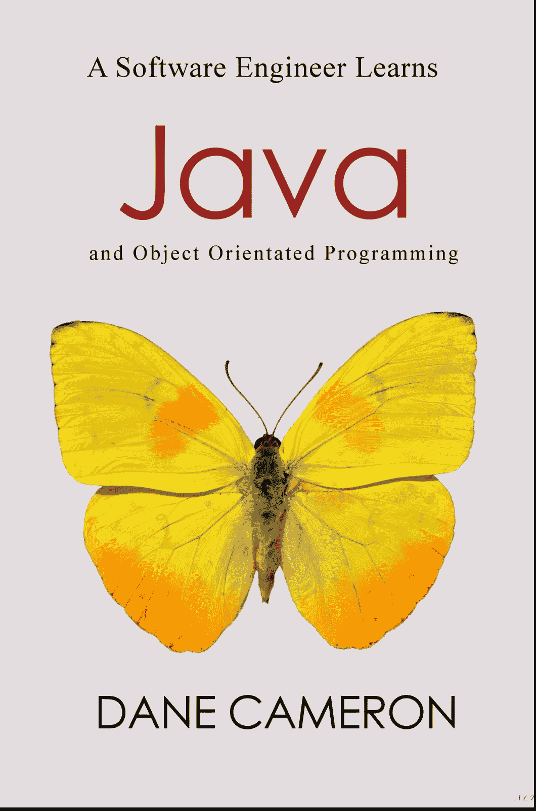

# 前言

尽管 Java 保持稳定，但这些知识只能通过经验获得。

本书的意图是向你介绍软件工程师思考的方式。

尽管 Java 保持稳定，但这些知识只能通过经验获得。

Java 是一种强类型面向对象的语言。

# 1. Java 简介

Java 是一种强类型面向对象的编程语言。这句话对你来说可能很有意义，也可能毫无意义。请放心，在本书结束时你将理解这句话。

Java 最初由 Sun Microsystems 于 1995 年创建。随后它经历了多次重大修订，最近是 2014 年发布 Java 8，并已成为最广泛使用的语言之一。

Sun Microsystems 在 2009 年被 Oracle 收购，他们一直支持并扩展 Java。

在介绍中描述 Java 的基本特性是非常困难的。就像任何复杂事物一样，Java 在有一定理解后解释最好。本章将提供关于 Java 是什么以及如何工作的背景——但在你阅读一段时间后可能会返回这一节。

## 编译型与解释型语言

编程语言有许多分类方法；一种分类形式是它们是编译的还是解释的。

为了让任何软件在计算机上运行，必须将其转换为机器码：代表计算机处理器可以理解的指令集的 0 和 1 的序列。编译型语言是指源代码通过称为编译器的工具转换为机器码，并封装成可以直接分发给终端用户的程序。

由于每个操作系统都不同，因此需要为每个操作系统编写编译器。编译器的妙之处在于，相同的源代码可以用于不同操作系统的可执行程序。编译型语言的例子是 C 和 C++。

解释型语言在特定操作系统上运行时也需要将源代码转换为机器码，但在解释型语言中，这是在程序执行时实时发生的。这意味着相同的代码可以在任何支持该语言解释器的操作系统上执行（解释器是实时将源代码转换为机器码的软件）。

解释型语言通常比编译型语言慢，因为编译步骤实际上是在程序执行时发生的。可以由解释器运行的语言示例包括 `JavaScript` 和 `Perl`。然而，许多解释型语言也可以编译，因此解释型语言和编译型语言之间的界限有时是模糊的。

Java 并不容易归入这两类之一。Java 是一种编译型语言：所有源代码在执行之前必须经过编译。正如你将看到的，Java 开发包（`JDK`）包含一个名为 `javac` 的实用程序，负责编译 Java 源代码。

然而，与传统的编译器不同，Java 编译器不会为特定的操作系统产生机器码。相反，它产生 Java `bytecode`。

Java `bytecode` 确实包含一组指令，就像机器码一样。然而，与机器码不同，Java `bytecode` 无法由计算机直接执行。Java 需要一个称为虚拟机（`JVM`）的中间层——它由 Java 运行环境（`JRE`）提供。

任何想要运行 Java 程序的计算机都必须安装 `JRE`，它将在程序执行时将 Java `bytecode` 转换为特定操作系统的机器码。

如果你使用 Windows 或 OSX，你可能已经注意到系统经常要求你安装新版本的 Java：这就是 Java 运行环境。一旦安装了 Java，你就可以运行任何用 Java 编写的应用程序。

你可能会奇怪为什么 Java 要采用这种方法？Java `bytecode` 可以被看作源代码和机器码之间的“中站”。它包含一组指令，解释器可以比普通源代码更高效地执行这些指令。

Java 选择这种方法是其“一次编写，随运行”哲学的一部分。同一个编译版本的程序可以在任何安装了 `JRE` 的计算机上执行：没有必要为每个平台构建不同版本的程序。这具有巨大的价值，因为 `JREs` 不仅适用于桌面级计算机，还适用于手机、机顶盒和家用电器。事实上，Oracle 声称有超过 30 亿台设备正在运行 Java。

这种方法的另一个目的是为了让语言更安全。传统的编译型程序可以执行运行它的用户在操作系统上能做的任何事情——包括删除文件或将其通过互联网发送给黑客。相比之下，`JRE` 提供了一个程序运行在内部的沙箱，可以控制程序在沙箱内可以做什么，或者让它请求执行某些操作的权限。这种方法在近年来已成为 Android 和 iOS 的标准，但它从 Java 诞生初就内置了。

由于 Java `bytecode` 在程序执行时被转换为机器码，因此 Java 与解释型语言具有共同特征。当 Java 最初发布时，这是一种合理的看待方式，Java 也被营销为一种解释型语言。

然而，正如前面提到的，解释型语言通常比编译型语言慢。尽管 Java `bytecode` 转换为机器码比原始源代码更高效，但仍然存在一些开销。结果，Java 的早期版本与编译型语言相比较慢，而且这种认知在很大程度上保留了下来。在 Slashdot 上任何关于 Java 的讨论仍会立即陷入关于 Java 性能的“口战”。

然而，Java 在很长一段时间内已经不是一种解释型语言了。现在几乎所有的 Java 运行环境都使用一种称为“即时编译”（`JIT` 编译）的方法。Java `bytecode` 在程序运行期间，在需要时之前恰好被编译成机器码。尽管在这个过程中仍然存在一些开销，但 Java 的性能通常等同于编译型语言；而且额外的好处是，同一个 Java `bytecode` 可以在许多不同的操作系统上运行。

Java `bytecode` 的一个有趣方面是，除了 Java 之外的语言也可以生成它。现在有许多语言可以生成 Java `bytecode`，包括如 `Scala` 在内的几种主流语言。事实上，Java 的最新版本附带了一个名为 `Nashorn` 的 JavaScript 引擎，它与 Java 语言集成，并允许你编写在 Java 平台上执行的 `JavaScript` 代码。

虽然最常用的 Java 版本由 Oracle 所有，但从技术上讲，任何人都可以编写 `JDK` 和 `JVM`。Oracle 版本最常见的替代方案是 `OpenJDK`，它是 Java 的开源实现。

## 静态类型与动态类型语言

另一种分类语言的方法是将其分为静态类型语言或动态类型语言：Java 是一种静态类型语言。

在使用静态类型语言时，程序员负责从开始定义一个类型系统，代表程序将要处理和操作的所有不同数据类型。例如，想象你正在为一家租车公司编写软件：你可能从定义诸如 `Car`（汽车）、`Rental Agreement`（租赁协议）和 `Customer`（客户）等类型开始。很快就会看到，这些在 Java 中被称为 `classes`（类），它们描述了程序在执行时将使用的数据类型。

一旦你定义了类型系统，就可以开始使用这些类型（通过从它们生成对象）。在静态类型语言中，编译器始终可以确定你指的是哪种类型。如果你尝试调用与你正在使用的类型不兼容的行为，编译器将会知晓。例如，如果你尝试向一个 `Car` 租用一个 `Customer`，程序将知道这是无效的并生成错误。这意味着你永远不会向客户交付一个有错误的软件版本。

在动态类型语言中，编译器不知道你正在使用什么类型，因此你可以对任何类型调用任何操作。只有在程序实际运行时，语言才会确定代码是否有效，结果导致动态类型软件更容易出错。

静态类型语言在运行时产生的错误通常较少，因为编译器充当了安全网，警告我们的代码正尝试做它不应该做的事情。然而，静态类型语言的使用可能更加繁琐，许多程序员更倾向于动态类型语言的灵活性。静态类型和动态类型语言都有强力的论点。现在不是讨论这些论点的时候，但你应该意识到 Java 是静态类型的。事实上，许多其他动态类型语言也会生成字节码，但这些超出了本书的范围。

## 编程范式

另一种重要的语言分类方法是根据其“家族”或“范式”，例如：

- 命令式编程语言（如 `C`）
- 面向对象编程语言（如 `C++` 和 `Smalltalk`）
- 函数式编程语言（如 `LISP` 和 `Haskell`）

正如你将看到的，Java 出生时就是一种面向对象的语言（如果你现在不知道这意味着什么，不要担心，稍后我会介绍面向对象语言的重要方面）。然而，Java 已经变成了一种多范式语言；它与命令式编程语言共享许多特征，并且从 Java 8 开始，它吸收了函数式编程的许多方面。

在本书中，我们将深入探讨 Java 的多范式特性，并观察这些不同的范式如何有效地结合使用。

以上就是你学习 Java 所需了解的所有内容——现在是时候写代码了。

# 2. 关于这本书

## 这本书是给谁看的？

“软件工程师学习”系列丛书通常面向从其他语言或技术转型的现有程序员和软件工程师。此书也适用于任何渴望成为软件工程师、并希望将 Java 作为其起点的人。

如果你没有任何编程经验，早期章节中的某些内容可能会让你觉得无从下手。我的建议是坚持下去：随着你阅读的不断深入，这些内容会开始变得易于理解。即使是最简单的 `Java` 程序也包含了许多高级概念，在短短几页纸甚至几个章节内，传达所有这些概念是不可能的。

这本书的核心目的是为你提供成为一名胜任的软件工程师所需的技能。这意味着不仅要牢固地掌握语言基础，还要理解如何使用这种语言来创建可维护且适应性强的代码库。

`Java` 是一种复杂的编程语言。它无法在一天内、甚至在一周内就学会。事实上，我见过许多其他程序员对特定语言特性的工作原理做出假设，并多年来维持这些假设，甚至没有意识到这些假设给他们带来了什么问题。学习这些特性并不困难，而在你开始学习这种语言时，没有比现在更好的时机了。

本书将包含许多代码示例，建议你自己亲自完成这些示例。学习一种语言的关键之一是对其进行实验并尝试。输入代码这一简单的动作，即使是逐字复制的，也是学习语言的重要方式。

我鼓励你将这些代码示例作为起点。尝试更改这些程序中的特性，或者思考实现相同功能的替代方法。这一过程引发的思维模式是你巩固语言知识的重要组成。

## 本书涵盖了什么？

本书将不会提供整个 `Java` 语言的介绍——尽管会涵盖该语言的大部分内容。`Java` 中某些特性我从未使用过，而且可能永远不会使用；因此，为了完整性而提供这些特性的信息意义不大。一旦你掌握了语言的基础，你会在需要时找到这些特性的。

`Java` 现在很大程度上是一种服务器端语言，而不是客户端语言。`Java EE`（企业版）是一组常用于实现服务器端 `Java` 组件（运行在 Web 服务器或应用程序服务器上）的 API：这些 API 也在本书的范围之外，尽管我近期将出版针对 `Java EE` 的《软件工程师学习》版本。

`Java` 现在很少用于实现运行在桌面计算机上的原生丰富 GUI 应用程序（尽管它通过 `Android SDK` 广泛用于编写原生移动应用）。出于这个原因，本书将检查创建桌面应用的两个主要 `Java` API：`Java FX` 和 `Swing`。这很遗憾；因为编写可以通过 GUI 交互的程序总是会更好，但现实是，你在专业环境中不太可能使用这些 API。

本书也不会关注 API 的详尽列表。网络资源在过去多年里有了显著提高，现在当你需要特定 API 时，它们是关于这些 API 的最佳信息来源。然而，这些网络资源不擅长的地方在于无法为你提供关于何时该使用该 API 及其权衡的宏观视角。这正是这类书籍可以产生价值的地方。

在开始之前，我最好先警告你，`Java` 是一门庞大且复杂的语言。针对许多其他编程语言的类似书籍最多只有这本书的一半大。我已尝试写出尽可能短的书，但在不遗漏重要材料的情况下，我无法再写得更短了。

我还想提前表示歉意，书中的许多程序（特别是早期章节中的程序）并没有在解决有趣的现实问题。在你掌握了语言大部分内容之前，很难编写出有趣的程序，因此早期章节使用了简单的示例。

## Java 的版本

本书将关注 `Java 8`，因为这是该语言的最新版本，包含了许多重大的新增。在整本书中，我会特别指出与 `Java 8`（甚至在某种程度上与 `Java 7`）相关的特性，因为对你来说，知道这些是语言最近新增的内容非常重要。语言的早期版本中已经编写了大量的 `Java` 代码，在某个阶段，你的工作可能是处理这些代码，因此你需要了解该语言早期版本的局限性。

尽管 `Java` 的版本在技术上是向后兼容的，但将一个大型 `Java` 程序升级到较新版本的 `Java` 可能需要巨大的精力，因此许多程序继续使用该语言的旧版本。

## 资源

本书的所有资源可以在以下网站找到：

[www.cisdal.com/java.html](http://www.cisdal.com/java.html)

代码是以 HTML 页面而非 `Java` 代码文件提供的。这种设计的意图是，当你不想输入整个示例时，可以复制并粘贴这些代码。

## 约定

书中的代码将使用以下字体：

```
This is code
```

本书不会使用尾注，而是使用以下约定来处理与主内容相关但并非直接关联于主内容的旁注内容。

```
// 
This is an aside
```

## 反馈

我非常乐意听到你对这本书的反馈（正面的或负面的）。请通过邮件联系我：dane@cisdal.com。此外，非常感谢评论，因为这是像我们这样的独立出版社获得书籍关注度的最重要途径。

# 3. 开始使用 Eclipse

技术上，你编写 Java 程序只需要文本编辑器和 Java 开发工具包（包含 Java 编译器和执行 Java 代码的 Java 运行时）。实际上，几乎所有使用 Java 编写复杂程序的软件工程师都会使用集成开发环境（IDE）。

IDE 提供了一个可以进行编辑、构建、运行和调试代码的环境。在 Java 世界，开源 Eclipse IDE 已成为最广泛使用的工具，因此本书将一直使用它。如果你偏好其他的 IDE，欢迎使用它代替 Eclipse。

Eclipse IDE 包含了你编写和执行 Java 代码所需的一切，包括 Java 编译器和代码编辑器。本节将引导你完成 Eclipse 的安装。

## 在 OSX 上安装 Eclipse

在安装 Eclipse 之前，确保你已安装最新版本的 Java。具体来说，你需要确保安装了 Java 8 JDK（仅有 Java JRE 是不够的），可以从以下网站下载：

[`www.oracle.com/technetwork/java/javase/downloads/jdk8-downloads-2133151.html`](http://www.oracle.com/technetwork/java/javase/downloads/jdk8-downloads-2133151.html)

下载完成后，像安装其他 OSX 应用一样安装 dmg 文件即可。

现在你应该下载 Eclipse：打开你喜欢的浏览器并导航到 [`www.eclipse.org/`](http://www.eclipse.org/)。点击首页上的“Download（下载）”按钮，并选择适用于你平台的最新版本 Eclipse。我将使用 Eclipse 的“Luna”发布版本（版本 4.4），但如果有更新的版本，你也可以选择使用它。

下载的 Eclipse 版本以压缩的 tar 文件形式存在。一旦文件下载完成，请将其复制到你想要安装 Eclipse 的目录，并双击该文件。这会将 Eclipse 应用程序解压到一个名为 `eclipse` 的文件夹中。

要运行 Eclipse，只需双击该文件夹内的 Eclipse 应用程序（带有紫色图标的那个文件）即可。你可能会收到一个警告，提示 Eclipse 是从互联网下载的，你需要在继续之前接受该警告。

当 Eclipse 首次启动时，它会要求你选择一个工作空间（workspace）。Eclipse 工作空间是保存代码的目录，因此请在计算机上选择一个合适的位置，如图 3-1 所示：

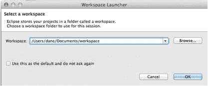

图 3-1

同时也值得勾选“Use this as a default（用此作为默认值）”选项，这样你每次启动 Eclipse 时都不会收到此提示。

## 在 Windows 上安装

在安装 Eclipse 之前，确保你已安装了最新版本的 Java 是重要的。具体来说，你需要确保已安装了 Java 8 JDK（仅有 Java JRE 是不够的），你可以从以下网站下载：

[`www.oracle.com/technetwork/java/javase/downloads/jdk8-downloads-2133151.html`](http://www.oracle.com/technetwork/java/javase/downloads/jdk8-downloads-2133151.html)

下载完成后，像安装其他 Windows 软件一样安装下载的文件。

现在你应该下载 Eclipse：打开你喜欢的浏览器并导航到 [`www.eclipse.org/`](http://www.eclipse.org/)。点击首页上的“Download（下载）”按钮，并选择适用于你平台的最新版本 Eclipse。我将使用 Eclipse 的“Luna”发布版本（版本 4.4），但如果有更新的版本，你也可以选择使用它。

在 Windows 上，下载的文件是 zip 格式。下载完成后，将 zip 文件复制到你想要安装 Eclipse 的位置。在对应位置，右键点击文件并选择解压其内容。

Eclipse 不需要安装，解压的操作会将所有文件存放在合适的位置，并且可以立即运行。

在创建的 Eclipse 文件夹内部，你会找到一个名为 `Eclipse.exe` 的文件。只需双击此文件即可启动 Eclipse。

当 Eclipse 首次启动时，它会要求你选择一个工作空间，如图 3-2 所示。Eclipse 工作空间是你希望保存代码的目录：

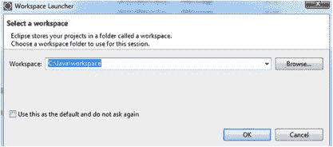

图 3-2

同时也值得勾选“Use this as a default（用此作为默认值）”选项，这样你每次启动 Eclipse 时都不会收到此提示。

## 开始使用 Eclipse

Eclipse 是一个软件开发平台。尽管它与 Java 的关系最密切（且本身是用 Java 编写的），但 Eclipse 是一个用于多种编程语言编写软件的平台。

因此，Eclipse 具有一定的复杂度。在书中，我将向你介绍 IDE 最重要的方面，但务必花时间自己探索——你会发现许多有用且节省时间的功能。

当 Eclipse 第一次打开时，你将看到图 3-3 所示的屏幕：


图 3-3


点击屏幕右上角的“Workspace（工作空间）”图标：这将带你进入 Eclipse 工作区（workbench），它将如图 3-4 所示：


图 3-4

一旦 Eclipse 运行起来，你就可以开始学习本书中的示例了。

# 4

# Hello World!!!

在学习新编程语言时，有一个通用的惯例：你写的第一个程序是在控制台打印“Hello World!!!”的程序。

这实际上有一个非常好的理由。编写最简单程序的行为向你介绍了许多重要概念，并涉及编写源代码、编译代码以及执行该代码的步骤。

在编写任何代码之前，先在 Eclipse 中创建一个项目（project）。项目是 Eclipse 的概念，而不是 Java 的概念，它为构成程序的所有代码和库提供了一个容器。

从主菜单选择 `File -> New -> Java Project`。该选项如图 4-1 所示：

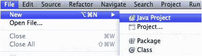

图 4-1

在弹出窗口中，使用 `helloworld` 作为项目名称。此时，确保执行环境 JRE 为 `JavaSE1-8` 也是重要的，如图 4-2 所示：

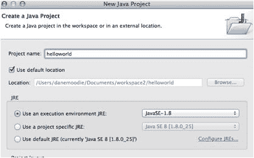

图 4-2

一旦输入了项目名称，只需按下底部的“Finish（完成）”按钮。

现在你可以编写代码来向控制台打印“Hello World!!!”了。

Java 程序中的所有代码都必须在`class（类）`内部。我将在下一章详细解释什么是类，但现在只需将其视作一个包含 Java 源代码的文件。每个类都有一个名称，并且必须在一个与该名称完全相同的文件内创建，并带有`.java`扩展。

当类被编译时，它会创建一个同名但扩展名为`.class`的文件：这包含了由 JRE 执行的字节码。

有一个严格的惯例，类应该以大字母开头，并使用驼峰命名法（每个单词大写）。例如，类可以命名为`HelloWorld`，但不应该是`hello_world`：尽管这在技术上是一个有效的类名。

除了这些惯例，Java 对类名还强制了一 set 规则。类名必须以字符开头，但包含数字以及特殊字符`$`和`_`。在此还需要提到 Java 是大小写敏感的——所以`HelloWorld`和`Helloworld`可以作为两个类共存。

任何非简单的 Java 程序都会包含许多类，因此习惯是将类分组在““包”中。包本质上是一个文件夹或目录，就像目录一样，包可以相互嵌套。

在示例中，类将被放在名为`hello`的包中。按照惯例，包名全小写。

要创建类，使用主菜单中的`File -> New -> Class`选项。或者，你可以右键点击左侧的项目名称并选择`New -> Class`。

选择此选项后，你将看到如图 4-3 所示的对话框，可以在其中指定类的基本信息。输入`hello`作为包名，`HelloWorld`作为类名，并确保勾选`public static void main(String args[])`：我稍后会解释这个选项。

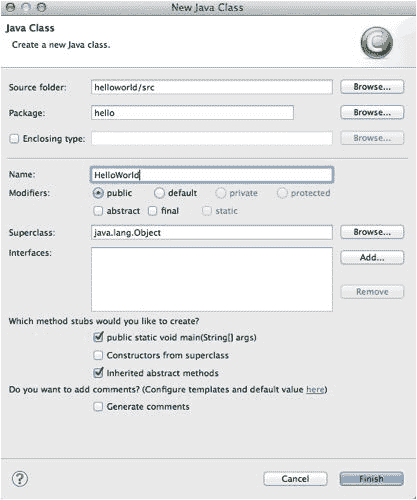

图 4-3

提供这些值后，按“Finish”。

Eclipse 将创建`HelloWorld.java`源文件并填充相关代码。这些代码将在编辑器中显示给你，如图 4-4 所示：

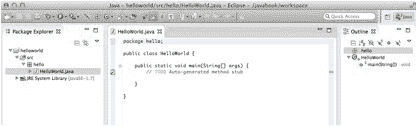

图 4-4

此外，如果你查看文件系统上创建的目录结构，它看起来像图 4-5 所示：

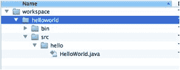

图 4-5

- 顶层文件夹是 Eclipse 工作空间。

- 内部有一个名为`helloworld`的项目文件夹。它又包含两个子文件夹：用于所有源代码的`src`文件夹，以及用于程序编译版本的`bin`文件夹。这些仅仅是 Eclipse 的命名约定；类文件同样可以很容易地写入`src`目录。

- `src`目录内有一个名为`hello`的包包目录，最后，在里面有一个名为`HelloWorld.java`的文件。注意，Eclipse 自动为你添加了`.java`扩展名，因为这是语言的要求。

Eclipse 的一个方便之处是，它每当你保存（或至少尝试保存）类时，就会编译该类。这意味着如果你查看`bin`目录，你会发现一个与`src`目录层级相同的结构，不同之处那里有一个名为`HelloWorld.class`的文件，因为它是该类的编译版本。

你现在准备好查看 Eclipse 生成的代码了。由于所有的 Java 类都包含相同的基本结构，Eclipse 能够为你生成一些代码：如果你是使用文本编辑器编写这些代码，你就需要自己写它们。

Eclipse 应该生成了以下代码：

```
package hello;

public class HelloWorld {

  public static void main(String[] args) {

    // TODO Auto-generated method stub

  }
}
```

每个类的第一行是包声明：

```java
package hello;
```

从技术上讲，这一行是可选的，因为代码可以直接放置在`src`目录中，而不在任何包中。然而，建议始终将代码放在包中，因为即使是简单的程序往往也会随着时间的推移而增长，而包是维护程序结构的重要方式。

你还会注意到包声明以分号结尾。所有的 Java 语句都必须以分号结尾。与某些语言（我是在说你 JavaScript）不同，分号在 Java 中不是可选的。

包声明后的空行并不是必须的，但由于 Java 会忽略空白符，添加像这样的一个空行可以提高可读性。

下一行提供了类的声明：

```java
public class HelloWorld {
```

你现在可以忽略`public`关键字，我将在随后的章节中详细介绍它。下一个关键字`class`表示你正在声明一个类，而`HelloWorld`是类的名称。所有的 Java 类文件都将以类似的声明开头，尽管正如你将看到的，这种声明有很多变体。

此行代码以大括号而不是分号结尾。大括号在 Java 中用于封装代码块：“{”表示代码块的开始，而“}”表示代码块的结束。代码块是用于一组语句的分组机制。

虽然块可以相互嵌套，但大括号必须始终成对出现，因为每个代码块最终都必须结束。整个类被视为一个代码块；因此，文件最后一行的右大括号标志着该块的结束，从而标志着类的结束。

下一行代码稍微复杂一些：

```java
public static void main(String[] args) {
```

这是一个方法声明。方法为代码提供了一个容器，因此封装了程序执行时的行为。类可以包含许多不同的方法。

如果你熟悉其他语言中的这些概念，那么可以将方法看作是函数或过程，尽管正如你将看到的，它们之间存在重要的区别。

值得注意的是，这些行代码之所以存在，是因为你在创建类时点击了`public static void main(String args[])`选项。你点击它是因为你想在这个特定的类中添加一种特殊类型的方法。

当计算机程序执行时，它需要从某个地方开始。在某些语言中，执行直接从指定源文件的开头开始，并持续到源文件的结束。Java 总是从一个名为`main`的方法内部开始执行，该方法必须具有此示例所示的签名。当你运行 Java 程序时，你会告诉 JRE 哪个类包含`main`方法，这将在程序开始执行时被隐式执行。

方法签名是它的名称以及它接受的参数类型（和顺序）的组合（`main`接受一个类型为`String[]`的参数）。类中的每个方法必须具有唯一的方法签名。

从技术上讲，多个类可以包含`main`方法，但当程序运行时，只有指定类中的`main`方法会被执行。

我将在后面的章节中忽略`public`和`static`关键字。签名中的下一个关键字是`void`：这表示方法在执行完毕后返回的数据类型。由于`main`方法不返回任何数据，因此始终被声明为返回`void`。

签名中的下一个标识符`main`是方法的名称。方法名通常是任意的，例外是它们习惯上以小写字母开头。正如提到的，在这种情况下`main`名称并不是任意的，因为 Java 运行时环境会在程序开始执行时寻找名为`main`的方法。

`main`方法接受一个参数，如下语法所示（`String[] args`）。参数提供了一种向方法传递数据的机制。每个参数都有一个类型，在这种情况下为`String[]`，意味着字符字符串数组（即零或多个字符字符串），以及一个名称：情况下为`args`。参数的名称并不重要，此行完全可以这样声明：

```java
public static void main(String[] arguments) {
```

`main`接受的参数提供了一个重要的功能。当任何 Java 程序开始执行时，可以传递一组参数：这些参数将在数组中可用。在运行时向程序传递参数允许同一个编译程序根据传递给它的值产生不同的行为。例如，在这种情况下，你可以传递一个参数指定程序大写输出。

你不会向此程序传递任何参数，但仍然必须声明`main`方法接受此参数。

`main`方法还包含一个代码块，因此它使用左右大括号来表示它的开始和结束：这些大括号内的任何内容都是方法体。

注意这些大括号嵌套在类本身的大括号内部。由于 Java 代码可以由许多嵌套的大括号组成，因此像这个示例所示，对每个块进行缩进是非常重要的。

这并不是语言的要求，但它使得找到左括号对应的右括号变得容易得多，因为正如你将在后续章节中看到的，嵌套有时可能会深达很多层。

Eclipse 为我们生成的最后一行代码是注释：

```java
// TODO Auto-generated method stub
```

注释可以使用双斜杠表示（如本例所示），也可以在跨多行时使用以下结构：

```java
/* 这条注释

跨越了

多行 */
```

很自然地，注释在运行时对程序没有影响，但它们是向其他程序员传达代码含义的重要方式。

为了在控制台打印 Hello World!!!，你需要在`main`方法中添加如下代码：

```java
public static void main(String[] args) {
  System.out.println("Hello World!!!");
}
```

目前我不会解释这一行的全部复杂性，但`System`是 Java 内置的一个类。代码`.out`访问了`System`类持有的一个名为`PrintStream`的工具对象，该对象作为程序的标准输出。因此，代码`System.out`可以被视为访问程序标准输出的机制。

这一行的下一部分`.println`正在调用`PrintStream`对象上的一个名为`println`的方法。这个方法与你写的`main`方法相似，只不过它是由 Java 平台提供的。

`println`方法可以传递一个`String`类型的参数。在这种情况下，你只需通过在双引号内包含一组字符来创建一个字面量（`literal`）`String`。注意参数被包含在`()`括号中。

`parameter`（参数）和`argument`（实）这两个术语有微妙的区别。

在定义方法时，指定的是`parameters`（参数）列表。在调用方法时，会将一组`arguments`（参数）传递给这些参数。

`println`方法会将接收到的字符串打印到程序的标准输出中，在你的情况下，这就是 Eclipse 的控制台。如果你是从操作系统台或 shell 运行此程序，标准输出就是该控制台或 shell。

你现在可以通过从主菜单选择`Run -> Run`来运行程序了。当你选择此选项时，Eclipse 将在项目中查找具有`main`方法的类并运行它。

或者，你也可以通过右键点击`HelloWorld`类并选择`Run As -> Java Application`。

当程序运行时，它将在图 4-6 所示，输出到 Eclipse 的 Console 标签页中：

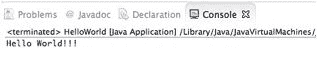

图 4-6

恭喜你，你刚刚编写并执行了你的第一个 Java 程序！

## 故障排除

即使是像这样简单的程序，了解如何排除可能出现的问题也很重要。为了演示这一点，请回到编辑器并删除以下代码行末尾的分号：

```
System.out.println("Hello World!!!")
```

这在代码中引入了一个语法错误；意味着 Eclipse 无法对其进行编译。

Eclipse 会通过在编辑器相应行的行边栏添加一个红点来警告你代码中存在问题，如图 4-7 所示：


图 4-7

如果你点击红点，Eclipse 会告诉你问题所在：

```
Syntax error, insert ";" to complete
```

在这种情况下，错误信息准确地告诉了你问题是什么。Eclipse 并不总是那么有用，但通常知道问题所在就提供了足够的信息来判断如何修复它。

你还会发现，如果程序包含任何编译错误，你就无法运行 Java 程序。现在尝试运行程序，会产生以下消息：

```
Exception in thread "main" java.lang.Error: Unresolved compilation problem:
 Syntax error, insert ";" to complete BlockStatements
 at hello.HelloWorld.main(HelloWorld.java:6)
```

## 总结

本章演示的 Hello World 程序并没有许多其他语言中的 Hello World 程序那么简单。它不仅比许多语言多出几行，而且在不了解更多语言知识的情况下，要简洁地解释该程序的许多特性是非常困难。事实上，我还没有解释该程序中所使用的许多关键字。

这本身并不能说明 Java 是一个好语言还是一个坏语言，但它源于 Java 的一个重要原则：一切皆对象。包括 C++ 在内的面向对象语言在内的许多语言允许在源文件中包含并执行任意代码：Java 则坚持所有代码都放在类结构中。在许多语言中，这个程序可以写成单行代码，例如：

```
print("Hello World!!! ")
```

在下一章中，你将更仔细地观察类以及相关的对象概念，这包括查看一些我在本章中跳过的一些关键字。

# 5

# 类与对象

如引言中所，Java 是一种面向对象的编程语言。面向对象编程是一种使用“对象”的概念来封装程序数据和行为的范式。对象是可重用的模块，可以在程序执行过程中相互作用。

这与许多其他使用函数或过程来封装程序行为的编程语言不同：这些语言分别被称为函数式语言和命令式语言。

在 Java 创建时，面向对象编程已经非常成熟，且其历史可以一直追溯到 20 世纪 60 年代。然而，Java 的显著之处在于它比它的许多直接竞争对手（最著名的是 C++）更纯粹的面向对象语言。

在本章中掌握的最重要概念是`class`（类）和`object`（对象）之间的区别。类充当对象的模板：它声明了对象将持有的数据以及操作这些数据的方法。换句话说，一旦定义了类，就可以构造许多该类的实例，这些实例就被称为对象。

你可以把类类比模具。一旦你制作了模具，就可以用它从模具中创建任意数量的对象。

某些面向对象的语言允许你在没有类的情况下创建对象（是的，我再次对你说 JavaScript）。然而，在 Java 中，你总是需要从类开始。

从类创建的每个对象都与从同一类构造的其他对象相互独立，但可用的方法保持不变。在详细解释类和对象的概念之前，通过示例进行说明是值得的。

类通常被认为是程序的“名词”。你可能在语法类中记住过，名词用于命名“事物”，例如人、地点、想法或动物。这些与动词相反，动词描述动作。

当你第一次坐下写 Java 程序时，你需要考虑名词将是什么。例如，在一个租车程序中，名词可能是`Customer`、`Car`和`Rental agreement`。在一个银行程序中，名词可能是`Customer`、`Account`和`Branch`。

一旦定义了名词，你接下来开始考虑这些名词需要持有的数据。你通过在类上定义`fields`（字段）来描述将捕获的数据。例如，一个租约协议类可能包含日费、签署日期以及任何应用于费率的特殊费用。类定义了字段，而每个对象将为这些字段分配特定的值。

最后，你需要考虑该类需要什么行为；这些行为将在类的`methods`（方法）中实现。例如，租约协议类可能有一个计算总成本的方法。为了实现这一点，方法可以读取和修改对象持有的数据。

你可能记得在 Hello World 中定义了一个名为`HelloWorld`的类。在本章示例之前，值得指出 Hello World 程序的一个特点。在该程序中，你没有从`HelloWorld`类创建对象，但它的`main`方法仍然可以调用。这是因为该方法被声明为`static`：

```
public static void main(String[] arguments)
```

静态方法与你在书中看到的绝大多数方法不同，因为它们可以直接在类上调用，而不是类的实例（即对象）。这是一个我将在后续章节中返回的主题。

## 类类

你将首先在 Eclipse 中创建一个名为`ObjectsAndClasses`的新项目。

在这个项目中创建一个名为`Car`的新类，并将该类放在名为`vehicles`的包中。

由于你现在在 Eclipse 中有多个项目，Eclipse 需要知道应该将类添加到哪个项目中。确保类在正确的项目中创建的最简单方法是在 Eclipse 左侧的“Package Explorer”（包资源管理器）中选择该项目：这会自动将该项目选为“当前”项目。

与上一章的`HelloWorld`类不同，创建此类时，你不需要勾选`public static void main(String[] args)`选项。

当你点击“Finish”（完成）时，Eclipse 将生成以下代码：

```java
package vehicles;

public class Car {

}
```

这段代码的所有内容看起来与上一章的`HelloWorld`示例相似：类位于包中，并且由一个空代码块组成。


# 定义字段和数据抽象

定义类的第一步是添加它的字段（fields）。类所需的字段取决于该类将被使用的程序。例如，车辆注册程序中的`Car`所持的数据可能与出租叫车系统中的`Car`完全不同。

确定与正在编写的程序相关的字段的过程被称为`data-abstraction`（数据抽象）。这是因为你正在创建一个`Car`的`abstraction`（抽象），它仅模拟你正在使用的上下文相关的信息和行为。

虽然计算机程序通常代表现实世界中的概念，但它们不必代表现实世界的每一个方面。作为程序员或软件工程师（无论你使用哪种语言），你需要掌握的最重要技能之一就是抽象现实世界实体中对你当前任务重要的相关特征和属性的能力。

在特定情况下，你将关注与车辆注册系统中汽车可能相关的字段，因此添加以下字段：

```java
package vehicles;

public class Car {

  private String registrationNumber;

  private String make;

  private String model;

  private int engineSize;

  private short yearFirstRegistered;

}
```

你向此类添加了五个字段。每个定义包含三个组成部分：

- **一个访问修饰符**（access modifier）：在此情况下为`private`
- **一个数据类型**（data-type）：这指示每个字段所持的数据类型
- **一个名称**（name）：可用于引用该字段

这些组成部分很快就会会被详细描述。

## 字段值和类型

由于这是一个类（或对象的模板），你不需要为字段赋值；值将分配到你从该类创建的每个实例（或对象）中。

在某些情况下，字段具有`default`（默认）值是有意义的。默认值是你希望所有对象都拥有的初始值。可以通过在字段定义之后添加等号和一个值来实现，例如：

`private short yearFirstRegistered = 2015;`

你定义的每个字段都有一个数据类型。数据类型定义了可以存储在该字段中的数据类型。Java 是一种静态类型语言，因此你必须声明每个字段的类型，一旦程序开始执行，类型永远无法更改。例如，你不能决定让某些`Car`对象使用`int`作为`registrationNumber`。

每个字段的类型可以是类（如定义的前三个类型为`String`的字段所示），也可以是原始类型（primitive type），如分别使用`int`和`short`的最后两个字段所示。

原始类型是 Java 语言的级构建单元：它们由简单的、原子的值组成，如数字、字符或布尔（`true`或`false`）。你无法定义自己的原始类型；你受限于语言中定义的类型。另一方面，类将一组原始值或其他类聚合在一起，并为这组值赋予意义（正如你对`Car`类所做的那样）。

你将在后面的章节中详细详细查看原始数据类型，但以下列表简要描述了每个原始数据类型：

- `boolean`：存储值`true`或`false`
- `byte`：持有 8 位有符号整数（即`-127`到`128`）
- `short`：可以分配 16 位有符号整数（即`32,768`到`32,767`）
- `char`：可以分配 16 位 Unicode 字符
- `int`：可以分配 32 位有符号整数（即`-2³¹`到`2³¹-1`）。这是 Java 中整数的默认选择。
- `long`：可以分配 64 位有符号整数（即`-2⁶⁴`到`2⁶⁴-1`）
- `float`：可以分配 32 位有符号浮点数，根据 IEEE 754 规范定义。该类型没有确定的范围，因为它取决于记录该数字需要多少精度
- `double`：可以分配 64 位有符号浮点数。这是 Java 中浮点数的默认选择

`Strings`不是原始类型，因为它们被构造为`char`值的数组（列表）。在`Car`示例中，你会看到`engineSize`字段被定义为`int`，而`yearFirstRegistered`是`short`，因为它将包含一个年份（例如`2010` - 然而，你稍将在书的后面看到，Java 中表示年份有更好的方法）。所有其他字段都定义为`Strings`。

你可能还会注意到每个字段都被声明为`private`。我稍后会解释其含义，但本质上它是控制字段内数据访问的一种。最后，每个字段都分配了一个适当的名称，始终小字母开头，并使用驼峰命名法（每个单词的首字母大写）。这不是语言的要求，但是一个几乎通的标准。

## 方法

现在你已经为类添加了字段，你需要考虑类所需的方法（methods）。方法定义了类的行为，或者类能做的事情。方法通常代表程序的“动词”。在这个类中，你将定义两个方法：

- 一个更改`Car`注册信息的方法
- 一个返回格式化`String`汽车详情的方法

更改注册号的方法定义如下：

```java
public void changeRegistrationNumber(String newRegistrationNumber) {
  registrationNumber = newRegistrationNumber;
}
```

理解方法的最佳方式是将其代码块，它：

- 可以接受一组参数
- 对这些参数和/或类定义的任何字段执行某些处理
- 可以向其调用者返回数据

你应该将此代码添加到类体中（最后一个大括号之前）。习惯做法是将所有字段放在类的顶部，方法放在类的底部。

此代码的第一行定义了方法的签名（signature）：

`public void changeRegistrationNumber(String newRegistrationNumber)`

这比字段定义稍微复杂，包含以下内容：

- 方法的访问修饰符，在此情况下为`public`。稍后将解释
- 方法在执行结束时返回的数据类型，如果方法不返回值则为`void`
- 方法名称，在此情况下为`changeRegistrationNumber`。方法名称应尝试简洁地描述该方法的功能。
- 该方法接受的参数列表；在此情况下，有一个名为`newRegistrationNumber`的单个参数，其数据类型为`String`。

在方法体中，传递给方法的参数将替换`registrationNumber`字段的现有值：

```java
registrationNumber = newRegistrationNumber;
```

`=`运算符被称为赋值运算符，用于为变量或字段分配新值。

编写此方法的另一种方式如下：

```java
public void changeRegistrationNumber(String registrationNumber) {
    this.registrationNumber = registrationNumber;
}
```

注意，在这种情况下，参数名称与类中定义的字段名称完全相同。在方法体内部，`registrationNumber`将指向参数，因此，为了引用该字段，你需要在字段名前前加上`this.`。

请记住，虽然字段是在类中声明的，但该方法在调用时会更改单个对象（或该类的实例）的该字段值。

`this`值是一个特殊关键字，指向对象本身——因此`this.registrationNumber`指向正在执行该方法的对象上的`registrationNumber`字段。

在引用字段时使用`this`是一个良好的习惯，因为可以避免参数或变量与对象上的字段同名时可能出现的问题。例如，以下代码并没有更改`registrationNumber`字段：

```java
public void changeRegistrationNumber(String registrationNumber) {
    registrationNumber = registrationNumber;
}
```

它只是将`registrationNumber`参数设置为它已拥有的值。

返回`Car`详细信息的方法将返回格式如下的`String`：`VDY666 (2012-Toyota)`。因此，它需要拼接来自三个不同字段的细节。在 Java 中有多种方法拼接字符串，但最简单的是使用`+`运算符。

```java
public String getDescriptionOfCar() {
    return registrationNumber + " (" + yearFirstRegistered + "-" + make + ")";
}
```

注意，在这种情况下，为了提高可读性，单条语句被分成了两行。这种之所以是因为 Java 会忽略包括换行符在内的空白字符。

在这里使用`+`运算符是运算符重载的一个示例。如果`+`运算符用于两个或多个数字，它会执行加法。然而，如果操作数中任何一个是`String`，它们就会被拼接（或连接）在一起以创建一个新的`String`。

此行代码将对象上的字段（如`registrationNumber`）与字面量字符串（如`" ("`）拼接。

注意该语句以`return`关键字开头。这意味着一旦字符串连接在一起，结果将自动从方法返回，并提供给调用该方法的人。

编写此方法的另一种方式如下：

```java
public String getDescriptionOfCar() {
    String result = registrationNumber + " (" + yearFirstRegistered + "-" + make + ")";
    return result;
}
```

在此版本的第一行，在方法内部声明了一个名为`result`的局部变量：其数据类型为`String`。拼接的结果然后被赋值给这个变量。

局部变量对于方法本身是私有的，可以在方法执行期间用于存储中间操作的状态。局部变量在方法执行完毕时总是会被销毁，因此无法在方法的某一次调用中存储状态并在另一次调用中使用该状态。

在方法的第二行，`result`变量的值从方法返回给它的调用者。从调用者的角度来看，这两种实现是等价的。

你现在有了一个带有字段和方法的类。然而，你还缺少一个成分：你需要一种方法在首次从类构造对象时设置所有字段的值。换句话说，你需要一种机制来设置每个对象的初始状态。

为了在创建对象时设置字段的值，你将使用一种称为`constructor`（构造函数）的功能。构造函数类似于方法：它接受参数并封装了一个块代码。但与方法不同的是，它只在首次创建对象时被调用。

构造函数的名称始终与类名相同（包括第一个字母的大小写），并且与方法不同，它不声明返回类型，因为构造函数永远不会返回值。以下是一个示例：

```java
public Car(String initialRegistrationNumber, String initialMake,
      String initialModel, int initialEngineSize,
      short initialYearFirstRegistered) {
    registrationNumber = initialRegistrationNumber;
    make = initialMake;
    model = initialModel;
    engineSize = initialEngineSize;
    yearFirstRegistered = initialYearFirstRegistered;
}
```

再次，这通常写写如下：

```java
public Car(String initialRegistrationNumber, String initialMake,
      String initialModel, int initialEngineSize,
      short initialYearFirstRegistered) {
    this.registrationNumber = initialRegistrationNumber;
    this.make = initialMake;
    this.model = initialModel;
    this.engineSize = initialEngineSize;
    this.yearFirstRegistered = initialYearFirstRegistered;
}
```

使用这种方式可以让你清楚你正在设置对象上的字段。

并不是每个类都必须有构造函数：正如你所看到的，还有其他方法可以设置对象的初始状态。单个类也可以有多个构造函数。你将在接下来的章节中详细详细查看构造函数。

有了构造函数后，整个`Car`类看起来如下：

```java
package vehicles;

public class Car {
    private String registrationNumber;
    private String make;
    private String model;
    private int engineSize;
    private short yearFirstRegistered;

    public Car(String initialRegistrationNumber, String initialMake,
          String initialModel, int initialEngineSize,
          short initialYearFirstRegistered) {
        registrationNumber = initialRegistrationNumber;
        make = initialMake;
        model = initialModel;
        engineSize = initialEngineSize;
        yearFirstRegistered = initialYearFirstRegistered;
    }

    public void changeRegistrationNumber(String registrationNumber) {
        this.registrationNumber = registrationNumber;
    }

    public String getDescriptionOfCar() {
        return registrationNumber + " (" + yearFirstRegistered + "-" + make + ")";
    }
}
```

## 从类构造对象

现在`Car`类已经定义，你可以开始从它创建对象了。记住，类充当从它所构造的对象的模板。

为了开始使用这个类，你将创建一个名为`Main`的新类，并给它一个`main`方法，因为（如上一章所述）所有程序都需要从带有`main`方法的类开始。这与你上一章创建的类相似：你不会从这个类创建对象；你只需利用它的`main`方法：

```java
package vehicles;

public class Main {
    public static void main(String[] args) {

    }
}
```

在`main`方法内部，你可以创建一个`Car`类的实例并将其赋值给名为`car1`的局部变量：

```java
public static void main(String[] args) {
    Car car1 = new Car("HGS928", "Ford", "Focus", 1800, (short) 2010);
}
```

关于这行新代码有几点值得注意的：

- 变量`car1`被声明为类型`Car`。正如之前提到的，变量与字段不同，因为它们定义在方法内部，并且局部于该方法。
- `new`关键字用于指示从指定的类实例化对象。应该构造的类类型位于`new`关键字之后：在这种情况下是`Car`。
- `()`括号内的参数被传递给由`Car`类构造函数定义的参数。请注意，你不需要为参数命名，因此指定参数的顺序必须与它们在`Car`构造函数中的定义顺序一致。你正在向构造函数传递字面量值，但如果本地变量类型匹配，你也可以传递本地变量。
- 最后传递的参数是`(short)2010`，而不仅仅是`2010`。当整数被定义为字面量值时，它的数据类型自动为`int`（这是一个 4 字节的有符号整数）。你正将其传递给一个定义为`short`的参数（这是一个 2 字节的有符号整数），因此从技术上讲，该数字可能太大而无法放入参数。在数字之前添加`(short)`声明是告诉编译器你有信心该数字可以放入`short`参数中。这个过程被称为`casting`（类型转换）。

对于像`2010`这样的字面量，你可以认为编译器应该知道该数字可以放入`short`值中，但由于该数字可能是通过复杂的数学运算构造的，因此编译器倾向于简单处理，并坚持数字始终从较大的数据类型向较小的数据类型转换。

我指定的引擎尺寸是立方厘米，而不是立方英寸（后者在北美更常见）。这突出了另一个重要问题：数据抽象——约定如何解释一个值是重要的，并在类中通过注释对其进行记录。后面的章节将介绍一个名为 JavaDoc 的重要概念，它允许你记录 API。

一旦该行代码执行，你就将`Car`类的实例赋值给了变量`car1`，它包含了传递给构造函数的`state`（状态）。你现在可以通过调用它的方法开始使用该对象：

```java
public static void main(String[] args) {

 Car car1 = new Car("HGS928", "Ford", "Focus", 1800, (short) 2010);

 System.out.println(car1.getDescriptionOfCar());

 car1.changeRegistrationNumber("ZZZ999");
```


`System.out.println(car1.getDescriptionOfCar());`

```
注意通过以下方式在对象上调用方法：
- 持有对象引用的变量`car1`
- 点`.`
- 方法名
- 你想要传递给方法的参数——即使方法不接受任何参数，你也需要添加`()`
```

你还会注意到，如果你输入`car1.`，`Eclipse`会自动提供一组你可以调用的方法名，如图 5-1 所示：

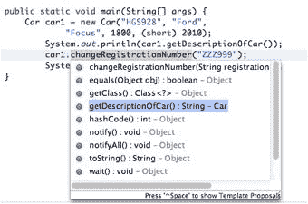

图 5-1

此列表包含了你没有创建的方法，如`equals`和`getClass`。我将在后面解释这些方法的存在。

如果你运行此程序，它应该显示以下输出：

```
HGS928 (2010-Ford)

ZZZ999 (2010-Ford)
```

这证明了`Car`类的每个实例都有自己完全独立的状态：更改一个实例的注册号对类的其他实例不会产生任何影响。

## 封装 (Encapsulation)

现在你已经有了一个类的示例，并开始从它创建对象，可以开始解释你多次看到的`public`和`private`关键字。这些关键字被称为“access modifiers”（访问修饰符），它们控制方法或字段的可见性。

考虑一种你想在`main`方法内部更改`car1`的`engineSize`的情况。使用以下代码似乎是合理的：

```java
Car car1 = new Car("HGS928", "Ford", "Focus", 1800, (short) 2010);

car1.engineSize = 1900;
```

点符号法可以像访问方法一样被用于访问字段，因此这段代码在本质上没有错误。此外，这基本上也是遵循相同的方法。

然而，如果你尝试编写这段代码，`Eclipse`将生成图 5-2 所示的错误：

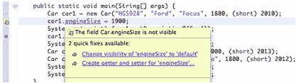

图 5-2

这是因为`engineSize`字段被声明为`private`：

```java
private int engineSize;
```

这意味着`engineSize`在`Car`类外不可见。尽管如此，`Car`类内部的方法可以访问并修改`engineSize`。例如，可以向`Car`类添加以下方法：

```java
public void setEngineSize(int newEngineSize) {
    this.engineSize = newEngineSize;
}
```

通过将其访问修饰符更改为`public`，可以让`engineSize`在类外可见：

```java
public int engineSize;
```

实际上有 4 种访问修饰符。当应用于字段和方法时，这些访问修饰符具有以下含义：

- `public`意味着任何带有类实例引用的代码对该方法或字段可见。例如，因为`Car`上的方法被声明为`public`，所以`Main`类能够调用它们。如果方法被声明为`private`，则无法从`Car`类外部调用。
- `protected`意味着类本身中的任何代码或扩展该类的代码对该字段或方法可见。这将在讨论继承时进一步解释。
- 缺失访问修饰符意味着同一包内的任何代码对该字段或方法可见。这种访问修饰符被称为默认，但很少使用。因为`Main`和`Car`类在同一个包中，`Car`上的方法可以使用这种修饰符。
- `private`意味着该字段或方法仅对类实例内部的其他代码可见。

```java
public static void main(String[] args) {
    Counter c = new Counter();
    System.out.println(c.getNextValue());
    System.out.println(c.getNextValue());
}
```

通过这种`Counter`的实现方式，你可以确保如果一次`getNextValue()`调用返回 1，那么下一次调用将返回 2。然而，请想象一下如果你将`count`字段设置为`public`会发生什么。突然之间就可以操纵`Counter`对象的状态，因此`getNextValue()`的行为变得不可预测了：

```java
package counting;

public class Main {
    public static void main(String[] args) {
        Counter c = new Counter();
        System.out.println(c.getNextValue());
        c.count = 0;
        System.out.println(c.getNextValue());
    }
}
```

在`Car`类中也可以想象到类似的问题。考虑`yearFirstRegistered`字段：如果它被设置为`public`，那么任何代码都可以将其更改为任何值，包括负值。如果你希望允许它被修改，应该提供一个公共方法，在接受新值之前先对其进行验证。

自然地，构造函数也应该执行相同的范围检查。数据验证是一个主题，一旦你对基本概念有了深入理解，我会再回来。

理解封装（encapsulation）是理解面向对象编程的关键之一，将在后续章节中进行更详细的探讨。虽然封装在你目前编写的简单程序中没有提供任何实际收益，但随着程序规模和复杂性的增加，它变得越来越重要。

在`Java`中，习惯上总是将字段声明为`private`，即使你不在乎字段如何被访问或修改。此时，会为每个字段提供一对方法，称为`getter`和`setter`：这些方法分别允许访问和修改字段的值。你可以通过右键点击`Car`类并选择`Source -> Generate Getters and Setters...`轻松地生成这些方法，如图 5-3 所示：

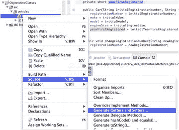

图 5-3

然后你可以选择你希望通过 getters 和 setters 暴露的字段，如图 5-4 所示：

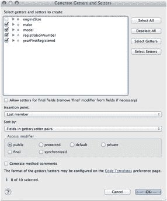

图 5-4

选择“OK”后，将生成以下代码：

```java
public String getRegistrationNumber() {
    return registrationNumber;
}

public void setRegistrationNumber(String registrationNumber) {
    this.registrationNumber = registrationNumber;
}

public String getMake() {
    return make;
}

public void setMake(String make) {
    this.make = make;
}

public String getModel() {
    return model;
}

public void setModel(String model) {
    this.model = model;
}

public short getYearFirstRegistered() {
    return yearFirstRegistered;
}

public void setYearFirstRegistered(short yearFirstRegistered) {
    this.yearFirstRegistered = yearFirstRegistered;
}
```

你会发现很多很多情况下，让`Eclipse`为你生成代码非常方便。这突显了使用`Eclipse`等 IDE 相比文本编辑器的进一步优势。

可见，getters 和 setters 遵循严格的模式。字段以`get`或`set`为前缀，且字段名大写。有了这些之后，你现在可以在`Main`类内部更改`Car`的品牌了：

```java
car1.setMake("Ford");
```

此示例中 getters 和 setters 使用的约定实际上是名为`JavaBean`规范的编程标准的一部分。许多库依赖于遵循`JavaBean`规范的类；因此，如果字段需要评估器和修改器，它们应该遵循此处演示的命名约定。

此地显示的命名约定有一个主要的例外：如果字段类型为`boolean`，getter 可以选择性使用`is`而不是`get`，例如`isFieldName()`。

你可能在奇怪，如果你真的不在乎字段如何被访问或修改，以这种方式提供 getters 和 setters 有什么意义：为什么直接将字段设置为`public`呢？主要的答案如下：

- 它确保了将来可以在 getters 或 setters 中添加额外的逻辑（例如验证），而无需更改外部代码。
- 许多其他库和工具期望类遵循`JavaBean`规范。
- 一旦我引入了程序调试的概念，就会变得很明显，通过 setter 修改字段比直接修改更容易调试字段的变化。
- 可以为 getter 和 setter 提供不同的访问修饰符。例如，getter 可以是`public`，但 setter 可以是`protected`。也可以只提供 getter，从而从本质上使字段变为只读。

实际上，我编写的 99% 的 getters 和 setters 都是上面那种通用类型，但支持 getters 和 setters 的理由（以及易于生成代码的事）意味着坚持这种方法是有意义的。

你还会注意到类有访问修饰符：你到为止创建的所有类都是`public`的。访问修饰符对类的作用略有不同，将在后面的章节中讨论。

## 静态代码

此时，值得停下来更详细地观察另一个重要概念：`static`关键字。到为止你只看到了`static`方法的一个示例：程序的`main`方法。事实上，`static`关键字可以用任何字段或方法。

`static`修饰符意味着该方法或字段存在于类本身，而不是类的实例。如果字段是`static`的，那么无论创建了多少个实例，它都只有一个值。

为了看到这一点，在`Car`类中添加如下新字段：

```java
public static int staticField;
```

现在在`Main`方法中添加以下代码：

```java
car2.staticField = 5;
System.out.println("The static field on car 1 is "+car1.staticField);
System.out.println("The static field on car 2 is "+car2.staticField);

car1.staticField = 10;
System.out.println("The static field on car 1 is "+car1.staticField);
System.out.println("The static field on car 2 is "+car2.staticField);
```

这将产生输出：

```
The static field on car 1 is 5
The static field on car 2 is 5
The static field on car 1 is 10
The static field on car 2 is 10
```

可见，修改一个对象上的`static`字段会影响所有对象的字段——这是因为`staticField`是类本身的属性。

修改此字段更正确的方法是不引用对象。为了看到这种方法，在`main`方法的最开始（创建任何对象之前）放置以下代码：

```java
Car.staticField = 20;
System.out.println("The static field is "+Car.staticField);
```

方法也可以是`static`的。例如，你可以向`Car`类添加以下方法：

```java
public static void addToStaticField(int number) {
    staticField = staticField + number;
}
```

此方法接受一个数字作为参数，并将该数字加到`staticField`的当前值上。可以在`main`方法中这样使用：

```java
Car.addToStaticField(10);
```

然而非常重要的是，尽管`static`方法可以访问或修改`static`字段，但它无法访问`non-static`字段（或其他`non-static`方法）。这是因为`non-static`字段只存在于对象，而`static`方法可以独立于对象存在。

`static`方法和字段确实有它们的用武之地，但正如你将在来的章节中看到的，最好尽可能避免它们，因为它们破坏了我们即将讨论的重要面向对象原则。

本章将向你介绍`Java`语言内置的许多重要数据类型。深入理解这些数据类型，更重要的是理解在何时使用每种类型，对于任何`Java`程序员来说都是至关重要的。

如果你是从`JavaScript`或`PHP`等动态类型语言迁移过来的，你可能不需要过多思考数据类型：在动态类型语言中，变量的数据类型是由它所使用的上下文决定的。例如，下面这行`JavaScript`代码创建了一个名为`var1`的数据类型为`number`的变量：

```
var1 = 10;
```

相反，这段代码创建了一个数据类型为`string`的变量：

```javascript
var1 = "10";
```

在像`Java`这样的静态类型语言中，你负责定义你想要使用的的数据类型，这个决定将对你施加某些限制。

在上一章中，你学习了如何创建自己的类，并从这些类实例化对象，例如：

```java
Car car1 = new Car("HGS928", "Ford", "Focus", 1800, (short) 2010);
```

在这种情况下，我将变量`car1`称为`Car`类型。因此，当你创建类时，你实际上是在创建自己的数据类型。

你也看到语言中内置了许多数据类型。这些类型从像`int`和`short`这样的原始类型到语言内置的类（如`String`）不等。

# 数字

数字是几乎所有计算机程序的基础。你已经遇到过基本的数值类型，并查看了它们之间的区别。本节将对数字进行更深入的探讨。

我将从`Java`内置的原始数值数据类型开始。它们被分为两个不同的类别：整数数据类型（只能包含整数）和浮点数据类型（可以带有小数的数字）。

### 整数型

`Java`中提供了以下基于整数的数据类型：`byte`、`short`、`char`、`integer`和`long`。在大多数情况下，这些类型之间唯一区别是它们可以表示的范围，并推导出它们在内存中所占据的空间。

正如你所看到的，`Java`程序中的字面量整数（例如`7`、`89`）类型为`int`。下一个需要注意的是，如果同一个表达式中包含两个不同的数值数据类型，`Java`是如何处理的。假设在方法内部定义了以下两个变量：

```java
long num1 = 43243;
int num2 = 22;
```

将这两个数字相加的表达式会返回什么数据类型？通过尝试将结果赋值给`int`可以看到这个问题的答案：

```java
int result = num1 + num2;
```

在这种情况下，编译器会报错`Type mismatch: cannot convert from long to int`。你可以从此推断出结果是`long`而不是`int`。

这遵循任何涉及不同数据类型整数的表达式的通用规则：结果的数据类型是表达式中包含的所有数据类型中最大的数据类型。因为`long`是 64 位，而`int`是 32 位，因此结果类型为`long`。请注意，在这种情况下，结果是否可以轻松地放入`int`中并不重要。

如果你确定结果与较小的数据类型兼容，则始终对表达式的结果进行强制类型转换：

```java
int result = (int)(num1 + num2);
```

注意，在这种情况下，括号确保了表达式在执行转换之前先求值。

由于字面量数字的数据类型为`int`，任何仅对字面量整数操作的表达式都会产生类型为`int`的结果。即使结果被赋值给类型为`long`的变量，情况也是如此。

例如，`2147483647`是`int`能容纳的最大正数。将`2147483647`自相加会产生一个可以轻松放入`long`的数字，但如果你执行以下代码，结果将是 -2：

```java
long l = 2147483647 + 2147483647;
System.out.println(l);
```

这是因为表达式返回的数据类型是`int`，而结果无法放入`int`数据类型中。只有在表达式求值并构造出结果后，该值才会被赋值给`long`变量：因此，结果被赋值的变量类型对表达式本身没有影响。

这是一个运算符优先级的例子。`+`和`=`都统称为运算符。`=`运算符是赋值运算符，在任何运算符中优先级最低。这意味着它们是表达式中最后被求值的部分。如果你想想，这是合理的：你希望`=`符号右侧的整个表达式在结果赋值给左侧的变量之前先完成求值。

前一个表达式的结果为 -2 可能仍然让人感到有些惊讶。如果一个值超过了数据类型可以捕获的范围，则被称为“溢出”。实际上，这意味着语言并没有注意到它已经超过了可用的位数，只是像什么都没发生过一样继续更新结果中的低位位。当数字溢出时，它们本质上包含了垃圾数据，因此防止这种情况发生非常重要。

有两种方法可以避免这个问题。最简单的方法是在这些数字后面加上`L`，以告诉编译器它们是`long`值：

```java
long l = 2147483647L + 2147483647L;
System.out.println(l);
```


另一种方法是在加法发生之前将其中一个数字强制转换为`long`：

```java
long l = (long)2147483647 + 2147483647;
```

这种方法有效是因为强制转换也是一种运算符，但它的优先级高于加法，因此这行代码：

- 将第一个整数强制转换为`long`。
- 将`long`值与`int`值相加产生一个`long`值。
- 将`long`值赋值给变量`l`。

数字需要在表达式求值之前进行转换。以下代码将不起作用：

```java
long l = (long)(2147483647 + 2147483647);
```

在这种情况下，两个`int`值相加产生一个`int`结果（发生了溢出）。然后它被转换为`long`，但在此处精度已经丢失了。

关于整数数据类型，另一个重要的点是`char`类型的唯一性。与其他整数数据类型不同，`char`类型不能容纳负数。这是因为`char`类型旨在持有 Unicode 16（UTF16）字符集中的字符：`char`是“character”的缩写。

Unicode 字符集包含了几乎所有书写语言的字符——以及许多符号。当 Java 最初创建时，设想是所有语言的字符都可以用 16 位数字来表示（允许 65536 个字符）。这后来被证明是不可行的，Unicode 随后也扩展到允许 1,112,064 个字符！Java 确实有一种解决这个问题的方法，称为“补充字符”——除非你使用非常冷门的语言，否则你可能不需要这些。

`char`变量可以赋值键盘上有的字面量字符：

```java
char c1 = 'c';
```

注意这个表达式使用了单引号而不是双引号。

或者在不可用时使用`\u`前缀：

```java
char c2 = '\u00A5';
```

该数字包含的四个数字是十六进制的（因此可能取值为 0-F，而不是 0-9），这使得每个位置可以存储 16 位的信息。因为 16x16x16x16 等于 65,536，因此可以使用 4 个十六进制字符表示一个 16 位的数字。

考虑到`char`数据类型表示的是字符，它们似乎与其他整数数据类型大不相同。事实上，`char`可以被像数字一样处理，并用于任何数值表达式：

```java
char c1 = 'c';

System.out.println(c1+1);
```

表达式`c1+0`的结果是 100，因为小写字母`c`字符是 Unicode 字符集中的第 99 个字符（Unicode 中的前 128 个字符也是 ASCII 字符集中的前 128 个字符）。

在选择使用哪整数类型时，我几乎总是将选择限制在`int`或`long`上。在现实世界的编程中，已经极少有内存使用至关重要到至于导致你使用`byte`或`short`值的情况了。即使我知道一个数字只会存储 1 或 0，我通常仍会使用`int`。此出的主要原因是它可以避免在数字与字面量一起在表达式中使用时频繁进行类型转换的麻烦。我更倾向于整洁的代码，而不是节省少量的内存。

## 数字系统

到目前为止你使用的数字字面量都使用了十进制系统，其中每个数字的范围是 0-9。这也被称为十进制。

尽管我们倾向于认为十进制是理所当然的，但它众多数字系统之一，Java 还支持另外三个重要的系统：

`binary`数字系统（二进制）是所有计算的基础，因此在某些情况下，使用二进制系统来构造数字是有用的。在二进制中，数字的每个位置包含 0 或 1。以下代码构造了一个值为 9 的整数：

```java
int binaryVal = 0b1001;
```

`0b`前缀表示后面的数字是二进制格式。该数字的实际值可以通过如下方式反向计算数字来确定：(1 + (0*2) + (0*4) + (1*8) = 1 + (1* 8) = 1 + 8 = 9。

`octal`数字系统允许数字中的每个位置拥有 0-7 之间的值（8 种可能的值）。以下代码使用八进制表示法构造了一个数字：

```java
int octalVal = 010;
```

八进制数看起来有些困惑，因为正是`0`前缀表示它是一个八进制数。上述数字的值实际上是 8：(0*0)+(1*8)。

最后，`hexadecimal`数字系统允许每个位置持有 16 个不同值中的一个，每个值都用 0-F 表示。我在构造 Unicode 字符时已经介绍过十六进制数的示例。以下是一个十六进制数的示例：

```java
int hexVal = 0x2b;
```

`0x`前缀表示这是一个十六进制数。它的值可以按如下方式计算：(11*1) + (2*16) = 43

无论使用哪种数字系统来构造数字，一旦数字被构造完成，Java 仍然使用相同的内部表示来存储该数字。例如，使用二进制系统构造的数字 32 与使用十六进制系统构造的数字 32 是相同的。

字面量数字的最后一个值得提的特征是下划线字符：它可以出现在数字中间的任何位置（但不能与浮点数的小数相邻）。下划线没有特定含义，它只是分割数字以提高可读性的方法，因此其作用类似于逗号（逗号是被明确禁止的）：

```java
int bigNum = 999_999_999;
```

## 浮点数

如前所述，Java 支持两种原始浮点数类型：4 字节的`float`类型和 8 字节的`double`类型。任何当字面量数字包含小数点时，它就被视为浮点数。

与默认为 4 字节`int`字面量整数不同，浮点字面量默认是 8 字节的`double`类型。这意味着下一行代码是无效的且无法编译：

```java
float f = 3.0;
```

这行代码试图将一个 8 字节的值赋值给一个 4 字节的数据类型。然而，以下代码是有效的，因为它将一个 4 字节整数赋值给一个 4 字节浮点数：

```java
float f = 3;
```

就像你可以在整数字面量后面附加一个`L`来指示编译器它是一个`long`一样，你可以在数字后面附加`F`或`f`来指示它是一个`float`；因此以下是有效的：

```java
float f = 3.3f;
```

如果你以前没有处理过浮点数，那么理解它们在计算机内部存储的方式可能会导致异常是非常重要的。例如，下面的表达式应该等于 0.33...。

```java
1.0 - (2.0/3.0)
```

事实上，它等于 0.3333333333333337。不仅如此，以下表达式为假：

```java
1.0 - 2.0/3.0 == 1.0/3.0
```

## 初始化

可以使用从未赋值过值的原始变量。例如，在这个示例中，变量`i`从未被赋值过值，但它可以在`main`方法内部的表达式中使用。

```java
package numbers;

public class Integers {

    private static int i;

    public static void main(String[] args) {

        System.out.println(i);

    }

}
```

在许多编程语言中，`i`的值是不可预测的：它将获取为变量留留内存之前存在的任何值。

这是其他语言中著名的 Bug 根源，因此 Java 决定始终将原始类型初始化为 0：因此上面的代码将打印值 0。

如果原始类型在方法内部声明，则必须在使用之前对其赋值一个值。以下不是有效的代码，且无法编译：

```java
public static void main(String[] args) {

    int i;

    System.out.println(i);

}
```

在这种情况下，编译器知道`i`从未被赋值过值，因此它不能在表达式中使用。

### 包装类

如前所述，基本数据类型与基于类的数据类型在本质上是不同的，最显著的一点是它们不支持方法。

然而，有一种方法可以通过使用`java.lang`包中的一组类将基本数据类型封装在对象中：

- `Byte`
- `Short`
- `Character`
- `Integer`
- `Long`
- `Float`
- `Double`

以下是一个展示如何使用基本包装类的示例：

```java
Integer num1 = new Integer(23);

Long num2 = new Long(30);

Long num3 = (num1+num2)*2;
```

注意，所有的包装类都拥有接受其对应基本类型的构造函数。因此，第一行创建了一个新的`Integer`对象，并为其赋值了值`23`。第二行创建了一个新的`Long`对象，并为其赋值了值`30`。

这里有趣的一行是第三行：它展示了两个特性：

- 表达式的结果可以直接赋值给包装类型，而不是基本类型（如果需要）：尽管表达式的结果是`long`，但它被赋值给了`Long`。
- 表达式可以包含包装类型和基本类型。

这种特性被称为`autoboxing`（自动装箱），允许基本类型与其包装类型之间进行自动转换（反之亦然）。这是 Java 的一个较新特性（在`Java 5`中引入），极大地减轻了处理包装对象的负担。

由于包装对象是真实的对象，它们包含了方法：

```java
Float f = 43.44f;

System.out.println(f.longValue());
```

它们还支持像这样的静态辅助方法（从 Java 8 开始）：

```java
Integer.max(20, 30);

Integer.sum(20, 10);
```

同样重要的是要理解包装对象是不可变的（`immutable`）。这意味着一旦对象被构建，它包含的值就永远无法更改。这甚至适用于你似乎在改变一个对象的值的情况：

```java
Long num2 = new Long(30);

num2 = num2 + 10;
```

虽然看起来你正在改变第一行声明的对象的值，但实际上你是在创建一个新对象。这听起来可能不是什么细节，但正如你将在后续章节中看到的，可能会产生重要的影响。

与基本数据类型不同，包装对象不会自动初始化为`0`，因此以下代码打印`null`：

```java
package numbers;

public class Integers {

  private static Integer i;

  public static void main(String[] args) {

    System.out.println(i);

  }

}
```

### 与字符串之间的转换

将数字与`Strings`互相转换是常见的。实现此的最简单方法是通过包装对象的一组静态辅助方法。例如，以下代码从`String`构建了的`int`：

```java
int i1 = Integer.valueOf("999999");
```

而从同一个`int`生成一个`String`：

```java
Integer.toString(i1);
```

# 数组（Arrays）

数组是大多数编程语言中的基础数据类型。它们提供了一种数据结构，将一组值封装在单一数据类型中。例如，数组允许你将一组`ints`或一组`Strings`组合在一起。

在定义数组时，必须声明数组内部值的数据类型，该类型可以是基本数据类型，也可以是引用（类）类型。随后，数组中的所有元素必须符合该数据类型。

数组本身是对象，因此它们像任何其他对象一样拥有方法和字段。

数组内部的值按照特定的顺序存储。此外，数组的大小在构造数组时定义（尽管这可以在声明数组之后进行），并且不能增加大小。例如，你可以定义一个包含 10 个`ints`的数组。在这种情况下，该数组永远不会包含多于 10 个元素。

由于数组的局限性（特别是其大小需要预先声明这一事实），数组在`Java`中并没有被广泛使用，而是通常使用一个名为`Collections API`的替代方案。这将在本书的后续部分深入探讨。

## 数组声明

定义数组简单的方法是在一条语句中声明数组并定义其元素。以下示例展示了包含 10 个`ints`的数组声明。`ints`列在声明之后列大括号中：

```java
package arrays;

public class ArrayDefinition {

  public static void main(String[] args) {

    int[] nums = {3,6,33,1,4,5,78,6,5,9};

    System.out.println(nums[8]);

    System.out.println(nums.length);

  }

}
```

通过在声明中使用方括号，变量`nums`被定义为数据类型`int`的数组。如果不包含方括号，此行代码将失败，因为编译器会认为你正在声明一个单一的`int`值。

方法的第二行打印数组中位置 8 的元素。因为计数从 0 开始，这实际上会打印数组中的第 9 个元素，因此打印出值 5。

方法的最后一行打印数组的大小，即 10。注意，`length`是数组上的一个字段而不是方法，这一点从你不需要在其后面使用括号就可以看出。

当数组的所有成员在定义数组时已经已知，这种方法非常有效。然而，通常数组的声明和元素的定义会分两个独立的步骤。在这种情况下，必须在添加任何元素之前指定数组的大小：

```java
package arrays;

public class ArrayDefinition2 {

  public static void main(String[] args) {

    int[] nums = new int[10];

    nums[8] = 5;

    nums[3] = 6*6;

    System.out.println(nums.length);

    System.out.println(nums[8]);

    System.out.println(nums[9]);

  }

}
```

注意方法的的第一行声明了数组将持有 10 个`ints`。接下来的两行通过指定每个元素在数组中的索引，填充了两个可用位置。

尽管数组中的十个槽位只填充了两个，但数组的长度仍然列为 10，因为长度永远不会改变。

在方法的最后一行，程序访问了一个从未设置过的数组索引。由于`int`值默认默认为 0，此行打印出 0。如果数组被声明为持有对象（例如`Strings`），则此行将打印`null`。

如果你尝试访问不存在的数组索引（例如 10 或 -1），将抛出一个异常。你很快就会学到更多关于异常的知识，但基本上它们可以被视为编译错误的运行时版本：它们表示程序执行了无效操作，并且当前的执行线程必须终止。

## 多维数组（Multi-dimensional Arrays）

我们目前为止使用的数组都是一维的。也可以创建多维数组。为了可视化多维数组，考虑一下如果之前引入的数组中的每个元素不是`int`而是`ints`数组，看起来会是什么样。

多维数组可以如下一步进行声明和定义：

```java
package arrays;

public class MultiArrayDefinition {

  public static void main(String[] args) {

    int[][] nums = {{1,2,3},{4,5,6},{7,8,9}};

    System.out.println(nums[1][2]);

  }

}
```

注意使用了两组方括号来定义数组，并在指定数组值时在大括号中嵌套了大括号。

方法的第二行打印了第二个数组的第三个值（6）。

也可以将数组定义与数组的填充分开，在这种情况下，你需要定义每个维度的大小：

```java
package arrays;

public class MultiArrayDefinition2 {

  public static void main(String[] args) {

    int[][] nums = new int[3][3];

    nums[1][2] = 6;

    System.out.println(nums[1][2]);

  }

}
```

## 数组辅助类（Arrays Helper Class）

Java 还提供了一个用于处理数组的辅助类，名为`Arrays`。该类包含一组静态方法，可以在数组上执行常见任务，如初始化、搜索和打印：

```java
package arrays;

import java.util.Arrays;

public class ArraysHelper {

  public static void main(String[] args) {

    int[] nums = {3,5,3,7,5};

    System.out.println(Arrays.binarySearch(nums));

    Arrays.sort(nums);

    System.out.println(Arrays.toString(nums));

  }

}
```

# 字符串（Strings）

在许多编程语言中，字符串是基本类型。在 Java 中，字符串是一个对象，因为它可以表示为`char`数组。例如，字符串 "hello" 可以表示为：

```java
char[] s1 = {'h','e','l','l','o'};
```

显然，这就是为什么 Java 支持内置类型的字符串：

```java
String s1 = "hello";
```

Java 中的字符串是不可变的：一旦构造完成就永远不会改变。考虑到以下有效的 Java 代码，这听起来可能不可思：

```java
String s1 = "Hello";

s1 = s1 + " World";
```


尽管这是一个微妙的点（将在后续章节中详细解释），此示例中没有字符串被修改。示例中唯一改变的是`s1`指向的底层字符串。

变量`s1`开始指向值为"Hello"的字符串对象。在第二行，Java 首先构造值为" World"的字符串对象。接下来在执行拼接时，Java 创建了值为"Hello World"的第三个字符串对象，并将`s1`指向它。

由于字符串是对象，它们支持方法。要注意这些方法对字符串的值执行操作，由于字符串是不可变的，它们永远不会改变字符串的值——而是构造新的字符串：

```java
package strings;

public class Strings {

  public static void main(String[] args) {

    String s1 = "Hello World";

    System.out.println(s1.toUpperCase());

    System.out.println(s1.substring(6));

    System.out.println(s1.indexOf("W"));

  }

}
```

上面的程序打印出：

```text
HELLO WORLD
World
6
```

`String`支持的一些更有实用的方法如下：

- `length`：返回字符串中字符的数量。
- `matches`：测试字符串是否匹配给定的正则表达式。正则表达式不在本书的范围内，但它们是表示文本模式的标准方式。
- `replaceAll`和`replaceFirst`：将指定字符串的实例替换为新字符串。
- `split()`：根据分隔符（例如逗号）分割字符串并返回字符串数组。
- `substring()`：根据起始索引和（可选的）结束索引返回字符串的一个部分。与数组一样，字符串中的第一个字符位于位置 0。
- `trim()`：移除`String`前后结尾的空白字符。

`StringBuilder`与`String`相似，区别在于它们是可变的：`StringBuilder`是一个对象，它封装了一个文本字符串，但在`StringBuilder`创建后，该字符串是可以修改的：

```java
package strings;

public class StringBuilder {

  public static void main(String[] args) {

    StringBuilder sb1 = new StringBuilder("Hello");

    sb1.append(" World!!!");

    sb1.reverse();

    System.out.println(sb1);

  }

}
```

这会产生如下输出：

```text
!!!dlroW olleH
```

使用`StringBuilder`的主要原因是它们在连接许多值时，性能比`String`具有优势。字符串拼接是一个相对常见的任务，在某些情况下需要将数百或数千个字符串拼接在一起。在这些情况下，`StringBuilder`的`append`方法提供的性能通常比使用`+`运算符进行字符串拼接更优。

有一个与`StringBuilder`类似的类叫做`StringBuffer`。这两个类本质上是相同的，只是`StringBuilder`不是线程安全的。如果你还不理解这个概念，请不要担心，它将在“线程”（Threading）章节中解释。作为一个通用规则，`StringBuilder`的性能优于`StringBuffer`。

除非我要连接大量的字符串，否则我通常更倾向于`String`的简洁性。现代计算机的速度意味着，当在代码简洁性方面需要进行权衡时，对相对简单的操作进行优化往往是不值得的。

## 总结

本章向你介绍了一些最重要的 Java 数据类型，但这绝不是一个完整的列表。随着你对这本书的阅读，还将介绍许多其他重要的数据类型，例如，你还没有看到 Java 中如何表示日期和时间值。

本章中最重要的收获点是原始数据类型与引用类型（或基于类的类型）之间的根本区别，以及基本的原始数据类型有哪些。

理解了本章介绍的基本数据类型后，你已经在编写更高级程序的道路上迈出了一步，但还有几个基础性主题需要先解决。这些将在下一章中介绍。

# 7. 语言基础

你在理解 Java 语言方面取得了显著进展，但还有一些重要的概念我尚未涵盖，或者涵盖得不够详细，无法让你编写更复杂的程序。本章是一个让你在进一步学习该语言之前，停下来思考并理解其中一些概念的机会。

## 命名

你已经在编写的程序看到了许多命名的示例：你为类、方法、字段和变量命了名。

Java 定义这些名称时有一套必须遵守的规则。我曾随带提到过这些规则，但这些规则比目前提到的要复杂一些。

作为第一个规则，名称不能使用 Java 中的任何保留关键字。关键字列表包括`class`、`public`、`new`、`static`以及所有在 Java 语言中具有特殊含义的单词。完整的关键字列表可以在此处找到：[`docs.oracle.com/javase/tutorial/java/nutsandbolts/_keywords.html`](http://docs.oracle.com/javase/tutorial/java/nutsandbolts/_keywords.html)。

此外，程序员定义的名称必须以字符、下划线字符`_`或美元符号`$`开头。后续字符可以是这些中的任何一个，加上数字。

## 包

正如你在早期的示例中看到的，类被放置在包（packages）中。包为相关类提供了一种分组机制，同时也为类提供了唯一的名称。一个类通过它的名称和它所属的包被唯一标识。

两个类具有相同名称的情况并不罕见。例如，Java 库包含两个名为`List`的类：一个是一个类似数组的结构；另一个是一个 GUI 组件。然而，这两个类定义在不同的包中：

- `java.awt`
- `java.util`

因此，这些类的完全限定（fully qualified）名称如下：

- `java.awt.List`
- `java.util.List`

只要包内不包含两个同名的类，就不会出现类名重复的情况。

然而，这仍然不是一个万无一失的机制，因为从多个源导入库是很常见的。因此，两个不同的人可能会编写一组工具类并使用`util`作为包名，并将其作为库提供。从理论上讲，他们可能会命名相同的类，且理论上讲，这两个库可能可能导入到同一个程序中，导致类名重复。

有一种避免这种问题的常见约定：以反转的域名作为包名的以前缀。例如，我公司的域名是`cisdal.com`，所以我将我的工具类放在一个名为`com.cisdal.utilities`的包中。

## 导入（Imports）

由于可能存在多个同名的类，你可能想知道 Java 是如何决定使用哪一个类的。例如，如果我想使用`java.util.List`类（它实际上是一个接口——但现在忽略这个区别），我该如何向 Java 表示我想使用这个类而不是`java.awt.List`呢？

事实上，我有三种方法可以实现这一目标。

第一种方法是通过类的完全限定名称来引用类。例如：

```java
package importing;

public class ImportExample {

  java.util.List list = null;

}
```

这种方法是确保你使用的是预期的类最稳妥的方法，但也是最冗长的。

下一种方法（可能也是常用的）是为特定的类使用`import`语句：

```java
package importing;

import java.util.List;

public class ImportExample {

  List list = null;

}
```

一个类可以有任意数量的`import`语句，这些语句位于类定义之前，包定义之后。

如果类与你编写的类在同一个包，则不需要导入，但对于程序中的其他类，总是需要导入的，即使它们的名称是唯一的。

这种情况唯一的例外是位于`java.lang`包中的类，例如`Integer`。这些类会自动导入到每个类中。

在 Eclipse 中实际上有一种简单的方法来导入相关类。为了演示，考虑上述没有导入语句的代码：

```java
package importing;

public class ImportExample {

  List list = null;

}
```

在声明`List`的那行会有编译错误，因为 Java 找不到这个类。现在输入：

- `Ctrl+Shift+o`（Windows）
- `Command+Shift+o`（OSX）

此命令将启动 Eclipse 的“组织导入”（Organize imports）功能。它会自动导入任何匹配唯一的类，或者在发现多个匹配时提供导入相关类的选项，如图 7-1 所示：

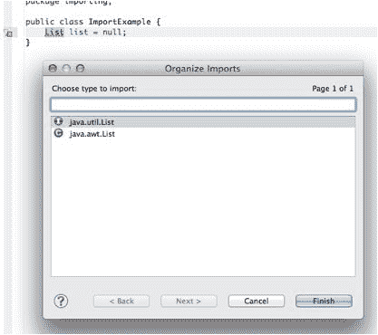

图 1

该功能的另一个优点是将相关包的导入分组在一起，并移除任何未使用的导入，有助于保持代码整洁。

导入类的第三种方法是通过通配符：

```java
package importing;

import java.util.*;

public class ImportExample {

  List list = null;

}
```

这个示例隐式地导入了`java.util`包中的所有类——因此`java.util.List`在类体中可以被称为`List`。

这里列出的三种方法从最具体到不具体排列。例如，考虑以下示例：

```java
package importing;

import java.util.*;

import java.awt.List;

public class ImportExample {

  List list = null;

}
```

变量`list`将是`java.awt.List`的实例，因为它具有最具体的导入。请注意，这与导入的顺序无关；它完全取决于导入的特定程度。

此外，考虑以下示例：

```java
package importing;

import java.util.*;

import java.awt.List;

public class ImportExample {

  List list1 = null;

  java.util.List list2 = null;

}
```

变量`list1`将具有类型`java.awt.List`（根据显式导入），而`list2`的类型将是`java.util.List`（因为它是显式命名的）。

## 类路径（Classpath）

当程序运行时，它可以访问许多不同的类。其中一些类是你自己编写的，另一些是由 Java 本身提供的，而另一些可能由第三方供应商或开源库提供。

运行中的程序所可用的所有类集合被称为其`classpath`。Java 会在程序执行过程中根据“按需”原则加载这些类，这个过程被称为`class loading`（类加载）。

可能某些类在编译时是可用的，但在程序实际执行时不可用。例如，在打包 Java 程序时，你可能会忘记包含某些所需的库。在这种情况下，类加载器将在程序执行时无法加载类，并导致生成异常。

## 标准输出和输入

书中编写的程序是命令行程序而不是基于 GUI 的程序：它们将直接向文件或 Eclipse 控制台产生文本输出。

Java 遵循传统的 UNIX 标准，并为程序提供了三个可以根据需要使用的流：

- **标准输入（Standard input）**：这是程序从中读取输入的地方。默认的标准输入是键盘，但程序必须显式地监听输入以便读取。该流可以通过`System.in`访问。
- **标准输出（Standard output）**：这是程序写入输出的地方。默认标准输出是程序所在的命令行 shell，或者在 Eclipse 中是控制台视图（Console view）。可以通过`System.out`访问该流，正如许多示例所示。
- **标准错误（Standard error）**：这是程序写入任何错误信息的地方。它的默认值与标准输出相同，但在 Eclipse 中文本将以红色形式输出。可以通过`System.err`访问。

可以重定向这些流。例如，可以将标准错误重定向到文件而不是控制台。这个主题将在后面的章节中再次讨论。

本书将很大程度上忽略标准输入。在命令行程序运行时需要输入是相对罕见的：通常，程序所需的所有信息都是作为参数提供的。如果程序在运行时确实需要输入，通常的做法是使用 GUI，但正如所讨论的，这出了本书的范围。

到目前为止，你按照如下方式向标准输出写入：

```java
System.out.println("Hello world");
```

`println`方法（如前所述，它定义在`PrintWriter`类上）会在文本末尾自动插入换行符。`PrintWriter`还支持一个名为`print`的方法，它完全相同，区别在于它不包含隐式的换行符。

`PrintWriter`类还包含另一个非常有用的方法`printf`。这对于任何 C 或 C++ 程序员来说都是熟悉的，因为它等同于`sprintf`。该方法提供了一种机制，可以在打印的`String`内部包含参数，而无需诉助于`String`拼接。例如，考虑以下方法：

```java
public class Printing {

  public static void main(String[] args) {

    int i = 10;

    double d = 20.2;

    System.out.println("The value of i is " +

    i + " and the value of d is " + d);

  }

}
```

虽然从功能角度来看这段代码没有问题，但`println`语句既凌乱又容易出错（很容易忘记变量前后的空格）。这段代码可以重写如下：

```java
public class Printing {

  public static void main(String[] args) {

    int i = 10;

    double d = 20.2;

    System.out.printf("The value of i is %d and the value of d is %f\n", i, d);

  }

}
```

在这个示例中，我使用特殊序列`%d`为`int`提供了一个占位符，并使用`%f`为`double`提供了一个占位符：然后我在`String`结束之后，按照它们在`String`中出现的顺序为这些占位符提供值。

你还会注意到，我在`String`的末尾添加了`\n`。`printf`不包含换行符，但可以使用`\n`强制换行。

反斜杠字符是告知 Java`String`中的下一个字符具有特殊含义的方法，被称为转义字符。例如，`\t`创建一个制表符。

还可以使用`\"`在`String`中添加双引号——反斜杠确保 Java 不会将双引号误认为是`String`的结束标记。此外，如果你需要在`String`中添加反斜杠，可以使用双反斜杠——`\\`。

`printf`还可以使用以下额外的占位符：

- `%c`：用字符的占位符。
- `%s`：用`String`的占位符。如果使用`%S`，`String`将自动转换为大写。
- `%n`：可以作为`\n`的替代方案。这种形式实际上应该被优先，因为不同的平台有时会使用不同的序列来强制换行。例如，Windows 通常使用`\r\n`（回车、换行），而 UNIX 使用`\n`。因此，`%n`是一种强制换行的平台无关机制。

## 一切皆对象

关于 Java 的一个常见说法是：“在 Java 中，一切都是对象”。事实证明，确实是字面上的意思。平台包含一个名为`Object`的类，它是所有其他类的隐式父类。

唯一的异常是原始类型，它们不继承自任何类。

`Object`类包含许多实用方法，因为其他所有类都继承自它，所以每个类都自动拥有这些方法的实现，正如下一个示例所示：

```java
public static void main(String[] args) {

  Car car1 = new Car("HGS928", "Ford",

  "Focus", 1800, (short) 2010);

  Car car2 = car1;

  System.out.println(car1.toString());

  System.out.println(car1.equals(car2));

}
```

这个示例使用了前面的章节创建的`Car`类：但它调用的方法从未在该类上定义。尽管你没有在`Car`类中编写`toString`和`equals`方法，但它们是可用的，因为它们*继承*自`Object`，而`Car`自动*扩展*了`Object`：这个过程被称为继承。

你将在后面的章节中更多地接触继承，但现在可以把它看作是从一个类向另一个类添加功能的方法。在这种情况下，来自`Object`的功能被添加到`Car`中。你还会发现，如果`Object`提供的实现不够，可以更改这些方法的定义以满足你特定的需求。

我将在书中适当的位置介绍在`Object`上定义的方法，你还将学到由于所有类都派自`Object`类而产生的其他影响。

## 向程序传递参数

向程序传递参数是使你的程序更通用的一种方法。传递给程序的参数让相同的编译代码根据运行时提供的值表现出不同的行为。

作为一个简单的示例，考虑一个需要相加传递给它的两个值的程序。该程序将假设两个参数都是整数：

```java
package adder;

public class Adder {

  public static void main(String[] args) {

    int i1 = Integer.valueOf(args[0]);

    int i2 = Integer.valueOf(args[1]);
```


```java
int result = i1+i2;

}

}
```

```java
System.out.printf("The result is %d", result);

}

}
```

如果你像之前运行那些程序那样运行这个程序，它将会失败。这是由于`args`数组包含零个元素，而程序尝试访问位置为 0 和 1 的元素。

当你运行这个程序时，你需要一种方法来向它提供参数。为了演示这一点，请在包管理器视图（package explorer view）中右键点击该类，并选择`Run As -> Run Configurations…`。

这将弹出一个对话框。选择`Arguments`选项卡，并在`Program arguments`框中输入两个数字（用空格分隔），如图 7-2 所示：

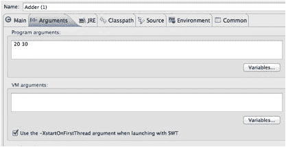

图 7-2

如果你现在选择对话框底部的`Run`，程序将打印出这两个数字相加的结果。

一旦你学习了更多关于遍历循环，就会发现程序可以接受并处理任意数量的参数。例如，你可以让用户传递任意数量的数字，并让程序它们全部相加。

# 8 运算符

Java 拥有一大量的运算符，用于对一个、两个或三个操作数进行操作。你已经见过`+`和`=`运算符的示例，但理解该语言支持的所有核心运算符是非常重要的。

本节将通过将这些运算符分成相关的类别来研究它们。如果你用过其他编程语言，本节可能会看起来熟悉，因为可用运算符在不同语言之间往往是一致的。

## 算术运算符

任何编程语言中是最熟悉的运算符就是算术运算符。Java 支持 4 个核心算术运算符（`+`、`-`、`*`和`/`）以及模运算符（`%`），后者返回整数整数除法运算的余数。Java 使用常规的运算符优先级，但可以通过使用括号`()`来覆盖。

以下程序展示了算术运算符的使用：

```java
package arithmetic;

public class ArithmeticExcample {

  public static void main(String[] args) {

    // 打印 2

    System.out.println(1+1);

    // 打印 5

    System.out.println(1+2*2);

    // 打印 6

    System.out.println((1+2)*2);

    // 打印 1

    System.out.println(10%3);

    // 打印 3

    System.out.println(10/3);

    // 打印 3.3333333333333335

    System.out.println(10.0/3);

  }

}
```

记住，如果所有数字都是整数，结果就是整数。如果其中一个数字是浮点数，结果就是浮点数。这只影响`/`和`%`运算符，这也是为什么示例中的最后两个操作产生了不同的结果，尽管输入看起来是相同的。

正如在其他地方提到的，`+`运算符在 Java 中被重载了：如果两个参数中的其中一个是`String`，则该运算符对两个操作数执行字符串拼接。这是唯一一个以这种方式被重载的运算符：例如，无法在`Strings`之间使用`*`运算符。

### 一元运算符

一元运算符对单个操作数执行操作。

`++`和`--`运算符用于将操作数加 1 或减 1。以下程序展示了`++`运算符的示例：

```java
package unary;

public class UnaryExample {

  public static void main(String[] args) {

    int num = 10;

    int num2 = num++;

    int num3 = ++num;

    System.out.println(num2);

    System.out.println(num3);

  }

}
```

`main`方法的第 2 行和第 3 行之间存在细微但重要的区别。第二行将`++`运算符放在变量之后，而第三行将它放在变量之前。这看起来像是一个小区别，但实际上非常重要：

- 第二行表示：将`num`的值赋给变量`num2`，*然后*将`num`的值加 1。
- 第三行表示：先将`num`的值加 1，*然后*将`num`的值赋给变量`num3`。

从`num`变量的角度来看，这些行是等价的（它的值增加了 1），但对于赋值操作结果的变量来说，结果是不同的。这就是为什么程序打印出：

```text
10
12
```

`--`运算符与`++`运算符相同，除了操作数的值减了 1 之外。

`--`运算符也可以用一元运算符，并将一个正值变为负值。例如，以下行代码打印 -2：

```java
System.out.println(-(1+1));
```

一元`+`运算符确实存在，但它实际上并没有做任何事情（因为数字默认是正数）。`+`运算符不会将负数转为正数；相反，可以使用`Math.abs`方法来实现这一点。

最后一个一元运算符是`!`（非）运算符。它用于反转布尔值：将 true 变为 false，反之亦然。例如，以下代码打印 true：

```java
System.out.println(!false);
```

### 等于和关系运算符

等于和关系运算符用于比较两个操作数。这包括：

- 比较操作数是否相等或不等的运算符`==`和`!=`。
- 四种关系运算符`<`、`>`、`<=`和`>=`。
- `instanceof`。

这些运算符的结果是一个布尔值。由于这种原因，这些运算符常用于分支和循环，正如后文所示。

以下程序演示了等等运算符：

```java
package comparison;

public class Equality {

  public static void main(String[] args) {

    System.out.println(1==1);

    System.out.println(1==1.0);

    System.out.println(1!=2.0);

    StringBuffer sb1 = new StringBuffer("Hello");

    StringBuffer sb2 = new StringBuffer("Hello");

    StringBuffer sb3 = sb1;

    System.out.println(sb1 == sb3);

    System.out.println(sb1 != sb2);

    System.out.println("hello" == "hello");

    System.out.println(new String("hello") != new String("hello"));

    System.out.println("hello" instanceof String);

    System.out.println(sb2 instanceof StringBuffer);

  }

}
```

有几个有趣的点：

- 当比较数字时，数据类型不需要相同也可以相等：这就是为什么 1（int）等于 1.0（double）。但由于浮点数的精度问题，比较整数和浮点值通常是一个坏主意。
- 两个对象当引用同一个对象时是相等的：这就是为什么`sb3`等于`sb1`：它们都引用同一个对象，但`sb2`不等于`sb1`，因为它引用的是 StringBuffer 对象的独立实例。要完全理解这一点，理解对象与引用之间的区别是有用的——这个主题将在后续章节中深入探讨。
- 字符串是一个特殊情况：由于字符串是不可变的，Java 将程序创建的所有字符串字面量内存内存池。如果多次多次，将使用池中的同一个实例。结果是`"hello"`等于`"hello"`——它们实际上是同一个对象。这个主题将在未来的章节详细讨论，所以现在可以忽略这一点。
- 然而，如果通过构造函数构造字符串，它们将跳过此池，这就是为什么`new String("hello")`不等于`new String("hello")`。
- `instanceof`运算符是一个实用的工具，用于确定变量是否是特定类的实例（或类型）。

以下程序演示了关系运算符，再次，程序中的所有操作都返回 true：

```java
package comparison;

public class Relational {

  public static void main(String[] args) {

    System.out.println(1 >= 1);

    System.out.println(2 > 1.0);

    System.out.println(1.99999 < 2);

  }

}
```

```java
System.out.println(1.9 <= 2.0);

}
```

### 条件运算符

Java 还包含两个条件运算符：`&&`（与）和`||`（或），它们可以与布尔值或返回布尔值的表达式结合使用。例如，它们可以用于两个布尔表达式都为真时返回 true。或者，它们也可以在两个布尔表达式中至少有一个为真时返回 true。

与算术运算一样，可以使用括号来定义优先级。以下语句均返回 true：

```java
package conditional;

public class ConditionalExample {

 public static void main(String[] args) {

  System.out.println(true && true);

  System.out.println(1 > 0 && 1 >= 1);

  System.out.println((0 > 1 && 0 > 2) || 0 == 0);

  System.out.println("hello".length() == 5 && "hello".charAt(0) == 'h');

  int[] nums = {};

  System.out.println(nums.length == 0 || nums[1] > 5);

 }

}
```

`main`方法中的最后一条语句很有意思。如果执行表达式`nums[1] > 5`，将会抛出异常，因为它试图访问一个包含 0 个元素的数组中索引为 1 的元素（如果你想确定，可以单独尝试一下）。

然而，整行代码执行时没有任何问题，并返回 true。这是因为第一个表达式`nums.length == 0`返回 true，因此没有必要执行第二个表达式，因为无论第二个表达式的结果如何，整个或（or）表达式的结果都是相同的（true）。

这被称为**短路求值**（short-circuiting），当`&&`表达式中的第一个表达式返回 false 时，也会发生这种情况，因为无论第二个表达式的结果如何，`&&`表达式必须返回 false。

### 赋值运算符

如前面讨论的，等号是赋值运算符：

```java
int num = 10;
```

Java 还支持许多其他赋值运算符，这些运算符有助于某些语句更加简洁。例如，下面这行代码：

```java
num = num + 10;
```

可以替换为：

```java
num += 10;
```

该家族中的其他运算符还有`-=`、`*=`、`/=`和`%=`。

# 9 循环与分支

所有编程语言中发现的两个关键特性是循环和分支的概念。

- **分支**是根据一组标准确定执行哪个代码块的过程。
- **循环**是指以有限的次数执行同一块代码的过程。

Java 包含了用于循环和分支的多种机制。这些机制将在本章中详细介绍。

本章中的示例都将直接在类的`main`方法中执行。如果你想在 Eclipse 中遵循这些示例，请创建一个名为`LoopsAndBranching`的新项目并添加一个带有`main`方法的类。

## 分支

分支允许程序根据布尔表达式的求值确定遵循的路径。本章将介绍三种支持分支的不同语言特性。

### If-then-else

Java 中最基础的分支机制是`if-then-else`块。在最简单的形式中，`if-then-else`块仅包含一个`if-语句`，如果该语句内部的表达式求值为 true，则执行该块中的代码。下面的代码包含两个`if-块`：其中一个将打印一条语句，另一个不会：

```java
package branching;

public class IfThenElse {

 public static void main(String[] args) {

  int i = 10;

  if (i > 5) {

    System.out.println("This will print");

  }

  if (i < 10) {

    System.out.println("This will not print");

  }

 }

}
```

第一个`if-块`将执行，因为 10 大于 5。第二个`if-块`将不会执行，因为 10 不小于 10。如果第二个表达式被指定为`i <= 10`，那么这个块也会执行。

注意我正通过熟悉的大括号`{}`声明要执行的代码块。由于此程序现在有三层嵌套括号，因此遵循此处看到的格式约定非常重要——每个新块都应该缩进——通常使用制表符（tabs）或 4 个空格。缩进确保了很容易判断每个块的开始和结束。

Eclipse 可以帮助找到匹配的括号。如果你将光标放在右括号之后，编辑器将高亮其匹配的左括号（反之亦然）。

从技术上讲，这种情况可以省略括号，并将代码重写如下：

```java
public static void main(String[] args) {

  int i = 10;

  if (i > 5)

    System.out.println("This will print");

  if (i < 10)

    System.out.println("This will not print");

}
```

如果`if-块`包含单个语句，则大括号是可选的：Java 将自动假设下一个语句是当`if-块`求值为 true 时应该执行的语句。

但不建议使用这种方法。它是常见的 Bug 来源，尤其是当在不意识到大括号缺失的情况下向`if-块`添加额外的行时。这种做法往往会让代码更难以阅读。

在之前的示例中，当表达式求值为 false 时执行一个块。这可以通过添加`else-块`来实现：

```java
public static void main(String[] args) {

  int i = 10;

  if (i > 10) {

    System.out.println("The number is greater than 10");

  } else {

    System.out.println("The number is NOT greater than 10");

  }

}
```

此示例将打印：

```text
The number is NOT greater than 10
```

使用`if-else`结构，`if-块`或`else-块`将执行（但它们永远不会同时执行）。

最后，通常情况下你可能希望执行多个分支之一。例如，以下内容取决于数字是否为：

- 正偶数
- 正奇数
- 负偶数
- 负奇数

为了实现这一点，代码利用了`else if`结构：

```java
public static void main(String[] args) {

  int i = -10;

  if (i >= 0 && i % 2 == 0) {

    System.out.println("Positive even number");

  } else if (i >= 0) {

    System.out.println("Positive odd number");

  } else if (i < 0 && i % 2 == 0) {

    System.out.println("Negative even number");

  } else {

    System.out.println("Negative odd number");

  }

}
```

这里有许多重要的点需要注意：

- 此代码使用模运算符（`%`）来判断数字是奇数还是偶数：如果一个数字除以 2 的余数为 1，则它是奇数。
- 四个块中只有一个会执行。如果前两个`if-语句`求值为 true，则只执行第一个。
- 你可以保证其中一个块会执行，因为最后一个块是`else`块。如果所有块都是`else if`块，则可能一个都不执行。
- 第一个`if-语句`使用`&&`（与）运算符连接了两个布尔表达式。只有当两个表达式都为真时，执行该块中的代码。
- 第二个语句可以假设如果数字`>= 0`则它是奇，因此只需要检查它是否为正数。
- 从技术上讲，第三个块可以写成`else if (i % 2 == 0)`，因为你已知它是负数（否则其他块就会求值为真）。然而，有时仍然值得添加额外的代码以提高清晰度。
- 最后一个块是`else`块：这是因为任何在其他语句中未求值为真的数字都是负奇数。

也可以将`if`块嵌套在一起。之前的示例可以很容易地重写为嵌套表达式：外部块将决定数字是偶数还是奇数，而内部表达式将决定数字是正数还是负数：

```java
public static void main(String[] args) {

  int i = -10;

  if (i % 2 == 0) {

    if (i >= 0) {

      System.out.println("Positive even number");

    } else {


### Switch 语句

执行分支的第二种方法是通过`switch`语句。`switch`语句与`if`-语句不同：它接受单个变量，然后提供一组当变量的值等于指定的值时执行的块。这是一个基础示例：

```java
public static void main(String[] args) {
  int i = 2;
  switch (i) {
    case 1 :
      System.out.println("The number is 1");
      break;
    case 2 :
      System.out.println("The number is 2");
      break;
    case 3 :
      System.out.println("The number is 3");
      break;
    default :
      System.out.println("The number is greater than 3");
      break;
  }
}
```

一个`switch`块通过以下语句引入：

`switch (i) {`

这指定了将进行切换的变量（该值恰好为`2`）。

在`switch`块内部有一系列语句，例如：

`case 1 :`

这些等同于`if (i == 1)`：当`case`语句右侧的值与被切换变量的值相等时，它们会被评估为`true`。`switch`语句只能根据相等性评估为`true`；无法使用如大于或小于等表达式。

如果一个`case`语句评估为`true`，则其下所有代码都会执行（`case`语句除外），直到遇到`break`语句。这有点令人惊讶，意味着如果你从这段代码中移除`break`语句：

```java
switch (i) {
  case 1 :
    System.out.println("The number is 1");
  case 2 :
    System.out.println("The number is 2");
  case 3 :
    System.out.println("The number is 3");
  default :
    System.out.println("The number is greater than 3");
}
```

结果将是：

```
The number is 2
The number is 3
The number is greater than 3
```

这是经典案例之一，语言的行为并不符合你的直觉预期。其原因是历史性的：`Java`的语法基于`C`语言，而`C`语言使用了这种约定。从以后这一直是Bug的主要来源，因为即使是经验丰富的程序员有时也会忘记添加`break`语句。

这种约定最初被采用是有原因的：假设你希望数字为1、2或3时执行同一个块，而在其他情况下执行另一个块。你可以这样写：

```java
switch (i) {
  case 1 :
  case 2 :
  case 3 :
    System.out.println("The number is 1, 2 or 3");
    break;
  default :
    System.out.println("The number is greater than 3");
    break;
}
```

关于`switch`语句还有许多其他注意点。第一是`default`块，它可以可选地作为`switch`语句的结尾：当其他所有`case`语句都不匹配时，将进行此评估。如果省略了此块，且没有`case`语句匹配，则`switch`块内将没有代码执行。

下一个需要理解的点是可以传递给`switch`语句的数据类型。最初`switch`语句仅支持整数（具体为`byte`、`short`、`char`和`int`）。`switch`语句不支持浮点数，甚至不支持`long`数据类型。

`Java 5`增加了对`enums`的支持（将在书中稍后部分介绍），然后在`Java 7`中增加了对`Strings`的支持。以下是使用`Strings`的`switch`语句示例：

```java
public static void main(String[] args) {
  String s = "one";
  switch (s) {
    case "zero" :
      System.out.println("The number is 0");
      break;
    case "one" :
      System.out.println("The number is 1");
      break;
    case "two" :
      System.out.println("The number is 2");
      break;
    default :
      System.out.println("The number is greater than 2");
      break;
  }
}
```

### 三元运算符

实现分支的最后方法是通过一种接受三个参数的特殊运算符（因此被称为三元运算符）。该运算符本质上提供了`if-then-else`的单表达式版本。以下是三元运算符的示例：

```java
public static void main(String[] args) {
  int i = 2;
  String s = i % 2 == 0 ? "even" : "odd";
  System.out.println("The number is "+s);
}
```

## 循环

计算机程序中有许多情况需要重复执行任务。例如，你可能需要遍历数组并对每个元素执行操作。

### For 循环

你将看到的第一个循环类型是`for`-循环。`for`-循环可能是`Java`中最常用的循环形式。以下是一个非常基础的`for`-循环示例。它向控制台打印10行：

```java
public static void main(String[] args) {
  for (int i = 0; i < 10; i++) {
    System.out.println("The number is "+i);
  }
}
```

如果你运行它，输出如下：

```
The number is 0
The number is 1
The number is 2
The number is 3
The number is 4
The number is 5
The number is 6
The number is 7
The number is 8
The number is 9
```

理解`for`-循环的关键在于以下声明：

`for (int i = 0; i < 10; i++) {`

这一行看起来可能很复杂，但如果你将其拆解为三个组成部分（每个部分由分号隔开），它就很容易懂了。第一部分`int i = 0`声明了一个作为计数器的变量。该变量将用于跟踪循环执行的次数。在特定情况下，我使用了一个名为`i`的变量，因为它尚未声明，所以我告诉了编译器它的类型。我还指定了变量的初始值。传统上是从0开始计数而不是1，但这完全取决于程序员。传统上也使用`i`作为变量名（“index”的缩写），但再次，任何有效的变量名都可以。

语句的第二部分`i < 10`声明了循环持续必须为`true`的条件。在这种情况下，只要变量`i`小于10，循环就会继续。该表达式会在循环的每次迭代中进行评估。

语句`i++`的第三部分定义了变量`i`在循环每次迭代的`conclusion`（结束）时应该如何被修改。在大多数情况下，你希望循环计数器增加1。如果`i`的值在每次循环迭代后都不改变，那么循环将永远不会结束（它将变成一个`infinite loop`死循环）。

如果你将所有这些内容结合在一起，你就得到了一个执行10次的循环（从0开始，到9结束）。循环每次执行时，它都会执行大括号之间的代码块，在这种情况下，这是一行打印`i`当前值的单行代码。

虽然你可以在循环内部引用变量`i`，但你可能想知道循环结束后这个变量会发生什么。由于变量`i`是在`for`-循环声明内部声明的，它的作用范围仅限于该`for`-循环。如果你尝试在循环结束后使用此变量，你将收到编译错误，因为编译器知道该变量已不存在了。

在循环内部本身声明其他变量也是可能的。在下一个示例中，我在循环内部声明了一个名为`squared`的变量。因为是在循环内部定义的，所以它会在循环的每次迭代中被初始化（因此，它不知道上一次迭代的值）。自然地，你无法在循环外部访问这个变量。

```java
public static void main(String[] args) {
  for (int i = 0; i < 10; i++) {
    int squared = i * i;
    System.out.println("The number is "+i);
    System.out.println("Squared is "+squared);
  }
}
```

上一个示例相当直观，但循环的三个部分可以用非常有创意的方式使用。例如，假设你想编写代码来反转一个`String`的值。可以通过如下实现：

```java
public static void main(String[] args) {
  String s = "Welcome to Java";
  for (int i = s.length(); i > 0; i--) {
    System.out.print(s.charAt(i-1));
  }
}
```

这个特定的示例将反转字符串"Welcome to Java"。`for`-循环声明的三个部分如下：

- 变量`i`被设置为`String`的长度(15)。
- 只要变量`i`大于0，循环就继续。
- 循环每次迭代时，`i`的值应该减1。

在`for`-循环内部，代码获取`String`中位置`i-1`处的字符，并使用`System.out.print`将打印到控制台。代码块使用`i-1`，是因为如果`String`的长度为15个字符，最后一个字符位于位置14（因为计数从0开始）。

下一个`for`-循环示例将累加多维数组中的所有数字。在这个示例中，外部数组将有4个成员，每个成员将由一个包含3个数字的数组组成。为了处理这个数组，需要将一个`for`-循环嵌套在`for`-循环内部。外部`for`-循环将遍历外部数组中的4个元素，而内部循环将遍历每个内部数组中的3个元素：

```java
public static void main(String[] args) {
  int[][] numbers = {{1,2,3},{4,5,6},{7,8,9},{10,11,12}};
  int result = 0;
  for (int i = 0; i < numbers.length; i++) {
    for (int j = 0; j < 3; j++) {
      result += numbers[i][j];
    }
  }
  System.out.println(result);
}
```

注意用于控制内部循环的变量是`j`而不是`i`：这允许代码同时跟踪两个计数。每当外部循环开始新的迭代时，变量`j`都会被重置为0。

关于`for`-循环值得注意的最后一点是，循环声明的所有三个部分都是可选的。然而，如果省略了第二部分，循环体必须包含一个`break`语句（如下一节所示），以允许循环最终退出。

以下是一个有效的`for`-循环声明，它将创建一个无限循环的循环，直到循环体中的某些内容导致其停止：

```java
for (;;) {
```

### Break and continue

在循环中，经常会有，即使循环未完成，停止循环是有用的。考虑一个负责判断数组中所有元素总和是否达到100或更多的循环：

```java
public static void main(String[] args) {
  int[] numbers = {3,5,43,2,5,33,2,45,5,3};
  int checkGreaterThan = 100;
  int sumOfNumbers = 0;
  for (int i = 0; i < numbers.length; i++) {
    sumOfNumbers += numbers[i];
  }
  if (sumOfNumbers > checkGreaterThan) {
    System.out.println("It is greater");
  }
}
```

这段代码是完全有效的，但在处理方面也略显浪费。检查`sumOfNumbers`是否大于`checkGreaterThan`可能更有意义：一旦`sumOfNumbers`大于`checkGreaterThan`，就需要停止处理，这在`for`-循环内部通过使用`break`语句可以实现：

```java
for (int i = 0; i < numbers.length; i++) {
  sumOfNumbers += numbers[i];
  if (sumOfNumbers > checkGreaterThan) {
    System.out.println("It is greater");
    break;
  }
}
```

一旦遇到`break`语句，循环就会终止。

`break`关键字总是跳出当前循环，所以如果你在使用嵌套循环，可能希望跳出所有的循环。这可以通过标签实现：

```java
public static void main(String[] args) {
  int[][] numbers = {{1,2,3},{4,5,6},{7,8,9},{10,11,12}};
  int checkGreaterThan = 100;
  int sumOfNumbers = 0;
  outer: for (int i = 0; i < numbers.length; i++) {
    for (int j = 0; j < 3; j++) {
      sumOfNumbers += numbers[i][j];
      if (sumOfNumbers > checkGreaterThan) {
        System.out.println("It is greater");
        break outer;
      }
    }
  }
}
```

注意外部循环被标记了标签`outer`。标签只是任意名称，后面跟着一个冒号。`break`语句指定它想要应用的循环标签，从而允许你跳出外部循环，而不是执行`break`语句所在的循环。

标签在`Java`中并不被广泛使用，由于它们与许多语言中的`goto`语句相似，因此被建议避免。`goto`语句允许任何代码跳转到任何其他代码，并因创建难以理解的“面条代码”而闻名。

标签是作为`goto`语句的“受控”形式引入的。`Java`的创建者不想引入`goto`语句，但他们承认`goto`语句在嵌套循环的特定情况下是有用的。

`continue`关键字在语法上与`break`关键字相似，但它提供了一种结束循环当前迭代并立即跳转到下一次迭代的方法。

考虑一个修改后的加器程序。这个示例将只计算偶数；因此，如果遇到奇数，它需要立即跳转到下一个数字（以及循环的下次迭代）。可以通过如下实现：

```java
public static void main(String[] args) {
  int[] numbers = {3,5,44,2,5,33,2,45,5,3,44,22,26,7,9,11};
  int checkGreaterThan = 100;
  int sumOfNumbers = 0;
  for (int i = 0; i < numbers.length; i++) {
    if (numbers[i] % 2 != 0) {
      continue;
    }
    sumOfNumbers += numbers[i];
    if (sumOfNumbers > checkGreaterThan) {
      System.out.println("It is greater");
      break;
    }
  }
}
```

`continue`语句实际上是在说，没有理由处理循环本次迭代的剩余部分，因此循环应该立即开始处理循环的下次迭代。

与`break`关键字一样，`continue`也可以使用标签。

循环的另一种形式是`while-loop`。`while-loop`的声明在语法上比`for-loop`更简单：它指定了一个必须保持为真的条件才能继续处理循环：

```java
public static void main(String[] args) {
  int i = 0;
```


`while (i < 10) {`

```
System.out.println("The number is " + i);
i++;
```

}

在许多方面，`while-loops` 与 `for-loops` 相似。`for-loop` 定义的三个部分仍然存在，但其中两个部分被声明在循环声明之外：

- 控制迭代的变量声明需要在循环声明之前进行。在这个示例中，变量`i`在方法的第一行被声明了。
- 决定循环是否继续执行的布尔表达式出现在循环声明内部。在这种情况下，表达式为`i < 10`。
- 计数器变量的修改必须在循环内部进行。在这种情况下，通过以下语句对变量修改：`i++`。

如果循环体没有增加`i`变量，循环将永远不会停止（这将创建一个死循环）。Java 编译器无法检测死循环，因此它们是运行时错误的常见来源。

`while-loops` 的大多数其他特征与`for-loops`相同。它们在每次迭代时执行一个代码块，可以使用`continue`和`break`关键字来控制执行，并且可以相互嵌套。

## Do-while 循环

在`while loops`中，`while loop`内部的代码可能永远不会执行。当布尔表达式的初始评估为假时就会发生这种情况，例如：

```java
while (i > 0) {
```

这引出了最后一种循环：`do-while loop`。

`do-while loop`和`while loop`之间的区别在于`do-while loop`保证至少执行一次，即使布尔表达式在第一次评估时结果为假。由于这个原因，布尔表达式出现在循环体之后：

```java
public static void main(String[] args) {
  int i = 0;
  do {
    System.out.println("The number is " + i);
    i++;
  } while (i < 10);
}
```

如果你尝试将此循环和`while-loop`都改为使用表达式`i < 0`，你会发现`do-while loop`仍然执行了一次。

老实地说，我使用`do-while loop`的次数可以用一只手数出来，但知道它们的存在是很重要的，你偶尔会发现它们的用途。

# 10 调试

调试是软件工程师最重要的概念之一。它提供了一种在程序执行时对其检查的机制，从而允许诊断并解决任何错误。如果没有调试，你将不得不向控制台打印信息，并从这些日志中组合程序的状态。

Eclipse IDE 提供了一个内置调试器，这将是本的重点。

在开始学习调试之前，引入一个新的 Eclipse 叫做`perspective`。到目前，你一直使用的是`Java perspective`。此视角包含了许多视图，最著名的是`package explorer view`（包管理器视图）、`editor view`（编辑器视图）和`console view`（控制台视图）。

Eclipse 允许你自定义`perspective`的显示。你可以在屏幕上拖动视图，更改它们的大小，或向`perspective`中添加新视图（使用`Window -> Show view`选项）。

`perspective`的基本思想是它是将一组视图集合在一起，以帮助你执行特定任务。到为止，你的任务是编写和执行 Java 代码，因此`Java perspective`满足了你的需求。当你开始调试程序时，你将使用另一个叫做`Debug perspective`的视角。它也包含许多视图，但这些视图在某种程度上与在`Java perspective`中看到的不同。

你可以通过 Eclipse 窗口右上角的此工具栏选择你想要使用的`perspective`，如图 10-1 所示：


图 10-1

如你所见，选中了`Java perspective`，而`Debug perspective`可用。点击最左侧的按钮（带有金色星号）可以访问许多其他视角，这些视角将在书中介绍。

正如你将看到的，当你开始调试代码时，Eclipse 会自动打开`Debug perspective`，但你需要在结束使用此工具栏切换回`Java perspective`。

## 入门

为了开始，你需要选择一个我们想要调试的程序。你将调试的程序是“循环与分支”章节中的`ArrayAdder`程序。该类应该如下：

```java
package loops;

public class ArrayAdder {
  public static void main(String[] args) {
    int[] numbers = {3,5,43,2,5,33,2,45,5,3};
    int checkGreaterThan = 100;
    int sumOfNumbers = 0;
    for (int i = 0; i < numbers.length; i++) {
      sumOfNumbers += numbers[i];
      if (sumOfNumbers > checkGreaterThan) {
        System.out.println("It is greater");
        break;
      }
    }
  }
}
```

该类当数组之和大于 100 时打印`It is greater`。在`Java editor`中打开此类并双击以下行：

`sumOfNumbers += numbers[i];`

蓝点应该出现在边距处，如图 10-2 所示，这允许你与程序进行交互：

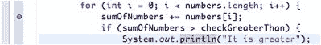

图 10-2

这个点被称为`breakpoint`（断点）。当你以调试模式运行时，程序会在该处停止。现在，右键点击`Package Explorer`中的`ArrayAdder`类并选择调试它，如图 10-3 所示：

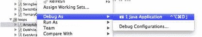

图 10-3

到达`breakpoint`时会显示如图 10-4 所示的提示，询问你是否进入`Debug Perspective`。我建议勾选“记住我的决定”并选择“是”。

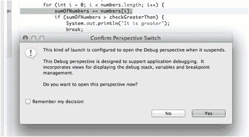

图 10-4

调试器中有许多视图。如你所见，`editor`仍然是视图，但`editor`包含了附加功能：例如，它高亮了调试器当前暂停的代码行。

另一个视图是`Variables view`，如图 10-5 所示：

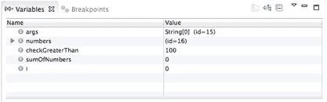

图 10-5

它显示了当前所有变量的值。例如，你可以看到`i`和`sumOfNumbers`在程序执行的这个阶段都被设置为 0。你也可以通过在编辑器中悬停来查找任何变量的值。

现在程序已暂停，你可以开始在它执行时与其进行交互。作为一个开始，你可能想知道表达式`numbers[i]`的值是多少。为了找到答案，你可以突出这段代码（不包括分号），右键点击选中的文本，并选择`Inspect`（检查），如图 10-6 所示：

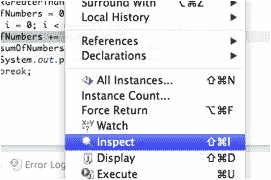

图 10-6

这将导致语句执行并显示结果 (3)。

你现在可以逐行单步程序并观察它的执行过程。主要的调试控制可以在顶部菜单中找到，如图 10-7 所示：


图 10-7

你最初使用的功能是`Step over`（单步跳）。它是黄色箭头中的第二个（从左数第五个）。如果你按下此按钮，调试器将移动到下一行代码，从而执行调试器之前暂停的那行。作为结果，`sumOfNumbers`变量的值将被设置为 3。

现在你可以选择代码`sumOfNumbers > checkGreaterThan`并在右键菜单中选择“检查”（Inspect）：这将通知你该表达式求值为 false。你也可以通过再次选择“单步跳”（Step over）来确认这一点：执行将继续返回 for 循环的顶部。

“单步跳”旁边的按钮是“单步入”（Step into）。如果当前行涉及方法调用，此按钮非常有用，因为它允许调试器进入这些方法调用，而不是仅仅跳过它们。

如果你多按几次“单步跳”，你会看到代码正在执行，并且随着执行的进行，作用域内变量的值发生变化。如果你想运行到程序的下一个断点（在本例中即循环的下一次迭代），你也可以按下调试菜单左侧的绿色按钮。

在看到程序执行了循环几次迭代后，你可能决定只让程序在准备打印“It is greater”时才暂停。在程序暂停状态下，你可以双击该行旁边的页边距：

```
System.out.println("It is greater");
```

这将为该行添加一个断点。然后你可以再次双击行旁边的蓝点：

```
sumOfNumbers += numbers[i];
```

这将移除该行的断点。

如果你现在按下绿色的“继续”（Continue）按钮，执行将持续直到在新的断点处停止。你现在可以确认在循环的第 8 次迭代中（`i=7`，因为计数从 0 开始）了条件，并且`sumOfNumbers`的值为 138——如图 10-8 所示：

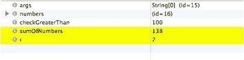

图 10-8

这些变量的黄色高亮表示它们的值发生了变化。

# 11 对象引用

之前的几章介绍了对象和类的概念。本章将更详细地介绍对象，特别是：你将对象与持有这些对象的变量之间的区别。到目前为止，我并没有区分区分这两个概念，但学习区分它们是学习 Java 的一个至关重要的方面。

考虑以下代码：

```
StringBuffer sb1 = new StringBuffer("Hello World");
```

这行代码看起来足够简单：它实例化了一个`StringBuffer`对象，并为其分配了文本“Hello World”。此外，在执行这行代码后，可以使用名为`sb1`的变量来访问该对象。

人们可能很容易认为`sb1`和创建的对象是同一个东西：例如，`sb1`仅仅是赋予新创建对象的名称。然而，这并不是这行代码的准确解释：`sb1`是一个对象的*引用*（reference）。

为了清楚这种区别，请考虑在上述代码行之后立即添加以下 2 行代码的影响：

```
StringBuffer sb2 = sb1;
sb2.append("!!!");
```

`sb1`和`sb2`现在都指向同一个对象。虽然只创建了一个对象（对象只能通过`new`关键字创建），但这两个变量都引用（或指向）该对象。

正因如此，当我向由`sb2`引用的`StringBuffer`添加“!!!”时，当我打印`sb1`*或*`sb2`的值时，都会看到额外的文本：

```
System.out.println(sb1);
System.out.println(sb2);
```

这两行都将打印相同的值，因为它们打印的都是*同一个*对象的值。

可以使用`==`运算符来判断两个引用是否指向同一个对象，例如，以下表达式将返回 true：

```
sb1 == sb2;
```

可视化上述示例的最好方法是通过图 11-1 中的图：

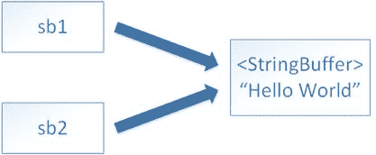

图 11-1

理解了这一点后，现在就可以解释在`Object`类上定义的`equals`方法的默认行为了；如果比较的两个引用指向同一个底层对象，该方法返回 true：

```
sb1.equals(sb2);
```

因此，默认的`equals`方法与使用`==`相同。在随后的章节中，你将学习如何提供该方法的你自己的实现。

在某些编程语言中，对象与指向它们的引用之间的区别是显式的，并且可以访问引用或底层对象。在 Java 中是不可能的，你只能通过引用访问对象。

令人困惑的是，基本类型（primitives）并不是这样运行。考虑以下行：

```
int num1 = 2;
int num2 = num1;
num2 = 5;
System.out.println(num1);
System.out.println(num2);
```

如果基本类型像对象一样运行，你会期望这个示例会两次打印数字 5。事实上，它打印了以下内容：

```
2
5
```

当你声明一个变量为基本类型时，该变量（例如`num1`）并不是对基本类型的引用；变量和值本身就是同一个东西。因此，两个变量无法引用同一个基本类型的值（尽管显然它们可以具有相同的值）。

思考对象和引用区别的另一种方式是，对象和引用都占据了计算机内存的独立区域。引用在它的内存中存储所引用对象的内存地址：因此，如果两个引用持有相同的内存地址，它们指向同一个对象。

在基本类型的情况下，分配的内存只有基本类型所需的内存（例如`long`需要 64 位），并且每次访问基本类型时，都是直接访问该内存。

## 垃圾回收

一旦你理解了对象引用，就可以理解一个重要的 Java 概念：垃圾回收（Garbage Collection）。为了理解垃圾回收的必要性，请考虑计算机程序使用的内存是有限的。Java 程序可以指定希望使用的内存量，但总会有限制。

每当 Java 程序实例化对象时，该对象将使用内存。对象被分配在名为*堆*（heap）的内存区域：这是一个通用的内存区域，可以根据需要分配空间。

在某些编程语言中，实例化对象时需要请求堆上特定数量的空间；在 Java 中，这总是自动的。Java 运行时完全决定如何分配空间，并确保在对象需要额外空间时（例如向`StringBuffer`添加文本时）分配足够的空间。

尽管堆空间的分配是自动的，但在对象不再需要时释放空间也很重要。当一个对象不再被引用时，它就不再被需要了。记住，对象只能通过其引用访问，因此，如果没有对对象的引用，程序永远无法访问该对象。

Java 使用垃圾回收过程来释放未引用对象所占用的内存。每当 Java 程序运行时，会自动运行一个进程来确定对象是否仍然被引用：如果没有被引用，它们的空间将被自动释放。

考虑以下三行代码：

```
StringBuffer sb1 = new StringBuffer("hello");
StringBuffer sb2 = sb1;
sb2 = null;
```

前两行大家都很熟悉：你创建了一个单一的`StringBuffer`对象，并创建了两个指向它的引用。此时，该`StringBuffer`对象将无法被垃圾回收，因为有两个引用指着它。

在第三行中，其中一个引用被设置为`null`，这表示`sb2`不再指向该`StringBuffer`对象（它现在不指向任何内容了）。然而，该对象仍然有一个引用指向它（即`sb1`），因此它仍然无法进行垃圾回收。

取消对象引用的另一种方法是声明该引用现在指向一个不同的对象。像`sb2`这样的变量在同一时间内只能引用一个对象；因此，如果你更改了引用所指向的对象，它就再也无法用于访问原始对象了，例如：

```
sb2 = new StringBuffer("new object");
```

现在看，假设你为这段代码添加了第四行：

```
sb1 = null;
```

一旦执行了这行代码，程序就不再有任何引用指向原始的`StringBuffer`对象了。由于该`StringBuffer`对象无法被任何代码（现在或将来）引用，因此它就可以进行垃圾回收了。

垃圾回收过程并不一定会立即发生，它会在程序执行期间周期性地发生。JVM 完全控制何时决定运行垃圾回收，尽管在启动 Java 程序时可以传递参数来告诉它应该使用何种垃圾回收策略。

垃圾回收方面通常存在一种权衡。分配给程序的内存越多，垃圾回收过程花费的时间就越长。这就是为什么通常会在一台机器上运行多个 Java 应用服务器，而不是让单个 Java 应用服务器使用机器上的所有可用内存。

这个主题对于你在书中编写的程序并不重要，但如果你想了解更多关于配置垃圾回收，以下网站提供了丰富的信息：

[`www.oracle.com/technetwork/java/javase/tech/vmoptions-jsp-140102.html`](http://www.oracle.com/technetwork/java/javase/tech/vmoptions-jsp-140102.html)

没有办法强制运行垃圾回收。不过，可以通过调用以下方法来请求 JVM 运行垃圾回收：

```
System.gc();
```

即使这也只是对 JVM 的一个请求，而且通常没有必要调用它。

当垃圾回收器检测到一个没有引用的对象时，它会首先在该对象上调用名为`finalize`的方法：这是`Object`类本身提供的方法之一，但你可以提供自己的实现。该方法旨在提供清理对象所使用的任何资源（如打开的文件）的机会，尽管在现代 Java 编程中它通常不被使用，因为通常你不会对带有打开资源的对象取消引用。

如果你想看`finalize`的实际效果，请尝试执行以下程序。它创建了 100 万个对象，并立即取消了它们的引用（原因稍后会解释），使它们可以进行垃圾回收：

```java
package finalize;

public class FinalizeExample {
  @Override
  protected void finalize() throws Throwable {
    System.out.println("Finalize called");
  }

  public static void main(String[] args) {
    for (int i = 0; i < 10000000; i++) {
      FinalizeExample f = new FinalizeExample();
    }
  }
}
```


在调用`finalize`之后，JVM 会收回对象占用的空间，并将其供程序的其他地方使用。

垃圾回收并不保证你的程序不会包含内存泄漏。如果你持有对对象的无必要引用，你的程序使用的内存将比需要的多。

重新分配引用或将引用设置为`null`是移除引用与对象之间关联的两种方法，但很多时候甚至这样做通过观察一个更复杂的场景可以看出这一点：

```java
public class GC {
  public static void main(String[] args) {
    GC gc = new GC();
    StringBuffer sb = gc.createStrings();
  }

  public StringBuffer createStrings() {
    StringBuffer sb1 = new StringBuffer("hello");
    StringBuffer sb2 = new StringBuffer("world");
    return sb2;
  }
}
```

在这个示例中，`createStrings`方法声明了两个`StringBuffer`——每个对象都有一个单一引用指向它们（`sb1`和`sb2`）。该方法被`main`方法调用，当方法结束时，它会将这些引用之一返回给调用者。随后，`main`方法保留了该引用。

当对象在方法内部实例化时，它们被放置在堆（heap）上（如前所述），但指向它们的引用（记住，引用也会消耗内存）被放置在称为栈（stack）的另一个内存区域。栈和堆是 JVM 内部两个不同的内存区域。

图 11-2 展示了程序执行时栈和堆的状态。

在方法内部声明的原始变量也被放置在栈上。

栈的操作方式与堆略有不同。正如其名称所示，当方法中声明变量时，它们被放置在栈顶，就像盘子一个接一个堆在一起一样。当方法结束时，方法内部声明的所有变量都会从栈顶弹出并销毁。这意味着它们不再引用任何对象。

基于栈的算法在计算机程序中经常使用。栈被称为“后进先出”（LIFO）数据结构，因为最后添加的总是第一个被移除的。

栈内存区域之所以被称为栈，是因为它是基于栈算法实现的。

与栈相反的是队列，它们被称为“先进后出”（FIFO）结构。对于队列，元素总是按照添加的顺序被移除。

当`createStrings`完成时，引用`sb1`和`sb2`被销毁，因此它们不再引用任何对象。这意味着其中一个对象（被`sb1`指向的对象）可以进行垃圾回收。这种过程每次循环结束时都会发生——这解释了`finalize`示例是如何工作的。

被`sb2`指向的对象更为复杂。因为它是从方法返回的，`main`方法中的引用`sb`现在指向该对象，因此在`main`方法结束之前，该对象无法进行垃圾回收：只有在程序结束时才会发生。

你可以这样理解：`createStrings`方法向`main`方法返回了对象的内存位置（如图 11-2 所示），而`main`方法将该位置存储在变量`sb`中。


图 11-2

尽管图 11-2 暗示对象是在堆上的连续地址分配的，但不应字面理解。JVM 可以将对象放在它认为合适的任何内存位置。

## 方法参数

理解了引用和对象之间的区别，就可以理解参数是如何传递给方法的，更重要的是，当方法修改这些参数之一会发生什么。例如，如果将一个`StringBuffer`传递给方法，并且该方法修改了它，方法的调用者会看到该`StringBuffer`的变化吗？还是保留`StringBuffer`的原始值？

编程语言以两种不同的方式处理这种可能性，这两种方法都没有绝对的对错之分：

- **按值传递（Pass by value）**：在这种方法下，对参数的任何更改都**不会**被调用者看到。在提到的示例中，调用者将保留原始`StringBuffer`的视图，而方法将对该对象的副本进行操作。

- **引用传递 (Pass by reference)**：通过这种方法，调用者**将**会在方法完成后看到方法内部对参数进行的任何更改。在引用传递中，传递的是对象的引用，因此双方在使用该引用时都在修改同一个底层对象。

Java 并不容易被归类为这两两种类别之一。

当将原始类型作为参数传递给方法时，Java 使用的是**值传递 (pass by value)**方法。这意味着调用者看不到方法所做的任何更改。在下面的示例中可以看到这一点：

```java
package parameters;

public class Primatives {
    public static void main(String[] args) {
        int num1 = 5;
        System.out.println("Value at point 1 is "+num1);
        changeMe(num1);
        System.out.println("Value at point 3 is "+num1);         
    }

    private static void changeMe(int num) {
        num += 5;
        System.out.println("Value at point 2 is "+num);
    }
}
```

在这种情况下，方法`changeMe`接收了`num1`持有的值 (5)。然而，这实际上是`num1`持有值的副本，因此在`changeMe`内部对该值进行的任何修改都不会被`main`方法看到。因此，该程序输出了以下输出：

```
Value at point 1 is 5
Value at point 2 is 10
Value at point 3 is 5
```

然而，当程序将对象引用传递给方法时，情况变得复杂。参数仍然是通过值传递的，但让事情复杂的是，按值传递的是对象的引用。这是一个重要的区别，即使是许多经验丰富的 Java 程序员也并不完全理解它。为了理解其影响，请考虑以下示例：

```java
package parameters;

public class PassObject1 {
    public static void main(String[] args) {
        StringBuffer sb = new StringBuffer("Hello");
        System.out.println("Value at point 1 is "+sb);
        changeMe(sb);
        System.out.println("Value at point 3 is "+sb);      
    }

    private static void changeMe(StringBuffer sb1) {
        sb1 = new StringBuffer("Hello World");
        System.out.println("Value at point 2 is "+sb1);
    }
}
```

此示例的行为与基于原始类型的示例相同。`sb`引用的副本被传递给`changeMe`方法：然后`changeMe`方法修改了该引用所指向的堆上的对象。自然地，更改此新对象的值不会影响原始对象。这可以在图 11-3 中看到：

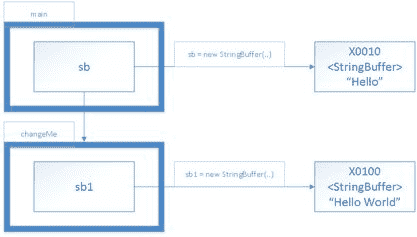

图 11-3

因此，该程序打印了：

```
Value at point 1 is Hello
Value at point 2 is Hello World
Value at point 3 is Hello
```

请确保你完全理解这一区别。当方法被调用时，会创建一个原始引用的副本，而该副本指向同一个底层对象。因此，当调用`changeMe`时，两个引用所持有的内存地址是相同的。

在`changeMe`内部，复制引用的内存地址被更改了，使其指向另一个对象。这对于`main`方法持有的原始引用没有任何影响。

将此与以下程序进行比较：

```java
package parameters;

public class PassObject2 {
    public static void main(String[] args) {
        StringBuffer sb = new StringBuffer("Hello");
        System.out.println("Value at point 1 is "+sb);
        changeMe(sb);
        System.out.println("Value at point 3 is "+sb);      
    }

    private static void changeMe(StringBuffer sb1) {
        sb1.append(" World");
        System.out.println("Value at point 2 is "+sb1);
    }
}
```

`changeMe`方法并没有修改引用，而是修改了`sb1`参数所指向的对象，这使得程序的行为产生了巨大差异。

记住，从`main`方法传递的`sb`引用副本已传递给了`changeMe`方法，但原始引用和副本都指向堆上的同一个对象。结果是`changeMe`方法现在直接影响了由`main`方法创建的对象的值。因此，程序打印了以下内容：

```
Value at point 1 is Hello
Value at point 2 is Hello World
Value at point 3 is Hello World
```

这可以可视化如图 11-4 所示：

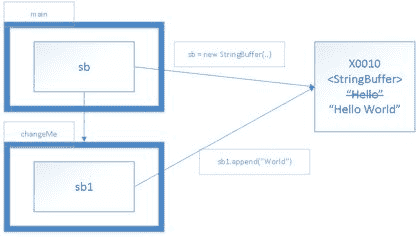

图 11-4

我怎么强调都不为过，如果你想有效地使用 Java，理解这些区别是多么重要。请获取这些示例并在 Eclipse 中尝试运行，以便你确保自己理解了每种情况下发生了什么。

最后一点值得强调的是不可变对象（如`Strings`）的行为。由于方法无法修改不可变对象的底层值，这影响了参数传递的方式：具体来说，被调用方法无法以能够反映给调用方法的方式来更改对象的值：

```java
package parameters;

public class PassObject3 {
    public static void main(String[] args) {
        String s = "Hello";
        System.out.println("Value at point 1 is "+s);
        changeMe(s);
        System.out.println("Value at point 3 is "+s);
    }

    private static void changeMe(String s) {
        s += " World";
        System.out.println("Value at point 2 is "+s);
    }
}
```

这产生了以下结果：

```
Value at point 1 is Hello
Value at point 2 is Hello World
Value at point 3 is Hello
```

理解这个程序的关键是这一行：`s += " World";`。由于`String`是不可变的，这一行会导致创建一个新的`String`对象。

## Final 关键字

可以使用`final`关键字来指定对象上的字段或变量在赋值后不能被更改。请考虑下面的示例，它将无法编译：

```java
package parameters;

class classFields {
    private final StringBuffer sb;

    public FinalFields() {
        sb = new StringBuffer("Hello World");
    }

    public void run() {
        sb.append("!!!");
        sb = new StringBuffer("Hello World");
    }
}
```

`sb`字段被定义为`final`，因此它在整个生命周期内只能引用一个对象。该引用必须内联定义：

`private final StringBuffer sb = new StringBuffer("Hello World");`

或者像本例一样在构造函数内部定义。

上面的示例是无效的，因为`run`方法的第二行尝试更改`sb`所指向的对象：`sb = new StringBuffer("Hello World");`。

你可能在奇怪`run`方法的第一行。这通过添加文本更改了对象。恰恰相反，这一行是有效的。

## Null 引用

现在你理解了对象和指向对象的引用之间的区别，理解`null`的概念就变得容易了。你已经看到对象引用可以被设置为`null`，以便它们引用的对象被垃圾回收。对象引用也可以在声明时设置为`null`：

`String s = null;`

当引用为`null`时，它不指向堆上的任何对象。虽然引用可以声明为`null`，但它仍然有一个类型，这决定了该引用最终可以引用的对象类型。

Java 程序中的一个常见问题是对`null`对象引用调用方法。例如，考虑以下示例：

```java
package nullexample;

public class NullString {
    public static void main(String[] args) {
        StringBuffer sb = null;
        sb.append("Hello");
    }
}
```

这个程序可以编译，但显然在`main`方法的第二行存在问题。即使是`Eclipse`也发现了这个错误：这就是为什么`sb`引用在方法的第二行被黄色下划线标出。

当执行`main`方法的第二行时，它会产生一种名为`NullPointerException`的异常。你将在接下来的章节中详细学习异常，但`NullPointerException`可能是你在 Java 中遇到的最常见的异常类型。

有趣的是，以下程序在功能上是等价的但无法编译：

```java
package nullexample;

public class NullString {
    public static void main(String[] args) {
        StringBuffer sb;
        sb.append("Hello");
    }
}
```

在这种情况下，编译器足够智能，能够意识到`sb`从未被初始化。因为对象引用的默认值为`null`，所以这两个程序在功能上是相等的，但编译器防止了其中一种情况而没有防止另一种。

# 12 继承

`继承`是与面向对象相关的另一个核心概念，也是实现代码复用最重要的机制之一。继承允许你获取一个现有类，并创建一个以它为基类的新类。

代码复用是软件工程中的一个重要课题。写的每行代码不仅会在开发期间产生开销，还会增加后续维护的成本。代码重复还会导致软件的不一致性，因为在某处进行的更改可能不会应用到整个程序。

你实际上已经在程序中使用过继承：如前所述，Java 中的所有类都继承自`Object`类，因此，所有类都自动继承了`equals`、`toString`等方法。

事实证明，这种继承与我在本章讨论的继承是相同的，区别在于所有类*自动*扩展了`Object`类——在所有其他情况下，继承必须显式声明。

理解继承等困难课题始于对该主题建立正确的心理模型。关于继承有几种不同的思考方式：

*   **作为父/子关系。** 在这种情况下，基类是父类，扩展它的类可以被看作它的子类。子类可以被认为是在父类基础上的功能。例如，你可以把`Vehicle`（车辆）看作`Car`（汽车）和`Truck`（卡车）的父类。
*   **作为特化关系。** 在这种情况下，基类拥有你所需的功能，但你需要对这些功能进行某种特化以满足当前任务的要求。因此，你创建一个特殊类，在需要的地方修改基类的功能。例如，你可以把`Race Horse`（赛马）看作`Horse`（马）的特化。

这些观点并不一定相互竞争。在某些情况下，继承会同时完成这两项任务：子类既会增强父类的功能，又添加新的功能。

作为继承的一个示例，考虑一个允许用户在画布上绘制形状的绘图程序。程序可能允许用户绘制几种类型的形状，例如正方形、三角形和八边形。

在这个程序中，你可能决定将每种形状表示为一个独立的类，因此你将如下所示创建三个类（`Square`、`Triangle`和`Octagon`）。这似乎是合理的，因为每种形状在某些方面都是不同的：

```java
package shapes;

public class Square {
    private final int sides = 4;
    private String fillColor;
    private String lineColor;

    public Square() {}

    public void draw() {
        System.out.println("I am drawing a square");
        System.out.printf("I have %d sides", sides);  
    }

    public int getSides() {
        return sides;
    }

    public String getFillColor() {
        return fillColor;
    }

    public void setFillColor(String fillColor) {
        this.fillColor = fillColor;
    }

    public String getLineColor() {
```


```java
return lineColor;
}

public void setLineColor(String lineColor) {
  this.lineColor = lineColor;
}
```

```java
package shapes;

public class Triangle {
  private final int sides = 3;
  private String fillColor;
  private String lineColor;

  public Triangle() {}

  public void draw() {
    System.out.println("I am drawing a triangle");
    System.out.printf("I have %d sides", sides);
  }

  public int getSides() {
    return sides;
  }

  public String getFillColor() {
    return fillColor;
  }

  public void setFillColor(String fillColor) {
    this.fillColor = fillColor;
  }

  public String getLineColor() {
    return lineColor;
  }

  public void setLineColor(String lineColor) {
    this.lineColor = lineColor;
  }
}
```

```java
package shapes;

public class Octagon {
  private final int sides = 8;
  private String fillColor;
  private String lineColor;

  public Octagon() {}

  public void draw() {
    System.out.println("I am drawing a octagon");
    System.out.printf("I have %d sides", sides);
  }

  public int getSides() {
    return sides;
  }

  public String getFillColor() {
    return fillColor;
  }

  public void setFillColor(String fillColor) {
    this.fillColor = fillColor;
  }

  public String getLineColor() {
    return lineColor;
  }

  public void setLineColor(String lineColor) {
    this.lineColor = lineColor;
  }
}
```

如果你阅读这段代码，你会发现大量的重复。这些类都有名为`fillColor`和`lineColor`的字段，以及相应的 getter 和 setter。每当你看到这样的重复代码时，应该问自己是否有方法可以重构这些代码。减少重复的关键方法之一就是继承。为了引入继承，你需要为一个泛化所有类共性的类 thought 一个名称。问自己：“正方形、三角形和八边形都是 ____”。

在这种情况下，填入空白处最明显的名称是`Shapes`。我们将`Shape`称为超类（有时也称为父类），将`Square`、`Triangle`和`Octagon`称为子类。

第二步是识别可以从子类提取到超类中的功能。目前我将范围限制在`fillColor`和`lineColor`字段和方法上：

```java
package shapes;

public class Shape {
  private String fillColor;
  private String lineColor;

  public Shape() {}

  public String getFillColor() {
    return fillColor;
  }

  public void setFillColor(String fillColor) {
    this.fillColor = fillColor;
  }

  public String getLineColor() {
    return lineColor;
  }

  public void setLineColor(String lineColor) {
    this.lineColor = lineColor;
  }
}
```

接下来，我将从每个子类中移除这些功能，最重要的一点是声明这些子类扩展了`Shape`（为了简洁，下方仅显示了`Square`类，如果你是自己编写代码，请对`Triangle`和`Octagon`进行相同的更改）。我还更改了`draw`方法，使其打印填充颜色和线条颜色：

```java
package shapes;

public class Square extends Shape {
  private final int sides = 4;

  public Square() {}

  public void draw() {
    System.out.println("I am drawing a square");
    System.out.printf("I have %d sides\n", sides);
    System.out.printf("My fill color is %s\n", getFillColor());
    System.out.printf("My line color is %s\n", getLineColor());
  }

  public int getSides() {
    return sides;
  }
}
```

注意，`Square`类能够通过它们的 getter 方法访问`Shape`上的属性。然而，`Square`无法访问`fillColor`和`lineColor`字段，因为它们被声明为私有（private）。

事实上，你可以让字段、构造函数和方法对子类可见，而无需将它们公开（因此不对外部类可见）。这可以通过使用`protected`访问修饰符来实现。为了演示这一点，将`Shape`上的`getFillColor`和`getLineColor`方法改为`protected`：

```java
protected String getFillColor() {
  return fillColor;
}

protected String getLineColor() {
  return lineColor;
}
```

代码仍然可以编译，但你稍后会发现外部类无法调用这些方法。

一旦继承层次结构建立，你就可以开始使用这些类：

```java
package shapes;

public class Main {
  public static void main(String[] args) {
    Square s = new Square();
    s.setFillColor("Blue");
    s.setLineColor("Red");
    s.draw();
  }
}
```

这将打印出以下内容：

```text
I am drawing a square
I have 4 sides
My fill color is Blue
My line color is Red
```

虽然变量`s`是一个`Square`引用，但完全可以调用`Shape`类中定义的公共方法，就像它们是直接在`Square`上声明的一样：因此这允许任何扩展`Shape`的类重用这些方法。

当你构造一个`Square`时，你仍然只构造了一个单一对象，但这个对象可以访问在两个类中定义的功能（此外，还有`Object`类中定义的功能）。

如果你从`main`方法的角度来看：它并不知道它所调用的方法是定义在`Square`上，还是继承自`Shape`。它不仅不知道，而且根本不在乎。`main`方法所关心的仅仅是它可以在`Square`实例上调用`draw`方法，并且这将产生适当的输出。

此时你也可以看到，如果你尝试从`Main`类中调用`protected`方法，你将收到一个编译错误，例如：

```java
s.getFillColor();
```

## 方法重写（Overriding methods）

目前为止的实现在消除重复代码方面取得了一些进展，但显然`draw`方法是另一个重用的候选者。

作为一个开始，你可能会注意到`draw`方法的最后两行可以很容易地放在`Shape`类中。这些访问的是定义在`Shape`上的字段，因此任何扩展`Shape`的类都可以访问这些字段。

因此，你可以在`Shape`上创建一个`draw`方法，并为其提供以下实现：

```java
public void draw() {
  System.out.printf("My fill color is %s\n", getFillColor());
  System.out.printf("My line color is %s\n", getLineColor());
}
```

然后你可以如下所示更改子类中的实现：

```java
public void draw() {
  System.out.println("I am drawing a square");
  System.out.printf("I have %d sides\n", sides);
  super.draw();
}
```

如果你再次执行程序，它应该产生与原始示例相同的输出。现在说`Square`中的`draw`方法是`Shape`上​​的那个`draw`方法。如果子类想要提供另一种实现，它们可以重写父类的方法。它们通过提供一个与父类中定义的方法签名完全相同的方法来实现。

同样请注意`Square`类`draw`方法中的以下这一行：

```java
super.draw();
```

`super`的使用允许`Square`类调用其父类（`Shape`）上的`draw`方法，从而确保了在`Square`上调用`draw`时，两个方法都会被执行。因此，`Square`和`Shape`共同工作，提供调用者看到的`draw`方法实现。

`super`关键字与之前看到的`this`关键字相似。正如`this`允许对象引用自己，`super`允许对象引用其父类。你只需要在父子类都实现相同方法时才需要使用`super`关键字：如果子类想要调用父类上的任何其他方法，那么`super`关键字是可选的。

如果你在这种情况下没有使用`super`关键字，那么`draw`方法将在`Square`自身被调用。这是一个坏消息，因为这次对`draw`方法的调用将再次调用自己，以此无限循环——更准确地说——直到`JVM`因为`StackOverflowException`崩溃。

重要的一点是，拥有`Square`引用的外部代码无法直接调用`Shape`上的`draw`方法。这回到了我之前的观点：任何使用我的类的代码都不应该关心我是如何实现特定功能的，也不应该关心底层类实际上包含了它们正在调用的方法：它们只需要关心由我的类所暴露的公共 API。

仅仅因为一个子类重写了方法并不意味着所有子类都必须重写该方法。例如，`Circle`类可能决定不重写`draw`方法，而是利用在`Shape`上定义的版本。在这种情况下，在`Circle`上调用`draw`将产生输出：

```text
My fill color is Blue
My line color is Red
```

## `final`关键字（Final keyword）

在某些情况下，父类可能会决定某个方法不应被重写。为了防止某个方法被重写，可以将其定义为`final`。例如，如果`Shape`上的`draw`方法定义为`final`，则`Square`类将不允许重写它：

```java
public final void draw()
```

注意，`final`关键字在此处的用法与我们之前看到的字段的用法不同。

通过使用`final`关键字，还可以完全停止类被扩展。例如，如果`Square`不希望任何类都能扩展它，可以定义为：

```java
public final class Square extends Shape {
```

如果你有理由认为其他代码不应该扩展类，那么将类定义为`final`是良好的做法。考虑 Java 中的`String`类。它被声明为`final`，因为如果任何类都能扩展它们，它们就可以修改它持有的字符串，从而使其可变。

`final`关键字是 Java 中许多关键字之一，它的含义根据使用位置而变化。你现在已经看到了`final`关键字的三种用法：字段、方法和类。

## 抽象类（Abstract Classes）

`draw`方法现在涉及到某种程度的用，但显然`draw`方法的前两行在子类之间看起来非常。。如果从子类中完全移除`draw`并在`Shape`中提供通用实现。

在实现这一点之前，你将处理另一个相关的问题。外部类可以创建`Shape`类的实例：

```java
Shape s1 = new Shape();
```

这显然没有意义：Shape 本身并不存在，它们是一个抽象概念，需要具体化为正方形、圆形、三角形等。为了防止 Shape 被实例化，因此可以将它们声明为`abstract`：

```java
public abstract class Shape {
```

如果你尝试使用`new`关键字实例化`Shape`类，你现在将收到一个编译错误。

`abstract`关键字是`final`关键字的镜像相反面。当`final`关键字用于类定义时，该类不能被扩展。当`abstract`关键字用于类定义时，该类必须被扩展。由于这个原因，无法将一个类同时声明为抽象和`final`。

```java
System.out.printf("My fill color is %s\n", getFillColor());
System.out.printf("My line color is %s\n", getLineColor());
}
```

这将导致编译错误，因为`sides`字段对`Shape`是不可见的。暂时不要担心这些编译错误；你很快就会处理它们。

在修改此代码后，从像`Square`等子类中完全删除`draw`方法。

你首先将处理该方法中的编译错误。这是由于父类正尝试访问一个名为`sides`的字段：该字段仅在子类中定义，因此父类无法使用。

这与`sides`字段是否为`private`无关：父类无法访问其子类的任何字段或方法；继承是单向的。

解决此问题的方法是让`Shape`类声明，任何继承自它的类都必须提供一个名为`getSides`的方法。`Shape`类不需要定义该方法的代码；它只需要定义它的`signature`（签名）。因此，在`Shape`中添加以下行：

```java
public abstract int getSides();
```

注意`abstract`关键字的使用：当方法被定义为抽象方法时，只需要提供其签名（实际上是不可能的定义实现）。

一旦将此行添加到`Shape`中，`Shape`的所有子类都必须实现此方法，否则程序将无法编译。

注意，`Shape`并不关心子类如何实现此方法，或者该实现做了什么：它只关心是否提供了一个实现，并且该实现返回一个`int`。

你现在可以如下修改`Shape`中的`draw`方法：

```java
public void draw() {
  System.out.println("I am drawing a square");
  System.out.printf("I have %d sides\n", getSides());
  System.out.printf("My fill color is %s\n", getFillColor());
  System.out.printf("My line color is %s\n", getLineColor());
}
```

`Shape`类能够调用`getSides`方法，是因为它确定任何子类都会提供该方法的实现。由于子类已经实现了这一点，所以你不需要做任何事情。

只有在抽象类中才能定义抽象方法。

任何带有抽象方法的类都必须声明为抽象类，尽管一个类即使没有抽象方法也可以是抽象的。

如果非抽象类可以包含抽象方法，显然会产生问题。当该类实例化时，它将包含未定义的方法。

`abstract`关键字的全部目的是推卸责任。这是一种表达方式，表示我需要这个特定的方法被实现，尽管我自己不知道如何实现它。

也可以存在多个层级的抽象类。例如，如果`Square`将自己声明为抽象类，它就不需要提供`getSides`的实现（尽管它可以根据需要提供实现）。唯一的规则是，在你到达类层次结构中的第一个非抽象类时，所有的抽象方法都必须已经实现。

`draw`方法仍然有一个遗留问题：它总是打印 "I am drawing a square"，即使实例化的类是`Triangle`。为了解决这个问题，我将向`Shape`添加另一个名为`getType`的抽象方法，然后并在`draw`方法中使用它：`Shape`的完整实现如下：

```java
package shapes;

public abstract class Shape {
  private String fillColor;
```


```java
private String lineColor;

public Shape() {}

public abstract int getSides();

public abstract String getType();

public void draw() {
  System.out.printf("I am drawing a %s\n", getType());
  System.out.printf("I have %d sides\n", getSides());
  System.out.printf("My fill color is %s\n", getFillColor());
  System.out.printf("My line color is %s\n", getLineColor());
}

protected String getFillColor() {
  return fillColor;
}

public void setFillColor(String fillColor) {
  this.fillColor = fillColor;
}

protected String getLineColor() {
  return lineColor;
}

public void setLineColor(String lineColor) {
  this.lineColor = lineColor;
}
```

一旦向 `Shape` 添加了 `getType` 方法，任何扩展它的子类将无法编译。最简单的解决方法是点击每个子类定义旁边的错误，并选择“Add unimplemented methods”（添加未实现的方法），如图 12-1 所示：

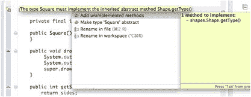

图 12-1

只需将它创建的存根（stub）更改为每个子类返回适当的值：

```java
@Override
public String getType() {
  return "Square";
}
```

注意 Eclipse 如何在方法上方添加了文本：

```java
@Override
```

这被称为注解（annotation），在此上下文中是可选的。我将在书的后部分详细介绍注解，但现在请将它们看作可以为代码段添加额外含义的标签。在这种特定情况下，注解告诉编译器“我认为我正在覆盖一个名为 `getType` 的方法，所以请检查我的父类中确实有一个具有此签名的方法”。

注解用于 Java 的各种任务，在编译时、运行时。如果你选择移除此注解，类的功能不会发生变化，但它确保该方法确实是在覆盖父类中的方法。

`Square` 类现在可以简化为：

```java
package shapes;

public final Square extends Shape {
  private final int sides = 4;

  public Square() {}

  @Override
  public int getSides() {
    return sides;
  }

  @Override
  public String getType() {
    return "Square";
  }
}
```

一旦 `getType` 在所有子类中都实现，你可以修改 `Main` 程序如下：

```java
package shapes;

public class Main {
  public static void main(String[] args) {
    Square s = new Square();

    assignFillColor(s);

    s.setLineColor("Red");

    s.draw();

    Triangle t = new Triangle();

    assignFillColor(t);

    t.setLineColor("Orange");

    t.draw();
  }
}
```

执行时，它将输出：

```text
I am drawing a square
I have 4 sides
My fill color is Blue
My line color is Red...
```

## 多态 (Polymorphism)

现在你理解了继承的基础，就可以转向相关的（且令人敬畏的）主题：多态。多态是面向对象编程中最重要的概念之一，事实上，可以说它是最重要的概念；因此，对于你良好理解它以及它是如何工作的至关重要。

多态可能很难理解的概念——甚至它的名字都具有挑战性。然而，我不认为它像被认为的那么复杂，与其从解释开始，我们将通过一些示例来学习。

想象你想为 `Main` 类添加一个方法，为传递它的任何 `Shape` 分配随机填充颜色。你可以这样添加：

```java
package shapes;

public class Main {
  public static void main(String[] args) {
    Square s = new Square();

    assignFillColor(s);

    s.setLineColor("Red");

    s.draw();

    Triangle t = new Triangle();

    assignFillColor(t);

    t.setLineColor("Orange");

    t.draw();
  }

  private static String[] colors = {"Red", "Blue", "Green", "Black", "Orange", "Pink"};

  private static void assignFillColor(Shape shape) {
    int num = (int)(Math.random() * colors.length);

    shape.setFillColor(colors[num]);
  }
}
```

`assignFillColor` 方法使用 Java 提供的 `Math.random()` 工具返回一个大于 0 且小于 1 的随机浮点数。然后将此值乘以 `colors` 数组的长度（6），并转换为 `int`。这将确保 `num` 包含一个 0 到 5 之间的随机数（因为强制转换会导致数字向下舍整）。

`assignFillColor` 最有趣的地方在于，它接受一个类型为 `Shape` 的参数。这很有趣，因为 `Shape` 是一个抽象类，所以永远不会有 `Shape` 的实例。

如果一个方法接受特定类型的参数，那么实际上可以向它传递该类型的实例或其子类的实例。

由于 `assignFillColor` 并不知道它将接收到哪种 `Shape` 的实现，因此它只能调用所有 `Shape` 实例共有的方法，即在 `Shape` 本身上定义的方法。例如，如果 `Square` 实现了一个名为 `getArea` 的方法，在不先将传递的参数强制转换为 `Square` 的情况下，是无法调用该方法的。

这看起来可能并不有趣：`Shape` 类定义了一个方法 `setFillColorColor`，因此 `assignFillColor` 能够调用这个方法或许也并不令人意外。然而，为了看到这一功能的真正威力，你将如下所示在 `Square` 上重写 `setFillColorColor` 方法：

```java
public void setFillColor(String fillColor) {
  System.out.println("setFillColor called on Square");
  super.setFillColor(fillColor);
}
```

并如下所示在 `Triangle` 上重写该方法：

```java
public void setFillColor(String fillColor) {
  System.out.println("setFillColor called on Triangle");
  super.setFillColor(fillColor);
}
```

这些方法会打印出被调用的类，然后调用其父类的 `setFillColor` 方法。

如果你再次运行程序，它将产生以下输出：

```text
setFillColor called on Square
I am drawing a Square
I have 4 sides
My fill color is Green
My line color is Red

setFillColor called on Triangle
I am drawing a Triangle
I have 3 sides
My fill color is Pink
My line color is Orange
```

注意加粗的行：尽管 `assignFillColor` 方法在编译时只知道它被传递了一个 `Shape`，但在运行时它在所接收到的对象上调用方法时，调用的是在所接收到的子类上声明的方法。

这里显然发生了一些魔法现象：在编译时，`assignFillColor` 方法并不知道将传递它的 `Shape` 的哪一个子类。例如，你可以使用随机数生成器来决定创建三角形还是正方形。尽管如此，在运行时，Java 仍然能够调用相应的方法。

理解这一点是理解多态的关键，这也是为什么多态也被称为“晚绑定”的原因。Java 能够在运行时确定它接收到的具体实现，并“动态地”决定哪个是要调的方法。从历史上看，编译器在编译时就会规划出整个程序的执行流，这使得这种行为是不可能的。

思考多态的另一种方式是，每当你引用变量、参数或字段的类型时，都涉及到两种不同的类型。这源于对象与对象引用是不同的，正如书中已经多次看到的那样。

第一个是对象引用的类型（例如 `Shape`）。编译器将确保对象引用始终指向该类型的对象或其一个子类的对象。

第二个类型是对象的类型。它要么与指向它的引用类型相同，要么是该类型的子类。任何被执行的方法都将在引用所指向的对象上执行，从而允许多态发挥魔力。

多态的一个结果是，你能够在程序运行过程中更改引用所指向的对象的类型。考虑以下程序：

```java
package shapes;

public class ChangingShape {
  public static void main(String[] args) {
    Shape s = null;

    s = new Square();

    s.setLineColor("Red");

    s.setFillColor("Red");

    s.draw();

    s = new Triangle();

    s.setLineColor("Orange");

    s.draw();
  }
}
```

这产生产生以下输出：

```text
setFillColor called on Square
I am drawing a Square
I have 4 sides
My fill color is Red
My line color is Red
I am drawing a Triangle
I have 3 sides
My fill color is null
My line color is Orange
```

注意变量 `s` 被定义为 `Shape`，但在第一次声明时被设置为 `null`。这意味着 `s` 能够引用从 `Shape` 类子类构造的任何对象。

在 `main` 方法的第二行，`s` 被设置为指向 `Square` 的实例，因此当在第 5 行调用 `draw` 时，调用的是在 `Square` 中的定义。

程序的第六行接着声明 `s` 现在指向一个 `Triangle` 实例：

```java
s = new Triangle();
```

这是允许的，因为 `Triangle` 是 `Shape` 的子类：所以声明为 `Shape` 的对象引用仍然指向一个有效对象。当在方法的最后一行在 `s` 上调用 `draw` 时，执行的实现在 `Triangle` 中的。

从某种意义上说，变量 `s` 在此方法的执行期间改变了它的类型，但它是在定义的类型（`Shape`）范围内完成的。

你可以把这个想法推得更远。你记得书中前面提到每个类都继承自 `Object`，因此可以编写这样的代码：

```java
public static void main(String[] args) {
  Object o1 = "Hello world";

  System.out.println(o1);

  o1 = new Square();

  System.out.println(o1);
}
```

注意变量 `o1` 被定义为引用任何 `Object` 类型的对象——因此，因为每个类都继承自 `Object`，此引用可以引用任何类型的对象。然而，在这种情况下，你只能调用在 `Object` 上定义的方法。

```java
public static void main(String[] args) {
  Object o1 = "Hello world";

  ((Shape)o1).setFillColor("Red");
}
```

`compiler` 知道 `o1` 指向一个扩展自 `Object` 的对象，但当你在第二行声明它可以被强制转换为 `Shape` 时（尽管它显然是一个 `String`），它会盲目听从你的。如果你尝试运行此程序，你将收到一个如下所示的异常：

```text
Exception in thread "main" java.lang.ClassCastException: java.lang.String cannot be cast to shapes.Shape
```

## 接口 (Interfaces)

在之前的示例中，你定义了一个名为 `Shape` 的抽象类，它无法独立存在：它只能通过其子类来实例化。尽管如此，`Shape` 类仍然能够实现方法。

如果你想象 `Shape` 在绘图程序中如何被使用（绘制真实的形状而不是打印文本），你可能会发现还有其他类型的对象是你想要绘制的，它们并不是 `Shapes`，而且除了可以在屏幕上绘制之外，它们与 `Shapes` 真的没有任何共同点。例如，许多绘图程序允许在画布上绘制文本，但文本并不是形状。

`Interfaces` 提供了一种定义不同类型之间相似之处的机制，而无需定义任何具体的细节。例如，在绘图程序中，你可能想声明任何可以在屏幕上绘制的内容都必须实现一个名为 `draw` 的方法，尽管你无法提供 `draw` 方法的通用实现。

这里值得提到 Java 8 中发生的一个重大变化。在 Java 8 之前，在接口中提供实现细节是不可能的。

从 Java 8 开始，在某些限制下，这是可以做的。在本章中，我将假装 Java 8 从未出现过，以便为你提供关于接口如何工作的经典视角。在书的后面，你将看到接口如何提供实现细节——以及为什么这偶尔会有用。

你可以如下所示声明一个所有 `drawable` 对象都可以实现的接口：

```java
package shapes;

public interface Drawable {
  public void draw();
}
```

与其将 `Drawable` 声明为一个类，它被声明为一个接口。它随后定义了实现此接口的任何类必须定义的方法签名。在这种情况下，接口只有一个方法，但接口可以声明你需要的任意数量的方法。

接口通常被认为是合同。例如，如果一个类想要产生可以在屏幕上绘制的对象，它必须遵守 `Drawable` 中规定的合同。

在接口上定义方法的方式与在抽象类中声明抽象方法的方式几乎相同，但省略了 `abstract` 关键字。事实上，在接口中也可以省略 `public` 访问修饰符，因为接口中的所有方法都被假设是 `public` 的，并且无法使用任何其他访问修饰符。

在接口内部也可以定义静态字段，但非静态字段只能在类中声明。

一旦你定义了接口，就可以声明某些类实现了它。例如，你可以定义一个名为 `Text` 的新类，用于在屏幕上绘制文本：

```java
package shapes;

public class Text implements Drawable {
  public String text;
  public String color;

  public Text(String text, String color) {
    this.text = text;
    this.color = color;
  }

  @Override
  public void draw() {
    System.out.printf("I am drawing a %s text string with the value %s\n", color, text);
  }
}
```


注意，`Text` 类声明的是它实现 `Drawable`，而不是扩展（`extends`）它。事实证明，这是一个重要的细节，要求我们稍微回溯并重新查看继承。

## 接口继承与类继承

接口实际上可以扩展其他接口。例如，你可能有一个现有接口，并希望向其添加更多方法定义。在这种情况下，第二个接口扩展而不是实现第一个接口。

在 Java 中，一个类只能扩展另一个类：这被称为单继承。例如，如果一个类扩展了 `Shape`，它就不能扩展另一个类。当然，`Shape` 本身可以扩展另一个类，因此可能存在相互继承的类链，但每个单独的类最多只能扩展另一个类。换句话说，子类只能有一个父类。

正如前面所述，如果一个类没有扩展另一个类，它就会隐式地扩展 `Object`。因此，除了 `Object` 之外，所有的 Java 类都扩展了一个、且仅一个另一个类。

其他一些编程语言支持多重继承（最著名的是 `C++`），但 Java 的设计者很早就决定多重继承是一个坏主意。正如书后面将所示，Java 语言设计者在 Java 8 中在某种程度上改变了他们的主意——但这些复杂性可以留到以后再说。

设计者并没有允许多重继承，而是引入了接口的概念，并使得在仍然只扩展另一个类的情况下，可以实现任意数量接口。

为了演示这一点，我将首先声明 `Shape` 类实现了 `Drawable`：

```java
public abstract class Shape implements Drawable {
```

注意，`Shape` 可以实现 `Drawable`，尽管它对 `draw` 方法的实现是抽象的。这是因为 `compiler` 可以确定所有具体的子类都会实现这个方法。我也可以声明具体的 `Shape` 子类实现了 `Drawable`：

```java
public final class Square extends Shape implements Drawable {
```

注意，在这种情况下，`implements` 子句位于 `extends` 子句之后。

## 实现多个接口

现在我可以给程序添加第二个接口了。此接口将指示实现类具有颜色，并返回对象的原色。

```java
package shapes;

public interface Colorable {

    public String getColor();

}
```

现在我可以声明 `Shape` 和 `Text` 都实现了 `Colorable` 以及 `Drawable`，例如：

```java
package shapes;

public class Text implements Drawable, Colorable {

    public String text;

    public String color;

    public Text(String text, String color) {

        this.text = text;

        this.color = color;

    }

    @Override

    public void draw() {

        System.out.printf("I am drawing a %s text string with the value %s\n", color, text);

    }

    @Override

    public String getColor() {

        return color;

    }

}
```

对于 `Shape` 的情况，你可能决定填充颜色是 `Shape` 颜色的最佳表示。这突显了接口的另一个重要特性：方法的实现由实现者决定，而实现方式将根据实现者的不同而异。

你可以在任何可以使用类类型的地方声明使用接口类型的引用。以下代码演示了可以声明一个接收接口实例的方法——然后它们可以传递实现了该接口的任何类的实例：

```java
package shapes;

public class UsingInterfaces {

    public static void main(String[] args) {

        Shape s = new Square();

        receiveDrawable(s);

        receiveColorable(s);

        Text t = new Text("Hello World", "Red");

        receiveDrawable(t);

        receiveColorable(t);

    }

    public static void receiveDrawable(Drawable d) {

        System.out.printf("I have been passed a Drawable: it is really a %s\n", d.getClass().getSimpleName());

        d.draw();

    }

    public static void receiveColorable(Colorable d) {

        System.out.printf("I have been passed a Colorable that is %s: it is really a %s\n", d.getColor(), d.getClass().getSimpleName());

    }

}
```

这产生了以下输出：

```text
I have been passed a Drawable: it is really a Square

I am drawing a Square

I have 4 sides

My fill color is null

My line color is null

I have been passed a Colorable that is null: it is really a Square

I have been passed a Drawable: it is really a Text
```

我正在绘制一个值为 Hello World 的红色文本字符串。

我接收了一个颜色为红色的 `Colorable` 对象：它实际上是一个 `Text` 对象。

注意，可以使用 `getClass()`（定义在 `Object` 类中）来确定对象的实际类型。该方法返回一个 `Class` 实例，`Class` 实例本身支持一组工具方法，包括 `getSimpleNameName()` 和 `getName()`。

在书的后面，你将看到 `Class` 类上定义的其他方法。正如你所看到的，这些方法允许你通过一个名为 `reflection`（反射）的过程在运行时检查类的结构。

正如下一个示例所示，也可以通过其引用对象实现的接口来声明变量：

```java
public static void main(String[] args) {
    Drawable d = new Square();
    receiveDrawable(d);
    receiveColorable((Colorable)d);
    d = new Text("Hello", "Red");
    receiveDrawable(d);
    receiveColorable((Colorable)d);
}
```

在这个示例中，`d` 被声明为 `Drawable` 类型。这意味着它可以引用 `Square` 和 `Text` 的实例，因为这两个类都实现了 `Drawable`。

你可以很自然地将 `d` 传递给任何接受 `Drawable` 作为参数的方法。但注意，如果你想将 `d` 传递给一个接受 `Colorable` 的方法，你需要将 `d` 强制转换为 `Colorable`。

记住，编译器只知道 `d` 指向一个符合 `Drawable` 接口的对象；它并不知道该对象是否也符合 `Colorable` 接口。你的工作是通过强制类型转换告诉编译器 `d` 确实符合 `Colorable` 接口。

许多 Java 程序员广泛使用接口，并以接口的形式定义他们所有的 API。这种方法的用处是，可以在不修改 API（因此不修改程序的底层结构）的情况下，更改程序的具体实现（类）。这倾向于使程序更具可维护性和可扩展性。

# 设计模式

继承适用于许多实用的 `design patterns`（设计模式）。设计模式是解决常见问题的可重用方法。大多数专业程序员都广泛地使用设计模式，而所有程序员都理解这些模式这一事实，有助于代码对他人来说更具维护性且易于理解。

设计模式的妙处在于它们代表了解决通用问题的经过证明的方法。例如，如果一个对象在状态变化时需要通知一个或多个对象，你可以选择许多不同的方式来实现它。然而，大多数专业程序员都会熟悉 `Observer`（观察者）模式，它描述了一种广为人知的方法，并在此模式的基础上进行实现。

本节将为你介绍我在编码中广泛使用的两种利用继承的模式。

## 模板模式

模板模式从一个假设开始：你通常希望实现多个相关的算法，这些算法在某些细节上不同，但在许多其他细节上是通用的。

考虑一个处理不同类型文件的程序。无论文件类型如何，算法中的许多步骤都是相同的：

- 打开文件
- 遍历文件的每一行
- 关闭文件

然而，某些步骤会根据文件类型而不同，最显著的是处理文件中的每一行。

在本节中，你将创建两个都处理带有货币汇率信息的文件的算法：

- 第一个算法将处理一个逗号分隔的文件，并负责从每个标记中去除多余的引号，并将货币代码转换为大写。
- 第二个实现将负责处理管道符分隔的文件。这种文件格式将包含一行应该被忽略的表头。

无论何种情况，程序的输出都应该是相同的；一组格式如下的行：

从 USD 到 EUR 的汇率是 0.741410，每 $100 你将获得 $74.14

第一个文件（应命名为 `file1.csv`）如下：

```text
"usd","eur",0.74141
"usd","gbp",0.60833
"usd","cad",1.11329
"usd","nzd",1.23678
```

第二个文件（应命名为 `file2.csv`）如下：

```text
from currency,to currency,rate
USD,EUR,0.74141
USD,GBP,0.60833
USD,CAD,1.11329
USD,NZD,1.23678
```

这些文件可以在书籍网站上找到，还有其他资源：[www.cisdal.com/java.html](http://www.cisdal.com/java.html)。

你将开始编写一个可以持有单个汇率信息的类。这是一个简单的 JavaBean：

```java
package template;

public class ExchangeRate {
    private String fromCurrency;
    private String toCurrency;
    private Double rate;

    public ExchangeRate(String fromCurrency, String toCurrency, Double rate) {
        this.fromCurrency = fromCurrency;
        this.toCurrency = toCurrency;
        this.rate = rate;
    }

    public String getFromCurrency() {
        return fromCurrency;
    }

    public String getToCurrency() {
        return toCurrency;
    }

    public Double getRate() {
        return rate;
    }
}
```

接下来，你将编写一个执行通用处理的类，但为算法特定的实现部分留出占位符（抽象方法）。

此实现使用了 Java `File` API，这些 API 将在后续章节中介绍。你可以现在忽略这些 API 的细节。

此实现还使用了将在后续章节中介绍的异常处理方法：利用了 `try` 和 `catch` 关键字。你可以从书籍网站下载代码而不是自己编写。

```java
package template;

import java.io.BufferedReader;
import java.io.FileNotFoundException;
import java.io.FileReader;
import java.io.IOException;

public abstract class FileProcessor {
    private String file;
    private int lineNumber = 0;
    BufferedReader br = null;

    public FileProcessor(String file) {
        this.file = file;
    }

    public final void process() {
        try {
            openFile();
            processLines();
            closeFile();
        } catch (IOException e) {
            e.printStackTrace(System.out);
        }
    }

    protected void openFile() throws FileNotFoundException {
        br = new BufferedReader(new FileReader(file));
    }

    private void processLines() throws IOException {
        String line;
        while ((line = br.readLine()) != null) {
            ExchangeRate result = processLine(lineNumber, line);
            if (result != null) {
                printLine(result);
            }
        }
        lineNumber++;
    }

    protected void closeFile() throws IOException {
        br.close();
    }

    protected abstract ExchangeRate processLine(int lineNumber, String line);

    protected void printLine(ExchangeRate rate) {
        System.out.printf("The exchange rate from %s to %s is %f, you will get $%f for each $100\n",
            rate.getFromCurrency(), rate.getToCurrency(),
            rate.getRate(), rate.getRate()*100);
    }
}
```

此实现的核心是 `process()` 方法：该方法通过按顺序调用所有方法来调度算法。例如，它知道先打开文件，然后处理行，最后关闭文件。

`process` 方法被声明为 `final`，因为你不希望子类更改算法的整体逻辑，只更改算法中的特定步骤。

另一个重要的是，该类定义了如下抽象方法：

`protected abstract ExchangeRate processLine(int lineNumber, String line);`

每个子类都预期覆盖此方法。它们也可以根据需要可选地覆盖其他受保护方法（例如，它们可能希望从网络而不是文件系统读取文件）。

以下实现可以处理逗号分隔的文件。注意，此类继承了 `FileProcessor`：

```java
package template;

import java.util.StringTokenizer;

public class CSVFileProcessor extends FileProcessor {
    public CSVFileProcessor(String file) {
        super(file);
    }

    @Override
```

```java
protected ExchangeRate processLine(int lineNumber, String line) {
    StringTokenizer st = new StringTokenizer(line, ",");
    int i = 0;
    String fromCurrency = null;
    String toCurrency = null;
    Double rate = null;

    while (st.hasMoreTokens()) {
        String s = st.nextToken();
        s = s.replaceAll("\"", "");

        switch (i) {
            case 0:
                fromCurrency = s;
                break;
            case 1:
                toCurrency = s;
                break;
            case 2:
                rate = Double.valueOf(s);
                break;
        }

        i++;
    }

    return new ExchangeRate(fromCurrency, toCurrency, rate);
}
```

此实现使用了一个名为 `StringTokenizer` 的实用工具类。它接受一个 `String` 和一个 `delimiter`，并在每次遇到该分隔符时将 `String` 拆分为子字符串。然后你可以使用 `while` 循环来遍历所有找到的标记（tokens）。


最后添加一个`main`类来使用`CSVFileProcessor`执行程序：

```java
package template;

public class Main {
  public static void main(String[] args) {
    CSVFileProcessor csv1 = new CSVFileProcessor("file1.csv");
    csv1.process();
  }
}
```

在运行此程序之前，确保`file1.csv`已复制到 Eclipse 项目的父目录中（即与`src`文件夹相同的文件夹，而不是`src`文件夹内部）。

请注意，`CSVFileProcessor`暴露的公共 API 包含一个名为`process`的单方法。这确保了任何使用该类的代码都按照其意图使用它。

现在为管道分隔的文件添加第二个实现是轻而易举的：

```java
package template;

import java.util.StringTokenizer;

public class PipeFileProcessor extends FileProcessor {
  public PipeFileProcessor(String file) {
    super(file);
  }

  @Override
  protected ExchangeRate processLine(int lineNumber, String line) {
    if (lineNumber == 0) {
      return null;
    }  
    String fromCurrency = null;
    String toCurrency = null;
    Double rate = null;
    String[] tokens = line.split("\\|");
    for (int i = 0; i < tokens.length; i++) {
      String s = tokens[i];
      s = s.replaceAll("\"", "");
      switch (i) {
        case 0 :
          fromCurrency = s;
          break;
        case 1 :
          toCurrency = s;
          break;
        case 2 :
          rate = Double.valueOf(s);
          break;
      }
      i++;
    }
    return new ExchangeRate(fromCurrency, toCurrency, rate);
  }
}
```

注意此实现通过返回`null`忽略了第一行。这是因为管道分隔的文件包含一行应该被忽略的标题行。

在这种情况下，我使用了不同的方法来根据分隔符拆分每行：我使用了`String`的`split`方法。你会发现传递给`split`的分隔符在实际分隔符之前包含两个反斜杠：

```java
String[] tokens = line.split("\\|");
```

这是因为`split`接受正则表达式，而管道字符在正则表达式中具有特殊含义。双反斜杠创建了一个正则表达式，表示我想按字面上的管道字符进行拆分。

现在如下修改`Main`类：

```java
package template;

public class Main {
  public static void main(String[] args) {
    FileProcessor csv1 = new CSVFileProcessor("file1.csv");
    csv1.process();
    csv1 = new PipeFileProcessor("file2.csv");
    csv1.process();
  }
}
```

在运行此程序之前，确保`file2.csv`已复制到与`file1.csv`相同的目录。

如你所见，声明为`FileProcessor`类型的单个变量可以同时用于这两个处理器。

很容易想象你现在如何扩展此程序，根据运行时提供的文件内容来确定要使用的正确处理器。同样容易看出为新的文件格式添加新处理器是多么快。

## 抽象工厂（Abstract Factory）

抽象工厂设计模式支持创建对象族，但创建的具体实现取决于运行时使用的工厂。和通常一样，一个示例有助于理解这种模式。

抽象工厂模式被分类为*创建型模式*（creational pattern），因为它负责实例化对象。

想象一个能够创建 UI 组件（如文本字段、标签和组合框）的库。该库可能希望为不同的操作系统为这些组件提供不同的具体实现：在 Windows 系统上，组件将样式化以符合 Windows 标准，而在 OSX 系统上，组件将样式化以符合 OSX 标准。

你可以将创建这些组件的责任留给程序：这意味着每当程序需要一个文本字段时，它都必须确定自己正在运行在何种系统上，并构造相应的组件。

这种方法的问题在于，你将把大量代码与相关的操作系统绑定，这使得在另一个平台上重用代码变得更加困难。此外，如果你想支持新的操作系统，将需要修改许多不同地方的代码。

通过抽象工厂模式，你创建一个抽象类，定义程序可以用于创建特定类型对象的 API，然后为每个对象族实现这个接口。

在开始之前，你将创建三种类型的组件。每个类型都包含一个接口和两个实现类。为了简单起见，这些类实际上不会执行任何操作。

### TextField

```java
package abstractfactory;

public interface TextField {
}
class WindowsTextField implements TextField {}
class OSXTextField implements TextField {}
```

### Label

```java
package abstractfactory;

public interface Label {
}
class WindowsLabel implements Label {}
class OSXLabel implements Label {}
```

### ComboBox

```java
package abstractfactory;

public interface ComboBox {
}
class WindowsComboBox implements ComboBox {}
class OSXComboBox implements ComboBox {}
```

我通常避免这种方法，但在这里使用是为了快速创建这些结构。

现在你可以创建用于组件的通用工厂。此类中的所有方法都是抽象的：

```java
package abstractfactory;

public abstract class UIFactory {
  public abstract TextField createTextField();
  public abstract Label createLabel();
  public abstract ComboBox createComboBox();
}
```

这也可以定义为接口而不是抽象类。

现在你可以为支持的每个操作系统提供`UIFactory`的具体实现：

```java
package abstractfactory;

public class WindowsUIFactory extends UIFactory {
  public TextField createTextField() {
    return new WindowsTextField();
  }
  public Label createLabel() {
    return new WindowsLabel();
  }
  public ComboBox createComboBox() {
    return new WindowsComboBox();
  }
}
```

以及：

```java
package abstractfactory;

public class OSXUIFactory extends UIFactory {
  public TextField createTextField() {
    return new OSXTextField();
  }
  public Label createLabel() {
    return new OSXLabel();
  }
  public ComboBox createComboBox() {
    return new OSXComboBox();
  }
}
```

一旦这个继承结构建立起来，使用抽象工厂就像在运行时向程序中*注入*适当的实现一样简单：

```java
package abstractfactory;

public class Main {
  public static void main(String[] args) {
    UIFactory factory = getUIFactory();
    TextField tf = factory.createTextField();
    Label l = factory.createLabel();
    ComboBox cb = factory.createComboBox();
    System.out.println(tf.getClass().getSimpleName());
    System.out.println(l.getClass().getSimpleName());
    System.out.println(cb.getClass().getSimpleName());
  }

  public static UIFactory getUIFactory() {
    if (System.getProperty("os.name").equals("Mac OS X")) {
      return new OSXUIFactory();
    }
  }
}
```

```java
} else {
  return new WindowsUIFactory();
}
}
```

`注入`依赖的概念已经成为 Java 领域中一个非常重要的范式，并且得到了各种框架的支持（最著名的 Spring 框架）。尽管这超出了本书的范围，但我强烈建议学习更多关于`依赖注入`的知识。

[`en.wikipedia.org/wiki/Dependency_injection`](http://en.wikipedia.org/wiki/Dependency_injection)

注意，`main`方法对于提供它的工厂的具体实现，或从该工厂创建的组件是一无所知的。如果在 OSX 机器上运行该代码，它将打印：

```text
OSXTextField
OSXLabel
OSXComboBox
```

否则，它将打印：

```text
WindowsTextField
WindowsLabel
WindowsComboBox
```

以这种方式编写代码具有很强的变化适应性。如果你以后决定更改特定操作系统使用的`UIFactory`，可以进行更改，而不会影响任何使用这些实现的代码。

# 13 组合

继承提供了一种重用代码的机制。面向对象编程支持的另一种机制是`组合`（composition）。

当一个类“是”某个东西的实例时，继承是最佳选择：

- 圆形是一个形状（is-a shape）
- 汽车是一种车辆（is-a vehicle）
- 猫是一只动物（is-an animal）

相比之下，组合最适合建模“拥有”关系（has-a relationships）：

- 圆形有一个边框（has-a border）
- 汽车有一个门（has-a door）
- 猫有一个主人（has-an owner）

人们通常说应该优先考虑组合而不是继承，特别是在只支持单继承的编程语言中。我不认为这一定是对的：在建模“是”关系时应该使用继承，而在建模“拥有”关系时应该使用组合。通常情况下，你遇到的“拥有”关系的情况会比“是”关系的情况要多，因此组合通常更常见。

组合在 Java 中是一个非常简单的主题：每当一个对象封装了一个引用另一个对象的字段时，你就在使用组合。通常，组合被分为三个子类：

- **组合（Composition）**：这指的是被组合对象的生命周期与组合对象的生命周期隐含链接的情况。圆形和边框就是这种关系：边框的生命周期认为与圆形的生命周期相关：如果圆形被销毁，边框也将被销毁。因此，组合意味着所有权。
- **聚合（Aggregation）**：这指的是两个对象之间存在“拥有”关系，但它们都可以独立于对方存在。例如，猫的主人仍然可以独立于猫存在。
- **关联（Association）**：这指的是一个对象使用另一个对象，但两个对象之间没有强关系。例如，猫可能会使用一个猫门。

`composition`一词可以指代这些类别中的任何一个。

作为一个例子，考虑一种情况：你想用三个`int`值来表示颜色，代表颜色中红、绿、蓝的比例。该类还将捕获颜色的名称，并提供一个方法返回颜色的十六进制编码字符串（如 HTML/CSS 使用）。`Color`类可能如下：

```java
package colors;

public class Color {

  private int red, green, blue;

  private String name;

  public Color(int red, int green, int blue, String name) {

    assert(red < 256 && red >= 0);
    assert(green < 256 && green >= 0);
    assert(blue < 256 && blue >= 0);
    this.red = red;
    this.green = green;
    this.blue = blue;
    this.name = name;
  }

  String getName() {
    return name;
  }

  public String getHexValue() {
    return "#"+getHexValue(red)+getHexValue(green)+
getHexValue(blue).toUpperCase();
  }

  private String getHexValue(int intValue) {
    String s = Integer.toHexString(intValue);
    if (s.length() == 1) {
      return "0"+s;
    } else {
      return s;
    }
  }
}
```

这个类引入了许多你到目前还没有见过的新概念。这些与组合的概念没有隐含的链接，但我将从讨论这些开始。

`Color`类声明了三个`int`字段。当声明了多个相同类型的字段时，可以在单行内完成：

`private int red, green, blue;`

这与在三行中分别声明字段是等价的。这种方法的唯一缺点是不可能将字段初始化为不同的值。

你还会注意到`getHexValue`方法利用了`Integer`类中的一个辅助方法将数字转换为十六进制`String`。在这种特定情况下，我想确保每个颜色的十六进制值始终是两个字符长度，因为这是 HTML 使用的约定，因此在必要时会在前面加上“0”。

最后，注意我在构造函数中使用了`assert`关键字来验证 0 到 255 之间的数值参数。该关键字提供了一种断言（或坚持）特定条件成立的机制。

如果断言在运行时失败，它将抛出`AssertionError`，这会阻止方法或构造函数的完成。然而，需要注意的是，断言在运行时默认是禁用的：这意味着默认情况下 Java 将不会检查断言，也不会引发异常。

你可以通过提供 VM 参数`-ea`在运行时特定启用断言。

// VM 参数与程序参数不同。它们不是为程序提供值，而是向 JVM 提供信息，告诉它如何运行程序。这可能包括诸如需要分配多少内存等选项。

在选择“Run Configurations...”时，Eclipse 在 Arguments 选项卡上提供了一个独立的 JVM 参数输入框。

现在我已经创建了一个`Color`类，我可以在其他类中组合它；例如，我可能会重写一个`Shape`类如下：

```java
package colors;

public abstract class Shape {

  private Color fillColor;

  private Color lineColor;

  . .
```

每个`Shape`实例现在都组合了两个`Color`实例。

组合的优势在于，一旦`Color`类被编写并测试，它就可以组合到我们需要的任意多个类中，因此所有这些类都从相同代码的重用中受益。

在实现类时，考虑它们将如何被其他类使用，并设计满足这些需求的健壮 API 是重要的。这确保了你的类将被其他代码重用，并防止代码重复。

# 14 构造函数

你已经在之前的章节中遇到过构造函数，并学习了如何使用它们初始化对象。本章旨在增强并巩固你对构造函数的理解，并查看可能并不明显的重要规则。

## 多个构造函数

你可能注意到你没有为所有的类都添加构造函数。如果你从类中省略了构造函数，Java 会自动为你生成一个*无参数*构造函数：这被称为默认构造函数。默认构造函数不做任何事情，但它是为什么你可以实例化一个没有构造函数的类，例如：

```java
A a = new A();
```


一旦你为类添加了自身的构造函数，或者继承了一个已经定义了构造函数的类，默认构造函数就会消失且无法再次被调用。`Java` 假设既然你添加了构造函数，你就希望所有代码都使用这个构造函数。

然而，在另一个构造函数的同时添加一个无参数构造函数是可能的：以下类有两个构造函数：

```java
package constructors;

public class Person {

  private String firstName;
  private String lastName;

  public Person() {}

  public Person(String firstName, String lastName) {
    this.firstName = firstName;
    this.lastName = lastName;
  }
}
```

事实上，一个类可以拥有任意数量的构造函数，只要每个构造函数在参数的数量和/或类型上是唯一的。

现在我将创建一个稍微复杂的示例。我想在`Person`类中添加一个`yearRegistered`字段。这个字段在实例化`Person`时需要被填充为当前年份，并且之后永远无法更改。

为了创建一个永远无法更改的字段，我可以将其标记为`final`。正如书中前面提到的，`final`字段只能在声明它的行上初始化，或者在构造函数内部初始化。

在这个程序内部，我想通过`Calendar`初始化该字段，以便始终赋值为当前年份。然而，这引入了一个问题，因为我不想在两个构造函数中添加相同的代码。我可以按照以下方式解决这个问题：

```java
package constructors;

import java.util.Calendar;
import java.util.GregorianCalendar;

public class Person {

  private String firstName;
  private String lastName;
  private final int yearRegistered;

  public Person() {
    Calendar c = new GregorianCalendar();
    yearRegistered = c.get(Calendar.YEAR);
  }

  public Person(String firstName, String lastName) {
    this();
    this.firstName = firstName;
    this.lastName = lastName;
  }
}
```

这个示例利用了`GregorianCalendar`类。书中稍后详细讨论它，以及一种更好的年份的方法。

我将初始化`yearRegistered`的代码放在了无参数构造函数中。然后在第二个构造函数中通过调用`this()`来调用无参数构造函数。对`this()`的调用必须是构造函数的第一行，并且确保了无论调用哪个构造函数，无参数构造函数中的代码都会被执行。

这是构造函数中非常常见的模式，可以包含多个层级的调用。例如，一个三参数的构造函数可能会调用一个两参数的构造函数，而后者又调用一个无参数构造函数。你唯一需要防止的是创建循环——例如，如果无参数构造函数调用了三参数的构造函数。

如果你发现自己自己在多个构造函数中编写相同的代码，请回想这个示例，并尝试调整你的代码结构以消除重复。

## 构造函数与继承

理解构造函数在继承层次结构中如何工作也是同样重要的。

为了演示这一点，我将首先创建一个名为`A`的简单类。该类将包含两个构造函数：一个无参数构造函数和一个接受`int`参数的构造函数。这些构造函数将简单地打印它们被调用的事实。

```java
package constructors;

public class A {
  public A() {
    System.out.println("This is the A constructor");
  }

  public A(int num) {
    System.out.println("This is the A constructor with an int parameter");
  }
}
```

现在我将创建一个名为`B`的新类，它继承自`A`。它将包含相同的两个构造函数。类类包含一个`main`方法，实例化两个`B`的实例，每个使用一个构造函数：

```java
package constructors;

public class B extends A {
  public B() {
    System.out.println("This is constructor B");
  }

  public B(int num) {
    System.out.println("This is constructor B with an int parameter");
  }

  public static void main(String[] args) {
    B b = new B();
    B b2 = new B(1);
  }
}
```

如果你运行这个程序，你可能会对输出感到惊讶：

```
This is the A constructor
This is constructor B
This is the A constructor
This is the A constructor with an int parameter
```

在两种情况下，在`B`构造函数的代码执行之前，对`A`的无参数构造函数都有隐式调用。这确保了`A`有机会初始化自己。

注意，`B`构造函数中没有任何显式内容导致了`A`构造函数的调用：它是自动发生的。同样注意，被调用的`A`构造函数与传递给`B`的参数无关：在两种情况下，调用的`A`都是无参数构造函数。

`B`也可以规定应该使用哪个构造函数来初始化`A`。这可以通过`super`关键字实现，该关键字也必须作为构造函数的第一条语句：

```java
package constructors;

public class B extends A {
  public B() {
    super(1);
    System.out.println("This is constructor B");
  }

  public B(int num) {
    super(num);
    System.out.println("This is constructor B with an int parameter");
  }

  public static void main(String[] args) {
    B b = new B();
    B b2 = new B(1);
  }
}
```

这里`super`的使用与你在继承章节中看到的`this`相同。`super`和`this`必须在构造函数的第一行。

这产生了以下输出：

```
This is the A constructor with an int parameter
This is constructor B
This is the A constructor with an int parameter
This is constructor B with an int parameter
```

如果`A`没有无参数构造函数，情况会变得稍微有趣。记住，当创建`B`的实例时，默认会调用无参数构造函数。那么，如果它不存在会发生什么？

为了演示这一点，将`A`修改如下：

```java
package constructors;

public class A {
  public A(int num) {
    System.out.println("This is the A constructor with an int parameter");
  }
}
```

并将`B`修改为没有构造函数：

```java
package constructors;

public class B extends A {
  public static void main(String[] args) {
    B b = new B();
  }
}
```

你会注意到发生了编译错误：

```
Implicit super constructor A() is undefined for default constructor. Must define an explicit constructor
```

这是在告诉你编译器在创建实例时不知道如何初始化`A`。由于`A`只有一个单参数构造函数，这需要直接调用，而只能通过在`B`中添加构造函数来实现。

默认构造函数确实需要适应——当添加显式构造函数时，它突然消失可能会让人感到困惑。

## 静态初始化器

构造函数用于初始化对象。有一个相关的概念叫做*静态初始化器*，它可以用于初始化类的静态字段。我从未发现静态初始化器有很多用途，主要是因为静态字段通常可以在定义时赋值。然而，你偶尔会发现它们的用途。

以下是一个示例：

```java
package staticinit;

public class A {
  public static final int STATIC_FIELD;

  static {
    STATIC_FIELD = 22;
  }
}
```

声明一个`final static`字段而不进行初始化通常会导致编译错误：然而，静态初始化块处理了初始化工作，因此代码是有效的。

常量是在程序运行生命周期内永远不会的值。某些语言具有内置的常量概念，在这些语言中，习惯上使用大写字母来命名常量。大多数 Java 程序员在命名`final static`字段时继续遵循这一惯例。

使用此类常量代替字面量值是一个良好的做法，特别是当该值会被多处使用时。这确保了如果常量值需要更改，只需在一个处进行修改，即可反映到所有地方。

## 构造函数的替代方案

构造函数是 Java 中创建对象最常用的方法，但还有两种值得理解的替代方法。这两种方法都基于许多编程语言中常见的设计模式。这两种方法最终都使用了构造函数（因为每个对象都必须通过构造函数创建），但该模式负责了构造函数的调用。

### 工厂方法

`Factory methods`（工厂方法）是一种用于创建对象的模式，而无需指定将要构建的具体实现。工厂方法模式使用`static`方法来构建对象，而不是使用构造函数。创建的对象通常基于一个`interface`；因此，工厂方法可以确定用于实例化该`interface`的适当实现。

以下是一个示例：

```java
package factorymethod;

public class A {

  private A() {
  }

  public static A getInstance() {
    return new A();
  }
}
```

如果任何代码想要创建类`A`的实例，必须通过调用以下代码来实现：

`A a = A.getInstance();`

为了强制代码使用工厂方法，`A`类上的构造函数被设置为`private`。这意味着在`A`中定义的`static`方法可以调用此构造函数，但程序中的其他代码都无法通过调用以下代码来创建`A`的实例：

`A a = new A();`

在这种特殊情况下，工厂方法始终实例化`A`的实例，这可能会让你疑惑，为什么我不直接使用构造函数呢。

在这种情况下，我可能想使用工厂方法有两个原因。第一，我可能希望在将来灵活地返回`A`的子类，而无需尝试寻找所有构建`A`实例的代码。记住，因为工厂方法返回的是`A`的实例，所以它可以返回任何扩展了`A`的类的实例。

此类类情况下使用工厂方法的另一个主要原因是，我可能控制对象实例化过程的某些方面，而这些方面是构造函数无法控制的：最常见的例子是我可能想控制创建某个类的实例数量。

想象这样一个场景：你只希望创建一个类的唯一实例，但要让该实例对程序中的任何代码可用。例如，该类可能没有定义任何状态，它仅由一组方法组成：因此，实例化多个实例在内存上是浪费的。

这种需求被另一个名为`Singleton`（单例）的设计模式支持。可以如下所示实现：

```java
package factorymethod;

public class Single {

  private static Single single;

  private Single() {
  }

  public static Single getInstance() {
    if (single == null) {
      single = new Single();
    }
    return single;
  }
}
```

这种实现方式存在一个目前会被忽略的缺陷。这是一个非线程安全的单例实现，在多线程程序中，可能会创建出多个`Single`实例。

如果你需要在多线程环境中创建单例，互联网提供了大量的示例。

如果我写一个客户端来使用这个类，你会发现只创建了一个`Single`对象：

```java
package factorymethod;

public class Client {

  public static void main(String[] args) {
    Single s = Single.getInstance();
    Single s2 = Single.getInstance();
    assert(s == s2);
  }
}
```

在第一次调用`getInstance`时，唯一的`static`字段将为`null`，因此将创建一个`Single`实例并存储在该字段中。在随后的调用中，`single`将不再为`null`，因此它会被直接返回。

### 克隆

实例化对象的另一种方法是通过`cloning`（克隆）。正如其名所示，克隆涉及创建一个现有对象的拷贝作为新对象。

你可能已经注意到所有其他对象都继承的`Object`类支持一个`clone`方法：

```java
protected native Object clone() throws CloneNotSupportedException;
```

如果相关对象无法被克隆，该方法将抛出`CloneNotSupportedException`。

为了使对象变为`cloneable`，必须在类定义中添加`Cloneable`接口，或者扩展实现此接口的类或接口。此接口不包含任何方法；它仅仅是一个`tagging`（标记）`interface`。

Java 实现克隆的方式有两个考虑得周全的地方。首先，`clone`方法本该声明在`Cloneable`接口本身上。其次，`clone`方法是`protected`的；因此通常需要重写该方法并将其变为`public`。以下是一个可克隆类的示例：

```java
package cloning;

public class A implements Cloneable {

  private StringBuffer sb = new StringBuffer("hello");
  private int num = 10;

  public A() {}

  public StringBuffer getSb() {
    return sb;
  }

  public void setSb(StringBuffer sb) {
    this.sb = sb;
  }

  public int getNum() {
    return num;
  }

  public void setNum(int num) {
    this.num = num;
  }

  @Override
  public Object clone() throws CloneNotSupportedException {
    return super.clone();
  }
}
```

注意，重写方法并将其变为公共是完全有效的。以下是一个简单的程序，它创建一个`A`的实例，然后通过`clone`方法创建第二个`A`实例：

```java
package cloning;

public class Main {
  public static void main(String[] args) {
    try {
      A a1 = new A();
      A a2 = (A) a1.clone();
      a2.setNum(100);
      System.out.println(a1.getNum());
      System.out.println(a2.getNum());
      a2.getSb().append(" World");
      System.out.println(a1.getSb());
      System.out.println(a2.getSb());
    } catch (CloneNotSupportedException e) {
      e.printStackTrace();
    }
  }
}
```

当对象被克隆时，所有字段都会获得原始字段的拷贝。然而，这段代码旨在说明关于克隆的一个特定观点，并与第 11 章查看对象引用时学到的经验直接相关。

存储在`num`字段中的基本类型值在克隆实例上被了：

`a2.setNum(100);`

因为`a2`拥有该值的拷贝，所以更改更改不会影响`a`。它保留了原始值。

然而，如果你修改了`a2`上的`StringBuffer`，你会得到非常不同的结果。最后两个`println`语句输出如下：

```
hello World
hello World
```

你可以看到，`a`引用的`StringBuffer`也被更改了。

这种现象的原因是在执行克隆操作时，对`sb`对象引用进行了拷贝，但这个拷贝仍然指向同一个对象。


Java 提供的 `clone` 方法执行的是所谓的“浅克隆”（shallow clone）。它创建顶层对象的新实例，并创建任何基本类型和对象引用的拷贝，但它不会为任何复合对象创建拷贝。

如果你希望任何复合对象也被克隆，你需要执行“深克隆”。

实现深克隆最简单的方法是通过一个名为 `serialization`（序列化）的过程。序列化将对象转换为一系列字节流，通常用于通过网络发送对象或将对象保存到磁盘。序列化的副作用是，当对象被反序列化时，新对象将包含所有复合对象的新实例，从而满足深克隆的要求。

为了使一个对象变得可序列化，它的类必须实现 `java.io.Serializable`。这是另一个标记接口，没有任何需要实现的方法。然后可以如下方式实现 `clone` 方法：

```java
@Override
public Object clone() throws CloneNotSupportedException {
    try {
        ByteArrayOutputStream baos = new ByteArrayOutputStream();
        ObjectOutputStream oos = new ObjectOutputStream(baos);
        oos.writeObject(this);
        ByteArrayInputStream bais =
        new ByteArrayInputStream(baos.toByteArray());
        ObjectInputStream ois = new ObjectInputStream(bais);
        return ois.readObject();
    } catch (IOException e) {
        return null;
    } catch (ClassNotFoundException e) {
        return null;
    }
}
```

你需要包含以下导入才能使该类编译：

```java
import java.io.*;
```

我不会详细描述这种实现，因为它使用了后续章节的特性。但是，如果你现在运行 `Main` 程序，它应该产生正确的结果：

```text
10
100
hello
hello World
```

# 15 异常处理

在程序执行期间，可能会发生意外事件。例如：

- 程序可能尝试访问大于数组长度的索引。
- 程序可能尝试在空引用上调用方法。
- 程序可能尝试打开一个不存在的文件。

当这些事件发生时，就会生成一个异常，并且：

- 程序中的其他代码将处理该异常，允许程序恢复；或者
- 程序将停止运行。

异常处理是理解 Java 语言时最重要的主题之一，而定义有效的异常处理方法是构建稳定且健壮软件的关键方法之一。

## 异常的类型

在查看任何代码之前，重要的是理解 Java 中有三种基本类型的异常，每种异常都有非常独特的用途。此外，处理这三种类型异常的方式也会大不相同。

### `Runtime`（或未检查）异常

这些异常是由程序运行时的 Bug 引起的，例如在对象实例化之前使用它、整数除以 0 或访问超出数组边界的数组索引。

将运行时异常考虑为编译器无法检测的编码 Bug 是很有用的，因此它们只会在运行时才显现出来。

通常不应该处理运行时异常；相反，应该修复代码以确保这些异常不会发生。

### `Checked`（受检查）异常

这些异常代表程序可以处理的非正常事件。例如，在文件系统中打开一个不存在的文件将生成异常，但可以通过创建该文件或告诉用户文件不存在来缓解此异常。在 Java 中，编译器强制要求你以某种方式处理受检查异常。

### `Errors`（错误）

这些与其他异常不同，因为即使程序想处理这些异常，通常也是无法做到的，而且它们并不一定与编码 Bug 有关。错误的示例包括内存溢出错误和堆栈溢出错误。本章将不会检查错误，因为通常你对它们无能为力。

错误通常意味着 `JVM` 已经耗尽了它的资源（如内存）。因为它耗尽了资源，所以 `JVM` 没有可用资源来处理该问题。

通常，在 Java 中确定发生的异常类型的方法是检查其类型。Java 中的所有异常类型都是简单的对象，尽管它们可以包含提供异常进一步信息所需的任何状态。图 15-1 显示了 Java 异常层次结构的类图。

如你所示，层次结构中的所有类都扩展名为 `Throwable` 的类。

此图是一个 UML 类图。在类图中，此处显示的箭头表示指向类扩展了它指向的类。因此，`Throwable` 是所有其他类扩展的基类。

`Errors` 被放置在层次结构一个独立的树中，以表示它们无法被处理，因此在技术上不是 Java 中的“异常”。图中显示了 `Error` 的两个子类（`OutOfMemoryError` 和 `StackOverflowError`），但 Java 还支持其他几个子类型。

任何作为 `RuntimeException` 子类的异常都被视为运行时异常，而所有其他扩展 `Exception` 的类都是受检查异常。同样，虽然显示了一些示例，但 Java 还支持许多其他子类型，并且你可以创建自己的子类型。

## 受检查异常

你将开始查看受检查异常。受检查异常通常用于强制程序中的业务规则。它们代表在运行时可能会发生但无效的事件，因此必须显式地处理。

受检查异常最好被视为一种方法，将处理特定问题的责任转移到另一个知道如何处理该问题的代码块。

考虑这样一个例子：一个对象在使用之前必须初始化，但只能初始化一次。如果再次初始化该对象，它可能会抛出异常；如果在初始化之前使用它，它也可能抛出异常。

为了演示这一点，你将从定义 `Exception` 的两个子类开始，表示这两个业务规则的异常。

技术上，你可以用 `Exception` 实例来表示异常，但对于接收方来说这很有用，因为它没有提供足够的上下文来理解发生了什么，以及他们应该如何补偿。以下是异常定义（这些需要放在两个类中）：

```java
package exceptions;

public class UninitializedException extends Exception {
    public UninitializedException(String message) {
        super(message);
    }
}
```

以及：

```java
package exceptions;

public class ReinitializationException extends Exception {
    public ReinitializationException(String message) {
        super(message);
    }
}
```

注意这些类都扩展了 `Exception` —— 而 `Exception` 又扩展了 `Throwable`。

还要注意这两个类都接受一个消息。异常通常带有有关发生异常的额外上下文信息，通常这种信息是以文本 `String` 的形式存在的。

现在你将编写产生这些异常的对象的代码：

```java
package exceptions;

public class CheckedExample {
    private boolean initialized = false;

    public void initialize() throws ReinitializationException {
        if (initialized) {
            throw new ReinitializationException("Object is already initialized");
        }
        initialized = true;
        System.out.println("I am initialized");
    }

    public void execute() throws UninitializedException {
        if (!initialized) {
            throw new UninitializedException("Object is already initialized");
        }
        System.out.println("I am executing");
    }
}
```

注意方法签名声明了它们抛出特定类型异常的事。这不是可选的：如果一个方法抛出受检查异常，它必须声明这一事实。这确保了调用此方法的任何方法都知道它们必须处理这种情况。

记住，代码尝试重新初始化此对象并不一定就是代码错误。该对象可能最初是由一段完全独立的代码初始化的，因此我们的代码并不知道是否需要调用 `initialize`。

现在你可以编写使用该对象的代码了。编译器强制你通过两种方式之一来处理可能发生的异常，这两种方式将在接下来的两个示例中显示。

第一个示例调用了 `initialize`，然后通过将调用封装在 `try/catch` 块中来处理异常：

```java
package exceptions;

public class Main {
  public static void main(String[] args) {
    CheckedExample ce = new CheckedExample();
    try {
      ce.initialize();
    } catch (ReinitializationException e) {
      System.out.println("ReinitializationException occurred");
    }
  }
}
```

注意，编译器不在乎你如何处理异常——这个示例只是向控制台打印了一段文本。`try/catch` 块仅仅是你向编译器提供的机制，证明你已经考虑了可能发生的异常，并采取了必要的措施来处理它。

处理异常的另一种方法是指定调用方法抛出该异常。这将导致异常在调用链中进一步向上传播一层，在那里它也可以被处理或抛出。如下例所示：

```java
package exceptions;

public class Main {
  public static void main(String[] args) throws ReinitializationException {
    CheckedExample ce = new CheckedExample();
    ce.initialize();
  }
}
```

如果 `main` 方法抛出异常，则调用链中没有其他方法可以处理该异常，因此程序将立即终止。

`try/catch` 块可以包含任意数量的代码行，而不仅仅是产生异常的单行代码。然而，你唯一需要记住的是在异常抛出和异常处理之间的任何代码都将不会执行。例如，当上一行抛出异常时，下一个示例中的 `println` 语句将不会执行：

```java
public static void main(String[] args) {
  CheckedExample ce = new CheckedExample();
  try {
    ce.initialize();
    System.out.println("Not called");
  } catch (ReinitializationException e) {
  }
}
```

为了证明异常处理确实有效，请按如下方式修改 `Main` 类：

```java
package exceptions;

public class Main {
  public static void main(String[] args) {
    CheckedExample ce = new CheckedExample();
    try {
      ce.initialize();
    } catch (ReinitializationException e) {
      System.out.println("This will not be called.");
    }
    try {
      ce.initialize();
    } catch (ReinitializationException e) {
      System.out.println("This will be called.");
    }
  }
}
```

这段代码尝试重新初始化对象，因此当程序运行时它将产生以下输出：

```text
I am initialized
This will be called.
```

在出现 `ReinitializationException` 的情况下，程序可能在 `catch` 块中不需要任何事情——在实际程序中我甚至不会抛出这个异常：如果对象已经初始化，我将直接返回而不执行初始化程序——调用者真正关心的是在调用 `initialize` 之后对象是否已初始化。

现在你可以添加调用 `execute` 方法的代码，但有一个小转折，以模拟一个不知道对象是否需要初始化的客户端行为：

- 代码将首先尝试调用 `execute`：如果对象未初始化，将抛出一个异常。
- 如果在第 1 步中抛出异常，将调用 `initialize` 方法，随后再次调用一次 `execute`。

可以这样实现：

```java
package exceptions;

public class Main {
  public static void main(String[] args) {
    CheckedExample ce = new CheckedExample();
    try {
      ce.execute();
    } catch (UninitializedException e) {
      try {
        ce.initialize();
        ce.execute();
      } catch (ReinitializationException e1) {}
      catch (UninitializedException e1) {}
    }
  }
}
```

选择这个示例是为了突出特定的异常处理特性；它并不是编写此特定功能的最佳方式。

你会注意到，第一次调用 `execute` 被一个捕获 `UninitializedException` 的 `try/catch` 块包裹。如果捕获了此异常，说明对象未初始化，因此必须调用 `initialize` 然后再次调用 `execute`。

注意，由于 `initialize` 和 `execute` 可能会产生新的异常，因此在第一个 `catch` 块内部嵌套另一个 `try/catch` 块是必要的。

第二个 `catch` 块的另一个有趣特性是它需要捕获两种类型的异常。在这种情况下，两种异常被捕获在与同一个 `try` 语句相关的两个独立 `catch` 块中：

```java
catch (ReinitializationException e1) {}
catch (UninitializedException e1) {}
```

从 Java 7 开始，也可以这样写：

```java
catch (ReinitializationException | UninitializedException ex) {}
```

这种方法允许你为多种类型的异常提供单一的 `catch` 块。

由于这两种异常都继承自 `Exception`，也可以提供以下 `catch` 块：

```java
catch (Exception ex) {}
```

但这通常是一种坏做法，因为如果 `initialize` 或 `execute` 被修改为抛出任何新类型的异常，此 `catch` 块将隐含地处理这些异常类型，尽管新类型可能需要不同的处理方式。此 `catch` 块还会捕获生成的任何 `RuntimeException`（因为它们也继承自 `Exception`），这通常应该避免的。

技术上，异常可以匹配两个 `catch` 块，例如：

```java
catch (ReinitializationException e1) {}
catch (Exception e1) {}
```

在这种情况下，只有匹配异常的第一个 `catch` 块将被执行。

`try/catch` 结构最后还可以包含一个可选的块，称为 `finally` 块：无论是否发生异常，它都会执行。例如，如果你想在调用 `execute` 之后打印一行，你可以添加以下内容：

```java
try {
  ce.execute();
} catch (UninitializedException e) {
  System.out.println("An exception has occurred");
} finally {
  System.out.println("Code has completed");
}
```

在这种情况下，无论调用 `execute` 是否产生异常，“Code has completed”都会被打印。

当发生错误时向控制台记录上下文信息有更好的方法，这些将在书后讨论通用日志时进行介绍。

关于 `try/catch` 块最后一个值得提的一点是，`catch` 块可以重新抛异常，例如：

```java
catch (UninitializedException e) {
  throw e;
}
```

`catch` 块甚至可以抛出不同类型的异常，包括 `RuntimeException`。当然，如果异常被重新抛出且在方法其他地方没有被处理，则该方法必须声明它抛出了异常类型。

重新抛出异常是常见的，如果你的方法在发生异常时需要执行某些处理（例如关闭文件），但无法完全处理该场景——例如它可能不知道如何向用户提供反馈。

## 运行时异常

运行时异常通常是代码 bug 的结果。最常见的运行时异常是 `NullPointerException`。当你尝试访问具有空值的对象引用的字段或方法时就会发生，即它不是指向堆上对象的引用。

以下是一个产生 `NullPointerException` 的简单程序：


```java
package exceptions;

public class Runtime {
```

```java
 public static void main(String[] args) {
  StringBuffer sb = new StringBuffer("Hello");
  StringBuffer sb2 = null;
  appendWorld(sb);
  appendWorld(sb2);
 }

 private static void appendWorld(StringBuffer sb) {
  sb.append(" World");
 }
}
```

如果你运行这个程序，它将生成以下输出：

```
Exception in thread "main" java.lang.NullPointerException
 at exceptions.Runtime.appendWorld(Runtime.java:11)
 at exceptions.Runtime.main(Runtime.java:7)
```

这被称为堆栈跟踪（stack trace）——它是程序在异常发生时调用栈的转储。堆栈跟踪是事后诊断异常最常用的机制。

所有异常都包含堆栈跟踪，而不仅仅是`RuntimeException`。

堆栈跟踪的第一行告诉你发生了什么类型的异常，以及异常发生在线程。这是一个单线程程序，但当我引入多线程时，你就会明白为什么这很重要。

堆栈跟踪的其余行显示了程序在错误发生点时的调用栈。你总是从上到下阅读堆栈跟踪。堆栈跟踪的第一行是异常发生的行（`Runtime`类的第 11 行）。下一行告诉你程序中调用该方法的行（`Runtime`类的第 7 行）。

在实际程序中，堆栈跟踪可能会变得非常长，有时深度达到 20 或 30 层，但通常前几行就足以理解异常发生时发生了什么。

一旦你理解了异常的上下文，就可以快速确定发生了什么。如果你查看`Runtime`类的第 11 行，该异常发生的唯一原因就是`sb`为`null`。因此，你可以确定在`Runtime`类的第 7 行，你正在向`appendWorld`传递一个`null`的`StringBuffer`。

你会发现，方法不需要声明它们会抛出运行时异常（runtime exceptions）。此的原因是，一个方法可能抛出的可能的运行时异常列表可能很大（几乎所有方法都可以产生`NullPointerException`）。

不需要处理运行时异常这一事实导致某些程序员倾向于使用它们而不是检查异常（checked exceptions）——即使在检查异常更合适的情况下也是如此。不要掉入这个陷阱——如果异常代表的是业务规则违反而不是代码错误，那么它不应该是一个`RuntimeException`。

我之前提到过像`NullPointerException`这样的`RuntimeException`不应该被处理。其是因为它们是错误：你不应该向`appendHello`方法传递一个`null`的`StringBuffer`。因此，与其添加异常处理逻辑，不如修改你的代码。例如，你可能会认为处理此异常的最佳方法是`appendWorld`检查是否被传递了`null`引用：

```java
private static void appendWorld(StringBuffer sb) {
 if (sb != null) {
  sb.append(" World");
 }
}
```

以下你在 Java 中遇到的最常见的`RuntimeException`：

- `IllegalArgumentException`：当向方法传递无效值时发生。例如，如果方法只接受正数，而你传递了一个负数，它可能会抛出`IllegalArgumentException`。
- `IllegalStateException`：表示方法在非法的时间被调用。我之前可以使用此异常代替`UninitializedException`，因为我本质上是在说调用发生在错误的时间（在对象初始化之前）。
- `ArrayIndexOutOfBoundsException`：当访问数组中一个大于数组长度的索引时发生。
- `ClassCastException`：当你将对象强制转换为无效类型时发生：例如，如果你将`String`强制转换为`StringBuffer`。
- `UnsupportedOperationException`：如其名所示，当操作不受支持时抛出。例如，如果接口要求的方法尚未实现，它可能会抛出`UnsupportedOperationException`。
- `ArithmeticException`：这最常见于将整数除以 0。

没有什么什么可以阻止你在自己的代码中抛出这些异常。事实上，在创建自己的特定异常类型之前，先找出 Java 中是否存在对应的异常类型总是有意义的。

# 16

## 方法

对于一个名为“方法”的章节来说，在书中这里似乎有点晚了，毕竟从第一个示例开始你一直在使用方法。然而，有很多有趣的主题和特性是你到目前还没有涵盖的。

正如你已经所看到的，方法为 Java 对象提供了行为。方法在一组数据（对象的状态、局部变量或传递给它们的参数）上操作，并（可选地）返回结果。

### 重载

Java 允许方法重载。这意味着一个类可以定义多个同名的方法，只要它们接受不同的参数（无论是类型还是参数数量）。

例如，以下是一个有效的类，包含两个名为`printDate`的方法：

```java
package overloading;

import java.text.DateFormat;
import java.text.SimpleDateFormat;
import java.util.Date;

public class OverLoaded {

  public void printDate(Date date) {
    DateFormat sd = new SimpleDateFormat("yyyy-MM-dd");
    System.out.printf("The date is %s", sd.format(date));
  }

  public void printDate() {
    printDate(new Date());
  }
}
```

该类是有效的，因为两个方法的签名是不同的：一个接受`Date`参数，而另一个不接受参数。如果调用无参数方法，则当前日期将传递给接受`Date`的`printDate`方法。

永远仅通过返回类型来重载方法。例如，不能向`OverLoaded`中添加以下签名的方法：

```java
public Date printDate()
```

这是因为编译器无法确定你调用了哪个方法，因为即使方法返回一个值，调用者也没有义务将其赋值给变量（你调用方法是为了产生副作用）。例如，以下代码会调用哪个方法？

```java
OverLoaded ol = new OverLoaded();
ol.printDate();
```

同样，不能仅通过参数名称不同来重载方法：

```java
public void printDate(Date date2) {
```

这是因为参数名称对编译器确定调用哪个方法来说是无关的：数据类型才是重要的。

最后，不能在签名相同但抛出语句（throws clause）不同的情况下重载。例如，我不能在此类中添加以下方法：

```java
public void printDate(Date date) throws RuntimeException
```

重载是一种相对简单的技术，但在涉及继承时会变得更加复杂。

为了演示这一点，首先在`overloading`包中创建一个简单的继承层次结构，创建一个名为`Shape`的新类。接下来，添加扩展`Shape`的`Circle`和`Square`类：

```java
package overloading;

public class Shape {
}

class Circle extends Shape {
}

class Square extends Shape {
}
```

如果你喜欢，也可以使用之前定义的对象。

现在你将创建一个具有三个重载方法的类来接受这三个不同的类。方法的实现将简单地打印出调用的方法：

```java
package overloading;

public class ShapePrinter {

  public void acceptShape(Shape s) {
    System.out.printf("Method called with shape of type %s\n",
      s.getClass().getSimpleName());
  }

  public void acceptShape(Circle s) {
    System.out.printf("Method called with circle of type %s\n",
      s.getClass().getSimpleName());
  }
}
```

```java
public void acceptShape(Square s) {
    System.out.printf("Method called with square of type %s\n",
        s.getClass().getSimpleName());
}
}
```

注意，这三个方法的名称是相同的，但每个方法接受的是层次结构中不同的类。这些方法简单地打印出它们被调用了以及它们接收的类型。

你现在可以编写以下程序来调用这些方法。在运行此程序之前，请尝试推测结果将会是：

```java
package overloading;

public class Main {
    public static void main(String[] args) {
        ShapePrinter sp = new ShapePrinter();
        Circle c = new Circle();
        sp.acceptShape(c);
        Shape sq = new Square();
        sp.acceptShape(sq);
    }
}
```

合理的假设是示例将打印：

```
Method called with circle of type Circle

Method called with square of type Square
```

这是因为`Circle`和`Square`是依次传入的。

实际上，它打印的是：

```
Method called with circle of type Circle

Method called with shape of type Square
```

这里的第二行可能会让你感到意外。`main`方法的最后一行将一个`Square`实例传递给`acceptShape`，但调用的方法版本是接受`Shape`的那个。

即使是许多经验丰富的 Java 程序员也不理解语言的这一特性。在学习了前几章节的多态性后，按理认为方法重载的工作方式是相同的：Java 将根据对象的运行时类型调用相应的方法。

事实上，Java 在编译时就确定了将调用的重载方法，因此在确定调用哪种方法时，它使用的是引用的类型，而不是它们在运行时所引用的对象的类型。

由于`c`被声明为`Circle`类型，它被传递给声明有`Circle`参数的方法。这是因为编译器知道在运行时，`c`要么指向`Circle`的实例，要么指向`Circle`的某个子类型。

相比之下，变量`sq`被定义为对`Shape`的引用。因此，编译器只能保证该引用将指向`Shape`的实例（或其任一子类型）。结果，调用的`acceptShape`版本是接受`Shape`类型参数的版本。

理解此功能以及它与多态性区别的关键，在于理解调用哪个方法的决定是在编译时确定的，而在多态性中，决定是在运行时做的。

你可以认为在这种情况下对编译器来说`sq`指向`Square`是显而易见的。尽管这在特定情况下是真实的，但作为一个通用规则，编译器无法确定引用所指向的具体类型。

某些编程语言确实在运行时确定要调用的方法，因此表现出更符合预期的行为。这些语言也支持多态性，这一特性被称为双重分发（double-dispatch）：运行时调用的方法取决于以下两点：

- 被调用方法所在的对象的运行时类型；
- 传递给方法的对象的运行时类型。

改变此程序的行为以以符合预期的方式非常简单：你可以将`printShape`方法移动到形状本身：

```java
package overloading;

public class Shape {
    public void printShape() {
        System.out.printf("Method called with shape of type %s\n",
            this.getClass().getSimpleName());
    }
}

class Circle extends Shape {
    public void printShape() {
        System.out.printf("Method called with circle of type %s\n",
            this.getClass().getSimpleName());
    }
}

class Square extends Shape {
    public void printShape() {
        System.out.printf("Method called with square of type %s\n",
            this.getClass().getSimpleName());
    }
}
```

然后如下所示重写`Main`类：

```java
package overloading;

public class Main2 {
    public static void main(String[] args) {
        Circle c = new Circle();
        c.printShape();
        Shape sq = new Square();
        sq.printShape();
    }
}
```

由于多态性的魔力，这产生了以下结果：

```
Method called with circle of type Circle

Method called with square of type Square
```

## 访问者模式

以以前一个示例所示的方式重写方法并不总是可能的。考虑以下示例：

- 你有一个形状的继承层次结构。
- 你有一个文档类型的继承层次结构（例如 PDF 文档、Word 文档）。
- 形状可以传递给文档类型，但它们的打印方式将取决于形状的运行时类型和文档的运行时类型。例如，`PDF`文档上的`Square`打印方式与`Word`文档中的`Square`不同，`PDF`文档上的`Circle`打印方式与`Word`文档中的`Circle`不同。

为了实现这一功能，你需要在 Java 中模拟双重分发。这可以通过另一种名为访问者模式（Visitor pattern）的设计模式来实现。

这可能是最难理解的模式之一。

理解访问者模式提供的解决方案的首要关键是理解它正在解决的问题。因此，你可能选择先尝试使用另一种实现来实现此功能。

要开始，你需要修改形状类以指定它们可以处理（或“访问”）的文档类型。你还需要指定这些形状在访问这些文档时的行为：

```java
package visitor;

public interface Shape {
    void visit(WordDocument wd);
    void visit(PDFDocument pdf);
}

class Circle implements Shape {
    @Override
    public void visit(WordDocument wd) {
        System.out.println("Printing a circle on Word Document");
    }
    @Override
    public void visit(PDFDocument pdf) {
        System.out.println("Printing a circle on PDF Document");
    }
}

class Square implements Shape {
    @Override
    public void visit(WordDocument wd) {
        System.out.println("Printing a square on Word Document");
    }
    @Override
    public void visit(PDFDocument pdf) {
        System.out.println("Printing a square on PDF Document");
    }
}
```

在这种情况下，当`Shape`访问文档时，它简单地打印出它已经这样做。在实际程序中，`Shape`将实现绘制特定类型文档的功能。

文档类型层次结构可以如下所示：


```java
package visitor;

public interface DocumentType {
    void accept(Shape s);
}

class PDFDocument implements DocumentType {
    @Override
    public void accept(Shape s) {
        s.visit(this);
    }
}

class WordDocument implements DocumentType {
    @Override
    public void accept(Shape s) {
        s.visit(this);
    }
}
```
每个具体的文档类型都能接受`Shape`。当它接受`Shape`时，它调用`Shape`的`visit`方法并将自身作为参数（`this`）。这是该模式的关键，一旦你对该模式有效，我将进行更详细的调查。

最后，创建如下的`Main`程序：

```java
package visitor;

public class Main {
    public static void main(String[] args) {
        DocumentType dt = new WordDocument();
        Shape s = new Square();
        dt.accept(s);
        dt = new PDFDocument();
        s = new Circle();
        dt.accept(s);
    }
}
```
尽管所有的对象引用都指向父类型，这产生了预期的结果，并打印出以下：

```text
Printing a square on Word Document
Printing a circle on PDF Document
```
理解此模式的关键在于意识到你两次依赖了多态性的力量。你第一次依赖多态性是在`main`方法的这几行中：

```java
dt.accept(s);
```
正如书中之前解释的，所调用的方法取决于`Document`的运行时类型，因此，在第3行将调用`WordDocument`的`accept`方法，并传递`Square`作为参数。

```java
public void accept(Shape s) {
  s.visit(this);
}
```
当`accept`方法接收`Square`时，它会对该对象调用`visit`方法：

```java
s.visit(this);
```
同样，由于你是在一个对象引用上调用方法，所调用的方法取决于`Shape`的运行时类型（在此例为`Square`），因此调用了以下方法：

```java
class Square implements Shape {
  @Override
  public void visit(WordDocument wd) {
    System.out.println("Printing a square on a Word Document");
  }
}
```
当你有两类相互作用的对象层次结构，且在编译时不知道将使用哪些具体的对象类型时，访问者模式就非常有用。

# 递归

Java方法可以调用自己：这种技术被称为递归。

递归是迭代的替代方案：任何可以通过迭代方式实现的算法也可以通过递归方式实现，反之亦然。

然而，有许多问题可以用递归算法更简洁地表达。当一个大问题可以分解为若干更简单的子问题时，这一点尤为明显——这种方法通常被称为分而治法。

递归与迭代非常相似：方法每次调用自己时，都必须向答案推进，否则算法将永远不会结束并会发生`StackOverflowException`——这等同于递归中的无限循环。

作为一个非常简单的例子，考虑以下类，它可以计算所提供数字的阶乘：

```java
package recusion;

public class Factorial {
  public int compute(int value) {
    if (value == 1) {
      return 1;
    }
    return value * compute(value-1);
  }
}
```
如果传递给`compute`的值是1，该方法直接返回1。递归此结束。如果值大于1，则将该值乘以调用减小1后的`compute`方法的结果。

如你所见，每次调用`compute`都会让我们向递归的终点更近一步。此外，计算数字阶乘的复杂问题被一系列更简单的问题所取代——即两个数字相乘。

为了理解此方法的行为，请添加以下`println`语句：

```java
package recusion;

public class Factorial {
  public int compute(int value) {
    System.out.println("compute called with "+value);
    if (value == 1) {
      System.out.println("returning 1");
      return 1;
    }
    int returnVal = value * compute(value-1);
    System.out.println("returning "+returnVal);
    return returnVal;
  }
}
```
你现在可以创建以下`Main`类来调用它：

```java
package recusion;

public class Main {
  public static void main(String[] args) {
    Factorial f = new Factorial();
    int result = f.compute(6);
    System.out.println("The result is "+ result);
  }
}
```
如果你运行此程序，它将输出如下：

```text
compute called with 6
compute called with 5
compute called with 4
compute called with 3
compute called with 2
compute called with 1
returning 1
returning 2
returning 6
returning 24
returning 120
returning 720
The result is 720
```
如你所见，该算法通过确定从1到指定数字的每个数的阶乘来解决复杂问题。它首先向下进入一系列方法调用，直到达到指定值（在本例中为1）。然后算法有效地向上工作，退出方法调用，将一个方法调的结果与下一个方法调的结果相乘。

# 参数

到目前为止看到的方法都接受一个定义的参数列表。虽然这符合许多需求，但有时会带来局限性。考虑一个想要接受任意参数、将它们相加并返回结果的方法。

你可以通过声明一个`int`数组来实现这一点：

```java
package arguments;

public class Adder {
  public static void main(String[] args) {
    int[] vals = {4,7,5,1,8};
    System.out.print(add(vals));
  }
  private static int add(int[] vals) {
    int result = 0;
    for (int i = 0; i < vals.length; i++) {
      result+= vals[i];
    }
    return result;
  }
}
```
虽然这段代码没有问题，但如果能够直接向`add`方法传递任意数量的参数可能会更方便。可以通过以下方式实现：

```java
package arguments;

public class Adder {
  public static void main(String[] args) {
    System.out.print(add(4,7,5,1,8));
  }
  private static int add(int...vals) {
    int result = 0;
    for (int i = 0; i < vals.length; i++) {
      result+= vals[i];
    }
    return result;
  }
}
```
注意参数被声明为`int...vals`。这意味着该方法将接受1个或多个`int`值。该参数的行为仍然像一个数组（与上一个例子一样），但这种方法意味着传入的参数不需要封装在数组中：它们被简单地定义为`(4,7,5,1,8)`。

这种技术甚至可以用于方法定义了多个命名参数的情况，但只有方法签名中的最后一个参数可以使用`...`符号。

# 17. 集合 (Collections)

Java Collections API是Java中最广泛使用的API之一。它提供了一组与数组类似的类和接口（它们封装了一组对象），但提供的功能比传统数组多得多。

Collections API中有三种主要的`Collection`类型，它们都是通过接口定义的：

- **List (列表)**：列表是对象的有序集合，允许重复元素。
- **Set (集合)**：集合是唯一元素的集合，可能排序，也可能不排序。
- **Map (映射)**：映射是键值对的集合，允许通过键快速查找值。

Java还支持一个额外的名为`Vector`的相关类。它早于Collections API出现，但作为`List`被适配到了API中。本章将不会讨论`Vectors`，因为它们很少是解决问题的最佳选择。

与数组不同，集合只能持有对象（而不是基本类型），但与数组不同，它们不需要预先大小：它们会随着新数据的添加而扩展。

集合当然可以持有`Integer`和`Long`等基本类型包装，因此对基本类型的限制没有实际影响。

默认情况下，集合上的方法是为`Object`实例定义的——因此，由于每个类都继承自`Object`，任何对象都可以存储在其中。这创建了一个高度灵活的API，但容易出错——因为从集合中获取的对象必须强制转换为相应的类型——这可能导致`ClassCastException`。

为了让Collections API更加类型安全，Java引入了一个称为泛型（generics）的概念。泛型是在Java 5中引入的，允许程序员指定类在编译时使用的类型。这带给你在编译时类型检查的好处，同时具有可以操作任何类型对象的API灵活性。

例如，可以指定`List`将包含`Address`类型的对象；编译器将确保添加到列表的所有元素都是该类的实例，并允许在无需转换的情况下从`List`中检索`Address`实例。

你将最初探索没有泛型的Collections API：在这种模式下，任何类型都可以添加到集合中。然后你将理解如何使用泛型来增强Collections API，以及如何在Java代码中更通用地使用它们。

随着Java 8引入`Streams API`，Collections API也发生了巨大变化。这些是Java世界中令人兴奋的进展，将在书的后部分介绍。

## 对象等性与哈希键

之前提到的三种不同类型的集合要求对象提供以下三个功能：

- 判断一个对象是否等于另一个对象的能力：这允许集合（sets）保持唯一性。
- 判断一个对象相对于另一个对象应该排序靠前还是靠后的能力：这允许列表（lists）进行排序。
- 提供一个键（key）来表示自身的能力：这允许某些优化，例如确定特定对象是否是唯一的。虽然这种功能的需求并不显而易见，但稍后将会解释。

本节将研究对象如何以通的方式提供这些能力。

### 等性 (Equality)

在之前的章节中，你已经遇到过等号运算符（`==`）和`equals`方法（它默认使用等号运算符）。这允许你判断两个引用是否指向同一个底层对象。

这是一个对等性非常严格的定义，而且并不总是你想要使用的定义。在很多情况下，如果两个对象的字段（有时是其字段的子集）包含相同的值，它们就可以被认为是等等的。例如，在薪资系统中，如果两个`Employee`对象具有相同的社会保障号码（Social Security Number），就可以被认为是等等的。

对象通常代表现实世界中的物理实体（例如汽车、人、酒店）。正如之前讨论的，这些对象是物理实体的抽象，包含了源自这些实体且与使用它们的程序相关的信息。从这个意义上说，如果两个对象的这些字段具有相同的值，它们代表同一个物理实体，因此是等等的。

例如，创建以下`Address`类：

```java
package addresses;

public class Address implements Comparable {

 private int streetNumber;

 private String street;

 private String city;

 private int postCode;

 private String country;

 public Address(int streetNumber, String street, String city,

 int postCode, String country) {

 this.streetNumber = streetNumber;

 this.street = street;

 this.city = city;

 this.postCode = postCode;

 this.country = country;

 }

}
```
// 为了简单起见，省略了getter和setter，但应该添加到所有字段中。

如果两个地址在所有这些字段上具有相同的值，你可以说它们是等等的（至少在这个程序中）。例如，如果两个不同的用户输入了完全相同的地址详情，你可能判定这两个`address`对象代表同一个物理位置。

事实证明这种对地址的抽象是不够的：例如，它可能无法处理公寓，但同样，这取决于使用这些`Address`对象的程序的性质。

为了强制这种等性定义，你需要重写`Object`类的`equals`方法。实现`equals`方法最简单的方法是右键点击该类并选择`Source -> Generate hashCode()`和`equals()`。这将显示图17-1所示的对话框。

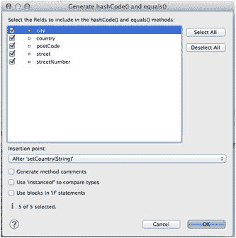
**图 17-1**

该对话询问使用哪些字段来判断两个对象是否相等。在某些情况下，你只需要使用单个字段或字段子集，但在这种情况下，你应该选择所有字段。

当你点击“OK”时，将为你创建两个方法：`equals`和`hashCode`。你最初将关注于`equals`方法：

```java
@Override

public boolean equals(Object obj) {

 if (this == obj)
 return true;

 if (obj == null)
 return false;

 if (getClass() != obj.getClass())
 return false;

 Address other = (Address) obj;

 if (city == null) {
 if (other.city != null)
 return false;
 } else if (!city.equals(other.city))
 return false;

 if (country == null) {
 if (other.country != null)
 return false;
 } else if (!country.equals(other.country))
 return false;

 if (postCode != other.postCode)
 return false;

 if (street == null) {
 if (other.street != null)
 return false;
 } else if (!street.equals(other.street))
 return false;

 if (streetNumber != other.streetNumber)
 return false;

 return true;

}
```
// 注意，当`if`或`else`语句只包含一行代码时，Eclipse省略了括号。创建`equals`方法的对话框包含一个可以勾选以添加括号的选项。

尽管这个方法相当长，但理解它在做什么相当。此方法接收一个对象，并根据它是否认为自己与该对象相等来返回true或false：

- 它首先检查两个对象引用是否指向堆上的同一个对象（`==`）：如果指向，它就不再进行任何其他检查，因为它们必须是等等的。这样做是为了提高效率，根据下面的额外的检查，这两个对象仍然会返回true。
- 它接着检查它是否在与`null`引用比较：如果是，则它与该引用不等。
- 它然后检查它正在比较的对象是否是相同类的实例——如果不是，它们就不可能相等。
- 最后，它遍历所有相关的字段，并检查它是否与传入的对象具有相同的值。你会注意到，当比较两个`Strings`时，它使用了`String`提供的`equals`方法。这是必要的，因为正如你所看到的，两个`Strings`可能具有相同的值，但在使用`==`运算符比较时并不是等等的。

作为一条一般规则，所有的Java类都应该实现`equals`方法。虽然这个概念是结合Collections API引入的，但`equals`方法在Java程序中的用要广泛得多，并且是许多API中的重要组件。

### 哈希码 (Hash Code)


在上一个示例中添加的第二个方法称为`hashCode`。你稍后将更详细地检查哈希值的必要性，但本节将简要介绍该主题。

本质上，哈希码是一个可以从对象持有的数据生成的数字。然而，在生成哈希码时，有一些规则和最佳实践需要遵守：

- 如果两个对象相等，它们必须生成相同的哈希码。语言没有强制这条规则，但未能遵循这条规则可能会导致难以发现的错误。

- 如果两个对象产生相同的哈希码，它们并不一定相等——**再读一遍，因为这很重要，而且并不完全显而易见。** 原因是`int`值的范围可能小于为特定类型创建的不同对象的数量。例如，有无限多个唯一的`Strings`，但表示它们的`int`值是有限的。

- 当对象不等时，它们产生相同哈希码的情况应该是罕见的。这并不是一条显式规则，但正如你将看到的，遵循这一最佳实践是有理由的。

如果你熟悉 MD5 和 SHA1 等哈希算法，这个过程可能听起来很熟悉。这些算法为字节序列产生一个*哈希*。然而，哈希算法要先进得多，因为它们必须在数学上证明冲突是非常罕见的，即两个不同的字节序列产生相同哈希的情况。

与`equals`方法一样，`hashCode`定义在`Object`类中，但可以被重写。技术上，可以添加`equals`方法而不添加`hashCode`方法。这是不建议的，因为它将导致使用默认实现，因此两个对象可能相等，但产生不同的哈希码。

以下是为`Address`类生成的`hashCode`：

```java
@Override
public int hashCode() {
    final int prime = 31;
    int result = 1;
    result = prime * result + ((city == null) ? 0 : city.hashCode());
    result = prime * result + ((country == null) ? 0 : country.hashCode());
    result = prime * result + postCode;
    result = prime * result + ((street == null) ? 0 : street.hashCode());
    result = prime * result + streetNumber;
    return result;
}
```

关于此方法，主要的注意的是，它利用了与`equals`方法相同的字段来生成结果，因此，如果两个对象相等，它们将产生相同的哈希码（hash code）。

你还会注意到该方法大量地使用了一个素数（`31`）。这确保了该方法生成的结果比省略该素数时具有更广泛的分布。如果 Eclipse 没有使用素数作为因子，或者使用了非素数因子，你可能会很容易遇到两个不同对象创建出相同哈希码的情况。

例如，考虑一个具有以下字段的对象：

```java
int a = 10;
int b = 20;
```

`hashCode`的朴素实现可能简单地将这些值相加。然而，当值翻转时，这很容易导致冲突：

```java
int a = 20;
int b = 10;
```

这是因为`(10+20) = (20 + 10)`。

然而，通过引入素数因子，产生的哈希码是不同的：

`(10 + 31) * 31 + 20 = 1291`

`(20 + 31) * 31 + 10 = 1591`

还要注意，该方法在将`String`值包含在哈希码结果中，会内在调用`Strings`提供的`hashCode`方法。这种实现经过深思熟虑；因此，它可能比自定义实现产生更好的结果。

Eclipse 产生的方法极不可能为两个对象产生相同的`hashCode`，除非它们是`equals`。从技术上讲，这仍然可能的（例如，会有两个不同的`Strings`返回相同的`hashCode`），但这种情况非常罕见。

## 比较对象

你需要添加到类中的下一个方法是一个用于比较对象实例与另一个对象实例机制，以便对它们进行排序。`Object`类没有提供可以让你重写以提供此功能的方法，但你可以实现一个名为`Comparable`的接口。该接口要求你实现一个具有以下签名的方法：

```java
public int compareTo(Object o)
```

关于如何排序对象的决定完全取决于你。即使在像人名这样简单的情况下，排序方法也不是非黑即白的：你可能按名或姓进行排序。

在指定使用地址的程序需求时，需要对如何排序地址做出决定。例如，在邮政递送系统中，它们可能按照配送发生的顺序进行排序，而在其他系统中，它们可能按街道名称和门牌号排序。

你将创建一个比较器，它将根据城市按字母顺序对地址进行排序。如果与`Address`比较的对象本身不是`Address`，则这两个对象从排序的角度来看被认为是相等的——即，你无法对它们进行比较。

你可能已经注意到`compareTo`方法返回一个`int`。尽管如此，该方法只能返回三个不同的不同的值：

- **正数**，表示此对象大于它正在比较的对象。

- **负数**，表示此对象小于它正在比较的对象。

- **零**，表示对象在排序顺序上是相等的。

我仍然经常忘记这些数字的操作方向。

确保用于比较对象的算法是*传递的*（transitive）也同样重要。例如，如果`A > B`且`B > C`，那么`A > C`必须成立的：如果这一原则不成立，排序算法将在运行时失败。

从声明`Address`类实现`Comparable`开始：

```java
public class Address implements Comparable {
```

`Comparable`位于`java.lang`包中，因此不需要导入。

接下来，为`compareTo`方法添加实现：

```java
@Override
public int compareTo(Object o) {
    if (o instanceof Address) {
        Address other = (Address)o;
        return city.compareTo(other.getCity());
    } else {
        return 0;
    }
}
```

注意，这种实现利用了`Strings`中已经存在的`compareTo`实现来执行比较。如果需要，你可以在比较之前对两个`String`实例调用`toLowerCase`以执行不区分大小写的比较。

### To String

最后，你将为`Address`添加一个`toString`实现。这在技术上不是需要的，但事实证明它是很有用的。`Object`上存在该方法的原生实现，但没有产生非常有意义的输出。添加你自己的实现将允许你打印`Address`对象的`Collection`并获得合理的输出。

每当对象需要被表示为`String`时，就会调用`toString`方法。例如，如果一个对象被包含在字符串拼接中（使用`+`运算符），就会在该对象上调用`toString`以产生对象的文本版本，并将其附加到`String`中。

遗憾的是，`toString`的默认实现基本上是毫无意义的。

应该添加以下`toString`实现：

```java
@Override
public String toString() {
    return streetNumber + " " + street + ", " + city + ", " + country + "\n";
}
```

有了这四个方法，你就可以开始使用`Collections` API了。

### Lists

`List`可能是 Java 程序中最常见的`Collection`类型。如之前所述，`List`是一个有序的集合。`List`是一个有序的集合，并不要求元素是唯一的。

Lists 经常被使用，即使不需要排序，因为`Collections`是一个通用的`Collection`（有时被称为“袋”）且不关心唯一性。

与其调用 Lists *排序*，最好将它们理解为*保持顺序*。默认情况下，它们根据添加元素的顺序进行排序。Java 提供了`List`的几种实现；本节将关注：`ArrayList`和`LinkedList`。

正如其名称所示，`ArrayList`提供了许多数组的特性，但随着元素的添加可以动态增长。以下程序向`ArrayList`添加了地址，然后打印列表：

```java
package addresses;

import java.util.ArrayList;
import java.util.List;

public class ListsMain {
    public static void main(String[] args) {
        List addresses = new ArrayList();
        Address a1 = new Address(799, "E Dragham", "Tucson", 85705, "USA");
        Address a2 = new Address(200, "Main Street", "Phoenix", 85123, "USA");
        Address a3 = new Address(100, "Main Street", "Seattle", 98104, "USA");
        Address a4 = new Address(8400, "London Place", "Washington", 20521, "USA");
        Address a5 = new Address(8400, "London Place", "Washington", 20521, "USA");

        addresses.add(a1);
        addresses.add(a2);
        addresses.add(a3);
        addresses.add(a4);
        addresses.add(a5);

        System.out.println(addresses);
    }
}
```

注意`addresses`变量被定义为`List`，但持有`ArrayList`的引用。由于是最佳实践，因为它允许你未来更改具体实现（例如改为`LinkedList`）而不影响其他代码。这种方法是可能的，因为`List`接口支持与`ArrayList`交互的大多数关键方法。

此程序将产生以下输出：

```
[799 E Dragham, Tucson, USA
, 200 Main Street, Phoenix, USA
, 100 Main Street, Seattle, USA
, 8400 London Place, Washington, USA
, 8400 London Place, Washington, USA
]
```

这证明了`List`保留了元素的顺序，同时也证明了在打印`List`时会对每个元素调用`toString`方法。

如果你需要使用早早添加的`compareTo`方法对`List`内容进行排序，你需要在打印之前使用以下代码显式对`List`内容进行排序：

```java
Collections.sort(addresses);
```

`Collections`类包含一组用于操作`Collections`的静态辅助方法，就像`Arrays`类对数组执行的那样。

在打印`List`之前添加了该行代码后，程序现在将输出以下内容：

```
[200 Main Street, Phoenix, USA
, 100 Main Street, Seattle, USA
, 799 E Dragham, Tucson, USA
, 8400 London Place, Washington, USA
, 8400 London Place, Washington, USA
]
```

我将在书的后面介绍另一种排序`List`的替代机制。在学习这种方法之前，有必要了解 Java 8 中添加的一些其他特性。

`List`接口包含以下用于操作的方法。因此，这些方法可以在`List`的任何实现类上执行：

- `add`：除了前面代码中看到的`add`方法外，`add`还可以指定元素的索引。在特定索引处添加元素时，所有索引大于该元素的索引都会增加 1。

- `addAll`：这可以将一个元素`Collection`添加到`List`中，从而合并这两个集合。

- `clear`：从`List`中删除所有元素。

- `contains`：根据`equals`方法检查指定的对象是否出现在`List`中。

- `get`：返回指定索引处的对象。

- `indexOf`：返回指定对象（使用`equals`方法识别）的首次索引。

- `remove`：删除指定的对象，或者（如果传递了`int`）删除指定索引处的对象。

- `size`：返回`List`的长度。

将之前概述的实现更改为使用`LinkedList`实现，只需更改一行代码：

```java
List addresses = new LinkedList();
```

你可能在奇怪，为什么 Java 提供了`List`接口的多个实现？主要原因是，某些实现在某些场景下的性能优于其他实现。

例如，在大型`LinkedList`的中间插入元素是非常高效的，而在`ArrayList`中执行此操作则是很低效的。相反，通过索引在`ArrayList`中定位元素是非常高效的，而这在`LinkedList`中很低效。

作为一条通用规则，我在大多数情况下都使用`ArrayLists`。如果你正在编写一个添加、排序或搜索非常大列表的程序，那么基准测试哪种实现提供最佳性能可能是值得的。

## Sets（集合）

如前所述，`Sets`的定义特性是所有元素必须是唯一的（基于`equals`方法的实现）。如果你向`Set`中添加重复元素，它将替换与其相等的现有元素。

`Set`也是一个接口：`Set`的两个主要实现是`HashSet`和`TreeSet`。

决定使用哪种实现比`Lists`要简单一些：如果`Set`中元素的顺序不重要，则使用`HashSet`，否则使用`TreeSet`。通常情况下，`HashSet`的`add`、`remove`、`contains`和`size`操作比`TreeSet`快得多，但`HashSet`是不可排序的。

`Sets`的性能取决于是否提供了良好的`hashKey`方法实现，因为这是快速检测重复元素的关键机制。

例如，当对象添加到`Set`时，它们根据其`hashKey`的值进行索引。所有具有相同`hashKey`的对象都被分组在*桶（buckets）*中。如前所述，`hashKey`不一定能产生唯一的结果，因此桶可能包含多个对象，但通常桶会非常小。

当你向`Set`添加一个对象时，`Set`需要找出`Set`中是否存在任何与新对象相等的其他元素。

实现这种机制的一种方法是遍历`Set`中的所有元素，并用新对象对它们调用`equals`。然而，更快速的机制是找到要添加对象的`hashCode`，然后定位该值对应的对象桶（这非常快，因为查找是基于数值索引的）。一旦找到桶，就可以将新对象与桶中的对象进行相等比较。

由于桶通常只包含 0 或 1 个对象，因此`equals`方法每次`add`可能只会被调用（最多）一次。

然而，请考虑一下如果你提供了以下`hashKey`实现，会发生什么：

```java
public int hashCode() {
    return 1;
}
```

这实际上是一个有效的`hashKey`实现：如果两个对象相等，它们将返回相同的`hashKey`。

尽管这是有效的，但在向`Set`中添加新元素时，它会导致性能非常差，因为它会导致以下逻辑：

- 找到作为参数传递的对象的`hashKey` (1)

- 找到具有该`hashKey`的桶（该桶将包含`Set`中的所有对象）

- 遍历这些对象并检查它们是否与传入的对象相等

正如你所看到的，你完全抵消了与`hashCodes`和索引相关的性能优化。

下面的程序演示了`HashSet`的用法：

```java
public static void main(String[] args) {
    Set addresses = new HashSet();

    Address a1 = new Address(799, "E Dragham", "Tucson", 85705, "USA");
    Address a2 = new Address(200, "Main Street", "Phoenix", 85123, "USA");
    Address a3 = new Address(100, "Main Street", "Seattle", 98104, "USA");
    Address a4 = new Address(8400, "London Place", "Washington", 20521, "USA");
    Address a5 = new Address(8400, "London Place", "Washington", 20521, "USA");

    addresses.add(a1);
    addresses.add(a2);
    addresses.add(a3);
    addresses.add(a4);
    addresses.add(a5);

    System.out.println("Size = " + addresses.size());
    System.out.println(addresses);
}
```

这产生了以下输出：


```
Size = 4
[799 E Dragham, Tucson, USA
, 8400 London Place, Washington, USA
, 200 Main Street, Phoenix, USA
, 100 Main Street, Seattle, USA]
```

注意到尽管你向 `Set` 添加了 5 个元素，`Set` 仅包含 4 个元素：这是因为最后两个地址符合相等定义，因此第二个覆盖了第一个。

此外注意，地址打印的顺序与其添加的顺序并不匹配；`HashSet` 不尝试维护任何顺序。

使用 `TreeSet` 的示例将完全相同；除非输出将遵循元素的顺序。我将留给你你自己来实现。

## Maps（映射）

`Map` 接口是 `Collections` API 的一部分，但与 `List` 和 `Set` 不同，它没有继承 `Collection` 接口。这种设计的主要原因是：`Map` 中的每个条目由两个部分组成：键（key）和值（value）。这意味着向 `Map` 添加元素需要提供两个值而不是一个。

在某些方面，`Maps` 类似于 `HashSets`：两种数据结构都使用索引键来快速查找。主要区别在于，在 `HashSets` 中，键是从 `hashKey` 方法隐含生成的，而在 `Maps` 中，键是显式提供的，因此允许将两个无关的对象关联在一起。

`Map` 的两种常用实现是 `HashMap` 和 `TreeMap`。这些实现之间的主要区别是 `TreeMap` 根据键对元素进行排序，而 `HashMap` 不。除非你有特定的排序需求，否则 `HashMap` 应该是你的首选方案，因为它通常提供更好的性能。

考虑一种你想快速检索特定人的 `Address` 的情况。你将从定义一个非常简单的 `Person` 类并添加 `hashCode` 和 `equals` 方法开始：

```java
package addresses;

public class Person {

 String firstName;

 String lastName;

 public Person(String firstName, String lastName ) {

    this.firstName = firstName;

 this.lastName = lastName;

 }

 @Override

 public String toString() {

 return "Person [firstName=" + firstName + ", lastName=" + lastName + "]";

 }

 @Override
 public int hashCode() {
     final int prime = 31;
     int result = 1;
     result = prime * result +
             ((firstName == null) ? 0 : firstName.hashCode());
     result = prime * result +
             ((lastName == null) ? 0 : lastName.hashCode());
     return result;
 }

 @Override
 public boolean equals(Object obj) {
     if (this == obj)
         return true;
     if (obj == null)
         return false;
     if (getClass() != obj.getClass())
         return false;
     Person other = (Person) obj;
     if (firstName == null) {
         if (other.firstName != null)
             return false;
     } else if (!firstName.equals(other.firstName))
         return false;
     if (lastName == null) {
         if (other.lastName != null)
             return false;
     } else if (!lastName.equals(other.lastName))
         return false;
     return true;
 }
}
```

为了简洁起见，省略了 getter 和 setter，字段使用了默认访问修饰符定义。你可以在自己的版本中使用私有字段以及 getter 和 setter。

接下来，你将编写一个短程序来关联 `Person` 和 `Address` 实例：

```java
package addresses;

import java.util.HashMap;
import java.util.Map;

public class MapMain {
    public static void main(String[] args) {
        Address a1 = new Address(799, "E Dragham", "Tucson", 85705, "USA");
        Address a2 = new Address(200, "Main Street", "Phoenix", 85123, "USA");
        Address a3 = new Address(100, "Main Street", "Seattle", 98104, "USA");
        Person p1 = new Person("Dane", "Cameron");
        Person p2 = new Person("James", "Smith");
        Person p3 = new Person("Keith", "Rogers");
        Person p4 = new Person("Owen", "Heart");

        Map people = new HashMap();
        people.put(p1, a3);
        people.put(p2, a1);
        people.put(p3, a2);
        people.put(p4, a1);

        System.out.println("Dane lives at " + people.get(p1));
        people.put(p1, a2);
        System.out.println("Now Dane lives at " + people.get(p1));
    }
}
```

这产生了以下输出：

```text
Dane lives at 100 Main Street, Seattle, USA
Now Dane lives at 200 Main Street, Phoenix, USA
```

`Map` 强制执行一些规则：

-   每个键在 `Map` 中只能出现一次，如果你放入了一个已存在的键，与该键关联的值将会被更新。这就是为什么在示例程序中 `Dane` 的 `Address` 发生了变化。

-   `null` 值可以作为键也可以作为值，但只能有一个 `null` 键的条目。

在根据键访问值时，`Map` 通常能提供极佳的性能。然而，这取决于用作键的对象所提供的 `hashCode` 实现是否生成了分布均匀的值，因为与 `Sets` 一样，查找是通过使用 `hashCode` 来优化的。

## 泛型 (Generics)

在继续之前，值得后退一步，谈谈泛型。泛型是在 Java 5 中追溯引入到 Java 语言中的，它允许任何类型（例如 `ArrayList`、`HashSet` 或你自己定义的类型）以类型安全的方式对其他类型进行操作。

你在本章中目前创建的集合对任何派自 `Object` 的类型进行操作。这意味着如果你想从 `Collection` 中提取元素，你需要知道它们是什么类型，并对其进行适当的强制转换。这可能是运行时错误的主要来源；例如，以下代码可以编译，但在运行时会产生 `ClassCastException`。

```java
public static void main(String[] args) {
    List addresses = new LinkedList();
    Address a1 = new Address(799, "E Dragham", "Tucson", 85705, "USA");
    addresses.add(a1);
    Person p1 = new Person("Dane", "Cameron");
    addresses.add(p1);
    Address a = (Address) addresses.get(1);
}
```

异常的原因显而易见：一个 `Person` 被强制转换成了 `Address` —— 这个问题只有在运行时才会暴露。

编写此代码更好的方法是定义 `List` 将包含的类型，并允许编译器确保对 `List` 的所有操作都符合该类型。`Collections` API 中的所有类都定义为支持泛型，以实现这一点。

你可以如下定义一个用于 `Address` 对象的 `List`：

```java
List<Address> addresses = new LinkedList<Address>();
```

事实上，从 Java 7 开始，这可以简化为：

```java
List<Address> addresses = new LinkedList<>();
```

此声明中的关键区别是角括号。值 `<Address>` 在创建 `LinkedList` 时提供，因此它作用像一个参数——并代表了 `List` 可以存储的类型。一旦你做了此更改，你会发现以下行代码不再通过编译：

```java
addresses.add(p1);
```

编译器已确定你正尝试在 `List` 中存储一个 `Person`，并意识到这是无效的。

你还会注意到能够从 `List` 中提取 `Address` 对象。泛型是 Java 语言中一个非常有用的特性。它们允许 API 设计师设计泛型接口，然后允许 API 用户指定类型。

### 泛型与继承 (Generics and Inheritance)

理解泛型如何与继承工作是非常重要的，因为其行为并不如你预期的那样直观。为了演示这一点，你将使用书中之前的 `Shape` 类层次结构。你可能并不意外以下内容是有效的：

```java
public static void main(String[] args) {
    List<Shape> shapes = new ArrayList<>();
    shapes.add(new Square());
}
```

如果 `List` 定义为存储 `Shape` 实例，那么添加 `Square` 没有问题。然而，当你开始处理 `List` 本身而不是其内容时，情况会变得复杂一些。考虑以下无效的示例：

```java
public static void main(String[] args) {
    List<Square> squares = new ArrayList<>();
    squares.add(new Square());
    List<Shape> shapes = squares; // 这是无效的
}
```

在这个示例中，无法将 `List<Square>` 或 `List<Circle>` 的实例传递给一个声明参数类型为 `List<Shape>` 的方法。这是一个很大的限制，因为它阻止了你创建能够对继承层次结构中各种类型进行操作的方法。

幸运的是，这个问题有一个解决方案；该方法可以定义如下：

```java
private static void printFirstElement(List<? extends Shape> shapes) {
    System.out.println(shapes.get(0));
}
```

在这种情况下，你表示该参数可以是任何扩展 `Shape` 类型的 `List`：因此，`main` 方法中定义的两个 `List` 都可以传递给这个方法。

显然，这里有一个问题：如果 `printFirstElement` 向 `Square` 的 `List` 中添加 `Circle` 会怎么办？由于编译器无法检查添加到此类 `List` 中的对象是否与底层类型一致，因此 `printFirstElement` 无法向 `List` 添加内容——它必须将 `List` 视为只读。

## 迭代器与 for 循环

在 `Collection` 上执行的最常见操作可能是遍历它的元素。遍历简单来说就是逐个访问每个元素。在 Java 8 之前，Java 提供了两种主要的机制来实现此点：一种特殊的 `for` 循环和 `Iterator` 类。Java 8 引入了另一种名为 `Stream` 的机制：这将在后续章节中进行讨论。

遍历 `Collection` 最方便的方法是使用 `for`-循环。这可以通过以下方式实现：

```java
public static void main(String[] args) {
    List<Address> addresses = new ArrayList<>();
    addresses.add(new Address(799, "E Dragham", "Tucson", 85705, "USA"));
    addresses.add(new Address(200, "Main Street", "Phoenix", 85123, "USA"));
    addresses.add(new Address(100, "Main Street", "Seattle", 98104, "USA"));
    addresses.add(new Address(8400 , "London Place", "Washington", 20521, "USA"));

    for (Address a : addresses) {
        System.out.println(a);
    }
}
```

注意，这种语法与书中之前看到的 `for`-循环不同。在这种类型的 `for`-循环中，定义的第一个部分——`Address a`——是变量的声明，在每次迭代中，`List` 中的元素将被赋值给它。声明的第二部分将被遍历的 `Collection`。

这种方法适用于任何扩展 `Collection` 的实现。遍历 `Maps` 并不常见，但可以通过调用 `Map` 的 `values` 方法来返回存储在 `Map` 中的值的 `Collection` 从而实现。

基于集合的 `for` 循环对 Java 来说是相对新的。在它们出现之前，`Iterators` 是遍历 `Collection` 的传统方式：

```java
public static void main(String[] args) {
    List<Address> addresses = new ArrayList<>();
    addresses.add(new Address(799, "E Dragham", "Tucson", 85705, "USA"));
    addresses.add(new Address(200, "Main Street", "Phoenix", 85123, "USA"));
    addresses.add(new Address(100, "Main Street", "Seattle", 98104, "USA"));
    addresses.add(new Address(8400 , "London Place", "Washington", 20521, "USA"));

    java.util.Iterator<Address> iter = addresses.iterator();
    while (iter.hasNext()) {
        Address a = iter.next();
        System.out.println(a);
    }
}
```

在声明下一个字段时，情况变得稍微复杂了一些。请记住，该字段提供了对列表中下一个 `Node` 的引用。因此，该字段将包含一个类型为 `Node` 对象的引用，但更具体地说，它将是一个与此 `Node` 操作相同类型的 `Node`。因此，它的声明如下：

```java
private Node<T> next;
```

注意，该字段的 getter 和 setter 遵循相同的约定。

接下来，你把注意力转向链表本身。它将包含以下方法：

- `addFirst`：这将在列表的开头添加一个新的 `Node`

- `addLast`：这将在列表的末尾添加一个新的 `Node`

- `print`：这将打印列表

此实现将保持在较短的范围内，因为仅通过这些方法就足够让你理解泛型了。如果你愿意，可以扩展该实现，以包含你在 `Collections` API 中见过的更多方法。你甚至可以实现 `List` 接口本身，从而扩展 `Collections` API。

你把你的链表命名为 `LinkedList2`，以免与 Java 提供的版本混淆。


```java
package linkedlist;

public class LinkedList2<T> {
    Node<T> head;

    public LinkedList2() {}

    public void addFirst(T value) {
        if (head == null) {
            head = new Node<T>(value, null);
        } else {
            Node<T> newHead = new Node<T>(value, head);
            head = newHead;
        }
    }
}
```

注意，该类也接受类型`<T>`。你再次使用`T`这一事实并不重要，你可以任何值来表示此类型：我更倾向于使用`T`，因为它是“type”的缩写。

链表需要的唯一字段是到列表头（第一个节点）的引用。一旦有了这个引用，它就可以通过每个`Node`的`next`字段来遍历整个列表。

这个初始版本提供了一个`addFirst`方法。该方法首先检查列表是否已经有一个头节点。如果没有，则列表为空，你可以简单地创建一个新的`Node`作为头节点。该节点的`next`字段将没有值；因此，你只需向`Node`构造函数传递`null`即可。

注意，当实例化`Node`时，你指定了它也与列表相同的类型操作，如`T`所示。列表仍然不知道这个类型将是什么，它只知道`LinkedList2`和`Node`都将在相同类型上操作。

如果列表已经有一个头节点，你仍然想构造一个新的`Node`，但你想让新创建的`Node`成为列表的头部，并将旧的头部设置在它的`next`字段中。

你还可以添加`addLast`方法：

```java
public void addLast(T value) {
    if (head == null) {
        head = new Node<T>(value, null);
    } else {
        Node<T> lastNode = head;
        while (lastNode.getNext() != null) {
            lastNode = lastNode.getNext();
        }
        Node<T> node = new Node<T>(value, null);
        lastNode.setNext(node);
    }
}
```

该方法的起始与`addFirst`方法相同：如果列表为空，则将一个新的`Node`设置为头节点。

如果列表不空，你需要遍历列表，直到找到一个没有下一个`Node`的`Node`——根据定义，这就是列表的末尾。当你找到这个`Node`时，你创建一个新的`Node`来表示列表的新末尾——然后告诉当前的最后一个`Node`这就是它的`next` `Node`。

最后，你可以为列表添加`print`方法。它简单地遍历所有的`Nodes`，并打印它们的值：

```java
public void print() {
    Node<T> lastNode = head;
    while (lastNode != null) {
        System.out.println(lastNode.getValue());
        lastNode = lastNode.getNext();
    }
}
```

现在你已经创建了API，可以尝试一下。下面的程序使用了该API并指定它包含`String`实例：

```java
package linkedlist;

public class Main {
    public static void main(String[] args) {
        LinkedList2<String> list = new LinkedList2<>();
        list.addFirst("First value");
        list.addLast("Last value");
        list.addFirst("New first value");
        list.addLast("New last value");
        list.print();
    }
}
```

如果你运行这个程序，它将输出如下：

```
New first value
First value
Last value
New last value
```

你也可以亲身验证，无法向列表添加`String`以外的任何内容。例如，下面这一行将产生编译错误：

```java
list.addLast(new Integer(22));
```

值得注意的是，仅仅因为你的类支持泛型并不意味着该类的用户必须提供相关类型。你可以按照如下方式实例化`LinkedList2`：

```java
LinkedList2 list = new LinkedList2();
```

在这种情况下，任何类型都可以插入到列表中，并且`LinkedList2`类不会为用户提供任何形式的类型安全。

# 19 单元测试

本章将带你稍微进入单元测试的世界。单元测试是用于验证代码的自动化测试。Java支持一个名为`JUnit`的流行库，允许编写单元测试（或在IDE之外执行）。单元测试是维护代码质量的重要机制，Java程序员尝试通过它们获得对代码的合理的信心。

一个典型的单元测试将执行一段Java代码并获得结果，然后对该结果进行断言。在本章中，你将为某些代码开发单元测试。这些开发的测试将使用`JUnit`版本4。Eclipse可能会询问你想使用哪个版本的`JUnit`；如果是，请选择4。

## 基本测试

你将通过为`Address`类创建一个基本测试来开始。找到`Address`类并右键点击它。在出现的菜单中选择`New -> JUnit Test Case`。这将向你显示如图19-1所示的对话框；只需点击`Finish`接受默认值：

将在源代码相同的文件夹创建单元测试。通常创建一个名为`tests`的新源文件夹：如果你喜欢使用这种方法，右键点击项目并选择`New -> Source Folder`，并命名为`tests`。一旦创建，在创建测试时你可以浏览到此文件夹并将其设置为源文件夹。

Eclipse将生成以下类：

```java
package addresses;

import static org.junit.Assert.*;

import org.junit.Test;

public class AddressTest {
    @Test
    public void test() {
        fail("Not yet implemented");
    }
}
```

该类的关键特征是带有`@Test`注解的方法。当此类作为单元测试执行时，任何带有此注解的方法都将被自动执行，并通过或失败。为了将此类作为单元测试执行，只需右键点击该类并选择`Run As -> Unit Test`。Eclipse将打开一个显示单元测试结果的新视图，结果应如图19-2所示。

红色条表示测试失败了：这是由于测试当前调用了`fail`。

你可能好奇`fail`方法是从哪里来的，因为此类不支持`fail`方法，并且没有继承任何其他类？它来自下面这一行的静态导入：

```java
import static org.junit.Assert.*;
```

此语句请求将指定类中的所有静态方法导入到该类中，这意味着执行它们时无需加上类名以前缀。一旦执行了静态导入，就好像导入的静态方法定义在当前类中一样。静态导入并不局限于单元测试，你可以在你的任何类中使用它们。

因此，代码实际上在执行了以下语句：

```java
Assert.fail("Not yet implemented");
```

你将开始为`equals`方法添加一个测试：

```java
package addresses;

import static org.junit.Assert.*;

import org.junit.Test;

public class AddressTest {
  @Test
  public void testEquals() {
    Address a1 = new Address(1, "Main Road", "Vicksburg", 57332, "USA");
    Address a2 = new Address(1, "Main Road", "Vicksburg", 57332, "USA");
    Address a3 = new Address(2, "Main Road", "Vicksburg", 57332, "USA");
    assertEquals(a1, a2);
    assertFalse(a1.equals(a3));
    assertFalse(a1.equals("Hello World"));
  }
}
```

`Assert`类包含了许多用于断言特定场景的静态方法。

此测试验证了三种场景，并包含了正向和反向场景。如果你将其作为单元测试运行，它将产生一个绿条，如图19-3所示：

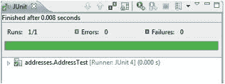

图19-3

接下来，你将额外添加两个测试来验证`hashCode`和`toString`方法：

```java
@Test
public void testHashKey() {
  Address a1 = new Address(1, "Main Road", "Vicksburg", 57332, "USA");
  Address a2 = new Address(1, "Main Road", "Vicksburg", 57332, "USA");
  Address a3 = new Address(2, "Main Road", "Vicksburg", 57332, "USA");
  assertEquals(a1.hashCode(), a2.hashCode());
  assertFalse(a1.hashCode() == a3.hashCode());
}

@Test
public void testToString() {
  Address a1 = new Address(1, "Main Road", "Vicksburg", 57332, "USA");
  Address a2 = new Address(2, "West Road", "Mobile", 44332, "USA");
  assertEquals(a1.toString(), "1 Main Road, Vicksburg, USA\n");
  assertEquals(a2.toString(), "2 West Road, Mobile, USA\n");
}
```

最后，你将添加一个方法来验证`compareTo`方法：

```java
@Test
public void testSort() {
  Address a1 = new Address(1, "Main Road", "Vicksburg", 57332, "USA");
  Address a2 = new Address(1, "Main Road", "Mobile", 65544, "USA");
  Address a3 = new Address(2, "Main Road", "Los Angeles", 90787, "USA");
  List<Address> addresses = Arrays.asList(a1, a2, a3);
  Collections.sort(addresses);
  assertEquals(a1, addresses.get(2));
  assertEquals(a3, addresses.get(0));
}
```

注意`Arrays`上的`asList`辅助方法可以从数组构造一个`List`。

如果你现在运行此类作为单元测试，Eclipse应该确认所有4个测试都通过了，如图19-4所示：

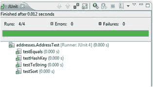

图19-4

这些示例展示了大多数单元测试有多简单。

`JUnit`还支持许多其他你应该注意的有用注解。

有时，在任何测试执行之前为所有测试设置相同的数据是很有用的。这可以通过在方法上标记`@BeforeClass`注解来实现，并在该方法的体中执行任何相关的数据初始化：

```java
@BeforeClass
public void constructList() {
}
```

`j`还支持一个功能类似的`@Before`注解，执行类似的作用，但它会在每个测试执行之前运行。如果测试将修改数据，并且在每个测试之后需要重置数据，那么这就非常有用。

此外，`jUnit`还支持`@After`和`@AfterClass`注解，允许你提供在每个测试之后或在类中的所有测试执行之后运行的方法。

如果你在创建单元测试时选择了图19-5所示的选项，Eclipse将为这些方法生成存根：

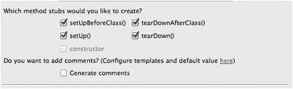

图19-5

尽管单元测试很简单，但它们非常强大。随着程序规模的扩大，很难知道程序中的每行代码在做什么，以及更改一行代码将产生什么影响。因此，单元测试的设计是为了让你有信心更改（或重构）代码：如果你破坏了现有功能，单元测试会告诉你。

事实上，许多程序员实际上在编写程序逻辑之前就编写了单元测试。单元测试指定了代码的预期行为，因此一旦所有单元测试通过，你就知道自己已经满足了这些预期。

# 20 枚举类型 (Enumerated Types)

如果你考虑`boolean`数据类型，它仅仅是一个具有定义值列表的类型：`true`和`false`。枚举类型同样是具有定义值列表的类型。例如，一周中的星期几或月份。Java 引入了一种名为`enums`（枚举类型）的功能，允许你定义如下值：

```java
public enum DaysOfWeek {
  Monday,Tuesday,Wednesday,Thursday,Friday,Saturday,Sunday;
}
```

注意，枚举的值并不是字符串（它们周围没有引号），每个值之间用逗号分隔，列表以分号结束。

许多程序员倾向于使用大写字母表示枚举值，尽管在这方面没有强制性。正如所有类都隐式继承`Object`一样，枚举也隐式继承`java.lang.Enum`。这意味着枚举支持熟悉的方法，如`toString`和`equals`。

一旦声明了枚举，可以这样使用：

```java
package enums;

public class UsingEnums {
  public static void main(String[] args) {
    DaysOfWeek monday = DaysOfWeek.Monday;
    DaysOfWeek sunday = DaysOfWeek.Sunday;
  }
}
```

枚举类型可以与其他枚举类型进行相等比较，并可以作为`switch`的输入（这对于普通对象是不可能的）。

枚举的另一个有趣特性是可以为每个值关联额外的数据。这可以通过枚举本身的构造函数来实现，并在定义每个值时调用。构造函数必须是私有的，因为它只能由枚举内部使用：

```java
package enums;

public enum DaysOfWeek {
  Monday(true),Tuesday(true),Wednesday(true),Thursday(true),
  Friday(true),Saturday(false),Sunday(false);

  private DaysOfWeek(boolean weekday) {
    this.weekday = weekday;
  }

  private boolean weekday;

  public boolean isWeekday() {
    return weekday;
  }
}
```

在枚举的情况下，构造函数必须位于值列表下方。

注意枚举类型还可以定义一组字段和方法来访问这些数据。每个枚举值存储其独立的数据。因此，一旦为值关联了数据，使用这些枚举类型的对象就可以访问这些数据：

```java
package enums;

public class UsingEnums {
  public static void main(String[] args) {
    DaysOfWeek monday = DaysOfWeek.Monday;
    DaysOfWeek sunday = DaysOfWeek.Sunday;

    System.out.println("Monday is a weekday? :" +
    monday.isWeekday());
    System.out.println("Sunday is a weekday? :"); +
    sunday.isWeekday());
  }
}
```

重要的是，与每个枚举值关联的数据在程序执行期间应该保持不变：枚举类型代表静态数据，因此其数据不应受到更改。

## 结论

在你的程序中并不一定需要使用枚举类型，事实上，Java直到最近才引入枚举类型。使用`Strings`代替枚举是完全可行的。然而，使用枚举确实有一些真正的优势：

- 枚举类型可以清晰地标识字段的可能值。如果使用`Strings`，则并不总是能立即直观地看出应该使用什么值。例如，`Tuesday`应该被表述为`Tuesday`、`TUESDAY`还是`Tues`。

- 可以为每个值关联额外信息，从而创建更复杂的类型。

- 始终可以使用`==`运算符比较枚举：正如你所看到的，这对于`Strings`并不总是可能的。


- 虽然可能不是显而易见的，但枚举可以实现接口。这确保了枚举值可以用任何预期接口的地方。

# 21 内部类

到目前为止，你创建的所有类都是作为独立的实体存在的，可以被任何具有相应权限的代码实例化。

Java 支持一种名为内部类的额外类型类。内部类提供了一种将类嵌套在其他类内部的机制。实际上，内部类有四种：

- 内部类
- 静态内部类
- 局部类
- 匿名内部类

本章将检查这四种内部类，并查看它们在何时以及何种情况下很有用。

不要将内部类与书中之前在同一个类文件中定义多个类的示例混淆。由于声明方式的不同，这些类本身并没有特别之处：这仅仅是为了方便起见。

在开始本章之前，值得指出 Java 8 包含了一项名为 `lambda 表达式` 的新功能，它提供了内部类的许多优点，并提供了其他重大的优势。虽然下一章将涵盖 `lambda 表达式`，但在转向理解 `lambda 表达式` 之前，确保你理解了内部类是有重要的。一旦你理解了内部类，理解 `lambda 表达式` 的原理将会容易得多。

## 内部类

内部类允许一个类嵌套在另一个类内部。内部类的实例只能存在于其包装类的实例内部，并在实例化时，在对其包装类执行操作时具有特殊特权。

尽管类和内部类之间存在父子关系，但不要掉入认为内部类与继承相关的陷阱：正如你将看到的，内部类和继承在语言中履行着非常不同的功能。

在这一节中，你将创建一个购物车程序。每个购物车可以包含一个产品列表；因此，首先从创建一个表示产品的类开始：

```java
package innerclasses;

public class Product {

  private String name;

  private Double price;

  public Product(String name, Double price) {

    this.name = name;

    this.price = price;

  }

  public String getName() {

    return name;

  }

  public Double getPrice() {

    return price;

  }

  @Override

  public int hashCode() {

    final int prime = 31;

    int result = 1;

    result = prime * result + ((name == null) ? 0 :
    name.hashCode());

    result = prime * result + ((price == null) ? 0 :
    price.hashCode());

    return result;

  }

  @Override
  public boolean equals(Object obj) {

    if (this == obj)
      return true;

    if (obj == null)
      return false;

    if (getClass() != obj.getClass())
      return false;

    Product other = (Product) obj;

    if (name == null) {

      if (other.name != null)
        return false;

    } else if (!name.equals(other.name))
      return false;

    if (price == null) {

      if (other.price != null)
        return false;

    } else if (!price.equals(other.price))
      return false;

    return true;

  }
}
```

这是一个带有两个字段（`name` 和 `price`）的常规类。它提供了 `equals` 和 `hashCode` 的实现。

你现在将创建一个 `ShoppingCart` 类来存放产品。购物车需要能够持有每个产品的多个实例，因此你将在 `ShoppingCart` 内部创建一个名为 `Item` 的内部类，它将封装一个产品和一个数量。将其制作内部类的理由是，`ShoppingCart` 外部的代码永远不需要直接处理 `Item`：这个概念是 `ShoppingCart` 私有的：

```java
package innerclasses;

import java.util.ArrayList;

import java.util.List;

public class ShoppingCart {

  private List<Item> items = new ArrayList<>();

  public ShoppingCart() {}

  public void addProduct(Product p) {

    boolean found = false;

    for (Item item : items) {

      if (item.matches(p)) {
        item.increaseTotal();
        found = true;
      }
    }

    if (!found) {
      items.add(new Item(p));
    }
  }

  public void removeProduct(Product p) {

    for (Item item : items) {

      if (item.matches(p)) {
        item.decreaseTotal();
      }

    }
  }

  public void printCart() {

    double total = 0;

    for (Item item : items) {

      total += item.getTotalPrice();

      System.out.println(item.getDisplay());

    }

    System.out.printf("The total is : $%f\n\n", total);
  }

  private class Item {

    private Product product;

    private Integer qty;

    Item(Product product) {

      this.product = product;

      this.qty = 1;
    }

    void increaseTotal() {

      qty += 1;
    }

    void decreaseTotal() {

      qty -= 1;
    }

    boolean matches(Product p) {

      return this.product.equals(p);
    }

    Double getTotalPrice() {

      return qty * product.getPrice();
    }

    String getDisplay() {

      if (qty == 0) {
        return product.getName() + " has been removed";
      } else {
        return qty + " x " + product.getName() + " ($" + product.getPrice() + ")";
      }
    }
  }
}
```

`ShoppingCart` 支持三个核心方法：

- `addProduct`：根据 `Product` 创建 `Item` 并将其添加到 `ShoppingCart`。如果产品已经在 `ShoppingCart` 中，该方法会增加数量。
- `removeProduct`：减少相关 `Product` 的数量。
- `printCart`：打印 `ShoppingCart` 的当前状态。

你可以看到，`ShoppingCart` 包含以下内部类：

```java
private class Item { ... }
```

一旦声明了内部类，外部类就可以像普通类一样使用它，但因为是 `private` 的，它对程序的其他部分隐藏的，程序的其他部分完全不知道它的存在。

为了查看该类，运行以下程序：

```java
package innerclasses;

public class Main {

  public static void main(String[] args) {

    Product i1 = new Product("The Sun Rises", 9.99);

    Product i2 = new Product("The Old Man and the Sea", 7.99);

    Product i3 = new Product("For Whom the Bell Tolls", 7.99);

    ShoppingCart cart = new ShoppingCart();

    cart.addProduct(i1);

    cart.addProduct(i2);

    cart.addProduct(i2);

    cart.addProduct(i3);

    cart.printCart();

    cart.removeProduct(i3);

    cart.printCart();

  }

}
```

这将输出：

```text
1 x The Sun Rises ($9.99)

2 x The Old Man and the Sea ($15.98)

1 x For Whom the Bell Tolls ($7.99)

The total is : $33.960000

1 x The Sun Rises ($9.99)

2 x The Old Man and the Sea ($15.98)

For Whom the Bell Tolls has been removed

The total is : $25.970000
```

在某种意义上，内部类是辅助封装的机制。因为你不希望 `Item` 类暴露给任何其他代码，将其声明在 `ShoppingCart` 类内部可以将其功能完全封装在 `ShoppingCart` 中。

内部类还提供了独立类中无法找到的其他优势：

- 内部类可以访问外部类的所有字段和方法，包括其私有字段和方法。
- 内部类可以如下所示访问外部类的 `this` 引用：`ShoppingCart.this.items.clear();`
- 外部类对内部类拥有完全访问权限，包括其私有方法和字段。

正如这些点所示，外部类和内部类之间存在着非常特殊的关系。尽管它们在某些方面是独立的，但它们可以执行许多相同的操作，并拥有与类方法相同的大部分权限。

在上一个示例中，`Item` 类被设置为私有（`private`）。内部类可以使用任何所需的访问修饰符进行声明，这意味着它们可能被其外部类以外的类实例化。

如果你将 `Item` 设为公有类，在没有 `ShoppingCart` 作为其外部类的情况下，它仍然无法被实例化。因此，从父类外部实例化内部类的方式并不完全直观：

```java
ShoppingCart cart = new ShoppingCart();
Product i1 = new Product("The Sun Also Rises", 9.99);
cart.new Item(i1);
```

注意，`new` 关键字是在 `ShoppingCart` 的实例上被调用的：因此，新创建的 `Item` 的外部类将是变量 `cart` 所代表的 `ShoppingCart` 实例。

一旦内部类被实例化，它与其他任何类都没有区别：可以根据其访问修饰符访问它的字段和方法。内部类可以访问其外部类的功能这一点，对于使用该内部类的外部类来说并不是显而易见的。

多个内部类共享同一个外部类显然也是可能的。

## 静态内部类

静态内部类看起来与内部类相似，区别在于它们使用 `static` 关键字进行声明。与内部类不同，静态内部类不存在于外部类的实例内部（它们存在于类内部），因此无法访问外部类的 `this` 变量。

我很少发现静态内部类有很多用途：本质上，它们提供了一个额外的嵌套层，作用类似于包（`packages`）。它们提供的主要优势是能够访问外部类上的私有静态字段和方法。

以下是一个简单的示例：

```java
package innerclasses;

public class StaticInner {
    public StaticInner() {}

    public static class Helper {
        public void printHello() {
            System.out.println("Hello");
        }
    }
}
```

在这种情况下，外部类名为 `StaticInner`，它包含一个名为 `Helper` 的静态内部类。注意，静态内部类可以包含非静态方法和字段。

由于 `Helper` 被声明为公有（`public`），其他类可以如下所示直接调用它：

```java
package innerclasses;

public class Main2 {
    public static void main(String[] args) {
        StaticInner.Helper helper = new StaticInner.Helper();
        helper.printHello();
    }
}
```

在 `StaticInner.Helper` 声明中的点符号表示法揭示了静态内部类的真实本质：思考静态内部类的最佳方式是将它们视为包系统的扩展。就像包是一个或多个类的容器一样，类也可以充当一个或多个静态内部类的容器。

## 局部类

局部类在本质上与内部类相同，但它们被定义并使用在方法内部，而不是类内部。因此，局部类可以访问在方法内部定义的变量和参数，以及外部类本身的字段。

在开始这一节之前，思考一下为什么你想在方法内部声明一个类可能是值得的。最常见的原因是你希望在方法内部封装功能，因为该功能在特定方法之外不会被使用。

为了演示局部内部类，你将修改 `ShoppingCart` 的 `printCart` 方法，声明并使用名为 `PrintAdaptor` 的局部内部类来处理并打印每个项目。

```java
public void printCart() {
    class PrintAdaptor {
        int count = 1;
        double total = 0;
        PrintAdaptor() {}

        void processItem(Item item) {
            System.out.println("Item "+ (count++));
            System.out.println(item.getDisplay());
            System.out.println("------------------------");
            total += item.getTotalPrice();
        }

        double getTotal() {
            return total;
        }
    }

    PrintAdaptor pa = new PrintAdaptor();
    for (Item item : items) {
        pa.processItem(item);
    }
    System.out.printf("The total is : $%f\n\n", pa.getTotal());
}
```

在声明局部内部类时，不能使用 `private` 或 `public` 等访问修饰符，因为根据定义，该类只能在其声明的方法内部被实例化。

正如你所看到的，局部内部类仍然可以声明构造函数，并管理状态。

你可能会想，通过将此代码写为局部内部类而不是方法，你是否真的获得了什么。可以认为，该类帮助封装了打印功能，以及作为该过程组成部分需要管理的状态（如 `count` 和 `total` 变量所示），但这个论点并不特别有说服力。

我发现使用局部内部类会导致代码更难读，因此即使 `PrintAdaptor` 在此方法之外没有价值，我仍然倾向于将其创建为一个独立的类，或者可能将其作为一个内部类。

正如前面提到的，局部内部类的一个用处是它们可以访问其声明所在方法中的变量或参数。然而，这有局限性，特别是变量和参数必须声明为 `final`。

方法可以返回局部内部类的实例，但由于该类（包括其定义）是在方法内部定义的，该方法无法声明它返回的是该类型。解决这个问题的方法是声明局部内部类实现一个接口，并声明该方法返回该接口。由于程序的其他部分知道从接口期待什么，因此在使用该内部类时将没有问题。

## 匿名内部类

匿名内部类可能是最有用的内部类。它们与局部内部类相似，但在单个步骤中完成声明和实例化，因此它们的类型是无名的（或匿名的）。

在所有内部类类型中，匿名内部类是我自己的代码中用途最多的一种。然而，随着 `lambda 表达式` 的引入，这种情况可能会发生，因为在 Java 8 之前，匿名内部类也是 Java 最接近 `lambda 表达式` 的形式——读完下一章后你就会理解了。

声明一个没有名字的类看似没有很有用，但事实证明它们在创建回调时非常有用。


回调允许代码块从一个方法传递到另一个方法。接收方法随后可以在需要时执行该代码，并传递任何相关的参数。在以下三个关键情况下，这种情况非常有用：

- 在需要在事件发生时执行代码块的情况下。例如，在 GUI 应用程序中，你可能希望在点击按钮时执行代码块。要调用的代码可以封装在回调中，并传递给按钮。当按钮被点击时，它将调用回调，而无需了解封装在其中的任何信息。
- 你希望异步接收响应，以便调用者在等待响应时继续处理其他代码。考虑一个通过网络调用程序：如果服务是同步调用的，程序将在等待响应时冻结。通过提供回调，程序可以在等待响应时继续其他处理，并知道相关代码将在收到响应时执行。
- 你想要编写一个通用算法，然后提供一个可以并入该算法的操作。这种对回调（`callbacks`）的使用将构成本章后续内容的基础。

在本节中，你将创建一个通用的算法，用于根据条件过滤`Lists`。例如，该条件可能是从数字`List`中过滤掉所有偶数，或者从`Strings`类型的`List`中过滤掉所有小写`Strings`。

自然地，这种功能可以通过迭代和命令式编程技术来实现，但另一种编写方法是定义一个方法，该方法接受`List`中的每个元素，并返回`true`或`false`以指示该元素是否应该保留在`List`中——并定义一个遍历`List`并在每个元素上调用该方法的通用算法。

在这个示例中，返回`true`或`false`的条件（检测偶数、检测小写`Strings`）将被封装在一个回调中，并以匿名内部类的形式创建。这种方法的优势在于，你可以复用这个通用过滤算法，只需替换做出过滤决策的类即可。

Java 中的回调通常通过命令模式（command design pattern）实现。命令模式使用接口来表示可以执行的操作。类随后实现此接口，允许它们封装一个可以被通用算法调用的操作（或命令）。在本示例中，你可以如下为做出过滤决策的类定义接口：

```java
package localclasses;

public interface Filter<T> {

    boolean filter(T t);
}
```

接下来，你可以编写一个执行通用过滤的静态辅助类。你将其命名为`Collections2`，因为它增强了 Java 在`Collections`类中提供的方法。这将创建一个新的空`List`，遍历原始`List`中的项，并向传递的`Filter`实例调用`filter`方法，同时将每个元素作为参数——那些返回`true`的调用将将其相应的元素添加到新列表中：

```java
package localclasses;

import java.util.ArrayList;
import java.util.List;

public class Collections2 {

    public static <T> List<T> filter(
        List<T> input, Filter<T> filter) {

        List<T> result = new ArrayList<T>();

        for (T t : input) {
            if (filter.filter(t)) {
                result.add(t);
            }
        }

        return result;
    }
}
```

注意`filter`方法接受一个`Filter`实例：它并不关心这实际上在做什么，只要它对任何应该保留在当前`List`中的元素都返回`true`即可。

现在你已经有了一个通用的过滤 API，可以使用此功能来过滤`List`。下面的代码将声明一个实现`Filter`的匿名类，并提供一个对奇数时返回`true`的实现：

```java
package localclasses;

import java.util.List;
import java.util.Arrays;

public class Main {

    public static void main(String[] args) {

        List<Integer> numbers = Arrays.asList(
            1,5,4,2,7,9,6,4,2,6,5,8);

        List result = Collections2.filter(numbers,
            new Filter<Integer>() {
                @Override
                public boolean filter(Integer t) {
                    return t%2 == 1;
                }             
            });

        System.out.println(result);
    }
}
```

注意传递给`filter`方法的`Filter`实例是在`main`方法内部构造的，并且甚至从未被赋予名称（它是匿名的）：

```java
new Filter<Integer>() {
    @Override
    public boolean filter(Integer t) {
        return t%2 == 1;
    }             
}
```

本可以将此类定义为常规类或内部类，但因为该实现在该语境之外是无关的，所以创建一个匿名内部类是有意义的。

有了通用算法后，改变其行为以使用新条件是非常轻易的。在这个示例中，所有不以 A 开头的`States`都被过滤掉了：

```java
public static void main(String[] args) {

    List<String> numbers = Arrays.asList(
        "Alabama","Arkansas","Kansas","Nebraska");

    List result = Collections2.filter(numbers,
        new Filter<String>() {
            @Override
            public boolean filter(String s) {
                return s.charAt(0) == 'A';
            }          
        });

    System.out.println(result);
}
```

尽管匿名内部类在 Java 中已广泛用于实现此类功能，但由于 Java 8 在语言中添加了一项新功能，它们未来的角色可能会削弱——这一功能将是下一章的重点。

# 22 Lambda 表达式

本章将向你介绍 Java 语言多年来最令人兴奋的补充之一：lambda 表达式。

Lambda 表达式最初被计划包含在 Java 7 中，在此之前的多年里被广泛请求。Lambda 表达式（通常称为闭包或匿名方法）允许你将代码块封装在匿名方法（即没有名称或封装类的方法）中，并将其传递给另一个方法，该方法可以调用它。这听起来可能是一个简单的技术（确实如此），但它带来了巨大的益处，特别是当与另一个 Java 8 功能结合使用时：`Streams API`。

然而，为了理解匿名内部类的局限性，考虑在 JavaScript 等语言中，上一章实现的过滤器可以如下所示实现：

```javascript
[1,5,4,2,7,9,6,4,2,6,5,8].filter(function(v) {return v%2 == 1;})
```

JavaScript 的实现向数组传递了一个匿名函数。

比较这两种方法的关键是将 Java 的匿名内部类实现：

```java
Collections2.filter(numbers, new Filter<Integer>() {
    @Override
    public boolean filter(Integer t) {
        return t%2 == 1;
    }             
})
```

对比 JavaScript 的匿名函数实现：

```javascript
function(v) {return v%2 == 1;}
```

当你比较两者时，就能理解为什么人们指责 Java 啰嗦。虽然 JavaScript 版本没有带来类型安全的优势，但除此之外这两个示例在功能上是等价的。JavaScript 并不是孤例；许多语言现在都支持简洁的语法。

JavaScript 中允许该行代码的关键特性是函数可以赋值给变量并作为参数传递给其他函数。具体来说：函数是语言的一等公民。

在 Java 8 之前所有的 Java 方法都定义在类内部——因此方法不是语言的一等公民。结果是方法无法作为参数传递给其他方法或赋值给变量。

Lambda 表达式本质上是类作用域之外的匿名方法。正如你所看到的，这在某种程度上是一种错觉，lambda 表达式仍然是对象，它们确实有类型，但创建它们的语法消除了定义类的开销。

表达式`(String s)`的第一部分表示 lambda 表达式在调用时接受的参数——在这种情况下，它将接收一个单个`String`参数。如果 lambda 表达式不需要参数，可以简单地定义为`()`。正如你将要看到的，这种结构在某些情况下可以进一步简化，并且编译器会根据上下文推导出类型。

表达式`{ System.out.println(s); };`的右侧包含当 lambda 表达式被调用时将执行的代码块——自然而然，这可以访问传递给表达式的参数，并根据需要使用任何其他 Java 语言特性——它只是一个普通的代码块。该块还可以访问 lambda 表达式构造时作用范围内的变量，尽管带有某些限制（你稍后将会看到）。

如果代码块只包含一条语句，可以省略`{}`括号，该语句的返回类型将隐式地成为 lambda 表达式的返回类型。在使用`{}`括号的情况下，lambda 表达式可以使用`return`关键字返回一个值，否则（如本例所示），它返回`void`。

表达式的两个部分通过`->`结构连接在一起。

后面将会有很多这种结构的示例，所以现在不用过于担心理解 lambda 表达式的细节。

## 函数式接口

如前所述，许多支持 lambda 表达式的语言将函数视为语言中的一等公民。Java 并没有那样做——lambda 表达式仍然是对象。此外，即使增加了 lambda 表达式，Java 仍然是一种静态类型语言；因此，它在编译时需要知道传递给方法的参数类型（包括任何 lambda 表达式的类型）。这引出了明显的问题：lambda 表达式是什么类型？

答案在于 Java 8 的一个新特性，称为`functional interfaces`。你已经遇到过没有方法的接口（例如`Serializable`和`Cloneable`）。这些被称为标记接口（marker interfaces），因为它们仅用于标记类的某些特征，而不需要要求其实现任何内容。

Java 现在支持第二类特殊的接口，它们包含单个方法：这些可以被指定为函数式接口。许多现有的 Java 接口已经被指定为函数式接口，包括书中之前提过的`Comparable`接口。

这些接口也被称为单抽象方法接口（SAM 接口）。

在 Java 8 之前，包含单个方法的接口并没有特殊之处：在 Java 8 中，当被标记上`@FunctionalInterface`注解时，它们现在可以作为 lambda 表达式的类型，例如：

```java
@FunctionalInterface
public interface Example {
    void doSomething(Object obj);
}
```

lambda 表达式的一个显而易见的用途是回调。正如在前章中讨论的，回调封装了一个代码块，当指定的事件发生时，可以由另一个代码块执行。该事件可能是用户在 GUI 上点击按钮，或者是接收到长时间运行事务的结果。

下面的示例创建了一个函数式接口来表示对象的打印。该接口的实例将作为回调传递给其他方法，允许它们按照初始调用者要求的方式打印操作结果：

```java
package printing;

@FunctionalInterface
public interface Printer {
    void print(Object obj);
}
```

添加`@FunctionalInterface`注解可以确保编译器会检查该接口是否符合函数式接口的要求：如果接口包含除一个方法定义以外的内容，代码将无法编译。

一旦定义了函数式接口，你就可以声明该类型的 lambda 表达式：

```java
Printer printer = (Object o) -> { System.out.println(">>>" + o); };
```

这行代码不会执行 lambda 表达式：它只是将其赋值给一个变量，以便在代码的后续点执行。

如果你思考这行代码，从 Java 的角度来看它实际上是非常不寻常的。编译器通过它被赋值的类型来确定要构造的对象类型。这与 Java 的正常工作方式相反：通常情况下，表达式有一个类型，编译器判断该类型与它被赋值的类型是否兼容。

如果你愿意，可以这样调用它：

```java
printer.print("Hello World");
```

通常情况下，你想要将 lambda 表达式传递给另一个方法。下面是一个为了演示的示例，但它展示了基本技术：

```java
package lambda;

import printing.Printer;

public class Adder {
    public static void main(String[] args) {
        int num1 = 10;
        int num2 = 20;
        Printer printer = (Object o) -> {
            System.out.printf("The result of %d and %d is %d\n", num1, num2, o);
        };
        add(num1, num2, printer);
    }

    public static void add(int num1, int num2, Printer printer) {
        int result = num1 + num2;
        printer.print(result);
    }
}
```

这会在标准输出打印以下内容：

```
The result of 10 and 20 is 30
```

这是一个刻意的示例，因为没有理由让`add`方法不返回加法结果由`main`方法自己打印，但它为 lambda 表达式提供了一个很好的入门。

注意，这个 lambda 表达式使用了`main`方法中的局部变量，尽管它最终是在`add`方法中执行的：稍后在讨论 lambda 表达式运行的作用范围时，我会回到这个主题。

事实上，大多数时候你不需要定义自己的函数式接口，因为 Java 已经提供了。你可以通过转向一个真实的示例更清楚地看到这一点。

lambda 表达式的一个常见场景是让方法将`Collection`的每个元素传递给 lambda 表达式（就像 filter 示例一样）。Java 8 在`List`上提供了一个名为`forEach`的新方法，它接受一个 lambda 表达式，隐式地将`List`中的每个元素传递给它：它接受的 lambda 表达式必须符合`java.util.function`包中的`Consumer`接口。该接口定义了以下方法：

```java
void accept(T t);
```

下面显示了一个基础示例：

```java
package lambda;

import java.util.Arrays;
import java.util.List;
import java.util.function.Consumer;

public class Main {
    public static void main(String[] args) {
        Consumer c = (Object o) -> { System.out.println(">>>" + o); };
        List l = Arrays.asList("Hello", "World", "Print", "My", "List");
        l.forEach(c);
    }
}
```

这将产生以下输出：

```
>>>Hello
>>>World
>>>Print
>>>My
>>>List
```

这种方法被称为*隐式*迭代而非*显式*迭代。像`forEach`这样的方法消除了程序员描述迭代过程的需求——它们隐式地执行迭代。这听起来像是一个微小的便利，但在书中后面将会产生强大的影响。

你当然也可以将 lambda 表达式的声明和使用合并为一个步骤：

```java
l.forEach((Object o) -> { System.out.println(">>>" + o); });
```

在这种情况下，你甚至不需要导入`Consumer`接口——编译器知道要检查 lambda 表达式是否符合`Consumer`接口，因为那是`forEach`方法接受的接口。

你甚至可以更进一步，删除 lambda 表达式参数中的类型定义，并移除 lambda 表达式代码块中的`{}`括号：

```java
l.forEach(str -> System.out.println(">>>" + str));
```

由于我使用了泛型（generics）来声明`List`包含`String`类型的元素，编译器知道数组中的每个元素都是`String`。这意味着编译器可以安全地假设传递给 lambda 表达式的每个元素都是`String`。

这反过来允许你省略`str`参数的类型，直接使用以下表达式：

```java
str -> System.out.println(">>>" + str)
```

现在应该显而易见，上一章节中的过滤示例可以通过 lambda 表达式来实现。Java 8 将过滤器称为`predicate`（谓词），并提供了一个名为`Predicate`的函数式接口。它定义了以下方法：

```java
boolean test(T t)
```


`predicate` 的基本方面是它接受一个元素并返回真或假值。`List` 接口还支持一个名为 `removeIf` 的新方法。该方法将 `List` 中的每个元素传递给 `predicate`，如果 `predicate` 求值结果为真，则将其删除：

```java
package lambda;

import java.util.Arrays;
import java.util.LinkedList;
import java.util.List;

public class Main2 {
    public static void main(String[] args) {
        List<Integer> l = new LinkedList(Arrays.asList(4,5,88,76,55,23,7,20,45));
        l.removeIf(i -> i%2 == 0);
        System.out.println(l);
    }
}
```

表达式 `i -> i%2 == 0` 符合 `Predicate` 接口，因为它接受单个参数并返回一个 `Boolean` 结果——如前面提到的，如果 lambda 表达式由单个语句组成且不带 `{}` 括号，它们会隐式地返回一个类型。

这也可以写成一个代码块：

```java
l.removeIf(i -> {return i%2 == 0;});
```

出于可读性考虑，我更倾向于第一种形式，这也是最常用的形式。

我在这里应该提到一下，`removeIf` 方法是一个非常糟糕的函数式编程示例，因为它变异（或改变）了原始列表。函数式编程强调不可变性，因此首选的方法是创建一个奇数的新列表，并保持原始列表不变。正如你将在下一章节中看到的，使用 Java 8 的 `Streams API` 可以相对简单地实现这一点。

如果你好奇的话，该方法变异了 `List` 意味着我不能简单地使用：

`Arrays.asList(4,5,88,76,55,23,7,20,45)`

由 `asList` 创建的 `List` 是映射到指定数组的固定长度 `List`，因此无法删除元素。

## 自动生成的接口

你目前为止看到的 lambda 表达式存在一个问题：它们并不能带来很好的代码复用。上面的示例都是动态创建 lambda 表达式，并将它们作为参数传递给其他方法。如果两个不同的类需要执行相同任务的 lambda 表达式，它们需要各自构建自己的 lambda 表达式（从而导致代码重复）。

Java 8 中的 lambda 表达式 API 提供了一种机制，可以将任何对象的任何方法（或类上的静态方法）作为 lambda 表达式（受其访问修饰符限制），只要它符合所需的函数式接口。这一特性被称为自动生成的接口，并由一个名为“双冒号”的新运算符提供支持。

让我们来看一个非常简单的例子：假设你想将 `List` 中的每个元素传递给 `System.out.println` 方法。`println` 方法符合 `Consumer` 函数式接口的要求（它接受单个参数并返回 `void`）；因此，它可以作为 `Consumer` 的实例被使用：

```java
List<String> l = Arrays.asList("Hello", "World", "Print", "My", "List");
l.forEach(System.out::println);
```

这里的关键是语句 `System.out::println`。本质上，这是表示变量 `System.out` 代表的对象上有一个名为 `println` 的方法，并且应该被作为 `forEach` 方法接受的 lambda 表达式。因为 `forEach` 接受一个 `Consumer`，在此过程中，`println` 方法被隐式地转换为类型为 `Consumer` 的对象。

现在回到从列表中删除偶数元素的示例：假设你已经有了下面这个工具类：

```java
package lambda;

public class Detector {
    public boolean isEven(int i) {
        return i%2 == 0;
    }
    public boolean isOdd(int i) {
        return !isEven(i);
    }
}
```

这是一个用于检测奇偶数的简单工具：它与 lambda 表达式没有关系，并且在 Java 8 之前就已经存在了。你可以如下重写过滤示例：

```java
package lambda;

import java.util.Arrays;
import java.util.LinkedList;
import java.util.List;

public class Main {
    public static void main(String[] args) {
        Detector d = new Detector();
        List<Integer> l = new LinkedList(Arrays.asList(4,5,88,76,55,23,7,20,45));
        l.removeIf(d::isEven);
        System.out.println(l);
    }
}
```

或者，如果你将 `isEven` 变为静态方法，你可以执行：

`l.removeIf(Detector::isEven);`

这是一项非常有用的技术，因为这意味着现有代码可以被重用以适应它没有显式实现的接口。

## 排序

列表排序是一个非常常见的操作，由 `Comparator` 和 `Comparable` 接口支持。我一直对 `sort` 方法是 `Collections` 类上的静态辅助方法而不是 `List` 类的方法这一事实感到恼恼。

在书的前面，你使用了 `Comparable` 接口：这在被排序的类上定义了一个方法。

在本节中，你将使用 `Comparator` 接口：这涉及创建一个独立的类，当某个特定类的排序行为可能并不总是相同时，它是非常有用的。

`Comparator` 接受两个指定类型的对象，并通过返回一个 `int` 来决定哪个排序较高或较低。

Java 在 Java 8 通过 `List` 上的 `sort` 方法纠正了这种情况，该方法接受 `Comparator` 实例。

为了演示这一点，创建一个简单的 `Person` 类：

```java
package lambda;

public class Person {
    String firstName,lastName;
    public Person(String firstName, String lastName) {
        this.firstName = firstName;
        this.lastName = lastName;
    }
    public String getFirstName() {
        return firstName;
    }
    public String getLastName() {
        return lastName;
    }
    @Override
    public String toString() {
        return firstName + " " + lastName;
    }
}
```

现在你可以创建一个 `Person` 对象的 `List`，并根据 `firstName` 对其排序，如下：

```java
package lambda;

import java.util.Arrays;
import java.util.List;

public class Main5 {
    public static void main(String[] args) {
        List<Person> l = Arrays.asList(
            new Person("Albert", "Smith"),
            new Person("Jim", "James"),
            new Person("John", "Brown"),
            new Person("William", "Hughes"),
            new Person("Simon", "Fleming")
        );
        l.sort((p1, p2) -> p1.getFirstName().compareTo(p2.getFirstName()));
        System.out.println(l);
    }
}
```

在此过程中，以下语句被隐式构造为 `Comparator` 类型的对象。

`(p1, p2) -> p1.getFirstName().compareTo(p2.getFirstName())`

我需要很大的说服才能认为匿名类的等代码（虽然功能等等）具有相同的可读性：

```java
l.sort(new Comparator<Person>() {
    @Override
    public int compare(Person p1, Person p2) {
        return p1.getFirstName().compareTo(p2.getFirstName());
    }
});
```

## 作用域

正如你所见，lambda 表达式可以使用创建时在作用域内的变量。但有一个限制——只要这些变量在声明后没有改变其值，它们就可以使用这些变量。

作为一个例子，考虑以下函数式接口：

```java
package lambda;

@FunctionalInterface
public interface NumberAdder {
    int add(int x);
}
```

你现在将创建一个返回 `NumberAdder` 的方法，如下：

```java
public static NumberAdder getNumberAdder() {
 int startingNumber = 10;
 return x -> x + startingNumber;
}
```

此方法声明了一个名为 `startingNumber` 的局部变量，然后返回一个 `NumberAdder` 实例，该实例（在调用时）会将 `startingNumber` 加到传递给 lambda 表达式的数字上。

在正常情况下，`startingNumber` 变量会在 `getNumberAdder` 方法完成时被隐式销毁（记住，局部变量引用存在于栈上，并在方法完成时从栈中弹出）。然而，在 lambda 表达式的情况下，该变量在方法完成后后依然存在。以下是包含调用方法的完整示例：

```java
package lambda;

public class Main {
 public static void main(String[] args) {
 NumberAdder na = getNumberAdder();
 System.out.print(na.add(20));
 }

 public static NumberAdder getNumberAdder() {
 int startingNumber = 10;
 return x -> x + startingNumber;
 }
}
```

当这段代码运行时，它将打印出 30。像这种方式使用变量的 lambda 表达式被称为`捕获 lambda 表达式`(capturing lambdas)，因为它们捕获了构造时作用范围内的变量的副本。

为了让这个魔法起作用，变量 `startingNumber` 必须是 `final` 或“有效最终的”(effectively final)。即使下面的代码也是无效的且无法编译的：

```java
public static NumberAdder getNumberAdder() {
 int startingNumber = 10;
 startingNumber++;
 return x -> x + startingNumber;
 }
```

`effectively final` 这个词是一个新术语。本质上，这意味着该变量的行为必须像它是 `final` 一样，尽管它不需要被明确标记为 `final`。基本上，如果一个变量在加上 `final` 修饰符后变得无效，那么它对于 lambda 表达式的使用来说也是无效的。

这一限制是具有争议的，它的添加是为了减少由于修改变量而可能引起的并发问题。在 Java 8 之前，你永远不会遇到局部变量的线程问题：简单来说，两个线程共享同一个局部变量的实例是不可能的，因为它们是在方法内部创建的，而调用同一个方法的两个线程将接收到变量的独立副本。

如果 lambda 表达式可以更改局部变量，并且两个方法同时从两个不同的线程调用该 lambda 表达式，那么语言中将引入一套全新的并发问题。

当然，可以绕过这一限制（就像可以绕过 `final` 变量的限制一样），通过将值封装在对象内部的字段中。这样即使在 lambda 表达式创建后，也可以更改该字段的值。可以通过创建以下类来实现：

```java
package lambda;

public class IntegerHolder {
 public int number = 10;
}
```

并对主类进行如下：

```java
package lambda;

public class Main7 {
 public static void main(String[] args) {
 NumberAdder na = getNumberAdder();
 System.out.print(na.add(20));
 }

 public static NumberAdder getNumberAdder() {
 IntegerHolder ih = new IntegerHolder();
 ih.number = 10;
 NumberAdder na = x -> x + ih.number;
 ih.number = 20;
 return na;
 }
}
```

在这种情况下，`ih` 变量是 `effectively final` 的，因为在变量初始化后，你没有更改该变量所引用的对象。然而，你在创建 lambda 表达式之后确实更改了对象持有的数字。

在这种情况下，操作的结果是 40，因为当 lambda 表达式被调用时，`number` 字段的值已经被更改为 20。

这种方法确实让代码暴露在了规范试图通过使用 `final` 变量来避免的并发问题中，因此不应被视为一种特性。

## 流式 API

Java 8 在引入 lambda 表达式更改的同时，还引入了一个名为 `Streams API` 的新 API。这些不应与输入/输出流混淆（后者将在书的后半部分介绍）；它们是一种处理元素序列（例如 `Collection` 中的元素）的机制。Java 8 正式将流定义为“一种支持顺序和并行聚合操作的元素序列”。

正如你将在后面的章节中看到的，`Streams API` 是简化 Java 中并行算法（同时在多个线程上进行处理的算法）实现方式的一部分，它允许程序员请求并行处理而不是自己实现它。然而，流远不止于此，它们提供了迭代的替代方案，并为各种操作提供了支持，所有这些都可以利用 lambda 表达式。

你将从一些非常基础的示例开始，回到我最喜欢的示例：从 `List` 中排除偶数。这可以通过以下方式完成：

```java
package streams;

import java.util.Arrays;
import java.util.List;

public class EvenOnly {
 public static void main(String[] args) {
 List<Integer> l = Arrays.asList(5,4,88,76,55,23,7,20,45);
 l.stream().filter(p -> p%2==1)
.forEach(i -> System.out.print(i+" "));
 }
}
```

在创建 `List` 之后，该程序首先通过 `stream` 方法访问其流。这返回一个类型为 `java.util.stream.Stream<Integer>` 的对象。你很快就会详细查看流是什么，但现在只需将其看作一种从数据源传递元素的方式。

你很快就会更详细地了解流，但目前只需将其看作从数据源（即 `List`）将元素传递到函数（即 `filter`）的方式。

这段代码`内部遍历` `List` 中的每一个元素（如在前一节中使用 `forEach` 所示），并逐个将元素传递给 `filter` 方法。这与使用 for 循环和迭代器的`外部遍历`不同，因为程序员不需要声明要处理 `List`。

外部遍历看起来并不是需要解决的巨大不便——特别是自从基于集合的 for 循环之后。然而，内部遍历可以带来意想不到的好处，因为它可以实现不同的集合遍历策略，从而隐式地添加行为（例如并行处理）。

`filter` 方法被称为`中间操作`。当每个元素被处理时，通过过滤的元素会被传递给 `forEach` 方法，而后者是一个`终端操作`。

`filter` 方法返回的类型本身就是 `Stream`，因此可以将一组中间操作链联成`流水线`(pipeline)。流水线的建立是由于一个操作的输出成为另一个操作的输入。

流水线在计算中被广泛使用：例如，Unix/Linux 命令行支持流水线，一个程序的输出通过 `|` 运算符作为另一个程序的输入传递。例如，以下命令可以找到任何名称中包含 java 的运行进程：

```bash
ps | grep 'java'
```

允许此点的 Unix 惯例是程序向标准输出产生 ASCII 文本，而其他程序从标准输入读取 ASCII 文本。因此，管道操作符将一个程序的标准输出管道到另一个程序的标准输入。

正如你将在整个章节中看到的，流水线提供了一种用易理解的块来描述复杂功能的机制。


终端操作符（如其名）代表了流水线的终点，并负责以某种方式终止流。`forEach` 不是终端操作最显见的示例，但它提供了一种在元素被流水线处理后访问所有元素并对它们执行某些操作的方法（在本例中为打印它们）。你会注意到 `forEach` 方法返回 `void`，因此在调用该方法后，流水线无法继续。

与之前看到的 `removeIf` 方法不同，此流水线不会以任何方式更改原始的 `Collection`：它仅仅提供了一种处理其元素的机制。

在上一个示例中，`List` 中的第一个元素 (5) 被传递给 `filter` 方法的 lambda 表达式，并被评估为 true（它是一个奇数）。结果是该元素被传递给 `forEach` 方法的 lambda 表达式，导致该数字被打印出来。

一旦元素执行完整个流水线，下一个数字 (4) 将被处理。由于 `filter` lambda 表达式对该数字将返回 false，因此它永远不会被传递给 `forEach` lambda 表达式，依此类推。

即使如此，严格来说这并不是处理过程的真实表示：中间操作是懒惰的。在调用终端操作（terminal operation）之前，中间操作不会被执行——因此，是针对第一个数字 (5) 执行 `forEach` 方法导致了 `filter` 方法的调用。

这种方法意味着整个流水线可以在 `List` 的单次迭代中完成处理，对于大型数据集可以显著提高性能。它也意味着流在执行处理时不需要持有 `List` 中的所有元素。

最后一点非常重要。`Streams` 的另一种实现方式是在所有元素上调用 `filter` 操作，并将结果元素捕获到一个 `Collection` 中——一旦这些元素被捕获，就可以将其传递给 `forEach` 方法。我认为很显然，这种实现在内存利用率或处理器利用率方面同样不会高效。

为了看到懒惰中间操作的运行，请如下所示重写 `main` 方法：

```java
public static void main(String[] args) {
  List<Integer> l = Arrays.asList(5,4,88,76,55,23,7,20,45);
  Stream<Integer> s = l.stream().filter(p -> {
    System.out.println("Filter called on "+ p);
    return p%2==1;
  });
  System.out.println( "The pipeline is created – " +
  "calling terminal operation");
  s.forEach(i -> System.out.println(">>>" + i));
}
```

这产生了以下结果：

```
The pipeline is created - calling terminal operation
Filter called on 5
>>>5
Filter called on 4
Filter called on 88
Filter called on 76
Filter called on 55
>>>55
Filter called on 23
>>>23
Filter called on 7
>>>7
Filter called on 20
Filter called on 45
>>>45
```

注意输出的第一行：尽管它在 `filter` 方法似乎被调用之后才打印的，但它实际上是第一个显示的打印语句，证明了这一行是先执行的。这表明，即使代码结构跨越多个语句，`Stream` 仍然通过单次通过对 `Collection` 进行处理。

懒惰调用方法还有另一个主要优势。假设你只想找到此 `List` 中的第一个奇数。这可以通过一个名为 `findFirst` 的替代终端操作来实现：

```java
public static void main(String[] args) {
  List<Integer> l = Arrays.asList(5,4,88,76,55,23,7,20,45);
  Stream<Integer> s = l.stream().filter(p -> {
    System.out.println("Filter called on "+ p);
    return p%2==1;
  });
  Optional<Integer> result = s.findFirst();
  System.out.println(result.get());
}
```

此示例打印以下结果：

```
Filter called on 5
5
```

由于 `List` 中的第一个元素是奇数，因此这是唯一需要处理的元素。

此示例还有另一个有趣的地方。`findFirst` 方法并没有返回 `Integer`，而是返回了一个 `Optional<Integer>`。你将在整个 `Streams` API 中发现对 `Optional` 类的引用：它为可能为 null 的值提供了一个容器。该类支持一个名为 `isPresent` 的方法，用于判断容器是否持有非空值。

`Optional` 类还支持如 `map` 和 `filter` 等方法，允许根据需要通过 lambda 表达式修改值。也没有什么阻止你从自己的代码中返回 `Optional` 实例，这可能证明是扩展你 API 价值的有用机制。

在继续之前，关于流（`streams`）还有几点需要说明。

- 首先，一旦流处理了它的元素，它就不能被重用。例如，在上一个示例中，在 `forEach` 操作执行后，你不能对 `filter` 返回的 `Stream` 调用替代的终端操作。技术上流是可以关闭的，但没有理由显式地关闭它们。

- 第二，`Streams` 必须是非干涉的：它们不能更改流的源头（上述示例中的 `List`）。

现在我将转向一个稍微复杂一点的示例，演示流水线如何包含多个中间步骤。假设你想执行以下操作：

- 过滤掉列表中的偶数
- 将每个剩余的数字乘以自身
- 将数字相加

在这种情况下，前两个步骤将是中间操作，而求和操作将是终端操作。可以通过以下方式实现：

```java
double result = l.stream()
.filter(p -> p%2==1)
.mapToInt(p -> p * p)
.sum()
```

此示例中的 `filter` 方法看起来很熟悉，因为它返回一个 `Stream<Integer>`，所以你显然可以在结果上执行其他中间操作。

下一个执行的中间操作是 `mapToInt`。这与 `filter` 操作略有不同：它提供了一种转换数据的方法。传递给 `mapToInt` 的 lambda 表达式接受任何类型的对象作为输入，并返回一个 `int` 结果。在这种情况下，输入参数也是 `int`，但这不是强制要求的：你可以传递一个 `Person` 对象作为参数，并返回其工资字段（如果它是 `int` 类型）。

传递给 `mapToInt` 的 lambda 表达式简单是将输入参数乘以自身并隐式返回结果。

`mapToInt` 的另一个有趣点是，它不是返回 `Stream<Integer>` 类型的对象，而是返回一个 `IntegerStream` 实例。这个区别听起来很小，但 `IntegerStream` 提供了一组专门为处理整数值设计的终端操作，包括 `min`、`max`、`average` 以及你在这里使用的方法：`sum`。

`Streams` API 还支持 `DoubleStreams`（通过 `mapToDouble`）和 `LongStreams`（通过 `mapToLong`）。这些类支持与 `IntegerStream` 相同的终端操作。

流还支持通用的 `map` 操作，用于将任何类型的对象转换为其他类型，但该方法简单的返回 `Stream<T>`，其中 `T` 是 `map` 操作返回的 lambda 表达式类型。

## 归约（Reducing）

`sum` 方法是一种被称为*归约*（reducing）操作的终端操作：它获取一组值并将其归约为聚合值。你也可以通过通用的 `reduce` 终端操作来实现求和功能：

```java
l.stream()
.filter(p -> p%2==1)
.mapToInt(p -> p * p)
.reduce((a, b) -> a + b)
```

`reduce` 方法首先将流中的两个元素传递给 lambda 表达式。该操作的结果将与第三元素一起传递给 lambda 表达式，依此类推，直到所有元素处理完毕。以下是传递给 `reduce` lambda 表达式的值打印：

```
a = 25, b = 3025
a = 3050, b = 529
a = 3579, b = 49
a = 3628, b = 2025
```

（有 5 个奇数，所以表达式被调用了 4 次）。

`reduce` 方法返回一个 `OptionalInt` 实例，因为 `filter` 方法可能从流中移除所有元素。

`reduce` 操作接受 `BinaryOperator` 函数式接口的 lambda 表达式。该接口有一个接受两个参数并返回相同类型单个参数的方法：

`[R](http://download.java.net/jdk8/docs/api/java/util/function/BiFunction.html "type parameter in BiFunction") apply([T](http://download.java.net/jdk8/docs/api/java/util/function/BiFunction.html "type parameter in BiFunction") t, [U](http://download.java.net/jdk8/docs/api/java/util/function/BiFunction.html "type parameter in BiFunction") u)`

由于自动生成接口的强大之处，你可以复用 Java 8 中为 `Integer`（以及其他数字包装类型）添加的一个新静态辅助方法：

```java
public static int sum(int a, int b)
```

如下所示：

```java
l.stream()
.filter(p -> p%2==1)
.mapToInt(p -> p * p)
.reduce(Integer::sum)
```

注意 `sum` 方法是 `static` 的，因此你不需要 `Integer` 的实例即可调用 `sum` 方法。

`reduce` 操作还可以接受一个可选的第一个参数，表示聚合的初始值：

```java
l.stream()
.filter(p -> p%2==1)
.mapToInt(p -> p * p)
.reduce(100, (a, b) -> a + b)
```

这个示例返回的结果比上一个示例多 `100`。

如果省略，将使用返回数据类型的默认值，例如数字的 `0`。

## 收集 (Collecting)

另一个实用的终端操作是 `collecting`。收集提供了一种根据一组标准累积或总结元素的机制。

例如，考虑从前一节定义的 `Person` 类实例化的 `List` 对象。你可能将将 `firstName` 相同的 `Person` 实例分组——可以通过以下方式实现：

```java
package streams;

import java.util.Arrays;
import java.util.List;
import java.util.Map;
import java.util.stream.Collectors;

public class Collecting {
 public static void main(String[] args) {
    List<Person> people = Arrays.asList(
     new Person("Albert", "Smith"),
     new Person("John", "James"),
     new Person("John", "Brown"),
     new Person("William", "Hughes"),
     new Person("William", "Fleming")
    );      
    Map<String, List<Person>> groupedMap = people.stream()
     .collect(Collectors.groupingBy(Person::getFirstName));
    System.out.println(groupedMap.get("William"));
 }
}
```

`groupingBy` 操作返回一个 `Map`，其键是按分组的唯一值（William, John 和 Albert），值是匹配键的 `Person` 对象的 `Lists`。

由于你在最后一行中访问了包含 `firstName` 为"William" 的所有 `Person` 实例的 `List`，这将打印：

```
[William Hughes, William Fleming]
```

`collect` 方法接受一个 `Collector`。这些这些可以通过 `Collectors` 类的一组静态辅助方法生成——在这种情况下，你正在使用 `groupingBy` `Collector`，并指定了应用于比较的方法。随后将为你生成适当的 `Collector` 实例。

一旦元素完成分组，通常会对每个组运行聚合操作（例如，计算每个组中有多少个元素）。因此，`groupingBy` 方法接受执行聚合操作的第二个参数。作为一个示例，你将处理 Java 中所有可用的时区（你将在书的后面查看新的 Date And Time API 时再次看到它们）：这些可以通过执行 `TimeZone.getAvailableIDs()` 以数组形式获取。它们存在的形式如下：

```
Africa/Asmara
Europe/London
```

该约定由一个可选的第一部分（Eurpoe, Africa）组成，代表分组机制，斜杠后的部分代表特定值。

你将编写一个执行以下操作的程序：

- 过滤掉任何不包含斜杠的区域
- 按其组（例如 Europe, Africa）对区域分组
- 统计每个组中有多少时区

可以通过以下单行完成：

```java
package streams;

import java.util.Arrays;
import java.util.Map;
import java.util.TimeZone;
import java.util.stream.Collectors;

public class Collecting5 {
 public static void main(String[] args) {
    Map<String, Long> result =
    Arrays.asList(TimeZone.getAvailableIDs())
     .stream()
     .filter(s -> s.indexOf("/") >= 0)
     .collect(Collectors.groupingBy((String s) -> s.substring(0, s.indexOf("/")),
     Collectors.counting()));
    System.out.println(result);
 }
}
```

此代码使用了两个实用的 `String` 方法：

- 可以通过 `indexOf` 方法发现指定字符是否存在于 `String` 中。如果该字符在 `String` 中不存在，则将返回 `-1`
- 可以通过 `substring` 方法返回指定的 `sub-String`。该方法接受要返回的子字符串的起始和结束索引。

注意在 `groupingBy` 方法的第二个参数中使用了 `Collectors.counting()`。它本身是一个 `Collector`，并处理结果。

Streams API 是一个庞大的 API，完全学习它需要一些时间。以下是 Streams API 提供的、目前尚未介绍的最有用的中间操作：

- `distinct`：从流中移除任何重复元素（基于 `equals` 的实现）。
- `limit`：将流中的元素限制在特定的数量。如果搜索结果最多只显示 100 条，那么这对于处理搜索结果可能非常有用。它还可以提高性能，因为它允许你在流水线执行的中途减少流中的元素数量。
- `map`：这是之前看到的 `mapToInt` 方法的泛型版本。它依次获取每个元素，并根据转换返回一个值（该值可能是不同的类型）。
- `sorted`：它提供了一种元素排序机制，可以基于自然顺序（`Comparable` 的实现）或一个 `Comparator`。它可以在流水线中终端操作之前的任何位置调用，因此当 `map` 操作可能导致无序流时，它是很有用的。

以下是 `Stream` 上可用但到为止尚未讨论的最用的终端操作符：

- `allMatch`：它接受一个 `Predicate`，如果所有元素对 `Predicate` 都返回 `true`，则返回 `true`。
- `anyMatch`：它接受一个 `Predicate`，如果任何一个元素对 `Predicate` 返回 `true`，则返回 `true`。
- `noneMatch`：它接受一个 `Predicate`，如果没有任何元素对 `Predicate` 返回 `true`，则返回 `true`。
- `count`：统计 `Stream` 中元素的数量。

## 创建 Streams

到目前为止，你关注的是如何从集合创建 Streams。事实上，有几种方法可以创建 Streams。

Streams API 包含一个名为 `range` 的概念。`range` 允许将 Stream 构建为数字序列，例如：

```
IntStream.range(0, 10).forEach(n -> System.out.println(n));
```


这生成了一个包含 0 到 9 数字的 `IntStream`。如果你希望范围包含最后一个数字（例如 0 到 10），可以使用备用的 `rangeClosed` 方法。

一旦创建了 `Stream`，就可以像处理任何其他 `Stream` 一样处理它，因此范围提供了一种基于流的用于 `for` 循环的替代方案。

创建流的另一种机制是通过 `builders`。以下是一个构建器的示例，它向 `Stream` 添加了三个字符串，然后调用 `forEach` 终端操作：

```java
Stream.builder().add("Hello").add("World").add("!").build()
      .forEach(s -> System.out.print(s));
```

构建器是通过 `Stream` 上的静态方法获取的。一旦添加了所有元素，就会调用 `build` 方法返回包含这些元素的 `Stream`。

构建器也是一种设计模式。它们没有提供各种构造函数以不同的方式实例化对象，而是暴露了允许逐步构建对象的方法。

在 `Streams` 的情况下，构建器只需提供一个 `add` 方法将对象包含在 `Stream` 中，然后提供一个 `build` 方法来生成 `Stream`。

你可以选择使用构建器来创建你自己的对象，当对象在创建时可以接受大量可选参数时，它们特别有用。

自然地，`IntStream`、`LongStream` 和 `DoubleStream` 支持相应的构建器，分别用于生成 `int`、`long` 和 `double` 的流。

构造 `Streams` 的另一种方法是将两个流连接在一起：

```java
Stream s1 = Stream.builder().add( "Hello").add("World").add("!").build();
Stream s2 = Stream.builder().add( "Another").add("Stream").build();
Stream.concat(s1, s2).forEach(s -> System.out.print(s));
```

上面最后一行创建的 `Stream` 将处理 5 个元素。

`Streams` 也可以通过 `Random` 类上的静态辅助方法生成。`Random.ints()`、`Random.longs()` 和 `Random.doubles()` 提供了返回无限量随机 `int`、`long` 和 `double` 流的机制（尽管值的数量可以通过可选参数进行限制）。也可以为数字定义范围；例如，你可以如下所示请求一个 0 到 100,000 之间的 100 个随机 `int` 的流：

```java
Random.ints(100, 0, 100000)
```

自然地，这些返回的是适用于相应数字类型的 `Streams`，因此上一个示例返回了一个 `IntStream`。

Java 中的随机数在技术上是伪（`pseudo`）随机数——它们看起来是随机的但实际上并不是。随机数是基于 48 位种子生成的——如果你知道这个种子是什么，或者能够确定它，你就可以计算出将创建的下一个随机数。

这通常并不重要，但 Java 还支持一个名为 `SecureRandom` 的类——如果你需要更安全的随机数，应该使用它。

然而，除了集合之外，最可能的 `Streams` 来源是从文件创建的 `Streams`。虽然你将在书的后续部分查看与文件交互的常规机制，但此功能为处理文本文件的方法提供了实用的介绍。

Java 7 引入了一个 `Files` 类，并包含一组静态辅助方法。这在 Java 8 中得到了增强，包含了返回 `Streams` 的方法。为了看到其效果，请先在你的文件系统中创建一个文本文件，并添加几行内容。

下面的示例显示了如何将该文件作为 `Stream` 读取，并使用你之前看到的操作对其进行处理：

```java
package streams;

import java.io.IOException;
import java.nio.file.*;
import java.util.logging.*;

public class FileReading {
    public static void main(String[] args) {
        Path path = Paths.get("/tmp/test.txt");
        try {
            Files.lines(path).distinct()
                             .forEach(s -> System.out.println(s));
        } catch (IOException ex) {
            Logger.getLogger(FileReading.class.getName())
                  .log(Level.SEVERE, "IO Error", ex);
        }
    }
}
```

此程序查找名为 `/tmp/test.txt` 的文件并通过 `Files.lines()` 将其转换为 `Stream`。请确保在 Windows 上将其更改为如 `C:/tmp/test.txt` 的位置。中间操作 `distinct` 然后被用于移除重复行，并使用 `forEach` 操作符打印结果。

注意，这永远不需要将整个文件读取到内存中：它可以简单地通过流水线一次流过行，然后移动到下一行。

最后，可以使用 `Arrays` 上的静态辅助方法从数组生成 `Stream`。以下是一个非常简单的示例，用于打印数组中数字之和。由于数组是 `int` 类型，返回的 `Stream` 是 `IntegerStream`，因此可以使用 `sum` 聚合操作：

```java
package streams;

import java.util.Arrays;

public class ArraysStream {
    public static void main(String[] args) {
        int[] intArray = {4,2,5,7,66,4,3};
        int result = Arrays.stream(intArray).sum();
        System.out.print(result);
    }
}
```

## 日期和时间

另一个让日期变得复杂的原因是，计算机程序对日期的要求非常精确，而我们通常在更泛义的范围内使用日期。Java 中的每个 `Date` 必须定义到毫秒级粒度，而在现实生活中，我们很容易地引用诸如“明天”、“下周”或“年底之前”这样的日期。正如你将在下一章中看到的，这个问题在 Java 中通过引入一个新的 API 得到了解决。

日期在整年中甚至是不一致的。大多数地区在一年中的部分时间段实行夏令时，因此时间实际上会发生变化。如果一个日期在夏令时期间被保存为 2013 年 7 月 10 日上 11:14，那么当你闹钟拨回标准时间并打印这个日期时，它应该如何显示呢？

此外，并不是所有的年份都是一样的。有些年份有 366 天，而大多数只有 365 天。此外，并不是每一天都是一样的；某些天包含一个神秘的“闰秒”，这意味着一天有 86401 秒或 86399 秒，而不是 86400 秒。

最后，日期的呈现方式因国家而异。例如，下面的日期在某些国家会被解释为 12 月 10 日，而在另一些国家会被解释为 10 月 12 日。

```text
10/12/2014
```

Java 支持两个处理日期时间的 API。本章将介绍 `Date` 和 `Calendar` API，它们自 Java 首次发布以来一直以某种形式存在 Java 中。下一章将向你介绍 Java 8 中引入的新的 API，称为 `Date and Time API`。`Date and Time API` 带来了显著的优势，但在可见的未来，`Date` 和 `Calendar` API 可能会继续被广泛使用。我的建议是熟悉这两个 API，并根据具体情况决定哪一个最符合你的需求。

使用 `Date` 和 `Calendar` API，日期由一个数字（实际上是一个 `long` 类型）表示，该数字包含自 1970 年 1 月 1 日 UTC（协调世界时——本质上与格林尼治时间相同）以来经过的毫秒数。这个日期被称为 `epoch`（纪元）。

## 处理日期

Java 将自纪元来的毫秒数封装在 `Date` 对象中，并提供了一组方法与该日期进行交互。以下是一个简单的程序，它构建了一个 `Date` 并打印出它代表的毫秒数，以及该日期的类可读性翻译：

```java
package dates;

import java.util.Date;

public class CurrentDate {

 public static void main(String[] args) {

  Date date = new Date();

  System.out.println("The time in milliseconds is "+

  date.getTime());

  System.out.println("The date is "+date.toString());

 }

}
```

注意你已经从 `java.util` 包中导入了 `Date`。`java.sql` 包中也有一个 `Date` 类，但它与本章无关。

默认情况下，`Date` 使用当前的日期和时间初始化，该时间来自运行程序的计算机系统时钟。

对我来说，这打印了以下内容：

```text
The time in milliseconds is 1393119625394

The date is Sun Feb 23 14:40:25 NZDT 2014
```

注意，Java 在打印日期时已将日期转换成了我当前的时区（新西兰夏令时）。它是从我正在工作的计算机上获取这些信息的。

如果你在完全同一时刻运行此程序，但在地球的另一侧，毫秒数将是相同的，但日期的表示方式将是不同的。

如果我想像在不同时区一样运行程序，可以通过提供一个系统参数来实现。右键点击该类并选择 `Run as -> Run Configurations…`。

在对话框中，选择 `arguments` 选项卡并添加一个 VM 参数：

`-Duser.timezone=UTC`

这在图 24-1 中所示：

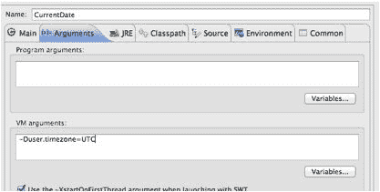

图 24-1

当你选择对话框底部的“Run”选项时，程序现在将像你在 UTC 时间下一样运行：

```text
The time in milliseconds is 1393119625394

The date is Sun Feb 23 01:40:25 UTC 2014
```

注意毫秒数是相同的（或几乎相同），但显示的时间相差 13 小时。

由于 `Date` 仅仅是数字，因此可以使用标准的算术操作来处理日期。例如，如果我想给一个日期增加 1 天，可以使用简单的算术运算：

```java
package dates;

import java.util.Date;

public class CurrentDate {

 public static void main(String[] args) {

  Long timeMs = System.currentTimeMillis();

  timeMs += 24*60*60*1000;

  Date date = new Date(timeMs);

  System.out.println("The date tomorrow is "+date.toString());

 }

}
```

此程序使用 `System` 类中的辅助方法来获取当前的毫秒数。然后它通过增加 24 小时 * 60 分钟 * 60 秒 * 1000 毫秒在此基础上增加一天。当然，如果我知道一天有 86400000 毫秒，我可以跳过算术直接编写：

`timeMs += 86400000;`

尽管可以这样处理日期，但并不建议这样做。下一节将介绍 `Calendars`，它们是处理日期更优的方法。

## Calendars

目前为止，我一直假设你想让 `Date` 使用当前日期。如果你你想创建一个代表 2015 年 1 月 20 日的日期呢？

你可能已经注意到 `Date` 类支持创建特定日期的构造函数，技术上可以使用：

`Date date = new Date(115, 0, 1);`

然而，关于这个构造函数有几点注意：

- 年份指定为 `115`。这是因为构造函数假设基础年份为 1900——我不知道为什么。
- 月份为 `0`，因为 Java 使用 `0-11` 而不是 `1-12`。
- 日期从 `1` 开始而不是 `0`——再次，我不知道为什么。

这正是为什么当你尝试使用它时会注意到构造函数的删除线，如图 24-2 所示：


图 24-2

这意味着该构造函数已废弃。废弃的代码是作者不希望任何人使用的代码。与其从代码库中删除它并立即破坏任何使用它的代码，他们将其标记为废弃，以指示寻找替代方案。

你可以通过以下注解将你编写的代码标记为废弃：

```java
@Deprecated
public void deprecatedMethod() {

}
```

废弃的代码运行方式与非废弃的代码一样；它只是建议人们不要使用它。在特定情况下，该构造函数已被废弃（以及 `Date` 中的许多其他方法），因为在 Java 中构建历史或未来日期的正确方法是通过 `Calendars`。

`Calendars` 提供了一种在历法系统中思考日期的方式。我们大多数人熟悉一种拥有 12 个月、每个月 28、29、30 或 31 天的历法：但这种历法系统（称为格林治历）只是世界上使用的许多历法系统之一。其他国家使用不同的历法，例如日本皇纪或泰国佛历。因为 Java 需要支持每个国家的用户，它也提供了对这些历的支持。

在本章中，你将只关注格林治历，因为大多数读者不太可能遇到另一种历法系统。

为了获取代表当前日期的 `Calendar` 实例，可以使用以下代码：

```java
Calendar c = Calendar.getInstance();
```

一旦创建了 `Calendar` 对象，你就可以访问它的属性，如下一个示例所示。如果你运行以下示例，你会注意到打印出来的月份仍然是从 0 开始的，因此 2 月是 1。（不过，`Calendar` 类确实为每个月份提供了常量，例如 `Calendar.JANUARY`）。Java 在处理星期几时也使用数字，尽管使用枚举类型会更合理（尽管如此，它也提供了常量，例如 `Calendar.FRIDAY`）。

```java
System.out.println("The year is "+ c.get(Calendar.YEAR));
System.out.println("The month is "+ c.get(Calendar.MONTH));
System.out.println("The day is "+ c.get(Calendar.DATE));
System.out.println("The hour is "+ c.get(Calendar.HOUR));
System.out.println("The day of the week is "+ c.get(Calendar.DAY_OF_WEEK));
```

如果你在调试器中检查 `Calendar` 的具体类型，你会发现它的类型是 `GregorianCalendar`。Java 根据你计算机的区域设置（locale）确定了这是最适合你的日历。通常没有必要将 `Calendar` 强制转换为 `GregorianCalendar`，因为 `Calendar` 包含了访问和操作日期通常所需的所有方法。

`GregorianCalendar` 实际上是两个日历系统的结合：格里高尔日历和儒历——如果你感兴趣的话，1582 年 10 月 15 日之前的所有日期都使用儒历系统（在现实世界中，从一个日历系统到另一个系统的切换要混乱得多）——这两个系统之间唯一的区别在于它们处理闰的方式。

你还可以使用 `GregorianCalendar` 构造函数来构造任意日期；例如，以下代码构造了一个映射到 2015 年 3 月 15 日的 `Calendar` 对象：

```java
Calendar c = new GregorianCalendar(2014, 2, 15);
```

该构造函数是重载的，因此你只需要设置日期元素（在这种情况下时间被设置为午夜），你也可以设置日期和时间。

虽然构造函数不支持这样做，但可以使用 `setTime` 方法将 `Calendar` 映射到特定的 `Date`，该方法接受一个 `Date` 作为参数。

一旦构建了 `Calendar`，你还可以使用 `set` 方法单独更改它的任何元素（例如年份），例如：

```java
c.set(Calendar.MONTH, 5);
```

或者，你可以使用 `add` 方法来递增或减少日期的某个元素。例如，以下代码将日历支持的日期增加 2 个月：

```java
c.add(Calendar.MONTH, 2);
```

还可以通过命名不当的 `getTime` 方法将 `Calendar` 转换回 `Date`。

## 格式化日期

之前的章节让你对日期的创建和操作方式有了初步了解。本节将讨论如何将日期转换为字符串以便显示。

Java 使用格式化器（formatters）的概念将对象或原始类型转换为用于显示的字符串。这些相同的格式化器也能进行反向操作：接受一个 `String` 并将其解析以产生相应类型的对象或原始类型。

对于日期，负责格式化的基础接口是 `DateFormat`，其主要实现类是 `SimpleDateFormat`。

为了操作 `Date` 对象，`DateFormat` 需要知道文本字符串应该遵循的模式。以下是同一日期的所有有效表示形式（尽管准确程度不相同）：

- 26 January 2015 15:34:00
- 2015-1-26 34pm
- Jan 26, 2015
- 2015
- January 15


Java 提供了一种可以用于定义日期格式的表达式语言。以下是一个程序示例，它使用`Calendar`构造`Date`，然后使用`SimpleDateFormat`实例按列出的格式打印日期：

```java
package dates;
import java.text.DateFormat;
import java.text.SimpleDateFormat;
import java.util.Calendar;
import java.util.Date;
import java.util.GregorianCalendar;

public class Formatting {
    public static void main(String[] args) {
         c = new GregorianCalendar(2014, 0, 26, 15, 34, 0);
        Date date = c.getTime();
        DateFormat df1 = new SimpleDateFormat("dd MMMM yyyy HH:mm:ss");
        System.out.println(df1.format(date));
        df1 = new SimpleDateFormat("yyyy-M-dd h:mm aa");
        System.out.println(df1.format(date));
        df1 = new SimpleDateFormat("MMM dd, yyyy");
        System.out.println(df1.format(date));
        df1 = new SimpleDateFormat("yyyy");
        System.out.println(df1.format(date));
        df1 = new SimpleDateFormat("MMMM yy");
        System.out.println(df1.format(date));
    }
}
```

我不会提供格式规则的完整描述，因为这些规则在需要时很容易查到。不过，有几个关键规则需要记住：

- 日期的每个组件（例如小时、天、年）都由字母表示，但这些字母是区分大小写的：`M` 代表月份，`m` 代表分钟，`s` 代表秒。

- 字母的重复次数影响输出，例如`MMMM`产生月份全称，`MMM`产生缩写，`MM`产生两位数月份，`M`产生一位数月份。

- 同样，`dd`产生两位日期，`d`产生一位数日期。

- `yyyy`产生四位年份，`yy`产生两位年份。

- `HH`产生24小制小时，`hh`产生12小制小时，`mm`产生分钟，`ss`产生秒，`aa`产生AM/PM标记。

- 格式字符串中包含的其他字符（如`-`、`,`等）将原样输出。

日期时间 API（Date and Time API）的设计考虑了表示日期时间的两种不同方式：

- 人类角度：这使用了熟悉的月份、日期、小时和持续时间等概念。

- 机器角度：这测量从纪元（epoch）开始经过的时间（以纳秒计）。

`nano-second`（纳秒）是秒的十分之一。换句话说，一毫秒中有一百万个`nano-seconds`。

在处理日期时间 API 时，你可以从以下选项中选择最适合你需求的日期时间实现：

- `LocalDate`：它表示日期的年、月、日部分，与任何时区无关。这对于表示节日等日期非常有用，因为`12月25日`无论你在美国、澳大利亚还是英国，都是节日。

- `LocalTime`：本质上与`LocalDate`相同，但它只表示时间，例如`12:55:21`（时间始终精确到纳秒）。

- `LocalDateTime`：这与`LocalDate`相同，但它包含了时间信息也包含了日期信息。

- `ZonedDateTime`：这与`LocalDateTime`相同，但它包含相对于UTC时间的时区偏移量（例如`-05:00`）和一个时区ID（例如`America/Detroit`）。

- `OffsetDateTime`：这与`ZoneDateTime`相同，但不包含时区ID，只包含一个偏移量。

- `OffsetTime`：这与`OffsetDateTime`类似，但只包含日期的部分部分，例如`13:00:21+12:00`。

- `Year`：它仅包含日期的年份。

- `Month`：这是一个表示一年12个月份的枚举类型。

- `MonthDay`：它表示一天和一个月，因此可以用于以一种忽略年份的方式表示一年中的某一天。

- `YearMonth`：如所预期，它包含年份和月份。

- `DayOfWeek`：这是一个表示一周7天的枚举类型。

- `Instant`：一个`Instant`表示从`1970/1/1`到某一时间点之间发生的纳秒数。由于这个数字大于`long`类型所能容纳的范围，自`1970/1/1`以来的秒数存储在`long`中，而纳秒偏移量存储在`int`中。

- `Duration`：一个`duration`是两个`Instants`之间经过的时间量。与`Instant`一样，时长是以秒和纳秒记录的。

- `Period`：一个`period`是基于日期的时间量。它以年、月、日记录持续时间。

现在已经介绍了这些基本类型，可以开始查看一些示例了。尽管这些类在表示日期时间的方式上非常不同，但它们倾向于支持一组标准方法；这些方法将在后续示例中介绍。第一个示例将处理`LocalDateTime`类，并检查它可以被构建和操作的一些方式：

```java
package datetime;

import java.time.LocalDateTime;
import java.time.ZoneOffset;

public class DateTime {

 public static void main(String[] args) {

 LocalDateTime dt = LocalDateTime.now();
 System.out.println(dt);
 System.out.println(dt.getMonth());
 System.out.println(dt.getDayOfWeek());

 dt = dt.plusDays(2);
 System.out.println(dt.getDayOfWeek());

 dt = dt.plusHours(5).plusMinutes(10);
 System.out.println(dt);
 System.out.println(dt.atOffset(ZoneOffset.ofHours(-11)));

 dt = dt.minusWeeks(20);
 System.out.println(dt);

 dt = dt.withDayOfMonth(4) .withYear(2009);
 System.out.println(dt);

 }
}
```

这产生了以下结果：

```
2014-03-06T19:38:34.933
MARCH
THURSDAY
SATURDAY
2014-03-09T00:48:34.933
2014-03-09T00:48:34.933-11:00
2013-10-20T00:48:34.933
2009-10-04T00:48:34.933
```

这个简短的示例展示了许多实用的方法。首先，有一个`now`方法用于创建一个表示当前日期和时间的`LocalDateTime`：

```java
LocalDateTime dt = LocalDateTime.now();
```

还有多种方法可以访问日期或时间的特定部分（例如年份或月份）。你可能记得这些方法在`Date`上已被弃用，但在`Calendar`中仍以类似的形式可用：

```java
dt.getMonth()
dt.getDayOfWeek()
```

接下来，有一系列方法可以从`LocalDateTime`中增加或减去时间单位（例如周、年、小时）。因为`LocalDateTime`是不可变的，所以这些方法总是返回一个新的`LocalDateTime`实例。这些方法与`Calendar`上的有些相似，但涵盖了更广泛的选项，而且与`Calendar`不同，它们不会变异（或更改）对象：

```java
dt.plusDays(2)
dt.plusHours(5).plusMinutes(10)
```

另一种操作`LocalDateTime`的方法是带有`with`前缀的方法，例如`withDayOfMonth`、`withYear`。这些也会返回一个新的实例：

```java
dt.withDayOfMonth(4).withYear(2009)
```

最后，还有方法可以将此类型转换为其他类型：

```java
dt.atOffset(ZoneOffset.ofHours(-11))
```

### 方法链式调用（Chaining）

大多数时间类都支持管道操作（或链式调用）。这种技术的原理是，一个方法的输出作为另一个方法的输入。你之前在书中处理Stream的中间操作时已经见过这种用法。以下是链式调用的示例：

```java
dt.withDayOfMonth(4).withYear(2009)
```

### 不变对象

在日期时间 API 中定义的类是不可变的。这意味着一旦设置了值，就无法更改。即使它们的值看起来发生了变化，Java实际上也是创建了一个新实例。

Java一向不可变类移动，是因为它们在多线程环境中更容易使用，而且通常会导致更好的实践，因为变量的状态不会在引用不知情的情况下被修改。例如，考虑来自`Calendar`API的以下代码：

```java
Calendar c = new GregorianCalendar();
Calendar c2 = c;
c.add(Calendar.DATE, 1);
```

`c2`所引用的`Calendar`值在它不知情的情况下被改变了。这种情况在日期时间 API 中绝不会发生。

### Year 和 MonthDay

现在你可以查看`Year`和`MonthDay`类的一组不同示例（记住，它们仅处理完全表示日期所需的字段集）：

```java
package datetime;

import java.time.Month;
import java.time.MonthDay;
import java.time.Year;

public class YearMonth {

 public static void main(String[] args) {

 Year y = Year.now();
 System.out.println(y.isLeap());
 System.out.println(y.isBefore(Year.of(2013)));
 System.out.println(y.isAfter(Year.parse("2013")));

 MonthDay md = MonthDay.of(Month.FEBRUARY, 29);
 System.out.println(md.atYear(2011));
 System.out.println(md.isValidYear(2012));
 System.out.println(md.isValidYear(2013));

 }
}
```

这产生了以下结果：

```
false

false

true

2011-02-28

true

false
```

如你所见，日期和时间 API 中的不同类有时支持额外的方法。`Year`类支持`isLeap`方法，用于指示指定的年份是否为闰年；而`MonthDay`类支持`isValidYear`方法，用于指示该日期和月份是否代表特定年份中的有效日期。

所有日期/时间类都支持`isBefore`和`isAfter`方法，用于比较相同类型的两个实例。

## Instant（瞬时）

如前所述，`Instant`代表时间中的一个点，并以`long`和`int`对的形式存储，表示自1970年1月1日（UTC午午夜）以来经过的纳秒数。

恰巧的是，以纳秒为单位的时间计时出乎意料地复杂。秒是通过原子钟定义的：此类秒被称为`SI seconds`（国际标准单位制秒）。一天中大约有86400个`SI seconds`（24 x 60 x 60）。

遗憾的是，细节决定魔鬼——“接近”并不等同于“精确”。更糟糕的是，并不是天的长度都完全相同，而且一天的长度是不可预测的。尽管这些差异非常细微，但随着时间的推移它们会累积，因此——如前面提到的——UTC包含了一个名为`leap-seconds`（闰秒）的概念。由于由于UTC时间刻这些复杂性，日期和时间API的设计者决定创建自己的名为Java Time-scale（Java时间尺度）的时间尺度。该时间尺度每天始终有86400秒——但每秒的长度可能与`SI second`不相同。这允许Java能够反映每一天长度的微小变化，而不会偏离一天86400秒的简单性。

这种工作方式在很大程度上取决于Java的实现。根据文档：“使用`JSR-310`API实现的Java时间尺度并不要求提供任何秒级精度的时钟，也不要求其单调或平滑地进展。”

如果你在需要极高精度的环境中使用Java，你可能想要调查该语句相对于你所选JVM产生的影响。

既然细节已经解决，下面是一个使用`Instants`的代码示例：

```java
package datetime;

import java.time.Instant;
import java.time.temporal.ChronoUnit;

public class InstantExample {

    public static void main(String[] args) {

        Instant now = Instant.now();

        System.out.println("Epoch seconds = "+ now.getEpochSecond());

        System.out.println("Offset nanoseconds = "+ now.getNano());

        System.out.println(now.toString());

        now = now.minusSeconds(86400 );

        System.out.println(now.toString());

        System.out.println(now.until(Instant.now(), ChronoUnit.HOURS));

    }
}
```

此示例使用了熟悉的`now`方法来构造一个`Instant`，然后打印它的秒和纳秒。

如示例所示，可以从`Instant`中增加或减少秒，以创建一个反映该偏移量的新`Instant`。

还可以使用`until`方法来确定两个`Instants`之间所需单位的距离——在本例中是小时。

## Duration（持续时间）和 Period（期间）

你将检查的最后两个类是`Duration`和`Period`，它们都是记录时间流过的机制。如前所述，`durations`用于以秒和纳秒跟踪一段时间时间，而`period`用于以年、月、日跟踪一段时间时间。

下面是一个示例程序，它构造了相差1050毫秒的两个`Instants`之间的差异`Duration`：

```java
package datetime;

import java.time.Duration;
import java.time.Instant;

public class Durations {

    public static void main(String[] args) {

        Instant i1 = Instant.now();

        try {
            Thread.sleep(1050L);
        } catch (InterruptedException ex) {

        }

        Instant i2 = Instant.now();

        Duration d = Duration.between(i1, i2);

        System.out.printf("%d seconds and %d nanoseconds elapsed\n",
        d.getSeconds(), d.getNano());
    }
}
```

一旦创建了`Duration`，就可以方便地与其他类型的日期或时间配合使用：

```java
LocalDateTime ldt = LocalDateTime.now();
ldt = ldt.plus(d);
```

这段代码将持续时间加到`LocalDateTime`实例中。

`Periods`用于查找两个日期之间的年、月、日。以下代码构造了一个表示两个`LocalDate`实例之间差异的`Period`：


```java
package datetime;

import java.time.LocalDate;
import java.time.Month;
import java.time.Period;

public class Periods {

    public static void main(String[] args) {

        LocalDate ldt1 = LocalDate.of(2008, Month.JANUARY, 22);
        LocalDate ldt2 = LocalDate.of(2014, Month.MARCH, 12);

        Period p = Period.between(ldt1, ldt2);

        System.out.printf("%d years, %d months, %d days\n",
        p.getYears(), p.getMonths(), p.getDays());   
    }
}
```

这会打印出：6 years, 1 months, 18 days

还可以通过静态方法构造表示两个 `LocalDate` 实例差异的 `Period`：

```java
Period p2 = Period.ofDays(2000);
```

## 格式化与解析

日期和时间 API 提供了自己的解析和格式化。你已经看到过使用以下内容的解析示例：

```java
LocalDateTime.parse("2014-03-20T10:15:30+01:00[Europe/Paris]", DateTimeFormatter.ISO_DATE);
```

在这种情况下，`DateTimeFormatter.ISO_DATE` 是 `DateTimeFormatter` 的实例。因为我构造的是 `LocalDateTime`，时区和偏移是无关的。因此我省略了它们。

`DateTimeFormatter` 提供了一系列预定义的日期时间格式，例如：

- `ISO_DATE`
- `ISO_TIME`

如果现有模式不满足你的需求，你可以自定义。`DateTimeFormatter` 的模式语言与 `SimpleDateFormat` 相同：

```java
DateTimeFormatter formatter = DateTimeFormatter.ofPattern("MMM dd yyyy");
```

这种特定的模式可以将日期解析为仅包含日期的对象；例如，以下代码是完全合法的：

```java
LocalDate ldt = LocalDate.parse("Jan 22 2014", formatter);
```

这构造了一个值为 2014 的 `Year`。然而，以下代码无效无效：

```java
DateTimeFormatter formatter = DateTimeFormatter.ofPattern("MMM dd yyyy");
LocalDateTime ldt = LocalDateTime.parse("Jan 22 2014", formatter);
```

这产生 `DateTimeParseException`，因为该格式不包含时间信息，不足以填充 `LocalDateTime` 实例的所有字段。

格式化是解析的反向过程。格式化的主要限制是模式只能包含与对象相关的元素。因此，以下代码是有效的：

```java
LocalDate ld = LocalDate.now();
ld.format(DateTimeFormatter.ofPattern("yyyy MM"));
```

而以下代码会导致 `UnsupportedTemporalTypeException`：

```java
LocalDate ld = LocalDate.now();
ld.format(DateTimeFormatter.ofPattern("yyyy MM dd hh"));
```

在这种特定情况下，我正尝试格式化 `LocalDate` 的小时——这是不可能的。

还可以根据用户的默认设置来格式化日期。例如，以下内容将以特定区域的方式打印日期：

```java
LocalDate ld = LocalDate.now();
ld.format(DateTimeFormatter.ofLocalizedDate(FormatStyle.SHORT));
```

输入和输出是几乎所有计算机程序的关键方面。例如，一个典型的命令行程序会接受输入，对该输入执行操作，并产生结果作为输出。

在本书中，你已经通过 `System.out` 上的方法看到了许多输出的示例。然而，我并没有真正停下来去研究 `System.out` 到底是什么，或者它如何与 Java 更广泛的输入输出方法相关联。

在历史上，Java 使用了两种处理输入输出的关键方法：

- **流（Streams）**：流是面向字节的，这意味着它们处理的是字节数组。不要将这里的“Stream”与 Streams API 混淆——它们之间没有关系。
- **读取器/写入器（Readers/writers）**：读取器和写入器面向字符的，意味着它们处理的是字符数组或字符串。

在 Java 中处理任何输入或输出的关键点是决定哪种方法适用于当前任务。

本章将使用 `java.io` 库。Java 还支持一个名为 `Java NIO`（Java 非阻塞 I/O）的替代库——你可以选择自己研究它，尽管通常 `java.io` 就能满足你的需求。

`Java NIO` 使用了一套不同的结构来表示与底层文件系统的交互，对于密集的 I/O 操作它可能更高效。

此外，多年来 Java 还添加了其他几个辅助类以方便与文件系统的交互——这些将会一笔带过——但并不是本章的重点。

尽管有这些 Java I/O 的替代方案——尽管这些替代方案在许多方面都更好——但理解 Java I/O 仍然很重要，因为它仍然被非常广泛地使用，而且你可能会遇到使用它的代码。

恰巧的是，`System.in` 和 `System.out` 都是流。这看起来可能很奇怪，因为在大多数情况下你都在向它们传递 `Strings`。然而，如果你查看了重载的 `print` 方法，你会发现它们也可以接受原始类型。

流比读取器/写入器更具通用性，因为如果需要，任何类型的数据都可以表示为字节数组，但并不是所有数据都能（方便地）表示为字符数组。这就是为什么 `System.out` 是一个流的原因。

处理输入输出的下一个关键是确定数据的源或目的地，例如：

- 源可能是网络套接字。
- 源可能是本地文件系统上的文件。
- 目的地可能是标准输出。
- 目的地可能是远程文件系统上的文件。

最后，必须确定在读取或写入数据时应该采取的方法：

- 是否应该一次写入一个字节/字符？
- 是否应该对整组字节/字符进行缓冲并一次性写入？
- 在读取数据时是否应该验证校验和以确保其没有被损坏？
- 是否应该在读取时解密数据或在写入时加密数据？

这种方法实际上更复杂，因为可能需要使用一种一种方法。例如，可能需要在在读取数据时对其进行缓冲、解密，然后验证校验和。

由于这种复杂性，Java 提供了许多继承自 `Reader`、`Writer`、`InputStream` 或 `OutputStream` 的类。这样就可以将类的实例嵌套在一起，以添加额外的功能。如果这听起来很困惑，将在下文中详细解释。

## Files

在本章的第一节中，你将处理文件，因为它们仍然是非常流行的数据源和目的地。你已经看到 `Streams API` 提供了一种优雅的机制来逐行读取文件内容，但本节将查看用于读写文件的更基础的机制。

### InputStreams and OutputStreams

你将从处理流开始。首先在 Eclipse 中创建一个新项目：我把我的项目名为 `InputOutput`。在 `src` 文件夹内创建一个名为 `bytes.txt` 的文件。只需右键点击 `src` 文件夹并选择 New -> File。

向此文件添加一些随机字符，例如：

`1js7j4gsj0dm`

现在，创建一个程序读取这些数据并将其打印到标准输出：

```java
package streams;

import java.io.File;
import java.io.FileInputStream;
import java.io.IOException;

public class ReadFile {

  public static void main(String[] args) {

    File f = new File("src/bytes.txt");
    FileInputStream fis = null;

    try {
      fis = new FileInputStream(f);
      int content;
      while ((content = fis.read()) != -1) {
        System.out.println(content);
      }
    } catch (IOException e) {
      e.printStackTrace(System.out);
    } finally {
      try {
        fis.close();
      } catch (IOException e) {
        e.printStackTrace(System.out);
      }
    }
  }
}
```

这里包含的内容很多，所以我将逐行进行说明。

程序首先定义了将读取的 `File`：

`File f = new File("src/bytes.txt");`

`File` 的位置相对于项目根目录。这被称为相对文件路径，因为该位置是相对于项目的位置的。也可以定义绝对文件路径：

`File f = new File("c:/projects/inputoutput/src/bytes.txt");`

或者：

`File f = new File("/projects/inputoutput/src/bytes.txt");`

即使在 Windows 系统上，始终使用正斜杠来分隔路径中的元素。由于 Java 使用底层系统库，如果机器强制区分大小写的文件名，则文件名将对大小写敏感。

虽然 `File` 类在所有 Java 版本中都受支持，但较新版本的 Java 支持一个名为 `Path` 的类，它添加了额外的功能，并且现在更受青睐。你可以通过调用它的 `toPath` 方法将 `File` 转换为 `Path`——这样如果你需要，就可以访问由 `Path` 定义的功能。

名为 `Files` 的类包含大量利用 `Paths` 的静态工具方法。对于允许你复制、移动或删除文件的方法，这应该是你的首选。

`FileInputStream` 可以接受表示文件路径的 `String`，但最佳实践是将文件路径封装在 `File` 对象中，因为这让你能够访问一组工具方法，例如：

`f.exists();`

`f.canRead();`

`f.canWrite();`

`f.length();`

以这种方式构造 `File` 对象并不能确保系统中存在相应的文件；它仅仅是文件系统中一个可能位置的表示，该文件可能存在也可能不存在。

然后我创建一个 `FileInputStream`，并将 `File` 作为参数传递给它。你会看到这发生在 `try-catch` 块内部：如果 `File` 不存在，此时将抛出 `FileNotFoundException`。该异常继承自 `IOException`，因此代码将简单地捕获 `IOException`。

下一部分代码逐字节遍历文件中的所有内容，并将每个位置的内容赋值给变量 `content`。如果该值为 -1，则表示到达文件末尾，循环结束。

`catch` 块通过将流（`System.out`）传递给 `Exception` 的 `printStackTrace` 方法来打印发生的任何异常。你会注意到 `printStackTrace` 接受 `OutputStream`，因此我可以向它传递任何类型的 `OutputStream`，包括 `FileOutputStream`。这体现了面向接口编程的灵活性。

在 `catch` 块之后，你会看到一个 `finally` 块，用于关闭 `FileInputStream`。无论方法是否成功完成，你都想要尝试关闭 `FileInputStream`，因为在读取过程中可能会发生错误。你会注意到你还需要将 `close` 的调用封装在另一个 `try-catch` 块中，因为如果文件最初不存在，这将产生异常。

在使用完文件后始终关闭它们是非常重要的；否则文件描述符将继续占用操作系统资源。

Java 7 引入了一种确保资源始终被关闭的替代机制——`try-with-resources` 语句。这允许将之前的示例写如下：

```java
package streams;

import java.io.File;
import java.io.FileInputStream;
import java.io.IOException;

public class ReadFile2 {
 public static void main(String[] args) {
  File f = new File("src/bytes.txt");
  try (FileInputStream fis = new FileInputStream(f)) {
   int content;
   while ((content = fis.read()) != -1) {
   System.out.println(content);
  }
  } catch (IOException e) {
   e.printStackTrace(System.out);
  }
 }
}
```

注意在此例中，`FileInputStream` 是声明在 `try` 语句的括号内的。任何实现 `java.io.Closeable` 接口的对象都可以声明在这样的语句中，Java 平台将确保无论是否发生异常，资源在 `try` 块结束时都会自动关闭。

如果你运行此代码，你可能会对结果感到惊讶，在我的情况下结果是：

49

106

115

55

106

52

103

115

106

48

100

109

`read` 调用返回一个 `int`。因为一个字节由 8 位组成，它可以容 2 的 8 次方的值（256）：数字 0 到 255 代表这些值（-1 表示特殊的文件结束值）。`read` 方法不返回 `byte`，因为 Java 需要一个额外的值来表示 `-1`——因此所有可能的值都无法放入一个 `byte` 中。从技术上讲，它可以返回 `short`，但 `int` 值通常更容易使用。

实现此操作的另一种方法是调用 `Files.readAllBytes` 并传递一个代表文件的 `Path` 参数。该方法返回一个 `byte[]`。

所被读取的文件是一个 ASCII 文本文件。因此，文件中的每个字符占用一个字节的空间，`read` 调用始终返回表示该字符的字节值。该数字代表该字符在 ASCII 表中的位置：49 代表“1”，106 代表“j”等。

通过更改此行，可以很容易地将这种数字表示转换回 ASCII 表示：

```java
System.out.println(content);
```

修改为：

```java
System.out.println((char)content);
```

这里的强制转换告诉 Java 你希望将 `int` 解释为 `char`，这隐式地将字节序列转换为字符序列。

必须记住，虽然在 ASCII 字符编码中一个字节等于一个字符，但在 Unicode 编码的文件中字符可能占用多个字节；因此，通常以这种方式读取文本数据并不是好主意。

为了使用流写入数据，你需要使用 `OutputStream`。正如你已经看到的，`System.out` 是一个 `OutputStream`，但你自然可以创建自己的 `FileOutputStream`。在向文件中写入数据时，一次写一个字节是低效的。更好的做法是聚集一部分字节并一次性写入：这被称为缓冲（buffering）和刷新（flushing）。

缓冲的缺点是，如果程序在完成之前崩溃，缓冲区中的任何数据（称为未刷新的数据）将丢失——因此它并不适用于所有情况。

在下面的示例中，我将演示如何通过将一个 `OutputStream` 包裹在另一个中为 `FileOutputStream` 添加缓冲。这种包装可以几乎无限地持续，通过将此输出流包装在另一个流中来添加更多功能。

当数据写入输出流时，每个流都有机会从外向内处理数据。它们执行任何必要的处理，然后将数据传递给层次结构中的下一个流。

这被称为**装饰器模式**（decorator design pattern）。该模式用于用另一个类的功能来扩展（或装饰）特定类的功能，而不需要要求其中一个类继承另一个类。

这种模式在许多不同的类都可以负责添加功能的情况下运行良好，因为可能可能没有明确的某个类继承另一个类的情况——它们只是简单地向同一个基类添加额外的功能，并可以根据此进行混合组合。

例如，`BufferedOutputStream` 无法继承 `FileOutputStream`，因为你可能还想将其与不同类型的 `OutputStream` 使用，例如那些写入到网络连接的流。

在下一个示例中，你将创建一个表示要写入文件的 `File` 对象，尽管该文件还不存在。写入 `File` 的过程将隐式地创建它：


```java
package streams;

import java.io.BufferedOutputStream;
import java.io.File;
import java.io.FileOutputStream;
import java.io.IOException;

public class WriteFile {
  public static void main(String[] args) {
   File f = new File("src/bytes_output.txt");
   FileOutputStream fos = null;
   BufferedOutputStream bos = null;
   try {
    fos = new FileOutputStream(f);
    bos = new BufferedOutputStream(fos);
    for (int i = 0; i < 100; i++) {
    bos.write(("Hello world "+i+"\n").getBytes());
    if (i%10 == 0) {
    bos.flush();
    }
    }             
   } catch (IOException e) {
    e.printStackTrace(System.out);
   } finally {
    try {
     bos.flush();
     fos.close();
    } catch (IOException e) {
     e.printStackTrace(System.out);
    }
   }
}
```

注意 `FileOutputStream` 被嵌套在 `BufferedOutputStream` 内部。如果你在关闭文件之前没有调用 `flush`，缓冲区中的数据将会丢失。

### 读取器和写入器

读取器和写入器与流相似。它们不仅可以嵌套在内部以添加额外功能，Java 提供的各种读取器和写入器的名称通常与其流对应。

你将首先编写一个逐行读取文件并将行存储在 `String` 中的程序。这是文本数据的常用操作，正如你已经看到的，可以通过流来实现。

这个示例将稍微复杂，因为它将逐个读取目录中的所有文件。为了实现这一点，你创建一个 `File` 并传递 src 目录路径。文件和目录都由 `File` 对象表示，但可以通过 `isDirectory` 和 `isFile` 方法进行区分。

一旦你有了代表目录的 `File`，就可以使用它列出所有文件并将列表存储在数组中。该数组包含 src 目录的文件和目录，因此当你遍历文件时，只有当 `isFile` 方法为 `true` 时才读取内容。

```java
package streams;

import java.io.BufferedReader;
import java.io.File;
import java.io.FileReader;
import java.io.IOException;

public class ReaderExample {
  public static void main(String[] args) {
   File srcDirectory = new File("src");
   System.out.println(srcDirectory.isDirectory());
   File[] files = srcDirectory.listFiles();
   for (int i = 0; i < files.length; i++) {
    File f = files[i];
    if (f.isFile()) {
      System.out.printf("Processing file %s\n\n", f.getName());
      BufferedReader br = null;
      FileReader fr = null;
      try {
       fr = new FileReader(f);
       br = new BufferedReader(fr);
       String line;
       while ((line = br.readLine()) != null) {
        System.out.println(line);
       }
       System.out.println("\n");
      } catch (IOException e) {
        e.printStackTrace(System.out);
      } finally {
       try {
        br.close();
       } catch (IOException e) {
        e.printStackTrace(System.out);
       }
      }
    }
   }
  }
}
```

注意你也将 `FileReader` 包裹在 `BufferedReader` 中：是 `BufferedReader` 类提供了 `readLine` 方法。

虽然这段代码本身没有任何错误，而且这也是这种功能的传统编写方式，但它是另一个示例，说明 Java 语言的改进可以产生更精简的代码。以下程序实现了完全相同的结果。

```java
package streams;

import java.io.IOException;
import java.nio.file.FileVisitResult;
import java.nio.file.Files;
import java.nio.file.Path;
import java.nio.file.Paths;
import java.nio.file.SimpleFileVisitor;
import java.nio.file.attribute.BasicFileAttributes;

public class ReaderExample {
  public static void main(String[] args) throws IOException {
    Path path = Paths.get("src");
    MyFileVisitor fileVisitor = new MyFileVisitor();
    Files.walkFileTree(path, fileVisitor);
  }

  private static class MyFileVisitor extends SimpleFileVisitor<Path> {
    @Override
    public FileVisitResult visitFile(Path path, BasicFileAttributes attributes) throws IOException {
      for (String line : Files.readAllLines(path)) {
        System.out.println(line);
      }
      System.out.println("\n");
      return FileVisitResult.CONTINUE;
    }

    @Override
    public FileVisitResult preVisitDirectory(Path directory, BasicFileAttributes attributes) throws IOException {
      return FileVisitResult.CONTINUE;
    }
  }
}
```

注意在此示例中，首先构建了一个 `Path`（而不是 `File`），然后你指示 API 使用此 `Path` 作为根目录来遍历文件树（递归处理每个文件和目录）。每当遇到文件或目录时，它都会调用 `SimpleFileVisitor` 实例上的一个方法——这可以通过重载的 `visitFile` 和 `preVisitDirectory` 方法分别处理文件或目录——然后指示 `SimpleFileVisitor` 继续处理下一个文件。

同样注意在此示例中，文件中的行使用 `Files.readAllLines` 被读取为 `List<String>`。

### 写入文件

使用 `FileWriters` 写入文件也是一个非常简单的过程。在这个示例中，你将通过为要写入的文件创建一个目录来稍微增加过程的复杂度。文件将嵌套在两个新目录内部：你将在程序第一次执行时利用 `mkdirs` 方法创建这些目录——在随后的执行中，该方法将发现目录已经存在。

当你创建输出文件时，你将目录作为一个参数，将文件名作为另一个参数。

```java
public static void main(String[] args) {
  File dir = new File("src/newdir/childdir");
  dir.mkdirs();
  File output = new File(dir, "output.txt");
  try (BufferedWriter br = new BufferedWriter(new FileWriter(output))) {
    for (int i = 0; i <= 100; i++) {
      br.append("Line number "+i+"\n");
    }
  } catch (IOException e) {
    e.printStackTrace(System.out);
  }
}
```

当 `BufferedWriter` 在在 `try-with-resource` 表达式内部时会自动刷新（flush）。此示例使用了 `append` 而不是 `write`。这确保了程序的后续执行不会覆盖已存在的文件。

注意在这种情况下，`BufferedWriter` 是在单个语句中创建的，允许它在 `try-with-resources` 语句中声明。

## 套接字

尽管到目前为止的示例都使用文件作为输入和输出目标，但这里使用的基本方法同样适用于跨网络传输数据。

在本节中，你将查看 Java 套接字（sockets）。套接字提供了一种跨网络传输字节数组的轻量级机制。

`Socket` 连接需要一方充当服务器（称为 `SocketServer`）。此方打开一个客户端可以连接的端口。当客户端向 `SocketServer` 发送数据时，它们将阻塞并等待响应。

本章中的示例将涉及在同一台机器上运行客户端和服务器，因此它们将使用 `localhost` 作为主机。如果你愿意，可以在网络上运行这些示例，并指定相应的 IP 地址；但你需要确保服务器机器上的防火墙允许在相应的端口（这些示例中为 9090）接收流量。

在此示例中，你将通过网络传输 Java 对象。为了在网络上传输它们，你需要在客户端对它们进行序列化，然后在到达服务器时对其进行反序列化。你已经在演示对象克隆的章节中看过了序列化过程。

此示例将通过网络发送 `Address` 实例，其中服务器将填充 `postcode` 字段并将 `Address` 返回给客户端。

由于客户端和服务器通常运行在不同的机器上，它们每个都需要访问 `Address` 类。然而，这可能会产生一个问题，因为客户端和服务器可能具有不同版本的 `Address` 类，例如，客户端版本可能添加了额外的字段，而服务器版本没有。

为了防止这种情况，Java 支持 `serialVersionUID` 字段的概念，它能确保当使用不兼容的类版本时你会收到通知。它可以被设置为任何 `long` 值，每当你对类进行重大更改时，你都应该更改该值。每当类被声明为实现 `Serializable` 时，Eclipse 也会提为你生成一个。此外，如果你没有声明 `serialVersionUID`，Java 将生成一个默认的（不可见的）值。如果客户端和服务器的类的 `serialVersionUID` 值不同，则会产生 `InvalidClassException`。

尽管 Java 会创建 `serialVersionUID`，但建议你生成自己的，因为类定义的任何细微更改会导致默认版本发生，即使这不会影响序列化。

下一个示例中的 `Address` 类还引入了一个新概念 `transient` 字段。如果字段被标记为 `transient`，则不会作为序列化过程的一部分被序列化。对于不应通过网络发送的敏感数据，或者简单不需要的字段，这非常有用。尽管省略了，请确保为所有字段添加 getter 和 setter。

```java
package server;
import java.io.Serializable;
import java.util.Date;

public class Address implements Serializable {
  private static final long serialVersionUID = -72564035556920549L;
  private String street;
  private Integer streetNumber;
  private String city;
  private Integer postcode;
  private transient Date createDate;

  public Address() {
    createDate = new Date();
  }

  public Address(String street, Integer streetNumber, String city) {
    this();
    this.street = street;
    this.city = city;
    this.streetNumber = streetNumber;
  }
  /* Getter 和 setter 字段为了简洁省略，但程序需要 */
}
```

我将首先概述服务器程序：

```java
package server;
import java.io.IOException;
import java.io.ObjectInputStream;
import java.io.ObjectOutputStream;
import java.net.ServerSocket;
import java.net.Socket;

public class SocketServer {
  public static void main(String[] args) {
    try {
      ServerSocket serverSocket = new ServerSocket(9090);
      System.out.println("The server is running");
      while (true) {
        Socket client = serverSocket.accept();
        System.out.println("Client accepted");
        ObjectInputStream ois = new ObjectInputStream(client.getInputStream());
        Address address = (Address)ois.readObject();
        ObjectOutputStream oos = new ObjectOutputStream(client.getOutputStream());
        address.setPostcode((int)System.currentTimeMillis() %100000);
        oos.writeObject(address);
        oos.flush();
      }
    } catch (IOException e) {
      e.printStackTrace(System.out);
    } catch (ClassNotFoundException e) {
      e.printStackTrace(System.out);
    }
  }
}
```

服务器将持续接受客户端的连接。为了实现这一点，你首先需要创建一个 `ServerSocket` 实例，然后在 `while(true)` 循环中调用 `accept` 方法。这个循环将无限循环下去，因此服务器在接受完第一个连接后仍会继续运行。`ServerSocket` 被配置为监听 `9090` 端口——但你可以根据需要更改它。

尽管这是一个无限循环，但它不会像典型的无限循环那样消耗 CPU，因为 `accept` 方法会一直等待，直到收到已接收连接的通知。在等待状态下，它不会消耗资源。

一旦接收到连接，`accept` 调用将返回一个 `Socket` 实例，代表服务器与该特定客户端之间的通信连接。服务器可以访问客户端的 `InputStream`：这使得服务器能够访问客户端通过 socket 发送的字节数据。

出于本示例的考虑，你将假设 `InputStream` 始终包含表示序列化后 `Address` 对象的字节流，因此你将 `InputStream` 包装在 `ObjectInputStream` 内部，并对其调用 `readObject`。

但请注意，从程序的角度来看，这个 `InputStream` 与基于文件的输入流并没有区别：Java 已经将底层数据源抽象为 `InputStream`。

一旦你更新了 `Address` 对象，你就需要将其返回给客户端。为了做到这一点，你从 `Socket` 获取 `OutputStream`，将其包装在 `ObjectOutputStream` 中，对其调用 `writeObject`，并 `flush` get 流。

你应该能够运行此程序，并看到它打印出正在等待连接。


现在你来到客户端程序。该程序将有它自己的`main`方法，因为它将完全独立于服务器运行。该程序首先构造一个`Address`对象，然后连接到服务器。该程序的行为与服务器相反：它首先向`OutputStream`写入内容，然后从`InputStream`读取并打印结果：

```java
package server;

import java.io.IOException;
import java.io.ObjectInputStream;
import java.io.ObjectOutputStream;
import java.net.Socket;

public class SocketClient {
    public static void main(String[] args) {
        try {
            Socket s = new Socket("localhost", 9090);
            ObjectOutputStream oos = new ObjectOutputStream(s.getOutputStream());
            Address a = new Address("Main Road", 99, "Montgomory");
            oos.writeObject(a);
            oos.flush();
            ObjectInputStream ois = new ObjectInputStream(s.getInputStream());
            a = (Address) ois.readObject();
            System.out.println("The postcode is " + a.getPostcode());
        } catch (IOException e) {
            e.printStackTrace(System.out);
        } catch (ClassNotFoundException e) {
            e.printStackTrace(System.out);
        }
    }
}
```

虽然可以通过简单调用`s.getInputStream()`来获取`InputStream`，但代码将自动阻塞，直到从服务器 socket 收到响应。

如果你运行此程序（同时确保服务器正在运行），它应该会在控制台上打印出一个邮政编码。

由于有两个程序在运行，每个程序都将有自己的控制台。你可以通过点击屏幕底部的控制台图标在控制台之间切换，如图 26-1 所示（它是最右侧的按钮）：


图 26-1

如果你切换到服务器程序的控制台，你将看到它打印了已接受了一个客户端。

你可以根据需要任意运行客户端程序，每次都会打印一个不同的邮政编码。

# 27 属性文件

你在书的前面的部分看到，在调用程序时可以向程序传递参数。这使得同一个程序可以根据提供的运行时参数值表现出不同的行为。

虽然程序参数是运行时向程序传递信息的重要技术，但当涉及大量参数时，它们可能会变得难以处理。在许多情况下，通常使用名为`properties files`（属性文件）的方法更好。

属性文件是一个包含一组名称/值对的纯文本文件，其中用等号分隔名称和值。每个属性列在文件的新的一行中，整个文件赋予`.properties`扩展名。

## 入门

你将开始为执行基础算术的程序中出现的一组消息创建一个属性文件。从创建一个 Eclipse 项目开始，通过右键点击"src"文件夹并选择 New -> File，向`src`文件夹添加名为`messages.properties`的文件。向文件中添加以下内容：

```properties
introduction.message=Welcome to the adder program
input.message=The input values are {0} and {1}
result.message=The result is {0}
```

此文件包含三个属性。在每个属性的键侧，你应该使用点而不是空格，我更倾向于只使用小写字母。

你可以看到这些属性值中的两个包含特殊字符序列，例如`{1}`。这些是运行时将提供的值的占位符。

现在，添加一个带有`main`方法的类名为`Adder`：

```java
package adder;

import java.io.IOException;
import java.text.MessageFormat;
import java.util.Properties;

public class Adder {
    private Properties properties = new Properties();

    public Adder() {
        try {
            properties.load(getClass().getResourceAsStream("/messages.properties"));
            System.out.println(properties.getProperty("introduction.message"));
        } catch (IOException e) {
            e.printStackTrace(System.out);
        }
    }

    public void add(int a, int b) {
        String inputMessage = properties.getProperty("input.message");
        String resultMessage = properties.getProperty("result.message");
        System.out.println(MessageFormat.format(inputMessage, a, b));
        System.out.println(MessageFormat.format(resultMessage, a + b));
    }

    public static void main(String[] args) {
        Adder adder = new Adder();
        adder.add(20, 30);
        adder.add(23, 12);
    }
}
```

当`Adder`类构造时，它从`messages.properties`填充`Properties`对象。`Properties`对象本质上是一个`Map`：可以根据键获取和放入属性。

`load`方法仅接受一个`InputStream`。虽然可以使用`FileInputStream`，但这里使用了替代方案：由于属性文件位于`src`目录，当程序编译时，它会与类文件一起复制到`bin`目录。因此，可以使用以下代码创建由属性文件支持的`InputStream`：

```java
getClass().getResourceAsStream("/messages.properties")
```

`getClass()`方法返回对象的对象的`Class`表示。你可以对它（以及每个`Class`）使用辅助方法`getResourceAsStream`。该方法可以用于读取`classpath`上的任何资源——由于`messages.properties`在 classpath 的根目录下，因此我们添加了前斜杠。

你可能在书的前面的部分记得过，classpath 是程序执行时可用的资源（主要是类）的集合。

如果你使用`FileInputStream`，它将需要在运行时知道文件的位置。

一旦属性文件加载，你就可以如下使用它：

```java
properties.getProperty("introduction.message")
```

该值始终作为`String`实例返回。

虽然属性文件可以用于存储程序所需的任何运行时信息，但上一节中的示例在技术上被称为`resource bundle`（资源包包）。资源包通常包含程序将输出的文本，允许在不更改和重新编译源代码的情况下更改这些文本。然而，它们实际上比这要有趣得多。

在深入查看资源包之前，我需要解释一下`locale`（区域设置）的概念。每当程序运行时，它都会在一个特定的`locale`中运行——这捕捉了用户的语言以及用户所在的地区。这些信息源自用户的操作系统设置，并封装在`Locale`实例中。

如果你想查看你当前处于什么区域设置，请运行以下程序：

```java
package adder;

import java.util.Locale;

public class MyLocale {
    public static void main(String[] args) {
        Locale l = Locale.getDefault();
        System.out.println(l.getLanguage());
        System.out.println(l.getDisplayCountry());
    }
}
```

在查看区域设置信息有多用之前，你首先需要重写上面的示例，将`messages.properties`视为一个`ResourceBundle`。

```java
package adder;

import java.text.MessageFormat;
import java.util.Locale;
import java.util.ResourceBundle;

public class Adder {
    private ResourceBundle resourceBundle;

    public Adder() {
        resourceBundle = ResourceBundle.getBundle("messages");
        System.out.println(resourceBundle.getString("introduction.message"));
    }

    public void add(int a, int b) {
        String inputMessage = resourceBundle.getString("input.message");
        String resultMessage = resourceBundle.getString("result.message");
        System.out.println(MessageFormat.format(inputMessage, a, b));
        System.out.println(MessageFormat.format(resultMessage, a + b));
    }

    public static void main(String[] args) {
        Adder adder = new Adder();
        adder.add(20, 30);
        adder.add(23, 12);
    }
}
```

如你所见，读取资源包的过程稍微简单一点：你只需要使用以下语法：

```java
resourceBundle = ResourceBundle.getBundle("messages");
```

Java 假设文件位于类路径上，并假设该文件具有`.properties`扩展名。

然而，现在假设你想为程序提供法语版本。为了支持这一点，你可以创建一个名为`messages_fr.properties`的新属性文件，并添加以下内容：

```text
introduction.message=Bienvenue dans le programme adder
input.message=Les valeurs d'entrée sont {0} et {1}
result.message=Le résultat est {0}
```

`_fr`后缀并不是随机的；这是法语的官方 ISO 代码：

你现在可以如下所示更改读取资源包的代码：

```java
public Adder() {
    Locale french = new Locale.Builder()
        .setLanguage("fr")
        .setRegion("FR").build();
    resourceBundle = ResourceBundle.getBundle("messages", french);
}
```

在第一行中，你显式地为程序构建了一个供其使用的`Locale`。在这里，你同时设置了地区和语言——尽管在这种情况下，只有语言是重要的。

如果你现在运行该程序，它应该产生以下输出：

```text
Bienvenue dans le programme adder
Les valeurs dentrée sont {0} et {1}
Le résultat est 50
Les valeurs dentrée sont {0} et {1}
Le résultat est 35
```

顺带提一下，你可以使用以下静态字段来获取法语区域设置：

```java
Locale french = Locale.FRENCH;
```

将法语设置为操作系统语言的用户应该能够自动获取法语资源包，而无需构建`Locale`对象。

然而，我倾向于不依赖于用户计算机上设置的默认区域设置。通常情况下，这并不能准确反映用户的意愿。我倾向于让用户选择他们希望使用的区域设置。

地区也可以用于选择合适的资源包。例如，你可能想为美式英语和英式英语准备不同的资源包。

在这种情况下，你可以为美式英语创建一个默认版本的资源包，然后创建一个名为`messages_en_GB.properties`的替代版本用于英式英语。事实上，你可以根据需要为该语言的所有不同变体添加任意数量的英语资源包。

## 国际化与本地化

上一节概述的方法被称为国际化（Internationalization）和本地化（Localization）。因为这两个词非常长，它们有时会被缩写为`I18n`和`L10n`。国际化是确保程序能够适用于特定语言或地区的过程（例如，通过使用资源包而不是字面量字符串），而本地化是将已国际化的程序适配到特定地区或语言的过程。

资源包是`I18N`和`L12N`中的重要组件，但它们并不是全部。另一个非常重要的组件是格式化器（formatters）的使用。

例如，数字`999,999.00`在许多欧洲国家通常输出为`999.999,00`。因此，在格式化或解析数字时使用区域设置总是明智的。

以下程序显示了如何使用意大利`Locale`将数字格式化为普通数字、货币和百分比：

```java
package adder;

import java.text.NumberFormat;
import java.util.Locale;

public class Numbers {
    public static void main(String[] args) {
        NumberFormat nf = NumberFormat.getInstance(Locale.ITALY);
        System.out.println(nf.format(999999.99));
        nf = NumberFormat.getCurrencyInstance(Locale.ITALY);
        System.out.println(nf.format(999999.99));
        nf = NumberFormat.getPercentInstance(Locale.ITALY);
        System.out.println(nf.format(999999.99));
    }
}
```

这产生了以下结果：

```text
999.999,99
€ 999.999,99
999.999%
```

## 默认方法

本节将对 Java 8 添加的一项新功能进行深入介绍。

Java 8 对接口的定义进行了重大更改。你已经看到了支持函数式接口的更改，但还有另一个重要的更改，即默认方法（default methods）：它们允许接口包含实现细节。

默认方法通常也被称为防御方法（defender methods）或虚拟扩展方法（virtual extension methods）。

允许接口包含实现细节听起来是一个奇怪的决定，因为它在很大程度上违背了接口的整个初衷：它们被设计为类可以选择实现的契约。

默认方法主要是为了支持 Java 8 中的其他更改而添加的。如果你考虑集合 API，许多基础类型（如`List`和`Set`）都是接口。Java 8 想在这些接口中添加新方法以支持流，但添加新方法会突然破坏任何实现了这些接口的现有代码。

从历史上看，如果第三方实现了接口，修改接口将非常困难，因为更改与他们的代码不向后兼容。一旦添加了新方法，它们就有义务实现这些方法。

Java 8 现在允许在添加方法的同时包含默认实现。这意味着可以向接口添加新方法，任何现有的接口实现将自动获取默认实现，而实现接口的新类既可以选择提供自己的实现，也可以使用默认实现。

由于 Java 类可以实现多个接口，这一更改本质上为 Java 语言引入了某种多重继承。在深入研究这些之前，也许值得后退看一眼 Java 历史上不支持多重继承的主要原因之一：`钻石问题`（diamond problem）。

从定义一个非常简单的接口开始：

```java
package diamond;

public interface A {
    void doSomething();
}
```

接下来，在两个独立的类中实现此接口：

```java
package diamond;

public class B implements A {
    @Override
    public void doSomething() {
        System.out.println("Doing something the B way");
    }
}
```

以及

```java
package diamond;

public class C implements A {
    @Override
    public void doSomething() {
        System.out.println("Doing something the C way");
    }
}
```


现在，考虑一下如果你编写一个同时继承了 `B` 和 `C` 的类（我们称其为 `D`），它应该使用哪个 `doSomething()` 的实现？这被称为菱问题，因为这种结构的类图看起来像一个菱形，如图 28-1 所示：

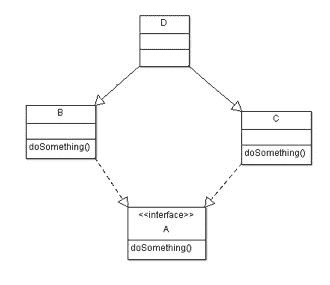

图 28-1

在查看 Java 8 如何解决菱问题之前，你可以先开始编写一个带有默认方法（`default method`）的接口：

```java
package defaultmethods;

public interface A {

  public default void doSomething() {
    System.out.println("I am A");
  }
}
```

注意 `default` 关键字的使用。此前，该关键字只在 `switch` 语句和注解声明中具有意义；现在它在接口内部也具有意义。

尽管这个接口包含了其唯一方法的实现，但仍然无法直接实例化该接口的实例：类仍然必须实现它才能被使用。

你现在可以如下所示实现此接口：

```java
package defaultmethods;

public class B implements A {

}
```

注意，如果你不想实现，就不需要实现 `doSomething()` 方法。

你现在可以实例化 `B` 并调用 `doSomething()` 方法：

```java
package defaultmethods;

public class DefaultMethods {

  public static void main(String[] args) {
    B b = new B();
    b.doSomething();
  }
}
```

这将打印 `I am A`。

你现在可以创建一个具有相同 `doSomething()` 方法签名的第二个接口：

```java
package defaultmethods;

public interface A2 {

  public default void doSomething() {
    System.out.println("I am A2");
  }
}
```

并将类 `B` 修改为同时实现这两个接口：

```java
package defaultmethods;

public class B implements A, A2 {

}
```

这将导致编译错误，因为编译器无法确定该类想要使用哪个版本的 `doSomething()`。

你现在有三个选择：

- 将 `B` 修改为仅实现 `A` 或 `A2`
- 在 `B` 上提供 `doSomething()` 的实现
- 显式地告诉编译器使用 `A` 或 `A2` 中的实现

前两个选项是不而易懂的；第三种可以通过可以通过方式实现：

```java
package defaultmethods;

public class B implements A, A2 {

  @Override
  public void doSomething() {
    A2.super.doSomething();
  }
}
```

这告诉编译器利用 `A2` 上的实现。

关于默认方法需要注意的一个重要点是，它们不能为 `Object` 类中定义的任何方法提供实现。例如，它们不能为 `toString()` 或 `equals()` 提供实现。主要的原因是所有对象都已有了这些方法的默认实现；因此，人们决定不允许接口提供替代的默认实现。

尽管默认方法提供了一种多重继承的形式，但它们确实存在局限性。默认方法无法访问实现它们的对象的状态（通过字段捕获），并且它们无法存储自己的状态。如果你需要访问对象的状态，你只能通过接口上定义并在类中实现的方法来完成。

接口现在还可以提供静态方法——此前它们只能定义静态字段。接口上的静态方法看起来与类上的静态方法完全相同：

```java
package defaultmethods;

public interface A {

  public default void doSomething() {
    System.out.println("I am A");
  }

  public static void staticMethod() {
    System.out.println("I am a static method");
  }
}
```

在接口中添加静态方法的争议比默认方法要少，因为静态方法没有继承的概念。事实上，在接口只包含静态方法的情况下，静态方法的效果特别好，因为很明显它不应该被实例化。

# 29

# 线程

到本书目前为止，所开发的程序都由单个执行线程组成。执行线程在 `main()` 方法开始执行时启动，并一直持续到 `main()` 方法结束或发生未处理的异常。在单线程程序中，程序一次只执行一个任务；在任务完成之前，不会移动到下一个任务。

尽管在之前的任何示例中都未显示，但也可以通过调用 `System.exit()` 并传递一个表示退出代码的 `int` 参数来指示程序结束。

有许多原因说明单线程执行对许多程序来说并不是最优的。大多数计算设备现在都提供多个核心或处理器，因此同时执行多条指令是可能的；从而增加了在任何时间段执行的整体计算水平。

一个 Java 程序作为一个单一进程执行：所有线程都在该进程的上下文中执行。

线程本质上是一个*轻量级进程*。与进程一样，每个线程都有自己的执行环境（例如栈），但线程共享父进程的许多资源，例如文件描述符和堆内存。这意味着操作系统在线程之间切换比在进程之间切换更高效。

Java 从发布以来就提供了多线程的原生支持。在当时，线程是与其他语言的一个主要区别，但随着时间的推移，计算机的处理器和核心数量增加，大多数主流语言都原生或通过库采用了多线程 API。

如果你考虑一台拥有 8 个核心的计算机，单线程程序在任何时候最多使用 CPU 的 12.5%。另一方面，如果有一种使用多个线程将处理分布到所有 8 个核心的方法，任务完成可能会快 8 倍。

在本章中，你将首先检查线程 API 的核心构建块和概念。在理解这些核心构建块后，你将查看 Java 提供的简化编写多线程程序的库——特别是流的并行处理。

## 线程编程

编写多线程程序的第一步是识别可以在独立线程中执行的程序部分。理想情况下，程序的这部分应该是相对自包含的，从而将线程间的通信降至最低。

你在本章的第一节编写的程序将接受一组数字，并使用非常简单的算法判断每个数字是否为素数。该程序的关键在于为判断每个数字是否为素数创建一个新线程：如果传递 10 个数字，将创建 10 个线程。

首先，创建一个名为 `Threads` 的新项目。在此项目中，在 `primes` 包中创建一个名为 `NumberProcessor` 的新类。

```java
package primes;

public class NumberProcessor {

  public boolean isNumberPrime(long number) {
    long end = number / 2;
    for (long i = 2; i <= end; i++) {
      if (number % i == 0) {
        return false;
      }
    }
    return true;
  }

}
```

`isNumberPrime` 方法简单地遍历传递给它的数字的所有可能的因子，从 2 到被除数数值的一半。例如，如果传入的数字是 30，它将用该数字除以 2 到 15 之间的每一个数字。然后它将使用 `%` 运算符对该数字进行取模运算：如果结果为 0，则说明被除数可以被该数整除，不是质数。如果在循环结束时没有找到该数字的因子，则该数字是质数，因此返回 `true`。

显然，这是一个寻找质数的非常低效的机制。

下一步是通知 Java 该类可以在单独线程中运行。为了实现这一点，你必须声明该类实现了 `Runnable` 接口。此外，就像程序在 `main` 方法中开始执行一样，你必须为每个线程提供一个开始执行的方法：线程中等同于 `main` 方法的是 `run` 方法（定义在 `Runnable` 接口上）。

在下一个示例中，你会注意到 `run` 方法不接受任何参数（与 `main` 方法不同）。因此，为了向此类类传递数字，你将定义一个接受该数字的构造函数，然后在 `run` 方法内部将该数字传递给 `isNumberPrime`：

```java
package primes;

public class NumberProcessor implements Runnable {

  private long numToProcess;

  public NumberProcessor(long numToProcess) {
    this.numToProcess = numToProcess;
  }

  public boolean isNumberPrime(long number) {
    long end = number / 2;
    for (long i = 2; i <= end; i++) {
      if (number % i == 0) {
        return false;
      }
    }
    return true;
  }

  @Override
  public void run() {
    boolean result = isNumberPrime(numToProcess);
    if (result == true) {
      System.out.println(numToProcess + " is a prime number");
    } else {
      System.out.println(numToProcess + " is not a prime number");
    }
  }
}
```

你现在有了一个独立的代码单元，能够处理数字并打印它是否为质数。准备好之后，你可以创建一个 `Main` 类，它将接受参数数组（字符串类型），将它们转换为数字，并将每个数字依次传递给 `NumberProcessor` 实例。

```java
package primes;

public class Main {
  public static void main(String[] args) {
    for (int i = 0; i < args.length; i++) {
      long number = Long.valueOf(args[i]);
      NumberProcessor numberProcesssor = new NumberProcessor(number);
      Thread t = new Thread(numberProcesssor);
      t.start();
    }
  }
}
```

该类有一个 `main` 方法，因为它是程序的启动点。当 `main` 方法开始时，它会遍历所有传入的参数，并将每个参数转换为 `long` 值。

一旦提取了每个数字，就会创建一个新的 `NumberProcessor` 实例并传递相应的数字。你可能在想现在可以简单地在 `NumberProcessor` 实例上调用 `run`。事实上，在 `NumberProcessor` 上调用 `run` 是有效的，但该调用不会在单独的线程上执行：该调用将阻塞主线程直到其完成。

为了在单独的线程上运行执行，你创建一个 `Thread` 类的实例，并传递它一个实现 `Runnable` 的对象（在我们的案例中，是 `NumberProcessor` 的实例）。一旦创建线程，你就可以对其调用 `start`。

尝试使用以下参数运行程序：

`85126773864 2860486313 1500450271 1200450280`

（在我的计算机上执行大约花费了 20 秒）

为我生成的输出如下：

85126773864 is not a prime number

1200450280 is not a prime number

1500450271 is a prime number

2860486313 is a prime number

如你所示，尽管 1200450280 是最后一个开始处理的数字，但它是第二个完成的：这是因为算法很快检测到它不是质数：所有四个数字都是并行处理的，并在完成处理后立即打印结果（这意味着结果打印的顺序是不确定的——可能会在每次执行或每台机器之间变化）。

此外，如果你在运行此示例时监控 CPU 利用率，你应该看到有两个处理器以 100% 的速度运行（另外两个数字几乎立即返回）。

## 睡眠

传递给 `main` 方法的数字列表决定了此程序生成的线程数。然而，线程数是否超过计算机上的物理核心数并没有关系。例如，在只有 2 个核心的计算机上可以创建 10 个线程，因此只支持 2 个并发执行线程。

当线程数超过硬件核心数时，操作系统将为各个线程分配处理时间。这确保了所有线程都能获得一些处理时间，没有单个线程可以主主处理器。

尽管这是可能的，但通常你不想为一个程序创建 100 个线程。如果创建了太多的线程，会有更多时间用于上下文切换（线程之间的切换），更多的内存将用于每个执行线程的栈。

创建比硬件处理器数量更多的线程通常没有处。你可以通过以下代码确定：`Runtime.getRuntime().availableProcessors()`。

要实现这一点，你将使用 Java 内置的 `Thread.sleep` 方法。当你执行此操作（传递你希望线程睡眠的毫秒数），请将 `NumberProcessor` 中的 `run` 方法修改如下：

```java
@Override
public void run() {
  try {
    Thread.sleep((long) Math.log(numToProcess));
  } catch (InterruptedException e) {}
  System.out.println("Beginning to process " + numToProcess);
  boolean result = isNumberPrime(numToProcess);
  if (result == true) {
    System.out.println(numToProcess + " is a prime number");
  } else {
    System.out.println(numToProcess + " is not a prime number");
  }
}
```

此代码使用以下调用来与传入数字相关的数字，但数量低得多（所以它不会永远睡眠）：`(long) Math.log(numToProcess)`。在开始处理之前，`NumberProcessor` 将睡眠一段时间。所示，`sleep` 调用必须封装在 `try/catch` 块中：当时间过去时，`catch` 块将被调用。这是一个典型的违背最佳实践、不在 `catch` 块中放置任何代码的情况。

当我运行此代码时，收到了以下输出：

Beginning to process 1200450280

1200450280 is not a prime number

Beginning to process 1500450271

Beginning to process 2860486313

Beginning to process 85126773864

85126773864 is not a prime number

1500450271 is a prime number

2860486313 is a prime number

如所示，在其他数字开始处理之前，就已经为最小数字产生了结果。如果你传递以下参数：

`85126773864 2860486313 1500450271 1200450280 90 6`

效果更加显著：

Beginning to process 6

6 is not a prime number

Beginning to process 90

90 不是质数

开始处理 1500450271

开始处理 1200450280

1200450280 不是质数

开始处理 2860486313

开始处理 85126773864

85126773864 不是质数

1500450271 是质数

2860486313 是质数

需要指出的是，`sleep` 方法是 `Thread` 类的一个静态方法：它会自动导致当前正在执行的线程（即调用代码的线程）进入睡眠。无法在另一个 `Thread` 对象上调用 `sleep`。

关于 `sleep` 方法需要注意的另一点是传递它的毫秒数。虽然线程将睡眠至少这么长时间，但不能保证它在这一时期结束时会立即从睡眠中被唤醒：这取决于执行的其他线程数量，以及程序可用的整体操作系统资源。

## 同步 (Synchronized)

从单线程到多线程编程模型的迁移带来了额外的挑战，这些挑战可能不会显而易见。例如，同一个代码块可能会被两个不同的线程同时调用。如果该代码块更新了对象上的字段，就会产生问题。

为了亲眼看到这一点，你将编写一个新类，负责跟踪当前正在运行的线程数，并在它们开始和停止运行时打印信息：

```java
package primes;

public class ThreadTracker {

  private int threadsRunning = 0;

  public void setThreadRunning() {
     threadsRunning++;
     System.out.println(threadsRunning + " threads running");
  }

  public void setThreadFinished() {
     threadsRunning--;
     System.out.println(threadsRunning + " threads running");
  }
}
```


然后你将该类的同一个实例传递给每个`NumberProcessor`，它将负责记录处理开始和结束的时间：

```java
package primes;

public class NumberProcessor implements Runnable {

  private long numToProcess;
  private ThreadTracker tracker;

  public NumberProcessor(long numToProcess, ThreadTracker tracker) {
    this.numToProcess = numToProcess;
    this.tracker = tracker;
  }

  public boolean isNumberPrime(long number) {
    long end = number / 2;
    for (long i = 2; i <= end; i++) {
      if (number % i == 0) {
        return false;
      }
    }
    return true;
  }

  @Override
  public void run() {
    try {
      Thread.sleep((long) Math.log(numToProcess));
    } catch (InterruptedException e) {}
    tracker.setThreadRunning();
    boolean result = isNumberPrime(numToProcess);
    if (result == true) {
      System.out.println(numToProcess + " is a prime number");
    } else {
      System.out.println(numToProcess + " is not a prime number");
    }
    tracker.setThreadFinished();
  }
}
```

接着，`Main`类需要如下修改：

```java
package primes;

public class Main {
  public static void main(String[] args) {
    ThreadTracker tracker = new ThreadTracker();
    for (int i = 0; i < args.length; i++) {
      long number = Long.valueOf(args[i]);
      NumberProcessor numberProcesssor = new NumberProcessor(number, tracker);
      Thread t = new Thread(numberProcesssor);
      t.start();
    }
  }
}
```

这段代码中潜伏着一个容易被忽略的 Bug。考虑两个线程恰好同时调用`setThreadRunning`方法：

- `Thread 1`执行第一行，并将`threadsRunning`从 0 变为 1
- `Thread 2`执行第一行，并将`threadsRunning`从 1 变为 2
- `Thread 1`调用第二行并打印`2 threads running`
- `Thread 2`调用第二行并打印`2 threads running`

显然，这并没有产生正确的结果：两个线程都打印了有 2 个线程正在运行，而没有一个线程打印过有 1 个线程正在运行。虽然在这种情况下这算不上大问题，但在许多场景下，此类 Bug 既难以检测，又会对处理产生重大影响。

我在本书中多次提到，各种 API 并不是线程安全的。本质上，这意味着如果如果在多线程程序中使用它们，它们很容易出现此类 Bug。

这种问题即使在单处理器设备上也可能发生：操作系统会周期性中断线程并允许其他线程运行，而这可能发生在此类方法的执行正途中。

为了绕过这个问题，你需要一种方法来确保一次只有一个线程可以执行代码块。Java 提供了一种实现此点的内置机制：`synchronized`关键字。因此，`setThreadRunning`方法可以修改如下：

```java
public synchronized void setThreadRunning() {
```

Java 通过锁机制实现同步。每个对象都有一个可以提供的单一锁。任何想要调用`synchronized`方法的代码在进入方法之前必须获取此锁（尽管这是自动完成的）。一旦方法完成，锁将自动释放。这保证了前面所述的 Bug 不会发生。

代码`synchronized (tracker)`负责获取`tracker`对象的锁。随后的块中的代码仅在持有该锁时才会执行。一旦块执行完成，锁将自动释放。只要所有使用不安全方法的代码都采用这种方法，该类就是线程安全的。

这种技术也可以用于使方法的部分子集变为线程安全。由于`synchronized`代码可能会产生瓶颈，因此将`synchronized`代码限制到最小是有意义的。因此，与其将整个方法设为`synchronized`，方法可以将其部分代码放在如下的块中：

```java
public void methodA() {
  // non-synchonized code goes here
  synchronized (this) {
    // this code is synchonized
  }

  // non-synchonized code goes here
}
```

当方法需要在`synchronized`块中执行代码时，它通过获取自身（`this`）的锁来实现。然后它会一直持有该锁直到块结束；这意味着长方法中的少数几行代码可以放在`synchronized`块中。

## Wait/notify

多线程的最后一个基础构建块与`Object`本身上的三个方法有关：

- `wait`
- `notify`
- `notifyAll`

这些方法可以用于等待特定场景的发生，而无需利用 CPU。

考虑以下场景：

- 一个包含 10 个线程的池负责从远程服务器获取结果，因此完成任务需要不确定的时间。
- 你的程序只有在接收到至少五个结果后才能继续运行。

显然，我们的程序需要等待特定场景的发生。它还需要在这一场景发生时收到通知，以便知道继续执行。

`wait`/`notify`方法允许你实现这种场景。线程可以通过在自身上调用`wait`方法来指示它希望等待某个特定条件变为真。当该方法被调用时，线程将进入休眠状态，且不消耗任何 CPU。

当其他线程执行它们认为可能与等待线程相关的任务时，它们可以在该同一个对象上调用`notify`（以唤醒一个随机的等待者）或`notifyAll`（以唤醒所有等待者）。任何在对象上发布过`wait`调用的线程都将被唤醒，并判断特定事件是否已经发生。如果发生了，等待者将执行其处理逻辑；如果没有发生，它将再次在自身上调用`wait`。

以下程序演示了这一场景：

```java
package threads;

public class WaitExample implements Runnable {
  private int resultsObtained = 0;

  public static void main(String[] args) {
    WaitExample we = new WaitExample();
    for (int i = 0; i < 10; i++) {
      Thread t = new Thread(we);
      t.start();
    }
    we.printResults();
  }

  public synchronized void printResults() {
    while(resultsObtained < 5) {
      try {
        System.out.println("Waiting for enough results");
        wait();
      } catch (InterruptedException e) {}
    }
      System.out.println("We have received enough results");
  }

  public synchronized void addResult() {
    resultsObtained++;
    System.out.println("A result has been added");
    notifyAll();
  }

  @Override
  public void run() {
    try {
      Thread.sleep((long) (Math.random()*10000));
    } catch (InterruptedException e) {}
    addResult();
  }
}
```

该方法通过创建并启动 10 个`Thread`实例开始。当这发生时，`run`方法将被调用，新线程将睡眠长达 10 秒的随机间隔（这模拟了远程服务器的调用）。一旦时间过去，它将调用`addResult`来记录已从服务器获取结果的事实。

一旦所有线程启动，`main`方法将调用`printResults`。该方法在循环中检查是否已获取了 5 个结果。如果没有，它会在自身上调用`wait`；否则它将打印结果。

理解此功能的关键在于`addResult`方法内部对`notifyAll`的调用。当被调用时，任何等待的线程都将被唤醒，并有机会查看它们正在等待的事件是否已经发生。

当我运行它时，它会打印以下结果：

```
Waiting for enough results
A result has been added
Waiting for enough results
A result has been added
Waiting for enough results
A result has been added
Waiting for enough results
A result has been added
Waiting for enough results
A result has been added
We have received enough results
A result has been added
A result has been added
A result has been added
A result has been added
A result has been added
```

注意，在每个结果添加之后，等待线程都有机会评估条件是否满足。一旦接收到五个结果，它就会判定条件已满足并打印：

`We have received enough results`

对`wait`、`notify`和`notifyAll`的调用必须在`synchronized`代码块内部发生。这非常重要，否则你的代码可能在某一行检查条件未发生，而在下一行调用`wait`。然而，在它们之间，另一个线程可能执行了某个操作通知你相关事件已发生——因此，可以想象你的线程可能会永远地等待一个已经发生的事件。

# 30 并行编程

上一章引入了创建能够执行并行处理的多线程程序所需的所有基础构建块。

上一章介绍的线程概念的主要问题是它们可能难以处理，并且很容易出错。让情况更糟糕的是，多线程代码中的错误特别难以诊断和解决。

然而，算法执行并行处理的能力变得越来越重要。由于所有现代计算机（甚至是智能手机）都包含多个核心，任何不执行并行处理的程序从定义上都没有充分利用硬件进行 CPU 密集型操作。

与此同时，程序需要处理的数据量正在指数级增长，并将继续增长。因此，在查看用于简化多线程代码的 Java API 之前，或许值得研究一种并行处理大量数据的常见现实算法，即 MapReduce。该算法的流行对 Java 的发展方向产生了巨大影响。

### MapReduce

MapReduce 算法由 Google 研究人员在 2004 年的一篇论文中普及，[http://research.google.com/archive/mapreduce.html](http://research.google.com/archive/mapreduce.html)，但`map`和`reduce`这两个操作已经存在很久了。Google 的洞察在于意识到这些操作可以用于在成千上万台计算机（称为集群）上同时处理海量数据。

MapReduce 由两个主要操作组成：

- 在 map 阶段（可以在许多机器上并行运行），数据集中的每个元素都会根据需要进行过滤、转换或排序。这显然与你已经在 Stream API 中看过的中间操作（如`map`和`filter`）有关。
- 一旦 map 阶段完成，结果将传递给 reduce 阶段（可能也可能不并行运行）。reduce 阶段负责以某种方式聚合数据。这一步显然与你在 Stream API 上看过的终端操作有关。

自 Google 发布相关论文以来，涌现出了许多 MapReduce 实现，包括 Hadoop，它是一个开源的 Java 实现。通常，这些实现会指定一台计算机作为控制器：它将工作分发给其他节点（这些节点彼此独立运行），并收集结果。例如，一个 20GB 的文件可能会被分成 10MB 的数据块（chunks），并将每个数据块发送到不同的计算机进行处理。

像 Hadoop 这种实现的好处在于，程序员不需要关注多线程代码的实现细节：他们只需要提供一组操作，框架就会负责将算法分发到可能存在的数千个核心上。

### Fork/Join API

如上一节所示，并行方式处理大型数据集的关键源于拆分数据（这一过程也称为 forking），并并行地处理数据的子集。一旦处理完这些数据，它们就会被重新合并（这一过程称为 joining）并以某种方式进行聚合。因此，fork 和 join 与 map 和 reduce 术语非常相似。

自 Java 的第一个版本发布以来，使用上一章介绍的 API 以及`synchronized`关键字等其他线程概念，就可以以这种方式编写代码。然而，对于许多程序员来说，编写多线程代码是困难的，即使对于经验丰富的程序员来说也容易出错。并发问题和竞态条件意味着许多程序员宁愿避免多线程代码。

为了缓解多线程代码中一些固有的问题，Java 在 Java 7 中引入了 Fork/Join 框架。该框架的关键是`ForkJoinPool`类。使用 fork/join 框架是一项重大进展：它本质上提供了一个工作线程池，所有线程都竞争接受任务——程序员只需简单地创建任务并让它们以高效的方式处理。它还提供了一系列管理方法来监控池的行为。

然而，即使有了 Fork/Join 框架，程序员在某种程度上仍然控制着线程过程，并且必须按照 API 规定的方式编写代码。这就是 Streams API 再次登场的地方。

### 使用 Streams 实现并行

Streams API 的方向与 Fork/Join API（以及自 Java 5 之后添加到 Java 的所有其他并发 API）不同。Streams API 的观点是并行化应该是显式的——但是非侵入性的。你必须请求并行化，但在实现方面你实际上不需要自己做任何事情。

要求程序员请求并行化是非常重要的，因为同一个程序在并行处理时的行为可能会不同——特别是当顺序很重要时。然而，一旦请求了并行，Java 平台就会负责在可用硬件上优化算法。

为了看到将一个 Stream 从串行处理改为并行处理有多简单，以下行代码：

```
l.stream().filter(p -> p%2==1).mapToInt(p -> p * p).sum()
```

可以写为：

```
l.parallelStream().filter(p -> p%2==1).mapToInt(p -> p * p).sum()
```

当然，在较小的`List`上你不太可能看到并行处理带来的任何益处，所以让我们在一个更密集的示例上尝试一下。以下程序设置了一个包含所有正整数的 Stream，然后找到偶数的平均值。第一个版本使用了并行实现（通过调用`parallel`方法，将`range`方法返回的 Stream 转换为并行流）。第二个版本是串行的。

```java
package streams;

import java.util.OptionalDouble;

import java.util.stream.IntStream;

public class LargeRange {

 public static void main(String[] args) {

 long start = System.currentTimeMillis();

 OptionalDouble result = IntStream.range(0, Integer.MAX_VALUE)
.parallel()
.filter(i -> i % 2 == 0)
.average();

 System.out.printf("Parallel version took %d\n",

 System.currentTimeMillis()-start);

 start = System.currentTimeMillis();

 OptionalDouble result2 = IntStream.range(0,

  Integer.MAX_VALUE)
.filter(i -> i % 2 == 0)
.average();

 System.out.printf("Serial version took %d\n",

 System.currentTimeMillis()-start);

 }
}
```

当我在一台相当旧的 MacBook Air 上运行它时，我得到了以下结果：


`Parallel` version took 4800

`Serial` version took 9629

意料之的是，当我查看 CPU 使用率时，并行版本使用的 CPU 是后者的两倍。当然，结果可能因机器而异，所以请你自己尝试一下。

这个示例的伟大之处在于，我通过调用单个方法就让性能提升了一倍。

尽管并行处理仅仅是一个选项，但它可以突出显示出相同代码在串行处理时并不明显的问题。这类问题的典型候选是：传递给管道中操作的任何 lambda 表达式都有副作用：即它们改变了（或修改了）其他 lambda 表达式使用的状态。

如前所述，不建议在 lambda 表达式中修改对象的状态——但这是允许的。例如，没有什么可以阻止管道中的代码向一个公共的 `Collection` 中添加元素——然而，当使用并行处理时，这可能会导致问题，因为大多数 `Collection` 实现不是线程安全的。

因此，在考虑并行化之前，值得问以下问题：

## 并行处理会提高性能吗？

并行处理并不一定会提高性能。某些操作（如排序和收集）在并行模式下并不总是更快。因此，在串行和并行模式下对算法进行基准测试，以确认并行化确实提供了益处，始终是明智的。

如果你考虑书中之前的 `groupingBy` 示例，它们将元素添加到公共的 `List` 中。由于 Java `List` 不是线程安全的，因此 `groupingBy` 方法需要同步访问 `List`，这很容易抵消并行处理的优势。

同样对于排序，可以执行并行排序：每个线程可以使用 `quicksort` 等算法处理子集，然后这些排序后的元素集可以使用 `merge sort` 进行排序：取决于数据量，这并不一定比串行排序更快。

最后，`distinct` 操作是另一个难以通过并行处理的操作示例——特别是在无排序的数据集上。每个线程都可以轻松确定其要求处理的数据中的去重元素——但这些来自每个线程的去重集需要重新合并以获得最终列表。

## 算法可以并行化吗？

并不是所有算法都可以并行化而不产生错误。这在 `reduce` 操作中非常常见——具体来说，`reduce` 操作需要满足结合律（associative）才能并行化。

例如，对 `List` 中的数字求和总是满足结合律。这是因为处理数字的顺序并不重要。如果你取数字 8、6 和 3：你可以将其求和为 `(8 + 6) + 3` 或 `8 + (6 + 3)`。无论如何相加这三个数字，结果都是 17。

其他 `reduce` 操作不是结合的。例如，减法取决于元素的顺序：`(8 – 6) – 3 = -1`，而 `(3 – 8) – 6 = -11`。

为了看到这种效果，请考虑以下程序：

```java
package streams;

import java.util.OptionalInt;

import java.util.stream.IntStream;

public class Associative {

 public static void main(String[] args) {

 OptionalInt result = IntStream.range(1, 1000)
 .parallel()
 .reduce((a, b) -> a-b);

 System.out.println(result.getAsInt());

 result = IntStream.range(1, 1000)
 .reduce((a, b) -> a-b);

 }
}
```

```java
System.out.println(result.getAsInt());
}
```

在两种情况下，`Stream` 包含的元素是相同的，且 `reduce` 操作包含相同的实现，但第一个 `reduce` 发生在并行处理的上下文中。如果我运行这段代码，我将得到以下输出。

```text
-124

-499498
```

第一个结果显然是错误的。

然而，如果我将这个 `reduce` 操作更改为执行求和：

```java
IntStream.range(1, 1000).reduce((a, b) -> a+b);
```

这两个示例产生了相同的结果：

```text
499500

499500
```

这是危险的：编译器无法检测到你正在执行一个非结合律的操作；因此，你引入了一个不易被发现的 bug。从从中可以学到的教训是，你不应该为了并行而引入并行：你应该决定你想通过并行实现什么，并且应该检查你的算法作为并行操作时是否运行正常。

并行流的另一个重要考虑因素是排序。下面两行代码看起来可能会打印出相同的结果：

```java
package streams;

import java.util.stream.IntStream;

public class Associative2 {

    public static void main(String[] args) {
        System.out.println("Running in parallel");
        IntStream.range(1, 1000)
            .parallel()
            .filter(a -> a %2 == 1)
            .limit(10)
            .sorted()
            .forEach(a -> System.out.println(a));

        System.out.println("Running in serial");
        IntStream.range(1, 1000)
            .filter(a -> a %2 == 1)
            .limit(10)
            .forEach(a -> System.out.println(a));
    }
}
```

事实上，它们确实打印了相同的数字，但在第一情况下，数字打印的顺序并不是顺序的。尽管数字在传递给 `forEach` 之前已经过排序，但它们并不是按照排序顺序打印的。有一种解决办法——如果将并行版本改为使用 `forEachOrdered`，它将按照排序顺序打印数字：

```java
IntStream.range(1, 1000).parallel()
    .filter(a -> a %2 == 1)
    .limit(10)
    .forEachOrdered(a -> System.out.println(a));
```

之所以有效，是因为 `forEachOrdered` 操作实际上是以串行模式运行的：这让我回到了第一点——检查并行化是否真的带来了收益。

关于并行化需要记住的最后一个考虑因素与并行的实现方式有关。在底层，所有并行流都使用 `ForkJoinPool` 的共同实例，其中包含的线程数等于你的处理器数量：

```java
Runtime.getRuntime().availableProcessors()
```

这意味着如果你在这个线程池中执行长时间耗时的操作，可能会饿饿应用程序中尝试运行其他并行算法的代码。

通过将并行流与 Hadoop 等 MapReduce 框架进行比较来结束这个讨论是有用的。基本上，并行流提供了与 Hadoop 的能力——但规模小得多。Hadoop 在许多计算机上分发并协调处理，而并行流则在同一台机器的许多处理器上分发并协调处理。

# 31 Java Doc

到目前为止，你还没有真正深入过代码注释。希望你已经意识到为代码添加注释的重要性，这既是为了帮助他人理解你的代码，也是为了确保你将来自己也记得代码是如何运行的。

给代码写注释总是一门微妙的艺术。你不想做得过头并陈述显而易见的事；否则没有人会费心阅读注释。你希望保持注释简洁，并关注代码中可能容易被误解的方面。

正如书中前面提到的，向 Java 代码中添加注释有两种方法。如果注释是单行的，习惯做法是使用 `//` 方式：

```java
// this is a comment
```

另一方面，如果注释跨越多行，这种形式通常会具有更好的可读性：

```java
/*
* This is a comment that spans
* multiple lines, so it uses
* a different syntax
*/
```

在这个示例中，第 2-4 行的星号完全是可选的，但它们往往会增加注释的可读性。这完全可以写成：

```java
/* This is a comment that spans
multiple lines, so it uses
a different syntax*/
```

Java 注释包含的内容比看起来的多得多。Java 本身支持一种名为 `JavaDoc` 的文档语言，允许以特定方式标记注释，以便直接从注释中生成更可读的 API 文档（例如 HTML 文档）。

作为 `JavaDoc` 运行的一个示例，请在你喜爱的浏览器中访问以下站点：[`docs.oracle.com/javase/8/docs/api`](https://docs.oracle.com/javase/8/docs/api/java/util/ArrayList.html)

这将显示图 31-1 所示的网站：

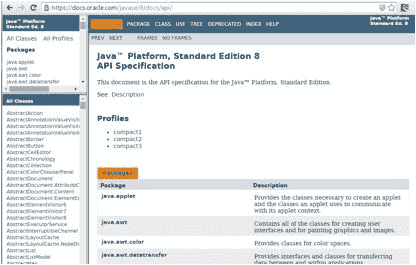

图 31-1

这是 Java 提供的核心库的 `JavaDoc`。如果你使用左侧两个窗口浏览此站点，你会看到每个包都经过了记录，包中的每个类也经过了记录。当你点击一个类时，它的 `JavaDoc` 就会显示出来。

## JavaDoc in Action

为了理解 `JavaDoc` 的用法，请查看以下代码。首先，你会为 `LinkedList2` 类编写 `JavaDoc`。它看起来如下：

```java
package linkedlist;

import java.util.ArrayList;

public class LinkedList2<T> {
    Node<T> head;

    public LinkedList2() {}

    public void addFirst(T value) {
        if (head == null) {
            head = new Node<T>(value, null);
        } else {
            Node<T> newHead = new Node<T>(value, head);
            newHead.setNext(head);
            head = newHead;
        }
    }

    public void addLast(T value) {
        if (head == null) {
            head = new Node<T>(value, null);
        } else {
            Node<T> lastNode = head;
            while (lastNode.getNext() != null) {
                lastNode = lastNode.getNext();
            }
            Node<T> node = new Node<T>(value, null);
            lastNode.setNext(node);
        }
    }

    public void print() {
        Node<T> lastNode = head;
        while (lastNode != null) {
            System.out.println(lastNode.getValue());
            lastNode = lastNode.getNext();
        }
    }
}

class Node<T> {
    private T value;
    private Node<T> next;

    public Node(T value, Node<T> next) {
        this.value = value;
        this.next = next;
    }

    public T getValue() {
        return value;
    }

    public void setValue(T value) {
        this.value = value;
    }

    public Node<T> getNext() {
        return next;
    }

    public void setNext(Node<T> next) {
        this.next = next;
    }
}
```

为了开始，你会首先为类本身编写 `JavaDoc`。这将解释类的目的，并暴露一组提供元数据的属性。

```java
/**
* 此类为一组元素提供容器，
* 每个元素包含指向下一个元素的链接。
* 容器允许将元素添加到列表的开头
* 或结尾，并且可以整个列表。
* <p/>
* 此类使用泛型为列表的消耗者提供类型安全。
*
* @version 1.0
* @author Dane Cameron
* @see Node
* @since 26 April 2014
*/
```

关于此示例有几点需要注意。首先，注释以 `/**` 而不是 `/*` 开始。这意味着注释应该出现在从类生成的文档中。你的许多文档不应该暴露给外部世界，因为它记录了与 API 用户不相关的内部实现特性。

其次，注释可以包含 HTML。因为 `JavaDoc` 通常输出为 HTML，因此在注释中添加 HTML 以提高其可读性是有用的。在这个示例中，添加了段落标签 `<p/>`，也可以添加各种 HTML 标签。

最后，注释包含许多以 @ 符号开头的特殊标记。这些是为类添加特定含义的标签。它们应该非常易懂。

如果你现在选择 Window->Show view->Javadoc，并点击编辑器中的类，你应该看到一个显示图 31-2 所示内容的 Eclipse 视图：


图 31-2

请注意，Eclipse 能够根据 HTML 和标签格式化文档。同时请注意 `Node` 是一个链接，点击它将带你进入 `Node` 的 Javadoc（目前为空白）。

在实际示例中，你可能不会提供 `Node` 的链接，因为任何使用 `LinksedList2` 的人都不需要知道元素内部是使用 `Node` 类存储的，但它确实强调了一种在其他情况下很有用的方法。

你现在可以开始为类中的方法提供 JavaDoc 了。对于方法，最重要需要记录的点有：

- 方法的用途
- 方法定义的参数
- 方法的返回值
- 方法生成的任何异常以及产生这些异常的原因

为了开始，只需在 `addFirst` 方法上方输入 `/**` 然后按回车键。当你这样做时，Eclipse 将自动为你生成以下存根以便你开始：

```java
/**
* *
* @param value
*/
```

你现在可以自己填写相关细节了：

```java
/**
* 在列表开始处添加新元素。
* <p/>
* 这必须符合构造 List 时指定的类型
*
* @param value 要将添加到列表的值
*/
```

你会发现，如果你在编辑器中点击该方法，将显示 JavaDoc，如图 31-3 所示：

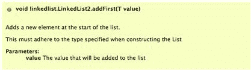

图 31-3

由于此方法没有声明异常或返回值，因此它不包含这些特性的标签。如果你想象一个接受两个参数、返回 `String` 并抛出名为 `SomeExceptrion` 异常的假设方法，其标签可能看起来如下：

- `@param value` 这是第一个参数
- `@param value2` 这是第二个参数
- `@return String` 这是返回值
- `@throws SomeException` 如果发生……则抛出此异常

正如可以为方法添加 JavaDoc 一样，也可以为字段添加 JavaDoc。然而，这通常是没有必要的——JavaDoc 应该通常用于记录类的公共 API，而字段通常不是该 API 的一部分。

在这些示例中，你仅仅触及了 JavaDoc 的皮毛。然而，本章概述的标签和方法是你添加到所编写的所有类中的基本特性，特别是那些你预计其他程序员会使用的类。

# 32 注解与反射

本章将引入两个全新的主题：反射和注解。本章还将提供一个机会创建一个比书中许多示例更高级的程序。

在描述注解和反射之前，请考虑一个允许从 CSV 文件中的值创建对象的程序。该程序具有以下需求：

- 它可以接受 CSV 文件和类名作为参数——它不需要对文件或类有任何先验知识。
- 程序应该创建一个该类的实例，以封装文件中每一行（表头行除外）的数据。
- 表头行将包含识别列内容的列名，但这些列名不需要与类的字段名一致。
- 类可能包含 `String`、`Integer`、`Double` 或 `Date` 类型的字段，由处理器根据文件中的数据来填充这些字段。
- 如果文件包含日期，则由类来指定日期格式：没有一个所有文件都必须使用的统一格式。

如果你考虑一下这些需求，我想你会同意，基于你目前对 Java 的了解，无法写出一个满足这些要求的通用型文件处理器。

在本章中，你将学习如何使用注解和反射来创建更通用的代码，这些代码能够与类交互，即使对这些类的结构没有先验知识。这意味着编写满足这些要求的代码是可能的。

## 注解

你将从查看注解开始。在查看继承和函数接口时，你已经见过注解的实际应用了。例如，你看到注解可以放置在方法声明之前，以指示它正在重写来自父类或接口的方法：

```java
@Override
public void overriddenMethod() {
}
```

此注解确保了如果底层方法的定义发生发生变化，你将收到编译错误。这是非常有用的，因为提示你同时也更改你的方法定义。

思考注解的一种方式是，它们扩展了编译器的功能。如果底层方法的定义发生了变化，你的代码仍然有效：它只是没有执行你认为它正在执行的操作（重写方法）。


到为止所看到的注解都是内置注解，并且在编译时进行处理。在本章中，你将查看如何编写自己的自定义注解，并在运行时访问这些注解。

本章开头概述的程序需求指出，CSV 文件中的列名不需要与类中的字段名匹配。因此，你将创建一个注解，用于指定类中的 setter 方法关联的 CSV 列名。

首先在 Eclipse 中创建一个新项目，我把我的项目命名为 `GenericProcessor`。接下来，右键点击项目并选择 New -> Annotation。将注解命名为 `Column`，并将其放在名为 `processor.annotations` 的包中。

你会发现 Eclipse 生成的代码看起来像接口，但包含一个 `@` 符号：

```java
public @interface Column {
}
```

（注：此处由于原文存在大量重复，已根据要求合并为唯一内容）

因此，你将创建一个注解，用于指定类中的 setter 方法关联的 CSV 列名。

```java
package processor.annotations;

import java.lang.annotation.ElementType;
import java.lang.annotation.Retention;
import java.lang.annotation.RetentionPolicy;
import java.lang.annotation.Target;

@Retention(RetentionPolicy.RUNTIME)
@Target({ElementType.METHOD})
public @interface Column {
    String columnName();
    String format() default "yyyy-MM-dd";
}
```

现在你已经创建了注解，可以定义一个你想要处理的 CSV 文件。你将使用的文件包含 Oracle 公司从 2014 年到 1996 年的股票信息。该文件可以在书籍网上获得，名为 `ORCL.csv`。该文件应该放在你的项目根目录下。文件的前几行如下：

```csv
Date,Open,High,Low,Close,Volume,Adj Close
2014-05-23,17.26,18.90,16.96,17.30,168500,17.30
2014-05-22,16.97,17.25,16.85,17.21,135500,17.21
2014-05-21,16.80,17.23,16.69,17.00,180200,17.00
2014-05-20,16.86,17.01,16.61,17.73,161700,16.73
2014-05-19,16.79,17.16,16.67,16.88,129100,16.88
2014-05-16,16.79,17.25,16.50,16.91,148200,16.91
2014-05-15,16.53,16.87,16.53,16.86,235500,16.86
2014-05-14,16.01,16.90,16.01,16.67,254100,16.67
2014-05-13,15.96,16.09,15.79,15.81,78000,15.81
```

```csv
2014-05-12,15.77,16.30,15.70,16.04,94200,16.02
2014-05-09,15.52,15.86,15.26,15.66,98900,15.64
2014-05-08,15.50,16.33,15.25,15.62,161300,15.60
```

如你所见，该文件包含 7 列。第一列是行相关的日期，其余列包含各种价格和成交量信息。

你现在将编写一个包含 7 个字段的类，并使用 `Column` 注解将这些字段的 setter 映射方法映射到文件中的列。这确保了类中的字段名可以与 CSV 文件中的字段名不同：

```java
package processor;

import java.util.Date;

import processor.annotations.Column;

public class StockData {

  private Date date;

  private Double openingPrice;

  private Double highestPrice;

  private Double lowestPrice;

  private Double closingPrice;

  private Integer volume;

  private Double adjustedClosingPrice;

  public StockData() {}

  public Date getDate() {
    return date;
  }

  @Column(comumnName = "Date", format = "yyyy-mm-dd")
  public void setDate(Date date) {
    this.date = date;
  }

  public Double getOpeningPrice() {
    return openingPrice;
  }

  @Column(comumnName = "Open")
  public void setOpeningPrice(Double openingPrice) {
    this.openingPrice = openingPrice;
  }

  public Double getHighestPrice() {
    return highestPrice;
  }

  @Column(comumnName = "High")
  public void setHighestPrice(Double highestPrice) {
    this.highestPrice = highestPrice;
  }

  public Double getLowestPrice() {
    return lowestPrice;
  }

  @Column(comumnName = "Low")
  public void setLowestPrice(Double lowestPrice) {
    this.lowestPrice = lowestPrice;
  }

  public Double getClosingPrice() {
    return closingPrice;
  }

  @Column(comumnName = "Close")
  public void setClosingPrice(Double closingPrice) {
    this.closingPrice = closingPrice;
  }

  public Integer getVolume() {
    return volume;
  }

  @Column(comumnName = "Volume")
  public void setVolume(Integer volume) {
    this.volume = volume;
  }

  public Double getAdjustedClosingPrice() {
    return adjustedClosingPrice;
  }

  @Column(comumnName = "Adj Close")
  public void setAdjustedClosingPrice(Double adjustedClosingPrice) {
    this.adjustedClosingPrice = adjustedClosingPrice;
  }
}
```

你现在已经显式地将 CSV 文件中的列名与类中的字段名关联起来。这些注解还没有产生任何作用，但它们已经以这种方式标注了你的代码，你现在可以开始编写代码来利用它们了。

你现在将编写一个处理器，它可以接收一个类名和一个文件名，并从文件中构造一个指定类型的对象 List。

在编写代码之前，你将先建立基本结构，并查看处理器是如何被调用的。处理器将具有以下基本结构：

```java
package processor;

import java.util.ArrayList;

import java.util.List;

public class FileProcessor<T> {
  List<T> processFile(Class className, String filename) {
    List<T> result = new ArrayList<>();
    return result;
  }
}
```

调用方式如下：

```java
package processor;

public class Main {
  public static void main(String[] args) {
    FileProcessor<StockData> fileProcessor = new FileProcessor<>();
    fileProcessor.processFile(StockData.class, "ORCL.csv");
  }
}
```

要开始，你需要编写一个方法来检查传入的类，扫描该类上的所有方法，并确定哪些方法带有 `Column` 注解。

为了实现这一目标，你将使用一种名为 `reflection`（反射）的功能。反射允许你在运行时检查类并确定它包含哪些字段和方法，甚至可以在类的特定实例上调用这些方法的实例。

反射对于编写通用算法非常有用，因为它允许代码根据其提供的类结构在运行时做出决策。例如，此示例中的 `FileProcessor` 不需要关于 `StockData` 类的任何编译时知识：它所需的所有信息都将通过反射发现。

以下是 `FileProcessor` 的下一个版本。它构建了一个映射，其中键是文件中的列名（通过注解发现），值是 `StockData` 中对应的 setter 方法：

```java
package processor;

import java.lang.annotation.Annotation;

import java.lang.reflect.Method;
import java.util.ArrayList;

import java.util.HashMap;
import java.util.List;
import java.util.Map;

import processor.annotations.Column;

public class FileProcessor<T> {
  List<T> processFile(Class className, String filename) {
    List<T> result = new ArrayList<>();
    Map<String, Method> headerMap = new HashMap<>();
    mapFieldNames(className, headerMap);
    return result;
  }

  private void mapFieldNames(Class c, Map<String, Method> headerMap) {
    for (Method method : c.getMethods()) {
      Column column = method.getAnnotation(Column.class);
      if (column != null) {
        headerMap.put(column.comumnName(), method);
      }
    }
  }
}
```

要访问给定类的方法，代码简单地调用了 `c.getMethods()`。同样，一旦在方法上识别出 `Column` 注解，可以通过以下方式提取其值：`column.comumnName()`。

你现在将编写处理表头并确定每一列的位置：

```java
private void mapColumnPositions(Map<Integer, String> headerMap, String firstLine) {
  StringTokenizer st = new StringTokenizer(firstLine, ",");
  int i = 0;
  while (st.hasMoreTokens()) {
    headerMap.put(i++, st.nextToken());
  }
}
```

现在，你将创建一个接受文件每一行并对其处理的方法，最后返回所需的类的实例：

```java
private T processLine(Class className, String line, Map<Integer, String> headerPositionMap, Map<String, Method> headerMap) throws Exception {
  T t = (T)className.newInstance();
  int i = 0;
  StringTokenizer st = new StringTokenizer(line, ",");
  while (st.hasMoreTokens()) {
    String columnName = headerPositionMap.get(i);
    Method setter = headerMap.get(columnName);
    Parameter parameter = setter.getParameters()[0];
    if (parameter.getType().equals(Date.class)) {
      Column column = setter.getAnnotation(Column.class);
      DateFormat df = new SimpleDateFormat(column.format());
      setter.invoke(t, df.parse(st.nextToken()));
    } else if (parameter.getType().equals(Double.class)) {
      setter.invoke(t, Double.valueOf(st.nextToken()));
    } else if (parameter.getType().equals(Integer.class)) {
      setter.invoke(t, Integer.valueOf(st.nextToken()));
    } else {
      setter.invoke(t, st.nextToken());
    }
    i++;
  }
  return t;
}
```

这个方法乍看相当复杂，但如果你逐行分析它，它是相当直观的。

你首先构造一个存储该行数据的类实例（在本例中为 `StockData` 实例）。你使用一种到目前为止未见的机制来实例化它：在 `Class` 本身上使用 `newInstance` 方法。

一旦你获取了 setter 的引用，就需要确定它接受的参数类型。你知道 setter 总是接受一个参数；因此你也可以通过反射来访问它：

```java
Parameter parameter = setter.getParameters()[0];
```

该方法的后续部分包含一组 `if-else` 块，根据 setter 的类型来调用它。例如，如果它接受 `Integer`，你按照如下方式调用它：

```java
setter.invoke(t, Integer.valueOf(st.nextToken()));
```

第一个处理 `Date` 参数的块是最复杂的，因为在这种情况下，你还需要通过以下代码从注解中找到日期的格式：

```java
Column column = setter.getAnnotation(Column.class);

DateFormat df = new SimpleDateFormat(column.format());
```

现在你可以将它们整合在一起了：


```java
package processor;

import java.io.FileNotFoundException;
import java.io.FileReader;
import java.io.IOException;
import java.lang.annotation.Annotation;
import java.lang.reflect.InvocationTargetException;
import java.lang.reflect.Method;
import java.lang.reflect.Parameter;
import java.nio.file.Files;
import java.nio.file.Path;
import java.nio.file.Paths;
import java.text.DateFormat;
import java.text.ParseException;
import java.text.SimpleDateFormat;
import java.util.ArrayList;
import java.util.Date;
import java.util.HashMap;
import java.util.List;
import java.util.Map;
import java.util.StringTokenizer;
import java.util.logging.Level;
import java.util.logging.Logger;

import processor.annotations.Column;
```

```java
public class FileProcessor<T> {
    List<T> processFile(Class className, String filename) {
        List<T> result = new ArrayList<>();
        Map<String, Method> headerMap = new HashMap<>();
        Map<Integer, String> headerPositionMap = new HashMap<>();
        mapFieldNames(className, headerMap);
        Path path = Paths.get(filename);
        try {
            Files.lines(path).limit(1).forEach(
                s -> mapColumnPositions(headerPositionMap, s));
            Files.lines(path).skip(1).forEach(s -> {
                try {
                    result.add(processLine(className, s, headerPositionMap, headerMap));
                } catch (Exception e) {
                    Logger.getLogger(FileProcessor.class.getName()).
                        log(Level.SEVERE, "Error occurred", e);
                }
            });
        } catch (IOException ex) {}
        return result;
    }

    private void mapFieldNames(Class c, Map<String, Method> headerMap) {
        for (Method method : c.getMethods()) {
            Column column = method.getAnnotation(Column.class);
            if (column != null) {
                headerMap.put(column.comumnName(), method);
            }
        }
    }

    private T processLine(Class className, String line, Map<Integer, String> headerPositionMap, Map<String, Method> headerMap) throws Exception {
        T t = (T)className.newInstance();
        int i = 0;
        StringTokenizer st = new StringTokenizer(line, ",");
        while (st.hasMoreTokens()) {
            String columnName = headerPositionMap.get(i);
            Method setter = headerMap.get(columnName);
            Parameter parameter = setter.getParameters()[0];
            if (parameter.getType().equals(Date.class)) {
                Column column = setter.getAnnotation(Column.class);
                DateFormat df = new SimpleDateFormat(column.format());
                setter.invoke(t, df.parse(st.nextToken()));
            } else if (parameter.getType().equals(Double.class)) {
                setter.invoke(t, Double.valueOf(st.nextToken()));
            } else if (parameter.getType().equals(Integer.class)) {
                setter.invoke(t, Integer.valueOf(st.nextToken()));
            } else {
                // assume it accepts a String
                setter.invoke(t, st.nextToken());
            }
            i++;
        }
        return t;
    }

    private void mapColumnPositions(Map<Integer, String> headerPositionMap, String firstLine) {
        StringTokenizer st = new StringTokenizer(firstLine, ",");
        int i = 0;
        while (st.hasMoreTokens()) {
            headerPositionMap.put(i++, st.nextToken());
        }
    }
}
```

注意，你对`Streams`使用了`limit`函数来处理文件的第一行：

```java
Files.lines(path).limit(1).forEach(s -> mapColumnPositions(headerPositionMap, s));
```

然后在第二次处理文件时，使用`skip`函数来跳过表头。

```java
Files.lines(path).skip(1).forEach(s -> {
    try {
        result.add(processLine(className, s, headerPositionMap, headerMap));
    } catch (Exception e) {
        Logger.getLogger(FileProcessor.class.getName()).
            log(Level.SEVERE, "Error occurred", e);
    }
});
```

现在我们已经有了构建`StockData`实例的代码，你可以写一个`main`方法，使用返回的`List`来查找：

- 任意日期的最高成交量
- 开盘价和收盘价差异最大的日期
- 任意日期的最低价格

```java
package processor;

import java.util.List;
import java.util.OptionalDouble;
import java.util.OptionalInt;

public class Main {
    public static void main(String[] args) {
        FileProcessor<StockData> fileProcessor = new FileProcessor<>();
        List<StockData> data = fileProcessor.processFile(StockData.class, "ORCL.csv");

        // 寻找最大成交量
        OptionalInt resultVolume = data.stream().mapToInt(sd -> sd.getVolume()).max();
        System.out.println("Highest volume: " + resultVolume.getAsInt());

        // 寻找开盘价和收盘价之间的最大差异
        OptionalDouble resultPrice = data.stream().mapToDouble(sd -> sd.getClosingPrice()-sd.getOpeningPrice()).max();
        System.out.println("Highest change: " + resultPrice.getAsDouble());

        // 寻找最低开盘价
        OptionalDouble lowestPrice = data.stream().mapToDouble(sd -> sd.getOpeningPrice()).min();
        System.out.println("Lowest price: " + lowestPrice.getAsDouble());

        // 寻找最高价格
        OptionalDouble highestPrice = data.stream().mapToDouble(sd -> sd.getOpeningPrice()).max();
        System.out.println("Highest price: " + highestPrice.getAsDouble());
    }
}
```

你希望将一组可以由用户运行的类放在一起：在这种情况下，显然需要一个主方法（`main` method）。

你将顺序检查这两种场景。

## 创建库

回想一下你早些在书中编写的`LinkedList2`类——想象一下你想将其作为一个库提供。

该类依赖于另一个名为`Node`的类，因此你可以创建一个包含`LinkedList2`和`Node`类的`JAR`文件，并分发该文件。

首先，右键点击包含这两个类的项目，并选择`Export…`（导出）。

在第一个屏幕上（如图 33-1 所示），选择“JAR file”并点击`Next`（下一步）：

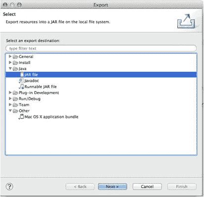

图 33-1

在下一个屏幕上（如图 33-2 所示），你将可以选择要包含在`JAR`文件中的资源。

点击`src`目录下的`linkedlist`包，并选择不导出`Main`类（如图 33-2 所示）。同时为要导出的`JAR`文件选择一个名称和位置——我将我的命名为`list2.jar`，但可以使用任何你喜欢的名称：

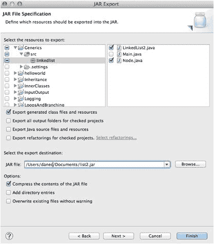

图 33-2

当你按下“Finish”（完成）时，`JAR`文件将被创建。

你现在将在另一个项目中使用此`JAR`文件。默认情况下，`Eclipse`不允许你在另一个项目中使用一个项目的类——每个项目都被视为一个自包含的实体。

首先创建一个新项目，并添加以下类：

```java
package usejar;

import linkedlist.LinkedList2;

public class Main {
  public static void main(String[] args) {
    LinkedList2 list = new LinkedList2();
  }
}
```

你会发现这无法编译，因为找不到`LinkedList2`。现在，在`Package Explorer`（包管理器）中右键点击项目，选择`Build Path -> Configure Build Path`（构建路径 -> 配置构建路径）。接下来，选择`libraries`选项卡并选择`Add External Jars`（添加外部 JAR）。从文件选择器选择你在上一节中创建的`JAR`文件，然后选择“Finish”。

这把带有`LinkedList2`的`JAR`添加到程序的`classpath`中，因此代码现在可以编译，你可以开始使用`LinkedList2`类了。

互联网上有许多开源 Java 库的来源，这些库始终以`JAR`文件的形式提供。这意味着你可以像在这里做的那样下载这些库并添加到你的`Eclipse`项目中。

可能最好的开源 Java 库来源是`Apache Commons`，可以在这里找到：[`commons.apache.org/`](http://commons.apache.org/)。它包含长长的可以整合到你的 Java 程序中的库列表。

## 可执行的 JAR 文件

你现在将创建一个可执行的`JAR`文件。这将允许用户通过双击它或从命令行执行它来运行你的程序之一。然而，需要注意的是，用户计算机上仍需要安装`JVM`，尽管他们很可能安装的是 Java 运行环境 (`JRE`）而不是 Java 开发工具包 (`JDK`)。

本章忽略了另一种可以向终端用户部署 Java 程序（特别是富 GUI 应用）的 Java 技术，称为`Java Web Start`。`Java Web Start`允许用户从互联网下载并安装 Java 程序，并创建桌面图标。

如果你需要向大量人员部署 Java 程序，并需要管理 Java 程序的更新，你可能想查看`Java Web Start`。

在本节中，我将为“反射与注解”章节中创建的文件处理器创建一个可执行的`JAR`文件。

首先找到该项目，右键点击它，并选择`Export…`。这次在对话框中，你将选择创建一个可运行的（`Runnable`）`JAR`文件，如图 33-3 所示：

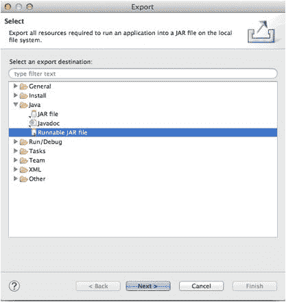

图 33-3

“Next”后，你将看到图 33-4 所示的选项。在对话框中，你需要选择一个“Launch configuration”（启动配置）——这是你在`Eclipse`中运行程序时使用的配置，它是自动生成的：

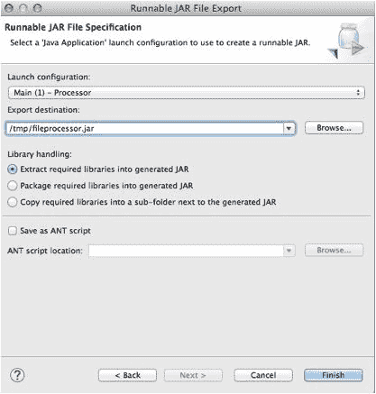

图 33-4

你现在可以选择“Finish”来保存`JAR`文件。

如果你提取此`JAR`文件的内容，你会发现一个主要区别：为你创建名为`META-INF/MANIFEST.MF`的文件，包含以下内容：

```
Manifest-Version: 1.0
Class-Path: .
Main-Class: processor.Main
```

这指示`jar`工具哪个类包含主方法。

你现在可以从命令行执行此`JAR`。确保将`ORCL.csv`复制到与`JAR`文件相同的目录，然后并在操作系统控制台中执行它，如图 33-5 所示：

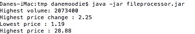

图 33-5

注意，这仍然需要在控制台中运行，因为标准输出需要写入某些地方。如果这是一个图形化程序，或者写入了文件，用户只需双击`JAR`文件即可。

# 34

## 日志

大多数真实世界的应用程序会在执行时记录日志。日志（`Logging`）是一种在程序执行时输出其状态和行为的有用机制，以便进行调试。

当程序执行时遇到问题时，日志记录是很有用的。

通常在生产环境中，你可能无法进行调试（`debug`）程序，但你仍然需要一种方法来了解程序正在做什么。

Java 包含了一个适用于大多数需求的日志 API。还有许多开源日志库可用。本章将限于 Java 提供的日志 API。

## 入门

日志 API 的核心是一个名为`Logger`的类。该类负责输出日志信息。以下展示了一个声明`Logger`并输出消息的简单示例：

```java
package logging;

import java.util.logging.Logger;

public class SimpleLogging {
  public static void main(String[] args) {
    Logger log = Logger.getLogger(SimpleLogging.class.getName());
    log.info("这是一条消息");
  }
}
```


如果我在 Eclipse 中运行此程序，它产生以下输出：

```
Apr 25, 2014 2:39:02 PM logging.SimpleLogging main
INFO: 这条消息
```

在许多方面这与使用`System.out.println`，但你已经可以看到一些优势：

- 输出包含了记录消息的当前日期和时间
- 输出包含了产生输出的信息

稍后我们将详细查看这些功能，但现在请注意创建日志器的行：

`log = Logger.getLogger(SimpleLogging.class.getName())`

`getLogger`静态辅助方法返回一个可以用于记录消息的对象。因为复杂的程序中有许多`Logger`，因此为每个`Logger`关联一个字符串是非常重要的，以便区分不同`Logger`的输出。

与`Logger`关联的最常用字符串是声明`Logger`的类的名称——这就是为什么之前的示例输出了类名的原因——实际上它输出的是`Logger`的名称。

注意我在示例中使用的方法是`info`。当你记录消息时，你通过*级别*（level）为它们分配重要性——`info`表示输出仅用于信息提示目的。级别也可以显式地分配：

```java
package logging;

import java.util.logging.Level;
import java.util.logging.Logger;

public class SimpleLogging {
  public static void main(String[] args) {
    Logger log = Logger.getLogger(SimpleLogging.class.getName());
    log.log(Level.FINEST, "这是一条 finest 级别的消息");
  }
}
```

```java
log.log(Level.FINER, "This is a finer message");
log.log(Level.FINE, "This is a fine message");
log.log(Level.INFO, "This is a info message");
log.log(Level.WARNING, "This is a warning message");
log.log(Level.SEVERE, "This is a severe message");
}
}
```

此示例展示了六种最常见的级别，从不重要到最重要。

如果你运行这个示例，可能会对结果感到惊讶。我收到了以下输出：

```
Apr 25, 2014 3:24:01 PM logging.SimpleLogging main
INFO: This is a info message
Apr 25, 2014 3:24:01 PM logging.SimpleLogging main
WARNING: This is a warning message

Apr 25, 2014 3:24:01 PM logging.SimpleLogging main
SEVERE: This is a severe message
```

前三条消息没有被打印。原因是每个`Logger`都有一个默认的级别，除非日志消息的重要性至少达到该级别，否则消息将不会打印。

当你回想你记录信息的原因时，这个问题就变得显而易见了。记录信息通常是为了帮助理解程序正在发生什么。但在某些情况下，你可能只想知道严重消息（当程序由最终用户运行时），而在另一些时候，你可能需要更多信息（当程序在开发环境中或由测试人员运行时）。

如果你希望`Logger`打印所有消息（或指定重要性以上的消息），你需要在记录任何信息之前，先在`Logger`上指定这一点：

```java
log.setLevel(Level.ALL);
```

你可能认为这就足够打印额外的消息了。然而，级别的优妙之处在于，你可能希望将细微的消息打印到控制台，而将将严重消息记录到文件中——因此，每个输出目标也有默认的日志级别。

为了看到这一点，请使用上一章描述的技术从此项目创建一个可执行的 JAR 文件（我将其命名为`simplelogging.jar`）。将其放置在文件系统的某处，在同一目录下创建一个名为`logging.properties`的文件，并添加以下内容：

```
handlers=java.util.logging.ConsoleHandler
java.util.logging.ConsoleHandler.level=FINE
```

该配置文件表示你想要将日志记录到控制台，并且想要记录所有`FINE`或更高级消息。

如果你现在按照以下方式执行：

```bash
java -Djava.util.logging.config.file=logging.properties -jar simplelogging.jar
```

（确保你处于包含 JAR 文件和`logging.properties`文件的目录）。

它应该打印以下内容：

```
Apr 25, 2014 4:30:59 PM logging.SimpleLogging main
FINE: This is a fine message
Apr 25, 2014 4:30:59 PM logging.SimpleLogging main
INFO: This is a info message
Apr 25, 2014 4:30:59 PM logging.SimpleLogging main
WARNING: This is a warning message

Apr 25, 2014 4:30:59 PM logging.SimpleLogging main
SEVERE: This is a severe message
```

如果你尝试不同的级别，将看到记录的行数多或少。

控制台是处理器（handler）的一个示例，但你也可以添加其他的。按如下方式更改`logging.properties`文件：

```
handlers=java.util.logging.FileHandler, java.util.logging.ConsoleHandler
java.util.logging.ConsoleHandler.level=FINE
java.util.logging.FileHandler.level=INFO
java.util.logging.FileHandler.pattern=simple.log
java.util.logging.FileHandler.limit=10000
java.util.logging.FileHandler.formatter=java.util.logging.SimpleFormatter
```

这现在表示程序应该将消息记录到文件和控制台。文件日志器只会记录`INFO`或更高级的消息，这些消息将记录到名为`simple.log`的文件中。该文件的大小可以增长到最大 10000 字节，届时它将循环使用。

最后一行将格式化器与`FileHandler`关联。默认情况下，`FileHandler`创建 XML 输出，而我只需要记录到控制台的简单输出。

如果你现在运行它，你应该看到一个名为`simple.log`的文件，内容如下：

```
Apr 25, 2014 4:38:44 PM logging.SimpleLogging main
INFO: This is a info message
Apr 25, 2014 4:38:44 PM logging.SimpleLogging main
WARNING: This is a warning message

Apr 25, 2014 4:38:44 PM logging.SimpleLogging main
SEVERE: This is a severe message
```

处理器不需要局限于控制台和文件。日志消息还有许多其他潜在目标，例如电子邮件、数据库和电话警报。处理器机制将记录消息的方式与记录消息的过程抽象离开来。这是一个非常灵活的设计，因为这意味着任何带有日志代码的程序都可以扩展以支持不同的日志方法，而无需更改程序本身。

到为止，我一直关注记录消息，但另一个重要的考虑因素是记录堆栈跟踪（stack traces）。下面的程序演示了对错误的记录。在这个程序中，当`c`方法被`main`调用时，它会产生异常，因为它被传递了一个空字符串：

```java
package logging;

import java.util.logging.Level;
import java.util.logging.Logger;

public class SimpleLogging {
    public static void main(String[] args) {
        Logger log = Logger.getLogger(SimpleLogging.class.getName());
        log.setLevel(Level.ALL);
        try {
            a(null);
        } catch (Exception e) {
            log.log(Level.SEVERE, "An error occured in main", e);
        }
    }

    public static void a(String s) {
        b(s);
    }

    public static void b(String s) {
        c(s);
    }

    public static void c(String s) {
        s.substring(0, 10);
    }
}
```

当你运行它时，它应该产生以下内容：

```
Apr 26, 2014 2:13:57 PM logging.SimpleLogging main
SEVERE: An error occured in main
java.lang.NullPointerException
at logging.SimpleLogging.c(SimpleLogging.java:27)
at logging.SimpleLogging.b(SimpleLogging.java:23)
at logging.SimpleLogging.a(SimpleLogging.java:19)
at logging.SimpleLogging.main(SimpleLogging.java:12)
```

注意只需将异常传递给`log`方法会导致打印整个堆栈跟踪，从而允许你在异常发生时看到整个调用堆栈。

# 35

# 结

Java 是一种大型且复杂的编程语言——但它也能解决大型且复杂的问题。

本书向你介绍了 Java 标准版（Java SE）的所有关键特性，你现在已经准备好使用 Java 来解决有趣的世界问题，更重要的是，能够使用最新版本的 Java 以及它提供的所有新功能。

在许多方面，这本书仅触及了 Java 能够实现的皮毛。正如我在引言中提到的，Java 现在主要用作服务器端语言，是许多最流行网站背后的力量。这种力量通过一组称为 Java 企业版（Java EE）的 API 来解锁。

本书没有介绍 Java EE，但它让你处于一个良好的位置，以便根据你的需要开始进行调查。在学习 Java EE 等高级功能之前，在语言基础方面有坚实的基础是至关重要的，这正是本书为你提供的。

如果你想编写服务端 Java 应用程序，你实际上有两个选择：

## Java EE

Java EE：这是一组由 Java 定义并由各种供应商（包括商业和开源）实现的标准 API。它包含一个用于构建丰富网站的 Web 框架——Java Server Faces，以及一个用于创建服务端组件的 API——Enterprise Java Beans。

为了使用 Java EE，你需要使用与这些 API 兼容的 Java 应用程序。与 Java EE 配合使用的最流行的 Java 应用程序服务器可能是 JBoss 服务器，可以在这里获取：

[`jbossas.jboss.org/`](https://jbossas.jboss.org/)

Oracle 随后提供了一个引导你完成 Java EE 应用程序开发过程的教程可以在此处访问：

http://docs.oracle.com/javaee/6/tutorial/doc/

## Spring

Spring Framework (http://projects.spring.io/spring-framework) 是一个轻量级框架，包含了与 Java EE 相同的所有特性。使用 Spring Framework 编写的应用通常部署在开源的 Tomcat 服务器中：http://tomcat.apache.org/。

Spring Framework 网站包含高质量的文档，凭借你到目前为止在本书中学到的知识，你会发现上手其实非常简单。

Spring 还支持一个用于开发丰富网站的 API，称为`Spring MVC`，以及其他各种 API。

无论你打算在你的 Java 知识上向哪个方向发展，我都祝你好运。

再次强调，作为计算机科学书籍的独立出版商，评论对我们非常重要。如果你能抽空发表一条公开评论，我们将不胜感激。
