# 基于面向对象对象的 Java 重构工具研究

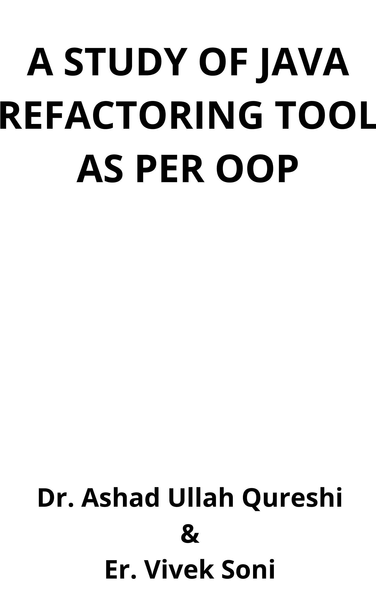

本书由 `Concepts Books Publication (India) Pvt. Ltd.` 于 2020 年出版。

[www.researchitout.blogspot.com](http://www.researchitout.blogspot.com)

版权所有。未经出版者和版权持有者的事先书面许可，不得以任何形式或通过手段（电子、机械、复印、录制或其他）对本书的任何部分进行复制、存储在检索系统中或传输。

# 摘要

面向对象编程 (`OOP`) 是一种当代流行的编程方法。`OOP` 提供了更好的灵活性，使源代码更加组织化和系统化，并允许一组开发人员轻松地协作。尽管如此，设计糟糕的系统不仅会违背使用 `OOP` 编码的初衷，还会使软件变得难以维护。重构是改进现有代码的一种强大方法。它只改变源代码的结构而不改变其功能。手动重构大型系统不仅消耗大量的时间和金钱，而且极不准确。因此，在软件领域，带有部分自动化的快速且方便的重构被广泛讨论。

本论文提出了用于 `JAVA` 源代码的即时运行九种重构的实现算法。这些重构算法以逐步的方式实现，即首先选择要重构的源码部分，然后选择正确的重构方法，最后通过程序化更改所选源码以实现重构。

# 目录

## 第 1 章 引言 (1 - 4)

* 1.1 产品视角
* 1.2 动机
* 1.3 目标
* 1.4 论文结构

## 第 2 章 重构技术 (5 - 8)

* 2.1 引言
* 2.2 工作范围

## 第 3 章 文献综述 (9 - 13)

## 第 4 章 简化条件表达式 (14 - 26)

* 4.1 合并条件表达式
* 4.2 结构
* 4.3 重构步骤
* 4.4 合并重复的条件片段
* 4.5 结构
* 4.6 重构步骤
* 4.7 将嵌套条件替换为守护语句
* 4.8 结构
* 4.9 重构步骤

## 第 5 章 处理泛化 (27 – 41)

* 5.1 提取方法
* 5.2 结构
* 5.3 重构步骤
* 5.4 提取字段
* 5.6 重构步骤
* 5.7 下沉方法
* 5.8 结构
* 5.9 重构步骤
* 5.10 下沉字段
* 5.11 结构
* 5.12 重构步骤

## 第 6 章 快速 Java 重构工具 (42 – 54)

* 6.1 用户交互
* 6.2 自动重构 - 数据收集
* 6.3 自动重构 概述

## 第 7 章 结果 (55 - 130)

* 7.1 合并条件表达式的输入与验证
* 7.2 合并重复的条件片段的输入与验证
* 7.3 将嵌套条件替换为守护语句的输入与验证
* 7.4 提取字段的输入与验证
* 7.5 下沉字段的输入与验证
* 7.6 提取方法的输入与验证
* 7.7 下沉方法的输入与验证
* 7.8 反转结果的输入与验证
* 7.9 进阶反转条件的输入与验证

## 第 8 章 结论与未来改进 (131 - 132)

参考文献

# 第 1 章

 引言

## 1.1. 产品视角

从统计学上证明，软件维护是昂贵且困难的。人们也感觉到软件维护是不可避免的，因为新技术的（如新硬件）不断被引入；法律法规经常发生变化；业务实体频繁重组；最后，客户的需求在不断变化和演变。根据 Martin Fowler [1] 的观点，“重构是改变软件系统的过程，在不改变代码外部行为的同时改进其内部结构。”此外，在一篇题为《重构——软件维护的方法》的文章中，Arora 等人指出，通过重构实践，可以实现软件的重模块化，并使软件系统更容易阅读、理解、扩展和维护 [2]。描述的许多重构是常识性的编程技术，例如移动字段；某些重构是常见的软件设计实践，例如封装字段；某些重构改进了可读性和可维护性，例如反转条件。因此，重构的核心在于改进软件的设计和结构。

设计或工程实现糟糕的系统会给他人带来问题。源代码随着时间的推移而退化；特别是在 2000 年，臭名昭彰的千年虫引起了全球对软件维护的关注。本文描述了实现九种重构的算法。并创建一个名为快速重构工具 (`QJRT`) 的原型工具来验证这些算法。

## 1.2. 动机

软件的更改既困难又昂贵。大型软件项目面临着挑战，如开发团队规模扩大、功能范围增加以及竞争驱动的进度。这些问题通常导致内聚性下降和类之间耦合性的增加。源代码变得越来越难以维护，新功能的添加变得日益复杂。由于类的数量以及它们之间的依赖关系，在程序员之间分配编程任务变得更加困难。

由多人执行的编程任务也更容易在编码风格、信息隐藏方法和命名上出现不一致，这损害了软件产品的概念完整性。复杂系统中良好的面向对象设计的内在困难性通过设计模式的日益流行而凸显，设计模式可以向软件设计者传递经验和设计知识。

Opdyke 提出重构现有的类层次可以提高其可维护性和重用性 [Opdyke 92, Opdyke & Johnson 90]。重构活动在不改变程序行为的情况下改变其组织。它包括将对成员数据的公共引用封装在新方法中，或从相似类的共享行为创建抽象超类。程序员可以主动进行重构以应对未来的变化，也可以作为全面重构工作的一部分进行。Opdyke 的自动重构工具允许程序员引导类层次中特定部分的自动重构。

重构面向对象程序的一个关键问题是首先识别当前设计中的结构问题，然后探索可能的解决方案。例如，考虑一个主要由公共数据成员组成的类。随着应用程序的演变变得越来越复杂，此类类的更好设计可能是将成员数据私有化，并将对其数据的计算封装在该类的方法中。为了了解类应该有哪些方法，软件设计者需要查看对数据成员的所有引用，并根据其操作方式进行分类。然而，数据成员的使用分布在整个程序中，并与该类相关的计算交织在一起，从而增加了分析的难度。

Opdyke 的重构工具提供了一种执行自动语义保持重构的机制，但它无法帮助程序员决定执行哪些重构来改进设计。

使用文本编辑器对引用进行分类是困难的，因为每个引用仅在它使用的上下文中显示，而不是与该类的其他引用一起。解决这一问题的典型方案是使用如 `Unix grep` 这样的搜索工具，它可以只提取与指定模式匹配的程序行。

尽管这在移除无关代码方面很有效，但它无法通过类型匹配数据引用，只能通过名称匹配。此外，它不会对匹配的引用进行任何进一步的分类，也不会建议哪些引用的计算应该放在类内部，而哪些应该保留在类外部。设计可视化工具（如类层次结构图或图形对象模型）可以揭示系统当前设计的高层级方面，但无法使用此类视图来检查源代码的潜在结构以建议适当的重设计。最后，在规划复杂的重设计时，理想情况下要有支持来记录设计者的许多发现、想法和重构计划。

### 1.3. 目标

随着面向对象软件的修改，其结构往往会退化。潜在的大量类以及它们之间大量的依赖可能会使维护用对象语言编写的程序所需的分析和规划变得复杂。

重构软件以改进其设计可以降低未来更改的成本。为了简化软件重构任务，我们描述了星型图（star diagram）概念在 Java 程序中的应用。星型图可视化为程序员提供了项目源代码的交叉视图，通过快速评估复杂的类层次结构和复杂的类间关系来简化软件维护任务。记录待执行的详细重构任务，并辅以正在修改的源代码的相关星型图部分，为程序员提供了工作的可视化，有助于软件重构的回顾和执行。

### 1.4. 论文结构

- 第 1 章代表并讨论了研究引言和整体研究。
- 第 2 章阐述了重构工具及其在 `Quick Java Refactoring tool` 中的重要性。
- 第 3 章代表了文献综述及其提取的相关内容。
- 第 4 章阐述了 `QJRT` 的条件表达式简化。
- 第 5 章代表了对泛化的处理。
- 第 6 章详细介绍了 `QJRT`。
- 第 7 章讨论了研究结果和结论。

## 第 2 章重构

## 2.1 引言

重构是软件维护中重要的一步。重构的第一个原因是大型软件通常由很多人开发。因此，即使项目开始时有一个完美的 `UML`（统一建模语言）类图作为蓝图，不同的人对编写源代码通常有不同的想法。此外，软件也会老化，需要维护。正如 Pippin 在一个在线帖子中所说：“我感觉到这是我写过的最好的代码之一。它比我昨天写的代码更好，比我一年前写的代码更好” [3]。

软件开发的经典方法是瀑布模型。让我们假设瀑布模型在某些项目中运行良好。然而，经过一段时间后，新技术被引入了，系统必须跟上以使用新技术（例如增强安全性）。在这种情况下，重构就大显用场了。[重构]是以一种方式改变软件系统，使其在不改变代码外部行为的情况下改进其内部结构。[1]”

重构分为四个步骤：检测问题、分析问题、寻找解决方案并相应地更改源代码 [4]。为了检测问题，Fowler [1] 使用 `Bad Smells`（代码异味）来指代可以改进的源代码。为了分析问题，必须提出一系列问题，例如：为什么要改变某些东西？有什么好处？是否有风险？为了找到问题的解决方案，目标是消除潜在漏洞；然而结果保持不变。最后，必须修改源代码以实现目标。

Fowler 在他的书中讨论了总共 72 种重构，后来在他的网站上提供了更多。这 72 种重构被分为七个领域：组合方法；在对象之间移动特征；组织数据；简化条件表达式；简化方法调用；处理泛化；大型重构 [1]。

### 2.2. 工作范围

本论文的的工作范围局限于描述实现 9 种重构的算法，并在过程中开发了一个工具（`QJRT`）。这 9 种重构分为以下三个领域：

1. **简化条件表达式**：合并条件表达式 (`CCE`) 重构将一系列条件测试合并为一个单一条件表达式并将其提取。合并重复条件片段 (`CDCF`) 重构将相同的代码片段移动到表达式之外。用守护语句替换嵌套条件 (`RNCGC`) 重构使用守护语句处理特殊情况，并使正常执行路径更加清晰。
2. **处理泛化**：上移方法 (`PUM`) 重构将子类中具有相同结果的特定方法移动到父类。上移字段 (`PUF`) 重构将子类中特定的相同字段移动到父类。下移方法 (`PDM`) 重构将特定方法从父类移动到该方法有意义的唯一子类。下移字段 (`PDF`) 重构将特定字段从父类移动到仅使用该字段的子类。
3. **其他/杂**：反转条件 (`RC`) 重构将否定条件变为正向。反转条件提前 (`RCA`) 重构改变条件的相反含义。所有这些内容都由 Fowler [1] 描述，后来 Bill Murphy [5] 等人的工作被添加到了 Fowler 的重构网站上 [1, 5]。

探索系统的演变可以为开发者的特征提供宝贵的见解，并加强我们对系统动力学的理解。虽然我们通常期望面向对象的系统随着时间的增长而增长（增加 `classes`数量），但并不那么明显的是特定类特征演变中的模式。在本文中，我们利用通过两个工具提取的数据，并参考之前对继承深度演变的研究，探索了四个 `Java` 开源系统的实证特征。我们以增量（每个版本的变化）而非每个版本的绝对类大小，在类“方法”（`methods`）提供的更细粒度的水平上进行演变分析。更细粒度的演变可以识别出在类范围内无法实现的趋势；因此，这种方法代表了对演变力量调查的“白盒化”视角。我们的分析还允许与之前项研究中由自动化工具提取的一组低级重构进行直接比较。对方法趋势的审查进一步源于这样一个事实：绝大多数重构并不是应用在类级别，而是应用在方法级别。

[2] Kozo Okano ; Satoshi Harauchi ; Toshifusa Sekizawa ; Shinpei Ogata ; Shin Nakashima "Equivalence Checking of Java Methods: Toward Ensuring IoT Dependability”. IEEE 2017 Proceedings.

IoT 设备富含软件，`Java` 有时被选作开发编程语言。尽管 `Java` 在构建大型高级程序方面效率极高，但应用程序或用户定义的 `Java` 类必须对安全和安全性问题负责。特别是两个基本方法 `hashCode` 和 `equals` 在安全和安全性保障中起着关键作用。一些确保这两个方法正确性的现有研究依赖于静态分析，而这些分析仅限于无循环的程序。本文基于方法或函数的等效检查，为这一重要问题提出了一种新的解决方案。该方法利用了开源工具软件分析工作台（`SAW`）。该方法在进行程序重构时对于减少回归测试成本也很有用。

[3] Gleison Brito ; Andre Hora ; Marco Tulio Valente ; Romain Robbes "Do Developers Deprecate APIs with Replacement Messages? A Large-Scale Analysis on Java Systems”. IEEE 2016 Proceedings.

与任何其他软件系统一样，框架和库随着时间的演变，它们的 API 也是如此。因此，客户端系统应该更新以从改进的 API 中受益。为了便于这项任务并保持向后兼容性，API 元素应该始终带有的替换消息进行弃用。然而，在实践中有证据表明 API 元素通常在没有此类消息的情况下被弃用。在本文中我们研究了关于采用弃用消息的相关问题。我们的目标有两个：衡量弃用消息的使用，并调查是否需要工具来推荐此类消息。

[4] Jiachen Yang ; Keisuke Hotta ; Yoshiki Higo ; Shinji Kusumoto"Towards purity-guided refactoring in Java”. IEEE 2015 Proceedings.

重构源代码需要保留某种程度的语义行为，这些行为很难通过 IDE 进行检查。因此，IDE 通常在应用重构之前检查语法前提条件，这些条件通常比检查语义行为更具限制性。另一方面，源代码中存在纯函数，它们没有可观测的副作用，其语义行为更容易被检查。在这项研究中，我们提出了纯性引导的重构，对可以静态检测的纯函数应用诸如 `memoization` 等高级重构。

[5] Hitesh Sajnani ; Vaibhav Saini ; Cristina V. Lopes"A Comparative Study of Bug Patterns in Java Cloned and Non-cloned Code”. IEEE 2014 Proceedings.

通过复制粘贴进行代码克隆是软件工程中的常见做法。传统上，这种做法被认为是有害的，是某些重要设计抽象被忽略的症状。因此，许多以前的研究建议了有助于发现、删除和重构克隆的方法。然而，并没有许多研究实证调查代码克隆与代码质量之间的关系。在本文中，我们对 31 个开源 `Java` 项目（1.7 MSLOC）进行了实证研究，探索代码克隆与 `Find Bugs`报告的一组缺陷模式之间的关系。我们发现：(i) 克隆代码中的缺陷密度比其他代码低 3.7 倍；(ii) 与代码克隆相关的缺陷 66%与编码风格和实践问题有关（这是 `Find Bugs` 分类中问题最小的两个），而非克隆代码的这一数字为 49%； 且 (iii) 克隆代码中 75% 的缺陷模式在没有任何任何更改的情况下重复，而 25% 仅存在一个克隆中。这些结果表明，当使用 `Find Bugs` 检测缺陷模式时，克隆代码与其他代码相比存在正向差异：克隆代码的缺陷模式明显更少，且问题更小。

# 第 4 章：简化条件表达式

本节描述了应用简化条件表达式重构的算法。本节包含的重构包括`合并条件表达式`（`CCE`）、`合并重复条件片段`（`CDCF`）和`将嵌套条件替换为守护语句`（`RNCGC`）。

正如 Martin Fowler [1] 在他的书中指出的，条件表达式有其变得逻辑复杂的方式。目标是改变条件表达式以提高可读性，同时不改变表达式的含义，毕竟，这正是重构的意义所在。

`CCE` 用于运行多个不同的 `if-statements` 测试时，无论测试内容是什么，不同 `if-statements` 的结果都相同。`CDCF` 用于删除 `if-statement` 体内的重复代码。`RNCGC` 用于 `if-statement` 具有嵌套条件（通常超过三层嵌套）、代码难以阅读的情况。根据开发者的偏好，可以应用这三种技术中的一种或多种，使代码更具可读性，逻辑更易于理解。

## 4.1 合并条件表达式

`CCE` 基本上涉及将所有的条件表达式合并为一个条件表达式。它导致了更少的代码和理解。此外，这一重构步骤使代码具有高内聚。

## 4.2 结构

图 1. 合并条件表达式 [1]。

## 4.3 重构步骤

1. 开发者从 `File` 菜单打开文件；文件的完整源代码将加载到 `QJRT` 左侧面板，并突出显示想要重构的代码。
2. 用户点击 `Select` 按钮，`QJRT` 将选中代码提取到底部面板进行单独分析。
3. 开发者从 `Refactoring` 菜单的下拉菜单栏选择`合并条件表达式`重构。
4. 选择重构方法后，`QJRT` 在消息标签上显示 `CCE` 重构，以展示并确认正在执行的重构。它还会将参数传递给 `QJRT` 以准备 `CCE` 重构。最后，它设置 `Refactoring` 按钮可见供用户点击。
5. 用户点击“重构”（`Refactoring`）按钮，这就是所有精彩机制发生的地方。`QJRT` 从底部面板获取选定的源代码，并使用抽象语法树 (`AST`）对其进行解析。具体而言，`AST` 会检查选定的代码是否为多个 `if` 语句。如果它们都是有效的 `if` 语句，`AST` 将检查每一个 `if` 语句，并由 `CCE` 比较 `then` 语句和 `else` 语句。如果所有的 `then` 语句相同；同时所有的 `else` 语句也相同；`CCE` 将提取所有表达式并构建一个新的 `if` 语句。
6. 在后台完成上述步骤后，新的改进后的源代码将显示在 `QJRT` 的右侧面板上。原始代码被重构后的红色代码取代，并用黄色高亮以显示差异。未更改的代码仍保持黑色。带有原始代码的左侧面板保持不变。

7. 现在，开发者可以选择保存重构后的代码。他/她只需点击`File`菜单，选择“另存为...”选项将其保存到新文件或覆盖旧文件。尽管如此，如果有疑问，开发者可以简单地取消或退出整个过程。这种重构的示例在第 8 章标题“合并重复条件表达式的示例输入与验证”中给出。

## 4.4 合并重复的条件片段

`CCE`重构通过合并条件表达式提高了源代码的可读性，并使其更加直观。此外，根据`Folwer`的观点，`CCE`的重要性体现在两个方面：“首先，通过展示你确实进行单次检查（并将其他检查逻辑或在一起），使得检查更加清晰。这种顺序的效果相同，但它传达的是执行了一系列独立检查，这些检查恰被放在在一起。第二个原因……是它通常能为‘提取方法’做准备’ [1]。”

同样，`CDCF`重构方法消除了遍布`if`语句体内的相同代码片段。换言之，`CDCF`提取相同的代码片段以便独立存在。这提高了源代码的可读性，并在逻辑上明确了哪些部分发生了变化，哪些部分没有。

## 4.5 结构

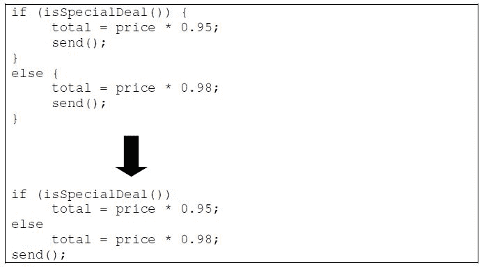

图 2。合并重复的条件片段 [1]。

## 4.6 重构步骤

1. 按照惯例，开发者从`File`菜单打开文件，并从选择文件中突出想要重构的代码部分。
2. 用户点击`Select`按钮，`QJRT`将选中代码提取到底部面板进行单独分析。
3. 开发者从`Refactoring`菜单下的下拉菜单栏选择“合并重复的条件片段”重构。
4. 选择重构方法后，`QJRT`在消息标签上显示`CDCF`重构，以展示并确认正在执行哪种重构。它还将参数传递给`QJRT`以准备`CDCF`重构。最后，它设置`Refactoring`按钮可见供用户点击。
5. 开发者点击`Refactoring`按钮，`QJRT`从底部面板获取选定的源代码并使用`AST`进行解析。`AST`验证选中代码是否为有效的`if`语句，并验证`thenStatement`和`elseStatement`中是否存在相同的片段。下一步是`QJRT`确定相同片段的位置。如果位置匹配（例如，两者都在语句块的开头；或者都在语句块的结尾），则`CDCF`提取相同片段，并根据片段的位置将其放在`if`语句的开头或结尾。
6. 在后台完成重构后，新的改进后的源代码将显示在`QJRT`的右侧面板上。原始代码被重构后的红色代码取代，并用黄色高亮以显示差异。未更改的代码仍保持黑色。带有原始代码的左侧面板保持不变。
7. 开发者现在可以选择将重构后的代码保存到新文件，或覆盖旧文件。他/她只需点击`File`菜单，并在下拉菜单中选择“另存为...”选项保存文件或替换旧文件。尽管如此，如果有疑问，开发者在覆盖原始文件的步骤之前可以简单地取消或退出整个过程。这种重构的示例在第 8 章标题“合并重复条件片段的示例输入与验证”中给出。

## 4.7 用守卫语句替换嵌套条件

`RNCGC`用​​于为读者重新排列排每个`if`语句中的一个普通条件，同时消除嵌套条件。此操作将使代码看起来更整洁，并使代码逻辑易于理解。许多软件开发者（包括我在内）在决定结果时打算使用许多嵌套的`if`语句。使用嵌套`if`语句的方法并非非法，但它确实可以被视为设计不足，或者说设计得非常糟糕。“如果方法只有一个出口会更清晰，就使用单出口；否则不要使用。” [1]

## 4.8 结构

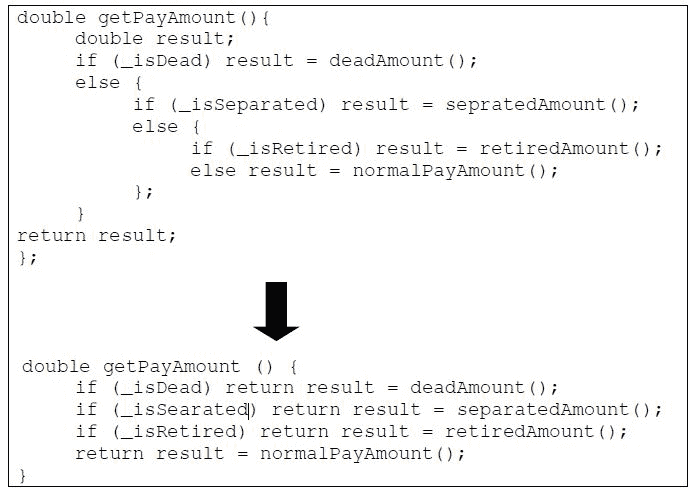

图 3。用守卫语句替换嵌套条件 [1]。

## 4.9 重构步骤

1. 开发者从`File`菜单打开文件，并从选择文件中突出想要重构的代码部分。
2. 用户点击`Select`按钮，`QJRT`将选中代码提取到底部面板进行单独分析。
3. 开发者从`Refactoring`菜单下的下拉菜单栏选择“用守卫语句替换嵌套条件”重构。
4. 选择重构方法后，`QJRT`在消息标签上显示`RNCGC`重构，以展示并确认正在执行哪种重构。它还将参数传递给`QJRT`以准备`RNCGC`重构。最后，它设置`Refactoring`按钮可见供用户点击。
5. 开发者点击`Refactoring`按钮，`QJRT`从底部面板获取选定的源代码并使用`AST`进行解析。具体而言，`AST`检查选中代码是否为有效的`if`语句。然后从顶层`if`语句到内层`if`语句，`RNCGC`分出一个由表达式和`then`语句构建的新`if`语句。
6. 在后台完成重构后，新的改进后的源代码将显示在`QJRT`的右侧面板上。原始代码被重构后的红色代码取代，并用黄色高亮以显示差异。其他未更改的代码仍保持黑色。带有原始代码的左侧面板保持不变。
7. 开发者现在可以选择将重构后的代码保存到新文件，或覆盖旧文件。他/她只需点击`File`并在下拉菜单中选择“另存为...”选项保存文件或替换旧文件。尽管如此，如果有疑问，开发者在覆盖原始文件的步骤之前可以简单地取消或退出整个过程。这种重构的示例在第 8 章标题“守卫语句替换嵌套条件的示例输入与验证”中给出。

上提方法（Pull Up Method）的定义是将相同的函数源代码从两个子类移动到父类中。这与上提字段（Pull Up Field）类似，这种重构方法的动机是消除所有子类中重复的源代码。此外，这种重构方法的用处是开发者可以降低只修改某一个方法而未修改其他方法的风险。在子类级别，很容易漏掉重复的方法，特别是当这些子类由不同的人开发时。当一个方法需要被多个实现的子类使用时，通常会使用这种重构方法。

## 5.2 结构

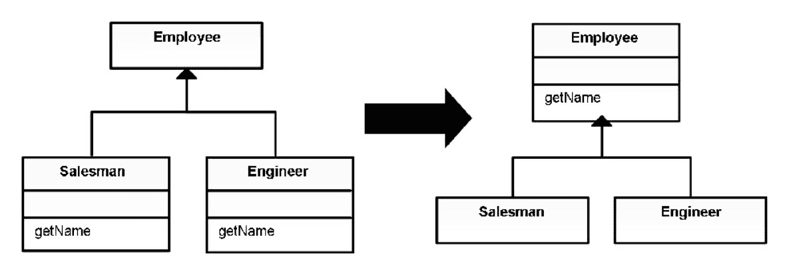

图 4. 上提方法 [1]

## 5.3 重构步骤

1. 开发者从`File`菜单中选择一个子类，并高亮其想要上提到父类的完整方法源代码。
2. 用户点击`Select`按钮，`QJRT`将选定的代码提取到底部面板进行单独分析。
3. 开发者在`Refactoring`菜单下的下拉菜单中选择`Pull Up Method`重构。
4. 选择重构方法后，`QJRT`在消息标签上显示`PUM`重构，以展示并确认正在执行哪种重构。它还将参数传递给`QJRT`以准备`PUM`重构。最后，它设置`Refactoring`按钮可见供用户点击。
5. 开发者点击`Refactoring`按钮，`QJRT`从底部面板获取选定的源代码并使用`ASTParser`对其进行解析。第一步是检查选定方法的类是否有父类，这是通过分析`AST`完成的。然后，`PUM`验证选定的代码是否为有效方法，它应该具有基本的方法签名，包括以下关键元素：修饰符、返回值、方法名、括号中的参数列表、异常列表和方法体。`PUM`从`AST`中提取这些元素的值并临时保存在内存中。然后，`QJRT`找到所选文件的根（根据当前文件位置）；沿着根路径，`QJRT`发现根目录下的所有 Java 文件，并将文件名和位置保存到`Array List`中。接下来，`QJRT`通过`AST Parser`解析每个文件，以定位当前文件的父类以及所有相关的子类。最后一步是将选定的方法添加到父类中，同时从所有子类中删除相同的方法。
6. 重构完成后，`QJRT`弹出一个窗口，允许开发者使用默认记事本程序查看修改后的文件和原始文件。
7. 此外，在`QJRT`的右面板中反映了对当前类所做的更改。底部面板显示所有受影响的父类和子类的位置。这种重构的示例在第 8 章“上提方法的示例输入与验证”标题下给出。

## 5.4 上提字段

`PUF`的定义是将字段从任何子类移动到父类中。大多数情况下，当源代码是由个人编写时，不会应用上提字段重构，但正如 Fowler [1] 所提到的，当子类由不同的开发者分别构建，或者子类通过重构被组合在一起时，就会使用上提字段。从类合并到包，子类通常具有重复的功能，而拥有相同的字段只是这些重复功能之一。

`PUF`的用处是消除了重复的数据声明；此外，虽然此操作将字段行为从子类移动到父类（类似于上提方法），它降低了只修改某一个字段而未修改其他方法的风险。

## 5.5 结构

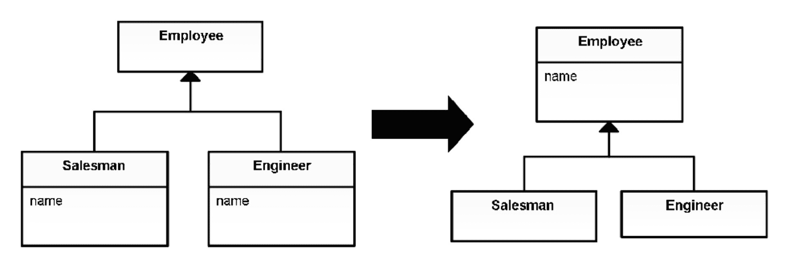

图 5. 上提字段 [1]。

## 5.6 重构步骤

1. 开发者从`File`菜单中选择包含其想要移动到父类字段的子类，然后高亮该字段。
2. 用户点击`Select`按钮，`QJRT`将选定的代码提取到底部面板进行单独分析。
3. 开发者在`Refactoring`菜单下的下拉菜单中选择`Pull Up Field`方法。
4. 选择重构方法后，`QJRT`在消息标签上显示`PUF`重构，以展示并确认正在执行哪种重构。它还将参数传递给`QJRT`以准备`PUF`重构。最后，它设置`Refactoring`按钮可见供用户点击。
5. 开发者随后点击`Refactoring`按钮，`QJRT`从底部面板获取选定的字段并使用`ASTParser`对其进行解析。第一步是检查选定字段的类是否有父类，这是通过分析`AST`完成的。然后，`PUF`验证选定的代码是否为有效字段，它应该具有基本的字段签名，包括以下关键元素：修饰符、类型、字段名、表达式。`PUF`从`AST`中提取这些元素的值并临时保存在内存中。下一步是用这些关键元素构建新字段，`PUF`额外执行的一步是将修饰符中的“private”改为“protected”：此新字段将被临时保存并提取到父类。然后，`QJRT`找到所选文件的根（根据当前文件位置）；沿着根路径，`QJRT`发现根目录下的所有 Java 文件，并将文件名和位置保存到`ArrayList`。接下来，`QJRT`通过`ASTParser`解析每个文件以定位当前文件的父类以及所有相关的子类。最后一步是将构建的新字段添加到父类中，同时从所有子类中删除该字段。
6. 重构完成后，`QJRT`弹出一个窗口，允许开发者使用默认记事本程序查看修改后的文件和原始文件。
7. 此外，在`QJRT`的右面板中反映了对当前类所做的更改。底部面板显示原始文件和修改文件的位置。这种重构的示例在第 8 章“上提方法的示例输入与验证”标题下给出。

## 5.7 下推方法

`PDM`是`PUM`的相反。其定义是将相同的函数源代码从父类移动到特定的子类。与下推字段（Push Down Field）类似，动机是消除父类中的源代码，因为只有一个子类实现了它；换句话说，该方法在特定子类中有意义，但在父类中声明。此外，下推方法使子类具有高内聚性，并通常使整个软件设计更加合理。

## 5.8 结构

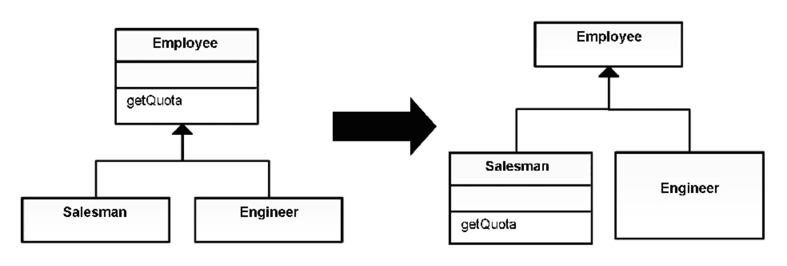

图 6. 下推方法 [1]。

## 5.9 重构步骤

1. 开发者从`File`菜单中选择一个类，并高亮其想要下推到子类的完整方法源代码。
2. 用户点击`Select`按钮，`QJRT`将选定的代码提取到底部面板进行单独分析。
3. 开发者在`Refactoring`菜单下的下拉菜单中选择`Push Down Method`。
4. 选择重构方法后，`QJRT`在消息标签上显示`PDM`重构，以展示并确认正在执行哪种重构。它还将参数传递给`QJRT`以准备`PDM`重构。最后，它设置`Refactoring`按钮可见供用户点击。
5. 开发人员点击重构（`Refactoring`）按钮，`QJRT`从底部面板获取选源代码并使用`ASTParser`对其进行解析。第一步是`PDM`验证所选代码是否为有效方法，该方法应具有基础的方法签名，包括以下关键元素：修饰符、返回值、方法名、括号中的参数列表、异常列表和方法体。`PDM`从`AST`中提取这些元素的值并临时保存在内存中。然后，`QJRT`找到所选文件的根目录（基于当前文件位置）；沿着根路径，`QJRT`发现根目录下的所有 Java 文件，并将文件名和位置保存到`ArrayList`中。接下来，`QJRT`通过`ASTParser`解析每个文件，以定位当前文件所有的子类。最后一步是将选定的方法添加到子类中，同时从父类中移除相同的方法。
6. 重构完成后，`QJRT`会弹出一个问题窗口，允许开发人员使用默认记事本程序查看修改后的文件和原始文件。
7. 此外，在`QJRT`的右侧面板中，它展示了对当前类所做的更改。底部面板清除了选定的方法，并更新受影响的父类和子类的位置。下推重构（Push Down Refactoring）的示例在第 8 章“下推方法的示例输入与验证”标题下给出。
8. `PDM`需要用户干预：用户需要检查并手动删除子类中不需要的方法。

## 5.10 下推字段（Push Down Field）

`PDF`是`PUF`的相反操作。`PDF`的定义是将一个字段从父类移动到子类。与下推方法类似，其动机是父类中的字段在某些子类中完全没有意义；换句话说，该特定字段仅在其中一个子类中才有意义。因此，没有理由在父类中保留该字段。这样做的好处是减少了父类中的代码量，并在子类中实现了高内聚的设计级方法。

## 5.11 结构

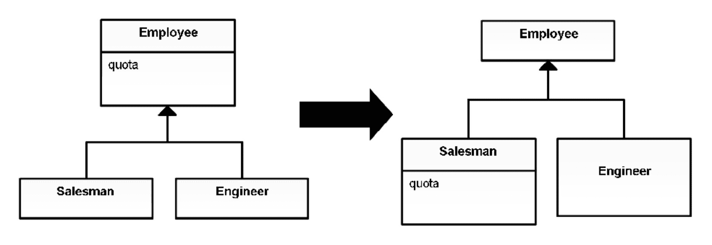

图 7. 下推字段 [1]。

## 5.12 重构步骤

1. 用户点击选择（`Select`）按钮，`QJRT`将选定的代码提取到底部面板进行单独分析。
2. 开发人员从重构（`Refactoring`）菜单下的下拉菜单栏中选择“下推字段”重构。
3. 选择重构方法后，`QJRT`在消息标签上显示`PDF`重构，以展示并确认正在执行哪种重构。它还会将参数传递给`QJRT`以准备`PDF`重构。最后，它设置重构按钮可见供用户点击。
4. 开发人员随后点击重构按钮，`QJRT`从底部面板获取选定的字段并使用`ASTParser`对其进行解析。第一步是`PDF`验证所选代码是否为有效字段，该字段应具有基础的字段签名，包括以下关键元素：修饰符、类型、字段名、表达式。`PDF`从`AST`中提取这些元素的值并临时保存在内存中。下一步是用这些关键元素构建一个新字段：这个新字段将被临时保存并提取到子类中。然后，`QJRT`找到所选文件的根目录（基于当前文件位置）；沿着根路径，`QJRT`发现根目录下的所有 Java 文件，并将文件名和位置保存到`ArrayList`中。接下来，`QJRT`通过`ASTParser`解析每个文件，以定位当前文件所有的子类。最后是将新构建的字段添加到所有子类中，同时从父类中移除相同字段。
5. 重构完成后，`QJRT`弹出一个问题窗口，允许开发人员使用默认记事本程序查看修改后的文件和原始文件。
6. 此外，在`QJRT`的右侧面板中，它反映了对当前选择类所做的更改。底部面板现在显示原始和修改后的受影响类字段的位置。下推字段重构的示例在第 8 章“下推字段的示例输入与验证”标题下给出。
7. `PDF`需要用户干预：用户需要检查并手动删除子类中不需要的字段。

# 第 6 章

## 快速 Java 重构工具 QUICK JAVA REFACTORING TOOL

快速 Java 重构工具（`QJRT`）是一个执行单独重构的可移植程序。每个重构部分都分为两部分：首先是用户交互，另一个是重构。

用户交互部分包括打开文件、选择代码和选择重构方法。重构部分包含两个模块，一个是解析和数据收集，另一个是重构和生成新代码。第一个模块是解析选定的代码，收集相关数据并将信息保存到内存；该模块还处理所有错误。第二个模块是重建源代码。该部分一旦启动就会在后台自动运行，并将新代码保存到内存或新文件中。

## 6.1 用户交互

`QJRT`的设计目标是使用最少的用户输入来重构 Java 代码。GUI（图形用户界面）包括菜单栏、工具栏和三个空白文本区域：两个文本区域位于顶部并排排列，另一个区域单独位于底部。工具栏位于顶部和底部文本区域之间。工具栏内还包含一个消息标签，用于显示选定了哪种重构，它仅在重构进行期间可见。

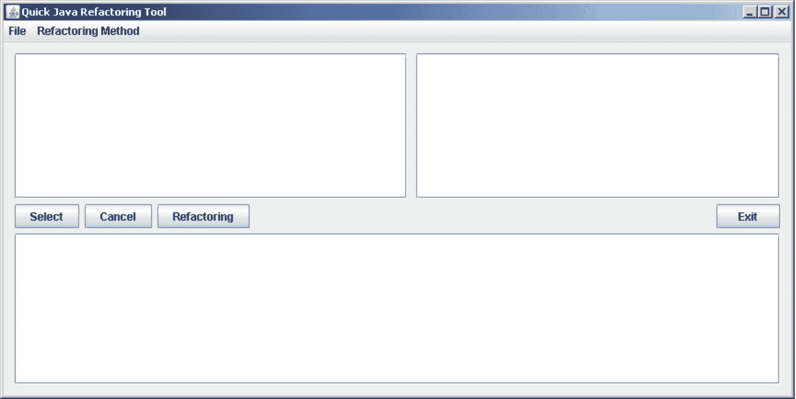

图 10。`QJRT`的初始界面。

`QJRT`的初始界面包含菜单栏和工具栏。菜单栏包含两个项目，一个是文件（`File`），另一个是重构方法（`Refactoring Method`）。工具栏有选择（`select`）、取消（`cancel`）、重构（`refactoring`）和退出（`exit`）按钮。重构按钮初始为禁用，用户选择重构方法后将可用。

图 11。`QJRT`中的重构方法选项。

图 11 显示了`QJRT`实现的重构方法。用户从此菜单选择重构方法后，会将参数传递给`QJRT`以准备当前重构。

图 12。`QJRT`中的原始代码查看器区域。

`QJRT`使用窗口文件对话框让开发人员选择要打开的 Java 文件。左上方文本区域用于显示文件中包含的 Java 代码（所示）。代码作为字符串被`QJRT`获取到本地内存中。开发人员随后高亮目标代码。点击选择按钮后，高亮的代码被复制到底部面板（所示）。选择正确的重构方法后，重构按钮变为可用（所示），用户随后点击此按钮以初始化重构过程。此时，用户交互完成。

图 13。高亮并选择代码到底部面板。

## 6.2 自动重构——数据收集

第一个模块用于解析选定的代码。`QJRT`使用 Eclipse 的`AST`（抽象语法树）[5] 作为库插件，并使用`AST`解析代码。`ASTParser`用于每次重构。详细而言，如果所选源代码是方法或字段，则使用`K_COMPILATION_UNIT`进行解析；如果所选源代码是`if`语句，则使用`K_STATEMENTS`进行解析。此外，为了验证选定的方法，使用了`K_CLASS_BODY_DECLARATIONS`。在解析源代码时，`QJRT`还会收集解析后代码的必要信息。

每次重构都使用并需要不同的算法。每个重构都是独立的文件（类），用于解析代码、根据代码收集数据并将所有必要信息存储在本地内存中。所有步骤都从`ASTParser`开始获取信息，然后传递给`QJRT`将其存储在局部变量中。相似的类具有相同的局部变量。例如，表 1 中定义的所有字段均被“字段上移（Pull Up Field）”和“字段下推（Push Down Field）”使用。

### 表 1 字段上移与字段下推重构表

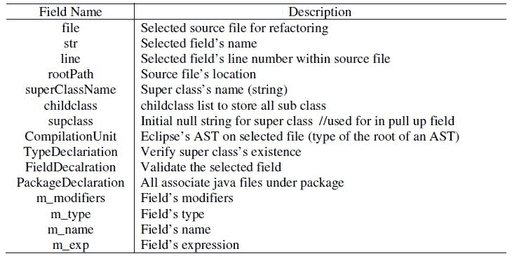

表 1 列出了字段上移和字段下推重构中使用的字段。由于松耦合，这两种重构方法是独立的文件，主要数据收集过程相似，但有一个字段（`supclass`）被专门用于字段上移重构。如文件名、字段名、起始行号、根路径等所有信息都单独存储在内存中。`File`、`str`、`line`来自用户输入，所有其他信息均从 AST 获取。此外，在重构代码时，会使用字段签名信息（`m_modifier`、`m_type`、`m_name`和`m_exp`）、`supclass`和`childclass`。

### 表 2 方法上移与方法下推重构表

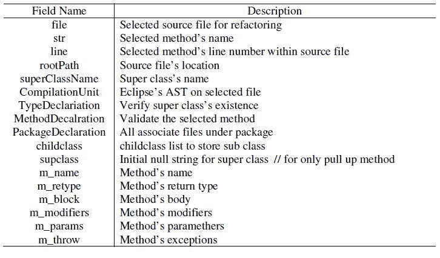

表 2 列出了方法上移和方法下推重构中使用的字段。与表 1 类似，由于松耦合，两种重构方法是独立的文件，主要数据收集相似，但有一个字段（`supclass`）被专门用于方法上移重构。文件名、字段名、起始行号、根路径等所有信息都单独存储在本地内存中。`File`、`str`、`line`来自用户输入，所有其他信息均从 AST 获取。此外，在重构代码时，会使用方法签名信息（`m_name`、`m_retype`、`m_block`、`m_modifier`、`m_params`和`m_throw`）、`supclass`和`childclass`。

### 表 3 反转条件与高级反转条件重构表

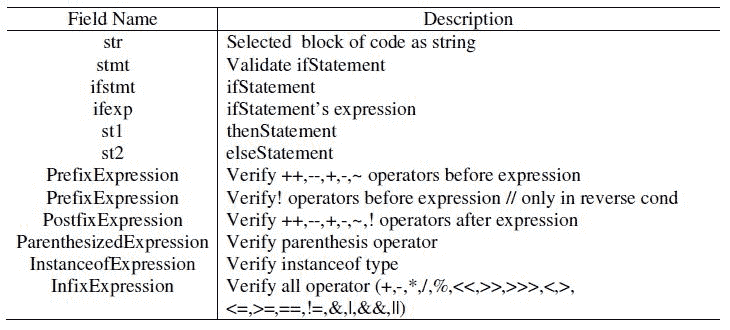

表 3 列出了反转条件和高级反转条件重构中使用的字段。两种重构方法是独立的文件，因为反转条件仅由 Fowler 和 Murphy [1, 5] 引入，他们对该主题的进阶版本进行了进一步讨论。主要数据收集相似，但在分析表达式时，高级反转条件考虑了更多条件，它们是：`PostfixExpression`、`ParenthesizedExpression`、`InfixExpression`和`InstanceofExpression`。两种重构中均使用一个字段，即`PrefixExpression`。在高级反转条件的用法中，它验证表达式前面的主要操作符；而在反转条件中，它只验证表达式前面的 NOT（`!`）操作符。`Str`来自用户输入（选定的`ifStatement`），所有其他信息均从 AST 获取。此外，在重构代码时，会使用`ifStatement`的签名信息（`st1` - `thenStatement`、`st2` - `elseStatement`、`ifexp`）。

### 表 4 合并重复条件片段重构表

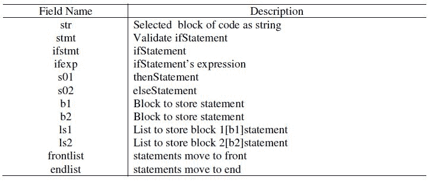

表 4 列出了合并重复条件片段重构中使用的字段。所有信息都单独存储在本地内存中。`Str`来自用户输入（选定的`ifStatements`），所有其他信息均从 AST 获取。此外，在重构代码时，会使用`ifStatement`的签名信息（`ifexp`、`ls1`、`ls2`）、`frontlist`和`endlist`。

### 表 5 合并条件表达式重构表

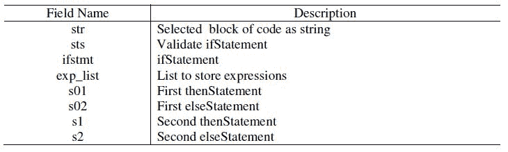

表 5 列出了合并条件表达式重构中使用的字段。所有信息都单独存储在本地内存中。`Str`来自用户输入，所有其他信息均从 AST 获取。此外，在重构代码时，会使用`ifStatement`的签名信息（`s01`、`s02`、`exp_list`、`s1`、`s2`）。

### 表 6 用守卫语句替换嵌套条件重构表

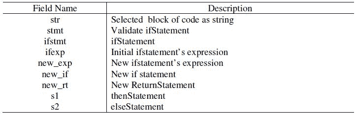

表 6 列出了用守卫语句替换嵌套条件重构中使用的字段。所有信息都单独存储在本地内存中。`Str`来自用户输入，所有其他信息均从 AST 获取。此外，在重构代码时，会使用`ifStatement`的签名信息（`s1`、`s2`、`ifexp`）、`new_exp`、`new_if`、`new_rt`。

## 6.3 自动重构 – 概述

重构的第一步是验证用户输入。第二步是检查每次重构的条件，第三步是修改并显示重构后的代码，最后，如果需要，`QJRT`会显示受影响的文件位置。步骤程序如图 14 所示。

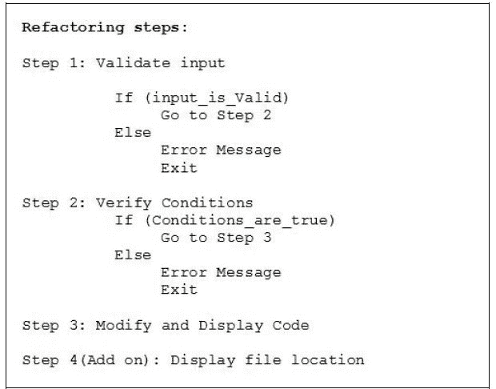

图 14 QJRT 中的重构步骤。

在步骤 2 中，条件是基于每次单独重构的要求。如果满足要求，则进入步骤 3；否则显示错误消息并结束。步骤 4 是重构过程中影响多个文件的额外步骤。例如，字段上移重构至少涉及三个不同的文件，包括用户选择的（子类）和程序获取的（父类）。在步骤 4 中，`QJRT`将底部文本区域显示文件位置。

图 15 显示文件位置的文本区域。

（文本继续）

# 第 7 章 结果

本章描述了`QJRT`的验证情况。本论文包含了 Fowler [1] 描述的三个不同重构领域（简化条件；泛化；杂项）。每个领域至少有一组测试进行演示。整个验证过程通过`QJRT`的截图呈现；某些步骤包含部分截图，而某些步骤包含 UML 图以帮助说明源代码。最后，截图显示了在`QJRT`中进行的更改，并显示了重构前后的程序输出（外部行为）是一致的。

## 7.1 合并条件表达式的输入与验证

为了测试简化条件条件的复杂逻辑，首先在合并条件表达式重构中，使用了一个名为`CCESimpleTest`的单 Java 类示例代码。该类包含一个`main`方法，带有一个打印语句用于打印双类型的值。该值由不同条件下的几个`if-statements`决定。

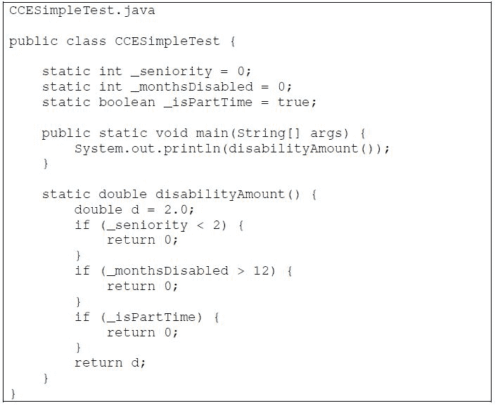

图 16 CCE 的示例代码。

### 示例输入

选择`CCESimpleTest.java`以在工具的左面板中打开。双类型内部的`ifstatement`将被合并，因为每个`if-condition`的返回值是相同的。在应用重构后，新的且改进的`if-condition`将替换旧的`if-condition`。重构前后的输出保持不变。

### 重构前的输出

![Images/image00105.jpeg)

图 17 应用 CCE 重构前的输出

### 重构过程

由于这是验证的第一个示例，该过程将尽可能详细地展示重构步骤。它将分步进行，每一步都配有一张截图。

![Images/image00106.jpeg)

图 18 打开文件。

![Images/image00107.jpeg)

图 19 源代码的左面板。

![Images/image00108.jpeg)

图 20 选择源代码的部分。

图 21. 选择对应的重构方法。

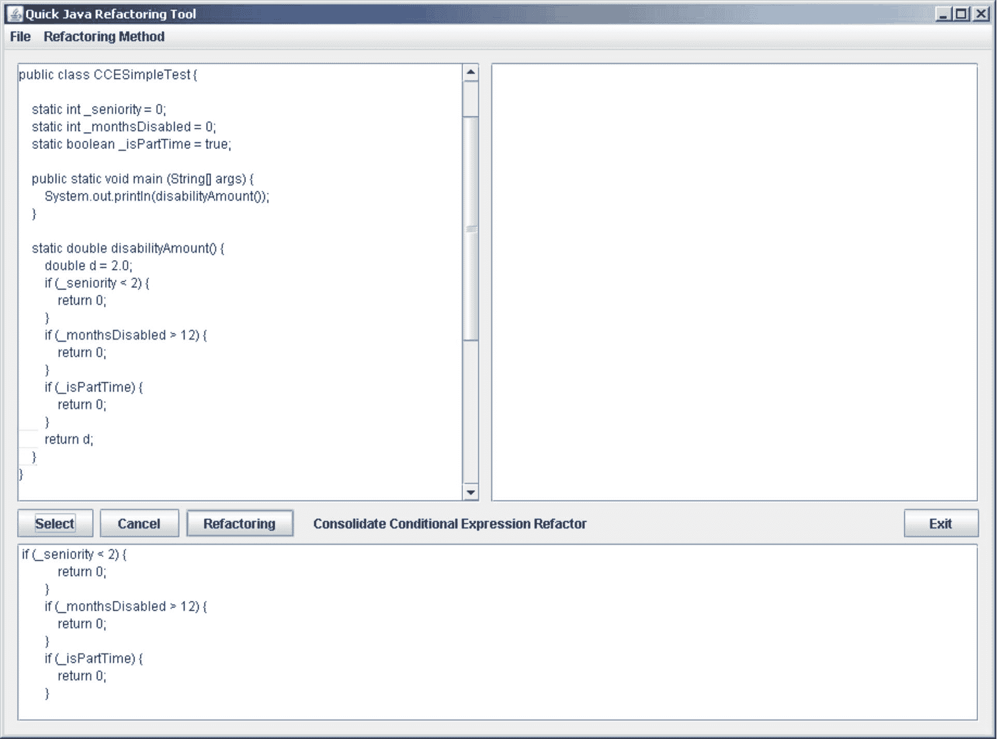

图 22. 选择重构方法后。

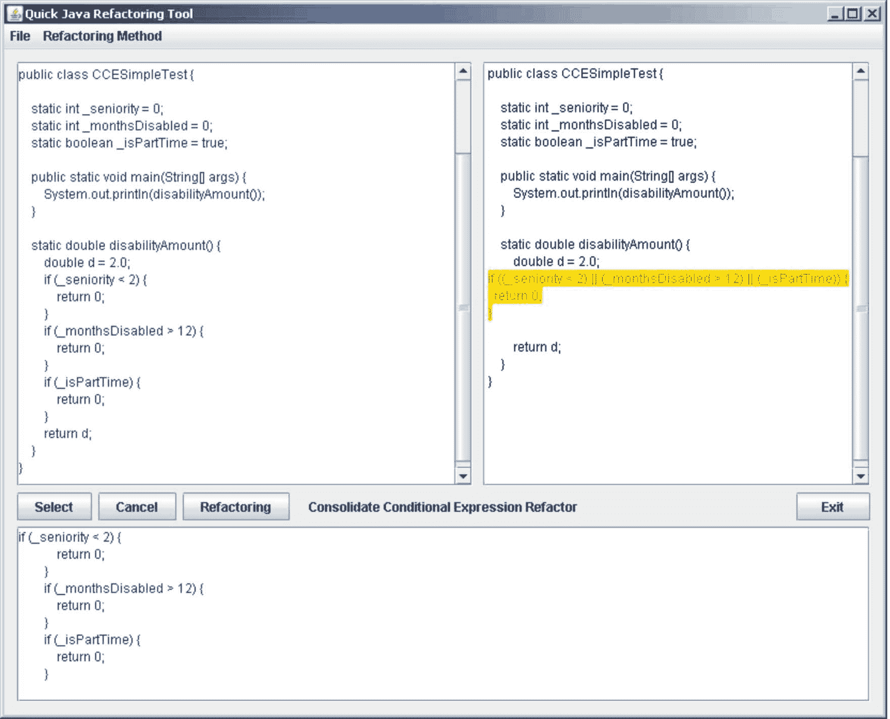

图 23. 应用重构后。

右侧面板上的上方图表显示了重构后的源代码。由于文件名与原始文件保持不变，`QJRT`没有实现重命名重构，因此重构后的类名需要手动更改为“CCEtestDone.java”，同样，类的文件名也需要进行相同的手动重命名。

### 应用重构后的输出

示例代码的输出与图 17 中列出的输出相同。应用重构之前和应用重构之后的两种输出是完全相同的。

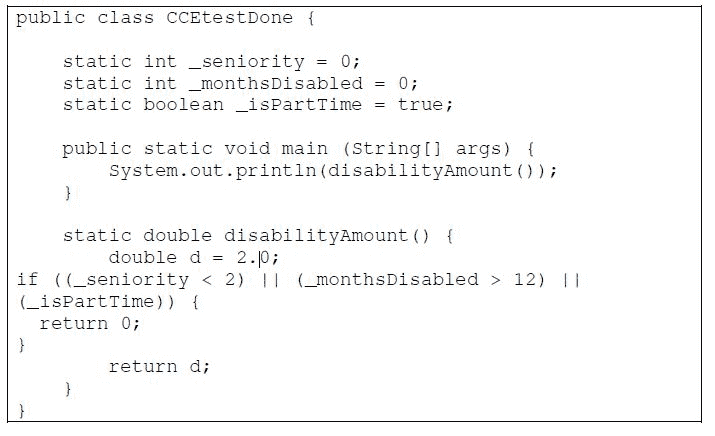

图 24. 应用重构后的源代码。

### 总结

合并条件表达式（Consolidate Conditional Expression）用于通过合并条件内部的表达式来提高代码的可读性。除了条件部分外，源代码的结构没有发生变化。Fowler 还建议在应用 CCE 重构后，对条件使用“提取方法”（Extract Method）[1]。因此，复杂的条件表达式再次被单个方法替换，从而更清晰地表达条件的目的。

## 7.2 合并重复条件片段的示例输入与验证

其次，为了测试合并重复条件片段（Consolidate Duplicate Conditional Fragments）重构，使用了一个名为“CDCFsimpleTest”的单一 Java 类示例代码。该类有一个`main`方法，包含两个 double 类型和一个 boolean 变量。代码中使用了一个`if`-语句，该语句条件由声明的布尔值决定，在`if`-语句内部存在一个相同的方法，其中`CDCF`将从`thenStatement`和`elseStatement`中提取出这个相同的方法。提取相同方法的过程就是合并重复条件片段的目的。

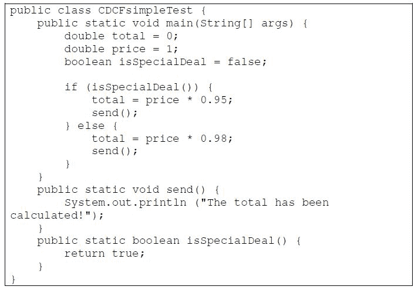

图 25. CDCF 的示例代码。

### 应用重构前的输出

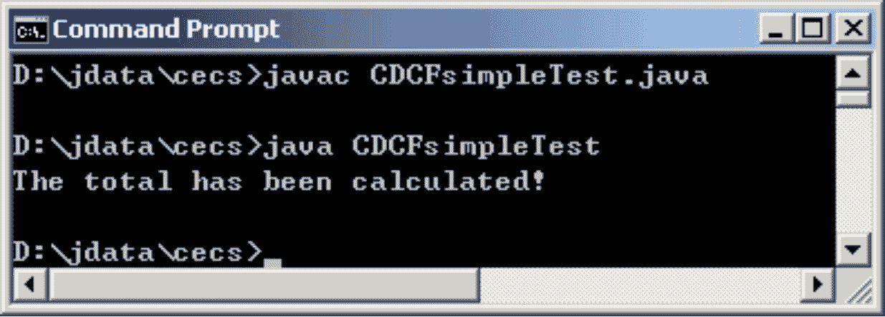

图 26. 应用 CDCF 重构前的输出。

### 示例输入

选择`CDCFsimpleTest.java`并在工具的左侧面板中打开。选中整个`if-else`语句，并将提取重复片段。应用重构后，新的且改进的`if`-语句体将替换旧的`if`-条件。应用重构之前和之后的输出保持不变。

### 重构过程

第一步是在面板中打开源代码。

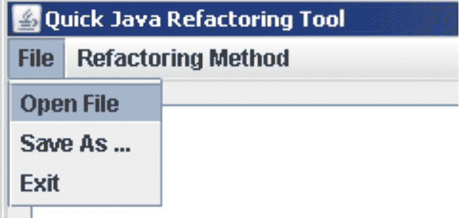

图 27. 打开用于重构的 java 文件。

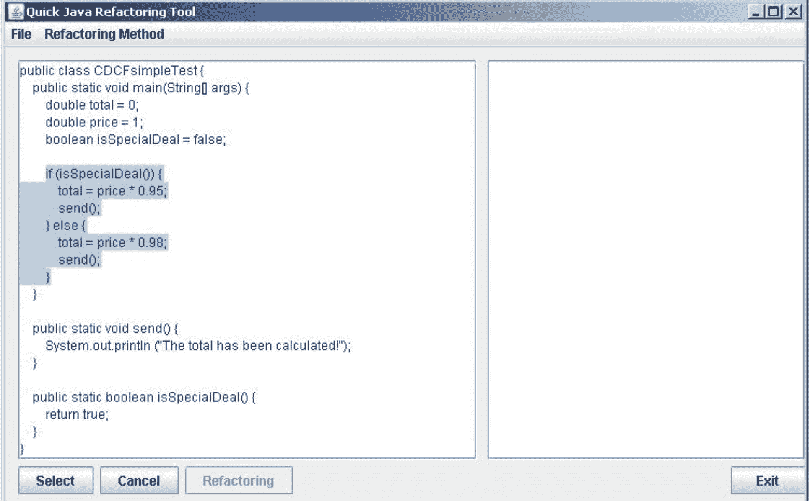

图 28. 为重构高亮源代码。

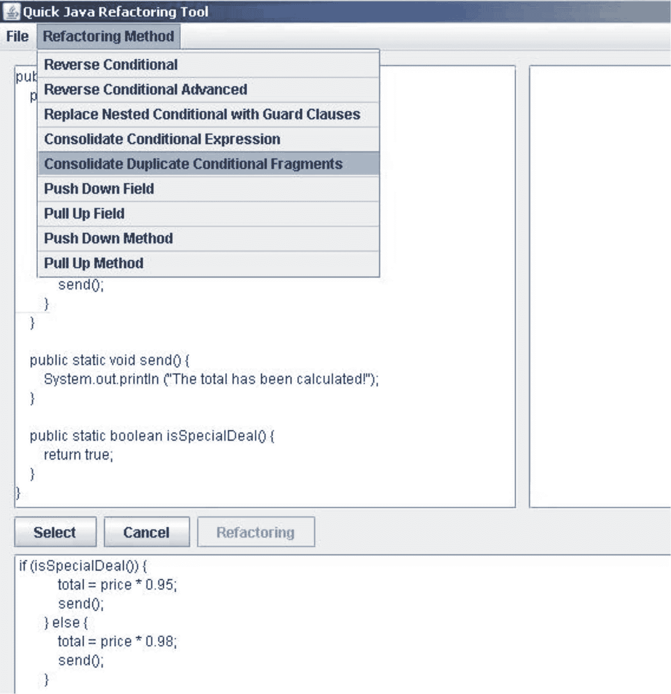

图 29. 选中高亮代码并选择`CDCF`。

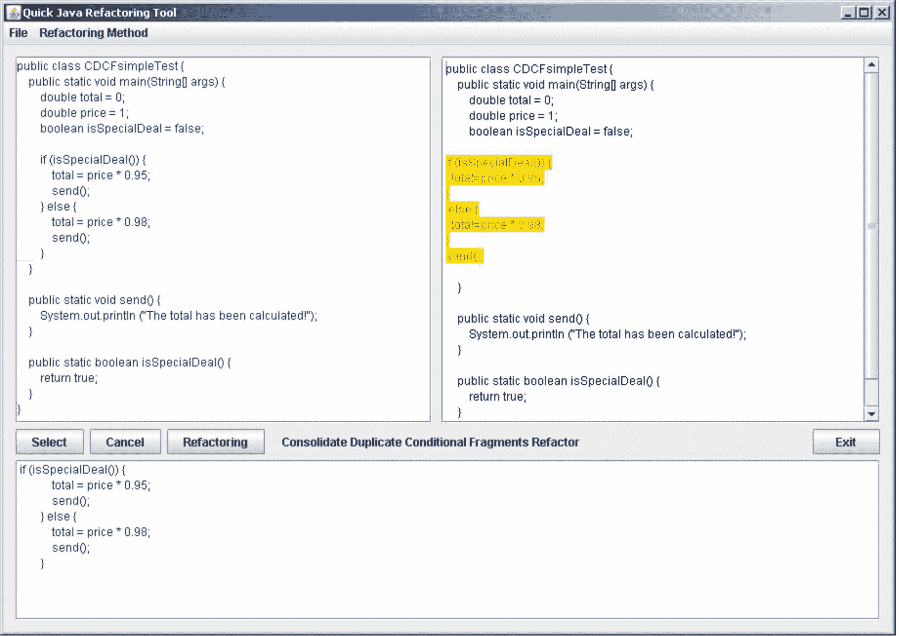

图 30. 应用 CDCF 重构后。

右侧面板上的上方图表显示了重构后的源代码。必须将其保存为新文件名“CDCFtestDone.java”，并相应地手动更改类名。

### 应用重构后的输出

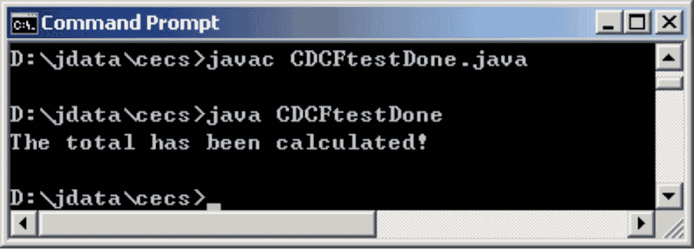

图 31. 应用 CDCF 重构后的输出。

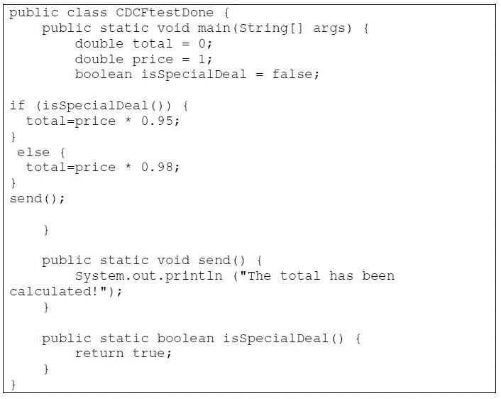

图 32. 应用重构后，名称已手动更改。

### 总结

合并重复条件片段（Consolidate Duplicate Conditional Fragments）用于消除重复代码。它使得源代码更加整洁。除了条件外，源代码的结构没有变化。此外，在`if`-语句体内部，逻辑更加直观且代码量更少，这意味着出错的概率更低。最后，这种重构使得条件更加清晰。

## 7.3 用守卫语句替换嵌套条件的示例输入与验证

最后，在“简化条件表达式”的“用守卫语句替换嵌套条件”（Replace Nested Conditional with Guard Clauses）下，使用的示例代码是一个名为“RNCGC simpleTest”的单一 Java 类。该类有一个`main`方法用于打印 double 值，该 double 值由几个嵌套的`if`-语句决定，每个语句都由一个不同的布尔值决定。`RNCGC`的目的是将嵌套条件简化为一组平铺显示的结果列表。

将更改示例源代码中三个布尔变量的值以彻底测试重构。结果是，程序将显示四种不同的输入和输出。第一组输入发生在三个布尔值中的任意一个为 true 时，这将返回对应的 double 值。第二组输入发生在所有布尔值都为 false 时，将返回默认值。

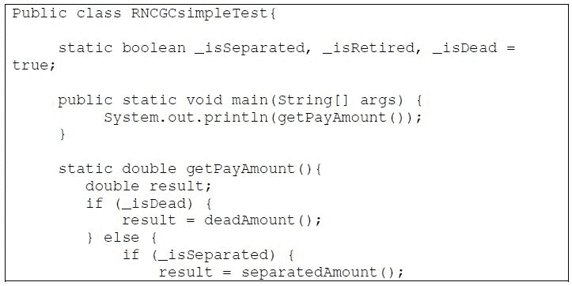

图 33. RNCGC 的示例代码。

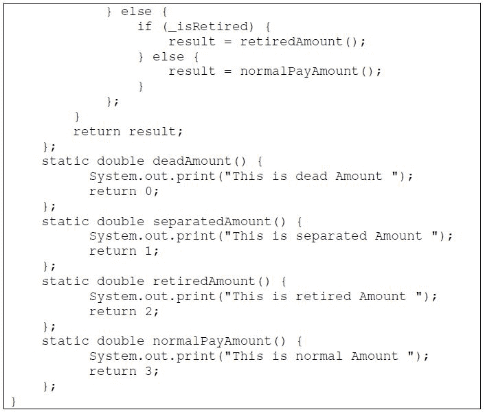

图 34. RNCGC 的示例代码（续）。

### 应用重构前的输出 1

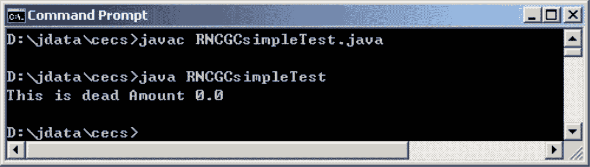

图 35. 当`_isDead` = true 时的输出 1。

### 应用重构前的输出 2

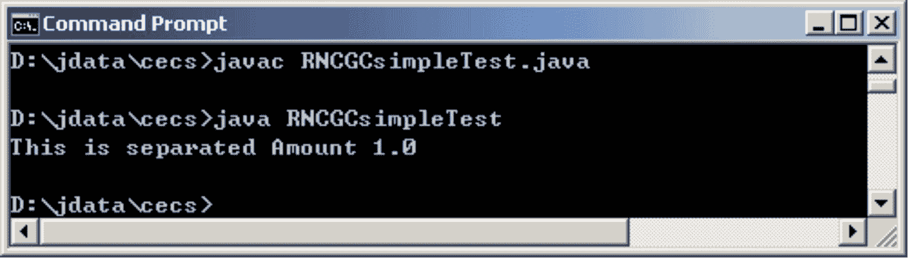

图 36. 当`_isSeparated` = true 时的输出 2。

### 应用重构前的输出 3

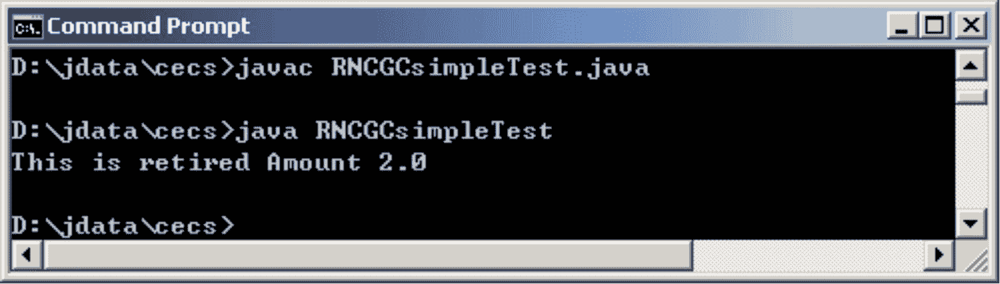

图 37. 当`_isRetired` = true 时的输出 3。

### 应用重构前的输出 4

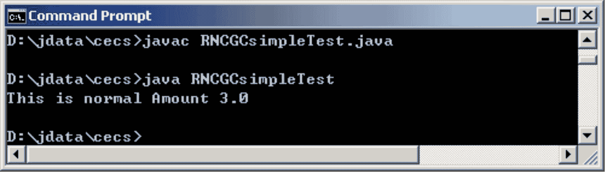

图 38. 当所有布尔值均为 false 时的输出 4。

### 示例输入

选择`RNCGC simpleTest.java`并在工具的左侧面板中打开。选中嵌套的`if-else`语句。应用重构后，新的且改进的`if-else`语句将替换旧语句。应用重构之前之后的输出保持不变。

### 重构过程

第一步是在面板中打开源代码。

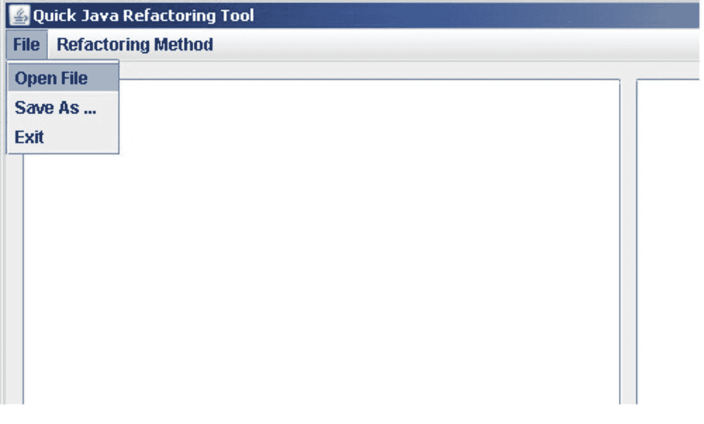

图 39. 打开用于重构的 java 文件。

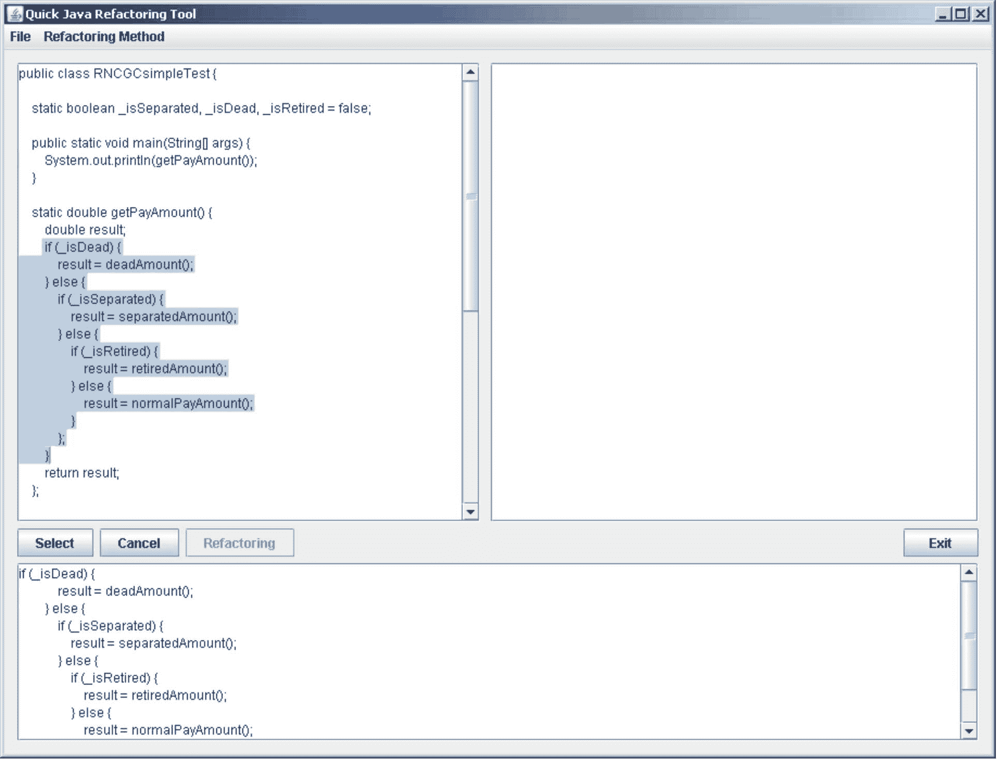

图 40. 为重构高亮源代码。

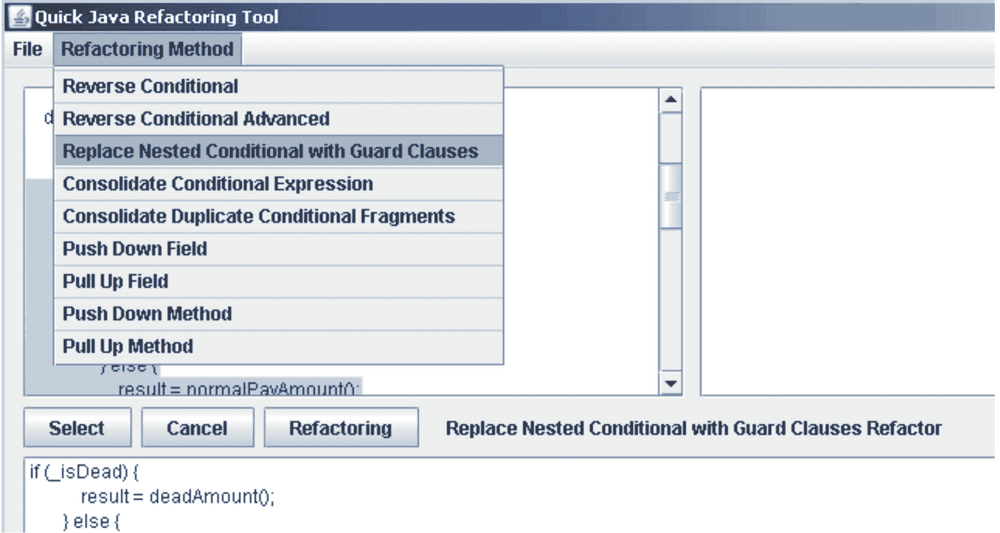

图 41. 选择对应的重构方法。

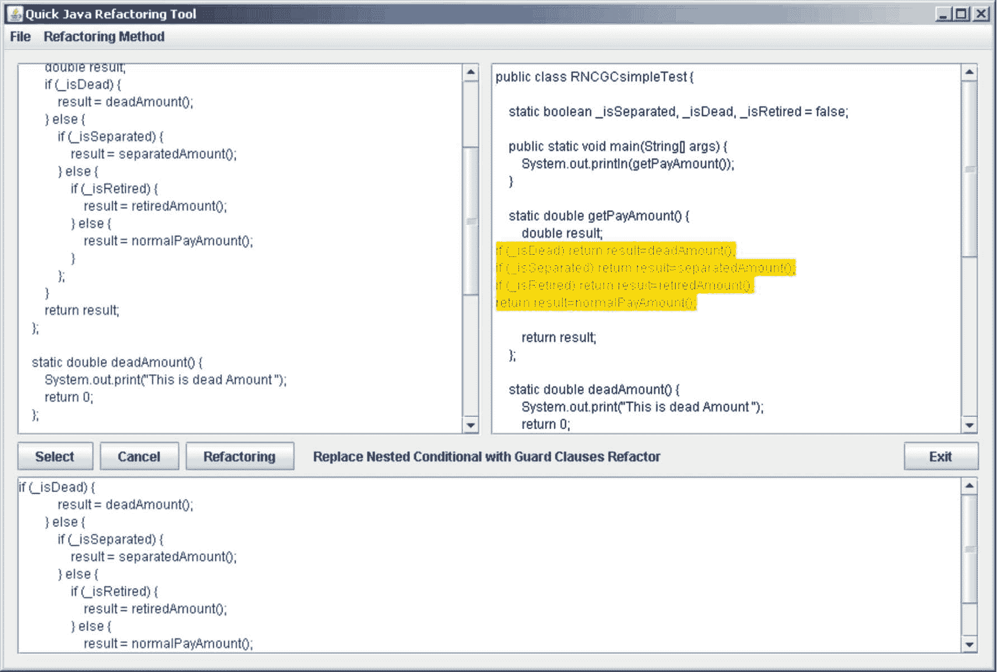

图 42. 应用 RNCGC 重构后。

右侧面板上的上方图表显示了重构后的源代码。必须将其保存为新文件“RNCGCtestDone.java”，并相应地需要手动更改类名。

![Images/image00131.jpeg)

图 43. 手动更改名称后的重构源代码。

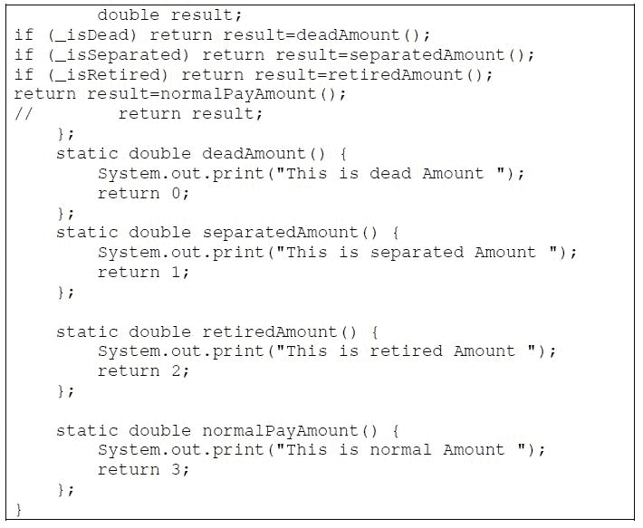

图 44. 手动更改名称后的重构源代码（续）。

### 应用重构后的输出

图 45. 应用 RNCGC 重构后默认 boolean = false 的输出。

### 总结

用守卫语句替换嵌套条件（RNCGC）用于以直观的方式对条件逻辑进行排序。现代语言中“单一入口出口”的规则并不有用。清晰性比任何事情都重要 [1]。当所有条件相等时，没有理由让某一个条件比其他条件更重要。此外，条件的不平衡权重可能会误导读者。应用 RNCGC 重构后，整个源代码的结构保持不变，但条件结构已改变，以平等对待不同的条件。结果是`if`-语句的逻辑变得更加清晰。最后，RNCGC 等地展示了源代码的条件。

## 7.4 提取字段的示例输入与验证

为了在“处理泛化”下测试`Pull Up Field`（向上提取字段）重构，至少使用了三种不同的源代码；其中至少有一个类是父类，两个子类。使用了`Car.java`、`Vehicle.java`、`Truck.java`和`VehicleTest.java`来测试`Pull Up Field`重构。`Vehicle.java`是父类，`VehicleTest.java`包含用于测试继承类`Vehicle.java`的主方法。在`Car.java`和`Truck.java`类中，有一个名为`wheels`的相同实例变量，其值设置为整数 4。这就是需要向上提取的字段。在父类`Vehicle`内部，有两个字段：一个字段名为`seats`，其公共值设置为整数 2；另一个字段名为`doors`，其值分别通过`Vehicle`的构造函数设置为整数 3。

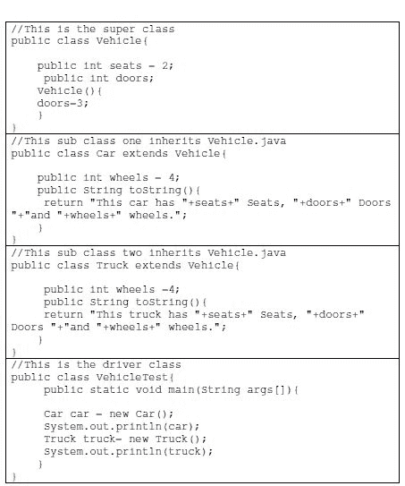

图 46. 向上提取字段和向下移动字段（Push Down Field）的示例代码。

### 应用重构前的类图

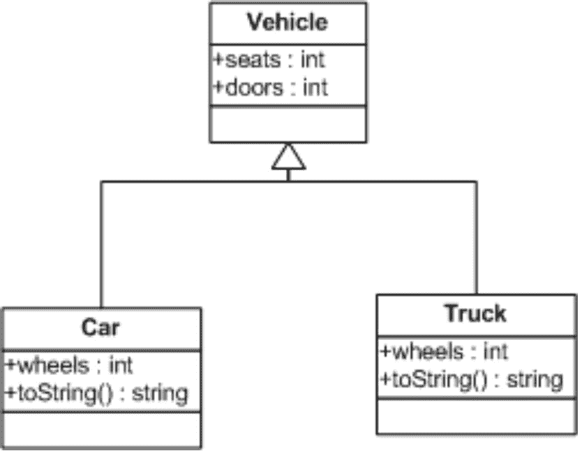

图 47. 应用向上提取字段重构前的类图

### 应用重构前的输出

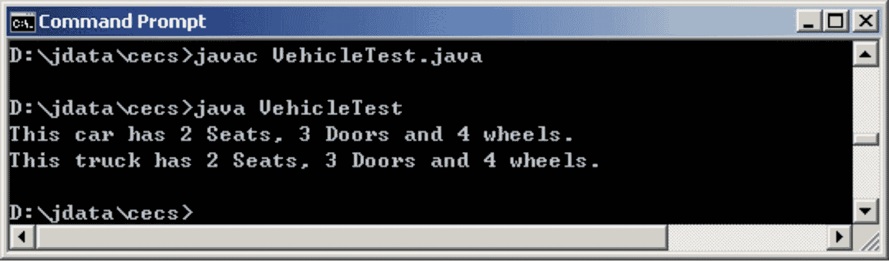

### 应用重构前的文件位置

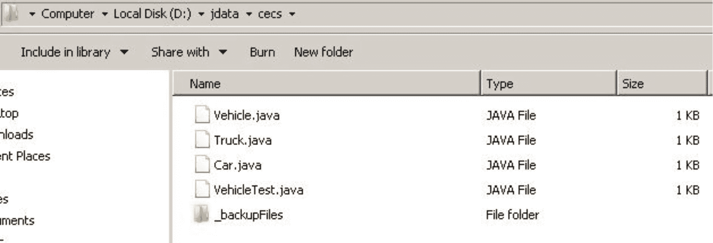

图 48. 应用向上提取字段重构前硬盘上的所有文件。

### 示例输入

选择`Car.java`在工具的左侧面板中打开。选择字段`wheels`进行重构。

### 重构过程

第一步是在面板中打开源代码，并高亮显示该字段。

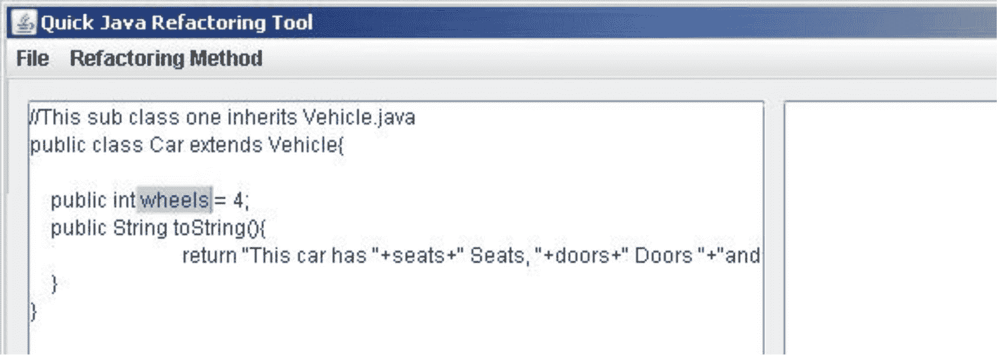

图 49. 为向上提取字段高亮字段。

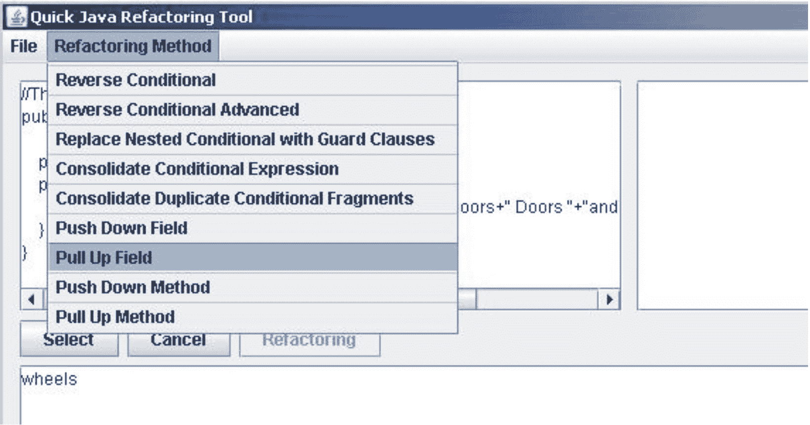

图 50. 选择 PUF 重构。

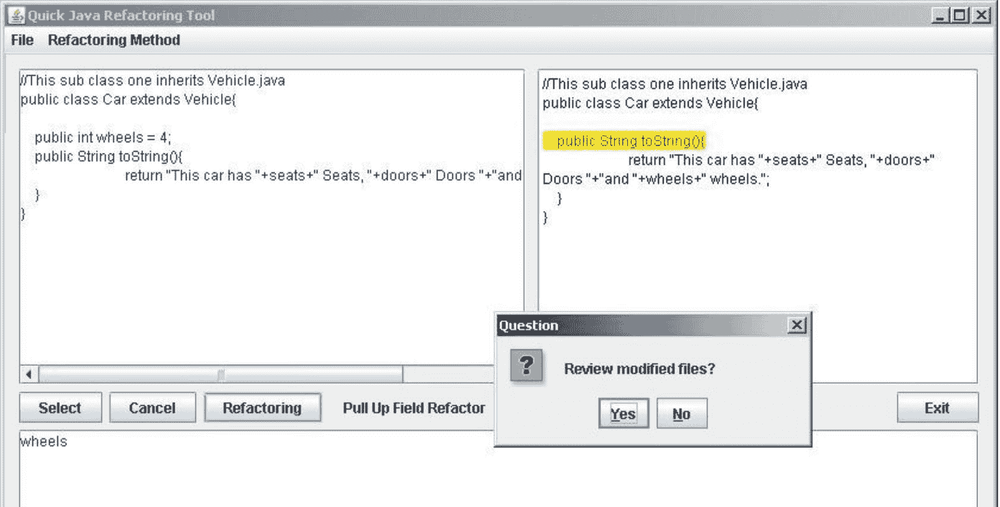

图 51. 应用 PUF 重构后在查看修改文件之前的界面。

上图是应用 PUF 的截图。右侧面板如往常一样显示当前修改的类。此外，会弹出一个窗口，询问开发者是否要检查修改后的文件，默认打开修改文件的程序为`notepad++`，默认位置为`C:\Program Files\Notepad++notepad++.exe`。如果没有安装`notepad++`，开发者将需要自行打开文件。这种重构方法会在后台更改相关文件。所有更改过的文件在同一目录下都有一个备份文件。

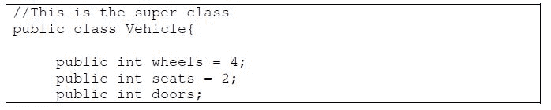

图 52. 应用 PUF 重构后的源代码。

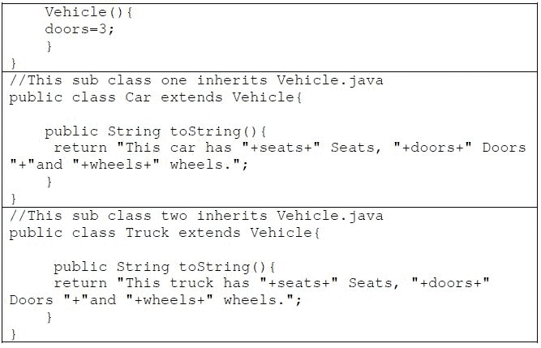

图 53. 应用 PUF 重构后的源代码（续）。

### 应用重构后的文件位置

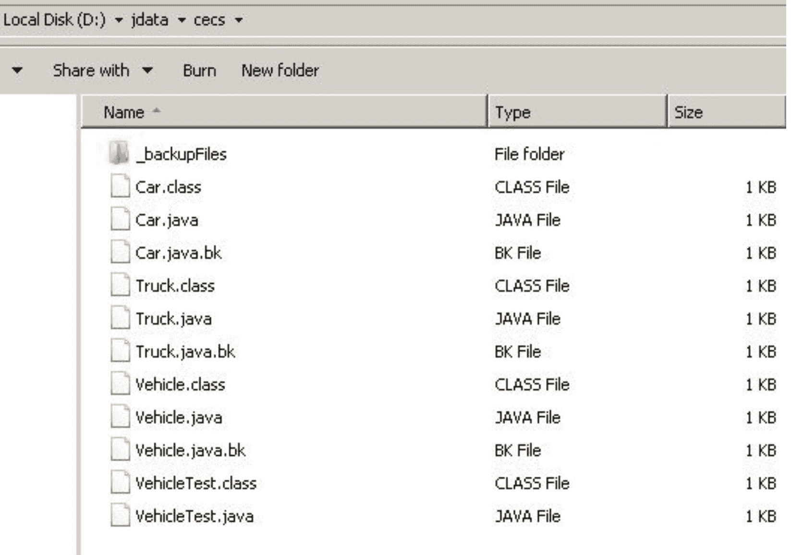

图 54. 应用 PUF 重构后代码的文件位置。

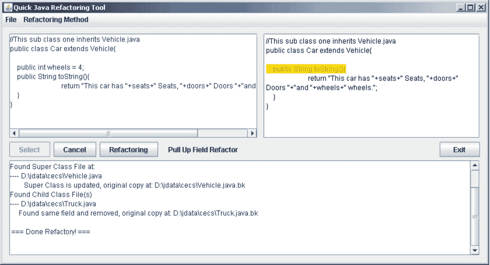

图 55. 消除弹出窗口后的截图。

上图是执行重构后的截图，以及在决定是否检查修改文件后的界面。底部面板显示了父类和子类的详细信息。此外，显示了文件位置，包含所有原始文件和所有更新文件的详情，以及原始文件的备份。

### 应用重构后的输出

示例代码的输出与图 48 中列出的输出相同。应用重构前和应用重构后的输出是完全相同的。

### 应用重构后的类图

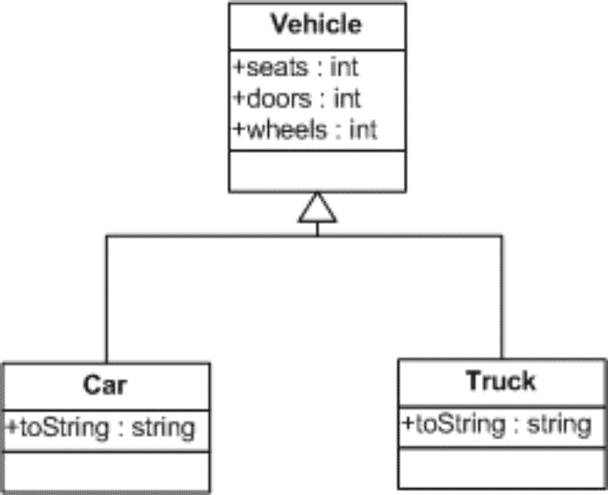

图 56. 应用 PUF 重构后的类图

### 总结

`Pull Up Field` 用于减少在不同子类中开发的重复字段。源代码的结构发生了变化，但输出保持不变。通常情况下源代码更具内聚性。在父类中可以重用更多字段是重构的目标之一——可用性。此外，如果字段是私有的，在`Pull Up Field`重构后，由于父类中的继承，字段的修饰符将改为`protected`。最后，`Pull Up Field`重构使父类更具通用性且更容易使用。

## 7.5. 向下移动字段（Push Down Field）的示例输入与验证

为了测试`Push Down Field`重构，使用了之前提供的源代码。父类的字段将被向下推送到两个子类。具体而言，`Vehicle.java`中的`seats`将向下推到`Car.java`和`Truck.java`类中。

应用重构之前，类图、输出和文件位置都是相同的，因为这涉及循环利用之前的源代码。在`Push Down Field`重构之前重置了文件位置。

### 示例输入

选择`Vehicle.java`在工具的左侧面板中打开。选择字段`seats`进行重构。

### 重构过程

第一步是在面板中打开源代码，并高亮显示该字段。

FIGURE 57. 为向下移动字段重构高亮字段。

FIGURE 58. 选择 PDF 重构。

FIGURE 59. 应用 PDF 重构后在查看修改文件之前的界面。

上图是应用 PDF 的截图。右侧面板如往常显示当前修改的类。此外，弹出窗口请求开发者检查修改后的文件。FIGURE 60. 应用 PDF 重构后的源代码。fig22.PNG

### 应用重构后的文件位置

由于重构期间涉及三个类，文件位置与图 55 相同。

FIGURE 61. 应用 PDF 并关闭窗口后的截图。上图是执行重构后的截图。底部面板显示了原始和修改文件的详细信息。

### 应用重构后的输出

示例代码的输出与图 48 列出的输出相同。

### 应用重构后的类图

FIGURE 62. 应用重构后的类图。

### 总结

`Push Down Field`用于减少父类中的字段。源代码结构发生了变化，但我们的输出没有变化。父类需要关注的字段减少了。通过在`Car.java`或`Truck.java`中移除移动后的字段并相应修改源代码，程序将无错误运行。最后，PDF 使继承类更加松耦合，这是面向对象编程的一个重要特性。

## 7.6. 向上提取方法（Pull Up Method）的示例输入与验证

为了测试`Pull Up Method`重构，测试文件的条件与`Pull Up Field`重构相似。至少使用了三种不同的源代码。一个类是父类，两个是子类。使用了`Automobile.java`、`FamilyCar.java`、`SportsCar.java`和`AutoTest.java`。`Automobile.java`是父类，`AutoTest.java`包含用于测试自`Automobile.java`类的主方法。`SportsCar.java`和`FamilyCar.java`继承`Automobile.java`。在`FamilyCar.java`和`SportsCar.java`类中有四个相同的方法。需要向上提取的方法是`showEngine()`，为了让`showEngine()`正常工作，还需要两个方法。这两个方法是`getType()`和`getSpeed()`。在父类中展示了另一个方法，它是用于向下移动方法测试目的，目前与向上提取方法无关。

FIGURE 63. PUM 和 PDM 的示例代码。

FIGURE 64. PUM 和 PDM 的示例代码（续）。

### 应用重构前的类图

# 重构前的文件位置

图 65。在应用 PUM 之前硬盘上的所有文件。

### 重构前的输出

图 66。应用 PUM 之前的输出。

### 示例输入

选择`FamilyCar.java`并在工具的左侧面板中打开。

### 重构过程

第一步是在面板中打开源代码，并分析需要上提（pull up）的方法。`showEngine()`调用了两个方法；这些是`getType()`和`getSpeed()`。为了在应用重构后能够正常工作，这两个方法需要与`showEngine()`位于同一个类中，且不显示引用对象。因此，必须对`getType()`和`getSpeed()`执行上提方法（Pull Up Method）。

图 67。高亮显示上提的`getSpeed()`方法。

图 68。选择 PUM 重构。

图 69。在`getSpeed()`上应用 PUM 之后、查看修改文件之前。

这一步与之前的字段操作类似，右侧面板显示当前修改的类。弹出窗口询问开发者是否立即查看修改后的文件。这种重构方法会在后台更改相关文件。所有修改后的文件在相同目录下都有一个备份文件。在继续后续之前，开发者应该执行程序，通过使用相同的步骤确保它仍正常运行，并逐个对`getType()`和`showEngine()`方法进行重构。最终输出与应用重构之前相同。

图 70。应用 PUM 重构后的源代码。

图 71。应用 PUM 重构后的源代码（续）。

# 重构后的文件位置

图 72。应用 PUM 重构后的截图。

上面的图是重构后以及决定是否查看修改文件后的截图。底部面板显示了父类和子类的详细信息。此外，展示了文件位置，包含所有原始文件和所有更新文件的详细信息，以及原始文件的备份。在这种情况下，备份文件是在对`showEngine()`执行上提方法之前的文件。

# 重构后的输出

示例代码的输出与图 68 中列出的输出相同。应用重构之前和之后的输出是完全一致的。

### 重构后的类图

图 73。应用 PUM 后的类图。

### 总结

上提方法类似于上提字段（Pull Up Field）。目的是减少在不同子类中开发的重复方法。源代码的结构发生了变化，但输出保持不变。父类更具内聚性，拥有更多可以重用或继承的方法。这是面向对象编程（OOP）的良好特性之一——重用性。最后，PUM 清除了子类。

## 7.7. 下推方法的示例输入与验证

为了测试下推方法（Push Down Method）重构，重用了之前的上提方法源代码。`onSalePrice()`方法是父类方法，因为之前是假期，每辆汽车都在促销。然而，场景是由于开学季，跑车正在以折扣价出售，但家用车恢复了原价。因此，专门针对跑车的父类方法仅对跑车有意义。没有理由将其保留在父类中。将此方法下推到跑车类中是最佳选择。

在应用重构之前，类图、输出和文件位置都是相同的，因为重用了之前的源代码。在执行下推方法重构之前，文件位置会被清除。

### 示例输入

选择`Automobile.java`并在工具的左侧面板中打开。选择`onSalePrice`方法进行重构。

### 重构过程

第一步是在面板中打开源代码，并高亮整个方法。

图 79 是应用 PDM（下推方法）的截图。右侧面板如常一样显示当前修改的类。相同的弹出窗口请求开发者查看修改后的文件。

图 74。高亮显示要下推的方法。

图 75。选择 PDM 重构。

图 76。应用 PDM 重构之后、查看修改文件之前。

图 77。应用 PDM 重构后的截图。

图 80 是执行重构并关闭弹出窗口后的截图。底部面板显示了原始文件和修改文件的详细信息。

### 重构后的类图

图 78。应用下推方法重构后的类图。

开发者在执行修改后的源代码之前需要分析程序。意图是将`onSalePrice`方法仅下推到`SportsCar`类，但结果是该方法出现在两个子类中。因此，需要手动删除`FamilyCar.java`中的该方法。驱动类需要反映这些变化。

图 79。应用 PDM 后的源代码。

图 80。应用 PDM 后的源代码（续）。

图 81。应用 PDM 后的源代码（续）。

# 重构后的输出

图 82。应用 PDM 后的输出。

# 重构后的文件位置

文件位置与图 74 相同，因为重构涉及相同的三个类。

### 总结

下推方法用于将行为从父类移动到特定的子类。源代码的结构发生了变化，输出变得如预期所示。父类少了一个需要关注的方法。通过简单删除子类中多余的方法，程序运行良好。最后，PDM 使特定子类高度内聚，这是高质量面向对象编程的特征之一。

## 7.8. 反转条件的示例输入

最后，为了测试反转条件重构，使用的是一个名为`RcTest.java`的单个 Java 类。该类有一个包含两个原始类型的 main 方法。它包含了两个 if 语句。if 语句的条件通过将每个原始类型与一个常量整数进行比较来确定。过程是将条件取反，然后交换`thenStatement`和`elseStatement`。

图 83。RC 的示例代码。

### 重构前的输出

图 84。应用重构前的输出

### 示例输入测试 1

选择`RcTest.java`并在工具的左侧面板中打开。选择整个 if-else 语句。应用重构后，改进后的 if-else 语句体将替换旧的 if-else 条件。应用重构之前和之后的输出将是相同的。

### 重构过程

第一步是在面板中选择`RcTest.java`，并选择用于反转条件的整个负向 ifelse 条件语句。

图 85。高亮显示用于重构的 if-else 语句。

图 86。应用 RC 重构之后。

右侧面板上的图 89 显示了重构后的源代码。如果需要，`QJRT`具有保存修改文件的选项。这意味着原始文件不会像之前的重构那样自动保存。我们将修改后的文件保存为`RcTestDone.java`，并相应地编辑类名。

图 87。`QJRT`中的保存选项。

### 应用重构后的输出

示例代码的输出与图 87 列出的输出相同。在应用重构之前和之后，两个输出是完全相同的。

## 示例输入测试 2

当选择非负的 if 条件时，将出现此输入，`QJRT`将报告错误。使用了相同的源文件，但选择了正向的 if-else 条件语句进行测试。

## 重构过程 – 带有错误报告

第一步是在面板中打开源代码，选择整个正向 if-else 语句进行“条件反转（Reverse Conditional）”。图 92 显示了当选定的 if 语句条件未初始化为负数时的错误信息。

图 88。为重构高亮整个 if-else 语句。

图 89。点击 RC 重构后。

### 总结

条件反转用于使条件更有意义。开发者意图将条件反向排列，但实际上在大多数情况下，RC 的结果可能更好。因此，这种重构使源代码更容易理解，可读性更好。此外，这种重构限制了从正向条件到负向条件的更改。

## 7.9 条件反转进阶示例输入与验证

为了测试“条件反转进阶（Reverse Conditional Advance）”重构，使用了具有各种 ifelse 语句的源代码。条件表达式包括：带括号的、`Instanceof`和中间表达式。此外，中间表达式包括小于、大于、小于等于、大于等于、等于、不等于等。每个 if-else 语句都被单独选中进行重构。

### 示例输入

选择`RcaTest.java`在工具的左侧面板打开。

图 90。在 RCA 上测试的源代码。

图 91。在 RCA 上测试的源代码（续）。

图 92。在 RCA 上测试的源代码（续）。

### 应用重构前的输出

图 93。应用重构前的输出。

### 重构过程与结果

在面板中打开源代码，然后高亮整个第一个 if 语句以测试带括号的表达式。

图 94。选择源代码并选择重构方法。

### 应用重构后的结果

图 95。应用 RCA 后的截图。

对具有相同源代码的其他表达式应执行相同的步骤。结果如下：

图 96。对所有条件应用 RCA 的截图。

图 97。对所有条件应用 RCA 的截图（续）。

图 98。对所有条件应用 RCA 的截图（续）。

### 应用重构后的输出

示例代码的输出与图 96 列出的输出相同。在应用重构之前和之后，两个输出是完全相同的。

### 总结

条件反转进阶是条件反转重构的扩展版本。源代码的结构和应用重构后的输出保持不变。

# 第 8 章

## 结论与未来改进

本论文总共实现了九种重构。其中七种重构已发表在 Fowler 的书中 [1] 中，另外两类在 Fowler 的网站 [4] 上被提及。`QJRT`使用`Eclipse AST`来解析源代码。使用`QJRT`时只需要少量的人为交互。

逐步重构的实现为用户提供了直观的视图。在大多数情况下，原始和重构后的源代码并排显示；如果系统没有安装默认的`notepad++`或用户未使用基于 Windows 的系统，`QJRT`会为用户提供源文件的绝对路径。消除键盘输入有助于减少人为错误；最后，重构是软件维护的一部分，不引入另一个人为错误至关重要。

## 未来工作

`QJRT`需要极少的用户界面来进行重构。用户界面（UI）非常直观；开发者不需要花费大量时间就能流畅地使用。`QJRT`的可移植性允许其下载并实时重构任何代码。此外，程序会清理源代码以提高可读性，并改进源代码的结构。更重要的是，输出不受影响。在本文论文中，我简化了一种重构：将嵌套条件替换为守卫语句（guard clause），它仅处理 if-else 条件语句层级，但实际上它可以扩展到方法调用层级。

`QJRT`每次只实现一种重构；然而，某些复杂的重构需要多个其他重构共同工作来实现目标。

## 参考文献

（注：参考文献部分通常不翻译，此处保留原文格式）

[13] Y. Tian, M. Nagappan, D. Lo, A. E. Hassan, "高评分应用具有哪些特征？基于免费 Android 应用程序的案例研究", 软件维护与演进国际会议, 2015.

[14] C. Couto, P. Pires, M. T. Valente, R. Bigonha, N. Anquetil, "通过因果测试预测软件缺陷", 系统与软件杂志, 第 93 , 2015.

[15] A. Hora, A. Etien, N. Anquetil, S. Ducasse, M. T. Valente, "APIEvolutionMiner: 控制 API 演进", 软件维护、重构与反向工程工程 (CSMR-WCRE) 2015 软件演进周-IEEE 会议。
