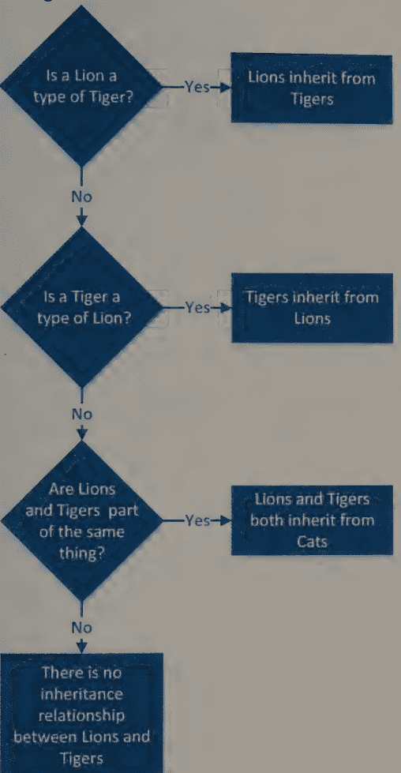
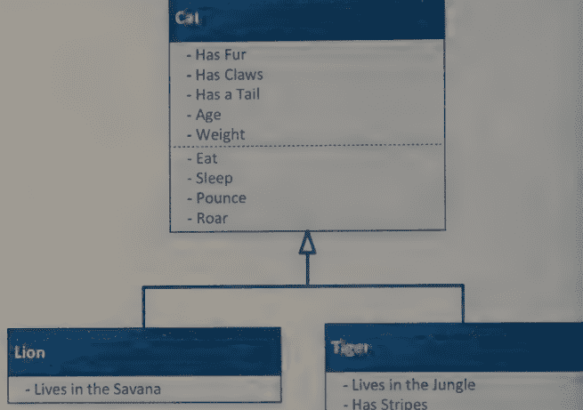
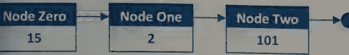
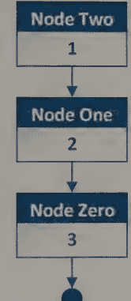

# Java 编程世界

## 引言

在我们今天生活的这个世界里，技术是不同工作和生活方式日益增长的因素和影响。人们使用手机和电脑处理日常任务，公司运行数据库来跟踪所有的数据；这一切都源于代码。

代码被视为当今社会所有运行功能的基础，它可以是从人类代码（DNA）到创建高端软件代码的任何形式。在一个技术变得越来越重要的世界里，理解这一新方向并可能参与其发展是至关重要的。

万物皆始于开始。当你第一次打开这本书时，你将发现一场冒险，它将引导你穿过名为 Java 的编程语言的基础知识，一直带你学会使用 Java 创建图形用户界面（GUI）。你将经历的冒险是一次尝试、错误、学习的过程，最重要的是，它将为你提供理解未来发展方向的经验和基础。

在阅读本书的过程中，我们准备了示例、示例代码、问题和图像，这些都将在你的旅程中提供帮助。我们希望你的这段之旅是成功的，并祝你在成为程序员的道路上好运！

## 第一章：Hello World

### 什么是 Java

我们周围几乎的一切都由某种类型的程序运行。从汽车到洗碗机，几乎每台设备都内置了计算机。但什么是程序，什么是计算机？

在计算机科学中，计算机是任何可以存储和处理数据的设备。在传统的电子计算机中，数据存储在两个位置：硬盘（用于长期存储）和随机存存储器（缩写为 RAM，用于短期存储）。计算机中的所有内存都存储为 0 和 1。这些 0 和 1 被称为位（binary digits 的缩写）。计算机通过其中央处理器（CPU）处理内存中的数据。CPU 是计算机的大脑。你不需要过度担心这些系统是如何运作的，你只需要对它们有一个基本的了解并知道它们的存在即可。

程序是一组指令，告诉计算机如何处理存储在内存中的数据。例如，我们可以有一个简单的程序，只需将 RAM 中的两个数字相加。然而，计算机只理解二进制的 0 和 1（称为机器语言）。因此，与它们交谈并告诉它们做什么是复杂且难以理解的。正因如此，程序员们发明了编程语言。

编程语言是一组可以轻松翻译成机器语言的单词和短语，以便计算机可以理解它。有很多种编程语言，它们都有自己的优缺点。Java 编程语言只是其中之一。

Java 编程语言可以归类为高级、面向对象、字节码解释型编程语言。这听起来很绕口，让我们拆解一下。高级语言是指任何听起来相对接近真实语言（如英语）的编程语言。这使得它更容易查看和理解。面向对象的语言专门于将代码放在名为“对象”的小包中（这些将在稍后讨论）。最后，字节码解释是它被处理的方式。

Java 编程语言类似于：

- 高级
- 面向对象
- 字节码解释

### 设置你的环境

在开始编程之前，你首先需要获取 SDK（软件开发包）。这套工具包含了 Java 所需的一切。这些程序被称为集成开发环境（或 IDE），包含了一些有用功能，如：

- 拼写检查
- 逻辑错误检测
- 语法错误检测
- 内置编译器

市上有许多不同的 IDE，每种都有其优缺点。本书的设计旨在兼容 Eclipse 或 IntelliJ。

#### 在 Eclipse 中创建程序

一旦你下载了 Eclipse，就可以创建我们的第一个程序了。要开始，打开 Eclipse 并选择“OK”来选择默认工作空间。你每次打开 Eclipse 时都必须这样做。

当你第一次打开一个新工作空间时，你会看到 Eclipse 欢迎界面。在这里，你可以获得整个 IDE 的概览以及一些教程。现在，只需点击屏幕右上角的“restore（恢复）”按钮。

现在我们已经打开了编辑器，有三个窗口需要注意：

- 软件包管理器（Package Explorer）：位于屏幕左侧，我们在这里看到所有保存到此特定工作空间的项目（程序）。
- 编辑器窗口（Editor Window）：屏幕中心的大空白区域是编辑器窗口。它将在稍后用于编辑和创建我们的代码。
- 控制台（Console）：控制台可以在屏幕底部的 console 选项卡下找到，当我们运行程序时，任何打印语句、错误或其他重要信息都会在这里显示。如果没有显示控制台，请前往：“Windows（窗口）” -> “Show View（显示视图）” -> “Console（控制台）”。

要创建一个新项目，你需要点击“File（文件）” -> "New（新建）” -> "Java Project（Java 项目）”。这将打开“New Java Project（新建 Java 项目）”窗口。在这里我们可以指定关于程序创建的许多事项。现在，只需将项目名称设置为“HelloWorld”，然后点击“Finish（完成）”。

接下来，右键点击文件夹并选择“New（新建）” -> "Class（类）”。这将弹出“New Java Class（新建 Java 类）”窗口。该窗口允许你进行许多定义 Java 类的设置。目前我们只对其中两个字段感兴趣。首先，将类的“Name（名称）”设置为“HelloWorld”。其次，勾选“public static void main(String[] args)”复选框，这将在我们的程序中创建主方法。完成后，点击“Finish（完成）”。

#### 在 IntelliJ 中创建程序

安装好 IntelliJ 后，你就可以准备好创建第一个程序了。首先，打开 IntelliJ 并在弹出窗口中选择“Create New Project”（创建新项目）。点击后，将打开“New Project”窗口。

当加载下一页时，检查 IntelliJ 是否已自动找到你的 Java SDK。如果没有，你将需要点击“New...”（新建）按钮并选择你安装的 SDK。完成后继续下一步。

下一页允许你从模板加载项目。我们在本书中不会使用任何模板，因此只需确保没有选中任何模板，然后点击“Next”（下一步）。

接下来的页面是我们定义项目名称的地方。对于此示例，请将项目名称更改为“HelloWorld”，不要有空格。完成后，选择“Finish”（完成）。此时，你可能需要等待 IntelliJ 创建工作空间。构建完成后，屏幕左侧将出现一个面板，显示我们的项目名称“HelloWorld”和一个箭头。

选择箭头以展开我们的项目文件夹。右键点击“src”文件夹，选择 New（新建）→ Java Class（Java 类）。将类命名为“HelloWorld”并点击“OK”（确定）。这将加载一个包含我们代码的新标签页。

现在你已经成功创建了项目，让我们来回顾 IntelliJ IDE 的不同部分。

- 激活工具窗口（Active Tool Window）：位于屏幕左侧，在这里我们可以看到在当前项目中使用的所有文件。
- 编辑器窗口（The Editor Window）：屏幕中心的大型空白区域是编辑器窗口。它将在稍后用于编辑和创建我们的代码。
- 控制台（The Console）：在我们运行代码之前控制台是不可见的，但它将出现在屏幕底部。当我们运行程序时，任何打印语句、错误或其他重要信息都将在控制台中显示。

### 编写代码

现在你已经知道 IDE 每个部分的作用，让我们来编写第一个程序。将编辑器窗口中的代码更改为下面的代码。

```java
public class HelloWorld {
    public static void main (String [] args) {
        System.out.print("Hello World!");
    }
}
```

现在你已经创建了代码，可能在好奇它是做什么的。我们将逐步介绍代码的每一个部分，并解释每一个组件。

- 类定义（Class Definition）：告诉 Java 该类可以做什么和不能做什么（目前我们不会为类添加任何特殊限制）。它还告诉我们类的名称（在本例中为 "HelloWorld"）。
- 主方法（Main Method）：运行程序时将调用的第一个方法。你可以将此方法想象为告诉程序该做什么的“老板”。

```java
public static void main(String [] args) {
    System.out.println("Hello World!");
}
```

- 大括号（{}）：告诉 Java 类或方法从哪里开始。
- 右括号（}）：告诉 Java 类何时结束或主方法何时结束。

```java
public class HelloWorld {
    public static void main(String [] args) {
        System.out.println("Hello World!");
    }
}
```

现在你可能在好奇这些高亮单词的意思。其中一些单词我们称为修饰符（modifiers）。每个修饰符都会告诉编译器关于方法、类或变量可以做什么或不能做什么的信息。这里有两个包含你可能会发现的有用修饰符的表格；修饰符的完整列表请书末的“Useful Tables and References”（常用表格和参考）。

#### 方法修饰符：

| 修饰符 | 说明 |
| :--- | :--- |
| public | 此类可以被任何其他类访问 |
| static | 程序中只能有一个同名的方法 |

#### 类修饰符：

| 修饰符 | 说明 |
| :--- | :--- |
| public | 此类可以被任何其他类访问 |
| default | 此类只能被相同包（文件夹）中的其他类使用 |

现在让我们仔细观察主方法，看看它到底意味着什么。我们已经知道 `public static` 意味着方法可以被任何其他类访问，且程序中只能有一个主方法，但 `void` 是什么意思？方法签名中的这部分是我们所说的返回类型（return type）。你可以将方法想象为一个机器，我们可以向其中放入东西（称为参数或参数），有时我们还可以从中取出东西（称为返回类型）。在我们的主方法中，我们不想返回任何内容，所以写了 `void`。括号中的内容是参数（我们喂给机器的东西）。

你在 Java 中创建的任何方法看起来都会像这样：

```java
public static void main ( String[] args ) {
```

现在不要太担心方法签名中参数部分的意思，那将在后面的章节中讨论。

取决于你选择的是什么 IDE，它还可能包含一段额外的代码，以两个正斜杠 `//` 开头或者被 `/* **/` 包围。这在 Java 中被称为注释（comment）。在运行代码时，注释内编写任何内容都会被忽略。当你想要描述代码某些部分时可以使用此功能。关于你应该注释哪些内容的更多信息，请参阅书末的指南。

接下来，让我们谈谈打印语句。双引号内的任何内容在语句执行时都会打印到控制台上。

```java
public class HelloWorld {
    public static void main (String [] args) {
        System.out.println("Hello World!");
    }
}
```

为了测试代码，我们需要编译。

##### Eclipse 用户：

只需点击绿色按钮运行。在这种情况下，Eclipse 可能会提示保存。

##### IntelliJ 用户：

要运行代码，选择 Run > Run。这将打开控制台并打印 Hello!.

恭喜你！你刚刚创建了你的第一个程序！虽然现在可能觉得有些不可从，但你已经迈向了成为程序员的第一步。

### 什么是 *int*？

`int`，读作 integer（整数），是一种用于存储特定类型数字的变量。`int` 数据类型只能存储整数，如 -3, -2, -1, 0, 1, 2, 3。整数可以存储正值和负值，通常用于计数不同的对象和函数。

### 什么是 *double*？

`double`（双精度）可以是任意数字，包括带有小数点的数字，例如 1.2、2.2 或 3.2。虽然它们也可以存储像 1、2 和 3 这样的整数，但它们会被存储为 1.0、2.0 和 3.0。这在计算以及当你想要更精确的数值作为答案时更有用。

### 什么是 *boolean*？

`boolean`（布尔值）是一个只能存储真（true）或假（false）的变量。这对于告诉代码执行不同的函数，或者根据某事的真假来更改输出至关重要。这方面的例子就是碰撞（collision）。想象你玩过的一款视频游戏。当你走动时，假设你撞到了一个物体，你会穿过它吗？很可能不会！这是因为代码告诉角色在发生碰撞时其移动是虚假的（false），因此无法穿过该物体。这类事件将在书的后续部分进行讨论。

### 什么是 *char*？

`char` 是 character（字符）的缩写，是一个具有特定 ASCII（或数值）值的单个字符。`char` 存储在单引号之间，例如 'a'，它们非常有用，因为它们允许我们处理单词中的特定字符。这方面的例子是一个加密程序。这种类型的程序会接收一组不同的 `chars`，并对每个 `char` 应用更改，以便将其存储为其他内容。记住，在计算机科学中，字符可以是从字母到空格 (' ')、句号 (') 或制表符 ('\t') 的任何内容。

### 什么是 String？

`String`（字符串）定义为字符数组，这意味着每个 `String` 都包含多个组合在一起存储在单个变量中的字符。`String` 用引号表示（例如 "Hello World"），它们非常有用，因为它们包含了可以打印和显示文本的单词和短语，而不是逐个打印每个 `char`。另外注意，`String` 使用大写字母 "S"。它是唯一使用大写字母的基础变量类型。

### 变量的操作

回想我们之前创建的变量 变量。现在你可能在想，如果它的一生都是 2，那有什么用呢？嗯，它并不总是如此。有很多方法可以改变变量使其存储其他值，但保持相同的名称。这方面的例子是：

```
Heart heart = 2
heart = 3
heart = 4
```

现在 heart 是什么值？4。另外注意，当我们把值从 2 改为 3 最后变为 4 时，我们不需要声明 heart 的类型。另一个例子是：

```java
int heart = 3;
heart += 1;
heart -= 2;
```

现在尝试看看 heart 持有什么值。如果你猜是 2，那么你猜对了！如果你没有得到正确答案也不用。你可能在问自己，`+=` 和 `-=` 具体是做什么的？参考上面的例子。当我们说 `heart += 1` 时，我们实际上是在说：

```java
heart = heart + 1;
```

然而，可以使用 `+=` 以及符号后我们想要加的值来缩短这种写法。假设我们使用了：

```java
heart += 1;
```

由于 1 位于等式的右侧，我们将给 heart 加上 1。

对于 `-=` 也是如此。当我们说 `-= 1` 时，我们实际上是在说：

```java
heart = heart - 1;
```

使用乘法和除法（分别表示 `*=` 和 `/=`）也是同样的。

### 取模（Modulus）

你已经了解了加、减、乘、除，但可能有一个你可能不知道的第五种运算符。取模运算符（用百分号 `%` 表示）是计算机编程中一直使用的数学运算符。取模返回两个数字相除后的余数。

现在，这听起来很专业，让我们用 `5 % 2`（读作 5 modulo 2）为例。为了计算，我们使用长除法将 5 除以 2。

- 1) 仅使用整数，5 中能容下几个 2？
  答案：2
- 2) 接下来，我们将 2 乘以答案。
  `2 * 2 = 4`
- 3) 然后从 5 中减去答案。
  `5 - 4 = 1`
- 4) 1 是除法后的余数，因为 2 个 1 放不下 2。

这意味着 `5 % 2 = 1`。

### 变量命名规范

必须遵循的一个重要规则是，你不能随心所欲地命名变量。然而，可以使用许多不同的名称，只要它遵循这三条规则：

- 1) 变量名始终以字母开头。这意味着你不能用数字开头变量，例如 `2heart`，但你可以将变量命名为 `heart2`。
- 2) 永远不要在变量名中空格。你必须移除所有空格。
- 3) 变量名及其大小写很重要。`Hello` 和 `hello` 不是一样的。

### 变量 - 练习题

- 1. ... 的类型是什么：
- 2. ... 的输出是什么：
- 3. ... 的输出是什么：
- 4. ... 的输出是什么：
- 5. ... 的输出是什么：
- 6. ... 的输出是什么：
- 7. ... 的输出是什么：
- 8. ... 的输出是什么：
- 9. ... 的输出是什么：
- 10. ... 的输出是什么：

## 第三章：条件语句

### 布尔表达式

在上一章中，我们学习了布尔值以及它们如何存储真或假。布尔值本身并不用。然而，它们可以用来提问。布尔表达式是一组变量和运算符，其求值结果真或假。

| 运算符 | 名称 | 描述 | 示例 |
| --- | --- | --- | --- |
| `==` | 等于 | A 等于 B 吗？ | `2 == 3` 为 false |
| `>` | 大于 | A 大于 B 吗？ | `2 > 3` 为 false |
| `>=` | 大于等于 | A 大于等于 B 吗？ | `2 >= 3` 为 false |
| `<` | 小于 | A 小于 B 吗？ | `2 < 3` 为 true |
| `<=` | 小于等于 | A 小于等于 B 吗？ | `2 <= 3` 为 true |
| `!=` | 不等于 | A 不等于 B 吗？ | `2 != 3` 为 true |
| `!` | 非 | 假的吗？ | `false` |
| `\|\|` | 逻辑或 | A 或或 B 为真吗？ | `true \|\| false` 为 true |
| `&&` | 逻辑与 | A 和 B 都为真吗？ | `true && false` 为 false |

你还可以组合逻辑运算符来提出更复杂的问题。例如，你可以问：`(A > 5) && (A < 10)`。这等同于说“A 大于5且小于10吗？”

### if 语句

虽然我们现在可以在代码中提问，但仍然无法根据问题的答案改变程序的运行方式。这就是 `if` 语句大显用场的地方。`if` 语句是一种选择形式，告诉代码根据问题的答案执行某些操作。例如，这里的代码只有在 `min` 为偶数时才打印“Is Even”。

```java
int num = 9;
if ( ( num % 2 ) == 0 ) {
  System.out.println("Is Even");
}
```

注意，我们用大括号（`{}`）围绕 `if` 语句中的代码，就像对待方法和类一样。


除了`if`语句外，你还可以添加`else`语句。`else`会捕捉任何没有正确回答原始`if`语句问题的项。我们可以将此添加到之前的代码中到20

由于你提供的待翻译文本似乎在结尾处截断了（从`int = 0;`开始变得不完整），且包含了大量重复的占位符，我将根据你提供的格式和要求，对你提供的文本内容进行了翻译。

**注意：** 如果你有后续的文本需要翻译，请提供完整的段落，我将为你继续完成工作。

---

**以下是针对你提供的文本内容的翻译：**

判断一个数字是否为奇数。以下代码将对偶数打印"Is Even"，并对任何非偶数的数字打印"Is Odd"。

```java
int num = 9;
if (num % 2 == 0) {
    System.out.println("Is Even");
} else {
    System.out.println("Is Odd");
}
```

在英语中，上述代码的意思是：如果`num`为偶数，打印"Is Even"；否则打印"Is Odd"。

你也可以扩展`if`语句以包含一个`else if`。下面的代码含义为：如果`num`为偶数，打印"Is Even"；如果`num`为负数，打印"Is Negative Odd"；否则打印"Is Positive Odd"。记住，每个语句只能选择一个选择语句。

```java
int num = 9;
if (num % 2 == 0) {
    System.out.println("Is Even");
} else if (num < 0) {
    System.out.println("Is Negative Odd");
} else {
    System.out.println("Is Positive Odd");
}
```

## 三元运算符

虽然`if`语句非常有用，但有时为了非常简单的操作编写整个`if`语句会很麻烦。对于此类情况，我们使用一种称为三元运算符的简写版本。三元运算符可以被认为是一个单行的`if/else`语句。

三元运算符通常只用于给变量赋值，因为较长的语句很难阅读。

例如，以下代码在`num`为正数时将变量`a`赋值为`2`；否则将`40`赋值为`a`。

```java
int num = 9;
int a = num > 0 ? 2 : 40;
```

通常情况下，任何三元运算符的结构如下：

## `变量 = 布尔表达式 ? 为真时的值 : 为假时的值`

使用三元运算符的几规则：

- 1.) 仅对短的布尔表达式使用它们。
- 2.) **不要**嵌套三元运算符。这会让它们几乎无法阅读。
- 3.) 如果某些操作需要超过一个三元运算符，请改用`if`语句。

## 条件语句 - 练习题

1. 什么是布尔表达式？
2. 为什么布尔表达式在编码时很有用？
3. 求出以下布尔表达式的值：

   a) `! ( false )`
   
   b) `true && true`
   
   c) `false || false`
   
   d) `! ( false && true ) || false`

4. 求出以下布尔表达式的值：

   a) `5 > 0`
   
   b) `6 != ( 24 / 3 )`
   
   c) `( 3 != 5 ) && ( 4 > 6 )`
   
   d) `( 10 % 6 <= 2 ) || ( 5 * 4 == 20 ) && !( 8 == 7 + 3 ) )`

5. 为了确定一个数字是否为偶数，我们可以使用`( num % 2 ) == 0`。我们用什么来判断一个数字是否是17的倍数？
6. 异或 (xor) 是额外的布尔运算符。它的定义如下：

```java
! ( A && B ) && ( A || B )
```

描述xor的功能。

## 7. 下列代码将打印什么？

```java
int num = 26;

if ( num < 20 ) {
  System.out.println( "Less than 20" );
} else if ( num % 2 == 0 ) {
  System.out.println( "Even" );
} else if ( num > 0 ) {
  System.out.println( "Greater than 0" );
} else {
  System.out.println( num );
}
```

## 8. 下列代码将打印什么？

```java
int num = 125;

int a = num >= 0 ? 1 : -1;
int b = a + num == 124 ? 60 : 50;
char c = (a + b) / num > 10 ? 'x' : 'z';

System.out.println( a );
System.out.println( b );
System.out.println( c );
```

# 第四章：循环

## 为什么它们很重要？

假设你被要求相加从零到十之间的所有数字。手动完成这不需要花费长时间，而且是一个简单的程序。但如果你被要求相加到1,000的所有数字呢？100,000,000呢？此时，手动相加这些数字或为每次加法单独写一行代码已变得是不切实际的。然而，通过使用循环，我们可以轻松地完成任务。循环是一段重复执行的代码，直到满足特定条件。

## While 循环：

`while`循环是最基础的循环，也是最强大的。在`while`循环的顶部你有一个条件。这个条件始终是一个布尔表达式，循环将一直运行直到该表达式为假。在循环内部，我们放入想要重复运行的代码。下面是一个在零到一千之间加上所有数字的`while`循环。

```java
int num = 1; // 要加的数字
int sum = 0; // 当前总和

while ( num <= 1000 ) {
    sum += num;
    num++;
}

System.out.println( sum );
```

在这个示例中，只要`num <= 1000`，`while`循环就会运行。在循环内部我们放入想要重复运行的代码。

## 循环 - 练习

1. 什么是循环？它们为什么很有用？
2. 什么是`while`循环？
3. 什么是无限循环？为什么它们是危险的？
4. 什么是`for`循环？
5. 下面代码会输出什么？

```java
int num = 100;
while ( num > 0 ) {
  System.out.println( num );
  num -= 20;
}
```

6. 下面代码会输出什么？

```java
int sum = 0;
for ( int i = 2; i < 50; i += 1 ) {
  if ( i % 2 == 0 ) {
    sum += i;
  }
}
```

7. 什么是`do while`循环？
8. 编写一个程序，将2到50之间所有的偶数相加。
9. `num++`和`++num`起什么作用？

# 第五章：数组

假设你想编写一个程序来存储编程班中所有一百名学生的成绩。虽然我们可以创建一百个变量来存储每个人的成绩，但这将花费大量时间并使我们的代码难以阅读。坦率地说，程序员们已经创造出了一种简单易于理解的方法来实现这一目标。

数组是为特定类型变量预留的一块计算机内存。这些内存块的大小可以只容纳一个变量，也可以容纳计算机允许的任意数量（远多于我们在书中需要的数量）。所有以这种方式存储的变量都分配有一个唯一的数字，这样你就可以在需要时随时从内存中提取它们。例如，下面的数组可以存储多达八个变量 (x)，编号为0-7。

| 0 | 1 | 2 | 3 | 4 | 5 | 6 | 7 |
|---|---|---|---|---|---|---|---|
| X1 | X2 | X3 | X4 | X5 | X6 | X7 | X8 |

始终记住，数组的编号（称为索引）是从0开始的。因此，数组中的第五个元素索引为4。

在Java中创建数组，我们首先需要指定要在内存块中保存什么种类型的变量。然后，我们需要命名数组并指定它能容纳多少个元素。数组一旦创建，其大小就无法更改，因此在开始时正确的大小是非常重要的。以下是在Java中创建数组的三种不同方法。

1) `int [ ] exampleOne = new int [ 5 ];`
   - 创建一个可以容纳5个整数的空数组

2) `int [ ] exampleTwo = new int [] {-2, -1, 0, 1, 2}`
   - 创建一个容纳1, 2, 3, 4和5的数组

3) `int [ ] exampleThree = {-2, -1, 0, 1, 2}`
   - 创建一个容纳1, 2, 3, 4和5的数组

在上述所有情况下，数组的大小都被设置为5。在第一个例子中很容易看出，但在后两个中，大小等于我们初始化数组时的元素数量。要访问这3个数组中的任何一个元素，只需编写`exampleThree[2]`，它将返回0。

例如，下面的代码创建了一个数组，然后打印数组`c`中索引为2的元素。

```java
char [ ] letters = { 'a', 'b', 'c', 'd', 'e' };
System.out.println( letters[ 2 ] );
```

如果我们想打印数组中的所有元素，可以为每个元素写一个打印语句，但由于我们知道如何使用循环，我们可以让它简单得多。

```java
char [ ] alpha = { 'a', 'b', 'c', 'd', 'e' };
for ( int i = 0; i < alpha.length - 1; i++ ) {
  System.out.print( alpha[ i ] );
}
```

这段代码将从索引0开始直到数组的最后一个索引，打印数组中的每个字母。`alpha.length`给了我们`alpha`数组中的元素数量。

由于任何数组的最后一个索引始终等于数组的大小减1，我们可以告诉`For`循环在`i <= alpha.length - 1`时继续循环。然而，`(i <= alpha.length - 1)`等同于说`(i < alpha.length)`，两者都可以，但大多数程序员使用`(i < alpha.length)`，因为这样输入更短，看起来更整洁。

但如果我们尝试获取一个不在数组中的元素会发生什么？如果我们要求Java给出索引为-1或3000的元素会怎样？在这两种情况下，Java在到达该行代码后都会抛出异常并结束（终止）你的程序。具体来说，每当你尝试访问不存在的索引时，这被称为尝试访问"越界"索引。

结合上一章学到的知识，我们可以使用`for`循环和`if`语句创建一个程序，将一个奇偶整数数组分成两个数组。现在我们将逐步分析该程序。首先，我们初始化了所需的变量。然后，我们创建了一个从`i = 0`开始并只要`i`小于数组长度（或大小）就持续的`For`循环。然后我们检查数字是偶数还是奇数，并将其添加到正确的数组中。

```java
int [ ] n = { 1, 2, 3, 4, 5, 6, 7, 8, 9, 10 };
int [ ] even = new int [ 5 ];
int evenIndex = 0;
int [ ] odd = new int [ 5 ];
int oddIndex = 0;

for ( int i = 0; i < n.length; i++ ) {
  if ( n[ i ] % 2 == 0 ) {
    even [ evenIndex ] = n [ i ];
    evenIndex++;
  } else {
    odd [ oddIndex ] = n [ i ];
    oddIndex++;
  }
}
```

# 比较两个字符串

如果你想比较两个字符串以判断它们是否相等，你不能直接使用普通的相等运算符（`"="`）。相反，你必须使用一个特殊的`equals`方法。（方法将在下一章中详细讨论）。

这是一个示例代码，用于比较两个字符串以判断它们相同。

```java
String strA = "cat";
String strB = "CAT";

if ( strA.equals( strB ) ) {
    System.out.println( "Equal" );
} else {
    System.out.println( "Not Equal" );
}
```

在这个示例中，代码将打印"Not Equal"。记住Java是区分大小写的。这意味着"cat"不等于"CAT"。

## 字符串 - 练习

1. 什么是`String`？
2. 为什么Java为`char`数组设置了特定的变量而其他类型没有？
3. 将以下字符串转换为`char`数组，并给出每个字母的索引。

   a) `"Hi"`
   
   b) `"abcdefghijk"`
   
   c) `"To be or not 2?"`

4. 对于以下每个操作，说明`String`和/或`char`数组是否可以执行该操作。

   a) 修改字符
   
   b) 打印
   
   c) 获取特定位置的字母
   
   d) 添加新字母

5. 以下代码打印了什么？

```java
String str = "Today is ";
String str2 = "sunny";
String str3 = "clOUdy";

if ( str.length() >= 5 ) {
  str = str.toUpperCase( );
  str += str2.toLowerCase( );
} else {
  str = str.toLowerCase( );
  str += str3.toUpperCase( );
}
System.out.println( str );
```

6. `toCharArray()`方法的重要性是什么？

# 第七章：方法

## 基础方法

当你开始整合所学到的所有不同内容时，你可能会发现代码变得越来越复杂且拥挤。程序员处理这种问题并保持代码更有组织、更高效的方法是使用不同的方法。

方法的创建方式与类非常相似，但标识关键字较少。方法的示例如下：

```java
public String getString ( String x ) {
    // 在此处编写你的代码
    return x;
}
```

如果我们仔细观察组成方法声明的每个单词，可以看到`public`、`String`、`getString`和`(String x)`。每一个词都有其含义，并且可以被修改。

`public`是方法的可见性声明。`public`意味着任何人可以使用此方法。另一方面，`private`意味着只有该类可以使用它。

> （查看常用表格和参考以获取修饰符列表）

第二个单词`String`是返回类型。在这个示例中，方法将返回一个`String`变量。然而，如果第二个单词是`int`，则方法必须返回一个整数。

第三个单词`"getString"`是方法名。每个方法都应该按照惯例规则命名：第一个单词小写，随后的所有单词大写。

`(String x)`是方法的输入。在调用方法时，你必须输入你的参数，以便方法能够访问这些数据。示例如下：

```java
getString ( "hi" );
```

这段代码将输入变量`x`设置为"hi"。我们方法内部的`return x;`行将`return`关键字之后的变量（在本例中为`x`）传递给调用该方法的任何地方。

并不是所有方法都必须返回内容。某些方法创建是为了给不同的变量赋值并执行不同的任务。为了表示一个方法不返回任何内容，我们使用`void`关键字而不是返回类型。示例如下：

```java
String g = "";
public void setString ( String x ) {
  g = x;
}
```

10. 什么是递归？它为什么是一个有用的工具？
11. 递归有哪些危险？
12. 下面的递归程序会打印什么？

```java
public class Example {

    public int getNumber ( int n ) {
        if ( n <= 0 ) {
            return 1;
        } else {
            return ( n * getNumber ( n - 1 ) );
        }
    }

    public static void main ( String args [ ] ) {
        int number = getNumber ( 4 );
        System.out.println ( number );
    }
}
```

# 第八章：对象

## 基础对象

到为止，你在Java中编写的所有代码都在一个类文件中。现在，我们将创建其他的类文件并在我们的程序中使用。这将允许我们创建更复杂的程序，并让我们的程序更易于阅读。然而，在理解使用多个类的含义之前，我们必须首先了解一种被称为"对象"的东西。在Java中，你可以将对象和类看作同一种东西（尽管在计算机编程的所有领域这并不完全准确）。

在Java中，对象是你任何可以描述的任何事物。这听起来非常模糊，但对象从字面上可以是任何可以用数字、单词、动作等描述的物体。例如，我们可以用一个表格来描述一只狮子。我们将这样的表格称为UML（统一建模语言）图。它们对于解释对象是什么以及它能做什么非常有用。通过查看我们的狮子UML图，我们可以轻松地看到对象中需要包含哪些内容。

| 狮子 | 它能做什么（动作） |
| :--- | :--- |
| - 有皮毛 | |
| - 有爪子 | |
| - 有尾巴 | |
| - 生活在草原上 | |
| - 年龄 | |
| - 重量 | |
| - 吃 | |
| - 睡 | |
| - 扑咬 | |
| - 吼 | |


现在我们要创建自己的狮子对象。所以让我们创建一个名为“Zoo”的新项目和一个也名为“Zoo”的新类类。（记得在这个`Zoo`类中创建你的`main`方法。）为了创建我们的狮子，右键点击我们的`Zoo`类并选择`New → Class`，向项目添加一个新类。将此类命名为“Lion”。不要在这个类中创建`main`方法，我们不想在项目中拥有两个`main`方法。

你现在应该能在源文件夹中看到一个名为“Lion”的新类。在 Java 中，你可以根据程序需要创建任意数量类。然而，当你开始有太多类文件时，使用包（文件夹）来组织类文件始终是一个良好的习惯。通常，一旦你有六个或更多类文件，就应该开始考虑将它们放在包中。对于这个程序，我们不需要包。

现在，我们的`Lion`对象什么都没做。为了修复这个问题，请将特征列表作为变量添加到`Lion`类中。

```java
public class Lion {

    boolean hasFur = true;
    boolean hasClaws = true;
    boolean hasTail = true;

    String habitat = "Savana";
    int age = 0;
    int weight = 300;

}
```

我们的对象现在有了关于它是什么的描述，但它仍然不能“做”任何事情。让我们给`Lion`添加一些方法，来描述它能“做”的事。

```java
public class Lion {

    //----------特征-----------
    boolean hasFur = true;
    boolean hasClaws = true;
    boolean hasTail = true;

    String habitat = "Savana";

    int age = 0;
    int weight = 300;

    //----------动作-----------

    public String eat ( String food ) {
        return "Ate: " + food;
    }

    public String sleep ( ) {
        return "zzzzz";
    }

    public String pounce ( String animal ) {
        return "Pounced on: " + animal;
    }

    public String roar ( ) {
        return "ROAAAAAAAAAAR!!";
    }
}
```

我们的对象现在有了定义它的变量和告诉我们它能做什么的方法，但如果我们运行程序，它什么 own发生。什么都没有发生的原因是，我们没有在`main`方法中实例化我们的`Lion`。要这样做，切换回`Zoo`类。将`main`方法更改为如下所示：

```java
public static void main ( String [ ] args ) {
    Lion simba = new Lion ( );
}
```

## 可访问性

我们现在创建了一个名为 "simba" 的新`Lion`对象。在 Java 中，像`Lion`这样的类总是以大写字母开头，但特定对象的名称（如`simba`）以小写字母开头。

尽管我们现在在`Zoo`类中有一个名为`simba`的`Lion`，但它仍然什么都没做。就像所有事情一样，我们要告诉程序对这个新对象做什么。让我们访问它的几个变量并将其打印出来：

```java
public static void main ( String [ ] args ) {
    Lion simba = new Lion ( );

    boolean hasClaws = simba.hasClaws;
    String habitat = simba.habitat;
    int age = simba.age;

    System.out.println ( hasClaws );
    System.out.println ( habitat );
    System.out.println ( age );
}
```

上面的代码输出为：

```text
true

Savana

8
```

如上面的示例所示，我们可以轻松地从创建的对象中访问变量。要这样做，我们只需编写对象的名称（`simba`），然后添加一个所谓的“点运算符”（它只是一个点，但程序员喜欢用得花哨），最后我们想要访问的变量。例如，如果我们想访问`simba`的重量，我们将写：`simba.weight`

| `simba` | `weight` |  |
| :--- | :--- | :--- |
| 对象名称 | 点运算符 | 我们想要访问的变量名称 |

要使用`Lion`中的某个方法，我们要做非常相似的操作：

| `simba` | `roar()` |  |
| :--- | :--- | :--- |
| 对象名称 | 点运算符 | 我们想要的方法名称 |

所以，如果我们想让我们的狮子吼，我们可以写：

```java
public static void main ( String [ ] args ) {
    Lion simba = new Lion ( );
    System.out.println ( simba.roar ( ) );
}
```

上面的代码打印“ROAAAAAAAAAAR!!!”

在本书的前面部分，我们讨论了声明为`public`（公共）与`private`（私有）的方法与变量之间的区别。尽管在当时似乎并不重要，但现在正是它产生巨大差异的地方。任何公共内容都可以使用点运算符访问。而任何声明为私有的内容则不能使用点运算符。

## 构造函数

我们现在在`Zoo`中有一个狮子，但如果我们想增加三个呢？一百个呢？当然，这些狮子的重量或年龄不会相同，尝试编写这样的类将是一场噩梦。这就是构造函数的用用场。构造函数是一段像方法的简单代码。它的唯一工作是将初始值加载到对象中，并协助实例化过程。

### 基础构造函数示例

```java
public NameOfClass ( input1, input2, ... ) {
// 我们对输入的操作
```

在向`Lion`类添加构造函数之前，我们首先需要进行一些更改。由于我们在创建类时初始化（设置）了一些变量，我们不再需要显式地定义这些变量。其次，当我们在`Zoo`中创建狮子时，我们必须告诉`Lion`这些变量的值。

```java
public class Lion {
    int age;
    int weight;

    public Lion ( int age, int weight ) {
        this.age = age;
        this.weight = weight;
    }
}
```

如果你查看`Lion`类中的构造函数，你会看到我们为狮子的年龄接收一个整数，并为重量接收另一个整数。下一行写道：`this.age = age;` 这意味着什么？在 Java 中，关键字`this`指向你当前内部的对象（在这种情况下，“this”指的是`Lion`对象）。因此，你可以将这些行代码读为“这个对象的年龄等于输入的年龄”。如果你不想使用`this`关键字，你要做的只是将输入变量命名与类中其他变量不同的名称：

```java
public Lion ( int newAge, int newWeight ) {
    age = newAge;
    weight = newWeight;
}
```

现在我们来看我们的`Zoo`类，你会发现现在有了一个错误。因为我们创建了一个接受两个整数（年龄和重量）的构造函数，所以在在创建`Lion`时需要传入这些值。

```java
public static void main ( String [ ] args ) {
    Lion simba = new Lion ( 8, 300 );
}
```

既然我们有了一种高效创建多个`Lion`的方法，为什么不为它们创建一个数组呢？在这个示例中，我们创建一个包含 50 个`Lion`的数组。然后，通过`for`循环我们能够初始化每只狮子，使其年龄等于`i`，重量等于`i*30`。

```java
public static void main ( String [ ] args ) {
    Lion [ ] pride = new Lion [ 50 ];
    for ( int i = 0; i < pride.length; i++ ) {
        pride [ i ] = new Lion (i, i * 30 );
    }
```

注意，我们不需要为每个对象命名。从实际角度来说，这些`Lion`都没有“名字”，它们只是数组中的成员。

## 继承（Inheritance）

如果我们想在`Zoo`中添加一只老虎（Tiger）会怎样？下面是老虎的一个基础 UML 图。根据我们的 UML 图，`Lion`和`Tiger`之间的唯一区别在于其中一个有条纹，而且它们生活在不同的地方。虽然我们的`Lion`类足够小，重写它也不会太糟糕，但想象一下如果这个类有几百行长会怎样？我们不想为了更改或添加一个变量就重写整个代码。为了解决这个问题，我们使用所谓的“继承”。但在在此此之前，我们必须首先确定哪个对象是父类，哪个对象是子类。


确定继承：



通过这张图，我们可以确定`Tiger`和`Lion`都继承自`Cat`（猫）。

当我们说“老虎继承猫”时，意思是描述猫的所有内容也描述了老虎，但描述老虎的内容并不总是描述一只基础的猫。我们在 UML 图中这样表示这种关系：



在这一版本的 UML 图中，箭头表示继承关系。同样重要的是记住，这个箭头是一个没有实线填充的三角形。虽然在书中不会讨论它们，但还有其他类型的箭头，它们完全不同的意思。所以务必只在显示继承时使用这种箭头。此外，在每个子对象（`Tiger`和`Lion`）中，我们只写相对于父对象（`Cat`）的更改。例如，因为`Cat`对象有尾巴，我们不需要在`Lion`或`Tiger`对象中定义它。

这里是包含继承关系的更新代码。

```java
public class Cat {
  //----------特征----------
  boolean hasFur = true;
  boolean hasClaws = true;
  boolean hasTail = true;

  String habitat = "Earth";

  int age;
  int weight;

  //----------构造函数-----------
  public Cat ( int age, int weight ) {
    this.age = age;
    this.weight = weight;
  }

  //----------动作-----------
  public String eat ( String food ) {
    return "Ate: " + food;
  }

  public String sleep ( ) {
    return "zzzzzz";
  }

  public String pounce ( String animal ) {
    return "Pounced on: " + animal;
  }

  public String roar ( ) {
    return "ROAAAAAAA!!!";
  }
}
```

```java
public class Lion extends Cat {
    String habitat = "Savana";
    public Lion ( int age, int weight ) {
        super ( age, weight );
    }
}
```

```java
public class Tiger extends Cat {
    String habitat = "Savana";
    boolean hasStripes = true;
    public Tiger ( int age, int weight ) {
        super ( age, weight );
    }
}
```

在两个子对象的开始处，我们告诉 Java 该对象“扩展”（`extends`）一个父类。这就是我们一直在讨论的继承关系，“extends”只是“继承自”的另一种说法。其次，注意`Tiger`和`Lion`中的构造函数都调用了`super(age,weight)`。在 Java 中，`super`关键字意味着“从我的父类获取这些”。换句话说，`Lion`和`Tiger`类中的构造函数正在告诉 Java 如何使用它们父类的构造函数。这是避免多次重写构造函数的简单方法。

## 重写方法（Overriding Methods）

最后，如果我们想更改父对象中的方法定义该怎么办？例如，如果我们想更改`Tiger`类中的`roar`方法让它说不同的内容。要做到这一点，我们必须通过添加`@Override`注解来重写父类的方法。是程序中一行简单的文本，它向 Java 解释器提供关于程序的额外信息。

```java
@Override
public String roar ( ) {
    return "Grrrr";
}
```

```java
public class Node {
    Node nextNode;
    int value;

    public Node ( int v, Node next ) {
        value = v;
    }

    public int getValue () {
        return value;
    }

    public Node getNextNode () {
        return nextNode;
    }
}
```

该类的构造函数接收一个整数作为`Node`类的值，以及另一个作为引用的`Node`对象。我们可以使用一系列此类`Node`对象来创建如下代码所示的结构：

```java
public class MainClass{
    public static void main ( String [ ] args ) {
        Node nodeTwo = new Node ( 101, null );
        Node nodeOne = new Node ( 2, nodeTwo );
        Node nodeZero = new Node ( 15, nodeOne );
    }
}
```

对于节点二，我们将值设置为 101，引用设置为`null`（值）。第二个节点持有值 2，并指向最后一个节点的引用；而第一个节点持有 15，并指向节点的引用。我们通过如下图表对其图形化表示：



其中每个框代表一个`node`对象，每个箭头代表一个引用。你会发现节点二指向一个圈，这代表`null`。虽然这现在看起来可能没什么用处，但通过利用这个概念，我们可以获得非常有趣的行为。

## 栈（Stacks）

栈是一种先进先出的数据结构（简称 FIFO）。这意味着当一个元素被添加到栈时，它也是第一个从栈中出来的元素。你可以将栈想象成一堆物理对象。栈中的每个节点都引用它下方的对象，而获取下方对象的唯一方法是移除顶部的对象。我们使用右侧的图表表示栈。



要访问节点二，你必须先移除节点并遵循它的引用。这条规则使得栈具有 FIFO 特性。你可以将栈想象成反转放入物品顺序的存储设备。例如，如果你存入 3, 2, 1，你取回每个数字的顺序将反转（1, 2, 3），因为栈是一个 FIFO 结构。

虽然你可以创建自己的栈类以及所需的所有方法，但 Java 已经内置了一个。要使用它，只需从`java.util.Stack`导入即可。以下是一个反转字符数组的示例代码。

```java
Stack <Character> stack = new Stack <>( );
char [ ] a = { 'A', 'B', 'C', 'D', 'E', 'F' };

for ( int i = 0; i < a.length; i++) {
    stack.push( array [ i ] );
}

while ( !stack.isEmpty() ) {
    char temp = stack.pop( );
    System.out.println( temp );
}
```

栈类中的几个方法可能会让你感到有些困惑。

- `push(element)` - 将给定元素添加到栈顶。
- `pop()` - 返回栈顶元素的值并将其从栈中移除。
- `peek()` - 返回栈顶节点的值，但不移除它（在本示例中未使用）。
- `isEmpty()` - 如果栈没有更多节点，则返回`true`。

此外，在创建栈时我们使用了一种以前未使用过的东西，泛型（generics）。泛型用尖括号`<>`表示，是一种非常高级的面向对象编程工具，使我们的代码更具模块化。它们太高级了，在书中无法深入讨论。只需知道当我们写`Stack<Character> stack = new Stack<>()`时，我们是在告诉 Java 这个栈存储的是字符。请参“常用表格和参考”的封页获取常用泛型类型的列表。

## 数组列表（Array Lists）


第二个用的结构是数组列表。在 Java（以及大多数编程语言）中，数组的长度是固定的。当你不知道需要存储多少数据时，这使得很难使用。通常，程序员通过让数组非常大或不断创建新数组以适应数据来解决这个问题。然而，通过使用引用和节点，我们可以创建一个既像数组一样使用又能像栈一样增长的结构。

以下代码将 1 到 99 的数字存储在数组列表中。

```java
ArrayList <Integer> list = new ArrayList <>() ;
for ( int i = 0; i < 100; i++ ) {
    list.add( i );
}
for ( int i = 0; i < list.size( ); i++ ) {
    System.out.print( list.get( i ) + " " );
}
```

就像栈一样，你必须从 `java.util.ArrayList` 导入数组列表。以下是数组列表类基本方法。

- `add( element )` - 将给定元素添加到数组列表末尾。
- `add( element, index )` - 将给定元素添加到数组列表，插入到指定的索引处。
- `get( index )` - 返回存储在指定索引处的元素。
- `size( )` - 返回数组列表的大小。

## 对象 - 练习

1. 什么是对象？
2. 它们之间是如何关联的？
3. 画一个图。
4. FIFO 是什么意思？
5. 什么是栈？
6. 什么是队列？
7. 什么是数组列表？
8. 什么是指针？
9. 什么是泛型？
10. 我们如何使用用户输入？

需要记住的一点是，每个对象会在不同的方法中存储自己的数据，因此如果你有两个不同的对象并在它们中存储了数据，那么数据只能从同一个对象被调用。这意味着 `object1.getData()` 获取的是 `object1` 仅属于该对象的数据，而 `object2.getData()` 获取的是 `object2` 仅属于该对象的数据。

假设你想要读取一个自定义的整数并对其进行处理。我们应该使用哪种方法呢？我们将使用 `nextInt()` 来获取输入的整数并将其存储在 `integer` 类型中，这样类型就能匹配：

```java
import java.util.Scanner;

public class UserInput {

    public static void main( String [ ] args ) {

        Scanner name = new Scanner ( System.in );
        System.out.println("Enter an integer: ");
        int x = name.nextInt();
        name.close( );

    }
}
```

这段代码创建了一个新的扫描器，然后设定整数 `x` 等于你在控制台中输入的任何整数。例如，如果你输入 9，`x` 就会被设置为 9。

一个需要记住的重要事项是**始终关闭扫描器**。这非常重要，因为如果你在代码中尝试其他操作，它会消耗大量内存，导致电脑变慢，而且极其不安全。它会使代码的部分处于开启状态，黑客或其他人员进入并操纵你的代码，导致存储的数据不安全、暴露且容易被破解。

你说你想对数据进行处理。要对其进行处理，你只需要获取存储你输入的变量，并像处理普通变量一样对其进行操作即可。

例如，假设 `x` 仍然是 9，并且你运行下面的代码，该代码将输出 27。

```java
import java.util.Scanner;

public class TextInput {
    public static void main( String [ ] args ) {
        Scanner name = new Scanner ( System.in );
        System.out.println( "Enter an integer: " );
        int x = name.nextInt();
        System.out.println( 3 * x );
        name.close( );
    }
}
```

虽然这对于获取单个输入很好，但假设我们想要程序无限重复，这样它每次都会重新启动扫描器，直到输入了打破循环的命令或者一直无限运行下去。我们将为此使用无限的 `for` 循环。其中一种循环看起来如下：

```java
for ( ; ; ) {
    // 扫描器和打印行的代码
}
```

这个 `for` 循环目前这样会一直运行，直到你物理停止程序。

无限 `for` 循环适用于简单的操作，例如想要对所有输入求和，直到输入 -1，然后代码打印出总和平均值？

```java
import java.util.Scanner;
public class UserInput {
    public static void main( String [ ] args ) {
        Scanner scan = new Scanner ( System.in );
        int n = 0;
        int x = 0;
        int sum = 0;
        for ( ; ; ){
            System.out.print("Enter a number: ");
            x = scan.nextInt();
            if ( x == -1 ) {
                break;
            } else {
                sum += x;
                n++;
            }
        }
        double avg = ( double ) sum / n;
        System.out.println("Sum " + sum );
        System.out.print("Average " + avg + "\n");
        scan.close( );
    }
}
```

左侧代码中的 `for` 循环将运行到输入 -1 为止，使用代码跳出循环。需要记住的一点是，我们在循环外部创建了所有变量。这样我们就能连续地累加它们，而不是在每次循环重启时让它们回到 0。

这是另一种为你正在工作的程序提供数据和其他信息的方法。这种提供信息的方式是通过你的代码扫描文件，并执行与用户通过控制台输入时完全相同的处理任务。

同样重要的是指出，`for ( ; ; )` 等同于 `while ( true )`。这两者中的任何一个都会创建一个无限循环。

## 使用文件作为输入

为此，我们需要需要在项目中创建一个空的文本文件。这样做，右键点击项目文件夹，选择新建（new），并创建文件（file）。将文件命名为 `test.txt`。确保创建的文件在项目文件夹内，而不是源文件夹内。在文件中写入数字 5 和 6，中间留一个空格。

现在你准备好开始编写代码了！

还记得我们创建扫描器时使用了 `System.in` 命令吗？要使用文件作为输入，我们所做的只是将其替换为文件对象，如下所示：

```java
File file = new File("test.txt");
Scanner scan = new Scanner(file);
```

记住，我们可能需要从 `java.io` 导入文件对象和 `FileNotFoundException`。

对于第一个示例，让我们创建一个：

- 一个名为 `scanInput` 的静态方法，返回一个 `int`。
- 然后，使用上面的两行代码并创建一个新文件和一个扫描器。
- 使用 `while` 循环使扫描器在还有剩余内容时进行读取。
- 将读取的每个整数加到 `total` 中。
- 然后关闭扫描器并返回 `total`。

```java
public static int scanInput() {
    int total = 0;
    try {
        File file = new File("test.txt");
        Scanner scan = new Scanner(file);

        while (scan.hasNext()) {
            total += scan.nextInt();
        }
        scan.close();
    } catch (FileNotFoundException e) {
        e.printStackTrace();
    }

    return total;
}
```

## 创建你的第一个 GUI

创建一个新的 Java 项目。

创建一个新类并将其命名为 "FXExample"。

让你的类继承自 Application：

```java
public class FXExample extends Application {
```

你的程序将会出现错误，因为 Java 并不知道什么是 application。要修复此问题，请将鼠标悬停在 "Application" 一词上并选择：Import 'Application' (Javafx.application)。在本章中，重要的一点是你只从 Javafx 导入对象，而不是从 form 或 swing。导入错误的包会导致你的程序出现严重 Bug。

一旦导入了 Application，你将收到另一个错误，这次是因为你的类缺少一个必需的方法。因此，我们必须添加它。将你的代码修改如下所示：

```java
public class FXExample extends Application {
    public static void main( String [ args ) {
    }

    @Override
    public void start ( Stage arg0 ) {
    }
```

注意，除了重写 start 方法（需要包含的方法）之外，我们还向程序中添加了 main 方法。

7. 在我们的 main 方法下编写：

```java
public static void main( String [ ] args ) {
    launch( args );
}
```

这行代码用于告诉 JavaFX 开始运行。没有它，我们的程序将无法工作。

8. 在 start 方法下，编写以下内容：

```java
@Override
public void start( Stage arg ) {
    Pane root = new Pane( );
    Button btn = new Button( );
    btn.setText( "Hello World!" );
    root.getChildren( ).add( btn );

    arg.setScene( new Scene(root, 300, 250) );
    arg.setTitle( "Hello World!" );
    arg.show( );
}
```

注意：取决于你使用的 Eclipse 版本，变量 `arg` 可能会有不同的名称。

那么，这一切意味着什么？第一行创建了一个名为 pane 的对象。main 方法中的接下来三行创建了一个按钮，并将按钮上的文本设置为“Say Hello World!”，并将按钮添加到 pane 中。最后三行通过创建一个新场景、设置窗口标题并最后显示窗口来创建实际窗口。如果你运行这段代码，将会弹出一个像下一页那样的窗口窗口。

现在，让我们谈谈窗口的不同部分。JavaFX 中的窗口有三个主要部分：stage、scene 和 pane。stage 是实际窗口。它的任务是创建一个可以在其中显示内容的空间（就像现实生活中的剧舞台一样）。scene 负责跟踪当前显示的内容。pane（通常称为 root）是所有操作发生的地方。你在这里放置所有的按钮、文本框和动画。这三个部分共同构成了一个功能性 GUI 的骨架。

此外，为了让 GUI 执行任何操作，你需要向 pane 中添加节点（nodes）。节点是专门的对象，如按钮、形状或文本，可以被添加到 pane 中以更改窗口的外观或交互方式。

## 用户交互与事件处理器

回看我们的示例，我们创建的 GUI 几乎没做什么。它只是创建了一个带有单个按钮的窗口，点击该按钮时没有任何反应。为了让我们的 GUI 与用户交互（即根据输入执行某些操作），我们必须学习一种称为事件处理器（event handlers）的新类型方法。

事件处理器是只有在特定事件发生时才会运行的方法（例如，有人点击形状、输入文本或按下按钮）。与我们之前使用的基本方法不同，这些方法不是被直接调用的。例如，假设我们希望点击按钮时屏幕上显示文本“Hello World!”为了实现这一点，我们将编写以下代码。记住始终从 JavaFX 导入。将你的代码与下方的版本进行对比。

```java
public class FXExample extends Application {
    boolean btnPushed = false;

    public static void main( String [ ] args) {
        launch( args );
    }

    @Override
    public void start( Stage arg ) {
        Pane root = new Pane();
        Label text = new Label("Hello World!");
        text.setTextFill( Color.BLUE);
        text.setLayoutX( 100);
        text.setLayoutY( 100 );
        Button btn = new Button();
        btn.setText( "Say Hello World" );
        btn.setOnAction( new
            EventHandler<ActionEvent>() {
                @Override
                 void handle( ActionEvent event ) {
                    if ( btnPushed == false ) {
                        root.getgetChildren( ).add( text );
                        btnPushed = true;
                    }
                });

        root.getgetChildren( ).add( btn );

        arg.setScene( new Scene(root, 300, 250) );
        arg.setTitle("Hello World!");
        arg.show( );
    }
}
```

让我们逐个通过这些新对象的方法。`Label` 是一个简单的对象，可以存储并显示的字符串。在示例中，我们设置了标签的字体、大小和颜色。代码的下部分是事件处理器。第一行告诉按钮调用 `handle` 方法。处理器是一个简单的 `if` 语句，当按钮被按下时执行。文本框（`TextField`）是用户可以输入文本的地方。在示例中，我们将仅仅显示用户输入的任何内容。将此代码添加到 `start` 方法中：

```java
Label message = new Label( "");
message.setTextFill( Color.GREEN );
message.setLayoutX( 0 );
message.setLayoutY( 200 );
root.getChildren( ).add( message );

TextField txtField = new TextField();
txtField.setLayoutX( 0 );
txtField.setLayoutY( 150 );
root.getChildren( ).add( txtField );

Button getText = new Button();
getText.setText( "Get Text" );
getText.setLayoutX( 0 );
getText.setLayoutY( 175 );
getText.setOnAction( new EventHandler<ActionEvent>() {
    @Override
    public void handle( ActionEvent event ) {
        message.setText( txtField.getText() );
    }
});
root.getChildren( ).add( getText );
```

每当按下“Get Text”按钮时，标签将变为用户输入的内容。尝试更改代码并自定义 GUI。你可以更改文本颜色吗？字体？尝试更改按钮的功能。

## 形状

除了文本框、按钮和标签，你还可以向窗口添加形状。在开始，我们将像在本章之前那样创建一个新项目。我们还会在开始添加窗口的三个基本组件（pane、scene 和 stage），这样就能得到一个这样的程序：


```java
public class Shapes extends Application {
    public static void main( String [ ] args) {
        launch( args );
    }

    @Override
    public void start( Stage arg ) {
        Pane root = new Pane();
        arg.setTitle( "Shapes" );
        arg.setScene( new Scene( root, 300, 250) );
        arg.show();
    }
}
```

JavaFX 库包含了本书将讨论的三种基本形状：线条、圆形和矩形。添加线条就像在窗口中选择两个点一样简单。线条对象将告诉 JavaFX 绘制连接这两个点的线条。圆形由其中心点和半径定义。而矩形由其左上角点、宽度和高度定义。这是一个执行以下操作的示例：

- 创建连接点 (20, 20) 和 (100, 100) 的线条。将其颜色设置为红色。
- 在点 (200, 200) 创建一个半径为 30 的新圆形，并将其设置为柠檬绿色。
- 创建一个左上角为 (150, 100)、宽度为 100、高度为 50 的新矩形。将其颜色设置为洋红色。

```java
@Override
public void start( Stage arg ) {
    pane root = new Pane( );

    Line line = new Line( 20, 20, 100, 100 );
    line.setStroke( Color.RED );
    root.getChildren( ).add( line );

    Circle c = new Circle( 200, 200, 30 );
    c.setFill( Color.LIMEGREEN );
    root.getChildren( ).add( c );

    Rectangle r = new Rectangle( 150, 100, 100, 50 );
    r.setFill( Color.MAGENTA );
    root.getChildren( ).add( r );

    arg.setTitle( "Shapes" );
    arg.setScene( new Scene( root, 300, 250 ) );
    arg.show( );
}
```

# 添加动画

JavaFX 允许我们制作简单的动画。在第一个示例中，我们将让上一个示例中的圆在屏幕上来来回跳。为了实现这一点，我们首先需要更改定义圆的位置。任何你想制作动画的对象都必须定义为类变量（即它们必须位于类的顶部，而不是方法内部）。

要在 JavaFX 中实现动画，必须使用动画计时器（animation timer）。该计时器以每秒约 60 次的速度执行某些操作。这里是添加了动画计时器的代码。

下一页的代码显示了这一变化。注意，虽然圆定义在类的顶部，但我们仍然在 `start` 方法中设置它的颜色并将其添加到根节点。

```java
public class Shapes extends Application {
    Circle c = new Circle( 200, 200, 30 );
    public void start( Stage arg ) {
        pane root = new Pane();

        Line line = new Line( 20, 20, 100, 100 );
        line.setStroke( Color.RED );
        root.getChildren( ).add( line );

        c.setFill( Color.LIMEGREEN );
        root.getChildren( ).add( c );

        Rectangle r = new Rectangle( 150, 100, 100, 50 );
        r.setFill( Color.MAGENTA );
        root.getChildren( ).add( r );

        AnimationTimer t = new AnimationTimer( ) {
            @Override
            public void handle( long now ) {

            }
        }

        arg.setTitle( "Shapes" );
        arg.setScene( new Scene( root, 300, 250 ) );
        arg.show( );
    }
}
```

新代码的前几行创建了一个处理动画事件的新动画计时器。`handle` 方法的中间部分是我们放置动画代码的地方。代码的最后部分 `timer.start()` 启动了动画。现在我们知道了每个部分的作用，让我们通过更改 `handle` 方法来添加一些动画。

```java
public class Shapes extends Application {
    Circle c = new Circle(200, 200, 30);
    double speed = 5;
    public void start(Stage arg) {
        Pane root = new Pane();

        Line line = new Line(20, 20, 100, 100);
        line.setStroke(Color.RED);
        root.getChildren().add(line);

        c.setFill(Color.LIMEGREEN);
        root.getChildren().add(c);

        Rectangle r = new Rectangle(150, 100, 100, 50);
        r.setFill(Color.MAGENTA);
        root.getChildren().add(r);

        AnimationTimer t = new AnimationTimer() {
            @Override
            public void handle(long now) {
                if (c.getXX() <= 270) {
                    speed *= -1;
                }
                c.setCenterX(c.getXX() + speed);
            }
        };

        arg.setTitle("Shapes");
        arg.setScene(new Scene(root, 300, 250));
        arg.show();
        t.start();
    }
}
```

# 练习

- 什么是 GUI？
- 什么是 JavaFX？
- 这三个部分是什么？
- 什么是节点（node）？
- 什么是事件（event）？

```java
Button btn = new Button("Click Me");
btn.setOnAction(new ActionListener() {
    System.out.println("Clicked!");
});
```

# 规范

## 约定

- 包（Packages）：
- 类（Classes）：
- 方法（Methods）：
- 变量（Variables）：
- 注释（Comments）：

## 使用空格

- 在左括号 `(` 和右括号 `)` 处应该有一个空格。
- 括号规则适用于方括号 `[]`，但不适用于角括号 `<>`。
- 在数学运算符前后应该有空格。
- 在创建语句时，`if`、`else`、`for` 和 `while` 后面应该有一个空格。

## 使用数学括号

当顺序很重要时使用括号。不要依赖 Java 来处理顺序。

## 使用大括号

- 有两种主要的大括号样式可以使用任何一种，但在同一个程序中不要来回切换。

# K & R

# Allman

```java
if ( num <= 0 ) {
    num++;
}
```

```java
if ( num <= 0 )
{
    num++;
}
```

# 有用的表格和引用

## 表格 1：类修饰符

| 修饰符 | 描述 |
| :--- | :--- |
| `default`* | 该类只能被同一包内的类访问 |
| `public` | 该类可以被任何其他类访问 |

## 表格 2：类非访问修饰符

| 修饰符 | 描述 |
| :--- | :--- |
| `abstract` | 此类必须被继承。你不能使用此类，只能使用它的子类 |
| `final` | 此类不能被继承 |

## 表格 3：方法访问修饰符 †

| 修饰符 | 描述 |
| :--- | :--- |
| `default`* | 该方法只能被同一包内的类使用 |
| `private` | 该方法只能由它所在的类使用 |
| `protected` | 该方法仅能被同一包内的类或该类的子类使用 |
| `public` | 该方法可以被任何类使用或访问 |

## 表格 4：方法非访问修饰符 †

| 修饰符 | 描述 |
| :--- | :--- |
| `abstract` | 你必须在子类中重写此方法才能使用它 |
| `final` | 这是该方法的最终版本，不能被重写 |
| `static` | 就实际意义上，这使得你的类中只能有一个同名的方法 |

## 5：变量访问修饰符 †

| 修饰符 | 描述 |
| :--- | :--- |
| `default`* 默认 | 此变量只能由同一包中的类使用（访问） |
| `private` 私有 | 此变量只能由它所在的类使用（访问） |
| `protected` 保护的 | 此方法只能由同一包中的类或此类的子类使用。 |
| `public` 公有 | 此变量可以被任何类使用（访问） |

## 6：变量非访问修饰符 †

| 修饰符 | 描述 |
| :--- | :--- |
| `final` 最终 | 这是该变量的最终版本，不能被更改 |
| `static` 静态 | 从所有实际角度来看，这使得类中只能有一个同名的变量。 |

## 7：特殊字符

| 特殊字符 | 输出内容 |
| :--- | :--- |
| `\"` | 双引号 |
| `\'` | 单引号 |
| `\\` | 反斜杠 |
| `\n` | 换行 |
| `\t` | 制表 |
| `\b` | 退格 |
| `\r` | 回车 |

- 如果类、方法或变量没有定义访问修饰符，Java 将自动为其分配默认修饰符。
- 并不是所有的修饰符都包含在内，因为有些过于高级，在入门书中无法解释。

## 表 8：变量类型

| 名称 | 存储内容 |
| :--- | :--- |
| `byte` 字节 | 单个字节，一个 127 到 -128 之间的数字。 |
| `short` 短型 | -32,767 到 32,768 之间的整数。 |
| `int` 整型 | -2,147,483,648 到 2,147,483,647 之间的整数。你应该始终优先使用它而不是 `short`，除非你需要更大的数字或者你担心内存使用。 |
| `long` 长整型 | -9,223,372,036,854,775,808 到 9,223,372,036,854,775,807 之间的整数。`long` 占据的空间比 `int` 多，仅在需要时使用。 |
| `float` 浮点型 | 约 6 位有效数字的小数。 |
| `double` 双精度浮点型 | 约 15 位有效数字的小数。虽然 `double` 占据的空间比 `float` 大，除非你有理由不使用，否则你应该始终使用 `double`。 |
| `boolean` 布尔 | 真或假 |
| `char` 字符 | 单个 ASCII 字符 |
| `String` 字符串 | 一系列字符 |

## 表 9：常见泛型类型 §

| 泛型类型 | 存储内容 |
| :--- | :--- |
| `<Integer>` | `int` |
| `<Double>` | `double` |
| `<Boolean>` | `boolean` |
| `<Character>` | `char` |
| `<String>` | `String` |

> ‡：记住所有的 ASCII 值都以整数的形式存储。因此，给字母“a”加 1 将得到“b”。

```java
char letter = 'a';
letter += 1;
System.out.println( letter );
```

打印 `"b"`

§：任何对象都可以作为泛型类型。例如，`ArrayList<Lion>` 将创建一个持有我们在第七章中 `Lion` 类的数组列表。

# 如何安装并接受下载 Java

## 对于 Windows

1. 进入 Java SE 下载网站。
2. 找到最新版本的 Java SE 并选择 JDK。
3. 选择适用于你操作系统的正确版本：
   - 对于 32 位操作系统选择“Windows x64”。
   - 对于 64 位操作系统选择“Windows x86”。
4. 运行下载程序程序，并接受所有默认设置。
5. 启动：控制面板 -> 系统 -> 高级设置。
6. 在“系统变量”下，滚动到“Path”并选择“编辑”。

### 对于 Windows 10

1. 点击“新建”并输入 JDK bin 目录的路径。

默认情况下将类似于：“`c:\Program Files\Java\jdk1.#.#_bin`”，其中 # 取决于版本。

2. 选择“上移”将新的路径变量移动到顶部。

### 对于 Windows 10 之前的操作系统

1. 阅读所有步骤，此操作不可撤销。
2. 将“变量值”中的所有文本复制到文本文件中，以防你搞错。
3. 在文本开头写入 JDK bin 目录的路径。默认情况下类似于：“`c:\Program Files\Java\jdk1.#.#_bin`”，其中 # 取决于版本。
4. 在路径后加上一个分号 (`;`)。
5. 不要删除任何其他条目。如果你没有将旧文本复制回来并重新开始，将会导致问题。
6. 将下载的文件解压到你想存储程序文件的目录中。

## 对于 Mac OS

1. 在某些 Mac 系统上已经安装了 JDK。要进行检查，请搜索“Terminal”（终端）并运行它。
2. 运行此命令：`javac -version`

如果返回了版本号，说明你已经安装了 JDK。否则，继续执行第三步。

3. 进入 Java SE 网站并下载适用于 Mac OS 的最新 JDK。
4. 双击下载的文件并按照说明操作。

# 答案

## 第 1 章

1. 计算机是任何可以存储数据的设备。
2. 软件是计算机执行的指令。
3. 编译器是把源代码翻译成机器码的程序。
4. 解释器是逐行执行代码的程序。
5. 调试是寻找并修复错误的过程。
6. 变量是存储数据的命名空间。
7. 常量是不可更改的变量。
8. 方法是执行特定任务的代码块。
9. 类是创建对象的模板。
10. 对象是类的实例。
11. 继承允许一个类重用另一个类的代码。

## 第 2 章

1. 变量类型定义了变量可以存储什么类型。
2. 标识符是变量的名称。
3. 运算符是用于执行操作的符号。
4. 赋值运算符用于将值赋给变量。
5. 比较运算符用于比较两个值。
6. 逻辑运算符用于组合布尔值。
7. 条件语句用于控制程序的执行流。
8. 循环语句用于重复执行代码块。
9. 数组是存储相同类型元素的集合。
10. 字符串是字符的序列。

## 第 3 章

1. 方法调用是执行方法代码的过程。
2. 参数是传递给方法的值。
3. 返回值是方法执行后的结果。
4. 作用域定义了变量的可访问范围。
5. 异常是运行时发生的错误。
6. `try-catch` 块用于处理异常。
7. `throw` 关键字用于抛出异常。
8. 文件流是用于读取或写入文件的。
9. 输入输出流是处理数据传输的。
10. 序列化是将对象转换为字节流的过程。

## 第 4 章

1. 泛型允许类处理任意类型。
2. 泛型参数在类型括号中。
3. 接口是定义方法行为的约。
4. 类实现接口以提供具体行为。
5. 抽象类是不能实例化的类。
6. 抽象方法没有方法体。
7. 多态允许一个类对父类的方法进行重写。
8. 重载允许同类中有同名不同的方法。
9. 重写允许子类修改父类的方法。
10. 包用于组织相关的类和接口。

## 第 5 章

1. 线程是程序执行的独立单元。
2. 多线程编程允许多个任务同时运行。
3. 锁用于同步线程对共享资源的访问。
4. 死锁是多个线程互相等待对方的情况。
5. 网络编程是用于计算机间通信的。
6. `Socket` 是用于网络通信的端点。
7. 垃圾回收是自动管理内存的机制。
8. 性能优化是提高程序运行速度。
9. 测试是验证代码正确性的过程。
10. 文档是关于代码如何使用的说明。

美国制造

加利福尼亚州，圣伯纳迪诺

2018年9月10日

`88042626R00060`


本手册旨在向任何人教授 Java 的基础。其设计旨在通过示例、练习题和插图，让学习编程变得有趣且具有互动性。每个章节的末尾都有练习题，其答案也附在手册的封底。本手册涵盖了如何设置和运行你的第一个程序的基础知识、面向对象编程，甚至还包含一个关于 `JavaFX` 的章节，你将在其中学习 GUI 设计的基础知识。章节的结构是基于真实世界的示例进行设计的，并为完成个人任务提供了多种不同的方法。任务难度从初级到中级不等，因此请尽管尝试所有任务，并扩展你的编程知识！欢迎来到 `Java` 编程的世界！
