# Java 初学者指南（第一部分）Java 4 Selenium WebDriver：学习自动化测试编程

初级学者

Rex Jones II, CSTE, TMap

Selenium Web WebDriver

来学习

如何编程

自动化

测试


学习如何为自动化测试进行编程

## 免费网络研讨会、视频和直播培训

Jones 先生计划举办免费的逐步步骤网络研讨会、视频和直播培训，从 A 到 Z 带人们了解 Selenium 和 QTP/UFT 的概念。这些材料将教授/培训个人语言的基础、Selenium 和 QTP/UFT 的基础，以及 Selenium 和 QTP/UFT 的重要概念。所有的网络研讨会、视频和直播培训都将针对初学者以及中级自动化工程师。

## Rex Jones 的联系信息

电子邮箱：`Rex.Jones@Test4Success.org`。

Linkedin：`https://www.linkedin.com/in/rexjones34`

Twitter：`@RexJonesII`

Skype：`rex.jones34`

- 免费网络研讨会、视频和直播培训
- REX JONES 的联系信息
- 前言
- 关于作者
- 关于编辑
- 第一章 Java 导论
  - 概述
  - 变量和数据类型
  - 运算符
  - 控制结构
  - 面对象编程 (OOP)
- 第二章 变量和数据类型
  - 变量名
  - 变量声明
  - 变量初始化
  - 变量类型、作用域和生命周期
  - 原始数据类型
  - 常量
- 第三章 运算符
  - 算术运算符
  - 位运算运算符
  - 逻辑运算符
  - 关系运算符
  - 赋值运算符
  - 三元运算符
  - 运算符优先级
  - 数据类型转换
  - 表达式
- 第四章 控制结构
  - IF 分支
  - SWITCH 分支
  - FOR 循环
  - WHILE 循环
  - DO WHILE 循环
  - BREAK 退出
  - CONTINUE 继续下一语句

结论

资源

订阅接收

# 前言

我非常高兴能写一本关于 Java 的指导书籍，因为我与许多测试人员交流过，他们对缺乏学习自动化测试 Java 的信息而产生的挫败感深有体会。Java 是 Selenium 的语言之一。新自动化测试人员面临的一个共同挑战是学习如何编程。因此，这本书旨在帮助初学者学习 Java。这本书的目的是满足那些被迫快速跳过自动化编程部分的自动化测试人员的需求，导致它们在操作 Selenium 时遇到困难。

## 目标读者

目标读者群是几乎或完全没有 Java 知识的初学者。初学者是接触 Selenium 和 Java 的新手，并渴望建立 Java 原理的深度基础。

## 为什么要学习 Java？

Java 是一种强大的编程语言，在信息技术（IT）行业被频繁应用。Java 程序员在 IT 领域需求很大，能够用 Java 编写自动化脚本将你成为任何质量保证测试团队的香饽饽。有很多 Java 论坛（留言板）支持需要问题解决方案的 Java 程序员。学习 Java 和 Selenium 是一个极佳的组合，会让任何质量保证测试人员在自动化项目中都变得高效。

# 关于作者


Rex Allen Jones II 是一位 QA/软件测试人员，热于分享软件测试知识。自 2005 年 2 月以来，他一直在观看网络研讨会、参加会议并测试应用程序。Jones 先生于 1999 年 6 月毕业于 DeVry 大学，获得计算机信息系统（CIS）科学学学位。

目前，Rex 担任顾问，曾任 User Group: Dallas / Fort Worth Mercury User Group (DFWMUG) 主管，以及 User Group: Dallas / Fort Worth Quality Assurance Association (DFWQAA) 成员。除了用户小组成员外，他还是认证软件测试工程师 (CSTE)，并拥有测试管理方法 (TMap) 认证。

Jones 先生对对功能自动化测试感兴趣的人建议是学习编程语言。这一建议引导他写了两本《（第一部分和第二部分）你必须学习用于 QTP/UFT 的 VBScript》，这本书面向 VBScript，VBScript 是统一功能测试（UFT，原名为 Quick Test Professional，QTP）的编程语言。此外，还有一本《第一部分 – Java 4 Selenium WebDriver》和一本即将出版的《第二部分 – Java 4 Selenium WebDriver》面向 Java，而 Java 是 Selenium 的编程语言之一。

# 关于编辑


当 Samantha Mann 不在德克萨斯州担任 IT 顾问时，她正在通过建设性编辑改进文档内容。她是一个用户体验专家。

联系 Samantha：

`Samantha.danae@gmail.com`

`https://www.linkedin.com/pub/samantha-man/84/`

请注意，本书中的大部分内容基于个人经验。作者已尽力确保准确，不对未知错误或遗漏负责。因此购买者应根据自己的需要使用这些信息。

# 谢谢

感谢我的妻子 Tiffany、孩子 Olivia 和 Rex III、编辑 Samantha Mann、以及许多朋友。写这本书花费了时间，你们的支持推动了这本书向前发展。

感谢

`img/5b60674af805079c320c25c8588bb60a_11_0.png`

# 第一章 Java 导论

## 概述

Java 是一种由太阳微系统开发的强大编程语言。它是一种广泛使用的、改变了世界的面向对象的语言。Java 应用于许多设备，如手机。为了使用 Java，必须下载并安装 Java 开发工具包（JDK）和一个集成开发环境（IDE），如 Eclipse。

以下链接在本书期间下载 Java 开发工具包（JDK）和 Eclipse IDE 是有效的：

下载 Java 开发工具包 (JDK)

`http://www.oracle.com/technet/java/javase/downloads/jdk8-downloads-2133151.html`

下载 Eclipse IDE

`https://eclipse.org/downloads/`

一种易于理解的机器语言。一旦语句被翻译，计算机处理器就可以使用这种机器语言。需要重要的是，注释也是语句，但它们会被忽略，且永远不会引起错误。注释是帮助程序员理解程序和/或其它语句的备注。以下是两种类型的注释：

- 1. 单行注释 – 一次注释一行
- 2. 多行注释 – 一次注释多行

通常，多行注释位于程序的顶部，包含描述整个程序的信息。单行注释则用于解释程序内部的语句。这两种类型注释的目的都是对程序中编写的内容进行自文档化说明。注释为两个问题提供了答案：

- 1. 程序、语句等的目的是什么？
- 2. 程序员为什么要写这个程序、语句等？

以下是一个单行注释和多行注释的示例：

```java
/*
Programmer: Rex Jones II
Description: Show both types of comments
Purpose:
Date:
*/
public class Main
{
    public static void main(String[] args)
    {
        // 这是一个单行注释的示例
        System.out.println("Hello World!");
    }
}
```

**程序输出：**

Hello World!!!

第一行使用正斜杠（`/`）和星号（`*`）开始多行注释，而第六行使用星号和斜杠（`*/`）结束多行注释。第十二行使用两个斜杠（`//`）开始单行注释，且不包含结束注释的符号。

本章提供了关于 Java 的通用概念，并将解释以下内容：

- 变量和数据类型
- 运算符
- 控制结构
- 面对象编程 (OOP)

**注意：** 概念的细节将在后续章节中介绍。

## 变量和数据类型

变量是一个带有名称的内存位置，其中包含一个值（参见第 2 章中的变量和数据类型）。为了使用该变量，必须对其进行声明和初始化。声明变量是通过提供数据类型和变量名来说明变量的存在。数据类型指的是存储在变量中的数据类型，而名称则标识变量。在 Java 中，数据类型有两种：基本类型和引用数据类型。基本数据类型支持八种基本数据类型，引用数据类型基于类。初始化变量是指给变量赋值一个在程序执行期间可以改变的值。以下是变量声明和初始化的示例：

```java
public class Declare_Initialize_Variable {
    public static void main(String[] args) {
        int sum;
        sum = 3 + 4;
        System.out.println("What is the sum of 3 + 4? " + sum);
    }
}
```

**图 1.2 – 变量声明与初始化**

**程序输出：**

What is the sum of 3 + 4?

第五行使用数据类型 "int" 和变量名 "sum" 声明变量，而第七行将 "3 + 4" 初始化为变量 "sum"。在 Java 中，所有变量都拥有数据类型、变量名和值。

## 运算符

运算符是如加号（`+`）和减号（`-`）类的符号，用于执行数学运算（参见第 3 章中的运算符）。运算符在操作数上执行，操作数可以是任何可以改变的内容。变量是一个在执行过程中变化的常用操作数。在 Java 中，有四种运算符：

- 1. 算术运算符 – 在数值上实现数学运算
- 2. 位运算符 – 利用位处理操作数
- 3. 逻辑运算符 – 根据一个或多个表达式返回布尔值（true 或 false）
- 4. 关系运算符 – 返回布尔值（true 或 false）进行比较

以下是算术运算符的示例：

```java
public class Subtraction_Operator {
    public static void main(String[] args) {
        int x, y;
        boolean answer;
        x = 10;
        y = 5;
        answer = (x > y);
        System.out.println("Is x greater than y? " + answer);
        x = x - y;
        System.out.println("x minus y is " + x);
    }
}
```


## 第一章

以下代码示例展示了 `Subtraction_Operator` 类的实现，该类演示了算术、逻辑和关系运算符的用法：

```java
public class Subtraction_Operator {
    public static void main(String[] args) {
        int x, y;
        boolean answer;
        x = 10;
        y = 5;
        answer = (x > y);
        System.out.println("Is x greater than y? " + answer);
        x = x - y;
        System.out.println("x minus y is " + x);
    }
}
```

（注：由于原始文本中存在重复代码块，此处已按照逻辑结构进行去重处理，仅保留核心示例。）

### 运算符分类

运算符根据功能可分为以下四类：

1. **算术运算符** – 在数值上实现数学运算
2. **位运算符** – 利用位处理操作数
3. **逻辑运算符** – 根据一个或多个表达式返回布尔值（`true` 或 `false`）
4. **关系运算符** – 返回布尔值（`true` 或 `false`）进行比较

### 控制结构

控制结构提供了调节程序流程的方式。流程由分支和循环引导。分支允许根据条件执行语句；循环允许重复执行语句。

#### 分支

- `if` 分支 – 条件为真时执行语句
- `switch` 分支 – 根据变量进行分支

#### 循环

- `for` 循环 – 执行指定次数的代码块
- `while` 循环 – 当表达式为真时重复语句
- `do-while` 循环 – 至少执行一次语句并在表达式为真时继续

以下是`if`分支的示例：

```java
public class If_Branch {
    public static void main(String[] args) {
        // if 分支
        boolean study;

        study = true;

        if (study == true) {
            System.out.println("You can learn Java within 30 days");
        } else {
            System.out.println("May take a little longer than 30 days");
        }
    }
}
```

### 面向对象编程（OOP）

Java 是一种围绕对象的面向对象编程（OOP）语言。对象是任何可以看到或感知到的东西。所有对象都有两个特征：状态和行为。状态标识对象，行为代表对象的动作。例如，客户可以通过他们的名称（状态）来识别，而说话（行为）是客户的动作。

这两个特征“状态和行为”都是由类定义的。类是对象的模板，构成了面向对象编程的基础。数据以及对数据的操作语句由类指定。此外，通过类对数据的访问是通过方法完成的。以下是一个说明类、对象和方法的示例：

```java
class Customer {
    String name;
    int age;

    public static void main(String[] args) {
        Customer firstCustomer = new Customer();
        firstCustomer.name = "Joe Doe";

        System.out.println("The customer's name is " + firstCustomer.name);
    }
}
```

#### 程序输出：

客户名称为“Joe Doe”

- 第一行显示关键字“`class`”和类名“`Customer`”
- 第六行是一个标记为`main`方法
- 第八行将`firstCustomer`声明为类型为“`Customer`”的变量。关键字`new`分配内存并创建了一个新的`Customer`对象。

第一章概述了关于变量、数据类型、运算符、控制结构和面向对象编程的通用概念。变量、数据类型、运算符和控制结构的细节将在本书中介绍。此外，还提供了下载 Java 开发工具包（JDK）和 Eclipse IDE 的链接。后续章节将详细解释面向对象编程，包括类、对象和方法。

## 第二章

### 变量与数据类型

变量是一个存储值的命名容器或内存位置。容器或内存位置的值可以在程序执行期间改变。每个变量都具有存储任何信息的能力，例如文本或数字。因此，自动化工程师能够创建灵活的程序。变量被用于表示变化的数据，而不是硬编码数据（直接将不可更改的数据输入程序中）。

所有变量都拥有名称、数据类型和值。变量名用于唯一标识该变量。数据类型指的是变量的类型，例如可以存储在变量中的`int`、`double`或`boolean`。因此，数据类型决定了变量的值。在 Java 中，数据类型有两种：原始类型和引用类型。原始数据类型支持八种基本数据类型（在本章中解释），引用数据类型基于类（在后续章节中解释）。

第二章涵盖了关于变量和数据类型的以下内容：

- 变量名
- 变量声明
- 变量初始化
- 变量类型、范围和生命周期
- 原始数据类型
- 常量

### 变量名

变量的名称在内存中标识变量时非常重要。因此，变量被称为标识符。除了变量外，标识符还代表方法以及定义的项目。所有变量名的长度可以从一个字符到无限数量的字符不等。以下是一个变量名示例：

```java
public class VariableExample
{
    public static void main(String[] args)
    {
        int custOrder;
        custOrder = 123;
        System.out.println("The customer's order number is " + custOrder);
    }
}
```

**程序输出：**

客户的订单号为 123

### 变量命名规则

Java 有变量命名的规则。其中一个规则是确保每个 Java 变量都有唯一的名称。唯一的名称可以防止错误的发生，例如“`Duplicate local variable`”（重复的局部变量）——这意味着同一个变量名被输入了多次。以下是更多规则：

- 变量名可以包含大小写敏感的字母、数字、美元符号“`$`”和下划线“`_`”
- 可以以字母、美元符号“`$`”或下划线“`_`”开头
- 不能以数字开头
- 不能包含空格或特殊字符（美元符号“`$`”和下划线“`_`”除外）
- 不能包含保留关键字

以下是 50 个 Java 保留关键字：

| abstract | continue | for | new | switch |
|---------|----------|-----|-----|--------|
| assert   | default  | goto| package | synchronized |
| boolean  | do       | if  | private | this |
| break    | double   | implements | protected | throw |
| byte     | else     | import | public | throws |
| case     | enum     | instanceof | return | transient |
| char     | extends  | int | short | try |
| class    | finally  | interface | static | void |
| const    | float    | long| volatile | |
| float    | native   | super| while | |

### 变量命名规范

在内存中标识变量时，变量名至关重要。因此，变量命名遵循约定或实践。这对于理解和维护代码至关重要。以下是变量命名的建议规范：

- 使用具有描述性的名称来描述变量
  - 如果是单个单词，使用全小写字母
  - 如果是多个单词，使用驼峰命名法（例如 `customerFirstName`）
- 使用单个小写字母（例如 `x`, `y`）

### 变量声明

声明变量是明确表示变量的存在。所有变量都与数据类型相关。数据类型确保变量被正确赋值。以下是声明变量的语法：

#### 语法

```
variableType variableName;
```

#### 参数细节

| 参数 | 说明 |
|------|------|
| `variableType` | 变量的数据类型 |
| `variableName` | 变量的名称 |
| `;` | 分号完成声明 |

以下是变量声明示例：

```java
public class VariableExample {
    public static void main(String[] args) {
        int x;
        int y;

        x = 5;
        y = 7;

        System.out.println("The values of x and y are " + x + " " + y);
    }
}
```


```java
public class VariableExample {
  public static void main(String[] args) {
    int x;
    int y;

    x = 5;
    y = 7;

    System.out.println("The values of x and y are: " + x + " " + y);
  }
}
```

图 2.4 – 变量声明

## 程序输出：

`x` 和 `y` 的值为 5 和 7

第五行和第六行声明了 `int` 类型的变量 `x` 和 `y`。注意每个声明都以分号结束。分号完成了声明语句。

注意：如果变量具有相同类型，可以在同一行声明多个变量。以下是逗号分隔的变量声明示例：

```java
int x, y;
```

### 变量初始化

通常在在使用变量之前会给它们一个初始值。赋值运算符分隔等式的两边。每个等式都有左侧和右侧。左侧显示变量名，右侧显示值。变量可以通过以下方式初始化：

- 通过值初始化
- 通过动态初始化

#### 通过值初始化

通过值初始化变量需要为变量设置一个值。以下是通过值初始化变量的两种方式：

- 声明时
- 声明后

##### 声明时

声明时是将数据类型、变量名和值放在同一行。换句话说，变量是同时声明并初始化的。多个变量可以使用逗号分隔的列表通过声明初始化。以下是“声明时”通过值初始化的示例：

```java
public class VariableExample {
    public static void main(String[] args) {
        int num1 = 100, num2 = 200, total;
        total = num1 + num2;
        System.out.println("The total of num1 and num2 is " + total);
    }
}
```

图 2.5 – 声明时的变量初始化

#### 程序输出：

`The total of num1 and num2 is 300`

第五行声明了三个 `int` 类型的变量 `num1`、`num2` 和 `total`。其中两个变量 `num1` 和 `num2` 在声明时就被赋了一个初始值，这代表了声明时的变量初始化。因此，这些变量在声明时就已经初始化了。

#### 声明后

声明后是指数据类型、变量名和值被放置在两个独立的行上。数据类型和变量名在同一行中声明，而变量名在随后的行中被赋值。以下是一个通过值“声明后”初始化的示例：

```java
public class VariableExample {
    public static void main(String[] args) {
        int num1 = 100;
        num2 = 200;
        total = num1 + num2;
    }
}
```

```java
System.out.println("The total of num1 and num2 is " + total);
```

#### 图 2.6 – 声明后的变量初始化

**程序输出：**

`The total of num1 and num2 is 300`

第五行声明了三个 `int` 类型的变量 `num1`、`num2` 和 `total`。其中两个变量 `num1` 和 `num2` 在第七行和第八行被赋了一个初始值，这代表了声明后的变量初始化。因此，变量在第五行被声明，并在声明后的第七行和第八行被初始化。

#### 动态初始化

通过动态方式初始化变量不会为变量分配一个特定的值。相反，它会将会变化的值分配给变量。有时，变化的值来自被测试应用程序（AUT）或其他变量。以下是一个动态初始化的变量示例：

```java
public class VariableExample {
    public static void main(String[] args) {
        int num1, num2;

        num1 = 100;
        num2 = 200;

        int total = num1 + num2;

        System.out.println("The total of num1 and num2 is " + total);
    }
}
```

**程序输出：**

`The total of num1 and num2 is 300`

第 10 行声明并初始化了 `int` 类型的变量 `total`。该变量没有使用特定值初始化。然而，该变量使用信息 `num1` 和 `num2` 进行初始化，这些信息在执行过程中可能会变化。例如，自动化工程师可以输入语句，在执行期间增加两个变量 `num1` 和 `num2` 的值。如果变量 `num1` 和 `num2` 发生变化，那么变量 `total` 也将发生动态变化。

注意：通过动态方式初始化变量时，第 10 行需要 `int` 数据类型。

### 变量类型、作用域和生命周期

Java 允许在程序的范围内声明变量。因此，变量可以定义在类内部、方法内部，或作为参数在方法内部。变量的作用域与变量在程序内部声明的位置有关。生命周期是指变量在程序中存在的时间。以下是四种具有独立作用域和生命周期的变量类型：

1. 局部变量
2. 参数变量
3. 实例变量
4. 类变量

#### 局部变量

局部变量声明在方法内部。不同的方法可以与程序与其他方法相同的变量名。局部变量仅在其所属的方法内部可见。因此，每个变量对于特定方法都是唯一的。在使用局部变量之前，必须声明它并初始化一个值，而不需要特殊的关键字。因此，局部变量没有默认值。局部变量在方法构造时创建，在方法结束时销毁。以下是一个局部变量示例：

```java
public class VariableExample {
    public void AutomationEngineers() {
        int yearsEmployed = 5;
        System.out.println("Joe Doe 'Automation' has been at the organization " + yearsEmployed + " years");
    }
    public void Developers() {
        int yearsEmployed = 3;
        System.out.println("Jane Doe 'Dev' has been at the organization " + yearsEmployed + " years");
    }
    public static void main(String[] args) {
        VariableExample years = new VariableExample();
        years.AutomationEngineers();
        years.Developers();
    }
}
```

图 2.8 – 局部变量

**程序输出：**

`Joe Doe 'Automation' has been at the organization 5`
`Jane Doe 'Dev' has been at the organization 3`

第五行和第十三行显示了变量 `yearsEmployed`，它是方法局部的。

#### 参数变量

参数变量声明并传递到方法中。参数变量声明后，其实现类似于局部变量。参数变量不需要关键字。然而，数据类型和变量名必须位于方法名的括号内。以下是参数示例：

```java
public class VariableExample {
    public void setMtgAmount(double mtgAmount) {
        System.out.println("The mortgage payment amount is " + mtgAmount);
    }
    public static void main(String[] args) {
        VariableExample payment = new VariableExample();
        payment.setMtgAmount(99000);
    }
}
```

#### 程序输出：

`The mortgage payment amount is 99000.0`

第三行和第八行将参数变量 `double mtgAmount` 和 `String[] args` 传递给方法 `setMtgAmount` 和 `main`。值 `99000` 从方法调用 `payment.setMtgAmount` 第 11 行传递到方法 `setMtgAmount` 第三行。参数变量的作用域是方法头的括号内，而其生命周期是方法体的大括号内。

#### 实例变量

实例变量声明在类内部、方法外部，并使用关键字 `new` 进行访问。实例变量的值对于每个对象来说是唯一的。这种类型的变量可以在初始化之前或之后使用，对类中的所有方法都可见。数字的默认值为 0，布尔值的默认值为 `false`，对象引用的默认值为 `null`。实例变量在对象形成时创建，在对象销毁时终止。以下是一个实例变量示例：

```java
public class VariableExample {
    int yearsExist = 34;
    public static void main(String[] args) {
        VariableExample years = new VariableExample();
        System.out.println("This organization has existed for " + years.yearsExist + " years");
    }
}
```

图 2.10 – 实例变量

**程序输出：**

`This organization has existed for 34 years`

变量在类 `VariableExample` 内部声明，但在方法 `main` 外部。在第七行通过关键字 `new` 创建后，在第八行访问了实例变量 `years.yearsExist`。

**注意**：可以通过 `ObjectReference` 访问实例变量。第八行通过使用 `ObjectReference.InstanceVariable`（即 `years.yearsExist`）打印变量的值。

#### 类变量

类变量（称为静态变量）在类中声明，但在方法之外。这种类型的变量使用关键字 `static` 声明。`static` 关键字告诉编译器，特定变量只存在一个，但它被对象的所有实例共享。数字的默认值为 0，布尔值的默认值为 `false`，类变量被声明为常量。类变量在程序开始时创建，程序结束时销毁。以下是一个类变量示例：

```java
public class VariableExample {
    static int numDays = 30;
    public static void main(String[] args) {
        VariableExample days = new VariableExample();
        System.out.println("Java can be mastered in " + days.numDays + " days");
        System.out.println("Selenium can be mastered in " + days.numDays + " days");
    }
}
```


```java
System.out.println("Do you think you can master Java/Selenium in " + numDays + " days");

    }

}

```

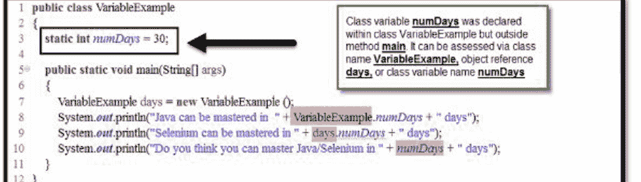

图 2.11 – 类变量

#### 程序输出

```text
Java can be mastered in 30 days
Selenium can be mastered in 30 days
```

第三行在类 `VariableExample` 内部声明了类变量 `numDays`，但在方法 `main` 之外。类变量的作用范围在类变量的块/大括号内部，在所有方法的块/大括号之外。因此，该变量的生命周期贯穿整个程序过程。

注意：类变量可以通过 `ClassName`、`ObjectReference` 或 `ClassVariableName` 访问。如果通过对象引用访问，必须使用关键字 `new` 创建对象。第八行、第九行和十行分别通过使用 `ClassName.ClassVariable`（`ExampleExample.numDays`）、`ObjectReference.ClassVariable`（`days.numDays`）以及 `ClassVariableName`（`numDays`）来访问类变量。

### 原始数据类型

原始数据类型说明了存储在变量中的数据类型。每种数据类型都有精确的范围和行为。因此，`int` 类型可以存储数值数据，但如果 `boolean` 尝试存储数值，将会发生类型不匹配错误。此外，根据数据类型允许执行某些操作。例如，不能在布尔类型上执行数学计算，因为布尔不能包含数字。以下是所有八原始数据类型的列表：

| 类型 | 位宽（字节） | 描述/范围 |
|---|---|---|
| `boolean` |  | 真或假值 |
| `byte` | 8 位（1 字节） | -128 到 127 |
| `char` | 16 位 | 标准字符集，可以是字母、控制字符、标点或代表世界上所有语言的符号 |
| `double` | 64 位（8 字节） | -1.797693134862315E+308 到 1.797693134862315E+308 |
| `float` | 32 位（4 字节） | -3.4028235E+38 到 3.4028235E+38 |
| `int` | 32 位（4 字节） | -2,147,483,648 到 2,147,483,647 |
| `long` | 64 位（8 字节） | -9,223,372,036,854,775,808 到 9,223,372,036,854,775,807 |
| `short` | 16 位（2 字节） | -32,768 到 32,767 |

图 2.12 – 八种原始数据类型

以下将原始数据类型分为 4 类：

1. 整数类型
2. 浮点类型
3. 字符类型
4. 布尔类型

#### 整数类型

整数类型支持不带小数部分的数值。整数类型内部的一个主要区别是值的范围。以下显示了整数类型的每种数据类型：

- `byte`
- `short`
- `int`
- `long`

`int` 类型使用最频繁，因为它用于控制循环和数组索引。以下是一个 `int` 数据类型的示例：

```java
public class VariableExample {

    public static void main(String[] args) {

        //Calculate 2 个整数值

        int i, j;

        int total;

        i = 10;

        j = 20;

        total = i + j;

        System.out.println("Total of i + j is " + total);

    }

}
```

```java
public class VariableExample {

    public static void main(String[] args) {

        // 计算 2 个整数值

        int i, j;

        int total;

        i = 10;

        j = 20;

        total = i + j;

        System.out.println("Total of i + j is " + total);

    }

}
```

图 2.13 – 整数类型

#### 程序输出

```text
Total of i + j is 30
```

#### 浮点类型

浮点类型支持带有小数部分的数值。以下是一个 `double` 示例：

```java
public class VariableExample {

    public static void main(String[] args) { 

        double d;

        double calc;

        d = 200.0;

        calc = Math.sqrt(d);

        System.out.println("Square root of d is " + calc);

    }

}
```

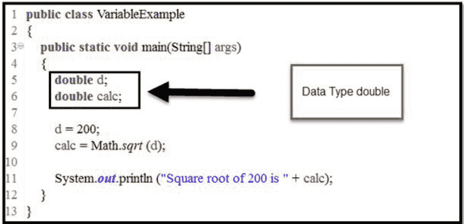

图 2.14 – 浮点类型

#### 程序输出

```text
Square root of 200 is 14.1421356237309
```

#### 字符类型

字符类型支持显示字符的 Unicode 系统。为了表示字符，`char` 数据类型的范围是 0 到 65535。以下是一个 `char` 示例：

```java
public class VariableExample

{

    public static void main(String[] args) {

        char cha1 = 'C';

        char cha2 = 67;

        System.out.println("Value assigned to cha1 is " + cha1);

        System.out.println("67 is the Unicode for " + cha2);

    }

}
```

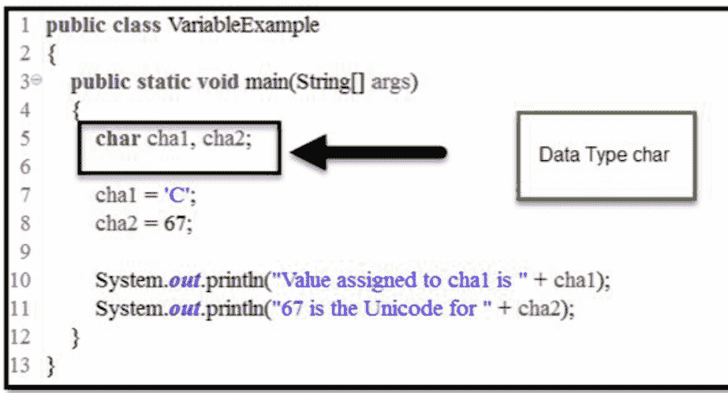

图 2.15 – 字符类型

#### 程序输出

```text
Value assigned to cha1 is C
67 is the Unicode for C
```

注意：根据 webpedia，“ASCII 是将英文字符表示为数字的代码，每个字母分配一个 0 到 127 之间的数字”。

#### 布尔类型

布尔类型支持逻辑逻辑程序。因此，布尔数据类型在评估逻辑/条件语句后返回一个值。条件语句对于特定陈述需要答案（真或假）。条件语句由变量和/或表达式组成。以下是一个布尔数据类型的示例：

```java
public class VariableExample {

    public static void main(String[] args) {

        boolean result;

        result = false;

        System.out.println("Boolean variable 'result' was initialized to " + result);

        System.out.println("Is this a true or false statement '100 greater than 99?" + (100>99));

    }

}
```

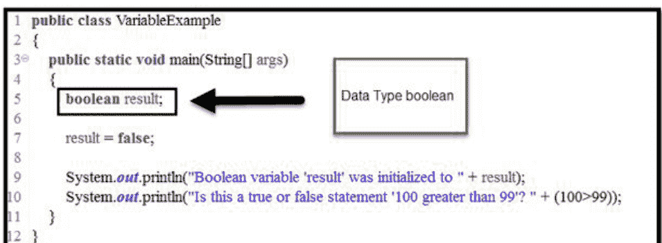

图 2.16 – 数据类型 `boolean`

#### 程序输出

```text
Boolean variable 'result' was initialized to false
Is this a true or false statement '100 greater than 99'?true
```

第五行为变量 `result` 声明了一个布尔数据类型。第七行将 `false` 初始化为该变量。第九行打印 `false` 的默认值，但第十行在评估条件“100>99”后返回一个 `true` 值。返回真是因为 100 大于 99。

### 常量

常量（也称为字面量）是赋值给特定数据类型变量名的不可变值。每个常量的定义方式取决于其数据类型。定义常量是一种保护信息的防御机制，以确保该值保持不变。例如，一天的总小时数为 24 小时，因此声明一个常量，使 24 这个值不发生变化。以下是四种类型的常量：

1. 字符串常量
2. 字符常量
3. 布尔常量
4. 数值常量

#### 常量命名规范

标准的常量命名规范有助于定位常量的过程。以下是常量命名规范：

- 构建描述常量目的的描述性名称。
- 创建包含全大写字母的名称（例如 `CUSTOMER`）。
- 如果名称包含多个单词，使用全大写字母加下划线组合名称（例如 `ORDER_NUM`）。

#### 声明和初始化常量

常量的声明和初始化与变量类似。声明常量的区别在于使用了修饰符 `final`。使用 `final` 的声明语句告诉 Java 初始化值将不会改变。以下示例显示了常量的声明和初始化语句：

```java
public class VariableExample

{

    public static void main(String[] args)

{

        final int DAYS_IN_WEEK = 7;

        final int DAILY_MAX_HOURS = 24;

        int totalHours;

        totalHours = DAYS_IN_WEEK * DAILY_MAX_HOURS;

        System.out.println("The total of hours in a week is " + totalHours);

    }

}
```

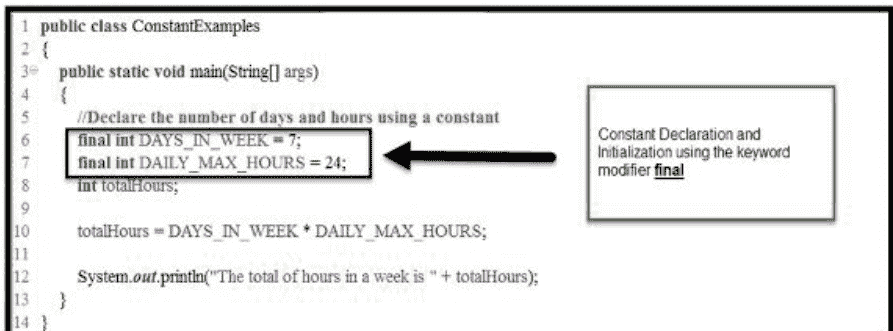

图 2.17 – 声明和初始化常量

#### 程序输出

一周的总小时数为 168。

第六行和第七行使用修饰符 `final` 声明并初始化常量。常量名 `DAYS_IN_WEEK` 被赋值为“7”，而 `DAILY_MAX_HOURS` 被赋值为“24”。赋值的常量值在程序中不会改变。如果尝试更改常量，错误提示“The final local variable NAME_OF_CONSTANT cannot be assigned”。

#### 默认常量数据类型

数据类型 `int` 和 `double` 是它们各自类别中的默认常量类型。然而，可以通过附加目标类型的字母来修改默认类型。`int` 数据类型通过附带字母“l”或“L”变为 `long` 数据类型。例如，值 `34` 默认表示 `int` 数据类型，而 `34l` 或 `34L` 表示 `long` 数据类型。`double` 数据类型也是如此。值 `12.34` 默认指定为 `double` 数据类型，但 `12.34f` 或 `12.34F` 指定为 `float` 数据类型。

**注意：** 本节指出了默认常量数据类型。然而，常量可以声明为任何原始数据类型。

### 转义字符

转义字符（称为反斜杠字符常量）表示一组字符和非图形化字符。根据《Beginning Java® Programming》(2015)，“转义字符用于以特定方式显示文本，要么在需要的地方插入制表符或换行，要么通过显示通常用于代码语法的字符”（第 29 页）。

如单引号（`''`）之类的字符具有特殊的含义，不能直接使用。因此，必须在字符前加上反斜杠字符（`\`），以便编译器正确解释给定的语句。以下是转义字符列表：

| 转义字符 | 说明 | Unicode |
|---|---|---|
| `\b` | 在文本中插入退格符 | `\u0008` |
| `\f` | 在文本中插入分页符 | `\u000C` |
| `\n` | 在文本中插入换行符 | `\u000A` |
| `\r` | 在文本中插入回车符 | `\u000D` |
| `\t` | 在文本中插入水平制表符 | `\u0009` |
| `\'` | 在文本中插入单引号（省撇） | `\u0027` |
| `\"` | 在文本中插入双引号 | `\u0022` |
| `\\` | 在文本中插入反斜杠 | `\u005C` |

图 2.18 – 转义字符

### 字符串常量

字符串常量包含在双引号（`""`）中，表示字符字符序列。普通字符（例如数字、字母等）以及转义字符都可以在字符串常量中处理。以下是一个字符串常量的示例：

```java
public class MiscExamples {

    public static void main(String[] args) {

        System.out.print("The following displays numbers 1 - 10 on two lines: \n");

        System.out.println("1t2t3t4t5t");

        System.out.println("6t7t8t9t10t");

    }

}
```

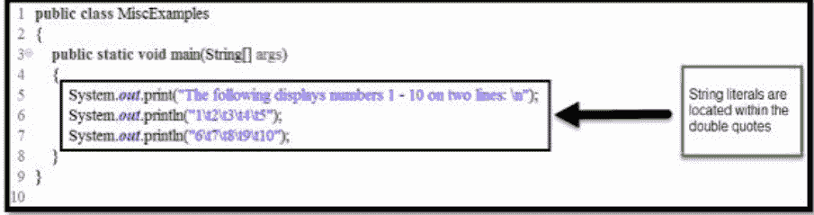

图 2.19 – 字符串常量

#### 程序输出

以下用两行显示数字 1 - 10：

```text
12345
678910
```

（注：原文代码中为 `t` 似乎是 `\t` 的笔误，按要求保留代码不翻译。）

#### 字符串常量包含在双引号（`""`）中。

### 字符常量

字符常量始终包含在单引号内，并包含一个字符。图 2.15 是字符常量示例。

### 布尔常量

布尔常量初始化 `True` 和 `False` 值。

### 数值常量

数值常量包含整数类型或浮点类型。这些值允许使用下划线（`_`）像标点符号一样。通常，逗号（`,`）、连字符（`-`）等用于划分数值。例如，一亿写为 100,000,000。下划线提高了一亿的可读性。以下是显示多个下划线的数值常量示例：

```java
public class MiscExample

    public static void main(String[] args) {

        final long FIRST_AMOUNT, SECOND_AMOUNT, TOTAL_AMOUNT;

        FIRST_AMOUNT = 111_111_111;

        SECOND_AMOUNT = 222222222;

        TOTAL_AMOUNT = FIRST_AMOUNT + SECOND_AMOUNT;

        System.out.println("The first amount is " + FIRST_AMOUNT);

        System.out.println("The second amount is " + SECOND_AMOUNT);

        System.out.println("The total of both amounts is " + TOTAL_AMOUNT);

    }

}
```

```text
1 public class MiscExample

2 {

3   public static void main(String[] args)

4   {

5      final long FIRST_AMOUNT, SECOND_AMOUNT, TOTAL_AMOUNT;

6

7      FIRST_AMOUNT = 111_111_111;

8      SECOND_AMOUNT = 222222222;

9

10     TOTAL_AMOUNT = FIRST_AMOUNT + SECOND_AMOUNT;

11

12     System.out.println("The first amount is " + FIRST_AMOUNT);

13     System.out.println("The second amount is " + SECOND_AMOUNT);

14     System.out.println("The total of both amounts is " + TOTAL_AMOUNT);

15   }

16 }
```

图 2.20 – 数值常量示例

**程序输出：**

```text
第一个金额是 111111111
第二个金额是 222222222
总金额是 333333333
```

第二章描述了如何声明和初始化变量。此外，还讨论了四种类型的变量（局部、参数、实例和类）以及原始数据类型。第三章将探索 Java 的四种类型的运算符：算术、位运算、逻辑和关系运算符。

# 第 3 章：运算符

运算符是会对一个或多个操作数执行数学或逻辑操作的符号。操作数可以是任何可以更改或处理的对象。最常见的操作数类型是变量。在 Java 中，有四种类型的运算符：算术、位、逻辑和关系运算符。算术、逻辑和关系运算符是最常用的运算符。下面的示例演示了乘法（`*`）运算符和操作数（三和四）：

```java
public class Operators {

    public static void main(String[] args) {

        int answer;

        answer = 3 * 4;

        System.out.println("What is 3 times 4? " + answer);

    }

}
```


图 3.1 – 运算符和操作数

**程序输出：**

```text
What is 3 times 4? 12
```

本章提供了关于运算符的以下信息：

- 算术运算符
- 位运算符
- 逻辑运算符
- 关系运算符
- 赋值运算符
- 三元运算符
- 运算符优先级
- 数据类型转换
- 表达式

## 算术运算符

算术运算符对数值执行数学运算。因此，算术运算符可以应用于任何涉及数字的数据类型。以下是算术运算符的列表：

1. `+`（加法）运算符
2. `-`（减法）运算符
3. `*`（乘法）运算符
4. `/`（除法）运算符
5. `%`（取模）运算符
6. `++`（自增）运算符
7. `--`（自减）运算符

| 运算符 | 描述 |
|---|---|
| `+` | 在`+`运算符的两侧加上一个值。用于连接字符串，即字符串拼接 |
| `-` | 从左操作数中减去右操作数 |
| `*` | 将`*`运算符两侧的值相乘 |
| `/` | 将左操作数除以右操作数 |
| `%` | 将左操作数除以右操作数并返回余数 |
| `++` | 将操作数的值加一 |
| `--` | 将操作数的值减一 |

图 3.2 – 算术运算符

注意：除法运算符`/`会截断余数，而取模运算符`%`则会返回余数。例如，`10 / 3`只返回三并截断余数一。另一方面，`10 % 3`仅返回余数一。

### 自增算术运算符

自增运算符向操作数加一。该运算符具有前置和后置形式。下面的语法显示了两种自增运算符形式，它们与以下表达式相同：

```java
i = i + 1;
```

#### 前置形式语法

```java
+i;
```

#### 后置形式语法

```java
i++;
```

### 自减算术运算符

自减运算符从操作数中减一。该运算符具有前置和后置形式。下面的语法显示了两种自减运算符形式，它们与以下表达式相同：

```java
i = i - 1;
```

#### 前置形式语法

```java
--;
```

#### 后置形式语法

```java
i--;
```

以下是每个算术运算符的示例：

```java
public class Operators {

  public static void main(String[] args) {

    int result, x = 10, y = 3;

    result = x + y; // Addition

    System.out.println("What is 10 plus 3?" + result);

    result = x - y; // Subtraction

    System.out.println("What is 10 minus 3?" + result);

    result = x * y; // Multiplication

    System.out.println("What is 10 times 3?" + result);

    result = x / y; // Division

    System.out.println("What is 10 divided by 3?" + result);

    result = x % y; // Modulus

    System.out.println("What is the remainder of " + result);

  }
}
```

```java
boolean x = 100 > 99, y = 99 > 100;
```

```java
// 逻辑与 '&&' 运算符

System.out.println("What is the result of 100 > 99 && 99 > 100? " + (x && y));

// 按位与 '&' 运算符

System.out.println("What is the result of 100 > 99 & 99 > 100? " + (x & y));

// 逻辑或 '||' 运算符

System.out.println("What is the result of 100 > 99 || 99 > 100? " + (x || y));

// 按位异或 '^' 运算符

System.out.println("What is the result of 100 > 99 ^ 99 > 100? " + (x ^ y));

// 逻辑非 '!' 运算符

System.out.println("What is the result of Not 100 > 99? " + (!x));

// 逻辑非 '!' 运算符（括号包裹此运算符和操作数可选的）

System.out.println("What is the result of Not 99 > 100? " + !y);

}
```

```java
public class Operators
{
    public static void main(String[] args) {
        boolean x = 100 > 99, y = 99 > 100;

        // 逻辑与 '&&' 运算符

        System.out.println("The result of 100 > 99 && 99 > 100? " + (x && y));

        // 按位与 '&' 运算符

        System.out.println("The result of 100 > 99 & 99 > 100? " + (x & y));

        // 逻辑或 '||' 运算符

        System.out.println("The result of 100 > 99 || 99 > 100? " + (x || y));

        // 按位或 '|' 运算符

        System.out.println("The result of 100 > 99 | 99 > 100? " + (x | y));

        // 逻辑异或 '^' 运算符

        System.out.println("The result of 100 > 99 ^ 99 > 100? " + (x ^ y));

        // 逻辑非 '!' 运算符

        System.out.println("The result of Not 100 > 99? " + (!x));

        // 逻辑非 '!!' 运算符（括号包裹此运算符和操作数可选的）

        System.out.println("The result of Not 100 > 99? " + (!(!x));
    }
}
```

图 3.6 – 逻辑与按位运算符示例

**程序输出：**

```text
What is the result of 100 > 99 && 99 > 100? false
What is the result of 100 > 99 & 99 > 100? false
What is the result of 100 > 99 || 99 > 100? true
What is the result of 100 > 99 | 99 > 100? true
What is the result of 100 > 99 ^ 99 > 100? true
What is the result of Not 100 > 99? false
```

在此示例中，第五行声明并初始化了变量。变量`x`和`y`都被赋值为布尔表达式。变量`x`被赋值为真的表达式`100 > 99`，而`y`被赋值为假的表达式`99 > 100`。第八行的`&&`（逻辑与）运算符和第 11 行的`&`（按位与）运算符比较了操作数`x`和`y`，然后返回一个`false`值。返回假值是因为一个操作数`x`是真，而另一个操作数`y`是假。根据图 3.4 和图 3.5，图 3.6 中的所有示例都使用不同的按位和逻辑运算符执行了类似的过程。

## 短路行为运算符

短路行为运算符是`||`（逻辑或）和`&&`（逻辑与）运算符。注意图 3.6 中的`||`（逻辑或）、`&&`（逻辑与）以及`|`（按位或）和`&`（按位与）运算符。然而，区别在于对操作数的求值。

如果第一个操作数返回假，则`&&`（逻辑与）运算符将不会评估第二个操作数。然而，`&`（按位与）运算符总是评估两个操作数。同样，如果第一个操作数返回真，`||`（逻辑或）运算符将不会评估第二个操作数。与`||`（逻辑或）运算符相反，`|`（按位或）运算符总是评估两个操作数。

**注意：** 短路行为运算符不评估第二个操作数，因为无论第二个操作数如何，它已经知道了结果。

## 关系运算符

关系运算符在比较操作数后返回一个布尔值。通常，所有的关系运算符都应用于数字类型的操作数。如果两个操作数之间的关系为真，则返回真。例如，如果 34 等于 34，则返回真。以下是关系运算符的列表：

1. `==`（等于）运算符
2. `!=`（不等于）运算符
3. `>`（大于）运算符
4. `>=`（大于等于）运算符
5. `<`（小于）运算符
6. `<=`（小于等于）运算符

| 运算符 | 描述 |
|---|---|
| `==` | 等于（Equal To）运算符 |
| `!=` | 不等于（Not Equal To）运算符 |
| `>` | 大于（Greater Than）运算符 |
| `>=` | 大于等于（Greater Than Equal）运算符 |
| `<` | 小于（Less Than）运算符 |
| `<=` | 小于等于（Less Than Equal）运算符 |

图 3.7 – 关系运算符

以下是关系运算符的示例：

```java
public class Operators
{
    public static void main(String[] args) {
        boolean x = 100 > 99, y = 99 > 100;

        // == 运算符

        System.out.println("What is the result of 100 > 99 && 99 > 100? " + (x == y));

        // != 运算符

        System.out.println("What is the result of 100 > 99 && 99 > 100? " + (x != y));

        // > 运算符

        System.out.println("What is the result of 100 > 99 && 99 > 100? " + (x > y));

        // >= 运算符

        System.out.println("What is the result of 100 > 99 && 99 > 100? " + (x >= y));

        // < 运算符

        System.out.println("What is the result of 100 > 99 && 99 > 100? " + (x < y));

        // <= 运算符

        System.out.println("What is the result of 100 > 99 && 99 > 100? " + (x <= y));
    }
}
```

图 3.8 – 关系运算符示例

**程序输出：**

```text
What is the result of 100 > 99 && 99 > 100? false
What is the result of 100 > 99 && 99 > 100? true
What is the result of 100 > 99 && 99 > 100? true
What is the result of 100 > 99 && 99 > 100? true
What is the result of 100 > 99 && 99 > 100? false
What is the result of 100 > 99 && 99 > 100? false
```

在此示例中，第五行声明并初始化了变量。变量`x`和`y`都被赋值为布尔表达式。变量`x`被赋值为真的表达式`100 > 99`，而`y`被赋值为假的表达式`99 > 100`。

## 赋值运算符

赋值运算符`=`位于变量和值之间。其目的是将右侧的值传递给变量。以下是赋值运算符的语法：

### 语法

```java
变量名 = 表达式;
```

### 语法细节

| 参数 | 描述 |
|---|---|
| 变量名 | 已声明的变量 |
| 表达式 | 赋值给变量的值 |
| `;` | 分号完成赋值语句 |

图 3.9 – 赋值运算符语法

**注意：** 赋值运算符可以产生赋值链。赋值链是初始化多个变量相同值的好方法。此外，如果变量已经有值，则通过赋值可以覆盖该值。以下是赋值运算符的示例：

```java
public class Operators {

    public static void main(String[] args) {

        int i, j, k;

        i = j = k = 34;

        System.out.println("The value of i is: " + i);

        System.out.println("The value of j is: " + j);

        System.out.println("The value of k is: " + k);

        j = 38;
    }
}
```

```java
System.out.println("The value of j has been overwritten to: " + j);
```

```java
1 public class Operators
2 {
3 public static void main (String[] args)
4 {
5 int i, j, k;
6
7 i = j = k = 34;
8 System.out.println("The value of i is: " + i);
9 System.out.println("The value of j is: " + j);
10 System.out.println("The value of k is: " + k);
11
12 j = 38;
13 }
14 }
```

图 3.10 – 赋值运算符示例

## 程序输出

```text
The value of i is: 34
The value of j is: 34
The value of k is: 34
The value of j has been overwritten to: 38
```

### 复合赋值

复合赋值（称为简写赋值）将算术运算符和位运算符与赋值运算符结合。以下运算符被排除在结合功能之外：自增、自减和按位取反。此过程缩短了赋值语句。例如，以下两个语句产生相同的输出：

```java
y = y + 3;
y += 3;
```

这两条语句都将变量`y`赋值为`y`加三的值。以下是复合赋值的列表：

1. `+=`（加法并赋值）运算符
2. `-=`（减法并赋值）运算符
3. `*=`（乘法并赋值）运算符
4. `/=`（除法并赋值）运算符
5. `%=`（取模并赋值）运算符
6. `&=`（位与并赋值）运算符
7. `|=`（位或并赋值）运算符
8. `^=`（位异或并赋值）运算符
9. `<<=`（左移并赋值）运算符
10. `>>=`（右移并赋值）运算符
11. `>>>=`（无符号右移并赋值）运算符

| 复合赋值 | 描述 |
|---|---|
| `+=` | 赋值加法结果 |
| `-=` | 赋值减法结果 |
| `*=` | 赋值乘法结果 |
| `/=` | 赋值除法结果 |
| `%=` | 赋值除余数结果 |
| `&=` | 赋值位与结果 |
| `|=` | 赋值位或结果 |
| `^=` | 赋值位异或结果 |
| `<<=` | 赋值有符号左移结果 |
| `>>=` | 赋值有符号右移结果 |
| `>>>=` | 赋值无符号右移结果 |

图 3.11 – 复合赋值

### 三元运算符

根据 dictionary.com 的定义，ternary 的意思是“包含或涉及三个”。因此，三元运算符`?`需要三个操作数。该运算符用于评估布尔表达式并确定将哪个值赋给变量。以下是三元运算符的语法：

#### 语法

```java
variableType variableName = expression1 ? expression2 : expression3;
```

#### 语法细节

| 参数 | 描述 |
|---|---|
| `variableType` | 变量的数据类型 |
| `variableName` | 将接收值的变量名称 |
| `expression1` | 布尔表达式 |
| `expression2` | 布尔表达式为真时的值 |
| `:` | 冒号分隔`expression2`和`expression3`的值 |
| `expression3` | 布尔表达式为假时的值 |
| `;` | 分号完成三元运算符语句 |

图 3.12 – 三元运算符语法细节

以下是一个三元运算符的示例：

```java
public class Operators {
    public static void main(String[] args) {
        int x, y;

        x = 5;
    }
}
```


`System.out.print("What is the value of x? " + x);`

`y = (x == 5) ? 7 : 1;`

`System.out.print("x equals 5 so the boolean expression is true: Value is " + y);`

`y = (x == 3) ? 7 : 1;`

`System.out.print("x does not equal 3 so the boolean expression is false: Value is " + y);`

```java
public class Operators
{
    public static void main(String[] args) {
        int x, y;
        x = 5;
        System.out.println("What is the value of x? " + x);
        y = (x == 5) ? 7 : 1;
        System.out.println("x equals 5 so the boolean expression is true: Value is " + y);
        y = (x == 3) ? 7 : 1;
        System.out.println("x does not equal 3 so the boolean expression is false: Value is " + y);
    }
}
```

图 3.13 – 三元运算符示例

**程序输出：**

```
What is the value of x? 5
x equals 5 so the boolean expression is true: Value is 7
x does not equal 3 so the boolean expression is false: Value is 1
```

第 10 行显示 `expression1` 为 `(x == 5)`，而第 13 行显示 `expression1` 为 `(x == 3)`。这两行都显示 `expression2` 为 `True`，`expression3` 为 `1`。如果布尔表达式为 `True`，则 `"y"` 被赋值为 `7`，否则 `"y"` 被赋值为 `1`。

## 运算符优先级

运算符优先级是 `Java` 运算符从高到低的排序。当给定的表达式有多个运算符时，排序就变得非常重要。表达式从左到右求值，优先级较高的运算符先接受评估。要更改优先级顺序，应该使用括号来指出哪个表达式先被评估。以下示例展示了一个不包含括号和一个包含括号的表达式：

```java
public class Operators {
    public static void main(String[] args) {
        int total;
        total = 2 + 3 * 4;
        System.out.println("What is the total without a parenthesis? " + total);
        total = (2 + 3) * 4;
        System.out.println("What is the total with a parenthesis? " + total);
    }
}
```

程序输出：

```
What is the total without a parenthesis? 14
What is the total with a parenthesis? 20
```

通常情况下，乘法（`*`）运算符在加法（`+`）运算符之前求值。变量 `"total"` 在第七行和第十行被赋值了不同的值（此处原文有误，应为 `total = 14` 和 `total = 20`）。

根据 `Java` 教程，运算符优先级如下：

| 运算符 | 优先级 |
| :--- | :--- |
| 后置 | `++ --` |
| 一元 | `++ ~` |
| 乘法 | `* / %` |
| 加法 | `+ -` |
| 移位 | `<< >>` |
| 关系 | `< <=` |
| 相等性 | `== !=` |
| 位与 | `&` |
| 位异或 | `^` |
| 位或 | `\|` |
| 逻辑与 | `&&` |
| 逻辑或 | `\|\|` |
| 三元 | `? :` |
| 赋值 | `+= -= \|= ^= >>>` |

图 3.15 – 运算符优先级

## 类型转换

数据类型转换是将数据类型的值转换为另一种数据类型。例如，数据类型 `"float"` 可以转换为另一种类型。然而，布尔数据类型永远无法转换为数值。转换有两种类型：

1. 隐式转换
2. 显式转换

### 隐式转换

隐式转换是在没有指令将一种数据类型转换为另一种类型的情况下发生的转换。这种转换只发生在宽转换中。宽转换当特定数据类型的值转换为更高类型时会自动发生。因此，根据原始数据类型层次，`int` 可以转换为 `float`，但尝试将 `float` 转换为 `int` 会产生错误。以下是隐式转换示例：

```java
public class Operators
{
    public static void main(String[] args)
    {
        int i;
        float f;
        i = 78;
        System.out.println("The value of int 'i': " + i);
        f = i;
        System.out.println("The value of float 'f': " + f);
    }
}
```

图 3.16 - 赋值类型转换

**程序输出：**

```
The value of int 'i' is: 78
The value of float 'f' is: 78.0
```

注意从 `78` 转换为 `78.0` 时值没有丢失数据。隐式转换需要以下两个原则：

1. 两种数据类型必须兼容
2. 目标数据类型（左侧）的范围必须大于源数据类型（右侧）

以下是原始数据类型层次结构的宽转换列表：

- `byte` 转换为 `short`、`int`、`long`、`float` 或 `double`
- `short` 转换为 `int`、`long`、`float` 或 `double`
- `char` 转换为 `int`、`long`、`float` 或 `double`
- `int` 转换为 `long`、`float` 或 `double`
- `long` 转换为 `float` 或 `double`
- `float` 转换为 `double`

### 显式类型转换

显式类型转换是在通过指令编译器将一种数据类型转换为另一种数据类型时发生的转换。这种类型的转换可以发生在宽类型转换和窄类型转换中。窄转换发生在将特定数据类型的值转换为较低的数据类型时。因此，在将 `float` 转换为 `int` 时不会产生错误。以下是显式类型转换的语法：

### 语法

```java
(targetDataType) expression;
```

### 语法细节

| 参数 | 描述 |
|---|---|
| `targetDataType` | 表达式转换的目标数据类型 |
| `expression` | 将被转换的值 |
| `;` | 分号用于完成显式类型转换语句 |

图 3.17 – 显式类型转换语法细节

以下是一个显式类型转换的示例：

```java
public class Operators
{
    public static void main(String[] args)
    {
        int i = 8;
        double d = (double) i;
        System.out.println("What is the value of int 'i? " + i);
        System.out.println("What is the value of double 'd? " + d);
        float f = 12.34f;
        short s = (short) f;
        System.out.println("What is the value of float '?f?" + f);
        System.out.println("What is the value of short '?s?" + s);
    }
}
```

```java
1 public class Operators
2 {
3   public static void main(String[] args)
4   {
5      int i = 8;
6      double d = (double) i;
7
8      System.out.println("What is the value of int '?i?" + i);
9      System.out.println("What is the value of double '?d?" + d);
10
11     float f = 12.34;
12     short s = (short) f;
13
14     System.out.println("What is the value of float '?f?" + f);
15     System.out.println("What is the value of short '?s?" + s);
16   }
17 }
```

图 3.18 — 显式类型转换示例

#### 程序输出:

```
What is the value of int '?i?' 8
What is the value of double '?d?' 8.0
What is the value of float '?f?' 12.34
What is the value of short '?s?' 12
```

第五行将 `"8"` 分配给数据类型 `int`，命名为 `"i"`。在第六行，发生了显式宽类型转换，此时变量 `"i"`（`int` 数据类型）转换为 `double` 数据类型。第 11 行分配了 `12.34`（`double` 的默认数据类型），但将其转换为 `float` 数据类型 `12.34f`。变量 `"f"` 持有 `12.34`，在第 12 行转换为 `short` 数据类型。注意在第 15 行时值丢失数据，此时发生了窄类型转换，并将值 `"12.34"` 转换为 `short` 值 `"12"`。以下是根据原始数据类型层次结构的窄类型转换列表：

- `byte` 转换为 `char`
- `short` 转换为 `byte` 或 `char`
- `char` 转换为 `byte` 或 `short`
- `int` 转换为 `byte`、`short` 或 `char`
- `long` 转换为 `byte`、`short`、`char` 或 `int`
- `float` 转换为 `byte`、`short`、`char`、`int` 或 `long`
- `double` 转换为 `byte`、`short`、`char`、`int`、`long` 或 `float`

## 表达式

运算符、变量、常量和方法（调用和返回）是表达式的组件。与运算符连接的组件形成一个表达式。通过组合多个表达式可以创建一个复合表达式。然而，数据类型必须兼容才能构建一个有效的复合表达式。例如，`int` 数据类型可以与 `long` 数据类型混合，因为它们都是数值类型。

通过使用类型提升规则，数据类型的混合会被转换为相同的数据类型。从表达式返回的值取决于其数据类型。`char`、`byte` 和 `short` 数据类型被提升为 `int`。如果操作数之一是 `long` 数据类型，则表达式被提升为 `long`。`float` 类型也是如此，如果操作数之一是 `float`，则整个表达式就是 `float`。同样，如果操作数之一是 `double`，则表达式被提升为 `double` 数据类型。以下是一个混合了 `byte` 和 `float` 数据类型的表达式示例：

```java
public class Operators {
    public static void main(String[] args) {
        byte b = 7;
        float f = 34.56f;
        float total = (b * f);
        System.out.println("The total of byte 'b' times float 'f' (7 * 34.56) is: " + total);
    }
}
```

```java
1 public class Operators
2 {
3     public static void main(String[] args)
4 {
5     byte b = 7;
6     float f = 34.56;
7 
8     float total = (b * f);
9     System.out.println("The total of byte 'b' times float (7 * 34.56) is: " + total);
10 }
11 }
```

图 3.19 – 表达式示例

#### 程序输出:

```
The total of byte 'b' times float (7 * 34.56) is: 241.920001
```

第五行声明并分配了一个 `byte` 数据类型，而第七行声明并分配了一个 `float` 数据类型。在第八行，`*`（乘法）运算符乘了两个数据类型（`byte` 和 `float`），尽管这些类型是混合的。然而，由于操作数之一是 `float`，表达式被提升为 `float`。

第三章介绍了 `Java` 的四种类型运算符：算术、位运算、逻辑和关系。赋值运算符和三元运算符在每个运算符的排序进行了分析。第四章将解释两种控制结构：分支和 `switch` 分支。循环有三种：`for` 循环、`while` 循环和 `do while` 循环。

# 第 4 章
控制结构

控制结构是使用逻辑强制程序在循环其他语句时跳过语句的过程。强制程序跳过语句被称为分支，而特定语句的循环通过循环实现。

两种分支是 `if` 分支和 `switch` 分支。三种循环是 `for` 循环、`while` 循环和 `do while` 循环。除了分支和循环，还有跳转语句。第四章将涵盖以下：

- `if` 分支
- `switch` 分支
- `for` 循环
- `while` 循环
- `do while` 循环
- `break`
- `continue`

## if 分支

`if` 分支在条件为真时执行语句。也就是说，如果满足条件，就会执行特定的语句。以下是 `if` 的语法：

### 语法

```java
if (condition)
{
    statement(s);
}
```

### 语法细节

| 参数 | 描述 |
|---|---|
| `if` | 启动 `if` 分支的关键字 |
| `condition` | 产生真或假的布尔表达式 |
| `{` | 左括号 |
| `statement(s)` | 如果条件为真将执行的语句 |
| `;` | 分号完成真语句 |
| `}` | 右括号 |

图 4.1 – `if` 分支语法细节

以下示例显示了如果客户带了三位客户参加体育活动，则显示一条消息：

```java
public class ControlStructures
{
    public static void main(String[] args)
{}
    int extraCustomers = 4;
    if (extraCustomers >= 3)
    {
        System.out.println("Customer receives a discount");
    }
}
```

图 4.2 – `if` 分支

#### 程序输出:

```
Customer receives a discount
```

第五行将 `"4"` 分配给变量 `"extraCustomers"`。第七行显示关键字 `"if"` 后跟一个括号。括号内部是一个条件 `(extraCustomers >= 3)`，它返回真。因为 `4` 大于 `3` 所以返回真。第九行的语句（大括号内部）在真值评估后执行。

**注意：** 如果条件返回假，程序将不会执行该语句。然而，`if` 分支有两种变体可以在条件为假时执行：

1. `If Else`
2. `If Else-If`

## if-else 分支

可选的 `else` 关键字扩展了 `if` 分支，以防条件返回假。因此，当条件为真时，执行关键字 `if` 之后的条件和对应的语句。否则，当条件为假时，执行关键字 `else` 之后的语句。以下是 `if-else` 分支的语法：

```java
if (condition)
{
  statement(s);
}
else
{
  statement(s);
}
```

以下示例显示了当客户没有带三位额外客户参加体育活动时显示的消息：

```java
public class ControlStructures {
  public static void main (String[] args) {
    int extraCustomers = 2;
    if (extraCustomers >= 3) {
      System.out.println("Customer receives a discount");
    } else {
      System.out.println("Customer does not receive a discount");
    }
  }
}
```


```java
public class ControlStructures
{
  public static void main(String[] args)
  {
    int extraCustomers = 2;

    if (extraCustomers >= 3)
    {
      System.out.println("Customer receives a discount");
    }
    else
    {
      System.out.println("Customer does not receive a discount");
    }
  }
}
```

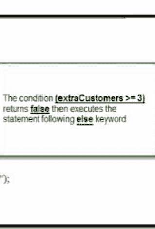

图 4.3 – If Else 分支

## 程序输出

```text
Customer does not receive a discount
```

第五行将`"2"`赋值给变量`"extraCustomers"`。第七行显示关键字`"if"`后跟一个括号。括号内是一个条件`(extraCustomers >= 3)`，该条件返回`false`。返回`false`是因为`2`不大于等于`3`。因此，程序跳过了第九行的语句，并执行了第 13 行的语句。

注意：如果关键字`"if"`和`"else"`后面只有一个语句，则大括号是可选的。然而，如果存在多个语句，则必须使用大括号。建议始终使用大括号以提高可读性。以下是一个不使用大括号的示例：

```java
public class ControlStructures
{
  public static void main(String[] args)
  {
    int extraCustomers = 2;
    if (extraCustomers >= 3)
      System.out.println("Customer receives a discount");

      System.out.println("Congratulations");
    else
      System.out.println("Customer does not receive a discount");
  }
}
```

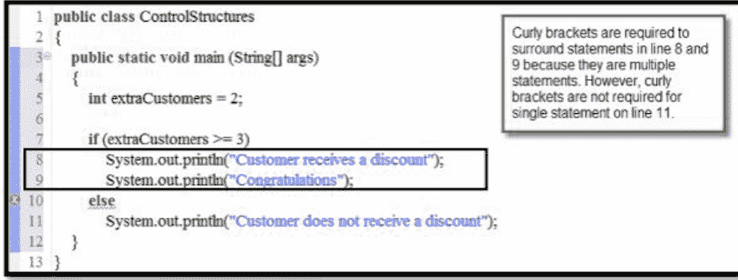

图 4.4 – 无大括号

第八行和第九行是`if`分支的多个语句，需要大括号。注意第 10 行的红色 X。红色的 X 表示之前的语句存在错误。然而，第 11 行不存在错误，因为它是一个单一语句，不需要大括号。

## If Else-if 分支

第一个`if`关键字后面可以可选地跟随一个或多个`if`关键字。然而，每个后续的`if`关键字之前必须有一个必需`else`关键字。`else-if`分支只在第一个分支为`false`时才会执行。所有的`else-if`分支后面都跟着一个条件和一个或多个语句。以下是`else if`分支的语法：

### 语法

```java
if (condition)
{
  statement(s);
}
else if (condition)
{
  statement(s);
}
else if (condition)
{
  statement(s);
}
else
{
  statement(s);
}
```

以下示例显示了当客户参加体育活动带的额外客户少于三个时的消息：

```java
public class ControlStructures {
  public static void main(String[] args) {
    int extraCustomers = 2;
    if (extraCustomers >= 3)
    {
      System.out.println("Customer receives a discount");
    } else if (extraCustomers <= 3)
    {
      System.out.println("No Discount: Customer count less than or equal to 3");
    } else
    {
      System.out.println("Error: Not a valid customer count");
    }
  }
}
```

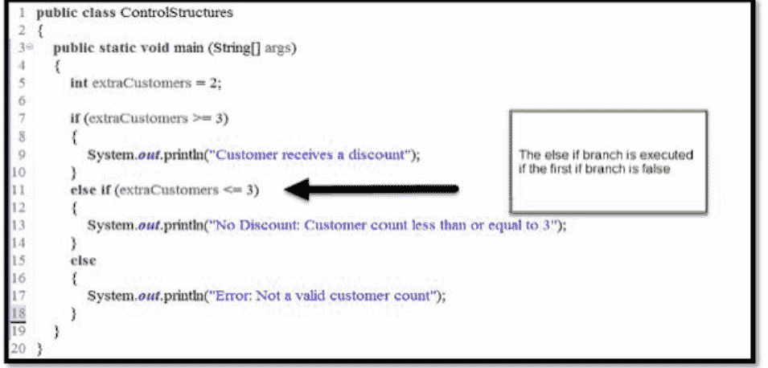

图 4.5 – Else If 分支

## 程序输出

```text
No Discount: Customer count less than or equal to 3
```

第五行将`"2"`赋值给变量`"extraCustomers"`。第 11 行显示关键字`"else"`和`"if"`后跟一个括号。括号内是一个条件`(extraCustomers <= 3)`，该条件返回`true`。返回`true`是因为`2`小于等于`3`。第二个条件（第 11 行）仅在第一个条件（第七行）为`false`后才会执行。

**注意：** 可以向`if`分支中添加多个`else-if`分支。

## 嵌套 If 分支

嵌套`if`分支由位于`if`、`else`、`else-if`分支内部的`if`或`else-if`分支组成。特定的外部`if`分支作为内部分支的嵌套。以下是一个嵌套`if`分支的示例：

```java
public class ControlStructures {
    public static void main(String[] args) {
        int extraCustomers = 15;
        if (extraCustomers >= 3) {
            System.out.println("Customer receives a discount");
            if (extraCustomers >= 10) {
                System.out.println("25% off the price");
            } else {
                System.out.println("10% off the price");
            }
        } else {
            System.out.println("Customer does not receive a discount");
        }
    }
}
```

```java
public class ControlStructures
{
    public static void main(String[] args) {
        int extraCustomers = 15;
        if (extraCustomers >= 3) {
            System.out.println("Customer receives a discount");
            if (extraCustomers >= 10) {
                System.out.println("25% off the price");
            } else {
                System.out.println("10% off the price");
            }
        } else {
            System.out.println("Customer does not receive a discount");
        }
    }
}
```

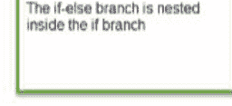

图 4.6 – 嵌套 If

## 程序输出

```text
Customer receives a discount

25% off the price
```

## Switch 分支

`switch`分支根据一组`case`对变量进行评估。它通常比使用多个`if-else`语句更具可读性。`switch`适用于整数类型、字符和字符串。

### 语法

| 关键字 | 描述 |
| :--- | :--- |
| `switch (expression)` | 要评估的变量。 |
| `case value:` | 与表达式匹配的特定值。 |
| `statement` | 如果`case`匹配则执行的代码。 |
| `break;` | 防止穿透到下一个`case`。 |
| `default:` | 如果没有`case`匹配则执行的代码。 |

图 4.7 – Switch 分支语法

以下是一个`switch`示例：

```java
public class ControlStructures {
    public static void main(String[] args) {
        int day = 6;
        switch (day) {
            case 1:
                System.out.println("Sunday is the 1st day of the week");
                break;
            case 2:
                System.out.println("Monday is the 2nd day of the week");
                break;
            case 3:
                System.out.println("Tuesday is the 3rd day of the week");
                break;
            case 4:
                System.out.println("Wednesday is the 4th day of the week");
                break;
            case 5:
                System.out.println("Thursday is the 5th day of the week");
                break;
            case 6:
                System.out.println("Friday is the 6th day of the week");
                break;
            case 7:
                System.out.println("Saturday is the 7th day of the week");
                break;
            default:
                System.out.println("Not valid: There are only 7 days in a week");
        }
    }
}
```

```java
public class ControlStructures
{
  public static void main(String[] args)
{
    int day = 6;
    switch (day) {
      case 1:
        System.out.println("Sunday is the 1st day of the week");
        break;
      case 2:
        System.out.println("Monday is the 2nd day of the week");
        break;
      case 3:
        System.out.println("Tuesday is the 3rd day of the week");
        break;
      case 4:
        System.out.println("Wednesday is the 4th day of the week");
        break;
      case 5:
        System.out.println("Thursday is the 5th day of the week");
        break;
      case 6:
        System.out.println("Friday is the 6th day of the week");
        break;
      case 7:
        System.out.println("Saturday is the 7th day of the week");
        break;
      default:
        System.out.println("Not valid: There are only 7 days in a week");
    }
  }
}
```

图 4.8 – Switch 示例

## 程序输出

周五是每周的第 6 天

第五行将变量`"day"`赋值为`"6"`。然后，关键字`"switch"`通过检查变量的值从第七行开始执行分支。第 24 行的关键字`"case"`匹配变量的值`"6"`，然后执行第 25 行的语句。第 26 行的关键字`"break"`是必要的，以防止`case 7`（第 27 行）和`default`（第 30 行）的执行。

注意：由于`switch`分支采用自上而下的方法顺序执行，匹配后的所有语句都将执行。因此，在找到匹配项后必须使用`"break"`关键字跳出`switch`分支。

### 嵌套 switch 分支

嵌套`switch`分支由另一个`switch`分支内部的`switch`分支组成。此外，`if`分支也可以嵌套在`switch`分支内部。外部`switch`分支作为内部分支的嵌套。值对于其各自的外部和内部分支是唯一的。例如，常量可以在多个`switch`分支中包含相同的值。以下是一个`switch`分支示例：

```java
public class ControlStructures {
    public static void main(String[] args) {
        int day = 2, numHours = 4;
        switch (day) {
            case 1:
                System.out.println("周日是每周的第 1 天");
                break;
            case 2:
                System.out.println("周一是每周的第 2 天");
                switch (numHours) {
                    case 4:
                        System.out.println("计划工作4 小时（因为有约，只有半天）");
                        break;
                    case 8:
                        System.out.println("计划今天工作8 小时");
                        break;
                    default:
                        System.out.println("不确定今天将工作几个小时");
                        break;
                }
            case 3:
                System.out.println("周二是每周的第 3 天");
                break;
            case 4:
                System.out.println("周三是每周的第 4 天");
                break;
            case 5:
                System.out.println("周四是每周的第 5 天");
                break;
    }
}
```

```java
case 6:
    System.out.println("周五是每周的第 6 天");
    break;
case 7:
    System.out.println("周六是每周的第 7 天");
    break;
default:
    System.out.println("无效：每周只有 7 天");
```

```java
public class ControlStructures
{
    public static void main(String[] args) {
        int day = 2, numHours = 4;
        switch (day) {
            case 1:
                System.out.println("周日是每周的第 1 天");
                break;
            case 2:
                System.out.println("周一是每周的第 2 天");
                switch (numHours) {
                    case 4:
                        System.out.println("计划工作4 小时（因为有约，只有半天）");
                        break;
```


case 6:

    System.out.println("计划今天工作8 小时");

    break;

default:

    System.out.println("不确定今天将工作几个小时");

    break;

}

break;

case 3:

    System.out.println("周二是每周的第 3 天");

    break;

case 4:

    System.out.println("周三是每周的第 4 天");

    break;

}

}

}
```

图 4.9 – 嵌套 switch 分支

## 程序输出：

周一是每周的第 2 天
计划工作4 小时（因为有约，只有半天）

第五行将变量`numHours`赋值为`4`。然后，关键字`switch`通过检查变量的值从第 14 行开始嵌套 switch 分支。嵌套 switch 分支包含两个 case 和一个 default。第 16 行的其中一个 case 与第 30 行的外部 case 具有相同的常量`4`。

## for 循环（For Loop）

for 循环为指定的迭代次数执行一个代码块。换句话说，只要满足条件，语句就会执行。循环的益处之一是允许在不重复编写代码的情况下执行语句。以下是 for 循环的语法：

### 语法

```java
for (initialization; condition; iteration)
{
  statement(s)
}
```

### 语法细节

| 参数 | 说明 |
| --- | --- |
| `for` | 循环的关键字 |
| `initialization` | 设置循环控制初始值的赋值语句 |
| `;` | 分号完成初始化 |
| `condition` | 决定循环是否重复的布尔表达式 |
| `;` | 分号完成条件判断 |
| `iteration` | 表示循环控制变量在每次变化后如何改变 |
| `{` | 左大括号 |
| `statement(s)` | 满足条件后执行的语句 |
| `;` | 分号完成语句 |
| `}` | 右大括号 |

图 4.10 – for 循环语法

第五行使用关键字`for`开始循环，其后跟着参数、条件和迭代。初始化`int i = 0;`将 0 赋值为起始值。`i < 5`设置了循环变量的停止点。增量`i++`使循环变量增加 1。通过第七行打印循环控制。

在循环中使用适当的值是非常重要的。如果不创建，值可能会导致死循环。例如，以下循环由于初始值的原因将无限循环：

```java
for (int i = 3; i > 1; i++)
```

初始值`3`大于最大值`1`，而迭代`++`在每次循环后增加。要修正此死循环，初始化值`3`必须减少到小于条件值`1`；条件值`1`必须增加到大于`3`；或者迭代从每次循环增加变为减少`--`。

注意：通常情况下，使用大于（`>`）的条件使用递减运算符（`--`），而使用小于（`<`）的条件使用递增运算符（`++`）。

图 4.11 – for 循环示例

## 程序输出：

循环控制变量值为 0
循环变量值为 1
循环控制变量值为 2
循环控制变量值为 3
循环控制变量值为 4

## 嵌套 for 循环

嵌套循环由另一个 for 循环内部的 for 循环组成。外部循环作为内部循环的嵌套。内部循环内部的语句可以使用外部循环的循环控制变量。因此，最好为每个循环使用不同的循环控制变量。以下是一个嵌套 for 循环的示例：

```java
public class ControlStructures {
    public static void main(String[] args) {
        for (int x = 0; x < 3; x++) {
            System.out.println("Outer Loop value is " + x);
            for (int y = 0; y < 3; y++) {
                System.out.println("Inner Loop value is " + y);
            }
        }
    }
}
```

图 4.12 – 嵌套 for 循环

## 程序输出：

外部循环值为 0
内部循环值为 0
内层循环值为 1
内层循环值为 2
外层循环值为 1
内层循环值为 0
内层循环值为 1
内层循环值为 2
外层循环值为 2
内层循环值为 0
内层循环值为 1
内层循环值为 2

第八行使用关键字`for`开始嵌套的 for 循环，后面跟着参数初始化、条件和迭代。初始化`int y = 0;`将 0 赋值为起始值。条件`y < 3`将 3 设置为循环控制变量的停止点。递增`y++`将循环控制变量增加 1。该语句通过第 10 行打印循环控制变量。

## While 循环

while 循环在条件为真时重复执行语句。条件是在执行语句之前检查的布尔表达式。此外，变量名在循环之前初始化，并作为条件的一部分进行评估。在执行语句时，while 循环将持续直到条件变为假。以下是 while 循环的语法。

### 语法

```java
while (condition)
{
  statement(s);
}
```

### 语法细节

| 参数 | 说明 |
| --- | --- |
| `while` | 启动循环的关键字 |
| `condition` | 决定循环是否会重复的布尔表达式 |
| `{` | 左括号 |
| `statement(s)` | 在条件满足后执行的语句 |
| `;` | 完成语句的分号 |
| `}` | 右括号 |


以下是一个 while 循环的示例：

```java
public class ControlStructures{
  public static void main(String[] args)
  {
    int i = 0;
    while (i < 5) {
      System.out.println("The variables value is " + i);
      i++;
    }
  }
}
```

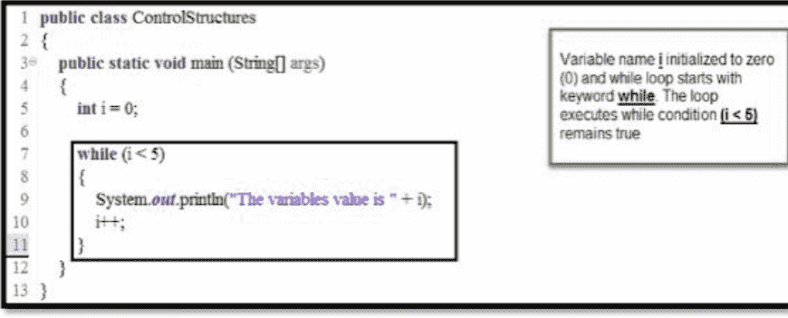

图 4.14 – While 循环示例

程序输出：
The variables value is 0
The variables value is 1
The variables value is 2
The variables value is 3
The variables value is 4

第五行将变量`i`初始化为零`0`。该变量将在第七行作为关键字`while`之后条件`i < 5`的部分进行评估。当条件为真时，通过第九行重新打印变量`i`的值。注意第 10 行的递增运算符。需要知道，如果不添加递增运算符，while 循环永远不会停止。因此，循环将无限持续，导致无限循环。此外，如果初始化和条件变量的值设置不一致，while 循环将变得无限。

## Do While 循环

do while 循环在循环底部评估条件。因此，循环将先执行循环内的语句，然后评估条件。结果是，do while 循环至少执行一次语句，并在条件为真时持续执行。以下是 do while 循环的语法：

```java
do
{
  statement(s);
}
while (condition);
```

### 语法细节

| 参数 | 说明 |
|---|---|
| `do` | 启动循环的关键字 |
| `{` | 左括号 |
| `statement(s)` | 至少执行一次的语句 |
| `;` | 完成语句的分号 |
| `}` | 右括号 |
| `while` | 决定循环条件是否会重复的关键字 |
| `condition` | 决定循环是否会重复的布尔表达式 |
| `;` | 完成条件的分号 |


以下是一个 do while 循环的示例：

```java
public class ControlStructures
{
    public static void main(String[] args)
    {
        int i = 0;
        do {
            System.out.println("The variables value is " + i);
            i++;
        } while (i > 5);
    }
}
```

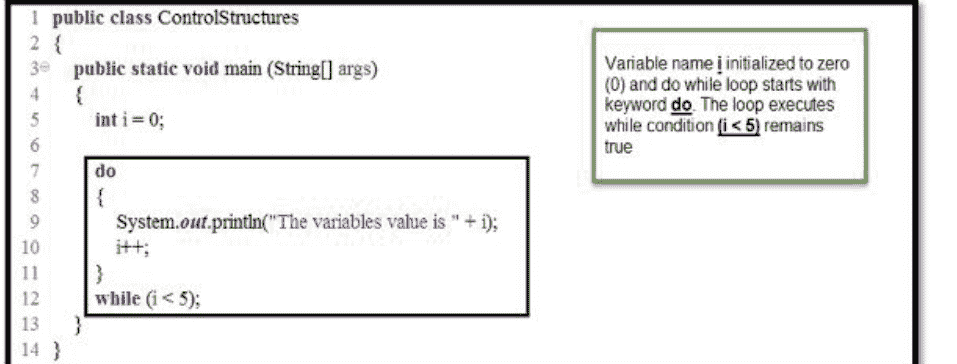

图 4.16 – Do While 循环示例

## 程序输出：

The variables value is 0
The variables value is 1
The variables value is 2
The variables value is 3
The variables value is 4

第五行将变量`i`初始化为零`0`。关键字`do`启动 do while 循环，后面是两个用大括号括的语句。当条件`i < 5`为真时，通过第九行重复打印变量`i`的值。碰巧的是，条件是在第 12 行语句之后评估的。与 while 循环一样，如果第 10 行没有递增运算符`++`，就会发生无限循环。然而，在这个示例中，条件是`i > 5`，它在第一次迭代后为假，因此循环终止。（注：OCR 文本在逻辑描述与代码之间存在一些不一致，但根据提供的文本，条件是在语句之后评估的）。

The condition is evaluated after the statement at line 12. Like the while loop, an infinite loop would have occurred if the increment operator (`++`) was not added at line 10. However, in this example, the condition is `i > 5`, which is false after the first iteration, so the loop terminates.

## 继续执行下一条语句

`continue`关键字强制停止当前的循环迭代并立即执行下一次循环迭代。结果是两个间隔之间的条件和语句都会被跳过。以下是一个使用`continue`关键字跳过所有奇数的示例：

```java
public class ControlStructures {
    public static void main(String[] args) {
        for (int x = 2; x <= 10; x++) {
            if (x % 2 != 0) continue;
                System.out.println("Even numbers " + x);
        }
    }
}
```

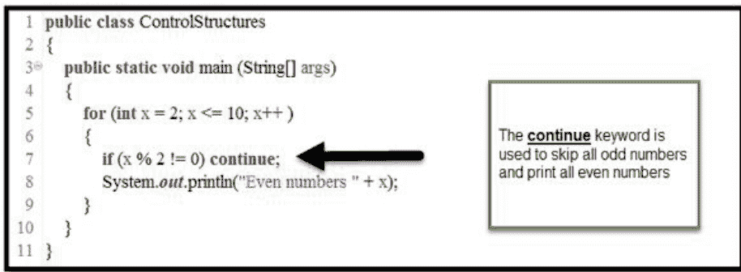

图 4.19 – Continue 关键字

程序输出：
Even numbers 2
Even numbers 4
Even numbers 6
Even numbers 8
Even numbers 10

第七行实现了使用`continue`关键字以跳过所有奇数。因此，当循环控制变量`i`等于一、三、五、七和九时，条件和语句被跳过。

# 结论

"Part 1 – Java 4 Selenium WebDriver" 的目的是提供良好的 Java 基础知识。理解 Java 有助于通过 Selenium 对待测试应用程序 (AUT) 进行测试。在 AUT 中验证数据的关键在于了解如何访问和操作数据。数据由变量表示，变量可以是文本或数字。所有变量必须有一个数据类型以指示其范围和行为。在处理运算符时，数据类型非常重要，因为某些功能是根据数据类型执行的。此外，某些运算符也是形成控制结构的组成部分。以下是书中的重点内容：

- 变量：存储数据的位置
- 数据类型：指变量的类型
- 运算符：执行数学或逻辑操作的符号
- 控制结构：指使用逻辑强制程序跳过或循环语句的过程

第二本 Java 书籍的标题为 "Part 2 – Java 4 Selenium WebDriver"。它研究了类、对象、方法、继承、包、接口、异常处理以及如何使用输入/输出。 "Part 2 – Java 4 Selenium WebDriver" 的发布日期为 2016 年 4 月。

# 资源

- 1. Beginning Java® Programming: The Object-Oriented Approach
  Bart Baesens, Aimée Backiel, Seppe vanden Broucke

- 2. Java A Beginner's Guide Sixth Edition: Create, Compile, and Run Java Programs Today
  Herbert Schildt

- 3. Webopedia
  http://www.webopedia.com/TERM/A/ASCII.html

- 4. Dictionary.Reference.com
  http://dictionary.reference.com/browse/ternary?s=t

- 5. ORACLE Java Documentation: The Java™ Tutorials
  https://docs.oracle.com/javase/tutorial/java/nutsandbolts/operators.html

# Rex Jones II 的著作

- 1. Free Book (Part 1) Absolute Beginner: You Must Learn VBScript for QTP/UFT
  Don't Ignore The Language For Functional Automation Testing

- 2. (Part 2) You Must Learn VBScript for QTP/UFT
  Don't Ignore The Language For Functional Automation Testing

- 3. Free Book (Part 1) Absolute Beginner: Java 4 Selenium WebDriver
  Come Learn How To Program For Automation Testing

即将推出

- 4. (Part 2) Java 4 Selenium WebDriver
  Come Learn How To Program For Automation Testing

- 5. Test Design Techniques: An Important Skill Set for QA/Software Testers

5.


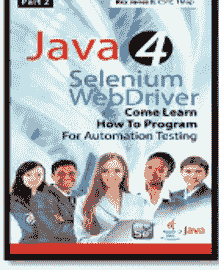


**注意：** 免费书籍通过 eBook 版本提供。

# 注册以接收

- 1. 3 Tips To Master Selenium Within 30 Days
  http://tinyurl.com/3-Tips-For-Selenium

- 2. 3 Tips To Master QTP/UFT Within 30 Days
  http://tinyurl.com/3-Tips-For-QTP-UFT

- 3. Free Webinars, Videos, and Live Trainings
  http://tinyurl.com/Free-QTP-UFT-Selenium
