# Java 绝对指南（附学生资源光盘）

## 第1章 入门

### 1.1 Java简介

- Java语言的起源 ✰
- 对象与方法
- 小程序 ✰
- 一个简单的Java应用程序
- 字节码与Java虚拟机
- 类加载器 ✰
- 编译Java程序或类
- 运行Java程序

### 1.2 表达式与赋值语句

- 标识符
- 变量
- 赋值语句
- 更多赋值语句 ✰
- 赋值兼容性
- 常量
- 算术运算符与表达式
- 括号与优先级规则 ✰
- 整数除法与浮点除法
- 类型转换
- 自增与自减运算符

### 1.3 String类

- 字符串常量与变量
- 字符串连接
- 类
- 字符串方法
- 转义序列
- 字符串处理
- Unicode字符集 ✰

### 1.4 程序风格

- 命名常量
- Java拼写约定
- 注释
- 缩进
- 章节总结
- 自测题答案
- 编程项目

## 第1章 入门

> 她启航——她前行——她仿佛感受到沿着龙骨传来的生命悸动。  
>   
> 亨利·沃兹沃斯·朗费罗，《造船》

## 引言

本章将向你介绍Java语言，并提供足够的细节，使你能够编写涉及表达式、赋值和控制台输出的简单程序。关于赋值和表达式的细节与大多数其他高级语言相似。每种语言都有自己的处理字符串和控制台输出的方式，因此即使是经验丰富的程序员也应该查看相关材料。即使你已经是除Java之外的其他语言的经验丰富的程序员，你也应该至少阅读第1.1节中题为“一个简单的Java应用程序”的小节，最好阅读整个第1.1节，并且你应该阅读整个第1.3节关于字符串的内容，至少浏览一下第1.4节，了解Java定义的常量和注释。

## 前提条件

本书是自包含的，除了一些简单的高中代数外，不需要其他准备。

## 1.1 Java简介

> 消除中间人不一定是个好主意。  
>   
> 摘自我的旧经济学课堂笔记

在本节中，我们将向你概述Java编程语言。

### Java语言的起源

Java作为互联网应用程序的编程语言而闻名。然而，本书以及许多其他书籍和程序员将Java视为适用于几乎所有应用程序（无论是否涉及互联网）的通用编程语言。Java的第一个版本既不是前者也不是后者，但它演变成了这两者。

1991年，詹姆斯·高斯林在太阳微系统公司领导了一个团队，开发了Java的第一个版本（当时还不叫`Java`）。该语言的第一个版本是为家用电器编程而设计的，例如洗衣机和电视机。虽然这可能不是一个非常有吸引力的应用领域，但设计这样的语言并非易事。家用电器由各种各样的计算机处理器（芯片）控制。高斯林设计的语言需要在所有这些不同的处理器上运行。此外，家用电器通常是价格低廉的物品，因此制造商不愿意投入大量资金开发复杂的编译器。（编译器是将程序翻译成处理器能理解的语言的程序。）为了简化为每类电器编写编译器（翻译程序）的任务，该团队使用了两步翻译过程。程序首先被翻译成一种对所有电器（或所有计算机）都相同的`中间语言`，然后一个小型、易于编写且因此廉价的程序将这种中间语言翻译成特定电器或计算机的机器语言。这种中间语言被称为`java字节码`或简称`字节码`。由于只有一种中间语言，因此从程序到中间语言再到机器语言的两步翻译中最困难的步骤对所有电器（或所有计算机）都是相同的，因此节省了翻译成多种机器语言的大部分成本。用于为电器编程的语言从未被电器制造商广泛采用，但它演变成的Java语言已成为广泛使用的编程语言。

为什么叫`字节码`？`code`这个词通常用来表示程序或程序的一部分。字节是存储的小单位（精确地说是八位）。计算机可读的信息通常按字节组织。因此，`字节码`这个术语暗示了计算机可读的程序，而不是人可读的程序。

1994年，太阳微系统公司的帕特里克·诺顿和乔纳森·佩恩开发了一个可以在互联网上运行（Java）程序的网络浏览器。这个网络浏览器已经演变成了名为`HotJava`的浏览器。这是Java与互联网联系的开始。1995年秋天，网景公司使其网络浏览器能够运行Java程序。其他公司纷纷效仿，并开发了支持Java程序的软件。

### 对象与方法

Java是一种`面向对象的编程语言`，缩写为`OOP`。什么是`OOP`？我们周围的世界由对象组成，例如人、汽车、建筑、街道、加法器、文件等等。这些对象中的每一个都有能力执行某些动作，并且这些动作中的每一个都对世界上其他一些对象产生影响。`OOP`是一种编程方法论，它将程序视为由对象组成，这些对象通过动作相互交互。

面向对象的编程有其专门的术语。这些对象被恰当地称为`对象`。对象可以执行的动作称为`方法`。同一类型的对象被认为具有相同的`类型`，或者更常见地说，它们被认为属于同一个`类`。例如，在机场模拟程序中，所有模拟的飞机可能属于同一个类，通常称为`Airplane`类。一个类中的所有对象都具有相同的方法。因此，在模拟程序中，所有飞机都具有相同的方法（或可能的动作），例如起飞、飞往特定位置、降落等等。然而，所有模拟的飞机并不完全相同。它们可以具有不同的特征，这在程序中通过为每个特定的飞机对象关联不同的数据（即一些不同的信息）来表示。例如，与飞机对象关联的数据可能是两个数字，分别表示其速度和高度。

如果你使用过其他编程语言，用其他语言中使用的术语来解释Java术语可能会有所帮助。在其他语言中被称为`过程`、`方法`、`函数`或`子程序`的东西在Java中都被称为`方法`。在Java中，所有方法（以及任何编程构造）都是一个类的一部分。正如我们将看到的，Java `应用程序`是一个包含名为`main`方法的类，当你运行Java程序时，运行时系统会自动调用名为`main`的方法（即，它会自动启动`main`动作）。应用程序是一个“常规”的Java程序；正如我们即将看到的，还有另一种Java程序称为小程序。其他Java术语与大多数其他编程语言中的术语基本相同，并且无论如何，都将在介绍每个概念时进行解释。

### 小程序

有两种Java程序，`小程序`和`应用程序`。应用程序或应用程序程序只是普通的程序。虽然`applet`这个名字听起来可能与苹果有关，但它实际上的意思是`小型Java应用程序`，而不是小苹果。小程序和应用程序几乎完全相同。区别在于应用程序旨在像任何其他程序一样在你的计算机上运行，而`小程序`旨在从网络浏览器中运行，因此可以发送到互联网上的另一个位置并在那里运行。小程序总是使用窗口界面，但并非所有具有窗口界面的程序都是小程序，你将在第16-18章中看到这一点。

尽管小程序被设计为从网络浏览器运行，但它们也可以用一个名为`applet viewer`的程序运行。小程序查看器实际上是作为一个

## 一个Java应用程序示例

示例 1.1 展示了一个简单的 Java 程序及其运行时产生的屏幕显示。Java 程序本质上是一个类定义（不管那是什么）和一个名为`main`的方法。当程序运行时，名为`main`的方法会被调用；也就是说，`main`中指定的操作会被执行。方法`main`的主体包含在花括号`{}`中，因此程序运行时，花括号中的语句会被执行。（如果你对`class`和`method`这些词连一点概念都没有，别担心，它们会被解释的。请继续读下去。）

下面这行说明这个程序是一个名为`FirstProgram`的类：

```java
public class FirstProgram
{
```

接下来的两行，如下所示，开始了`main`方法的定义：

```java
public static void main(String[] args)
{
```

Java 类究竟是什么，以及像`public`、`static`、`void`等词的含义，将在接下来的几章中详细解释。在此之前，你可以将下面重复的这些起始行，理解为一种略显啰嗦的方式来表达“开始名为`FirstProgram`的程序”。

```java
public class FirstProgram
{
    public static void main(String[] args)
    {
```

### 示例 1.1 一个简单的Java程序


```java
1  public class FirstProgram
2  {
3      public static void main(String[] args)
4      {
5          System.out.println("Hello reader.");
6          System.out.println("Welcome to Java.");
7
8          System.out.println("Let's demonstrate a simple calculation.");
9          int answer;
10         answer = 2 + 2;
11         System.out.println("2 plus 2 is " + answer);
12     }
13 }
```

**示例对话**

```text
Hello reader.

Welcome to Java.

Let's demonstrate a simple calculation.

2 plus 2 is 4
```

接下来的两行，如下所示，是程序执行的最初动作：

```java
System.out.println("Hello reader.");
System.out.println("Welcome to Java.");
```

每一行都以`System.out.println`开头。每一行都会导致括号内给定的字符串被输出到屏幕上。例如，考虑：

```java
System.out.println("Hello reader.");
```

这会使这一行：

```text
Hello reader.
```

被写入屏幕。下一个以`System.out.println`开头的行产生的输出会出现在下一行。因此，这两行会产生以下输出：

```text
Hello reader.
Welcome to Java.
```

这些以`System.out.println`开头的行是一种表达“输出括号中显示的内容”的方式，至于为什么指令要这样写，其细节我们暂时无需关心。不过，我们可以简要介绍一下这里发生了什么。

Java 程序通过所谓的`对象`来执行操作。对象执行的操作称为`方法`。`System.out`是一个用于向屏幕发送输出的对象；`println`是该对象执行的方法（即操作）。这个操作是将括号中的内容发送到屏幕上。当一个对象使用一个方法执行操作时，这被称为`调用`该方法（或`调用`该方法）。在 Java 程序中，你通过编写对象，后跟一个点（句号），然后是方法名，以及一些可能包含也可能不包含内容的括号来编写这样的方法调用。括号内的内容（或多个内容）被称为`参数`，它提供了方法执行其操作所需的信息。在这两行以及后面的类似行中，方法都是`println`。方法`println`将某些内容写入屏幕，参数（带引号的字符串）告诉它应该写什么。

`调用方法`有时也被称为向对象`发送消息`。从这个角度看，消息被发送给对象（通过调用方法），作为响应，对象执行一些操作（即被调用的方法所执行的操作）。我们很少使用`发送消息`这个术语，但它是某些程序员和作者使用的标准术语。

Java 中的变量声明与其他编程语言类似。示例 1.1 中的下面一行声明了变量`answer`：

```java
int answer;
```

类型`int`是 Java 中表示整数（整数）的类型之一。因此，这一行表示`answer`是一个可以保存单个整数（整数）的变量。

下面的行是这个第一个程序中唯一真正的计算：

```java
answer = 2 + 2;
```

在 Java 中，等号用作`赋值运算符`，它是一条指令，用于设置等号左侧变量的值。在前面的程序行中，等号并不意味着`answer`等于 2 + 2。相反，等号是一条给计算机的指令，意思是使`answer`等于 2 + 2。

程序的最后一个操作是：

```java
System.out.println("2 plus 2 is " + answer);
```

这是一个与我们之前讨论过的同类输出语句，但其中有一些新东西。请注意，字符串`"2 plus 2 is "`后跟一个加号和变量`answer`。在这种情况下，加号是一个用于连接（拼接）两个字符串的运算符。然而，变量`answer`并不是一个字符串。如果`+`的两个操作数中有一个是字符串，Java 会将另一个操作数（例如`answer`的值）转换为字符串。在这个程序中，`answer`的值为 4，因此`answer`被转换为字符串`"4"`，然后与字符串`"2 plus 2 is "`拼接，因此讨论中的输出语句等同于：

```java
System.out.println("2 plus 2 is 4");
```

这个第一个程序的剩余部分由两个右花括号组成。第一个右花括号结束了方法`main`的定义。最后一个右花括号结束了名为`FirstProgram`的类的定义。

## 自我测试练习

1. 如果以下语句用于 Java 程序中，它会使某些内容被写入屏幕。它会使什么内容被写入屏幕？

   ```java
   System.out.println("Java is not a drink.");
   ```

2. 给出一条或多条可以在 Java 程序中使用的语句，以将以下内容写入屏幕：

   ```text
   I like Java.

   You like tea.
   ```

3. 编写一个完整的 Java 程序，当运行时，使用`System.out.println`将以下内容输出到屏幕：

   ```text
   Hello World!
   ```

   请注意，你无需完全理解程序的所有细节就能编写该程序。你可以简单地遵循示例 1.1 中的程序模式。

## 字节码和Java虚拟机

大多数现代编程语言被设计为（相对）易于人们编写和理解。这些为人们阅读而设计的语言称为`高级语言`。计算机能直接理解的语言称为`机器语言`。机器语言或任何类似于机器语言的语言称为`低级语言`。用高级语言（如 Java）编写的程序必须在运行前被翻译成机器语言程序。执行翻译（或至少大部分翻译）的程序称为`编译器`，翻译过程称为`编译`。

### 编译器

编译器是一种将高级语言程序（如 Java 程序）翻译成等效的低级语言程序的程序。

大多数编程语言的一个缺点是，编译器会将高级语言程序直接翻译成你计算机的机器语言。由于不同的计算机拥有不同的机器语言，这意味着每种类型的计算机都需要一个不同的编译器。然而，Java 采用了一种略有不同且更通用得多的编译方法。

Java 编译器不会将你的程序翻译成特定计算机的机器语言。相反，它将你的 Java 程序翻译成一种叫做`字节码`的语言。字节码不是任何特定计算机的机器语言。字节码是一种名为`Java 虚拟机`的虚构计算机的机器语言。Java 虚拟机与所有典型的计算机非常相似。因此，将用字节码编写的程序翻译成任何特定计算机的机器语言程序很容易。执行此翻译的程序称为`解释器`。解释器结合了字节码的翻译和对应机器语言指令的执行。解释器的工作方式是将一条字节码指令翻译成用你计算机的机器语言表达的指令，然后在你的计算机上执行这些指令。它一次处理一条字节码指令。因此，解释器是逐条翻译并执行字节码中的指令，而不是一次性翻译整个字节码程序。²

要运行 Java 程序，你需要按以下步骤操作。首先，使用编译器将 Java 程序翻译成字节码。然后，使用你计算机上的字节码解释器将每条字节码指令翻译成机器语言，并运行这些机器语言指令。

听起来 Java 字节码只是在这个过程中增加了一个额外的步骤。为什么不编写直接从 Java 翻译成特定计算机机器语言的编译器呢？这正是大多数其他编程语言所采用的方式。然而，Java 字节码使你的 Java 程序具有很强的可移植性。将你的 Java 程序编译成字节码后，你可以在任何计算机上使用该字节码。当你在另一种类型的计算机上运行程序时，你不需要重新编译它。这意味着你可以通过互联网将字节码发送到另一台计算机，并轻松地在那台计算机上运行它。这是 Java 适合互联网应用的原因之一。当然，每种计算机都必须有自己的字节码解释器，但与编译器相比，这些解释器都是简单的程序。

> **字节码**
>
> Java 编译器将你的 Java 程序翻译成一种叫做`字节码`的语言，这是一种虚构计算机的机器语言。将这种字节码翻译成任何特定计算机的机器语言很容易。每种类型的计算机都会有它自己的解释器来翻译和执行字节码指令。

² 有时人们使用术语`Java 虚拟机`（`JVM`）来指代 Java 字节码解释器（同时也指代该解释器所基于的底层假设机器）。

在编译和运行 Java 程序时，你通常甚至意识不到你的程序被翻译成了字节码，而不是直接翻译成机器语言代码。你通常只需给出两个命令，一个用于编译你的程序（成字节码），一个用于运行你的程序。`运行命令`会在字节码上执行 Java 字节码解释器。

当你使用编译器时，术语可能会有点混乱，因为编译器程序的输入和输出也都是程序。眼前的一切都是某种程序。为了确保清楚我们指的是哪个程序，我们将输入程序（在我们的情况下是一个 Java 程序）称为`源程序`或`源代码`，并将编译器产生的翻译后的低级语言程序称为`目标程序`或`目标代码`。`代码`这个词只是指一个程序或程序的一部分。

## 类加载器

Java 程序被分成称为`类`的更小部分，通常每个类定义都在一个单独的文件中，并被单独编译。为了运行你的程序，这些不同类的字节码需要被连接在一起。连接工作由一个称为`类加载器`的程序完成。这种连接通常是自动完成的，因此你通常不需要关心它。（在其他编程语言中，与 Java 类加载器对应的程序称为`链接器`。）

## 编译 Java 程序或类

正如我们在上一小节中提到的，Java 程序被分成多个类。在运行 Java 程序之前，你必须先编译这些类。

在编译 Java 程序之前，程序中使用的每个类定义（由你，程序员编写）都应该在一个单独的文件中。此外，文件名应与类名相同，只是在末尾添加了`.java`。清单 1.1 中的程序是一个名为`FirstProgram`的类，因此它应该在一个名为`FirstProgram.java`的文件中。这个程序只有一个类，但更典型的 Java 程序会包含几个类。


如果你使用的是 IDE（集成开发环境），将会有一个简单的命令可以从编辑器中编译你的 Java 程序。你需要查阅你的本地文档以确切了解该命令是什么，但它肯定会非常简单。（在 TextPad 环境中，命令是 Tools 菜单上的 Compile Java。）

如果你想或需要通过给操作系统一行命令来编译你的 Java 程序或类，那么这很容易做到。我们将描述 Sun Microsystems 发布的 Java 系统（通常称为“SDK”、“JDK”或“Java 2”）的命令。

假设你要编译一个名为`FirstProgram`的类。它位于一个名为`FirstProgram.java`的文件中。要编译它，你只需给出以下命令：

```java
javac FirstProgram.java
```

在执行此`javac`命令时，你应该与文件`FirstProgram.java`位于同一目录（文件夹）中。要编译任何 Java 类，无论它是否是一个完整的程序，命令都是`javac`后跟包含该类的文件名。

当你编译一个 Java 类时，该类生成的字节码将被放入一个同名的文件中，只是文件扩展名从`.java`改为`.class`。因此，当你编译文件`FirstProgram.java`中名为`FirstProgram`的类时，生成的字节码将被存储在名为`FirstProgram.class`的文件中。

### `.class` 文件

## 运行 Java 程序

一个 Java 程序可以由许多不同的类组成，每个类都在不同的文件中。当你运行一个 Java 应用程序时，你只运行你认为是程序的那个类；即，包含`main`方法的那个类。寻找以下开始`main`方法的行：

### 运行 Java 程序

```java
public static void main(String[] args)
```

需要寻找的关键字是`public static void main`。该行的其余部分在某些情况下可能拼写略有不同。

如果你使用的是 IDE，将会有一个菜单命令可用于运行 Java 程序。你需要查阅你的本地文档以确切了解该命令是什么。（在 TextPad 环境中，命令是 Tools 菜单上的 Run Java Application。）

如果你想或需要通过给操作系统一行命令来运行你的 Java 程序，那么（在大多数情况下）你可以通过给出`java`命令后跟包含`main`方法的类名来运行 Java 程序。例如，对于清单 1.1 中的程序，你会给出以下一行命令：

```bash
java FirstProgram
```

请注意，当你运行程序时，你使用类名，例如`FirstProgram`，没有任何`.java`或`.class`后缀。

当你运行 Java 程序时，你实际上是在编译后的程序版本上运行 Java 字节码解释器。当你运行程序时，系统会自动加载你需要的任何类，并在这些类上运行字节码解释器。

我们假设 Java 编译器和相关软件已经为你设置好了。我们也假设所有文件都在一个目录中。（目录也称为文件夹。）如果你需要设置 Java 编译器和系统软件，请查阅软件附带的手册。如果你希望将你的类定义分布在多个目录中，这并不困难，但我们将在以后再讨论这个细节。

## 语法与语义

编程语言或其他任何语言的描述，都可以看作包含两个部分，分别称为该语言的*语法*和*语义*。

**语法**规定了语言中哪些单词和标点的排列组合是合法的。语言的语法通常被称为该语言的*语法规则*。对于 Java，语法描述了在类或程序定义中允许的单词和标点排列组合。

语言的**语义**则描述了遵循语法规则所编写内容的含义。对于 Java 程序，语法描述了你如何编写程序，而语义描述了当你运行程序时会发生什么。

用 Java 编写程序时，你始终同时使用着 Java 语言的语法和语义。

## 错误信息

程序中的错误被称为`bug`。因此，消除程序错误的过程被称为`debugging`。通常识别三种类型的`bug`或错误，它们分别是*语法错误*、*运行时错误*和*逻辑错误*。让我们依次来探讨它们。

**语法错误**是程序中的语法错误；即，在允许的单词和标点排列组合方面的错误。如果你违反了其中一条规则，例如，遗漏了必需的标点，那就是语法错误。编译器会捕获语法错误并输出一条错误信息，告诉你它发现了错误，它认为错误在哪里，以及它认为错误是什么。如果编译器说你有语法错误，那你确实有错误。但是，编译器可能对错误的位置和具体内容判断有误。

直到程序运行时才被检测到的错误被称为**运行时错误**。如果计算机在运行你的程序时检测到运行时错误，它会输出一条错误信息。该错误信息可能不易理解，但至少它让你知道出了问题。

程序底层算法中的错误被称为**逻辑错误**。如果你的程序只有逻辑错误，它将编译并运行，而不会出现任何错误信息。你编写了一个有效的 Java 程序，但它没有实现你想要的功能。程序运行并产生输出，但输出不正确。例如，如果你错误地使用了乘法符号来代替加法符号，那就是一个逻辑错误。逻辑错误是最难定位的一类错误，因为计算机不会给你任何错误信息。

## 自我测试练习

- 4. 什么是编译器？
- 5. 什么是源程序？
- 6. 什么是目标程序？
- 7. 运行 Java 字节码指令的程序称为什么？
- 8. 假设你在一个文件中定义了一个名为`NiceClass`的类。该文件应具有什么名称？
- 9. 假设你编译了`NiceClass`类。生成的字节码文件将叫什么名字？

## 1.2 表达式和赋值语句

> 一旦一个人理解了变量在编程中的使用方式，他就理解了编程的精髓。
>
> E. W. Dijkstra，《结构化编程笔记》

Java 中的变量、表达式和赋值与大多数其他通用语言中的类似概念相似。在本节中，我们将详细描述它们。

### 标识符

变量（或你可能在程序中定义的其他项目）的名称被称为**标识符**。Java 标识符不能以数字开头，所有字符必须是字母、数字或下划线符号。（符号`$`也是允许的，但它被保留用于特殊目的，因此你不应在 Java 标识符中使用`$`。）例如，以下都是有效的标识符：

```text
x x1 x_1 _abc ABC123z7 sum RATE count data2 bigBonus
```

以上所有名称都是合法的，会被编译器接受，但前五个作为标识符的选择不佳，因为它们不能很好地描述标识符的用途。以下都不是合法的标识符，都会被编译器拒绝：

```text
12 3X %change data-1 myfirst.java PROG.CLASS
```

前两个不被允许，因为它们以数字开头。其余四个不是标识符，因为它们包含了字母、数字和下划线符号以外的符号。

Java 是一种**区分大小写**的语言；也就是说，它在拼写标识符时区分大小写字母。因此，以下是三个不同的标识符，可用于命名三个不同的变量：

```text
rate RATE Rate
```

然而，在同一个程序中使用这样两个变体通常不是一个好主意，因为那可能会引起混淆。虽然 Java 不要求这样做，但变量通常拼写时首字母小写。在 Java 编程中，现在已经普遍接受的惯例是，变量名使用大小写字母（和数字）混合拼写，始终以小写字母开头，并用大写字母表示“单词”边界，如下列变量名所示：

```text
topSpeed bankRate1 bankRate2 timeOfArrival
```

Java 标识符理论上可以是任何长度，即使长度不合理地长，编译器也会接受。

> ### 名称（标识符）
>
> Java 程序中某物的名称，如变量、类、方法或对象名称，不能以数字开头，并且只能包含字母、数字（0 到 9）和下划线字符（`_`）。大写和小写字母被视为不同的字符。（符号`$`也是允许的，但它被保留用于特殊目的，因此你不应在 Java 名称中使用`$`。）
>
> 程序中的名称称为**标识符**。
>
> 虽然 Java 语言没有强制要求，但通常的做法（也是本书遵循的做法）是类名以大写字母开头，变量、对象和方法名以小写字母开头。这些名称通常只使用字母和数字拼写。
>
> 有一类特殊的标识符，称为**关键字**或**保留字**，它们在 Java 中具有预定义的含义，不能用作变量或其他任何东西的名称。在本书的代码展示中，关键字以不同的颜色显示，如关键字`public`所示。附录 1 中给出了完整的关键字列表。
>
> 一些预定义的词，如`System`和`println`，不是关键字。这些预定义的词不是核心 Java 语言的一部分，你可以重新定义它们。这些预定义的词不是关键字。然而，它们是在 Java 语言标准所要求的库中定义的。不用说，将预定义标识符用于其标准含义以外的任何目的都可能引起混淆和危险，因此应予以避免。最安全、最简单的做法是将所有预定义标识符都当作关键字来对待。

### 变量

Java 程序中的每个变量在使用前都必须*声明*。当你声明一个变量时，你是在告诉编译器——以及最终——计算机，你将在该变量中存储何种类型的数据。例如，以下是可能出现在 Java 程序中的两个声明：

```java
int numberOfBeans;
double oneWeight, totalWeight;
```

第一个声明了变量`numberOfBeans`，使其可以存储`int`类型的值，即整数。名称`int`是 `"integer"` 的缩写。`int`类型是整数的默认类型。第二个声明将`oneWeight`和`totalWeight`声明为`double`类型的变量，`double`类型是带小数点的数字（称为*浮点数*）的默认类型。如这里所示，当一个声明中有多个变量时，变量用逗号分隔。另外，请注意每个声明都以分号结束。

每个变量在使用前都必须声明。变量可以在任何地方声明，只要在它使用之前声明即可。当然，变量应始终声明在使程序更易于阅读的位置。通常，变量在它们被使用之前或在块的开头（由开括号`{`指示）声明。除了关键字外，任何合法标识符都可以用作变量名。

> ### 变量声明
>
> 在 Java 中，变量必须在使用前声明。变量声明如下：
>
> **语法**
>
> `Type Variable_1, Variable_2, ... ;`
>
> **示例**
>
> `int count, numberOfDragons, numberOfTrolls;`
>
> `char answer;`
>
> `double speed, distance;`

> ### 语法变量
>
> 请记住，当你看到诸如`Type`、`Variable_1`或`Variable_2`这样的内容时，这些词不会字面上出现在你的 Java 代码中。它们是**语法变量**，这意味着它们会被它们所描述的类别中的某些内容所替换。例如，`Type`可以被`int`、`double`、`char`或任何其他类型名称替换。`Variable_1`和`Variable_2`可以各自被任何变量名替换。

Java 拥有用于表示字符、不同种类的整数、不同种类的浮点数（带小数点的数字）以及表示`true`和`false`值的基本类型。这些基本类型被称为原始类型。展示 1.2 列出了 Java 的所有原始类型。整数的首选类型是`int`。`char`类型用于表示单个字符。浮点数的首选类型是`double`。`boolean`类型有两个值：`true`和`false`。（与某些其他编程语言不同，Java 中的`true`和`false`值不是整数，不会自动转换为整数。）预定义类`String`的对象表示字符序列。`String`不是原始类型，但通常与原始类型一起被视为基本类型。本章后续部分将讨论`String`类。

### 展示 1.2 原始类型

| 类型名称 | 值的种类 | 内存占用 | 大小范围 |
| --- | --- | --- | --- |
| `boolean` | `true`或`false` | 1 字节 | 不适用 |
| `char` | 单个字符（Unicode） | 2 字节 | 所有 Unicode 字符 |
| `byte` | 整数 | 1 字节 | -128 到 127 |
| `short` | 整数 | 2 字节 | -32768 到 32767 |
| `int` | 整数 | 4 字节 | -2147483648 到 2147483647 |
| `long` | 整数 | 8 字节 | -9223372036854775808 到 9223372036854775807 |
| `float` | 浮点数 | 4 字节 | -3.40282347 x 10^+38 到 -1.40239846 x 10^-45 |
| `double` | 浮点数 | 8 字节 | ±1.76769313486231570 x 10^+308 到 ±4.94065645841246544 x 10^-324 |

### 赋值语句

改变变量值最直接的方法是使用赋值语句。在 Java 中，等号被用作赋值运算符。赋值语句总是由赋值运算符（等号）左侧的一个变量和右侧的一个表达式组成。赋值语句以分号结束。等号右侧的表达式可以是一个变量、一个数字，或者一个由变量、数字、运算符和方法调用组成的更复杂的表达式。赋值语句指示计算机计算（即求值）等号右侧的表达式，并将左侧变量的值设置为该表达式的值。以下是 Java 赋值语句的示例：

```java
totalWeight = oneWeight * numberOfBeans;
temperature = 98.6;
count = count + 2;
```

第一条赋值语句将`totalWeight`的值设置为变量`oneWeight`中的数值乘以`numberOfBeans`中的数值。（在 Java 中，乘法使用星号`*`表示。）第二条赋值语句将`temperature`的值设置为 98.6。第三条赋值语句将变量`count`的值增加 2。

请注意，变量可以出现在赋值运算符（等号）的两侧。赋值语句

```java
count = count + 2;
```

将`count`的新值设置为`count`的旧值加上 2。

当赋值运算符用于类类型的变量时，需要更多解释，我们将在第 4 章中进行说明。

#### 使用原始类型的赋值语句

当赋值语句等号左侧是一个原始类型的变量时，会引发以下操作：首先，计算等号右侧的表达式，然后将等号左侧的变量设置为该值。

**语法**

`变量 = 表达式;`

**示例**

`distance = rate * time;`

`count = count + 2;`

赋值语句可以用作计算出一个值的表达式。当以这种方式使用时，等号左侧的变量会按我们描述的方式更改，并且该变量的新值也是赋值表达式的值。例如，

```java
number = 3;
```

既将`number`的值更改为 3，又计算出值 3。这允许您链接赋值语句。以下语句将变量`number1`和`number2`的值都更改为 3：

```java
number2 = (number1 = 3);
```

如果没有括号，赋值运算符会自动从右向左执行，因此这通常等效地写成以下形式：

```java
number2 = number1 = 3;
```

18 第 1 章 入门

### 提示

#### 初始化变量

已声明但尚未通过某种方式（例如赋值语句）赋予值的变量被称为**未初始化**。在某些情况下，未初始化的变量可能会被赋予某个默认值，但并非所有情况都是如此。此外，即使你只是重新赋予变量默认值，显式地给变量赋值也能使你的程序更清晰。（关于默认值的确切细节可能会发生变化，不应依赖。）³

确保没有未初始化变量的一个简单方法是在声明时初始化它。只需将声明和赋值语句结合起来，如以下示例所示：

```java
int count = 0;
double speed = 65.5;
char grade = 'A';
int initialCount = 50, finalCount;
```

请注意，你可以在声明中初始化一些变量，而不初始化其他变量。

有时编译器可能会说你未能初始化变量。在大多数情况下，你确实未能初始化该变量。偶尔，编译器在给出此建议时是错误的。然而，在你确信该变量已被初始化之前，编译器不会编译你的程序。为了让编译器满意，请在声明变量时就初始化它，即使该变量在用于任何操作之前会被赋予不同的值。在这种情况下，你无法与编译器争辩。

#### 在声明中初始化变量

你可以将变量的声明与赋予其值的赋值语句结合起来。

**语法**

```java
类型 变量_1 = 表达式_1, 变量_2 = 表达式_2, ...;
```

某些变量可能没有等号和表达式，如第一个示例所示。

**示例**

```java
int numberReceived = 0, lastNumber, numberOfStations = 5;
double speed = 98.9, distance = speed * 10;
char initial = 'J';
```

> ³官方规则是，我们现在使用的变量（我们稍后称之为*局部变量*）不会自动初始化。在本书后面，我们将引入称为*静态变量*和*实例变量*的变量，它们会被自动初始化。但是，我们强烈建议您永远不要依赖自动初始化。

### 更多赋值语句 ☆

有一种简写符号，它结合了赋值运算符（`=`）和一个算术运算符，以便可以通过加、减、乘或除以一个指定值来改变给定变量的值。其一般形式是：

`变量 运算符= 表达式`

等价于：

`变量 = 变量 运算符 (表达式)`

表达式可以是另一个变量、一个常量或一个更复杂的算术表达式。运算符可以是`+`、`-`、`*`、`/`、`%`中的任何一个，以及一些我们尚未讨论的运算符。运算符`%`尚未讨论，但将在本章后面解释。（运算符的完整值列表可以在附录 2 底部的优先级表中查看。）以下是示例：

| 示例： | 等价于： |
| :--- | :--- |
| `count += 2;` | `count = count + 2;` |
| `total -= discount;` | `total = total - discount;` |
| `bonus *= 2;` | `bonus = bonus * 2;` |
| `time /= rushFactor;` | `time = time / rushFactor;` |
| `change %= 100;` | `change = change % 100;` |
| `amount *= count1 + count2;` | `amount = amount * (count1 + count2);` |

### 自测练习

- 10. 以下哪些可以作为 Java 中的变量名？


`rate1`, `1stPlayer`, `myprogram.java`, `long`, `TimeLimit`, `numberOfWindows`

11. 一个 Java 程序能否有两个不同的变量分别命名为 `number` 和 `Number`？

12. 给出两个名为 `feet` 和 `inches` 的变量的声明。两个变量的类型都是 `int`，并且都在声明中初始化为零。

13. 给出两个名为 `count` 和 `distance` 的变量的声明。`count` 的类型是 `int`，并初始化为零。`distance` 的类型是 `double`，并初始化为 1.5。

（续）

## 自我测试练习（续）

14. 编写一个 Java 赋值语句，将变量 `distance` 的值设置为变量 `time` 的值乘以 80。所有变量的类型均为 `int`。

15. 编写一个 Java 赋值语句，将变量 `interest` 的值设置为变量 `balance` 的值乘以变量 `rate` 的值。这些变量的类型为 `double`。

16. 以下程序代码行的输出是什么？

```java
char a, b;
a = 'b';
System.out.println(a);
b = 'c';
System.out.println(b);
a = b;
System.out.println(a);
```

## 赋值兼容性

一般来说，你不能将一个类型的值存储在另一个类型的变量中。例如，编译器会反对以下代码：

```java
int intVariable;
intVariable = 2.99;
```

问题在于类型不匹配。常量 2.99 的类型是 `double`，而变量 `intVariable` 的类型是 `int`。

在某些特殊情况下，允许将一个类型的值赋给另一个类型的变量。将整数类型（例如 `int`）的值赋给浮点类型（例如 `double`）的变量是可以接受的。例如，以下代码既合法又是可接受的风格：

```java
double doubleVariable;
doubleVariable = 2;
```

上述代码将把名为 `doubleVariable` 的变量的值设置为 2.0。同样，将整数类型变量赋给浮点类型变量也是允许的。例如，以下代码是允许的：

```java
int intVariable;
intVariable = 42;
double doubleVariable;
doubleVariable = intVariable;
```

更一般地，你可以将以下列表中任何类型的值赋给列表中更靠后出现的任何类型的变量：

```
byte -> short -> int -> long -> float -> double
```

例如，你可以将 `int` 类型的值赋给 `long`、`float` 或 `double` 类型的变量（当然也可以赋给 `int` 类型的变量），但你不能将 `int` 类型的值赋给 `byte` 或 `short` 类型的变量。请注意，这并非类型的任意排序。当你从左到右沿列表向下移动时，类型的允许值范围变得更大。

你可以将 `char` 类型的值赋给 `int` 类型的变量，或者赋给列表中 `int` 之后的任何数值类型变量（但不能赋给列表中 `int` 之前的类型）。然而，在大多数情况下，将字符赋给 `int` 变量是不明智的，因为结果可能会令人困惑。⁴

如果你想将 `double` 类型的值赋给 `int` 类型的变量，那么你必须使用类型转换来改变值的类型，正如本节后面标题为“类型转换”的部分所解释的那样。

> **赋值兼容性**
> 
> 你可以将以下列表中任何类型的值赋给列表中更靠后出现的任何类型的变量：
> 
> `byte -> short -> int -> long -> float -> double`
> 
> 特别注意，你可以将任何整数类型的值赋给任何浮点类型的变量。你也可以将 `char` 类型的值赋给 `int` 类型的变量或上述列表中 `int` 之后的任何类型。

在 Java 以外的许多其他语言中，你可以将整数赋给 `boolean` 类型的变量，也可以将 `boolean` 值赋给整数变量。在 Java 中你不能这样做。在 Java 中，布尔值 `true` 和 `false` 既不是整数，也不会自动转换为整数。（事实上，从 `boolean` 类型到 `int` 类型或反之亦然进行显式类型转换甚至是非法的。显式类型转换将在本章后面讨论。）

> **整数与布尔值**
> 
> 使用过某些其他语言（如 C 或 C++）的读者可能会惊讶地发现，你不能将 `char` 类型的值赋给 `byte` 类型的变量。这是因为 Java 使用的是 Unicode 字符集而非 ASCII 字符集，因此 Java 为每个 `char` 类型的值保留两个字节的内存，但自然只为 `byte` 类型的值保留一个字节的内存。这是你可能会注意到 Java 使用 Unicode 字符集的少数情况之一。确实，如果你将 `int` 转换为 `char` 或反之亦然，你可以期望得到 ASCII 数字和字符的常规对应关系。同样，你也不能将 `char` 类型的值赋给 `short` 类型的变量，尽管它们都使用两个字节的内存。

## 常量

**常量**或*字面量*是一个特定值的名称。例如，2 和 3.1459 是两个常量。我们更喜欢使用*常量*这个名称，因为它与*变量*一词形成很好的对比。常量不会改变值；变量可以改变它们的值。整数常量以你习惯写数字的方式编写。`int` 类型（或任何其他整数类型）的常量不能包含小数点。浮点类型（`float` 和 `double`）的常量可以以两种形式中的任何一种编写。浮点常量的简单形式类似于日常书写十进制小数的方式。以这种形式书写时，浮点常量必须包含小数点。Java 中没有任何数字常量（无论是整数还是浮点数）可以包含逗号。

浮点常量（例如 `double` 类型的常量）有一种更复杂的表示法，称为**科学计数法**或**浮点表示法**，对于书写非常大的数字和非常小的分数特别方便。例如，

3.67 x 10⁵，等于 367000.0，

在 Java 中最好用常量 `3.67e5` 表示。数字

5.89 x 10⁻⁴，等于 0.000589，

在 Java 中最好用常量 `5.89e–4` 表示。`e` 代表*指数*，意思是“乘以 10 的随后次幂”。`e` 可以是大写或小写。

将 `e` 之后的数字视为告诉你移动小数点的方向和位数。例如，要将 `3.49e4` 改为不带 `e` 的数字，你将小数点向右移动 4 位得到 34900.0，这是同一数字的另一种写法。如果 `e` 之后的数字是负数，你将小数点向左移动指定的空格数，必要时插入额外的零。所以，`3.49e–2` 等于 0.0349。

`e` 之前的数字可以包含小数点，尽管这不是必需的。然而，`e` 之后的指数绝对*不能*包含小数点。

`char` 类型的常量通过将字符放在单引号中表示，如下所示：

```java
char symbol = 'Z';
```

请注意，左单引号和右单引号是相同的符号。

> ### 什么翻倍了？
> 
> 浮点类型 `double` 是如何得名的？是否有另一种名为“单精度”（single）的浮点数类型，其大小只有一半？类似的情况是存在的。确实有一种类型使用一半的存储空间，即 `float` 类型。许多传统编程语言使用两种浮点数类型。一种类型使用较少的存储空间，精度非常低（即它不允许非常多的有意义数字）。第二种类型使用双倍的存储空间，因此可以精确得多；它也允许更大的数字（尽管程序员往往更关心精度而非大小）。使用两倍存储空间的数字被称为双精度数字；使用较少存储空间的数字被称为单精度数字。遵循这一传统，Java 中（大致）对应于这种双精度类型的类型在 Java 中被命名为 `double`。对应于单精度的类型在 Java 中被称为 `float`。
> 
> （实际上，类型名 `double` 是从 C++ 继承的，但这个解释适用于为什么该类型在 C++ 中被命名为 `double`，因此最终它解释了为什么该类型在 Java 中被称为 `double`。）

字符字符串常量用双引号给出，如取自展示 1.1 的以下行所示：

```java
System.out.println("Welcome to Java.");
```

务必注意，字符串常量放在双引号内，而 `char` 类型的常量放在单引号内。两种引号意味着不同的东西。特别是，`'A'` 和 `"A"` 意味着不同的东西。`'A'` 是 `char` 类型的值，可以存储在 `char` 类型的变量中。`"A"` 是一个字符字符串。字符串碰巧只包含一个字符这一事实*并不*使字符串 `"A"` 成为 `char` 类型的值。还要注意，对于字符串和字符，左引号和右引号都是相同的。我们将在本章后面更多地讨论字符串。

`boolean` 类型有两个常量，`true` 和 `false`。这两个常量可以赋给 `boolean` 类型的变量，或在任何允许 `boolean` 类型表达式的地方使用。它们必须全部用小写字母拼写。

## 算术运算符和表达式

与大多数其他语言一样，Java 允许你使用变量、常量和算术运算符来形成表达式：`+`（加法）、`-`（减法）、`*`（乘法）、`/`（除法）、`%`（取模、余数）。这些表达式可以在任何合法使用该表达式类型值的地方使用。

所有的算术运算符都可以用于 `int` 类型的数字、`double` 类型的数字，甚至用于每种类型的一个数字。然而，该值的类型

## 第1章 入门

算术运算产生的结果及其精确值取决于参与运算的数字类型。如果两个操作数（即两个数字）的类型均为 `int`，则用算术运算符组合它们的结果类型为 `int`。如果其中一个或两个操作数的类型为 `double`，则结果类型为 `double`。例如，如果变量 `baseAmount` 和 `increase` 的类型都是 `int`，则以下表达式产生的数字类型为 `int`：

```
baseAmount + increase
```

但是，如果这两个变量中有一个或两个的类型为 `double`，则结果类型为 `double`。将运算符 `+` 替换为 `-`、`*`、`/` 或 `%` 中的任何一个时，情况也是如此。

更一般地说，你可以在表达式中组合任何算术类型。如果所有类型都是整数类型，结果将是整数类型。如果至少一个子表达式是浮点类型，结果将是浮点类型。

通常你只需要知道产生的值是整数类型还是浮点类型。但是，如果你需要知道算术表达式产生的值的确切类型，可以按以下方式确定：产生的值的类型是表达式中使用的类型之一。在表达式中使用的所有类型中（罕见的例外情况除外），它是以下列表中从左到右读取的最后一个类型：

```
byte → short → int → long → float → double
```

以下是罕见的例外情况：在表达式中使用的所有类型中，如果从左到右读取的最后一个类型是 `byte` 或 `short`，则产生的值的类型是 `int`。换句话说，表达式永远不会计算为 `byte` 或 `short` 类型中的任何一个。这些例外与实现细节有关，我们无需关注，尤其是因为我们在本书中几乎从不使用 `byte` 和 `short` 类型。

请注意，此类型序列与我们在讨论赋值兼容性时看到的类型序列相同。从左到右移动时，类型允许的值范围逐渐增大。⁵

## 括号和优先级规则 ☆

如果你想明确指定哪些子表达式与每个运算符组合，可以完全用括号括起表达式。例如：

```
((base + (rate * hours))/(2 + rate))
```

> ⁵ 尽管我们不鼓励这种做法，但你可以在算术表达式中使用 `char` 类型的值和变量，使用 `+` 等运算符。如果你这样做，`char` 值和变量将像 `int` 类型一样对表达式做出贡献。

如果你在算术表达式中省略一些括号，Java 实际上会为你添加括号。添加括号时，Java 遵循称为**优先级规则**的规则，这些规则确定如何用括号括起 `+` 和 `*` 等运算符。这些优先级规则类似于代数中使用的规则。例如，

```
base + rate * hours
```

Java 将其视为如下方式括号化进行求值：

```
base + (rate * hours)
```

因此，乘法将在加法之前执行。除了一些标准情况外，例如一连串的加法或嵌入在加法中的简单乘法，通常最好包含括号，即使预期的分组是由优先级规则决定的。括号使表达式更易于阅读，并且不易出现程序员错误。

显示 1.3 给出了优先级规则的部分列表。完整的 Java 优先级规则在附录 2 中给出。列表中较高的运算符被称为具有**较高的优先级**。当计算机决定将两个相邻操作中的哪一个用括号括起来时，它会先将具有较高优先级的操作及其明显参数括起来，然后再括起具有较低优先级的操作。某些运算符具有相同的优先级，在这种情况下，操作顺序由**结合性规则**确定。结合性规则的简要总结是：具有相同优先级的二元运算符按从左到右的顺序分组。⁶ 具有相同优先级的一元运算符按从右到左的顺序分组。因此，例如，

```
base + rate + hours
```

Java 将其解释为与以下内容相同：

```
(base + rate) + hours
```

并且，例如，

```
+-+rate
```

Java 将其解释为与以下内容相同：

```
+(-(+rate))
```

目前，你可以将程序员明确添加的括号以及由优先级和结合性规则确定的隐式括号视为确定操作执行顺序。例如，在

```
base + (rate * hours)
```

中，乘法首先执行，加法其次执行。

⁶ 此规则有一个例外。一连串的赋值运算符，如 `n1 = n2 = n3;`，是从右向左执行的，正如我们在本章前面提到的。

## 显示 1.3 优先级规则

> **最高优先级**
> 
> - 第一：一元运算符：`+`、`-`、`++`、`--`和 `!`
> - 第二：二元算术运算符：`*`、`/` 和 `%`
> - 第三：二元算术运算符：`+` 和 `-`
> 
> **最低优先级**

实际情况比我们描述的表达式求值要复杂一些，但我们在本章中不会遇到任何这些复杂情况。使用优先级和结合性规则进行表达式求值的完整讨论将在第 3 章中给出。

### 整数和浮点除法

当与一个或两个类型为 `double` 的操作数一起使用时，除法运算符 `/` 的行为如你所料。但是，当与两个类型为 `int` 的操作数一起使用时，除法运算符产生除法得到的整数部分。换句话说，整数除法会舍弃小数点后的部分。因此，`10/3` 是 3（而不是 3.3333…），`5/2` 是 2（而不是 2.5），`11/3` 是 3（而不是 3.6666…）。请注意，数字*不会四舍五入*；无论小数点后的部分有多大，都会被舍弃。

运算符 `%` 可以与类型为 `int` 的操作数一起使用，以恢复使用 `/` 对 `int` 类型数字进行除法时丢失的信息。当与 `int` 类型的值一起使用时，运算符 `/` 和 `%` 产生执行你在小学学到的长除法算法时产生的两个数字。例如，14 除以 3 商 4 余 2。`/` 运算产生一个数“进入”另一个数的次数（通常称为*商*）。`%` 运算给出余数。例如，语句

```
System.out.println("14 divided by 3 is " + (14/3));
System.out.println("with a remainder of " + (14%3));
```

产生以下输出：

```
14 divided by 3 is 4
with a remainder of 2
```

`%` 运算符可用于按 2、3 或任何其他数字计数。例如，如果你想对每个其他整数执行某些操作，你需要知道该整数是偶数还是奇数。然后，你可以对每个偶数整数（或者对每个奇数整数）执行该操作。如果 `n%2` 等于 0，则整数 `n` 为偶数；如果 `n%2` 等于 1，则整数为奇数。类似地，要对每第三个整数执行某些操作，你的程序可能会遍历所有整数 `n`，但仅在 `n%3` 等于 0 时执行该操作。

### 浮点数中的舍入误差

就所有实际目的而言，浮点数只是近似数量。例如，在形式数学中，浮点数 `1.0/3.0` 等于

0.3333333...

其中省略号表示 3 无限延续。计算机以类似于这种十进制表示的格式存储数字，但它只能容纳有限数量的数字。如果它只能存储小数点后的 10 位数字，则 `1.0/3.0` 存储为

0.3333333333

只有 10 个 3。因此，`1.0/3.0` 存储为一个略小于三分之一的数字。换句话说，存储为 `1.0/3.0` 的值仅近似等于三分之一。

实际上，计算机以二进制表示存储数字，而不是以 10 为基数表示，但原理相同，后果也相同。某些浮点数在计算机中存储时会失去精度。

浮点数（如 `double` 类型的数字）和整数（如 `int` 类型的数字）的存储方式不同。浮点数实际上是作为近似数量存储的。整数是作为精确数量存储的。这种差异有时可能很微妙。例如，数字 42 和 42.0 在 Java 中是不同的。整数 42 的类型为 `int`，是一个精确的数量。数字 42.0 的类型为 `double`，因为它包含小数部分（即使分数为 0），因此 42.0 的存储精度有限。

由于这种有限的精度，在浮点数上进行的算术运算仅给出近似结果。此外，人们很容易从浮点数得到与如果数字具有无限精度（小数点后无限位数）时获得的真实结果相去甚远的结果。例如，如果银行程序使用 `double` 类型的数字表示金额，并且没有进行复杂的操作来保持精度，它很快就会使银行倒闭，因为计算的金额经常非常不正确。处理浮点数中的这些不准确性是数值分析领域的一部分，我们将在本书中不讨论此主题。但是，有一种简单的方法可以在处理金额时获得准确性：使用整数代替浮点数（可能一个整数表示美元金额，另一个整数表示美分金额）。

尽管 `%` 运算符主要用于整数，但它也可以与两个浮点数（例如两个 `double` 类型的值）一起使用。但是，我们不会讨论或使用与浮点数一起的 `%`。

### 整数除法

当你对两个整数使用除法运算符 `/` 时，结果会是一个整数。如果你期望得到一个分数，这可能会成为问题。而且，这个问题很容易被忽视，导致程序看起来运行正常，但实际上在产生错误的输出，而你甚至没有意识到问题的存在。例如，假设你是一位景观设计师，每英里收费 5,000 美元来设计一条公路的景观，并且你知道你正在设计的公路长度（以英尺为单位）。你应收取的总费用可以通过以下 Java 语句轻松计算：

```
totalPrice = 5000 * (feet/5280.0);
```

这样计算是可行的，因为一英里等于 5,280 英尺。如果你设计的公路段长度是 15,000 英尺，这个公式将告诉你总价格为：

```
5000 * (15000/5280.0)
```

你的 Java 程序会按如下方式计算出最终值：`15000/5280.0` 的结果是 2.84。然后程序将 5000 乘以 2.84，得到值 14200.00。借助你的 Java 程序，你知道这个项目应该收费 14,200 美元。

现在，假设变量 `feet` 的类型是 `int`，并且你忘记输入小数点和零，导致你程序中的赋值语句变成了：

```
totalPrice = 5000 * (feet/5280);
```


它看起来仍然没问题，但会导致严重的问题。如果你使用这种形式的赋值语句，你是在对两个 `int` 类型的值进行除法运算，因此 `feet/5280` 的结果（即 `15000/5280`）是 `int` 值 2（而不是你认为的 2.84）。因此，赋给 `totalPrice` 的值是 `5000*2`，也就是 10000.00。如果你忘了小数点，你将只收费 10,000 美元。然而，正如我们已经看到的，正确的值是 14,200 美元。一个小数点的缺失让你损失了 4,200 美元。注意，无论 `totalPrice` 的类型是 `int` 还是 `double`，结果都是一样的；在值赋给 `totalPrice` 之前，错误就已经发生了。

### 自测练习

17. 将以下每个数学公式转换为一个 Java 表达式：

- $3x$
- $3x + y$
- $\frac{x + y}{7}$
- $\frac{3x + y}{z + 2}$

18. 以下程序代码行的输出是什么？

```java
double number = (1/3) * 3;
System.out.println("(1/3) * 3 is equal to " + number);
```

19. 以下程序代码行产生的输出是什么？

```java
int quotient, remainder;
quotient = 7/3;
remainder = 7%3;
System.out.println("quotient = " + quotient);
System.out.println("remainder = " + remainder);
```

20. 以下代码产生的输出是什么？

```java
int result = 11;
result /= 2;
System.out.println("result is " + result);
```

21. 给定以下用于将摄氏度转换为华氏度的代码片段，回答以下问题：

```java
double celsius = 20;
double fahrenheit;
fahrenheit = (9/5) * celsius + 32.0;
```

a. 赋给 `fahrenheit` 的值是多少？

b. 解释实际发生的情况，以及程序员可能想要达到什么目的。

c. 按照程序员的意图重写这段代码。

## 类型转换

类型转换接受一个类型的值，并产生另一个类型的值，这是 Java 对该等价值的最佳推测。我们将通过一个简单的除法例子来引入类型转换的概念。

考虑表达式 `9/2`。在 Java 中，这个表达式的求值结果为 4，因为当两个操作数都是整数类型时，Java 执行整数除法。在某些情况下，你可能希望答案是 `double` 值 4.5。你可以通过在表达式 `9/2.0` 中使用“等价的”浮点值 2.0 来代替整数值 2，从而得到 4.5 的结果。但是，如果 9 和 2 是名为 `n` 和 `m` 的 `int` 类型变量的值怎么办？那么，`n/m` 的结果是 4。如果你在这种情况下想要浮点数除法，你必须从 `int` 到 `double`（或另一个浮点类型）进行类型转换，如下所示：

```java
double ans = n/(double)m;
```

表达式

```java
(double)m
```

就是一个类型转换。该表达式接受一个 `int`（在此例中是 `m` 的值），并求值得到一个 `double` 类型的“等价”值。因此，如果 `m` 的值是 2，表达式 `(double)m` 的求值结果为 `double` 值 2.0。注意，`(double)m` 并不会改变变量 `m` 的值。如果在这个表达式求值之前 `m` 的值是 2，那么在这个表达式求值之后 `m` 的值仍然是 2。你可以使用其他类型名称代替 `double`，以获得转换为另一种类型的类型转换。我们说这会产生目标类型的“等价”值。单词“equivalent”加引号是因为在任意两种类型之间，并没有一个明确的等价概念。

在从整数类型到浮点类型的类型转换中，其效果是添加一个小数点和一个零。从浮点类型到整数类型的相反方向的类型转换，则只是删除小数点以及小数点后的所有数字。注意，从浮点类型转换为整数类型时，数字是被截断而不是四舍五入的：`(int)2.9` 的结果是 2，而不是 3。

正如我们前面提到的，你总是可以将整数类型的值赋给浮点类型的变量，例如：

```java
double d = 5;
```

在这种情况下，Java 会执行自动类型转换，将 5 转换为 5.0 并将 5.0 放入变量 `d` 中。如果不进行类型转换，你就无法将 5 存储为 `d` 的值，但有时 Java 会为你执行类型转换。这种自动类型转换有时被称为类型强制转换。

相比之下，如果没有显式类型转换，你就不能将 `double` 值放入 `int` 变量中。以下代码是非法的：

```java
int i = 5.5; // 非法
```

相反，你必须添加一个显式的类型转换，像这样：

```java
int i = (int)5.5;
```

## 自增和自减运算符

自增运算符 `++` 将变量的值加一。自减运算符 `--` 将变量的值减一。它们通常与 `int` 类型的变量一起使用，但也可以用于任何数值类型。

如果 `n` 是一个数值类型的变量，那么 `n++` 将 `n` 的值增加一，而 `n--` 将 `n` 的值减少一。因此，`n++` 和 `n--`（后面跟着分号）是可执行的语句。例如，以下语句：

```java
int n = 1, m = 7;
n++;
System.out.println("The value of n is changed to " + n);
m--;
System.out.println("The value of m is changed to " + m);
```

会产生以下输出：

```text
The value of n is changed to 2
The value of m is changed to 6
```

像 `n++` 这样的表达式在改变变量 `n` 的值的同时，也会求得一个数字值，因此 `n++` 可以在算术表达式中使用，例如：

```java
2*(n++)
```

表达式 `n++` 通过给 `n` 加一来改变其值，但它求值得到的是 `n` 在增加之前的值。例如，考虑以下代码：

```java
int n = 2;
int valueProduced = 2*(n++);
System.out.println(valueProduced);
System.out.println(n);
```

这段代码会产生以下输出：

```text
4
3
```

注意表达式 `2*(n++)`。当 Java 求值这个表达式时，它使用的是该数字在增加之前的值，而不是增加之后的值。因此，即使自增运算符将 `n` 的值改为 3，表达式 `n++` 产生的值仍然是 2。这看起来可能有点奇怪，但有时这正是你想要的。而且，正如你即将看到的，如果你想要一个表现不同的表达式，你可以做到。

表达式 `++n` 也会将变量 `n` 的值增加一，但它求值得到的是 `n` 在增加之后的值。例如，考虑以下代码：

```java
int n = 2;
int valueProduced = 2*(++n);
System.out.println(valueProduced);
System.out.println(n);
```

这段代码与前一段代码相同，只是 `++` 在变量前面，因此这段代码将产生以下输出：

```text
6
3
```

注意，两个自增运算符 `n++` 和 `++n` 对变量 `n` 有完全相同的效果：它们都将 `n` 的值增加一。但这两个表达式求值得到的值不同。记住，如果 `++` 在变量之前，那么自增操作是在返回值之前完成的；如果 `++` 在变量之后，那么自增操作是在返回值之后完成的。

我们所说的关于自增运算符的一切同样适用于自减运算符，只是变量的值是减少一而不是增加一。例如，考虑以下代码：

```java
int n = 8;
int valueProduced = n--;
System.out.println(valueProduced);
System.out.println(n);
```

这会产生输出：

```text
8
7
```

另一方面，代码：

```java
int n = 8;
int valueProduced = --n;
System.out.println(valueProduced);
System.out.println(n);
```

会产生输出：

```text
7
7
```

`n--` 和 `--n` 都通过减一来改变 `n` 的值，但它们求值得到的值不同。`n--` 求值得到的是 `n` 在减少之前的值；而 `--n` 求值得到的是 `n` 在减少之后的值。

你不能对单个变量以外的任何东西应用自增和自减运算符。像 `(x + y)++`、`--(x + y)`、`5++` 等表达式在 Java 中都是非法的。

在更复杂的表达式中使用自增和自减运算符可能会令人困惑，因此，我们倾向于不在表达式内部使用自增或自减运算符，而只将它们用作简单的语句，例如：

```java
n++;
```

### 自我测试练习

22. 以下程序代码行将产生什么输出？

```java
int n = (int)3.9;
System.out.println("n == " + n);
```

23. 以下程序代码行将产生什么输出？

```java
int n = 3;
n++;
System.out.println("n == " + n);
n--;
System.out.println("n == " + n);
```

## 1.3 `String` 类

> 言辞，言辞，不过是言辞，无论是否发自内心。
>
> 威廉·莎士比亚，《特洛伊罗斯与克瑞西达》

Java 中没有用于字符串的原始数据类型。但是，有一个名为 `String` 的类可用于存储和处理字符串。本节将介绍 `String` 类。

### 字符串常量与变量

你已经见过 `String` 类型的常量。双引号括起来的字符串：

```java
"Hello reader."
```

出现在以下来自 Display 1.1 的语句中，就是一个字符串常量：

```java
System.out.println("Hello reader.");
```

双引号括起来的字符串是 `String` 类型的值，尽管通常称其为 `String` 类型的对象，而不是值。`String` 类型的对象是一个被视为单个项目的字符序列。`String` 类型的变量可以命名其中一个字符串对象。

例如，以下声明将 `blessing` 定义为 `String` 变量的名称：

```java
String blessing;
```

以下赋值语句设置 `blessing` 的值，使 `blessing` 成为字符串对象 `"Live long and prosper."` 的另一个名称：

```java
blessing = "Live long and prosper.";
```

声明和赋值可以合并为一条语句，如下所示：

```java
String blessing = "Live long and prosper.";
```

你可以按如下方式将 `String` 变量 `blessing` 命名的对象写入屏幕：

```java
System.out.println(blessing);
```

这将产生屏幕输出：

```text
Live long and prosper.
```

#### `String` 类

`String` 类是一个预定义类，在 Java 中编程时会自动提供给你。`String` 类型的对象是用双引号括起来的字符字符串。例如，以下声明将变量 `motto` 定义为 `String` 类型，并使 `motto` 成为字符串对象 `"We aim to please."` 的名称：

```java
String motto = "We aim to please.";
```

#### 字符串的连接

当你对两个字符串使用 `+` 运算符时，结果是通过连接两个字符串得到更长字符串的字符串。这称为连接。因此，当用于字符串时，`+` 有时被称为连接运算符。例如，考虑以下内容：

```java
String noun = "Strings";
String sentence;
sentence = noun + "are cool.";
System.out.println(sentence);
```

这将设置变量 `sentence` 为 `"Stringsare cool."` 并将以下内容输出到屏幕：

```text
Stringsare cool.
```

请注意，连接两个字符串时不会添加空格。如果你想将 `sentence` 设置为 `"Strings are cool."`，那么你应该更改赋值语句以添加额外的空格。例如，以下内容将添加所需的空格：

```java
sentence = noun + " are cool.";
```

我们在单词 `"are"` 之前添加了一个空格。

> **在字符串中使用 `+` 号**

如果你使用 `+` 运算符连接两个字符串，结果是两个字符串的连接（粘贴）。

**示例**

```java
String name = "Chiana";
String farewell = "Good bye " + name;
System.out.println(farewell);
```

这将 `farewell` 设置为字符串 `"Good bye Chiana"`。因此，它将以下内容输出到屏幕：

```text
Good bye Chiana
```

请注意，我们在 `"Good bye "` 的末尾添加了一个空格。

你可以使用 `+` 运算符连接任意数量的字符串。此外，你可以使用 `+` 运算符将字符串连接到几乎所有其他类型的项目。结果始终是字符串。在大多数情况下，当你使用 `+` 运算符将任何类型的项目连接到字符串时，Java 会将该项目转换为字符串。对于数字，它会做显而易见的事情。例如：

```java
String solution = "The answer is " + 42;
```

将把字符串变量 `solution` 设置为 `"The answer is 42"`。Java 将整数常量 42 转换为字符串 `"42"`，然后连接字符串 `"The answer is "` 和 `"42"` 以获得更长的字符串 `"The answer is 42"`。

请注意，只有当数字或其他值通过加号连接到字符串时，才会转换为字符串对象。如果它通过加号连接到另一个数字，则不会转换为字符串。例如：

```java
System.out.println("100" + 42);
```

输出：

```text
10042
```

但：

```java
System.out.println(100 + 42);
```

输出：

```text
142
```

### 类

类是 Java 的核心，你很快就会定义和使用自己的类。我们在本节讨论的 `String` 类为我们提供了一个机会，来介绍一些用于类的符号和术语。类是一种类型的名称，其值是对象。对象是存储数据并可以执行操作的实体。例如，`String` 类的对象存储由字符字符串组成的数据，例如 `"Hello"`。

对象可以执行的操作称为方法。`String` 类的大多数方法都返回某个值——即产生某个值。例如，方法 `length()` 返回 `String` 对象中的字符数。因此，`"Hello".length()` 返回整数 5，并且此返回值可以按如下方式存储在 `int` 变量中：

```java
int n = "Hello".length();
```

如示例 `"Hello".length()` 所示，方法是通过为对象编写名称，后跟一个点，然后跟带括号的方法名称来调用的。当你调用一个方法时，你（或你的代码）被称为调用该方法，而点之前的对象被称为调用对象。

虽然你可以用常量对象调用方法，如 `"Hello".length()`，但更常见的是使用变量作为调用对象，如下所示：

```java
String greeting = "Hello";
int n = greeting.length();
```

方法调用所需的信息在括号中给出。在某些情况下，如 `length()` 方法，不需要信息（除了调用对象中的数据），括号为空。在其他情况下，我们很快就会看到，必须在括号内提供一些信息。括号中的信息称为实参（或参数）。

调用方法有时也称为向对象发送消息。从这个角度看，向对象发送消息（通过调用方法），对象响应并执行一些操作。例如，响应消息：

```java
greeting.length()
```

对象 `greeting` 以值 5 作答。

同一类中的所有对象都具有相同的方法，但每个对象可以有不同的数据。例如，两个字符串对象 `"Hello"` 和 `"Good-Bye"` 具有不同的数据——即不同的字符字符串。然而，它们具有相同的方法。因此，由于我们知道字符串对象 `"Hello"` 有方法 `length()`，我们知道字符串对象 `"Good-Bye"` 也必然有方法 `length()`。

> **类、对象和方法**

Java 程序通过让称为对象的东西执行操作来工作。这些操作称为方法，通常涉及对象中包含的数据。所有同种类型的对象被称为属于同一个类。因此，类是对象的类别。

当对象执行给定方法的操作时，这称为调用该方法。在括号中提供给方法的信息称为实参（或参数）。

例如，在 Display 1.1 中，`System.out` 是一个对象，`println()` 是一个方法，以下是该对象使用实参 `"Hello reader."` 调用该方法的一个实例：

```java
System.out.println("Hello reader.");
```

你现在已经在 Java 中看到了两种类型：原始类型和类类型。你看到的这两种类型之间的主要区别是类有方法，而原始类型没有方法。我们稍后会看到类和原始类型之间的更多区别。

原始类型和类类型之间的一个较小的区别是，所有原始类型都只使用小写字母拼写，但按照惯例，类类型拼写时首字母大写，如 `String`。

### 字符串方法

`String` 类有许多有用的方法，可用于字符串处理应用程序。Display 1.4 中展示了这些 `String` 方法的一部分。Display 1.4 中使用的一些符号和术语在题为“返回值”的框中进行了描述。更完整的 `String` 方法列表在附录 4 中给出。

### 返回值


像`numberOfGirls + numberOfBoys`这样的表达式会产生一个值。如果`numberOfGirls`的值是 2，`numberOfBoys`的值是 10，那么产生的数字就是 12。数字 12 就是求值该表达式的结果。

某些方法调用是表达式的简单形式，并且任何这样的方法调用都会求值为某个值。如果一个方法调用产生了一个值，我们就说该方法*返回*了该值。例如，假设你的程序执行

```
String greeting = "Hello!";
```

之后，如果你求值`greeting.length()`，返回的值将是 6。因此，以下代码输出整数 6：

```
String greeting = "Hello!";
System.out.println(greeting.length());
```

一个方法可以根据程序中的情况返回不同的值。但是，每个方法只能返回一种类型的值。例如，`String`类的`length`方法总是返回一个`int`值。在显示 1.4 中，方法名前面给出的类型就是该方法返回值的类型。由于`length`总是返回一个`int`值，`length`的条目以

```
int length()
```

开头

与任何方法一样，调用（invoked）一个`String`方法需要写一个`String`对象、一个点、方法名，最后是一对括号，其中包含方法的任何参数。让我们看一些例子。

正如我们已经注意到的，`length`方法可用于查明字符串中的字符数。你可以在任何可以使用`int`类型值的地方调用`length`方法。例如，以下是所有合法的 Java 语句：

```
String greeting = "Hello";
int count = greeting.length();
System.out.println("Length is " + greeting.length());
```

## 显示 1.4 String 类中的某些方法（第 1 部分，共 5 部分）

```
int length()
```

以`int`类型的值返回调用对象（即字符串）的长度。

**示例**

程序执行`String greeting = "Hello!";`之后

`greeting.length()`返回 6。

## 显示 1.4 String 类中的某些方法（第 2 部分，共 5 部分）

```
boolean equals(Other_String)
```

如果调用对象字符串和 *Other_String* 相等，则返回`true`。否则，返回`false`。

**示例**

程序执行`String greeting = "Hello";`之后

`greeting.equals("Hello")`返回`true`

`greeting.equals("Good-Bye")`返回`false`

`greeting.equals("hello")`返回`false`

注意大小写很重要。"Hello" 和 "hello" 不相等，因为一个以大写字母开头，另一个以小写字母开头。

```
boolean equalsIgnoreCase(Other_String)
```

如果调用对象字符串和 *Other_String* 相等，且将字母的大小写视为相同，则返回`true`。否则，返回`false`。

**示例**

程序执行`String name = "mary!";`之后

`greeting.equalsIgnoreCase("Mary!")`返回`true`

```
String toLowerCase()
```

返回一个字符串，其字符与调用对象字符串相同，但所有字母字符都转换为小写。

**示例**

程序执行`String greeting = "Hi Mary!";`之后

`greeting.toLowerCase()`返回 "hi mary!"。

```
String toUpperCase()
```

返回一个字符串，其字符与调用对象字符串相同，但所有字母字符都转换为大写。

**示例**

程序执行`String greeting = "Hi Mary!";`之后

`greeting.toUpperCase()`返回 "HI MARY!"。

（续）

## 显示 1.4 String 类中的某些方法（第 3 部分，共 5 部分）

```
String trim()
```

返回一个字符串，其字符与调用对象字符串相同，但删除了前导和尾随空格。空格字符是在纸上打印为空格的字符，例如空格（空格）字符、制表符和换行符`'\n'`。

**示例**

程序执行`String pause = " Hmm ";`之后

`pause.trim()`返回 "Hmm"。

```
char charAt(Position)
```

返回调用对象字符串中 *Position* 处的字符。位置按 0, 1, 2, ... 计数。

**示例**

程序执行`String greeting = "Hello!";`之后

`greeting.charAt(0)`返回 'H'，而

`greeting.charAt(1)`返回 'e'。

```
String substring(Start)
```

返回调用对象字符串的子字符串，从 *Start* 开始直到调用对象的末尾。位置按 0, 1, 2, ... 计数。请务必注意，位置 *Start* 处的字符包含在返回的值中。

**示例**

程序执行`String sample = "AbcdefG";`之后

`sample.substring(2)`返回 "cdefG"。

```
String substring(Start, End)
```

返回调用对象字符串的子字符串，从位置 *Start* 开始，直到但不包括调用对象的位置 *End*。位置按 0, 1, 2, ... 计数。请务必注意，位置 *Start* 处的字符包含在返回的值中，但位置 *End* 处的字符不包含。

**示例**

程序执行`String sample = "AbcdefG";`之后

`sample.substring(2, 5)`返回 "cde"。

## 显示 1.4 String 类中的某些方法（第 4 部分，共 5 部分）

```
int indexOf(A_String)
```

返回字符串 *A_String* 在调用对象字符串中首次出现的索引（位置）。位置按 0, 1, 2, ... 计数。如果未找到 *A_String*，则返回 -1。

**示例**

程序执行`String greeting = "Hi Mary!";`之后

`greeting.indexOf("Mary")`返回 3，而

`greeting.indexOf("Sally")`返回 -1。

```
int indexOf(A_String, Start)
```

返回字符串 *A_String* 在调用对象字符串中首次出现的索引（位置），该位置在或之后位置 *Start*。位置按 0, 1, 2, ... 计数。如果未找到 *A_String*，则返回 -1。

**示例**

程序执行`String name = "Mary, Mary quite contrary";`之后

`name.indexOf("Mary", 1)`返回 6。

如果将 1 替换为任何小于或等于 6 的数字，将返回相同的值。

`name.indexOf("Mary", 0)`返回 0。

`name.indexOf("Mary", 8)`返回 -1。

```
int lastIndexOf(A_String)
```

返回字符串 *A_String* 在调用对象字符串中最后一次出现的索引（位置）。位置按 0, 1, 2, ... 计数。如果未找到 *A_String*，则返回 -1。

**示例**

程序执行`String name = "Mary, Mary, Mary quite so";`之后

`name.indexOf("Mary")`返回 0，而

`name.lastIndexOf("Mary")`返回 12。

```
int compareTo(A_String)
```

比较调用对象字符串和字符串参数，以查看在词典排序中哪个在前。词典排序与字母顺序相同，但字符顺序如附录 3 所示。注意，在附录 3 中，所有大写字母都按常规字母顺序排列，所有小写字母也按字母顺序排列，但所有大写字母都排在所有小写字母之前。因此，如果两个字符串都是全大写字母或都是全小写字母，则词典排序与字母顺序相同。如果调用字符串在前，则返回一个负值。如果两个字符串相等，则返回零。如果参数在前，则返回一个正数。

**示例**

程序执行`String entry = "adventure";`之后

`entry.compareTo("zoo")`返回一个负数，

`entry.compareTo("adventure")`返回 0，而

`entry.compareTo("above")`返回一个正数。

## 显示 1.4 String 类中的某些方法（第 5 部分，共 5 部分）

```
int compareToIgnoreCase(A_String)
```

比较调用对象字符串和字符串参数，以查看在词典排序中哪个在前，并将大写字母和小写字母视为相同。（准确地说，在进行比较时，所有大写字母都被视为它们的小写版本。）因此，如果两个字符串都完全由字母组成，则比较的是普通的字母顺序。如果调用字符串在前，则返回一个负值。如果忽略大小写两个字符串相等，则返回零。如果参数在前，则返回一个正数。

**示例**

程序执行`String entry = "adventure";`之后

`entry.compareToIgnoreCase("Zoo")`返回一个负数，

`entry.compareToIgnoreCase("Adventure")`返回 0，而

`"Zoo".compareToIgnoreCase(entry)`返回一个正数。

`String`类的某些方法依赖于在字符串中计数位置。位置从 0 开始计数，而不是从 1 开始。因此，在字符串 "Surf time" 中，'S' 位于位置 0，'u' 位于位置 1，依此类推。一个位置通常被称为索引。因此，最好说：'S' 位于索引 0，'u' 位于索引 1，依此类推。

`indexOf`方法可用于查找调用对象子字符串的索引。例如，考虑

```
String phrase = "Java is fun.";
```

在此声明之后，调用`phrase.indexOf("is")`将返回 5，因为 "is" 的 'i' 位于索引 5。（记住，第一个索引是 0，而不是 1。）这在显示 1.5 中进行了说明。

## 显示 1.5 字符串索引

字符串 "Java is fun." 中的 12 个字符的索引为 0 到 11。

| 0 | 1 | 2 | 3 | 4 | 5 | 6 | 7 | 8 | 9 | 10 | 11 |
|---|---|---|---|---|---|---|---|---|---|---|---|
| J | a | v | a |   | i | s |   | f | u | n | . |

> 注意，空格和句点在字符串中也算作字符。

## 转义序列

反斜杠`\`后接一个字符，表示编译器将忽略该字符原本的含义。这样的序列被称为**转义序列**或**转义字符**。转义序列由两个字符组成，中间没有空格。Java 中定义了若干转义序列。

如果想在字符串常量中包含反斜杠`\`或引号`"`，必须使用`\"`来转义引号的结束字符串能力，或者使用`\\`来转义反斜杠的转义能力。`\\`告诉编译器你指的是一个真正的反斜杠`\`，而不是一个转义序列；而`\"`表示一个引号字符，而不是字符串常量的结束。Display 1.6 列出了一些转义序列。

需要注意的是，每个转义序列代表单个字符，尽管它由两个符号拼写而成。因此，字符串`"Say \"Hi\"!"`包含 9 个字符（'S', 'a', 'y', 空格字符, '\"', 'H', 'i', '\"', 和 '!'），而不是 11 个字符。

在带引号的字符串中包含反斜杠有点技巧。例如，字符串`"abc\def"`可能会产生错误消息 "Invalid escape character."。要在字符串中包含反斜杠，需要使用两个反斜杠。字符串`"abc\\def"`如果输出到屏幕上，会产生：

```
abc\def
```

转义序列`\n`表示新行的开始。例如，语句

```
System.out.println("To be or\nNot to be.");
```

将会在屏幕上输出：

```
To be or
Not to be.
```

在带引号的字符串中包含单引号时，你不需要使用转义序列`\'`。例如，`"Time's up!"`是一个有效的带引号字符串。但是，如果你想表示单引号字符的常量，则需要使用`\'`，例如：

```
char singleQuote = '\'';
```

**Display 1.6 转义序列**

```
\" 双引号。
\' 单引号。
\\ 反斜杠。
\n 换行。移动到下一行的开头。
\r 回车。移动到当前行的开头。
\t 制表符。空格直到下一个制表位。
```

## 字符串处理

在 Java 中，`String`类型的对象是一个**不可变对象**，这意味着`String`对象中的字符无法被更改。这一点最终会对我们很重要，但在我们探索 Java 的现阶段，这是一个容易误导人的说法。要理解`String`类型的对象为何不能被更改，请注意 Display 1.4 中的任何方法都没有改变调用该方法的`String`对象的值。`String`类的方法不止 Display 1.4 中显示的那些，但没有任何方法允许你编写类似"将调用对象字符串的第五个字符更改为 'x'"的语句。这是有意为之，目的是使`String`类的实现更高效，以及本书后续将讨论的其他原因。还有另一个字符串类，名为`StringBuffer`，它提供了修改其字符串对象的方法。本书不会讨论`StringBuffer`类，但附录 4 中包含一个解释该类许多方法的表格。

虽然没有任何方法允许你更改`String`对象的值（例如`"Hello"`），但你仍然可以编写程序来更改变量的值，这大概也是你想要的。要执行更改，只需使用赋值语句，如以下示例所示：

```
String name = "Soprano";
name = "Anthony " + name;
```

第二行的赋值语句更改变量`name`的值，使其从`"Soprano"`变为`"Anthony Soprano"`。Display 1.7 展示了一些简单的字符串处理示例。

## Unicode 字符集 ☆

直到最近，大多数编程语言仍使用 ASCII 字符集，该字符集列于附录 3 中。ASCII 字符集实际上是一个列表，包含了通常在英语键盘上使用的所有字符以及一些特殊字符。在这个列表中，每个字符都被分配了一个编号，以便通过存储对应的编号来存储字符。Java（以及现在许多其他编程语言）使用 Unicode 字符集。Unicode 字符集包含了 ASCII 字符集以及许多与英语使用不同字母表的语言中使用的字符。如果你使用的是英语键盘，这通常不是什么大问题。通常，你可以像 Java 使用 ASCII 字符集一样进行编程。ASCII 字符集是 Unicode 字符集的一个子集，也是你最可能使用的子集。因此，列出了 ASCII 字符集的附录 3，实际上列出了我们在本书中将使用的 Unicode 字符集的子集。Unicode 字符集的优点在于它使得处理英语以外的语言变得容易。例如，可以使用希腊字母拼写 Java 标识符（尽管你可能需要希腊语键盘和显示器来实现这一点）。Unicode 字符集的缺点是，存储每个字符有时需要比 Java 仅使用 ASCII 字符集时更多的计算机内存。

## Display 1.7 使用 String 类

```
1  public class StringProcessingDemo
2  {
3    public static void main(String[] args)
4    {
5      String sentence = "I hate text processing!";
6      int position = sentence.indexOf("hate");
7      String ending =
8             sentence.substring(position + ("hate".length()));
9
10     System.out.println("01234567890123456789012");
11     System.out.println(sentence);
12     System.out.println("The word \"hate\" starts at index "
13                            + position);
14
15     sentence = sentence.substring(0, position) + "adore"
16                            + ending;
17     System.out.println("The changed string is:");
18     System.out.println(sentence);
19   }
20 }
```

这里你可以直接使用 4，但如果你的变量是`String`类型而非字符串字面量`"hate"`，则必须像示例中那样使用`length`方法。

> 示例对话

01234567890123456789012

I hate text processing!

The word "hate" starts at index 2

The changed string is:


I adore text processing!

## 自我测试练习

24. 以下代码的输出是什么？

```java
String verbPhrase = "is money";
System.out.println("Time" + verbPhrase);
```

25. 以下代码的输出是什么？

```java
String test = "abcdefg";
System.out.println(test.length());
System.out.println(test.charAt(1));
```

### 自我测试练习（续）

26. 以下代码的输出是什么？

```java
String test = "abcdefg";
System.out.println(test.substring(3));
```

27. 以下代码的输出是什么？

```java
System.out.println("abc\ndef");
```

28. 以下代码的输出是什么？

```java
System.out.println("abc\\ndef");
```

29. 以下代码的输出是什么？

```java
String test = "Hello Tony";
test = test.toUpperCase();
System.out.println(test);
```

30. 以下两行 Java 代码的输出分别是什么？

```java
System.out.println("2 + 2 = " + (2 + 2));
System.out.println("2 + 2 = " + 2 + 2);
```

31. 假设 `sam` 是名为 `Person` 类的一个对象，并且 `increaseAge` 是 `Person` 类的一个方法，该方法接受一个整数参数。如何使用 `sam` 作为调用对象，并使用参数 10 来编写一个调用 `increaseAge` 方法的语句？该方法 `increaseAge` 将会更改 `sam` 中的数据，以模拟 `sam` 年龄增长 10 岁。

## 1.4 程序风格

> 在重要的事情上，  
> 风格，而非真诚，才是至关重要的。  
>
> 奥斯卡·王尔德，《认真的重要性》

Java 编程风格与其他语言类似。其目标是让你的代码易于阅读和易于修改。本节将介绍一些关于良好编程风格的通用要点，以及 Java 程序员通常遵循的一些惯例。

### 命名常量

计算机程序中的数字存在两个问题。首先是它们没有助记价值。例如，当程序中出现数字 10 时，它并未暗示其重要性。如果程序是银行程序，它可能代表分行数量，或者代表总部出纳窗口的数量。要理解程序，你需要知道每个常量的含义。

第二个问题是，当程序需要更改某些数字时，这种更改往往会引入错误。假设 10 在银行程序中出现了 12 次，其中 4 次代表分行数量，8 次代表总部出纳窗口数量。当银行开设新分行并且程序需要更新时，很可能有些本应改为 11 的 10 没有被修改，或者有些不该改的却被改了。

避免这些问题的方法是为每个数字命名，并在程序中使用名称而不是数字。例如，银行程序可能有两个常量，名称为 `BRANCH_COUNT` 和 `WINDOW_COUNT`。这两个数字的值可能都是 10，但当银行开设新分行时，你只需更改 `BRANCH_COUNT` 的定义即可更新程序。

一种命名数字的方法是将一个变量初始化为该数值，如以下示例所示：

```java
int BRANCH_COUNT = 10;
int WINDOW_COUNT = 10;
```

然而，这种命名数字常量的方法存在一个问题：你可能会无意中更改变量的值。Java 提供了一种方法来标记已初始化的变量，使其不可更改。其语法是：

```java
public static final 类型 变量名 = 常量值;
```

例如，名称 `BRANCH_COUNT` 和 `WINDOW_COUNT` 可以被赋予不可更改的值，如下所示：

```java
public static final int BRANCH_COUNT = 10;
public static final int WINDOW_COUNT = 10;
```

这些常量定义必须放在 `main` 方法之外，并且当我们开始有更多方法时，必须放在任何其他方法之外。Display 1.8 阐明了这一点。当我们开始编写具有多个方法的程序和类时，你将看到定义的常量可以在类的所有方法中使用。

我们将在本书后面详细解释修饰符 `public`、`static`、`final`，但我们现在可以解释其大部分含义。部分

```java
int BRANCH_COUNT = 10;
```

### 显示 1.8 注释和命名常量


```java
/**
  显示示例账户余额利息的程序。
  作者：程序员简·Q。
  电子邮件地址：janeq@somachine.etc.etc.
  最后修改日期：2004年9月21日。
  */
public class ShowInterest
{
    public static final double INTEREST_RATE = 2.5;

    public static void main(String[] args)
    {
        double balance = 100;
        double interest; // 以百分比表示

        interest = balance * (INTEREST_RATE/100.0);
        System.out.println("在余额为 $" + balance + " 的情况下");
        System.out.println("您将获得利息 $"
                                   + interest);
        System.out.println("这一切仅需短短一年时间。");
    }

}
```

> 虽然这样做不够清晰，但将 `INTEREST_RATE` 的定义放在这里也是合法的。

#### 示例对话

在余额为 $100.0 的情况下

您将获得利息 $2.5

这一切仅需短短一年时间。

（此处接上文）...仅仅是将 `BRANCH_COUNT` 声明为一个变量并将其初始化为 10。前面的单词以各种方式修饰了变量 `BRANCH_COUNT`。`public` 一词表示你可以在任何地方使用名称 `BRANCH_COUNT`，没有限制。`static` 一词需要等到第 5 章再解释，但务必包含它。`final` 一词意味着值 10 是对 `BRANCH_COUNT` 的最终赋值，或者换句话说，程序不允许更改 `BRANCH_COUNT` 的值。

### Java 命名约定

在 Java 中，与所有编程语言一样，变量、方法和其他项目的标识符应始终是有意义且能暗示其含义的名称。虽然 Java 语言没有要求，但 Java 程序员的常见做法是：类名以大写字母开头，变量、对象和方法的名称以小写字母开头。定义的常量通常全部用大写字母拼写，并使用下划线符号作为“标点”，就像我们在上一小节中所做的那样。

例如，`String`、`FirstProgram` 和 `JOptionPane` 是类，尽管我们尚未讨论最后一个。标识符 `println`、`balance` 和 `readLine` 应该分别是变量、对象或方法。

由于 Java 标识符中不允许使用空格，因此通过大写字母来指示“单词”边界，例如 `numberOfPods`。由于定义的常量全部用大写字母拼写，因此使用下划线符号来指示“单词”边界，例如 `MAX_SPEED`。

标识符 `System.out` 似乎违反了这个约定，因为它命名的是一个对象，但却以大写字母开头。它并没有违反约定，但解释的关键在于我们尚未涵盖的主题。`System` 是一个类的名称。在名为 `System` 的类中，有一个名为 `out` 的对象的定义。因此，标识符 `System.out` 用于表示在 `System` 类（以大写字母开头表示类）中定义的对象 `out`（以小写字母开头表示对象）。这种点表示法将在本书后面解释。

Java 有一个让 Java 新手常常觉得奇怪的约定。Java 程序员通常不在标识符中使用缩写，而是完整拼写。Java 程序员不会使用 `numStars`，而会使用 `numberOfStars`。Java 程序员不会使用 `FirstProg`，而会使用 `FirstProgram`。这可能导致标识符很长，有时甚至非常长。例如，`BufferedReader` 和 `ArrayIndexOutOfBoundsException` 是两个标准 Java 类的名称。第一个将在下一章中使用，第二个将在本书后面使用。

这些长名称导致你输入更多内容，并且使程序行很快就变得太长。然而，使用这些长名称有一个非常好的理由：有了这些长名称，标识符的拼写很少会引起混淆。使用缩写时，你常常记不起标识符是如何缩写的。是 `BufReader` 还是 `BuffReader` 或 `BufferedR` 或 `BR` 或其他什么？由于所有单词都完整拼写，你知道它一定是 `BufferedReader`。一旦习惯了使用这些长名称，大多数程序员会逐渐更喜欢它们。

### 命名常量

为常量（如数字）定义名称的语法如下：

#### 语法

```java
public static final 类型 变量名 = 常量值;
```

#### 示例

```java
public static final int MAX_SPEED = 65;
public static final double MIN_SIZE = 0.5;
public static final String GREETING = "你好，朋友！";
public static final char GOAL = 'A';
```

虽然不是必需的，但程序员通常使用全部大写字母拼写命名常量，并使用下划线符号分隔“单词”。

### 注释

在 Java 程序中插入注释有两种方式。在 Java 中，符号 `//` 用于表示注释的开始。在 `//` 和行尾之间的所有文本都是注释。编译器会忽略一行中 `//` 之后的所有内容。如果你想注释覆盖多行，请在注释的每一行放置一个 `//`。符号 `//` 是两个斜杠（中间没有空格）。用 `//` 表示的注释通常称为行注释。

在 Java 程序中插入注释还有另一种方式。符号对 `/*` 和符号对 `*/` 之间的任何内容都被视为注释，并被编译器忽略。与需要在每一行都加上额外 `//` 的 `//` 注释不同，`/* 到 */` 的注释可以跨越多行，如下所示：

```java
/* 这是一个多行注释。
注意第二行没有任何
注释符号。*/
```

`/* */` 类型的注释通常称为块注释。这些块注释可以插入到程序中任何允许空格或换行符的地方。但是，除了不会分散程序布局的地方外，它们不应插入到其他任何地方。通常，注释仅放置在行尾或单独占一行。

Java 附带一个名为 `javadoc` 的程序，它将自动从你定义的类中提取文档。`javadoc` 程序的工作方式决定了你通常何时使用每种注释。

`javadoc` 程序将在某些情况下提取 `/** */` 注释，但不会提取 `//` 注释。我们将在讨论类定义后进一步说明 `javadoc` 和注释。在此期间，你可能会在我们的代码中注意到以下约定：

我们使用行注释（即 `//` 类型）进行仅供代码编写者或修改代码的程序员阅读的注释，而不是仅供其他使用代码的程序员阅读的注释。

对于将成为我们代码用户文档一部分的注释，我们使用块注释（即 `/* */` 类型）。`javadoc` 程序允许你指示块注释是否有资格被提取为文档。如果开头的 `/*` 有一个额外的星号，像这样 `/**`，那么该注释就有资格被提取。如果只有一个星号，`javadoc` 将不会提取该注释。因此，我们的块注释总是以 `/**` 开头。

很难说一个程序应该包含多少注释。唯一正确的答案是“恰到好处”，这对新手程序员来说当然意义不大。需要一些经验才能体会到何时最好添加注释。只要某事重要且不明显，就值得注释。然而，提供过多的注释与提供过少的注释一样糟糕。每一行都有注释的程序会深埋在注释中，以至于程序结构隐藏在显而易见的观察海洋中。以下这样的注释对理解毫无贡献，不应出现在程序中：

```java
interest = balance * rate; // 计算利息。
```

编写良好的程序被称为自文档化，这意味着程序的结构通过标识符名称的选择和缩进模式清晰可见。一个完全自文档化的程序将不需要这些仅供阅读或修改代码的程序员使用的 `//` 注释。这可能是一个并非总能实现的理想，但如果你的代码充满了 `//` 注释，并且你遵循我们关于何时使用 `//` 注释的约定，那么要么你的注释太多，要么你的代码设计得很差。

显示 1.8 给出了这两种注释的一个非常简单的例子。

### 缩进

随着我们介绍更多 Java 内容，我们将进一步讨论缩进。然而，通用规则易于理解且易于遵循。当一个结构嵌套在另一个结构内部时，内部结构应缩进一级。例如，在我们的程序中，`main` 方法缩进一级，`main` 方法内的语句缩进两级。我们倾向于使用四个空格作为每一级缩进。超过四个空格会占用太多行长度。只要保持一致，每一级缩进只用两个或三个空格也是可行的。一级缩进只用一个空格不足以清晰可见。

## 自我测试练习

1. 32. Java 中有哪两种注释？

2. 33. 以下 Java 代码产生什么输出？

```java
/**
 练习代码。
*/
System.out.println("Hello");
//System.out.print("Mr. or Ms. ");
System.out.println("Student");
```

3. 34. 命名常量的正常拼写约定是什么？

4. 35. 编写一行 Java 代码，将名称 `ANSWER` 赋给整数值 42。换句话说，使 `ANSWER` 成为 42 的命名常量。

## 章节总结

- 编译 Java 类或程序会产生字节码，这是一种为虚构计算机设计的机器语言。当你运行字节码时，一个称为*解释器*的程序会在你的计算机上逐条翻译并执行字节码指令。
- 变量可用于存储值，例如数字。变量的类型必须与存储在变量中的值的类型匹配。所有变量在使用前都必须声明。
- 等号 `=` 在 Java 中用作赋值运算符。赋值语句是一条用于改变变量值的指令。
- 每个变量在程序使用其值之前都应该被初始化。
- 算术表达式中的括号用于指示哪些参数传递给运算符。当省略括号时，Java 会根据优先级规则和结合性规则添加隐式括号。
- 你可以拥有 `String` 类型的变量和常量。`String` 是类类型，而不是基本类型。
- 你可以使用加号连接两个字符串。
- `String` 类中有可用于字符串处理的方法。
- 变量（以及程序中的所有其他项）应被赋予能够表明其用途的名称。
- 你应该为程序中的数字常量定义名称，并使用这些名称，而不是在程序中直接写出数字。
- 程序应在可能的情况下做到自文档化。但是，你也应该插入注释来解释任何不清楚的要点。

## 自测练习答案

1. Java 不是一种饮料。

2. `System.out.println("I like Java.");`

   `System.out.println("You like tea.");`

3.

```java
public class HelloWorld
{
    public static void main(String[] args)
    {
        System.out.println("Hello World!");
    }
}
```

4. 编译器将用 Java 等编程语言编写的程序翻译成低级语言程序。当你编译一个 Java 程序时，编译器会将你的 Java 程序翻译成用 Java 字节码表示的程序。

5. 输入到编译器中的程序称为*源程序*。

6. 编译器产生的翻译后的程序称为*目标程序*或*目标代码*。

7. 运行 Java 字节码指令的程序称为*解释器*。它也常被称为*Java 虚拟机*。

8. `NiceClass.java`

9. `NiceClass.class`

10. `1stPlayer` 可能无法使用，因为它以数字开头；`myprogram.java` 可能无法使用，因为它包含非法符号（点号）；`long` 可能无法使用，因为它是关键字。所有其他名称都可以用作变量名。然而，`TimeLimit` 虽然合法，但违反了所有变量名应以小写字母开头的风格规则。

```java
int feet = 0, inches = 0;
```

```java
int count = 0;
double distance = 1.5;
```

```java
distance = time * 80;
```

```java
interest = balance * rate;
```

```text
b
c
c
```

```text
3*x
3*x + y
(x + y)/7  注意，x + y/7 是不正确的。
(3*x + y)/(z + 2)
```

18. `(1/3) * 3` 等于 0.0。

由于 1 和 3 的类型都是 `int`，`/` 运算符执行整数除法，它会丢弃余数，所以 1/3 的值是 0，而不是 0.3333...。这使得整个表达式的值为 0 * 3，结果当然是 0。

```text
quotient = 2
remainder = 1
```

```text
result is 5
```

21.

a. 52.0

b. 9/5 的整数值是 1；因为分子和分母都是 `int` 类型，所以执行整数除法；小数部分被丢弃。程序员可能想要的是浮点除法，它不会丢弃小数点后的部分。

c.

```java
fahrenheit = (9.0/5) * celsius + 32.0;
```

或者这样：

```java
fahrenheit = 1.8 * celsius + 32.0;
```

22. `n == 3`

23.

`n == 4`

`n == 3`

24. `Time is money`

25.

```text
7
b
```

26. `defg`


27. abc

   def

28. abc\ndef

29. HELLO TONY

30. 输出是

```text
2 + 2 = 4
2 + 2 = 22
```

在表达式`"2 + 2 = " + (2 + 2)`中，`(2 + 2)`里的整数`2`和`2`相加得到整数`4`。当`4`通过加号与字符串`"2 + 2"`连接时，整数`4`被转换为字符串`"4"`，结果是字符串`"2 + 2 = 4"`。

然而，Java 将`"2 + 2 = " + 2 + 2`解释为：

```java
("2 + 2 = " + 2) + 2
```

第一个整数`2`因为它要与字符串`"2 + 2"`组合而被更改为字符串`"2"`。结果是字符串`"2 + 2 = 2"`。最后一个整数`2`与字符串`"2 + 2 = 2"`组合。因此，最后的`2`被转换为字符串`"2"`。所以最终结果是：

```java
"2 + 2 = 2" + "2"
```

即`"2 + 2 = 22"`。

31. `sam.increaseAge(10);`

32. 两种注释是`//`注释和`/* */`注释。`//`之后同一行上的所有内容都是注释。`/*`和匹配的`*/`之间的所有内容都是注释。

33. Hello

   Student

34. 正常的拼写约定是使用全大写字母拼写命名常量，并用下划线符号分隔单词。

```java
public static final int ANSWER = 42;
```

## 编程项目


这些编程项目中的许多都可以使用 AW 的 `CodeMate` 来解决。要访问，请前往：`www.aw-bc.com/codemate`。

1. 衡量运动期间消耗能量的一种方法是使用代谢当量（MET）。以下是一些活动的 MET 值：

   - 以 6 英里/小时跑步：10 METS
   - 打篮球：8 METS
   - 睡觉：1 MET

   每分钟燃烧的卡路里可以用以下公式估算：

   卡路里/分钟 = 0.0175 × MET × 体重（公斤）

   编写一个程序，计算并输出一个体重 150 磅的人以 6 英里/小时的速度跑步 30 分钟，打篮球 30 分钟，然后睡觉 6 小时所燃烧的总卡路里数。1 公斤等于 2.2 磅。


2. 你本地游戏厅的电子游戏机会根据你的游戏表现输出优惠券。你可以用 10 张优惠券兑换一根巧克力棒，或者用 3 张优惠券兑换一个口香糖球。你更喜欢巧克力棒而不是口香糖球。编写一个程序，定义一个变量，初始赋值为你赢得的优惠券数量。接下来，程序应输出如果你先将所有优惠券都花在巧克力棒上，然后用剩余的优惠券兑换口香糖球，你能得到多少巧克力棒和口香糖球。

3. 编写一个程序，从字符串变量`first`设置为你的名，字符串变量`last`设置为你的姓开始。两个名字都应该是全小写。然后你的程序应该创建一个新字符串，其中包含你的全名，使用猪拉丁语，名字和姓氏的第一个字母都大写。只使用将第一个字母移到单词末尾并添加“ay”的猪拉丁语规则。将猪拉丁语名称输出到屏幕。使用`substring`和`toUpperCase`方法来构造新名称。

   例如，给定：

```java
first = "walt";
last = "savitch";
```

   程序应创建一个文本为“Altway Avitchsay”的新字符串并打印出来。

4. 一个政府研究实验室得出结论，一种常用在无糖汽水中的人工甜味剂会导致实验室小鼠死亡。你的一个朋友非常想减肥，但无法戒掉汽水。你的朋友想知道喝多少无糖汽水才不会导致死亡。编写一个程序来提供答案。程序没有输入，但定义了以下项目的常量：杀死一只小鼠所需的人工甜味剂量、小鼠的体重、节食者的初始体重和节食者的期望体重。为确保你朋友的安全，请确保程序使用节食者将停止节食时的体重（而不是节食者的当前体重）来计算节食者可以安全饮用多少汽水。你可以为这些定义常量使用任何合理的值。假设无糖汽水含有千分之一（1/10%）的人工甜味剂。为此分数使用另一个命名常量。你可能想将百分比表示为双精度值`0.001`。（如果你的程序最终没有使用某个定义常量，你可以从程序中删除该定义常量。）

5. 编写一个程序，从一行文本开始，然后输出该行文本，其中第一个出现的`"hate"`被替换为`"love"`。例如，一个可能的示例输出可能是：

```text
The line of text to be changed is:
I hate you.
I have rephrased that line to read:
I love you.
```

   你可以假设单词`"hate"`出现在输入中。如果单词`"hate"`在该行中出现不止一次，你的程序只会替换第一个出现的`"hate"`。由于我们将在第 2 章讨论输入，所以使用一个定义常量作为要更改的字符串。为了使你的程序适用于另一个字符串，你应该只需要更改这个定义常量的定义。

> 要获取更多在线编程项目，请点击下方的 `CodeMate` 图标。


## 第 2 章

控制台输入与输出

- 2.1 屏幕输出 58
  - `System.out.println` 58
  - 使用 `printf` 格式化输出 62
  - 使用 `NumberFormat` 的货币格式 68
  - 导入包和类 72
  - `DecimalFormat` 类 73
- 2.2 使用 `Scanner` 类的控制台输入 78
  - `Scanner` 类 78
  - 空字符串 85
  - 示例：自助结账 88
  - 其他输入分隔符 88
- 章节总结 91
- 自我测验练习答案 91
- 编程项目 93

# 2 控制台输入与输出

> 不要以为你知道什么是计算机终端。计算机终端不是那种笨重的老式电视机前面放个打字机。它是一个接口，让心智和身体能与宇宙连接，并移动其中的一些碎片。
>
> 道格拉斯·亚当斯，《基本无害》
>
> （《银河系漫游曲》三部曲的第五卷）

## 引言

本章涵盖简单的屏幕输出和键盘输入，通常被称为`控制台 I/O`。我们之前已经在使用控制台输出，但本章会更详细地介绍它。具体来说，本章将向你展示如何格式化数值输出，以便你控制小数点后显示的位数等细节。本章还涵盖了 `Scanner` 类，这是 Java 5.0 版本中的新特性，可用于控制台输入。

## 前置知识

本章使用了第 1 章的材料。

## 2.1 屏幕输出

> *让我告诉世界。*
>
> 威廉·莎士比亚，《亨利四世》

在本节中，我们将复习`System.out.println`并介绍一些关于格式化数值输出的材料。作为该材料的一部分，我们将简要介绍*包*和*import 语句*。包是 Java 的类库。`import` 语句使包中的类可供你的程序使用。

### `System.out.println`

我们已经在使用`System.out.println`进行屏幕输出。在显示 1.7 中，我们使用了如下语句将输出发送到显示屏：

```java
System.out.println("The changed string is:");
System.out.println(sentence);
```

`System.out` 是 Java 语言中的一个对象，`println` 是由该对象调用的方法。用点来拼写对象名可能看起来很奇怪，但这暂时不需要我们关心。

当你使用`System.out.println`进行输出时，要输出的数据作为括号中的参数给出，语句以分号结尾。你可以输出的东西包括双引号中的文本字符串，例如`"The changed string is:"`；`String`类型的变量，例如`sentence`；其他类型的变量，例如`int`类型的变量；数字，例如`5`或`7.3`；以及几乎任何其他对象或值。如果你想输出多个项目，只需在要输出的项目之间放置一个加号。例如：

```java
System.out.println("Answer is = " + 42
                 + " Accuracy is = " + precision);
```

如果`precision`的值是`0.01`，输出将是：

```text
Answer is = 42 Accuracy is = 0.01
```

注意`" Accuracy is = "`开头的空格。没有自动添加空格。这里使用的`+`运算符是之前讨论过的连接运算符。所以上面的输出语句将数字`42`转换为字符串`"42"`，然后使用连接形成以下字符串：

```java
"Answer is = 42 Accuracy is = 0.01"
```

`System.out.println`然后输出这个较长的字符串。每次调用`println`都会结束一行输出。例如，考虑以下语句：

```java
System.out.println("A wet bird");
System.out.println("never flies at night.");
```

这两条语句导致以下输出出现在屏幕上：

```text
A wet bird
never flies at night.
```

如果你想让两个或多个输出语句的所有输出放在同一行，那么请使用`print`而不是`println`。例如，语句：

```java
System.out.print("A ");
System.out.print("wet ");
System.out.println("bird");
System.out.println("never flies at night.");
```

产生与我们之前示例相同的输出：

```text
A wet bird
never flies at night.
```

注意，直到使用`println`而不是`print`时，才会开始新行。还要注意，新行是在输出`println`中指定的项目*之后*开始的。这是`print`和`println`之间唯一的区别。

### `println` 与 `print`

`System.out.println`和`System.out.print`之间唯一的区别是，使用`println`时，*下一次*输出会在*新行*上，而使用`print`时，下一次输出会放在*同一行*。

**示例：**

```java
System.out.print("Tom ");
System.out.print("Dick ");
System.out.println("and ");
System.out.print("Harry ");
```

产生以下输出：

```text
Tom Dick and
Harry
```

（无论最后一行是`print`还是`println`，输出看起来都一样。）

描述`print`和`println`之间区别的另一种方式是注意：

```java
System.out.println(SomeThing);
```

等同于：

```java
System.out.print(SomeThing + "\n");
```

### `println` 输出

你可以使用`System.out.println`在屏幕上输出一行。输出的项目可以是带引号的字符串、变量、数字或你在 Java 中可以定义的几乎任何对象。要输出多个项目，请在项目之间放置加号。

**语法：**

```java
System.out.println(Item_1 + Item_2 + ... + Last_Item);
```

**示例：**

```java
System.out.println("Welcome to Java.");
System.out.println("Elapsed time = " + time + " seconds");
```

## 自我测验练习

1. 以下几行产生了什么输出？

   ```java
   String s = "Hello" + "Joe";
   System.out.println(s);
   ```

2. 编写 Java 语句，使以下内容写入屏幕：

   ```text
   One two buckle your shoe.
   Three four shut the door.
   ```

3. `System.out.println`和`System.out.print`之间有什么区别？

4. 以下几行产生了什么输出？

   ```java
   System.out.println(2 + " " + 2);
   System.out.println(2 + 2);
   ```

### 提示

## 格式化输出的不同方法

如果你有一个`double`类型的变量存储着一些金额，你希望你的程序以漂亮的格式输出该金额。但是，如果你只是使用`System.out.println`，你可能会得到看起来像这样的输出：

```text
Your cost, including tax, is $19.98327634144
```

你希望输出看起来像这样：

```text
Your cost, including tax, is $19.98
```

要获得这种更漂亮的输出形式，你需要一些格式化工具。

我们将介绍三种格式化数字（和其他）输出的方法。我们将讨论`printf`方法以及两个格式化类`NumberFormat`和`DecimalFormat`。`printf`方法通常是格式化输出最简单的方式。但是，`printf`使用的是较旧的方法论，因此一些权威人士更喜欢使用`NumberFormat`、`DecimalFormat`或类似的格式化类，因为这些类使用的编程方法论可能更符合现代（面向对象）编程的精神。我们将让你（或者如果你在班级里，则由你的导师）决定使用哪种方法论。在本章之后，本书很少使用这些格式化细节。

## 使用 `printf` 格式化输出

从版本 5.0 开始，Java 包含一个名为`printf`的方法，可用于以特定格式提供输出。`printf`方法的使用方式与`print`方法相同，但允许你添加格式化指令，指定小数点后包含的位数等事项。例如，考虑以下内容：

```java
double price = 19.8;
System.out.print("$");
System.out.printf("%6.2f", price);
System.out.println(" each");
```

此代码输出以下行：

```text
$ 19.80 each
```

行：

```java
System.out.printf("%6.2f", price);
```

输出字符串`" 19.80"`（一个空格后跟`19.80`），这是变量`price`的值以格式`%6.2f`写入的。在这些简单的示例中，`printf`的第一个参数是一个称为**格式说明符**的字符串，第二个参数是要以该格式输出的数字或其他值。让我们解释这个第一个示例格式说明符。

格式说明符`%6.2f`表示在宽度为 6（容纳六个字符的空间）的**字段**中输出一个浮点数，并在小数点后显示恰好两位数字。所以，`19.8`在宽度为 6 的字段中表示为`"19.80"`。因为`"19.80"`只有五个字符，所以添加一个空格字符以获得 6 个字符的字符串`" 19.80"`。任何额外的空格都添加到输出值的前面（左端）。这就解释了格式说明符`%6.2f`中的`6.2`。`f`表示输出是一个浮点数，即一个带有小数点的数字。我们将很快讨论字符`%`的更多内容，但除了其他方面，它表示后面跟着一个格式规范（在这种情况下，是`6.2f`）。

在继续之前，让我们注意关于`printf`方法的几个细节。注意第一个参数是给出格式说明符的字符串。另外，请注意，`printf`与`print`一样，不会将输出推进到下一行。在这方面，`printf`方法类似于`print`，而不是`println`。

## 第 64 章 控制台输入与输出

`printf`的第一个参数既可以包含文本，也可以包含格式说明符。例如，考虑以下对我们示例的变体：

```java
double price = 19.8;
System.out.printf("$%6.2f each", price);
System.out.println();
```

这段代码也会输出以下内容：

```text
$ 19.80 each
```

格式说明符`%6.2f`之前和之后的文本会与格式化后的数字一起输出。字符`%`标记着待输出文本的结束和格式说明符的开始。格式说明符的结束由一个**转换字符**（本例中的`f`）指示。

其他可能的格式说明符在“显示 2.1”中有所描述。（更完整的说明符列表见附录 4。）转换指定了以指定格式输出的值的类型。请注意，第一个数字指定用于输出值的总空格数。如果该数字大于输出所需的空格数，则在输出值的开头添加额外的空格。如果该数字小于输出所需的空格数，则会添加足够的额外空间以允许输出该值；无论指定的字段宽度如何，`printf`都会使用足够的空间来容纳整个输出值。在诸如`%6.2f`这样的格式说明符中，两个数字都是可选的。你可以省略其中一个或两个，此时 Java 会选择合适的默认值。例如，`%6f`和`%.2f`。注意点号与第二个数字一起。你可以使用仅由一个`%`后跟一个转换字符组成的格式说明符，例如`%f`或`%g`，在这种情况下，Java 会为你决定格式细节。例如，格式说明符`%f`等效于`%.6f`，意味着小数点后六位且输出周围没有额外空格。

`e`和`g`格式说明符在“显示 2.1”中有所部分解释。我们仍需解释`e`和`g`格式说明符中小数点后数字的含义，例如`%8.3e`和`%8.3g`。第一个数字，示例中的`8`，是输出值的总字段宽度。第二个数字（小数点后的那个）指定输出的小数点后的位数。因此，诸如`8.3`这样的数字在`f`、`e`和`g`格式中具有相同的含义。

用于字符串和字符的`s`和`c`格式可以包含一个数字，该数字指定输出值的字段宽度，例如`%15s`和`%2c`。如果没有给出数字，则在输出值前后没有前导或尾随空格。

当输出值未填满指定的字段宽度时，会在输出值前添加空格。此时输出被称为**右对齐**。如果你在`%`后添加一个连字符，任何额外的空格都会放在输出值之后，此时输出被称为左对齐。例如，以下代码：


```java
double value = 12.123;
System.out.printf("Start%8.2fEnd", value);
System.out.println();
System.out.printf("Start%-8.2fEnd", value);
System.out.println();
```

会产生以下输出。第一行在`12.12`之前有三个空格，第二行在`12.12`之后有三个空格。

```
Start  12.12End
Start12.12    End
```

到目前为止，我们只使用`printf`输出一个值。然而，`printf`可以输出任意多个值。第一个参数始终是一个称为格式字符串的字符串，其后可以跟任意多个附加参数，每个参数都是要输出的值。格式字符串应为每个输出值包含一个格式说明符，例如`%6.2f`或`%s`，并且它们应与要输出的值的顺序相同。例如：

```java
double price = 19.8;
String name = "magic apple";
System.out.printf("$%.2f for each %s.", price, name);
System.out.println();
System.out.println("Wow");
```

### 显示 2.1 `System.out.printf` 的格式说明符

| 转换字符 | 输出类型 | 示例 |
| :--- | :--- | :--- |
| `d` | 十进制（普通）整数 | `%5d`, `%d` |
| `f` | 定点（日常表示法）浮点数 | `%6.2f`, `%f` |
| `e` | E-表示法浮点数 | `%8.3e`, `%e` |
| `g` | 通用浮点数（Java 决定是否使用 E-表示法） | `%8.3g`, `%g` |
| `s` | 字符串 | `%12s`, `%s` |
| `c` | 字符 | `%2c`, `%c` |

这段代码输出如下：

```
$ 19.80 for each magic apple.
Wow
```

请注意，格式字符串可以包含文本以及格式说明符，并且该文本会与`printf`的其他参数值一起输出。你可以在格式字符串中包含换行符。例如，以下两行代码：

```java
System.out.printf("$%6.2f for each %s.", price, name);
System.out.println();
```

可以替换为下面使用转义序列`\n`的单行代码：

```java
System.out.printf("$%6.2f for each %s.\n", price, name);
```

虽然在格式字符串中使用转义序列`\n`表示换行是合法的，但更推荐使用`%n`。当输出`\n`时，具体行为可能因系统而异，而`%n`在任何系统上都应该表示一个简单的换行符。因此，如果我们使用`%n`重写最后一行代码，会更健壮：

```java
System.out.printf("$%6.2f for each %s.%n", price, name);
```

我们讨论的许多`printf`细节在“显示 2.2”中给出的程序中得到了说明。

> 提示：使用`printf`格式化金额

一个很好的格式说明符，用于输出存储为`double`类型（或其他浮点类型）的金额，是`%.2f`。它表示小数点后恰好两位数字，并使用该值可以容纳的最小字段宽度。例如：

```java
double price = 19.99;
System.out.printf("The price is $%.2f each.", price);
```

产生输出：

```
The price is $19.99 each.
```

### 显示 2.2 `printf`方法（第 1 部分，共 2 部分）

```java
1  public class PrintfDemo
2  {
3      public static void main(String[] args)
4      {
5          String aString = "abc";
6
7          System.out.println("String output:");
8          System.out.println("START1234567890");
9          System.out.printf("START%sEND %n", aString);
10         System.out.printf("START%4sEND %n", aString);
11         System.out.printf("START%2sEND %n", aString);
12         System.out.println();
13
14         char oneCharacter = 'Z';
15
16         System.out.println("Character output:");
17         System.out.println("START1234567890");
18         System.out.printf("START%cEND %n", oneCharacter);
19         System.out.printf("START%4cEND %n", oneCharacter);
20         System.out.println();
21
22         double d = 12345.123456789;
23
24         System.out.println("Floating-point output:");
25         System.out.println("START1234567890");
26         System.out.printf("START%fEND %n", d);
27         System.out.printf("START%.4fEND %n", d);
28         System.out.printf("START%.2fEND %n", d);
29         System.out.printf("START%12.4fEND %n", d);
30         System.out.printf("START%eEND %n", d);
31         System.out.printf("START%12.5eEND %n", d);
32     }
33 }
```

### 显示 2.2 `printf`方法（第 2 部分，共 2 部分）

示例对话：

```
String output:
START1234567890
STARTabcEnd
START abcEnd
STARTabcEnd
```

> 值总是被输出。如果指定的字段宽度太小，则会占用额外的空间。

```
Character output:
START1234567890
STARTZEND
START    ZEND
```

```
Floating-point output:
START1234567890
START12345.123457END
START12345.1235END
START12345.12END
START    12345.1235END
START1.234512e+04END
START 1.23451e+04END
```

> 请注意，当丢弃数字时，输出是四舍五入的，而不是截断的。

提示。

### 遗留代码

有些代码替换成本太高，因此即使它“过时”或不那么理想也仍在使用。这种代码被称为遗留代码。处理遗留代码的一种方法是将其翻译成更现代的语言。Java方法`printf`与 C 语言中同样名为`printf`的函数¹本质上是相同的。这样做是为了便于将 C 代码翻译成 Java 代码。

¹ 方法在 C 语言中称为函数。

## `System.out.printf`

`System.out.printf`用于格式化的屏幕输出。`System.out.printf`可以有任意数量的参数。第一个参数始终是用于剩余参数的格式字符串。除第一个外的所有参数都是要输出到屏幕的值，这些值根据格式字符串指定的格式输出。格式字符串可以包含文本和格式说明符，这些文本会与值一起输出。

## 自我测试练习

5. 以下代码会产生什么输出？

   ```java
   String aString = "Jelly beans";

   System.out.println("START1234567890");
   System.out.printf("START%sEND %n", aString);
   System.out.printf("START%4sEND %n", aString);
   System.out.printf("START%13sEND %n", aString);
   System.out.println();
   ```

6. 以下代码会产生什么输出？对于每一行输出，描述该行是以空格开始还是以空格结束。

   ```java
   String aString = "Jelly beans";
   double d = 123.1234567890;

   System.out.println("START1234567890");
   System.out.printf("START%sEND %n %9.4f %n", aString, d);
   ```

7. 编写一条 Java 语句，将类型为`double`的变量`d`的值输出到屏幕。输出应采用科学计数法，小数点后保留三位数字。输出应位于宽度为 15 的字段中。

## 使用`NumberFormat`的货币格式

使用`NumberFormat`类，你可以让 Java 在输出金额时使用适当的格式。该技术如“显示 2.3”所示。让我们看看`main`方法中进行格式化的代码。首先考虑以下内容：

```java
NumberFormat moneyFormatter =
    NumberFormat.getCurrencyInstance();
```

方法调用`NumberFormat.getCurrencyInstance()`生成一个`NumberFormat`类的对象，并将该对象命名为`moneyFormatter`。你可以使用任何有效的标识符（非关键字）代替`moneyFormatter`。这个`moneyFormatter`对象有一个名为`format`的方法，该方法接受一个浮点数作为参数，并返回一个表示该数字为本地货币（默认货币）的字符串值。例如，调用：

```java
moneyFormatter.format(19.8)
```

假设默认货币是美元，则返回字符串值`"$19.80"`。在“显示 2.3”中，此方法调用出现在`System.out.println`语句内部，但在任何合法字符串值出现的地方都是合法的。例如，以下用法是合法的：

```java
String moneyString = moneyFormatter.format(19.8);
```

为了使`NumberFormat`类对你的代码可用，你必须在包含程序的文件开头附近包含以下内容：

```java
import java.text.NumberFormat;
```

这在“显示 2.3”中有所说明。方法调用`NumberFormat.getCurrencyInstance()`生成一个根据默认位置格式化数字的对象。在“显示 2.3”中，我们假设默认位置是美国，因此数字作为美元输出。在其他系统上，默认设置应为当地货币。如果你愿意，你可以通过向`NumberFormat.getCurrencyInstance`提供一个参数来指定位置，从而指定当地货币。例如，在“显示 2.3”中，我们使用了常量`Locale.US`来指定位置为美国。以下重复了“显示 2.3”中的相关行：

```java
NumberFormat moneyFormatter2 =
    NumberFormat.getCurrencyInstance(Locale.US);
```

其他一些国家（以及相应的其他货币）的常量在“显示 2.4”中给出。但是，除非你的屏幕能够显示你所使用的常量对应的国家的货币符号，否则输出可能不尽如人意。

这些位置常量是`Locale`类的对象。为了使`Locale`类和这些常量对你的代码可用，你必须在包含程序的文件开头附近包含以下内容：

```java
import java.util.Locale;
```

如果你不使用任何这些位置常量，只使用默认位置，则不需要此导入语句。

`Locale.US`这种表示法可能看起来有点奇怪，但它遵循了 Java 代码中经常使用的惯例。常量名为`US`，但我们特别想要的是`Locale`类中定义的那个名为`US`的常量。所以我们使用`Locale.US`。表示法`Locale.US`意味着在`Locale`类中定义的常量`US`。

## 显示 2.3 货币格式（第 1 部分，共 2 部分）

```java
1  import java.text.NumberFormat;
2  import java.util.Locale;
3  public class CurrencyFormatDemo
4  {
5      public static void main(String[] args)
6      {
7          System.out.println("未格式化：");
8          System.out.println(19.8);
9          System.out.println(19.81111);
10         System.out.println(19.89999);
11         System.out.println(19);
12         System.out.println();
13         System.out.println("默认位置：");
14         NumberFormat moneyFormatter =
15                                 NumberFormat.getCurrencyInstance();
16         System.out.println(moneyFormatter.format(19.8));
17         System.out.println(moneyFormatter.format(19.81111));
18         System.out.println(moneyFormatter.format(19.89999));
19         System.out.println(moneyFormatter.format(19));
20         System.out.println();
21         System.out.println("美国作为位置：");
22         NumberFormat moneyFormatter2 =
23                                 NumberFormat.getCurrencyInstance(Locale.US);
24         System.out.println(moneyFormatter2.format(19.8));
25         System.out.println(moneyFormatter2.format(19.81111));
26         System.out.println(moneyFormatter2.format(19.89999));
27         System.out.println(moneyFormatter2.format(19));
28     }
29 }
```

> 如果你只使用默认位置，则不需要导入`Locale`。

> 注意，这个数字被四舍五入为 19.90。

## 显示 2.3 货币格式（第 2 部分，共 2 部分）- 示例对话

```
未格式化：
19.8
19.81111
19.89999
19

默认位置：
$19.80
$19.81
$19.90
$19.00

美国作为位置：
$19.80
$19.81
$19.90
$19.00
```

> 这假设系统已设置为使用美国作为默认位置。如果你不在美国，你可能会得到你当地货币的格式。

> 无论默认位置设置为哪个国家，这都应该为你提供美国货币的格式。

## 显示 2.4 不同国家货币的区域设置常量

| 区域设置常量 | 国家 |
| :--- | :--- |
| `Locale.CANADA` | 加拿大（货币格式与美国相同） |
| `Locale.CHINA` | 中国 |
| `Locale.FRANCE` | 法国 |
| `Locale.GERMANY` | 德国 |
| `Locale.ITALY` | 意大利 |
| `Locale.JAPAN` | 日本 |
| `Locale.KOREA` | 韩国 |
| `Locale.TAIWAN` | 台湾 |
| `Locale.UK` | 英国（英镑） |
| `Locale.US` | 美国 |

## 输出金额

使用`NumberFormat`类，你可以输出正确格式的金额。为此，请按如下步骤操作：

在包含程序的文件开头附近放置以下内容：

```java
import java.text.NumberFormat;
```

在你的程序代码中，按如下方式创建`NumberFormat`类的对象：

```java
NumberFormat FormatterObject =
    NumberFormat.getCurrencyInstance();
```

在输出金额数字时，使用`FormatterObject.format`方法将数字更改为`String`类型的值，如下所示：


`double moneyAmount = 9.99;`
`System.out.println(FormatterObject.format(moneyAmount));`

`FormatterObject.format(moneyAmount)` 等调用产生的字符串会添加美元符号，并确保小数点后恰好有两位数字。（这假设美元是默认货币。）

以这种方式格式化的数字可以是 `double`、`int` 或 `long` 类型。你可以使用任何（非关键字）标识符代替 `FormatterObject`。一个完整的示例在“显示 2.3”中给出。

上述方法总是以默认货币（通常是当地货币）输出金额。你可以指定你想要其货币的国家。详情请参阅正文。

## 导入包和类

Java 中的库称为**包**。包只是类的集合，它被赋予一个名称并以使其易于被你的 Java 程序访问的方式存储。Java 附带大量标准包。其中两个包名为 `java.text` 和 `java.util`。在“显示 2.3”中，我们使用了 `NumberFormat` 类，它是 `java.text` 包的成员。为了使用 `NumberFormat`，你必须导入该类，我们如下所示进行导入：

```
import java.text.NumberFormat;
```

这种语句称为**导入语句**。在此示例中，导入语句告诉 Java 在 `java.text` 包中查找 `NumberFormat` 类的定义。

如果你想导入 `java.text` 包中的所有类，你可以使用

```
import java.text.*;
```

然后你可以使用`java.text`包中的任何类。导入整个包而不是只导入你使用的类并不会损失任何效率。然而，许多程序员发现，如果只导入他们使用的类，有助于文档编写，这也是我们在本书中将要采用的做法。

在示例 2.3 中，我们还使用了`Locale`类，它位于`java.util`包中。因此，我们还添加了以下导入语句：

```
import java.util.Locale;
```

有一个包不需要导入语句。`java.lang`包包含Java编程的基础类。这些类如此基础，以至于该包总是被自动导入。`java.lang`中的任何类都不需要导入语句即可在你的代码中使用。所以，当我们说一个类位于`java.lang`包中时，你可以在程序中直接使用该类，而无需任何导入语句。例如，`String`类位于`java.lang`包中，因此你可以直接使用它，无需任何导入语句。

关于包的更多内容将在第 5 章介绍。

## 自我测试练习

8. 以下代码会产生什么输出？（假设已给出正确的`import`语句。）

```
NumberFormat exerciseFormatter =
    NumberFormat.getCurrencyInstance(Locale.US);
double d1 = 1.2345, d2 = 15.67890;
System.out.println(exerciseFormatter.format(d1));
System.out.println(exerciseFormatter.format(d2));
```

9. 假设`Robot`类是标准Java库的一部分，位于名为`java.awt`的包中。你需要什么`import`语句才能让`Robot`类在你的程序或其他类中可用？

## DecimalFormat 类

`System.out.println`可以让你输出数字，但没有格式化数字的功能。如果你想以特定格式输出数字，例如小数点后指定位数的数字，那么你必须先将数字转换成显示所需格式的字符串，然后使用`System.out.println`输出该字符串。我们已经见过一种处理金额的方法。`DecimalFormat`类提供了强大的功能，可以用多种方式格式化数字。

## 第 2 章 控制台输入和输出

`DecimalFormat`类位于名为`java.text`的Java包中。因此，你必须在使用`DecimalFormat`类的程序或其他类的文件开头添加以下（或类似）语句：

```
import java.text.DecimalFormat;
```

`DecimalFormat`类的对象有许多不同的方法，可用于生成各种格式的数字字符串。在本小节中，我们将讨论其中一种名为`format`的方法。使用`format`方法的一般方法将在接下来的几页中讨论。

使用`String`模式创建一个`DecimalFormat`类的对象，如下所示：

```
DecimalFormat 变量名 = new DecimalFormat(模式);
```

例如，

```
DecimalFormat formattingObject = new DecimalFormat("000.000");
```

然后可以使用`DecimalFormat`类的`format`方法，将浮点数（例如`double`类型）转换为遵循用于创建`DecimalFormat`对象的`模式`的相应数字字符串。具体来说，`format`调用的形式如下

```
Decimal_Format_Object.format(Double_Expression)
```

它返回一个`String`值，表示`Double_Expression`值的字符串表示形式。`Double_Expression`可以是任何表达式，例如变量或变量求和，其计算结果为`double`类型的值。

例如，考虑以下代码：

```
DecimalFormat formattingObject = new DecimalFormat("000.0000");
String numeral = formattingObject.format(12.3456789);
System.out.println(numeral);
```

这将产生输出

```
012.3457
```

当然，你可以直接在`System.out.println`中使用`format`调用，例如`formattingObject.format(12.3456789)`。因此，以下代码产生相同的输出：

```
System.out.println(formattingObject.format(12.3456789));
```

生成的字符串格式由作为创建`DecimalFormat`类对象的构造函数的参数的`模式`字符串决定。例如，模式 "000.0000" 表示小数点前有三位数字，小数点后有四位数字。请注意，当数字的位数少于正在格式化的数字中的位数时，结果会被四舍五入。如果格式模式与数字的值不一致，例如模式要求数字如123.456在小数点前有两位数字，则违反了格式规则，因此不会丢失任何数字。

模式可以指定小数点前后的确切数字位数，也可以指定最小数字位数。字符 `'0'` 用于表示必需的数字，字符 `'#'` 用于表示可选的数字。例如，模式 `"#0.0##"` 表示小数点前有一位或两位数字，小数点后有一位、两位或三位数字。可选数字 `'#'` 如果是非零数字则显示，如果是零数字则不显示。可选数字 `'#'` 应放置在数字字符串中零占位符可能出现的位置；换句话说，任何可选数字 `'#'` 都应在模式中小数点前的零数字 `'0'` 之前，并且任何可选数字 `'#'` 都应在模式中小数点后的零数字 `'0'` 之后。使用 `"#0.0##"`；不要使用 `"0#.0##"` 或 `"#0.##0"`。

例如，考虑以下代码：

```
DecimalFormat formattingObject = new DecimalFormat("#0.0##");
System.out.println(formattingObject.format(12.3456789));
System.out.println(formattingObject.format(1.23456789));
```

这将产生输出

```
12.346
1.235
```

放置在模式末尾的字符 `'%'` 表示该数字应表示为百分比。 `'%'` 会使数字乘以100并附加百分号 `'%'`。此示例以及其他格式化模式的示例在示例 2.5 中给出。

通过在模式字符串中包含 `'E'` 来指定科学计数法。例如，模式 `"00.###E0"` 近似表示小数点前两位数字，小数点后三位或更少的数字，并且 `'E'` 后至少有一位数字，如 12.346E1。从示例 2.5 中科学计数法的示例可以看出，产生的科学计数法字符串的确切细节可能比我们目前的解释更复杂一些。以下是更多细节：

`'E'` 后指示的数字位数是指数的最小位数。将根据需要使用更多位数。

*尾数*是 `'E'` 前的十进制数。尾数中的最小有效数字位数（即小数点前后的数字位数之和）是小数点前指示的数字位数*加上*小数点后指示的数字位数的*最大值*。例如，12345 使用 `"##0.##E0"` 格式化为 `"12.3E3"`。

## 示例 2.5 DecimalFormat 类（第 1 部分，共 2 部分）

```
import java.text.DecimalFormat;

public class DecimalFormatDemo
{
    public static void main(String[] args)
    {
        DecimalFormat pattern00dot000 = new DecimalFormat("00.000");
        DecimalFormat pattern0dot00 = new DecimalFormat("0.00");

        double d = 12.3456789;
        System.out.println("模式 00.000");
        System.out.println(pattern00dot000.format(d));
        System.out.println("模式 0.00");
        System.out.println(pattern0dot00.format(d));

        double money = 19.8;
        System.out.println("模式 0.00");
        System.out.println("$" + pattern0dot00.format(money));

        DecimalFormat percent = new DecimalFormat("0.00%");

        System.out.println("模式 0.00%");
        System.out.println(percent.format(0.308));

        DecimalFormat eNotation1 =
            new DecimalFormat("#0.###E0"); //小数点前 1 或 2 位数字
        DecimalFormat eNotation2 =
            new DecimalFormat("00.###E0"); //小数点前 2 位数字

        System.out.println("模式 #0.###E0");
        System.out.println(eNotation1.format(123.456));
        System.out.println("模式 00.###E0");
        System.out.println(eNotation2.format(123.456));

        double smallNumber = 0.0000123456;
        System.out.println("模式 #0.###E0");
        System.out.println(eNotation1.format(smallNumber));
        System.out.println("模式 00.###E0");
        System.out.println(eNotation2.format(smallNumber));
    }
}
```

## 显示 2.5 DecimalFormat 类（第 2 部分，共 2 部分）

示例对话

```
Pattern 00.000
12.346
Pattern 0.00
12.35
Pattern 0.00
$19.80
Pattern 0.00%
30.80%
Pattern #0.###E0
1.2346E2
Pattern 00.###E0
12.346E1
Pattern #0.###E0
12.346E-6
Pattern 00.###E0
12.346E-6
```

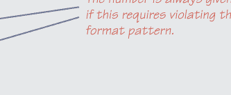

要理解 E-notation 模式的工作原理，亲自尝试几个例子是值得的。无论如何，不要指望它能精确指定有效数字的位数。

**DecimalFormat 类**

DecimalFormat 类的对象用于从数字生成特定格式的字符串。因此，这些对象可用于格式化数字输出。该对象在使用 `new` 创建时与一个模式相关联。然后，该对象可以与 `format` 方法一起使用来创建满足该格式的字符串。有关 DecimalFormat 类使用示例，请参见显示 2.5。

## 2.2 使用 Scanner 类进行控制台输入

> 让世界告诉我。
>
> 弗兰克·莎士比亚，Franky 1

从版本 5.0 开始，Java 包含一个用于执行简单键盘输入的类。在本节中，我们将向你展示如何使用这个名为 Scanner 的类进行键盘输入。

### Scanner 类

显示 2.6 包含一个简单的程序，该程序使用 Scanner 类来读取在键盘上输入的两个 `int` 值。键盘上输入的数字以彩色显示。让我们逐行查看与 Scanner 相关的细节。以下行（应放在文件开头附近）告诉 Java 在哪里可以找到 Scanner 类的定义：

```
import java.util.Scanner;
```

这一行表示 Scanner 类位于 `java.util` 包中；`util` 是 `utility` 的缩写，但在 Java 代码中，你总是使用缩写形式 `util`。包就是一个类库。这个 `import` 语句使得 Scanner 类对你的程序可用。

以下行创建一个 Scanner 类的对象并将该对象命名为 `keyboard`：

```
Scanner keyboard = new Scanner(System.in);
```

在这一行之后，你可以对 `keyboard` 对象使用 Scanner 类的方法来读取用户在键盘上输入的数据。例如，`nextInt` 方法读取在键盘上输入的一个 `int` 值。因此，显示 2.6 中的以下行读取一个 `int` 类型的值并使其成为变量 `numberOfPods` 的值：

```
int numberOfPods = keyboard.nextInt();
```

在显示 2.6 中，这样的两个语句各自读取一个用户在键盘上输入的 `int` 值：

```
int numberOfPods = keyboard.nextInt();
int peasPerPod = keyboard.nextInt();
```

输入的数字必须用空白字符分隔，例如一个或多个空格、换行符或其他空白字符。空白字符是任何一串字符，例如空格、制表符和换行符，当写在（白色）纸上时会打印为空白。

## 显示 2.6 键盘输入演示


```
1  import java.util.Scanner;
2  public class ScannerDemo
3  {
4      public static void main(String[] args)
5      {
6          Scanner keyboard = new Scanner(System.in);
7          System.out.println("Enter the number of pods followed by");
8          System.out.println("the number of peas in a pod:");
9          int numberOfPods = keyboard.nextInt();
10         int peasPerPod = keyboard.nextInt();
11         int totalNumberOfPeas = numberOfPods*peasPerPod;
12         System.out.print(numberOfPods + " pods and ");
13         System.out.println(peasPerPod + " peas per pod.");
14         System.out.println("The total number of peas = "
15                             + totalNumberOfPeas);
16     }
17 }
```

- 使 Scanner 类对你的程序可用。
- 创建一个 Scanner 类的对象并将该对象命名为 `keyboard`。
- 每个从键盘读取一个 `int`

> 示例对话 1
>
> 请输入豆荚的数量，然后输入
> 每个豆荚中的豌豆数量：
> 22 10
> 22 个豆荚，每个豆荚 10 粒豌豆。
> 豌豆总数 = 220

输入的数字必须用空白字符分隔，例如一个或多个空格。

> 示例对话 2
>
> 请输入豆荚的数量，然后输入
> 每个豆荚中的豌豆数量：
> 22
> 10
> 22 个豆荚，每个豆荚 10 粒豌豆。
> 豌豆总数 = 220

换行符也被认为是空白字符，可用于分隔在键盘上输入的数字。

我们经常使用标识符 `keyboard` 作为我们的 Scanner 对象，因为该对象用于键盘输入。但是，你可以使用其他名称。如果你希望你的 Scanner 类对象被命名为 `scannerObject`，你可以使用


```java
Scanner scannerObject = new Scanner(System.in);
```

要从键盘读取一个单独的`int`值并将其保存在`int`变量`n1`中，你可以使用：

```java
n1 = scannerObject.nextInt();
```

这在显示 2.7 中的程序中进行了说明。

显示 2.7 中的程序还说明了用于从键盘读取值的其他一些`Scanner`方法。`nextDouble`方法的工作方式与`nextInt`完全相同，只是它读取一个`double`类型的值。以下示例来自显示 2.7：

```java
double d1, d2;
d1 = scannerObject.nextDouble();
d2 = scannerObject.nextDouble();
System.out.println("You entered " + d1 + " and " + d2);
```

`next`方法读取一个单词，如显示 2.7 中的以下行所示：

```java
String word1 = scannerObject.next();
String word2 = scannerObject.next();
```

如果输入行是：

```text
jelly beans
```

那么这将把字符串`"jelly"`赋给`word1`，把字符串`"beans"`赋给`word2`。

对于`next`方法，单词是由空白字符（如空格或行的开始或结束）分隔的任何非空白字符字符串。

如果你想读取整行，你会使用`nextLine`方法。例如：

```java
String line = scannerObject.nextLine();
```

读取一行输入并将读取的字符串放入变量`line`中。

输入行的结束由转义序列`'\n'`指示。这个`'\n'`字符是你在键盘上按 Enter（回车）键时输入的内容。在屏幕上，它由一行的结束和下一行的开始表示。当`nextLine`读取一行文本时，它会读取这个`'\n'`字符，因此下一次读取输入将从下一行开始。但是，`'\n'`不会成为返回的字符串值的一部分。因此，在前面的代码中，由变量`line`命名的字符串不以`'\n'`字符结尾。

## 另一个键盘输入演示（第 1 部分，共 2 部分）

- 创建一个`Scanner`类的对象并将该对象命名为`scannerObject`。

```java
import java.util.Scanner;

public class ScannerDemo2
{
    public static void main(String[] args)
    {
        int n1, n2;
        Scanner scannerObject = new Scanner(System.in);

        System.out.println("Enter two whole numbers");
        System.out.println("separated by one or more spaces:");

        n1 = scannerObject.nextInt();
        n2 = scannerObject.nextInt();
        System.out.println("You entered " + n1 + " and " + n2);

        System.out.println("Next enter two numbers.");
        System.out.println("Decimal points are allowed.");

        double d1, d2;
        d1 = scannerObject.nextDouble();
        d2 = scannerObject.nextDouble();
        System.out.println("You entered " + d1 + " and " + d2);

        System.out.println("Next enter two words:");

        String word1 = scannerObject.next();
        String word2 = scannerObject.next();
        System.out.println("You entered \"" + word1 + "\" and \"" + word2 + "\"");

        String junk = scannerObject.nextLine(); //To get rid of '\n'

        System.out.println("Next enter a line of text:");
        String line = scannerObject.nextLine();
        System.out.println("You entered: \"" + line + "\"");
    }
}
```

- 从键盘读取一个`int`。
- 从键盘读取一个`double`。
- 从键盘读取一个单词。
- 此行在“处理行终止符`'\n'`”的“常见陷阱”部分有解释。
- 读取整行。

## 第 2 章 控制台输入与输出

### 显示 2.7 键盘输入演示（第 2 部分，共 2 部分）

```text
示例对话

    输入两个整数
    用一个或多个空格分隔：
        42  43
    你输入了 42 和 43
    接下来输入两个数字。
    可以使用小数点。
        9.99  57
    你输入了 9.99 和 57.0
    接下来输入两个单词：
    jelly beans
    你输入了 "jelly" 和 "beans"
    接下来输入一行文本：
    Java flavored jelly beans are my favorite.
    你输入了 "Java flavored jelly beans are my favorite."
```

这些及其他从键盘读取值的方法在显示 2.8 中给出。

### 显示 2.8 `Scanner` 类的方法（第 1 部分，共 2 部分）

`Scanner`类可用于从文件以及键盘获取输入。然而，在此我们假设它仅用于从键盘输入。

要为键盘输入进行设置，你需要在包含键盘输入代码的文件开头添加以下内容：

```java
import java.util.Scanner;
```

在第一条键盘输入语句之前，你还需要以下内容：

```java
Scanner Scanner_Object_Name = new Scanner(System.in);
```

然后，`Scanner_Object_Name`可与以下方法一起使用，以读取和返回在键盘上输入的各种类型的数据。

要读取的值应由空白字符分隔，例如空格和/或换行符。读取值时，这些空白字符会被跳过。（可以将分隔符从空白字符更改为其他内容，但空白字符是默认设置，也是我们将使用的设置。）

```java
Scanner_Object_Name.nextInt()
```

返回在键盘上输入的下一个`int`类型的值。

### 显示 2.8 `Scanner` 类的方法（第 2 部分，共 2 部分）

```java
Scanner_Object_Name.nextLong()
```

返回在键盘上输入的下一个`long`类型的值。

```java
Scanner_Object_Name.nextByte()
```

返回在键盘上输入的下一个`byte`类型的值。

```java
Scanner_Object_Name.nextShort()
```

返回在键盘上输入的下一个`short`类型的值。

```java
Scanner_Object_Name.nextDouble()
```

返回在键盘上输入的下一个`double`类型的值。

```java
Scanner_Object_Name.nextFloat()
```

返回在键盘上输入的下一个`float`类型的值。

```java
Scanner_Object_Name.next()
```

返回由下一个键盘字符组成的`String`值，直到（但不包括）第一个分隔符字符。默认分隔符是空白字符。

```java
Scanner_Object_Name.nextBoolean()
```

返回在键盘上输入的下一个`boolean`类型的值。`true`和`false`的值作为字符串`"true"`和`"false"`输入。拼写`"true"`和`"false"`时允许使用任何大小写字母组合。

```java
Scanner_Object_Name.nextLine()
```

读取当前键盘输入行的剩余部分，并将读取的字符作为`String`类型的值返回。请注意，行终止符`'\n'`被读取并丢弃；它不包含在返回的字符串中。

```java
Scanner_Object_Name.useDelimiter(New_Delimiter);
```

更改`Scanner_Object_Name`的键盘输入分隔符。`New_Delimiter`是一个`String`类型的值。执行此语句后，`New_Delimiter`是分隔单词或数字的唯一分隔符。详情请参阅小节“其他输入分隔符”。

### 使用 `Scanner` 类进行键盘输入

你可以使用`Scanner`类的对象从键盘读取输入。要使`Scanner`类在代码中可用，你应该在包含程序（或其他执行键盘输入的代码）的文件开头包含以下内容：

```java
import java.util.Scanner;
```

在执行任何键盘输入之前，你必须按照以下方式创建`Scanner`类的一个对象：

```java
Scanner Object_Name = new Scanner(System.in);
```

其中`Object_Name`是任何（非关键字）Java 标识符。例如：

```java
Scanner keyboard = new Scanner(System.in);
```

方法`nextInt`、`nextDouble`和`next`分别读取一个`int`类型的值、一个`double`类型的值和一个单词。方法`nextLine`读取当前输入行的剩余部分，包括终止符`'\n'`。但是，`'\n'`不包含在返回的字符串值中。其他输入方法在显示 2.8 中给出。

**语法**

```java
Int_Variable = Object_Name.nextInt()
Double_Variable = Object_Name.nextDouble();
String_Variable = Object_Name.next();
String_Variable = Object_Name.nextLine();
```

**示例**

```java
int number;
number = keyboard.nextInt();
double cost;
cost = keyboard.nextDouble();
String word;
word = keyboard.next();
String line;
line = keyboard.nextLine();
```

### 陷阱

#### 处理行终止符 `'\n'`

`Scanner`类的`nextLine`方法从*上次键盘读取结束的地方*开始读取一行文本的*剩余部分*。例如，假设你按照以下方式创建`Scanner`类的一个对象：

```java
Scanner keyboard = new Scanner(System.in);
```

并假设你继续使用以下代码：

```java
int n = keyboard.nextInt();
String s1 = keyboard.nextLine();
String s2 = keyboard.nextLine();
```

现在，假设键盘上输入的内容是：

```text
2 heads are
better than
1 head.
```

这会将变量`n`的值设置为 2，变量`s1`的值设置为`" heads are"`，变量`s2`的值设置为`"better than"`。

到目前为止没有问题，但假设输入是：

```text
2
heads are better than
1 head.
```

你可能期望变量`n`的值设置为 2，变量`s1`的值设置为`"heads are better than"`，变量`s2`的值设置为`"1 head."`。但实际情况并非如此。

实际发生的情况是，变量`n`的值设置为 2，变量`s1`的值设置为空字符串，变量`s2`的值设置为`"heads are better than"`。`nextInt`方法读取了 2，但没有读取行结束符`'\n'`。因此，第一个`nextLine`调用读取包含 2 的那行的剩余部分。该行上没有其他内容（除了`'\n'`），所以`nextLine`返回空字符串。第二次`nextLine`调用从下一行开始读取`"heads are better than"`。

当组合使用不同的键盘读取方法时，有时需要额外调用一次`nextLine`来清除行尾（即清除`'\n'`）。这在显示 2.8 中有所说明。

### 空字符串

字符串可以有任意数量的字符。例如，`"Hello"`有五个字符。存在一种包含零个字符的字符串，称为空字符串。空字符串通过一对不包含任何内容的双引号书写，例如`""`。空字符串出现的频率可能比你想象的要高。如果你的代码正在执行`nextLine`方法来读取一行文本，而用户在该行上除了按 Enter（回车）键外没有输入任何内容，那么`nextLine`方法就会读取空字符串。

### 输入提示

当你的程序需要用户输入一些数据时，始终提示用户，如以下示例所示：

```java
System.out.println("Enter the number of pods followed by");
System.out.println("the number of peas in a pod:");
```

### 回显输入

你应该始终回显输入。也就是说，你应该将程序从键盘接收到的所有输入写入屏幕。这样，用户可以检查输入是否正确。例如，以下两条来自显示 2.9 程序中的语句回显了为豆荚数量和每荚豌豆数量读取的值：

```java
System.out.print(numberOfPods + " pods and ");
System.out.println(peasPerPod + " peas per pod.");
```

回显输入似乎是多余的，因为用户的输入在输入时会自动显示在屏幕上。为什么要费心将其第二次写入屏幕呢？即使输入看起来正确，也可能是不正确的。例如，用户可能输入了逗号而不是小数点，或者输入了字母 O 而不是数字零。回显输入可以暴露此类问题。

## 显示 2.9 自助结账通道

```java
import java.util.Scanner;

public class SelfService
{
    public static void main(String[] args)
    {
        Scanner keyboard = new Scanner(System.in);

        System.out.println("Enter number of items purchased");
        System.out.println("followed by the cost of one item.");
        System.out.println("Do not use a dollar sign.");

        int count = keyboard.nextInt();
        double price = keyboard.nextDouble();
        double total = count*price;

        System.out.printf("%d items at $%.2f each.%n", count, price);
        System.out.printf("Total amount due $%.2f.%n", total);

        System.out.println("Please take your merchandise.");
        System.out.printf("Place $%.2f in an envelope%n", total);
        System.out.println("and slide it under the office door.");
        System.out.println("Thank you for using the self-service line.");
    }
}
```

`%.2f`后的句点是文本中的句号，不是格式说明符的一部分。

## 示例对话

```text
Enter number of items purchased
followed by the cost of one item.
Do not use a dollar sign.
10 19.99
10 items at $19.99 each.
Total amount due $199.90.
Please take your merchandise.
Place $199.90 in an envelope
and slide it under the office door.
Thank you for using the self-service line.
```

### 自测练习

- 10. 编写一条导入语句，使`Scanner`类可用于你的程序或其他类。
- 11. 编写一行代码，创建一个名为`frank`的`Scanner`对象，用于获取键盘输入。
- 12. 编写一行代码，使用上一个练习中的`frank`对象从键盘读入一个单词，并将其存储到名为`w`的`String`类型变量中。
- 13. 编写一个完整的 Java 程序，读入一行包含两个`int`类型值（由一个或多个空格分隔）的键盘输入，并输出这两个数字以及它们的和。


- 14. 编写一个完整的 Java 程序，读入一行包含恰好三个单词（由任意种类或数量的空白字符分隔）的文本，并输出修正了间距的行；也就是说，输出中第一个单词前没有空格，每对相邻单词之间恰好有一个空格。

## 示例

**自助结账**

显示 2.9 包含了一个用于硬件商店自助结账通道的程序初稿。它仍然需要更多细节，甚至更多用于接受付款的硬件。然而，它确实说明了如何使用 `Scanner` 类进行键盘输入以及使用 `printf` 方法进行格式化输出。

注意，在 `printf` 中，我们为金额使用了格式说明符 `%.2f`。这指定了一个浮点数，其小数点后恰好有两位数字，但没有指定字段宽度。因为没有给出字段宽度，所以输出的数字会占据显示完整数值所需的最少空格数。

### 其他输入分隔符

使用 `Scanner` 类进行键盘输入时，你可以将分隔键盘输入的分隔符更改为几乎任何字符组合，但细节有些复杂。在本书中，我们将只描述一种简单的分隔符更改。我们将告诉你如何将分隔符从空白字符更改为一个特定的分隔符字符串。

例如，假设你创建了一个 `Scanner` 对象，如下所示：

```java
Scanner keyboard2 = new Scanner(System.in);
```

你可以将 `keyboard2` 对象的分隔符更改为 `"##"`，如下所示：

```java
keyboard2.useDelimiter("##");
```

在调用 `useDelimiter` 方法之后，`"##"` 将成为输入对象 `keyboard2` 唯一的输入分隔符。注意，空白字符将不再是 `keyboard2` 进行键盘输入的分隔符。例如，假设用户输入了以下键盘输入：

```
one two##three##
```

以下代码将读取两个字符串 `"one two"` 和 `"three"`，并将它们赋值给变量 `word1` 和 `word2`：

```java
String word1, word2;
word1 = keyboard2.next();
word2 = keyboard2.next();
```

如显示 2.10 所示。注意，在同一个程序中，你可以拥有两个具有不同分隔符的 `Scanner` 类的不同对象。

注意，一旦对 `keyboard2` 进行了此更改，任何空白字符，甚至换行符，都不会再作为 `keyboard2` 的输入分隔符。

#### 自测练习

- 15. 假设你的代码创建了一个名为 `keyboard` 的 `Scanner` 类对象（如本章所述）。编写代码将 `keyboard` 的分隔符更改为逗号后跟一个空格。

- 16. 继续使用自测练习 15 中的对象 `keyboard`。考虑以下输入：

    `one,two three, four, five`

    以下代码将什么值赋给变量 `word1` 和 `word2`？

    ```java
    String word1 = keyboard.next();
    String word2 = keyboard.next();
    ```

### 显示 2.10 更改输入分隔符

```java
import java.util.Scanner;

public class DelimiterDemo
{
    public static void main(String[] args)
    {
        Scanner keyboard1 = new Scanner(System.in);
        Scanner keyboard2 = new Scanner(System.in);
        keyboard2.useDelimiter("##");
        //Delimiter for keyboard1 is whitespace.
        //Delimiter for keyboard2 is ##.

        String word1, word2;
        System.out.println("Enter a line of text:");
        word1 = keyboard1.next();
        word2 = keyboard1.next();
        System.out.println("For keyboard1 the two words read are:");
        System.out.println(word1);
        System.out.println(word2);
        String junk = keyboard1.nextLine(); //To get rid of rest of line.

        System.out.println("Reenter the same line of text:");
        word1 = keyboard2.next();
        word2 = keyboard2.next();
        System.out.println("For keyboard2 the two words read are:");
        System.out.println(word1);
        System.out.println(word2);
    }
}
```

## 示例对话

```
Enter a line of text:
one two##three##
For keyboard1 the two words read are:
one
two##three##
Reenter the same line of text:
one two##three##
For keyboard2 the two words read are:
one two
three
```

## 章节总结

- 你可以使用 `System.out.println` 进行简单的控制台输出。

- 你可以使用 `System.out.printf` 进行格式化的控制台输出。

- 你可以使用 `NumberFormat.getCurrencyInstance()` 来生成一个对象，该对象可以将数字转换为正确格式化的货币金额字符串，例如，添加美元符号并在小数点后恰好有两位数字。

- 你可以使用 `DecimalFormat` 类以几乎任何你期望的格式输出数字。

- 你可以使用 `Scanner` 类的对象来读取键盘输入。

## 自测练习答案

1. `HelloJoe`

```java
System.out.println("One two buckle your shoe.");
System.out.println("Three four shut the door.");
```

```
System.out.println 结束一行输出，因此下一次输出将在下一行。
使用 System.out.print，下一次输出将在同一行。
```

4. `2 2`

`4`

注意

`2 + " " + 2`

包含一个字符串，即 `" "`。所以，Java 知道它应该产生一个字符串。另一方面，`2 + 2` 只包含整数。所以 Java 认为第二种情况下的 `+` 表示加法，并产生要输出的值 `4`。

```
START1234567890
STARTJelly beansEND
STARTJelly beansEND
START  Jelly beansEND
```

6. 以下最后两行以空格结尾。最后一行以两个空格开头，一个来自格式字符串中的 `%n`，另一个是因为字段宽度为 9 但要输出的数字只占据八个空格。

```
START1234567890
STARTJelly beansEND
123.1235
```

92 第 2 章 控制台输入与输出

- 7. `System.out.printf("%15.3e", d);`

- 8. `$1.23`

    `$15.68`

- 9. 任选其一

    `import java.awt.Robot;`

    或

    `import java.awt.*;`

- 10. `import java.util.Scanner;`

- 11. `Scanner frank = new Scanner(System.in);`

- 12. `w = frank.next();`

- 13.

```java
import java.util.Scanner;

public class Exercise
{
    public static void main(String[] args)
    {
        Scanner keyboard = new Scanner(System.in);
        
        System.out.println("Enter two numbers.");
        int n1 = keyboard.nextInt();
        int n2 = keyboard.nextInt();
        
        int sum = n1 + n2;
        
        System.out.println(n1 + " plus " + n2 + " is " + sum);
    }
}
```

- 14.

```java
import java.util.Scanner;

public class Exercise2
{
    public static void main(String[] args)
    {
        Scanner keyboard = new Scanner(System.in);
        
        System.out.println("Enter a line with three words:");
        String w1 = keyboard.next();
        String w2 = keyboard.next();
        String w3 = keyboard.next();
        
        System.out.println(w1 + " " + w2 + " " + w3);
    }
}
```

## 编程项目

这些编程项目中的许多都可以使用AW的CodeMate来解决。要使用此工具，请访问：www.aw-bc.com/codemate。

1. 用于计算数字 `n` 的平方根的巴比伦算法如下：

   1. 对答案进行一次**猜测**（你可以选择 `n/2` 作为初始猜测值）。

   2. 计算 `r = n / guess`

   3. 设置 `guess = (guess + r) / 2`

   4. 根据需要，返回第 2 步进行多次迭代。你重复步骤 2 和 3 的次数越多，`guess` 就会越接近 `n` 的平方根。

   编写一个程序，该程序输入一个整数 `n`，对巴比伦算法迭代五次，并将答案作为保留两位小数的 `double` 类型输出。当 `n` 的值较小时，你的答案将最为精确。

2. （这是第 1 章中一个练习的输入版本。）编写一个程序，该程序输入两个字符串变量 `first` 和 `last`，用户应输入自己的名字。首先，将两个字符串都转换为全小写。然后，你的程序应该创建一个新字符串，其中包含用皮格拉丁语拼写的全名，且名字和姓氏的首字母大写。仅使用皮格拉丁语规则：将首字母移到单词末尾并添加 `"ay"`。将皮格拉丁语名字输出到屏幕。使用 `substring` 和 `toUpperCase` 方法来构造新名字。

   例如，如果用户输入 `"Walt"` 作为名字，输入 `"Savitch"` 作为姓氏，那么程序应该创建一个包含文本 `"Altway Avitchsay"` 的新字符串并将其打印出来。

3. 编写一个程序，读取键盘输入的两个整数，并输出它们的和、差与积。

4. 一辆汽车用于通勤。编写一个程序，该程序以通勤距离（英里）、汽车的燃油消耗率（英里/加仑）和一加仑汽油的价格作为输入。然后，程序应该输出通勤的费用。

5. 用于计算物品年度折旧价值 `D` 的直线法公式如下：

   ```
   $D = \frac{P - S}{Y}$
   ```

   其中 `P` 是购买价格，`S` 是残值，`Y` 是物品的使用年数。编写一个程序，该程序以物品的购买价格、预期的服务年限和预期的残值作为输入。然后，程序应该输出该物品的年度折旧额。

6. （这是第 1 章中一个练习的更好版本。）一个政府研究实验室得出结论，一种常用于减肥汽水的人工甜味剂会导致实验鼠死亡。你的一个朋友拼命想减肥，但无法放弃汽水。你的朋友想知道，在不致死的情况下，他最多可以喝多少减肥汽水。编写一个程序来提供答案。程序的输入是杀死一只老鼠所需的人工甜味剂的量、老鼠的重量以及节食者期望的体重。假设减肥汽水含有千分之一的人工甜味剂。为此比例使用一个命名常量。你可能想将百分比表示为 `double` 值 `0.001`。

7. 编写一个程序，确定自动售货机应找零的钱。机器中的商品价格在 25 美分到 1 美元之间，以 5 美分为增量（25，30，35，... 90，95 或 100），并且机器只接受一张一美元钞票支付商品。例如，一个可能的示例对话可能是：

   ```
   Enter price of item
   (from 25 cents to a dollar, in 5-cent increments): 45

   You bought an item for 45 cents and gave me a dollar,
   so your change is
    2 quarters,
    0 dimes, and
    1 nickels.
   ```

8. 编写一个程序，读取一行文本，然后首先以全大写字母输出该行文本，接着以全小写字母输出该行文本。

9. （这是第 1 章中一个练习的更好版本。）编写一个程序，读取一行文本，然后将该行文本中第一次出现的 `"hate"` 替换为 `"love"` 并输出。例如，一个可能的示例对话可能是：

   ```
   Enter a line of text.
   I hate you.
   I have rephrased that line to read:
   I love you.

   You can assume that the word "hate" occurs in the input. If the word "hate" occurs more than once in the line, your program should replace only the first occurrence of "hate".
   ```

## 第三章 流程控制

3.1 分支机制 96

`if–else` 语句 96

省略 `else` 97

复合语句 98

嵌套语句 100

多路 `if–else` 语句 100

示例：州所得税 102

`switch` 语句 104

条件运算符 ✭ 109

3.3 循环 130

`while` 语句和 `do-while` 语句 130

算法与伪代码 132

示例：计算一组分数的平均值 134

`for` 语句 136

`for` 语句中的逗号 140

嵌套循环 144

`break` 和 `continue` 语句 ✭ 146

`exit` 语句 148

循环错误 148

跟踪变量 149

断言检查 ✭ 150

3.2 布尔表达式 110

简单布尔表达式 110

字典序与字母顺序 113

构建布尔表达式 116

求值布尔表达式 118

短路求值与完全求值 121

优先级与结合性规则 122

章末总结 153

自测练习答案 153

编程项目 159

# 3 流程控制

> “如果你认为我们是蜡像，”他说，“那么你应该付钱，你知道。蜡像可不是白看的。‘不行！’”“正相反，”那个标记为“DEE”的补充道，“如果你认为我们是活的，你就应该说话。”

刘易斯·卡罗尔，《爱丽丝镜中奇遇》

## 引言

与大多数编程语言一样，Java 使用分支和循环语句来处理流程控制。Java 的分支和循环语句与 C 和 C++ 语言中的相同，并且与其他编程语言中的非常相似。（然而，控制 Java 分支和循环的布尔表达式与 C 和 C++ 中的有些不同。）

大多数分支和循环语句由布尔表达式控制。**布尔表达式**是任何结果为真或假的表达式。在 Java 中，原始类型 `boolean` 只有 `true` 和 `false` 两个值，布尔表达式求值结果为这两个值之一。在我们讨论布尔表达式和 `boolean` 类型之前，我们将仅使用含义直观明显的布尔表达式来介绍 Java 的分支语句。这将为后续讨论布尔表达式提供动机。

## 前置知识

本章使用第 1 章和第 2 章的材料。

## 3.1 分支机制

> *当你来到一个岔路口时，走那条路。*

归因于尤吉·贝拉

### if–else 语句

`if–else` 语句根据布尔表达式的值在两个备选语句之间做出选择。例如，假设你想设计一个程序来计算一名小时工的一周工资。假设公司对工作超过 40 小时后的所有时间支付正常费率一点五倍的加班费率。当员工工作 40 小时或以上时，工资计算公式为：

```
rate*40 + 1.5*rate*(hours - 40)
```

但是，如果员工工作少于 40 小时，正确的工资计算公式只是：

```
rate*hours
```

以下 `if-else` 语句可以正确计算员工的工资，无论员工工作少于 40 小时还是 40 小时或以上：

```
if (hours > 40)
    grossPay = rate*40 + 1.5*rate*(hours - 40);
else
    grossPay = rate*hours;
```

`if-else` 语句的语法在标题为“if-else 语句”的框中给出。如果括号中（`if` 之后）的布尔表达式求值为 `true`，则执行 `else` 之前的语句。如果布尔表达式求值为 `false`，则执行 `else` 之后的语句。

请记住，当你在 `if-else` 语句中使用布尔表达式时，该布尔表达式必须包含在**括号**中。

请注意，`if-else` 语句内部嵌套了更小的语句。Java 中的大多数语句形式都允许你通过以特定方式组合较小的语句来构建较大的语句。

### 省略 else


有时你希望 `if-else` 语句中的两个备选分支之一什么都不做。在 Java 中，可以通过省略 `else` 部分来实现。这类语句被称为 `if` 语句，以区别于 `if-else` 语句。例如，以下两条语句中的第一条是 `if` 语句：

```java
if (sales > minimum)
    salary = salary + bonus;
System.out.println("salary = $" + salary);
```

如果 `sales` 的值大于 `minimum` 的值，则执行赋值语句，然后执行下面的 `System.out.println` 语句。另一方面，如果 `sales` 的值小于或等于 `minimum`，则嵌套的赋值语句不会执行，因此 `if` 语句不会引起任何更改（即，不会在基本工资上增加奖金），程序直接继续执行 `System.out.println` 语句。

## 第三章 流程控制

### 复合语句

你经常需要让 `if-else` 语句的每个分支执行多条语句。为了实现这一点，请将每个分支的语句放在一对花括号 `{` 和 `}` 中。一对花括号括起来的一系列语句称为复合语句。Java 将复合语句视为单条语句，可以在任何可以使用单条语句的地方使用。因此，标题为“if-else 语句”方框中描述的“多语句替代方案”版本，实际上只是每个分支只有一条语句的“简单”情况的特例。

> **if-else 语句**
>
> `if-else` 语句根据一个布尔表达式的值在两个替代操作之间进行选择；即，一个求值为 `true` 或 `false` 的表达式，例如 `balance < 0`。
>
> **语法**
>
> ```java
> if (布尔表达式)
>     是_语句
> else
>     否_语句
> ```
>
> 如果 `布尔表达式` 为 `true`，则执行 `是_语句`。如果 `布尔表达式` 为 `false`，则执行 `否_语句`。
>
> **示例**
>
> ```java
> if (time < limit)
>     System.out.println("You made it.");
> else
>     System.out.println("You missed the deadline.");
> ```

#### 省略 `else` 部分

你可以省略 `else` 部分，得到通常称为 `if` 语句的结构。

**语法**

```java
if (布尔表达式)
    操作_语句
```

如果 `布尔表达式` 为 `true`，则执行 `操作_语句`；否则，什么也不发生，程序继续执行下一条语句。

**示例**

```java
if (weight > ideal)
    calorieAllotment = calorieAllotment - 500;
```

### 多语句替代方案

在 `if-else` 语句中，你可以让一个或两个替代方案包含多条语句。为了实现这一点，请使用花括号将语句分组，如以下示例所示：

```java
if (myScore > yourScore)
{
    System.out.println("I win!");
    wager = wager + 100;
}
else
{
    System.out.println("I wish these were golf scores.");
    wager = 0;
}
```

### 花括号的放置

在 `if-else` 语句中，有两种常用的缩进和放置花括号的方式。它们在下面进行了说明：

```java
if (myScore > yourScore)
{
    System.out.println("I win!");
    wager = wager + 100;
}
else
{
    System.out.println("I wish these were golf scores.");
    wager = 0;
}
```

和

```java
if (myScore > yourScore) {
    System.out.println("I win!");
    wager = wager + 100;
} else {
    System.out.println("I wish these were golf scores.");
    wager = 0;
}
```

唯一的区别是花括号的放置位置。我们发现第一种形式更容易阅读，因此更喜欢第一种形式。第二种形式节省行数，因此一些程序员更喜欢第二种形式或其某种小变体。

请务必注意这些示例中的缩进模式。

### 嵌套语句

正如你所看到的，`if-else` 语句和 `if` 语句包含内部的较小语句。到目前为止，我们已经使用了复合语句和简单语句（例如赋值语句）作为这些较小的子语句，但还有其他可能性。事实上，任何语句都可以作为 `if-else` 语句或其他包含一个或多个语句的语句的子部分使用。

在嵌套语句时，你通常需要对每一级嵌套的子语句进行缩进，尽管在一些特殊情况（如多路 `if-else` 语句）下，此规则不被遵循。

### 自测练习

1. 编写一个 `if-else` 语句，当变量 `score` 的值大于 100 时输出单词 `"High"`，当 `score` 的值小于或等于 100 时输出 `"Low"`。变量 `score` 的类型为 `int`。
2. 假设 `savings` 和 `expenses` 是已经赋值的 `double` 类型变量。编写一个 `if-else` 语句，如果 `savings` 大于 `expenses`，则输出单词 `"Solvent"`，将 `savings` 的值减少 `expenses` 的值，并将 `expenses` 的值设置为零。然而，如果 `savings` 小于或等于 `expenses`，则 `if-else` 语句应简单地输出单词 `"Bankrupt"`，并且不改变任何变量的值。
3. 假设 `number` 是一个 `int` 类型的变量。编写一个 `if-else` 语句，当变量 `number` 的值大于 0 时输出单词 `"Positive"`，当 `number` 的值小于或等于 0 时输出单词 `"Not positive"`。
4. 假设 `salary` 和 `deductions` 是已经赋值的 `double` 类型变量。编写一个 `if-else` 语句，如果 `salary` 小于 `deductions`，则输出单词 `"Crazy"`；否则，应输出 `"OK"` 并将变量 `net` 设置为 `salary` 减去 `deductions`。

### 多路 `if-else` 语句

多路 `if-else` 语句并非真正是一种不同类型的 Java 语句。它只是嵌套在 `if-else` 语句中的普通 `if-else` 语句，但它被认为是一种不同类型的语句，并且与其他嵌套语句的缩进方式不同，以反映这种思路。

标题为“多路 if-else 语句”的方框中给出了多路 `if-else` 语句的语法和一个简单示例。请注意，布尔表达式彼此对齐，它们对应的操作也彼此对齐。这使得布尔表达式与操作之间的对应关系一目了然。布尔表达式按顺序求值，直到找到一个为 `true` 的布尔表达式。此时，布尔表达式的求值停止，并执行与第一个为 `true` 的布尔表达式对应的操作。最后的 `else` 是可选的。如果存在最后的 `else` 且所有布尔表达式均为 `false`，则执行最后的操作。如果不存在最后的 `else` 且所有布尔表达式均为 `false`，则不采取任何操作。下面的编程示例中给出了一个多路 `if-else` 语句的示例。

> **多路 `if-else` 语句**
>
> **语法**
>
> ```java
> if (布尔表达式_1)
>     语句_1
> else if (布尔表达式_2)
>     语句_2
> .
> .
> else if (布尔表达式_n)
>     语句_n
> else
>     所有其他情况的_语句
> ```
>
> **示例**
>
> ```java
> if (numberOfPeople < 50)
>     System.out.println("Less than 50 people");
> else if (numberOfPeople < 100)
>     System.out.println("At least 50 and less than 100 people");
> else if (numberOfPeople < 200)
>     System.out.println("At least 100 and less than 200 people");
> else
>     System.out.println("At least 200 people");
> ```
>
> 按顺序检查布尔表达式，直到遇到第一个为 `true` 的布尔表达式，然后执行相应的语句。如果没有布尔表达式为 `true`，则执行 `所有其他情况的_语句`。

## 示例

### 州所得税

显示 3.1 包含一个使用多路 `if-else` 语句计算州所得税的程序。该州根据以下税率表计算税款：

1. 净收入的前 15,000 美元免税。
2. 对净收入在 15,001 美元到 30,000 美元之间的每一美元征收 5% 的税。
3. 对净收入超过 30,000 美元的每一美元征收 10% 的税。

该程序使用一个多路 `if-else` 语句，针对上述三种情况各有一个操作。第二种情况的条件实际上比它需要的更复杂。除非计算机已经尝试了第一个条件并发现其为 `false`，否则它不会尝试第二个条件。因此，你知道每当计算机尝试第二个条件时，它就知道 `netIncome` 大于 15000。因此，你可以将行

```java
else if ((netIncome > 15000) && (netIncome <= 30000))
```

替换为以下内容，程序的执行将完全相同：

```java
else if (netIncome <= 30000)
```

### 自测练习

5. 以下代码将产生什么输出？

```java
int extra = 2;
if (extra < 0)
    System.out.println("small");
else if (extra == 0)
    System.out.println("medium");
else
    System.out.println("large");
```

6. 如果将赋值更改为以下内容，练习 5 中的输出会是什么？

```java
int extra = -37;
```

7. 如果将赋值更改为以下内容，练习 5 中的输出会是什么？

```java
int extra = 0;
```

## 自我测验练习（续）

8. 编写一个多路 `if-else` 语句，将整型变量 `n` 的值分类到以下类别之一，并输出相应的信息：

`n < 0` 或 `0 <= n < 100` 或 `n >= 100`

提示：记住，布尔表达式是按顺序检查的。

## 显示 3.1 税收程序

```java
import java.util.Scanner;

public class IncomeTax
{
    public static void main(String[] args)
    {
        Scanner keyboard = new Scanner(System.in);
        double netIncome, tax, fivePercentTax, tenPercentTax;

        System.out.println("Enter net income.\n"
                           + "Do not include a dollar sign or any commas.");
        netIncome = keyboard.nextDouble();

        if (netIncome <= 15000)
            tax = 0;
        else if ((netIncome > 15000) && (netIncome <= 30000))
            //tax = 5% of amount over $15,000
            tax = (0.05*(netIncome - 15000));
        else //netIncome > $30,000
        {
            //fivePercentTax = 5% of income from $15,000 to $30,000.
            fivePercentTax = 0.05*15000;
            //tenPercentTax = 10% of income over $30,000.
            tenPercentTax = 0.10*(netIncome - 30000);
            tax = (fivePercentTax + tenPercentTax);
        }

        System.out.printf("Tax due = $%.2f", tax);
    }
}
```

### 示例对话

```text
Enter net income.

Do not include a dollar sign or any commas.

40000

Tax due = $1750.00
```

## `switch` 语句

`switch statement` 是 Java 中另一种实现多路分支的语句。`switch` 语句的语法和一个简单示例在标题为“The switch Statement”的方框中展示。

当 `switch` 语句执行时，多个不同的分支之一会被执行。选择执行哪个分支由关键字 `switch` 后括号中给出的 `控制表达式` 决定。其后是多个 `case` 关键字后跟常量和冒号的出现。这些常量被称为 `case标签`。`switch` 语句的控制表达式必须是 `char`、`int`、`short` 或 `byte` 类型之一。`case` 标签必须全部与控制表达式类型相同。`case` 标签不能重复出现，因为那将是指令模糊。也可能有一个标记为 `default:` 的部分，通常放在最后。

当 `switch` 语句执行时，控制表达式被求值，计算机查看 `case` 标签。如果找到一个与控制表达式值相等的 `case` 标签，它将执行该 `case` 标签对应的代码。

`switch` 语句在执行 `break` 语句或到达 `switch` 语句末尾时结束。`break` 语句由关键字 `break` 后跟分号组成。当计算机执行 `case` 标签后的语句时，它将继续执行直到遇到 `break` 语句。当计算机遇到 `break` 语句时，`switch` 语句结束。如果你省略 `break` 语句，那么在执行一个 `case` 的代码后，计算机会继续执行下一个 `case` 的代码。

注意，你可以为同一段代码设置两个 `case` 标签，如下面这个 `switch` 语句的部分：

```java
case 'A':
case 'a':
    System.out.println("Excellent. You need not take the final.");
    break;
```

因为第一个 `case` 没有 `break` 语句（实际上没有任何语句），其效果等同于为一个 `case` 设置了两个标签，但 Java 语法要求每个标签都有一个 `case` 关键字，例如 `'A'` 和 `'a'`。

如果没有 `case` 标签的常量与控制表达式的值匹配，则执行 `default` 标签后的语句。你不一定需要有 `default` 部分。如果没有 `default` 部分并且没有找到匹配的控制表达式值，那么当 `switch` 语句执行时什么也不会发生。但是，最安全的做法是总是有一个 `default` 部分。如果你认为你的 `case` 标签列出了所有可能的结果，可以在 `default` 部分放置一条错误消息。

`default` 情况不必是 `switch` 语句中的最后一个 `case`，但像我们一直做的那样，将其作为最后一个 `case`，可以使代码更清晰。

1. 正如我们将在第 6 章看到的，类型也可以是枚举类型，但我们直到第 6 章才会介绍枚举类型。

## The `switch` Statement

### SYNTAX

```java
switch (Controlling_Expression)
{
    case Case_Label_1:
        Statement_Sequence_1
        break;
    case Case_Label_2:
        Statement_Sequence_2
        break;
        .
        .
        .
    case Case_Label_n:
        Statement_Sequence_n
        break;
    default:
        Default_Statement_Sequence
        break;
}
```

每个 `Case_Label` 是与 `Controlling_Expression` 类型相同的常量。`Controlling_Expression` 必须是 `char`、`int`、`short` 或 `byte` 类型。

`break` 可以省略。如果没有 `break`，执行将继续到下一个 `case`。

`default` 情况是可选的。

### EXAMPLE


```java
int vehicleClass;
double toll;
        .
        .
        .

switch (vehicleClass)
{
    case 1:
        System.out.println("Passenger car.");
        toll = 0.50;
        break;
    case 2:
        System.out.println("Bus.");
        toll = 1.50;
        break;
    case 3:
        System.out.println("Truck.");
        toll = 2.00;
        break;
    default:
        System.out.println("Unknown vehicle class!");
        break;
}
```

如果你忘记了这个`break`，那么乘用车将支付 1.50 美元。

一个`switch`语句的示例如“显示 3.2”所示。请注意，`case`标签不需要按顺序列出，也不需要覆盖完整的区间。

### 显示 3.2 一个 switch 语句 (第 1 部分，共 2 部分)

```java
import java.util.Scanner;

public class SwitchDemo
{
    public static void main(String[] args)
    {
        Scanner keyboard = new Scanner(System.in);

        System.out.println("Enter number of ice cream flavors:");
        int numberOfFlavors = keyboard.nextInt();

        switch (numberOfFlavors)
        {
            case 32:
                System.out.println("Nice selection.");
                break;
            case 1:
                System.out.println("I bet it's vanilla.");
                break;
            case 2:
            case 3:
            case 4:
                System.out.println(numberOfFlavors + " flavors");
                System.out.println("is acceptable.");
                break;
            default:
                System.out.println("I didn't plan for");
                System.out.println(numberOfFlavors + " flavors.");
                break;
        }
    }
}
```

### 显示 3.2 一个 switch 语句 (第 2 部分，共 2 部分)

示例对话 1

```
Enter number of ice cream flavors:
1
I bet it's vanilla.
```

示例对话 2

```
Enter number of ice cream flavors:
32
Nice selection.
```

示例对话 3

```
Enter number of ice cream flavors:
3
3 flavors
is acceptable.
```

示例对话 4

```
Enter number of ice cream flavors:
9
I didn't plan for
9 flavors.
```

> **易错点**
>
> **在 switch 语句中忘记 break**
>
> 如果你在`switch`语句中忘记了一个`break`，编译器不会发出错误消息。你将编写一个语法正确的`switch`语句，但它不会执行你意图执行的操作。请注意标题为“The switch Statement”的方框中示例的注释。
>
> `switch`语句中的最后一个`case`不需要`break`，但最好还是包含它。这样，如果在最后一个`case`之后添加了一个新的`case`，你将不会忘记添加`break`（因为它已经存在了）。这个关于`break`语句的建议也适用于作为最后一个`case`的`default`情况。最好将`default`情况放在最后，但这并不是 Java 语言所要求的，因此总是有可能有人在`default`情况之后添加一个`case`。

## 自我测试练习

9. 以下代码会产生什么输出？

```java
char letter = 'B';
switch (letter)
{
    case 'A':
    case 'a':
        System.out.println("Some kind of A.");
    case 'B':
    case 'b':
        System.out.println("Some kind of B.");
        break;
    default:
        System.out.println("Something else.");
        break;
}
```

10. 以下代码会产生什么输出？

```java
int key = 1;
switch (key + 1)
{
    case 1:
        System.out.println("Apples");
        break;
    case 2:
        System.out.println("Oranges");
        break;
    case 3:
        System.out.println("Peaches");
    case 4:
        System.out.println("Plums");
        break;
    default:
        System.out.println("Fruitless");
}
```

11. 如果将第 10 题中的第一行改为以下内容，输出会是什么？

```java
int key = 3;
```

12. 如果将第 10 题中的第一行改为以下内容，输出会是什么？

```java
int key = 5;
```

## 条件运算符

你可以通过使用一种称为*条件运算符*（也称为*三元运算符*或*算术 if*）的三元运算符，将分支嵌入到表达式中。它的用法让人联想到一种较旧的编程风格，我们不建议使用它。此处将其包含在内是为了完整性（也以防您不同意我们的编程风格）。

条件运算符是某些形式的 *if-else* 语句的符号变体。以下示例说明了条件运算符。考虑以下 *if-else* 语句：

```java
if (n1 > n2)
    max = n1;
else
    max = n2;
```

这可以使用*条件运算符*表示如下：

```java
max = (n1 > n2) ? n1 : n2;
```

赋值语句右侧的表达式是条件运算符表达式：

```java
(n1 > n2) ? n1 : n2
```

`?`和`:`共同构成一个称为条件运算符的三元运算符。条件运算符表达式以一个布尔表达式开头，后跟一个`?`，然后是两个用冒号分隔的表达式。如果布尔表达式为`true`，则两个表达式中的第一个的值将作为整个表达式的值返回；否则，两个表达式中的第二个的值将作为整个表达式的值返回。

# 3.2 布尔表达式

> “反过来，”特威德利继续说，“如果它是真的，它可能就是；如果它真的是，它就会是；但它不是，所以它不是。这就是逻辑。”
> ——刘易斯·卡罗尔，《爱丽丝镜中奇遇记》

既然我们已经通过在 `if-else` 语句中使用它们来引入了布尔表达式，我们将更详细地讨论它们以及 `boolean` 类型。**布尔表达式**就是计算结果为 `true` 或 `false` 的表达式。名称 *Boolean* 源自 19 世纪英国逻辑学家和数学家乔治·布尔，他的工作与这类表达式相关。

## 简单的布尔表达式

我们已经在 `if-else` 语句中使用了简单的布尔表达式。最简单的布尔表达式是两个表达式的比较，例如：

```
time < limit
```

和

```
balance <= 0
```

布尔表达式不需要括在括号内才能成为布尔表达式，尽管在 `if-else` 语句中使用时确实需要用括号括起来。

显示 3.3 展示了可用于比较两个表达式的各种 Java 比较运算符。

### 陷阱

**在应该使用 `==` 的地方使用了 `=`**

因为等号`=`在 Java 中用于赋值，所以需要其他符号来表示相等。在 Java 中，相等用两个等号表示，中间没有空格，例如：

```java
if (yourScore == myScore)
    System.out.println("A tie.");
```

幸运的是，如果您确实用`=`代替了`==`，Java 可能会给您一条编译器错误消息。（唯一不会给出错误消息的情况是，括号中的表达式恰好形成对布尔变量的正确赋值。）

# 显示 3.3 Java 比较运算符

| 数学符号 | 名称 | Java 符号 | Java 示例 |
|---|---|---|---|
| = | 等于 | == | x + 7 == 2*y, answer == 'y' |
| ≠ | 不等于 | != | score != 0, answer != 'y' |
| > | 大于 | > | time > limit |
| ≥ | 大于或等于 | >= | age >= 21 |
| < | 小于 | < | pressure < max |
| ≤ | 小于或等于 | <= | time <= limit |

## equals 和 equalsIgnoreCase 方法

测试字符串是否相等时，不要使用`==`。而应使用`equals`或`equalsIgnoreCase`。

**语法**

```
String.equals(Other_String)
String.equalsIgnoreCase(Other_String)
```

**示例**

```java
String s1;
. . .
if ( s1.equals("Hello") )
    System.out.println("The string is Hello.");
else
    System.out.println("The string is not Hello.");
```

### 陷阱

**将 `==` 与字符串一起使用**

虽然`==`可以正确测试两个基本类型的值（例如两个数字）是否相等，但当应用于对象（如 `String` 类的对象）时，它具有不同的含义。请注意，对象是其类型为类的东西，例如字符串。所有字符串都在 `String` 类中（即，类型为 `String`），因此应用于两个字符串的`==`不会测试字符串是否相等。要测试两个字符串（或任何两个对象）是否具有相等的值，应该使用`equals`方法而不是`==`。例如，假设`s1`和`s2`是已被赋值的 `String` 变量，并考虑以下语句：

```java
if (s1.equals(s2))
    System.out.println("They are equal strings.");
else
    System.out.println("They are not equal strings.");
```

如果`s1`和`s2`引用的字符串包含相同顺序的相同字符，则输出将是：

> They are equal strings.

这个表示法起初可能看起来有点笨拙，因为它在测试相等性的两个对象之间不是对称的。两个表达式：

```
s1.equals(s2)
s2.equals(s1)
```

是等价的。

`equalsIgnoreCase`方法的行为类似于`equals`，不同之处在于`equalsIgnoreCase`会将同一个字母的大写和小写版本视为相同。例如，"Hello"和"hello"不相等，因为它们的第一个字符 'H' 和 'h' 是不同的字符。但它们会被`equalsIgnoreCase`方法视为相等。例如，以下代码将输出 "Equal ignoring case."：

```java
if ("Hello".equalsIgnoreCase("hello"))
    System.out.println("Equal ignoring case.");
```

请注意，将带引号的字符串与 `String` 方法一起使用是完全合法的，就像前面使用`equalsIgnoreCase`一样。带引号的字符串是 `String` 类型的对象，并且具有任何其他 `String` 类型对象所具有的所有方法。

对于我们将在本章中查看的那些应用程序，您也可以使用`==`来测试 `String` 类型对象的相等性，并且它会给出正确答案。但是，在某些情况下，`==`无法正确测试字符串是否相等，因此您应该养成使用`equals`而不是`==`来测试字符串的习惯。

## 字典顺序和字母顺序

`compareTo`方法测试两个字符串以确定它们的字典顺序。字典顺序类似于字母顺序，有时与字母顺序相同，但并非总是如此。思考字典顺序的最简单方法是将其视为与字母顺序相同*，但字母顺序不同*。具体来说，在字典顺序中，字母和其他字符按照 ASCII 顺序排列，如附录 3 所示。

如果`s1`和`s2`是两个被赋予了 `String` 值的 `String` 类型的变量，那么：

```
s1.compareTo(s2)
```

如果`s1`在字典顺序中位于`s2`之前，则返回负数；如果两个字符串相等，则返回零；如果`s2`位于`s1`之前，则返回正数。因此：

```
s1.compareTo(s2) < 0
```

如果`s1`在字典顺序中位于`s2`之前，则返回 `true`，否则返回 `false`。例如，以下代码将产生正确的输出：

```java
if (s1.compareTo(s2) < 0)
    System.out.println(
        s1 + " precedes " + s2 + " in lexicographic ordering");
else if (s1.compareTo(s2) > 0)
    System.out.println(
        s1 + " follows " + s2 + " in lexicographic ordering");
else //s1.compareTo(s2) == 0
    System.out.println(s1 + " equals " + s2);
```

如果您查看附录 3 中的字符顺序，您会看到*所有*大写字母都在*所有*小写字母之前。例如，在字典顺序中 'Z' 在 'a' 之前。因此，当比较由小写和大写字母混合组成的两个字符串时，字典顺序和字母顺序并不相同。然而，如附录 3 所示，所有小写字母都按字母顺序排列。因此，对于任何两个全部由小写字母组成的字符串，字典顺序与普通的字母顺序相同。类似地，在附录 3 的排序中，所有大写字母都按字母顺序排列。因此，对于任何两个全部由大写字母组成的字符串，字典顺序与普通的字母顺序相同。因此，如果您将所有大写字母视为小写字母，那么字典顺序就变得与字母顺序相同。这正是`compareToIgnoreCase`方法的作用。因此，以下代码产生正确的输出：

```java
if (s1.compareToIgnoreCase(s2) < 0)
    System.out.println(
        s1+" 在字母顺序中先于 "+s2);
else if (s1.compareToIgnoreCase(s2) > 0)
    System.out.println(
        s1+" 在字母顺序中后于 "+s2);
else //s1.compareToIgnoreCase(s2) == 0
    System.out.println(s1+" 与 "+s2+" 忽略大小写相等");
```

上述代码无论字符串`s1`和`s2`中包含什么字符，都能编译并产生结果。但是，字母顺序和输出结果只有在这两个字符串完全由字母组成时才有意义。

显示 3.4 中的程序演示了我们刚才讨论的一些字符串比较。

## 自我测试练习

13. 假设`n1`和`n2`是两个已经赋值的`int`变量。编写一个布尔表达式，当`n1`的值大于或等于`n2`的值时返回`true`；否则应返回`false`。

14. 假设`n1`和`n2`是两个已经赋值的`int`变量。编写一个`if-else`语句，当`n1`大于或等于`n2`时输出 "n1"，否则输出 "n2"。

15. 假设`variable1`和`variable2`是两个已经赋值的变量。当变量类型为`int`时，如何测试它们是否相等？当变量类型为`String`时，如何测试它们是否相等？

16. 假设`nextWord`是一个`String`变量，它已被赋予一个完全由字母组成的`String`值。编写一些 Java 代码，如果`nextWord`在字母顺序中先于 "N"，则输出消息 "字母表的前半部分"。如果`nextWord`在字母顺序中不先于 "N"，则应输出 "字母表的后半部分"。（注意 "N" 使用双引号来产生`String`值，这与使用单引号产生`char`值不同。）

## 显示 3.4 比较字符串


```java
public class StringComparisonDemo {
    public static void main(String[] args) {
        String s1 = "Java isn't just for breakfast.";
        String s2 = "JAVA isn't just for breakfast.";

        if (s1.equals(s2))
            System.out.println("这两行是相等的。");
        else
            System.out.println("这两行是不相等的。");

        if (s2.equals(s1))
            System.out.println("这两行是相等的。");
        else
            System.out.println("这两行是不相等的。");

        if (s1.equalsIgnoreCase(s2))
            System.out.println("但是这两行忽略大小写是相等的。");
        else
            System.out.println("即使忽略大小写，这两行也是不相等的。");

        String s3 = "A cup of java is a joy forever.";
        if (s3.compareToIgnoreCase(s1) < 0) {
            System.out.println("\"" + s3 + "\"");
            System.out.println("在字母顺序中先于");
            System.out.println("\"" + s1 + "\"");
        } else
            System.out.println("s3 不先于 s1。");
    }
}
```

# 示例对话

这两行是不相等的。

这两行是不相等的。

但是这两行忽略大小写是相等的。

"A cup of java is a joy forever."

在字母顺序中先于

"Java isn't just for breakfast."

## 构建布尔表达式

你可以使用“与”运算符（在 Java 中拼写为`&&`）来组合两个布尔表达式。例如，以下布尔表达式在`number`大于 2 *且*`number`小于 7 时为真：

```java
(number > 2) && (number < 7)
```

当两个布尔表达式使用`&&`连接时，只要两个较小的布尔表达式都为真，整个表达式才为真；否则，整个表达式为假。

> ### “与”运算符`&&`
>
> 你可以使用“与”运算符`&&`组合两个更简单的布尔表达式，以形成更复杂的布尔表达式。
>
> **语法（用于使用`&&`的布尔表达式）**
>
> ```java
> (Boolean_Exp_1) && (Boolean_Exp_2)
> ```
>
> **示例（在`if-else`语句中）**
>
> ```java
> if ((score > 0) && (score < 10))
>     System.out.println("score 在 0 到 10 之间。");
> else
>     System.out.println("score 不在 0 到 10 之间。");
> ```
>
> 如果`score`的值大于 0 并且`score`的值也小于 10，那么第一个`System.out.println`语句将被执行；否则，第二个`System.out.println`语句将被执行。

你也可以使用“或”运算符（在 Java 中拼写为`||`）来组合两个布尔表达式。例如，以下表达式在`count`小于 3 *或*`count`大于 12 时为真：

```java
(count < 3) || (count > 12)
```

当两个布尔表达式使用`||`连接时，只要其中一个或两个较小的布尔表达式为真，整个表达式就为真；否则，整个表达式为假。

你可以使用`!`运算符来否定任何布尔表达式。如果要否定一个布尔表达式，请将表达式放在括号内，并在前面放置`!`运算符。例如，`!(savings < debt)`表示“`savings` *不*小于`debt`”。`!`运算符通常可以避免使用。例如，

```java
!(savings < debt)
```

等价于`savings >= debt`。在某些情况下，你可以安全地省略括号，但括号永远不会有害。省略括号的具体细节在标题为“优先级和结合性规则”的小节中给出。

### “或”运算符`||`

你可以使用“或”运算符`||`组合两个更简单的布尔表达式，以形成更复杂的布尔表达式。

### 语法（用于使用`||`的布尔表达式）

```java
(Boolean_Exp_1) || (Boolean_Exp_2)
```

### 示例（在`if-else`语句中）

```java
if ((salary > expenses) || (savings > expenses))
    System.out.println("有偿还能力");
else
    System.out.println("破产");
```

如果`salary`大于`expenses`或`savings`大于`expenses`（或两者都满足），那么第一个`System.out.println`语句将被执行；否则，第二个`System.out.println`语句将被执行。

### 常见陷阱

#### 不等式链

不要使用不等式链，例如`min < result < max`。如果你这样做，你的程序将产生编译器错误消息。相反，你必须使用两个不等式通过`&&`连接，如下所示：

```java
(min < result) && (result < max)
```

## 自我测试练习

- 17. 编写一个`if-else`语句，当变量`exam`的值大于或等于 60 并且变量`programsDone`的值也大于或等于 10 时，输出单词`"Passed"`。否则，`if-else`语句应输出单词`"Failed"`。变量`exam`和`programsDone`都是`int`类型。
- 18. 编写一个`if-else`语句，当变量`pressure`的值大于 100 或变量`temperature`的值大于或等于 212 时，输出单词`"Emergency"`。否则，`if-else`语句应输出单词`"OK"`。变量`pressure`和`temperature`都是`int`类型。

## 求值布尔表达式

布尔表达式用于控制分支和循环语句。然而，布尔表达式除了可能在其中使用的任何分支语句或循环语句之外，还具有独立的身份。布尔表达式返回`true`或`false`。`boolean`类型的变量可以存储`true`和`false`值。因此，你可以将`boolean`类型的变量设置为等于一个布尔表达式。例如：

```java
boolean madeIt = (time < limit) && (limit < max);
```

布尔表达式的求值方式与算术表达式的求值方式相同。唯一的区别是，算术表达式使用`+`、`*`和`/`等运算符，并产生一个数字作为最终结果，而布尔表达式使用`==`、`<`等关系运算以及`&&`、`||`、`!`等布尔运算，并产生两个值`true`或`false`之一作为最终结果。

首先，让我们回顾一下算术表达式的求值。同样的技术将同样适用于求值布尔表达式。考虑以下算术表达式：

```java
(number + 1) * (number + 3)
```

假设变量`number`的值为 2。要计算这个算术表达式，你计算两个和得到数字 3 和 5，然后你使用`*`运算符将这两个数字 3 和 5 组合得到最终值 15。注意，在执行此计算时，你不是将表达式`(number + 1)`和`(number + 3)`相乘。相反，你将这些表达式的值相乘。你使用 3；你不使用`(number + 1)`。你使用 5；你不使用`(number + 3)`。

计算机以相同的方式求值布尔表达式。子表达式被求值得到值，每个值都是`true`或`false`。特别是，`==`、`!=`、`<`、`<=`等运算符在任意原始类型对上操作，产生`true`或`false`的布尔值。这些单独的`true`或`false`值然后根据显示 3.5 中真值表的规则进行组合。例如，考虑布尔表达式：

```java
!((count < 3) || (count > 7))
```

它可能是一个`if-else`语句的控制表达式。假设`count`的值为 8。在这种情况下，`(count < 3)`计算为`false`，`(count > 7)`计算为`true`，因此前面的布尔表达式等价于：

```java
!(false || true)
```

## 显示 3.5 真值表

### 与（AND）

| 表达式_1 | 表达式_2 | 表达式_1 && 表达式_2 |
| :--- | :--- | :--- |
| `true` | `true` | `true` |
| `true` | `false` | `false` |
| `false` | `true` | `false` |
| `false` | `false` | `false` |

### 非（NOT）

| 表达式 | !(表达式) |
| :--- | :--- |
| `true` | `false` |
| `false` | `true` |

### 或（OR）

| 表达式_1 | 表达式_2 | 表达式_1 \|\| 表达式_2 |
| :--- | :--- | :--- |
| `true` | `true` | `true` |
| `true` | `false` | `true` |
| `false` | `true` | `true` |
| `false` | `false` | `false` |

查阅标为“或”的`||`运算符的表格，计算机发现括号内的表达式求值为`true`。因此，计算机得出整个表达式等价于：

```java
!(true)
```

计算机再次查阅表格，发现`!(true)`求值为`false`，于是得出结论：原始布尔表达式的值是`false`。

> **布尔值是`true`和`false`**
>
> `true`和`false`是预定义的`boolean`类型常量。（它们必须用小写字母书写。）在 Java 中，当布尔表达式被满足时，其求值为布尔值`true`；当未被满足时，其求值为布尔值`false`。

## 第 3 章 流程控制

### 赋值中的布尔变量

布尔变量，即`boolean`类型的变量，可以通过使用赋值语句赋予其布尔表达式的值，就像你使用赋值语句为`int`变量或任何其他类型的变量设置值一样。例如，以下代码将布尔变量`isPositive`的值设置为`false`：

```java
int number = -5;
boolean isPositive;
isPositive = (number > 0);
```

如果你愿意，可以将最后两行合并如下：

```java
boolean isPositive = (number > 0);
```

括号不是必需的，但它们确实使代码更易于阅读。

一旦布尔变量有了值，你就可以像使用任何其他布尔表达式一样使用这个布尔变量。例如，以下代码：

```java
boolean isPositive = (number > 0);
if (isPositive)
    System.out.println("The number is positive.");
else
    System.out.println("The number is negative or zero.");
```

等价于：

```java
if (number > 0)
    System.out.println("The number is positive.");
else
    System.out.println("The number is negative or zero.");
```

当然，这只是一个简单的示例。不太可能有人会使用前面两个示例中的第一个，但如果`number`的值以及因此布尔表达式的值可能会改变，你可能会使用类似的代码。例如，以下代码（在某种程度上想象一下）可能是评估彩票程序的一部分：

```java
boolean isPositive = (number > 0);
while (number > 0) {
    System.out.println("Wow!");
    number = number - 1000;
}
if (isPositive)
    System.out.println("Your number is positive.");
else
    System.out.println("Sorry, number is not positive.");
System.out.println("Only positive numbers can win.");
```

### `true`和`false`不是数字

许多传统编程语言使用`1`和`0`来表示`true`和`false`。大多数语言的最新版本已经做出改变，现在大多数语言都有一种类似`boolean`的类型，其值为`true`和`false`。然而，即使在这些较新的语言版本中，当上下文需要时，`boolean`类型的值也会自动转换为整数，反之亦然。特别是 C++ 会自动进行这种转换。

在 Java 中，值`true`和`false`不是数字，也不能被强制转换为任何数值类型。同样，`int`类型的值也不能被强制转换为`boolean`值。

**提示**

**布尔变量的命名**

用一个在其值为`true`时为真的语句来命名布尔变量，例如`isPositive`、`pressureOK`等。这样，当布尔变量在`if-else`语句或其他控制语句中使用时，你就能轻松理解其含义。避免使用不能明确描述变量值含义的名称。不要使用像`numberSign`、`pressureStatus`等这样的名称。

### 短路求值和完全求值

Java 在求值布尔表达式时偶尔会采用捷径。注意，在许多情况下，布尔表达式中的两个子表达式只需对第一个进行求值。例如，考虑以下表达式：

```java
(savings >= 0) && (dependents > 1)
```

如果`savings`为负数，则`(savings >= 0)`为`false`，正如你在显示 3.5 的表格中看到的，当`&&`表达式中的一个子表达式为`false`时，无论另一个表达式是`true`还是`false`，整个表达式都为`false`。因此，如果我们知道第一个表达式为`false`，就没有必要对第二个表达式求值。对于`||`表达式也会发生类似的情况。如果由`||`运算符连接的两个表达式中的第一个为`true`，那么你就知道整个表达式为`true`，无论第二个表达式是`true`还是`false`。

在某些情况下，Java 语言能够并且确实利用这些事实来省去对用`&&`或`||`连接的逻辑表达式中的第二个子表达式求值的麻烦。Java 首先对由`&&`或`||`连接的两个表达式中最左边的那个求值。如果这给了它足够的信息来确定表达式的最终值（独立于第二个表达式的值），那么 Java 就不会费心对第二个表达式求值。这种求值方法称为短路求值或惰性求值。

现在让我们看一个使用`&&`的例子，它说明了短路求值的优点，我们将布尔表达式放在一个`if`语句中赋予其上下文：

```java
if ((kids != 0) && ((pieces / kids) >= 2))
    System.out.println("Each child may have two pieces!");
```

如果`kids`的值不为零，这个语句就没有什么细微之处。但是，假设`kids`的值为零，考虑一下短路求值如何处理这种情况。表达式`(kids != 0)`求值为`false`，因此没有必要对第二个表达式求值。使用短路求值，Java 会说整个表达式为`false`，而不会费心对第二个表达式求值。这防止了运行时错误，因为对第二个表达式求值将涉及除以零。

Java 还允许你要求**完全求值**。在完全求值中，当两个表达式用“与”或“或”连接时，*两个*子表达式*总是*都会被求值，然后使用真值表来获得最终表达式的值。在 Java 中要获得完全求值，对于“与”使用`&`而不是`&&`，对于“或”使用`|`而不是`||`。

在大多数情况下，短路求值和完全求值给出相同的结果，但是，正如你刚刚看到的，有时短路求值可以避免运行时错误。也有一些情况更倾向于完全求值，但我们不会在本书中使用这些技术。我们将始终使用`&&`和`||`来获得短路求值。

### 优先级和结合性规则

布尔表达式（和算术表达式）不需要完全括号化。如果你省略括号，Java 会遵循**优先级和结合性规则**来代替缺失的括号。思考这个过程的一个简单方法是，想象计算机根据这些优先级和结合性规则添加括号。显示 3.6 给出了一些 Java 的优先级和结合性规则。（完整的优先级和结合性规则集在附录 2 中给出。）计算机使用优先级规则来决定在哪里插入括号，但优先级规则不会区分两个相同优先级的运算符，在这种情况下，计算机使用结合性规则来“打破平局”。

如果一个运算符在优先级表（显示 3.6）中的位置高于另一个，那么较高的那个被认为具有**更高的优先级**。如果一个运算符比另一个具有更高的优先级，那么具有更高优先级的运算符会先与其操作数（其参数）结合，然后再与优先级较低的运算符结合。例如，如果计算机遇到表达式：

```java
balance * rate + bonus
```

## 显示 3.6 运算符优先级与结合性规则

| 优先级 | 结合性 |
| :--- | :--- |
| 从最高（顶部）到最低（底部）。同一组中的运算符具有相等的优先级。 | |


| 运算符 | 结合性 |
|---|---|
| 点运算符、数组索引和方法调用 `.`, `[ ]`, `()` | 从左到右 |
| `++`（后缀，如 `x++`）、`--`（后缀） | 从右到左 |
| 一元运算符：`+`、`-`、`++`（前缀，如 `++x`）、`--`（前缀）、`!` | 从右到左 |
| 类型转换 `(Type)` | 从右到右 |
| 二元运算符 `*`、`/`、`%` | 从左到右 |
| 二元运算符 `+`、`-` | 从左到右 |
| 二元运算符 `<`、`>`、`<=`、`>=` | 从左到右 |
| 二元运算符 `==`、`!=` | 从左到右 |
| 二元运算符 `&` | 从左到右 |
| 二元运算符 `\|` | 从左到右 |
| 二元运算符 `&&` | 从左到右 |
| 二元运算符 `\|\|` | 从左到右 |
| 三元运算符（条件运算符）`?:` | 从右到左 |
| 赋值运算符 `=`, `*=`, `/=`, `%=`, `+=`, `-=`, `&=`, `\|=` | 从右到左 |

它注意到 `*` 的优先级高于 `+`，因此首先将 `*` 及其操作数分组，如下所示：

```text
( balance * rate) + bonus
```

接下来，将 `+` 及其操作数分组，以获得完全括号化的表达式：

```text
(( balance * rate) + bonus)
```

有时两个运算符具有相同的优先级，此时使用结合性规则添加括号。为了说明这一点，让我们考虑另一个例子：

```text
bonus + balance * rate / correctionFactor - penalty
```

运算符 `*` 和 `/` 的优先级高于 `+` 或 `-`，因此首先将 `*` 和 `/` 分组。但是 `*` 和 `/` 具有相等的优先级，因此计算机参考 `*` 和 `/` 的结合性规则，该规则表明它们从左到右结合。这意味着 `*`（位于 `*` 和 `/` 中的最左侧）首先被分组。因此，计算机将表达式解释为：

```text
bonus + (balance * rate) / correctionFactor - penalty
```

这反过来又被解释为：

```text
bonus + ((balance * rate) / correctionFactor) - penalty
```

因为 `/` 的优先级高于 `+` 或 `-`。

但是，这仍然没有完全括号化。计算机仍然必须选择先分组 `+` 还是先分组 `-`。根据表格，`+` 和 `-` 具有相等的优先级，因此计算机必须使用结合性规则，该规则表明 `+` 和 `-` 从左到右结合。因此，它将表达式解释为：

```text
(bonus + ((balance * rate) / correctionFactor)) - penalty
```

这反过来又被解释为以下完全括号化的表达式：

```text
((bonus + ((balance * rate) / correctionFactor)) - penalty)
```

正如您从研究显示 3.6 中的表格所见，大多数二元运算符从左到右结合。但赋值运算符从右到左结合。因此以下表达式：

```text
number1 = number2 = number3
```

意味着：

```text
number1 = (number2 = number3)
```

这反过来又被解释为以下完全括号化的表达式：

```text
(number1 = (number2 = number3))
```

然而，这个完全括号化的表达式在我们进一步解释赋值运算符之前，可能看起来毫无意义。

尽管我们不提倡在复杂表达式中使用赋值运算符 `=`，但它是一个返回值的运算符，就像 `+` 和 `*` 一样。当赋值运算符 `=` 在表达式中使用时，它会更改赋值运算符左侧变量的值并且还返回一个值，即表达式左侧变量的新值。因此，`(number2 = number3)` 将 `number2` 设置为等于 `number3` 的值，并返回 `number3` 的值。因此，

```text
number1 = number2 = number3
```

它等价于：

```text
(number1 = (number2 = number3))
```

将 `number2` 和 `number1` 都设置为等于 `number3` 的值。最好不要在表达式内部使用赋值语句，尽管像下面这样的简单赋值运算符链是清晰且可接受的：

```java
number1 = number2 = number3;
```

尽管我们不鼓励以复杂方式组合赋值运算符和其他运算符的表达式，但让我们尝试将其中一个括号化作为练习。考虑：

```text
number1 = number2 = number3 + 7 * factor
```

优先级最高的运算符是 `*`，次高优先级的运算符是 `+`，因此此表达式等价于：

```text
number1 = number2 = (number3 + (7 * factor))
```

这只剩下赋值运算符需要分组。它们从右到左结合，因此我们表达式的完全括号化等效版本是：

```text
(number1 = (number2 = (number3 + (7 * factor))))
```

（请注意，不存在两个运算符具有相等的优先级但一个从左到右结合而另一个从右到左结合的情况。这必须成立，否则会出现插入括号的指令相冲突的情况。）

操作数与运算符的关联称为绑定。例如，当括号确定某个特定 `+` 号正在相加哪两个表达式（两个操作数）时，这被称为将两个操作数绑定到 `+` 号。完全括号化的表达式完成了表达式中所有运算符的绑定。

这些示例应该清楚地表明，过度依赖优先级和结合性规则可能是有风险的。最好在大多数情况下包含括号，只在预期含义非常明确的情况下省略括号，例如 `*` 和 `+` 的简单组合，或简单的 `&&` 链，或简单的 `||` 链。以下示例省略了一些括号，但它们的含义应该是清晰的：

### 第 3 章 控制流

```text
rate * time + lead
```

```text
(time < limit) && (yourScore > theirScore) && (yourScore > 0)
```

```text
(expenses < income) || (expenses < savings) || (creditRating > 0)
```

请注意，优先级规则既包括算术运算符（如 `+` 和 `*`），也包括布尔运算符（如 `&&` 和 `||`）。这是因为许多表达式结合了算术和布尔运算，如以下简单示例所示：

```text
(number + 1) > 2 || (number + 5) < -3
```

如果您检查显示 3.6 中给出的优先级规则，您将看到此表达式等价于：

```text
(((number + 1) > 2) || ((number + 5) < (-3)))
```

因为 `>` 和 `<` 的优先级高于 `||`。事实上，您可以省略上述表达式中的所有括号，它将具有相同的含义（但会不那么清晰）。

看起来一旦表达式被完全括号化，表达式的含义就确定了。似乎要计算表达式，您（或计算机）只需在计算外部表达式之前计算内部表达式。因此，在

```text
((number + 1) > 2) || ((number + 5) < (-3))
```

中，首先计算表达式 `(number + 1)`、`(number + 5)` 和 `(-3)`（以任何顺序），然后计算 `>` 和 `<`，最后应用 `||`。这恰好在这个简单情况下有效。在这种情况下，先计算 `(number + 1)`、`(number + 5)` 和 `(-3)` 中的哪一个并不重要，但在某些其他表达式中，必须指定首先计算哪个子表达式。计算完全括号化表达式的规则比仅仅先计算内部表达式更复杂。

对于没有副作用的表达式，先执行内部括号化表达式然后执行外部表达式的规则就是您所需要的。该规则将帮助您处理大多数简单表达式，但对于具有副作用的表达式，您需要了解其余部分，这正是我们接下来要做的。

复杂性来自于某些表达式具有副作用这一事实。当我们说一个表达式具有副作用时，我们的意思是除了返回值之外，该表达式还会更改某些内容，例如变量的值。具有赋值运算符的表达式具有副作用；例如，`pay = bonus` 会更改 `pay` 的值。增量和减量运算符具有副作用；`++n` 会更改 `n` 的值。在包含具有副作用的运算符的表达式中，您需要更多的规则。

例如，考虑：

```text
((result = (++n)) + (other = (2*(++n))))
```

首先，我们来纠正明显的 OCR 错误。在原始文本中，有一些标点符号和数字的误判需要修正。例如，在第 129 页的练习 19 中，选项 e 和 f 中的“x”应该是“count”，因为题目要求基于变量 `count` 和 `limit` 的值来求值，而没有定义 `x` 和 `y`。这是一个明显的 OCR 错误，我们将它修正为“count”。

其次，跨页的连续段落需要正确合并。例如，第 127 页的段落与第 128 页的段落是连续的，我们将在合并时去除分页标记。

接着，我们将识别标题和列表项。原始文本中有一些标题，如“Rules for Evaluating Expressions”和“SELF-TEST EXERCISES”，我们将用 Markdown 标题标记它们。列表项将用“- ”开头。

最后，我们将处理表格样式的文本。在练习 20 和 21 中，有一些代码块，我们将用 Markdown 代码块格式表示。

现在，我们开始处理文本。请注意，我们只输出处理后的最终文本，不包含任何解释或分页标记。

首先执行。如果 `n` 的值为 2，我们先执行最左边的 `++n`，那么变量 `result` 被设置为 3，变量 `other` 被设置为 8（整个表达式求值为 11）。但如果我们先执行最右边的 `++n`，那么 `other` 被设置为 6，`result` 被设置为 4（整个表达式求值为 10）。我们需要一条规则来确定当出现这种平局时的求值顺序。然而，Java 并没有简单地添加一条规则来打破这种平局，而是采取了一种完全不同的方法。

为了求值一个表达式，Java 使用以下三条规则：

- Java 首先进行绑定；也就是说，它首先使用优先级和结合性规则，像我们之前概述的那样，完全加上括号来表示表达式。
- 然后简单地从左到右求值子表达式。
- 如果一个运算符正在等待它的两个（或一个或三个）操作数被求值，那么一旦它的操作数被求值，该运算符就会被求值。

我们将首先举一个没有副作用的例子，然后举一个有副作用的表达式的例子。首先是一个简单的例子。考虑表达式：

```text
6 + 7 * n - 12
```

并假设 `n` 的值为 2。使用优先级和结合性规则，我们一次添加一对括号，如下所示：

```text
6 + (7 * n) - 12
```

然后：

```text
(6 + (7 * n)) - 12
```

最后得到完全加括号的版本：

```text
((6 + (7 * n)) - 12)
```

接下来，我们从左到右求值子表达式。（6 求值为 6，7 求值为 7，但这太显然了，我们不会大惊小怪。）变量 `n` 求值为 2。（记住我们假设 `n` 的值为 2。）所以，我们可以将表达式重写为：

```text
((6 + (7 * 2)) - 12)
```

`*` 是唯一一个其两个操作数都已求值的运算符，所以它求值为 14，产生：

```text
((6 + 14) - 12)
```

现在 `+` 的两个操作数都已求值，所以 `(6 + 14)` 求值为 20，得到：

```text
(20 - 12)
```

这进而求值为 8。所以，8 是整个表达式的值。

这看起来可能比实际需要做的工作更多，但请记住，计算机遵循算法并一步一步地进行；它不会灵光一现做出简化的假设。

接下来，让我们考虑一个带有副作用的表达式。事实上，让我们考虑我们之前完全加过括号的那个。考虑以下完全加括号的表达式，并假设 `n` 的值为 2：

```text
((result = (++n)) + (other = (2*(++n))))
```

子表达式从左到右求值。所以，首先求值 `result`。当与赋值运算符 `=` 一起使用时，一个变量简单地求值为其自身。所以，`result` 被求值并等待。接下来，`++n` 被求值，它返回值 3。该表达式现在已知等价于：

```text
((result = 3) + (other = (2*(++n))))
```

现在赋值运算符 `=` 的两个操作数都已求值，所以 `(result = 3)` 被求值。求值 `(result = 3)` 将 `result` 的值设置为 3 并返回值 3。因此，该表达式现在已知等价于：

```text
(3 + (other = (2*(++n))))
```

（并且 `result` 等于 3 的副作用已经发生。）从左到右继续，下一个要求值的是变量 `other`，它简单地求值为其自身，所以你不需要重写任何内容。

从左到右继续，下一个可以求值的子表达式是 `n`，它求值为 3。（记住 `n` 已经被递增过一次，所以 `n` 现在的值为 3。）然后 `++` 的唯一参数被求值，所以它准备好被求值。求值 `(++n)` 具有将 `n` 设置为 4 的副作用，并求值为 4。所以，整个表达式等价于：

```text
(3 + (other = (2*4)))
```

唯一一个其操作数已求值的子表达式是 `(2*4)`，所以它被求值为 8，产生：

```text
(3 + (other = 8))
```

现在赋值运算符 `=` 的两个操作数都已求值，所以它求值为 8，并具有将 `other` 设置为 8 的副作用。因此，我们知道该表达式的值为：

```text
(3 + 8)
```

它求值为 11。所以，整个表达式求值为 11（并且具有将 `result` 设置为 3，将 `n` 设置为 4，以及将 `other` 设置为 8 的副作用）。

这些规则也允许表达式中的方法调用。例如，在

```text
(++n > 0) && (s.length() > n)
```

中，变量 `n` 在 `n` 与 `s.length()` 比较之前就被递增了。当我们开始定义和使用更多方法时，你会看到包含方法调用的表达式的不那么牵强的例子。

所有这些求值表达式的规则都总结在标题为“Rules for Evaluating Expressions”的框中。

## 求值表达式的规则

表达式按如下方式求值：

1. **绑定**：使用优先级和结合性规则确定等价的完全加括号的表达式。
2. **从左到右**，求值你能求值的任何子表达式。（这些子表达式将是操作数或方法参数。例如，在简单的情况下，它们可能是数字常量或变量。）
3. 一旦一个外部运算符（和方法调用）的所有操作数（所有参数）都已求值，就立即求值该运算符（和方法调用）。

## 自我测试练习

19. 确定以下每个布尔表达式的值，`true` 或 `false`，假设变量 `count` 的值为 0，变量 `limit` 的值为 10。（将你的答案表示为 `true` 或 `false` 之一。）

- a. `(count == 0) && (limit < 20)`
- b. `count == 0 && limit < 20`
- c. `(limit > 20) || (count < 5)`
- d. `!(count == 12)`
- e. `(count == 1) && (count < 10)`
- f. `(count < 10) || (count < 5)`
- g. `!(((count < 10) || (count < 5)) && (count >= 0))`
- h. `((limit/count) > 7) || (limit < 20)`
- i. `(limit < 20) || ((limit/count) > 7)`
- j. `((limit/count) > 7) && (limit < 0)`
- k. `(limit < 0) && ((limit/count) > 7)`

20. 以下序列是否会产生除零错误？

```java
int j = -1;
if ((j > 0) && (1/(j+1) > 10))
    System.out.println(i);
```

21. 将以下表达式转换为等价的完全加括号的表达式：

```text
bonus + day * rate / correctionFactor * newGuy - penalty
```

## 3.3 循环

> 生活并非一件接一件的烦心事——  
> 而是同一件烦心事的不断重复。
>
> Edna St. Vincent Millay  
> 给 Arthur Darison Ficke 的信，1930 年 10 月 24 日

Java 中的循环机制与其他高级语言中的类似。Java 的三个循环语句是 `while` 语句、`do-while` 语句和 `for` 语句。Java 中使用的术语与其他语言相同。在循环中重复的代码被称为循环体。循环体的每次重复被称为循环的一次迭代。

- 循环体
- 迭代

## `while` 语句和 `do-while` 语句

`while` 语句及其变体 `do-while` 语句的语法在标题为“Syntax for while and do-while Statements”的框中给出。在两种情况下，多语句体都是单语句体循环的特例。多语句体是一个复合语句。`while` 和 `do-while` 语句的示例如图 3.7 所示。

### `while` 与 `do-while` 的比较

## 图 3.7：`while` 循环和 `do-while` 循环演示（第 1 部分，共 2 部分）


```java
public class WhileDemo
{
    public static void main(String[] args)
    {
        int countDown;

        System.out.println("First while loop:");
        countDown = 3;
        while (countDown > 0)
        {
            System.out.println("Hello");
            countDown = countDown - 1;
        }

        System.out.println("Second while loop:");
        countDown = 0;
        while (countDown > 0)
        {
            System.out.println("Hello");
            countDown = countDown - 1;
        }

        System.out.println("First do-while loop:");
        countDown = 3;
        do
        {
            System.out.println("Hello");
            countDown = countDown - 1;
        } while (countDown > 0);

        System.out.println("Second do-while loop:");
        countDown = 0;
        do
        {
            System.out.println("Hello");
            countDown = countDown - 1;
        } while (countDown > 0);
    }
}
```

（续）

## 显示 3.7：`while` 循环和 `do-while` 循环的演示（第 2 部分，共 2 部分）

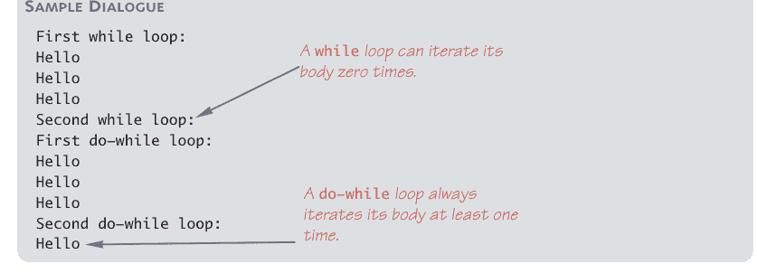

`while` 循环和 `do-while` 循环之间的重要区别在于何时检查控制布尔表达式。对于 `while` 语句，布尔表达式在循环体执行之前进行检查。如果布尔表达式求值为 `false`，则循环体根本不执行。对于 `do-while` 语句，循环体先执行，布尔表达式在循环体执行之后进行检查。因此，`do-while` 语句总是至少执行一次循环体。

经过这个初始执行后，`while` 循环和 `do-while` 循环的行为方式相同。每次循环体迭代后，都会再次检查布尔表达式，如果为 `true`，则循环再次迭代。如果从 `true` 变为 `false`，则循环语句结束。

执行 `while` 循环时发生的第一件事是求值控制布尔表达式。如果此时布尔表达式求值为 `false`，则循环体永远不会执行。执行零次循环体似乎没有意义，但有时这正是期望的操作。例如，`while` 循环常用于对数字列表求和，但列表可能为空。

更具体地说，支票簿对账程序可能使用 `while` 循环对一个月内写的所有支票金额求和——但你可能休了一个月的假，没有写任何支票。在这种情况下，需要求和的数字为零，因此循环迭代零次。

### 执行零次循环体

## 算法与伪代码

处理编程语言的语法规则并不是使用计算机程序解决问题的困难部分。困难的部分是想出底层的

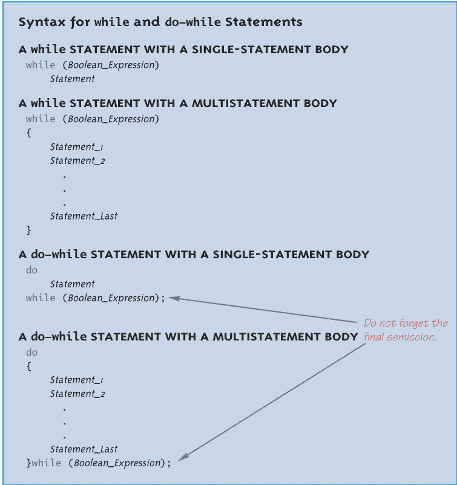

解决方法。这种解决方法被称为算法。算法是一组能导向解决方案的精确指令。与 `algorithm` 大致等价的词有 `recipe`、`method`、`directions`、`procedure` 和 `routine`。

算法通常用编程语言（在我们的例子中是 Java）和英语（或其他人类语言）混合编写。这种编程语言和人类语言的混合被称为伪代码。使用伪代码让你不必担心 Java 语法的细枝末节，从而可以专注于解决方法。显示 3.8 中程序的底层是一个可以用以下伪代码表示的算法：

## 示例

### 对一组分数求平均值

显示 3.8 展示了一个读取一组分数并计算其平均值的程序。它说明了循环中常用的一些技巧。

所有分数都是非负数。这允许程序使用负数作为结束标记。请注意，负数不是被平均的数字之一。这种结束标记被称为哨兵值。哨兵值不一定是负数，但它必须是某个不能作为“真实”输入值出现的数值。例如，如果输入列表是一组偶数整数，那么你可以使用一个奇数整数作为哨兵值。

为了让循环正确结束，我们希望布尔表达式

```
next >= 0
```

在将读取的数字相加之前被检查。这样我们避免将哨兵值加入总和。因此，我们希望循环体以

```
next = keyboard.nextDouble();
```

结束。为了使操作正确，这反过来又要求我们也将这行代码放在循环之前。循环通常需要一些准备语句在循环执行前设置好初始条件。

```
给用户说明。
count = 0;
sum = 0;
读取一个数字并将其存储在名为 next 的变量中。
while(next >= 0)
{
    sum = sum + next;
    count++;
    读取一个数字并将其存储在 next 中。
}
如果 count 不为零，则平均值为 sum/count。
输出结果。
```

请注意，使用伪代码时，我们不一定需要声明变量或担心 Java 的语法细节。唯一的规则是伪代码必须足够精确和清晰，以便优秀的程序员可以将其转换为语法正确的 Java 代码。

## 显示 3.8：对一组分数求平均值

```java
import java.util.Scanner;

public class Averager
{
    public static void main(String[] args)
    {
        Scanner keyboard = new Scanner(System.in);

        System.out.println("Enter a list of nonnegative scores.");
        System.out.println("Mark the end with a negative number.");
        System.out.println("I will compute their average.");

        double next, sum = 0;
        int count = 0;

        next = keyboard.nextDouble();
        while(next >= 0)
        {
            sum = sum + next;
            count++;
            next = keyboard.nextDouble();
        }

        if (count == 0)
            System.out.println("No scores entered.");
        else
        {
            double average = sum/count;
            System.out.println(count + " scores read.");
            System.out.println("The average is " + average);
        }
    }
}
```

### 示例对话

```
Enter a list of nonnegative scores.
Mark the end with a negative number.
I will compute their average.
87.5  0  89  99.9  -1
4 scores read.
The average is 69.1.
```

### 自测练习

- 22. 以下代码产生什么输出？

```java
int n = 10;
while (n > 0)
{
    System.out.println(n);
    n = n - 3;
}
```

- 23. 如果在练习 22 中将 `>` 符号替换为 `<`，会产生什么输出？

- 24. 以下代码产生什么输出？

```java
int n = 10;
do
{
    System.out.println(n);
    n = n - 3;
} while (n > 0);
```

- 25. 如果在练习 24 中将 `>` 符号替换为 `<`，会产生什么输出？

- 26. 以下代码产生什么输出？

```java
int n = -42;
do
{
    System.out.println(n);
    n = n - 3;
} while (n > 0);
```

- 27. `while` 语句和 `do-while` 语句之间最重要的区别是什么？

正如你将看到的，重要的程序不是作为一个单一算法编写的，而是作为一组交互的算法；然而，除非算法极其简单，否则每个算法通常都是用伪代码设计的。

## `for` 语句

Java 中第三种也是最后一种循环语句是 `for` 语句。`for` 语句最常用于以相等增量遍历某个整数变量。然而，`for` 语句是一种完全通用的循环机制，可以完成 `while` 循环能做的任何事情。

例如，以下 `for` 语句对整数 1 到 10 求和：

### `for` 语句

```
sum = 0;
for (n = 1; n <= 10; n++)
    sum = sum + n;
```

`for` 语句以关键字 `for` 开头，后跟括号中的三个表达式，这些表达式告诉计算机对控制变量做什么。`for` 语句的开头如下所示：

```
for (初始化; 布尔表达式; 更新)
```

第一个表达式说明变量、变量或其他东西如何初始化，第二个表达式给出一个布尔表达式，用于检查循环何时应结束，最后一个表达式说明在循环体每次迭代后如何更新循环控制变量。循环体是紧随我们刚描述的标题的一个语句（通常是一个复合语句）。

`for` 语句开头的三个表达式由两个且仅两个分号分隔。不要受诱惑在第三个表达式后放置分号。（技术解释是，这三个是表达式，而不是语句，因此不需要在末尾加分号。）

`for` 语句通常使用单个 `int` 变量来控制循环迭代和循环结束。然而，`for` 语句开头的三个表达式可以是任何 Java 表达式，因此可能涉及多于（或甚至少于）一个变量，并且变量可以是任何类型。

`for` 语句的语义在显示 3.9 中给出。`for` 语句的语法在显示 3.10 中给出。显示 3.10 还解释了如何将 `for` 语句视为 `while` 循环的一种符号变体。

## `for` 语句

### 语法

```
for (初始化; 布尔表达式; 更新)
    循环体
```

循环体可以是任何 Java 语句，可以是简单语句，或者更可能是由花括号 `{}` 括起来的语句列表组成的复合语句。注意括号中的三个内容由两个而非三个分号分隔。

允许对初始化和更新表达式使用任何 Java 表达式，因此可以在表达式中使用多于或少于一个变量；此外，变量可以是任何类型。

### 示例

```java
int next, sum = 0;
for (next = 0; next <= 10; next++)
{
    sum = sum + next;
    System.out.println("sum up to " + next + " is " + sum);
}
```

## 显示 3.9：`for` 语句的语义

```
for (初始化; 布尔表达式; 更新 )
    循环体
```

变量可以在 `for` 语句的头部声明并同时初始化。例如：

```
for (int n = 1; n < 10; n++)
    System.out.println(n);
```

在 `for` 语句的头部声明变量时，有一些微妙之处需要注意。这些微妙之处将在第 4 章的“编程提示”小节“在 `for` 语句中声明变量”中讨论。在你学习到第 4 章之前，明智的做法可能是避免在 `for` 语句内进行此类声明，但我们在此提及以供参考。

## `for` 语句语法与替代语义

### `for` 语句语法

#### 语法

```
for (初始化; 布尔表达式; 更新)
    循环体
```

#### 示例

```
for (number = 100; number >= 0; number--)
    System.out.println(number + " bottles of beer on the shelf.");
```

### 等价的 `while` 循环

#### 等价语法

```
初始化;
while (布尔表达式)
{
    循环体
    更新;
}
```

#### 等价示例

```
number = 100;
while (number >= 0)
{
    System.out.println(number + " bottles of beer on the shelf.");
    number--;
}
```

#### 示例对话

```
100 bottles of beer on the shelf.
99 bottles of beer on the shelf.
.
.
.
0 bottles of beer on the shelf.
```

## `for` 语句中的逗号

`for` 循环可以包含多个初始化操作。只需用逗号分隔这些操作，如下所示：

```
for (term = 1, sum = 0; term <= 10; term++)
    sum = sum + term;
```

这个 `for` 循环有两个初始化操作。变量 `term` 被初始化为 1，变量 `sum` 也被初始化为 0。请注意，你使用的是逗号，而不是分号来分隔初始化操作。

你也可以使用逗号在 `for` 循环中放置多个更新操作。这可能导致 `for` 循环体为空，但仍然执行一些有用操作的情况。例如，前面的 `for` 循环可以重写为以下等效版本：

```
for (term = 1, sum = 0; term <= 10; sum = sum + term, term++)
    //空循环体;
```

这实际上将循环体变成了更新操作的一部分。我们发现，为了代码的可读性，最好仅将更新操作用于控制循环的变量，就像这个 `for` 循环的先前版本那样。我们不提倡使用没有循环体的 `for` 循环，但如果你确实使用了没有循环体的 `for` 循环，请像我们在前面 `for` 循环中那样用注释加以说明。正如即将提到的陷阱“`for` 语句中多余的空语句”所示，没有循环体的 `for` 循环也可能由程序员错误造成。

我们刚才说明的 `for` 语句中使用的逗号，其用法是相当有限的。你可以将它与赋值语句以及递增和递减变量（如 `term++` 或 `term--`）一起使用，但不能与任何任意语句一起使用。特别是，在 `for` 语句中声明变量和使用逗号可能会带来麻烦。例如，以下代码是非法的：

```
for (int term = 1, double sum = 0; term <= 10; term++)
    sum = sum + term;
```

甚至以下代码也是非法的：

```
double sum;
for (int term = 1, sum = 0; term <= 10; term++)
    sum = sum + term;
```

Java 会将

```
int term = 1, sum = 0;
```

解释为声明 `term` 和 `sum` 都是 `int` 变量，并抱怨 `sum` 已经声明过了。

如果你没有在其他地方声明 `sum`（并且将 `sum` 作为 `int` 变量而不是 `double` 变量是可以接受的），那么以下代码虽然不推荐，但是合法的：

```
for (int term = 1, sum = 0; term <= 10; term++)
    sum = sum + term;
```

括号中的第一部分（直到分号）声明了 `term` 和 `sum` 都是 `int` 变量，并对它们都进行了初始化。

最好的做法是简单地避免这些可能引起混淆的示例。在 `for` 语句中使用逗号时，最安全的方法是简单地在 `for` 语句外部声明所有变量。如果你在 `for` 循环外部声明所有变量，规则就不再复杂了。

一个 `for` 循环只能有一个用于测试结束循环的布尔表达式。然而，你可以通过使用 `&&` 运算符连接多个测试，形成一个更大的布尔表达式，从而执行多次测试。

（C、C++ 和一些其他编程语言有一个通用的逗号运算符。在这些语言中有编程经验的读者需要被警告：在 Java 中，没有逗号运算符。在 Java 中，逗号是一个分隔符，而不是一个运算符，与 C 和 C++ 中的逗号运算符相比，其用法非常有限。）

### 重复 N 次的循环

生成重复循环体预定次数的最简单方法是使用 `for` 语句。例如，以下是一个重复其循环体三次的循环：

```
for (int count = 1; count <= 3; count++)
    System.out.println("Hip, Hip, Hurray");
```

`for` 语句的循环体不需要引用任何循环控制变量，例如变量 `count`。

### `for` 语句中多余的空语句

通常，你不会在 `for` 循环开头的右括号后放置分号。为了看看会发生什么，请考虑以下 `for` 循环：

```
for (int count = 1; count <= 10; count++);
    System.out.println("Hello");
```


如果你没有注意到那个多余的分号，你可能期望这个`for`循环将 Hello 输出到屏幕 10 次。如果你注意到了这个分号，你可能期望编译器会发出错误消息。这两件事都没有发生。如果你将这个`for`循环嵌入一个完整的程序中，编译器不会抱怨。如果你运行该程序，只会输出一次 Hello，而不是 10 次。这是怎么回事？要回答这个问题，我们需要一点背景知识。

在 Java 中创建语句的一种方法是在某些东西后面加分号。如果你在`number++`后面加上分号，你就将表达式

```
number++
```

变成了语句

```
number++;
```

如果你在一个空语句后面加上分号，你仍然创建了一个语句。因此，单独的分号本身就是一个语句，称为`空语句`或`空操作语句`。空语句不执行任何操作，但它仍然是一个语句。因此，以下是一个完整且合法的`for`循环，其循环体是空语句：

```
for (int count = 1; count <= 10; count++);
```

这个`for`循环确实迭代了 10 次，但由于循环体是空语句，所以在迭代循环体时什么也不会发生。这个循环什么也不做，而且它什么也不做地执行了 10 次！完成这个`for`循环后，计算机继续执行以下代码，该代码将 Hello 输出到屏幕一次：

```
System.out.println("Hello");
```

同样的问题也可能发生在`while`循环中。要小心，不要在`while`循环开头括住布尔表达式的右括号后放置分号。`do-while`循环则恰恰相反。你必须记住始终以分号结束`do-while`循环。

### 无限循环

只要控制布尔表达式的值为真，`while`循环、`do-while`循环或`for`循环就不会终止。这个布尔表达式通常包含一个将被循环体改变的变量，通常这个变量的值最终会以某种方式改变，使得布尔表达式为假，从而终止循环。然而，如果你犯了错误，编写了一个布尔表达式永远为真的程序，那么循环将永远运行。一个永远运行的循环称为`无限循环`。

不幸的是，无限循环的例子并不难找到。首先，让我们描述一个确实会终止的循环。以下 Java 代码输出小于 12 的正偶数。也就是说，它输出数字 2、4、6、8 和 10，每行一个，然后循环结束。

```
number = 2;
while (number != 12)
{
    System.out.println(number);
    number = number + 2;
}
```

变量`number`的值在每次循环迭代中增加 2，直到它达到 12。此时，`while`关键字后面的布尔表达式不再为真，因此循环结束。

现在假设你想输出小于 12 的奇数，而不是偶数。你可能错误地认为你只需要将初始化语句改为

```
number = 1;
```

但这个错误将创建一个无限循环。因为变量`number`的值从 11 跳到 13，变量`number`的值永远不会等于 12，所以循环永远不会终止。

当循环通过使用`==`或`!=`检查数值来终止时，这类问题很常见。在处理数字时，测试是否越过某个值总是更安全的。例如，以下作为`while`循环的第一行代码将正常工作：

```
while (number < 12)
```

通过这种改变，`number`可以初始化为任何数字，循环仍会终止。

关于无限循环，有一个微妙之处你需要记住。一个循环可能对某些输入值会终止，但对其他值则成为无限循环。仅仅因为你对某些程序输入值测试了你的循环并发现它结束了，并不意味着它不会对其他输入值成为无限循环。

一个处于无限循环中的程序可能会永远运行下去，除非有某种外部力量停止它，因此学习如何强制程序终止是一个好主意。强制程序停止的方法因操作系统而异。在许多操作系统中，按 Control-C 组合键可以终止程序。（要输入 Control-C，请在按住 Control 键的同时按 C 键。）

在简单程序中，无限循环几乎总是一个错误。然而，一些程序被故意编写为永远运行，例如航空预订程序中的主外部循环，它不断请求更多预订，直到你关闭计算机（或以非典型方式终止程序）。

## 嵌套循环

在一个循环语句内部嵌套另一个循环语句是完全合法的。例如，下面的例子在一个`for`循环内部嵌套了另一个`for`循环：

```
int rowNum, columnNum;
for (rowNum = 1; rowNum <= 3; rowNum++)
{
    for (columnNum = 1; columnNum <= 2; columnNum++)
        System.out.print(" row " + rowNum + " column " + columnNum);
    System.out.println();
}
```

这会产生以下输出：

```
row 1 column 1 row 1 column 2
row 2 column 1 row 2 column 2
row 3 column 1 row 3 column 2
```

对于外层循环的每一次迭代，内层循环都会从头到尾完整执行一次，然后执行一次`println`语句来结束该行。（最好通过将内层循环放入一个方法定义中，并在外层循环中调用该方法来避免使用嵌套循环。方法定义将在第4章和第5章中介绍。）

### 自测练习

28. 以下代码的输出是什么？

```
for (int count = 1; count < 5; count++)
    System.out.print((2 * count) + " ");
```

29. 以下代码的输出是什么？

```
for (int n = 10; n > 0; n = n - 2)
    System.out.println("Hello " + n);
```

30. 以下代码的输出是什么？

```
for (double sample = 2; sample > 0; sample = sample - 0.5)
    System.out.print(sample + " ");
```

31. 将下面的`for`语句重写为`while`循环（可能还需要一些额外的语句）：

```
int n;
for (n = 10; n > 0; n = n - 2)
    System.out.println("Hello " + n);
```

32. 以下循环的输出是什么？请指出变量`n`的值与变量`log`的值之间的联系。

```
int n = 1024;
int log = 0;
for (int i = 1; i < n; i = i * 2)
    log++;
System.out.println(n + " " + log);
```

33. 以下循环的输出是什么？请对代码进行评注。（这与上一道练习不同。）

```
int n = 1024;
int log = 0;
for (int i = 1; i < n; i = i * 2);
    log++;
System.out.println(n + " " + log);
```

34. 预测以下嵌套循环的输出：

```
int n, m;
for (n = 1; n <= 10; n++)
    for (m = 10; m >= 1; m--)
        System.out.println(n + " times " + m
                           + " = " + n*m);
```

35. 对于以下每种情况，说明哪种类型的循环（`while`、`do-while`或`for`）最合适：

- a. 对一个数列求和，例如`1/2 + 1/3 + 1/4 + 1/5 + ... 1/10`。
- b. 读取一个学生的考试成绩列表。
- c. 读取一个部门员工的病假天数。

36. 以下代码的输出是什么？

```
int number = 10;
while (number > 0)
{
    System.out.println(number);
    number = number + 3;
}
```

37. 以下代码的输出是什么？

```
int n, limit = 10;
for (n = 1; n < limit; n++)
{
    System.out.println("n == " + n);
    System.out.println("limit == " + limit);
    limit = n + 2;
}
```

38. 以下代码的输出是什么？

```
int number = 10;
while (number > 0)
{
    number = number - 2;
    if (number == 4)
        break;
    System.out.println(number);
}
System.out.println("The end.");
```

39. 以下代码的输出是什么？

```
int number = 10;
while (number > 0)
{
    number = number - 2;
    if (number == 4)
        continue;
    System.out.println(number);
}
System.out.println("The end.");
```

## `break` 和 `continue` 语句

在前面的小节中，我们描述了`while`、`do-while`和`for`循环的基本控制流程。这是循环通常的使用方式，也是它们通常被使用的方式。然而，你还可以通过两种额外的方式改变控制流程。这两种方式是插入`break`或`continue`语句。`break`语句会结束循环。`continue`语句会结束当前循环体的迭代。`break`和`continue`语句可以与任何 Java 循环语句一起使用。

我们之前在讨论`switch`语句时介绍过`break`语句。`break`语句由关键字`break`后跟一个分号组成。当执行时，`break`语句会结束最近的包含它的`switch`或循环语句。

`continue`语句由关键字`continue`后跟一个分号组成。当执行时，`continue`语句会结束最近的包含它的循环语句的当前循环体迭代。

在`for`循环中使用`continue`语句时，需要注意一点：`continue`语句会将控制转移到更新表达式。因此，任何循环控制变量都会在`continue`语句执行后立即更新。

请注意，`break`语句会完全结束循环。相比之下，`continue`语句只是结束一次循环迭代，下一次迭代（如果有的话）会继续循环。

你绝对不需要`break`或`continue`语句。任何使用`break`或`continue`语句的代码都可以被重写成不使用`break`或`continue`语句来实现相同的功能。`continue`语句可能特别棘手，并且会使你的代码难以阅读。最好完全避免使用`continue`语句，或者至少只在非常罕见的情况下使用它。在循环中使用`break`和`continue`语句是有争议的，许多专家认为它们永远不应该被使用。你需要自己决定是否使用这些语句中的任何一个或两个。

你可以将一个循环语句嵌套在另一个循环语句中。这样做时，请记住，任何`break`或`continue`语句都适用于包含它的最内层循环语句。如果循环内部有一个`switch`语句，任何`break`语句都适用于最内层的循环或`switch`语句。

有一种`break`语句，在嵌套循环中使用时，可以结束任何包含它的循环，而不仅仅是最内层的循环。如果你用一个标识符标记一个外层循环语句，那么下面这种形式的`break`语句将退出被标记的循环，即使它不是最内层的循环：

```
break Identifier;
```

要标记一个循环语句，只需在其前面加上一个标识符和一个冒号。下面是一些使用带标签的`break`语句的示例代码的大纲：

```
outerLoop:
do
{
    ...
    while (next >= 0)
    {
        next = keyboard.nextInt();
        if (next < -100)
            break outerLoop;
        ...
    }
    ...
    answer = ...
} while (answer.equalsIgnoreCase("yes"));
```

标识符`outerLoop`标记了外层循环，这是一个`do`循环。如果读入变量`next`的数字是负数但不小于 -100，那么内层的`while`循环会正常结束。但是，如果读入的数字小于 -100，那么带标签的`break`语句就会执行，这将结束包含它的`do`循环。

实际上，你可以标记任何语句，而不仅仅是循环语句和`switch`语句。带标签的`break`总是会结束与该标签匹配的包含它的语句，无论被标记的是什么类型的语句。当你在循环体中有一个`switch`语句，并且你希望`break`语句结束循环而不是仅仅结束`switch`语句时，带标签的`break`会很方便。

## `exit` 语句

`break`语句结束一个循环（或`switch`语句），但不会结束程序。以下语句会立即结束程序：

```
System.exit(0);
```

`System`是一个预定义的 Java 类，由 Java 自动提供，而`exit`是`System`类中的一个方法。`exit`方法一旦被调用就会结束程序。在我们将要编写的程序中，整数参数`0`可以是任何整数，但按照惯例我们使用`0`，因为`0`用于表示程序的正常结束。

以下是一段使用`exit`语句的代码片段：

```
System.out.println("Enter a negative number:");
int negNumber = keyboard.nextInt();
if (negNumber >= 0)
{
    System.out.println(negNumber + " is not a negative number.");
    System.out.println("Program aborting.");
    System.exit(0);
}
```

更多关于`System.exit`使用的例子在第4章中。

## 循环错误

在循环编程中，你最容易犯的错误类型存在一定的模式。此外，有一些标准技术可以用来定位和修复循环中的错误。

两种最常见的循环错误是意外的无限循环和“差一错误”。我们已经讨论过无限循环，但我们仍然需要考虑“差一错误”。

如果你的循环有“差一错误”，这意味着循环体重复的次数多了一次或少了一次。这类错误可能是由于设计控制布尔表达式时粗心大意造成的。例如，当你应该使用小于或等于时却使用了小于，这很容易导致循环体迭代的次数错误。

## 跟踪变量

在循环的控制布尔表达式中使用`==`测试相等性常常会导致差一错误或无限循环。这种相等性测试对于整数和字符可能工作良好，但对浮点数则不可靠。这是因为浮点数是近似量，而`==`测试的是精确相等。这种测试的结果是不可预测的。比较浮点数时，始终应使用涉及小于或大于的比较，例如`<=`；不要使用`==`或`!=`。使用`==`或`!=`测试浮点数可能导致差一错误、意外的无限循环，甚至其他类型的错误。即使使用整数变量，也最好避免使用`==`和`!=`，而应使用涉及小于或大于的比较。

差一错误很容易被忽视。如果一个循环多迭代了一次或少迭代了一次，结果可能看起来仍然合理，但偏差足以在后续引起问题。务必通过将你的循环结果与通过其他方式（如纸笔计算）得到的已知正确结果进行比较，来专门检查差一错误。

发现循环或任何代码错误的一个好方法是跟踪一些关键变量。跟踪变量是指在程序运行时观察变量值的变化。大多数程序不会在每次变量变化时输出每个变量的值，但如果你能看到所有这些变量变化，将有助于你调试程序。

许多 IDE（集成开发环境）都内置了实用工具，让你无需对程序进行任何更改即可轻松跟踪变量。这些调试系统在不同 IDE 之间各不相同。如果你有这样的调试设施，值得学习如何使用它。

如果你不想使用这种调试设施，可以通过在程序中插入一些临时输出语句来跟踪变量。例如，以下代码可以编译但仍包含错误：

```
int n = 10;
int sum = 10;
while (n > 1)
{
    sum = sum + n;
    n--;
}
System.out.println("The sum of the integers 1 to 10 is " + sum);
```

要找出问题所在，你可以通过插入如下输出语句来跟踪变量`n`和`sum`：

```
int n = 10;
int sum = 10;
while (n > 1)
{
    sum = sum + n;
    n--;
    System.out.println("n = " + n); //trace
    System.out.println("sum = " + sum); //trace
}
System.out.println("The sum of the integers 1 to 10 is "  + sum);
```

在发现错误并修复了代码中的 bug 后，你可以删除跟踪语句，或者通过在每条跟踪语句前添加`//`将其注释掉。

## 断言检查

`断言`是一个陈述（断言）关于你程序状态的句子。断言必须是一个要么为真要么为假的句子，并且在程序没有错误的情况下应为真。你可以通过将它们作为注释的方式在代码中放置断言。例如，以下代码中的所有注释都是断言：


```java
int n = 0;
int sum = 0;
//n == 0 and sum == 0
while (n < 100)
{
    n++;
    sum = sum + n;
    //sum == 1 + 2 + 3 + ... + n
}
//sum == 1 + 2 + 3 + ... + 100
```

请注意，这些断言中的每一个都可能为真或为假，这取决于`n`和`sum`的值，如果程序执行正确，它们都应该为真。

Java 有一个特殊的语句来检查断言是否为真。一个断言检查语句具有以下形式：

```java
assert Boolean_Expression;
```

如果你以正确的方式运行程序，断言检查的行为如下：如果`Boolean_Expression`的计算结果为 true，则什么也不会发生；但如果`Boolean_Expression`的计算结果为 false，程序将结束并输出一条错误消息，表明断言失败。

例如，前面展示的代码可以这样重写，其中第一个注释被替换为断言检查：

```java
int n = 0;
int sum = 0;
assert (n == 0) && (sum == 0);
while (n < 1000)
{
    n++;
    sum = sum + n;
    //sum == 1 + 2 + 3 + ... + n
}
//sum == 1 + 2 + 3 + ... + 100
```

请注意，我们只将三个注释中的一个转换成了断言检查。并非所有的断言注释都适合转换为断言检查。例如，没有简单的方法可以将另外两个注释转换为布尔表达式。这样做并非不可能，但你需要使用的代码本身会比你要检查的内容更复杂。

> **断言检查**
>
> **断言检查**是一个由关键字`assert`后跟一个布尔表达式和一个分号组成的 Java 语句。如果断言检查已开启，并且在断言检查执行时断言检查中的布尔表达式计算结果为`false`，你的程序将结束并输出合适的错误消息。如果断言检查未开启，断言检查将被视为注释。
>
> **语法**
>
> `assert Boolean_Expression;`
>
> **示例**
>
> `assert (n == 0) && (sum == 0);`

你可以开启和关闭断言检查。在调试代码时，你可以开启断言检查，这样失败的断言将产生错误消息。一旦你的代码调试完毕，你可以关闭断言检查，你的代码将运行得更有效率。

包含断言的程序或其他类以通常的方式编译。在程序中使用的所有类编译后，你可以以断言检查开启或关闭的方式运行程序。

如果你使用单行命令编译你的类，你可以以通常的方式编译包含断言的类：

```bash
javac YourProgram.java
```

然后你可以以断言检查开启或关闭的方式运行程序。运行程序的正常方式是断言检查关闭。要以断言检查开启的方式运行程序，你使用以下命令：

```bash
java -enableassertions YourProgram
```

如果你使用的是 IDE，请查阅你的 IDE 文档以了解如何处理断言检查。如果你没有找到关于“断言检查”的条目（这很有可能），请查看如何设置运行选项。（使用 TextPad 时，你可以如下设置断言检查：在 Configure 菜单上，选择 Preferences，然后选择 Run Java Application 命令并为其设置“Prompt for parameters”选项。³ 设置此首选项后，当你运行程序时，将出现一个窗口，你可以在其中输入`java`运行命令的选项（例如，`-enableassertions`）。）

³ 如果你正在运行小应用程序，你还需要为 Tools 子菜单上的 Run Java Applet 命令选择“Prompt for parameters”选项。

### 自测练习

1. “跟踪变量”小节中的代码有什么 bug？

2. 向以下代码添加一些合适的输出语句，以便跟踪所有变量：

   ```java
   int n, sum = 0;
   for (n = 1; n < 10; n++)
       sum = sum + n;
   System.out.println("1 + 2 + ... + 9 + 10 == " + sum);
   ```

3. 以下代码有什么 bug？你如何称呼这种循环 bug？

   ```java
   int n, sum = 0;
   for (n = 1; n < 10; n++)
       sum = sum + n;
   System.out.println("1 + 2 + ... + 9 + 10 == " + sum);
   ```

4. 编写一个断言检查，检查变量`time`的值是否小于或等于变量`limit`的值。两个变量都是`int`类型。

## 章节总结

- Java 分支语句是`if-else`语句和`switch`语句。
- `switch`语句是一个多路分支语句。你也可以通过嵌套`if-else`语句形成多路`if-else`语句来构造多路分支语句。
- 布尔表达式的求值类似于算术表达式的求值。布尔表达式的值可以保存在`boolean`类型的变量中。
- Java 循环语句是`while`、`do-while`和`for`语句。
- `do-while`语句总是至少迭代一次其循环体。`while`语句和`for`语句都可能迭代其循环体零次。
- `for`循环可用于获得相当于“重复循环体 n 次”的指令。
- 跟踪变量是调试循环的好方法。
- 可以在你的 Java 代码中添加断言检查，这样如果断言为假，你的程序将终止并显示错误消息。

## 自测练习答案

```java
1. if (score > 100)
       System.out.println("High");
   else
       System.out.println("Low");

2. if (savings > expenses)
   {
       System.out.println("Solvent");
       savings = savings - expenses;
       expenses = 0;
   }
   else
   {
       System.out.println("Bankrupt");
   }

3. if (number > 0)
       System.out.println("Positive");
   else
       System.out.println("Not positive");
```

## 3. 流程控制

4.

```java
if (salary < deductions)
{
    System.out.println("Crazy");
}
else
{
    System.out.println("OK");
    net = salary - deductions;
}
```

5. `large`

6. `small`

7. `medium`

8.

```java
if (n < 0)
    System.out.println(n + " is less than zero.");
else if (n < 100)
    System.out.println(n + " is between 0 and 99 (inclusive).");
else
    System.out.println(n + " is 100 or larger.");
```

9. 某种类型的 B。

10. `Oranges`

11. `Plums`

12. `Fruitless`

13. `n1 >= n2`

14.

```java
if (n1 >= n2)
    System.out.println("n1");
else
    System.out.println("n2");
```

15. 当变量是`int`类型时，使用`==`来测试相等性，如下所示：

   `variable1 == variable2`

   当变量是`String`类型时，使用`equals`方法来测试相等性，如下所示：

   `variable1.equals(variable2)`

   在某些情况下，你可能想使用`equalsIgnoreCase`而不是`equals`。

16.

```java
if (nextWord.compareToIgnoreCase("N") < 0)
    System.out.println("First half of the alphabet");
else
    System.out.println("Second half of the alphabet");
```

17.

```java
if ((exam >= 60) && (programsDone >= 10))
    System.out.println("Passed");
else
    System.out.println("Failed");
```

18.

```java
if ((pressure > 100) || (temperature >= 212))
    System.out.println("Emergency");
else
    System.out.println("OK");
```

19.

   a. 真。

   b. 真。注意表达式 a 和 b 的意思完全相同。因为运算符`==`和`<`的优先级高于`&&`，所以你不需要包含括号。然而，括号确实使它更容易阅读。大多数人觉得表达式 a 比表达式 b 更容易阅读，尽管它们的意思相同。

   c. 真。

   d. 真。

   e. 假。因为第一个子表达式`(count == 1)`的值为假，你知道整个表达式为假，而无需费心去计算第二个子表达式。因此，`x`和`y`的值是什么并不重要。这称为短路求值，Java 就是这么做的。

   f. 真。由于第一个子表达式`(count < 10)`的值为真，你知道整个表达式为真，而无需费心去计算第二个子表达式。因此，`x`和`y`的值是什么并不重要。这称为短路求值，Java 就是这么做的。

   g. 假。注意表达式 g 中包含表达式 f 作为一个子表达式。这个子表达式使用我们在 f 中描述的短路求值进行计算。整个表达式 g 等价于：

   ```java
   !( (true || (x < y)) && true )
   ```

   这又等价于`!(true && true)`，即`!(true)`，最终值为假。

   h. 此表达式在求值时会产生错误，因为第一个子表达式`((limit/count) > 7)`涉及除以零。

   i. 真。由于第一个子表达式`(limit < 20)`的值为真，你知道整个表达式为真，而无需费心去计算第二个子表达式。因此，第二个子表达式`((limit/count) > 7)`永远不会被计算，所以计算机永远不会注意到它涉及除以零。这就是短路求值，Java 就是这么做的。

   j. 此表达式在求值时会产生错误，因为第一个子表达式`((limit/count) > 7)`涉及除以零。

   k. 假。由于第一个子表达式`(limit < 0)`的值为假，你知道整个表达式为假，而无需费心去计算第二个子表达式。因此，第二个子表达式`((limit/count) > 7)`永远不会被计算，所以计算机永远不会注意到它涉及除以零。这就是短路求值，Java 就是这么做的。

20. 不会。由于`(j > 0)`为假，并且 Java 对`&&`使用短路求值，表达式`(1/(j+1) > 10)`永远不会被计算。

21. `((bonus + ((((day * rate) / correctionFactor) * newGuy))) - penalty)`

22.

```text
10
7
4
1
```

23. 不会有输出。因为`n > 0`为假，循环体执行零次。

24.

```text
10
7
4
1
```

25. `10`

   `do-while`循环总是至少执行一次其循环体。

26. `-42`

   `do-while`循环总是至少执行一次其循环体。

27. 使用`do-while`语句，循环体总是至少执行一次。使用`while`语句，可能存在循环体根本不执行的情况。

28. `2 4 6 8`

29.

```text
Hello 10
Hello 8
Hello 6
Hello 4
Hello 2
```

30. `2.0 1.5 1.0 0.5`

31.

```java
n = 10;

while (n > 0)
{
    System.out.println("Hello " + n);
    n = n - 2;
}
```

32. 输出是：`1024 10`。第二个数字是第一个数字以 2 为底的对数。（如果第一个数字不是 2 的幂，则只会生成以 2 为底的对数的近似值。）

33. 输出是：`1024 1`。`for`循环第一行后的分号很可能是一个陷阱错误。

34. 输出太长，无法在此复制。模式如下：

```text
1 times 10 = 10
1 times 9 = 9
  .
  .
  .
1 times 1 = 1
2 times 10 = 20
2 times 9 = 18
  .
  .
  .
2 times 1 = 2
3 times 10 = 30
  .
  .
  .
```

35.

   a. `for`循环

   b. 和 c. 都需要`while`循环，因为输入列表可能为空。（`for`循环也可能有效，但`do-while`循环肯定不行。）

36. 这是一个无限循环。前几行输出是：

```text
10
13
16
19
21
```

37. 这是一个无限循环。前几行输出是：

```text
n == 1
limit == 10;
n == 2
limit == 3
n == 3
limit == 4
n == 4
limit == 5
```

38.

```text
8
6
结束。
```

39.

```text
8
6
2
0
结束。
```

40. 如果你查看跟踪，你会看到在一次迭代后，`sum`的值是 20。但这个值应该是 10 + 9 或 19。这应该让你想到变量`n`没有在正确的时间递减。确实，错误在于这两个语句：

```java
sum = sum + n;
n--;
```

应该颠倒顺序为：

```java
n--;
sum = sum + n;
```

41.

```java
int n, sum = 0;

for (n = 1; n < 10; n++)
{
    System.out.println("n == " + n + " sum == " + sum);

    //上面一行是跟踪。
    sum = sum + n;
}

System.out.println("After loop");//跟踪

System.out.println("n == " + n + " sum == " + sum);//跟踪

System.out.println("1 + 2 + ...+ 9 + 10 == " + sum);
```

如果你研究这个跟踪的输出，你会看到 10 从未被加入。这是循环中的一个错误。

42. 这是你上一个练习中跟踪的代码。如果你研究这个跟踪的输出，你会看到 10 从未被加入。这是一个差一错误。

43.

```java
assert (time <= limit);
```

## 编程项目

许多这些编程项目可以使用 AW 的 CodeMate 解决。要访问这些，请前往：www.aw-bc.com/codemate。

1. （这是第 2 章一个练习的版本）。计算一个数`n`的平方根的巴比伦算法如下：

   1. 对答案进行**猜测**（你可以选择`n/2`作为初始猜测）。
   2. 计算`r = n / guess`。
   3. 设置`guess = (guess + r) / 2`。
   4. 返回步骤 2，直到最后两个`guess`值相同。

   编写一个程序，输入一个整数`n`，迭代巴比伦算法直到猜测值在上一次猜测值的 1% 以内，并将答案作为保留两位小数的双精度数输出。即使对于较大的`n`值，你的答案也应该是准确的。

2. 在双骰子游戏中，过线投注的过程如下。掷两个六面骰子；双骰子游戏中第一次掷骰子称为“初始掷”。初始掷出 7 或 11 自动获胜，初始掷出 2、3 或 12 自动失败。如果初始掷出 4、5、6、8、9 或 10，该数字就成为点数。玩家继续掷骰子，直到掷出 7 或点数。如果先掷出点数，那么玩家赢得投注。如果先掷出 7，那么玩家输。

   编写一个程序，使用这些规则模拟一场双骰子游戏，无需人工输入。程序不应询问赌注，而应计算玩家是赢是输。程序应模拟掷两个骰子并计算它们的和。添加一个循环，使程序玩 10,000 场游戏。添加计数器来统计玩家赢了多少次，输了多少次。在 10,000 场游戏结束后，计算赢的概率 [即，赢的次数 / (赢的次数 + 输的次数)] 并输出这个值。从长远来看，谁会赢得最多的比赛，你还是庄家？

   *注意：* 要生成一个随机数`x`，其中 0 ≤ `x` ≤ 1，使用`x = Math.random();`。例如，乘以 6 并转换为整数会产生一个 0 到 5 之间的整数。

3. 估算儿童成年身高的一种方法是使用以下公式，该公式使用了父母的身高：

   `H_male_child = ((H_mother × 13 / 12) + H_father)/2`

   `H_female_child = ((H_father × 12 / 13) + H_mother)/2`

   所有身高均以英寸为单位。编写一个程序，以儿童的性别、母亲的身高（英寸）和父亲的身高（英寸）作为输入，并输出儿童的成年估算身高（英寸）。该程序应允许用户输入新的一组数值，输出预测的身高，直到用户决定退出。用户应该能够以英尺和英寸为单位输入身高，并且该程序应输出儿童的估计身高（以英尺和英寸为单位）。使用整数数据类型存储身高。


4. 要制定一个跨越数年的预算十分困难，因为价格并不稳定。如果你的公司每年需要200支铅笔，你不能简单地使用今年的价格作为两年后铅笔的成本。由于通货膨胀，成本很可能比今天更高。编写一个程序，估算某项物品在未来特定年份的预期成本。程序要求输入该物品的成本、从现在起购买该物品的年数以及通货膨胀率。然后程序输出该物品在指定时期后的估计成本。让用户以百分比形式输入通货膨胀率，例如 `5.6`（百分比）。你的程序应将百分比转换为小数，例如 `0.056`，并使用循环来估算经通货膨胀调整后的价格。

5. 你刚购买了一套立体声音响系统，花费1000美元，采用以下信贷计划：无首付，年利率18%（因此月利率`1.5%`），每月还款50美元。每月50美元的还款用于支付利息，剩余部分用于偿还部分欠款。因此，第一个月你支付1000美元的`1.5%`作为利息，即15美元利息。所以，剩余的35美元从你的债务中扣除，留下965.00美元的债务。下个月，你支付965.00美元的`1.5%`作为利息，即14.48美元。因此，你可以从欠款中扣除35.52美元（即50美元 - 14.48美元）。编写一个程序，告诉你需要多少个月才能还清贷款，以及贷款期间支付的总利息。使用循环计算每月利息和债务余额。（你的最终程序不必输出每月支付的利息和剩余债务，但你可以编写一个能输出这些值的初步版本。）使用一个变量来计算循环迭代次数，从而计算债务清零前的月数。你可能还想使用其他变量。如果债务较小，最后一笔还款可能少于50美元，但不要忘记利息。如果你欠50美元，每月50美元的还款不足以还清债务，尽管已经很接近了。50美元一个月的利息只有75美分。

6. 斐波那契数`F_n`定义如下：`F_0`是1，`F_1`是1，并且

```
F_{i+2} = F_i + F_{i+1}
```

`i = 0, 1, 2, ...`。换句话说，每个数字是前两个数字之和。前几个斐波那契数是1、1、2、3、5和8。这些数字出现的一个地方是某些种群增长率。如果一个种群没有死亡，那么该序列表示每个时间段后的种群规模。一个生物体需要两个时间段才能成熟到繁殖年龄，然后每个时间段繁殖一次。该公式最直接适用于无性繁殖，每个时间段产生一个后代。无论如何，绿色粘液种群以这个速率为增长，其时间段为五天。因此，如果一个绿色粘液种群初始为10磅，那么五天后仍然是10磅；十天后是20磅，十五天后30磅，二十天后50磅，以此类推。编写一个程序，输入绿色粘液种群的初始大小（磅）和天数，输出经过那么多天后绿色粘液的磅数。假设种群大小在四天内保持不变，然后在第五天增加。你的程序应允许用户根据需要重复此计算。

7. `e^x`的值可以通过以下求和近似：

```
1 + x + x^2/2! + x^3/3! + ... + x^n/n!
```

编写一个程序，输入一个值`x`，并输出当`n`分别取1到10、50和100时的和。你的程序应重复计算新的`x`值，直到用户表示完成。表达式`n!`称为`n`的阶乘，定义为

```
n! = 1 * 2 * 3 * ... * n
```

使用`double`类型的变量存储阶乘（或安排计算以避免直接计算阶乘）；否则，你很可能会产生整数溢出，即超出Java允许范围的整数。

# 第4章

## 定义类I

### 4.1 类定义

- 实例变量和方法
- 更多关于方法
- 局部变量
- 块
- 基本类型的参数
- 类参数的简单情况
- `this`参数
- 返回布尔值的方法
- `equals`和`toString`方法
- 递归方法

### 4.2 信息隐藏和封装

- `public`和`private`修饰符
- 示例：又一个日期类
- 访问器和修改器方法
- 前置条件和后置条件

## 4.3 重载

- 重载规则

## 4.4 构造函数

- 构造函数定义
- 示例：最终的日期类
- 默认变量初始化
- 初始化实例变量的另一种方式
- 示例：宠物记录类
- `StringTokenizer`类

章节摘要

自测练习答案

编程项目

# 4 定义类I

> *这是激动人心的部分。*
> *这就像“至高无上”乐队。*
> *看看它是如何层层递进的？*
> ——归功于Frank Zappa

## 引言

类是促进面向对象编程（OOP）的最重要语言特性，OOP是当今使用的主要编程方法。你已经在使用预定义的类。`String`和`Scanner`是我们使用过的两个类。对象是类类型的值，被称为*类的实例*。对象不同于基本类型的值，因为它既有数据又有方法（操作）。例如，"Hello"是`String`类的一个对象。它包含字符串中的字符作为数据，并且还有许多方法，如`length`。你已经知道如何使用类、对象和方法。本章告诉你如何定义类及其方法。

## 前置要求

本章使用第1、2和3章的材料。

### 4.1 类定义

> *"时候到了，"海象说，*
> *"该谈论许多事情：*
> *关于鞋、船和封蜡*
> *关于卷心菜和国王。"*
> ——刘易斯·卡罗尔，《爱丽丝镜中奇遇》

一个Java程序由来自不同类的对象相互交互组成。在我们深入探讨如何定义类的细节之前，让我们回顾一些与类相关的术语。类是一种类型，你可以声明类类型的变量。类类型的值称为**对象**。一个对象既有数据也有操作。操作称为**方法**。每个对象可以有不同的数据，但一个类的所有对象具有相同类型的数据，并且一个类中的所有对象具有相同的方法。一个对象通常被称为该类的对象或该类的实例，而不是该类的值，但它确实是该类类型的一个值。为了使这个抽象的讨论生动起来，我们需要一个示例定义。

> **类是一种类型**
>
> 如果`A`是一个类，那么“`bla`是`A`类型”、“`bla`是类`A`的实例”和“`bla`是类`A`的对象”这些短语都意味着同样的事情。

清单4.1包含一个名为`DateFirstTry`的类定义和一个演示该类使用的程序。该类的对象表示诸如2007年12月31日和1776年7月4日这样的日期。这个类不切实际地简单，但它将帮助你熟悉类定义的语法。该类的每个对象都有三部分数据：一个表示月份名称的字符串，一个表示日期的整数，以及另一个表示年份的整数。这些对象只有一个方法，名为`writeOutput`。数据项和方法有时被称为对象的*成员*，因为它们属于对象。数据项有时也被称为*字段*。我们将数据项称为*实例变量*，将方法称为*方法*。

类定义开头的以下三行定义了三个实例变量（三个数据成员）：

```java
public String month;
public int day;
public int year; //a four digit number.
```

`public`这个词仅仅意味着这些实例变量的使用没有限制。每一行声明一个实例变量名。你可以将类对象想象成一个内部有实例变量的复杂项目。因此，一个实例变量可以被认为是每个类对象内部的一个较小的变量。在这个例子中，实例变量被称为`month`、`day`和`year`。

一个类的对象通常由类类型的变量命名。例如，清单4.1中的程序`DateFirstTryDemo`声明了两个变量`date1`和`date2`，类型为`DateFirstTry`，如下所示：

```java
DateFirstTry date1, date2;
```

这给了我们`DateFirstTry`类的变量，但目前还没有该类的对象。对象是由变量命名的类值。要获得一个对象，你必须使用`new`运算符来创建一个“新”对象。例如，以下代码创建一个`DateFirstTry`类的对象并用变量`date1`命名它：

```java
date1 = new DateFirstTry();
```

## 显示4.1 一个简单的类

该类定义位于名为`DateFirstTry.java`的文件中。

```java
public class DateFirstTry
{
    public String month;
    public int day;
    public int year; //一个四位数。

    public void writeOutput()
    {
        System.out.println(month + " " + day + ", " + year);
    }
}
```

在本章后面，我们将看到这三个`public`修饰符应替换为`private`。

该类定义（程序）位于名为`DateFirstTryDemo.java`的文件中。

```java
public class DateFirstTryDemo
{
    public static void main(String[] args)
    {
        DateFirstTry date1, date2;
        date1 = new DateFirstTry();
        date2 = new DateFirstTry();
        date1.month = "December";
        date1.day = 31;
        date1.year = 2007;
        System.out.println("date1:");
        date1.writeOutput();

        date2.month = "July";
        date2.day = 4;
        date2.year = 1776;
        System.out.println("date2:");
        date2.writeOutput();
    }
}
```

# 示例对话

```
date1:
December 31, 2007
date2:
July 4, 1776
```

当我们在本章后面讨论所谓的*构造函数*时，我们将更详细地讨论这种语句。目前只需注意

`Class_Variable = new Class_Name();`

创建一个指定类的新对象，并将其与类变量相关联。¹ 由于类变量现在命名了该类的一个对象，我们经常将类变量称为该类的一个对象。（这实际上与我们称`int`变量`n`为“整数`n`”的用法相同，尽管严格来说，整数不是`n`而是`n`的值。）

与我们在显示4.1中所做的不同，类变量的声明和对象的创建更典型地组合成一条语句，如下所示：

`DateFirstTry date1 = new DateFirstTry();`

> **new运算符**
>
> `new`运算符用于创建一个类的对象，并将该对象与命名它的变量相关联。
>
> **语法**
> `Class_Variable = new Class_Name();`
>
> **示例**
> `DateFirstTry date;`
> `date = new DateFirstTry();`
>
> 这通常写成以下等价形式：
>
> `DateFirstTry date = new DateFirstTry();`

## 实例变量和方法

我们将使用显示4.1中的类和程序来说明实例变量的细节。类`DateFirstTry`的每个对象都有三个实例变量，可以通过给出对象名后跟一个点和实例变量名来命名。例如，程序`DateFirstTryDemo`中的对象`date1`具有以下三个实例变量：

`date1.month`
`date1.day`
`date1.year`

¹ 对许多人来说，"new"这个词暗示了内存分配。正如我们将看到的，`new`运算符确实会产生内存分配。

类似地，如果你用`date2`替换`date1`，你将获得对象`date2`的三个实例变量。请注意，`date1`和`date2`总共有六个实例变量。例如，实例变量`date1.month`和`date2.month`是两个不同的（实例）变量。

显示4.1中的实例变量可以像任何其他变量一样使用。例如，`date1.month`可以像任何其他`String`类型的变量一样使用。实例变量`date1.day`和`date1.year`可以像任何其他`int`类型的变量一样使用。因此，尽管以下做法不符合类定义的精神，但它是合法的并且可以编译：

```java
date1.month = "Hello friend.";
```

更典型的实例变量赋值在程序`DateFirstTryDemo`中给出。

类`DateFirstTry`只有一个方法，名为`writeOutput`。我们在此重现该方法的定义：

```java
public void writeOutput()
{
    System.out.println(month + " " + day + ", " + year);
}
```

所有方法定义都属于某个类，并且所有方法定义都在其所属的类的定义内部给出。方法定义分为两部分：**标题**和**方法体**，如方法定义上的注释所示。`void`这个词意味着这是一个执行动作而非产生值的方法。我们将在本章后面更多地讨论方法定义（包括为什么选择`void`这个词来表示动作）。你已经使用过来自预定义类的方法。你从你编写的类定义中调用方法的方式与你为预定义类调用方法的方式相同。例如，程序`DateFirstTryDemo`中的以下代码是以`date1`作为调用对象调用`writeOutput`方法：

```java
date1.writeOutput();
```

此调用等同于执行方法体。因此，此调用等同于

```java
System.out.println(month + " " + day + ", " + year);
```

但是，我们需要更多地说明这到底是如何等同的。如果你简单地将方法调用替换为此`System.out.println`语句，你将得到一个编译器错误消息。请注意，在方法`writeOutput`的定义中，

## 类定义

以下显示了最常用形式的类定义；但是，混合方法定义和实例变量声明是合法的。

# 语法

```java
public class Class_Name
{
    Instance_Variable_Declaration_1
    Instance_Variable_Declaration_2
             .
             .
             .
    Instance_Variable_Declaration_Last

    Method_Definition_1
    Method_Definition_2
             .
             .
             .
    Method_Definition_Last
}
```

# 示例

请参见显示4.1和4.2。

实例变量的名称在使用时没有任何调用对象。这是因为该方法将在不同的时间被不同的调用对象调用。当实例变量在方法定义中使用时，它被理解为调用对象的实例变量。因此在程序`DateFirstTryDemo`中，

```java
date1.writeOutput();
```

等同于

```java
System.out.println(date1.month + " " + date1.day
                                + ", " + date1.year);
```

类似地，

```java
date2.writeOutput();
```

等同于

```java
System.out.println(date2.month + " " + date2.day
                                + ", " + date2.year);
```

## **文件名和位置**

请记住，文件必须以与其包含的类相同的名称命名，并在末尾加上`.java`。例如，名为`MyClass`的类必须位于名为`MyClass.java`的文件中。

我们将最终看到其他安排文件的方式，但此时，你的程序和它使用的所有类应该位于同一目录（同一文件夹）中。

## **自测练习**

1. 编写一个名为`makeItNewYears`的方法，该方法可以添加到显示4.1中的类`DateFirstTry`中。方法`makeItNewYears`没有参数，并将`month`实例变量设置为"January"，将`day`实例变量设置为1。它不更改`year`实例变量。

2. 编写一个名为`yellIfNewYear`的方法，该方法可以添加到显示4.1中的类`DateFirstTry`中。方法`yellIfNewYear`没有参数，如果`month`实例变量的值为"January"且`day`实例变量的值为1，则输出字符串"Hurrah!"。否则，它输出字符串"Not New Year's Day."。

## **更多关于方法**

正如我们对预定义方法的说明一样，你定义的类的方法有两种：返回（计算）某个值的方法和执行除返回值以外的动作的方法。例如，对象`System.out`的`println`方法就是执行除返回值以外的动作的方法的一个例子；在这种情况下，动作是将某些内容写入屏幕。第2章介绍的类`Scanner`的`nextInt`方法是一个返回值的方法；在这种情况下，返回的值是用户输入的数字。执行除返回值以外的某些动作的方法称为`void`方法。`void`方法和返回值的方法之间的这种区别同样适用于你定义的类中的方法。这两种方法在定义方式上需要轻微的差异。

两种方法都有一个方法标题和一个方法体，它们相似但不完全相同。`void`方法的方法标题形式如下

```java
public void Method_Name(Parameter_List)
```

返回值的方法的方法头如下所示：

```
public Type_Returned Method_Name(Parameter_List)
```

本章后续我们将看到，`public`有时可能会被更严格的修饰符替代，也可以添加额外的修饰符，但这些模板目前足以应付。目前，我们的示例将使用空的`Parameter_List`。


如果一个方法返回一个值，那么它可能在不同情况下返回不同的值，但所有返回的值必须属于同一类型，该类型在方法头中指定为返回类型。例如，如果一个方法的方法头如下：

```
public double myMethod()
```

那么该方法总是返回一个`double`类型的值，而方法头

```
public String yourMethod()
```

则表示一个总是返回`String`类型值的方法。

下面是一个`void`方法头：

```
public void ourMethod()
```

请注意，当方法不返回任何值时，我们使用关键字`void`来代替一个类型。如果你将`void`理解为“没有返回类型”，那么`void`这个词就开始有意义了。

对一个返回值的方法的`调用`可以像使用`Type_Returned`类型的值一样，在任何允许使用该类型值的地方作为表达式使用。例如，假设`anObject`是一个具有我们示例方法头的类的对象；在这种情况下，以下代码是合法的：

```
double d = anObject.myMethod();
String aStringVariable = anObject.yourMethod();
```

一个`void`方法不返回值，而只是执行一个动作，因此对`void`方法的调用是一条语句。`void`方法的调用方式如下例所示：

```
anObject.ourMethod();
```

注意结尾的分号。

到目前为止，我们通过只给出空参数列表的例子来避免讨论参数列表的话题，但请注意，即使是空参数列表也需要括号。参数列表将在本章后面讨论。

`void`方法定义的**主体**就是一对大括号`{}`中包含的一系列声明和语句。例如，以下是一个完整的`void`方法定义：

```
public void ourMethod()
{
    System.out.println("Hello");
    System.out.println("from our method.");
}
```

返回值的方法的主体与`void`方法的主体相同，但有一个额外的要求。返回值的方法的主体必须至少包含一个`return`语句。`return`语句的形式如下：

```
return Expression;
```

其中*Expression*可以是任何求值结果为方法头中列出的*Type_Returned*类型的表达式。例如，以下是一个返回值的方法的完整定义：

```
public String yourMethod()
{
    Scanner keyboard = new Scanner(System.in);
    System.out.println("Enter a line of text");
    String result = keyboard.nextLine();
    return result + " was entered.";
}
```

请注意，一个返回值的方法除了返回一个值之外，还可以做其他事情，但风格规则规定，它所做的其他任何事情都应该与返回的值相关。

`return`语句总是结束一个方法的调用。一旦执行了`return`语句，方法就结束，方法定义中任何剩余的语句都不会被执行。

如果你想在`void`方法的所有语句执行完之前结束它，你可以使用一个不带任何表达式的`return`语句，如下所示：

```
return;
```

`void`方法不需要有任何`return`语句，但你可以在`void`方法中放置一个`return`语句，以处理需要在所有代码执行之前结束方法的情况。

## 方法定义

方法有两种：返回值的方法和执行除返回值之外某些操作的方法，后者称为`void`方法。

### 返回值的方法定义

**语法**

```
public Type_Returned Method_Name(Parameter_List)
{
    <List of statements, at least one of which
               must contain a return statement.>
}
```

如果没有*Parameters*，则括号为空。

**示例**

```
public int getDay()
{
    return day;
}
```

### void方法定义

**语法**

```
public void Method_Name(Parameter_List)
{
    <List of statements>
}
```

如果没有*Parameters*，则括号为空。

**示例**

```
public void writeOutput()
{
    System.out.println(month + " " + day + ", " + year);
}
```

所有方法定义都在某个类定义内部。参见Display 4.2，查看这些示例方法定义在类中的上下文。

当在方法定义中使用实例变量名时，它指的是调用对象的一个实例变量。

### return语句

返回值的方法定义必须有一个或多个`return`语句。`return`语句指定方法返回的值并结束方法调用。

**语法**

```
return Expression;
```

**示例**

```
public int getYear()
{
    return year;
}
```

`void`方法定义不需要有`return`语句。但是，可以在`void`方法中使用`return`语句来使方法立即结束。`void`方法中`return`语句的形式如下：

```
return;
```

虽然我们似乎忽略了这一事实，但所有这些方法定义都必须在某个类定义内部。Java没有任何不在任何类中的独立方法。Display 4.2重写了Display 4.1中给出的类，但这次我们添加了一组更多样化的方法。Display 4.3包含一个示例程序，演示了Display 4.2中类的方法的使用方式。

### 提示

#### 任何方法都可以用作void方法

一个返回值的方法也可以在返回值之外执行一些操作。如果你想要那个操作，但不需要返回的值，你可以像调用`void`方法一样调用该方法，返回的值将被简单丢弃。例如，以下包含对方法`nextLine()`的两次调用，该方法返回一个`String`类型的值。两者都是合法的。

```
Scanner keyboard = new Scanner(System.in);
. . .
String inputString = keyboard.nextLine();
. . .
System.out.println("Press Enter to continue with program.");
keyboard.nextLine(); //Reads a line and discards it.
```

#### Display 4.2 一个具有更多方法的类（第1部分，共2部分）

```
import java.util.Scanner;

public class DateSecondTry
{
    private String month;
    private int day;
    private int year; //a four digit number.

    public void writeOutput()
    {
        System.out.println(month + " " + day + ", " + year);
    }

    public void readInput()
    {
        Scanner keyboard = new Scanner(System.in);
        System.out.println("Enter month, day, and year.");
        System.out.println("Do not use a comma.");
        month = keyboard.next();
        day = keyboard.nextInt();
        year = keyboard.nextInt();
    }

    public int getDay()
    {
        return day;
    }
    public int getYear()
    {
        return year;
    }

    public int getMonth()
    {
        if (month.equalsIgnoreCase("January"))
            return 1;
        else if (month.equalsIgnoreCase("February"))
            return 2;
        else if (month.equalsIgnoreCase("March"))
            return 3;
```

修饰符`private`的意义将在本章稍后第4.2节的“public和private修饰符”小节中讨论。

#### Display 4.2 一个具有更多方法的类（第2部分，共2部分）

```
        else if (month.equalsIgnoreCase("April"))
            return 4;
        else if (month.equalsIgnoreCase("May"))
            return 5;
        else if (month.equals("June"))
            return 6;
        else if (month.equalsIgnoreCase("July"))
            return 7;
        else if (month.equalsIgnoreCase("August"))
            return 8;
        else if (month.equalsIgnoreCase("September"))
            return 9;
        else if (month.equalsIgnoreCase("October"))
            return 10;
        else if (month.equalsIgnoreCase("November"))
            return 11;
        else if (month.equalsIgnoreCase("December"))
            return 12;
        else
        {
            System.out.println("Fatal Error");
            System.exit(0);
            return 0; //Needed to keep the compiler happy
        }
    }
}
```

自我测试练习

- 3. 编写一个名为`getNextYear`的方法，该方法可以添加到Display 4.2中的`DateSecondTry`类中。方法`getNextYear`返回一个`int`值，该值等于`year`实例变量的值加一。

### 显示4.3 使用显示4.2中的类

```java
public class DemoOfDateSecondTry {
    public static void main(String[] args) {
        DateSecondTry date = new DateSecondTry();
        date.readInput();

        int dayNumber = date.getDay();
        System.out.println("That is the " + dayNumber
                           + "th day of the month.");
    }
}
```

调用一个无返回值方法是一个语句。

调用一个有返回值的方法是一个表达式，它可以在任何可以使用该方法返回类型值的地方使用。

```
示例对话
请输入月、日、年。
不要使用逗号。
July 4 1776
That is the 4th day of the month.
```

#### 局部变量

看看显示4.2中给出的`readInput()`方法的定义。该方法定义中包含一个名为`keyboard`的变量的声明。在方法内部声明的变量称为局部变量。之所以称为“局部”，是因为它的意义局限于——即被限制在——该方法定义内。如果你有两个方法，每个方法都声明了一个同名变量——例如，两个都命名为`keyboard`——它们将是两个不同的变量，只是恰好同名。在一个方法中对名为`keyboard`的变量所做的任何更改，都不会影响另一个方法中名为`keyboard`的变量。

正如我们在第1章指出的，程序的主要部分本身就是一个方法。在`main`中声明的所有变量都是`main`方法的局部变量。如果在`main`中声明的变量恰好与在其他某个方法中声明的变量同名，它们也只是恰好同名的两个不同的变量。因此，我们目前看到的所有变量要么是局部变量，要么是实例变量。Java中只有一种更多类型的变量，称为静态变量。静态变量将在第5章讨论。

#### 局部变量

在方法定义内声明的变量称为<u>局部变量</u>。如果两个方法各自有一个同名的局部变量，它们只是恰好同名的两个不同的变量。

#### 全局变量

到目前为止，我们讨论了两种变量：实例变量（其意义限于类的一个对象）和局部变量（其意义限于一个方法定义）。一些其他编程语言有另一种变量，称为<u>全局变量</u>，其意义仅限于程序本身。Java没有这些全局变量。

#### 块

术语**块**和**复合语句**指的是同一回事，即一组用花括号`{}`括起来的Java语句。然而，程序员倾向于在不同的语境中使用这两个术语。当你在复合语句内声明变量时，该复合语句通常被称为*块*。

#### 块

<u>块</u>是复合语句的另一个名称——即用花括号括起来的一组语句。然而，程序员倾向于在不同的语境中使用这两个术语。当你在复合语句内声明变量时，该复合语句通常被称为*块*。在块中声明的变量对于该块是局部的，因此当块执行完成时，这些变量会消失。然而，即使变量对于该块是局部的，在同一方法定义内，它们的名称也不能用于其他任何地方。

如果你在块内声明一个变量，该变量对于该块是局部的。这意味着当块结束时，在块内声明的所有变量都会消失。在许多编程语言中，你甚至可以使用该变量的名称来命名块外的其他变量。然而，*在Java中，你不能在一个方法定义内有两个同名的变量*。块内的局部变量有时在Java中会引起问题。有时将变量声明在块外更容易。如果你在块外声明一个变量，你可以在块内和块外使用它，并且在块内和块外它都具有相同的含义。

### 提示

在`for`语句中声明变量

你可以在`for`语句的初始化部分内声明一个（或多个）变量，如下所示：

```java
int sum = 0;
for (int n = 1; n < 10; n++)
    sum = sum + n;
```

如果你以这种方式声明`n`，变量`n`将对`for`循环是局部的。这意味着`n`不能在`for`循环外使用。例如，以下在`System.out.println`语句中使用`n`是非法的：

```java
for (int n = 1; n < 10; n++)
    sum = sum + n;
System.out.println(n); // 非法
```

在`for`循环内声明变量有时可能弊大于利。除非是非常简单且没有混淆可能性的情况，我们倾向于避免在`for`循环内声明变量。

## 自我测试练习

- 4. 编写一个名为`happyGreeting`的方法，可以添加到显示4.2中的`DateSecondTry`类中。方法`happyGreeting`将字符串`"Happy Days!"`写入屏幕，次数等于实例变量`day`的值。例如，如果`day`的值为3，则应向屏幕输出以下内容：

Happy Days!

Happy Days!

Happy Days!

使用一个局部变量。

### 基本类型的参数

到目前为止，我们看到的所有方法定义都没有参数，这由方法标题中的空括号表示。参数就像一个空格，在调用方法时用特定的值填充。（我们所说的参数也称为形式参数。）为参数插入的值称为实参。² 我们已经在预定义方法中使用过实参。例如，字符串`"Hello"`是以下方法调用中`println`方法的实参：

```java
System.out.println("Hello");
```

显示4.4包含一个名为`setDate`的方法的定义，该方法有三个参数`newMonth`、`newDay`和`newYear`。它还包含一个名为`monthString`的方法的定义，该方法有一个`int`类型的参数。

为参数插入的项目称为实参，并在方法调用末尾的括号中给出。例如，在以下来自显示4.4的调用中，整数6、17和变量`year`分别是为`newMonth`、`newDay`和`newYear`插入的实参：

```java
date.setDate(6, 17, year);
```

当你有一个像上面这样的方法调用时，实参（例如6）会在方法定义中参数出现的每个位置插入到相应的形式参数（例如`newMonth`）中。在为所有参数插入了相应的实参之后，方法定义主体中的代码将被执行。

以下对`monthString`方法的调用出现在显示4.4的`setDate`方法定义中：

```java
month = monthString(newMonth);
```

实参是`newMonth`，它被插入到`monthString`方法定义中的参数`monthNumber`中。


请注意，每个形式参数前面都必须有一个类型名称，即使有多个相同类型的参数也是如此。对应的实参必须与其对应的形式参数的类型匹配，尽管在某些简单情况下，Java可能会执行自动类型转换。例如，如果你为一个`double`类型的参数插入一个`int`类型的实参，Java会自动将`int`值类型转换为`double`类型的值。以下列表显示了Java自动为您执行的类型转换。在方法调用中，属于这些类型中任何一种的实参都会在需要匹配形式参数时自动类型转换为出现在其右侧的任何类型。³

- `byte` -> `short` -> `int` -> `long` -> `float` -> `double`

² 一些程序员使用术语“实际参数”来表示我们所说的实参。

³ 如果形式参数是`int`类型或我们类型列表中`int`右侧的任何类型，`char`类型的实参也会转换为匹配的数字类型。

### 示例4.4 带参数的方法（第1部分，共2部分）

```java
import java.util.Scanner;
public class DateThirdTry
{
    private String month;
    private int day;
    private int year; //a four digit number.

    public void setDate(int newMonth, int newDay, int newYear)
    {
        month = monthString(newMonth);
        day = newDay;
        year = newYear;
    }

    public String monthString(int monthNumber)
    {
        switch (monthNumber)
        {
            case 1:
                return "January";
            case 2:
                return "February";
            case 3:
                return "March";
            case 4:
                return "April";
            case 5:
                return "May";
            case 6:
                return "June";
            case 7:
                return "July";
            case 8:
                return "August";
            case 9:
                return "September";
            case 10:
                return "October";
            case 11:
                return "November";
            case 12:
                return "December";
            default:
                System.out.println("Fatal Error");
                System.exit(0);
                return "Error"; //to keep the compiler happy
        }
    }
}
```

> 修饰符`private`的意义在第4.2节“`public`和`private`修饰符”小节中进行了讨论。

> 方法`setDate`有一个用于月份的`int`参数，即使`month`实例变量的类型是`String`。方法`setDate`通过调用方法`monthString`将`month`的`int`值转换为字符串。

> 这是文件`DateThirdTry.java`。

<其余的方法定义与示例4.2中给出的完全相同。>

这是文件`DateThirdTry.java`。

```java
public class DateThirdTryDemo
{
    public static void main(String[] args)
    {
        DateThirdTry date = new DateThirdTry( );
        int year = 1882;
        date.setDate(6, 17, year);
        date.writeOutput( );
    }
}
```

这是文件`DateThirdTryDemo.java`。

变量`year`并没有被直接“代入”到`setDate`方法定义中的`newYear`参数中。被“代入”的只是`year`的值，即`1882`。

示例对话

`June 17, 1882`

请注意，这与我们在第1章讨论的用于将一种类型的值存储在另一种类型的变量中的自动类型转换完全相同。更通用的规则是：在Java期望列表中更靠下类型值的任何地方，你都可以使用列表中任何更靠上类型值。

请注意，参数和实参的对应关系是由它们在圆括号中的顺序决定的。在方法调用中，圆括号中的实参数量必须与方法定义头部的形式参数数量完全相同。方法调用中的第一个实参被代入方法定义头部的第一个参数，方法调用中的第二个实参被代入方法定义头部的第二个参数，依此类推。这在示例4.5中用图表示了出来。

**示例4.5** 形式参数与实参的对应关系

```java
public class DateThirdTry
{
    private String month;
    private int day;
    private int year; //a four digit number.

    public void setDate(int newMonth, int newDay, int newYear)
    {
        month = monthString(newMonth);
        day = newDay;
        year = newYear;
    }
    ...
}
```

```java
public class DateThirdTryDemo
{
    public static void main(String[] args)
    {
        DateThirdTry date = new DateThirdTry();
        int year = 1882;
        date.setDate(6, 17, year);
        date.writeOutput();
    }
}
```

这在文件`DateThirdTryDemo.java`中。这是使用`DateThirdTry`类的程序文件。

箭头显示了哪个实参被代入哪个形式参数。

这在文件`DateThirdTry.java`中。

只有`year`的值，即`1882`，被代入参数`newYear`。

#### 基本数据类型的参数

参数在方法定义头部的方法名之后的圆括号中给出。基本数据类型的参数（如`int`、`double`或`char`）是一个局部变量。当方法被调用时，该参数被初始化为方法调用中相应实参的值。这种机制被称为**值传递**参数机制。方法调用中的实参可以是字面常量（如`2`或`'A'`）、变量，或任何能产生适当类型值的表达式。这是Java对基本数据类型参数的唯一处理方式。（类类型的参数在第5章讨论。）

### `main`是一个`void`方法

程序的主要部分是一个`void`方法，其头部表明了这一点：

```java
public static void main(String[] args)
```

单词`static`将在第5章解释。标识符`args`是一个类型为`String[]`的参数，这是字符串数组的类型。数组在第6章讨论，在此之前你无需关心它们。在本书的示例中，我们从不使用参数`args`。因为`args`是一个参数，你可以将其替换为任何其他非关键字标识符，你的程序含义将保持不变。除了可能更改参数`args`的名称外，`main`方法的头部必须如上所示。虽然我们不会使用参数`args`，但我们将在第6章告诉你如何使用它。

Java程序就是一个具有`main`方法的类。当你给出运行Java程序的命令时，运行时系统会调用`main`方法。

需要重点注意的是，在这个替换过程中只使用了实参的值。如果方法调用中的实参是一个变量（如示例4.4中的`year`），那么代入其对应参数的是该变量的**值**，而不是变量名。例如，在示例4.4中，变量`year`的值（即`1882`）被代入参数`newYear`。变量`year`并没有被代入方法`setDate`的主体。因为只使用了实参的值，这种将实参代入形式参数的方法被称为**值传递**机制。在Java中，对于基本数据类型（如`int`、`double`和`char`）的参数，这是唯一使用的替换方法。你最终会看到，严格来说，这也是类类型参数的唯一替换方法。然而，还有其他差异使得类类型的参数看起来使用了不同的替换机制。目前，我们只关心基本数据类型（如`int`、`double`和`char`）的参数和实参。（尽管类型`String`是一个类类型，但当一个`String`类型的实参被代入其对应参数时，如果你认为它表现得像基本数据类型，也不会出大错。然而，对于大多数类类型，你需要对实参如何代入参数有不同的思考方式。我们将在第5章讨论类类型的参数。）

#### 值传递

在大多数情况下，你可以将参数视为一种空白或占位符，它由方法调用中相应实参的值填充。然而，参数不仅仅是空白；参数实际上是一个局部变量。当方法被调用时，会计算实参的值，而作为局部变量的相应参数会被初始化为这个值。有时，将参数用作局部变量是有用的。示例4.6给出了一个参数用作局部变量的例子。在该示例中，请注意`computeFee`方法中的参数`minutesWorked`。`minutesWorked`的值在方法定义的主体内被更改。这是允许的，因为参数是一个局部变量。

#### 作为局部变量的参数

### 显示4.6 用作局部变量的形式参数（第1部分，共2部分）

这是文件`Bill.java`。

```java
1  import java.util.Scanner;
2  public class Bill
3  {
4      public static double RATE = 150.00; //Dollars per quarter hour
5      private int hours;
6      private int minutes;
7      private double fee;
8      public void inputTimeWorked()
9      {
10         System.out.println("Enter number of full hours worked");
11         System.out.println("followed by number of minutes:");
12         Scanner keyboard = new Scanner(System.in);
13         hours = keyboard.nextInt();
14         minutes = keyboard.nextInt();
15     }
16     public double computeFee(int hoursWorked, int minutesWorked)
17     {
18         minutesWorked = hoursWorked*60 + minutesWorked;
19         int quarterHours = minutesWorked/15; //Any remaining fraction of a
20             // quarter hour is not charged for.
21         return quarterHours*RATE;
22     }
23     public void updateFee()
24     {
25         fee = computeFee(hours, minutes);
26     }
27     public void outputBill()
28     {
29         System.out.println("Time worked: ");
30         System.out.println(hours + " hours and " + minutes + " minutes");
31         System.out.println("Rate: $" + RATE + " per quarter hour.");
32         System.out.println("Amount due: $" + fee);
33     }
34 }
```

`computeFee`将参数`minutesWorked`用作局部变量。

尽管将`minutes`的值传给了`minutesWorked`，并且`minutesWorked`的值被改变了，但`minutes`的值并未改变。

## 第4章 定义类I

### 显示4.6 用作局部变量的形式参数（第2部分，共2部分）

```java
1   public class BillingDialog
2   {
3       public static void main(String[] args)
4       {
5           System.out.println("Welcome to the law offices of");
6           System.out.println("Dewey, Cheatham, and Howe.");
7           Bill yourBill = new Bill();
8           yourBill.inputTimeWorked();
9           yourBill.updateFee();
10          yourBill.outputBill();
11          System.out.println("We have placed a lien on your house.");
12          System.out.println("It has been our pleasure to serve you.");
13      }
14  }
```

这是文件`BillingDialog.java`。

**示例对话**

```
Welcome to the law offices of
Dewey, Cheatham, and Howe.
Enter number of full hours worked
followed by number of minutes:
3 48
Time worked:
2 hours and 48 minutes
Rate: $150.0 per quarter hour.
Amount due: $2250.0
We have placed a lien on your house.
It has been our pleasure to serve you.
```

> **术语“参数”与“实参”的使用**

本书遵循的术语“参数”和“实参”的用法与常见用法一致，但人们也经常互换使用这两个术语。当你看到这些术语时，必须根据上下文确定其确切含义。许多人将“参数”一词同时用于我们所称的“形式参数”和“实参”。其他人则将“实参”一词同时用于我们所称的“形式参数”和“实参”。不要期望人们对这两个术语的使用是一致的。

术语*形式参数*通常用于我们描述为参数的东西。我们有时会使用“形式参数”一词来强调这一点。术语*实际参数*通常用于我们称为实参的东西。本书不使用“实际参数”这个术语，但你会在其他书中遇到它。

**形式参数**

**实际参数**

### 自测练习

5.  编写一个名为`fractionDone`的方法，该方法可以添加到显示4.4中的`DateThirdTry`类。方法`fractionDone`有一个类型为`int`的参数`targetDay`（表示月份中的一天），并返回一个`double`类型的值。返回的值是`day`实例变量的值除以`int`参数`targetDay`的值。（因此它返回的是本月到目前为止已过时间占达到`targetDay`目标的分数。）执行浮点除法，而不是整数除法。要获得浮点除法，请将`day`实例变量的值复制到一个类型为`double`的局部变量中，并在除法中使用此局部变量代替`day`实例变量。（你可以假设参数`targetDay`是一个有效的月份天数，并且其值大于`day`实例变量的值。）

6.  编写一个名为`advanceYear`的方法，该方法可以添加到显示4.4中的`DateThirdTry`类。方法`advanceYear`有一个类型为`int`的参数。方法`advanceYear`将`year`实例变量的值增加该参数的值。

7.  假设我们将显示4.4中的方法`setDate`重新定义为以下形式：


```java
public void setDate(int newMonth, int newDay, int newYear)
{
    month = monthString(newMonth);
    day = newDay;
    year = newYear;
    System.out.println("Date changed to "
                       + newMonth + " " + newDay + ", " +
                       newYear);
}
```

指出在以下调用（同样来自显示 4.4）中，所有`newMonth`的值被更改为 6 的实例：

`date.setDate(6, 17, year);`

8.  以下方法定义是否合法，可以添加到显示 4.4 中的`DateThirdTry`类？

```java
public void multiWriteOutput(int count)
{
    while (count > 0)
    {
        writeOutput();
        count--;
    }
}
```

9.  考虑显示 4.4 中方法`monthString`的定义。为什么`switch`语句中没有`break`语句？

## 带有类参数的简单情况

方法可以具有类类型的参数。类类型的参数比基本类型的参数更微妙、更强大。我们将在第 5 章详细讨论类类型的参数。同时，我们将在非常简单的情况下偶尔使用类类型参数。对于这些简单情况，你不需要了解任何关于类类型参数的细节，只需知道在某种意义上，类实参被代入类参数即可。

## this 参数

正如我们之前指出的，如果`today`的类型是`DateSecondTry`（显示 4.2），那么

```java
today.writeOutput();
```

等价于

```java
System.out.println(today.month + " " + today.day + ", " + today.year);
```

这是因为，尽管`writeOutput`的定义是

```java
public void writeOutput()
{
    System.out.println(month + " " + day + ", " + year);
}
```

但它实际上意味着

```java
public void writeOutput()
{
    System.out.println(<the calling object>.month + " "
        + <the calling object>.day + ", " + <the calling object>.year);
}
```

实例变量被理解为前面有`<the calling object>.`。有时，甚至在极少数情况下，为调用对象提供一个显式名称是方便的，甚至是必要的。在 Java 方法定义内部，你可以使用关键字`this`作为调用对象的名称。因此，以下是一个有效的 Java 方法定义，与我们讨论的那个等效：

```java
public void writeOutput()
{
    System.out.println(this.month + " " + this.day
                              + ", " + this.year);
}
```

显示 4.2 中的`writeOutput`定义可以替换为这个完全等效的版本。而且，在某种意义上，这个版本才是真正的版本。没有`this`和每个实例变量前有点的版本只是这个版本的缩写。然而，省略`this`的缩写被经常使用。

关键字`this`被称为 **this 参数**。this 参数是一种隐藏参数。它不会出现在方法的参数列表中，但仍然是一个参数。当方法被调用时，调用对象会自动代入`this`。

**this 参数**

> ### this 参数
>
> 在方法定义内部，你可以使用关键字`this`作为调用对象的名称。如果在类中使用实例变量或另一个方法而没有指定调用对象，那么`this`就被理解为调用对象。

有一个常见的情况需要使用 this 参数。你经常希望像`setDate`这样的方法中的参数与实例变量相同。第一次，尽管是不正确的尝试，是下面重写自显示 4.4 的方法`setDate`：

```java
public void setDate(int month, int day, int year) //Not correct
{
    month = monthString(month);
    day = day;
    year = year;
}
```

这个重写版本并不能达到我们想要的效果。当你在方法定义中声明一个局部变量时，那么在该方法定义内部，该名称总是指代该局部变量。参数是一个局部变量，因此此规则适用于参数。考虑我们重写的方法定义中的以下赋值语句：

```java
day = day;
```

两个标识符`day`都指代名为`day`的参数。标识符`day`并不指代实例变量`day`。标识符`day`的所有出现都指代参数`day`。这通常被描述为参数`day`遮蔽或隐藏了实例变量`day`。类似的说明适用于参数`month`和`year`。

**遮蔽变量**

这个经过重写的`setDate`方法定义会产生编译器错误信息，因为以下代码尝试将一个`String`值赋给`int`变量（参数）`month`：

```
month = monthString(month);
```

然而，在许多情况下，这种重写会产生一个能够编译但无法完成其预期功能的方法定义。

为了正确地重写`setDate`方法，我们需要一种方式来表示“实例变量`month`”以区别于参数`month`。表示“实例变量`month`”的方式是`this.month`。类似的说明也适用于其他两个参数。因此，`setDate`方法的正确重写如下：

```
public void setDate(int month, int day, int year)
{
    this.month = monthString(month);
    this.day = day;
    this.year = year;
}
```

这个版本与Display 4.4中的版本完全等效。

## 自测练习

-   10. Display 4.2中的`writeOutput`方法使用了实例变量`month`、`day`和`year`，但没有为这些实例变量提供对象名。每个实例变量都必须属于某个对象。在`writeOutput`的定义中，这些实例变量属于哪个或哪些对象？

-   11. 使用`this`参数重写Display 4.2中的`getDay`和`getYear`方法定义。

-   12. 使用`this`参数重写Display 4.2中的`getMonth`方法。

## 返回布尔值的方法

返回`boolean`类型值的方法没有什么特别之处。`boolean`类型是一种基本类型，就像`int`和`double`类型一样。一个返回`boolean`类型值的方法必须包含一个如下形式的`return`语句：

```
return Boolean_Expression;
```

因此，对返回`boolean`类型值的方法的调用会返回`true`或`false`。所以，使用这样一个方法的调用来控制`if-else`语句、`while`循环或任何其他允许布尔表达式的地方是完全合理的。虽然这里没有新内容，但以前没有使用过布尔值方法的人有时会觉得它们不太适应。因此，我们将通过一个小例子来说明。

以下是一个方法定义，可以添加到Display 4.4的`DateThirdTry`类中：

```
public boolean isBetween(int lowYear, int highYear)
{
    return ( (year > lowYear) && (year < highYear) );
}
```

考虑以下几行代码：

```
DateThirdTry date = new DateThirdTry();
date.setDate(1, 2, 3001);
if (date.isBetween(2000, 4000))
    System.out.println(
                "The date is between the years 2000 and 4000");
else
    System.out.println(
                "The date is not between the years 2000 and 4000");
```

表达式`date.isBetween(2000, 4000)`是对一个返回布尔值的方法的调用——即返回两个值`true`和`false`中的一个。因此，将其用作`if-else`语句中的控制布尔表达式是完全合理的。在`isBetween`定义中的表达式`year`实际上表示`this.year`，而`this`代表调用对象。在`date.isBetween(2000, 4000)`中，调用对象是`date`。所以，它返回值

(date.year > lowYear) && (date.year < highYear)

但是，`2000`和`4000`分别代入了参数`lowYear`和`highYear`。因此，这个表达式等同于

(date.year > 2000) && (date.year < 4000)

于是，`if-else`语句等同于⁴

```
if ((date.year > 2000) && (date.year < 4000))
    System.out.println(
                "The date is between the years 2000 and 4000.");
else
    System.out.println(
                "The date is not between the years 2000 and 4000.");
```

> ⁴ 在本章后面，我们将看到，由于`year`被标记为`private`，在程序中编写`date.year`是不合法的，但即使你不能在程序中包含它，这种表达式的含义也是清晰的。

因此，产生的输出是

```
The date is between the years 2000 and 4000.
```

另一个布尔值方法的例子，我们实际上会将其添加到我们的日期类中，如下所示：

```
public boolean precedes(DateFourthTry otherDate)
{
    return ( (year < otherDate.year) ||
        (year == otherDate.year && getMonth() < otherDate.getMonth()) ||
        (year == otherDate.year && month.equals(otherDate.month)
                                && day < otherDate.day) );
}
```

包含此方法的日期类版本见Display 4.7。该类中的其他新方法将在稍后的名为“`equals`和`toString`方法”的小节中讨论。现在，让我们讨论这个名为`precedes`的新方法。

对`precedes`方法的调用具有以下形式，其中`date1`和`date2`是两个我们日期类的对象：

```
date1.precedes(date2)
```

这是一个布尔表达式，如果`date1`在`date2`之前，它返回`true`。因为它是布尔表达式，所以它可以用于任何允许布尔表达式的地方，例如控制`if-else`或`while`语句。例如：

```
if (date1.precedes(date2))
    System.out.println("date1 comes before date2.");
else
    System.out.println("date2 comes before or is equal to date1.");
```

方法`precedes`定义中的`return`语句可能看起来令人生畏，但它其实非常直接。它表示`date1.precedes(date2)`返回`true`，前提是以下三个条件之一得到满足：

-   `date1.year < date2.year`

-   `date1.year`等于`date2.year`且`date1.month`在`date2.month`之前

-   `date1`和`date2`有相同的年份和月份，且`date1.day < date2.day`。

稍加思考，你就会意识到`date1`在时间上先于`date2`，恰好当这三个条件之一得到满足时。

## Display 4.7 一个包含`equals`和`toString`方法的类

```
1  import java.util.Scanner;
2
3  public class DateFourthTry
4  {
5      private String month;
6      private int day;
7      private int year; //a four digit number.
8
9      public String toString()
10     {
11         return (month + " " + day + ", " + year);
12     }
13
14     public void writeOutput()
15     {
16         System.out.println(month + " " + day + ", " + year);
17     }
18
19     public boolean equals(DateFourthTry otherDate)
20     {
21         return ( (month.equals(otherDate.month))
22                 && (day == otherDate.day) && (year == otherDate.year) );
23     }
24
25     public boolean precedes(DateFourthTry otherDate)
26     {
27         return ( (year < otherDate.year) ||
28                 (year == otherDate.year && getMonth() < otherDate.getMonth()) ||
29                 (year == otherDate.year && month.equals(otherDate.month)
30                         && day < otherDate.day) );
31     }
32
33 }
```

> <其余的方法定义与Display 4.4中的DateThirdTry相同。>

## `equals`和`toString`方法

Java期望在所有或几乎所有类中都存在某些方法。这是因为一些标准Java库中的软件假设已经定义了这些方法。其中两个方法是`equals`和`toString`。因此，你应该包含这些方法，并确保其名称拼写与我们所做的一致。使用`equals`，而不是`same`或`areEqual`。甚至不要使用没有`s`的`equal`。类似的说明也适用于`toString`方法。在我们学习了更多材料后，我们将更详细地解释这一点。特别是，届时我们将解释如何为`equals`提供更好的方法定义。现在，只需养成包含这些方法的习惯。

`equals`方法是一个布尔值方法，用于比较类的两个对象，看它们是否满足“相等”的直观概念。因此，方法头应该是

```
public boolean equals(Class_Name Parameter_Name)
```

Display 4.7包含了我们可能添加到日期类（现在命名为`DateFourthTry`）中的`equals`和`toString`方法的定义。该`equals`方法的方法头是

```
public boolean equals(DateFourthTry otherDate)
```

当你使用`equals`方法比较`DateFourthTry`类的两个对象时，一个对象是调用对象，另一个对象是参数，如下所示：

```
date1.equals(date2)
```

或等价地

```
date2.equals(date1)
```

因为`equals`方法返回`boolean`类型的值，所以你可以使用`equals`的调用作为`if-else`语句中的布尔表达式，如Display 4.8所示。同样，你也可以将其用于任何其他允许布尔表达式的地方。

在你的`equals`定义中，没有必须遵循的绝对的“相等”概念。你可以按任何你希望的方式定义`equals`方法，但为了有用，它应该反映对你正在设计的软件有用的某种“相等”概念。对于我们现在正在研究的这种简单类，定义`equals`的一种常见方式是：如果一个对象的每个实例变量等于另一个对象对应的实例变量，则`equals`返回`true`。这就是我们在Display 4.7中定义`equals`的方式。

## 显示 4.8 使用 equals 和 toString 方法


```java
public class EqualsAndToStringDemo
{
    public static void main(String[] args)
    {
        DateFourthTry date1 = new DateFourthTry(),
                     date2 = new DateFourthTry();
        date1.setDate(6, 17, 1882);
        date2.setDate(6, 17, 1882);

        if (date1.equals(date2))
            System.out.println(date1 + " equals " + date2);
        else
            System.out.println(date1 + " does not equal " + date2);

        date1.setDate(7, 28, 1750);

        if (date1.precedes(date2))
            System.out.println(date1 + " comes before " + date2);
        else
            System.out.println(date2 + " comes before or is equal to "
                                + date1);
    }
}
```

这等价于 `date1.toString()`。

这等价于 `date2.toString()`。

### 示例对话

```text
June 17, 1882 equals June 17, 1882
July 28, 1750 comes before June 17, 1882
```

如果显示 4.7 中 `equals` 的定义看起来不够清晰，可以尝试使用 `this` 参数重写如下：

```java
public boolean equals(DateFourthTry otherDate)
{
    return ( ((this.month).equals(otherDate.month))
         && (this.day == otherDate.day) && (this.year == otherDate.year) );
}
```

因此，如果 `date1` 和 `date2` 是 `DateFourthTry` 类的对象，那么当 `date1` 中的三个实例变量的值分别等于 `date2` 中的三个实例变量的值时，`date1.equals(date2)` 将返回 `true`。

同时，请注意，`equals` 定义中用于比较月份的方法不是 `DateFourthTry` 类的 `equals`，而是 `String` 类的 `equals`。这是因为调用对象 `this.month` 的类型是 `String`。（记住，我们使用 `String` 类的 `equals` 方法是因为 `==` 不能正确比较 `String` 值。这在第 3 章名为“对字符串使用 `==`”的陷阱部分已经讨论过。）在第 7 章，你会看到有理由使 `equals` 方法的定义更复杂一些。但 `equals` 方法的核心精神与我们现在所做的非常相似，而且就我们目前所知而言，这已经是最好的做法了。

### `toString`

`toString` 方法应定义为返回一个表示对象中数据的 `String` 值。`toString` 方法的一个优点是它使得将对象输出到屏幕变得容易。如果 `date` 的类型是 `DateFourthTry`，那么你可以按如下方式将日期输出到屏幕：

`System.out.println(date.toString());`

### `println` 与对象一起使用

事实上，`System.out.println` 的编写方式使其在你没有显式调用 `toString()` 时会自动调用它。因此，对象 `date` 也可以通过以下更简单且等价的语句输出：

`System.out.println(date);`

这意味着显示 4.7 中的 `writeOutput` 方法是多余的，可以安全地从类定义中省略。

如果你查看显示 4.8，你会看到当对象通过 `+` 与另一个字符串连接时，`toString` 也会被自动调用，例如：

`System.out.println(date1 + " equals " + date2);`

### `+` 与对象一起使用

在这种情况下，实际上是加法运算符导致了 `toString()` 的自动调用。因此，以下也是合法的：

`String s = date1 + " equals " + date2;`

上述语句等价于：

`String s = date1.toString() + " equals " + date2.toString();`

### 递归方法

Java 确实允许递归方法定义。递归方法在第 11 章中介绍。如果你不知道递归方法是什么，请不要担心，直到你到达那一章。如果你想提前阅读递归方法，可以在完成第 5 章后阅读第 11 章的 11.1 和 11.2 节。

### `equals` 和 `toString` 方法

通常，你的类定义应包含一个 `equals` 方法和一个 `toString` 方法。

`equals` 方法将调用对象与另一个对象进行比较，当两个对象在直观上相等时应返回 `true`。在比较类类型的对象时，你通常使用 `equals` 方法，而不是 `==`。

`toString` 方法应返回调用对象中数据的字符串表示。如果一个类有 `toString` 方法，你可以将该类的一个对象用作 `System.out.println` 和 `System.out.print` 方法的参数。

有关包含 `equals` 和 `toString` 方法的类的示例，请参见显示 4.7。

### 测试方法

每个方法都应在程序中测试，在该程序中它是唯一未经测试的程序。如果你以这种方式测试方法，那么当你发现错误时，你就知道哪个方法包含错误。仅用于测试一个方法的程序称为*驱动程序*。

如果一个方法包含对同一类中另一个方法的调用，这可能会使测试任务变得复杂。测试一个方法的一种方法是首先测试该方法调用的所有方法，然后测试该方法本身。这称为*自底向上测试*。

有时，在不使用一些尚未编写或尚未测试的其他方法的情况下，测试一个方法是不可能或不方便的。在这种情况下，你可以使用缺失或未经测试方法的简化版本。这些简化方法称为*存根*。这些存根不一定执行正确的计算，但它们会提供足以进行测试的值，并且它们足够简单，你可以对它们的性能有信心。例如，以下是一个可能的存根：

```java
/**
 根据温度、气压和相对湿度计算降雨概率。返回 0 到 1 之间的概率值。
 */
public double rainChance(double temperature,
                       double pressure, double humidity)
{
    return 0.5;// 不正确，但作为存根已经足够好。
}
```

- 驱动程序
- 自底向上测试
- 存根

### 测试方法的基本规则

每个方法都应在程序中测试，在该程序中，其他每个方法都已经过全面测试和调试。

### 自测练习

13. 在显示 4.7 中 `precedes` 的定义中，我们使用 `month.equals(otherDate.month)` 来测试两个月是否相等，但我们使用 `getMonth() < otherDate.getMonth()` 来测试一个月份是否在另一个月份之前。为什么在一种情况下使用 `month`，而在另一种情况下使用 `getMonth`？

14. 测试方法的基本规则是什么？

## 4.2 信息隐藏与封装

> 我们都心知肚明——《泰晤士报》也知道——但我们假装不知。
>
> 弗吉尼亚·伍尔夫，《星期一还是星期二》

**信息隐藏**意味着你将如何使用一个类的描述与实现细节（例如类方法的定义方式）分离开来。你这样做是为了让使用该类的程序员不需要知道类定义的实现细节。使用该类的程序员可以将实现细节视为隐藏的，因为他或她不需要查看它们。信息隐藏是避免信息过载的一种方式。它将程序员使用类所需的信息保持在合理的范围内。信息隐藏的另一个术语是**抽象**。如果你稍微思考一下，将*抽象*一词用于信息隐藏是合理的。当你抽象某物时，你正在丢弃一些细节。

**封装**意味着将软件分组为一个单元，使其易于使用，因为有一个定义良好的简单接口。因此，封装和信息隐藏是同一枚硬币的两面。

Java 有一种官方隐藏类定义细节的方法。要隐藏细节，你将它们标记为 `private`，这是我们接下来讨论的概念。

### 封装

封装意味着将数据和操作组合成一个单一项目（在我们的例子中，是一个类对象），并且实现的细节被隐藏。*信息隐藏*和*封装*这两个术语涉及相同的一般原则：如果一个类设计良好，使用该类的程序员不需要知道该类实现的所有细节，而只需要知道一个更简单的使用类的描述。

### API

术语 API 代表*应用程序编程接口*。一个类的 API 是关于如何使用该类的描述。如果你的类设计良好，使用了我们在这本书中讨论的封装技术，那么使用你的类的程序员只需要阅读 API，而不需要查看你的类定义代码的细节。

### ADT

术语 ADT 是*抽象数据类型*的缩写。ADT 是一种使用良好信息隐藏技术编写的数据类型。

### `public` 和 `private` 修饰符

比较显示 4.1 和 4.2 中的实例变量。在显示 4.1 中，每个实例变量前面都有修饰符 `public`。在显示 4.2 中，每个实例变量前面都有修饰符 `private`。修饰符 `public` 意味着对实例变量的使用没有限制。修饰符 `private` 意味着实例变量不能在类定义之外通过名称访问。

例如，如果在程序中使用以下代码，将产生编译器错误消息：

```java
DateSecondTry date = new DateSecondTry();
date.month = "January";
date.day = 1;
date.year = 2006;
```

实际上，这三行赋值中的任何一行都足以触发编译器错误。这是因为，如显示 4.2 所示，每个实例变量 `month`、`day` 和 `year` 都被标记为 `private`。

另一方面，如果在前面的代码中使用显示 4.1 中的 `DateFirstTry` 类而不是 `DateSecondTry` 类，那么代码将是合法的，并且可以编译和运行而没有错误消息。这是因为，在

## 示例

### 另一个日期类

显示 4.9 包含另一个经过大幅改进的日期类定义。请注意，所有实例变量都是私有的，并且有两个方法也是私有的。我们将方法 `dateOK` 和 `monthString` 设为私有，因为它们只是辅助方法，用于其他方法的定义中。`DateFifthTry` 类的用户不会（实际上也不能）使用 `dateOK` 或 `monthString` 这两个方法。这些都是隐藏信息，无需关心使用该类的程序员。在之前的日期类版本中，`monthString` 方法是公共的，因为我们当时还没有讨论 `private` 修饰符。现在它被标记为私有，因为它只是一个辅助方法。

请注意，`DateFifthTry` 类使用 `dateOK` 方法来确保对实例变量的任何更改都是合理的。由于 `DateFifthTry` 类的方法使用 `dateOK` 方法来检查不可能的日期，因此你无法使用任何方法（例如 `readInput` 或 `setDate`）来设置实例变量，使其表示像 2005 年 1 月 63 日这样的不可能日期。如果你尝试这样做，你的程序将以错误消息结束。（为了使我们对 `dateOK` 方法的定义简单，我们没有检查某些不可能的日期，例如 2 月 31 日，但要排除这些日期也很容易。）

方法 `dateOK` 和 `equals` 都返回 `boolean` 类型的值。这意味着它们返回的值要么是 `true` 要么是 `false`，因此可以在 `if-else` 语句、`while` 语句或其他循环语句中用作布尔表达式。下面的内容选自显示 4.9 中 `setDate` 方法的定义，它说明了这一点：

```java
if (dateOK(month, day, year))
{
    this.month = monthString(month);
    this.day = day;
    this.year = year;
}
else
{
    System.out.println("Fatal Error");
    System.exit(0);
}
```

请注意，尽管所有实例变量都是私有的，但使用该类的程序员仍然可以使用以 `set` 或 `get` 开头的方法来更改或访问实例变量的值。这将在下一小节“访问器和修改器方法”中更全面地讨论。

请注意，我们可能称之为 `DateFifthTry` 类的*内部视图*和*外部视图*之间存在差异。像 1776 年 7 月 4 日这样的日期在类对象内部表示为字符串值 `"July"` 和两个 `int` 值 4 和 1776。但是，如果使用同一个类对象的程序员使用 `getMonth`、`getDay` 和 `getYear` 来询问日期，他或她将得到三个 `int` 值 7、4 和 1776。从类内部看，月份是一个字符串值；但从类外部看，月份是一个整数。类对象中数据的描述不必是对实例变量的简单直接描述。（为了进一步强调月份在内部视图中是字符串而在外部视图中是数字这一事实，我们为 `DateFifthTry` 类编写的 `readInput` 方法让用户以整数而不是字符串的形式输入月份。）

请注意，类中的方法定义无需以任何特定顺序给出。特别是，在使用 `dateOK` 的方法定义之后再给出 `dateOK` 方法的定义是完全可接受的。实际上，任何方法定义的排序都是可以接受的。使用任何似乎能使类最易于阅读的顺序。（从某些其他编程语言转向 Java 的人应该注意，当方法在定义之前被使用时，不需要某种前向引用。）

### 自测练习

- 15. 遵循本书给出的风格指南，实例变量何时应被标记为私有？
- 16. 遵循本书给出的风格指南，方法何时应被标记为私有？

### 访问器和修改器方法

你应该始终将类中的所有实例变量设为私有。但是，你有时可能需要处理类对象中的数据。专用方法，例如 `toString`、`equals` 和任何输入方法，将允许你对对象中的数据执行许多操作。但迟早你会想要对数据做一些没有专用方法的操作。你如何能对对象中的数据做任何新的操作呢？答案是，只要你为类配备了合适的*访问器*和*修改器*方法，你就可以做任何你可能合理想要做（并且类设计规范认为是合法的）的事情。这些方法允许你以通常非常通用的方式访问和更改对象中的数据。

#### 访问器方法

**访问器方法**允许你获取数据。在显示 4.9 中，方法 `getMonth`、`getDay` 和 `getYear` 是访问器方法。访问器方法不必逐字返回每个实例变量的值，但它们必须返回与这些值等效的内容。例如，方法 `getMonth` 返回月份的数字，即使月份存储在一个 `String` 实例变量中。虽然 Java 语言没有要求，但将访问器方法的名称拼写为以 `get` 开头是普遍接受的良好编程实践。

#### 修改器方法

**修改器方法**允许你更改类对象中的数据。在显示 4.9 中，名称以 `set` 开头的方法是修改器方法。使用以 `set` 开头的名称作为修改器方法是普遍接受的良好编程实践。你的类定义通常将提供一套完整的公共访问器方法，并且通常至少提供一些公共修改器方法。然而，有些重要的类，例如 `String` 类，没有公共修改器方法。

乍一看，访问器和修改器方法似乎违背了将实例变量设为私有的目的，但如果你仔细查看显示 4.9 中的修改器方法，你会看到修改器和访问器方法并不等同于将实例变量设为公共。注意那些修改器方法，即以 `set` 开头的方法。它们都会测试非法日期，如果试图将实例变量设置为任何非法值，程序将以错误消息结束。如果变量是公共的，你可以将数据设置为对日期没有意义的值，例如 1930 年 1 月 42 日。使用修改器方法，你可以控制和过滤对数据的更改。（实际上，你仍然可以将数据设置为不表示真实日期的值，例如 2 月 31 日，但正如我们已经指出的，要排除这些日期也很容易。我们没有排除这些日期是为了保持示例简单。有关更完整的日期检查方法，请参见自测练习 19。）

显示 4.10 图示说明了一个设计良好的类定义如何使用私有实例变量和公共访问器及修改器方法来实现封装原则。

在 `DateFirstTry`（显示 4.1）中，实例变量 `month`、`day` 和 `year` 每个都被标记为公共。

将所有实例变量设为私有被认为是良好的编程实践。正如我们将在本章稍后解释的那样，这旨在简化使用该类的任何程序员的任务。但在我们谈论这如何在总体上简化使用该类的程序员的工作之前，让我们看看它如何使使用该类的程序员的工作变得复杂。

一旦你将实例变量标记为私有，那么除了使用属于该类的方法之一外，就没有任何其他方法可以更改其值（或以任何其他方式引用该实例变量）。请注意，即使实例变量是私有的，你仍然可以通过类的方法访问它。对于 `DateSecondTry` 类，你可以使用 `readInput` 方法更改实例变量的值，并且可以使用名称以 `get` 开头的方法获取实例变量的值。因此，`private` 限定符并没有使访问实例变量变得不可能。它只是使使用它们的名字变得非法，这可能是一个小麻烦。

方法定义前的 `public` 和 `private` 修饰符具有类似的含义。如果方法被标记为 `public`，则对其使用没有任何限制。如果方法被标记为 `private`，则该方法只能在同一类的另一个方法的定义中使用。


任何实例变量都可以被标记为`public`或`private`。任何方法都可以是`public`或`private`。然而，正常的良好编程实践要求*所有*实例变量都是私有的，并且通常大多数方法是公共的。通常，一个方法只有在其仅用作其他方法定义中的辅助方法时才是私有的。

## 显示 4.9 又一个日期类（第 1/4 部分）

```
1 import java.util.Scanner;
2 public class DateFifthTry
3 {
4     private String month;
5     private int day;
6     private int year; //a four digit number.
7     public void writeOutput()
8     {
9         System.out.println(month + " " + day + ", " + year);
10     }
11     public void readInput()
12     {
13         boolean tryAgain = true;
14         Scanner keyboard = new Scanner(System.in);
15         while (tryAgain)
16         {
17             System.out.println("Enter month, day, and year");
18             System.out.println("as three integers:");
19             System.out.println("do not use commas or other punctuations.");
20             int monthInput = keyboard.nextInt();
21             int dayInput = keyboard.nextInt();
22             int yearInput = keyboard.nextInt();
23             if (dateOK(monthInput, dayInput, yearInput) )
24             {
25                 setDate(monthInput, dayInput, yearInput);
26                 tryAgain = false;
27             }
28             else
29                 System.out.println("Illegal date. Reenter input.");
30         }
31     }
32     public void setDate(int month, int day, int year)
33     {
34         if (dateOK(month, day, year))
35         {
36             this.month = monthString(month);
37             this.day = day;
38             this.year = year;
39         }
40         else
41         {
42             System.out.println("Fatal Error");
43             System.exit(0);
44         }
45     }
```

请注意，这个版本的`readInput`方法让用户以整数形式输入月份，而不是字符串形式。在这个类中，月份对用户而言是一个整数，但在类内部却是一个字符串。

请注意，这个版本的`readInput`方法会检查输入是否合理。

## 显示 4.9 又一个日期类（第 2/4 部分）

```
46     public void setMonth(int monthNumber)
47     {
48         if ((monthNumber <= 0) || (monthNumber > 12))
49         {
50             System.out.println("Fatal Error");
51             System.exit(0);
52         }
53         else
54             month = monthString(monthNumber);
55     }
56 
57     public void setDay(int day)
58     {
59         if ((day <= 0) || (day > 31))
60         {
61             System.out.println("Fatal Error");
62             System.exit(0);
63         }
64         else
65             this.day = day;
66     }
67 
68     public void setYear(int year)
69     {
70         if ( (year < 1000) || (year > 9999) )
71         {
72             System.out.println("Fatal Error");
73             System.exit(0);
74         }
75         else
76             this.year = year;
77     }
78 
79     public boolean equals(DateFifthTry otherDate)
80     {
81         return ( (month.equalsIgnoreCase(otherDate.month))
82                     && (day == otherDate.day) && (year == otherDate.year) );
83     }
```

在`DateFifthTry`的定义内部，你可以直接访问任何`DateFifthTry`类型对象的私有实例变量。

## 显示 4.9 又一个日期类（第 3/4 部分）

```
84     public boolean precedes(DateFifthTry otherDate)
85     {
86         return ( (year < otherDate.year) ||
87                 (year == otherDate.year && getMonth() < otherDate.getMonth()) ||
88                 (year == otherDate.year && month.equals(otherDate.month)
89                          && day < otherDate.day) );
90     }
```

在`DateFifthTry`的定义内部，你可以直接访问任何`DateFifthTry`类型对象的私有实例变量。

*<以下方法的定义与显示 4.2 和显示 4.7 中的相同：`getMonth`, `getDay`, `getYear`, 和 `toString`。>*

```
91     private boolean dateOK(int monthInt, int dayInt, int yearInt)
92     {
93         return ( (monthInt >= 1) && (monthInt <= 12) &&
94                  (dayInt >= 1) && (dayInt <= 31) &&
95                  (yearInt >= 1000) && (yearInt <= 9999) );
96     }
97 
98     private String monthString(int monthNumber)
99     {
100         switch (monthNumber)
101         {
102              case 1:
103                  return "January";
104              case 2:
105                  return "February";
106              case 3:
107                  return "March";
108              case 4:
109                  return "April";
110              case 5:
111                  return "May";
112              case 6:
113                  return "June";
114              case 7:
115                  return "July";
116              case 8:
117                  return "August";
118              case 9:
119                  return "September";
120              case 10:
121                  return "October";
122              case 11:
123                  return "November";
```

## 显示 4.9 又一个日期类（第 4/4 部分）

```
124         case 12:
125             return "December";
126         default:
127             System.out.println("Fatal Error");
128             System.exit(0);
129             return "Error"; //to keep the compiler happy
130         }
131     }
132 }
```

## 显示 4.10 封装

一个类的定义不应包含任何公共实例变量。

### 一个类可以访问其所有对象的私有成员

考虑`DateFifthTry`类中`equals`方法的定义，该定义见显示 4.9，并在下方重复：

```
public boolean equals(DateFifthTry otherDate)
{
    return ( (month.equalsIgnoreCase(otherDate.month))
             && (day == otherDate.day) && (year == otherDate.year) );
}
```

你可能会反对说，`otherDate.month`、`otherDate.day`和`otherDate.year`是非法的，因为`month`、`day`和`year`是除调用对象外其他对象的私有实例变量。通常，这种反对是正确的。然而，对象`otherDate`的类型与正在定义的类相同，因此这是合法的。在类的定义中，你可以访问该类任何对象的私有成员，而不仅仅是调用对象的私有成员。

类似的评论适用于同一类中的`precedes`方法。在`precedes`的定义中，我们使用`otherDate.getMonth()`而不是`otherDate.month`，只是因为我们希望月份是整数而不是字符串。事实上，我们在`precedes`的定义中其他地方使用了`otherDate.month`。

### 修改器方法可以返回布尔值 ☆

在`DateFifthTry`类的定义中（显示 4.9），修改器方法会检查实例变量的新值是否合理。如果值不合理，修改器方法会终止程序并发布错误消息。另一种方法是让修改器进行测试，但从不终止程序。相反，它返回一个布尔值。如果更改合理，它会修改实例变量并返回`true`。如果尝试的更改不合理，修改器方法返回`false`。这样，程序员可以编程一个替代操作，以防对实例变量的尝试更改没有意义。

例如，`DateFifthTry`类（显示 4.9）中`setMonth`方法的一个替代定义如下：

```
public boolean setMonth(int monthNumber)
{
    if ((monthNumber <= 0) || (monthNumber > 12))
        return false;
    else
    {
        month = monthString(monthNumber);
        return true;
    }
}
```

这个布尔值版本的`setMonth`的一个示例用法如下：

```
DateFifthTry date = new DateFifthTry();
...
System.out.println("Enter month as a number:");
int number = keyboard.nextInt();
while (!date.setMonth(number))
{
    System.out.println("Not a legal month number. Try again.");
    System.out.println("Enter month as a number:");
    number = keyboard.nextInt();
}
```

### 前置条件和后置条件

编写方法注释的一个好方法是将其分解为两种信息，称为*前置条件*和*后置条件*。*前置条件*陈述了在调用方法时假设为真的内容。除非前置条件成立，否则不应使用该方法，也不能期望其正确执行。*后置条件*描述了方法调用的效果；也就是说，后置条件告诉我们在前置条件成立的情况下，方法执行后什么将为真。对于返回值的方法，后置条件描述方法返回的值。

例如，以下是显示 4.9 中一个添加了前置条件和后置条件的方法标题示例：

```
/**
 * 前置条件：调用对象的所有实例变量都有值。
 * 后置条件：调用对象中的数据已写入屏幕。
 */
public void writeOutput()
```

你无需了解`writeOutput`方法的定义即可使用此方法。使用此方法所需知道的所有信息都由前置条件和后置条件给出。（当方法定义比`writeOutput`的定义更长时，这一点更为重要。）

当唯一的后置条件是对返回值的描述时，程序员通常会省略“后置条件”一词，如以下示例所示：

```
/**
Precondition: All instance variables of the calling object have values.
Returns a string describing the data in the calling object.
*/
public String toString()
```

一些程序员选择不在其方法注释中使用*precondition*和*postcondition*这两个词。然而，无论你是否使用这两个词，在设计方法以及决定方法注释中应包含什么内容时，都应该始终从前置条件和后置条件的角度进行思考。

### 自测练习

17. 列出显示 4.9 中`DateFifthTry`类的所有访问器方法。

18. 列出显示 4.9 中`DateFifthTry`类的所有修改器方法。

19. 编写一个改进版本的`dateOK`方法，该方法有三个`int`参数（显示 4.9）。这个改进版本应该检查每个月的正确天数，而不是仅仅允许任何月份有31天。定义另一个名为`leapYear`的辅助方法会很有帮助，该方法接受一个表示年份的`int`参数，如果是闰年则返回`true`。二月在闰年有29天，在其他年份只有28天。使用以下规则来判断年份是否为闰年：如果一个年份能被4整除但不能被100整除，或者能被400整除，则该年份是闰年。

## 4.3 重载

> 好名声胜过美好的香膏。《传道书》 7:1

两个（或更多）不同的类可以有同名的方法。例如，许多类都有一个名为`toString`的方法。很容易理解为什么这是可以接受的。调用对象的类型允许 Java 决定使用哪个`toString`方法定义。它使用调用对象类定义中给出的`toString`定义。你可能更惊讶地发现，*同一个类*中两个或更多方法可以有相同的方法名。这被称为**重载**，是本节的主题。

### 重载规则

在显示 4.11 中，我们向日期类添加了两个名为`setDate`的方法，因此总共有三个名为`setDate`的方法。这是方法名`setDate`重载的一个例子。在以下三行中，我们展示了这三个方法的标题：

```
public void setDate(int month, int day, int year)
public void setDate(String month, int day, int year)
public void setDate(int year)
```

请注意，每个方法都有不同的参数列表。前两个方法的区别在于它们第一个参数的类型。最后一个方法与其他两个方法的区别在于参数的数量不同。


方法名和方法定义标题中的参数类型列表称为方法签名。这三个方法定义的签名是：

```java
setDate(int, int, int)
setDate(String, int, int)
setDate(int)
```

当你重载一个方法名时，类中的每个方法定义都必须有不同的签名。

### 签名

方法的签名由方法名和方法标题中列出的参数类型列表组成。

#### 示例

如果一个方法的标题为：

```java
public int computeSomething(int n1, double x1,
    double x2, String name);
```

那么其签名为：

```java
computeSomething(int, double, double, String)
```

请注意，返回类型不是方法签名的一部分。

### Display 4.11 重载方法名（第 1 部分，共 2 部分）

```java
1 import java.util.Scanner;
2 
3 public class DateSixthTry
4 {
5     private String month;
6     private int day;
7     private int year; //a four digit number.
8 
9     public void setDate(int monthInt, int day, int year)
10     {
11         if (dateOK(monthInt, day, year))
12         {
13             this.month = monthString(monthInt);
14             this.day = day;
15             this.year = year;
16         }
17         else
18         {
19             System.out.println("Fatal Error");
20             System.exit(0);
21         }
22     }
23 
24     public void setDate(String monthString, int day, int year)
25     {
26         if (dateOK(monthString, day, year))
27         {
28             this.month = monthString;
29             this.day = day;
30             this.year = year;
31         }
32         else
33         {
34             System.out.println("Fatal Error");
35             System.exit(0);
36         }
37     }
38 
39     public void setDate(int year)
40     {
41         setDate(1, 1, year);
42     }
43 }
```

有三个不同的名为`setDate`的方法。

### Display 4.11 重载方法名（第 2 部分，共 2 部分）

```java
39      private boolean dateOK(int monthInt, int dayInt, int yearInt)
40      {
41          return ( (monthInt >= 1) && (monthInt <= 12) &&
42                   (dayInt >= 1) && (dayInt <= 31) &&
43                   (yearInt >= 1000) && (yearInt <= 9999) );
44      }
45
46      private boolean dateOK(String monthString, int dayInt, int yearInt)
47      {
48          return ( monthOK(monthString) &&
49                   (dayInt >= 1) && (dayInt <= 31) &&
50                   (yearInt >= 1000) && (yearInt <= 9999) );
51      }
```

```java
51      private boolean monthOK(String month)
52      {
53          return (month.equals("January") || month.equals("February") ||
54                  month.equals("March") || month.equals("April") ||
55                  month.equals("May") || month.equals("June") ||
56                  month.equals("July") || month.equals("August") ||
57                  month.equals("September") || month.equals("October") ||
58                  month.equals("November") || month.equals("December") );
59      }
```

```java
60      public void readInput()
61      {
62          boolean tryAgain = true;
63          Scanner keyboard = new Scanner(System.in);
64          while (tryAgain)
65          {
66              System.out.println("Enter month, day, and year.");
67              System.out.println("Do not use a comma.");
68              String monthInput = keyboard.next();
69              int dayInput = keyboard.nextInt();
70              int yearInput = keyboard.nextInt();
71              if (dateOK(monthInput, dayInput, yearInput) )
72              {
73                  setDate(monthInput, dayInput, yearInput);
74                  tryAgain = false;
75              }
76              else
77                  System.out.println("Illegal date. Reenter input.");
78          }
79      }
```

> 其余方法与 Display 4.9 中的相同，只是`equals`和`precedes`的参数当然是`DateSixthTry`类型。

在 Display 4.11 中，我们也重载了方法名`dateOK`，这样就有两个不同的名为`dateOK`的方法。这两个名为`dateOK`的方法的签名是：

```java
dateOK(int, int, int)
dateOK(String, int, int)
```

Display 4.12 给出了一个使用重载方法名`setDate`的简单程序示例。请注意，对于每个名为`setDate`的方法调用，只有一个`setDate`定义的签名与参数类型匹配。

### 重载

在一个类中，你可以有一个方法名的两个（或更多）定义。这被称为方法名的重载。当你重载一个方法名时，该方法名的任何两个定义必须具有不同的签名；也就是说，任何两个方法定义要么必须有不同数量的参数，要么某个参数位置在两个定义中必须是不同类型。

### 陷阱：重载与自动类型转换

参数的自动类型转换（例如，当参数类型为`double`时将`int`转换为`double`）和重载有时会以不幸的方式相互作用。因此，你需要了解这两者是如何相互作用的。

例如，考虑以下可能添加到 Display 4.11 中的`DateSixthTry`类的方法：

```java
public void increase(double factor)
{
    year = (int)(year + factor*year);
}
```

如果你将此方法添加到`DateSixthTry`类中，那么以下代码不会有问题，其中`date`是一个已设置为某个日期的`DateSixthTry`类型对象：

```java
date.increase(2);
```

`int`值`2`被类型转换为`double`值`2.0`，`date.year`的值更改如下：

```java
date.year = (int)(date.year + 2.0*date.year);
```

### 常见错误（续）

（因为`year`在`DateSixthTry`类中是私有的，所以你不能在使用`DateSixthTry`类的程序中这样写，但这个表达式的含义是清晰的。）

到目前为止，一切顺利。但是，现在假设我们还要在`DateSixthTry`类中添加以下方法定义：

```java
public void increase(int term)
{
    year = year + term;
}
```

这是一个有效的重载，因为两个名为`increase`的方法接受不同类型的参数。

在将这两个名为`increase`的方法都添加到类中后，下面代码的行为就有所不同了：

```java
date.increase(2);
```

如果 Java 能找到完全匹配的类型，它会在尝试任何自动类型转换之前，优先使用完全匹配的方法定义。因此，现在显示的`date.increase`调用等同于：

```java
date.year = date.year + 2;
```

然而，如果你本意是使用参数`2.0`来调用`date.increase`，却错误地使用了`2`，指望自动类型转换，那么结果就不是你想要的了。

最好避免使用与自动类型转换有潜在危险交互的重载，就像本“常见错误”部分讨论的示例那样。

在某些重载情况下，单个方法调用可能有两种不同的解析方式，这取决于重载和类型转换如何交互。这种模糊的方法调用在 Java 中是不允许的，并会产生错误消息。例如，你可以通过提供两个具有以下方法签名的定义来重载一个名为`doSomething`的方法：

```java
public class SampleClass
{
    public void doSomething(double n1, int n2)
        .
        .
        .
    public void doSomething(int n1, double n2)
        .
        .
        .
}
```

### 常见错误（续）

这种重载是合法的，但有一个问题。假设`aSampleObject`是`SampleClass`类型的一个对象。像下面这样的调用会产生错误消息，因为 Java 无法决定使用`doSomething`的哪个重载定义：

```java
aSampleObject.doSomething(5, 10);
```

Java 无法决定是应该将`int`值`5`转换为`double`值并使用第一个`doSomething`定义，还是将`int`值`10`转换为`double`值并使用第二个定义。在这种情况下，Java 编译器会发出错误消息，指出方法调用是不明确的。

以下两个方法调用是允许的：

```java
aSampleObject.doSomething(5.0, 10);
aSampleObject.doSomething(5, 10.0);
```

然而，这种情况虽然合法，但容易引起混淆，应该避免。

### 清单 4.12 使用重载的方法名

```java
1  public class OverloadingDemo
2  {
3      public static void main(String[] args)
4      {
5          DateSixthTry date1 = new DateSixthTry();
6          DateSixthTry date2 = new DateSixthTry();
7          DateSixthTry date3 = new DateSixthTry();
8
9          date1.setDate(1, 2, 2008);
10         date2.setDate("February", 2, 2008);
11         date3.setDate(2008);
12
13         System.out.println(date1);
14         System.out.println(date2);
15         System.out.println(date3);
16     }
17 }
```

#### 示例对话

```text
January 2, 2008

February 2, 2008

January 1, 2008
```

### 重载与自动类型转换

Java 总是首先寻找与方法调用完全匹配的方法签名，然后才会尝试使用自动类型转换。如果 Java 能找到与参数类型完全匹配的方法定义，它就会使用该定义。只有在未能找到完全匹配的情况下，Java 才会尝试自动类型转换，以找到与方法调用（类型转换后）类型匹配的方法定义。

### 常见错误

#### 不能根据返回类型进行重载

请注意，方法的签名只列出方法名和参数的类型，不包括返回类型。当你重载一个方法名时，任何两个方法必须具有不同的签名。返回类型与方法的签名无关。例如，一个类不能有两个具有以下签名的方法定义：

```java
public class SampleClass2
{
  public int computeSomething(int n)
         .
         .
         .
    public double computeSomething(int n)
         .
         .
         .
}
```

仔细想想，Java 不可能允许这种重载。假设`anObject`是`SampleClass2`类的一个对象。那么在下面的赋值语句中，Java 无法决定使用上述两个方法定义中的哪一个：

```java
double answer = anObject.computeSomething(10);
```

`int`类型的值或`double`类型的值都可以合法地赋值给变量`answer`。因此，任何一个方法定义都可以被使用。由于这类问题，Java 规定在同一类中同时存在这两个方法头是非法的。

### 在 Java 中不能重载运算符

许多编程语言，如 C++，允许你重载运算符，例如`+`，这样该运算符不仅可以用于数字，还可以用于你定义的某个类的对象。在 Java 中你无法做到这一点。如果你想让你的类有一个“加法”操作，你必须使用方法名（例如`add`）和普通的方法语法；你不能定义运算符（例如`+`运算符）来操作你定义的类的对象。

### 自测练习

20. 以下每个方法头的签名是什么？

```java
public void doSomething(int p1, char p2, int p3)
public void setMonth(int newMonth)
public void setMonth(String newMonth)
public int amount(int balance, double duration)
public double amount(int balance, double duration)
```

21. 考虑清单 4.11 中的`DateSixthTry`类。向该类添加两个具有以下签名的方法定义是否合法？

```java
public void setMonth(int newMonth)
public void setMonth(String newMonth)
```

22. 考虑清单 4.11 中的`DateSixthTry`类。向该类添加两个具有以下签名的方法定义是否合法？

```java
public void setMonth(int newMonth)
private void setMonth(int newMonth)
```

23. 考虑清单 4.11 中的`DateSixthTry`类。向该类添加两个具有以下签名的方法定义是否合法？

```java
public int getMonth()
public String getMonth()
```

## 4.4 构造函数

> 好的开始是成功的一半。

> 谚语

在创建对象时，你通常希望初始化对象的实例变量。正如你将在本书后面看到的，可能还有其他你想要采取的初始化操作，但初始化实例变量是最常见的初始化类型。构造函数是一种特殊的方法，旨在执行此类初始化。在本节中，我们将告诉你如何定义和使用构造函数。

### 构造函数定义

虽然你可能没有意识到，但每次使用`new`运算符创建对象时，你已经在使用构造函数了，例如以下示例：

```java
DateSixthTry date1 = new DateSixthTry();
```


表达式`new DateSixthTry()`就是对构造函数的一次调用。构造函数是一种特殊的方法，它（除了其他事情外）必须与类同名。因此，前面代码中第一次出现的`DateSixthTry`是类名，第二次出现的`DateSixthTry`是构造函数名。如果你没有向类添加任何构造函数定义，那么 Java 会自动创建一个不带参数的构造函数。到目前为止，我们一直使用这个自动提供的构造函数。这个自动提供的构造函数创建对象，但几乎不做其他事情。最好定义自己的构造函数，以便让构造函数初始化实例变量，或者执行你想要的任何其他初始化操作。

在清单 4.13 中，我们通过添加五个构造函数，最后一次重写了我们的日期类。由于这是我们最终的日期类，我们包含了清单中的所有方法定义，以便你可以看到完整的类定义。（我们省略了`writeOutput`，因为正如之前小节“方法`equals`和`toString`”中指出的，它是多余的。）

在清单 4.13 中，我们使用重载为`Date`类创建了五个构造函数。拥有多个构造函数是很常见的。由于每个构造函数必须与类同名，因此类中的所有构造函数必须同名。因此，当你定义多个构造函数时，必须使用重载。

请注意，当定义构造函数时，你不需要为构造函数指定任何返回类型；你甚至不能用`void`来代替返回类型。另外，请注意构造函数通常是`public`的。

清单 4.13 中的所有构造函数定义都初始化了所有实例变量，即使没有对应于该实例变量的参数。这是正常的。

在构造函数定义中，你可以做任何普通方法定义中能做的事情，但通常你只执行初始化任务，例如初始化实例变量。

### 显示 4.13 带构造函数的类

```java
import java.util.Scanner;
public class Date
{
    private String month;
    private int day;
    private int year; //a four digit number.
    public Date()
    {
        month = "January";
        day = 1;
        year = 1000;
    }
    public Date(int monthInt, int day, int year)
    {
        setDate(monthInt, day, year);
    }
    public Date(String monthString, int day, int year)
    {
        setDate(monthString, day, year);
    }
    public Date(int year)
    {
        setDate(1, 1, year);
    }
    public Date(Date aDate)
    {
        if (aDate == null)//Not a real date.
        {
            System.out.println("Fatal Error.");
            System.exit(0);
        }
        month = aDate.month;
        day = aDate.day;
        year = aDate.year;
    }
    public void setDate(int monthInt, int day, int year)
    {
        if (dateOK(monthInt, day, year))
        {
            this.month = monthString(monthInt);
            this.day = day;
            this.year = year;
        }
        else
        {
            System.out.println("Fatal Error");
            System.exit(0);
        }
    }
    public void setDate(String monthString, int day, int year)
    {
        if (dateOK(monthString, day, year))
        {
            this.month = monthString;
            this.day = day;
            this.year = year;
        }
        else
        {
            System.out.println("Fatal Error");
            System.exit(0);
        }
    }
    public void setDate(int year)
    {
        setDate(1, 1, year);
    }
    public void setYear(int year)
    {
        if ( (year < 1000) || (year > 9999) )
        {
            System.out.println("Fatal Error");
            System.exit(0);
        }
        else
            this.year = year;
    }
    public void setMonth(int monthNumber)
    {
        if ((monthNumber <= 0) || (monthNumber > 12))
        {
            System.out.println("Fatal Error");
            System.exit(0);
        }
        else
            month = monthString(monthNumber);
    }
    public void setDay(int day)
    {
        if ((day <= 0) || (day > 31))
        {
            System.out.println("Fatal Error");
            System.exit(0);
        }
        else
            this.day = day;
    }
    public int getMonth()
    {
        if (month.equals("January"))
            return 1;
        else if (month.equals("February"))
            return 2;
        else if (month.equals("March"))
            return 3;
        ...
        else if (month.equals("November"))
            return 11;
        else if (month.equals("December"))
            return 12;
        else
        {
            System.out.println("Fatal Error");
            System.exit(0);
            return 0; //Needed to keep the compiler happy
        }
    }
    public int getDay()
    {
        return day;
    }
    public int getYear()
    {
        return year;
    }
    public String toString()
    {
        return (month + " " + day + ", " + year);
    }
    public boolean equals(Date otherDate)
    {
        return ( (month.equals(otherDate.month))
                && (day == otherDate.day) && (year == otherDate.year) );
    }
    public boolean precedes(Date otherDate)
    {
        return ( (year < otherDate.year) ||
                (year == otherDate.year && getMonth() < otherDate.getMonth()) ||
                (year == otherDate.year && month.equals(otherDate.month)
                                && day < otherDate.day) );
    }
    public void readInput()
    {
        boolean tryAgain = true;
        Scanner keyboard = new Scanner(System.in);
        while (tryAgain)
        {
            System.out.println("Enter month, day, and year.");
            System.out.println("Do not use a comma.");
            String monthInput = keyboard.next();
            int dayInput = keyboard.nextInt();
            int yearInput = keyboard.nextInt();
            if (dateOK(monthInput, dayInput, yearInput) )
            {
                setDate(monthInput, dayInput, yearInput);
                tryAgain = false;
            }
            else
            {
                System.out.println("Illegal date. Reenter input.");
            }
        }
    }
    private boolean dateOK(int monthInt, int dayInt, int yearInt)
    {
        return ( (monthInt >= 1) && (monthInt <= 12) &&
                 (dayInt >= 1) && (dayInt <= 31) &&
                 (yearInt >= 1000) && (yearInt <= 9999) );
    }
    private boolean dateOK(String monthString, int dayInt, int yearInt)
    {
        return ( monthOK(monthString) &&
                 (dayInt >= 1) && (dayInt <= 31) &&
                 (yearInt >= 1000) && (yearInt <= 9999) );
    }
    private boolean monthOK(String month)
    {
        return (month.equals("January") || month.equals("February") ||
                month.equals("March") || month.equals("April") ||
                month.equals("May") || month.equals("June") ||
                month.equals("July") || month.equals("August") ||
                month.equals("September") || month.equals("October") ||
                month.equals("November") || month.equals("December") );
    }
    private String monthString(int monthNumber)
    {
        switch (monthNumber)
        {
            case 1:
                return "January";
            ...
            default:
                System.out.println("Fatal Error");
                System.exit(0);
                return "Error"; //to keep the compiler happy
        }
    }
}
```

这是我们对其对象为日期的类的最终定义。

#### 无参构造函数

你可以在构造函数定义内部调用另一个方法。

构造函数通常初始化所有实例变量，即使没有对应的参数。

我们将在第 5 章中进一步讨论这个构造函数。虽然你已经有足够的材料来使用这个构造函数，但在第 5 章的第 5.3 节之前，你无需担心它。

其名称以`set`开头的修改器方法，用于在对象使用`new`和构造函数创建后，重置对象中的数据。

私有方法不一定非要放在最后，但放在哪里都可以。

当你使用`new`运算符创建一个新对象时，必须在`new`运算符后包含一个构造函数的名称。这是调用构造函数的方式。与任何方法调用一样，你需要在构造函数名（与类名相同）后的括号中列出任何参数。例如，假设你想使用`new`来创建在显示 4.13 中定义的`Date`类的一个新对象。你可能会这样做：

```java
Date birthday = new Date("December", 16, 1770);
```

这是对`Date`类的构造函数的调用，该构造函数接受三个参数：一个`String`类型和两个`int`类型。这创建了一个代表日期 1770 年 12 月 16 日的新对象，并设置变量`birthday`以命名这个新对象。另一个例子如下：

```java
Date newYearsDay = new Date(3000);
```

这创建了一个代表日期 3000 年 1 月 1 日的新对象，并设置变量`newYearsDay`以命名这个新对象。

## 构造函数

`构造函数`是一种特殊的方法，当使用`new`创建类的对象时会被调用。构造函数用于初始化对象。构造函数必须与其所属的类具有相同的名称。构造函数的参数在类名后的括号中给出，如以下示例所示。

**示例**

```java
Date birthday = new Date("December", 16, 1770),
    theDate = new Date(2008);
```

构造函数的定义与任何普通方法非常相似，只是它没有返回类型，甚至在构造函数头中不包含`void`。有关构造函数定义的示例，请参见显示 4.13。

构造函数在创建新对象时被调用，例如使用`new`运算符。尝试以任何其他方式调用构造函数，如下面的示例，是非法的：

```java
birthday.Date("January", 27, 1756); //非法！
```

因为对象创建后，你无法调用它的构造函数，所以你需要其他方法来更改对象的实例变量的值。这就是显示 4.13 中`setDate`方法和其他以`set`开头的方法的目的。

4.13. 如果变量名已经指向一个通过`new`创建的对象，你可以按如下方式修改实例变量的值：

```java
birthday.setDate("January", 27, 1756);
```

虽然不是必须的，但这类用于重置实例变量的方法通常以`set`开头命名。

虽然你无法使用构造函数来重置已创建对象的实例变量，但你可以做一件看起来非常类似的事情。以下写法是合法的：

```java
Date birthday = new Date("December", 16, 1770);
. . .
birthday = new Date("January", 27, 1756);
```

然而，第二次调用构造函数并非简单地改变对象实例变量的值。相反，它会丢弃旧对象，为新对象分配存储空间，然后再设置实例变量。因此，出于效率考虑（以及偶尔我们尚未讨论的其他原因），更可取的做法是使用像`setDate`这样的方法来修改已创建对象的实例变量中的数据。

清单 4.14 包含了一个演示程序，用于展示清单 4.13 中定义的构造函数。

### 清单 4.14 构造函数的使用


```java
public class ConstructorsDemo {
    public static void main(String[] args) {
        Date date1 = new Date("December", 16, 1770),
             date2 = new Date(1, 27, 1756),
             date3 = new Date(1882),
             date4 = new Date();

        System.out.println("Whose birthday is " + date1 + "?");
        System.out.println("Whose birthday is " + date2 + "?");
        System.out.println("Whose birthday is " + date3 + "?");
        System.out.println("The default date is " + date4 + ".");
    }
}
```

# 示例对话

Whose birthday is December 16, 1770?

Whose birthday is January 27, 1756?

Whose birthday is January 1, 1882?

The default date is January 1, 1000.

---

> **构造函数真的是方法吗？**
>
> 关于构造函数是否应被称为*方法*，存在不同的意见。大多数权威人士称构造函数为方法，但强调它是一种特殊的方法，具有许多与其他方法不共有的特性。一些权威人士认为构造函数是一种类似方法的实体，但严格来说并不是方法。所有权威人士都同意构造函数是什么；唯一的分歧在于它是否应被称为*方法*。因此，这不是一个主要问题。然而，每当你听到像"所有方法"这样的短语时，你应该确保你知道它是否包含构造函数。为避免混淆，当我们想包含构造函数时，我们尽量使用"构造函数和方法"这个短语。

## 提示

### 你可以在构造函数中调用另一个方法

在构造函数的定义中调用另一个方法是完全合法的。例如，清单 4.13 中的几个构造函数都调用了一个修改器方法来设置实例变量的值。这是合法的，因为构造函数采取的第一个操作是自动创建一个具有实例变量的对象。你不需要编写任何代码来创建这个对象。当构造函数被调用时，Java 会自动创建它。构造函数定义体中的任何方法调用都以这个对象作为其调用对象。

你甚至可以在一个构造函数的定义中包含对另一个构造函数的调用。但是，我们不会在本章讨论这样做的语法。它将在第 7 章中介绍。

### 提示

### 构造函数有一个`this`参数

就像我们在引入构造函数之前讨论的普通方法一样，每个构造函数都有一个`this`参数。`this`参数可以显式使用，但更常见的是，它被理解为存在但未写下来。每当在构造函数中使用类的实例变量（前面没有对象名和点），它被理解为前面有一个隐式的`this`和点。同样，每当在构造函数中使用一个方法，并且该方法没有显式的调用对象时，该方法被理解为前面有`this`和一个点；也就是说，它被理解为有`this`作为其调用对象。

如前一个编程提示所述，构造函数采取的第一个操作是自动创建一个具有实例变量的对象。这个对象会自动插入到`this`参数的位置。因此，在构造函数的定义中，`this`参数指的是由构造函数创建的对象。

#### 包含一个无参构造函数

一个不带任何参数的构造函数被称为无参构造函数或无参构造函数。如果你定义了一个类，并且绝对没有包含任何类型的构造函数，那么一个无参构造函数会被自动创建。这个无参构造函数作用不大，但它确实给你提供了一个该类类型的对象。因此，如果类`MyClass`的定义中绝对没有构造函数定义，那么以下代码是合法的：

```java
MyClass myObject = new MyClass();
```

如果你的类定义包含一个或多个任何类型的构造函数，那么就不会自动生成任何构造函数。所以，例如，假设你定义了一个名为`YourClass`的类。如果你包含一个或多个各接受一个或多个参数的构造函数，但没有在类定义中包含无参构造函数，那么就没有无参构造函数，以下代码是非法的：

```java
YourClass yourObject = new YourClass();
```

上述声明的问题在于它要求编译器调用无参构造函数，但在这种情况下没有无参构造函数。

为避免问题，你通常应该在定义的任何类中包含一个无参构造函数。如果你不想让无参构造函数初始化任何实例变量，你可以在实现时简单地给它一个空的函数体。以下构造函数定义是完全合法的。它除了创建一个对象（并且，正如我们将在本章后面看到的，将实例变量设置为默认值）之外什么都不做：

```java
public MyClass() {/*Do nothing.*/}
```

无参构造函数也被称为默认构造函数。然而，"默认构造函数"这个术语具有误导性，因为正如我们解释的，无参构造函数并非总是默认提供的。现在有一种趋势，用"无参构造函数"取代"默认构造函数"这个术语，但你仍然会经常遇到"默认构造函数"这个术语。

#### 无参构造函数

一个不带任何参数的构造函数被称为无参构造函数。如果你的类定义中绝对没有构造函数定义，那么 Java 会自动创建一个无参构造函数。如果你的类定义包含一个或多个构造函数定义，那么 Java 不会自动生成任何构造函数；在这种情况下，你定义了什么就得到什么。你定义的大多数类应该包含一个无参构造函数的定义。

# 示例

#### 最终的日期类

我们日期类的最终版本在清单 4.13 中给出。我们将在第 5 章再次使用这个`Date`类。

### 自测练习

24. 如果一个类名为`CoolClass`，那么哪些名称可以作为类`CoolClass`中构造函数的名称？

25. 假设你已定义了一个如下类用于程序中：

```java
public class YourClass {
    private int information;
    private char moreInformation;

    public YourClass(int newInfo, char moreNewInfo) {
        <Details not shown.>
    }
    public YourClass() {
        <Details not shown.>
    }
    public void doStuff() {
        <Details not shown.>
    }
}
```

在一个使用该类的程序中，以下哪些是合法的？

```java
YourClass anObject = new YourClass(42, 'A');
YourClass anotherObject = new YourClass(41.99, 'A');
YourClass yetAnotherObject = new YourClass();
yetAnotherObject.doStuff();
YourClass oneMoreObject;
oneMoreObject.doStuff();
oneMoreObject.YourClass(99, 'B');
```

26. 什么是无参构造函数？每个类都有一个无参构造函数吗？什么是默认构造函数？

### 默认变量初始化

Java 中的局部变量不会自动初始化，因此在使用前必须显式初始化。而实例变量则会自动初始化。布尔类型的实例变量自动初始化为`false`。其他原始类型的实例变量自动初始化为其类型的零值。类类型的实例变量自动初始化为`null`，这是一个占位符，代表一个将在稍后填充的对象。我们将在第 5 章讨论`null`。虽然实例变量会自动初始化，但我们更倾向于总是在构造函数中显式初始化它们，即使初始值与默认初始化值相同。这样能使代码更清晰。

### 初始化实例变量的另一种方式

实例变量通常在构造函数中初始化，这也是我们更倾向的方式。然而，还有另一种选择。你可以在类定义中声明实例变量时就初始化它们，如下所示：

```java
public class Date
{
    private String month = "January";
    private int day = 1;
    private int year = 1000;
}
```

如果以这种方式初始化实例变量，你可以选择是否定义构造函数。但如果你确实定义了任何构造函数，最好定义一个无参构造函数，即使该构造函数的方法体是空的。

# 示例

#### 一个宠物记录类

清单 4.15 包含了另一个类定义的例子。在这个例子中，该类的对象代表宠物记录，包含宠物的名字、年龄和体重。注意构造函数和修改器方法（名称以`set`开头的方法）之间的异同。它们都设置实例变量，但使用方式不同。构造函数用于创建并初始化类的新对象。然而，在使用构造函数和`new`创建对象后，对该对象的任何更改都由修改器方法（如`set`或`setAge`）执行。清单 4.16 中的程序说明了这一点。

可以使用构造函数代替修改器（如`set`方法）。例如，如果将清单 4.16 中的

```java
usersPet.set(name, age, weight);
```

替换为

```java
usersPet = new Pet(name, age, weight);
```

程序将产生相同的对话。

然而，这种使用构造函数的方式是个坏主意。

下面的修改器方法调用只是更改`usersPet`指定对象的实例变量的值：

```java
usersPet.set(name, age, weight);
```

而下面的构造函数调用则创建了一个全新的对象，这比仅更改一些实例变量的值的效率低得多：

```java
usersPet = new Pet(name, age, weight);
```

### 清单 4.15 一个宠物记录类（第 1 部分，共 4 部分）

```java
/**
 用于基本宠物记录的类：名字、年龄和体重。
*/
public class Pet
{
    private String name;
    private int age;//年龄，单位：年
    private double weight;//体重，单位：磅

    public String toString()
    {
        return ("Name: " + name + " Age: " + age + " years"
                + "\nWeight: " + weight + " pounds");
    }

    public Pet(String initialName, int initialAge,
                        double initialWeight)
    {
        name = initialName;
        if ((initialAge < 0) || (initialWeight < 0))
        {
            System.out.println("Error: Negative age or weight.");
            System.exit(0);
        }
        else
        {
            age = initialAge;
            weight = initialWeight;
        }
    }
}
```

### 清单 4.15 一个宠物记录类（第 2 部分，共 4 部分）

```java
32     public void set(String newName, int newAge, double newWeight)
33     {
34         name = newName;
35         if ((newAge < 0) || (newWeight < 0))
36         {
37             System.out.println("Error: Negative age or weight.");
38             System.exit(0);
39         }
40         else
41         {
42             age = newAge;
43             weight = newWeight;
44         }
45     }
46     public Pet(String initialName)
47     {
48         name = initialName;
49         age = 0;
50         weight = 0;
51     }
52     
53     public void setName(String newName)
54     {
55         name = newName;
56     }
57     
58     public Pet(int initialAge)
59     {
60         name = "No name yet.";
61         weight = 0;
62         if (initialAge < 0)
63         {
64             System.out.println("Error: Negative age.");
65             System.exit(0);
66         }
67         else
68             age = initialAge;
69     }
70
```

> 构造函数仅在创建对象时调用，例如使用`new`。要更改已存在的对象，请使用一个或多个像这些`set`方法这样的方法。

> 构造函数通常设置所有实例变量，即使没有完整的参数集。

> 年龄和体重保持不变。

（续）

### 清单 4.15 一个宠物记录类（第 3 部分，共 4 部分）

```java
public void setAge(int newAge)
{
    if (newAge < 0)
    {
        System.out.println("Error: Negative age.");
        System.exit(0);
    }
    else
        age = newAge;
}

public Pet(double initialWeight)
{
    name = "No name yet";
    age = 0;
    if (initialWeight < 0)
    {
        System.out.println("Error: Negative weight.");
        System.exit(0);
    }
    else
        weight = initialWeight;
}

public void setWeight(double newWeight)
{
    if (newWeight < 0)
    {
        System.out.println("Error: Negative weight.");
        System.exit(0);
    }
    else
        weight = newWeight;
}
```

### 清单 4.15 一个宠物记录类（第 4 部分，共 4 部分）

```java
public Pet()
{
    name = "No name yet.";
    age = 0;
    weight = 0;
}

public String getName()
{
    return name;
}

public int getAge()
{
    return age;
}

public double getWeight()
{
    return weight;
}
}
```

### StringTokenizer 类 ✻

`StringTokenizer`类用于从多词字符串中提取单词。它在读取输入时经常使用。然而，在第 2 章介绍输入时，我们无法讲解`StringTokenizer`类，因为使用该类通常涉及循环和构造函数这两个我们尚未涵盖的主题。现在我们已经讲解了足够的材料来解释`StringTokenizer`类。

读取键盘输入的一种方法是读取整行输入到一个`String`类型的变量中——例如，使用`Scanner`类的`nextLine`方法——然后使用`StringTokenizer`类将变量中的字符串分解成单词。

`StringTokenizer`类位于标准 Java 包（库）`java.util`中。要告诉 Java 在哪里可以找到`StringTokenizer`类，任何使用该类的类或程序都必须在文件开头包含以下内容（或类似内容）：

```java
import java.util.StringTokenizer;
```

### 清单 4.16 使用构造函数和 Set 方法


以下是对给定文本的排版结果：

---

首先展示一段完整的 `PetDemo` 类代码，它与 `System.out.println(usersPet.toString());` 等价。

```java
import java.util.Scanner;

public class PetDemo
{
    public static void main(String[] args)
    {
        Pet usersPet = new Pet("Jane Doe");
        System.out.println("My records on your pet are incomplete.");
        System.out.println("Here is what they currently say:");
        System.out.println(usersPet);

        Scanner keyboard = new Scanner(System.in);
        System.out.println("Please enter the pet's name:");
        String name = keyboard.nextLine();
        System.out.println("Please enter the pet's age:");
        int age = keyboard.nextInt();
        System.out.println("Please enter the pet's weight:");
        double weight = keyboard.nextDouble();
        usersPet.set(name, age, weight);
        System.out.println("My records now say:");
        System.out.println(usersPet);
    }
}
```

这与 `System.out.println(usersPet.toString());` 等价。

## 示例对话

我关于你宠物的记录不完整。

目前记录显示如下：

Name: Jane Doe Age: 0 years

Weight: 0.0 pounds

请输入宠物的名字：

Fang Junior

请输入宠物的年龄：

5

请输入宠物的体重：

87.5

现在记录显示如下：

Name: Fang Junior Age: 5 years

Weight: 87.5 pounds

---

`StringTokenizer` 类最常见的用途或许是分解输入行。不过，该类也可用于分解任意字符串。以下示例展示了 `StringTokenizer` 类的典型用法：

```java
StringTokenizer wordFactory = 
    new StringTokenizer("A single word can be critical.");
while(wordFactory.hasMoreTokens())
{
    System.out.println(wordFactory.nextToken());
}
```

这将产生如下输出：

```
A
single
word
can
be
critical.
```

构造函数调用

```java
new StringTokenizer("A single word can be critical.")
```

会创建一个 `StringTokenizer` 类的新对象。赋值语句

```java
StringTokenizer wordFactory = 
    new StringTokenizer("A single word can be critical.");
```

为这个 `StringTokenizer` 对象命名为 `wordFactory`。你可以使用任意字符串替换 `"A single word can be critical."`，并使用任意变量名替换 `wordFactory`。以这种方式创建的 `StringTokenizer` 对象，可用于提取作为其构造函数参数的字符串中的单个单词。这些单个的单词被称为**标记（tokens）**。

`nextToken()` 方法在首次调用时返回第一个标记（单词），第二次调用时返回第二个标记，以此类推。如果你的代码在 `nextToken()` 已经返回字符串中所有标记后再次调用它，那么你的程序将会停止运行并输出一条错误信息。

`hasMoreTokens()` 方法返回一个 `boolean` 类型的值；也就是说，它返回 `true` 或 `false`。因此，对 `hasMoreTokens()` 的调用（如下所示）

```java
wordFactory.hasMoreTokens()
```

是一个布尔表达式，因此可以用来控制一个 `while` 循环。只要 `nextToken()` 尚未返回字符串中的所有标记，`hasMoreTokens()` 方法就返回 `true`；一旦 `nextToken()` 返回了所有标记，它就返回 `false`。

当 `StringTokenizer` 的构造函数只使用一个参数时（如前面的示例），标记是非空白字符组成的子字符串，空白字符被用作标记的分隔符。任何由一个或多个空白字符组成的字符串都被视为一个分隔符。因此，在前面的示例中，`nextToken()` 方法产生的最后一个标记是 `"critical."`，包括句点。这是因为句点不是空白字符，因此不是分隔符。

你可以指定自己的分隔符字符集。当你创建自己的分隔符字符集时，需要向 `StringTokenizer` 的构造函数提供第二个参数。第二个参数是一个由所有分隔符字符组成的字符串。因此，如果你希望分隔符包含空格、换行符、句点和逗号，你可以按照以下示例的方式进行：

```java
StringTokenizer wordfactory2 =
    new StringTokenizer("Give me the word, my friend.", " \n.,");
while(wordfactory2.hasMoreTokens())
{
    System.out.println(wordfactory2.nextToken());
}
```

这将产生如下输出：

```
Give
me
the
word
my
friend
```

请注意，产生的标记中不包含句点和逗号，因为它们现在是标记分隔符。另请注意，标记分隔符字符串是构造函数的第二个参数。

`StringTokenizer` 类的一些方法在 Display 4.17 中进行了总结。一个 `StringTokenizer` 的使用示例在 Display 4.18 中给出。

### Display 4.17 String Tokenizer 类中的一些方法

`StringTokenizer` 类位于 `java.util` 包中。

```java
public StringTokenizer(String theString)
```

用于创建标记分解器的构造函数，在分解 `theString` 中的标记时将使用空白字符作为分隔符。

```java
public StringTokenizer(String theString, String delimiters)
```

用于创建标记分解器的构造函数，在分解 `theString` 中的标记时将使用字符串 `delimiters` 中的字符作为分隔符。

```java
public boolean hasMoreTokens()
```

测试此标记分解器的字符串中是否还有更多可用的标记。与 `nextToken()` 结合使用时，只要 `nextToken()` 尚未返回字符串中的所有标记，它就返回 `true`；否则返回 `false`。

```java
public String nextToken()
```

从标记分解器的字符串中返回下一个标记。（如果没有更多标记可返回，则抛出 `NoSuchElementException`。）^5

```java
public String nextToken(String delimiters)
```

首先将分隔符字符更改为字符串 `delimiters` 中的字符。然后返回标记分解器字符串中的下一个标记。调用完成后，分隔符字符即为字符串 `delimiters` 中的字符。（如果没有更多标记可返回，则抛出 `NoSuchElementException`。如果 `delimiters` 为 `null`，则抛出 `NullPointerException`。）^5

```java
public int countTokens()
```

返回待由 `nextToken()` 返回的剩余标记数量。

> ^5 异常在第9章中介绍。在到达第9章之前，你可以忽略任何对 `NoSuchElementException` 的引用。我们在此包含它仅供参考。

### Display 4.18 StringTokenizer 类的使用

```java
1  import java.util.Scanner;
2  import java.util.StringTokenizer;

1  public class StringTokenizerDemo
2  {
3      public static void main(String[] args)
4      {
5          Scanner keyboard = new Scanner(System.in);

6          System.out.println("Enter your last name");
7          System.out.println("followed by your first and middle names.");
8          System.out.println("If you have no middle name,");
9          System.out.println("enter \"None\".");
10         String inputLine = keyboard.nextLine();

11         String delimiters = ", "; //逗号和空格
12         StringTokenizer nameFactory =
13             new StringTokenizer(inputLine, delimiters);

14         String lastName = nameFactory.nextToken();
15         String firstName = nameFactory.nextToken();
16         String middleName = nameFactory.nextToken();
17         if (middleName.equalsIgnoreCase("None"))
18             middleName = ""; //空字符串
19         System.out.println("Hello " + firstName
20                             + " " + middleName + " " + lastName);
21     }
22 }
```

## 示例对话

Enter your last name

followed by your first and middle names.

If you have no middle name,

enter None.

`Savitch, Walter None`

Hello Walter Savitch

> 注意，由于逗号是分隔符，因此它不会被读取。

### 自测练习

-   27. 如果用户输入以下输入行（而不是 Display 4.18 中显示的那行），对话的最后一行会是什么？（逗号被省略了。）

   `Savitch Walter None`

-   28. 如果用户输入以下输入行（而不是 Display 4.18 中显示的那行），对话的最后一行会是什么？

   `Tom, Dick, and Harry`

## 章节总结

- 对象既有实例变量也有方法。类是一种类型，其值是对象。一个类中的所有对象都具有相同的方法和相同类型的实例变量。

- 方法主要有两种：返回值的方法和 `void` 方法。（一些特殊方法，如构造函数，既不是 `void` 方法也不是返回值的方法。）

- 定义方法时，`this` 参数是用于调用对象的名称。

- 通常，你的类应该同时包含 `equals` 方法和 `toString` 方法。

- 如果一个实例变量或方法被标记为 `private`，那么除了在同一个类的方法定义中，它不能在任何其他地方被直接引用。

- 在定义它的类之外，私有实例变量可以通过访问器方法（accessor methods）进行访问，并通过修改器方法（mutator methods）进行更改。

- 在方法中声明的变量称为*局部变量*。局部变量的含义仅限于声明它的方法。当方法调用结束时，局部变量就会消失。局部变量的名称可以在其声明方法之外的其他地方重用。

- 参数类似于方法定义中的一个空位，在方法被调用时用实参填充。参数实际上是一个局部变量，它被初始化为对应实参的值。这被称为*按值调用（call-by-value）*的参数传递机制。

- 如果一个变量被用作方法的实参，那么只有该变量的值（而不是变量本身）会被插入到相应的形参中。

- *封装*意味着数据和行为被组合成一个单一的项（在我们的例子中，是一个类对象），并且*实现的细节被隐藏了*。将所有实例变量设为私有是封装过程的一部分。

- 一个类可以为同一个方法名定义两个（或更多）不同的实现，前提是这两个定义具有不同的参数数量或某些参数类型不同。这被称为*方法重载*。

- 构造函数是一种特殊的方法，当你使用 `new` 关键字创建类的对象时会被调用。构造函数旨在执行初始化任务，例如初始化实例变量。构造函数必须与其所属的类同名。

- 没有参数的构造函数被称为*无参构造函数*。如果你的类定义中没有包含任何构造函数定义，那么 Java 会自动提供一个无参构造函数。如果你的类定义中包含了任何构造函数定义，那么 Java 就不会再提供额外的构造函数。你的类定义通常应该包含一个无参构造函数。

## 自我测验练习答案

```java
1. public void makeItNewYears()
{
    month = "January";
    day = 1;
}

2. public void yellIfNewYear()
{
    if ( (month.equalsIgnoreCase("January")) && (day == 1) )
        System.out.println("Hurrah!");
    else
        System.out.println("Not New Year's Day.");
}

3. public int getNextYear()
{
    int nextYear = year + 1;
    return nextYear;
}

4. public void happyGreeting()
{
    int count;
    for (count = 1; count <= day; count++)
        System.out.println("Happy Days!");
}
```

```java
5. public double fractionDone(int targetDay)

{

    double doubleDay = day;

    return doubleDay/targetDay;

}
```

```java
6. public void advanceYear(int increase)

{

    year = year + increase;

}
```

7. 值被更改为 6 的 `newMonth` 实例在下方用颜色标出：

```java
public void setDate(int newMonth, int newDay, int newYear)
{
    month = monthString(newMonth);
    day = newDay;
    year = newYear;
    System.out.println("Date changed to "
        + newMonth + " " + newDay + ", " + newYear);
}
```

这里强调的重点是，所有 `newMonth` 的实例值都被更改为 6。从技术上讲，参数 `newMonth` 是一个局部变量。因此，只有一个名为 `newMonth` 的局部变量的值被更改为 6，但在这种情况下，其最终效果与将所有 `newMonth` 出现的位置替换为 6 是相同的。

8. 是的，这是合法的。这里强调的重点是，参数 `count` 是一个局部变量，因此可以更改其值，在本例中是通过自减运算符更改的。

9. 每个 `case` 中都有一个 `return` 语句。`return` 语句总是结束方法的调用，因此也结束了 `switch` 语句的执行。所以，`break` 语句将是多余的。

10. 它们被假定为调用对象的实例变量。

```java
11. public int getDay()
{
    return this.day;
}

public int getYear()
{
    return this.year;
}
```


```java
12. public int getMonth()
{
    if (this.month.equals("January"))
        return 1;
    else if (this.month.equals("February"))
        return 2;
    else if (this.month.equals("March"))
        return 3;
    else if (this.month.equals("April"))
        return 4;
    else if (this.month.equals("May"))
        return 5;
    else if (this.month.equals("June"))
        return 6;
    else if (this.month.equals("July"))
        return 7;
    else if (this.month.equals("August"))
        return 8;
    else if (this.month.equals("September"))
        return 9;
    else if (this.month.equals("October"))
        return 10;
    else if (this.month.equals("November"))
        return 11;
    else if (this.month.equals("December"))
        return 12;
    else
    {
        System.out.println("Fatal Error");
        System.exit(0);
        return 0; //为了让编译器满意而必需的
    }
}
```

13. 实例变量`month`包含一个字符串，所以我们使用了`equals`方法与`month`进行比较。使用`getMonth() == otherDate.getMonth()`也完全可行。我们使用`getMonth()`与小于号`<`进行比较，是因为它的类型是`int`，因此可以与小于号一起使用。而实例变量`month`的类型是`String`，不能与小于号一起使用。

14. 每个方法都应该在一个测试程序中进行测试，并且该测试程序中的所有其他方法都应该已经被完全测试和调试过。

15. 所有实例变量都应该被标记为`private`。

16. 通常，一个方法只有在仅作为定义其他方法时的辅助方法使用时，才应被设为`private`。

17. `getMonth`、`getDay`和`getYear`。

18. `setDate`、`setMonth`、`setDay`和`setYear`。

19. `private boolean dateOK(int monthInt, int dayInt, int yearInt)`

```java
{
    if ((yearInt < 1000) || (yearInt > 9999))
        return false;

    switch (monthInt)
    {
    case 1:
        return (dayInt >= 1) && (dayInt <= 31);
    case 2:
        if (leapYear(yearInt))
            return (dayInt >= 1) && (dayInt <= 29);
        else
            return (dayInt >= 1) && (dayInt <= 28);
    case 3:
        return (dayInt >= 1) && (dayInt <= 31);
    case 4:
        return (dayInt >= 1) && (dayInt <= 30);
    case 5:
        return (dayInt >= 1) && (dayInt <= 31);
    case 6:
        return (dayInt >= 1) && (dayInt <= 30);
    case 7:
        return (dayInt >= 1) && (dayInt <= 31);
    case 8:
        return (dayInt >= 1) && (dayInt <= 31);
    case 9:
        return (dayInt >= 1) && (dayInt <= 30);
    case 10:
        return (dayInt >= 1) && (dayInt <= 31);
    case 11:
        return (dayInt >= 1) && (dayInt <= 30);
    case 12:
        return (dayInt >= 1) && (dayInt <= 31);
    default:
        return false;
    }
}
```

```java
/**
 如果yearInt是闰年则返回true。
*/
private boolean leapYear(int yearInt)
{
    return ((yearInt % 4 == 0) && (yearInt % 100 != 0))
        || (yearInt % 400 == 0);
}
```

20. `doSomething(int, char, int)`

`setMonth(int)`

`setMonth(String)`

`amount(int, double)`

`amount(int, double)`

21. 是的，这是合法的，因为它们具有不同的方法签名。这是重载的一个有效例子。

22. 不，这是非法的，因为它们具有相同的方法签名。

23. 不，这是非法的。你不能基于返回值的类型进行重载。

24. 如果一个类名为`CoolClass`，那么所有的构造函数都必须命名为`CoolClass`。

```java
25. YourClass anObject = new YourClass(42, 'A');//合法
YourClass anotherObject = new YourClass(41.99, 'A');//不合法
YourClass yetAnotherObject = new YourClass();//合法
yetAnotherObject.doStuff();//合法
YourClass oneMoreObject;//合法
oneMoreObject.doStuff();//不合法
oneMoreObject.YourClass(99, 'B');//不合法
```

26. 无参构造函数是一种没有参数的构造函数。如果你定义了一个类，定义了一些构造函数，但没有定义无参构造函数，那么这个类将没有无参构造函数。默认构造函数是无参构造函数的另一个名称。

27. 最后一行的结果将是一样的。因为一个空格就是一个分隔符，所以一个空格就足以分隔标记。

28. `Hello Dick and Tom`

输入行中的另一个标记只是没有被使用。

# 编程项目

这些编程项目中的许多都可以使用AW的`CodeMate`来解决。

要访问它，请访问：`www.aw-bc.com/codemate`。

1. 编写一个程序，输出歌曲《墙上的九十九瓶啤酒》的歌词。你的程序应该用英文输出瓶子的数量，而不是数字。例如：

   墙上的九十九瓶啤酒，

   九十九瓶啤酒，

   拿下一瓶，传给大家，

   墙上还有九十八瓶啤酒。

   ……

   墙上的一瓶啤酒，

   一瓶啤酒，

   拿下一瓶，传给大家，

   墙上还有零瓶啤酒。

   你的程序不应该使用九十九个输出语句！

   设计你的程序时，创建一个名为`BeerSong`的类，其构造函数接受一个整数参数，表示墙上最初的啤酒瓶数。如果参数小于零，则将瓶数设置为零。同样，如果参数大于99，则将啤酒瓶数设置为99。然后创建一个名为`PrintSong`的公共方法，输出从当前瓶数到零的所有诗节。添加任何你认为有帮助的额外私有方法。

2. 定义一个名为`Fraction`的类。这个类用于表示两个整数的比率。包含允许用户设置分子和分母的修改器函数。还包括一个成员函数，返回分子或分母的`double`类型值。再包含一个额外的成员函数，输出分数约分到最简形式的值（例如，该方法应该输出`1/3`而不是`20/60`）。这将需要找出分子和分母的最大公约数，然后将两者都除以该数字。将你的类嵌入一个测试程序中。

3. 定义一个名为`Odometer`的类，用于跟踪汽车的油耗和里程。该类应包含成员变量来跟踪行驶的英里数和车辆的燃油效率（以每加仑英里数计算）。包含一个将里程表重置为零的修改器函数，一个设置燃油效率的修改器函数，一个接受行程行驶英里数并将其添加到里程表总数的修改器函数，以及一个返回自上次重置以来车辆消耗的汽油加仑数的访问器方法。

在测试程序中使用你的类，创建几个具有不同燃油效率的行程对象。你应该决定哪些变量（如果有的话）应该是公共的。

4. 定义一个名为`BlogEntry`的类，可用于存储博客条目。该类应具有成员变量，用于存储发布者的用户名、条目文本以及使用第四章`Date`类的条目日期。添加一个构造函数，允许类用户设置所有成员变量。同时添加一个名为`DisplayEntry`的方法，输出所有成员变量，以及另一个名为`getSummary`的方法，返回文本的前10个单词（如果少于10个单词，则返回整个文本）。在`main`方法中测试你的类。

5. 定义一个名为`Counter`的类，其对象用于计数。此类的对象记录一个非负整数计数。包含将计数器设置为0、将计数增加1以及将计数减少1的方法。确保没有方法允许计数器的值变为负数。包含一个返回当前计数值的访问器方法和一个将计数输出到屏幕的方法。不应有输入方法或其他修改器方法。唯一可以设置计数器的方法是将其设置为零的方法。另外，包含一个`toString`方法和一个`equals`方法。编写一个程序（或多个程序）来测试你的类定义中的所有方法。

6. 为一个具有以下评分政策的班级编写一个评分程序：

   - a. 有三次测验，每次满分为10分。
   - b. 有一次期中考试，满分为100分。
   - c. 有一次期末考试，满分为100分。

   期末考试占总成绩的40%。期中考试占35%。三次测验合计占总成绩的25%。（在求平均分之前，不要忘记将测验分数转换为百分比。）

   任何90分或以上的成绩为A，任何80分或以上（但低于90分）的成绩为B，任何70分或以上（但低于80分）的成绩为C，任何60分或以上（但低于70分）的成绩为D，任何低于60分的成绩为F。程序应读取学生的分数，并输出学生的记录，包括三次测验分数、两次考试分数以及学生的课程总分数和最终字母等级。

   定义并使用一个学生记录类。该类应具有用于测验、期中考试、期末考试、课程总分数和最终字母等级的实例变量。课程总分数是一个0到100之间的数字，代表学生作业的加权平均分。该类应具有计算总分数和最终字母等级的方法。这些方法应该是`void`方法，用于设置相应的实例变量。无论你的程序是否使用，你的类都应该有一组合理的访问器方法和修改器方法、一个`equals`方法和一个`toString`方法。如果你愿意，可以添加其他方法。

## 编程项目

7. 编写一个`Temperature`类，该类有两个实例变量：一个温度值（浮点数）和一个表示温标的字符，C表示摄氏度，F表示华氏度。该类应有四个构造函数方法：每个实例变量一个（如果未指定值，则假设为零度；如果未指定温标，则假设为摄氏度）、一个带有两个参数用于两个实例变量的构造函数，以及一个无参构造函数（设置为零摄氏度）。包含以下内容：

   1. 两个访问器方法返回温度——一个返回摄氏度，另一个返回华氏度——使用以下公式编写这两个方法，并四舍五入到最近的十分之一度：

      摄氏度 = 5 * (华氏度 - 32) / 9

      华氏度 = (9 * 摄氏度 / 5) + 32

   2. 三个修改器方法：一个设置值，一个设置温标（F或C），一个同时设置两者。

   3. 三个比较方法：一个`equals`方法测试两个温度是否相等，一个方法测试一个温度是否大于另一个，一个方法测试一个温度是否小于另一个（注意，根据上述公式，摄氏温度可以等于华氏温度）。

   4. 一个合适的`toString`方法。

   然后编写一个驱动程序（或多个程序）来测试所有方法。务必使用每个构造函数，为每个比较方法包含至少一个`true`和一个`false`的情况，并至少测试以下温度相等性：0.0摄氏度 = 32.0华氏度，-40.0摄氏度 = -40.0华氏度，以及100.0摄氏度 = 212.0华氏度。

8. 重新定义Display 4.13中的`Date`类，使得月份的实例变量类型为`int`而不是`String`。任何方法头都不应改变。特别是，不应有任何`String`类型参数改为`int`类型参数。你必须重新定义方法以使功能正常。任何使用Display 4.13中`Date`类的程序都应该能够使用你的`Date`类，而无需对程序进行任何更改。特别是，Display 4.14中的程序无论`Date`类是按Display 4.13定义，还是按你对此项目所做的定义，都应该以相同的方式工作。编写一个测试程序（或多个程序）来测试你的类定义中的每个方法。

9. 定义一个类，其对象是关于动物物种的记录。该类应具有用于物种名称、种群数量和增长率的实例变量。增长率是一个百分比，可以是正数或负数，并且可以超过100%。包含一组合适的构造函数、修改器方法和访问器方法。包含一个`toString`方法和一个`equals`方法。包含一个名为`endangered`的布尔值方法，当增长率为负数时返回`true`，否则返回`false`。编写一个测试程序（或多个程序）来测试你的类定义中的每个方法。

# 第五章：定义类 II

> 达到一定的高超技术水平后，科学与艺术往往会在美学、可塑性和形式上趋于融合。最伟大的科学家也始终是艺术家。
>
> ——阿尔伯特·爱因斯坦，引自Alice Calaprice编著的《爱因斯坦语录》

## 引言

本章是第四章的延续，涵盖了定义类的核心内容的其余部分。我们首先讨论`静态方法`和`静态变量`，这些是属于整个类而非特定对象的方法和变量。接着讨论类类型的变量如何为其类对象命名，以及在Java中如何处理类类型的参数。

本章还将讨论`包`，这是Java将类组织成库的方式。最后，我们讨论`javadoc`，一个能从类和包中自动提取文档的程序。

## 前置知识

本章使用了第1至4章的材料。

5.3节和5.4节相互独立，可以按任意顺序讲授。5.3节涵盖了一些关于引用的细微之处，而5.4节涵盖包和`javadoc`。关于`javadoc`的材料在本书后续章节中不会用到。5.3节和5.4节的其他材料在接下来的几章中不会大量使用，如果初次阅读时觉得困难，可以根据需要消化吸收。

5.4节关于包的内容假设你了解目录（在某些操作系统中称为文件夹）、目录（文件夹）的路径名以及`PATH`（环境）变量。这些不是Java主题，它们是你操作系统的一部分，具体细节取决于你所使用的特定操作系统。如果你能弄清楚如何在你的操作系统上设置`PATH`变量，那么你就具备了足够的相关知识来理解5.4节中关于包的内容。

## 目录

### 5.1 静态方法与静态变量

- 静态方法 251
- 静态变量 258
- `Math`类 263
- 包装类 267
- 自动装箱与拆箱 269
- 包装类中的静态方法 270

### 5.2 引用与类参数

- 变量与内存 276
- 引用 277
- 类参数 283
- 常量`null` 289
- `new`运算符与匿名对象 290
- 示例：键盘输入的方法 291

### 5.3 引用的使用与误用

- 示例：`Person`类 296
- 拷贝构造函数 305
- 可变类与不可变类 311

### 5.4 包与`javadoc`

- 包与`import`语句 315
- `java.lang`包 316
- 包名与目录 317
- 默认包 320
- 编译时指定类路径 321
- 名称冲突 322
- `javadoc`简介 322
- 为`javadoc`注释类 323
- 运行`javadoc` 325
- 章节总结 327
- 自测练习答案 328
- 编程项目 332

## 5.1 静态方法与静态变量

人人为我，我为人人，这是我们的信条。

亚历山大·仲马，《三个火枪手》

### 静态方法

有些方法不需要调用对象。用于执行简单数值计算的方法就是一个很好的例子。例如，一个计算两个整数最大值的方法，没有明显的候选对象可以作为调用对象。在Java中，你可以定义一个不需要调用对象的方法。这类方法被称为`静态方法`。你定义静态方法的方式与定义其他方法相同，只是在方法定义的开头添加关键字`static`，如下例所示：

```java
public static int maximum(int n1, int n2)
{
    if (n1 > n2)
        return n1;
    else
        return n2;
}
```

尽管静态方法不需要调用对象，但它仍然属于某个类，其定义也位于类定义内部。当你调用一个静态方法时，通常使用类名来代替调用对象。因此，如果上面方法`maximum`的定义位于一个名为`SomeClass`的类中，那么以下是对`maximum`的调用示例：

```java
int budget = SomeClass.maximum(yourMoney, myMoney);
```

其中`yourMoney`和`myMoney`是类型为`int`并包含某些值的变量。

一些静态方法定义的示例，以及使用这些方法的程序，请参见示例5.1。


我们之前已经使用过一个静态方法。`System`类中的`exit`方法就是一个静态方法。要立即结束程序，我们使用了以下对静态方法`exit`的调用：

```java
System.exit(0);
```

请注意，对于静态方法，类名的用途与调用对象相同。（创建`System`类的对象并用它来调用`exit`方法是合法的，但那是一种令人困惑的风格；我们在调用静态方法时通常使用类名。）

### 示例 5.1 静态方法（第 1 部分，共 2 部分）

```java
1 /**
2  包含用于圆形和球体的静态方法的类。
3 */
4 public class RoundStuff
5 {
6     public static final double PI = 3.14159;
7 
8     /**
9      返回给定半径的圆的面积。
10    */
11   public static double area(double radius)
12   {
13       return (PI*radius*radius);
14   }
15 
16   /**
17      返回给定半径的球体的体积。
18    */
19   public static double volume(double radius)
20   {
21       return ((4.0/3.0)*PI*radius*radius*radius);
22   }
23 }
```

这是文件`RoundStuff.java`。

```java
1  import java.util.Scanner;
2  public class RoundStuffDemo
3  {
4      public static void main(String[] args)
5      {
6          Scanner keyboard = new Scanner(System.in);
7          System.out.println("请输入半径：");
8          double radius = keyboard.nextDouble();
9  
10         System.out.println("半径为 "
11                             + radius + " 英寸的圆");
12         System.out.println("面积为 " +
13             RoundStuff.area(radius) + " 平方英寸。");
14         System.out.println("半径为 "
15                             + radius + " 英寸的球体");
16         System.out.println("体积为 " +
17             RoundStuff.volume(radius) + " 立方英寸。");
18     }
19 }
```

这是文件`RoundStuffDemo.java`。

### 示例 5.1 静态方法（第 2 部分，共 2 部分）

```text
示例对话
请输入半径：
2
半径为 2.0 英寸的圆
面积为 12.56636 平方英寸。
半径为 2.0 英寸的球体
体积为 33.51029333333333 立方英寸。
```

在静态方法的定义中，你不能做任何引用调用对象的事情，比如访问实例变量。这完全合理，因为静态方法可以在不使用任何调用对象的情况下被调用，因此在没有实例变量的情况下也可以被调用。（记住，实例变量属于调用对象。）理解这个限制的最好方式是从`this`参数的角度来看。在静态方法中，你不能显式或隐式地使用`this`参数。例如，实例变量的名称本身前面就有一个隐式的`this`和一个点号。因此，你不能在静态方法的定义中使用实例变量。

#### 静态方法

**静态方法**是指可以在没有调用对象的情况下使用的方法。对于静态方法，你通常使用类名来代替调用对象。

当你定义一个静态方法时，需要在定义的开头放置关键字`static`。

由于它不需要调用对象，静态方法不能引用类的实例变量，也不能调用类的非静态方法（除非它创建一个类的新对象并使用该对象作为调用对象）。换一种说法，在静态方法的定义中，你不能使用隐式或显式`this`作为调用对象的实例变量或方法。

## 陷阱

### 在静态方法内调用非静态方法

如果`myMethod()`是一个类中的非静态（即普通）方法，那么在该类任何方法的定义中，形式为

```java
myMethod();
```

的调用意味着

```java
this.myMethod();
```

因此在静态方法的定义中是非法的。（静态方法没有`this`。）

但是，在另一个静态方法的定义内调用静态方法是合法的。

有一种方法可以在静态方法内调用非静态方法：如果你创建一个类的对象并使用该对象（而不是`this`）作为调用对象。例如，假设`myMethod()`是`MyClass`类中的一个非静态方法。那么，正如我们已经讨论过的，在`MyClass`类的静态方法定义中，以下代码是非法的：

```java
myMethod();
```

然而，在静态方法或任何方法定义中，以下代码是完全合法的：

```java
MyClass anObject = new MyClass();
anObject.myMethod();
```

方法`main`是一个静态方法，你经常会看到在类的`main`方法中看到类似的代码。这一点将在“你可以将`main`方法放在任何类中”小节中讨论。

## 提示

### 你可以将`main`方法放在任何类中

到目前为止，每当我们在程序的主要部分使用一个类时，该`main`方法本身都位于另一个文件中的不同类定义中。但是，有时在常规类定义中包含一个`main`方法是有意义的。该类随后可用于两个目的：它可以用来在其他类中创建对象，或者它可以作为一个程序运行。例如，你可以通过将`main`方法放在`RoundStuff`类的定义内部，将类定义`RoundStuff`和程序`RoundStuffDemo`（都在示例 5.1 中）组合起来，得到示例 5.2 所示的类定义。

另一个添加了`main`方法的类示例如示例 5.3 所示。请注意，除了静态方法`main`之外，该类还有另一个名为`toCelsius`的静态方法。该类同时包含静态和非静态方法。注意，静态方法`toCelsius`可以在没有类名或调用对象的情况下被调用，因为它位于同一类的另一个静态方法（即`main`）中。然而，非静态方法`toString`需要一个显式的调用对象（`temperatureObject`）。Java 要求程序的`main`方法必须是静态的。因此，在`main`方法内部，你不能调用同一类的非静态方法（如`toString`），除非你创建一个类的对象并将其用作非静态方法的调用对象。

你不想将任何`main`方法都放在一个要用于创建对象的常规类定义中。一个方便的技巧是在类定义内部的`main`方法中放置一个小型的诊断程序。

```java
1	import java.util.Scanner;
2	/**
3	包含用于圆形和球体的静态方法的类。
4	*/
5	public class RoundStuff2
6	{
7	    public static final double PI = 3.14159;
8	
9	    /**
10	    返回给定半径的圆的面积。
11	    */
12	    public static double area(double radius)
13	    {
14	        return (PI*radius*radius);
15	    }
16	
17	    /**
18	    返回给定半径的球体的体积。
19	    */
20	    public static double volume(double radius)
21	    {
22	        return ((4.0/3.0)*PI*radius*radius*radius);
23	    }
24	
25	    public static void main(String[] args)
26	    {
27	        System.out.println("半径为 5 的圆面积是 "
28	            + area(5));
29	        System.out.println("半径为 5 的球体体积是 "
30	            + volume(5));
31	    }
32	}
```

## 第256页 第五章 定义类 II

显示 5.2 添加了`main`方法的类定义（第2部分，共2部分）

```java
23 public static void main(String[] args)
24 {
25     Scanner keyboard = new Scanner(System.in);
26     System.out.println("Enter radius:");
27     double radius = keyboard.nextDouble();
28
29     System.out.println("A circle of radius "
30                        + radius + " inches");
31     System.out.println("has an area of " +
32                         RoundStuff.area(radius) + " square inches.");
33     System.out.println("A sphere of radius "
34                        + radius + " inches");
35     System.out.println("has an volume of " +
36                         RoundStuff.volume(radius) + " cubic inches.");
37 }
38 }
```

对话过程与显示 5.1 相同。

### 显示 5.3 添加了`main`方法的另一个类（第1部分，共2部分）

```java
1  import java.util.Scanner;
2
3  /**
4      表示温度（以摄氏度为单位）的类。
5  */
6  public class Temperature
7  {
8      private double degrees; //摄氏度
9
10     public Temperature()
11     {
12         degrees = 0;
13     }
14
15     public Temperature(double initialDegrees)
16     {
17         degrees = initialDegrees;
18     }
19
20     public void setDegrees(double newDegrees)
21     {
22         degrees = newDegrees;
23     }
```

请注意，这个类既有`main`方法，也有静态和非静态方法。

### 显示 5.3 添加了`main`方法的另一个类（第2部分，共2部分）

```java
20     public double getDegrees()
21     {
22         return degrees;
23     }
24
25     public String toString()
26     {
27         return (degrees + " C");
28     }
29
30     public boolean equals(Temperature otherTemperature)
31     {
32         return (degrees == otherTemperature.degrees);
33     }
34
35     /**
36         返回等于 degreesF 华氏度的
37         摄氏度数。
38      */
39     public static double toCelsius(double degreesF)
40     {
41
42         return 5*(degreesF - 32)/9;
43     }
44
45     public static void main(String[] args)
46     {
47         double degreesF, degreesC;
48
49         Scanner keyboard = new Scanner(System.in);
50         System.out.println("Enter degrees Fahrenheit:");
51         degreesF = keyboard.nextDouble();
52
53         degreesC = toCelsius(degreesF);
54
55         Temperature temperatureObject = new Temperature(degreesC);
56         System.out.println("Equivalent Celsius temperature is "
57                            + temperatureObject.toString());
58     }
59 }
```

> 因为这在`Temperature`类的定义中，所以这等价于`Temperature.toCelsius(degreesF)`。

> 因为`main`是一个静态方法，`toString`必须有一个指定的调用对象，比如`temperatureObject`。

## 示例对话

```text
Enter degrees Fahrenheit:
212
Equivalent Celsius temperature is 100.0 C
```

### 自测练习

1. 以下代码是否合法？类`RoundStuff`定义在显示 5.1 中。

   ```java
   RoundStuff roundObject = new RoundStuff();
   System.out.println("A circle of radius 5.5 has area"
                      + roundObject.area(5.5);
   ```

2. 在显示 5.1 中，我们没有为类`RoundStuff`定义任何构造函数。这是一种不好的编程风格吗？

3. 一个类能否同时包含静态方法和非静态（即常规）方法？

4. 你能在静态方法内调用非静态方法吗？

5. 你能在非静态方法内调用静态方法吗？

6. 你能在静态方法内引用实例变量吗？为什么能或为什么不能？

## 静态变量

一个类既可以有静态方法，也可以有静态变量。静态变量是属于整个类的变量，而不仅仅属于某个对象。每个对象都有自己实例变量的副本。但是，对于静态变量，只有一个副本，所有对象都可以使用这一个变量。因此，静态变量可以被对象用来在对象之间进行通信。一个对象可以改变静态变量，另一个对象可以读取这个变化。要将一个变量声明为静态，你可以像声明实例变量一样声明它，但要加上`static`修饰符，如下所示：

```java
private static int turn;
```

或者，如果你想初始化这个静态变量（这是典型的做法），你也可以这样声明：

```java
private static int turn = 0;
```

如果你不初始化一个静态变量，它会被自动初始化为一个默认值：`boolean`类型的静态变量自动初始化为`false`。其他基本类型的静态变量自动初始化为其类型的零值。类类型的静态变量自动初始化为`null`，这是我们将在本章后面讨论的一种对象占位符。然而，我们更倾向于显式地初始化静态变量，要么像上面那样直接声明，要么在构造函数中。显示 5.4 展示了一个带有静态变量的类以及一个演示程序。请注意，两个对象`lover1`和`lover2`访问的是同一个静态变量`turn`。

## 显示 5.4 一个静态变量（第1部分，共2部分）


这是文件`TurnTaker.java`。

## 第260页 第五章 定义类 II

### 显示 5.4 一个静态变量（第2部分，共2部分）

这是文件`StaticDemo.java`。

### 示例对话

```
Turn = 1
Love from Romeo
Turn = 2
Turn = 3
Love from Juliet
Turn = 4
```

正如我们已经指出的，你不能在静态方法的定义中直接访问实例变量。然而，在静态方法中访问静态变量是完全合法的，因为静态变量属于整个类。显示 5.4 中的`getTurn`方法就说明了这一点。当我们在静态方法`getTurn`的定义中写`turn`时，它并不意味着`this.turn`；它意味着`TurnTaker.turn`。如果静态变量`turn`被标记为`public`而不是`private`，那么在类`TurnTaker`的定义之外使用`TurnTaker.turn`甚至是合法的。

我们已经使用过的定义常量，例如下面这个，是一种特殊的静态变量：

```
public static final double PI = 3.14159;
```

上面的`final`修饰符意味着静态变量`PI`不能被更改。这种定义常量通常是`public`的，可以在类外部使用。这个定义常量出现在显示 5.1 的类`RoundStuff`中。要在类`RoundStuff`外部使用这个常量，你需要以`RoundStuff.PI`的形式书写该常量。

良好的编程风格规定，静态变量通常应该被标记为`private`，除非它们被标记为`final`，也就是说，除非它们是定义常量。原因与将实例变量设为私有的原因相同。

显示 5.5 给出了另一个静态变量的例子。静态变量`numberOfInvocations`用来跟踪类`StaticDemo`的所有对象进行了多少次方法调用。该程序统计了在显示 5.4 中定义的所有方法的调用次数，除了`main`方法。

### 显示 5.5 一个静态变量（第1部分，共2部分）

展示 5.5 **静态变量** (第2部分，共2部分)

### **示例对话**

到目前为止的调用次数 = 6

到目前为止的调用次数 = 8

到目前为止的调用次数 = 10

到目前为止的调用次数 = 12

到目前为止的调用次数 = 14

到目前为止的调用次数 = 16

总调用次数 = 17

## **静态变量**

**静态变量**属于整个类。该类的所有对象都可以读取和修改静态变量。静态变量通常应该是私有的，除非它们恰好是定义好的常量。

## **语法**

```
private static Type Variable_Name;
private static Type Variable_Name = Initial_Value;
public static final Type Variable_Name = Constant_Value;
```

## **示例**

```
private static String lastUser;
private static int turn = 0;
public static final double PI = 3.14159;
```

### 自测练习

- 7. 静态变量和实例变量有什么区别？
- 8. 在同一个类的静态方法定义中，你可以使用实例变量（不带对象名和点号）吗？在同一个类的非静态（普通）方法定义中，你可以使用实例变量（不带对象名和点号）吗？
- 9. 在同一个类的静态方法定义中，你可以使用静态变量吗？在同一个类的非静态（普通）方法定义中，你可以使用静态变量吗？
- 10. 在静态方法的定义中，你可以使用`this`参数吗？
- 11. 当我们在第4章的展示4.11中定义`Date`类时，我们尚未讨论静态方法，因此我们没有将任何方法标记为静态。然而，其中一些方法本可以被标记为静态的（并且应该被标记为静态的，如果我们当时知道那意味着什么的话）。哪些方法可以被标记为静态？（如果在适当的时候省略了`static`修饰符，那么该方法就不能用类名来调用；它必须用一个调用对象来调用。）
- 12. 遵循本书给出的风格指南，何时应该将静态变量标记为私有？
- 13. 静态方法和静态变量有什么共同点？毕竟，它们都被称为静态，所以听起来它们有共同之处。

# Math 类

`Math`类提供了一系列标准的数学方法。`Math`类是自动提供的，不需要导入语句。`Math`类中的一些方法在展示 5.6 中有描述。附录4中给出了更完整的方法列表。所有这些方法都是静态的，这意味着你通常使用类名`Math`来代替调用对象。

展示 5.6 Math 类中的一些方法 (第1部分，共3部分)

```
Math类位于java.lang包中，因此不需要导入语句。

public static double pow(double base, double exponent)

返回base的exponent次幂。
示例
Math.pow(2.0, 3.0) 返回 8.0。
```

## 264 第5章 定义类 II

展示 5.6 Math 类中的一些方法 (第2部分，共3部分)

```
public static double abs(double argument)
public static float abs(float argument)
public static long abs(long argument)
public static int abs(int argument)
```

返回参数的绝对值。（方法名`abs`被重载以产生四个类似的方法。）

**示例**

`Math.abs(-6)`和`Math.abs(6)`都返回 6。`Math.abs(-5.5)`和`Math.abs(5.5)`都返回 5.5。

```
public static double min(double n1, double n2)
public static float min(float n1, float n2)
public static long min(long n1, long n2)
public static int min(int n1, int n2)
```

返回参数`n1`和`n2`中的较小值。（方法名`min`被重载以产生四个类似的方法。）

**示例**

`Math.min(3, 2)`返回 2。

```
public static double max(double n1, double n2)
public static float max(float n1, float n2)
public static long max(long n1, long n2)
public static int max(int n1, int n2)
```

返回参数`n1`和`n2`中的较大值。（方法名`max`被重载以产生四个类似的方法。）

**示例**

`Math.max(3, 2)`返回 3。

```
public static long round(double argument)
public static int round(float argument)
```

对其参数进行四舍五入。

**示例**

`Math.round(3.2)`返回 3；`Math.round(3.6)`返回 4。

```
public static double ceil(double argument)
```

返回大于或等于参数的最小整数。

**示例**

`Math.ceil(3.2)`和`Math.ceil(3.9)`都返回 4.0。

展示 5.6 Math 类中的一些方法 (第3部分，共3部分)

| 方法签名 | 描述 | 示例 |
| :--- | :--- | :--- |
| `public static double floor(double argument)` | 返回小于或等于参数的最大整数。 | **示例**<br>`Math.floor(3.2)`和`Math.floor(3.9)`都返回 3.0。 |
| `public static double sqrt(double argument)` | 返回参数的平方根。 | **示例**<br>`Math.sqrt(4)`返回 2.0。 |

`Math`类有三个名为`round`、`floor`和`ceil`的类似方法。其中一些返回`double`类型的值，但它们都返回一个直观上接近其参数值的整数。方法`round`将一个数四舍五入到最接近的整数，并且（如果参数是`double`）它将该整数作为`long`类型的值返回。如果你想将该整数作为`int`类型的值，你必须使用类型转换，如下所示：

```
double exact = 7.56;
int roundedValue = (int)Math.round(exact);
```

你不能将一个`long`值赋给一个`int`类型的变量，即使它是一个像 8 这样的值，这个值本可以是一个`int`。像 8 这样的值可以是`int`类型或`long`类型（甚至可以是`short`或`byte`类型），这取决于它是如何创建的。

方法`floor`和`ceil`与`round`类似但不完全相同。两者都不进行四舍五入，尽管它们都产生一个接近其参数的整数。它们都返回一个`double`类型的整数（不是`int`或`long`类型）。方法`floor`返回小于或等于其参数的最接近的整数。所以`Math.floor(5.9)`返回 5.0，而不是 6.0。`Math.floor(5.2)`也返回 5.0。

方法`ceil`返回大于或等于其参数的最接近的整数。单词`ceil`是“ceiling”（天花板）的缩写。`Math.ceil(5.1)`返回 6.0，而不是 5.0。`Math.ceil(5.9)`也返回 6.0。

如果你想将`floor`或`ceil`返回的值存储在一个`int`类型的变量中，你必须使用类型转换，如以下示例所示：

```
double exact = 7.56;
int lowEstimate = (int)Math.floor(exact);
int highEstimate = (int)Math.ceil(exact);
```

## 266 第5章 定义类 II

`Math.floor(exact)`返回`double`值 7.0，变量`lowEstimate`接收`int`值 7。`Math.ceil(exact)`返回`double`值 8.0，变量`highEstimate`接收`int`值 8。

因为`double`类型的值实际上是近似值，所以计算`floor`或`ceil`作为`int`值的更安全方法如下：

```
double exact = 7.56;
int lowEstimate = (int)Math.round(Math.floor(exact));
int highEstimate = (int)Math.round(Math.ceil(exact));
```

这样，如果`Math.floor(exact)`返回的值略小于 7.0，最终结果仍然是 7 而不是 6；如果`Math.ceil(exact)`返回的值略小于 8.0，最终结果仍然是 8 而不是 7。

### Math 常量

`Math`类还有两个预定义的常量`E`和`PI`。常量`PI`（在数学公式中通常写作 π）用于涉及圆形、球体和其他基于圆的几何图形的计算中。`PI`约等于 3.14159。常量`E`是自然对数系统的底数（在数学公式中通常写作 e），约等于 2.72。（我们在本文中不使用预定义的常量`E`。）常量`PI`和`E`是定义好的常量，如第1章所述。例如，以下代码在给定圆半径的情况下计算其面积：

```
public class TurnTaker
{
    private static int turn = 0;
    private int myTurn;
    private String name;

    public TurnTaker(String theName, int theTurn)
    {
        name = theName;
        if (theTurn >= 0)
            myTurn = theTurn;
        else
        {
            System.out.println("Fatal Error.");
            System.exit(0);
        }
    }

    public TurnTaker()
    {
        name = "No name yet";
        myTurn = 0; //表示还没有轮到。
    }

    public String getName()
    {
        return name;
    }

    public static int getTurn()
    {
        turn++;
        return turn;
    }

    public boolean isMyTurn()
    {
        return (turn == myTurn);
    }
}
```

你不能在静态方法中访问实例变量，但你可以在静态方法中访问静态变量。

```
public class StaticDemo
{
    public static void main(String[] args)
    {
        TurnTaker lover1 = new TurnTaker("Romeo", 1);
        TurnTaker lover2 = new TurnTaker("Juliet", 3);
        for (int i = 1; i < 5; i++)
        {
            System.out.println("Turn = " + TurnTaker.getTurn());
            if (lover1.isMyTurn())
                System.out.println("Love from " + lover1.getName());
            if (lover2.isMyTurn())
                System.out.println("Love from " + lover2.getName());
        }
    }
}
```

```
public class InvocationCounter
{
    private static int numberOfInvocations = 0;

    public void demoMethod()
    {
        numberOfInvocations++;
        //在真实的例子中，这里会有更多代码。
    }

    public void outPutCount()
    {
        numberOfInvocations++;
        System.out.println("Number of invocations so far = "
                                + numberOfInvocations);
    }

    public static int numberSoFar()
    {
        numberOfInvocations++;
        return numberOfInvocations;
    }

    public static void main(String[] args)
    {
        int i;
        InvocationCounter object1 = new InvocationCounter();
        for (i = 1; i <= 5 ; i++)
            object1.demoMethod();
        object1.outPutCount();
    }
}
```

```
28         InvocationCounter object2 = new InvocationCounter();
29         for (i = 1; i <= 5 ; i++)
30         {
31             object2.demoMethod();
32             object2.outPutCount();
33         }
34
35         System.out.println("Total number of invocations = "
36                            + numberSoFar());
37     }
38 }
```


进入`/path/to/xxx`目录，找到`xxx.json`。

在表达式`cvar = avar + bvar`中，加法运算符（`+`）将`avar`与`bvar`相加，得到它们的和`cvar`。

在`List.of(arg0, arg1, arg2)`中，`List`接口的工厂方法`of()`接受一系列的元素，返回包含它们的只读列表。

之后我们这样调用`cmd`命令：`cmd arg0 arg1 arg2`。

```
if (condVar > someVal) {console.log("xxx")}
```

---

```java
area = Math.PI * radius * radius;
```

请注意，因为常量`PI`和`E`是在`Math`类中定义的，所以它们前面必须有类名`Math`和一个点号。例如，在展示 5.7 中，我们重做了展示 5.2 中的程序，但这次我们使用了常量`Math.PI`，而不是包含我们自己的`PI`定义。

## 展示 5.7 使用`Math.PI`（第1部分，共2部分）

```java
import java.util.Scanner;

/**
 包含用于圆和球的静态方法的类。
*/
public class RoundStuff3
{

    /**
    返回给定半径的圆的面积。
   */
   public static double area(double radius)
   {
       return (Math.PI*radius*radius);
   }

   /**
   返回给定半径的球的体积。
   */
```

### 展示 5.7 使用`Math.PI`（第 2 部分，共 2 部分）

```java
public static double volume(double radius)
{
    return ((4.0/3.0)*Math.PI*radius*radius*radius);
}

public static void main(String[] args)
{
    Scanner keyboard = new Scanner(System.in);
    System.out.println("Enter radius:");
    double radius = keyboard.nextDouble();

    System.out.println("A circle of radius "
                       + radius + " inches");
    System.out.println("has an area of " +
        RoundStuff.area(radius) + " square inches.");
    System.out.println("A sphere of radius "
                       + radius + " inches");
    System.out.println("has an volume of " +
        RoundStuff.volume(radius) + " cubic inches.");
}
```

对话内容与显示 5.1 中的相同。

### 自测练习

14. 以下每个表达式返回的值是什么？

    `Math.round(3.2)`, `Math.round(3.6)`,

    `Math.floor(3.2)`, `Math.floor(3.6)`,

    `Math.ceil(3.2)`, 和 `Math.ceil(3.6)`。

15. 假设`answer`是一个`double`类型的变量。编写一个赋值语句，将`Math.round(answer)`的值赋给`int`类型的变量`roundedAnswer`。

16. 假设`n`是`int`类型，`m`是`long`类型。`Math.min(n, m)`返回的值的类型是什么？是`int`还是`long`？

### 包装器类

Java 对待基本类型（如`int`和`double`）的方式不同于对待类类型（如`String`类和程序员定义的类）。例如，在本章后面你将看到，方法参数的处理方式取决于该参数是基本类型还是类类型。有时，你可能会遇到需要使用基本类型值，但又需要该值成为类类型对象的情况。**包装器类**为每种基本类型提供了对应的类类型，这样你就可以拥有一个类类型的对象，其行为与对应的基本类型值有些相似。

要将一个基本类型的值转换为类类型的“等效”值，你需要使用对应包装器类的构造函数，并将基本类型值作为参数传入。基本类型`int`的包装器类是预定义的`Integer`类。如果你想将一个`int`值（例如 42）转换为一个`Integer`类型的对象，可以这样做：

```java
Integer integerObject = new Integer(42);
```

变量`integerObject`现在指向一个`Integer`类的对象，该对象对应`int`值 42。（实际上，对象`integerObject`内部确实将`int`值 42 存储在其一个实例变量中。）这种从基本类型值到其包装器类对象的过程有时被称为**装箱**，正如你将在下一小节看到的，你可以让 Java 自动为你完成所有装箱工作。

要进行反向转换，从`Integer`类型的对象获取对应的`int`值，你可以这样做：

```java
int i = integerObject.intValue();
```

方法`intValue()`从`Integer`类型的对象中恢复对应的`int`值。这种从包装器类对象到其对应基本类型值的过程有时被称为**拆箱**，正如你将在下一小节看到的，你可以让 Java 自动为你完成所有拆箱工作。

基本类型`byte`、`short`、`long`、`float`、`double`和`char`对应的包装器类分别是`Byte`、`Short`、`Long`、`Float`、`Double`和`Character`。从包装器类对象转换回对应基本类型的方法分别是：`Integer`类的`intValue`（我们已经见过）、`Byte`类的`byteValue`、`Short`类的`shortValue`、`Long`类的`longValue`、`Float`类的`floatValue`、`Double`类的`doubleValue`以及`Character`类的`charValue`。

> **包装器类**
>
> 每个基本类型都有一个对应的包装器类。包装器类允许你拥有一个对应于基本类型值的类对象。包装器类还包含许多有用的预定义常量和静态方法。

### 自动装箱与拆箱

将基本类型值（如`int`）转换为其关联包装器类（如`Integer`）的对应对象的过程称为装箱。你可以将这个对象想象成一个包含基本类型值的“盒子”。事实上，包装器对象确实将基本类型值存储为一个私有实例变量的值。以下是装箱的示例：

```java
Integer numberOfSamuri = new Integer(47);
Double price = new Double(499.99);
Character grade = new Character('A');
```

从 5.0 版本开始，Java 将自动进行装箱，因此前面三个赋值语句可以写成以下等效但更简单的形式：

```java
Integer numberOfSamuri = 47;
Double price = 499.99;
Character grade = 'A';
```

这是一种自动类型转换。Java 实际执行的操作与我们使用`new`的形式所展示的相同，但能够以更简单的形式编写赋值语句是很方便的。从包装器类对象到其关联基本类型值的反向转换称为拆箱。Java（从 5.0 版本开始）也会自动完成拆箱。以下是自动拆箱的示例：

```java
Integer numberOfSamuri = new Integer(47);
int n = numberOfSamuri;
Double price = new Double(499.99);
double d = price;
Character grade = new Character('A');
char c = grade;
```

Java 会自动应用适当的访问器方法（在这些情况下是`intValue`、`doubleValue`或`charValue`）来获取赋值给变量的基本类型值。因此，前面的自动拆箱示例等效于以下代码，这是在不支持自动拆箱的旧版本 Java 中你必须编写的：

```java
Integer numberOfSamuri = new Integer(47);
int n = numberOfSamuri.intValue();
Double price = new Double(499.99);
double d = price.doubleValue();
Character grade = new Character('A');
char c = grade.charValue();
```

我们之前的示例只涉及自动装箱或只涉及自动拆箱。这样做是为了通过分别展示自动装箱和自动拆箱来简化讨论。然而，代码通常可能涉及自动装箱和拆箱的组合。例如，考虑以下同时使用了自动装箱和自动拆箱的代码：

```java
Double price = 19.90;
price = price + 5.12;
```

这段代码等效于以下代码，这是在不支持自动装箱和拆箱的旧版本 Java 中你必须编写的：

```java
Double price = new Double(19.90);
price = new Double(price.doubleValue() + 5.12);
```

自动装箱和拆箱不仅适用于我们刚刚讨论的简单赋值语句，也适用于方法参数。你可以将基本类型的值（例如`int`类型的值）传递给关联包装器类（例如`Integer`）的参数。同样，你也可以将包装器类的参数（例如`Integer`类型的参数）传递给关联基本类型（例如`int`）的参数。

### 自测练习

17. 以下哪些是合法的？

```java
Integer n = new Integer(42);
int m = 42;
n = m;
m = n;
```

如果有不合法的，请解释如何编写一个有效的 Java 语句来实现该非法语句试图完成的操作。

18. 在以下代码中，赋值语句执行后，变量`price`的值是`Double`类的对象还是基本类型`double`的值？

```java
Double price = 1.99;
```

19. 在以下代码中，赋值语句执行后，变量`count`的值是`Integer`类的对象还是基本类型`int`的值？

```java
int count = new Integer(12);
```

### 包装器类中的静态方法

到目前为止，我们所看到的关于包装器类的材料解释了它们为何被称为*包装器类*。然而，可能更重要的是，包装器类包含许多有用的常量和静态方法。因此，包装器类具有两个不同的特性：一个是它们能够生成对应于基本类型值的类对象，另一个是作为有用常量和方法的仓库。

没有必要将这两种特性合并为一种类。Java本可以有两组类，每组对应一种特性，但Java库的设计者选择只用一组类来同时支持这两种特性。

你可以使用相关的包装类来查找任何基本数值类型的**最大值和最小值**。例如，`int`类型的最大值和最小值是

```
Integer.MAX_VALUE 和 Integer.MIN_VALUE
```

`double`类型的最大值和最小值是

```
Double.MAX_VALUE 和 Double.MIN_VALUE
```

包装类提供了静态方法，可用于在数字的字符串表示形式与相应的`int`、`double`、`long`或`float`类型数值之间相互转换。例如，包装类`Double`的静态方法`parseDouble`可以将字符串转换为`double`类型的值。因此，代码

```
Double.parseDouble("199.98")
```

会返回`double`值`199.98`。如果名为`theString`的字符串有可能包含额外的前导或尾随空格，你应该改用

```
Double.parseDouble(theString.trim())
```

方法`trim`是`String`类中的一个方法，用于去除字符串前后的空白字符，例如空格。

如果字符串不是格式正确的数字，则调用`Double.parseDouble`将导致你的程序终止。使用`trim`有助于在一定程度上避免此问题。

类似地，静态方法`Integer.parseInt`、`Long.parseLong`和`Float.parseFloat`分别将字符串表示形式转换为相应的基本类型`int`、`long`和`float`的数值。

每个数值包装类还有一个名为`toString`的静态方法，用于反向转换，即从数值转换为该数值的字符串表示形式。例如，

```
Double.toString(123.99)
```

返回字符串值`"123.99"`。

`Character`是基本类型`char`的包装类，它包含许多对字符串处理有用的静态方法。其中一些方法在展示5.8中列出。使用`Character`类的静态方法`toUpperCase`的一个简单示例在展示5.9中给出。正如典型情况，此程序结合了`String`类的字符串处理方法和`Character`类的字符处理方法。

还有一个对应于基本类型`boolean`的包装类`Boolean`。它定义了两个`Boolean`类型的常量名称：`Boolean.TRUE`和`Boolean.FALSE`，它们分别对应于基本类型`boolean`的`true`和`false`值的`Boolean`对象。

### 展示 5.8 `Character`类中的一些方法（第1部分，共2部分）

```
Character类位于java. lang包中，因此不需要import语句。

public static char toUpperCase(char argument)

返回其参数的大写形式。如果参数不是字母，则原样返回。
**示例**
Character.toUpperCase('a') 和 Character.toUpperCase('A') 都返回 'A'。

public static char toLowerCase(char argument)

返回其参数的小写形式。如果参数不是字母，则原样返回。
**示例**
Character.toLowerCase('a') 和 Character.toLowerCase('A') 都返回 'a'。

public static boolean isUpperCase(char argument)

如果其参数是大写字母，则返回true；否则返回false。
**示例**
Character.isUpperCase('A') 返回 true。Character.isUpperCase('a') 和 Character.isUpperCase('%') 都返回 false。

public static boolean isLowerCase(char argument)

如果其参数是小写字母，则返回true；否则返回false。
**示例**
Character.isLowerCase('a') 返回 true。Character.isLowerCase('A') 和 Character.isLowerCase('%') 都返回 false。

public static boolean isWhitespace(char argument)

如果其参数是空白字符，则返回true；否则返回false。空白字符是指打印时显示为空白的字符，例如空格字符（空白字符）、制表符（'\t'）和换行符（'\n'）。
**示例**
Character.isWhitespace(' ') 返回 true。Character.isWhitespace('A') 返回 false。
```

### 展示 5.8 `Character`类中的一些方法（第2部分，共2部分）

```
public static boolean isLetter(char argument)
```

如果其参数是字母，则返回true；否则返回false。

**示例**

Character.isLetter('A') 返回 true。Character.isLetter('%') 和 Character.isLetter('5') 都返回 false。

```
public static boolean isDigit(char argument)
```

如果其参数是数字，则返回true；否则返回false。

**示例**

Character.isDigit('5') 返回 true。Character.isDigit('A') 和 Character.isDigit('%') 都返回 false。

```
public static boolean isLetterOrDigit(char argument)
```

如果其参数是字母或数字，则返回true；否则返回false。

**示例**

Character.isLetterOrDigit('A') 和 Character.isLetterOrDigit('5') 都返回 true。

Character.isLetterOrDigit('&') 返回 false。

> **易错点**

**包装类没有无参构造函数**

通常，为任何你定义的类定义一个无参构造函数是良好的编程实践。然而，在少数情况下，无参构造函数根本说不通。前面小节讨论的包装类就没有无参构造函数。想一想，这是有道理的。要使用包装类中的静态方法，你不需要调用对象，因此根本不需要构造函数。包装类的另一个功能是提供一个对应于基本类型值的类对象。例如，

new Integer(42)

创建一个对应于`int`值42的`Integer`类对象。`Integer`类没有无参构造函数，因为拥有一个不对应于任何`int`值的`Integer`类对象是没有意义的，而如果它确实对应于一个`int`值，那么该`int`值自然就是构造函数的一个参数。

### 展示 5.9 使用`Character`类方法进行字符串处理


```java
import java.util.Scanner;

/**
说明Character类中静态方法的使用。
*/

public class StringProcessor
{
    public static void main(String[] args)
    {
        System.out.println("Enter a one line sentence:");
        Scanner keyboard = new Scanner(System.in);
        String sentence = keyboard.nextLine();

        sentence = sentence.toLowerCase();
        char firstCharacter = sentence.charAt(0);
        sentence = Character.toUpperCase(firstCharacter)
                   + sentence.substring(1);

        System.out.println("The revised sentence is:");
        System.out.println(sentence);
    }
}
```

## 示例对话

```text
Enter a one line sentence:
is you is OR is you ain't my BABY?
The revised sentence is:
Is you is or is you ain't my baby?
```

## 自测练习

20. 以下代码产生什么输出？

```java
Character characterObject1 = new Character('a');
Character characterObject2 = new Character('A');
if (characterObject1.equals(characterObject2))
    System.out.println("Objects are equal.");
else
    System.out.println("Objects are Not equal.");
```

21. 假设`result`是一个具有值的`double`类型变量。编写一个Java表达式，该表达式返回一个字符串，该字符串是`result`中值的常规书写形式。

22. 假设`stringForm`是一个`String`类型变量，它指向一个表示某个`double`数值的`String`，例如`"41.99"`。编写一个Java表达式，该表达式返回由`stringForm`命名的`double`值。

23. 如果字符串可能包含前导和/或尾随空格，例如`" 41.99 "`，你将如何完成练习22？

24. 编写Java代码以输出Java中允许的`long`类型的最大值和最小值。

25. 如何创建一个对应于字母`'Z'`的`Character`类对象？

26. `Character`类是否有无参构造函数？

## 5.2 引用与类参数

> 不要错把指向月亮的手指当作月亮本身。
>
> ——禅宗箴言

类类型的变量与基本类型的变量在Java中的行为大不相同。基本类型的变量直接命名其值。例如，如果`n`是一个`int`变量，那么`n`可以包含一个`int`类型的值，例如42。如果`v`是一个类类型的变量，那么`v`并不直接包含其类的一个对象。相反，`v`通过包含其类对象在内存中的存储地址来命名一个对象。在本节中，我们将讨论类类型的变量如何命名对象，同时我们还将讨论类类型的方法参数在Java中如何表现的相关主题。

### 变量与内存

计算机有两种形式的内存，分别称为*次级内存*和*主内存*。**次级内存**用于存储文件，这些文件或多或少会永久保存。**主内存**在计算机运行程序时使用。程序变量中存储的值就保存在主内存中。了解程序变量在主内存中的表示方式的一些细节，将有助于我们理解类类型变量。目前，我们先假设程序中的每个变量都是某种基本类型，例如`int`、`double`或`char`。一旦你理解了基本类型变量在内存中的存储方式，描述类类型变量的行为就会变得更容易。

主内存由一长串编号的位置组成，这些位置称为**字节**，每个字节包含八位；即八个0/1数字。用于标识一个字节的数字称为其**地址**。一个数据项，比如一个数字或一个字母，可以存储在其中一个字节中，当需要该数据项时，可以通过该字节的地址来查找它。

大多数数据类型的值需要超过一个字节的存储空间。当一个数据类型需要超过一个字节的存储空间时，会使用几个相邻的字节来存储该数据项。在这种情况下，存储该数据项的整个内存块仍然称为一个**内存位置**。构成此内存位置的第一个字节的地址被用作这个较大内存位置的地址。因此，实际上，你可以将计算机的主内存看作是一个*大小不等*的内存位置的长列表。每个位置的**大小**以字节为单位表示，第一个字节的地址被用作该内存位置的地址（名称）。图5.10展示了一台假想计算机的主内存示意图。程序中的每个基本类型变量都被分配了这些内存位置中的一个，变量的值就存储在这个内存位置中。

> ## 字节与地址
>
> 主内存被划分为编号的位置，称为**字节**。与一个字节关联的数字称为其**地址**。一组连续的字节被用作变量值的存储位置。该组中第一个字节的地址被用作这个较大内存位置的地址。

> ## 为什么是八位？
>
> 一个**字节**是一个可以容纳八位的内存位置。八有什么特别之处？为什么不是十位？八之所以特殊有两个原因。首先，八是2的幂（8是2³）。由于计算机使用的是只有两种可能值的位，2的幂比10的幂更方便。其次，事实证明，编码ASCII字符集中的单个字符需要七位。所以八位（一个字节）是能容纳单个ASCII字符的最小2的幂。

图5.10

### 内存中的变量

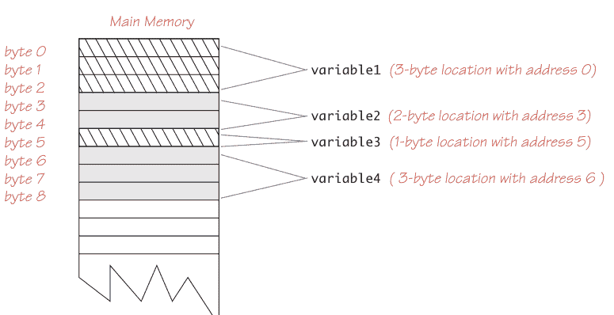

### 引用

为了有一个简单的例子来帮助解释*引用*，我们将使用图5.11中定义的`ToyClass`类。类类型变量命名其类对象的方式，与基本类型（如`int`或`char`）变量存储其值的方式不同。每个变量，无论是基本类型还是类类型，都在计算机内存中实现为一个位置。对于基本类型变量，变量的值存储在分配给该变量的内存位置中。然而，类类型变量只存储对象所在的内存地址。变量命名的对象存储在内存的其他位置，而变量只包含对象存储位置的内存地址。这个内存地址被称为（对象的）*引用*。¹ 这在图5.12中进行了说明。基本类型变量和类类型变量有所不同是有原因的。基本类型（如`int`类型）的值总是需要相同的内存空间来存储一个值。`int`类型有一个最大值，因此`int`类型值的大小有限制。然而，类类型的对象（例如`String`类的对象）可以是任意大小的。`String`类型变量的内存位置大小是固定的，因此它无法存储任意长的字符串。但是，它可以存储任何字符串的地址，因为地址的大小是有限的。

> ¹ 熟悉使用指针的语言的读者会将引用识别为指针的另一个名称。但是，Java不使用*指针*一词，而是使用*引用*一词。此外，这些引用是自动处理的。没有供程序员访问的解引用或其他指针操作。所有细节在Java中都是自动处理的。

图5.11 一个简单的类

```java
public class ToyClass
{
    private String name;
    private int number;

    public ToyClass(String initialName, int initialNumber)
    {
        name = initialName;
        number = initialNumber;
    }

    public ToyClass()
    {
        name = "No name yet.";
        number = 0;
    }

    public void set(String newName, int newNumber)
    {
        name = newName;
        number = newNumber;
    }

    public String toString()
    {
        return (name + " " + number);
    }

    public static void changer(ToyClass aParameter)
    {
        aParameter.name = "Hot Shot";
        aParameter.number = 42;
    }

    public boolean equals(ToyClass otherObject)
    {
        return ( (name.equals(otherObject.name))
                && (number == otherObject.number) );
    }
}
```

因为类类型的变量包含一个引用（内存地址），所以两个变量可以包含相同的引用。在这种情况下，两个变量命名同一个对象。对这些变量之一命名的对象所做的任何更改都会导致另一个变量命名的对象发生更改，因为它们是同一个对象。例如，考虑以下代码。（`ToyClass`类在图5.11中定义，但代码的含义应该很明显，你不需要去查看定义。）

```java
ToyClass variable1 = new ToyClass("Joe", 42);
ToyClass variable2;
variable2 = variable1; //Now both variables name the same object.
variable2.set("Josephine", 1);
System.out.println(variable1);
```

输出是：

```text
Josephine 1
```

`variable1`命名的对象在从未使用`variable1`名称的情况下被更改了。这在图5.13中进行了说明。

> ## 类类型变量存储引用
>
> 基本类型变量存储该类型的值。然而，类类型变量不存储该类的对象。类类型变量存储对象在计算机内存中的位置的引用（内存地址）。这导致一些操作（如`=`和`==`）对于类类型变量的行为与基本类型变量的行为大不相同。

> ## 引用类型
>
> 其变量包含引用的类型称为引用类型。在Java中，类类型是引用类型，但基本类型不是引用类型。

图5.12 类类型变量存储引用

```java
public class ToyClass
{
    private String name;
    private int number;
}
```

```java
ToyClass sampleVariable;
```

`ToyClass`类的完整定义见图5.11。

在内存中创建变量`sampleVariable`，但未为其赋值。

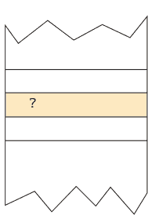

```java
sampleVariable =
    new ToyClass("Josephine Student", 42);
```

创建一个对象，将该对象放置在内存的某个位置，然后将该对象的地址放入变量`sampleVariable`。我们不知道该对象的地址是什么，但假设它是2056。具体数字并不重要。

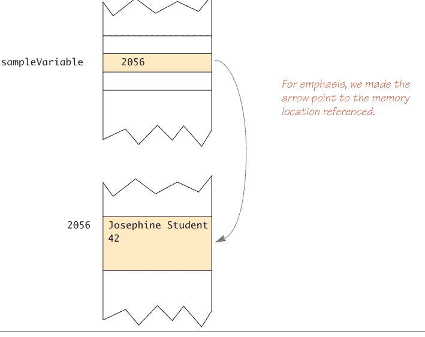

请注意，当对类类型的变量使用赋值运算符时，你赋值的是一个引用（内存地址），因此以下操作的结果是使`variable1`和`variable2`成为同一对象的两个名称：

```java
variable2 = variable1;
```

类类型的变量存储的是一个内存地址，而内存地址是一个数字。然而，类类型的变量不能像数字类型（如`int`或`double`）的变量那样使用。这是有意为之的。内存地址的重要属性在于它标识了一个内存位置。实现者使用数字（而不是字母、字符串或其他东西）来命名内存位置，这只是一个偶然的属性。Java阻止你使用这个偶然属性，是为了防止你做诸如访问受限内存或以其他方式搞乱计算机这样的事情。

### 清单5.13 类类型变量的赋值运算符（第1部分，共2部分）

```java
ToyClass variable1 = new ToyClass("Joe", 42);
ToyClass variable2;
```

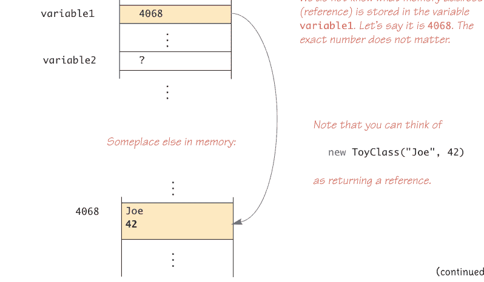

### 清单5.13 类类型变量的赋值运算符（第2部分，共2部分）

```java
variable2 = variable1;
```

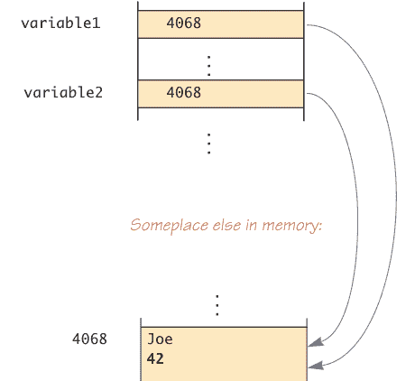

```java
variable2.set("Josephine", 1);
```

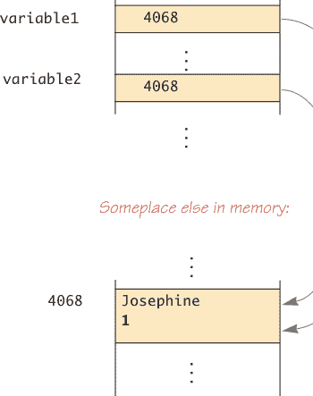

### 类参数

严格来说，Java中的所有参数都是按值调用的参数。这意味着当为一个参数（任何类型）传入一个实参时，实参会被求值，获得的值用于初始化参数的值。（回想一下，参数实际上是一个局部变量。）然而，对于类类型的参数，传入的值是一个引用（内存地址），这使得类参数的行为与基本类型的参数截然不同。

回想一下，以下代码使`variable1`和`variable2`成为同一对象的两个名称：

```java
ToyClass variable1 = new ToyClass("Joe", 42);
ToyClass variable2;
variable2 = variable1;
```

因此，对`variable2`所做的任何更改，实际上都是对`variable1`的更改。类类型的参数也是如此。参数是一个局部变量，它被设置为等于其参数值。但如果其参数是一个类类型的变量，这会将一个引用复制到参数中。这样，参数就变成了参数的另一个名称，对参数命名的对象所做的任何更改都会作用于实参命名的对象，因为它们是同一个对象。因此，一个方法可以更改作为参数给出的对象的实例变量。清单5.14给出了一个说明这一点的简单程序。清单5.15包含了一个图表，展示了清单5.14中的程序执行时计算机内存的情况。

### 清单5.14 类类型的参数

```java
1 public class ClassParameterDemo
2 {
3     public static void main(String[] args)
4     {
5         ToyClass anObject = new ToyClass("Mr. Cellophane", 0);
6         System.out.println(anObject);
7         System.out.println(
8                 "Now we call changer with anObject as argument.");
9         ToyClass.changer(anObject);
10        System.out.println(anObject);
11    }
12 }
```

`ToyClass`在清单5.11中定义。

请注意，方法`changer`更改了对象`anObject`中的实例变量。

## 示例对话

```text
Mr. Cellophane 0
Now we call changer with anObject as argument.
Hot Shot 42
```

许多编程语言都有一种称为按引用调用的参数传递机制。如果你熟悉按引用调用的参数，我们应该注意，Java的参数传递机制类似于，但并非完全等同于按引用调用。

> **基本类型参数与类类型参数的区别**
>
> 一个方法不能更改作为其参数的基本类型变量的值。另一方面，一个方法可以更改类类型参数的实例变量的值。这一点在清单5.16中得到了说明。

### 清单5.15 清单5.14的内存示意图（第1部分，共2部分）

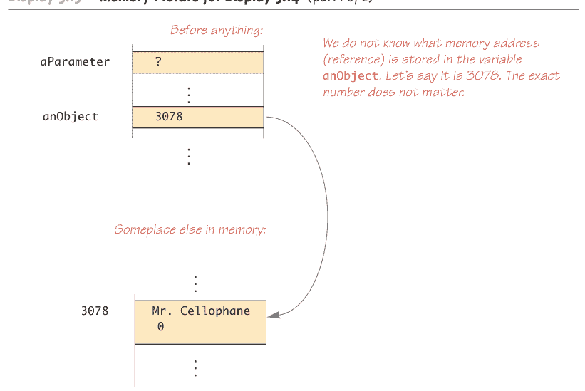

### 清单5.15 清单5.14的内存示意图（第2部分，共2部分）

`anObject`被传入给`aParameter`。

`anObject`和`aParameter`变成同一对象的两个名称。

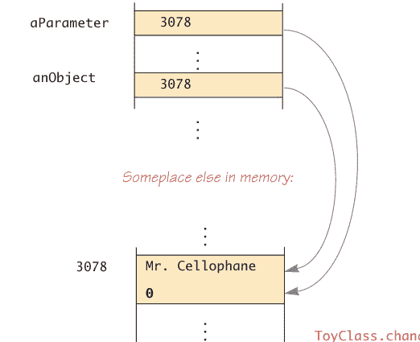

内存中的其他地方：

`ToyClass.changer(anObject);`被执行。

因此执行了以下语句：

```java
aParameter.name = "Hot Shot";
aParameter.number = 42;
```

结果，`anObject`被改变了。

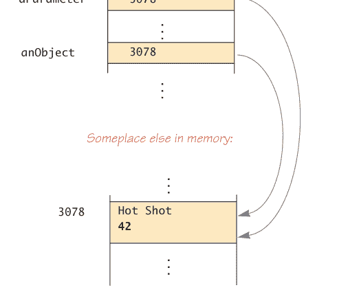

内存中的其他地方：

### 清单5.16 比较类类型参数和基本类型参数


```java
public class ParametersDemo
{
    public static void main(String[] args)
    {
        ToyClass2 object1 = new ToyClass2(),
                  object2 = new ToyClass2();
        object1.set("Scorpius", 1);
        object2.set("John Crichton", 2);
        System.out.println("Value of object2 before call to method:");
        System.out.println(object2);
        object1.makeEqual(object2);
        System.out.println("Value of object2 after call to method:");
        System.out.println(object2);

        int aNumber = 42;
        System.out.println("Value of aNumber before call to method: "
                           + aNumber);
        object1.tryToMakeEqual(aNumber);
        System.out.println("Value of aNumber after call to method: "
                           + aNumber);
    }
}
```

> `ToyClass2` 在清单 5.17 中定义。

# 示例对话

```text
Value of object2 before call to method:
John Crichton 2
Value of object2 after call to method:
Scorpius 1
Value of aNumber before call to method: 42
Value of aNumber after call to method: 42
```

> 类类型的参数可以更改。

> 基本类型的参数不能更改。

## 清单 5.17 用于清单 5.16 的一个玩具类


```java
public class ToyClass2
{
    private String name;
    private int number;

    public void set(String newName, int newNumber)
    {
        name = newName;
        number = newNumber;
    }

    public String toString()
    {
        return (name + " " + number);
    }

    public void makeEqual(ToyClass2 anObject)
    {
        anObject.name = this.name;
        anObject.number = this.number;
    }

    public void tryToMakeEqual(int aNumber)
    {
        aNumber = this.number;
    }

    public boolean equals(ToyClass2 otherObject)
    {
        return ((name.equals(otherObject.name))
                && (number == otherObject.number));
    }
}
```

阅读文本以讨论此方法的问题。

<其他方法可以与清单 5.11 中的相同，尽管当前讨论中不需要或未使用其他方法。>

## 陷阱

### 在类类型变量上使用 `=` 和 `==`

你已经看到，对类类型变量使用赋值运算符会产生两个命名同一对象的变量，这与赋值对基本类型变量的行为非常不同。

使用 `==` 比较类类型变量的相等性也可能表现出看似特殊的方式。运算符 `==` 不检查对象的实例变量是否具有相同的值。它只检查内存地址是否相等，因此即使两个对象的实例变量包含相同的数据，两个位于内存中不同位置的对象在使用 `==` 比较时也会测试为“不相等”。例如，考虑以下代码。（类 `ToyClass2` 在清单 5.17 中定义。）

```java
ToyClass2 variable1 = new ToyClass2("Chiana", 3),
          variable2 = new ToyClass2("Chiana", 3);
if (variable1 == variable2)
    System.out.println("Equal using ==");
else
    System.out.println("Not equal using ==");
```

这段代码将产生输出：

```text
Not equal using ==
```

即使这两个变量命名的对象在直觉上是相等的，它们也存储在计算机内存中的两个不同位置。这就是为什么你通常使用 `equals` 方法来比较类类型的变量。如果使用类 `ToyClass2`（清单 5.17）定义的 `equals` 方法进行比较，变量 `variable1` 和 `variable2` 将被视为“相等”。

## 自测练习

- 27. 什么是引用类型？类类型是引用类型吗？基本类型（如 `int`）是引用类型吗？
- 28. 比较两个类类型的对象是否“相等”时，应该使用 `==` 还是 `equals` 方法？
- 29. 比较两个基本类型（如 `int`）的对象是否“相等”时，应该使用 `==` 还是 `equals` 方法？
- 30. 一个具有类类型参数的方法能否更改该参数命名的对象的实例变量的值？例如，如果参数是清单 5.11 中定义的 `ToyClass` 类型，该方法能否更改其参数的名称？
- 31. 假设一个方法有一个 `int` 类型的参数，并且该方法被传入一个 `int` 变量作为实参。该方法能否被定义为更改作为实参给出的变量的值？

## 常量 `null`

常量 `null` 是一个特殊的常量，可以赋值给任何类类型的变量。它用于表示变量没有“实际值”。如果编译器要求你初始化一个类类型的变量，且没有合适的对象可用于初始化，你可以使用 `null` 值，如下例所示：

```java
YourClass yourObject = null;
```

在没有明显对象可用时，在构造函数中使用 `null` 来初始化类类型的实例变量也很常见。我们最终会看到常量 `null` 的其他用途。

请注意，`null` 不是一个对象。它就像一个引用（内存地址），不指向任何对象（不指向任何内存位置）。因此，如果你想测试一个类变量是否包含 `null`，你应该使用 `==` 或 `!=`，而不是使用 `equals` 方法。例如，以下代码正确地测试了 `null`：

```java
if (yourObject == null)
    System.out.println("No real object here.");
```

> ### `null`
>
> `null` 是一个特殊的常量，可用于为任何类类型的变量赋值。常量 `null` 不是一个对象，而是对象引用的一种占位符。因为它类似于一个引用（内存地址），所以在测试变量是否包含 `null` 时，你使用 `==` 和 `!=`，而不是使用 `equals` 方法。

## 陷阱

### 空指针异常

如果编译器要求你初始化一个类变量，你总可以将该变量初始化为 `null`。然而，`null` 不是一个对象，因此你不能使用初始化为 `null` 的变量来调用方法。如果你尝试这样做，会得到一条显示“空指针异常”的错误信息。例如，如果以下代码包含在程序中，将会产生“空指针异常”：

```java
ToyClass2 aVariable = null;
String representation = aVariable.toString();
```

问题在于，你试图使用 `null` 作为调用对象来调用 `toString()` 方法。但 `null` 不是一个对象；它只是一个占位符。因此 `null` 没有任何方法。由于你错误地使用了 `null`，错误信息显示为“空指针异常”。每当类变量未被赋值（引用一个）对象时，即使你没有给该变量赋值 `null`，也会得到这个错误信息。每当遇到“空指针异常”时，请查找未初始化的类变量。

纠正这个问题的方法是使用 `new` 来创建一个类对象，如下所示：

```java
ToyClass2 aVariable = new ToyClass2("Chiana", 3);
String representation = aVariable.toString();
```

## `new` 运算符与匿名对象

考虑以下表达式，其中 `ToyClass` 定义在 Display 5.11 中：

`ToyClass variable1 = new ToyClass("Joe", 42);`

如 Display 5.13 所示，`new ToyClass("Joe", 42)` 部分是对构造函数的调用。你可以将构造函数视为返回一个指向构造函数创建的对象在内存中位置的引用。如果你采用这种观点，这行代码中的等号只是一个普通的赋值运算符。

有时，你使用 `new` 创建一个对象，并将其用作方法的参数，但之后再也不使用该对象。在这种情况下，你不必给对象一个变量名。你可以直接使用包含 `new` 运算符和构造函数的表达式作为参数。例如，假设你想测试 `variable1`（在前面的代码行中）中的对象是否与一个名字全为大写字母且数字相同的对象相等。你可以这样做：

```java
if (variable1.equals(new ToyClass("JOE", 42)))
    System.out.println("Equal");
else
    System.out.println("Not equal");
```

这等同于：

```java
ToyClass temp = new ToyClass("JOE", 42);
if (variable1.equals(temp))
    System.out.println("Equal");
else
    System.out.println("Not equal");
```

在第二个版本中，对象被创建，其引用被放入变量 `temp`。然后将 `temp` 代入 `equals` 方法的参数。但是参数传递机制所做的只是取出存储在 `temp` 中的引用，并将其代入 `equals` 的参数。第一个版本简化了这个过程。它创建了对象的引用并直接将其代入 `equals` 的参数。它绕过了变量 `temp`，但最终代入的引用与作为 `equals` 参数的引用相同。

像这样的表达式：

```java
new ToyClass("JOE", 42)
```

当未赋值给变量时，被称为匿名对象。它的求值结果是指向该类对象的一个引用。它之所以被称为匿名，是因为该对象没有被赋予一个作为其名称的变量。我们最终会遇到使用此类匿名对象很常见的情况。

### 匿名对象

一个包含 `new` 运算符和构造函数的表达式会创建一个新对象并返回该对象的引用。如果这个引用没有赋值给一个变量，而是将包含 `new` 和构造函数的表达式用作某个方法的参数，那么产生的对象就称为匿名对象。

## 示例

```java
if (variable1.equals(new ToyClass("JOE", 42)))
    System.out.println("Equal");
else
    System.out.println("Not equal");
```

表达式 `new ToyClass("JOE", 42)`（或者更准确地说，它创建的对象）是匿名对象的一个例子。

### 键盘输入的另一种方法

这个示例使用了在第 4 章的标有星号的章节中介绍的 `StringTokenizer` 类。如果你还没有学习 `StringTokenizer` 类，可以先跳过这个示例，等学习了该类后再回来看。

Display 5.18 中的程序是一个使用 `StringTokenizer` 类和 `Double.parseDouble` 方法来读取输入在单行上、用非空白字符分隔的多个 `double` 类型值的示例。

使用 `Scanner` 类的 `nextLine` 方法将整行作为单个长字符串读取。使用 `StringTokenizer` 类将长字符串分解为标记。这些标记就是输入的数字，但它们是字符串值的形式，而不是 `double` 类型的值。最后，使用 `Double.parseDouble` 方法将这些标记转换为 `double` 类型的值。

请注意，`String` 变量被初始化为 `null`。如果你省略了 `null`，编译器会抱怨变量 `string1` 和 `string2` 在使用前可能未初始化。编译器是错误的。然而，与编译器争辩没有好处。为变量 `string1` 和 `string2` 包含 `null` 作为初始值将让编译器满意，并允许你运行程序。

### Display 5.18 使用 `Double.parseDouble` 方法（第 1 部分，共 2 部分）

```java
import java.util.Scanner;
import java.util.StringTokenizer;

public class InputExample
{
    public static void main(String[] args)
    {
        Scanner keyboard = new Scanner(System.in);

        System.out.println("Enter two numbers on a line.");
        System.out.println("Place a comma between the numbers.");
        System.out.println("Extra blank space is OK.");
        String inputLine = keyboard.nextLine();

        String delimiters = ", "; //Comma and blank space
        StringTokenizer numberFactory =
            new StringTokenizer(inputLine, delimiters);

        String string1 = null;
        String string2 = null;
        if (numberFactory.countTokens() >= 2)
        {
            string1 = numberFactory.nextToken();
            string2 = numberFactory.nextToken();
        }
        else
        {
            System.out.println("Fatal Error.");
            System.exit(0);
        }

        double number1 = Double.parseDouble(string1);
        double number2 = Double.parseDouble(string2);

        System.out.print("You input ");
        System.out.println(number1 + " and " + number2);
    }
}
```

### 显示 5.18 使用 `Double.parseDouble` 方法（第 2 部分，共 2 部分）

> #### 示例对话
>
> 在一行中输入两个数字。
>
> 在数字之间放置逗号。
>
> 允许有多余的空白字符。
>
> 41.98, 42
>
> 你的输入是 41.98 和 42.0

## 自测练习

32. 下面的程序有什么问题？类 `ToyClass` 在显示 5.11 中定义。

```java
ToyClass anObject = null;
anObject.set("Josephine", 42);
```

33. 常量 `null` 的类型是什么？

34. 假设 `aVariable` 是一个类类型的变量。下列哪项正确地测试了 `aVariable` 是否包含 `null`？

- `aVariable.equals(null)`
- `aVariable == null`

35. 以下代码在 Java 中是否合法？类 `ToyClass` 在显示 5.11 中定义。

```java
System.out.println(new ToyClass("Mr. Cellophane", 0));
```

## 提示

### 使用静态导入

你已经见过导入语句了，例如下面来自显示 5.9 的语句：

```java
import java.util.Scanner;
```

还有另一种形式的导入语句，虽然不是必需的，但可以提供便利。这些被称为静态导入语句，最好通过一个例子来解释。

能够以以下简单形式编写静态方法调用会很方便：

```java
toUpperCase(firstCharacter)
```

而不需要编写下面更长的版本（取自显示 5.9）：


```java
Character.toUpperCase(firstCharacter)
```

如果你在程序的开头添加以下静态导入语句，那么你就可以用期望的更短方式来调用`toUpperCase`：

```java
import static java.lang.Character.toUpperCase;
```

类`Character`位于 Java 包`java.lang`中。请注意，你需要像普通导入语句一样提供包名和类名，就像上面为`java.util`包中的`Scanner`类所做的导入一样。

包`java.lang`是自动导入的。因此，例如，你可以使用`Character.toUpperCase`方法而无需任何导入语句。但请注意，在静态导入语句方面，包`java.lang`没有特殊之处。如果你想使用缩写形式`toUpperCase`，你必须提供静态导入语句。

如果你使用以下形式的静态导入语句，那么你的代码就可以使用`Character`类中任何静态方法的名称，而无需`Character`和点号作为前缀。

```java
import static java.lang.Character.*;
```

例如，考虑显示 5.9 中的程序。如果你将

```java
import java.util.Scanner;
```

替换为

```java
import java.util.Scanner;
import static java.lang.Character.toUpperCase;
```

或

```java
import java.util.Scanner;
import static java.lang.Character.*;
```

那么你就可以将语句

```java
sentence = Character.toUpperCase(firstCharacter)
                     + sentence.substring(1);
```

改为

```java
sentence = toUpperCase(firstCharacter)
+ sentence.substring(1);
```

配套 CD 上的程序`StaticImportDemo.java`以这种方式使用静态导入语句重写了显示 5.9 中的程序。

当然，你可以对任何其他类执行此操作，然后你就可以使用该类中的静态方法，而无需在方法名前加上类名和点号。

你可以对常量和方法使用静态导入语句。如果你想在显示 5.7 的程序中使用`PI`而不是`Math.PI`，只需在程序文件的开头包含以下导入语句之一：

```java
import static java.lang.Math.PI;
```

或

```java
import static java.lang.Math.*;
```

配套 CD 上的程序`StaticImportDemo2.java`以这种方式使用静态导入语句重写了显示 5.7 中的程序。

有一点需要警告：这只适用于静态方法。这根本不适用于普通的非静态方法。

你不能使用静态导入语句将类实例方法（例如`sentence.toUpperCase()`）更改为形式为`toUpperCase(sentence)`的静态方法调用。即使类实例方法是静态的，这也是正确的。

你可以对常量和方法使用静态导入语句。如果你想在显示 5.7 的程序中使用`PI`而不是`Math.PI`，只需在程序文件的开头包含以下导入语句之一：

```java
import static java.lang.Math.PI;
```

或

```java
import static java.lang.Math.*;
```

配套 CD 上的程序`StaticImportDemo2.java`以这种方式使用静态导入语句重写了显示 5.7 中的程序。

## 5.3 使用和误用引用

> 漏网之鱼，沉船之祸。

> 军事标语

就像军事行动需要时刻保持警惕以确保计划保密一样，你的编程也需要时刻保持警惕，以确保私有实例变量保持真正的私有。正如我们将看到的，在实例变量声明前添加`private`修饰符并不总是你需要做的全部。设计不良的类可能存在隐私泄露，就像军事行动中可能存在隐私泄露一样。

本节中的材料很重要，但比我们之前看到的材料更微妙、更难消化。如果你愿意，你可以推迟阅读本节，直到你有了更多定义和使用类的实践经验。在学习 5.4 节之前，你不需要本节的内容。

## 示例

### `Person`类

拥有类类型的实例变量是很常见的。显示 5.19 中定义的类`Person`有两个类型为`Date`的实例变量。因此，类`Person`拥有类类型的实例变量。（类`Date`在第 4 章显示 4.11 中定义。我们已经在显示 5.20 中复制了`Date`类定义的相关部分。）实际上，类`Person`的所有实例变量都是类类型的。类`Person`的对象拥有在墓碑和图书馆目录的作者列表等地方找到的关于人的基本数据。它通过给出一个人的姓名、出生日期和死亡日期来描述一个人。如果这个人还活着，那么值`null`被用作死亡日期。（所以，`null`是好的。）一个简单的程序示例说明了类`Person`，如显示 5.21 所示。我们将在下面的子节中讨论类`Person`的几个细节，但类`Person`中的大部分方法将在我们讨论相应主题时进行讨论。

通常，类定义应该包含一个无参构造函数。然而，在某些情况下，无参构造函数几乎没有意义。例如，包装类（如`Integer`和`Double`）没有无参构造函数，正如我们在本章前面的“陷阱”子节“包装类没有无参构造函数”中解释的那样。类`Person`也没有无参构造函数，原因在于此。一个人可能没有死亡日期，但一个人总有出生日期。无参构造函数应该初始化所有实例变量，但除非将出生日期作为参数提供给构造函数，否则没有合适的值来初始化实例变量`born`。特别是，将实例变量`born`初始化为`null`没有意义；这将表明这个人从未出生。拥有一个从未出生的人没有意义，因此为类`Person`提供无参构造函数也没有意义。请注意，由于我们为类`Person`定义了一些构造函数，但没有定义无参构造函数，因此类`Person`没有无参构造函数。

由于我们假设类`Person`的对象总是有一个出生日期（不是`null`），那么对于类`Person`的对象，以下内容应该始终成立：

> 类`Person`的对象有一个出生日期（不是`null`），如果对象有一个死亡日期，那么死亡日期等于或晚于出生日期。

如果你检查类`Person`的定义，你会发现这个陈述始终成立。对于构造函数创建的每个对象都是如此，所有其他方法都保持这个陈述的真实性。事实上，私有方法`consistent`就是为了检查这个属性而设计的。一个始终对类的每个对象都成立的陈述，例如上面的陈述，被称为**类不变量**。

请注意，类`Person`的`equals`定义包括对类`String`的`equals`的调用和对类`Date`的`equals`方法的调用。Java 根据其调用对象的类型来确定调用哪个`equals`方法。因为实例变量`name`是`String`类型，所以调用`name.equals(...)`是对类`String`的`equals`方法的调用。因为实例变量`born`是`Date`类型，所以调用`born.equals(...)`是对类`Date`的`equals`方法的调用。

类似地，类`Person`的`toString`方法的定义包括对类`Date`的`toString`方法的调用。

### 显示 5.19 一个 `Person` 类（第 1/5 部分）

```java
/**
 用于表示一个具有姓名、出生日期和死亡日期的人的类。
 类不变式：一个 Person 总是有出生日期，如果 Person 有死亡日期，
 那么死亡日期必须等于或晚于出生日期。
 */
public class Person
{
    private String name;
    private Date born;
    private Date died;//null 表示仍然在世。

    public Person(String initialName, Date birthDate, Date deathDate)
    {
        if (consistent(birthDate, deathDate))
        {
            name = initialName;
            born = new Date(birthDate);
            if (deathDate == null)
                died = null;
            else
                died = new Date(deathDate);
        }
        else
        {
            System.out.println("日期不一致，程序终止。");
            System.exit(0);
        }
    }

    public Person(Person original)
    {
        if (original == null)
        {
            System.out.println("致命错误。");
            System.exit(0);
        }

        name = original.name;
        born = new Date(original.born);

        if (original.died == null)
            died = null;
        else
            died = new Date(original.died);
    }
```

> `Date`类在显示 4.11 中定义，许多细节在显示 5.20 中重复。

> 我们将在名为“拷贝构造函数”的小节中讨论`Date`和这些构造函数调用的意义。

> 拷贝构造函数

（续）

298 第 5 章 定义类 II

### 显示 5.19 一个 `Person` 类（第 2/5 部分）

```java
    public void set(String newName, Date birthDate, Date deathDate)
    <此方法的定义见自测练习 41。>
    public String toString()
    {
        String diedString;
        if (died == null)
            diedString = ""; //空字符串
        else
            diedString = died.toString();
        return (name + ", " + born + "-" + diedString);
    }
    public boolean equals(Person otherPerson)
    {
        if (otherPerson == null)
            return false;
        else
            return (name.equals(otherPerson.name)
                && born.equals(otherPerson.born)
                && datesMatch(died, otherPerson.died) );
    }
    /**
     要匹配，date1 和 date2 必须是相同的日期或同时为 null。
    */
    private static boolean datesMatch(Date date1, Date date2)
    {
        if (date1 == null)
            return (date2 == null);
        else if (date2 == null) //&& date1 != null
            return false;
        else // 两个日期都不为 null。
            return(date1.equals(date2));
    }
    /**
     前置条件：newDate 是一个一致的出生日期。
     后置条件：调用对象的出生日期被设置为 newDate。
    */
    public void setBirthDate(Date newDate)
    {
        if (consistent(newDate, died))
            born = new Date(newDate);
```

### 显示 5.19 一个 `Person` 类（第 3/5 部分）

```java
        else
        {
            System.out.println("日期不一致，程序终止。");
            System.exit(0);
        }
    }

    /**
     前置条件：newDate 是一个一致的死亡日期。
     后置条件：调用对象的死亡日期被设置为 newDate。
     */
    public void setDeathDate(Date newDate)
    {
        if (!consistent(born, newDate))
        {
            System.out.println("日期不一致，程序终止。");
            System.exit(0);
        }

        if (newDate == null)
            died = null;
        else
            died = new Date(newDate);
    }

    public void setName(String newName)
    {
        name = newName;
    }

    /**
     前置条件：出生日期已设置，且更改出生日期的年份部分
     将得到一个一致的出生日期。
     后置条件：出生年份被（更改为）newYear。
     */
    public void setBirthYear(int newYear)
    {
        if (born == null) //前置条件被违反
        {
            System.out.println("致命错误，程序终止。");
            System.exit(0);
        }
        born.setYear(newYear);
        if (!consistent(born, died))
        {
```

> 死亡日期可以是`null`。然而，在`setBirthDate`中没有对应的代码，因为`consistent`方法确保了出生日期永远不会是`null`。

（续）

### 显示 5.19 一个 `Person` 类（第 4/5 部分）

```java
            System.out.println("日期不一致，程序终止。");
            System.exit(0);
        }
    }

    /**
     前置条件：死亡日期已设置，且更改死亡日期的年份部分
     将得到一个一致的死亡日期。
     后置条件：死亡年份被（更改为）newYear。
     */
    public void setDeathYear(int newYear)
    {
        if (died == null) //前置条件被违反
        {
            System.out.println("致命错误，程序终止。");
            System.exit(0);
        }
        died.setYear(newYear);
        if (!consistent(born, died))
        {
            System.out.println("日期不一致，程序终止。");
            System.exit(0);
        }
    }

    public String getName()
    {
        return name;
    }

    public Date getBirthDate()
    {
        return new Date(born);
    }

    public Date getDeathDate()
    {
        if (died == null)
            return null;
        else
            return new Date(died);
    }

    /**
     为了保持一致，birthDate 不能为 null。如果没有死亡日期
     （deathDate == null），这与任何 birthDate 都是一致的。
     否则，birthDate 必须在 deathDate 之前或与之相等。
     */
```

### 显示 5.19 一个 `Person` 类（第 5/5 部分）


```java
private static boolean consistent(Date birthDate, Date deathDate)
{
    if (birthDate == null)
        return false;
    else if (deathDate == null)
        return true;
    else
        return (birthDate.precedes(deathDate)
                || birthDate.equals(deathDate));
}
```

**类不变式**

对于类的每个对象都始终为真的陈述被称为**类不变式**。类不变式可以帮助以一致和有组织的方式定义一个类。

### 陷阱

#### null 可以作为方法的参数

如果一个方法有一个类类型的参数，那么在调用该方法时，可以使用 `null` 作为对应的实参。有时使用 `null` 作为实参可能是错误的结果，但有时也可以是故意的实参。例如，`Person` 类（显示 5.19）使用 `null` 表示死亡日期，以表明此人仍然在世。因此，`null` 有时对于像 `consistent` 这样的方法来说是一个完全正常的实参。方法定义应该考虑到 `null` 作为可能的实参，而不是假设方法总是接收一个真实的对象来填充类参数。

请注意 `Person` 类的 `equals` 方法的定义。相等性测试的形式是

`object1.equals(object2)`

调用对象 `object1` 必须是 `Person` 类的一个真实对象；调用对象不能是 `null`。然而，参数 `object2` 可以是真实对象，也可以是 `null`。如果参数是 `null`，那么 `equals` 应该返回 `false`，因为一个真实对象不能合理地被认为是等于 `null` 的。事实上，Java 文档规定，当 `equals` 方法的参数为 `null` 时，`equals` 方法应该返回 `false`。请注意，我们的定义在参数为 `null` 时确实返回了 `false`。

### 显示 5.20 日期类（部分定义）（第 1 部分，共 2 部分）

```java
public class Date
{
    private String month;
    private int day;
    private int year; //a four digit number.

    public Date(String monthString, int day, int year)
    {
        setDate(monthString, day, year);
    }

    public Date(Date aDate)
    {
        if (aDate == null)//Not a real date.
        {
            System.out.println("Fatal Error.");
            System.exit(0);
        }

        month = aDate.month;
        day = aDate.day;
        year = aDate.year;
    }

    public void setDate(String monthString, int day, int year)
    {
        if (dateOK(monthString, day, year))
        {
            this.month = monthString;
            this.day = day;
            this.year = year;
        }
        else
        {
            System.out.println("Fatal Error");
            System.exit(0);
        }
    }
```

这不是日期类的完整定义。日期类的完整定义在显示 4.11 中，但此部分包含了对本章讨论至关重要的细节。

拷贝构造函数

`dateOK` 方法用于检查日期是否为合法日期，例如日期不能超过 31 天。

### 显示 5.20 日期类（部分定义）（第 2 部分，共 2 部分）

```java
    public void setYear(int year)
    {
        if ( (year < 1000) || (year > 9999) )
        {
            System.out.println("Fatal Error");
            System.exit(0);
        }
        else
            this.year = year;
    }

    public String toString()
        ...
    public boolean equals(Date otherDate)
        ....
    /**
     如果调用对象的日期早于 otherDate（在时间上），则返回 true。
     */
    public boolean precedes(Date otherDate)
        ...
    private boolean dateOK(String monthString, int dayInt, int yearInt)
        ...
}
```

> `equals` 方法的完整定义见自测练习 3737 的答案，它比第 4 章中给出的版本更佳。

> 这些方法的含义显而易见。如需查看完整定义，请参阅第 4 章的显示 4.11 和本章的自测练习 3737。

### 自测练习

36. 以下两段代码有何不同？第一段代码出现在显示 5.21 中。

```java
Person adams =
            new Person("John Adams",
                new Date("February", 15, 1947), null);
```

第二段代码如下：

```java
Date theDate = new Date("February", 15, 1947);
Person adams = new Person("John Adams", theDate, null);
```

37. 当我们在第 4 章（显示 4.11）定义 `Date` 类时，我们尚未讨论 `null`。因此，那里给出的 `equals` 定义没有考虑到参数可能为 `null` 的情况。请重写 `Date` 类的 `equals` 定义，以考虑参数可能为 `null` 的情况。

### 显示 5.21 演示 Person 类

```java
public class PersonDemo
{
    public static void main(String[] args)
    {
        Person bach =
            new Person("Johann Sebastian Bach",
                new Date("March", 21, 1685), new Date("July", 28, 1750));
        Person stravinsky =
            new Person("Igor Stravinsky",
                new Date("June", 17, 1882), new Date("April", 6, 1971));
        Person adams =
            new Person("John Adams",
                new Date("February", 15, 1947), null);

        System.out.println("A Short List of Composers:");
        System.out.println(bach);
        System.out.println(stravinsky);
        System.out.println(adams);

        Person bachTwin = new Person(bach);
        System.out.println("Comparing bach and bachTwin:");
        if (bachTwin == bach)
            System.out.println("Same reference for both.");
        else
            System.out.println("Distinct copies.");

        if (bachTwin.equals(bach))
            System.out.println("Same data.");
        else
            System.out.println("Not same data.");
    }
}
```

示例对话

```
A Short List of Composers:
Johann Sebastian Bach, March 21, 1685-July 28, 1750
Igor Stravinsky, June 17, 1882-April 6, 1971
John Adams, February 15, 1947-
Comparing bach and bachTwin:
Distinct copies.
Same data.
```

### 拷贝构造函数

`拷贝构造函数` 是一个单一参数与类类型相同的构造函数。拷贝构造函数应创建一个独立、分离的对象，但其实例变量的设置使其成为参数对象的精确副本。

例如，显示 5.20 重现了显示 4.11 中定义的 `Date` 类的拷贝构造函数。拷贝构造函数（或任何其他构造函数）创建一个新的 `Date` 类对象。这部分是自动发生的，未在拷贝构造函数的代码中显示。拷贝构造函数的代码随后将其设置为等于其单个参数 `aDate` 的值。但是，尽管新创建的日期表示相同的日期，它仍是一个独立的对象。考虑以下代码：

```java
Date date1 = new Date("January", 1, 2006);
Date date2 = new Date(date1);
```

执行此代码后，`date1` 和 `date2` 都表示日期 2006 年 1 月 1 日，但它们是两个不同的对象。因此，如果我们更改其中一个对象，它不会更改另一个。例如，考虑

```java
date2.setDate("July", 4, 1776);
System.out.println(date1);
```

产生的输出是

```
January 1, 2006
```

当我们更改 `date2` 时，我们没有更改 `date1`。这可能不是一个困难甚至微妙的观点，但它对本章本节讨论的大部分内容都至关重要。（有关拷贝构造函数与赋值运算符的对比，请参阅本章的自测练习 39。）

现在让我们考虑 `Person` 类的拷贝构造函数（显示 5.19），它稍微复杂一些。它重现如下：

```java
public Person(Person original)
{
    if (original == null)
    {
        System.out.println("Fatal error.");
        System.exit(0);
    }
    name = original.name;
    born = new Date(original.born);
    if (original.died == null)
        died = null;
    else
        died = new Date(original.died);
}
```

我们希望创建的对象是 `original` 的独立副本。如果我们使用以下替代方案，这将不会发生：

```java
public Person(Person original) //Unsafe
{
    if (original == null)
    {
        System.out.println("Fatal error.");
        System.exit(0);
    }
    name = original.name;
    born = original.born; //Not good.
    died = original.died; //Not good.
}
```

尽管这个替代定义看起来足够无害，并且在许多情况下可能工作正常，但它确实存在严重问题。

假设我们使用了不安全版本的拷贝构造函数，而不是显示 5.19 中的那个。"Not good." 代码只是将 `original.born` 和 `original.died` 的引用复制到构造函数创建的对象的相应参数中。因此，创建的对象不是原始对象的独立副本。例如，考虑代码

```java
Person original =
    new Person("Natalie Dressed", new Date("April", 1, 1984), null);
Person copy = new Person(original);
copy.setBirthYear(1800);
System.out.println(original);
```

输出将是

```
Natalie Dressed, April 1, 1800-
```

当我们更改对象 `copy` 中的出生年份时，我们还更改了对象 `original` 中的出生年份。这是因为我们使用了不安全版本的拷贝构造函数。`original.born` 和 `copy.born` 都包含对同一个 `Date` 对象的相同引用。

所有这一切都假设（与事实相反）我们使用了不安全版本的拷贝构造函数。幸运的是，我们使用了一个更安全的版本，它设置 `born` 实例变量如下：

```java
born = new Date(original.born);
```

等同于

```java
this.born = new Date(original.born);
```

### 拷贝构造函数

我们使用的这个版本，使得实例变量 `this.born` 成为一个独立的 `Date` 对象，它表示与 `original.born` 相同的日期。因此，如果你修改通过拷贝构造函数创建的 `Person` 对象中的日期，不会改变原始 `Person` 对象中的日期。

请注意，如果一个类（如 `Person`）拥有类类型的实例变量（如实例变量 `born` 和 `died`），那么为了给 `Person` 类定义正确的拷贝构造函数，你必须已经为其实例变量的 `Date` 类准备好了拷贝构造函数。确保所有类都具备此特性的最简单方法是，在你定义的每个类中都包含一个拷贝构造函数。

> **拷贝构造函数**

**拷贝构造函数**是一个参数类型与该类本身相同的构造函数。拷贝构造函数的设计应该使其创建的对象在直观上是其参数的精确副本，但又是一个完全独立的副本。有关拷贝构造函数的示例，请参见 Display 5.19 和 5.20。

Java 文档建议使用名为 `clone` 的方法代替拷贝构造函数，正如你将在本书后续部分看到的，有些情况下拷贝构造函数无法按预期工作，而你需要 `clone` 方法。然而，我们目前还没有足够的背景知识来讨论 `clone` 方法。`clone` 方法将在本书后面（第 8 章和第 13 章）进行讨论。尽管有 Java 文档的建议，许多优秀的程序员仍然偏好有时使用拷贝构造函数。在本书中，我们将同时使用拷贝构造函数和 `clone` 方法。

### 易错点

#### 隐私泄露

考虑 `Person` 类的访问器方法 `getBirthDate`（Display 5.19），我们在此复现如下：

```java
public Date getBirthDate()
{
    return new Date(born);
}
```

#### 易错点（续）

不要犯以下错误，将访问器方法定义为：

```java
public Date getBirthDate() //不安全
{
    return born; //不好
}
```

假设我们使用了不安全版本的 `getBirthDate` 而不是 Display 5.19 中的版本。那么，使用 `Person` 类的程序就有可能将私有实例变量 `born` 修改为任何日期，并绕过 `Person` 类构造函数和修改器方法中的检查。例如，考虑以下代码，它可能出现在使用 `Person` 类的某个程序中：

```java
Person citizen = new Person(
    "Joe Citizen", new Date("January", 1, 1900), new Date("January", 1,
    1990));
Date dateName = citizen.getBirthDate();

dateName.setDate("April", 1, 3000);
```

这段代码将出生日期更改为在死亡日期之后（在我们已知的宇宙中这是不可能的）。这个公民直到他或她死亡之后才出生！这种情况被称为**隐私泄露**，因为它允许程序员绕过实例变量（如 `born`）前的 `private` 修饰符，并将私有实例变量更改为任何值。

以下代码在我们的程序中将是非法的：

```java
citizen.born.setDate("April", 1, 3000); //非法
```

这是非法的，因为 `born` 是一个私有实例变量。然而，使用了不安全版本的 `getBirthDate`（我们现在假设使用了不安全版本），变量 `dateName` 包含与 `citizen.born` 相同的引用，因此以下是合法的，并且等同于非法语句：

```java
dateName.setDate("April", 1, 3000);
```


#### 易错点（续）

这就好比你的朋友 Robert 也有个昵称叫 Bob。某个恶霸想殴打 Robert，于是你说“你不能殴打 Robert。”恶霸说“好吧，我不殴打 Robert，但我要殴打 Bob。”`Bob` 和 `Robert` 是同一个人的两个名字。因此，如果你保护了 `Robert` 却没有保护 `Bob`，实际上什么也没做到。

所有这些都假设（与事实相反）我们使用了不安全版本的 `getBirthDate()`，它只是返回私有实例变量 `born` 中的引用。幸运的是，我们使用了更安全的 `getBirthDate()` 版本，其返回语句如下：

```java
return new Date(born);
```

此返回语句并不返回私有实例变量 `born` 中的引用。相反，它使用拷贝构造函数返回一个指向新对象的引用，该新对象是名为 `born` 的对象的精确副本。如果副本被更改，不会影响实例变量 `born` 中引用的日期。因此，避免了隐私泄露。

请注意，返回引用并非隐私泄露的唯一可能来源。隐私泄露也可能源自错误定义的构造函数或修改器方法。注意 Display 5.19 中 `setBirthDate` 方法的定义，以下为其复现：

```java
public void setBirthDate(Date newDate)
{
    if (consistent(newDate, died))
        born = new Date(newDate);
    else
    {
        System.out.println("Inconsistent dates. Aborting.");
        System.exit(0);
    }
}
```

注意实例变量 `born` 被设置为参数 `newDate` 的一个副本。假设我们不是使用

```java
born = new Date(newDate);
```

而是简单地使用了

```java
born = newDate;
```

#### 易错点（续）

并且假设我们在某个程序中使用以下代码：

```java
Person personObject = new Person(
    "Josephine", new Date("January", 1, 2000), null);
Date dateName = new Date("February", 2, 2002);
personObject.setBirthDate(dateName);
```

其中 `personObject` 命名了一个 `Person` 类的对象。以下代码将更改对象 `personObject` 的 `born` 实例变量所命名的 `Date` 对象的年份部分，并且是在不经过 `Person` 类的修改器方法检查的情况下进行的：

```java
dateName.setYear(1000);
```

因为 `dateName` 包含与对象 `personObject` 的私有实例变量 `born` 相同的引用，更改 `dateName` 的年份部分就更改了 `personObject` 的私有实例变量 `born` 的年份部分。这不仅绕过了修改器方法 `setBirthDate` 中的一致性检查，而且很可能是无意中更改 `born` 实例变量的来源。

如果我们按照 Display 5.19 中所示的方式定义 `setBirthDate`，如下所示，这个问题就不会发生。（如果你没看明白，请逐步检查代码并追踪发生的情况。）

```java
public void setBirthDate(Date newDate)
{
    if (consistent(newDate, died))
        born = new Date(newDate);
    . . .
}
```

最后一点警告：像我们一直在做的那样使用拷贝构造函数，并不是 Java 中创建对象副本的官方认可方式。官方认可的创建对象副本的方法是定义一个名为 `clone` 的方法。我们将在第 8 章和第 13 章讨论 `clone` 方法。在第 8 章中，我们将向你展示在某些情况下，使用 `clone` 方法而不是拷贝构造函数有优势。在第 13 章中，我们将描述定义 `clone` 方法的官方认可方式。对于我们在此之前将要做的事情，拷贝构造函数将是一个非常充分的创建对象副本的方式。

#### 自测练习

38. 什么是拷贝构造函数？

39. 以下代码产生什么输出？

```java
Date date1 = new Date("January", 1, 2006);
Date date2;
date2 = date1;
date2.setDate("July", 4, 1776);
System.out.println(date1);
```

以下代码产生什么输出？只有第三行与上一个案例不同。

```java
Date date1 = new Date("January", 1, 2006);
Date date2;
date2 = new Date(date1);
date2.setDate("July", 4, 1776);
System.out.println(date1);
```

40. 以下代码产生什么输出？

```java
Person original =
        new Person("Natalie Dressed",
                   new Date("April", 1, 1984), null);
Person copy = new Person(original);
copy.setBirthDate( new Date("April", 1, 1800));
System.out.println(original)
```

### 可变类与不可变类

对比 `Person` 类（Display 5.19）的访问器方法 `getName` 和 `getBirthDate`。以下复现这两个方法：

```java
public String getName()
{
    return name;
}

public Date getBirthDate()
{
    return new Date(born);
}
```

请注意，`getBirthDate()` 方法并非简单地返回实例变量 `born` 中的引用，而是使用拷贝构造函数来返回出生日期对象副本的引用。我们之前已经解释了这样做的原因。如果我们返回实例变量 `born` 中的引用，那么我们可以将这个引用放入一个 `Date` 类型的变量中，而这个变量就可以作为私有实例变量 `born` 的另一个名称。这将允许我们通过使用 `Date` 类的修改器方法来更改它，从而违反实例变量 `born` 的私密性。这正是我们在上一小节中讨论的内容。那么，为什么我们在 `getName()` 方法中没有做类似的事情呢？

`getName()` 方法只是返回私有实例变量 `name` 中的引用。因此，如果我们在程序中执行以下操作，那么变量 `nameAlias` 将是私有实例变量 `name` 所属的 `String` 对象的另一个名称：

```java
Person citizen = new Person(
"Joe Citizen", new Date("January", 1, 1900), new Date("January", 1, 1990));
String nameAlias = citizen.getName();
```

看起来我们可以使用 `String` 类的修改器方法来更改 `nameAlias` 所引用的名称，从而违反实例变量 `name` 的私密性。这是怎么回事？我们必须重写 `getName()` 方法以使用 `String` 类的拷贝构造函数吗？不，一切都很好。我们不能对 `nameAlias` 使用修改器方法，因为 `String` 类没有修改器方法！`String` 类不包含任何可以更改 `String` 对象中任何数据的方法。

起初，你可能似乎可以更改 `String` 类对象中的数据。那么我们见过的字符串处理呢，例如以下情况？

```java
String greeting = "Hello";
greeting = greeting + " friend.";
```

难道我们没有将 `String` 对象中的数据从 `"Hello"` 更改为 `"Hello friend."` 吗？不，我们没有。表达式 `greeting + " friend."` 并没有更改对象 `"Hello"`；它创建了一个新对象，因此赋值语句

```java
greeting = greeting + " friend.";
```

将 `"Hello"` 的引用替换为不同 `String` 对象 `"Hello friend."` 的引用。对象 `"Hello"` 保持不变。要看到这是真的，请考虑以下代码：

```java
String greeting = "Hello";
String helloVariable = greeting;
greeting = greeting + " friend.";
System.out.println(helloVariable);
```

这会产生输出 `"Hello"`。如果对象 `"Hello"` 已被更改，输出将是 `"Hello friend."`。

一个不包含任何（构造函数之外的）可更改类对象中数据的公共修改器方法或输入方法的类称为**不可变类**，其对象称为**不可变对象**。`String` 类就是一个不可变类。返回对不可变对象的引用是完全安全的，因为该对象无法以任何不受欢迎的方式被更改；事实上，它根本无法被更改。

一个包含公共修改器方法或其他可以更改类对象中数据的公共方法（如输入方法）的类称为**可变类**，其对象称为**可变对象**。`Date` 类就是可变类的一个例子；你定义的许多（也许是大多数）类都将是可变类。正如我们在“隐私泄露”小节中（但用其他词语）指出的：你永远不应该编写返回可变对象的方法，而应该使用拷贝构造函数（或其他方法）返回对可变对象的完全独立副本的引用。

### 深拷贝与浅拷贝

在前面的两个小节中，我们对比了定义 `getBirthDate()` 方法的两种方式（展示 5.19）：

```java
public Date getBirthDate()
{
    return new Date(born);
}
public Date getBirthDate() //不安全
{
    return born; //不好
}
```

如前所述，第一种定义更好（并且是展示 5.19 中使用的）。第一种定义返回所谓的对象 `born` 的**深拷贝**。第二种定义返回所谓的对象 `born` 的**浅拷贝**。

对象的**深拷贝**是一个副本，除了一个例外，它与原始对象没有共同的引用。这个例外是允许共享对不可变对象的引用（因为不可变对象无法以任何方式被更改，因此无法以任何不受欢迎的方式被更改）。例如，`getBirthDate()` 的第一种定义返回实例变量 `born` 所存储日期的深拷贝。因此，如果你更改 `getBirthDate()` 返回的对象，那不会更改实例变量 `born` 所命名的 `Date` 对象。原因在于我们将 `Date` 类的拷贝构造函数定义为创建深拷贝（展示 5.20）。通常，拷贝构造函数和访问器方法应返回深拷贝。

任何不是深拷贝的副本都称为**浅拷贝**。例如，`getBirthDate()` 的第二种定义返回实例变量 `born` 所存储日期的浅拷贝。

我们将在后面的章节中进一步讨论深拷贝和浅拷贝。

#### 永远不要返回对可变私有对象的引用

包含修改器方法或其他可以更改类对象中数据的方法（如输入方法）的类称为可变类，其对象称为可变对象。在定义访问器方法（或几乎所有方法）时，你的方法不应该返回对可变对象的引用。相反，应使用拷贝构造函数（或其他方法）返回对可变对象的完全独立副本的引用。

**提示**

假设你的同事是恶意的

我们在前面小节中对隐私泄露的讨论，关注的是有人试图破解实例变量私密性的影响。你可能会反对说，你的同事都是好人，不会故意破坏你的软件。这可能是真的，我们无意指责你的同事怀有恶意。然而，一个恶意的敌人可能有意执行的操作，也可能由你的朋友甚至你自己无意中执行。防范此类无心之失的最佳方法是假装你正在防范一个恶意的敌人。

**自测练习**

41. 完成 `Person` 类中 `set` 方法的定义（展示 5.19）。

42. 将以下每个类分类为可变或不可变：`Date`（展示 4.11）、`Person`（展示 5.19）和 `String`。

43. 通常，返回对类类型的私有实例变量的引用是危险的，但如果类类型是 `String`，则可以。`String` 类有什么特殊之处使得这样做没问题？

## 5.4 包与 javadoc

> ...请为我备好，
>
> 从我自己的书库中拿来那些书卷，
>
> 它们在我心中比我的公国更珍贵。
>
> *威廉·莎士比亚，《暴风雨》*

本节我们将介绍包（即 Java 库），然后介绍 `javadoc` 程序，该程序自动从包和类中提取文档。虽然这些是重要的主题，但本书其余部分并未使用它们。你可以在任何你希望的时候学习本节；在继续阅读本书之前，你不需要学习本节。

本节不使用第 5.3 节中的任何材料，因此可以在第 5.3 节之前学习。

本节假设你了解目录（在某些操作系统中称为文件夹）、目录（文件夹）的路径名以及 `PATH`（环境）变量。这些不是 Java 主题。它们是操作系统的一部分，具体细节取决于你的特定操作系统。如果你能找到如何在你的操作系统上设置 `PATH` 变量的方法，你就足以了解这些主题来理解本节。

### 包与 import 语句

**包**是 Java 构建类库的方式。你可以从一组类中创建一个包，然后在你编写的任何其他类或程序中使用这个类包，而无需将这些类移动到你正在工作的目录（文件夹）中。你所需要做的就是包含一个指定了包名的 **import 语句**。我们已经在一些预定义的标准 Java 包中使用过 `import` 语句。例如，我们之前使用过的以下语句，使 `java.util` 包中的 `Scanner` 类可用：

```java
import java.util.Scanner;
```

你可以通过改用以下方式使包中的所有类可用：

```java
import java.util.*;
```

与只导入几个类相比，导入整个包没有额外的开销成本。

`import` 语句应位于文件的开头。在 `import` 语句列表之前，只能有空行、注释和 `package` 语句。我们接下来讨论 `package` 语句。

### 导入语句

你可以在任何程序或类定义中使用来自某个包中的类，方法是在包含该程序（或类定义）的文件开头放置一条导入语句，指明包名和该包中的类名。程序（或类定义）无需与包中的类位于同一目录中。

**语法**

```
import Package_Name.Class_Name;
```

**示例**

```java
import java.util.Scanner;
```

你可以通过使用星号（`*`）代替类名来导入一个包中的所有类。

**语法**

```
import Package_Name.*;
```

**示例**

```java
import java.util.*;
```

要创建一个包，你需要将所有类组合到一个单独的目录（文件夹）中，并在每个类文件的开头添加以下包语句：

```java
package Package_Name;
```

此包语句应位于文件开头。包语句之前只能有空行和注释。如果同时存在导入语句和包语句，所有包语句应位于导入语句之前。除了添加包语句外，类文件的结构与我们之前描述的完全一致。（从技术上讲，只有 `.class` 文件必须位于包目录中。）

### 包 java.lang

包 `java.lang` 包含了 Java 编程的基础类。这些类如此基础，以至于该包总是被自动导入。`java.lang` 中的任何类都无需使用导入语句即可在你的代码中使用。例如，本章前面介绍的 `Math` 类、`String` 类以及包装类都位于 `java.lang` 包中。

## 包

一个**包**是被组合到一个目录中并赋予包名的类集合。包中的每个类都放在单独的文件中，文件名与类名相同，就像我们一直以来所做的那样。包中的每个文件开头都必须包含以下内容。此包语句之前只能有注释和空行。

**语法**

```
package Package_Name;
```

**示例**

```java
package utilities.numericstuff;
package java.util;
```

### 包名与目录

包名不是一个任意的标识符。它是指向包含包中类的目录的一种路径名形式。

为了找到一个包的目录，Java 需要两样东西：包名和你的 `CLASSPATH` 变量的值。

你应该已经熟悉了操作系统中被称为 `PATH` 变量的环境变量。**CLASSPATH 变量**是一个类似的环境变量，用于帮助定位 Java 包。你的 `CLASSPATH` 变量的值告诉 Java 从何处开始搜索一个包。`CLASSPATH` 变量不是一个 Java 变量，而是操作系统环境的一部分。你的 `CLASSPATH` 变量的值是一个目录列表。这个列表的确切语法因操作系统而异，但应该与用于（普通）`PATH` 变量的语法相同。当 Java 查找一个包时，它会从 `CLASSPATH` 变量中列出的目录开始搜索。

**CLASSPATH 变量**

包名指定了包含包中类的目录的相对路径名。它是一个相对路径名，因为它假设你从 `CLASSPATH` 变量值中列出的某个目录开始。例如，假设以下目录列在你的 `CLASSPATH` 变量中（你的操作系统可能使用 `/` 而不是 `\`）：

```
\libraries\newlibraries
```

并假设你的包类位于目录

```
\libraries\newlibraries\utilities\numericstuff
```

那么，该包*应该*被命名为

```
utilities.numericstuff
```

且文件中的所有类都必须以包语句开头

```java
package utilities.numericstuff;
```


包名中的点（`.`）本质上与你的操作系统用于目录路径的`\`或`/`符号含义相同。包名告诉你（和 Java）要从类路径上的某个目录开始，经过哪些子目录才能找到包类。

**显示 5.22 一个包名**

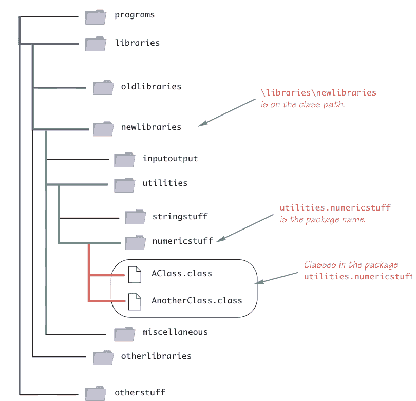

如果`CLASSPATH`变量中恰好有两个可用的目录，那么在所有可用的目录中，Java 总是使用`CLASSPATH`变量中列出的第一个。

任何使用此`utilities.numericstuff`包中类的类，都必须包含导入语句

```
import utilities.numericstuff.*;
```

或者包含针对包中每个被使用类的单独导入语句。

设置`CLASSPATH`变量值的方法取决于你的操作系统，但我们可以给你一些可能有效的建议。`CLASSPATH`变量通常拼写为一个全大写的单词，如`CLASSPATH`。你可能还有一个普通的`PATH`变量，它告诉操作系统在哪里找到`javac`等命令以及其他可以作为单行命令给出的命令的代码。如果你能找到如何设置`PATH`变量，你应该能够用相同的方法设置`CLASSPATH`变量。

如果你使用的是 UNIX 系统，你可能可以使用类似以下命令来设置`CLASSPATH`：

```
set CLASSPATH=/libraries/newlibraries;/otherstuff/specialjava;.
export CLASSPATH
```

如果这不起作用，你可以尝试省略单词`set`或将`set`替换为`setenv`。你也可以尝试将目录列表放在引号中。UNIX 有许多版本，都有各自的小差异。你可能需要咨询本地专家或查阅操作系统的文档。

如果你使用的是 Windows 机器，你可以通过控制面板设置或创建名为`CLASSPATH`的环境变量来设置`CLASSPATH`变量。

在本书中，我们假设类路径目录由分号分隔。这是常见的，但一些操作系统使用其他分隔符，如冒号。如果分号不起作用，请检查你的文档。

> **包名与 CLASSPATH 变量**
> 
> 包名必须是包含包中类的目录的路径名，但包名使用点（`.`）代替你的操作系统使用的`\`或`/`。在命名包时，你使用的是从`CLASSPATH`（环境）变量值中列出的任何目录开始的相对路径名。

**示例**

`utilities.numericstuff`

`java.util`

### 陷阱：子目录不会被自动导入

假设你有两个包：`utilities.numericstuff`和`utilities.numericstuff.statistical`。在这种情况下，你知道`utilities.numericstuff.statistical`位于包含`utilities.numericstuff`的目录（文件夹）的子目录（子文件夹）中。这导致一些程序员假设以下导入语句会导入这两个包：

```
import utilities.numericstuff.*;
```

事实并非如此。当你导入一个整个包时，你并不会导入子目录包。

要导入这两个包中的所有类，你需要

```
import utilities.numericstuff.*;
import utilities.numericstuff.statistical.*;
```

### 默认包

你当前目录中的所有类（不属于其他任何包的类）都属于一个未命名的包，称为**默认包**。只要当前目录在你的`CLASSPATH`中，默认包中的所有类对你的代码都自动可用。这就是为什么我们总是假设所有定义的类都在同一个目录中。这样，我们就不需要用关于导入语句的讨论来使讨论复杂化。

### 陷阱：未将当前目录包含在类路径中

你的`CLASSPATH`变量允许你列出多个目录。大多数操作系统使用点（`.`）表示当前目录。**当前目录**不是任何一个特定的目录；它是你当前“位于”的目录。如果你不知道你的当前目录是什么，那么它可能是包含你正在编写的类的目录。例如，以下`CLASSPATH`变量的值列出了两个普通目录和当前目录：

```
\libraries\newlibraries;\otherstuff\specialjava;.
```

### 包与 javadoc

每当设置或更改`CLASSPATH`变量时，请务必确保将当前目录作为选项之一包含在内。以上面显示的`CLASSPATH`值为例，如果 Java 从前两个目录中的任何一个都无法找到该包，它将在当前目录的子目录中查找。如果你希望 Java 在检查`CLASSPATH`变量中的其他目录之前先检查当前目录，请按如下方式首先列出当前目录（用点表示）：

```
.;\libraries\newlibraries;\otherstuff\specialjava
```

在查找包时，Java 会按顺序尝试类路径中的目录，并使用第一个有效的目录。

无论程序是否使用包，从`CLASSPATH`变量中省略当前目录都可能干扰 Java 程序的运行。如果省略了当前目录，Java 甚至可能无法找到程序本身的`.class`文件，因此你可能根本无法运行任何程序。因此，如果你确实设置了`CLASSPATH`变量，务必在`CLASSPATH`中包含当前目录。如果你根本没有设置`CLASSPATH`变量，则不会出现此类问题；它仅在你决定设置`CLASSPATH`变量时才会出现。

如果你在设置`CLASSPATH`变量时遇到问题，一个临时解决方案是完全删除`CLASSPATH`变量，并将一个程序的所有类文件保存在同一目录中。这将允许你在寻求有关设置`CLASSPATH`变量的建议时，仍能进行一些工作。

### 编译时指定类路径 ✎

你可以在编译类时指定类路径。为此，请添加`-classpath`选项，后跟类路径，如下所示：

```
javac -classpath .;C:\libraries\nemeric;C:\otherstuff YourClass.java
```

这将编译`YourClass.java`，覆盖任何`CLASSPATH`设置，并使用`-classpath`之后给出的类路径。请注意，目录之间用分号分隔。如果你希望当前目录中的类可供你的类使用，请确保类路径包含当前目录（用点表示）。

当你运行如上所示编译的类时，应再次使用`-classpath`选项，如下所示：

```
java -classpath .;C:\libraries\nemeric;C:\otherstuff YourClass
```

在运行程序时，将当前目录包含在类路径中非常重要。如果你的程序在默认包中，除非包含当前目录，否则将无法找到它。最好养成在所有类路径中始终包含当前目录的习惯。

由于在编译和运行类时指定的类路径是输入到 Java 环境的一部分（`javac`或`java`）的程序，而不是操作系统的命令，因此无论你的操作系统使用`/`还是`\`，你都可以在类路径中使用`/`或`\`。

### 名称冲突

除了作为组织库的一种方式外，包还提供了一种处理名称冲突的方法。名称冲突是指两个类具有相同名称的情况。如果编写不同包的不同程序员为同一个类使用了相同的名称，可以通过使用包名来解决歧义。

假设一个名为`sallyspack`的包包含一个名为`HighClass`的类，另一个名为`joespack`的包也包含一个名为`HighClass`的类。你可以通过使用更完整的名称`sallyspack.HighClass`和`joespack.HighClass`，在同一个程序中使用这两个同名的`HighClass`类。例如：

```
sallyspack.HighClass object1 = new sallyspack.HighClass();
joespack.HighClass object2 = new joespack.HighClass();
```

这些包含包名的名称，如`sallyspack.HighClass`和`joespack.HighClass`，被称为完全限定类名。

如果你使用完全限定类名，则不需要导入该类，因为这个较长的类名已经包含了包名。

### 自测练习

- 44. 假设你想在编写的程序中使用`mypackages.1library1`包中的`CoolClass`类。你需要做什么才能让这个类对你的程序可用？你需要做什么才能让该包中的所有类对你的程序可用？

- 45. 你需要做什么才能使一个类成为名为`mypackages.1library1`的包的成员？

- 46. 包名可以是任何你想要的名字，还是对你能用于包名的内容有限制？解释任何限制。

### javadoc 简介

使用信息隐藏进行封装的原则表明，你应该将一个类的接口（如何使用该类的说明）与实现（告诉计算机该类如何工作的详细代码）分开。在其他一些编程语言（如 C++）中，你通常在两个文件中定义一个类。一个文件包含类似于接口或 API 的内容，它告诉程序员使用该类所需知道的一切。另一个文件包含类代码运行所需的实现细节。这种系统是分离接口和实现的一种明显方式，但这不是 Java 的做法。

Java 不会将一个类定义分成两个文件。相反，Java 将类的接口和实现混合到一个文件中。如果这就是全部，Java 在信息隐藏封装方面做得并不好。然而，Java 有一种非常好的方法来分离类的接口和实现。Java 自带一个名为`javadoc`的程序，它可以从类定义中自动提取接口。如果你的类定义正确添加了注释，使用你的类的程序员只需查看由`javadoc`生成的这个 API（文档）即可。由`javadoc`生成的文档在格式上与标准 Java 库类的文档相同。

对一个类运行`javadoc`的结果是生成一个包含该类 API（接口）文档的 HTML 文件。HTML 是用于创建可通过 Web 浏览器查看的文档的基本语言，因此由`javadoc`生成的文档是在 Web 浏览器上查看的。第 18 章简要介绍了 HTML。但是，你无需了解任何 HTML 即可运行`javadoc`或阅读其生成的文档。

`javadoc`可用于获取单个类的文档。但是，它主要用于获取整个包的文档。

我们将首先讨论如何为类添加注释，以便从`javadoc`中获得最大价值。然后我们将描述如何运行`javadoc`程序。

### 为 javadoc 注释类

为了获得更有用的`javadoc`文档，你必须以特定的方式编写注释。本书中的所有类都已添加了用于`javadoc`的注释。但是，为了节省篇幅，本书中的注释比`javadoc`理想所需的更简短。

`javadoc`程序会提取你的类（或类）的标题，以及所有公共方法、公共实例变量、公共静态变量和某些注释的标题。在`javadoc`以正常默认模式运行时，不会提取任何方法体或私有项。

为了让`javadoc`（在默认模式下）提取注释，注释必须满足两个条件：

- 1. 注释必须*紧接在*公共类定义、公共方法定义或其他公共项*之前*。

- 2. 注释必须是块注释（即`/*`和`*/`风格的注释），并且开头的`/*`必须包含一个额外的`*`。因此，注释必须以`/**`开头，以`*/`结尾。

除非你明确为`javadoc`设置了额外的选项，否则行注释（即`//`风格的注释）不会被提取，任何私有项之前的注释也不会被提取。

公共方法定义之前的注释可以包含你希望包含的任何一般信息。还有特殊的语法用于插入

## 第五章 定义类（II）

参数、任何返回值以及可能抛出的任何异常。我们尚未讨论异常。这将在第九章进行，但我们在本章提及它们，以便本节可以作为`javadoc`的更完整参考。在进入第九章之前，您无需担心异常或此处讨论的“throws”的细节。

关于参数等的特殊信息以`@`符号开头，被称为`@tags`。以下是用于`javadoc`的方法注释示例：

```
/**
 Tests for equality of two objects of type Person. To be equal the two
 objects must have the same name, same birth date, and same death date.

 @param otherPerson The person being compared to the calling object.
 @return            Returns true if the calling object equals otherPerson.
*/
public boolean equals(Person otherPerson)
```

（此`equals`方法来自显示 5.19 中定义的`Person`类。如需更多上下文，请查看该显示。）

请注意，所有`@`标签都出现在任何通用注释之后，并且每个`@`标签单独占一行。以下是允许使用的一些`@`标签：

- `@param` 参数名称 参数描述

- `@return` 返回值描述

- `@throws` 异常类型 说明

- `@deprecated`

- `@see` 包名.类名

- `@author` 作者

- `@version` 版本信息

`@`标签应按上述顺序出现，首先是`@param`，然后是`@return`，接着是`@throws`，以此类推。如果有多个参数，每个参数都应有自己的`@param`，并各占一行。参数及其`@param`描述应按其在参数列表中从左到右的顺序列出。如果有多个作者，每位作者都应有自己的`@author`，并各占一行。除非设置了合适的选项标志（如下一小节所述），否则作者和版本信息不会被提取。

如果方法注释中包含`@deprecated`，则文档会注明该方法已*弃用*。`deprecated`方法是指正在逐步淘汰的方法。为保持向后兼容性，该方法仍然可用，但不应在新的代码中使用。

如果为某个项目包含了`@`标签，`javadoc`会提取该项目的说明并将其包含在文档中。您应在每个方法的注释中尽可能完整地包含一组`@`标签。在本书中，我们为节省空间省略了`@`标签，但我们鼓励您始终包含它们。不属于`@`标签的注释将作为该方法的通用注释出现，与方法标题一起。

您也可以在注释中插入 HTML 命令，以便对`javadoc`进行更多控制，但这并非必要，甚至可能不理想。HTML 命令可能会使注释显得杂乱，在查看源代码时更难阅读。

### 运行 javadoc

要在某个包上运行`javadoc`，您只需给出以下命令：

```
javadoc -d Documentation_Directory Package_Name
```

通常从包含该包中类的目录运行此命令，但只要正确设置了`CLASSPATH`环境变量，也可以从任何目录运行。`Documentation_Directory`是您希望`javadoc`放置其生成的 HTML 文档的目录名称。例如，以下命令可用于获取`mylibraries.numericstuff`包的文档：

```
javadoc -d documentation/mypackages mylibraries.numericstuff
```

生成的 HTML 文档将位于运行此命令位置的`documentation/mypackages`子目录中。如果您愿意，可以使用完整路径名代替相对路径名`documentation/mypackages`。如果省略`-d`和`Documentation_Directory`，`javadoc`将为文档创建合适的目录。

您可以链接到标准 Java 文档，以便您的 HTML 文档包含指向标准类和方法的实时链接。语法如下：

```
javadoc -link Link_To_Standard_Docs -d Documentation_Directory Package_Name
```

`Link_To_Standard_Docs`可以是本地 Java 文档版本的路径，也可以是包含标准 Java 文档的 Sun 网站的 URL。在撰写本文时，该 URL 为：

```
http://java.sun.com/j2se/1.5/docs/api/
```

您无需在完整包上运行`javadoc`。可以在单个类文件上运行`javadoc`。例如，以下命令应从包含`Date.java`的目录运行，并将为`Date`类生成文档：

```
javadoc Date.java
```

您可以在目录中的所有类上运行`javadoc`：

```
javadoc *.java
```

您可以在任何这些命令中添加`-d`和/或`-link`选项。例如：

```
javadoc -link http://java.sun.com/j2se/1.5/docs/api/ -d mydocs *.java
```

这些及其他`javadoc`选项在显示 5.23 中进行了总结。

运行`javadoc`时，您通常会得到比预期更多的目录和大量 HTML 文件。为了更好地理解`javadoc`，您应在不同的环境中尝试运行它，并观察其生成的文件。

### 显示 5.23 javadoc 选项

| 选项 | 描述 |
|---|---|
| `-link Link_To_Other_Docs` | 提供到另一组文档的链接。通常，这与本地 Java 文档版本的路径名或包含标准 Java 文档的 Sun 网站的 URL 一起使用。 |
| `-d Documentation_Directory` | 指定用于存放生成的文档的目录。*Documentation_Directory* 可以是相对或绝对路径名。 |
| `-author` | 包含作者信息（来自`@author`标签）。除非设置此选项，否则此信息会被省略。 |
| `-version` | 包含版本信息（来自`@version`标签）。除非设置此选项，否则此信息会被省略。 |


| `-classpath List_of_Directories` | 覆盖 `CLASSPATH` 环境变量，并使 `List_of_Directories` 成为本次 `javadoc` 调用的 `CLASSPATH`。不会永久更改 `CLASSPATH` 变量。 |
|---|---|
| `-private` | 在文档中包含私有成员以及公共成员。 |

### 自测练习

47. 以默认模式运行时，`javadoc` 会提取方法定义体吗？以默认模式运行时，`javadoc` 会提取类定义中标记为 `private` 的任何内容吗？

48. 以默认模式运行时，`javadoc` 会提取哪些注释，不会提取哪些注释？

## 章节总结

- 静态方法是不需要调用对象，但可以用类名代替调用对象的方法。
- 静态变量类似于实例变量，但静态变量只有一个副本，供该类的所有对象使用。
- 包装类允许您拥有与基本类型值对应的类对象。包装类还包含许多有用的预定义常量和静态方法。
- 类类型的变量存储对象在计算机内存中位置的引用（内存地址）。这导致某些操作（如 `=` 和 `==`）在类类型变量上的行为与在基本类型变量上大不相同。
- 当您将赋值运算符用于两个类类型的变量时，这两个变量成为同一对象的两个名称。
- 方法不能更改作为其参数的基本类型变量的值。另一方面，方法可以更改类类型参数的实例变量的值。这是因为对于类参数，传入的是引用。
- `null` 是一个特殊常量，可用于为任何类类型的任何变量赋值。
- 包含 `new` 运算符和构造函数的表达式可以用作方法的参数。这样的参数称为*匿名对象*。
- 拷贝构造函数是一个参数类型与类本身相同的构造函数。拷贝构造函数应设计成使其创建的对象在直觉上是其参数的精确副本，但又是一个完全独立的副本，即深拷贝。
- 包含修改器方法或任何可以更改类对象数据的方法的类称为*可变类*，该类的对象称为*可变对象*。定义访问器方法（或几乎任何方法）时，您的方法不应返回对可变对象的引用。相反，应使用拷贝构造函数（或其他方法）返回对可变对象的深拷贝的引用。
- 包是 Java 版本的类库。
- Java 附带一个名为 `javadoc` 的程序，可以自动从包中的所有类或单个类定义中提取接口。

## 自我测试练习答案

1. 是的，这是合法的，尽管使用类名 `RoundStuff` 代替 `roundObject` 会是更优的风格。
2. 不是，该类中的所有方法都是静态的，因此无需创建对象。如果我们遵循我们的风格规则，构造器将永远不会被使用，所以不需要构造器。
3. 是的，一个类可以同时包含静态和非静态（即常规）方法。
4. 你不能在静态方法内部调用非静态方法（除非你创建一个对象作为该非静态方法的调用对象）。
5. 你可以在非静态方法内部调用静态方法。
6. 你不能在静态方法内部引用实例变量，因为静态方法可以在没有调用对象的情况下使用，因此也没有任何实例变量可用。
7. 一个类的每个对象都有自己的一份每个实例变量的副本，但每个静态变量只有一份副本，由所有对象共享。
8. 不，你不能在同一类的静态方法定义中使用实例变量（不带对象名和点）。是的，你可以在同一类的非静态方法定义中使用实例变量（不带对象名和点）。
9. 是的，你可以在同一类的静态方法定义中使用静态变量。是的，你可以在同一类的非静态方法定义中使用静态变量。所以，你可以在任何方法中使用静态变量。
10. 不，你不能在静态方法的定义中使用 `this` 参数的显式或隐式出现。
11. 所有具有以下名称的方法都可以且应该被标记为静态：`dateOK`、`monthOK` 和 `monthString`。
12. 所有静态变量都应被标记为私有，但有一种情况例外：如果静态变量被用作命名常量（即，如果它被标记为 `final`），那么它可以被标记为 `public` 或 `private`，具体取决于特定情况。
13. 它们都可以通过使用类名和一个点（而不是对象名和一个点）来命名。
14. 3、4、3.0、3.0、4.0 和 4.0
15. `roundedAnswer = (int)Math.round(answer);`
16. `long`。由于其中一个参数是 `long` 类型，`int` 参数会自动进行类型转换为 `long`。
17. 它们都是合法的。
18. 一个 `Double` 类的对象；该赋值等价于 `Double price = new Double(1.99);`
19. 一个原始类型 `int` 的值；该赋值等价于 `int count = (new Integer(12)).intValue();`
20. 对象不相等。
21. `Double.toString(result)`
22. `Double.parseDouble(stringForm)`
23. `Double.parseDouble(stringForm.trim())`
24. `System.out.println("Largest long is " + Long.MAX_VALUE + " Smallest long is " + Long.MIN_VALUE);`
25. `Character zeeObject = new Character('Z');`
26. 不，本章讨论的包装类中没有一个有无参构造器。
27. 引用类型是一种其变量包含引用（即内存地址）的类型。类类型是引用类型。原始类型不是引用类型。
28. 当比较两个类类型的对象时，你应该使用 `equals` 方法。
29. 当比较两个原始类型的对象时，你应该使用 `==`。
30. 是的，一个具有类类型参数的方法可以改变由该参数指定的对象中的实例变量的值。
31. 不，一个方法不能改变作为参数传递给它的 `int` 变量的值。
32. 变量 `anObject` 没有命名任何对象，因此对 `set` 方法的调用是一个错误。一种修复方法如下：

```java
ToyClass anObject = new ToyClass();
anObject.set("Josephina", 42);
```

33. 常量 `null` 可以赋值给任何类类型的变量。它实际上没有类型，但你可以认为它的类型是内存地址的类型。你也可以认为 `null` 属于每一个类类型。
34. `avariable == null`
35. 这不太可能，但它是合法的。这是文本中描述的一个匿名对象的例子。
36. 唯一的区别是在第二个版本中，`Date` 类型的对象被命名为 `theDate`。这对对象 `adams` 没有影响。
37. 以下 `equals` 方法用于 CD 上第 5 章目录中源代码的 `Date.java` 文件：

```java
public boolean equals(Date otherDate)
{
    if (otherDate == null)
        return false;
    else
        return ( (month.equals(otherDate.month)) &&
            (day == otherDate.day) && (year == otherDate.year) );
}
```

38. 拷贝构造器是一个具有一个与类相同类型参数的构造器。拷贝构造器的设计应使其创建的对象在直觉上是其参数的精确副本，但又是一个完全独立的副本，即深拷贝。
39. 第一段代码产生输出：

```text
July 4, 1776
```

第二段代码产生输出：

```text
January 1, 2006
```

40. Natalie Dressed, April 1, 1984

41.

```java
public void set(String newName, Date birthDate, Date deathDate)
{
    if (consistent(birthDate, deathDate))
    {
        name = newName;
        born = new Date(birthDate);
        if (deathDate == null)
            died = null;
        else
            died = new Date(deathDate);
    }
    else
    {
        System.out.println("Inconsistent dates. Aborting.");
        System.exit(0);
    }
}
```

注意，以下不是一个好的定义，因为它可能导致隐私泄露：

```java
public void set(String newName, Date birthDate, Date deathDate)
{//Not good
    name = newName;
    born = birthDate;
    died = deathDate;
}
```

42. 类 `String` 是一个不可变类。类 `Date` 和 `Person` 是可变类。
43. 类 `String` 是一个不可变类。
44. 要使该类可供你的程序使用，你需要在包含你的类的文件开头插入以下内容：

```java
import mypackages.library1.CoolClass;
```

要使包中的所有类可供你的程序使用，请改为插入以下内容：

```java
import mypackages.library1.*;
```

45. 要使一个类成为名为 `mypackages.library1` 的包的成员，你必须在包含类定义的文件开头插入以下内容，并将该文件放在与包对应的目录中（如文本所述）：

```java
package mypackages.library1;
```

（只有 `.class` 文件需要放在与包对应的目录中，但将 `.java` 文件和 `.class` 文件都放在那里可能更整洁、更容易。）

46. 包名必须是包含包中类的目录的路径名，但包名使用点代替 `\` 或 `/`（无论你的操作系统使用哪种）。命名包时，你使用从 `CLASSPATH`（环境）变量值中指定的任何目录开始的相对路径名。
47. `javadoc` 从不提取方法定义的主体，也不（在默认模式下运行时）提取类定义中标记为 `private` 的任何内容。
48. 在默认模式下运行时，`javadoc` 仅提取满足以下两个条件的注释：

1. 注释必须紧接在 `public` 类定义、`public` 方法定义或其他 `public` 项之前。
2. 注释必须使用 `/*` 和 `*/` 风格，并且开头的 `/*` 必须包含一个额外的 `*`。因此，注释必须以 `/**` 开头，以 `*/` 结尾。特别是，`javadoc` 不会提取任何 `//` 风格的注释。

## 编程项目

这些编程项目中有许多可以使用 AW 的 CodeMate 解决。要访问这些，请前往：www.aw-bc.com/codemate。

1. 你在镇上经营着几个热狗摊。定义一个名为 `HotDogStand` 的类，该类有一个成员变量用于存储热狗摊的 ID 号，以及另一个成员变量用于存储该摊位当天售出的热狗数量。创建一个构造器，允许该类的用户初始化这两个值。

   同时创建一个名为 `justSold` 的方法，用于将摊位售出的热狗数量增加一。其思想是每次摊位售出一个热狗时都会调用此方法，以便你可以跟踪摊位售出的热狗总数。再添加一个返回已售出热狗数量的方法。

   最后，添加一个静态变量来跟踪所有热狗摊售出的热狗总数，以及一个返回该变量值的静态方法。

   编写一个 `main` 方法来测试你的类，使用至少三个各售出不同数量热狗的热狗摊。

2. 定义一个名为 `Fraction` 的类。这个类用于表示两个整数的比率。包含允许用户设置分子和分母的修改器函数。还包括一个在屏幕上以比率形式显示分数的方法（例如 5/9）。此方法不需要将分数约简到最简形式。

   包含一个额外的方法 `equals`，它接受另一个 `Fraction` 作为输入，如果两个分数相同则返回 `true`，否则返回 `false`。此方法应处理约简到最简形式的分数；也就是说，如果一个分数是 20/60，另一个是 1/3，那么该方法应返回 true。

   将你的类嵌入一个测试程序中，允许用户创建一个分数。然后程序应循环重复，直到用户决定退出。在循环体内部，程序应允许用户将目标分数输入到一个匿名对象中，并了解这两个分数是否相同。

3. 在谜题谷，亚伦、鲍勃和查理就他们谁是有史以来最伟大的谜题家发生了争执。为了永久结束这场争论，他们同意进行一场生死决斗。亚伦是一个糟糕的射手，只以 1/3 的概率击中目标。鲍勃稍好一些，以 1/2 的概率击中目标。查理是一个神枪手，从不失手。击中意味着击杀，被击中的人退出决斗。

   为了补偿他们射击技能的不平等，三人决定轮流开火，从亚伦开始，然后是鲍勃，接着是查理。这个循环将重复进行，直到有一个人站到最后，那个人将成为有史以来最伟大的谜题家。

   一个显而易见且合理的策略是每个人都在瞄准仍然活着的最精准的射手，理由是这个射手最致命，并且最有机会反击。

   编写一个程序来模拟使用该策略的决斗。你的程序应该使用随机数和问题中给出的概率来确定射手是否击中目标。创建一个名为 `Duelist` 的类，包含决斗者的名字和射击精度，一个布尔值表示决斗者是否还活着，以及一个方法 `ShootAtTarget(Duelist target)`，如果决斗者击中目标（使用随机数和射击精度），则将目标设置为死亡状态；否则不执行任何操作。

   一旦你能模拟单次决斗，就在程序中添加一个循环，模拟 10,000 次决斗。统计每个参赛者获胜的次数，并打印每个参赛者的获胜概率（例如，对于 Aaron，你的程序可能输出 "Aaron won 3595/10,000 duels or 35.95 %"）。

   另一种策略是让 Aaron 在第一次射击时故意打空。修改程序以适应这种新策略，并输出每个参赛者的获胜概率。对于 Aaron 来说，哪种策略更好：第一次故意打空，还是尝试击中最佳射手？谁获胜的机会最大：最佳射手还是最差射手？

   注意：要生成一个随机数 `x`，其中 `0 ≤ x ≤ 1`，请使用 `x = Math.random()`。这会生成一个介于 0 和 1 之间的随机数。

4. 你希望跟踪学校每年参加计算机科学编程竞赛的团队成员和竞赛信息。每个团队恰好由四名团队成员组成。每年你的团队参加两项竞赛。作为数据库的初始开始，创建一个名为 `Team` 的类，包含以下数据成员：

```java
// Name for the team
String teamName;
// Names for each team members.
String name1, name2, name3, name4;
// Info on each competition
Competition competition1, competition2;
```

请注意，使用数组来表示团队成员和竞赛是好得多的方法；这将在后续章节中介绍。该类还应包含一个方法，将所有团队成员的名字和竞赛信息输出到控制台。

`Competition` 类包含变量来跟踪以下内容：

- String：竞赛名称，获胜团队名称，亚军名称
- Integer：竞赛年份

实现 `Team` 和 `Competition` 类，包含适当的构造方法、访问器和修改器方法。在输入过去竞赛的数据时，你注意到一个条目通常与上一年的条目非常相似。为了帮助数据输入，为 `Team` 类创建一个深拷贝构造方法。通过创建现有团队对象的副本、更改副本的竞赛信息，并输出原始对象和副本的数据来测试你的拷贝构造方法。如果深拷贝构造方法工作正常，原始对象应该保持不变。

5. 定义一个名为 `Money` 的类，其对象表示美元金额。该类应该有两个类型为 `int` 的实例变量，分别表示金额中的美元和美分。包含一个有两个参数的构造方法，参数类型为 `int`，分别表示美元和美分；一个有一个参数的构造方法，参数类型为 `int`，表示美元金额，美分为零；以及一个无参构造方法。包含用于加法和减法的 `add` 和 `minus` 方法。这些方法应该是静态方法，每个方法接受两个类型为 `Money` 的参数，并返回一个类型为 `Money` 的值。包含一组合理的访问器和修改器方法以及 `equals` 和 `toString` 方法。为你的类编写一个测试程序。

   第二部分：添加加法和减法方法的第二个版本。这些方法应该与静态版本具有相同的名称，但应该使用调用对象和一个参数。例如，这个版本的 `add` 方法（用于加法）有一个调用对象和一个参数。所以 `m1.add(m2)` 返回 `Money` 对象 `m1` 和 `m2` 相加的结果。请注意，你的类应该包含所有这些方法；例如，应该有两个名为 `add` 的方法。

   备选第二部分（如果你想同时做第二部分和备选第二部分，它们必须是两个类。你不能将第二部分和备选第二部分的方法都包含在一个类中。你知道为什么吗？）：添加加法和减法方法的第二个版本。这些方法应该与静态版本具有相同的名称，但应该使用调用对象和一个参数。这些方法应该是 `void` 方法。结果应作为调用对象的更改值给出。例如，这个版本的 `add` 方法（用于加法）有一个调用对象和一个参数。因此，`m1.add(m2);` 更改 `m1` 的实例变量的值，使其表示将 `m2` 添加到 `m1` 的原始版本的结果。请注意，你的类应该包含所有这些方法；例如，应该有两个名为 `add` 的方法。


6. 定义一个用于有理数的类。有理数是可以表示为两个整数的商的数。例如，`1/2`、`3/4`、`64/2` 等等都是有理数。（通过 `1/2` 等等，我们指的是分数的日常含义，而不是 Java 程序中此表达式将产生的整数除法。）将有理数表示为两个类型为 `int` 的值，一个用于分子，一个用于分母。你的类应该有两个类型为 `int` 的实例变量。将类命名为 `Rational`。包含一个有两个参数的构造方法，可用于将对象的实例变量设置为任何值。还包含一个只有一个类型为 `int` 的参数的构造方法；将这个单参数命名为 `wholeNumber`，并定义构造方法，使对象被初始化为有理数 `wholeNumber/1`。还包含一个无参构造方法，将对象初始化为 0（即，`0/1`）。请注意，分子、分母或两者都可能包含负号。定义用于你的 `Rational` 类的对象的加法、减法、乘法和除法的方法。这些方法应该是静态方法，每个方法有两个类型为 `Rational` 的参数，并返回一个类型为 `Rational` 的值。例如，`Rational.add(r1, r2)` 将返回两个有理数（类 `Rational` 的两个对象 `r1` 和 `r2`）相加的结果。定义访问器和修改器方法以及 `equals` 和 `toString` 方法。你应该包含一个方法来规范化有理数的符号，使分母为正数，分子可以是正数或负数。例如，规范化后，`4/−8` 的表示方式与 `−4/8` 相同。还编写一个测试程序来测试你的类。

提示：两个有理数 *a/b* 和 *c/d* 相等的条件是 *a*d 等于 *c*b*。

第二部分：添加加法、减法、乘法和除法方法的第二个版本。这些方法应该与静态版本具有相同的名称，但应该使用调用对象和一个参数。例如，这个版本的 `add` 方法（用于加法）有一个调用对象和一个参数。所以 `r1.add(r2)` 返回有理数 `r1` 和 `r2` 相加的结果。请注意，你的类应该包含所有这些方法；例如，应该有两个名为 `add` 的方法。

备选第二部分（如果你想同时做第二部分和备选第二部分，它们必须是两个类。你不能将第二部分和备选第二部分的方法都包含在一个类中。你知道为什么吗？）：添加加法、减法、乘法和除法方法的第二个版本。这些方法应该与静态版本具有相同的名称，但应该使用调用对象和一个参数。这些方法应该是 `void` 方法。结果作为调用对象的更改值给出。例如，这个版本的 `add` 方法（用于加法）有一个调用对象和一个参数。因此，`r1.add(r2);` 更改 `r1` 的实例变量的值，使其表示将 `r2` 添加到 `r1` 的原始版本的结果。请注意，你的类应该包含所有这些方法；例如，应该有两个名为 `add` 的方法。

7. 定义一个用于复数的类。复数是形如 *a + b*i* 的数，对于我们而言，*a* 和 *b* 是类型为 `double` 的数，*i* 是表示数量 √−1 的数。将复数表示为两个类型为 `double` 的值。将实例变量命名为 `real` 和 `imaginary`。（乘以 *i* 的数的实例变量是名为 `imaginary` 的那个。）将类命名为 `Complex`。包含一个有两个类型为 `double` 的参数的构造方法，可用于将对象的实例变量设置为任何值。还包含一个只有一个类型为 `double` 的参数的构造方法；将此参数命名为 `realPart`，并定义构造方法，使对象被初始化为 `realPart + 0*i`。还包含一个无参构造方法，将对象初始化为 0（即，`0 + 0*i`）。定义访问器和修改器方法以及 `equals` 和 `toString` 方法。定义用于你的 `Complex` 类的对象的加法、减法和乘法的静态方法。

## 第336章 第5章 定义类 II

这些方法应为静态方法，且每个方法都应接受两个 `Complex` 类型的参数，并返回一个 `Complex` 类型的值。例如，`Complex.add(c1, c2)` 将返回两个复数（`Complex` 类的两个对象）`c1` 和 `c2` 相加的结果。同时，请编写一个测试程序来测试你的类。

> 提示：要加或减两个复数，你需要对两个 `double` 类型的实例变量进行加或减运算。两个复数的乘积由以下公式给出：

```
(a + b*i)*(c + d*i) = (a*c – b*d) + (a*d + b*c)*i
```

第二部分：添加第二个版本的加法、减法和乘法方法。这些方法应与静态版本同名，但应使用一个调用对象和一个参数。例如，这个版本的 `add` 方法（用于加法）有一个调用对象和一个参数。因此，`c1.add(c2)` 将返回复数 `c1` 和 `c2` 相加的结果。请注意，你的类应包含所有这些方法；例如，应该有两个名为 `add` 的方法。

备选第二部分（如果你想同时实现第二部分和备选第二部分，它们必须是两个类。你不能在单个类中包含第二部分和备选第二部分的所有方法。你知道为什么吗？）：添加第二个版本的加法、减法和乘法方法。这些方法应与静态版本同名，但应使用一个调用对象和一个参数。这些方法将是 `void` 方法。结果以调用对象的更改值形式给出。例如，这个版本的 `add` 方法（用于加法）有一个调用对象和一个参数。因此，

```
c1.add(c2);
```

会更改 `c1` 的实例变量的值，使其表示将 `c2` 加到 `c1` 原始版本的结果。请注意，你的类应包含所有这些方法；例如，应该有两个名为 `add` 的方法。

## 第6章 数组

## 6.1 数组简介

- 创建和访问数组
- `length` 实例变量
- 初始化数组

## 6.2 数组和引用

- 数组是对象
- 数组参数
- `main` 方法的参数
- 返回数组的方法

## 6.3 使用数组编程

- 部分填充的数组
- 示例：一个部分填充数组的类
- "for-each" 循环
- 具有可变参数数量的方法
- 数组实例变量的隐私泄露
- 示例：一个字符串处理示例
- 示例：数组排序
- 枚举类型

## 6.4 多维数组

- 多维数组基础
- 使用 `length` 实例变量
- 不规则数组
- 多维数组参数和返回值
- 示例：一个成绩簿类
- 章节总结
- 自测练习答案
- 编程项目

## 6 数组

> 记忆是理性所有操作所必需的。
>
> — 布莱兹·帕斯卡，《思想录》

## 引言

*数组*是一种用于处理同一类型数据集合的数据结构，例如一个 `double` 类型的数字列表或一个字符串列表。在本章中，我们将向你介绍在 Java 中定义和使用数组的基础知识。

## 前置知识

6.1 节仅需要第 1 到 3 章以及第 4 章的 4.1 节。实际上，远不需要 4.1 节的全部内容。你真正需要从 4.1 节了解的是对象是什么以及实例变量是什么。

其余部分需要第 1 到 5 章的内容，但 5.4 节关于包和 javadoc 的内容除外。

## 6.1 数组简介

> 在有数据之前就进行理论化是一个严重的错误。
>
> — 亚瑟·柯南·道尔爵士，《波西米亚丑闻》（福尔摩斯）

假设我们希望编写一个程序，读取五个考试分数并对这些分数进行一些处理。例如，程序可能会计算最高分，然后输出每个分数与最高分的差距。最高分在读取所有五个分数之前是未知的。因此，所有五个分数必须存储在存储器中，以便在计算出最高分后，可以将每个分数与之比较。为了存储这五个分数，我们需要相当于五个 `int` 类型变量的东西。我们可以使用五个单独的 `int` 类型变量，但跟踪五个变量很困难，而且我们以后可能想更改程序以处理 100 个分数；当然，跟踪 100 个变量是不切实际的。数组是完美的解决方案。**数组**的行为就像一个具有统一命名机制的变量列表，可以在一行简单的代码中声明。例如，我们需要的五个单独变量的名称可能是 `score[0]`、`score[1]`、`score[2]`、`score[3]` 和 `score[4]`。

`score[3]` 和 `score[4]`。在这个例子中，不变的部分是 `score`，它是数组的名称。可以改变的部分是方括号 `[]` 中的整数。

### 创建和访问数组

在 Java 中，数组是一种特殊类型的对象，但通常将数组视为同一类型变量的集合会更有用。例如，可以像下面这样创建一个行为类似于五个 `double` 类型变量集合的数组：

```
double[] score = new double[5];
```

这就像声明以下内容为五个 `double` 类型变量：

```
score[0], score[1], score[2], score[3], score[4]
```

这些共同构成数组的单个变量有各种不同的称呼。我们将它们称为**索引变量**，尽管它们有时也被称为**下标变量**或数组的**元素**。方括号中的数字称为**索引**或**下标**。在 Java 中，*索引从 0 开始编号，而不是从 1 或任何非 0 的数字开始*。数组中索引变量的数量称为数组的**长度**或**大小**。创建数组时，数组的长度在数组名称后的方括号中给出。然后索引变量（也使用方括号）从 0 开始编号，以比*数组长度小 1* 的整数结束。

以下内容

```
double[] score = new double[5];
```

实际上是以下两个语句的简写：

```
double[] score;
score = new double[5];
```

第一个语句将变量 `score` 声明为数组类型 `double[]`。第二个语句创建一个包含五个 `double` 类型索引变量的数组，并使变量 `score` 成为该数组的名称。你可以在方括号中使用任何计算结果为非负 `int` 值的表达式来代替 5。特别是，你可以将一个从键盘读取值的变量填充到变量中，并在 5 的位置使用该变量。这样，数组的大小可以在程序运行时确定。

数组可以有任意类型的索引变量，但它们必须都是同一类型。这种类型称为数组的**基类型**。在我们的示例中，数组 `score` 的基类型是 `double`。要声明一个基类型为 `int` 的数组，只需在声明和创建数组时使用类型名 `int` 代替 `double`。数组的基类型可以是任何类型。特别是，它可以是类类型。

我们示例数组 `score` 的五个索引变量中的每一个都可以像任何其他 `double` 类型变量一样使用。例如，以下所有内容在 Java 中都是允许的：

```
score[3] = 32;
score[0] = score[3] + 10;
System.out.println(score[0]);
```

### 声明和创建数组

你声明数组名称和创建数组的方式几乎与创建和命名类对象的方式相同。语法上只有细微差别。

```
Base_Type[] Array_Name = new Base_Type[Length];
```

*Length* 可以是任何计算结果为非负整数的表达式。特别是 *Length* 可以是一个 `int` 变量。

```
char[] line = new char[80];
double[] reading = new double[300];
Person[] specimen = new Person[100];
```

*Person* 是一个类。

我们示例数组 `score` 的五个索引变量不仅仅是五个普通的 `double` 类型变量。方括号中的数字是索引变量名称的一部分。因此，你的程序可以计算这些变量之一的名称。你可以在方括号中使用任何计算结果为至少 0 且至多为 4 的整数的表达式，而不是写一个整数常量。因此，以下内容是允许的：

```
System.out.println(score[index] + " is at position " + index);
```

其中 *index* 是一个 `int` 类型变量，已被赋予 0、1、2、3 或 4 中的一个值。

当我们引用这些组合在一起成为一个集合项的索引变量时，我们将它们称为*数组*。因此，我们可以引用名为 `score` 的数组（不使用任何方括号）。

显示 6.1 中的程序展示了使用我们的示例数组 `score` 作为五个 `double` 类型索引变量的示例。

请注意，程序可以通过使用变量作为索引来计算索引变量的名称，如以下 `for` 循环所示：

```
for (index = 0; index < 5; index++)
    System.out.println(score[index] + " differs from max by "
                       + (max - score[index]));
```

不要混淆方括号 `[]` 与数组名称一起使用的三种方式。首先，方括号可用于创建类型名称，例如以下内容中的 `double[]`：

```
double[] score;
```

### 显示 6.1 程序中使用的数组（第 1 部分，共 2 部分）

```java
import java.util.Scanner;

public class ArrayOfScores
{
    /**
     读取 5 个分数，并显示每个分数与最高分的差异。
     */
    public static void main(String[] args)
    {
        Scanner keyboard = new Scanner(System.in);
        double[] score = new double[5];
        int index;
        double max;

        System.out.println("Enter 5 scores:");
        score[0] = keyboard.nextDouble();
        max = score[0];
        for (index = 1; index < 5; index++)
        {
            score[index] = keyboard.nextDouble();
            if (score[index] > max)
                max = score[index];
            //max is the largest of the values score[0],..., score[index].
        }

        System.out.println("The highest score is " + max);
        System.out.println("The scores are:");
        for (index = 0; index < 5; index++)
            System.out.println(score[index] + " differs from max by "
                               + (max - score[index]));
    }
}
```

示例对话

```
Enter 5 scores:
80  99.9  75  100  85.5
The highest score is 100
The scores are:
80.0 differs from max by 20
99.9 differs from max by 0.1
75.0 differs from max by 25
100.0 differs from max by 0.0
85.5 differs from max by 14.5
```

> 由于浮点数算术运算的不精确性，这个值很可能只是 0.1 的一个近似值。

### 显示 6.1 程序中使用的数组（第 2 部分，共 2 部分）

一种常见的数组可视化方式：

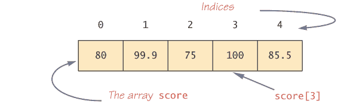

其次，方括号可以与整数值一起使用，作为 Java 用来创建新数组的特殊语法的一部分，如

```java
score = new double[5];
```

方括号的第三个用途是命名数组的索引变量，例如 `score[0]` 或 `score[3]`，如下所示：

```java
max = score[0];
```

正如我们之前提到的，方括号内的整数可以是任何计算结果为合适整数的表达式，如下所示：

```java
int next = 1;
score[next + 3] = 100;
System.out.println(
        "Score at position 4 is " + score[next + 3]);
```

请注意，在前面的代码中，`score[next + 3]` 和 `score[4]` 是同一个索引变量，因为 `next + 3` 的计算结果是 4。

### length 实例变量

在 Java 中，数组被视为一个对象，并且像其他对象一样，它可能拥有实例变量。事实上，数组只有一个名为 `length` 的公共实例变量。当数组创建时，实例变量 `length` 会自动设置为数组的大小。例如，如果你创建一个如下数组，

```java
double[] score = new double[5];
```

那么 `score.length` 的值就是 5。

可以使用 `length` 实例变量使你的程序更清晰，即用一个有意义的名称（如 `score.length`）替换一个可能含义不明显的无名常量（如 5）。在显示 6.2 中，我们已经使用 `length` 实例变量重写了显示 6.1 中的程序。

实例变量 `length` 不能被你的程序更改（除非使用另一个 `new` 创建新数组）。<sup>1</sup> 例如，以下是非法的：

```java
score.length = 10; //Illegal
```

<sup>1</sup> 技术细节如下：实例变量 `length` 在数组创建时创建，并被声明为 `public final int`。

### 显示 6.2 length 实例变量


```java
import java.util.Scanner;
public class ArrayOfScores2
{
    /**
        读取 5 个分数，并显示每个分数与最高分的差异。
    */
    public static void main(String[] args)
    {
        Scanner keyboard = new Scanner(System.in);
        double[] score = new double[5];
        int index;
        double max;

        System.out.println("Enter " + score.length + " scores:");
        score[0] = keyboard.nextDouble();
        max = score[0];
        for (index = 1; index < score.length; index++)
        {
            score[index] = keyboard.nextDouble();
            if (score[index] > max)
                max = score[index];
            //max is the largest of the values score[0],..., score[index].
        }

        System.out.println("The highest score is " + max);
        System.out.println("The scores are:");
        for (index = 0; index < score.length; index++)
            System.out.println(score[index] + " differs from max by "
                               + (max - score[index]));
    }
}
```

示例对话与显示 6.1 相同。

### 提示

#### 对数组使用 for 循环

显示 6.2 中的第二个 for 循环演示了一种使用 for 循环遍历整个数组的常见方式：

```java
for (index = 0; index < score.length; index++)
    System.out.println(score[index] + " differs from max by "
                       + (max - score[index]));
```

for 循环非常适合执行数组操作。

### 陷阱

#### 数组索引总是从零开始

数组的索引总是从 0 开始，以比数组大小小 1 的整数结束。

### 陷阱

#### 数组索引越界

使用数组时最常见的编程错误是尝试使用不存在的数组索引。例如，考虑以下代码：

```java
int[] a = new int[6];
```

当使用数组 `a` 时，每个索引表达式的计算结果必须是 0 到 5 之间的整数。例如，如果你的程序包含索引变量 `a[i]`，那么 `i` 必须计算为 0、1、2、3、4 或 5 这六个整数之一。如果 `i` 的计算结果是其他任何值，那就是错误。当索引表达式的计算结果不是数组声明所允许的值时，该索引被称为 **越界**。如果你的程序尝试使用越界的数组索引，那么你的程序将因一条错误消息而终止。² 请注意，这是一个运行时错误消息，而不是编译器错误消息。

数组索引越界最常见于处理数组的循环的第一次或最后一次迭代。因此，仔细检查所有数组处理循环以确保它们以合法的数组索引开始和结束是值得的。

> ² 从技术上讲，会抛出一个 `ArrayIndexOutOfBoundsException`。我们将在第 9 章讨论异常。在你学习处理异常之前，异常对你来说只是一种错误条件。

### 初始化数组

数组可以在声明时初始化。初始化数组时，各个索引变量的值用大括号括起来，并用逗号分隔。带大括号的表达式放在赋值运算符的右侧。例如：

```java
int[] age = {2, 12, 1};
```

数组长度（大小）会自动设置为大括号中值的个数。因此，这个初始化声明等同于以下语句：

```java
int[] age = new int[3];
age[0] = 2;
age[1] = 12;
age[2] = 1;
```

你也可以使用 for 循环来初始化数组元素。例如：

```java
double[] reading = new double[100];
int index;
for (index = 0; index < reading.length; index++)
    reading[index] = 42.0;
```

如果你不初始化数组的元素，它们将自动初始化为基本类型的默认值。默认值是通常的值。对于数值类型，默认值是该类型的零值。（对于基本类型 `char`，默认值是不可打印的零字符 `(char)0`，而不是空格字符。）对于类型 `boolean`，默认值是 `false`。对于类类型，默认值是 `null`。例如，如果你不初始化一个 `double` 数组，数组的每个元素都将初始化为 `0.0`。

### 自测练习

1. 在数组声明

   `String[] word = new String[5];`

   中，什么是

    a.  数组名？

    b.  基本类型？

    c.  数组的长度？

    d.  访问此数组的索引可以具有的值范围？

    e.  此数组的一个索引变量（或元素）？

### 自我测试练习（续）

2. 在以下数组中：

`double[] score = new double[10];`

请问：

a. `score.length` 的值是多少？

b. `score` 的第一个索引是多少？

c. `score` 的最后一个索引是多少？

3. 以下代码的输出是什么？

```
char[] letter = {'a', 'b', 'c'};
for (int index = 0; index < letter.length; index++)
    System.out.print(letter[index] + ", ");
```

4. 以下代码的输出是什么？

```
double[] a = {1.1, 2.2, 3.3};
System.out.println(a[0] + " " + a[1] + " " + a[2]);
a[1] = a[2];
System.out.println(a[0] + " " + a[1] + " " + a[2]);
```

5. 以下代码片段有什么问题？

```
int[] sampleArray = new int[10];
for (int index = 1; index <= sampleArray.length; index++)
    sampleArray[index] = 3*index;
```

6. 假设我们期望数组 `a` 的元素按如下顺序排列：

`a[0] <= a[1] <= a[2] <= ...`

然而，为了安全起见，我们希望程序能检测数组，并在发现某些元素顺序错乱时发出警告。以下代码本应输出此类警告，但它包含一个错误；这个错误是什么？

```
double[] a = new double[10];
    <此处是一些用于填充数组 a 的代码。>
for (int index = 0; index < a.length; index++)
    if (a[index] > a[index + 1])
        System.out.println("Array elements " + index +
            " and " + (index + 1) + " are out of order.");
```

### 常见陷阱

### 字符数组不是字符串

字符数组，例如下面创建的数组 `a`，从概念上讲是一个字符列表，因此类似于字符串：

```
char[] a = {'A', ' ', 'B', 'i', 'g', ' ', 'H', 'i', '!', '!'};
```

然而，像 `a` 这样的字符数组并不是 `String` 类的对象。特别是在 Java 中，以下是非法的：

```
String s = a;
```

同样，通常不能将字符数组（如 `a`）用作 `String` 类型参数的实参。

但是，将字符数组转换为 `String` 类型的对象很容易。`String` 类有一个构造函数，其单一参数类型为 `char[]`。因此，你可以通过以下方式获得与字符数组（如 `a`）对应的 `String` 值：

```
String s = new String(a);
```

对象 `s` 将拥有与数组 `a` 相同的字符序列。对象 `s` 是一个独立的副本；对 `a` 所做的任何更改都不会影响 `s`。请注意，这总是使用整个数组 `a`。

还有一个 `String` 构造函数允许你指定字符数组 `a` 的一个子范围。例如，

```
String s2 = new String(a, 2, 3);
```

会创建一个 `String` 对象，它包含从数组 `a` 索引 2 开始的 3 个字符。因此，如果 `a` 如上所示，那么

```
System.out.println(s2);
```

将输出

Big

尽管字符数组不是 `String` 类的对象，但它确实与 `String` 对象有一些共同之处。例如，你可以使用 `println` 输出字符数组，如下所示：

```
System.out.println(a);
```

如果 `a` 如上所示，则会产生输出

A Big Hi!

## 6.2 数组与引用

> *亲密超越常情，而友善不逮普通。*

威廉·莎士比亚，《哈姆雷特》

就像你见过的类类型的变量一样，数组类型的变量也持有一个引用。在本节中，我们将探讨这一事实的后果，包括对数组参数的讨论。我们将看到数组是对象，并且数组类型可以被视为类类型，但属于某种不同种类的类类型。数组与本章之前我们见过的类的关系是“*亲密超越常情，而友善不逮普通*”。

### 数组是对象

有两种方式来看待数组：作为索引变量的集合，或者作为一个单一的项目，其值是基类型值的集合。在 6.1 节中，我们讨论了将数组作为索引变量集合的用法。现在，我们将从第二个角度来讨论数组。

数组可以被视为一个单一的项目，其值是基类型值的集合。数组变量（相对于数组索引变量）将数组作为一个单一项目来命名。例如，以下声明了一个数组类型的变量：

```
double[] a;
```

这个变量 `a` 可以并且将会包含一个单一的值。表达式

```
new double[10]
```

创建一个数组对象并将该对象存储在内存中。下面的赋值语句将该数组对象的引用（或内存地址）放入变量 `a`：

```
a = new double[10];
```

通常我们将所有这些组合成一个语句，如下所示：

```
double[] a = new double[10];
```

请注意，这与我们看待类类型对象的方式几乎完全相同。在 Java 中，数组被视为一个*对象*。每当 Java 文档说某些内容适用于对象时，那意味着它既适用于数组，也适用于我们到目前为止见过的类类型的对象。你最终会看到一些方法，它们可以接受任何类型的对象作为参数。这些方法将接受数组对象作为参数，也可以接受普通类类型的对象作为参数。数组在与类的关系方面有些特殊。一些权威认为数组类型不是类，一些权威认为它们是类。但是，所有权威都同意数组本身是对象。既然数组是对象，那么就应该将数组类型视为类，我们将这样做。然而，尽管数组类型 `double[]` 是一个类，但创建数组对象的语法有些不同。要创建数组，你使用以下语法：

```
double[] a = new double[10];
```

你可以将表达式 `new double[10]` 视为调用一个使用非标准语法的构造函数。（使用非标准语法是为了与旧编程语言中使用的数组语法保持一致。）

正如我们已经看到的，每个数组都有一个名为 `length` 的实例变量，这是将数组视为对象的一个很好的例子。与任何其他类类型一样，数组变量包含内存地址，或者在 Java 中通常称为*引用*。因此数组类型是引用类型。³

由于数组是一个对象，你可能会倾向于将数组的索引变量，如 `a[0]`、`a[1]` 等，视为该对象的实例变量。这实际上是一个很好的类比，但并不是字面意义上的真实情况。索引变量不是数组的实例变量。索引变量是数组特有的特殊变量。数组中唯一的实例变量是 `length` 实例变量。

数组对象是基类型项目的集合。从这个角度看，数组是一个对象，可以使用赋值运算符进行赋值，并可以替代数组类型的参数。因为数组类型是引用类型，所以数组在赋值 `=`、相等 `==` 和参数传递机制方面的表现与我们之前为类描述的相同。在接下来的几个小节中，我们将讨论这些关于数组的细节。

> **数组是对象**

在 Java 中，数组被视为对象，尽管对此存在一些分歧，但你可以安全地将数组类型视为类类型。

> **数组类型是引用类型**

数组类型的变量保存数组对象在内存中存储位置的地址。这个内存地址被称为数组对象的**引用**。

³ 在许多编程语言中，例如 C++，数组也是引用类型，就像在 Java 中一样。所以，关于数组的这个细节并非 Java 特有。

### 常见陷阱

### 基类型为类的数组

数组的基类型可以是任何类型，包括类类型。例如，假设 `Date` 是一个类，并考虑以下内容：

```
Date[] holidayList = new Date[20];
```

这将创建 20 个索引变量 `holidayList[0]`、`holidayList[1]`、...、`holidayList[19]`。需要注意的是，这创建了 20 个 `Date` 类型的索引变量。这并不会创建 20 个 `Date` 类型的对象。（索引变量被自动初始化为 `null`，而不是 `Date` 类的对象。）与任何其他 `Date` 类型的变量一样，索引变量需要调用使用 `new` 的构造函数来创建对象。完成数组 `holidayList` 初始化的一种方式如下：

```
Date[] holidayList = new Date[20];
for (int i = 0; i < holidayList.length; i++)
    holidayList[i] = new Date();
```

如果你省略了 for 循环（并且不做其他大致等效的事情），那么当你运行代码时，你无疑会收到一条错误消息，指示“空指针异常”。如果你不使用 `new` 来创建对象，像 `holidayList[i]` 这样的索引变量就只是一个不命名任何对象的变量，因此不能用作任何方法的调用对象。每当你使用一个基类型为类的数组，并且收到关于“空指针异常”的错误消息时，很可能你的索引变量没有命名任何对象，你需要添加类似上述 for 循环的代码。

### 数组参数

你可以将数组索引变量和整个数组都用作方法的实参，尽管它们是不同类型的参数。我们首先讨论作为方法实参的数组索引变量。

索引变量可以作为方法的实参，其方式与数组基类型的任何变量完全相同。例如，假设一个程序包含以下声明：

```
double n = 0;
double[] a = new double[10];
int i;
```

如果 `myMethod` 接受一个 `double` 类型的参数，那么以下是合法的：

```
myMethod(n);
```

### 数组索引变量作为参数

数组索引变量可以在任何使用数组基类型变量的地方作为参数使用。例如，假设你有以下代码：

```
double[] a = new double[10];
```

那么像 `a[3]` 和 `a[index]` 这样的索引变量，可以被用作任何接受 `double` 作为参数的方法的参数。

你也可以定义一个方法，其形参是整个数组，这样当调用该方法时，传入这个形参的实参就是一个完整的数组。每当需要指定数组类型时，类型名的形式是 `Base_Type[]`，因此这就是指定整个数组参数类型的方法。例如，下面给出的方法 `doubleArrayElements` 将接受任何 `double` 数组作为其单个参数：

```java
public class SampleClass
{
    public static void doubleArrayElements(double[] a)
    {
        int i;
        for (i = 0; i < a.length; i++)
            a[i] = a[i]*2;
    }
    <The rest of the class definition goes here.>
}
```

为了说明这一点，假设在某个方法定义中有以下代码：

```
double[] a = new double[10];
double[] b = new double[30];
```

并且假设数组 `a` 和 `b` 的元素已经被赋值。那么以下两种方法调用都是合法的：

```
SampleClass.doubleArrayElements(a);
SampleClass.doubleArrayElements(b);
```

请注意，当将整个数组作为参数传递给方法时，不使用方括号。

数组类型是引用类型，就像类类型一样。因此，与类类型参数一样，方法可以更改数组参数中的数据。更精确地说，方法可以更改数组参数的索引变量中存储的值。前面的 `doubleArrayElements` 方法就说明了这一点。

数组类型参数并不指定可以传入的数组参数的长度。数组知道其长度，并将其存储在 `length` 实例变量中。同一个数组参数可以被不同长度的数组实参替换。请注意，前面的 `doubleArrayElements` 方法可以接受任何长度的数组作为参数。

### 常见陷阱

#### 在数组中使用 `=` 和 `==`


数组类型是引用类型；也就是说，数组变量包含它所命名的数组的内存地址。赋值运算符复制这个内存地址。例如，考虑以下代码：

```java
double[] a = new double[10];
double[] b = new double[10];
int i;
for (i = 0; i < a.length; i++)
    a[i] = i;
b = a;
System.out.println("a[2] = " + a[2] + " b[2] = " + b[2]);
a[2] = 42;
System.out.println("a[2] = " + a[2] + " b[2] = " + b[2]);
```

这将产生以下输出：

```
a[2] = 2.0 b[2] = 2.0
a[2] = 42.0 b[2] = 42.0
```

赋值语句`b = a;`将`a`的内存地址复制到`b`，因此数组变量`b`包含与数组变量`a`相同的内存地址。赋值语句之后，`a`和`b`是同一个数组的两个不同名称。因此，当我们更改`a[2]`的值时，我们也在更改`b[2]`的值。

除非你希望两个数组变量成为同一个数组的两个名称（在极少数情况下你确实希望如此），否则不应将赋值运算符用于数组。如果你希望前面代码中的数组`a`和`b`是具有相同索引位置值的不同数组，那么你需要使用类似以下的内容，而不是赋值语句

```
b = a;
```

```
int i;
for (i = 0; (i < a.length) && (i < b.length); i++)
    b[i] = a[i];
```

请注意，上述代码不会使`b`成为`a`的精确副本，除非`a`和`b`具有相同的长度。

相等运算符`==`并不测试两个数组是否包含相同的值。它测试两个数组是否存储在计算机内存中的相同位置。例如，考虑以下代码：

```java
int[] c = new int[10];
int[] d = new int[10];
int i;
for (i = 0; i < c.length; i++)
    c[i] = i;
for (i = 0; i < d.length; i++)
    d[i] = i;

if (c == d)
    System.out.println("c and d are equal by ==.");
else
    System.out.println("c and d are not equal by ==.");
```

这将产生输出

```
c and d are not equal by ==
```

尽管`c`和`d`在相同的索引变量中包含相同的整数。使用`==`进行比较会说它们不相等，因为`==`只检查数组变量`c`和`d`的内容，即内存地址，而`c`和`d`包含不同的内存地址。

如果你想测试两个数组是否包含相同的元素，那么你可以为数组定义一个`equalArrays`方法，就像你为类定义`equals`方法一样。展示 6.3 包含了一个小型演示类中数组的`equalArrays`的一个可能定义。

### 自测练习

- 7. 考虑以下类定义：

```java
public class SomeClass
{
    public static void doSomething(int n)
    {
        <Some code goes in here.>
    }
<The rest of the definition is irrelevant to this question.>
```

以下哪些方法调用是可接受的？

```
int[] a = {4, 5, 6};
int number = 2;
SomeClass.doSomething(number);
SomeClass.doSomething(a[2]);
SomeClass.doSomething(a[3]);
SomeClass.doSomething(a[number]);
SomeClass.doSomething(a);
```

- 8. 编写一个名为`oneMore`的静态 void 方法的定义，该方法有一个整数数组的形参，并将每个数组元素的值增加一。（定义将放在某个类中，但你只需要给出方法定义。）

- 9. 编写一个名为`outOfOrder`的方法，该方法接受一个`double`数组作为参数，并返回一个`int`类型的值。此方法将测试数组是否无序，即数组是否违反条件：

    `a[0] <= a[1] <= a[2] <= ...`

    如果元素不是无序的，该方法返回`-1`；否则，它返回数组中第一个无序元素的索引。例如，考虑以下声明

    ```
    double[] a = {1.2, 2.1, 3.3, 2.5, 4.5,
                 7.9, 5.4, 8.7, 9.9, 1.0};
    ```

    在上面的数组中，`a[2]`和`a[3]`是第一对无序的元素，`a[3]`是第一个无序元素，因此该方法返回`3`。如果数组是已排序的，该方法将返回`-1`。

- 10. 以下方法定义有什么问题？它会编译，但无法按你期望的方式工作。

    ```java
    public static void doubleSize(int[] a)
    {
        a = new int[a.length * 2];
    }
    ```

### 数组参数与数组实参

传递给方法的参数可以是一个完整的数组。数组实参类似于类的对象，因为方法可以更改数组实参中的数据；也就是说，方法可以更改变量数组实参的索引变量中存储的值。带有数组参数的方法定义和调用如下例所示。请注意，数组参数指定了数组的基类型，但未指定数组的长度。

#### 数组参数示例

```java
public class AClass
{
    public static void listChars(char[] a)
    {
        int i;
        for (i = 0; i < a.length; i++)
            System.out.println(a[i] + " ");
    }
    public static void zeroAll(int[] anArray)
    {
        int i;
        for (i = 0; i < anArray.length; i++)
            anArray[i] = 0;
    }
    ...
}
```

#### 数组实参示例

```
char[] c = new char[10];
int[] a = new int[10];
int[] b = new int[20];

<Some code to fill the arrays goes here.>

AClass.listChars(c);
AClass.zeroAll(a);
AClass.zeroAll(b);
```

> 请注意，数组`a`和`b`具有不同的长度。同时请注意，数组实参不使用方括号。

### 显示 6.3 测试数组是否相等

```java
public class DifferentEquals
{
    /**
     * 一个演示，用于展示 == 和 equalArrays 方法之间的区别。
     */
    public static void main(String[] args)
    {
        int[] c = new int[10];
        int[] d = new int[10];

        int i;
        for (i = 0; i < c.length; i++)
            c[i] = i;

        for (i = 0; i < d.length; i++)
            d[i] = i;
        if (c == d)
            System.out.println("c and d are equal by ==.");
        else
            System.out.println("c and d are not equal by ==");

        System.out.println("== only tests memory addresses.");

        if (equalArrays(c, d))
            System.out.println(
                "c and d are equal by the equalArrays method.");
        else
            System.out.println(
                "c and d are not equal by the equalArrays method.");

        System.out.println(
            "An equalArrays method is usually a more useful test.");
    }

    public static boolean equalArrays(int[] a, int[] b)
    {
        if (a.length != b.length)
            return false;
        else
        {
            int i = 0;
            while (i < a.length)
            {
                if (a[i] != b[i])
                    return false;
                i++;
            }
        }

        return true;
    }
}
```

数组`c`和`d`在每个索引位置包含相同的整数。

**示例对话**

c and d are not equal by ==.

== only tests memory addresses.

c and d are equal by the equalArrays method.

An equalArrays method is usually a more useful test.

### 方法`main`的参数

程序的`main`方法头看起来像是有一个参数，该参数是一个基本类型为`String`的数组：

```java
public static void main(String[] args)
```

标识符`args`实际上是一个类型为`String[]`的参数。由于`args`是一个参数，它可以被任何其他非关键字标识符替换。标识符`args`是传统用法，但使用其他标识符也是完全合法的。

当我们运行任何程序时，我们从未向`main`传递过数组参数，或任何其他类型的参数。那么，Java 用什么作为参数来替换`args`呢？如果你在运行程序时没有提供参数，那么在运行程序时，会自动提供一个默认的空字符串数组作为 main 的默认参数。

可以通过一种方式运行 Java 程序，为这个字符串数组参数提供一个值。你不是提供一个数组。你可以在运行程序时提供任意数量的字符串参数，这些字符串参数将自动成为替换 args（或你用于 main 参数的任何名称）的数组参数的元素。这通常通过从操作系统的命令行运行程序来完成，如下所示：

```
java YourProgram Do Be Do
```

这将把`args[0]`设置为`"Do"`，`args[1]`设置为`"Be"`，`args[2]`设置为`"Do"`，`args.length`设置为`3`。这三个索引变量可以在 main 方法中使用，如以下示例程序所示：

```java
public class YourProgram
{
    public static void main(String[] args)
    {
        System.out.println(args[1] + " " + args[0]
                           + " " + args[1]);
    }
}
```

如果从命令行运行上述程序，如下所示，程序产生的输出将是：

Be Do Be

务必注意，传递给 main 的参数是一个*字符串*数组。如果你想要数字，你必须将数字的字符串表示形式转换为数字类型的值。

> ### main 方法有一个数组参数
>
> 程序的 main 方法头如下所示：
>
> `public static void main(String[] args)`
>
> 标识符 args 是一个基本类型为 String 的数组的参数。详细信息在文中解释。

### 返回数组的方法

在 Java 中，一个方法可以返回一个数组。你为返回数组的方法指定返回类型的方式，与你为数组参数指定类型的方式相同。例如，下面是一个返回数组的方法的示例：

```java
public static char[] upperCaseVersion(char[] a)
{
    char[] temp = new char[a.length];
    char i;
    for (i = 0; i < a.length; i++)
        temp[i] = Character.toUpperCase(a[i]);
    return temp;
}
```

### 返回数组

一个方法可以返回一个数组。其细节基本上与返回类类型对象的方法相同。

### 语法（对于返回数组的典型方式）

```java
public static Base_Type[] Method_Name(Parameter_List)
{
    Base_Type[] temp = new Base_Type[Array_Size]
    <一些用于填充 temp 的代码放在这里。>
    return temp;
}
```

该方法不需要是 static 的，也不需要是 public 的。你不一定需要使用像 temp 这样的局部数组变量。

### 示例（假定在类定义中）

```java
public static int[] incrementedArray(int[] a, int increment)
{
    int[] temp = new int[a.length];
    int i;
    for (i = 0; i < a.length; i++)
        temp[i] = a[i] + increment;
    return temp;
}
```

### 数组类型名称

每当你需要一个数组类型名称时，无论是用于数组变量声明的类型、数组参数的类型，还是用于返回数组的方法的类型，你都以相同的方式指定类型名称。

# 语法

```
Base_Type[]
```

# 示例

```java
double[] a = new double[10];
int[] giveIntArray(char[] arrayParameter)
{ ... }
```

### 自测练习

- 11. 给出一个名为 halfArray 的方法的定义，该方法有一个参数，参数类型为基本类型 double 的数组，并返回另一个基本类型为 double 的数组，该数组具有相同的长度，其中每个元素除以 2.0。将其设为静态方法。要测试它，你可以将其添加到任何类中，或者更好的是，编写一个类，在 main 方法中包含测试程序。

- 12. 下列方法定义有什么问题？它是上一小节中定义的同名方法的另一种定义。它能编译通过。

```java
public static char[] upperCaseVersion(char[] a)
{
    char i;
    for (i = 0; i < a.length; i++)
        a[i] = Character.toUpperCase(a[i]);
    return a;
}
```

## 6.3 数组编程

> 永远不要相信笼统的印象，我的孩子，要专注于细节。
>
> — 阿瑟·柯南·道尔爵士，《身份案》（夏洛克·福尔摩斯）

在本节中，我们讨论部分填充的数组，并讨论如何将数组用作类实例变量。

### 部分填充的数组

通常，在编写程序时并不知道数组所需的确切大小，或者大小可能因程序的一次次运行而异。处理这种情况的一种常见且简单的方法是声明数组为程序可能需要的最大大小。然后，程序可以自由地根据需要使用数组的全部或部分空间。

部分填充的数组需要一些注意。程序必须跟踪已使用了多少数组空间，并且不得引用任何尚未被赋予有意义值的索引变量。显示 6.4 中的程序说明了这一点。该程序读入一个高尔夫分数列表，并显示每个分数与平均分的差异。该程序适用于长度短至 1 个分数、长至 10 个分数以及介于两者之间任意长度的列表。分数存储在数组 score 中，该数组有 10 个索引变量，但程序只使用所需的数组部分。变量 numberUsed 跟踪存储在数组中的元素数量。这些元素（即分数）存储在位置 score[0] 到 score[numberUsed – 1] 中。其细节与使用整个数组（即 numberUsed 等于 score.length）时非常相似。请注意，变量 numberUsed 通常是任何操作部分填充数组的方法的参数。例如，方法 showDifference 和 computeAverage 使用参数 numberUsed 来确保只使用有意义的数组索引。

### 显示 6.4 部分填充数组（第 1/3 部分）

与常规做法相反，这允许使用分数成绩，例如 71.5。然而，这使其成为我们演示目的的一个更好示例。（总之，当我打高尔夫球时，丢一个球只罚半杆。有空可以试试。）


```java
import java.util.Scanner;
public class GolfScores
{
    public static final int MAX_NUMBER_SCORES = 10;

    /**
     显示一组高尔夫球成绩与平均成绩之间的差异。
     */
    public static void main(String[] args)
    {
        double[] score = new double[MAX_NUMBER_SCORES];
        int numberUsed = 0;

        System.out.println("This program reads golf scores and shows");
        System.out.println("how much each differs from the average.");
        System.out.println("Enter golf scores:");
        numberUsed = fillArray(score);
        showDifference(score, numberUsed);
    }

    /**
     将值读入数组 a。返回放置在数组 a 中的值的数量。
     */
    public static int fillArray(double[] a)
    {
        System.out.println("Enter up to " + a.length
                        + " nonnegative numbers.");
        System.out.println("Mark the end of the list with a negative number.");
        Scanner keyboard = new Scanner(System.in);

        double next;
        int index = 0;
        next = keyboard.nextDouble();
        while ((next >= 0) && (index < a.length))
        {
            a[index] = next;
            index++;
            next = keyboard.nextDouble();
            //index 是目前已使用的数组索引变量的数量。
        }
        //index 是已使用的数组索引变量的总数。
        if (next >= 0)
            System.out.println("Could only read in "
                              + a.length + " input values.");

        return index; // <--- index 的值是存储在数组中的
                       //       值的数量。
    }

    /**
        前置条件：numberUsed <= a.length。
                      a[0] 到 a[numberUsed-1] 均有值。
        返回 a[0] 到 a[numberUsed-1] 这些数字的平均值。
    */
    public static double computeAverage(double[] a, int numberUsed)
    {
        double total = 0;
        for (int index = 0; index < numberUsed; index++)
            total = total + a[index];
        if (numberUsed > 0)
        {
            return (total/numberUsed);
        }
        else
        {
            System.out.println("ERROR: Trying to average 0 numbers.");
            System.out.println("computeAverage returns 0.");
            return 0;
        }
    }

    /**
        前置条件：numberUsed <= a.length。
                      a 的前 numberUsed 个索引变量有值。
        后置条件：在屏幕上输出显示，表明数组 a 的前
        numberUsed 个元素各自与它们的平均值相差多少。
    */
    public static void showDifference(double[] a, int numberUsed)
    {
        double average = computeAverage(a, numberUsed);
        System.out.println("Average of the " + numberUsed
                           + " scores = " + average);
        System.out.println("The scores are:");
        for (int index = 0; index < numberUsed; index++)
            System.out.println(a[index] + " differs from average by "
                               + (a[index] - average));
    }
}
```

### 显示 6.4 部分填充数组（第 3/3 部分）

```
示例对话

This program reads golf scores and shows
how much each differs from the average.
Enter golf scores:
Enter up to 10 nonnegative numbers.
Mark the end of the list with a negative number.
69  74  68  -1
Average of the 3 scores = 70.3333
The scores are:
69.0 differs from average by -1.33333
74.0 differs from average by 3.66667
68.0 differs from average by -2.33333
```

### 自测练习

13. 完成以下方法的定义，该方法可添加到显示 6.4 中的 `GolfScores` 类：

```java
/**
前置条件：numberUsed <= argumentArray.length；
argumentArray 的前 numberUsed 个索引变量有值。
返回一个长度为 numberUsed 的数组，其第 i 个元素为
argumentArray[i] - adjustment。
*/
public static double[] differenceArray(
double[] argumentArray, int numberUsed, double adjustment)
```

14. 使用练习 13 中的 `differenceArray` 方法重写显示 6.4 中的 `GolfScores` 类。

15. 重写显示 6.4 中的 `GolfScores` 类，将成绩数组设为静态变量。同时，将整型变量 `numberUsed` 设为静态变量。从显示 6.4 开始，而不是从练习 14 的答案开始。提示：所有或至少大多数方法将没有参数。

### 用于部分填充数组的类

如果你打算以某种规范的方式使用某个数组，例如将数组用作部分填充数组，那么最好创建一个类，该类将数组作为实例变量，并让类的构造函数和方法作为方法提供所需的操作。例如，在显示 6.5 中，我们编写了一个用于 `double` 类型部分填充数组的类。在显示 6.6 中，我们使用此类重写了显示 6.4 中的程序。

在显示 6.6 中，我们编写的代码与显示 6.4 的代码完全类似，以便你能看到一个程序如何映射另一个程序。然而，这导致偶尔会重新计算某个值多次。例如，方法 `computeAverage` 包含以下表达式三次：

```
a.getNumberOfElements()
```

由于 `PartlyFilledArray` `a` 在此方法中未被修改，这些调用每次都返回相同的值。一些程序员主张只计算一次该值，并将其保存在变量中。这些程序员会使用类似以下的方式定义 `computeAverage`，而不是我们在显示 6.6 中使用的方式。变量 `numberOfElementsIna` 用于保存一个值，因此无需重新计算。

```java
public static double computeAverage(PartlyFilledArray a)
{
    double total = 0;
    double numberOfElementsIna = a.getNumberOfElements();
    for (int index = 0; index < numberOfElementsIna; index++)
        total = total + a.getElement(index);
    if (numberOfElementsIna > 0)
    {
        return (total/numberOfElementsIna);
    }
    else
    {
        System.out.println(
                "ERROR: Trying to average 0 numbers.");
        System.out.println("computeAverage returns 0.");
        return 0;
    }
}
```

这不太可能对显示 6.6 中程序的效率产生显著影响，但如果 `PartlyFilledArray` 中的元素数量很多，以至于 `for` 循环将执行很多次，在效率至关重要的情况下，这可能会产生影响。

### 显示 6.5 部分填充数组类（第 1/4 部分）

```java
/**
用于 double 类型部分填充数组的类。该类强制执行以下不变式：
所有元素都位于数组的开头，位于位置 0、1、2 等处，直到最高索引，中间没有间隔。
*/
public class PartiallyFilledArray
{
    private int maxNumberElements; //与 a.length 相同
    private double[] a;
    private int numberUsed; //当前使用的索引数量

    /**
    将允许的最大元素数量设置为 10。
    */
    PartiallyFilledArray()
    {
        maxNumberElements = 10;
        a = new double[maxNumberElements];
        numberUsed = 0;
    }

    /**
    前置条件：arraySize > 0。
    */
    PartiallyFilledArray(int arraySize)
    {
        if (arraySize <= 0)
        {
            System.out.println("Error Array size zero or negative.");
            System.exit(0);
        }
        maxNumberElements = arraySize;
        a = new double[maxNumberElements];
        numberUsed = 0;
    }
    PartiallyFilledArray(PartlyFilledArray original)
    {
        if (original == null)
        {
            System.out.println("Fatal Error: aborting program.");
            System.exit(0);
        }
```

## 6 数组

### 显示 6.5 部分填充数组类（第2部分，共4部分）

```java
maxNumberElements = original.maxNumberElements;
numberUsed = original.numberUsed;
a = new double[maxNumberElements];
for (int i = 0; i < numberUsed; i++)
    a[i] = original.a[i];
}
```

请注意，实例变量 `a` 是 `original.a` 的副本。以下写法是不正确的：`a = original.a;`。这一点将在题为“数组实例变量的隐私泄漏”的小节中讨论。

```java
/**
向第一个未使用的数组位置添加 newElement。
*/
public void add(double newElement) {
    if (numberUsed >= a.length) {
        System.out.println("Error: Adding to a full array.");
        System.exit(0);
    } else {
        a[numberUsed] = newElement;
        numberUsed++;
    }
}

public double getElement(int index) {
    if (index < 0 || index >= numberUsed) {
        System.out.println("Error:Illegal or unused index.");
        System.exit(0);
    }
    return a[index];
}

/**
index 必须是正在使用的索引或第一个未使用的索引。
*/
public void resetElement(int index, double newValue) {
    if (index < 0 || index >= maxNumberElements) {
        System.out.println("Error:Illegal index.");
        System.exit(0);
    } else if (index > numberUsed) {
        System.out.println(
                "Error: Changing an index that is too large.");
        System.exit(0);
    } else
        a[index] = newValue;
}

public void deleteLast() {
    if (empty()) {
        System.out.println("Error:Deleting from an empty array.");
        System.exit(0);
    } else
        numberUsed--;
}

/**
删除位置为 index 的元素。将所有索引大于被删除元素的元素向下移动。
*/
public void delete(int index) {
    if (index < 0 || index >= numberUsed) {
        System.out.println("Error:Illegal or unused index.");
        System.exit(0);
    }
    for (int i = index; i < numberUsed; i++)
        a[i] = a[i + 1];
    numberUsed--;
}

public boolean empty() {
    return (numberUsed == 0);
}

public boolean full() {
    return (numberUsed == maxNumberElements);
}

public int getMaxCapacity() {
    return maxNumberElements;
}

public int getNumberOfElements() {
    return numberUsed;
}
}
```

> ## TIP
>
> ### 访问器方法无需简单地返回实例变量
>
> 请注意，在显示 6.5 的 `PartiallyFilledArray` 类中，没有访问器方法返回整个实例变量 `a` 的副本。之所以不这样做，是因为当按照预期使用该类时，`PartiallyFilledArray` 类的用户不需要整个数组 `a`。那是一个实现细节。其他以 `get` 开头的方法允许使用该类的程序员获取他或她需要的所有数据。

## FOR-EACH 循环 ✶

正如你已经看到的，你可以使用 `for` 循环遍历数组中的所有元素。例如：


```java
double[] a = new double[10];
<一些用于填充数组 a 的代码>
for (int i = 0; i < a.length; i++)
    System.out.println(a[i]);
```

标准 Java 库包含许多所谓的集合类的定义。集合类是一种其对象存储值集合的类。你不能像上面那样使用 `for` 循环遍历集合对象的所有元素，因为这些集合类通常没有与它们的元素关联的索引，不像数组那样。⁴ 但是，从版本 5.0 开始，Java 添加了一种新的 `for` 循环，可以遍历集合中的所有元素，即使元素没有像数组那样的索引。这种新的 `for` 循环称为 `for-each` 循环或增强型 `for` 循环。我们将在介绍集合时（第 15 章）详细讨论这些 `for-each` 循环。

但是，这些新的 `for-each` 循环既可以与数组一起使用，也可以与这些集合类的对象一起使用。在本小节中，我们将告诉你如何将 `for-each` 循环与数组一起使用，以防你想开始使用它们。但是，我们在本书中直到第 15 章讨论集合类之前，都不会使用 `for-each` 循环。

以下代码以一个 `for-each` 循环结尾，该循环等同于我们本小节开头给出的常规 `for` 循环：

```java
double[] a = new double[10];
<一些用于填充数组 a 的代码>
for (double element : a)
    System.out.println(element);
```

你可以将开头的 `for` 行理解为“对于 `a` 中的每个元素，执行以下操作。”请注意，变量 `element` 与数组中的元素具有相同的类型。变量，如 `element`，必须在 `for-each` 循环中声明，就像我们所做的那样。如果你试图在 `for-each` 循环之前声明 `element`，你将得到一个编译器错误消息。

用于数组的 `for-each` 循环语句的一般语法是：

```java
for (数组基本类型 变量 : 数组名)
    语句
```

请务必注意，在 `变量` 之后使用的是冒号（而不是分号）。你可以为 `变量` 使用任何合法的变量名；你不必使用 `element`。虽然不是必需的，但 `语句` 通常包含该 `变量`。当执行 `for-each` 循环时，该 `语句` 将为数组的每个元素执行一次。更具体地说，对于数组的每个元素，`变量` 被设置为数组元素，然后执行 `语句`。

`for-each` 循环可以使你的代码更清晰，错误更少。如果你在 `for` 循环中使用索引变量仅仅是为了遍历所有数组元素，那么 `for-each` 循环是更可取的。例如：

```java
for (double element : a)
    element = 0.0;
```

> ⁴ 你可以使用一种称为迭代器的东西代替数组索引来构造类似的 `for` 循环，但我们将在本书后面再讨论这一点。

## 具有可变参数数量的方法

由于方法重载，你可以有一个名为 `max` 的方法，它返回两个 `int` 值中的最大值，同时还有另一个名为 `max` 的方法，它接受三个 `int` 参数并返回其中的最大值。如果你决定需要一个返回四个 `int` 值中最大值的方法，你可以定义一个接受四个参数的 `max` 方法版本。

然而，采用这种方法，无法涵盖计算若干个 `int` 值最大值的所有情况。以这种方式覆盖所有情况将需要为方法名 `max` 定义无限多个版本，没有程序员有足够的时间编写无限多个定义。我们希望的是有一个名为 `max` 的单一方法定义，它可以接受任意数量的 `int` 参数。

从版本 5.0 开始，Java 允许你定义接受任意数量参数的方法。例如，下面是一个名为 `max` 的方法的定义，它接受任意数量的 `int` 参数，并返回其参数中的最大值：

```java
public static int max(int... arg)
{
    if (arg.length == 0)
    {
        System.out.println("Fatal Error: maximum of zero values.");
        System.exit(0);
    }

    int largest = arg[0];
    for (int i = 1; i < arg.length; i++)
        if (arg[i] > largest)
            largest = arg[i];
    return largest;
}
```

这个 `max` 方法的工作原理是接受其 `int` 参数，并将它们放入一个名为 `arg` 的数组中，该数组的基类型是 `int`。例如，假设这个 `max` 方法的定义在一个名为 `UtilityClass` 的类中，并考虑以下方法调用：

```java
int highestScore = UtilityClass.max(3, 2, 5, 1);
```

数组 `arg` 会自动声明并初始化如下：

```java
int[] arg = {3, 2, 5, 1};
```

因此 `arg[0] == 3`，`arg[1] == 2`，`arg[2] == 5`，`arg[3] == 1`。之后，执行方法定义体中的代码。清单 6.7 展示了一个使用这个 `max` 方法的示例程序。

请注意，一个接受任意数量参数的方法，比如 `max`，本质上是一个接受数组作为参数的方法，只不过将值放入数组的工作是为程序员自动完成的。数组的值作为参数给出，Java 会自动创建一个数组并将参数放入数组中。

指定任意数量参数的参数规范，例如 `int... arg`，被称为可变参数规范。（称之为“varparameter”规范可能更有意义，但“vararg”这个词已经根深蒂固，所以我们遵从常见用法。）可变参数规范中的三个点被称为省略号。请注意，省略号是 Java 语法的一部分，而不是本书中使用的缩写。你需要输入这三个点。

你在一个方法定义中只能有一个可变参数规范，例如 `int... arg`。然而，你也可以拥有任意数量的普通参数，在这种情况下，可变参数规范必须是参数列表中的最后一项。这在清单 6.8 中进行了说明，我们将在下一小节讨论它。

## 清单 6.7 具有可变参数数量的方法

```java
public class UtilityClass
{
    /**
     返回任意数量 int 值中的最大值。
    */
    public static int max(int... arg)
    {
        if (arg.length == 0)
        {
            System.out.println("Fatal Error: maximum of zero values.");
            System.exit(0);
        }
        int largest = arg[0];
        for (int i = 1; i < arg.length; i++)
            if (arg[i] > largest)
                largest = arg[i];
        return largest;
    }
}
```

这是文件 `UtilityClass.java`。

```java
import java.util.Scanner;

public class VariableParameterDemo
{
    public static void main(String[] args)
    {
        System.out.println("Enter scores for Tom, Dick, and Harriet:");
        Scanner keyboard = new Scanner(System.in);
        int tomsScore = keyboard.nextInt();
        int dicksScore = keyboard.nextInt();
        int harrietsScore = keyboard.nextInt();
        int highestScore = UtilityClass.max(tomsScore, dicksScore, harrietsScore);
        System.out.println("Highest score = " + highestScore);
    }
}
```

这是文件 `VariableParameterDemo.java`。

> **示例对话**
>
> Enter scores for Tom, Dick, and Harriet:
>
> 55 100 99
>
> Highest score = 100

在第 2 章中，你看到了一个接受可变数量参数的方法示例，即 `System.out.printf` 方法。然而，在我们介绍数组的基础知识之前，我们无法告诉你如何自己定义这样的方法。

## 具有可变参数数量的方法

具有可变参数数量的方法在其参数列表的最后一项包含一个可变参数规范。可变参数规范的形式如下：

`Type... Array_Name`

一些可变参数规范的例子是：

- `int... arg`
- `double... a`
- `String... unwanted`

清单 6.7 和 6.8 在完整的方法定义中展示了其中两个可变参数规范。

在调用带有可变参数规范的方法的任何情况下，你都以通常的方式处理对应于常规参数的参数。在常规参数的参数之后，你可以拥有任意数量的、类型为可变参数规范中指定类型的参数。这些参数会自动放入一个数组中，并且可以在方法定义中使用该数组。详见正文对细节的完整描述。

### 自测练习

- 16. 使用 `for-each` 循环代替常规 `for` 循环，重做清单 6.7 中方法 `max` 的定义。
- 17. 如果我们从清单 6.8 的程序中省略以下行，对话会是什么样子？

  `sentence = Utility2.censor(sentence, " ,"); //Deletes extra commas`

## 数组实例变量的隐私泄露

在第 5 章中，我们解释了为什么一个类有一个返回对私有可变对象引用的访问器（或其他方法）是隐私的妥协。正如我们在那里指出的，访问器方法应该返回对私有对象的深拷贝的引用。（参见第 5 章标题为“隐私泄露”的陷阱小节。）当时，我们考虑的是返回类类型的私有实例变量的内容。然而，这个教训同样适用于数组类型的私有实例变量。

例如，假设尽管我们在前面的提示中说了什么，你还是决定想要为清单 6.5 中类 `PartiallyFilledArray` 的数组实例变量提供一个访问器方法。你可能会想将访问器方法定义如下：

```java
public double[] getInsideArray()// Problematic version
{
    return a;
}
```

如注释所示，这个定义有一个问题。问题在于这个访问器方法允许程序员以绕过类 `PartiallyFilledArray` 中修改器方法内置检查的方式，改变由私有实例变量 `a` 命名的数组对象。

为了理解原因，假设我们将这个 `getInsideArray` 方法的定义添加到类 `PartiallyFilledArray` 中，并考虑以下代码：

## 字符串处理示例

本示例使用了带星号的小节“具有可变参数数量的方法”中的内容。如果你还没有阅读那个小节，你应该跳过这个示例。

清单 6.8 包含一个工具类，其中有一个名为 `censor` 的字符串处理方法，以及一个使用该方法的程序示例。`censor` 方法接受一个 `String` 参数，后面跟着任意数量的附加 `String` 类型的参数。第一个参数将是一个句子或其他字符串，可能包含你想要删除的子字符串。该方法返回其第一个参数，其中删除了所有出现的其余字符串参数。

请注意，`censor` 方法有一个常规参数，后面跟着一个用于任意数量附加字符串参数的规范。在这种情况下，所有参数都是 `String` 类型。但是，方法标题中的第一个常规参数（或参数）可以是任何类型（或类型）；它们不需要与可变参数规范的类型匹配。我们只是恰好在这里想要 `String` 类型。

因为第一个参数是 `String` 类型，而这种情况下的可变参数规范说其余的参数是 `String` 类型，你可能想知道我们为什么没有省略第一个 `String` 参数 `sentence`，只使用一个可变参数规范，然后使用 `unwanted[0]` 来扮演与 `sentence` 相同的角色。

如果我们这样做，那么 `censor` 方法就可以在不带任何参数的情况下被调用。可变参数规范允许任意数量的参数，包括零个参数的可能性。然而，我们希望坚持 `censor` 方法至少有一个参数，而参数 `sentence` 确保 `censor` 将始终至少有一个参数。

## 显示 6.8 可变参数数量的字符串处理方法（第 1 部分，共 2 部分）

这两种方法都使用参数 `sentence` 作为局部变量。如果这让你感到困惑，请复习第 4 章和第 5 章中关于参数的内容，特别是第 4 章的显示 4.5。

```java
public class Utility2
{
    /**
        返回第一个参数，并删除其他参数的所有出现；
    */
    public static String censor(String sentence, String...  unwanted)
    {
        for (int i = 0; i < unwanted.length; i++)
            sentence = deleteOne(sentence, unwanted[i]);
        return sentence;
    }

    /**
        返回删除了所有 oneUnwanted 出现的 sentence。
    */
    private static String deleteOne(String sentence, String oneUnwanted)
    {
        String ending;
        int position = sentence.indexOf(oneUnwanted);
        while (position >= 0) //当在句子中找到该词时
        {
            ending = sentence.substring(position + oneUnwanted.length());
            sentence = sentence.substring(0, position) + ending;
            position = sentence.indexOf(oneUnwanted);
        }
        return sentence;
    }
}
```

如果你难以理解这个字符串处理过程，请复习第 1 章中标题为“字符串处理”的小节。

这是文件 `UtilityClass2.java`。

这是文件 `StringProcessingDemo.java`。

```java
import java.util.Scanner;

public class StringProcessingDemo
{
    public static void main(String[] args)
    {
        System.out.println("What did you eat for dinner?");
        Scanner keyboard = new Scanner(System.in);
        String sentence = keyboard.nextLine();
        sentence = Utility2.censor(sentence,
                                "candy", "french fries", "salt", "beer");
        sentence = Utility2.censor(sentence, " ,"); //删除多余的逗号
        System.out.println("You would be healthier if you could answer:");
        System.out.println(sentence);
    }
}
```

## 显示 6.8 可变参数数量的字符串处理方法（第 2 部分，共 2 部分）

## 示例对话

```text
What did you eat for dinner?
I ate salt cod, broccoli, french fries, salt peanuts, and apples.
You would be healthier if you could answer:
I ate cod, broccoli, peanuts, and apples.
```

```java
PartiallyFilledArray leakyArray =
        new PartiallyFilledArray(10);
double[] arrayName = leakyArray.getInsideArray();
```

变量 `arrayName` 和私有实例变量 `a` 现在包含相同的引用，因此 `arrayName` 和私有实例变量 `a` 指向同一个数组。使用 `arrayName` 作为由私有实例变量 `a` 命名的数组的名称，我们现在可以以任何顺序填充 `a` 的索引变量，而不必从第一个元素开始填充数组。

这违反了私有修饰符对于数组实例变量 `a` 的精神。因此，访问器方法 `getInsideArray` 应返回由私有实例变量 `a` 命名的数组的深拷贝。`getInsideArray` 的安全定义如下：


```java
public double[] getInsideArray() // 良好版本
{
    // 回想一下 maxNumberElements == a.length。
    double[] temp = new double[maxNumberElements];
    for (int i = 0; i < maxNumberElements; i++)
        temp[i] = a[i];
    return temp;
}
```

如果一个私有实例变量是数组类型，其基类型是一个类，那么在复制数组时，你需要确保复制数组中的类对象。这在显示 6.9 的 `toy` 类中进行了说明。显示 6.9 还包括一个拷贝构造函数。如该显示所示，拷贝构造函数应以与访问器方法相同的方式，对数组实例变量进行完全独立的复制（即深拷贝）。这一点同样在显示 6.5 的拷贝构造函数中得到了说明。

## 显示 6.9 数组实例变量的访问器方法

```java
/**
 演示了为一个由类对象组成的私有数组定义访问器方法的正确方式。
 */
public class ToyExample
{
    private Date[] a;

    public ToyExample(int arraySize)
    {
        a = new Date[arraySize];
        for (int i = 0; i < arraySize; i++)
            a[i] = new Date();
    }

    public ToyExample(ToyExample object)
    {
        int lengthOfArrays = object.a.length;
        this.a = new Date[lengthOfArrays];
        for (int i = 0; i < lengthOfArrays; i++)
            this.a[i] = new Date(object.a[i]);
    }

    public Date[] getDateArray()
    {
        Date[] temp = new Date[a.length];
        for (int i = 0; i < a.length; i++)
            temp[i] = new Date(a[i]);
        return temp;
    }
}
```

<这里可能还有其他未显示的方法，但它们与当前讨论的要点无关。>

### 自测练习

- 18. 定义一个名为 `removeAll` 的方法，可以添加到 `PartiallyFilledArray` 类中。方法 `removeAll` 没有参数。当被调用时，方法 `removeAll` 会删除其调用对象中的所有元素。
- 19. 定义一个名为 `increaseCapacity` 的方法，可以添加到显示 6.5 的 `PartiallyFilledArray` 类中。该方法有一个名为 `newCapacity` 的 `int` 参数，用于增加 `PartiallyFilledArray` 的容量，使其最多可以容纳 `newCapacity` 个数字。如果 `newCapacity` 小于或等于 `maxNumberOfElements`，则该方法不执行任何操作。如果 `newCapacity` 大于 `maxNumberOfElements`，则将 `maxNumberElements` 设置为等于 `newCapacity`，并为数组实例变量 `a` 创建一个长度为 `newCapacity` 的新数组。数组实例变量的旧值将被复制到新创建的数组中。

## 示例：排序数组

在这个例子中，我们定义了一个名为 `sort` 的方法，用于对部分填充的数字数组进行排序，使其从最小到最大排列。过程 `sort` 有一个数组参数 `a`。数组 `a` 是部分填充的，因此还有一个额外的名为 `numberUsed` 的形式参数，它告诉有多少个数组位置被使用。因此，方法 `sort` 的标题是：

`public static void sort(double[] a, int numberUsed)`

方法 `sort` 重新排列数组 `a` 中的元素，使得在方法调用完成后，元素按如下方式排序：

`a[0] ≤ a[1] ≤ a[2] ≤ ... ≤ a[numberUsed - 1]`

我们用来进行排序的算法称为选择排序。它是最容易理解的排序算法之一。设计算法的一种方法是依赖于问题的定义。在这种情况下，问题是将数组 `a` 从最小到最大排序。这意味着重新排列值，使得 `a[0]` 是最小的，`a[1]` 是次小的，依此类推。这个定义得出了选择排序算法的框架：

`for (int index = 0; index < numberUsed; index++)`

将第 `index` 小的元素放在 `a[index]` 中。

有很多方法可以实现这个通用方法。细节可以通过使用两个数组并将元素从一个数组按排序顺序复制到另一个数组来实现，但使用一个数组应该既足够又经济。因此，方法 `sort` 只使用包含待排序值的一个数组。方法 `sort` 通过交换值对来重新排列数组 `a` 中的值。让我们通过一个具体的例子来看看这个算法是如何工作的。

考虑显示 6.10 中显示的数组。选择排序算法会将最小值放在 `a[0]` 中。最小值是 `a[4]` 中的值。所以算法会交换 `a[0]` 和 `a[4]` 的值。然后算法会寻找下一个最小的元素。`a[0]` 中的值现在是最小的元素，所以下一个最小的元素是剩余元素 `a[1]`、`a[2]`、`a[3]`、...、`a[9]` 中的最小值。在显示 6.10 的例子中，下一个最小的元素在 `a[6]` 中，所以算法会交换 `a[1]` 和 `a[6]` 的值。这个第二小元素的定位在显示 6.10 的第四和第五个数组图中进行了说明。然后算法会定位第三小的元素，依此类推。随着排序的进行，开头的数组元素被设置为正确的已排序值。通过从数组未排序端的元素中逐个添加元素，数组的已排序部分逐渐增长。注意，算法不需要对最后一个索引变量 `a[9]` 中的值做任何处理，因为一旦其他元素被正确放置，`a[9]` 也必须具有正确的值。毕竟，`a[9]` 的正确值是剩下的要移动的最小值，而剩下的唯一要移动的值就是已经在 `a[9]` 中的值。

方法 `sort` 的定义（包含在一个类中）在显示 6.11 中给出。`sort` 使用方法 `indexOfSmallest` 来查找数组未排序端最小元素的索引，然后进行交换，将这个下一个最小的元素移动到数组的已排序部分。

显示 6.11 中所示的方法 `interchange` 用于交换索引变量的值。例如，以下调用将交换 `a[0]` 和 `a[4]` 的值：

```java
interchange(0, 4, a);
```

`sort` 方法的示例用法在显示 6.12 中给出。

### 自测练习

- 20. 你需要如何修改显示 6.11 中的 `sort` 方法，以便它能够将类型为 `double` 的值数组按递减顺序排序，而不是递增顺序？
- 21. 如果一个 `int` 值的数组有一个值出现了两次（比如 `b[0] == 42` 并且 `b[7] == 42`），并且你使用 `SelectionSort.sort` 方法对该数组进行排序，那么排序后的数组中这个重复值是会出现一次还是两次？

## 代码清单 6.10 选择排序

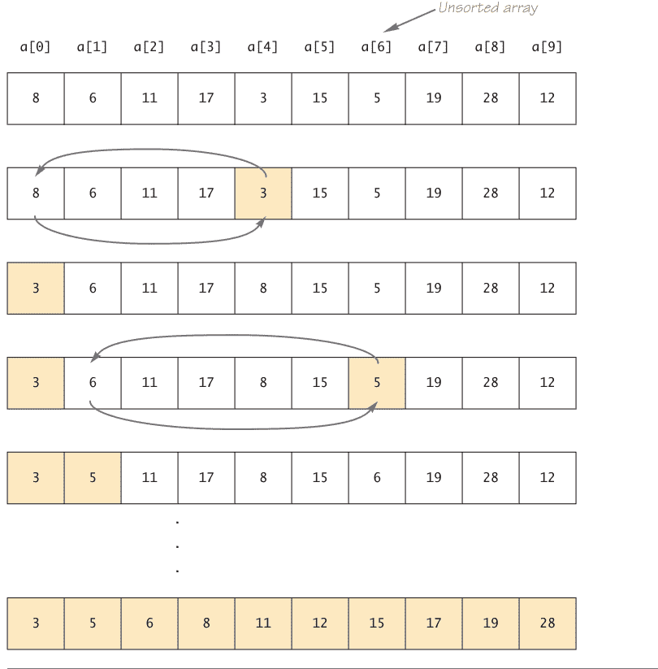

## 选择排序类（第 1 部分，共 2 部分）

```java
public class SelectionSort {
    /**
     前提条件：numberUsed <= a.length;
             前 numberUsed 个索引变量已有值。
     功能：对 a 进行排序，使得 a[0] <= a[1] <= ... <= a[numberUsed - 1]。
     */
    public static void sort(double[] a, int numberUsed) {
        int index, indexOfNextSmallest;
        for (index = 0; index < numberUsed - 1; index++) {
            // 将正确的值放入 a[index]:
            indexOfNextSmallest = indexOfSmallest(index, a, numberUsed);
            interchange(index, indexOfNextSmallest, a);
            // 此时 a[0] <= a[1] <=...<= a[index]，且它们是原始数组元素中最小的。
            // 其余位置包含原始数组元素的剩余部分。
        }
    }

    /**
     返回 a[startIndex], a[startIndex+1], ... a[numberUsed - 1]
     中最小值的索引。
     */
    private static int indexOfSmallest(int startIndex,
                                       double[] a, int numberUsed) {
        double min = a[startIndex];
        int indexOfMin = startIndex;
        int index;
        for (index = startIndex + 1; index < numberUsed; index++) {
            if (a[index] < min) {
                min = a[index];
                indexOfMin = index;
                // min 是 a[startIndex] 到 a[index] 中的最小值。
            }
        }
        return indexOfMin;
    }
}
```

（续）

## 代码清单 6.11 选择排序类（第 2 部分，共 2 部分）

```java
/**
前提条件：i 和 j 是数组 a 的合法索引。
后置条件：a[i] 和 a[j] 的值已被交换。
*/
private static void interchange(int i, int j, double[] a) {
    double temp;
    temp = a[i];
    a[i] = a[j];
    a[j] = temp; // a[i] 的原始值
}
}
```

## 代码清单 6.12 选择排序类的演示

```java
public class SelectionSortDemo {
    public static void main(String[] args) {
        double[] b = {7.7, 5.5, 11, 3, 16, 4.4, 20, 14, 13, 42};
        System.out.println("排序前的数组内容:");
        int i;
        for (i = 0; i < b.length; i++)
            System.out.print(b[i] + " ");
        System.out.println();

        SelectionSort.sort(b, b.length);

        System.out.println("排序后的数组值:");
        for (i = 0; i < b.length; i++)
            System.out.print(b[i] + " ");
        System.out.println();
    }
}
```

### 示例对话

排序前的数组内容：

7.7 5.5 11.0 3.0 16.0 4.4 20.0 14.0 13.0 42.0

排序后的数组值：

3.0 4.4 5.5 7.7 11.0 13.0 14.0 16.0 20.0 42.0

## 枚举类型 ✦

有时你需要一个简单的类型，它由一个简短的命名值列表组成。例如，这些值可能是服装尺码、星期几或其他一些简短的值列表。从 5.0 版本开始，Java 允许你拥有这样的枚举类型。例如，下面是一个表示五天工作日的枚举类型：

```java
enum WorkDay {MONDAY, TUESDAY, WEDNESDAY, THURSDAY, FRIDAY};
```

枚举类型的值是一种命名常量，因此按照惯例，它们都用大写字母拼写。所以，在上面枚举类型 `WorkDay` 的定义中，我们使用了 `MONDAY`，而不是 `Monday`。使用 `Monday` 在语法上是合法的，但风格不佳。

与任何其他类型一样，你可以拥有枚举类型的变量，例如：

```java
WorkDay meetingDay, availableDay;
```

枚举类型的变量可以有一个值，该值必须是类型定义中列出的值之一，或者是特殊的 `null` 值，后者用作占位符，表示变量没有“真实”值。例如，你可以使用赋值语句为枚举类型的变量赋值：

```java
meetingDay = WorkDay.THURSDAY;
```

请注意，当书写枚举类型的值时，你需要在值名称（如 `THURSDAY`）前加上类型名称。例如，你使用 `WorkDay.THURSDAY`，而不是 `THURSDAY`。

与任何其他类型一样，你可以将变量的声明与变量的赋值结合起来，如：

```java
WorkDay meetingDay = WorkDay.THURSDAY;
```

一个演示枚举类型使用语法的程序在代码清单 6.13 中给出。请注意，我们将枚举类型的定义放在了主方法之外，与你放置命名常量的位置相同。

## 代码清单 6.13 枚举类型

```java
public class EnumDemo {
    enum WorkDay {MONDAY, TUESDAY, WEDNESDAY, THURSDAY, FRIDAY};

    public static void main(String[] args) {
        WorkDay startDay = WorkDay.MONDAY;
        WorkDay endDay = WorkDay.FRIDAY;

        System.out.println("工作开始于 " + startDay);
        System.out.println("工作结束于 " + endDay);
    }
}
```

### 示例对话

工作开始于 MONDAY

工作结束于 FRIDAY

## 枚举类型

枚举类型是一种类型，你通过一个通常很短的列表给出该类型的所有可能值。枚举类型的值是一种命名常量，因此按照惯例，它们都用大写字母拼写。

### 语法

`enum 类型名称 {第一个值, 第二个值, ..., 最后一个值};`

从 5.0 版本开始，`enum` 是 Java 中的一个关键字。

### 示例

`enum Flavor {VANILLA, CHOCOLATE, STRAWBERRY};`

枚举类型的定义通常放在所有方法之外，与你放置命名常量的位置相同。枚举类型定义的位置在代码清单 6.13 中进行了说明。（定义可以放在其他位置，但我们不需要将它们放在其他任何地方。）

你可以使用 `println` 输出枚举类型变量的值。例如：

```java
System.out.println(WorkDay.THURSDAY);
```

将产生以下屏幕输出：

```text
THURSDAY
```

请注意，类型名称 `WorkDay` 并未被输出。其他输出枚举类型值的示例在代码清单 6.13 中给出。

枚举类型的值，如 `WorkDay.THURSDAY`，并不是字符串值。事实上，你不需要关心它们是什么类型的值。它们的实现方式对于能够使用枚举类型的值并不重要。你真正需要知道的是，例如，`WorkDay.THURSDAY` 和 `WorkDay.FRIDAY` 是不同的值，并且如果使用 `==` 比较它们，测试结果将是不同的。

尽管枚举类型的值不是字符串值，但它们可以用于本可以使用字符串值完成的任务；但是枚举类型在某些任务上比字符串值表现更好。你可以使用字符串变量来代替枚举类型的变量。例如，你可以使用：

```java
String meetingDay = "THURSDAY";
```

而不是：

```java
WorkDay meetingDay = WorkDay.THURSDAY;
```

然而，使用字符串变量允许将变量设置为无意义的值（例如，对于工作日来说是 `"SUNDAY"` 或 `"GaGa"`），并且这样做不会让计算机发出任何警告信息。使用枚举类型，你知道该类型变量唯一可能的值就是枚举类型定义中给出的值；如果你尝试给变量一个不同的值，将会得到错误信息。

枚举类型实际上是一个类，其值是该类的对象。每个枚举类型自动提供的一些方法在代码清单 6.14 中给出。

第 390 页 第 6 章 数组

## 代码清单 6.14 每个枚举类型附带的一些方法（第 1 部分，共 2 部分）

`public boolean equals(枚举类型的任意值)`

如果其参数与调用值相同，则返回 `true`。虽然使用 `equals` 完全合法，但使用 `==` 更简单、更常见。

### 示例

对于枚举类型，`(Value1.equals(Value2))` 等价于 `(Value1 == Value2)`。

`public String toString()`


将调用值作为字符串返回。这通常是自动调用的。例如，当你使用`System.out.println`输出枚举类型的值，或者当你将枚举类型的值连接到一个字符串时，此方法会被自动调用。此自动调用的示例参见代码清单 6.15。

### `public String toString()`

**示例**

`WorkDay.MONDAY.toString()` 返回`"MONDAY"`。枚举类型`WorkDay`在代码清单 6.13 中定义。

### `public int ordinal()`

返回调用值在枚举类型值列表中的位置。第一个位置是 0。

**示例**

`WorkDay.MONDAY.ordinal()` 返回 0，`WorkDay.TUESDAY.ordinal()` 返回 1，依此类推。枚举类型`WorkDay`在代码清单 6.13 中定义。

### `public int compareTo(枚举类型的任意值)`

如果调用对象在值列表中先于参数，则返回负值；如果调用对象等于参数，则返回 0；如果参数先于调用对象，则返回正值。

**示例**

`WorkDay.TUESDAY.compareTo(WorkDay.THURSDAY)` 返回一个负值。类型`WorkDay`在代码清单 6.13 中定义。

### `public 枚举类型[] values()`

## 显示 6.14：每个枚举类型都包含的一些方法（第 2 部分，共 2 部分）

返回一个数组，其元素是枚举类型的值，顺序与它们在枚举类型定义中的列出顺序相同。

**示例**

参见显示 6.15。

```java
public static EnumeratedType valueOf(String name)
```

返回具有指定名称的枚举类型值。字符串名称必须精确匹配。

**示例**

`WorkDay.valueOf("THURSDAY")` 返回`WorkDay.THURSDAY`。类型`WorkDay`定义在显示 6.13 中。

当比较两个枚举类型变量（或常量）时，你可以使用`equals`方法，但更常见的做法是使用`==`运算符。例如，

```java
if (meetingDay == availableDay)
    System.out.println("Meeting will be on schedule.");
if (meetingDay == WorkDay.THURSDAY)
    System.out.println("Long weekend!");
```

对于枚举类型，`equals`方法和`==`运算符是等效的，但`==`运算符的语法更简洁。

要充分发挥枚举类型的潜力，你需要某种方式来遍历枚举类型的所有值。静态方法`values()`为你提供了这种能力。静态方法`values()`返回一个数组，其元素是枚举类型的值。静态方法`values()`为每个枚举类型自动提供。显示 6.15 给出了一个使用`values()`方法遍历枚举类型中所有值的简单示例。（这是一种使用 for-each 循环比使用普通 for 循环更清晰的情况。如果你已经阅读了关于 for-each 循环的星标章节，请务必完成自测练习 22，该练习使用 for-each 循环重做了显示 6.15。）

### `values`方法

每个枚举类型都有一个名为`values()`的静态方法，它返回一个数组，其元素是枚举类型的值，顺序与它们在枚举类型定义中的列出顺序相同。返回的数组的基类型是枚举类型。示例参见显示 6.15。

## 显示 6.15：values 方法

```java
import java.util.Scanner;

public class EnumValuesDemo
{
    enum WorkDay {MONDAY, TUESDAY, WEDNESDAY, THURSDAY, FRIDAY};

    public static void main(String[] args)
    {
        WorkDay[] day = WorkDay.values();

        Scanner keyboard = new Scanner(System.in);
        double hours = 0, sum = 0;
        for (int i = 0; i < day.length; i++)
        {
            System.out.println("Enter hours worked for " + day[i]);
            hours = keyboard.nextDouble();
            sum = sum + hours;
        }

        System.out.println("Total hours work = " + sum);
    }
}
```

> 这等效于`day[i].toString()`。

### 示例对话

```text
Enter hours worked for MONDAY
8
Enter hours worked for TUESDAY
8
Enter hours worked for WEDNESDAY
8
Enter hours worked for THURSDAY
8
Enter hours worked for FRIDAY
7.5
Total hours work = 39.5
```

### 提示

#### `switch`语句中的枚举类型

你可以使用枚举类型来控制`switch`语句。换句话说，`switch`语句中控制表达式的类型可以是枚举类型。这在显示 6.16 中进行了说明。请注意，`case`标签必须是未限定名称；你使用`VANILLA`，而不是`Flavor.VANILLA`。

此程序使用静态方法`valueOf`将输入字符串转换为枚举类型的值。例如，

```java
Flavor.valueOf("STRAWBERRY")
```

返回`Flavor.STRAWBERRY`。请注意，程序在将输入作为参数传递给`valueOf`方法之前，将其更改为全大写字母。`valueOf`方法要求精确匹配。调用`Flavor.valueOf("Vanilla")`将导致程序以错误消息终止；你必须使用`"VANILLA"`来匹配`Flavor`中值的精确拼写（包括大写和小写）。

此时，你可能想知道`STRAWBERRY`和`Flavor.STRAWBERRY`之间的区别是什么，以及在给定情况下如何决定使用哪一个。枚举类型的值是`STRAWBERRY`。我们写`Flavor.STRAWBERRY`是为了表示我们指的是在`Flavor`中定义的`STRAWBERRY`，而不是在其他类型中定义的`STRAWBERRY`，例如

```java
enum Berry {STRAWBERRY, BLUEBERRY, RASPBERRY};
```

一个同时包含两种类型定义（`Flavor`和`Berry`）的单个程序可以同时使用`Flavor.STRAWBERRY`和`Berry.STRAWBERRY`。

那么，在什么情况下可以使用`STRAWBERRY`而不是`Flavor.STRAWBERRY`呢？近似答案是，当有足够的上下文让编译器知道`STRAWBERRY`指的是在类型`Flavor`中定义的`STRAWBERRY`时，你可以使用`STRAWBERRY`而不是`Flavor.STRAWBERRY`。例如，在`switch`语句中，如果控制表达式的类型是`Flavor`，那么`STRAWBERRY`只能表示`Flavor.STRAWBERRY`。这个规则将有助于记住何时使用`STRAWBERRY`，何时使用`Flavor.STRAWBERRY`。但是，有时你可能只需检查参考文献或尝试这两种可能性，看看编译器接受哪一种（或哪几种）。

> 在第 9 章学习异常之后，你将能够处理像`PISTACHIO`这样不对应于`Flavor`类型任何值的答案。调用`Flavor.valueOf("PISTACHIO")`将*抛出一个`IllegalArgumentException`*，这将在第 9 章中解释。在此之前，当`valueOf`无法处理其参数时，你的程序只会给出一个错误消息。

## 显示 6.16：switch 语句中的枚举类型

```java
import java.util.Scanner;

public class EnumSwitchDemo
{
    enum Flavor {VANILLA, CHOCOLATE, STRAWBERRY};

    public static void main(String[] args)
    {
        Flavor favorite = null;
        Scanner keyboard = new Scanner(System.in);

        System.out.println("What is your favorite flavor?");
        String answer = keyboard.next();
        answer = answer.toUpperCase();
        favorite = Flavor.valueOf(answer);

        switch (favorite)
        {
            case VANILLA:
                System.out.println("Classic");
                break;
            case CHOCOLATE:
                System.out.println("Rich");
                break;
            default:
                System.out.println("I bet you said STRAWBERRY.");
                break;
        }
    }
}
```

`case`标签必须只有值的名称，而没有类型名称和点。

### 示例对话

```text
What is your favorite flavor?
Vanilla
Classic
```

### 示例对话

```text
What is your favorite flavor?
STRAWBERRY
I bet you said STRAWBERRY.
```

### 示例对话

```text
What is your favorite flavor?
PISTACHIO
```

此输入导致程序终止并发出错误消息。

### 自测练习

22. 使用 for-each 循环重写显示 6.15 中的程序。

## 6.4 多维数组

> *两个索引总比一个好。*
>
> 佚名

Java 允许你声明具有多个索引的数组。在本节中，我们将描述这些多维数组。

### 多维数组基础

有时拥有一个具有多个索引的数组很有用，这在 Java 中是允许的。以下代码创建了一个名为`page`的字符数组。数组`page`有两个索引，第一个索引范围从 0 到 29，第二个索引范围从 0 到 99。

```java
char[][] page = new char[30][100];
```

这等效于以下两个步骤：

```java
char[][] page;
page = new char[30][100];
```

此数组的索引变量每个都有两个索引。例如，`page[0][0]`、`page[15][32]`和`page[29][99]`是此数组的三个索引变量。请注意，每个索引必须包含在自己的一对方括号内。正如我们已经见过的一维数组一样，多维数组的每个索引变量都是基类型的变量，在本例中是类型`char`。

一个数组可以有任意数量的索引，但最常见的索引数量可能是两个。二维数组可以可视化为一个二维显示，第一个索引给出行，第二个索引给出列。例如，二维数组`a`的索引变量，其声明和创建如下：

```java
char[][] a = new char[5][12];
```

可以可视化如下：

## 第 6 章 数组

```text
a[0][0], a[0][1], a[0][2], ..., a[0][11]
a[1][0], a[1][1], a[1][2], ..., a[1][11]
a[2][0], a[2][1], a[2][2], ..., a[2][11]
a[3][0], a[3][1], a[3][2], ..., a[3][11]
a[4][0], a[4][1], a[4][2], ..., a[4][11]
```

你可以使用数组`a`来存储（一个非常小的）文本页上的所有字符，该页有五行（编号为 0 到 4）和每行 12 个字符（编号为 0 到 11）。

### 声明和创建多维数组

你声明一个多维数组变量并创建一个多维数组对象的方式，与创建和命名一个一维数组基本相同。你只需要使用与索引数量一样多的方括号。

**语法**

`基类型[]...[] 变量名 = new 基类型[长度_1]...[长度_n];`

**示例**

`char[][] a = new char[5][12];`

`char[][] page = new char[30][100];`

`double[][] table = new double[100][10];`

`int[][][] figure = new int[10][20][30];`

`Person[][] entry = new Person[10][10];`

`Person`是一个类。

### 多维数组是数组的数组

在 Java 中，一个二维数组，例如`a`，实际上是一个数组的数组。上面的数组`a`实际上是一个大小为 5 的一维数组，其基类型是一个大小为 12 的字符型一维数组。这在显示 6.17 中有图解。如该图所示，数组变量`a`包含一个指向长度为 5 的一维数组的引用，该数组的基类型为`char[]`；也就是说，`a`的基类型是整个字符型一维数组的类型。每个下标变量`a[0]`、`a[1]`等包含一个指向字符型一维数组的引用。

三维数组是数组的数组的数组，更高维度的数组依此类推。

通常，二维数组是数组的数组这一事实不需要你关心，你通常可以把数组`a`当作一个具有两个索引的数组（而不是更难跟踪的数组的数组）来处理。然而，在某些情况下，二维数组看起来非常像数组的数组。例如，你将看到在使用实例变量`length`时，你必须将二维数组看作是数组的数组。

### 显示 6.17 作为数组的数组的二维数组

```java
char[][] a = new char[5][12];
```

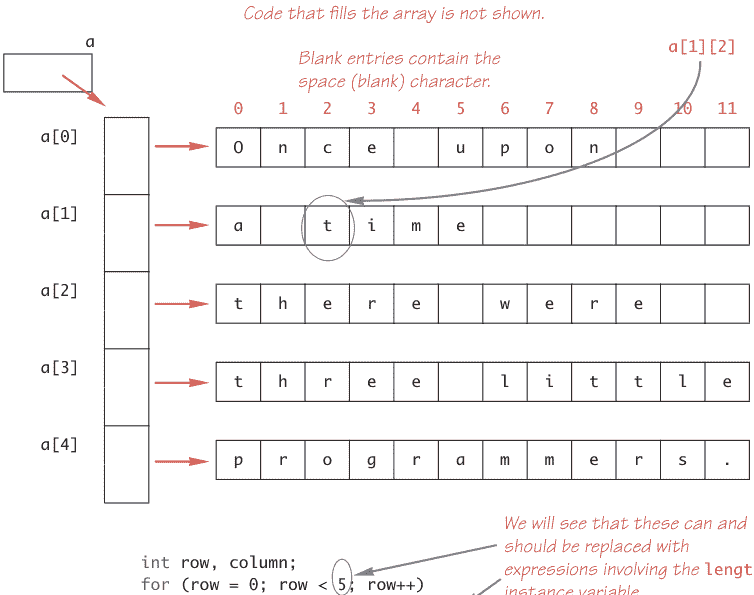

```java
int row, column;
for (row = 0; row < 5; row++)
{
    for (column = 0; column < 12; column++)
        System.out.print(a[row][column]);
    System.out.println();
}
```

产生以下输出：

```text
Once upon

a time

there were

three little

programmers.
```

### 使用`length`实例变量

假设你想用`'Z'`填充以下二维数组的所有元素：

```java
char[][] page = new char[30][100];
```

你可以使用如下嵌套的 for 循环：

```java
int row, column;
for (row = 0; row < page.length; row++)
    for (column = 0; column < page[row].length; column++)
        page[row][column] = 'Z';
```

让我们更详细地分析这个嵌套的 for 循环。数组`page`实际上是一个长度为 30 的一维数组，而 30 个下标变量`page[0]`到`page[29]`中的每一个都是一个基类型为`char`、长度为 100 的一维数组。这就是为什么第一个 for 循环使用`page.length`来终止。对于像`page`这样的二维数组，`length`的值是第一个索引的数量，或者等效地，是行数——在这种情况下是 30。现在让我们考虑内部的 for 循环。

二维数组`page`中的第 0 行是一维数组`page[0]`，它有`page[0].length`个条目。更一般地说，`page[row]`是一个字符型一维数组，它有`page[row].length`个条目。这就是为什么内部 for 循环使用`page[row].length`来终止。当然，在这种情况下，`page[0].length`、`page[1].length`一直到`page[29].length`都相等，并且都等于 100。（如果你阅读了题为“不规则数组”的可选部分，你会看到这些值不需要都相等。）

### 自测练习

23. 以下代码产生的输出是什么？


```java
int[][] myArray = new int[4][4];
int index1, index2;
for (index1 = 0; index1 < myArray.length; index1++)
    for (index2 = 0;
         index2 < myArray[index1].length; index2++)
        myArray[index1][index2] = index2;
for (index1 = 0; index1 < myArray.length; index1++)
{
    for (index2 = 0;
         index2 < myArray[index1].length; index2++)
        System.out.print(myArray[index1][index2] + " ");
    System.out.println();
}
```

## 不规则数组 ☆

二维数组中的每一行不需要具有相同数量的条目。不同的行可以有不同数量的列。这类数组被称为**不规则数组**。

为了帮助解释细节，让我们从一个普通的、非不规则的二维数组开始，创建方式如下：

```java
double[][] a = new double[3][5];
```

这等价于以下代码：

```java
double[][] a;
a = new double[3][];
a[0] = new double[5];
a[1] = new double[5];
a[2] = new double[5];
```

这一行

```java
a = new double[3][];
```

使得`a`成为一个数组的名称，该数组有三个条目，每个条目都可以是一个长度任意的`double`数组。接下来的三行分别创建一个长度为 5 的`double`数组，并由`a[0]`、`a[1]`和`a[2]`命名。最终结果是一个基类型为`double`的二维数组，有三行五列。

如果你愿意，你可以让`a[0]`、`a[1]`和`a[2]`具有不同的长度。以下代码创建了一个不规则数组`b`，其中每行的长度都不同：

```java
double[][] b;
b = new double[3][];
b[0] = new double[5];
b[1] = new double[10];
b[2] = new double[4];
```

在某些情况下，你可以有效地使用不规则数组，但大多数应用并不需要它们。然而，如果你理解了不规则数组，你将能更好地理解所有多维数组在 Java 中的工作方式。

## 多维数组参数和返回值

方法可以有多维数组参数，并且可以将多维数组类型作为返回值的类型。这种情况与一维情况类似，只是在指定类型名称时你使用更多的方括号。例如，以下方法将以通常的行列方式显示一个二维数组：⁶

⁶ 值得注意的是，此方法对不规则数组也适用。

```java
public static void showMatrix(int[][] a)
{
    int row, column;
    for (row = 0; row < a.length; row++)
    {
        for (column = 0; column < a[row].length; column++)
            System.out.print(a[row][column] + "  ");
        System.out.println();
    }
}
```

如果你想返回一个多维数组，你使用与多维数组参数相同的类型规范。例如，以下方法返回一个基类型为`double`的二维数组：

```java
/**
 前提条件：a 的每个维度至少为
                size 的值。
 返回的数组与数组 a 的左上角 size-by-size 部分相同。
*/
public static double[][] corner(double[][] a, int size)
{
    double[][] temp = new double[size][size];
    int row, column;
    for (row = 0; row < size; row++)
        for (column = 0; column < size; column++)
            temp[row][column] = a[row][column];
    return temp;
}
```

## 成绩簿类

显示 6.18 包含一个用于记录课堂成绩的类，其中唯一记录的分数是测验分数。此类的一个对象具有三个数组实例变量。其中一个是一个名为`grade`的二维数组，记录了每个学生在每次测验中的成绩。例如，4 号学生在 1 号测验中的分数记录在`grade[3][0]`中。因为学生编号和测验编号从 1 开始，而数组索引从 0 开始，所以我们从学生编号或测验编号中减去一以获得相应的数组索引。

## 显示 6.18 一个成绩簿类（第1部分，共3部分）

```java
import java.util.Scanner;

public class GradeBook
{
    private int numberOfStudents; // 与 studentAverage.length 相同。
    private int numberOfQuizzes; // 与 quizAverage.length 相同。

    private int[][] grade; //numberOfStudents 行和 numberOfQuizzes 列。
    private double[] studentAverage;
    private double[] quizAverage;

    public GradeBook(int[][] a)
    {
        if (a.length == 0 || a[0].length == 0)
        {
            System.out.println("Empty grade records. Aborting.");
            System.exit(0);
        }

        numberOfStudents = a.length;
        numberOfQuizzes = a[0].length;
        fillGrade(a);
        fillStudentAverage();
        fillQuizAverage();
    }

    public GradeBook(GradeBook book)
    {
        numberOfStudents = book.numberOfStudents;
        numberOfQuizzes = book.numberOfQuizzes;
        fillGrade(book.grade);
        fillStudentAverage();
        fillQuizAverage();
    }

    public GradeBook()
    {
        Scanner keyboard = new Scanner(System.in);

        System.out.println("Enter number of students:");
        numberOfStudents = keyboard.nextInt();

        System.out.println("Enter number of quizzes:");
        numberOfQuizzes = keyboard.nextInt();

        grade = new int[numberOfStudents][numberOfQuizzes];

        for (int studentNumber = 1;
             studentNumber <= numberOfStudents; studentNumber++)
            for (int quizNumber = 1;
                 quizNumber <= numberOfQuizzes; quizNumber++)
            {
                System.out.println("Enter score for student number "
                                   + studentNumber);
                System.out.println("on quiz number " + quizNumber);
                grade[studentNumber - 1][quizNumber - 1] =
                                           keyboard.nextInt();
            }

        fillStudentAverage();
        fillQuizAverage();
    }

    private void fillGrade(int[][] a)
    {
        grade = new int[numberOfStudents][numberOfQuizzes];

        for (int studentNumber = 1;
             studentNumber <= numberOfStudents; studentNumber++)
        {
            for (int quizNumber = 1;
                 quizNumber <= numberOfQuizzes; quizNumber++)
                grade[studentNumber - 1][quizNumber - 1] =
                               a[studentNumber - 1][quizNumber - 1];
        }
    }
```

> 这个类本应包含更多的访问器和修改器方法，但为了节省篇幅我们将其省略了。请参阅自测练习 24 到 27。

```java
    /**
     使用 grade 数组中的数据填充 studentAverage 数组。
    */
    private void fillStudentAverage()
    {
        studentAverage = new double[numberOfStudents];

        for (int studentNumber = 1;
             studentNumber <= numberOfStudents; studentNumber++)
        {//处理一个 studentNumber：
            double sum = 0;
            for (int quizNumber = 1;
                 quizNumber <= numberOfQuizzes; quizNumber++)
                sum = sum + grade[studentNumber - 1][quizNumber - 1];
            //sum 包含学生编号 studentNumber 的所有测验分数之和。
            studentAverage[studentNumber - 1] = sum/numberOfQuizzes;
            //学生 studentNumber 的平均分是 studentAverage[studentNumber - 1]
        }
    }

    /**
     使用 grade 数组中的数据填充 quizAverage 数组。
    */
    private void fillQuizAverage()
    {
        quizAverage = new double[numberOfQuizzes];

        for (int quizNumber = 1; quizNumber <= numberOfQuizzes; quizNumber++)
        {//处理一个测验（对所有学生）：
            double sum = 0;
            for (int studentNumber = 1;
                     studentNumber <= numberOfStudents; studentNumber++)
                sum = sum + grade[studentNumber - 1][quizNumber - 1];
            //sum 包含所有学生在测验编号 quizNumber 上的分数总和。
            quizAverage[quizNumber - 1] = sum/numberOfStudents;
            //测验 quizNumber 的平均分是 quizAverage[quizNumber - 1] 的值
        }
    }

    public void display()
    {
        for (int studentNumber = 1;
                 studentNumber <= numberOfStudents; studentNumber++)
        {//显示一个 studentNumber 的数据：
            System.out.print("Student " + studentNumber + " Quizzes: ");
            for (int quizNumber = 1;
                     quizNumber <= numberOfQuizzes; quizNumber++)
                System.out.print(grade[studentNumber - 1][quizNumber - 1] + " ");
            System.out.println(" Ave = " + studentAverage[studentNumber - 1] );
        }

        System.out.println("Quiz averages: ");
        for (int quizNumber = 1; quizNumber <= numberOfQuizzes; quizNumber++)
            System.out.print("Quiz " + quizNumber
                + " Ave = " + quizAverage[quizNumber - 1] + " ");
        System.out.println();
    }
}
```

## 示例（续）

所有原始数据都存储在`grade`数组中，但另外两个数组保存了计算出的数据。`studentAverage`数组用于记录每个学生的平均测验分数。例如，程序将`studentAverage[0]`设置为学生 1 收到的测验分数的平均值，将`studentAverage[1]`设置为学生 2 收到的测验分数的平均值，依此类推。`quizAverage`数组用于记录每个测验的平均分。例如，程序将`quizAverage[0]`设置为所有学生在测验 1 上分数的平均值，`quizAverage[1]`记录测验 2 的平均分，依此类推。显示 6.19 说明了数组`grade`、`studentAverage`和`quizAverage`之间的关系。在该显示中，我们展示了数组`grade`的一些示例数据。`grade`中的数据反过来又决定了存储在`studentAverage`和`quizAverage`中的值。显示 6.19 还展示了`studentAverage`和`quizAverage`的这些计算值。数组`studentAverage`和`quizAverage`是由创建`GradeBook`对象的构造函数创建并填充的。（构造函数通过调用私有辅助方法来完成此操作。）

`GradeBook`类的无参构造函数通过与用户对话获取数组实例变量`grade`的数据。虽然这不是我最喜欢的定义无参构造函数的方式，但有些程序员喜欢它，你应该了解一个这样的例子。另一种选择是让一个无参构造函数基本上什么都不做，然后提供一个输入方法来设置所有实例变量，包括创建数组对象。

显示 6.20 给出了一个非常简单的演示程序及其产生的对话。

## 显示 6.19 二维数组 grade

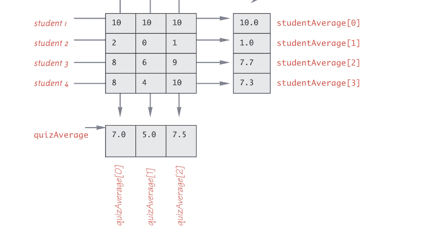

## 显示 6.20 GradeBook 类的演示

```java
public class GradeBookDemo
{
    public static void main(String[] args)
    {
        GradeBook book = new GradeBook();
        book.display();
    }
}
```

# 示例对话


```
Enter number of students:
4
Enter number of quizzes:
3
Enter score for student number 1 on quiz number 1
10
Enter score for student number 1 on quiz number 2
10
...
Student 1 Quizzes: 10 10 10 Ave = 10.0
Student 2 Quizzes: 2 0 1 Ave = 1.0
Student 3 Quizzes: 8 6 9 Ave = 7.6666666666666665
Student 4 Quizzes: 8 4 10 Ave = 7.333333333333333
Quiz averages:
Quiz 1 Ave = 7.0 Quiz 2 Ave = 5.0 Quiz 3 Ave = 7.5
```

## 自测练习

24. 编写一个具有以下方法签名的方法定义。该方法将添加到显示 6.18 的 `GradeBook` 类中。

```java
/**
返回学生编号为 studentNumber 的学生在测验编号为 quizNumber 的测验中获得的成绩。
*/
public int getGrade(int studentNumber, int quizNumber)
```

25. 编写一个具有以下方法签名的方法定义。该方法将添加到显示 6.18 的 `GradeBook` 类中。

```java
/**
将学生编号为 studentNumber 的学生在测验编号为 quizNumber 的测验中的成绩更改为 newGrade。
*/
public void changeGrade(int studentNumber,
    int quizNumber, int newGrade)
```

26. 编写一个具有以下方法签名的方法定义。该方法将添加到显示 6.18 的 `GradeBook` 类中。

```java
/**
返回一个包含每个学生平均测验分数的数组。
*/
public double[] getStudentAverages()
```

27. 编写一个具有以下方法签名的方法定义。该方法将添加到显示 6.18 的 `GradeBook` 类中。

```java
/**
返回一个包含每个测验平均分的数组。
*/
public double[] getQuizAverages()
```

## 章节总结

- 数组可用于存储和操作一组类型相同的数据。
- 数组的索引变量可以像数组基类型的任何其他变量一样使用。
- 数组是使用 `new` 创建的对象，就像我们在本章之前讨论的类对象一样（尽管使用的语法略有不同）。

## 自测练习答案

1. 
   - a. word
   - b. `String`
   - c. 5
   - d. 从 0 到 4（含）
   - e. 以下任意一种都是正确的：
   
     `word[0]`、`word[1]`、`word[2]`、`word[3]`、`word[4]`

2. 
   - a. 10
   - b. 0
   - c. 9

3. a、b、c。

4. 
   ```
   1.1 2.2 3.3

   1.1 3.3 3.3
   ```

5. `for` 循环使用了索引 1 到 `sampleArray.length`，但正确的索引应该是 0 到 `sampleArray.length - 1`。最后一个索引 `sampleArray.length` 超出了边界。预期的代码应该是：

   ```java
   int[] sampleArray = new int[10];
   for (int index = 0; index < sampleArray.length; index++)
       sampleArray[index] = 3*index;
   ```

6. `index` 的最后一个值是 `a.length - 1`，这是数组的最后一个索引。然而，当 `index` 的值为 `a.length - 1` 时，`a[index + 1]` 的索引越界了，因为 `index + 1` 比最大数组索引大一。`for` 循环的结束条件应该是 `index < a.length - 1`。

7. 
   - `SomeClass.doSomething(number);` // 合法。
   - `SomeClass.doSomething(a[2]);` // 合法。
   - `SomeClass.doSomething(a[3]);` // 非法。索引越界。
   - `SomeClass.doSomething(a[number]);` // 合法。
   - `SomeClass.doSomething(a);` // 非法。

8. 
   ```java
   public static void oneMore(int[] a)
   {
       for (int i = 0; i < a.length; i++)
           a[i] = a[i] + 1;
   }
   ```

9. 
   ```java
   public static int outOfOrder(double[] a)
   {
       for (int index = 0; index < a.length - 1; index++)
           if (a[index] > a[index + 1])
               return (index + 1);
       return -1;
   }
   ```

10. 这个方法合法但毫无意义。调用时，它对参数没有影响。参数 `a` 是一个包含引用的局部变量。引用确实被更改为指向一个大小是参数两倍的数组，但这个引用在方法结束时就消失了。方法可以更改其参数索引变量的值，但无法更作用为参数的数组变量中的引用。

11. 
    ```java
    public static double[] halfArray(double[] a)
    {
        double[] temp = new double[a.length];
        for (int i = 0; i < a.length; i++)
            temp[i] = a[i]/2.0;
        return temp;
    }
    ```

12. 该方法可以编译和运行。返回的数组其元素具有正确的值。但是，该方法会更改其数组参数的值。如果你想更改数组参数中的值，一个 `void` 方法会更合理。如果你想返回一个数组，你可能应该返回一个新数组（如前一小节中的版本），而不是返回参数数组的已更改版本。

13. 
    ```java
    /**
       前置条件：numberUsed <= argumentArray.length；
       argumentArray 的前 numberUsed 个索引变量有值。
       返回一个长度为 numberUsed 的数组，其第 i 个元素是
       argumentArray[i] - adjustment。
    */
    public static double[] differenceArray(
       double[] argumentArray, int numberUsed, double adjustment)
    {
       double[] temp = new double[numberUsed];
       for (int i = 0; i < numberUsed; i++)
          temp[i] = argumentArray[i] - adjustment;
       return temp;
    }
    ```

14. 唯一的更改是添加 `differenceArray` 方法，并按如下方式重写 `showDifference` 方法（完整的类定义在随附 CD 的 `GolfScoresExercise.java` 文件中）：

    ```java
    public static void showDifference(double[] a,
                                     int numberUsed)
    {
       double average = computeAverage(a, numberUsed);
       System.out.println("Average of the " + numberUsed
                         + " scores = " + average);
       double[] difference =
                differenceArray(a, numberUsed, average);
       System.out.println("The scores are:");
       for (int index = 0; index < numberUsed; index++)
          System.out.println(a[index] +
                             " differs from average by "
                             + difference[index]);
    }
    ```

    CD 上的额外代码。

15. 主要区别是移除参数，将数组名 `a` 替换为 `score`，并将 `fillArray` 方法设为 `void` 方法。此代码在随附 CD 的 `GolfScoresStaticExercise.java` 文件中。

    CD 上的额外代码。

    ```java
    import java.util.Scanner;

    public class GolfScoresStaticExercise
    {
       public static final int MAX_NUMBER_SCORES = 10;
       private static double[] score =
                         new double[MAX_NUMBER_SCORES];
       private static int numberUsed = 0;
    ```

    第 410 页 第 6 章 数组

    ```java
    /**
     显示高尔夫分数列表中每个分数与其平均值的差异。
    */
    public static void main(String[] args)
    {
        System.out.println(
            "This program reads golf scores and shows");
        System.out.println(
            "how much each differs from the average.");

        System.out.println("Enter golf scores:");
        fillArray();
        showDifference();
    }

    /**
     将值读入数组 score。
    */
    public static void fillArray()
    {
        System.out.println("Enter up to " + score.length
            + " nonnegative numbers:");
        System.out.println(
            "Mark the end of the list with a negative number.");
        Scanner keyboard = new Scanner(System.in);

        double next;
        int index = 0;
        next = keyboard.nextDouble();
        while ((next >= 0) && (index < score.length))
        {
            score[index] = next;
            index++;
            next = keyboard.nextDouble();
            //index 是目前为止
            //已使用的数组索引变量的数量。
        }
        //index 是已使用的数组索引变量的总数。

        if (next >= 0)
            System.out.println("Could only read in "
                + score.length + " input values.");

        numberUsed = index;
    }
    ```

    ```java
    /**
     前置条件：numberUsed <= score.length。
                score[0] 到 score[numberUsed-1] 有值。
     返回 score[0] 到 score[numberUsed-1] 中数字的平均值。
    */

    public static double computeAverage()
    {
        double total = 0;
        for (int index = 0; index < numberUsed; index++)
            total = total + score[index];
        if (numberUsed > 0)
        {
            return (total/numberUsed);
        }
        else
        {
            System.out.println(
                     "ERROR: Trying to average 0 numbers.");
            System.out.println("computeAverage returns 0.");
            return 0;
        }
    }
    ```

    ```java
    /**
     前置条件：numberUsed <= score.length。
     score 的前 numberUsed 个索引变量有值。
     后置条件：在屏幕上输出显示数组 a 的前 numberUsed 个元素与平均值的差异。
    */

    public static void showDifference()
    {
        double average = computeAverage();
        System.out.println("Average of the " + numberUsed
                                + " scores = " + average);
        System.out.println("The scores are:");
        for (int index = 0; index < numberUsed; index++)
            System.out.println(score[index] +
                                       " differs from average by "
                               + (score[index] - average));
    }
    ```

16. 
    ```java
    public static int max(int... arg)
    {
        if (arg.length == 0)
        {
            System.out.println(
                "Fatal Error: maximum of zero values.");
            System.exit(0);
        }

        int largest = Integer.MIN_VALUE;
        for (int element : arg)
            if (element > largest)
                largest = element;
        return largest;
    }
    ```

17. 最后一行将更改为以下内容：

    I ate cod, broccoli, , peanuts, and apples.

18. 
    ```java
    public void removeAll()
    {
        numberUsed = 0;
    }
    ```


19. 
```java
public void increaseCapacity(int newCapacity)
{
    if (newCapacity > numberUsed)
    {
        maxNumberElements = newCapacity;
        double[] temp = new double[newCapacity];
        for (int i = 0; i < a.length; i++)
            temp[i] = a[i];
        a = temp;
    }//否则什么都不做。
}
```

20. 要使你的代码适用于按降序排序，你只需在`indexOfSmallest`定义中的以下行中将`<`替换为`>`：

```java
if (a[index] < min)
```

然而，为了使你的代码易于阅读，你还应该将方法`indexOfSmallest`重命名为`indexOfLargest`，将变量`min`重命名为`max`，并将变量`indexOfMin`重命名为`indexOfMax`。你还应该重写一些注释以反映这些更改。

21. 如果一个数组存在重复值，并使用`SelectionSort.sort`方法对其进行排序，那么排序后的数组中，重复值的副本数量将与原始数组中完全一致。

22. 我们提供了两个略有不同的版本。两个版本都附在随附的CD上。

**CD 上的附加代码**

```java
import java.util.Scanner;

public class ForEachEnumDemo
{
    enum WorkDay {MONDAY, TUESDAY, WEDNESDAY, THURSDAY, FRIDAY};

    public static void main(String[] args)
    {
        WorkDay[] day = WorkDay.values();

        Scanner keyboard = new Scanner(System.in);
        double hours = 0, sum = 0;

        for (WorkDay oneDay : day)
        {
            System.out.println("Enter hours worked for " + oneDay);
            hours = keyboard.nextDouble();
            sum = sum + hours;
        }

        System.out.println("Total hours work = " + sum);
    }
}
```

```java
import java.util.Scanner;

public class ForEachEnumDemo2
{
    enum WorkDay {MONDAY, TUESDAY, WEDNESDAY, THURSDAY, FRIDAY};

    public static void main(String[] args)
    {
        Scanner keyboard = new Scanner(System.in);
        double hours = 0, sum = 0;

        for (WorkDay oneDay : WorkDay.values())
        {
            System.out.println("Enter hours worked for " + oneDay);
            hours = keyboard.nextDouble();
            sum = sum + hours;
        }

        System.out.println("Total hours work = " + sum);
    }
}
```

23. 
```
0 1 2 3
0 1 2 3
0 1 2 3
0 1 2 3
```

24. 如果数组索引超出边界，Java 将会终止程序并显示错误消息，因此不需要对参数进行其他检查。

```java
/**
 返回学生编号为 studentNumber 的学生
 在测验编号为 quizNumber 的测验中的成绩。
*/
public int getGrade(int studentNumber, int quizNumber)
{
    return grade[studentNumber][quizNumber];
}
```

25. 如果数组索引超出边界，Java 将会终止程序并显示错误消息，因此不需要对参数进行其他检查。

```java
/**
 将学生编号为 studentNumber 的学生
 在测验编号为 quizNumber 的测验中的成绩更改为 newGrade。
*/
public void changeGrade(int studentNumber,
                       int quizNumber, int newGrade)
{
    grade[studentNumber][quizNumber] = newGrade;
}
```

```java
/**
 返回一个数组，包含每个学生的平均测验分数。
*/
public double[] getStudentAverages()
{
    int arraySize = studentAverage.length;
    double[] temp = new double[arraySize];
    for (int i = 0; i < arraySize; i++)
        temp[i] = studentAverage[i];
    return temp;
}
```

```java
/**
 返回一个数组，包含每次测验的平均分数。
*/
public double[] getQuizAverages()
{
    int arraySize = quizAverage.length;
    double[] temp = new double[arraySize];
    for (int i = 0; i < arraySize; i++)
        temp[i] = quizAverage[i];
    return temp;
}
```

## 编程项目

*这些编程项目中的许多都可以使用AW的CodeMate来解决。要访问CodeMate，请访问：www.aw-bc.com/codemate。*

**1.** 在跳水运动中，七名评委给出0到10分之间的分数，每个分数可以是浮点数。去掉最高分和最低分，将剩余分数相加。然后将总和乘以该跳水动作的难度系数。难度系数的范围是1.2到3.8分。最后将总和乘以0.6以确定该跳水者的最终得分。

编写一个计算机程序，输入难度系数和七名评委的分数，并输出该跳水动作的最终得分。程序应确保所有输入都在允许的数据范围内。

**2.** 一种常见的儿童记忆配对游戏开始时使用一副包含成对相同牌的卡组。例如，如果卡组中有六张牌，可能有两张标记为1，两张标记为2，两张标记为3。将牌洗匀后正面朝下放在桌上。然后玩家选择两张正面朝下的牌，将其翻为正面朝上，如果牌面匹配，则保持正面朝上。如果两张牌不匹配，则将它们翻回原始的正面朝下位置。游戏持续进行，直到所有牌都正面朝上。

编写一个程序来玩这个记忆配对游戏。使用十六张排列成4x4方格的牌，这些牌用从1到8的成对数字标记。你的程序应允许玩家通过坐标系统指定她想要选择的牌。

例如，在以下布局中：

```
      1   2   3   4

1     8   *   *   *
2     *   *   *   *
3     *   8   *   *
4     *   *   *   *
```

所有牌都正面朝下，用`*`表示。一对8正面朝上，位于坐标(1,1)和(2,3)。为了隐藏暂时正面朝上的牌，输出大量换行符以迫使旧的棋盘滚出屏幕。

*提示：* 使用二维数组存储牌的排列，并使用另一个二维数组指示牌是正面朝上还是朝下。或者，一个更优雅的解决方案是创建一个单一的二维数组，其中每个元素都是一个存储牌面值和朝向的对象。编写一个函数，通过反复随机选择两张牌并交换它们来“洗牌”。

注意：要生成一个随机数`x`，其中`0 ≤ x < 1`，请使用`x = Math.random();`。例如，乘以六并转换为整数，将得到一个0到5之间的整数。

**3.** 编写一个程序，读取一个城市一年中每个月的平均月降雨量，然后读取过去12个月每个月的实际月降雨量。然后，程序应打印一个格式美观的表格，显示过去12个月每个月的降雨量，以及每个月的降雨量高于或低于平均水平的程度。平均月降雨量按一月、二月等的顺序给出。为了获得过去12个月的实际降雨量，程序应首先询问当前月份，然后询问过去12个月的降雨量数据。输出应正确标记月份。有多种方法可以处理月份名称。一种直接的方法是将月份编码为整数，然后在输出前转换为月份名称的字符串。在输出方法中使用大型`switch`语句是可以接受的。月份输入可以用任何你认为对用户相对简单且方便的方式处理。包含一个循环，允许用户重复整个计算，直到用户请求程序结束。

**4.** 编写一个名为`deleteRepeats`的静态方法，该方法有一个部分填充的字符数组作为形式参数，并从数组中删除所有重复的字母。因为部分填充的数组需要两个参数，所以该方法实际上应该有两个形式参数：一个数组参数和一个类型为`int`的形式参数，用于给出已使用的数组位置数量。当删除一个字母时，其余字母向前移动一个位置以填补空缺。这会在数组末尾创建空位置，从而使用更少的数组空间。因为形式参数是部分填充的数组，所以第二个类型为`int`的形式参数应告知已填充的数组位置数量。这个第二个形式参数不能被Java方法修改，因此让方法返回这个参数的新值。例如，考虑以下代码：

```java
char a[10];
a[0] = 'a';
a[1] = 'b';
a[2] = 'a';
a[3] = 'c';
int size = 4;
size = deleteRepeats(a, size);
```

执行此代码后，`a[0]`的值是`'a'`，`a[1]`的值是`'b'`，`a[2]`的值是`'c'`，而`size`的值是3。（`a[3]`的值不再重要，因为部分填充的数组不再使用这个索引变量。）你可以假设部分填充的数组只包含小写字母。为你的方法编写一个合适的测试程序。

**5.** 一组数字的标准差是衡量这些数字偏离平均值程度的指标。如果标准差较小，则数字聚集在平均值附近。如果标准差较大，则数字分散得较远。

从平均值出发。一组数字`n_1, n_2, n_3`等的标准差被定义为以下数字的平均值的平方根：

`(n_1 - a)^2, (n_2 - a)^2, (n_3 - a)^2`，等等。

数字`a`是数字`n_1, n_2, n_3`等的平均值。

定义一个静态方法，该方法以一个部分填充的数字数组作为其参数，并返回该部分填充数组中数字的标准差。因为部分填充数组需要两个参数，所以该方法实际上应该有两个形式参数，一个数组参数和一个类型为`int`的形式参数，用于指定已使用的数组位置数量。数组中的数字类型应为`double`。为你的方法编写一个合适的测试程序。

**6.** 编写一个程序，从键盘读取数字到一个类型为`int[]`的数组中。你可以假设数组中最多有50个条目。你的程序允许输入任意数量的数字，最多50个。输出应为两列列表。第一列是不同数组元素的列表；第二列是每个元素出现次数的计数。列表应按第一列的条目排序，从大到小。

对于数组

`-12 3 -12 4 1 1 -12 1 -1 1 2 3 4 2 3 -12`

输出应为

| N | 计数 |
|---|------|
| 4 | 2    |
| 3 | 3    |
| 2 | 2    |
| 1 | 4    |
| -1| 1    |
| -12| 4   |

**7.** 数组可以用来一次存储大整数的一位数字。例如，整数1234可以通过将`a[0]`设为1，`a[1]`设为2，`a[2]`设为3，`a[3]`设为4来存储在数组`a`中。然而，对于这个练习，你可能会发现将数字反向存储更有用；也就是说，将4放在`a[0]`，3放在`a[1]`，2放在`a[2]`，1放在`a[3]`。在这个练习中，编写一个程序，读取两个长度不超过20位的正整数，然后输出这两个数字的和。你的程序将以`char`类型的值读取数字，因此数字1234将被读取为四个字符`'1'`、`'2'`、`'3'`和`'4'`。读入程序后，这些字符被转换为`int`类型的值。数字应被读入一个部分填充的数组中，你可能会发现在数组从键盘填充数据后反转数组元素的顺序很有用。（是否反转数组元素的顺序由你决定。两种方式都可以，各有优缺点。）你的程序应通过实现通常的纸笔加法算法来执行加法。加法的结果应存储在一个大小为20的数组中，然后将结果显示在屏幕上。如果加法的结果是一个数字超过最大位数（即超过20位）的整数，那么你的程序应发出一条消息，说明遇到了“整数溢出”。你应该能够只通过改变一个命名常量来改变整数的最大长度。包含一个循环，允许用户继续进行更多加法，直到用户说程序应该结束。

**8.** 设计一个名为`BubbleSort`的类，类似于`Display 6.11`中给出的`SelectionSort`类。`BubbleSort`类将与`SelectionSort`类以相同的方式使用，但它将使用冒泡排序算法。

冒泡排序算法从头到尾检查数组中所有相邻的元素对，并交换任何两个顺序错误的元素。重复此过程直到数组排序。算法如下：

### 对数组`a`进行排序的冒泡排序算法

重复以下步骤直到数组`a`已排序：

```java
for (index = 0; index < a.length - 1; index++)
    if (a[index] > a[index + 1])
        交换 a[index] 和 a[index + 1] 的值。
```

冒泡排序算法适用于对“几乎已排序”的数组进行排序。对于大多数其他情况，它无法与其他排序方法竞争。

**9.** 以以下方式增强`PartiallyFilledArray`类（`Display 6.5`）的定义：当用户尝试添加一个额外元素而数组实例变量`a`中没有空间时，允许用户添加该元素。对象创建一个大小是数组`a`两倍的第二个数组，将值从数组`a`复制到用户的新数组，将此数组（或更确切地说，它的引用）设为`a`的新值，然后将该元素添加到这个新的更大的数组`a`中。因此，这个新类应该没有限制（除了计算机的实际大小）它可以容纳多少数字。实例变量`maxNumberOfElements`保留，方法`getMaxCapacity`不变，但这些现在指的是当前分配的内存，而不是一个绝对的上限。编写一个合适的测试程序。

**10.** 编写一个程序，允许两个用户玩井字棋。程序应轮流询问玩家X和玩家O的走法。程序按如下方式显示游戏位置：

```
1 2 3
4 5 6
7 8 9
```

玩家通过输入他们想要标记的位置编号来输入他们的走法。每次走法后，程序显示变化后的棋盘。一个示例棋盘配置是

```
X X O
4 5 6
0 8 9
```

**11.** 编写一个程序来为飞机乘客分配座位。假设一架小型飞机的座位编号如下：

```
1 A B C D
2 A B C D
3 A B C D
4 A B C D
5 A B C D
6 A B C D
7 A B C D
```

程序应显示座位模式，用`'X'`标记已分配的座位。例如，在座位1A、2B和4C被占用后，显示应如下所示：

```
1 X B C D
2 A X C D
3 A B C D
4 A B X D
5 A B C D
6 A B C D
7 A B C D
```

显示可用座位后，程序应提示所需座位，用户可以输入一个座位，然后可用座位的显示应更新。这一直持续到所有座位都满或用户表示程序应结束。如果用户输入一个已被占用的座位，程序应说明该座位已被占用并要求另一个选择。

## 第7章 继承

### 7.1 继承基础

- 派生类
- 重写方法定义
- 更改重写方法的返回类型
- 更改重写方法的访问权限
- `super`构造方法
- `this`构造方法
- 示例：一个增强的`StringTokenizer`类

### 7.2 封装与继承

- 受保护和包访问

### 7.3 使用继承编程

- 访问重定义的基类方法
- `Object`类
- 正确定义`equals`的方法
- 章节总结
- 自测练习答案
- 编程项目

## 7 继承

> 有其母必有其女。
>
> 俗语

## 引言

面向对象编程（OOP）是一种流行且强大的编程哲学。OOP的主要技术之一被称为*继承*。*继承*意味着一个类的非常通用的形式可以被定义和编译。稍后，可以通过从已定义的类开始，添加更专门的实例变量和方法，来定义该类的更专门的版本。这些专门的类被称为*继承*之前定义的通用类的方法和实例变量。在本章中，我们总体介绍继承，更具体地介绍如何在Java中实现它。

## 前提条件

本章不使用第6章中关于数组的任何材料。它需要第1至5章的内容，但本章大部分内容不需要5.4节关于包和`javadoc`的内容。“受保护和包访问”这一小节是本章唯一需要5.4节内容的部分，它只需要关于包的材料，而不需要任何关于`javadoc`的材料。“受保护和包访问”这一小节可以省略，不会影响阅读本章的连贯性。

## 7.1 继承基础

> 如果我们希望孩子有什么改变，我们首先应该审视自己，看看那是不是我们自己身上更应该改变的东西。
>
> 卡尔·古斯塔夫·荣格，《人格的整合》


# 7 继承

继承是创建一个新类（称为`派生类`）的过程，该过程基于另一个称为`基类`的类。派生类自动拥有基类的所有实例变量和所有方法，并且可以拥有额外的方法和/或额外的实例变量。

## 派生类

假设我们正在设计一个记录保管程序，其中包含受薪雇员和小时工雇员的记录。将这些类进行分组有一个自然的层级结构。这些都是具有雇员这一共同属性的人群类别。

按小时支付工资的雇员是雇员中的一个子集。另一个子集由每月领取固定工资的受薪雇员组成。尽管程序可能不需要一个对应于全体雇员集合的类型，但从更通用的雇员概念角度进行思考会很有用。例如，所有雇员都有姓名和雇佣日期（他们开始为公司工作的日期），并且对于受薪雇员和小时工雇员来说，设置和更改姓名与雇佣日期的方法是相同的。小时工雇员和受薪雇员的类可以进一步细分，如图 7.1 所示。

在 Java 中，你可以定义一个名为`Employee`的类，该类包含所有雇员，无论是受薪的还是按小时计酬的，然后使用这个类来定义小时工雇员和受薪雇员的类。接着，你又可以使用像`HourlyEmployee`这样的类来定义像`PartTimeHourlyEmployee`（兼职工小时工雇员）这样的类，依此类推。

图 7.2 展示了我们定义的`Employee`类。`Employee`类是一个相当普通的类，就像我们之前见过的类一样。`Employee`类有趣的地方在于我们如何使用它来为小时工雇员和受薪雇员创建类。创建`Employee`类的对象是合法的，但我们定义`Employee`类的原因是为了能够为不同类型的雇员定义派生类。图 7.3 包含了一个小时工雇员类的定义。小时工雇员是一种雇员，因此我们将`HourlyEmployee`类定义为`Employee`类的`派生类`。`派生类`是通过向现有类添加实例变量和方法来定义的类。派生类所基于的现有类被称为`基类`。在我们的例子中，`Employee`是基类，`HourlyEmployee`是派生类。正如你可以在图 7.3 中看到的，我们通过在类定义的第一行包含`extends Employee`这个短语来表明`HourlyEmployee`是`Employee`的派生类，就像这样：

```java
public class HourlyEmployee extends Employee
```

派生类也被称为`子类`，在这种情况下，基类通常被称为`超类`。然而，我们更倾向于使用`派生类`和`基类`这两个术语。

当你定义一个派生类时，你只给出添加的实例变量和添加的方法。例如，`HourlyEmployee`类拥有`Employee`类的所有实例变量和所有方法，但你在`HourlyEmployee`的定义中并未提及它们。`HourlyEmployee`类的每个对象都有名为`name`和`hireDate`的实例变量，但你在`HourlyEmployee`类的定义中并未指定实例变量`name`或实例变量`hireDate`。`HourlyEmployee`类（或任何其他派生类）被认为**继承**了它所扩展的基类的实例变量和方法。因此，派生类的主题被称为**继承**。

正如它继承了`Employee`类的实例变量一样，`HourlyEmployee`类也从`Employee`类继承了所有的方法。因此，`HourlyEmployee`类从`Employee`类继承了`getName`、`getHireDate`、`setName`和`setHireDate`方法。

例如，假设你按如下方式创建了一个`HourlyEmployee`类的新对象：

```java
HourlyEmployee joe = new HourlyEmployee();
```

那么，对象`joe`的名称可以使用从`Employee`类继承的`setName`方法来更改。继承的方法`setName`的使用方式与任何其他方法完全相同；例如：

```java
joe.setName("Josephine");
```

图 7.4 提供了一个小型的演示。图 7.5 包含了`SalariedEmployee`（受薪雇员）类的定义，该类也是从`Employee`类派生的。`SalariedEmployee`类继承了`Employee`类的所有实例变量和方法。继承允许你重用代码，例如`Employee`类中的代码，而无需将代码逐字复制到派生类（如`HourlyEmployee`和`SalariedEmployee`）的定义中。

### 图 7.2 基类 Employee（第 1 部分，共 2 部分）

```java
/**
 类不变性：所有对象都有一个姓名字符串和雇佣日期。
 姓名字符串为 "No name" 表示尚未指定真实姓名。
 雇佣日期为 January 1, 1000 表示尚未指定真实雇佣日期。
*/
public class Employee
{
    private String name;
    private Date hireDate;
    public Employee()
    {
        name = "No name";
        hireDate = new Date("January", 1, 1000); //Just a placeholder.
    }
    /**
     前置条件：theName 和 theDate 都不能为 null。
    */
    public Employee(String theName, Date theDate)
    {
        if (theName == null || theDate == null)
        {
            System.out.println("Fatal Error creating employee.");
            System.exit(0);
        }
        name = theName;
        hireDate = new Date(theDate);
    }
    public Employee(Employee originalObject)
    {
        name = originalObject.name;
        hireDate = new Date(originalObject.hireDate);
    }
    public String getName()
    {
        return name;
    }
    public Date getHireDate()
    {
        return new Date(hireDate);
    }
}
```

`Date`类定义在图 4.13 中。

### 图 7.2 基类 Employee（第 2 部分，共 2 部分）

```java
    /**
     前置条件：newName 不为 null。
     */
    public void setName(String newName)
    {
        if (newName == null)
        {
            System.out.println("Fatal Error setting employee name.");
            System.exit(0);
        }
        else
            name = newName;
    }

    /**
     前置条件：newDate 不为 null。
     */
    public void setHireDate(Date newDate)
    {
        if (newDate == null)
        {
            System.out.println("Fatal Error setting employee hire date.");
            System.exit(0);
        }
        else
            hireDate = new Date(newDate);
    }

    public String toString()
    {
        return (name + " " + hireDate.toString());
    }

    public boolean equals(Employee otherEmployee)
    {
        return (name.equals(otherEmployee.name)
                   && hireDate.equals(otherEmployee.hireDate));
    }
}
```

### 图 7.3 派生类 HourlyEmployee（第 1 部分，共 3 部分）

```java
/**
 类不变性：所有对象都有一个姓名字符串、雇佣日期、非负的
 工资率和已工作小时数。姓名字符串为 "No name" 表示尚未指定真实姓名。
 雇佣日期为 January 1, 1000 表示尚未指定真实雇佣日期。
*/
public class HourlyEmployee extends Employee
{
    private double wageRate;
    private double hours; //for the month

    public HourlyEmployee()
    {
        super();
        wageRate = 0;
        hours = 0;
    }

    /**
     前置条件：theName 和 theDate 都不能为 null；
     theWageRate 和 theHours 为非负数。
    */
    public HourlyEmployee(String theName, Date theDate,
                          double theWageRate, double theHours)
    {
        super(theName, theDate);
        if ((theWageRate >= 0) && (theHours >= 0))
        {
            wageRate = theWageRate;
            hours = theHours;
        }
        else
        {
            System.out.println(
                "Fatal Error: creating an illegal hourly employee.");
            System.exit(0);
        }
    }

    public HourlyEmployee(HourlyEmployee originalObject)
    {
        super(originalObject);
        wageRate = originalObject.wageRate;
        hours = originalObject.hours;
    }
}
```

解释这个类定义将占用第 7.1 节的剩余部分。

如果省略这一行，Java 仍将调用基类的无参构造函数。

`HourlyEmployee`类的对象也是`Employee`类的一个实例。

### 图 7.3 派生类 HourlyEmployee（第 2 部分，共 3 部分）

```java
public double getRate()
{
    return wageRate;
}

public double getHours()
{
    return hours;
}

/**
 返回当月的薪水。
 */
public double getPay()
{
    return wageRate*hours;
}

/**
 前提条件：hoursWorked 为非负数。
 */
public void setHours(double hoursWorked)
{
    if (hoursWorked >= 0)
        hours = hoursWorked;
    else
    {
        System.out.println("Fatal Error: Negative hours worked.");
        System.exit(0);
    }
}

/**
 前提条件：newWageRate 为非负数。
 */
public void setRate(double newWageRate)
{
    if (newWageRate >= 0)
        wageRate = newWageRate;
    else
    {
        System.out.println("Fatal Error: Negative wage rate.");
        System.exit(0);
    }
}
```

### 图 7.3 派生类 HourlyEmployee（第 3 部分，共 3 部分）

方法`toString`被重写，因此它在派生类`HourlyEmployee`中的定义与在基类`Employee`中的定义不同。

```java
public String toString()
{
    return (getName() + " " + getHireDate().toString()
            + "\n$" + wageRate + " per hour for " + hours + " hours");
}

public boolean equals(HourlyEmployee other)
{
    return (getName().equals(other.getName())
            && getHireDate().equals(other.getHireDate())
            && wageRate == other.wageRate
            && hours == other.hours);
}
```

我们将在本章稍后向您展示一种更好的定义`equals`的方法。

## 派生类（子类）

您通过以另一个已定义的类为基础，并添加（或修改）方法、实例变量和静态变量来定义一个`派生类`。您所基于的这个类被称为`基类`。派生类从基类继承所有公共方法、所有公共和私有实例变量，以及所有公共和私有静态变量，并且可以添加更多的实例变量、静态变量和方法。因此，在我们迄今看到的成员中，唯一未被继承的是私有方法。（正如本章稍后将要讨论的，派生类的定义也可以更改继承方法的定义。）

派生类也被称为`子类`，在这种情况下，基类通常被称为`超类`。

## 语法

```java
public class Derived_Class_Name extends Base_Class_Name
{
    Declarations_of_Added_Static_Variables
    Declarations_of_Added_Instance_Variables
    Definitions_of_Added__And_Overridden_Methods
}
```

## 示例

参见显示屏 7.3 和 7.5。

### 显示屏 7.4 继承演示

```java
public class InheritanceDemo
{
    public static void main(String[] args)
    {
        HourlyEmployee joe = new HourlyEmployee("Joe Worker",
                                            new Date("January", 1, 2004), 50.50, 160);

        System.out.println("joe's longer name is " + joe.getName());

        System.out.println("Changing joe's name to Josephine.");
        joe.setName("Josephine");

        System.out.println("joe's record is as follows:");
        System.out.println(joe);
    }
}
```

## 示例对话

```text
joe's longer name is Joe Worker

Changing joe's name to Josephine.

joe's record is as follows:

Josephine January 1, 2004

$50.5 per hour for 160 hours
```

### 继承的成员

派生类自动拥有基类的所有实例变量、所有静态变量和所有公共方法。这些来自基类的成员被称为是被继承的。这些继承的方法、继承的实例变量和静态变量，除一个例外，都不会在派生类的定义中被提及，但它们会自动成为派生类的成员。这个唯一的例外如下：正如本章稍后将解释的，您可以在派生类的定义中为一个继承的方法提供一个新的定义；这将重新定义该方法在派生类中的含义。

### 显示屏 7.5 派生类 SalariedEmployee（第 1 部分，共 2 部分）


```java
/**
 类不变式：所有对象都有一个姓名字符串、雇佣日期
 和非负的薪水。姓名字符串为 "No name" 表示
 尚未指定真实姓名。雇佣日期为 January 1, 1000 表示
 尚未指定真实雇佣日期。
*/
public class SalariedEmployee extends Employee
{
    private double salary; //annual

    public SalariedEmployee()
    {
        super();
        salary = 0;
    }

    /**
     前提条件：theName 和 theDate 均不为 null；
     theSalary 为非负数。
    */
    public SalariedEmployee(String theName, Date theDate, double theSalary)
    {
        super(theName, theDate);
        if (theSalary >= 0)
            salary = theSalary;
        else
        {
            System.out.println("Fatal Error: Negative salary.");
            System.exit(0);
        }
    }

    public SalariedEmployee(SalariedEmployee originalObject )
    {
        super(originalObject);
        salary = originalObject.salary;
    }

    public double getSalary()
    {
        return salary;
    }
}
```

### 显示屏 7.5 派生类 `SalariedEmployee`（第 2 部分，共 2 部分）

```java
/**
 返回当月的薪水。
*/
public double getPay()
{
    return salary/12;
}

/**
 前提条件：newSalary 为非负数。
*/
public void setSalary(double newSalary)
{
    if (newSalary >= 0)
        salary = newSalary;
    else
    {
        System.out.println("Fatal Error: Negative salary.");
        System.exit(0);
    }
}

public String toString()
{
    return (getName() + " " + getHireDate().toString()
            + "\n$" + salary + " per year");
}

public boolean equals(SalariedEmployee other)
{
    return (getName().equals(other.getName())
            && getHireDate().equals(other.getHireDate())
            && salary == other.salary);
}
```

> 我们将在本章稍后向您展示一种更好的定义 `equals` 的方法。

### 父类与子类

基类通常被称为**父类**。派生类则被称为**子类**。这种类比通常会进一步延伸。一个类是另一个类的父类的父类的父类（或某种其他数量的“父类的”迭代）通常被称为**祖先类**。如果 A 类是 B 类的祖先，那么 B 类通常被称为 A 类的**后代**。

### 重写方法定义

继承的方法的定义可以在派生类的定义中被修改，使其在派生类中的含义与其在基类中的不同。这被称为`重写`继承方法的定义。例如，方法 `toString` 和 `equals` 在派生类 `HourlyEmployee` 的定义中被重写（重新定义）。它们在类 `SalariedEmployee` 中也被重写。要重写一个方法的定义，只需在类定义中给出该方法的新定义，就像定义一个添加在派生类中的方法一样。

> **重写方法定义**
>
> 派生类继承属于基类的方法。但是，如果派生类需要为一个继承的方法提供不同的定义，则可以在派生类中重新定义该方法。这被称为`重写`方法定义。

> **`final` 修饰符**
>
> 如果您在方法的定义中添加 `final` 修饰符，则表示该方法不能在派生类中被重新定义。如果您在类的定义中添加 `final` 修饰符，则表示该类不能被用作派生其他类的基类。我们将在第 8 章中更多地讨论 `final` 修饰符。

### 更改被重写方法的返回类型

在派生类中，您可以重写（更改）从基类继承的方法的定义。作为一般规则，在重写方法定义时，您*不能*更改该方法返回的类型，也不能将 void 方法更改为返回值的方法，也不能将返回值的方法更改为 void 方法。此规则的一个例外是：如果返回类型是一个类类型，那么您可以将返回类型更改为该返回类型的任何后代类类型。例如，如果一个函数返回类型 `Employee`（显示屏 7.2），当您在派生类中重写该函数定义时，您可以将返回类型更改为 `HourlyEmployee`（显示屏 7.3）、`SalariedEmployee`（显示屏 7.5）或 `Employee` 类的任何其他后代类。这种更改返回类型的方式被称为`协变返回类型`，这是在 Java 版本 5.0 中新增的；在早期版本的 Java 中是不允许的。早期版本的 Java 完全不允许更改返回类型。我们将在第 8 章中给出重写方法返回类型更改的完整示例。在此，我们只概述一个示例。

例如，假设一个类定义包含以下细节：

```java
public class BaseClass
{
    ...
    public Employee getSomeone(int someKey)
    ...
}
```

在这种情况下，派生类中允许包含以下细节：

```java
public class DerivedClass extends BaseClass
{
    ...
    public HourlyEmployee getSomeone(int someKey)
    ...
}
```

当 `getSomeone` 的方法定义在 `DerivedClass` 中被重写时，返回类型从 `Employee` 变为 `HourlyEmployee`。

值得注意的是，当你以这种方式更改重写方法的返回类型时，例如从 `Employee` 更改为 `HourlyEmployee`，你实际上并不是在改变返回类型，而是在对返回类型施加额外的限制。每一个 `HourlyEmployee` 都是一个具有一些额外属性的 `Employee`，尽管这些属性是每个 `HourlyEmployee` 的属性，但它们不是每个 `Employee` 的属性。任何为基类方法编写的、并假设方法返回值为 `Employee` 的代码，对于返回 `HourlyEmployee` 的重写版本方法也是合法的。这是成立的，因为每一个 `HourlyEmployee` 都是一个 `Employee`。

### 更改重写方法的访问权限

你可以将重写方法的访问权限从基类中的 `private` 更改为派生类中的 `public`（或以任何其他方式使访问权限更具包容性）。例如，如果以下是基类中的一个方法头：

```java
private void doSomething()
```

那么你可以在派生类中重写方法定义时使用以下方法头：

```java
public void doSomething()
```

请注意，你不能更改权限以使它们在派生类中更具限制性。你可以将 `private` 更改为 `public`，但不能将 `public` 更改为 `private`。

这是合理的，因为你希望为基类方法编写的代码能够用于派生类方法。你可以在任何可以使用 `private` 方法的地方使用 `public` 方法，但并非在任何可以使用 `public` 方法的地方都可以使用 `private` 方法。

### 陷阱：重写与重载

不要混淆在派生类中*重写*（即重新定义）方法定义与*重载*方法名。当你重写一个方法定义时，派生类中给出的新方法定义具有完全相同数量和类型的参数。另一方面，如果派生类中的方法与基类中的方法具有*不同*数量的参数或不同类型的参数，那么派生类将同时包含这两种方法。那就是重载。例如，假设我们向 `HourlyEmployee` 类的定义（Display 7.3）中添加以下方法：

```java
public void setName(String firstName, String lastName)
{
    if ( (firstName == null) || (lastName == null) )
    {
        System.out.println("Fatal Error setting employee name.");
        System.exit(0);
    }
    else
        name = firstName + " " + lastName;
}
```

那么 `HourlyEmployee` 类将拥有这个双参数方法 `setName`，并且它还会从基类 `Employee` 继承以下单参数方法 `setName`：

```java
public void setName(String newName)
{
    if (newName == null)
    {
        System.out.println("Fatal Error setting employee name.");
        System.exit(0);
    }
    else
        name = newName;
}
```

`HourlyEmployee` 类将有两个名为 `setName` 的方法。这将是对方法名 `setName` 的*重载*。

另一方面，`Employee` 类和 `HourlyEmployee` 类都定义了一个具有以下方法头的方法：

```java
public String toString()
```

在这种情况下，`HourlyEmployee` 类只有一个名为 `toString()` 的方法，但 `HourlyEmployee` 类中的 `toString()` 方法定义与 `Employee` 类中的 `toString()` 定义不同；方法 `toString()` 已被重写（即重新定义）。

如果你混淆了重写和重载，你确实有一个安慰：它们都是合法的。

### `super` 构造函数

你可以在派生类构造函数的定义中调用基类的构造函数。派生类的构造函数以一种特殊的方式使用基类的构造函数。基类的构造函数通常初始化从基类继承的所有数据。因此，派生类的构造函数以调用基类的构造函数开始。详细情况如下：

调用基类构造函数有一种特殊的语法，这通过 `HourlyEmployee` 类的构造函数定义在 Display 7.3 中进行了说明。在下文中，我们复制了取自该展示的 `HourlyEmployee` 类的一个构造函数定义的开头：

```java
public HourlyEmployee(String theName, Date theDate,
                             double theWageRate, double theHours)
{
    super(theName, theDate);
    if ((theWageRate >= 0) && (theHours >= 0))
    {
        wageRate = theWageRate;
        hours = theHours;
    }
    else
    ...
}
```

这一行：

```java
super(theName, theDate);
```

是对基类构造函数的调用，在这种情况下，是对 `Employee` 类构造函数的调用。

## 自我测试练习

1. 假设名为 `DiscountSale` 的类是一个名为 `Sale` 的类的派生类。假设 `Sale` 类有名为 `price` 和 `numberOfItems` 的实例变量。`DiscountSale` 类的对象是否也会有名为 `price` 和 `numberOfItems` 的实例变量？
2. 假设名为 `DiscountSale` 的类是一个名为 `Sale` 的类的派生类，并且假设 `Sale` 类有名为 `getTotal` 和 `getTax` 的公共方法。`DiscountSale` 类的对象是否会有名为 `getTotal` 和 `getTax` 的方法？如果是，这些方法在 `DiscountSale` 类中是否必须执行与在 `Sale` 类中完全相同的操作？
3. 假设名为 `DiscountSale` 的类是一个名为 `Sale` 的类的派生类，并且假设 `Sale` 类有一个具有以下方法头且没有其他名为 `getTax` 的方法：

   `public double getTax()`

   并且假设 `DiscountSale` 类的定义有一个具有以下方法头且没有其他名为 `getTax` 的方法定义：

   `public double getTax(double rate)`

   `DiscountSale` 类将有多少个名为 `getTax` 的方法，它们的方法头是什么？
4. `HourlyEmployee` 类（Display 7.3）有名为 `getName` 和 `getRate` 的方法（以及其他方法）。为什么 `HourlyEmployee` 类的定义包含 `getRate` 方法的定义但不包含 `getName` 方法的定义？

关于如何使用基类构造函数调用 `super` 有一些限制。你不能使用实例变量作为 `super` 的参数。此外，对基类构造函数（`super`）的调用必须始终是构造函数定义中采取的第一个操作。你不能在构造函数定义的后面使用它。

请注意，你使用关键字 `super` 来调用基类的构造函数。你不使用构造函数的名称；你*不*使用：

```java
Employee(theName, theDate); //ILLEGAL
```

如果派生类的构造函数定义不包含对基类构造函数的调用，那么基类的无参构造函数将作为派生类构造函数的第一个操作被自动调用。因此，以下 `HourlyEmployee` 类的无参构造函数定义（省略了 `super`）等同于我们在 Display 7.3 中给出的版本：

```java
public HourlyEmployee()
{
    wageRate = 0;
    hours = 0;
}
```

派生类对象拥有基类的所有实例变量。这些继承的实例变量应该被初始化，而基类构造函数是初始化这些继承实例变量最方便的地方。这就是为什么在定义派生类的构造函数时，你应该始终包含对其中一个基类构造函数的调用。如前所述，如果你不包含对基类构造函数的调用（使用 `super`），那么基类的无参构造函数将被自动调用。（如果基类没有无参构造函数，那将是一个错误情况。）

### 对基类构造函数的调用

在类的构造函数定义内，你可以使用 `super` 作为基类构造函数的名称。任何 `super` 的调用都必须是构造函数采取的第一个操作。

**示例**

```java
public SalariedEmployee(SalariedEmployee originalObject)
{
    super(originalObject); //调用基类构造函数。
    salary = originalObject.salary;
}
```

### `this` 构造函数

在定义构造函数时，有时希望能够调用同一类中的其他构造函数。你可以使用关键字 `this` 作为方法名来调用同一类中的构造函数。`this` 的这种用法类似于 `super` 的用法，但使用 `this` 时，调用的是同一个类的构造函数，而不是基类的构造函数。例如，考虑以下替代的、等效的 `HourlyEmployee` 类无参构造函数定义（来自 Display 7.3）：

```java
public HourlyEmployee()
{
    this("No name", new Date("January", 1, 1000), 0, 0);
}
```

带有这一行的语句是对以下形式的构造函数的调用：

```java
public HourlyEmployee(String theName, Date theDate,
    double theWageRate, double theHours)
```

关于如何使用基类构造函数调用 `super` 的限制同样适用于 `this` 构造函数。你不能将实例变量用作 `this` 的参数。此外，任何对构造函数 `this` 的调用都必须始终是构造函数定义中采取的第一个操作。因此，构造函数定义不能同时包含对 `super` 的调用和对 `this` 的调用。如果你想同时包含对 `super` 的调用和对 `this` 的调用，请使用对 `this` 的调用，并让被 `this` 调用的构造函数将 `super` 作为其第一个操作。

### 在同一个类中调用另一个构造函数

在类的构造函数定义中，你可以将 `this` 用作同一个类中另一个构造函数的名称。任何对 `this` 的调用都必须是该构造函数采取的第一个操作。

# 示例

```java
public HourlyEmployee()
{
    this("No name", new Date("January", 1, 1000), 0, 0);
}
```

### 提示

派生类的对象具有不止一种类型


派生类的对象具有派生类的类型，同时也具有基类的类型。更一般地说，它具有其每个祖先类的类型。例如，考虑来自`HourlyEmployee`类（清单 7.3）的以下拷贝构造函数定义：

```java
public HourlyEmployee(HourlyEmployee originalObject)
{
    super(originalObject);
    wageRate = originalObject.wageRate;
    hours = originalObject.hours;
}
```

### 提示（续）

这一行：

```java
super(originalObject);
```

是对基类`Employee`的构造函数的调用。`Employee`类没有一个参数类型为`HourlyEmployee`的构造函数，但`originalObject`的类型是`HourlyEmployee`。幸运的是，每个类型为`HourlyEmployee`的对象同时也是类型为`Employee`的对象。所以，这个对`super`的调用是对`Employee`类的拷贝构造函数的调用。

每个对象不仅具有其自身的类型，而且具有其祖先类的类型，这一事实简单地反映了日常世界中发生的事情。一名小时工既是一名员工，也是一名小时工。这有时被称为“is a”关系：例如，一个`HourlyEmployee`是一个`Employee`。

清单 7.6 包含一个程序，演示了`HourlyEmployee`和`SalariedEmployee`也是`Employee`对象。`showEmployee`方法需要一个类型为`Employee`的参数。对象`joe`和`sam`是类型为`Employee`的对象，因为它们是派生自`Employee`类的类的实例，因此它们是`showEmployee`的合适参数。

#### “is a”关系

### 派生类的对象具有不止一种类型

派生类的对象具有派生类的类型，同时也具有基类的类型。更一般地说，派生类具有其每个祖先类的类型。因此，你可以将一个派生类的对象赋值给任何祖先类型的变量（但反过来不行）。你可以将派生类的对象用作其任何祖先类型参数的值。更一般地说，你可以在任何可以使用其任何祖先类型对象的地方使用派生类对象。

### 清单 7.6 一个对象属于多个类

```java
1  public class IsADemo
2  {
3      public static void main(String[] args)
4      {
5          SalariedEmployee joe = new SalariedEmployee("Josephine",
6                                         new Date("January", 1, 2004), 100000);
7          HourlyEmployee sam = new HourlyEmployee("Sam",
8                                         new Date("February", 1, 2003), 50.50, 40);
9
10         System.out.println("joe's longer name is " + joe.getName());
11         System.out.println("showEmployee(joe) invoked:");
12         showEmployee(joe);
13         System.out.println("showEmployee(sam) invoked:");
14         showEmployee(sam);
15     }
16
17     public static void showEmployee(Employee employeeObject)
18     {
19         System.out.println(employeeObject.getName());
20         System.out.println(employeeObject.getHireDate());
21     }
22 }
```

# 示例对话

```text
joe's longer name is Josephine
showEmployee(joe) invoked:
Josephine
January 1, 2004
showEmployee(sam) invoked:
Sam
February 1, 2003
```

### 陷阱：术语“子类”和“超类”

许多程序员和作者使用“子类”来表示派生类，用“超类”来表示其基类（或任何祖先类）。这是合乎逻辑的。例如，世界上所有小时工的集合是所有员工的一个子类。同样，所有类型为`HourlyEmployee`的对象的集合是所有`Employee`类对象集合的一个子集。当你添加更多的实例变量和方法时，你限制了能够满足类定义的对象数量。

尽管有这种逻辑，人们经常颠倒子类和超类这两个术语。请记住，这些术语指的是派生类和基类的对象集合，而不是实例变量或方法的数量。派生类是其基类的子类（而不是超类）。另一种记住哪个是超类的方法如下：回想一下，`super`构造函数调用是对基类的调用，因此基类就是超类。

### 自测练习

5. 以下程序是否合法？相关类在清单 7.2、7.3 和 7.5 中定义。

```java
public class EmployeeDemo
{
    public static void main(String[] args)
    {
        HourlyEmployee joe =
            new HourlyEmployee("Joe Young",
                new Date("February", 1, 2004), 10.50, 40);
        SalariedEmployee boss =
            new SalariedEmployee("Mr. Big Shot",
                new Date("January", 1, 1999), 100000);
        printName(joe);
        printName(boss);
    }

    public void printName(Employee object)
    {
        System.out.println(object.getName());
    }
}
```

6. 为一个类`TitledEmployee`提供定义，它是清单 7.5 中给出的基类`SalariedEmployee`的派生类。`TitledEmployee`类有一个额外的类型为`String`的实例变量，名为`title`。它还有两个额外的方法：`getTitle`，不接受参数并返回一个`String`；以及`setTitle`，是一个`void`方法，接受一个类型为`String`的参数。它还重写（重新定义）了`getName`的方法定义，使得返回的字符串包含员工的头衔以及姓名。

## 一个增强的 `StringTokenizer` 类

继承允许你在派生类中重用为基类编写的所有代码，并且无需复制它甚至无需查看基类中的代码即可重用。这意味着，除其他事情外，如果某个标准 Java 库类没有你希望它拥有的所有方法，在大多数情况下，你可以定义一个具有所需附加方法的派生类。在本小节中，我们给出一个该过程的简单示例。

这个示例要求你已经学习了第 6 章第 6.1 节中关于数组的基础知识，并且已经阅读了第 4 章中关于`StringTokenizer`类的星标章节。如果你还没有学习这些内容，你将不得不跳过这个示例，直到你学完为止。

`StringTokenizer`类允许你一次生成字符串中的所有标记，但有时你想要第二次或第三次遍历这些标记。有很多方法可以实现这一点。例如，你可以使用`StringTokenizer`构造函数两次（或更多次）来创建两个（或更多个）`StringTokenizer`对象。然而，如果你能只用一个`StringTokenizer`对象就做到这一点，那将更简洁和高效。

清单 7.7 展示了一个`StringTokenizer`类的派生类，它允许你任意次遍历字符串中的标记。这个类名为`EnhancedStringTokenizer`。`EnhancedStringTokenizer`类的行为与`StringTokenizer`类完全相同，除了`EnhancedStringTokenizer`类有一个名为`tokensSoFar`的附加方法。`tokensSoFar`方法没有参数，并返回一个字符串数组，其中包含迄今为止由名为`nextToken`的方法返回的所有标记。

在`EnhancedStringTokenizer`类的对象使用`nextToken`方法遍历完所有标记后，它可以调用`tokensSoFar`方法来生成一个包含所有标记的数组。这个数组可以用来任意次额外遍历标记。清单 7.8 中的程序给出了一个简单的例子。

`EnhancedStringTokenizer`类有一些方法，例如`countTokens`，它是从`StringTokenizer`类原封不动继承而来。`EnhancedStringTokenizer`类有两个方法，即两个名为`nextToken`的方法，它们的定义被重写了。

从外部看，`EnhancedStringTokenizer`类中名为`nextToken`的方法的行为与`StringTokenizer`类中名为`nextToken`的方法完全相同。然而，`EnhancedStringTokenizer`类的每个名为`nextToken`的方法也会将标记保存在一个实例变量`a`数组中，这样`tokensSoFar`方法就可以返回一个标记数组。`tokensSoFar`方法是派生类`EnhancedStringTokenizer`中唯一一个全新的方法。

注意，`EnhancedStringTokenizer`类中名为`nextToken`的方法的定义都包含一个`super.nextToken`的调用，这是基类`StringTokenizer`中相应方法`nextToken`的版本。每个被重写的`nextToken`方法版本使用`super.nextToken`方法来生成它返回的标记，但在返回标记之前，它会将标记存储在数组实例变量`a`中。实例变量`count`包含存储在数组实例变量`a`中的标记数量的计数。

¹`StringTokenizer`类还有一个名为`nextElement`的方法，返回类型为`Object`。这个方法也应该被重写，但我们甚至还没有提到这个方法，因为我们还没有讨论`Object`类。现在，你可以简单地假装`StringTokenizer`没有这个`nextElement`方法。我们将在本章后面的自测练习 23 中讨论这一点，在我们介绍`Object`类之后。

## 444 第 7 章 继承

### 清单 7.7 增强型字符串分词器（第 1 部分，共 2 部分）

```java
import java.util.StringTokenizer;

public class EnhancedStringTokenizer extends StringTokenizer
{
    private String[] a;
    private int count;

    public EnhancedStringTokenizer(String theString)
    {
        super(theString);
        a = new String[countTokens()];
        count = 0;
    }

    public EnhancedStringTokenizer(String theString, String delimiters)
    {
        super(theString, delimiters);
        a = new String[countTokens()];
        count = 0;
    }

    /**
       返回与 StringTokenizer 类中相同方法相同的值，
       但它也为 tokensSoFar 方法存储数据。
    */
    public String nextToken()
    {
        String token = super.nextToken();
        a[count] = token;
        count++;
        return token;
    }

    /**
       返回与 StringTokenizer 类中相同方法相同的值，
       以与 StringTokenizer 类中相同方法相同的方式更改分隔符集，
       但它也为 tokensSoFar 方法存储数据。
    */
    public String nextToken(String delimiters)
    {
        String token = super.nextToken(delimiters);
        a[count] = token;
        count++;
        return token;
    }
}
```

方法`countTokens`被继承，且未被重写。

此方法`nextToken`的定义被重写。

`super.nextToken`是在基类`StringTokenizer`中定义的`nextToken`版本。这将在第 7.3 节更详细地解释。

此方法`nextToken`的定义也被重写。

`super.nextToken`是在基类`StringTokenizer`中定义的`nextToken`版本。

### 清单 7.7 增强型字符串分词器（第 2 部分，共 2 部分）

```java
/**
 * 返回迄今为止产生的所有令牌的数组。
 * 返回的数组长度等于迄今为止产生的令牌数。
 */
public String[] tokensSoFar()
{
    String[] arrayToReturn = new String[count];
    for (int i = 0; i < count; i++)
        arrayToReturn[i] = a[i];
    return arrayToReturn;
}
}
```

### 清单 7.8 增强型字符串分词器类的使用（第 1 部分，共 2 部分）

```java
import java.util.Scanner;

public class EnhancedStringTokenizerDemo
{
    public static void main(String[] args)
    {
        Scanner keyboard = new Scanner(System.in);

        System.out.println("Enter a sentence:");
        String sentence = keyboard.nextLine();

        EnhancedStringTokenizer wordFactory =
                new EnhancedStringTokenizer(sentence);

        System.out.println("Your sentence with extra blanks deleted:");
        while (wordFactory.hasMoreTokens())
            System.out.print(wordFactory.nextToken() + " ");
        System.out.println();
        //所有令牌已分发完毕。

        System.out.println("Sentence with each word on a separate line:");
        String[] token = wordFactory.tokensSoFar();
        for (int i = 0; i < token.length; i++)
            System.out.println(token[i]);
    }
}
```

## 446 第 7 章 继承

### 清单 7.8 增强型字符串分词器类的使用（第 2 部分，共 2 部分）

```text
示例对话
Enter a sentence:
I love you, madly.
Your sentence with extra blanks deleted:
I love you, madly.
Sentence with each word on a separate line:
I
love
you,
madly.
```

## 7.2 封装与继承

> 无知是福。

> 谚语

本节是第 7.1 节的延续，并使用我们在第 7.1 节中使用的相同示例类。在本节中，我们将考虑 Java 的信息隐藏功能（主要是`private`修饰符）如何与继承交互。

### 常见错误：从基类使用私有实例变量

`HourlyEmployee`类（清单 7.3）的一个对象，除了其他特性外，从`Employee`类（清单 7.2）继承了一个名为`name`的实例变量。例如，以下代码将`HourlyEmployee`对象`joe`的实例变量`name`的值设置为`"Josephine"`：

`joe.setName("Josephine");`


但是，您在操作从基类继承的实例变量（如`name`）时必须小心。`HourlyEmployee`类的实例变量`name`是从`Employee`类继承的，但在`Employee`类的定义中，实例变量`name`是一个私有实例变量。这意味着`name`只能在其定义所在的方法内通过名称访问。在基类中为`private`的实例变量（或方法）在*任何其他类*的方法定义中都不能通过名称访问，甚至在*派生类*的方法定义中也不行。

例如，请注意以下从Display 7.3中`HourlyEmployee`类定义中提取的方法定义：

```java
public String toString()
{
    return (getName() + " " + getHireDate().toString()
            + "\n$" + wageRate + " per hour for " + hours + " hours");
}
```

您可能想知道为什么我们需要使用`getName`和`getHireDate`方法。您可能想将方法定义重写如下：

```java
public String toString()  //非法版本
{
    return (name + " " + hireDate.toString()
            + "\n$" + wageRate + " per hour for " + hours + " hours");
}
```

正如注释所示，这将不起作用。实例变量`name`和`hireDate`在`Employee`类中是私有实例变量，尽管像`HourlyEmployee`这样的派生类继承了这些实例变量，但它无法直接访问它们。您必须使用一些公共方法来访问实例变量`name`或`hireDate`，就像我们在Display 7.3中所做的那样。

在派生类的定义中，您不能通过名称提及从基类继承的私有实例变量。您必须使用在基类中定义的公共访问器和修改器方法（如`getName`和`setName`）。

基类的私有实例变量无法在派生类的方法定义中被访问，这一事实常常让人觉得不对劲。毕竟，如果您是一个小时工，并且想更改您的姓名，没有人会说：“抱歉，`name`是`Employee`类的一个私有实例变量。”毕竟，如果您是小时工，您也是员工。在Java中，这也是正确的；`HourlyEmployee`类的对象也是`Employee`类的对象。但是，关于私有实例变量和方法的使用规则必须如我们所述，否则它们将被削弱。如果一个类的私有实例变量可以在派生类的方法定义中被访问，那么任何时候您想访问一个私有实例变量，您只需创建一个派生类并在该类的方法中访问它，这意味着所有私有实例变量对于任何愿意付出一点额外努力的人来说都是可访问的。这个场景说明了问题，但最大的问题是无意的错误，而不是有意的破坏。如果一个类的私有实例变量可以在派生类的方法定义中被访问，那么这些实例变量可能会被错误地或以不适当的方式更改。（记住，访问器和修改器方法可以防止对实例变量的不适当更改。）

我们将在接下来的名为“受保护访问和包访问”的小节中讨论一种可能的方法来绕过这个对基类私有实例变量的限制。

### 自测练习

7.  以下内容在为`Employee`类（显示7.2）添加方法定义时是否合法？（记住，问题是它是否合法，而不是它是否合理。）

    ```java
    public void crazyMethod()
    {
        Employee object = new Employee("Joe",
            new Date("January", 1, 2005));
        System.out.println("Hello " + object.name);
    }
    ```

    将此`crazyMethod`添加到`HourlyEmployee`类中是否合法？

8.  假设您将`Employee`类中实例变量`name`前面的修饰符从`private`更改为`public`。那么将方法`crazyMethod`（来自练习7）添加到`HourlyEmployee`类中是否合法？

### 常见错误

**私有方法实际上未被继承**

正如我们在上一个常见错误部分所指出的：基类中为`private`的实例变量（或方法）在基类的定义之外无法直接访问，*甚至在派生类的方法定义中也不行*。基类的私有方法在不可直接使用的方面与私有变量类似。但在方法的情况下，限制更为严格。私有变量可以通过访问器或修改器方法间接访问。私有方法则完全不可用。就好像私有方法没有被继承一样。（从某种意义上说，基类中的私有方法可能在派生类中间接可用。如果私有方法在基类的公共方法的定义中被使用，那么该公共方法可以在派生类或任何其他类中被调用，因此私有方法可以被间接调用。）

这不应该是问题。私有方法应该只用作辅助方法，因此它们的使用应限于定义它们的类。如果您希望一个方法在多个继承类中用作辅助方法，那么它就*不仅仅*是一个辅助方法，您应该将该方法设为`public`。

### 受保护访问和包访问

正如您所看到的，您无法在派生类的定义内通过名称访问基类的私有实例变量或私有方法。有两种分类的实例变量和方法允许在派生类中通过名称访问。这两种分类是*受保护访问*（始终给予访问权限）和*包访问*（如果派生类与基类在同一包中，则给予访问权限）。

如果一个方法或实例变量被`protected`（而非`public`或`private`）修饰，那么它可以在其自身类定义内通过名称访问，可以在任何继承自它的类内部通过名称访问，也可以在同一个包中任何类的定义内通过名称访问（即使该同类并非派生自它）。然而，该受保护的方法或实例变量不能在任何其他类中通过名称访问。因此，如果类`Parent`中的一个实例变量被标记为`protected`，并且类`Child`派生自类`Parent`，那么该实例变量可以在类`Child`的任何方法定义内通过名称访问。但是，在一个与`Parent`不在同一包中且非派生自`Parent`的类中，该受保护的实例变量就相当于私有的。

例如，考虑从基类`Employee`派生的类`HourlyEmployee`。我们被要求在`HourlyEmployee`的定义中使用访问器和修改器方法来操作继承的实例变量。例如，考虑`HourlyEmployee`类的`toString`方法定义，我们在此重复一下：

```java
public String toString()
{
    return (getName() + " " + getHireDate().toString()
        + "\n$" + wageRate + " per hour for " + hours + " hours");
}
```

如果私有实例变量`name`和`hireDate`在类`Employee`中被标记为`protected`，那么在派生类`HourlyEmployee`中的`toString`定义可以简化为以下形式：

```java
public String toString() //Legal if instance variables in
                          // Employee are marked protected
{
    return (name + " " + hireDate.toString()
        + "\n$" + wageRate + " per hour for " + hours + " hours");
}
```

### protected 修饰符

如果一个方法或实例变量被`protected`（而非`public`或`private`）修饰，那么它可以在其自身类定义内、在任何继承自它的类内部、以及在同一个包中任何类的定义内通过名称访问。

与`private`修饰符相比，`protected`修饰符提供的保护非常弱，因为它允许任何愿意费心定义合适派生类的程序员直接访问。许多编程权威不鼓励使用`protected`修饰符。实例变量通常不应被标记为`protected`。在少数情况下，你可能希望将某个方法标记为`protected`。如果你想要一种介于`public`和`private`之间的访问权限，那么下一段描述的访问方式通常是比`protected`更可取的选择。

你可能已经注意到，如果在实例变量或方法定义前忘记放置`public`、`private`或`protected`修饰符之一，你的类定义仍然可以编译。如果你在实例变量或方法定义前没有放置`public`、`private`或`protected`修饰符中的任何一个，那么该实例变量或方法可以在同一个包中任何类的定义内通过名称访问，但不能在包外访问。这被称为**包访问权限**、**默认访问权限**或**友好访问权限**。当你有一个由协作类组成的包，这些类作为一个单一的封装单元时，你会使用包访问权限。请注意，包访问权限比`protected`更受限，并且包访问权限赋予定义类的程序员更多控制权。如果你控制着包目录（文件夹），那么你就控制了谁被允许使用包访问权限。

显示 7.9 中的图可能有助于你理解谁有权访问具有`public`、`private`、`protected`和包访问权限的成员。该图说明了谁可以直接通过名称访问具有`public`、`private`、`protected`和包访问权限的变量。相同的访问规则适用于具有`public`、`private`、`protected`和包访问权限的方法。

### 包访问权限

如果你在实例变量或方法定义前没有放置`public`、`private`或`protected`修饰符中的任何一个，那么该实例变量或方法就被认为具有**包访问权限**。包访问权限也称为**默认访问权限**和**友好访问权限**。如果一个实例变量或方法具有包访问权限，它可以在同一个包中任何类的定义内通过名称访问，但不能在包外访问。

> **陷阱

### 忘记默认包

在考虑包访问权限时，不要忘记**默认包**。回想一下，你当前目录中的所有类（不属于其他包的类）都属于一个名为**默认包**的未命名包。因此，如果你的当前目录中的一个类不在任何其他包中，那么它就在**默认包**中。所以，如果一个实例变量或方法具有包访问权限，那么该实例变量或方法可以在**默认包**中任何其他类的定义内通过名称访问。

### 显示 7.9 **访问修饰符**

```java
package somePackage;

public class A
{
    public int v1;
    protected int v2;
    int v3;//package
          //access
    private int v4;
}
```

```java
public class B
{
    can access v1.
    can access v2.
    can access v3.
    cannot access v4.
}
```

> 在此图中，“access”表示直接访问，即通过名称访问。

```java
public class C
      extends A
{
    can access v1.
    can access v2.
    can access v3.
    cannot access v4.
}
```

```java
public class D
      extends A
{
    can access v1.
    can access v2.
    cannot access v3.
    cannot access v4.
}
```

```java
public class E
{
    can access v1.
    cannot access v2.
    cannot access v3.
    cannot access v4.
}
```

从一个类到另一个类的线表示下方的类是上方类的派生类。

如果将实例变量替换为方法，则适用相同的访问规则。

#### 对 protected 访问的限制

此陷阱中描述的情况不常发生，但一旦发生，如果你不理解发生了什么，它可能会非常令人困惑。

假设类`D`派生自类`B`，实例变量`n`在类`B`中具有`protected`访问权限，并且类`D`和`B`在不同的包中，因此类定义开头如下：

```java
package one;

public class B
{
    protected int n;
    ...
}
```

```java
package two;

import one.B;

public class D extends B
{
    ...
}
```

那么以下方法可以合法地出现在类`D`的定义中：

```java
public void demo()
{
    n = 42;//n is inherited from B.
}
```

以下也是派生类`D`的合法方法定义：

```java
public void demo2()
{
    D object = new D();
    object.n = 42;//n is inherited from B.
}
```

但是，以下内容不允许作为`D`的方法：

```java
public void demo3()
{
    B object = new B();
    object.n = 42; //Error
}
```

编译器将给出一条错误消息，指出`n`在`B`中是受保护的。

### 陷阱（续）

类似的说明适用于受保护的方法。一个类可以访问其自身类中继承的变量和在基类中标记为`protected`的方法，但不能直接访问基类（或基类的任何其他派生类）对象的任何此类实例变量或方法。在上面的例子中，`n`是基类`B`的实例变量，也是派生类`D`的实例变量。当`n`用作`D`的实例变量时，`D`可以访问`n`，但当`n`用作`B`的实例变量时，`D`不能访问`n`。如果类`B`和`D`在同一个包中，你将不会收到错误消息，因为在Java中，`protected`访问意味着包访问权限。特别是，如果类`B`和`D`都在默认包中，你将不会收到错误消息。

### 自测练习

- 9. 假设你在类`Employee`（显示7.2）中将实例变量`name`前的修饰符从`private`改为`protected`。那么将方法`crazyMethod`（来自自测练习7）添加到类`HourlyEmployee`（显示7.3）中是否合法？

- 10. 哪种访问权限限制更多，`protected`访问权限还是包访问权限？

- 11. 假设类`D`派生自类`B`，方法`doStuff()`在类`B`中具有`protected`访问权限，并且类`D`和`B`在不同的包中，因此类定义开头如下：

```java
package one;
public class B
{
    protected void doStuff()
    {
       ...
    }
}
```

```java
package two;
import one.B;
public class D extends B
{
       ...
}
```

以下方法是否可以合法地出现在类`D`的定义中？

```java
public void demo()
{
    doStuff();//doStuff is inherited from B.
}
```

（续）

### 自测练习（续）

12. 假设`B`和`D`如自测练习11所述。以下内容是否是可以在类`D`的定义中出现的合法方法？

    ```java
    public void demo2()
    {
        D object = new D();
        object.doStuff(); //doStuff 继承自 B。
    }
    ```

13. 假设`B`和`D`如自测练习11所述。以下内容是否是可以在类`D`的定义中出现的合法方法？

    ```java
    public void demo3()
    {
        B object = new B();
        object.doStuff();
    }
    ```

## 7.3 使用继承进行编程

> 魔鬼在细节中。

> ——俗语

在上一节中，我们描述了关于派生类的基本思想和基本细节。在本节中，我们将继续该讨论，并进一步探讨关于派生类的一些更微妙的要点。在此过程中，我们还将讨论`Object`类，它是所有Java类的祖先类，并且我们将描述一种更好的定义`equals`方法的方式。

### 提示：静态变量会被继承

基类中的静态变量会被所有派生类继承。修饰符`public`、`private`、`protected`以及包访问权限对于静态变量的意义与对于实例变量的意义相同。

### 提示：“是一个”关系与“拥有一个”关系

在本章早期，我们使用`Employee`类作为基类定义了一个名为`HourlyEmployee`的派生类。在这种情况下，派生类`HourlyEmployee`的对象也是`Employee`类的一个实例，或者更简单地说，一个`HourlyEmployee`*是一个*`Employee`。这是类之间“是一个”关系的一个例子。这是使用简单类构建更复杂类的一种方式。

使用简单类构建更复杂类的另一种方式被称为“拥有一个”关系。例如，前面定义的`Employee`类拥有一个`Date`类型的实例变量。我们通过说一个`Employee`“拥有一个”`Date`来表达这种关系。使用“拥有一个”关系来构建类（例如，通过使用`Date`作为实例变量来构建`Employee`类）通常被称为组合。


由于 `HourlyEmployee` 类从 `Employee` 类继承了类型为 `Date` 的实例变量，因此说一个 `HourlyEmployee`“拥有一个” `Date` 也是正确的。因此，一个 `HourlyEmployee` 是一个 `Employee` 并且 拥有一个 `Date`。

### 访问重定义的基类方法

假设你重新定义了一个方法，使其在派生类中的定义与在基类中的定义不同。基类中给出的定义对于派生类对象并未完全丢失。然而，如果你希望使用派生类中的对象调用基类中给出的方法版本，你需要某种方式来表达：“使用此方法在基类中给出的定义（即使我是派生类的对象）。”你表达此意的方式是使用关键字 `super`，就像它是一个调用对象一样。

例如，`HourlyEmployee` 类（显示 7.3）的 `toString` 方法定义如下：

```java
public String toString() //在派生类 HourlyEmployee 中
{
    return (getName() + " " + getHireDate().toString()
        + "\n$" + wageRate + " per hour for " + hours + " hours");
}
```

这覆盖了在基类 `Employee` 的定义中给出的 `toString()` 的以下定义：

```java
public String toString() //在基类 Employee 中
{
    return (name + " " + hireDate.toString());
}
```

我们可以使用在基类 `Employee` 中定义的 `toString()` 方法版本来简化派生类 `HourlyEmployee` 中 `toString()` 方法的定义。以下是在派生类 `HourlyEmployee` 中定义 `toString()` 的等效方式：

```java
public String toString() //在派生类 HourlyEmployee 中
{
    return (super.toString()
        + "\n$" + wageRate + " per hour for " + hours + " hours");
}
```

表达式 `super.toString()` 是使用在基类 `Employee` 中给出的 `toString()` 定义来调用 `toString()` 方法。

你只能在派生类的方法定义内部以这种方式使用 `super`。在派生类定义之外，你不能使用派生类对象调用基类的重写方法。

### 调用被重写方法的旧版本？

在派生类的方法定义内部，你可以通过在方法名前加上 `super` 和一个点来调用基类中被重写方法的基类版本。在派生类定义之外，没有方法可以使用派生类对象调用被重写方法的基类版本。

**示例**

```java
public String toString()
{
    return (super.toString()
        + "\n$" + wageRate + " per hour for " + hours + " hours");
}
```

> **陷阱：不能使用多个 `super`**
>
> 正如我们已经指出的，在派生类的方法定义内部，你可以通过在方法名前加上 `super` 和一个点来调用基类的重写方法。但是，你不能重复使用 `super` 来调用来自直接父类以外的某个祖先类的方法。例如，假设 `Employee` 类派生自 `Person` 类，而 `HourlyEmployee` 类派生自 `Employee` 类。你可能认为可以在 `HourlyEmployee` 类的定义内，通过使用 `super.super` 来调用 `Person` 类的方法，就像这样：
>
> ```java
> super.super.toString()//非法！
> ```
>
> 然而，正如注释所示，在 Java 中拥有多个 `super` 是非法的。

### 自测练习

14. 重新定义 `SalariedEmployee` 类（显示 7.5）的 `toString` 方法，使其使用 `super.toString()`。这个新的 `toString` 定义将与显示 7.5 中给出的定义等效。

15. 使用 `super.equals` 来调用基类 `Employee` 的 `equals` 方法，为 `HourlyEmployee` 类（显示 7.3）重新定义 `equals` 方法。

16. 以下程序是否合法？相关类定义在显示 7.2 和 7.3 中。

```java
public class EmployeeDemo
{
    public static void main( String[] args)
    {
        HourlyEmployee joe =
            new HourlyEmployee("Joe Young",
                new Date("Feb", 1, 2004), 10.50, 40);
        String nameNDate = joe.super.toString();
        System.out.println(nameNDate);
    }
}
```

17. 假设你将以下定义的常量添加到 `Employee` 类（显示 7.2）中：

```java
public static final int STANDARD_HOURS = 160;//每月
```

那么，在 `HourlyEmployee` 类（显示 7.3）中添加以下方法是否合法？

```java
public void setHoursToStandard()
{
    hours = STANDARD_HOURS;
}
```

## `Object` 类

Java 有一个类是每个类的祖先。在 Java 中，每个类都是 `Object` 类的派生类的派生类……（经过若干次“派生类的”迭代）。因此，每个类的每个对象都是 `Object` 类型的，同时也是其自身类的类型的（并且也是其所有祖先类的类型的）。即使你自己定义的类也是 `Object` 类的派生类。如果你没有让你的类成为某个类的派生类，那么 Java 会自动使其成为 `Object` 类的派生类。

`Object` 类允许你编写参数类型为 `Object` 的 Java 方法，这些方法可以被任何类的对象替换。你最终会遇到接受 `Object` 类型参数的库方法，因此可以与绝对任何类的对象作为参数一起使用。

在 Java 中，每个类都是 `Object` 类的派生类。因此，每个类的每个对象都是 `Object` 类型的，同时也是其自身类的类型的。

`Object` 类位于 `java.lang` 包中，该包总是被自动导入。因此，你不需要任何 `import` 语句就能让 `Object` 类在你的代码中可用。

`Object` 类确实有一些每个 Java 类都继承的方法。例如，每个对象都从某个祖先类继承了 `equals` 和 `toString` 方法，该祖先类要么是 `Object` 类，要么是本身最终从 `Object` 类继承了这些方法的类。然而，对于（几乎）你定义的任何类，继承的 `equals` 和 `toString` 方法都不会正确工作。你需要用新的、更合适的定义来覆盖继承的方法定义。

在你定义的类中包含 `toString` 和 `equals` 方法的定义很重要，因为一些 Java 库类假设你的类具有这些方法。定义（实际上是重定义或重写）`toString` 方法并不涉及任何微妙之处。我们在许多类定义中已经看到了 `toString` 方法的良好示例。重写的 `equals` 方法的定义确实有一些微妙之处，我们将在下一小节中讨论它们。

另一个从 `Object` 类继承的方法是 `clone` 方法，它旨在返回调用对象的一个副本。我们将在第 8 章和第 13 章中讨论 `clone` 方法。

### 正确定义 `equals` 的方式

之前我们说过 `Object` 类有一个 `equals` 方法，当你定义一个带有 `equals` 方法的类时，你应该覆盖 `Object` 类中给出的 `equals` 方法的定义。然而，严格来说，我们并没有遵循自己的建议。在我们对 `Employee` 类（显示 7.2）的定义中，`equals` 方法的标题如下：

```java
public boolean equals(Employee otherEmployee)
```

另一方面，`Object` 类中 `equals` 方法的标题如下：

```java
public boolean equals(Object otherObject)
```

这两个 `equals` 方法具有不同的参数类型，所以我们没有覆盖 `equals` 的定义。我们仅仅是重载了 `equals` 方法。`Employee` 类同时拥有这两个名为 `equals` 的方法。

在大多数情况下，这无关紧要。然而，在某些情况下它确实重要。一些库方法假设你的类的 `equals` 定义具有以下头，与 `Object` 类中相同：

```java
public boolean equals(Object otherObject)
```

我们需要将 `Employee` 类中 `equals` 方法的参数类型从 `Employee` 类型更改为 `Object` 类型。初次尝试可能会产生以下结果：

```java
public boolean equals(Object otherObject)
{
    Employee otherEmployee = (Employee)otherObject;
    return (name.equals(otherEmployee.name)
            && hireDate.equals(otherEmployee.hireDate));
}
```

我们需要将参数 `otherObject` 从 `Object` 类型强制转换为 `Employee` 类型。如果我们省略强制转换并直接使用 `otherObject`，编译器在看到以下代码时会给出错误消息：

```java
otherObject.name
```

`Object` 类没有名为 `name` 的实例变量。这个对 `equals` 方法的初次改进尝试确实覆盖了 `Object` 类中定义的 `equals`，并且在许多情况下会正常工作。然而，它仍然有一个缺点。我们现在的 `equals` 定义允许参数可以是任何类型的对象。如果 `equals` 方法与一个不是 `Employee` 的参数一起使用会发生什么？答案是当执行到 `Employee` 的强制转换时会发生运行时错误。我们需要让我们的定义适用于任何类型的对象。如果对象不是 `Employee`，我们只需返回 `false`。调用对象是一个 `Employee`，所以如果参数不是 `Employee`，它们就不应被视为相等。但如何判断参数是否是 `Employee` 类型呢？每个对象都从 `Object` 类继承 `getClass()` 方法。`getClass()` 方法在 `Object` 类中被标记为 `final`，因此不能被覆盖。对于任何对象 `o`，`o.getClass()` 返回一个用于创建 `o` 的类的表示。例如，执行以下操作后：

```java
o = new Employee();
```

`o.getClass()` 返回一个 `Employee` 类的表示。我们将不描述此表示的细节，除了说明如果你想判断两个表示是否相同，应该使用 `==` 或 `!=` 来比较两个这样的表示。因此，

```java
if (object1.getClass() == object2.getClass())
    System.out.println("Same class.");
else
    System.out.println("Not the same class.");
```

如果 `object1` 和 `object2` 是使用相同的类通过 `new` 创建的，则会输出 `Same class`，否则输出 `Not the same class`。

我们最终版本的 `equals` 方法如 Display 7.10 所示。请注意，我们还处理了另一种可能的情况。预定义常量 `null` 可以作为 `Object` 类型参数传入。Java 文档指出，`equals` 方法在比较对象和 `null` 值时应返回 `false`。所以这就是我们所做的。

在随附的 CD 中，子目录 `improvedEquals`（本章目录下的）包含了包含此 `equals` 定义的 `Employee` 类定义。

## Display 7.10：`Employee` 类的更佳 `equals` 方法

```java
1    public boolean equals(Object otherObject)
2    {
3        if (otherObject == null)
4            return false;
5        else if (getClass() != otherObject.getClass())
6            return false;
7        else
8        {
9            Employee otherEmployee = (Employee)otherObject;
10            return (name.equals(otherEmployee.name)
11                && hireDate.equals(otherEmployee.hireDate));
12        }
13    }
```

### 提示：`getClass` 与 `instanceof`

许多作者建议，在类似 `Employee` 的类的 `equals` 定义中（如 Display 7.10 所示），你不应该使用：

```java
else if (getClass() != otherObject.getClass())
    return false;
```

而应该使用：

```java
else if (!(otherObject instanceof Employee))
    return false;
```

区别是什么，你应该使用哪一个？乍一看，你似乎应该在 `equals` 的定义中使用 `instanceof`。`instanceof` 运算符用于检查对象是否为其第二个参数给定的类型。语法是：

```java
Object instanceof Class_Name
```

如果 `Object` 是 `Class_Name` 类型，则返回 `true`；否则返回 `false`。因此，如果 `otherObject` 是 `Employee` 类型，以下表达式将返回 `true`：

```java
(otherObject instanceof Employee)
```

假设（与我们实际做的相反）我们改为在 `Employee` 类的 `equals` 定义中使用 `instanceof`，并且在 `HourlyEmployee` 类的定义中也使用 `instanceof`，这样 `HourlyEmployee` 的 `equals` 定义如下：

```java
public boolean equals(Object otherObject)
//这不是定义 equals 的正确方式。
{
    if (otherObject == null)
        return false;
    else if (!(otherObject instanceof HourlyEmployee))
        return false;
    else
    {
        HourlyEmployee otherHourlyEmployee =
            (HourlyEmployee)otherObject;
        return (super.equals(otherHourlyEmployee)
            && (wageRate == otherHourlyEmployee.wageRate)
            && (hours == otherHourlyEmployee.hours));
    }
}
```

（续）

### 提示（续）

假设 `Employee` 和 `HourlyEmployee` 的 `equals` 方法都使用 `instanceof` 定义（如上），考虑以下情况：

```java
Employee e =
    new Employee("Joe Worker", new Date("January", 1, 2004));
HourlyEmployee hourlyE = new HourlyEmployee("Joe Worker",
    new Date("January", 1, 2004), 50.50, 160);
```

那么，使用定义了 `instanceof` 的 `equals` 方法，我们得到：

```java
e.equals(hourlyE)
```

返回 `true`，因为 `hourlyE` 是一个 `Employee`，与 `e` 具有相同的姓名和雇佣日期。到目前为止，听起来是合理的。

然而，由于我们假设在 `HourlyEmployee` 类的 `equals` 定义中也使用了 `instanceof`，我们还得到：

```java
hourlyE.equals(e)
```

返回 `false`，因为 `e instanceof HourlyEmployee` 返回 `false`。（`e` 是一个 `Employee`，但 `e` 不是 `HourlyEmployee`。）


所以，如果我们在这两个类中都使用`instanceof`来定义`equals`，那么`e`等于`hourlyE`，但`hourlyE`不等于`e`。而，这不是`equals`应有的行为。

由于`instanceof`不能产生合适的`equals`定义，你应该改用`getClass()`，就像我们在展示 7.10 中所做的那样。如果我们在`HourlyEmployee`类的`equals`定义中以类似方式使用`getClass()`（参见自测练习 19），那么

```
e.equals(hourlyE)
```

和

```
hourlyE.equals(e)
```

都返回`false`。

### `instanceof`和`getClass()`

`instanceof`运算符和`getClass()`方法都可用于检查对象的类。`instanceof`运算符简单地测试对象的类型。在测试中使用`==`或`!=`的`getClass()`方法测试两个对象是否使用相同的类创建。详细信息如下。

#### `instanceof`运算符

`instanceof`运算符检查对象是否为其第二个参数给定的类型。语法是：

```
Object instanceof Class_Name
```

如果`Object`是`Class_Name`类型，则返回`true`；否则返回`false`。因此，如果`otherObject`是`Employee`类型，以下表达式将返回`true`：

```
(otherObject instanceof Employee)
```

请注意，这意味着如果`otherObject`是`Employee`的任何派生类的类型，它也返回`true`，因为在这种情况下`otherObject`也是`Employee`类型。

#### `getClass()`方法

每个对象都从`Object`类继承`getClass()`方法。`getClass()`方法在`Object`类中被标记为`final`，因此不能被覆盖。对于任何类的任何对象，

```
object.getClass()
```

返回一个用于创建`object`的类的表示。任何两个这样的表示都可以使用`==`或`!=`进行比较，以确定它们是否表示相同的类。因此：

```
if (object1.getClass() == object2.getClass())
    System.out.println("Same class.");
else
    System.out.println("Not the same class.");
```

如果`object1`和`object2`是使用相同的类通过`new`创建的，则会输出`Same class`，否则输出`Not the same class`。

（续）

## 第 7 章 继承

### 示例

假设`HourlyEmployee`是`Employee`的派生类，并且`employeeObject`和`hourlyEmployeeObject`按如下方式创建：

```java
Employee employeeObject = new Employee();
HourlyEmployee hourlyEmployeeObject = new HourlyEmployee();
```

那么：

```java
employeeObject.getClass() == hourlyEmployeeObject.getClass()
```

返回`false`。

```java
employeeObject instanceof Employee
```

返回`true`。

```java
hourlyEmployeeObject instanceof Employee
```

返回`true`。

```java
employeeObject instanceof HourlyEmployee
```

返回`false`。

```java
hourlyEmployeeObject instanceof HourlyEmployee
```

返回`true`。

### 自测练习

18. 使用`instanceof`重新定义展示 7.10 中给出的`equals`方法，而不是使用`getClass()`。给出完整的定义。请记住，我们不希望你在自己的类定义中以这种方式定义`equals`；这只是一个练习。

19. 重新定义`HourlyEmployee`类（展示 7.3）的`equals`方法，使其参数类型为`Object`，并遵循我们为`equals`方法给出的其他指导原则。假设`Employee`类的`equals`方法定义已更改为展示 7.10 中的形式。（请记住，你应该使用`getClass()`，而不是`instanceof`。）

20. 重新定义`SalariedEmployee`类（展示 7.5）的`equals`方法，使其参数类型为`Object`，并遵循我们为`equals`方法给出的其他指导原则。假设`Employee`类的`equals`方法定义已更改为展示 7.10 中的形式。（请记住，你应该使用`getClass()`，而不是`instanceof`。）

21. 重新定义`Date`类（展示 4.13）的`equals`方法，使其参数类型为`Object`，并遵循我们为`equals`方法给出的其他指导原则。（请记住，你应该使用`getClass()`，而不是`instanceof`。）

22. 以下程序会产生什么输出？（`Employee`和`HourlyEmployee`类在本章中已定义。）

```java
public class Test
{
    public static void main(String[] args)
    {
        Employee object1 = new Employee();
        Employee object2 = new HourlyEmployee();

        if (object1.getClass() == object2.getClass())
            System.out.println("Same class.");
        else
            System.out.println("Not the same class.");
    }
}
```

23. （本练习要求你已学习过标有星号的小节“增强的`StringTokenizer`类*”。）

尽管我们在介绍`StringTokenizer`类时没有涉及，但该类有一个如下签名的方法：

```java
public Object nextElement()
```

方法`nextElement()`返回与`nextToken()`相同的字符串，但`nextElement()`将其作为`Object`类型（而非`String`类型）返回。给出一个合适的`nextElement`定义，将其添加到`EnhancedStringTokenizer`的定义中。此定义将覆盖`StringTokenizer`类中的`nextElement`定义。（提示：定义与`nextToken`的定义类似，只是修正了返回的字符串类型。）

## 本章小结

- 继承提供了一种通过从一个类派生出另一个类来实现代码重用的工具。派生类自动继承旧（基）类的特性，并且可以添加新的特性。
- 派生类对象继承基类的实例变量、静态变量和公共方法，并且可以添加额外的实例变量、静态变量和方法。
- 派生类的对象具有派生类的类型，同时它也具有基类的类型，更普遍地说，它具有其所有祖先类的类型。
- 如果一个实例变量在基类中被标记为`private`，那么它不能在派生类中通过名称访问。
- 私有方法实际上不会被继承。
- 一个方法可以在派生类中被重新定义，使其执行方式与在基类中的执行方式不同。这被称为*覆盖*方法定义。被覆盖方法的定义在派生类的类定义中给出，其方式与任何添加的方法的定义相同。
- 基类的构造函数可以在派生类的构造函数定义中使用。关键字`super`用作基类构造函数的名称。
- 构造函数定义可以使用关键字`this`，就像它是方法名一样，来调用同一个类的构造函数。
- 如果一个构造函数不包含对`super`或`this`的调用，那么 Java 会自动在构造函数定义体的开头插入对`super()`的调用。
- 基类中受保护的实例变量或方法可以在派生类的方法定义以及同一包中任何方法的定义中通过名称访问。
- 如果一个实例变量或方法没有`public`、`private`或`protected`修饰符，那么它被称为具有*包访问权限*。具有包访问权限的实例变量或方法可以在同一包中任何方法的定义中通过名称访问。
- 类`Object`是 Java 中每个类的祖先类。
- 类的`equals`方法应该以`Object`作为其唯一参数的类型。

## 自测练习答案

1. 是的，它会拥有实例变量。派生类拥有基类的所有实例变量，并且可以添加更多实例变量。

2. 是的，它会拥有这些方法。派生类拥有基类的所有公共方法，并且也可以添加更多方法。如果派生类没有覆盖（重新定义）一个方法定义，那么它在派生类中的执行方式与在基类中完全相同。然而，基类可以包含一个方法的覆盖定义（新定义），新的定义将替换旧的定义（前提是参数的数量和类型相同）。

3. `DiscountSale`类将有两个名为`getTax`的方法，它们将有以下两个方法头。这是重载的一个例子。

```java
public double getTax()
public double getTax(double rate)
```

4. 方法`getName`是从`Employee`类继承的，因此不需要定义。方法`getRate`是在`HourlyEmployee`类中添加的新方法，因此需要定义。

5. 是的。你可以为基类类型的参数传入一个派生类的对象。`HourlyEmployee`是一个`Employee`。`SalariedEmployee`也是一个`Employee`。

6.

```java
public class TitledEmployee extends SalariedEmployee
{
    private String title;

    public TitledEmployee()
    {
        super("no name", new Date("January", 1, 1000), 0);
        title = "No title";
    }

    public TitledEmployee(String theName, String theTitle,
                           Date theDate, double theSalary)
    {
        super(theName, theDate, theSalary);
        title = theTitle;
    }

    public String getTitle()
    {
        return title;
    }

    public void setTitle(String theTitle)
    {
        title = theTitle;
    }

    public String getName()
    {
        return (title + super.getName());
    }
}
```

7. 将`crazyMethod`添加到`Employee`类中是合法的。将`crazyMethod`添加到`HourlyEmployee`类中是非法的，因为，尽管`HourlyEmployee`类有一个名为`name`的实例变量，但`name`在基类`Employee`中是私有的，因此不能在`HourlyEmployee`中通过名称访问。

8. 是的，只要`name`在基类`Employee`中被标记为`public`，这就是合法的。

9. 是的，只要`name`在基类`Employee`中被标记为`protected`，这就是合法的。

10. 包访问权限的限制性更强。包访问权限允许的任何内容也被受保护访问权限允许，但受保护访问权限允许的内容更多。

11. 是的，这是合理的。

12. 是的，这是合理的。

13. 不，这是不合理的。编译器会给出一条错误消息，指出`doStuff()`在`B`中是受保护的。

14. （文本中未提供）

15. （文本中未提供）

16. 这是不合法的。你不能以这种方式使用`super`。此处使用的`super.toString()`指的是`Employee`类中的`toString()`，并且只能在从`Employee`派生的类定义中使用。此外，你不能在`super`之前放置调用对象，比如`joe`，所以即使你在类定义的第一行添加了`extends Employee`，这也是非法的。

## 编程项目

这些编程项目中的许多都可以使用 AW 的 CodeMate 来解决。要访问这些项目，请访问：www.aw-bc.com/codemate。

1. 定义一个名为`Payment`的类，其中包含一个`double`类型的成员变量，用于存储付款金额，以及适当的访问器和修改器方法。同时，创建一个名为`paymentDetails`的方法，输出一个英文句子来描述付款金额。

   接下来，定义一个名为`CashPayment`的类，它派生自`Payment`。这个类应该重新定义`paymentDetails`方法，以表明付款是现金支付。包含适当的构造函数。

   定义一个名为`CreditCardPayment`的类，它派生自`Payment`。这个类应该包含用于持卡人姓名、有效期和信用卡号的成员变量。包含适当的构造函数。最后，重新定义`paymentDetails`方法，在打印输出中包含所有信用卡信息。

   创建一个主方法，至少创建两个具有不同值的`CashPayment`对象和两个`CreditCardPayment`对象，并为每个对象调用`paymentDetails`。

2. 定义一个名为`Document`的类，其中包含一个`String`类型的名为`text`的成员变量，用于存储文档的任何文本内容。创建一个名为`toString`的方法来返回`text`字段，并包含一个设置此值的方法。

   接下来，定义一个名为`Email`的类，它派生自`Document`，并包含用于电子邮件发件人、收件人和主题的成员变量。实现适当的访问器和修改器方法。电子邮件正文应存储在继承的变量`text`中。重新定义`toString`方法以连接所有文本字段。

   类似地，定义一个名为`File`的类，它派生自`Document`，并包含一个用于路径名的成员变量。文件的文本内容应存储在继承的变量`text`中。重新定义`toString`方法以连接所有文本字段。

   最后，在主方法中创建几个`Email`和`File`类型的示例对象。通过将它们传递给以下子程序来测试你的对象，该子程序在对象的`text`属性中包含指定关键字时返回`true`。

   ```java
   public static boolean ContainsKeyword(Document docObject,
                                  String keyword)
   {
       if (docObject.toString().indexOf(keyword,0) >= 0)
           return true;
       return false;
   }
   ```

3. 以下是由 J. Hacker 为一款视频游戏设计的一些代码。有一个`Alien`类代表一个怪物，以及一个`AlienPack`类代表一群外星人以及它们能造成的伤害：


进入`/path/to/xxx`目录，找到`xxx.json`。

在表达式`cvar = avar + bvar`中，加法运算符（`+`）将`avar`与`bvar`相加，得到它们的和`cvar`

在`List.of(arg0, arg1, arg2)`中，`List`接口的工厂方法`of()`接受一系列的元素，返回包含它们的只读列表。

之后我们这样调用`cmd`命令：`cmd arg0 arg1 arg2`。

```
if (condVar > someVal) {console.log("xxx")}
```


`绑定`是指将方法定义与方法调用相关联的过程。如果方法定义在代码编译时与方法调用相关联，则称为`前期绑定`。如果方法调用是在方法被调用时（在运行时）与方法定义相关联，则称为`后期绑定`或`动态绑定`。Java 对所有方法都使用后期绑定，本章后面讨论的少数情况除外。让我们看看后期绑定在我们的`center`方法案例中是如何工作的。

回想一下，`center`方法是在`Figure`类中定义的，并且`center`方法的定义包括了对`draw`方法的调用。如果（与事实相反）Java 使用了前期绑定，那么当`center`方法的代码被编译时，对`draw`方法的调用将绑定到当前可用的`draw`定义，即`Figure`类的定义中给出的那个。如果使用前期绑定，那么`center`方法对于`Figure`类的所有派生类的表现将与它对使用`Figure`类创建的对象的表现完全相同。但是，幸运的是，Java 使用后期绑定，所以当一个`Triangle`类的对象调用`center`时，`draw`的调用（在`center`方法内部）直到调用实际发生时才会绑定到一个`draw`定义。在那时，运行时系统知道调用对象是`Triangle`类的一个实例，因此使用`Triangle`类定义中给出的`draw`定义（即使`draw`的调用是在`center`方法的定义内部）。因此，`center`方法对于一个`Triangle`类的对象的行为将不同于它对一个普通`Figure`对象的行为。在像 Java 这样的后期绑定中，事情会自动按照你通常期望的方式进行。

请注意，为了使后期绑定工作，每个对象都必须以某种方式知道每个方法的哪个定义适用于该对象。因此，当在一个使用后期绑定的系统中创建一个对象时，对象的描述必须（直接或间接地）包含每个方法的适当定义所在位置的描述。这个额外的开销就是你为后期绑定的便利性所付出的代价。

> #### 后期绑定
>
> 使用后期绑定，方法的定义在运行时才与方法的调用绑定，实际上，是在该特定调用发生时才绑定。Java 对所有方法都使用后期绑定（本章后面“静态方法无后期绑定”陷阱部分讨论的少数情况除外）。

术语`多态`和`后期绑定`本质上是同一概念的不同表述。术语`多态`指的是使用后期绑定为同一方法名分配多种含义的过程。

> #### 多态
>
> 多态指的是通过后期绑定机制，将多种含义与一个方法名相关联的能力。因此，多态和后期绑定实际上是同一主题。

## `final`修饰符

你可以将一个方法标记为`final`，以表示它不能在派生类中被重新定义覆盖。你需要在方法声明中添加`final`修饰符，如下例所示：

```java
public final void someMethod()
{
    .
    .
    .
```

整个类也可以被声明为`final`，在这种情况下，你不能将它作为基类来派生其他任何类。声明一个类为`final`的语法如下所示：

```java
public final class SomeClass
{
    .
    .
    .
```

如果一个方法被标记为`final`，这意味着编译器可以对该特定方法使用前期绑定，从而使编译器更高效。然而，通常由此带来的效率提升并不显著，我们建议不要仅为了效率原因而使用`final`修饰符。（同时，将某些方法标记为`final`有时也有助于提高安全性。）

你可以将`final`修饰符视为一种为方法（或整个类）关闭后期绑定的方式。当然，它的作用远不止关闭后期绑定——它还关闭了在任何派生类中重新定义该方法的能力。

## `final`修饰符

如果你在方法定义中添加了`final`修饰符，这表明该方法可能无法在派生类中被重新定义。如果你在类定义中添加了`final`修饰符，这表明该类不能被用作基类来派生其他类。

# 示例

## 销售记录

假设你正在为一个汽车零件商店设计一个记录管理程序。你希望程序功能全面，但不确定能否考虑到所有可能的情况。例如，你想跟踪销售情况，但无法预测所有类型的销售。最初，可能只有针对到店购买特定零件的零售客户的常规销售。但后来，你可能想添加打折销售或需要收取运费的邮购销售。所有这些销售都涉及一个具有基本价格的物品，并最终会产生某种账单。对于简单的销售，账单就是基本价格，但如果你后来添加了折扣，那么某些类型的账单也将取决于折扣的大小。现在你的程序需要计算每日总销售额，直观上看，这应该就是所有单个销售账单的总和。你还可能想计算当天最大和最小的销售额，或当天的平均销售额。所有这些都可以从单个账单中计算出来，但许多计算账单的方法要到后来确定了要处理的销售类型时才会添加。因为 Java 使用后期绑定，即使你稍后才会确定某些账单的代码，你也可以编写程序来汇总所有账单。（为简化第一个示例，我们假设每次销售只针对一件商品，尽管我们可以但在此处不会考虑多件商品的销售情况。）

显示 8.1 包含了名为`Sale`的类的定义。所有类型的销售都将是`Sale`类的派生类。`Sale`类对应于没有额外折扣和附加费用的单件商品的简单销售。注意`lessThan`和`equalDeals`方法都包含了对`bill`方法的调用。我们稍后可以定义`Sale`类的派生类，并定义它们自己的`bill`方法版本，而我们为`Sale`类定义的`lessThan`和`equalDeals`方法将使用与派生类对象相对应的`bill`方法版本。

例如，显示 8.2 展示了派生类`DiscountSale`。注意`DiscountSale`类需要为其`bill`方法提供不同的定义。现在，使用`bill`方法的`lessThan`和`equalDeals`方法是从基类`Sale`继承来的。但是，当`lessThan`和`equalDeals`方法用于`DiscountSale`类的对象时，它们将使用为`DiscountSale`类定义的`bill`方法版本。这确实是 Java 实现的一个非常巧妙的技巧。考虑对`DiscountSale`类的对象`d1`和`d2`的方法调用`d1.lessThan(d2)`。`lessThan`方法的定义（即使是针对`DiscountSale`类的对象）是在我们甚至还没有想到`DiscountSale`类之前就编译好的基类`Sale`中给出的。然而，在方法调用`d1.lessThan(d2)`中，调用`bill`方法的那一行代码足够智能，能够使用为`DiscountSale`类给出的`bill`方法定义。这一切之所以能够实现，是因为 Java 使用了后期绑定。

显示 8.3 提供了一个示例程序，展示了`bill`方法及其使用方法在完整程序中是如何工作的。

### 显示 8.1 基类`Sale`（第 1 部分，共 3 部分）

```java
/**
  用于一件商品简单销售的类，不包括税、折扣或其他调整。
  类不变式：价格始终为非负数；名称为非空字符串。
 */
public class Sale
{
    private String name; //一个非空字符串
    private double price; //非负数

    public Sale()
    {
        name = "No name yet";
        price = 0;
    }

    /**
     前提条件：theName 是一个非空字符串；thePrice 为非负数。
    */
    public Sale(String theName, double thePrice)
    {
        setName(theName);
        setPrice(thePrice);
    }

    public Sale(Sale originalObject)
    {
        if (originalObject == null)
        {
            System.out.println("Error: null Sale object.");
            System.exit(0);
        }
        //else
        name = originalObject.name;
        price = originalObject.price;
    }

    public static void announcement()
    {
        System.out.println("This is the Sale class.");
    }

    public double getPrice()
    {
        return price;
    }
```

（续）

### 显示 8.1 基类`Sale`（第 2 部分，共 3 部分）

```java
    /**
     前提条件：newPrice 为非负数。
     */
    public void setPrice(double newPrice)
    {
        if (newPrice >= 0)
            price = newPrice;
        else
        {
            System.out.println("Error: Negative price.");
            System.exit(0);
        }
    }

    public String getName()
    {
        return name;
    }

    /**
     前提条件：newName 是一个非空字符串。
     */
    public void setName(String newName)
    {
        if (newName != null && newName != "")
            name = newName;
        else
        {
            System.out.println("Error: Improper name value.");
            System.exit(0);
        }
    }

    public String toString()
    {
        return (name + " Price and total cost = $" + price);
    }

    public double bill()
    {
        return price;
    }
```

### 显示 8.1 基类`Sale`（第 3 部分，共 3 部分）

```java
    /*
    如果名称相同且调用对象的账单金额等于 otherSale 的账单金额，则返回 true；否则返回 false。
    如果 otherObject 为 null，也返回 false。
    */
    public boolean equalDeals(Sale otherSale)
    {
        if (otherSale == null)
            return false;
        else
            return (name.equals(otherSale.name)
                    && bill() == otherSale.bill());
    }

    /*
    如果调用对象的账单金额小于 otherSale 的账单金额，则返回 true；否则返回 false。
    */
    public boolean lessThan(Sale otherSale)
    {
        if (otherSale == null)
        {
            System.out.println("Error: null Sale object.");
            System.exit(0);
        }
        //else
        return (bill() < otherSale.bill());
    }

    public boolean equals(Object otherObject)
    {
        if (otherObject == null)
            return false;
        else if (getClass() != otherObject.getClass())
            return false;
        else
        {
            Sale otherSale = (Sale)otherObject;
            return (name.equals(otherSale.name)
                    && (price == otherSale.price));
        }
    }
}
```

当被调用时，这些方法将使用适合每个对象的`bill`方法定义。

### 显示 8.2 派生类`DiscountSale`（第 1 部分，共 2 部分）

```java
/**
 表示单个商品折扣销售的类，折扣以价格的百分比表示，
 但没有其他调整。
 类的不变式：价格始终为非负数；名称是一个
 非空字符串；折扣始终为非负数。
*/

public class DiscountSale extends Sale
{
    private double discount; //价格的百分比。不能为负数。

    public DiscountSale()
    {
        super();  // <-------------------- 如果省略这一行，含义不会改变。
        discount = 0; //
    }

    /**
     前提条件：theName 是一个非空字符串；thePrice 为非负数；
     theDiscount 表示为价格的百分比，且为非负数。
    */
    public DiscountSale(String theName,
                        double thePrice, double theDiscount)
    {
        super(theName, thePrice);
        setDiscount(theDiscount);
    }

    public DiscountSale(DiscountSale originalObject)
    {
        super(originalObject);
        discount = originalObject.discount;
    }

    public static void announcement()
    {
        System.out.println("This is the DiscountSale class.");
    }

    public double bill()
    {
        double fraction = discount / 100;
        return (1 - fraction) * getPrice();
    }
}
```

### 显示 8.2 派生类`DiscountSale`（第 2 部分，共 2 部分）

```java
    public double getDiscount()
    {
        return discount;
    }

    /**
     前提条件：discount 为非负数。
    */
    public void setDiscount(double newDiscount)
    {
        if (newDiscount >= 0)
            discount = newDiscount;
        else
        {
            System.out.println("Error: Negative discount.");
            System.exit(0);
        }
    }

    public String toString()
    {
        return (getName() + " Price = $" + getPrice()
                + " Discount = " + discount + "%\n"
                + "   Total cost = $" + bill());
    }

    public boolean equals(Object otherObject)
    <equals 的完整定义见自测练习 4。>

}
```

### 显示 8.3 晚期绑定演示


```java
/**
 演示晚期绑定。
*/
public class LateBindingDemo
{
    public static void main(String[] args)
    {
        Sale simple = new Sale("floor mat", 10.00); //一件商品，价格 $10.00。
        DiscountSale discount = new DiscountSale("floor mat", 11.00, 10);
                            //一件商品，价格 $11.00，享受 10% 折扣。
        System.out.println(simple);
        System.out.println(discount);

        if (discount.lessThan(simple))
            System.out.println("Discounted item is cheaper.");
        else
            System.out.println("Discounted item is not cheaper.");

        Sale regularPrice = new Sale("cup holder", 9.90); //一件商品，价格 $9.90。
        DiscountSale specialPrice = new DiscountSale("cup holder", 11.00, 10);
                                    //一件商品，价格 $11.00，享受 10% 折扣。
        System.out.println(regularPrice);
        System.out.println(specialPrice);

        if (specialPrice.equalDeals(regularPrice))
            System.out.println("Deals are equal.");
        else
            System.out.println("Deals are not equal.");
    }
}
```

方法`lessThan`对`discount.bill()`和`simple.bill()`使用了不同的定义。

方法`equalDeals`对`specialPrice.bill()`和`regularPrice.bill()`使用了不同的定义。

`equalDeals`方法表明，如果两件商品具有相同的名称和相同的账单（相同的总成本），则它们是相等的。账单（总成本）是如何计算的并不重要。

```
示例对话
floor mat Price and total cost = $10.0
floor mat Price = $11.0 Discount = 10.0%
    Total cost = $9.9
Discounted item is cheaper.
cup holder Price and total cost = $9.9
cup holder Price = $11.0 Discount = 10.0%
    Total cost = $9.9
Deals are equal.
```

多态 487

### 自测练习

- 1. 解释*晚期绑定*和*多态*这两个术语之间的区别。

- 2. 假设你通过将方法`bill`的定义添加修饰符`final`来修改类`Sale`（显示 8.1）的定义。这将如何改变显示 8.3 中程序的输出？

- 3. 在类`DiscountSale`中添加以下方法定义是否合法？

- 4. 完成类`DiscountSale`（显示 8.2）中`equals`方法的定义。

```java
public static boolean isAGoodBuy(Sale theSale)
{
    return (theSale.getDiscount() > 20);
}
```

### toString 的晚期绑定

在第 4 章的 “equals 和 toString 方法” 小节中，我们指出，如果你在类的定义中包含一个合适的`toString`方法，那么你就可以使用`System.out.println`输出该类的对象。例如，以下代码之所以有效，是因为`Sale`有一个合适的`toString`方法：

```java
Sale aSale = new Sale("tire gauge", 9.95);
System.out.println(aSale);
```

这会产生屏幕输出

tire gauge Price and total cost = $9.95

这发生是因为 Java 使用了晚期绑定。以下是详细信息。

方法调用`System.out.println(aSale)`是在调用对象`System.out`上对方法`println`的一次调用。方法`println`的一个定义接受一个`Object`类型的参数。该定义等同于以下代码：

```java
public void println(Object theObject)
{
    System.out.println(theObject.toString());
}
```

（大括号内的方法`println`调用是一个不同的、重载的`println`方法定义。大括号内的那个调用使用的是一个参数为`String`类型的方法`println`，而不是一个参数为`Object`类型的方法。）

这个`println`的定义是在类`Sale`定义之前给出的。然而，在调用

```java
System.out.println(aSale);
```

时，参数`aSale`的类型是`Sale`（因此也是`Object`类型），它使用的是类`Sale`中`toString`的定义，而不是类`Object`中`toString`的定义。正是晚期绑定使这成为可能。

> **陷阱**

#### 静态方法没有晚期绑定 ☆

Java 不会对私有方法、标记为`final`的方法或静态方法使用晚期绑定。对于私有方法和`final`方法，这不成问题，因为动态绑定无论如何都毫无用处。然而，对于静态方法，当使用调用对象调用静态方法时，这可能会产生影响，而且这种情况发生的频率可能超乎你的想象。

当 Java（或任何语言）不使用晚期绑定时，它使用的是**静态绑定**。在静态绑定中，针对一个调用对象使用哪个方法定义的决定，是在编译时根据命名该对象的变量的类型做出的。

显示 8.4 说明了静态绑定对具有调用对象的静态方法的影响。请注意，类`Sale`中的静态方法`announcement()`在派生类`DiscountSale`中被重写了其定义。然而，当一个`DiscountSale`类型的对象被一个`Sale`类型的变量命名时，使用的是类`Sale`中`announcement()`的定义，而不是类`DiscountSale`中`announcement`的定义。

“那么，有什么大不了的呢？”你可能会问。静态方法通常是用类名而不是调用对象来调用的。看起来可能是这样，但在某些情况下，静态方法会以不显眼的方式拥有一个调用对象。如果你在非静态方法的定义中调用一个静态方法，但没有使用任何类名或调用对象，那么调用对象就是一个隐式的`this`，而`this`就是一个调用对象。

例如，假设你在类`Sale`中添加了以下方法：

```java
public void showAdvertisement()
{
    announcement();
    System.out.println(toString( ));
}
```

再假设方法`showAdvertisement`在类`DiscountSale`中没有被重写，那么方法`showAdvertisement`将从`Sale`原封不动地继承。

### 陷阱（续）

现在考虑以下代码：

```java
Sale s = new Sale("floor mat", 10.00);
DiscountSale discount = new DiscountSale("floor mat", 11.00, 10);
s.showAdvertisement();
discount.showAdvertisement();
```

你可能期望得到以下输出：

```
This is the Sale class.
floor mat Price and total cost = $10.0
This is the DiscountSale class.
floor mat Price = $11.0 Discount = 10.0%
    Total cost = $9.9
```

然而，由于`showAdvertisement`方法内部使用的静态方法`announcement`的定义是在编译时确定的（基于持有调用对象的变量类型），实际输出如下，其中更改处以红色显示：

```
This is the Sale class.
floor mat Price and total cost = $10.0
This is the Sale class.
floor mat Price = $11.0 Discount = 10.0%
    Total cost = $9.9
```

Java 对非静态方法`toString`使用后期绑定，但对静态方法`announcement`使用静态绑定。

### 向下转型与向上转型

以下代码完全合法（假设使用了显示 8.1 和 8.2 中的类定义）：

```java
Sale saleVariable;
DiscountSale discountVariable =
                    new DiscountSale("paint", 15, 10);
saleVariable = discountVariable;
System.out.println(saleVariable.toString());
```

一个派生类的对象（在这种情况下是派生类`DiscountSale`）也具有其基类（在这种情况下是`Sale`）的类型，因此可以被赋值给一个基类类型的变量。现在让我们考虑此代码最后一行对`toString()`方法的调用。

### 显示 8.4 静态方法没有后期绑定

```java
/**
 * 演示静态方法使用静态绑定。
 */
public class StaticMethodsDemo
{
    public static void main(String[] args)
    {
        Sale.announcement();
        DiscountSale.announcement();
        System.out.println(
            "That showed that you can override a static method definition.");

        Sale s = new Sale();
        DiscountSale discount = new DiscountSale();
        s.announcement();
        discount.announcement();
        System.out.println("No surprises so far, but wait.");
        Sale discount2 = discount;
        System.out.println(
            "discount2 is a DiscountSale object in a Sale variable.");
        System.out.println("Which definition of announcement() will it use?");
        discount2.announcement();
        System.out.println(
            "It used the Sale version of announcement()!");
    }
}
```

Java 对静态方法使用静态绑定，因此选择使用哪个静态方法的定义是由变量的类型决定的，而不是由对象决定。

`discount`和`discount2`指向同一个对象，但一个是`Sale`类型的变量，另一个是`DiscountSale`类型的变量。

# 示例对话

```
This is the Sale class.
This is the DiscountSale class.
That showed that you can override a static method definition.
This is the Sale class.
This is the DiscountSale class.
No surprises so far, but wait.
discount2 is a DiscountSale object in a Sale variable.
Which definition of announcement() will it use?
This is the Sale class.
It used the Sale version of announcement()!
```

如果 Java 对静态方法使用后期绑定，那么输出的将会是另一个`announcement`的版本。

由于 Java 使用后期绑定，调用`saleVariable.toString()`使用的是在`DiscountSale`类中定义的方法`toString`。因此输出是：

```
paint Price = $15.0 Discount = 10.0%
    Total cost = $13.5
```

由于后期绑定，方法`toString`的含义是由对象决定的，而不是由变量`saleVariable`的类型决定的。

你可能会回应：“谁在乎呢？我为什么要把一个`DiscountSale`类型的对象赋值给一个`Sale`类型的变量？”^1 你做这样的赋值比你想象的要频繁，但你往往没有注意到它们，因为它们发生在幕后。回想一下，参数实际上是一个局部变量，因此每次你将一个`DiscountSale`类型的实参用于一个`Sale`类型的形参时，你都是在将一个`DiscountSale`类型的对象赋值给一个`Sale`类型的变量。例如，考虑从`DiscountSale`的拷贝构造函数定义中获取的以下调用（显示 8.2）：

```java
super(originalObject);
```

在这个调用中，`originalObject`是`DiscountSale`类型的，但`super`是基类`Sale`的拷贝构造函数，因此`super`有一个`Sale`类型的形参，这是一个`Sale`类型的局部变量，被设置为等于`DiscountSale`类型的实参`originalObject`。

请注意，命名一个对象的变量的类型决定了可以在以该对象为调用者的调用中使用哪些方法名。（自测练习 3 可能有助于你理解这一点。）然而，对象本身始终决定了由该对象执行的方法调用的含义；这正是我们所说的后期绑定的含义。

> **对象了解其方法的定义**

一个类变量的类型决定了可以与该变量一起使用哪些方法名，但由该变量命名的对象决定了使用该方法名的哪个定义。此规则的一个特例是：一个类形参的类型决定了可以与该形参一起使用哪些方法名，但实参决定了使用该方法名的哪个定义。

^1 实际上被赋值的是对对象的引用，而不是对象本身，但这个细微差别与我们正在讨论的内容无关，而且语言已经足够复杂了。

## 第 8 章 多态与抽象类

将一个派生类的对象赋值给一个基类（或任何祖先类）的变量通常被称为**向上转型**，因为它类似于转换到基类的类型，并且在编写继承图的标准方式中，基类被绘制在派生类之上。²

当你从一个基类转换到一个派生类（或从任何祖先类转换到任何后代类）时，这被称为**向下转型**。向上转型相当直接；没有奇怪的情况需要担心，在 Java 中事情总是会按你期望的方式发展。向下转型则更麻烦。首先，向下转型并不总是有意义的。例如，向下转型

```java
Sale saleVariable = new Sale("paint", 15);
DiscountSale discountVariable;
discountVariable = (DiscountSale)saleVariable;//Error
```

是没有意义的，因为`saleVariable`命名的对象没有名为`discount`的实例变量，因此不能是一个`DiscountSale`类型的对象。每个`DiscountSale`都是一个`Sale`，但并非每个`Sale`都是一个`DiscountSale`，正如这个例子所示。你的责任是只在有意义的情况下使用向下转型。

值得注意的是

```java
discountVariable = (DiscountSale)saleVariable;
```

会产生运行时错误，但可以编译通过且没有错误。然而，以下同样非法的代码会产生编译时错误：

```java
discountVariable = saleVariable;
```

Java 会尽快捕获这些向下转型错误，具体是在编译时还是在运行时取决于情况。

尽管向下转型可能很危险，但有时是必要的。例如，当我们为一个类定义`equals`方法时，我们不可避免地要使用向下转型。例如，注意类`Sale`（显示 8.1）的`equals`定义中的以下行：

```java
Sale otherSale = (Sale)otherObject;
```


我们倾向于认为派生类的对象实际上同时具有其基类的类型和自身的类型。因此，严格来说这不是类型转换，但遵循标准用法在这种情况下称其为类型转换并无害处。

这是从类型 `Object` 到类型 `Sale` 的向下转型。如果没有这个向下转型，下面重现的返回语句中的实例变量 `name` 和 `price` 将是非法的，因为 `Object` 类没有这样的实例变量：

```java
return (name.equals(otherSale.name)
                && (price == otherSale.price));
```

> **陷阱**

### 向下转型

程序员有责任只在有意义的情况下使用向下转型。编译器不会检查向下转型是否合理。然而，如果你在没有意义的情况下使用了向下转型，你通常会得到一个运行时错误消息。

> **提示**

### 检查向下转型是否合法 ✱

你可以使用 `instanceof` 运算符来测试向下转型是否明智。如果被转型的对象是该特定类型的实例，那么向下转型到该类型是明智的，而这正是 `instanceof` 运算符所测试的。

`instanceof` 运算符检查一个对象是否为其第二个参数指定的类型。语法是：

`Object instanceof ClassName`

如果 `Object` 是类型 `ClassName`，则返回 `true`；否则返回 `false`。因此，如果 `someObject` 是类型 `DiscountSale`，以下表达式将返回 `true`：

`someObject instanceof DiscountSale`

请注意，由于 `DiscountSale` 的每个后代类的每个对象也是 `DiscountSale` 类型，因此如果 `someObject` 是 `DiscountSale` 的任何后代类的实例，此表达式将返回 `true`。

（续）

### 提示（续）

因此，如果你想将类型转换为 `DiscountSale`，可以通过以下方式使转换更安全：

```java
DiscountSale ds = new DiscountSale();
if (someObject instanceof DiscountSale)
{
    ds = (DiscountSale)someObject;
    System.out.println("ds was changed to " + someObject);
}
else
    System.out.println("ds was not changed.");
```

例如，`someObject` 可能是 `Sale` 类型或 `Object` 类型的变量。

### 自测练习

5. 考虑以下代码，它与本小节开头讨论的“向下转型与向上转型”部分的代码相同，只是我们添加了彩色显示的类型转换：

```java
Sale saleVariable;
DiscountSale discountVariable =
        new DiscountSale("paint", 15, 10);
saleVariable = (Sale)discountVariable;
System.out.println(saleVariable.toString());
```

我们已经看到，在没有类型转换的情况下，使用的 `toString` 方法定义是 `DiscountSale` 类定义中给出的那个。那么，添加了这个类型转换后，使用的 `toString` 方法定义仍然是 `DiscountSale` 中给出的那个，还是将变为 `Sale` 定义中给出的那个？

6. 将以下方法定义添加到 `DiscountSale` 类中是否合法？将其添加到 `Sale` 类中呢？

```java
public static void showDiscount(Sale object)
{
    System.out.println("Discount = "
                    + object.getDiscount());
}
```

7. 以下代码产生什么输出？

```java
Sale someObject = new DiscountSale("map", 5, 0);
DiscountSale ds = new DiscountSale();
if (someObject instanceof DiscountSale)
{
    ds = (DiscountSale)someObject;
    System.out.println("ds was changed to " + someObject);
}
else
    System.out.println("ds was not changed.");
```

8. 以下代码产生什么输出？

```java
Sale someObject = new Sale("map", 5);
DiscountSale ds = new DiscountSale();
if (someObject instanceof DiscountSale)
{
    ds = (DiscountSale)someObject;
    System.out.println("ds was changed to " + someObject);
}
else
    System.out.println("ds was not changed.");
```

9. 假设我们从 `Sale` 类（显示 8.1）和 `DiscountSale` 类（显示 8.2）的 `announcement()` 方法声明中都移除了限定符 `static`。那么以下代码（类似于显示 8.4 的末尾部分）将产生什么输出？

```java
Sale s = new Sale( );
DiscountSale discount = new DiscountSale();
s.announcement( );
discount.announcement( );
System.out.println("No surprises so far, but wait.");

Sale discount2 = discount;
System.out.println(
    "discount2 is a DiscountSale object in a Sale variable.");
System.out.println(
    "Which definition of announcement( ) will it use?");
discount2.announcement( );
System.out.println(
    "Did it used the Sale version of announcement( )?");
```

## 初识 `clone` 方法

每个对象都从 `Object` 类继承了一个名为 `clone` 的方法。`clone` 方法没有参数，并且应该返回调用对象的一个副本。然而，继承的 `clone` 版本并非设计为可以直接使用。相反，你应该用一个适合你正在定义的类的版本来覆盖 `clone` 方法的定义。在第 13 章中，我们将描述官方认可的定义 `clone` 方法的方式。这种方式实际上有点复杂，并且需要用到我们直到第 13 章才会涉及的内容。在本节中，我们将描述一种定义 `clone` 的简单方法，它在大多数情况下都能工作，并将让我们讨论多态如何与 `clone` 方法交互。如果你急于了解定义 `clone` 的官方认可方式，可以在阅读完本节（第 8.1 节）后立即阅读第 13 章，不会影响阅读的连贯性。

`clone` 方法没有参数，应该返回调用对象的一个副本。返回的对象的数据应与调用对象的数据完全相同，但它通常应该是一个不同的对象（一个完全相同的双胞胎或“克隆体”）。你通常希望 `clone` 方法返回的副本类型与我们之前为拷贝构造函数定义的类型相同，也就是所谓的深拷贝。（你可能想回顾第 5 章中标题为“拷贝构造函数”的小节。）

`clone` 方法的目的与拷贝构造函数非常相似，但正如你将在接下来的小节中看到的，存在一些情况，`clone` 方法能按你希望的方式工作，而拷贝构造函数则不能。

与从 `Object` 类继承的其他方法一样，`clone` 方法需要重新定义（覆盖）才能正常工作。`Object` 类中 `clone` 方法的方法头如下所示：

```java
protected Object clone()
```

如果一个类有拷贝构造函数，你可以使用该拷贝构造函数来定义该类的 `clone` 方法，从而创建由 `clone` 方法返回的副本。例如，考虑在显示 8.1 中定义的 `Sale` 类。以下 `clone` 方法的定义可以添加到显示 8.1 中给出的 `Sale` 类定义中：

```java
public Sale clone()
{
    return new Sale(this);
}
```

使用拷贝构造函数并不是官方认可的定义 `clone` 方法的方式，事实上，Java 文档指出你不应该这样定义。然而，它确实能正确工作，并且一些权威人士认为这是可以接受的。在第 13 章中，当我们介绍 `Cloneable` 接口时，我们将讨论定义 `clone` 方法的官方认可方式。

请注意，当我们为 `Sale` 类定义 `clone` 方法时，`clone` 方法的返回类型是 `Sale`，并且被赋予 `public` 访问权限而不是 `protected`。尽管方法头发生了这些变化，但此定义覆盖了从 `Object` 类继承的 `clone` 方法。正如我们在第 7 章中指出的，在覆盖方法定义时，将访问权限更改为更宽松的级别（例如从 `protected` 到 `public`）是始终允许的。将返回类型从 `Object` 更改为 `Sale` 是允许的，因为 `Sale`（以及所有其他类）是 `Object` 类的子类。这是协变返回类型的一个例子，如第 7 章标题为“更改被覆盖方法的返回类型”的小节中所讨论的那样。

`DiscountSale` 类的 `clone` 方法可以类似地定义：

```java
public DiscountSale clone()
{
    return new DiscountSale(this);
}
```

本书附带光盘上的 `Sale` 类和 `DiscountSale` 类的定义中都包含了我们刚刚描述的 `clone` 方法。

### 陷阱：有时 `clone` 方法的返回类型是 `Object`

在 5.0 版本之前，Java 不允许协变返回类型，因此不允许对被覆盖方法的返回类型进行任何更改。在那些早期的 Java 版本中，所有类的 `clone` 方法都以 `Object` 作为其返回类型。这是因为一个类的 `clone` 方法覆盖了 `Object` 类的 `clone` 方法，而 `Object` 类的 `clone` 方法的返回类型是 `Object`。如果你遇到一个在 Java 5.0 之前设计和编码的类的 `clone` 方法，那么该 `clone` 方法将具有 `Object` 的返回类型。在使用这些旧的 `clone` 方法时，你需要对 `clone` 返回的值进行类型转换。

例如，假设 `OldClass` 类是在 Java 5.0 之前定义的，而 `original` 是 `OldClass` 类的一个对象，那么以下代码将产生编译器错误消息：

```java
OldClass copy = original.clone();
```

问题在于 `original.clone()` 返回的是 `Object` 类型的值，而变量 `copy` 的类型是 `OldClass`。要纠正这种情况，你必须添加一个类型转换，如下所示：

```java
OldClass copy = (OldClass)original.clone();
```

即使是在 Java 5.0 版本之后定义的类，你也可能遇到这个问题。在 Java 5.0 及更高版本中，将 `Object` 用作 `clone` 方法的返回类型是完全合法的（即使这不是首选的返回类型）。当有疑问时，包含类型转换不会造成任何问题。例如，对于上一节中定义的 `Sale` 类的 `clone` 方法，以下是合法的：

```java
Sale copySale = originalSale.clone();
```

然而，添加以下类型转换也不会产生任何问题：

```java
Sale copySale = (Sale)originalSale.clone();
```

当对一个类的 `clone` 方法有疑问时，请包含类型转换。

### 陷阱：拷贝构造函数的局限性

拷贝构造函数在大多数简单情况下工作良好。然而，有些情况下它们不能、确实不能完成它们的工作。这就是为什么 Java 倾向于使用 `clone` 方法来代替拷贝构造函数。这是一个拷贝构造函数无法完成其工作，而 `clone` 方法可以完成的简单例子。

对于本次讨论，假设 `Sale` 类和 `DiscountSale` 类各自添加了一个 `clone` 方法。这些 `clone` 方法的定义在前一个小节中给出。

假设你有一个具有以下方法头的方法（`Sale` 和 `DiscountSale` 方法在显示 8.1 和 8.2 中定义）：

```java
/**
   Supposedly returns a safe copy of a. That is, if b is the
   array returned, then b[i] is supposedly an independent copy of a[i].
*/
public static Sale[] badCopy(Sale[] a)
{
    Sale[] b = new Sale[a.length];
    for (int i = 0; i < a.length; i++)
        b[i] = new Sale(a[i]); //Problem here!
    return b;
}
```

现在，如果你的数组 `a` 包含来自 `Sale` 派生类的对象，例如 `DiscountSale` 类型的对象，那么 `badCopy(a)` 将不会返回 `a` 的真正副本。`badCopy(a)` 的每个元素都将是普通的 `Sale` 对象，因为 `Sale` 拷贝构造函数只生成普通的 `Sale` 对象；`badCopy(a)` 中不会有任何元素是 `DiscountSale` 类的实例。

### 陷阱（续）

如果我们改用 `clone` 方法，事情就会按预期发展；以下是定义复制方法的正确方式：

```java
public static Sale[] goodCopy(Sale[] a)
{
    Sale[] b = new Sale[a.length];
    for (int i = 0; i < a.length; i++)
        b[i] = a[i].clone( );
    return b;
}
```

由于晚期绑定（多态性），`a[i].clone()` 总是调用正确的 `clone` 方法版本。如果 `a[i]` 是使用 `DiscountSale` 类的构造函数创建的对象，`a[i].clone()` 将调用 `DiscountSale` 类定义中给出的 `clone()` 定义。如果 `a[i]` 是使用 `Sale` 类的构造函数创建的对象，`a[i].clone()` 将调用 `Sale` 类定义中给出的 `clone()` 定义。这在展示 8.5 中得到了说明。

这看起来可能像是个戏法。毕竟，在 `Sale` 和 `DiscountSale` 类中，我们是基于复制构造函数定义了 `clone` 方法。下面我们重现了 `Sale` 和 `DiscountSale` 类中的 `clone` 定义：

```java
//For Sale class
public Sale clone()
{
    return new Sale(this);
}
//For DiscountSale class
public DiscountSale clone()
{
    return new DiscountSale(this);
}
```

那么，为什么使用 `clone` 方法会与使用复制构造函数有所不同呢？区别仅仅在于，在所有类中，创建元素 `a[i]` 副本的方法都具有相同的名称 `clone`，而多态性正是通过方法名来实现的。名为 `Sale` 和 `DiscountSale` 的复制构造函数具有不同的名称，因此多态性与不同名称的方法无关。

我们将在第 13 章讨论 `Cloneable` 接口时，对 `clone` 方法有更多说明。

#### 展示 8.5 复制构造函数与 `clone` 方法的对比（第 1 部分，共 2 部分）


```java
/**
 * Demonstrates where the clone method works,
 * but copy constructors do not.
 */
public class CopyingDemo
{
    public static void main(String[] args)
    {
        Sale[] a = new Sale[2];
        a[0] = new Sale("atomic coffee mug", 130.00);
        a[1] = new DiscountSale("invisible paint", 5.00, 10);
        int i;
        Sale[] b = badCopy(a);
        System.out.println("With copy constructors:");
        for (i = 0; i < a.length; i++)
        {
            System.out.println("a[" + i + "] = " + a[i]);
            System.out.println("b[" + i + "] = " + b[i]);
            System.out.println();
        }
        System.out.println();
        b = goodCopy(a);
        System.out.println("With clone method:");
        for (i = 0; i < a.length; i++)
        {
            System.out.println("a[" + i + "] = " + a[i]);
            System.out.println("b[" + i + "] = " + b[i]);
            System.out.println();
        }
    }

    /**
     * Supposedly returns a safe copy of a. That is, if b is the
     * array returned, then b[i] is supposedly an independent copy of a[i].
     */

    public static Sale[] badCopy(Sale[] a)
    {
        Sale[] b = new Sale[a.length];
        for (int i = 0; i < a.length; i++)
            b[i] = new Sale(a[i]);//Problem here!
        return b;
    }

    /**
     * Returns a safe copy of a. That is, if b is the
     * array returned, then b[i] is an independent copy of a[i].
     */
    public static Sale[] goodCopy(Sale[] a)
    {
        Sale[] b = new Sale[a.length];
        for (int i = 0; i < a.length; i++)
            b[i] = a[i].clone( );
        return b;
    }
}
```

该程序假设`Sale`类和`DiscountSale`类中已经添加了一个`clone`方法。

#### 展示 8.5 复制构造函数与`clone`方法的对比（第 2 部分，共 2 部分）

### 示例对话

使用复制构造函数：

```text
a[0] = atomic coffee mug Price and total cost = $130.0

b[0] = atomic coffee mug Price and total cost = $130.0

a[1] = invisible paint Price = $5.0 Discount 10.0%

    Total cost = $4.5

b[1] = invisible paint Price and total cost = $5.0
```

使用`clone`方法：

```text
a[0] = atomic coffee mug Price and total cost = $130.0

b[0] = atomic coffee mug Price and total cost = $130.0

a[1] = invisible paint Price = $5.0 Discount 10.0%

    Total cost = $4.5

b[1] = invisible paint Price = $5.0 Discount 10.0%

    Total cost = $4.5
```

## 8.2 抽象类

> 对我们这些活着的人来说，更应该在此献身于那些在此战斗过的人们所崇高地推进但尚未完成的事业。
>
> 亚伯拉罕·林肯，*葛底斯堡演说*

抽象类是某些方法没有完整定义的类。你不能使用抽象类构造函数创建对象，但可以将抽象类用作基类来定义派生类。

### 抽象类

在第 7 章，我们定义了一个名为`Employee`的类及其两个派生类`HourlyEmployee`和`SalariedEmployee`。展示 8.6 重复了这些类定义的细节，我们将在本次讨论中使用它们。

假设在定义`Employee`类时，我们知道将经常比较员工以查看他们是否有相同的工资。我们可能已经向`Employee`类添加了以下方法：

```java
public boolean samePay(Employee other)
{
    return (this.getPay() == other.getPay());
}
```

然而，将`samePay`方法添加到`Employee`类有一个问题：`samePay`方法包含对`getPay`方法的调用，而`Employee`类没有`getPay`方法。此外，我们无法为`getPay`方法提供合理的定义，以便将其添加到`Employee`类。`Employee`类中唯一的实例变量给出了员工的姓名和雇佣日期，但没有提供有关工资的信息。为了了解我们应如何进行，让我们将`Employee`类的对象与现实世界中的员工进行比较。

现实世界中的每个员工确实都有一定的工资，因为现实世界中的每个员工要么是小时工，要么是拿薪水的员工，而`HourlyEmployee`和`SalariedEmployee`这两个派生类确实都有`getPay`方法。问题在于，直到我们知道员工是小时工还是拿薪水的员工，我们才知道如何定义`getPay`方法。我们希望推迟`getPay`方法的定义，并仅在`Employee`类的每个派生类中给出它。我们希望简单地在`Employee`类中添加一条注释：“每个 Employee 都会有一个 getPay 方法，但我们还不知道它是如何定义的。”Java 让我们能够完全按照我们想要的方式来做。我们关于`getPay`方法的期票的正式 Java 等价物是将`getPay`设为抽象方法。抽象方法具有以下定义。

### 抽象方法

#### 展示 8.6 Employee 类及其派生类（第 1 部分，共 2 部分）

这些展示了当前讨论所需的细节。你不需要回顾第 7 章中整个类的定义。所有这些类的完整定义在本教材附带的 CD 中本章的子目录中给出。

```java
public class Employee
{
    private String name;
    private Date hireDate;

    public Employee()
    {
        // Constructor body as in Display 7.2
    }

    public boolean equals(Object otherObject)
    {
        // Method body as in Display 7.10 of Chapter 7
    }

    // All other constructor and method definitions as in Display 7.2
}
```

`Date`类在展示 4.13 中定义，但其细节与当前讨论无关。无需回顾`Date`类的定义。

`Employee`类没有名为`getPay`的方法。

```java
public class SalariedEmployee extends Employee
{
    private double salary; //annual

    /**
     * Returns the pay for the month.
     */
    public double getPay()
    {
        return salary / 12;
    }

    public boolean equals(Object otherObject)
    {
        // Method body as in the answer to Self-Test Exercise 20 of Chapter 7
    }

    // All constructor and other method definitions as in Display 7.5
}
```

#### 雇员类及其派生类（第 2 部分，共 2 部分）

```java
public class HourlyEmployee extends Employee
{
    private double wageRate;
    private double hours; //for the month

    /**
     * Returns the pay for the month.
     */
    public double getPay()
    {
        return wageRate * hours;
    }

    public boolean equals(Object otherObject)
    {
        if (otherObject == null)
            return false;
        else if (getClass() != otherObject.getClass())
            return false;
        else
        {
            HourlyEmployee otherHourlyEmployee =
                (HourlyEmployee) otherObject;
            return (super.equals(otherHourlyEmployee)
                    && (wageRate == otherHourlyEmployee.wageRate)
                    && (hours == otherHourlyEmployee.hours));
        }
    }

    <所有构造函数和其他方法定义与 Display 7.3 中完全相同。>
}
```

`getPay`的标题就像一个普通方法一样，但是没有方法体。Java 的语法规则要求使用修饰符`abstract`，并且在缺失方法体的地方使用分号代替，如下所示：

```java
public abstract double getPay();
```

如果我们把这个抽象方法`getPay`添加到`Employee`类中，那么我们就可以自由地将方法`samePay`添加到`Employee`类中。

抽象方法可以被看作是一个方法的接口部分，省略了实现细节。由于私有方法通常只是一个辅助方法，因此不是使用该类的程序员接口的一部分，因此拥有私有抽象方法是没有意义的。Java 强制执行这种推理。在 Java 中，抽象方法不能是私有的。通常，抽象方法是公共的，但也允许受保护和包（默认）访问。

抽象方法有其目的，即使它没有给出完整的定义。它作为一个占位符，用于必须在所有（非抽象）派生类中定义的方法。请注意，在 Display 8.7 中，方法`samePay`包含了对方法`getPay`的调用。如果省略了抽象方法`getPay`，那么对`getPay`的这种调用将是非法的。

> 抽象方法不能是私有的

### 抽象方法

抽象方法作为一个占位符，用于将在派生类中完整定义的方法。抽象方法具有完整的方法标题，并添加了修饰符`abstract`。它没有方法体，但在方法体的位置以分号结束。抽象方法不能是私有的。

#### 示例

```java
public abstract double getPay();
public abstract void doSomething(int count);
```

一个至少包含一个抽象方法的类被称为抽象类，在 Java 中，必须在类标题中添加修饰符`abstract`。重新定义后的、现在的抽象类`Employee`如 Display 8.7 所示。

一个抽象类可以有任意数量的抽象方法。此外，它可以有，而且通常确实有其他常规（完全定义）方法。如果一个抽象类的派生类没有为所有抽象方法提供完整定义，或者如果派生类添加了一个抽象方法，那么该派生类也是一个抽象类，并且必须在其标题中包含修饰符`abstract`。

与抽象类这个术语相比，没有抽象方法的类被称为具体类。

> 抽象类

> 具体类

506 第 8 章 多态性和抽象类

### Display 8.7 作为抽象类的 Employee 类

```java
/**
 * 类不变式：所有对象都有一个名称字符串和一个雇佣日期。
 * 名称字符串为 "No name" 表示尚未指定真实名称。
 * 雇佣日期为 January 1, 1000 表示尚未指定真实的雇佣日期。
 */
public abstract class Employee
{
    private String name;
    private Date hireDate;

    public abstract double getPay();

    public Employee()
    {
        name = "No name";
        hireDate = new Date("January", 1, 1000); //仅作为占位符。
    }

    public boolean samePay(Employee other)
    {
        if (other == null)
        {
            System.out.println("Error: null Employee object.");
            System.exit(0);
        }
        //else
        return (this.getPay() == other.getPay());
    }

    <所有其他构造函数和其他方法定义与 Display 7.2 中完全相同。
     特别是，它们不是抽象方法。>
}
```

> 类`Date`定义于 Display 4.13，但其细节与当前关于抽象方法和类的讨论无关。无需回顾类`Date`的定义。

### 抽象类

抽象类是一个包含一个或多个抽象方法的类。抽象类必须在其类标题中包含修饰符`abstract`，如示例所示。

#### 示例

```java
public abstract class Employee
{
    private String name;
    private Date hireDate;

    public abstract double getPay();
        ...
}
```

### 无法创建抽象类的实例

**陷阱**

你不能使用抽象类构造函数来创建抽象类的对象。你只能创建抽象类的派生类的对象。例如，使用 Display 8.7 中定义的`Employee`类，以下将是非法的：

```java
Employee joe = new Employee(); //非法，因为 Employee 是一个抽象类。
```

但是，这没有问题。对象`joe`不可能对应任何真实世界中的雇员。任何真实的雇员要么是小时工雇员，要么是领薪雇员。在现实世界中，一个人不能仅仅是一个雇员。一个人必须要么是小时工雇员，要么是领薪雇员。尽管如此，一般性地讨论雇员仍然是有用的。特别是，我们可以比较雇员，看看他们是否有相同的工资，即使这两个雇员计算工资的方式可能不同。

### 抽象类是一种类型

**提示**

你不能创建抽象类的对象（除非它实际上是某个具体派生类的对象）。然而，拥有一个抽象类类型的参数，如`Employee`（如 Display 8.7 中定义的），是完全有意义的。然后，`Employee`的任何派生类的对象都可以插入该参数。甚至拥有一个抽象类类型的变量，如`Employee`，也是有意义的，尽管它只能命名其具体派生类的对象。

你可以拥有一个抽象类类型的参数，如 Display 8.7 中定义的抽象类`Employee`。然后，`Employee`的任何具体派生类的对象都可以插入该参数。你也可以拥有抽象类类型的变量，如`Employee`，尽管它只能命名其具体派生类的对象。

### 自测练习

- 10. 方法定义中可以包含对抽象方法的调用吗？
- 11. 可以拥有一个类型为抽象类的变量吗？
- 12. 可以拥有一个类型为抽象类的参数吗？
- 13. 拥有一个所有方法都是抽象方法的抽象类是否合法？


- 14. 抽象类 `Employee`（Display 8.7）使用了 Display 7.2 中的方法定义。在我们做了 Display 7.2 之后，我们后来给出了 `equals` 的以下改进版本：

```java
public boolean equals(Object otherObject)
{
    if (otherObject == null)
        return false;
    else if (getClass() != otherObject.getClass())
        return false;
    else
    {
        Employee otherEmployee =
                         (Employee)otherObject;
        return (name.equals(otherEmployee.name)
             && hireDate.equals(otherEmployee.hireDate));
    }
}
```

用这个改进版本替换抽象类 `Employee` 的 `equals` 版本是否合法？

- 15. Display 8.7 中给出的抽象类 `Employee` 有一个构造函数（实际上它不止一个，尽管在 Display 8.7 中只显示了一个）。但是使用构造函数来创建抽象类的实例，如下所示，是非法的：

```java
Employee joe = new Employee(); //非法
```

那么，为什么还要在抽象类中拥有任何构造函数呢？它们不是没用吗？

## 章节总结

- 后期绑定（也称为动态绑定）是指决定使用哪个方法版本是在运行时确定的。Java 使用后期绑定。
- 多态是指利用后期绑定的过程，允许不同对象对相同的方法名使用不同的方法操作。多态本质上是后期绑定的另一个说法。
- 你可以将派生类的对象赋值给其基类（或任何祖先类）的变量，但不能反向操作。
- 如果你在方法的定义中添加了修饰符 `final`，则表示该方法不能在派生类中重新定义。如果你在类的定义中添加了修饰符 `final`，则表示该类不能用作基类来派生其他类。
- 抽象方法作为占位符，用于将在后代类中完全定义的方法。
- 抽象类是包含一个或多个抽象方法的类。
- 抽象类被设计为用作基类来派生其他类。你不能创建抽象类类型的对象（除非它是某个具体后代类的对象）。
- 抽象类是一种类型。你可以有类型为抽象类的变量，也可以有类型为抽象类型的参数。

## 自测练习答案

1. 本质上，这两个术语之间没有区别。只是在用法上略有不同。后期绑定指的是在调用方法时用来决定使用哪个方法定义的机制，而多态指的是由于后期绑定，相同的方法名可以有不同含义的事实。

2. 在编写显示 8.3 中的程序之前就会出现问题。由于 `final` 意味着你不能在派生类中更改方法 `bill` 的定义，因此 `DiscountSale` 类的方法定义将无法编译。如果你从 `DiscountSale` 类中省略方法 `bill` 的定义，输出将变为：

```text
floor mat Price and total cost = $10.0
floor mat Price = $11.0 Discount = 10.0%
    Total cost = $11.0
Discounted item is not cheaper.
cup holder Price and total cost = $9.9
cup holder Price = $11.0 Discount = 10.0%
    Total cost = $11.0
Items are not equal.
```

请注意，所有对象都使用在 `Sale` 定义中给出的 `bill` 定义。

3. 将其添加到任何类定义中都是不合法的，因为 `Sale` 类没有名为 `getDiscount` 的方法，因此调用 `theSale.getDiscount()` 是不允许的。如果参数的类型从 `Sale` 更改为 `DiscountSale`，那么它将是合法的。

4.

```java
public boolean equals(Object otherObject)
{
    if (otherObject == null)
        return false;
    else if (getClass() != otherObject.getClass())
        return false;
    else
    {
        DiscountSale otherDiscountSale =
                (DiscountSale)otherObject;
        return (super.equals(otherDiscountSale)
                && discount == otherDiscountSale.discount);
    }
}
```

5. 使用的 `toString` 定义始终取决于对象，而不是任何类型转换。因此，使用的定义与没有添加类型转换时相同；也就是说，使用的 `toString` 定义是在 `DiscountSale` 中给出的那个。

6. 将其添加到任何类定义中都是不合法的，因为参数类型是 `Sale`，而 `Sale` 没有名为 `getDiscount` 的方法。如果参数类型更改为 `DiscountSale`，那么将其添加到任何类定义中就是合法的。

7. `ds` 被更改为映射价格 $5.0 折扣 0.0%

   总成本 $5.0

8. `ds` 没有被更改。

9. 输出将如下所示（与显示 8.4 相比的主要变化用红色显示）：

   This is the Sale class.

   This is the DiscountSale class.

   No surprises so far, but wait.

   `discount2` is a DiscountSale object in a Sale variable.

   Which definition of `announcement()` will it use?

   This is the DiscountSale class.

   Did it use the Sale version of `announcement()`?

10. 是的。参见显示 8.7。

11. 是的，你可以拥有一个类型为抽象类的变量。

12. 是的，你可以拥有一个类型为抽象类的参数。

13. 是的，拥有一个所有方法都是抽象方法的抽象类是合法的。

14. 是的，用这个改进版本替换抽象类 `Employee` 的 `equals` 版本是合法的。实际上，附带 CD 上的 `Employee` 版本确实使用了改进的 `equals` 版本。

15. 不，你仍然可以使用构造函数来保存可能在派生类中有用的代码。派生类中的构造函数实际上必须包括对基类（抽象类）构造函数的调用。（回想一下使用 `super` 作为基类构造函数的名称。）

## 编程项目

许多这些编程项目可以使用 AW 的 CodeMate 解决。要访问这些项目，请转到：www.aw-bc.com/codemate。

1. 在第 7 章的编程项目 3 中，`Alien` 类被重写以使用继承。重写的 `Alien` 类应被设为抽象类，因为永远不需要创建它的实例，只需要创建它的派生类。将其更改为抽象类，并将 `getDamage` 方法也设为抽象方法。从你的主方法中测试该类，以确保它仍然按预期运行。

2. 创建一个名为 `Movie` 的类，可用于你的视频租赁业务。`Movie` 类应跟踪美国电影协会（MPAA）评级（例如，Rated G, PG-13, R）、ID 号和电影标题，并提供适当的访问和修改方法。还创建一个 `equals()` 方法，重写 `Object` 的 `equals()` 方法，其中两部电影如果 ID 号相同则相等。接下来，创建三个额外的类，分别命名为 `Action`、`Comedy` 和 `Drama`，它们都派生自 `Movie`。最后，创建一个名为 `calcLateFees` 的重写方法，该方法以电影逾期的天数作为输入，并返回该电影的逾期费用。默认逾期费用为每天 $2。动作片的逾期费用为每天 $3，喜剧片为每天 $2.50，剧情片为每天 $2。从你的主方法中测试你的类。

3. 扩展上一个问题，添加一个 `Rental` 类。该类应存储租借的 `Movie`、表示租借电影的客户 ID 的整数，以及表示电影逾期天数的整数。添加一个方法来计算租赁的逾期费用。在你的主方法中，创建一个类型为 `Rental` 的数组，其中填充了所有类型电影的样本数据。然后，创建一个名为 `lateFeesOwed` 的方法，该方法遍历数组并返回未付逾期费用的总额。

4. 这个编程项目的目标是创建一个简单的二维捕食者-猎物模拟。在这个模拟中，猎物是蚂蚁，捕食者是瓢虫。这些生物生活在一个由 20×20 个单元格组成的网格中。一次只能有一个生物占据一个单元格。网格是封闭的，因此不允许生物移动到网格边缘之外。时间以时间步长模拟。每个生物在每个时间步长执行一些操作。

   蚂蚁按照以下模型行动：

   - **移动。** 每个时间步长，随机尝试向上、向下、向左或向右移动。如果所选方向的单元格被占据或会使蚂蚁移出网格，则蚂蚁停留在当前单元格。
   - **繁殖。** 如果一只蚂蚁存活了三个时间步长，那么在第三个时间步长结束时（即移动后），蚂蚁将繁殖。这是通过在一个相邻（上、下、左、右）的空单元格中创建一个新蚂蚁来模拟的。如果没有空单元格可用，则不发生繁殖。一旦产生一个后代，蚂蚁在再经过三个时间步长之前不能产生另一个后代。

   瓢虫按照以下模型行动：

   - **移动。** 每个时间步长，如果有一个相邻（上、下、左、右）的单元格被蚂蚁占据，那么瓢虫将移动到该单元格并吃掉蚂蚁。否则，瓢虫将按照与蚂蚁相同的规则移动。请注意，瓢虫不能吃其他瓢虫。
   - **繁殖。** 如果一只瓢虫存活了八个时间步长，那么在时间步长结束时，它将以与蚂蚁相同的方式产生一只新的瓢虫。
   - **饿死。** 如果一只瓢虫在过去的三个时间步长内没有吃掉一只蚂蚁，那么在第三个时间步长结束时，它将饿死。然后，该瓢虫应从单元格网格中移除。

   在一个回合中，所有瓢虫应在蚂蚁之前移动。

   编写一个程序来实现这个模拟，并使用 ASCII 字符绘制世界，用 "o" 表示蚂蚁，用 "X" 表示瓢虫。创建一个名为 `Organism` 的类，该类封装了蚂蚁和瓢虫共有的基本数据。该类应有一个名为 `move` 的重写方法，该方法在 `Ant` 和 `Doodlebug` 的派生类中定义。你可能需要额外的数据结构来跟踪哪些生物已经移动。

   用 5 只瓢虫和 100 只蚂蚁初始化世界。在每个时间步长之后，提示用户按回车键进入下一个时间步长。你应该会看到捕食者和猎物种群之间的周期性模式，尽管随机扰动可能导致一个或两个物种的消除。

   注意：要生成一个随机数 x，其中 0 ≤ x < 1，请使用 `x = Math.random();`。例如，乘以六并转换为整数将得到一个在 0 到 5 范围内的整数。

5. 考虑一个图形系统，该系统包含各种图形的类，例如矩形、盒子、三角形、圆形等。例如，一个矩形可能有高度、宽度和中心点等数据成员，而一个盒子和一个圆形可能只有中心点和边长或半径。在一个设计良好的系统中，这些类将派生自一个共同的类 `Figure`。你需要实现这样一个系统。

   类 `Figure` 是基类。你只需添加从 `Figure` 派生的 `Rectangle` 和 `Triangle` 类。每个类都包含 `erase` 和 `draw` 方法的存根。这些方法中的每一个都会输出一条消息，指示类的名称和调用的方法。由于这些只是存根，它们除了输出此消息外不做任何其他事情。`center` 方法调用 `erase` 和 `draw` 方法来擦除并在中心重绘图形。由于你只有 `erase` 和 `draw` 的存根，`center` 不会执行任何“居中”操作，但会调用 `erase` 和 `draw` 方法，这将让你看到它调用了哪些版本的 `draw` 和 `center`。此外，在 `center` 方法中添加一条输出消息，宣布正在调用 `center`。这些方法不应接受任何参数。同时，为你的类定义一个演示程序。

   对于实际示例，你必须用执行实际绘制的代码替换每个方法的定义。你将在编程项目 6 中被要求这样做。

6. 完善编程项目 5。为类 `Figure` 的各个构造函数和方法 `center`、`draw` 和 `erase`；类 `Triangle` 的 `draw` 和 `erase`；以及类 `Rectangle` 的 `draw` 和 `erase` 提供新的定义。使用字符图形；也就是说，各种 `draw` 方法将在屏幕上放置常规键盘字符以形成所需的形状。使用字符 `'*'` 进行所有字符图形绘制。这样，`draw` 方法将通过在屏幕上的适当位置放置字符 `'*'` 来实际绘制图形。对于 `erase` 方法，你可以简单地清除屏幕（通过输出空行或执行更复杂的操作）。这个项目有很多细节，你需要自己决定其中的一些。

7. 定义一个名为 `MultiItemSale` 的类，它表示多个 `Sale` 类型项目的销售（来自 Display 8.1，或任何其派生类类型的销售）。`MultiItemSale` 类将有一个类型为 `Sale[]` 的实例变量，它将用作部分填充的数组。还将有另一个类型为 `int` 的实例变量，用于跟踪此数组当前已使用了多少部分。方法和其他实例变量（如果有的话）的确切细节由你决定。在程序中使用此类，该程序获取 `Sale` 类型和 `DiscountSale` 类型（Display 8.2）项目的销售信息，并计算所售物品列表的总账单。

要获取更多在线编程项目，请点击下面的 CodeMate 图标。

# 第 9 章 异常处理

> 例外证明规则。  
> —— 谚语

## 章节目录

### 9.1 异常处理基础 517

- 示例：一个简单的异常处理玩具示例 517
- `try`-`throw`-`catch` 机制 522
- 异常类 526
- 来自标准包的异常类 527
- 定义异常类 529
- 多个 `catch` 块 543

### 9.2 在方法中抛出异常 547

- 在方法中抛出异常 548
- 在 `throws` 子句中声明异常 548
- 捕获或声明规则的例外 552
- 派生类中的 `throws` 子句 554
- 何时使用异常 555
- 事件驱动编程 556

### 9.3 异常处理的更多编程技巧 558

- `finally` 块 559
- 重新抛出异常 559
- `AssertionError` 类 561
- 与 `Scanner` 类一起的异常处理 561
- `ArrayIndexOutOfBoundsException` 564
- 章节总结 565
- 自测练习答案 565
- 编程项目 570

# 第 9 章 异常处理

> 例外证明规则。  
> —— 谚语

## 引言

将设计和编码方法的任务分开的一种方法是分别编写两个主要情况：没有发生任何异常情况的代码，以及发生异常情况的代码。一旦你为情况总是顺利进行的场景编写了程序，你就可以为可能发生异常情况的第二种场景编写代码。在 Java 中，有一种方法可以在你的代码中反映这种方法。你编写代码时，或多或少地假设不会发生非常特殊的情况。之后，你使用 Java 异常处理功能为这些异常情况添加代码。

异常最重要的用途是处理那些根据使用方式不同而需要特殊处理的特殊情况。例如，如果方法中存在除以零的情况，那么结果可能是，对于该方法的某些调用，程序应该终止，但对于其他调用，应该发生其他事情。这样的方法可以定义为：如果发生特殊情况，则抛出一个异常，该异常将允许在方法外部处理特殊情况。这使得特殊情况可以根据对方法的不同调用而以不同的方式处理。

在 Java 中，异常处理的过程如下：某些库软件或你的代码提供一种机制，在发生异常情况时发出信号。这被称为**抛出异常**。在程序的另一个位置，你放置处理异常情况的代码。这被称为**处理异常**。这种编程方法使得代码更加整洁。当然，我们仍然需要解释如何在 Java 中执行此操作的细节。

- 抛出异常
- 处理异常

## 前置知识

本章几乎所有内容只使用第 1 到第 5 章以及第 7 章的材料。唯一的例外是“ArrayIndexOutOfBoundsException”小节，它还使用了第 6 章的材料。但是，如果你还没有学习第 6 章，可以省略该小节。第 8 章对于本章不是必需的。

# 9.1 异常处理基础

> 嗯，程序在大多数情况下都有效。我不知道它还必须处理那种情况。  
> ——计算机科学学生，*对成绩提出异议*

异常处理旨在谨慎使用，并用于比入门示例中合理包含的更复杂的情况。因此，我们将通过一些通常不会使用异常处理的简单示例来教你 Java 的异常处理细节。这对于学习 Java 的异常处理细节非常有意义，但不要忘记这些最初的示例是玩具示例，在实践中，你不会在如此简单的事情上使用异常处理。

## 异常处理的玩具示例

Display 9.1 包含一个简单的程序，经过一番想象，它可能用于舞蹈工作室。该程序不使用异常处理，对于如此简单的事情，你通常不会使用异常处理。该程序的使用场景是一节舞蹈课。该程序只是检查男性是否多于女性，女性是否多于男性，然后宣布每位男士或女士将有多少舞伴。异常情况是没有男性或没有女性，或两者都没有。在这种特殊情况下，舞蹈课将被取消。

在 Display 9.2 中，我们使用异常处理重做了该程序。关键字 `try` 标记了一个称为 **try 块**的块，在显示中已标出。在 try 块内部放置的是非特殊情况和对特殊情况的检查。特殊情况不在 try 块内处理，但如果检测到，它们将通过“抛出异常”来发出信号。以下取自多路 `if`-`else` 语句内部的三行代码是抛出异常的代码：


```java
throw new Exception("Lesson is canceled. No students.");
throw new Exception("Lesson is canceled. No men.");
throw new Exception("Lesson is canceled. No women.");
```

如果程序没有遇到特殊情况，则不会执行这些“抛出异常”的语句。因此，在这种情况下，我们甚至不需要知道当异常被“抛出”时会发生什么。如果没有异常被“抛出”，那么标记为“catch 块”的部分中的代码将被跳过，程序将继续执行最后一条语句，该语句恰好输出“Begin the lesson。”现在，让我们看看在特殊情况下会发生什么。

（续）

## 第9章 异常处理

### 清单 9.1 不使用异常处理来处理特殊情况（第1部分，共2部分）

```java
import java.util.Scanner;

public class DanceLesson
{
    public static void main(String[] args)
    {
        Scanner keyboard = new Scanner(System.in);

        System.out.println("Enter number of male dancers:");
        int men = keyboard.nextInt();

        System.out.println("Enter number of female dancers:");
        int women = keyboard.nextInt();

        if (men == 0 && women == 0)
        {
            System.out.println("Lesson is canceled. No students.");
            System.exit(0);
        }
        else if (men == 0)
        {
            System.out.println("Lesson is canceled. No men.");
            System.exit(0);
        }
        else if (women == 0)
        {
            System.out.println("Lesson is canceled. No women.");
            System.exit(0);
        }

        // women >= 0 && men >= 0
        if (women >= men)
            System.out.println("Each man must dance with " +
                                   women/(double)men + " women.");
        else
            System.out.println("Each woman must dance with " +
                                   men/(double)women + " men.");
        System.out.println("Begin the lesson.");
    }
}
```

### 清单 9.1 不使用异常处理来处理特殊情况（第2部分，共2部分）

```
示例对话 1
Enter number of male dancers:
4
Enter number of female dancers:
6
Each man must dance with 1.5 women.
Begin the lesson.
```

```
示例对话 2
Enter number of male dancers:
0
Enter number of female dancers:
0
Lesson is canceled. No students.
```

```
示例对话 3
Enter number of male dancers:
0
Enter number of female dancers:
5
Lesson is canceled. No men.
```

```
示例对话 4
Enter number of male dancers:
4
Enter number of female dancers:
0
Lesson is canceled. No women.
```

### 清单 9.2 使用异常处理做同样的事情（第1部分，共2部分）

```java
import java.util.Scanner;

public class DanceLesson2
{
    public static void main(String[] args)
    {
        Scanner keyboard = new Scanner(System.in);

        System.out.println("Enter number of male dancers:");
        int men = keyboard.nextInt();

        System.out.println("Enter number of female dancers:");
        int women = keyboard.nextInt();

        try
        {
            if (men == 0 && women == 0)
                throw new Exception("Lesson is canceled. No students.");
            else if (men == 0)
                throw new Exception("Lesson is canceled. No men.");
            else if (women == 0)
                throw new Exception("Lesson is canceled. No women.");

            // women >= 0 && men >= 0
            if (women >= men)
                System.out.println("Each man must dance with " +
                                women/(double)men + " women.");
            else
                System.out.println("Each woman must dance with " +
                                men/(double)women + " men.");
        }
        catch(Exception e)
        {
            String message = e.getMessage();
            System.out.println(message);
            System.exit(0);
        }

        System.out.println("Begin the lesson.");
    }
}
```

> 这只是一个用于学习Java语法的玩具示例。不要将其视为异常处理的良好典型用法示例。

### 清单 9.2 使用异常处理做同样的事情（第2部分，共2部分）

**示例对话 1**

```
Enter number of male dancers:
4
Enter number of female dancers:
6
Each man must dance with 1.5 women.
Begin the lesson.
```

**示例对话 2**

```
Enter number of male dancers:
0
Enter number of female dancers:
0
Lesson is canceled. No students.
```

请注意，此对话和下面的对话都没有显示 "Begin the lesson"。

**示例对话 3**

```
Enter number of male dancers:
0
Enter number of female dancers:
5
Lesson is canceled. No men.
```

**示例对话 4**

```
Enter number of male dancers:
4
Enter number of female dancers:
0
Lesson is canceled. No women.
```

### 示例（续）

如果男性人数或女性人数为零（或两者都为零），这在本程序中是一个特殊情况，并会导致抛出异常。为了更具体，假设男性人数为零，而女性人数不为零。在这种情况下，将执行以下语句，这就是Java抛出异常的方式：

```java
throw new Exception("Lesson is canceled. No men.");
```

让我们分析这条语句。以下是对`Exception`类构造函数的调用，该类位于标准Java包`java.lang`中。

```java
new Exception("Lesson is canceled. No men.");
```

创建的`Exception`对象没有被赋值给一个变量，而是作为`throw`运算符的（匿名）参数使用。（第5章讨论了匿名参数。）关键字`throw`是一个运算符，其语法类似于一元`+`或一元`-`运算符。为了使它看起来更像一个运算符，你可以用括号将参数括起来，如下所示：

```java
throw (new Exception("Lesson is canceled. No men."));
```

尽管加上这些额外的括号是完全合法且合理的，但没有人会这么做。

要理解这个抛出过程，你需要知道两件事：这个`Exception`类是什么？以及`throw`运算符对`Exception`对象做了什么？`Exception`类是标准Java包`java.lang`中的另一个类。正如你已经看到的，`Exception`类有一个接受单个`String`参数的构造函数。创建的`Exception`对象存储了这个`String`参数（在一个私有实例变量中）。正如你将看到的，这个`String`参数以后可以从`Exception`对象中检索。

`throw`运算符导致控制流发生变化，并将`Exception`对象传递给一个合适的地方，正如我们即将解释的那样。当执行`throw`运算符时，`try`块立即结束，控制权传递给后面的`catch`块。（如果这有助于理解，你可以类比一下在循环或`switch`语句中执行`break`语句。）当控制权转移到`catch`块时，抛出的`Exception`对象被插入作为`catch`块参数`e`。因此，表达式`e.getMessage()`返回字符串`"Lesson is canceled. No men."`。`Exception`类的`getMessage()`方法是一个访问器方法，用于检索`Exception`对象私有实例变量中的`String`——即用作`Exception`构造函数参数的那个`String`。

为了看看你是否掌握了这个异常抛出机制的基本概念，请研究一下示例对话。接下来的几节将更详细地解释这个机制。

### try–throw–catch 机制

Java中处理异常的基本方式包括`try`–`throw`–`catch`三元组。一般设置包括一个`try`块后跟一个或多个`catch`块。首先让我们描述一下什么是`try`块。`try`块的语法如下

```
try
{
    Some_Code
}
```

这个`try`块包含基本算法的代码，该算法描述了一切顺利时应该做什么。它被称为`try`块，因为它“尝试”执行所有事情都顺利的情况。

现在，如果确实发生了特殊情况，你想要抛出一个异常，这是一种表示发生了不寻常事情的方法。所以，当我们添加一个`throw`时，基本框架如下：

```
try
{
    Code_That_May_Throw_An_Exception
}
```

以下是一个包含`throw`语句的`try`块示例（摘自清单9.2）：

```java
try
{
    if (men == 0 && women == 0)
        throw new Exception("Lesson is canceled. No students.");
    else if (men == 0)
        throw new Exception("Lesson is canceled. No men.");
    else if (women == 0)
        throw new Exception("Lesson is canceled. No women.");

    // women >= 0 && men >= 0
    if (women >= men)
        System.out.println("Each man must dance with " +
                           women/(double)men + " women.");
    else
        System.out.println("Each woman must dance with " +
                           men/(double)women + " men.");
}
```

这个`try`块包含以下三个`throw`语句：

```java
throw new Exception("Lesson is canceled. No students.");
throw new Exception("Lesson is canceled. No men.");
throw new Exception("Lesson is canceled. No women.");
```

抛出的值是`throw`运算符的参数，并且总是某个异常类的对象。执行`throw`语句称为抛出异常。

顾名思义，当某物被“抛出”时，某物从一个地方移动到另一个地方。在Java中，从一个地方移动到另一个地方的是控制流以及被抛出的异常对象。当抛出异常时，

## 第 524 页 第 9 章 异常处理

### `throw` 语句

**语法**

```
throw new Exception_Class_Name(Possibly_Some_Arguments);
```

当执行 `throw` 语句时，周围的 `try` 块会停止执行，并且（通常）控制权会转移到一个 `catch` 块。接下来将执行 `catch` 块中的代码。更多详情，请参阅本章稍后题为 "try-throw-catch" 的框。

**示例**

```
throw new Exception("Division by zero.");
```

周围的 `try` 块会停止执行，并且（通常）另一部分已知的代码，称为 **`catch` 块**，开始执行。`catch` 块有一个参数，抛出的异常对象会被替换到这个 `catch` 块参数的位置。执行 `catch` 块的过程称为 **捕获异常** 或 **处理异常**。当抛出一个异常时，它最终应该被某个 `catch` 块处理（捕获）。在示例 9.2 中，适当的 `catch` 块紧随 `try` 块之后。我们接下来重复一下这个 `catch` 块：

```
catch(Exception e)
{
    String message = e.getMessage();
    System.out.println(message);
    System.exit(0);
}
```

这个 `catch` 块看起来非常像一个带有 `Exception` 类型参数的方法定义。它不是方法定义，但在某些方面，`catch` 块类似于方法。它是一段独立的代码，当你的程序遇到（并执行）以下内容（在前面的 `try` 块内）时执行：

```
throw new Exception(Some_String);
```

因此，这个 `throw` 语句类似于方法调用，但它调用的不是一个方法，而是调用 `catch` 块并指示执行 `catch` 块中的代码。`catch` 块通常被称为 **异常处理器**。

让我们关注 `catch` 块中以下行的标识符 `e`：

```
catch(Exception e)
```

`catch` 块标题中的那个标识符 `e` 称为 `catch` **块参数**。每个 `catch` 块最多可以有一个 `catch` 块参数。`catch` 块参数做两件事：

1. `catch` 块参数前面是一个异常类名，指定了该 `catch` 块可以捕获哪种类型的抛出异常对象。

2. `catch` 块参数为你提供了一个名称，用于引用被捕获的抛出对象，这样你就可以在 `catch` 块中编写代码来处理被捕获的抛出对象。

虽然标识符 `e` 经常被用作 `catch` 块参数，但这不是必需的。你可以为 `catch` 块参数使用任何非关键字标识符，就像可以为方法参数使用任何标识符一样。

### `catch` 块参数

`catch` 块参数是 `catch` 块标题中的一个标识符，它作为可能被抛出的异常的占位符。当在前面的 `try` 块中抛出一个（合适的）异常时，该异常会被替换到 `catch` 块参数的位置。标识符 `e` 经常被用作 `catch` 块参数，但这不是必需的。你可以为 `catch` 块参数使用任何合法的（非关键字）标识符。

**语法**


```java
catch(Exception_Class_Name Catch_Block_Parameter)
{
    <如果在 try 块中抛出了指定异常类的异常，则执行的代码。>
}
```

`Catch_Block_Parameter` 可以使用任何合法标识符。

**示例**

在下面的例子中，`e` 是 `catch` 块参数。

```java
catch(Exception e)
{
    System.out.println(e.getMessage());
    System.out.println("Aborting program.");
    System.exit(0);
}
```

让我们考虑执行 `try` 块时可能发生的两种情况：1. `try` 块中没有抛出异常，2. `try` 块中抛出了异常并被 `catch` 块捕获。（稍后我们将描述第三种情况，即 `catch` 块没有捕获异常。）

1. 如果没有抛出异常，`try` 块中的代码将执行到 `try` 块的末尾，跳过 `catch` 块，然后继续执行放置在 `catch` 块之后的代码。

2. 如果在 `try` 块中抛出了异常，则跳过 `try` 块中剩余的代码，并且（在简单情况下）控制权转移到后面的 `catch` 块。抛出的对象被替换到 `catch` 块参数的位置，然后执行 `catch` 块中的代码。然后（假设 `catch` 块代码没有提前结束程序或执行其他特殊操作），将执行该 `catch` 块之后的代码。

#### `getMessage` 方法

每个异常都有一个 `String` 实例变量，其中包含一些消息，通常用于标识异常的原因。例如，如果异常是如下抛出的：

```java
throw new Exception(String_Argument);
```

那么作为 `Exception` 构造函数参数提供的字符串将用作此 `String` 实例变量的值。如果该对象称为 `e`，则方法调用 `e.getMessage()` 将返回此字符串。

**示例**

假设在 `try` 块中执行了以下 `throw` 语句：

```java
throw new Exception("Input must be positive.");
```

并假设紧接着 `try` 块的是以下 `catch` 块：

```java
catch(Exception e)
{
    System.out.println(e.getMessage());
    System.out.println("Program aborted.");
    System.exit(0);
}
```

在这种情况下，方法调用 `e.getMessage()` 将返回字符串 `"Input must be positive."`。

#### 异常类

异常类不仅仅是 `Exception` 单一类。在标准 Java 库中有更多的异常类，你也可以定义自己的异常类。Java 库中所有的异常类都有——并且你定义的异常类也应该有——以下属性：

1. 有一个接受单个 `String` 类型参数的构造函数。
2. 类有一个访问器方法 `getMessage()`，可以恢复在创建异常对象时作为参数传递给构造函数的字符串。

#### `try–throw–catch`

当一起使用时，`try`、`throw` 和 `catch` 语句是抛出和捕获异常的基本机制。`throw` 语句抛出异常。`catch` 块捕获异常。`throw` 语句通常包含在 `try` 块中。当抛出异常时，`try` 块结束，然后执行 `catch` 块中的代码。`catch` 块完成后，执行该 `catch` 块之后的代码（假设 `catch` 块没有结束程序或执行其他特殊操作）。

如果在 `try` 块中没有抛出异常，那么在 `try` 块完成后，程序执行将继续执行 `catch` 块之后的代码。（换句话说，如果没有抛出异常，则跳过 `catch` 块。）

**语法**

```java
try
{
    一些语句
    <要么是一个 throw 语句，
           要么是一个可能抛出异常的方法调用，
           要么是其他可能抛出异常的语句。>
    更多语句
}
catch(Exception_Class_Name Catch_Block_Parameter)
{
    <如果在 try 块中抛出了指定异常类的异常，则执行的代码。>
}
```

`Catch_Block_Parameter` 可以使用任何合法标识符；常见的选择是 `e`。`catch` 块中的代码可以引用 `Catch_Block_Parameter`。如果存在显式的 `throw` 语句，它通常嵌入在 `if` 语句或 `if-else` 语句中。可以有任意数量的 `throw` 语句和/或任意数量的可能抛出异常的方法调用。每个 `catch` 块只能列出一个异常，但可以有多个 `catch` 块。

**示例**

参见示例 9.2。

#### 标准包中的异常类

Java 随附的标准包中包含许多预定义的异常类。预定义异常的名称设计为自解释性。一些预定义的异常示例包括：

- `IOException`
- `NoSuchMethodException`
- `FileNotFoundException`

预定义的异常类 `Exception` 是所有异常的根类。每个异常类都是 `Exception` 类的子类（即它直接从 `Exception` 类派生，或从从 `Exception` 类派生的类派生，或它源于某个最终从 `Exception` 类开始的更长的派生链）。你可以使用 `Exception` 类本身，就像我们在示例 9.2 中所做的那样，但你更可能用它来定义 `Exception` 类的派生类。`Exception` 类位于 `java.lang` 包中，因此不需要 `import` 语句。

> **Exception 类**
>
> 每个异常类都是 `Exception` 类的子类。你可以在类或程序中使用 `Exception` 类本身，但你更可能用它来定义 `Exception` 类的派生类。`Exception` 类位于 `java.lang` 包中，因此不需要 `import` 语句。

### 自测练习

1. 以下代码会产生什么输出？

```java
int waitTime = 46;

try
{
    System.out.println("Try block entered.");
    if (waitTime > 30)
        throw new Exception("Over 30.");
    else if (waitTime < 30)
        throw new Exception("Under 30.");
    else
        System.out.println("No exception.");
    System.out.println("Leaving try block.");
}
catch(Exception thrownObject)
{
    System.out.println(thrownObject.getMessage());
}
System.out.println("After catch block");
```

### 自测练习（续）

2. 假设在练习1中，代码行

   `int waitTime = 46;`

   被改为

   `int waitTime = 12;`

   这会对输出产生什么影响？

3. 在练习1给出的代码中，`throw` 语句有哪些？

4. 当 `throw` 语句被执行时会发生什么？这是一个普遍性问题。请说明一般情况下会发生什么，而不仅仅是练习1或其他示例代码中的情况。

5. 在练习1给出的代码中，`try` 块是什么？

6. 在练习1给出的代码中，`catch` 块是什么？

7. 在练习1给出的代码中，`catch` 块参数是什么？

8. 以下代码是否合法？

   `Exception exceptionObject = new Exception("Oops!");`

9. 以下代码是否合法？

   ```java
   Exception exceptionObject = new Exception("Oops!");
   throw exceptionObject;
   ```

### 定义异常类

`throw` 语句可以抛出任何异常类的异常对象。一个常见的做法是定义一个异常类，其对象可以携带你想传递给 `catch` 块的精确信息。定义专门异常类的一个更重要的原因是，这样你就可以用不同的类型来标识每一种可能的异常情况。

你定义的每个异常类都必须是某个已定义的异常类的派生类。异常类可以是标准 Java 库中任何异常类的派生类，也可以是你已经成功定义的任何异常类的派生类。我们的示例将是 `Exception` 类的派生类。

在定义异常类时，构造函数是最重要的成员。通常，除了从基类继承的成员外，没有其他成员。例如，在显示 9.3 中，我们定义了一个名为 `DivisionByZeroException` 的异常类，其唯一的成员是一个无参构造函数和一个带一个 `String` 参数的构造函数。在大多数情况下，异常类定义只包含这两个构造函数。然而，该类确实继承了 `Exception` 类的所有方法。¹ 特别地，`DivisionByZeroException` 类继承了 `getMessage` 方法，该方法返回一个字符串消息。在无参构造函数中，这个字符串消息通过以下语句设置，这是无参构造函数定义中的第一行：

```java
super("Division by Zero!");
```

这是对基类 `Exception` 的构造函数的调用。正如我们已经指出的，当你向 `Exception` 类的构造函数传递一个字符串时，它会设置一个 `String` 实例变量的值，该变量稍后可以通过调用 `getMessage` 来获取。`getMessage` 方法是 `Exception` 类的一个普通访问器方法。`DivisionByZeroException` 类继承了这个 `String` 实例变量以及访问器方法 `getMessage`。例如，在显示 9.4 中，我们给出了一个使用这个异常类的示例程序。异常是通过无参构造函数抛出的，如下所示：

```java
throw new DivisionByZeroException();
```

#### 显示 9.3 一个程序员定义的异常类

```java
1 public class DivisionByZeroException extends Exception
2 {
3     public DivisionByZeroException()
4     {
5         super("Division by Zero!");
6     }
7     public DivisionByZeroException(String message)
8     {
9         super(message);
10    }
11 }
```

¹ 一些程序员更愿意将 `DivisionByZeroException` 类从预定义的 `ArithmeticException` 类派生，但这将使其成为一种你不需要在代码中捕获的异常，因此你将失去编译器在跟踪未捕获异常方面的帮助。更多详情，请参见本章稍后的“捕获或声明规则的例外”小节。如果这个脚注对你来说没有意义，你可以安全地忽略它。

#### 显示 9.4 使用程序员定义的异常类（第 1 部分，共 3 部分）

```java
1  import java.util.Scanner;

2  public class DivisionDemoFirstVersion
3  {
4      public static void main(String[] args)
5      {
6          try
7          {
8              Scanner keyboard = new Scanner(System.in);

9              System.out.println("Enter numerator:");
10             int numerator = keyboard.nextInt();
11             System.out.println("Enter denominator:");
12             int denominator = keyboard.nextInt();

13             if (denominator == 0)
14                 throw new DivisionByZeroException();

15             double quotient = numerator/(double)denominator;
16             System.out.println(numerator + "/"
17                                 + denominator
18                                 + " = " + quotient);
19         }
20         catch(DivisionByZeroException e)
21         {
22             System.out.println(e.getMessage());
23             secondChance();
24         }
25
26         System.out.println("End of program.");
27     }
28
29     public static void secondChance()
30     {
31         Scanner keyboard = new Scanner(System.in);
32
33         System.out.println("Try again:");
34         System.out.println("Enter numerator:");
35         int numerator = keyboard.nextInt();
36         System.out.println("Enter denominator:");
37         System.out.println("Be sure the denominator is not zero.");
38         int denominator = keyboard.nextInt();
```

我们将在本章稍后展示这个程序的改进版本。

#### 显示 9.4 使用程序员定义的异常类（第 2 部分，共 3 部分）

```java
37         if (denominator == 0)
38         {
39             System.out.println("I cannot do division by zero.");
40             System.out.println("Aborting program.");
41             System.exit(0);
42         }
43
44         double quotient = ((double)numerator)/denominator;
45         System.out.println(numerator + "/"
46                             + denominator
47                             + " = " + quotient);
48     }
```

> 有时处理异常情况而不抛出异常会更好。

#### 示例对话 1

```text
Enter numerator:

11

Enter denominator:

5

11/5 = 2.2

End of program.
```

#### 示例对话 2

```text
Enter numerator:

11

Enter denominator:

0

Division by Zero!

Try again.

Enter numerator:

11

Enter denominator:

Be sure the denominator is not zero.

5

11/5 = 2.2

End of program.
```

#### 显示 9.4 使用程序员定义的异常类（第 3 部分，共 3 部分）

示例对话 3：

```text
Enter numerator:

11

Enter denominator:

0

Division by Zero!

Try again.

Enter numerator:

11

Enter denominator:

Be sure the denominator is not zero.

0

I cannot do division by zero.

Aborting program.
```

这个异常在显示 9.4 所示的 `catch` 块中被捕获。考虑来自该 `catch` 块的以下行：

```java
System.out.println(e.getMessage());
```

这行在示例对话 2 和 3 中向屏幕输出以下内容：

> Division by Zero!

显示 9.3 中的 `DivisionByZeroException` 类定义有一个带一个 `String` 类型参数的第二个构造函数。这个构造函数允许你在抛出异常时选择任何你喜欢的消息。如果显示 9.4 中的 `throw` 语句改为使用字符串参数：

```java
throw new DivisionByZeroException(
    "Oops. Shouldn't divide by zero.");
```

那么在示例对话 2 和 3 中，语句

```java
System.out.println(e.getMessage());
```

将向屏幕输出以下内容：

> Oops. Shouldn't divide by zero.


请注意，在显示9.4中，`try`块是程序的正常部分。如果一切正常，这将是唯一执行的代码，对话将类似于示例对话1所示。在异常情况下，当用户输入分母为零时，异常被抛出，然后在`catch`块中被捕获。`catch`块输出异常的消息，然后调用`secondChance`方法。`secondChance`方法给用户第二次机会正确输入，然后执行计算。如果用户第二次尝试除以零，方法将终止程序。`secondChance`方法仅用于这种异常情况。因此，我们将除以零的异常情况的代码分离到一个单独的方法中，这样它就不会使正常情况的代码变得混乱。

> 提示

### 保留getMessage

对于所有预定义的异常类，`getMessage`将返回作为参数传递给构造函数的字符串（如果构造函数未使用参数，则返回默认字符串）。例如，如果异常是这样抛出的：

```java
throw new Exception("Wow, this is exceptional!");
```

那么`"Wow, this is exceptional!"`将被用作创建对象的`String`实例变量的值。如果对象名为`e`，方法调用`e.getMessage()`返回`"Wow, this is exceptional!"`。你需要在你定义的异常类中保留这种行为。

例如，假设你正在定义一个名为`NegativeNumberException`的异常类。确保包含一个带字符串参数的构造函数，并且该构造函数以调用`super`开头，如下面的构造函数所示：

```java
public NegativeNumberException(String message)
{
    super(message);
}
```

对`super`的调用是对基类构造函数的调用。如果基类构造函数正确处理了消息，那么以这种方式定义的类也会正确处理。

你还应该在每个异常类中包含一个无参构造函数。这个无参构造函数应该设置一个默认值，以便通过`getMessage`检索。构造函数应该以调用`super`开头，如下面的构造函数所示：

```java
public NegativeNumberException()
{
    super("Negative Number Exception!");
}
```

如果`getMessage`的工作方式如我们为基类描述的那样，那么这种无参构造函数将对正在定义的新异常类正确工作。`NegativeNumberException`类的完整定义在显示9.8中给出。

### 异常对象的特征

关于异常对象，最重要的两点是它的类型（即异常类）以及它在类型为`String`的实例变量中携带的消息。此字符串可通过访问器方法`getMessage`恢复。该字符串允许你的代码随异常对象一起发送消息，以便`catch`块可以使用该消息。

### 程序员自定义异常类

你可以定义自己的异常类，但每个这样的类都必须是某个现有异常类的派生类（可以是标准 Java 库中的类，也可以是程序员定义的类）。

### 指导原则

- 除非有充分的理由使用其他类作为基类，否则应使用`Exception`类作为基类。
- 你应该定义两个（或更多）构造函数，如本列表后续所述。
- 你的异常类继承了`getMessage`方法。通常，你不需要添加任何其他方法，但这样做是合法的。
- 每个构造函数定义都应以调用基类的构造函数开始，例如：`super("Sample Exception thrown!");`
- 你应该包含一个无参构造函数，在这种情况下，调用`super`时应传递一个字符串参数，表明这是何种异常。然后可以使用`getMessage`方法恢复此字符串。
- 你还应该包含一个接受单个字符串参数的构造函数。在这种情况下，该字符串应作为`super`调用的参数传递。这样，就可以通过调用`getMessage`来恢复该字符串。

### 程序员自定义异常类（续）

**示例**

```java
public class SampleException extends Exception
{
    public SampleException()
    {
        super("Sample Exception thrown!");
    }

    public SampleException(String message)
    {
        super(message);
    }
}
```

类`SampleException`位于随附文本的 CD 中。

### 提示

### 异常类可以携带任何类型的消息

可以定义你的异常类，使其拥有接受其他类型参数的构造函数，这些参数存储在实例变量中。在这种情况下，你需要为存储在实例变量中的值定义访问器方法。例如，如果需要，你可以拥有一个携带`int`作为消息的异常类。在这种情况下，你需要一个新的访问器方法名，可能是`getBadNumber()`。一个这样的异常类示例在显示 9.5 中给出。显示 9.6 展示了如何使用访问器方法`getBadNumber()`。这只是一个演示程序，但它确实说明了异常对象如何携带数值消息的细节。

### 显示 9.5 一个携带 int 消息的异常类

```java
public class BadNumberException extends Exception
{
    private int badNumber;

    public BadNumberException(int number)
    {
        super("BadNumberException");
        badNumber = number;
    }

    public BadNumberException()
    {
        super("BadNumberException");
    }

    public BadNumberException(String message)
    {
        super(message);
    }

    public int getBadNumber()
    {
        return badNumber;
    }
}
```

## 自我测试练习

10. 定义一个名为`PowerFailureException`的异常类。该类应有一个无参构造函数。如果使用此无参构造函数抛出异常，`getMessage`应返回`"Power Failure!"`。该类还应有一个接受单个`String`类型参数的构造函数。如果使用此构造函数抛出异常，则`getMessage`返回用作构造函数参数的值。

### 显示 9.6 如何使用 BadNumberException 的演示

```java
import java.util.Scanner;

public class BadNumberExceptionDemo
{
    public static void main(String[] args)
    {
        try
        {
            Scanner keyboard = new Scanner(System.in);
            System.out.println("Enter one of the numbers 42 and 24:");
            int inputNumber = keyboard.nextInt();
            if ((inputNumber != 42) && (inputNumber != 24))
                throw new BadNumberException(inputNumber);
            System.out.println("Thank you for entering " + inputNumber);
        }
        catch(BadNumberException e)
        {
            System.out.println(e.getBadNumber() +
                                 " is not what I asked for.");
        }
        System.out.println("End of program.");
    }
}
```

**示例对话 1**

Enter one of the numbers 42 and 24:

42

Thank you for entering 42

End of program.

**示例对话 2**

Enter one of the numbers 42 and 24:

44

44 is not what I asked for.

End of program.

### 自我测试练习（续）

11. 定义一个名为`TooMuchStuffException`的异常类。该类应有一个无参构造函数。如果使用此无参构造函数抛出异常，`getMessage`应返回`"Too much stuff!"`。该类还应有一个接受单个`String`类型参数的构造函数。如果使用此构造函数抛出异常，则`getMessage`返回用作构造函数参数的值。

12. 假设异常类`ExerciseException`定义如下：

```java
public class ExerciseException extends Exception
{
    public ExerciseException()
    {
        super("Exercise Exception thrown!");
        System.out.println("Exception thrown.");
    }

    public ExerciseException(String message)
    {
        super(message);
        System.out.println(
            "ExerciseException invoked with an argument.");
    }
}
```

以下代码（这只是一个练习，在程序中不太可能出现）会产生什么输出？

```java
ExerciseException e =
                new ExerciseException("Do Be Do");
System.out.println(e.getMessage());
```

类`ExerciseException`位于随附文本的 CD 中。

13. 假设异常类`TestException`定义如下：

```java
public class TestException extends Exception
{
    public TestException()
    {
        super("Test Exception thrown!");
        System.out.println(
                "Test exception thrown!!");
    }

    public TestException(String message)
    {
        super(message);
        System.out.println(
                "Test exception thrown with an argument!");
    }

    public void testMethod()
    {
        System.out.println("Message is " + getMessage());
    }
}
```

以下代码（这只是一个练习，在程序中不太可能出现）会产生什么输出？

```java
TestException exceptionObject = new TestException();
System.out.println(exceptionObject.getMessage());
exceptionObject.testMethod();
```

类`TestException`位于随附文本的 CD 中。

14. 假设异常类`MyException`定义如下：

```java
public class MyException extends Exception
{
    public MyException()
    {
        super("My Exception thrown!");
    }

    public MyException(String message)
    {
        super("MyException: " + message);
    }
}
```

以下代码（这只是一个练习，在程序中不太可能出现）会产生什么输出？

```java
int number;
try
{
    System.out.println("try block entered:");
    number = 42;
    if (number > 0)
        throw new MyException("Hi Mom!");
    System.out.println("Leaving try block.");
}

catch(MyException exceptionObject)
{
    System.out.println(exceptionObject.getMessage());
}
System.out.println("End of example.");
```

类`MyException`位于随附文本的 CD 中。

15. 假设在自我测试练习 14 中，`catch`块被更改为以下内容。（类型`MyException`被替换为`Exception`。）这会如何影响输出？

```java
catch(Exception exceptionObject)
{
    System.out.println(exceptionObject.getMessage());
}
```

16. 假设在自我测试练习 14 中，行

`number = 42;`

被更改为

`number = -58;`

这会如何影响输出？

### 自测练习（续）

17. 尽管异常类通常只携带字符串消息，但你可以定义能够携带任意类型消息的异常类。例如，以下类型的对象除了能携带字符串消息外，还可以携带一个`double`类型的"消息"：

```java
public class DoubleException extends Exception
{
    private double doubleMessage;

    public DoubleException()
    {
        super("DoubleException thrown!");
    }

    public DoubleException(String message)
    {
        super(message);
    }

    public DoubleException(double number)
    {
        super("DoubleException thrown!");
        doubleMessage = number;
    }

    public double getNumber()
    {
        return doubleMessage;
    }
}
```

以下代码（这只是一个练习，在程序中不太可能出现）会输出什么？

```java
DoubleException e =
                new DoubleException(41.9);

System.out.println(e.getNumber());
System.out.println(e.getMessage());
```

`DoubleException`类位于随本教材附带的光盘中。

18. 在标准 Java 库中定义了一个名为`IOException`的异常类。你能否将一个异常类定义为预定义类`IOException`的派生类，还是说定义的异常类必须从`Exception`类派生？

### 多重 catch 块

一个`try`块可能抛出任意数量的异常值，且它们的类型可以不同。在`try`块的任何一次执行中，最多只会抛出一个异常（因为`throw`语句会结束`try`块的执行），但在`try`块的不同执行场合，可以抛出不同类型的异常值。每个`catch`块只能捕获其标题中指定的异常类类型的值。但是，通过在`try`块后放置多个`catch`块，你可以捕获不同类型的异常值。例如，示例 9.7 中的程序在其`try`块后就有两个`catch`块。该程序中使用的`NegativeNumberException`类在示例 9.8 中给出。

#### 示例 9.7 捕获多重异常（第 1 部分，共 2 部分）


```java
import java.util.Scanner;

public class MoreCatchBlocksDemo
{
    public static void main(String[] args)
    {
        Scanner keyboard = new Scanner(System.in);

        try
        {
            System.out.println("How many pencils do you have?");
            int pencils = keyboard.nextInt();

            if (pencils < 0)
                throw new NegativeNumberException("pencils");

            System.out.println("How many erasers do you have?");
            int erasers = keyboard.nextInt();
            double pencilsPerEraser;

            if (erasers < 0)
                throw new NegativeNumberException("erasers");
            else if (erasers != 0)
                pencilsPerEraser = pencils/(double)erasers;
            else
                throw new DivisionByZeroException();

            System.out.println("Each eraser must last through "
                + pencilsPerEraser + " pencils.");
        }
```

### 示例 9.7 捕获多重异常（第 2 部分，共 2 部分）

```java
        catch(NegativeNumberException e)
        {
            System.out.println("Cannot have a negative number of "
                + e.getMessage());
        }
        catch(DivisionByZeroException e)
        {
            System.out.println("Do not make any mistakes.");
        }

        System.out.println("End of program.");
    }
}
```

> **示例对话 1**
```
How many pencils do you have?
5
How many erasers do you have?
2
Each eraser must last through 2.5 pencils.
End of program.
```

> **示例对话 2**
```
How many pencils do you have?
-2
Cannot have a negative number of pencils.
End of program.
```

> **示例对话 3**
```
How many pencils do you have?
5
How many erasers do you have?
0
Do not make any mistakes.
End of program.
```

## 陷阱：先捕获更具体的异常

在捕获多重异常时，`catch` 块的顺序可能很重要。当 `try` 块中抛出异常时，会按顺序检查 `catch` 块，第一个匹配抛出异常类型的块将被执行。因此，以下 `catch` 块的顺序并不好：

```java
catch (Exception e)
{
        .
        .
        .
}

catch(NegativeNumberException e)
{
        .
        .
        .
}
```

第二个 `catch` 块将永远不会被执行。

采用这种顺序时，用于 `NegativeNumberException` 的 `catch` 块将永远不会被使用，因为所有异常都会被第一个 `catch` 块捕获。幸运的是，编译器会对此发出警告。正确的顺序是将 `catch` 块反转，使更具体的异常出现在其父异常类之前，如下所示：

```java
catch(NegativeNumberException e)
{
        .
        .
        .
}

catch(Exception e)
{
        .
        .
        .
}
```

### 示例 9.8 `NegativeNumberException` 类

```java
public class NegativeNumberException extends Exception
{
    public NegativeNumberException()
    {
        super("Negative Number Exception!");
    }

    public NegativeNumberException(String message)
    {
        super(message);
    }
}
```

## 自测练习

19. 以下代码将产生什么输出？（`NegativeNumberException` 类的定义在示例 9.8 中给出。）

```java
int n;
try
{
    n = 42;
    if (n > 0)
        throw new Exception();
    else if (n < 0)
        throw new NegativeNumberException();
    else
        System.out.println("Bingo!");
}
catch(NegativeNumberException e)
{
    System.out.println("First catch.");
}
catch(Exception e)
{
    System.out.println("Second catch.");
}
System.out.println("End of exercise.");
```

20. 假设在自测练习 19 中，将行

`n = 42;`

改为

`n = -42;`

这将如何影响输出？

21. 假设在自测练习 19 中，将行

`n = 42;`

改为

`n = 0;`

这将如何影响输出？

## 9.2 在方法中抛出异常

> **buck** *n.* 游戏。以前在扑克玩家之间传递的计数器或标记，用以表示一种义务，尤其是轮到某人发牌。
>
> *The American Heritage Dictionary of the English Language, Third Edition*
>
> *The buck stops here.*
>
> *Harry S. Truman (sign on Truman's desk while he was president)*

到目前为止，我们异常处理的例子都是一些简单的示例。我们还没有展示任何程序能很好地、现实地利用异常处理。然而，现在你已经对异常处理有足够的了解，可以讨论更现实的异常处理应用了。本节将解释最重要的异常处理技术，即在方法中抛出异常并在方法外部捕获它。

### 在方法中抛出异常

有时候，在方法中抛出异常但不捕获它是有意义的。例如，你可能有一个方法，其中的代码在尝试除以零时会抛出异常，但你可能不想在该方法内部捕获该异常。也许使用该方法的某些程序在异常抛出时应该直接结束，而其他使用该方法的程序则应该做其他事情。因此，如果你在方法内部捕获了异常，你将不知道该如何处理它。在这种情况下，在方法定义中不捕获异常，而是让任何使用该方法的程序（或其他代码）将该方法调用放在 `try` 块中，并在该 `try` 块后的 `catch` 块中捕获该异常，这是有意义的。

查看示例 9.9 中的程序。它有一个 `try` 块，但在 `try` 块中看不到 `throw` 语句。该程序中执行抛出操作的语句是

```java
if (bottom == 0)
    throw new DivisionByZeroException();
```

这条语句在 `try` 块中是不可见的。然而，从程序执行的角度来看，它是在 `try` 块中的，因为它是在 `safeDivide` 方法的定义中，而 `try` 块中有一个对 `safeDivide` 的调用。

`safeDivide` 方法标题中的 `throws DivisionByZero` 的含义将在下一小节中讨论。

### 在 throws 子句中声明异常

如果一个方法不捕获异常，那么（在大多数情况下）它必须至少警告程序员，该方法的任何调用都可能抛出异常。这个警告称为 `throws` 子句，在 `throws` 子句中包含一个异常类称为声明该异常。例如，一个可能抛出 `DivisionByZeroException` 且不捕获该异常的方法，其标题类似于以下内容：

> **throws 子句**：声明一个异常

```java
public void sampleMethod() throws DivisionByZeroException
```

`throws DivisionByZeroException` 部分是一个 `throws` 子句，声明 `sampleMethod` 方法的调用可能会抛出 `DivisionByZeroException`。

如果在方法定义中可能抛出多个异常，那么异常类型将用逗号分隔，如下所示：

```java
public void sampleMethod()
        throws DivisionByZeroException, SomeOtherException
```

### 清单 9.9 使用 throws 子句（第 1 部分，共 2 部分）

我们将在本章后续部分展示此程序的更优版本。

```java
import java.util.Scanner;

public class DivisionDemoSecondVersion
{
    public static void main(String[] args)
    {
        Scanner keyboard = new Scanner(System.in);

        try
        {
            System.out.println("Enter numerator:");
            int numerator = keyboard.nextInt();
            System.out.println("Enter denominator:");
            int denominator = keyboard.nextInt();

            double quotient = safeDivide(numerator, denominator);
            System.out.println(numerator + "/"
                               + denominator
                               + " = " + quotient);
        }
        catch(DivisionByZeroException e)
        {
            System.out.println(e.getMessage());
            secondChance();
        }

        System.out.println("End of program.");
    }

    public static double safeDivide(int top, int bottom)
                           throws DivisionByZeroException
    {
        if (bottom == 0)
            throw new DivisionByZeroException();

        return top/(double)bottom;
    }
}
```

### 清单 9.9 使用 throws 子句（第 2 部分，共 2 部分）

```java
    public static void secondChance()
    {
        Scanner keyboard = new Scanner(System.in);

        try
        {
            System.out.println("Enter numerator:");
            int numerator = keyboard.nextInt();
            System.out.println("Enter denominator:");
            int denominator = keyboard.nextInt();

            double quotient = safeDivide(numerator, denominator);
            System.out.println(numerator + "/"
                                + denominator
                                + " = " + quotient);
        }
        catch(DivisionByZeroException e)
        {
            System.out.println("I cannot do division by zero.");
            System.out.println("Aborting program.");
            System.exit(0);
        }
    }
```

输入/输出对话与清单 9.4 中程序的对话完全相同。

调用方法时可能抛出的大多数“普通”异常，必须通过以下两种方式之一来处理：

1. 可以在方法定义内的 `catch` 块中捕获可能的异常。
2. 可以在方法定义的开头通过将异常类名放入 `throws` 子句中来声明可能的异常（让使用该方法的人去担心如何处理异常）。

这通常被称为**捕获或声明规则**。在任何单个方法中，你可以混合使用这两种替代方案：捕获一些异常，而在 `throws` 子句中声明其他异常。你已经了解了技术 1，即在 `catch` 块中处理异常。技术 2 是一种转移责任（“传递难题”）的形式。例如，假设 `yourMethod` 的 `throws` 子句如下：

```java
public void yourMethod() throws DivisionByZeroException
```

在这种情况下，`yourMethod` 被免除了捕获在执行 `yourMethod` 时可能发生的任何 `DivisionByZeroException` 类型异常的责任。然而，如果另一个方法 `myMethod` 包含对 `yourMethod` 的调用，那么 `myMethod` 必须处理该异常。当你为 `yourMethod` 添加 `throws` 子句时，你实际上是在对 `myMethod` 说：“如果你调用 `yourMethod`，你必须处理抛出的任何 `DivisionByZeroException`。”实际上，`yourMethod` 已经将处理任何 `DivisionByZeroException` 类型异常的责任从自身转移给了任何调用它的方法。

当然，如果 `yourMethod` 通过在其 `throws` 子句中包含 `DivisionByZeroException` 将责任传递给 `myMethod`，那么 `myMethod` 也可以通过在其定义中包含相同的 `throws` 子句将责任传递给任何调用它的方法。但在编写良好的程序中，抛出的每个异常最终都应被某个方法中的 `catch` 块捕获，而该方法不仅仅是在 `throws` 子句中声明异常类。

#### throws 子句

如果你定义了一个可能抛出某个特定类异常的方法，那么通常你的方法定义必须包含一个会捕获该异常的 `catch` 块，或者你必须在 `throws` 子句中声明（即列出）该异常类，如下所述。

**语法（涵盖最常见的情况）**

```java
public Type_Or_void Method(Parameter_List) throws List_Of_Exceptions
Body_Of_Method
```

**示例**

```java
public void yourMethod(int n) throws MyException, YourException
{
.
.
.
}
```

当方法中抛出异常但未在该方法中捕获时，这将立即结束方法调用。

务必注意，方法的 `throws` 子句是针对那些“逃逸出”方法的异常。如果它们没有逃逸出方法，就不应该出现在 `throws` 子句中。如果它们逃逸出了方法，无论它们起源于何处，都应该出现在 `throws` 子句中。如果在方法定义内的 `try` 块中抛出异常，并在方法定义内的 `catch` 块中捕获，那么其异常类就不需要在 `throws` 子句中列出。如果一个方法定义包含对另一个方法的调用，而该另一个方法可能抛出未被捕获的异常，那么该异常的异常类应该放在 `throws` 子句中。


在清单 9.9 中，我们重写了清单 9.4 中的程序，使得异常在`safeDivide`方法中抛出。`main`方法包含对`safeDivide`方法的调用，并将调用放在`try`块中。由于`safeDivide`方法可能抛出在`safeDivide`方法内未被捕获的`DivisionByZeroException`，我们需要在`safeDivide`方法定义的开头用`throws`子句来声明这一点。如果我们以这种方式设置程序，那么一切正常的情况是完全独立且易于阅读的。它甚至不会被`try`块和`catch`块所干扰。

552 第 9 章 异常处理

## 抛出异常可以结束方法

如果一个方法抛出了异常，并且该异常在方法内部没有被捕获，那么方法调用将在异常抛出后立即结束。

## 捕获或声明规则

调用方法时可能抛出的大多数“普通”异常，必须通过以下两种方式之一来处理：

1. 可以在方法定义内的`catch`块中捕获可能的异常。
2. 可以在方法定义的开头通过将异常类名放入`throws`子句中来声明可能的异常（让使用该方法的人去担心如何处理异常）。

这被称为**捕获或声明规则**。在任何单个方法中，你可以混合使用这两种替代方案：捕获一些异常，而在`throws`子句中声明其他异常。

如果你使用了一个受捕获或声明规则约束的类，但你没有遵循该规则，你将收到一个编译器错误消息。标题为“受检与非受检异常”的方框详细解释了哪些异常类受捕获或声明规则约束。

标题为“捕获或声明规则的例外”的小节详细解释了哪些异常类受捕获或声明规则约束。但是，编译器会确保你在需要时遵循捕获或声明规则。所以如果你不知道一个类是否受捕获或声明规则约束，你可以依赖编译器来告诉你。如果你使用了一个受捕获或声明规则约束的类，但你没有遵循该规则，你将收到一个编译器错误消息。

## 捕获或声明规则的例外

正如我们已经指出的，在大多数“普通”情况下，异常必须在`catch`块中捕获或在`throws`子句中声明。这就是捕获或声明规则，但也有该规则的例外情况。有些类的异常你不需要以这种方式处理（尽管如果你想的话，可以在`catch`块中捕获它们）。这些通常是由于某种错误导致的异常。它们通常表明你的代码应该被修复，而不是你需要添加一个`catch`块。它们通常由标准库类中的方法抛出，但在你编写的代码中抛出其中一个这样的异常也是合法的。

### 如果异常从未被捕获会怎样？

如果从某个方法一直到`main`方法，每个方法都只包含某个异常类的`throws`子句，那么最终可能导致该类异常被抛出但从未被捕获。在这种情况下，当异常被抛出但从未被捕获时，对于我们目前看到的这类程序，程序会以一条包含异常类名称的错误信息终止。（在第 17 章中，我们将讨论具有窗口界面的程序，即所谓的 GUI 程序。对于 GUI 程序，如果异常被抛出但从未被捕获，那么什么也不会发生；但是，如果你的代码没有以某种方式处理抛出的异常，那么用户可能会陷入一种无法解释的状况。）

在一个编写良好的程序中，抛出的每个异常最终都应被某个方法中的`catch`块捕获。

`RuntimeException`类的子类不需要在`catch`块或`throws`子句中进行处理。另一类称为`Error`类的类，其行为类似于异常类，因为它们可以被抛出并在`catch`块中被捕获。然而，你并不需要在`catch`块或`throws`子句中处理`Error`对象。这种关系在展示 9.10 中以类层次结构图的形式呈现。所有以蓝色显示的类都遵循**捕获或声明规则**，该规则规定：如果它们的对象被抛出，那么它们必须在`catch`块中被捕获，或者在`throws`子句中声明。所有以黄色显示的类则免于遵循此规则。

遵循**捕获或声明规则**的异常类通常被称为**受检异常**。免于遵循此规则的异常通常被称为**非受检异常**。

### 受检异常与非受检异常

受**捕获或声明规则**约束的异常称为**受检异常**，因为编译器会*检查*它们是否通过`catch`块或`throws`子句进行了处理。*不*受此规则约束的异常称为**非受检异常**。类`Throwable`、`Exception`以及`Exception`类的所有子类都是受检异常。所有其他异常都是非受检异常。类`Error`及其所有子类被称为**错误类**，它们*不受*捕获或声明规则约束。虽然严格来说它们不是异常，但你可以安全地将这些错误类视为非受检异常。（严格来说，类`Throwable`既不是异常也不是错误类，但它很少被使用，如果使用的话可以被视为受检异常。）

### 展示 9.10 Throwable 对象的层次结构

*类`Throwable`的所有子类都可以被抛出并在`catch`块中被捕获。*

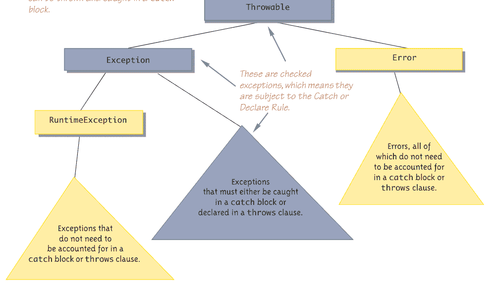

你不必过分担心哪些异常需要声明在`throws`子句中，哪些不需要。如果你未能处理某个 Java 要求你处理的异常，编译器会告诉你，然后你可以选择捕获它或在`throws`子句中声明它。

### 派生类中的 throws 子句

当你在派生类中重写一个方法定义时，其`throws`子句中列出的异常类应与基类中相同，或者其`throws`子句中的异常应是基类`throws`子句中异常的一个子集。换句话说，当你重写一个方法定义时，你不能在`throws`子句中添加任何异常（但你可以删除一些异常。你也可以用任何派生异常类替换一个异常类）。这是有道理的，因为派生类的对象可以在任何可以使用基类对象的地方使用，因此重写的方法必须能够适应为基类对象编写的任何代码。

### 何时使用异常

到目前为止，我们的大多数异常处理示例都过于简单。关于如何使用异常的一个更好的指导原则是，将抛出异常和捕获异常分离到不同的方法中。在大多数情况下，你应该将`throw`语句包含在一个方法定义中，在该方法的`throws`子句中列出异常类，并将`try`和`catch`块放在*一个不同的方法*中。概括来说，该技术如下所示：

```java
public void yourMethod() throws YourException
{
    ...
    throw new YourException(<Maybe an argument.>);
    ...
}
```

然后，当`yourMethod`被某个`otherMethod`使用时，`otherMethod`必须处理该异常。例如：

```java
public void otherMethod()
{
    ...
    try
    {
        ...
        yourMethod();
        ...
    }
    catch(YourException e)
    {
        <Handle exception.>
    }
    ...
}
```

即使是这种使用`throw`语句的方式，也应该保留给不可避免的情况。*如果你可以轻松地用其他方式处理问题，就不要抛出异常。将`throw`语句保留用于异常情况的处理方式取决于方法的使用方式和调用位置的情况。* 如果异常情况的处理方式取决于方法的调用方式和调用位置，那么最好的做法是让调用该方法的程序员来处理异常。在所有其他情况下，最好避免抛出异常。让我们概述一个此类情况的示例场景。

假设你正在编写一个用于医院患者监测系统的方法库。其中一个方法可能通过访问某个文件中的患者记录，将每日平均体温计算出来，即把体温总和除以测量次数。现在假设这些方法被用于为不同情况创建不同的系统。如果患者的体温从未被测量过，因此计算平均值将涉及除以零，该怎么办？在重症监护室，这可能表明出现了非常严重的问题。因此，对于该系统，当可能发生除以零的情况时，应该发出紧急信息。然而，对于用于不太紧急环境（如门诊护理甚至某些非关键病房）的系统，这种情况可能无关紧要，因此在患者记录中添加一个简单的注释就足够了。在这种情况下，进行体温平均计算的方法应该在发生除以零时抛出一个异常，在`throws`子句中列出该异常，并让每个系统以适合该系统的方式处理异常情况。

> **何时抛出异常**
> 
> 异常应保留用于方法具有特殊情况且方法的不同调用方式会以不同方式处理该情况的情况。在这种情况下，你应该在方法定义中抛出异常，而不是在方法中捕获异常，而是在方法的`throws`子句中列出该异常。这样，调用该方法的程序员就可以在不同情况下以不同方式处理该异常。

### 事件驱动编程 ☆

异常处理是我们对一种称为事件驱动编程的编程方法的首个示例。在事件驱动编程中，对象被定义为向处理事件的其他对象发送事件（事件本身也是对象）。发送事件被称为触发事件。在异常处理中，事件对象就是异常对象。它们由对象触发（抛出），当对象调用一个抛出异常的方法时。一个异常事件被发送到一个`catch`块进行处理。当然，`catch`块并不完全是一个对象，但其思想是相同的。此外，我们的程序将事件驱动编程（异常处理）与更传统的编程技术混合使用。当我们研究如何使用 Swing 库构建窗口系统（第 17 章）时，你将看到以事件驱动编程为主导技术的编程示例。

## 自我测验练习

22. 下列程序的输出是什么？

```java
public class Exercise
{
    public static void main(String[] args)
    {
        try
        {
            System.out.println("Trying");
            sampleMethod(98.6);
            System.out.println("Trying after call.");
        }
        catch(Exception e)
        {
            System.out.println("Catching.");
        }
        System.out.println("End program.");
    }

    public static void sampleMethod(double test) throws Exception
    {
        System.out.println("Starting sampleMethod.");
        if (test < 100)
            throw new Exception();
    }
}
```

`Exercise`类在随本教材附带的 CD 上。

23. 假设在自我测验练习 22 中，`try`块中的这一行

```java
sampleMethod(98.6);
```

被改为

```java
sampleMethod(212);
```

这将如何影响输出？

## 9.3 异常处理的更多编程技巧

> “仅在特殊情况下使用此方法。”——Warren Peace，《中尉的工具》

在本节中，我们将介绍一些关于在 Java 中使用异常处理进行编程的更精细的要点。

### 陷阱：嵌套的 try-catch 块

你可以将一个`try`块及其后的`catch`块放置在更大的`try`块内或更大的`catch`块内。在极少数情况下这可能有用，但几乎总是更好的做法是将内部的`try-catch`块放在一个方法定义中，并将对该方法的调用放在外部的`try`或`catch`块中（或者可能只是完全移除一个或多个`try`块）。

如果你将一个`try`块及其后的`catch`块放置在更大的`catch`块内，你需要为内部和外部块中的`catch`块参数使用不同的名称。这与 Java 处理任何类型的嵌套块的方式有关。请记住，`try`块和`catch`块都是块。

如果你将一个`try`块及其后的`catch`块放置在更大的`try`块内，并且一个异常在内部`try`块中被抛出但没有在内部`catch`块中被捕获，那么该异常会被抛出到外部的`try`块进行处理，并可能在其某个`catch`块中被捕获。

### finally 块

`finally`块包含无论`try`块中是否抛出异常都会执行的代码。如果使用`finally`块，它应放在`try`块及其后的`catch`块之后。一般语法如下：

```java
try
{
    ...
}
catch(ExceptionClass1 e)
{
    ...
}
.
.
.
catch(ExceptionClassLast e)
{
    ...
}
finally
{
    <无论是否抛出或捕获异常，都将执行的代码。>
}
```

现在，假设`try-catch-finally`块位于一个方法定义内部。（毕竟，每组`try-catch-finally`块都在某个方法内部，即使只是`main`方法。）当`try-catch-finally`块中的代码运行时，有三种可能性：

1. `try`块运行到最后且没有抛出异常。在这种情况下，`finally`块在`try`块之后执行。
2. 异常在`try`块中被抛出，并在`try`块之后的某个`catch`块中被捕获。在这种情况下，`finally`块在`catch`块执行之后执行。
3. 异常在`try`块中被抛出，且该方法中没有匹配的`catch`块来捕获该异常。在这种情况下，方法调用结束，异常对象被抛出到封闭方法。但是，`finally`块在方法结束之前执行。请注意，你无法仅通过将代码放在`catch`块之后来处理最后这种情况。

### 重新抛出异常

一个`catch`块可以包含抛出异常的代码。在极少数情况下，你可能会发现捕获一个异常然后根据`getMessage`产生的字符串或其他情况，决定抛出相同或不同的异常以便在异常处理链的更高层进行处理是有用的。

## 自我测验练习

27. 你能否在一个更大的`try`块内放置一个`try`块及其对应的`catch`块？

28. 你能否在一个更大的`catch`块内放置一个`try`块及其对应的`catch`块？

29. 下列程序的输出是什么？如果`exerciseMethod`的参数是 -42 而不是 42，输出会是什么？（`NegativeNumberException`类在展示 9.8 中定义，但你不需要回顾该定义就能完成此练习。）

```java
public class FinallyDemo
{
    public static void main(String[] args)
    {
        try
        {
            exerciseMethod(42);
        }
        catch(Exception e)
        {
            System.out.println("Caught in main.");
        }
    }
    public static void exerciseMethod(int n) throws Exception
    {
        try
        {
            if (n > 0)
                throw new Exception();
            else if (n < 0)
                throw new NegativeNumberException();
            else
                System.out.println("No Exception.");
            System.out.println("Still in sampleMethod.");
        }
        catch(NegativeNumberException e)
        {
            System.out.println("Caught in sampleMethod.");
        }
        finally
        {
            System.out.println("In finally block.");
        }
        System.out.println("After finally block.");
    }
}
```

`FinallyDemo`类在随本教材附带的 CD 上。

### AssertionError 类

当我们在第 3 章讨论`assert`运算符和断言检查时，我们说过，如果你的程序包含一个断言检查并且该检查失败，你的程序将以一条错误消息结束。这个说法或多或少是正确的，但并不完整。实际发生的是，会抛出一个`AssertionError`类的对象。如果它没有在`catch`块中被捕获，你的程序将以一条错误消息结束。然而，如果你愿意，你可以在`catch`块中捕获它，尽管这并不是一个非常常见的做法。`AssertionError`类在`java.lang`包中，因此不需要`import`语句。

顾名思义，`AssertionError`类派生自`Error`类，因此你不需要在`catch`块中捕获它或在`throws`子句中声明它。

### 使用 Scanner 类进行异常处理

当从键盘读取整数值时，我们一直在使用`Scanner`类的`nextInt`方法。我们说过，如果用户输入的不是格式正确的整数值，那么你的程序将以一条错误消息结束。就其所述而言这是正确的，但完整的细节是，如果用户输入的不是格式正确的整数值，将抛出一个`InputMismatchException`类型的异常。如果该异常未被捕获，你的程序将以一条错误消息结束。但是，你可以捕获该异常，并在`catch`块中提供替代操作的代码，例如要求用户重新输入。`InputMismatchException`是`RuntimeException`的派生类，因此你不需要通过在`catch`块中捕获它或在`throws`子句中声明它来处理`InputMismatchException`。但是，允许你在`catch`块中捕获`InputMismatchException`，这有时可能很有用。

`InputMismatchException`位于标准 Java 包`java.util`中，因此如果你的程序提及`InputMismatchException`，那么它需要一个`import`语句，如下所示：

```java
import java.util.InputMismatchException;
```


`Display 9.11`包含了一个如何有效地捕获`InputMismatchException`的示例。该程序从键盘获取一个整数输入值，然后除了回显该输入值外不做任何其他操作。但是，你可以使用这样的代码为任何使用键盘输入的程序提供健壮的输入。以下技巧解释了我们在`Display 9.11`中为循环使用的一般技术。

### 技巧：异常控制循环

有时当抛出异常时（例如，由于格式错误的输入而抛出`InputMismatchException`），你希望你的代码简单地重复某些代码，以便用户（或其他来源）可以在第二次或后续尝试中正确操作。一种设置代码以在每次抛出特定异常时重复循环的方法如下：

```java
boolean done = false;

while (! done)
{
    try
    {
        <可能在Exception_Class类中抛出异常的代码。>
        done = true; //将结束循环。
        <可能还有更多代码。>
    }
    catch(Exception_Class e)
    {
        <某些代码。>
    }
}
```

请注意，如果异常在`try`块的第一段代码中被抛出，那么`try`块会在将`done`设置为`true`的那一行执行之前结束，因此循环体会被重复。如果没有抛出异常，则`done`被设置为`true`，循环体不会被重复。

`Display 9.11`包含了一个此类循环的示例。对此概要进行细微调整可以适应一系列不同的情况，对于这些情况，你希望在抛出异常时重复代码。

### 显示 9.11 一个异常控制的循环

```java
import java.util.Scanner;
import java.util.InputMismatchException;

public class InputMismatchExceptionDemo {
    public static void main(String[] args) {
        Scanner keyboard = new Scanner(System.in);
        int number = 0; //为让编译器满意而设
        boolean done = false;

        while (! done) {
            try {
                System.out.println("Enter a whole number:");
                number = keyboard.nextInt();
                done = true;
            } catch (InputMismatchException e) {
                keyboard.nextLine();
                System.out.println("Not a correctly written whole number.");
                System.out.println("Try again.");
            }
        }

        System.out.println("You entered " + number);
    }
}
```

> 如果`nextInt`抛出异常，`try`块就会结束，因此布尔变量`done`不会被设置为`true`。

## 示例对话

```text
Enter a whole number:

forty two

Not a correctly written whole number.

Try again.

Enter a whole number:

fortytwo

Not a correctly written whole number.

Try again.

Enter a whole number:

42

You entered 42
```

## 自测练习

30. 如果你从`catch`块中省略以下代码行，显示 9.11 中的对话会如何变化？（试一试看结果。）

```java
keyboard.nextLine();
```

31. 使用显示 9.11 中给出的技术，为以下方法提供定义。

```java
/**
前提条件：keyboard 是一个为键盘输入设置好的 Scanner 类对象（正如我们一直以来所做的那样）。
返回值：在键盘输入的一个 int 值。如果用户输入了格式不正确的输入，系统会提示他或她重新输入该值。
*/
public static int getInt(Scanner keyboard)
```

## ArrayIndexOutOfBoundsException

在阅读这个简短的小节之前，你应该先阅读第 6 章的第 6.1 节，其中涵盖了数组基础知识。如果你还没有学完第 6 章的部分内容，可以跳过本节，以后再回来学习。

如果你的程序试图使用一个超出边界的数组索引，就会抛出一个`ArrayIndexOutOfBoundsException`，并且你的程序会结束，除非该异常在`catch`块中被捕获。`ArrayIndexOutOfBoundsException`是`RuntimeException`类的子类，因此不需要被捕获或在`throws`子句中处理。这类异常通常表示你的代码存在问题，意味着你需要修复代码，而不是捕获异常。因此，`ArrayIndexOutOfBoundsException`通常更像是一个运行时错误消息，而不是一个常规异常。

`ArrayIndexOutOfBoundsException`位于标准 Java 包`java.lang`中，因此如果你决定按名称使用它，则不需要`import`语句。

## 章节总结

- 异常处理允许你将程序的正常情况设计和编码，与处理异常情况的代码分开。
- 异常可以在`try`块中抛出。或者，异常也可以在不包含`try`块（或不包含用于捕获该类型异常的`catch`块）的方法定义中抛出。在这种情况下，该方法的调用可以放在一个`try`块中。
- 异常在`catch`块中被捕获。
- 一个`try`块必须后跟至少一个`catch`块，并且可以后跟多个`catch`块。如果有多个`catch`块，应始终将更具体的异常类的`catch`块列在更通用的异常类的`catch`块之前。
- 异常的最佳用法是在方法中抛出异常（但不在该方法中捕获它），但仅在该异常的处理方式因方法的不同调用而异时才这样做。很少有其他情况能从抛出异常中受益。
- 如果异常在方法中被抛出但未在该方法中被捕获，那么如果该异常不是`RuntimeException`类的子类（也不是`Error`类的子类），则必须在该方法的`throws`子句中列出该异常类型。

## 自测练习答案

1. 进入`Try`块。

   Over 30.

   进入`catch`块之后。

2. 输出将是：

   `Try`块已进入。

   Under 30.

   进入`catch`块之后。

3. 有两个`throw`语句：

```java
throw new Exception("Over 30.");
throw new Exception("Under 30.");
```

4. 当执行`throw`语句时，就是包含它的`try`块的结束。`try`块中的其他语句都不会被执行，控制权传递给后续的`catch`块。当我们说控制权传递给后续的`catch`块时，我们的意思是，抛出的异常对象被插入到`catch`块的参数中，并且`catch`块中的代码被执行。

5.

```java
try {
    System.out.println("Try block entered.");
    if (waitTime > 30)
        throw new Exception("Over 30.");
    else if (waitTime < 30)
        throw new Exception("Under 30.");
    else
        System.out.println("No exception.");
    System.out.println("Leaving try block.");
}
```

6.

```java
catch(Exception thrownObject) {
    System.out.println(thrownObject.getMessage());
}
```

7. `thrownObject`

8. 是，它是合法的。

9. 是，它是合法的。

10.

```java
public class PowerFailureException extends Exception {
    public PowerFailureException() {
        super("Power Failure!");
    }

    public PowerFailureException(String message) {
        super(message);
    }
}
```

11.

```java
public class TooMuchStuffException extends Exception {
    public TooMuchStuffException() {
        super("Too much stuff!");
    }

    public TooMuchStuffException(String message) {
        super(message);
    }
}
```

12. `ExerciseException`带参数调用。

Do Be Do

13.

```text
Test exception thrown!!

Test Exception thrown!

Message is Test exception thrown!
```

14. 进入`try`块：

```text
MyException: Hi Mom!
```

示例结束。

15. 输出将是相同的。

16. 输出将是：

```text
进入 try 块：

Leaving try block.

示例结束。
```

17.

```text
41.9

DoubleException thrown!
```

18. 是，你可以将一个异常类定义为`IOException`类的派生类。

19. 第二个`catch`块。

练习结束。

20. 输出将是：

```text
第一个 catch 块。

练习结束。
```

21. 输出将是：

```text
Bingo!

练习结束。
```

22.

```text
Trying

Starting sampleMethod.

Catching.

程序结束。
```

23. 输出将是：

```java
Trying
Starting sampleMethod.
Trying after call.
程序结束。
```

24.

```java
public static void doStuff(int n) throws Exception {
    if (n < 0)
        throw new Exception("Negative number.");
}
```

25. 如果一个方法抛出一个异常，并且该异常没有在方法内部被捕获，那么在异常被抛出后，方法调用会立即结束。如果方法调用在一个`try`块内部，那么异常会被抛出给一个匹配的`catch`块（如果有的话）。如果没有匹配的`catch`块，那么一旦该异常被抛出，方法调用就会结束。

26. 它可能在方法 B 中被捕获。如果它没有在方法 B 中被捕获，它可能在方法 C 中被捕获。如果它没有在方法 C 中被捕获，它可能在方法 C 之外被捕获。

27. 是，你可以在另一个更大的`try`块内部放置一个`try`块和相应的`catch`块。

28. 是，你可以在另一个更大的`catch`块内部放置一个`try`块和相应的`catch`块。

29. 在`finally`块中。

```text
Caught in main.
```

如果`sampleMethod`的参数是 -42 而不是 42，输出将是：

```text
Caught in sampleMethod.
In finally block.
After finally block.
```

30. 假设输入的第一项不是正确格式的`int`值，程序在读取第一项输入后将进入无限循环。屏幕将持续输出输入数字的提示。问题在于，除非换行符`'\n'`被读取，否则程序将继续尝试读取第一行输入，从而不断读入空字符串。

31. 以下是一个嵌入测试程序中的方法定义。该程序将产生与显示 9.11 中相同的对话。该程序包含在本书附带的 CD 中。

```java
import java.util.Scanner;
import java.util.InputMismatchException;
```

## 自测练习答案

```java
public class getIntDemo
{
    /**
    前置条件：keyboard是一个已设置好键盘输入的Scanner类对象（正如我们一直所做的那样）。
    返回：在键盘输入的一个整数值。
    如果用户输入的格式不正确，系统将提示其重新输入该值。
    */
    public static int getInt(Scanner keyboard)
    {
        int number = 0; //确保编译器不会报错
        boolean done = false;

        while (! done)
        {
            try
            {
                System.out.println("Enter a whole number:");
                number = keyboard.nextInt();
                done = true;
            }
            catch(InputMismatchException e)
            {
                keyboard.nextLine();
                System.out.println(
                    "Not a correctly written whole number.");
                System.out.println("Try again.");
            }
        }

        return number;
    }

    public static void main(String[] args)
    {
        Scanner keyboardArg = new Scanner(System.in);
        int number = getInt(keyboardArg);
        System.out.println("You entered " + number);
    }
}
```

## 编程项目

许多编程项目可以使用 AW 的`CodeMate`来完成。

访问地址：`www.aw-bc.com/codemate`。

1. 编写一个程序计算`N`个整数的平均值。程序应提示用户输入`N`的值，然后输入所有`N`个数。如果用户输入的`N`值非正，则应抛出（并捕获）一个异常，消息为`"N must be positive."`。如果在输入这`N`个数的过程中出现任何异常，则应显示错误信息，并提示用户重新输入该数。

2. 以下是一段输入两个整数并相除的代码片段：

```java
Scanner scan = new Scanner(System.in);
int n1, n2;
double r;

n1 = scan.nextInt();
n2 = scan.nextInt();
r = (double) n1 / n2;
```

将此代码放入一个带有多个`catch`子句的`try-catch`块中，以便在尝试除以零或用户输入文本数据而非整数（`java.util.InputMismatchException`）时打印不同的错误消息。如果发生其中任何一种情况，程序应循环返回，让用户输入新数据。

3. 修改上一个练习，将代码片段放在一个方法内。该方法应命名为`ReturnRatio`，从键盘读取输入，并为除零或文本与整数输入不匹配抛出不同的异常。为你自己的除零异常创建一个异常类。从你的`main`方法调用`ReturnRatio`，并在`main`中捕获异常。如果发生任何异常，`main`方法应再次调用`ReturnRatio`方法。

4. （这是第 5 章一个练习的版本）。第 5 章的编程项目 2 要求你创建一个名为`Fraction`的类。该类用于表示两个整数的比率。它应包含允许用户设置分子和分母的修改器函数，以及一个将分数显示为比率（例如，5/9）的方法。修改该类，使其在分母设置为零时抛出`DenominatorIsZeroException`异常。不要忘记处理构造函数！你将需要创建`DenominatorIsZeroException`类，它应派生自`Exception`。

编写一个`main`方法来测试新的`Fraction`类，尝试将分母设置为零，并捕获`DenominatorIsZeroException`异常。


5. 编写一个程序，将日期从数字月/日/年格式转换为正常的“月 日，年”格式（例如，12/25/2000 对应于 December 25, 2000）。你需要定义三个异常类，一个叫做 `MonthException`，另一个叫做 `DayException`，第三个叫做 `YearException`。如果用户输入的不是合法的月份数字（1到12的整数），你的程序将抛出并捕获一个 `MonthException`，并要求用户重新输入月份。类似地，如果用户输入的不是有效的日期数字（根据月份和年份，1到28、29、30或31的整数），那么你的程序将抛出并捕获一个 `DayException`，并要求用户重新输入日期。如果用户输入的年份不在1000到3000（包含）的范围内，那么你的程序将抛出并捕获一个 `YearException`，并要求用户重新输入年份。（1000和3000这两个数字本身没有什么特别之处，只是为了给出一个合理的可能日期范围。）关于闰年的详细信息，请参阅第4章的自测练习19。

6. 编写一个可以充当简单计算器的程序。该计算器跟踪一个数字（`double` 类型），称为 `result`，初始值为0.0。每个周期允许用户重复地加、减、乘或除以第二个数字。其中一个操作的结果成为 `result` 的新值。当用户输入字母 `R` 表示“结果”（大写或小写均可）时，计算结束。用户可以随时从头开始进行另一次计算。

输入格式如下所示的对话示例所示。如果用户输入的运算符符号不是 `+`、`−`、`*` 或 `/`，则会抛出 `UnknownOperatorException` 异常，并要求用户重新输入该行输入。定义 `UnknownOperatorException` 类是这个项目的一部分。

```text
Calculator is on.
result = 0.0
+5
result + 5.0 = 5.0
new result = 5.0
*2.2
result * 2.2 = 11.0
updated result = 11.0
% 10
% is an unknown operation.
Reenter, your last line:
* 0.1
result * 0.1 = 1.1
updated result = 1.1
r
Final result = 1.1
Again? (y/n)
yes
result = 0.0
+10
result + 10.0 = 10.0
new result = 10.0
/2
result / 2.0 = 5.0
updated result = 5.0
r
Final result = 5.0
Again? (y/n)
N
End of Program
```

# 第10章 文件输入/输出

## 目录

- 10.1 文件输入/导出简介 574
  - 流 575
  - 文本文件与二进制文件 575
- 10.2 文本文件 576
  - 写入文本文件 576
  - 向文本文件追加内容 583
  - 从文本文件读取 586
  - 使用 `Scanner` 读取文本文件 586
  - 使用 `Scanner` 测试文本文件末尾 589
  - 使用 `BufferedReader` 读取文本文件 597
  - 使用 `BufferedReader` 测试文本文件末尾 602
  - 路径名 604
  - 嵌套构造函数调用 605
  - `System.in`、`System.out` 和 `System.err` 606
- 10.3 `File` 类 609
  - 使用 `File` 类编程 609
- 10.4 二进制文件 614
  - 将简单数据写入二进制文件 614
  - UTF 与 `writeUTF` 619
  - 从二进制文件读取简单数据 620
  - 检查二进制文件末尾 625
  - 对象的二进制 I/O 626
  - `Serializable` 接口 631
  - 二进制文件中的数组对象 632
- 10.5 二进制文件的随机访问 632
  - 读写同一文件 634
- 章节总结 640
- 自测练习答案 641
- 编程项目 645

# 文件输入/输出

> 正如叶子被溪流携带，无论溪流最终汇入湖泊还是大海，你的程序的输出也被流所携带，不知道这流是流向屏幕还是流向文件。
>
> ——计算机科学系洗手间墙壁（1995）

## 简介

在本章中，我们将解释如何编写程序以从文件获取输入并将输出发送到文件。本章涵盖了 Java 中文件 I/O 最常见的方法。然而，它并非对 Java I/O 类的详尽研究。Java I/O 类库包含数量惊人得多的类，对所有类进行详尽论述本身就将成为一本书。

## 前置知识

阅读本章，你只需要掌握第9章异常处理的部分内容。你不需要第6、7或8章关于数组、继承和多态的知识，除非是最后一节，该节涵盖了向二进制文件写入和读取数组。如果你尚未涵盖一维数组的一些基础知识，当然可以简单地跳过这最后一节。

如果你愿意，可以推迟阅读本章的全部或部分内容。本书其余部分的内容不依赖于本章的任何内容。

## 10.1 文件 I/O 简介

> 天哪！四十多年来，我一直在说散文而自己却不知道。
>
> ——莫里哀，《贵人迷》

在这一节中，我们将在介绍任何 Java 细节之前，先介绍一些关于文件 I/O 的基本概念。

### 流（Streams）

流是一种对象，用于实现你的程序与某个 I/O 设备或文件之间的数据流动。如果数据流入你的程序，该流称为**输入流**。如果数据流出你的程序，则称为**输出流**。如果输入流来自键盘，你的程序将从键盘获取输入；如果输入流来自文件，程序则从该文件获取输入。类似地，输出流可以流向屏幕或文件。

尽管你可能未曾意识到，但你已经在程序中使用过流了。你已使用的 `System.out`（例如在 `System.out.println` 中）就是一个连接到屏幕的输出流。`System.in` 则是连接到键盘的输入流。你在类似下面的表达式中使用过 `System.in`：

```java
Scanner keyboard = new Scanner(System.in);
```

这两个流会自动对你的程序可用。你还可以定义来自文件或流向文件的其他流。一旦定义完成，就可以在程序中以类似使用 `System.out` 和 `System.in` 的方式来使用它们。

流是数据的流动。如果数据*流入你的程序*，该流称为输入流；如果数据*流出你的程序*，则称为输出流。

流既用于你一直在使用的**控制台 I/O**，也用于**文件 I/O**。

### 文本文件与二进制文件

在文本编辑器中查看或由程序读取时，**文本文件**表现为一系列字符序列。例如，包含你 Java 程序的文件就是文本文件。文本文件有时也称为 ASCII 文件，因为它们包含使用称为 ASCII 编码的方案编码的数据。内容必须作为二进制数字序列处理的文件称为**二进制文件**。

虽然严格来说并不完全准确，但你可以安全地将文本文件理解为包含字符序列，将二进制文件理解为包含二进制数字序列。另一种区分二进制文件和文本文件的方法是：文本文件设计为供人类阅读，而二进制文件则仅设计为由程序读取。

文本文件的一个优点是它们通常在所有计算机上保持一致，因此你可以将文本文件从一台计算机轻松转移到另一台，几乎没有或完全没有问题。二进制文件的实现通常因计算机而异，因此你的二进制数据文件通常只能在创建它的同类型计算机上，使用相同的编程语言读取。

二进制文件的优点是其处理效率高于文本文件。与其他编程语言不同，Java 还赋予其二进制文件一些文本文件的优势。特别是，Java 二进制文件具有**平台无关性**；也就是说，使用 Java，你可以将二进制文件从一种类型的计算机转移到另一种，而你的 Java 程序仍然能够读取这些二进制文件。这结合了文本文件的可移植性和二进制文件的高效性。

文本文件的一个主要优点是你可以使用文本编辑器读写它们。而对于二进制文件，所有的读写通常必须由程序完成。

**文本文件与二进制文件**

使用编辑器读写的文件称为*文本文件*。二进制文件以一种不方便用文本编辑器阅读的方式表示数据，但可以非常高效地由程序读写。

### 自测练习

- 流是数据的流动。在输入流中，数据从哪里流向哪里？在输出流中，数据又从哪里流向哪里？
- 二进制文件和文本文件有什么区别？

## 10.2 文本文件

> 波洛涅斯：殿下在读些什么书？
>
> 哈姆雷特：字句，字句，字句。
>
> ——威廉·莎士比亚，《哈姆雷特》

在本节中，我们将描述在 Java 中进行文本文件 I/O 最常见的方法。

### 写入文本文件

`PrintWriter` 类是写入文本文件的首选流类。`PrintWriter` 类的对象具有 `print` 和 `println` 方法，类似于你一直在屏幕输出中使用的 `System.out.print` 和 `System.out.println` 方法，但使用 `PrintWriter` 类的对象时，输出会发送到文本文件。

显示 10.1 包含一个使用 `PrintWriter` 将输出发送到文本文件的简单程序。让我们看看该程序的细节。

我们在本章介绍的所有与文件 I/O 相关的类都在 `java.io` 包中，因此我们所有的程序文件都以类似于显示 10.1 中的导入语句开头。

显示 10.1 中的程序创建了一个名为 `stuff.txt` 的文本文件，人们可以使用编辑器阅读，或者另一个 Java 程序也可以读取。该程序如下创建一个 `PrintWriter` 类的对象：

```java
outputStream =
    new PrintWriter(new FileOutputStream("stuff.txt"));
```

变量 `outputStream` 的类型为 `PrintWriter`，并在 `try` 块外部声明。前面的两行代码将名为 `outputStream` 的流连接到名为 `stuff.txt` 的文件。这称为**打开文件**。当你以这种方式将文件连接到流时，你的程序总是从一个空文件开始。如果文件 `stuff.txt` 已经存在，其旧内容将被丢失。如果文件 `stuff.txt` 不存在，则会创建一个名为 `stuff.txt` 的新空文件。

我们希望将输出流 `outputStream` 与名为 `stuff.txt` 的文件关联起来。然而，`PrintWriter` 类没有接受文件名作为其参数的构造函数。因此我们使用 `FileOutputStream` 类创建一个流，该流可以用作 `PrintWriter` 构造函数的参数。表达式

```java
new FileOutputStream("stuff.txt")
```

接受一个文件名作为参数，并创建一个 `FileOutputStream` 类的匿名对象，然后将其用作 `PrintWriter` 类的构造函数参数，如下所示：

```java
new PrintWriter(new FileOutputStream("stuff.txt"))
```

这会产生一个连接到文件 `stuff.txt` 的 `PrintWriter` 类的对象。注意，在这种情况下，文件名是以 `String` 值给出的，因此用引号括起来。

如果你想从键盘读取文件名，你可以将该名称读取到一个 `String` 类型的变量中，并使用该 `String` 变量作为 `FileOutputStream` 构造函数的参数。

以刚才讨论的方式打开文本文件时，可能会抛出 `FileNotFoundException`，任何此类可能的异常都应在 `catch` 块中捕获。（实际上，是 `FileOutputStream` 构造函数可能抛出 `FileNotFoundException`，但最终效果是相同的。）

注意显示 10.1 中的 `try` 块只包含文件的打开操作。这是唯一可能抛出异常的地方。还要注意，变量 `outputStream` 是在 `try` 块外部声明的。这是为了让变量 `outputStream` 可以在 `try` 块外部使用。记住，在块内（即使在 `try` 块内）声明的任何内容都是该块的局部变量。

### 显示 10.1 将输出发送到文本文件

```java
1   import java.io.PrintWriter;
2   import java.io.FileOutputStream;
3   import java.io.FileNotFoundException;
4
5   public class TextFileOutputDemo
6   {
7       public static void main(String[] args)
8       {
9           PrintWriter outputStream = null;
10          try
11          {
12              outputStream =
13                  new PrintWriter(new FileOutputStream("stuff.txt"));
14          }
15          catch(FileNotFoundException e)
16          {
17              System.out.println("Error opening the file stuff.txt.");
18              System.exit(0);
19          }
20
21          System.out.println("Writing to file.");
22
23          outputStream.println("The quick brown fox");
24          outputStream.println("jumped over the lazy dog.");
25
26          outputStream.close();
27
28          System.out.println("End of program.");
29      }
30  }
```

## 示例对话

Writing to file.

End of program.

File `stuff.txt` (after the program is run.)

```text
The quick brown fox
jumped over the lazy dog.
```

*你可以使用文本编辑器读取此文件。*

### 打开文本文件以写入输出

您可以按照如下方式创建 `PrintWriter` 类的流，并将其连接到文本文件以进行写入：

#### 语法

```java
PrintWriter 输出流名称;
输出流名称 =
    new PrintWriter(new FileOutputStream(文件名称));
```

#### 示例

```java
PrintWriter outputStream = null;
outputStream =
    new PrintWriter(new FileOutputStream("stuff.txt"));
```

此后，您就可以使用 `println` 和 `print` 方法向文件写入内容。

以这种方式使用时，`FileOutputStream` 构造函数，也就是 `PrintWriter` 构造函数的调用，可能会抛出 `FileNotFoundException`，这是 `IOException` 的一种。

### 文件名

如何拼写文件名的规则取决于您的操作系统，而不是 Java。当您为 Java 流构造函数提供文件名时，您并不是在提供一个 Java 标识符。您提供给构造函数的是一个与文件名对应的字符串。后缀，例如 `stuff.txt` 中的 `.txt`，对 Java 程序没有特殊意义。我们使用 `.txt` 后缀来表示文本文件，但这只是一种常见的约定。您可以使用操作系统允许的任何文件名。

### 一个文件有两个名称

您的程序使用的每个输入文件和每个输出文件都有两个名称：

1. 操作系统使用的真实文件名；
2. 连接到该文件的流的名称。

流名称用作文件的临时名称，并且是您的程序中主要使用的名称。在您将文件连接到流之后，您的程序总是通过流名称来引用该文件。

我们说过，当您打开一个文本文件以写入输出时，构造函数可能会抛出 `FileNotFoundException`。但在这种情况下，您是想创建一个用于输出的新文件，那您为什么会关心文件未找到呢？答案很简单，因为这个异常命名不当。`FileNotFoundException` 并不意味着文件未找到。在这种情况下，它实际上意味着文件无法创建。如果无法创建文件——例如，因为文件名已被用作目录（文件夹）名称——就会抛出 `FileNotFoundException`。

`FileNotFoundException` 是 `IOException` 的一种，因此 `IOException` 的 `catch` 块也可以使用，并且看起来更合理。然而，最好捕获您能捕获的最具体的异常，因为这样可以提供更多信息。

如 Display 10.1 所示，`PrintWriter` 类的 `println` 方法在写入文本文件时，其工作方式与 `System.out.println` 写入屏幕时相同。`PrintWriter` 类还有 `print` 和 `printf` 方法，它们的行为与 `System.out.print` 和 `System.out.printf` 相同，只是输出目标是文本文件。Display 10.2 描述了 `PrintWriter` 类中的一些方法。

#### `IOException`

在处理文件 I/O 时，有许多情况下您的代码可能会抛出某个类的异常，例如 `FileNotFoundException`。许多这些不同的异常类都是 `IOException` 类的子类。`IOException` 类是与输入输出相关的各种异常类的根类。

#### 显示 10.2 `PrintWriter` 类的一些方法（第 1 部分，共 2 部分）


`PrintWriter` 和 `FileOutputStream` 位于 `java.io` 包中。

`public PrintWriter(OutputStream streamObject)`

这是您可能需要的唯一构造函数。没有接受文件名作为参数的构造函数。如果您想使用文件名创建一个流，请使用：

```
new PrintWriter(new FileOutputStream(文件名称))
```

当以这种方式使用构造函数时，会创建一个空白文件。如果已经存在一个名为`文件名称`的文件，那么该文件的旧内容将会丢失。如果您想改为将新文本附加到旧文件内容的末尾，请使用：

```
new PrintWriter(new FileOutputStream(文件名称, true))
```

（有关参数`true`的解释，请阅读“附加到文本文件”小节。）

以这两种方式中的任何一种使用时，`FileOutputStream`构造函数，也就是`PrintWriter`构造函数的调用，可能会抛出`FileNotFoundException`，这是`IOException`的一种。

如果您想使用`File`类的对象创建流，您可以使用`File`对象代替`文件名称`。（`File`类将在第 10.3 节中介绍。我们在这里讨论它，以便您在这个 display 中有一个更完整的参考，但在您阅读该节之前，您可以忽略对`File`类的引用。）

#### Display 10.2 `PrintWriter` 类的一些方法（第 2 部分，共 2 部分）

```
public void println(参数)
```

*参数* 可以是字符串、字符、整数、浮点数、布尔值，或者通过`+`号连接的这些类型的任意组合。*参数* 也可以是任何对象，除非该对象有一个正确定义的`toString()`方法，否则它将无法按预期工作。*参数* 被输出到与流连接的文件。*参数* 输出后，行结束，因此下一个输出将被发送到下一行。

```
public void print(参数)
```

这与`println`相同，只是此方法不结束行，因此下一个输出将在同一行上。

```
public PrintWriter printf(参数)
```

这与`System.out.printf`相同，只是此方法将输出发送到文本文件而不是屏幕。它返回调用对象。然而，我们一直将`printf`作为 void 方法使用。

```
public void close()
```

关闭流与文件的连接。此方法在关闭文件前会调用`flush`。

```
public void flush()
```

刷新输出流。这将强制将任何已缓冲但尚未物理写入文件的数据实际物理写入文件。通常，您不需要调用`flush`。

当您的程序完成写入文件时，它应该**关闭**连接到该文件的流。在 Display 10.1 中，连接到文件`stuff.txt`的流通过以下语句关闭：

```
outputStream.close();
```

`PrintWriter`类，以及用于文件输出或文件输入流的每个其他类，都有一个名为`close`的方法。当调用此方法时，系统会释放用于将流连接到文件的任何资源，并执行任何其他需要的管理操作。如果您的程序在结束前没有关闭文件，Java 会在程序结束时为您关闭它，但通过显式调用`close`来关闭文件是最安全的。

连接到文件的输出流通常是缓冲的，这意味着数据不会在物理上尽快写入每个输出实例，而是保存在一个称为缓冲区的临时位置；当在此临时位置积累足够的数据时，它将被物理写入文件。这可以提高效率，因为对文件的物理写入可能很慢。`flush`方法将所有缓冲数据物理写入文件。`close`方法包含了对`flush`方法的调用。

### 关闭文件

当您的程序完成写入文件或从文件读取时，它应该通过调用名为`close`的方法来关闭连接到该文件的流。

```
语法
流对象.close();

示例：
outputStream.close();
inputStream.close();
```

似乎没有理由使用`close`方法来关闭文件。如果您的程序正常结束但没有关闭文件，系统会自动为您关闭它。那么为什么还要费心通过显式调用`close`方法来关闭文件呢？至少有两个原因。首先，如果您的程序异常结束，那么 Java 可能无法为您关闭文件。这可能会损坏文件。特别是，如果它是输出文件，任何缓冲输出都不会被物理写入文件。因此文件将不完整。您越早关闭文件，这种情况发生的可能性就越小。其次，如果您的程序写入一个文件，稍后又从同一个文件读取，它必须在写入文件完成后关闭文件，然后重新打开文件以供读取。（Java 确实有一个类允许文件同时打开用于读写，我们将在第 10.5 节中讨论。）

### 易错点

try 块是一个块

请注意，在 Display 10.1 中，我们在`try`块之外声明了变量`outputStream`。如果您将该声明移动到`try`块内部，您将收到编译器错误消息。让我们看看为什么。

假设您替换：

```
PrintWriter outputStream = null;
try
{
    outputStream =
        new PrintWriter(new FileOutputStream("stuff.txt"));
}
```

### 注意事项（续）

在显示 10.1 中，可以用以下代码替换：

```java
try
{
    PrintWriter outputStream =
        new PrintWriter(new FileOutputStream("stuff.txt"));
}
```

这个替换看起来没什么问题，但它会使变量`outputStream`成为`try`块的局部变量，这意味着你无法在`try`块之外使用`outputStream`。如果你做出这个更改并尝试编译修改后的程序，你会得到一条错误消息，指出在`try`块之外使用的`outputStream`是一个未定义的标识符。

### 注意事项：覆盖输出文件

当你如下面所示将一个流连接到一个文本文件以进行写入时，你总会生成一个空文件：

```java
outputStream =
    new PrintWriter(new FileOutputStream("stuff.txt"));
```

如果不存在名为`stuff.txt`的文件，这将创建一个名为`stuff.txt`的空文件。如果已经存在一个名为`stuff.txt`的文件，那么这将消除该文件并创建一个新的、名为`stuff.txt`的空文件。因此，如果在打开此文件之前存在一个名为`stuff.txt`的文件，那么该文件中的所有数据都将丢失。“File 类”一节告诉你如何测试文件是否已经存在，以便你可以避免意外覆盖文件。以下小节将向你展示如何在不丢失文件中已有数据的情况下向文本文件添加数据。

### 向文本文件追加内容

当你以我们在显示 10.1 中所做的方式打开一个文本文件进行写入，并且具有给定名称的文件已经存在时，旧内容会丢失。然而，有时你希望将程序输出添加到文件末尾。这被称为向文件追加。如果你想将程序输出追加到文件`stuff.txt`，你应该按以下方式将文件连接到流`outputStream`：

```java
outputStream =
    new PrintWriter(new FileOutputStream("stuff.txt", true));
```

如果文件`stuff.txt`尚不存在，Java 将创建一个同名的空文件，并将输出追加到此空文件的末尾。因此，如果没有名为`stuff.txt`的文件，打开文件的效果与显示 10.1 相同。然而，如果文件`stuff.txt`已经存在，那么旧内容将保留，程序的输出将放置在文件旧内容之后。

以这种方式向文本文件追加内容时，你仍然会使用与显示 10.1 相同的`try`和`catch`块。

第二个参数`true`值得稍微解释一下。为什么设计者使用`true`来表示追加？为什么不使用像字符串`"append"`这样的东西？原因是`FileOutputStream`类的这个版本的构造函数被设计为也允许你使用一个布尔变量（或表达式）来决定是追加到现有文件还是创建新文件。例如，以下代码可能被使用：

```java
System.out.println(
    "Enter A for append or N for a new file:");
char answer;
<使用你喜欢的方式将单个字符读入变量 answer。>
boolean append = (answer == 'A' || answer == 'a');
outputStream =
    new PrintWriter(new FileOutputStream("stuff.txt", append));
```

从这一点开始，你的程序写入文件的方式与显示 10.1 中的程序完全相同。如果用户用大写或小写 A 回答，那么任何输入都将添加在旧文件内容之后。如果用户用大写或小写 N（或任何非 A 的字符）回答，那么文件的任何旧内容都将丢失。

#### toString 有助于文本文件输出

在第 4 章中，我们注意到如果一个类有一个合适的`toString()`方法，并且`anObject`是该类的一个对象，那么`anObject`可以作为`System.out.println`的参数，这将产生合理的输出。同样的事情适用于`PrintWriter`类的`println`和`print`方法。`PrintWriter`类的`println`和`print`都可以接受任何对象作为参数，只要该对象有一个合理的`toString()`方法，就会产生合理的输出。

在第 8 章中对此有更详细的讨论，但你不需要阅读第 8 章就可以使用这个事实。

#### 打开文本文件进行追加

要创建一个`PrintWriter`类的对象并将其连接到一个文本文件以追加到文件中文本的末尾，请按如下步骤操作。

**语法**

```java
Output_Stream_Name =
    new PrintWriter(
        new FileOutputStream(File_Name, True_Boolean_Expression));
```

**示例**

```java
PrintWriter outputStream;
outputStream =
    new PrintWriter(new FileOutputStream("stuff.txt", true));
```

在此语句之后，你可以使用`println`和`print`方法写入文件，新文本将写入文件中的旧文本之后。

> （如果你想使用`File`类的对象创建一个流，你可以用一个`File`对象代替`File_Name`。`File`类在标题为“File 类”的章节中讨论。）

以这种方式使用时，`FileOutputStream`构造函数，以及`PrintWriter`构造函数调用，可能会抛出`FileNotFoundException`，这是一种`IOException`。

### 自测练习

3.  以下代码可能会抛出什么类型的异常？如果抛出此异常，它表示什么？

```java
PrintWriter outputStream =
    new PrintWriter(new FileOutputStream("stuff.txt"));
```

4.  `PrintWriter`类是否有一个接受字符串（作为文件名）作为参数的构造函数，使得以下代码合法？

```java
PrintWriter outputStream =
    new PrintWriter("stuff.txt");
```

（续）

5.  编写一些代码，该代码将创建一个名为`outStream`的流，它是`PrintWriter`类的成员，并将此流连接到一个名为`sam`的文本文件，以便你的程序可以向该文件发送输出。请以一种方式执行此操作，使得文件`sam`始终以空开始。因此，如果已经存在一个名为`sam`的文件，`sam`的旧内容将丢失。

6.  与自测练习 5 类似，编写一些代码，该代码将创建一个名为`outStream`的流，它是`PrintWriter`类的成员，并将此流连接到一个名为`sam`的文本文件，以便你的程序可以向该文件发送输出。然而，这次，请以一种方式执行此操作，使得如果文件`sam`已经存在，`sam`的旧内容不会丢失，并且程序输出将写在文件的旧内容之后。

7.  类`Person`在第 5 章的显示 5.19 中已定义。假设`mary`是`Person`类的一个对象，并且假设`outputStream`按显示 10.1 所示连接到一个文本文件。以下代码会向连接到`outputStream`的文件发送合理的输出吗？

```java
outputStream.println(mary);
```

### 从文本文件读取

用于从文本文件读取的两个最常用的流类是`Scanner`类和`BufferedReader`类。我们将讨论这两种从文本文件读取的方法。`Scanner`类提供了一组更丰富的用于从文本文件读取的方法，是我们读取文本文件时首选使用的类。然而，`BufferedReader`类也被广泛使用，并且是一个合理的选择。你或你的讲师需要决定你将使用哪个类。

### 使用 Scanner 读取文本文件

我们用于从键盘读取的同一个`Scanner`类也可以用于从文本文件读取。为此，你需要将`Scanner`构造函数中的参数`System.in`替换为连接到文本文件的合适流。这是*流*概念的一个很好的说明。`Scanner`类并不关心其流参数是来自键盘还是来自文本文件。

在显示 10.3 中说明了使用`Scanner`从文本文件读取的方法，其中包含一个程序，该程序从名为`morestuff.txt`的文本文件中读取三个数字和一行文本，并将它们写回屏幕。文件`morestuff.txt`是一个文本文件，可以是人用文本编辑器创建的，也可以是 Java 程序使用`PrintWriter`创建的。

### 显示 10.3 使用 Scanner 从文本文件读取输入（第 1 部分，共 2 部分）

```java
import java.util.Scanner;
import java.io.FileInputStream;
import java.io.FileNotFoundException;

public class TextFileScannerDemo
{
    public static void main(String[] args)
    {
        System.out.println("I will read three numbers and a line");
        System.out.println("of text from the file morestuff.txt.");

        Scanner inputStream = null;

        try
        {
            inputStream =
                new Scanner(new FileInputStream("morestuff.txt"));
        }
        catch(FileNotFoundException e)
        {
            System.out.println("File morestuff.txt was not found");
            System.out.println("or could not be opened.");
            System.exit(0);
        }
        int n1 = inputStream.nextInt();
        int n2 = inputStream.nextInt();
        int n3 = inputStream.nextInt();

        inputStream.nextLine(); //To go to the next line

        String line = inputStream.nextLine();

        System.out.println("The three numbers read from the file are:");
        System.out.println(n1 + ", " + n2 + ", and " + n3);

        System.out.println("The line read from the file is:");
        System.out.println(line);

        inputStream.close();
    }
}
```

文件`morestuff.txt`：

```
1 2
3 4
Eat my shorts.
```

> 此文件可以是用文本编辑器或另一个 Java 程序创建的。

### 显示 10.3 使用 Scanner 从文本文件读取输入（第 2 部分，共 2 部分）

```
屏幕输出
I will read three numbers and a line
of text from the file morestuff.txt.
The three numbers read from the file are:
1, 2, and 3
The line read from the file is:
Eat my shorts.
```

### 显示 10.4 使用 hasNextLine 检查文本文件末尾（第 1 部分，共 2 部分）


```java
import java.util.Scanner;
import java.io.FileInputStream;
import java.io.FileNotFoundException;
import java.io.PrintWriter;
import java.io.FileOutputStream;

public class HasNextLineDemo
{
    public static void main(String[] args)
    {
        Scanner inputStream = null;
        PrintWriter outputStream = null;

        try
        {
            inputStream =
                new Scanner(new FileInputStream("original.txt"));
            outputStream = new PrintWriter(
                new FileOutputStream("numbered.txt"));
        }
        catch(FileNotFoundException e)
        {
            System.out.println("Problem opening files.");
            System.exit(0);
        }

        String line = null;
        int count = 0;
```

### 显示 10.4 使用 `hasNextLine` 检查文本文件末尾（第 2 部分，共 2 部分）

```java
        while (inputStream.hasNextLine())
        {
            line = inputStream.nextLine();
            count++;
            outputStream.println(count + " " + line);
        }
        inputStream.close();
        outputStream.close();
    }
}
```

文件 `original.txt`：

```
Little Miss Muffet
sat on a tuffet
eating her curves away.
Along came a spider
who sat down beside her
and said "Will you marry me?"
```

文件 `numbered.txt`（程序运行后）：

```
1 Little Miss Muffet
2 sat on a tuffet
3 eating her curves away.
4 Along came a spider
5 who sat down beside her
6 and said "Will you marry me?"
```

### 显示 10.5 使用 `hasNextInt` 检查文本文件末尾

```java
import java.util.Scanner;
import java.io.FileInputStream;
import java.io.FileNotFoundException;
public class HasNextIntDemo
{
    public static void main(String[] args)
    {
        Scanner inputStream = null;
        try
        {
            inputStream =
                new Scanner(new FileInputStream("data.txt"));
        }
        catch(FileNotFoundException e)
        {
            System.out.println("File data.txt was not found");
            System.out.println("or could not be opened.");
            System.exit(0);
        }
        int next, sum = 0;
        while (inputStream.hasNextInt())
        {
            next = inputStream.nextInt();
            sum = sum + next;
        }
        inputStream.close();
        System.out.println("The sum of the numbers is " + sum);
    }
}
```

文件 `data.txt`：

```
1  2
3  4 hi 5
```

当到达文件末尾或遇到不是 `int` 的标记时，读取结束。因此，数字 5 永远不会被读取。

屏幕输出：

```
The sum of the numbers is 10
```

### 显示 10.6 `Scanner` 类中的方法（第 1 部分，共 4 部分）

`Scanner` 位于 `java.util` 包中。

`public Scanner(InputStream streamObject)`

没有接受文件名作为参数的构造函数。如果你想用文件名创建一个流，可以使用：

`new Scanner(new FileInputStream(File_Name))`

以这种方式使用时，`FileInputStream` 构造函数，从而 `Scanner` 构造函数调用，可能会抛出 `FileNotFoundException`，这是一种 `IOException`。

要创建连接到键盘的流，使用：

`new Scanner(System.in)`

`public Scanner(File fileObject)`

`File` 类将在本章后面的标题为“File 类”的部分中介绍。我们在这里讨论它，以便在本显示中为你提供更完整的参考，但你可以忽略此条目，直到阅读该部分之后。

如果你想用文件名创建一个流，可以使用：

`new Scanner(new File(File_Name))`

`public int nextInt()`

将下一个标记作为 `int` 返回，前提是下一个标记是 `int` 的格式良好的字符串表示形式。

如果没有更多标记，则抛出 `NoSuchElementException`。

如果下一个标记不是 `int` 的格式良好的字符串表示形式，则抛出 `InputMismatchException`。

如果 `Scanner` 流已关闭，则抛出 `IllegalStateException`。

`public boolean hasNextInt()`

如果下一个标记是 `int` 的格式良好的字符串表示形式，则返回 true；否则返回 false。

如果 `Scanner` 流已关闭，则抛出 `IllegalStateException`。

`public long nextLong()`

将下一个标记作为 `long` 返回，前提是下一个标记是 `long` 的格式良好的字符串表示形式。

如果没有更多标记，则抛出 `NoSuchElementException`。

如果下一个标记不是 `long` 的格式良好的字符串表示形式，则抛出 `InputMismatchException`。

如果 `Scanner` 流已关闭，则抛出 `IllegalStateException`。

---

程序打开 `Scanner` 流并将其连接到文本文件 `morestuff.txt`，如下所示：

```java
Scanner inputStream = null;
...
inputStream = new Scanner(new FileInputStream("stuff.txt"));
```

`Scanner` 类，像 `PrintWriter` 类一样，没有接受文件名作为其参数的构造函数，因此我们需要使用另一个类——在本例中是 `FileInputStream` 类——将文件名转换为可以作为 `Scanner` 构造函数合适参数的对象。

注意，方法 `nextInt` 和 `nextLine` 从文本文件读取的方式与从键盘读取完全相同。其他用于读取输入的 `Scanner` 方法（在显示 2.6 中给出，并在显示 10.6 中重复）在从文本文件读取时与从键盘读取时的行为也相同。

#### 使用 `Scanner` 打开文本文件进行读取

你创建一个 `Scanner` 类的流并将其连接到文本文件以进行读取，如下所示：

**语法**

`Scanner Stream_Object = new Scanner(new FileInputStream(File_Name));`

**示例**

`Scanner inputStream = new Scanner(new FileInputStream("morestuff.txt"));`

在此语句之后，你可以使用 `nextInt`、`nextDouble`、`nextLine` 等方法从指定的文本文件读取，就像你使用这些方法从键盘读取一样。

以这种方式使用时，`FileInputStream` 构造函数，从而 `Scanner` 构造函数调用，可能会抛出 `FileNotFoundException`，这是一种 `IOException`。

#### `FileNotFoundException`

如果你的程序尝试打开文件进行读取但不存在这样的文件，则会抛出 `FileNotFoundException`。正如你在本章前面看到的，`FileNotFoundException` 也会在某些其他情况下被抛出。`FileNotFoundException` 是一种 `IOException`。

#### 使用 `Scanner` 检查文本文件末尾

当使用 `Scanner` 类时，如果你的程序尝试使用任何输入方法（如 `nextInt` 或 `nextLine`）读取超出文件末尾的内容，则该方法会抛出异常。如果一切顺利且没有问题，例如在输入不是正确形成的 `int` 时使用 `nextInt`，则抛出的异常将是 `NoSuchElementException`。这种 `NoSuchElementException` 的抛出可用于发出输入结束的信号。

但是，有一种更健壮的方法来检查来自文本文件的输入结束。每个输入方法，如 `nextInt` 和 `nextLine`，都有一个对应的方法，如 `hasNextInt` 和 `hasNextLine`，用于检查是否还有适当类型的格式良好的输入。这些方法的好处在于，它们会在因任何原因没有合适的下一个标记时报告；它们不仅仅检查文件末尾。

例如，`hasNextInt` 在没有任何更多文件输入或下一个标记不是格式良好的 `int` 值时返回 false。如果下一个标记是格式良好的 `int`，则返回 true。

一个说明如何使用 `hasNextLine` 检查输入结束的示例程序在显示 10.4 中给出。一个说明如何使用 `hasNextInt` 检查输入结束的示例程序在显示 10.5 中给出。`Scanner` 类中一些方法的摘要在显示 10.6 中给出。

#### 使用 `Scanner` 检查文本文件末尾

你可以使用 `hasNextInt`、`hasNextLine` 等方法来检查输入结束。

590 第 10 章 文件 I/O

### 显示 10.6 `Scanner` 类中的方法（第 2 部分，共 4 部分）

```
public boolean hasNextLong()
如果下一个标记是格式正确的 long 字符串表示形式，则返回 true；否则返回 false。
如果 Scanner 流已关闭，则抛出 IllegalStateException。
```

```
public byte nextByte()
将下一个标记作为 byte 返回，前提是下一个标记是格式正确的 byte 字符串表示形式。
如果没有更多标记，则抛出 NoSuchElementException。
如果下一个标记不是格式正确的 byte 字符串表示形式，则抛出 InputMismatchException。
如果 Scanner 流已关闭，则抛出 IllegalStateException。
```

```
public boolean hasNextByte()
如果下一个标记是格式正确的 byte 字符串表示形式，则返回 true；否则返回 false。
如果 Scanner 流已关闭，则抛出 IllegalStateException。
```

```
public short nextShort()
将下一个标记作为 short 返回，前提是下一个标记是格式正确的 short 字符串表示形式。
如果没有更多标记，则抛出 NoSuchElementException。
如果下一个标记不是格式正确的 short 字符串表示形式，则抛出 InputMismatchException。
如果 Scanner 流已关闭，则抛出 IllegalStateException。
```

```
public boolean hasNextShort()
如果下一个标记是格式正确的 short 字符串表示形式，则返回 true；否则返回 false。
如果 Scanner 流已关闭，则抛出 IllegalStateException。
```

```
public double nextDouble()
将下一个标记作为 double 返回，前提是下一个标记是格式正确的 double 字符串表示形式。
如果没有更多标记，则抛出 NoSuchElementException。
如果下一个标记不是格式正确的 double 字符串表示形式，则抛出 InputMismatchException。
如果 Scanner 流已关闭，则抛出 IllegalStateException。
```

```
public boolean hasNextDouble()
如果下一个标记是格式正确的 double 字符串表示形式，则返回 true；否则返回 false。
如果 Scanner 流已关闭，则抛出 IllegalStateException。
```

```
public float nextFloat()
将下一个标记作为 float 返回，前提是下一个标记是格式正确的 float 字符串表示形式。
如果没有更多标记，则抛出 NoSuchElementException。
如果下一个标记不是格式正确的 float 字符串表示形式，则抛出 InputMismatchException。
如果 Scanner 流已关闭，则抛出 IllegalStateException。
```

```
public boolean hasNextFloat()
如果下一个标记是格式正确的 float 字符串表示形式，则返回 true；否则返回 false。
如果 Scanner 流已关闭，则抛出 IllegalStateException。
```

```
public String next()
返回下一个标记。
如果没有更多标记，则抛出 NoSuchElementException。
如果 Scanner 流已关闭，则抛出 IllegalStateException。
```

```
public boolean hasNext()
如果还有另一个标记，则返回 true。可能会等待下一个标记进入流。
如果 Scanner 流已关闭，则抛出 IllegalStateException。
```

```
public boolean nextBoolean()
将下一个标记作为 boolean 值返回，前提是下一个标记是格式正确的 boolean 字符串表示形式。
如果没有更多标记，则抛出 NoSuchElementException。
如果下一个标记不是格式正确的 boolean 字符串表示形式，则抛出 InputMismatchException。
如果 Scanner 流已关闭，则抛出 IllegalStateException。
```

```
public boolean hasNextBoolean()
如果下一个标记是格式正确的 boolean 字符串表示形式，则返回 true；否则返回 false。
如果 Scanner 流已关闭，则抛出 IllegalStateException。
```

```
public String nextLine()
返回当前输入行的其余部分。注意，行终止符 '\n' 被读取并丢弃；它不包含在返回的字符串中。
如果没有更多行，则抛出 NoSuchElementException。
如果 Scanner 流已关闭，则抛出 IllegalStateException。
```

```
public boolean hasNextLine()
如果存在下一行，则返回 true。可能会等待下一行进入流。
如果 Scanner 流已关闭，则抛出 IllegalStateException。
```

```
public Scanner useDelimiter(String newDelimiter);
更改输入的分隔符，使 newDelimiter 成为分隔单词或数字的唯一分隔符。详情请参阅第 2 章中的小节“其他输入分隔符”。（你可以使用此方法将分隔符设置为比单个字符串更复杂的模式，但我们不会涉及这一点。）
返回调用对象，但我们一直将其用作 void 方法。
```

> ## 非检查异常

异常类 `NoSuchElementException`、`InputMismatchException` 和 `IllegalStateException` 都是非检查异常，这意味着任何这些类的异常都不需要被捕获或在 `throws` 子句中声明。

### 自测练习


## 8. 编写代码创建`Scanner`流

编写一些代码，创建一个名为`fileIn`的流，它是`Scanner`类的成员。它应该将流连接到名为`sally`的文本文件，以便你的程序可以从文本文件`sally`读取输入。

## 9. `Scanner`类的异常

`Scanner`类中的`nextInt`方法可能会抛出异常吗？如果会，是什么类型的异常？

## 10. `hasNextInt`方法的含义

如果`hasNextInt`方法返回`false`，这是否意味着读取已到达文件末尾？

## 11. 检查代码的异常

以下代码是否会抛出需要被捕获或在`throws`子句中声明的异常？

```
Scanner inputStream =
    new Scanner(new FileInputStream("morestuff.txt"));
```

（流`inputStream`将用于从文本文件`morestuff.txt`读取。）

## 使用`BufferedReader`读取文本文件

在Java 5.0版本引入`Scanner`类之前，`BufferedReader`类是读取文本文件的首选流类。它仍然是读取文本文件时常用的类。Display 10.7展示了`BufferedReader`的用法，其中包含一个程序，该程序从名为`morestuff2.txt`的文本文件中读取两行内容并将其写回屏幕。文件`morestuff2.txt`是一个文本文件，可以由人使用文本编辑器创建，也可以由Java程序使用`PrintWriter`创建。

该程序打开文本文件`morestuff2.txt`的方式如下：

```
BufferedReader inputStream =
    new BufferedReader(new FileReader("morestuff2.txt"));
```

`BufferedReader`类与`PrintWriter`和`Scanner`类一样，没有以文件名作为参数的构造函数，因此我们需要使用另一个类——在这种情况下是`FileReader`类——将文件名转换为可以作为`BufferedReader`参数的对象。

连接到文本文件的`BufferedReader`类对象（如Display 10.7所示）有一个名为`readLine`的方法，它类似于`Scanner`类的`nextLine`方法。Display 10.7演示了使用`readLine`从文本文件读取数据。

Display 10.8描述了`BufferedReader`类中的一些方法。请注意，只有两种方法用于从文本文件读取数据：`readLine`和`read`。我们已经讨论了`readLine`。

### 显示10.7 使用`BufferedReader`从文本文件读取输入（第1部分，共2部分）

```
1  import java.io.BufferedReader;
2  import java.io.FileReader;
3  import java.io.FileNotFoundException;
4  import java.io.IOException;
5  public class TextFileInputDemo
6  {
7      public static void main(String[] args)
8      {
9          try
10         {
11             BufferedReader inputStream =
12                 new BufferedReader(new FileReader("morestuff2.txt"));
13             String line = inputStream.readLine();
14             System.out.println(
15                         "从文件中读取的第一行是：");
16             System.out.println(line);
17 
18             line = inputStream.readLine();
19             System.out.println(
20                         "从文件中读取的第二行是：");
21             System.out.println(line);
22             inputStream.close();
23         }
24         catch(FileNotFoundException e)
25         {
26             System.out.println("未找到文件 morestuff2.txt");
27             System.out.println("或无法打开该文件。");
28         }
29         catch(IOException e)
30         {
31             System.out.println("读取 morestuff2.txt 时出错。");
32         }
33     }
34 }
```

### 显示10.7 使用`BufferedReader`从文本文件读取输入（第2部分，共2部分）

文件morestuff2.txt

```
1 2 3
Jack jump over
the candle stick.
```

这个文件可能是用文本编辑器或另一个Java程序创建的。

### 屏幕输出

从文件中读取的第一行是：

1 2 3

从文件中读取的第二行是：

Jack jump over

### 使用`BufferedReader`打开文本文件进行读取

你可以创建一个`BufferedReader`类的流对象，并将其连接到一个文本文件进行读取，如下所示：

# 语法

```
BufferedReader Stream_Object =
            new BufferedReader(new FileReader(File_Name));
```

# 示例

```
BufferedReader inputStream =
            new BufferedReader(new FileReader("morestuff2.txt"));
```

在此语句之后，你可以使用`readLine`和`read`方法从文件中读取数据。

当以这种方式使用时，`FileReader`构造函数，以及因此`BufferedReader`构造函数调用，可能会抛出`FileNotFoundException`，这是一种`IOException`。

### 显示10.8 `BufferedReader`类的一些方法

`BufferedReader`和`FileReader`位于`java.io`包中。

```
public BufferedReader(Reader readerObject)
```

这是你可能需要的唯一构造函数。没有接受文件名作为参数的构造函数。如果你想使用文件名创建一个流，你可以使用

```
new BufferedReader(new FileReader(File_Name))
```

当以这种方式使用时，`FileReader`构造函数，以及因此`BufferedReader`构造函数调用，可能会抛出`FileNotFoundException`，这是一种`IOException`。`File`类将在标题为"The File Class"的部分中介绍。我们在此处讨论它，以便你在本显示中有更完整的参考，但你可以忽略以下对`File`类的引用，直到你阅读完该部分。如果你想使用`File`类的对象创建一个流，你可以使用

```
new BufferedReader(new FileReader(File_Object))
```

当以这种方式使用时，`FileReader`构造函数，以及因此`BufferedReader`构造函数调用，可能会抛出`FileNotFoundException`，这是一种`IOException`。

```
public String readLine() throws IOException
```

从输入流中读取一行输入并返回该行。如果读取超出了文件末尾，则返回`null`。（注意，在文件末尾不会抛出`EOFException`。文件末尾通过返回`null`来表示。）

```
public int read() throws IOException
```

从输入流中读取单个字符，并将该字符作为`int`值返回。如果读取超出了文件末尾，则返回`-1`。注意，该值作为`int`类型返回。要获得`char`，你必须对返回的值执行类型转换。文件末尾通过返回`-1`来表示。（所有"真实"字符都返回一个正整数。）

```
public long skip(long n) throws IOException
```

跳过`n`个字符。

```
public void close() throws IOException
```

关闭流与文件的连接。

`read`方法读取单个字符。但请注意，`read`返回的是一个`int`类型的值，对应于读取的字符；它并不返回字符本身。因此，要获得该字符，你必须使用类型转换，如

```
char next = (char)(inputStream.read());
```

如果`inputStream`属于`BufferedReader`类并连接到一个文本文件，这将把`next`设置为文件中尚未被读取的第一个字符。

注意，显示10.7中的程序捕获了两种异常：`FileNotFoundException`和`IOException`。打开文件的尝试可能会抛出`FileNotFoundException`，而调用`inputStream.readLine()`中的任何一个都可能抛出`IOException`。由于`FileNotFoundException`是一种`IOException`，你可以只使用`IOException`的`catch`块。但是，如果你这样做，那么在抛出异常时你会得到更少的信息。如果你只使用一个`catch`块并且抛出了一个异常，你将不知道问题是在打开文件时发生，还是在文件打开后从文件读取时发生的。

### 自测练习

- 12. 编写一些代码，创建一个名为`fileIn`的流，它是`BufferedReader`类的一个成员，并将该流连接到一个名为`joe`的文本文件，以便你的程序可以从文本文件`joe`中读取输入。

- 13. `BufferedReader`类中`readLine`方法返回的值的类型是什么？`BufferedReader`类中`read`方法返回的值的类型是什么？

- 14. `BufferedReader`类中的`read`和`readLine`方法可能会抛出异常吗？如果会，是什么类型的异常？

- 15. 显示10.1和显示10.7中`try`块的一个区别是，显示10.1中的`try`块只包含打开文件的操作，而显示10.7中的`try`块包含了程序中的大部分操作。为什么显示10.7中的`try`块比显示10.1中的更大？

- 16. 以下代码可能会抛出需要被捕获或在`throws`子句中声明的异常吗？

```
BufferedReader inputStream =
    new BufferedReader(new FileReader("morestuff2.txt"));
```

（流`inputStream`将用于从文本文件`morestuff2.txt`读取。）

### 使用`BufferedReader`读取数字

与`Scanner`类不同，`BufferedReader`类没有从文本文件读取数字的方法。你必须编写代码将数字作为字符串读取，然后将该字符串转换为数值类型的值，例如`int`或`double`。要读取单独一行上的单个数字，请使用`readLine`方法读取，然后使用`Integer.parseInt`、`Double.parseDouble`或类似的方法将读取的字符串转换为数字。如果一行上有多个数字，请使用`readLine`读取该行，然后使用`StringTokenizer`类将字符串分解为标记。然后使用`Integer.parseInt`或类似的方法将每个标记转换为数字。

`Integer.parseInt`、`Double.parseDouble`和类似将字符串转换为数字的方法在第5章标题为"Wrapper Classes"的小节中解释。`StringTokenizer`类在第4章标题为"The StringTokenizer Class"的星标小节中讨论。

### 使用`BufferedReader`检测文本文件结尾

当使用`BufferedReader`类时，如果你的程序尝试使用`readLine`或`read`方法读取超出文件末尾的内容，那么该方法将返回一个特殊值来表示已到达文件末尾。当`readLine`尝试读取超出文件末尾时，它返回值`null`。因此，你的程序可以通过测试`readLine`是否返回`null`来检测文件末尾。这种技术在显示10.9中进行了说明。当`read`方法尝试读取超出文件末尾时，它返回值`-1`。因为对应于每个普通字符的`int`值是正数，所以这可以用来检测文件末尾。

### 使用`BufferedReader`检查文本文件结尾

`BufferedReader`类的`readLine`方法在尝试读取超出文本文件末尾时返回`null`。`BufferedReader`类的`read`方法在尝试读取超出文本文件末尾时返回`-1`。

### 显示10.9 **使用`BufferedReader`检查文本文件结尾**（第1部分，共2部分）

```java
import java.io.BufferedReader;
import java.io.FileReader;
import java.io.PrintWriter;
import java.io.FileOutputStream;
import java.io.FileNotFoundException;
import java.io.IOException;

/**
 使 numbered.txt 与 original.txt 相同，但为每行添加了行号。
 */
public class TextEOFDemo
{
    public static void main(String[] args)
    {
        try
        {
            BufferedReader inputStream =
                    new BufferedReader(new FileReader("original.txt"));
            PrintWriter outputStream =
                    new PrintWriter(new FileOutputStream("numbered.txt"));

            int count = 0;
            String line = inputStream.readLine();
            while (line != null)
            {
                count++;
                outputStream.println(count + " " + line);
                line = inputStream.readLine();
            }
            inputStream.close();
            outputStream.close();
        }
        catch(FileNotFoundException e)
        {
            System.out.println("Problem opening files.");
        }
        catch(IOException e)
        {
            System.out.println("Error reading from original.txt.");
        }
    }
}
```

**显示10.9** 使用`BufferedReader`检查文本文件末尾（第2部分，共2部分）

```
File original.txt

Little Miss Muffet
sat on a tuffet
eating her curves away.
Along came a spider
who sat down beside her
and said "Will you marry me?"

File numbered.txt (after the program is run)

1 Little Miss Muffet
2 sat on a tuffet
3 eating her curves away.
4 Along came a spider
5 who sat down beside her
6 and said "Will you marry me?"
```

如果你的`numbered.txt`文件在第6行之后还有带编号的空行，这意味着`original.txt`文件的末尾有空行。

### 自测练习

- 17. `BufferedReader`类是否有一个从文本文件中读取`int`值的方法？

- 18. 当`BufferedReader`类的`readLine`方法试图读取超出文件末尾的内容时会发生什么？你可以如何利用这一点来检测文件末尾？


- 19. `BufferedReader` 类的 `read` 方法返回的值是什么类型？
- 20. 当 `BufferedReader` 类的 `read` 方法试图读取超出文件末尾的内容时会发生什么？你可以如何利用这一点来检测文件末尾？
- 21. 如果 `original.txt` 是一个空文件，显示 10.9 中的程序还能正确工作吗？

## 路径名

在将文件名作为参数传递给任何我们讨论过的打开文件的构造方法时，你可以使用简单的文件名，在这种情况下，假定该文件与程序运行所在的目录（文件夹）相同。你也可以使用完整或相对的路径名。

路径名不仅给出了文件的名称，还指明了文件所在的目录（文件夹）。完整路径名，顾名思义，给出了从根目录开始的完整路径。相对路径名给出了从你的程序所在的目录开始的文件路径。指定路径名的方式取决于你所使用的特定操作系统。

典型的 UNIX 路径名是：

```text
/user/sallyz/data/data.txt
```

要创建一个连接到此文件的 `BufferedReader` 输入流，你使用：

```java
BufferedReader inputStream =
    new BufferedReader(new FileReader("/user/sallyz/data/data.txt"));
```

Windows 在路径名中使用反斜杠 `\` 而不是正斜杠 `/`。典型的 Windows 路径名是：

```text
C:\dataFiles\goodData\data.txt
```

要创建一个连接到此文件的 `BufferedReader` 输入流，你使用：

```java
BufferedReader inputStream =
    new BufferedReader(
        new FileReader("C:\\dataFiles\\goodData\\data.txt"));
```

请注意，你需要使用 `\\` 来代替 `\`，因为否则 Java 会将反斜杠与一个字符（如 `\d`）配对解释为转义字符。虽然你必须在带引号的字符串中注意使用反斜杠（`\`），但这个问题不会出现在从键盘读取的路径名中。

避免这些转义字符问题的一种方法是在编写路径名时始终使用 UNIX 约定。即使是在运行与语法不匹配的操作系统的计算机上，Java 程序也会接受 Windows 或 UNIX 格式编写的路径名。因此，另一种连接到 Windows 文件：

```text
C:\dataFiles\goodData\data.txt
```

的创建 `BufferedReader` 输入流的方式如下：

```java
BufferedReader inputStream =
    new BufferedReader(
        new FileReader("C:/dataFiles/goodData/data.txt"));
```

## 嵌套构造方法调用

在使用 Java 的 I/O 库类时，包含两个构造方法的表达式很常见，例如：

```java
new BufferedReader(new FileReader("original.txt"))
```

这体现了 Java I/O 库工作方式的通用方法。每个 I/O 类服务于一个或少数几个功能。要获得完整功能，你通常需要组合两个（或更多）类的构造方法。例如，在上面的例子中，对象 `new FileReader("original.txt")` 与文件 `original.txt` 建立连接，但只提供了非常基础的输入方法。

`BufferedReader` 的构造方法接受这个文件读取器对象，并添加了更丰富的输入方法集合。在这些情况下，内部对象，例如 `new FileReader("original.txt")`，被转换为外部对象（如 `BufferedReader`）的一个实例变量。

## 自测练习

- 22. 在 `PrintWriter`、`Scanner`、`BufferedReader`、`FileReader` 和 `FileOutputStream` 这些类中，哪些类的构造方法接受文件名作为参数，从而使构造方法创建的流连接到指定的文件？
- 23. 以下代码是否合法？

```java
FileReader readerObject =
    new FileReader("myFile.txt");
BufferedReader inputStream =
    new BufferedReader(readerObject);
```

## `System.in`、`System.out` 和 `System.err`

流 `System.in`、`System.out` 和 `System.err` 是三个自动对你的 Java 代码可用的流。你已经在使用 `System.in` 和 `System.out`。`System.err` 与 `System.out` 类似，只是名称不同。例如，以下两个语句都会将字符串 `"Hello"` 发送到屏幕，使屏幕接收两行，每行包含 `"Hello"`：

```java
System.out.println("Hello");
System.err.println("Hello");
```

输出流 `System.out` 用于非出错代码的正常输出。`System.err` 用于错误消息。

当重定向输出时，拥有两个不同的标准输出流会很方便。例如，你可以将常规输出重定向到一个文件，将错误消息重定向到另一个不同的文件。Java 允许你将这三个标准流中的任何一个重定向到文件（或其他 I/O 设备）或从文件（或其他 I/O 设备）重定向过来。这是通过 `System` 类的静态方法 `setIn`、`setOut` 和 `setErr` 来完成的。

例如，假设你的代码将输出流 `errStream`（类型将在后面指定）连接到一个文本文件。然后你可以像下面这样将流 `System.err` 重定向到此文本文件：

```java
System.setErr(errStream);
```

如果以下代码出现在你的程序中：

```java
System.out.println("Hello from System.out.");
System.err.println("Hello from System.err.");
```

那么 `"Hello from System.out."` 将被写入屏幕，而 `"Hello from System.err."` 将被写入连接到输出流 `errStream` 的文件。一个简单的说明这一点的程序在显示 10.10 中给出。

请注意，重定向方法的参数必须是以下标题所示的类型，这些类型是我们在本书中不讨论的类：

```java
public static void setIn(InputStream inStream)
public static void setOut(PrintStream outStream)
public static void setErr(PrintStream outStream)
```

我们之前的程序中构建的输入或输出流都不是适合作为这些重定向方法参数的类型。篇幅限制使我们无法提供更多关于适合生成这些重定向方法参数的流类的详细信息。然而，你可以使用显示 10.10 作为模型，将 `System.err` 或 `System.out` 重定向到你选择的文本文件。

## 自测练习

- 24. 假设你希望显示 10.10 中的程序将错误消息发送到屏幕，而将常规（`System.out`）输出发送到文件 `errormessages.txt`。（与显示 10.10 中程序的做法正好相反。）你将如何修改显示 10.10 中的程序？
- 25. 假设你希望显示 10.10 中的程序将所有输出（包括 `System.out` 和 `System.err`）都发送到文件 `errormessages.txt`。你将如何修改显示 10.10 中的程序？

### 显示 10.10 重定向错误消息

```java
import java.io.PrintStream;
import java.io.FileOutputStream;
import java.io.FileNotFoundException;

public class RedirectionDemo
{
    public static void main(String[] args)
    {
        PrintStream errStream = null;
        try
        {
            errStream =
                new PrintStream(
                    new FileOutputStream("errormessages.txt"));
        }
        catch(FileNotFoundException e)
        {
            System.out.println(
                "Error opening file with FileOutputStream.");
            System.exit(0);
        }

        System.setErr(errStream);

        System.err.println("Hello from System.err.");
        System.out.println("Hello from System.out.");
        System.err.println("Hello again from System.err.");

        errStream.close();
    }
}
```

> 注意使用的流类。

> `System.in`、`System.out` 或 `System.err` 都不需要关闭，但你创建的流应该被显式关闭。

### 文件 `errormessages.txt`

| 内容 |
|---|
| Hello from System.err. |
| Hello again from System.err. |

### 屏幕输出

```text
Hello from System.out.
```

# 10.3 文件类

> 他人的教训应教会我们谨慎。
>
> ——圣哲罗姆

在本节中，我们将描述 `File` 类。它实际上并非一个 I/O 流类，但通常与文件 I/O 结合使用。`File` 类对文件 I/O 编程至关重要，甚至被放置在 `java.io` 包中。

## 使用文件类进行编程

`File` 类包含一些方法，允许你检查文件的各种属性，例如是否存在指定名称的文件、文件是否可写等等。清单 10.11 展示了一个使用 `File` 类处理文本文件的示例程序。（`File` 类对二进制文件和文本文件的使用方式相同。）

请注意，`File` 类的构造函数接受一个名称（称为抽象名称）作为（字符串）参数。因此，`File` 类实际上是检查名称的属性。例如，`exists` 方法测试是否存在具有该抽象名称的文件。此外，抽象名称也可能是一个潜在的目录（文件夹）名称。例如，`isDirectory` 方法测试该抽象名称是否是一个目录（文件夹）的名称。抽象名称可以是相对路径名（包括简单文件名的情况）或完整路径名。

清单 10.12 列出了 `File` 类中的一些方法。

`File` 类就像是文件名的包装类。`File` 类的构造函数接受一个字符串作为参数，并生成一个可以被视为具有该名称的文件的对象。你可以使用 `File` 对象和 `File` 类的方法来回答诸如：文件是否存在？你的程序是否有权限读取该文件？你的程序是否有权限写入该文件？清单 10.14 总结了 `File` 类的一些方法。

```java
File fileObject = new File("data.txt");
if ( ! fileObject.canRead())
    System.out.println("File data.txt is not readable.");
```

### 清单 10.11 使用文件类（第 1 部分，共 2 部分）

```java
1 import java.util.Scanner;
2 import java.io.File;
3 import java.io.PrintWriter;
4 import java.io.FileOutputStream;
5 import java.io.FileNotFoundException;
6
7 public class FileClassDemo
8 {
9     public static void main(String[] args)
10     {
11         Scanner keyboard = new Scanner(System.in);
12         String line = null;
13         String fileName = null;
14
15         System.out.println("I will store a line of text for you.");
16         System.out.println("Enter the line of text:");
17         line = keyboard.nextLine();
18
19         System.out.println("Enter a file name to hold the line:");
20         fileName = keyboard.nextLine();
21         File fileObject = new File(fileName);
22
23         while (fileObject.exists())
24         {
25             System.out.println("There already is a file named "
26                                     + fileName);
27             System.out.println("Enter a different file name:");
28             fileName = keyboard.nextLine();
29             fileObject = new File(fileName);
30         }
```

（续）

### 清单 10.11 使用文件类（第 2 部分，共 2 部分）

```java
31     PrintWriter outputStream = null;
32     try
33     {
34         outputStream =
35             new PrintWriter(new FileOutputStream(fileName));
36     }
37     catch(FileNotFoundException e)
38     {
39         System.out.println("Error opening the file " + fileName);
40         System.exit(0);
41     }
42
43     System.out.println("Writing \"" + line + "\"");
44     System.out.println("to the file " + fileName);
45     outputStream.println(line);
46
47     outputStream.close();
48     System.out.println("Writing completed.");
49 }
```

### 示例对话

```text
I will store a line of text for you.
Enter the line of text:
May the hair on your toes grow long and curly.
Enter a file name to hold the line:
myLine.txt
There already is a file named myLine.txt
Enter a different file name:
mySaying.txt
Writing "May the hair on your toes grow long and curly."
to the file mySaying.txt
Writing completed.
```

### 清单 10.12 文件类中的部分方法（第 1 部分，共 2 部分）

`File` 在 `java.io` 包中。

```java
public File(String File_Name)
```

构造函数。`File_Name` 可以是完整路径名或相对路径名（包括简单文件名的情况）。`File_Name` 被称为**抽象路径名**。

```java
public boolean exists()
```

测试是否存在具有该抽象路径名的文件。

```java
public boolean canRead()
```

测试程序是否可以从该文件读取。如果由抽象路径名指定的文件存在且程序可读，则返回 `true`；否则返回 `false`。

```java
public boolean setReadOnly()
```

将由抽象路径名表示的文件设置为只读。如果成功返回 `true`；否则返回 `false`。

```java
public boolean canWrite()
```

测试程序是否可以写入该文件。如果由抽象路径名指定的文件存在且程序可写，则返回 `true`；否则返回 `false`。

```java
public boolean delete()
```

尝试删除由抽象路径名指定的文件或目录。目录必须为空才能被移除。如果成功删除文件或目录则返回 `true`。如果无法删除文件或目录则返回 `false`。

```java
public boolean createNewFile() throws IOException
```


创建一个由抽象路径名指定的新空文件，前提是具有该名称的文件尚不存在。如果成功则返回 `true`，否则返回 `false`。

```java
public String getName()
```

返回抽象路径名中的最后一个名称（即简单文件名）。如果抽象路径名是空字符串，则返回空字符串。

```java
public String getPath()
```

将抽象路径名作为字符串值返回。

```java
public boolean renameTo(File New_Name)
```

将由抽象路径名表示的文件重命名为 `New_Name`。如果成功返回 `true`；否则返回 `false`。`New_Name` 可以是相对路径名或绝对路径名。这可能需要移动文件。文件是否可以移动取决于系统。

### 清单 10.12 文件类中的部分方法（第 2 部分，共 2 部分）

```java
public boolean isFile()
```

如果存在由抽象路径名指定的文件且该文件是普通文件，则返回 `true`；否则返回 `false`。"普通"的含义取决于系统。任何由 Java 程序创建的文件都保证是普通的。

```java
public boolean isDirectory()
```

如果存在由抽象路径名指定的目录（文件夹），则返回 `true`；否则返回 `false`。

```java
public boolean mkdir()
```

创建由抽象路径名指定的目录。不会创建父目录。参见 `mkdirs`。如果成功返回 `true`；否则返回 `false`。

```java
public boolean mkdirs()
```

创建由抽象路径名指定的目录。会创建所有必需但不存在的父目录。如果成功返回 `true`；否则返回 `false`。请注意，如果失败，则可能已创建了部分父目录。

```java
public long length()
```

返回由抽象路径名指定的文件的字节长度。如果文件不存在或抽象路径名指向一个目录，则返回的值未指定，可以是任何值。

### 自测练习

- 26. 编写一个完整（尽管简单）的 Java 程序，测试包含该程序的目录（文件夹）是否也包含一个名为 `Sally.txt` 的文件。程序没有输入，唯一的输出是告知是否存在名为 `Sally.txt` 的文件。
- 27. 编写一个完整的 Java 程序，询问用户一个文件名，测试该文件是否存在，如果文件存在，则询问用户是否应该删除它。然后根据用户的请求删除或不删除该文件。

## 10.4 二进制文件

*略为亲一点，却嫌恶太多。*

威廉·莎士比亚，《哈姆雷特》

二进制文件以计算机内存中存储变量值所使用的相同格式存储数据。例如，一个 `int` 类型的值，无论它存储在内存的 `int` 变量中还是存储在二进制文件中，都存储为相同的字节序列（相同的 0 和 1 序列）。因此，当你在二进制文件中存储或检索值时，不需要执行任何形式的转换。这就是为什么二进制文件比文本文件处理效率更高的原因。

Java 的二进制文件与其他编程语言的二进制文件不同，因为它们具有可移植性。Java 程序创建的二进制文件可以从一台计算机移动到另一台计算机，并且仍然可以被 Java 程序读取——但只能被 Java 程序读取。通常不能用文本编辑器或用除 Java 以外的任何其他编程语言编写的程序读取它们。

处理二进制文件的首选流类是 `ObjectInputStream` 和 `ObjectOutputStream`。每个类都有一次读取或写入一个字节的数据的方法。这些流还可以自动将数字和字符转换为可以存储在二进制文件中的字节。它们允许你的程序编写时，仿佛放置在文件中或从文件读取的数据不仅仅是字节，而是字符串或任何 Java 基本数据类型（如 `int`、`char` 和 `double`）的项目，甚至是定义的类的对象。如果你不需要使用编辑器访问文件，那么从文件读取数据和向文件写入数据的最简单、最有效的方法是使用我们这里描述的二进制文件方式。

我们以讨论如何使用 `ObjectOutputStream` 和 `ObjectInputStream` 来写入和随后读取你定义的任何类的对象来结束本节。这将让你能够将定义的类的对象存储在二进制文件中，并在以后读回，所有操作都与在二进制文件中存储字符串和基本类型数据时一样方便和高效。

### 向二进制文件写入简单数据

`ObjectOutputStream` 类是向二进制文件写入数据的首选流类。² `ObjectOutputStream` 类的对象具有将字符串和任何基本类型的值写入二进制文件的方法。显示 10.13 展示了一个向二进制文件写入 `int` 类型值的示例程序。显示 10.14 描述了用于向二进制文件写入其他类型数据的方法。

² `DataOutputStream` 也被广泛使用，其行为与本节中描述的 `ObjectOutputStream` 完全相同。然而，子节“对象的二进制 I/O”和“二进制文件中的数组对象”中给出的技术仅适用于 `ObjectOutputStream`；它们不适用于 `DataOutputStream`。

### 显示 10.13 向二进制文件写入

```java
1  import java.io.ObjectOutputStream;
2  import java.io.FileOutputStream;
3  import java.io.IOException;
4
5  public class BinaryOutputDemo
6  {
7      public static void main(String[] args)
8      {
9          try
10         {
11             ObjectOutputStream outputStream =
12                 new ObjectOutputStream(new FileOutputStream("numbers.dat"));
13
14             int i;
15             for (i = 0; i < 5; i++)
16                 outputStream.writeInt(i);
17
18             System.out.println("Numbers written to the file numbers.dat.");
19             outputStream.close();
20         }
21         catch(IOException e)
22         {
23             System.out.println("Problem with file output.");
24         }
25     }
26 }
```

文件表示（程序运行后）：

|   |
|---|
| 0 |
| 1 |
| 2 |
| 3 |
| 4 |

这是一个二进制文件。它实际上包含每个数字作为字节（即 0 和 1）的表示，并且以字节形式读取。你无法用文本编辑器读取此文件。

`ObjectOutputStream` 和 `FileOutputStream` 位于 `java.io` 包中。

```java
public ObjectOutputStream(OutputStream streamObject)
```

没有接受文件名作为参数的构造函数。如果你想使用文件名创建流，你需要使用：

```java
new ObjectOutputStream(new FileOutputStream(File_Name))
```

这将创建一个空白文件。如果已经存在名为 `File_Name` 的文件，则该文件的旧内容将丢失。

如果你想使用 `File` 类的对象创建流，你需要使用：

```java
new ObjectOutputStream(new FileOutputStream(File_Object))
```

`FileOutputStream` 的构造函数可能会抛出 `FileNotFoundException`，这是一种 `IOException`。如果 `FileOutputStream` 构造函数成功，那么 `ObjectOutputStream` 的构造函数可能会抛出一个不同的 `IOException`。

```java
public void writeInt(int n) throws IOException
```

将 `int` 值 `n` 写入输出流。

```java
public void writeShort(short n) throws IOException
```

将 `short` 值 `n` 写入输出流。

```java
public void writeLong(long n) throws IOException
```

将 `long` 值 `n` 写入输出流。

```java
public void writeDouble(double x) throws IOException
```

将 `double` 值 `x` 写入输出流。

```java
public void writeFloat(float x) throws IOException
```

将 `float` 值 `x` 写入输出流。

```java
public void writeChar(int n) throws IOException
```

将 `char` 值 `n` 写入输出流。注意，它期望其参数是一个 `int` 值。但是，如果你简单地使用 `char` 值，Java 会自动将其类型转换为 `int` 值。以下是等效的：

```java
outputStream.writeChar((int)'A');
```

和：

```java
outputStream.writeChar('A');
```

### 显示 10.14 ObjectOutputStream 类中的一些方法（第 2 部分，共 2 部分）

```java
public void writeBoolean(boolean b) throws IOException
```

将 `boolean` 值 `b` 写入输出流。

```java
public void writeUTF(String aString) throws IOException
```

将 `String` 值 `aString` 写入输出流。UTF 指的是一种特定的字符串编码方法。要从文件读回字符串，应使用 `ObjectInputStream` 类的 `readUTF` 方法。

```java
public void writeObject(Object anObject) throws IOException
```

将其参数写入输出流。对象参数应为可序列化类的对象，这是一个将在本章后面讨论的概念。会抛出各种 `IOExceptions`。

```java
public void close() throws IOException
```

关闭流到文件的连接。此方法在关闭文件前调用 `flush`。

```java
public void flush() throws IOException
```

刷新输出流。这会强制将任何已缓冲但尚未实际写入文件的数据物理写入文件。通常，你不需要调用 `flush`。

请注意，显示 10.13 示例程序中的几乎所有代码都在 `try` 块中。以我们描述的方式进行二进制文件 I/O 的任何部分代码都可能抛出 `IOException`。

用于向二进制文件 `numbers.dat` 写入的输出流通过以下方式创建并命名：

```java
ObjectOutputStream outputStream =
    new ObjectOutputStream(new FileOutputStream("numbers.dat"));
```

与文本文件一样，这称为打开文件。如果文件 `numbers.dat` 不存在，此语句将创建一个名为 `numbers.dat` 的空文件。如果文件 `numbers.dat` 已存在，此语句将擦除文件内容，使文件开始时为空。这种情况与你为文本文件学到的基本相同，只是我们使用了不同的类。

与典型的 Java I/O 类一样，`ObjectOutputStream` 类的构造函数接受另一个 I/O 类对象作为参数，在这种情况下是 `FileOutputStream` 类的一个匿名参数。

`ObjectOutputStream` 类没有名为 `println` 的方法，正如我们在文本文件输出和屏幕输出中那样。然而，如显示 10.13 所示，`ObjectOutputStream` 类的对象确实有一个名为 `writeInt` 的方法，可以将单个 `int` 值写入文件，它还具有显示 10.14 中描述的其他输出方法。

## 第 10 章 文件 I/O

### 打开二进制文件进行输出

你可以如下创建一个 `ObjectOutputStream` 类的流对象，并将其连接到一个二进制文件：

#### 语法

```java
ObjectOutputStream Output_Stream_Name =
    new ObjectOutputStream(new FileOutputStream(File_Name));
```

`FileOutputStream` 的构造函数可能会抛出 `FileNotFoundException`，这是一种 `IOException`。如果 `FileOutputStream` 构造函数成功，那么 `ObjectOutputStream` 的构造函数可能会抛出另一种 `IOException`。一个单独的 `IOException` 捕获块可以涵盖所有情况。

#### 示例

```java
ObjectOutputStream myOutputStream =
    new ObjectOutputStream(new FileOutputStream("mydata.dat"));
```

打开文件后，你可以使用 `ObjectOutputStream` 类的方法（如图 10.14 所示）向文件写入数据。

在图 10.13 中，我们使得文件 `numbers.dat` 中的数字看起来像是以人类可读的形式逐行写入的。然而，实际情况并非如此。数字之间没有行或其他分隔符。相反，数字在文件中是一个接一个连续写入的，并且它们被编码为一系列字节，其方式与数字在计算机主内存中的编码方式相同。这些编码后的 `int` 值无法用你的编辑器读取。实际上，它们只能被另一个 Java 程序读取。

你可以使用来自 `ObjectOutputStream` 类的流来输出任何基本类型的值，也可以写入 `String` 类型的数据。每种基本数据类型在 `ObjectOutputStream` 类中都有一个对应的 `write` 方法。我们已经提到了用于输出 `int` 值的 `write` 方法。其他基本类型的方法与 `writeInt` 完全类似。例如，以下代码将向连接到 `ObjectOutputStream` 对象 `outputStream` 的二进制文件写入一个 `double` 值、一个 `boolean` 值和一个 `char` 值：

```java
outputStream.writeDouble(9.99);
outputStream.writeBoolean(false);
outputStream.writeChar((int)'A');
```

`writeChar` 方法有一个可能令人惊讶的特性：它期望其参数是 `int` 类型。因此，如果你从一个 `char` 类型的值开始，在将该 `char` 值传递给 `writeChar` 方法之前，可以将其类型转换为 `int`。例如，要输出名为 `symbol` 的 `char` 变量的内容，你可以使用：

```java
outputStream.writeChar((int)symbol);
```

实际上，你不需要编写显式的类型转换为 `int`，因为 Java 会自动为你执行从 `char` 值到 `int` 值的类型转换。所以，以下代码与上面调用 `writeChar` 的效果相同：

```java
outputStream.writeChar(symbol);
```

要输出 `String` 类型的值，你需要使用 `writeUTF` 方法。例如，如果 `outputStream` 是一个 `ObjectOutputStream` 类型的流，以下代码将把字符串 `"Hello friend."` 写入连接到该流的文件：

#### 字符串的 UTF 编码与 `writeUTF`

```java
outputStream.writeUTF("Hello friend.");
```

你可以向同一个文件写入不同类型的输出。因此，你可以写入 `int`、`double` 和 `String` 值的组合。然而，混合文件中的类型确实需要特别小心，以便能够将它们从文件中读取回来。要读取它们，你需要知道各种类型在文件中出现的顺序，因为正如你将看到的，一个从文件读取数据的程序将使用不同的方法来读取每种不同类型的数据。

请注意，如图 10.13 所示以及你即将看到的，你关闭二进制输出流或输入流的方式与关闭连接到文本文件的流的方式相同。

#### 关闭二进制文件

### UTF 编码与 `writeUTF`

回顾一下，Java 使用 Unicode 字符集，这是一个包含许多非英语语言所使用字符的字符集。本书的读者无疑正在使用采用 ASCII 字符集的编辑器和操作系统，ASCII 字符集通常用于英语和我们的 Java 程序。ASCII 字符集是 Unicode 字符集的一个子集，因此 Unicode 字符集包含许多你可能不需要的字符。有一种标准的方法来编码所有 Unicode 字符，但对于英语国家来说，这不是一种非常高效的编码方案。UTF 编码方案是一种替代方案，它仍然编码所有 Unicode 字符，但倾向于 ASCII 字符集。UTF 编码方法为 ASCII 字符提供了简短、高效的编码。代价是它为其他 Unicode 字符提供了较长、效率较低的编码。然而，由于你可能不使用其他 Unicode 字符，这是一个非常有利的权衡。`writeUTF` 方法使用 UTF 编码方法将字符串写入二进制文件。

`writeInt` 方法使用相同数量的字节（即相同数量的零和一）将整数写入文件以存储任何整数。类似地，`writeLong` 方法使用相同数量的字节来存储每个 `long` 类型的值。（但 `writeInt` 和 `writeLong` 方法彼此使用的字节数不同。）所有其他将基本类型写入二进制文件的 `write` 方法情况都相同。然而，`writeUTF` 方法使用不同数量的字节来存储不同的字符串。较长的字符串比较短的字符串需要更多的字节。这可能会给 Java 带来问题，因为二进制文件中的数据项之间没有分隔符。Java 设法实现这一点的方法是在每个字符串的开头写入一些额外信息。这些额外信息告诉写入字符串用了多少字节，这样 `readUTF` 就知道要读取和转换多少字节。（`readUTF` 方法将在本章稍后讨论，但正如你可能已经猜到的，它读取使用 UTF 编码方法写入的 `String` 值。）


`writeUTF` 的情况比我们在前一段讨论的稍微复杂一些。请注意，我们说文件字符串编码开头的信息告诉要读取多少字节，*而不是字符串中有多少个字符*。这两个数字并不相同。使用 UTF 编码方式，不同的字符被编码为不同数量的字节。然而，所有 ASCII 字符只存储在一个字节中，而你无疑只使用 ASCII 字符，所以这个差异对你来说现在更多的是理论上的，而非实际的。

### 自测练习

- 28. 你如何打开二进制文件`bindata.dat`，使其连接到名为`outputThisWay`的`ObjectOutputStream`类型的输出流？
- 29. 给出两条语句，将两个`double`变量`v1`和`v2`的值写入文件`bindata.dat`。使用你在自测练习28中创建的`outputThisWay`流。
- 30. 给出一条语句，将字符串值`"Hello"`写入文件`bindata.dat`。使用你在自测练习28中创建的`outputThisWay`流。
- 31. 给出一条语句，关闭在自测练习28中创建的`outputThisWay`流。

### 从二进制文件读取简单数据

流类`ObjectInputStream`用于从使用`ObjectOutputStream`写入的文件中读取数据。图10.15给出了这个类最常用的一些方法。如果你将该表与图10.14中给出的`ObjectOutputStream`方法进行比较，你会看到`ObjectOutputStream`中的每个输出方法在`ObjectInputStream`中都有一个对应的输入方法。例如，如果你使用`ObjectOutputStream`的`writeInt`方法将一个整数写入文件，那么你可以使用`ObjectInputStream`的`readInt`方法将其读回。如果你使用`ObjectOutputStream`的`writeDouble`方法将一个数字写入文件，那么你可以使用`ObjectInputStream`的`readDouble`方法将其读回，依此类推。图10.16给出了一个使用`readInt`的示例。

## 展示 10.15 ObjectInputStream 类中的部分方法（第 1 部分，共 2 部分）

`ObjectInputStream`和`FileInputStream`类位于`java.io`包中。

```java
public ObjectInputStream(InputStream streamObject)
```

没有接受文件名作为参数的构造函数。如果你想使用文件名创建一个流，可以使用：

```java
new ObjectInputStream(new FileInputStream(File_Name))
```

或者，你可以使用`File`类的对象代替`File_Name`，如下所示：

```java
new ObjectInputStream(new FileInputStream(File_Object))
```

`FileInputStream`的构造函数可能会抛出`FileNotFoundException`，这是一种`IOException`。如果`FileInputStream`构造函数成功，那么`ObjectInputStream`的构造函数可能会抛出不同的`IOException`。

```java
public int readInt() throws IOException
```

从输入流中读取一个`int`值并返回该`int`值。如果`readInt`尝试从文件中读取一个值，而该值不是使用`ObjectOutputStream`类的`writeInt`方法（或以某种等效方式）写入的，那么就会出现问题。如果尝试读取超出文件末尾，将抛出`EOFException`。

```java
public int readShort() throws IOException
```

从输入流中读取一个`short`值并返回该`short`值。如果`readShort`尝试从文件中读取一个值，而该值不是使用`ObjectOutputStream`类的`writeShort`方法（或以某种等效方式）写入的，那么就会出现问题。如果尝试读取超出文件末尾，将抛出`EOFException`。

```java
public long readLong() throws IOException
```

从输入流中读取一个`long`值并返回该`long`值。如果`readLong`尝试从文件中读取一个值，而该值不是使用`ObjectOutputStream`类的`writeLong`方法（或以某种等效方式）写入的，那么就会出现问题。如果尝试读取超出文件末尾，将抛出`EOFException`。

```java
public double readDouble() throws IOException
```

从输入流中读取一个`double`值并返回该`double`值。如果`readDouble`尝试从文件中读取一个值，而该值不是使用`ObjectOutputStream`类的`writeDouble`方法（或以某种等效方式）写入的，那么就会出现问题。如果尝试读取超出文件末尾，将抛出`EOFException`。

```java
public float readFloat() throws IOException
```

从输入流中读取一个`float`值并返回该`float`值。如果`readFloat`尝试从文件中读取一个值，而该值不是使用`ObjectOutputStream`类的`writeFloat`方法（或以某种等效方式）写入的，那么就会出现问题。如果尝试读取超出文件末尾，将抛出`EOFException`。

```java
public char readChar() throws IOException
```

从输入流中读取一个`char`值并返回该`char`值。如果`readChar`尝试从文件中读取一个值，而该值不是使用`ObjectOutputStream`类的`writeChar`方法（或以某种等效方式）写入的，那么就会出现问题。如果尝试读取超出文件末尾，将抛出`EOFException`。

```java
public boolean readBoolean() throws IOException
```

从输入流中读取一个`boolean`值并返回该`boolean`值。如果`readBoolean`尝试从文件中读取一个值，而该值不是使用`ObjectOutputStream`类的`writeBoolean`方法（或以某种等效方式）写入的，那么就会出现问题。如果尝试读取超出文件末尾，将抛出`EOFException`。

```java
public String readUTF() throws IOException
```

从输入流中读取一个`String`值并返回该`String`值。如果`readUTF`尝试从文件中读取一个值，而该值不是使用`ObjectOutputStream`类的`writeUTF`方法（或以某种等效方式）写入的，那么就会出现问题。如果尝试读取超出文件末尾，将抛出`EOFException`。

```java
Object readObject() throws ClassNotFoundException, IOException
```

从输入流中读取一个对象。读取的对象应是使用`ObjectOutputStream`的`writeObject`方法写入的。如果找不到序列化的对象，将抛出`ClassNotFoundException`。如果尝试读取超出文件末尾，将抛出`EOFException`。可能会抛出其他各种`IOException`。

```java
public int skipBytes(int n) throws IOException
```

跳过`n`个字节。

```java
public void close() throws IOException
```

关闭流与文件的连接。

用于从二进制文件`numbers.dat`读取的输入流按如下方式打开：

```java
ObjectInputStream inputStream = new ObjectInputStream(new FileInputStream("numbers.dat"));
```

请注意，这与我们在展示10.13中使用`ObjectOutputStream`打开文件的方式相同，只是这里我们使用了`ObjectInputStream`和`FileInputStream`类，而不是`ObjectOutputStream`和`FileOutputStream`。

`ObjectInputStream`允许你从同一个文件中读取不同类型的输入值。因此，你可以读取，例如，`int`值、`double`值和`String`值的组合。但是，如果文件中的下一个数据项不是读取方法所期望的类型，结果很可能会一团糟。例如，如果你的程序使用`writeInt`写入一个整数，那么任何读取该整数的程序都应该使用`readInt`来读取。如果你改用`readLong`或`readDouble`，你的程序将出现异常行为。

> 请注意，如展示10.16所示，你关闭二进制输入流的方式与关闭我们见过的其他所有 I/O 流的方式相同。

### 打开二进制文件进行读取

你按如下方式创建`ObjectInputStream`类的一个流，并将其连接到一个二进制文件：

#### 语法

```java
ObjectInputStream Input_Stream_Name =
    new ObjectInputStream(new FileInputStream(File_Name));
```

`FileInputStream`的构造函数可能会抛出`FileNotFoundException`，这是一种`IOException`。如果`FileInputStream`构造函数成功，那么`ObjectInputStream`的构造函数可能会抛出不同的`IOException`。

#### 示例

```java
ObjectInputStream inputFile =
    new ObjectInputStream(new FileInputStream("somefile.dat"));
```

之后，你可以使用展示10.15中的方法从文件中读取。

### 自测练习

- 32. 编写代码以打开名为`someStuff`的二进制文件，并将其连接到名为`inputThing`的`ObjectInputStream`对象，使其准备好进行读取。
- 33. 编写一条语句，从文件`someStuff`中读取一个`double`类型的数字，并将其值放入名为`number`的变量中。使用你在自测练习32中创建的流`inputThing`。（假设写入文件的第一个内容是使用`ObjectOutputStream`类的`writeDouble`方法写入的，并且假设`number`是`double`类型。）
- 34. 编写一条语句，关闭在自测练习32中创建的流`inputThing`。
- 35. 一个程序能否使用`writeInt`将一个数字写入文件，然后让另一个程序使用`readLong`读取该数字？程序能否使用`readDouble`读取该数字？
- 36. 你能使用`readUTF`从文本文件中读取字符串吗？

## 展示 10.16 从二进制文件读取

```java
import java.io.ObjectInputStream;
import java.io.FileInputStream;
import java.io.IOException;
import java.io.FileNotFoundException;

public class BinaryInputDemo
{
    public static void main(String[] args)
    {
        try
        {
            ObjectInputStream inputStream =
                new ObjectInputStream(new FileInputStream("numbers.dat"));

            System.out.println("Reading the file numbers.dat.");
            int n1 = inputStream.readInt();
            int n2 = inputStream.readInt();

            System.out.println("Numbers read from file:");
            System.out.println(n1);
            System.out.println(n2);
            inputStream.close();
        }
        catch(FileNotFoundException e)
        {
            System.out.println("Cannot find file numbers.dat.");
        }
        catch(IOException e)
        {
            System.out.println("Problems with input from numbers.dat.");
        }
        System.out.println("End of program.");
    }
}
```

**示例对话**

Reading the file numbers.dat.

Numbers read from file:

0

1

End of program.

> 假设已运行展示10.13中的程序以创建文件`numbers.dat`。

### 检查二进制文件的结束

所有从二进制文件读取数据的`ObjectInputStream`方法，在尝试读取超出文件末尾的内容时，都会抛出一个`EOFException`。因此，你的代码可以通过捕获`EOFException`来检查二进制文件是否结束，如显示10.17所示。

在显示10.17中，读取操作被置于一个“无限循环”中，其方法是使用`true`作为`while`循环的布尔表达式。这个循环实际上并非无限循环，因为当到达文件末尾时，会抛出一个异常，这将结束整个`try`块，并将控制权传递给`catch`块。

> `EOFException`

如果你的程序使用显示10.15中列出的任何`ObjectInputStream`类方法从二进制文件读取数据，并且你的程序尝试读取超出文件末尾的内容，则会抛出一个`EOFException`。这可以用来结束一个读取文件中所有数据的循环。

`EOFException`类是`IOException`类的派生类。因此，每一个`EOFException`类型的异常同时也是`IOException`类型的。

> 陷阱

**以错误的方式检查文件结束**

不同的文件读取方法以不同的方式检查文件结束。如果你以错误的方式检查文件结束，很可能会发生以下两种情况之一：你的程序要么进入一个非预期的无限循环，要么异常终止。

对于本书讨论的类，适用以下规则：如果你的程序从二进制文件读取数据，那么当读取超出文件末尾时，会抛出一个`EOFException`。如果你的程序从文本文件读取数据，那么当读取超出文件末尾时，不会抛出`EOFException`。

> 自测练习

37. 按照本章讨论的方式打开二进制文件进行输出时，是否会抛出异常？是什么类型的异常？按照本章讨论的方式打开二进制文件进行输入时，是否会抛出异常？是什么类型的异常？

38. 假设一个二进制文件包含三个使用`ObjectOutputStream`类的`writeDouble`方法写入文件的数字。进一步假设你的程序通过三次调用`ObjectInputStream`类的`readDouble`方法读取了所有三个数字。什么时候会抛出`EOFException`？是读取第三个数字之后立即？还是当你的程序尝试读取第四个数字时？还是其他时间？

### 自测练习（续）

39. 以下代码出现在显示10.17的程序中：

```java
try
{
    while (true)
    {
        number = inputStream.readInt();
        System.out.println(number);
    }
}
catch(EOFException e)
{
    System.out.println("No more numbers in the file.");
}
```

**为什么这不是一个无限循环？**

### 对象的二进制 I/O

你可以像使用`writeInt`输出`int`值一样轻松地输出你定义的类的对象，并且你可以像使用`readInt`方法读取`int`值一样轻松地将对象读回你的程序。为了能够做到这一点，你的代码正在写入和读取的对象类必须实现`Serializable`接口。

我们将在第13章讨论接口。然而，`Serializable`接口特别容易使用，并且不需要了解接口的知识。要让一个类实现`Serializable`接口，你只需要在类定义的头部添加`implements Serializable`这两个词，如以下示例所示：

```java
public class Person implements Serializable
{
```


`Serializable` 接口与包含我们在本章讨论的所有 I/O 类的 `java.io` 包在同一个包中。例如，在显示 10.18 中，我们定义了一个名为 `SomeClass` 的示例类，它实现了 `Serializable` 接口。我们将在本章稍后解释 `Serializable` 接口的作用，但首先让我们看看如何使用一个可序列化的类（如显示 10.18 中的这个 `SomeClass` 类）进行二进制文件 I/O。

显示 10.19 展示了如何将类对象写入和读取自二进制文件。要将一个类（如 `SomeClass`）的对象写入二进制文件，你只需使用 `ObjectOutputStream` 类的 `writeObject` 方法。你使用 `writeObject` 的方式与使用 `ObjectOutputStream` 类的其他方法（如 `writeInt`）相同，但你使用一个对象作为参数。

### 显示 10.17 使用 `EOFException`（第 1 部分，共 2 部分）

```java
import java.io.ObjectInputStream;
import java.io.FileInputStream;
import java.io.EOFException;
import java.io.IOException;
import java.io.FileNotFoundException;

public class EOFDemo
{
    public static void main(String[] args)
    {
        try
        {
            ObjectInputStream inputStream =
                new ObjectInputStream(new FileInputStream("numbers.dat"));
            int number;
            System.out.println("Reading numbers in numbers.dat");
            try
            {
                while (true)
                {
                    number = inputStream.readInt();
                    System.out.println(number);
                }
            }
            catch(EOFException e)
            {
                System.out.println("No more numbers in the file.");
            }
            inputStream.close();
        }
        catch(FileNotFoundException e)
        {
            System.out.println("Cannot find file numbers.dat.");
        }
        catch(IOException e)
        {
            System.out.println("Problem with input from file numbers.dat.");
        }
    }
}
```

### 显示 10.17 使用 `EOFException`（第 2 部分，共 2 部分）

#### 示例对话

```text
Reading numbers in numbers.dat
0
1
2
3
4
No more numbers in the file.
```

假设程序在显示 10.13 中已运行以创建文件 `numbers.dat`。

### 显示 10.18 一个可序列化的类

```java
import java.io.Serializable;

public class SomeClass implements Serializable
{
    private int number;
    private char letter;

    public SomeClass()
    {
        number = 0;
        letter = 'A';
    }

    public SomeClass(int theNumber, char theLetter)
    {
        number = theNumber;
        letter = theLetter;
    }

    public String toString()
    {
        return "Number = " + number
                   + " Letter = " + letter;
    }
}
```

### 显示 10.19 对象的二进制文件 I/O（第 1 部分，共 2 部分）

```java
import java.io.ObjectOutputStream;
import java.io.FileOutputStream;
import java.io.ObjectInputStream;
import java.io.FileInputStream;
import java.io.IOException;
import java.io.FileNotFoundException;
/**
   演示可序列化类对象的二进制文件 I/O。
   */
public class ObjectIODemo
{
    public static void main(String[] args)
    {
        try
        {
            ObjectOutputStream outputStream =
                new ObjectOutputStream(new FileOutputStream("datafile"));
            SomeClass oneObject = new SomeClass(1, 'A');
            SomeClass anotherObject = new SomeClass(42, 'Z');
            outputStream.writeObject(oneObject);
            outputStream.writeObject(anotherObject);
            outputStream.close();
            System.out.println("Data sent to file.");
        }
        catch(IOException e)
        {
            System.out.println("Problem with file output.");
        }
        System.out.println(
            "Now let's reopen the file and display the data.");
```

### 显示 10.19 对象的二进制文件 I/O（第 2 部分，共 2 部分）

```java
    try
    {
        ObjectInputStream inputStream =
            new ObjectInputStream(new FileInputStream("datafile"));

        SomeClass readOne = (SomeClass)inputStream.readObject();
        SomeClass readTwo = (SomeClass)inputStream.readObject();

        System.out.println("The following were read from the file:");
        System.out.println(readOne);
        System.out.println(readTwo);
    }
    catch(FileNotFoundException e)
    {
        System.out.println("Cannot find datafile.");
    }
    catch(ClassNotFoundException e)
    {
        System.out.println("Problems with file input.");
    }
    catch(IOException e)
    {
        System.out.println("Problems with file input.");
    }

    System.out.println("End of program.");
    }
}
```

注意类型转换。

#### 示例对话

```text
Data sent to file.
Now let's reopen the file and display the data.
The following were read from the file:
Number = 1 Letter = A
Number = 42 Letter = Z
End of program.
```

如果一个对象通过 `writeObject` 写入文件，那么就可以通过流类 `ObjectInputStream` 的 `readObject` 方法将其从文件中读回，如示例10.19所示。`readObject` 方法将其值作为 `Object` 类型的对象返回。如果你想将 `readObject` 返回的值用作像 `SomeClass` 这样的类的对象，你必须进行类型转换，如示例10.19所示。

### `Serializable` 接口

实现 `Serializable` 接口的类被称为`可序列化`的类。要使用 `writeObject` 和 `readObject` 处理某个类的对象，该类必须是可序列化的。但为了使类可序列化，我们无需修改类中的任何内容。我们只需添加 `implements Serializable` 这个短语。这个短语告诉运行时系统，在进行文件 I/O 时可以以特定方式处理该类的对象。如果一个类是可序列化的，Java 会为它写入 `ObjectOutputStream` 类型流的每个该类对象分配一个序列号。如果同一个对象被多次写入流，那么从第二次开始，Java 只会写入该对象的序列号，而不是对象数据的完整描述。这使得文件 I/O 更高效，文件也更小。当使用 `ObjectInputStream` 类型的流读回时，重复的序列号被作为对同一对象的引用返回。请注意，这意味着如果两个变量包含对同一个对象的引用，并且你将这些对象写入文件，之后再从文件中读取它们，那么读取到的两个对象将再次成为对同一对象的引用。因此，在将对象写入文件并稍后读回时，你的对象数据结构中的任何内容都不会丢失。

当一个可序列化的类拥有类类型的实例变量时，那么这些实例变量所属的类也必须是可序列化的，并且对于类中所有级别的`类实例变量`都需如此。因此，除非所有实例变量的类都是可序列化的，否则一个类就不是可序列化的。

为什么不是所有类都设计为可序列化的？出于安全原因。序列号系统使得程序员更容易访问写入二级存储的对象数据。此外，对于某些类，将对象写入二级存储可能没有意义，因为稍后读出时它们可能是无意义的。例如，如果对象包含依赖于系统的信息，那么稍后读出时这些信息可能就无意义了。

> **常见错误警示**

#### 在同一文件中混合类类型

使用 `ObjectOutputStream` 和 `ObjectInputStream` 读写对象的最佳方式是，在任何单个文件中只存储一种类类型的数据。如果你存储了多种类类型的对象，或者甚至只存储了一种类类型的对象但与基本类型数据混合在一起，根据我们的经验，系统可能会混淆，你可能会丢失数据。

### 二进制文件中的数组对象

数组是一个对象，因此是 `writeObject` 的合适参数。整个数组可以使用 `writeObject` 保存到二进制文件，稍后使用 `readObject` 读取。执行此操作时，如果数组的基类型是一个类，那么该类必须是可序列化的。这意味着，如果你将一个可序列化类的所有数据存储在一个单独的数组中，那么你可以通过一次调用 `writeObject` 将所有数据输出到二进制文件。

在示例10.20中演示了这种将数组存储在二进制文件中的方式。注意基类类型 `SomeClass` 是可序列化的。另外，注意使用了数组类型 `SomeClass[]` 进行类型转换。由于 `readObject` 将其值作为 `Object` 类型的对象返回，因此必须将其转换为正确的数组类型。

### 自测练习

1. 如何使一个类实现 `Serializable` 接口？
2. 需要什么导入语句才能使用 `Serializable` 接口？
3. `ObjectInputStream` 类的 `readObject` 方法的返回类型是什么？
4. 数组是 `Object` 类型的吗？

## 10.5 二进制文件的随机访问

> *随时随地。*

> 应对挑战时常见的回应

我们在本章前几节讨论的顺序访问文件的流，是在 Java 中最常用的文件访问方式。然而，一些需要非常快速地访问非常大的数据库中记录的应用程序，需要某种对文件特定部分的随机访问。这类应用程序最好使用专门的数据库软件来完成。但也许你被赋予了用 Java 编写这样一个软件包的任务，或者你只是对 Java 中如何实现这类操作感到好奇。Java 确实提供了文件的随机访问功能，使得你的程序可以读取和写入文件的随机位置。在本节中，我们将介绍文件随机访问的简单用法。

### 示例 10.20 数组对象的文件 I/O（第 1 部分，共 2 部分）

```java
import java.io.ObjectOutputStream;
import java.io.FileOutputStream;
import java.io.ObjectInputStream;
import java.io.FileInputStream;
import java.io.IOException;
import java.io.FileNotFoundException;

public class ArrayIODemo
{
    public static void main(String[] args)
    {
        SomeClass[] a = new SomeClass[2];
        a[0] = new SomeClass(1, 'A');
        a[1] = new SomeClass(2, 'B');

        try
        {
            ObjectOutputStream outputStream =
                new ObjectOutputStream(new FileOutputStream("arrayfile"));
            outputStream.writeObject(a);
            outputStream.close();
        }
        catch(IOException e)
        {
            System.out.println("Error writing to file.");
            System.exit(0);
        }

        System.out.println(
                "Array written to file arrayfile.");

        System.out.println(
                "Now let's reopen the file and display the array.");

        SomeClass[] b = null;

        try
        {
            ObjectInputStream inputStream =
                new ObjectInputStream(new FileInputStream("arrayfile"));
            b = (SomeClass[])inputStream.readObject();
            inputStream.close();
        }
```

> 注意这里的类型转换。

### 示例 10.20 数组对象的文件 I/O（第 2 部分，共 2 部分）


```java
catch (FileNotFoundException e)
{
    System.out.println("Cannot find file arrayfile.");
    System.exit(0);
}
catch (ClassNotFoundException e)
{
    System.out.println("Problems with file input.");
    System.exit(0);
}
catch (IOException e)
{
    System.out.println("Problems with file input.");
    System.exit(0);
}

System.out.println(
    "The following array elements were read from the file:");
int i;
for (i = 0; i < b.length; i++)
    System.out.println(b[i]);
System.out.println("End of program.");
```

## 示例对话框

数组已写入文件`arrayfile`。

现在让我们重新打开文件并显示数组。

从文件中读取了以下数组元素：

Number = 1 Letter = A

Number = 2 Letter = B

程序结束。

### 读写同一文件

如果你想在 Java 中随机访问一个文件以进行读写，你可以使用流类`RandomAccessFile`，它与所有其他文件 I/O 类一样位于`java.io`包中。

随机访问文件由一系列编号的字节组成。有一种称为文件指针的标记，它始终位于其中一个字节上。所有的读写操作都从文件指针的位置开始。你可以使用`seek`方法将文件指针移动到新位置。

虽然随机访问文件是基于字节的，但提供了允许读取或写入基本类型值和字符串值到随机访问文件的方法。事实上，这些方法与我们之前讨论过的用于顺序访问文件的方法相同。

`RandomAccessFile`流具有`writeInt`、`writeDouble`、`writeUTF`等方法，以及`readInt`、`readDouble`、`readUTF`等方法。然而，`RandomAccessFile`类没有`writeObject`或`readObject`方法。

`RandomAccessFile`类最重要的方法如示例 10.21 所示。随机访问文件的演示程序如示例 10.22 所示。

### 示例 10.21：RandomAccessFile 类的一些方法（第 1 部分，共 3 部分）

| 类型 | 描述 |
| :--- | :--- |
|  | `RandomAccessFile`类位于`java.io`包中。 |
| `public RandomAccessFile(String fileName, String mode)` | 打开文件，不删除文件中已有的数据，但会将文件指针定位在第一个（第零个）位置。模式必须是以下之一：`"r"`以只读方式打开；`"rw"`以读写方式打开；`"rws"`与`"rw"`相同，并且还要求对文件内容或元数据的每次更新都同步写入底层存储设备；`"rwd"`与`"rw"`相同，并且还要求对文件内容的每次更新都同步写入底层存储设备。`"rws"`和`"rwd"`本书不涉及。 |
| `public RandomAccessFile(File fileObject, String mode)` |  |
| `public long getFilePointer() throws IOException` | 返回文件指针的当前位置。位置从 0 开始编号。 |
| `public void seek(long location) throws IOException` | 将文件指针移动到指定位置。 |
| `public long length() throws IOException` | 返回文件的长度。 |
| `public void setLength(long newLength) throws IOException` | 设置此文件的长度。如果由`length`方法返回的当前文件长度大于`newLength`参数，则文件将被截断。在这种情况下，如果由`getFilePointer`方法返回的文件指针位置大于`newLength`，那么在此方法返回后，文件指针位置将等于`newLength`。如果由`length`方法返回的当前文件长度小于`newLength`，则文件将被扩展。在这种情况下，文件扩展部分的内容是未定义的。 |

### 示例 10.21：RandomAccessFile 类的一些方法（第 2 部分，共 3 部分）

| 类型 | 描述 |
| :--- | :--- |
| `public void close() throws IOException` | 关闭流与文件的连接。 |
| `public void write(int b) throws IOException` | 将指定的字节写入文件。 |
| `public void write(byte[] a) throws IOException` | 将字节数组`a`中的`a.length`个字节写入文件。 |
| `public final void writeByte(byte b) throws IOException` | 将字节`b`写入文件。 |
| `public final void writeShort(short n) throws IOException` | 将短整型`n`写入文件。 |
| `public final void writeInt(int n) throws IOException` | 将整型`n`写入文件。 |
| `public final void writeLong(long n) throws IOException` | 将长整型`n`写入文件。 |
| `public final void writeDouble(double d) throws IOException` | 将双精度浮点数`d`写入文件。 |
| `public final void writeFloat(float f) throws IOException` | 将单精度浮点数`f`写入文件。 |
| `public final void writeChar(char c) throws IOException` | 将字符`c`写入文件。 |
| `public final void writeBoolean(boolean b) throws IOException` | 将布尔值`b`写入文件。 |
| `public final void writeUTF(String s) throws IOException` | 将字符串`s`写入文件。 |
| `public int read() throws IOException` | 从文件中读取一个字节的数据，并以 0 到 255 范围内的整数形式返回。 |
| `public int read(byte[] a) throws IOException` | 从文件中读取`a.length`个字节的数据到字节数组`a`中。返回读取的字节数，如果遇到文件末尾则返回 -1。 |
| `public final byte readByte() throws IOException` | 从文件中读取一个字节值并返回该值。如果尝试读取超出文件末尾，将抛出`EOFException`。 |
| `public final short readShort() throws IOException` | 从文件中读取一个短整型值并返回该值。如果尝试读取超出文件末尾，将抛出`EOFException`。 |
| `public final int readInt() throws IOException` | 从文件中读取一个整型值并返回该值。如果尝试读取超出文件末尾，将抛出`EOFException`。 |
| `public final long readLong() throws IOException` | 从文件中读取一个长整型值并返回该值。如果尝试读取超出文件末尾，将抛出`EOFException`。 |
| `public final double readDouble() throws IOException` | 从文件中读取一个双精度浮点数值并返回该值。如果尝试读取超出文件末尾，将抛出`EOFException`。 |
| `public final float readFloat() throws IOException` | 从文件中读取一个单精度浮点数值并返回该值。如果尝试读取超出文件末尾，将抛出`EOFException`。 |
| `public final char readChar() throws IOException` | 从文件中读取一个字符值并返回该值。如果尝试读取超出文件末尾，将抛出`EOFException`。 |
| `public final boolean readBoolean() throws IOException` | 从文件中读取一个布尔值并返回该值。如果尝试读取超出文件末尾，将抛出`EOFException`。 |
| `public final String readUTF() throws IOException` | 从文件中读取一个字符串值并返回该值。如果尝试读取超出文件末尾，将抛出`EOFException`。 |

`RandomAccessFile`的构造函数第一个参数可以是文件的字符串名称，也可以是`File`类的对象。第二个参数必须是四个字符串之一：`"rw"`、`"r"`，以及我们不会讨论的两种模式`"rws"`和`"rwd"`。

字符串`"rw"`表示你的代码在文件打开后既可以读取也可以写入。字符串`"r"`表示你的代码可以从文件读取但不能写入。

如果文件已经存在，那么当它被打开时，长度不会重置为 0，但文件指针将被定位在文件的开头，这符合打开文件时的预期。

### 示例 10.22：文件的随机访问（第 1 部分，共 2 部分）

```java
import java.io.RandomAccessFile;
import java.io.IOException;
import java.io.FileNotFoundException;

public class RandomAccessDemo
{
    public static void main(String[] args)
    {
        try
        {
            RandomAccessFile ioStream =
                new RandomAccessFile("bytedata", "rw");

            System.out.println("Writing 3 bytes to the file bytedata.");
            ioStream.writeByte(1);
            ioStream.writeByte(2);
            ioStream.writeByte(3);
            System.out.println("The length of the file is now = "
                        + ioStream.length());
            System.out.println("The file pointer location is "
                        + ioStream.getFilePointer());

            System.out.println("Moving the file pointer to location 1.");
            ioStream.seek(1);
            byte oneByte = ioStream.readByte();
            System.out.println("The value at location 1 is " + oneByte);
            oneByte = ioStream.readByte();
            System.out.println("The value at the next location is "
                        + oneByte);

            System.out.println("Now we move the file pointer back to");
            System.out.println("location 1, and change the byte.");
            ioStream.seek(1);
            ioStream.writeByte(9);
            ioStream.seek(1);
            oneByte = ioStream.readByte();
            System.out.println("The value at location 1 is now " + oneByte);

            System.out.println("Now we go to the end of the file");
            System.out.println("and write a double.");
            ioStream.seek(ioStream.length());
            ioStream.writeDouble(41.99);
            System.out.println("The length of the file is now = "
                        + ioStream.length());
            System.out.println("Returning to location 3.");
            System.out.println("where we wrote the double.");
            ioStream.seek(3);
            double oneDouble = ioStream.readDouble();
            System.out.println("The double value at location 3 is "
                        + oneDouble);
            ioStream.close();
        }
        catch (FileNotFoundException e)
        {
            System.out.println("Problem opening file.");
        }
        catch (IOException e)
        {
            System.out.println("Problems with file I/O.");
        }
        System.out.println("End of program.");
    }
}
```

`readDouble`的位置必须是`writeDouble`写入文件的位置。

该对话假设文件`bytedata`在程序运行前不存在。

## 示例对话

向文件`bytedata`写入 3 个字节。

文件当前长度 = 3

文件指针位置为 3

将文件指针移动到位置 1。

位置 1 的值是 2

下一个位置的值是 3

现在我们将文件指针移回位置 1，并更改该字节。

位置 1 的值现在是 9

现在我们移动到文件末尾并写入一个双精度数。

文件当前长度 = 11

返回到位置 3，即我们写入双精度数的位置。

位置 3 的双精度数值是 41.99

程序结束。

字节位置从零开始编号。

三个 1 字节值和一个使用 8 字节的双精度值 = 总共 11 字节。

至少对于`"r"`模式是这样。如果文件长度不是你想要的，你可以用`setLength`方法来改变它。特别是，你可以用`setLength`来清空文件。

> **注意事项**
>
> **RandomAccessFile 不一定以空文件开始**
>
> 如果一个文件已经存在，那么当用`RandomAccessFile`打开它时，长度不会重置为 0，但文件指针将被定位在文件的开头。因此，文件中的旧数据不会丢失，并且文件指针被设置为最可能的读取位置，而不是最可能的写入位置。

### 自测练习

- 44. 如果你第二次运行程序 10.22，输出会相同吗？
- 45. 你可以如何修改程序 10.22，使文件总是以空文件开始？

## 章节总结

- 被视为字符字符串、对你的程序和编辑器呈现为字符的文件称为文本文件。内容必须作为二进制数字字符串处理的文件称为二进制文件。
- 你可以使用`PrintWriter`类向文本文件写入，并可以使用`Scanner`类或`BufferedReader`类从文本文件读取。
- `File`类可用于检查是否存在具有给定名称的文件。它还可以检查你的程序是否被允许读取该文件和/或被允许写入该文件。
- 你的程序可以使用`ObjectOutputStream`类向二进制文件写入，并可以使用`ObjectInputStream`类从二进制文件读取。
- 你的程序可以使用`ObjectOutputStream`类的`writeObject`方法将类对象写入二进制文件。这些对象可以使用`ObjectInputStream`类的`readObject`方法读回。


- 要使用`ObjectOutputStream`类的`writeObject`方法或`ObjectInputStream`类的`readObject`方法，被写入文件的对象的类必须实现`Serializable`接口。

- 检测文件末尾的方式取决于你的程序是从文本文件还是二进制文件读取。

- 你可以使用`RandomAccessFile`类创建一个流，该流提供对文件中字节的随机访问。

## 自测练习答案

1. 使用输入流时，数据从文件或输入设备流向你的程序。使用输出流时，数据从你的程序流向文件或输出设备。

2. 二进制文件包含以二进制数据方式处理的数据。文本文件允许你的程序和编辑器将文件视为包含一系列字符。文本文件可以用编辑器查看，而二进制文件不能。

3. 如果文件无法打开，例如，已经存在一个名为`stuff.txt`的目录（文件夹），则会抛出`FileNotFoundException`。请注意，如果文件不存在但可以创建，则不会抛出异常。如果你回答`IOException`，这并没有错，因为`FileNotFoundException`是一种`IOException`。但是，更好的答案是更具体的异常类，即`FileNotFoundException`。

4. 否。这就是为什么我们使用`FileOutputStream`类的一个对象作为参数。表达问题中显示的代码的正确方式如下：

```
PrintWriter outputStream =
        new PrintWriter(new FileOutputStream("stuff.txt"));
```

5. 

```
PrintWriter outputStream =
        new PrintWriter(new FileOutputStream("sam"));
```

6. 

```
PrintWriter outStream =
        new PrintWriter(new FileOutputStream("sam", true));
```

7. 是的，它将向文本文件发送适当的输出，因为`Person`类有一个定义良好的`toString()`方法。

```
Scanner fileIn =
        new Scanner(new FileInputStream("sally"));
```

9. 如果没有更多的标记，它会抛出`NoSuchElementException`。如果下一个标记不是`int`类型的格式正确的字符串表示，它会抛出`InputMismatchException`。如果`Scanner`流已关闭，它会抛出`IllegalStateException`。

10. 否。读取可能已到达文件末尾，但另一种可能性是下一个标记可能不是`int`值的格式正确的字符串表示。

11. `FileInputStream`构造函数，以及`Scanner`构造函数调用，都可能抛出`FileNotFoundException`，此异常需要在`throws`子句中捕获或声明。

```
BufferedReader fileIn =
        new BufferedReader(new FileReader("joe"));
```

13. `readLine`方法返回`String`类型的值。`read`方法读取单个`character`，但它作为`int`类型的值返回。要使该值为`char`类型，你需要进行类型转换。

14. `BufferedReader`类中的`read`和`readLine`都可能抛出`IOException`。

15. 显示 10.7 中的 try 块更大，因此它包括了可能抛出`IOException`的`readLine`方法的调用。显示 10.1 中的`println`方法不会抛出任何必须捕获的异常。

16. 是的。

17. 否，你必须将数字作为字符串读取，然后使用`Integer.parseInt`（或以其他方式）将字符串转换为数字。

18. 当`readLine`方法尝试读取超出文件末尾时，它会返回值`null`。因此，你可以通过测试`null`来测试文件末尾。

19. `read`方法读取单个字符，但它作为`int`类型的值返回。要使该值为`char`类型，你需要进行类型转换。

20. 当`read`方法尝试读取超出文件末尾时，它会返回值 -1。因此，你可以通过测试值 -1 来测试文件末尾。这之所以可行，是因为所有"真实"字符都返回正的`int`值。

21. 是的，如果`original.txt`是一个空文件，那么程序生成的文件`numbered.txt`也将为空。

22. 只有`FileReader`和`FileOutputStream`类有一个接受文件名作为参数的构造函数。（虽然我们尚未讨论，但`Scanner`类有一个接受`String`参数的构造函数，但该参数不是文件名。）

23. 是的，这是合法的。

24. 将`System.setErr(errStream);`替换为`System.setOut(errStream);`

25. 添加`System.setOut(errStream);`以获得`System.setErr(errStream);`和`System.setOut(errStream);`

```
26. import java.io.File;

public class FileExercise
{
    public static void main(String[] args)
    {
        File fileObject = new File("Sally.txt");
        if (fileObject.exists())
            System.out.println(
                "There is a file named Sally.txt.");
        else
            System.out.println(
                "There is no file named Sally.txt.");
    }
}
```

```
27. import java.io.IOException;
import java.io.File;
import java.util.Scanner;

public class FileExercise2
{
    public static void main(String[] args)
    {
        Scanner keyboard = new Scanner(System.in);
        String fileName = null;
        File fileObject = null;

        try
        {
            System.out.print("Enter a file name and I will");
            System.out.println(" tell you if it exists.");
            fileName = keyboard.next();
            fileObject = new File(fileName);

            if (fileObject.exists())
            {
                System.out.println("There is a file named  " + fileName);
                System.out.println("Delete the file? (y/n)");
                char answer = (char)System.in.read();

                if ((answer == 'y') || (answer == 'Y'))
                {
                    if (fileObject.delete())
                        System.out.println("File deleted.");
                    else
                        System.out.println(
                            "Cannot delete file.");
                }
            }
            else
                System.out.println(
                    "No file named " + fileName);
        }
        catch(IOException e)
        {
            System.out.println(
                "Error reading from keyboard.");
        }
    }
}
```

28. `ObjectOutputStream outputThisWay = new ObjectOutputStream(new FileOutputStream("bindata.dat"));`

29. `outputThisWay.writeDouble(v1);` 和 `outputThisWay.writeDouble(v2);`

30. `outputThisWay.writeUTF("Hello");`

31. `outputThisWay.close();`

32. `ObjectInputStream inputThing = new ObjectInputStream(new FileInputStream("someStuff"));`

33. `number = inputThing.readDouble();`

34. `inputThing.close();`

35. 如果一个数字是用`writeInt`写入文件的，那么它应该只用`readInt`读取。如果你使用`readLong`或`readDouble`来读取该数字，将会出错。

36. 你不应该使用`readUTF`从文本文件中读取字符串。你只应该使用`readUTF`从二进制文件中读取字符串。此外，该字符串应该是使用`writeUTF`写入该文件的。

37. 以本章讨论的方式打开二进制文件进行输出或输入时，可能会抛出`FileNotFoundException`，并且可能抛出其他`IOException`。

38. 当你的程序尝试读取（不存在的）第四个数字时，会抛出`EOFException`。

39. 它不是一个无限循环，因为当到达文件末尾时，会抛出一个异常，这将结束整个 try 块。

40. 你在类定义的开头添加两个单词`implements Serializable`。你还必须为实例变量的类执行此操作，并且在类实例变量的所有级别中都要如此。

41. `import java.io.Serializable;` 或 `import java.io.*;`

42. 返回类型是`Object`，这意味着返回值通常需要进行类型转换。

43. 是的。这就是为什么它是`writeObject`的一个合法参数。

44. 否。每次运行程序时，文件都会变长。

45. 在`main`的开头附近添加`ioStream.setLength(0);`

## 编程项目

这些编程项目中的许多都可以使用 AW 的 CodeMate 解决。要访问这些，请访问：www.aw-bc.com/codemate。

### 仅涉及文本文件的项目

- 1. 文本文件`boynames.txt`和`girlnames.txt`（包含在本书的源代码中）包含美国社会保障局编制的 2003 年美国最受欢迎的 1000 个男孩和女孩名字列表。

这些是空格分隔的文件，最受欢迎的名字列在第一位，第二受欢迎的名字列在第二位，依此类推，直到第 1000 个最受欢迎的名字列在最后。每一行由名字组成，后跟一个空格，然后是该年使用该名字的登记出生次数。例如，`girlnames.txt`文件以如下内容开头：

```
Emily 25494
Emma 22532
Madison 19986
```

这表明 Emily 是最受欢迎的名字，有 25,499 次登记命名，Emma 是第二受欢迎的，有 22,532 次，Madison 是第三受欢迎的，有 19,986 次。

编写一个程序，使用数组将女孩和男孩的文件都读入内存。然后，允许用户输入一个名字。程序应该搜索两个数组。如果有匹配项，则应输出流行度排名和命名次数。程序还应指明是否没有匹配项。

例如，如果用户输入名字 "Justice"，则程序应输出：

```
Justice is ranked 456 in popularity among girls with 655 namings.
Justice is ranked 401 in popularity among boys with 653 namings.
```

如果用户输入名字 "Walter"，则程序应输出：

```
Walter is not ranked among the top 1000 girl names.
Walter is ranked 356 in popularity among boys with 775 namings.
```

- 2. 编写一个程序，搜索一个表示`int`类型数字的字符串文本文件，并将最大和最小数字写到屏幕。文件仅包含表示`int`类型数字的字符串，每行一个。

3. 编写一个程序，从一个包含表示双精度类型数字的字符串的文本文件中读取输入，并将文件中数字的平均值输出到屏幕。该文件仅包含表示双精度类型数字的字符串，每行一个。

4. 编写一个程序，从一个包含表示双精度类型数字的字符串的文本文件中读取输入。程序将文件中数字的平均值和标准差输出到屏幕。该文件仅包含表示双精度类型数字的字符串，每行一个。数字列表 $n_1, n_2, n_3$ 等的标准差定义为以下数值平均值的平方根：

\[ (n_1 - a)^2, (n_2 - a)^2, (n_3 - a)^2, \text{以此类推}. \]

数字 $a$ 是数字 $n_1, n_2, n_3$ 等的平均值。提示：编写你的程序时，应使其首先读取整个文件并计算所有数字的平均值，然后关闭文件，接着重新打开文件并计算标准差。你会发现先完成编程项目3，然后修改该程序来获得本项目的程序会很有帮助。

5. 编写一个程序，用于编辑文本文件中的多余空白字符。程序将把任何两个或更多空白字符组成的字符串替换为一个空白字符。你的程序应按如下方式工作：创建一个临时文件。将内容从原文件复制到临时文件，但不复制多余的空白字符。将临时文件的内容复制回原文件。使用`File`类中的一个或多个方法来删除临时文件。你还会想在程序的其他地方使用`File`类。临时文件的名称应与所有现有文件的名称都不同，以确保不受影响（被编辑的文件除外）。程序将询问用户要编辑的文件名称。但是，它不会询问用户临时文件的名称，而是在程序内部生成该名称。你可以使用任何清晰高效的方法来生成名称。生成临时文件的一种可能方法是从一个不太可能的名称（例如"TempX"）开始，并附加一个字符（例如'X'），直到找到一个不与现有文件同名的名称。

6. 编写一个程序，用于提供和接受关于程序编写的建议。程序首先将一段建议写到屏幕上，并要求用户输入另一段不同的建议。然后程序结束。下一个运行该程序的人将收到上一个运行程序的人提供的建议。建议保存在一个文本文件中，并在程序每次运行后更改文件内容。你可以使用你的编辑器在文件中输入最初的建议，这样第一个运行该程序的人就能收到一些建议。允许用户输入任意长度的建议，因此它可以是任意行数。告知用户按两次回车键（Return键）来结束建议。然后你的程序可以通过检查读取到两个连续的换行符字符 '\n' 来测试是否已到达输入的末尾。

### 涉及二进制文件的项目

7. 编写一个程序，搜索一个包含 int 类型数字的二进制文件，并将最大和最小数字写入屏幕。该文件仅包含使用`writeInt`方法写入文件的 int 类型数字。

8. 编写一个程序，从一个包含 double 类型数字的二进制文件中读取输入，并将文件中数字的平均值输出到屏幕。该文件仅包含使用`writeDouble`方法写入文件的 double 类型数字。

9. 编写一个程序，从一个包含 double 类型数字的二进制文件中读取输入。该文件仅包含使用`writeDouble`方法写入文件的 double 类型数字。程序将文件中数字的平均值和标准差输出到屏幕。数字列表 $n_1, n_2, n_3$ 等的标准差定义为以下数值平均值的平方根：

$(n_1 - a)^2, (n_2 - a)^2, (n_3 - a)^2$, 以此类推。

数字 $a$ 是数字 $n_1, n_2, n_3$ 等的平均值。提示：编写你的程序时，应使其首先读取整个文件并计算所有数字的平均值，然后关闭文件，接着重新打开文件并计算标准差。你会发现先完成编程项目8，然后修改该程序来获得本项目的程序会很有帮助。


10. 将 Display 5.19 中`Person`类的定义更改为可序列化的。注意，这要求你也必须更改`Date`类。然后编写一个程序来维护一个人员记录（`Person`类型的记录）的二进制文件。允许执行以下命令：按人名删除记录、添加记录、检索并显示记录，以及获取指定年龄范围内的所有人员记录。要获取一个人的年龄，你需要当前日期。程序在开始时会询问用户当前日期。你可以使用随机访问文件，但对于本练习，不要使用随机访问文件。使用一个或多个通过`ObjectOutputStream`类的`writeObject`方法记录记录的文件。

有关额外的在线编程项目，请点击下面的 CodeMate 图标。

1.6

1.7

第11章

## 递归

### 11.1 递归的 void 方法 651

- 示例：垂直数字 651
- 追踪递归调用 654
- 深入理解递归 657
- 用于递归的栈 660
- 递归与迭代 662

### 11.2 返回值的递归方法 664

- 返回值的递归方法的一般形式 664
- 示例：另一种幂方法 664

### 11.3 递归思维 669

- 递归设计技巧 669
- 二分查找 671
- 二分查找的效率 677

章节总结 679

自测练习答案 680

编程项目 684

## 递归

> 在一次关于宇宙学和太阳系结构的讲座之后，威廉·詹姆斯被一位小老太太拦住了。

> “你的理论说太阳是太阳系的中心，地球是一个围绕它旋转的球体，听起来很有说服力，詹姆斯先生，但它错了。我有一个更好的理论，”小老太太说。

> “那是什么，夫人？”詹姆斯礼貌地询问道。

> “我们生活在一个巨大的乌龟背上的地壳上。”

> 詹姆斯不想用他掌握的大量科学证据来摧毁这个荒谬的小理论，他决定通过让她看到她立场中的一些不足之处来温和地说服他的对手。

> “如果你的理论是正确的，夫人，”他问道，“那么这只乌龟站在什么上面呢？”

> “你是个非常聪明的人，詹姆斯先生，这是个非常好的问题，”小老太太回答道，“但我有答案。答案是：第一只乌龟站在第二只更大乌龟的背上，而第二只乌龟正站在它的正下方。”

> “但第二只乌龟又站在什么上面呢？”詹姆斯耐心地追问。

> 对此，小老太太得意洋洋地说：“没用的，詹姆斯先生——往下全都是乌龟。”

> J. R. Ross, *Constraints on Variables in Syntax*

## 引言

一个包含对自身调用的方法定义被称为**递归的**。像大多数现代编程语言一样，Java 允许方法是递归的，如果稍加小心，这可以是一种有用的编程技术。在本章中，我们将介绍定义成功的递归方法所需的基本技术。本章中没有任何内容是 Java 特有的。如果你已经熟悉递归，可以放心地跳过本章。本章不引入任何新的 Java 元素。

## 前置知识

除了关于二分查找的最后一小节外，本章仅使用第1-5章的材料。最后一小节“二分查找”也使用了第6章关于一维数组的基本材料。

如果你愿意，你可以推迟本章的全部或部分内容。本书的其余部分都不需要本章的任何内容。

## 11.1 递归 void 方法

> 我也记得一千零一夜中那个处于中心位置的夜晚，山鲁佐德（由于抄写员的一个神奇疏忽）开始逐字逐句地讲述《一千零一夜》的故事，这带来了再次抵达那个她必须重复讲述之夜的风险，从而陷入无限循环。

> 豪尔赫·路易斯·博尔赫斯，《小径分岔的花园》

当你编写一个方法来解决某个任务时，一种基本的设计技术是将任务分解为子任务。有时，至少有一个子任务是原任务的更小版本。例如，如果任务是在列表中搜索一个特定值，你可能会将其分解为搜索列表前半部分和搜索列表后半部分这两个子任务。搜索列表一半的任务是原始任务的“更小”版本。每当一个子任务是待完成原始任务的更小版本时，你就可以使用递归方法来解决原始任务。我们先用一个简单的例子来说明这种技术。（为简单起见，我们的例子是静态方法；然而，递归方法不一定是静态的。）

**递归**

在 Java 中，方法定义可以包含对正在定义的方法的调用。在这种情况下，该方法被称为**递归**的。

### 垂直数字

程序清单 11.1 展示了一个名为`writeVertical`的递归方法的示例程序，它接受一个（非负）`int`参数，并将该`int`写到屏幕上，数字逐行向下排列。例如，调用

```
writeVertical(1234);
```

会产生输出

```
1
2
3
4
```

程序清单 11.1  一个递归 void 方法

```
public class RecursionDemo1
{
    public static void main(String[] args)
    {
        System.out.println("writeVertical(3):");
        writeVertical(3);

        System.out.println("writeVertical(12):");
        writeVertical(12);

        System.out.println("writeVertical(123):");
        writeVertical(123);
    }

    public static void writeVertical(int n)
    {
        if (n < 10)
        {
            System.out.println(n);
        }
        else //n is two or more digits long:
        {
            writeVertical(n/10);
            System.out.println(n%10);
        }
    }
}
```

**示例对话**

```
writeVertical(3):
3
writeVertical(12):
1
2
writeVertical(123):
1
2
3
```

### 示例（续）

`writeVertical`要执行的任务可以分解为以下两个子任务：

**简单情况：** 如果`n < 10`，则将数字`n`输出到屏幕。

毕竟，如果数字只有一位，任务就微不足道了。

**递归情况：** 如果`n >= 10`，则执行两个子任务：

1. 输出除最后一位以外的所有数字。
2. 输出最后一位数字。

例如，如果参数是`1234`，第一部分将输出

```
1
2
3
```

第二部分将输出`4`。这种将任务分解为子任务的方法可以用来推导方法定义。

子任务 1 是原始任务的更小版本，因此我们可以使用递归调用来实现这个子任务。子任务 2 只是我们上面列出的简单情况。因此，我们用于带参数`n`的`writeVertical`方法的算法大纲如下伪代码所示：

```
if (n < 10)
{
    System.out.println(n);
}
else //n is two or more digits long:
{
    writeVertical(去掉最后一位的数字 n);
    System.out.println(n 的最后一位数字);
}
```

如果你观察到以下等式，就很容易将这个伪代码转换为完整的 Java 方法定义：

`n/10`是去掉最后一位的数字`n`。

`n%10`是`n`的最后一位数字。

例如，`1234/10`的结果是`123`，`1234%10`的结果是`4`。

### 示例（续）

以下是该方法的完整代码：

```
public static void writeVertical(int n)
{
    if (n < 10)
    {
        System.out.println(n);
    }
    else //n is two or more digits long:
    {
        writeVertical(n/10);
        System.out.println(n%10);
    }
}
```

### 追踪递归调用

让我们看看当进行以下方法调用时（如程序清单 11.1 所示）具体发生了什么：

```
writeVertical(123);
```

当这个方法调用被执行时，计算机的处理方式与任何其他方法调用一样。参数`123`被代入参数`n`，然后执行方法体。在将`123`代入`n`之后，要执行的代码等价于

```
if (123 < 10)
{
    System.out.println(123);
}
else //n is two or more digits long:
{
    writeVertical(123/10); // 在此暂停计算，直到递归调用返回。
    System.out.println(123%10);
}
```

由于`123`不小于`10`，所以执行`else`部分。然而，`else`部分以方法调用开始

```
writeVertical(n/10);
```

（由于`n`等于`123`）这等同于调用

```
writeVertical(123/10);
```

也就是

```
writeVertical(12);
```

当执行到这个递归调用时，当前方法的计算被挂起，然后执行这个递归调用。当这个递归调用完成时，挂起的计算将返回到这一点并继续执行。

递归调用

```
writeVertical(12);
```

的处理方式与其他任何方法调用一样。参数`12`被代入参数`n`，然后执行方法体。在将`12`代入`n`之后，有两个计算，一个挂起，一个活动，如下所示：

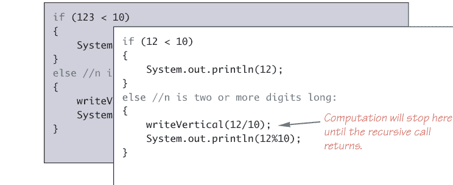

由于`12`不小于`10`，所以执行`else`部分。然而，正如你已经看到的，`else`部分以递归调用开始。递归调用的参数是`n/10`，在本例中等同于`12/10`。因此，这个第二次计算的`writeVertical`方法被挂起，并执行以下递归调用：

```
writeVertical(12/10);
```

等同于

```
writeVertical(1);
```

此时，有两个挂起的计算等待恢复，计算机开始执行这个新的递归调用，其处理方式与之前的所有递归调用一样。参数`1`被代入参数`n`，然后执行方法体。此时，计算看起来像这样：

```
if (123 < 10)
{
    ...
}
else
{
    if (12 < 10)
    {
        ...
    }
    else
    {
        if (1 < 10)
        {
            System.out.println(1);
        }
        else //n is two or more digits long:
        {
            writeVertical(1/10);
            System.out.println(1%10);
        }
    }
}
```

当这次执行方法体时，情况有所不同。由于`1`小于`10`，`if-else`语句中的布尔表达式为`true`，因此执行`else`之前的语句。该语句只是一个输出语句，将参数`1`写到屏幕上，因此调用`writeVertical(1)`将`1`写到屏幕上，并且在没有递归调用的情况下结束。

当调用`writeVertical(1)`结束时，等待其结束的挂起计算从其挂起的地方恢复，如下所示：

```
if (123 < 10)
{
    ...
}
else
{
    if (12 < 10)
    {
        System.out.println(12);
    }
    else //n is two or more digits long:
    {
        writeVertical(12/10);
        System.out.println(12%10);
    }
}
```

当这个挂起的计算恢复时，它执行一个输出语句，输出值`12%10`，即`2`。这结束了该计算，但还有另一个挂起的计算等待恢复。当最后一个挂起的计算恢复时，情况是

```
if (123 < 10)
{
    System.out.println(123);
}
else //n is two or more digits long:
{
    writeVertical(123/10);
    System.out.println(123%10);
}
```

当这最后一个挂起的计算恢复时，它输出值`123%10`，即`3`，然后原始方法调用的执行结束。果然，数字`1`、`2`和`3`已按顺序逐行写入屏幕。

### 深入理解递归

`writeVertical`方法的定义使用了递归。然而，在求值方法调用`writeVertical(123)`时，我们并没有做任何新的或不同的事情。我们对待它就像对待我们在前面章节中看到的任何其他方法调用一样。我们只是将参数`123`代入参数`n`，然后执行方法定义中的代码。当我们遇到递归调用

```
writeVertical(123/10);
```

时，我们只是简单地重复了这个过程。

计算机通过以下方式跟踪递归调用：当调用一个方法时，计算机将参数代入形参并开始执行代码。如果它遇到一个递归调用，那么它会暂时停止其计算，因为它必须知道递归调用的结果才能继续。它保存其稍后继续计算所需的所有信息，并开始求值递归调用。当递归调用完成时，计算机返回以完成外部计算。

Java 语言对方法定义中如何使用递归调用没有限制。然而，为了使递归方法定义有用，必须设计成任何方法调用最终都必须终止于一段不依赖于递归的代码。该方法可以调用自身，而该递归调用可以再次调用该方法。这个过程可以重复任意次。然而，除非最终有一个递归调用

一个成功递归方法定义的通用大纲如下：

- 一或多种情况，其中方法通过使用递归调用来完成任务的一个或多个更小版本。
- 一或多种情况，其中方法无需使用任何递归调用即可完成任务。这些没有任何递归调用的情况被称为**基础情况**或**终止情况**。

通常，一个`if-else`语句会决定执行哪种情况。一个典型的场景是，最初的调用会执行一个包含递归调用的情况。该递归调用可能反过来执行另一个需要再次递归调用的情况。在若干次重复中，每个递归调用都会产生另一个递归调用，但最终应适用某个终止情况。*每次方法调用最终都必须导向一个终止情况，否则方法调用将因无限的递归调用链而永远不会结束。*（在实践中，包含无限递归调用链的调用通常会异常终止，而不是真正地无限运行。）

确保最终达到终止情况的最常见方法是，编写方法时让某个（正的）数值量在每次递归调用中减少，并为某个“小”值提供一个终止情况。这正是我们在示例 11.1 中设计`writeVertical`方法的方式。当调用`writeVertical`方法时，该调用会产生一个参数更小的递归调用。这个过程会持续进行，每个递归调用产生另一个递归调用，直到参数小于`10`。当参数小于`10`时，方法调用结束，不再产生更多递归调用，整个过程回溯到最初的调用，最终结束。

### 递归方法定义的一般形式

一个成功递归方法定义的通用大纲如下：

- 一或多种情况，包含对正在定义的方法的一或多个递归调用。这些递归调用应解决正在定义的方法所执行任务的“更小”版本。
- 一或多种情况，不包含任何递归调用。这些没有任何递归调用的情况被称为**基础情况**或**终止情况**。

### 易错点

**无限递归**

在前面小节讨论的`writeVertical`方法示例中，一系列递归调用最终达到了一个不涉及递归的方法调用（即，达到了一个终止情况）。另一方面，如果每个递归调用都产生另一个递归调用，那么理论上该方法的调用将永远运行下去。这被称为**无限递归**。在实践中，这样的方法通常会运行到计算机资源耗尽，程序异常终止。

无限递归的例子并不难找。以下是一个语法正确的 Java 方法定义，它可能是试图定义`writeVertical`方法的替代版本而产生的：

```java
public static void newWriteVertical(int n)
{
    newWriteVertical(n/10);
    System.out.println(n%10);
}
```

如果你将这个定义嵌入调用此方法的程序中，程序将编译无误，并且你可以运行它。此外，这个定义甚至具有一定的合理性。它说要输出`newWriteVertical`的参数，首先输出除最后一位以外的所有数字，然后输出最后一位。然而，当被调用时，此方法将产生无限序列的递归调用。如果你调用`newWriteVertical(12)`，该执行将停止以执行递归调用`newWriteVertical(12/10)`，这等同于`newWriteVertical(1)`。该递归调用的执行将依次停止以执行递归调用

```java
newWriteVertical(1/10);
```

这等同于

```java
newWriteVertical(0);
```

这又会停止以执行递归调用`newWriteVertical(0/10);`，这也等同于

```java
newWriteVertical(0);
```

而这又会产生另一个递归调用，再次执行相同的递归方法调用`newWriteVertical(0);`，如此往复，永远。由于`newWriteVertical`的定义没有终止情况，该过程将永远进行下去（或者直到计算机资源耗尽）。

## 自我测试练习

1. 以下程序的输出是什么？


```java
public class Exercise1
{
    public static void main(String[] args)
    {
        cheers(3);
    }

    public static void cheers(int n)
    {
        if (n == 1)
        {
            System.out.println("Hurray");
        }
        else
        {
            System.out.println("Hip ");
            cheers(n - 1);
        }
    }
}
```

2. 编写一个递归 void 方法，它有一个整数参数，该方法向屏幕输出由参数给出的星号 `*` 的数量。输出应全部在一行上。你可以假设参数是正数。

3. 编写一个递归 void 方法，它有一个正整数参数。调用时，该方法将其参数倒序输出到屏幕上。也就是说，如果参数是 `1234`，它会向屏幕输出以下内容：

```text
4321
```

4. 编写一个递归 void 方法，它接受一个（正的）int 参数 `n`，并将整数 `1, 2, . . . , n` 输出到屏幕。

5. 编写一个递归 void 方法，它接受一个（正的）int 参数 `n`，并将整数 `n, n–1, . . . , 3, 2, 1` 输出到屏幕。

*提示：* 注意，通过交换最少两行代码，你就可以从自我测试练习 4 的代码得到本练习的代码（反之亦然）。

## 递归的栈

为了跟踪递归以及许多其他事情，大多数计算机系统使用一种称为栈的结构。栈是一种非常专用的内存结构，类似于一叠纸。在这个类比中，有无穷无尽的额外空白纸张供应。要将一些信息放入栈中，可以将其写在一张这样的纸上，并放置在一叠纸的顶部。要将更多信息放入栈中，取一张干净的纸，将信息写在上面，然后将这张新纸放在栈顶。通过这种直接的方式，越来越多的信息可以被放置在栈上。

从栈中取出信息也通过一个非常简单的过程完成。顶部的纸张可以被读取，当不再需要时，将其扔掉。这里有一个复杂情况：只有顶部的纸张是可访问的。为了读取，比如说，从顶部数第三张纸，必须先扔掉顶部的两张纸。由于最后放入栈的纸张是第一张被取出的，栈通常被称为后进先出（last-in/first-out）的内存结构，缩写为 LIFO。

使用栈，计算机可以轻松地跟踪递归。每当调用一个方法时，就会取一张新的纸张。方法定义被复制到这张纸上，参数被代入方法参数中。然后计算机开始执行方法定义的主体。当它遇到递归调用时，它会停止当前在该纸张上进行的计算，以计算递归调用返回的值。但是，在计算递归调用之前，它会保存足够的信息，以便当它最终确定递归调用返回的值时，可以继续被中断的计算。这些保存的信息被写在一张纸上并放置在栈上。递归调用使用一张新的纸张。计算机在新纸张上写入方法定义的第二个副本，代入方法参数的参数，并开始执行递归调用。当它到达递归调用副本中的另一个递归调用时，它会重复保存信息到栈并使用新纸张进行新递归调用的过程。这个过程在标题为“跟踪递归调用”的小节中进行了说明。尽管当时我们没有称其为栈，但将一个计算放在另一个计算之上的插图说明了栈的操作。

这个过程持续进行，直到某个递归调用完成了其计算而没有产生更多递归调用。当这种情况发生时，计算机将注意力转向栈顶的纸张。这张纸包含部分完成的计算，该计算正在等待刚刚结束的递归计算。因此，可以继续进行那个被挂起的计算。当那个被挂起的计算结束时，计算机丢弃那张纸，而栈中其下方的被挂起的计算成为栈顶的计算。计算机将注意力转向现在位于栈顶的被挂起的计算，如此类推。这个过程一直持续到底部纸张上的计算完成。根据进行了多少次递归调用以及方法定义的编写方式，栈可能以任何方式增长和收缩。注意，栈中的纸张只能以先进后出的方式访问，但这正是跟踪递归调用所需要的。每个被挂起的版本都在等待其正上方栈中版本的完成。

当然，计算机没有纸叠。这只是一个类比。计算机使用内存部分而不是纸张。这些内存部分（“纸张”）的内容被称为栈帧或活动记录。这些栈帧以我们刚才讨论的后进先出方式处理。（这些栈帧不包含方法的完整副本……）

（定义，而只是引用方法定义的单个副本。然而，栈帧包含足够的信息，使得计算机可以表现得好像栈帧包含方法定义的完整副本。）

> **栈 ✈**
>
> 栈是一种后进先出的内存结构。从栈中引用或移除的第一个项总是最后进入栈的项。计算机使用栈来跟踪递归（以及其他目的）。

> **易错点**

### 栈溢出 ✈

栈的大小总是存在某种限制。如果存在一个长链，其中某个方法对自身进行递归调用，而该调用导致另一个递归调用，接着那个调用又产生另一个递归调用，如此类推，那么这个链中的每个递归调用都会导致另一个挂起的计算被放置到栈上。如果这个链过长，栈就会试图超出其限制增长。这是一种称为栈溢出的错误条件。如果你收到一条说栈溢出的错误消息，很可能某个方法调用产生了一个过长的递归调用链。栈溢出的一个常见原因是无限递归。如果一个方法无限递归，那么它最终会尝试让栈超过任何栈大小限制。

## 递归与迭代

递归并非绝对必要。事实上，一些编程语言不允许使用递归。任何使用递归可以完成的任务，也可以用其他不使用递归的方式完成。例如，显示 11.2 包含了显示 11.1 中给出的方法的非递归版本。方法的非递归版本通常使用某种循环（或多个循环）来代替递归。因此，非递归版本通常被称为迭代版本。如果将显示 11.1 中定义的 `writeVertical` 方法替换为显示 11.2 中给出的版本，那么输出将相同。正如这种情况，方法的递归版本有时可以比迭代版本简单得多。包含该方法迭代版本的完整程序在随附 CD 上的文件 `IterativeDemo1` 中给出。

以递归方式编写的方法通常比等效的迭代版本运行更慢并使用更多的存储空间。计算机必须做额外的工作来操作栈以跟踪递归。然而，由于系统会自动为你完成所有这些工作，使用递归有时可以使你作为程序员的工作更容易，并有时可以产生更容易理解的代码。

- 迭代版本
- CD 上的额外代码
- 效率

### 显示 11.2 显示 11.1 中方法的迭代版本

```java
public static void writeVertical(int n)
{
    int nsTens = 1;
    int leftEndPiece = n;

    while (leftEndPiece > 9)
    {
        leftEndPiece = leftEndPiece / 10;
        nsTens = nsTens * 10;
    }

    // nsTens is a power of ten that has the same number
    // of digits as n. For example, if n is 2345, then
    // nsTens is 1000.
    for (int powerOf10 = nsTens;
         powerOf10 > 0;
         powerOf10 = powerOf10 / 10)
    {
        System.out.println(n / powerOf10);
        n = n % powerOf10;
    }
}
```

### 自测练习

6. 如果你的程序产生一条说栈溢出的错误消息，错误的可能来源是什么？

7. 编写自测练习 1 中定义的 `cheers` 方法的迭代版本。

8. 编写自测练习 2 中定义的方法的迭代版本。

9. 编写自测练习 3 中定义的方法的迭代版本。

10. 跟踪你为自测练习 4 所做的递归解决方案。

11. 跟踪你为自测练习 5 所做的递归解决方案。

## 11.2 返回值的递归方法

> 迭代是人，递归是神。
>
> — 匿名

### 返回值的递归方法的一般形式

到目前为止你所看到的递归方法都是 void 方法，但递归并不限于 void 方法。递归方法可以返回任何类型的值。设计返回值的递归方法的技术基本上与你为 void 方法所学的方法相同。一个成功的返回值的递归方法定义的框架如下：

- 一个或多个情况，其中返回的值是通过调用同一方法来计算的（即使用递归调用）。与 void 方法的情况一样，递归调用的参数在直觉上应该是“更小”的。
- 一个或多个情况，其中返回的值是在不使用任何递归调用的情况下计算的。这些没有递归调用的情况称为基本情况或停止情况（就像它们对于 void 方法一样）。

下一个编程示例将演示此技术。

### 示例：另一个幂方法

在第 5 章中，我们介绍了 `Math` 类的静态方法 `pow`。这个方法 `pow` 计算幂。例如，`Math.pow(2.0, 3.0)` 返回 `2.0^3.0`，因此以下语句将变量 `result` 设置为等于 8.0：

```java
double result = Math.pow(2.0, 3.0);
```

方法 `pow` 接受两个 `double` 类型的参数并返回一个 `double` 类型的值。显示 11.3 包含了一个静态方法的递归定义，该方法与之类似，但适用于 `int` 类型而非 `double` 类型。这个新方法名为 `power`。例如，以下语句将 `result2` 的值设置为 8，因为 2^3 是 8：

```java
int result2 = power(2, 3);
```

在定义类之外，这将写成：

```java
int result2 = RecursionDemo2.power(2, 3);
```

### 示例（续）

我们定义方法 `power` 的主要原因是拥有一个递归方法的简单示例，但在某些情况下，方法 `power` 会比方法 `pow` 更可取。方法 `pow` 返回 `double` 类型的值，这只是一个近似值。方法 `power` 返回 `int` 类型的值，这是一个精确的值。在某些情况下，你可能需要方法 `power` 提供的额外精度。

方法 `power` 的定义基于以下公式：

```text
x^n 等于 x^(n-1) * x
```

将此公式转换为 Java 意味着 `power(x, n)` 返回的值应与表达式

```text
power(x, n - 1) * x
```

的值相同。

显示 11.3 中给出的方法 `power` 的定义确实为 `power(x, n)` 返回此值，前提是 `n > 0`。

当 `n` 等于 0 时的情况是停止情况。如果 `n` 是 0，那么 `power(x, n)` 只是返回 1（因为 `x^0` 是 1）。

让我们看看当使用一些示例值调用方法 `power` 时会发生什么。首先考虑简单的表达式：

```text
power(2, 0)
```

当调用该方法时，`x` 的值被设置为 2，`n` 的值被设置为 0，并执行方法定义主体中的代码。由于 `n` 的值是合法的值，执行 if-else 语句。由于此 `n` 的值不大于 0，因此使用 `else` 之后的 `return` 语句，所以方法调用返回 1。因此，以下语句将 `result3` 的值设置为 1：

```java
int result3 = power(2, 0);
```

现在让我们看一个涉及递归调用的例子。考虑表达式

```text
power(2, 1)
```

当调用该方法时，`x` 的值被设置为 2，`n` 的值被设置为 1，并执行方法定义主体中的代码。由于此 `n` 的值大于 0，因此使用以下 `return` 语句来确定返回的值：

```java
return (power(x, n - 1) * x);
```

### 示例（续）

在这种情况下等同于：

```java
return (power(2, 0) * 2);
```

此时，`power(2, 1)` 的计算被挂起，此挂起计算的一个副本被放置在栈上，然后计算机开始一个新的方法调用来计算 `power(2, 0)` 的值。正如你已经看到的，`power(2, 0)` 的值是 1。在确定 `power(2, 0)` 的值之后，计算机将表达式 `power(2, 0)` 替换为其值 1，并恢复挂起的计算。恢复的计算根据上述返回语句确定 `power(2, 1)` 的最终值：

`power(2, 0) * 2` 是 `1 * 2`，即 2。

所以 `power(2, 1)` 返回的最终值是 2。因此，以下语句将 `result4` 的值设置为 2：

```java
int result4 = power(2, 1);
```

更大的第二个参数值将产生更长的递归调用链。例如，考虑语句：

```java
System.out.println(power(2, 3));
```

`power(2, 3)` 的值计算如下：

```text
power(2, 3) 是 power(2, 2) * 2
    power(2, 2) 是 power(2, 1) * 2
        power(2, 1) 是 power(2, 0) * 2
            power(2, 0) 是 1（停止情况）
```

当计算机到达停止情况 `power(2, 0)` 时，有三个挂起的计算。在计算停止情况返回的值之后，它恢复最近挂起的计算以确定 `power(2, 1)` 的值。之后，计算机完成每个其他挂起的计算，使用每个计算的值作为要插入另一个挂起计算的值，直到它到达并完成原始调用 `power(2, 3)` 的计算。整个计算的细节在显示 11.4 中进行了说明。

## 显示 11.3 递归方法 `power`

```java
public class RecursionDemo2
{
    public static void main(String[] args)
    {
        for (int n = 0; n < 4; n++)
            System.out.println("3 to the power " + n
                + " is " + power(3, n));
    }

    public static int power(int x, int n)
    {
        if (n < 0)
        {
            System.out.println("Illegal argument to power.");
            System.exit(0);
        }

        if (n > 0)
            return (power(x, n - 1) * x);
        else // n == 0
            return (1);
    }
}
```

### 示例对话

```text
3 的 0 次幂是 1
3 的 1 次幂是 3
3 的 2 次幂是 9
3 的 3 次幂是 27
```

## 显示 11.4 评估递归方法调用 `power(2, 3)`

### 递归调用序列

```text
(power(2, 0) * 2) -> 1
(power(2, 1) * 2) -> 2
(power(2, 2) * 2) -> 4
power(2, 3)
```

从此处开始。

### 最终值的计算过程

```text
1 * 2 -> 1 * 2 等于 2
2 * 2 -> 2 * 2 等于 4
4 * 2 -> 4 * 2 等于 8
power(2, 3) 等于 8
```

### 自测练习

12. 以下程序的输出是什么？

```java
public class Exercise12
{
    public static void main(String[] args)
    {
        System.out.println(mystery(3));
    }

    public static int mystery(int n)
    {
        if (n <= 1)
            return 1;
        else
            return (mystery(n - 1) + n);
    }
}
```

13. 以下程序的输出是什么？它体现了什么著名的数学方法？

```java
public class Exercise13
{
    public static void main(String[] args)
    {
        System.out.println(rose(4));
    }

    public static int rose(int n)
    {
        if (n <= 0)
            return 1;
        else
            return (rose(n - 1) * n);
    }
}
```

14. 重新定义 `power` 方法（显示 11.3），使其也适用于负指数。为此，你还必须将返回值的类型更改为 `double`。重新定义的 `power` 方法的方法头如下：

```java
/**
    前提条件：如果 n < 0，则 x 不为 0。
    返回 x 的 n 次幂。
*/
public static double power(int x, int n)
```

*提示：* `x^{-n}` 等于 `1/(x^n)`。

## 11.3 递归思维

> 世界上有两种人，一种是把世界分为两种人的人，另一种则不是。
>
> — 匿名者

### 递归设计技巧

在定义和使用递归方法时，你不必持续关注栈和挂起的计算。递归的威力在于你可以忽略这些细节，让计算机为你处理这些事务。

考虑显示 11.3 中 `power` 方法的例子。思考 `power` 定义的方式如下：

```text
power(x, n) 返回 power(x, n − 1) * x
```

因为 `x^n` 等于 `x^(n-1) * x`，所以只要计算总能到达一个停止情况并且能正确计算停止情况，这就是要返回的正确值。因此，在验证了定义的递归部分是正确的之后，你需要检查的只是递归调用的链是否总会到达一个停止情况，并且停止情况是否总是返回正确的值。换句话说，你需要做的就是验证是否满足以下三个特性：

1. **不存在无限递归。**（一个递归调用可能导致另一个调用，那个调用又可能导致另一个，依此类推，但每一个这样的递归调用链最终都会到达一个停止情况。）
2. **每个停止情况都为其情况返回正确的值。**


### 递归方法正确性检查标准

我们给出了三个标准，用于检查返回值的递归方法的正确性。基本上相同的规则也适用于递归的 `void` 方法。如果你能证明你的递归 `void` 方法定义满足以下三个标准，那么你就能知道你的 `void` 方法执行正确：

1. **不存在无限递归**。
2. **每个停止情况都为其情况执行正确的动作**。
3. **对于涉及递归的每种情况：*如果*所有递归调用都正确执行它们的动作，*那么*整个情况就执行正确。**

例如，考虑显示 11.3 中的 `power` 方法：

1. **不存在无限递归：** `power(x, n)` 的第二个参数在每个递归调用中减少一，所以任何递归调用链最终都必须到达 `power(x, 0)` 这个情况，这就是停止情况。因此，不存在无限递归。

2. **每个停止情况都为其情况返回正确的值：** 唯一的停止情况是 `power(x, 0)`。形式为 `power(x, 0)` 的调用总是返回 1，而 $x^0$ 的正确值就是 1。所以停止情况返回了正确的值。

3. **对于涉及递归的情况：*如果*所有递归调用都返回正确的值，*那么*该方法返回的最终值就是正确的值：** 唯一涉及递归的情况是当 $n > 1$ 时。当 $n > 1$ 时，`power(x, n)` 返回 `power(x, n − 1)*x`。要看到这是正确的返回值，请注意：*如果* `power(x, n − 1)` 返回正确的值，*那么* `power(x, n − 1)` 返回 $x^{n-1}$，因此 `power(x, n)` 返回 $x^{n-1} * x$，即 $x^n$，而这正是 `power(x, n)` 的正确值。

这就是你需要检查的全部内容，以确保 `power` 的定义是正确的。（上述技术被称为 *数学归纳法*，这是一个你可能在数学课上听说过的概念。然而，要使用这项技术，你并不需要熟悉 *数学归纳法* 这个术语。）

### 二分查找

在这一小节中，我们将开发一个递归方法，用于搜索数组以确定它是否包含一个指定的值。例如，该数组可能包含一份不再有效的信用卡号列表。商店职员需要搜索该列表以查看客户的卡是有效还是无效。

数组 `a` 的索引是从 0 到 `finalIndex` 的整数。为了使搜索数组的任务更容易，我们将假设数组是已排序的。因此，我们知道以下条件：

`a[0] ≤ a[1] ≤ a[2] ≤ . . . ≤ a[finalIndex]`

事实上，我们将使用的二分查找算法要求数组像这样已排序。

在搜索数组时，你可能既想知道该值是否在数组中，又想知道它是否在，以及它在数组中的位置。例如，如果你正在搜索一个信用卡号，那么数组索引可能充当记录号。另一个以这些相同索引索引的数组可能包含一个电话号码或其他用于报告可疑卡的信息。因此，如果所搜索的值在数组中，我们将让我们的方法返回一个该值所在位置的索引。如果该值不在数组中，我们的方法将返回 -1。（数组可能包含重复项，这就是为什么我们说“一个索引”而不是“那个索引”。）

现在让我们继续构建一个解决此任务的算法。以非常具体的方式来想象这个问题会有所帮助。假设数字列表非常长，以至于需要用一本书来列出它们。事实上，这就是无效信用卡号分发给无法访问计算机的商店的方式。如果你是一名职员，拿到一张信用卡，你必须检查它是否在列表上，因此是无效的。你会怎么做？打开书到中间，看看那个号码是否在那里。如果它不在那里，并且它比中间的数字小，那么就向后朝书的开头查找。如果这个数字比中间的数字大，你就朝书的末尾查找。这个想法产生了我们算法的初稿：

```
mid = 0 和 finalIndex 之间近似的中点；

if (key == a[mid])
    return mid;
else if (key < a[mid])
    在 a[0] 到 a[mid - 1] 中搜索；
else if (key > a[mid])
    在 a[mid + 1] 到 a[finalIndex] 中搜索；
```

由于对较短列表的搜索正是我们设计该算法要执行的任务的较小版本，因此该算法自然适合使用递归。较小的列表可以通过对算法本身进行递归调用来搜索。

我们的伪代码有点过于模糊，不易翻译成 Java 代码。问题与递归调用有关。显示了两个递归调用：

在 `a[0]` 到 `a[mid - 1]` 中搜索；

和

在 `a[mid + 1]` 到 `a[finalIndex]` 中搜索；

为了实现这些递归调用，我们需要另外两个参数。递归调用指定要搜索数组的一个子范围。一种情况是索引从 0 到 `mid - 1` 的元素。另一种情况是索引从 `mid + 1` 到 `finalIndex` 的元素。这两个额外的参数将指定搜索的第一个和最后一个索引，因此我们将它们称为 `first` 和 `last`。使用这些参数作为最低和最高索引，而不是 0 和 `finalIndex`，我们可以更精确地表达伪代码如下：

要搜索 `a[first]` 到 `a[last]`，请执行以下操作：

```
mid = first 和 last 之间近似的中点；

if (key == a[mid])
    return mid;
else if (key < a[mid])
    返回在 a[first] 到 a[mid - 1] 中搜索的结果；
else if (key > a[mid])
    返回在 a[mid + 1] 到 a[last] 中搜索的结果；
```

要搜索整个数组，算法将在 `first` 设置为 0 且 `last` 设置为 `finalIndex` 时执行。递归调用将使用 `first` 和 `last` 的其他值。例如，第一个递归调用会将 `first` 设置为 0，将 `last` 设置为计算出的值 `mid - 1`。

与任何递归算法一样，我们必须确保我们的算法会结束，而不是产生无限递归。如果列表上找到了所搜索的数字，那么就没有递归调用，过程就会终止，但我们需要某种方式来检测数字不在列表上的情况。在每次递归调用时，`first` 的值增加或 `last` 的值减少。如果它们曾经彼此交叉，并且 `first` 实际上变得大于 `last`，那么我们将知道没有剩余的索引需要检查，并且数字 `key` 不在数组中。如果我们将此测试添加到伪代码中，我们就得到了一个完整的解决方案，如显示 11.5 所示。

### 显示 11.5 二分查找伪代码

```
在 a[first] 到 a[last] 中搜索的算法

/**
   前提条件：
   a[first] <= a[first + 1] <= a[first + 2] <= ... <= a[last]
*/

定位值 key

    if (first > last) //停止情况
        return -1;
    else
    {
        mid = first 和 last 之间的近似中点;
        if (key == a[mid]) //停止情况
            return mid;
        else if (key < a[mid]) //递归情况
            return 在 a[first] 到 a[mid - 1] 中搜索的结果;
        else if (key > a[mid]) //递归情况
            return 在 a[mid + 1] 到 a[last] 中搜索的结果;
    }
```

现在我们可以将伪代码常规地翻译成 Java 代码。结果如显示 11.6 所示。方法 `search` 是显示 11.5 中给出的递归算法的实现。该方法在示例数组上的执行过程图示见显示 11.7。显示 11.8 说明了如何使用 `search` 方法。

请注意，方法 `search` 解决的问题比原始任务更通用。我们的目标是设计一个方法来搜索整个数组。然而，通过指定索引 `first` 和 `last`，该方法允许我们搜索数组的任何区间。这在设计递归方法时很常见。通常，为了能够表达递归算法，需要解决一个更通用的问题。在这个例子中，我们只想要 `first` 和 `last` 分别等于 0 和 `finalIndex` 时的答案。但是，递归调用会将它们设置为不同于 0 和 `finalIndex` 的值。

在名为"跟踪递归调用"的小节中，我们给出了三个应该检查的标准，以确保递归的 `void` 方法定义是正确的。让我们检查显示 11.6 中给出的 `search` 方法的这三点：

1. **没有无限递归**：在每次递归调用中，`first` 的值会增加或 `last` 的值会减少。如果递归调用链不是以其他方式结束，那么最终方法将会以 `first` 大于 `last` 被调用，这是一个停止情况。

### 显示 11.6 二分查找的递归方法

```java
public class BinarySearch
{
    /**
     在数组 a 中搜索 key。如果 key 不在数组段中，则返回 -1。
     否则返回段内的一个索引，使得 key == a[index]。
     前提条件：a[first] <= a[first + 1] <= ... <= a[last]
     */
    public static int search(int[] a, int first, int last, int key)
    {
        int result = 0; //为了让编译器满意。

        if (first > last)
            result = -1;
        else
        {
            int mid = (first + last)/2;

            if (key == a[mid])
                result = mid;
            else if (key < a[mid])
                result = search(a, first, mid - 1, key);
            else if (key > a[mid])
                result = search(a, mid + 1, last, key);
        }
        return result;
    }
}
```

2. **每个停止情况执行该情况的正确操作**：有两个停止情况，当 `first > last` 和当 `key == a[mid]`。让我们考虑每种情况。

如果 `first > last`，则 `a[first]` 和 `a[last]` 之间没有数组元素，因此 `key` 不在数组的这个段中。（这个数组段中没有任何东西！）所以，如果 `first > last`，`search` 方法正确返回 -1，表示 `key` 不在数组的指定范围内。

如果 `key == a[mid]`，算法正确地将 `location` 设置为 `mid`。因此，两个停止情况都是正确的。

3. **对于涉及递归的每个情况，如果所有递归调用都正确执行它们的操作，那么整个情况就正确执行了**：有两个存在递归调用的情况，当 `key < a[mid]` 和当 `key > a[mid]`。我们需要检查这两个情况中的每一个。

### 显示 11.7 方法 search 的执行

`key` 是 63

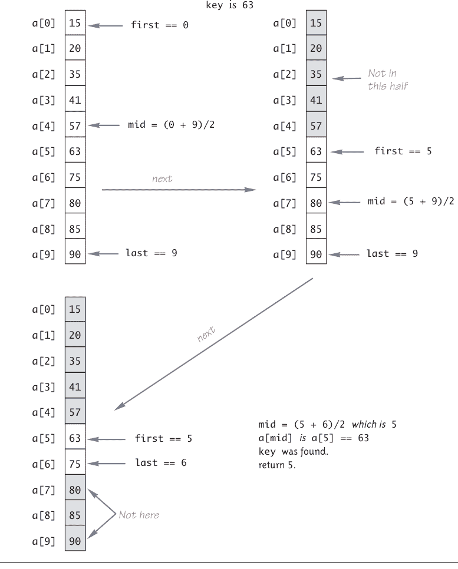

### 显示 11.8 使用 search 方法

```java
1  public class BinarySearchDemo
2  {
3      public static void main(String[] args)
4      {
5          int[] a = {-2, 0, 2, 4, 6, 8, 10, 12, 14, 16};
6          int finalIndex = 9;
7  
8          System.out.println("Array contains:");
9          for (int i = 0; i < a.length; i++)
10              System.out.print(a[i] + " ");
11         System.out.println();
12         System.out.println();
13 
14         int result;
15         for (int key = -3; key < 5; key++)
16         {
17             result = BinarySearch.search(a, 0, finalIndex, key);
18             if (result >= 0)
19                 System.out.println(key + " is at index " + result);
20             else
21                 System.out.println(key + " is not in the array.");
22         }
23     }
24 }
```

**示例对话**

```
Array contains:
-2 0 2 4 6 8 10 12 14 16

-3 is not in the array.
-2 is at index 0
-1 is not in the array.
0 is at index 1
1 is not in the array.
2 is at index 2
3 is not in the array.
4 is at index 3
```

首先假设 `key < a[mid]`。在这种情况下，由于数组是有序的，我们知道如果 `key` 在数组中的任何位置，那么 `key` 是元素 `a[first]` 到 `a[mid - 1]` 中的一个。因此，方法只需要搜索这些元素，这正是递归调用

```
search(a, first, mid - 1, key)
```

所做的。所以如果递归调用是正确的，那么整个操作就是正确的。

接下来，假设 `key > a[mid]`。在这种情况下，由于数组是有序的，我们知道如果 `key` 在数组中的任何位置，那么 `key` 是元素 `a[mid + 1]` 到 `a[last]` 中的一个。因此，方法只需要搜索这些元素，这正是递归调用

```
search(a, mid + 1, last, key)
```

所做的。所以如果递归调用是正确的，那么整个操作就是正确的。因此，在这两种情况下，方法都执行正确的操作（假设递归调用执行正确的操作）。

`search` 方法通过了我们所有的三项测试，所以它是一个良好的递归方法定义。

### 二分查找的效率

与简单地按顺序尝试所有数组元素的算法相比，二分查找算法极其快速。在二分查找中，你一开始就排除了大约一半的数组。然后你排除四分之一，接着是八分之一，以此类推。这些节省累积成一个显著快速的算法。对于一个有 100 个元素的数组，二分查找永远不需要将超过七个数组元素与 `key` 进行比较。串行搜索可能需要将多达 100 个数组元素与 `key` 进行比较，平均大约比较 50 个数组元素。此外，数组越大，节省就越显著。在一个有 1,000 个元素的数组上，二分查找只需要将大约 10 个数组元素与 `key` 值进行比较，而串行搜索算法平均需要比较 500 个。¹

方法 `search` 的迭代版本如显示 11.9 所示。在某些系统上，迭代版本将比递归版本运行得更有效率。迭代版本的算法是通过镜像递归版本得出的。在迭代版本中，局部变量 `first` 和 `last` 镜像了递归版本中参数的角色，这些参数也命名为 `first` 和 `last`。正如这个例子所示，即使你期望稍后将其转换为迭代算法，推导出递归算法通常也是有意义的。你可以在随附 CD 上的文件 `IterativeBinarySearch.java` 和 `IterativeBinarySearchDemo.java` 中看到显示 11.9 中的迭代方法嵌入在完整的演示程序中。

¹ 二分查找算法的最坏情况运行时间是对数级的，即 `O(log n)`。串行搜索算法是线性的，即 `O(n)`。如果你不熟悉本脚注中使用的术语，你可以放心地忽略此脚注。

### 显示 11.9 二分查找的迭代版本

```java
/**
 在数组 a 中搜索 key。如果 key 不在数组段中，则返回 -1。
 否则返回段内的一个索引，使得 key == a[index]。
 前提条件：a[lowEnd] <= a[lowEnd + 1] <= ... <= a[highEnd]
 */
public static int search(int[] a, int lowEnd, int highEnd, int key)
{
    int first = lowEnd;
    int last = highEnd;
    int mid;

    boolean found = false; //目前为止
    int result = 0; //为了让编译器满意

    while ( (first <= last) && !(found) )
    {
        mid = (first + last)/2;

        if (key == a[mid])
        {
            found = true;
            result = mid;
        }
        else if (key < a[mid])
        {
            last = mid - 1;
        }
        else if (key > a[mid])
        {
            first = mid + 1;
        }
    }

    if (first > last)
        result = -1;

    return result;
}
```


大多数现代编译器在转换代码之前，会将某些简单的递归方法定义转换为迭代方法。在这种情况下，使用递归版本代替迭代版本不会造成效率损失。

## 自我测试练习

15. 为以下方法编写递归方法定义：

```
/**
 前提条件：n >= 1
 返回从1到n的数字的平方和。
*/
public static int squares(int n)
```

例如，`squares(3)` 返回 14，因为 1^2 + 2^2 + 3^2 等于 14。

## 章节总结

- 如果一个问题可以简化为同一问题的更小实例，那么递归解决方案很可能易于找到和实现。
- 方法定义的递归算法通常包含两种情况：一种或多种包含至少一次递归调用的情况，以及一种或多种无需任何递归调用即可解决问题的停止情况。
- 编写递归方法定义时，务必检查该方法是否会产生无限递归。
- 定义递归方法时，请使用小节“递归设计技术”中给出的三个标准来检查方法是否正确。
- 设计递归方法解决任务时，通常需要解决比给定任务更一般的问题。这可能是为了允许适当的递归调用，因为较小的问题可能与给定任务不完全相同。例如，在二分查找问题中，任务是搜索整个数组，但递归解决方案是搜索数组任意部分的算法（全部或部分）。

## 自我测试练习答案

1. Hip Hip Hurray

```
2. public static void stars(int n)
{
    System.out.print('*');
    if (n > 1)
        stars(n - 1);
}
```

以下也是正确的，但更复杂：

```
3. public static void stars(int n)
{
    if (n <= 1)
    {
        System.out.print('*');
    }
    else
    {
        stars(n - 1);
        System.out.print('*');
    }
}

public static void backward(int n)
{
    if (n < 10)
    {
        System.out.print(n);
    }
    else
    {
        System.out.print(n%10);//write last digit
        backward(n/10);//write the other digits backward
    }
}
```

```
4. public static void writeUp(int n)
{
    if (n >= 1)
    {
        writeUp(n - 1);
        System.out.print(n + " "); //write while the
                                   //recursion unwinds
    }
}
```

```
5. public static void writeDown(int n)
{
    if (n >= 1)
    {
        System.out.print(n + " "); //write while the
                                   //recursion winds
        writeDown(n - 1);
    }
}
```

6. 显示 `*stack overflow*` 的错误消息表示计算机尝试在堆栈上放置的堆栈帧数量超过了系统允许的数量。此错误消息的一个可能原因是无限递归。

```
7. public static void cheers(int n)
{
    while (n > 1)
    {
        System.out.print("Hip ");
        n--;
    }
    System.out.println("Hurray");
}
```

```
8. public static void stars(int n)
{
    for (int count = 1; count <= n; count++)
        System.out.print('*');
}
```

```
9. public static void backward(int n)
{
    while (n >= 10)
    {
        System.out.print(n%10);//write last digit
        n = n/10;//discard the last digit
    }
    System.out.print(n);
}
```

10. 自我测试练习4的跟踪：如果 `n = 3`，要执行的代码是

```
if (3 >= 1)
{
    writeUp(2);
    System.out.print(3 + " ");
}
```

执行在 `System.out.println` 之前挂起。在下一次递归中，`n = 2`；要执行的代码是

```
if (2 >= 1)
{
    writeUp(1);
    System.out.print(2 + " ");
}
```

执行在 `System.out.println` 之前挂起。在下一次递归中，`n = 1`，要执行的代码是

```
if (1 >= 1)
{
    writeUp(0);
    System.out.print(1 + " ");
}
```

执行在 `System.out.println` 之前挂起。在最后一次递归中，`n = 0`，要执行的代码是

```
if (0 >= 1) // condition false, body skipped
{
    // skipped
}
```

挂起的计算从最近到最早依次完成。输出为 1 2 3。

11. 自我测试练习5的跟踪：如果 `n = 3`，要执行的代码是

```
if (3 >= 1)
{
    System.out.print(3 + " ");
    writeDown(2);
}
```

下一次递归，`n = 2`，要执行的代码是

```
if (2 >= 1)
{
    System.out.print(2 + " ");
    writeDown(1)
}
```

下一次递归，`n = 1`，要执行的代码是

```
if (1 >= 1)
{
    System.out.print(1 + " ");
    writeDown(0)
}
```

最后一次递归，`n = 0`，`if` 语句不执行任何操作，递归调用结束：

```
if (0 >= 1) // condition false
{
    // this clause is skipped
}
```

输出为 3 2 1。

12. 6

13. 输出为 24。方法 `rose` 是阶乘方法，通常写作 `n!`，定义如下：`n!` 等于 `n*(n-1)*(n-2)*...*1`

```
public static double power(int x, int n)
{
    if (n < 0 && x == 0)
    {
        System.out.println(
            "Illegal argument to power.");
        System.exit(0);
    }

    if (n < 0)
        return (1/power(x, -n));
    else if (n > 0)
        return (power(x, n - 1)*x);
    else // n == 0
        return (1.0);
}
```

```
public static int squares(int n)
{
    if (n <= 1)
        return 1;
    else
        return (squares(n - 1) + n*n);
}
```

## 编程项目

*许多编程项目可以使用AW's CodeMate解决。访问地址：`www.aw-bc.com/codemate`。*

1. 储蓄账户通常使用复利来累积储蓄。如果您存入 1,000 美元，年利率为 10%，那么一年后您将拥有 1,100 美元。如果您将这笔钱在账户中再存一年，利率为 10%，那么两年后总额将为 1,210 美元。三年后您将拥有 1,331 美元，依此类推。

编写一个程序，输入存款金额、年利率和资金将累积复利的年数。编写一个递归函数，使用输入信息计算储蓄账户中的金额。

要验证您的函数，金额应等于 *P*(1+*i*)^*n*，其中 *P* 是初始存款金额，*i* 是年利率，*n* 是年数。

2. 房间里有 *n* 个人，其中 *n* 是大于等于 1 的整数。每个人与其他每个人都握手一次。握手的总次数 *b*(*n*) 是多少？编写一个递归函数来解决这个问题。作为开始，如果房间里只有一两个人，那么：

    `handshake(1) = 0`

    `handshake(2) = 1`

如果第三个人进入房间，她必须与已经在那里的人握手。这是在房间里有两个人的握手次数基础上再加两次握手，总共三次握手。

如果第四个人进入房间，她必须与已经在那里的人握手。这是在房间里有三个人的握手次数基础上再加三次握手，总共六次握手。

如果您能将此推广到 *n* 次握手，那么它将帮助您编写递归解决方案。

3. 考虑下面所示的保龄球瓶框架，其中每个 * 代表一个球瓶：

    *

    * *

    * * *

    * * * *

    * * * * *

共有五行，总共十五个球瓶。如果我们只有前四行，那么总共将有十个球瓶。如果我们只有前三行，那么总共将有六个球瓶。如果我们只有前两行，那么总共将有三个球瓶。如果我们只有第一行，那么总共将有一个球瓶。

编写一个递归函数，输入为行数 n，输出为具有 n 行的金字塔中图钉的总数。你的程序应能处理 n 值大于 5 的情况。

4. “跳棋”游戏包含一个由 n 个正整数组成的板，除了第一列始终为零。这些数字表示进入每一列的代价。这里有一个 n 为 6 的游戏板示例：

| 0 | 3 | 80 | 6 | 57 | 10 |

游戏目标是以最低总代价从第一列移动到最后一列。每列中的数字代表进入该列的代价。你总是从第一列开始游戏，并且有两种移动方式：你可以移动到相邻列，或者跳过相邻列落到两列之外。游戏的代价是所经过各列代价的总和。

在上面展示的游戏板中，有几种方法可以到达终点。从第一列开始，我们目前的代价是 0。我们可以跳到 80，然后跳到 57，再移动到 10，总代价为 80+57+10 = 147。然而，更便宜的路径是移动到 3，跳到 6，然后跳到 10，总代价为 3+6+10 = 19。

为这个问题编写一个递归解决方案，计算出游戏的最低代价，并为任意大的、以数组形式表示的游戏板输出该值。你的程序不必输出实际的跳跃序列，只需输出该序列的最低代价。在确保你的解决方案在小数组上有效后，请在越来越大的 n 值的板上测试你的解决方案，以了解你的解决方案的效率和可扩展性。

5. 为一个静态方法编写递归方法定义，该方法有一个 `int` 类型的参数 n，并返回第 n 个斐波那契数。斐波那契数是 F_0 为 1，F_1 为 1，F_2 为 2，F_3 为 3，F_4 为 5，并且通常

F_{i+2} = F_i + F_{i+1}，其中 i = 0, 1, 2, ...

将该方法放在一个类中，该类包含一个用于测试该方法的 `main` 方法。

6. 从 n 个事物的集合中选择 r 个不同事物的方法数的计算公式如下：

C(n, r) = n! / (r! * (n - r)!)

阶乘方法 n! 定义为

n! = n * (n-1) * (n-2) * ... * 1。

发现 C(n, r) 公式的递归版本，并编写一个递归方法来计算该公式的值。将该方法放在一个类中，该类包含一个用于测试该方法的 `main` 方法。

## 11 递归

7. *汉诺塔*。有一个关于佛教僧侣用 64 个石盘玩这个谜题的故事。故事声称，当僧侣们完成将盘子从一根柱子经由第三根柱子移动到第二根柱子时，时间就将终结。

一堆从下到上尺寸递减的 n 个盘子放置在三根柱子中的一根上。任务是将盘子一次一个地从第一根柱子移动到第二根柱子。为此，任何盘子都可以从任何柱子移动到任何其他柱子，但需遵守一个规则：你永远不能将较大的盘子放在较小的盘子上面。（备用的）第三根柱子是为了使解决方案成为可能而提供的。你的任务是编写一个递归静态方法，给出解决这个问题的指令。我们不想处理图形，因此你应该输出一系列指令来解决问题。盘子数量是该方法的一个参数。

提示：如果你可以使用第二根柱子作为备用，将 n-1 个盘子从第一根柱子移动到第三根柱子，那么最后一个盘子就可以从第一根柱子移动到第二根柱子。然后，使用同样的技术（无论那是什么），你可以将 n-1 个盘子从第三根柱子移动到第二根柱子，使用第一根柱子作为备用。这样，你就解开了这个谜题。你只需要决定什么是非递归情况，什么是递归情况，以及何时输出移动盘子的指令。

要查看更多在线编程项目，请点击下面的 CodeMate 图标。

# 第 12 章

## UML 和模式

+   12.1 UML 688

UML 的历史 689

UML 类图 689

类交互 690

继承图 690

更多 UML 692

12.2 模式 693

适配器模式 ✩ 694

模型-视图-控制器模式 ✩ 694

示例：排序模式 695

+   排序模式的限制 701

排序模式的效率 ✩ 702

模式形式化 702

本章小结 703

自测练习答案 703

编程项目 705

# 12 UML 和模式

> 爱因斯坦认为，自然界一定存在简化的解释，因为上帝并非反复无常或任意妄为。软件工程师没有这样的信念来安慰自己。他必须掌握的大部分复杂性都是任意的复杂性。

F. Brooks, “没有银弹：软件工程的本质与偶然因素”，*IEEE Computer*，1987 年 4 月

## 引言

UML 和模式是两种软件设计工具，无论你使用什么编程语言，只要该语言提供了类和相关的面向对象编程（OOP）支持设施，这两种工具都适用。本章对这两个主题做一个非常简短的介绍。本章不包含关于 Java 语言的新细节。

UML 是一种图形语言，用于设计和记录在 OOP 框架内创建的软件。

编程中的模式与任何其他环境中的模式非常相似。它是一种软件任务的模板或大纲，可以在不同的但相似的应用中实现为不同的代码。

## 前置知识

关于 UML 的第 12.1 节和关于模式的第 12.2 节可以按任意顺序阅读。本书其余章节不需要本章的任何内容。

关于 UML 的第 12.1 节使用了第 1-5 章和关于继承的第 7 章的材料。

关于模式的第 12.2 节使用了第 1-7 章和第 11 章的材料。

## 12.1 UML

> 一图胜千言。

中国谚语

大多数人不是用 Java 或任何其他编程语言来思考的。因此，计算机科学家一直在寻找更人性化的方式来表示程序。一种广泛使用的表示是伪代码，它是 Java 等编程语言和英语等自然语言的混合体。要思考一个编程问题而不需要担心像 Java 这样的语言的语法细节，你可以简单地放松语法规则，用伪代码来写。伪代码已成为程序员使用的标准工具，但伪代码是编程的一种线性和代数表示。计算机科学家长期以来一直寻求为软件设计提供一种图形表示。为此，许多用于程序设计的图形表示系统被提出、使用，最终被发现不足。流程图、结构图以及许多其他图形程序表示的名称，如今只被老一辈人所认识。今天图形表示形式的候选者是统一建模语言（或 UML）。UML 旨在反映并用于 OOP 哲学。现在说 UML 是否经得起时间考验还为时过早，但它已经有了一个良好的开端。许多公司已经采用了 UML 形式体系，并在其软件设计项目中使用。

### UML 的历史

UML 与 OOP 一起发展。随着 OOP 哲学越来越普遍地使用，不同的团体为 OOP 设计开发了自己的图形或其他表示。1996 年，Grady Booch、Ivar Jacobson 和 James Rumbaugh 发布了 UML 的早期版本。UML 旨在将各种不同的图形表示方法结合起来，为面向对象的设计和文档创建标准化的图形表示语言。自那时起，UML 根据 OOP 社区的反馈进行了开发和修订。如今，UML 标准由对象管理组织（OMG）维护和认证，这是一个推广面向对象技术使用的非营利组织。

### UML 类图

类是 OOP 的核心，类图是 UML 图形表示中最容易理解和使用的。展示 12.1 显示了一个表示正方形的类的类图。该图由一个分为三个部分的框组成。（颜色是可选的，不是标准化的。）顶部部分有类名 Square。下一个部分有类的数据规范。在这个例子中，有三组数据（三个实例变量），一个 double 类型的值表示边长，另外两个 double 类型的值表示正方形中心的 x 和 y 坐标。第三部分给出了动作（类方法）。方法条目的表示法与 Java 方法头不完全相同，但它包含相同的信息。减号表示私有成员。因此，对于 Square 类，所有数据都是私有的。加号表示公共成员。井号（#）表示受保护成员。波浪号（~）表示包访问权限。因此，对于 Square 类，类图显示了两个公共方法和一个受保护方法。类图不需要给出类的完整描述。当你不需要类中的所有成员进行手头的分析时，你不必在类图中列出所有成员。缺失的成员用省略号（三个点）表示。

### 显示 12.1 UML类图

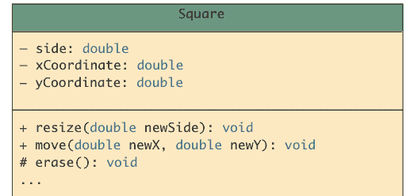

### 类交互


类图本身的价值有限，因为它们只是重复了类的接口，可能包含了一些省略。要理解一个设计，你需要指明各个类的对象如何交互。UML有多种方式来表示类交互；例如，各种带注释的箭头表示信息从一个类对象流向另一个类对象。UML还有用于将类分组为包的注释、用于继承的注释，以及用于其他交互的注释。此外，UML是可扩展的。如果UML中没有你需要的内容，你可以将其添加到UML中。当然，这一切都发生在规定的框架内，以便不同的软件开发人员能够理解彼此的UML。最基本的类交互之一是继承，这将在下一小节中讨论。

## 继承图

显示 12.2 展示了大学记录管理软件中使用的一些类的可能继承图。请注意，类图是不完整的。你通常只显示当前设计任务所需的那部分类图。注意，箭头从派生类向上指向其基类。

这些箭头还有助于定位方法定义。如果你正在查找某个类的方法定义，箭头显示了你（或计算机）应该遵循的路径。如果你正在查找类`Undergraduate`的对象所使用的方法的定义，你首先在类`Undergraduate`的定义中查找；如果找不到，就在类`Student`的定义中查找；如果还找不到，就在类`Person`的定义中查找。

### 显示 12.2 UML表示法中的类层次结构

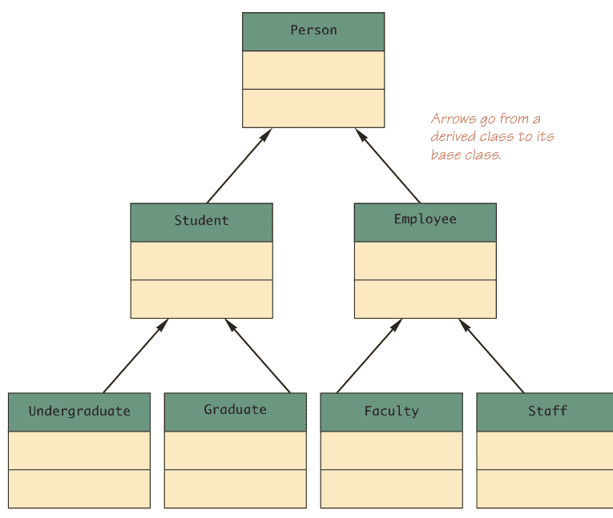

显示 12.3 展示了类`Person`及其派生类`Student`的继承层次结构的一些可能额外细节。假设`s`是类`Student`的一个对象。显示 12.3 中的图表告诉你，你可以找到以下代码的定义

```
s.toString();
```

和

```
s.set("Joe Student", 4242);
```

### 显示 12.3 UML类层次结构的一些细节

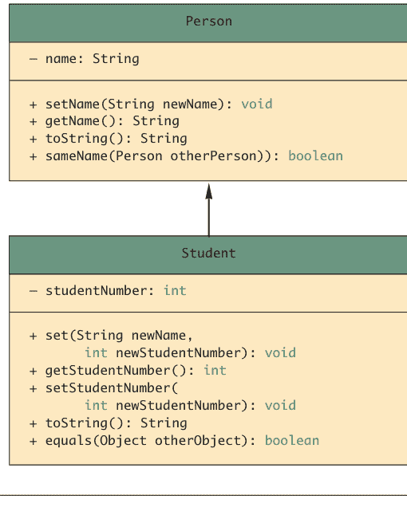

在类`Student`中，但以下代码的定义

```
s.setName("Josephine Student");
```

是在类`Person`的定义中找到的。

## 更多UML

这仅仅是UML内容的冰山一角。如果你有兴趣了解更多，请查阅众多可用的UML参考资料之一。

## 自测练习

1. 以显示 12.1 为模型，为一个对象表示圆的类绘制类图。

2. 假设`aStudent`是类`Student`的一个对象。根据显示 12.3 中的继承图，你将在哪里找到以下调用中使用的`sameName`方法的定义，该调用比较`aStudent`和另一个名为`someStudent`的对象？解释你的答案。

3. 假设`aStudent`是类`Student`的一个对象。根据显示 12.3 中的继承图，你将在哪里找到以下调用中使用的方法的定义？解释你的答案。

```
Student someStudent =
    new Student("Joe Student", 7777);
if (aStudent.sameName(someStudent))
    System.out.println("wow");
```

```
aStudent.setNumber(4242);
```

## 12.2 模式

> *我劝他从他人的生活中观察，如同照镜子，并以他人为榜样来塑造自己。*
>
> 泰伦斯（普布利乌斯·泰伦提乌斯·阿非尔） 公元前190-159年，《兄弟们》

模式是适用于各种软件应用的设计纲要。为了有用，该模式必须适用于各种情况。为了有实质内容，该模式必须对其适用的应用领域做出一些假设。例如，一个众所周知的模式是容器-迭代器模式。容器是一个类（或其他构造），其对象持有多个数据项。容器的一个例子是数组。本书后面将讨论的其他例子是向量和链表。任何设计用来持有多个值的类或其他构造都可以被视为容器。例如，一个`String`值可以被视为一个包含字符串中字符的容器。任何允许你遍历容器中所有项目的构造都是迭代器。例如，数组索引就是数组的迭代器。它可以按如下方式遍历数组：

```
for (int i = 0; i < a.length; i++)
    对 a[i] 进行某种操作
```

索引变量`i`就是迭代器。容器-迭代器模式描述了迭代器如何在容器上使用。

在这简短的一章中，我们只能让你领略一下模式是什么。在本节中，我们将讨论几个示例模式，让你了解模式是什么样子的。还有更多已知和使用的模式，以及更多待阐明的模式。这是一个新兴且仍在发展的软件工程领域。

### 适配器模式

适配器模式将一个类转换为另一个不同的类，而不改变底层类，只是添加了一个新的接口。（新接口替换了底层类的旧接口。）例如，在第11章中，我们提到了栈数据结构，它被用来（除其他外）跟踪递归。创建栈数据结构的一种方法是从一个数组开始，然后添加栈接口。适配器模式说从一个容器（如数组）开始，并添加一个接口（如栈接口）。

### 模型-视图-控制器模式

模型-视图-控制器模式是一种将应用程序的I/O任务与应用程序其余部分分离的方法。模式中的模型部分执行应用程序的核心功能。视图部分是输出部分；它显示模型状态的图像。控制器是输入部分；它将用户的命令中继给模型。通常，这三个交互部分中的每一个都实现为一个对象，负责其自身的任务。模型-视图-控制器模式是分而治之策略的一个例子。一个大任务被划分为三个具有明确定义职责的较小任务。显示 12.4 给出了模型-视图-控制器模式的图表。

作为一个非常简单的例子，模型可能是一个容器类，比如数组。视图可能显示数组的一个元素。控制器发出命令以显示指定索引处的元素。模型（数组）在数组内容改变或给出不同的索引位置时，通知视图显示新元素。

任何应用程序都可以适配模型-视图-控制器模式，但它特别适用于GUI（图形用户界面）设计项目，在这些项目中，视图确实可以是模型状态的可视化。（GUI界面就是大多数现代软件应用程序中出现的那种窗口界面，与本书至今使用的简单文本I/O相反。）例如，模型可能是一个表示你计算机桌面对象名称列表的对象。视图可以是一个GUI对象，用于生成桌面图标的屏幕显示。控制器将命令中继给模型（这是一个桌面对象）以添加或删除名称。当需要更新屏幕时，模型对象会通知视图对象。

我们介绍模型-视图-控制器模式时，仿佛用户是控制器。这主要是为了简化示例。控制器不必直接受用户控制，也可以是某种其他类型的软件或硬件组件。

### 显示 12.4 模型-视图-控制器模式

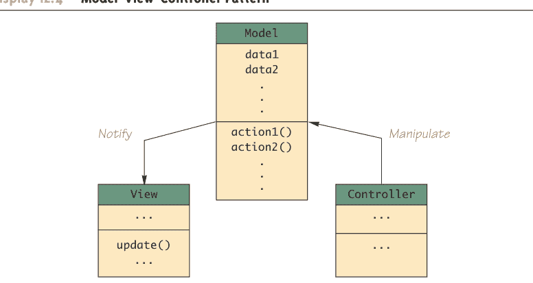

## 示例

### 一种排序模式

最高效的排序算法似乎都遵循类似的模式。以递归方式表达，它们将待排序的元素列表分成两个较小的列表，递归地对两个较小的列表进行排序，然后重新组合两个已排序的列表以获得最终的排序列表。在显示 12.5 中，这种模式以伪代码（实际上几乎是正确的Java代码）表达了一个使用`<`运算符将数组按升序排序的方法。

我们的排序模式使用了分而治之的策略。它将要排序的整个元素集合分成两个较小的集合，通过递归调用对较小的集合进行排序，然后合并两个已排序的集合以获得最终的排序数组。以下是我们排序模式的核心：

```
int splitPoint = split(a, begin, end);
sort(a, begin, splitPoint);
sort(a, splitPoint + 1, end);
join(a, begin, splitPoint, end);
```

尽管该模式确实对方法`split`和`join`施加了一些最低要求，但该模式并未具体说明方法`split`和`join`是如何定义的。`split`和`join`的不同定义将产生不同的排序算法。

### 显示 12.5 分治排序模式

```java
/**
 前提条件：数组 a 中从 a[begin] 到 a[end] 的区间内有元素。
 后置条件：该区间内的值已重新排列，使得 a[begin] <= a[begin+1] <= ... <= a[end]。
*/
public static void sort(Type[] a, int begin, int end)
{
    if ((end - begin) >= 1)
    {
       int splitPoint = split(a, begin, end);
       sort(a, begin, splitPoint);
       sort(a, splitPoint + 1, end);
       join(a, begin, splitPoint, end);
    }//else sorting one (or fewer) elements so do nothing.
}
```

要获得正确的 Java 方法定义，`Type`必须替换为合适的类型名称。

方法`split`和`join`的不同定义将实现该模式的不同变体。

### 示例（续）

`split`方法重新排列区间`a[begin]`到`a[end]`中的元素，并将重新排列后的区间在某个分割点`splitPoint`处划分。然后通过递归调用`sort`方法对两个较小的区间`a[begin]`到`a[splitPoint]`以及`a[splitPoint + 1]`到`a[end]`进行排序。注意，`split`方法既重新排列了数组区间`a[begin]`到`a[end]`中的元素，又返回了划分该区间的索引`splitPoint`。在两个较小区间排序后，`join`方法将这两个已排序的区间合并，从而获得整个较大区间的最终排序版本。

该模式并未说明`split`方法如何重新排列和划分区间`a[begin]`到`a[end]`。在一个简单的例子中，`split`可能只是选择`begin`和`end`之间的某个值作为`splitPoint`，并将区间划分为`splitPoint`之前的点和`splitPoint`之后的点，而不进行任何重新排列。我们将看到一个通过这种方式定义`split`来实现排序模式的例子。另一方面，`split`方法可以做更复杂的事情，例如将所有“小”元素移动到数组的前部，将所有“大”元素移动到数组的后部。这将是完全排序值过程中的一个步骤。我们也将看到一个以第二种方式实现排序模式的例子。

该排序模式最简单的实现是显示 12.6 中给出的归并排序实现。在这个实现中，数组基类型`Type`被特化为`double`类型。归并排序是一个`split`定义非常简单的例子。它只是将数组分成两个区间，而不重新排列元素。`join`方法则更复杂。在两个子区间排序后，`join`方法将这两个已排序的子区间合并，将元素从数组复制到临时数组中。合并过程从比较每个较小排序区间的最小元素开始。这两个元素中较小的一个是任一子区间中所有元素中最小的，因此将其移动到临时数组的第一个位置。然后对两个较小排序区间中的剩余元素重复此过程以找到下一个最小元素，依此类推。显示 12.7 展示了使用归并排序版本的`sort`的示例。

### 显示 12.6 排序模式的归并排序实现（第 1 部分，共 2 部分）

```java
/**
 实现分治排序模式并使用归并排序算法的类。
*/
public class MergeSort
{
    /**
     前提条件：数组 a 中从 a[begin] 到 a[end] 的区间内有元素。
     后置条件：该区间内的值已重新排列，使得 a[begin] <= a[begin+1] <= ... <= a[end]。
    */
    public static void sort(double[] a, int begin, int end)
    {
        if ((end - begin) >= 1)
        {
            int splitPoint = split(a, begin, end);
            sort(a, begin, splitPoint);
            sort(a, splitPoint + 1, end);
            join(a, begin, splitPoint, end);
        }//else sorting one (or fewer) elements so do nothing.
    }

    private static int split(double[] a, int begin, int end)
    {
        return ((begin + end)/2);
    }

    private static void join(double[] a, int begin, int splitPoint, int end)
    {
        double[] temp;
        int intervalSize = (end - begin + 1);
        temp = new double[intervalSize];
        int nextLeft = begin; //index for first chunk
        int nextRight = splitPoint + 1; //index for second chunk
        int i = 0; //index for temp

        //Merge till one side is exhausted:
        while ((nextLeft <= splitPoint) && (nextRight <= end))
        {
            if (a[nextLeft] < a[nextRight])
            {
                temp[i] = a[nextLeft];
                i++; nextLeft++;
            }
            else
            {
                temp[i] = a[nextRight];
                i++; nextRight++;
            }
        }

        while (nextLeft <= splitPoint)//Copy rest of left chunk, if any.
        {
            temp[i] = a[nextLeft];
            i++; nextLeft++;
        }

        while (nextRight <= end) //Copy rest of right chunk, if any.
        {
            temp[i] = a[nextRight];
            i++; nextRight++;
        }

        for (i = 0; i < intervalSize; i++)
            a[begin + i] = temp[i];
    }

}
```

### 示例（续）

`split`和`join`方法的复杂性之间存在权衡。你可以使其中一个简单，但代价是使另一个更复杂。对于归并排序，`split`是简单的，而`join`是复杂的。接下来我们给出一个`split`复杂而`join`简单的实现。

显示 12.8 给出了针对类型`double`的排序模式的**快速排序**实现。

在快速排序实现中，`split`的定义相当复杂。选择数组中的一个任意值；这个值被称为**分割值**。在我们的实现中，我们选择`a[begin]`作为分割值，但任何值都可以。数组中的元素被重新排列，使得所有小于或等于分割值的元素位于数组的前部，所有大于分割值的值位于数组的另一端，分割值被放置在划分整个数组为这些较小和较大元素的位置。注意，较小的元素未排序，较大的元素也未排序，但分割值之前的所有元素都小于分割值之后的任何元素。较小的元素通过递归调用排序，较大的元素通过另一次递归调用排序，然后这两个已排序的部分通过`join`方法合并。在这种情况下，`join`方法尽可能简单。它什么都不做。因为已排序的较小元素都排在已排序的较大元素之前，所以整个数组就有序了。

### 显示 12.7 使用 MergeSort 类

```java
public class MergeSortDemo
{
    public static void main(String[] args)
    {
        double[] b = {7.7, 5.5, 11, 3, 16, 4.4, 20, 14, 13, 42};
        System.out.println("Array contents before sorting:");
        int i;
        for (i = 0; i < b.length; i++)
            System.out.print(b[i] + " ");
        System.out.println();
        MergeSort.sort(b, 0, b.length-1);
        System.out.println("Sorted array values:");
        for (i = 0; i < b.length; i++)
            System.out.print(b[i] + " ");
        System.out.println();
    }
}
```

**示例对话**

排序前的数组内容：

7.7 5.5 11.0 3.0 16.0 4.4 20.0 14.0 13.0 42.0

排序后的数组值：

3.0 4.4 5.5 7.7 11.0 13.0 14.0 16.0 20.0 42.0

### 示例（续）

显示 12.8 中快速排序方法`sort`的演示程序在附带的 CD 中的`QuickSortDemo.java`文件中给出。


（归并排序和快速排序的实现都可以在不使用第二个临时数组 `temp` 的情况下完成。然而，这个细节只会分散本示例的主旨。在实际应用中，根据具体情况，你可能需要考虑是否采用不使用临时数组的排序实现方式。）

# 第12章 UML与设计模式

### 显示12.8 快速排序算法实现（第1部分，共2部分）

```
/**
 实现分治排序模式的类，
 使用快速排序算法。
 */
public class QuickSort
{
    /**
     前置条件：数组a的区间a[begin]到a[end]内有元素。
     后置条件：区间内的值已重新排列，
     使得a[begin] <= a[begin+1] <= ... <= a[end]。
     */
    public static void sort(double[] a, int begin, int end)
    {
        if ((end - begin) >= 1)
        {
            int splitPoint = split(a, begin, end);
            sort(a, begin, splitPoint);
            sort(a, splitPoint + 1, end);
            join(a, begin, splitPoint, end);
        }//否则，排序一个（或更少）元素，因此不做任何操作。
    }

    private static int split(double[] a, int begin, int end)
    {
        double[] temp;
        int size = (end - begin + 1);
        temp = new double[size];

        double splitValue = a[begin];
        int up = 0;
        int down = size - 1;

        //注意，a[begin] = splitValue 被跳过。
        for (int i = begin + 1; i <= end; i++)
        {
            if (a[i] <= splitValue)
            {
                temp[up] = a[i];
                up++;
            }
            else
            {
                temp[down] = a[i];
                down--;
            }
        }
    }
```

### 显示12.8 快速排序算法实现（第2部分，共2部分）

```
    //0 <= up = down < size
    
    //temp[i] <= splitValue 对于 i < up
    // temp[up] = splitValue
    // temp[i] > splitValue 对于 i > up
    for (int i = 0; i < size; i++)
        a[begin + i] = temp[i];
    
    }
    
    private static void join(double[] a, int begin,
                               int splitPoint, int end)
    {
        //无需执行任何操作。
    }
```

### 排序模式的限制

排序模式与其他所有模式一样，在其应用上存在一些限制。根据我们对排序模式的定义，它仅适用于定义了 `<` 运算符的类型，并且仅适用于按升序排序；它不适用于按降序排序。然而，这是为了使表述更清晰而简化细节的结果。你可以通过将 `<` 运算符替换名为 `compare` 的布尔值方法来使模式更具通用性。该方法接受数组基类型的两个参数，并根据第一个参数是否“在第二个参数之前”返回 `true` 或 `false`。那么，唯一的限制是 `compare` 方法必须具有合理的定义。¹ 这种通用化在第13题名为“Comparable接口”的小节中进行了讨论。

> ¹技术要求是 `compare` 方法必须是一个全序，这是第13章讨论的概念。本质上，你可能想要用于排序的所有常见排序都是全序。

`Comparable` 接口有一个 `compareTo` 方法，它与 `compare` 略有不同。但是，我们描述为 `compare` 的方法可以轻松地使用 `compareTo` 方法作为辅助方法来定义。

### 排序模式的效率 ☆

基本上，任何排序算法都可以使用这种排序模式来实现。然而，最有效的实现是那些 `split` 方法将数组分成两个相当大的部分（例如一半一半，或四分之一和四分之三）的实现。将数组分成一个或极少元素和其余部分的 `split` 实现效率不会很高。

例如，归并排序的 `split` 实现将数组大致分成两等份，归并排序确实非常高效。可以证明（尽管我们这里不会证明）归并排序的最坏情况运行时间在“量级上是最好的可能”。

快速排序的 `split` 实现将数组分成两部分，这两部分可能几乎相等，也可能大小差异很大，这取决于分割值的选择。由于在极其不走运的情况下，分割可能非常不均匀，因此快速排序的最坏情况运行时间不如归并排序快。然而，在实践中，快速排序被证明是一种非常好的排序算法，通常优于归并排序。

我们在第5章讨论的选择排序将数组分成两部分：一部分是单个元素，另一部分是数组区间的其余部分。（参见自测练习4。）由于这种不均匀的划分，选择排序的运行时间较差，尽管它确实具有简单性的优点。

### 提示

##### 实用性与设计模式

你不必严格遵循模式的所有细节。模式是指导原则，而非硬性要求。例如，我们严格按照模式实现了快速排序。这样做是为了有一个清晰的示例。在实践中，我们会采取一些变通。注意，在快速排序中，`join` 方法不执行任何操作。在实践中，我们会直接消除对 `join` 的调用。这些调用会产生开销且毫无作用。一旦算法的整体模式清晰，也可以进行其他优化。

### 模式形式化

有一套完善的技术用于使用模式。我们在此不深入细节。第12.1节讨论的UML是用于表达模式的一种形式化方法。模式在软件设计过程中的位置以及模式的任何特定形式化方法尚不清楚。然而，很明显，模式的基本思想以及某些模式名称，例如 *Model-View-Controller*，已成为软件设计的标准且有用的工具。

### 自测练习

4.  给出分治排序模式（显示12.5）的一个实现，该实现将为`double`类型的数组实现选择排序算法（显示6.11）。

5.  使用快速排序算法对数组进行排序时，以下哪种情况运行时间最快：完全有序的数组、随机值的数组，还是按从大到小排序（即反向排序）的数组？假设所有数组大小相同且基类型相同。

## 章节总结

-   统一建模语言（UML）是一种用于面向对象软件设计的图形表示语言。

-   模式是适用于各种软件应用的设计原则。

-   本章讨论的模式包括容器-迭代器、适配器、模型-视图-控制器和分治排序模式。

-   UML是一种可以且已被用于表达模式的形式化方法。

## 自测练习答案

1.  有多种正确答案。以下是其中一种：

| Circle |

| :--- |

| - radius: double<br>- centerX: double<br>- centerY: double |

| + resize(double newRadius): void<br>+ move(double newX, double newY): void<br># erase(): void<br>... |

2.  方法`sameName`未在`Student`类图中列出。因此，你需要沿着箭头找到`Person`类图。带有一个`Person`类型参数的`sameName`方法存在于`Person`类图中。由于你知道`Student`是`Person`的一种，你知道这个定义适用于带有一个`Student`类型参数的`sameName`方法。因此，用于`sameName`方法的定义在`Person`的类定义中。

3.  你从`Student`类图开始。带有一个`int`类型参数的`setStudentNumber`方法存在于`Student`类图中，因此你无需进一步查找。用于`setStudentNumber`方法的定义在`Student`的类定义中。

4.  此代码也包含在随书附带的CD上。此代码位于文件`SelectionSort.java`中。一个演示程序位于文件`SelectionSort-Demo.java`中。

```
public class SelectionSort
{
    public static void sort(double[] a,
                            int begin, int end)
    {
        if ((end - begin) >= 1)
        {
            int splitPoint = split(a, begin, end);
            sort(a, begin, splitPoint);
            sort(a, splitPoint + 1, end);
            join(a, begin, splitPoint, end);
        }//否则，排序一个（或更少）元素
        //因此不做任何操作。
    }

    private static int split(double[] a,
                             int begin, int end)
    {
        int index = indexOfSmallest(begin, a, end);
        interchange(begin, index, a);

        return begin;
    }

    private static void join(double[] a, int begin,
                             int splitPoint, int end)
    {
        //无需执行任何操作。
    }

    private static int indexOfSmallest(int startIndex,
                                       double[] a, int endIndex)
    {
        double min = a[startIndex];
        int indexOfMin = startIndex;
        int index;
        for (index = startIndex + 1;
             index < endIndex; index++)
            if (a[index] < min)
            {
```

## 编程项目

1.  下方的 UML 图描述了一个名为 `Movie` 的类。请在 Java 中实现该类，并编写一个 `main` 方法对其进行测试，该方法需创建多个 `Movie` 对象。`printDescription()` 方法应输出该类的所有成员变量。

| Movie |

|---|

| -title: String<br>-minutes: int<br>-year: int<br>-price: double |

| +Movie(in title: String, in minutes: int, in year: int, in price: double)<br>+getTitle() : String<br>+setTitle(in newTitle: String)<br>+printDescription() |

2.  下方的 UML 图展示了 `PizzaOrder` 类与 `Pizza` 类之间的关系：

    `Pizza` 类包含关于特定披萨的信息。变量 `pepperoni`、`sausage` 和 `mushrooms` 是布尔值，表示这些配料是否存在于披萨上。变量 `size` 是一个字符，其值可以是 `'s'`、`'m'` 或 `'l'`，分别表示小份、中份或大份。还有一个 `Pizza` 构造函数，用于初始化所有这些值。`getSize()` 方法返回披萨的大小，`getNumToppings()` 方法返回一个 0–3 的数字，具体取决于存在哪些配料（例如，如果披萨有意大利香肠和蘑菇，该方法将返回 2）。

    `PizzaOrder` 类包含一个披萨数组。有一个方法用于向数组中添加新披萨（这会递增 `numPizzas`），还有一个方法用于计算整个订单的成本。小份披萨 8 美元，中份披萨 10 美元，大份披萨 12 美元。每种配料为披萨增加 1 美元。

    连接 `PizzaOrder` 和 `Pizza` 的箭头表明 `PizzaOrder` 类持有对 `Pizza` 类的引用，反之则不然。`PizzaOrder` 类上的实心菱形是 UML 中的一个构造，表示 `PizzaOrder` 类拥有一个 `Pizza` 类的集合。一个 (1) `PizzaOrder` 可能对应多个 (*) `Pizza`。

    根据这些信息，编写 Java 代码实现 `Pizza` 和 `PizzaOrder` 类。同时，编写一个测试 `main` 函数，创建一个披萨订单，向其中添加几个披萨，并输出订单的成本。

3.  下方的 UML 图展示了四个类之间的关系。编写一个测试程序来实现这些类，并创建 `CreditCard`、`Cash` 和 `Check` 的实例。输出每个实例的字符串描述。请注意，斜体的 `Payment` 类表示这是一个抽象类。

4.  使用模型-视图-控制器模式来实现一个简单的基于定时器的计数器。该计数器应从一个用户指定的初始值开始，每秒增加一，直到达到用户指定的最终值。描绘该模式三个类的 UML 图如下所示：

    `CounterView` 类应简单地接收一个输入的计数值并将其打印在控制台屏幕上。

    `CounterModel` 类应有一个代表计数器值的变量。`increment` 方法将计数器加一，并调用 `CounterView` 的 `display` 方法。

    `CounterController` 类接收用户指定的起始值和结束值。然后使用起始值初始化 `CounterModel`。当调用 `start` 方法时，它将每秒调用一次 `CounterModel` 的 `increment` 方法，直到经过 (endValue - startValue) 秒。

    你需要实现上图所示之外的额外变量或方法，以创建类之间的链接。

    你可以使用方法调用 `Thread.sleep(1000)` 来让 `CounterController` 等待一秒。该调用必须放在 `try/catch` 块内。

    使用一个 `main` 方法测试你的程序，该方法应计算几个不同范围的值。

5.  可以购买将当前时间以二进制形式输出的“极客”手表。为了说明模型-视图-控制器模式的灵活性，请修改上一问题中的视图类 (`CounterView`)，使显示内容以二进制形式输出计数器的值。

    通过以二进制形式计数来测试你的新程序。你应该无需更改模型或控制器类。

6.  重新编写 `QuickSort` 类的实现，对 `sort` 方法进行两项效率改进：（1）消除对 `join` 的调用，因为它没有任何作用。（2）为恰好有两个元素的数组这一特殊情况添加代码，并使通用情况适用于三个或更多元素的数组。

7.  重新编写 `QuickSort` 类，使其按如下方式选择分割点：分割点是第一个元素、最后一个元素以及数组大约中间位置元素的中间值（按大小）。这将使非常不均匀的分割可能性降低。

8.  重新编写 `QuickSort` 类，使其包含项目 6 和 7 中给出的修改。

更多在线编程项目，请点击下方的 CodeMate 图标。

# 13.1 接口

## 语法的自主性

这是一个归功于诺姆·乔姆斯基的语言学概念。

在本节中，我们将描述*接口*。接口是一种类型，它将多个不同的类组合在一起，这些类都包含一组共同方法标题的方法定义。

## 接口

`interface` 有点像抽象类的极端情况。*接口不是类。然而，它是一种可以被任何实现该接口的类所满足的类型。* 接口是类的一个属性，它规定了类必须拥有的方法。

接口指定了在任何实现该接口的类中都必须定义的方法标题。例如，示例 13.1 显示了一个名为 `Ordered` 的接口。请注意，接口只包含方法标题。它不包含任何实例变量或完整的方法定义。（尽管，正如我们将看到的，它可以包含已定义的常量。）

要 `implement`（实现）一个接口，一个具体类（即非抽象类）必须做两件事：

1.  它必须在类定义的开头包含短语 `implements Interface_Name`。要实现多个接口，请列出所有接口名称，用逗号分隔，如 `implements SomeInterface, AnotherInterface`。

编译器或运行时系统都不会做任何事情来确保满足此注释。它只是对接口实现者的建议。

2.  该类必须实现接口定义中列出的*所有*方法标题。

例如，要实现 `Ordered` 接口，类定义必须在类定义的开头包含短语 `implements Ordered`，如下所示：

```java
public class OrderedHourlyEmployee
        extends HourlyEmployee implements Ordered
{
```

该类还必须实现 `precedes` 和 `follows` 两个方法。`OrderedHourlyEmployee` 的完整定义在示例 13.2 中给出。

### 示例 13.2 接口的实现


```java
public class OrderedHourlyEmployee
        extends HourlyEmployee implements Ordered
{
    public boolean precedes(Object other)
    {
        if (other == null)
            return false;
        else if (!(other instanceof HourlyEmployee))
            return false;
        else
        {
            OrderedHourlyEmployee otherOrderedHourlyEmployee =
                                    (OrderedHourlyEmployee)other;
            return (getPay() < otherOrderedHourlyEmployee.getPay());
        }
    }

    public boolean follows(Object other)
    {
        if (other == null)
            return false;
        else if (!(other instanceof OrderedHourlyEmployee))
            return false;
        else
        {
            OrderedHourlyEmployee otherOrderedHourlyEmployee =
                                    (OrderedHourlyEmployee)other;
            return (otherOrderedHourlyEmployee.precedes(this));
        }
    }
}
```

> 虽然 `getClass` 在定义 `equals` 方面比 `instanceof` 更好，但在这里 `instanceof` 更适用。不过，对于此处要说明的观点，两者都可以。

接口及其所有方法标题通常被声明为 `public`（公共）。它们不能被赋予 `private`、`protected` 或包访问权限。（可以省略修饰符 `public`，但所有方法仍将被视为公共的。）当一个类实现一个接口时，它必须使接口中的所有方法都是公共的。

接口是一种类型。这允许你编写一个具有接口类型参数的方法，例如类型为 `Ordered` 的参数，该参数将接受你以后定义的任何实现该接口的类作为实参。

接口的作用类似于基类，但需要注意的是，它不是基类。（事实上，它不是任何类型的类。）一些编程语言（如 `C++`）允许一个类同时是两个或多个不同基类的派生类。这在 `Java` 中是不允许的。在 `Java` 中，一个派生类只能有一个基类。然而，除了 `Java` 类可能拥有的任何基类之外，它还可以实现任意数量的接口。这使得 `Java` 程序能够近似多重基类的功能，而不会出现多重基类可能带来的复杂问题。

你可能想说 `Ordered` 接口（示例 13.2）中 `precedes` 的参数与执行实现的类（例如 `OrderedHourlyEmployee`）是相同的。在 `Java` 中没有办法这样说，所以我们通常将此类参数设为 `Object` 类型。将 `precedes` 的参数设为 `Ordered` 类型是合法的，但这通常并不比将参数类型设为 `Object` 更可取。如果你将参数设为 `Ordered` 类型，你仍然需要处理 `null` 的情况以及参数是 `Ordered` 类型但不是 `OrderedHourlyEmployee` 类型的情况。

接口定义存储在 `.java` 文件中，并且像类定义一样进行编译。

### 实现接口的抽象类

正如你在上一小节中所看到的，一个具体类（即常规类）必须为接口中给出的所有方法标题提供定义，才能实现该接口。然而，你可以定义一个实现接口的抽象类，但只为接口中给出的部分方法标题提供定义。接口中给出的未提供定义的方法标题将被设为抽象方法。一个简单的例子在示例 13.3 中给出。

### 示例 13.3 实现接口的抽象类

```java
public abstract class MyAbstractClass implements Ordered
{
    int number;
    char grade;

    public boolean precedes(Object other)
    {
        if (other == null)
            return false;
        else if (!(other instanceof HourlyEmployee))
            return false;
        else
        {
            MyAbstractClass otherOfMyAbstractClass =
                                        (MyAbstractClass)other;
            return (this.number < otherOfMyAbstractClass.number);
        }
    }

    public abstract boolean follows(Object other);
}
```

### 派生接口

你可以从一个基接口派生一个接口。这通常被称为扩展接口。其细节类似于派生类。一个例子在示例 13.4 中给出。

### 示例 13.4 扩展接口

```java
public interface ShowablyOrdered extends Ordered
{
    /**
     Outputs an object of the class that precedes the calling object.
    */
    public void showOneWhoPrecedes();
}
```

> 编译器或运行时系统都不会做任何事情来确保满足此注释。

一个（具体）类要实现 `ShowablyOrdered` 接口，必须为 `showOneWhoPrecedes` 方法提供定义，并且还必须为 `Ordered` 接口中给出的 `precedes` 和 `follows` 方法提供定义。

## 接口

接口是一种类型，它指定了方法标题（并且，正如我们将看到的，可能还包括已定义的常量）。定义接口的语法类似于定义类的语法，只是使用了 `interface` 一词代替 `class`，并且只给出没有任何方法体的方法标题（但后跟分号）。

请注意，接口没有实例变量，也没有方法定义。

一个类可以实现任意数量的接口。要实现一个接口，该类必须在类标题的末尾包含 `implements Interface_Name`，并且必须为接口中给出的方法标题提供定义。如果该类没有为接口中给出的所有方法标题提供定义，那么该类必须是抽象类，并且没有定义的方法标题必须是抽象方法。

# 示例

参见示例 13.1、13.2 和 13.3。

## 自我测试练习

- 1. 你能拥有一个接口类型的变量吗？你能拥有一个接口类型的参数吗？
- 2. 抽象类可以实现接口吗？
- 3. 派生类可以有两个基类吗？它可以实现两个接口吗？
- 4. 接口可以实现另一个接口吗？

### 陷阱

#### 接口语义未被强制执行

就 `Java` 编译器而言，接口有语法但没有语义。例如，`Ordered` 接口的定义（示例 13.1）在注释中说明了以下内容：

```java
/**
 For objects of the class o1 and o2,
 o1.follows(o2) == o2.precedes(o1).
 */
```

你可能假设即使接口中没有注释，这也是正确的。毕竟，在现实世界中，如果我领先于你，那么你就跟随我。然而，这是将你对 "precedes" 一词的直觉解释赋予了它。

（续）

就编译器和运行时系统而言，`Ordered` 接口仅仅规定了 `precedes` 和 `follows` 方法各自接受一个 `Object` 类型的参数并返回一个布尔值。该接口实际上并未要求布尔值必须以任何特定方式计算。例如，即使 `precedes` 和 `follows` 方法总是返回 `true`，或者总是返回 `false`，编译器也会满意。它甚至允许这些方法使用随机数生成器在 `true` 和 `false` 之间做出随机选择。

如果我们能够安全地为接口赋予一些简单的语义，比如规定 `o1.follows(o2)` 与 `o2.preceded(o1)` 含义相同，那将是很好的。然而，如果 `Java` 真的允许这样做，那么当一个类实现两个接口，或者一个类派生自一个基类并实现一个接口时，就会出现问题。这两种情况中的任何一种都可能为同一个方法产生两个都必须实现的语义条件，而这两个语义可能并不一致。例如，假设（与事实相反）你可以要求 `o1.follows(o2)` 与 `o2.preceded(o1)` 含义相同。你也可以定义另一个具有不一致语义的接口，比如规定 `precedes` 总是返回 `true`，而 `follows` 总是返回 `false`。只要一个类可以有两个对象，就没有任何办法能让一个类同时实现这两种语义。`Java` 中的接口行为非常规范，其代价是你不能指望 `Java` 在接口中强制执行任何语义。

如果你想为接口指定语义，可以将其添加到文档中，如 13.1 节和 13.4 节中的注释所示，但请始终记住，这些只是注释；它们不会被编译器或运行时系统强制执行，因此你不能完全依赖这些语义被遵守。然而，我们生活在一个不完美的世界里，有时你会发现必须为接口指定语义；你会在接口的文档中这样做。那么，实现该接口的程序员就有责任遵守这些语义。

在阐明了接口语义不由编译器或运行时系统强制执行这一点之后，我们仍然想敦促你遵守接口的指定语义。为实现接口的类编写的软件将假设任何实现该接口的类都满足指定的语义。因此，如果你定义了一个实现接口但不满足接口语义的类，那么为实现该接口的类编写的软件可能无法在你的类上正常工作。

## 接口语义不被强制执行

当你定义一个实现接口的类时，编译器和运行时系统会允许你以任何你想要的方式定义接口方法的主体，只要你保持方法头与接口中给出的一致即可。然而，每当你定义一个实现某个接口的类时，你都应该遵守该接口的指定语义；否则，为该接口编写的软件可能无法在你的类上工作。

## Comparable 接口

本小节需要第 6 章关于数组的内容。如果你还没有学过第 6 章，可以跳过本节和接下来的编程示例，而不会损失任何连贯性。如果你已经阅读了第 6 章，就不应该将本节视为可选内容。

在第 6 章（清单 6.11）中，我们介绍了一种将部分填充的 `double` 类型数组按升序排序的方法。将这段代码转换为按降序而非升序排序的方法非常容易。（如果你不清楚这一点，请参阅第 6 章的自测练习 20 及其答案。）修改代码以获得对整数而非 `double` 进行排序或按字母顺序对字符串进行排序的方法也很容易。尽管这些修改很容易，但它们似乎是，并且实际上确实是，一种无用的麻烦。所有这些排序方法本质上都是相同的。唯一的区别是被排序的值的类型和排序的定义。看起来我们应该能够提供一个涵盖所有这些情况的单一排序方法。`Comparable` 接口让我们做到了这一点。

`Comparable` 接口位于 `java.lang` 包中，因此你的程序可以自动使用它。`Comparable` 接口只有以下方法头，类必须实现它才能实现 `Comparable` 接口：

```java
public int compareTo(Object other);
```

`Comparable` 接口有其语义，实现 `Comparable` 接口的程序员有责任遵守此语义。该语义规定 `compareTo` 返回：

- 如果调用对象“在”参数 `other` “之前”，则返回一个负数；
- 如果调用对象“等于”参数 `other` ，则返回零；
- 如果调用对象“在”参数 `other` “之后”，则返回一个正数。

几乎所有合理的“在之前”的概念都应该是可以接受的。特别是，数字上的所有标准小于关系以及字符串的词典顺序都适合作为 `compareTo` 的排序依据。（“在之后”的关系只是“在之前”的反面。）如果你需要考虑其他排序方式，精确的规则是排序必须是全序，这意味着必须满足以下规则：

- （非自反性）对于任何对象 `o`，`o` 都不在 `o` 之前。
- （三歧性）对于任意两个对象 `o1` 和 `o2`，以下情况有且仅有一种成立：`o1` 在 `o2` 之前，`o1` 在 `o2` 之后，或者 `o1` 等于 `o2`。
- （传递性）如果 `o1` 在 `o2` 之前，且 `o2` 在 `o3` 之前，那么 `o1` 在 `o3` 之前。

如果可能，`compareTo` 方法语义中的“等于”应该与 `equals` 方法一致，但这并非语义的绝对要求。

由于 `compareTo` 的参数类型为 `Object`，传递给 `compareTo` 的参数可能不是正在定义的类的对象。如果参数 `other` 与正在定义的类类型不同，则语义规定应抛出 `ClassCastException`。

## Comparable 接口

`Comparable` 接口位于 `java.lang` 包中，因此你的程序可以自动使用它。`Comparable` 接口只有以下方法头，类必须为其提供定义才能实现 `Comparable` 接口：

```java
public int compareTo(Object other);
```

如果调用对象“在”参数 `other` “之前”，方法 `compareTo` 应返回一个负数；如果调用对象“等于”参数 `other` ，应返回零；如果调用对象“在”参数 `other` “之后”，应返回一个正数。

作为 `compareTo` 基础的“在之前”排序应该是全序。大多数正常的排序，如数字上的小于排序和字符串的词典顺序，都是全序。

如果你定义了一个实现 `Comparable` 接口但不满足这些条件的类，那么为 `Comparable` 对象编写的代码将无法正常工作。程序员你有责任确保语义得到满足。编译器和运行时系统都不会在 `Comparable` 接口上强制执行任何语义。

如果你阅读了本小节，还应该阅读接下来的编程示例。

# 示例

### 使用 Comparable 接口

清单 13.5 展示了一个类，其方法可以对任何部分填充的数组进行排序，该数组的基类型实现了 `Comparable` 接口（包括实现我们在前一小节讨论的语义）。为了得到清单 13.5 中的代码，我们从清单 6.11 的排序代码开始，机械地将所有出现的数组类型 `double[]` 替换为 `Comparable[]`。我们将所有形式为

```
Expression_1 < Expression_2
```

的布尔表达式替换为

```
Expression_1.compareTo(Expression_2) < 0
```

# 显示 13.5 可比较数组的排序方法（第 1 部分，共 2 部分）

```java
public class GeneralizedSelectionSort
{
    /**
       前提条件：numberUsed <= a.length;
                前 numberUsed 个索引变量已被赋值。
       操作：对数组 a 进行排序，使得 a[0], a[1], ... , a[numberUsed - 1] 按照 compareTo 方法升序排列。
    */
    public static void sort(Comparable[] a, int numberUsed)
    {
        int index, indexOfNextSmallest;
        for (index = 0; index < numberUsed - 1; index++)
        {//将正确的值放入 a[index]：
            indexOfNextSmallest = indexOfSmallest(index, a, numberUsed);
            interchange(index, indexOfNextSmallest, a);
            //a[0], a[1],..., a[index] 已正确排序，且它们是原数组元素中最小的。
            //剩余位置包含原数组的其余元素。
        }
    }

    /**
       返回值在 a[startIndex], a[startIndex+1], ... a[numberUsed - 1] 中
       最小值的索引。
    */
    private static int indexOfSmallest(int startIndex,
                                      Comparable[] a, int numberUsed)
    {
        Comparable min = a[startIndex];
        int indexOfMin = startIndex;
        int index;
        for (index = startIndex + 1; index < numberUsed; index++)
            if (a[index].compareTo(min) < 0)//如果 a[index] 小于 min
            {
                min = a[index];
                indexOfMin = index;
                //min 是 a[startIndex] 到 a[index] 中的最小值
            }
        return indexOfMin;
    }
}
```


# 显示 13.5 可比较数组的排序方法（第 2 部分，共 2 部分）

```java
/**
    前提条件：i 和 j 是数组 a 的合法索引。
    后置条件：a[i] 和 a[j] 的值已被交换。
*/
private static void interchange(int i, int j, Comparable[] a)
{
    Comparable temp;
    temp = a[i];
    a[i] = a[j];
    a[j] = temp; //a[i] 的原始值
}
```

## 示例（续）

我们还稍微修改了注释，使其与`compareTo`符号保持一致。修改内容在显示 13.5 中已高亮标出。代码只需要四处小的改动。

显示 13.6 展示了使用显示 13.5 中排序方法的演示。要理解演示为何有效，你需要知道`Double`和`String`类都实现了`Comparable`接口这一事实。

如果你查看`Double`类的完整文档，你会发现`Double`实现了`Comparable`接口，因此有一个`compareTo`方法。此外，对于`Double`对象`o1`和`o2`，

```java
o1.compareTo(o2) < 0 //o1 "排在" o2 "之前"
```

与以下表达式含义相同：

```java
o1.doubleValue() < o2.doubleValue()
```

因此，`Double`类的`Comparable`接口实现实际上就是`Double`对象所对应的`double`值之间普通的"小于"关系。

类似地，如果你查看`String`类的完整文档，你会看到`String`实现了`Comparable`接口，因此也有一个`compareTo`方法。此外，`String`类的`compareTo`方法的实现实际上就是字符串之间普通的字典顺序关系。

# 显示 13.6 可比较数组的排序（第 1 部分，共 2 部分）

```java
1  /**
2   * 演示对实现 Comparable 接口的类进行数组排序。
3   */
4  public class ComparableDemo
5  {
6      public static void main(String[] args)
7      {
8          Double[] d = new Double[10];
9         for (int i = 0; i < d.length; i++)
10             d[i] = new Double(d.length - i);
11
12         System.out.println("排序前：");
13         int i;
14         for (i = 0; i < d.length; i++)
15             System.out.print(d[i].doubleValue() + ", ");
16         System.out.println();
17
18         GeneralizedSelectionSort.sort(d, d.length);
19
20         System.out.println("排序后：");
21         for (i = 0; i < d.length; i++)
22             System.out.print(d[i].doubleValue() + ", ");
23         System.out.println();
24
25         String[] a = new String[10];
26         a[0] = "dog";
27         a[1] = "cat";
28         a[2] = "cornish game hen";
29         int numberUsed = 3;
30
31         System.out.println("排序前：");
32         for (i = 0; i < numberUsed; i++)
33             System.out.print(a[i] + ", ");
34         System.out.println();
35
36         GeneralizedSelectionSort.sort(a, numberUsed);
```

`Double`和`String`类确实实现了`Comparable`接口。

# 显示 13.6 可比较数组的排序（第 2 部分，共 2 部分）

```java
33 System.out.println("排序后：");
34 for (i = 0; i < numberUsed; i++)
35 System.out.print(a[i] + ", ");
36 System.out.println();
37 }
38 }
```

## 示例对话

排序前：

10.0, 9.0, 8.0, 7.0, 6.0, 5.0, 4.0, 3.0, 2.0, 1.0,

排序后：

1.0, 2.0, 3.0, 4.0, 5.0, 6.0, 7.0, 8.0, 9.0, 10.0,

排序前：

dog, cat, cornish game hen,

排序后：

cat, cornish game hen, dog,

### 示例（续）

此编程示例使用了标准库类`Double`和`String`作为数组的基类型。只要你定义的类实现了`Comparable`接口（包括我们之前讨论的标准语义），你也可以对基类为你定义的类的数组执行相同操作。

此编程示例确实指出了接口的一个限制。它们只能应用于类。原始类型不能实现接口。因此，在显示 13.6 中，我们无法使用可比较数组的排序方法对基类型为`double`的数组进行排序。我们不得不转而对基类型为`Double`的数组进行排序。这是使用包装类及其"包装类特性"的一个好例子。

### 自测练习

这些练习针对`Comparable`接口相关材料。

5. 显示 13.5 中的`interchange`方法没有用到其第二个参数是基类型为`Comparable`的数组这一事实。假设我们将参数类型`Comparable[]`更改为`Object[]`，并将变量`temp`的类型更改为`Object`。那么显示 13.6 中的程序会产生相同的对话吗？

6. 以下是`Comparable`接口的合适实现吗？

```java
public class Double2 implements Comparable
{
    private double value;

    public Double2(double theValue)
    {
        value = theValue;
    }

    public int compareTo(Object other)
    {
        return -1;
    }

    public double doubleValue()
    {
        return value;
    }
}
```

你可以将底层的"排在...之前"的关系理解为：对于任何对象`d1`和`d2`，`d1`都排在`d2`之前。

7. 假设你有一个名为`Circle`的类，它表示所有圆心都在同一点的圆。（为了具体化，你可以假设这些圆位于通常的`x,y`平面，并且所有圆心都在原点。）假设`Circle`类中有一个返回布尔值的方法`inside`，使得对于圆`c1`和`c2`，

`c1.inside(c2)`

在`c1`完全位于`c2`内部（并且`c2`与`c1`不是同一个圆）时返回`true`。以下是否构成全序关系？

如果`c1`在`c2`内部（即`c1.inside(c2)`返回`true`），则`c1`排在`c2`之前。

你可以用表示圆半径的单个`double`类型值来表示`Circle`类的对象，但答案并不依赖于这些细节。

# 接口中的定义常量

Java设计者经常使用接口机制来处理一些并不真正符合接口应有精神的各种杂项细节。其中一个例子是使用接口来命名一组定义常量。

接口可以包含定义常量以及方法声明，或者替代方法声明。当一个类实现该接口时，它会自动获得这些定义常量。例如，以下接口定义了月份的常量：

```java
public interface MonthNumbers
{
    public static final int JANUARY = 1,
        FEBRUARY = 2, MARCH = 3, APRIL = 4, MAY = 5,
        JUNE = 6, JULY = 7, AUGUST = 8, SEPTEMBER = 9,
        OCTOBER = 10, NOVEMBER = 11, DECEMBER = 12;
}
```

任何实现`MonthNumbers`接口的类都将自动拥有`MonthNumbers`接口中定义的 12 个常量。例如，考虑以下示例类：

```java
public class DemoMonthNumbers implements MonthNumbers
{
    public static void main(String[] args)
    {
        System.out.println(
            "January 的编号是 " + JANUARY);
    }
}
```

请注意，常量`JANUARY`在`DemoMonthNumbers`类中使用，但并未在该类中定义。`DemoMonthNumbers`类自动获得了月份常量，因为它实现了`MonthNumbers`接口。

接口不能包含实例变量，尽管它可以使用实例变量的语法来定义常量。接口中定义的任何变量都必须是`public`、`static`和`final`的，因此Java允许你省略这些修饰符。以下是`MonthNumbers`接口的等效定义：

```java
public interface MonthNumbers
{
    int JANUARY = 1,
        FEBRUARY = 2, MARCH = 3, APRIL = 4, MAY = 5,
        JUNE = 6, JULY = 7, AUGUST = 8, SEPTEMBER = 9,
        OCTOBER = 10, NOVEMBER = 11, DECEMBER = 12;
}
```

因此，接口可以用来为一组定义的常量命名，这样你就能通过实现该接口轻松地将所需的常量添加到任何类中。这确实与我们之前所见的接口用法不同，之前的用法是利用接口来指定方法头。在单个接口中同时包含定义的常量和方法头是合法的。

> 陷阱

## 不一致的接口

Java允许一个类只有一个基类，但也允许它实现任意数量的接口。一个类只能有一个基类的原因在于，如果Java允许有两个基类，这两个基类可能会对同一个方法头提供不同且不一致的定义。由于接口完全没有方法体，当一个类实现两个接口时，就不会出现这个问题。Java的设计者们显然希望实现的理想是，任何两个接口都将是始终一致的。然而，这个理想并未完全实现。尽管现象罕见，但两个接口可能不一致。事实上，不一致的表现不止一种。如果你编写一个实现了两个不一致接口的类定义，那就是一个错误，该类定义是非法的。让我们看看两个接口如何会不一致。

两个接口不一致的最明显方式是定义同名但不同值的两个常量。例如：

```java
public interface Interface1
{
    int ANSWER = 42;
}

public interface Interface2
{
    int ANSWER = 0;
}
```

假设一个类定义以

```java
public class MyClass
       implements Interface1, Interface2
{ ...
```

开头。显然这必须是非法的，实际上也是非法的。定义的常量`ANSWER`不能同时是`42`和`0`。²

即使是两个方法头也可能不一致。例如，考虑以下两个接口：

```java
public interface InterfaceA
{
    public int getStuff();
}

public interface InterfaceB
{
    public String getStuff();
}
```

假设一个类定义以

```java
public class YourClass
            implements InterfaceA, InterfaceB
{ ...
```

开头。显然这必须是非法的，实际上也是非法的。类`YourClass`中的方法`getStuff`不能同时是一个返回`int`的方法和一个返回`String`类型值的方法。（记住，你不能基于返回类型重载方法；因此，重载不能用来规避这个问题。）

## 726 第13章 接口与内部类

### 自测练习

8. 下面的程序能编译吗？如果能编译，它能运行吗？`Interface1`和`Interface2`在前面小节中已定义。

```java
public class MyClass
            implements Interface1, Interface2
{
    public static void main(String[] args)
    {
        System.out.println(ANSWER);
    }
}
```

> ² 如果类从未使用常量`ANSWER`，那么就不存在不一致，该类将编译并运行，不会出现错误消息。

### 自测练习（续）

9. 下面的程序能编译吗？如果能编译，它能运行吗？`Interface1`和`Interface2`在前面小节中已定义。

```java
public class MyClass
        implements Interface1, Interface2
{
    public static void main(String[] args)
    {
        System.out.println("Hello");
    }
}
```

10. 下面的程序能编译吗？如果能编译，它能运行吗？`InterfaceA`和`InterfaceB`在前面小节中已定义。

```java
public class YourClass
            implements InterfaceA, InterfaceB
{
    public String getStuff()
    {
        return "one";
    }
}
```

11. 下面的两个接口和下面的程序类能编译吗？如果它们能编译，程序能无错误地运行吗？

```java
public interface InterfaceA
{
    public int getStuff();
}
public interface InterfaceOtherB
{
    public String getStuff(String someStuff);
}
public class OurClass
            implements InterfaceA, InterfaceOtherB
{
    private int intStuff = 42;

    public static void main(String[] args)
    {
        OurClass object = new OurClass();
        System.out.println(object.getStuff()
                        + object.getStuff(" Hello"));
    }
}
```

```java
public int getStuff()
{
    return intStuff;
}

public String getStuff(String someStuff)
{
    return someStuff;
}
```

## `Serializable` 接口 ☆

正如我们已经注意到的，Java的设计者经常使用接口机制来处理各种实际上并不符合接口应有之义的细节。一个极端的例子是`Serializable`接口。`Serializable`接口没有方法头，也没有定义的常量。作为一个传统的接口，它是毫无意义的。然而，Java将其用作一种类型标签，表示程序员允许系统以特定方式实现文件I/O。如果你想了解这种文件I/O的实现方式，请参阅第10章，其中详细讨论了`Serializable`接口。

## `Cloneable` 接口

`Cloneable`接口是另一个Java将接口机制用于其传统角色之外的例子。`Cloneable`接口没有必须实现的方法头（也没有定义的常量）。然而，它用于说明从`Object`类继承的`clone`方法应如何使用以及应如何重新定义。

那么，`Cloneable`接口的目的是什么？当你定义一个类来实现`Cloneable`接口时，你就是在同意以特定方式重新定义`clone`方法（从`Object`继承的）。这样做的主要动机似乎是出于安全问题。如果操作不当，克隆可能会复制私有数据。此外，某些软件可能依赖于你以特定方式重新定义`clone`方法。程序员们对于如何处理克隆和`Cloneable`接口持有强烈且不同的观点。以下是官方关于如何执行此操作的Java立场。

`Object.clone()`方法对存储中的对象数据进行逐位复制。如果数据全是原始类型数据或不可变类类型的数据（如`String`），那么这能正常工作，且不会产生意外的副作用。然而，如果对象中的数据包含类型为可变类的实例变量，那么这将导致我们所谓的*隐私泄露*。（参见第5章中题为"隐私泄露"的陷阱部分。）为了避免在派生类中定义`clone`方法时出现这些隐私泄露，你应该调用基类`Object`（或任何基类）的`clone`方法，然后重置所有类型为可变类类型的新实例变量的值。你应该将这些实例变量重置为调用对象中实例变量的副本。还有异常处理的问题需要处理。一个例子可能比抽象的讨论更清晰。


让我们从简单的情况开始。假设你的类没有可变类类型的实例变量，或者换句话说，假设你的类拥有的实例变量类型都是原始类型或不可变类类型，比如`String`。为了更简单，假设你的类没有指定基类，因此基类是`Object`。如果你想实现`Cloneable`接口，你应该按照显示13.7那样定义`clone`方法。

需要`try-catch`块是因为，如果类没有正确实现`Cloneable`接口，继承的方法`clone`可能会抛出`CloneNotSupportedException`异常。当然，在这种情况下异常永远不会被抛出，但编译器仍然会坚持要求`try-catch`块。

现在让我们假设你的类有一个名为`DataClass`的可变类类型的实例变量。那么，`clone`方法的定义应如显示13.8所示。首先通过调用`super.clone()`对对象进行逐位复制。复制的危险部分在于指向实例变量`someVariable`。因此，该引用被替换为指向名为`someVariable`的对象副本的引用。这是通过以下行完成的：<sup>3</sup>

```
copy.someVariable = (DataClass)someVariable.clone();
```

现在，由`copy`命名的对象是安全的，因此可以由`clone`方法返回。

如果还有更多具有可变类类型的实例变量，那么你需要为每个可变实例变量重复我们为`someVariable`所做的操作。

这要求`DataClass`类型有一个正确工作的、标记为`public`的`clone`方法，如果`DataClass`类型按我们现在描述的方式实现了`Cloneable`接口，那么这个要求就得到了满足。也就是说，`DataClass`应该遵循显示13.7或显示13.8的模型（选择适当的那一个）来实现`Cloneable`接口；类似地，`DataClass`中所有实例变量的类都应该遵循显示13.7或显示13.8的模型，并且以此类推，一直到内部类的实例变量类。你希望视野中的每个类以及视野中每个类使用的每个类都遵循显示13.7或显示13.8的模型。

同样的基本技术也适用于你的类派生自`Object`以外的其他类的情况，只不过在这种情况下，通常不需要必需的异常处理。在从`Object`以外的基类派生的类中实现`Cloneable`接口的细节如下：基类必须正确实现`Cloneable`接口，并且派生类必须处理在派生类定义中添加的任何可变类实例变量。这些新的可变类实例变量通过显示13.8中为实例变量`someVariable`所示的技术来处理。只要基类正确实现了`Cloneable`接口，包括按我们正在描述的方式定义`clone`方法，那么派生类的`clone`方法就无需担心任何继承的实例变量。此外，通常你不需要为`CloneNotSupportedException`设置`try`和`catch`块，因为基类的`clone`方法`super.clone()`通常会捕获其所有的`CloneNotSupportedException`，因此`super.clone()`永远不会抛出`CloneNotSupportedException`。（参见自测练习13中的示例。）

```
public class YourCloneableClass implements Cloneable
{
    .
    .
    .
    public Object clone()
    {
        try
        {
             return super.clone(); //调用基类Object中的clone
                                 //方法
         }
         catch(CloneNotSupportedException e)
         {//这不应该发生。
             return null; //让编译器满意。
         }
     }
     .
     .
     .
}
```

## 显示13.8 方法clone的实现（较难情况）

```
1  public class YourCloneableClass2 implements Cloneable
2  {
3      private DataClass someVariable;
4          .
5          .
6          .
7      public Object clone()
8      {
9          try
10         {
11             YourCloneableClass2 copy =
12                 (YourCloneableClass2)super.clone();
13             copy.someVariable = (DataClass)someVariable.clone();
14             return copy;
15         }
16         catch(CloneNotSupportedException e)
17         {//这不应该发生。
18             return null; //为了让编译器满意。
19         }
20     }
21          .
22          .
23          .
24  }
```

*`DataClass`是一个可变类。任何其他实例变量都是原始类型或不可变类型（如`String`）。*

*如果`clone`方法的返回类型是`DataClass`而不是`Object`，那么就不需要这种类型转换。*

*`DataClass`类也必须正确实现`Cloneable`接口，包括按我们正在描述的方式定义`clone`方法。*

### 自测练习

12. 修改以下类定义，使其正确实现`Cloneable`接口（所有实例变量均显示）：

```
public class StockItem
{
    private int number;
    private String name;
    public void setNumber(int newNumber)
    {
        number = newNumber;
    }
    ...
}
```

13. 修改以下类定义，使其正确实现`Cloneable`接口（所有新实例变量均显示）：

```
public class PricedItem extends StockItem
{
    private double price;

    ...
}
```

14. 修改以下类定义，使其正确实现`Cloneable`接口（所有实例变量均显示）：

```
public class Record
{
    private StockItem item1;
    private StockItem item2;
    private String description;

    ...
}
```

15. 修改以下类定义，使其正确实现`Cloneable`接口（所有新实例变量均显示）：

```
public class BigRecord extends Record
{
    private StockItem item3;

    ...
}
```

16. 修改`Date`类的定义（显示4.13），使其实现`Cloneable`接口。确保以显示13.7的风格定义`clone`方法。

17. 修改`Employee`类的定义（显示7.2），使其实现`Cloneable`接口。确保以显示13.8的风格定义`clone`方法。

18. 修改`HourlyEmployee`类的定义（显示7.3），使其实现`Cloneable`接口。确保以显示13.8的风格定义`clone`方法。

## 13.2 内部类的简单用法

> 每个时代的统治思想始终是其统治阶级的思想。

卡尔·马克思和弗里德里希·恩格斯，《共产党宣言》

*内部类*是在其他类内部定义的类。在本节中，我们将描述内部类最有用的应用之一，即用作辅助类的内部类。

### 辅助类

定义内部类非常简单；只需在另一个类中包含内部类的定义，如下所示：

```
public class OuterClass
{
    private class InnerClass
    {
        Declarations_of_InnerClass_Instance_Variables
        Definitions_of_InnerClass_Methods
    }

    Declarations_of_OuterClass_Instance_Variables
    Definitions_of_OuterClass_Methods
}
```

正如这个大纲所示，包含内部类的类称为**外部类**。内部类（或多个内部类）的定义不必是外部类的第一项，但最好将其放在开头或结尾，以便于查找。内部类不必是`private`，但这是本节中我们将考虑的唯一情况。我们将在13.3节中考虑`private`以外的其他修饰符。

内部类定义是外部类的成员，方式与外部类的实例变量和方法是外部类的成员相同。因此，内部类定义对于外部类定义是局部的。所以你可以在外部类定义之外为其他事物重用内部类的名称。如果内部类是`private`的，就像我们在本节中总是使用的那样，那么内部类就不能通过名称在外部类定义之外访问。

内部类有两个主要优点。首先，因为它们是在类内部定义的，所以它们可以用来使外部类成为自包含的，或者比原本更自包含。第二个优点是内部类和外部类的方法可以访问彼此的私有方法和私有实例变量。

### 提示

### 内部类和外部类可以访问彼此的私有成员

在内部类方法的定义内部，引用外部类的私有实例变量和调用外部类的私有方法是合法的。为方便起见，Java遵循以下约定：如果在内部类中调用一个方法而内部类没有该方法，则假定它是对外部类中同名方法的调用。（如果外部类也没有同名方法，那当然是错误。）类似地，内部类可以使用外部类的实例变量名。

相反的情况，从外部类调用内部类的方法，则不那么简单。要从外部类的方法内部调用内部类的（非静态）方法，你需要一个内部类的对象作为调用对象，就像我们在显示13.9（第2部分）中所做的那样。

只要你是在内部类或外部类的定义内部，修饰符`public`和`private`（在内部类或外部类内部使用）是等效的。

这些在内部类和外部类之间交叉调用和变量引用可能会变得混乱。因此，最好将此类调用和变量引用限制在清晰直接的情况下。如果你沉迷于这种事情，很容易让你的代码陷入混乱。

## 内部类和外部类之间的访问权限

内部类和外部类可以访问彼此的私有成员。

# 示例

### 一个银行账户类

显示13.9包含一个简化的银行账户程序，其中有一个用于表示金钱金额的内部类。银行账户类使用`String`类型的值来获取或返回金钱金额，例如存款金额或查询账户余额的答案。然而，在类内部，它将金钱金额存储为`Money`类型的值，这是一个内部类。`Money`类型的值不存储为字符串（字符串难以进行算术运算），也不存储为`double`类型的值（这会导致舍入误差，在银行交易中是不可接受的）。相反，`Money`类将金钱金额存储为两个整数，一个用于美元，一个用于美分。在真实的银行程序中，`Money`类可能有更多的方法，例如用于加法、减法和计算百分比的方法，但在这个简单的例子中，我们只包含了将一笔钱加到调用对象上的方法。在真实的类中，外部类`BankAccount`也会有更多的方法，但这里我们只包含了向账户存钱和获取账户余额的方法。显示13.10包含一个使用`BankAccount`类的简单演示程序。

## 展示13.9 包含内部类的类（第1部分，共2部分）

```java
public class BankAccount
{
    private class Money
    {
        private long dollars;
        private int cents;

        public Money(String stringAmount)
        {
            abortOnNull(stringAmount);
            int length = stringAmount.length();
            dollars = Long.parseLong(
                     stringAmount.substring(0, length - 3));
            cents = Integer.parseInt(
                     stringAmount.substring(length - 2, length));
        }

        public String getAmount()
        {
            if (cents > 9)
                return (dollars + "." + cents);
            else
                return (dollars + ".0" + cents);
        }

        public void addIn(Money secondAmount)
        {
            abortOnNull(secondAmount);
            int newCents = (cents + secondAmount.cents)%100;
            long carry = (cents + secondAmount.cents)/100;
            cents = newCents;
            dollars = dollars + secondAmount.dollars + carry;
        }

        private void abortOnNull(Object o)
        {
            if (o == null)
            {
                System.out.println("Unexpected null argument.");
                System.exit(0);
            }
        }
    }

    // ... 在第2部分继续
    private Money balance;
    public BankAccount()
    {
        balance = new Money("0.00");
    }
    public String getBalance()
    {
        return balance.getAmount();
    }
    public void makeDeposit(String depositAmount)
    {
        balance.addIn(new Money(depositAmount));
    }
    public void closeAccount()
    {
        balance.dollars = 0;
        balance.cents = 0;
    }
}
```

## 展示13.10 BankAccount类的演示程序（第1部分，共2部分）

```java
public class BankAccountDemo
{
    public static void main(String[] args)
    {
        System.out.println("Creating a new account.");
        BankAccount account = new BankAccount();
        System.out.println("Account balance now = $"
                            + account.getBalance());
        System.out.println("Depositing $100.00");
        account.makeDeposit("100.00");
        System.out.println("Account balance now = $"
                            + account.getBalance());
        System.out.println("Depositing $99.99");
        account.makeDeposit("99.99");
        System.out.println("Account balance now = $"
                            + account.getBalance());
        System.out.println("Depositing $0.01");
        account.makeDeposit("0.01");
        System.out.println("Account balance now = $"
                            + account.getBalance());
        System.out.println("Closing account.");
        account.closeAccount();
        System.out.println("Account balance now = $"
                            + account.getBalance());
    }
}
```

**示例对话**

正在创建一个新账户。

当前账户余额 = $0.00

存入 $100.00

当前账户余额 = $100.00


存入 `$99.99`

当前账户余额 = `$199.99`

存入 `$0.01`

当前账户余额 = `$200.00`

关闭账户。

当前账户余额 = `$0.00`

**示例（续）**

`Money` 类是 `BankAccount` 类的一个私有内部类。因此，`Money` 类不能在 `BankAccount` 类外部使用。（公有内部类在第 13.3 节中讨论，并且在使用时涉及一些细微之处。）由于 `Money` 类是 `BankAccount` 类的本地类，名称 `Money` 可以用于 `BankAccount` 类外部另一个类的名称。（即使 `Money` 是公有内部类，情况也是如此。）

我们按照类成员的常规约定，将 `Money` 类中的实例变量设为私有。当我们讨论公有内部类时，这一点将很重要。然而，对于在外围类内部的使用（私有内部类不能在其他任何地方使用），公有、私有或其他成员修饰符之间没有区别。无论它们被标记为公有、私有还是其他，内部类的所有实例变量和所有方法对于外围类来说都是公有的。请注意外围类的 `closeAccount` 方法。它使用了内部类的私有实例变量 `dollars` 和 `cents`。

这仍然是一个非常简单的示例，但我们在第 15 章讨论链表以及在第 17 章开始学习 Swing GUI 时，将有需要严肃使用私有内部类的机会。

### 辅助内部类

你可以在一个类内部定义另一个类。内部的类称为**内部类**。内部类一个常见且简单的用法是将其作为外围类的辅助类，在这种情况下，内部类应标记为 `private`。

### 自测练习

1. 如果我们把内部类 `Money` 的 `getAmount` 方法从 `public` 改为 `private`，那么在外围类 `BankAccount` 的 `getBalance` 方法中调用 `getAmount` 以下代码是否仍然合法？

```java
public String getBalance()
{
    return balance.getAmount();
}
```

2. 既然将私有内部类的成员设为 `public` 或 `private` 并没有区别，我们是否可以简单地省略私有内部类的实例变量和方法上的 `public` 或 `private` 修饰符？

3. 在展示 13.9 中的内部类 `Money` 中添加以下方法是否合法？记住，问题是问是否合法，而不是是否合理。

```java
public void doubleBalance()
{
    balance.addIn(balance);
}
```

4. 在展示 13.9 中的内部类 `Money` 中添加以下方法是否合法？记住，问题是问是否合法，而不是是否合理。

```java
public void doubleBalance2()
{
    makeDeposit(balance.getAmount());
}
```

### 内部类的 .class 文件

当你在 Java 中编译任何类时，都会生成一个 `.class` 文件。当你编译一个包含内部类的类时，会同时编译外围类和内部类，并生成两个 `.class` 文件。例如，当你编译展示 13.9 中的 `BankAccount` 类时，会生成以下两个 `.class` 文件：

`BankAccount.class` 和 `BankAccount$Money.class`

如果 `BankAccount` 有两个内部类，那么将生成三个 `.class` 文件。

> **注意**

> 内部类的其他用途

> 在本节中，我们仅向你展示了一种使用内部类的方式，即从外围类方法定义内部创建和使用内部类的对象。还有其他使用内部类的方式，但它们可能涉及一些细微之处。如果你打算以任何其他方式使用内部类，应该查阅第 13.3 节。

### 13.3 关于内部类的更多信息

> 某些深藏的东西必须存在于事物背后。

> 阿尔伯特·爱因斯坦，引自《纽约时报杂志》笔记（1964年8月2日）

在本节中，我们涵盖了一些关于使用内部类的更微妙的细节。最好将本节视为参考部分，并在需要时查阅相关案例。本节中的任何材料都未在本书的其余部分使用。

**静态内部类**

一个普通（非静态）内部类——即我们目前讨论的那种内部类——其每个对象与创建该内部类对象的外围类对象之间存在连接。除此之外，这还允许内部类定义引用外围类的实例变量或调用其方法。如果你不需要这种连接，你可以通过在内部类定义中添加 `static` 修饰符来使你的内部类成为静态的，如下所示的类定义开头示例所示：

```java
public class OuterClass
{
    private static class InnerClass
    {

```

## 静态内部类

静态内部类是不与外部类对象关联的内部类。通过在类定义中添加 `static` 修饰符来标识它。

静态内部类可以包含非静态实例变量和方法，但静态内部类的对象与外部类对象没有关联。你可能会遇到需要将内部类设为静态的情况。例如，如果在外部类的静态方法中创建内部类的对象，那么该内部类必须是静态的。这是因为非静态内部类的对象必须由外部类对象生成。此外，如果你希望内部类自身拥有静态成员，那么该内部类也必须是静态的。

由于静态内部类与外部类对象没有关联，你无法在静态内部类内部引用外部类的实例变量或调用其非静态方法。要在外部类内部调用静态内部类的静态方法，只需在方法名前加上内部类名和一个点号即可。类似地，要在外部类内部引用静态内部类的静态变量，只需在静态变量名前加上内部类名和一个点号。

### 自测练习

- 23. 非静态内部类中能否包含静态方法？

- 24. 静态内部类中能否包含非静态方法？

## 公共内部类

如果内部类被标记为 `public` 修饰符而不是 `private` 修饰符，那么它既可以像之前讨论的所有方式那样使用，也可以在外部类之外使用。

在外部类之外创建内部类对象的方式，对于静态和非静态内部类略有不同。我们首先考虑非静态内部类的情况。创建非静态内部类的对象时，你需要记住：该非静态内部类的每个对象都与某个外部类对象相关联。换言之，要创建内部类的对象，你必须从一个外部类对象开始。这一定是正确的，因为内部类的对象可能调用外部类的方法或引用外部类的实例变量，而如果没有外部类对象，你就无法拥有外部类的实例变量。

例如，如果将 `Display 13.9` 中的 `Money` 类从 `private` 改为 `public`，使得类定义开头如下：

```java
public class BankAccount
{
    public class Money
```

那么你就可以在 `BankAccount` 类外部使用非静态内部类 `Money` 的对象，如下所示：

```java
BankAccount account = new BankAccount();
BankAccount.Money amount =
    account.new Money("41.99");
System.out.println(amount.getAmount());
```

这段代码的输出为：

```
41.99
```

请注意，内部类 `Money` 的对象 `amount` 是从外部类 `BankAccount` 的对象 `account` 开始创建的，如下所示：

```java
BankAccount.Money amount =
    account.new Money("41.99");
```

同时，请注意第二行的语法**不是**

```java
new account.Money("41.99"); // 语法错误
```

在内部类 `Money` 的定义内部，内部类对象可以调用外部类的方法。但是，在内部类外部则并非如此。在内部类外部，内部类对象只能调用内部类的方法。因此，我们无法在之前的示例代码（该代码位于 `BankAccount` 类外部，因此也位于内部类 `Money` 外部）之后继续编写如下代码：

```java
System.out.println(amount.getBalance()); // 非法
```

`amount.getBalance()` 的含义很清楚，但仍然是不允许的。如果你想实现类似 `amount.getBalance()` 的功能，应该使用 `BankAccount` 类的相应对象；在这个例子中，你会使用 `account.getBalance()`。（回想一下，`account` 是用于创建内部类对象 `amount` 的 `BankAccount` 对象。）

现在让我们考虑静态内部类的情况。你可以创建公共静态内部类的对象，并且可以在内部类外部、实际上甚至可以在外部类外部创建它们。在外部类外部这样做时，情况类似于但不完全等同于我们之前概述的非静态内部类的情况。考虑以下结构：

```java
public class OuterClass
{
    public static class InnerClass
    {
        public void nonstaticMethod()
        { ... }

        public static void staticMethod()
        { ... }

        InnerClass的其他成员
    }

    OuterClass的其他成员
}
```

你可以在外部类外部创建内部类的对象，如下例所示：

```java
OuterClass.InnerClass innerObject =
    new OuterClass.InnerClass();
```

请注意，语法**不是**

```java
OuterClass.new InnerClass();
```

这似乎与创建非静态内部类对象的语法明显不一致。记住，对于静态内部类，`OuterClass.InnerClass` 是一个明确指定的类名，对象的所有信息都在这个类名中，这可能有助于理解。要记住非静态内部类的语法，请记住在那种情况下，外部类对象修改了 `new` 运算符的工作方式以创建内部类对象。

一旦你创建了内部类对象，该对象就可以通常的方式调用非静态方法。例如：

```java
innerObject.nonstaticMethod();
```

你也可以使用内部类对象以相同方式调用静态方法。例如：

```java
innerObject.staticMethod();
```

然而，更常见且更清晰的方式是在调用静态方法时使用类名。例如：

```java
OuterClass.InnerClass.staticMethod();
```

## 提示：引用外部类的方法

正如我们已经指出的，如果在内部类中调用一个方法而该内部类没有这个方法，那么它将被假定为调用外部类中同名的方法。例如，我们可以在 `Display 13.9` 的内部类 `Money` 中添加一个方法 `showBalance`，如下所示：

```java
public class BankAccount
{
    private class Money
    {
        private long dollars;
        private int cents;

        public void showBalance()
        {
            System.out.println(getBalance());
        }
        ...
    }//Money类结束

    public String getBalance()
    {...}
    ...
}//BankAccount类结束
```

对 `getBalance` 的这次调用是在内部类 `Money` 的定义内部进行的。但内部类 `Money` 没有名为 `getBalance` 的方法，因此它被假定为外部类 `BankAccount` 的 `getBalance` 方法。

但假设内部类确实有一个名为 `getBalance` 的方法；那么这次对 `getBalance` 的调用将是调用内部类中定义的 `getBalance` 方法。

如果内部类和外部类都有一个名为 `getBalance` 的方法，那么你可以通过如下方式指定你指的是外部类的方法：

```java
public void showBalance()
{
    System.out.println(
            BankAccount.this.getBalance());
}
```

语法 `外部类名.this.方法名` 始终指代外部类的方法。在这个例子中，`BankAccount.this` 指的是 `BankAccount` 的 `this`，而不是内部类 `Money` 的 `this`。

### 自测练习

- 25. 考虑以下类定义：

```java
public class OuterClass
{
    public static class InnerClass
    {
        public static void someMethod()
        {
            System.out.println("From inside.");
        }
    }

    OuterClass的其他成员
}
```

编写一个你可以在某个自定义类中使用的、调用静态方法 `someMethod` 的语句。

- 26. 考虑以下类定义：

```java
public class Outs
{
    private int outerInt = 100;

    public class Ins
    {
        private int innerInt = 25;

        public void specialMethod()
        {
            System.out.println(outerInt);
            System.out.println(innerInt);
        }
    }

    Outs的其他成员
}
```

编写一个使用 `Ins` 类的对象调用 `specialMethod` 方法的语句。此练习的部分内容是创建 `Ins` 类的对象。这应该是你可以用在某个自定义类中的代码。

## 嵌套内部类

在内部类中嵌套内部类是合法的。规则与我们已经讨论过的相同，只是名称可能会变得很长。例如，如果A有一个公共内部类B，而B有一个公共内部类C，那么以下代码是有效的：

```java
A aObject = new A();
A.B bObject = aObject.new B();
A.B.C cObject = bObject.new C();
```

## 内部类与继承

假设 `OuterClass` 有一个名为 `InnerClass` 的内部类。如果你从 `OuterClass` 派生出 `DerivedClass`，那么 `DerivedClass` 会自动拥有 `InnerClass` 作为内部类，就好像它是在 `DerivedClass` 中定义的一样。

就像Java中的任何其他类型的类一样，你可以将内部类作为某个其他类的派生类。你也可以将外部类作为不同（或相同）基类的派生类。

在定义外部类的派生类时，无法覆盖内部类的定义。

也可以使用内部类作为基类来派生类，但本书不会深入探讨这些细节；其中有一些微妙之处需要考虑。

## 匿名类

如果你希望创建一个对象但不需要命名该对象的类，那么你可以将类定义嵌入到包含 `new` 运算符的表达式中。这种类型的类定义被称为匿名类，因为它们没有类名。包含匿名类定义的表达式，就像Java中的所有其他内容一样，位于某个类定义的内部。因此，匿名类是一个内部类。在我们深入讨论匿名类的语法细节之前，让我们简要说明一下它们可能的使用场景。

创建对象最直接的方式如下：

```java
YourClass anObject = new YourClass();
```

如果将 `new YourClass()` 替换为某个定义了该类但没有给该类任何名称的表达式，那么就没有名称 `YourClass` 可用来声明变量 `anObject`。因此，在这种情况下使用匿名类没有意义。但是，在以下情况下它可以有意义：

```java
SomeOtherType anObject = new YourClass();
```

这里 `SomeOtherType` 必须是这样一种类型：`YourClass` 类的对象也是 `SomeOtherType` 的对象。在这种情况下，你可以用一个包含匿名类的表达式来替换 `new YourClass()`，而不是使用 `YourClass`。类型 `SomeOtherType` 通常是一个Java接口。

下面是一个匿名类的例子。假设你定义了以下接口：

```java
public interface NumberCarrier
{
    public void setNumber(int value);
    public int getNumber();
}
```

然后以下代码使用匿名类定义创建了一个对象：

```java
NumberCarrier anObject = new NumberCarrier()
{
    private int number;
    public void setNumber(int value)
    {
        number = value;
    }
    public int getNumber()
    {
        return number;
    }
};
```

花括号内的部分与类定义的主体花括号内的部分相同。右花括号后跟一个分号，这与类定义不同。（这是因为整个表达式将用作Java语句。）开头的部分，下面重复一遍，可能看起来很奇怪：

```java
new NumberCarrier()
```


`new` 是完全可以理解的，但`NumberCarrier()`的意义何在？这看起来像是对`NumberCarrier`构造函数的调用。但是，`NumberCarrier`是一个接口，没有构造函数。`new NumberCarrier()`的含义仅仅是

```java
implements NumberCarrier
```

因此，这里表达的是：匿名类实现了`NumberCarrier`接口，并如主花括号之间所示进行定义。

Display 13.11 展示了一个简单的演示，其中包含两个匿名类定义。为了完整起见，我们也在该显示中重复了`NumberCarrier`接口的定义。

### 显示 13.11 匿名类（第 1 部分，共 2 部分）

```java
public class AnonymousClassDemo
{
    public static void main(String[] args)
    {
        NumberCarrier anObject =
                        new NumberCarrier()
                        {
                            private int number;
                            public void setNumber(int value)
                            {
                                number = value;
                            }
                            public int getNumber()
                            {
                                return number;
                            }
                        };

        NumberCarrier anotherObject =
                        new NumberCarrier()
                        {
                            private int number;
                            public void setNumber(int value)
                            {
                                number = 2*value;
                            }
                            public int getNumber()
                            {
                                return number;
                            }
                        };

        anObject.setNumber(42);
        anotherObject.setNumber(42);
        showNumber(anObject);
        showNumber(anotherObject);
        System.out.println("End of program.");
    }

    public static void showNumber(NumberCarrier o)
    {
        System.out.println(o.getNumber());
    }
}
```

这只是一个用于演示Java匿名类语法的示例程序。

这是文件`AnonymousClassDemo.java`。

### 显示 13.11 匿名类（第 2 部分，共 2 部分）

**示例对话**

```
42
84
End of program.
```

```java
public interface NumberCarrier
{
    public void setNumber(int value);
    public int getNumber();
}
```

*这是文件`NumberCarrier.java`。*

### 提示

### 为什么使用内部类？

大多数简单情况不需要内部类。然而，有些情况下内部类是一个很好的解决方案。例如，假设你想有一个具有两个基类的类。这在Java中是不允许的。但是，你可以有一个从一个基类派生的外部类，以及一个从另一个基类派生的内部类。由于内部类和外部类可以相互访问对方的实例变量和方法，这通常可以起到类似具有两个基类的类的作用。

再举一个例子，如果你只需要一个类的一个对象，并且类定义非常短，许多程序员喜欢使用匿名类（但我必须承认我不是其中之一）。

当我们学习第15章的链表时，你会看到使用内部类作为辅助类可以使链表类以一种非常自然的方式自包含。从第17章开始定义图形用户界面（GUI）时，我们也会使用内部类。但在你了解链表和GUI是什么之前，这些可能不是令人信服的例子。

## 自我测试练习

27. 假设我们在Display 13.11中将`NumberCarrier anObject`替换为`Object anObject`。程序中第一个会导致错误消息的语句会是什么？它是编译器错误消息还是运行时错误消息？

## 章节总结

- 接口是一个类的属性，它指明实现该接口的类必须具有哪些方法。

- 接口的定义方式与类的定义方式相同，只是使用关键字`interface`代替关键字`class`，并且方法体被分号取代。

- 接口不能有任何实例变量，但有一个例外：接口可以定义常量。如果你在内部类中使用实例变量的语法，该变量会自动成为常量，而不是真正的实例变量。

- 内部类是在另一个类中定义的类。

- 内部类的一个简单用法是作为辅助类，用于外部类的方法和/或实例变量的定义中。

- 静态内部类是与外部类对象无关的类。它必须在其类标题中包含修饰符`static`。

- 要在外部类定义之外创建非静态内部类的对象，你必须首先创建外部类的对象，然后使用它来创建内部类的对象。

## 自我测验练习题答案

1.  两者都是肯定的。接口是一种类型，可以像任何其他类型一样使用。

2.  是的。任何未完全定义的接口方法都必须被声明为抽象方法。

3.  一个派生类只能有一个基类，但它可以实现任意数量的接口。

4.  不能，但实现相同功能的方法是让一个接口扩展另一个接口。这些练习针对的是关于`Comparable`接口的材料。

5.  是的，对话将是相同的。在`interchange`方法中，将参数类型从`Comparable[]`改为`Object[]`实际上是个好主意。

6.  不会。这将编译通过，不会产生任何错误信息。然而，小于排序不满足`Comparable`接口的语义。例如，三分律不成立。

7.  是的。对于`Circle`类的对象，三个必要条件都成立：

    (反自反性) 根据定义，没有圆在其自身内部。

    (三分律) 对于任意两个圆心在原点的圆`c1`和`c2`，以下情况中有且仅有一种成立：`c1`在`c2`内部，`c2`在`c1`内部，或者`c1`等于`c2`。

    (传递性) 如果`c1`在`c2`内部且`c2`在`c3`内部，那么`c1`在`c3`内部。

8.  该类将产生一个编译器错误信息，指出`ANSWER`的定义不一致。

9.  该类将编译并运行，没有错误信息。由于命名常量`ANSWER`从未被使用，因此不存在不一致。

10. 该类将产生一个编译器错误信息，指出你未实现`InterfaceA`中`getStuff`方法的声明。

11. 它们都将编译通过，程序也能运行。两个`getStuff`定义具有不同数量的参数，因此这是重载。没有不一致。

12.

```java
public class StockItem implements Cloneable
{
    private int number;
    private String name;
    public void setNumber(int newNumber)
    {
        number = newNumber;
    }
    ...
    public Object clone()
    {
        try
        {
            return super.clone();
        }
        catch(CloneNotSupportedException e)
        {//这种情况不应发生。
            return null; //为了让编译器满意。
        }
    }
}
```

13. 注意，你不需要捕获`CloneNotSupportedException`，因为在`super.clone`中抛出的任何此类异常都已在基类方法`super.clone`内部被捕获。

```java
public class PricedItem extends StockItem
                                implements Cloneable
{
    private double price;
    ...
    public Object clone()
    {
        return super.clone();
    }
}
```

14.

```java
public class Record implements Cloneable
{
    private StockItem item1;
    private StockItem item2;
    private String description;
    ...
    public Object clone()
    {
        try
        {
            Record copy =
                (Record)super.clone();
            copy.item1 =
                (StockItem)item1.clone();
            copy.item2 =
                (StockItem)item2.clone();
            return copy;
        }
        catch(CloneNotSupportedException e)
        {//这种情况不应发生。
            return null; //为了让编译器满意。
        }
    }
}
```

15. 注意，你不需要捕获`CloneNotSupportedException`，因为在`super.clone`中抛出的任何此类异常都已在基类方法`super.clone`内部被捕获。

```java
public class BigRecord extends Record
                        implements Cloneable
{
    private StockItem item3;
    ...
    public Object clone()
    {
        BigRecord copy =
            (BigRecord)super.clone();
        copy.item3 =
            (StockItem)item3.clone();
        return copy;
    }
}
```

16. 类定义的标题变更为下图所示，并添加了那里显示的`clone`方法。随附CD上本章的`Date`版本包含此`clone`定义。

```java
public class Date implements Cloneable
{
    private String month;
    private int day;
    private int year;

    ...

    public Object clone()
    {
        try
        {
            return super.clone();//调用
                                 //基类Object中的clone
        }
        catch(CloneNotSupportedException e)
        {//这种情况不应发生。
            return null; //为了让编译器满意。
        }
    }
}
```

17. 类定义的标题变更为下图所示，并添加了那里显示的`clone`方法。随附CD上本章的`Employee`版本包含此`clone`定义。

CD 上的额外代码

```java
public class Employee implements Cloneable
{
    private String name;
    private Date hireDate;

    ...

    public Object clone()
    {
        try
        {
            Employee copy =
                        (Employee)super.clone();
            copy.hireDate =
                        (Date)hireDate.clone();
            return copy;
        }
        catch(CloneNotSupportedException e)
        {//这种情况不应发生。
            return null; //为了让编译器满意。
        }
    }
}
```

18. 类定义的标题变更为下图所示，并添加了那里显示的`clone`方法。注意，你不需要捕获`CloneNotSupportedException`，因为在`super.clone`中抛出的任何此类异常都已在基类方法`super.clone`内部被捕获。随附CD上本章的`HourlyEmployee`版本包含此`clone`定义。

CD 上的额外代码

```java
public class HourlyEmployee extends Employee implements Cloneable
{
    private double wageRate;
    private double hours;

    ...

    public Object clone()
    {
        HourlyEmployee copy =
            (HourlyEmployee)super.clone();
        return copy;
    }
}
```

19. 它仍然是合法的。外部类可以访问内部类的所有私有成员。

20. 是的，它们可以省略，但原因是它表示包访问权限，而在私有内部类中，所有隐私修饰符（包括包访问权限）都等同于公共。（请注意，公共内部类的情况会有所不同。）

21. 是的，将`doubleBalance`方法添加到内部类`Money`是合法的，因为内部类可以访问外部类的实例变量，如`balance`。要测试这一点，请将以下内容作为外部类的方法添加：

```java
public void test()
{
    balance.doubleBalance();
}
```

22. 它是合法的。`makeDeposit`方法被假定为外部类的`makeDeposit`方法。调用对象`balance`被假定为外部类的实例变量。这类技巧可能导致代码混乱。因此，应谨慎使用。这只是一个练习。

23. 不，非静态内部类不能有任何静态方法。

24. 是的，你可以在静态内部类中有一个非静态方法。

25. `OuterClass.InnerClass.someMethod();`

26. `Outs outerObject = new Outs();`

    `Outs.Ins innerObject = outerObject.new Ins();`

    `innerObject.specialMethod();`

27. 你会在以下语句上得到第一个错误，这是一个编译器错误：

    `anObject.setNumber(42);`

    根据练习中描述的更改，`anObject`的类型是`Object`，而`Object`没有名为`setNumber`的方法。

## 编程项目

许多这些编程项目可以使用 AW 的 CodeMate 来解决。要访问这些，请访问：www.aw-bc.com/codemate。

1.  修改第 11 章中二分查找的递归实现，使搜索方法适用于任何`Comparable[]`类型的数组。使用不同类型的数组测试实现，看看它是否有效。

2.  下面列出的是一个名为`InventoryItem`的类的骨架。每个库存物品都有一个名称和一个唯一的 ID 号：

    ```java
    class InventoryItem
    {
        private String name;
        private int uniqueItemID;
    }
    ```


用适当的访问器、构造器和修改器来充实该类。`uniqueItemID`由你的商店分配，可以从`InventoryItem`类外部设置——你的代码不必确保它们是唯一的。接下来，修改该类以实现`Comparable`接口。`compareTo()`方法应该比较`uniqueItemID`；例如，项目ID为5的`InventoryItem`小于ID为10的`InventoryItem`。通过创建一个示例`InventoryItem`数组并使用一个以`Comparable[]`类型数组作为输入的排序方法对它们进行排序来测试你的类。

## 756 第13章 接口与内部类

3. 下面列出了一个名为`Enumeration`的接口和一个名为`NameCollection`的类的代码骨架。`Enumeration`提供了一个用于顺序遍历某种集合的接口。在此例中，该集合将是`NameCollection`类，该类仅使用一个字符串数组存储一组名称。


```java
interface Enumeration
{
    // Returns true if another element in the collection exists
    public boolean hasNext();
    // Returns the next element in the collection as an Object
    public Object getNext();
}
```

```java
/**
 * NameCollection implements a collection of names using
 * a simple array.
 */
class NameCollection
{
    String[] names;

    /**
     * The list of names is initialized from outside
     * and passed in as an array of strings
     */
    NameCollection(String[] names)
    {
        this.names = names;
    }

    /**
     * getEnumeration should return a class that implements
     * the Enumeration interface where hasNext() and getNext()
     * correspond to data stored within the names array.
     */
    Enumeration getEnumeration()
    {
        // Complete code here using an inner class
    }
}
```

完成`getEnumeration()`方法，使其返回一个匿名内部类，该类实现了对应于`NamesCollection`中`names`数组的`Enumeration`接口。然后编写一个主方法，该方法使用一个示例字符串数组创建一个`NamesCollection`对象，通过`getEnumeration()`检索该类的`Enumeration`，然后遍历该枚举，使用`getNext()`方法输出每个名称。

## 编程项目 757

4. 在示例13.5中，我们描述了一种对`Comparable[]`类型数组进行排序的方法。在示例12.6中，我们描述了一种使用归并排序算法对`double[]`类型数组按升序排序的方法。重做示例12.6中的方法，使其适用于`Comparable[]`类型的数组。同时，编写一个合适的测试程序。

5. 在示例13.5中，我们描述了一种对`Comparable[]`类型数组进行排序的方法。在示例12.8中，我们描述了一种使用快速排序算法对`double[]`类型数组按升序排序的方法。重做示例12.8中的方法，使其适用于`Comparable[]`类型的数组。同时，编写一个合适的测试程序。

6. 重做示例5.19中的`Person`类，使其实现`Cloneable`接口。这可能还需要你重做`Date`类，使其也实现`Cloneable`接口。同时，编写一个合适的测试程序。

7. 重做示例5.19中的`Person`类，使得`Date`类成为`Person`类的一个私有内部类。同时，编写一个合适的测试程序。（你不必从编程项目6产生的版本开始。在做此项目时，你可以忽略编程项目6。）

8. 这是编程项目6和7的结合。重做示例5.19中的`Person`类，使得`Date`类是`Person`类的一个私有内部类，并且`Person`类实现`Cloneable`接口。同时，编写一个合适的测试程序。

9. 重做示例7.2和7.3中的`Employee`类和`HourlyEmployee`类，使得`Date`类是`Employee`类的一个内部类，并且是`HourlyEmployee`类的一个继承内部类。同时，编写一个合适的测试程序。


## 第14章

# 泛型与ArrayList类

- 14.1 ArrayList类 761
  - 使用ArrayList类 762
  - ArrayList类中的方法 768
  - "增强for"循环 772
  - 示例：高尔夫分数 776
  - Vector类 781
  - 参数化类与泛型 781
- 类型参数的界限 793
- 泛型方法 796
- 泛型类的继承 798
- 章节小结 801
- 自测练习答案 801
- 编程项目 803
- 14.2 泛型 782
  - 泛型基础 782
  - 示例：一个用于有序对的泛型类 784

## 14 泛型与ArrayList类

> 哈姆雷特：你看那边的云，形状像不像一头骆驼？
> 波洛涅斯：老天作证，确实像一头骆驼。
> 哈姆雷特：我看倒像一只鼬鼠。
> 波洛涅斯：它的背脊确实像一只鼬鼠。
> 哈姆雷特：或者像一头鲸鱼。
> 波洛涅斯：非常像一头鲸鱼。
> 威廉·莎士比亚，《哈姆雷特》

## 引言

从5.0版本开始，Java允许类和方法的定义中包含类型参数。这样的定义被称为泛型。使用类型参数的泛型编程允许你编写适用于任何类的代码。例如，你可以定义一个用于类型为`T`的项列表的类，其中`T`是一个类型参数。然后你可以使用这个类，将`String`类插入到`T`的位置，从而自动获得一个用于`String`对象列表的类。类似地，你可以将`Double`类插入到`T`的位置，以获得一个用于`Double`对象列表的类，你也可以对任何其他类进行类似的操作。标准Java库中的`ArrayList`类实际上正是这样一个用于类型为`T`的项列表的类，其中`T`是一个类型参数。我们将首先通过`ArrayList`类为例，向你展示如何使用带有类型参数的类。然后，我们将告诉你如何定义其他带有类型参数的类。

## 先决条件

第14.1节（涵盖`ArrayList`类）仅需要第1至6章和第9章。如果你忽略所有关于"异常"的引用，也可以合理地在不先阅读第9章的情况下阅读。

第14.2节（关于泛型）需要第1至7章和第9章。（有一个非常简短的"陷阱"部分，题为"泛型接口"，它需要第13.1节关于接口的内容，但如果你尚未阅读第13.1节，可以很容易地跳过该"陷阱"部分。）你不需要在阅读第14.2节之前先阅读第14.1节，但我们建议你这样做；第14.1节可以作为第14.2节的动机。

## 14.1 ArrayList类

> "好吧，我把它吃掉，"爱丽丝说，"如果它让我长得更大，我就能够到钥匙；如果它让我长得更小，我就能从门底下爬过去；所以不管怎样，我都能进入花园……"
> 刘易斯·卡罗尔，《爱丽丝梦游仙境》

`ArrayList`是标准Java库中的一个类。你可以将`ArrayList`对象想象成一个在程序运行时长度可以增长（和缩小）的数组。在Java中，你可以在程序运行时读取数组的长度，但一旦程序创建了一个该长度的数组，它就无法更改该数组的长度。例如，假设你编写了一个程序来记录一家邮购公司的客户订单，并假设你将某个客户的所有订单存储在一个名为`Item`的类的对象数组中。你可以询问用户他或她将订购多少件商品，将这个数字存储在一个名为`numberOfItems`的变量中，然后使用以下语句创建`item`数组：

```java
Item[] item = new Item[numberOfItems];
```

但是，假设客户输入了`numberOfItems`后又决定订购另一件商品？没有办法增加数组`item`的大小。虽然有一些方法可以绕过数组的这个问题，但它们都相当复杂。`ArrayList`与数组的用途相同，只是`ArrayList`可以在程序运行时改变长度。因此，一个`ArrayList`可以毫无问题地处理客户的额外订单。

`ArrayList`类是使用一个数组作为私有实例变量来实现的。当这个隐藏的数组满了，就会创建一个新的更大的隐藏数组，并将数据传输到这个新数组。然而，你不需要关心这个实现细节。你需要知道的只是如何使用`ArrayList`类，而我们即将告诉你这一点。

如果`ArrayList`类似于数组，但有一个很好的附加特性——能够改变长度，那么为什么我们不总是使用`ArrayList`而不是数组呢？通常似乎每个优点都有其缺点，`ArrayList`也是如此。`ArrayList`有三个主要缺点：(1) 它们比数组效率低；(2) 它们没有方括号表示法，因此使用`ArrayList`有时在符号上比使用普通数组更笨拙；(3) `ArrayList`的基数类型必须是类类型（或其他引用类型）；它不能是原始类型，如`int`、`double`或`char`。例如，如果你想要一个`int`值的`ArrayList`，你必须使用一个`Integer`值的`ArrayList`来模拟这种结构，其中`Integer`是包装类，其对象模拟`int`值。自动装箱和拆箱（如第5章所述）使得(3)不再是一个大问题，因为一个基数类型为（例如）`Integer`的`ArrayList`实际上可以存储`int`类型的值。

## 使用ArrayList类

`ArrayList`的使用方式与数组非常相似，但存在一些重要区别。首先，`ArrayList`类的定义并非自动提供。其定义位于`java.util`包中，任何使用`ArrayList`类的代码都必须包含以下内容，通常置于文件开头：

```
import java.util.ArrayList;
```

`ArrayList`的创建和命名方式与任何其他类的对象相同，只是你需要使用一种新的符号来指定其基础类型。例如，

```
ArrayList<String> list = new ArrayList<String>(20);
```

此语句将`list`定义为一个存储`String`类对象、初始容量为20个元素的`ArrayList`名称。当我们说一个`ArrayList`具有某个容量时，指的是它已为那么多元素分配了内存，但如果需要容纳更多元素，系统将自动分配更多内存。通过谨慎选择`ArrayList`的初始容量，通常可以使你的代码更高效，但此容量并不影响`ArrayList`能容纳多少元素。如果你选择的容量足够大，那么系统就不必频繁地重新分配内存，因此你的程序运行应该会更快。另一方面，如果你将容量设置得过大，就会浪费存储空间。但是，无论你选择何种容量，仍然可以对`ArrayList`进行任何你想要的操作。

前述`ArrayList`示例中的类型`String`是`ArrayList`类的基础类型。`ArrayList`，即`ArrayList`类的对象，存储其基础类型的对象。你可以使用任何引用类型作为`ArrayList`类的基础类型。特别地，你可以使用任何类或接口类型。但是，你不能使用原始类型（如`int`或`double`）作为`ArrayList`类的基础类型。这是类型参数的一个示例。`ArrayList`类被定义为具有一个用于列表元素类型的类型参数。你通过在尖括号中指定一个要替换此类型参数的类类型来创建一个具体类。例如，我们之前看到的以下代码，将类型`String`替换类型参数以创建类`ArrayList<String>`和一个名为`list`的该类对象：

```
ArrayList<String> list = new ArrayList<String>(20);
```

## 创建和命名ArrayList对象

`ArrayList`类对象的创建和命名方式与任何其他对象相同，只是你需要指定`ArrayList`的基础类型。

# 语法

```
ArrayList<基础类型> 对象名称 = new ArrayList<基础类型>();
ArrayList<基础类型> 对象名称 =
    new ArrayList<基础类型>(初始容量);
```

`基础类型`必须是引用类型，通常是类类型；不能是原始类型（如`int`或`double`）。当一个数字作为构造函数的参数给出时，该数字决定了`ArrayList`的初始容量。

# 示例

```
ArrayList<String> list = new ArrayList<String>();
ArrayList<Double> list2 = new ArrayList<Double>(30);
```

`ArrayList`对象可以像数组一样使用，但它们没有数组的方括号表示法。如果你对字符串数组`a`使用

```
a[index] = "Hi Mom!";
```

那么对于一个合适的名为`list`的`ArrayList`，相应的语句应该是

```
list.set(index, "Hi Mom!");
```

如果你对字符串数组`a`使用

```
String temp = a[index];
```

那么对于一个合适的名为`list`的`ArrayList`，相应的语句应该是

```
String temp = list.get(index);
```

## 通过索引访问

如果`list`是一个`ArrayList`，其元素可以通过以下方式访问：

# 示例

```
ArrayList<String> list = new ArrayList<String>();
int index;
...
list.set(index, "Here"); // 将索引处的元素设置为 "Here"。
String temp = list.get(index); // 表达式
// list.get(index) 返回位置索引处的元素。
ArrayList<Integer> list2 = new ArrayList<Integer>();
...
list2.set(42, index); // 将索引处的元素设置为
// new Integer(42)。此示例依赖于自动装箱。
int temp2 = list2.get(index); // 表达式
// v.get(index) 返回位置索引处的元素。
// 此示例依赖于自动拆箱。
```

索引必须大于或等于0且小于`ArrayList` `list`的当前大小。

`set`和`get`这两个方法使`ArrayList`具有了与方括号为数组提供的近似相同的功能。然而，你需要意识到一个重要的点：方法调用

```
list.set(index, "Hi Mom!");
```

*并不*总是完全类似于

```
a[index] = "Hi Mom!";
```

`set`方法可以替换任何现有元素，但你不能像使用数组那样使用`set`在任意索引处放置元素。`set`方法用于更改元素的值，而不是首次设置它们。要首次设置一个元素，你通常使用`add`方法。`add`方法的基本形式按索引位置0、位置1、位置2等顺序添加元素。这意味着`ArrayList`必须始终按此顺序填充。但你的代码之后可以返回并更改任何单个元素，就像在数组中一样。

例如，假设`list`是一个基础类型为`String`的`ArrayList`，尚未添加任何元素；即`list`为空。以下语句将把字符串"One"、"Two"和"Three"添加到位置0、1和2：

```
list.add("One");
list.add("Two");
list.add("Three");
```

方法名`add`是重载的。还有一个名为`add`的双参数方法，允许你在任何当前使用的索引位置或第一个未使用的位置添加元素。当使用此版本的`add`向`ArrayList`插入时，指定索引及更高索引（如果有）的元素将向上移动一个位置，为新元素腾出空间。例如，

```
list.add(0, "Zero");
```

在位置0添加字符串"Zero"，并将原本位于位置0、1、2等的元素向上移动一个位置到位置1、2、3等。

假设`list`初始为空，你的代码执行了我们的四次`add`调用，我们在此重复：

```
list.add("One");
list.add("Two");
list.add("Three");
list.add(0, "Zero");
```

在执行这四次`add`调用后，`list`将分别在位置0、1、2和3包含字符串"Zero"、"One"、"Two"和"Three"。


请注意，双参数版本的 `add` 不能在任意位置添加元素。它只能在某个已使用位置或第一个未使用位置插入元素。`ArrayList` 中的元素总是占据从 0 开始的一组连续位置；即它们始终位于位置 0、1、2 等直到某个最后位置。这就像一个部分填充的数组（如第 6 章所述），但与部分填充的数组不同，你不需要做任何事情来跟踪列表中有多少元素。对于任何 `ArrayList`，`size` 方法都会自动处理这一点。

你可以通过使用 `size` 方法来了解已有多少个索引被使用。如果 `list` 是一个 `ArrayList`，`list.size()` 返回 `ArrayList` 的大小，即其中存储的元素数量。这些元素的索引从 0 到 `list.size()` 减 1。

## `add` 方法

可以通过使用名为 `add` 的方法向 `ArrayList` 添加元素。元素被添加到索引位置 0，然后是 1，然后是 2，依此类推，因此元素的索引中没有间隙。

用于向 `ArrayList` 添加元素的最直接方法是名为 `add` 且只有一个参数的方法。

```java
list.add("Salud");
list.add("Dinero");
list.add("Java");
```

对象 `list` 是一个基础类型为 `String` 的 `ArrayList`。

第二个名为 `add` 的方法允许你在任何当前使用的索引位置或第一个未使用的位置添加元素。当使用此版本的 `add` 向 `ArrayList` 插入时，指定索引及更高索引（如果有）的元素将向上移动一个位置，为新元素腾出空间。

```java
list.add(1, "Amor");
```

如果 `list` 初始为空，并且两组示例中的所有四条语句都被执行，那么 `list` 将按给定顺序包含以下字符串："Salud"、"Amor"、"Dinero" 和 "Java"。

## `size` 方法

`size` 方法返回 `ArrayList` 中的元素数量。

```java
for (int index = 0; index < list.size(); index++)
    System.out.println(list.get(index));
```

`list` 是一个 `ArrayList` 对象。

## 提示

### 向 `ArrayList` 添加元素总结

要首次在 `ArrayList` 的某个位置（即某个索引处）放置元素，通常使用 `add` 方法。最简单的 `add` 方法只有一个参数，用于指定要添加的元素，并按顺序将元素添加到索引 0、1、2 等位置。

你可以通过使用双参数版本的 `add` 方法，在已被占用的列表位置添加元素。使用此版本的 `add` 向 `ArrayList` 插入元素时，指定索引及更高索引处的元素会向上移动一个位置，为新元素腾出空间。例如，假设 `list` 是一个元素类型为 `String` 的 `ArrayList` 对象，且其列表中已有三个元素。考虑以下方法调用：

```java
list.add(1, "Amor");
```

之前在索引位置 0、1 和 2 处有元素。当执行此 `add` 调用时，元素 "Amor" 被插入到索引 1 处，而原本在索引位置 1 和 2 的元素则分别移动到位置 2 和 3。

你也可以使用双参数版本的 `add` 方法，在第一个未使用的位置添加元素。如果 `list` 在索引位置 0、1、2 和 3 处有元素，那么以下语句是合法的：

```java
list.add(4, "Mucho Amor");
```

然后，你可以使用 `set` 方法返回并更改任何单个元素。但是，`set` 只能重置已有元素所在的索引位置的元素。

`size` 方法可用于确定 `ArrayList` 中存储了多少个元素。

## 自测练习

1. 假设 `list` 是 `ArrayList<String>` 类的一个对象。你如何将字符串 "Hello" 添加到 `ArrayList` `list` 中？

2. 假设 `instruction` 是 `ArrayList<String>` 类的一个对象，其索引位置 5 处包含字符串 "Stop"。你如何将索引位置 5 处的字符串更改为 "Go"（同时不改变其他任何位置的元素）？

3. 假设 `instruction` 是 `ArrayList<String>` 类的一个对象，其索引位置 0 到 10 包含字符串。你如何在索引位置 5 插入字符串 "Go"，使得列表 `instruction` 中没有字符串被移除？

4. 你能使用 `set` 方法将元素放置在 `ArrayList` 中你想要的任何索引位置吗？

5. 你能使用双参数版本的 `add` 方法将元素添加到 `ArrayList` 中你想要的任何索引位置吗？

## 自测练习（续）

6. 考虑以下两个方法调用。是否存在对于 `index1` 允许但对 `index2` 不允许的值？是否存在对于 `index2` 允许但对 `index1` 不允许的值？`list` 是 `ArrayList<String>` 类的一个对象。

```java
list.set(index1, "Hello");
list.add(index2, "Hello");
```

7. 如果你使用以下语句创建一个 `ArrayList`，该 `ArrayList` 能包含超过 20 个元素吗？

```java
ArrayList<Double> myList = new ArrayList<Double>(20);
```

## `ArrayList` 类中的方法

对于数组，方括号和实例变量 `length` 是为你（程序员）自动提供的唯一工具。如果你想将数组用于其他用途，你必须编写代码来操作数组。另一方面，`ArrayList` 附带了一系列强大的方法，可以完成许多需要你为数组编写代码才能完成的事情。例如，`ArrayList` 类有一个版本的 `add` 方法，可以在 `ArrayList` 的两个元素之间插入一个新元素。大多数这些方法在显示 14.1 中进行了描述。

### 显示 14.1 `ArrayList` 类中的一些方法（第 1 部分，共 5 部分）

| 构造方法 | 描述 |
|---|---|
| `public ArrayList<Base_Type>(int initialCapacity)` | 创建一个具有指定 `Base_Type` 和初始容量的空 `ArrayList`。 |
| `public ArrayList<Base_Type>()` | 创建一个具有指定 `Base_Type` 且初始容量为 10 的空 `ArrayList`。 |

### 显示 14.1 `ArrayList` 类中的一些方法（第 2 部分，共 5 部分）

#### 数组类似方法

```java
public Base_Type set(int index, Base_Type newElement)
```

将指定索引处的元素设置为 `newElement`。返回该位置之前的元素，但此方法通常被当作 `void` 方法使用。如果你将 `ArrayList` 类比为数组 `a`，则此语句类似于将 `a[index]` 设置为值 `newElement`。索引必须是大于等于 0 且小于 `ArrayList` 当前大小的值。如果索引不在此范围内，将抛出 `IndexOutOfBoundsException`。

```java
public Base_Type get(int index)
```

返回指定索引处的元素。此语句类似于对于数组 `a` 返回 `a[index]`。索引必须是大于等于 0 且小于 `ArrayList` 当前大小的值。如果索引不在此范围内，将抛出 `IndexOutOfBoundsException`。

#### 添加元素的方法

```java
public boolean add(Base_Type newElement)
```

将指定元素添加到调用 `ArrayList` 的末尾，并将 `ArrayList` 的大小增加一。如果需要，将增加 `ArrayList` 的容量。如果添加成功则返回 `true`。（返回类型是 `boolean`，但此方法通常被当作 `void` 方法使用。）

```java
public void add(int index, Base_Type newElement)
```

将 `newElement` 作为元素插入到调用 `ArrayList` 的指定索引处。`ArrayList` 中索引大于或等于 `index` 的每个元素都会向上移动一个位置，使其索引比之前的值大一。索引必须是大于等于 0 且小于等于 `ArrayList` 当前大小的值。如果索引不在此范围内，将抛出 `IndexOutOfBoundsException`。请注意，你可以使用此方法在最后一个元素之后添加一个元素。如果需要，将增加 `ArrayList` 的容量。

#### 移除元素的方法

```java
public Base_Type remove(int index)
```

删除并返回指定索引处的元素。`ArrayList` 中索引大于 `index` 的每个元素的索引都会减小，使其比之前的值小一。索引必须是大于等于 0 且小于 `ArrayList` 当前大小的值。如果索引不在此范围内，将抛出 `IndexOutOfBoundsException`。通常被当作 `void` 方法使用。

```java
protected void removeRange(int fromIndex, int toIndex)
```

删除所有索引 `i` 满足 `fromIndex <= i < toIndex` 的元素。索引大于或等于 `toIndex` 的元素会相应地减小索引。

```java
public boolean remove(Object theElement)
```

从调用 `ArrayList` 中移除 `theElement` 的一次出现。如果在 `ArrayList` 中找到了 `theElement`，那么 `ArrayList` 中索引大于被移除元素索引的每个元素的索引都会减小，使其比之前的值小一。如果找到了 `theElement`（并已移除），则返回 `true`。如果在调用 `ArrayList` 中未找到 `theElement`，则返回 `false`。

```java
public void clear()
```

从调用 `ArrayList` 中移除所有元素，并将 `ArrayList` 的大小设置为零。

### 搜索方法

```java
public boolean contains(Object target)
```

如果调用 `ArrayList` 包含 `target`，则返回 `true`；否则返回 `false`。使用对象 `target` 的 `equals` 方法来与调用 `ArrayList` 中的任何元素测试相等性。

```java
public int indexOf(Object target)
```

返回第一个等于 `target` 的元素的索引。使用对象 `target` 的 `equals` 方法来测试相等性。如果未找到 `target`，则返回 -1。

```java
public int lastIndexOf(Object target)
```

返回最后一个等于 `target` 的元素的索引。使用对象 `target` 的 `equals` 方法来测试相等性。如果未找到 `target`，则返回 -1。

### 内存管理（大小和容量）

```java
public boolean isEmpty()
```

如果调用 `ArrayList` 为空（即大小为 0），则返回 `true`；否则返回 `false`。

### 显示 14.1 类 `ArrayList` 中的一些方法（第 4 部分，共 5 部分）

```java
public int size()
```

返回调用 `ArrayList` 中的元素数量。

```java
public void ensureCapacity(int newCapacity)
```

如有必要，增加调用 `ArrayList` 的容量，以确保 `ArrayList` 至少能容纳 `newCapacity` 个元素。使用 `ensureCapacity` 有时可以提高效率，但并非出于其他任何原因而必需使用。

```java
public void trimToSize()
```

将调用 `ArrayList` 的容量修剪为 `ArrayList` 的当前大小。此方法用于节省存储空间。

```java
public Object[] toArray()
```

返回一个包含列表中所有元素的数组。保持元素的顺序。

```java
public Type[] toArray(Type[] a)
```

返回一个包含列表中所有元素的数组。保持元素的顺序。`Type` 可以是任何类类型。如果列表能放入 `a` 中，则元素被复制到 `a` 并返回 `a`。`a` 中任何未用于列表元素的部分被设置为 `null`。如果列表无法放入 `a` 中，则创建一个新数组。

（正如我们将在第 14.2 节中讨论的，此方法头的正确 Java 语法是：

```java
public <Type> Type[] toArray(Type[] a)
```

不过，目前我们尚未解释这种类型参数语法。）

```java
public Object clone()
```

返回调用 `ArrayList` 的浅拷贝。警告：克隆副本并非独立副本。对克隆副本的后续更改可能会影响调用对象，反之亦然。（有关浅拷贝的讨论，请参阅第 5 章。）

### 显示 14.1 类 `ArrayList` 中的一些方法（第 5 部分，共 5 部分）

```java
public boolean equals(Object other)
```

如果 `other` 是另一个 `ArrayList`（任意基类型），则当且仅当两个 `ArrayList` 大小相同且包含相同顺序的相同元素列表时，`equals` 返回 `true`。（实际上，如果 `other` 是任何类型的列表，则当且仅当调用 `ArrayList` 和 `other` 大小相同且包含相同顺序的相同元素列表时，`equals` 返回 `true`。列表在第 16 章中讨论。）

### 为什么有些参数是基类型类型，而另一些是 `Object` 类型？

查看显示 14.1 中的方法表。在某些情况下，当参数自然是基类型的对象时，参数类型是基类型；但在其他情况下，它是 `Object` 类型。

例如，查看表中的 `add` 方法和第二个 `remove` 方法。`add` 方法有一个基类型的参数；`remove` 方法有一个 `Object` 类型的参数。为什么参数类型有差异？`ArrayList` 类实现了多个接口，并从各个祖先类继承了方法。这些接口和祖先类指定某些参数的类型为 `Object`。

例如，在第 7 章中我们解释过，`equals` 方法的参数总是 `Object` 类型，因为方法头是从 `Object` 类继承的。在其他情况下，`ArrayList` 类的设计者可以自由指定方法的参数类型。

### “FOR-EACH” 循环

在第 16 章中，我们将介绍一系列称为集合的类。`ArrayList` 类是我们集合类的第一个例子。从 5.0 版本开始，Java 添加了一种新的 `for` 循环，可以遍历集合中的所有元素，特别是可以遍历 `ArrayList` 中的所有元素。这种新的 `for` 循环称为 **for-each 循环** 或 **增强 for 循环**。for-each 循环也可用于遍历数组中的所有元素。for-each 循环在第 6 章的一个星号章节中作为数组的用法引入，但你无需回头阅读那个小节。此处对 for-each 循环的介绍是完整的。

例如，以下代码以一个 for-each 循环结束，该循环输出名为 `myList` 的 `ArrayList` 中的所有元素：

```java
ArrayList<String> myList = new ArrayList<String>(20);
<Some code to fill myList>
for (String element : myList)
    System.out.println(element);
```

你可以将 `for` 开头的行读作“对于 `myList` 中的每个元素，执行以下操作。”请注意，变量 `element` 与 `ArrayList` 中的元素类型相同。变量（本例中为 `element`）必须在 for-each 循环中声明，如我们所示。如果你尝试在 for-each 循环之前声明 `element`，你将收到编译器错误消息。

for-each 循环语句的一般语法是：

```java
for (Base_Type Variable : Collection_Object)
    Statement
```

务必注意，`Variable` 之后使用的是冒号（而不是分号）。你可以为 `Variable` 使用任何合法的变量名；不必使用 `element`。到目前为止，我们见过的唯一 `Collection_Object` 是数组和 `ArrayList` 对象。虽然不是必需的，但 `Statement` 通常包含 `Variable`。当 for-each 循环执行时，`Statement` 对 `Collection_Object` 的每个元素执行一次。更具体地说，对于 `Collection_Object` 的每个元素，`Variable` 被设置为集合元素，然后执行 `Statement`。

显示 14.2 中的程序包含一个 for-each 循环的示例，以及我们介绍的其他一些 `ArrayList` 细节的示例。

> **用于 `ArrayList` 对象的 For-each 循环**

**语法**

```java
for (Array_Base_Type Variable : ArrayList_Object)
    Statement
```

**示例**

```java
for (Integer element : numberList)
    element = 42;
```

`numberList` 是一个基类型为 `Integer` 的 `ArrayList`。此 for-each 循环将 `numberList` 的每个元素的值更改为 42。（此示例使用自动装箱。因此，42 实际上表示 `new Integer(42)`。）


阅读示例第一行的一种好方法是“对于`numberList`中的每个元素，执行以下操作。”

### 显示 14.2 用于 ArrayList 的 for-each 循环（第 1 部分，共 2 部分）


```java
import java.util.ArrayList;
import java.util.Scanner;

public class ArrayListDemo
{
    public static void main(String[] args)
    {
        ArrayList<String> toDoList = new ArrayList<String>(20);
        System.out.println(
                "Enter list entries, when prompted.");
        boolean done = false;
        String next = null;
        String answer;
        Scanner keyboard = new Scanner(System.in);

        while (! done)
        {
            System.out.println("Input an entry:");
            next = keyboard.nextLine();
            toDoList.add(next);

            System.out.print("More items for the list? ");
            answer = keyboard.nextLine();
            if (!(answer.equalsIgnoreCase("yes")))
                done = true;
        }

        System.out.println("The list contains:");
        for (String entry : toDoList)
            System.out.println(entry);
    }
}
```

### 显示 14.2 用于 ArrayList 的 for-each 循环（第 2 部分，共 2 部分）

```
示例对话
输入列表条目，根据提示操作。
输入一个条目：
Practice Dancing.
列表还有更多项吗？yes
输入一个条目：
Buy tickets.
列表还有更多项吗？yes
输入一个条目：
Pack clothes.
列表还有更多项吗？no
列表包含：
Practice Dancing.
Buy tickets.
Pack clothes.
```

### 自测练习

8. 假设`numberList`是`ArrayList<Double>`类的一个对象。给出一段代码，将`numberList`中的所有元素输出到屏幕。

9. 编写一个按字典顺序排序字符串的类，遵循第 6 章显示 6.11 中`SelectionSort`类的提纲。然而，你的定义将使用`ArrayList<String>`类的一个`ArrayList`，而不是`double`类型的元素数组。对于单词，如果所有单词都是全小写或全大写字母，则字典顺序简化为字母顺序。你可以使用`String`方法`compareTo`来比较两个字符串，看哪个在字典顺序上更靠前。对于字符串`s1`和`s2`，如果`s1`在字典顺序上位于`s2`之前，则`s1.compareTo(s2)`返回负数；如果`s1`等于`s2`，则返回 0；如果`s1`在字典顺序上位于`s2`之后，则返回正数。将你的类命名为`StringSelectionSort`。你可以使用以下测试程序来测试你的类。（该程序包含在随本书附带的源代码光盘中。）

（续）

## 14 泛型与ArrayList类

### 自我测试练习（续）

```java
import java.util.ArrayList;

public class StringSelectionSortDemo
{
    public static void main(String[] args)
    {
        ArrayList<String> b = new ArrayList<String>();
        b.add("time");
        b.add("tide");
        b.add("clouds");
        b.add("rain");

        System.out.println("ArrayList values before sorting:");
        for (String e : b)
            System.out.print(e + " ");
        System.out.println();
        StringSelectionSort.sort(b);
        System.out.println("ArrayList values after sorting:");
        for (String e : b)
            System.out.print(e + " ");
        System.out.println();
    }
}
```

# 示例

### 高尔夫球分数

显示 14.3 中的程序读取一个高尔夫球分数列表，然后输出分数的平均值以及每个分数与平均值的差值。分数被读取并存储在`ArrayList`中，以便在程序后续部分可以与每个分数与平均值的差值一起输出。这类任务非常适合用普通数组完成。然而，正如我们在显示 14.3 中所做的那样，使用`ArrayList`要容易和简洁得多。

我们的程序处理一个`double`类型的值列表。但我们使用一个基础类型为`Double`的`ArrayList`来存储这些值。我们没有使用基础类型为`double`的`ArrayList`，因为不存在这样的类型。`ArrayList`的基础类型必须是类类型（或其他引用类型）。然而，得益于Java的自动装箱，我们可以像编程处理一个可以存储`double`类型值的`ArrayList<Double>`对象一样进行编程。

`ArrayList`会自动跟踪存储在其中的元素数量。如果我们在程序中使用的是普通部分填充数组而不是`ArrayList`，我们就需要一个额外的`int`变量来跟踪数组的使用情况。使用`ArrayList`时，我们省去了与部分填充数组相关的所有额外工作。这些细节由`ArrayList`类自动处理。这些细节的代码都在`ArrayList`类的定义中，但我们无需查看该代码。这些都是在使用`ArrayList`时无需关心的实现细节。

### 显示 14.3 高尔夫球分数程序（第 1 部分，共 2 部分）

```java
1  import java.util.ArrayList;
2  import java.util.Scanner;
3
4  public class GolfScores
5  {
6      /**
7       显示一个高尔夫球分数列表中每个分数与其平均值的差异。
8       */
9      public static void main(String[] args)
10      {
11          ArrayList<Double> score = new ArrayList<Double>();
12
13          System.out.println("This program reads golf scores and shows");
14          System.out.println("how much each differs from the average.");
15
16          System.out.println("Enter golf scores:");
16          fillArrayList(score);
17          showDifference(score);
18      }
19
20      /**
21       将值读入数组 a。
22       */
23      public static void fillArrayList(ArrayList<Double> a)
24      {
25          System.out.println("Enter a list of nonnegative numbers.");
26          System.out.println("Mark the end of the list with a negative number.");
27          Scanner keyboard = new Scanner(System.in);
28
29          double next;
30          int index = 0;
31          next = keyboard.nextDouble();
32          while (next >= 0)
33          {
34              a.add(next);
35              next = keyboard.nextDouble();
36          }
37      }
38      /**
39       返回 a 中数字的平均值。
40       */
41      public static double computeAverage(ArrayList<Double> a)
42      {
43          double total = 0;
44          for (Double element : a)
45              total = total + element;
```

`ArrayList<Double>`类型的参数处理方式与其他类参数相同。

由于自动装箱，我们可以将`double`类型的值视为`Double`类型来处理。

for-each 循环是遍历`ArrayList`中所有元素的最佳方式。

### 显示 14.3 高尔夫球分数程序（第 2 部分，共 2 部分）

```java
47         int numberOfScores = a.size();
48         if (numberOfScores > 0)
49         {
50             return (total/numberOfScores);
51         }
52         else
53         {
54             System.out.println("ERROR: Trying to average 0 numbers.");
55             System.out.println("computeAverage returns 0.");
56             return 0;
57         }
58     }
59
60     /**
61      显示屏幕输出，展示 a 中每个元素与其平均值的差异。
62      */
63     public static void showDifference(ArrayList<Double> a)
64     {
65         double average = computeAverage(a);
66         System.out.println("Average of the " + a.size()
67                          + " scores = " + average);
68         System.out.println("The scores are:");
69         for (Double element : a)
70             System.out.println(element + " differs from average by "
71                              + (element - average));
72     }
73 }
```

# 示例对话

```
This program reads golf scores and shows how much each differs from the average.
Enter golf scores:
Enter a list of nonnegative numbers.
Mark the end of the list with a negative number.
69  74  68  -1
Average of the 3 scores = 70.3333
The scores are:
69.0 differs from average by -1.33333
74.0 differs from average by 3.66667
68.0 differs from average by -2.33333
```

### 示例（续）

注意我们程序中 for-each 循环的使用。遍历`ArrayList`中所有元素最简洁、最简单的方法就是使用 for-each 循环。

将显示 14.3 中使用`ArrayList`的程序与显示 6.4 中执行相同功能但使用普通数组的程序进行比较，是很有启发性的。使用`ArrayList`的版本比使用普通数组的版本要简洁得多，甚至更短。这是因为`ArrayList`自动为你完成了许多事情，而如果使用普通数组，你就必须显式地编写代码来实现这些功能。这是信息隐藏和代码重用的一个好例子。定义`ArrayList`类的程序员为你完成了大量的编程工作，从而使你的编程任务比原本要简单得多。

### 提示

### 使用trimToSize节省内存

`ArrayList`会在你的程序需要时自动增加其容量。然而，容量可能会增加到超过你的程序所需。此外，当你的程序需要`ArrayList`的容量减少时，`ArrayList`不会自动收缩。如果你的`ArrayList`有大量的多余容量，你可以通过使用`trimToSize`方法来收缩`ArrayList`的容量以节省内存。如果`list`是一个`ArrayList`，调用`list.trimToSize()`会将`ArrayList` `list`的容量收缩到`list`的大小，这样`list`中就没有未使用的容量了。通常，你应该只在确定`ArrayList`以后不会再需要其额外容量时才使用`trimToSize`。

### 陷阱

### clone方法进行的是浅拷贝

在某些情况下，你可能希望创建`ArrayList`对象的独立副本；也就是说，你可能希望创建`ArrayList`对象的深拷贝。（深拷贝和浅拷贝在第5章中讨论过；你可能需要回顾一下那部分内容。）例如，如果你定义了一个类，其中有一个`ArrayList`类型的私有实例变量，那么你会希望一个访问器方法返回存储在该私有实例变量中的`ArrayList`的深拷贝。你想要深拷贝的原因与你想要数组实例变量的深拷贝的原因相同，这在第6章标题为“数组实例变量的隐私泄露”的小节中讨论过。在继续阅读本小节之前，回顾一下那一小节将是个好主意。

（续）

### 陷阱（续）

正如我们经常观察到的，赋值运算符只是复制一个引用，从而你有另一个名称来指向被复制的对象。所以，你拥有的不是一个独立的副本。你拥有的是所谓的浅拷贝。例如，假设`Pet`是一个具有通常类型的访问器方法的类，并考虑以下代码：

```java
ArrayList<Pet> petList1 = new ArrayList<Pet>();
<一些设置 petList1 元素实例变量的代码。>
ArrayList<Pet> petList2 = petList1;
```

`petList2`和`petList1`只是同一个`ArrayList`对象的两个名称。对`petList1`或其元素的修改也会改变`petList2`，因为它们是同一个列表。

如果你想要`petList1`的一个独立副本（深拷贝），你可能认为以下代码会给你独立的副本：

```java
ArrayList<Pet> petList2 = petList1.clone();
```

不幸的是，`clone`方法也进行的是浅拷贝。没有内置方法能给你一个`ArrayList`的深拷贝（独立副本）。

当你需要`ArrayList`的深拷贝时，你将不得不采用一些临时技巧。如果你有办法对基础类型的对象进行深拷贝，那么你可以创建`ArrayList`中每个元素的深拷贝，并将它们放入一个新的`ArrayList`对象中。这与我们在第6章标题为“数组实例变量的隐私泄露”的小节中讨论的对普通数组进行深拷贝的方法完全相同。`ArrayList`深拷贝的情况与普通数组深拷贝的情况完全相同。虽然本小节的细节可能看起来微妙且困难，但它们并非新问题。你已经用普通数组面对过完全相同的问题了。

## 自我测试练习

10. 你能有一个`int`类型的`ArrayList`吗？

11. 以下 for-each 循环在显示 14.3 的`showDifference`方法中使用。将其重写为普通的 for 循环。这应该能帮助你看到使用 for-each 循环要简洁多少。

```java
for (Double element : a)
    System.out.println(element + " differs from average by "
                         + (element - average));
```

### THE Vector 类


Java 标准库中有一个名为`Vector`的类，其行为与`ArrayList`类几乎完全相同。事实上，我们关于`ArrayList`类所讨论的一切内容都适用于`Vector`类。尽管在几乎所有情况下，你都可以使用`ArrayList`类或`Vector`类，但程序员们似乎越来越明显地倾向于使用`ArrayList`类。`Vector`类和`ArrayList`类之间存在一些差异，但这些差异涉及我们尚未涵盖的内容。如果你在某人的代码中遇到`Vector`类，很可能可以用`ArrayList`类替换它，并且这最多只需要对代码进行表面修改。¹

### 参数化类与泛型

`ArrayList`类是一个**参数化类**。它有一个参数，我们一直用`Base_Type`表示，该参数可以被任何引用类型替换，以获得具有指定基础类型的`ArrayList`类。`ArrayList`只是某个人定义（并放入标准 Java 库包`java.util`）的一个类，因此你也应该能够定义这类类。从 5.0 版本开始，Java 允许定义带有类型参数的类。这些具有类型参数的类被称为参数化类或**泛型定义**，或更简单地称为**泛型**。你已经知道如何使用带有类型参数的类，因为我们一直在使用参数化类`ArrayList`。在第 14.2 节中，我们将向你展示如何编写自己的参数化类。

> **注意事项**

**非参数化 ArrayList 和 Vector 类**

我们在本节讨论的`ArrayList`和`Vector`类具有用于基础类型的类型参数。也存在没有基础类型参数的`ArrayList`和`Vector`类。（它们的基础类型是`Object`。）这些没有类型参数的`ArrayList`和`Vector`类是 Java 早期版本遗留下来的。在查阅 Java 文档的细节时，请确保你获取的是具有类型参数的`ArrayList`和`Vector`类的文档。使用我们在第 14.2 节中介绍的符号，具有类型参数的版本通常在 Java 文档中写为`ArrayList<E>`和`Vector<E>`或`ArrayList<T>`和`Vector<T>`。

¹ `Vector`类和`ArrayList`类之间的最大区别在于`Vector`是*同步*的，而`ArrayList`不是。然而，同步是我们不涵盖的主题，也与我们正在做的编程类型无关。

## 14.2 泛型

> 这道菜可以用任何种类的肉或鱼制作。

餐厅菜单上的条目

从 5.0 版本开始，Java 允许定义包含类型（或多种类型）参数（或多个参数）的类。在本节中，我们将教你如何编写包含类型参数的类定义。

### 泛型基础

类和方法可以有一个类型参数。该类型参数可以是任何引用类型，因此任何类类型都可以插入到类型参数中。这种插入会产生一个特定的类类型或方法。例如，示例 14.4 显示了一个非常简单的带有`类型参数` T 的类定义。你可以为类型参数使用任何非关键字标识符；你不必使用 T。然而，按照惯例，类型参数以大写字母开头，并且有一些传统是使用单个字母作为类型参数。以大写字母开头是有意义的，因为通常会将一个类类型插入到类型参数中。使用单个字母的传统则不那么有说服力。

带有类型参数的类定义就像任何其他类一样存储在文件中并进行编译。例如，示例 14.4 中所示的参数化类将存储在名为`Sample.java`的文件中。参数化类编译后，就可以像任何其他类一样使用，只是当在你的代码中使用时，你必须指定一个类类型来插入到类型参数中。例如，来自示例 14.4 的`Sample`类可以如下使用：

```
示例 14.4  一个带有类型参数的类定义
1  public class Sample<T>
2  {
3      private T data;
4
5      public void setData(T newData)
6      {
7          data = newData;     // T 是一个类型参数。
8      }
9
10      public T getData()
11      {
12          return data;
13      }
14 }
```

```
Sample<String> object1 = new Sample<String>();
object1.setData("Hello");
System.out.println(object1.getData());
Sample<Pet> object2 = new Sample<Pet>();
Pet p = new Pet();
<一些为对象 p 设置数据的代码>
object2.setData(p);
```

`Pet`类可以如第 4 章所定义，但细节无关紧要；它可以是任何类。

通过将一个类型插入到类型参数中，从泛型类获得的类，如`Sample<String>`，被称为**实例化**了该泛型类。因此，我们会说“`Sample<String>`实例化了泛型类`Sample`”。

请注意类型参数的尖括号符号，以及插入到类型参数中的类类型的尖括号符号。

> 带有类型参数的类定义

> 你可以定义带有类型参数的类。这样的类称为**泛型类**或**参数化类**。类型参数在类定义标题中的类名后包含在尖括号中。你可以为类型参数使用任何非关键字标识符，但按照惯例，类型参数以大写字母开头。类型参数可以在类的定义中像任何其他类型一样使用。（类型参数的使用位置有一些限制。这些在标题为“类型参数不能在类型名称可以使用的任何地方使用”的注意事项部分进行了讨论。）有关示例，请参见示例 14.4。

泛型类的使用方式与任何其他类相同，只是你需要指定一个引用类型（通常是类类型）来插入到类型参数中。该类类型（或其他引用类型）在泛型类名称后的尖括号中给出，如以下示例所示：

**示例**

```
Sample<String> object1 = new Sample<String>();
    object1.setData("Hello");
```

`Sample<String>`被称为**实例化**了泛型类`Sample`。

784 第 14 章 泛型和 ArrayList 类

### 使用 -Xlint 选项进行编译

在使用类型参数时，你可能会遇到许多陷阱。如果你使用`-Xlint`选项进行编译，你将收到关于代码中任何问题或潜在问题的更具信息性的诊断信息。例如，示例 14.4 中的`Sample`类应按如下方式编译：

```
javac -Xlint Sample.java
```

如果你使用 IDE 编译程序，请查阅文档以了解如何设置编译器选项。（对于 TextPad 环境，你可以在“配置”菜单下的“首选项”框中设置编译器选项。）

使用`-Xlint`选项进行编译时，你将获得比原本更多的警告。警告不是错误，如果编译器只给出警告而没有错误消息，那么该类已经编译成功并可以使用。但是，在大多数情况下，请确保你理解该警告并确信它不表示问题，或者更改代码以消除警告。在本书的某些程序中，你可能会得到的一个警告是“没有定义`serialVersionUID`”。关于此警告的讨论超出了本书的范围，但你可以安全地忽略该警告。

### 一个用于有序对的泛型类

在示例 14.5 中，我们给出了一个用于有序值对的参数化类。

请注意，构造函数标题中不包括类型参数`T`。这与许多人的直觉相反，但就是这样做的。构造函数可以使用类型参数（如`T`）作为构造函数参数的类型，但构造函数标题不包括尖括号中的类型参数（如`<T>`）。

通过将类型`String`插入到类型参数`T`中来使用此参数化类，如下所示，你将获得一个其对象是`String`值对的类：

```
Pair<String> secretPair =
    new Pair<String>("Happy", "Day");
```

通过将类型`Integer`插入到类型参数`T`中来使用此参数化类，如下所示，你将获得一个其对象是`Integer`对象对的类：

```
Pair<Integer> rollOfDice =
    new Pair<Integer>(new Integer(2), new Integer(3));
```

# 显示 14.5 一个通用的有序对类（第 1 部分，共 2 部分）

```java
public class Pair<T>
{
    private T first;
    private T second;

    public Pair()
    {
        first = null;
        second = null;
    }

    public Pair(T firstItem, T secondItem)
    {
        first = firstItem;
        second = secondItem;
    }

    public void setFirst(T newFirst)
    {
        first = newFirst;
    }

    public void setSecond(T newSecond)
    {
        second = newSecond;
    }

    public T getFirst()
    {
        return first;
    }

    public T getSecond()
    {
        return second;
    }

    public String toString()
    {
        return ( "first: " + first.toString() + "\n"
                + "second: " + second.toString() );
    }
}
```

构造函数头中不包含尖括号内的类型参数。

# 显示 14.5 一个通用的有序对类（第 2 部分，共 2 部分）

```java
public boolean equals(Object otherObject)
{
    if (otherObject == null)
        return false;
    else if (getClass() != otherObject.getClass())
        return false;
    else
    {
        Pair<T> otherPair = (Pair<T>)otherObject;
        return (first.equals(otherPair.first)
               && second.equals(otherPair.second));
    }
}
}
```

**示例**

如果`Pet`是你定义的某个类，你可以将`Pet`代入类型参数`T`，如下所示，从而得到一个其对象为`Pet`类型对象对的类：

```java
Pet male = new Pet();
Pet female = new Pet();
<一些为对象 male 和 female 设置数据的代码。>
Pair<Pet> breedingPair =
        new Pair<Pet>(male, female);
```

显示 14.6 包含一个使用我们的通用类`Pair`的简单示例。

> **术语**

*泛型类*和*参数化类*这两个术语含义相同，即指带有一个或多个类型参数的类。

# 显示 14.6 使用我们的有序对类

```java
import java.util.Scanner;

public class GenericPairDemo
{
    public static void main(String[] args)
    {
        Pair<String> secretPair =
            new Pair<String>("Happy", "Day");

        Scanner keyboard = new Scanner(System.in);
        System.out.println("Enter two words:");
        String word1 = keyboard.next();
        String word2 = keyboard.next();
        Pair<String> inputPair =
            new Pair<String>(word1, word2);
        if (inputPair.equals(secretPair))
        {
            System.out.println("You guessed the secret words");
            System.out.println("in the correct order!");
        }
        else
        {
            System.out.println("You guessed incorrectly.");
            System.out.println("You guessed");
            System.out.println(inputPair);
            System.out.println("The secret words are");
            System.out.println(secretPair);
        }
    }
}
```

**示例对话**

```
Enter two words:
two words
You guessed incorrectly.
You guessed
first: two
second: words
The secret words are
first: Happy
second: Day
```

# 易错点 泛型构造函数名没有类型参数

在参数化类定义中，类名附有一个类型参数，例如显示 14.5 中的`Pair<T>`。这可能会误导你，让你认为需要在构造函数定义的头部使用类型参数，但**你不会**在构造函数定义的头部重复类型参数规范`<T>`。例如，你使用的是：

```java
public Pair()
```

你**不会**使用：

```java
public Pair<T>()
```

构造函数可以使用类型参数（如`T`）作为其参数的类型，例如下面的情况，但构造函数头**不**包含尖括号内的类型参数（如`<T>`）：

```java
public Pair(T firstItem, T secondItem)
```

完整示例请参见显示 14.5。

有时似乎人们熬夜思考如何制造混淆。正如我们刚刚指出的，在参数化类的定义中，构造函数没有尖括号内的类型参数。因此，你在显示 14.5 中看到的是：

```java
public Pair(T firstItem, T secondItem)
```

但如显示 14.6 所示，当你通过为类型参数指定类型来实例化泛型类时，你**确实**需要在构造函数名中指定尖括号内的类型，例如来自显示 14.6 的以下代码：

```java
Pair<String> secretPair = 
    new Pair<String>("Happy", "Day");
```

然而，这第二种情况并不难记住。如果你省略了`<String>`，Java 将不知道你指的是哪个`Pair`类。如果你省略了`<String>`，编译器将无法判断你指的是`Pair<String>`、`Pair<Double>`还是其他`Pair`类。

# 易错点 你不能将基本类型代入类型参数

代入类型参数的类型必须是引用类型。它不能是基本类型，如`int`、`double`或`char`。然而，既然 Java 有了自动装箱，这在实践中并非一个大的限制。例如，如果你想要`Pair<int>`，你无法得到它，但你可以拥有`Pair<Integer>`，并且得益于自动装箱，你可以将`Pair<Integer>`与`int`值一起使用。显示 14.7 中的程序说明了这一点。

代入类型参数的最典型类型是类类型。但是，你可以代入任何引用类型。因此，特别地，你可以将数组类型代入类型参数。

# 易错点 类型参数不能在所有可以使用类型名的地方使用

在参数化类定义的内部，有些地方允许使用普通的类名，但不允许使用类型参数。特别地，你不能在使用`new`创建新对象的简单表达式中使用类型参数。例如，以下所有代码在带有类型参数`T`的参数化类定义内都是非法的：

```java
T object = new T(); //第一个 T 是合法的，
//第二个是非法的。
T[] a = new T[10]; //第一个 T 是合法的，
//第二个是非法的。
```

这个限制并非像初看起来那么武断。在第一种情况下，`T`没有被用作类型名；它被用作构造函数名。在第二种情况下，`T`被用作类似构造函数的东西，尽管它官方上不是构造函数。

# 易错点 泛型类的实例化不能作为数组基类型

如下所示的数组是非法的（泛型类`Pair`是显示 14.5 中定义的那个）：

```java
Pair<String>[] a = new Pair<String>[10]; //非法
```

这是一个合理的操作，但由于与 Java 如何实现泛型类相关的技术细节，它不被允许。此限制的完整解释超出了本书的范围。

# 显示 14.7 使用我们的有序对类和自动装箱


```java
import java.util.Scanner;

public class GenericPairDemo2
{
    public static void main(String[] args)
    {
        Pair<Integer> secretPair =
            new Pair<Integer>(42, 24);

        Scanner keyboard = new Scanner(System.in);
        System.out.println("Enter two numbers:");
        int n1 = keyboard.nextInt();
        int n2 = keyboard.nextInt();
        Pair<Integer> inputPair =
            new Pair<Integer>(n1, n2);
        if (inputPair.equals(secretPair))
        {
            System.out.println("You guessed the secret numbers");
            System.out.println("in the correct order!");
        }
        else
        {
            System.out.println("You guessed incorrectly.");
            System.out.println("You guessed");
            System.out.println(inputPair);
            System.out.println("The secret numbers are");
            System.out.println(secretPair);
        }
    }
}
```

## 示例对话

```
Enter two numbers:
42 24
You guessed the secret numbers
in the correct order!
```

## 提示

### 一个类定义可以拥有多个类型参数

一个泛型类定义可以拥有任意数量的类型参数。多个类型参数以尖括号列出，就像单个类型参数的情况一样，但它们之间用逗号分隔。例如，在清单 14.8 中，我们重写了 `Pair` 类，使得一对中的第一个和第二个项目可以是不同的类型。在清单 14.9 中，我们提供了一个使用带有两个类型参数的泛型类的简单示例。

#### 清单 14.8 多个类型参数（第 1 部分，共 2 部分）

```java
1 public class TwoTypePair<T1, T2>
2 {
3     private T1 first;
4     private T2 second;
5
6     public TwoTypePair()
7     {
8         first = null;
9         second = null;
10     }
11
12     public TwoTypePair(T1 firstItem, T2 secondItem)
13     {
14         first = firstItem;
15         second = secondItem;
16     }
17
18     public void setFirst(T1 newFirst)
19     {
20         first = newFirst;
21     }
22
23     public void setSecond(T2 newSecond)
24     {
25         second = newSecond;
26     }
27
28     public T1 getFirst()
29     {
30         return first;
31     }
32
33     public T2 getSecond()
34     {
35         return second;
36     }
37
38     public String toString()
39     {
40         return ( "first: " + first.toString() + "\n"
41                   + "second: " + second.toString() );
42     }
43
44     public boolean equals(Object otherObject)
45     {
46         if (otherObject == null)
47             return false;
48         else if (getClass() != otherObject.getClass())
49             return false;
50         else
51         {
52             TwoTypePair<T1, T2> otherPair =
53                     (TwoTypePair<T1, T2>)otherObject;
54             return (first.equals(otherPair.first)
55                     && second.equals(otherPair.second));
56         }
57     }
58 }
```

> 第一个 `equals` 是类型 `T1` 的 `equals` 方法。第二个 `equals` 是类型 `T2` 的 `equals` 方法。

## 陷阱

### 泛型类不能是异常类

如果你像下面这样开始一个异常类定义，你将会收到一条编译器错误信息：

即使你将 `Exception` 替换为 `Error`、`Throwable` 或 `Throwable` 的任何派生类，这仍然是非法的。你不能创建一个其对象可以被抛出的泛型类。

```java
public class MyException<T> extends Exception //非法
```

### 清单 14.9 使用带有两个类型参数的泛型类

```java
1  import java.util.Scanner;
2
3  public class TwoTypePairDemo
4  {
5      public static void main(String[] args)
6      {
7          TwoTypePair<String, Integer> rating =
8              new TwoTypePair<String, Integer>("The Car Guys", 8);
9
10         Scanner keyboard = new Scanner(System.in);
11         System.out.println(
12             "Our current rating for " + rating.getFirst());
13         System.out.println(" is " + rating.getSecond());
14
15         System.out.println("How would you rate them?");
16         int score = keyboard.nextInt();
17         rating.setSecond(score);
18
19         System.out.println(
20             "Our new rating for " + rating.getFirst());
21         System.out.println(" is " + rating.getSecond());
22     }
23 }
```

> 示例对话

我们目前对 The Car Guys 的评分是 8

你会如何评价他们？

10

我们对 The Car Guys 的新评分是 10

## 类型参数的约束

有时，在泛型类定义中为类型参数填入任意引用类型是没有意义的。例如，考虑在清单 14.5 中定义的泛型类 `Pair`。假设我们想添加一个方法，该方法返回一个有序对中两个元素的最大值。我们可以将以下方法定义添加到清单 14.5 中的 `Pair` 类：

```java
public T max()
{
    if (first.compareTo(second) <= 0)
        return first;
    else
        return second;
}
```

回想一下，`compareTo` 方法被要求成为任何实现了 `Comparable` 接口的类的成员。`Comparable` 接口是第 13 章讨论过的一个标准 Java 接口。提醒一下，`Comparable` 接口只有以下必须实现的方法头：

```java
public int compareTo(Object other);
```

在定义一个实现 `Comparable` 接口的类时，程序员应该定义 `compareTo` 方法，使其返回：

- 如果调用对象“在参数 `other` 之前”，则返回一个负数。
- 如果调用对象“等于”参数 `other`，则返回零。
- 如果调用对象“在参数 `other` 之后”，则返回一个正数。

这一切都很好，但有一个问题：这仅在为类型参数 `T` 填入的类型满足 `Comparable` 接口时才有意义，但 Java 允许你为类型参数 `T` 填入任何类型。

你可以让 Java 强制执行此限制，以规定哪些类型可以填入 `T`。为了确保只有实现了 `Comparable` 接口的类才能被填入 `T`，你可以这样开始类定义：

```java
public class Pair<T extends Comparable>
```

`extends Comparable` 部分被称为类型参数 `T` 的约束。如果你尝试为 `T` 填入一个未实现 `Comparable` 接口的类型，你将会收到一条编译器错误信息。请注意，你使用的是关键字 `extends`，而不是你可能自然想到的关键字 `implements`。

请注意，约束 `extends Comparable` 并非可有可无的小细节。如果你省略它，你将从编译器收到一条错误信息，说它不知道 `compareTo` 方法。

### 清单 14.10 一个有约束的类型参数

```java
public class Pair<T extends Comparable>
{
    private T first;
    private T second;

    public T max()
    {
        if (first.compareTo(second) <= 0)
            return first;
        else
            return second;
    }

    <清单 14.5 中给出的所有构造方法和方法也作为此泛型类定义的一部分包含在内>
}
```

这个带有 `max` 方法的泛型类 `Pair` 的版本在清单 14.10 中进行了总结。在随附的 CD 上，这个版本的 `Pair` 位于名为 `Bounded Pair` 的子目录中。

类型的约束可以是一个类名（而不是接口名），这种情况下，只有该约束类的派生类可以被填入类型参数。例如，以下代码表示只有 `Employee` 类的派生类可以被填入 `T`，其中 `Employee` 是某个类：

```java
public class SameGenericClass<T extends Employee>
```

这解释了为什么在约束表达式中使用关键字 `extends` 而不是 `implements`。

你可以在约束表达式中包含多个接口和可能一个类。只需用 `&` 号分隔各项，如以下示例所示：

```java
public class AnotherGenericClass<T extends Employee & Comparable>
```

如果你有多个类型参数，语法遵循以下示例：

```java
public class YetAnotherGeneric
<T1 extends Employee & Comparable, T2 extends Comparable>
```

你可以在约束表达式中列出任意数量的接口，但每个类型参数只能列出一个类。此外，如果你确实列出了一个类和一些接口，则该类必须位于列表的首位。

### 类型参数约束

你可以指定为类型参数填入的类必须是指定类的派生类，必须实现指定的接口，或两者兼有。

#### 语法（用于类定义头）

```java
public class 类名
    <类型 extends 祖先类 & 接口_1 & 接口_2 & ...
                               ... & 最后一个接口>
```

如果有多个类型参数，它们用逗号分隔。每个类型参数可以有任意数量的接口，但只能有一个祖先类。

## 示例

```java
public class Pair<T extends Comparable>
public class MyClass<T extends Employee & Comparable>
public class YourClass <T1 extends Employee & Comparable
                               & Cloneable, T2 extends Comparable>
```

`Employee` 是一个类。`Comparable` 和 `Cloneable` 是接口。

## 提示

### 泛型接口

一个接口可以有一个或多个类型参数。其细节和表示法与具有类型参数的类相同。

### 泛型方法

（这是一个带星号的子节，因为它仅在涵盖 Java 集合类的第 16 章中需要。如果你选择阅读第 16 章，你需要先阅读此子节。）

当你定义一个泛型类时，你可以在该泛型类的方法定义中使用类型参数。你也可以定义一个拥有自己类型参数的泛型方法，该类型参数不是任何类的类型参数。这个泛型方法可以是一个普通（非泛型）类的成员，也可以是某个具有其他类型参数的泛型类的成员。例如：

```java
public class Utility
{
    ...

    public static <T> T getMidpoint(T[] a)
    {
        return a[a.length/2];
    }

    public static <T> T getFirst(T[] a)
    {
        return a[0];
    }

    ...
}
```

在这种情况下，类 `Utility` 没有类型参数，但方法 `getMidpoint` 和 `getFirst` 各有一个类型参数。请注意，类型参数 `T` 位于所有修饰符（在此例中是 `public static`）之后、返回类型之前，并写在尖括号中。

当你调用这些泛型方法之一时，需要在方法名前加上要插入的类型（写在尖括号中），如下例所示：

```java
String midString = Utility.<String>getMidpoint(b);
```

```java
double firstNumber = Utility.<Double>getFirst(c);
```

请注意，点号是在尖括号中的类型之前；类型是方法名的一部分，而不是类名的一部分。还需注意，`getMidpoint` 和 `getFirst` 方法为其类型参数使用了不同的插入类型。类型参数是方法局部的，而不是类级别的。（参数 `b` 是一个基类型为 `String` 的数组。参数 `c` 是一个基类型为 `Double` 的数组。）

你也可以在泛型类内部定义这样的泛型方法，如下例所示：

```java
public class Sample<T>
{
    private T data;

    public Sample(T forData)
    {
        data = forData;
    }

    public <ViewerType> void showTo(ViewerType viewer)
    {
        System.out.println("Hello " + viewer);
        System.out.println("Data is " + data);
    }
    ...
}
```

请注意，`T` 和 `ViewerType` 是不同的类型参数。`T` 是整个类的类型参数，而 `ViewerType` 仅是 `showTo` 方法的类型参数。以下是这些泛型方法的使用示例：

```java
Sample<Integer> object = new Sample<Integer>(42);
object.<String>showTo("Friend");
```

输出如下：

```text
Hello Friend
Data is 42
```

### 泛型类的继承


你可以定义一个泛型类作为普通类的派生类，或作为另一个泛型类的派生类。示例 14.11 包含了一个名为`UnorderedPair`的泛型类的定义，它是泛型类`Pair`（我们在示例 14.5 中给出过）的派生类。`UnorderedPair`类覆盖了它从`Pair`继承的`equals`定义。对于使用这个类的程序员来说，`UnorderedPair`就像是`Pair`类的一个特例，只有一点不同：在`UnorderedPair`中，两个组件不需要相同的顺序，两个对就可以相等。简单来说，在`Pair<String>`的世界里，“beer”和“peanuts”不同于“peanuts”和“beer”。而在`UnorderedPair<String>`的世界里，它们是相同的。这一点在示例 14.12 的演示程序中得到了说明。

正如你所期望的，类型为`UnorderedPair<String>`的对象同时也是`Pair<String>`类型的。到目前为止，我们看到泛型类的继承在大多数情况下是直截了当的。然而，有些情况存在微妙的陷阱。我们接下来讨论这些情况。

假设`HourlyEmployee`是`Employee`类的派生类。你可能认为`Pair<HourlyEmployee>`类型的对象同时也是`Pair<Employee>`类型的。你可能会这么想，但你错了。如果`G`是一个泛型类，那么无论类`A`和`B`之间的关系如何，`G<A>`和`G<B>`之间都没有关系。

#### 示例 14.11 一个派生泛型类

```
1  public class UnorderedPair<T> extends Pair<T>
2  {
3      public UnorderedPair()
4      {
5          setFirst(null);
6          setSecond(null);
7      }
8
9      public UnorderedPair(T firstItem, T secondItem)
10     {
11         setFirst(firstItem);
12         setSecond(secondItem);
13     }
14
15     public boolean equals(Object otherObject)
16     {
17         if (otherObject == null)
18             return false;
19         else if (getClass() != otherObject.getClass())
20             return false;
21         else
22         {
23             UnorderedPair<T> otherPair =
24                 (UnorderedPair<T>)otherObject;
25             return (getFirst().equals(otherPair.getFirst())
26                 && getSecond().equals(otherPair.getSecond()))
27                 ||
28                 (getFirst().equals(otherPair.getSecond())
29                 && getSecond().equals(otherPair.getFirst()));
30         }
31     }
32 }
```

#### 示例 14.12 使用 UnorderedPair

```
1  public class UnorderedPairDemo
2  {
3      public static void main(String[] args)
4      {
5          UnorderedPair<String> p1 =
6              new UnorderedPair<String>("peanuts", "beer");
7          UnorderedPair<String> p2 =
8              new UnorderedPair<String>("beer", "peanuts");
9
10         if (p1.equals(p2))
11         {
12             System.out.println(p1.getFirst() + " and " +
13                 p1.getSecond() + " is the same as");
14             System.out.println(p2.getFirst() + " and " +
15                 p2.getSecond());
16         }
17     }
18 }
```

# 示例对话

peanuts and beer is the same as

beer and peanuts

> 致语法检查者的说明：我有意使用了“is”而不是“are”。如果你阅读并理解了这段文字，就会意识到“peanuts and beer”指的是一个整体。句子以小写字母开头和句末没有句号也是有意为之。

### 自测练习

- 12. （此问题涉及带星号的章节“泛型方法”。如果你尚未阅读该小节，可以跳过此题。）定义一个名为`getMidindex`的泛型方法，它类似于`getMidpoint`，但返回数组中点的索引，而不是中点处的元素。

- 13. （此问题涉及带星号的章节“泛型类的继承”。如果你尚未阅读该小节，可以跳过此题。）`UnorderedPair<String>[]`类型的数组同时也是`Pair<String>[]`类型的数组吗？

## 章节总结

- `ArrayList`是一个参数化类，它类似于一个可以在程序运行时增长（和缩小）的数组。
- `ArrayList`提供了一系列方法，允许你将其用作一种自动化的、部分填充的数组。
- 你可以使用 for-each 循环遍历`ArrayList`中的所有元素。
- 你可以定义具有一个或多个类型参数的类。这样的类被称为泛型类。

## 自测练习答案

1. `list.add("Hello");`

2. `instruction.set(5, "Go");`

3. `instruction.add(5, "Go");`

4. 不能。`set`的索引必须大于等于 0 且小于`ArrayList`的大小。因此，你可以替换任何现有元素，但不能将元素放置在任何更高的索引处。这种情况与数组不同。如果一个数组部分填充到索引 10，只要数组足够大，你可以在索引 20 处添加一个元素。而对于`ArrayList`，你不能在最后一个已使用的索引之后添加元素。

5. 不能。`add`的索引必须大于等于 0 且小于等于`ArrayList`的大小。因此，你可以替换任何现有元素或将元素添加到列表末尾，但不能将元素放置在任何更高的索引处。这种情况与数组不同。如果一个数组部分填充到索引 10，只要数组足够大，你可以在索引 20 处添加一个元素。而对于`ArrayList`，你不能在最后一个已使用的索引加一之后添加元素。

6. `add`的索引（即`index2`）允许比`set`的索引（即`index1`）大 1。`set`的索引必须严格小于`ArrayList`的大小。`add`的索引也可以等于`ArrayList`的大小。

7. 是的。`ArrayList`可以包含超过 20 个元素。传递给构造函数的数字 20 仅用于为`ArrayList`提供初始内存分配。当需要更多内存时，会自动分配。

```
8. for (Double element : numberList)
        System.out.println(element);
```

```
9. import java.util.ArrayList;
/**
   用于按字典序（大致按字母顺序）排序字符串 ArrayList 的类。
*/
```

## 第14章 泛型与ArrayList类

```java
public class StringSelectionSort
{
    /**
     对ArrayList a进行排序，使得a.get(0), a.get(1),...,
     a.get(a.size() - 1)按字典顺序排列。
    */
    public static void sort(ArrayList<String> a)
    {
        int index, indexOfNextSmallest;
        for (index = 0; index < a.size() - 1; index++)
        {//将正确的值放置在位置index处：
            indexOfNextSmallest =
                indexOfSmallest(index, a);
            interchange(index,indexOfNextSmallest, a);
            //a.get(0), a.get(1),...,a.get(index)
            //已排序。其余元素位于剩余位置。
        }
    }

    /**
     前提条件：i和j是ArrayList a的合法索引。
     后置条件：a.get(i)和
     a.get(j)的值已互换。
    */
    private static void interchange(
                                int i, int j, ArrayList<String> a)
    {
        String temp;
        temp = a.get(i);
        a.set(i, a.get(j));
        a.set(j, temp);
    }

    /**
     返回a.get(startIndex), a.get(startIndex+1),...,a.get(a.size() - 1)
     中字典顺序最小值的索引。
    */
    private static int indexOfSmallest(
                                int startIndex, ArrayList<String> a)
    {
        String min = a.get(startIndex);
        int indexOfMin = startIndex;
        int index;
        for (index = startIndex + 1; index < a.size(); index++)
        if ((a.get(index)).compareTo(min) < 0)
        {
            min = a.get(index);
            indexOfMin = index;
        }
        return indexOfMin;
    }
}
```

10. 不，`ArrayList`的基础类型不能是原始类型，例如`int`、`double`或`char`。然而，你可以拥有一个基础类型为`Integer`的`ArrayList`，用于存储整数。

11. 注意，以下代码虽然正确，但不如 for-each 循环易于理解。

```java
for (int i = 0; i < a.size(); i++)
    System.out.println(a.get(i) + " differs from average by "
        + (a.get(i) - average));
```

```java
public static <T> int getMidindex(T[] a)
{
    return a.length/2;
}
```

13. 这是个陷阱题。正如我们在正文中解释的那样，你无法创建类型为`UnorderedPair<String>[]`或`Pair<String>[]`的数组。

## 编程项目

许多编程项目可以使用AW的CodeMate解决。要访问，请前往：www.aw-bc.com/codemate。

1. 在跳水运动中，七位评委给出0到10分之间的分数，每个分数可以是浮点值。去掉最高分和最低分，然后将剩余分数相加。总和乘以该跳水动作的难度系数。难度系数范围为1.2到3.8分。最后将总分乘以0.6以确定跳水运动员的得分。

    编写一个计算机程序，输入难度系数和七位评委的分数，并输出该跳水动作的总分。程序应使用`Double`类型的`ArrayList`来存储分数。

2. 编写一个程序，使用参数类型为`Contact`的`ArrayList`来存储联系人数据库。`Contact`类应存储联系人的名字、姓氏、电话号码和电子邮件地址。添加适当的访问器和修改器方法。你的数据库程序应提供一个菜单，允许用户添加联系人、显示所有联系人、搜索特定联系人并显示它，或搜索特定联系人并给用户删除它的选项。搜索应查找任何成员变量包含目标搜索字符串的联系人。例如，如果"elmore"是搜索目标，则名字、姓氏、电话号码或电子邮件地址包含"elmore"的任何联系人都应返回以供显示或删除。使用"for each"循环遍历`ArrayList`。

3. 许多全球定位卫星（GPS）设备可以记录航点。航点标记地图上某个位置的坐标以及时间戳。考虑一个GPS设备，它以地图上的（X，Y）坐标存储航点，以及一个时间戳t，记录设备开机后经过的秒数。编写一个程序，允许用户输入任意数量的航点，将每个航点存储在一个`ArrayList`中，每个航点由你设计的一个类表示。每个航点表示沿某条路线徒步旅行中的连续采样点。坐标应输入为双精度浮点数，时间戳输入为整数。让程序计算总行程距离和平均速度（英里/小时）。使用地图比例因子1 = 0.1英里。例如，如果仅有两个航点是（X=1, Y=1, T=0）和（X=2, Y=1, T=3600），则徒步者在3600秒内行进了0.1英里，即0.1英里/小时。

4. 编写一个泛型类`MyMathClass`，带有一个类型参数T，其中T是数值对象类型（例如`Integer`、`Double`或任何扩展`java.lang.Number`的类）。添加一个名为`standardDeviation`的方法，该方法接受一个类型为T的`ArrayList`，并以`double`形式返回`ArrayList`中值的标准差。使用`Number`类中的`doubleValue()`方法以`double`形式检索每个数字的值。标准差的定义可参考编程项目6.2。用合适的数据测试你的方法。如果你的`standardDeviation`方法在为非数值元素（例如字符串）定义的`ArrayList`上调用，程序应生成编译时错误。

5. 创建一个带类型参数的泛型类，模拟从盒子中随机抽取一个物品。该类可用于模拟随机抽取。例如，盒子可能包含代表写在纸条上的名字的字符串，或者可能包含代表基于数字彩票选择的随机抽奖的整数。创建一个`add`方法，允许类的用户添加指定类型的对象，以及一个`isEmpty`方法来确定盒子是否为空。最后，你的类应有一个`drawItem`方法，从盒子中随机选择一个对象并返回。如果用户试图从空盒子中抽取物品，则返回`null`。编写一个主方法来测试你的类。要生成随机数x，其中0 < x ≤ 1，使用`x = Math.random();`。

6. 通过定义一个`PriorityQueue`类，使用`ArrayList`实现队列，从而实现一个能够容纳任意类型T对象的优先队列。优先队列是一种列表，添加到队列中的每个项目都有一个关联的优先级。在你的应用中定义优先级，使具有最大数值的项目具有最高优先级。你的类应支持以下方法：

- `添加(item, priority)`— 将一个新项目及其关联的优先级添加到队列中
- `移除()` — 返回优先级最高的项目并将其从队列中移除。如果用户试图从空队列中移除，则返回`null`。

例如，如果q是一个定义为接受字符串的优先队列：

```java
q.add("X", 10);
q.add("Y", 1);
q.add("Z", 3);

System.out.println(q.remove());// 返回X
System.out.println(q.remove());// 返回Z
System.out.println(q.remove());// 返回Y
```

在具有各种顺序优先级（例如升序、降序、混合）的数据上测试你的队列。你可以通过对`ArrayList`执行线性搜索来实现优先队列。在未来的课程中，你可能会学习一种称为堆的数据结构，这是实现优先队列的一种更高效的方式。


## 第15章

## 链式数据结构

### 15.1 Java链表 810

- 示例：一个简单的链表类 810
- 使用链表 814
- 节点内部类 820
- 示例：一个泛型链表 824
- 链表的`equals`方法 831

### 15.2 复制构造函数和`clone`方法 ⭐ 832

- 简单的复制构造函数和`clone`方法 ⭐ 833
- 异常 837
- 示例：具有深拷贝`clone`方法的链表 ⭐ 841

### 15.3 迭代器 845

- 定义迭代器类 845
- 添加和删除节点 850

### 15.4 链表的变体 854

- 双向链表 854
- 栈数据结构 855
- 队列数据结构 856

### 15.5 树 859

- 树的性质 859
- 示例：一个二叉搜索树类 ⭐ 862
- 二叉搜索树的效率 ⭐ 867
- 章节总结 868
- 自测题答案 869
- 编程项目 873

# 15 链接数据结构

> 若世间有谁能

> 以真挚之心爱我

> 我心必指他于我


> 而我必指他于你。

吉尔伯特与萨利文，《鲁迪戈》

### 简介

**链接数据结构**由称为**节点**的数据胶囊组成，这些节点通过称为**链接**的东西连接在一起。这些链接可以被视为箭头，并被认为是节点之间的单向通道。最简单的链接数据结构由单个节点链组成，每个节点通过链接连接到下一个节点；这被称为**链表**。示例链表可以如图 15.1 所示进行描绘。在图 15.1 中，节点由可以容纳两种数据的方框表示，即字符串和整数，就像购物清单一样。链接被描绘为箭头，这反映了你的代码必须单向遍历链表而不能回溯。因此，存在第一个节点、第二个节点，依此类推直到最后一个节点。第一个节点被称为**头**节点。

这一切都非常模糊，但它是链表中所发生情况的总体图景。当你用某种编程语言实现链表时，它就变得具体了。在 Java 中，节点被实现为节点类的对象。节点中的数据通过实例变量存储。链接被实现为引用。回想一下，引用只是一个内存地址。引用是存储在类类型变量中的东西。因此，链接被实现为节点类本身类型的实例变量。在 Java 中，链表中的节点通过其节点类型的实例变量包含一个引用（即内存地址，该地址指向下一个节点在内存中的存储位置）而连接到下一个节点。

Java 附带了 `java.util` 包中的 `LinkedList` 库类。使用这个库类是合理的，因为它经过精心设计、充分测试，并且可以为你节省大量工作。然而，使用库类并不能教你如何在 Java 中实现链接数据结构。要做到这一点，你需要看到一个简单链接数据结构的实现，例如链表。因此，为了让你了解如何在 Java 中完成这类事情，我们将构建一个我们自己的简化链表示例。

在讨论了链表之后，我们接着讨论*树*，一种更复杂的链接数据结构。

### 图 15.1 链表中的节点和链接

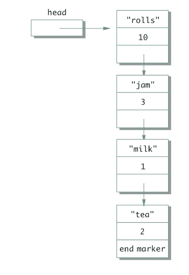

### 前置条件

如果你愿意，你可以跳过本章，直接阅读第 16 章关于集合类的内容，或者直接阅读第 17 章开始学习使用 Swing 库的窗口界面。你在安排本书后续章节顺序方面有很大的灵活性。

本章需要第 1 至 5 章、第 14 章以及内部类的简单使用（第 13 章第 13.2 节）的知识。第 15.4 节关于树的内容额外需要第 11 章关于递归的知识。

第 15.2 至 15.4 节之间没有本质上的依赖关系。特别是，你可以跳过第 15.2 节关于克隆的内容，仍然能够阅读后续章节。第 15.2 至 15.4 节与第 15.1 节子部分中关于泛型链表的内容也没有任何本质上的依赖关系。

### 15.1 Java 链表

> 链条的强度取决于其最薄弱的一环。

**链表** **链表**是一种链接数据结构，由单个节点链组成，每个节点通过链接连接到下一个节点。这是最简单的链接数据结构，但仍然被广泛使用。在本节中，我们将给出链表的示例，并开发在 Java 中定义和操作链表的技术。

#### 一个简单的链表类

图 15.1 是**链表**的图示。在图中，节点是方框。在你的 Java 代码中，节点是某个节点类的对象，例如图 15.2 中给出的 `Node1` 类。每个节点都有一个（或多个）存放数据的地方，以及一个存放指向另一个节点链接的地方。**链接**被显示为指向它们所“链接”的节点的箭头。在 Java 中，链接将被实现为存储在节点类型实例变量中的对节点的引用。

`Node1` 类是通过指定一个名为 `link` 的 `Node1` 类型的实例变量等方式定义的。这允许每个节点存储一个指向同类型另一个节点的引用。在这样的定义中存在一种循环性，但这种循环性在 Java 中是允许的。（看待这个定义在逻辑上并非不一致的一种方式是，我们可以绘制图表，甚至构建我们链接节点的物理模型。）

链表中的第一个节点或起始节点被称为**头节点**。如果你从头节点开始，你可以遍历整个链表，恰好访问每个节点一次。正如你稍后将在 Java 代码中看到的，你的代码必须直观地“跟随链接箭头”。在图 15.1 中，标记为 `head` 的方框本身并不是头节点；它甚至不是一个节点。标记为 `head` 的方框是一个 `Node1` 类型的变量，它包含一个指向链表中第一个节点的引用——即指向头节点的引用。变量 `head` 的功能是让你的代码能够找到第一个或头节点。变量 `head` 的声明方式很直接：

在 Java 中，链表是一个对象，在某种意义上包含了链表的所有节点。图 15.3 包含了一个链表类的定义，用于类似图 15.1 中的链表。请注意，链表对象并不直接包含链表中的所有节点。它只包含实例变量 `head`，该变量包含对第一个或头节点的引用。然而，从这个第一个或头节点可以到达每个节点。链表的第一个和每个 `Node1` 的 `link` 实例变量包含对链表中下一个 `Node1` 的引用。因此，图 15.1 图中所示的箭头在 Java 中被实现为引用。链表的每个节点对象包含（在其 `link` 实例变量中）对类 `Node1` 另一个对象的引用，而这个另一个对象又包含对类 `Node1` 另一个对象的引用，依此类推，直到链表结束。因此，一个链表对象，至少间接地，包含了链表中的所有节点。

```
Node1 head;
```

#### 图 15.2 一个节点类

```
public class Node1
{
    private String item;
    private int count;
    private Node1 link;

    public Node1()
    {
        link = null;
        item = null;
        count = 0;
    }

    public Node1(String newItem, int newCount, Node1 linkValue)
    {
        setData(newItem, newCount);
        link = linkValue;
    }

    public void setData(String newItem, int newCount)
    {
        item = newItem;
        count = newCount;
    }

    public void setLink(Node1 newLink)
    {
        link = newLink;
    }

    public String getItem()
    {
        return item;
    }

    public int getCount()
    {
        return count;
    }

    public Node1 getLink()
    {
        return link;
    }
}
```

> 一个节点包含对另一个节点的引用。该引用就是到下一个节点的链接。

> 我们将定义多个节点类，因此我们为名称编号，如 `Node1`。

> 我们将在本章后面给出一个更好的节点类定义。

#### 图 15.3 一个链表类（第 1 部分，共 2 部分）

```
public class LinkedList1
{
    private Node1 head; // 我们将在本章后面定义一个更好的链表类。

    public LinkedList1()
    {
        head = null;
    }

    /**
     在列表开头添加一个包含指定数据的节点。
     添加的节点将成为列表中的第一个节点。
     */
    public void addToStart(String itemName, int itemCount)
    {
        head = new Node1(itemName, itemCount, head);
    }

    /**
     删除头节点，如果列表至少包含一个节点则返回 true。如果列表为空则返回 false。
     */
    public boolean deleteHeadNode()
    {
        if (head != null)
        {
            head = head.getLink();
            return true;
        }
        else
            return false;
    }

    /**
     返回列表中的节点数。
     */
    public int size()
    {
        int count = 0;
        Node1 position = head;
```

#### 显示 15.3 链表类（第 2 部分，共 2 部分）

```java
public int size()
{
    Node1 position = head;
    int count = 0;
    while (position != null)
    {
        count++;
        position = position.getLink();
    }
    return count;
}

public boolean contains(String item)
{
    return (find(item) != null);
}

/**
 查找包含目标项的第一个节点，并返回对该节点的引用。如果目标不在链表中，则返回 null。
 */
private Node1 find(String target)
{
    Node1 position = head;
    String itemAtPosition;
    while (position != null)
    {
        itemAtPosition = position.getItem();
        if (itemAtPosition.equals(target))
            return position;
        position = position.getLink();
    }
    return null; //未找到目标
}

public void outputList()
{
    Node1 position = head;
    while (position != null)
    {
        System.out.println(position.getItem() + " "
                           + position.getCount());
        position = position.getLink();
    }
}
```

#### 处理链表

处理链表时，你的代码需要能够“访问”到第一个或称为头节点（head node）的节点，并且你需要某种方式来检测何时到达了最后一个节点。为了让你的代码访问到第一个节点，你会使用一个 `Node1` 类型的变量，该变量始终包含对第一个节点的引用。在显示 15.3 中，包含对第一个节点引用的变量名为 `head`。从该第一个或头节点开始，你的代码可以沿着链表中的链接（link）进行遍历。但是，你的代码如何知道它何时位于链表的最后一个节点呢？

在 Java 中，你通过将链表中最后一个节点的 `link` 实例变量设置为 `null` 来表示链表的结束，如显示 15.4 所示。这样，你的代码可以通过测试节点的 `link` 实例变量是否包含 `null` 来检查该节点是否为链表中的最后一个节点。请记住，你使用 `==` 而不是任何 `equals` 方法来检查链接是否“等于” `null`。

你也使用 `null` 来表示一个空的链表。`head` 实例变量包含对链表中第一个节点的引用，如果链表为空（即链表不包含任何节点），则包含 `null`。唯一的构造函数将这个 `head` 实例变量设置为 `null`，表示新创建的链表是空的。

#### 显示 15.4 遍历链表

##### 表示链表的结束

链表中的最后一个节点应将其 `link` 实例变量设置为 `null`。这样，你的代码可以通过检查节点的 `link` 实例变量是否等于 `null` 来检查该节点是否是最后一个节点。

##### 空列表用 null 表示

假设变量 `head` 应该包含对链表中第一个节点的引用。链表通常从空开始。为了表示一个空的链表，你给变量 `head` 赋值为 `null`。这是一种惯例，并且对于许多链表操作算法来说效果很好。

在我们继续讨论如何向链表添加和删除节点之前，让我们假设链表已经有一些节点，并且你想要将所有节点的内容输出到屏幕上。你可以使用方法 `outputList`（显示 15.3）来做到这一点，其主体在此处复现：

```java
Node1 position = head;
while (position != null)
{
    System.out.println(position.getItem() + " "
                       + position.getCount());
    position = position.getLink();
}
```

该方法使用一个名为 `position` 的局部变量，该变量包含对某个节点的引用。变量 `position` 开始时与 `head` 实例变量具有相同的引用，因此它开始时定位在第一个节点。然后，通过赋值

```java
position = position.getLink();
```

将 `position` 变量的位置从一个节点移动到下一个节点。

这在显示 15.4 中有所说明。要理解这个赋值是如何将 `position` 变量“移动”到下一个节点的，请注意 `position` 变量包含对显示 15.4 中 `position` 箭头所指向的节点的引用。因此，`position` 是该节点的一个名称，而 `position.link` 是指向下个节点的链接的名称。`link` 的值是通过访问器方法 `getLink` 获得的。因此，对链表中下一个节点的引用是 `position.getLink()`。你通过给 `position` 赋值为 `position.getLink()` 的值来“移动”它。

方法 `outputList` 不断地将 `position` 变量沿着链表向下移动，并在移动过程中输出每个节点中的数据。当 `position` 到达最后一个节点时，它输出该节点中的数据，然后再次执行

```java
position = position.getLink();
```

如果你研究显示 15.4，你会看到当 `position` 离开最后一个节点时，其值被设置为 `null`。此时，我们希望停止循环，所以我们使用 `while (position != null)` 来迭代循环。

在方法 `size` 和 `find` 中，使用了类似的技术来遍历链表。接下来，我们考虑方法 `addToStart` 如何向链表的开头添加一个节点，使新节点成为列表中的第一个节点。它通过单个语句实现这一点：

```java
head = new Node1(itemName, itemCount, head);
```

新节点是用以下语句创建的：

```java
new Node1(itemName, itemCount, head)
```

它返回对这个新节点的引用。赋值语句将变量 `head` 设置为等于对这个新节点的引用，使新节点成为链表中的第一个节点。为了将这个新节点链接到列表的其余部分，我们只需要将新节点的 `link` 实例变量设置为等于对旧第一个节点的引用。但我们已经这样做了：`head` 过去指向旧的第一个节点，因此如果我们在赋值运算符的右侧使用名称 `head`，`head` 将表示对旧第一个节点的引用。因此，由

```java
new Node1(itemName, itemCount, head)
```

产生的新节点指向旧的第一个节点，这正是我们想要的。这在显示 15.5 中有所说明。

稍后，我们将讨论在链表的其他位置添加节点，但最容易添加节点的位置是在列表的开头。同样，最容易删除节点的位置也是在链表的开头。

方法 `deleteHeadNode` 从链表中移除第一个节点，并使 `head` 变量指向（即包含对）链表中的旧第二个节点（现在是第一个节点）。这是通过以下赋值完成的：

```java
head = head.getLink();
```

#### 显示 15.5 在开头添加节点

这将从链表中移除第一个节点，并使链表缩短一个节点。但是被删除的节点会怎样呢？在某个时刻，Java 会自动收集该节点以及任何其他不再可访问的节点，并回收它们占用的内存。这被称为**自动垃圾回收**。

显示 15.6 包含一个简单的程序，演示了类 `LinkedList1` 中一些方法的行为。

#### 显示 15.6 链表演示


```java
public class LinkedList1Demo
{
    public static void main(String[] args)
    {
        LinkedList1 list = new LinkedList1();
        list.addToStart("Apples", 1);
        list.addToStart("Bananas", 2);
        list.addToStart("Cantaloupe", 3);
        System.out.println("List has " + list.size()
           + " nodes.");
        list.outputList();
        if (list.contains("Cantaloupe"))
           System.out.println("Cantaloupe is on list.");
        else
           System.out.println("Cantaloupe is NOT on list.");
        list.deleteHeadNode();
        if (list.contains("Cantaloupe"))
           System.out.println("Cantaloupe is on list.");
        else
           System.out.println("Cantaloupe is NOT on list.");
        while (list.deleteHeadNode())
           ; //空循环体
        System.out.println("Start of list:");
        list.outputList();
        System.out.println("End of list.");
    }
}
```

- 哈密瓜现在位于头节点。
- 移除头节点。
- 清空列表。这里没有循环体，因为方法`deleteHeadNode`既对列表执行操作又返回一个布尔值。

## 示例对话

```text
List has 3 entries.
Cantaloupe 3
Bananas 2
Apples 1
Cantaloupe is on list.
Cantaloupe is NOT on list.
Start of list:
End of list.
```

## 自我测试练习

1. 以下代码会产生什么输出？

   ```java
   LinkedList1 list = new LinkedList1();
   list.addToStart("apple pie", 1);
   list.addToStart("hot dogs", 12);
   list.addToStart("mustard", 1);
   list.outputList();
   ```

2. 定义一个名为`isEmpty`的布尔值方法，该方法可以添加到`LinkedList1`类（展示 15.3）中。如果列表为空，该方法返回`true`；如果列表至少包含一个节点，则返回`false`。

3. 定义一个名为`clear`的`void`方法，该方法可以添加到`LinkedList1`类（展示 15.3）中。该方法没有参数，其作用是清空列表。

### 常见陷阱

#### 隐私泄漏

如果你先回顾第 5 章同名的“常见陷阱”部分，可能会有助于理解本节内容。

考虑`Node1`类（展示 15.2）中的`getLink`方法。它返回一个`Node1`类型的值。也就是说，它返回一个`Node1`的引用。在第 5 章中，我们提到，如果一个方法（如`getLink`）返回一个（可变）类类型的实例变量的引用，那么对该实例变量的私有限制就很容易被绕过，因为获得一个对象的引用可能允许程序员更改该对象的私有实例变量。有多种方法可以修复这个问题，其中最直接的方法是将`Node1`类设置为`LinkedList1`方法中的一个私有内部类，如下一小节所述。

在`LinkedList1`的类定义中使用`Node1`类时，不存在隐私泄漏的危险。然而，除非你采取一些预防措施，例如将`Node1`类设置为`LinkedList1`类中的私有内部类，否则无法保证`Node1`类只以这种方式使用。

另一种解决方案是将`Node1`和`LinkedList1`两个类都放入一个包中，并按照第 7 章的讨论，将私有实例变量限制更改为包限制。

请注意，任何方法返回类类型的私有实例变量的引用都可能出现这种隐私问题。`Node1`类的`getItem()`方法就非常接近出现这个问题。在这种情况下，`getItem`方法不会导致隐私泄漏，但这仅仅是因为`String`类不是一个可变类（即，它没有允许用户在不更改引用的情况下更改字符串值的方法）。如果我们在列表中存储的不是`String`类型的数据，而是存储了某种可变类类型的数据，那么定义一个类似于`getItem`的访问器方法就会导致隐私泄漏。

### 节点内部类

你可以通过将节点类设为内部类，使链表或任何类似的数据结构自包含。特别是，你可以通过将`Node1`设为内部类，使`LinkedList1`类更加自包含，如下所示：

```java
public class LinkedList1
{
    private class Node1
    {
        <Node1 的其余定义可以与展示 15.2 相同。>
    }

    private Node1 head;
    <此处插入展示 15.3 中的构造方法和方法。>
}
```

请注意，我们已将`Node1`类设为私有内部类。如果一个内部类不打算在其他地方使用，它应该是私有的。将`Node1`设为私有内部类可以隐藏内部类的所有对象，并避免隐私泄漏。

如果你打算在`LinkedList1`的定义中将`Node1`类设为私有内部类，那么你可以通过省略访问器和修改器方法（`set`和`get`方法），仅允许外部类的方法直接访问实例变量（`item`、`count`和`link`），来安全地简化`Node1`的定义。在展示 15.7 中，我们以这种方式编写了一个类似于`LinkedList1`的类。重写后的版本名为`LinkedList2`，它与展示 15.3 中的`LinkedList1`类相似，具有相同的方法，执行基本相同的操作。为了使讨论简单，`LinkedList2`只有一个数据字段而不是两个。我们本可以轻松地保留两个数据字段，但我们想要一个符号简单的例子，没有任何分散注意力的细节。（有关于每个节点包含与`LinkedList1`节点相同数据的版本，请参阅自我测试练习 8。）

> ### 节点内部类
>
> 你可以通过将节点类设为链表类的内部类，使链表（或其他链式数据结构）自包含。

## 展示 15.7 带有节点内部类的链表类（第 1 部分，共 3 部分）

```java
1  public class LinkedList2
2  {
3      private class Node
4      {
5          private String item;
6          private Node link;
7
8          public Node()
9          {
10             item = null;
11             link = null;
12         }
13
14         public Node(String newItem, Node linkValue)
15         {
16             item = newItem;
17             link = linkValue;
18         }
19     }//Node 内部类结束
20
21     private Node head;
22
23     public LinkedList2()
24     {
25         head = null;
26     }
27
28     /**
29      在列表开头添加一个包含指定数据的节点。
30      添加的节点将成为列表中的第一个节点。
31      */
32     public void addToStart(String itemName)
33     {
34         head = new Node(itemName, head);
35     }
36
37     /**
38      如果列表至少包含一个节点，则删除头节点并返回 true。
39      如果列表为空，则返回 false。
40      */
```

> 我们将`Node`的实例变量设为`public`还是`private`没有区别。

> ### 为节点类创建的内部类

我们简化了这个类和前面的链表类，以保持它们相对简短。除其他外，这些类应该有一个拷贝构造函数、一个`equals`方法和一个`clone`方法。我们的下一个链表示例包含了这些内容。

## 展示 15.7 带有节点内部类的链表类（第 2 部分，共 3 部分）

```java
35 public boolean deleteHeadNode()
36 {
37     if (head != null)
38     {
39         head = head.link;
40         return true;
41     }
42     else
43         return false;
44 }
45
46 /**
47    返回列表中的节点数。
48 */
49 public int size()
50 {
51     int count = 0;
52     Node position = head;
53     while (position != null)
54     {
55         count++;
56         position = position.link;
57     }
58     return count;
59 }
60
61 public boolean contains(String item)
62 {
63     return (find(item) != null);
64 }
65
66 /**
67    查找包含目标项的第一个节点，并返回对该节点的引用。
68    如果目标不在列表中，则返回 null。
69 */
70 private Node find(String target)
71 {
72     Node position = head;
73     String itemAtPosition;
74     while (position != null)
75     {
76         itemAtPosition = position.item;
77         if (itemAtPosition.equals(target))
78             return position;
79         position = position.link;
80     }
81     return null; //未找到目标
82 }
```

> 请注意，外部类可以直接访问内部类的实例变量，例如`link`。

## 展示 15.7 带有节点内部类的链表类（第 3 部分，共 3 部分）

```java
public void outputList()
{
    Node position = head;
    while (position != null)
    {
        System.out.println(position.item );
        position = position.link;
    }
}

public boolean isEmpty()
{
    return (head == null);
}

public void clear()
{
    head = null;
}
```

> ### 自我测试练习
>
> 4. 如果我们将在展示 15.7 中的`Node`内部类从私有内部类更改为公共内部类，会有什么区别吗？
>
> 5. 保持展示 15.7 中的内部类`Node`为私有，如果`Node`类中的任何实例变量或方法的访问修饰符从`private`更改为`public`或包访问权限，会有什么区别吗？
>
> 6. 为什么展示 15.7 中内部类`Node`的定义没有类似展示 15.2 中`Node1`类定义中的`getLink`、`setLink`或其他针对`link`字段的`get`和`set`方法？
>
> （续）

### 自我测试练习（续）

7. 在展示 15.7 的`LinkedList2`类中添加以下方法是否合法？

```java
public Node startNode()
{
    return head;
}
```

8. 重写展示 15.7 中`LinkedList2`类的定义，使其包含一个名为`Entry`的数据类型，这是一个公共内部类。`Entry`类型的对象有两个实例变量，定义如下：

```java
private String item;
private int count;
```

这个重写版本的`LinkedList2`将与`LinkedList1`等效，因为它拥有执行相同功能的相同方法，并且其节点中将保存等效的数据。

### 示例：泛型链表

展示 15.8 显示了一个泛型链表，其中有一个类型参数`T`，用于表示节点中存储的数据类型。这个泛型链表拥有与我们之前的链表（展示 15.7）相同的方法，编码方式也基本相同，但我们在节点的数据类型上使用了一个类型参数。

展示 15.10 包含我们泛型链表的演示程序。该演示程序使用展示 15.9 中定义的`Entry`类作为类型参数`T`的填充类型。请注意，如果你想在每个节点中包含多条数据，只需使用一个具有多个实例变量的类类型，并将这个类填充到类型参数`T`即可。

## 展示 15.8：一个泛型链表类（第 1 部分，共 4 部分）

```java
public class LinkedList3<T>
{
    private class Node<T>
    {
        private T data;
        private Node<T> link;

        public Node()
        {
            data = null;
            link = null;
        }

        public Node(T newData, Node<T> linkValue)
        {
            data = newData;
            link = linkValue;
        }
    }//Node<T> 内部类结束

    private Node<T> head;

    public LinkedList3()
    {
        head = null;
    }

    /**
    在列表开头添加一个带有指定数据的节点。
    添加的节点将成为列表中的第一个节点。
    */
    public void addToStart(T itemData)
    {
        head = new Node<T>(itemData, head);
    }
```

此链表保存类型为`T`的对象。类型`T`应具有明确定义的`equals`和`toString`方法。

## 展示 15.8：一个泛型链表类（第 2 部分，共 4 部分）

```java
    /**
    如果列表至少包含一个节点，则删除头节点并返回 true。
    如果列表为空，则返回 false。
    */
    public boolean deleteHeadNode()
    {
        if (head != null)
        {
            head = head.link;
            return true;
        }
        else
            return false;
    }

    /**
    返回列表中的节点数。
    */
    public int size()
    {
        int count = 0;
        Node<T> position = head;
        while (position != null)
        {
            count++;
            position = position.link;
        }
        return count;
    }

    public boolean contains(T item)
    {
        return (find(item) != null);
    }
```

## 展示 15.8：一个泛型链表类（第 3 部分，共 4 部分）


# 泛型链表类与相关方法

## 查找节点与数据

```java
/**
 查找包含目标项的第一个节点，并返回指向该节点的引用。
 如果目标不在列表中，则返回null。
*/
private Node<T> find(T target)
{
    Node<T> position = head;
    T itemAtPosition;
    while (position != null)
    {
        itemAtPosition = position.data;
        if (itemAtPosition.equals(target))
            return position;
        position = position.link;
    }
    return null; //未找到目标
}
```

类型`T`必须有一个明确定义的`equals`方法，此功能才能正常工作。

```java
/**
 查找包含目标的第一个节点，并返回指向该节点数据的引用。
 如果目标不在列表中，则返回null。
*/
public T findData(T target)
{
    return find(target).data;
}
```

## 输出列表

```java
public void outputList()
{
    Node<T> position = head;
    while (position != null)
    {
        System.out.println(position.data);
        position = position.link;
    }
}
```

类型`T`必须有一个明确定义的`toString`方法，此功能才能正常工作。

## 判断空列表与清空列表

```java
public boolean isEmpty()
{
    return (head == null);
}
```

```java
public void clear()
{
    head = null;
}
```

## 展示15.8：一个泛型链表类（第4部分，共4部分）

```java
/*
 要使两个列表相等，它们必须包含相同的数据项且顺序相同。
 使用T的equals方法来比较数据项。
*/
public boolean equals(Object otherObject)
{
    if (otherObject == null)
        return false;
    else if (getClass() != otherObject.getClass())
        return false;
    else
    {
        LinkedList3<T> otherList = (LinkedList3<T>)otherObject;
        if (size() != otherList.size())
            return false;
        Node<T> position = head;
        Node<T> otherPosition = otherList.head;
        while (position != null)
        {
            if (!(position.data.equals(otherPosition.data)))
                return false;
            position = position.link;
            otherPosition = otherPosition.link;
        }
        return true; //未发现不匹配项
    }
}
```

## 展示15.9：泛型链表数据的示例类

```java
public class Entry
{
    private String item;
    private int count;

    public Entry(String itemData, int countData)
    {
        item = itemData;
        count = countData;
    }

    public String toString()
    {
        return (item + " " + count);
    }

    public boolean equals(Object otherObject)
    {
        if (otherObject == null)
            return false;
        else if (getClass() != otherObject.getClass())
            return false;
        else
        {
            Entry otherEntry = (Entry)otherObject;
            return (item.equals(otherEntry.item)
                    && (count == otherEntry.count));
        }
    }
}
```

<还应有其他构造函数和方法，包括访问器和修改器方法，但在此演示中我们不使用它们。>

## 展示15.10：泛型链表演示

```java
public class GenericLinkedListDemo
{
    public static void main(String[] args)
    {
        LinkedList3<Entry> list = new LinkedList3<Entry>();

        Entry entry1 = new Entry("Apples", 1);
        list.addToStart(entry1);
        Entry entry2 = new Entry("Bananas", 2);
        list.addToStart(entry2);
        Entry entry3 = new Entry("Cantaloupe", 3);
        list.addToStart(entry3);
        System.out.println("List has " + list.size()
                           + " nodes.");
        list.outputList();
        System.out.println("End of list.");
    }
}
```

**示例对话**

列表有 3 个节点。

Cantaloupe 3

Bananas 2

Apples 1

列表结束。

## 陷阱：使用`Node`而不是`Node<T>`

这个陷阱通过展示15.8中的`LinkedList3<T>`类为例进行解释。然而，这个教训适用于任何带有节点内部类的泛型链表结构。类型参数不一定是`T`，节点类名也不一定是`Node`，但为了简单起见，我们将使用`T`和`Node`。

在定义展示15.8中的`LinkedList3<T>`类时，节点的类型是`Node<T>`；而不是`Node`。然而，人们很容易忘记类型规范`<T>`，而写成`Node`而不是`Node<T>`。如果你省略了`<T>`，你可能会也可能不会得到编译器错误消息，这取决于代码的其他细节。如果你确实得到了编译器错误消息，它可能会显得莫名其妙地奇怪。问题在于`Node`实际上是有含义的。（我们没有时间停下来解释`Node`的含义，但它类似于数据类型为`Object`的节点，而不是数据类型为`T`。）你对抗这个陷阱的唯一方法就是非常小心，如果你确实得到了令人困惑的编译器错误消息，请检查是否缺少`<T>`。

有时当你犯这个错误时，编译器的警告消息会有所帮助。如果你收到一个警告，提到从`Node`到`Node<T>`的类型转换，请检查是否遗漏了`<T>`。

最后，我们应该注意，有时如果你从`Node<T>`中省略了`<T>`，你的代码仍然可以编译甚至正确运行。

## 链表的`equals`方法

我们在展示15.3和15.7中介绍的链表没有`equals`方法。我们这样做是为了保持示例简单，不分散主要信息的注意力。然而，一个链表类通常应该有一个`equals`方法。

为链表定义一个合理的`equals`方法有不止一种方法。最明显的两种是：

1. 如果两个链表包含相同的数据项（顺序可能不同），则它们相等。

2. 如果两个链表包含相同的数据项且顺序相同，则它们相等；也就是说，调用对象的第一个节点中的数据等于另一个链表的第一个节点中的数据，两个第二个节点中的数据相等，依此类推。

并非其中一种方法就是定义`equals`方法的正确方法，而另一种就是错误的。在不同的情况下，你可能需要不同的`equals`定义。然而，为链表定义`equals`最常见的方法是第二种方法。遵循第二种方法并可以添加到展示15.7的`LinkedList2`类中的`equals`定义在展示15.11中给出。展示15.8中的泛型链表也包含一个遵循第二种方法的`equals`方法。

请注意，当我们为带有类型参数`T`的链表定义`equals`时，我们信任编写为`T`填充类型的定义的程序员。我们假设程序员已经重新定义了`equals`方法，使其提供合理的相等性测试。类似的情况正是为什么在你定义的类中始终包含`equals`方法如此重要的原因。

## 展示15.11：展示15.7中链表的`equals`方法

```java
/*
 要让两个列表相等，它们必须包含相同的数据项，且顺序相同。
*/
public boolean equals(Object otherObject)
{
    if (otherObject == null)
        return false;
    else if (getClass() != otherObject.getClass())
        return false;
    else
    {
        LinkedList2 otherList = (LinkedList2)otherObject;
        if (size() != otherList.size())
            return false;
        Node position = head;
        Node otherPosition = otherList.head;
        while (position != null)
        {
            if ( (!(position.item.equals(otherPosition.item))))
                return false;
            position = position.link;
            otherPosition = otherPosition.link;
        }
        return true; //未发现不匹配项
    }
}
```

## 15.2 拷贝构造函数和`clone`方法

> 做事有三种方式：

正确的方式，

错误的方式，

以及军队的方式。

据说是给新兵的建议

Java 处理克隆以及通常的对象复制的方式很复杂，可能既微妙又困难。一些权威人士认为 Java 中的`clone`方法实现得非常糟糕，以至于他们更愿意完全忽略它，而是自己定义复制对象的方法。我对此观点深表同情，但在你摒弃 Java 的克隆方法之前，最好先了解一下这种方法涉及的内容。链接数据结构（如链表）是讨论克隆的绝佳环境，因为它们是讨论深拷贝与浅拷贝的绝佳背景。

本节首先介绍一种相对简单的方法来定义拷贝构造函数和`clone`方法，但不幸的是，这种方法只产生浅拷贝。然后，我们将继续介绍一种在 Java 文档官方规定规则内生成深拷贝`clone`方法的方法。

编程经验很少的读者最好跳过本节，直到他们对 Java 更加熟悉。其他读者可能只喜欢阅读第一个小节，可能还有紧随其后的“陷阱”小节。

### 简单的拷贝构造函数和`clone`方法

展示15.12包含了一个拷贝构造函数和`clone`方法的定义，这些定义可以添加到展示15.8中的泛型链表类的定义中。实际的工作由私有辅助方法`copyOf`完成，因此我们的讨论集中在`copyOf`方法上。

私有方法`copyOf`接受一个参数，该参数是指向链表头节点的引用，并返回指向该链表副本头节点的引用。最简单的方法是直接返回该参数。然而，这只会为参数列表创建另一个名称。我们不需要另一个名称；我们需要另一个列表。因此，该方法逐个节点（使用`position`）遍历参数列表，并为每个节点创建一个副本。调用对象的链表通过将这些新节点添加到其链表中逐节点构建。但是，这里有一个复杂之处。我们不能简单地将新节点添加到正在构建的列表的头部（开始处）。如果这样做，节点最终会以与期望相反的顺序排列。因此，新节点被添加到正在构建的链表的末尾。类型为`Node<T>`的变量`end`保持在最后一个节点的位置，以便可以在正在构建的链表末尾添加节点。通过这种方式，创建了调用对象中列表的副本，从而保持了节点的顺序。

拷贝构造函数使用私有辅助方法`copyOf`来创建节点列表的副本。拷贝构造函数和`clone`方法的其他细节都以标准方式完成。

尽管拷贝构造函数和`clone`方法都生成一个具有所有新节点的新链表，但新列表并非真正独立，因为数据对象并未被克隆。有关此点的讨论，请参阅下一个“陷阱”小节。一种解决此缺点的方法在名为“使用类型参数约束以获得更好`clone`”的编程提示小节中讨论。

## 展示15.12：泛型链表的拷贝构造函数和`clone`方法（第1部分，共2部分）

```java
public class LinkedList3<T> implements Cloneable
{
    private class Node<T>
    {
        private T data;
        private Node<T> link;

        public Node()
        {
            data = null;
            link = null;
        }

        public Node(T newData, Node<T> linkValue)
        {
            data = newData;
            link = linkValue;
        }
    }//结束内部类 Node<T>

    private Node<T> head;

    <显示15.8中的所有方法都在类定义中，但本显示中未重复它们。>

    /**
       生成一个新的链表，但它不是真正的深拷贝。
       如果 other 为 null，则抛出 NullPointerException。
    */
    public LinkedList3(LinkedList3<T> otherList)
    {
        if (otherList == null)
            throw new NullPointerException( );
        if (otherList.head == null)
            head = null;
        else
            head = copyOf(otherList.head);
    }
```

> 此拷贝构造函数和此`clone`方法不进行深拷贝。我们在名为“使用类型参数约束以获得更好`clone`”的编程提示小节中讨论了一种制作深拷贝的方法。

## 展示15.12：泛型链表的拷贝构造函数和`clone`方法（第2部分，共2部分）


```java
public LinkedList3<T> clone( )
{
    try
    {
        LinkedList3<T> copy =
                      (LinkedList3<T>)super.clone( );
        if (head == null)
            copy.head = null;
        else
            copy.head = copyOf(head);
        return copy;
    }
    catch(CloneNotSupportedException e)
    {//这不应该发生。
        return null; //为了让编译器满意。
    }
}

/*
    前提条件：otherHead != null
    返回一个指向由 otherHead 开头的链表副本头节点的引用。
    不返回真正的深拷贝。
*/
private Node<T> copyOf(Node<T> otherHead)
{
    Node<T> position = otherHead;//向下遍历 other 的链表。
    Node<T> newHead; //将指向副本链表的头节点。
    Node<T> end = null; //位于新构建链表的末尾。
    //创建第一个节点：
    newHead =
            new Node<T>(position.data, null);
    end = newHead;
    position = position.link;

    while (position != null)
    {//将 position 处的节点复制到新链表的末尾。
        end.link =
            new Node<T>(position.data, null);
        end = end.link;
        position = position.link;
    }
    return newHead;
}
```

使用`position.data`调用`clone`将是非法的。

使用`position.data`调用`clone`将是非法的。

### 陷阱：`Object`中的`clone`方法是受保护的

在定义泛型链表的拷贝构造函数和`clone`方法（显示15.12）时，我们本希望克隆被复制链表中的数据。我们本希望在辅助方法`copyOf`的代码中添加对`clone`方法的调用，如下所示：

```java
newHead =
    new Node((T)(position.data).clone(), null);
end = newHead;
position = position.link;

while (position != null)
{//将 position 处的节点复制到新链表的末尾。
    end.link =
        new Node((T)(position.data).clone(), null);
    end = end.link;
    position = position.link;
}
```

这段代码与`copyOf`中的代码相同，只是添加了红色所示的`clone`调用和红色所示的类型转换。（需要类型转换是因为Java认为`clone`返回一个`Object`类型的值。）

如果这个修改后的代码（带有`clone`方法）能够编译（并且如果为`T`插入的类型有一个定义良好的`clone`方法来制作深拷贝），那么这个修改后的代码将产生一个真正独立的链表，与被复制的链表没有共同的引用。不幸的是，这段代码将无法编译。

如果你尝试编译这段代码，你会得到一条错误消息，说方法`clone`在`Object`类中是受保护的。确实，我们使用了类型`T`，而不是类型`Object`，但任何类都可以为`T`插入。因此，当泛型链表被编译时，Java对类型`T`所知的全部信息是它是`Object`的后代类。由于`Object`类的设计者选择将`clone`方法设为受保护的，你根本无法在`copyOf`等方法的定义中使用`clone`方法。

为什么`Object`中的`clone`方法被标记为受保护的？显然是出于安全原因。如果一个类可以直接使用`Object`中未经更改的`clone`方法，那么这将打开复制未经更改和检查的内存部分的可能性，从而可能授予未经授权的内存访问权限。这个问题因Java用于在互联网上的其他机器上运行程序而变得更加严重。

Java在`Object`中定义`clone`方法的方式以及它指定如何在其他类中定义`clone`的方式存在争议。如果未来某个版本的Java以不同方式处理`clone`方法，请不要感到惊讶。但目前，你只能接受这些`clone`问题。

在许多情况下，显示15.12中的`copyOf`版本（不使用`clone`）已经足够好了，但有一种方法可以获得真正的深拷贝。获得深拷贝的一种方法是以某种方式将类型`T`限制为确实具有公共`clone`方法（该方法制作深拷贝）的类。可以做到类似的事情，并在名为“使用类型参数约束以获得更好clone”的编程提示中讨论。

### 异常处理

一个泛型数据结构，例如Display 15.12中的`LinkedList`类，很可能会包含抛出异常的方法。像向拷贝构造函数传递空参数这样的情况，在不同场景下可能有不同的处理方式，因此最好在发生这种情况时抛出一个`NullPointerException`，并让使用该链表的程序员来处理这个异常。这正是我们在Display 15.12的拷贝构造函数中所做的。`NullPointerException`是一个未检查异常，这意味着它不需要被捕获或在`throws`子句中声明。当它由链表类的方法抛出时，可以简单地将其视为运行时错误信息。如果存在合适的处理操作，该异常也可以在`catch`块中被捕获。

**提示**

### 使用类型参数约束以获得更好的`clone`

解决前面“陷阱”部分讨论的问题的一种方法，是对类型参数`T`（在Display 15.12中）添加一个约束，使其必须满足某个合适的接口。没有一个现成的标准接口能完成这项任务，但定义这样一个接口非常容易。Display 15.13中给出的`PubliclyCloneable`接口正是我们需要的。这个简短、简单的接口保证了我们定义泛型链表所需的一切，其`clone`方法返回的是深拷贝。

请注意，任何实现了`PubliclyCloneable`接口的类都具有以下三个属性：

- 1. 该类实现了`Cloneable`接口。（这是因为`PubliclyCloneable`扩展了`Cloneable`，所以这是自动发生的。）

- 2. 该类有一个公共的`clone`方法。

- 3. 该类的`clone`方法执行的是深拷贝（以官方认可的方式）。

条件3并非由Java编译器或运行时软件强制执行，但与所有接口语义一样，定义该类的程序员有责任确保条件3得到满足。

现在，定义一个`clone`方法能产生深拷贝的泛型链表变得很容易了。该定义在Display 15.14中给出。我们已经讨论了此定义涉及的主要要点。下面的编程示例子节将讨论该定义中一些细微但可能不清晰的细节。<sup>1</sup>

> <sup>1</sup> 你可能会想，我们能否在`PubliclyCloneable`接口中使用类型参数，从而避免`copyOf`定义中的某些类型转换。我们可以这样做，但那可能弊大于利，并且在这个介绍性的层面上，会是一个不必要的干扰。

## Display 15.13 `PubliclyCloneable`接口

```
/*
 定义实现此接口的类的程序员
 有责任定义 clone 方法，使其执行深拷贝
 （以官方认可的方式）
*/

public interface PubliclyCloneable extends Cloneable
{
    public Object clone();
}
```

任何实现了`PubliclyCloneable`的类都自动实现了`Cloneable`。

任何实现了`PubliclyCloneable`的类都必须有一个公共的`clone`方法。

## Display 15.14 具有深拷贝`clone`方法的泛型链表（第1部分，共3部分）

```
public class LinkedList<T extends PubliclyCloneable>
    implements PubliclyCloneable
{
    private class Node<T>
    {
        private T data;
        private Node<T> link;

        public Node()
        {
            data = null;
            link = null;
        }

        public Node(T newData, Node<T> linkValue)
        {
            data = newData;
            link = linkValue;
        }
    }//Node<T> 内部类结束

    private Node<T> head;

    public LinkedList()
    {
        head = null;
    }
}
```

## Display 15.14 具有深拷贝`clone`方法的泛型链表（第2部分，共3部分）

```
/**
 * 产生一个新的链表，但它不是真正的深拷贝。
 * 如果 other 为 null，则抛出 NullPointerException。
 */
public LinkedList(LinkedList<T> otherList)
{
    if (otherList == null)
        throw new NullPointerException( );
    if (otherList.head == null)
        head = null;
    else
        head = copyOf(otherList.head);
}

public LinkedList<T> clone( )
{
    try
    {
        LinkedList<T> copy =
                            (LinkedList<T>)super.clone( );
        if (head == null)
            copy.head = null;
        else
            copy.head = copyOf(head);
        return copy;
    }
    catch(CloneNotSupportedException e)
    {//This should not happen.
        return null; //To keep the compiler happy.
    }
}

/*
 前提条件：otherHead != null
 返回一个由 otherHead 指向的链表副本的头节点引用。
 返回一个真正的深拷贝。
 */
private Node<T> copyOf(Node<T> otherHead)
{
    Node<T> position = otherHead;//沿 other 的列表向下移动。
    Node<T> newHead; //将指向副本列表的头节点。
    Node<T> end = null; //位于新生成列表的末尾。

    //创建第一个节点：
    newHead =
        new Node<T>((T)(position.data).clone(), null);
        end = newHead;
    position = position.link;
```

> 这个`copyOf`的定义给出了链表的深拷贝。

## Display 15.14 具有深拷贝`clone`方法的泛型链表（第3部分，共3部分）

```
70         while (position != null)
71         {//将 position 处的节点复制到新列表的末尾。
72             end.link =
73                 new Node<T>((T)(position.data).clone(), null);
74             end = end.link;
75             position = position.link;
76         }
77 
78         return newHead;
79     }
80 
81     public boolean equals(Object otherObject)
82     {
83         if (otherObject == null)
84             return false;
85         else if (getClass() != otherObject.getClass())
86             return false;
87         else
88         {
89             LinkedList<T> otherList = (LinkedList<T>)otherObject;
90         }
91 
92     <此 equals 的定义的其余部分与 Display 15.8 中的相同。此 equals 定义与
93     Display 15.8 中定义的唯一区别在于，我们将类名 LinkedList3<T> 替换为了 LinkedList<T>。>
94 
95         }
96 
97     <Display 15.8 中的所有其他方法都在类定义中，
98                         但此处未重复显示。>
99 
100     public String toString()
101     {
102         Node<T> position = head;
103         String theString = "";
104         while (position != null)
105         {
106             theString = theString + position.data + "\n";
107             position = position.link;
108         }
109         return theString;
110         我们添加了 toString 方法，以便 LinkedList<T> 能够拥有我们希望 T 所具有的所有属性。
111     }
112 }
```

### 具有深拷贝`clone`方法的链表

我们已经讨论了Display 15.14中泛型链表类的`clone`方法如何以及为何返回深拷贝。现在让我们看看其他一些细节，并查看使用这个链表类的示例。

注意`clone`方法的定义。我们为什么不将其简化为如下代码呢？

```
public LinkedList<T> clone()
{
    return new LinkedList<T>(this);
}
```

这个简单的替代定义仍然会返回链表的深拷贝，并且在大多数情况下都能正常工作。如果你使用这个`clone`定义来替代Display 15.14中给出的那个，很可能不会注意到任何区别。

Display 15.14中给出的`clone`方法定义中所有其他细节的唯一原因，是按照Java文档中的规范来定义`clone`方法。Java文档要求这些细节的原因与安全问题有关。（有些人可能会说，定义`clone`方法有三种方式：正确的方式、错误的方式和Java的方式。这些额外的细节就是Java的方式。）

如果你只是快速浏览一下Display 15.14，你可能会认为定义开头的以下代码是一个无关紧要的细节：

```
implements PubliclyCloneable
```

然而，它确保了链表类实现了`Cloneable`接口。为了让一个类拥有Java认可的`clone`方法，它必须实现`Cloneable`接口。它还允许你创建链表的链表，并且在链表的链表中拥有深拷贝的`clone`方法。

Display 15.15给出了一个实现了`PubliclyCloneable`接口的示例类。Display 15.16展示了一个演示程序，该程序创建了该示例类对象的链表的深拷贝克隆。

## 第15章 链接数据结构

## 清单15.15 一个可公开克隆的类（第1部分，共2部分）


`StockItem`类实现了`PubliclyCloneable`接口，其定义如下：

```java
public class StockItem implements PubliclyCloneable
{
    private String name;
    private int number;

    public StockItem()
    {
        name = null;
        number = 0;
    }

    public StockItem(String nameData, int numberData)
    {
        name = nameData;
        number = numberData;
    }

    public void setNumber(int newNumber)
    {
        number = newNumber;
    }

    public void setName(String newName)
    {
        name = newName;
    }

    public String toString()
    {
        return (name + " " + number);
    }

    public Object clone()
    {
        try
        {
            return super.clone();
        }
        catch(CloneNotSupportedException e)
        {//这不应该发生。
            return null; //为了让编译器满意。
        }
    }
}
```

## 清单15.15 一个可公开克隆的类（第2部分，共2部分）

`equals`方法用于比较两个`StockItem`对象是否相等，其定义如下：

```java
public boolean equals(Object otherObject)
{
    if (otherObject == null)
        return false;
    else if (getClass() != otherObject.getClass())
        return false;
    else
    {
        StockItem otherItem = (StockItem) otherObject;
        return (name.equalsIgnoreCase(otherItem.name)
            && number == otherItem.number);
    }
}
```

## 清单15.16 深拷贝克隆演示（第1部分，共2部分）

```java
public class DeepDemo
{
    public static void main(String[] args)
    {
        LinkedList<StockItem> originalList =
                    new LinkedList<StockItem>();
        originalList.addToStart(new StockItem("red dress", 1));
        originalList.addToStart(new StockItem("black shoe", 2));

        LinkedList<StockItem> copyList = originalList.clone();
        if (originalList.equals(copyList))
            System.out.println("OK, Lists are equal.");

        System.out.println("Now we change copyList.");
        StockItem dataEntry =
            copyList.findData(new StockItem("red dress", 1));
        dataEntry.setName("orange pants");

        System.out.println("originalList:");
        originalList.outputList();

        System.out.println("copyList:");
        copyList.outputList();

        System.out.println("Only one list is changed.");
    }
}
```

**第15章** 链接数据结构

## 清单15.16 深拷贝克隆演示（第2部分，共2部分）

示例对话：

```
OK, Lists are equal.
Now we change copyList.
originalList:
black shoe 2
red dress 1
copyList:
black shoe 2
orange pants 1
Only one list is changed.
```

> **提示**

> **克隆是一件“全有或全无”的事情**

> 如果你定义一个克隆方法，那么你应该遵循官方的Java指南来定义它，就像我们在清单15.14中所做的那样。具体来说，你应该始终让类实现`Cloneable`接口。如果你以任何其他方式定义克隆方法，你可能会在某些情况下遇到问题。如果你想拥有一个生成对象副本的方法，但不想遵循关于如何定义克隆方法的官方指南，那么请为你的“类克隆”方法使用其他名称，例如`copier`，或者只使用一个复制构造函数。

### 自测练习

- 9. 在清单15.14的`copyOf`定义中，我们能否将以下代码：

`newHead = new Node<T>((T)(position.data).clone(), null);`

替换为使用`T`的复制构造函数而不是`T`的克隆方法的以下代码？

`newHead = new Node<T>(new T(position.data), null);`

- 10. 清单15.14中克隆方法的定义返回一个`LinkedList<T>`类型的值。但是被定义的类实现了`PubliclyCloneable`接口，该接口规定返回的值必须是`Object`类型。是不是有什么问题？

## 15.3 迭代器

*再来一遍，山姆。*

这句台词被（错误地）归于电影《卡萨布兰卡》，该电影中有类似的台词。²

当你有一个对象集合时，例如链表的节点，你经常需要遍历集合中的所有对象，并对每个对象执行某些操作，例如将其输出到屏幕上或以某种方式编辑每个对象中的数据。一个`迭代器`（iterator）是允许你以这种方式遍历列表的任何对象。

> ### 迭代器

> 假设你有一个数据项的集合，例如一个链表。任何允许你一次遍历集合中的一个项，使得每个项在一次完整的迭代周期中恰好被访问一次的对象，都称为**迭代器**。

### 定义一个迭代器类

在清单15.17中，我们重写了清单15.7中的类`LinkedList2`，使其拥有一个用于迭代器的内部类和一个方法`iterator()`，该方法为其调用对象返回一个迭代器。我们将内部类`List2Iterator`设为`public`，这样我们就可以在类`LinkedList2`外部拥有`List2Iterator`类型的变量，但我们并不打算在外部类`LinkedList2`之外使用内部类`List2Iterator`。

清单15.18中的程序展示了类`LinkedList2`的迭代器用法。请注意，对于一个名为`list`的链表，通过方法`iterator`生成`list`的迭代器的方式如下：

```java
LinkedList2.List2Iterator i = list.iterator();
```

以这种方式生成的迭代器`i`只能用于名为`list`的链表。一定要注意，在类外部，内部类迭代器的类型名必须包含外部类的名称以及内部迭代器类的名称。这种迭代器的类名是：

```java
LinkedList2.List2Iterator
```

² 有一部同名的伍迪·艾伦电影，但它是基于对《卡萨布兰卡》的误引，这句误引在电影上映前就很常见。

## 清单15.17 带迭代器的链表（第1部分，共2部分）

```java
import java.util.NoSuchElementException;
public class LinkedList2
{
    private class Node
    {
        private String item;
        private Node link;
        <Node内部类定义的其余部分在清单15.7中给出。>
    }//Node内部类结束
    /**
    如果列表被修改，任何迭代器都应调用restart，
    否则迭代器的行为可能不如预期。
    */
    public class List2Iterator
    {
        private Node position;
        private Node previous;//position的先前值

        public List2Iterator()
        {
            position = head; //外部类的实例变量head。
            previous = null;
        }

        public void restart()
        {
            position = head; //外部类的实例变量head。
            previous = null;
        }

        public String next()
        {
            if (!hasNext())
                throw new NoSuchElementException();

            String toReturn = position.item;
            previous = position;
            position = position.link;
            return toReturn;
        }

        public boolean hasNext()
        {
            return (position != null);
        }
```

这与清单15.7和15.11中的类相同，只是添加了`List2Iterator`内部类和`iterator()`方法。

为`LinkedList2`提供迭代器的内部类。

## 清单15.17 带迭代器的链表（第2部分，共2部分）

```java
    /**
        返回next()将要返回的下一个值。
        如果hasNext()为false，则抛出IllegalStateException。
    */
    public String peek()
    {
        if (!hasNext())
            throw new IllegalStateException();
        return position.item;
    }

    /**
        在位置`position`的节点之前添加一个节点。
        `previous`被放置在新节点上。如果hasNext()为
        false，则将节点添加到列表的末尾。
        如果列表为空，则将节点作为唯一节点插入。
    */
    public void addHere(String newData)
         <方法addHere的其余部分是自测练习11。>

    /**
        更改位置`position`的节点中的字符串。
        如果`position`不在节点上，则抛出IllegalStateException。
    */
    public void changeHere(String newData)
         <方法changeHere的其余部分是自测练习13。>

    /**
        删除位置`position`的节点并将
        `position`移动到“下一个”节点。
        如果列表为空，则抛出IllegalStateException。
    */
    public void delete()
         <方法delete的其余部分是自测练习12。>
} //List2Iterator内部类结束

private Node head;

public List2Iterator iterator()
{
    return new List2Iterator();
}
<其他方法和构造函数与清单15.7和15.11中的相同。>
}
```

如果`list`是类`LinkedList2`的一个对象，那么`list.iterator()`返回`list`的一个迭代器。

## 显示 15.18 使用迭代器（第 1 部分，共 2 部分）

```java
public class IteratorDemo
{
    public static void main(String[] args)
    {
        LinkedList2 list = new LinkedList2();
        LinkedList2.List2Iterator i = list.iterator();

        list.addToStart("shoes");
        list.addToStart("orange juice");
        list.addToStart("coat");

        System.out.println("List contains:");
        i.restart();
        while(i.hasNext())
            System.out.println(i.next());
        System.out.println();

        i.restart();
        i.next();
        System.out.println("Will delete the node for " + i.peek());
        i.delete();

        System.out.println("List now contains:");
        i.restart();
        while(i.hasNext())
            System.out.println(i.next());
        System.out.println();

        i.restart();
        i.next();
        System.out.println("Will add one node before " + i.peek());
        i.addHere("socks");
        System.out.println("List now contains:");
        i.restart();
        while(i.hasNext())
            System.out.println(i.next());
        System.out.println();

        System.out.println("Changing all items to credit card.");
        i.restart();
        while(i.hasNext())
        {
            i.changeHere("credit card");
            i.next();
        }
        System.out.println();

        System.out.println("List now contains:");
        i.restart();
        while(i.hasNext())
            System.out.println(i.next());
        System.out.println();
    }
}
```

示例对话：

```
列表包含：
coat
orange juice
shoes

将删除节点：orange juice
列表现在包含：
coat
shoes

将在 shoes 前添加一个节点
列表现在包含：
coat
socks
shoes

将所有项目更改为 credit card。

列表现在包含：
credit card
credit card
credit card
```

## 15.3 使用迭代器

使用迭代器遍历链表中元素的基本方法由演示程序中的以下代码说明：

```java
System.out.println("List now contains:");
i.restart();
while(i.hasNext())
    System.out.println(i.next());
```

在这段代码中，迭代器被命名为`i`。迭代器`i`通过方法调用`i.restart();`被重置到列表的开头，每次执行`i.next()`会返回链表中的下一个数据项。在所有节点中的所有数据项都被`i.next()`返回后，布尔值`i.hasNext()`变为false，while循环结束。

方法`addHere`和`delete`的定义留作自测练习。但是，我们将给出在链表中间添加和删除节点的基本技术。（如果你在之后无法完成定义，可以在自测练习的答案中查找定义。）添加和删除节点的技术在下一小节中介绍。

### Java 迭代器接口


Java 有一个名为`Iterator`的接口，它规定了 Java 期望迭代器如何表现。它位于`java.util`包中（因此需要你导入此包）。我们的迭代器并不完全满足此接口，但它们与该接口具有相同的一般精神，并且可以轻松地重新定义以满足`Iterator`接口。

`Iterator`接口在第 16 章中讨论。

### 添加和删除节点

要在链表中添加或删除节点，通常使用迭代器，并在迭代器的（大致）位置添加或删除节点。由于删除比添加节点稍微容易一些，我们将先讨论删除。

显示 15.19 展示了删除节点的技术。链表是`LinkedList2`类（显示 15.17）的一个对象。变量`position`和`previous`是链表对象迭代器的实例变量。变量`position`和`previous`各自持有一个节点的引用，用箭头表示。如显示 15.19 所示，位置`position`处的节点通过以下两行代码删除：

```
previous.link = position.link;
position = position.link;
```

## 显示 15.19 删除节点

```
previous.link = position.link;
```

```
position = position.link;
```

当你的代码从链表中删除一个节点（如显示 15.19 所示）时，它会移除链表对该节点的引用。因此，就链表而言，该节点已不在链表上。但该节点仍在计算机的内存中。如果没有其他任何引用指向被删除的节点，那么它占用的存储空间应该可供其他用途使用。在许多编程语言中，你，程序员，必须跟踪诸如被删除节点之类的项目，并必须给出明确的命令来回收它们的内存。这称为**垃圾收集**或**显式内存管理**。在 Java 中，这是自动为你完成的——或者，通常表述为，Java 具有自动垃圾收集功能。

显示 15.20 展示了添加节点的技术。我们希望在`previous`和`position`命名的节点之间添加一个新节点。在显示 15.20 中，`previous`和`position`是`Node`类型的变量，每个变量包含一个节点的引用，用箭头表示。因此，新节点位于第一幅图中圈出的两个节点之间。

`Node`类的一个构造函数为我们做了大量的工作：它创建新节点，添加数据，并将新节点的链接字段设置为指向`position`命名的节点的引用。所有这些都通过以下方式完成：

```
new Node(newData, position)
```

因此，当我们学习显示 15.20 时，为了能够识别包含`newData`的节点，让我们假设`newData`保存字符串 "socks"。以下代码使我们从第一幅图变为第二幅图：

```
temp = new Node(newData, position);
```

要完成这项工作，我们只需要移动第二幅图中圈出的箭头。我们希望将箭头移动到`temp`命名的节点。以下代码完成了我们的工作：

```
previous.link = temp;
```

新节点已插入到所需位置，但图示不太清晰。第四幅图与第三幅图相同；我们只是重新绘制它以使其更整洁。

总结一下，以下两行代码插入一个新节点，其数据为`newData`。新节点被插入在`previous`和`position`命名的节点之间。

```
temp = new Node(newData, position);
previous.link = temp;
```

`previous`、`position`和`temp`都是`Node`类型的变量。（当我们使用此代码时，`previous`和`position`将是迭代器的实例变量，`temp`将是局部变量。）

## 显示 15.20 在两个节点之间添加节点

```
temp = new Node(newData, position);//newData 是 "socks"
```

```
previous.link = temp;
```

### 自测练习

-   11. 完成显示 15.17 中内部类`List2Iterator`的方法`addHere`的定义。

-   12. 完成显示 15.17 中内部类`List2Iterator`的方法`delete`的定义。

-   13. 完成显示 15.17 中内部类`List2Iterator`的方法`changeHere`的定义。

## 15.4 链表的变体

> 我将这个原理称为自然选择，即每一个微小的变异，如果有用，就会被保留。
>
> ——查尔斯·达尔文，《物种起源》

在本节中，我们讨论链表的一些变体，包括称为栈和队列的两种数据结构。栈和队列不一定涉及链表，但实现栈或队列的一种常见方法是使用链表。

### 双向链表

普通的链表只允许你沿着一个方向（跟随链接）遍历链表。**双向链表**有一个链接指向下一个节点，另一个链接指向前一个节点。图示上，双向链表看起来像显示 15.21 中的示例列表。

双向链表的节点类可以如下开始：

```
private class TwoWayNode
{
    private String item;
    private TwoWayNode previous;
    private TwoWayNode next;
}
```

双向链表类中的构造函数和一些方法将需要修改（相对于单链表的情况）它们的定义以适应额外的链接。

## 显示 15.21 双向链表

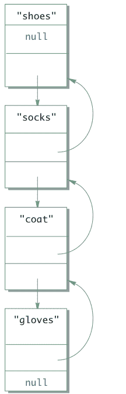

### 栈数据结构

栈不一定是链式数据结构，但它可以用链表实现。栈是一种数据结构，其删除项目的顺序与插入项目的顺序相反。因此，如果你向栈中插入"one"、"two"和"three"，然后将它们移除，它们会以"three"、"two"、"one"的顺序输出。栈在第11章中有更详细的讨论。一个只在链表头部进行插入和删除的链表（如显示15.3或显示15.8中的链表）实际上就是一个栈。

### 栈

**栈**是一种后进先出的数据结构；也就是说，数据项的检索顺序与其入栈顺序相反。

### 队列数据结构

栈是一种后进先出的数据结构。另一种常见的数据结构是**队列**，它以先进先出的方式处理数据。队列就像银行排队的队伍。客户从队伍后面加入，从队伍前面接受服务。队列可以用链表实现。然而，队列需要在链表的头部和**尾部**（即另一端）各有一个指针，因为两个位置都会发生操作。从链表头部移除节点比从尾部移除更容易。因此，一个简单的实现方式是从链表头部移除节点（我们现在将其称为链表的**前端**），并将节点添加到链表的尾端（我们现在称之为链表的**后端**或队列的后端）。

基于链表的简单`Queue`类定义见显示15.22。一个简短的演示程序见显示15.23。为了保持定义简单，我们没有将队列设计为泛型队列，但将数据类型`String`替换为类型参数是常规操作。

### 队列

**队列**是一种先进先出的数据结构；也就是说，数据项从队列中移除的顺序与它们加入队列的顺序相同。

### 自测练习

-   14. 完成显示15.22中`addToBack`方法的定义。

## 显示 15.22 一个队列类（第1部分，共2部分）

```
1  public class Queue
2  {
3      private class Node
4      {
5          private String item;
6          private Node link;
7
8          public Node()
9          {
10             item = null;
11             link = null;
12         }
13
14         public Node(String newItem, Node linkValue)
15         {
16             item = newItem;
17             link = linkValue;
18         }
19     }//End of Node inner class
20
21     private Node front;
22     private Node back;
23
24     public Queue()
25     {
26         front = null;
27         back = null;
28     }
29
30     /**
31      Adds a String to the back of the queue.
32      */
33     public void addToBack(String itemName)
34     <The definition of this method is Self-Test Exercise 14.>
35
36     public boolean isEmpty()
37     {
38         return (front == null);
39     }
40
41     public void clear()
42     {
43         front = null;
44         back = null;
45     }
46 }
```

## 显示 15.22 一个队列类（第2部分，共2部分）

```
38    /**
39       Returns the String in the front of the queue.
40       Returns null if queue is empty.
41     */
42    public String whoIsNext()
43    {
44        if (front == null)
45            return null;
46        else
47            return front.item;
48    }
49
50    /**
51       Removes a String from the front of the queue.
52       Returns false if the list is empty.
53     */
54    public boolean removeFront()
55    {
56        if (front != null)
57        {
58            front = front.link;
59            return true;
60        }
61        else
62            return false;
63    }
64 }
```

## 显示 15.23 Queue类的演示（第1部分，共2部分）

```
1  public class QueueDemo
2  {
3      public static void main(String[] args)
4      {
5          Queue q = new Queue();
6
7          q.addToBack("Tom");
8          q.addToBack("Dick");
9          q.addToBack("Harriet");
10
11         while(!q.isEmpty())
12         {
13             System.out.println(q.whoIsNext());
14             q.removeFront();
15         }
16         System.out.println("The queue is empty.");
17     }
18 }
```


项目从队列中出来的顺序与它们进入队列的顺序相同。

示例对话

Tom

Dick

Harriet

队列为空。

## 15.5 树

> 我想我永远不会看到一种像树一样有用的数据结构。
>
> 佚名

对树的详细讨论超出了本章的范围。本章的目标是教你构建和操作基于节点和链接（即节点和引用）的数据结构的基本技术。链表为我们讨论提供了很好的例子。然而，树数据结构将是一个用链接构建的更复杂数据结构的例子。此外，树是一种非常重要且广泛使用的数据结构。因此，我们将简要概述用于构建和操作树的一般技术。本节只是对树的非常简短的介绍，让你了解这个主题。

本节使用了在第11章中介绍的递归。

### 树的性质

树是一种如显示15.24所示结构的数据结构。具体来说，在树中，你可以通过沿着链接的路径从顶部（根）节点到达任何节点。注意，树中没有环。如果你沿着链接走，最终会到达一个"终点"。这种整数树的树类定义概述见显示15.24。注意每个节点有两个指向其他节点的引用（两个链接）。这种树称为二叉树，因为每个节点恰好有两个链接实例变量。还有其他类型的树，具有不同数量的链接实例变量，但二叉树是最常见的情况。

二叉树

## 显示 15.24 一棵二叉树

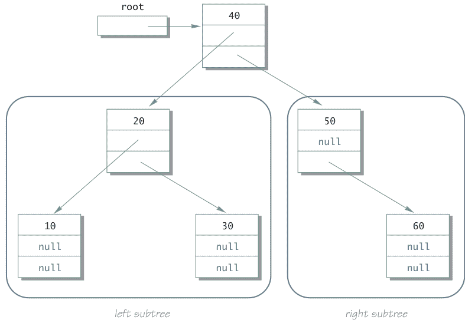

```
1  public class IntTree
2  {
3      public class IntTreeNode
4      {
5          private int data;
6          private IntTreeNode leftLink;
7          private IntTreeNode rightLink;
8      } //End of IntTreeNode inner class
9
10     private IntTreeNode root;
11     <The methods and other inner classes are not shown.>
12 }
```

名为`root`的实例变量的作用类似于链表（显示15.3）中的实例变量`head`。其引用存储在`root`实例变量中的节点称为**根节点**。从根节点开始，沿着链接可以到达树中的任何节点。

术语*树*可能听起来名不副实。根在树的顶部，分支结构看起来更像根的分支结构，而不是树的分支结构。这个术语的奥秘在于将图片（显示15.24）倒过来。图片确实类似于树的分支结构，根节点就是树根开始的地方。位于分支末端且两个链接实例变量都设置为`null`的节点称为**叶节点**，这个术语现在可能有些道理了。

类比于一个空链表，空树通过将链接变量`root`设置为`null`来表示。

注意树具有递归结构。每棵树实际上都有两棵子树，它们的根节点分别是根节点的`leftLink`和`rightLink`指向的节点。这两棵子树在显示15.24中被圈出。这种自然的递归结构使得树特别适合递归算法。例如，考虑搜索树的任务，你需要访问每个节点并对节点中的数据执行某些操作（例如将其输出到屏幕上）。有一个通用的攻击计划如下：

### 前序遍历处理

-   1. 处理根节点中的数据。

-   2. 处理左子树。

-   3. 处理右子树。

通过改变这三个步骤的顺序，你可以获得这个搜索过程的多个变体。以下是另外两个版本：

### 中序遍历处理

-   1. 处理左子树。

-   2. 处理根节点中的数据。

-   3. 处理右子树。

### 后序遍历处理

-   1. 处理左子树。

-   2. 处理右子树。

-   3. 处理根节点中的数据。

显示15.24中的树以一种特殊的方式存储数字，这种方式称为**二叉搜索树存储规则**。规则如下：

### 二叉搜索树存储规则

1.  左子树中的所有值都小于根节点中的值。

2.  右子树中的所有值都大于或等于根节点中的值。

3.  此规则递归地应用于两个子树中的每一个。

（递归的基例是空树，它总是被认为满足该规则。）

满足二叉搜索树存储规则的树被称为**二叉搜索树**。

请注意，如果一棵树满足二叉搜索树存储规则，并且你使用中序处理方法输出值，那么数字将按从小到大的顺序输出。

对于遵循二叉搜索树存储规则且较矮胖而非高瘦的树，可以使用类似于我们在 Display 11.6 中展示的二叉搜索算法思想的二叉搜索算法，非常快速地从树中检索值。搜索和维护二叉存储树以实现这种效率的主题是一个宏大的主题，超出了我们这里的篇幅。然而，我们给出一个满足二叉搜索树存储规则的树的类示例。

# 示例

### 一个二叉搜索树类

Display 15.25 包含一个满足二叉搜索树存储规则的二叉搜索树的类定义。为简单起见，此树存储整数，但进行常规修改可以产生一个类似的树类，用于存储实现`Comparable`接口的任何类的对象。Display 15.26 演示了此树类的使用。请注意，无论整数以何种顺序插入树中，使用中序遍历的输出都会按排序顺序输出整数。

此类中的方法广泛利用了二叉树的递归特性。如果`aNode`是树中任何节点的引用（可能包括根节点），那么以`aNode`为根的整个树可以分解为三个部分：

节点`aNode`。

- 以节点`aNode.leftLink`为根的左子树。

- 以节点`aNode.rightLink`为根的右子树。

左子树和右子树本身也满足二叉搜索树存储规则，因此自然可以使用递归通过以下方式处理整棵树：

- 处理以节点`aNode.leftLink`为根的左子树。

- 处理节点`aNode`。

- 处理以节点`aNode.rightLink`为根的右子树。

请注意，我们是在处理完左子树之后才处理根节点（中序遍历）。这保证了树中的数字按从小到大的顺序输出。方法`showElementsInSubtree`对此技术的实现非常直接。

其他方法则稍微微妙一些，因为只需要处理两个子树中的一个。


例如，考虑方法`isInSubtree`，它根据参数`item`是否在以节点`subTreeRoot`为根的树中来返回`true`或`false`。要查看`item`是否在树中的任何位置，你需要将`subTreeRoot`设置为整棵树的根，就像我们在方法`contains`中所做的那样。然而，为了表达我们用于`isInSubtree`的递归算法，我们需要允许处理除整棵树之外的其他子树的可能性。

`isInSubtree`的算法用伪代码表示为：

```
if (The root node subTreeRoot is empty.)
    return false;
else if (The node subTreeRoot contains item.)
    return true;
else if (item < subTreeRoot.data)
    return (The result of searching the tree with
            root node subTreeRoot.leftLink);
else //item > subTreeRoot.data
    return (The result of searching the tree with
            root node subTreeRoot.rightLink);
```

此算法给出正确结果的原因是树满足二叉搜索树存储规则，因此我们知道如果

```
item < subTreeRoot.data
```

那么`item`就在左子树中（如果它在树中的任何位置），而如果

```
item > subTreeRoot.data
```

那么`item`就在右子树中（如果它在树中的任何位置）。

具有以下方法头的方法使用的技术与`isInSubtree`中使用的技术非常相似：

```
private IntTreeNode insertInSubtree(
    int item, IntTreeNode subTreeRoot)
```

## 第864章 第15章 链式数据结构

## Display 15.25 一个用于整数的二叉搜索树（第1部分，共2部分）


```
/**
 * Class invariant: The tree satisfies the binary search tree storage rule.
 */
public class IntTree
{
    private static class IntTreeNode
    {
        private int data;
        private IntTreeNode leftLink;
        private IntTreeNode rightLink;

        public IntTreeNode(int newData, IntTreeNode newLeftLink,
                           IntTreeNode newRightLink)
        {
            data = newData;
            leftLink = newLeftLink;
            rightLink = newRightLink;
        }
    } //End of IntTreeNode inner class

    private IntTreeNode root;

    public IntTree()
    {
        root = null;
    }

    public void add(int item)
    {
        root = insertInSubtree(item, root);
    }

    public boolean contains(int item)
    {
        return isInSubtree(item, root);
    }

    public void showElements()
    {
        showElementsInSubtree(root);
    }
}
```

> 此内部类为静态的唯一原因是它用于静态方法`insertInSubtree`、`isInSubtree`和`showElementsInSubtree`。

> 此类应该有更多的方法。这只是一个可能的方法示例。

## Display 15.25 一个用于整数的二叉搜索树（第2部分，共2部分）

```
/**
    Returns the root node of a tree that is the tree with root node
    subTreeRoot, but with a new node added that contains item.
    */
    private static IntTreeNode insertInSubtree(int item,
                                               IntTreeNode subTreeRoot)
    {
        if (subTreeRoot == null)
            return new IntTreeNode(item, null, null);
        else if (item < subTreeRoot.data)
        {
            subTreeRoot.leftLink = insertInSubtree(item, subTreeRoot.leftLink);
            return subTreeRoot;
        }
        else //item >= subTreeRoot.data
        {
            subTreeRoot.rightLink = insertInSubtree(item, subTreeRoot.rightLink);
            return subTreeRoot;
        }
    }

    private static boolean isInSubtree(int item, IntTreeNode subTreeRoot)
    {
        if (subTreeRoot == null)
            return false;
        else if (subTreeRoot.data == item)
            return true;
        else if (item < subTreeRoot.data)
            return isInSubtree(item, subTreeRoot.leftLink);
        else //item >= subTreeRoot.data
            return isInSubtree(item, subTreeRoot.rightLink);
    }

    private static void showElementsInSubtree(IntTreeNode subTreeRoot)
    {//Uses inorder traversal.
        if (subTreeRoot != null)
        {
            showElementsInSubtree(subTreeRoot.leftLink);
            System.out.print(subTreeRoot.data + " ");
            showElementsInSubtree(subTreeRoot.rightLink);
        }//else do nothing. Empty tree has nothing to display.
    }
}
```

## Display 15.26 二叉搜索树的演示程序

```
import java.util.Scanner;

public class BinarySearchTreeDemo
{
    public static void main(String[] args)
    {
        Scanner keyboard = new Scanner(System.in);
        IntTree tree = new IntTree();

        System.out.println("Enter a list of nonnegative integers.");
        System.out.println("Place a negative integer at the end.");
        int next = keyboard.nextInt();
        while (next >= 0)
        {
            tree.add(next);
            next = keyboard.nextInt();
        }

        System.out.println("In sorted order:");
        tree.showElements();
    }
}
```

# 示例对话

```
Enter a list of nonnegative integers.
Place a negative integer at the end.
40
30
20
10
11
22
33
44
-1
In sorted order:
10 11 20 22 30 33 40 44
```

### 示例（续）

然而，这里有一些新内容。我们希望方法`insertInSubtree`能将一个包含数据`item`的新节点插入到以`subTreeRoot`为根节点的树中。但在这种情况下，我们希望将`subTreeRoot`作为一个变量来处理，而不仅仅是将其作为变量`subTreeRoot`的值。例如，如果`subTreeRoot`包含`null`，那么我们希望将`subTreeRoot`的值更改为指向一个包含`item`的新节点的引用。但是，Java 的参数无法更改作为参数传递的变量的值。（如果对此感到陌生，请复习第 5 章关于参数的讨论。）因此，我们必须采取一些不同的做法。为了更改变量`subTreeRoot`的值，我们返回一个指向我们希望的新值的引用，并按如下方式调用方法`subTreeRoot`：

```
subTreeRoot = insertInSubtree(item, subTreeRoot);
```

这就解释了为什么方法`insertInSubtree`返回一个指向树节点的引用，但我们仍然需要解释为什么我们知道它返回的是指向所需（已修改）子树的引用。

请注意，方法`insertInSubtree`的搜索方式与方法`isInSubtree`类似，但它在找到`item`时不会停止；相反，它会一直搜索直到到达一个叶子节点——即包含`null`的节点。这个`null`正是该元素在树中应属的位置，因此它用一个包含单个节点（该节点包含`item`）的新子树替换`null`。你可能需要对方法`insertInSubtree`稍加思考，以看清它能正确工作；花点时间研究一下方法`insertInSubtree`，并确信在添加操作之后，如下所示

```
subTreeRoot = insertInSubtree(item, subTreeRoot);
```

以`subTreeRoot`为根节点的树仍然满足二叉搜索树存储规则。

类`IntTree`的其余定义是常规的。

### 二叉搜索树的效率

当搜索一棵尽可能短的树（从根到叶子的所有路径最多相差一个节点）时，搜索方法`isInSubtree`，因此也包括`contains`方法，其效率与对有序数组的二分查找（Display 11.6）大致相当。这不应该感到惊讶，因为这两种算法实际上非常相似。³ 这意味着搜索一个矮胖的二叉树非常高效。要获得这种效率，树并不需要尽可能短，只要接近尽可能短即可。随着树变得不那么矮胖，而是更高更瘦，效率会下降，直到在极端情况下，其效率与在具有相同节点数的链表中搜索的效率相同。

³ 对于可能熟悉该符号的人，最坏情况运行时间是`O(log n)`，其中`n`是树中的节点数。

在添加节点时保持树矮胖是一个超出本书范围的话题。（矮胖的专业术语是**平衡**。）我们只会指出，如果存储在树中的数字是以随机顺序到达的，那么树在极大概率下会足够矮胖，以实现上一段讨论的效率。

- 平衡树

### 自测练习

- 15. 假设 Display 15.25 中方法`showElementsInSubtree`的代码被修改为

    ```
    showElementsInSubtree(subTreeRoot.leftLink);
    System.out.print(subTreeRoot.data + " ");
    showElementsInSubtree(subTreeRoot.rightLink);
    ```

    被改为

    ```
    System.out.print(subTreeRoot.data + " ");
    showElementsInSubtree(subTreeRoot.leftLink);
    showElementsInSubtree(subTreeRoot.rightLink);
    ```

    数字还会按升序输出吗？

- 16. 如何修改 Display 15.25 中方法`showElementsInSubtree`的代码，使数字从大到小输出，而不是从小到大输出？

## 章节总结

- 链表是一种由称为节点的对象组成的数据结构，每个节点包含数据以及对另一个节点的引用，从而将节点链接在一起形成一个列表。

- 将链接实例变量设置为`null`表示链表（或其他链接数据结构）的结束。`null`也用于表示一个空的链表（或其他空的链接数据结构）。

- 通过使节点类成为链表类的内部类，你可以使链表（或其他链接数据结构）自包含。

- 在许多情况下，克隆方法或复制构造函数最好定义为进行深拷贝。

- 你可以使用迭代器来遍历集合中的元素，例如链表中的元素。

- 栈是一种数据结构，其元素被移除的顺序与它们被添加到栈的顺序相反。队列是一种数据结构，其元素被移除的顺序与它们被添加到栈的顺序相同。

- 二叉树是一种分支型链接数据结构，由每个节点有两个链接实例变量的节点组成。树有一个称为*根节点*的特殊节点。树中的每个节点都可以通过跟随链接从根节点到达。

- 如果值存储在二叉树中的方式遵循二叉搜索树存储规则，那么存在高效算法来访问存储在树中的值。

## 自测练习答案

1. mustard 1

   hot dogs 12

   apple pie 1

2. 此方法已添加到随附 CD 上的`LinkedList1`类中。

    ```
    public boolean isEmpty()
    {
        return (head == null);
    }
    ```

3. 此方法已添加到随附 CD 上的`LinkedList1`类中。

    ```
    public void clear()
    {
        head = null;
    }
    ```

   如果你定义的方法使用`deleteHeadNode`方法来删除所有节点，那么你的方法就在做无用功。

4. 是的。如果我们使内部类`Node`成为公共内部类，它就可以在`LinkedList2`的定义之外使用，而将其保留为私有则意味着它不能在`LinkedList2`的定义之外使用。

5. 这不会有什么区别。在外部类的定义内，无论内部类成员的访问修饰符是什么，都可以完全访问内部类的成员。换句话说，在私有内部类`Node`内部，private 和包访问修饰符等同于 public。

6. 因为外部类可以直接访问内部类`Node`的实例变量，所以不需要为`Node`提供访问或修改方法。

7. 这将是合法的，但它将是一个非常没用的方法，因为你在类`LinkedList2`之外无法使用类型`Node`。例如，在`LinkedList2`之外，以下代码是非法的（`listObject`是`LinkedList2`类型）：

    ```
    Node v = listObject.startNode(); //非法
    ```

   而以下代码在`LinkedList2`之外是合法的（尽管很难想到你可能在何处使用它）：

    ```
    Object v = listObject.startNode();
    ```

8. `public class LinkedList2`


```java
{
    public class Entry
    {
        private String item;
        private int count;

        public Entry()
        {
            item = null;
            count = 0;
        }

        public Entry(String itemData, int countData)
        {
            item = itemData;
            count = countData;
        }

        public void setItem(String itemData)
        {
            item = itemData;
        }

        public void setCount(int countData)
        {
            count = countData;
        }

        public String getItem()
        {
            return item;
        }

        public int getCount()
        {
            return count;
        }
    }

    private class Node
    {
        private Entry item;
        private Node link;

        public Node()
        {
            item = null;
            link = null;
        }

        public Node(Entry newItem, Node linkValue)
        {
            item = newItem;
            link = linkValue;
        }
    }
}//Node 内部类结束

private Node head;
```

`LinkedList2` 的其余定义本质上与 Display 15.7 中的相同，但将类型 `String` 替换为 `Entry`。完整定义在随附于本书的 CD 上名为“Exercise 8”的子目录中给出。

### CD 上的额外代码

9. 不，`T` 不保证有复制构造函数。即使 `T` 有复制构造函数，像这样使用 `new T(...)` 也是非法的。

10. 不，你可以使用 `Object` 的任何派生类（这意味着任何类类型）作为返回类型，因为返回的值仍然将是 `Object` 类型。

11. `public void addHere(String newData)`

```java
{
    if (position == null && previous != null)
    //如果在列表末尾
        previous.link =
                new Node(newData, null);
    else if (position == null || previous == null)
    //否则如果列表为空或位置在头节点处。
        LinkedList2.this.addToStart(newData);
    else//previous 和 position 位于
        //两个连续节点处。
    {
        Node temp = new Node(newData, position);
        previous.link = temp;
        previous = temp;
    }
}
```

## 15 链式数据结构

12. `public void delete()`

```java
{
    if (position == null)
        throw new IllegalStateException();
    else if (previous == null)
    {//移除头节点
        head = head.link;
        position = head;
    }
    else //previous和position指向两个节点。
    {
        previous.link = position.link;
        position = position.link;
    }
}
```

13. `public void changeHere(String newData)`

```java
{
    if (position == null)
        throw new IllegalStateException();
    else
        position.item = newData;
}
```

14. `public void addToBack(String itemName)`

```java
{
    Node newEntry =
            new Node(itemName, null);

    if (front == null) //空队列
    {
        back = newEntry;
        front = back;
    }
    else
    {
        back.link = newEntry;
        back = back.link;
    }
}
```

15. 不是。

16. 将

```java
showElementsInSubtree(subTreeRoot.leftLink);
System.out.print(subTreeRoot.data + " ");
showElementsInSubtree(subTreeRoot.rightLink);
```

改为

```java
showElementsInSubtree(subTreeRoot.rightLink);
System.out.print(subTreeRoot.data + " ");
showElementsInSubtree(subTreeRoot.leftLink);
```

## 编程项目

这些编程项目中的许多都可以使用 AW 的 CodeMate 来解决。要访问此服务，请前往：www.aw-bc.com/codemate。

1. 在一个古老的国度，美丽的公主伊芙有许多追求者。她决定采用以下程序来决定嫁给哪位追求者。首先，所有的追求者会排成一列并被编号。第一个追求者编号为 1，第二个编号为 2，依此类推，直到最后一个追求者编号为 `n`。从第一个位置的追求者开始，她会沿着队伍数三个追求者（因为她名字有三个字母），然后第三位追求者将被淘汰，不再有资格赢得她的芳心，并从队伍中移除。伊芙会继续数三个追求者，并淘汰每第三个追求者。当她数到队伍末尾时，她会从头开始继续数。

   例如，如果有 6 位追求者，淘汰过程将如下进行：

   - `123456` 追求者初始列表，从 1 开始数。
   - `12456` 追求者 3 被淘汰，从 4 开始继续数。
   - `1245` 追求者 6 被淘汰，从 1 开始继续数。
   - `125` 追求者 4 被淘汰，从 5 开始继续数。
   - `15` 追求者 2 被淘汰，从 5 开始继续数。
   - `1` 追求者 5 被淘汰，1 是幸运的赢家。

   编写一个程序，创建一个节点循环链表，以确定如果有 `n` 位追求者，你应该站在哪个位置才能娶到公主。你的程序应该通过删除对应于被淘汰追求者的节点来模拟淘汰过程中的每一步。

2. 虽然 `long` 数据类型可以存储大整数，但它无法存储极其巨大的值，例如一个有 200 位的整数。创建一个 `HugeNumber` 类，使用数字链表来表示任意长度的整数。该类应该有一个方法，可以在现有数字上添加一个新的有效数字，以便可以创建越来越长的数字。还需要添加重置数字的方法，以及将巨大整数的值作为 `String` 返回的方法，并包含适当的构造函数或访问器方法。编写代码来测试你的类。

   使用双向链表将使下一个问题更容易实现。

3. 为上一个问题中描述的 `HugeNumber` 类添加一个复制构造函数，该函数对输入的 `HugeNumber` 进行深拷贝。同时创建一个 `Add` 方法，将一个输入的 `HugeNumber` 加到实例的 `HugeNumber` 值上，并返回一个新 `HugeNumber`，其值设置为两个值的总和。编写代码来测试你的类的这些新增功能。

4. 给出一个 `Object` 类型数据项的双向链表类的定义。包括一个复制构造函数、一个 `equals` 方法、一个 `clone` 方法、一个 `toString` 方法、一个生成迭代器的方法，以及任何其他通常预期会有的方法。编写一个合适的测试程序。

5. 通过添加以下内容，完成 `Display 15.25` 中二叉搜索树类 `IntTree` 的定义：使 `IntTree` 实现 `Cloneable` 接口，包括定义一个 `clone` 方法；添加一个复制构造函数；添加一个 `equals` 方法；添加一个名为 `sameContents` 的方法（如本项目后面所述）；添加一个 `toString` 方法；以及添加一个生成迭代器的方法。定义 `equals` 使得当且仅当两棵树具有完全相同的形状并且在对应节点中具有相同的数字时，它们才相等。`clone` 方法和复制构造函数各自应产生一个根据 `equals` 方法与原始列表相等的深拷贝。布尔值方法 `sameContents` 有一个 `IntTree` 类型的参数，如果调用对象和参数树包含完全相同的数字则返回 `true`，否则返回 `false`。注意 `equals` 和 `sameContents` 不是同一回事。同时，编写一个合适的测试程序。

要获取额外的在线编程项目，请点击下方的 CodeMate 图标。

`1.6` 

`1.7` 

`15.08` 

# 16 集合与迭代器

> 科学是由事实构建的，正如房子是由石头建造的一样。但是，一堆事实并不比一堆石头更是一座房子。
>
> — 亨利·庞加莱，由伯特兰·罗素在《科学与方法》序言中引用

## 引言

**集合**是一种用于持有元素的数据结构。例如，一个 `ArrayList<T>` 对象就是一个集合。Java 拥有一系列接口和类，它们对集合进行了统一的处理。**迭代器**是一个遍历集合中所有元素的对象。在本章中，我们将讨论集合和迭代器。

## 前导知识

第 16.1 节和第 16.2 节可以被视为一个单一的大主题。这两节需要第 1 章到第 9 章、第 13 章的第 13.1 节（涵盖接口），以及第 14 章关于泛型和 `ArrayList<T>` 类的内容。第 13 章关于内部类的材料（第 13.2 节和第 13.3 节）除了在一个名为“定义你自己的迭代器类”的编程提示中简要提及外，其余部分不需要（该提示需要第 13.2 节，但不需要第 13.3 节）。虽然本章的材料不需要第 15 章，但书中一些括号内的陈述确实提到了第 15 章；这些少数对第 15 章的引用在阅读本章时可以忽略，而不会影响连贯性。

本章的任何材料都不是学习 Swing 和 GUI 部分所必需的。因此，如果你希望先学习 Swing GUI 再学习本章内容，你可以跳过本章直接学习第 17 章。

## 16.1 集合

> 把你所有的鸡蛋都放在一个篮子里，
>
> 并且——看好那个篮子。
>
> — 马克·吐温，《傻瓜威尔逊》

Java 集合是一个持有对象的类。这个概念通过 `Collection<T>` 接口得到了精确的定义。Java **集合**是任何实现了 `Collection<T>` 接口的类。一个 Java 集合类的例子是你在第 14 章看到的 `ArrayList<T>` 类。`Collection<T>` 接口允许你编写适用于所有 Java 集合的代码，这样你就无需为每种集合重写每种具体集合类型的代码。还有其他接口和抽象类在某种意义上是从 `Collection<T>` 接口派生出来的。其中一些在 Display 16.1 中展示。在本节中，我们向你介绍这个 Java 集合框架。这个主题太大，无法在本书中详尽论述，因此这里只能进行入门性介绍。

集合与**迭代器**一起使用，迭代器在 16.2 节中讨论。将集合和迭代器分成两部分来组织材料是一种便捷的方式，但集合和迭代器这两个主题是紧密交织在一起的。在实践中，你通常将它们一起使用。

### `Collection<T>` 接口方法

如果集合为空，则返回 `false`；否则返回 `false`。

`public boolean contains(Object target)`

如果调用对象至少包含 `target` 的一个实例，则返回 `true`。使用 `target.equals` 来确定 `target` 是否在调用对象中。

如果 `target` 的类型与调用对象不兼容，则抛出 `ClassCastException`（可选）。

如果 `target` 为 `null` 且调用对象不支持 `null` 元素，则抛出 `NullPointerException`（可选）。

`public boolean containsAll(Collection<?> collectionOfTargets)`

如果调用对象包含 `collectionOfTargets` 中的所有元素，则返回 `true`。对于 `collectionOfTargets` 中的一个元素，此方法使用 `element.equals` 来确定 `element` 是否在调用对象中。

如果 `collectionOfTargets` 中一个或多个元素的类型与调用对象不兼容，则抛出 `ClassCastException`（可选）。

如果 `collectionOfTargets` 包含一个或多个 `null` 元素且调用对象不支持 `null` 元素，则抛出 `NullPointerException`（可选）。

如果 `collectionOfTargets` 为 `null`，则抛出 `NullPointerException`。

`public boolean equals(Object other)`

这是集合的 `equals` 方法，而不是集合中元素的 `equals` 方法。重写继承的方法 `equals`。虽然对于集合的 `equals` 没有官方约束，但它应按照我们在第 7 章中描述的那样定义，并且满足集合相等的直观概念。

`public int size()`

返回调用对象中的元素数量。如果调用对象包含超过 `Integer.MAX_VALUE` 个元素，则返回 `Integer.MAX_VALUE`。

`Iterator<T> iterator()`

返回调用对象的迭代器。（迭代器在 16.2 节中讨论。）

`public Object[] toArray()`

返回一个包含调用对象中所有元素的数组。如果调用对象对其迭代器返回元素的顺序有任何保证，则此方法必须以相同的顺序返回元素。

返回的数组应该是一个新数组，以便调用对象没有对返回数组的引用。（你可能还希望数组中的元素是集合中元素的克隆。然而，接口似乎并不要求这一点，因为库类（如 `Vector<T>`）返回的数组包含对集合中元素的引用。）

# Display 16.1 集合框架全景图

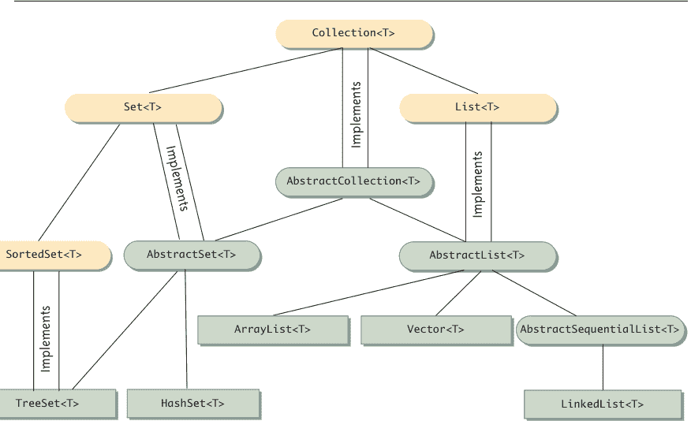

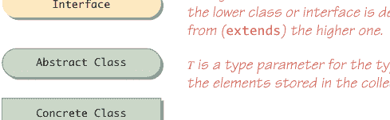

在我们讨论 `Collection<T>` 接口之前，我们需要稍作旁支，多了解一下参数类型规范。

# 通配符

集合框架中的类和接口使用了一些我们之前未见过的参数类型规范。例如，它们允许你说这样的话：“参数必须是 `ArrayList<T>`，但它可以是任何基本类型。”更普遍地说，这些新的参数类型规范使用泛型类，但没有完全指定为类型参数插入的类型。由于它们指定了广泛的参数类型，因此被称为**通配符**。

最容易理解的通配符是 `<?>`，它表示你可以用任何类型代替类型参数。例如，

```java
public void sampleMethod(String arg1, ArrayList<?> arg2)
```

使用两个参数调用。第一个参数必须是 `String` 类型。第二个参数可以是具有任何基本类型的 `ArrayList<T>`。

注意 `ArrayList<?>` 与 `ArrayList<Object>` 是不同的。例如，如果类型规范是 `ArrayList<?>`，那么你可以插入一个 `ArrayList<String>` 类型的参数（以及其他类型）；如果类型规范是 `ArrayList<Object>`，你就不能插入一个 `ArrayList<String>` 类型的参数。

你可以对通配符施加一个约束，说明代替通配符使用的类型必须是某个类或接口的祖先类型或派生类型。例如，`<? extends String>` 表示插入的参数可以是 `String` 类的任何派生类的对象。符号、限制和含义与我们在第 14 章中讨论的类型约束（如 `<T extends String>`）相同。

例如，

```java
public void
    anotherMethod(String arg1, ArrayList<? extends String> arg2)
```

使用两个参数调用。第一个参数必须是 `String` 类型，但第二个参数可以是任何 `ArrayList<T>` 对象，只要该 `ArrayList<T>` 的基本类型是 `String` 的派生类型。


要指定通配符类型是某个类或接口的祖先类型，你使用 `super` 而不是 `extends`。例如，`ArrayList<? super String>` 指定了一个 `ArrayList<T>`，其基本类型可以是 `String` 类的任何祖先类。事实上，我们将没有机会使用涉及 `super` 的通配符类型。

# 集合框架

`Collection<T>` 接口是 Java 集合类框架的最高级别。`Collection<T>` 接口描述了所有集合类应实现的基本操作。这些 `Collection<T>` 接口的操作（方法头）在显示 16.2 中给出。因为接口是一种类型，你可以定义具有 `Collection<T>` 类型参数的方法。该参数可以用集合框架中任何类的对象（即任何实现了 `Collection<T>` 接口的类）来填充。

这被证明是一个非常强大的工具。让我们探索一下可能性。到目前为止，我们已经看到了一个实现了 `Collection<T>` 接口的类，即 `ArrayList<T>` 类。除了第 14 章为 `ArrayList<T>` 类给出的方法外，`ArrayList<T>` 类还实现了显示 16.2 中给出的所有方法。

有许多不同的预定义类实现了 `Collection<T>` 接口，你也可以定义自己的类来实现 `Collection<T>` 接口。如果你编写一个处理 `Collection<T>` 类型参数的方法，它将适用于所有这些类。此外，`Collection<T>` 接口中的方法确保你可以混合使用不同的集合类。

例如，考虑方法：

```java
public boolean containsAll(Collection<?> collectionOfTargets)
```

你可以将它与两个 `ArrayList<T>` 对象一起使用（一个是调用对象，一个是参数），以查看一个是否包含另一个的所有元素。这两个 `ArrayList<T>` 对象甚至不必具有相同的基本类型。

此外，你还可以将其与 `ArrayList<T>` 对象和任何其他实现了 `Collection<T>` 接口的类的对象一起使用，以比较这两种不同类型的 `Collection<T>` 对象中的元素。

# 显示 16.2：`Collection<T>` 接口中的方法头（第 1 部分，共 4 部分）

> `Collection<T>` 接口位于 `java.util` 包中。所有提到的异常类都是未检查异常，这意味着它们不需要在 `catch` 块中捕获或在 `throws` 子句中声明。所有提到的异常类都在 `java.lang` 包中，因此不需要任何 `import` 语句。

## 构造函数

虽然接口没有正式要求，但任何实现 `Collection<T>` 接口的类都应该至少有两个构造函数：一个无参构造函数，用于创建空的 `Collection<T>` 对象；另一个是有一个 `Collection<? extends T>` 类型参数的构造函数，用于创建一个包含与构造函数参数相同元素的 `Collection<T>` 对象。

接口没有指定由单参数构造函数生成的副本是其参数的浅副本还是深副本。

```java
boolean isEmpty()
```

如果调用对象为空，则返回 `true`。

# 显示 16.2：`Collection<T>` 接口中的方法标题（第 3 部分，共 4 部分）

```java
public <E> E[] toArray(E[] a)
```

请注意，类型参数 `E` 与 `T` 并不相同。因此，`E` 可以是任何引用类型；它不必是 `Collection<T>` 中的类型 `T`。例如，`E` 可能是 `T` 的祖先类型。

返回一个包含调用对象中所有元素的数组。参数 `a` 主要用于指定返回数组的类型。具体细节如下：

- 返回的数组类型与 `a` 的类型相同。如果调用对象中的元素能放入数组 `a` 中，则 `a` 将用于容纳返回的数组元素；否则，会创建一个与 `a` 类型相同的新数组。
- 如果 `a` 的元素多于调用对象，则复制元素结束后紧跟在 `a` 中的元素会被设置为 `null`。
- 如果调用对象对其迭代器返回元素的顺序做出了任何保证，此方法必须以相同的顺序返回元素。（迭代器将在第 16.2 节中讨论。）
- 如果 `a` 的类型不是调用对象中每个元素的祖先类型，则抛出 `ArrayStoreException`。
- 如果 `a` 为 `null`，则抛出 `NullPointerException`。

```java
public int hashCode()
```

返回调用对象的哈希码值。本书不讨论哈希码或此方法。此处列出此项仅是为了使 `Collection<T>` 接口的定义完整。在继续深入学习哈希码之前，你可以安全地忽略此项。同时，如果你需要实现此方法，可以让该方法抛出 `UnsupportedOperationException`。

## 可选方法

以下方法是可选的，这意味着它们仍然必须被实现，但如果由于某些原因你不想给它们“真正”的实现，实现可以简单地抛出 `UnsupportedOperationException`。`UnsupportedOperationException` 是一个 `RuntimeException`，因此不需要被捕获或在 `throws` 子句中声明。

```java
public boolean add(T element) (可选)
```

确保调用对象包含指定的元素。如果调用对象因调用而更改，则返回 `true`。如果调用对象不允许重复且已包含 `element`，则返回 `false`；如果由于任何其他原因调用对象未更改，也返回 `false`。

如果实现此接口的类不支持此方法，则抛出 `UnsupportedOperationException`。

如果 `element` 的类阻止其被添加到调用对象，则抛出 `ClassCastException`。

如果 `element` 为 `null` 且调用对象不支持 `null` 元素，则抛出 `NullPointerException`。

如果 `element` 的其他某些方面阻止其被添加到调用对象，则抛出 `IllegalArgumentException`。

```java
public boolean addAll(Collection<? extends T> collectionToAdd) (可选)
```

确保调用对象包含 `collectionToAdd` 中的所有元素。如果调用对象因调用而更改，则返回 `true`；否则返回 `false`。如果调用对象在此操作期间发生更改，其行为是未定义的；特别是，如果 `collectionToAdd` 就是调用对象本身，其行为也是未定义的。

如果实现此接口的类不支持此方法，则抛出 `UnsupportedOperationException`。

如果 `collectionToAdd` 中某个元素的类阻止其被添加到调用对象，则抛出 `ClassCastException`。

如果 `collectionToAdd` 包含一个或多个 `null` 元素，且调用对象不支持 `null` 元素，或者 `collectionToAdd` 为 `null`，则抛出 `NullPointerException`。

如果 `collectionToAdd` 中某个元素的某个方面阻止其被添加到调用对象，则抛出 `IllegalArgumentException`。

```java
public boolean remove(Object element) (可选)
```

如果存在，则从调用对象中移除单个 `element` 实例。如果调用对象包含该元素，则返回 `true`；否则返回 `false`。

如果实现此接口的类不支持此方法，则抛出 `UnsupportedOperationException`。

如果 `element` 的类型与调用对象不兼容，则抛出 `ClassCastException`（可选）。

如果 `element` 为 `null` 且调用对象不支持 `null` 元素，则抛出 `NullPointerException`（可选）。

```java
public boolean removeAll(Collection<?> collectionToRemove) (可选)
```

移除调用对象中所有也包含在 `collectionToRemove` 中的元素。如果调用对象被更改，则返回 `true`；否则返回 `false`。

如果实现此接口的类不支持此方法，则抛出 `UnsupportedOperationException`。

如果 `collectionToRemove` 中一个或多个元素的类型与调用集合不兼容，则抛出 `ClassCastException`（可选）。

如果 `collectionToRemove` 包含一个或多个 `null` 元素，且调用对象不支持 `null` 元素，则抛出 `NullPointerException`（可选）。

如果 `collectionToRemove` 为 `null`，则抛出 `NullPointerException`。

```java
public void clear() (可选)
```

从调用对象中移除所有元素。

如果实现此接口的类不支持此方法，则抛出 `UnsupportedOperationException`。

```java
public boolean retainAll(Collection<?> saveElements) (可选)
```

仅保留调用对象中也包含在集合 `saveElements` 中的元素。换句话说，从调用对象中移除所有未包含在集合 `saveElements` 中的元素。如果调用对象被更改，则返回 `true`；否则返回 `false`。

如果实现此接口的类不支持此方法，则抛出 `UnsupportedOperationException`。

如果 `saveElements` 中一个或多个元素的类型与调用对象不兼容，则抛出 `ClassCastException`（可选）。

如果 `saveElements` 包含一个或多个 `null` 元素，且调用对象不支持 `null` 元素，则抛出 `NullPointerException`（可选）。

如果 `saveElements` 为 `null`，则抛出 `NullPointerException`。

882 第 16 章 集合与迭代器

# 显示 16.3：`Set<T>` 接口中的方法（第 1 部分，共 4 部分）

`Set<T>` 接口位于 `java.util` 包中。

`Set<T>` 接口扩展了 `Collection<T>` 接口。

所有提到的异常类都是那种不需要在 `catch` 块中捕获或在 `throws` 子句中声明的类型。

所有提到的异常类都在 `java.lang` 包中，因此不需要任何 `import` 语句。

## 构造函数

虽然接口没有正式要求，但任何实现 `Set<T>` 接口的类都应该至少有两个构造函数：一个无参数构造函数，用于创建一个空的 `Set<T>` 对象；以及一个带有一个类型为 `Collection<? extends T>` 参数的构造函数，用于创建一个与构造函数参数具有相同元素的 `Set<T>` 对象。

```java
boolean isEmpty()
```

如果调用对象为空，则返回 `true`；否则返回 `false`。

```java
public boolean contains(Object target)
```

如果调用对象包含至少一个 `target` 实例，则返回 `true`。使用 `target.equals` 来确定 `target` 是否在调用对象中。

如果 `target` 的类型与调用对象不兼容，则抛出 `ClassCastException`（可选）。

如果 `target` 为 `null` 且调用对象不支持 `null` 元素，则抛出 `NullPointerException`（可选）。

# 包

本章讨论的所有集合类和接口都在 `java.util` 包中。

实现或扩展 `Collection<T>` 接口的一些类和接口之间的关系在显示 16.1 中给出。有两个主要接口扩展了 `Collection<T>` 接口：`Set<T>` 接口和 `List<T>` 接口。实现 `Set<T>` 接口的类不允许类中的元素重复出现。实现 `List<T>` 接口的类将其元素排列在列表上，因此有第零个元素、第一个元素、第二个元素，以此类推。实现 `List<T>` 接口的类允许元素重复出现。`ArrayList<T>` 类实现了 `List<T>` 接口。

`Set<T>` 和 `List<T>` 接口中的方法分别在显示 16.3 和 16.4 中给出。`Set<T>` 接口具有与 `Collection<T>` 接口相同的方法标题，但在某些情况下，其语义（预期含义）是不同的。`List<T>` 接口比 `Collection<T>` 接口拥有更多的方法标题，并且一些从 `Collection<T>` 接口继承的方法具有稍有不同的语义。

`Set<T>`、`List` 接口

# 显示 16.3：`Set<T>` 接口中的方法（第 2 部分，共 4 部分）

```java
public boolean containsAll(Collection<?> collectionOfTargets)
```

如果调用对象包含 `collectionOfTargets` 中的所有元素，则返回 `true`。对于 `collectionOfTargets` 中的元素，此方法使用 `element.equals` 来确定该元素是否在调用对象中。如果 `collectionOfTargets` 本身是一个 `Set<T>`，那么这是在测试 `collectionOfTargets` 是否是调用对象的子集。

如果 `collectionOfTargets` 中一个或多个元素的类型与调用对象不兼容，则抛出 `ClassCastException`（可选）。

如果 `collectionOfTargets` 包含一个或多个 `null` 元素，而调用对象不支持 `null` 元素，则抛出 `NullPointerException`（可选）。

如果 `collectionOfTargets` 为 `null`，则抛出 `NullPointerException`。

```java
public boolean equals(Object other)
```

如果参数是一个 `Set<T>`，并且调用对象和参数包含完全相同的元素，则返回 `true`；否则返回 `false`。如果参数不是 `Set<T>`，则返回 `false`。

```java
public int size()
```

返回调用对象中的元素数量。如果调用对象包含的元素数量超过 `Integer.MAX_VALUE`，则返回 `Integer.MAX_VALUE`。

```java
Iterator<T> iterator()
```

返回调用对象的迭代器。（迭代器在 16.2 节中讨论。）

```java
public Object[] toArray()
```

返回一个包含调用对象中所有元素的数组。必须返回一个新数组，以确保调用对象没有指向返回数组的引用。

```java
public <E> E[] toArray(E[] a)
```

请注意，类型参数 `E` 与 `T` 不同。因此，`E` 可以是任何引用类型；它不必是 `Collection<T>` 中的类型 `T`。例如，`E` 可能是 `T` 的祖先类型。

返回一个包含调用对象中所有元素的数组。参数 `a` 主要用于指定返回数组的类型。具体细节在 `Collection<T>` 接口的表格（显示 16.2）中描述。

如果 `a` 的类型不是调用对象中每个元素的类型的祖先类型，则抛出 `ArrayStoreException`。

如果 `a` 为 `null`，则抛出 `NullPointerException`。

```java
public int hashCode()
```

返回调用对象的哈希码值。本书不讨论哈希码和此方法。此条目只是为了使 `Set<T>` 接口的定义完整。在进一步学习哈希码的高级书籍之前，你可以安全地忽略此条目。同时，如果你需要实现此方法，请让它抛出 `UnsupportedOperationException`。

# 显示 16.3：`Set<T>` 接口中的方法（第 3 部分，共 4 部分）

## 添加和移除元素

与 `Collection<T>` 接口一样，以下方法是可选的，这意味着它们仍然必须被实现，但如果由于某些原因你不想给它们一个“真实”的实现，实现可以简单地抛出 `UnsupportedOperationException`。`UnsupportedOperationException` 是一个 `RuntimeException`，因此不需要被 `catch` 捕获或在 `throws` 子句中声明。

```java
public boolean add(T element) (Optional)
```

如果 `element` 不在调用对象中，则将 `element` 添加到调用对象并返回 `true`。如果 `element` 在调用对象中，则调用对象保持不变并返回 `false`。

如果实现此接口的类不支持此方法，则抛出 `UnsupportedOperationException`。

如果 `element` 的类阻止其被添加到集合中，则抛出 `ClassCastException`。

如果 `element` 为 `null` 且集合不支持 `null` 元素，则抛出 `NullPointerException`。

如果 `element` 的某些其他方面阻止其被添加到此集合，则抛出 `IllegalArgumentException`。

```java
public boolean addAll(Collection<? extends T> collectionToAdd) (Optional)
```

确保调用对象包含 `collectionToAdd` 中的所有元素。如果调用对象因调用而更改，则返回 `true`；否则返回 `false`。因此，如果 `collectionToAdd` 是一个 `Set<T>`，则调用对象会更改为它自身与 `collectionToAdd` 的并集。

如果实现此接口的类不支持此方法，则抛出 `UnsupportedOperationException`。

如果 `collectionToAdd` 中某个元素的类阻止其被添加到调用对象，则抛出 `ClassCastException`。


如果`collectionToAdd`包含一个或多个`null`元素，而调用对象不支持`null`元素，或者`collectionToAdd`为`null`，则抛出`NullPointerException`。

如果`collectionToAdd`中某个元素的某些方面阻止其被添加到调用对象，则抛出`IllegalArgumentException`。

```java
public boolean remove(Object element) (Optional)
```

如果存在，则从调用对象中移除该元素。如果调用对象包含该元素，则返回`true`；否则返回`false`。

如果实现此接口的类不支持此方法，则抛出`UnsupportedOperationException`。

如果`element`的类型与调用对象不兼容，则抛出`ClassCastException`（可选）。

如果`element`为`null`且调用对象不支持`null`元素，则抛出`NullPointerException`（可选）。

## 显示 16.3 `Set<T>` 接口中的方法（第 4 部分，共 4 部分）

```java
public boolean removeAll(Collection<?> collectionToRemove) (Optional)
```

移除调用对象中所有也包含在`collectionToRemove`中的元素。如果调用对象被更改，则返回`true`；否则返回`false`。

如果实现此接口的类不支持此方法，则抛出`UnsupportedOperationException`。

如果`collectionToRemove`中一个或多个元素的类型与调用对象不兼容，则抛出`ClassCastException`（可选）。

如果调用对象包含一个`null`元素，而`collectionToRemove`不支持`null`元素，则抛出`NullPointerException`（可选）。

如果`collectionToRemove`为`null`，则抛出`NullPointerException`。

```java
public void clear() (Optional)
```

从调用对象中移除所有元素。

如果实现此接口的类不支持此方法，则抛出`UnsupportedOperationException`。

```java
public boolean retainAll(Collection<?> saveElements) (Optional)
```

仅保留调用对象中也包含在集合`saveElements`中的元素。换句话说，从调用对象中移除所有不包含在集合`saveElements`中的元素。如果调用对象被更改，则返回`true`；否则返回`false`。如果参数本身是一个`Set<T>`，则这会将调用对象更改为它自身与参数的交集。

如果实现此接口的类不支持此方法，则抛出`UnsupportedOperationException`。

如果调用对象中一个或多个元素的类型与`saveElements`不兼容，则抛出`ClassCastException`（可选）。

如果`saveElements`包含一个`null`元素，而调用对象不支持`null`元素，则抛出`NullPointerException`（可选）。

如果`saveElements`为`null`，则抛出`NullPointerException`。

## 显示 16.4 `List<T>` 接口中的方法（第 1 部分，共 6 部分）

`List<T>`接口在`java.util`包中。

`List<T>`接口扩展了`Collection<T>`接口。

所有提到的异常类都是不需要在`catch`块中捕获或在`throws`子句中声明的类型。

所有提到的异常类都在`java.lang`包中，因此不需要任何`import`语句。

### 构造方法

虽然接口没有正式要求，但任何实现`List<T>`接口的类都应该至少有两个构造方法：一个无参数构造方法，用于创建一个空的`List<T>`对象；一个带有一个参数（类型为`Collection<? extends T>`）的构造方法，用于创建一个包含与构造方法参数相同元素的`List<T>`对象。如果参数对其元素施加了排序，那么创建的`List<T>`应保留此排序。

```java
boolean isEmpty()
```

如果调用对象为空，则返回`true`；否则返回`false`。

## 显示 16.4 `List<T>` 接口中的方法（第 2 部分，共 6 部分）

```java
public boolean contains(Object target)
```

如果调用对象包含至少一个`target`实例，则返回`true`。使用`target.equals`来确定`target`是否在调用对象中。

如果`target`的类型与调用对象不兼容，则抛出`ClassCastException`（可选）。

如果`target`为`null`且调用对象不支持`null`元素，则抛出`NullPointerException`（可选）。

```java
public boolean containsAll(Collection<?> collectionOfTargets)
```

如果调用对象包含`collectionOfTargets`中的所有元素，则返回`true`。对于`collectionOfTargets`中的元素，此方法使用`element.equals`来确定`element`是否在调用对象中。元素在`collectionOfTargets`和调用对象中无需保持相同顺序或相同数量。

如果`collectionOfTargets`中一个或多个元素的类型与调用对象不兼容，则抛出`ClassCastException`（可选）。

如果`collectionOfTargets`包含一个或多个`null`元素且调用对象不支持`null`元素，则抛出`NullPointerException`（可选）。

如果`collectionOfTargets`为`null`，则抛出`NullPointerException`。

```java
public boolean equals(Object other)
```

如果参数是`List<T>`，则当调用对象和参数包含完全相同的元素且顺序完全相同时返回`true`；否则返回`false`。如果参数不是`List<T>`，则返回`false`。

```java
public int size()
```

返回调用对象中的元素数量。如果调用对象包含超过`Integer.MAX_VALUE`个元素，则返回`Integer.MAX_VALUE`。

```java
Iterator<T> iterator()
```

返回调用对象的迭代器。（迭代器在 16.2 节中讨论。）

```java
public Object[] toArray()
```

返回一个包含调用对象中所有元素的数组。返回数组中的元素顺序与调用对象中的顺序相同。必须返回一个新数组，以确保调用对象不持有对返回数组的引用。

```java
public <E> E[] toArray(E[] a)
```

请注意，类型参数`E`与`T`不同。因此，`E`可以是任何引用类型；它不一定是`Collection<T>`中的类型`T`。例如，`E`可能是`T`的父类型。

返回一个包含调用对象中所有元素的数组。返回数组中的元素顺序与调用对象中的顺序相同。参数`a`主要用于指定返回数组的类型。具体细节在`Collection<T>`接口的表格（显示 16.2）中描述。

如果`a`的类型不是调用对象中每个元素的类型的父类型，则抛出`ArrayStoreException`。

如果`a`为`null`，则抛出`NullPointerException`。

## 显示 16.4 `List<T>` 接口中的方法（第 3 部分，共 6 部分）

```java
public int hashCode()
```

返回调用对象的哈希码值。本书不讨论哈希码或此方法。此处列出仅为使列表接口的定义完整。在进一步学习更高级书籍中的哈希码之前，您可以安全地忽略此条目。同时，如果您需要实现此方法，请让它抛出`UnsupportedOperationException`。

### 可选方法

与`Collection<T>`接口一样，以下方法是可选的，这意味着它们仍然必须被实现，但如果由于某种原因您不想提供"真正"的实现，实现可以简单地抛出`UnsupportedOperationException`。`UnsupportedOperationException`是一种`RunTimeException`，因此不需要捕获或在`throws`子句中声明。

```java
public boolean add(T element) (可选)
```

将`element`添加到调用对象列表的末尾。通常返回`true`。如果操作失败则返回`false`，但如果操作失败，则说明出现了严重问题，您可能无论如何都会收到运行时错误。

如果调用对象不支持`add`方法，则抛出`UnsupportedOperationException`。

如果`element`的类阻止其被添加到调用对象，则抛出`ClassCastException`。

如果`element`为`null`且调用对象不支持`null`元素，则抛出`NullPointerException`。

如果`element`的某些方面阻止其被添加到调用对象，则抛出`IllegalArgumentException`。

```java
public boolean addAll(Collection<? extends T> collectionToAdd) (可选)
```

将`collectionToAdd`中的所有元素添加到调用对象列表的末尾。元素按照`collectionToAdd`的迭代器生成的顺序添加。

如果调用对象不支持`addAll`方法，则抛出`UnsupportedOperationException`。

如果`collectionToAdd`中元素的类阻止其被添加到调用对象，则抛出`ClassCastException`。

如果`collectionToAdd`包含一个或多个`null`元素且调用对象不支持`null`元素，或者`collectionToAdd`为`null`，则抛出`NullPointerException`。

如果`collectionToAdd`中元素的某些方面阻止其被添加到调用对象，则抛出`IllegalArgumentException`。

```java
public boolean remove(Object element) (可选)
```

如果调用对象的列表中存在`element`，则移除其首次出现。如果调用对象包含该元素则返回`true`；否则返回`false`。

如果`element`的类型与调用对象不兼容，则抛出`ClassCastException`（可选）。

如果`element`为`null`且调用对象不支持`null`元素，则抛出`NullPointerException`（可选）。

如果调用对象不支持`remove`方法，则抛出`UnsupportedOperationException`。

## 显示 16.4 `List<T>` 接口中的方法（第 4 部分，共 6 部分）

```java
public boolean removeAll(Collection<?> collectionToRemove) (可选)
```

移除调用对象中所有也存在于`collectionToRemove`中的元素。如果调用对象被更改则返回`true`；否则返回`false`。

如果调用对象不支持`removeAll`方法，则抛出`UnsupportedOperationException`。

如果调用对象中一个或多个元素的类型与`collectionToRemove`不兼容，则抛出`ClassCastException`（可选）。

如果调用对象包含一个或多个`null`元素且`collectionToRemove`不支持`null`元素，则抛出`NullPointerException`（可选）。

如果`collectionToRemove`为`null`，则抛出`NullPointerException`。

```java
public void clear() (可选)
```

从调用对象中移除所有元素。

如果调用对象不支持`clear`方法，则抛出`UnsupportedOperationException`。

```java
public boolean retainAll(Collection<?> saveElements) (可选)
```

仅保留调用对象中也存在于集合`saveElements`中的元素。换句话说，从调用对象中移除所有不包含在集合`saveElements`中的元素。如果调用对象被更改则返回`true`；否则返回`false`。

如果调用对象不支持`retainAll`方法，则抛出`UnsupportedOperationException`。

如果调用对象中一个或多个元素的类型与`saveElements`不兼容，则抛出`ClassCastException`（可选）。

如果调用对象包含一个或多个`null`元素且`saveElements`不支持`null`元素，则抛出`NullPointerException`（可选）。

如果`saveElements`为`null`，则抛出`NullPointerException`。

### 新方法

以下方法在`List<T>`接口中，但不在`Collection<T>`接口中。可选的方法已标注。

```java
public void add(int index, T newElement) (可选)
```

在调用对象列表的`index`位置插入`newElement`。位于`index`及更高位置的旧元素将移动到更高的索引位置。

如果索引不在以下范围内，则抛出`IndexOutOfBoundsException`：

`0 <= index <= size()`

如果此`add`方法不被调用对象支持，则抛出`UnsupportedOperationException`。

如果`newElement`的类阻止其被添加到调用对象，则抛出`ClassCastException`。

如果`newElement`为`null`且调用对象不支持`null`元素，则抛出`NullPointerException`。

如果`newElement`的某些方面阻止其被添加到调用对象，则抛出`IllegalArgumentException`。

## 显示 16.4 `List<T>` 接口中的方法（第 5 部分，共 6 部分）

```java
public boolean addAll(int index,
            Collection<? extends T> collectionToAdd) // 可选
```

将`collectionToAdd`中的所有元素插入到调用对象的列表中，从位置`index`开始。位置`index`及更高的旧元素会移动到更高的索引位置。元素按照`collectionToAdd`的迭代器产生的顺序添加。如果索引不在以下范围内，则抛出`IndexOutOfBoundsException`：

`0 <= index <= size()`

如果调用对象不支持`addAll`方法，则抛出`UnsupportedOperationException`。如果`collectionToAdd`中某个元素的类阻止其添加到调用对象，则抛出`ClassCastException`。如果`collectionToAdd`包含一个或多个`null`元素而调用对象不支持`null`元素，或者`collectionToAdd`为`null`，则抛出`NullPointerException`。如果`collectionToAdd`中某个元素的某些方面阻止其添加到调用对象，则抛出`IllegalArgumentException`。

```java
public T get(int index)
```

返回位置`index`的对象。如果索引不在以下范围内，则抛出`IndexOutOfBoundsException`：

`0 <= index < size()`

```java
public T set(int index, T newElement) // 可选
```

将指定索引处的元素设置为`newElement`。返回该位置之前的元素。如果索引不在以下范围内，则抛出`IndexOutOfBoundsException`：

`0 <= index < size()`

如果调用对象不支持`set`方法，则抛出`UnsupportedOperationException`。如果`newElement`的类阻止其添加到调用对象，则抛出`ClassCastException`。如果`newElement`为`null`而调用对象不支持`null`元素，则抛出`NullPointerException`。如果`newElement`的某些方面阻止其添加到调用对象，则抛出`IllegalArgumentException`。

```java
public T remove(int index) // 可选
```


移除调用对象中位置`index`的元素。将后续元素向左移动（索引减一）。返回从调用对象中移除的元素。如果调用对象不支持`remove`方法，则抛出`UnsupportedOperationException`。如果`index`不满足以下条件，则抛出`IndexOutOfBoundsException`：

`0 <= index < size()`

## 显示 16.4 List<T> 接口中的方法（第 6 部分，共 6 部分）

```java
public int indexOf(Object target)
```

返回第一个等于`target`的元素的索引。使用对象`target`的`equals`方法测试相等性。如果未找到`target`，则返回`-1`。

如果`target`的类型与调用对象不兼容（可选），则抛出`ClassCastException`。

如果`target`为`null`而调用对象不支持`null`元素（可选），则抛出`NullPointerException`。

```java
public int lastIndexOf(Object target)
```

返回最后一个等于`target`的元素的索引。使用对象`target`的`equals`方法测试相等性。如果未找到`target`，则返回`-1`。

如果`target`的类型与调用对象不兼容（可选），则抛出`ClassCastException`。

如果`target`为`null`而调用对象不支持`null`元素（可选），则抛出`NullPointerException`。

```java
public List<T> subList(int fromIndex, int toIndex)
```

返回调用对象中从位置`fromIndex`到`toIndex`的元素视图；包含`fromIndex`处的对象；如果存在，则不包含`toIndex`处的对象。视图使用对调用对象的引用；因此，更改视图可能会更改调用对象。返回的对象将是`List<T>`类型，但不必与调用对象类型相同。如果`fromIndex`等于`toIndex`，则返回空的`List<T>`。

如果`fromIndex`和`toIndex`不满足以下条件，则抛出`IndexOutOfBoundsException`：

`0 <= fromIndex <= toIndex <= size()`

```java
ListIterator<T> listIterator()
```

返回调用对象的列表迭代器。（迭代器在第 16.2 节讨论。）

```java
ListIterator<T> listIterator(int index)
```

返回调用对象从`index`开始的列表迭代器。迭代器返回的第一个元素是`index`处的元素。（迭代器在第 16.2 节讨论。）

如果`index`不满足以下条件，则抛出`IndexOutOfBoundsException`：

`0 <= index <= size()`

## 集合接口

集合类的主要接口是`Collection<T>`、`Set<T>`和`List<T>`接口。`Set<T>`和`List<T>`接口都派生自`Collection<T>`接口。`Set<T>`接口用于不允许元素重复且不对元素施加顺序的集合。`List<T>`接口用于允许元素重复且对元素施加顺序的集合。

## For-Each 循环

你可以对本章中讨论的任何集合使用 for-each 循环。

### 常见陷阱

### 可选操作

接口中可选方法标题的意义何在？接口的全部意义在于指定可以使用接口类型的对象的哪些方法，以便你可以为接口类型的任意对象编写代码。这些可选方法背后的推理是它们通常会被实现，但在不寻常的情况下，程序员可能会将其留为“未支持”。（另一种选择是拥有两个接口，一个包含可选操作，另一个不包含。这不符合 Java 设计者的风格，他们选择了更少的接口数量。）但故事还有更多内容。

严格来说，可选方法并非可选的。与接口中的其他方法一样，可选方法必须有一个方法体，以便将可选方法标题转换为完整的方法定义。那么，什么可选？这里的“可选”指的是方法的语义。如果方法是可选的，那么你可以给它一个简单的实现，你就没有回避遵循（未强制执行的）接口语义的责任。

为了防止这些可选方法产生无法解释的故障，接口语义规定，如果你没有给可选方法一个“真实”的实现，那么你应该让方法体抛出`UnsupportedOperationException`。例如，`Collection<T>`接口的`add`方法是可选的，因此可以如下实现（假设你有充分的理由这样做）：

```java
public boolean add(T element)
{
    throw new UnsupportedOperationException();
}
```

`UnsupportedOperationException`类是`RuntimeException`类的派生类，因此`UnsupportedOperationException`是一个未检查异常，这意味着它不需要在`catch`块中捕获或在`throws`子句中声明。

其意图是，实现带有可选方法的接口的类的代码将以这样的方式编写和使用：此`UnsupportedOperationException`仅在调试期间抛出。这些可选方法的规则是接口语义的一部分，与接口语义的所有其他部分一样，它们完全取决于定义实现该接口的类的程序员的善意和责任感。

集合 893

## 可选方法

当一个接口将方法列为“可选”时，你仍然需要在定义实现该接口的类时实现它。但是，如果你不想给它一个“真实”的定义，你可以简单地让方法体抛出`UnsupportedOperationException`。

> 提示

### 处理所有这些异常

各种集合接口和类的方法表中都大量标注了某些异常被抛出。所有这些异常类都是未检查异常，这意味着它们不需要在`catch`块中捕获，也不需要在`throws`子句中声明。它们主要存在于调试目的。如果你正在使用现有的集合类，你可以将它们视为运行时错误消息。如果你正在定义一个作为其他集合类派生类的类，那么大多数或所有异常抛出都将被继承，因此你不必太担心。如果你正在从头定义一个集合类，并希望你的类实现某个集合接口，那么你确实需要按照接口规定抛出合适的异常。

有一个例外（非双关语），本章中提到的所有异常类都在`java.lang`包中，因此不需要任何导入语句。这个例外是`NoSuchElementException`，它在第 16.2 节与迭代器一起使用。`NoSuchElementException`在`java.util`包中，如果你的代码提到了`NoSuchElementException`类，则需要导入语句。

### 自测练习

1. 给出一个名为`inSome`的布尔值静态泛型方法的定义。方法`inSome`有两个`Collection<T>`类型的参数和一个`T`类型的参数。如果`T`类型的参数在任一（或两个）集合中，则方法返回`true`；否则返回`false`。

2. 给出一个名为`getFirst`的静态泛型方法的定义，该方法有一个`List<T>`类型的参数，返回类型为`T`。方法返回列表中的第一个元素，如果列表为空则返回`null`。

3. 给出一个名为`noNull`的静态布尔值方法的定义。方法`noNull`有一个`Set<?>`类型的参数，如果`null`在集合中，则从集合中移除`null`；否则保持集合不变。如果集合被更改，则方法返回`true`；如果未更改，则返回`false`。

## 具体集合类

抽象类`AbstractSet<T>`和`AbstractList<T>`分别在实现`Set<T>`和`List<T>`接口时提供了便利。除了它们所实现的接口中的方法外，它们几乎没有其他方法。尽管这两个抽象类只有少数抽象方法，但其他（非抽象）方法的实现相当无用，必须被重写。当定义`AbstractSet<T>`或`AbstractList<T>`的派生类时，你不仅需要定义抽象方法，还需要定义所有你打算使用的方法。通常，直接使用（或定义其派生类）`HashSet<T>`、`ArrayList<T>`或`Vector<T>`类更有意义，它们是`AbstractSet<T>`和`AbstractList<T>`的派生类，并且是`Set<T>`和`List<T>`接口的完整实现。

抽象类`AbstractCollection<T>`是`Collection<T>`接口的骨架类。尽管完全合法，但你很少（如果有的话）需要定义`AbstractCollection<T>`类的派生类。相反，你通常定义的是`AbstractCollection<T>`类某个子类的派生类。

如果你想要一个实现了`Set<T>`接口的类，并且不需要`Set<T>`接口之外的任何方法，你可以使用具体类`HashSet<T>`。所以，归根结底，如果你只需要一个不允许元素重复出现的集合类，那么你可以使用`HashSet<T>`类，而无需担心显示16.1中的所有其他类和接口。“Hash”一词指的是`HashSet<T>`类是使用哈希表实现的。本书不介绍哈希表，但这只是`HashSet<T>`类实现的一部分，因此你无需了解任何关于哈希表的知识即可使用`HashSet<T>`类。当然，`HashSet<T>`实现了`Set<T>`接口中的所有方法（显示16.3），除了构造函数外没有添加其他方法。`HashSet<T>`的构造函数和其他方法的摘要在显示16.5中给出。如果你想定义自己的类来实现`Set<T>`接口，你最好使用`HashSet<T>`类而不是`AbstractSet<T>`类作为基类。

类似地，如果你想要一个实现了`List<T>`接口的类，并且不需要`List<T>`接口之外的任何方法，你可以使用`ArrayList<T>`或`Vector<T>`类。所以，归根结底，如果你只需要一个允许元素重复出现的集合类，或者你需要一个按列表顺序（即，像数组一样）对其元素排序的集合，或者你需要一个同时具备这两种属性的类，那么你可以使用`ArrayList<T>`或`Vector<T>`类，而无需担心显示16.1中的所有其他类和接口。`ArrayList<T>`和`Vector<T>`类实现了`List<T>`接口中的所有方法。`ArrayList<T>`类的方法表在第14章中给出，更完整的表格在显示16.6中给出。`Vector<T>`类的方法表也在显示16.6中给出。这些类中更完整的方法列表在附录5中给出。如果你想定义自己的类来实现`List<T>`接口，你最好使用`ArrayList<T>`或`Vector<T>`类而不是`AbstractList<T>`类作为基类。抽象类`AbstractSequentialList<T>`派生自`AbstractList<T>`类。尽管它确实重写了从`AbstractList<T>`类继承的一些方法，但它没有添加全新的方法。`AbstractSequentialList<T>`类的意义在于提供高效的顺序遍历列表实现，代价是随机访问元素（即，`get`方法的实现效率低下）的效率较低。`LinkedList<T>`类是抽象类`AbstractSequentialList<T>`的具体派生类。（`LinkedList<T>`类的实现类似于我们在第15章讨论的链表类。）如果你需要一个能高效随机访问元素（即，`get`方法的实现效率高）的`List<T>`，那么使用`ArrayList<T>`或`Vector<T>`类，或派生自这两个类之一的类。如果你不需要高效的随机访问，但需要高效地顺序遍历列表，那么使用`LinkedList<T>`类或派生自`LinkedList<T>`类的类。接口`SortedSet<T>`和具体类`TreeSet<T>`是为`Set<T>`接口的实现设计的，旨在提供元素的快速检索（高效实现`contains`和类似方法）。该类的实现类似于第15章讨论的二叉树类，但有更多的

## 显示16.5 HashSet<T>类中的方法

`HashSet<T>`类在`java.util`包中。`HashSet<T>`类继承自`AbstractSet<T>`类并实现了`Set<T>`接口。`HashSet<T>`类实现了`Set<T>`接口中的所有方法（显示16.3）。`HashSet<T>`类中唯一其他的方法是构造函数。下面给出了三个不涉及超出本书范围概念的构造函数。所有提到的异常类都是那种不需要在`catch`块中捕获或在`throws`子句中声明的类型。所有提到的异常类都在`java.lang`包中，因此不需要任何`import`语句。

```java
public HashSet()
```

创建一个新的、空的集合。

```java
public HashSet(Collection<? extends T> c)
```

创建一个新的集合，包含`c`的所有元素。如果`c`为`null`，则抛出`NullPointerException`。

```java
public HashSet(int initialCapacity)
```

创建一个新的、空的集合，具有指定的容量。如果`initialCapacity`小于零，则抛出`IllegalArgumentException`。

这些方法与为`Set<T>`接口描述的方法相同（显示16.3）。

## 显示16.6 ArrayList<T>和Vector<T>类中的方法（共5部分，第1部分）

`ArrayList<T>`和`Vector<T>`类以及`Iterator<T>`和`ListIterator<T>`接口都在`java.util`包中。所有提到的异常类都是未检查异常，这意味着它们不需要在`catch`块中捕获或在`throws`子句中声明。（如果你还没有学习异常，你可以将这些异常视为运行时错误消息。）`NoSuchElementException`在`java.util`包中，如果你的代码提到了`NoSuchElementException`类，则需要`import`语句。所有其他提到的异常类都在`java.lang`包中，因此不需要任何`import`语句。在某些指定抛出`IndexOutOfBoundsException`的情况下，`Vector<T>`类实际上抛出的是`ArrayIndexOutOfBoundsException`。

## 构造函数

```java
public ArrayList(int initialCapacity)
```

创建一个空的`ArrayList<T>`，具有指定的初始容量。当`ArrayList<T>`需要增加其容量时，容量加倍。如果`initialCapacity`为负数，则抛出`IllegalArgumentException`。

```java
public ArrayList()
```

创建一个空的`ArrayList<T>`，初始容量为10。当`ArrayList<T>`需要增加其容量时，容量加倍。

```java
public ArrayList(Collection<? extends T> c)
```

创建一个`ArrayList<T>`，包含集合`c`中的所有元素，顺序与`c`中的顺序相同。换句话说，元素在创建的`ArrayList<T>`中的索引与在`c`中的索引相同。这并不完全是一个真正的拷贝构造函数，因为它没有保留容量。创建的列表的容量将是`c.size()`，而不是`c.capacity`。创建的`ArrayList<T>`只是集合参数的浅拷贝。创建的`ArrayList<T>`包含对`c`中元素的引用（而不是对`c`中元素的克隆的引用）。如果`c`为`null`，则抛出`NullPointerException`。

```java
public Vector(int initialCapacity)
```

创建一个空的向量，具有指定的初始容量。当向量需要增加其容量时，容量加倍。如果`initialCapacity`为负数，则抛出`IllegalArgumentException`。

```java
public Vector()
```

创建一个空的向量，初始容量为10。当向量需要增加其容量时，容量加倍。

## 显示 16.6 ArrayList<T> 和 Vector<T> 类中的方法（第 2 部分，共 5 部分）

```java
public Vector(Collection<? extends T> c)
```

创建一个向量，其中包含集合`c`中的所有元素，其顺序与它们在`c`中的顺序相同。换句话说，元素在创建的向量中的索引与在`c`中的索引相同。这并非一个真正的拷贝构造函数，因为它不保留容量。创建的向量的容量将是`c.size()`，而不是`c.capacity()`。创建的向量仅是集合参数的浅拷贝。创建的向量包含对`c`中元素的引用（而不是对`c`中元素的克隆的引用）。如果`c`为`null`，则抛出`NullPointerException`。

```java
public Vector(int initialCapacity, int capacityIncrement)
```

构造一个具有指定初始容量和容量增量的空向量。当向量需要增长时，它将增加可容纳`capacityIncrement`个额外元素的空间。如果`initialCapacity`为负数，则抛出`IllegalArgumentException`。（`ArrayList<T>`没有对应的构造函数。）

### ArrayList<T> 和 Vector<T> 共有的类数组方法

```java
public T set(int index, T newElement)
```

将指定索引处的元素设置为`newElement`。返回先前位于该位置的元素。如果类比到数组`a`，这类似于将`a[index]`设置为值`newElement`。索引必须是大于或等于 0 且严格小于当前列表大小的值。如果索引不在此范围内，则抛出`IndexOutOfBoundsException`。


```java
public T get(int index)
```

返回指定索引处的元素。这类似于返回数组`a`的`a[index]`。索引必须是大于或等于 0 且小于调用对象当前大小的值。如果索引不在此范围内，则抛出`IndexOutOfBoundsException`。

### `ArrayList<T>` 和 `Vector<T>` 共有的添加元素的方法

```java
public boolean add(T newElement)
```

将`newElement`添加到调用对象列表的末尾，并使其大小增加 1。如果需要，调用对象的容量会增加。如果添加成功，则返回`true`。此方法经常被当作`void`方法使用。

```java
public void add(int index, T newElement)
```

在调用对象中指定索引处插入`newElement`作为元素，并将调用对象的大小增加 1。调用对象中索引大于或等于`index`的每个元素都会上移，使其索引比之前的值大 1。索引必须是大于或等于 0 且小于或等于调用对象大小（在此添加之前）的值。如果索引不在规定范围内，则抛出`IndexOutOfBoundsException`。请注意，你可以使用此方法在当前最后一个元素之后添加元素。如果需要，调用对象的容量会增加。

## 展示 16.6 `ArrayList<T>` 和 `Vector<T>` 类中的方法（第 3 部分，共 5 部分）

```java
public boolean addAll(Collection<? extends T> c)
```

按照`c`迭代器枚举的顺序，将`c`中的所有元素追加到调用对象元素的末尾。如果集合`c`是调用对象本身，或是直接或间接包含调用对象的任何集合，则此方法的行为无法保证。如果`c`为`null`，则抛出`NullPointerException`。

```java
public boolean addAll(int index, Collection<? extends T> c)
```

从位置`index`开始，将`c`中的所有元素插入到调用对象中。元素按照`c`迭代器枚举的顺序插入。先前位于`index`或更高位置的元素会移至编号更高的位置。如果`index`不满足大于或等于零且小于`size()`，则抛出`IndexOutOfBoundsException`。如果`c`为`null`，则抛出`NullPointerException`。

### `ArrayList<T>` 和 `Vector<T>` 共有的移除元素的方法

```java
public T remove(int index)
```

删除指定索引处的元素并返回被删除的元素。调用对象的大小减少 1。调用对象的容量不变。调用对象中索引大于或等于`index`的每个元素会减小，使其索引比之前的值小 1。索引必须是大于或等于 0 且小于调用对象大小（在此移除之前）的值。如果索引不在此范围内，则抛出`IndexOutOfBoundsException`。

```java
public boolean remove(Object theElement)
```

从调用对象中移除第一个出现的`theElement`。如果在调用对象中找到了`theElement`，则调用对象中索引大于或等于`theElement`索引的每个元素都会减小，使其索引比之前的值小 1。如果找到了`theElement`（并移除了），则返回`true`。如果在调用对象中未找到`theElement`，则返回`false`。如果移除了元素，则大小减 1。容量不变。

```java
protected void removeRange(int fromIndex, int toIndex)
```

移除所有索引大于或等于`fromIndex`且严格小于`toIndex`的元素。请务必注意，此方法是`protected`的，而非`public`。

```java
public void clear()
```

从调用对象中移除所有元素，并将其大小设置为零。

## 展示 16.6 `ArrayList<T>` 和 `Vector<T>` 类中的方法（第 4 部分，共 5 部分）

### `ArrayList<T>` 和 `Vector<T>` 共有的搜索方法

```java
public boolean isEmpty()
```

如果调用对象为空（即，大小为 0），则返回`true`；否则返回`false`。

```java
public boolean contains(Object target)
```

如果`target`是调用对象的元素，则返回`true`；否则返回`false`。使用对象`target`的`equals`方法进行相等性测试。

```java
public int indexOf(Object target)
```

返回第一个等于`target`的元素的索引。使用对象`target`的`equals`方法进行相等性测试。如果未找到`target`，则返回 -1。

```java
public int lastIndexOf(Object target)
```

返回最后一个等于`target`的元素的索引。使用对象`target`的`equals`方法进行相等性测试。如果未找到`target`，则返回 -1。

### `ArrayList<T>` 和 `Vector<T>` 共有的迭代器

```java
public Iterator<T> iterator()
```

返回调用对象的迭代器。迭代器在第 16.2 节中讨论。

```java
public ListIterator<T> listIterator()
```

返回调用对象的`ListIterator<T>`。`ListIterator<T>`在第 16.2 节中讨论。

```java
ListIterator<T> listIterator(int index)
```

返回从索引`index`开始的调用对象的列表迭代器。迭代器返回的第一个元素是位于索引`index`处的元素。（迭代器在第 16.2 节中讨论。）如果`index`不满足`0 <= index <= size()`，则抛出`IndexOutOfBoundsException`。

### `ArrayList<T>` 和 `Vector<T>` 共有的转换为数组的方法

```java
public Object[] toArray()
```

返回一个包含调用对象中所有元素的数组。数组元素的索引方式与调用对象中的相同。

## 展示 16.6 `ArrayList<T>` 和 `Vector<T>` 类中的方法（第 5 部分，共 5 部分）

```java
public <E> E[] toArray(E[] a)
```

请注意，类型参数`E`与`T`不同。因此，`E`可以是任何引用类型；它不必是`Collection<T>`中的类型`T`。例如，`E`可能是`T`的祖先类型。

返回一个包含调用对象中所有元素的数组。数组元素的索引方式与调用对象中的相同。参数`a`主要用于指定返回数组的类型。具体细节如下：返回数组的类型与`a`的类型相同。如果集合适合数组`a`，则使用`a`来容纳返回数组的元素；否则，创建一个与`a`类型相同的新数组。如果`a`比调用对象有更多的元素，则在从调用对象复制的元素之后紧跟的`a`中的元素将被设置为`null`。如果`a`的类型不是调用对象中每个元素类型的祖先类型，则抛出`ArrayStoreException`。如果`a`为`null`，则抛出`NullPointerException`。

### `ArrayList<T>` 和 `Vector<T>` 共有的内存管理方法

```java
public int size()
```

返回调用对象中的元素数量。

```java
public int capacity()
```

返回调用对象的当前容量。

```java
public void ensureCapacity(int newCapacity)
```

增加调用对象的容量，以确保它至少可以容纳`newCapacity`个元素。使用`ensureCapacity`有时可以提高效率，但除此之外没有其他原因需要使用它。

```java
public void trimToSize()
```

将调用对象的容量修剪为调用对象的当前大小。这用于节省存储空间。

### `ArrayList<T>` 和 `Vector<T>` 共有的拷贝方法

```java
public Object clone()
```

返回调用对象的浅拷贝。

（还有一些复杂的方法用于插入以保持树平衡。我们将在本文中不讨论`SortedSet<T>`接口或`TreeSet<T>`类，但你应该了解它们的存在，以便在需要时知道在 Java 文档中查找什么。）

## 自我测试练习

- 4. 实例化`HashSet<T>`类的对象能否包含某个元素的多个副本？
- 5. 假设你想定义一个类，其元素的排列方式与`List<T>`类似，但不允许像`Set<T>`那样包含重复的元素。那么，使其成为`ArrayList<T>`类的派生类更好，还是成为`HashSet<T>`类的派生类更好？

## `ArrayList<T>` 与 `Vector<T>` 的区别

对于大多数用途而言，`ArrayList<T>`和`Vector<T>`是等效的。这两个类之间只有微小的差异。两个类中都有的方法列在展示 16.6 中。`Vector<T>`类拥有更多`ArrayList<T>`所没有且未在展示 16.6 中列出的方法。然而，大多数额外的方法不过是`ArrayList<T>`和`Vector<T>`中已有方法的别名。`Vector<T>`中的任何方法都无法完成用`ArrayList<T>`无法轻松完成的事情。据称`ArrayList<T>`比`Vector<T>`效率更高。这两个类之间最大的区别在于，`ArrayList<T>`比`Vector<T>`更新，是作为 Java 集合框架的一部分创建的，而`Vector<T>`是一个较旧的类，后来被添加了额外的方法名称以使其适应集合框架。建议你使用`ArrayList<T>`而不是`Vector<T>`。但是，现有代码中有大量使用`Vector<T>`的情况，因此你应该熟悉`Vector<T>`。<sup>1</sup>

## 集合框架的非参数化版本

在 5.0 版本之前，Java 没有类型参数。因此，集合框架由普通的类和接口组成，例如`Collection`、`List`、`ArrayList`等，所有这些都没有类型参数。尽管这个旧的集合框架已经被新的泛型版本所取代，但旧版本中没有类型参数的类和接口仍然存在于标准库和许多旧代码中。不再需要这些没有类型参数的旧类和接口。它们有时比带有类型参数的新泛型类更难使用，且通用性较差。你不应该使用没有类型参数的旧类和接口。然而，你经常会看到它们在旧代码中被使用。在阅读旧代码时，将`Collection`视为`Collection<Object>`，将`ArrayList`视为`ArrayList<Object>`，这样理解通常不会错得太离谱。严格来说，这是不正确的。例如，`ArrayList`类和`ArrayList<Object>`类并不相同，但它们非常相似。

<sup>1</sup>`Vector<T>`类和`ArrayList<T>`类之间最大的区别在于，`Vector<T>`对象是同步的，而`ArrayList<T>`对象不是。然而，同步是一个我们不会涉及的主题，并且与我们正在进行的编程类型无关。

> **陷阱：省略`<T>`**
>
> 如果你省略了`<T>`或相应的类名，例如使用`ArrayList`而不是`ArrayList<String>`，那么你可能会也可能不会得到编译器错误消息。如果你确实收到了编译器错误消息，它很可能显得极其奇怪。问题在于，`ArrayList`以及其他省略了`<T>`的类和接口名称实际上是有意义的。（我们没有时间停下来解释它们的含义，但在星标小节“集合框架的非参数化版本”中给出了它们含义的提示。）防范这个陷阱的唯一方法是非常小心，如果你确实遇到了令人困惑的编译器错误消息，请检查是否缺少`<T>`或缺少`<Class_Name>`。
>
> 有时，当你犯这个错误时，编译器的警告消息会有所帮助。如果你收到一个警告，提到从没有`<T>`的类名到带有`<T>`或`<Class_Name>`的类名的类型转换，请检查是否省略了`<T>`或省略了`<Class_Name>`。
>
> 最后，我们应该注意，有时如果你在集合框架中从类名中省略了`<T>`，你的代码仍然可以编译甚至正确运行。

## 初窥 Map 框架

Java 的`map`框架在性质上与集合框架相似，但它处理的是有序对的集合。map 框架中的对象可以实现数学函数和关系，因此可用于构建数据库类。可以将这对看作由一个键（用于搜索）和一个关联的值组成。例如，键可能是社会保险号，而值可能是持有该社会保险号的人的薪水。本文将不讨论 map 框架，但你应该知道它的存在，以便在需要时知道在 Java 文档中查找什么。请寻找`Map<T>`接口和`AbstractMap<T>`类，以及从`AbstractMap<T>`类派生的类。

## 16.2 迭代器

> 白兔戴上眼镜。“陛下，我该从哪里开始？”他问。
>
> “从头开始，”国王严肃地说，“一直读到结束，然后停下。”
>
> 刘易斯·卡罗尔，《爱丽丝梦游仙境》

迭代器是一个与集合一起使用的对象，用于提供对集合中元素的顺序访问。在本节中，我们将讨论迭代器的一般概念，特别是 Java 集合框架中的迭代器。

### 迭代器的概念

在下一小节中，我们将讨论 Java 的`Iterator`接口，但在此之前，让我们考虑一下迭代器的直观概念。迭代器允许你以某种顺序检查和可能修改集合中的元素。因此，迭代器对集合的元素施加了一个顺序，即使该集合（例如`HashSet<T>`类）对其包含的元素没有施加任何顺序。

有一些东西不是对象——因此严格来说不是 Java `Iterator`——但满足迭代器的直观概念，那就是用于数组`a`的`int`变量`i`。这个迭代器`i`可以这样设置为从第一个元素开始：

```java
i = 0;
```

迭代器可以给你当前元素；当前元素就是`a[i]`。迭代器可以移到下一个元素并给你下一个元素，如下所示：

```java
i++;
“给你 a[i]”
```

迭代器的概念很简单，但足够强大，可以频繁使用。

## `Iterator<T>` 接口

Java 使用`Iterator<T>`泛型接口形式化了迭代器的概念。任何满足`Iterator<T>`接口的类的任何对象都是`Iterator<T>`。因此，数组索引不是 Java `Iterator<T>`。但是，该索引可以是`Iterator<T>`类对象中的一个实例变量。

`Iterator<T>`对象不能独立存在。它必须与某个集合对象关联。这种关联是如何实现的？在 Java 中，任何满足`Collection<T>`接口的类都必须有一个名为`iterator()`的方法，该方法返回一个`Iterator<T>`。例如，假设`c`是`HashSet<T>`集合类的一个实例，其中`T`被某个具体类型替换。为了具体起见，我们将`String`作为`T`代入；因此`c`是`HashSet<String>`集合类的一个实例。你可以这样获取`c`的迭代器：

```java
Iterator<String> iteratorForC = c.iterator();
```

你可能不知道`iteratorForC`是哪个类的实例，但你知道它满足`Iterator<String>`接口，因此你知道它拥有`Iterator<T>`接口中的方法。这些方法列在展示 16.7 中。展示 16.8 包含了一个在`HashSet<T>`对象上使用迭代器的简单演示。`HashSet<T>`对象对其元素的顺序没有要求，但迭代器对其元素施加了一个顺序，即它们被`next()`方法返回的顺序。这个顺序没有任何要求。如果你运行展示 16.8 中的程序两次，元素的输出顺序几乎肯定会相同。

## 展示 16.7 `Iterator<T>` 接口中的方法

`Iterator<T>`接口位于`java.util`包中。

提到的所有异常类都是那种不需要在`catch`块中捕获或在`throws`子句中声明的。

`NoSuchElementException`位于`java.util`包中，如果你的代码提到了`NoSuchElementException`类，则需要`import`语句。提到的所有其他异常类都位于`java.lang`包中，因此不需要任何`import`语句。

```java
public T next()
```

返回生成该迭代器的集合的下一个元素。

如果没有下一个元素，则抛出`NoSuchElementException`。

```java
public boolean hasNext()
```

如果`next()`尚未返回集合中的所有元素，则返回`true`；否则返回`false`。

```java
public void remove() (可选)
```

从集合中移除`next()`返回的最后一个元素。

每次调用`next()`后只能调用一次此方法。如果集合以任何方式（除使用`remove`外）被更改，迭代器的行为将是未指定的（因此应视为不可预测的）。

如果`next`方法尚未被调用，或者在最后一次调用`next`方法后已经调用了`remove`方法，则抛出`IllegalStateException`。

如果此`Iterator<T>`不支持`remove`操作，则抛出`UnsupportedOperationException`。

# 展示 16.8 一个迭代器


```java
import java.util.HashSet;
import import java.util.Iterator;

public class HashSetIteratorDemo
{
    public static void main(String[] args)
    {
        HashSet<String> s = new HashSet<String>();

        s.add("health");
        s.add("love");
        s.add("money");

        System.out.println("The set contains:");

        Iterator<String> i = s.iterator();
        while (i.hasNext())
            System.out.println(i.next());

        i.remove();

        System.out.println();
        System.out.println("The set now contains:");
        i = s.iterator();
        while (i.hasNext())
            System.out.println(i.next());

        System.out.println("End of program.");
    }
}
```

> 你无法将迭代器“重置”到“开头”。要进行第二次迭代，你需要创建另一个迭代器。

# 示例对话

集合包含：

money

love

health

现在集合包含：

money

love

程序结束。

> `HashSet<T>` 对象不对其包含的元素进行排序，但迭代器每次都会对元素施加一个顺序。然而，如果每次运行程序时元素输出的顺序不同，这并不算错误。

如果与 `Iterator<T>` 一起使用的集合对其元素施加了顺序（例如 `ArrayList<T>` 就是如此），那么 `Iterator<T>` 将按该顺序输出元素。

## 迭代器

迭代器是一种允许你按某种顺序检查并可能修改集合中元素的对象。Java 通过两个接口 `Iterator<T>` 和 `ListIterator<T>` 对这一概念进行了形式化定义。

> **提示**

### 作为迭代器的 For-Each 循环

严格来说，for-each 循环并不是一个迭代器（因为，除了其他原因，它不是一个对象），但 for-each 循环与迭代器的用途相同：它让你可以遍历集合中的元素。在处理集合时，你通常可以用 for-each 循环来代替迭代器，而且 for-each 循环比迭代器通常更简单、更易于使用。例如，在展示 16.9 中，我们使用 for-each 循环代替了迭代器，重写了展示 16.8 中的程序。请注意，我们需要使用变量 `last` 进行一些额外的编程来模拟 `i.remove()`。有时迭代器效果最好，有时 for-each 循环效果最好。许多权威人士会说，如果我们没有将展示 16.8 中的第一个迭代器循环替换为 for-each 循环，我们的代码会更好。

## 列表迭代器

集合框架有两个迭代器接口：`Iterator<T>` 接口（你已经见过，它适用于任何实现 `Collection<T>` 接口的集合类）和 `ListIterator<T>` 接口（它设计用于实现 `List<T>` 接口的集合）。`ListIterator<T>` 接口扩展了 `Iterator<T>` 接口。`ListIterator<T>` 拥有 `Iterator<T>` 的所有方法，此外还有更多提供两个新能力的方法：`ListIterator<T>` 可以沿集合中的元素列表双向移动，并且 `ListIterator<T>` 拥有诸如 `set` 和 `add` 之类的方法，可用于修改集合中的元素。`ListIterator<T>` 接口的方法在展示 16.10 中给出。

# 展示 16.9 作为迭代器的 For-Each 循环

```java
import java.util.HashSet;
import import java.util.Iterator;

public class ForEachDemo
{
    public static void main(String[] args)
    {
        HashSet<String> s = new HashSet<String>();

        s.add("health");
        s.add("love");
        s.add("money");

        System.out.println("The set contains:");

        String last = null;
        for (String e : s)
        {
            last = e;
            System.out.println(e);
        }

        s.remove(last);

        System.out.println();
        System.out.println("The set now contains:");

        for (String e : s)
            System.out.println(e);

        System.out.println("End of program.");
    }
}
```

输出与展示 16.8 中的相同。

# 展示 16.10 `ListIterator<T>` 接口中的方法（第 1 部分，共 2 部分）

`ListIterator<T>` 接口位于 `java.util` 包中。`cursor` 位置在文中和展示 16.11 中有解释。所有提及的异常类都是那种不需要在 `catch` 块中捕获或在 `throws` 子句中声明的类型。`NoSuchElementException` 位于 `java.util` 包中，如果你的代码提到 `NoSuchElementException` 类，则需要一条 `import` 语句。所有其他提到的异常类都位于 `java.lang` 包中，因此不需要任何 `import` 语句。

```
public T next()
```

返回产生该迭代器的列表的下一个元素。更具体地说，返回游标位置之后紧邻的元素。如果没有下一个元素，则抛出 `NoSuchElementException`。

```
public T previous()
```

返回产生该迭代器的列表的上一个元素。更具体地说，返回游标位置之前紧邻的元素。如果没有上一个元素，则抛出 `NoSuchElementException`。

```
public boolean hasNext()
```

如果存在适合 `next()` 返回的元素，则返回 `true`；否则返回 `false`。

```
public boolean hasPrevious()
```

如果存在适合 `previous()` 返回的元素，则返回 `true`；否则返回 `false`。

```
public int nextIndex()
```

返回将通过调用 `next()` 返回的元素的索引。如果游标位置在列表末尾，则返回列表大小。

```
public int previousIndex()
```

返回将通过调用 `previous()` 返回的索引。如果游标位置在列表开头，则返回 `-1`。

```
public void add(T newElement) (可选)
```

在迭代器游标位置（即，在将由 `next()` 返回的值之前，如果存在该值；以及在将由 `previous()` 返回的值之后，如果存在该值）插入 `newElement`。如果在上次调用 `next()` 或 `previous()` 之后调用了 `add` 或 `remove`，则不能使用此方法。如果既未调用 `next()` 也未调用 `previous()`，或者在上次调用 `next()` 或 `previous()` 之后已经调用了 `add` 或 `remove` 方法，则抛出 `IllegalStateException`。如果此 `Iterator<T>` 不支持 `remove` 操作，则抛出 `UnsupportedOperationException`。如果 `newElement` 的类阻止其被添加，则抛出 `ClassCastException`。如果除 `newElement` 的类之外的某些属性阻止其被添加，则抛出 `IllegalArgumentException`。

# 展示 16.10 `ListIterator<T>` 接口中的方法（第 2 部分，共 2 部分）

```
public void remove() (可选)
从集合中移除 next() 或 previous() 返回的最后一个元素。
每次调用 next() 或 previous() 后只能调用一次此方法。
如果在上次调用 next() 或 previous() 之后调用了 add 或 remove，则不能使用此方法。
如果既未调用 next() 也未调用 previous()，或者在上次调用 next() 或 previous() 之后已经调用了 add 或 remove 方法，则抛出 IllegalStateException。
如果此 Iterator<T> 不支持 remove 操作，则抛出 UnsupportedOperationException。
```

```
public void set(T newElement) (可选)
用 newElement 替换 next() 或 previous() 返回的最后一个元素。
如果在上次调用 next() 或 previous() 之后调用了 add 或 remove，则不能使用此方法。
如果此 Iterator<T> 不支持 set 操作，则抛出 UnsupportedOperationException。
如果既未调用 next() 也未调用 previous()，或者在上次调用 next() 或 previous() 之后调用了 add 或 remove 方法，则抛出 IllegalStateException。
如果 newElement 的类阻止其被添加，则抛出 ClassCastException。
如果除 newElement 的类之外的某些属性阻止其被添加，则抛出 IllegalArgumentException。
```

`next` 和 `previous` 的一般概念是清晰的，但为了让你理解 `ListIterator<T>` 接口的 `next()` 和 `previous()` 方法，我们需要使其精确。每个 `ListIterator<T>` 在列表中都有一个称为游标的位置标记。如果列表有 `n` 个元素，它们通过索引 0 到 `n`−1 编号，但有 `n`+1 个游标位置，如展示 16.11 所示。当调用 `next()` 时，返回游标位置之后紧邻的元素，并将游标移动到下一个游标位置。当调用 `previous()` 时，返回游标位置之前紧邻的元素，并将游标移回上一个游标位置。

## `ListIterator<T>` 接口

`ListIterator<T>` 接口扩展了 `Iterator<T>` 接口。`ListIterator<T>` 接口与 `Iterator<T>` 接口的不同之处在于增加了以下能力：`ListIterator<T>` 可以沿集合中的元素列表双向移动，并且 `ListIterator<T>` 拥有诸如 `set` 和 `add` 之类的方法，可用于修改集合中的元素。

## 显示 16.11 `ListIterator<T>` 游标位置

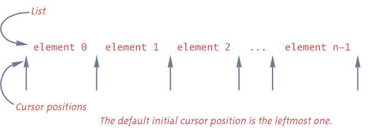

### 注意事项

#### `next` 可能返回一个引用

如果 `i` 是一个迭代器，那么 `i.next()` 返回的是创建该迭代器的集合中的一个元素，但“返回一个元素”有两种含义：

1. 调用 `i.next()` 可能返回集合中该元素的一个副本（例如，使用拷贝构造函数或克隆方法）。
2. 或者，`i.next()` 可能返回集合中该元素的一个引用。

在情况 (1) 中，修改 `i.next()` 不会改变集合中的元素（前提是拷贝是深拷贝）。在情况 (2) 中，修改 `i.next()` 将会改变集合中的元素。`Iterator<T>` 和 `ListIterator<T>` 接口的 API 文档对于你应该遵循策略 (1) 还是 (2) 描述得比较模糊，但像 `ArrayList<T>` 和 `HashSet<T>` 这类标准预定义集合类的迭代器，返回的都是引用。因此，你可以通过对 `i.next()` 使用修改器方法来修改集合中的元素。这在显示 16.12 中有所说明。我们对 `i.next()` 所做的说明同样适用于 `i.previous()`。

`next` 和 `previous` 返回集合中元素的引用这一事实不一定是坏消息。这意味着你必须小心，但这也意味着你可以遍历集合中的所有元素，并执行一些可能会修改这些元素的操作。例如，如果集合中的元素是某种记录，你可以使用修改器方法来更新这些记录。

如果你查阅 `Iterator<T>` 和 `ListIterator<T>` 接口的 API 文档，它们说明 `ListIterator<T>` 可以改变集合，但普通的 `Iterator<T>` 则不能。这些 API 注释指的不是 `i.next()` 是否返回引用。它们仅仅是指 `ListIterator<T>` 接口有一个 `set` 方法，而 `Iterator<T>` 接口没有 `set` 方法。不要将这一点与上一段讨论的内容混淆。

## 显示 16.12 迭代器返回一个引用（第 1 部分，共 2 部分）

类 `Date` 在显示 4.13 中定义，但对于这个例子，你可以很容易地猜出你需要知道的所有关于 `Date` 的信息。

```java
import java.util.ArrayList;
import java.util.Iterator;

public class IteratorReferenceDemo
{
    public static void main(String[] args)
    {
        ArrayList<Date> birthdays = new ArrayList<Date>();

        birthdays.add(new Date(1, 1, 1990));
        birthdays.add(new Date(2, 2, 1990));
        birthdays.add(new Date(3, 3, 1990));

        System.out.println("The list contains:");

        Iterator<Date> i = birthdays.iterator();
        while (i.hasNext())
            System.out.println(i.next());

        i = birthdays.iterator();
        Date d = null; //To keep the compiler happy.
        System.out.println("Changing the references.");
        while (i.hasNext())
        {
            d = i.next();
            d.setDate(4, 1, 1990);
        }

        System.out.println("The list now contains:");

        i = birthdays.iterator();
        while (i.hasNext())
            System.out.println(i.next());

        System.out.println("April fool!");
    }
}
```

（接下页）

## 912 第 16 章 集合与迭代器

## 显示 16.12 迭代器返回一个引用（第 2 部分，共 2 部分）

```
SAMPLE DIALOGUE
The list contains:
January 1, 1990
February 2, 1990
March 3, 1990
Changing the references.
The list now contains:
April 1, 1990
April 1, 1990
April 1, 1990
April fool!
```

### 提示

#### 定义你自己的迭代器类

实际上几乎没有必要定义你自己的 `Iterator<T>` 或 `ListIterator<T>` 类。定义集合类最常见且最简单的方法是使其成为库集合类之一的派生类，例如 `ArrayList<T>` 或 `HashSet<T>`。当你这样做时，你会自动获得 `iterator()` 方法，如果需要，还有 `listIterator()` 方法，它负责处理迭代器。然而，如果你确实需要以其他方式定义一个集合类，那么定义你的迭代器类的最佳方式是将它们定义为你的集合类的内部类。

## 自我测试练习

- 6. 一个 `HashSet<T>` 对象是否有生成 `ListIterator<T>` 的方法？一个 `ArrayList<T>` 对象是否有生成 `ListIterator<T>` 的方法？
- 7. 假设 `i` 是一个 `ListIterator<T>`。一次调用 `i.next()` 后跟一次调用 `i.previous()`，这两次调用会返回同一个元素，还是可能返回两个不同的元素？那 `i.previous()` 后跟 `i.next()` 呢？

## 章节总结


- 主要的集合接口是`Collection<T>`、`Set<T>`和`List<T>`。`Set<T>`和`List<T>`接口扩展了`Collection<T>`接口。标准使用的、实现这些接口的库类是实现了`Set<T>`接口的`HashSet<T>`，以及实现了`List<T>`接口的`ArrayList<T>`。

- `Set<T>`不允许重复元素，也不对其元素排序。`List<T>`允许重复元素，并对其元素排序。

- 迭代器是一种允许你以某种顺序检查并可能修改集合中元素的东西。Java通过`Iterator<T>`和`ListIterator<T>`这两个接口形式化了这一概念。

- `Iterator<T>`（仅实现了所需方法）只以一个方向遍历集合的元素，从头到尾。`ListIterator<T>`可以双向遍历集合列表，向前和向后。`ListIterator<T>`有一个`set`方法；`Iterator<T>`接口不要求有`set`方法。

## 自我测试练习答案

```java
1. public static <T> boolean inSome(T target,
                                  Collection<T> c1, Collection<T> c2)
   {
       return (c1.contains(target) || c2.contains(target));
   }

2. public static <T> T getFirst(List<T> aList)
   {
       if (aList.isEmpty())
           return null;
       else
           return aList.get(0);
   }

3. public static boolean noNull(Set<?> s)
   {
       return (s.remove(null));
   }

4. No.
```

5. 将其作为`ArrayList<T>`类的派生类会更有意义。这样元素就是有序的。你可以通过重新定义所有添加元素的方法来确保没有重复元素，这些方法在添加元素前会检查该元素是否已存在于类中。`HashSet<T>`类的派生类会自动确保没有元素重复，但要维护元素的顺序似乎需要做大量工作。

6. `HashSet<T>`没有。`ArrayList<T>`有。

7. 两个问题的答案相同：它们将返回同一个元素。

## 编程项目

许多编程项目可以使用AW's CodeMate解决。要访问它们，请访问：www.aw-bc.com/codemate。

- 1. 重做第6章的编程项目8，但这次是针对一个字符串向量，将其按字典顺序排序。

- 2. 埃拉托斯特尼筛法是一个生成质数的古老算法。考虑以下从2到10的数字列表：

```
2 3 4 5 6 7 8 9 10
```

该算法从列表中的第一个质数2开始，然后遍历列表的其余部分，删除所有是2的倍数的数字（本例中为4、6、8和10），留下：

```
2 3 5 7 9
```

然后我们对列表中的第二个质数3重复此过程，然后遍历列表的其余部分，删除所有是3的倍数的数字（本例中为9），留下：

```
2 3 5 7
```

然后我们从每个后续质数开始重复，但由于没有5或7的倍数，因此没有元素被移除（该算法更高效的实现会直接停止，而不检查5或7）。列表中剩余的数字都是质数。

使用一个初始化为从2到100的值的`ArrayList`（Integer类型）来实现这个算法。你的程序可以对`ArrayList`进行数值迭代，从索引0到索引`size()-1`以获取当前的质数，但应该使用`Iterator`来扫描列表的其余部分以消除倍数。你可以使用`listIterator`方法来检索从`ArrayList`中指定索引开始的迭代器。将所有剩余的质数输出到控制台。

## 3. 生日悖论是指，在同一房间里，有两个人或更多人碰巧生日相同的概率高得令人惊讶。这里所说的生日是指一年中的同一天（忽略闰年），而非包括出生年份或具体时刻的完整出生日期。编写一个程序，估算当房间人数从2人到50人时，有两人或更多人生日相同的概率。

该程序应使用模拟方法来近似计算答案。在多次试验（例如5000次）中，随机为房间里的每个人分配生日（即1-365之间的数字）。使用`HashSet`存储生日。在随机生成生日时，使用`HashSet`的`contains`方法检查是否已有相同生日的人在房间内。如果是，则增加一个计数器，用于记录至少有两人生日相同的次数，然后继续下一次试验。试验结束后，将计数器值除以试验次数，即可得到给定房间大小下有两人或更多人生日相同的估计概率。

你的输出应类似于以下内容。由于随机数的存在，结果不会完全相同：

```
For 2 people, the probability of two birthdays is about 0.002
For 3 people, the probability of two birthdays is about 0.0082
For 4 people, the probability of two birthdays is about 0.0163
...
For 49 people, the probability of two birthdays is about 0.9654
For 50 people, the probability of two birthdays is about 0.969
```

注意：要生成随机数x，其中0 ≤ x < 1，请使用`x = Math.random();`。这将生成一个介于0和1之间的随机数。

## 4. 本书源代码中包含的文本文件`boynames.txt`和`girlnames.txt`，列出了2003年美国社会安全局编制的最受欢迎的1000个男孩和女孩名字。

这些是以空格分隔的文件，最受欢迎的名字列在第一位，第二受欢迎的名字列在第二位，依此类推，第1000受欢迎的名字列在最后。每一行由名字、一个空格和当年使用该名字的注册出生数量组成。例如，`girlnames.txt`文件开头如下：

```
Emily 25494

Emma 22532
```

这表明Emily是最受欢迎的名字，有25,494次注册命名；Emma是第二受欢迎的名字，有22,532次，依此类推。

编写一个程序，确定男孩列表和女孩列表中共同的名字数量。使用以下算法：

- 将每个女孩名字作为字符串读取，忽略命名数量，并将其添加到`HashSet`对象中。

- 将每个男孩名字作为字符串读取，忽略命名数量，并将其添加到同一个`HashSet`对象中。如果该名字已在`HashSet`中，则`add`方法将返回`false`。如果你统计返回`false`的次数，即可得到共同命名的数量。

- 将每个共同名字添加到`ArrayList`中，并在程序退出前输出所有共同名字。

## 5. 重复上一个问题，但创建你自己的`Name`类，并将其添加到`ArrayList`和`HashMap`（而非`HashSet`）中。`Name`类应有三个私有变量：一个用于存储名字的`String`，一个用于存储女孩命名数量的整数，一个用于存储男孩命名数量的整数。你必须添加适当的构造函数、访问器和修改器方法，以及使`HashMap`和`ArrayList`方法正常工作的方法（例如`HashMap`的`get`方法）。使用名字作为`HashMap`的键，存储的值是`Name`对象。当程序输出共同名字时，还应输出男孩和女孩的命名数量。

你可能需要查阅Java文档页面来了解如何使用`HashMap`。简而言之，`HashMap`的操作类似于`HashSet`，只是它提供了一个键来存储和检索该键引用的某个对象值。以下是完成此问题的相关方法的简要描述：

- `HashMap<KeyType, NodeType>`：定义一个指定键和对象类型的`HashMap`。例如，要将`String`变量映射到`Node`对象：`HashMap<String,Node> map = new HashMap<String,Node>();`

- `Object put(Object key, Object value)`：在此映射中将指定值与指定键关联。例如：`map.put("keystring",new Node(nodevalue));`

- `Object get(Object key)`：返回此身份哈希映射中指定键映射的值，如果此映射不包含该键的映射，则返回`null`。

- `boolean containsValue(Object value)`：如果此映射将一个或多个键映射到指定值，则返回`true`。

## 6. 在一个古老的土地上，美丽的公主伊芙有许多追求者。她决定采用以下程序来决定嫁给哪位追求者。首先，所有追求者将排成一列并被分配编号。第一个追求者是1号，第二个是2号，依此类推，直到最后一个追求者n号。她从第一个追求者开始，然后沿着队列数三个追求者（因为她名字中有三个字母），第三个追求者将被取消赢得她芳心的资格，并从队列中移除。伊芙将继续数三个追求者，并淘汰每第三个追求者。当她到达队列末尾时，她会反向朝着队首移动。同样，当到达队首第一个人时，她会再次反向朝着队尾移动。

例如，如果有5个追求者，淘汰过程将如下进行：

| | |
|---|---|
| 12345 | 追求者初始列表，从1开始计数 |
| 1245 | 3号追求者被淘汰，从4继续计数，到达末尾后反弹回4 |
| 125 | 4号追求者被淘汰，从2继续反向计数，到达队首后反弹回2 |
| 15 | 2号追求者被淘汰，从5继续正向计数 |
| 1 | 5号追求者被淘汰，1是幸运的赢家 |

编写一个程序，使用`Vector`来确定如果有n个追求者，你应该站在哪个位置才能娶到公主。你的程序应使用`ListIterator`接口遍历追求者向量并移除追求者。注意，当在队列开头或结尾反向时，你的迭代器应引用正确的对象。当公主反向计数时，向量开头或结尾的追求者应只被计数一次。

如需更多在线编程项目，请点击下方的CodeMate图标。

第17章 Swing I

### 17.1 事件驱动编程 921

- 事件与监听器 921

- 示例：使用面板构建的三色窗口 954

- `Container`类 958

- 模型-视图-控制器模式 961

### 17.2 按钮、事件及其他Swing基础 923

- 示例：一个简单的窗口 923

- 按钮 930

- 动作监听器与动作事件 931

- 示例：我们第一个Swing GUI的改进版本 934

- 标签 938

- 颜色 938

- 示例：带有标签和颜色的GUI 940

### 17.3 容器与布局管理器 942

- 边界布局管理器 943

- 流式布局管理器 947

- 网格布局管理器 948

- 面板 953

### 17.4 菜单与按钮 963

- 示例：带菜单的GUI 963

- 菜单栏、菜单与菜单项 963

- 嵌套菜单 968

- `AbstractButton`类 968

- `setActionCommand`方法 972

- 作为内部类的监听器 973

### 17.5 文本框与文本区域 977

- 文本区域与文本框 977

- 一个Swing计算器 985

---

- 章节总结 991

- 自测题答案 992

- 编程项目 999

## Swing I

> “It Don’t Mean a Thing If It Ain’t Got That Swing”

> 歌名，*艾灵顿公爵*

### 简介

这是介绍Swing包中基本类以及教授使用这些类定义*图形用户界面*（*GUI*）基本技术的三章中的第一章。*GUI*是处理用户输入和输出的窗口界面。*GUI*发音为“gooey”，代表**图形用户界面**。关于Swing已有专门的书籍，因此我们没有足够的篇幅在三章中给出Swing的完整描述。但是，我们将教你足够的内容，使你能够编写各种窗口界面。

> **图形用户界面（GUI）**

> 与用户交互的窗口系统通常被称为图形用户界面。*GUI*发音为“gooey”，代表**图形用户界面**。

AWT（**抽象窗口工具包**）包是一个较旧的包，用于创建窗口界面。Swing可以被看作是AWT的改进版本。然而，Swing并没有完全取代AWT包。一些AWT类被Swing类替代，但使用Swing时仍需要其他一些AWT类。我们将同时使用Swing和AWT中的类。

Swing GUI的设计采用了一种特定的面向对象编程形式，称为*事件驱动编程*。我们的第一节将从事件驱动编程的简要概述开始。

## 预备知识

在学习本章（以及接下来关于小程序和更多Swing的两章）之前，你需要已经学过第1至5章、第7章（继承）、第13章（接口和内部类）以及第8章的第8.2节（抽象类）。（第8章的第8.2节不需要第8.1节的内容。）除了本章末尾的一个小节外，你不需要阅读本章之前的任何其他章节。

## 17.1 事件驱动编程

> 我的职责是服从命令。

*托马斯·乔纳森（石墙）·杰克逊*

**事件驱动编程**是一种采用信号与响应方式进行编程的编程风格。向对象发送的信号被称为*事件*，这是本节将解释的概念。

#### 事件与监听器

Swing程序使用事件和事件处理器。*事件*是作为信号发送给另一个对象（称为*监听器*）的对象。发送事件的过程称为**触发事件**。触发事件的对象通常是GUI组件，例如按钮。按钮在被点击时触发事件。监听器对象则响应事件执行某些操作。例如，监听器可能在特定按钮被点击时，在屏幕上显示一条消息。一个给定的组件可以拥有任意数量的监听器，从零到多个不等。每个监听器可能响应不同种类的事件，或者多个监听器可能响应相同的事件。

如果你已经阅读过第9章关于异常处理的内容，那么你已经见过事件驱动编程的一个特例。¹ 异常对象就是一个事件。抛出异常是触发事件的一个例子（在此例中是触发异常事件）。监听器就是捕获该事件的`catch`块。

在Swing GUI中，事件通常代表某种操作，例如点击鼠标、拖动鼠标、按下键盘上的键、点击窗口的关闭按钮，或任何其他预期会引发响应的操作。监听器对象具有方法，用于指定当监听器接收到各种类型的事件时将发生什么。这些处理事件的方法被称为**事件处理器**。作为程序员的你将定义（或重定义）这些事件处理器方法。触发事件的对象（例如按钮）与其事件处理监听器之间的关系如图17.1所示。

事件驱动编程与你之前见过的大多数编程方式非常不同。我们之前的所有程序都由按顺序执行的语句列表组成。有循环来重复语句，有分支来选择接下来要执行的语句列表中的某一个。然而，在某个层面上，程序的每次运行都是由一个执行者（计算机）按顺序逐条执行的一系列语句。

¹ 如果你还没有学习过关于异常的第9章，你可以放心地忽略本段。

#### 图17.1 事件触发与事件监听器

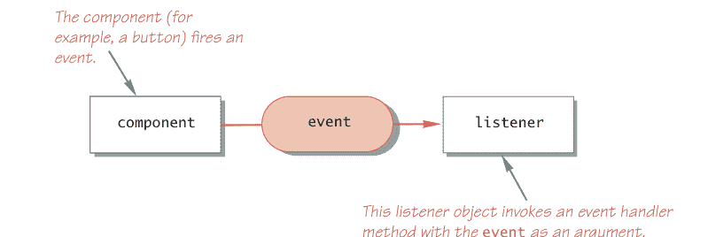

事件驱动编程则大不相同。在事件驱动编程中，你创建能够触发事件的对象，并创建监听器对象来对事件做出反应。在大多数情况下，你的程序并不决定事情发生的顺序。事件决定了那个顺序。当事件驱动程序运行时，接下来发生的事情取决于下一个事件。这就好像监听器是机器人，它们根据来自其他对象（可能是其他机器人）的事件（信号）与其他对象进行交互。你为这些机器人编程，但环境和其他机器人决定了某个特定机器人最终实际会做什么。

如果你以前从未进行过事件驱动编程，它的一个方面可能看起来很奇怪：*你将要编写那些你永远不会在任何程序中调用的方法定义*。这起初可能会让你感觉有些奇怪，因为一个方法除非被调用，否则毫无价值。所以，必定有其他人或事物，而非你这个程序员，在调用这些方法。这正是实际发生的情况。Swing系统在事件发出需要调用某个方法的信号时，会自动调用该方法。

使用Swing库进行事件驱动编程大量使用了继承。你定义的类将是某些基本Swing库类的派生类。这些派生类将从它们的基类继承方法。对于许多这样的继承方法，库软件将决定何时调用这些方法，但你将重写继承方法的定义，以决定当该方法被调用时将发生什么。

## 17.2 按钮、事件与其他Swing基础

> 一次按钮点击，胜过一千次按键。

匿名

在本节中，我们将介绍足够的Swing知识，以便你能编写一些简单的GUI程序。

# 示例

### 一个简单的窗口

图17.2包含一个Swing程序，它生成一个简单的窗口。窗口中除了一个按钮外空无一物，按钮上写着“点击结束程序。”如果用户遵循指示并用鼠标点击该按钮，程序就会结束。

`import`语句给出了所使用类的名称以及它们所在的包。我们和其他人所说的Swing库就是名为`javax.swing`的包。AWT库是`java.awt`包。请注意，一个包名包含一个“x”，而另一个不包含。

这个程序是一个简单的类定义，只有一个`main`方法。`main`方法的第一行创建了一个`JFrame`类的对象。该行如下所示：

```
JFrame firstWindow = new JFrame();
```

这是一个普通的变量`firstWindow`的声明，以及对`JFrame`类的无参构造方法的调用。`JFrame`对象是一个基本窗口。`JFrame`对象包含一个边框和通常用于最小化窗口到图标、调整窗口大小以及关闭窗口的三个按钮。这些按钮显示在窗口的右上角，这是典型的，但如果你的操作系统通常将这些按钮放在其他地方，那么在你电脑上的`JFrame`中，它们很可能也会位于那个位置。

`JFrame`窗口的初始大小是使用`JFrame`方法`setSize`设置的，如下所示：

```
firstWindow.setSize(WIDTH, HEIGHT);
```

在这个例子中，`WIDTH`和`HEIGHT`是定义的`int`常量。单位是像素，所以生成的窗口是300像素宽，200像素高。（术语“像素”的定义在名为“像素”的方框中。）与其他窗口一样，你可以通过使用鼠标拖动`JFrame`窗口的角落来更改其大小。


用于最小化窗口到图标以及调整窗口大小的按钮的行为与你使用的任何其他窗口中的行为相同。最小化按钮将窗口缩小为图标。（要恢复窗口，请点击该图标。）第二个按钮在最大化屏幕和较小尺寸之间切换窗口大小。关闭窗口按钮的行为可以根据程序的设置方式而有所不同。

（续）

### 示例（续）

关闭窗口按钮的行为是用 `JFrame` 方法 `setDefaultCloseOperation` 设置的。设置关闭窗口按钮行为的程序行如下所示：

```java
firstWindow.setDefaultCloseOperation(
    JFrame.DO_NOTHING_ON_CLOSE);
```

在这个例子中，参数 `JFrame.DO_NOTHING_ON_CLOSE` 是一个名为 `DO_NOTHING_ON_CLOSE` 的定义常量，它在 `JFrame` 类中定义。这将关闭窗口按钮设置为当点击时什么也不发生（除非我们编程让它发生，而我们没有这样做）。其他可能的参数如图 17.3 所示。

`setDefaultCloseOperation` 方法接受一个 `int` 参数，图 17.3 中描述的每个常量都是一个 `int` 常量。然而，不要将它们视为 `int` 值。将它们视为当用户点击关闭窗口按钮时发生什么的策略。用 `int` 值来命名这些策略很方便。然而，它们同样可以用 `char` 值、`String` 值或其他东西来命名。它们是 `int` 值这一事实是一个偶然的细节，没有真正的重要性。

图 17.3 给出了 `JFrame` 类中一些最重要方法的描述。其中一些方法将在本章稍后解释。`JFrame` 类更完整的方法列表见附录 5。

`JFrame` 可以添加组件，例如按钮、菜单和文本标签。例如，图 17.2 中的以下行将名为 `endButton` 的 `JButton` 对象添加到名为 `firstWindow` 的 `JFrame` 中：

```java
firstWindow.add(endButton);
```

关于如何创建和编程名为 `endButton` 的 `JButton` 的描述将在本节稍后的两个小节“按钮”和“动作监听器与动作事件”中给出。

我们通过跳转到程序的最后一行来结束本小节，即：

```java
firstWindow.setVisible(true);
```

这使得 `JFrame` 窗口在屏幕上可见。乍一看这似乎很奇怪。为什么不自动让窗口可见呢？如果你不想让窗口可见，为什么要创建它呢？答案是你可能不想让它在所有时候都可见。你肯定经历过窗口消失又重新出现的情况。要隐藏窗口（这在本例中不是我们想要的），你会将参数 `true` 替换为 `false`。

> **JFrame**
>
> `JFrame` 类的对象就是你所认为的窗口。它自动拥有边框和一些用于最小化窗口等操作的基本按钮。正如你将看到的，一个 `JFrame` 对象可以向窗口添加按钮和许多其他组件，并对其进行动作编程。

## 显示 17.2 第一个 Swing 演示程序（第 1 部分，共 2 部分）


```java
import javax.swing.JFrame;
import javax.swing.JButton;

public class FirstSwingDemo
{
    public static final int WIDTH = 300;
    public static final int HEIGHT = 200;

    public static void main(String[] args)
    {
        JFrame firstWindow = new JFrame();
        firstWindow.setSize(WIDTH, HEIGHT);

        firstWindow.setDefaultCloseOperation(
                            JFrame.DO_NOTHING_ON_CLOSE);

        JButton endButton = new JButton("Click to end program.");
        EndingListener buttonEar = new EndingListener();
        endButton.addActionListener(buttonEar);
        firstWindow.add(endButton);

        firstWindow.setVisible(true);
    }
}
```

> 这个程序不是我们将用于 Swing 程序的典型风格。
>
> 这是文件 `FirstSwingDemo.java`。

```java
import java.awt.event.ActionListener;
import java.awt.event.ActionEvent;

public class EndingListener implements ActionListener
{
    public void actionPerformed(ActionEvent e)
    {
        System.exit(0);
    }
}
```

> 这是文件 `EndingListener.java`。

## 显示 17.2 第一个 Swing 演示程序（第 2 部分，共 2 部分）

生成的图形用户界面

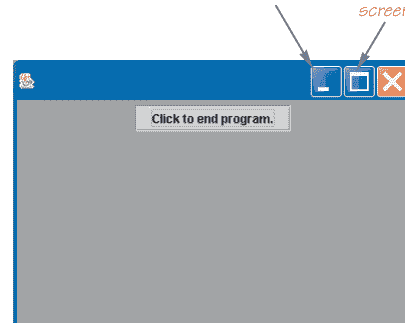

### 像素

像素是屏幕可书写的最小空间单位。在 Swing 中，屏幕上对象的大小和位置都以像素为单位进行测量。屏幕上的像素越多，屏幕分辨率就越高。

### 分辨率与对象尺寸的关系

分辨率和尺寸之间的关系起初可能看起来令人困惑。高分辨率屏幕是比低分辨率屏幕质量更好的屏幕，那么为什么对象在高分辨率屏幕上看起来更小，在低分辨率屏幕上看起来更大呢？考虑一个非常简单的情况，即一个像素的“点”。对于固定尺寸的屏幕，如果像素非常多（高分辨率），那么一个像素的点就会非常小。对于相同尺寸的屏幕，如果像素较少（低分辨率），那么每个像素必须更大，因为较少的像素覆盖了相同的屏幕面积。因此，如果像素较少，一个像素的点就会更大。同样，一个两像素的图形或任何像素数量的图形在低分辨率（像素较少）的屏幕上看起来都会更大。

## 显示 17.3 `JFrame` 类中的一些方法

`JFrame` 类位于 `javax.swing` 包中。

```java
public JFrame()
```

创建一个 `JFrame` 类对象的构造方法。

```java
public JFrame(String title)
```

创建一个带有给定标题参数的 `JFrame` 类对象的构造方法。

```java
public void setDefaultCloseOperation(int operation)
```

设置用户点击关闭窗口按钮时默认执行的操作。参数应为以下定义的常量之一：

- `JFrame.DO_NOTHING_ON_CLOSE`：什么都不做。`JFrame` 不执行任何操作，但如果有任何已注册的窗口监听器，它们将被调用。（窗口监听器在第 19 章中解释。）

- `JFrame.HIDE_ON_CLOSE`：在调用任何已注册的 `WindowListener` 对象后隐藏窗口。

- `JFrame.DISPOSE_ON_CLOSE`：在调用任何已注册的窗口监听器后隐藏并释放窗口。当窗口被释放时，它被消除，但程序不会结束。要结束程序，你需要使用下一个常量作为 `setDefaultCloseOperation` 的参数。

- `JFrame.EXIT_ON_CLOSE`：使用 `System.exit` 方法退出应用程序。（不要在 `Applet` 中的框架使用此选项。`Applet` 在第 18 章讨论。）

如果未使用 `setDefaultCloseOperation` 方法指定操作，则采取的默认操作是 `JFrame.HIDE_ON_CLOSE`。

如果参数不是上面列出的值之一，将抛出 `IllegalArgumentException`。<sup>2</sup>

如果参数是 `JFrame.EXIT_ON_CLOSE` 并且安全管理器不允许调用者调用 `System.exit`，将抛出 `SecurityException`。（你不太可能遇到这种情况。）

```java
public void setSize(int width, int height)
```

设置调用框架的大小，使其具有指定的宽度和高度。使用的长度单位是像素。

```java
public void setTitle(String title)
```

将此框架的标题设置为参数字符串。

```java
public void add(Component componentAdded)
```

将一个组件添加到 `JFrame`。

```java
public void setLayout(LayoutManager manager)
```

设置布局管理器。布局管理器将在本章后面讨论。

```java
public void setJMenuBar(JMenuBar menubar)
```

为调用框架设置菜单栏。（菜单和菜单栏将在本章后面讨论。）

```java
public void dispose()
```

消除调用框架及其所有子组件。它们使用的任何内存都将被释放以供重用。如果还有剩余项目（除了调用框架及其子组件之外的项目），那么这不会结束程序。（`dispose` 方法在第 19 章讨论。）

<sup>2</sup> 如果你还没有学完关于异常的第 9 章，可以安全地忽略所有关于“抛出异常”的引用。

### `setVisible` 方法

许多 Swing 对象类都有一个 `setVisible` 方法。`setVisible` 方法接受一个布尔类型的参数。如果 `w` 是一个可以在屏幕上显示的对象（例如 `JFrame` 窗口），那么调用：

```java
w.setVisible(true);
```

将使 `w` 可见。调用：

```java
w.setVisible(false);
```

将隐藏 `w`。

## 语法

```java
Object_For_Screen.setVisible(Boolean_Expression);
```

#### 示例（来自显示 17.2）

```java
public static void main(String[] args)
{
    JFrame firstWindow = new JFrame();
        .
        .
        .
    firstWindow.setVisible(true);
}
```

### 易错点

#### 忘记为关闭窗口按钮编程

显示 17.2 中的以下几行确保当用户点击关闭窗口按钮时，不会发生任何事情：

```java
firstWindow.setDefaultCloseOperation(
        JFrame.DO_NOTHING_ON_CLOSE);
```

如果你忘记为关闭窗口按钮编程，那么默认操作就好像你这样设置了：

```java
firstWindow.setDefaultCloseOperation(
        JFrame.HIDE_ON_CLOSE);
```

#### 易错点（续）

在显示 17.2 的程序中，这意味着如果用户点击关闭窗口按钮，窗口将隐藏（变得不可见且无法访问），但程序不会结束，这是一个相当糟糕的情况。由于窗口被隐藏，将无法点击“点击以结束程序”按钮。你需要使用一些操作系统命令来强制程序结束。这是一个操作系统主题，而不是 Java 主题，确切的命令取决于你使用的操作系统。

## 自我测试练习

1. 你通常使用哪个 Swing 类来定义窗口？任何你定义的窗口类通常都是这个类的对象。

2. 在显示 17.2 程序的 `main` 方法中出现的对 `setSize` 的以下调用中使用了什么度量单位？换句话说，300 是什么单位？英寸？厘米？光年？同样，200 是什么单位？

3. 为了使用户点击 `someWindow` 中的关闭窗口按钮时不发生任何事情，设置 `JFrame someWindow` 的关闭窗口按钮的方法调用是什么？

4. 为了使用户点击 `someWindow` 中的关闭窗口按钮时程序结束，设置 `JFrame someWindow` 的关闭窗口按钮的方法调用是什么？

5. 当你点击显示 17.2 中所示的 `JFrame` 的最小化按钮时会发生什么？

6. 假设 `someWindow` 是一个 `JFrame`，`n` 是一个具有某个值的 `int` 变量。给出一个 Java 语句，如果 `n` 为正数则使 `someWindow` 可见，否则隐藏 `someWindow`。

```java
firstWindow.setSize(WIDTH, HEIGHT);
```

等价于：

```java
firstWindow.setSize(300, 200);
```

### 按钮

按钮对象的创建方式与任何其他对象的创建方式相同，但你使用 `JButton` 类。例如，来自显示 17.2 的以下示例创建了一个按钮：

```java
JButton endButton = new JButton("Click to end program.");
```

构造函数的参数（本例中为 `"Click to end program."`）是一个字符串，当按钮显示时将写在按钮上。如果你查看显示 17.2 中的 GUI 图片，你会看到按钮上标有 `"Click to end program."`。

我们已经讨论了将组件（如按钮）添加到 `JFrame`。按钮通过显示 17.2 中的以下行添加到 `JFrame`：

```java
firstWindow.add(endButton);
```

在下一小节中，我们将解释显示 17.2 中涉及 `addActionListener` 方法的代码行。

> **`JButton` 类**
>
> `JButton` 类的对象在 GUI 中显示为一个看起来像按钮的组件。你用鼠标点击按钮来模拟按下它。使用 `new` 创建 `JButton` 类的对象时，你可以给构造函数一个字符串参数，该字符串将显示在按钮上。
>
> 你可以通过使用 `add` 方法将 `JButton` 对象添加到 `JFrame`，其中 `JFrame` 作为调用对象，`JButton` 对象作为参数。你稍后会看到，你也可以以类似的方式将按钮添加到其他 GUI 对象（称为“容器”）中。
>
> 按钮的动作是通过使用 `addActionListener` 方法向按钮注册一个监听器来编程的。

**示例**

```java
JButton niceButton = new JButton("Click here");
niceButton.addActionListener(new SomeActionListenerClass());
someJFrame.add(niceButton);
```

> **关闭窗口按钮不属于 `JButton` 类**
>
> 你添加到 GUI 的所有按钮都是 `JButton` 类的对象。`JFrame` 上的关闭窗口按钮和伴随的另外两个按钮不是 `JButton` 类的对象。它们是 `JFrame` 对象的一部分。

## 动作监听器与动作事件

点击鼠标上的按钮（或在图形用户界面中激活其他某些项目）会创建一个称为事件的对象，并将该事件对象发送到另一个（或多个）称为监听器的对象。这称为触发事件。然后监听器执行某些操作。当我们说事件被“发送”到监听器对象时，我们真正的意思是监听器对象中的某个方法被调用，并将事件对象作为参数传递。此调用会自动发生。你的 Swing GUI 类定义通常不会包含对此方法的调用。但是，你的 Swing GUI 类定义确实需要做两件事：

首先，对于每个按钮，它需要指定哪些对象是监听器，这些监听器将响应按钮触发的事件；这称为注册监听器。

其次，它必须定义当事件发送到监听器时将被调用的方法。请注意，这些方法将由你定义，但在正常情况下，你永远不会编写调用这些方法的代码。这些调用将自动发生。

显示 17.2 中的以下行创建了一个名为 `buttonEar` 的 `EndingListener` 对象，并将 `buttonEar` 注册为一个监听器，以接收来自名为 `endButton` 的按钮的事件：

```java
EndingListener buttonEar = new EndingListener();
endButton.addActionListener(buttonEar);
```

第二行表示 `buttonEar` 被注册为 `endButton` 的监听器，这意味着 `buttonEar` 将接收 `endButton` 触发的所有事件。

不同类型的组件需要不同类型的监听器类来处理它们触发的事件。按钮触发的事件称为动作事件，由称为动作监听器的监听器处理。

动作监听器是一个对象，其类实现了 `ActionListener` 接口。例如，显示 17.2 中的类 `EndingListener` 实现了 `ActionListener` 接口。`ActionListener` 接口只有一个必须实现的方法头，即以下内容：

```java
public void actionPerformed(ActionEvent e)
```

在显示 17.2 的类 `EndingListener` 中，`actionPerformed` 方法定义如下：

```java
public void actionPerformed(ActionEvent e)
{
    System.exit(0);
}
```

如果用户点击按钮 `endButton`，这将向该按钮的动作监听器发送一个动作事件。但 `buttonEar` 是按钮 `endButton` 的动作监听器，因此动作事件会传递给 `buttonEar`。当动作监听器接收到动作事件时，该事件会自动作为参数传递给方法 `actionPerformed`，并且方法 `actionPerformed` 被调用。如果事件称为 `e`，那么在响应 `endButton` 触发 `e` 时，会发生以下调用：

```java
buttonEar.actionPerformed(e);
```


在这种情况下，参数 `e` 被方法 `actionPerformed` 忽略。方法 `actionPerformed` 只是调用 `System.exit`，从而结束程序。因此，如果用户点击 `endButton`（标有“Click to end program.”的那个），最终效果是结束程序，因此窗口消失。请注意，你从未编写任何代码说：

```java
buttonEar.actionPerformed(e);
```

此操作确实会发生，但此代码嵌入在 Swing 和/或 AWT 库内的某个类定义中。在某处，代码类似于：

```java
bla.actionPerformed(e);
```

并且 `buttonEar` 以某种方式替换了参数 `bla`，并且此 `actionPerformed` 调用被执行。但是，所有这些都是为你完成的。你只需定义方法 `actionPerformed` 并将 `buttonEar` 注册为 `endButton` 的监听器。

请注意，方法 `actionPerformed` 必须有一个类型为 `ActionEvent` 的参数，即使你的 `actionPerformed` 定义未使用此参数。这是因为 `actionPerformed` 的调用已经为你编程好了，因此必须允许使用 `ActionEvent` 参数 `e` 的可能性。正如你将看到的，在其他 Swing GUI 中，方法 `actionPerformed` 通常确实使用事件 `e` 来确定哪个按钮被点击。此第一个示例是一个特殊的简单情况，因为只有一个按钮。在本章后面，我们将在更复杂的情况下讨论定义 `actionPerformed` 方法。

> **PITFALL**
>
> **更改 `actionPerformed` 的方法头**
>
> 当你在动作监听器中定义方法 `actionPerformed` 时，你正在实现 `ActionListener` 接口中指定的 `actionPerformed` 的方法头。因此，方法 `actionPerformed` 的方法头是由你决定的，你不能更改它。它必须恰好有一个参数，并且该参数必须是 `ActionEvent` 类型，如下所示：
>
> ```java
> public void actionPerformed(ActionEvent e)
> ```
>
> 如果你更改参数的类型或添加（或删除）参数，你将不会给出正确的动作监听器定义。² 你能更改的唯一内容是参数 `e` 的名称，因为它只是一个占位符。因此以下更改是可接受的：
>
> ```java
> public void actionPerformed(ActionEvent theEvent)
> ```
>
> 当然，如果你进行此更改，那么在方法 `actionPerformed` 的主体内，你将使用标识符 `theEvent` 代替标识符 `e`。
>
> 你也不能在方法 `actionPerformed` 中添加 `throws` 子句。³ 如果在 `actionPerformed` 的定义中抛出受检查异常，则必须在方法 `actionPerformed` 中捕获该异常。（回顾一下，受检查异常是必须在 `catch` 块中捕获或在 `throws` 子句中声明的异常。）

> **TIP**
>
> **结束 Swing 程序**
>
> GUI 程序通常基于一种无限循环。GUI 程序中可能没有 Java 循环语句，但 GUI 程序仍可能永远不会结束。窗口系统通常保持在屏幕上，直到用户指示它应该消失（例如，通过点击 Display 17.2 中的 "Click to end program." 按钮）。如果用户从不要求窗口系统消失，它将永远不会消失。
>
> 当你编写 Swing GUI 程序时，你需要在用户（或其他某些东西）表示是时候结束程序时使用 `System.exit` 来结束程序。与本章之前我们看到的程序类型不同，Swing 程序在执行程序中的所有代码后不会结束。Swing 程序在执行 `System.exit` 之前不会结束。（在某些情况下，`System.exit` 可能位于某些库代码中，无需在你的代码中明确给出。）

---

*² 虽然这种风格相当有问题，但你可以重载名为 `actionPerformed` 的方法，从而拥有多个版本的 `actionPerformed` 方法，每个版本都有不同的参数列表。但只有上面所示的 `actionPerformed` 版本与使类成为动作监听器有关。*

*³ 如果你还没有涵盖异常处理（第 9 章），你可以安全地忽略此段落。*

## 自测练习

- 7. 点击 `JButton` 时会触发什么类型的事件？
- 8. 实现 `ActionListener` 接口的类中必须实现什么方法头？
- 9. 修改 Display 17.2 中的程序，使显示的窗口标题为"My First Window"。提示：请参阅 Display 17.3 中的构造函数描述。

## 示例：我们第一个 Swing GUI 的改进版本

Display 17.4 是对 Display 17.2 中演示程序的重写，包含了一些新增功能。这个新版本产生的窗口与 Display 17.2 中程序产生的窗口类似。然而，这个新版本是以你在编写自己的 GUI 时应该遵循的风格完成的。

请注意，该窗口是通过定义一个类（`FirstWindow`）来创建的，该类的对象是我们想要的那种窗口。然后，窗口通过一个使用 `FirstWindow` 类的程序（`DemoWindow`）来显示。

观察到 `FirstWindow` 是类 `JFrame` 的派生类。这是定义窗口界面的常规方式。基类 `JFrame` 提供了一些基本的窗口设施，然后派生类添加你希望在窗口界面中具有的任何其他功能。

请注意，Display 17.4 中的构造函数以调用父类 `JFrame` 的构造函数开始，代码如下：

```java
super();
```

正如我们在第 7 章中指出的，这确保了通常为所有 `JFrame` 类型对象执行的初始化实际上会被执行。如果你调用的基类构造函数没有参数，那么它将被自动调用，因此我们本可以省略 Display 17.4 中对 `super()` 的调用。但是，如果基类构造函数需要参数（就像在某些其他情况下可能需要的那样），那么你必须包含对基类构造函数 `super` 的调用。

请注意，Display 17.4 中窗口 `FirstWindow` 的几乎所有初始化都放在类的构造函数中。这是正确的。初始化，例如设置初始窗口大小，应该是类定义的一部分，而不是由类的对象执行的操作（如它们在 Display 17.2 中那样）。

所有初始化方法，例如 `setSize` 和 `setDefaultCloseOperation`，都是从类 `JFrame` 继承的。因为它们是在窗口的构造函数中被调用的，所以窗口本身是调用对象。换句话说，像这样的方法调用：

```java
setSize(WIDTH, HEIGHT);
```

等效于：

```java
this.setSize(WIDTH, HEIGHT);
```

### 示例（续）

类似地，方法调用：

```java
setDefaultCloseOperation(
    JFrame.DO_NOTHING_ON_CLOSE);
```

和：

```java
add(endButton);
```

分别等同于：

```java
this.setDefaultCloseOperation(
    JFrame.DO_NOTHING_ON_CLOSE);
```

和：

```java
this.add(endButton);
```

在类 `FirstWindow`（代码清单 17.4）中，我们通过以下方式为窗口添加了标题"First Window Class"：

```java
setTitle("First Window Class");
```

通过查看代码清单 17.4 中给出的 GUI 图片，你可以看到标题在 `JFrame` 中的显示位置。

我们在代码清单 17.4 中与代码清单 17.2 的一个不同之处是使用了匿名对象，即在以下行中：

```java
endButton.addActionListener(new EndingListener());
```

而在代码清单 17.2 中，是通过以下两行执行相同操作的：

```java
EndingListener buttonEar = new EndingListener();
endButton.addActionListener(buttonEar);
```

在代码清单 17.2 中，我们为了更加清晰，使用了这两步。然而，使用匿名对象 `new EndingListener()` 更为合理，因为该监听器对象之后再也不会被引用，因此不需要一个名称。

代码清单 17.4 中的程序 `DemoWindow` 只是将 `FirstWindow` 类的一个对象显示在屏幕上。

代码清单 17.4 中窗口的几乎所有初始化细节都已移至 `FirstWindow` 类的构造函数中。然而，我们将 `setVisible` 方法的调用放在了使用窗口类 `FirstWindow` 的应用程序中。

我们本可以将 `setVisible` 的调用放在 `FirstWindow` 的构造函数中，并从应用程序 `DemoWindow`（代码清单 17.4）中省略 `setVisible` 的调用。如果我们这样做，运行应用程序时会产生相同的结果。然而，在正常情况下，应用程序知道何时应该显示窗口，因此将 `setVisible` 方法的调用放在应用程序中是常规做法。编写 `FirstWindow` 类的程序员无法预知使用该窗口的程序员何时希望使其可见（或隐藏）。

## 代码清单 17.4 定义 `JFrame` 的常规方法（第 1 部分，共 2 部分）

```java
import javax.swing.JFrame;
import javax.swing.JButton;

public class FirstWindow extends JFrame
{
    public static final int WIDTH = 300;
    public static final int HEIGHT = 200;

    public FirstWindow()
    {
        super();
        setSize(WIDTH, HEIGHT);
        setTitle("First Window Class");
        setDefaultCloseOperation(JFrame.DO_NOTHING_ON_CLOSE);
        JButton endButton = new JButton("Click to end program.");
        endButton.addActionListener(new EndingListener());
        add(endButton);
    }
}
```

> 类 `EndingListener` 在代码清单 17.2 中定义。

这是文件 `FirstWindow.java`。

这是文件 `DemoWindow.java`。

```java
public class DemoWindow
{
    public static void main(String[] args)
    {
        FirstWindow w = new FirstWindow();
        w.setVisible(true);
    }
}
```

## 代码清单 17.4 定义 `JFrame` 的常规方法（第 2 部分，共 2 部分）

### 生成的 GUI

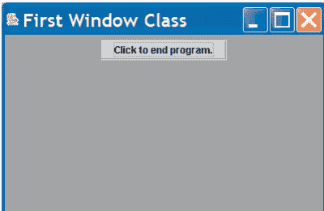

### `JFrame` 类

当我们说一个类是 `JFrame` 类时，我们的意思是该类是 `JFrame` 类的派生类。例如，代码清单 17.4 中的类 `FirstWindow` 就是一个 `JFrame` 类。当我们说一个对象是 `JFrame` 时，我们的意思是它是某个 `JFrame` 类的对象。

### 自测练习

- 10. 修改代码清单 17.4 中的程序，使得 `JFrame` 的标题不是通过方法 `setTitle` 设置，而是通过调用基类构造函数来设置。提示：回顾自测练习 9。
- 11. 修改代码清单 17.4 中的程序，使得有两种方式可以结束 GUI 程序：可以通过单击"Click to end program."按钮或单击关闭窗口按钮来结束程序。

### 标签

我们已经看到了如何向 `JFrame` 添加按钮。如果你想向 `JFrame` 添加一些文本，请使用标签（label）而不是按钮。标签是 `JLabel` 类的对象。标签不过是一行文本。标签的文本作为参数传递给 `JLabel` 构造函数，如下所示：

```java
JLabel greeting = new JLabel("Hello");
```

然后，标签 `greeting` 可以像添加按钮一样被添加到 `JFrame` 中。例如，以下代码可能出现在 `JFrame` 派生类的构造函数中：

```java
JLabel greeting = new JLabel("Hello");
add(greeting);
```

下一个编程示例展示了一个包含标签的 `JFrame` GUI。

> ### `JLabel` 类
>
> `JLabel` 类的对象不过是一行可以添加到 `JFrame`（或者，正如我们将看到的，添加到某些其他对象中）的文本。

**示例（在 `JFrame` 派生类的构造函数内部）**

```java
JLabel myLabel = new JLabel("Hi Mom!");
add(myLabel);
```

### 颜色

你可以设置 `JFrame`（或其他 GUI 对象）的颜色。要设置 `JFrame` 的背景颜色，请使用：

```java
getContentPane().setBackground(Color);
```

例如，以下代码将名为 `someFrame` 的 `JFrame` 的颜色设置为蓝色：

```java
someFrame.getContentPane().setBackground(Color.BLUE);
```

或者，如果你在 `JFrame` 的构造函数中设置颜色，调用形式如下：

```java
getContentPane().setBackground(Color.BLUE);
```

这等同于：

```java
this.getContentPane().setBackground(Color.BLUE);
```

下一个编程示例展示了一个（实际上是两个）带颜色的 `JFrame` 对象。

方法调用 `getContentPane()` 返回 `JFrame` 的所谓**内容面板（content pane）**。因此：

```java
getContentPane().setBackground(Color.BLUE);
```

实际上是将内容面板的颜色设置为蓝色。内容面板是 `JFrame` 的"内部"，因此给内容面板上色的效果就是给 `JFrame` 的内部上色。然而，你可以将：

```java
getContentPane().setBackground(Color);
```

看作是一个拼写特殊的方法调用，用于设置 `JFrame` 的颜色。（在本书中，我们不会引用 `JFrame` 的内容面板，除非我们想给 `JFrame` 上色，因此我们将不再进一步解释内容面板。）

只有在给 `JFrame` 上色时才使用 `getContentPane`。正如你将看到的，要设置 `JFrame` 中某个组件（如按钮）的颜色，你只需使用方法 `setBackground`，并将按钮或其他组件作为调用对象。你将在第 17.3 节看到为组件添加颜色的示例。

在 Java Swing 类中使用的**颜色（color）**是什么样的东西？像 Java 中的其他一切一样，颜色是一个对象——在这种情况下，是一个类 `Color` 的实例对象。类 `Color` 位于 `java.awt` 包中。（注意包名是 `java.awt`，而不是 `javax.awt`。）

在后面的章节中，你将看到如何定义自己的颜色，但现在我们将使用已经为你定义好的颜色，例如 `Color.BLUE`，它是在类 `Color` 中定义的名为 `BLUE` 的常量。当然，这个常量代表蓝色。如果你将 `JFrame` 的背景设置为 `Color.BLUE`，那么 `JFrame` 将具有蓝色背景。常量 `Color.BLUE` 和其他类似常量的类型是 `Color`。为你定义好的颜色常量列表在代码清单 17.5 中给出。下一个编程示例包含一个带有 `Color` 类型参数的构造函数示例。

## 代码清单 17.5 颜色常量

| `Color.BLACK` | `Color.MAGENTA` |
|---|---|
| `Color.BLUE` | `Color.ORANGE` |
| `Color.CYAN` | `Color.PINK` |
| `Color.DARK_GRAY` | `Color.RED` |
| `Color.GRAY` | `Color.WHITE` |
| `Color.GREEN` | `Color.YELLOW` |
| `Color.LIGHT_GRAY` | |

类 `Color` 位于 `java.awt` 包中。

## 示例：带有标签和颜色的 GUI

代码清单 17.6 展示了一个具有标签和背景颜色的 GUI 类。我们已经讨论了此窗口的颜色使用。标签用于显示文本字符串"Close–window button works."。标签的创建如下：

```java
JLabel aLabel = new JLabel("Close–window button works.");
```

标签通过方法 `add` 添加到 `JFrame`，如代码清单 17.6 中的以下行所示：

```java
add(aLabel);
```

代码清单 17.6 中的 GUI 类 `ColoredWindow` 对关闭窗口按钮的编程如下：


`setDefaultCloseOperation(JFrame.EXIT_ON_CLOSE);`

这样，当用户单击关闭窗口按钮时，程序结束。请注意，如果程序有多个窗口（如代码清单 17.6 所示），并且用户单击了任意一个 `ColoredWindow` 类窗口中的关闭窗口按钮，那么整个程序将结束，所有窗口都会消失。

请注意，我们通过将标题作为 `super` 的参数来设置 `JFrame` 的标题，而不是作为 `setTitle` 的参数。这是设置 `JFrame` 标题的另一种常见方式。

如果你运行代码清单 17.6 中的程序`DemoColoredWindow`，那么两个窗口将一个叠放在另一个上面。要同时看到两个窗口，你需要使用鼠标移动上面的窗口。

### 设置 `JFrame` 的标题

设置`JFrame`标题最常见的两种方式是使用方法`setTitle`（如代码清单 17.4 所示），或者将标题作为基类构造函数`super`的参数传递（如代码清单 17.6 所示）。

### 自测练习

- 12. 你将如何修改代码清单 17.6 中的类定义，使得无参构造函数产生的窗口是品红色（magenta）而不是粉红色（pink）？
- 13. 重写代码清单 17.6 中的以下两行代码，使标签没有名称`aLabel`或任何其他名称。提示：使用匿名对象。

```
JLabel aLabel = new JLabel("Close–window button works.");
add(aLabel);
```

## 显示 17.6 一个带颜色的 JFrame（第 1 部分，共 2 部分）

```
import javax.swing.JFrame;
import javax.swing.JLabel;
import java.awt.Color;
public class ColoredWindow extends JFrame
{
    public static final int WIDTH = 300;
    public static final int HEIGHT = 200;
    public ColoredWindow(Color theColor)
    {
        super("No Charge for Color");
        setSize(WIDTH, HEIGHT);
        setDefaultCloseOperation(JFrame.EXIT_ON_CLOSE);
        getContentPane().setBackground(theColor);
        JLabel aLabel = new JLabel("Close-window button works.");
        add(aLabel);
    }
    public ColoredWindow()
    {
        this(Color.PINK);
    }
}
```

```
import java.awt.Color;
public class DemoColoredWindow
{
    public static void main(String[] args)
    {
        ColoredWindow w1 = new ColoredWindow();
        w1.setVisible(true);
        ColoredWindow w2 = new ColoredWindow(Color.YELLOW);
        w2.setVisible(true);
    }
}
```

## 显示 17.6 一个带颜色的 JFrame（第 2 部分，共 2 部分）

### 生成的图形用户界面

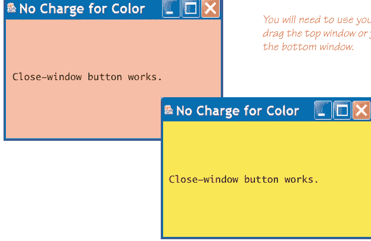

你需要使用鼠标拖动顶部的窗口，否则将看不到底部的窗口。

## 17.3 容器与布局管理器

> 不要将所有鸡蛋放在一个篮子里。
> ——谚语

从旧类创建新类主要有两种方式。一种是使用继承；这被称为 *“是一个”（Is-A）关系*。例如，显示 17.6 中的类`ColoredWindow`的一个对象 *是一个*`JFrame`，因为`ColoredWindow`是类`JFrame`的派生类。第二种从现有类（或多个类）创建新类的方式是拥有现有类类型的实例变量；这被称为组合或 *“有一个”（Has-A）关系*。Swing 库已经做好了设置，让你可以轻松地使用组合。声明实例变量的实际代码位于 Swing 库的类中，例如类`JFrame`。你无需声明实例变量，而是使用`add`方法将组件添加到`JFrame`中。这最终会设置一些实例变量，但当你使用`add`方法时，这是自动完成的。在本节中，我们将讨论在图形用户界面（GUI）或其子部分中添加和排列组件。

到目前为止，我们只向`JFrame`添加了一个组件，要么是按钮，要么是标签。你可以向一个`JFrame`添加多个组件。为此，你需要多次使用`add`方法，但`add`方法只是指定了哪些组件被添加到`JFrame`中；它没有说明这些组件如何排列，例如是并排排列还是上下排列。要描述组件的排列方式，你需要使用**布局管理器**。

在本节中，我们将看到，除了`JFrame`之外，还有其他类的对象也可以使用`add`方法添加组件，并由布局管理器进行排列。所有这些类都被称为**容器类**。

### 边界布局管理器

显示 17.7 包含一个使用布局管理器在`JFrame`中排列三个标签的 GUI 示例。这些标签在三行上从上到下排列。

在显示 17.7 中，通过以下行将布局管理器添加到`JFrame`类：

```
setLayout(new BorderLayout());
```

`BorderLayout`是一个布局管理器类，因此`new BorderLayout()`会创建一个`BorderLayout`类的新匿名对象。这个`BorderLayout`对象被赋予了排列添加到`JFrame`的组件（在本例中是标签）的任务。

值得注意的是，上面的`setLayout`调用等效于以下代码：

```
BorderLayout manager = new BorderLayout();
setLayout(manager);
```

`BorderLayout`管理器将标签（或其他组件）放置到`BorderLayout.NORTH`、`BorderLayout.SOUTH`、`BorderLayout.EAST`、`BorderLayout.WEST`和`BorderLayout.CENTER`这五个区域中。这五个区域的排列方式如显示 17.8 所示。外框代表`JFrame`（或你将向其中添加内容的其他容器）。除非你做一些使其可见的操作，否则图中的线条都不会显示。我们绘制这些线条是为了向你展示每个区域的位置。

在显示 17.7 中，我们按如下方式添加标签：

```
JLabel label1 = new JLabel("First label");
add(label1, BorderLayout.NORTH);
JLabel label2 = new JLabel("Second label");
add(label2, BorderLayout.SOUTH);
JLabel label3 = new JLabel("Third label");
add(label3, BorderLayout.CENTER);
```

## 第 17 章 Swing I

## 显示 17.7 BorderLayout 管理器（第 1 部分，共 2 部分）


```
import javax.swing.JFrame;
import javax.swing.JLabel;
import java.awt.BorderLayout;

public class BorderLayoutJFrame extends JFrame
{
    public static final int WIDTH = 500;
    public static final int HEIGHT = 400;

    public BorderLayoutJFrame()
    {
        super("BorderLayout Demonstration");
        setSize(WIDTH, HEIGHT);
        setDefaultCloseOperation(JFrame.EXIT_ON_CLOSE);

        setLayout(new BorderLayout());

        JLabel label1 = new JLabel("First label");
        add(label1, BorderLayout.NORTH);

        JLabel label2 = new JLabel("Second label");
        add(label2, BorderLayout.SOUTH);

        JLabel label3 = new JLabel("Third label");
        add(label3, BorderLayout.CENTER);
    }
}
```

> 这是文件`BorderLayoutJFrame.java`。
> 这是文件`BorderLayoutDemo.java`。

```
public class BorderLayoutDemo
{
    public static void main(String[] args)
    {
        BorderLayoutJFrame gui = new BorderLayoutJFrame();
        gui.setVisible(true);
    }
}
```

## 显示 17.7 BorderLayout 管理器（第 2 部分，共 2 部分）

### 生成的图形用户界面

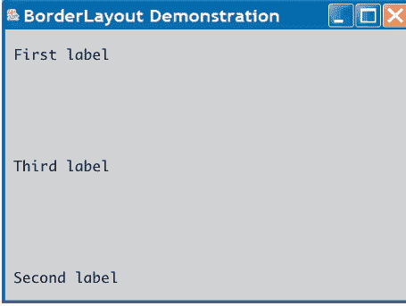

### 显示 17.8 BorderLayout 区域

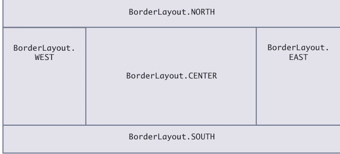

当你使用`BorderLayout`管理器时，你需要将添加的组件的位置作为第二个参数提供给`add`方法，如下所示：

```
add(label1, BorderLayout.NORTH);
```

标签（或其他要添加的组件）不需要按照任何特定顺序添加，因为第二个参数完全指定了标签放置的位置。

`BorderLayout.NORTH`、`BorderLayout.SOUTH`、`BorderLayout.EAST`、`BorderLayout.WEST`和`BorderLayout.CENTER`是在`BorderLayout`类中定义的五个字符串常量。这些常量的值是`"North"`、`"South"`、`"East"`、`"West"`和`"Center"`。虽然你可以使用像`"North"`这样的带引号的字符串作为`add`的第二个参数，但使用像`BorderLayout.NORTH`这样的已定义常量更符合我们的一般风格规则。

你不需要使用所有五个区域。例如，在显示 17.7 中，我们没有使用`BorderLayout.EAST`和`BorderLayout.WEST`区域。如果某些区域未被使用，任何额外的空间都会分配给`BorderLayout.CENTER`区域，这是最大的区域。

### 布局管理器

你添加到容器类的组件由一个称为布局管理器的对象进行排列。你使用`setLayout`方法添加布局管理器，这是每个容器类（例如`JFrame`或我们将在本章后面介绍的其他容器类的对象）的方法。如果你不添加布局管理器，将为你提供一个默认的布局管理器。

**语法**
`Container_Object.setLayout(new Layout_Manager_Class());`

**示例（在一个名为`BorderLayoutJFrame`的类的构造函数内）**

```
public BorderLayoutJFrame()
{
    ...
    setLayout(new BorderLayout());

    JLabel label1 = new JLabel("First label");
    add(label1, BorderLayout.NORTH);

    JLabel label2 = new JLabel("Second label");
    add(label2, BorderLayout.SOUTH);
    ...
}
```

（空间按以下方式分配到各个区域：首先分配北和南区域，其次分配东和西区域，最后分配中心区域。因此，特别是如果北区域没有任何内容，则东和西区域将延伸到空间的顶部。）

从这个讨论来看，似乎你只能在每个区域放置一个项目，但在本章后面讨论*面板*时，你将看到有一种方法可以将项目分组，以便（实际上）在每个区域放置多个项目。

`java.awt`包中为你定义了一些标准的布局管理器，你也可以定义自己的布局管理器。然而，对于大多数目的，标准库中定义的布局管理器已经足够，我们将不讨论如何创建自己的布局管理器类。

### 流式布局管理器

`FlowLayout`管理器是最简单的布局管理器。它将组件一个接一个地从左到右排列，排列顺序是你使用`add`方法将它们添加到`JFrame`（或其他容器类）的顺序。例如，如果显示 17.7 中的类使用了`FlowLayout`管理器而不是`BorderLayout`管理器，它将使用以下代码：

```
setLayout(new FlowLayout());

JLabel label1 = new JLabel("First label");
add(label1);

JLabel label2 = new JLabel("Second label");
add(label2);

JLabel label3 = new JLabel("Third label");
add(label3);
```

注意，如果我们使用了`FlowLayout`管理器，如前面的代码所示，那么`add`方法将只有一个参数。使用`FlowLayout`管理器时，项目按照添加的顺序显示，因此上面的标签将全部显示在一行上，如下所示：

First label Second label Third label

完整的程序位于随附 CD 上的文件`FlowLayoutJFrame.java`和`FlowLayoutDemo.java`中。在本章后面，你将看到许多使用`FlowLayout`管理器类的 GUI 示例。

## 第17章 Swing I

### 网格布局管理器

**GridLayout**

**GridLayout**管理器在一个具有指定行数和列数的二维网格中排列组件。使用`GridLayout`管理器时，每个条目的大小都相同。例如，以下代码表示对一个容器（可以是`JFrame`或其他容器）使用`GridLayout`管理器：

```
aContainer.setLayout(new GridLayout(2, 3));
```

传递给`GridLayout`构造函数的两个参数指定了行数和列数。这将产生如下所示的布局：

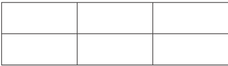

除非你做特殊处理使其可见，否则这些线条将不可见。它们在这里只是为了向你展示区域边界。使用`GridLayout`管理器时，每个组件会被拉伸以完全填充其网格位置。虽然你指定了行数和列数，但行数和列数的规则比我们目前所说的要复杂一些。如果行数和列数的值都不为零，则列数将被忽略。例如，如果规格是`new GridLayout(2, 3)`，那么一些示例尺寸如下：如果你添加六个项目，网格将如所示。如果你添加七个或八个项目，会自动添加第四列，依此类推。如果你添加少于六个组件，将会有两行和减少的列数。

还有另一种方法指定忽略列数。你可以通过将列数设置为零来指定忽略列数，这将允许任意数量的列。因此，`(2, 0)`的规格等同于`(2, 3)`，实际上对于任何非负值 n，它都等同于`(2, n)`。同样，你可以通过将行数设置为零来指定忽略行数，这将允许任意数量的行。

使用`GridLayout`类时，`add`方法只有一个参数。项目从左到右放置在网格中，首先填充第一行，然后是第二行，依此类推。不允许跳过任何网格位置（尽管你稍后会看到，你可以添加不显示的内容，从而产生跳过网格位置的假象）。

Display 17.9 给出了`GridLayout`类的示例用法。

### 显示 17.9 GridLayout 管理器（第 1 部分，共 2 部分）


```java
import javax.swing.JFrame;
import javax.swing.JLabel;
import java.awt.GridLayout;
public class GridLayoutJFrame extends JFrame
{
    public static final int WIDTH = 500;
    public static final int HEIGHT = 400;
    public static void main(String[] args)
    {
        GridLayoutJFrame gui = new GridLayoutJFrame(2, 3);
        gui.setVisible(true);
    }
    public GridLayoutJFrame(int rows, int columns )
    {
        super();
        setSize(WIDTH, HEIGHT);
        setTitle("GridLayout Demonstration");
        setDefaultCloseOperation(JFrame.EXIT_ON_CLOSE);
        setLayout(new GridLayout(rows, columns ));
        JLabel label1 = new JLabel("First label");
        add(label1);
        JLabel label2 = new JLabel("Second label");
        add(label2);
        JLabel label3 = new JLabel("Third label");
        add(label3);
        JLabel label4 = new JLabel("Fourth label");
        add(label4);
        JLabel label5 = new JLabel("Fifth label");
        add(label5);
    }
}
```

(续)

**显示 17.9** `GridLayout` 管理器（第 2 部分，共 2 部分）

### 生成的 GUI

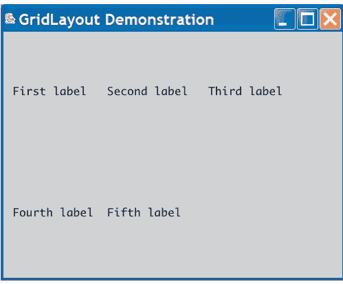

请注意，我们在 Display 17.9 的类定义中放置了一个演示性的 `main` 方法。这很方便，但并非典型做法。通常，Swing GUI 是在某个其他类（不是定义 GUI 的类）的 `main` 方法（或其他方法）中创建和显示的。但是，在 GUI 类定义中放置 `main` 方法是完全合法的，有时也很方便，这样可以轻松显示 GUI 示例。请注意，类本身给出的 `main` 方法与其他类中的 `main` 方法编写方式相同。特别是，你需要构造该类的一个对象，如 Display 17.9 中 `main` 方法的以下行所示：

```java
GridLayoutJFrame gui = new GridLayoutJFrame(2, 3);
```

我们讨论的三种布局管理器在 Display 17.10 中进行了总结。接下来我们将讨论 *面板*，它将让你充分发挥布局管理器的潜力。

### 显示 17.10 一些布局管理器

| 布局管理器 | 描述 |
| --- | --- |
| 这些布局管理器类位于 `java.awt` 包中。 | |
| `FlowLayout` | 按组件添加到容器中的顺序从左到右显示组件。 |
| `BorderLayout` | 在五个区域显示组件：北、南、东、西和中心。你在 `add` 方法的第二个参数中指定组件进入的区域。 |
| `GridLayout` | 在网格中布局组件，每个组件被拉伸以填充其在网格中的框。 |

### 自测练习

14. 在 Display 17.7 中，将以下代码

```java
JLabel label1 = new JLabel("First label");
add(label1, BorderLayout.NORTH);
JLabel label2 = new JLabel("Second label");
add(label2, BorderLayout.SOUTH);
JLabel label3 = new JLabel("Third label");
add(label3, BorderLayout.CENTER);
```

替换为以下代码是否合法？

```java
JLabel aLabel = new JLabel("First label");
add(aLabel, BorderLayout.NORTH);
aLabel = new JLabel("Second label");
add(aLabel, BorderLayout.SOUTH);
aLabel = new JLabel("Third label");
add(aLabel, BorderLayout.CENTER);
```

换句话说，我们可以重用变量 `aLabel` 还是每个标签必须有自己的变量名？

(续)

15. 你将如何修改 Display 17.7 中的类定义，使三个标签显示如下？

第一标签

第二标签

第三标签

（每对行之间可能有空格。）

16. 你将如何修改 Display 17.7 中的类定义，使三个标签显示如下？

第一标签

第二标签

第三标签

（每对行之间可能有空格。）

17. 假设你正在以通常的方式定义一个窗口化 GUI 类，作为 `JFrame` 类的派生类，并且你希望为 `JFrame` 指定一个布局管理器以产生如下布局（即，一行布局，通常有三列）：

| | | |

`setLayout` 的参数应该是什么？

18. 假设情况如自测练习 17 所述，但你希望得到如下布局（即，一列布局，通常有三行）：

| |
| |
| |

`setLayout` 的参数应该是什么？

### 面板

GUI 通常以分层方式组织，窗口状的容器（称为面板）位于其他窗口状容器内部。面板是 `JPanel` 类的对象，这是一个非常简单的容器类，除了组合对象外几乎不做其他事情。它是最简单的容器类之一，但非常有用。`JPanel` 对象类似于用于将多个更简单的 Java 语句组合成一个更大的 Java 语句的花括号。它将较小的对象（如按钮和标签）组合成一个更大的组件（`JPanel`）。然后你可以将 `JPanel` 对象放入 `JFrame` 中。因此，`JPanel` 对象的主要功能之一是将 `JFrame`（或其他容器）细分为不同的区域。

例如，当你使用 `BorderLayout` 管理器时，你可以在五个位置 `BorderLayout.NORTH`、`BorderLayout.SOUTH`、`BorderLayout.EAST`、`BorderLayout.WEST` 和 `BorderLayout.CENTER` 放置组件。但如果你想在屏幕底部的 `BorderLayout.SOUTH` 位置放置两个组件呢？为此，你需要将两个组件放入一个面板，然后将该面板放置在 `BorderLayout.SOUTH` 位置。

你可以为 `JFrame` 和 `JFrame` 中的每个面板指定不同的布局管理器。由于你可以将面板添加到其他面板，并且每个面板可以有自己的布局管理器，这使你能够产生几乎任何类型的 GUI 项目整体布局。

例如，如果你想在 `JFrame` GUI 的底部放置两个按钮，你可能会在 `JFrame` GUI 的构造函数中添加以下内容：

```java
setLayout(new BorderLayout());

JPanel buttonPanel = new JPanel();
buttonPanel.setLayout(new FlowLayout());

JButton firstButton = new JButton("One");
buttonPanel.add(firstButton);

JButton secondButton = new JButton("Two");
buttonPanel.add(secondButton);

add(buttonPanel, BorderLayout.SOUTH);
```

下一个编程示例将使用面板内的面板。

# 使用面板构建三色旗

首次运行时，Display 17.11 中定义的图形用户界面（GUI）会显示为第一个视图的样子。整个背景为浅灰色，GUI 底部有三个按钮，分别标有“Red”、“White”和“Blue”。如果你点击任意一个按钮，一个带有按钮上所写颜色的垂直条纹就会出现。你可以按任意顺序点击按钮。在 Display 17.11 的最后三个视图中，我们展示了如果按从左到右的顺序点击按钮会发生什么。

红、白、蓝条纹是名为 `redPanel`、`whitePanel` 和 `bluePanel` 的 `JPanel`。最初这些面板不可见，因为它们都是浅灰色的，所以没有可见的边框。当你点击一个按钮时，相应的面板会改变颜色，从而变得清晰可见。

注意动作监听器的设置方式。每个按钮都将 `this` 参数注册为监听器，如下面这行代码所示：

```java
redButton.addActionListener(this);
```

由于这行代码出现在 `PanelDemo` 类的构造函数内部，`this` 参数指的是 `PanelDemo`，它代表整个图形用户界面。因此，整个 `JFrame`（整个 GUI）是监听器，而不是 `JPanel`。所以当你点击一个按钮时，执行的是 `PanelDemo` 中的 `actionPerformed` 方法。

当按钮被点击时，`actionPerformed` 方法被调用，触发的操作事件作为参数传递给 `actionPerformed`。`actionPerformed` 方法通过以下这行代码获取按钮上写的字符串：

```java
String buttonString = e.getActionCommand();
```

然后，`actionPerformed` 方法使用一个多路 `if-else` 语句来判断 `buttonString` 是 "Red"、"White" 还是 "Blue"，并相应地改变对应面板的颜色。`actionPerformed` 方法通常基于这样的多路 `if-else` 语句，尽管我们将在本章后面题为“作为内部类的监听器”的小节中看到另一种方法。

Display 17.11 还介绍了另一个虽小但新的技巧。我们给每个按钮设置了一种颜色。我们使用 `setBackground` 方法实现了这一点，其技术与我们在前面示例中使用的基本相同。你可以使用 `setBackground` 为按钮或几乎任何其他项目设置颜色。请注意，除了 `JFrame` 之外，在为任何其他组件添加颜色时，不要使用 `getContentPane`。

## Display 17.11 使用面板（第 1 部分，共 3 部分）

```java
import javax.swing.JFrame;
import javax.swing.JPanel;
import java.awt.BorderLayout;
import java.awt.GridLayout;
import java.awt.FlowLayout;
import java.awt.Color;
import javax.swing.JButton;
import java.awt.event.ActionListener;
import java.awt.event.ActionEvent;

public class PanelDemo extends JFrame implements ActionListener
{
    public static final int WIDTH = 300;
    public static final int HEIGHT = 200;

    private JPanel redPanel;
    private JPanel whitePanel;
    private JPanel bluePanel;

    public static void main(String[] args)
    {
        PanelDemo gui = new PanelDemo();
        gui.setVisible(true);
    }

    public PanelDemo()
    {
        super("Panel Demonstration");
        setSize(WIDTH, HEIGHT);
        setDefaultCloseOperation(JFrame.EXIT_ON_CLOSE);
        setLayout(new BorderLayout());

        JPanel biggerPanel = new JPanel();
        biggerPanel.setLayout(new GridLayout(1, 3));

        redPanel = new JPanel();
        redPanel.setBackground(Color.LIGHT_GRAY);
        biggerPanel.add(redPanel);

        whitePanel = new JPanel();
        whitePanel.setBackground(Color.LIGHT_GRAY);
        biggerPanel.add(whitePanel);
```

> 除了作为 GUI 类之外，`PanelDemo` 类还是动作监听器类。`PanelDemo` 类的一个对象是该对象中按钮的动作监听器。

> 我们创建这些实例变量是因为我们想在构造函数和 `actionPerformed` 方法中都引用它们。

## Display 17.11 使用面板（第 2 部分，共 3 部分）

```java
        bluePanel = new JPanel();
        bluePanel.setBackground(Color.LIGHT_GRAY);
        biggerPanel.add(bluePanel);

        add(biggerPanel, BorderLayout.CENTER);

        JPanel buttonPanel = new JPanel();
        buttonPanel.setBackground(Color.LIGHT_GRAY);
        buttonPanel.setLayout(new FlowLayout());

        JButton redButton = new JButton("Red");
        redButton.setBackground(Color.RED);
        redButton.addActionListener(this);
        buttonPanel.add(redButton);

        JButton whiteButton = new JButton("White");
        whiteButton.setBackground(Color.WHITE);
        whiteButton.addActionListener(this);
        buttonPanel.add(whiteButton);

        JButton blueButton = new JButton("Blue");
        blueButton.setBackground(Color.BLUE);
        blueButton.addActionListener(this);
        buttonPanel.add(blueButton);

        add(buttonPanel, BorderLayout.SOUTH);
    }

    public void actionPerformed(ActionEvent e)
    {
        String buttonString = e.getActionCommand();

        if (buttonString.equals("Red"))
            redPanel.setBackground(Color.RED);
        else if (buttonString.equals("White"))
            whitePanel.setBackground(Color.WHITE);
        else if (buttonString.equals("Blue"))
            bluePanel.setBackground(Color.BLUE);
        else
            System.out.println("Unexpected error.");
    }
}
```

> `PanelDemo` 类的一个对象是该对象中按钮的动作监听器。

## Display 17.11 使用面板（第 3 部分，共 3 部分）

**生成的图形用户界面**（首次运行时）

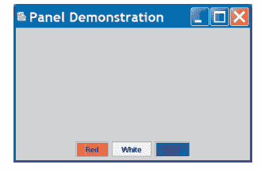

**生成的图形用户界面**（点击红色按钮后）

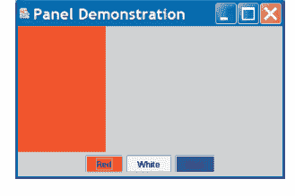

**生成的图形用户界面**（点击白色按钮后）

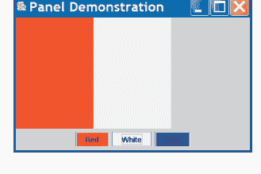

**生成的图形用户界面**（点击蓝色按钮后）

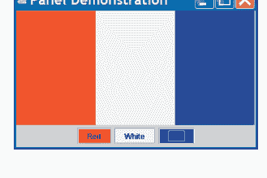

# 添加颜色


你可以按照以下方式为`JFrame`设置颜色：

```java
JFrame_Object.getContentPane().setBackground(Color);
```

如果这行代码在`JFrame`的构造函数内部，那么表达式可以简化为：

```java
getContentPane().setBackground(Color);
```

或者等价地：

```java
this.getContentPane().setBackground(Color);
```

你可以按照以下方式为按钮、标签或任何其他组件（不是`JFrame`）设置颜色：

```java
Component_Object.setBackground(Color);
```

请注意，`getContentPane()`只用于`JFrame`。

## 示例（在`JFrame`派生类的构造函数内部）

```java
getContentPane().setBackground(Color.WHITE);
JButton redButton = new JButton("Red");
redButton.setBackground(Color.RED);
```

## Container 类

名为`Container`的类位于`java.awt`包中。`Container`类的任何后代类都可以向其中添加组件（或者更准确地说，可以向该类的对象添加组件）。`JFrame`类是`Container`类的后代类，因此`JFrame`类的任何后代类都可以作为容器来容纳标签、按钮、面板或其他组件。同样，`JPanel`类也是`Container`类的后代类，`JPanel`类的任何对象都可以作为容器来容纳标签、按钮、其他面板或其他组件。Display 17.12 展示了 Swing 和 AWT 类层次结构的一部分。请注意，`Container`类在 AWT 库中，而不在 Swing 库中。这不是一个主要问题，但它确实意味着`Container`类的导入语句是：

```java
import java.awt.Container;
```

### Display 17.12 Swing 和 AWT 类的层次结构

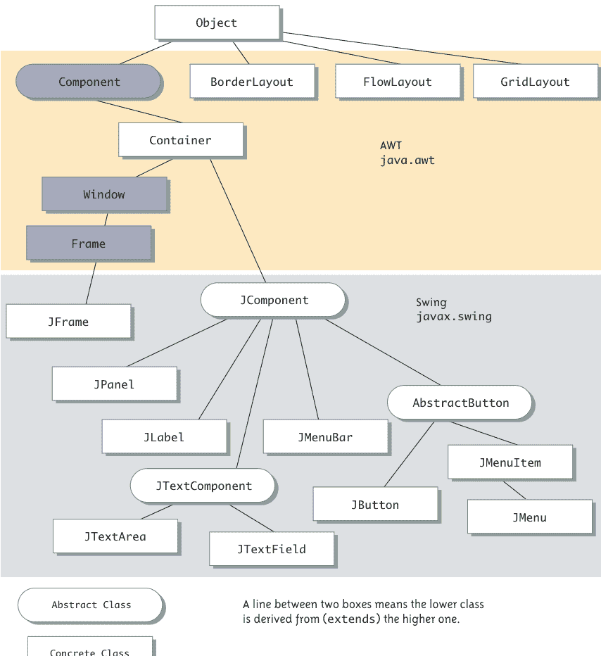

两个方框之间的连线表示下方的类派生自（继承自）上方的类。

这种蓝色表示一个在本教材中未使用但此处列出供参考的类。如果你没有听说过这些类中的任何一个，可以放心地忽略它们。（`Component`类在第 19 章有非常简要的介绍。）

容器类是`Container`类的任何后代类。`JComponent`类为组件提供了类似的功能。`JComponent`类的任何后代类都称为`JComponent`，有时简称为组件。你可以将任何`JComponent`对象添加到任何容器类对象中。

`JComponent`类派生自`Container`类，因此你可以将`JComponent`添加到另一个`JComponent`中。通常，这是一个可行的选择；但有时则应避免。⁵

Display 17.12 中展示的`Component`、`Frame`和`Window`类是一些读者可能听说过的 AWT 类。我们将它们包含在内是出于参考价值，但本章我们不需要使用这些类。我们最终会讨论 Display 17.12 中展示的所有其他类。

在处理 Swing 容器类时，你有三类对象需要处理：

1. 容器本身，通常是某种面板或类窗口对象
2. 你添加到容器中的组件，如标签、按钮和面板
3. 布局管理器，它负责在容器内定位组件

在我们定义的几乎每个`JFrame`类中，你都已经见过这三类对象的示例。你构建的几乎每个完整的图形用户界面（GUI），以及你构建的许多 GUI 子部分，都将由这三类对象组成。

## 自我测试练习

- 19. 哪个标准 Java 包包含本章讨论的布局管理器类？
- 20. `JPanel`类的对象是容器类吗？它是组件类吗？
- 21. 使用`GridLayout`管理器时，你不能留下任何网格元素为空，但你可以做一些让用户觉得网格元素是空的操作。你能做什么？
- 22. 你习惯于定义 Swing 类`JFrame`的派生类。你也可以定义其他 Swing 类的派生类。定义一个名为`PinkJPanel`的`JPanel`类的派生类。`PinkJPanel`类的对象可以像我们使用`JPanel`类的对象一样使用，但`PinkJPanel`类的对象是粉红色的（除非你显式更改其颜色）。`PinkJPanel`类将只有一个构造函数，即无参构造函数。（提示：这非常简单。）

> ⁵ 特别地，将`JComponent`添加到`JButton`是合法的，并且有时很有用。本书没有篇幅来介绍有效执行此操作的技术，但你可能想尝试一下。你已经掌握了足够的材料来完成它。

### 分别编码 GUI 的外观和行为

你可以将设计 Swing GUI 的任务分为两个主要子任务：(1) 设计和编码 GUI 在屏幕上的外观；(2) 设计和编码响应按钮点击和其他用户操作而执行的动作。将一个大任务划分为两个更简单的任务，会使大任务更容易完成且不易出错。

例如，考虑 Display 17.11 中的程序。你这个程序的初版可能会使用以下`actionPerformed`方法定义：

```java
public void actionPerformed(ActionEvent e)
{}
```

这个版本的`actionPerformed`方法什么都不做，但你的程序会运行并在屏幕上显示一个窗口，就像 Display 17.11 中所示的那样。如果你点击任何按钮，什么都不会发生，但你可以使用这个版本的 GUI 来调整细节，例如按钮的顺序和位置。

一旦你让 GUI 看起来符合你的期望，你就可以定义 GUI 的动作部分，通常是`actionPerformed`方法。

如果你在`JFrame`定义的开头包含了`implements ActionListener`这个短语，那么你必须包含`actionPerformed`方法的某种定义。像这样的方法定义：

```java
public void actionPerformed(ActionEvent e)
{}
```

什么都不做（或做得很少）的方法被称为桩（stub）。使用桩在许多场景下都是一个好的编程技巧，而不仅仅是在 Swing 程序中。

或者，在编写像 Display 17.11 中那样的 Swing GUI 初版时，你可以完全省略`actionPerformed`方法的定义，*前提是你同时省略`implements ActionListener`这个短语并省略`addActionListener`的调用。*

### 模型-视图-控制器模式 ✩

我们在前面的编程提示中提倡的技术是称为模型-视图-控制器（Model-View-Controller）模式的通用技术的一个例子。Display 17.13 展示了该模式的示意图。模式的模型部分执行应用程序的核心功能。视图部分是输出部分；它显示模型状态的图像。控制器是输入部分；它将用户的命令中继给模型。这三个交互部分中的每一个都通过一个负责自身任务的对象来实现。在一个简单的任务中，例如 Display 17.11 中的`JFrame`，你可以有一个单独的对象，使用不同的方法来实现模型、视图和控制器这三个角色。

为了简化讨论，我们呈现模型-视图-控制器模式时，好像是用户直接与控制器交互。控制器不必直接由用户控制，而是可以由其他一些软件或硬件组件控制。在 Swing GUI 中，视图和控制器部分可能是单独的类或单独的方法，组合成一个更大的类，为所有用户交互显示一个窗口。

### Display 17.13 模型-视图-控制器模式

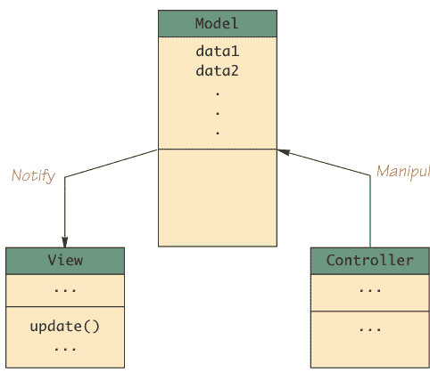

- 23. 假设你从 Display 17.11 的类中省略了`actionPerformed`方法，并且没有做其他更改。该类能编译吗？如果能编译，它运行时会没有错误信息吗？
- 24. 假设你从 Display 17.11 的类中省略了`actionPerformed`方法和`implements ActionListener`这个短语，并且没有做其他更改。该类能编译吗？如果能编译，它运行时会没有错误信息吗？

## 17.4 菜单和按钮

按 1 获取时间和地点。

按 2 收听描述服务的录音信息。

按 3 获取使用我们网站的说明。

按 4 使用我们的自动信息系统。

周一至周四上午 8 点至中午，如需与接线员通话请按 7。

电话答录机

在本节中，我们描述 Swing 菜单的基础知识。Swing 菜单项（菜单选择）的行为与 Swing 按钮基本相同。它们生成动作事件，由动作监听器处理，就像按钮一样。

### 示例：带菜单的 GUI

Display 17.14 包含一个程序，它与 Display 17.11 中的 GUI 基本相同，只是这个 GUI 使用了菜单而不是按钮。这个 GUI 在窗口顶部有一个菜单栏。菜单栏列出了所有下拉菜单的名称。这个 GUI 只有一个名为“添加颜色”的下拉菜单。然而，在同一个菜单栏中可以有更多的下拉菜单。

用户可以通过点击菜单栏中的名称来下拉一个菜单。Display 17.14 包含了该 GUI 的三幅图片。第一幅是 GUI 首次出现时的样子。在该图片中，可以在菜单栏中看到菜单名称“添加颜色”，但你看不到菜单本身。如果你用鼠标点击“添加颜色”这几个字，菜单就会下拉，如 GUI 的第二幅图片所示。如果你点击菜单上的“红色”、“白色”或“蓝色”，那么一条相应颜色的垂直条带就会出现在 GUI 中。

在下一小节中，我们将详细介绍 Display 17.14 中的程序。

### 菜单栏、菜单和菜单项

在像 Display 17.14 中那样添加菜单时，你需要使用三个 Swing 类：`JMenuItem`、`JMenu`和`JMenuBar`。菜单上的条目是`JMenuItem`类的对象。这些`JMenuItem`被放置在`JMenu`中，然后`JMenu`通常被放置在`JMenuBar`中。让我们看看细节。

菜单是`JMenu`类的一个对象。菜单上的一个选择项被称为菜单项，是`JMenuItem`类的一个对象。菜单项由标记它的字符串标识，例如 Display 17.14 中菜单上的“红色”、“白色”或“蓝色”。你可以根据需要向菜单添加任意数量的`JMenuItem`。菜单按条目添加的顺序列出它们。

## 17.4 Swing I

## 显示 17.14 带有菜单的 GUI（第 1 部分，共 3 部分）

```java
import javax.swing.JFrame;
import javax.swing.JPanel;
import java.awt.GridLayout;
import java.awt.Color;
import javax.swing.JMenu;
import javax.swing.JMenuItem;
import javax.swing.JMenuBar;
import java.awt.event.ActionListener;
import java.awt.event.ActionEvent;

public class MenuDemo extends JFrame implements ActionListener
{
    public static final int WIDTH = 300;
    public static final int HEIGHT = 200;

    private JPanel redPanel;
    private JPanel whitePanel;
    private JPanel bluePanel;

    public static void main(String[] args)
    {
        MenuDemo gui = new MenuDemo();
        gui.setVisible(true);
    }

    public MenuDemo()
    {
        super("Menu Demonstration");
        setSize(WIDTH, HEIGHT);
        setDefaultCloseOperation(JFrame.EXIT_ON_CLOSE);
        setLayout(new GridLayout(1, 3));

        redPanel = new JPanel();
        redPanel.setBackground(Color.LIGHT_GRAY);
        add(redPanel);

        whitePanel = new JPanel();
        whitePanel.setBackground(Color.LIGHT_GRAY);
        add(whitePanel);
```

### 显示 17.14 带有菜单的 GUI（第 2 部分，共 3 部分）

```java
        bluePanel = new JPanel();
        bluePanel.setBackground(Color.LIGHT_GRAY);
        add(bluePanel);

        JMenu colorMenu = new JMenu("Add Colors");

        JMenuItem redChoice = new JMenuItem("Red");
        redChoice.addActionListener(this);
        colorMenu.add(redChoice);

        JMenuItem whiteChoice = new JMenuItem("White");
        whiteChoice.addActionListener(this);
        colorMenu.add(whiteChoice);

        JMenuItem blueChoice = new JMenuItem("Blue");
        blueChoice.addActionListener(this);
        colorMenu.add(blueChoice);

        JMenuBar bar = new JMenuBar();
        bar.add(colorMenu);
        setJMenuBar(bar);
```

`actionPerformed`的定义与在显示 17.11 中为使用按钮代替菜单项的类似 GUI 给出的定义完全相同。

```java
    public void actionPerformed(ActionEvent e)
    {
        String buttonString = e.getActionCommand();

        if (buttonString.equals("Red"))
            redPanel.setBackground(Color.RED);
        else if (buttonString.equals("White"))
            whitePanel.setBackground(Color.WHITE);
        else if (buttonString.equals("Blue"))
            bluePanel.setBackground(Color.BLUE);
        else
            System.out.println("Unexpected error.");
    }
```

### 显示 17.14 带有菜单的 GUI（第 3 部分，共 3 部分）

### 生成的 GUI

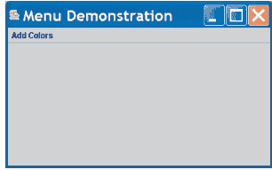

### 生成的 GUI（点击菜单栏中的“添加颜色”后）

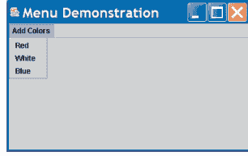

### 生成的 GUI（在菜单上选择“红色”和“白色”后）

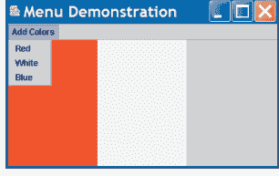

### 生成的 GUI（在菜单上选择所有颜色后）

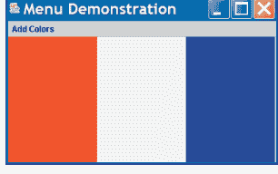

它们被添加的方式。以下代码取自显示 17.14 的构造函数，创建了一个名为`colorMenu`的新`JMenu`对象，然后添加了一个标记为 "Red" 的`JMenuItem`。其他菜单项以类似方式添加。

```java
JMenu colorMenu = new JMenu("Add Colors");

JMenuItem redChoice = new JMenuItem("Red");
redChoice.addActionListener(this);
colorMenu.add(redChoice);
```

请注意，正如我们在显示 17.11 中为按钮所做的那样，在显示 17.14 中，我们已将`this`参数注册为每个菜单项的动作监听器。为菜单项定义动作监听器和注册监听器的方式与为按钮所做的完全相同。事实上，语法甚至是一样的。如果你比较显示 17.14 和显示 17.11，你会看到`actionPerformed`方法的定义在两个类中是相同的。

你使用`add`方法将`JMenuItem`添加到`JMenu`类的对象中，其方式与将组件（如按钮）添加到容器对象完全相同。此外，如果你查看前面的代码，你会看到你为`JMenuItem`指定字符串的方式与你为按钮上显示的字符串指定字符串的方式相同。

菜单栏是菜单的容器，通常放置在窗口界面的顶部附近。你使用`add`方法将菜单添加到菜单栏，其方式与将菜单项添加到菜单相同。以下代码来自显示 17.14 的构造函数，创建了一个名为`bar`的新菜单栏，然后将名为`colorMenu`的菜单添加到此菜单栏：


有两种不同的方式可以将菜单栏添加到`JFrame`。你可以使用`setJMenuBar`方法，如显示 17.14 的构造函数中的以下代码所示：

```
setJMenuBar(bar);
```

这设置了`JMenuBar`类型的实例变量，使其指向名为`bar`的菜单栏。非正式地说，这会将名为`bar`的菜单栏添加到`JFrame`并将菜单栏放置在`JFrame`的顶部。

或者，你可以使用`add`方法将菜单栏添加到`JFrame`（或任何其他容器）。你这样做的方式与添加任何其他组件（如标签或按钮）的方式相同。使用`add`将`JMenuBar`添加到`JFrame`的示例可在随附CD上的`MenuAdd.java`文件中找到。

## 菜单

菜单是`JMenu`类的对象。菜单上的选项是`JMenuItem`类的对象。菜单被收集在一个菜单栏（或多个菜单栏）中。菜单栏是`JMenuBar`类的对象。

菜单项的事件和监听器的处理方式与按钮的完全相同。

### 嵌套菜单 ☆

如显示 17.12 所示，`JMenu`类是`JMenuItem`类的派生类。因此，每个`JMenu`对象也是一个`JMenuItem`对象。因此，`JMenu`可以作为另一个菜单中的菜单项。这意味着你可以嵌套菜单。例如，外层菜单可能会给你一个菜单列表。你可以通过点击所需菜单的名称来显示该列表中的某个菜单。然后你可以再次使用鼠标从该菜单中选择一个项目。创建这些嵌套菜单不需要了解任何新内容。你只需像添加其他菜单项一样将菜单添加到菜单中。随附CD上的`NestedMenus.java`文件中有一个嵌套菜单的示例。

### AbstractButton 类

如显示 17.12 所示，`JButton`和`JMenuItem`类是名为`AbstractButton`的抽象类的派生类。`JButton`和`JMenuItem`类的所有基本属性和方法都继承自`AbstractButton`类。这就是为什么`JButton`类的对象和`JMenuItem`类的对象如此相似的原因。`AbstractButton`类的一些方法列在显示 17.15 中。所有这些方法都被`JButton`类和`JMenuItem`类继承。（其中一些方法是从`JComponent`类继承到`AbstractButton`类的，因此你有时可能会看到其中一些方法被列为“从`JComponent`继承”。）

### 将菜单添加到 JFrame

在下文中，我们假设所有代码都在`JFrame`（或其派生类）的构造函数内。要查看以下示例组合以产生完整的GUI，请参见显示 17.14 中的构造函数。

#### 创建菜单项

菜单项是`JMenuItem`类的对象。你按照常规方式创建一个新的菜单项，如下例所示。参数位置的字符串是菜单项的显示文本。

```
JMenuItem redChoice = new JMenuItem("Red");
```

#### 添加菜单项监听器

菜单项的事件和监听器的处理方式与按钮的完全相同：菜单项触发动作事件，这些事件由`ActionListener`类的对象接收。

**语法**

```
JMenu_Item_Name.addActionListener(Action_Listener);
```

**示例**

```
redChoice.addActionListener(this);
```

#### 创建菜单

菜单是`JMenu`类的对象。你按照常规方式创建一个新菜单，如下例所示。字符串参数是标识菜单的显示文本。

```
JMenu colorMenu = new JMenu("Add Colors");
```

#### 将菜单项添加到菜单

你使用`add`方法将菜单项添加到菜单。

**语法**

```
JMenu_Name.add(JMenu_Item);
```

**示例（colorMenu 是 JMenu 类的对象）**

```
colorMenu.add(redChoice);
```

（续）

**创建菜单栏**

菜单栏是`JMenuBar`类的一个对象。你可以像往常一样创建一个新的菜单栏，如以下示例所示：

```
JMenuBar bar = new JMenuBar();
```

**将菜单添加到菜单栏**

你可以使用`add`方法将菜单添加到菜单栏，如下所示：

**语法**

```
JMenu_Bar_Name.add(JMenu_Name);
```

**示例（bar 是 JMenuBar 类的一个对象）**

```
bar.add(colorMenu);
```

**将菜单栏添加到窗格**

有两种不同的方法可以将菜单栏添加到`JFrame`。你可以使用`add`方法将菜单栏添加到`JFrame`（或任何其他容器）。另一种将菜单栏添加到`JFrame`的常见方法是使用`setJMenuBar`方法，如下所示：

**语法**

```
setJMenuBar(JMenu_Bar_Name);
```

**示例**

```
setJMenuBar(bar);
```

**显示 17.15 AbstractButton 类中的一些方法**

抽象类`AbstractButton`位于`javax.swing`包中。所有这些方法都被`JButton`和`JMenuItem`这两个类所继承。

```
public void setBackground(Color theColor)
```

设置此组件的背景色。

```
public void addActionListener(ActionListener listener)
```

添加一个`ActionListener`。

```
public void removeActionListener(ActionListener listener)
```

移除一个`ActionListener`。

```
public void setActionCommand(String actionCommand)
```

设置动作命令。

```
public String getActionCommand()
```

返回此组件的动作命令。

```
public void setText(String text)
```

使`text`成为此组件上唯一的文本。

```
public String getText()
```

返回组件上写的文本，例如按钮上的文本或菜单项的字符串。

```
public void setPreferredSize(Dimension preferredSize)
```

设置按钮或标签的首选大小。请注意，这只是一个给布局管理器的建议。布局管理器不一定要使用首选大小。以下特殊情况适用于大多数简单情况。整数值以像素为单位给出宽度和高度。

```
public void setPreferredSize(new Dimension(int width, int height))
```

```
public void setMaximumSize(Dimension maximumSize)
```

设置按钮或标签的最大大小。请注意，这只是一个给布局管理器的建议。布局管理器不一定要遵守这个最大大小。以下特殊情况适用于大多数简单情况。整数值以像素为单位给出宽度和高度。

```
public void setMaximumSize(new Dimension(int width, int height))
```

```
public void setMinimumSize(Dimension minimumSize)
```

设置按钮或标签的最小大小。请注意，这只是一个给布局管理器的建议。布局管理器不一定要遵守这个最小大小。虽然我们不讨论`Dimension`类，但以下特殊情况直观且清晰，并且适用于大多数简单情况。整数值以像素为单位给出宽度和高度。

```
public void setMinimumSize(new Dimension(int width, int height))
```

**Dimension 类**

`Dimension`类的对象与按钮、菜单项和其他对象一起使用，以指定大小。`Dimension`类位于`java.awt`包中。以下构造函数中的参数是以像素为单位的。

**构造函数**

```
Dimension(int width, int height)
```

**示例**

```
aButton.setPreferredSize(new Dimension(30, 50));
```

**setActionCommand 方法**

当用户点击一个按钮或菜单项时，它会触发一个动作事件，该事件通常会传递给一个或多个动作监听器，成为`actionPerformed`方法的一个参数。这个动作事件包含一个`String`实例变量，称为该按钮或菜单项的**action command**（动作命令），并通过访问器方法`getActionCommand`检索。事件中的动作命令是从按钮或菜单项对象中的一个实例变量复制而来的。如果你没有进行任何更改，动作命令就是写在按钮或菜单项上的字符串。显示 17.15 中给出的`AbstractButton`类的`setActionCommand`方法可以与任何`JButton`或`JMenuItem`一起使用，以更改该组件的动作命令。除了其他作用外，这将允许你为两个按钮、两个菜单项，或者一个按钮和一个菜单项设置不同的动作命令，即使它们上面写着相同的字符串。

`setActionCommand`方法接受一个`String`参数，该参数成为调用按钮或菜单项的新动作命令。例如，考虑以下代码：

```
JButton nextButton = new JButton("Next");
nextButton.setActionCommand("Next Button");
JMenuItem chooseNext = new JMenuItem("Next");
chooseNext.setActionCommand("Next Menu Item");
```

如果我们没有在前面的代码中使用`setActionCommand`，那么按钮`nextButton`和菜单项`chooseNext`都将拥有动作命令`"Next"`，因此我们将无法分辨动作事件`"Next"`来自`nextButton`和`chooseNext`这两个组件中的哪一个。然而，使用`setActionCommand`方法，我们可以为它们设置不同的动作命令`"Next Button"`和`"Next Menu Item"`。

`JButton`或`JMenuItem`的动作命令保存为该`JButton`或`JMenuItem`的私有实例变量的值。`setActionCommand`方法只是一个普通的修改器方法，用于更改此实例变量的值。

#### setActionCommand 和 getActionCommand

每个按钮和每个菜单项都关联一个字符串，称为该按钮或菜单项的**action command**（动作命令）。当按钮或菜单项被点击时，它会触发一个动作事件`e`。以下调用返回触发`e`的按钮或菜单项的动作命令：

`e.getActionCommand()`

`actionPerformed`方法通常使用此动作命令字符串来判断点击了哪个按钮或菜单项。

按钮或菜单项的默认动作命令是写在它上面的字符串，但如果你愿意，你可以通过调用`setActionCommand`方法来更改动作命令。例如，由以下代码创建的菜单项`chooseNext`在作为菜单选项时将显示字符串`"Next"`，但其动作命令将是字符串`"Next Menu Item"`。

**示例**

```
JMenuItem chooseNext = new JMenuItem("Next");
chooseNext.setActionCommand("Next Menu Item");
```

定义动作监听器的另一种方法将在下一小节中介绍。该技术，除了其他作用外，是处理多个具有相同内容的按钮或菜单项的另一种方式。

### 将监听器作为内部类

在我们之前的所有示例中，我们的图形用户界面（GUI）只有一个动作监听器对象来处理来自 GUI 中所有按钮和菜单的所有动作事件。相反的极端情况也有许多优点。你可以为每个按钮或菜单项提供一个单独的`ActionListener`类，这样每个按钮或菜单项都有自己独特的动作监听器。然后就不需要多路 if-else 语句了。监听器知道哪个按钮或菜单项被点击了，因为它只监听一个按钮或菜单项。

上一段概述的方法确实有一个缺点：你通常需要定义大量的`ActionListener`类。与其将这些类放在单独的文件中，不如将它们设为私有内部类要干净得多。这样做的额外好处是允许`ActionListener`类访问外部类的私有实例变量和方法。

在显示 17.16 中，我们使用本小节的技术重新创建了显示 17.14 中的 GUI。

**显示 17.16 监听器作为内部类（第 1 部分，共 2 部分）**

<导入语句与显示 17.14 相同。>

```
public class InnerListenersDemo extends JFrame
{
    public static final int WIDTH = 300;
    public static final int HEIGHT = 200;

    private JPanel redPanel;
    private JPanel whitePanel;
    private JPanel bluePanel;

    private class RedListener implements ActionListener
    {
        public void actionPerformed(ActionEvent e)
        {
            redPanel.setBackground(Color.RED);
        }
    } //RedListener 内部类结束

    private class WhiteListener implements ActionListener
    {
        public void actionPerformed(ActionEvent e)
        {
            whitePanel.setBackground(Color.WHITE);
        }
    } //WhiteListener 内部类结束

    private class BlueListener implements ActionListener
    {
        public void actionPerformed(ActionEvent e)
        {
            bluePanel.setBackground(Color.BLUE);
        }
    } //BlueListener 内部类结束

    public static void main(String[] args)
    {
        InnerListenersDemo gui = new InnerListenersDemo();
        gui.setVisible(true);
    }
}
```

**显示 17.16 作为内部类的监听器（第 2 部分，共 2 部分）**


```java
public InnerListenersDemo()
{
    super("Menu Demonstration");
    setSize(WIDTH, HEIGHT);
    setDefaultCloseOperation(JFrame.EXIT_ON_CLOSE);
    setLayout(new GridLayout(1, 3));

    redPanel = new JPanel();
    redPanel.setBackground(Color.LIGHT_GRAY);
    add(redPanel);

    whitePanel = new JPanel();
    whitePanel.setBackground(Color.LIGHT_GRAY);
    add(whitePanel);

    bluePanel = new JPanel();
    bluePanel.setBackground(Color.LIGHT_GRAY);
    add(bluePanel);

    JMenu colorMenu = new JMenu("Add Colors");

    JMenuItem redChoice = new JMenuItem("Red");
    redChoice.addActionListener(new RedListener());
    colorMenu.add(redChoice);

    JMenuItem whiteChoice = new JMenuItem("White");
    whiteChoice.addActionListener(new WhiteListener());
    colorMenu.add(whiteChoice);

    JMenuItem blueChoice = new JMenuItem("Blue");
    blueChoice.addActionListener(new BlueListener());
    colorMenu.add(blueChoice);

    JMenuBar bar = new JMenuBar();
    bar.add(colorMenu);
    setJMenuBar(bar);
}
```

> 生成的图形用户界面与显示 17.14 中的相同。

## 自我测试练习

25. 当你点击一个 `JMenuItem` 时，会触发哪种类型的事件？它与点击 `JButton` 时触发的事件类型有何不同？

26. 编写代码来创建一个 `JButton`，其上显示文本 `"Hello"`，但其动作命令为 `"Bye"`。

27. 编写代码来创建一个 `JMenuItem`，其显示文本（在菜单中作为选项时）为 `"Hello"`，但其动作命令为 `"Bye"`。

28. 如果你想更改 `JButton` 的动作命令，你使用 `setActionCommand` 方法。那么，使用什么方法来更改 `JMenuItem` 的动作命令？

29. 以下代码在 Java 中是否合法？

```java
JMenu aMenu = new JMenu();
...
JMenu aSubMenu = new JMenu();
...
aMenu.add(aSubMenu);
```

30. 在一个 `JFrame` 中可以有多少个 `JMenuBar` 对象？

31. `JFrame` 有一个类型为 `JMenuBar` 的私有实例变量。用于更改此实例变量值的突变方法（`mutator method`）的名称是什么？

32. 编写代码来创建一个新的菜单项 `aChoice`，其标签为 `"Exit"`。

33. 假设你正在定义一个名为 `MenuGUI` 的类，它是 `JFrame` 类的派生类。编写代码将菜单项 `mItem` 添加到菜单 `m`。然后将 `m` 添加到菜单栏 `mBar`，再将菜单栏添加到 `JFrame` `MenuGUI`。假设这一切都在 `MenuGUI` 的构造函数内部发生。同时假设所有对象都已用 `new` 构造，并且所有必要的监听器都已注册。你只需执行添加操作即可。

34. ☆ 如何修改显示 17.16 中的程序，使得当点击蓝色菜单项时，三种颜色全部显示？红色和白色选项保持不变。（记住菜单项可以按任意顺序点击，因此蓝色菜单项可能是第一个或第二个被点击的项目。）

35. ☆ 重写显示 17.16 中的 Swing 图形用户界面，使其只有一个动作监听器内部类。该内部类的构造函数将有两个参数，一个用于面板，一个用于颜色。

## 17.5 文本框和文本区域

> *在提供的空间中写下你的答案。*

考试常见说明

你无疑已经使用过提供空间供你输入文本信息（如你的姓名、地址和信用卡号）的窗口系统。在本节中，我们将向你展示如何将这些用于文本输入和文本输出的字段添加到你的 Swing 图形用户界面中。

### 文本区域和文本框

文本框是 `JTextField` 类的一个对象，显示为一个允许用户输入单行文本的字段。在显示 17.17 中，以下代码创建了一个名为 `name` 的文本框，系统将提示用户在此输入其姓名：

**边栏：** 文本框 `JTextField`

```java
private JTextField name;
...
name = new JTextField(NUMBER_OF_CHAR);
```

在显示 17.17 中，变量 `name` 是一个私有实例变量。在上一行的最后创建 `JTextField` 的过程发生在类构造函数内部。作为参数传递给 `JTextField` 构造函数的数字 `NUMBER_OF_CHAR` 指定了该文本框将至少有容纳 `NUMBER_OF_CHAR` 个字符可见的空间。定义的常量 `NUMBER_OF_CHAR` 是 30，因此保证该文本框至少有容纳 30 个字符的空间。你可以在一个文本框中输入任意数量的字符，但只有有限数量的字符可见；在本例中，你知道至少有 30 个字符可见。

Swing 图形用户界面可以读取文本框中的文本，从而接收文本输入；如果需要，可以通过使文本出现在文本框中来产生输出。`getText` 方法返回在文本框中写入的文本。例如，以下代码将设置一个名为 `inputString` 的变量为在调用 `getText` 方法时文本框 `name` 中的任何字符串：

```java
String inputString = name.getText();
```

`getText` 方法是一个输入方法，而 `setText` 方法是一个输出方法。`setText` 方法可用于在文本框中显示新的文本字符串。例如，以下代码将导致文本框 `name` 将其显示的文本更改为字符串 `"This is some output"`：

```java
name.setText("This is some output");
```

## 显示 17.17 一个文本框（第 1 部分，共 3 部分）

```java
import javax.swing.JFrame;
import javax.swing.JTextField;
import javax.swing.JPanel;
import javax.swing.JLabel;
import javax.swing.JButton;
import java.awt.GridLayout;
import java.awt.BorderLayout;
import java.awt.FlowLayout;
import java.awt.Color;
import java.awt.event.ActionListener;
import java.awt.event.ActionEvent;

public class TextFieldDemo extends JFrame
                            implements ActionListener
{
    public static final int WIDTH = 400;
    public static final int HEIGHT = 200;
    public static final int NUMBER_OF_CHAR = 30;

    private JTextField name;

    public static void main(String[] args)
    {
        TextFieldDemo gui = new TextFieldDemo();
        gui.setVisible(true);
    }

    public TextFieldDemo()
    {
        super("Text Field Demo");
        setSize(WIDTH, HEIGHT);
        setDefaultCloseOperation(JFrame.EXIT_ON_CLOSE);
        setLayout(new GridLayout(2, 1));

        JPanel namePanel = new JPanel();
        namePanel.setLayout(new BorderLayout());
        namePanel.setBackground(Color.WHITE);

        name = new JTextField(NUMBER_OF_CHAR);
```

## 显示 17.17 一个文本框（第 2 部分，共 3 部分）

```java
        namePanel.add(name, BorderLayout.SOUTH);
        JLabel nameLabel = new JLabel("Enter your name here:");
        namePanel.add(nameLabel, BorderLayout.CENTER);

        add(namePanel);

        JPanel buttonPanel = new JPanel();
        buttonPanel.setLayout(new FlowLayout());
        buttonPanel.setBackground(Color.PINK);
        JButton actionButton = new JButton("Click me");
        actionButton.addActionListener(this);
        buttonPanel.add(actionButton);

        JButton clearButton = new JButton("Clear");
        clearButton.addActionListener(this);
        buttonPanel.add(clearButton);

        add(buttonPanel);
    }

    public void actionPerformed(ActionEvent e)
    {
        String actionCommand = e.getActionCommand();

        if (actionCommand.equals("Click me"))
            name.setText("Hello " + name.getText());
        else if (actionCommand.equals("Clear"))
            name.setText("");
        else
            name.setText("Unexpected error.");
    }
}
```

> 这会将文本框设置为空字符串，从而使其变为空白。

生成的图形用户界面（程序启动并输入姓名后）

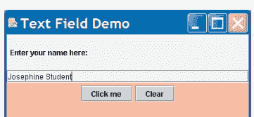

## 显示 17.17 文本框（第 3 部分，共 3 部分）

**最终图形用户界面**（点击“Click me”按钮后）


以下来自显示 17.17 中 `actionPerformed` 方法的代码行同时使用了 `getText` 和 `setText`：

`name.setText("Hello " + name.getText());`

这一行代码将文本框 `name` 中的字符串更改为 `"Hello "` 加上文本框中的旧字符串值。其最终效果是在文本框中显示的字符串前面插入字符串 `"Hello "`。

> ### getText 与 setText

`JTextField` 和 `JTextArea` 类都包含名为 `getText` 和 `setText` 的方法。`getText` 方法可用于检索文本框或文本区域中编写的文本。`setText` 方法可用于更改文本框或文本区域中编写的文本。

**语法**

`Name_of_Text_Component.getText()` 返回当前在文本框或文本区域中显示的文本。

`Name_of_Text_Component.setText(New_String_To_Display);`

**示例**

`String inputString = ioComponent.getText();`

`ioComponent.setText("Hello out there!");`

`ioComponent` 可以是 `JTextField` 或 `JTextArea` 类的实例。

**文本区域**是 `JTextArea` 类的对象。文本区域与文本框相同，但允许多行文本。`JTextArea` 构造函数的两个参数指定了保证可见的最小行数和每行最小字符数。你可以在文本区域中输入任意数量的文本，但只有有限的行数和每行有限数量的字符是可见的。例如，以下代码创建了一个名为 `theText` 的 `JTextArea`，它将至少显示 5 行，且每行至少显示 20 个字符：

```java
JTextArea theText = new JTextArea(5, 20);
```

还有一个带有额外 `String` 参数的构造函数，用于指定最初在文本区域中显示的字符串。例如：

```java
JTextArea theText = new JTextArea("Enter\ntext here.", 5, 20);
```

请注意，字符串值可以是多行的，因为它可以包含换行符 `'\n'`。

`JTextField` 也有一个带有 `String` 参数的类似构造函数，如以下示例所示：

```java
JTextField ioField =
    new JTextField("Enter numbers here.", 30);
```

如果你查看显示 17.12，你会看到 `JTextField` 和 `JTextArea` 都是抽象类 `JTextComponent` 的派生类。`JTextField` 和 `JTextArea` 的大部分方法都是从 `JTextComponent` 继承的，因此 `JTextField` 和 `JTextArea` 主要具有相同意义的方法，只是针对单行或多行进行了细微的重新定义。显示 17.18 描述了 `JTextComponent` 类中的一些方法。所有这些方法都是继承的，并在 `JTextField` 和 `JTextArea` 中具有所述的含义。

你可以使用 `setLineWrap` 方法为 `JTextArea` 设置换行策略。该方法接受一个 `boolean` 类型的参数。如果参数为 `true`，那么在行尾时，该行的任何额外字符将出现在文本区域的下一行。如果参数为 `false`，额外的字符将出现在同一行，并且不可见。例如，以下代码为名为 `theText` 的 `JTextArea` 对象设置了换行策略，使得在行尾时，该行的任何额外字符将出现在下一行：

```java
theText.setLineWrap(true);
```

你可以指定 `JTextField` 或 `JTextArea` 不允许用户写入。为此，请使用 `setEditable` 方法，该方法在 `JTextField` 和 `JTextArea` 类中都存在。如果 `theText` 是 `JTextField` 或 `JTextArea` 类中某个对象的名称，那么以下代码

```java
theText.setEditable(false);
```

将设置 `theText`，使得只有你的图形用户界面程序才能更改文本组件 `theText` 中的文本；用户无法更改文本。在调用 `setEditable` 之后，如果用户在名为 `theText` 的文本组件中点击鼠标，然后在键盘上打字，文本组件中的文本将不会改变。

## 显示 17.18 `JTextComponent` 类中的一些方法

所有这些方法都被 `JTextField` 和 `JTextArea` 类继承。抽象类 `JTextComponent` 位于 `javax.swing.text` 包中。`JTextField` 和 `JTextArea` 类位于 `javax.swing` 包中。

```java
public String getText()
```

返回此文本组件显示的文本。

```java
public boolean isEditable()
```

如果用户可以在此文本组件中写入，则返回 `true`。如果用户不允许在此文本组件中写入，则返回 `false`。

```java
public void setBackground(Color theColor)
```

设置此文本组件的背景颜色。

```java
public void setEditable(boolean argument)
```

如果 `argument` 为 `true`，则允许用户在此文本组件中写入。如果 `argument` 为 `false`，则不允许用户在此文本组件中写入。

```java
public void setText(String text)
```

设置此文本组件显示的文本为指定的文本。

要反向操作，使 `theText` 允许用户更改文本组件中的文本，请在 `true` 的位置使用 `false`，如下所示：

```java
theText.setEditable(true);
```

如果未调用 `setEditable`，则默认状态允许用户更改文本组件中的文本。

### `JTextField` 和 `JTextArea` 类


`JTextField` 和 `JTextArea` 类可用于向图形用户界面添加可变文本区域。`JTextField` 类的对象有一行，显示指定数量的字符。`JTextArea` 类的对象具有一种尺寸，由指定的行数和每行指定的字符数组成。可以向 `JTextField` 或 `JTextArea` 中输入比其尺寸指定的更多的文本，但额外的文本可能不可见。

每行的字符数和行数是保证的最小值。可能会显示更多的行，特别是每行更多的字符。（实际上保证每行的空间是 `Characters_Per_Line` 乘以一个大写字母 M 的空间。）

**语法**

```
JTextField *Name_of_Text_Field* = **new** JTextField(*Characters_Per_Line*);
JTextArea *Name_of_Text_Area* = 
    **new** JTextArea(*Number_of_Lines*, *Characters_Per_Line*);
```

**示例**

```
JTextField name = **new** JTextField(30);
JTextArea someText = **new** JTextArea(10, 30);
```

还有接受额外 `String` 参数的构造函数，用于指定最初在文本组件中显示的字符串。

**语法**

```
JTextField *Name_of_Text_Field* = 
    **new** JTextField(*Initial_String*, *Characters_Per_Line*);
JTextArea *Name_of_Text_Area* = 
    **new** JTextArea(*Initial_String*, *Number_of_Lines*, *Characters_Per_Line*);
```

**示例**

```
JTextField name = **new** JTextField("Enter name here.", 30);
JTextArea someText = 
    **new** JTextArea("Enter story here.\nClick button.", 10, 30);
```

### 每行字符数

每行的字符数（作为 `JTextField` 或 `JTextArea` 构造函数的参数给出）并非任意字符的数量。该数字给出了该行中的 *em 空格* 数量。*em 空格* 是容纳一个大写字母 M 所需的空间，M 是字母表中最宽的字母。因此，指定容纳 20 个字符的行总是至少能容纳 20 个字符，并且几乎总是能容纳超过 20 个字符。

文本区域和文本框的滚动条在第 19 章中讨论。它们是一个很好的点缀，但在你学到第 19 章之前，你的图形用户界面程序在没有它们的情况下也能正常工作。

### 标记文本框

有时你想标记一个文本框。例如，假设图形用户界面要求输入姓名和信用卡号，并期望用户在这两个文本框中输入。在这种情况下，图形用户界面需要标记这两个文本框，以便用户知道在哪个字段中键入姓名，在哪个字段中键入信用卡号。你可以使用 `JLabel` 类的对象来标记图形用户界面中的文本框或任何其他组件。只需将标签和文本框放在一个 `JPanel` 中，并将 `JPanel` 视为单个组件。例如，我们在显示 17.17 中的文本框 `name` 就是这样做的。

1. **36.** `JTextArea` 类的对象和 `JTextField` 类的对象有什么区别？

2. **37.** 如果在运行显示 17.17 中的图形用户界面时，你输入你的姓名并点击 "Click me" 按钮三次，会发生什么？

3. **38.** 重写显示 17.17 中的程序，使其使用文本区域代替文本框。将标签 "Enter your name here:" 更改为 "Enter your story here:"。当用户点击 "Click me" 按钮时，你的图形用户界面应将文本区域中显示的字符串更改为 "Your story is " + `lineCount` + " lines long."。变量 `lineCount` 是一个 `int` 类型的变量，你的程序将其设置为等于当前在文本区域中显示的行数。使用 `BorderLayout` 布局管理器，并将你的文本区域放在 `BorderLayout.CENTER` 区域，以便有足够的空间。你可以假设用户在点击 "Click me" 按钮之前至少输入了一行。文本区域的最后一行将没有 `'\n'`，因此如果你要计算 `'\n'` 的出现次数，你可能需要添加一个。空行也被计算在内。

### 数字的输入与输出

当你想要使用 Swing 图形用户界面输入数字时，你的 GUI 必须将输入的文本转换为数字。例如，当你在一个 `JTextField` 中输入数字 42 时，你的程序接收到的是字符串 "42"，而不是数字 42。你的程序必须将输入的字符串值 "42" 转换为整数值 42。当你想要使用用 Swing 构建的 GUI 输出数字时，你必须先将数字转换为字符串，然后再输出该字符串。例如，如果你想输出数字 40，你的程序会将整数值 40 转换为字符串值 "40"。在 Swing 中，所有用户输入的内容都是字符串输入，所有显示的输出都是字符串输出。在第 5 章标题为“包装类中的静态方法”的小节以及名为“另一种键盘输入方法”的编程示例中，已经介绍了字符串与数字之间相互转换的技术。下一小节将给出一个带有数字输入和输出的 Swing GUI 简单示例。

### 一个 Swing 计算器

设计一个逼真的 Swing 计算器是编程项目之一。在这个编程示例中，我们将开发一个简化的计算器，以便你开始着手那个编程项目。图 17.19 展示了一个计算器的 GUI，它能够保持数字的运行总和。用户在文本字段中输入一个数字，然后点击 `+` 或 `–` 按钮。文本字段中的数字随后会被加到或减去一个保存在实例变量 `result` 中的运行总和，然后新的总和（即 `result` 的新值）会显示在文本字段中。如果用户点击“Reset”按钮，那么运行总和（即 `result` 的值）会被设置为零。当 GUI 第一次运行时，运行总和（即 `result` 的值）被设置为零。

大多数细节与你已经见过的相似，但一个新元素是异常处理的使用。如果用户以错误格式输入数字，例如在数字中输入逗号，那么某个方法会抛出一个 `NumberFormatException`。如果用户以错误格式输入数字，例如输入 2,000 而不是 2000，方法 `assumingCorrectNumberFormats` 会用所谓的数字字符串 "2,000" 作为参数调用方法 `stringToDouble`。然后 `stringToDouble` 调用 `Double.parseDouble`，但 `Double.parseDouble` 会抛出一个 `NumberFormatException`，因为没有任何 Java 数字字符串可以包含逗号。由于对 `Double.parseDouble` 的调用发生在对方法 `stringToDouble` 的调用内部，`stringToDouble` 进而也会抛出一个 `NumberFormatException`。对 `stringToDouble` 的调用发生在 `assumingCorrectNumberFormats` 的调用内部，因此 `assumingCorrectNumberFormats` 会抛出它从 `stringToDouble` 调用中接收到的 `NumberFormatException`。然而，对 `assumingCorrectNumberFormats` 的调用是在一个 `try` 块内部。异常在随后的 `catch` 块中被捕获。此时，`JTextField`（名为 `ioField`）被设置为错误消息 "Error: Reenter Number."。

### 图 17.19 一个简单的计算器

```java
import javax.swing.JFrame;
import javax.swing.JTextField;
import javax.swing.JPanel;
import javax.swing.JLabel;
import javax.swing.JButton;
import java.awt.BorderLayout;
import java.awt.FlowLayout;
import java.awt.Color;
import java.awt.event.ActionListener;
import java.awt.event.ActionEvent;
/**
 一个简化的计算器。
 仅支持加法和减法运算。
*/
public class Calculator extends JFrame
             implements ActionListener
{
    public static final int WIDTH = 400;
    public static final int HEIGHT = 200;
    public static final int NUMBER_OF_DIGITS = 30;
    private JTextField ioField;
    private double result = 0.0;
    public static void main(String[] args)
    {
        Calculator aCalculator = new Calculator();
        aCalculator.setVisible(true);
    }
    public Calculator()
    {
        setTitle("Simplified Calculator");
        setDefaultCloseOperation(JFrame.EXIT_ON_CLOSE);
        setSize(WIDTH, HEIGHT);
        setLayout(new BorderLayout());
        JPanel textPanel = new JPanel();
        textPanel.setLayout(new FlowLayout());
        ioField =
            new JTextField("Enter numbers here.", NUMBER_OF_DIGITS);
        ioField.setBackground(Color.WHITE);
        textPanel.add(ioField);
        add(textPanel, BorderLayout.NORTH);

        JPanel buttonPanel = new JPanel();
        buttonPanel.setBackground(Color.BLUE);
        buttonPanel.setLayout(new FlowLayout());

        JButton addButton = new JButton("+");
        addButton.addActionListener(this);
        buttonPanel.add(addButton);
        JButton subtractButton = new JButton("-");
        subtractButton.addActionListener(this);
        buttonPanel.add(subtractButton);
        JButton resetButton = new JButton("Reset");
        resetButton.addActionListener(this);
        buttonPanel.add(resetButton);

        add(buttonPanel, BorderLayout.CENTER);
    }

    public void actionPerformed(ActionEvent e)
    {
        try
        {
            assumingCorrectNumberFormats(e);
        }
        catch (NumberFormatException e2)
        {
            ioField.setText("Error: Reenter Number.");
        }
    }

    //抛出 NumberFormatException 异常。
    public void assumingCorrectNumberFormats(ActionEvent e)
    {
        String actionCommand = e.getActionCommand();

        if (actionCommand.equals("+"))
        {
            result = result + stringToDouble(ioField.getText());
            ioField.setText(Double.toString(result));
        }
        else if (actionCommand.equals("-"))
        {
            result = result - stringToDouble(ioField.getText());
            ioField.setText(Double.toString(result));
        }
        else if (actionCommand.equals("Reset"))
        {
            result = 0.0;
            ioField.setText("0.0");
        }
        else
            ioField.setText("Unexpected error.");
    }

    //抛出 NumberFormatException 异常。
    private static double stringToDouble(String stringObject)
    {
        return Double.parseDouble(stringObject.trim());
    }
}
```

`NumberFormatException` 不需要在 `catch` 块中声明或捕获。

**生成的 GUI（启动时）**

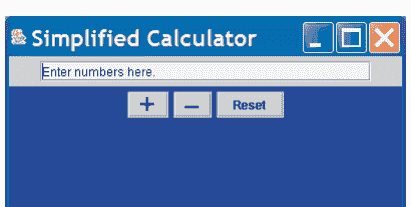

**生成的 GUI（输入 2,000 后）**


**生成的 GUI（点击 + 后）**


**生成的 GUI（输入 2000 并点击 + 后）**


**生成的 GUI（输入 42 后）**


**生成的 GUI（点击 + 后）**


请注意，如果抛出了 `NumberFormatException`，实例变量 `result` 的值不会被更改。一个 `NumberFormatException` 可能由方法 `assumingCorrectNumberFormats` 中以下任一行代码中的 `stringToDouble` 调用抛出：

```java
result = result + stringToDouble(ioField.getText());
```

或

```java
result = result - stringToDouble(ioField.getText());
```

如果抛出了异常，`stringToDouble` 方法的执行会立即结束，控制权传递到 `catch` 块。因此，在执行先前的加法或减法之前，控制权就传递到了 `catch` 块。所以 `result` 保持不变，用户可以重新输入最后一个数字，并像从未输入过那个错误数字一样继续使用 GUI。

> **未捕获的异常**

在一个 Swing 程序中，抛出一个未捕获的异常不会结束 GUI，但可能使其处于不可预测的状态。最好总是捕获任何抛出的异常，即使 `catch` 块所做的只是输出一个重新执行某事的指令（例如重新输入某些输入），或者仅仅输出一个错误消息。

### 自测练习

- 39. 在图 17.19 的 GUI 中，为什么我们将文本字段 `ioField` 设为实例变量，却没有将按钮 `addButton`、`subtractButton` 或 `resetButton` 中的任何一个设为实例变量？

- 40. 如果运行图 17.19 GUI 的用户只是运行 GUI 并在没有向文本字段输入任何内容的情况下直接点击加法按钮，会发生什么？

- 41. 如果运行图 17.19 GUI 的用户在文本字段中输入数字 10，然后点击加法按钮三次，会发生什么？请解释你的答案。

**自测练习**（续）

42. 假设你将 Display 17.19 中的 `main` 方法修改如下：

这将导致两个计算器窗口被显示。（如果一个窗口在另一个窗口上方，你可以使用鼠标移动顶部的那个窗口。）如果你在其中一个计算器中输入数字，另一个计算器中的内容会发生变化吗？


```java
public static void main(String[] args)
{
    Calculator calculator1 = new Calculator();
    calculator1.setVisible(true);

    Calculator calculator2 = new Calculator();
    calculator2.setVisible(true);
}
```

43. 假设你按照自测练习 42 中的描述修改了 `Display 17.19` 中的 `main` 方法。这将导致两个计算器窗口被显示。如果你点击其中一个窗口的关闭窗口按钮，是一个窗口消失，还是两个窗口都消失？

## 章节总结

- Swing GUI（图形用户界面）是使用事件驱动编程来实现的。在事件驱动编程中，用户的动作（如按钮点击）会生成一个事件，该事件会自动传递给一个事件处理方法，该方法执行相应的操作。

- 设计 Swing GUI 类有两种主要技术。你可以使用继承来创建诸如 `JFrame` 之类库类的派生类，或者你可以通过将组件添加到容器类来构建 GUI。通常在定义 Swing GUI 类时，你会同时使用这两种技术。

- 窗口 GUI 通常被定义为 `JFrame` 类的派生类。

- 按钮是 `JButton` 类的一个对象。点击按钮会触发一个动作事件，该事件由一个动作监听器处理。动作监听器是任何实现了 `ActionListener` 接口的类。

- 标签是 `JLabel` 类的一个对象。你可以使用标签向 GUI 添加文本。

- 当将组件添加到容器类的对象时，例如将按钮添加到面板或 `JFrame`，你需要使用 `add` 方法。容器中的组件由一个称为布局管理器的对象进行排列。

- 面板是一个容器对象，用于在较大的容器内对组件进行分组。面板是 `JPanel` 类中的对象。

- 菜单项是菜单上的一个选项。菜单项在你的代码中被实现为 `JMenuItem` 类的一个对象。菜单是 `JMenu` 类的一个对象。菜单项通过 `add` 方法添加到 `JMenu` 中。菜单栏是 `JMenuBar` 类的一个对象。菜单通过 `add` 方法添加到 `JMenuBar` 中。

- `JMenuBar` 可以通过 `setJMenuBar` 方法添加到 `JFrame` 中。它也可以像添加任何其他组件一样，使用 `add` 方法添加。

- 按钮和菜单项都会触发动作事件，因此通常为它们注册一个或多个动作监听器来响应这些事件。

## 自测练习答案

1. `JFrame` 类。

2. Swing 中的尺寸以像素为单位。

```java
someWindow.setDefaultCloseOperation(
    JFrame.DO_NOTHING_ON_CLOSE);
```

```java
someWindow.setDefaultCloseOperation(JFrame.EXIT_ON_CLOSE);
```

5. 当你点击最小化按钮时，`JFrame` 会被缩小为一个图标，通常显示在显示器屏幕的底部。

```java
someWindow.setVisible(n > 0);
```

以下写法也有效，但不是好的风格：

```java
if (n > 0)
    someWindow.setVisible(true);
else
    someWindow.setVisible(false);
```

7. 动作事件。

8. `public void actionPerformed(ActionEvent e)`

9. 将

```java
JFrame firstWindow = new JFrame();
```

改为

```java
JFrame firstWindow = new JFrame("My First Window");
```

或者，你可以添加以下代码：

```java
firstWindow.setTitle("My First Window");
```

10. 删除 `setTitle("First Window Class");` 并将 `super();` 替换为 `super("First Window Class");`

11. 将 `setDefaultCloseOperation(JFrame.DO_NOTHING_ON_CLOSE);` 改为 `setDefaultCloseOperation(JFrame.EXIT_ON_CLOSE);`

12. 将 `Display 17.6` 中无参构造函数里的 `this(Color.PINK);` 改为 `this(Color.MAGENTA);`

13. `add(new JLabel("Close-window button works."));`

14. 是的，这是合法的。重用变量名如 `aLabel` 是可以的。

15. 你需要修改 `add` 语句，如下所示的重写代码部分：

```java
JLabel label1 = new JLabel("First label");
add(label1, BorderLayout.NORTH);

JLabel label2 = new JLabel("Second label");
add(label2, BorderLayout.CENTER);

JLabel label3 = new JLabel("Third label");
add(label3, BorderLayout.SOUTH);
```

16. 你需要修改 `add` 语句，如下所示的重写代码部分：

```java
JLabel label1 = new JLabel("First label");
add(label1, BorderLayout.NORTH);
JLabel label2 = new JLabel("Second label");
add(label2, BorderLayout.EAST);
JLabel label3 = new JLabel("Third label");
add(label3, BorderLayout.SOUTH);
```

17. 参数应该是 `new GridLayout(1, 3)`。因此，整个方法调用是 `setLayout(new GridLayout(1, 3));`

或者，你可以使用 `new GridLayout(1, 0)`。使用 `BorderLayout` 管理器或 `FlowLayout` 管理器也可以实现类似的效果，但在这里使用 `GridLayout` 管理器效果会更好。

18. 参数应该是 `new GridLayout(0, 1)`。因此，整个方法调用是 `setLayout(new GridLayout(0, 1));`

或者，如果你知道最多只添加三个组件，可以使用 `new GridLayout(3, 1)`，但如果添加超过三个组件，则会添加第二列。使用 `BorderLayout` 管理器也可以实现类似的效果，但在这里使用 `GridLayout` 管理器效果会更好。

19. `java.awt`

20. `JPanel` 类的对象既是容器类也是组件类。

21. 要使其看起来像有一个空的网格元素，请向该网格元素添加一个空面板。

22.

```java
import javax.swing.JPanel;
import java.awt.Color;

public class PinkJPanel extends JPanel
{
    public PinkJPanel()
    {
        setBackground(Color.PINK);
    }
}
```

类 `PinkJPanel` 位于随附本书的 CD 上。

23. 它将无法编译，并会产生一条编译器错误消息，指出 `actionPerformed` 未定义（因为它声称实现了 `ActionListener` 接口）。

24. 它将无法编译，并会产生编译器错误消息，指出诸如 `redButton.addActionListener(this);` 之类的 `addActionListener` 调用具有不正确类型的参数。

25. 点击 `JMenuItem` 会触发一个动作事件（即 `ActionEvent` 类的一个对象）。这与 `JButton` 相同。

26.

```java
JButton b = new JButton("Hello");
b.setActionCommand("Bye");
```

27.

```java
JMenuItem m = new JMenuItem("Hello");
m.setActionCommand("Bye");
```

28. 要更改 `JMenuItem` 的动作命令，你需要使用 `setActionCommand` 方法，就像对 `JButton` 所做的一样。

29. 是的，这是合法的。

30. 想要多少个就可以有多少个。只能通过 `setJMenuBar` 方法添加一个菜单栏，但可以使用 `add` 方法添加任意数量的其他组件。

31. `setJMenuBar`

32. `JMenuItem aChoice = new JMenuItem("Exit");`

33.

```java
m.add(mItem);
mBar.add(m);
setJMenuBar(mBar);
```

你可以使用以下代码来代替使用 `setJMenuBar`：`add(mBar);` 这些操作都将发生在名为 `MenuGUI` 的构造函数内部。

34. 为 `blueChoice` 注册所有三种类型的监听器，如下所示：

```java
blueChoice.addActionListener(new RedListener());
blueChoice.addActionListener(new WhiteListener());
blueChoice.addActionListener(new BlueListener());
```

35. 用以下内部类替换这三个内部类：

```java
private class ColorListener implements ActionListener
{
    private JPanel thePanel;
    private Color theColor;

    public ColorListener(Color c, JPanel p)
    {
        theColor = c;
        thePanel = p;
    }

    public void actionPerformed(ActionEvent e)
    {
        thePanel.setBackground(theColor);
    }
} //End of ColorListener inner class
```

将 `redChoice.addActionListener(new RedListener());` 替换为 `redChoice.addActionListener(new ColorListener(Color.RED, redPanel));` 对菜单项 `whiteChoice` 和 `blueChoice` 也进行类似的更改，并相应地更改颜色和面板。

这并不比我们在 `Display 17.16` 中所做的更可取，但这是一个很好的练习。以这种方式完成的完整程序位于随附 CD 上名为 `InnerListenersDemo2.java` 的文件中。

36. `JTextField` 对象只显示单行。`JTextArea` 对象可以显示多行文本。

37. 文本框的内容将更改为 "Hello Hello Hello " 后跟你的名字。

38. 此程序位于随附本书的 CD 上。

```java
import javax.swing.JFrame;
import javax.swing.JTextArea;
import javax.swing.JPanel;
import javax.swing.JLabel;
import javax.swing.JButton;
import java.awt.GridLayout;
import java.awt.BorderLayout;
import java.awt.FlowLayout;
import java.awt.Color;
import java.awt.event.ActionListener;
import java.awt.event.ActionEvent;

public class TextAreaDemo extends JFrame implements ActionListener
{
    public static final int WIDTH = 400;
    public static final int HEIGHT = 200;
    public static final int NUMBER_OF_LINES = 10;
    public static final int NUMBER_OF_CHAR = 30;
```

## 自测练习答案

```java
private JTextArea story;

public static void main(String[] args)
{
    TextAreaDemo gui = new TextAreaDemo();
    gui.setVisible(true);
}

public TextAreaDemo()
{
    setTitle("Text Area Demo");
    setSize(WIDTH, HEIGHT);
    setDefaultCloseOperation(JFrame.EXIT_ON_CLOSE);
    setLayout(new GridLayout(2, 1));
    JPanel storyPanel = new JPanel();
    storyPanel.setLayout(new BorderLayout());
    storyPanel.setBackground(Color.WHITE);

    story = new JTextArea(NUMBER_OF_LINES, NUMBER_OF_CHAR);

    storyPanel.add(story, BorderLayout.CENTER);
    JLabel storyLabel = new JLabel("Enter your story here:");
    storyPanel.add(storyLabel, BorderLayout.NORTH);

    add(storyPanel);

    JPanel buttonPanel = new JPanel();
    buttonPanel.setLayout(new FlowLayout());
    buttonPanel.setBackground(Color.PINK);
    JButton actionButton = new JButton("Click me");
    actionButton.addActionListener(this);
    buttonPanel.add(actionButton);

    JButton clearButton = new JButton("Clear");
    clearButton.addActionListener(this);
    buttonPanel.add(clearButton);

    add(buttonPanel);
}

public void actionPerformed(ActionEvent e)
{
    String actionCommand = e.getActionCommand();

    if (actionCommand.equals("Click me"))
    {
        int lineCount = getLineCount();
        story.setText("Your story is " + lineCount + " lines long.");
    }
    else if (actionCommand.equals("Clear"))
        story.setText("");
    else
        story.setText("Unexpected error.");
}

private int getLineCount()
{
    String storyString = story.getText();
    int count = 0;

    for (int i = 0; i < storyString.length(); i++)
        if (storyString.charAt(i) == '\n')
            count++;

    return count + 1;//The last line has no '\n'.
}
```


39. 我们将文本字段定义为实例变量，是因为需要在`actionPerformed`方法的定义中引用它。另一方面，我们对按钮的唯一直接引用是在构造函数中。因此，我们只需要在构造函数定义中为按钮命名。

40. 图形用户界面会尝试将字符串 `"Enter numbers here."` 作为数字字符串添加。这会导致抛出`NumberFormatException`异常，并且字符串 `"Error: Reenter Number."` 将显示在文本字段中。

41. 每次用户点击加法按钮时，都会执行以下赋值：

```java
result = result + stringToDouble(ioField.getText());
```

因此，文本字段中的数字会被加到总数上，次数等于用户点击加法按钮的次数。但是，文本字段中的值是当前的累加和，所以累加和被加到了自身上。因此，累加和被加到总数上，次数等于用户点击加法按钮的次数。

假设用户启动图形用户界面，输入 10，然后点击加法按钮。这会将 10 加到`result`上，因此`result`的值变为 0 加 10，即 10，并显示 10。现在用户第二次点击加法按钮。这又将 10 加到`result`上，因此`result`的值变为 10 加 10，即 20，并显示 20。接下来用户第三次点击加法按钮。这次，文本字段中是 20，所以它被加到`result`上，而`result`也是 20。因此，`result`的值现在是 40，并显示 40。请注意，被加入的总是文本字段中的数字。

42. 两个计算器窗口是完全独立的。每个窗口都有自己的实例变量`result`，这不会影响另一个窗口的实例变量`result`。

43. 如果你在任一计算器窗口中点击关闭窗口按钮，整个程序都会结束，因为这会导致调用`System.exit`。虽然 Display 17.19 中没有调用`System.exit`，但以下代码确保会调用某个库类中的`System.exit`：

```java
setDefaultCloseOperation(JFrame.EXIT_ON_CLOSE);
```

## 编程项目

许多这些编程项目可以使用 AW 的 CodeMate 解决。要访问这些，请访问：`www.aw-bc.com/codemate`。

### 1. 设计并编写一个 Swing 图形用户界面，将输入的英文文本翻译成猪拉丁语。你可以假设句子中没有标点符号。猪拉丁语的规则如下：

a. 对于以辅音开头的单词，将开头的辅音移到单词末尾并添加 “ay”。例如，“ball” 变成 “allbay”；“button” 变成 “uttonbay”；以此类推。

b. 对于以元音开头的单词，在单词末尾添加 “way”。例如，“all” 变成 “allway”；“one” 变成 “oneway”；以此类推。

使用`FlowLayout`，一个`JTextArea`用于源文本，另一个单独的`JTextArea`用于翻译后的文本。添加一个带有执行翻译事件的`JButton`。下面显示了一个示例应用程序，其中文本已翻译成猪拉丁语。


要解析源文本，请注意你可以在`String`上使用`Scanner`类。例如，以下代码：

```java
Scanner scan = new Scanner("foo bar zot");
while (scan.hasNext())
{
    System.out.println(scan.next());
}
```

将输出

```
foo
bar
zot
```


### 2. 设计并编写一个用于两人在 3x3 游戏板上玩井字棋（圈叉棋）的 Swing 图形用户界面。使用`GridLayout`管理器，每个单元格放置一个`JButton`来显示游戏板。按钮标签最初应为空。当玩家点击空按钮时，应在按钮的标签字段中放置适当的 “X” 或 “O”。如果有赢家（三个连成一线），程序应在`JOptionPane`消息对话框中显示赢家。如果所有九个单元格都已填满但没有赢家，程序应在消息对话框中表示平局。


### 3. 设计并编写一个 Swing 图形用户界面计算器。你可以使用 Display 17.19 作为起点，但你的计算器将更复杂。你的计算器将有两个用户无法更改的文本字段：一个标记为 “Result” 的字段将包含执行操作的结果，另一个标记为 “Operand” 的字段将用于用户输入要添加到结果中、从结果中减去等数字。用户通过点击标有数字 0 到 9 和小数点的按钮来输入 “Operand” 文本字段的数字，就像在真正的计算器中一样。允许加法、减法、乘法和除法运算。使用`GridLayout`管理器生成一个看起来类似于真实计算器键盘的按钮面板。

> 当用户点击运算按钮时：执行运算，更新 “Result” 文本字段，并清空 “Operand” 文本字段。包含一个标记为 `"Reset"` 的按钮，将 “Result” 重置为 0.0。还包括一个标记为 `"Clear"` 的按钮，将 “Operand” 文本字段重置为空白。

*提示：* 定义一个名为`DivisionByZeroException`的异常类。让你的代码在用户尝试 “除以零” 时抛出并捕获`DivisionByZeroException`。你的代码将捕获`DivisionByZeroException`并向 “Operand” 文本字段输出一条合适的消息。然后用户可以在 “Operand” 文本字段中输入一个新的替代数字。由于`double`类型的值实际上是近似值，测试是否等于 0.0 没有意义。如果一个操作数在 -1.0e-10 到 +1.0e-10 的范围内，则认为它 “等于零”。

### 4. （这个项目的 Swing 部分相当容易，但要完成这个编程项目，你需要知道如何将数字从一种进制转换为另一种进制。）编写一个将整数从十进制（普通十进制）表示法转换为二进制表示法的程序。使用 Swing 通过窗口界面执行输入和输出。用户在一个文本字段中输入一个十进制数，然后点击一个写有 “Convert” 的按钮；等效的二进制数随后出现在另一个文本字段中。确保标记两个文本字段。包含一个 `"Clear"` 按钮，点击时清除两个文本字段。（*提示：* 包含一个将十进制数字符串转换为等效二进制数字符串的私有方法。）

有关其他在线编程项目，请点击下方的 CodeMate 图标。

1.6


## 第18章 小应用程序

## 18.1 HTML 简介

- HTML 格式化命令
- HTML 文档概要
- 超链接
- 插入图片

## 18.2 编写小应用程序

- 定义小应用程序
- 运行小应用程序
- JApplet 中的菜单
- 为小应用程序添加图标

## 18.3 HTML 文档中的小应用程序

- 在 HTML 文档中插入小应用程序
- 通过互联网运行小应用程序
- 小应用程序与安全性
- 章节总结
- 自测练习答案
- 编程项目

# 18 小应用程序

*欢迎来到信息高速公路。*

常见短语

应用程序 小应用程序

## 引言

Java 程序分为两大类，*小应用程序*和*应用程序*。应用程序是“普通”的 Java 程序，而小应用程序是一种可以在互联网上运行的 Java 程序。任何不是小应用程序的 Java 程序都是应用程序。

小应用程序旨在从 HTML 文档中运行。因此，在第 18.1 节中，我们对 HTML 做了非常简要的介绍。通过许多 IDE（集成开发环境），你可以通过一个名为小应用程序查看器的程序来运行小应用程序，而无需处理 HTML。如果你只对通过小应用程序查看器运行小应用程序感兴趣，可以跳过第 18.1 节关于 HTML 的内容。实际上，你可以跳过整个章节，而不会影响阅读的连贯性。本书其余部分的内容不依赖于本章。

## 预备知识

如果你希望跳过或推迟本章，可以这样做。接下来的章节不使用本章的任何材料。第 17 章和第 19 章涵盖了常规的 Swing GUI。本章涵盖了小应用程序，这是在 Swing GUI 这一通用主题中的一个流行但专门的主题。

本章假设你已经使用 Web 浏览器在 Web 上阅读过内容，但不假设你知道如何创建通过 Web 浏览器在 Web 上查看的文档。本章还需要第 17 章的内容。

第 18.1 节和第 18.2 节相互独立。你不需要在阅读第 18.2 节之前先阅读第 18.1 节。第 18.3 节需要同时阅读第 18.1 节和第 18.2 节。

## 18.1 HTML 简介

> 你将在一本精美的四开本页面上看到它们，其中一股简洁的文字溪流将蜿蜒穿过页边距的草地。

理查德·布林斯利·谢里丹，《造谣学校》

HTML 是一种用于编写文档的语言，这些文档将通过 Web 浏览器进行查看，无论是通过互联网还是完全在你自己的计算机上。HTML 是超文本标记语言的缩写。超文本是当在浏览器上查看时，包含可点击条目（称为链接或超链接）的文本，用鼠标点击这些链接会显示另一个指定的文档。文档本身通常被称为页面，这就是为什么一个人或一家公司在互联网上的主要位置被称为主页。术语 HTML 文档和 HTML 页面意思相同，只是指使用 HTML 语言创建的文档。

HTML 是一种非常简单的语言。它由一系列简单的命令组成，你可以将这些命令插入到文本文件中，以将文件转换为旨在用 Web 浏览器查看的文档。这些命令允许你插入图片和超链接。它们还允许你编写编辑命令，指定什么是主标题、副标题、段落开头等等。HTML 的大部分只是用于格式化文本的语言，但 HTML 不是文字处理器。它更像是一种非常简单的编程语言。HTML 非常类似于文字编辑在为排版制作稿件之前用于标记稿件的批注。

HTML 不是 Java 语言的一部分，尽管，正如你将在第 18.3 节中看到的，HTML 和 Java 之间可以存在一些交互；也就是说，你可以使用 HTML 来显示 Java 小应用程序程序。我们只向你展示 HTML 语言的一小部分示例。这将使你能够为 Web（或仅为你的浏览器）设计一些简单的文档。如果你想成为更熟练的 HTML 用户，应该查阅专门介绍 HTML 的书籍。

### HTML 格式化命令

HTML 由格式化命令组成，这些命令添加到普通文本中，以便浏览器知道如何显示文本。HTML 命令有两种基本类型：一种是标记文本段落开头和结尾的命令，另一种是标记文本中单个位置的命令。

标记文本段落开头和结尾的命令具有以下形式

```
<Command>
Some text
</Command>
```

- HTML
- 超文本
- 链接
- 主页

例如，以下内容将短语 “World’s Greatest Home Page” 设为一级标题，这是最大的标准标题：

```
<h1>
World’s Greatest Home Page
</h1>
```

请注意，符号 `</Command>`，在此示例中为`</h1>`，用于标记命令所适用文本的结尾。

你可以有更小的标题，称为二级标题（命令 `h2`），甚至更小的标题，称为三级标题（命令 `h3`），以此类推。

标记文本中单个位置的命令不需要使用 `</Command>` 形式的命令来关闭。这类命令的一个很好的例子是

```
<hr>
```

它插入一条水平线，是分隔章节的好方法。

HTML 中的命令不是决定文本部分确切大小或换行确切位置的绝对命令。当你给出一级标题的命令时，可以合理地假设它会比二级标题大，但浏览器将确定标题的确切大小。

浏览器确定显示文本中的换行，但你可以通过插入**换行命令**来强制换行：

```
<br>
```

浏览器将在必要时将换行插入到显示的文本中，以适应屏幕并使文本“看起来美观”。除非你使用`<br>`命令指示换行，否则它会忽略你的换行。

你可以进行一些布局规范。例如，命令`<center>`和`</center>`之间的任何内容在显示时都会在页面上居中。以下内容将使我们之前讨论的一级标题居中：

```
<h1>
<center>
World’s Greatest Home Page
</center>
</h1>
```

或者，如果你愿意，这段代码也可以写成：

```
<center>
<h1>
World’s Greatest Home Page
</h1>
</center>
```

但是，匹配的标签对，如`<h1>`和`</h1>`或`<center>`和`</center>`，不应交叉。例如，以下内容是非法的（尽管某些浏览器可能会接受）：

```
<h1>
<center>
    World's Greatest Home Page
</h1>
</center>
```

与 Java 不同，HTML 不区分大小写。也就是说，HTML 在命令中不区分大小写字母。所以，例如，`<p>`和`<P>`是相同的命令。我们将使用小写字母编写 HTML 命令，但它们也可以使用大写字母编写。（任何要作为供查看文档的人阅读的文本显示的内容，当然会以大写形式显示大写字母，以小写形式显示小写字母。）

HTML 文件是你使用文本编辑器创建和编辑的常规文本文件，就像你编写 Java 程序一样。HTML 文件应以 `.html` 结尾，但除此之外，你可以使用与系统上命名其他文件相同的规则来命名它们。

### HTML 文档概要

清单 18.1 给出了一个简单 HTML 文档的概要。整个文档应在文档开头和结尾用一对`<html>`和`</html>`包围。文档的头部用`<head>`和`</head>`包围。查看文档时，头部不会显示；它记录浏览器使用的信息。在我们的概要中，头部中唯一的内容是一个标题，用`<title>`和`</title>`包围。标题用作文档的名称。例如，浏览器可以让你为文档设置书签（“收藏”），以便以后可以返回该文档。书签的默认名称是此标题中给出的名称。

显示在屏幕上的文档部分分为两部分。用`<body>`和`</body>`包围的正文是文档的实际内容。另一个显示部分用`<address>`和`</address>`包围，它是可选的。它应该包含用于联系文档维护者的电子邮件地址和文档最后修改的日期。

清单 18.2 展示了按照清单 18.1 中的概要设计的 HTML 文档。清单 18.3 展示了该文档在浏览器中查看时的外观。请记住，确切的换行、字体大小和其他布局细节由使用的特定浏览器决定，因此在你的浏览器上看起来可能会有所不同。

## 显示 18.1 简单 HTML 文档大纲

```html
<html>  <!-- HTML 文档开始 -->
<head>  <!-- 文档头部开始 -->
<title> <!-- 文档标题开始 -->
文档标题
</title> <!-- 文档标题结束 -->
</head> <!-- 文档头部结束 -->

<body> <!-- 屏幕上显示的主体文本开始 -->
<h1>
最大尺寸标题的第一级
</h1>
一些文本    <!-- 大多数浏览器不需要所有用蓝色箭头指出的条目，但全部包含它们是良好的做法。 -->
<h2>
第一个子标题
</h2>
一些文本
<h2>
第二个子标题
</h2>
一些文本。
<h1>
最大尺寸标题的第二级
</h1>
更多相同的内容
.
.
.
</body> <!-- 屏幕上显示的主体文本结束 -->

<address> <!-- 地址部分开始 -->
<hr> <!-- 水平线；很好，但不是必需的 -->
维护页面的人员的电子邮件地址。
此外，页面上次更改的日期。
(你可以在这里输入任何内容，但电子邮件地址和日期是人们所期望的。)  <!-- 尽管这不是主体文本的一部分，但它会显示在屏幕上。 -->
</address> <!-- 地址部分结束 -->

</html> <!-- HTML 文档结束 -->
```

## 显示 18.2

### 一个 HTML 文档

```html
<html>
<head>
<title>
骗子俱乐部主页
</title>
</head>

<body>
<h1>
<center>
骗子俱乐部
</center>
</h1>

<h2>
俱乐部目标
</h2>
<p>
俱乐部的目标是接管世界。
我们已经拥有在关键政府职位上的成员。
</p>
<p>
另一个目标是改善骗子的形象。
为此，我们已经渗透了许多广告公司。
</p>

<h2>
会议时间
</h2>
每月第一个星期六上午5点。
<p> <!-- 为了增加一些间距。-->
</p>

</body>

<address>
<hr>
webmaster@epimenides.org
<br>
1888年6月1日
</address>
</html>
```

> 此文本不会显示在屏幕上，而是用作指向此页面的任何书签（"收藏夹"）的默认名称。

> 在显示文档时，空行将被忽略，但它们可以使你的 HTML 代码更易于阅读。

> 文本在浏览器上显示时可能有不同的换行。

> 新段落总是会产生换行和一些间距。

> 一个注释

> 这是文件 `LiarsClubPrelim.html`。

## 显示 18.2 的浏览器视图


### 提示

### 注释

以下示例说明了如何在 HTML 中编写注释：

```html
<!--这是一个注释-->
```

在四个符号`<!--`和三个符号`-->`之间的任何文本都被视为注释。显示 18.2 中给出了一个注释示例。

### 超链接

任何花费过一点时间在网上冲浪的人都知道，你可以点击网页上的某些内容，从而跳转到不同的页面。这些你点击的东西被称为链接或超链接。在本小节中，我们将向你展示如何将文本标记为超链接，以便当用户点击该文本时，浏览器会跳转到指定的其他网页。

超链接的语法如下：

```html
<a href="目标文档路径">
    要点击的文本
</a>
```


例如，以下代码创建一个指向 Sun 的 Java 主页的链接：

```html
<a href="http://java.sun.com">
    Sun Microsystems Java 网站
</a>
```

务必包含如所示的引号。`要点击的文本`将被浏览器显示并加下划线（或以其他方式突出显示）。在这个例子中，如果查看文档的人点击文本`Sun Microsystems Java 网站`，那么浏览器将显示 Sun 的 Java 主页。

在显示 18.4 中，我们通过包含一个指向另一种"骗子"组织网站的链接，增强了来自显示 18.2 的 HTML 文档。如果你用浏览器查看此 HTML 文档，它看起来将大致类似于显示 18.5。如果你点击加下划线的文本，浏览器将显示位于以下位置的网页：

`http://liars.org/`

对显示 18.4 的其他增强将在后续小节中讨论。

> **URL**

一个 **URL** 是网络上 HTML 文档的名称。URL 是 **统一资源定位符** 的缩写。例如：

`http://liars.org/`

URL 通常以 `http` 开头，这是用于传输和解释 HTML 文档的协议的名称。大多数浏览器允许你省略开头的 `http://` 部分，并会为你自动填充。

### 插入图片

在 HTML 文档中插入图片的命令如下：

```html

```

例如，假设你在子目录（子文件夹）`pictures` 中有一张图片的数字版本。具体来说，假设图片文件 `sunset.gif` 在目录（子文件夹）`pictures` 中，而 `pictures` 是 HTML 页面所在目录（文件夹）的子目录（子文件夹）。你可以通过插入以下内容将图片添加到你的 HTML 文档中：

```html

```

你可以使用完整路径名或相对路径名来指定包含编码图片的文件（即相对于包含 HTML 文档的目录）。因此，如果图片文件与 HTML 文档在同一目录（同一文件夹）中，那么你只需使用图片文件名即可。大多数常用的图片编码格式都被接受。特别是，`.gif`、`.tiff` 和 `.jpg` 文件都被接受。显示 18.4 和 18.5 展示了一个插入了笑脸图片的 HTML 文档示例。

## 显示 18.4

### 带有超链接和图片的 HTML 文档

```html
<html>
<head>
<title>
骗子俱乐部主页
```

> 这是文件 `LiarsClub.html`。

```html
</title>
</head>

<body>
<h1>
<center>
骗子俱乐部
</center>
</h1>
<h2>
俱乐部目标
</h2>
<p>
俱乐部的目标是接管世界。
我们已经拥有在关键政府职位上的成员。
</p>
<p>
另一个目标是改善骗子的形象。
为此，我们已经渗透了许多广告公司。
</p>


```

> 这在题为"插入图片"的小节中进行了解释。

```html
<h2>
会议时间
</h2>
每月第一个星期六上午5点。
<h2>
其他骗子组织
</h2>

<a href="http://liars.org/">
点击这里查看另一种骗子。
</a>
```

> 指向另一个 HTML 文档（在本例中是另一个网页）的超链接。

```html
<p> <!-- 为了增加一些间距。-->
</p>
</body>

<address>
<hr>
webmaster@epimenides.org
<br>
1888年6月1日
</address>
</html>
```

## 显示 18.4 的浏览器视图

``

### 插入超链接

**语法**

```html
<a href="目标文档路径">
要点击的文本
</a>
```

**示例**

```html
<a href="http://java.sun.com">
Sun Microsystems Java 网站
</a>
```

`目标文档路径` 可以是 HTML 文件的完整或相对路径名，也可以是网络上任何位置的 URL。如果查看文档的人点击了`要点击的文本`，那么将显示由`目标文档路径`指定的文档。

### 在 HTML 文档中插入图片

**语法**

```html

```

**示例**

```html

```

`包含图片的文件` 可以是数字编码图片文件的完整或相对路径名。大多数常用的图片编码格式都被接受。特别是，`.gif`、`.tiff` 和 `.jpg` 文件都被接受。

### 易错点

### 未使用浏览器的刷新命令

浏览器通常会保存最近使用的 HTML 页面的副本。这样，如果你想回到其中的某个页面，浏览器可以快速检索该页面。然而，当你在设计和调试 HTML 页面时，这个特性可能会成为一个问题。

假设你用浏览器测试一个 HTML 页面，并注意到一些需要修复的问题。如果你更改了 HTML 页面以修复该问题，然后再次用浏览器查看该页面，你将无疑看不到任何更改。即使你退出浏览器，从其他页面重新进入浏览器，然后跳转到正在修复的页面，情况也是如此。这是因为浏览器会保存最近显示页面的副本，并使用这些副本，而不是任何最近更改过的副本。

浏览器有一个命令（可能是一个按钮或一个菜单项），它可以使浏览器重新加载页面，从而获取该页面的最新版本。这个按钮或菜单项可能被称为"刷新"或"重新加载"。为确保你的浏览器显示页面的最新版本，请单击此刷新命令。

### 自测练习

1.  当浏览器显示来自 HTML 文档的文本时，它将换行符放在哪里？它是将它们保留在 HTML 文档中的位置吗？它是否在每 80 个字符后插入一个换行符？还是做其他事情？

2.  命令 `<br>` 和 `<BR>` 有什么区别？

3.  如何在 HTML 文档中插入指向以下主页的链接？当文本"Click for tango."被点击时，浏览器应跳转到此网页。

    `http://www.elmundodeltango.com/`

4.  如何在 HTML 文档中插入指向文件 `goodstuff.html` 的链接？当用户点击"Click for good stuff."时，浏览器应跳转到 HTML 文档 `goodstuff.html`。文件 `goodstuff.html` 位于名为 `stuff` 的子目录（子文件夹）中，该子目录（子文件夹）又是包含 HTML 文档的目录（文件夹）的子目录（子文件夹）。

**用于编写网页的其他语言** ✲

HTML是一种低级语言。网页浏览器所使用的HTML类似于计算机的汇编语言。大多数网页设计人员现在使用能够转换为HTML的高级网页设计语言。这类高级语言有三个例子：Dreamweaver（Macromedia公司）、FrontPage（微软公司）和GoLive（Adobe系统公司）。

## 18.2 编写小程序

> 我还以为小程序是用苹果做的软糖呢。

>

> 学生评论

初读之下，*applet*（小程序）这个词可能会让人联想到一个小苹果，但它本意是指一个小型*应用程序*。（回顾一下，Java *application*是一个普通的Java程序。）这个术语的由来是因为小程序最初是打算通过互联网运行的小程序。然而，小程序本身并没有大小限制。本节我们将介绍如何编写小程序，以及如何在不连接互联网的情况下查看小程序。在18.3节，我们将向你展示如何通过互联网运行小程序。

小程序与Swing图形用户界面（GUI）非常相似。如果你了解我们在第17章讨论的常规Swing GUI的一些细节，那么你会发现编写小程序非常容易。小程序和常规（非小程序）Swing GUI并非互不相关的主题。任何重要的小程序都会用到我们已经为常规Swing GUI介绍过的材料。如果你继续学习更多关于Swing的知识，几乎所有的Swing新技术都可以用在你的小程序中。但是，你无需了解小程序也能编写常规（非小程序）Swing GUI。

### 定义小程序

小程序类通常被定义为`JApplet`类的派生类。Display 18.6展示了`JApplet`类在类层次结构中的位置。请注意，`JApplet`类位于`javax.swing`包中。Display 18.6中也出现的`Applet`类是一个较老的用于构建小程序的类，它已被`JApplet`类取代。

你可以将小程序类设计为`JApplet`的派生类，其方式与你将常规Swing GUI定义为`JFrame`的派生类非常相似。Display 17.7包含了一个非常简单的小程序类示例。如图所示，小程序使用`init`方法来完成我们在常规Swing GUI构造函数中要做的初始化工作。小程序类定义通常不定义构造函数。

## Display 18.6 类层次结构中的小程序

``

两个方框之间的连线表示下方的类派生自（继承）上方的类。

这种蓝色表示本课文中未使用但包含在此以供参考的类。如果你没有听说过其中任何一个类，可以安全地忽略它们。

你使用`add`方法向小程序添加组件的方式与向`JFrame`添加组件相同。

你习惯在常规Swing GUI中包含的一些项目，在小程序定义中并不包含。小程序不使用`setVisible`方法，并且通常不包含演示性的`main`方法。小程序由网页或小程序查看器自动显示。

小程序没有标题，因此不在小程序中使用`setTitle`方法。小程序也不使用`setSize`方法。小程序通常嵌入在HTML文档中，而HTML文档可以添加任何所需的标题。正如你将在18.3节看到的，HTML文档还负责调整小程序的大小。

## Display 18.7 一个小程序

```java
import javax.swing.JApplet;
import javax.swing.JLabel;
import java.awt.BorderLayout;
import java.awt.Color;

public class FirstApplet extends JApplet
{
    public void init()
    {
        getContentPane().setBackground(Color.ORANGE);
        setLayout(new BorderLayout());
        JLabel aLabel = 
            new JLabel("An applet a day keeps the doctor away.");
        add(aLabel, BorderLayout.CENTER);
    }
}
```

使用`init()`方法代替构造函数。

最终GUI（使用小程序查看器）

``

> 这个关闭窗口按钮和另外两个按钮是小程序查看器的一部分，而不是小程序的一部分。

小程序没有关闭窗口按钮，因此没有`setDefaultCloseOperation`方法。当包含小程序的HTML文档被关闭时，小程序会自动关闭。当使用小程序查看器运行时，看起来小程序有一个关闭窗口按钮，但那是小程序查看器的关闭窗口按钮。

### JApplet类

`JApplet`类是通常用于创建小程序的类。该类位于`javax.swing`包中。

### 运行小程序

你编译小程序类的方式与编译所有其他Java类相同。然而，运行小程序的方式与其他Java程序不同。运行小程序的正常方式是将其嵌入HTML文档中。然后通过网页浏览器运行和查看该小程序。我们将在18.3节讨论这种查看小程序的方式。小程序也可以使用小程序查看器（一个设计用来作为独立程序运行小程序的程序）查看。如果你使用的IDE（集成开发环境）有一个名为"Run Applet"、"Run"、"Execute"或类似名称的菜单命令，你可能可以使用这些命令中的一个来运行小程序，就像运行普通的Java应用程序一样。（在TextPad环境中，该命令是Tools菜单下的"Run Java Applet"。此环境命令将自动调用小程序查看器。如果弹出一个窗口询问你"Choose a file"，请选择"No"。）如果这不起作用，你需要咨询本地专家，或者阅读18.3节关于通过将小程序嵌入HTML文档来运行小程序的详细信息。

如果你使用小程序查看器运行Display 18.7中显示的小程序，结果将与该图中显示的GUI类似。

如果你无法从IDE运行小程序查看器，你肯定可以通过向操作系统执行单行命令来运行小程序查看器。例如，Display 18.7中的小程序可以如下运行：

```
appletviewer FirstApplet.html
```

但是，如果你以这种方式用单行命令运行小程序，你可能（也可能不需要）需要自己创建一个HTML文档（在此例中命名为`FirstApplet.html`）并将小程序放入HTML文档中。HTML文档以及如何将小程序放入HTML文档在18.3节中描述。

### JApplet中的菜单

菜单的构建和添加到`JApplet`的方式与`JFrame`相同。特别是，`JApplet`有一个名为`setJMenuBar`的方法，其行为与`JFrame`的`setJMenuBar`方法相同。与`JFrame`一样，也可以使用`add`方法将菜单栏添加到`JApplet`或作为`JApplet`一部分的面板。关于带有菜单的`JApplet`示例，请参见自测练习8。

1018 第18章 小程序

### 提示

### 将Swing应用程序转换为小程序

描述如何定义小程序最快最简单的方法是告诉你需要如何修改一个普通的Swing GUI将其转换为小程序。细节如下：

1.  将类从`JFrame`派生改为从`JApplet`派生。也就是说，将`extends JFrame`替换为`extends JApplet`。

2.  移除`main`方法。小程序不需要通常放在`main`中的那些东西。

3.  将构造函数替换为名为`init`的无参数方法。`init`方法的主体可以与被删除的构造函数的主体相同，但需要删除一些项目。你需要删除的项目在以下步骤中描述。

4.  删除任何对`super`的调用。`init`方法不是构造函数，因此不能使用`super`。

5.  删除任何用于编程窗口化GUI关闭窗口按钮的方法调用。小程序没有关闭窗口按钮。（当你运行小程序查看器时看到的关闭窗口按钮是小程序查看器的一部分，而不是小程序的一部分。）这意味着你要删除任何对`setDefaultCloseOperation`的调用。在第19章中，我们将讨论使用`addWindowListener`方法注册窗口监听器。窗口监听器响应窗口事件，例如点击关闭窗口按钮。所以，你也要删除任何对`addWindowListener`的调用。

6.  删除任何对`setTitle`的调用。小程序没有标题。

7.  删除任何对`setSize`的调用。大小调整由小程序查看器或嵌入小程序的HTML文档完成。

例如，Display 18.8中的小程序就是遵循这些规则从Display 17.19中的Swing GUI转换而来的。

### 自测练习

5.  `JApplet`有`setJMenuBar`方法吗？如果有，它的功能与`JFrame`的`setJMenuBar`方法相同吗？

6.  在小程序定义中，你通常在哪里进行诸如向小程序添加按钮之类的初始化？在构造函数中？在某个方法中？如果是，哪个方法？

7.  为什么小程序定义中通常没有`main`方法？

8.  将Display 17.14中的`JFrame`转换为`JApplet`。

编程小程序 1019

## 显示 18.8 小程序计算器（第 1 部分，共 3 部分）

``

```
import javax.swing.JApplet;
import javax.swing.JTextField;
import javax.swing.JPanel;
import javax.swing.JLabel;
import javax.swing.JButton;
import java.awt.BorderLayout;
import java.awt.FlowLayout;
import java.awt.Color;
import java.awt.event.ActionListener;
import java.awt.event.ActionEvent;
/**
一个简化的小程序计算器。
仅支持加法和减法运算。
*/
public class AppletCalculator extends JApplet
    implements ActionListener
{
    public static final int WIDTH = 400;
    public static final int HEIGHT = 200;
    public static final int NUMBER_OF_DIGITS = 30;

    private JTextField ioField;
    private double result = 0.0;

    public void init()
    {
        setLayout(new BorderLayout());
```

> *我们删除了 main 方法。*

> *我们删除了 setSize、setTitle 和 setDefaultCloseOperation 的调用。*

## 显示 18.8 小程序计算器（第 2 部分，共 3 部分）


进入`/path/to/xxx`目录，找到`xxx.json`。

在表达式`cvar = avar + bvar`中，加法运算符（`+`）将`avar`与`bvar`相加，得到它们的和`cvar`。

在`List.of(arg0, arg1, arg2)`中，`List`接口的工厂方法`of()`接受一系列的元素，返回包含它们的只读列表。

之后我们这样调用`cmd`命令：`cmd arg0 arg1 arg2`。

```
if (condVar > someVal) {console.log("xxx")}
```


## 附赠光盘上的额外代码

4. `<a href="stuff/goodstuff.html"> Click for good stuff. </a>`（这是一个HTML链接示例）

5. `JApplet`确实有一个类型为`JMenuBar`的实例变量和一个`setJMenuBar`方法。这些对于`JApplet`和`JFrame`是相同的。

6. 在`void`方法`init()`中。

7. 你可能在`main`方法中要做的事情，比如使`Applet`可见，是在包含`Applet`的网页中（或在`Applet`查看器中）完成的。

8. 只需遵循我们在上一小节中给出的将`JFrame`转换为`JApplet`的规则。生成的类如下所示，并在随附的CD上的文件`AppletMenuDemo.java`中提供。

```java
import javax.swing.JApplet;
import javax.swing.JPanel;
import java.awt.GridLayout;
import java.awt.Color;
import javax.swing.JMenu;
import javax.swing.JMenuItem;
import javax.swing.JMenuBar;
import java.awt.event.ActionListener;
import java.awt.event.ActionEvent;

public class AppletMenuDemo extends JApplet
                            implements ActionListener
{
    public static final int WIDTH = 300;
    public static final int HEIGHT = 200;

    private JPanel redPanel;
    private JPanel whitePanel;
    private JPanel bluePanel;

    public void init()
    {
        setLayout(new GridLayout(1, 3));

        redPanel = new JPanel();
        redPanel.setBackground(Color.LIGHT_GRAY);
        add(redPanel);

        whitePanel = new JPanel();
        whitePanel.setBackground(Color.LIGHT_GRAY);
        add(whitePanel);

        bluePanel = new JPanel();
        bluePanel.setBackground(Color.LIGHT_GRAY);
        add(bluePanel);

        JMenu colorMenu = new JMenu("Add Colors");

        JMenuItem redChoice = new JMenuItem("Red");
        redChoice.addActionListener(this);
        colorMenu.add(redChoice);

        JMenuItem whiteChoice = new JMenuItem("White");
        whiteChoice.addActionListener(this);
        colorMenu.add(whiteChoice);

        JMenuItem blueChoice = new JMenuItem("Blue");
        blueChoice.addActionListener(this);
        colorMenu.add(blueChoice);

        JMenuBar bar = new JMenuBar();
        bar.add(colorMenu);
        setJMenuBar(bar);
    }

    public void actionPerformed(ActionEvent e)
    {
        String buttonString = e.getActionCommand();

        if (buttonString.equals("Red"))
            redPanel.setBackground(Color.RED);
        else if (buttonString.equals("White"))
            whitePanel.setBackground(Color.WHITE);
        else if (buttonString.equals("Blue"))
            bluePanel.setBackground(Color.BLUE);
        else
            System.out.println("Unexpected error.");
    }
}
```

9. 你创建一个`JLabel`。你使用`ImageIcon`类的构造函数从`myPicture.gif`创建图标。你使用`setIcon`方法将图标添加到标签。例如，以下代码可能用于`Applet`的`init`方法中：

```java
JLabel someLabel = new JLabel();
ImageIcon myIcon = new ImageIcon("myPicture.gif");
someLabel.setIcon(myIcon);
add(someLabel);
```

## 第 18 章 Applet

10. 不。特别是，它还可以是`tiff`或`jpg`等格式。

11. 在指定图片文件时，可以使用相对或绝对路径名。

12. `.class`文件。

13. `<applet code="CoolApplet.class" width=400 height=300> </applet>`，其中`400`和`300`的值当然可以用其他值替换。

14. 你的Web浏览器中的Java虚拟机。

15. 机器A。

16. 不，`Applet`不能读取或写入文件。

## 编程项目


*许多这些编程项目可以使用AW的CodeMate解决。*

*要访问这些，请访问：`www.aw-bc.com/codemate`。*

1. 使用你选择的任何三张不同的图片，编写一个`Applet`，在`JLabel`中显示第一张图片。添加一个`JButton`，当按下时显示下一张图片。当显示最后一张图片时，循环回到第一张图片。本书附带的代码包含三个名为`image1.gif`、`image2.gif`和`image3.gif`的示例图片供你使用。

2. 重做或首次完成井字棋项目（第17章的编程项目2），但将其作为`Applet`完成。

3. 将显示17.17中的Swing GUI转换为`Applet`，并将其放置在HTML文档中。

4. 重做或首次完成第17章的编程项目6，但将其作为`Applet`完成。

5. 重做或首次完成第17章的编程项目7，但将其作为`Applet`完成。

6. 重做或首次完成第17章的编程项目8，但将其作为`Applet`完成。


> 要获取更多在线编程项目，请点击下面的CodeMate图标。

1.6 [图片]

1.7 [图片]

## 第19章

## Swing II

## 19.1 窗口监听器

- 示例：一个窗口监听器内部类
- `dispose`方法
- `WindowAdapter`类
- 用于面板的`paintComponent`
- 动作绘制与`repaint`
- 关于更新GUI的更多细节

### 19.2 图标与滚动条

- 图标
- 滚动条
- 示例：具有可变可见性的组件

### 19.3 `Graphics`类

- 图形对象的坐标系
- `paint`方法与`Graphics`类
- 绘制椭圆
- 绘制圆弧
- 圆角矩形

## 19.4 颜色

- 指定绘图颜色
- 定义颜色
- `JColorChooser`对话框窗口

### 19.5 字体与`drawString`方法

- `drawString`方法
- 字体

## 章节总结

- 自测练习答案
- 编程项目

## 引言

尽管这是关于Swing的第三章，但我们仍将其命名为 "Swing II"，因为第17章 "Swing I" 和本章其实是一个整体。本章是第17章的延续，详细介绍了设计常规Swing GUI的更多细节。关于`applet`的第18章是一个独立话题，如果你愿意，可以在学完本章后再阅读。

## 前置知识

本章使用了第17章（及其前置知识）的内容。19.2节关于图标和滚动条的内容在后续章节中没有用到，因此可以跳过或推迟学习。

## 19.1 窗口监听器

> 一个人无需眼睛也能看清世间如何运转。用你的耳朵去观察吧……
> *威廉·莎士比亚，《李尔王》*

在第17章中，我们使用了`setDefaultCloseOperation`方法来编程`JFrame`中的关闭窗口按钮。这仅允许有限的几种可能性来处理点击关闭窗口按钮后发生的情况。当用户点击关闭窗口按钮（或两个伴随按钮中的任意一个）时，`JFrame`会触发一个称为`window event`（窗口事件）的事件。`JFrame`可以使用`setWindowListener`方法注册一个`window listener`（窗口监听器）来响应此类窗口事件。窗口监听器可以被编程为以你希望的任何方式响应窗口事件。窗口事件是`WindowEvent`类的对象。窗口监听器是任何满足`WindowListener`接口的类。

`WindowListener`接口中的方法头在显示19.1中给出。如果一个类实现了`WindowListener`接口，它必须定义所有这七个方法头。如果你不需要所有这些方法，你可以将不需要的方法定义为空方法体，如下所示：

```java
public void windowDeiconified(WindowEvent e)
{}.
```

### WindowListener接口中的方法

`WindowListener`接口和`WindowEvent`类位于`java.awt.event`包中。

```java
public void windowOpened(WindowEvent e)
// 在窗口被打开时调用。

public void windowClosing(WindowEvent e)
// 在窗口正在关闭的过程中调用。点击关闭窗口按钮会导致调用此方法。

public void windowClosed(WindowEvent e)
// 在窗口被关闭后调用。

public void windowIconified(WindowEvent e)
// 在窗口被图标化（最小化）时调用。当你点击JFrame中的最小化按钮时，它就被图标化了。

public void windowDeiconified(WindowEvent e)
// 在窗口被取消图标化（还原）时调用。当你激活一个最小化的窗口时，它就被取消图标化了。

public void windowActivated(WindowEvent e)
// 在窗口被激活时调用。当你点击一个窗口时，它就成为了活动窗口。其他操作也可以激活一个窗口。

public void windowDeactivated(WindowEvent e)
// 在窗口被停用时调用。当一个窗口被激活时，所有其他窗口都会被停用。其他操作也可以停用一个窗口。
```

**WindowListener接口**

当用户点击三个标准`JFrame`按钮（用于关闭窗口、最小化窗口和调整窗口大小）中的任意一个时，都会生成一个窗口事件。窗口事件会被发送给窗口监听器。为了成为一个窗口监听器，一个类必须实现`WindowListener`接口。`WindowListener`接口的方法头在显示19.1中给出。

### 一个窗口监听器内部类

显示19.2给出了一个`JFrame`类的示例，其中包含一个作为内部类的窗口监听器类。这个窗口监听器内部类名为`CheckOnExit`。窗口监听器类不必是内部类，但通常将窗口监听器类（或其他类型的监听器类）定义为内部类是很方便的。

显示19.2中的主`JFrame`只是显示一条消息。有趣的是窗口监听器如何编程关闭窗口按钮。你可以将此`JFrame`中使用的窗口监听器应用到任何`JFrame`。当点击关闭窗口按钮时，会出现一个更小的第二个窗口，并询问："您确定要退出吗？"。如果用户点击 "是" 按钮，整个程序将结束，因此两个窗口都会消失。如果用户点击 "否" 按钮，则只有较小的窗口消失；程序和主窗口继续运行。让我们看看编程细节。

当主窗口中的关闭窗口按钮被点击时，会触发一个窗口事件。唯一注册的窗口监听器是作为`addWindowListener`参数的匿名对象。下面我们重复相关的代码行，该行位于`WindowListenerDemo`的构造函数中：

```java
addWindowListener(new CheckOnExit());
```

这个匿名窗口监听器对象接收点击关闭窗口按钮时触发的窗口事件，然后调用`windowClosing`方法。`windowClosing`方法创建并显示一个`ConfirmWindow`类的窗口对象，该对象包含消息 "您确定要退出吗？" 以及标记为 "是" 和 "否" 的两个按钮。

如果用户点击 "是" 按钮，该按钮触发的动作事件会传递给`actionPerformed`方法，该方法通过调用`System.exit`来结束程序。如果用户点击 "否" 按钮，则`actionPerformed`方法会调用`dispose`方法。`dispose`方法（将在下一小节讨论）会使其调用对象消失，但不会结束程序。`dispose`的调用对象是较小的窗口（它是`ConfirmWindow`类的一个对象），因此这个较小的窗口会消失，但主窗口保留。

请注意，即使我们注册了一个窗口监听器来指定点击关闭窗口按钮时应该发生什么，我们仍然需要调用`setDefaultCloseOperation`方法。当点击关闭窗口按钮时，除了窗口监听器的任何操作外，由`setDefaultCloseOperation`设置的策略总是会被执行。如果我们不包含任何`setDefaultCloseOperation`的调用，则默认操作是使窗口消失（但不结束程序）。我们不希望主窗口消失，因此我们设置策略如下：

```java
setDefaultCloseOperation(JFrame.DO_NOTHING_ON_CLOSE);
```

这意味着点击关闭窗口按钮不会引起任何操作，除了任何窗口监听器的操作。如果你使用窗口监听器来设置关闭窗口按钮的操作，你总是希望调用`setDefaultCloseOperation`，参数为`JFrame.DO_NOTHING_ON_CLOSE`。

## 显示 19.2 一个窗口监听器（第 1 部分，共 3 部分）


```java
import javax.swing.JFrame;
import javax.swing.JPanel;
import java.awt.BorderLayout;
import java.awt.FlowLayout;
import java.awt.Color;
import javax.swing.JLabel;
import javax.swing.JButton;
import java.awt.event.ActionListener;
import java.awt.event.ActionEvent;
import java.awt.event.WindowListener;
import java.awt.event.WindowEvent;

public class WindowListenerDemo extends JFrame
{
    public static final int WIDTH = 300; //主窗口宽度
    public static final int HEIGHT = 200; //主窗口高度
    public static final int SMALL_WIDTH = 200; //确认窗口宽度
    public static final int SMALL_HEIGHT = 100;//确认窗口高度

    private class CheckOnExit implements WindowListener
    {
        public void windowOpened(WindowEvent e)
        {}

        public void windowClosing(WindowEvent e)
        {
            ConfirmWindow checkers = new ConfirmWindow();
            checkers.setVisible(true);
        }

        public void windowClosed(WindowEvent e)
        {}

        public void windowIconified(WindowEvent e)
        {}

        public void windowDeiconified(WindowEvent e)
        {}

        public void windowActivated(WindowEvent e)
        {}
        // ...
    }

    // ...
}
```

这个`WindowListener`类是一个内部类。

窗口监听器必须定义`WindowListener`接口中的所有方法头，即使其中一些是空的实现。

## 显示 19.2 窗口监听器（第 2 部分，共 3 部分）

```java
        public void windowDeactivated(WindowEvent e)
        {}
    } //结束内部类 CheckOnExit

    private class ConfirmWindow extends JFrame implements ActionListener
    {
        public ConfirmWindow()
        {
            setSize(SMALL_WIDTH, SMALL_HEIGHT);
            getContentPane().setBackground(Color.YELLOW);
            setLayout(new BorderLayout());

            JLabel confirmLabel = new JLabel(
                            "Are you sure you want to exit?");
            add(confirmLabel, BorderLayout.CENTER);

            JPanel buttonPanel = new JPanel();
            buttonPanel.setBackground(Color.ORANGE);
            buttonPanel.setLayout(new FlowLayout());

            JButton exitButton = new JButton("Yes");
            exitButton.addActionListener(this);
            buttonPanel.add(exitButton);

            JButton cancelButton = new JButton("No");
            cancelButton.addActionListener(this);
            buttonPanel.add(cancelButton);

            add(buttonPanel, BorderLayout.SOUTH);
        }

        public void actionPerformed(ActionEvent e)
        {
            String actionCommand = e.getActionCommand();

            if (actionCommand.equals("Yes"))
                System.exit(0);
            else if (actionCommand.equals("No"))
                dispose();//仅销毁 ConfirmWindow。
            else
                System.out.println("ConfirmWindow 中出现意外错误。");
        }
    } //结束内部类 ConfirmWindow
```

> 另一个内部类。

## 显示 19.2 窗口监听器（第 3 部分，共 3 部分）

```java
public static void main(String[] args)
{
    WindowListenerDemo demoWindow = new WindowListenerDemo();
    demoWindow.setVisible(true);
}

public WindowListenerDemo()
{
    setSize(WIDTH, HEIGHT);
    setTitle("Window Listener Demonstration");

    setDefaultCloseOperation(JFrame.DO_NOTHING_ON_CLOSE);
    addWindowListener(new CheckOnExit());

    getContentPane().setBackground(Color.LIGHT_GRAY);
    JLabel aLabel = new JLabel("I like to be sure you are sincere.");
    add(aLabel);
}
```

即使你有一个窗口监听器，通常仍然必须调用`setDefaultCloseOperation`。

### 生成的图形用户界面


此窗口是`ConfirmWindow`类的一个对象。

当你点击此关闭窗口按钮时，第二个窗口会出现。


#### dispose 方法

`dispose`方法是`JFrame`类中的一个方法，它会释放`JFrame`或其任何组件使用的资源。因此，调用`dispose`会消除`JFrame`及其组件，但如果程序有不是`JFrame`组件的项，那么程序就不会结束。例如，在显示 19.2 中，`ConfirmWindow`类的小窗口调用了`dispose`（如果用户点击 "No" 按钮）。这将导致该小窗口消失，但大窗口仍然保留。

#### dispose 方法

`JFrame`类有一个名为`dispose`的方法，可以在不结束程序的情况下消除调用它的`JFrame`。当调用`dispose`时，由`JFrame`及其组件消耗的资源会被回收以供重用，因此`JFrame`消失了，但程序并没有结束（除非`dispose`消除了程序中的所有元素，例如在单窗口程序中）。`dispose`方法通常用于多窗口程序中，以消除一个窗口而不结束程序。

语法

```
JFrame_Object.dispose();
```

`JFrame_Object`通常是一个隐式的`this`。使用`dispose`的一个完整示例可以在显示 19.2 中看到。

> **常见陷阱**

#### 忘记调用 setDefaultCloseOperation

如果你注册了一个窗口监听器来响应`JFrame`的窗口事件，你也应该包含一个对`setDefaultCloseOperation`方法的调用，通常在`JFrame`构造函数中。这是因为即使存在窗口监听器，由`setDefaultCloseOperation`设置的默认或其他行为也会发生。如果你不希望除了窗口监听器提供的操作之外的任何操作，你应该在`JFrame`构造函数中包含以下内容：

```
setDefaultCloseOperation(JFrame.DO_NOTHING_ON_CLOSE);
```

如果你不包含任何对`setDefaultCloseOperation`的调用，默认操作将与你包含以下调用相同

```
setDefaultCloseOperation(JFrame.HIDE_ON_CLOSE);
```

这会在点击关闭窗口按钮时隐藏`JFrame`。（任何已注册的窗口监听器的操作也会执行。）

### WindowAdapter 类

在显示 19.2 中，我们为`WindowListener`接口中的大多数方法标题提供了空的方法体。抽象类`WindowAdapter`是避免所有那些空方法体的一种方式。`WindowAdapter`类几乎没有做任何事情，只是为`WindowListener`接口中的方法标题提供了简单的实现。因此，如果你将一个窗口监听器定义为`WindowAdapter`类的派生类，那么你只需要定义你在`WindowListener`接口中需要的方法标题。其他方法标题从`WindowAdapter`继承简单的实现。（`WindowAdapter`有些特殊，它是一个没有抽象方法的抽象类。）

例如，在显示 19.3 中，我们重写了显示 19.2 中的内部类`CheckOnExit`，但这次我们让它成为`WindowAdapter`类的派生类。`CheckOnExit`的这个定义比显示 19.2 中的定义更短、更清晰，但这两个`CheckOnExit`实现是等效的。因此，你可以用显示 19.3 中的较短定义替换显示 19.2 中的`CheckOnExit`定义。随附 CD 上的文件`WindowListenerDemo2`包含了一个使用此较短`CheckOnExit`定义的显示 19.2 版本。

`WindowAdapter`类位于`java.awt.event`包中，因此需要如下导入语句：

```java
import java.awt.event.WindowAdapter;
```

你不能总是将你的窗口监听器定义为`WindowAdapter`的派生类。例如，假设你希望一个`JFrame`类成为自己的窗口监听器。要实现这一点，该类必须是`JFrame`的派生类，因此不能是任何其他类（如`WindowAdapter`）的派生类。在这种情况下，你使该类成为`JFrame`的派生类，并让它实现`WindowListener`接口。示例参见自测练习 4。

## 显示 19.3 使用 WindowAdapter

这需要以下导入语句：

```java
import java.awt.event.WindowAdapter;
import java.awt.event.WindowEvent;
```

```java
private class CheckOnExit extends WindowAdapter
{
    public void windowClosing(WindowEvent e)
    {
        ConfirmWindow checkers = new ConfirmWindow();
        checkers.setVisible(true);
    }
} //结束内部类 CheckOnExit
```

如果显示 19.2 中的内部类`CheckOnExit`的定义被此`CheckOnExit`定义替换，外部类或任何类的行为将没有差异。

### 自测练习

1. 当你定义一个类并使其实现`WindowListener`接口时，你必须定义哪些方法？如果你不希望某个方法采取特定操作，你该怎么办？

2. 显示 19.2 中的图形用户界面有一个主窗口。当用户点击主窗口中的关闭窗口按钮时，会出现一个小窗口，显示“Are you sure you want to exit?”（你确定要退出吗？）。如果用户在此小窗口中点击关闭窗口按钮，会发生什么？解释你的答案。

3. 如果你希望一个 Swing 程序完全结束，你可以调用`System.exit`方法。如果你希望一个`JFrame`窗口消失，但不希望程序结束，你可以让`JFrame`调用什么方法？

4. 重写显示 19.2 中的类，使该类成为自己的窗口监听器。提示：构造函数将包含`addWindowListener(this);`。

## 19.2 图标和滚动条

> I ❤️ ICONS. （我爱图标。）

汽车保险杠贴纸

### 图标

`JLabel`、`JButton`和`JMenuItem`可以有图标。图标只是一张小图片，尽管它不一定很小。标签、按钮或菜单项可以只显示一个字符串、只显示一个图标，或者两者都有（或者上面可以什么都没有）。图标是`ImageIcon`类的一个实例，基于一个数字图片文件。图片文件几乎可以是任何标准格式，如 .gif、.jpg 或 .tiff。

`ImageIcon`类用于将图片文件转换为 Swing 图标。例如，如果你有一个名为`duke_waving.gif`的图片文件，以下代码将为该图片生成一个名为`dukeWavingIcon`的图标：

```java
ImageIcon dukeIcon = new ImageIcon("duke_waving.gif");
```

文件`duke_waving.gif`应该与包含此代码的类位于同一目录中。或者，你可以使用完整或相对路径名来指定图片文件。请注意，图片文件是以字符串类型的值提供的，该字符串命名了图片文件。文件`duke_waving.gif`和我们在本章中将使用的其他图片文件都提供在随附于本书的 CD 上。

你可以通过`setIcon`方法为标签添加图标，如下所示：

```
JLabel dukeLabel = new JLabel("Mood check");
dukeLabel.setIcon(dukeIcon);
```

或者，你也可以将图标作为参数传递给`JLabel`构造函数，如下所示：

```
JLabel dukeLabel = new JLabel(dukeIcon);
```

你可以保持标签原样创建，这样它将只有图标而没有文本，或者你也可以使用`setText`方法添加文本，如下所示：

```
dukeLabel.setText("Mood check");
```

## 演示 19.4 使用图标（第 1 部分，共 3 部分）


```java
import javax.swing.JFrame;
import javax.swing.JPanel;
import javax.swing.JTextField;
import javax.swing.ImageIcon;
import java.awt.BorderLayout;
import java.awt.FlowLayout;
import java.awt.Color;
import javax.swing.JLabel;
import javax.swing.JButton;
import java.awt.event.ActionListener;
import java.awt.event.ActionEvent;

public class IconDemo extends JFrame implements ActionListener
{
   public static final int WIDTH = 500;
   public static final int HEIGHT = 200;
   public static final int TEXT_FIELD_SIZE = 30;

   private JTextField message;

   public static void main(String[] args)
   {
      IconDemo iconGui = new IconDemo();
      iconGui.setVisible(true);
   }

   public IconDemo()
   {
      super("Icon Demonstration");
      setSize(WIDTH, HEIGHT);
      setDefaultCloseOperation(JFrame.EXIT_ON_CLOSE);

      setBackground(Color.WHITE);
      setLayout(new BorderLayout());

      JLabel dukeLabel = new JLabel("Mood check");
      ImageIcon dukeIcon = new ImageIcon("duke_waving.gif");
      dukeLabel.setIcon(dukeIcon);
      add(dukeLabel, BorderLayout.NORTH);

      JPanel buttonPanel = new JPanel();
      buttonPanel.setLayout(new FlowLayout());
      JButton happyButton = new JButton("Happy");
      ImageIcon happyIcon = new ImageIcon("smiley.gif");
      happyButton.setIcon(happyIcon);
      happyButton.addActionListener(this);
      buttonPanel.add(happyButton);
      JButton sadButton = new JButton("Sad");
      ImageIcon sadIcon = new ImageIcon("sad.gif");
      sadButton.setIcon(sadIcon);
      sadButton.addActionListener(this);
      buttonPanel.add(sadButton);
      add(buttonPanel, BorderLayout.SOUTH);

      message = new JTextField(TEXT_FIELD_SIZE);
      add(message, BorderLayout.CENTER);
   }

   public void actionPerformed(ActionEvent e)
   {
      String actionCommand = e.getActionCommand();
      if (actionCommand.equals("Happy"))
          message.setText(
              "Smile and the world smiles with you!");
      else if (actionCommand.equals("Sad"))
          message.setText(
              "Cheer up. It can't be that bad.");
      else
          message.setText("Unexpected Error.");
   }
}
```

生成的图形用户界面¹

点击"Sad"按钮后的视图。


`JButton` 和 `JMenuItem` 可以像 `JLabel` 一样添加图标和文本。例如，以下代码取自演示 19.4，这是一个使用图标的演示：

```
JButton happyButton = new JButton("Happy");
ImageIcon happyIcon = new ImageIcon("smiley.gif");
happyButton.setIcon(happyIcon);
```

你可以通过将 `ImageIcon` 对象作为参数传递给 `JButton` 或 `JMenuItem` 构造函数来创建一个只显示（仅仅）图标的按钮或菜单项。例如：

仅图标的按钮

```
ImageIcon happyIcon = new ImageIcon("smiley.gif");
JButton smileButton = new JButton(happyIcon);
JMenuItem happyChoice = new JMenuItem(happyIcon);
```

如果你以这种方式创建按钮或菜单项，并且不通过 `setText` 方法添加文本，你应该使用 `setActionCommand` 明确地为按钮或菜单项指定一个动作命令，因为按钮或菜单项上没有字符串。

> ¹ Java、Duke 以及所有基于 Java 的商标和标识是 Sun Microsystems, Inc. 在美国和其他国家的商标或注册商标。

### 图标与 ImageIcon 类

图标就是一幅小图片，尽管实际上并不要求它必须很小。`ImageIcon` 类用于将图片文件转换为 Swing 图标。

# 语法

```
ImageIcon Name_Of_ImageIcon = 
    new ImageIcon(Picture_File_Name);
```

*Picture_File_Name* 是一个字符串，提供图片文件的相对或绝对路径名。（因此，如果图片文件与你的程序在同一目录中，你只需提供图片文件的名称即可。）

# 示例

```
ImageIcon happyIcon = 
    new ImageIcon("smiley.gif");
```

`JButton`、`JMenuItem` 和 `JLabel` 类都有构造函数，允许你指定要在按钮、菜单项或标签上显示的文本和图标。构造函数可以不指定任何文本或图标，仅指定文本，仅指定图标，或者同时指定文本和图标。当你同时指定文本和图标时，文本是第一个参数，图标是第二个参数；此外，`JLabel` 的构造函数需要第三个参数，如演示 19.5 所述。如果你在构造函数中省略了文本或图标（或两者都省略），你可以稍后通过 `setText` 和 `setIcon` 方法添加它们。`JButton`、`JMenuItem` 和 `JLabel` 类的一些此类方法见演示 19.5。

### 演示 19.5 JButton、JMenuItem 和 JLabel 类中的一些方法（第 1 部分，共 2 部分）

| 方法 | 描述 |
| --- | --- |
| `public JButton()`<br>`public JMenuItem()`<br>`public JLabel()` | 创建一个没有文本和图标的按钮、菜单项或标签。（通常，你随后会对该按钮、菜单项或标签使用 `setText` 和/或 `setIcon`。） |
| `public JButton(String text)`<br>`public JMenuItem(String text)`<br>`public JLabel(String text)` | 创建一个带有文本的按钮、菜单项或标签。 |
| `public JButton(ImageIcon picture)`<br>`public JMenuItem(ImageIcon picture)`<br>`public JLabel(ImageIcon picture)` | 创建一个带有图标 `picture` 但没有文本的按钮、菜单项或标签。 |

### 演示 19.5 JButton、JMenuItem 和 JLabel 类中的一些方法（第 2 部分，共 2 部分）

```
public JButton(String text, ImageIcon picture)
public JMenuItem(String text, ImageIcon picture)
public JLabel(
    String text, ImageIcon picture, int horizontalAlignment)
```

创建一个同时带有文本和图标图片的按钮、菜单项或标签。`horizontalAlignment` 是常量 `SwingConstants.LEFT`、`SwingConstants.CENTER`、`SwingConstants.RIGHT`、`SwingConstants.LEADING` 或 `SwingConstants.TRAILING` 之一。接口 `SwingConstants` 位于 `javax.swing` 包中。

```
public void setText(String text)
```

使 `text` 成为按钮、菜单项或标签上唯一的文本。

```
public void setIcon(ImageIcon picture)
```

使 `picture` 成为按钮、菜单项或标签上唯一的图标。

```
public void setMargin(Insets margin)
```

`JButton` 和 `JMenuItem` 有 `setMargin` 方法，但 `JLabel` 没有。`setMargin` 方法设置按钮或菜单项中文本和图标周围边距的大小。以下特殊情况适用于大多数简单场景。整数值表示从按钮或菜单项边缘到文本和/或图标的像素数。

```
public void setMargin(new Insets(
    int top, int left, int bottom, int right))
```

`Insets` 类位于 `java.awt` 包中。（我们不会讨论 `Insets` 类的任何其他用途。）

```
public void setVerticalTextPosition(int textPosition)
```

设置文本相对于图标的垂直位置。`textPosition` 应为常量 `SwingConstants.TOP`、`SwingConstants.CENTER`（默认位置）或 `SwingConstants.BOTTOM` 之一。接口 `SwingConstants` 位于 `javax.swing` 包中。

```
public void setHorizontalTextPosition(int textPosition)
```

设置文本相对于图标的水平位置。`textPosition` 应为常量 `SwingConstants.RIGHT`、`SwingConstants.LEFT`、`SwingConstants.CENTER`、`SwingConstants.LEADING` 或 `SwingConstants.TRAILING` 之一。接口 `SwingConstants` 位于 `javax.swing` 包中。

### Insets 类

`Insets` 类的对象用于指定按钮或菜单项中边距的大小。`Insets` 类位于 `java.awt` 包中。以下构造方法中的参数单位为像素。

**构造方法**

`public Insets(int top, int left, int bottom, int right)`

**示例**

`aButton.setMargin(new Insets(10, 20, 10, 20));`

### setIcon 和 setText

`setIcon` 方法可用于向 `JButton`、`JMenuItem` 或 `JLabel` 添加图标。`setIcon` 的参数必须是一个 `ImageIcon` 对象。

**语法**

`Component.setIcon(ImageIcon_Object);`

*Component* 可以是 `JButton`、`JMenuItem` 或 `JLabel`。

**示例**

`JLabel helloLabel = new JLabel("Hello");`

`ImageIcon dukeIcon = new ImageIcon("duke_waving.gif");`

`helloLabel.setIcon(dukeIcon);`

`setText` 方法可用于向 `JButton`、`JMenuItem` 或 `JLabel` 添加文本。

**语法**

`Component.setText(Text_String);`

*Component* 可以是 `JButton`、`JMenuItem` 或 `JLabel`。

**示例**

`ImageIcon dukeIcon = new ImageIcon("duke_waving.gif");`

`JLabel helloLabel = new JLabel(dukeIcon);`

`helloLabel.setText("Hello");`

以上两个示例是等效的。

## 自我测试练习

- 5. 编写代码，创建一个按钮，按钮上同时包含文本 "Magic Button" 和文件 `wizard.gif` 中的图片。

- 6. 编写代码，将文件 `wizard.gif` 中的图片添加到名为 `picturePanel` 的 `JPanel` 中。假设 `picturePanel` 使用了 `FlowLayout` 布局管理器。

- 7. 假设你想创建一个按钮，按钮上只有文件 `wizard.gif` 中的图片，没有文本。进一步假设你希望该按钮的动作为 "Kazam"。你将如何创建该按钮并设置其动作命令？

# 滚动条

当你创建一个文本区域时，你可以指定可见的行数和每行的字符数，如下例所示：

```
JTextArea memoDisplay = new JTextArea(15, 30);
```

文本区域 `memoDisplay` 将有容纳 15 行文本的空间，每行至少有容纳 30 个字符的空间。用户可以输入更多文本，但只有一部分文本是可见的。更好的做法是不限制用户能看到的行数或每行的字符数，而是通过某种便捷的方式来实现。实现这一点的方法是为文本区域添加滚动条，不过，正如你将看到的，Java 代码看起来更像是将文本区域添加到滚动条中，而不是相反。

使用滚动条时，文本通过一个`视口`查看，该视口一次只显示部分文本。你可以通过使用放置在视口侧面和底部的滚动条来查看文本的不同部分。这就像文本写在一张无限大的纸上，但纸上覆盖了另一张带有矩形切口的纸，使你只能看到文本的一部分。这个切口就是视口。这一点在展示 19.6 中有说明。你使用滚动条来移动视口，这样就可以通过切口的视口看到文本的不同部分。（你也可以将视口视为固定不动，而文本在移动。这两种思考方式是等效的。）Swing 允许你使用 `JScrollPane` 类为你的文本区域添加滚动条。

`JScrollPane` 类的对象本质上是一个带有滚动条的视口。当你创建一个 `JScrollPane` 时，你将文本区域作为参数传递给 `JScrollPane` 的构造方法。例如，如果 `memoDisplay` 是 `JTextArea` 类的一个对象（如本节开头的代码行所创建），你可以如下将 `memoDisplay` 放入一个 `JScrollPane` 中：

```
JScrollPane scrolledText = new JScrollPane(memoDisplay);
```

## 展示 19.6 文本区域的视口


## 展示 19.7 JScrollPane 类中的一些方法（第 1 部分，共 2 部分）

`JScrollPane` 类位于 `javax.swing` 包中。

```
public JScrollPane(Component objectToBeScrolled)
```

创建一个新的 `JScrollPane` 用于 `objectToBeScrolled`。注意 `objectToBeScrolled` 不必是 `JTextArea`，尽管本书只考虑了这种类型的参数。

```
public void setHorizontalScrollBarPolicy(int policy)
```

设置水平滚动条的显示策略。策略应为以下之一：

- `JScrollPane.HORIZONTAL_SCROLLBAR_ALWAYS`
- `JScrollPane.HORIZONTAL_SCROLLBAR_NEVER`
- `JScrollPane.HORIZONTAL_SCROLLBAR_AS_NEEDED`

短语 `AS_NEEDED` 表示滚动条仅在需要时才显示。这一点在文中会有更详细的解释。其他策略常量的含义从其名称中显而易见。（如所示，这些常量在 `JScrollPane` 类中定义。你甚至无需意识到它们具有 `int` 值。将它们视为策略，而非 `int` 值。）

## 展示 19.7 JScrollPane 类中的一些方法（第 2 部分，共 2 部分）


`public void setVerticalScrollBarPolicy(int policy)`

设置垂直滚动条的显示策略。策略应为以下之一：

- `JScrollPane.VERTICAL_SCROLLBAR_ALWAYS`
- `JScrollPane.VERTICAL_SCROLLBAR_NEVER`
- `JScrollPane.VERTICAL_SCROLLBAR_AS_NEEDED`

短语`AS_NEEDED`表示滚动条仅在需要时才显示。这一点在文中会有更详细的解释。其他策略常量的含义从其名称中显而易见。（如所示，这些常量在`JScrollPane`类中定义。你甚至无需意识到它们具有`int`值。将它们视为策略，而非`int`值。）

然后可以将`JScrollPane`添加到容器中，例如`JPanel`或`JFrame`，如下所示：

```
textPanel.add(scrolledText);
```

这一点由展示 19.8 中的程序加以说明。

注意展示 19.8 中构造方法定义中的以下两行代码：

```
scrolledText.setHorizontalScrollBarPolicy(
    JScrollPane.HORIZONTAL_SCROLLBAR_ALWAYS);
scrolledText.setVerticalScrollBarPolicy(
    JScrollPane.VERTICAL_SCROLLBAR_ALWAYS);
```

尽管这两个方法调用看起来很复杂，但它们执行的是非常简单的任务。第一个仅仅指定水平滚动条将始终存在。第二个指定垂直滚动条将始终存在。

如果你省略调用`setHorizontalScrollBarPolicy`和`setVerticalScrollBarPolicy`这两个方法，滚动条将仅在你需要时才可见。换句话说，如果你省略这两个方法调用并且所有文本都适合视口，那么将看不到任何滚动条。当你添加足够多的文本以至于需要滚动条时，所需的滚动条将自动出现。

展示 19.7 总结了我们关于`JScrollPane`类的内容。我们只对将`JScrollPane`与文本区域一起使用感兴趣。然而，正如我们在展示 19.7 中所指出的，`JScrollPane`几乎可以用于任何类型的组件。

## 展示 19.8 带有滚动条的文本区域（第 1 部分，共 3 部分）


```
1	import javax.swing.JFrame;
2	import javax.swing.JTextArea;
3	import javax.swing.JPanel;
4	import javax.swing.JLabel;
5	import javax.swing.JButton;
6	import javax.swing.JScrollPane;
7	import java.awt.BorderLayout;
8	import java.awt.FlowLayout;
9	import java.awt.Color;
10	import java.awt.event.ActionListener;
11	import java.awt.event.ActionEvent;
12
13	public class ScrollBarDemo extends JFrame
14	                                        implements ActionListener
15	{
16	    public static final int WIDTH = 600;
17	    public static final int HEIGHT = 400;
18	    public static final int LINES = 15;
19	    public static final int CHAR_PER_LINE = 30;
20
21
22
23	    private JTextArea memoDisplay;
24	    private String memo1;
25	    private String memo2;
26
27
28
29
30	    public static void main(String[] args)
31	    {
32	        ScrollBarDemo gui = new ScrollBarDemo();
33	        gui.setVisible(true);
34	    }
35
36
37
38	    public ScrollBarDemo()
39	    {
40	        super("Scroll Bars Demo");
41	        setSize(WIDTH, HEIGHT);
42	        setDefaultCloseOperation(JFrame.EXIT_ON_CLOSE);
```

## 显示 19.8 带滚动条的文本区域（第2部分，共3部分）

```java
32        JPanel buttonPanel = new JPanel();
33        buttonPanel.setBackground(Color.LIGHT_GRAY);
34        buttonPanel.setLayout(new FlowLayout());
35        JButton memo1Button = new JButton("Save Memo 1");
36        memo1Button.addActionListener(this);
37        buttonPanel.add(memo1Button);
38
39        JButton memo2Button = new JButton("Save Memo 2");
40        memo2Button.addActionListener(this);
41        buttonPanel.add(memo2Button);
42
43        JButton clearButton = new JButton("Clear");
44        clearButton.addActionListener(this);
45        buttonPanel.add(clearButton);
46
47        JButton get1Button = new JButton("Get Memo 1");
48        get1Button.addActionListener(this);
49        buttonPanel.add(get1Button);
50
51        JButton get2Button = new JButton("Get Memo 2");
52        get2Button.addActionListener(this);
53        buttonPanel.add(get2Button);
54
55        add(buttonPanel, BorderLayout.SOUTH);
56
57        JPanel textPanel = new JPanel();
58        textPanel.setBackground(Color.BLUE);
59
60        memoDisplay = new JTextArea(LINES, CHAR_PER_LINE);
61        memoDisplay.setBackground(Color.WHITE);
62
63        JScrollPane scrolledText = new JScrollPane(memoDisplay);
64        scrolledText.setHorizontalScrollBarPolicy(
65                    JScrollPane.HORIZONTAL_SCROLLBAR_ALWAYS);
66        scrolledText.setVerticalScrollBarPolicy(
67                    JScrollPane.VERTICAL_SCROLLBAR_ALWAYS);
68
69        textPanel.add(scrolledText);
70
71        add(textPanel, BorderLayout.CENTER);
72    }
```

(续)

1054 第19章 Swing II

## 显示 19.8 带滚动条的文本区域（第3部分，共3部分）

```java
63       public void actionPerformed(ActionEvent e)
64       {
65           String actionCommand = e.getActionCommand();
66
67           if (actionCommand.equals("Save Memo 1"))
68               memo1 = memoDisplay.getText();
69           else if (actionCommand.equals("Save Memo 2"))
70               memo2 = memoDisplay.getText();
71           else if (actionCommand.equals("Clear"))
72               memoDisplay.setText("");
73           else if (actionCommand.equals("Get Memo 1"))
74               memoDisplay.setText(memo1);
75           else if (actionCommand.equals("Get Memo 2"))
76               memoDisplay.setText(memo2);
77           else
78               memoDisplay.setText("Error in memo interface");
79       }
```

生成的图形用户界面


## 滚动条

`JScrollPane`类用于为`JTextArea`（以及其他某些组件）添加滚动条。创建`JScrollPane`时，将`JTextArea`对象作为参数传递给构造函数。`JScrollPane`类位于`javax.swing`包中。

## 语法

```java
JScrollPane Identifier = new JScrollPane(Text_Area_Object);
```

## 示例

```java
JTextArea memoDisplay = new JTextArea(LINES, CHAR_PER_LINE);
JScrollPane scrolledText = new JScrollPane(memoDisplay);
textPanel.add(scrolledText);
```

### 自测练习

- 8. 设置`JScrollPane`时，是否必须同时调用`setHorizontalScrollBarPolicy`和`setVerticalScrollBarPolicy`这两个方法？

- 9. 在显示19.7中，我们列出`JScrollPane`的构造函数如下：

    ```java
    public JScrollPane(Component objectToBeScrolled)
    ```

    这表明构造函数的参数必须是`Component`类型。但我们使用了类型为`JTextArea`的参数调用该构造函数。这难道不是某种类型违反吗？

## 可见性变化的组件

显示19.9中的图形用户界面包含从可见变为不可见又变回来的标签。由于每个标签只包含一个图标，看起来就像图标在可见与不可见之间切换角色。首次运行该图形用户界面时，显示的是杜克不挥手的标签。当点击“挥手”按钮时，杜克不挥手的标签消失，杜克挥手的标签出现。当点击标有“停止”的按钮时，杜克挥手的标签消失，杜克不挥手的标签重新出现。请注意，你可以使某个组件不可见，而不必使整个图形用户界面不可见。

在此图形用户界面中，当点击按钮时，标签会变为可见或不可见。例如，显示19.9中`actionPerformed`方法的以下代码决定了当点击标有“Wave”文本的按钮时会发生什么：

```java
if (actionCommand.equals("Wave"))
{
    wavingLabel.setVisible(true);
    standingLabel.setVisible(false);
}
```

我们在包含图标的标签上使用了`setVisible`方法，而不是直接在图标上使用，因为`ImageIcon`类没有`setVisible`方法。以下两条语句

```java
wavingLabel.setVisible(true);
standingLabel.setVisible(false);
```

使`wavingLabel`可见，使`standingLabel`不可见。

## 显示 19.9 可见性变化的标签（第1部分，共3部分）

```java
1    import javax.swing.JFrame;
2    import javax.swing.ImageIcon;
3    import javax.swing.JPanel;
4    import javax.swing.JLabel;
5    import javax.swing.JButton;
6    import java.awt.BorderLayout;
7    import java.awt.FlowLayout;
8    import java.awt.Color;
9    import java.awt.event.ActionListener;
10    import java.awt.event.ActionEvent;
11
12    public class VisibilityDemo extends JFrame
13                                implements ActionListener
14    {
15        public static final int WIDTH = 300;
16        public static final int HEIGHT = 200;
```

## 显示 19.9 可见性变化的标签（第2部分，共3部分）


```java
16	private JLabel wavingLabel;
17	private JLabel standingLabel;
18	public static void main(String[] args)
19	{
20	    VisibilityDemo demoGui = new VisibilityDemo();
21	    demoGui.setVisible(true);
22	}
23	public VisibilityDemo()
24	{
25	    setSize(WIDTH, HEIGHT);
26	    setDefaultCloseOperation(JFrame.EXIT_ON_CLOSE);
27	    setTitle("Visibility Demonstration");
28	    setLayout(new BorderLayout());
29	    JPanel picturePanel = new JPanel();
30	    picturePanel.setBackground(Color.WHITE);
31	    picturePanel.setLayout(new FlowLayout());
32	    ImageIcon dukeStandingIcon =
33	            new ImageIcon("duke_standing.gif");
34	    standingLabel = new JLabel(dukeStandingIcon);
35	    standingLabel.setVisible(true);
36	    picturePanel.add(standingLabel);
37	    ImageIcon dukeWavingIcon = new ImageIcon("duke_waving.gif");
38	    wavingLabel = new JLabel(dukeWavingIcon);
39	    wavingLabel.setVisible(false);
40	    picturePanel.add(wavingLabel);
41	    add(picturePanel, BorderLayout.CENTER);
42	    JPanel buttonPanel = new JPanel();
43	    buttonPanel.setBackground(Color.LIGHT_GRAY);
44	    buttonPanel.setLayout(new FlowLayout());
45	    JButton waveButton = new JButton("Wave");
46	    waveButton.addActionListener(this);
47	    buttonPanel.add(waveButton);
48	    JButton stopButton = new JButton("Stop");
49	    stopButton.addActionListener(this);
50	    buttonPanel.add(stopButton);
```

# 显示 19.9 可见性变化的标签（第3部分，共3部分）

```java
51        add(buttonPanel, BorderLayout.SOUTH);
52    }
53    public void actionPerformed(ActionEvent e)
54    {
55        String actionCommand = e.getActionCommand();
56
57        if (actionCommand.equals("Wave"))
58        {
59            wavingLabel.setVisible(true);
60            standingLabel.setVisible(false);
61        }
62        else if (actionCommand.equals("Stop"))
63        {
64            standingLabel.setVisible(true);
65            wavingLabel.setVisible(false);
66        }
67        else
68            System.out.println("Unanticipated error.");
69    }
70 }
```

生成的图形用户界面（点击停止按钮后）


生成的图形用户界面（点击挥手按钮后）


## 19.3 Graphics类

*绘画就是我的生命！*

`Graphics`类

在本节中，我们将向你展示如何使用`Graphics`类为你的图形用户界面生成图形。

### 图形对象的坐标系

在屏幕上绘制对象时，Java使用显示19.10中所示的坐标系。原点 (0, 0) 是用于绘图（通常是`JFrame`或`JPanel`）的屏幕区域的左上角。x坐标（或水平坐标）为正，向右递增。y坐标（或垂直坐标）为正，向下递增。点 (x, y) 位于屏幕左边缘向右x像素、屏幕顶部向下y像素的位置。所有坐标通常为正值。单位以及图形的尺寸均以像素为单位。在屏幕上放置矩形时，Java通常使用像 (200, 150) 这样的坐标来指定矩形的位置。

请注意，在指定矩形或其他图形的位置时，坐标并不表示矩形的中心，而是表示矩形的左上角位置。在显示19.10中，X标记了点 (200, 150) 的位置，所示矩形位于 (200, 150)。

在屏幕上放置除矩形以外的其他图形时，Java会将该图形包围在一个想象的、紧密贴合的矩形中，有时称为**边界框**，


## paint 方法和 Graphics 类

几乎所有 Swing 及 Swing 相关的组件和容器都有一个名为 `paint` 的方法。`paint` 方法在屏幕上绘制组件或容器。到目前为止，我们还不需要重新定义 `paint` 方法，甚至无需提及它。`paint` 方法已为你定义好，并在图形显示在屏幕上时自动调用。然而，要绘制几何图形，如圆形和方形，你需要重新定义 `paint` 方法。正是 `paint` 方法负责绘制这些图形。

显示 19.11 展示了一个 GUI 程序，其中显示了一个 `JFrame`，并在其内部绘制了一个相当简单的脸。嘴巴和眼睛只是直线段。我们很快将看到如何获得圆形的眼睛和微笑（以及更多），但这个简单的图形能更清晰地展示基本技巧。绘制脸的代码在 `paint` 方法中给出。

`paint` 方法是自动调用的，你通常不应在代码中显式调用它。如果你不重新定义它，`JFrame` 对象的 `paint` 方法只会绘制一个边框、标题和其他标准特性，然后要求所有组件调用各自的 `paint` 方法。如果我们没有重新定义 `paint` 方法，那么 `JFrame` 只会有边框和标题，但内部将是空的。重新定义 `paint` 方法中的代码解释了如何绘制这张脸。让我们看看细节。

注意 `paint` 方法有一个类型为 `Graphics` 的参数 `g`。`Graphics` 是 `java.awt` 包中的一个抽象类。每个可以在屏幕上绘制的容器和组件都有一个关联的 `Graphics` 对象。（更准确地说，每个 `JComponent` 都有一个关联的 `Graphics` 对象。）这个关联的 `Graphics` 对象包含指定组件或容器覆盖屏幕哪个区域的数据。特别是，`JFrame` 的 `Graphics` 对象指定绘图在 `JFrame` 对象的边框内进行。（由于 `Graphics` 是抽象类，每个 `Graphics` 对象都是 `Graphics` 类的某个具体子类的实例，但我们通常不关心是哪个子类。我们通常需要知道的只是它是 `Graphics` 类型。）

`Graphics` 类，因此任何 `Graphics` 对象 `g`，都包含我们将用于在屏幕上绘制图形（如圆形、直线和方形）的所有方法。显示 19.11 中 `paint` 方法的几乎全部定义都是使用参数 `g` 作为调用对象来调用各种绘图方法。

当显示 19.11 中的 `paint` 方法（自动）被调用时，参数 `g` 将被替换为与 `JFrame` 关联的 `Graphics` 对象，因此绘制的图形将位于 `JFrame` 内部。让我们看看这个 `paint` 方法中的代码。

注意显示 19.11 中 `paint` 定义的第一行：

```
super.paint(g);
```

回想一下，`super` 是派生类的父类的名称。显示 19.11 中的类派生自 `JFrame` 类，因此 `super.paint` 是 `JFrame` 类的 `paint` 方法。每当你重新定义 `paint` 方法时，都应该以调用 `super.paint` 开始。这确保了你定义的 `paint` 方法会完成标准 `paint` 方法所做的所有事情，例如为 `JFrame` 绘制标题和边框。（这一准则同样适用于派生自 `JFrame` 以外其他类的类。）

## 显示 19.11 绘制一个非常简单的脸（第 1 部分，共 2 部分）

```
import javax.swing.JFrame;
import java.awt.Graphics;
import java.awt.Color;

public class Face extends JFrame
{
    public static final int WINDOW_WIDTH = 400;
    public static final int WINDOW_HEIGHT = 400;

    public static final int FACE_DIAMETER = 200;
    public static final int X_FACE = 100;
    public static final int Y_FACE = 100;

    public static final int EYE_WIDTH = 20;
    public static final int X_RIGHT_EYE = X_FACE + 55;
    public static final int Y_RIGHT_EYE = Y_FACE + 60;
    public static final int X_LEFT_EYE = X_FACE + 130;
    public static final int Y_LEFT_EYE = Y_FACE + 60;

    public static final int MOUTH_WIDTH = 100;
    public static final int X_MOUTH = X_FACE + 50;
    public static final int Y_MOUTH = Y_FACE + 150;

    public static void main(String[] args)
    {
        Face drawing = new Face();
        drawing.setVisible(true);
    }

    public Face()
    {
        super("First Graphics Demo");
        setSize(WINDOW_WIDTH, WINDOW_HEIGHT);
        setDefaultCloseOperation(JFrame.EXIT_ON_CLOSE);
        getContentPane().setBackground(Color.white);
    }
```

## 显示 19.11 绘制一个非常简单的脸（第 2 部分，共 2 部分）

```
public void paint(Graphics g)
{
    super.paint(g);
    g.drawOval(X_FACE, Y_FACE, FACE_DIAMETER, FACE_DIAMETER);
    //绘制眼睛：
    g.drawLine(X_RIGHT_EYE, Y_RIGHT_EYE,
               X_RIGHT_EYE + EYE_WIDTH, Y_RIGHT_EYE);
    g.drawLine(X_LEFT_EYE, Y_LEFT_EYE,
               X_LEFT_EYE + EYE_WIDTH, Y_LEFT_EYE);
    //绘制嘴巴：
    g.drawLine(X_MOUTH, Y_MOUTH, X_MOUTH + MOUTH_WIDTH, Y_MOUTH);
}
```

### 生成的 GUI


以下来自 `paint` 方法的调用绘制了形成头部的圆形：

```
g.drawOval(X_FACE, Y_FACE, FACE_DIAMETER, FACE_DIAMETER);
```

最后两个参数给出了外接矩形（图中以红色显示）的宽度和高度。这两个参数相等是它成为圆形而非典型椭圆形的原因。前两个参数给出了圆形位置的 $x$ 和 $y$ 坐标。请注意，图形是通过给出其外接矩形左上角的位置来定位的。

`paint` 方法中唯一的其他绘图语句是 `g.drawLine` 的调用。`g.drawLine` 方法在两点之间绘制一条直线，这两点的 $x$ 和 $y$ 坐标分别为 $(x_1, y_1)$ 和 $(x_2, y_2)$，其中四个坐标数字的参数位置如下所示：

`g.drawLine(x1, y1, x2, y2)`

例如，绘制嘴巴的调用如下：

`g.drawLine(X_MOUTH, Y_MOUTH, X_MOUTH + MOUTH_WIDTH, Y_MOUTH);`

由于两个 $y$ 坐标（`Y_MOUTH`）相同，该线是水平的。嘴巴的线从坐标 `(X_MOUTH, Y_MOUTH)` 开始，向右延伸 `MOUTH_WIDTH` 像素。

> **Graphics 类**
>
> 每个可以在屏幕上绘制的容器和组件都有一个关联的 `Graphics` 对象。这个关联的 `Graphics` 对象包含指定组件或容器覆盖屏幕哪个区域的数据。特别是，`JFrame` 的 `Graphics` 对象指定绘图在 `JFrame` 对象的边框内进行。
>
> 当 `Graphics` 类的对象 `g` 用作绘图方法的调用对象时，绘图发生在 `g` 指定的屏幕区域内。例如，如果 `g` 是某个 `JFrame` 的 `Graphics` 对象，则绘图发生在该 `JFrame` 对象的边框内。

`Graphics` 类的一些常用方法在显示 19.12 中给出。请注意，大多数方法成对出现，一个名称以 `draw` 开头，另一个以 `fill` 开头，例如 `drawOval` 和 `fillOval`。以 `draw` 开头的方法将绘制指定图形的轮廓。以 `fill` 开头的方法将绘制一个通过填充指定图形内部而得到的实心图形。在接下来的几个小节中，我们将讨论其中一些方法。

## 显示 19.12 Graphics 类中的一些方法（第 1 部分，共 2 部分）

`Graphics` 是 `java.awt` 包中的一个抽象类。尽管这些方法中许多是抽象的，但我们总是将它们与 `Graphics` 的具体派生类的对象一起使用，即使我们通常不知道那个具体类的名称。

`public abstract void drawLine(int x1, int y1, int x2, int y2)`

在点 (x1, y1) 和 (x2, y2) 之间绘制一条直线。

`public abstract void drawRect(int x, int y, int width, int height)`

绘制指定矩形的轮廓。(x, y) 是矩形左上角的位置。

`public abstract void fillRect(int x, int y, int width, int height)`

填充指定的矩形。(x, y) 是矩形左上角的位置。

`public void draw3DRect(int x, int y, int width, int height, boolean raised)`

绘制指定矩形的轮廓。(x, y) 是左上角的位置。该矩形经过高亮处理以看起来具有厚度。如果 `raised` 为 `true`，高亮效果使矩形看起来从背景中突出。如果 `raised` 为 `false`，高亮效果使矩形看起来嵌入背景中。

`public void fill3DRect(int x, int y, int width, int height, boolean raised)`

填充 `draw3DRect(x, y, width, height, raised)` 指定的矩形。

`public abstract void drawRoundRect(int x, int y, int width, int height, int arcWidth, int arcHeight)`

绘制指定圆角矩形的轮廓。(x, y) 是外接普通矩形左上角的位置。`arcWidth` 和 `arcHeight` 指定了圆角的形状。详见正文。

`public abstract void fillRoundRect(int x, int y, int width, int height, int arcWidth, int arcHeight)`

填充 `drawRoundRect(x, y, width, height, arcWidth, arcHeight)` 指定的圆角矩形。


`public abstract void drawOval(int x, int y, int width, int height)`

绘制具有指定宽度和高度的最小外接矩形的椭圆的轮廓。这个（想象中的）矩形的左上角位于 `(x, y)`。

## 显示 19.12 Graphics 类中的部分方法（第2部分，共2部分）

```
public abstract void fillOval(int x, int y,
                               int width, int height)

填充由

drawOval(x, y, width, height)

指定的椭圆。

public abstract void drawArc(int x, int y,
                             int width, int height,
                             int startAngle, int arcSweep)

绘制一个刚好能放入前四个参数描述的不可见矩形内的椭圆的一部分。绘制的椭圆部分由最后两个参数指定。详见正文。

public abstract void fillArc(int x, int y,
                             int width, int height,
                             int startAngle, int arcSweep)

填充由

drawArc(x, y, width, height, startAngle, arcSweep)

指定的部分椭圆。
```

### 绘制椭圆

椭圆由`drawOval`方法绘制。参数指定了包围该椭圆的最小矩形的位置、宽度和高度。例如，下面的代码行绘制一个椭圆：

```
g.drawOval(100, 50, 300, 200);
```

这会绘制一个刚好能放入不可见矩形内的椭圆，该矩形的左上角位于坐标 `(100, 50)`，宽度为 300 像素，高度为 200 像素。请注意，用于在屏幕上定位椭圆的点并非椭圆的中心或类似中心的点，而是类似于椭圆左上角的位置。请注意，圆是椭圆的一种特殊情况，其包围矩形的宽度和高度相等。例如，显示 19.11 中`paint`定义中的下面一行代码绘制了一个圆作为脸部的轮廓：

```
g.drawOval(X_FACE, Y_FACE, FACE_DIAMETER, FACE_DIAMETER);
```

由于包围矩形具有相同的宽度和高度，因此这会产生一个圆。显示 19.12 展示了你可以用来绘制简单图形的一些方法。附录 5 中也给出了一个类似的表格。

### 绘制圆弧

圆弧，例如显示 19.13 中笑脸上的微笑，是通过给出一个椭圆，然后指定该椭圆的哪一部分将用于圆弧来描述的。例如，显示 19.13 中的以下语句绘制了笑脸上的微笑：

```
g.drawArc(X_MOUTH, Y_MOUTH, MOUTH_WIDTH, MOUTH_HEIGHT,
           MOUTH_START_ANGLE, MOUTH_ARC_SWEEP);
```

等价于

```
g.drawArc(X_MOUTH, Y_MOUTH, MOUTH_WIDTH, MOUTH_HEIGHT, 180, 180);
```

参数`MOUTH_WIDTH`和`MOUTH_HEIGHT`确定了一个不可见矩形的大小。参数`X_MOUTH`和`Y_MOUTH`确定了该矩形的位置。

## 显示 19.13 绘制笑脸（第1部分，共2部分）

```java
1   import javax.swing.JFrame;
2   import java.awt.Graphics;
3   import java.awt.Color;
4   public class HappyFace extends JFrame
5   {
6       public static final int WINDOW_WIDTH = 400;
7       public static final int WINDOW_HEIGHT = 400;
8       public static final int FACE_DIAMETER = 200;
9       public static final int X_FACE = 100;
10      public static final int Y_FACE = 100;
11      public static final int EYE_WIDTH = 20;
12      public static final int EYE_HEIGHT = 10;
13      public static final int X_RIGHT_EYE = X_FACE + 55;
14      public static final int Y_RIGHT_EYE = Y_FACE + 60;
15      public static final int X_LEFT_EYE = X_FACE + 130;
16      public static final int Y_LEFT_EYE = Y_FACE + 60;
17      public static final int MOUTH_WIDTH = 100;
18      public static final int MOUTH_HEIGHT = 50;
19      public static final int X_MOUTH = X_FACE + 50;
20      public static final int Y_MOUTH = Y_FACE + 100;
21      public static final int MOUTH_START_ANGLE = 180;
22      public static final int MOUTH_ARC_SWEEP = 180;
```

## 显示 19.13 绘制笑脸（第2部分，共2部分）

```java
23    public static void main(String[] args)
24    {
25        HappyFace drawing = new HappyFace();
26        drawing.setVisible(true);
27    }
28
29    public HappyFace()
30    {
31        super("图形演示 2");
32        setSize(WINDOW_WIDTH, WINDOW_HEIGHT);
33        setDefaultCloseOperation(JFrame.EXIT_ON_CLOSE);
34        getContentPane().setBackground(Color.white);
35    }
36    public void paint(Graphics g)
37    {
38        super.paint(g);
39        g.drawOval(X_FACE, Y_FACE, FACE_DIAMETER, FACE_DIAMETER);
40        //绘制眼睛：
41        g.fillOval(X_RIGHT_EYE, Y_RIGHT_EYE, EYE_WIDTH, EYE_HEIGHT);
42        g.fillOval(X_LEFT_EYE, Y_LEFT_EYE, EYE_WIDTH, EYE_HEIGHT);
43        //绘制嘴巴：
44        g.drawArc(X_MOUTH, Y_MOUTH, MOUTH_WIDTH, MOUTH_HEIGHT,
45                  MOUTH_START_ANGLE, MOUTH_ARC_SWEEP);
46    }
47 }
```

### 生成的图形用户界面


矩形的左上角位于点`(X_MOUTH, Y_MOUTH)`。在这个不可见矩形内，想象一个刚好能放入其中的不可见椭圆。最后两个参数指定了这个不可见椭圆中被设为可见的部分。

显示 19.14 说明了最后两个参数如何指定要显示的不可见椭圆的圆弧部分。倒数第二个参数指定以度为单位的起始角度。最后一个参数指定椭圆圆弧的多少度将被显示。如果最后一个参数是 360（度），则整个椭圆都会显示出来。

角度以零度开始编号，如显示 19.14 所示。在第一个图中，起始角度为零度。逆时针方向为正方向。因此，90 度的起始角度将从椭圆的顶部开始。-90 度的起始角度将从椭圆的底部开始。例如，显示 19.13 中笑脸的微笑起始角度为 180 度，因此它从不可见椭圆的左端开始。最后一个参数也是 180，因此圆弧沿逆时针方向显示 180 度，或者说在逆时针方向上显示椭圆的一半。

## 自我测试练习

- 10. 给出一个方法调用，用于绘制从点 `(30, 40)` 到点 `(100, 60)` 的水平线。类型为 `Graphics` 的调用对象名为`g`。

- 11. 给出一个方法调用，用于绘制从位置 `(30, 40)` 开始向右延伸的长度为 100 的水平线。类型为 `Graphics` 的调用对象名为`g`。

- 12. 给出一个方法调用，用于绘制从位置 `(30, 40)` 开始向下延伸的长度为 100 的垂直线。使用`graphicsObject`（类型为`Graphic`）作为调用对象。

- 13. 给出一个方法调用，用于绘制一个宽度为 100、高度为 50 的实心矩形，其左上角位于位置 `(20, 30)`。类型为 `Graphics` 的调用对象名为`graphicsObject`。

- 14. 给出一个方法调用，用于绘制一个宽度为 100、高度为 50 的实心矩形，其右上角位于位置 `(200, 300)`。类型为 `Graphics` 的调用对象名为`g`。

- 15. 给出一个方法调用，用于绘制一个直径为 100 的圆，圆心位于位置 `(300, 400)`。类型为 `Graphics` 的调用对象名为`g`。

- 16. 给出一个方法调用，用于绘制一个半径为 100 的圆，圆心位于位置 `(300, 400)`。类型为 `Graphics` 的调用对象名为`g`。

## 显示 19.14 指定圆弧

```
g.drawArc(x, y, width, height, 0, 90);
```


```
g.drawArc(x, y, width, height, 0, -90);
```


```
g.drawArc(x, y, width, height, 0, 360);
```


```
g.drawArc(x, y, width, height, 180, 90);
```


### 圆角矩形 ★

圆角矩形是一种角被圆弧替代的矩形，因此角是圆角的。例如，假设`g`是`Graphics`类型，并考虑以下代码会绘制什么：

```
g.drawRoundRect(x, y, width, height, arcWidth, arcHeight)
```

参数`x`、`y`、`width`和`height`以常规方式确定一个普通矩形。左上角位于点`(x, y)`。矩形具有指定的宽度和高度。最后两个参数`arcWidth`和`arcHeight`指定了将用于角落的圆弧，以产生圆角矩形。每个角都被替换为一个宽`arcWidth`像素、高`arcHeight`像素的椭圆的四分之一。这在显示 19.15 中进行了说明。要获得圆弧是圆的角，只需使`arcWidth`和`arcHeight`相等即可。

### 用于面板的 paintComponent

你可以在 `JPanel` 上绘制图形，并将 `JPanel` 放入 `JFrame` 中。在定义一个包含图形绘制的 `JPanel` 类时，你使用`paintComponent`方法而不是`paint`方法，但其他细节与我们在 `JFrame` 中看到的类似。`JFrame` 使用`paint`方法。然而，`JPanel`——事实上所有 `JComponent`——都使用`paintComponent`方法。显示 19.16 给出了一个使用 `JPanel` 与 `paintComponent` 的非常简单的例子。


### 图形类

# 显示 19.16 paintComponent 演示（第 1 部分，共 2 部分）

```java
import javax.swing.JFrame;
import javax.swing.JPanel;
import java.awt.GridLayout;
import java.awt.Graphics;
import java.awt.Color;

public class PaintComponentDemo extends JFrame
{
    public static final int FRAME_WIDTH = 400;
    public static final int FRAME_HEIGHT = 400;

    private class FancyPanel extends JPanel
    {
        public void paintComponent(Graphics g)
        {
            super.paintComponent(g);
            setBackground(Color.YELLOW);
            g.drawOval(FRAME_WIDTH/4, FRAME_HEIGHT/8,
                    FRAME_WIDTH/2, FRAME_HEIGHT/6);
        }
    }

    public static void main(String[] args)
    {
        PaintComponentDemo w = new PaintComponentDemo();
        w.setVisible(true);
    }
    public PaintComponentDemo()
    {
        setSize(FRAME_WIDTH, FRAME_HEIGHT);
        setDefaultCloseOperation(JFrame.EXIT_ON_CLOSE);
        setTitle("The Oval Is in a Panel");
        setLayout(new GridLayout(2, 1));
        FancyPanel p = new FancyPanel();
        add(p);
        JPanel whitePanel = new JPanel();
        whitePanel.setBackground(Color.WHITE);
        add(whitePanel);
    }
}
```

# 显示 19.16 paintComponent 演示（第 2 部分，共 2 部分）

### 结果图形用户界面

如果你回顾第 17 章的显示 17.12，你会看到 `JPanel` 是一个 `JComponent`，但 `JFrame` 不是 `JComponent`。`JFrame` 只是一个 `Component`。这就是为什么它们使用不同的方法来绘制屏幕。

# 动作绘制和 repaint

显示 19.17 中的程序与显示 19.13 中的程序类似。它绘制了一个类似于显示 19.13 中的笑脸，但有一个区别：GUI 底部有一个按钮，上面写着“点击眨眼”。当你点击那个按钮时，左眼会眨眼。（记住左眼在你的右边。）让我们看看细节。

显示 19.17 中的程序有一个布尔类型的私有实例变量`wink`。当`wink`的值为`false`时，`paint`方法绘制一个普通的笑脸。当`wink`的值为`true`时，`paint`方法绘制同样的脸，但左眼只是一条直线，看起来像是闭上了。变量`wink`被初始化为`false`。

当标有“点击眨眼”的按钮被点击时，这会向`actionPerformed`方法发送一个动作事件。然后`actionPerformed`方法将变量`wink`的值更改为`true`并调用`repaint`方法。这里对`repaint`方法的使用是新的，所以我们来讨论一下。

每个 `JFrame`（事实上，每个 `Component` 和每个 `Container`）都有一个名为`repaint`的方法。`repaint`方法会重新绘制屏幕，以便对显示图形的任何更改都会在屏幕上显示。如果你在`actionPerformed`方法中省略了`repaint`的调用，那么变量`wink`会变为`true`，但

# 显示 19.17 **一个动作绘制**（第 1 部分，共 3 部分）


```java
import javax.swing.JFrame;
import javax.swing.JButton;
import java.awt.event.ActionListener;
import java.awt.event.ActionEvent;
import java.awt.BorderLayout;
import java.awt.Graphics;
import java.awt.Color;

public class ActionFace extends JFrame
{
    public static final int WINDOW_WIDTH = 400;
    public static final int WINDOW_HEIGHT = 400;

    public static final int FACE_DIAMETER = 200;
    public static final int X_FACE = 100;
    public static final int Y_FACE = 100;

    public static final int EYE_WIDTH = 20;
    public static final int EYE_HEIGHT = 10;
    public static final int X_RIGHT_EYE = X_FACE + 55;
    public static final int Y_RIGHT_EYE = Y_FACE + 60;
    public static final int X_LEFT_EYE = X_FACE + 130;
    public static final int Y_LEFT_EYE = Y_FACE + 60;

    public static final int MOUTH_WIDTH = 100;
    public static final int MOUTH_HEIGHT = 50;
    public static final int X_MOUTH = X_FACE + 50;
    public static final int Y_MOUTH = Y_FACE + 100;
    public static final int MOUTH_START_ANGLE = 180;
    public static final int MOUTH_ARC_SWEEP = 180;

    private boolean wink;

    private class WinkAction implements ActionListener
    {
        public void actionPerformed(ActionEvent e)
        {
            wink = true;
            repaint();
        }
    } // WinkAction 内部类结束
```

## 显示 19.17 一个动作绘制（第 2 部分，共 3 部分）

```java
public static void main(String[] args)
{
    ActionFace drawing = new ActionFace();
    drawing.setVisible(true);
}

public ActionFace()
{
    setSize(WINDOW_WIDTH, WINDOW_HEIGHT);
    setDefaultCloseOperation(JFrame.EXIT_ON_CLOSE);
    setTitle("Hello There!");
    setLayout(new BorderLayout());
    getContentPane().setBackground(Color.white);

    JButton winkButton = new JButton("Click for a Wink.");
    winkButton.addActionListener(new WinkAction());
    add(winkButton, BorderLayout.SOUTH);
    wink = false;
}

public void paint(Graphics g)
{
    super.paint(g);
    g.drawOval(X_FACE, Y_FACE, FACE_DIAMETER, FACE_DIAMETER);
    //绘制右眼：
    g.fillOval(X_RIGHT_EYE, Y_RIGHT_EYE, EYE_WIDTH, EYE_HEIGHT);
    //绘制左眼：
    if (wink)
        g.drawLine(X_LEFT_EYE, Y_LEFT_EYE,
                   X_LEFT_EYE + EYE_WIDTH, Y_LEFT_EYE);
    else
        g.fillOval(X_LEFT_EYE, Y_LEFT_EYE, EYE_WIDTH, EYE_HEIGHT);
    //绘制嘴巴：
    g.drawArc(X_MOUTH, Y_MOUTH, MOUTH_WIDTH, MOUTH_HEIGHT,
              MOUTH_START_ANGLE, MOUTH_ARC_SWEEP);
}

}
```

## 显示 19.17 一个动作绘制（第 3 部分，共 3 部分）

### 结果图形用户界面（启动时）

### 结果图形用户界面（点击按钮后）

屏幕将不会改变。没有调用`repaint`，脸部不会改变，因为必须用新的`wink`值再次调用`paint`方法，更改才会生效。`repaint`方法执行一些标准操作，并且最重要的是，它也会调用`paint`方法，该方法会重绘屏幕。请务必注意，你应该调用`repaint`而不是`paint`。

现在我们解释为什么当`wink`值为`true`时，`paint`方法会绘制出左眼改变的脸。相关代码如下，它绘制左眼：

```java
if (wink)
    g.drawLine(X_LEFT_EYE, Y_LEFT_EYE,
               X_LEFT_EYE + EYE_WIDTH, Y_LEFT_EYE);
else
    g.fillOval(X_LEFT_EYE, Y_LEFT_EYE, EYE_WIDTH, EYE_HEIGHT);
```

如果`wink`的值为`true`，则眼睛被绘制为一条线，看起来像闭着的眼睛。如果`wink`的值为`false`，则眼睛被绘制为一个椭圆，看起来像睁开的眼睛。

> ## repaint 和 paint 方法

当你在窗口中更改图形内容并希望更新窗口以显示新内容时，不要调用`paint`；要调用`repaint`。`repaint`方法处理一些开销，然后调用`paint`方法。通常，你不需要定义`repaint`。只要你正确定义了`paint`方法，`repaint`方法就应该能正常工作。请注意，你经常定义`paint`，但通常不调用`paint`。另一方面，通常不定义`repaint`，但有时会调用`repaint`。

## 关于更新图形用户界面的一些更多细节 ✩

我们见过的大多数对图形用户界面窗口系统的更改都会自动更新，以便它们在屏幕上可见。这是通过一个称为重绘管理器的对象完成的。重绘管理器自动工作，你甚至不需要意识到它的存在。然而，有少数更新重绘管理器不会为你做。你已经知道，当你的图形用户界面更改了在`JFrame`中绘制的图形时，如显示 19.17 中所示，你需要调用`repaint`。

当你查看 Swing 代码时，你会经常看到的另外两个更新方法是`validate`和`pack`。

每个容器类都有一个名为`validate`的方法，它没有参数。调用`validate`会导致容器重新布局其组件。调用`validate`是一种“更新”操作，使组件的更改实际上在屏幕上发生。对 Swing 图形用户界面进行的许多简单更改，如更改颜色或更改文本字段中的文本，会自动发生。其他更改，例如某些类型的组件添加或可见性更改，可能需要调用`validate`或其他一些“更新”方法。有时很难决定是否需要调用`validate`。如有疑问，请包含一个`validate`调用。虽然在不需要时调用`validate`会使你的程序效率稍低，但它不会对你的图形用户界面产生其他不良影响。

方法`pack`会导致窗口调整大小，通常会变小，但更准确地说是调整到接近一个称为*首选大小*的尺寸。（是的，你可以更改首选大小，但我们在这几章中没有足够的篇幅来涵盖整个 Swing 库的所有内容。）

我们在这本书中没有足够的篇幅去详细探讨 GUI 如何在屏幕上更新的所有细节，但以下几点说明或许能让你在更高级的书籍中找到的某些代码不那么令人困惑。

## 19.4 颜色

> *一幅彩色图片胜过千幅黑白图片。*

改编自中国谚语

在本节中，我们将告诉你如何为使用图形方法绘制的图形指定颜色。我们还将向你展示如何使用`Color`类定义自己的颜色。

### 指定绘图颜色

当在`paint`方法的定义中使用`drawLine`等方法绘制图形时，你可以将你的绘图想象成使用一支可以改变颜色的笔来完成。`setColor`方法将改变笔的颜色。

例如，考虑 Display 19.13 中 GUI 绘制的笑脸。如果你将`paint`方法的定义更改为 Display 19.18 中所示的版本，眼睛将是蓝色的，嘴巴将是红色的。（随附 CD 上的文件`HappyFaceColor.java`包含一个更改后的程序版本。它由 Display 19.13 中的程序构成，其中`paint`方法的定义被替换为 Display 19.18 中的定义，并且类名从`HappyFace`更改为`HappyFaceColor`。）

```
setColor 方法

当你使用 Graphics 类的对象进行绘图时，可以通过调用 setColor 来设置绘图的颜色。指定的颜色可以随后通过再次调用 setColor 来更改，因此单个绘图可以拥有多种颜色。

语法
Graphics_Object.setColor(Color_Object);

示例
g.setColor(Color.BLUE);
```

### Display 19.18 添加颜色

```java
public void paint(Graphics g)
{
    super.paint(g);
    //默认等同于：g.setColor(Color.black);
    g.drawOval(X_FACE, Y_FACE, FACE_DIAMETER, FACE_DIAMETER);
    //绘制眼睛：
    g.setColor(Color.BLUE);
    g.fillOval(X_RIGHT_EYE, Y_RIGHT_EYE, EYE_WIDTH, EYE_HEIGHT);
    g.fillOval(X_LEFT_EYE, Y_LEFT_EYE, EYE_WIDTH, EYE_HEIGHT);
    //绘制嘴巴：
    g.setColor(Color.RED);
    g.drawArc(X_MOUTH, Y_MOUTH, MOUTH_WIDTH, MOUTH_HEIGHT,
              MOUTH_START_ANGLE, MOUTH_ARC_SWEEP);
}
```

*如果你用这个版本的`paint`方法替换 Display 19.13 中的方法，那么笑脸将会有蓝色的眼睛和红色的嘴唇。*

### 定义颜色

第 17 章的 Display 17.5 列出了`Color`类中为你定义的标准颜色。如果那个表格中没有你想要的颜色，你可以使用`Color`类来定义自己的颜色。要理解这是如何做到的，你首先需要了解一些关于颜色的基本事实。通过以不同的数量混合红、绿、蓝光，人眼可以被赋予看到眼睛能够看到的任何颜色的感觉。这就是普通电视机产生其显示的所有颜色的方式。电视机混合红、绿、蓝光，并将这些光以不同的数量照射到屏幕上。这通常被称为 **RGB 颜色系统**，原因显而易见。由于计算机显示器基本上与电视机相同，计算机显示器的颜色也可以用同样的方式产生。Java 的`Color`类混合红、绿、蓝的数量，以产生你可能想要的任何新颜色。

RGB 颜色系统

颜色构造函数

在指定红、绿、蓝每种颜色的数量时，你可以使用 0 到 255（含）范围内的整数，或者 0.0 到 1.0（含）范围内的`float`值。例如，棕色是由红色和绿色混合形成的。因此，下面定义了一种名为棕色的颜色，它看起来像一种棕色的色调：

```
Color brown = new Color(200, 150, 0);
```

这种棕色将包含最大可能红色量的 200.0/255 比例，最大可能绿色量的 150.0/255 比例，以及没有蓝色。如果你想使用分数来表示颜色，也可以。以下是定义相同棕色的等效方式：

```
Color brown =
new Color((float)(200.0/255), (float)(150.0/255), (float)0.0);
```

你需要类型转换`(float)`，因为`Color`类的构造函数只接受`int`或`float`类型的参数，而像 200.0/255 和 0.0 这样的数字被认为是`double`类型，而不是`float`类型。Display 19.19 总结了`Color`类的一些构造函数和常用方法。

#### RGB 颜色

`Color`类使用 RGB 方法创建颜色。这意味着每种颜色都是红、绿、蓝三种颜色的组合。

### Display 19.19 Color 类中的一些方法

| 方法签名 | 描述 |

| :--- | :--- |

| `Color`类在`java.awt`包中。 | |

| `public Color(int r, int g, int b)` | 创建具有指定 RGB 值的新`Color`的构造函数。参数`r`、`g`和`b`必须每个都在 0 到 255（含）的范围内。 |

| `public Color(float r, float g, float b)` | 创建具有指定 RGB 值的新`Color`的构造函数。参数`r`、`g`和`b`必须每个都在 0.0 到 1.0（含）的范围内。 |

| `public int getRed()` | 返回调用对象的红色分量。返回值在 0 到 255（含）的范围内。 |

| `public int getGreen()` | 返回调用对象的绿色分量。返回值在 0 到 255（含）的范围内。 |

| `public int getBlue()` | 返回调用对象的蓝色分量。返回值在 0 到 255（含）的范围内。 |

| `public Color brighter()` | 返回调用对象颜色的更亮版本。 |

| `public Color darker()` | 返回调用对象颜色的更暗版本。 |

| `public boolean equals(Object c)` | 如果`c`等于调用对象颜色，则返回`true`；否则返回`false`。 |

### 注意事项

**使用双精度浮点数定义颜色**

假设你想创建一个颜色，它由一半可能数量的红色、一半可能数量的蓝色和没有绿色组成。以下做法似乎很合理：

```
Color purple = new Color(0.5, 0.0, 0.5);
```

然而，这将导致编译器错误。数字 0.5 和 0.0 被认为是`double`类型，而这个构造函数要求参数为`float`类型（或`int`类型）。因此，需要显式的类型转换，如下所示：

```
Color purple = new Color((float)0.5, (float)0.0, (float)0.5);
```

Java 确实允许使用以下方法来指定数字是`float`类型，这可能比上面的代码行更简单：

```
Color purple = new Color(0.5f, 0.0f, 0.5f);
```

避免这些问题的更简单方法是简单地使用`int`参数，如下所示：

```
Color purple = new Color(127, 0, 127);
```

（你可能会觉得 127 的值应该被 128 替换，但这是一个小细节。你甚至可能注意不到，比如说，127 红和 128 红之间的颜色差异。）

在任何最终产生的代码中，这些浮点数通常应该被定义的常量替换，例如

```
public static final float RED_VALUE = (float)0.5;
public static final float GREEN_VALUE = (float)0.0;
public static final float BLUE_VALUE = (float)0.5;
```

请注意，即使定义的常量被指定为`float`类型，你仍然需要类型转换。

### JColorChooser 对话框窗口

`JColorChooser`类可用于生成一个对话框窗口，允许你通过查看颜色样本或选择 RGB 值来选择颜色。`JColorChooser`类中的静态方法`showDialog`生成一个允许用户选择颜色的窗口。Display 19.20 中给出了一个使用此方法的示例程序。启动`JColorChooser`对话框窗口的语句如下：

```
sampleColor = JColorChooser.showDialog(this, "JColorChooser", sampleColor);
```

## 显示 19.20 JColorChooser 对话框（第 1 部分，共 2 部分）


```java
import javax.swing.JFrame;
import javax.swing.JPanel;
import javax.swing.JButton;
import javax.swing.JColorChooser;
import java.awt.event.ActionListener;
import java.awt.event.ActionEvent;
import java.awt.BorderLayout;
import java.awt.FlowLayout;
import java.awt.Color;

public class JColorChooserDemo extends JFrame
                               implements ActionListener
{
    public static final int WIDTH = 400;
    public static final int HEIGHT = 200;

    private Color sampleColor = Color.LIGHT_GRAY;

    public static void main(String[] args)
    {
        JColorChooserDemo gui = new JColorChooserDemo();
        gui.setVisible(true);
    }

    public JColorChooserDemo()
    {
        setDefaultCloseOperation(JFrame.EXIT_ON_CLOSE);
        getContentPane().setBackground(sampleColor);
        setLayout(new BorderLayout());
        setTitle("JColorChooser Demo");
        setSize(WIDTH, HEIGHT);
        JPanel buttonPanel = new JPanel();
        buttonPanel.setBackground(Color.WHITE);
        buttonPanel.setLayout(new FlowLayout());
        JButton chooseButton = new JButton("Choose a Color");
        chooseButton.addActionListener(this);
        buttonPanel.add(chooseButton);
        add(buttonPanel, BorderLayout.SOUTH);
    }

    public void actionPerformed(ActionEvent e)
    {
        if (e.getActionCommand().equals("Choose a Color"))
        {
            sampleColor =
                JColorChooser.showDialog(this, "JColorChooser", sampleColor);
            if (sampleColor != null)//If a color was chosen
                getContentPane().setBackground(sampleColor);
        }
        else
            System.out.println("Unanticipated Error");
    }
}
```

## 生成的图形用户界面（一个图形用户界面的三种视图）


当执行这条语句时，会向用户显示如显示 19.20 中第二个图形用户界面图片所示的窗口，以便用户选择颜色。一旦用户选择了颜色并点击了确定按钮，窗口会消失，并且所选颜色将作为`JColorChooser.showDialog`方法调用的值返回。因此，在这个示例中，返回的`Color`对象被赋值给变量`sampleColor`。如果用户点击了取消按钮，那么方法调用将返回`null`而不是一种颜色。

`JColorChooser.showDialog`方法接受三个参数。第一个参数是父组件，即启动该对话框的组件。在大多数简单情况下，它很可能是`this`，就像我们的示例中一样。第二个参数是颜色选择器窗口的标题。第三个参数是颜色选择器窗口的初始颜色。窗口向用户显示其选择的颜色的样例。用户可以反复选择颜色，每次选择都会依次显示，直到用户点击确定按钮。颜色选择器窗口首次出现时显示的颜色就是第三个参数指定的颜色。

颜色选择器窗口顶部有三个标签页，分别标记为“色板”、“HSB”和“RGB”。这为用户提供了三种不同的选择颜色的方式。如果点击了“色板”标签页，窗口会显示颜色样例供用户选择。这是窗口首次出现时的方式。因此，如果用户没有点击任何标签页，效果与点击“色板”标签页相同。“RGB”标签页允许用户通过指定红色、绿色和蓝色的值来选择颜色。“HSB”标签页则提供了一种我们不会讨论的方式来让用户选择颜色。要真正理解`JColorChooser`对话框窗口，你需要运行显示 19.20 中的程序来观察其实际运行效果。

## 自我测试练习

- 17. 你会如何修改显示 19.18 中的`paint`方法，使得笑脸有一只蓝色的眼睛（右眼）和一只绿色的眼睛（左眼）？

- 18. 你会如何修改显示 19.18 中的`paint`方法，使得笑脸不仅有蓝色的眼睛和红色的嘴巴，而且有棕色的皮肤？

## 19.5 字体与 drawString 方法

> 说什么固然重要，但怎么说更为关键。
>
> ——亚历山大·史密斯，《德瑞索普：论散文写作》

Java 提供了在图形绘制中添加文本和修改文本字体的功能。我们将向你展示足够的内容，以便你能完成大多数与文本和字体相关的操作。

### drawString 方法

显示 19.21 包含了一个`drawString`方法的演示程序。当程序运行时，图形用户界面会显示文本 "Push the button."（按下按钮）。当用户点击按钮时，字符串会变为 "Thank you. I needed that."（谢谢。我正需要这个。）。文本是通过`drawString`方法编写的。

`drawString`方法类似于`Graphics`类中的绘图方法，但它显示的是文本而不是绘图。例如，显示 19.21 中的以下行将从 x 和 y 坐标`X_START`和`Y_START`开始，编写存储在变量`theText`中的字符串：

```java
g.drawString(theText, X_START, Y_START);
```

字符串使用当前字体编写。如果未指定字体，则使用默认字体。字体的详细信息将在下一小节讨论。

### 字体

显示 19.21 中的程序说明了如何为`drawString`方法设置字体。该程序在`paint`方法的定义中使用以下行来设置字体：

```java
g.setFont(fontObject);
```

在该程序中，`fontObject`是一个`Font`类型的私有实例变量。`Font`是`java.awt`包中的一个类。`Font`类的对象代表字体。

在显示 19.21 中，变量`fontObject`是使用`Font`类的构造函数设置的。初始字体是作为实例变量声明的一部分设置的，取自显示 19.21 的以下几行：

```java
private Font fontObject =
    new Font("SansSerif", Font.PLAIN, POINT_SIZE);
```

`Font`类的构造函数创建一个具有给定样式和大小的字体。第一个参数，在本例中是`"SansSerif"`，是一个字符串，给出字体的名称（即基本样式）。一些典型的字体名称有 "Times"、"Courier" 和 "Helvetica"。你可以使用系统上当前可用的任何字体。Java 保证你至少拥有 "Monospaced"、"SansSerif" 和 "Serif" 这三种字体。要查看这些字体在你的系统上的效果，请运行附带的 CD 上的`FontDisplay.java`程序。它将生成如显示 19.22 所示的窗口。

大多数字体名称没有真正的含义。这些名称只是对创作者来说听起来合适。然而，“Serif”（衬线体）、“Sans Serif”（无衬线体）和“Monospaced”（等宽体）这些术语确实有其含义，这可能有助于你记住这三种保证存在的字体的名称。**衬线**是指有时用于修饰字母线条末端的小线条。例如，S 有衬线（在曲线的两端），但 S 没有衬线。

## 显示 19.21 使用 drawString（第 1 部分，共 3 部分）

```java
import javax.swing.JFrame;
import javax.swing.JPanel;
import javax.swing.JButton;
import java.awt.event.ActionListener;
import java.awt.event.ActionEvent;
import java.awt.BorderLayout;
import java.awt.Graphics;
import java.awt.Color;
import java.awt.Font;
public class DrawStringDemo extends JFrame
    implements ActionListener
{
    public static final int WIDTH = 350;
    public static final int HEIGHT = 200;
    public static final int X_START = 20;
    public static final int Y_START = 100;
    public static final int POINT_SIZE = 24;

    private String theText = "Push the button.";
    private Color penColor = Color.BLACK;
    private Font fontObject =
            new Font("SansSerif", Font.PLAIN, POINT_SIZE);

    public static void main(String[] args)
    {
        DrawStringDemo gui = new DrawStringDemo();
        gui.setVisible(true);
    }

    public DrawStringDemo()
    {
        setSize(WIDTH, HEIGHT);
        setDefaultCloseOperation(JFrame.EXIT_ON_CLOSE);
        setTitle("drawString Demonstration");

        getContentPane().setBackground(Color.WHITE);
        setLayout(new BorderLayout());

        JPanel buttonPanel = new JPanel();
        buttonPanel.setBackground(Color.GRAY);
        buttonPanel.setLayout(new BorderLayout());
```

## 显示 19.21 使用 drawString（第 2/3 部分）

```java
37 JButton theButton = new JButton("The Button");
38 theButton.addActionListener(this);
39
40 buttonPanel.add(theButton, BorderLayout.CENTER);
41
42 add(buttonPanel, BorderLayout.SOUTH);
43 }
```

```java
42 public void paint(Graphics g)
43 {
44     super.paint(g);
45     g.setFont(fontObject);
46     g.setColor(penColor);
47     g.drawString(theText, X_START, Y_START);
48 }
```

```java
49 public void actionPerformed(ActionEvent e)
50 {
51     penColor = Color.RED;
52     fontObject =
53         new Font("Serif", Font.BOLD|Font.ITALIC, POINT_SIZE);
54     theText = "Thank you. I needed that.";
55     repaint();
56 }
57 }
```

### 生成的图形用户界面（初始视图）


显示 19.21 使用 drawString（第 3/3 部分）

生成的图形用户界面（点击按钮后）


显示 19.22 运行 FontDisplay.java 的结果

在你的系统上，字体可能看起来会有些不同。


> "Serif" 字体总是带有这些装饰性的细线。Sans 的意思是“无”，所以 "SansSerif" 字体将没有这些装饰性的细线。你可能已经猜到，"Mono-spaced"（等宽）意味着所有字符都具有相同的宽度。

## 第 19 章 Swing II

字体可以被赋予样式修饰符，例如粗体或斜体，并且它们可以有不同的大小。`Font`构造函数的第二个和第三个参数分别指定了字体的样式修饰和大小，如下所示，该代码出现在显示 19.21 的`actionPerformed`方法中：

```java
new Font("Serif", Font.BOLD|Font.ITALIC, POINT_SIZE);
```

第二个参数指定了样式修饰符。请注意，你可以使用 | 符号连接多个样式修饰符，例如`Font.BOLD|Font.ITALIC`²。最后一个参数指定了所创建字体版本中字母的大小。

字符大小以称为*点*的单位指定，因此特定字体版本的大小称为**点数**。一个**点**是 1/72 英寸，但字体大小的测量并不像理想的那样精确；两个相同点数的不同字体在大小上可能会略有不同。

`setFont`方法为`Graphics`对象设置字体，该对象在显示 19.21 中被命名为`g`。该字体将一直有效，直到被更改。如果你没有指定任何字体，则使用默认字体。

没有简单的方法来更改当前字体的属性，例如使其变为斜体。对字体的任何更改通常都需要你定义一个新的`Font`对象，并将其用作`setFont`的参数。

显示 19.23 提供了有关`Font`类的成员或相关构造函数、方法和常量的一些有用细节。

### drawString 方法

`drawString`方法在`Graphics`对象的 (X, Y) 点处写入`String`给出的文本。文本以当前字体、颜色和字体大小编写。

**语法**

```java
Graphics_Object.drawString(String, X, Y);
```

**示例**

```java
g.drawString("I love you madly.", X_START, Y_START);
```

²符号 | 产生“数字的按位或”，但这个细节你无需关心。你甚至不需要知道“数字的按位或”意味着什么。只需将 | 视为连接样式规范的一种特殊方式。

## 显示 19.23 Font 类的一些方法和常量

`Font`类位于`java.awt`包中。

```java
public Font(String fontName, int styleModifications, int size)
```

构造函数，创建一个名为`fontName`的字体版本，具有指定的样式修饰和大小。

`Font.BOLD`

指定粗体样式。

`Font.ITALIC`

指定斜体样式。

`Font.PLAIN`

指定普通样式——即既不粗体也不斜体。

`"Monospaced"`

示例见显示 19.22。

`"SansSerif"`

示例见显示 19.22。

`"Serif"`

示例见显示 19.22。

```java
public abstract void setFont(Font fontObject)
```

此方法位于`Graphics`类中。将调用`Graphics`对象的当前字体设置为`fontObject`。

## 自我测试练习

- 19. 假设`g`是一个`Graphics`类型的对象。编写一行代码，将`g`的字体设置为大小为 14 点的 Sans Serif 粗体。

- 20. 假设`g`是一个`Graphics`类型的对象。编写一行代码，将`g`的字体设置为大小为 14 点的 Sans Serif 粗斜体。

## 章节总结

- 你可以通过让一个类实现`WindowListener`接口来定义窗口监听器类。

- 图标是`ImageIcon`类的对象，由数字图像创建。你可以将图标添加到`JButton`、`JLabel`和`JMenuItem`。

- 你可以使用`JScrollPane`类为文本区域添加滚动条。


- 你可以使用`Graphics`类中的方法绘制图形，如直线、椭圆和矩形。
- 你可以使用`setColor`方法指定使用`Graphics`类的方法绘制的每个图形或文本的颜色。
- 你可以使用`Color`类定义自己的颜色。
- 颜色使用 RGB（红/绿/蓝）系统定义。
- 你可以使用`Graphics`类的`drawString`方法向`JFrame`或`JPanel`添加文本。
- 你可以使用`setFont`方法设置使用`Graphics`类的`drawString`方法编写的文本的字体、样式修饰符和点数。

## 自我测试练习答案

1. 显示 19.1 中的所有方法。如果你不希望该方法执行任何特定操作，可以给方法一个空主体。
2. 较小的窗口消失，但较大的窗口保留。这是关闭窗口按钮的默认操作，我们没有为较小的窗口更改它。
3. `dispose`
4. 导入语句与显示 19.2 中的相同。其余定义如下。此定义位于随附 CD 上的文件`WindowListenerDemo3`中。

```java
public class WindowListenerDemo3 extends JFrame
                                    implements WindowListener
{
    public static final int WIDTH = 300; //for main window
    public static final int HEIGHT = 200; //for main window
    public static final int SMALL_WIDTH = 200; //for confirm window
    public static final int SMALL_HEIGHT = 100;//for confirm window

    private class ConfirmWindow extends JFrame
        implements ActionListener
    {
        public ConfirmWindow()
        {
            setSize(SMALL_WIDTH, SMALL_HEIGHT);
            getContentPane().setBackground(Color.YELLOW);
            setLayout(new BorderLayout());

            JLabel confirmLabel = new JLabel(
                    "Are you sure you want to exit?");
            add(confirmLabel, BorderLayout.CENTER);

            JPanel buttonPanel = new JPanel();
            buttonPanel.setBackground(Color.ORANGE);
            buttonPanel.setLayout(new FlowLayout());

            JButton exitButton = new JButton("Yes");
            exitButton.addActionListener(this);
            buttonPanel.add(exitButton);

            JButton cancelButton = new JButton("No");
            cancelButton.addActionListener(this);
            buttonPanel.add(cancelButton);

            add(buttonPanel, BorderLayout.SOUTH);
        }

        public void actionPerformed(ActionEvent e)
        {
            String actionCommand = e.getActionCommand();

            if (actionCommand.equals("Yes"))
                System.exit(0);
            else if (actionCommand.equals("No"))
                dispose();//Destroys only the ConfirmWindow.
            else
                System.out.println(
                    "Unexpected Error in Confirm Window.");
        }
    } //End of inner class ConfirmWindow

    public static void main(String[] args)
    {
        WindowListenerDemo3 demoWindow =
                new WindowListenerDemo3();
        demoWindow.setVisible(true);
    }

    public WindowListenerDemo3()
    {
        setSize(WIDTH, HEIGHT);
        setTitle("Window Listener Demonstration");

        setDefaultCloseOperation(
            JFrame.DO_NOTHING_ON_CLOSE);
        addWindowListener(this);

        getContentPane().setBackground(Color.LIGHT_GRAY);
        JLabel aLabel =
            new JLabel("I like to be sure you are sincere.");
        add(aLabel);
    }

    //The following are now methods of the class WindowListenerDemo3:
    public void windowOpened(WindowEvent e)
    {}

    public void windowClosing(WindowEvent e)
    {
        ConfirmWindow checkers = new ConfirmWindow();
        checkers.setVisible(true);
    }

    public void windowClosed(WindowEvent e)
    {}

    public void windowIconified(WindowEvent e)
    {}

    public void windowDeiconified(WindowEvent e)
    {}

    public void windowActivated(WindowEvent e)
    {}

    public void windowDeactivated(WindowEvent e)
    {}
}
```

5. 

```java
JButton magicButton = new JButton("Magic Button");

ImageIcon wizardIcon = new ImageIcon("wizard.gif");

magicButton.setIcon(wizardIcon);
```

还有许多其他方法可以实现相同的功能。以下是众多有效替代方案中的两种：

## 编程项目

其中许多编程项目可以使用 AW 的 CodeMate 来解决。要访问这些资源，请前往：www.aw-bc.com/codemate。

1. 编写一个程序来绘制谢尔宾斯基三角形。谢尔宾斯基三角形（或称谢尔宾斯基镂垫）是一种分形。它是随机、混沌行为如何产生有序结构的一个例子。

   绘制谢尔宾斯基三角形的过程相当简单。有三个点构成三角形的角点。在下图中，它们被标记为 A、B 和 C。

   要绘制谢尔宾斯基三角形，请遵循以下算法：

   1. 随机选择三个角点之一。称这个点为当前点。（或者，你也可以随机选择三角形内的任意一点）。
   2. 随机选择三个角点之一。称这个点为目标点。
   3. 计算当前点和目标点之间的中点。
   4. 在中点处绘制一个像素。
   5. 将当前点设置为中点。
   6. 返回步骤 2 并重复多次（例如，50,000 次迭代）。

   由于算法每次都是随机选择一个目标角点，你可能会认为得到的会是一堆杂乱无章的点。然而，如果这个过程重复很多次，你最终会得到一个非常有序且具有重复结构的图案。

   要在坐标 (X,Y) 处绘制单个像素，请使用`drawLine`方法，其中起点和终点均为 (X,Y)。

   要生成一个随机数`x`，满足`0 <= x < 1`，请使用`x = Math.random()`；例如，将其乘以 3 并转换为整数，将得到一个从 0 到 2 的整数。

2. 本书代码中包含的名为`humphrey-img.txt`的文件保存了火星探测车“勇气号”拍摄的名为“汉弗莱”的火星岩石的原始图像数据^3^。此文本文件的格式如下：

   第一行：一个数字，表示图像的高度和宽度（本例中为 461）。

   第 2-462 行：一行包含 461 个数字，每个数字由空格分隔。每个数字代表一个灰度像素，范围从 0 到 255，其中 0 是黑色，255 是白色。

   例如，以下数据描述了一个 3x3 的正方形，除了从左上角到右下角的对角线是黑色外，其余所有像素均为白色：

   ^3^ 原始图像数据已为此项目裁剪并转换为文本格式。

   ```text
   3
   0 255 255
   255 0 255
   255 255 0
   ```

   a. 编写一个程序，从文件中读取数据，并在`JFrame`窗口中显示它。要在坐标 (X,Y) 处绘制单个像素，请使用`drawLine`方法，其中起点和终点均为 (X,Y)。为了提高速度，文件的内容应一次性读入一个数组，并在`paint()`方法中使用数组数据来绘制图像。最终图像应类似于下图：

   图片来源：NASA/JPL

   b. 在这个特定的图像中，只使用了大约 2/3 的灰度级。例如，如果图像完全由 150-160 范围内的灰度组成，那么整个图像看起来几乎就是同一种灰色。增强此类图像的一种方法是将每个像素的灰度值缩放到整个 0 到 255 的范围。原始值为 150 的像素将被绘制为 0，原始值为 151 的像素将被绘制为 25，依此类推，直到值为 160 的像素，将被绘制为 255。这种技术拉开了灰度间距，使得细节更容易看清。

   要计算坐标 (i,j) 处像素的新灰度值：

   > $$NewShade(i, j) = \frac{255 \times (OriginalShade(i, j) - MinOriginalShade)}{(MaxOriginalShade - MinOriginalShade)}$$

   其中，`MinOriginalShade`是原始图像中的最小灰度值，`MaxOriginalShade`是原始图像中的最大灰度值。

   修改你的程序，使用上述缩放技术来绘制图像。结果图像中的亮度和细节应该会稍微更容易分辨。

3. 编写一个 GUI 程序，当窗口被激活时，使用`Graphics`类的方法绘制一个笑脸；当窗口被停用时，绘制一个哭脸。这需要使用`WindowListener`来检测激活或停用事件。

4. 编写一个实现了`WindowListener`接口的“骨架”GUI 程序。为 Display 19.1 中的每个方法编写代码，这些代码只需打印出一条消息，说明发生了哪个事件。将消息打印在文本框中。请注意，当点击关闭窗口按钮时，你的程序不会结束（而是会向文本框发送一条消息，说明已调用了`windowClosing`方法）。包含一个标记为“退出”的按钮，用户可以点击它来结束程序。

5. 以以下所有方式增强 Display 19.17 中的面部绘图：添加颜色，使眼睛为蓝色，嘴巴为红色。当脸部眨眼时，表示闭眼的线条应为黑色而不是蓝色。添加一个鼻子和一个棕色的翘八字胡。添加标记为“微笑”和“皱眉”的按钮。当点击“皱眉”按钮时，脸部显示皱眉（倒置的微笑）；当点击“微笑”按钮时，脸部显示微笑。当用户点击关闭窗口按钮时，弹出一个窗口询问用户是否确定要退出，如 Display 19.2 所示。

6. 编写一个 GUI 程序来展示不同的字体。用户在文本框中输入一行文本。然后用户从字体菜单中选择一种字体。提供三种保证可用的字体和至少两种其他字体。用户还可以从样式菜单中选择所需的样式修饰符（粗体和/或斜体），并从点大小菜单中选择点大小，该菜单提供以下选择：9、10、12、14、16、24 和 32。还有一个“显示”按钮。当点击“显示”按钮时，文本将以所选的字体、样式和点大小显示。

如需更多在线编程项目，请点击下方的 CodeMate 图标。

1.6

1.7

## 第20章 Java永无止境

- 20.1 多线程 1100
  - 示例：一个无响应的图形用户界面 1101
  - `Thread.sleep` 1101
  - `getGraphics`方法 1105
  - 使用线程修复无响应的程序 1106
  - 示例：一个多线程程序 1107
  - `Thread`类 1107
  - `Runnable`接口

- 20.2 JAVABEANS 1113
  - 组件模型 1114
  - JavaBeans模型 1114

- 20.3 JAVA与数据库连接 1115
  - SQL 1116
  - JDBC 1116
  - 本章小结 1118
  - 自测练习答案 1118
  - 编程项目 1119

# 20 Java永无止境

> 它们终于成群结队，纷至沓来，  
> 而且越来越多，越来越多——  
>
> 刘易斯·卡罗尔，《爱丽丝镜中奇遇记》

## 引言

当然，Java本身是有限的，但当你考虑到所有标准库和其他配套软件时，其强大的功能和需要学习的内容似乎无穷无尽。在本章中，我们将简要介绍三个主题，让你初步了解扩展Java知识可以探索的一些方向。这三个主题是多线程、JavaBeans以及Java与数据库系统的交互。

## 预备知识

在学习本章之前，你确实应该掌握本书的大部分内容。然而，第20.1节只需要第17章和第19章及其前置知识。第20.2节和第20.3节只需要第1章到第6章的知识。第20.1、20.2和20.3节是相互独立的，可以按任何顺序阅读。

## 20.1 多线程

> “你能同时做两件事吗？”
>
> “我连一次做一件事都困难。”
>
> 工作面试片段

**线程**是一个独立的计算进程。在Java中，你可以创建包含多个线程的程序。你可以将这些线程视为并行执行的计算任务。在具有足够处理器的计算机上，线程确实可能并行执行。在大多数正常计算情况下，线程并非真正并行执行。相反，计算机在线程之间切换资源，使每个线程轮流进行一点计算。对用户来说，这看起来就像是进程在并行执行。

你已经体验过线程了。现代操作系统允许你同时运行多个程序。例如，你不必等待病毒扫描程序完成计算，你可以在病毒扫描程序仍在执行时，继续进行，比如阅读电子邮件。操作系统使用线程来实现这一点。根据你的计算机和操作系统，可能会也可能不会有一些工作真正并行执行。很可能这两个计算线程只是共享计算机资源，从而轮流使用计算机资源。在阅读电子邮件时，你可能注意到也可能没有注意到响应变慢了，因为资源正在与病毒扫描程序共享。你的电子邮件阅读程序确实变慢了，但由于人类比计算机慢得多，任何明显的减速都可能不会被注意到。

### 一个无响应的图形用户界面

代码清单20.1包含一个非常简单的图形用户界面。当点击“开始”按钮时，该界面会一个接一个地绘制圆形，直到窗口的大部分被圆形填满。每绘制一个圆形之间有1/10秒的暂停。因此，你可以看到圆形一个接一个地出现。如果你对Java编程感兴趣，前几个圆形可能相当令人兴奋，但它很快就会变得无聊。你可能会想要提前结束程序，但如果你点击关闭窗口按钮，在程序完成绘制所有小圆形之前，什么也不会发生。我们将使用线程来解决这个问题，但首先让我们理解这个程序，尽管程序中出现了`Thread`这个词，但它实际上并没有以任何本质的方式使用线程。我们将在接下来的几个小节中解释这个Swing程序。

### `Thread.sleep`

在代码清单20.1中，以下方法调用在绘制每个圆形后产生1/10秒的暂停：

```java
doNothing(PAUSE);
```

这等价于：

```java
doNothing(100);
```

方法`doNothing`是一个私有辅助方法，除了调用`Thread.sleep`方法并处理任何抛出的异常外，什么也不做。所以，暂停实际上是由以下方法调用创建的：

```java
Thread.sleep(100);
```

这是`Thread`类中的一个静态方法，它暂停包含该调用的任何线程。它暂停的时间是作为参数给出的毫秒数（千分之一秒）。因此，它使代码清单20.1中的程序计算暂停100毫秒或1/10秒。

> “等一下，”你可能会想，“代码清单20.1中的程序不应该以任何本质的方式使用线程。”这基本上是对的，但每个Java程序都以某种方式使用线程。如果只有一个计算流，如代码清单20.1所示，那么Java会将其视为单个线程。因此，Java总是使用线程，但直到使用多个线程之前，它都不是以一种有趣的方式使用。

代码清单20.1 无响应的图形用户界面（第1部分，共3部分）


```java
import javax.swing.JFrame;
import javax.swing.JPanel;
import javax.swing.JButton;
import java.awt.BorderLayout;
import java.awt.FlowLayout;
import java.awt.Graphics;
import java.awt.event.ActionListener;
import java.awt.event.ActionEvent;

/**
用圆形填充框架窗口的一个部分，一次一个。
*/
public class FillDemo extends JFrame implements ActionListener
{
    public static final int WIDTH = 300;
    public static final int HEIGHT = 200;
    public static final int FILL_WIDTH = 300;
    public static final int FILL_HEIGHT = 100;
    public static final int CIRCLE_SIZE = 10;
    public static final int PAUSE = 100; //milliseconds

    private JPanel box;

    public static void main(String[] args)
    {
        FillDemo gui = new FillDemo();
        gui.setVisible(true);
    }

    public FillDemo()
    {
        setSize(WIDTH, HEIGHT);
        setTitle("FillDemo");
        setDefaultCloseOperation(JFrame.EXIT_ON_CLOSE);

        setLayout(new BorderLayout());
        box = new JPanel();
        add(box, "Center");

        JPanel buttonPanel = new JPanel();
        buttonPanel.setLayout(new FlowLayout());
        JButton startButton = new JButton("Start");
        startButton.addActionListener(this);
        buttonPanel.add(startButton);
        add(buttonPanel, "South");
    }

    public void actionPerformed(ActionEvent e)
    {
        fill();
    }

    public void fill()
    {
        Graphics g = box.getGraphics();

        for (int y = 0; y < FILL_HEIGHT; y = y + CIRCLE_SIZE)
            for (int x = 0; x < FILL_WIDTH; x = x + CIRCLE_SIZE)
            {
                g.fillOval(x, y, CIRCLE_SIZE, CIRCLE_SIZE);
                doNothing(PAUSE);
            }
    }

    public void doNothing(int milliseconds)
    {
        try
        {
            Thread.sleep(milliseconds);
        }
        catch(InterruptedException e)
        {
            System.out.println("Unexpected interrupt");
            System.exit(0);
        }
    }
}
```

在`actionPerformed`返回之前，其他任何事情都不能发生，而`actionPerformed`只有在`fill`返回后才会返回。一切都暂停了100毫秒（1/10秒）。

## 代码清单20.1 无响应的图形用户界面（第2部分，共3部分）

```java
box = new JPanel();
add(box, "Center");

JPanel buttonPanel = new JPanel();
buttonPanel.setLayout(new FlowLayout());
JButton startButton = new JButton("Start");
startButton.addActionListener(this);
buttonPanel.add(startButton);
add(buttonPanel, "South");
}

public void actionPerformed(ActionEvent e)
{
    fill();
}

public void fill()
{
    Graphics g = box.getGraphics();

    for (int y = 0; y < FILL_HEIGHT; y = y + CIRCLE_SIZE)
        for (int x = 0; x < FILL_WIDTH; x = x + CIRCLE_SIZE)
        {
            g.fillOval(x, y, CIRCLE_SIZE, CIRCLE_SIZE);
            doNothing(PAUSE);
        }
}

public void doNothing(int milliseconds)
{
    try
    {
        Thread.sleep(milliseconds);
    }
    catch(InterruptedException e)
    {
        System.out.println("Unexpected interrupt");
        System.exit(0);
    }
}
```

（续）

## 代码清单20.1 无响应的图形用户界面（第3部分，共3部分）

### 生成的图形用户界面（启动时）


### 生成的图形用户界面（绘制圆形时）


> 如果在绘制圆形时点击关闭窗口按钮，在所有圆形绘制完成之前，窗口将不会关闭。

### 生成的图形用户界面（所有圆形绘制完成后）


你可以安全地将以下调用理解为：

```java
Thread.sleep(milliseconds);
```

这是计算过程中持续（大约）参数所给定毫秒数的暂停。（如果此调用位于多线程程序的一个线程中，那么该暂停就像该线程中的任何其他操作一样，仅适用于发生它的线程。）

## `Thread.sleep`方法

即使不进行多线程编程，`Thread.sleep`方法有时也很方便。`Thread`类位于`java.lang`包中，因此不需要导入语句。`Thread.sleep`方法可能抛出`InterruptedException`，这是一个受检异常——也就是说，它必须在`catch`块中捕获或在`throws`子句中声明。我们在本书中不讨论`InterruptedException`，将其留给更高级的多线程编程书籍，但它与一个线程中断另一个线程有关。我们只需注意`Thread.sleep`可能抛出`InterruptedException`，因此必须处理它，在我们的情况下通过一个简单的`catch`块来实现。`InterruptedException`类位于`java.lang`包中，因此不需要导入语句。

### `Thread.sleep`

`Thread.sleep`是`Thread`类中的一个静态方法，它会暂停包含该调用的线程。暂停的时间由作为参数提供的毫秒数（秒的千分之一）决定。

方法`Thread.sleep`可能抛出`InterruptedException`，这是一个受检异常，因此必须在`catch`块中捕获或在`throws`子句中声明。

类`Thread`和`InterruptedException`都在`java.lang`包中，因此都不需要任何导入语句。

请注意，`Thread.sleep`可以在本章之前见过的那种普通（单线程）程序中调用。它将在该程序的单线程中插入一个暂停。

### 语法

```java
Thread.sleep(Number_Of_Milliseconds);
```

### 示例

```java
try
{
    Thread.sleep(100); //暂停1/10秒
}
catch(InterruptedException e)
{
    System.out.println("Unexpected interrupt");
}
```

## `getGraphics`方法

显示20.1中的另一个新方法是`getGraphics`方法，它在`fill`方法的以下行中使用：

```java
Graphics g = box.getGraphics();
```

`getGraphics`方法几乎是不言自明的。正如我们在第19章中已经指出的，几乎每个显示在屏幕上的项目（更准确地说，每个`JComponent`）都有一个关联的`Graphics`对象。`getGraphics`方法是一个访问器方法，它返回其调用对象（即`getGraphics`的调用对象）的关联`Graphics`对象，在本例中，是与面板`box`关联的`Graphics`对象。这使我们获得一个可以在面板`box`中绘制圆圈（或其他任何东西）的`Graphics`对象。

我们还需要稍微多说一点，解释为什么显示20.1中的程序在您关闭窗口按钮之前会等待响应，但除此之外，这完成了我们对显示20.1的解释。其余代码由我们之前见过的标准内容组成。

### `getGraphics`

每个`JComponent`都有一个关联的`Graphics`对象。方法`getGraphics`是一个访问器方法，它返回其调用对象的关联`Graphics`对象。

### 语法

```java
Component.getGraphics();
```

### 示例（上下文请参见显示20.1）

```java
Graphics g = box.getGraphics();
```

### 使用线程修复无响应的程序

既然我们已经解释了显示20.1程序中的新内容，我们就可以解释为什么它是无响应的，并向您展示如何使用线程编写该程序的响应版本。

回想一下，当您运行显示20.1中的程序时，它会一个接一个地绘制圆圈以填充框架的一部分。尽管在绘制每个圆圈之间只有1/10秒的暂停，但它仍然可能感觉需要很长时间才能完成。因此，您很可能想要中止程序并提前关闭窗口。但是，如果您单击关闭窗口按钮，窗口在GUI完成绘制所有圆圈之前不会关闭。

以下是关闭窗口按钮无响应的原因：绘制圆圈的`fill`方法是在`actionPerformed`方法的主体中调用的。因此，`actionPerformed`方法在`fill`方法结束之前不会结束。而在`actionPerformed`方法结束之前，GUI无法继续执行下一个操作，这很可能是响应关闭窗口按钮。

以下是我们修复该问题的方法：我们让`actionPerformed`方法创建一个新线程（独立的）来绘制圆圈。一旦`actionPerformed`创建了这个新线程，新线程就是一个独立的进程，可以自行继续。`actionPerformed`方法与这个新线程不再有任何关系；`actionPerformed`的工作已经结束。因此，主线程（包含`actionPerformed`的线程）已准备好继续执行下一个操作，这很可能是及时响应关闭窗口按钮的单击。同时，新线程绘制圆圈。因此，圆圈被绘制出来，但与此同时，单击关闭窗口按钮将结束程序。实现此多线程解决方案的程序在下一个编程示例中给出。

### 示例：一个多线程程序

显示20.2包含一个使用主线程和第二个线程来实现上一小节讨论的技术的程序。总体方法在上一小节中已经概述，但我们需要解释Java代码细节。我们将在接下来的几个小节中进行解释。

### `Thread`类

在Java中，线程是`Thread`类的一个对象。编程线程的正常方式是定义一个作为`Thread`类派生类的类。这个派生类的对象将是一个遵循派生（线程）类定义中的编程的线程。

你在哪里编写线程的程序？`Thread`类有一个名为`run`的方法。`run`方法的定义就是线程的代码。当线程执行时，`run`方法被执行。当然，在`Thread`类中定义的`run`方法以及任何`Thread`的派生类继承的`run`方法并不能完成您希望线程执行的操作。因此，当您定义`Thread`的派生类时，您需要重写`run`方法的定义，以使线程执行您想要的操作。

在显示20.2中，内部类`Packer`是`Thread`类的一个派生类。类`Packer`的`run`方法被定义为与我们之前无响应GUI（显示20.1）中的`fill`方法完全相同。因此，`Packer`类的一个对象是一个将执行`fill`操作的线程，即绘制圆圈以填充窗口的一部分。

显示20.2中的`actionPerformed`方法与我们旧的、无响应的程序（显示20.1）中的`actionPerformed`方法的不同之处在于，对`fill`方法的调用被以下代码替换：

```java
Packer packerThread = new Packer();
packerThread.start();
```

这创建了一个名为`packerThread`的新独立线程并启动它进行处理。无论`packerThread`做什么，它都是作为一个独立的线程来执行的。主线程然后可以允许`actionPerformed`结束，主线程将准备好响应任何对关闭窗口按钮的单击。

## 显示20.2 `FillDemo`的线程版本（第1部分，共2部分）

```java
1 import javax.swing.JFrame;
2 import javax.swing.JPanel;
3 import javax.swing.JButton;
4 import java.awt.BorderLayout;
5 import java.awt.FlowLayout;
6 import java.awt.Graphics;
7 import java.awt.event.ActionListener;
8 import java.awt.event.ActionEvent;

9 public class ThreadedFillDemo extends JFrame implements ActionListener
10 {
11     public static final int WIDTH = 300;
12     public static final int HEIGHT = 200;
13     public static final int FILL_WIDTH = 300;
14     public static final int FILL_HEIGHT = 100;
15     public static final int CIRCLE_SIZE = 10;
16     public static final int PAUSE = 100; //毫秒
17
18     private JPanel box;
19
20     public static void main(String[] args)
21     {
22         ThreadedFillDemo gui = new ThreadedFillDemo();
23         gui.setVisible(true);
24     }
25
26     public ThreadedFillDemo()
27     {
28         setSize(WIDTH, HEIGHT);
29         setTitle("Threaded Fill Demo");
30         setDefaultCloseOperation(JFrame.EXIT_ON_CLOSE);
31
32         setLayout(new BorderLayout());
33
34         box = new JPanel();
35         add(box, "Center");
36
37         JPanel buttonPanel = new JPanel();
38         buttonPanel.setLayout(new FlowLayout());
```

生成的GUI与显示20.1生成的GUI完全相同，只是在这个版本中，即使在绘制圆圈时，关闭窗口按钮也能正常工作，因此如果您感到厌烦，可以提前结束GUI。

## 显示20.2 `FillDemo`的线程版本（第2部分，共2部分）


```java
33    JButton startButton = new JButton("Start");
34    startButton.addActionListener(this);
35    buttonPanel.add(startButton);
36    add(buttonPanel, "South");
37  }
38
39  public void actionPerformed(ActionEvent e)
40  {
41    Packer packerThread = new Packer();
42    packerThread.start();
43  }
44
45  private class Packer extends Thread
46  {
47    public void run()
48    {
49      Graphics g = box.getGraphics();
50      for (int y = 0; y < FILL_HEIGHT; y = y + CIRCLE_SIZE)
51        for (int x = 0; x < FILL_WIDTH; x = x + CIRCLE_SIZE)
52        {
53          g.fillOval(x, y, CIRCLE_SIZE, CIRCLE_SIZE);
54          doNothing(PAUSE);
55        }
56    }
57
58    public void doNothing(int milliseconds)
59    {
60      try
61      {
62        Thread.sleep(milliseconds);
63      }
64      catch(InterruptedException e)
65      {
66        System.out.println("Unexpected interrupt");
67        System.exit(0);
68      }
69    }
70  } //内部类 Packer 结束
71
72 }
```

> 即使类定义中没有实例变量，你也需要一个线程对象。

> `start` "启动"线程并调用 `run`。

> `run` 继承自 `Thread` 但需要被重写。这里 `run` 的定义与显示 20.1 中的 `fill` 方法完全相同。

`run()`

我们只需要解释 `start` 方法，解释就将结束。`start` 方法启动调用线程的计算（进程）。它执行与启动线程相关的某些开销，然后调用该线程的 `run` 方法。正如我们已经看到的，显示 20.2 中类 `Packer` 的 `run` 方法绘制了我们想要的圆，所以调用

```java
packerThread.start();
```

确实会绘制我们想要的圆，因为它调用了 `run`。注意，你不会直接调用 `run`。相反，你会调用 `start`，它执行其他一些必要的操作，然后调用 `run`。

这结束了我们对显示 20.2 中多线程程序的解释，但关于类 `Packer` 还有一件事或许令人困惑，我们应该解释一下。类 `Packer` 的定义不包含实例变量。那么，我们为什么还要费心去创建类 `Packer` 的一个对象呢？为什么不简单地将所有方法设为 `static` 并通过类名 `Packer` 调用它们呢？答案是，获得新线程的唯一方法是创建一个新的 `Thread` 对象。从类 `Thread` 继承的东西是使该对象成为一个线程所需要的。`static` 方法不能构成一个线程。事实上，不仅 `static` 方法不起作用，编译器甚至不允许你将 `run` 定义为 `static`。这是因为 `run` 是从 `Thread` 继承的非静态方法，并且在重写方法定义时不能将其更改为 `static`。编译器甚至不会让你尝试在不创建类 `Packer` 对象的情况下这样做。

> **线程类**

一个线程是 `Thread` 类的一个对象。编写线程程序的常规方法是定义一个作为 `Thread` 类派生类的类。这个派生类的对象将是一个遵循派生（线程）类中名为 `run` 的方法定义中的编程逻辑的线程。

任何线程类都从 `Thread` 类继承 `start` 方法。线程类对象对 `start` 的调用将启动该线程并调用该线程的 `run` 方法。

示例请参见显示 20.2。

# Runnable 接口

有时候你可能不想让一个线程类成为 `Thread` 类的派生类。除了让你的类成为 `Thread` 类的派生类之外，另一种选择是让你的类转而实现 `Runnable` 接口。`Runnable` 接口只有一个方法头：

```java
public void run()
```

实现 `Runnable` 接口的类仍然必须从 `Thread` 类的一个实例运行。这通常通过将 `Runnable` 对象作为参数传递给线程构造函数来完成。以下是实现此目的的一种方式的概要：

```java
public class ClassToRun extends SomeClass implements Runnable
{
    ....
    public void run()
    {
        // 填充此方法，就像 ClassToRun
        // 是从 Thread 派生的一样。
    }
    ....
    public void startThread()
    {
        Thread theThread = new Thread(this);
        theThread.start();
    }
    ....
}
```

上面的 `startThread` 方法不是强制性的，但它是一种产生线程的方式，该线程将依次运行类 `ClassToRun` 对象的 `run` 方法。在显示 20.3 中，我们使用 `Runnable` 接口重写了显示 20.2 中的程序。该程序的行为与显示 20.2 中的程序完全相同。

## 显示 20.3 Runnable 接口（第 1 部分，共 3 部分）

```java
1  import javax.swing.JFrame;
2  import javax.swing.JPanel;
3  import javax.swing.JButton;
4  import java.awt.BorderLayout;
5  import java.awt.FlowLayout;
6  import java.awt.Graphics;
7  import java.awt.event.ActionListener;
8  import java.awt.event.ActionEvent;
9  
10 public class ThreadedFillDemo2 extends JFrame
11                                          implements ActionListener, Runnable
12 {
13     public static final int WIDTH = 300;
14     public static final int HEIGHT = 200;
15     public static final int FILL_WIDTH = 300;
16     public static final int FILL_HEIGHT = 100;
17     public static final int CIRCLE_SIZE = 10;
18     public static final int PAUSE = 100; //毫秒
```

（续）

## 显示 20.3 Runnable 接口（第 2 部分，共 3 部分）

```java
18    private JPanel box;
19
20    public static void main(String[] args)
21    {
22        ThreadedFillDemo2 gui = new ThreadedFillDemo2();
23        gui.setVisible(true);
24    }
25
26    public ThreadedFillDemo2()
27    {
28        setSize(WIDTH, HEIGHT);
29        setTitle("Threaded Fill Demo");
30        setDefaultCloseOperation(JFrame.EXIT_ON_CLOSE);
31
32        setLayout(new BorderLayout());
33
34        box = new JPanel();
35        add(box, "Center");
36
37        JPanel buttonPanel = new JPanel();
38        buttonPanel.setLayout(new FlowLayout());
39
40        JButton startButton = new JButton("Start");
41        startButton.addActionListener(this);
42        buttonPanel.add(startButton);
43        add(buttonPanel, "South");
44    }
45
46    public void actionPerformed(ActionEvent e)
47    {
48        startThread();
49    }
50
51    public void run()
52    {
53        Graphics g = box.getGraphics();
54        for (int y = 0; y < FILL_HEIGHT; y = y + CIRCLE_SIZE)
55            for (int x = 0; x < FILL_WIDTH; x = x + CIRCLE_SIZE)
56            {
57                g.fillOval(x, y, CIRCLE_SIZE, CIRCLE_SIZE);
58                doNothing(PAUSE);
59            }
60    }
```

**显示 20.3** &nbsp;&nbsp;&nbsp;**Runnable 接口**（第 3 部分，共 3 部分）

```java
61    public void startThread()
62    {
63        Thread theThread = new Thread(this);
64        theThread.start();
65    }
66
67    public void doNothing(int milliseconds)
68    {
69        try
70        {
71            Thread.sleep(milliseconds);
72        }
73        catch(InterruptedException e)
74        {
75            System.out.println("Unexpected interrupt");
76            System.exit(0);
77        }
78    }
79 }
```

**自测练习**

1.  由于 `sleep` 是一个静态方法，它如何知道需要暂停哪个线程？

2.  在显示 20.2 的程序中，哪里使用了多态？（提示：我们正在寻找一个涉及类 `Packer` 的答案。）

## 20.2 JavaBeans

*将 A 部分插入 B 槽位。*

通用装配指令

**JavaBeans** 指的是一个框架，它通过连接来自不同来源的软件组件来促进软件构建。其中一些组件可能是现有的标准软件片段。有些可能是为特定应用程序设计的。通常，各个组件是由不同的团队设计和编码的。如果所有组件都在 JavaBeans 框架内设计，那就简化了集成组件的过程，并意味着产生的组件...

更容易在未来的软件项目中被复用。JavaBeans 已被广泛使用。例如，AWT 和 Swing 包就是基于 JavaBeans 框架构建的。

### 组件模型

您在选购家庭娱乐系统时，很可能听过“组件”这个词。其中的各个部件，如接收器/功放、DVD 播放器、扬声器等，都被称为“组件”。您将这些组件连接起来，构成一个可工作的系统，但并非随意连接即可。您必须遵循每个组件的接口规则进行连接。扬声器线必须连接到正确的插口，并且最好有对应的插口可供连接。您可能认为接收器/功放显然需要有扬声器接口；如果该接收器/功放的设计是为了制造许多相同单元供不同人使用，那确实如此。但如果您只为一个家庭娱乐系统制作一台接收器/功放，您可能只需“打开盒子”连接内部的线路即可。不幸的是，软件系统常常采用这种“打开盒子”的方式来构建。组件模型指出，组件应始终为其他组件（在我们这里就是其他软件组件，而非扬声器）提供明确定义的连接接口，但其核心思想是一致的。

### JAVABEANS 模型

组件模型规定了组件之间如何交互。就 JavaBeans 而言，软件组件（类）至少需要提供以下接口服务或能力：

- **1. 确保接口编写一致性的规则：**

    例如，规则规定，访问器方法（accessor method）的名称必须以 `get` 开头，修改器方法（mutator method）的名称必须以 `set` 开头。这条规则在我们这本书中一直是一个风格要求，属于“应该做”。在 JavaBeans 框架中，它变成了“必须做”。当然，还有其他规则，这只是示例之一。

- **2. 事件处理模型：**

    这本质上就是我们为 AWT 和 Swing 提出的事件处理模型。（记住 AWT 和 Swing 是在 JavaBeans 框架内完成的。）

- **3. 持久性：**

    持久性意味着一个对象的身份能够超越单次会话。例如，我们目前见过的 `JFrame` 可能被使用，当你用完后，它就消失了。下次再用时，它会完全全新地开始，就像第一次启动时一样。持久性意味着 `JFrame` 或其他组件可以保留其先前使用的信息；它的状态被保存下来，例如保存在某个数据库中。

- **4. 内省：**

    内省是对简单访问器和修改器方法的增强。它提供了查找对组件可用的访问方式以及提供访问的设施。

- **5. 构建器支持：**

    这主要是指集成开发环境（IDE），用于连接 JavaBean 组件以生成最终应用程序。例如 Sun 的 Bean Builder、Symantec 的 Visual Cafe 以及 Borland 的 JBuilder。

**什么是 JavaBean？**

**JavaBean**（通常称为 *JavaBean 组件* 或简称 *Bean*）是一种可复用的软件组件（Java 类或类群），它满足 JavaBeans 框架的要求，并且可以在为构建 Bean 应用程序而设计的 IDE 中进行操作。

**什么是企业 JavaBean？**

**企业 JavaBean** 框架扩展了 JavaBeans 框架，以便更容易地适应业务应用程序。

**自测练习**

3.  *持久性* 意味着什么？

4.  JavaBeans 使用什么事件处理模型？

## 20.3 Java 与数据库连接

> *在拥有数据之前就进行理论推测是一个严重的错误。*

阿瑟·柯南·道尔爵士（《福尔摩斯》），《波西米亚丑闻》

作为 Java 如何扩展以与其他软件系统交互的示例，在本节中，我们将简要描述 Java 如何与数据库管理系统交互。本节的介绍不够详尽，不足以让您立即开始编写 Java 代码进行数据库操作。本节的目的是让您了解 Java 中可用于数据库编程的工具。

### SQL

SQL 是一种数据库访问标准，几乎被所有数据库供应商所采用。SQL 是结构化查询语言的缩写。SQL 的发音可以是逐个字母读出，也可以读作“sequel”。SQL 是一种用于为关系数据库制定查询的语言。SQL 不是 Java 的一部分，但 Java 确实有一个库（以及配套的实现软件）称为 JDBC，它允许您将 SQL 命令嵌入到 Java 代码中。

SQL 适用于关系数据库。大多数商业上可用的数据库管理系统都是关系数据库。关系数据库可以看作是一系列具有行和列的命名表的集合，如显示 20.4 所示。在这个简短的介绍中，我们不会详细探讨表的约束，但为了看出存在一些约束，请注意在显示 20.4 的三个表中，没有关系是重复的。例如，如果我们为每本书都有一个条目，包含所有信息——书名、作者、ISBN 号¹ 和作者的 URL——那么会有两个条目提供丹·西蒙斯的 URL，因为他在我们的数据库中有两本书。

以下是 SQL 命令示例：

```sql
SELECT Titles.Title, Titles.ISBN, BooksAuthors.Author_ID
FROM Titles, BooksAuthors
WHERE Titles.ISBN = BooksAuthors.ISBN
```

这将生成显示 20.5 中的表格。该表格包含了所有书名及其匹配的 ISBN 号和作者 ID，如显示 20.5 所示。ISBN 号是连接 Titles 和 BooksAuthors 表的桥梁。

### JDBC

根据大多数权威机构的说法，JDBC 代表“Java 数据库连接”。它允许您在 Java 代码中插入 SQL 命令。为了使用 Java 的 JDBC，您需要安装 JDBC 以及与 JDBC 兼容的数据库系统。JDBC 可从 Sun 获取。许多商业数据库系统（包括各种 Microsoft 和 Oracle 数据库系统）都与 JDBC 兼容。通常，您需要为您的数据库系统下载并安装 JDBC 驱动程序。


从概念上讲，JDBC 很简单：您建立与数据库系统（可以是本地计算机上的，也可以是通过互联网的）的连接，然后执行 SQL 命令，所有这些都在您的 Java 代码中完成。细节并不简单，但希望您现在对 JDBC 有足够的了解，可以判断是否想进一步研究它。

¹ ISBN 号是分配给（几乎）每本出版书籍的唯一标识号。

### 显示 20.4 关系数据库表

**Names 表**

| AUTHOR | AUTHOR_ID | URL |
|---|---|---|
| Adams, Douglas | 1 | http:// ... |
| Simmons, Dan | 2 | http:// ... |
| Stephenson, Neal | 3 | http:// ... |

**Titles 表**

| TITLE | ISBN |
|---|---|
| Snow Crash | 0-553-38095-8 |
| Endymion | 0-553-57294-6 |
| The Hitchhiker's Guide to the Galaxy | 0-671-46149-4 |
| The Rise of Endymion | 0-553-57298-9 |

**BooksAuthors 表**

| ISBN | AUTHOR_ID |
|---|---|
| 0-553-38095-8 | 3 |
| 0-553-57294-6 | 2 |
| 0-671-46149-4 | 1 |
| 0-553-57298-9 | 2 |

### 显示 20.5 SQL 命令的文本结果

**Result 表**

| TITLE | ISBN | AUTHOR_ID |
|---|---|---|
| Snow Crash | 0-553-38095-8 | 3 |
| Endymion | 0-553-57294-6 | 2 |
| The Hitchhiker's Guide to the Galaxy | 0-671-46149-4 | 1 |
| The Rise of Endymion | 0-553-57298-9 | 2 |

### 自测练习

5. 编写一个 SQL 命令，使用显示 20.5 中的 Result 表和显示 20.4 中的一个表，生成一个包含书名、对应作者及作者 ID 的表格。请参照文本中的 SQL 命令示例。

## 章节总结

- 线程是一个独立的计算进程。一个 Java 程序可以拥有多个线程。
- 您使用 `Thread` 类来创建多个线程。
- 静态方法 `Thread.sleep` 会在调用它的线程中插入一个暂停。
- JavaBeans 指的是一种用于创建 Java 组件的框架，这些组件易于与其他 JavaBean 组件组合以创建新应用程序。
- 使用 JDBC，您可以在 Java 代码中插入 SQL 数据库命令。

## 自测练习答案

1. `Thread.sleep` 的调用发生在线程内部。Java 中的每个动作都发生在线程中。由特定线程中的方法调用执行的任何操作都发生在线程内。即使一个方法不知道自己身在何处，它的操作也发生在方法调用所在的位置；如果您迷路了并且大喊一声，您可能不知道自己在哪，但喊声仍会出现在您实际所在的地方。

2. `Packer` 类继承了基类 `Thread` 的 `start` 方法，并且没有重写它。`start` 方法调用了 `run` 方法，但当由 `Packer` 类的对象调用 `start` 时，使用的是 `Packer` 类中定义的 `run` 方法，而不是 `Thread` 类定义中给出的 `run` 方法。这正是后期绑定或多态的含义。

3. 持久性意味着组件的状态可以被保存，以便下次使用时它能记住之前的状态。

4. 与 Swing 和 AWT 使用的是同一个模型。

```sql
5. SELECT Result.Title, Names.Author, Result.Author_ID
   FROM Result, Names
   WHERE Result.Author_ID = Names.Author_ID
```

## 编程项目

这些编程项目中有许多可以使用 AW 的 CodeMate 来解决。要访问 CodeMate，请前往：www.aw-bc.com/codemate。

- 1. 编写一个图形用户界面程序，该程序使用 `Graphics` 类中的方法结合线程来绘制一个笑脸，等待两秒，绘制一个哭脸，等待两秒，然后从笑脸开始重复这一过程。应该启动一个单独的线程来实现两秒的计时器。应用程序应保持响应性，如果用户决定关闭窗口，应立即退出。

- 2. 创建一个名为 `TimerAlarm` 的类，该类继承 `Thread` 并实现一个计时器。在本练习中不要使用内置的 `Timer` 类。你的类构造函数应接收一个名为 `t` 的整数（表示以毫秒为单位的时间）和一个名为 `obj` 的接口对象，该接口定义了一个名为 `alarmAction()` 的方法。你需要定义这个接口。每隔 `t` 毫秒，该类就应调用 `obj.alarmAction()` 方法。添加 `pause()` 和 `play()` 方法来禁用和启用 `alarmAction()` 的调用。使用一个增加并打印计数器的代码来测试你的类。

- 3. 编写一个图形用户界面程序，通过旋转颜色使一个四色“沙滩球”原地动画化。沙滩球可以画成一个实心圆，圆的四个象限使用四种不同的颜色。使用一个线程每四分之一秒旋转一次颜色。

- 4. 修改 Display 20.2 中的图形用户界面，使圆圈交替显示为红色、白色和蓝色，并且它们从下往上填充区域，而不是从上往下。

- 5. 创建一个类似于 Display 20.2 中的图形用户界面，但不是用圆圈填充区域，而是发射一个球（就是一个圆），然后球在一个矩形内弹来弹去。通过反复擦除球并在其路径上稍远一点的位置重新绘制它，来获得一个移动的球。查找 `Graphics` 类中的 `setXORMode` 方法，它将负责擦除操作。

如需更多在线编程项目，请点击下方的 CodeMate 图标。

- 1.6
- 1.7

## 关键字

abstract assert* boolean break byte case catch char class const continue default double do else enum extends false*

final finally float for goto if implements import instanceof int interface long native new null* package private protected

public return short static strictfp super switch synchronized this throw throws transient true* try void volatile while

* 这些在 Sun 文档中未被列为关键字。然而，一些权威资料将它们列为关键字。为了更安全起见，本书将它们视为关键字。

## 优先级和结合性规则 2

| 优先级 | 结合性 |
| :--- | :--- |
| 从上到下由高到低。同一组中的运算符具有相同优先级。 | |
| 点运算符、数组索引和方法调用：`.`、`[]`、`()` | 从左到右 |
| `++`（后缀，如 `x++`）、`--`（后缀） | 从右到左 |
| 一元运算符：`+`、`-`、`++`（前缀，如 `++x`）、`--`（前缀）、`!`、`~`（按位取反）ᵃ | 从右到左 |
| `new` 和类型转换 (`Type`) | 从右到左 |
| 二元运算符 `*`、`/`、`%` | 从左到右 |
| 二元运算符 `+`、`-` | 从左到右 |
| 二元运算符 `<<`、`>>`、`>>>`（移位运算符）¹ | 从左到右 |
| 二元运算符 `<`、`>`、`<=`、`>=`、`instanceof` | 从左到右 |
| 二元运算符 `==`、`!=` | 从左到右 |
| 二元运算符 `&` | 从左到右 |
| 二元运算符 `^`（异或）¹ | 从左到右 |
| 二元运算符 `|` | 从左到右 |
| 二元运算符 `&&` | 从左到右 |
| 二元运算符 `||` | 从左到右 |
| 三元运算符（条件运算符）`? :` | 从右到左 |
| 赋值运算符 `=`、`*=`、`/=`、`%=`、`+=`、`-=`、`&=`、`|=`、`^=`、`<<=`、`>>=`、`>>>=` | 从右到左 |

ᵃ

¹ 本书不讨论。

## Unicode 字符集 3

此处显示的字符构成了 ASCII 字符集，这是英语使用者常用 Unicode 字符集的子集。无论这些字符被视为 Unicode 字符集还是 ASCII 字符集的成员，其编号都是相同的。字符编号 32 是空格。只显示可打印字符。

| 32 | | 56 | 8 | 80 | P | 104 | h |
|---|---|---|---|---|---|---|---|
| 33 | ! | 57 | 9 | 81 | Q | 105 | i |
| 34 | " | 58 | : | 82 | R | 106 | j |
| 35 | # | 59 | ; | 83 | S | 107 | k |
| 36 | $ | 60 | < | 84 | T | 108 | l |
| 37 | % | 61 | = | 85 | U | 109 | m |
| 38 | & | 62 | > | 86 | V | 110 | n |
| 39 | ' | 63 | ? | 87 | W | 111 | o |
| 40 | ( | 64 | @ | 88 | X | 112 | p |
| 41 | ) | 65 | A | 89 | Y | 113 | q |
| 42 | * | 66 | B | 90 | Z | 114 | r |
| 43 | + | 67 | C | 91 | [ | 115 | s |
| 44 | , | 68 | D | 92 | \ | 116 | t |
| 45 | – | 69 | E | 93 | ] | 117 | u |
| 46 | . | 70 | F | 94 | ^ | 118 | v |
| 47 | / | 71 | G | 95 | _ | 119 | w |
| 48 | 0 | 72 | H | 96 | ` | 120 | x |
| 49 | 1 | 73 | I | 97 | a | 121 | y |
| 50 | 2 | 74 | J | 98 | b | 122 | z |
| 51 | 3 | 75 | K | 99 | c | 123 | { |
| 52 | 4 | 76 | L | 100 | d | 124 | | |
| 53 | 5 | 77 | M | 101 | e | 125 | } |
| 54 | 6 | 78 | N | 102 | f | 126 | ~ |
| 55 | 7 | 79 | O | 103 | g | | |

## printf 的格式说明符

语法

```java
System.out.printf(Format_String, Output_1, Output_2, ..., Output_Last);
```

`Format_String` 是一个字符串，它为每个 `Output` 参数包含一个格式说明符。`Format_String` 被输出时，每个格式说明符都会被其对应的 `Output` 参数替换，并按照该 `Output` 参数的格式说明符指定的格式显示。

Display A4.1 System.out.printf 的格式说明符

| 转换字符 | 输出类型 | 示例 |
|---|---|---|
| d | 十进制（普通）整数。 | %5d<br>%d |
| f | 定点（日常表示法）浮点数。 | %6.2f<br>%f |
| e | E 表示法浮点数。 | %8.3e<br>%e |
| g | 通用浮点数。（Java 决定是否使用 E 表示法。） | %8.3g<br>%g |
| s | 字符串。 | %12s<br>%s |
| c | 字符。 | %2c<br>%c |
| b | 布尔值。相应的 `Output` 参数是一个布尔表达式。输出 true 或 false。 | %6b<br>%b |
| n | 表示换行符。这不对应任何 `Output` 参数。它大致等同于 `\n`。 | %n |

格式说明符中 *N.M* 形式的数字指定字段宽度为 *N* 个空格，小数点后有 *M* 位数字。如果只给出一个数字 *N*，则指定字段宽度，如果输出中有小数点，则小数点后的位数由 Java 决定。

当输出值未填满指定的字段宽度时，则在输出值前添加空格。这称为*右对齐*。如果在 % 后添加连字符 (-)，则任何多余的空格都放在输出值之后，这称为*左对齐*。例如，`%8.2f` 是右对齐，而 `%-8.2f` 是左对齐。

## 类和接口摘要 5

本附录总结了本书中使用的大多数库类。本附录包括一些在正文中未讨论的方法，甚至是一些类。类方法和其他类成员的列表包含了最常用的成员和本书中使用的成员，但它们并非此处给出的类的方法完整列表。

如果一个类或接口分别派生自另一个类或接口，那么在某些情况下，派生类或接口的表格只列出新方法，而不列出所有继承的方法。

### AbstractButton

包：javax.swing

`JButton` 和 `JMenuItem` 类也在这个包中。

所有这些方法都被 `JButton` 和 `JMenuItem` 类继承。

`AbstractButton` 是一个抽象类。

祖先类：

```
Object
|
+--Component
|
+--Container
|
+--JComponent
|
+--AbstractButton
|
+
|
+--JButton    +--JMenuItem
```

- public void addActionListener(ActionListener listener)

添加一个 ActionListener。

- public String getActionCommand()

返回此组件的操作命令。

- public String getText()

返回组件上写的文本，例如按钮上的文本或菜单项的字符串。

- public void removeActionListener(ActionListener listener)

移除一个 ActionListener。

## 附录 5 类与接口摘要

```java
public void setActionCommand(String actionCommand)
```

设置动作命令。

```java
public void setBackground(Color theColor)
```

设置此组件的背景色。

```java
public void setMaximumSize(Dimension maximumSize)
```

设置按钮或标签的最大尺寸。请注意，这只是对布局管理器的一个建议。布局管理器不一定要遵守此最大尺寸。以下特殊情形适用于大多数简单情况。整数值以像素为单位给出宽度和高度。

```java
public void setMaximumSize(
    new Dimension(int width, int height))
```

```java
public void setMinimumSize(Dimension minimumSize)
```

设置按钮或标签的最小尺寸。请注意，这只是对布局管理器的一个建议。布局管理器不一定要遵守此最小尺寸。尽管我们不讨论 Dimension 类，但以下特殊情形直观明了，适用于大多数简单情况。整数值以像素为单位给出宽度和高度。

```java
public void setMinimumSize(
    new Dimension(int width, int height))
```

```java
public void setPreferredSize(Dimension preferredSize)
```

设置按钮或标签的首选尺寸。请注意，这只是对布局管理器的一个建议。布局管理器不一定要使用此首选尺寸。以下特殊情形适用于大多数简单情况。整数值以像素为单位给出宽度和高度。

```java
public void setPreferredSize(
    new Dimension(int width, int height))
```

```java
public void setText(String text)
```

使 text 成为此组件上唯一的文本。

## ArrayList\<T>

包：java.util

祖先类：

```
Object
  +--AbstractCollection<T>
        +--AbstractList<T>
              +--ArrayList<T>
```

提到的所有异常类都是未检查异常，这意味着它们不需要在 catch 块中被捕获或在 throws 子句中声明。NoSuchElementException 位于 java.util 包中，如果您的代码中提到了 NoSuchElementException 类，则需要一条 import 语句。所有其他提到的异常类都位于 java.lang 包中，因此不需要任何 import 语句。

### 构造方法

```java
public ArrayList(int initialCapacity)
```

创建一个具有指定初始容量的空 ArrayList\<T>。当 ArrayList\<T> 需要增加其容量时，容量加倍。

如果 initialCapacity 为负，则抛出 IllegalArgumentException。

```java
public ArrayList()
```


创建一个初始容量为 `10` 的空 `ArrayList<T>`。当 `ArrayList<T>` 需要增加其容量时，容量加倍。

```java
public ArrayList(Collection<? extends T> c)
```

创建一个 `ArrayList<T>`，其中包含集合 `c` 中的所有元素，顺序与它们在 `c` 中的顺序相同。换句话说，元素在创建的 `ArrayList<T>` 中的索引与它们在 `c` 中的索引相同。这并不完全是真正的复制构造函数，因为它不保留容量。创建的 `ArrayList<T>` 的容量将是 `c.size()`，而不是 `c.capacity`。

创建的 `ArrayList<T>` 仅是集合参数的浅拷贝。创建的 `ArrayList<T>` 包含对 `c` 中元素的引用（而不是对 `c` 中元素的克隆的引用）。

**抛出：** `NullPointerException`，如果 `c` 为 `null`。

### 类数组方法

```java
public T set(int index, T newElement)
```

将指定索引处的元素设置为 `newElement`。返回该位置之前的元素。如果将此类比于数组 `a`，则这类似于将 `a[index]` 设置为值 `newElement`。索引必须是大于或等于 `0` 且严格小于列表当前大小的值。

**抛出：** `IndexOutOfBoundsException`，如果索引不在此范围内。

```java
public T get(int index)
```

返回指定索引处的元素。这类似于对于数组 `a` 返回 `a[index]`。索引必须是大于或等于 `0` 且小于调用对象当前大小的值。

**抛出：** `IndexOutOfBoundsException`，如果索引不在要求的范围内。

### 添加元素的方法

```java
public boolean add(T newElement)
```

将 `newElement` 添加到调用对象列表的末尾，并将其大小增加 `1`。如果需要，会增加调用对象的容量。如果添加成功则返回 `true`。此方法经常被当作 `void` 方法使用。

```java
public void add(int index, T newElement)
```

在调用对象的指定索引处插入 `newElement` 作为元素，并将调用对象的大小增加 `1`。调用对象中索引大于或等于 `index` 的每个元素都会向上移动，使其索引比之前大 `1`。

索引必须是大于或等于 `0` 且小于或等于调用对象大小（在此添加之前）的值。

请注意，您可以使用此方法在最后一个当前元素之后添加一个元素。如果需要，会增加调用对象的容量。

**抛出：** `IndexOutOfBoundsException`，如果索引不在规定的范围内。

```java
public boolean addAll(Collection<? extends T> c)
```

按 `c` 迭代器列举的顺序，将 `c` 中的所有元素附加到调用对象元素的末尾。如果集合 `c` 是调用对象，或者任何集合直接或间接包含调用对象，则不能保证此方法的行为。

**抛出：** `NullPointerException`，如果 `c` 为 `null`。

```java
public boolean addAll(int index, Collection<? extends T> c)
```

从位置 `index` 开始，将 `c` 中的所有元素插入到调用对象中。元素按 `c` 迭代器列举的顺序插入。之前位于位置 `index` 或更高位置的元素会移动到编号更高的位置。

**抛出：** `IndexOutOfBoundsException`，如果 `index` 不同时满足大于或等于零且小于 `size()`。`NullPointerException`，如果 `c` 为 `null`。

### 移除元素的方法

```java
public T remove(int index)
```

删除指定索引处的元素并返回已删除的元素。调用对象的大小减少 `1`。调用对象的容量不变。调用对象中索引大于或等于 `index` 的每个元素都会减少，使其索引比之前的值小 `1`。

索引必须是大于或等于 `0` 且小于调用对象大小（在此移除之前）的值。

**抛出：** `IndexOutOfBoundsException`，如果索引不在规定的范围内。

```java
public boolean remove(Object theElement)
```

从调用对象中移除第一个出现的 `theElement`。如果在调用对象中找到 `theElement`，则调用对象中索引大于或等于 `theElement` 索引的每个元素都会减少，使其索引比之前的值小 `1`。如果找到（并移除了）`theElement`，则返回 `true`。如果在调用对象中未找到 `theElement`，则返回 `false`。如果移除了元素，则大小减少 `1`。容量不变。

```java
protected void removeRange(int fromIndex, int toIndex)
```

移除所有索引大于或等于 `fromIndex` 且严格小于 `toIndex` 的元素。请务必注意此方法是 `protected`，而不是 `public`。

```java
public void clear()
```

从调用对象中移除所有元素，并将其大小设置为零。

### 搜索方法

```java
public boolean isEmpty()
```

如果调用对象为空（即，大小为 `0`），则返回 `true`；否则返回 `false`。

```java
public boolean contains(Object target)
```

如果 `target` 是调用对象的一个元素，则返回 `true`；否则返回 `false`。使用对象 `target` 的 `equals` 方法来测试相等性。

```java
public int indexOf(Object target)
```

返回第一个等于 `target` 的元素的索引。使用对象 `target` 的 `equals` 方法来测试相等性。如果未找到 `target`，则返回 `-1`。

```java
public int lastIndexOf(Object target)
```

返回最后一个等于 `target` 的元素的索引。使用对象 `target` 的 `equals` 方法来测试相等性。如果未找到 `target`，则返回 `-1`。

### 迭代器

```java
public Iterator<T> iterator()
```

返回调用对象的一个迭代器。迭代器在第 `16.2` 节中讨论。

```java
public ListIterator<T> listIterator()
```

返回调用对象的一个 `ListIterator<T>`。`ListIterator<T>` 在第 `16.2` 节中讨论。

```java
public ListIterator<T> listIterator(int index)
```

返回调用对象的一个从 `index` 开始的列表迭代器。迭代器返回的第一个元素是索引处的那个。（迭代器在第 `16.2` 节中讨论。）

**抛出：** `IndexOutOfBoundsException`，如果 `index` 不满足：`0 <= index <= size()`。

### 转换为数组

```java
public Object[] toArray()
```

返回一个包含调用对象中所有元素的数组。数组的元素索引与调用对象中的相同。

```java
public <E> E[] toArray(E[] a)
```

请注意，类型参数 `E` 与 `T` 并不相同。因此，`E` 可以是任何引用类型；它不一定非得是 `Collection<T>` 中的类型 `T`。例如，`E` 可能是 `T` 的祖先类型。返回一个包含调用对象中所有元素的数组。数组元素的索引方式与调用对象中的相同。参数 `a` 主要用于指定返回数组的类型。具体细节如下：

返回的数组类型与 `a` 相同。如果集合能放入数组 `a` 中，则使用 `a` 来保存返回数组的元素；否则，将创建一个与 `a` 类型相同的新数组。

如果 `a` 的元素多于调用对象，则在从调用对象复制的元素之后紧接着的 `a` 中的元素将被设置为 `null`。

**抛出：**

如果 `a` 的类型不是调用对象中每个元素的类型的祖先类型，则抛出 `ArrayStoreException`。如果 `a` 为 `null`，则抛出 `NullPointerException`。

### 内存管理

```java
public int size()
```

返回调用对象中的元素数量。

```java
public int capacity()
```

返回调用对象的当前容量。

```java
public void ensureCapacity(int newCapacity)
```

增加调用对象的容量以确保其至少能容纳 `newCapacity` 个元素。使用 `ensureCapacity` 有时可以提高效率，但除此之外没有其他必须使用的理由。

```java
public void trimToSize()
```

将调用对象的容量调整为调用对象的当前大小。这用于节省存储空间。

### 创建副本

```java
public Object clone()
```

返回调用对象的浅拷贝。

## Boolean

参见第 `5` 章第 `5.1` 节。

## BufferedReader

- **包：** `java.io`
- `FileReader` 类也在此包中。
- **祖先类：**

```text
Object
  |
  +---Reader
      |
      +---BufferedReader
```

```java
public BufferedReader(Reader readerObject)
```

这是你可能需要使用的唯一构造函数。没有接受文件名作为参数的构造函数。如果你想使用文件名创建一个流，请使用：

```java
new BufferedReader(new FileReader(File_Name))
```

以这种方式使用时，`FileReader` 构造函数，即 `BufferedReader` 构造函数调用，可能会抛出 `FileNotFoundException`，这是一种 `IOException`。

如果你想使用 `File` 类的对象创建一个流，请使用：

```java
new BufferedReader(new FileReader(File_Object))
```

以这种方式使用时，`FileReader` 构造函数，即 `BufferedReader` 构造函数调用，可能会抛出 `FileNotFoundException`，这是一种 `IOException`。

```java
public void close() throws IOException
```

关闭流与文件的连接。

```java
public int read() throws IOException
```

从输入流中读取单个字符，并将该字符作为 `int` 值返回。如果读取超出了文件末尾，则返回 `-1`。请注意，该值以 `int` 形式返回。要获得 `char`，必须对返回的值执行类型转换。文件末尾通过返回 `-1` 来标识。（所有“真实”字符都返回一个正整数。）

```java
public String readLine() throws IOException
```

从输入流中读取一行输入并返回该行。如果读取超出了文件末尾，则返回 `null`。（请注意，在文件末尾不会抛出 `EOFException`。文件末尾通过返回 `null` 来标识。）

```java
public long skip(long n) throws IOException
```

跳过 `n` 个字符。

## Byte

参见第 `5` 章第 `5.2` 节。

## Character

- **包：** `java.lang`
- **祖先类：**

```text
Object
  |
  +--Character
```

- **实现的接口：** `Comparable`、`Serializable`

`Character` 类被标记为 `final`，这意味着它不能用作派生其他类的基类。

```java
public static boolean isDigit(char argument)
```

如果其参数是数字，则返回 `true`；否则返回 `false`。

**示例**

`Character.isDigit('5')` 返回 `true`。`Character.isDigit('A')` 和 `Character.isDigit('%')` 均返回 `false`。

```java
public static boolean isLetter(char argument)
```

如果其参数是字母，则返回 `true`；否则返回 `false`。

**示例**

`Character.isLetter('A')` 返回 `true`。`Character.isLetter('%')` 和 `Character.isLetter('5')` 均返回 `false`。

```java
public static boolean isLetterOrDigit(char argument)
```

如果其参数是字母或数字，则返回 `true`；否则返回 `false`。

**示例**

`Character.isLetterOrDigit('A')` 和 `Character.isLetterOrDigit('5')` 均返回 `true`。`Character.isLetterOrDigit('&')` 返回 `false`。

```java
public static boolean isLowerCase(char argument)
```

如果其参数是小写字母，则返回 `true`；否则返回 `false`。

**示例**

`Character.isLowerCase('a')` 返回 `true`。`Character.isLowerCase('A')` 和 `Character.isLowerCase('%')` 均返回 `false`。

```java
public static boolean isUpperCase(char argument)
```

如果其参数是大写字母，则返回 `true`；否则返回 `false`。

**示例**

`Character.isUpperCase('A')` 返回 `true`。`Character.isUpperCase('a')` 和 `Character.isUpperCase('%')` 均返回 `false`。

```java
public static boolean isWhitespace(char argument)
```

如果其参数是空白字符，则返回 `true`；否则返回 `false`。空白字符是指打印为空白的字符，例如空格字符（空白字符）、制表符（`'\t'`）和换行符（`'\n'`）。

**示例**

`Character.isWhitespace(' ')` 返回 `true`。`Character.isWhitespace('A')` 返回 `false`。

```java
public static char toLowerCase(char argument)
```

返回其参数的小写形式。如果参数不是字母，则原样返回。

**示例**

`Character.toLowerCase('a')` 和 `Character.toLowerCase('A')` 均返回 `'a'`。

```java
public static char toUpperCase(char argument)
```

返回其参数的大写形式。如果参数不是字母，则原样返回。

**示例**

`Character.toUpperCase('a')` 和 `Character.toUpperCase('A')` 均返回 `'A'`。

# 附录 5：类与接口摘要

## `Collection<T>` 接口

- **包：** `java.util`
- **祖先接口：** 无

所有提到的异常类都是非受检异常，这意味着它们不需要在 `catch` 块中捕获或在 `throws` 子句中声明。

所有提到的异常类都在 `java.lang` 包中，因此不需要任何 `import` 语句。

### 构造函数

虽然接口没有正式要求，但任何实现 `Collection<T>` 接口的类都应该至少有两个构造函数：

- 一个无参构造函数，用于创建一个空的 `Collection<T>` 对象；
- 一个带有一个 `Collection<? extends T>` 类型参数的构造函数，用于创建一个包含与构造函数参数相同元素的 `Collection<T>` 对象。

该接口没有指定单参数构造函数生成的副本是其参数的浅拷贝还是深拷贝。

```java
public boolean contains(Object target)
```

如果调用对象包含至少一个 `target` 实例，则返回 `true`。使用 `target.equals` 来确定 `target` 是否在调用对象中。

**抛出：**

如果 `target` 的类型与调用对象不兼容（可选），则抛出 `ClassCastException`。

如果 `target` 为 `null` 且调用对象不支持 `null` 元素（可选），则抛出 `NullPointerException`。

```java
public boolean containsAll(Collection<?> collectionOfTargets)
```

如果调用对象包含 `collectionOfTargets` 中的所有元素，则返回 `true`。对于 `collectionOfTargets` 中的每个元素，此方法使用 `element.equals` 来确定该元素是否在调用对象中。

**抛出：**

如果 `collectionOfTargets` 中一个或多个元素的类型与调用对象不兼容（可选），则抛出 `ClassCastException`。

如果 `collectionOfTargets` 包含一个或多个 `null` 元素且调用对象不支持 `null` 元素（可选），则抛出 `NullPointerException`。


如果`collectionOfTargets`为`null`，则抛出`NullPointerException`。

```
public boolean equals(Object other)
```

这是集合的`equals`，而不是集合中元素的`equals`。重写了继承的方法`equals`。虽然对于集合的`equals`没有官方约束，但它应该按照我们在第7章中描述的方式定义，同时也应满足集合相等的直观概念。

```
public int hashCode()
```

返回调用对象的哈希码值。本书不讨论哈希码和此方法。此条目仅为使`Collection<T>`接口的定义完整而列出。在你继续学习更高级书籍中的哈希码之前，你可以安全地忽略此条目。同时，如果你需要实现此方法，请让该方法抛出`UnsupportedOperationException`。

```
boolean isEmpty()
```

如果调用对象为空，则返回`true`；否则返回`false`。

```
Iterator<T> iterator()
```

返回调用对象的迭代器。（迭代器在第16.2节讨论。）

```
public Object[] toArray()
```

返回一个包含调用对象中所有元素的数组。如果调用对象对其迭代器返回元素的顺序有任何保证，则此方法必须以相同的顺序返回元素。

返回的数组应该是一个新数组，以便调用对象没有对返回数组的引用。（你可能也希望数组中的元素是集合中元素的克隆。然而，接口显然没有要求这一点，因为库类（如`Vector<T>`）返回的数组包含对集合中元素的引用。）

## 附录5 类和接口摘要

```java
public <E> E[] toArray(E[] a)
```

注意，类型参数`E`与`T`不同。因此，`E`可以是任何引用类型；它不必是`Collection<T>`中的类型`T`。例如，`E`可能是`T`的父类型。

返回一个包含调用对象中所有元素的数组。参数`a`主要用于指定返回数组的类型。具体细节如下：

返回数组的类型与`a`相同。如果调用对象中的元素能放入数组`a`中，则`a`用于容纳返回数组的元素；否则，将创建一个与`a`类型相同的新数组。如果`a`的元素比调用对象多，则紧跟在复制元素末尾之后的`a`中的元素将被设置为`null`。

如果调用对象对其迭代器返回元素的顺序做了任何保证，则此方法必须以相同的顺序返回元素。（迭代器在第16.2节中讨论。）

抛出异常：

- 如果`a`的类型不是调用对象中每个元素的类型的父类型，则抛出`ArrayStoreException`。

- 如果`a`为`null`，则抛出`NullPointerException`。

```java
public int size()
```

返回调用对象中的元素数量。如果调用对象包含的元素超过`Integer.MAX_VALUE`，则返回`Integer.MAX_VALUE`。

## 可选方法

以下方法是可选的，这意味着它们仍然必须被实现，但如果由于某些原因不想为它们提供“真实”的实现，实现可以简单地抛出`UnsupportedOperationException`。`UnsupportedOperationException`是一个`RuntimeException`，因此不需要被捕获或在`throws`子句中声明。

```java
public boolean add(T element) (Optional)
```

确保调用对象包含指定的元素。如果调用对象因调用而更改，则返回`true`。如果调用对象不允许重复并且已包含`element`，则返回`false`；如果调用对象由于任何其他原因未更改，也返回`false`。

抛出异常：

- 如果实现此接口的类不支持此方法，则抛出`UnsupportedOperationException`。

- 如果`element`的类阻止其被添加到调用对象，则抛出`ClassCastException`。

- 如果`element`为`null`且调用对象不支持`null`元素，则抛出`NullPointerException`。

- 如果`element`的某些方面阻止其被添加到调用对象，则抛出`IllegalArgumentException`。

```java
public boolean addAll(Collection<? extends T> collectionToAdd) (Optional)
```

确保调用对象包含`collectionToAdd`中的所有元素。如果调用对象因调用而更改，则返回`true`；否则返回`false`。如果调用对象在此操作期间发生更改，其行为是未指定的；特别是，如果`collectionToAdd`是调用对象本身，则其行为是未指定的。

抛出异常：

- 如果实现此接口的类不支持此方法，则抛出`UnsupportedOperationException`。

- 如果`collectionToAdd`的某个元素的类阻止其被添加到调用对象，则抛出`ClassCastException`。

- 如果`collectionToAdd`包含一个或多个`null`元素且调用对象不支持`null`元素，或者如果`collectionToAdd`为`null`，则抛出`NullPointerException`。

- 如果`collectionToAdd`的某个元素的某些方面阻止其被添加到调用对象，则抛出`IllegalArgumentException`。

```java
public void clear() (Optional)
```

从调用对象中移除所有元素。

抛出异常：

- 如果实现此接口的类不支持此方法，则抛出`UnsupportedOperationException`。

```java
public boolean remove(Object element) (Optional)
```

从调用对象中移除单个`element`实例（如果存在）。如果调用对象包含`element`，则返回`true`；否则返回`false`。

抛出异常：

- 如果实现此接口的类不支持此方法，则抛出`UnsupportedOperationException`。

- 如果`element`的类型与调用对象不兼容，则抛出`ClassCastException`（可选）。

- 如果`element`为`null`且调用对象不支持`null`元素，则抛出`NullPointerException`（可选）。

```java
public boolean removeAll(Collection<?> collectionToRemove) (Optional)
```

移除调用对象中所有也包含在`collectionToRemove`中的元素。如果调用对象被更改，则返回`true`；否则返回`false`。

抛出异常：

- 如果实现此接口的类不支持此方法，则抛出`UnsupportedOperationException`。

- 如果`collectionToRemove`中一个或多个元素的类型与调用集合不兼容，则抛出`ClassCastException`（可选）。

- 如果`collectionToRemove`包含一个或多个`null`元素且调用对象不支持`null`元素，则抛出`NullPointerException`（可选）。

- 如果`collectionToRemove`为`null`，则抛出`NullPointerException`。

```java
public boolean retainAll(Collection<?> saveElements) (Optional)
```

仅保留调用对象中也包含在集合`saveElements`中的元素。换句话说，从调用对象中移除其所有不包含在集合`saveElements`中的元素。如果调用对象被更改，则返回`true`；否则返回`false`。

抛出异常：

- 如果`saveElements`中一个或多个元素的类型与调用对象不兼容，则抛出`ClassCastException`（可选）。

- 如果`saveElements`包含一个或多个`null`元素且调用对象不支持`null`元素，则抛出`NullPointerException`（可选）。

- 如果`saveElements`为`null`，则抛出`NullPointerException`。

## Color 类

包：`java.awt`

祖先类：

```
Object
|
+--Color
```

### 构造方法

```java
public Color(float r, float g, float b)
```

创建一个具有指定 RGB 值的新`Color`的构造方法。参数`r`、`g`和`b`必须在 0.0 到 1.0 的范围内（包含边界值）。

```java
public Color(int r, int g, int b)
```

创建一个具有指定 RGB 值的新`Color`的构造方法。参数`r`、`g`和`b`必须在 0 到 255 的范围内（包含边界值）。

## 方法

```java
public Color brighter()
```

返回调用对象颜色的更亮版本。

```java
public Color darker()
```

返回调用对象颜色的更暗版本。

```java
public boolean equals(Object c)
```

如果`c`等于调用对象的颜色，则返回`true`；否则返回`false`。

```java
public int getBlue()
```

返回调用对象的蓝色分量。返回值在 0 到 255 的范围内（包含边界值）。

```java
public int getGreen()
```

返回调用对象的绿色分量。返回值在 0 到 255 的范围内（包含边界值）。

```java
public int getRed()
```

返回调用对象的红色分量。返回值在 0 到 255 的范围内（包含边界值）。

### 常量

- `Color.BLACK`

- `Color.BLUE`

- `Color.CYAN`

- `Color.DARK_GRAY`

- `Color.GRAY`

- `Color.GREEN`

- `Color.LIGHT_GRAY`

- `Color.MAGENTA`

- `Color.ORANGE`

- `Color.PINK`

- `Color.RED`

- `Color.WHITE`

- `Color.YELLOW`

## Comparable 接口

包：`java.lang`

祖先接口：无

`Comparable`接口只有一个必须实现的方法标题。

```java
public int compareTo(Object other)
```

`compareTo`方法应返回：

- 一个负数，如果调用对象“排在”参数`other`之前，

- 一个零，如果调用对象“等于”参数`other`，

- 一个正数，如果调用对象“排在”参数`other`之后。

`compareTo`所基于的“排在之前”排序应该是一个全序。大多数正常的排序，如数字的小于关系和字符串的字典序，都是全序。

## Double 类

参见第5章第5.1节。

## File 类

包：`java.io`

祖先类：

```
Object
|
+--File
```

如果存在安全管理员并且对方法调用不满意，这些方法中的许多会抛出`SecurityException`。这对于本书的读者来说不太可能是一个问题，我们也没有在方法描述中注明这一点。`SecurityException`类是一个未检查异常类，这意味着你不需要捕获它或在`throws`子句中声明它。

```java
public File(String fileName)
```

构造方法。`fileName`可以是完整路径名或相对路径名（包括简单文件名的情况）。`fileName`被称为**抽象路径名**。

抛出异常：

- 如果路径名`fileName`为`null`，则抛出`NullPointerException`。

```java
public boolean canRead()
```

测试程序是否可以从该文件读取。如果抽象路径名指定的文件存在并且程序可读，则返回`true`；否则返回`false`。

```java
public boolean canWrite()
```

测试程序是否可以向该文件写入。如果抽象路径名指定的文件存在并且程序可写，则返回`true`；否则返回`false`。

```java
public boolean createNewFile()
```

创建一个以抽象路径名命名的新空文件，前提是该名称的文件尚不存在。如果成功则返回`true`；否则返回`false`。

抛出异常：

- 如果发生 I/O 错误，则抛出`IOException`。

```java
public boolean delete()
```

尝试删除以抽象路径名命名的文件或目录。目录必须为空才能被删除。如果能够删除文件或目录，则返回`true`；如果无法删除文件或目录，则返回`false`。

```java
public boolean exists()
```

测试是否存在具有抽象路径名的文件。

`public String getName()`

返回抽象路径名中的最后一个名称（即简单文件名）。如果抽象路径名为空字符串，则返回空字符串。

`public String getPath()`

将抽象路径名作为`String`值返回。

`public boolean isDirectory()`

如果存在一个由抽象路径名命名的目录（文件夹），则返回`true`；否则返回`false`。

`public boolean isFile()`

如果存在一个由抽象路径名命名的文件，并且该文件是一个普通文件，则返回`true`；否则返回`false`。“普通”的含义是系统相关的。任何由 Java 程序创建的文件都保证是普通的。

`public long length()`

返回由抽象路径名命名的文件的长度（以字节为单位）。如果该文件不存在，或者抽象路径名表示一个目录，则返回的值未指定，可能是任何值。

`public boolean mkdir()`

创建一个由抽象路径名命名的目录。不会创建父目录。参见`mkdirs`。如果成功则返回`true`；否则返回`false`。

`public boolean mkdirs()`

创建一个由抽象路径名命名的目录。会创建任何必需但不存在的父目录。如果成功则返回`true`；否则返回`false`。请注意，如果失败，则可能已经创建了一些父目录。

`public boolean renameTo(File newName)`

将由抽象路径名表示的文件重命名为`newName`。如果成功则返回`true`；否则返回`false`。`newName`可以是相对路径名或绝对路径名。这可能需要移动文件。文件是否可以移动是系统相关的。

**抛出：**

如果参数`newName`为`null`，则抛出`NullPointerException`。

`public boolean setReadOnly()`

将由抽象路径名表示的文件设置为只读。如果成功则返回`true`；否则返回`false`。

## Float

参见第5章的第5.1节。

## Font

```
包：java.awt
祖先类：

Object
 |
 +--Font
```

**构造方法**

```
public Font(String fontName, int styleModifications, int size)
```

创建一个名为`fontName`的字体，并具有指定的`styleModifications`和`size`的构造方法。

**常量**

- `Font.BOLD`

指定粗体样式。

- `Font.ITALIC`

指定斜体样式。

- `Font.PLAIN`

指定普通样式——即既不是粗体也不是斜体。

**字体名称**

（Java 保证提供这三种字体。您的系统可能还有其他字体以及这几种。）

- `"Monospaced"`

示例参见第19章。

- `"SansSerif"`

示例参见第19章。

- `"Serif"`

示例参见第19章。

**使用 Font 的方法**

```
public abstract void setFont(Font fontObject)
```

此方法位于`Graphics`类中。将调用`Graphics`对象的当前字体设置为`fontObject`。

## Graphics

```
包：java.awt
祖先类：

          Object
            |
            +--Graphics
```

`Graphics`是一个抽象类。

尽管其中许多方法是抽象的，但我们总是将它们与`Graphics`的具体子类的对象一起使用，即使我们通常不知道那个具体类的名称。

```
public abstract void drawRect(int x, int y,
                                int width, int height)
```

绘制指定矩形的轮廓。(x, y) 是矩形左上角的位置。

```
public abstract void fillRect(int x, int y,
                               int width, int height)
```

填充指定的矩形。(x, y) 是矩形左上角的位置。


# 图形绘制方法

## `draw3DRect` 方法

```java
public void draw3DRect(int x, int y, int width,
                       int height, boolean raised)
```

绘制指定矩形的轮廓。`(x, y)` 是左上角的位置。矩形被突出显示以使其看起来具有厚度。如果`raised`为`true`，则高亮使矩形看起来从背景中凸出。如果`raised`为`false`，则高亮使矩形看起来凹陷到背景中。

## `fill3DRect` 方法

```java
public void fill3DRect(int x, int y, int width,
                       int height, boolean raised)
```

填充由`draw3DRect(x, y, width, height, raised)`指定的矩形。

## `drawArc` 方法

```java
public abstract void drawArc(int x, int y,
                             int width, int height,
                             int startAngle, int arcSweep)
```

绘制椭圆的一部分，该部分恰好放入前四个参数描述的不可见矩形中。绘制的椭圆部分由最后两个参数给出。详情参见第19章。

## `drawLine` 方法

```java
public abstract void drawLine(int x1, int y1, int x2, int y2)
```

在点`(x1, y1)`和`(x2, y2)`之间绘制一条线。

# 附录5 类和接口摘要

## `drawOval` 方法

```java
public abstract void drawOval(int x, int y,
                               int width, int height)
```

绘制具有最小外接矩形的椭圆的轮廓，该矩形具有指定的宽度和高度。（想象的）矩形的左上角位于`(x, y)`。

## `drawPolygon` 方法

```java
public void drawPolygon(int[] x, int[] y, int points)
```

绘制一个通过点`(x[0], y[0])`, `(x[1], y[1])`, ..., `(x[points - 1], y[points - 1])`的多边形。总是绘制一个封闭的多边形。如果第一个点和最后一个点不相等，它会从最后一个点画一条线到第一个点。

## `drawPolyline` 方法

```java
public void drawPolyline(int[] x, int[] y, int points)
```

绘制一个通过点`(x[0], y[0])`, `(x[1], y[1])`, ..., `(x[points - 1], y[points - 1])`的折线。如果第一个点和最后一个点不相等，则折线不会闭合。

## `drawRoundRect` 方法

```java
public abstract void drawRoundRect(int x, int y,
                                    int width, int height, int arcWidth, int arcHeight)
```

绘制指定圆角矩形的轮廓。`(x, y)`是外接普通矩形的左上角位置。`arcWidth`和`arcHeight`指定圆角的形状。详情请参见正文。

## `drawString` 方法

```java
public abstract void drawString(String text, int x, int y)
```

使用此图形对象当前的字体和颜色，绘制由指定字符串给出的文本。最左侧字符的基线位于此图形对象坐标系中的位置`(x, y)`。

## `fillArc` 方法

```java
public abstract void fillArc(int x, int y,
                             int width, int height,
                             int startAngle, int arcSweep)
```

填充由`drawArc(x, y, width, height, startAngle, arcSweep)`指定的部分椭圆。

## `fillOval` 方法

```java
public abstract void fillOval(int x, int y,
                              int width, int height)
```

填充由`drawOval(x, y, width, height)`指定的椭圆。

## `fillPolygon` 方法

```java
public void fillPolygon(int[] x, int[] y, int points)
```

用颜色填充由`drawPolygon(x, y, points)`指定的多边形。

## `fillRoundRect` 方法

```java
public abstract void fillRoundRect(int x, int y,
                                   int width, int height, int arcWidth, int arcHeight)
```

填充由`drawRoundRect(x, y, width, height, arcWidth, arcHeight)`指定的圆角矩形。

## `setFont` 方法

```java
public abstract void setFont(Font fontObject)
```

将调用`Graphics`对象的当前字体设置为`fontObject`。

# `HashSet<T>` 类

**包：** `java.util`

**祖先类：**

```
                 Object
                    |
                    +--AbstractCollection<T>
                    |
                    +--AbstractSet<T>
                    |
                    +--HashSet<T>
```

**实现的接口：** `Cloneable`, `Collection<T>`, `Serializable`, `Set<T>`

`HashSet<T>`类实现了`Set<T>`接口中的所有方法。`HashSet<T>`类中唯一其他的方法是构造方法。下面给出了两个不涉及本书范围之外概念的构造方法。

所有提到的异常类都是那种不需要在`catch`块中捕获或在`throws`子句中声明的类型。

所有提到的异常类都在`java.lang`包中，因此不需要任何`import`语句。

## `HashSet()` 构造方法

```java
public HashSet()
```

创建一个新的空集合。

## `HashSet(Collection<? extends T> c)` 构造方法

```java
public HashSet(Collection<? extends T> c)
```

创建一个包含`c`中所有元素的新集合。

**抛出：**

如果`c`为`null`，则抛出`NullPointerException`。

## `HashSet(int initialCapacity)` 构造方法

```java
public HashSet(int initialCapacity)
```

创建一个具有指定容量的新空集合。

**抛出：**

如果`initialCapacity`小于零，则抛出`IllegalArgumentException`。

这些方法与`Set<T>`接口中描述的方法相同。

# 整数

参见第5章第5.1节。

# `Iterator<T>` 接口

**所属包：** `java.util`

**父接口：** 无

所有提到的异常类都是那种不需要在`catch`块中捕获或在`throws`子句中声明的类型。`NoSuchElementException`位于`java.util`包中，如果你的代码中提到`NoSuchElementException`类，则需要`import`语句。所有其他提到的异常类都位于`java.lang`包中，因此不需要任何`import`语句。

## `hasNext()` 方法

```java
public boolean hasNext()
```

如果`next()`尚未返回集合中的所有元素，则返回`true`；否则返回`false`。

## `next()` 方法

```java
public T next()
```

返回产生该迭代器的集合的下一个元素。

**抛出：**

`NoSuchElementException`如果没有下一个元素。

## `remove()` 方法

```java
public void remove() *(可选)*
```

从集合中移除由`next`返回的最后一个元素。此方法在每次调用`next`后只能调用一次。

**抛出：**

`IllegalStateException`如果`next`方法尚未被调用，或者在最后一次调用`next`方法后已经调用了`remove`方法。

`UnsupportedOperationException`如果此`Iterator`不支持`remove`操作。

# `JButton` 类

参见`AbstractButton`。

# `JFrame` 类

**所属包：** `javax.swing`

**父类层次结构：**

```
Object
  |
  +---Component
       |
       +---Container
            |
            +---Window
                 |
                 +---Frame
                      |
                      +---JFrame
```

## `JFrame()` 构造方法

```java
public JFrame()
```

创建`JFrame`类对象的构造方法。

## `JFrame(String title)` 构造方法

```java
public JFrame(String title)
```

创建具有参数指定标题的`JFrame`类对象的构造方法。

## `add()` 方法

```java
public Component add(Component componentAdded)
```

将`componentAdded`添加到`JFrame`。通常作为`void`方法使用。

## `getContentPane()` 方法

```java
public Container getContentPane()
```

返回调用此方法的`JFrame`对象的内容面板。`Container`是`java.awt`包中的一个类。

要设置`JFrame`的颜色，请使用

```java
getContentPane().setBackground(Color c)
```

如果只使用`setBackground`而不加`getContentPane()`，不会出现错误信息，但你可能看不到颜色效果。

## `setDefaultCloseOperation()` 方法

```java
public void setDefaultCloseOperation(int operation)
```

设置当用户点击关闭窗口按钮时默认执行的操作。参数应为以下定义的常量之一：

- `JFrame.DO_NOTHING_ON_CLOSE`：不执行任何操作。`JFrame`不做任何事情，但如果存在任何已注册的窗口监听器，它们将被调用。（窗口监听器在第19章中解释。）

- `JFrame.HIDE_ON_CLOSE`：在调用任何已注册的`WindowListener`对象后隐藏框架。

- `JFrame.DISPOSE_ON_CLOSE`：在调用任何已注册的窗口监听器后隐藏并销毁框架。当窗口被销毁时，它被移除但程序不会结束。要结束程序，你需要将下一个常量作为参数传递给`setDefaultCloseOperation`。

- `JFrame.EXIT_ON_CLOSE`：使用`System.exit`方法退出应用程序。（不要在小程序中使用此选项。小程序在第18章中讨论。）

如果没有通过`setDefaultCloseOperation`方法指定任何操作，则默认操作是`JFrame.HIDE_ON_CLOSE`。

**抛出：**

`IllegalArgumentException`如果参数不是上述值之一。

`SecurityException`如果参数是`JFrame.EXIT_ON_CLOSE`且安全管理器不允许调用者调用`System.exit`。（你不太可能遇到这种情况。）

## `setLayout()` 方法

```java
public void setLayout(LayoutManager manager)
```

使`manager`成为`JFrame`的布局管理器。

## `setSize()` 方法

```java
public void setSize(int width, int height)
```

设置调用此方法的框架的大小，使其具有指定的宽度和高度。使用的长度单位是像素。

## `setTitle()` 方法

```java
public void setTitle(String title)
```

将此框架的标题设置为参数字符串。

## `dispose()` 方法

```java
public void dispose()
```

销毁调用此方法的框架及其所有子组件。它们使用的任何内存都将被释放以供重用。如果存在其他项目（除了调用此方法的框架及其子组件之外的项目），则此方法不会结束程序。（`dispose`方法在第19章中讨论。）

## `setJMenuBar()` 方法

```java
public void setJMenuBar(JMenuBar menubar)
```

为调用此方法的框架设置菜单栏。

# `JMenuItem` 类

参见`AbstractButton`。

# `JPanel` 类

**所属包：** `javax.swing`

**父类层次结构：**

```
Object
|
+---Component
    |
    +---Container
        |
        +---JComponent
            |
            +---JPanel
```

## `JPanel()` 构造方法

```java
public JPanel()
```

创建`JPanel`类对象的构造方法。

## `JPanel(LayoutManager manager)` 构造方法

```java
public JPanel(LayoutManager manager)
```

使用给定布局管理器创建`JPanel`类对象的构造方法。

## `add()` 方法

```java
public Component add(Component componentAdded)
```

将`componentAdded`添加到`JPanel`。通常作为`void`方法使用。

## `setBackground()` 方法

```java
public void setBackground(Color c)
```

设置`JPanel`的颜色。

## `setLayout()` 方法

```java
public void setLayout(LayoutManager manager)
```

使`manager`成为`JPanel`的布局管理器。

# `JScrollPane` 类

**所属包：** `javax.swing`

**父类层次结构：**

```
Object
|
+---Component
    |
    +---Container
        |
        +---JComponent
            |
            +---JScrollPane
```

## `JScrollPane(Component objectToBeScrolled)` 构造方法

```java
public JScrollPane(Component objectToBeScrolled)
```

为`objectToBeScrolled`创建一个新的`JScrollPane`。请注意，`objectToBeScrolled`不必是`JTextArea`，尽管本书中只考虑了这种类型的参数。

## `setHorizontalScrollBarPolicy()` 方法

```java
public void setHorizontalScrollBarPolicy(int policy)
```

设置水平滚动条的显示策略。策略应为以下之一：

`JScrollPane.HORIZONTAL_SCROLLBAR_ALWAYS`

`JScrollPane.HORIZONTAL_SCROLLBAR_NEVER`

`JScrollPane.HORIZONTAL_SCROLLBAR_AS_NEEDED`

短语`AS_NEEDED`意味着滚动条仅在需要时显示。这在第19章中有更完整的解释。其他策略常量的含义从其名称中显而易见。（如所示，这些常量在`JScrollPane`类中定义。你甚至不需要意识到它们具有`int`值。将它们视为策略，而不是`int`值。）

## `setVerticalScrollBarPolicy()` 方法

```java
public void setVerticalScrollBarPolicy(int policy)
```

设置垂直滚动条的显示策略。策略应为以下之一：

`JScrollPane.VERTICAL_SCROLLBAR_ALWAYS`

`JScrollPane.VERTICAL_SCROLLBAR_NEVER`

`JScrollPane.VERTICAL_SCROLLBAR_AS_NEEDED`

短语`AS_NEEDED`意味着滚动条仅在需要时显示。这在第19章中有更完整的解释。其他策略常量的含义从其名称中显而易见。（如所示，这些常量在`JScrollPane`类中定义。你甚至不需要意识到它们具有`int`值。将它们视为策略，而不是`int`值。）

# `JTextArea` 类

参见`JTextComponent`。

# `JTextComponent` 类

**所属包：** `javax.swing.text`

`JTextField`和`JTextArea`类位于`javax.swing`包中。所有这些方法都被`JTextField`和`JTextArea`类继承。

**父类层次结构：**

```
Object
      |
      +---Component
      |
      +---Container
      |
      +---JComponent
      |
      +---JTextComponent
      |
             \
             +---JTextField   +---JTextArea
```

## `getText()` 方法

```java
public String getText()
```

返回此文本组件显示的文本。

## `isEditable()` 方法

```java
public boolean isEditable()
```


如果用户可以在此文本组件中写入，则返回 `true`。如果用户不被允许在此文本组件中写入，则返回 `false`。

```java
public void setBackground(Color theColor)
```

设置此文本组件的背景颜色。

```java
public void setEditable(boolean argument)
```

如果 `argument` 为 `true`，则允许用户在文本组件中写入。如果 `argument` 为 `false`，则不允许用户在文本组件中写入。

```java
public void setText(String text)
```

将此文本组件显示的文本设置为指定的文本。

## JTextField

参见 `JTextComponent`。

## List<T> 接口

- **所属包：** `java.util`
- **父接口：** `Collection<T>`、`Iterable<T>`

所有提到的异常类都是那种不需要在 `catch` 块中捕获或在 `throws` 子句中声明的类型。所有提到的异常类都位于 `java.lang` 包中，因此不需要任何 `import` 语句。

### 构造方法

尽管接口没有正式要求，但任何实现 `List<T>` 接口的类都应该至少有两个构造方法：一个无参构造方法，用于创建一个空的 `List<T>` 对象；以及一个参数类型为 `Collection<? extends T>` 的构造方法，用于创建一个包含与构造方法参数相同元素的 `List<T>` 对象。如果参数对其元素施加了排序，则创建的 `List<T>` 应保留此排序。

```java
public boolean contains(Object target)
```

如果调用对象包含至少一个 `target` 实例，则返回 `true`。使用 `target.equals` 来确定 `target` 是否在调用对象中。

**抛出：**

- `ClassCastException`：如果 `target` 的类型与调用对象不兼容（可选）。
- `NullPointerException`：如果 `target` 为 `null` 且调用对象不支持 null 元素（可选）。

## 附录 5 类与接口概要

```java
public boolean containsAll(Collection<?> collectionOfTargets)
```

如果调用对象包含 `collectionOfTargets` 中的所有元素，则返回 `true`。对于 `collectionOfTargets` 中的每个元素，使用 `element.equals` 来确定该元素是否在调用对象中。这些元素在 `collectionOfTargets` 和调用对象中不必具有相同的顺序或相同的重复次数。

```java
public boolean equals(Object other)
```

如果参数是一个 `List`，则当调用对象和参数以完全相同的顺序包含完全相同的元素时返回 `true`；否则返回 `false`。如果参数不是 `List`，则返回 `false`。

```java
public int hashCode()
```

返回调用对象的哈希码值。本书不讨论哈希码或此方法。此条目仅在此处是为了使 `List` 接口的定义完整。你可以安全地忽略此条目，直到你在更高级的书籍中学习哈希码。同时，如果你需要实现此方法，请让它抛出 `UnsupportedOperationException`。

```java
boolean isEmpty()
```

如果调用对象为空，则返回 `true`；否则返回 `false`。

```java
Iterator<T> iterator()
```

返回调用对象的迭代器。（迭代器在第 16.2 节中讨论。）

```java
public Object[] toArray()
```

返回一个包含调用对象中所有元素的数组。返回数组中的元素顺序与调用对象中的顺序相同。必须返回一个新数组，以便调用对象没有对返回数组的引用。

```java
public <E> E[] toArray(E[] a)
```

注意类型参数 `E` 与 `T` 不同。因此，`E` 可以是任何引用类型；它不必是 `Collection<T>` 中的类型 `T`。例如，`E` 可能是 `T` 的祖先类型。

返回一个包含调用对象中所有元素的数组。返回数组中的元素顺序与调用对象中的顺序相同。参数 `a` 主要用于指定返回数组的类型。确切的细节在 `Collection<T>` 接口的表中描述。

**抛出异常：**

- 如果 `a` 的类型不是调用对象中每个元素的类型的祖先类型，则抛出 `ArrayStoreException`。
- 如果 `a` 为 null，则抛出 `NullPointerException`。

```java
public int size()
```

返回调用对象中的元素数量。如果调用对象包含的元素超过 `Integer.MAX_VALUE`，则返回 `Integer.MAX_VALUE`。

## 可选方法

与 `Collection<T>` 接口一样，以下方法是可选的，这意味着它们仍然必须实现，但如果出于某种原因你不想给它们“真正的”实现，实现可以简单地抛出 `UnsupportedOperationException`。`UnsupportedOperationException` 是一个运行时异常，因此不需要被捕获或在 `throws` 子句中声明。

```java
public boolean add(T element) (Optional)
```

将 `element` 添加到调用对象列表的末尾。通常返回 `true`。如果操作失败，则返回 `false`，但如果操作失败，说明出了严重问题，你可能无论如何都会得到运行时错误。

**抛出异常：**

- 如果调用对象不支持 `add` 方法，则抛出 `UnsupportedOperationException`。
- 如果 `element` 的类阻止其被添加到调用对象，则抛出 `ClassCastException`。
- 如果 `element` 为 null 且调用对象不支持 null 元素，则抛出 `NullPointerException`。
- 如果 `element` 的某些方面阻止其被添加到调用对象，则抛出 `IllegalArgumentException`。

```java
public boolean addAll(Collection<? extends T> collectionToAdd) (Optional)
```

将 `collectionToAdd` 中的所有元素添加到调用对象列表的末尾。元素按照 `collectionToAdd` 的迭代器产生的顺序添加。

**抛出异常：**

- 如果调用对象不支持 `addAll` 方法，则抛出 `UnsupportedOperationException`。
- 如果 `collectionToAdd` 中某个元素的类阻止其被添加到调用对象，则抛出 `ClassCastException`。
- 如果 `collectionToAdd` 包含一个或多个 null 元素且调用对象不支持 null 元素，或者 `collectionToAdd` 为 null，则抛出 `NullPointerException`。
- 如果 `collectionToAdd` 中某个元素的某些方面阻止其被添加到调用对象，则抛出 `IllegalArgumentException`。

```java
public void clear() (Optional)
```

从调用对象中移除所有元素。

**抛出异常：**

- 如果调用对象不支持 `clear` 方法，则抛出 `UnsupportedOperationException`。

```java
public boolean remove(Object element) (Optional)
```

从调用对象的列表中移除第一个出现的 `element`（如果存在）。如果调用对象包含该元素，则返回 `true`；否则返回 `false`。

**抛出异常：**

- 如果 `element` 的类型与调用对象不兼容，则抛出 `ClassCastException`（可选）。
- 如果 `element` 为 null 且调用对象不支持 null 元素，则抛出 `NullPointerException`（可选）。
- 如果调用对象不支持 `remove` 方法，则抛出 `UnsupportedOperationException`。

```java
public boolean removeAll(Collection<?> collectionToRemove) (Optional)
```

移除调用对象中所有也存在于 `collectionToRemove` 中的元素。如果调用对象发生了更改，则返回 `true`；否则返回 `false`。

**抛出异常：**

- 如果调用对象不支持 `removeAll` 方法，则抛出 `UnsupportedOperationException`。
- 如果调用对象中一个或多个元素的类型与 `collectionToRemove` 不兼容，则抛出 `ClassCastException`（可选）。
- 如果调用对象包含一个或多个 null 元素且 `collectionToRemove` 不支持 null 元素，则抛出 `NullPointerException`（可选）。
- 如果 `collectionToRemove` 为 null，则抛出 `NullPointerException`。

```java
public boolean retainAll(Collection<?> saveElements) (Optional)
```

仅保留调用对象中也存在于集合 `saveElements` 中的元素。换句话说，从调用对象中移除所有不包含在集合 `saveElements` 中的元素。如果调用对象发生了更改，则返回 `true`；否则返回 `false`。

**抛出异常：**

- 如果调用对象不支持 `retainAll` 方法，则抛出 `UnsupportedOperationException`。
- 如果调用对象中一个或多个元素的类型与 `saveElements` 不兼容，则抛出 `ClassCastException`（可选）。
- 如果调用对象包含一个或多个 null 元素且 `saveElements` 不支持 null 元素，则抛出 `NullPointerException`（可选）。
- 如果集合 `saveElements` 为 null，则抛出 `NullPointerException`。

### 新方法标题

以下方法在 `List<T>` 接口中，但不在 `Collection<T>` 接口中。可选的方法已注明。

```java
public void add(int index, T newElement) (Optional)
```

在调用对象列表的 `index` 位置插入 `newElement`。`index` 及更高位置的旧元素被移动到更高的索引。

**抛出异常：**

- 如果索引不在以下范围内，则抛出 `IndexOutOfBoundsException`：

  `0 <= index <= size()`。

- 如果调用对象不支持此 `add` 方法，则抛出 `UnsupportedOperationException`。
- 如果 `newElement` 的类阻止其被添加到调用对象，则抛出 `ClassCastException`。
- 如果 `newElement` 为 null 且调用对象不支持 null 元素，则抛出 `NullPointerException`。
- 如果 `newElement` 的某些方面阻止其被添加到调用对象，则抛出 `IllegalArgumentException`。

```java
public boolean addAll(int index,
            Collection<? extends T> collectionToAdd) (Optional)
```

将 `collectionToAdd` 中的所有元素插入到调用对象列表中从 `index` 位置开始的地方。`index` 及更高位置的旧元素被移动到更高的索引。元素按照 `collectionToAdd` 的迭代器产生的顺序添加。如果成功则返回 `true`；否则返回 `false`。

**抛出异常：**

- 如果索引不在以下范围内，则抛出 `IndexOutOfBoundsException`：

  `0 <= index <= size()`。

- 如果调用对象不支持 `addAll` 方法，则抛出 `UnsupportedOperationException`。
- 如果 `collectionToAdd` 的某个元素的类阻止其被添加到调用对象，则抛出 `ClassCastException`。
- 如果 `collectionToAdd` 包含一个或多个 null 元素且调用对象不支持 null 元素，或者 `collectionToAdd` 为 null，则抛出 `NullPointerException`。
- 如果 `collectionToAdd` 的某个元素的某些方面阻止其被添加到调用对象，则抛出 `IllegalArgumentException`。

```java
public int indexOf(Object target)
```

返回第一个等于 `target` 的元素的索引。使用对象 `target` 的 `equals` 方法测试相等性。如果未找到 `target`，则返回 -1。

**抛出异常：**

- 如果 `target` 的类型与调用对象不兼容，则抛出 `ClassCastException`（可选）。
- 如果 `target` 为 null 且调用对象不支持 null 元素，则抛出 `NullPointerException`（可选）。

```java
public int lastIndexOf(Object target)
```

返回最后一个等于 `target` 的元素的索引。使用对象 `target` 的 `equals` 方法测试相等性。如果未找到 `target`，则返回 -1。

**抛出异常：**

- 如果 `target` 的类型与调用对象不兼容，则抛出 `ClassCastException`（可选）。
- 如果 `target` 为 null 且调用对象不支持 null 元素，则抛出 `NullPointerException`（可选）。

```java
public List<T> subList(int fromIndex, int toIndex)
```

返回调用对象中从 `fromIndex` 到 `toIndex` 位置元素的视图；`fromIndex` 处的对象被包含；`toIndex` 处的对象（如果存在）不被包含。该视图使用对调用对象的引用；因此，更改视图可以更改调用对象。返回的对象将是 `List<T>` 类型，但不必与调用对象类型相同。如果 `fromIndex` 等于 `toIndex`，则返回一个空的 `List<T>`。

**抛出异常：**

- 如果 `fromIndex` 和 `toIndex` 不满足以下条件，则抛出 `IndexOutOfBoundsException`：

  `0 <= fromIndex <= toIndex <= size()`。

```java
ListIterator<T> listIterator()
```

返回调用对象的列表迭代器。（迭代器在第 16.2 节中讨论。）

```java
ListIterator<T> listIterator(int index)
```

返回调用对象的列表迭代器，从指定索引处开始。迭代器将返回的第一个元素是位于索引处的元素。（迭代器在第 16.2 节中讨论。）

**抛出：**

如果索引不满足以下条件，则抛出 `IndexOutOfBoundsException`：

`0 <= index <= size()`。

```java
public T get(int index)
```

返回位于指定位置索引处的对象。

如果索引不在以下范围内，则抛出 `IndexOutOfBoundsException`：

`0 <= index < size()`。

```java
public T remove(int index)（可选）
```

移除调用对象中位于指定位置索引处的元素。将所有后续元素向左移动（索引减一）。返回从调用对象中移除的元素。

**抛出：**

- 如果调用对象不支持 `remove` 方法，则抛出 `UnsupportedOperationException`。
- 如果索引不满足以下条件，则抛出 `IndexOutOfBoundsException`：

  `0 <= index < size()`。

```java
public T set(int index, T newElement)（可选）
```

将指定索引处的元素设置为 `newElement`。返回之前位于该位置的元素。

**抛出：**

- 如果索引不在以下范围内，则抛出 `IndexOutOfBoundsException`：

  `0 <= index < size()`。

- 如果调用对象不支持 `set` 方法，则抛出 `UnsupportedOperationException`。
- 如果 `newElement` 的类阻止其被添加到调用对象，则抛出 `ClassCastException`。
- 如果 `newElement` 为 `null` 且调用对象不支持 `null` 元素，则抛出 `NullPointerException`。
- 如果 `newElement` 的某些方面阻止其被添加到调用对象，则抛出 `IllegalArgumentException`。

# ListIterator<T> 接口

- **包：** `java.util`
- **父接口：** `Iterator<T>`

游标位置在第 16 章中解释。

所有提到的异常类都是那种不需要在 `catch` 块中捕获或在 `throws` 子句中声明的异常类。


`NoSuchElementException` 位于 `java.util` 包中，如果代码中提到该类，则需要使用 `import` 语句。所有其他提到的异常类都位于 `java.lang` 包中，因此不需要任何 `import` 语句。

## `public void add(T newElement)`（可选）

在迭代器游标的位置（即，在 `next()` 将要返回的值（如果有）之前，在 `previous()` 将自返回的值（如果有）之后）插入 `newElement`。

如果自上次调用 `next()` 或 `previous()` 以来已经调用过 `add` 或 `remove`，则不能使用此方法。

**抛出：**

如果既未调用 `next()` 也未调用 `previous()`，或者在上次调用 `next()` 或 `previous()` 之后已经调用过 `add` 或 `remove` 方法，则抛出 `IllegalStateException`。

如果此迭代器不支持 `remove` 操作，则抛出 `UnsupportedOperationException`。

如果 `newElement` 的类阻止其被添加，则抛出 `ClassCastException`。

如果除了 `newElement` 的类以外的某些属性阻止其被添加，则抛出 `IllegalArgumentException`。

## `public boolean hasNext()`

如果存在适合 `next()` 返回的元素，则返回 `true`；否则返回 `false`。

## `public boolean hasPrevious()`

如果存在适合 `previous()` 返回的元素，则返回 `true`；否则返回 `false`。

## `public int nextIndex()`

返回调用 `next()` 将返回的元素的索引。如果游标位置在列表末尾，则返回列表大小。

## `public T next()`

返回生成该迭代器的列表的下一个元素。更具体地说，返回游标位置之后的元素。

**抛出：**

如果没有下一个元素，则抛出 `NoSuchElementException`。

## `public T previous()`

返回生成该迭代器的列表的上一个元素。更具体地说，返回游标位置之前的元素。

**抛出：**

如果没有上一个元素，则抛出 `NoSuchElementException`。

## `public int previousIndex()`

返回调用 `previous()` 将返回的索引。如果游标位置在列表开头，则返回 `-1`。

## `public void remove()`（可选）

从集合中移除由 `next()` 或 `previous()` 返回的最后一个元素。

每次调用 `next()` 或 `previous()` 只能调用一次此方法。

如果自上次调用 `next()` 或 `previous()` 以来已经调用过 `add` 或 `remove`，则不能使用此方法。

**抛出：**

如果既未调用 `next()` 也未调用 `previous()`，或者在上次调用 `next()` 或 `previous()` 之后已经调用过 `add` 或 `remove` 方法，则抛出 `IllegalStateException`。

如果此迭代器不支持 `remove` 操作，则抛出 `UnsupportedOperationException`。

## `public void set(T newElement)`（可选）

用 `newElement` 替换由 `next()` 或 `previous()` 返回的最后一个元素。

如果自上次调用 `next()` 或 `previous()` 以来已经调用过 `add` 或 `remove`，则不能使用此方法。

**抛出：**

如果此迭代器不支持 `set` 操作，则抛出 `UnsupportedOperationException`。

如果既未调用 `next()` 也未调用 `previous()`，或者在上次调用 `next()` 或 `previous()` 以来已经调用过 `add` 或 `remove` 方法，则抛出 `IllegalStateException`。

如果 `newElement` 的类阻止其被添加，则抛出 `ClassCastException`。

如果除了 `newElement` 的类以外的某些属性阻止其被添加，则抛出 `IllegalArgumentException`。

# Long

参见第5章第5.1节。

# Math

包：`java.lang`

```
Object
  |
  +--Math
```

`Math` 类被标记为 `final`，这意味着它不能用作派生其他类的基类。

## `public static double abs(double argument)`

返回参数的绝对值。（方法名 `abs` 被重载以产生四个类似的方法。）

**示例**

`Math.abs(-6)` 和 `Math.abs(6)` 都返回 `6`。`Math.abs(-5.5)` 和 `Math.abs(5.5)` 都返回 `5.5`。

## `public static double ceil(double argument)`

返回大于或等于参数的最小整数。

**示例**

`Math.ceil(3.2)` 和 `Math.ceil(3.9)` 都返回 `4.0`。

## `public static double floor(double argument)`

返回小于或等于参数的最大整数。

**示例**

`Math.floor(3.2)` 和 `Math.floor(3.9)` 都返回 `3.0`。

## `public static double max(double n1, double n2)`

返回参数 `n1` 和 `n2` 中的最大值。（方法名 `max` 被重载以产生四个类似的方法。）

**示例**

`Math.max(3, 2)` 返回 `3`。

## `public static double min(double n1, double n2)`

返回参数 `n1` 和 `n2` 中的最小值。（方法名 `min` 被重载以产生四个类似的方法。）

**示例**

`Math.min(3, 2)` 返回 `2`。

## `public static double pow(double base, double exponent)`

返回 `base` 的 `exponent` 次幂。

**示例**

`Math.pow(2.0, 3.0)` 返回 `8.0`。

## `public static long round(double argument)` / `public static int round(float argument)`

对参数进行四舍五入。

**示例**

`Math.round(3.2)` 返回 `3`。`Math.round(3.6)` 返回 `4`。

## `public static double sqrt(double argument)`

返回其参数的平方根。

**示例**

`Math.sqrt(4)` 返回 `2.0`。

### ObjectInputStream

包：`java.io`

`FileInputStream` 类也在此包中。

父类：

```
Object
  |
  +--InputStream
       |
       +--ObjectInputStream
```

## `public ObjectInputStream(InputStream streamObject)`

没有接受文件名作为参数的构造函数。如果想使用文件名创建流，可以使用：

```java
new ObjectInputStream(new FileInputStream(File_Name))
```

或者，可以使用 `File` 类的对象代替 `File_Name`，如下所示：

```java
new ObjectInputStream(new FileInputStream(File_Object))
```

`FileInputStream` 的构造函数可能抛出 `FileNotFoundException`，这是 `IOException` 的一种。如果 `FileInputStream` 构造函数成功，那么 `ObjectInputStream` 的构造函数可能会抛出一个不同的 `IOException`。

## `public void close() throws IOException`

关闭流与文件的连接。

## `public boolean readBoolean() throws IOException`

从输入流中读取一个布尔值并返回该布尔值。如果 `readBoolean` 尝试从文件中读取一个值，而该值不是使用 `ObjectOutputStream` 类的 `writeBoolean` 方法（或以某种等效方式）写入的，那么将会出现问题。

如果尝试读取文件末尾之后的内容，则会抛出 `EOFException`。

## `public char readChar() throws IOException`

从输入流中读取一个字符值并返回该字符值。如果 `readChar` 尝试从文件中读取一个值，而该值不是使用 `ObjectOutputStream` 类的 `writeChar` 方法（或以某种等效方式）写入的，那么将会出现问题。

如果尝试读取文件末尾之后的内容，则会抛出 `EOFException`。

## `public double readDouble() throws IOException`

从输入流中读取一个双精度浮点数值并返回该值。如果 `readDouble` 尝试从文件中读取一个值，而该值不是使用 `ObjectOutputStream` 类的 `writeDouble` 方法（或以某种等效方式）写入的，那么将会出现问题。

如果尝试读取文件末尾之后的内容，则会抛出 `EOFException`。

## `public float readFloat() throws IOException`

从输入流中读取一个单精度浮点数值并返回该值。如果 `readFloat` 尝试从文件中读取一个值，而该值不是使用 `ObjectOutputStream` 类的 `writeFloat` 方法（或以某种等效方式）写入的，那么将会出现问题。

如果尝试读取文件末尾之后的内容，则会抛出 `EOFException`。

## `public int readInt() throws IOException`

从输入流中读取一个整数值并返回该值。如果 `readInt` 尝试从文件中读取一个值，而该值不是使用 `ObjectOutputStream` 类的 `writeInt` 方法（或以某种等效方式）写入的，那么将会出现问题。

如果尝试读取文件末尾之后的内容，则会抛出 `EOFException`。

## `public long readLong() throws IOException`

从输入流中读取一个长整数值并返回该值。如果 `readLong` 尝试从文件中读取一个值，而该值不是使用 `ObjectOutputStream` 类的 `writeLong` 方法（或以某种等效方式）写入的，那么将会出现问题。

如果尝试读取文件末尾之后的内容，则会抛出 `EOFException`。

## 附录5 类与接口总结

### ObjectInputStream

```
Object readObject() throws ClassNotFoundException, IOException
```

从输入流中读取一个对象。读取的对象应是通过`ObjectOutputStream`类的`writeObject`方法写入的。

**抛出：**

`ClassNotFoundException` 如果找不到已序列化对象的类。

如果尝试读取超过文件末尾，则会抛出`EOFException`。还可能抛出其他各种`IOException`。

```
public int readShort() throws IOException
```

从输入流中读取一个`short`值并返回该`short`值。如果`readInt`尝试从文件读取一个值，而该值不是通过`ObjectOutputStream`类的`writeShort`方法（或以某种等效方式）写入的，那么将出现问题。

如果尝试读取超过文件末尾，则会抛出`EOFException`。

```
public String readUTF() throws IOException
```

从输入流中读取一个`String`值并返回该`String`值。如果`readUTF`尝试从文件读取一个值，而该值不是通过`ObjectOutputStream`类的`writeUTF`方法（或以某种等效方式）写入的，那么将出现问题。

如果尝试读取超过文件末尾，则会抛出`EOFException`。

```
public int skipBytes(int n) throws IOException
```

跳过 `n` 个字节。

### ObjectOutputStream

包：`java.io`

`FileOutputStream`类也在此包中。

祖先类：

```
Object
  |
  +--OutputStream
       |
       +--ObjectOutputStream
```

```
public ObjectOutputStream(OutputStream streamObject)
```

没有接受文件名作为参数的构造函数。如果你想使用文件名创建一个流，你可以使用

```
new ObjectOutputStream(new FileOutputStream(File_Name))
```

这将创建一个空白文件。如果已经存在名为`File_Name`的文件，则文件的旧内容将丢失。

如果你想使用`File`类的对象创建一个流，你可以使用

```
new ObjectOutputStream(new FileOutputStream(File_Object))
```

`FileOutputStream`的构造函数可能会抛出`FileNotFoundException`，这是一种`IOException`。如果`FileOutputStream`构造函数成功，那么`ObjectOutputStream`的构造函数可能会抛出不同的`IOException`。

```
public void close() throws IOException
```

关闭流与文件的连接。此方法在关闭文件前调用`flush`。

```
public void flush() throws IOException
```

刷新输出流。这会强制将任何已缓冲但尚未物理写入文件的数据实际物理写入文件。通常，你不需要调用`flush`。

```
public void writeBoolean(boolean b) throws IOException
```

将布尔值 `b` 写入输出流。

```
public void writeChar(int n) throws IOException
```

将字符值 `n` 写入输出流。请注意，它期望其参数是`int`值。但是，如果你直接使用`char`值，Java将自动将其类型转换为`int`值。以下两种写法是等效的：

`outputStream.writeChar((int)'A');`

和

`outputStream.writeChar('A');`

```
public void writeDouble(double x) throws IOException
```

将双精度值 `x` 写入输出流。

```
public void writeFloat(float x) throws IOException
```

将单精度浮点值 `x` 写入输出流。

```
public void writeInt(int n) throws IOException
```

将整数值 `n` 写入输出流。

```
public void writeLong(long n) throws IOException
```

将长整数值 `n` 写入输出流。

```
public void writeObject(Object anObject) throws IOException
```

将其参数写入输出流。对象参数应该是可序列化类的对象，这是第10章讨论的概念。

**抛出：**

各种`IOException`。

```
public void writeShort(short n) throws IOException
```

将短整数值 `n` 写入输出流。

```
public void writeUTF(String aString) throws IOException
```

将字符串值 `aString` 写入输出流。UTF指的是编码字符串的特定方法。要从文件中读回字符串，你应该使用`ObjectInputStream`类的`readUTF`方法。

### PrintWriter

包：`java.io`

`FileOutputStream`类也在此包中。

祖先类：

```
Object
  |
  +--Writer
       |
       +--PrintWriter
```

```
public PrintWriter(OutputStream streamObject)
```

这是你可能需要的唯一构造函数。没有接受文件名作为参数的构造函数。如果你想使用文件名创建一个流，你可以使用

```
new PrintWriter(new FileOutputStream(File_Name))
```

当以此方式使用构造函数时，将创建一个空白文件。如果已经存在名为`File_Name`的文件，则文件的旧内容将丢失。如果你想改为在旧文件内容的末尾追加新文本，请使用


```
new PrintWriter(new FileOutputStream(File_Name, true))
```

（有关参数`true`的解释，请参阅第10章。）

当以这两种方式中的任何一种使用时，`FileOutputStream`构造函数，即而`PrintWriter`构造函数调用，可能会抛出`FileNotFoundException`，这是一种`IOException`。

如果你想使用`File`类的对象创建一个流，你可以使用`File`对象代替`File_Name`。

```
public void close()
```

关闭流与文件的连接。此方法在关闭文件前调用`flush`。

```
public void flush()
```

刷新输出流。这会强制将任何已缓冲但尚未物理写入文件的数据实际物理写入文件。通常，你不需要调用`flush`。

```
public final void print(Argument)
```

与`println`相同，但此方法不会结束行，因此下一个输出将在同一行上。

```
public final void println(Argument)
```

参数可以是字符串、字符、整数、浮点数、布尔值，或这些类型的任何组合，用`+`号连接。参数也可以是任何对象，除非该对象具有正确定义的`toString()`方法，否则它将无法按预期工作。参数被输出到与流连接的文件。参数输出后，行结束，因此下一个输出将发送到下一行。

### RandomAccessFile

包：`java.io`

```
            Object
              |
              +--RandomAccessFile
```

```
public RandomAccessFile(String fileName, String mode)
public RandomAccessFile(File fileObject, String mode)
```

打开文件，不删除文件中已有的数据，但会将文件指针定位到第一个（第零个）位置。

模式必须是以下之一：

`"r"` 仅以读取方式打开。

`"rw"` 以读写方式打开。

`"rws"` 与`"rw"`相同，并且还要求对文件内容或元数据的每次更新都同步写入底层存储设备。

`"rwd"` 与`"rw"`相同，并且还要求对文件内容的每次更新都同步写入底层存储设备。

本书不涵盖`"rws"`和`"rwd"`。

```
public void close() throws IOException
```

关闭流与文件的连接。

```
public void setLength(long newLength) throws IOException
```

设置此文件的长度。如果`length`方法返回的当前长度大于`newLength`参数，则文件将被截断。在这种情况下，如果`getFilePointer`方法返回的文件指针位置大于`newLength`，则此方法返回后，文件指针位置将等于`newLength`。如果`length`方法返回的当前长度小于`newLength`，则文件将被扩展。在这种情况下，文件扩展部分的内容是未定义的。

```
public long getFilePointer() throws IOException
```

返回文件指针的当前位置。位置编号从0开始。

```
public long length() throws IOException
```

返回文件的长度。

```
public int read() throws IOException
```

从文件中读取一个字节的数据，并将其作为0到255范围内的整数返回。

```
public int read(byte[] a) throws IOException
```

从文件中读取最多`a.length`个字节的数据到字节数组中。返回读取的总字节数，如果到达文件末尾则返回-1。

```
public final boolean readBoolean() throws IOException
```

从文件中读取一个布尔值并返回该值。

如果尝试读取超过文件末尾，则会抛出`EOFException`。

```
public final byte readByte() throws IOException
```

从文件中读取一个字节值并返回该值。

如果尝试读取超过文件末尾，则会抛出`EOFException`。

```
public final char readChar() throws IOException
```

从文件中读取一个字符值并返回该值。

如果尝试读取超过文件末尾，则会抛出`EOFException`。

```
public final double readDouble() throws IOException
```

从文件中读取一个双精度值并返回该值。

如果尝试读取超过文件末尾，则会抛出`EOFException`。

## 附录 5 类与接口摘要

```
public final float readFloat() throws IOException
```

从文件中读取一个`float`值并返回该值。

如果尝试读取超过文件末尾，将抛出`EOFException`。

```
public final int readInt() throws IOException
```

从文件中读取一个`int`值并返回该值。

如果尝试读取超过文件末尾，将抛出`EOFException`。

```
public final long readLong() throws IOException
```

从文件中读取一个`long`值并返回该值。

如果尝试读取超过文件末尾，将抛出`EOFException`。

```
public final short readShort() throws IOException
```

从文件中读取一个`short`值并返回该值。

如果尝试读取超过文件末尾，将抛出`EOFException`。

```
public final String readUTF() throws IOException
```

从文件中读取一个`String`值并返回该值。

如果尝试读取超过文件末尾，将抛出`EOFException`。

```
public void seek(long location) throws IOException
```

将文件指针移动到指定位置。

```
public void write(byte[] a) throws IOException
```

将指定字节数组`a`中的`a.length`个字节写入文件。

```
public void write(int b) throws IOException
```

将指定的字节写入文件。

```
public final void writeBoolean(boolean b) throws IOException
```

将布尔值`b`写入文件。

```
public final void writeByte(byte b) throws IOException
```

将字节`b`写入文件。

```
public final void writeChar(char c) throws IOException
```

将字符`c`写入文件。

```
public final void writeDouble(double d) throws IOException
```

将`double`值`d`写入文件。

```
public final void writeFloat(float f) throws IOException
```

将`float`值`f`写入文件。

```
public final void writeInt(int n) throws IOException
```

将`int`值`n`写入文件。

```
public final void writeLong(long n) throws IOException
```

将`long`值`n`写入文件。

```
public final void writeShort(short n) throws IOException
```

将`short`值`n`写入文件。

```
public final void writeUTF(String s) throws IOException
```

将`String` `s`写入文件。

## Scanner

包：`java.util`

祖先类：

```
Object
  |
  +--Scanner
```

`Scanner`类可用于从文件以及键盘获取输入。要读取的值应由空白字符（如空格和/或换行符）分隔。读取值时，这些空白字符会被跳过。（可以将分隔符从空白字符更改为其他内容，但空白字符是默认设置。）

```
public Scanner(InputStream streamObject)
```

没有接受文件名作为参数的构造函数。如果要使用文件名创建流，可以使用

```
new Scanner(new FileInputStream(File_Name))
```

以这种方式使用时，`FileInputStream`构造函数，从而`Scanner`构造函数调用，可能会抛出`FileNotFoundException`，这是一种`IOException`。要创建连接到键盘的流，请使用

```
new Scanner(System.in)
```

```
public Scanner(File fileObject)
```

如果要使用文件名创建流，可以使用

```
new Scanner(new File(File_Name))
```

```
public int nextInt()
```

将下一个标记作为`int`返回，前提是下一个标记是`int`的格式良好的字符串表示形式。

**抛出：**

- `NoSuchElementException` 如果没有更多标记。
- `InputMismatchException` 如果下一个标记不是`int`的格式良好的字符串表示形式。
- `IllegalStateException` 如果`Scanner`流已关闭。

```
public boolean hasNextInt()
```

如果下一个标记是`int`的格式良好的字符串表示形式，则返回`true`；否则返回`false`。

**抛出：**

- `IllegalStateException` 如果`Scanner`流已关闭。

```
public long nextLong()
```

将下一个标记作为`long`返回，前提是下一个标记是`long`的格式良好的字符串表示形式。

**抛出：**

- `NoSuchElementException` 如果没有更多标记。
- `InputMismatchException` 如果下一个标记不是`long`的格式良好的字符串表示形式。
- `IllegalStateException` 如果`Scanner`流已关闭。

```
public boolean hasNextLong()
```

如果下一个标记是`long`的格式良好的字符串表示形式，则返回`true`；否则返回`false`。

**抛出：**

- `IllegalStateException` 如果`Scanner`流已关闭。

```
public byte nextByte()
```

将下一个标记作为`byte`返回，前提是下一个标记是`byte`的格式良好的字符串表示形式。

**抛出：**

- `NoSuchElementException` 如果没有更多标记。
- `InputMismatchException` 如果下一个标记不是`byte`的格式良好的字符串表示形式。
- `IllegalStateException` 如果`Scanner`流已关闭。

```
public boolean hasNextByte()
```

如果下一个标记是`byte`的格式良好的字符串表示形式，则返回`true`；否则返回`false`。

**抛出：**

- `IllegalStateException` 如果`Scanner`流已关闭。

```
public short nextShort()
```

将下一个标记作为`short`返回，前提是下一个标记是`short`的格式良好的字符串表示形式。

**抛出：**

- `NoSuchElementException` 如果没有更多标记。
- `InputMismatchException` 如果下一个标记不是`short`的格式良好的字符串表示形式。
- `IllegalStateException` 如果`Scanner`流已关闭。

```
public boolean hasNextShort()
```

如果下一个标记是`short`的格式良好的字符串表示形式，则返回`true`；否则返回`false`。

**抛出：**

- `IllegalStateException` 如果`Scanner`流已关闭。

```
public double nextDouble()
```

将下一个标记作为`double`返回，前提是下一个标记是`double`的格式良好的字符串表示形式。

**抛出：**

- `NoSuchElementException` 如果没有更多标记。
- `InputMismatchException` 如果下一个标记不是`double`的格式良好的字符串表示形式。
- `IllegalStateException` 如果`Scanner`流已关闭。

```
public boolean hasNextDouble()
```

如果下一个标记是`double`的格式良好的字符串表示形式，则返回`true`；否则返回`false`。

**抛出：**

- `IllegalStateException` 如果`Scanner`流已关闭。

```
public float nextFloat()
```

将下一个标记作为`float`返回，前提是下一个标记是`float`的格式良好的字符串表示形式。

**抛出：**

- `NoSuchElementException` 如果没有更多标记。
- `InputMismatchException` 如果下一个标记不是`float`的格式良好的字符串表示形式。
- `IllegalStateException` 如果`Scanner`流已关闭。

```
public boolean hasNextFloat()
```

如果下一个标记是`float`的格式良好的字符串表示形式，则返回`true`；否则返回`false`。

**抛出：**

- `IllegalStateException` 如果`Scanner`流已关闭。

```
public String next()
```

返回下一个标记。

**抛出：**

- `NoSuchElementException` 如果没有更多标记。
- `IllegalStateException` 如果`Scanner`流已关闭。

```
public boolean hasNext()
```

如果存在另一个标记，则返回`true`。可能会等待下一个标记进入流。

**抛出：**

- `IllegalStateException` 如果`Scanner`流已关闭。

```
public boolean nextBoolean()
```

将下一个标记作为`boolean`值返回，前提是下一个标记是`boolean`的格式良好的字符串表示形式。

**抛出：**

- `NoSuchElementException` 如果没有更多标记。
- `InputMismatchException` 如果下一个标记不是`boolean`值的格式良好的字符串表示形式。
- `IllegalStateException` 如果`Scanner`流已关闭。

```
public boolean hasNextBoolean()
```

如果下一个标记是`boolean`值的格式良好的字符串表示形式，则返回`true`；否则返回`false`。

**抛出：**

- `IllegalStateException` 如果`Scanner`流已关闭。

```
public String nextLine()
```

返回当前输入行的其余部分。请注意，行终止符`'\n'`会被读取并丢弃；它不包含在返回的字符串中。

**抛出：**

- `NoSuchElementException` 如果没有更多行。
- `IllegalStateException` 如果`Scanner`流已关闭。

```
public boolean hasNextLine()
```

如果存在下一行，则返回`true`。可能会等待下一行进入流。

**抛出：**

- `IllegalStateException` 如果`Scanner`流已关闭。

```
public Scanner useDelimiter(String newDelimiter)
```

更改输入的分隔符，使`newDelimiter`成为分隔单词或数字的唯一分隔符。详情请参见第 2 章的“其他输入分隔符”小节。（您可以使用此方法将分隔符设置为比单个字符串更复杂的模式，但我们不作介绍。）

返回调用对象，但我们一直将其用作`void`方法。

### Serializable 接口

参见第 10 章第 10.4 节。

### Set\<T\> 接口

包：`java.util`

祖先接口：`Collection<T>`

所有提到的异常类都是那种不需要在`catch`块中捕获或在`throws`子句中声明的。

所有提到的异常类都在`java.lang`包中，因此不需要任何`import`语句。

**构造函数**

尽管接口没有正式要求，但任何实现`Set<T>`接口的类至少应有两个构造函数：一个无参构造函数用于创建空的`Set<T>`对象，以及一个带有一个`Collection<? extends T>`类型参数的构造函数，用于创建一个与构造函数参数包含相同元素的`Set<T>`对象。

```
public boolean contains(Object target)
```

如果调用对象包含至少一个`target`实例，则返回`true`。使用`target.equals`来确定`target`是否在调用对象中。

**抛出异常：**


`ClassCastException`：如果 `target` 的类型与调用对象不兼容（可选）。

`NullPointerException`：如果 `target` 为 `null`，且调用对象不支持 `null` 元素（可选）。

`public boolean containsAll(Collection<?> collectionOfTargets)`

如果调用对象包含 `collectionOfTargets` 中的所有元素，则返回 `true`。对于 `collectionOfTargets` 中的每个元素，此方法使用 `element.equals` 来确定该元素是否在调用对象中。如果 `collectionOfTargets` 本身是一个 `Set<T>`，则此操作用于测试 `collectionOfTargets` 是否是调用对象的子集。

**抛出异常：**

`ClassCastException`：如果 `collectionOfTargets` 中一个或多个元素的类型与调用对象不兼容（可选）。

`NullPointerException`：如果 `collectionOfTargets` 包含一个或多个 `null` 元素，且调用对象不支持 `null` 元素（可选）。

`NullPointerException`：如果 `collectionOfTargets` 为 `null`。

`public boolean equals(Object other)`

如果参数是一个 `Set<T>`，则当调用对象和参数包含完全相同的元素时返回 `true`；否则返回 `false`。如果参数不是 `Set<T>`，则返回 `false`。

`public int hashCode()`

返回调用对象的哈希码值。本书不讨论哈希码和此方法。此条目仅是为了使 `Set<T>` 接口的定义完整。你可以放心忽略此条目，直到你在更高级的书籍中学习哈希码。同时，如果你需要实现此方法，可以抛出 `UnsupportedOperationException`。

`boolean isEmpty()`

如果调用对象为空，则返回 `true`；否则返回 `false`。

`Iterator<T> iterator()`

返回调用对象的迭代器。（迭代器在第 16.2 节中讨论。）

`public Object[] toArray()`

返回一个包含调用对象中所有元素的数组。应返回一个新数组，这样调用对象就不会对返回的数组持有引用。

# 附录 5 类和接口摘要

```java
public <E> E[] toArray(E[] a)
```

请注意，类型参数 `E` 与 `T` 不同。因此，`E` 可以是任何引用类型；它不必是 `Collection<T>` 中的类型 `T`。例如，`E` 可能是 `T` 的祖先类型。

返回一个包含调用对象中所有元素的数组。参数 `a` 主要用于指定返回数组的类型。具体细节在 `Collection<T>` 接口的表格中描述。

**抛出异常：**

`ArrayStoreException`：如果 `a` 的类型不是调用对象中每个元素的类型的祖先类型。

`NullPointerException`：如果 `a` 为 `null`。

```java
public int size()
```

返回调用对象中的元素数量。如果调用对象包含超过 `Integer.MAX_VALUE` 个元素，则返回 `Integer.MAX_VALUE`。

## 添加和删除元素

尽管许多是可选的，但以下方法几乎总是为实现 `Set<T>` 接口的类所实现。

```java
public boolean add(T element) (可选)
```

如果 `element` 尚未在调用对象中，则将其添加到调用对象中并返回 `true`。如果 `element` 已在调用对象中，则调用对象不变并返回 `false`。

**抛出异常：**

`UnsupportedOperationException`：如果该集合不支持 `add` 方法。

`ClassCastException`：如果 `element` 的类阻止其被添加到该集合。

`NullPointerException`：如果 `element` 为 `null`，且该集合不支持 `null` 元素。

`IllegalArgumentException`：如果 `element` 的某些方面阻止其被添加到此集合。

```java
public boolean addAll(Collection<? extends T> collectionToAdd) (可选)
```

确保调用对象包含 `collectionToAdd` 中的所有元素。如果调用对象因调用而发生更改，则返回 `true`；否则返回 `false`。因此，如果 `collectionToAdd` 是一个 `Set<T>`，那么调用对象会被更改为自身与 `collectionToAdd` 的并集。

**抛出异常：**

`UnsupportedOperationException`：如果该集合不支持 `addAll` 方法。

`ClassCastException`：如果 `collectionToAdd` 中某个元素的类阻止其被添加到调用对象。

`NullPointerException`：如果 `collectionToAdd` 包含一个或多个 `null` 元素，且调用对象不支持 `null` 元素，或者 `collectionToAdd` 为 `null`。

`IllegalArgumentException`：如果 `collectionToAdd` 中某个元素的某些方面阻止其被添加到调用对象。

```java
public void clear()
```

从调用对象中移除所有元素。

**抛出异常：**

`UnsupportedOperationException`：如果调用对象不支持 `clear` 方法。

```java
public boolean remove(Object element)
```

如果 `element` 存在，则从调用对象中移除该元素。如果调用对象包含该元素，则返回 `true`；否则返回 `false`。

**抛出异常：**

`ClassCastException`：如果 `element` 的类型与调用对象不兼容（可选）。

`NullPointerException`：如果 `element` 为 `null`，且调用对象不支持 `null` 元素（可选）。

`UnsupportedOperationException`：如果调用对象不支持 `remove` 方法。

```java
public boolean removeAll(Collection<?> collectionToRemove) (可选)
```

移除调用对象中所有也包含在 `collectionToRemove` 中的元素。如果调用对象发生更改，则返回 `true`；否则返回 `false`。

**抛出异常：**

`UnsupportedOperationException`：如果调用对象不支持 `removeAll` 方法。

`ClassCastException`：如果 `collectionToRemove` 中一个或多个元素的类型与调用对象不兼容（可选）。

`NullPointerException`：如果调用对象包含一个 `null` 元素，而 `collectionToRemove` 不支持 `null` 元素（可选）。

`NullPointerException`：如果 `collectionToRemove` 为 `null`。

```java
public boolean retainAll(Collection<?> saveElements) (可选)
```

仅保留调用对象中那些也包含在集合 `saveElements` 中的元素。换句话说，从调用对象中移除所有不包含在集合 `saveElements` 中的元素。如果调用对象发生更改，则返回 `true`；否则返回 `false`。如果参数本身是一个 `Set<T>`，这将把调用对象更改为自身与参数的交集。

**抛出异常：**

`UnsupportedOperationException`：如果调用对象不支持 `retainAll` 方法。

`ClassCastException`：如果调用对象中一个或多个元素的类型与 `saveElements` 不兼容（可选）。

`NullPointerException`：如果 `saveElements` 包含一个 `null` 元素，而调用对象不支持 `null` 元素（可选）。

`NullPointerException`：如果 `saveElements` 为 `null`。

# Short

参见第 5 章第 5.1 节。

# 附录 5 类和接口摘要

# String

包：`java.lang`

`String` 被标记为 `final`，因此你不能将其用作派生另一个类的基类。

实现接口：`CharSequence`, `Comparable`, `Serializable`

祖先类：

`Object`

|

+--`String`

## 构造函数

```java
public String()
```

创建一个表示空字符序列的 `String` 对象。请注意，这是一个相当无用的构造函数，因为 `String` 对象是不可变的。

```java
public String(BufferedString buffer)
```

创建一个新的 `String` 对象，它包含与 `BufferedString` 参数当前包含的字符序列相同。这是一个深拷贝；后续对 `BufferedString` 对象的修改不会影响新创建的字符串。

**抛出异常：**

`NullPointerException`：如果 `buffer` 为 `null`。

```java
public String(char[] value, int offset, int count)
```

创建一个新的 `String`，它包含来自字符数组参数的子数组中的字符。`offset` 参数是子数组第一个字符的索引，`count` 参数指定子数组的长度。子数组的内容被复制。这是一个深拷贝；后续对字符数组的修改不会影响新创建的字符串。

**抛出异常：**

`IndexOutOfBoundsException`：如果 `offset` 和 `count` 指定的元素不完全在 `value` 数组的边界内。

`NullPointerException`：如果 `value` 为 `null`。

```java
public String(String original)
```

创建一个新的 `String` 对象，使其表示与参数相同的字符序列。除非需要 `original` 的显式副本，否则使用此构造函数是不必要的，因为 `String` 对象是不可变的。

**抛出异常：**

`NullPointerException`：如果 `original` 为 `null`。

## 方法

```java
public char charAt(int position)
```

返回调用对象字符串中指定位置的字符。位置从0、1、2等开始计数。

**示例**

程序执行后，`String greeting = "Hello!";`

`greeting.charAt(0)` 返回 'H'，而

`greeting.charAt(1)` 返回 'e'。

**抛出：**

`IndexOutOfBoundsException` 如果位置为负数或不小于调用对象字符串的长度。

```java
public int compareTo(String aString)
```

比较调用对象字符串和字符串参数，以确定在字典顺序中哪个更靠前。字典顺序与字母顺序相同，但字符按附录3中的顺序排列。请注意，在附录3中，所有大写字母按常规字母顺序排列，所有小写字母也按字母顺序排列，但所有大写字母都排在所有小写字母之前。因此，当两个字符串都是全大写字母或都是全小写字母时，字典顺序与字母顺序相同。如果调用字符串排在前面，则返回负值。如果两个字符串相等，则返回零。如果参数排在前面，则返回正数。

**示例**

程序执行后，`String entry = "adventure";`

`entry.compareTo("zoo")` 返回负数，

`entry.compareTo("adventure")` 返回 0，而

`entry.compareTo("above")` 返回正数。

**抛出：**

`NullPointerException` 如果 `aString` 为 null。

```java
public int compareToIgnoreCase(String aString)
```

比较调用对象字符串和字符串参数，以确定在字典顺序中哪个更靠前，将大写和小写字母视为相同。（更准确地说，在比较时，所有大写字母都被视为其小写形式。）因此，如果两个字符串完全由字母组成，则比较的是普通的字母顺序。如果调用字符串排在前面，则返回负值。如果两个字符串相等（忽略大小写），则返回零。如果参数排在前面，则返回正数。

**示例**

程序执行后，`String entry = "adventure";`

`entry.compareToIgnoreCase("Zoo")` 返回负数，

`entry.compareToIgnoreCase("Adventure")` 返回 0，而

`"Zoo".compareToIgnoreCase(entry)` 返回正数。

**抛出：**

`NullPointerException` 如果 `aString` 为 null。

```java
public boolean contentEquals(StringBuffer stringBufferObject)
```

当且仅当此字符串与 `StringBuffer` 参数表示相同的字符序列时，才返回 true。

**抛出：** `NullPointerException` 如果 `stringBufferObject` 为 null。

```java
public boolean equals(String otherString)
```

如果调用对象字符串与 `otherString` 相等，则返回 true。否则返回 false。

**示例**

程序执行后，`String greeting = "Hello";`

`greeting.equals("Hello")` 返回 true

`greeting.equals("Good-Bye")` 返回 false

`greeting.equals("hello")` 返回 false

注意大小写很重要："Hello" 和 "hello" 不相等，因为一个以大写字母开头，另一个以小写字母开头。

```java
public boolean equalsIgnoreCase(String otherString)
```

如果调用对象字符串与 `otherString` 相等（将字母的大小写版本视为相同），则返回 true。否则返回 false。

**示例**

程序执行后，`String name = "mary";`

`name.equalsIgnoreCase("Mary")` 返回 true

```java
public int indexOf(String aString)
```

返回字符串 `aString` 在调用对象字符串中首次出现的索引（位置）。位置从0、1、2等开始计数。如果未找到 `aString`，则返回 -1。

**示例**

程序执行后，`String greeting = "Hi Mary!";`

`greeting.indexOf("Mary")` 返回 3，而

`greeting.indexOf("Sally")` 返回 -1。

**抛出：** `NullPointerException` 如果 `aString` 为 null。

```java
public int indexOf(String aString, int start)
```

返回字符串 `aString` 在调用对象字符串中从位置 `start` 或之后首次出现的索引（位置）。位置从0、1、2等开始计数。如果未找到 `aString`，则返回 -1。

**示例**

程序执行后，`String name = "Mary, Mary quite contrary";`

`name.indexOf("Mary", 1)` 返回 6。

如果用1到6之间的任何数字（包括6）替换1，将返回相同的值。

`name.indexOf("Mary", 0)` 返回 0。

`name.indexOf("Mary", 8)` 返回 -1。

**抛出：**

`NullPointerException` 如果 `aString` 为 null。

```java
public int lastIndexOf(String aString)
```

返回字符串 `aString` 在调用对象字符串中最后一次出现的索引（位置）。位置从0、1、2等开始计数。如果未找到 `aString`，则返回 -1。

**示例**

程序执行后，`String name = "Mary, Mary, Mary quite so";`

`greeting.indexOf("Mary")` 返回 0，而

`name.lastIndexOf("Mary")` 返回 12。

**抛出：**

`NullPointerException` 如果 `aString` 为 null。

```java
public int length()
```

以 `int` 类型的值返回调用对象（即字符串）的长度。

**示例**

程序执行后，`String greeting = "Hello!";`

`greeting.length()` 返回 6。

```java
public String substring(int start)
```


# 返回调用对象字符串的子字符串

返回调用对象字符串的子字符串，该子字符串从`start`开始一直到调用对象字符串的末尾。位置从0、1、2等开始计数。请务必注意，位置`start`处的字符包含在返回的值中。

**示例**

程序执行后，`String sample = "AbcdefG";`

`sample.substring(2)`返回`"cdefG"`。

**抛出：**

`IndexOutOfBoundsException`如果`start`为负数或大于调用对象的长度。

```
public String substring(int start, int end)
```

返回调用对象字符串的子字符串，该子字符串从位置`start`开始，一直到但不包括位置`end`。位置从0、1、2等开始计数。请务必注意，位置`start`处的字符包含在返回的值中，但位置`end`处的字符不包含在内。

**示例**

程序执行后，`String sample = "AbcdeFG";`

`sample.substring(2, 5)`返回`"cde"`。

**抛出：**

`IndexOutOfBoundsException`如果`start`为负数，或`end`大于此字符串对象的长度，或`start`大于`end`。

```
public String toLowerCase()
```

返回一个字符串，其字符与调用对象字符串相同，但所有字母字符都转换为小写。

**示例**

程序执行后，`String greeting = "Hi Mary!";`

`greeting.toLowerCase()`返回`"hi mary!"`。

```
public String toUpperCase()
```

返回一个字符串，其字符与调用对象字符串相同，但所有字母字符都转换为大写。

**示例**

程序执行后，`String greeting = "Hi Mary!";`

`greeting.toUpperCase()`返回`"HI MARY!"`。

```
public String trim()
```

返回一个字符串，其字符与调用对象字符串相同，但移除了前导和尾随的空白字符。空白字符是指在纸上打印为空白的字符，例如空格字符、制表符和换行符`'\n'`。

**示例**

程序执行后，`String pause = "   Hmm   ";`

`pause.trim()`返回`"Hmm"`。

# StringBuffer

包：`java.lang`

`StringBuffer`被标记为`final`，因此不能用作派生另一个类的基类。

祖先类：

```
Object
  |
  +--StringBuffer
```

## 构造函数

```
public StringBuffer()
```

创建一个没有字符、初始容量为16个字符的`StringBuffer`对象。

```
public StringBuffer(int capacity)
```

构造一个没有字符、初始容量由参数指定的`StringBuffer`对象。

**抛出：**

`NegativeArraySizeException`如果长度小于0。`NegativeArraySizeException`是`RuntimeException`的派生类，因此是一个不受检异常，这意味着不需要捕获或在`throws`子句中声明。

```
public StringBuffer(String ordinaryString)
```

构造一个字符串缓冲区，使其表示与`ordinaryString`参数相同的字符序列；换句话说，字符串缓冲区的初始内容是`ordinaryString`的副本。字符串缓冲区的初始容量为16加上`ordinaryString`的长度。

**抛出：**

`NullPointerException`如果`ordinaryString`为 null。

## 方法

```
public StringBuffer append(char[] charArray,
                         int offset, int length)
```

附加字符数组`charArray`中从`charArray[offset]`开始、长度为`length`个字符的字符串表示。请注意，调用对象被更改，并返回对更改后调用对象的引用。

**抛出：**

`ArrayIndexOutOfBoundsException`如果`offset`和`length`与`charArray`的范围不一致。

```
public StringBuffer append(char c)
```

将字符参数附加到`StringBuffer`调用对象，并返回这个更长的字符串。

```
public StringBuffer append(char[] charArray)
```

将字符数组参数的字符串表示附加到此字符串缓冲区。请注意，调用对象被更改，并返回对更改后调用对象的引用。

```
public StringBuffer append(double d)
```

将 double 参数的字符串表示附加到`StringBuffer`调用对象，并返回这个更长的字符串。

## 附录5 类与接口摘要

```
public StringBuffer append(float d)
```

将浮点参数的字符串表示形式追加到调用此方法的`StringBuffer`对象，并返回这个变长后的字符串。

```
public StringBuffer append(int n)
```

将整型参数的字符串表示形式追加到调用此方法的`StringBuffer`对象，并返回这个变长后的字符串。

```
public StringBuffer append(long n)
```

将长整型参数的字符串表示形式追加到调用此方法的`StringBuffer`对象，并返回这个变长后的字符串。

```
public StringBuffer append(String ordinaryString)
```

将字符串参数追加到调用此方法的`StringBuffer`对象，并返回这个变长后的字符串。如果`ordinaryString`为 null，则将四个字符`"null"`追加到此字符串缓冲区。请注意，调用此方法的对象本身会被修改，并返回对修改后的调用对象的引用。

```
public StringBuffer append(StringBuffer bufferedString)
```

将`StringBuffer`参数追加到调用此方法的`StringBuffer`对象，并返回这个变长后的字符串。如果`bufferedString`为 null，则将四个字符`"null"`追加到此字符串缓冲区。请注意，调用此方法的对象本身会被修改，并返回对修改后的调用对象的引用。

```
public int capacity()
```

返回调用此方法的对象的当前容量。容量是当前可用于存储字符的存储空间大小。如有必要，容量将自动增加。

```
public char charAt(int position)
```

返回调用此方法的字符串中指定位置`position`处的字符。位置从 0、1、2 等开始计数。

**抛出：**

如果`position`为负数或不小于调用对象的长度，则抛出`IndexOutOfBoundsException`。

```
contentEquals
```

`StringBuffer`类没有此方法，请参阅`String`类的`contentEquals`方法。

```
public StringBuffer delete(int start, int end)
```

移除调用对象的一个子字符串中的字符。要移除的子字符串从指定的`start`开始，延伸到索引`end - 1`处的字符，或者如果不存在这样的字符，则延伸到调用对象的末尾。如果`start`等于`end`，则不进行任何更改。请注意，调用此方法的对象本身会被修改，并返回对修改后的调用对象的引用。

**抛出：**

如果`start`为负数、大于`length()`或大于`end`，则抛出`StringIndexOutOfBoundsException`。`StringIndexOutOfBoundsException`是`RuntimeException`的派生类，因此是非受检异常，这意味着它不要求被捕获或在 throws 子句中声明。

```
public void ensureCapacity(int minimumCapacity)
```

确保调用此方法的对象的容量至少等于`minimumCapacity`。如果调用对象的当前容量小于`minimumCapacity`，则容量会增加。新容量是`minimumCapacity`和旧容量的两倍加 2 中的较大值。如果`minimumCapacity`为非正数，则此方法不采取任何操作，直接返回。

```
public boolean equals(Object otherObject)
```

警告：这是从`Object`继承的方法。它没有在`StringBuffer`类中被重写，并且可能无法按你预期的方式工作。通常，不应使用它。

```
public int indexOf(String aString)
```

返回字符串`aString`在调用对象中首次出现的索引（位置）。位置从 0、1、2 等开始计数。如果未找到`aString`，则返回 -1。请注意，参数类型是`String`，而不是`StringBuffer`。

**抛出：**

如果`aString`为 null，则抛出`NullPointerException`。

```
public int indexOf(String aString, int start)
```

返回字符串`aString`在调用对象中首次出现于或之后位置`start`的索引（位置）。位置从 0、1、2 等开始计数。如果未找到`aString`，则返回 -1。请注意，参数类型是`String`，而不是`StringBuffer`。

**抛出：**

如果`aString`为 null，则抛出`NullPointerException`。

```
public int lastIndexOf(String aString)
```

返回字符串`aString`在调用对象字符串中最后一次出现的索引（位置）。位置从 0、1、2 等开始计数。如果未找到`aString`，则返回 -1。请注意，参数类型是`String`，而不是`StringBuffer`。

**抛出：**

如果`aString`为 null，则抛出`NullPointerException`。

```
public int length()
```

以`int`类型值的形式返回调用对象的长度。

```
public StringBuffer replace(int start,
        int end, String ordinaryString)
```

将调用对象的一个子字符串中的字符替换为`ordinaryString`中的字符。子字符串从指定的`start`开始，延伸到索引`end - 1`处的字符，或者如果不存在这样的字符，则延伸到调用对象的末尾。首先移除子字符串中的字符，然后在`start`处插入指定的`ordinaryString`。（如有必要，调用对象会延长以容纳`ordinaryString`。）请注意，调用此方法的对象本身会被修改，并返回对修改后的调用对象的引用。

**抛出：**

如果`start`为负数、大于`length()`或大于`end`，则抛出`StringIndexOutOfBoundsException`。`StringIndexOutOfBoundsException`是`RuntimeException`的派生类，因此是非受检异常，这意味着它不要求被捕获或在 throws 子句中声明。

```
public void setLength(int newLength)
```

设置调用对象的长度。调用对象被修改以表示一个新的字符序列，其长度由参数指定。对于每个小于`newLength`的非负索引`k`，新字符序列中索引`k`处的字符与旧序列中索引`k`处的字符相同。如果`newLength`参数小于字符串缓冲区的当前长度，则字符串缓冲区将被截断，仅包含由`newLength`参数给出的字符数量。如果`newLength`参数大于当前长度，则向字符串缓冲区追加足够的空字符`('\u0000')`，使长度变为`newLength`参数的值。

**抛出：**

如果`newLength`为负数，则抛出`IndexOutOfBoundsException`。

```
public String substring(int start)
```

返回调用对象从`start`开始直到调用对象结尾的子字符串。位置从 0、1、2 等开始计数。请务必注意，位置`start`处的字符包含在返回的值中。请注意，子字符串以`String`类型值的形式返回，而不是`StringBuffer`。

**抛出：**

如果`start`为负数或大于调用对象的长度，则抛出`StringIndexOutOfBoundsException`。`StringIndexOutOfBoundsException`是`RuntimeException`的派生类，因此是非受检异常，这意味着它不要求被捕获或在 throws 子句中声明。

```
public String substring(int start, int end)
```

返回调用对象从位置`start`开始，到但不包括位置`end`的子字符串。位置从 0、1、2 等开始计数。请务必注意，位置`start`处的字符包含在返回的值中，但位置`end`处的字符不包含。另外请注意，子字符串以`String`类型值的形式返回，而不是`StringBuffer`。

**抛出：**

如果`start`为负数，或`end`大于此调用对象的长度，或`start`大于`end`，则抛出`StringIndexOutOfBoundsException`。`StringIndexOutOfBoundsException`是`RuntimeException`的派生类，因此是非受检异常，这意味着它不要求被捕获或在 throws 子句中声明。

```
public String toString()
```

创建一个包含与调用对象相同字符序列的新`String`对象，并返回该`String`对象。对调用对象的后续更改不会影响返回的`String`的内容。

# StringTokenizer

包：`java.util`。

祖先类：

```
Object
  |
  +---StringTokenizer
```

```
public StringTokenizer(String theString)
```

构造一个分词器，它在`theString`中查找标记时将使用空白字符作为分隔符。

```
public StringTokenizer(String theString, String delimiters)
```

构造一个分词器，它在`theString`中查找标记时将使用字符串`delimiters`中的字符作为分隔符。

```
public StringTokenizer(String theString, String delimiters,
                       boolean returnDelimiters)
```

创建一个类似于`StringTokenizer(String theString, String delimiters)`的分词器，但有以下不同：如果`returnDelimiters`为 true，则`nextToken`也会返回分隔符；每个分隔符作为一个单字符字符串返回。如果`returnDelimiters`为 false，则`nextToken`不返回分隔符。因此，如果`returnDelimiters`为 false，则创建的分词器与`StringTokenizer(String theString, String delimiters)`相同。

```
public int countTokens()
```

返回剩余待由`nextToken`返回的标记数量。

## 附录5 类与接口摘要

```
public boolean hasMoreElements()
```

与`hasMoreTokens`相同。

```
public boolean hasMoreTokens()
```

测试此分词器的字符串中是否还有更多可用的词法单元。与`nextToken`结合使用时，只要`nextToken`尚未返回字符串中的所有词法单元，此方法就返回 true；否则返回 false。

```
public String nextToken()
```

返回此分词器字符串中的下一个词法单元。

**抛出：**

`NoSuchElementException`如果没有更多词法单元可返回。`NoSuchElementException`是一种无需在 throws 子句中声明或在 catch 块中捕获的异常。

# Vector<T>

```java
// 类定义示例（未提供具体内容）
```


# Vector 类

包：`java.util`

祖先类：

```
Object
  |
  +--AbstractCollection<T>
        |
        +--AbstractList<T>
              |
              +--Vector<T>
```

## 构造方法

```java
public Vector()
```

创建一个空的向量，初始容量为10。当向量需要增加其容量时，容量翻倍。

```java
public Vector(Collection<? extends T> c)
```

创建一个包含集合`c`中所有元素的向量，元素顺序与它们在`c`中的顺序相同。如果`c`是一个向量，创建的向量的容量将是`c.size()`，而不是`c.capacity`。

**抛出：**

`NullPointerException` 如果`c`为null。

```java
public Vector(int initialCapacity)
```

创建一个空的向量，具有指定的初始容量。当向量需要增加其容量时，容量翻倍。

```java
public Vector(int initialCapacity, int capacityIncrement)
```

构造一个空的向量，具有指定的初始容量和容量增量。当向量需要增长时，它将增加`capacityIncrement`个项目的空间。

## 类数组方法

```java
public T get(int index)
```

返回指定索引处的元素。这类似于返回数组`a`的`a[index]`。

**抛出：**

`ArrayIndexOutOfBoundsException` 如果索引不满足大于或等于0且小于向量的当前大小。

```java
public T set(int index, T newElement)
```

将指定索引处的元素设置为`newElement`。返回该位置之前的元素。如果你将向量类比于数组`a`，这类似于将`a[index]`设置为值`newElement`。

**抛出：**

`ArrayIndexOutOfBoundsException` 如果索引不满足大于或等于0且严格小于向量的当前大小。

## 添加元素的方法

```java
public void add(int index, T newElement)
```

在调用向量的指定索引处插入`newElement`作为元素。向量中索引大于或等于`index`的每个元素都向上移动，其索引比之前的值大1。

请注意，你可以使用此方法在当前最后一个元素之后添加元素。如果需要，向量的容量会增加。

**抛出：**

`ArrayIndexOutOfBoundsException` 如果索引不满足大于或等于0且小于或等于向量的当前大小。

```java
public boolean add(T newElement)
```

将`newElement`添加到调用向量的末尾，并将其大小增加1。如果需要，向量的容量会增加。成功返回true。通常用作void方法。

## 移除元素的方法

```java
public void clear()
```

从调用向量中移除所有元素，并将其大小设置为零。

```java
public T remove(int index)
```

删除指定索引处的元素，并返回被删除的元素。向量中索引大于或等于`index`的每个元素都向下移动，其索引比之前的值小1。

**抛出：**

`ArrayIndexOutOfBoundsException` 如果索引不满足大于或等于0且小于向量的当前大小。

```java
public boolean remove(Object theElement)
```

从调用向量中移除`theElement`的第一次出现。如果在向量中找到`theElement`，则向量中索引大于或等于`theElement`索引的每个元素都向下移动，其索引比之前的值小1。如果找到（并移除）了`theElement`，则返回true。如果在调用向量中未找到`theElement`，则返回false。

## 搜索方法

```java
public boolean contains(Object target)
```

如果`target`是调用向量的一个元素，则返回true；否则返回false。

```java
public int indexOf(Object target)
```

返回第一个等于`target`的元素的索引。使用对象`target`的`equals`方法进行相等性测试。如果未找到`target`，则返回-1。

```java
public int indexOf(Object target, int startIndex)
```

返回第一个等于`target`的元素的索引，但仅考虑大于或等于`startIndex`的索引。使用对象`target`的`equals`方法进行相等性测试。如果未找到`target`，则返回-1。

```java
public boolean isEmpty()
```

如果调用向量为空（即大小为0），则返回true；否则返回false。

```java
public int lastIndexOf(Object target)
```

返回最后一个等于`target`的元素的索引。使用对象`target`的`equals`方法进行相等性测试。如果未找到`target`，则返回-1。

```java
public T firstElement()
```

返回调用向量的第一个元素。

**抛出：**

`NoSuchElementException` 如果向量为空。

```java
public T lastElement()
```

返回调用向量的最后一个元素。

**抛出：**

`NoSuchElementException` 如果向量为空。

## 迭代器

```java
public Iterator<T> iterator()
```

返回调用向量的迭代器。（迭代器在第16章中讨论。）

```java
ListIterator<T> listIterator()
```

返回调用向量的列表迭代器。（迭代器在第16章中讨论。）

```java
ListIterator<T> listIterator(int index)
```

返回从`index`开始的调用向量的列表迭代器。迭代器返回的第一个元素是位于`index`处的元素。（迭代器在第16章中讨论。）

## 转换为数组

```java
public Object[] toArray()
```

返回一个包含向量中所有元素的数组。数组的元素索引方式与向量中相同。

```java
public <E> E[] toArray(E[] a)
```

请注意，类型参数`E`与`T`不同。因此，`E`可以是任何引用类型；它不一定是`Collection<T>`中的类型`T`。例如，`E`可能是`T`的祖先类型。

返回一个包含调用对象中所有元素的数组。返回数组中的元素顺序与调用对象中的顺序相同。参数`a`主要用于指定返回数组的类型。确切细节在`Collection<T>`的表格中描述。

**抛出：**

`ArrayStoreException` 如果`a`的基本类型不是向量中所有元素的祖先类。

`NullPointerException` 如果`a`为null。

## 内存管理

```java
public int capacity()
```

返回调用向量的当前容量。

```java
public void ensureCapacity(int newCapacity)
```

增加调用向量的容量，以确保它至少能容纳`newCapacity`个元素。使用`ensureCapacity`有时可以提高效率，但除了这个原因外，没有其他必要使用它。

```java
public void setSize(int newSize)
```

将调用向量的大小设置为`newSize`。如果`newSize`大于当前大小，新元素将接收值`null`。如果`newSize`小于当前大小，索引`newSize`及更大的所有元素将被丢弃。

**抛出：**

`ArrayIndexOutOfBoundsException` 如果`newSize`为负数。

```java
public int size()
```

返回调用向量中的元素数量。

```java
public void trimToSize()
```

将调用向量的容量调整为向量的当前大小。这用于节省存储空间。

## 制作副本

```java
public Object clone()
```

返回调用向量的克隆。克隆是调用向量的完全相同的副本。

## 旧方法

这些方法不属于较新的集合框架，但为向后兼容而保留。你应该使用上面较新的方法。但是，你可能会在旧代码中发现它们被使用。

```java
public void addElement(T newElement)
```

与`add`相同。

```java
public void insertElementAt(T newElement, int index)
```

与`add`相同。

```java
public T elementAt(int index)
```

与`get`相同。

```java
public void removeAllElements()
```

与`clear`相同。

```java
public boolean removeElement(Object theElement)
```

与`remove`相同。

```java
public void removeElementAt(int index)
```

与`remove`相同，但不返回被移除的元素。

```java
public void setElementAt(T newElement, int index)
```

与`set`相同，但参数顺序相反，并且不返回被替换的元素。

# WindowListener 接口

包：`java.awt.event`

`WindowEvent`类也位于此包中。

继承自`EventListener`接口。

`public void windowActivated(WindowEvent e)`

当窗口被激活时调用。当你点击一个窗口时，它就成为激活窗口。其他操作也可以激活窗口。

`public void windowClosed(WindowEvent e)`

当窗口已经被关闭时调用。

`public void windowClosing(WindowEvent e)`

当窗口正在关闭的过程中时调用。点击关闭窗口按钮会触发此方法的调用。

`public void windowDeactivated(WindowEvent e)`

当窗口被取消激活时调用。当一个窗口被激活时，所有其他窗口都会被取消激活。其他操作也可以取消激活窗口。

`public void windowDeiconified(WindowEvent e)`

当窗口取消图标化时调用。当你激活一个最小化的窗口时，它就取消图标化了。

`public void windowIconified(WindowEvent e)`

当窗口被图标化时调用。当你点击`JFrame`中的最小化按钮时，它就被图标化了。

`public void windowOpened(WindowEvent e)`

当窗口已经被打开时调用。

