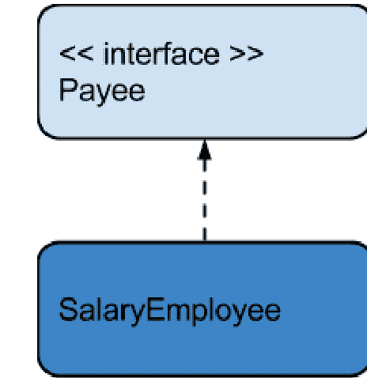

# Java 抽象入门指南

## 前言

在软件工程和编程语言中，抽象（或抽象原则）是一项基本准则，旨在通过利用语言提供的抽象来减少程序中信息的重复。这一原则有时被告知程序员，有时被视为编程语言的要求，理解为什么使用抽象是有用的。它的起源曾多次以不同的名称被发明，并总结为“不要重复自己”（`don't repeat yourself`）原则，该原则避免了通用的信息重复，也避免了软件开发过程中的人力投入浪费。

维基百科
[http://en.wikipedia.org/wiki/Abstraction](http://en.wikipedia.org/wiki/Abstraction)

## 关于作者

Hugh Hamill 是一位位于爱尔兰高威的高级工程师和认证 Scrum 大师。他于 2002 年在沃特福科技大学获得应用计算学士学位，从那以后一直在业界工作。他曾使用过 `C++` 和 `VB`，但目前专注于 `Java`。他具有使用 `Swing` 构建桌面应用程序以及企业级后端的经验，曾担任多个项目（包括大型系统）的技术主管和架构师。他感兴趣的主要领域包括核心 `Java`、设计模式、`TDD` 和敏捷软件开发。

## 第 1 章 引言

在本教程中，我们将介绍 `Java` 中的抽象，并使用接口定义一个简单的工资支付系统。本教程将涵盖`Java`中抽象的两种类型：**接口**和**抽象类**。我们现在将详细介绍这两种类型。

## 第 2 章 接口

接口就像一份契约。它承诺提供某些行为，实现接口的类必须提供这些行为。使用接口的人可以不依赖具体的实现细节，这是抽象的一个重要益处。

### 2.1 定义接口

在 `Java` 中，你可以使用 `interface` 关键字来定义接口：

```java
public interface MyInterface {
    void methodA();
    int methodB();
    String methodC(double x, double y);
}
```

接口定义了方法的签名，但没有提供实现。实现接口的类必须提供实现。

### 2.2 实现接口

现在我们要实现接口，通过编写一个新类并使用 `implements` 关键字来告诉编译器该类应该实现：

```java
public class MyClass implements MyInterface {
    public void methodA() {
        System.out.println("调用了 A!");
    }

    public int methodB() {
        return 42;
    }

    public String methodC(double x, double y) {
        return "x = " + x + ", y = " + y;
    }
}
```

我们根据 `MyInterface` 中定义方法签名，为它们提供了方法体。我们还可以创建多个实现类，每个类都有不同的实现细节。只要方法体符合签名，我们可以在其中做任何事情。

### 2.3 使用接口

为了从客户端调用接口的方法，我们只需要使用 `.` 运算符，就像调用类的方法一样：

```java
MyInterface object1 = new MyClass();
object1.methodA(); // 保证可以工作
```

我们在上面看到了一些特殊之处，我们没有使用`MyClass object1 = new MyClass();`（这完全可行），而是声明 `object1` 的类型为 `MyInterface`。这是因为 `MyClass` 是 `MyInterface` 的实现，当我们想要调用接口中定义的方法时，我们将提供实现。`object1` 是指向该实现对象的引用，在本例中它是 `MyClass` 的实例。

当我们调用 `object1.methodA()` 时，我们执行的是在 `MyClass` 中定义的方法，因为对象的运行时类型是 `MyClass`，即使引用类型是 `MyInterface`。我们只能在 `object1` 上调用 `MyInterface` 中定义的方法，实际上，我们只能将 `object1` 视为 `MyInterface` 类型，即使运行时类型是 `MyClass`。

接口还可以包含状态：

```java
public interface MyInterfaceWithState {
    int someNumber;
    void methodA();
}
```

接口中的方法默认是 `public` 的，事实上，你不能在接口中创建非 `public` 访问级别的方法。

```java
public interface OneMethodInterface {
    void methodName();
}
```

它定义了一个不带参数的 `void` 方法。

让我们来实现它：

```java
public class ClassA implements OneMethodInterface {
    public void methodName() {
        System.out.println("Runtime type is ClassA.");
    }
}
```

我们可以在客户端中这样使用它：

```java
OneMethodInterface myObject = new ClassA();
myObject.methodName();
```

输出：

```
Runtime type is ClassA.
```

现在我们为 `OneMethodInterface` 提供一个不同的实现：

```java
public class ClassB implements OneMethodInterface {
    public void methodName() {
        System.out.println("The runtime type of this class is ClassB.");
    }
}
```

并修改上面的代码：

```java
OneMethodInterface myObject = new ClassA();
myObject = new ClassB();
myObject.methodName();
```

输出：

```
Runtime type is ClassA.
Runtime type of this class is ClassB.
```

我们成功地使用引用（`myObject`）来指向两个不同运行时类型的实例。`OneMethodInterface` 可以由任何类以任何方式实现。对于编译器来说，`myObject` 是一个 `OneMethodInterface`，`methodName()` 是可用的，即使它被重新赋值为不同类的不同实例对象。这种提供多个运行时类型且在运行时（而非编译时）解析的能力被称为**多态**。

接口定义了行为而不包含任何实现细节（忽略 `Java 8` 之后版本），实现类定义了它们所定义类的所有实现，但如果我们想将这两种概念混合起来呢？如果我们想在同一个地方混合某些行为定义和某些实现，我们可以使用抽象类。

## 第 3 章 抽象类

抽象类像是一份不完整的蓝图，它定义了类的某些实现细节，而将其他部分留作简单的行为定义，以便以后实现。

想象一张房屋的蓝图，房子已经完全画好了，但有一个巨大的空方块是车库的位置。我们不知道它将变成什么样。其他人必须在车库那里获取我们蓝图的副本。事实上，许多不同的人可能会拷贝我们的蓝图，并画出不同类型的车库。使用这些蓝图建造的房屋将是我们房屋的可识别变体；正门、房间布局和窗户将完全相同，然而车库将会有所不同。

就像上面的蓝图一样，我们的抽象类完全定义了一些方法，这些方法的实现在抽象类的所有实现中将是相同的。抽象类仅定义其他方法的签名，与接口的方式相同。这些方法的实现在实现它的类中会有所不同。实现抽象类通常被称为**具体类**。由于具体类和抽象类之间的继承关系，我们通常说具体类扩展（`extends`）抽象类，而不是像对待接口那样说实现（`implements`）。

就像接口一样，任何客户端代码都知道，如果一个具体类扩展了抽象类，类就保证为抽象类的抽象方法提供方法体（当然，抽象类为非抽象方法提供了自己的方法）。

同样，就像接口一样，给定的抽象类可以有不同的具体类，每个类在满足抽象类约的同时，为类的抽象方法定义非常不同的行为。实现细节对客户端隐藏。

### 3.1 定义抽象类

`abstract` 关键字用于将类及其方法定义为抽象的。

```java
public abstract class MyAbstractClass {
    protected int someNumber = 0;

    public void increment() {
        someNumber++;
    }

    public abstract void doSomethingWithNumber();
}
```

在这里我们定义了一个名为 `MyAbstractClass` 的抽象类，它包含一个整数并提供了一个增加该整数的方法。我们还定义了一个名为 `doSomethingWithNumber()` 的抽象方法。我们还不知道这个方法将做什么，它将在任何扩展 `MyAbstractClass` 的具体类中定义。`doSomethingWithNumber()` 没有方法体，因为它是抽象的。

在接口中，所有方法默认都是公共的（`public`），但抽象方法的范围可以是包（`package`）、受保护（`protected`）或私有的（`private`）。你可以看到在这个抽象类中，接口中的行为实现与 `doSomethingWithNumber()` 中的行为定义混合在一起。抽象类混合了某些实现和某些定义。扩展抽象类的具体类将重用 `increment()` 的实现，同时保证提供它们自己的 `doSomethingWithNumber()` 实现。

### 3.2 扩展抽象类

现在我们创建了一个抽象类，让我们为它创建一个具体实现。我们通过非抽象类中的 `extends` 关键字从抽象类创建具体实现。

```java
public class MyConcreteClass extends MyAbstractClass {
    public void sayHello() {
        System.out.println("Hello there!");
    }

    public void doSomethingNumber() {
        System.out.println("The number is " + someNumber);
    }
}
```

我们创建了一个名为 `MyConcreteClass` 的具体类并扩展了 `MyAbstractClass`。我们只需要为抽象方法 `doSomethingNumber()` 提供实现，因为我们继承了 `MyAbstractClass` 的私有成员变量和方法。如果任何客户端调用 `MyConcreteClass` 实现上的 `increment()`，将执行 `MyAbstractClass` 中定义的。名为 `sayHello` 的新方法是 `MyConcreteClass` 特有的，任何其他实现 `MyAbstractClass` 的类都无法使用。

我们用另一个抽象类扩展了 `MyAbstractClass`，在其中我们没有定义 `doSomethingNumber` —— 这意味着必须定义另一个扩展该类的抽象类来实现 `doSomethingNumber()`。

```java
public abstract class AnotherAbstractClass extends MyAbstractClass {
    public void sayHello() {
        System.out.println("Hello there!");
    }
}
```

这里我们没有为 `doSomethingNumber` 提供任何实现。

最后，抽象类可以实现接口。因为抽象类不能实例化，它必须为接口的所有方法提供实现。

```java
public abstract class MyImplementingClass implements MyInterface {
    public void methodA() {
        System.out.println("Method A is implemented");
    }
}
```

### 3.3 使用抽象类

就像接口和普通类一样，调用抽象类的方法使用 `.` 操作符。

```java
MyAbstractClass object1 = new ConcreteClass();
object1.increment();
object1.doSomethingNumber();
```

再次注意 `object1` 是一个指向具体实例的引用，对于编译器来说它是 `MyAbstractClass`。如果你尝试调用 `MyConcreteClass` 中定义的 `sayHello()` 方法，将得到编译错误。

```java
object1.sayHello(); // 编译错误
```

就像接口一样，我们可以通过同一个引用提供不同的运行时类型并使用它们。

定义一个新的抽象类：

```java
public abstract class TwoMethodAbstractClass {

    public void oneMethod() {
        System.out.println("oneMethod is implemented in TwoMethodAbstractClass.");
    }

    public abstract void twoMethod();

}
```

它定义了一个已实现的方法和一个抽象方法。

让我们用具体类来扩展它：

```java
public class ConcreteA extends TwoMethodAbstractClass {

    public void twoMethod() {
        System.out.println("twoMethod is implemented in ConcreteA.");
    }

}
```

我们可以像这样在客户端中使用它：

```java
TwoMethodAbstractClass myObject = new ConcreteA();
myObject.oneMethod();
myObject.twoMethod();
```

输出：

```
oneMethod is implemented in TwoMethodAbstractClass.
twoMethod is implemented in ConcreteA.
```

现在我们为 `TwoMethodAbstractClass` 提供另一个不同的具体类：

```java
public class ConcreteB extends TwoMethodAbstractClass {

    public void twoMethod() {
        System.out.println("ConcreteB implements its own twoMethod.");
    }

}
```

#### Java 中的抽象

```java
TwoMethodAbstractClass myObject = new ConcreteClassA();
myObject.oneMethod();
myObject.twoMethod();
myObject = new ConcreteClassB();
myObject.oneMethod();
myObject.twoMethod();
```

输出：

```
TwoMethod is implemented in TwoMethodAbstractClass.
TwoMethod is implemented in ConcreteClassA.
ConcreteClassB implements its own twoMethod.
```

我们使用了引用（`myObject`）来指向两个不同运行时类型的实例。当 `myObject` 的运行时类型为 `ConcreteClassA` 时，它使用来自 `ConcreteClassA` 的 `twoMethod` 实现。当 `myObject` 的运行时类型为 `ConcreteClassB` 时，它使用来自 `ConcreteClassB` 的 `twoMethod` 实现。在这两种情况下，都使用了来自 `TwoMethodAbstractClass` 的 `oneMethod` 通用实现。

抽象类用于定义共同行为，同时提供契约或承诺，后续具体类将提供其他行为。这允许我们构建对象模型，在模型中我们可以重用通用功能，并在不同的具体类中捕捉不同的需求。

## 第 4 章 实例示例 - 支付系统

我们被要求为公司构建一个支付系统。我们知道公司有不同类型的员工，可以以不同的方式支付工资：薪制和佣金制。公司老板理解他的需求会发生变化，系统可能会进行更改，以适应接收支付的不同类型的实体。

### 4.1 Payee 接口

让我们从考虑员工开始。他们必须接收支付，但我们也知道以后可能需要不同的实体也接收支付。让我们创建一个接口 `Payee`，它将定义我们期望能够接收支付的实体提供的行为。

```java
public interface Payee {
    String name();
    Double grossPayment();
    Integer bankAccount();
}
```

这里有一个 `Payee` 接口，让我们写一些代码来保证三种行为：为 `Payee` 提供名称的能力、提供应支付的毛金额的能力，以及提供资金应存入银行账户的能力。

### 4.2 支付系统

现在我们定义了 `Payee`，让我们写一些使用它的代码。我们将创建一个 `PaymentSystem` 类，它维护一个 `Payee` 列表，并将循环遍历它们并将请求金额转入相应的银行账户。


```java
public class PaymentSystem {
    private List<Payee> payees;

    public PaymentSystem() {
        payees = new ArrayList<>();
    }

    public void addPayee(Payee payee) {
        if (!payees.contains(payee)) {
            payees.add(payee);
        }
    }

    public void processPayments() {
        for (Payee payee : payees) {
            Double grossPayment = payee.grossPayment();

            System.out.println("Paying to " + payee.name());
            System.out.println("\tgross\t" + grossPayment);
            System.out.println("\tTransferred to Account: " + payee.bankAccount());
        }
    }
}
```

你可以看到，`PaymentSystem` 完全忽略 `Payee` 的运行时类型，它不需要关心。它知道无论正在处理的 `Payee` 运行时类型是什么，都保证实现了 `name()`、`grossPayment()` 和 `bankAccount()`。基于这一知识，只需执行一个 `for` 循环遍历所有的 `Payee`，并使用这些方法处理它们的支付即可。

## 4.3 员工类

老板告诉我们他有两种不同类型的员工——薪制员工和佣金制员工。薪制员工有不改变的基本工资，而佣金制员工有基本工资，并且还可以根据成功的销售获得销售佣金。

### 4.3.1 `SalaryEmployee` 类

让我们从一个用于薪制员工的类开始。它应该实现 `Payee` 接口，以便被支付系统使用。

除了代码之外，让我们还使用类图来表示我们的类。在类图中，虚箭头表示实现（`implements`）关系，实箭头表示继承（`extends`）关系。

#### 4.3.1.1 类图



图 4.1：截图

#### 4.3.1.2 代码

```java
public class SalaryEmployee implements Payee {
    private String name;
    private Integer bankAccount;
    protected Double grossWage;

    public SalaryEmployee(String name, Integer bankAccount, Double grossWage) {
        this.name = name;
        this.bankAccount = bankAccount;
        this.grossWage = grossWage;
    }

    public Integer bankAccount() {
        return bankAccount;
    }

    public String name() {
        return name;
    }

    public Double grossPayment() {
        return grossWage;
    }
}
```

### 4.3.2 `CommissionEmployee` 类

现在让我们创建一个 `CommissionEmployee` 类。这个类将类似于 `SalaryEmployee`，但具有支付佣金的能力。

### 4.3.3 `Employee` 抽象类

你可以看到，`SalaryEmployee` 和 `CommissionEmployee` 之间有很多重复的代码。事实上，唯一不需要实现 `Payee` 中定义的 `grossPayment()` 方法的地方，是由于 `Employee` 是抽象的。现在让我们创建两个 `Employee` 子类：

```java
public class SalaryEmployee extends Employee {
    public SalaryEmployee(String name, Integer bankAccount, Double grossWage) {
        super(name, bankAccount, grossWage);
    }

    public Double grossPayment() {
        return grossWage;
    }
}

public class CommissionEmployee extends Employee {
    private Double grossCommission = 0.0;

    public CommissionEmployee(String name, Integer bankAccount, Double grossWage) {
        super(name, bankAccount, grossWage);
        grossCommission = commission;
    }

    public Double grossPayment() {
        return grossWage + currentCommission();
    }

    private Double currentCommission() {
        Double commission = grossCommission;
        grossCommission = 0.0;
        return commission;
    }

    public void giveCommission(Double amount) {
        grossCommission += amount;
    }
}
```

这看起来是抽象类的良好候选者。让我们将名称和银行账户的功能抽象到一个 `Employee` 抽象类中。然后 `SalaryEmployee` 和 `CommissionEmployee` 就可以扩展这个抽象类，并为 `grossPayment()` 提供不同的实现。

#### 4.3.3.1 类图

图 4.3：截图

#### 4.3.3.2 代码

```java
public abstract class Employee implements Payee {
    private String name;
    private Integer bankAccount;
    protected Double grossWage;

    public Employee(String name, Integer bankAccount, Double grossWage) {
        this.name = name;
        this.bankAccount = bankAccount;
        this.grossWage = grossWage;
    }

    public String name() {
        return name;
    }

    public Integer bankAccount() {
        return bankAccount;
    }
}
```

注意，`Employee` 不需要实现 `Payee` 中定义的 `grossPayment()` 方法，因为 `Employee` 是抽象的。整洁多了！

## 4.4 应用程序

让我们在应用程序中使用我们新的员工类型。我们将创建一个应用程序类，通过创建支付系统、一些员工并模拟一周的工作来初始化系统。

### 4.4.1 `PaymentApplication` 类

该应用程序类结构如下：

```java
public class PaymentApplication {
    public static void main(final String... args) {
        // Initialization
        PaymentSystem paymentSystem = new PaymentSystem();

        CommissionEmployee johnSmith = new CommissionEmployee("John Smith", 1111, 300.0);
        paymentSystem.addPayee(johnSmith);

        CommissionEmployee paulJones = new CommissionEmployee("Paul Jones", 2222, 350.0);
        paymentSystem.addPayee(paulJones);

        SalaryEmployee maryBrown = new SalaryEmployee("Mary Brown", 3333, 500.0);
        paymentSystem.addPayee(maryBrown);

        SalaryEmployee susanWhite = new SalaryEmployee("Susan White", 4444, 470.0);
        paymentSystem.addPayee(susanWhite);

        // Simulate Week
        johnSmith.giveCommission(40.0);
        johnSmith.giveCommission(35.0);
        johnSmith.giveCommission(45.0);
        johnSmith.giveBonus(5.0);

        paulJones.giveCommission(45.0);
        paulJones.giveCommission(51.0);
        paulJones.giveCommission(23.0);
        paulJones.giveCommission(14.5);
        paulJones.giveCommission(57.3);
        paulJones.giveBonus(6.5);

        maryBrown.giveBonus(3.0);
        susanWhite.giveBonus(7.5);

        // Process Payment
        paymentSystem.processPayments();
    }
}
```

我们创建了佣金员工和薪资制员工，他们都有自己的姓名、基本工资和银行账户号码。我们将每个员工都添加到创建的支付系统中，以反映奖金。然后，我们通过向佣金员工发放佣金来模拟一周的情况，并要求支付系统处理该周的所有付款。

### 输出

```text
Paying to John Smith

Gross 420.0

Transferred to Account: 1111

Paying to Paul Jones

Gross 440.0

Transferred to Account: 2222

Paying to Mary Brown

Gross 500.0

Transferred to Account: 3333

Paying to Susan White

Gross 470.0

Transferred to Account: 4444
```

## 处理奖金

老板对这个系统非常满意，但他想通过发放每周奖金来激励员工。他告诉我们，佣金员工的薪资通常较低，我们应该给他们 1.5 倍的奖金，以便提高他们的百分比奖金。

### 用于奖金的 `Employee` 类

让我们添加一个字段来捕获任何发放的奖金，一个返回并重置奖金的保护方法，以及一个发放奖金的抽象方法。`getBonus()` 方法是抽象的，因为它在薪资制员工和佣金制员工中的实现方式将不同。

```java
public abstract class Employee implements Payee {
    private String name;
    private Integer bankAccount;

    protected Double currentBonus;
    protected Double grossWage;

    public Employee(String name, Integer bankAccount, Double grossWage) {
        this.name = name;
        this.bankAccount = bankAccount;
        this.grossWage = grossWage;
        this.currentBonus = 0.0;
    }

    public String name() {
        return name;
    }

    public Integer bankAccount() {
        return bankAccount;
    }

    public abstract void giveBonus(Double percentage);

    protected Double doCurrentBonus() {
        Double bonus = currentBonus;
        currentBonus = 0.0;
        return bonus;
    }
}
```

### 对 `SalaryEmployee` 的更新

```java
public class SalaryEmployee extends Employee {
    public SalaryEmployee(String name, Integer bankAccount, Double grossWage) {
        super(name, bankAccount, grossWage);
    }

    public void giveBonus(Double percentage) {
        currentBonus += grossWage * (percentage / 100.0);
    }

    public Double grossPayment() {
        return grossWage + doCurrentBonus();
    }
}
```

### 对 `CommissionEmployee` 的更新

```java
public class CommissionEmployee extends Employee {
    private static final Double bonusMultiplier = 1.5;
    private Double grossCommission = 0.0;

    public CommissionEmployee(String name, Integer bankAccount, Double grossWage) {
        super(name, bankAccount, grossWage);
    }

    public void giveBonus(Double percentage) {
        currentBonus += grossWage + (percentage / 100.0) + bonusMultiplier;
    }

    public Double grossPayment() {
        return getCurrentCommission();
    }

    private Double getCurrentCommission() {
        Double commission = grossCommission;
        grossCommission = 0.0;
        return commission;
    }

    public void giveCommission(Double amount) {
        grossCommission += amount;
    }
}
```

我们可以看到两个类实现 `giveBonus()` 的方式不同——`CommissionEmployee` 使用了奖金倍数。我们还可以看到，两个类在计算总付款时都使用了在 `Employee` 中定义的 `getBonus()` 方法。

让我们更新应用程序，向我们的员工支付一些资金：


```java
public class PaymentApplication {
    public static void main(String... args) {
        // Initialization
        PaymentSystem paymentSystem = new PaymentSystemV1();
        CommissionEmployee johnSmith = new CommissionEmployee("John Smith", 1111, 300.0);
        paymentSystem.addPayee(johnSmith);
        CommissionEmployee paulJones = new CommissionEmployee("Paul Jones", 2222, 350.0);
        paymentSystem.addPayee(paulJones);
        SalaryEmployee maryBrown = new SalaryEmployee("Mary Brown", 3333, 500.0);
        paymentSystem.addPayee(maryBrown);
        SalaryEmployee susanWhite = new SalaryEmployee("Susan White", 4444, 470.0);
        paymentSystem.addPayee(susanWhite);

        // Simulate Week
        johnSmith.giveCommission(40.0);
        johnSmith.giveCommission(35.0);
        johnSmith.giveCommission(45.0);
        johnSmith.giveBonus(5.0);

        paulJones.giveCommission(45.0);
        paulJones.giveCommission(51.0);
        paulJones.giveCommission(23.0);
        paulJones.giveCommission(14.5);
        paulJones.giveCommission(57.3);
        paulJones.giveBonus(6.5);

        maryBrown.giveBonus(3.0);
        susanWhite.giveBonus(7.5);

        // Process Payment
        paymentSystem.processPayments();
    }
}
```

输出：

```
Paying to John Smith
Gross 420.0
Transferred to Account: 1111

Paying to Paul Jones
Gross 440.0
Transferred to Account: 2222

Paying to Mary Brown
Gross 500.0
Transferred to Account: 3333

Paying to Susan White
Gross 470.0
Transferred to Account: 4444
```

## 4.6 外包公司

老板对这个系统非常满意，但他还需要支付其他人。随着时间的推移，他将聘用外包公司。显然，这些公司没有工资，而是被跟踪并结算的。

### 4.6.1 ContractingCompany 类

外包公司类应该实现`Payee`接口，以便被支付系统使用。它应该有一个用于支付服务的方法。

#### 4.6.1.1 类图

```java
public class ContractingCompany implements Payee {
    private String name;
    private Integer bankAccount;
    private Double currentBalance;

    public ContractingCompany(String name, Integer bankAccount) {
        this.name = name;
        this.bankAccount = bankAccount;
        currentBalance = 0.0;
    }

    public String name() {
        return name;
    }

    public Integer bankAccount() {
        return bankAccount;
    }

    public Double grossPayment() {
        Double balance = currentBalance;
        currentBalance = 0.0;
        return balance;
    }
}
```

#### 4.6.1.2 代码

```java
public void payForServices(Double amount) {
    currentBalance += amount;
}
```

我们将外包公司添加到我们的应用程序并向它们支付一些资金：

```java
public class PaymentApplication {
    public static void main(String... args) {
        // Initialization
        PaymentSystem paymentSystem = new PaymentSystemV1();
        CommissionEmployee johnSmith = new CommissionEmployee("John Smith", 1111, 300.0);
        paymentSystem.addPayee(johnSmith);
        CommissionEmployee paulJones = new CommissionEmployee("Paul Jones", 2222, 350.0);
        paymentSystem.addPayee(paulJones);
        SalaryEmployee maryBrown = new SalaryEmployee("Mary Brown", 3333, 500.0);
        paymentSystem.addPayee(maryBrown);
        SalaryEmployee susanWhite = new SalaryEmployee("Susan White", 4444, 470.0);
        paymentSystem.addPayee(susanWhite);
        ContractingCompany acmeInc = new ContractingCompany("Acme Inc", 5555);
        paymentSystem.addPayee(acmeInc);
        ContractingCompany javaCodeGeeks = new ContractingCompany("javacodegeeks.com", 6666);
        paymentSystem.addPayee(javaCodeGeeks);

        // Simulate Week
        johnSmith.giveCommission(40.0);
        johnSmith.giveCommission(35.0);
        johnSmith.giveCommission(45.0);
        johnSmith.giveBonus(5.0);

        paulJones.giveCommission(45.0);
        paulJones.giveCommission(51.0);
        paulJones.giveCommission(23.0);
        paulJones.giveCommission(14.5);
        paulJones.giveCommission(57.3);
        paulJones.giveBonus(6.5);

        maryBrown.giveBonus(3.0);
        susanWhite.giveBonus(7.5);

        acmeInc.payForServices(100.0);
        acmeInc.payForServices(250.0);
        acmeInc.payForServices(300.0);

        javaCodeGeeks.payForServices(400.0);
        javaCodeGeeks.payForServices(250.0);
    }
}
```

```java
// 处理每周付款
paymentSystem.processPayments();
}
```

输出：

```
支付给 John Smith
总额 442.5
转账账户: 1111

支付给 Paul Jones
总额 574.925
转账账户: 2222

支付给 Mary Brown
总额 515.0
转账账户: 3333

支付给 Susan White
总额 505.25
转账账户: 4444

支付给 Acme Inc.
总额 650.0
转账账户: 5555

支付给 Janavacodegeeks.com
总额 650.0
转账账户: 6666
```

我们现在已经在没有更改处理`Payee`的`PaymentSystem`类中任何代码的情况下，成功向系统添加了新类型的收款人（`Payee`）。这就是抽象的力量。

## 4.7 高级功能：税收

老板对支付系统非常满意，然而税务局的专员给他发了一封信，告诉他必须在系统中加入某种形式的预扣税，否则他会有麻烦。系统应该有一个全局税率，且每个员工都应该有一个个人免税额度。税收应仅对支付给员工且超过免税额度的金额进行征收。员工应仅获得其应得的金额。承包公司负责支付自己的税收，因此系统不应应对它们进行扣税。

为了处理税收，我们需要创建一个新类型的收款人，该类型是应纳税的，并且可以提供税收额度。

我们可以扩展接口。让我们在不修改原始接口的情况下添加行为定义。原始接口中定义的所有行为都将自动继承到新接口中。

### 4.7.1 TaxablePayee 接口

我们将扩展`Payee`来创建一个新的`TaxablePayee`接口，然后让`Employee`实现该接口，同时让`ContractingCompany`（承包公司）保持为普通的、不收税的`Payee`。

#### Java 中的抽象

#### 4.7.1.1 类图

#### 4.7.1.2 代码

```java
public interface TaxablePayee extends Payee {
    public Double allowance();
}
```

在这里我们看到`Payee`被扩展了，并且定义了一个额外方法`allowance()`，它返回`TaxablePayee`的税收额度。

我们需要更新`Employee`以实现`TaxablePayee`，我们将看到这将对两个具体的`Employee`类产生连锁反应。

```java
public abstract class Employee implements TaxablePayee {
    private String name;
    private Integer bankAccount;
    private Double allowance;
}
```

#### Java 中的抽象

```java
protected Double currentBonus;
protected Double grossWage;

public Employee(String name, Integer bankAccount, Double grossWage, Double
    allowance) {
    this.name = name;
    this.bankAccount = bankAccount;
    this.grossWage = grossWage;
    this.allowance = allowance;
    currentBonus = 0.0;
}

public String name() {
    return name;
}

public Integer bankAccount() {
    return bankAccount;
}

public Double allowance() {
    return allowance;
}

public abstract void doCurrentBonus(Double percentage) {
    Double bonus = currentBonus;
    currentBonus = 0.0;
    return bonus;
}
```

我们必须更改`Employee`的构造函数，这意味着我们的两个抽象类的构造函数也需要更改。

```java
public class SalaryEmployee extends Employee {
    public SalaryEmployee(String name, Integer bankAccount, Double grossWage, Double
        allowance) {
        super(name, bankAccount, grossWage, allowance);
    }

    @Override
    public void giveBonus(Double percentage) {
        currentBonus += grossWage * (percentage/100.0);
    }

    @Override
    public Double grossPayment() {
        return grossWage + doCurrentBonus();
    }
}
```

佣金员工：

```java
public class CommissionEmployee extends Employee {
    private static final Double bonusMultiplier = 1.5;
```

#### Java 中的抽象

```java
private Double grossCommission = 0.0;

public CommissionEmployee(String name, Integer bankAccount, Double grossWage,
Double allowance) {
    super(name, bankAccount, grossWage, allowance);
}

@Override
public void giveBonus(Double percentage) {
    currentBonus += grossWage + (percentage/100.0) + bonusMultiplier;
}

@Override
public Double grossPayment() {
    return grossWage + currentBonus() + currentCommission();
}

private Double currentCommission() {
    Double commission = grossCommission;
    grossCommission = 0.0;
    return commission;
}

public void giveCommission(Double amount) {
    grossCommission += amount;
}
```

#### 4.7.2 PaymentSystem 中的更改

我们需要更新`PaymentSystem`以进行扣税，为此我们需要某种方法来判断给定的`Payee`是`TaxPayee`还是普通的`Payee`。我们可以利用 Java 关键字`instanceof`来实现这一点。`instanceof`检查给定引用的运行时类型是否符合此条件。如果`Payee`是`TaxPayee`的子类，将返回`true`。现在`PaymentSystem`有了额度，可以根据 20% 的税率计算出扣税金额。

```java
class PaymentSystem {

    private List<Payee> payees;

    private Double taxRate = 0.2;

    public PaymentSystem() {

        payees = new ArrayList<>();

    }

    public void addPayee(Payee payee) {

        if (!payees.contains(payee)) {

            payees.add(payee);

        }

    }

    public void processPayments() {

        for (Payee payee : payees) {

            Double grossPayment = payee.grossPayment();

            if (payee instanceof TaxablePayee) {
```


新代码检查`Payee`是否应纳税，这与税收处理有关。让我们更新应用程序以涵盖我们的员工免税额并执行应用程序：

```java
public class PaymentApplication {

    public static void main(String[] args) {

        // 初始化

        PaymentSystem paymentSystem = new PaymentSystem1();

        CommissionEmployee johnSmith = new CommissionEmployee("John Smith", 1111, 3000, 100.0);

        paymentSystem.addPayee(johnSmith);

        CommissionEmployee paulJones = new CommissionEmployee("Paul Jones", 2222, 3550, 0, 125.0);

        paymentSystem.addPayee(paulJones);

        SalaryEmployee maryBrown = new SalaryEmployee("Mary Brown", 3333, 500.0, 110.0);

        paymentSystem.addPayee(maryBrown);

        SalaryEmployee susanWhite = new SalaryEmployee("Susan White", 4444, 470.0, 130.0);

        paymentSystem.addPayee(susanWhite);

        ContractingCompany acmeInc = new ContractingCompany("Acme Inc", 5555);

        paymentSystem.addPayee(acmeInc);

        ContractingCompany javaCodegeeks = new ContractingCompany("javacocode.com", 6666);

        paymentSystem.addPayee(javaCodegeeks);

        // 模拟每周

        johnSmith.giveCommission(40.0);

        johnSmith.giveCommission(35.0);

        johnSmith.giveCommission(45.0);

        johnSmith.giveBonus(5.0);

        paulJones.giveCommission(45.0);

        paymentSystem.processPayments();

    }

}
```

#### Java 中的抽象

```java
paulJones.giveCommission(51.0);

paulJones.giveCommission(23.0);

paulJones.giveCommission(14.5);

paulJones.giveCommission(57.3);

paulJones.giveBonus(6.5);

maryBrown.giveBonus(3.0);

susanWhite.giveBonus(7.5);

acme.Inc.payForServices(100.0);

acme.Inc.payForServices(250.0);

acme.Inc.payForServices(300.0);

javaCodeGeeks.payForServices(400.0);

javaCodeGeeks.payForServices(250.0);

// Process Weekly Payment

paymentSystem.processPayments();
```

输出：

```
正在支付给 John Smith
总额 442.5
税额 -68.5
净额 374.0
转账账户: 1111
正在支付给 Paul Jones
总额 574.25
税额 -89.985
净额 484.9399999999994
转账账户: 2222
正在支付给 Mary Brown
总额 515.0
税额 -81.0
净额 434.0
转账账户: 3333
正在支付给 Susan White
总额 505.25
税额 -75.05
净额 430.2
转账账户: 4444
正在支付给 Acme Inc
总额 650.0
税额 -0.0
净额 650.0
转账账户: 5555
正在支付给 javacodege.com
总额 650.0
税额 -0.0
净额 650.0
转账账户: 6666
```

如你所见，员工被计算并预扣了税款，而承包公司继续无需缴纳税款。老板对这个系统感到非常满意，为了感谢我们让他免于入狱，他将为我们提供一次费用全包的假期！

# 第5章

# 结论

当使用正确时，抽象是 Java 中非常强大的工具。它为高级 Java 使用以及构建复杂、可扩展且可维护的软件开启了许多可能性。我们刚刚触及了抽象为我们所能做的冰山一角，并为进一步详细学习抽象的不同用法奠定了基础。
