# 高级 Java 游戏自制：Java 线程与动画视频游戏入门指南

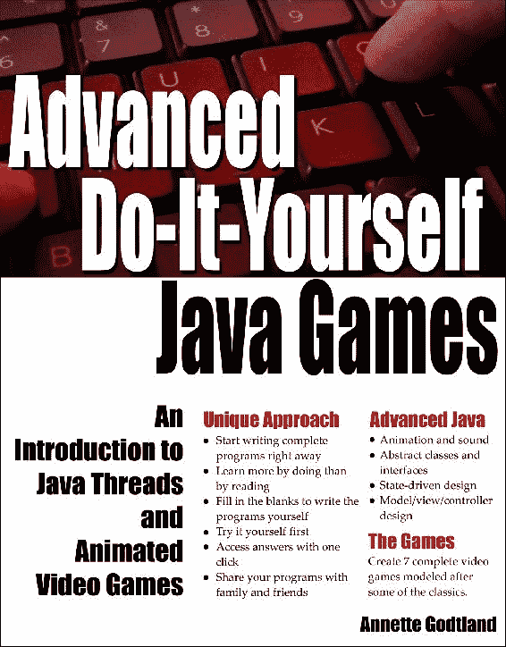

**版权信息**

Copyright © 2016 Annette Godtland 第一版 版权所有。未经作者书面许可，不得以任何电子、机械、复印、录制或其他方式复制本书的任何部分、存储在检索系统中或进行传输。制造商和销售商为了区分其产品而使用的许多标记均声称为商标。当这些标记出现在书中且作者知晓该商标声明时，这些标记以首字母大写或全大写的形式打印。对本文所包含的信息的使用不承担任何专利责任。尽管在编写本书时已采取一切措施，但出版商和作者对错误或遗漏概不负责。对于使用本文所包含的信息引起的损坏，也不承担任何责任。您可以仅出于非商业目的使用和分发书中的示例代码和图像文件，前提是注明其来源和作者。代码来源应在任何文档以及代码本身中（作为注释）。说明应包括作者：Annette Godtland，标题：Advanced Do-It-Yourself Java Games，以及出版者：Godtland Software Corporation。书中使用的所有图像和图像文件均由 Annette Godtland 创建。书中使用的所有音频文件均属于公共领域。“Three Blind Mice”的音频文件由 Paul Godtland 录制。所有其他音频文件均从 Pdsounds.org 下载，然后由 Annette Godtland 编辑。用于 Speed Words 程序的字典文件是`enable1.txt`的子集，该文件是公共领域，下载自[`www.puzzlers.org/dokuwiki/doku.php?id=solving:wordlists:about:start&s=word%20list`](http://www.puzzlers.org/dokuwiki/doku.php?id=solving:wordlists:about:start&s=word%20list)。首次出版于 2016 年 8 月 16 日，最后更新于 2016 年 8 月 16 日。出版者：Godtland Software Corporation，出版部，明尼苏达州罗彻斯特。


# 目录

- 版权信息
- 引言
  - 程序
  - 所需的先编程知识
- 环境设置
  - 下载 AdvancedDIYJava.zip
  - 创建 TitleLabel
- 项目 1 - 我的计时器
  - 课程 1.1 - 创建标准项目和类
  - 课程 1.2 - 创建标准自定义面板
  - 课程 1.3 - 格式化字符串
  - 课程 1.4 - 暂停线程
  - 课程 1.5 - 创建线程
  - 课程 1.6 - 停止线程
  - 课程 1.7 - 添加声音
- 项目 2 - 单词游戏
  - 课程 2.1 - 拖动对象，使用字典
  - 课程 2.2 - 集成计时器
- 项目 3 - 三连消除
  - 课程 3.1 - 动态更改鼠标图标
  - 课程 3.2 - 暂停事件分发
  - 课程 3.3 - 定义线程
- 项目 4 - 小鸟
  - 课程 4.1 - 使用 Swing 计时器制作动画
  - 课程 4.2 - 检测矩形形状
  - 课程 4.3 - 减少闪烁
- 项目 5 - 下落的砖块
  - 课程 5.1 - 使用多维数组
  - 课程 5.2 - 创建抽象类
- 项目 6 - 重力井
  - 课程 6.1 - 使用状态驱动编程，检测非矩形形状
- 项目 7 - 猫
  - 课程 7.1 - 使用系统退出
  - 课程 7.2 - 创建并抛出异常
  - 课程 7.3 - 创建接口
  - 课程 7.4 - 使用接口进行状态驱动设计
- 项目 8 - 闪电
  - 课程 8.1 - 在“视图”中布局显示
  - 课程 8.2 - 使用睡眠线程停止所有活动
  - 课程 8.3 - 在不同的类中定义监听器
  - 课程 8.4 - 在“模型”中设置游戏逻辑
  - 课程 8.5 - 重用游戏逻辑
- 希望你喜欢这本书
  - 问题、意见或建议
  - 我写的其他书籍
- 附录 A - 术语表
- 附录 B - 完成的代码列表
- 附录 C - 设置
  - 创建 Java 工作文件夹
  - 下载并安装 Java
  - 下载 AdvancedDIYJava.zip 详细说明
- 附录 D - 使用 Eclipse
  - 创建第一个项目
  - 创建第一个包
  - 创建第一个程序
  - 将项目添加到构建路径
  - 导出程序
- 附录 E - 使用的约定和其他技巧

# 简介

这是 Do-It-Yourself Java Games 系列的第三本书。第一本书的程序是基于文本的，以便你培养 Java 编程技能。第二本书《More Do-It-Yourself Java Games》涵盖了用于事件驱动游戏的各种图形化用户界面。那些游戏创建初始窗口，然后等待程序用户采取行动。本书中的游戏需要类似的事件驱动用户界面，但添加了线程来执行自动的同步活动，无论用户是否采取行动。此书介绍了几种高级编程技术：

* 使用线程来动画游戏对象并播放音频文件。
* 理解 Java 图形用户界面所使用的事件分派线程。
* 使用高级 Java 类型：抽象类和接口。
* 使用状态驱动编程管理所有游戏活动。
* 通过模型/视图/控制器设计将用户界面与程序逻辑分离。

书中的游戏也将成为许多其他游戏的极佳基石。一旦你完成了一个项目，可以随时修改它来创建其他游戏。编程的乐趣一半在于让程序运行你想要它运行的事情。与本系列中的其他书籍一样，每个项目中的课程都采用“尝试性”方法：执行所展示的步骤并观察会发生什么。你将获得编程任务，每个任务后面都跟着一个程序代码列表。列表留有了空格，以便让你自己编写大部分代码。但如果你不确定如何填写空格，也不要担心；只需点击完成列表的链接查看缺失的代码。不要跳过任何课程。每节课程解释了一种新的编程技术，该技术可能会在后面的课程中再次使用。完成所有课程会让后面的课程变得更容易。附录 A - 术语表包含了 Java 编程术语的定义以及指向更多信息的链接。每个术语首次出现（如上面使用的“图形用户界面”和“事件驱动”）时，将包含一个可点击指向词汇表中该词的链接。《自学 Java 游戏》系列书籍专为电子阅读器设计。点击下方的图片或访问此[链接](http://youtu.be/XMuXNyyk7mg)观看视频，了解这些电子书中在纸质书中无法实现的功能。

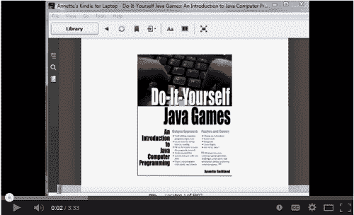(http://youtu.be/XMuXNyyk7mg)

# 程序

你将创建八个使用 Java 线程的计算机程序：

## 我的计时器

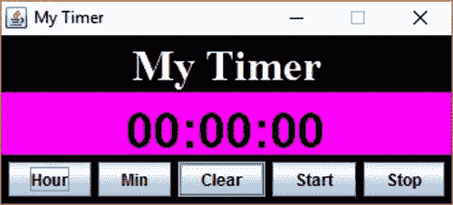

学习如何创建、启动和停止持续更新显示的线程，以及如何向程序中添加声音。我的计时器从任何开始时间开始倒数秒，并在计时器归零时发出哔声。

## 单词大师

学习如何用鼠标移动对象，以及如何将上一个程序创建的计时器集成到这个游戏中。

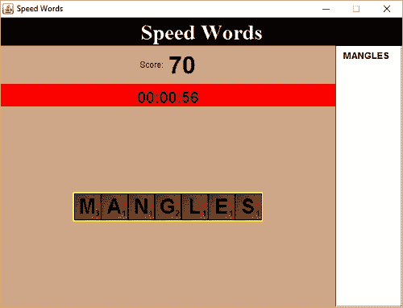

在六十秒内根据随机七字母单词的字母尽可能组成尽可能多的其他单词。

## 三消除

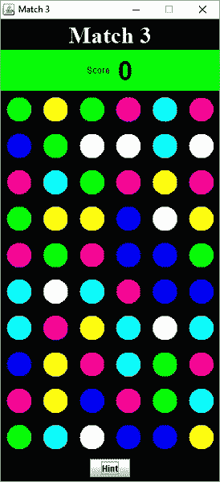

学习如何使用线程自动移动对象。交换球以形成三个或更多匹配球的链。完成的链将被移除并由新球替换。链条越长，得分越高。

## 小鸟

学习使用 Swing 计时器创建连续运动，并学习检测碰撞。

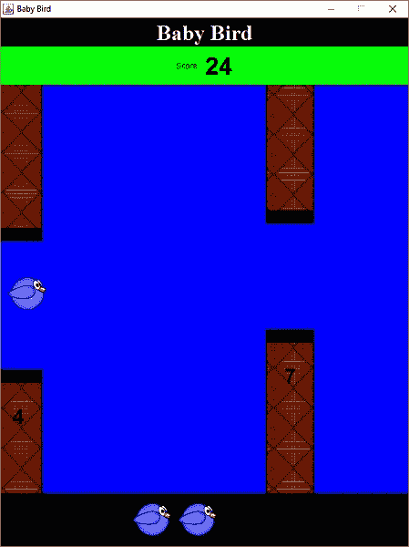

扇动小鸟的翅膀，引导它穿过墙上的缝隙。通过越小的缝隙得分越高。

## 掉落砖块

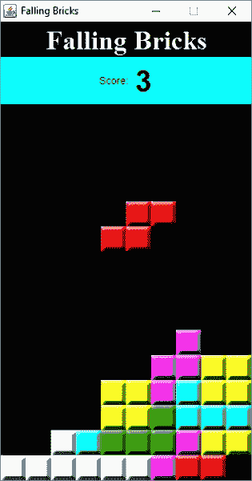

学习使用抽象类。移动、旋转并掉落的砖块以完成行。通过单个砖块完成多行来获得更多分。

## 重力井

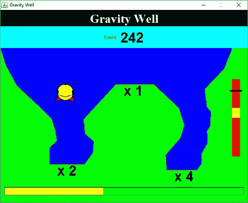

学习使用状态驱动编程管理游戏活动，并检测不规则形状对象的碰撞。软着陆飞船而不撞上墙壁或耗尽燃料。着陆平台越软、越困难，得分越高，补充的燃料越多。

## 猫鼠游戏

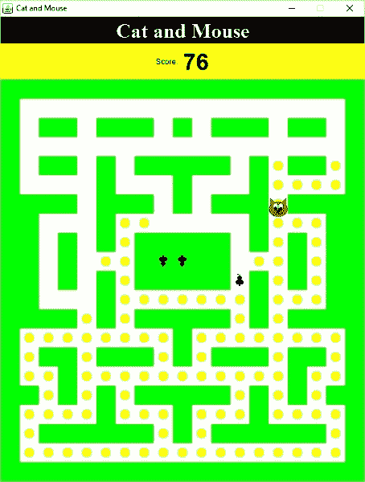

学习使用接口来编写更高效的状态驱动代码。引导老鼠吃奶酪而不被猫抓到。小心——猫能听见老鼠移动的声音并试图追捕它。

## 闪电战

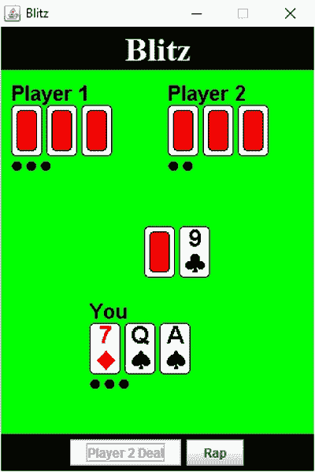

学习使用模型/视图/控制器设计将程序逻辑与用户界面分离。闪电战是一种流行的游戏，也称为 31。在一个花色中获得 31 分，另一个玩家可能较少。

# 先备知识

本书假设你已经知道如何执行以下任务。带有星号（*）的任务也包含在书中。

* 在 Eclipse 中创建项目。
* 使用包和类。
* 自父类。
* 创建`main()`](#part0015.xhtml_anchor-0_1_e7e1804a00e0556)方法。
* 保存并导出程序为执行文件。
* 使用类型为`string`、`int`、`double`、`float`、`char`和`boolean`的变量。
* 创建并使用变量修饰符：`private`、`public`、`protected`、`static`和/或`final`。
* 创建并使用带或不带参数、带或不带返回值的方法。
* 使用`if/else`语句和`switch`语句。
* 使用`while`循环和`for`循环。
* 使用`not operator`（非运算符）、`logical AND operator`（逻辑与运算符）和`logical OR operator`（逻辑或运算符）。
* 对数字进行加、减、乘、除并取`modulus`（模）。
* 使用括号改变运算顺序。
* 将字符串值转换为`integer`（整数）值。
* 将整数或`character`（字符）值转换为字符串。
* 使用`try/catch blocks`处理一个或多个`exception`（异常）。
* 使用不同的字符串方法。
* 使用`Random`类生成随机数。
* 添加`comments`（注释）。
* 输出到输出`console`。
* 使用`arrays`（数组）和`ArrayLists`。
* 从文本文件读取并写入。
* 使用`System`的`exit()`方法结束程序。
* 定位并修复`syntax errors`（语法错误）和运行时错误。

《More Do-It-Yourself Java Games: An Introduction to Java Graphics and Event-Driven Programming》介绍了你在完成此书中练习时必须掌握的以下任务。

* 在`event queue`上创建一个标准的`window`（窗口）并`pack`它以设置大小。
* 创建一个标准的自定义`panel`（面板）：设置`preferred size`（首选尺寸）、绘制`component`（组件）并根据需要`repaint`（刷新）。
* 使用`containers`（容器）：框架、面板和滚动面板，并设置它们的`serial version UID`。
* 使用输入/显示组件：`buttons`（按钮）、`labels`（标签）和文本区域。
* 使用`listeners`（监听器）：`action listeners`（动作监听器）、`key listeners`（键盘监听器）、`mouse listeners`（鼠标监听器）和`mouse motion listeners`（鼠标移动监听器）。
* 使用输入`dialogs`（对话框）：`message dialogs`（消息框）和`confirm dialogs`（确认框）。
* 使用`layouts`（布局）：边界布局（border layout）、框布局（box layout）和流布局（flow layout）。
* 处理布局：对齐组件。
* 绘制图形：字符串、线条、椭圆和图像。
* 使用`colors`（颜色）、`fonts`（字体）和`font metrics`（字体度量）。
* 使用不同的图像类型：`BufferedImage`和`Image`。
* 处理图像：读取`JPEG`或`PNG`图像文件并获取图像的一部分。
* 将程序的`look and feel`（外观和感受）设置为跨平台外观和感受。
* 将数据文件放入导出的 JAR 文件中。

## 环境设置

如果你没有安装免费的 Java 开发工具包（JDK）或交互式开发环境（IDE），或者需要如何设置 Java `work folder`（工作文件夹）的说明，请参见`Appendix C - Setup`。你可以使用任何 IDE，但书中的指令指的是免费的 Eclipse IDE。如果你需要如何使用 Eclipse 创建程序的说明，请参见`Appendix D - Using Eclipse`。`Appendix E - Conventions Used and Other Tips`包含了如何使用本书的技巧。

### 下载 AdvancedDIYJava.zip

创建书中的程序需要各种图像和数据文件。

1. 从`http://www.godtland.com/DIYJava/`免费下载`AdvancedDIYJava.zip`。
2. 将`AdvancedDIYJava.zip`中的文件`Extract`（解压）到你的 Java 工作文件夹中。

如果你需要关于如何下载`AdvancedDIYJava.zip`的更详细说明，请参见`Appendix C - Setup`。

### 创建 TitleLabel

书中的程序使用了相同的`TitleLabel`类，该类在《More Do-It-Yourself Java Games》书中的某个项目里创建过。如果你拥有该类，可以跳过此后的其余设置直接进入第一个项目：`Project 1 - My Timer`。要创建`TitleLabel`类，请按照列表中的步骤操作。

1. 创建名为`My Components`的新 Java 项目。（提示：要在 Eclipse 中创建项目，在 Project Explorer（项目管理器）中点击右键并选择`New / Java Project`。提示：书中程序所需的最低 JRE 为`Java SE 1.8`。在创建项目时，请选择`Java SE 1.8`或更高版本的 JRE。）
2. 在项目中创建一个名为`__________.mycomponents`的新包。（提示：要在 Eclipse 中创建包，在项目上点击右键并选择`New / Package`。提示：在空白处填入包名。正如第一本书所解释，包名应该是你唯一的，全小写，无空格，并用点号分隔。大多数企业使用公司名称。你可以使用你的姓和名。我将在这些示例持续中使用`annette.godtland`。）
3. 在`mycomponents`包中创建一个名为`TitleLabel`的新类，该类使用`JLabel`作为其父类且没有`stub`（存根）代码。（提示：要在 Eclipse 中创建类，在包上点击右键并选择`New / Class`。提示：所需的修饰符是`public`。提示：为了方便输入父类，点击`Browse...`，开始输入父类的名称，然后从列表中选择该父类。提示：在未指定右键的情况下，点击意味着使用左鼠标键点击对象。）

    1. 使用`Quick Fix`（快速修复）添加一个名为`serialVersionUID`的`private static final long`整数变量，设置为`1L`。删除随`serialVersionUID`添加的注释。（提示：将光标停在标记为警告的`TitleLabel`上，等待快速修复选项出现，然后选择 Add default serial UID。）
    2. 添加一个与所示代码完全相同的`TitleLabel`构造函数。该代码将设置标签的字体、颜色、透明度、对齐和文本。（提示：从`java.awt`导入`Font`和`Color`。）

Listing 0-1，来自`TitleLabel.java`

```java
package annette.godtland.mycomponents;

import java.awt.Color;
import java.awt.Font;
import javax.swing.JLabel;

public class TitleLabel extends JLabel {
    private static final long serialVersionUID = 1L;

    public TitleLabel(String title) {
        Font font = new Font(Font.SERIF, Font.BOLD, 32);
        setFont(font);
    }
}
```


```java
setBackground(Color.BLACK);
setForeground(Color.WHITE);
setOpaque(true);
setHorizontalAlignment(JLabel.CENTER);
setText(title);
}
}
```

# 项目 1 - 我的计时器

你是否可能需要检查饼干是否在 12 分钟后烤好了？你是否想在开始做更有生产力的事情之前，只允许自己玩 20 分钟游戏？`My Timer` 将在指定的小时、分钟和秒后发出警报声。这个项目将演示如何创建、启动和停止线程，以及如何向程序添加声音。这里是 `My Timer` 程序的截图：

## 课程 1.1 - 创建标准项目和类

《More Do-It-Yourself Java Games》使用了一系列标准步骤来创建任何基于窗口的程序。

### 尝试一下 - 为计时器进行初始设置

1. 创建一个名为 `My Timer` 的新 Java 项目。将项目 `My Components` 添加到 `My Timer`。（提示：在创建项目时，选择 `Java SE 1.8` 或更高的 `JRE`。提示：在 `Eclipse` 中创建新项目时添加项目，请输入新项目的名称，点击 `Next`，点击 `Projects` 选项卡，点击 `Add...`，选择要添加的项目，点击 `OK`，然后点击 `Finish`。要稍后添加项目，请参见附录 D - 使用 Eclipse）。

2. 在项目中创建一个名为 `__________.mytimer` 的新包。

3. 在 `mytimer` 包中创建一个名为 `MyTimer` 的新类，它使用 `JFrame` 作为其超类，并有一个 `main()` 方法的存根。

    1. 使用 `Quick Fix` 添加一个名为 `serialVersionUID` 的 `private static final long` 整数变量，设置为 `1L`。

    2. 移除代码中自动生成的注释。

注意：代码更改在列表中以**粗体**显示。注意：如果将你的电子阅读器设置为较小的字体，代码列表可能会更易读。这样做将减少换行。

#### 列表 1-1，来自 `MyTimer.java`

```java
package annette.godland.mytimer;
import javax.swing.JFrame;
public class MyTimer extends JFrame {
    // (Comments removed from here)
    private static final long serialVersionUID = 1L;
    public static void main(String[] args) {
        // (Comments removed from here)
    }
}
```

### 完成的列表

1. 添加一个无参数的 `MyTimer` 构造函数。在构造函数中：

    1. 调用 `initGUI()`，不传递任何参数。

    2. 将窗口标题设置为“My Timer”（提示：使用 `setTitle()` 方法。）

    3. 禁用调整大小。（提示：使用 `setResizable()` 方法。）

    4. 封装窗口。（提示：使用 `pack()` 方法。）

    5. 窗口居中。（提示：使用 `setLocationRelativeTo()` 方法并指定 `null`。）

    6. 使窗口可见。（提示：使用 `setVisible()` 方法。）

    7. 设置窗口在关闭时退出。（提示，使用 `setDefaultCloseOperation()` 方法和 `EXIT_ON_CLOSE` 变量。）

注意：你需要完成的代码在列表中显示为填空，`________________`。用零或多个单词或符号填充空格。点击任何列表末尾的 Completed 链接以查看缺失的代码。注意：`MyTimer` 将有一个语法错误，因为 `initGUI()` 方法尚不存在。

#### 列表 1-2，来自 `MyTimer.java`

```java
...
__________ MyTimer(_____) {
    __________();
    setTitle(_____________);
    setResizable(_________);
    pack(_________);
    setLocationRelativeTo(____);
    setVisible(____);
    setDefaultCloseOperation(__________);
}
...
```

### 完成的列表

1. 添加一个名为 `initGUI()` 的私有方法。它不应该接受参数且没有返回值。

    1. 创建一个名为 `titleLabel` 的 `TitleLabel` 对象，将其标题值设置为“My Timer”。

    2. 将 `titleLabel` 添加到窗口顶部。（提示：使用 `Quick Fix` 导入 `TitleLabel` 类。提示：使用 `JFrame` 的 `add()` 方法。提示：`JFrames` 使用 `BorderLayout`。因此，在向窗口添加标题时，使用 `BorderLayout` 的 `PAGE_START` 变量。）

#### 列表 1-3，来自 `MyTimer.java`

```java
...
_____________ initGUI(______) {
    ____________ titleLabel = ________________;
    add(__________________);
}
...
```

### 完成的列表

使用跨平台外观和感觉（look and feel），以便你的程序窗口在所有计算机上看起来都是相同的，并与书中所示的截图匹配。忽略设置外观和感觉时捕到的任何异常，以便它使用默认的外观和感觉。在 `main()` 中：

1. 启动一个 `try/catch` 块。

    1. 创建一个名为 `className` 的字符串，设置为跨平台外观和感觉的类名。（提示：使用 `UIManager` 的 `getCrossPlatformLookAndFeelClassName()` 方法。）

    2. 将外观和感觉设置为 `className`。（提示：使用 `UIManager` 的 `setLookAndFeel()` 方法。）

2. 如果捕到 `Exception`，则什么都不做。

#### 列表 1-4，来自 `MyTimer.java`

```java
...
public static void main(String[] args) {
    try {
        ____________ className = UIManager._____________;
        UIManager.____________();
    }
    catch (Exception e) {
}
}
```

### 完成的列表

在 `main()` 中，catch 块之后：

1. 将一个新的 `Runnable` 对象放入事件分发线程。该 `Runnable` 对象必须包含一个 `run()` 方法，该方法不接受参数且没有返回值。（提示：使用 `SwingUtilities` 的 `invokeLater()` 方法。）

    2. 在 `run()` 中，创建一个 `MyTimer` 对象。（提示：调用 `MyTimer` 的构造函数。）

#### 列表 1-5，来自 `MyTimer.java`

```java
...
public static void main(String[] args) {
    ...
}
SwingUtilities.invokeLater(new Runnable() {
    public void run() {
        new MyTimer();
    }
});
...
```

- 按照列表中的**粗体**显示对代码进行更改。

- 通过在列表空白处填入零或多个单词或符号来完成列表中的代码。

- 使用 `Java SE 1.8` 或更高的执行环境 `JRE`。

- 如果你收到关于某个类型或变量无法解析的语法错误，使用 `Quick Fix`（快速修复）导入所需的类。

    - 将光标停留在标记为错误的代码上，等待 `quick fix` 选项出现，然后选择一个修复方案。`Eclipse` 将根据你选择的修复方案自动更新代码。

- `JDK` 在多个包中包含许多同名的类。当你面临多个导入包的选项且没有其他另行说明时，请从 `java.awt`、`java.io` 和 `javax.swing` 包中导入类。

    - 例如，三个不同的 `Color` 类分别是：`java.awt.Color`、`com.sun.prism.paint.Color` 和 `javafx.scene.paint.Color`。如果你不小心导入了错误的类，将会收到各种意外的语法错误。如果发生这种情况，请删除导入语句，然后使用 `Quick Fix` 导入正确的类。

- 点击任何列表末尾的[已完成的列表]链接查看缺失的代码。

- 除非代码有语法错误，否则每次更改代码后保存更改并运行程序。要在 `Eclipse` 中运行程序，点击工具栏上的运行按钮。（提示：运行按钮看起来像一个典型的播放按钮。）

## 课程 1.2 - 创建标准自定义面板

更多的 Java 游戏使用一组标准步骤来创建自定义面板。`TimerPanel` 是一个可以插入到任何程序中的自定义面板。`TimerPanel` 将每秒更新一次时间，倒计时到零。

### 尝试 - 为 `TimerPanel` 进行初始设置

1. 在 `mytimer` 包中创建一个名为 `TimerPanel` 的新类，它使用 `JPanel` 作为其父类，且没有存根代码。

    1. 使用 `Quick Fix` 添加一个名为 `serialVersionUID` 的 `private static final long` 整数变量，设置为 `1L`。

    2. 添加一个名为 `width` 的 `private integer` 变量，设置为 `150`。

    3. 添加一个名为 `height` 的 `private integer` 变量，设置为 `24`。

    4. 添加一个名为 `timeString` 的 `private string` 变量，设置为“00:00:00”。

#### 列表 1-6，来自 `TimerPanel.java`

```java
package annette.godtland.mytimer;

import javax.swing.JPanel;

public class TimerPanel extends JPanel {
  ____________________;
  ____________ width = ______;
  ____________ height = _______;
  ____________ timeString = __________;  
}
```

### 已完成的列表

1. 添加一个名为 `paintComponent()` 的公共方法。它应该接受一个参数——一个名为 `g` 的`Graphics` 对象——并且没有返回类型。（提示：从 `java.awt` 导入 `Graphics`。）

    1. 使用 `g` 调用父类的 `paintComponent()` 方法。（提示：在方法前使用 `super.` 来指代父类的方法。）

    2. 将 `g` 的颜色设置为黑色。（提示：使用 `JPanel` 的 `setColor()` 方法和 `Color` 的 `BLACK` 变量。）

    3. 在 `g` 的坐标 0, `height` 处绘制 `timeString`。（提示：使用 `Graphics` 的 `drawString()` 方法。）

#### 列表 1-7，来自 `TimerPanel.java`

```java
  ...
  ___________ paintComponent(___________) {
    super.____________________;
    g.________________;
    g.________________;
  }
  ...
```

### 已完成的列表

1. 添加一个名为 `getPreferredSize()` 的公共方法。它应该不接受参数并返回一个`Dimension` 对象。

    1. 创建名为 `size` 的 `Dimension` 对象，宽为 `width` 像素，高为 `height` 像素。

    2. 返回 `size`。

#### 列表 1-8，来自 `TimerPanel.java`

```java
  ...
  ___________ getPreferredSize(________) {
    ________ size = _______________;
    return _____________;
  }
  ...
```

### 已完成的列表

1. 通过调用其构造函数添加一个名为 `timerPanel` 的 `private TimerPanel` 变量。回到 `Timer`。

#### 列表 1-9，来自 `TimerPanel.java`

## 课程 1.3 - 格式化字符串

时间以秒秒数的形式维护，必须转换为小时、分钟和秒的字符串。

### 尝试一下 - 将时间格式化为 hh:mm:ss

两个整数的除法（`/`）返回结果的整数部分。相同整数的取模（`%`）返回它们除法的余数。例如，27 除以 4 等于 6 余于 3。因此 `27 / 4 = 6` 且 `27 % 4 = 3`。将计时器设置为 10 秒。回到 `TimerPanel`。

1. 添加一个名为 `time` 的私有长整型变量，设置为 10。

#### 列表 1-11，源自 `TimerPanel.java`

```java
    ...
  private int width = 150;
  private int height = 24;
  private String timeString = "00:00:00";
  ____________ time = _________;
  ...
```

[已完成的代码列表]

1. 添加一个名为 `setTime()` 的公共方法。它应该接收一个参数——名为 `time` 的长整型——且没有返回值。

    - 将实例变量 `time` 设置为 `time` 参数的值。（提示：使用 `this.`）

    - 创建一个名为 `h` 的长整型变量，设置为 `time` 秒对应的小时数。（提示：将 `time` 除以一小时包含的秒数。）

    - 创建一个名为 `m` 的长整型变量，设置为 `time` 秒对应的分钟数，不包括完整的小时。（提示：将 `time` 除以一小时的分钟数得到总分钟数，然后获取总分钟数对一小时的分钟数取模的结果。）

    - 创建一个名为 `s` 的长整型变量，设置为 `time` 秒对应的秒数，不包括完整的分钟。（提示：对 `time` 一分钟包含的秒数取模。）

    - 通过完全按照所示输入代码，将 `timeString` 设置为“00:00:00”格式的小时、分钟和秒。

    - 重绘面板。（提示：使用 `JPanel` 的 `repaint()` 方法。）

#### 列表 1-12，源自 `TimerPanel.java`

```java
    ...
  _____________ setTime(__________) {
    this.________ = ______;
    long h = time / ______;
    long m = (time / ____) % ____;
    long s = time % ____;
    timeString = String.format("%02d:%02d:%02d", h, m, s);
    _________();
  }
  ...
```

[已完成的代码列表]

运行一下：新代码没有影响程序，因为 `setTime()` 没有在任何地方被调用。

### 尝试一下 - 支持不同的字体和起始时间

回到 `TimerPanel`。

1. 添加一个 `TimerPanel` 构造函数，接收两个参数——一个名为 `time` 的长整型和一个名为 `font` 的 `Font` 对象。

    - 将 `time` 设置为 `time`。（提示：使用新的 `setTime()` 方法。）

    - 将面板的 `font` 设置为 `font`。（提示：使用 `JPanel` 的 `setFont()` 方法。）

    - 将 `height` 设置为字体的大小。（提示：使用 `Font` 的 `getSize()` 方法。）

    - 为 `font` 创建一个名为 `fm` 的 `FontMetrics` 对象。（提示：使用 `JPanel` 的 `getFontMetrics()` 方法。）

    - 将 `width` 设置为 `timeString` 在 `fm` 宽度。（提示：使用 `FontMetric` 的 `stringWidth()` 方法。）

注意：`MyTimer` 将有一个错误，因为它错误地调用了 `TimerPanel` 构造函数。

#### 列表 1-13，源自 `TimerPanel.java`


```java
    ...
  public TimerPanel(_____________________) {
    setTime(____________);
    setFont(____________);
    height = font.____________;
    FontMetrics fm = ______________;
    width = fm.____________;
  }
  ...
```

[已完成的代码列表]

创建一个 10 秒和较大字体的计时器面板。回到`MyTimer.java`。

1. 添加一个名为`font`的私有`Font`变量，设置为使用`DIALOG`族创建的新`Font`对象、粗体样式且大小 36。（提示：使用`Font.DIALOG`和`BOLD`。）

2. 修改`timerPanel`，现在使用`10`和`font`调用`TimerPanel`的构造函数。

列表 1-14，源自`MyTimer.java`

```java
  ...
public class MyTimer extends JFrame {
  private static long serialVersionUID = 1L;
  _____________ font = new Font(________________);
  private TimerPanel timerPanel = new TimerPanel(___________);
  ...
```

[已完成的代码列表] 运行一下：窗口现在应该用新字体显示 10 秒。

## 关键点与更多

- 两个整数的除法（`/`）仅返回结果的整数部分。相同整数的取模（`%`）返回它们除法的余数。例如，36 除以 10 等于 3 余 6。因此`36 / 10 = 3`且`36 % 10 = 6`。

- 使用`String`的`format()`方法来格式化字符串。第一个参数是带有文本和插入占位符的格式化字符串。剩余参数是将被替换其值的变量。

- 格式化字符串中的占位符如`%02d`表示以 0 填充的至少 2 位整数。

- 更多信息参见 [String.format()](https://www.oracle.com/javase/tutorial/java/format/format.html)。

 1.4 - 暂停线程

所有代码都在线程中运行。当之前的代码完成任务时，线程就会执行。为了在代码行之间暂停，让线程睡眠。然而，如果你让线程睡眠，可能会出现问题。

## 尝试一下 - 启动计时器

回到`TimerPanel`。

1. 添加一个名为`start()`的公共方法。它不接收参数且没有返回值。

    - 添加`while`循环，当`time`大于 0 时继续：

        - 将`time`减 1。

        - 将显示的时间设置为`time`。（提示：使用`setTime()`。）

        - 现在将`time`打印到控制台，以便看到`time`的更新。（提示：使用`System.out`的`println()`方法。）

    - 调用`timesUp()`，不传递参数。

注意：代码有一个错误，因为`timesUp()`方法不存在。

列表 1-15，源自`TimerPanel.java`

```java
    ...
  ____________ start(________) {
    while (_____________) {
      time -= _____;
      setTime(__________);
      System.out.println(______);
    }
    __________();
  }
  ...
```

[已完成的代码列表] 在`TimerPanel`构造函数中：

1. 调用`start()`。

注意：代码有一个错误，因为`timesUp()`方法不存在。

列表 1-16，源自`TimerPanel.java`

```java
    ...
  public TimerPanel(long time, Font font) {
    setTime(time);
    setFont(font);
    height = font.getSize();
    FontMetrics fm = getFontMetrics(font);
    width = fm.stringWidth(timeString);
    _______();
  }
  ...
```

[已完成的代码列表]1 添加一个名为`timesUp()`的保护方法。它不接收参数且没有返回值。

    - 创建名为`message`的字符串，在时间结束时显示。

    - 在消息框中显示`message`，使用当前的`TimerPanel`作为组件。（提示：使用`JOptionPane`的`showMessageDialog()`方法，指定`this`为组件。）

列表 1-17，源自`TimerPanel.java`

```java
    ...
  ___________ timesUp(__________) {
```

```java
__________ message = __________;

JOptionPane.__________;

}

...
```

### 运行一下

程序应该在控制台中打印数字，从 9 到 0 快速倒计时，之后程序应该显示“Time's up!”消息。在响应该消息之前，你不应该看到`MyTimer`窗口。为什么呢？问题在于，使用`JOptionPane.showMessageDialog()`方法显示消息会暂停当前线程，导致线程在消息窗口关闭之前无法显示窗口。

### 尝试一下 - 让线程睡眠

计时器每次更新时间时必须暂停一秒。要暂停当前线程，请使用`Thread`的静态`sleep()`方法，并传入要睡眠的毫秒数。例如，要让线程睡眠 5 秒：`Thread.sleep(5000);`

回到`TimerPanel`。在`start()`方法中，向控制台打印内容后：

1. 开始一个`try/catch`块。

    - 让当前线程暂停 1 秒。（提示：使用`Thread`的静态`sleep()`方法。提示：1000 毫秒等于 1 秒。）

2. 如果捕获到`InterruptedException`，则退出`start()`方法。（提示：不带参数地返回。）

**Listing 1-18，来自`TimerPanel.java`**

```java
...
public void start() {  
    while (time > 0) {
      time -= 1;
      setTime(time);
      System.out.println(time);
      try {
        Thread.____________;
      }
      catch (_______________________) {
        ___________;
      }
    }
    timesUp();
}
...
```

### 运行一下

`MyTimer`窗口在 fact 响应消息之前仍然不应该出现。为什么呢？问题在于`Thread.sleep()`暂停了当前线程。这个循环更新了时间，然后强制当前线程反复睡眠，导致在计时器倒计时到 0 之前，线程没有没有足够的时间来显示窗口。

### 尝试一下 - 在窗口可见后睡眠

接下来，确保在计时器开始之前窗口是可见的。不要在构造函数中启动计时器。回到`TimerPanel`。

1. 从构造函数中移除`start()`。

**Listing 1-19，来自`TimerPanel.java`**

```java
...
public TimerPanel(long time, Font font) {
  setTime(time);
  setFont(font);
  height = font.getSize();
  FontMetrics fm = getFontMetrics(font);
  width = fm.stringWidth(timeString);
    （代码已从此处移除。）
}
...
```

### 回到 MyTimer

在`initGUI()`方法中：

1. 通过调用构造函数创建一个名为`buttonPanel`的`JPanel`对象。

2. 将`buttonPanel`添加到窗口底部。（提示：使用`JFrame`的`add()`方法和`BorderLayout.PAGE_END`变量。）

3. 创建一个名为`startButton`的`JButton`对象，并将其文本值设置为“Start”。

4. 为`startButton`添加一个监听器来处理按钮点击。（提示：使用`JButton`的`addActionListener()`方法，传入一个定义为内联类的新`ActionListener`对象，该类要有一个名为`actionPerformed()`的公共方法。`actionPerformed()`应接收一个命名为`e`的`ActionEvent`参数且没有返回值。）

5. 当按钮被点击时：（提示：在`actionPerformed()`方法中。）

    - 调用`start()`，不传递任何参数。

6. 将`startButton`添加到`buttonPanel`。

注意：代码将会有语法错误，因为`start()`方法还没有存在。

**Listing 1-20，来自`MyTimer.java`**

```java
...
public void initGUI() {
  ...
  centerPanel.add(timerPanel);
  ___________ buttonPanel = _____________;
  add(____________________);
  _______________ startButton = __________________;
  startButton.addActionListener(new ActionListener() {
    public void actionPerformed(ActionEvent e) {
      _______________();
    }
  });
  buttonPanel.add(_____________);
}
...
```

1. 添加一个名为`start()`的私有方法。它不接受任何参数且没有返回值。

2. 启动`timerPanel`。（提示：调用`TimerPanel`的`start()`方法。）

**Listing 1-21，来自`MyTimer.java`**

```java
...
__________ start(____) {
  timerPanel._______;
}
...
```

### 运行一下

现在窗口应该出现并带有一个开始按钮，计时器应该显示 10 秒。然而，当你点击开始按钮时，控制台应该显示时间从 9 减少到 0，但窗口中显示的时间没有变化。在你响应“Time's up!”消息后，显示的时间最终将变为 0。此外，在计时器达到 0 之前，你将无法关闭计时器窗口。这个问题将在下一节中解决。现在，如果你需要在计时器达到 0 之前关闭窗口，请点击输出中的终止按钮。

## 关键点及更多

- 使用`Thread`的静态`sleep()`方法和睡眠毫秒数来暂停当前线程。

- `sleep()`必须封装在`try/catch`块中，因为该方法在睡眠完成之前可能会抛出`InterruptedException`。

    - 例如，`TimerPanel`调用了`return`来中断。

- 请注意，当捕获到`InterruptedException`时，线程循环会停止。

- 允许用户交互的线程不应该被暂停。

- 本节演示的问题是当管理窗口的线程被睡眠时发生的。

## 1.5 - 创建线程

除非创建其他线程，否则代码都在当前线程中顺序执行。将`TimerPanel`的计时器更新代码放在单独的线程中，这样就不会干扰重绘。

### 尝试一下 - 创建线程的 run 方法

线程需要一个名为`run()`的方法包含在新线程运行的代码。对于`MyTimer`，`start()`方法的代码应该在不同的线程运行。回到`TimerPanel`。

1. 添加一个公共`run()`方法。它不接受任何参数且没有返回值。

2. 从`start()`中剪切所有代码并粘贴到`run()`中。

**Listing 1-22，来自`TimerPanel.java`**

```java
...
public void start() {
  （代码已从此处移除。）
}
public void run() {
  while (time > 0) {
    time -= 1;
    setTime(time);
    System.out.println(time);
    try {
      Thread.sleep(1000);
    }
    catch (InterruptedException e) {
      return;
    }
  }
  timesUp();
}
...
```

### 运行一下

窗口应该正常打开并正确显示初始的 10 秒，但即使你点击开始按钮，计时器也不会运行。

### 尝试一下 - 实现 Runnable 接口

接下来，`TimerPanel`应该实现`Runnable`接口。回到`TimerPanel`。

1. 在类定义中添加`implements Runnable`。

2. 添加一个未初始化的名为`timerThread`的私有`Thread`变量。

**Listing 1-23，来自`TimerPanel.java`**

```java
...
public class TimerPanel extends JPanel implements Runnable {
  private static final long serialVersionUID = 1L;
  private int width = 150;
  private int height = 24;
  private String timeString = "00:00:00";
  private long time = 10;
  private Thread timerThread;
  ...
```

### 运行

尽管如此，窗口将正常打开并显示初始的 10 秒，但即使你点击开始按钮，计时器也不会运行。

### 尝试一下 - 启动线程

最后，添加代码来创建新线程并启动线程。返回`TimerPanel`。在`start()`方法中：

1. 通过调用其构造函数设置`timerThread`线程，使用当前`TimerPanel`对象作为线程的`Runnable`目标。（提示：使用此方法。）

2. 启动`timerThread`。（提示：调用`Thread`的`start()`方法。）

列表 1-24，来自`TimerPanel.java`

```java
* * *
    ...
  public void start() {
    timerThread = _________________
    timerThread.___________;
  }
    ...
* * *
```

### 运行

现在，如果你点击开始按钮，窗口应该显示计时器倒计时到零时不断变化的时间。当计时器到达零时，应该出现“Time's up!”的消息。如果你愿意，还应该能够在计时器达到 0 之前关闭窗口。

## 关键点及更多内容

* `Runnable`是一个 Java 接口。

    * 接口声明（declares）了任何实现该接口的类必须定义的方法。

    * 你将在随后的课程中创建你自己的新接口。

* 创建新线程的方法之一是实现`Runnable`接口。

    * `Runnable`只需要一个方法`run()`。

    * 所有线程都需要一个名为`run()`的方法。

    * 因此，任何声明为实现`Runnable`的类都保证拥有一个`run()`方法。

    * 如何实现`Runnable`？

    * 在类声明中包含`implements Runnable`，例如：`public class MyClass implements Runnable`

    * 为类添加一个`run()`方法。它不应该接受任何参数且不返回结果。

    * 新`Thread`对象的构造函数有一个参数——一个`Runnable`对象。要在实现`Runnable`的类中创建线程，请使用`this`作为新线程构造函数的参数，例如：`Thread thread = new Thread(this);`

    * 通过调用`Thread`的`start()`方法启动线程。`start()`方法随后会调用实现`Runnable`的类的`run()`方法。

    * 下面代码的模式看起来熟悉吗？

    ```java
    EventQueue.invokeLater(new Runnable() {
      public void run() {
        xxxx();
      }
    });
    ```

    * 你在该程序的`main()`方法以及在 *More-It-self Java* 中创建的所有程序中都使用过该模式。该书将这些代码描述为与线程相关的，并承诺在书中解释它们。


- 事件分发线程（EDT）处理所有窗口事件，例如鼠标点击和键盘输入。EDT 还负责处理各种系统级的更新，例如另一个程序的窗口移动到你程序窗口的上方。如果多个线程尝试同时更新一个窗口组件，可能会发生严重的、不可预测的错误（例如线程干扰或内存一致性错误）。因此，对窗口组件的所有更新都应该在 EDT 中完成。
- 你编写的任何与窗口组件协作的程序都应该使用 `invokeLater()` 在 EDT 中运行程序。
- More-It-self Java 使用了 `EventQueue` 的 `invokeLater()` 方法。本书使用了 `SwingUtilities` 的 `invokeLater()` 方法。你可以使用其中任何一个。`SwingUtilities` 的 `invokeLater()` 会调用 `EventQueue` 的 `invokeLater()`。
- `invokeLater()` 需要一个 `Runnable` 对象作为其参数。它导致 `Runnable` 对象的 `run()` 方法在 EDT 中运行。你在 More-It-self Java 书中创建的所有程序的 `main()` 方法都调用了 `invokeLater()`。`invokeLater()` 创建了一个具有方法 `run()` 的新 `Runnable` 对象，并调用你的其余代码。因此，你的代码在 EDT 中运行。
- 你在 `TimerPanel` 中创建的新 `Runnable` 对象在一个新线程中运行其 `run()` 方法代码并调用 `repaint()`。因此，你的新线程和 EDT 都会更新 `timerPanel` 组件。这些来自不同线程的更新可能会导致上述严重错误之一吗？根据 `www.oracle.com/technet/java/painting-140037.html$`，Java 使用一个重绘管理器处理所有的 `repaint()` 和 `revalidate()` 请求，并将这些请求放入队列供 EDT 使用。因此，从多个线程调用 `repaint()` 和 `revalidate()` 不会产生冲突，因为它们都将在 EDT 中运行。

## 课程 1.6 - 停止线程

接下来，允许程序的用户按照其意启动和停止计时器。

### 尝试一下 - 中断运行中的线程

返回 `MyTimer`。在 `initGUI()` 中：

1. 创建一个名为 `stopButton` 的 `JButton` 对象，将其文本值设置为“Stop”。
2. 为 `stopButton` 添加一个动作监听器以处理按钮点击。（提示：使用 `JButton` 的 `addActionListener()` 方法，传递一个定义为内联类的新 `ActionListener` 对象，该类有一个名为 `actionPerformed()` 的公共方法。`actionPerformed()` 应该接受一个名为 `e` 的 `ActionEvent` 参数且不返回结果。）
3. 当按钮被点击时：（提示：在 `actionPerformed()` 方法中。）
   1. 调用 `stop()`，不传递任何参数。
4. 将 `stopButton` 添加到 `buttonPanel`。（提示：使用 `JPanel` 的 `add()` 方法。）

注意：代码将会有语法错误，因为 `stop()` 方法不存在。

列表 1-25，来自 `MyTimer.java`

```java
* * *
    ...
  public void initGUI() {
      ...
      buttonPanel.add(startButton);
      JButton stopButton = new JButton("Stop");
      stopButton.addActionListener(new ActionListener() {
        public void actionPerformed(ActionEvent e) {
          stop();
        }
      });
      buttonPanel.add(stopButton);
  }
    ...
* * *
```

1. 添加一个名为 `stop()` 的私有方法。它不应该接受任何参数且不返回结果。
2. 停止 `timerPanel`。（提示：调用 `stop()`）

注意：代码会有语法错误，因为 `stop()` 方法不存在。

列表 1-26，来自 `MyTimer.java`

```java
* * *
    ...
  private void stop() {
    timerPanel.stop();
  }
    ...
* * *
```

1. 返回 `TimerPanel`。在 `run()` 中：
2. 移除打印到控制台的代码行。

注意：代码会有语法错误，因为 `stop()` 方法不存在。

列表 1-27，来自 `TimerPanel.java`

```java
* * *
    ...
  public void run() {
    while (time > 0) {
      time -= 1;
      //（代码从此处移除。）
      setTime(time);
      try {
        Thread.sleep(1000);
      }
      catch (InterruptedException e) {
        return;
      }
    }
    timesUp();
  }
    ...
* * *
```

1. 添加一个名为 `stop()` 的公共方法。它不应该接受任何参数且不返回结果。
2. 中断 `timerThread`。（提示：调用 `Thread` 的 `interrupt()` 方法。）

列表 1-28，来自 `TimerPanel.java`

```java
* * *
    ...
  public void stop() {
    timerThread.interrupt();
  }
    ...
* * *
```

### 运行程序

如果你点击 Start，计时器应该开始运行。如果你点击 Stop，计时器应该暂停。如果你再次点击 Start，计时器将从上次暂停的地方继续。但如果你在没有点击 Stop 的情况下多次点击 Start，计时器将运行得更快，并且当计时器到达 0 时会显示更多消息。为什么呢？计时器运行得更快是因为每次点击启动按钮都会启动一个额外的线程，每个线程都会减少计时器上的时间。在每个线程结束后，都会显示一条消息。

## 尝试一下 - 每次只创建一个线程

如果线程已经存在，在再次创建它之前先删除它。回到 `TimerPanel`。在 `start()` 方法中：

1. 在创建新的 `timerThread` 之前停止计时器。（提示：使用 `TimerPanel` 的 `stop()` 方法。）

列表 1-29，源自 `TimerPanel.java`

```java
  ...
  public void start() {
    ____________;
    timerThread = new Thread(this);
    timerThread.start();
  }
  ...
```

## 在线程停止时删除它

在 `stop()` 方法中：

1. 只有当 `timerThread` 存在时中断它。（提示：检查 `timerThread` 是否为 null。）
   1. 将 `timerThread` 设置为 `null`。

列表 1-30，源自 `TimerPanel.java`

```java
  ...
  public void stop() {
    if (________________) {
      timerThread.interrupt();
      timerThread = _________;
    }
  }
  ...
```

### 运行程序

现在如果你在没有点击 stop 的情况下多次点击 start，只会出现一条消息，因为除了最后一个启动的线程外，其他都被中断并删除。

## 尝试一下 - 让用户设置计时器

回到 `TimerPanel`。

1. 添加一个名为 `getTime()` 的公共方法。它不接受任何参数并返回一个长型整数。
   1. 返回 `time`。

列表 1-31，源自 `TimerPanel.java`

```java
  ...
  ___________ getTime(______) {
    return _________;
  }
  ...
```

## 回到 MyTimer

1. 将变量 `timerPanel` 的初始值改为 0 秒。

列表 1-32，源自 `MyTimer.java`

```java
  ...
public class MyTimer extends JFrame {
  private static final long serialVersionUID = 1L;
  private Font font = new Font(Font.DIALOG, Font.BOLD, 36);
  private TimerPanel timerPanel = new TimerPanel(____, font);
    ...
```

## 在 initGUI() 中

在创建 `startButton` 之前：

1. 创建一个名为 `hoursButton` 的 `JButton` 对象，将其文本值设置为“Hour”。
2. 为 `hoursButton` 添加动作监听器以处理按钮点击。（提示：使用 `JButton` 的 `addActionListener()` 方法，传递一个新的定义为内联类的 `ActionListener` 对象，该类带有一个名为 `actionPerformed()` 的公共方法。`actionPerformed()` 应该接受一个名为 `e` 的 `ActionEvent` 参数，并且没有返回值。）
3. 当按钮被点击时：（提示：在 `actionPerformed()` 方法中。）
   1. 调用 `addAnHour()`，不传递任何参数。
4. 将 `hoursButton` 添加到 `buttonPanel` 中。（提示：使用 `JPanel` 的 `add()` 方法。）

注意：代码将会有语法错误，因为 `addAnHour()` 方法还不存在。

列表 1-33，源自 `MyTimer.java`

```java
  ...
  public void initGUI() {
    ...
    JPanel buttonPanel = new JPanel();
    add(buttonPanel, BorderLayout.PAGE_END);
    ______________ hoursButton = _________________;
    hoursButton._______________ {
      ____________ actionPerformed(__________) {
        _________;
      }
    });
    startButton = new JButton("Start");
```

## 在 initGUI() 继续

将 `hoursButton` 添加到窗口后：

1. 创建一个名为 `minutesButton` 的 `JButton` 对象，将其文本值设置为“Min”。
2. 为 `minutesButton` 添加动作监听器以处理按钮点击。（提示：使用 `JButton` 的 `addActionListener()` 方法，传递一个新的定义为内联类的 `ActionListener` 对象，该类带有一个名为 `actionPerformed()` 的公共方法。`actionPerformed()` 应该接受一个名为 `e` 的 `ActionEvent` 参数，并且没有返回值。）
3. 当按钮被点击时：（提示：在 `actionPerformed()` 方法中。）
   1. 调用 `addAnMinute()`。
4. 将 `minutesButton` 添加到 `buttonPanel`。（提示：使用 `JPanel` 的 `add()` 方法。）

注意：代码将会有语法错误，因为 `addAnHour()` 和 `addAnMinute()` 方法不存在。

列表 1-34，源自 `MyTimer.java`

```java
  ...
  public void initGUI() {
    ...
    buttonPanel.add(hoursButton);
    ______________ minutesButton = _________________;
    minutesButton._______________ {
      ____________ actionPerformed(__________) {
        _________;
      }
```

## 在 initGUI() 最后

添加 `minutesButton` 后：

1. 创建一个名为 `clearButton` 的 `JButton` 对象，将其文本值设置为“Clear”。
2. 为 `clearButton` 添加动作监听器以处理按钮点击。（提示：使用 `JButton` 的 `addActionListener()` 方法，传递一个新的定义为内联类的 `ActionListener` 对象，该类带有一个名为 `actionPerformed()` 的公共方法。`actionPerformed()` 应该接受一个名为 `e` 的 `ActionEvent` 参数，并且没有返回值。）
3. 当按钮被点击时：（提示：在 `actionPerformed()` 方法中。）
   1. 调用 `clear()`。
4. 将 `clearButton` 添加到 `buttonPanel`。（提示：使用 `JPanel` 的 `add()` 方法。）

注意：代码将会有语法错误，因为 `addAnHour()` 和 `addAnMinute()` 方法不存在。

列表 1-35，源自 `MyTimer.java`

```java
  ...
  public void initGUI() {
    ...
    buttonPanel.add(minutesButton);
    ______________ clearButton = _________________;
    clearButton._______________ {
      ____________ actionPerformed(__________) {
        _________;
      }
```

## 添加 addAnHour()

1. 添加名为 `addAnHour()` 的私有方法。它不接受任何参数并没有返回值。
   1. 创建一个名为 `time` 的长型整数，从 `timerPanel` 获取时间。（提示：使用 `TimerPanel` 的 `getTime()` 方法。）
   2. 将 `time` 增加一小时的秒数。
   3. 将 `timerPanel` 的时间设置为 `time`。（提示：使用 `TimerPanel` 的 `setTime()` 方法。）

注意：代码将会有语法错误，因为 `addAnMinute()` 和 `clear()` 方法不存在。

列表 1-36，源自 `MyTimer.java`

```java
  ...
  private void addAnHour() {
    long time = timerPanel.getTime();
    time += 3600;
    timer
.
(time);
```

## 添加 addAnMinute()

1. 添加名为 `addAnMinute()` 的私有方法。它不接受任何参数并没有返回值。
   1. 创建一个名为 `time` 的长型整数，从 `timerPanel` 获取时间。（提示：使用 `TimerPanel` 的 `getTime()` 方法。）
   2. 将 `time` 增加一分钟的秒数。
   3. 将 `timerPanel` 的时间设置为 `time`。（提示：使用 `TimerPanel` 的 `setTime()` 方法。）

注意：代码将会有语法错误，因为 `clear()` 方法不存在。

列表 1-37，源自 `MyTimer.java`

```java
  ...
  private void addAnMinute() {
    long time = timerPanel.getTime();
    time += 60;
    timerPanel.setTime(time);
  }
```

## 添加 clear()

1. 添加名为 `clear()` 的私有方法。它不接受任何参数并没有返回值。
   1. 停止 `timerPanel`。（提示：使用 `TimerPanel` 的 `stop()` 方法。）
   2. 将 `timerPanel` 的时间设置为 0。（提示：使用 `TimerPanel` 的 `setTime()` 方法。）

# 列表 1-38，来自 `MyTimer.java`

```java
...
____________ clear(________) {
    timerPanel.____________;
    timerPanel.____________;
}
...
```


### 运行它

显示的时间应该从`00:00:00`开始。如果你点击`Hour`，计时器将增加一小时。如果你点击`Min`，计时器将增加一分钟。如果你点击`Clear`，计时器将重置为`0`。如果你点击`Start`，计时器将开始。如果你点击`Stop`，计时器将暂停。

### 尝试 - 添加颜色

返回`MyTimer.java`。

在`initGUI()`中：

1. 在创建`centerPanel`后，将`centerPanel`的颜色设置为`magenta`（洋红色）或你喜欢的其他颜色。（提示：使用`JPanel`的`setBackground()`方法。）
2. 在将`timerPanel`添加到窗口之前，将`timerPanel`的颜色设置为与`centerPanel`相同的颜色。（提示：使用`JPanel`的`setBackground()`方法。）
3. 在创建`buttonPanel`后，将`buttonPanel`的颜色设置为黑色。（提示：使用`JPanel`的`setBackground()`方法。）

## 列表 1-39，来自`MyTimer.java`

```java
...

public void initGUI() {

    TitleLabel titleLabel = new TitleLabel("My Timer");

    add(titleLabel, BorderLayout.PAGE_START);

    JPanel centerPanel = new JPanel();

    centerPanel.______________________;

    add(centerPanel, BorderLayout.CENTER);

    timerPanel._______________________;

    centerPanel.add(timerPanel);

    JPanel buttonPanel = new JPanel();

    buttonPanel.______________________;

    add(buttonPanel, BorderLayout.PAGE_START);

    ...

}
```

### 运行它

现在窗口应该显示三行颜色：标题和按钮应该在黑色条上，而计时器应该在深粉色条上。

## 关键点及更多

- 大多数线程都应该有一种自然结束的方式：要么到达代码末尾，要么结束循环。
- 你实际上无法直接停止线程。以前所有用于停止、挂起、恢复和销毁线程的方法都已废弃，不应使用。相反，如果你想在线程达到自然结束之前停止它，你应该中断该线程，然后提供中断代码来停止线程正在执行的操作。
- 要中断一个正在睡眠的线程，请调用`Thread`的`interrupt()`方法。对`sleep()`的调用应该封装在`try/catch`块中以捕获`InterruptionException`。本质上，`catch`块中的代码会在该`Thread`的`interrupt()`方法被调用时运行。
- 一旦线程停止（它已从`run()`方法返回），它就无法重新启动。必须创建并启动新线程才能再次调用`run()`代码。
- 每次调用`Thread`构造函数都会创建一个新线程。每个线程独立运行，所有线程同时运行。为了避免多个线程同时运行，请在启动新实例之前停止上一个线程实例。
- `MyTimer`并不是一个完美的计时器。线程睡眠的时间可能会受到计算机上运行的其他任何程序的影响。调用`sleep()`之间的间隔也会因为线程在再次睡眠之前执行上剩余代码的运行时间而增加。由于计算机非常快，`My Timer`在大多数情况下都能正常工作，但如果需要极高精度，不应依赖它。

## 课程 1.7 - 添加声音

### 尝试 - 播放音频文件

1. 按照本书开头附近的说明，将你之前下载的`alarm.wav`文件复制到 Java 工作文件夹中`My Timer`文件夹下的`bin`文件夹。

返回`TimerPanel.java`。

1. 添加一个名为`ALARM_FILE`的`private static final string`变量，设置为`"/alarm.wav"`。

## 列表 1-40，来自`TimerPanel.java`

```java
...

public class TimerPanel extends JPanel implements Runnable {

    private static final long serialVersionUID = 1L;

    ____________ ALARM_FILE = ____________;

    ...

}
```

### 在`timesUp()`开始

1. 开始一个`try/catch`块。
    1. 创建一个名为`url`的`URL`对象，通过获取当前类然后使用`ALARM_FILE`从该类获取资源。（提示：使用`JPanel`的`getClass()`方法和`getResource()`方法。不要使用`getResourceAsStream()`方法。提示：从`java.net`导入`URL`。）
    2. 创建一个名为`audioInputStream`的`AudioInputStream`，通过`url`获取音频流。（提示：使用`AudioSystem`的`getAudioInputStream()`方法。）
    3. 创建一个名为`clip`的`Clip`，通过`AudioSystem`获取剪辑。（提示：使用`AudioSystem`的`getClip()`方法。）
    4. 使用`audioInputStream`打开`clip`。（提示：使用`Clip`的`open()`方法。）
    5. 开始`clip`的音频。（提示：使用`Clip`的`start()`方法。）
2. 在最后一行代码后结束`try`块。

*注意：代码会有语法错误，因为抛出了几个异常。*

## 列表 1-41，来自`TimerPanel.java`

```java
...

protected void timesUp() {

    try {

        ____________ url = ____________(____________);

        ____________ audioInputStream = AudioSystem.____________;

        ____________ clip = AudioSystem.____________;

        clip.____________;

        clip.____________;

        String message = "Time's up!";

        JOptionPane.showMessageDialog(this, message);

    }

...
```

1. 如果捕获`IOException`：
    1. 创建一个名为`message`的字符串，在文件无法打开时显示。
    2. 在对话框中显示，使用当前的`TimerPanel`作为组件。（提示：使用`JOptionPane`的`showMessageDialog()`方法，并将`this`作为组件。）
2. 如果捕获`UnsupportedFileException`：
    1. 创建一个名为`message`的字符串，在文件不是音频文件时显示。
    2. 在对话框中显示，使用当前的`TimerPanel`作为组件。（提示：使用`JOptionPane`的`showMessageDialog()`方法，并将`this`作为组件。）
3. 如果捕获`LineUnavailableException`：
    1. 创建一个名为`message`的字符串，在没有资源打开文件时显示。
    2. 在对话框中显示，使用当前的`TimerPanel`作为组件。（提示：使用`JOptionPane`的`showMessageDialog()`方法，并将`this`作为组件。）

## 列表 1-42，来自`TimerPanel.java`

```java
...

protected void timesUp() {

    try {

        URL url = getClass().getResource(ALARM_FILE);

        ____________ audioInputStream = AudioSystem.____________;

        ____________ clip = AudioSystem.____________;

        clip.open(audioInputStream);

        clip.start();

        String message = "Time's up!";

        JOptionPane.showMessageDialog(this, message);

    } catch (____________) {

        ____________ message = ____________;

        JOptionPane.____________;

    } catch (____________) {

        ____________ message = ____________;

        JOptionPane.____________;

    } catch (____________) {

        ____________ message = ____________;

        JOptionPane.____________;

    }

}

...
```

### 运行它

当计时器到达`0`时，报警将响起。然而，关闭对话框并停止报警。

### 尝试 - 停止音频

返回`TimerPanel.java`。

在`timesUp()`中，显示对话框后：

1. 停止`clip`。（提示：使用`Clip`的`stop()`方法。）

## 列表 1-43，来自`TimerPanel.java`

```java
...

protected void timesUp() {

    ...

    String message = "Time's up!";

    JOptionPane.showMessageDialog(this, message);

    clip.stop;

}

...
```

### 运行它

现在关闭关闭对话框时，报警声应该停止。

### 尝试一下 - 为读取音频文件创建一个通用方法

有很多项目需要读取音频文件，因此有值得将读取音频文件的代码提取到一个独立的项目中。

1. 创建一个名为`My Common Methods`的新 Java 项目。
2. 在项目中创建一个名为`mycommonmethods`的新包。
3. 在`mycommonmethods`包中创建一个名为`FileIO`的新类，该类不使用任何父类且没有存根代码。
    1. 添加一个名为`playClip()`的`public static`方法。它应该接受两个参数——一个名为`requestor`的`Object`对象和一个名为`fileName`的`string`——并返回一个`Clip`对象。
        1. 创建一个名为`clip`的`Clip`对象，并设置为`null`。
        2. 返回`clip`。

## 列表 1-44，源自`FileIO.java`

```java
package annette.godtland.mycommonmethods;

import javax.sound.sampled.Clip;

public class FileIO {

  ____________ playClip(____________) {

    ____________ clip = ____________;

    return ____________;

  }

}
```

在`playClip()`中，创建`clip`之后。

1. 开启一个`try/catch`块。
    1. 剪切从创建输入流到启动剪的前五行（从`TimerPanel`的`timesUp()`方法中的`try`块开始），并将这些代码粘贴到`try`块中。
    2. 修改获取类的调用，现在从`requestor`获取类，并使用`fileName`作为文件名。
    3. 修改创建`clip`的那行代码，改为直接设置`clip`。

## 列表 1-45，源自`FileIO.java`

```java
    ...

  public static Clip playClip(Object requestor, String fileName) {

    Clip clip = null;

    try {

      URL url = ____________.getClass().getResource(____________);

      AudioInputStream audioInputStream = AudioSystem.getAudioInputStream(url);

      ____________= AudioSystem.getClip();

      clip.open(audioInputStream);

      clip.start();

    }  

    return clip;

      ...
```

1. 从`TimerPanel`的`timesUp()`方法中剪切所有的`catch`语句，并将它们作为`playClip()`的`catch`块。
2. 在`playClip()`中：
    1. 将`ALARM_FILE`替换为`fileName`。
    2. 将此处替换为`null`，作为调用`showMessageDialog()`的组件。（提示：`Object`不是组件，因此不能用于组件。请使用`null`。）

## 列表 1-46，源自`FileIO.java`

```java
    ...

  public static Clip playClip(Object requestor, String fileName) {

    Clip clip = null;

    try {

      ...

    } catch (IOException e) {

      String message = "File " + ____________ + " could not be opened.";

      JOptionPane.showMessageDialog(____________, message);

    } catch (UnsupportedAudioFileException e) {

      String message = "File " + ____________ + " is not a valid audio file type.";

      JOptionPane.showMessageDialog(____________, message);

    } catch (LineUnavailableException e) {

      String message = "Resources not available to open file " + ____________ + " at this time.";

      JOptionPane.showMessageDialog(____________, message);

    }

    return clip;

      ...
```

回到`TimerPanel`。

1. 将`My Common Methods`添加到`My Timer`项目的构建路径。（提示：右键点击`My Timer`项目。）
2. 在`timesUp()`中：
    1. 移除`try`括号。
    2. 使用`ALARM_FILE`和`requestor`创建一个名为`clip`的`Clip`对象。
    3. 使用`message`用于`showMessageDialog`。

## 列表 1-47，源自`TimerPanel.java`

```java
    ...

  public void timesUp() {

    Clip clip = ____________;

    String message = "Time's up!";

    JOptionPane.showMessageDialog(____________, message);

    clip.stop();

  }
```


- 你可以使用免费的音频编辑器 Audacity 更改音频文件的格式或音量，或者通过其他方式裁剪或编辑音频文件。从[`sourceforge.net/projects/audacity/`](http://sourceforge.net/projects/audacity/)下载`audacity`。

# 项目 2：单词抢汇（Speed Words）

此项目将向你展示如何使用鼠标移动对象，而随后的项目将向你展示如何使用线程移动对象。此项目还将向你展示如何将`My Timer`中的线程控制计时器面板集成到游戏中。

“Speed Words”的目标是从一个随机的七字母单词中重新排列字母瓷块，在 60 秒内尽可能形成尽可能多的其他有效单词。瓷块可以拖动到显示区域的任何地方。当一个瓷块释放到另一个瓷块上时，释放的瓷块将连接到它落到的瓷块上。如果新连接的瓷块上的字母形成了一个新单词，瓷块将显示为黄色，该单词将添加到已形成的单词列表中。

每个有效单词的得分通过将单词长度乘以单词中每个字母的分值之和来获得。因此，单词越长分数越高。

这是 Speed Words 程序的截图：


## 课程 2.1：拖动对象，使用字典

### 尝试一下：为 Speed Words 进行初始设置

1. 创建一个名为`Speed Words`的新 Java 项目。将项目`My Common Methods`、`My Components`和`My Timer`添加到`Speed Words`。
2. 在项目中创建一个名为`_______________________.speedwords`的新包。
3. 在`speedwords`包中创建一个名为`SpeedWords`的新类，它使用`JFrame`作为其父类，并有一个`main()`方法存根。
   1. 使用`Quick Fix`添加一个名为`serialVersionUID`的私有静态 final 长整型变量，设置为`1L`。

列表 2-1，来自`SpeedWords.java`：

```java
package annette.godtland.speedwords;

import javax.swing.JFrame;

public class SpeedWords extends JFrame {

  private static final long serialVersionUID = 1L;

  public static void main(String[] args) {

  }

}
```

已完成列表：

1. 添加一个无参数的`SpeedWords`构造函数。
   1. 调用`initGUI()`，不传递任何参数。
   2. 将窗口标题设置为“Speed Words”。（提示：使用`JFrame`的`setTitle()`方法。）
   3. 禁用调整大小功能。（提示：使用`JFrame`的`setResizable()`方法。）
   4. 调整窗口大小。（提示：使用`JFrame`的`pack()`方法。）
   5. 使窗口居中。（提示：使用`JFrame`的`setLocationRelativeTo()`方法，为组件指定`null`。）
   6. 使窗口可见。（提示：使用`JFrame`的`setVisible()`方法。）
   7. 设置窗口在关闭时退出。（提示：使用`JFrame`的`setDefaultCloseOperation()`方法和`JFrame`的`EXIT_ON_CLOSE`变量。）

注意：代码将会有语法错误，因为`initGUI()`方法尚不存在。

列表 2-2，来自`SpeedWords.java`：

```java
...

  __________ SpeedWords(_____) {

    __________();

    setTitle(_____________);

    setResizable(_________);

    pack(_________);

    setLocationRelativeTo(____);

    setVisible(______);

    setDefaultCloseOperation(__________);

  }

...
```

已完成列表：

1. 添加一个名为`initGUI()`的私有方法。它不应接受参数且没有返回值。
   1. 创建一个名为`titleLabel`的`TitleLabel`对象，将其标题值设置为“Speed Words”。（提示：如果`Quick Fix`找不到`TitleLabel`类，可能你错过了在创建`Speed Words`项目时添加其他三个必需项目的步骤。要在基础项目创建后添加项目，请前往`Package Explorer`，右键点击`Speed Words`项目，并点击`Build Path / Configure Build Path`。选择`Project`标签并点击`Add`来添加`My Common Methods`、`My Components`和`My Timer`项目。）
   2. 将`titleLabel`添加到窗口顶部。（提示：使用`JFrame`的`add()`方法和`BorderLayout`的`PAGE_START`变量。）

列表 2-3，来自`SpeedWords.java`：

```java
...

  _____________ initGUI(______) {

    ____________ titleLabel = ________________;

    add(__________________);

  }

...
```

已完成列表，在`main()`中：

1. 启动一个`try/catch`块。
   1. 创建一个名为`className`的字符串，设置为跨平台外观和感觉。（提示：使用`UIManager`的`getLookAndFeel()`方法。）
   2. 将外观和感觉设置为`className`。（提示：使用`UIManager`的`setLookAndFeel()`方法。）
2. 如果捕获到`Exception`，什么都不做。

列表 2-4，来自`SpeedWords.java`：

```java
...

  public static void main(String[] args) {

    try {

      String className = UIManager.getLookAndFeel();

      UIManager.setLookAndFeel(className);

    } catch (Exception e) {

  }

}
```

1. 在事件分发线程上放置一个新的`Runnable`对象。（提示：使用`SwingUtilities`的`invokeLater()`方法。）
2. 在`run()`中：
   1. 通过调用构造函数创建一个`SpeedWords`对象。

列表 2-5，来自`SpeedWords.java`：

```java
...

  SwingUtilities.invokeLater(new Runnable {

    public void run() {

      new ____________();

    }

  });
```

窗口应该出现在屏幕中间，并带有标题。

1. 前往`My Components`项目和`mycomponents`包。
2. 创建一个名为`ScorePanel`的类，它使用`JPanel`作为其父类并有一个存根。
   1. 使用`Quick Fix`添加一个名为`serialVersionUID`的私有静态 final 长整型变量，设置为`1L`。
   2. 添加名为`initialScore`的整数变量，设置为`0`。
   3. 添加名为`score`的整数变量，设置为`0`。

列表 2-6，来自`ScorePanel.java`：

```java
package annette.godtland.mycomponents;

import javax.swing.JPanel;

public class ScorePanel extends JPanel {

  private static final long serialVersionUID = 1L;

  ________ initialScore = ________;

  ________ score = ________;

}
```

1. 添加一个带有两个参数的`ScorePanel`构造函数——一个名为`initialScore`的整数和一个名为`color`的`Color`对象。
   1. 将实例变量`initialScore`设置为参数值。（提示：使用`this`。）
   2. 将`score`设置为`initialScore`。
   3. 将背景设置为`color`。（提示：使用`JPanel`的`setBackground()`方法。）

列表 2-7，来自`ScorePanel.java`：

```java
...

  public ScorePanel(__________________) {

    __________initialScore = __________;

    score = ____________;

    _____________;

  }

...
```

1. 添加一个名为`SMALL_FONT`的私有静态 final`Font`变量，设置为使用对话字体、普通样式且大小为 12 的`Font`对象。（提示：使用`Font`的`DIALOG`和`PLAIN`变量。）
2. 添加一个名为`BIG_FONT`的私有静态 final`Font`变量，设置为使用对话字体、粗体样式且大小为 36 的`Font`对象。（提示：使用`Font`的`DIALOG`和`BOLD`变量。）
3. 添加一个名为`scoreLabel`的私有`JLabel`变量，设置为使用“0”作为文本的新`JLabel`对象。

列表 2-8，来自`ScorePanel.java`：

```java
...

public class ScorePanel extends JPanel {

  private static final long serialVersionUID = 1L;

  ___________ SMALL_FONT = __________________;

  ___________ BIG_FONT = __________________;

  private int initialScore = 0;

  private int score = 0;

  ____________ scoreLabel = ________;

...
```

### 完成后的列表

在`ScorePanel`构造函数中：

1. 创建名为`scoreTitleLabel`的`JLabel`对象，将其文本值设置为“Score: ”
2. 将`scoreTitleLabel`的字体设置为`SMALL_FONT`。（提示：使用`JLabel`的`setFont()`方法。）
3. 将`scoreTitleLabel`添加到面板。（提示：使用`JPanel`的`add()`方法。）
4. 将`scoreLabel`的字体设置为`BIG_FONT`。（提示：使用`JLabel`的`setFont()`方法。）
5. 将`scoreLabel`添加到面板。（提示：使用`JPanel`的`add()`方法。）

列表 2-9，来自`ScorePanel.java`：

```java
...

public ScorePanel(int initialScore, Color color) {

    this.initialScore = initialScore;

    score = initialScore;

    setBackground(color);

    ___________ scoreTitleLabel = ___________;

    scoreTitleLabel.___________;

    add(___________);

    scoreLabel.___________;

    add(___________);

...
```

### 完成后的列表

1. 添加一个名为`addToScore()`的公共方法。它应该接受一个参数——名为`points`的整数，并且不返回任何值。
   1. 将`score`增加`points`。
   2. 将`scoreLabel`的文本设置为`score`转换为字符串后的结果。（提示：使用`JLabel`的`setText()`方法。）

列表 2-10，来自`ScorePanel.java`：

```java
...

___________ addToScore(___________) {

    score ___________;

    scoreLabel.___________;

}

...
```

### 完成后的列表

1. 添加一个名为`reset()`的公共方法。它不接受任何参数且不返回任何值。
   1. 将`score`设置为`initialScore`。
   2. 将`scoreLabel`的文本设置为`score`转换为字符串后的结果。（提示：使用`JLabel`的`setText()`方法。）

列表 2-11，来自`ScorePanel.java`：

```java
...

___________ reset(___________) {

    score = ___________;

    scoreLabel.___________;

}

...
```

### 尝试一下：将分数面板添加到窗口中

回到`SpeedWords`。

1. 添加一个名为`TAN`的公共静态最终`Color`变量，设置为一个使用红、蓝、绿值分别为 222、191 和 168 创建的新`Color`对象。
2. 添加一个名为`scorePanel`的私有`ScorePanel`变量，设置为一个使用初始分数 0 和颜色`TAN`创建的新`ScorePanel`对象。

列表 2-12，来自`SpeedWords.java`：

```java
...

public class SpeedWords extends JFrame {

    private static final long serialVersionUID = 1L;

    ___________TAN = ___________;

    ___________ scorePanel = ___________;

...
```

### 完成后的列表

在`initGUI()`中：

1. 为主面板、左侧面板、分数面板、计时器面板、游戏面板和文本区域的代码部分添加注释。

列表 2-13，来自`SpeedWords.java`：

```java
...

private void initGUI() {

    TitleLabel titleLabel = new TitleLabel("Speed Words");

    add(titleLabel, BorderLayout.PAGE_START);

    // main panel

    // left panel

    // score panel

    // timer panel

    // game panel

    // text area

}

...
```

### 完成后的列表

在`initGUI()`中，主面板之后：

1. 通过调用其构造函数创建一个名为`mainPanel`的`JPanel`对象。
2. 将`mainPanel`的布局设置为一个新的`BoxLayout`，同样使用`mainPanel`作为 BoxLayout 的组件。（提示：使用`JPanel`的`setLayout()`方法和`BoxLayout`的`X_AXIS`变量。）
3. 将`mainPanel`的背景颜色设置为`TAN`。（提示：使用`JPanel`的`setBackground()`方法。）
4. 将`mainPanel`添加到窗口的中间。（提示：使用`JFrame`的`add()`方法和`BorderLayout`的`CENTER`变量。）

列表 2-14，来自`SpeedWords.java`：

```java
...

private void initGUI() {

    TitleLabel titleLabel = new TitleLabel("Speed Words");

    add(titleLabel, BorderLayout.PAGE_START);

    // main panel

    ___________ mainPanel = ___________;

    mainPanel.___________;

    mainPanel.___________;

    add(___________);

}

...
```


### 完成后的列表
在`initGUI()`中，左侧面板之后：

1. 通过调用其构造函数创建一个名为`leftPanel`的`JPanel`对象。
2. 将`leftPanel`的布局设置为一个新的`BoxLayout`，同样使用`leftPanel`作为`BoxLayout`的组件。（提示：使用`JPanel`的`setLayout()`方法和`BoxLayout`的`Y_AXIS`变量。）
3. 将`leftPanel`的背景颜色设置为`TAN`。（提示：使用`JPanel`的`setBackground()`方法。）
4. 将`leftPanel`添加到`mainPanel`。（提示：使用`JPanel`的`add()`方法。）

列表 2-15，来自`SpeedWords.java`

```java
...

private void initGUI() {
    ...
    // left panel
    ___________ leftPanel = ___________;
    leftPanel.___________;
    mainPanel.___________;
    add(___________);
}
...
```

### 完成后的列表
在`initGUI()`中，分数面板之后：

1. 将`scorePanel`添加到`mainPanel`。（提示：使用`JPanel`的`add()`方法。）

列表 2-16，来自`SpeedWords.java`

```java
...
private void initGUI() {
    ...
    // score panel
    leftPanel.___________;
}
...
```

### 完成后的列表
运行
窗口现在应该显示标题和 0 分。

### 尝试一下 - 为单词创建一个计时器
扩展`TimerPanel`类以允许计时器与游戏通信。

1. 在`speedwords`包中创建一个名为`SpeedWordsTimerPanel`的新类，它使用`TimerPanel`作为父类且没有代码代码。
    1. 添加一个名为`serialVersionUID`的私有静态最终`long`变量，设置为 1L。
    2. 添加一个名为`FONT`的私有静态最终`Font`变量，设置为使用对话框字体、加粗样式和 24 号字体。（提示：使用`Font`的`DIALOG`和`BOLD`变量。）
    3. 添加一个名为`speedWords`的私有`SpeedWords`变量，未初始化。

注意：代码将有一个语法错误，指示需要构造函数。`SpeedWordsTimerPanel`还没有构造函数。没有构造函数的类有一个隐式的默认构造函数，调用父类的无构造函数。然而，`TimerPanel`有一个两个参数的构造函数，因此没有不带参数的构造函数。因此，你必须为`SpeedWordsTimerPanel`添加一个与`TimerPanel`构造函数具有相同参数的构造函数，或者为`TimerPanel`添加一个不带参数的构造函数。

列表 2-17，来自`SpeedWordsTimerPanel.java`

```java
package annette.godtland.speedwords;

import java.awt.Font;
import annette.godtland.mytimer.TimerPanel;

public class SpeedWordsTimerPanel extends TimerPanel {
    ___________ serialVersionUID = ___________;
    ___________ FONT = ___________;
    ___________ speedWords;
}
```

### 完成后的列表
1. 添加一个带有两个参数的`SpeedWordsTimerPanel`构造函数——一个名为`speedWords`的`SpeedWords`对象和一个名为`time`的整数。
    1. 调用`TimerPanel`的构造函数，使用`time`和`FONT`作为时间和字体。（提示：使用`super()`。）
    2. 将实例变量`speedWords`设置为`speedWords`参数值。（提示：使用`this.`。）

列表 2-18，来自`SpeedWordsTimerPanel.java`

```java
...
___________ SpeedWordsTimerPanel(___________) {
    super(___________);
    ___________speedWords = ___________;
}
...
```

### 尝试一下 - 将计时器面板添加到游戏中
回到`SpeedWords`。

1. 添加一个名为`swTimerPanel`的私有`SpeedWordsTimerPanel`变量，设置为一个新的`SpeedWordsTimerPanel`对象。创建对象时使用当前的`SpeedWords`对象作为其速度单词值，并将`60`设置为时间值。（提示：使用构造函数，并将此指定为速度单词对象。）

Listing 2-19，源自`SpeedWords.java`

```java
  ...
  private ScorePanel scorePanel = new ScorePanel(0, TAN);
  ___________ swTimerPanel = ___________;
  ...
```

`SpeedWordsTimerPanel`不会填充整个窗口宽度。因此，`SpeedWordsTimerPanel`和放置它的面板都应该使用相同的背景颜色。在`initGUI()`中，在计时器面板注释之后：

1. 通过调用其构造函数创建一个名为`timerPanel`的`JPanel`对象。
2. 将`timerPanel`的背景设置为红色。（提示：使用`JPanel`的`setBackground()`方法。）
3. 将`timerPanel`添加到`leftPanel`。（提示：使用`JPanel`的`add()`方法。）
4. 将`swTimerPanel`的背景颜色设置为红色。（提示：使用`JPanel`的`setBackground()`方法。）
5. 将`swTimerPanel`添加到`timerPanel`。（提示：使用`JPanel`的`add()`方法。）

Listing 2-20，源自`SpeedWords.java`

```java
  private void initGUI() {
      ...
      // timer panel
      ___________ timerPanel = ___________;
      timerPanel.___________;
      leftPanel.___________;
      swTimerPanel.___________;
      timerPanel.___________;
      ...
  }
```

运行。窗口现在应该在标题下方的浅褐色条上显示 0 分，并在计时器下方的红色条上显示一分钟的计时值。

### 尝试一下 - 为窗口添加可滚动文本区域
回到`SpeedWords`。

1. 添加一个名为`LIST_FONT`的私有静态 final`Font`变量，设置为一个新的`Font`对象。创建对象时使用`Dialog`族、粗体样式和`14`号大小。（提示：使用`Font`的`DIALOG`和`BOLD`变量。）
2. 添加一个名为`textArea`的私有`JTextArea`变量，通过调用其构造函数初始化。

Listing 2-21，源自`SpeedWords.java`

```java
...
public class SpeedWords extends JFrame {
  private static final long serialVersionUID = 1L;
  public static final Color TAN = new Color(222, 191, 168);
  ___________ LIST_FONT = ___________;
  private ScorePanel scorePanel = new ScorePanel(0, TAN);
  private SpeedWordsTimerPanel swTimerPanel = new SpeedWordsTimerPanel(this, 60);
  ___________ textArea = ___________;
  ...
}
```

在`initGUI()`中，文本区域注释下方：

1. 创建一个新的名为`insets`的`Insets`对象，并将上、左、下、右的值设置为`4`、`10`、`10`和`4`。
2. 将`textArea`的边距设置为`insets`。（提示：使用`JTextArea`的`setMargin()`方法。）
3. 设置`textArea`为不可编辑。（提示：使用`JTextArea`的`setEditable()`方法。）
4. 将`textArea`的字体设置为`LIST_FONT`。（提示：使用`JTextArea`的`setFont()`方法。）
5. 创建一个名为`scrollPane`的`JScrollPane`对象，使用`textArea`作为其视图。
6. 创建一个名为`size`的`Dimension`对象，使用`100`像素宽和`0`像素高。它将填充整个容器。
7. 将`scrollPane`的首选尺寸设置为`size`。（提示：使用`JScrollPane`的`setPreferredSize()`方法。）
8. 将`scrollPane`添加到`mainPanel`。（提示：使用`JPanel`的`add()`方法。）

Listing 2-22，源自`SpeedWords.java`

```java
  ...
  private void initGUI() {
      ...
      // text area
      ___________ insets = ___________;
      textArea.___________;
      textArea.___________;
      textArea.___________;
      ___________ scrollPane = ___________;
      ___________ size = ___________;
      scrollPane.___________;
      mainPanel.___________;
      ...
  }
```

# readImageFile 方法
1. 添加一个名为`readImageFile()`的公共静态方法。它应该接受两个参数——一个名为`requestor`的`Object`对象和一个名为`fileName`的`string`——并返回一个`BufferedImage`对象。
    - 创建一个名为`image`的`BufferedImage`对象，设置为`null`。
    - 开启一个`try/catch`块。
        - 创建一个名为`input`的`InputStream`对象，通过从`requestor`获取类，然后使用`fileName`从该类获取作为流的资源。（提示：使用`JPanel`的`getClass()`方法和`Class`的`getResourceAsStream()`方法。提示：从`java.io`导入`InputStream`。）
        - 从`input`读取图像并放入`image`中。（提示：使用`ImageIO`的`read()`方法。）
    - 如果捕获到`IOException`：
        - 创建一个名为`message`的字符串，用于在无法打开文件时显示。
        - 在消息对话框中显示`message`。（提示：使用`JOptionPane`的`showMessageDialog()`方法，并将组件指定为`null`。）
    - 返回`image`。

Listing 2-29，来自`FileIO.java`

```java
...
  ___________ readImageFile(___________) {
    ___________ image = ___________;
    try {
      ___________ input = requestor.___________().___________(___________);
      image = ImageIO.___________;
    }
    catch (___________) {
      ___________ message = ___________;
      JOptionPane.___________;
    }
    return ___________;
  }
...
```

# 创建一个读取文本文件的通用方法
许多项目都会读取文本文件，因此将读取文本文件的代码放入一个包含其他通用方法的项目的项目中是值得的。回到`FileIO`。

1. 添加一个名为`readTextFile()`的公共静态方法。它应该接受两个参数——一个名为`requestor`的`Object`对象和一个名为`fileName`的`string`——并返回一个类型为`String`的`ArrayList`对象。
    - 通过调用其构造函数创建一个名为`lines`的`String`类型`ArrayList`对象。
    - 开启一个`try/catch`块。
        - 创建一个名为`input`的`InputStream`对象，通过从`requestor`获取类，然后使用`fileName`从该类获取作为流的资源。（提示：使用`Object`的`getClass()`方法。提示：使用`Class`的`getResourceAsStream()`方法。）
        - 创建一个名为`in`的`BufferedReader`对象，使用使用`input`创建的新的`InputStreamReader`对象来创建。
        - 创建一个名为`line`的字符串，其值从`in`读取。（提示：使用`BufferedReader`的`readLine()`方法。）
        - 当`line`不为`null`时：
            - 将`line`添加到`lines`。（提示：使用`ArrayList`的`add()`方法。）
            - 通过从`in`读取另一行来设置`line`。（提示：使用`BufferedReader`的`readLine()`方法。）
        - 关闭`in`。（提示：使用`BufferedReader`的`close()`方法。）
    - 返回`lines`。

注意：代码会有语法错误，因为从文件读取可能会抛出异常。

Listing 2-30，来自`FileIO.java`

```java
...
  ___________ readTextFile(___________) {
    ___________ lines = ___________;
    try {
      ___________ input = requestor.___________.___________;
      ___________ in = new ___________(new ___________(___________));
      ___________ line = in.___________;
      while (___________) {
        lines.___________;
        line = in.___________;
      }
      in.___________;
    }
    return ___________;
  }
...
```

# 在`readTextFile()`的 try 块之后：
1. 如果捕获到`NullPointerException`：
    - 创建一个名为`message`的字符串，用于在未文件时显示。
    - 在消息对话框中显示`message`。（提示：使用`JOptionPane`的`showMessageDialog()`方法，并将组件指定为`null`。）
2. 如果捕获到`IOException`：
    - 创建一个名为`message`的字符串，用于在无法打开文件时显示。
    - 在对话框中显示`message`。（提示：使用`JOptionPane`的`showMessageDialog()`方法。）

Listing 2-31，来自`FileIO.java`

```java
...
```


```java
public static ArrayList<String> readTextFile(Object requestor, String fileName) {

  ArrayList<String> lines = new ArrayList<String>();

  try {

    ...

  }

  catch (___________) {

    ___________ message = ___________;

    JOptionPane.___________;

  }

  catch (___________) {

    ___________ message = ___________;

    JOptionPane.___________;

  }

  return lines;

}

...
```

# 创建字母牌

字母牌应该是正方形的，并显示字母和分值。回到`Speed Words`项目。

1. 在`speedwords`包中创建一个名为`LetterTile`的新类，它使用`JPanel`作为其超类并带有存根代码。
   - 使用快速修复（Quick Fix）添加一个名为`serialVersionUID`的`private static final long`变量，设置为`1L`。
   - 添加一个名为`SIZE`的`public static final integer`变量，设置为`40`。
   - 添加一个名为`letter`的`private string`变量，不初始化。

列表 2-32，来自`LetterTile.java`：

```java
package annette.speedwords;

import javax.swing.JPanel;

public class LetterTile extends JPanel {

  static final long serialVersionUID = 1L;

  ___________ SIZE = ___________;

  ___________ letter;

}
```

2. 添加一个`LetterTile`构造函数，带一个名为`letter`的参数。
   - 将实例变量`letter`设置为`letter`参数。

列表 2-33，来自`LetterTile.java`：

```java
...

  ___________ LetterTile(___________) {

    ___________ = ___________;

  }

...
```

3. 添加一个名为`draw()`的公共方法。它接受三个参数——一个名为`g`的`Graphics`对象、一个名为`x`的`integer`和一个名为`y`的`integer`——无返回值。
   - 将`g`的颜色设置为`white`。（提示：使用`Graphics`的`setColor()`方法。）
   - 在坐标`x, y`处填充一个宽为`SIZE`、高为`SIZE`的矩形。（提示：使用`Graphics`的`fillRect()`方法。）
   - 将`g`的颜色设置为`black`。（提示：使用`Graphics`的`setColor()`方法。）
   - 在坐标`x, y`处绘制一个宽为`SIZE-1`、高为`SIZE-1`的矩形。（提示：使用`Graphics`的`drawRect()`方法。）

列表 2-34，来自`LetterTile.java`：

```java
...

  ___________ draw(___________) {

    g.___________;

    g.___________;

    g.___________;

    g.___________;

  }
```

4. 一个名为`getSizeSize()`的方法。它不接受参数并返回一个`Dimension`对象。
   - 创建一个名为`size`的`Dimension`对象，宽为`SIZE`，高为`SIZE`。
   - 返回`size`。

列表 2-35，来自`LetterTile.java`：

```java
...

  ___________ getPreferredSize( {) {

     = size = ___________;

    return ___________;

  }

...
```

# 在游戏面板中添加示例字母牌

回到`GamePanel`。在`paintComponent()`中：

1. 创建一个名为`tile`的`LetterTile`对象，将其字母值设置为`A`。
2. 在坐标`100, 100`处绘制`tile`。（提示：使用`LetterTile`的`draw()`方法。）

列表 2-36，来自`GamePanel.java`：

```java
...

  public void paintComponent(Graphics g) {

    // draw background

    g.setColor(SpeedWords.TAN);

    g.fillRect(0, 0, WIDTH, HEIGHT);

    ___________ tile = ___________;

    tile.___________;

  }

...
```

1. 按照本书开头部分的说明，将你之前下载的`WoodTile.jpg`文件复制到你 Java 工作文件夹中`Speed Words`文件夹内的`bin`文件夹中。

回到`LetterTile.java`。

1. 添加一个名为`IMAGE_NAME`的`private static final string`变量，将其设置为`"/WoodTile.jpg"`。
2. 添加一个名为`image`的`private static BufferedImage`变量，不进行初始化。

列表 2-37，来自`LetterTile.java`：

```java
public class LetterTile extends JPanel {

  private static final long serialVersionUID = 1L;

  public static final int SIZE = 40;

  ___________ IMAGE_NAME = ___________;

  private String letter;

  ___________ image;

  ...

}
```

在`LetterTile`构造函数中：

1. 如果`image`为`null`：
   1. 通过读取名为`IMAGE_NAME`的文件来设置`image`，并使用当前的`LetterTile`作为请求者。（提示：使用`FileIO.readImageFile()`方法，并将此处指定为请求者。）

列表 2-38，来自`LetterTile.java`：

```java
...

  public LetterTile(String letter) {

    this.letter = letter;

    if (___________) {

      image = FileIO.___________;

    }

  }

...
```

在`draw()`方法中：

1. 将前两行代码——将颜色设置为白色，填充一个白色正方形——封装在一个`if`块中，以便程序仅在`image`为`null`时才填充白色矩形。
2. 否则，在`g`的坐标`x`, `y`处绘制宽为`SIZE`像素、高为`SIZE`像素的`image`，不指定图像观察者。（提示：使用`Graphics.drawImage()`方法，为图像观察者指定`null`。）

列表 2-39，来自`LetterTile.java`：

```java
...

  public void draw(Graphics g, int x, int y) {

    if (___________) {

      g.setColor(Color.WHITE);

      g.fillRect(x, y, SIZE, SIZE);

    }

    else {

      g.___________;

    }

    g.setColor(Color.BLACK);

    g.drawRect(x, y, SIZE - 1, SIZE - 1);

  }

...
```

### 运行它

窗口中应该显示一个木块。

### 尝试一下——在字母块上显示字母和分值

回到`LetterTile`。

1. 添加一个名为`BIG_FONT`的`private static final Font`变量，将其设置为使用`Dialog`系列创建的、粗体样式且大小为`30`的新`Font`对象。（提示：使用`Font.DIALOG`和`Font.BOLD`变量。）
2. 添加一个名为`SMALL_FONT`的`private static final Font`变量，将其设置为使用`Dialog`系列创建的、粗体样式且大小为`12`的新`Font`对象。（提示：使用`Font.DIALOG`和`Font.BOLD`变量。）
3. 添加一个名为`ALPHABET`的`private static final string`变量，将其设置为`"ABCDEFGHIJKLMNOPQRSTUVWXYZ"`。
4. 添加一个名为`LETTER_POINTS`的`private static final integer array`变量，包含值`1, 3, 3, 2, 1, 4, 2, 4, 1, 8, 5, 1, 3, 1, 1, 3, 10, 1, 1, 1, 1, 4, 4, 8, 4, 10`。
5. 添加一个名为`bigFM`的`private FontMetrics`变量，通过获取`BIG_FONT`的字体度量来设置。（提示：使用`JPanel.getFontMetrics()`方法。提示：导入`FontMetrics`。）
6. 添加一个名为`smallFM`的`private FontMetrics`变量，通过获取`SMALL_FONT`的字体度量来设置。（提示：使用`JPanel.getFontMetrics()`。）
7. 添加一个名为`points`的`private integer`变量，不进行初始化。

列表 2-40，来自`LetterTile.java`：

```java
public class LetterTile extends JPanel {

  private static final long serialVersionUID = 1L;

  public static final int SIZE = 40;

  private static final String IMAGE_NAME = "/WoodTile.jpg";

  private String letter;

  private BufferedImage image;

  private static final Font BIG_FONT = _;

  private static final Font SMALL_FONT = _;

  private static final String ALPHABET = "ABCDEFGHIJKLMNOPQRSTUVWXYZ";

  private static final int[] LETTER_POINTS = {1, 3, 3, 2, 1, 4, 2, 4, 1, 8, 5, 1, 3, 1, 1, 3, 10, 1, 1, 1, 1, 4, 4, 8, 4, 10};

  private FontMetrics bigFM;

  private FontMetrics smallFM;

  private int points;

}
```

在`LetterTile`构造函数中：

1. 通过在`ALPHABET`中查找设置整数`index`。（提示：使用`String.indexOf()`方法。）
2. 将`points`设置为`LETTER_POINTS[index]`。

列表 2-41，来自`LetterTile.java`：

```java
...

  public LetterTile(String letter) {

    this.letter = letter;

    if (image == null) {

      image = FileIO.readImageFile(IMAGE_NAME, this);

    }

    int index = ALPHABET.indexOf(letter);

    points = LETTER_POINTS[index];

  }

...
```

在`draw()`方法中：

1. 将`g`的字体设置为`BIG_FONT`。（提示：使用`Graphics.setFont()`。）
2. 创建一个整数`letterWidth`，设置为`letter`的字体宽度。（提示：使用`bigFM.stringWidth()`。）
3. 创建一个整数`letterX`，将其设置为使其在面板中居中。（提示：从`SIZE`中减去`letterWidth`，除以二，然后将结果加上`x`。）
4. 创建一个整数`letterY`，将其设置为距离顶部的`3/4`。（提示：将`SIZE`乘以`34`，除以`40`，然后将结果加上`y`。）
5. 在`g`的坐标`letterX`, `letterY`处绘制字母。（提示：使用`Graphics.drawString()`方法。）

列表 2-42，来自`LetterTile.java`：

```java
...

  public void draw(Graphics g, int x, int y) {

    g.setFont(BIG_FONT);

    int letterWidth = bigFM.stringWidth(letter);

    if (image == null) {

      g.setColor(Color.WHITE);

      g.fillRect(x, y, SIZE, SIZE);

    }

    else {

      g.drawImage(image, x, y, SIZE, SIZE, null);

    }

    g.setColor(Color.BLACK);

    g.drawRect(x, y, SIZE - 1, SIZE - 1);

    int letterX = x + (SIZE - letterWidth) / 2;

    int letterY = y + (SIZE * 34) / 40;

    g.drawString(letter, letterX, letterY);

  }

...
```

### 运行它

窗口现在应该显示一个在瓷砖中居中的字母`A`。更改`GamePanel`中`paintComponent()`方法用于创建新瓷砖的参数为另一个大写字母，查看不同的字母。

### 尝试一下——在字母块上添加分值

回到`LetterTile`。

在`draw()`方法中：

1. 将`g`的字体设置为`SMALL_FONT`。（提示：使用`Graphics.setFont()`。）
2. 创建一个字符串`pointsString`，将其设置为`points`转换为字符串的结果。（提示：将`points`加到空字符串。）
3. 创建一个整数`pointsWidth`，设置为`pointsString`的宽度。（提示：使用`smallFM.stringWidth()`。）
4. 创建一个整数`pointsX`，将其设置为使其距离面板右边缘`2`个像素。（提示：从`SIZE`中减去`pointsWidth`和`2`，然后将结果加上`x`。）
5. 创建一个整数`pointsY`，将其设置为距离顶部的`34/40`。（提示：将`SIZE`乘以`34`，除以`40`，然后将结果加上`y`。）
6. 在`g`的坐标`pointsX`, `pointsY`处绘制`pointsString`。（提示：使用`Graphics.drawString()`方法。）

列表 2-43，来自`LetterTile.java`：

```java
...

  public void draw(Graphics g, int x, int y) {

    ...

    g.setFont(SMALL_FONT);

    String pointsString = String.valueOf(points);

    int pointsWidth = smallFM.stringWidth(pointsString);

    int pointsX = x + (SIZE - pointsWidth - 2);

    int pointsY = y + (SIZE * 34) / 40;

    g.drawString(pointsString, pointsX, pointsY);

  }

...
```


1. 添加一个名为`getLetter()`的公共方法。它不接受任何参数并返回一个字符串。
   - 返回`letter`。
2. 添加一个名为`getPoints()`的公共方法。它不接受任何参数并返回一个整数。
   - 返回`points`。

列表 2-44，源自`LetterTile.java`

```java
  ...

  ___________ getLetter(___________) {

    return ___________;

  }

  ___________ getPoints(___________) {

    return ___________;

  }

  ...
```

尝试一下 - 创建瓷字集
瓷字集是一行连接的字母瓷牌。

1. 在`speedwords`包中创建一个名为`TileSet`的新类，它不使用任何父类且没有存根代码。
   - 添加一个名为`HIGHLIGHT_WIDTH`的私有常量整数变量，设置为 2。
   - 添加一个类型为`LetterTile`的私有`ArrayList`变量`tiles`，通过调用`ArrayList`的构造函数进行初始化。
   - 添加一个名为`x`的私有整数变量，设置为 0。
   - 添加一个名为`y`的私有整数变量，设置为 0。

列表 2-45，源自`TileSet.java`

```java
package annette.godtland.speedwords;

import java.util.ArrayList;

public class TileSet {

  ___________ HIGHLIGHT_WIDTH = ___________;

  ___________ tiles = ___________;

  ___________ x = ___________;

  ___________ y = ___________;

}
```

1. 添加一个`TileSet`构造函数，接受三个参数——名为`word`的字符串、名为`x`的整数和名为`y`的整数。
   - 遍历`word`中的字符数量，使用一个名为`i`的整数：（提示：使用`String`的`length()`方法。）
     - 创建一个名为`letter`的字符串，设置为`word`中位置为`i`的字母。（提示：使用`String`的`substring()`方法。）
     - 创建一个名为`tile`的`LetterTile`对象，将其字母值设置为`letter`。
     - 将`tile`添加到`tiles`中。（提示：使用`ArrayList`的`add()`方法。）
     - 将实例变量`x`设置为`x`参数的值。（提示：使用`this`。）
     - 将实例变量`y`设置为`y`参数的值。（提示：使用`this`。）

列表 2-46，源自`TileSet.java`

```java
  ...

  ___________ TileSet(___________) {

    for (___________) {

      ___________ letter = word.___________;

      ___________ tile = ___________;

      tiles.___________;

      ___________x = ___________;

      ___________y = ___________;

    }

  }

  ...
```

1. 添加一个名为`draw()`的公共方法。它接受一个参数——名为`g`的`Graphics`对象——且没有返回值。
   - 遍历`tiles`，使用一个名为`i`的整数：（提示：使用`ArrayList`的`size()`方法。）
     - 创建一个名为`tile`的`LetterTile`对象，设置为`tiles`中索引为`i`的元素。（提示：使用`ArrayList`的`get()`方法。）
     - 创建一个名为`xPos`的整数，设置为`x`加上`LetterTile`大小乘以`i`的积。（提示：使用`LetterTile`的`SIZE`变量。）
     - 在`g`的坐标`xPos`, `y`处绘制`tile`。（提示：使用`LetterTile`的`draw()`方法。）

列表 2-47，源自`TileSet.java`

```java
  ...

  ___________ draw(___________) {

    for (___________) {

      ___________ tile = tiles.___________;

      ___________ xPos = ___________;

      tile.___________;  

    }

  }

  ...
```

回到`GamePanel`。在`paintComponent()`中：

1. 移除创建和绘制`tile`的两行代码。
2. 创建一个名为`tileSet`的`TileSet`对象，在坐标 100, 100 处组成单词“HELLO”。（提示：单词必须输入所有字母。）
3. 在`g`上绘制`tileSet`。（提示：使用`TileSet`的`draw()`方法。）

列表 2-48，源自`GamePanel.java`

```java
  ...

  public void paintComponent(Graphics g) {

    // draw

    g.setColor(SpeedWords.TAN);

    g.fillRect(0, 0, WIDTH, HEIGHT);

    (此处已移除了代码。)

    ___________ tileSet = ___________;

    tileSet.___________;

  }

  ...
```

单词“HELLO”现在应该以瓷牌的形式拼写。使用其他单词再次运行程序。不要使用字母表中的 26 个大写字母以外的任何字符。

尝试一下 - 从随机单词开始

1. 从你书本书开头下载的地方将`enable1_7.txt`文件复制到`Speed Words`文件夹内的`bin`文件夹。回到`GamePanel`。

1. 添加一个名为`START_X`的私有常量整数变量，设置为`WIDTH`的一半减去`tiles`宽的一半。（提示：使用`LetterTile`的`SIZE`变量。）
2. 添加一个名为`START_Y`的私有常量整数变量，设置为`HEIGHT`的一半减去`tiles`的高度。（提示：使用`LetterTile`的`SIZE`变量。）
3. 添加一个名为`FILE_NAME`的私有常量字符串变量，设置为`enable1_7.txt`。
4. 添加一个类型为`TileSet`的私有`ArrayList`变量`tileSets`，通过调用构造函数初始化。
5. 添加一个类型为`String`的私有`ArrayList`变量`sevenLetterWords`，通过调用构造函数初始化。
6. 添加一个名为`rand`的`Random`变量，通过调用构造函数初始化。

列表 2-49，源自`GamePanel.java`

```java
  ...

public class GamePanel extends JPanel {

  private static long serialVersionUID = 1L;

  private static int WIDTH = 500;

  private static int HEIGHT = 300;

  private static int START_X = ___________;

  private static int START_Y = ___________;

  private static final String FILE_NAME = ___________;

  private SpeedWords speedWords;

  private ArrayList<TileSet> tileSets = ___________;

  private ArrayList<String> sevenLetterWords = ___________;

  private Random rand = ___________;

  ...
```

在`GamePanel`构造函数中：

1. 通过读取名为`FILE_NAME`的文本文件设置`sevenLetterWords`，使用当前`GamePanel`对象作为请求者。（提示：使用`FileIO`的`readTextFile()`方法，指定`this`。）
2. 调用`restart()`，不传递参数。

注意：由于`restart()`方法尚不存在，代码会有语法错误。

列表 2-50，源自`GamePanel.java`

```java
  ...

  public GamePanel(SpeedWords speedWords) {

    this.speedWords = speedWords;

    ___________;

  }

  ...
```

1. 添加一个名为`restart()`的公共方法。它不接受任何参数且没有返回值。
   - 从`tileSets`中移除所有瓷字集。（提示：使用`ArrayList`的`clear()`方法。）
   - 创建一个名为`range`的整数，设置为`sevenLetterWords`中元素的数量。（提示：使用`ArrayList`的`size()`方法。）
   - 创建一个名为`choose`的整数，设置为`rand`的下一个小于`range`的整数。（提示：使用`Random`的`nextInt()`方法。）
   - 创建一个名为`s`的字符串，设置为`sevenLetterWords`中索引为`choose`的元素。（提示：使用`ArrayList`的`get()`方法。）
   - 创建一个名为`tile`的`TileSet`对象，将其字母值设置为`s`，并将坐标设置为`START_X`, `START_Y`。
   - 将`tile`添加到`tileSets`中。（提示：使用`ArrayList`的`add()`方法。）
   - 重绘面板。（提示：使用`JPanel`的`repaint()`方法。）

列表 2-51，源自`GamePanel.java`

```java
  ...

  public void restart() {

    tileSets.___________;

    ___________ range = sevenLetterWords.___________;

    ___________ choose = rand.___________;

    ___________ s = sevenLetterWords.___________;

    ___________ tileSet = ___________;

    tileSets.___________;

    ___________;

  }

  ...
```

绘制所有的瓷字集。如果将绘制多个瓷字集，先绘制最后一个集合。在`paintComponent()`中：

1. 删除创建和绘制`tileSet`的两行代码。
2. 添加一个关于绘制所有当前瓦块集的注释。
3. 遍历`tileSets`，使用一个名为`i`的整数，从最后一个一组瓦块的索引开始，到`0`结束。（提示：使用`ArrayList`的`size()`方法。）
   1. 创建一个名为`tileSet`的`TileSet`对象，设置为`tileSets`中索引为`i`的元素。（提示：使用`ArrayList`的`get()`方法。）
   2. 在`g`上绘制`tileSet`。（提示：使用`TileSet`的`draw()`方法。）

Listing 2-52，来自`GamePanel.java`

```java
...

public void paintComponent(Graphics g) {

    // 绘制背景

    g.setColor(SpeedWords.TAN);

    g.fillRect(0, 0, WIDTH, HEIGHT);

        (此处删除了代码。)

    // 绘制所有当前瓦块集

    for (int i =___________; i >=____; i____) {

        ___________ tileSet = tileSets.___________;

        tileSet.___________;

    }

}

...
```

### 运行它
每次运行程序时，它应该显示一个不同的用瓦块显示的七字母单词。

### 尝试一下 - 创建准备移动的瓦块集
接下来的几个“尝试一下”将实现一个用户界面，使用鼠标拖放瓦块集。你将编写代码来：
- 使一组瓦块准备好可以移动。
- 当鼠标光标悬停在一组瓦块上并按下鼠标键时，选择该组瓦块。
- 指定移动的瓦块。
- 当拖动鼠标时，移动移动中的瓦块。
- 当释放鼠标键时，释放移动中的瓦块。

回到`TileSet`。

1. 添加一个名为`changeXY()`的公共方法。它应该接受两个参数——一个名为`changeX`的整数和一个名为`changeY`的整数——并且没有返回值。
   1. 将`changeX`加到`x`上。
   2. 将`changeY`加到`y`上。

Listing 2-53，来自`TileSet.java`

```java

...

___________ changeXY(___________) {

    x ___________;

    y ___________;

}

...
```

1. 添加一个名为`getWidth()`的私有方法。它不接受任何参数并返回一个整数。
   1. 创建一个名为`width`的整数，设置为`tiles`中元素数量乘以`LetterTile`宽度的积。（提示：使用`ArrayList`的`size()`方法和`LetterTile`的`SIZE`变量。）
   2. 返回`width`。

Listing 2-54，来自`TileSet.java`

```java

...

___________ getWidth(___________) {

    ___________ width = ___________;

    return ___________;

}

...
```

1. 添加一个名为`contains()`的公共方法。它应该接受两个参数——一个名为`pointX`的整数和一个名为`pointY`的整数——并且返回一个布尔值。
   1. 创建一个名为`contains`的布尔值，设置为`false`。
   2. 创建一个名为`width`的整数，设置为该瓦块集的宽度。（提示：使用`getWidth()`。）
   3. 创建一个名为`height`的整数，设置为`LetterTile`的高度。（提示：使用`LetterTile`的`SIZE`变量。）
   4. 如果`pointX`大于等于`x`，且`pointX`小于`x` + `width`之和，且`pointY`大于等于`y`，且`pointY`小于`y` + `height`之和：
      1. 将`contains`设置为`true`。
   5. 返回`contains`。

Listing 2-55，来自`TileSet.java`

```java

...

___________ contains(___________) {

    ___________ contains = ___________;

    ___________ width = ___________;

    ___________ height = ___________;

    if (___________ && ___________

        && ___________ && ___________) {

        contains = ___________;

    }

    return ___________;

}

...


1. 添加一个名为 `toString()` 的公共方法。它不接受任何参数并返回一个字符串。
   1. 创建一个名为 `s` 的字符串，设置为空字符串。
   2. 遍历 `tiles`，使用一个名为 `i` 的整数。（提示：使用 `ArrayList` 的 `size()` 方法。）
      1. 创建一个名为 `tile` 的 `LetterTile` 对象，通过获取 `tiles` 中索引为 `i` 的元素来设置。（提示：使用 `ArrayList` 的 `get()` 方法。）
      2. 创建一个名为 `s2` 的字符串，通过从 `tile` 获取字母来设置。（提示：使用 `LetterTile` 的 `getLetter()` 方法。）
      3. 将 `s2` 加到 `s` 上。
   3. 返回 `s`。

Listing 2-56，来自 `TileSet.java`

```java
...

___________ toString(___________) {

    ___________ s = ___________;

    for (___________) {

        ___________ tile = tiles.___________;

        ___________ s2 = tile.___________;

        s ___________;

    }

    return ___________;

}

...
```

1. 添加一个名为 `getX()` 的公共方法。它不接受任何参数并返回一个整数。
   1. 返回 `x`。
2. 添加一个名为 `getY()` 的公共方法。它不接受任何参数并返回一个整数。
   1. 返回 `y`。

Listing 2-57，来自 `TileSet.java`

```java
...

___________ getX(___________) {

    return ___________;

}

___________ getY(___________) {

    return ___________;

}

...
```

1. 添加一个名为 `getNumberOfTiles()` 的私有方法。它不接受参数并返回一个整数。
   1. 返回 `tiles` 的大小。（提示：使用 `ArrayList` 的 `size()` 方法。）
2. 添加一个名为 `getTile()` 的公共方法。它接受一个参数——一个名为 `i` 的整数——并返回一个 `LetterTile`。
   1. 返回 `tiles` 中索引为 `i` 的元素。（提示：使用 `ArrayList` 的 `get()` 方法。）

Listing 2-58，来自 `TileSet.java`

```java
...

___________ getNumberOfTiles() { {

    return tiles.___________;

}

___________ getTile(___________) {

    return tiles.___________;

}

...
```

### 尝试一下：选择要移动的瓦块

如果鼠标点击在一组瓦块上，该组瓦块应从瓦块列表中移除，并被指定为移动瓦块。

回到 `GamePanel`。

1. 添加一个名为 `movingTiles` 的私有 `TileSet` 变量。初始化。
2. 添加一个名为 `mouseX` 的私有整数变量。初始化。
3. 添加一个名为 `mouseY` 的私有整数变量。初始化。

Listing 2-59，来自 `GamePanel.java`

```java
...

private ArrayList<String> sevenLetterWords = new ArrayList<String>();

private Random rand = new Random();

___________ movingTiles;

___________ mouseX;

___________ mouseY;

...
```

在 `paintComponent()` 中：

1. 添加关于绘制移动瓦块的注释。
2. 如果 `movingTiles` 不为空：
   1. 在 `g` 上绘制 `movingTiles`。（提示：使用 `TileSet` 的 `draw()` 方法。）

Listing 2-60，来自 `GamePanel.java`

```java
...

public void paintComponent(Graphics g) {

    ...

    tileSet.draw(g);

    // 绘制移动瓦块

    if (___________) {

        movingTiles.___________;

    }

}

...
```

在 `GamePanel` 构造函数中：

1. 添加一个鼠标监听器来处理鼠标点击。（提示：使用 `JPanel` 的 `addMouseListener()` 方法，传递一个定义为内类的 `MouseAdapter` 对象，该类有一个名为 `mousePressed()` 的公共方法。`mousePressed()` 接受一个参数——一个名为 `e` 的 `MouseEvent`——并且没有返回值。）
2. 当鼠标被点击时：（提示：在 `mousePressed()` 方法中。）
   1. 创建一个名为 `x` 的整数，设置为 `e` 的 x 坐标。（提示：使用 `MouseEvent` 的 `getX()` 方法。）
   2. 创建一个名为 `y` 的整数，设置为 `e` 的 y 坐标。（提示：使用 `MouseEvent` 的 `getY()` 方法。）
   3. 调用 `clicked()`，并将 `x` 和 `y` 作为参数。

注意：由于 `clicked()` 方法尚未存在，代码将产生语法错误。

Listing 2-61，来自 `GamePanel.java`

```java
...

public GamePanel(SpeedWords speedWords) {

    ...

    restart();

    add___________(new ___________ {

        ___________ mousePressed(___________) {
```

```java
___________ x = e.___________;

___________ y = e.___________;

___________;

}

});

...
```

### 完成的列表

点击鼠标选择一组瓷砖块，只有在没有其他瓷砖组被选中移动时才允许这样做，换句话说，就是当移动瓷砖块的 `movingTiles` 值为空值时。

1. 添加一个名为 `clicked()` 的私有方法。它应该接受两个参数——一个名为 `x` 的整数和一个名为 `y` 的整数——并且没有返回值。
2. 如果 `movingTiles` 为 `null`：
   1. 将 `mouseX` 设置为 `x`。
   2. 将 `mouseY` 设置为 `y`。

列表 2-62，源自 `GamePanel.java`

```java
...

___________ clicked(___________) {

  if (___________) {

    mouseX = ___________;

    mouseY = ___________;

  }

}

...
```

### 完成的列表

在 `clicked()` 方法的 `if` 块内部：

1. 遍历 `tileSets`，当 `movingTiles` 为 `null` 时，使用一个名为 `i` 的整数。（提示：使用 `ArrayList` 的 `size()` 方法。）
   1. 创建一个名为 `tileSet` 的 `TileSet` 对象，通过获取 `tileSets` 中索引为 `i` 的元素来设置。（提示：使用 `ArrayList` 的 `get()` 方法。）
   2. 如果 `tileSet` 包含点 `x, y`：（提示：使用 `TileSet` 的 `contains()` 方法。）
      1. 向控制台打印一条消息，指示 `tileSet` 被点击了。（提示：使用 `System.out.println()` 方法和 `TileSet` 的 `toString()` 方法。）
      2. 移除 `tileSets` 中索引为 `i` 的元素。（提示：使用 `ArrayList` 的 `remove()` 方法。）
2. 重绘面板。（提示：使用 `JPanel` 的 `repaint()` 方法。）

列表 2-63，源自 `GamePanel.java`

```java
...

private void clicked(int x, int y) {

  if (movingTiles == null) {

    mouseX = x;

    mouseY = y;

    for (___________; ___________ && ___________; ___________) {

      ___________ tileSet = tileSets.___________;

      if (tileSet.___________) {

        System.___________;

        tileSets.___________;

      }

    }

    ___________;

  }

}

...
```

### 运行

窗口应该显示一个随机的七字母单词。如果你点击一组瓷砖块，瓷砖块应该消失，控制台应该显示一条消息，指示你点击了瓷砖。

### 尝试一下：创建移动瓷砖

返回 `GamePanel.java`。在 `clicked()` 方法中：

1. 移除打印到控制台的那行代码。
2. 将 `movingTiles` 设置为 `tileSet`。

列表 2-64，源自 `GamePanel.java`

```java
...

private void clicked(int x, int y) {

  if (movingTiles == null) {

    mouseX = x;

    mouseY = y;

    for (int i = 0; i < tileSets.size() && movingTiles == null; i++) {

      TileSet tileSet = tileSets.get(i);

      if (tileSet.contains(x, y)) {

        // （此处的代码已移除）

        movingTiles = ___________;

        tileSets.remove(i);

      }

    }

    repaint();

  }

}

...
```

### 运行

现在当你点击瓷砖块时，窗口看起来什么都没有发生。这是因为程序在相同的位置绘制了移动中的瓷砖。

### 尝试一下：释放移动瓷砖

如果释放了鼠标，将该组瓷砖放回集合列表并删除移动中的瓷砖。

返回 `GamePanel.java`。在 `GamePanel` 构造函数中：

1. 向鼠标监听器中添加代码以处理释放操作。（提示：为 `MouseAdapter` 添加 `mouseReleased()` 方法。该方法应该接受一个参数——一个名为 `e` 的 `MouseEvent` 对象——并且没有返回值。）
2. 当鼠标释放时：（提示：在 `mouseReleased()` 中。）
   1. 调用 `released()`。注意：代码将会有语法错误，因为 `released()` 方法不存在。

列表 2-65，源自 `GamePanel.java`

```java
...

public GamePanel(SpeedWords speedWords) {

  ...

  addMouseListener(new MouseAdapter() {

    public void mousePressed(MouseEvent e) {

      int x = e.getX();

      int y = e.getY();

      clicked(x, y);

    }

    ___________ mouseReleased(___________) {

      ___________;

    }

  });

...
```

当瓷砖落下时，应该执行两个操作之一：

- 如果瓷砖落在其他瓷砖上，将落下的瓷砖连接到它们所在的瓷砖上。
- 如果瓷砖落在空位置，将落下的瓷砖放回集合列表。

添加一个方法来处理瓷砖落在空位置的情况。

1. 添加一个名为 `released()` 的私有方法。它不接受参数且没有返回值。
   1. 添加上述两个条件的注释。
   2. 在检查空位置的注释之后，如果 `movingTiles` 不为 `null`：
      1. 创建一个名为 `s` 的字符串，获取 `movingTiles` 的字符串值。（提示：使用 `TileSet` 的 `toString()` 方法。）
      2. 创建一个名为 `x` 的整数，获取 `movingTiles` 的 x 坐标。（提示：使用 `TileSet` 的 `getX()` 方法。）
      3. 创建一个名为 `y` 的整数，获取 `movingTiles` 的 y 坐标。（提示：使用 `TileSet` 的 `getY()` 方法。）
      4. 创建一个名为 `newSet` 的 `TileSet` 对象，将其单词设置为 `s`，坐标设置为 `x, y`。
      5. 将 `newSet` 添加到 `tileSets` 的第一个位置。（提示：使用 `ArrayList` 的 `add()` 方法带两个参数。）
      6. 将 `movingTiles` 设置为 `null`。
3. 重绘面板。（提示：使用 `JPanel` 的 `repaint()` 方法。）

列表 2-66，源自 `GamePanel.java`

```java
...

___________ released(___________) {

  // 如果落在瓷砖上，将其连接到目标瓷砖

  // 如果落在空位置，将其返回集合列表

  if (___________) {

    ___________ s = movingTiles.___________;

    ___________ x = movingTiles.___________;

    ___________ y = movingTiles.___________;

    ___________ newSet = ___________;

    tileSets.___________;

    movingTiles = ___________;

  }

}

...
```

### 运行

当你点击瓷砖时，游戏看起来仍然没有任何反应。这是因为瓷砖还没有移动。

### 尝试一下：拖动瓷砖

当鼠标被拖动时，计算鼠标自已知位置移动了多少，将瓷砖移动相同的距离，然后将鼠标当前位置存储为已知位置。

返回 `GamePanel.java`。在 `GamePanel` 构造函数中：

1. 添加一个运动监听器来处理拖动。（提示：使用 `JPanel` 的 `addMouseMotionListener()` 方法，传递一个内类的 `MouseAdapter` 对象，该类有一个公共方法 `mouseDragged()`。该方法接受一个参数——一个名为 `e` 的 `MouseEvent`——并且没有返回值。）
2. 当鼠标被拖动时：（提示：在 `mouseDragged()` 方法中。）
   1. 创建一个名为 `x` 的整数，设置为 `e` 的 x 坐标。（提示：使用 `MouseEvent` 的 `getX()` 方法。）
   2. 创建一个名为 `y` 的整数，设置为 `e` 的 y 坐标。（提示：使用 `MouseEvent` 的 `getY()` 方法。）
   3. 调用 `dragged()`，并将 `x` 和 `y` 作为参数。注意：代码将会有语法错误，因为 `dragged()` 方法不存在。

列表 2-67，源自 `GamePanel.java`

```java
...

public GamePanel(SpeedWords speedWords) {

  ...

  addMouseListener(new MouseAdapter() {

    public void mousePressed(MouseEvent e) {

      int x = e.getX();

      int y = e.getY();

      clicked(x, y);

    }

    ___________ mouseReleased(___________) {

      ___________;

    }

  });

}
```


接下来，让移动瓷砖沿鼠标拖拽的相同距离和方向移动。从新鼠标位置减去旧鼠标位置，然后将该值加到移动中瓷砖的位置上。

1. 添加一个名为 `dragged()` 的私有方法。它应该接收两个参数——一个名为 `x` 的整数和一个名为 `y` 的整数——并且没有返回类型。
    1. 如果 `movingTiles` 不为空：
        1. 创建一个名为 `changeX` 的整数，设置为 `x` 减去 `mouseX` 的差值。
        2. 创建一个名为 `changeY` 的整数，设置为 `y` 减去 `mouseY` 的差值。
        3. 将 `movingTiles` 的位置更改为 `changeX`, `changeY`。（提示：使用 `TileSet` 的 `changeXY()` 方法。）
        4. 将 `mouseX` 设置为 `x`。
        5. 将 `mouseY` 设置为 `y`。
        6. 重绘面板。（提示：使用 `JPanel` 的 `repaint()` 方法。）

Listing 2-68，源自 `GamePanel.java`

```
...

___________ dragged(___________ ) {

  if (___________) {

    ___________ changeX = ___________;

    ___________ changeY = ___________;

    movingTiles.___________;

    mouseX = ___________;

    mouseY = ___________;

    ___________;

  }

}

...
```

运行一下你现在应该可以点击一组瓷砖并在窗口中拖动它们了。

尝试一下 - 使用左鼠标点击移动单个瓷砖修改代码，使得如果用户使用右键点击拖动选中的瓷砖，代码将移动集合中的所有瓷砖；但如果使用左键点击拖动，代码将从集合中移除选中的瓷砖，且仅移动选中的瓷砖。左键点击拖拽会将该单个瓷砖标记为仅包含一个成员的瓷砖集合。

首先，向 `TileSet` 添加一个方法，根据所选瓷砖上的字母创建一个新的 `TileSet` 作为瓷砖集合。该方法应该从集合中移除该瓷砖。如果该瓷砖是集合中的第一个瓷砖，则向右侧瓷砖集合的 `x` 坐标更新一个瓷砖的宽度。回到 `TileSet`。

1. 添加一个名为 `removeAndReturn1TileAt()` 的公共方法。它应该接收两个参数——一个名为 `clickedX` 的整数和一个名为 `clickedY` 的整数——并且返回一个 `TileSet` 对象。
    1. 创建一个名为 `tileSet` 的 `TileSet` 对象，设置为 `null`。
    2. 遍历瓷砖，当 `tileSet` 为空时使用一个名为 `i` 的整数。（提示：使用 `ArrayList` 的 `size()` 方法。）
        1. 创建一个名为 `tileLeftEdge` 的整数，设置为 `x` 加上 `LetterTile` 大乘以 `i` 的乘积。（提示：使用 `LetterTile` 的 `SIZE` 变量。提示：第一个元素的 `i` 为 0，因此第一个瓷砖不会为 `x` 增加任何值。）
        2. 创建一个名为 `tileRightEdge` 的整数，设置为 `tileLeftEdge` 加上 `LetterTile` 的大小。（提示：使用 `LetterTile` 的 `SIZE` 变量。）
        3. 创建一个名为 `tileTopEdge` 的整数，设置为 `y`。
        4. 创建一个名为 `tileBottomEdge` 的整数，设置为 `y` 加上 `LetterTile` 的大小。（提示：使用 `LetterTile` 的 `SIZE` 变量。）
    3. 返回 `tileSet`。

Listing 2-69，源自 `TileSet.java`

```
...

___________ removeAndReturn1TileAt(___________) {

  ___________ tileSet = ___________;

  for (___________; ___________ && ___________; ___________) {

    ___________ tileLeftEdge = ___________;

    ___________ tileRightEdge = ___________;

    ___________ tileTopEdge = ___________;

    ___________ tileBottomEdge = ___________;

  }

  return ___________;

}

...
```

在 `removeAndReturn1TileAt()` 中，在 `for` 循环末尾添加：

1. 如果 `clickedX` 在 `tileLeftEdge` 和 `tileRightEdge` 之间或上，且 `clickedY` 在 `tileTopEdge` 和 `tileBottomEdge` 之间或上：
    1. 创建一个名为 `tile` 的 `LetterTile` 对象，通过获取索引 `i` 处的瓷砖元素来设置。（提示：使用 `ArrayList` 的 `get()` 方法。）
    2. 创建一个名为 `letter` 的字符串，通过从 `tile` 获取字母来设置。（提示：使用 `LetterTile` 的 `getLetter()` 方法。）
    3. 通过创建一个新的 `TileSet` 对象来设置 `tileSet`，并将 `letter` 为其值，`tileLeftEdge`, `tileTopEdge` 为其坐标。
    4. 移除索引 `i` 处的瓷砖元素。（提示：使用 `ArrayList` 的 `remove()` 方法。）
    5. 如果 `i` 为 0：
        1. 将 `x` 增加一个瓷砖的宽度。（提示：使用 `LetterTile` 的 `SIZE` 变量。）

Listing 2-70，源自 `TileSet.java`

```
...

public TileSet removeAndReturn1TileAt(int clickedX, int clickedY) {

  TileSet tileSet = null;

  for (int i = 0; i < tiles.size() && tileSet == null; i++) {

    int tileLeftEdge = x + (LetterTile.SIZE * i);

    int tileRightEdge = tileLeftEdge + LetterTile.SIZE;

    int tileTopEdge = y;

    int tileBottomEdge = y + LetterTile.SIZE;

  }

...
```

1. 添加一个名为 `insertTiles()` 的公共方法。它应该接受一个参数——名为 `droppedTiles` 的 `TileSet` 对象——并返回一个布尔值。
    1. 创建名为 `inserted` 的布尔值，并设置为 `false`。
    2. 创建一个名为 `droppedTilesWidth` 的整数，将其设置为 `droppedTiles` 的宽度。（提示：使用 `TileSet` 的 `getWidth()` 方法。）
    3. 创建一个名为 `droppedTilesHeight` 的整数，将其设置为每个瓷字块的高度。（提示：使用 `LetterTile` 的 `SIZE` 变量。）
    4. 创建一个名为 `droppedTilesLeft` 的整数，将其设置为 `droppedTiles` 的 x 坐标。（提示：使用 `TileSet` 的 `getX()` 方法。）
    5. 创建一个名为 `droppedTilesRight` 的整数，将其设置为 `droppedTilesLeft` 加上 `droppedTilesWidth` 的和。
    6. 创建一个名为 `droppedTilesTop` 的整数，将其设置为 `droppedTiles` 的 y 坐标。（提示：使用 `TileSet` 的 `getY()` 方法。）
    7. 创建一个名为 `droppedTilesBottom` 的整数，将其设置为 `droppedTilesTop` 加上 `droppedTilesHeight` 的和。
    8. 返回 `inserted`。

Listing 2-73，来自 `TileSet.java`

```
...

___________ insertTiles(___________) {

  ___________ inserted = ___________;

  ___________ droppedTilesWidth = ___________;

  ___________ droppedTilesHeight = ___________;

  ___________ droppedTilesLeft = ___________;

  ___________ droppedTilesRight = ___________;

  ___________ droppedTilesTop = ___________;

  ___________ droppedTilesBottom = ___________;

  return ___________;

}

...
```

为了判断瓷字块是否落在了其他瓷字块上，如果是，则将瓷字插入到它们所在的瓷字集合中：
* 检查落下的瓷字块是否与它们落所在的行重叠。
* 如果重叠，检查落下的瓷字块是否与第一个瓷字的左边缘重叠。
* 如果重叠，将落下的瓷字插入到所在瓷字集的开头。
* 否则，如果落下的瓷字块没有与第一个瓷字的左边缘重叠，则检查落下的瓷字块是否与任何其他瓷字重叠。
* 如果重叠，将它们插入到第一个重叠的瓷字之后。

在 `insertTiles` 中，创建所有整数后：
1. 添加上述步骤的注释。

Listing 2-74，来自 `TileSet.java`

```
...

public boolean insertTiles(TileSet droppedTiles) {

  ...

  int droppedTilesBottom = droppedTilesTop + droppedTilesHeight;

  // 如果落下的瓷字与该行重叠

  // 如果落下的瓷字与第一个瓷字的左边缘重叠

  // 将落下的瓷字插入到它们所在的瓷字之前

  // 否则，如果落下的瓷字与任何其他瓷字重叠

  // 将落下的瓷字插入到第一个重叠的瓷字之后

  return inserted;

  ...

}
```

在 `insertTiles()` 中，检查落下的瓷字是否与行重叠的注释之后：
1. 如果 `droppedTilesBottom` 大于 `y` 且 `droppedTilesTop` 小于 `y` 加上 `droppedTilesHeight` 的和：
    1. 将剩余的注释——检查落下的瓷字与什么重叠以及插入瓷字字的四个注释——放入此 `if` 块内部。

Listing 2-75，来自 `TileSet.java`

```
...

public boolean insertTiles(TileSet droppedTiles) {

  ...

  // 如果落下的瓷字与该行重叠

  if (___________ && ___________) {

    // 如果落下的瓷字与第一个瓷字的左边缘重叠

    // 将落下的瓷字插入到它们所在的瓷字之前

    // 否则，如果落下的瓷字与任何其他瓷字重叠

    // 将落下的瓷字插入到第一个重叠的瓷字之后

  }

  return inserted;

  ...

}
```

在检查落下的瓷字与第一个瓷字的左边缘重叠的注释之后：
1. 如果 `droppedTilesRight` 大于等于 `x` 且 `droppedTilesRight` 小于等于 `x` 加上瓷字宽度的和：（提示：使用 `LetterTile` 的 `SIZE` 变量。）
    1. 将下一个注释——将落下的瓷字插入到它们所在的瓷字之前——放入此 `if` 块内部。
2. 否则：
    1. 将剩余的注释——检查落下的瓷字是否与任何其他瓷字重叠并插入落下的瓷字——放入 `else` 块中。

Listing 2-76，来自 `TileSet.java`

```
...

public boolean insertTiles(TileSet droppedTiles) {

  ...

  // 如果落下的瓷字与第一个瓷字的左边缘重叠

  if (___________ && ___________) {

    // 将落下的瓷字插入到它们所在的瓷字之前

  }

  else {

    // 否则，如果落下的瓷字与任何其他瓷字重叠

    // 将落下的瓷字插入到第一个重叠的瓷字之后

  }

  ...
```

在 `insertTiles()` 中，将落下的瓷字插入到它们所在的瓷字之前的注释之后：
1. 遍历 `droppedTiles`，使用整数 `i`。（提示：使用 `TileSet` 的 `getNumberOfTiles()` 方法。）
    1. 创建一个名为 `tile` 的 `LetterTile` 对象，通过获取 `droppedTiles` 中索引为 `i` 的元素来设置。（提示：使用 `TileSet` 的 `getTile()` 方法。）
    2. 将 `tile` 添加到 `tiles` 的索引 `i` 处。（提示：使用带有两个参数的 `ArrayList.add()` 方法。）
    3. 将 `inserted` 设置为 `true`。
2. 将 `x` 减去 `droppedTilesWidth`。

Listing 2-77，来自 `TileSet.java`

```
...

public boolean insertTiles(TileSet droppedTiles) {

  ...

  // 将落下的瓷字插入到它们所在的瓷字之前

  for (___________) {

    ___________ tile = droppedTiles.___________;

    tiles.___________;

    inserted = ___________;

  }

  x ___________;

}

else {

  ...

}
```

在 `insertTiles()` 中，检查落下的瓷字是否与任何瓷字重叠的注释之后：
1. 遍历 `tiles`，当 `inserted` 为 `false` 时，使用整数 `i`：（提示：使用 `ArrayList` 的 `size()` 方法。）
    1. 创建一个名为 `compareX` 的整数，将其设置为 `x` 加上 `i` 乘以 `LetterTile` 大小的积。（提示：使用 `LetterTile` 的 `SIZE` 变量。）
    2. 如果 `droppedTilesLeft` 大于等于 `compareX` 且 `droppedTilesLeft` 小于等于 `compareX` 加上一个瓷字的大小：（提示：使用 `LetterTile` 的 `SIZE` 变量。）
        1. 将最后一个注释——将落下的瓷字插入到第一个重叠的瓷字之后——放入此 `if` 块内部。

Listing 2-78，来自 `TileSet.java`

```
...

public boolean insertTiles(TileSet droppedTiles) {

  ...

  // 否则，如果落下的瓷字与任何其他瓷字重叠

  for (___________; ___________ && ___________; ___________) {

    ___________ compareX = ___________;

    if (___________  

        && ___________) {

      // 将落下的瓷字插入到第一个重叠的瓷字之后

    }

  }

  ...

}
```

在 `insertTiles()` 中，将落下的瓷字插入到第一个重叠的瓷字之后的注释之后：
1. 遍历 `droppedTiles`，使用整数 `j`：（提示：使用 `TileSet` 的 `getNumberOfTiles()`。）
    1. 创建一个名为 `tile` 的 `LetterTile` 对象，通过获取 `droppedTiles` 中索引为 `j` 的 `LetterTile` 来设置。（提示：使用 `TileSet` 的 `getTile()` 方法。）
    2. 将 `tile` 添加到 `tiles` 的索引 `i+1+j` 处。（提示：使用带有两个参数的 `ArrayList.add()` 方法。）
    3. 将 `inserted` 设置为 `true`。

Listing 2-79，来自 `TileSet.java`

```
...

public boolean insertTiles(TileSet droppedTiles) {
```


// 将落下的瓷字插入到第一个重叠的瓷字之后

```
for (___________) {

  ___________ tile = ___________;

  tiles.___________;

  inserted = ___________;

}
```

如果移动瓷砖被插入一组瓷砖中，则删除移动瓷砖。返回`GamePanel`。在`released()`中，在检查移动瓷砖是否掉落在其他瓷砖上的注释之后：

1. 如果`movingTiles`不为空：
   1. 创建一个名为`addedToTiles`的布尔值，设置为`false`。
   2. 遍历`tileSets`，当`addedToTiles`为`false`时，使用整数`i`：（提示：使用`ArrayList`的`size()`方法。）
      1. 创建一个名为`tileSet`的`TileSet`对象，通过获取`tileSets`索引`i`的元素来设置。（提示：使用`ArrayList`的`get()`方法。）
      2. 将`addedToTiles`设置为将`movingTiles`插入`tileSet`的结果。（提示：调用`TileSet`的`insertTiles()`方法。）
      3. 如果`addedToTiles`为`true`：
         1. 将`movingTiles`设置为`null`。

Listing 2-80，源自`GamePanel.java`

```java
private void released() {

    // 如果掉落在其他瓷砖上，将其连接到瓷砖

    if (___________) {

        ___________ addedToTiles = ___________;

        for (___________; ___________ && ___________; ___________) {

            ___________ tileSet = tileSets.___________;

            addedToTiles = tileSet.___________;

            if (___________) {

                movingTiles = ___________;

            }

        }

    }

}
```

### 现在运行

如果你将任何瓷砖掉落在其他瓷砖上，掉落的瓷砖应该插入到它们掉落所在的瓷砖集合中。

### 尝试 - 使用字典检查拼写

需要一个字典来检查有效单词。提供的字典只包含 2 到 7 个字母的单词。将字典中的单词放入包含 26 个`ArrayList`的数组中，字母表中的每个字母对应一个`ArrayList`。

1. 按照本书开头附近的说明，从你之前下载的地方将`enable1_2-7.txt`文件复制到 Java 工作文件夹下`Speed Words`文件夹内的`bin`文件夹。
2. 在`speedwords`包中创建一个名为`Dictionary`的新类，它不使用父类，但有一个`main()`方法的存根。
3. 添加一个名为`FILE_NAME`的`private static final string`变量，设置为`"enable1_2-7.txt"`。
4. 添加一个名为`ALPHABET`的`private static final string`变量，设置为字母表的所有大写字母`"ABCDEFGHIJKLMNOPQRSTUVWXYZ"`。
5. 添加一个名为`wordLists`的`String`类型`ArrayList`变量私有数组，在数组中设置 26 个`ArrayList`元素，完全如所示。（提示：对`ArrayList`构造函数的调用使用 Quick Fix 以抑制作为未检查的警告。）

Listing 2-81，源自`Dictionary.java`

```java
package annette.godtland.speedwords;

import java.util.ArrayList;

public class Dictionary {

    ___________ FILE_NAME = ___________;

    ___________ ALPHABET = ___________;

    @SuppressWarnings("unchecked")

    private ArrayList<String>[] wordLists = (ArrayList<String>[])new ArrayList[26];

    public static void main(String[] args) {

    }

}
```

1. 添加一个无参数的`Dictionary`构造函数。
   1. 遍历`ALPHABET`中的字符数量，使用整数`i`：（提示：使用`String`的`length()`方法。）
      1. 通过调用`ArrayList`构造函数初始化`wordLists`的`i`元素。

Listing 2-82，源自`Dictionary.java`

```java
___________ Dictionary(___________) {

    for (___________) {

        wordLists[i] = ___________;

    }

}
```

### 读取字典

根据每个单词的首字母将单词排列成数组，字母表每个字母一个数组。在`Dictionary`构造函数中：

1. 启动`try/catch`块。
   1. 创建一个名为`input`的`InputStream`对象，通过获取当前类然后使用`FILE_NAME`获取资源作为流。（提示：使用`Object`的`getClass()`方法。使用`Class`的`getResourceAsStream()`方法。提示：从`java.io.`导入`InputStream`。）
   2. 创建一个名为`in`的`BufferedReader`对象，使用使用`input`创建的`new InputStreamReader`创建。
   3. 创建一个名为`word`的`string`，通过从`in`读取设置。（提示：使用`BufferedReader`的`readLine()`方法。）
   4. 关闭`in`。（提示：使用`BufferedReader`的`close()`方法。）

注意：代码将有一个语法错误，因为从文件读取可能会抛出异常。

Listing 2-83，源自`Dictionary.java`

```java
public Dictionary() {

    for (int i = 0; i < ALPHABET.length(); i++) {

        wordLists[i] = new ArrayList<String>();

    }

    try {

        ___________ input = ___________.___________(___________);

        ___________ in = new ___________(new ___________(___________));

        ___________ word = in.___________;

        in.___________;

    }

}
```

在`Dictionary`构造函数中：

1. 如果捕获`FileNotFoundException`：
   1. 创建一个名为`message`的`string`，在未找到文件时显示。
   2. 显示在对话框中。（提示：使用`JOptionPane`的`showMessageDialog`方法，指定`null`。）
2. 如果捕获`IOException`：
   1. 创建一个名为`message`的`string`，在无法打开文件时显示。
   2. 显示在对话框中。（提示：使用`JOptionPane`的`showMessageDialog`方法，指定`null`。）

Listing 2-84，源自`Dictionary.java`

```java
public Dictionary() {

    for (int i = 0; i < ALPHABET.length(); i++) {

        wordLists[i] = new ArrayList<String>();

    }

    try {

        ___________ input = ___________.___________(___________);

        ___________ in = new ___________(new ___________(___________));

        ___________ word = in.___________;

        in.___________;

    } catch (FileNotFoundException e) {

        ___________ message = ___________;

        JOptionPane.___________;

    } catch (IOException e) {

        ___________ message = ___________;

        JOptionPane.___________;

    }

}
```

在`Dictionary`构造函数中，读取`word`之后：

1. 当`word`不为空时：
   1. 创建一个名为`letter`的`character`，通过获取`word` 0 处的字符设置。（提示：使用`String`的`charAt()`方法。）
   2. 创建一个名为`list`的整数，通过获取`letter`在`ALPHABET`中的索引。（提示：使用`String`的`indexOf()`方法。）
   3. 将`word`添加到`wordLists`的`list`位置。（提示：使用索引`list`和`ArrayList`的`add()`方法。）
   4. 通过从`in`读取另一行设置`word`。（提示：使用`BufferedReader`的`readLine()`方法。）

Listing 2-85，源自`Dictionary.java`

```java
public Dictionary() {

    ...

    String word = in.readLine();

    while (___________) {

        ___________ letter = word.___________;

        ___________ list = ALPHABET.___________;

        wordLists[___________].___________;

        word = in.___________;

    }

}
```

1. 添加一个名为`isAWord()`的`public`方法。它接受一个参数——名为`word`的字符串——并返回一个`boolean`。
   1. 创建一个名为`found`的布尔值，设置为`false`。
   2. 将`word`转换为大写。（提示：使用`String`的`toUpperCase()`方法。）
   3. 创建一个名为`letter`的`character`，通过获取`word`的第一个字符设置。（提示：使用`String`的`charAt()`方法。）
   4. 创建一个名为`list`的整数，通过获取`letter`在`ALPHABET`中的索引。（提示：使用`String`的`indexOf()`方法。）
   5. 创建一个名为`index`的整数，设置为`0`。
   6. 创建一个名为`word2`的`string`，设置为空字符串。
   7. 返回`found`。

Listing 2-86，源自`Dictionary.java`

```java
___________ isAWord(String word) {

    ___________ found = ___________;

    word = word.___________;

}
```

```java
___________ letter = word.___________;

___________ list = ALPHABET.___________;

___________ index = ___________;

___________ word2 = ___________;

return ___________;

}
```

***

### 已完成的代码列表

接下来，在单词列表中搜索与搜索单词首字母相同的单词。由于列表中的单词按字母顺序排列，因此请将搜索单词与列表中的每个单词进行比较。当列表中的单词与搜索单词匹配，或者在字母顺序上晚于搜索单词时，停止比较。在`isAWord`中，创建`word2`之后：

1. 当`index`小于`list`处的`wordLists`元素的大小、`word2`小于`word`且`found`不为`true`时：（提示：使用`ArrayList`的`size()`方法。提示：使用`String`的`compareTo()`方法。提示：如果字符串的字母值小于与其比较的字符串，则`compareTo()`返回负值。）
   1. 创建一个名为`wordList`的`String`类型`ArrayList`，并设置为`list`处的`wordLists`元素。
   2. 将`word2`设置为`index`处的`wordList`元素。（提示：使用`ArrayList`的`get()`方法。）
   3. 如果`word2`等于`word`：（提示：使用`String`的`equals()`方法。）
      1. 将`found`设置为`true`。
   4. 将`index`加 1。

列表 2-87，来自`Dictionary.java`

***

```java
public boolean isAWord(String word) {

    ...    

    String word2 = "";

    while (___________  

        && ___________  

        && ___________) {

        ___________ wordList = ___________;

        word2 = wordList.___________;

        if (___________) {

            found = ___________;

        }

        ___________;

    }

    ...

}
```

***

### 已完成的代码列表

在`main()`中：

1. 调用构造函数创建一个名为`dictionary`的`Dictionary`对象。（提示：`Dictionary`对象不需要在事件分发线程中创建，因为`Dictionary`不是 Java Swing 对象。）
2. 创建一个名为`word`的字符串，设置为你选择的有效单词。
3. 如果`word`在`dictionary`中：（提示：使用`Dictionary`的`isAWord()`方法。）
   1. 向控制台打印一条消息说明`word`是一个单词。（提示：使用`System.out`的`println()`方法。）
4. 否则，向控制台打印一条消息说明`word`不是一个单词。（提示：使用`System.out`的`println()`方法。）

列表 2-88，来自`Dictionary.java`

***

```java
public static void main(String[] args) {

    ___________ dictionary = ___________;

    ___________ word = ___________;

    if (dictionary.___________) {

        System.___________;

    }

    else {

        System.___________;

    }

}
```


### 运行

控制台应正确地说明你为`word`输入的字符串是否是一个有效的二到七字母单词。

### 尝试一下：标记形成有效单词的瓷砖组

返回`TileSet`。

1. 添加一个名为`valid`的私有布尔变量，设置为`true`。
2. 添加一个名为`setValid()`的公共方法。它应该接受一个参数——一个名为`valid`的布尔值——并且没有返回值。
   1. 将实例变量`valid`设置为`valid`参数的值。（提示：使用`this.`）

列表 2-89，来自`TileSet.java`

```java
...

private ArrayList<LetterTile> tiles = new ArrayList<LetterTile>();

private int x = 0;

private int y = 0;

___________ boolean ___________;

...

___________ setValid(___________) {

    ___________valid = ___________;

}

...
```

### 已完成的代码列表

在`draw()`开始时：

1. 如果`valid`为`true`：
   1. 将`g`的颜色设置为黄色。（提示：使用`Graphics`的`setColor()`方法。）
   2. 创建名为`borderX`的整数，设置为`x`减去`HIGHLIGHT_WIDTH`的差值。
   3. 创建名为`borderY`的整数，设置为`y`减去`HIGHLIGHT_WIDTH`的差值。
   4. 创建名为`borderWidth`的整数，设置为`tiles`的宽度加上`HIGHLIGHT_WIDTH`乘以`2`的和。（提示：使用`getWidth()`）
   5. 创建名为`borderHeight`的整数，设置为`LetterTile`的高度加上`HIGHLIGHT_WIDTH`乘以`2`的和。（提示：使用`LetterTile`的`SIZE`变量。）
   6. 在`g`的坐标`borderX`、`borderY`处填充一个宽`borderWidth`像素、高`borderHeight`像素的矩形。（提示：使用`Graphics`的`fillRect()`方法。）

列表 2-90，来自`TileSet.java`

```java
...

public void draw(Graphics g) {

    if (___________) {

        g.___________;

        ___________ borderX = ___________;

        ___________ borderY = ___________;

        ___________ borderWidth = ___________;

        ___________ borderHeight = ___________;

        g.___________;

    }

    for (int i = 0; i < tiles.size(); i++) {

...
```

### 运行

每组瓷砖都应该有一个黄色边框。`valid`设置为`true`仅用于测试。

返回`TileSet`。

1. 将私有布尔变量`valid`的初始值设置为`false`。

列表 2-91，来自`TileSet.java`

```java
...

private int x = 0;

private int y = 0;

private boolean valid = ___________;

...
```

### 运行

不应该有任何瓷砖组拥有黄色边框。

### 尝试一下：检查单词

返回`GamePanel`。

1. 添加一个名为`dictionary`的私有`Dictionary`变量，通过调用其构造函数初始化。

列表 2-92，来自`GamePanel.java`

```java
...

public class GamePanel extends JPanel {

    ...

    private int mouseX;

    private int mouseY;

    ___________ dictionary = ___________;

...
}
```

### 已完成的代码列表

1. 添加一个名为`checkWord()`的私有方法。它应该接受一个参数——一个名为`tileSet`的`TileSet`对象——并且没有返回值。
   1. 创建名为`s`的字符串，设置为`tileSet`的字符串值。（提示：使用`TileSet`的`toString()`方法。）
   2. 创建一个名为`isAWord`的布尔值，通过检查`s`是否在`dictionary`中是单词来赋值。（提示：使用`Dictionary`的`isAWord()`方法。）
   3. 如果`isAWord`为`true`：
      1. 将`tileSet`设置为`valid`。（提示：使用`TileSet`的`setValid()`方法。）
   4. 否则：
      1. 将`tileSet`设置为`invalid`。（提示：使用`TileSet`的`setValid()`方法。）

列表 2-93，来自`GamePanel.java`

```java
...

___________ checkWord(___________) {

    ___________ s = tileSet.___________;

    ___________ isAWord = dictionary.___________;

    if (___________) {

        tileSet.___________;

    }

    else {

        tileSet.___________;

    }

}

...
```

### 已完成的代码列表

在`restart()`中，重绘面板之前：

1. 检查`tileSet`中的单词。（提示：使用`checkWord()`）

列表 2-94，来自`GamePanel.java`

```java
...

public void restart() {

    ...

    ___________;

    repaint();

}

...
```

### 运行

原始瓷砖组应该有一个黄色边框。但在移除瓷砖后，有效的瓷砖组仍标记为有效，即使新生成的瓷砖组形成了有效单词也没有标记为有效。

### 尝试一下：瓷砖后检查单词

返回`GamePanel`。在`clicked()`中，用左键从`tileSet`移除一块瓷砖后：

1. 为处理`tileSet`中非零数量瓷砖的情况添加`else`子句：
   1. 检查`tileSet`的单词。（提示：使用`checkWord()`）

列表 2-95，来自`GamePanel.java`

```java
...

private void clicked(int x, int y, boolean leftClicked) {

    ...

    if (tileSet.getNumberOfTiles() == 0) {

        tileSets.remove(i);

    }

    else {

        ___________;

    }

}

...
```

### 运行一下

现在，如果移除一个瓷块会导致原始瓷块集合中的单词无效，则应该移除黄色边框。如果移除更多瓷块使单词再次有效，则黄色边框应该返回。尽管如此，即使新创建的瓷块集合形成了有效单词，它们也不会被标记为有效。

### 尝试一下：在添加瓷块后检查单词

回到`GamePanel`。在`released()`方法中，检查`addedToTiles`是否为`true`的`if`块中：

1. 检查`tileSet`的单词。（提示：使用`checkWord()`。）

列表 2-96，来自`GamePanel.java`

```java
...

private void released() {

    ...

    if (addedToTiles) {

        movingTiles = null;

        ___________;

    }

    ...
```

### 运行一下

当移除瓷块和插入瓷块时，所有带有有效单词的瓷块周围都应该出现黄色边框。然而，如果将一个有效的瓷块集合拖放到一个空位置，尽管瓷块集合中的单词仍然有效，黄色边框也会消失。

### 尝试一下：在瓷块拖入空位置时检查单词

回到`GamePanel`。在`released()`方法中，检查`movingTiles`是否为`null`的第二个`if`块中：

1. 检查`newTileSet`内容是否代表一个单词。（提示：使用`checkWord()`）

列表 2-97，来自`GamePanel.java`

```java
...

private void released() {

    ...

    // 如果没有释放到其他瓷块上，将其返回瓷块列表

    if (movingTiles != null) {

        String s = movingTiles.toString();

        int x = movingTiles.getX();

        int y = movingTiles.getY();

        TileSet newTileSet = new TileSet(s, x, y);

        tileSets.add(0, newTileSet);

        tileSets.add(newTileSet);

        movingTiles = null;

        ___________;

    }

    ...
```

### 运行一下

现在，带有有效单词的瓷块集合即使在拖放到空位置时也应该保持标记为有效。

### 尝试一下：为新瓷块集合评分

回到`SpeedWords`。

1. 添加一个名为`addToScore()`的公共方法。它应该接受一个参数——一个名为`newPoints`的整数，并且没有返回值。
   1. 将`newPoints`加到`scorePanel`的分数上。（提示：使用`ScorePanel`的`addToScore()`方法。）

列表 2-98，来自`SpeedWords.java`

```java
...

___________ addToScore(___________) {

    scorePanel.___________;

}

...
```

### 分数

得分是通过相加每个瓷块的分值，并将总和乘以集合中瓷块的数量来计算的。回到`TileSet`。

1. 添加一个名为`getPoints()`的公共方法。它不接受任何参数并返回一个整数。
   1. 创建一个名为`points`的整数，设置为`0`。
   2. 遍历瓷块，使用一个名为`i`的整数。（提示：使用`ArrayList`的`size()`方法。）
      1. 创建一个名为`tile`的`LetterTile`对象，通过获取索引`i`处的瓷块元素来设置。（提示：使用`ArrayList`的`get()`方法。）
      2. 根据`tile`的分值增加`points`。（提示：使用`LetterTile`的`getPoints()`方法。）
   3. 将`points`设置为`points`乘以`tiles`中元素的数量。（提示：使用`ArrayList`的`size()`方法。）
   4. 返回`points`。

列表 2-99，来自`TileSet.java`

```java
...

___________ getPoints(___________) {

    ___________ points = ___________;

    for (___________) {

        ___________ tile = tiles.___________;

        points ___________;

    }

    points ___________;

    return ___________;

}

...
```

回到`GamePanel`。在`checkWord()`中，在将`tileSet`设置为有效之后：

1. 创建一个名为`points`的整数，通过获取`tileSet`的分值设置。（提示：使用`TileSet`的`getPoints()`方法。）
2. 将`points`加到`speedWords`的分数上。（提示：使用`SpeedWord`的`addToScore()`方法。）

列表 2-100，来自`GamePanel.java`

```java
...

private void checkWord(TileSet tileSet) {

    String s = tileSet.toString();

    boolean isAWord = dictionary.isAWord(s);

    if (isAWord) {

        tileSet.setValid(true);

        ___________ points = tileSet.___________;

        speedWords.___________;

    }

    ...
```

### 运行一下

游戏现在应该为每个形成的有效单词加分。得分是通过相加集合中每个瓷块的分值，并将总和乘以集合中瓷块的数量来计算的。然而，到目前为止，如果反复形成同一个单词，分数就会增加。

### 尝试一下：显示单词列表

回到`SpeedWords`。

1. 添加一个名为`setWordList()`的公共方法。它应该接受一个参数——一个类型为`String`的`ArrayList`对象`wordList`——并且没有返回值。
   1. 创建一个字符串`s`，设置为空字符串。
   2. 遍历`wordList`，使用一个整数`i`。（提示：使用`ArrayList`的`size()`方法。）
      1. 创建一个名为`word`的字符串，通过获取`wordList`索引`i`处的元素来设置。（提示：使用`ArrayList`的`get()`方法。）
      2. 将`word`和换行符添加到`s`。（提示：换行符由`"\n"`表示。）
   3. 将`textArea`的文本设置为`s`。（提示：使用`JTextArea`的`setText()`方法。）

列表 2-101，来自`SpeedWords.java`

```java
...

___________ setWordList(___________) {

    ___________ s = ___________;

    for (___________) {

        ___________ word = wordList.___________;

        s ___________;

    }

    textArea.___________;

}

...
```

回到`GamePanel`。

1. 添加一个类型为`String`的私有`ArrayList`变量`formedWords`，通过调用其构造函数进行初始化。

列表 2-102，来自`GamePanel.java`

```java
...

public class GamePanel extends JPanel {

    ...

    private Dictionary dictionary = new Dictionary();

    ___________ formedWords = ___________;

    ...
```

在`restart()`中，在清除`tileSets`之后：

1. 清空`formedWords`。（提示：调用`ArrayList`的`clear()`方法。）

列表 2-103，来自`GamePanel.java`

```java
...

public void restart() {

    tileSets.clear();

    formedWords.___________;

    ...
```


### 所有找到的单词

所有找到单词应该按字母顺序排列：

- 如果这是找到的单词，将其添加到列表中。
- 否则，在字母顺序上小于它的单词之前插入它。
- 如果该单词小于任何单词，将其添加到列表末尾。

在`checkWord()`中，在创建`isAWord`之后：

1. 创建一个布尔`foundBefore`，设置为测试`formedWords`是否包含`s`的结果。（提示：使用`ArrayList`的`contains()`方法。）
2. 修改检查`isAWord`是否为`true`的`if`语句，同时也检查`foundBefore`是否为`false`。在`if`块中添加：
   - 添加关于上述添加单词步骤的注释。
   - 将`speedWords`的单词列表设置为`formedWords`。（提示：使用`SpeedWord`的`setWordList()`方法。）

Listing 2-104，来自`GamePanel.java`

```java
    ...

  private void checkWord(TileSet tileSet) {

    String s = tileSet.toString();

    boolean isAWord = dictionary.isAWord(s);

    ___________ foundBefore = formedWords.___________;

    if (isAWord && ___________) {

      tileSet.setValid(true);

      int points = tileSet.___________;

      speedWords.___________;

      // ...

    }

  }

```

### 已完成的代码列表

**运行一下**

游戏应该无错误地运行，但尚不向单词列表添加任何单词。

**试一试 - 开始向单词列表添加单词**

回到`GamePanel`。在`checkWord()`中，在添加第一个单词的注释之后：

1. 如果`formedWords`的大小为0：（提示：使用`ArrayList`的`size()`方法。）
   - 将`s`添加到`formedWords`中。（提示：使用带有一个参数的`ArrayList.add()`方法）。

Listing 2-105，来自`GamePanel.java`

```java
...

private void checkWord(TileSet tileSet) {

    ...

    // 如果这是找到的第一个单词，

    // 将它添加到列表

    if (___________) {

        ___________;

    }

    // 否则，将单词插入到

    // 字母顺序小于它的第一个单词之前

    ...

}

```

---

### 已完成的代码列表

**运行一下**

只有初始瓷块集中的单词应该被添加到窗口列表中。

**试一试 - 按字母顺序添加所有其他单词**

回到`GamePanel`。在`checkWord()`中，在`if`块之后：

1. 将剩余的注释——将单词插入到字母顺序小于它的第一个单词之前，以及检查单词是否不小于其他单词——放入一个`else`块中。
2. 在将单词插入到字母顺序小于它的第一个单词之前的注释之后：
   - 创建一个名为`added`的布尔变量，设置为`false`。
   - 遍历`formedWords`，当`added`为`false`时，使用一个整数`i`：（提示：使用`ArrayList`的`size()`方法。）

Listing 2-106，来自`GamePanel.java`

```java
...

private void checkWord(TileSet tileSet) {

    ...

    else {

        // 否则，将单词插入到

        // 字母顺序小于它的第一个单词之前

        ___________ added = ___________;

        for (___________; ___________ && ___________; ___________) {

        }

        // 如果单词不小于任何单词，

        // 将其添加到列表末尾

    }

    ...

}

```

---

### 已完成的代码列表

**在`for`循环内部：**

1. 创建一个名为`formedWord`的字符串，设置为`formedWords`在索引`i`处的元素。（提示：使用`ArrayList`的`get()`方法。）
2. 如果`s`在字母顺序上于`formedWord`之前：（提示：使用`String`的`compareTo()`方法。提示：如果原始字符串小于与其比较的字符串，`compareTo()`返回负值。）
   - 在`i`处将`s`添加到`formedWords`。（提示：使用带两个参数的`ArrayList.add()`方法。）
   - 将`added`设置为`true`。

Listing 2-107，来自`GamePanel.java`

```java
...

private void checkWord(TileSet tileSet) {

    ...

    for (int i = 0; i < formedWords.size() && !added; i++) {

        ___________ formedWord = formedWords.___________;

        if (___________) {

            formedWords.___________;

            added = ___________;

        }

    }

    ...

}

```

---

### 已完成的代码列表

**运行一下**

现在应该有更多单词被添加到列表中，但不包括任何应该被添加到列表末尾的单词。

**试一试 - 将单词添加到列表末尾**

回到`GamePanel`。在`checkWord()`中，在关于单词是否小于任何单词的注释之后：

1. 如果`added`仍然为`false`：
   - 将`s`添加到`formedWords`的末尾。（提示：使用带有一个参数的`ArrayList.add()`方法。）

Listing 2-108，来自`GamePanel.java`

```java
...

private void checkWord(TileSet tileSet) {

    ...

    // 如果单词不小于任何单词，

    // 将其添加到列表末尾

    if (___________) {

        formedWords.___________;

    }

    ...

}

```

---

### 已完成的代码列表

**运行一下**

所有新形成的单词都应该被正确地添加到列表中。

## 关键点及更多

- 为了允许鼠标在面板上拖动对象，该对象应该具有：
  - 用于保存对象`x`和`y`坐标的变量。
  - 一个在`Graphics`对象上按其当前`x`和`y`坐标绘制对象的方法。
  - 一个检查`x`和`y`坐标是否位于对象当前位置的对象内部的方法。
  - 一个设置对象的`x`和`y`坐标并然后重绘对象的方法。
  - 一个根据对象应移动的量来改变其`x`和`y`坐标的方法，然后重绘对象。
- 面板对象应该使用鼠标监听器的`mousePressed()`方法来检查鼠标按钮是否按下。`mousePressed()`应该：
  - 通过调用`MouseEvent`的`getX()`和`getY()`方法获取鼠标事件的位置。
  - 检查鼠标的`x`和`y`坐标是否位于对象当前位置的对象内部。如果鼠标位置在对象内部，设置一个变量表示对象正在移动，并保存其`x`和`y`坐标。你也可以使用一个`boolean`变量来跟踪对象是否移动。如果对象正在移动，将其设置为`true`；否则则设置为`false`。
- 面板应该使用鼠标移动监听器的`mouseDragged()`方法来检测在鼠标左键按下时的鼠标移动。`mouseDragged()`应该：
  - 通过调用`MouseEvent`的`getX()`和`getY()`方法获取鼠标的位置。
  - 如果`moving object`变量表示对象正在移动，将鼠标新的`x`和`y`坐标与保存的`x`和`y`坐标进行比较，然后调用对象更改坐标的方法移动相同的量。
  - 重绘面板。
- 面板应该使用鼠标监听器的`mouseReleased()`方法来检测鼠标按钮的释放。`mouseReleased()`应该：
  - 如果`moving object`变量表示对象正在移动，将`moving object`的值设置为对象未移动。
  - 重绘面板。
- 面板的`paintComponent()`方法应该带有面板的`Graphics`对象调用对象的`draw`方法。
- 本游戏使用的字典文件是`enable1.txt`文件的子集，这是一个公共领域文件。`enable1.txt`可以从互联网上的许多网站下载。
- 文件名“enable”是“增强型北美基准词汇表”（Enhanced North American Benchmark Lexicon）的缩写。
- 更多信息请参见`enable1.txt`作者的注释。

## 课程 2.2 - 集成计时器

**试一试 - 启动计时器**

回到`SpeedWords`。在构造函数的末尾：

1. 启动`swTimerPanel`。（提示：使用`SpeedWordsTimerPanel`的`start()`方法。）

Listing 2-109，来自`SpeedWords.java`

```java
...

public SpeedWords() {

    ...

    setDefaultCloseOperation(EXIT_ON_CLOSE);

    swTimerPanel.___________;

}

...

```

### 运行一下

现在当你玩游戏时，计时器应该会运行。当计时器到达0时，应该弹出一个消息对话框显示“时间到！”，并播放警报声。然而，游戏允许你在关闭消息对话框后继续玩。

## 尝试一下 - 计时停止时停止游戏

如果计时器结束，不要允许程序用户选择更多瓷砖。如果当前有瓷砖正在移动，请将其删除。

重写`TimerPanel`中的`timesUp()`方法。返回`SpeedWordsTimerPanel`。

1. 添加一个名为`timesUp()`的保护方法。它不接受任何参数且没有返回值。
   - 为`speedWords`调用`outOfTime()`，不传递任何参数。

注意：代码将出现语法错误，因为`SpeedWords`类中还没有`outOfTime()`方法。列表2-110，来自`SpeedWordsTimerPanel.java`

```java
    ...

  ___________ timesUp(___________) {

    speedWords.___________;

  }

    ...

```

## 返回`GamePanel`。

1. 添加一个名为`outOfTime`的私有布尔变量，设置为`false`。

注意：代码将出现语法错误，因为`SpeedWords`类中还没有`outOfTime()`方法。列表2-111，来自`GamePanel.java`

```java
    ...

public class GamePanel extends JPanel {

    ...

  private Dictionary dictionary = new Dictionary();

  private ArrayList<String> formedWords = new ArrayList<String>();

  ___________ outOfTime = ___________;

    ...

```

## 在`clicked()`中：

1. 将运行该代码块的条件为当`movingTiles`为`null`且`outOfTime`为`false`时。

注意：代码将出现语法错误，因为`SpeedWords`类中还没有`outOfTime()`方法。列表2-112，来自`GamePanel.java`

```java
    ...

  private void clicked(int x, int y, boolean leftClicked) {

    if (movingTiles == null && ___________) {

      mouseX = x;

      mouseY = y;

        ...

```

## 在`restart()`中，在重绘面板之前：

1. 将`outOfTime`设置为`false`。
2. 将`movingTiles`设置为`null`。

注意：代码将出现语法错误，因为`SpeedWords`类中还没有`outOfTime()`方法。列表2-113，来自`GamePanel.java`

```java
    ...

  public void restart() {

      ...

    outOfTime = ___________;

    movingTiles = ___________;

    repaint();

  }

    ...

```

1. 添加一个名为`setOutOfTime()`的公共方法。它应该接受一个参数——名为`outOfTime`的布尔值——没有返回值。
   - 将实例变量`outOfTime`设置为参数`outOfTime`值。（提示：使用这个。）

注意：代码将出现语法错误，因为`SpeedWords`类中还没有`outOfTime()`方法。列表2-114，来自`GamePanel.java`

```java
    ...

  ___________ setOutOfTime(___________) {

    ___________outOfTime = ___________;

  }

    ...

```

## 返回`SpeedWords`。

1. 添加一个名为`outOfTime()`的公共方法。它不接受任何参数且没有返回值。
   - 将`gamePanel`设置为超时。（提示：使用`GamePanel`的`setOutOfTime()`方法并传入`true`。）

列表2-115，来自`SpeedWords.java`

```java
    ...

  ___________ outOfTime(___________) {

    gamePanel.___________;

  }

    ...

```

### 运行一下

计时器到达0后，你不应该再移动移动瓷砖，且不应该出现声音或消息。

## 尝试一下 - 询问再次播放

返回`SpeedWords`。在`outOfTime()`中：

1. 创建一个名为`message`的字符串，在时间结束时显示，询问用户是否想再次玩。
2. 创建一个名为`option`的整数，通过在带有“是”和“否”按钮的确认对话框中显示`message`来设置。（提示：使用`JOptionPane.confirmDialog()`并指定其父组件、以`message`为标题、“再次玩？”以及使用`JOptionPane.NO_OPTION`作为类型。）
3. 如果`option`是“是”的值（提示：使用`YES_OPTION`）：
   - 将`textArea`设置为空字符串。（提示：使用`setText()`方法。）
   - `scorePanel`。（提示：使用`reset()`方法。）
   - `gamePanel`。（提示：使用`restart()`方法。）
   - 将`swTimerPanel`设置为60秒。（提示：使用`SpeedWordsTimerPanel`的`setTime()`方法。）
   - `swTimerPanel`。（提示：使用`start()`方法。）
4. 否则：
   - 退出程序。（提示：使用`System.exit()`。）

列表2-116，来自`SpeedWords`

```java
    ...

public void outOfTime() {

    gamePanel.setOutOfTime(true);

    ___________ message = ___________;

    ___________ option = ___________;

    if (___________) {

      textArea.___________();

      scorePanel.___________();

      gamePanel.___________();

      swTimerPanel.___________();

      swTimerPanel.___________();

    }

    else {

```


### 运行一下
计时器到达 0 后，你不应该再能移动任何瓷砖，且不应该出现声音或消息。

### 尝试一下 - 询问再次播放
计时器到达 0 时，应该弹出消息询问你是否想再次玩。如果你点击“是”，游戏应该显示新单词、启动计时器、重置分数并显示单词列表。如果你点击“否”，`SpeedWords` 窗口应该关闭。

### 尝试一下 - 导出程序
你已经完成了 `SpeedWords` 程序。

1. 将 `bin` 文件夹中的 `enable1_2.txt`、`enable1_7.txt` 和 `WoodTile.jpg` 复制到 `src` 文件夹。
2. 刷新 `SpeedWords` 项目。（提示：在 `Package Explorer` 中右键点击 `SpeedWords` 项目并选择 `Refresh`。）
3. 导出你的 `SpeedWords` 程序。

### 运行一下
双击导出的 `JAR` 文件，结果与之前相同。

## 关键点与更多
*   `My Timer` 项目中的 `TimerPanel` 可以用于任何需要倒计时的程序。
*   要自定义计时器，请扩展 `TimerPanel` 类，并调用 `TimerPanel` 的构造函数（使用 `super()`），传入所需的时间和字体值。
*   重写 `TimerPanel` 的 `timesUp()` 方法以更改计时器到达 0 时发生的情况。通常情况下，`timesUp()` 会调用程序中的方法。
    *   覆盖方法的可见性不能比被覆盖的方法低。`timesUp()` 方法必须设置为 `protected` 或 `public` 以满足该要求。

## 项目 3 - 消除
之前的项目展示了如何使用鼠标在窗口周围移动对象。本项目将使用线程自动移动对象。消除游戏的目标是通过交换球形成行或列的相同颜色球链。三个或更多球的链将被移除，额外的球将掉落填充位置。根据链中球的数量授予分。程序提供了一个提示按钮，但程序用户每次使用提示都会扣分。这里是消除游戏程序的截图：

### 课程 3.1 - 动态更改鼠标图标
更改鼠标使用的符号，让用户了解在点击鼠标时将执行什么操作。

#### 尝试一下 - 消除初始设置

1. 创建一个名为 `Match Three` 的新 `Java` 项目。将 `My Components` 项目添加到 `Match Three` 中。
2. 在项目中创建一个名为 `_______________________.matchthree` 的新包。

### 3. 在 `matchthree` 包中创建一个名为 `MatchThree` 的新类，它使用 `JFrame` 作为其父类，并有一个 `main()` 方法的存根。

1. 使用快速修复（`Quick Fix`）添加一个名为 `serialVersionUID` 的 `private static final long` 整数变量，设置为 `1L`。

#### 3-1，来自 `MatchThree.java`

```java
package annette.godtland.matchthree;

import javax.swing.JFrame;

public class MatchThree extends JFrame {

  private static final long serialVersionUID = 1L;

  public static void main(String[] args) {

  }

}
```

[完成的代码]

1. 添加一个无参数的 `MatchThree` 构造函数。
    1. 调用 `initGUI()`，不传递任何参数。
    2. 将窗口标题设置为“Match Three”。（提示：使用 `JFrame` 的 `setTitle()` 方法。）
    3. 禁用调整大小。（提示：使用 `JFrame` 的 `setResizable()` 方法。）
    4. 调整窗口大小（`Pack`）。（提示：使用 `JFrame` 的 `pack()` 方法。）
    5. 窗口居中。（提示：使用 `JFrame` 的 `setLocationRelativeTo()` 方法，并将组件指定为 `null`。）
    6. 使窗口可见。（提示：使用 `JFrame` 的 `setVisible()` 方法。）
    7. 设置窗口在关闭时退出。（提示：使用 `JFrame` 的 `setDefaultCloseOperation()` 方法和 `JFrame` 的 `EXIT_ON_CLOSE` 变量。）

注意：代码将有一个语法错误，因为 `initGUI()` 方法尚不存在。

#### 3-2，来自 `MatchThree.java`

```java
    ...

  ___________ MatchThree(___________) {

    ___________();

    setTitle(___________);

    setResizable(___________);

    pack(___________);

    setLocationRelativeTo(___________);

    setVisible(___________);

    setDefaultCloseOperation(___________);

  }

    ...
```

[完成的代码]

1. 添加一个名为 `initGUI()` 的私有方法。它不接受任何参数且没有返回值。
    1. 创建一个名为 `titleLabel` 的 `TitleLabel` 对象，将其标题值设置为“Match Three”。
    2. 将 `titleLabel` 添加到窗口顶部。（提示：使用 `JFrame` 的 `add()` 方法和 `BorderLayout` 的 `PAGE_START` 变量。）

#### 3-3，来自 `MatchThree.java`

```java
    ...

  ___________ initGUI(___________) {

    ___________ titleLabel = ___________;

    add(___________);

  }

    ...
```

[完成的代码]

#### 在 `main()` 中：

1. 启动一个 `try/catch` 块。
    1. 创建一个名为 `className` 的字符串，设置为跨平台外观和感觉的类名。（提示：使用 `UIManager` 的 `getCrossPlatformLookAndFeelClassName()` 方法。）
    2. 将外观感觉设置为 `className`。（提示：使用 `UIManager` 的 `setLookAndFeel()` 方法。）
2. 如果捕获到 `Exception`，则什么都不做。

#### 3-4，来自 `MatchThree.java`

```java
    ...

  public static void main(String[] args) {

    try {

      String className = UIManager.___________;

      UIManager.___________;

    }

    catch (Exception e) {}

  }

    ...
```

[完成的代码]

#### 在 `main()` 中，catch 块之后：

1. 在事件调度线程上放置一个新的 `Runnable` 对象。该 `Runnable` 对象必须包含一个 `public run()` 方法，该方法不接受任何参数且没有返回值。（提示：使用 `SwingUtilities` 的 `invokeLater()` 方法，传递一个新的 `Runnable` 对象。）
2. 在 `run()` 中：
    1. 通过调用其构造函数创建一个新的 `MatchThree` 对象。

#### 3-5，来自 `MatchThree.java`

```java
    ...

  public static void main(String[] args) {

      ...

    catch (Exception e) {}

    SwingUtilities.___________(new ___________ {

      public void ___________() {

        new ___________;

      }

    });

  }

    ...
```

[完成的代码] 运行它。窗口应该出现在屏幕中间。窗口唯一的内容应该是标题。

#### 尝试一下 - 为窗口添加分数面板（`Score Panel`）

回到 `MatchThree`。

1. 添加一个名为 `scorePanel` 的私有 `ScorePanel` 变量，使用初始 `0` 和颜色 `green` 设置一个新的 `ScorePanel` 对象。

#### 3-6，来自 `MatchThree.java`

```java
...

public class MatchThree extends JFrame {

  private static final long serialVersionUID = 1L;

  ___________ scorePanel = ___________;

...

```

[完成的代码]

#### 在 `initGUI()` 中：

1. 添加关于 `main panel`、`score panel` 和 `button panel` 的注释。

#### 3-7，来自 `MatchThree.java`

```java
    ...

  private void initGUI() {

    TitleLabel titleLabel = new TitleLabel("Match Three");

    add(titleLabel, BorderLayout.PAGE_START);

    // main panel

    // score panel

    // ball panel

    // button panel

  }

    ...
```

[完成的代码]

#### 在 `initGUI()` 中，main panel 注释之后：

1. 通过调用构造函数创建一个名为 `mainPanel` 的 `JPanel` 对象。
2. 将 `mainPanel` 的背景颜色设置为 `green`。（提示：使用 `JPanel` 的 `setBackground()` 方法。）
3. 将 `mainPanel` 的布局设置为 `BoxLayout`，使用 `mainPanel` 作为组件。（提示：使用 `JPanel` 的 `setLayout()` 方法。提示：使用 `BoxLayout` 的 `Y_AXIS` 变量。）
4. 将 `mainPanel` 添加到窗口中心。（提示：使用 `JFrame` 的 `add()` 方法和 `BorderLayout` 的 `CENTER` 变量。）

#### 3-8，来自 `MatchThree.java`

```java
    ...

  private void initGUI() {

    TitleLabel titleLabel = new TitleLabel("Match Three");

    add(titleLabel, BorderLayout.PAGE_START);

    // main panel

    ___________ mainPanel = ___________;

    mainPanel.___________;

    mainPanel.___________;

    add(___________);

  }

    ...
```

[完成的代码]

#### score panel 注释之后：

1. 将 `scorePanel` 添加到 `mainPanel`。（提示：使用 `JPanel` 的 `add()` 方法。）

#### 3-9，来自 `MatchThree.java`

```java
    ...

  private void initGUI() {

      ...

      // score panel

      mainPanel.add(___________);

  }

    ...
```

[完成的代码] 运行它。窗口现在应该在标题下方显示分数 0。

#### 尝试一下 - 为窗口添加小球

1. 在 `matchthree` 包中创建一个名为 `Cell` 的新类，它不使用父类且没有代码。
2. 添加一个名为 `COLORS` 的 `private static final Color` 数组变量，设置为包含以下元素的数组：`blue`, `cyan`, `green`, `magenta`, `red`, `white`, `yellow`。
3. 添加一个名为 `SIZE` 的 `public static final integer` 变量，设置为 `50`。
4. 添加一个名为 `color` 的 `private integer` 变量，设置为 `-1`。
5. 添加一个名为 `inChain` 的 `private boolean` 变量，设置为 `false`。
6. 添加一个名为 `rand` 的 `private Random` 变量，通过调用其构造函数初始化。

#### 3-10，来自 `Cell.java`

```java
package annette.godtland.matchthree;

import java.awt.Color;

import java.util.Random;

public class Cell {

  ___________[] COLORS = {___________};

  ___________ SIZE = ___________;

  ___________ color = ___________;

  ___________ inChain = ___________;

  ___________ rand = ___________;

}
```

[完成的代码]

1. 添加一个无参数的 `Cell` 构造函数。
    1. 将 `color` 设置为小于 `COLORS` 长度的随机整数。（提示：使用 `Random` 的 `nextInt()` 方法。提示：使用数组的 `length` 变量。）

#### 3-11，来自 `Cell.java`

```java
    ...

  ___________ Cell(___________) {

    color = ___________;

  }

    ...
```

[完成的代码]

1. 添加一个名为 `draw()` 的公共方法。它接受三个参数——一个名为 `g` 的 `Graphics` 对象、一个名为 `x` 的 `integer`、一个名为 `y` 的 `integer`——且没有返回值。
    1. 添加关于绘制背景的注释。
    2. 如果 `inChain` 为 `true`：
        1. 将 `g` 的颜色设置为 `dark gray`。（提示：使用 `Graphics` 的 `setColor()` 方法。）
    3. 否则：
        1. 将 `g` 的颜色设置为 `black`。（提示：使用 `Graphics` 的 `setColor()` 方法。）

4. 在 `g` 上的坐标 `x`, `y` 处画一个宽为 `SIZE` 像素、高为 `SIZE` 像素的填充矩形。（提示：使用 `Graphics` 的 `fillRect()` 方法。）
5. 添加一条关于绘制球的注释。
6. 如果 `color` 大于 -1：
    1. 将 `g` 的颜色设置为 `COLORS` 数组中索引为 `color` 的元素。（提示：使用 `Graphics` 的 `setColor()` 方法。）
    2. 在 `g` 上画一个填充椭圆，位于 `x` 右侧 8 像素处、`y` 下方 8 像素处，尺寸使其宽度和高度都比 `SIZE` 小 16 像素。（提示：使用 `Graphics` 的 `fillOval()` 方法。）

#### 3-12，来自 `Cell.java`

```java
  ...

  ___________ draw(___________) {

    // 绘制背景

    if (___________) {

      g.___________;

    }

    else {

      g.___________;

    }

    g.___________;

    // 绘制球

    if (___________) {

      g.___________;

      g.___________;

    }

  }

  ...
```


### 为窗口中添加一个球面板

1. 在`matchthree`包中创建一个名为`BallPanel`的新类，该类使用`JPanel`作为其超类且没有存根代码。
   1. 使用快速修复（Quick Fix）添加一个名为`serialVersionUID`的`private static final long`整数变量，设置为`1L`。
   2. 添加一个名为`ROWS`的`private static final integer`变量，设置为`10`。
   3. 添加一个名为`COLS`的`private static final integer`变量，设置为`6`。
   4. 添加一个名为`WIDTH`的`private static final integer`变量，设置为`COLS`乘以单元格宽的积。（提示：使用`Cell`的`SIZE`。）
   5. 添加一个名为`HEIGHT`的`private static final integer`变量，设置为`ROWS`乘以单元格高度的积。（提示：使用`Cell`的`SIZE`。）
   6. 添加一个名为`game`的`private MatchThree`变量，不初始化。
   7. 添加一个名为`cells`的`private Cell`二维数组，初始化为`ROWS`行`COLS`列的`Cells`数组。

Listing 3-13，来自`BallPanel.java`

```java
package annette.godtland.matchthree;

import javax.swing.JPanel;

public class BallPanel extends JPanel {

  private static final long serialVersionUID = 1L;

  ___________ ROWS = ___________;

  ___________ COLS = ___________;

  ___________ WIDTH = ___________;

  ___________ HEIGHT = ___________;

  ___________ game;

  ___________[][] cells = ___________;

}
```

### 完成的代码列表

1. 添加一个带有一个参数——`MatchThree`对象的构造函数。
   1. 将实例变量`game`设置为参数`game`的值。（提示：使用`this.`。）
   2. 将面板的布局设置为一个新的`GridLayout`对象，该对象具有`ROWS`行和`COLS`列。（提示：使用`JPanel`的`setLayout()`方法。）
   3. 调用`setInitialBalls()`，不传递任何参数。

注意：代码将会有语法错误，因为`setInitialBalls()`方法还不存在。

Listing 3-14，来自`BallPanel.java`

```java
  ...

  ___________ BallPanel(___________) {

    ___________game = ___________;

    ___________;

    ___________;

  }

  ...
```

### 完成的代码列表

1. 添加一个名为`setInitialBalls()`的公共方法。它不接受任何参数且没有返回值。
   1. 使用嵌套`for`循环迭代`ROWS`倍`COLS`，使用名为`row`和`col`的整数：
      1. 通过调用其构造函数将`row`、`col`处的`cells`元素设置为一个新的`Cell`对象。
   2. 重绘面板。（提示：使用`JPanel`的`repaint()`方法。）

Listing 3-15，来自`BallPanel.java`

```java
  ...

  ___________ setInitialBalls(___________) {

    for (___________) {

      for (___________) {

        cells[___________][___________] = ___________;

      }

    }

    ___________;

  }

  ...
```

### 完成的代码列表

1. 添加一个名为`setPreferredSizeSize()`的公共方法。它不接受任何参数并返回一个`Dimension`对象。
   1. 创建一个名为`size`的新`Dimension`对象，宽为`WIDTH`像素，高为`HEIGHT`像素。
   2. 返回`size`。

Listing 3-16，来自`BallPanel.java`

```java
  ...

  ___________ getPreferredSize(___________) {

    ___________ size = ___________;

    return ___________;

  }

  ...
```

### 完成的代码列表

1. 添加一个名为`paintComponent()`的公共方法。它接受一个参数——名为`g`的`Graphics`对象——没有返回值。
   1. 添加一条关于背景的注释。
   2. 将`g`的颜色设置为黑色。（提示：使用`Graphics`的`setColor()`方法。）
   3. 在`g`坐标`0`、`0`处画一个宽为`WIDTH`像素、高为`HEIGHT`像素的填充矩形。（提示：使用`Graphic`的`fillRect()`方法。）
   4. 添加一条关于单元格的注释。
   5. 使用嵌套`for`循环迭代`ROWS`倍`COLS`，使用整数`row`和`col`：
      1. 将`row`、`col`处的`cells`元素设置为`size`变量。
      2. 将`g`的颜色设置为`size`。（提示：使用`Cell`的`SIZE`。）
      3. 在`g`坐标`x`、`y`处绘制元素。（提示：使用`Cell`的`draw()`方法。）

Listing 3-17，来自`BallPanel.java`

```java
  ...

  ___________ paintComponent(___________) {

    // 背景

    g.___________;

    // 单元格

    for (___________) {

      for (___________) {

        cells[___________][___________] = ___________;

      }

    }

  }

  ...
```

### 添加`copy()`方法

1. 添加一个名为`copy()`的公共方法。它应该接受一个参数——一个名为`cell`的`Cell`对象，并且没有返回值。
   1. 将颜色设置为`cell`的颜色。（提示：使用`Cell`的`getColor()`方法。）
   2. 将`inChain`设置为`false`。

Listing 3-21，来自`Cell.java`

```java
    ...

  ___________ isInChain(___________) {

    return ___________;

  }

  ___________ setInChain(___________) {

    ___________.inChain = ___________;

  }

  ___________ copy(___________) {

    color = cell.___________;

    inChain = ___________;

  }

    ...
```

### 尝试一下——通过点击两个球之间交换球

这个游戏在用户点击两个球之间时会交换小球。哪两个球应该被交换？这取决于鼠标点击位置靠近被点击单元格的哪条边。回到`BallPanel`。

1. 添加一个名为`DIRECTION_NONE`的私有静态`final`整数变量，设置为`0`。
2. 添加一个名为`DIRECTION_LEFT`的私有静态`final`整数变量，设置为`1`。
3. 添加一个名为`DIRECTION_RIGHT`的私有静态`final`整数变量，设置为`2`。
4. 添加一个名为`DIRECTION_UP`的私有静态`final`整数变量，设置为`3`。
5. 添加一个名为`DIRECTION_DOWN`的私有静态`final`整数变量，设置为`4`。

Listing 3-22，来自`BallPanel.java`

```java
    ...

public class BallPanel extends JPanel {

    ...

  private static final int HEIGHT = ROWS * Cell.SIZE;

  ___________ DIRECTION_NONE = ___________;

  ___________ DIRECTION_LEFT = ___________;

  ___________ DIRECTION_RIGHT = ___________;

  ___________ DIRECTION_UP = ___________;

  ___________ DIRECTION_DOWN = ___________;

    ...
```

当用户在两个球之间的位置点击鼠标时，应该交换球。请注意，如果位置靠近以下边缘，则该点击位置不在两个球之间：第一列的左边缘、最后一列的右边缘、第一行的顶边缘或最后一行的底边缘。否则，被点击单元格中的球应该与相邻单元格中的球交换，该相邻单元格位于靠近鼠标点击位置的边上。程序如何确定所选单元格的最近边？

- 确定点击了哪个单元格。
- 计算点击位置到单元格每条边的距离。
- 检查点击是否不在第一列且左边缘最近。
- 检查点击是否不在最后一列且右边缘最近。
- 检查点击是否不在第一行且顶边缘最近。
- 检查点击是否不在最后一行且底边缘最近。

1. 添加一个名为`getSwapDirection()`的私有方法。它应该接受两个参数——一个名为`x`的整数和一个名为`y`的整数——并返回一个整数。
   1. 创建一个名为`direction`的整数，设置为`DIRECTION_NONE`。
   2. 为上述每个步骤添加注释。
   3. 返回`direction`。

Listing 3-23，来自`BallPanel.java`

```java
    ...

  ___________ getSwapDirection(___________) {

    ___________ direction = ___________;

    // which cell was clicked?

    // how far was the click from each edge?

    // if not in first column and left edge is closest

    // if not in last column and right edge is closest

    // if not in first row and top edge is closest

    // if not in last row and bottom edge is closest

    return ___________;

  }

    ...
```

1. 在“确定点击了哪个单元格”的注释下方：
   1. 创建一个名为`cellSize`的整数，设置为单元格的大小。（提示：使用`Cell`的`SIZE`变量。）
   2. 创建一个名为`col`的整数，设置为`x`除以`cellSize`的商。
   3. 创建一个名为`row`的整数，设置为`y`除以`cellSize`的商。

Listing 3-24，来自`BallPanel.java`

```java
    ...

  private void getSwapDirection(int x, int y) {

    int direction = DIRECTION_NONE;

    // which cell was clicked?

    ___________ cellSize = ___________;

    ___________ col = ___________;

    ___________ row = ___________;

    ...
```

1. 在“检查鼠标点击到每条边距离”的注释下方：
   1. 创建一个名为`left`的整数，设置为`x`模`cellSize`的结果。
   2. 创建一个名为`right`的整数，设置为`cellSize`减去`left`的差。
   3. 创建一个名为`top`的整数，设置为`y`模`cellSize`的结果。
   4. 创建一个名为`bottom`的整数，设置为`cellSize`减去`top`的差。

Listing 3-25，来自`BallPanel.java`

```java
    ...

  private void getSwapDirection(int x, int y) {

    ...

    // how far was the click from each edge?

    ___________ left = ___________;

    ___________ right = ___________;

    ___________ top = ___________;

    ___________ bottom = ___________;

    ...
```

你现在有了鼠标点击到单元格`left`、`right`、`top`和`bottom`边的距离。要确定鼠标点击靠近哪条边，请计算哪个距离最小。例如，如果左距离小于或等于`right`、`top`和`bottom`距离，则鼠标点击最靠近左边缘。忽略鼠标在第一列左边缘、最后一列右边缘、第一行顶边缘或最后一行底边缘附近点击的情况。

1. 在“检查点击不在第一列且左边缘最近”的注释下方：
   1. 如果`col`大于`0`，且`left`小于等于`right`，且`left`小于等于`top`，且`left`小于等于`bottom`：
      1. 将`direction`设置为`DIRECTION_LEFT`。
   2. 在其他每个注释后编写类似的代码，在上一个`if`语句为假时运行。检查有效的`row`或`col`，然后比较`left`、`right`、`top`和`bottom`，并相应设置`direction`。

Listing 3-26，来自`BallPanel.java`

```java
    ...

  private void getSwapDirection(int x, int y) {

    ...

    // if not in first column and left edge is closest

    if (___________ && l___________ && ___________ && ___________) {

      direction = ___________;

    }

    // if not in last column and right edge is closest

    else if (___________ && ___________ && ___________ && ___________) {

      direction = ___________;

    }

    // if not in first row and top edge is closest

    else if (___________ && ___________ && ___________ && ___________) {

      direction = ___________;

    }

    // if not in last row and bottom edge is closest

    else if (___________ && ___________ && ___________ && ___________) {

      direction = ___________;

    }

    ...
```

### 添加`swap()`方法

1. 添加一个名为`swap()`的私有方法。它应该接受四个参数——一个名为`row1`的整数、一个名为`col1`的整数、一个名为`row2`的整数和一个名为`col2`的整数——并且没有返回值。
   1. 通过调用构造函数创建一个名为`temp`的`Cell`对象。
   2. 将`row1`、`col1`处的单元格元素内容复制到`temp`。（提示：使用`Cell`的`copy()`方法。）
   3. 将`row2`、`col2`处的单元格元素的内容复制到`row1`、`col1`处的单元格。（提示：使用`Cell`的`copy()`方法。）
   4. 将`temp`的内容复制到`row2`、`col2`处的单元格。（提示：使用`Cell`的`copy()`方法。）
   5. 重绘面板。（提示：使用`JPanel`的`repaint()`方法。）

Listing 3-27，来自`BallPanel.java`

```java


```java
...

___________ swap(___________) {

    ___________ temp = ___________;

    ___________.copy(___________);

    ___________.copy(___________);

    ___________.copy(___________);

    ___________;

}

...
```

在 `BallPanel` 构造函数中：

1. 添加一个鼠标监听器来处理鼠标释放。（提示：使用 `JPanel` 的 `addMouseListener()` 方法，传递一个定义为内联类的新 `MouseAdapter` 对象，该类有一个名为 `mouseReleased()` 的公共方法。`mouseReleased()` 应该接受一个命名为 `e` 的 `MouseEvent` 参数，并且没有返回值。）
2. 当鼠标被释放时：（提示：在 `mouseReleased()` 方法中。）
   1. 创建一个命名为 `x` 的整数，将其设置为 `e` 的 x 坐标。（提示：使用 `MouseEvent` 的 `getX()` 方法。）
   2. 创建一个命名为 `y` 的整数，将其设置为 `e` 的 y 坐标。（提示：使用 `MouseEvent` 的 `getY()` 方法。）
   3. 调用 `clicked()`，并将 `x` 和 `y` 作为参数传递。

注意：代码将会有语法错误，因为 `clicked()` 方法尚不存在。

列表 3-28，来自 `BallPanel.java`

```java
...

public BallPanel(MatchThree game) {

    this.game = game;

    setLayout(new GridLayout(ROWS, COLS));

    setInitialBalls();

    ___________(new ___________() {

        ___________ mouseReleased(___________) {

            ___________ x = ___________;

            ___________ y = ___________;

            ___________;

        }

    });

    ...

```

1. 添加一个命名为 `clicked()` 的私有方法。它应该接受两个参数——一个命名为 `x` 的整数和一个命名为 `y` 的整数——并且没有返回值。
   1. 创建一个命名为 `row` 的整数，将其设置为 `y` 除以单元格的商。（提示：使用 `Cell` 的 `size()` 方法。）
   2. 创建一个命名为 `col` 的整数，将其设置为 `x` 除以单元格的商。（提示：使用 `Cell` 的 `size()` 方法。）
   3. 创建一个命名为 `direction` 的整数，将其设置为从 `x`、`y` 交换的方向。（提示：使用 `getSwapDirection()`。）

列表 3-29，来自 `BallPanel.java`

```java
...

___________ clicked(___________) {

    ___________ row = ___________;

    ___________ col = ___________;

    ___________ direction = ___________;

}

...
```

在 `clicked()` 方法中：

1. 设置一个 `switch` 块来检查 `direction` 的值。
   1. 如果值为 `DIRECTION_LEFT`，交换 `row`、`col` 与 `row`、`col - 1`。（提示：使用 `swap()`。）
   2. 如果值为 `DIRECTION_RIGHT`，交换 `row`、`col` 与 `row`、`col + 1`。（提示：使用 `swap()`。）
   3. 如果值为 `DIRECTION_UP`，交换 `row`、`col` 与 `row - 1`、`col`。（提示：使用 `swap()`。）
   4. 如果值为 `DIRECTION_DOWN`，交换 `row`、`col` 与 `row + 1`、`col`。（提示：使用 `swap()`。）

列表 3-30，来自 `BallPanel.java`

```java
...

private void clicked(int x, int y) {

    int row = y / Cell.SIZE;

    int col = x / Cell.SIZE;

    int direction = getSwapDirection(x, y);

    switch(___________) {

        case ___________:

            ___________;

            break;

        case ___________:

            ___________;

            break;

        case ___________:

            ___________;

            break;

        case ___________:

            ___________;

            break;

    }

}

...
```

如果你点击任何球的附近，该球应该与最近的球交换。点击窗口边缘附近应该被忽略。Java 在其 `Cursor` 类中提供了许多标准光标。`Cursor` 的光标可以很好地指示交换的方向。回到 `BallPanel`。

1. 添加一个命名为 `HORIZONTAL_ROWS` 的私有静态 final `Cursor` 变量，设置为西方向。（提示：从 `java.awt` 导入 `Cursor`；使用 `Cursor.W_RESIZE_CURSOR`。）
2. 添加一个命名为 `VERTICAL_ROWS` 的私有静态 final `Cursor` 变量，设置为北光标。（提示：使用 `Cursor.N_RESIZE_CURSOR`。）
3. 添加一个命名为 `DEFAULT_CURSOR` 的私有静态 final `Cursor` 变量，设置为默认光标。（提示：使用 `Cursor.DEFAULT_CURSOR`。）

列表 3-31，来自 `BallPanel.java`

```java
...

public class BallPanel extends JPanel {

    ...

    private static final int DIRECTION_DOWN = 4;

    ___________ HORIZONTAL_ROWS = ___________;

    ___________ VERTICAL_ROWS = ___________;

    ___________ DEFAULT_CURSOR = ___________

...
```

在 `BallPanel` 构造函数中：

1. 添加一个鼠标监听器来处理鼠标移动。（提示：使用 `JPanel` 的 `addMouseMotionListener()` 方法，传递一个定义为内联类的新 `MouseAdapter` 对象，该类有一个名为 `mouseMoved()` 的公共方法。`mouseMoved()` 应该接受一个命名为 `e` 的 `MouseEvent` 参数，并且没有返回值。）
2. 当鼠标移动时：（提示：在 `mouseMoved()` 方法中。）
   1. 创建一个命名为 `x` 的整数，将其设置为 `e` 的 x 坐标。（提示：使用 `MouseEvent` 的 `getX()` 方法。）
   2. 创建一个命名为 `y` 的整数，将其设置为 `e` 的 y 坐标。（提示：使用 `MouseEvent` 的 `getY()` 方法。）
   3. 调用 `mouseMoved()`，并将 `x` 和 `y` 作为参数。

注意：代码将会有语法错误，因为 `mouseMoved()` 方法尚不存在。

列表 3-32，来自 `BallPanel.java`

```java
...

public BallPanel(MatchThree game) {

    ...

    clicked(x, y);

}

___________(new ___________() {

    ___________ mouseMoved(___________) {

        ___________ x = ___________;

        ___________ y = ___________;

        ___________;

    }

});

...
```

1. 添加一个命名为 `mouseMoved()` 的私有方法。它应该接受两个参数——一个命名为 `x` 的整数和一个命名为 `y` 的整数——并且没有返回值。
   1. 创建一个命名为 `direction` 的整数，将其设置为从 `x`、`y` 交换的方向。（提示：使用 `getSwapDirection()`。）
   2. 设置一个 `switch` 块来检查 `direction` 的值。
   3. 如果值为 `DIRECTION_LEFT` 或 `DIRECTION_RIGHT`，将光标设置为 `HORIZONTAL_ROWS`。（提示：使用 `setCursor()`。）
   4. 如果值为 `DIRECTION_UP` 或 `DIRECTION_DOWN`，将光标设置为 `VERTICAL_ROWS`。（提示：使用 `setCursor()`。）
   5. 否则，将光标设置为 `DEFAULT_CURSOR`。（提示：使用 `setCursor()`。）

列表 3-33，来自 `BallPanel.java`

```java
...

private void mouseMovedTo(___________) {

    ___________ direction = ___________;

    switch(___________) {

        case ___________:

        case ___________:

            ___________;

            break;

        case ___________:

        case ___________:

            ___________;

            break;

        default:

            ___________;

    }

}

...
```

现在当鼠标在窗口上移动时，鼠标光标应该指示点击时哪些球将被交换。如果你点击鼠标，被指示的球应该被交换。

- 可以使用任何图像来创建自定义光标。该图像将覆盖许多像素，但你可以定义图像中的任何点来代表光标的位置。例如，某些光标使用图像的左上角作为光标位置。其他光标可能使用图像的中心作为光标位置。

- 要创建一个自定义光标，你需要一张图像、图像中代表光标位置的 `x`、`y` 坐标以及光标的名称。例如，从名为 `Image`、名为 `myCursorImage` 的对象创建一个新光标，其中图像的左上角为光标位置的 `x,y` 坐标，名称为“My cursor”：

```java
Point hotSpot = new Point(0, 0);

Cursor customCursor = Toolkit.getDefaultToolkit().createCustomCursor(myCursorImage, hotSpot, "My cursor"));
```

- 尝试选择一个最直观代表你想要传给用户的光标。

- 如果你的代码在鼠标移动到窗口的某个区域或在发生特定事件时更改了光标，请务必在离开该区域或活动完成后将光标改回。例如，在程序不再忙碌后继续使用忙碌光标可能会误导用户，认为你的程序刚刚锁定了他们的电脑。

# 课程 3.2 - 暂停事件分发线程

## 尝试一下：在初始设置中防止链反应

返回 `BallPanel`。

1. 添加一个名为 `twoMatchAbove()` 的私有方法。它应该接受两个参数——一个名为 `row` 的整数和一个名为 `col` 的整数——并返回一个布尔值。
   1. 创建一个名为 `match` 的布尔值，并设置为 `false`。
   2. 如果 `row` 大于 1 且小于 `ROWS`，且 `col` 大于等于 0 且小于 `COLS`：
      1. 创建一个名为 `color1` 的整数，将其设置为 `row`、`col` 处 `cells` 元素的颜色。（提示：使用 `Cell` 的 `getColor()` 方法。）
      2. 创建一个名为 `color2` 的整数，将其设置为 `row` 减 1、`col` 处 `cells` 元素的颜色。（提示：使用 `Cell` 的 `getColor()` 方法。）
      3. 创建一个名为 `color3` 的整数，将其设置为 `row` 减 2、`col` 处 `cells` 元素的颜色。（提示：使用 `Cell` 的 `getColor()` 方法。）
      4. 如果 `color1` 同时等于 `color2` 和 `color3`：
         1. 将 `match` 设置为 `true`。
   3. 返回 `match`。

列表 3-34，来自 `BallPanel.java`

```java
...

  ___________ twoMatchAbove(___________) {

    ___________ match = ___________;

    if (___________ && ___________ && ___________ && ___________) {

      ___________ color1 = ___________;

      ___________ color2 = ___________;

      ___________ color3 = ___________;

      if (___________ && ___________) {

        match = ___________;

      }

    }

    return ___________;

  }

...
```

## 已完成的列表

1. 添加一个名为 `twoMatchToLeft()` 的私有方法。它应该接受两个参数——一个名为 `row` 的整数和一个名为 `col` 的整数——并返回一个布尔值。
   1. 创建一个名为 `match` 的布尔值，并设置为 `false`。
   2. 如果 `row` 大于等于 0 且小于 `ROWS`，且 `col` 大于 1 且小于 `COLS`：
      1. 创建一个名为 `color1` 的整数，将其设置为 `row`、`col` 处 `cells` 元素的颜色。（提示：使用 `Cell` 的 `getColor()` 方法。）
      2. 创建一个名为 `color2` 的整数，将其设置为 `row`、`col` 减 1 处 `cells` 元素的颜色。（提示：使用 `Cell` 的 `getColor()` 方法。）
      3. 创建一个名为 `color3` 的整数，将其设置为 `row`、`col` 减 2 处 `cells` 元素的颜色。（提示：使用 `Cell` 的 `getColor()` 方法。）
      4. 如果 `color1` 同时等于 `color2` 和 `color3`：
         1. 将 `match` 设置为 `true`。
   3. 返回 `match`。

列表 3-35，来自 `BallPanel.java`

```java
...

  ___________ twoMatchToLeft(___________) {

    ___________ match = ___________;

    if (___________ && ___________ && ___________ && ___________) {

      ___________ color1 = ___________;

      ___________ color2 = ___________;

      ___________ color3 = ___________;

      if (___________ && ___________) {

        match = ___________;

      }

    }

    return ___________;

  }

...
```

已完成的列表在 `setInitialBalls()` 中，在创建新的 `Cell` 对象并放入 `cells` 后：

1. 添加一个 `while` 循环，当两个单元格满足条件时继续执行。在 `row`、`col` 处匹配。（提示：使用 `twoMatchAbove()` 和 `twoMatchToLeft()`。）
2. 在 `row`、`col` 处创建一个新的 `Cell` 对象。

列表 3-36，来自 `BallPanel.java`

```java
...

  public void setInitialBalls() {

    for (int row = 0; row < ROWS; row++) {
```


### 运行

游戏启动时，应该显示没有链。

### 尝试一下 - 标记链

返回`BallPanel`。

* 获取第一个球的颜色。
* 遍历列。
* 计算每个颜色的连续球。
* 当`count`达到 3 时，标记之前的两个。

1. 添加一个名为`markChainsGetPointsInRow()`的私有方法。它应该接受一个参数——一个名为`row`的整数——并返回一个整数。
   1. 创建一个名为`points`的整数，并设置为 0。
   2. 添加关于每个步骤的注释。
   3. 返回`points`。

列表 3-37，来自`BallPanel.java`

```java
...

  private int markChainsGetPointsInRow(int row) {

    int points = 0;

    // 获取第一个球的颜色

    // 遍历每一列

    // 计算每个颜色的连续球

    // 标记链。当 count 达到 3 时，标记之前的两个。

    return points;

  }

...
```

已完成的列表在获取第一个球颜色的注释后：

1. 创建一个名为`color`的整数，将其设置为`row`、0 处`cells`元素的颜色。（提示：使用`Cell`的`getColor()`方法。）
2. 创建一个名为`count`的整数，并设置为 1。
3. 在遍历列的注释后：
   - 循环`COLS`次，使用一个整数`col`，从 1 开始。
4. 将剩余的注释——计数和标记链——放在循环内部。

列表 3-38，来自`BallPanel.java`

```java
...

  private int markChainsGetPointsInRow(int row) {

    int points = 0;

    // 获取第一个球的颜色

    int color = ___________;

    int count = ___________;

    // 遍历每一列

    for (int col = 1; col < ___________; col++) {

      // 计算每个颜色的连续球

      // 标记链。当 count 

      // 达到 3 时，标记之前的两个。

    }

  }

...
```

在计算每个颜色连续球的注释后：

1. 创建一个名为`nextColor`的整数，将其设置为`row`、`col`处`cells`元素的颜色。（提示：使用`Cell`的`getColor()`方法。）
2. 如果`nextColor`等于`color`：
   - 将`count`增加 1。
3. 否则：
   - 将`color`设置为`nextColor`。
   - 将`count`设置为 1。

列表 3-39，来自`BallPanel.java`

```java
...

    // 计算每个颜色的连续球

    int nextColor = ___________;

    if (___________) {

      count___________;

    }

    else {

      color = ___________;

      count = ___________;

    }

...
```

1. 如果`count`等于 3：
   - 将`row`, `col`处的`cells`元素的链内值设置为`true`。（提示：使用`Cell`的`setInChain()`方法。）
   - 将`row`, `col - 1`处的`cells`元素的链内值设置为`true`。（提示：使用`Cell`的`setInChain()`方法。）
   - 将`row`, `col - 2`处的`cells`元素的链内值设置为`true`。（提示：使用`Cell`的`setInChain()`方法。）
2. 否则，如果`count`大于 3：
   - 将`row`, `col`处的`cells`元素的链内值设置为`true`。（提示：使用`Cell`的`setInChain()`方法。）

列出代码列表 3-40，源自`BallPanel.java`

```java
...

private int markChainsAndGetPointsInRow(int row) {

    ...

    // 标记三个或更多个链。当 count 

    // 达到 3 时，也标记前两个。

    if (___________) {

        cells[row][col].___________;

        cells[row][col - 1].___________;

        cells[row][col - 2].___________;

    }

    else if (___________) {

        cells[row][col].___________;

    }      

    ...
```

[已完成的代码列表]

1. 复制`markChainsAndGetPointsInRow()`，将其作为另一个方法粘贴到同一个类中，并修改它以创建一个名为`markChainsAndGetPointsInCol()`的新私有方法。它应该接受一个参数——名为`col`的整数——并返回一个整数。
2. 将`color`的初始值改为 0, col 处的`cells`元素。
3. 将注释更改为遍历该列的每一行。
4. 将`for`循环更改为迭代`ROWS`次，使用名为`row`的整数。
5. 在`count`等于 3 的`if`块中：
   - 修改第二行代码，将`row minus 1`, `col`处的`cells`元素的链内值设置为`true`。
   - 修改第三行代码，将`row minus 2`, `col`处的`cells`元素的链内值设置为`true`。

列出代码列表 3-41，源自`BallPanel.java`

```java
...

private int ___________(___________) {

    int points = 0;

    // 获取第一个球的颜色

    int color = ___________;

    int count = 1;

    // 遍历 ___________ 的每一个 ___________

    for (___________) {

        // 统计每种颜色球

        int nextColor = cells[row][col].getColor();

        if (nextColor == color) {

            count++;

        }

        else {

            color = nextColor;

            count = 1;

        }

        // 标记三个或更多个链。当 count 

        // 达到 3 时，也标记前两个。

        if (count == 3) {

            cells[row][col].setInChain(true);

            ___________.setInChain(true);

            ___________.setInChain(true);

        }

        else if (count > 3) {

            cells[row][col].setInChain(true);

        }

    }

    return points;

}

...
```

[已完成的代码列表]

在`swap()`中，将`temp`复制到第二个单元之后：

1. 创建一个名为`points`的整数，设置为 0。
2. 循环`ROWS`次，使用名为`row`的整数。
   - 创建一个名为`newPoints`的整数，通过标记链并获取`row`中的分数来设置。（提示：使用`markChainsAndGetPointsInRow()`。）
   - 将`points`增加`newPoints`。
3. 循环`COLS`次，使用名为`col`的整数。
   - 创建一个名为`newPoints`的整数，通过标记链并获取`col`中的分数来设置。（提示：使用`markChainsAndGetPointsInCol()`。）
   - 将`points`增加`newPoints`。

列出代码列表 3-42，源自`BallPanel.java`

```java
...

private void swap(int row1, int col1, int row2, int col2) {

    Cell temp = new Cell();

    temp.copy(cells[row1][col1]);

    cells[row1][col1].copy(cells[row2][col2]);

    cells[row2][col2].copy(temp);

    int points = ___________;

    for (___________) {

        ___________ newPoints = ___________;

        points += ___________;

    }

    for (___________) {

        ___________ newPoints = ___________;

        points += ___________;

    }

}

...
```

[已完成的代码列表]

如果你`swap`球体使得三个或更多球具有相同的颜色，这些单元格应该被标记为灰色。

### 尝试一下 - 奖励分数

返回`MatchThree`：

1. 添加一个名为`addToScore()`的公共方法。它应该接受一个参数——名为`newPoints`的整数——无返回值。
2. 将`newPoints`加到`scorePanel`的分数中。（提示：使用`ScorePanel`的`addToScore()`方法。）

列出代码列表 3-43，源自`MatchThree.java`

```java
...

public void addToScore(___________) {

    scorePanel.___________;

}

...
```

[已完成的代码列表]

对于任何包含正好三个球的链奖励 10 分，对于包含正好四个球的链奖励 15 分，对于五个或更多球的链奖励 20 分。

返回`BallPanel`：

1. 添加一个名为`calculatePoints()`的私有方法。它应该接受一个参数——名为`count`的整数——并返回一个整数。
2. 创建一个名为`points`的整数，设置为 0。
3. 如果`count`等于 3：
   - 将`points`设置为 10。
4. 否则，如果`count`等于 4：
   - 将`points`设置为 15。
5. 否则，如果`count`大于等于 5：
   - 将`points`设置为 20。
6. 返回`points`。

列出代码列表 3-44，源自`BallPanel.java`

```java
...

private int calculatePoints(___________) {

    int points = ___________;

    if (___________) {

        points = ___________;

    }

    else if (___________) {

        points = ___________;

    }

    else if (___________) {

        points = ___________;

    }

    return ___________;

}

...
```

[已完成的代码列表]

在寻找行链时，当遇到新颜色时应计算分数。

在`markChainsAndGetPointsInRow()`中：

1. 遍历每一列，当下一个颜色与当前颜色不同，在设置`count`为 1 之前：
   - 将`points`增加`count`的分数。（提示：使用`calculatePoints()`。）
2. 循环结束后：
   - 将`points`增加`count`的分数。

列出代码列表 3-45，源自`BallPanel.java`

```java
...

private int markChainsAndGetPointsInRow(int row) {

    int points = ___________;

    for (int col = 0; col < COLS; col++) {

        ...

        int nextColor = cells[row][col].getColor();

        if (nextColor == color) {

            ...

        }

        else {

            color = nextColor;

            count = 1;

            points += ___________;

        }

    }

    return points;

}

...
```

[已完成的代码列表]

在`markChainsAndGetPointsInCol()`中：

1. 遍历每一行，当下一个颜色与当前颜色不同，在设置`count`为 1 之前：
   - 将`points`增加`count`的分数。（提示：使用`calculatePoints()`。）
2. 循环结束后：
   - 将`points`增加`count`的分数。

列出代码列表 3-46，源自`BallPanel.java`

```java
...

private int markChainsAndGetPointsInCol(int col) {

    int points = ___________;

    for (int row = 0; row < ROWS; row++) {

        ...

        int nextColor = cells[row][col].getColor();

        if (nextColor == color) {

            ...

        }

        else {

            color = nextColor;

            count = 1;

            points += ___________;

        }

    }

    return points;

}

...
```

[已完成的代码列表]

在`swap()`中，重绘面板之后：

1. 如果`points`大于 0：
   - 将`points`加到`game`的分数中。（提示：使用`MatchThree`的`addToScore()`方法。提示：虽然这段代码不需要放在 if 块中，但稍后会在该 if 块中添加更多代码，这些只在 points 大于 0 时运行。）

列出代码列表 3-47，源自`BallPanel.java`

```java
...

private void swap(int row1, int col1, int row2, int col2) {

    ...

    repaint();

    if (___________) {

        game.___________;

    }

}

...
```

### 运行程序

现在，发现任何链时得分都应该增加。然而，由于被标记的链没有被移除，每次交换也会为之前形成的链再次加分。

### 尝试一下 - 移除链

回到`BallPanel`。

1. 添加一个名为`removeMarkedChains()`的私有方法。它不接受任何参数且没有返回值。
2. 创建嵌套的 for 循环，遍历`ROWS`次乘以`COLS`次，使用名为`row`和`col`的整数。
   - 如果`row`、`col`处的`cells`元素在一个链中：（提示：使用`Cell`的`isInChain()`方法。）
     - 将`row`、`col`处的`cells`元素置为空。（提示：使用`Cell`的`setEmpty()`方法。）
3. 重绘面板。

列表 3-48，源自`BallPanel.java`

```java
...
```


```java
___________ removeMarkedChains(___________) {
  for (___________) {
    for (___________) {
      if (___________) {
        cells[row][col].___________;
      }
    }
  }

  ___________;
}
```

### 完成的列表

在 `swap()` 中，在 `points` 大于 0 时执行的 `if` 块中：

1. 移除被标记的链。（提示：使用 `removeMarkedChains()`。）

列表 3-49，源自 `BallPanel.java`

```java
...

private void swap(int row1, int col1, int row2, int col2) {
  ...

  if (points > 0) {
    game.addToScore(points);
    ___________;
  }

  ...
}
```

### 运行程序

完成的链在带有标记背景显示之前应该被移除。目前，请忽略游戏仍然为空单元格链加分的事。当你添加代码来填充空单元格时，这个问题就会消失。

### 尝试一下——减慢游戏

回到 `BallPanel`。

1. 添加一个名为 `pause()` 的私有方法。它接受一个参数——名为 `milliseconds` 的整数——且没有返回值。
2. 开启 `try/catch` 块。
   1. 让当前线程睡眠 `milliseconds` 毫秒。（提示：使用 `Thread` 的 `sleep()` 方法。）
3. 如果捕到 `InterruptedException`，则什么都不做。

列表 3-50，源自 `BallPanel.java`

```java
...

___________ pause(___________) {
  try {
    Thread.___________;
  }
  catch (___________) {}
}

...
```

### 完成的列表

在 `removeMarkedChains` 的开头：

1. 在清除被标记的链之前添加关于暂停的注释。
2. 暂停 1000 毫秒。（提示：调用 `pause()`。）
3. 添加关于移除被标记链的嵌套 `for` 循环的注释。

列表 3-51，源自 `BallPanel.java`

```java
...

private void removeMarkedChains() {
  // pause before clearing the marked chains

  ___________;

  // remove marked chains

  for (int row = 0; row < ROWS; row++) {
    for (int col = 0; col < COLS; col++) {
      ...
```

### 运行程序

游戏现在应该会暂停，但它会在显示标记链和更新分数之前就暂停了。这些都是暂停事件分发线程（Event Dispatch Thread）的结果。

#### 分数及更多

* 代码语句的顺序如下：
  1. 标记所有链。
  2. 重绘面板。
  3. 加分。
  4. 暂停。
  5. 移除被标记的链。
  6. 重绘面板。
* 暂停代码被放置在第 4 步，在第 5 步移除被标记链之前。为什么程序似乎在第 2 步（在第一次调用 `repaint` 之前）暂停了？还记得事件分发线程（EDT）吗？所有窗口组件都运行在 EDT 上。程序的 `main()` 代码也运行在 EDT 上，因为 `main()` 方法使用 `SwingUtilities` 的 `invokeLater()` 方法创建了 `Match` 对象。代码实际执行情况如下：
  1. 标记所有链。
  2. 发送重绘面板的请求，但立即执行下一行代码，而不是等待面板重绘。
  3. 发送更新分数面板的请求，但立即执行下一行代码，而不是等待分数更新。
  4. 暂停线程（在这种情况下，它恰好暂停了 EDT）。
  5. 在 EDT 完成暂停后，面板终于可以被重绘，分数也可以被更新。
  6. 移除被标记的链。
  7. 重绘面板。
* 暂停 EDT 是程序员在第一次尝试结合 Swing 组件使用线程时犯的常见错误。暂停 EDT 会阻塞重绘和更新组件的请求。为了避免此类延迟，请在不同的线程上运行任何需要暂停的代码。

#### 课程 3.3——定义内联线程

在 `swap()` 的开头：

1. 从一个定义为内联类的新 `Runnable` 对象创建一个新的 `Thread` 对象，该类要有一个名为 `run()` 的公共方法。`run()` 不接受任何参数且没有返回值。
2. 将原本在 `swap()` 中的所有代码复制到 `run()` 中。
3. 在新线程上调用 `start()`。（提示：在结束创建新线程的 `}` 之后立即添加 `.start()`。）

列表 3-52，源自 `BallPanel.java`

```java
...

private void swap(int row1, int col1, int row2, int col2) {
  new Thread(new Runnable() {
    @Override
    public void run() {
      Cell temp = cells[row1][col1];

      if (points > 0) {
        game.addToScore(points);
        removeMarkedChains();
      }
    }
  }).start();
}
```

### 完成的列表

如果你使用的是 Java 7 而不是 Java 8，将收到语法错误：“无法引用非-final 局部变量 row1”。你可以通过将变量标记为 `final` 来修复该错误：

`private void swap(final int row1, final int col1, final int row2, final int col2)`

```java
// 从最后一行开始

for (___________ row = ___________; row___________; row___________) {
  ___________ foundEmptyInCol = ___________;

  for (___________) {
    // 如果单元格是空的，复制上方第一个非空
    // 单元格

    // 如果上方没有找到球，
    // 在单元格中填充一个新球
  }

  // 在每行处理后重绘并暂停
  // 这样用户就可以一次看到一行球
  // 掉落
}

...
```

### 完成的代码列表（part016）

在关于检查单元格是否为空的注释之后：

1. 如果 `cells` 中 `row`、`col` 处的元素不为空：（提示：使用 `Cell` 的 `isEmpty()` 方法。）
   1. 将 `foundEmptyInCol` 设置为 `true`。
   2. 创建一个名为 `foundBall` 的布尔值，设为 `false`。
   3. 循环从 `row minus 1` 开始，经过 `row 0`，并且只要 `foundBall` 不为 `true`，使用整数 `r` 进行。
      1. 如果 `cells` 中 `r`、`col` 处的元素不为空：（提示：使用 `Cell` 的 `isEmpty()` 方法。）
         1. 将 `cells` 中 `r`、`col` 处的元素复制到 `cells` 中 `row`、`col` 处的元素。（提示：使用 `Cell` 的 `copy()` 方法。）
         2. 将 `cells` 中 `r`、`col` 处的元素设为空。（提示：使用 `Cell` 的 `setEmpty()` 方法。）
         3. 将 `foundBall` 设置为 `true`。
4. 将下一个注释——检查如果空单元格上方没有找到球——移动到检查 `row`、`col` 单元格是否为空的 `if` 块末尾。

列表 3-55，来自 `BallPanel.java`

```java
...

private void removeMarkedChains() {
  ...

  // 如果单元格是空的，复制上方第一个非空
  // 单元格

  if (___________) {
    foundEmptyInCol = ___________;
    boolean foundBall = ___________;

    for (___________; ___________ && ___________; ___________) {
      if (___________) {
        cells[row][col].___________;
        cells[r][col].___________;
        foundBall = ___________;
      }
    }

    // 如果上方没有找到球，
    // 在单元格中填充一个新球
  }

  ...
}
```

### 完成的代码列表（part016）

在 `removeMarkedChains()` 中，在关于检查单元格上方没有找到球的注释之后：

1. 如果 `foundBall` 为 `false`：
   1. 将 `cells` 中 `row`、`col` 处的元素设置为一个新的 `Cell` 对象。（提示：调用 `Cell` 的构造函数。）

列表 3-56，来自 `BallPanel.java`

```java
...

private void removeMarkedChains() {
  ...

  // 如果上方没有找到球，
  // 在单元格中填充一个新球

  if (___________) {
    cells[row][col] = ___________;
  }

  ...
}
```

### 完成的代码列表（part016）

在关于每行处理后重绘和暂停的注释之后：

1. 重绘面板。（提示：使用 `JPanel` 的 `repaint()` 方法。）
2. 如果 `foundEmptyInCol` 为 `true`：
   1. 暂停 500 毫秒。（提示：使用 `pause()`。）

列表 3-57，来自 `BallPanel.java`

```java
...

private void removeMarkedChains() {
  ...

  // 在每行处理后重绘并暂停
  // 这样用户就可以一次看到一行球
  // 掉落

  ___________;

  if (___________) {
    ___________;
  }
}

...
```

### 完成的代码列表（part016）

当点击鼠标交换球时，三个或更多连续的球构成的链应该被高亮显示并移除。每一行空单元格都应该用上方一行的球填充，从最后一行开始，在填充下一行之前暂停。当空单元格上方仍有球时，应该添加新的随机球。然而，程序并没有标记或移除由掉落球形成的任何新链。

### 尝试一下——掉落后检查新链

回到 `BallPanel`。在 `swap()` 中，在 `points` 设置为 `0` 之后：

1. 创建一个名为 `repeat` 的布尔值，设为 `true`。
2. 创建一个 `while` 循环，当 `repeat` 为 `true` 时继续。
   1. 将 `points` 设置为 `0`。
   2. 将 `run()` 中的剩余代码移动到 `while` 循环。
   3. 添加一个 `else` 块在 `points` 小于或等于 `0` 时运行：
      1. 将 `repeat` 设置为 `false`。

列表 3-58，来自 `BallPanel.java`

```java
...

private void swap(int row1, int col1, int row2, int col2) {
  ...

  int points = 0;
  ___________ repeat = ___________;

  while (___________) {
    points = ___________;

    for (int row = 0; row < ROWS; row++) {
      int newPoints = markChainsAndGetPointsInRow(row);
      points += newPoints;
    }

    ...

    if (points > 0) {
      game.addToScore(points);
      removeedChains();
    }
    else {
      repeat = ___________;
    }
  }
}
```

### 完成的代码列表

现在，如果掉落的球形成了链，也应该被标记并移除。

### 尝试一下——仅允许有效交换

用户不应该被允许交换不会形成链的球。如果交换没有形成链，则将球返回原始位置。

回到 `swap()` 中的 `run()` 方法：

1. 创建一个名为 `validSwap` 的布尔值，设为 `false`。
2. 在 `points` 大于 `0` 的 `if` 块中将 `validSwap` 设置为 `true`。
3. 在 `run()` 的末尾，添加一个注释说明如果交换无效，则返回球。
4. 如果 `validSwap` 为 `false`：
   1. 将 `temp` 复制到 `cells[row2][col2]`。（提示：使用 `Cell` 的 `copy()` 方法。）
   2. 将 `temp` 复制到 `cells[row1][col1]`。（提示：使用 `Cell` 的 `copy()` 方法。）

列表 3-59，来自 `BallPanel.java`

```java
...

private void swap(int row1, int col1, int row2, int col2) {
  new Thread(new Runnable() {
    public void run() {
      ___________ validSwap = ___________;
      Cell temp = new Cell();

      ...

      if (points > 0) {
        game.addToScore(points);
        removeedChains();
        validSwap = ___________;
      }
      else {
        repeat = false;
      }
    }

    // 如果交换无效，返回球

    if (___________) {
      cells[row2][col2].___________;
      cells[row1][col1].___________;
    }
  }).start();
}

...
```

### 完成的代码列表（part016）

现在不会产生链的交换应该被忽略。

回到 `BallPanel`。

1. 添加一个新的私有方法 `inChain()`。它应该接受两个参数——整数 `row` 和整数 `col`——并返回一个 `boolean` 值。
   1. 创建一个名为 `inChain` 的布尔值，设置为测试以下情况的结果：上方有两个匹配的，或者上方一个下方一个，或者下方有两个匹配，或者左侧有两个匹配，或者两边各一个，或者 `row`、`col` 右侧有两个匹配。（提示：使用 `twoMatchAbove()` 和 `twoMatchToLeft()`，但从不同的行或列开始。例如，为了检查 `row`、`col` 下方有两个，调用 `twoMatchAbove(row+2, col)`。）
   2. 返回 `inChain`。

列表 3-60，来自 `BallPanel.java`

```java
...

boolean inChain(int row, int col) {
  boolean inChain = ___________ || ___________ || ___________ || ___________ || ___________;
  return inChain;
}

...
```


### 完成的代码列表 (part016)

判断交换是否有效的最简单方法是临时进行交换，检查任何移动后的球现在是否处于链中，然后将球换回来。

- 设置要交换单元格的行和列。
- 交换两个单元格。
- 如果交换的单元格中有一个现在在链中，则该交换是有效的。
- 将那两个单元格交换回来。

1. 添加一个名为`isValidSwap()`的私有方法。它应该接受三个参数——一个名为`row1`的整数、一个名为`col1`的整数和一个名为`direction`的整数——并返回一个布尔值。
   - 创建一个名为`valid`的布尔值，并设置为`false`。
   - 为上述每个步骤添加注释。
   - 返回`valid`。

#### Listing 3-61，来自 `BallPanel.java`

```java
    ...

  ___________ isValidSwap(___________) {

    ___________ valid = ___________;

    // 设置要交换单元格的行和列
    // 交换两个单元格
    // 如果交换的单元格中有一个现在在链中，
    // 它是一个有效的交换
    // 将两个单元格交换回来

    return ___________;

  }

    ...
```

在`isValidSwap()`中，在设置行和列的注释之后：

1. 创建一个名为`row2`的整数，设置为`row1`。
2. 创建一个名为`col2`的整数，设置为`col1`。
3. 设置一个`switch`块来检查`direction`的值。
4. 如果值为`DIRECTION_LEFT`，将`col2`设置为差值`col1`减 1。
5. 如果值为`DIRECTION_RIGHT`，将`col2`设置为和`col1`加 1。
6. 如果值为`DIRECTION_UP`，将`row2`设置为差值`row1`减 1。
7. 如果值为`DIRECTION_DOWN`，将`row2`设置为和`row1`加 1。

#### Listing 3-62，来自 `BallPanel.java`

```java
    ...

  private boolean isValidSwap(int row1, int col1, int direction) {

    boolean valid = false;

    // 设置要交换单元格的行和列    

    ___________ row2 = ___________;
    ___________ col2 = ___________;

    switch(___________) {
    case ___________:
      col2 = ___________;
      break;
    case ___________:
      col2 = ___________;
      break;
    case ___________:
      row2 = ___________;
      break;
    case ___________:
      row2 = ___________;
      break;
    }

      ...

  }
```

在`isValidSwap()`中，在交换两个单元格的注释之后：

1. 通过调用其构造函数创建一个名为`temp`的`Cell`对象。
2. 将`row1`, `col1`处的`cells`元素的内容复制到`temp`。（提示：使用`Cell.copy()`方法。）
3. 将`row2`, `col2`处的`cells`元素的内容复制到`row1`处的`cells`元素。（提示：使用`Cell.copy()`方法。）
4. 将`temp`的内容复制到`row2`处的`cells`元素。（提示：使用`Cell.copy()`方法。）

#### Listing 3-63，来自 `BallPanel.java`

```java
    ...

  private boolean isValidSwap(int row1, int col1, int direction) {

    ...

    // 交换两个单元格

    ___________ temp = ___________;
    temp.___________;
    cells[row1][col1].___________;
    cells[row2][col2].___________;

    ...

  }
```

在`isValidSwap()`中，在关于交换的单元格中是否有一个现在在链中的注释之后：

1. 如果`row1`, `col1`在链中或`row2`, `col2`在链中：（提示：使用`inChain()`。）
   - 将`valid`设置为`true`。

#### Listing 3-64，来自 `BallPanel.java`

```java
    ...

  private boolean isValidSwap(int row1, int col1, int direction) {

    ...

    // 如果交换的单元格中有一个现在在链中，
    // 它是一个有效的交换

    if (___________ || ___________) {
      valid = ___________;
    }

    ...
```

在`isValidSwap()`中，在关于换回的注释之后：

1. 将`row2`, `col2`处的`cells`元素复制到`temp`。
2. 将`row1`, `col1`处的`cells`元素复制到`row2`处的`cells`元素。
3. 将`temp`中的`cells`元素复制到`row1`处的`cells`元素。

#### Listing 3-65，来自 `BallPanel.java`

```java
    ...

  private boolean isValidSwap(int row1, int col1, int direction) {

    ...

    // 将两个单元格交换回来

    temp.___________;
    cells[row2][col2].___________;
    cells[row1][col1].___________;

    ...

  }
```

检查所有可能的移动，查看是否还有有效的移动。

1. 添加一个名为`validMovesRemaining()`的私有方法。它不接受任何参数并返回一个布尔值。
   - 创建一个名为`movesRemaining`的布尔值，并设置为`false`。
   - 循环`ROWS`次，当`movesRemaining`为`false`时，使用一个名为`row`的整数。
     - 循环`COLS`次，当`movesRemaining`为`false`时，使用一个名为`col`的整数。
       - 如果`row`不是最后一行：（提示：最后一行是`ROWS`减 1。）
         - 将`movesRemaining`设置为测试是否还有移动的结果。（提示：使用`isValidSwap()`。）
       - 如果`movesRemaining`为`false`且`col`不是最后一列：（提示：最后一列是`COLS`减 1。）
         - 将`movesRemaining`设置为结果。（提示：使用`isValidSwap()`。）
       - 返回`movesRemaining`。

#### Listing 3-66，来自 `BallPanel.java`

```java
    ...

  ___________ validMovesRemaining() {

    ___________ movesRemaining = ___________;

    for (___________; ___________ && ___________; ___________) {
      for (___________; ___________ && ___________; ___________) {
        if (___________) {
          movesRemaining = ___________;
        }
        if (___________ && ___________) {
          movesRemaining = ___________;
        }
      }
    }

    return movesRemaining;

  }
```

检查游戏是否结束，如果是，用户是否想再次游戏。

1. 添加一个名为`endIfDone()`的私有方法。它不接受任何参数并返回。
   - 创建一个名为`gameOver`的布尔值，设置为测试是否还有移动。（提示：使用`validMovesRemaining()`。）
   - 如果`gameOver`为`true`：
     - 创建一个名为`message`的字符串，当没有移动时询问用户是否想再次游戏。
     - 创建一个名为`option`的整数，通过在带有是/否按钮的对话框中显示`message`。（提示：使用`JOptionPane.showConfirmDialog()`方法，指定`this`为父组件，`message`为标题，`JOptionPane.YES_NO_OPTION`为其类型。）
     - 如果`option`是是值：（提示：使用`JOptionPane.YES_OPTION`。）
       - 重启游戏。（提示：使用`MatchThree.restart()`方法。）
     - 否则：
       - 退出程序。（提示：使用`System.exit()`方法，使用 0 作为状态。）

#### Listing 3-67，来自 `BallPanel.java`

```java
    ...

  private endGameIfDone(___________) {

    ___________ gameOver = ___________;

    if (___________) {
      ___________ message = ___________;
      ___________ option = ___________;

      if (___________) {
        game.___________;
      }
      else {
        System.___________;
      }
    }

  }
```

回到`MatchThree`。

1. 添加一个名为`restart()`的公共方法。它不接受任何参数并返回。
   - 重置`scorePanel`。（提示：使用`ScorePanel.reset()`方法。）
   - 为`ballPanel`设置初始球。（提示：使用`BallPanel.setInitialBalls()`方法。）

#### Listing 3-68，来自 `MatchThree.java`

```java
    ...

  public void restart() {

    scorePanel.___________;
    ballPanel.___________;

  }

    ...
```

回到`BallPanel`。在`swap()`中，在`points`大于 0 的代码块结束处。

1. 检查游戏是否结束。（提示：使用`endGame()`）

#### Listing 3-69，源自 `BallPanel.java`

```java
...

private void swap(int row1, int col1, int row2, int col2) {
    if (points > 0) {
        game.addToScore(points);
        removeMarkedChains();
        validSwap = true;
    }
}
```

现在游戏应该运行良好了。你可以减小行数和列数，以便快速验证在没有剩余有效移动时是否会出现该消息。如果你选择再次游戏，应该出现新一组球。如果你选择不再次游戏，窗口应该关闭。唯一留的问题是，游戏可能会在没有有效移动的情况下开始。

### 始终让游戏从有效移动开始

回到`BallPanel`。在`setInitialBalls()`中，在面板重绘之前：

1. 如果没有剩余的有效移动：（提示：使用`validMovesRemaining()`）
2. 再次设置初始球。（提示：调用`setInitialBalls()`）

#### Listing 3-70，源自 `BallPanel.java`

```java
...

public void setInitialBalls() {
    if (validMovesRemaining()) {
        setInitialBalls();
    }
    repaint();
}
```

游戏应该始终从有效移动开始。你可以减小行数和列数，以便轻松看到有可用的有效移动。

### 添加提示按钮

回到`MatchThree`。在`initGUI()`中，在按钮面板的注释之后：

1. 通过调用构造函数创建一个名为`buttonPanel`的`JPanel`对象。
2. 将`buttonPanel`的背景颜色设置为黑色。（提示：使用`JPanel.setBackground()`方法。）
3. 将`buttonPanel`添加到`mainPanel`中。（提示：使用`JPanel.add()`方法。）

#### Listing 3-71，源自 `MatchThree.java`

```java
...

private void initGUI() {
    ...
    // buttonPanel
    JPanel buttonPanel = new JPanel();
    buttonPanel.setBackground(Color.BLACK);
    mainPanel.add(buttonPanel);
}
```

在`initGUI()`中：

1. 创建一个名为`hintButton`的新`JButton`对象，将其文本值设置为“Hint”（提示）。
2. 为`hintButton`添加一个监听器以处理按钮点击。（提示：使用`JButton.addActionListener()`方法，传递一个定义为内联类的`ActionListener`对象，该类有一个名为`actionPerformed()`的公共方法。`actionPerformed()`应该接受一个名为`e`的`ActionEvent`参数且没有返回值。）
3. 当按钮被点击时：（提示：在`actionPerformed()`方法中。）
   - 调用`showHint()`，不传递参数。
4. 将`hintButton`添加到`buttonPanel`中。（提示：使用`JPanel.add()`方法。）

注意：代码会有语法错误，因为`showHint()`方法尚不存在。

#### Listing 3-72，源自 `MatchThree.java`

```java
...

private void initGUI() {
    ...
    mainPanel.add(buttonPanel);
    JButton hintButton = new JButton("Hint");
    hintButton.addActionListener(new ActionListener() {
        public void actionPerformed(ActionEvent e) {
            showHint();
        }
    });
    buttonPanel.add(hintButton);
    ...
}
```

1. 添加一个公共方法`showHint()`。它不应该接受参数且没有返回值。
2. 为`ballPanel`调用`showHint()`，不传递参数。

注意：代码会有语法错误，因为`BallPanel`中不存在`showHint()`方法。

#### Listing 3-73，源自 `MatchThree.java`

```java
...

void showHint() {
    ballPanel.showHint();
}
```


### 回到 `BallPanel`

1. 添加一个私有整数变量 `hintRow`，设置为 `-1`。
2. 添加一个私有整数变量 `hintCol`，设置为 `-1`。
3. 添加一个私有布尔变量 `showHint`，设置为 `false`。
4. 添加一个公共方法 `showHint()`。它不应接受参数且没有返回值。
   - 将 `showHint` 设置为 `true`。
   - 重绘面板。（提示：使用 `JPanel.repaint()` 方法。）

**Listing 3-74，源自 `BallPanel.java`**

```java
...

private MatchThree game;

Cell[][] cells = new Cell[ROWS][COLS];

int hintRow = -1;

int hintCol = -1;

boolean showHint = false;

public void showHint() {

    showHint = true;

    repaint();

}
```

在 `isValidSwap()` 中，在 `if` 块中将 `valid` 设置为 `true` 之后：

1. 将 `hintRow` 设置为 `row1`。
2. 将 `hintCol` 设置为 `col1`。

**Listing 3-75，源自 `BallPanel.java`**

```java
...

private boolean isValidSwap(int row1, int col1, int direction) {

    ...

    if (inChain(row1, col1) || inChain(row2, col2)) {

        valid = true;

        hintRow = row1;

        hintCol = col1;

    }

}
```

在 `paintComponent()` 中：

1. 添加关于提示的注释。
2. 如果 `showHint` 为 `true`：
   - 将 `g` 的颜色设置为白色。（提示：使用 `Graphics.setColor()` 方法。）
   - 创建一个整数 `x`，设置为 `hintCol` 乘以单元格大小的积。（提示：使用 `Cell.SIZE` 变量。）
   - 创建一个整数 `y`，设置为 `hintRow` 乘以单元格大小的积。（提示：使用 `Cell.SIZE` 变量。）
   - 在 `g` 的坐标 `x`, `y` 处画一个宽为单元格大小像素、高为单元格大小像素的矩形。（提示：使用 `Graphics.drawRect()` 方法。提示：使用 `Cell.SIZE` 变量。）

**Listing 3-76，源自 `BallPanel.java`**

```java
...

public void paintComponent(Graphics g) {

    ...

    int y = row * Cell.SIZE;

    cells[row][col].draw(g, x, y);

}

// hint

if (showHint) {

    g.setColor(Color.WHITE);

    int x = hintCol * Cell.SIZE;

    int y = hintRow * Cell.SIZE;

    g.drawRect(x, y, Cell.SIZE, Cell.SIZE);

}

}
```

### 使用提示扣除分数

点击提示按钮现在会在有效移动的单元格周围画一个白框。如果你点击该单元格向右或向下交换，单元格应该交换并为完成的连链增加分数。然而，即使你不使用提示，程序也会扣分。

回到 `BallPanel`。在 `swap()` 中，在重绘面板之前：

1. 如果 `showHint` 为 `true`：
   - 将 `showHint` 设置为 `false`。
   - 创建一个整数 `losePoints`，设置为分数乘以 `-2`。
   - 将 `losePoints` 加到 `game` 的分数中。（提示：使用 `MatchThree.addToScore()`。）

**Listing 3-77，源自 `BallPanel.java`**

```java
...

private void swap(int row1, int col1, int row2, int col2) {

    ...

    for (int col = 0; col < COLS; col++) {

        int newPoints = markChainsAndGetPointsInCol(col);

        point += newPoints

}

    if (showHint) {

        showHint = false;

        int losePoints = points * -2;

        game.addToScore(losePoints);

    }

    repaint();

    ...

}
```

1. 将接下来两行代码移动到此 `if` 块内部，这两行代码创建了 `losePoints` 并将 `losePoints` 添加到游戏的得分中。

**列表 3-78，来自 `BallPanel.java`**

```java
private void swap(int row1, int col1, int row2, int col2) {

    ...

    if (showHint) {

        showHint = false;

        if ((___________ && ___________)

            || (___________ && ___________l)) {

            int losePoints = points * (-2);

            game.addToScore(losePoints);

        }

    }

    ...

}
```

### 运行程序

当不使用提示时，程序不应再扣除分数。这是程序的结束部分。你应该将 `ROWS` 和 `COLS` 变量设置为你想要的游戏大小。建议使用 10 行 6 列。

### 尝试一下 - 导出程序

你已经完成了 Match Three 程序。

1. 如果你想在没有 Eclipse 的情况下运行它，请导出你的 Match Three 程序。

**运行程序**

当你双击导出的 JAR 文件名时，程序应该以与之前相同的结果运行。

## 关键点及更多

- 第一个项目通过实现 `Runnable` 接口定义了一个线程。这个项目通过内联定义了一个匿名线程。
- 要内联定义一个匿名线程：
  - 通过调用其构造函数创建一个新的 `Thread` 对象。不要将新线程赋值给变量。
  - 将一个新的 `Runnable` 对象作为新 `Thread` 构造函数的参数。该 `Runnable` 对象必须包含一个公有的 `run()` 方法，该方法不应接受任何参数且没有返回值。
  - 将新线程的所有代码放在 `run()` 中。
  - 在结束创建新线程的大括号和括号之后立即添加 `.start()`，即 `}),` 结束新线程的创建。
  - 例如：将代码放置在新的内联线程中：

```java
new Thread(new Runnable() {

  public void run() {

    (在此处放置代码。)

  }

}).start();
```

- 为什么我在第一节中实现了 `Runnable` 接口，而在本节中使用了内联线程？部分是为了演示创建 `Threads` 的两种方法。在第一节中，我还想调用其他线程方法，例如 `stop()`。在本节中，唯一需要的线程方法是 `start()`。如果一个线程只需要启动，那么在启动线程的代码附近查看线程的 `run()` 方法会很方便。
- 如果将内联定义的线程赋值给变量，可以在内联定义的线程上调用其他线程方法。此时该线程将不再是匿名的。例如，内联定义一个名为 `thread` 的新 `Thread` 对象，然后以后启动并停止该线程：

```java
Thread thread = new Thread(new Runnable() {

  public void run() {   

    (在此处放置代码。)

  }

});

thread.start();

thread.stop();
```

- 如果你在本节中使用 Java 7 而不是 Java 8，你将收到语法错误，提示“无法引用在封装作用域中定义的非 final 局部变量 `xxx`”。例如，在线程内部使用名为 `count` 的变量，将行不通：

```java
int count = 10;

new Thread(new Runnable() {

  public void run() {

    for (int i = 0; i < count; i++) {
```

- 此时，将变量 `count` 声明为 `final`：

```java
final int count = 10;

new Thread(new Runnable() {

  public void run() {

    for (int i = 0; i < count; i++) {
```

- 或者，如果你不想让 `count` 变为 `final`（例如，如果 `count` 是目标被击中的次数，该值随着用户玩游戏而改变），你可以为 `count` 创建一个副本并将副本设为 `final`：

```java
final int c = count;

new Thread(new Runnable() {

  public void run() {

    for (int i = 0; i < c; i++) {
```

- 参数不能传递到线程中。但是，可以通过在线程外部声明 `final` 变量并使用上述技术之一来向线程提供信息。

### 项目 4 - 小幼鸟 (Baby Bird)

此项目的动画与之前项目中的动画不同，本项目的动作将是连续的。使用 Java `Timer` 可以轻松处理连续运动。`Baby Bird` 的目标是引导你的鸟穿过墙壁的大小开口。游戏将持续让墙横跨窗口移动，从右向左移动。鸟只会向上或向下移动。当你拍动翅膀时，鸟会向上移动。否则，重力会将鸟向下。

### 课程 4.1 - 使用 Swing Timer 动画

**尝试一下 - 为 Baby Bird 进行初始设置**

1. 创建名为 `Baby Bird` 的新 Java 项目。向 `Baby Bird` 中添加 `My Methods` 和 `My Components`。
2. 创建名为 `babybird` 的新包。
3. 在 `babybird` 包中创建一个名为 `BabyBird` 的新类，它使用 `JFrame` 作为父类，并有一个 `main()` 方法存根。
   - 使用快速修复（Quick Fix）添加一个名为 `serialVersionUID` 的 `private static final long` 变量，设置为 `1L`。

**列表 4-1，来自 `BabyBird.java`**

```java
package annette.land.babybird;

import javax.swing.JFrame;

public class BabyBird extends JFrame {

  private static final long serialVersionUID = 1L;

  public static void main(String[] args) {

  }

}
```

1. 添加一个没有参数的 `BabyBird` 构造函数。
   - 调用 `initGUI()`，不传递参数。
   - 设置窗口标题为“Baby Bird”（使用 `setTitle()` 方法）。
   - 禁用大小调整（使用 `setResizable()` 方法）。
   - 调整窗口大小（使用 `pack()` 方法）。
   - 窗口居中（使用 `setLocationRelativeTo()` 方法，指定为 `null`）。
   - 使窗口可见（使用 `setVisible()` 方法）。
   - 设置窗口关闭时退出（使用 `setDefaultCloseOperation()` 方法和 `JFrame.EXIT_ON_CLOSE` 变量）。

注意：代码将产生语法错误，因为 `initGUI()` 方法不存在。

**列表 4-2，来自 `BabyBird.java`**

```java
...

BabyBird() {

    initGUI();

    setTitle("Baby Bird");

    setResizable(false);

    pack();

    setLocationRelativeTo(null);

    setVisible(true);

    setDefaultCloseOperation(JFrame.EXIT_ON_CLOSE);

}

...
```

1. 添加一个名为 `initGUI()` 的私有方法。它不应接受任何参数且没有返回值。
   - 创建一个名为 `titleLabel` 的对象，将其标题设置为“Baby Bird”。
   - 将 `titleLabel` 添加到窗口顶部（使用 `add()` 方法和 `BorderLayout.NORTH` 变量）。
   - 添加关于 `main panel`、`score panel`、`flight panel`、`bottom panel` 和 `bird nest panel` 的注释。

**列表 4-3，来自 `BabyBird.java`**

```java
...

private void initGUI() {

    TitleLabel titleLabel = new TitleLabel("Baby Bird");

    add(titleLabel, BorderLayout.NORTH);

    // main panel

    // score panel

    // flight panel

    // bottom panel

    // bird nest panel

}

...
```

在 `main()`：

1. 开启 try/catch 块。
   - 创建名为 `className` 的字符串，设置为跨平台外观的类名（使用 `UIManager.getCrossPlatformLookAndFeelClassName()` 方法）。
   - 将外观设置为 `className`（使用 `UIManager.setLookAndFeel()` 方法）。
2. 如果捕获到 `Exception`，则什么都不做。

**列表 4-4，来自 `BabyBird.java`**

```java
...

public static void main(String[] args) {

  try {

    String className = UIManager.getCrossPlatformLookAndFeelClassName();

    UIManager.setLookAndFeel(className);

  }

  catch (Exception e) {}

}
```

在 `main()` 中，`catch` 块之后：

1. 将一个新的 `Runnable` 对象放置在事件分发线程上。该 `Runnable` 对象必须包含一个公共的 `run()` 方法，该方法不应接受任何参数且没有返回值。（提示：使用 `SwingUtilities.invokeLater()` 方法，并传递一个新的 `Runnable` 对象。）
2. 在 `run()` 中：
   - 通过调用构造函数创建一个新的 `BabyBird` 对象。

**列表 4-5，源自 `BabyBird.java`**

```java
public static void main(String[] args) {

    ...

    catch (Exception e) {}

    SwingUtilities.___________(new ___________ {

        public void ___________() {

            new ___________;

        }

    });

}

    ...
```

### 运行它

窗口应该出现在屏幕中间。窗口唯一的内容应该是标题。

### 尝试一下 - 为窗口添加一个分数面板

1. 添加一个名为 `scorePanel` 的私有 `ScorePanel` 变量，设置为一个使用初始分数 0 和绿色创建的新的 `ScorePanel` 对象。

**列表 4-6，源自 `BabyBird.java`**

```java
...

public class BabyBird extends JFrame {

    private static final long serialVersionUID = 1L;

    ___________ scorePanel = ___________;

    ...
```


在`initGUI()`中，主面板注释之后：

1. 通过调用其构造函数创建一个名为`mainPanel`的`JPanel`对象。
2. 将`mainPanel`的背景颜色设置为绿色。（提示：使用`JPanel.setBackground()`方法。）
3. 将`mainPanel`的布局设置为新的列布局`BoxLayout`，同样使用`mainPanel`作为新`BoxLayout`的组件。（提示：使用`JPanel.setLayout()`方法。提示：使用`BoxLayout.Y_AXIS`变量。）
4. 将`mainPanel`添加到窗口的中心。（提示：使用`JFrame.add()`方法和`BorderLayout.CENTER`变量。）

列表 4-7，源自`BabyBird.java`

```java
...

private void initGUI() {

    TitleLabel titleLabel = new TitleLabel("Baby Bird");

    add(titleLabel, BorderLayout.PAGE_START);

    // main panel

    ___________ mainPanel = ___________;

    mainPanel.___________;

    mainPanel.___________;

    ___________(___________);

    ...
```

在分数面板注释之后：

1. 将`scorePanel`添加到`mainPanel`。（提示：使用`JPanel.add()`方法。）

列表 4-8，源自`BabyBird.java`

```java
...

private void initGUI() {

    ...

    // score panel

    mainPanel.___________;

    ...
```

### 运行它

窗口现在应该在标题下方显示分 0。

### 尝试一下：将主面板添加到窗口

1. 在`babybird`包中创建一个名为`FlightPanel`的新类，该类使用`JPanel`作为其超类且没有代码。
   1. 使用快速修复添加一个名为`serialVersionUID`的`private static final long`变量，设置为`1L`。
   2. 添加一个名为`WIDTH`的`public static final integer`变量，设置为`600`。
   3. 添加一个名为`HEIGHT`的`public static final integer`变量，设置为`600`。
   4. 添加一个名为`babyBird`的`private BabyBird`变量，不初始化。
   5. 添加一个`FlightPanel`构造函数，接受一个参数——一个名为`babyBird`的`BabyBird`对象。
      1. 将实例变量`babyBird`设置为参数`babyBird`。（提示：使用`this`。）

列表 4-9，源自`FlightPanel.java`

```java
package annette.godtland.babybird;

import javax.swing.JPanel;

public class FlightPanel extends JPanel {

    private static final long serialVersionUID = 1L;

    ___________ WIDTH = ___________;

    ___________ HEIGHT = ___________;

    ___________ babyBird;

    ___________ FlightPanel(___________) {

        ___________.babyBird = ___________;

    }

}
```

1. 添加一个名为`getSize()`的`public`方法。它不应接受任何参数并返回一个`Dimension`对象。
   1. 创建一个名为`size`的新`Dimension`对象，宽度为`WIDTH`像素，高度为`HEIGHT`像素。
   2. 返回`size`。

列表 4-10，源自`FlightPanel.java`

```java
...

___________ getSize(___________) {

    ___________ size = ___________;

    return ___________;

}

...
```

1. 添加一个名为`paintComponent()`的`public`方法。它应该接受一个参数——一个名为`g`的`Graphics`对象——没有返回值。
   1. 添加关于背景的注释。
   2. 将`g`的颜色设置为蓝色。（提示：使用`Graphic.setColor()`方法。）
   3. 在`g`的坐标 0, 0 处画一个宽度为`WIDTH`像素、高度为`HEIGHT`像素的填充矩形。（提示：使用`Graphic.fillRect()`方法。）
   4. 添加注释来标记绘制鸟和墙的代码段。

列表 4-11，源自`FlightPanel.java`

```java
...

___________ paintComponent(___________) {

    // background

    g.___________;

    g.___________;

    // bird

    // walls

}
...
```

### 回到`BabyBird`

1. 添加一个名为`flightPanel`的`private FlightPanel`变量，设置为一个使用当前`BabyBird`对象作为其小鸟创建的新的`FlightPanel`对象。（提示：使用构造函数，并将`this`指定为小鸟。）
2. 在`initGUI()`中，飞行面板注释之后：
   1. 将`flightPanel`添加到`mainPanel`。（提示：使用`JPanel.add()`方法。）

列表 4-12，源自`BabyBird.java`

```java
...

public class BabyBird extends JFrame {

    private static final long serialVersionUID = 1L;

    private ScorePanel scorePanel = new ScorePanel(0, Color.GREEN);

    ___________ flightPanel = ___________;

    ...

    private void initGUI() {

        ...

        // flight panel

        mainPanel.___________;

        ...

    }

}
```

### 运行它

窗口现在应该在分数下方显示一个大蓝色区域。

### 尝试一下：为窗口添加一只鸟

1. 从你本书开头附近下载它们的地方复制文件`babyBirdUp.gif`、`babyBirdGlide.gif`和`babyBirdDown.gif`到工作目录中的`bin`文件夹中。
2. 在`babybird`包中创建一个名为`Bird`的新类，它没有超类且没有代码。
   1. 添加一个名为`BIRD_FLAP_UP`的`private static final string`变量，设置为`"/babyBirdUp.gif"`。
   2. 添加一个名为`BIRD_GLIDE`的`private static final string`变量，设置为`"/babyBirdGlide.gif"`。
   3. 添加一个名为`BIRD_FLAP_DOWN`的`private static final string`变量，设置为`"/babyBirdDown.gif"`。
   4. 添加一个名为`FLAP_UP`的`private static final integer`变量，设置为`0`。
   5. 添加一个名为`FLAP_GLIDE`的`private static final integer`变量，设置为`1`。
   6. 添加一个名为`FLAP_DOWN`的`private static final integer`变量，设置为`2`。

列表 4-13，源自`Bird.java`

```java
package annette.godtland.babybird;

public class Bird {

    ___________ BIRD_FLAP_UP = ___________;

    ___________ BIRD_GLIDE = ___________;

    ___________ BIRD_FLAP_DOWN = ___________;

    ___________ FLAP_UP = ___________;

    ___________ FLAP_GLIDE = ___________;

    ___________ FLAP_DOWN = ___________;

}
```

1. 添加一个名为`birds`的`private BufferedImage[]`数组变量，初始化为三个`BufferedImage`的数组。
2. 添加一个名为`width`的`private integer`变量，不初始化。
3. 添加一个名为`height`的`private integer`变量，不初始化。
4. 添加一个名为`x`的`private integer`变量，设置为`10`。
5. 添加一个名为`y`的`private integer`变量，设置为`10`。
6. 添加一个名为`flap`的`private integer`变量，设置为`FLAP_GLIDE`。

列表 4-14，源自`Bird.java`

```java
public class Bird {

    ...

    private static final int FLAP_GLIDE = 1;

}
```

```java
private static final int FLAP_DOWN = 2;

___________[] birds = ___________[___________];

___________ width;

___________ height;

___________ x = ___________;

___________ y = ___________;

___________ flap = ___________;

}
```

### 列表 4-15，来自`Bird.java`

1. 添加一个无参数的`Bird`构造方法。
   1. 通过读取名为`BIRD_FLAP_UP`的文件来设置`birds`数组索引为`FLAP_UP`处的元素，使用当前的`Bird`对象作为请求者。（提示：使用`FileIO`的`readImageFile()`方法，并将其指定为请求者。）
   2. 通过读取名为`BIRD_GLIDE`的文件来设置`birds`数组索引为`FLAP_GLIDE`处的元素，使用当前的`Bird`对象作为请求者。（提示：使用`FileIO`的`readImageFile()`方法，并将其指定为请求者。）
   3. 通过读取名为`BIRD_FLAP_DOWN`的文件来设置`birds`数组索引为`FLAP_DOWN`处的元素，使用当前的`Bird`对象作为请求者。（提示：使用`FileIO`的`readImageFile()`方法，并将其指定为请求者。）
   4. 将`width`设置为`birds`数组中第一个元素的宽度。（提示：使用`BufferedImage`的`getWidth()`方法。）
   5. 将`height`设置为`birds`数组中第一个元素的高度。（提示：使用`BufferedImage`的`getHeight()`方法。）

```java
...

public Bird() {

    birds[___________] = FileIO.___________;

    birds[___________] = FileIO.___________;

    birds[___________] = FileIO.___________;

    width = birds[0].___________;

    height = birds[0].___________;

}

...
```

### 列表 4-16，来自`Bird.java`

1. 添加一个名为`draw()`的公共方法。它应该接受一个参数——名为`g`的`Graphics`对象——并且没有返回值。
   1. 在`g`的坐标`x`, `y`处绘制索引为`flap`的`birds`元素的图像，不指定图像观察者。（提示：使用`Graphics`的`drawImage()`方法，并将`null`指定为图像观察者。）

```java
...

___________ draw(___________) {

    g.___________;

}

...
```

### 列表 4-17，来自`FlightPanel.java`

回到`FlightPanel`。

1. 添加一个名为`bird`的私有`Bird`变量，通过调用其构造方法进行初始化。
2. 在`paintComponent()`中，在`bird`注释之后，在`g`上绘制`bird`。（提示：使用`Bird`的`draw()`方法。）

```java
...

private BabyBird babyBird;

___________ bird = ___________;

...

public void paintComponent(Graphics g) {

    ...

    // bird

    bird.___________;

    ...

}
```

### 列表 4-18，来自`FlightPanel.java`

运行：鸟应该显示在窗口蓝色区域的左上角。

### 尝试：扇动鸟的翅膀

每当按下空格键时，鸟就应该扇动翅膀。请记住，面板必须可获取焦点且处于焦点状态才能接收按键输入。

回到`FlightPanel`。在构造方法中：

1. 使面板可获取焦点。（提示：使用`JPanel`的`setFocusable()`方法。）
2. 请求键盘焦点。（提示：使用`JPanel`的`requestFocusInWindow()`方法。）
3. 添加一条关于监听器的注释。
4. 添加一个按键监听器来处理键盘按键释放。（提示：使用`JPanel`的`addKeyListener()`方法，传递它一个定义为内联类的新`KeyAdapter`对象，该类要有一个名为`keyReleased()`的公共方法。`keyReleased()`应该接受一个参数——名为`e`的`KeyEvent`——并且没有返回值。）
5. 当按键释放时：（提示：在`keyReleased()`方法中。）
   1. 创建一个名为`key`的字符，通过从`e`获取按键字符来设置。（提示：使用`KeyEvent`的`getKeyChar()`方法。）
   2. 如果`key`是空格字符：（提示：字符必须用单引号括起来。）
      1. 为`bird`调用`startFlapping()`，不传递任何参数。（提示：使用`Bird`的`startFlapping()`方法。）
      2. 为`bird`调用`move()`，不传递任何参数。（提示：使用`Bird`的`move()`方法。）
      3. 重绘面板。（提示：使用`JPanel`的`repaint()`方法。）

注意：代码会有语法错误，因为`startFlapping()`和`move()`方法还不存在。

```java
...
public FlightPanel(BabyBird babyBird) {
    this.babyBird = babyBird;
    ___________;
    ___________;

    // listeners

    ___________(new ___________() {
        ___________ keyReleased(___________) {
            ___________ key = e.___________;

            if (___________) {
                bird.___________;
                bird.___________;
                ___________;
            }
        }
    });
}
...
```

### 列表 4-19，来自`Bird.java`

回到`Bird`。

1. 添加一个名为`flapping`的私有`boolean`变量，设置为`false`。


## 2. 添加 `startFlapping()`

添加一个名为 `startFlapping()` 的公共方法。它应该不接受参数并且没有返回值。

1. 将 `flapping` 设置为 `true`。

```java
...
private int y = 10;
private int flap = FLAP_GLIDE;
___________ flapping = ___________;
___________ startFlapping(___________) {
    flapping = ___________;
}
...
```

### 列表 4-20，来自 `Bird.java`

1. 添加一个名为 `move()` 的公共方法。它应该不接受参数并且没有返回值。

    1. 如果 `flapping` 为 `true`：

        1. 将 `flap` 加 1。

        2. 将 `flap` 设置为 `flap` 模 3 的结果。

    2. 否则：

        1. 将 `flap` 设置为 `FLAP_GLIDE`。

```java
...
___________ move(___________) {
    if (___________) {
        flap___________;
        flap___________;
    } else {
        flap = ___________;
    }
}
...
```

### 列表 4-21，来自 `FlightPanel.java`

运行：每次按下空格键都让鸟的翅膀完成一次扇动。

尝试——使用 Swing `Timer` 扇动：按下按键只需启动翅膀。使用定时器持续扇动并重绘。

回到 `FlightPanel`。

1. 添加一个名为 `timer` 的私有 `Timer` 变量，不初始化。（提示：从 `javax.swing` 导入 `Timer`。）

2. 在构造方法按键监听器的 `keyReleased()` 方法中，移除让鸟移动和重绘的两行代码。

```java
...
private BabyBird babyBird;
private Bird bird = new Bird();
___________ timer;

public FlightPanel(BabyBird babyBird) {
    ...
    addKeyListener(new KeyAdapter() {
        public void keyReleased(KeyEvent e) {
            char key = e.getKeyChar();
            if (key == ' ') {
                bird.startFlapping();
                (此处删除了代码。)
            }
        }
    });
}
...
```

### 列表 4-22，来自 `FlightPanel.java`

在 `FlightPanel` 构造方法中：

1. 添加一条关于定时器的注释。

2. 将 `timer` 设置为新的 `Timer`，每 40 毫秒执行一次动作。（提示：使用 `Timer` 的构造方法，传递两个参数——40 作为延迟值，以及一个定义为内联类的 `ActionListener` 对象，该类要有一个名为 `actionPerformed()` 的公共方法。`actionPerformed()` 应该接受一个参数——名为 `e` 的 `ActionEvent`——并且没有返回值。）

3. 在每次定时延迟后：（提示：在 `actionPerformed()` 方法中。）

    1. 调用 `timedAction()`，不传递任何参数。

4. 启动定时器。（提示：调用 `Timer` 的 `start()` 方法。）

注意：代码会有错误，因为 `timedAction()` 方法还不存在。

```java
...
public FlightPanel(BabyBird babyBird) {
    ...
    // timer
    timer = new Timer(___________, new ___________() {
        ___________ actionPerformed(___________) {
            ___________;
        }
    });
    timer.___________;
}
...
```

## 1. 添加 `timedAction()`

添加一个名为 `timedAction()` 的私有方法。它不接受任何参数且没有返回值。

1. 添加关于移动小鸟、移动墙壁、检查碰撞、检查是否应该添加另一个墙壁以及重绘的注释。

2. 在“移动小鸟”注释之后，添加移动小鸟的代码。（提示：使用 `Bird` 的 `move()` 方法。）

3. 在“重绘”注释之后，重绘面板。（提示：使用 `JPanel` 的 `repaint()` 方法。）

代码列表 4-23，源自 `FlightPanel.java`：

```java
...
___________ timedAction(___________) {
    // move bird
    bird.___________;
    // move walls
    // check for collision
    // should another wall be added?
    // repaint
    ___________;
}
...
```

### 运行

当你按下空格键后，小鸟的翅膀应该开始扇动且永不停停止。

## 尝试——使用重力将小鸟下拉

`Gravity` 应该将小鸟下拉，随着小鸟的落下，每 40 毫秒将小鸟的速度增加 0.5 像素。回到 `Bird`。

1. 添加一个名为 `GRAVITY` 的私有静态常量 `float` 变量，设置为 `.5f`。（提示：“f” 后缀表示该值是浮点数。.5 的重力值会缓慢增加下降速度。）

2. 添加一个名为 `changeY` 的私有 `float` 变量，设置为 0。

代码列表 4-24，源自 `Bird.java`：

```java
...
private static final int FLAP_GLIDE = 1;
private static final int FLAP_DOWN = 2;
___________ GRAVITY = ___________;
...
private boolean flapping = false;
___________ changeY = ___________;
...
```

### 在 `move()` 的开头添加

1. 将 `y` 设置为 `y` 加上 `changeY` 的和。

2. 将 `changeY` 设置为 `changeY` 加上 `GRAVITY` 的和。

代码列表 4-25，源自 `Bird.java`：

```java
...
public void move() {
    y ___________;
    changeY ___________;
    if (flapping) {
        ...
```

### 运行

小鸟现在应该落下，并在下落过程中增加速度，直到它从窗口底部消失。按照目前的编写方式，小鸟是否在扇动翅膀对程序的运行没有影响。稍后使用 `changeY` 需要将 `changeY` 强制转换为整数。那么，为什么我要将 `changeY` 创建为 `float` 而不是整数呢？如果 `changeY` 是整数，给 `changeY` 加上 0.5 的重力会将总和转换为整数，从而丢失刚刚加到 `changeY` 上的小数部分。从本质上说，重力永远不会影响 `changeY` 的值。

## 尝试——留在窗口内

回到 `FlightPanel`。

1. 当创建实例变量 `bird` 时，将面板的高度作为参数传递给构造函数。（提示：使用 `HEIGHT`。）

注意：此代码将有一个语法错误，因为 `Bird` 的构造函数尚未允许任何参数。

代码列表 4-26，源自 `FlightPanel.java`：

```java
...
private BabyBird babyBird;
private Bird bird = new Bird(___________);
private Timer timer;
...
```

## 回到 `Bird`

1. 添加一个名为 `panelHeight` 的私有整数变量。未初始化。

2. 在构造函数中：

    1. 添加一个参数——名为 `panelHeight` 的整数。

    2. 将实例变量 `panelHeight` 设置为参数 `panelHeight` 值。（提示：使用 `this`。）

代码列表 4-27，源自 `Bird.java`：

```java
...
private float changeY = 0;
___________ panelHeight;

public Bird(___________) {
    ...
    width = birds[0].getWidth();
    height = birds[0].getHeight();
    ___________.panelHeight = ___________;
}
```

### 在 `move()` 的开头

1. 创建一个名为 `changeYInt` 的整数，设置为 `changeY` 强制转换为整数。

2. 创建一个名为 `distanceTop` 的整数，设置为 `y` 加上 `height` 加上 `changeYInt` 的和。

3. 如果 `distanceTop` 大于 `panelHeight`：

    1. 将 `y` 设置为 `panelHeight` 减去 `height` 的差。

    2. 将 `changeY` 设置为 0。

4. 否则：

    1. 将处理 `changeY` 的后续两行代码移动到 `else` 块中。

代码列表 4-28，源自 `Bird.java`：

```java
...
public void move() {
    ___________ changeYInt = ___________;
    ___________ distanceFromTop = ___________;

    if (___________) {
        y = ___________;
        changeY = ___________;
    } else {
        y += changeY;
        changeY += GRAVITY;
    }

    if (flapping) {
        ...
```

### 运行

小鸟现在在到达窗口底部时应该停止落下。

## 尝试——扇动时上升

每当小鸟开始扇动翅膀，它应该有一个 8 像素的向上速度。重力稍后每 40 毫秒将该向上速度减少 0.5 像素。回到 `Bird`。

1. 添加一个名为 `FLAP_FORCE` 的私有静态常量整数变量，设置为 -8。

2. 在 `startFlapping()` 中，将 `changeY` 设置为 `FLAP_FORCE`。

代码列表 4-29，源自 `Bird.java`：

```java
...
private static final float GRAVITY = .5f;
___________ FLAP_FORCE = ___________;

public void startFlapping() {
    flapping = true;
    changeY = ___________;
}
...
```

### 运行

现在按下空格键会让小鸟上升，直到重力超过上升动作，小鸟的翅膀应该停止扇动并开始落下，直到你再次扇动翅膀。

## 尝试——下落时停止扇动

回到 `Bird`。在 `move()` 中，在调整 `changeY` 之后：

1. 如果 `changeY` 大于 0：

    1. 停止扇动。（提示：将 `flapping` 设置为 `false`。）

代码列表 4-30，源自 `Bird.java`：

```java
...
public void move() {
    ...
    else {
        y += changeY;
        changeY += GRAVITY;

        if (___________) {
            flapping = ___________;
        }
    }
}
...
```

### 运行

现在，按下空格键会让小鸟的翅膀开始扇动。但当重力超过上升动作时，小鸟的翅膀应该停止扇动，它开始落下。

## 关键点及更多

- Java 规范建议使用 Swing 定时器而不是单独线程来动画对象。

- 从 `javax.swing` 导入 `Timer`，而不是 `java.util`。

- 创建 Swing 定时器时，向其构造函数传递一个整数和一个监听器。

    - 间隔是每次调用预期动作之间的毫秒数。1000 毫秒等于 1 秒。

    - 对象动画应该使用什么间隔值？书中使用的间隔值是通过尝试选择的。有些使用 40 毫秒，有些使用 30，有些使用 60。对于任何新项目，请尝试不同的间隔值以查看哪种结果更理想。

    - 你可以内联定义监听器。监听器必须有一个接受 `ActionEvent` 参数的公共 `actionPerformed()` 方法。`actionPerformed()` 中的代码将在每个定时器间隔后重复。例如，创建一个名为 `ticktock` 的每半秒调用一次 `move()` 的定时器：

```java
Timer ticktock = new Timer(500, new ActionListener() {
    public void actionPerformed(ActionEvent e) {
        move();
    }
});
```

- 启动定时器调用其 `start()` 方法。停止定时器，调用其 `stop()` 方法。例如，启动名为 `ticktock` 的定时器：

```java
ticktock.start();
```

- Swing 定时器与 Swing 对象配合得非常好。Swing 定时器在单独的线程上运行其代码，将组件更新放置在 EDT（事件调度线程），并在设定的间隔内管理延迟，而无需你手动让线程休眠。这些 Swing 定时器行为可以防止前面警告过的许多错误，而这些错误在线程中使用 Swing 对象时本会发生。

- 使用 Swing 定时器的代码比用于线程的代码更容易编写。

- 本书在介绍 Swing 定时器之前先引入了线程，以帮助你理解线程是如何运作的。所有的 Java 程序都使用单独的线程来更新 Swing 组件、播放声音以及运行主程序逻辑。在创建了自己的线程后，希望你现在能更好地理解，为什么更新 Swing 组件和播放声音的程序可能会导致代码的运行顺序与你预期的不同。

- 接下来的几个项目都会使用 Swing 定时器。然而，有时显式使用线程的效果会比 Swing 定时器更好。这种情况的一个示例将在后面的项目中进行演示。

## 课程 4.2——检测矩形形状的碰撞

## 尝试一下——给游戏添加墙

### 创建墙类

1. 按照本书开头附近的说明，从你之前下载的地方将文件 `wall.jpg` 复制到 Java 工作文件夹中 `Baby Bird` 文件夹下的 `bin` 文件夹。

2. 在 `babybird` 包中创建名为 `Wall` 的新类。该类不使用任何父类且没有存根代码。

    1. 添加一个名为 `WALL_IMAGE_FILE` 的变量，类型为 `private static final String`，设置为 `"/wall.jpg"`。

    2. 添加一个名为 `wallImage` 的变量，类型为 `private static BufferedImage`，不初始化。

    3. 添加一个名为 `width` 的变量，类型为 `private static int`，设置为 `72`。

    4. 添加一个名为 `height` 的变量，类型为 `private static int`，设置为 `600`。

    5. 添加一个名为 `x` 的变量，类型为 `private int`，设置为飞行面板的宽度。（提示：使用 `FlightPanel` 的 `WIDTH` 变量。）

    6. 添加一个名为 `bottomY` 的变量，类型为 `private int`，不初始化。

    7. 添加一个名为 `topHeight` 的变量，类型为 `private int`，不初始化。

    8. 添加一个名为 `bottomHeight` 的变量，类型为 `private int`，不初始化。

    9. 添加一个名为 `topImage` 的变量，类型为 `private BufferedImage`，不初始化。

    10. 添加一个名为 `bottomImage` 的变量，类型为 `private BufferedImage`，不初始化。

**列表 4-31，源自 `Wall.java`**


# 排版后的文档

```java
package annette.godtland.babybird;

import java.awt.image.BufferedImage;

public class Wall {
  ___________ WALL_IMAGE_FILE = ___________;
  ___________ wallImage;
  ___________ width = ___________;
  ___________ height = ___________;
  ___________ x = ___________;
  ___________ bottomY;
  ___________ topHeight;
  ___________ bottomHeight;
  ___________ topImage;
  ___________ bottomImage;
}
```

虽然会从 `Wall` 类创建许多墙对象，但静态变量 `wallImage` 只需要一次初始赋值。因此，`Wall` 的构造函数应在 `wallImage` 为空值时才对其赋值。

1. 添加一个不带参数的 `Wall` 构造函数。

    1. 如果 `wallImage` 为空：

        1. 通过读取名为 `WALL_IMAGE_FILE` 的文件来设置 `wallImage`，使用当前的 `Wall` 对象作为请求者。（提示：使用 `FileIO` 的 `readImageFile()` 方法，指定指定请求者。）

        2. 将 `width` 设置为 `wallImage` 的宽度。（提示：使用 `BufferedImage` 的 `getWidth()` 方法。）

        3. 将 `height` 设置为 `wallImage` 的高度。（提示：使用 `BufferedImage` 的 `getHeight()` 方法。）

**列表 4-32，源自 `Wall.java`**

```java
    ...
  ___________ Wall(___________) {
    if (___________) {
      wallImage = FileIO.___________;
      width = wallImage.___________;
      height = wallImage.___________;
    }
  }
    ...
```

使用墙图片的底部作为顶部墙，图片的顶部作为底部墙。在 `Wall` 构造函数的末尾添加：

1. 将 `topHeight` 设置为 `100`。

2. 创建一个名为 `gap` 的整数，设置为 `150`。

3. 将 `bottomY` 设置为 `topHeight` 加上 `gap` 的和。

4. 将 `bottomHeight` 设置为面板高度减去 `bottomY` 的差。（提示：使用 `FlightPanel` 的 `HEIGHT` 变量。）

5. 将 `topImage` 设置为 `wallImage` 的 `subimage`，其宽度为 `width` 像素，高度为 `topHeight` 像素，坐标从 `0`, `height` 减 `topHeight`。（提示：使用 `BufferedImage` 的 `getSubimage()` 方法。）

6. 将 `bottomImage` 设置为 `wallImage` 的 `subimage`，其宽度为 `width` 像素，高度为 `bottomHeight` 像素，坐标从 `0`, `0`。（提示：使用 `BufferedImage` 的 `getSubimage()` 方法。）

**列表 4-33，源自 `Wall.java`**

```java
  ...
  ___________ Wall() {
    if (wallImage == null) {
      wallImage = ___________;
      width = ___________;
      height = ___________;
    }
    topHeight = ___________;
    gap = ___________;
    bottomY = ___________;
    bottomHeight = ___________;
    topImage = ___________;
    bottomImage = ___________;
  }
```

**列表 4-34，源自 `Wall.java`**

```java
  ...
  public void draw(___________ g) {
    if (wallImage == null) {
      g.___________;
      g.___________;
      g.___________;
    } else {
      g.___________;
      g.___________;
    }
  }
```

**列表 4-35，源自 `FlightPanel.java`**

```java
  ...
  private Bird bird = new Bird(HEIGHT);
  private Timer timer;
  ___________ walls = ___________;
  public FlightPanel(BabyBird babyBird) {
    ...
    ___________ wall = ___________;
    walls.___________;
    timer.start();
  }
```

**列表 4-36，源自 `FlightPanel.java`**

```java
  ...
  public void paintComponent(Graphics g) {
    ...
    // walls
    for (___________) {
      ___________ wall = walls.___________;
      wall.___________;
    }
  }
```

## 运行

窗口应该显示顶部和底部的墙，它们之间有宽的间隙。

## 尝试一下 - 移动墙

墙的初始位置应在窗口右边缘之外，向左移动，在通过窗口左边缘后消失。返回到 `Wall` 类。

1. 添加一个名为 `CHANGE_X` 的私有静态最终整型变量，设置为 `-10`。

2. 添加一个名为 `move()` 的公共方法。它不接受任何参数且没有返回值。

    1. 将 `CHANGE_X` 加到 `x` 上。

**列表 4-37，来自 `Wall.java`**

```java
    ...
  private static final String WALL_IMAGE_FILE = "/wall.jpg";
  ___________ CHANGE_X = ___________;
    ...
  ___________ move(___________) {
    x ___________;
  }
    ...
```

### 在 `draw()` 中：

1. 修改两个 `fillRect()` 的调用，在 `x` 坐标处使用 `x` 代替 `300`。

2. 修改两个 `drawImage()` 的调用，在 `x` 坐标处使用 `x` 代替 `300`。

**列表 4-38，来自 `Wall.java`**

```java
    ...
  public void draw(Graphics g) {
    if (wallImage == null) {
      g.setColor(Color.CYAN);
      g.fillRect(___________, 0, width, topHeight);
      g.fillRect(___________, bottomY, width, bottomHeight);
    }
    else {
      g.drawImage(topImage, ___________, 0, null);
      g.drawImage(bottomImage, ___________, bottomY, null);
    }
  }
    ...
```

1. 添加一个名为 `isPastWindowEdge()` 的公共方法。它不接受任何参数并返回一个布尔值。

    1. 创建名为 `rightEdgeX` 的整型变量，设置为 `x` 加上墙的 `width` 之和。（提示：使用 `width`。）

    2. 返回测试 `rightEdgeX` 是否小于 `0` 的结果。

**列表 4-39，来自 `Wall.java`**

```java
    ...
  ___________ isPastWindowEdge(___________) {
    ___________ rightEdgeX = ___________;
    return ___________;
  }
    ...
```

## 现在，在计时器的动作方法中移动墙。

如果墙已经过了窗口边缘，则删除它。返回到 `FlightPanel`。在 `timedAction()` 中，在“移动墙”的注释之后：

1. 使用名为 `i` 的整型变量遍历墙：（提示：使用 `ArrayList` 的 `size()` 方法。）

    1. 创建一个名为 `wall` 的 `Wall` 对象，通过获取 `walls` 为 `i` 的元素来设置。（提示：使用 `ArrayList` 的 `get()` 方法。）

    2. 添加代码移动 `wall`。（提示：使用 `Wall` 的 `move()` 方法。）

    3. 如果 `wall` 过了窗口边缘：（提示：使用 `Wall` 的 `isPastWindowEdge()` 方法。）

        1. 移除 `walls` 为 `i` 的元素。（提示：使用 `ArrayList` 的 `remove()` 方法。）

**列表 4-40，来自 `FlightPanel.java`**

```java
    ...
  private void timedAction() {
    // move bird
    bird.move();
    // move walls    
    for (___________) {
      ___________ wall = walls.___________;
      wall.___________;
      if (___________) {
        walls.___________;
      }
    }
      ...
```

## 运行

墙现在应该从右向左横越整个窗口。

## 尝试一下 - 持续添加新墙

应该定期添加新墙，使每堵墙之间相隔 40 像素。由于墙每次移动 10 像素，应在移动 40 次后添加新墙。返回到 `FlightPanel`。

1. 添加一个名为 `SEPARATION` 的私有静态最终整型变量，设置为 `40`。

2. 添加一个名为 `count` 的私有整型变量，设置为 `0`。

**列表 4-41，来自 `FlightPanel.java`**

```java
    ...
  public static final int WIDTH = 600;
  public static final int HEIGHT = 600;
  ___________ SEPARATION = ___________;
    ...
  private Timer timer;
  private ArrayList<Wall> walls = new ArrayList<Wall>();
  ___________ count = ___________;
    ...
```

### 在 `timedAction()` 中，在检查是否应该添加另一堵墙的注释之后：

1. 将 `count` 增加 `1`。

2. 如果 `count` 大于 `SEPARATION`：

    1. 通过调用构造函数创建一个名为 `wall` 的新 `Wall` 对象。

    2. 将 `wall` 添加到 `walls`。（提示：使用 `ArrayList` 的 `add()` 方法。）

    3. 将 `count` 重置为 `0`。

**列表 4-42，来自 `FlightPanel.java`**

```java
    ...
  private void timedAction() {
    ...
    // should another wall be added?
    count___________;
    if (___________) {
      ___________ wall = ___________;
      walls.___________;
      count = ___________;
    }
  ...
```

## 运行

游戏应该在窗口右边缘不断添加墙，并将它们向左移动。

## 尝试一下 - 在墙上制造随机间隙

每堵墙的顶部和底部之间应该包含一个随机大小和随机位置的间隙。Java 显示坐标 `0, 0` 位于窗口左上角。间隙的随机高度位于墙的顶部。返回 `Wall` 类。

1. 添加一个名为 `TOP_MIN` 的私有静态最终整型变量，设置为 `100`。

2. 添加一个名为 `TOP_MAX` 的私有静态最终整型变量，设置为 `300`。

3. 添加一个名为 `GAP_MIN` 的私有静态最终整型变量，设置为 `100`。

4. 添加一个名为 `GAP_MAX` 的私有静态最终整型变量，设置为 `240`。

5. 添加一个名为 `rand` 的 `Random` 变量，通过调用其构造函数初始化。

**列表 4-43，来自 `Wall.java`**

```java
    ...
  private static final String WALL_IMAGE_FILE = "/wall.jpg";
  private final int CHANGE_X = -10;
  ___________ TOP_MIN = ___________;
  ___________ TOP_MAX = ___________;
  ___________ GAP_MIN = ___________;
  ___________ GAP_MAX = ___________;
    ...
  private BufferedImage topImage;
  private BufferedImage bottomImage;
  ___________ rand = ___________;
    ...
```

### 在 `Wall` 构造函数中：

1. 删除设置 `topHeight` 和 `gap` 值的两行代码。

2. 创建名为 `range` 的整型，设置为 `GAP_MAX` 减去 `GAP_MIN`。

3. 创建名为 `pick` 的整型，设置为 `rand` 范围内的下一个随机整数。（提示：使用 `Random` 的 `nextInt()` 方法。）

4. 创建名为 `gap` 的整型，设置为 `pick` 加上 `GAP_MIN` 之和。

5. 将 `range` 设置为 `TOP_MAX` 减去 `TOP_MIN`。

6. 将 `pick` 设置为 `rand` 范围内的下一个随机整数。（提示：使用 `Random` 的 `nextInt()` 方法。）

7. 将 `topHeight` 设置为 `pick` 加上 `TOP_MIN` 之后的和。

**列表 4-44，来自 `Wall.java`**

```java
    ...
  public Wall() {
    if (wallImage == null) {
      ...
    }
    (此处删除了代码。)
    ___________ range = ___________;
    ___________ pick = rand.___________;
    ___________ gap = ___________;
    range = ___________;
    pick = rand.___________;
    topHeight = ___________;
    bottomY = topHeight + gap;
  ...
```

## 运行

墙现在应该在随机的高度显示随机大小的间隙。

## 尝试一下 - 检查鸟是否与墙碰撞

检查碰撞的方法是检查两个矩形是否碰撞。其他更准确的技术将在后面的项目中讨论。返回 `Wall` 类。

1. 添加一个名为 `getTopBounds()` 的公共方法。它不接受任何参数并返回一个 `Rectangle`。

    1. 创建一个名为 `bounds` 的新 `Rectangle` 对象，宽度为 `width`，高度为 `topHeight`，坐标为 `x`, `0`。

    2. 返回 `bounds`。

2. 添加一个名为 `getBottomBounds()` 的公共方法。它不接受任何参数并返回一个 `Rectangle`。

    1. 创建一个名为 `bounds` 的新 `Rectangle` 对象，宽度为 `width` 像素，高度为 `bottomHeight` 像素，位于坐标 `x`, `bottomY`。

    2. 返回 `bounds`。

**列表 4-45，源自 `Wall.java`**


```java
...
___________ getTopBounds(___________) {
    ___________ bounds = ___________;
    return ___________;
}

___________ getBottomBounds(___________) {
    ___________ bounds = ___________;
    return ___________;
}
...
```

1. 添加一个名为`getBounds()`的公共方法。它不接受参数并返回一个`Rectangle`。

2. 创建一个名为`bounds`的新`Rectangle`对象，宽度为`width`像素，高度为`height`像素，位于坐标`x`, `y`。

3. 返回`bounds`。

Listing 4-46，源自`Bird.java`

```java
...
___________ getBounds(___________) {
    ___________ bounds = ___________;
    return ___________;
}
...
```

如果鸟的`bounds`与顶部或底部墙的`bounds`相交，则鸟与墙发生了碰撞。在每次移动后检查碰撞。返回`FlightPanel`。在`timedAction()`中，在碰撞检查注释之后添加代码。

1. 创建一个名为`firstWall`的`Wall`对象，通过获取`walls`元素的索引 0 元素来设置。（提示：使用`ArrayList`的`get()`方法。）

2. 创建一个名为`birdBounds`的`Rectangle`对象，设置为鸟的`bounds`。（提示：使用`Bird`的`getBounds()`方法。）

3. 创建一个名为`topWallBounds`的`Rectangle`对象，设置为`firstWall`的顶部`bounds`。（提示：使用`Wall`的`getTopBounds()`方法。）

4. 创建一个名为`bottomWallBounds`的`Rectangle`对象，设置为`firstWall`的底部`bounds`。（提示：使用`Wall`的`getBottomBounds()`方法。）

5. 如果`birdBounds`与`topWallBounds`相交，或者`birdBounds`与`bottomWallBounds`相交：（提示：使用`Rectangle`的`intersects()`方法。）

   1. 停止计时器。（提示：使用`Timer`的`stop()`方法。）

Listing 4-47，源自`FlightPanel.java`

```java
...
private void timedAction() {
    ...
    // check for collision
    ___________ firstWall = walls.___________;
    ___________ birdBounds = bird.___________;
    ___________ topWallBounds = firstWall.___________;
    ___________ bottomWallBounds = firstWall.___________;
    if (___________)
        || ___________) {
        timer.___________;
    }
    ...
}
```

运行程序。现在当鸟与其中一面墙碰撞时，所有移动将停止。如果你在正确的时间拍动鸟的翅膀，你应该能够成功引导鸟通过墙的间隙。注意，你可以通过更改间隙的最小最大值来改变游戏的难度。在`Wall.Try It - Add More Bird Lives`中，添加额外的鸟，以便在鸟与墙碰撞时接管。在面板上显示这些额外的鸟。返回`Bird`。

1. 添加一个名为`getImage()`的公共方法。它不接受参数并返回一个`BufferedImage`对象。

2. 返回索引为`FLAP_GLIDE`的`birds`元素。

Listing 4-48，源自`Bird.java`

```java
...
___________ getImage(___________) {
    return ___________;
}
...
```

1. 添加一个名为`getBird()`的公共方法。它不接受参数并返回一个`Bird`。

2. 返回`bird`。

Listing 4-49，源自`FlightPanel.java`

```java
...
___________ getBird(___________) {
    return ___________;
}
...
```

创建一个鸟巢面板。

1. 在`babybird`包中创建一个名为`BirdNest`的新类，它使用`JPanel`作为其类类且没有存根代码。

2. 使用快速修复（Quick Fix）添加一个名为`serialVersionUID`的`private static final long`变量，设置为`1L`。

3. 添加一个名为`MARGIN`的`private static final integer`变量，设置为`10`。

4. 添加一个名为`SPACING`的`private static final integer`变量，设置为`20`。

5. 添加一个名为`image`的`private BufferedImage`变量，未初始化。

6. 添加一个名为`count`的`private integer`变量，设置为`0`。

7. 添加一个名为`birdWidth`的`private integer`变量，未初始化。

8. 添加一个名为`birdHeight`的`private integer`变量，未初始化。

9. 添加一个名为`width`的`private integer`变量，未初始化。

10. 添加一个名为`height`的`private integer`变量，未初始化。

Listing 4-50，源自`BirdNest.java`

```java
package annette.godland.babybird;
import java.awt.image.BufferedImage;
import javax.swing.JPanel;
public class BirdNest extends JPanel {
    private static long serialVersionUID = 1L;
    ___________ MARGIN = ___________;
    ___________ SPACING = ___________;
    ___________ image;
    ___________ count = ___________;
    ___________ birdWidth;
    ___________ birdHeight;
    ___________ width;
    ___________ height;
}
```

1. 添加一个`BirdNest`构造函数，接受两个参数——一个名为`image`的`BufferedImage`对象和一个名为`count`的`integer`。

2. 将实例变量`image`设置为参数`image`。（提示：使用`this.`）

3. 将实例变量`count`设置为参数`count`。（提示：使用`this.`）

4. 将`birdWidth`设置为`image`的宽度。（提示：使用`BufferedImage`的`getWidth()`方法。）

5. 将`birdHeight`设置为`image`的高度。（提示：使用`BufferedImage`的`getHeight()`方法。）

6. 将`width`设置为鸟宽加上`count-1`个间距的宽度。（提示：使用`MARGIN`和`SPACING`。）

7. 将`height`设置为鸟高加上两个边距。（提示：使用`MARGIN`。）

Listing 4-51，源自`BirdNest.java`

```java
...
___________ BirdNest(___________) {
    __________image = ___________;
    __________count = ___________;
    birdWidth = image.___________;
    birdHeight = image.___________;
    width = ___________;
    height = ___________;
}
...
```

1. 添加一个名为`paintComponent()`的公共方法。它接受一个参数——一个名为`g`的`Graphics`对象——没有返回值。

2. 将`g`的颜色设置为黑色。（提示：使用`Graphics`的`setColor()`方法。）

3. 在`g`的 (0,0) 处填充一个宽`width`、高`height`的像素矩形。（提示：使用`Graphics`的`fillRect()`方法。）

4. 循环`count`次，使用一个`integer` `i`：

   1. 创建一个名为`x`的`integer`，设置为`MARGIN`加上鸟宽乘以`i`的`SPACING`。

   2. 在`g`的`x`, `MARGIN`处绘制`image`，不指定图像观察者。（提示：使用`Graphics`的`drawImage()`方法，为图像观察者指定`null`。）

Listing 4-52，源自`BirdNest.java`

```java
...
___________ paintComponent(___________) {
    g.___________;
    g.___________;
    for (___________) {
        ___________ x = ___________;
        g.___________;
    }
}
...
```

1. 添加一个名为`getPreferredSize()`的公共方法。它不接受参数并返回一个`Dimension`对象。

2. 创建一个新的名为`size`的`Dimension`对象，宽度为`width`像素，高度为`height`像素。

3. 返回`size`。

Listing 4-53，源自`BirdNest.java`

```java
...
___________ getPreferredSize(___________) {
    ___________ size = ___________;
    return ___________;
}
...
```

1. 添加一个名为`removeBird()`的公共方法。它不接受参数并返回一个`integer`。

2. 将`count`减 1。

3. 重绘面板。（提示：使用`JPanel`的`repaint()`方法。）

4. 返回`count`。

### 列表 4-54，来自`BirdNestPanel.java`

```java
...
___________ removeBird(___________) {
    count___________;
    ___________;
    return ___________;
}
...
```

### 完成的列表

1. 添加一个名为`setBirdCount()`的公共方法。它应该接受一个参数——名为`count`的整数，并且不返回任何。

   1. 将实例变量`count`设置为参数`count`值。（提示：使用此项。）

   2. 重绘面板。

### 列表 4-55，来自`BirdNestPanel.java`

```java
...
___________ setBirdCount(___________) {
    ____________.count = ___________;
    ___________;
}
...
```

### 完成的列表 回到`BabyBird`。

1. 添加一个名为`LIVES`的私有静态最终整数变量，设置为 4。

2. 添加一个名为`birdNestPanel`的私有`BirdNestPanel`变量。不初始化。

### 列表 4-56，来自`BabyBird.java`

```java
...
private static final long serialVersionUID = 1L;
___________ LIVES = ___________;
private ScorePanel scorePanel = new ScorePanel(0, Color.GREEN);
private FlightPanel flightPanel = new FlightPanel(this);
___________ birdNestPanel;
...
```

### 完成的列表 在`initGUI()`中，在底部面板注释之后：

1. 通过调用其构造函数创建一个名为`bottomPanel`的`JPanel`对象。

2. 将`bottomPanel`的背景颜色设置为黑色。（提示：使用`JPanel.setBackground()`方法。）

3. 将`bottomPanel`添加到窗口底部。（提示：使用`JFrame.add()`方法和`BorderLayout.PAGE_START`变量。）

### 列表 4-57，来自`BabyBird.java`

```java
...
private void initGUI() {
    ...
    // bottom panel
    ___________ bottomPanel = ___________;
    bottomPanel.___________;
    ___________;
    ...
}
...
```

### 完成的列表 在`initGUI()`中，在鸟巢面板注释之后：

1. 创建一个名为`bird`的`Bird`对象，通过从`flightPanel`获取鸟来设置。（提示：使用`FlightPanel.getBird()`方法。）

2. 创建一个名为`birdImage`的`BufferedImage`对象，通过从`bird`获取图像来设置。（提示：使用`Bird.getImage()`方法。）

3. 通过调用其构造函数设置`birdNestPanel`，使用`birdImage`作为图像，并使用`LIVES`减 1 作为计数。

4. 将`birdNestPanel`添加到`bottomPanel`。

### 列表 4-58，来自`BabyBird.java`

```java
...
private void initGUI() {
    ...
    // bird nest panel
    ___________ bird = flightPanel.___________;
    ___________ birdImage = bird.___________;
    birdNestPanel = ___________;
    bottomPanel.___________;
    ...
}
...
```

### 完成的列表 运行它

窗口底部应该显示一个黑色面板，面板中居中有三只鸟。

**尝试一下 - 开始下一只鸟**

如果鸟与墙碰撞，则应该从鸟巢中移除该只鸟，并创建一个包含所有新墙的飞行面板。

首先，从巢中移除其中一只鸟。

**回到`BabyBird`。**

1. 添加一个名为`nextBird()`的公共方法。它不接受任何参数且不返回任何内容。

   1. 从`birdNestPanel`中移除一只鸟。（提示：使用`BirdNestPanel.removeBird()`方法。）

### 列表 4-59，来自`BabyBird.java`

```java
...
___________ nextBird(___________) {
    birdNestPanel.___________;
}
...
```

### 完成的列表 回到`FlightPanel`。

在两个矩形相交时运行的`timedAction()`代码中：

1. 将停止计时器的代码行替换为调用`nextLife()`，不传递任何参数。

注意：代码将会有语法错误，因为`nextLife()`方法不存在。

### 列表 4-60，来自`FlightPanel.java`

```java
...
private void timedAction() {
    ...
    if (birdBounds.intersects(topWall) || birdBounds.intersects(bottomWall)) {
        // 代码从此处被移除。
        ___________;
    }
}
...
```

### 完成的列表

1. 添加一个名为`nextLife()`的私有方法。它不接受任何参数且不返回任何内容。

   1. 为`babyBird`获取下一只鸟。（提示：`BabyBird.nextBird()`方法。）

   2. 将`count`设置为 0。


3. 清空`walls`中的所有内容。（提示：使用`ArrayList.clear()`方法。）

4. 通过调用其构造函数创建一个名为`wall`的新`Wall`对象。

5. 将`wall`添加到`walls`。（提示：使用`ArrayList.add()`方法。）

### 列表 4-61，来自`FlightPanel.java`

```java
...
___________ nextLife(___________) {
    babyBird.___________;
    count = ___________;
    walls.___________;
    ___________ wall = ___________;
    walls.___________;
}
...
```

### 完成的列表：运行它

当鸟与墙碰撞时，应该从鸟巢中移除鸟，并且第一道墙应该从窗口的右边缘开始。然而，在所有鸟从巢中移除后，游戏仍在继续进行。

**尝试一下：为每道墙得分**

**回到`Wall`。**

1. 添加一个名为`points`的私有整数变量，设置为 1。

2. 添加一个名为`getPoints()`的公共方法。它不接受参数并返回一个整数。

   1. 返回`points`。

### 列表 4-62，来自`Wall.java`

```java
...
private BufferedImage bottomImage;
private Random rand = new Random();
___________ points = ___________;
...
___________ getPoints() {
    return ___________;
}
...
```

### 完成的列表：回到`BabyBird`

1. 添加一个名为`addToScore()`的公共方法。它接受一个参数——名为`points`的整数，并且不返回。

   1. 将`points`添加到`scorePanel`。（提示：使用`ScorePanel.addToScore()`方法。）

### 列表 4-63，来自`BabyBird.java`

```java
...
___________ addToScore(___________) {
    scorePanel.___________;
}
...
```

### 完成的列表

程序可以判断鸟是否成功穿过了墙的缝隙，如果墙到达了窗口左边缘并准备好从窗口移除。

**回到`FlightPanel`。**

在`timedAction()`中，移动墙的部分，在移除`walls`元素之后：

1. 从`wall`获取得分，创建一个整数`points`。（提示：使用`Wall.getPoints()`方法。）

2. 将`points`添加到`babyBird`。（提示：使用`BabyBird.addToScore()`方法。）

### 列表 4-64，来自`FlightPanel.java`

```java
...
private void timedAction() {
    ...
    if (wall.isPastEdge()) {
        walls.remove(i);
        ___________ points = wall.___________;
        babyBird.___________;
    }
}
...
```

### 完成的列表：运行它

现在，当鸟成功飞过墙时，分数应该增加 1 分。

**尝试一下：为困难墙获得更多分**

**回到`Wall`。**

在构造函数中，设置缝隙之后：

1. 添加一条注释，计算被选缝隙相对于可能范围的比例。

2. 创建一个名为`ratio`的浮点数，设置为`pick`强制转换为浮点数除以`range`的结果。

3. 添加一条注释，将比例转换为 1 到 10 之间的数字。

4. 创建一个名为`intValue`的整数，设置为`ratio`乘以 10 的结果，然后强制转换为整数。

5. 添加一条注释，将该值转换为 10 到 1 之间的得分，使得缝隙越小分数越高。

6. 将`points`设置为 10 减`intValue`的差。

### 列表 4-65，来自`Wall.java`

```java
...
public Wall() {
    ...
    int pick = rand.nextInt(range);
}
```

```java
int gap = pick + GAP_MIN;

// 计算所选间隙与可能范围的比例
___________ ratio = ___________;

// 将比例转换为 1 到 10 的数字
___________ intValue = ___________;

// 将值转换为 10 到 1 的数字，使得
// 最小间隙拥有最高分
points = ___________;
    ...
```

***

### 运行

现在，如果你成功让鸟飞过间隙更窄的墙，你将获得更多分数。但如果游戏能显示每堵墙的分值，将会得到改进。

### 尝试：显示每堵墙的分值

墙的分值显示的一个良好位置是底部墙顶部边缘下方 80 像素处。

回到`Wall`类。

1. 添加一个名为`POINTS_OFFSET`的私有静态 final 整数变量，设置为 80。

2. 添加一个名为`pointsString`的私有字符串变量。未初始化。

3. 添加一个名为`pointsX`的私有整数变量。未初始化。

### 列表 4-66，来自`Wall.java`

```java
...
private static final int GAP_MIN = 100;
private static final int GAP_MAX = 240;
___________ POINTS_OFFSET = ___________;
...
private Random rand = new Random();
private int points = 1;
___________ pointsString;
___________ pointsX;
...
```

***

### 在`Wall`构造函数中

1. 修改`Wall`构造函数以接收一个参数——名为`fm`的 Font Metrics 对象。

2. 设置`points`后，将`pointsString`设置为将`points`转换为字符串的结果。（提示：将`points`加到空字符串上。）

3. 创建一个名为`pointsWidth`的整数，设置为从`fm`获取字符串`pointsString`的宽度。（提示：使用`FontMetric`的`stringWidth()`方法。）

4. 将`pointsX`设置为宽度的一半减去`pointsWidth`的一半。

注意：代码将会有语法错误，因为`FlightPanel`没有向`Wall`构造函数传递任何参数。

### 列表 4-67，来自`Wall.java`

```java
...
public Wall(___________) {
    ...
    points = 10 - intValue;
    pointsString = ___________;
___________ pointsWidth = fm.___________;
    pointsX = ___________;
    ...
```

### 在`draw()`中

1. 将`g`的颜色设置为黑色。（提示：使用`Graphics`的`setColor()`方法。）

2. 在`g`上的坐标`x`加`pointsX`、`bottomY`加`POINTS_OFFSET`处绘制`pointsString`。（提示：使用`Graphics`的`drawString()`方法。）

注意：代码将会有语法错误，因为`FlightPanel`没有向`Wall`构造函数传递任何参数。

### 列表 4-68，来自`Wall.java`

```java
...
public void draw(Graphics g) {
    ...
    g.drawImage(bottomImage, x, bottomY, null);
}
    g.___________;
    g.___________;
}
    ...
```

### 回到`FlightPanel`

1. 添加一个名为`BIG_FONT`的私有静态 final Font 变量，设置为使用`Dialog`系列、粗体样式和大小 30 创建的新的`Font`对象。（提示：使用`Font`的`DIALOG`和`BOLD`变量。）

2. 添加一个名为`fm`的私有`FontMetrics`变量。未初始化。

3. 在构造函数的开头，设置`babyBird`之后：

   1. 将面板的字体设置为`BIG_FONT`。（提示：使用`JPanel`的`setFont()`方法。）

   2. 通过获取`BIG_FONT`的字体度量设置`fm`。（提示：使用`JPanel`的`getFontMetrics()`方法。）

注意：代码将会有语法错误，因为`FlightPanel`没有向`Wall`构造函数传递任何参数。

### 列表 4-69，来自`FlightPanel.java`

```java
...
public static int HEIGHT = 600;
private static final int SEPARATION = 40;
___________ BIG_FONT = ___________;
...
private ArrayList<Wall> walls = new ArrayList<Wall>();
private int count = 0; 
___________ fm;
...
public FlightPanel(BabyBird babyBird) {
    this.babyBird = babyBird;
    ___________;
    fm = ___________;
...
```

### 修改所有对`Wall`构造函数的调用

1. 在构造函数中：

   1. 使用`fm`创建新墙。

2. 在`timedAction`中，当`count`大于`SEPARATION`时：

   1. 使用`fm`创建新墙。

3. 在`nextLife()`中：

   1. 使用`fm`创建新墙。

### 列表 4-70，来自`FlightPanel.java`

```java
...
public FlightPanel(BabyBird babyBird) {
    ...
    Wall wall = new Wall(___________);
    walls.add(wall);
    timer.start();
}
...
private void timedAction() {
    ...
    if (count > SEPARATION) {
        Wall wall = new Wall(___________);
        walls.add(wall);
        count = 0;
    }
}
...
private void nextLife() {
    babyBird.nextBird();
    walls.clear();
    count = 0;
    Wall wall = new Wall(___________);
}
...
```

***

### 运行

分值现在应该显示在每堵墙上。

### 尝试：添加声音

1. 在`nextLife()`的开头：播放`thud.wav`声音，使用当前的`FlightPanel`对象作为请求者。（提示：使用`FileIO`的`playClip()`方法。）

### 列表 4-72，来自`FlightPanel.java`

```java
...
public void nextLife() {
    FileIO.___________;
    babyBird.nextBird();
}
```

### 运行

当鸟撞墙时，应该播放砰声。

## 关键点与更多

- 检测两个对象之间碰撞的最简单方法是检查表示它们尺寸和位置的矩形是否相交。例如，创建一个位于 0,10、宽度为 80、高度为 40 的`Rectangle`对象：

  `Rectangle boundingBox = new Rectangle(0, 10, 80, 40);`

- 要测试两个矩形是否相交，使用`Rectangle`的`intersects()`方法。例如，测试名为`obj1Rect`的`Rectangle`对象是否与名为`obj2Rect`的`Rectangle`对象相交：

  `if (obj1Rect.intersects(obj2Rect))`

- 对象的矩形表示可能并不精确，但使用矩形是测试碰撞的一种快速方法。其他形状的碰撞检测将在后面的章节介绍。

## 4.3 减少动画闪烁

每当鸟和墙移动时，整个面板都会重绘。然而，只有面板的部分发生了变化，因此如果只重绘这些部分，速度会更快。

### 尝试：只重绘鸟和墙

回到`Wall`类。

1. 添加一个名为`getX()`的公共方法。它不接受参数并返回整数。

2. 添加一个名为`getY()`的公共方法。它不接受参数并返回整数。

3. 添加一个名为`getWidth()`的公共方法。它不接受参数并返回整数。

4. 添加一个名为`getChangeX()`的公共方法。它不接受参数并返回整数。

### 列表 4-73，来自`Wall.java`

```java
...
___________ getX(___________) {
    return ___________;
}
___________ getY(___________) {
    return ___________;
}
___________ getWidth(___________) {
    return ___________;
}
```

```java
___________ getChangeX(___________) {
    return ___________;
}
...
```

***

### 已完成的代码：回到`Bird`

1. 添加一个名为`getX()`的公共方法。它不接受任何参数并返回一个整数。

   1. 返回`x`。

2. 添加一个名为`getY()`的公共方法。它不接受任何参数并返回一个整数。

   1. 返回`y`。

3. 添加一个名为`getWidth()`的公共方法。它不接受任何参数并返回一个整数。

   1. 返回`width`。

4. 添加一个名为`getHeight()`的公共方法。它不接受任何参数并返回一个整数。

   1. 返回`height`。

5. 添加一个名为`getChangeY()`的公共方法。它不接受任何参数并返回一个整数。

   1. 将`changeY`转换为整数。

### 列表 4-74，来自`Bird.java`

***

```java
___________ getX(___________) {
    return ___________;
}
___________ getY(___________) {
    return ___________;
}
___________ getWidth(___________) {
    return ___________;
}
___________ getHeight(___________) {
    return ___________;
}
___________ getChangeY(___________) {
    return ___________;
}
...
```

***

### 已完成的代码

根据鸟的高度加上鸟移动距离的绝对值，重绘鸟所确定的区域。从待绘制区域的左上角开始绘制。如果鸟向上移动，则在鸟当前所在的位置开始绘制。如果鸟向下移动，则在它的原始高度开始绘制。回到`FlightPanel`。

在`timedAction()`中：

1. 在移动鸟之前：

   1. 创建一个名为`changeY`的整数，设置为鸟移动的像素数。（提示：使用`Bird`的`getChangeY()`方法。）

2. 在移动鸟之后：

   1. 创建一个名为`paintX`的整数，设置为鸟的`x`坐标。（提示：使用`Bird`的`getX()`方法。）

   2. 创建一个名为`paintY`的整数，设置为鸟的`y`坐标。（提示：使用`Bird`的`getY()`方法。）

   3. 如果`changeY`大于 0：

      1. 将`paintY`减去`changeY`。

   4. 创建一个名为`paintWidth`的整数，设置为鸟的宽度。（提示：使用`Bird`的`getWidth()`方法。）

   5. 创建一个名为`paintHeight`的整数，设置为鸟的高度加上`changeY`绝对值的和。（提示：使用`Bird`的`getHeight()`方法和`Math`的`abs()`方法。）

   6. 在`paintX`、`paintY`处重绘，覆盖宽度`paintWidth`和高度`paintHeight`。（提示：使用`JPanel`的四个参数的`repaint()`方法。）


## `Listing 4-75`，来自 `FlightPanel.java`

```java
...
private void timedAction() {
    // move bird
    ___________ changeY = bird.___________;
    bird.move();
    ___________ paintX = bird.___________;
    ___________ paintY = bird.___________;
    if (___________) {
        paintY ___________;
    }
    ___________ paintWidth = bird.___________;
    ___________ paintHeight = bird.___________ + Math.___________;
    ___________;
    ...
}
```

[已完成的代码] 在 `timedAction()` 中，移动每面墙后：

1. 将 `paintX` 设置为墙的 `x` 坐标。（提示：使用 `Wall` 的 `getX()` 方法。）

2. 将 `paintY` 设置为墙的 `y` 坐标。（提示：使用 `Wall` 的 `getY()` 方法。）

3. 将 `paintWidth` 设置为墙宽减去墙移动的距离。（提示：使用 `Wall` 的 `getWidth()` 和 `getChangeX()` 方法。）

4. 将 `paintHeight` 设置为面板的高度。（提示：使用 `HEIGHT`。）

5. 在 `paintX`, `paintY` 处重绘，覆盖宽度 `paintWidth` 和高度 `paintHeight`。（提示：使用 `JPanel` 的四个参数的 `repaint()` 方法。）

## `Listing 4-76`，来自 `FlightPanel.java`

```java
...
private void timedAction() {
    ...
    for (int i = 0; i < walls.size(); i++) {
        Wall wall = walls.get(i);
        wall.move();
        paintX = wall.___________;
        paintY = wall.___________;
        paintWidth = wall.___________ - wall.___________;
        paintHeight = ___________;
        ___________;
    }
}
```

[已完成的代码] 在 `timedAction()` 结束时：

1. 移除注释并调用重绘面板的方法。

## `Listing 4-77`，来自 `FlightPanel.java`

```java
...
private void timedAction() {
    ...
    if (count > SEPARATION) {
        Wall wall = new Wall(fm);
        walls.add(wall);
        count = 0;
    }
    // (Code was removed from here.)
}
...
```

[已完成的代码] 当开始新的鸟生命时，重绘整个窗口。在 `nextLife()` 结束时：

1. 重绘面板。（提示：使用不带参数的 `JPanel` `repaint()` 方法。）

## `Listing 4-78`，来自 `FlightPanel.java`

```java
...
private void timedAction() {
    ...
    walls.add(wall);
}
...
```

[已完成的代码] 运行起来和之前一样，但现在动画可能会闪烁。回到 `Flight Panel`。

1. 添加一个名为 `restart()` 的公共方法。它不接受任何参数且没有返回值。

   1. 将 `count` 设置为 0。

   2. 将 `bird` 设置为使用 `HEIGHT` 的新 `Bird` 对象。

   3. 清空 `walls` 中的内容。（提示：使用 `ArrayList` 的 `clear()` 方法。）

   4. 创建一个名为 `wall` 的 `Wall` 对象，使用 `fm` 作为其字体。

   5. 将 `wall` 添加到 `walls`。（提示：使用 `ArrayList` 的 `add()` 方法。）

   6. 重绘面板。（提示：使用 `JPanel` 的 `repaint()` 方法。）

```java
...
___________ restart() {
    count = ___________;
    bird = ___________;
    walls.___________;
    ___________ wall = ___________;
    walls.___________;
    ___________;
}
...
```

[已完成的代码] 回到 `BabyBird`。在 `nextBird()` 中：

1. 修改第一行代码创建一个名为 `birdsRemaining` 的整数，设置为从 `birdNestPanel` 移除鸟的值。（提示：使用 `BirdNestPanel` 的 `removeBird()` 方法。）

2. 如果 `birdsRemaining` 小于 0：

   1. 创建一个名为 `message` 的字符串，当没有更多的鸟时显示，询问用户是否再次玩。

   2. 创建一个名为 `option` 的整数，通过在确认框中显示 `message` 来设置。（提示：使用 `JOptionPane` 的 `showConfirmDialog()` 方法，指定 `this` 为父组件，`message` 为消息，“Play again?” 为标题，`JOptionPane.YES_NO_OPTION` 为类型。）

   3. 如果 `option` 是是值。（提示：使用 `JOptionPane.YES_OPTION` 变量。）

      1. 将 `birdNestPanel` 的 `count` 设置为 `LIVES` 减 1。（提示：使用 `BirdNestPanel` 的 `setBirdCount()` 方法。）

      2. 重置 `scorePanel` 的 `score`。（提示：使用 `ScorePanel` 的 `reset()` 方法。）

      3. 重启 `flightPanel`。（提示：使用 `FlightPanel` 的 `restart()` 方法。）

   4. 否则：

      1. 退出程序。（提示：使用 `System` 的 `exit()` 方法，使用 0 作为状态值。）

## `Listing 4-80`，来自 `BabyBird.java`

```java
public void nextBird() {
    ___________ birdsRemaining = birdNestPanel.removeBird();
    if (___________) {
        ___________ message = ___________;
        ___________ option = JOptionPane.___________;
        if (___________) {
            birdNestPanel.___________;
            scorePanel.___________;
            flightPanel.___________;
        }
        else {
            System.___________;
        }
    }
}
```

### 运行一下

底部面板中的三只鸟代表小鸟额外的三条命。当最后一只鸟撞击墙壁后，底部面板中的最后一只鸟应该消失，你将收到再次播放或退出的选项。如果你选择再次播放，所有的墙都应该消失，底部面板应该重新显示三只鸟，并且有一只鸟开始从屏幕左上角向下漂浮。如果你选择不再播放，窗口将关闭。这就是程序的结束。

### 尝试一下 - 导出程序

你已经完成了“小鸟”（`Baby Bird`）程序。

1. 将 `bin` 文件夹中的文件 `babyBirdFlapDown.gif`、`babyBirdFlapUp.gif`、`babyBirdGlide.gif`、`thud.wav` 和 `wall.jpg` 复制到 `src` 文件夹。

2. 刷新 `Baby Bird` 项目。（提示：在 `Package Explorer` 中右键点击 `Baby Bird` 项目并选择 `Refresh`。）

3. 如果在没有 Eclipse 的情况下运行它，请导出你的 `Baby Bird` 程序。

### 运行一下

当你双击导出的 `JAR` 文件名时，程序将运行并得到与之前相同的结果。

## 关键点及更多

* 当窗口更新不够快时，动画会闪烁。更新区域越大，程序绘制时间就越长，动画闪烁得越厉害。

  * 减少动画闪烁的一种方法是仅重绘窗口变化的部分。使用带有四个参数 `x`、`y`、`width` 和 `height` 的 `repaint()` 来重绘窗口的矩形区域。例如，重绘面板上 `200, 220` 处的 `100 x 50` 区域：

  ```
  repaint(200, 220, 100, 50);
  ```

  * 要重绘移动的对象，`repaint` 对象移动到的区域以及对象离开的区域。

  * 同时，保持在窗口中绘制的方法尽可能短且快速。例如，在绘制程序之外计算值并将其存储在实例变量中，这样绘制例程就不需要进行计算了。

  * 如果你的电脑足够快，在你添加旨在减少闪烁的代码之前，运行的游戏窗口可能没有怎么闪烁。在其他电脑上闪烁可能会更明显，或者当你以后处理自己的更大的项目时，可能需要这些知识。

* 你可能会发现一些网站说你应该添加代码来手动对绘制过程进行双缓冲处理，以减少动画闪烁。

  * 双缓冲意味着所有的绘制都在一个离屏图像上完成。然后将完成的图像绘制在窗口中。这种方法比直接绘制到窗口上运行得更快、更流畅。

* `Swing` 组件会自动完成它们自己的双缓冲。`JPanel` 默认开启双缓冲。

* 若要检查 `Swing` 组件是否开启了双缓冲，请使用：

  ```
  isDoubleBuffered();
  ```

* 若要为 `Swing` 组件开启双缓冲：

  ```java
  setDoubleBuffered(true);
  ```

* 实现更平滑动画的其他一些考虑因素包括：

  * 保持动画循环内部执行的工作尽可能短且快速。

  * 让对象移动更短的距离，然后更新对象的位置并更频繁地重绘对象。

  * 由 `Swing Timer` 控制的更新之间的时间是不保证的。为了实现更平滑的动画，请使用线程。在线程开始时检查系统时间，进行更新，再次检查时间，然后计算需要睡眠多久以更准确地满足更新之间的预期间隔。

# 项目 5 - 落地砖块

下一个项目使用一个会被多次启动和停止的计时器。该项目还将引入抽象类。“落地砖块”的目标是操纵落下的砖块以完成砖行，然后将这些行从游戏中移除。当砖块掉落时，它们可能会向左向右移动、旋转或掉落。每完成一行即可得分。

这里是“落地砖块”程序的截图：


## 课程 5.1 - 使用多维数组

### 尝试一下 - 为落地砖块进行初始设置

1. 创建一个名为 `Falling Bricks` 的新 Java 项目。将项目 `My Common Methods` 和 `My Components` 添加到 `Falling Bricks` 中。

2. 在项目中创建一个名为 `__________.fallingbricks` 的包。

3. 在 `fallingbricks` 包中创建一个名为 `FallingBricks` 的新类，它使用 `JFrame` 作为其父类，并有一个 `main()` 方法的存根。

   1. 使用 `Quick Fix` 添加一个名为 `serialVersionUID` 的 `private static final long` 变量，设置为 `1L`。

`列表 5-1`，来自 `FallingBricks.java`

```java
package annette.godtland.fallingbricks;

import javax.swing.JFrame;

public class FallingBricks extends JFrame {
  private static final long serialVersionUID = 1L;

  public static void main(String[] args) {
  }
}
```

1. 添加一个无参数的 `FallingBricks` 构造函数。

   1. 调用 `initGUI()`，不传递任何参数。

   2. 将窗口标题设置为 "Falling Bricks"。（提示：使用 `setTitle()` 方法。）

   3. 禁用调整大小。（提示：使用 `setResizable()` 方法。）

   4. 打包窗口。（提示：使用 `pack()` 方法。）

   5. 窗口居中。（提示：使用 `setLocation()` 方法，传递 `null`。）

   6. 使窗口可见。（提示：使用 `setVisible()` 方法。）

   7. 设置窗口关闭时退出。（提示：使用 `setDefaultCloseOperation()` 方法和 `EXIT_ON_CLOSE` 变量。）

注意：代码将有一个语法错误，因为不存在 `initGUI()`。

`列表 5-2`，来自 `FallingBricks.java`

```java
FallingBricks() {
  initGUI();
  setTitle("Falling Bricks");
  setResizable(false);
  pack();
  setLocation(null);
  setVisible(true);
  setDefaultCloseOperation(EXIT_ON_CLOSE);
}
```

1. 添加一个名为 `initGUI()` 的私有方法。它不接受参数且没有返回值。

   1. 创建一个名为 `titleLabel` 的 `JLabel` 对象，标题设置为 "Falling Bricks"。

   2. 将 `titleLabel` 添加到窗口顶部。（提示：使用 `add()` 方法和 `BorderLayout.NORTH` 变量。）

   3. 添加关于主面板、得分面板和砖块面板的注释。

`列表 5-3`，来自 `FallingBricks.java`

```java
private void initGUI() {
  JLabel titleLabel = new JLabel("Falling Bricks");
  add(titleLabel);
  // main panel
  // score panel
  // bricks panel
}
```

1. 启动一个 `try/catch` 块。

   1. 创建名为 `className` 的字符串，设置为跨平台外观的的类名。（提示：使用 `UIManager.getPlatformLookAndFeelClassName()` 方法。）

   2. 将外观外观设置为 `className`。（提示：使用 `UIManager.setLookAndFeel()` 方法。）

2. 如果捕获到 `Exception`，则什么都不做。

`列表 5-4`，来自 `FallingBricks.java`

```java
public static void main(String[] args) {
  try {
    String className = UIManager.getPlatformLookAndFeelClassName();
    UIManager.setLookAndFeel(className);
  } catch (Exception e) {}
}
```

1. 将一个新的 `Runnable` 对象放入事件调度线程。该 `Runnable` 对象必须包含一个公的 `run()` 方法，该方法不接受参数且没有返回值。（提示：使用 `SwingUtilities.invokeLater()` 方法，传递一个新的 `Runnable` 对象。）

2. 在 `run()` 中：

   1. 通过调用构造函数创建一个新的 `FallingBricks` 对象。

`列表 5-5`，来自 `FallingBricks.java`

```java
SwingUtilities.invokeLater(new Runnable() {
  new FallingBricks();
});
```

```java
  public static void main(String[] args) {

      ...

    catch (Exception e) {}

    SwingUtilities.___________(new ___________ {

      public void ___________() {
        new ___________;
      }

    });
  }
    ...
```

### 运行


窗口应该出现在屏幕中间。窗口唯一的内容应该是标题。

### 尝试一下 - 为窗口添加一个评分面板

返回`FallingBricks`。

1. 添加一个名为`scorePanel`的私有`ScorePanel`变量，设置为一个新的`ScorePanel`对象，使用初始分值`0`和颜色`cyan`创建。

列表 5-6，来自`FallingBricks.java`

```java
public class FallingBricks extends JFrame {
  private static final long serialVersionUID = 1L;
  ___________ scorePanel = ___________;
    ...
```

### initGUI()

在`initGUI()`中，主面板注释之后。

1. 通过调用其构造函数创建一个名为`mainPanel`的`JPanel`对象。
2. 将`mainPanel`的背景颜色设置为`cyan`。（提示：使用`JPanel.setBackground()`方法。）
3. 将`mainPanel`的布局设置为一个新的列布局`BoxLayout`，也使用`mainPanel`作为新`BoxLayout`的组件。（提示：使用`JPanel.setLayout()`方法。提示：使用`BoxLayout.Y_AXIS`变量。）
4. 将`mainPanel`添加到窗口的中心。（提示：使用`JFrame.add()`方法和`BorderLayout.CENTER`变量。）

列表 5-7，来自`FallingBricks.java`

```java
  private void initGUI() {
    TitleLabel titleLabel = new TitleLabel("Falling Bricks");
    add(titleLabel, BorderLayout.PAGE_START);
    // main panel
    ___________ mainPanel = ___________;
    mainPanel.___________;
    mainPanel.___________;
    ___________(___________);
      ...
  }
```

### 评分面板

评分面板注释之后：

1. 将`scorePanel`添加到`mainPanel`。（提示：使用`JPanel.add()`方法。）

列表 5-8，来自`FallingBricks.java`

```java
  private void initGUI() {
      ...
    // score panel
    mainPanel.___________;
      ...
```

### 运行

窗口现在应该在标题下方显示分数为`0`。

### 尝试一下 - 将主游戏面板添加到窗口

砖块面板将包含行和列砖块。首先创建一个砖块类，以便砖块面板可以确定为砖块留出多少空间。砖块将由方形瓦组成，宽度为`30`像素，与用于绘制砖块瓦片的图像大小相同。

1. 在`fallingbricks`包中创建一个名为`Brick`的新类，它不使用超类且没有存根代码。
2. 添加一个名为`TILE_SIZE`的`public static final integer`变量，设置为`30`。
3. 添加一个名为`x`的`protected integer`变量。未初始化。
4. 添加一个名为`y`的`protected integer`变量。未初始化。
5. 添加一个`Brick`构造函数，接受两个参数——一个名为`row`的整数和一个名为`col`的整数。
   - 将`x`设置为`col`乘以`TILE_SIZE`的乘积。
   - 将`y`设置为`row`乘以`TILE_SIZE`的乘积。

列表 5-9，来自`Brick.java`

```java
package annette.godtland.fallingbricks;

public class Brick {
  ___________ TILE_SIZE = ___________;
  ___________ x;
  ___________ y;
  ___________ Brick(___________) {
    x = ___________;
    y = ___________;
  }
}
```

### BricksPanel

游戏应该允许`15`行`10`列瓦片。

1. 在`fallingbricks`包中创建一个名为`BricksPanel`的新类，它使用`JPanel`作为其超类且没有存根代码。
2. 使用快速修复（Quick Fix）添加一个名为`serialVersionUID`的`private static final long`变量，设置为`1L`。
3. 添加一个名为`ROWS`的`private static final integer`变量，设置为`15`。
4. 添加一个名为`COLS`的`private static final integer`变量，设置为`10`。
5. 添加一个名为`WIDTH`的`private static final integer`变量，设置为列数乘以砖块大小的乘积。（提示：使用`COLS`和`Brick.TILE_SIZE`。）
6. 添加一个名为`HEIGHT`的`private static final integer`变量，设置为行数乘以砖块大小的乘积。（提示：使用`ROWS`和`Brick.TILE_SIZE`。）

列表 5-10，来自`BricksPanel.java`

```java
package annette.godtland.fallingbricks;
import javax.swing.JPanel;

public class BricksPanel extends JPanel {
  private static final long serialVersionUID = 1L;
  ___________ ROWS = ___________;
  ___________ COLS = ___________;
  ___________ WIDTH = ___________;
  ___________ HEIGHT = ___________;
}
```

### getPreferredSize()

1. 添加一个名为`setPreferredSizeSize()`的`public`方法。它不接受任何参数并返回一个`Dimension`对象。
2. 创建名为`size`的新`Dimension`对象，宽度为`WIDTH`像素，高度为`HEIGHT`像素。
3. 返回`size`。

列表 5-11，来自`BricksPanel.java`

```java
  ___________ getPreferredSize() {
    ___________ size = ___________;
    return ___________;
  }
```

### paintComponent()

1. 添加一个名为`paintComponent()`的`public`方法。它接受一个参数——一个名为`g`的`Graphics`对象——没有返回值。
2. 添加关于背景、掉落砖块和落下砖块的注释。
3. 在背景注释之后：
   - 将`g`的颜色设置为黑色。（提示：使用`Graphics.setColor()`方法。）
   - 在`g`的坐标`0, 0`处绘制一个宽`WIDTH`像素高`HEIGHT`像素的填充矩形。（提示：使用`Graphics.fillRect()`方法。）

列表 5-12，来自`BricksPanel.java`

```java
  ___________ paintComponent(___________) {
    // background
    ___________
```

### 返回`FallingBricks`

1. 添加一个名为`bricksPanel`的`private BricksPanel`变量，通过调用其构造函数进行初始化。
2. 在`initGUI()`中，砖块面板注释之后：
   - 将`bricksPanel`添加到`mainPanel`。

列表 5-13，来自`FallingBricks.java`

```java

  private ScorePanel scorePanel = new ScorePanel(0, Color.CYAN);

  ___________ bricksPanel = ___________;

  private void initGUI() {

      ...

    // bricks panel

    mainPanel.___________;

      ...

  }

```

### 尝试一下 - 向面板添加砖块

此游戏将使用多种砖块。每种类型的砖块都扩展`Brick`类。第一个砖块被称为S砖块，因为它的四个部分组成了一个模糊的`s`形状：

```
XX

XX

```

1. 将你之前在本书开头按照指示下载的文件`blueBrick.jpg`、`cyanBrick.jpg`、`greenBrick.jpg`、`pinkBrick.jpg`、`redBrick.jpg`、`whiteBrick.jpg`和`yellowBrick.jpg`复制到Java工作文件夹中`Falling Bricks`文件夹下的`bin`文件夹。
2. 在`fallingbricks`包中创建一个名为`SBrick`的新类，它使用`Brick`作为其超类且没有存根代码。
3. 添加一个名为`BRICK_FILE`的`private static final string`变量，设置为`/redBrick.jpg`。
4. 添加一个名为`TILES`的`private static final 二维 boolean 数组`。将每个元素初始化为`true`或`false`，其中`true`代表上述形状中的`X`，`false`代表空格。（提示：如果数组的每一行都单独占一行，将更容易看到所需的形状。Eclipse可能会错误地插入制表符。手动输入间距以获得更好的视觉表示效果。）
5. 添加一个名为`image`的`private static BufferedImage`变量，未初始化。

注意：代码将出现语法错误，因为当类的父类有一个带参数的构造函数时，需要一个构造函数。列表 5-14，来自`SBrick.java`。

```java

package annette.godtland.fallingbricks;

import java.awt.image.BufferedImage;

public class SBrick extends Brick {

  ___________ BRICK_FILE = ___________;

  ___________[][] TILES =  

    {{___________, ___________, ___________},

      {___________, ___________, ___________}};

  ___________ image;

}

```

### 完成的列表

1. 添加一个带有两个参数的`SBrick`构造函数——一个名为`row`的整数和一个名为`col`的整数。
   - 调用父类的构造函数，使用`row`和`col`作为对应的`row`和`col`的值。（提示：使用`super().`）
   - 如果`image`为`null`：
     - 通过读取`BRICK_FILE`中的文件来设置`image`，使用当前的`SBrick`对象作为请求者。（提示：使用`FileIO.readImageFile()`方法，并指定其为请求者。）

列表 5-15，来自`SBrick.java`

```java

    ...

  ___________ SBrick(___________) {

    super(___________);

    if (___________) {

      image = FileIO.___________;

    }

  }

    ...

```

### 完成的列表

1. 添加一个名为`draw()`的公共方法。它应该接受一个参数——一个名为`g`的`Graphics`对象——并且没有返回值。
   - 创建一个名为`rows`的整数，设置为二维数组`TILES`的第一维度的大小。（提示：对`TILES`使用数组的`length`变量）。
   - 创建一个名为`cols`的整数，设置为二维数组`TILES`的第二维度的大小。（提示：对`TILES[0]`使用数组的`length`变量）。
   - 使用嵌套的`for`循环按`rows`和`cols`进行迭代，使用名为`row`和`col`的整数。
     - 如果`TILES`在`row`, `col`处的元素为`true`：
       - 创建一个名为`tileX`的整数，设置为`x`加上`TILE_SIZE`乘以`col`的积。
       - 创建一个名为`tileY`的整数，设置为`y`加上`TILE_SIZE`乘以`row`的积。
       - 在`g`上的坐标`tileX`, `tileY`绘制`image`，不指定图像观察者。（提示：使用`Graphics.drawImage()`方法，为图像观察者指定`null`。）

列表 5-16，来自`SBrick.java`

```java

    ...

  ___________ draw(___________) {

    ___________ rows = TILES.___________;

    ___________ cols = TILES[0].___________;

    for (___________) {

      for (___________) {

        if (___________) {

          ___________ tileX = ___________;

          ___________ tileY = ___________;

          g.___________;

        }

      }

    }

  }

    ...

```

### 完成的列表 返回到`BricksPanel`

1. 添加一个名为`brick`的私有`SBrick`变量。未初始化。
2. 添加一个没有参数的`BricksPanel`构造函数。
   - 调用`start()`，不传递任何参数。

注意：代码将出现语法错误，因为`start()`方法还不存在。列表 5-17，来自`BricksPanel.java`。

```java

    ...

  private static final int HEIGHT = ROWS * Brick.TILE_SIZE;

  ___________ brick;

    ...

  ___________ BricksPanel(___________) {

    ___________;

  }

    ...

```

### 完成的列表

1. 添加一个名为`start()`的公共方法。它应该不接受参数并且没有返回值。
   - 调用`pickBrick()`，不传递任何参数。

注意：代码将出现语法错误，因为`pickBrick()`方法不存在。列表 5-18，来自`BricksPanel.java`。

```java

    ...

  ___________ start(___________) {

    ___________;

  }

    ...

```

### 完成的列表

1. 添加一个名为`pickBrick()`的私有方法。它应该不接受参数并且没有返回值。
   - 创建一个名为`row`的新整数，设置为`0`。
   - 创建一个名为`col`的新整数，设置为`COLS`除以`2`的商。
   - 将`brick`设置为位于`row`, `col`的新`SBrick`对象。

列表 5-19，来自`BricksPanel.java`。

```java

    ...

  ___________ pickBrick(___________) {

    ___________ row = ___________;

    ___________ col = ___________;

    brick = ___________;

  }

    ...

```

### 完成的列表 在`paintComponent()`中：

1. 如果`brick`不为`null`：
   - 在`g`上绘制`brick`。（提示：使用`Brick.draw()`。）

列表 5-20，来自`BricksPanel.java`。

```java

    ...

  void paintComponent(Graphics g) {

    ...

    if (___________) {

      brick.___________;

    }

  }


### 完成的列表 移动到 Brick。

1. 添加一个名为 `moveLeft()` 的公共方法。它应该不接受参数并且没有返回值。
    1. 将 `x` 减少 `TILE_SIZE`。
2. 添加一个名为 `moveRight()` 的公共方法。它应该不接受参数并且没有返回值。
    1. 将 `x` 增加 `TILE_SIZE`。

列表 5-21，来自 `Brick.java`。

```java
    ...

  public void moveLeft() {

    x ___________;

  }

  public void moveRight() {

    x ___________;

  }

    ...
```

### 完成的列表 返回到 BricksPanel。在构造函数中，调用 `start()` 之前：

1. 调用 `initGUI()`。

注意：代码将出现语法错误，因为 `initGUI()` 方法不存在。列表 5-22，来自 `BricksPanel.java`。

```java
    ...

  public BricksPanel() {

    ___________;

    start();

  }

    ...
```

### 完成的列表

1. 添加一个名为 `initGUI()` 的私有方法。它应该不接受参数并且没有返回值。
    1. 设置面板为可聚焦。（提示：使用 `JPanel.setFocusable()` 方法。）
    2. 添加一个监听器来处理键盘按键。（提示：使用 `JPanel.addKeyListener()` 方法，传递一个定义的内类的 `KeyAdapter` 对象，该类有一个名为 `keyPressed()` 的公共方法。`keyPressed()` 接受一个参数——一个名为 `e` 的 `KeyEvent`——并且没有返回值。）
    3. 当按下按下时：（提示：在 `keyPressed()` 方法中。）
        1. 创建一个名为 `code` 的整数，通过 `e` 获取键码。（提示：使用 `KeyEvent.getKeyCode()` 方法。）
        2. 设置一个 `switch` 块来检查 `code` 的值。
        3. 如果指示标向左：（提示：使用 `KeyEvent.VK_LEFT`）。
            1. 调用 `moveLeft()`。
        4. 如果指示标向右：（提示：使用 `KeyEvent.VK_RIGHT`）。
            1. 调用 `moveRight()`。

列表 5-23，来自 `BricksPanel.java`。

```java
    ...

  private void initGUI() {

    ___________;

    addKeyListener(new ___________() {

      public void keyPressed(KeyEvent e) {

        int code = e.___________;

        switch(code) {

          case KeyEvent.___________:

            ___________;

            break;

          case KeyEvent.___________:

            ___________;

            break;

        }

      }

    });

  }

    ...
```

1. 为 `brick` 调用 `moveRight()`。（提示：使用 `Brick` 的 `moveRight()` 方法。）
2. 重绘面板。（提示：使用 `JPanel` 的 `repaint()` 方法。）

Listing 5-24，源自 `BricksPanel.java`

```java
    ...

  ___________ moveLeft(___________) {

    brick.___________;

    ___________;

  }

  ___________ moveRight(___________) {

    brick.___________;

    ___________;

  }

  ...
```

运行程序
按下键盘上的左方向和右方向键应该会让砖块向左或向右移动。然而，你允许砖块超出窗口边缘。

### 尝试一下 - 让砖块留在窗口内
当砖块在窗口内掉落时，它通常位于两行之间。因此，在获取行位置时，将 `y` 位置四舍五入到下一行。

回到 `Brick`。

1. 添加一个名为 `getColumn()` 的公共方法。它不接受任何参数并返回一个整数。
    1. 创建一个名为 `col` 的整数，设置为 `x` 除以 `TILE_SIZE` 的商。
    2. 返回 `col`。
2. 添加一个名为 `getRow()` 的公共方法。它不接受任何参数并返回一个整数。
    1. 添加一条关于向上舍到下一行的注释。
    2. 创建一个名为 `row` 的整数，设置为 `y` 加上 `TILE_SIZE` 再减 1，除以 `TILE_SIZE` 的结果。
    3. 返回 `row`。

Listing 5-25，源自 `Brick.java`

```java
    ...

  ___________ getColumn(___________) {

    ___________ col = ___________;

    return ___________;

  }

  ___________ getRow(___________) {

    // round up to the next row

    ___________ row = ___________;

    return ___________;

  }

  ...
```

回到 `SBrick`。

1. 添加一个名为 `getNumberOfRows()` 的公共方法。它不接受任何参数并返回一个整数。
    1. 返回二维数组 `tiles` 第一维的大小。（提示：使用数组的 `length` 变量用于 `TILES`。）
2. 添加一个名为 `getNumberOfColumns()` 的公共方法。它不接受任何参数并返回一个整数。
    1. 返回二维数组 `tiles` 第二维的大小。（提示：使用数组的 `length` 变量用于 `TILES[0]`。）

Listing 5-26，源自 `SBrick.java`

```java
    ...

  ___________ getNumberOfRows(___________) {

    return TILES.___________;

  }

  ___________ getNumberOfColumns(___________) {

    return TILES[0].___________;

  }

  ...
```

回到 `BricksPanel`。

1. 添加一个名为 `isLegal()` 的私有方法。它不接受任何参数并返回一个布尔值。
    1. 创建一个名为 `legal` 的布尔值，设置为 `true`。
    2. 创建一个名为 `row` 的整数，设置为 `brick` 的行。（提示：使用 `Brick` 的 `getRow()` 方法。）
    3. 创建一个名为 `col` 的整数，设置为 `brick` 的列。（提示：使用 `Brick` 的 `getColumn()` 方法。）
    4. 创建一个名为 `brickRows` 的整数，设置为 `brick` 的行数。（提示：使用 `SBrick` 的 `getNumberOfRows()` 方法。）
    5. 创建一个名为 `brickCols` 的整数，设置为 `brick` 的列数。（提示：使用 `SBrick` 的 `getNumberOfColumns()` 方法。）
    6. 返回 `legal`。

Listing 5-27，源自 `BricksPanel.java`

```java
    ...

  ___________ isLegal(___________) {

    ___________ legal = ___________;

    ___________ row = brick.___________;

    ___________ col = brick.___________;

    ___________ brickRows = brick.___________;

    ___________ brickCols = brick.___________;

    return ___________;

  }

  ...
```

在 `isLegal()` 中，返回 `legal` 之前：
1. 添加一条关于砖块是否超出了面板右边缘或左边缘的注释。
2. 如果 `col` 小于 0 或 `col + brickCols` 大于 `COLS`：
    1. 将 `legal` 设置为 `false`。
3. 添加一条关于砖块是否超出了面板顶部或底部边缘的注释。
4. 否则，如果 `row` 小于 0 或 `row + brickRows` 大于 `ROWS`：
    1. 将 `legal` 设置为 `false`。

Listing 5-28，源自 `BricksPanel.java`

```java
    ...

  private boolean isLegal() {

    ...

    // if right or left edge of panel

    if (___________ || ___________) {

      legal = ___________;

    }

    // if top or bottom edge of panel

    else if (___________ || ___________) {

      legal = ___________;

    }

    return legal;

  }

  ...
```

在 `moveLeft()` 中：
1. 将 `repaint()` 的调用封装在一个 `if` 块中，只有当 `isLegal()` 为 `true` 时才执行 `repaint`。
2. 否则：
    1. 添加代码让 `brick` 向右移动。（提示：使用 `Brick` 的 `moveRight()` 方法。）

Listing 5-29，源自 `BricksPanel.java`

```java
    ...

  private void moveLeft() {

    brick.moveLeft();

    if (___________) {

      repaint();

    } else {

      brick.moveRight();

    }

  }

  ...
```

在 `moveRight()` 中：
1. 将 `repaint()` 的调用封装在一个 `if` 块中，只有当 `isLegal()` 为 `true` 时才执行 `repaint`。
2. 否则：
    1. 添加代码让 `brick` 向左移动。（提示：使用 `Brick` 的 `moveLeft()` 方法。）

Listing 5-30，源自 `BricksPanel.java`

```java
    ...

  private void moveRight() {

    brick.moveRight();

    if (___________) {

      repaint();

    } else {

      brick.moveLeft();

    }

  }

  ...
```

运行程序
现在应该不允许砖块超出窗口的左边缘或右边缘。

### 尝试一下 - 为砖添加另一个状态
砖的状态是其旋转后的位置。`SBrick` 最初像这样：
XX
XX
顺时针或逆时针旋转后看起来像这样：
X
XX
每种这样的排列都可以被视为砖块的一个状态。你可以将定义砖块部分的二维数组转换为定义砖块在每个可能状态下的三维数组。然后，通过更改状态索引让程序使用数组中的元素。

三维数组使用三组方括号 `[][][]` 进行声明。定义多维数组的元素时，为每个分组加上大括号并用逗号分隔。例如，上述 `SBrick` 的三维数组可以定义为名为 `brick` 的三维字符数组如下：

```java
private char[][][] brick =

  {{{ ', 'X', 'X'},

    {'X', 'X', ' '}},

  {{'X', ' '},

    {'X', 'X'},

    {' ', 'X'}}};
```

，使用 `state`、`row` 和 `column` 作为索引，顺序为 `[state][row][col]`。例如，要引用 `brick` 中状态 1 第 2 行第 0 列的元素，使用 `brick[1][2][0]`。

回到 `SBrick`。

1. 为 `TILES` 的定义添加第三维度，添加一组表示旋转后砖块的行和列。（提示：参见上方关于每行每列中哪些项应为 `true` 的表示。提示：每个状态具有不同数量的行和列。提示：Eclipse 的自动缩进无法正确对齐。使用空格按照列表所示对齐行。）
2. 添加名为 `state` 的私有整数，设置为 0。

注意：代码会有语法错误，因为对 `TILES` 的引用尚未使用所有三个维度。

Listing 5-31，源自 `SBrick.java`

```java
    ...

  private static final String BRICK_FILE = "/redBrick.jpg";

  private static final boolean[][][] TILES =  

    {{{false, true, true},

      {true, true, false}},

    {{___________, ___________},

      {___________, ___________},

      {___________, ___________}}};

private static BufferedImage image;

___________ state = ___________;

...
```

***

### 完成的代码列表

1. 在 `getNumberOfRows()` 中：
    1. 修改返回的值，现在改为获取 `state` 对应的 `TILES` 长度。（提示：`state` 是第一个索引。）
2. 在 `getNumberOfColumns()` 中：
    1. 修改返回的值，现在改为获取 `state` 且第 0 行对应的 `TILES` 长度。（提示：`state` 是第一个索引，`row` 是第二个索引。）

列表 5-32，来自 `SBrick.java`

```java
...

public int getNumberOfRows() {

    return TILES[___________].length;

}

public int getNumberOfColumns() {

    return TILES[___________][0].length;

}

...
```

***

### 在 `draw()` 中完成的代码列表：

1. 将 `rows` 的初始值修改为 `state` 对应的 `TILES` 长度。（提示：`state` 是第一个索引。）
2. 将 `cols` 的初始值修改为 `state` 且第 0 行对应的 `TILES` 长度。（提示：`state` 是第一个索引，`row` 是第二个索引。）
3. 修改对 `TILES` 内容的测试，现在改为获取 `state`、`row`、`col` 处的 `TILES` 值。

列表 5-33，来自 `SBrick.java`

```java
...

public void draw(Graphics g) {

    int rows = TILES[___________].length;

    int cols = TILES[___________][0].length;

    for (int row = 0; row < rows; row++) {

        for (int col = 0; col < cols; col++) {

            if (TILES[___________][row][col]) {

                int tileX = x + TILE_SIZE * col;

                int tileY = y + TILE_SIZE * row;

                g.drawImage(image, tileX, tileY, null);

            }

        }

    }

}

...
```

***

### 完成的代码列表 运行

程序的运行结果应该与之前相同。砖块还无法旋转。此时运行程序只是为了验证你做的代码更改没有导致任何问题。

### 尝试一下 - 左右左右旋转砖块

返回 `SBrick`。

1. 添加一个名为 `rotateLeft()` 的公共方法。它不需要任何参数且没有返回值。
    1. 将 `state` 减 1。
    2. 如果 `state` 小于 0：
        1. 将 `state` 设置为 `TILES` 中状态数减 1。（提示：使用数组的 `length` 变量。）

列表 5-34，来自 `SBrick.java`

```java
...
```


# 旋转操作与代码定义

以下内容描述了在Java程序中实现砖块旋转所需的代码步骤和结构。

---

## 基础旋转方法定义

首先，我们需要定义基础的旋转方法模板：

```java
___________ rotateLeft(___________) {

    state___________;

    if (___________) {

        state = ___________;

    }

}
```

---

## 完成代码列表

### 添加`rotateRight()`公共方法

1. 添加一个名为`rotateRight()`的公共方法。它不需要任何参数且没有返回值。
   - 将`state`加1。
   - 如果`state`大于或等于`TILES`中的状态数：(提示：使用数组的`length`变量。)
     - 将`state`设置为0。

**列表 5-35，来自`SBrick.java`**

```java
...

___________ rotateRight(___________) {

    state___________;

    if (___________) {

        state = ___________;

    }

}

...
```

---

### 在`BricksPanel`中添加键盘事件处理

返回`BricksPanel`。在`initGUI()`中，在`KeyAdapter`的`keyPressed()`方法中：

1. 在`switch`语句中添加另一个`case`来检查是否按了"z"键：(提示：使用`KeyEvent`的`VK_Z`变量。)
   - 调用`rotateLeft()`，不传递参数。
2. 在`switch`语句中添加另一个`case`来检查是否按了"x"键：(提示：使用`KeyEvent`的`VK_X`变量。)
   - 调用`rotateRight()`，不传递参数。

> **注意**：代码将会有语法错误，因为`rotateLeft()`和`rotateRight()`方法还没有定义。

**列表 5-36，来自`BricksPanel.java`**

```java
...

private void initGUI() {

    setFocus(true);

    addKeyListener(new KeyAdapter() {

        public void keyPressed(KeyEvent e) {

            int code = e.getKeyCode();

            switch(code) {

                case KeyEvent.VK_LEFT:

                    moveLeft();

                    break;

                case KeyEvent.VK_RIGHT:

                    moveRight();

                    break;

                case KeyEvent.___________:

                    ___________;

                    break;

                case KeyEvent.___________:

                    ___________;

                    break;

            }

        }

    });

}

...
```

---

### 添加`rotateLeft()`私有方法

1. 添加一个名为`rotateLeft()`的私有方法。它不需要任何参数且没有返回值。
   - 将砖块左旋转。(提示：使用`SBrick`的`rotateLeft()`方法。)
   - 如果更改是合法的：(提示：使用`isLegal()`。)
     - 重绘面板。(提示：使用`JPanel`的`repaint()`方法。)
   - 否则：
     - 将砖块右旋转。(提示：调用`SBrick`的`rotateRight()`方法。)

> **注意**：代码将会有语法错误，因为`rotateRight()`方法还没有定义。

**列表 5-37，来自`BricksPanel.java`**

```java
...

___________ rotateLeft(___________) {

    brick.___________;

    if (___________) {

        ___________;

    }

    else {

        brick.___________;

    }

}

...
```

---

### 添加`rotateRight()`私有方法

1. 添加一个名为`rotateRight()`的私有方法。它不需要任何参数且没有返回值。
   - 将砖块右旋转。(提示：使用`SBrick`的`rotateRight()`方法。)
   - 如果更改是合法的：(提示：使用`isLegal()`。)
     - 重绘面板。(提示：使用`JPanel`的`repaint()`方法。)
   - 否则：
     - 将砖块左旋转。(提示：使用`SBrick`的`rotateLeft()`方法。)

**列表 5-38，来自`BricksPanel.java`**

```java
...

___________ rotateRight(___________) {

    brick.___________;

    if (___________) {

        ___________;

    }

    else {

        brick.___________;

    }

}

...
```

---

### 程序运行

现在你应该能够通过按下左右方向键移动砖块，并通过按下`z`或`x`键旋转砖块。无论向左还是向右旋转，砖块看起来都是一样的。

---

## 关键点及更多

* **多维数组**：Java数组可以定义为任意数量的维度。维度的数量等于引用特定信息所需的索引值数量。
  - 例如，游戏板上的内容可以存储在二维数组中，通过行和列索引引用。
  - 例如，待办事项列表可以存储在三维数组中，通过人员、日期和位置索引引用。
  - 例如，空间和时间的内容可以存储在四维数组中，通过`x`、`y`、`z`和时间索引引用。

* **数组的数组**：Java的多维数组实际上是数组的数组。例如，上述行列二维数组在Java中被维护为行数组，每个行都包含一个列数组。
  - 因为每个包含数组都与其他任何包含数组独立，每个列数组可以包含不同数量的元素。你在掉落砖块程序中看到了这种能力，其中三维`TILES`数组对于砖块的每个状态都有不同的行和列数。
  - 包含数组大小相同的数组可以通过提供数组大小或初始值来定义。
  - 包含数组可能具有不同的数组只能通过提供初始值来定义。

* **按大小定义数组**：请在每个维度的方括号中提供大小。例如，按大小定义一个名为`andResult`的2x2布尔数组：

```java
boolean[][] andResult = new boolean[2][2];
```

* **按值定义数组**：请在大括号内嵌套每个维度的值集合，并用逗号分隔值和值集合。通过在不同行上对值集合进行分组，可以更容易地实现数据可视化。例如，要在一个名为`andResult`的数组中定义一个带有初始值的2x2布尔值网格：

```java
boolean[][] andResult = {{true, false},
                        {false, false}};
```

* **行主序存储**：Java以"行主序"顺序存储数组数据。换句话说，对于一个第一个索引为行（row）、第二个索引为列（col）的二维数组，Java先存储`row 1`的元素，紧接着存储`row 2`的元素，以此类推。

* **遍历多维数组**：如果你使用嵌套的`for`循环来遍历多维数组中的所有元素，在最外层循环中遍历第一维度（最左侧索引），在内层循环中遍历最后一个维度（最右侧索引），你的代码运行效率会更高。例如，要遍历名为`todo`的二维数组的所有元素，其索引为`person`和`day`（其中`person`是第一个索引），请在最外层循环中遍历`person`索引：

```java
String todo[][] = new String[PEOPLE][DAYS];

for (int person = 0; person < PEOPLE; person++) {

  for (int day = 0; day < DAYS; day++) {

    todo[person][day] = "nothing yet";

  }

}
```

---

## 课程 5.2 - 创建抽象类

抽象类（abstract class）是一种仅用于作为父类的类。不能从抽象类创建对象。

### 尝试一下 - 创建一个`TBrick`

在复制`SBrick`代码以创建其他砖块之前，在`SBrick`中添加其他所需的方法。返回`SBrick`。

1. 添加一个名为`hasTileAt()`的公共方法。它应该接受两个参数——一个名为`row`的整数和一个名为`col`的整数——并返回一个布尔值。
   - 返回索引为`state`、`row`、`col`的`TILES`元素。
2. 添加一个名为`getTileImage()`的公共方法。它不应该接受任何参数，并返回一个`BufferedImage`。
   - 返回`image`。

**列表 5-39，源自`SBrick.java`**

```java
...

  ___________ hasTileAt(___________) {

    return ___________;

  }

  ___________ getTileImage(___________) {

    return ___________;

  }

  ...
```

其他砖块将与`SBrick`类似。首先添加`TBrick`。它具有四个如下所示的状态：

1. XXX
   X
2. X
   XX
   X
3. X
   XXX
4. X
   XX
   X

1. 在`fallingbricks`包中创建一个名为`TBrick`的新类，它以`Brick`为父类且没有存根代码。
2. 复制`SBrick`的所有代码并粘贴到`TBrick`中。
   - 将`BRICK_FILE`的初始字符串更改为`"/whiteBrick.jpg"`。
   - 将构造函数的名称更改为`TBrick()`。

**列表 5-40，源自`TBrick.java`**

```java
...

public class TBrick extends Brick {

  private static final String BRICK_FILE = ___________;

      ...

  public ___________(int row, int col) {

    super(row, col);

    if (image == null) {

      image = FileIO.readImage(this, BRICK_FILE);

    }

  }

  ...
```

3. 修改`TILES`的初始值以匹配上述`TBrick`的状态。(提示：`SBrick`有两个状态，而`TBrick`需要四个状态。)

**列表 5-41，源自`TBrick.java`**

```java
...

  private static final boolean[][][] TILES =  

    {{{___________, ___________, ___________},

      {___________, ___________, ___________}},

    {{___________, ___________},

      {___________, ___________},

      {___________, ___________}},

    {{___________, ___________, ___________},

      {___________, ___________, ___________}},

    {{___________, ___________},

      {___________, ___________},

      {___________, ___________}}};

  ...
```

### 返回`BricksPanel`

1. 将`brick`实例类型更改为`TBrick`。
2. 在`pickBrick()`中，将创建新砖块的代码行改为在`row`、`col`处创建一个`TBrick`。(提示：调用`TBrick`构造函数。)

**列表 5-42，源自`BricksPanel.java`**

```java
...

  private static final int HEIGHT = ROWS * TILE_SIZE;

  private TBrick brick;

  ...

  private void pickBrick() {

    int row = 0;

    int col = COLS / 2;

    brick = new TBrick(row, col);

  }

...
```

### 尝试一下 - 允许任何类型的砖块

如果你想让`brick`是任何类型的砖块怎么办？由于`SBrick`和`TBrick`都继承自`Brick`，代码也应该能够将它们中的任何一个视为`Brick`。返回`BricksPanel`。

1. 将`brick`实例变量类型改为`Brick`。

**列表 5-43，源自`BricksPanel.java`**

```java
...

  private static final int HEIGHT = ROWS * TILE_SIZE;

  private Brick brick;

  ...
```

发生了什么？`brick`调用`draw()`、`getNumberOfRows()`、`getNumberOfColumns()`、`rotateLeft()`或`rotateRight()`的每行现在都被标记为语法错误。这是因为父类`Brick`不包含这些方法。只有子类包含这些方法。

### 尝试一下 - 使用抽象方法使父类抽象

如何让父类引用子类的方法？使用抽象方法并将父类变为抽象。抽象方法是不带定义的声明。例如，创建一个名为`setBackground`的公共抽象方法，它接受一个名为`bg`的`Color`对象且不返回：`public abstract void setBackground(Color bg);`。注意该声明没有大括号也没有实现方法的代码。返回`Brick`。

1. 添加一个名为`draw()`的公共抽象方法。它应该接受一个名为`g`的`Graphics`对象且不返回。
2. 添加一个名为`getNumberOfRows()`的公共抽象方法。它不接受任何参数并返回一个整数。
3. 添加一个名为`getNumberOfColumns()`的公共抽象方法。它不接受任何参数并返回一个整数。
4. 添加一个名为`rotateLeft()`的公共抽象方法。它不接受任何参数且不返回。
5. 添加一个名为`rotateRight()`的公共抽象方法。它不接受任何参数且不返回。
6. 添加一个名为`hasTileAt()`的公共抽象方法。它应该接受两个参数——一个名为`row`的整数和一个名为`col`的整数——并返回一个布尔值。
7. 添加一个名为`getTileImage()`的公共抽象方法。它不接受任何参数并返回一个`BufferedImage`。

> **注意**：代码将会有语法错误，因为抽象方法只能在抽象类中使用。

**列表 5-44，源自`Brick.java`**

```java
...

  abstract void draw(Graphics);

  abstract int getNumberOfRows();

  abstract int getNumberOfColumns();

  abstract void rotateLeft();

  abstract void rotateRight();

  abstract boolean hasTileAt(int row, int col);

  abstract BufferedImage getTileImage();

  ...
```

使类变为抽象的：

1. 在类声明中`public`之后添加`abstract`。

**列表 5-45，源自`Brick.java`**

```java
...

public abstract class Brick {

  public static final int TILE_SIZE = 30;

  ...
```


### 运行

白色 T 形砖块应该显示在窗口中，你应该能够通过按下正确的键来移动和旋转砖块。你现在可以更改`pickABrick()`中的代码行来创建一个`SBrick`或`TBrick`，相应的砖块应该被显示。

### 尝试一下：创建 ZBrick

`ZBrick`有两种状态，看起来如下：

1. 
   ```
   XX
   XX
   ```
2. 
   ```
   X
   XX
   X
   ```

1. 在`fallingbricks`包中创建一个名为`ZBrick`的新类，它使用`Brick`作为其超类，且没有存根代码。
2. 从`SBrick`复制所有代码并粘贴到`ZBrick`中。
   1. 将`BRICK_FILE`的初始字符串改为`"/pinkBrick.jpg"`。
   2. 将构造函数的名称更改为`ZBrick()`。

列表 5-46，来自`ZBrick.java`

```java
...

public class ZBrick extends Brick {

  private static final String BRICK_FILE = ___________;

      ...

  public ___________(int row, int col) {

    super(row, col);

    if (image == null) {

      image = FileIO.readImageFile(this, BRICK_FILE);

    }

  }

      ...
```

1. 修改`TILES`的初始值以与上述所示`ZBrick`状态匹配。

列表 5-47，来自`ZBrick.java`

```java
...

  private static final boolean[][][] TILES =  

    {{{___________, ___________, ___________},

      {___________, ___________, ___________}},

     {{___________, ___________},

      {___________, ___________},

      {___________, ___________}}};

      ...
```

### 回到`BricksPanel`

1. 在`pickABrick()`中，更改创建新砖块的代码行，现在在`row`、`col`处创建一个新的`ZBrick`。（提示：调用`ZBrick`构造函数。）

列表 5-48，来自`BricksPanel.java`

```java
...

  private void pickABrick() {

    int row = 0;

    int col = COLS / 2;

    brick = new ___________(row, col);

  }

  ...
```

### 运行

现在面板上应该显示一个粉色的 Z 形砖块，你应该能够通过按下相应的键来移动和旋转砖块。

### 尝试一下：创建 JBrick

`JBrick`有四种状态，看起来如下：

1. 
   ```
   XXX
   X
   ```
2. 
   ```
   X
   X
   XX
   ```
3. 
   ```
   X
   XXX
   ```
4. 
   ```
   XX
   X
   X
   ```

1. 在`fallingbricks`包中创建一个名为`JBrick`的新类，它使用`Brick`作为其超类，且没有存根代码。
2. 从`TBrick`复制所有代码并粘贴到`JBrick`中。
   1. 将`BRICK_FILE`的初始字符串改为`"/cyanBrick.jpg"`。
   2. 将构造函数的名称更改为`JBrick()`。

列表 5-49，来自`JBrick.java`

```java
...

public class JBrick extends Brick {

  private static final String BRICK_FILE = ___________;

      ...

  public ___________(int row, int col) {

    super(row, col);

    if (image == null) {

      image = FileIO.readImageFile(this, BRICK_FILE);

    }

  }

  ...
```

1. 修改`TILES`的初始值以与上述`JBrick`状态匹配。

列表 5-50，来自`JBrick.java`

```java
...

  private static final boolean[][][] TILES =  

    {{{___________, ___________, ___________},

      {___________, ___________, ___________}},

     {{___________, ___________},

      {___________, ___________},

      {___________, ___________}},

     {{___________, ___________, ___________},

      {___________, ___________, ___________}},

     {{___________, ___________},

      {___________, ___________},

      {___________, ___________}}};

      ...
```

### 回到`BricksPanel`

1. 在`pickABrick()`中，更改创建新砖块的代码行，现在在`row`、`col`处创建一个新的`JBrick`。（提示：调用`JBrick`构造函数。）

列表 5-51，来自`BricksPanel.java`

```java
...

  private void pickABrick() {

    int row = 0;

    int col = COLS / 2;

    brick = new ___________(row, col);

  }

  ...
```

### 运行

现在面板上应该显示一个青色的 J 形砖块，你应该能够通过按下相应的键来移动和旋转砖块。

### 尝试一下：创建 LBrick

`LBrick`有四种状态，看起来如下：

1. 
   ```
   XXX
   X
   ```
2. 
   ```
   XX
   X
   X
   ```
3. 
   ```
   X
   XXX
   ```
4. 
   ```
   X
   X
   XX
   ```

1. 在`fallingbricks`包中创建一个名为`LBrick`的新类，它使用`Brick`作为其超类，且没有存根代码。
2. 从`TBrick`复制所有代码并粘贴到`LBrick`中。
   1. 将`BRICK_FILE`的初始字符串改为`"/greenBrick.jpg"`。
   2. 将构造函数的名称更改为`LBrick()`。

列表 5-52，来自`LBrick.java`

```java
...

public class LBrick extends Brick {

  private static final String BRICK_FILE = ___________;

      ...

  public ___________(int row, int col) {

    super(row, col);

    if (image == null) {

      image = FileIO.readImageFile(this, BRICK_FILE);

    }

  }

  ...
```

1. 修改`TILES`的初始值以与上述`LBrick`状态匹配。

列表 5-53，来自`LBrick.java`

```java
...

  private static final boolean[][][] TILES =  

    {{{___________, ___________, ___________},

      {___________, ___________, ___________}},

     {{___________, ___________},

      {___________, ___________},

      {___________, ___________}},

     {{___________, ___________, ___________},

      {___________, ___________, ___________}},

     {{___________, ___________},

      {___________, ___________}}};

      ...
```

### 回到`BricksPanel`

1. 在`pickABrick()`中，更改创建新砖块的代码行，现在在`row`、`col`处创建一个新的`LBrick`。（提示：调用`LBrick`构造函数。）

列表 5-54，来自`BricksPanel.java`

```java
...

  private void pickABrick() {

    int row = 0;

    int col = COLS / 2;

    brick = new ___________(row, col);

  }

  ...
```

### 运行

现在面板上应该显示一个绿色的 L 形砖块，你应该能够通过按下相应的键来移动砖块。

### 尝试一下：创建 IBrick

`IBrick`有两种状态，看起来如下：

1. 
   ```
   XXXX
   ```
2. 
   ```
   X
   X
   X
   X
   ```

1. 在`fallingbricks`包中创建一个名为`IBrick`的新类，它使用`Brick`作为其超类，且没有存根代码。
2. 从`SBrick`复制所有代码并粘贴到`IBrick`中。
   1. 将`BRICK_FILE`的初始字符串改为`"/blueBrick.jpg"`。
   2. 将构造函数的名称更改为`IBrick()`。

列表 5-55，来自`IBrick.java`

```java
...

public class IBrick extends Brick {

  private static final String BRICK_FILE = ___________;

      ...

  public ___________(int row, int col) {

    super(row, col);

    if (image == null) {

      image = FileIO.readImageFile(this, BRICK_FILE);

    }

  }

  ...
```

1. 修改`TILES`的初始值以与上述`IBrick`状态匹配。

列表 5-56，来自`IBrick.java`

```java
...

  private static final boolean[][][] TILES =  

    {{{___________, ___________, ___________, ___________}},

     {{___________},

      {___________},

      {___________},

      {___________}}};

      ...
```

### 在砖块旋转后更改其位置

在`rotateLeft()`的末尾添加：

1. 如果状态等于 1：
   1. 添加代码向右移动。（提示：使用`moveRight()`）。
2. 否则：
   1. 添加代码向左移动。（提示：使用`moveLeft()`）。

列表 5-57，源自`IBrick.java`

```java
...

  public void rotateLeft() {

    state--;

    if (state < 0) {

      state = TILES.length - 1;

    }

    if (___________) {

      ___________;

    }

    else {

      ___________;

    }

  }

    ...
```

在`rotateRight()`的末尾添加代码：

1. 如果`state`等于 1：
   1. 添加代码向右移动。（提示：使用`moveRight()`）。
2. 否则：
   1. 添加代码向左移动。（提示：使用`moveLeft()`）。

列表 5-58，源自`IBrick.java`

```java
...

  public void rotateRight() {

    state++;

    if (state >= TILES.length) {

      state = 0;

    }

    if (___________) {

      ___________;

    }

    else {

      ___________;

    }

  }  

    ...
```

回到`BricksPanel`。

1. 在`pickABrick()`中，更改创建新砖块的代码行，改为在`row`、`col`处创建一个新的`IBrick`。（提示：调用`IBrick`构造函数。）

列表 5-59，源自`BricksPanel.java`

```java
...

  private void pickABrick() {

    int row = 0;

    int col = COLS / 2;

    brick = new ___________(row, col);

  }

    ...
```

运行。面板上现在应该显示一个蓝色的 I 形砖块，你应该能够通过按下相应的键来移动和旋转砖块。

### 尝试一下：砖块居中

回到`Brick`。在构造函数中：

1. 将`x`的值改为`TILE_SIZE`乘以`col`减去砖块列数的一半差值。（提示：使用`getNumberOfColumns()`）。

列表 5-60，源自`Brick.java`

```java
...

  public Brick(int row, int col) {

    x = ___________;

    y = row * TILE_SIZE;

  }

    ...
```

运行。`IBrick`现在应该从窗口的中心开始。

### 尝试一下：创建 OBrick

`OBrick`只有一个状态，看起来如下：

1. 
   ```
   XX
   XX
   ```

1. 在`fallingbricks`包中创建一个名为`OBrick`的新类，该类使用`Brick`作为其超类，且没有存根代码。
2. 从`SBrick`复制所有代码并将其代码粘贴到`OBrick`中。
   1. 将`BRICK_FILE`的初始字符串改为`"/yellowBrick.jpg"`。
   2. 将构造函数的名称改为`OBrick()`。

列表 5-61，源自`OBrick.java`

```java
...

public class OBrick extends Brick {

  private static final String BRICK_FILE = ___________;

      ...

  public ___________(int row, int col) {

    super(row, col);

    if (image == null) {

      image = FileIO.readImage(this, BRICK_FILE);

    }

  }

    ...
```

1. 将`TILES`改为具有初始值的二维数组，以与上方所示`OBrick`的状态匹配。（提示：少用一组方括号和少一组大括号。）
2. 移除`state`实例变量。

列表 5-62，源自`OBrick.java`

```java
...

  private static final boolean TILES = 

  {{___________, ___________},

  {___________, ___________}};

  private static BufferedImage image;

  （此处已删除了代码。）

  public OBrick(int row, int col) {

    ...
```

在`draw()`中：

1. 将`rows`的初始值改为二维 tiles 第一个维度的大小。（提示：使用数组`TILES`的`length`变量）。
2. 将`cols`的初始值改为二维 tiles 第二个维度的大小。（提示：使用数组`TILES[0]`的`length`变量）。
3. 将`if`语句改为检查`row`、`col`处的`TILES`元素是否为 true。

列表 5-63，源自`OBrick.java`

```java
...

  public void draw(Graphics g) {

    int rows = ___________.length;

    int cols = ___________.length;

    for (int row = 0; row < rows; row++) {

      for (int col = 0; col < cols; col++) {
```


```
if (TILES___________) {

  int tileX = x + TILE_SIZE * col;

  int tileY = y + TILE_SIZE * row;

  g.drawImage(image, tileX, tileY, null);

}
```

1. 在 `getNumberOfRows()` 中：
   - 将返回值改为返回二维 `tiles` 数组第一个维度的大小。（提示：使用数组 `TILES` 的长度变量）。
2. 在 `getNumberOfColumns()` 中：
   - 将返回值改为二维 `tiles` 第二维度的大小。（提示：使用数组 `TILES[0]` 的长度变量）。
3. 在 `hasTileAt()` 中：
   - 返回 `TILES` 在 `row`, `col` 处的元素。

列表 5-64，源自 `OBrick.java`

```java
...

  public int getNumberOfRows() {

    return _________.length;

  }

  public int getNumberOfColumns() {

    return ___________.length;

  }

  public boolean(int(int int,, int) {

    return TI___________;

  }
```

1. 将 `rotateLeft()` 改为无操作。
2. 将 `rotateRight()` 改为无操作。

列表 5-65，源自 `OBrick.java`

```java
...

  public void rotateLeft() {

    (此处已删除了代码。)

  }

  public void rotateRight() {

    (此处已删除了代码。)

  }

...
```

回到 `BricksPanel`。

1. 在 `pickABrick()` 中，更改创建新砖块的代码行，改为在 `row`、`col` 处创建一个新的 `OBrick`。（提示：调用 `OBrick` 构造函数。）

列表 5-66，源自 `BricksPanel.java`

```java
...

  private void pickABrick() {

    int row = 0;

    int col = COLS / 2;

    brick = new ___________(row, col);

  }

...
```

运行。面板上现在应该显示一个黄色的 O 形砖块，你应该能够通过按下相应的键来移动砖块。按下旋转键将无操作。

### 尝试一下 - 使用随机数

回到 `BricksPanel`。

1. 添加 `private static final int` `SHAPE_I`，值为 0。
2. 添加 `private static final int` `SHAPE_J`，值为 1。
3. 添加相应的 `private static final int` `SHAPE_L`，值为 2。
4. 添加 `private static final int` `SHAPE_O`，值为 3。
5. 添加 `private static final int` `SHAPE_S`，值为 4。
6. 添加 `private static final int` `SHAPE_T`，值为 5。
7. 添加 `private static final int` `SHAPE_Z`，值为 6。
8. 添加 `private static final int` `NUMBER_OF_SHAPES`，值为 7。
9. 添加一个 `private Random` 变量 `rand`，通过调用其构造函数初始化。

列表 5-67，源自 `BricksPanel.java`

```java
...

  private static final int WIDTH = COLS * Brick.TILE_SIZE;

  private static final int HEIGHT = ROWS * Brick.TILE_SIZE;

  private static final int SHAPE_I = ___________;

  private static final int SHAPE_J = ___________;

  private static final int SHAPE_L = ___________;

  private static final int SHAPE_O = ___________;

  private static final int SHAPE_S = ___________;

  private static final int SHAPE_T = ___________;

  private static final int SHAPE_Z = ___________;

  private static final int NUMBER_OF_SHAPES = ___________;

  private Brick brick;

  ___________ rand = ___________;

...
```

在 `pickABrick()` 中：

1. 移除设置 `brick` 值的代码行。
2. 创建一个名为 `pick` 的整数，设置为 `rand` 生成的小于 `NUMBER_OF_SHAPES` 的下一个随机整数。（提示：使用 `Random` 的 `nextInt()` 方法。）
3. 设置一个 `switch` 块来检查 `pick` 的值。
4. 如果值为 `SHAPE_I`：
   - 将 `brick` 设置为位于 `row`, `col` 处的新 `IBrick` 对象。
5. 如果值为 `SHAPE_J`：
   - 将 `brick` 设置为位于 `row`, `col` 处的新 `JBrick` 对象。
6. 如果值为 `SHAPE_L`：
   - 将 `brick` 设置为位于 `row`, `col` 处的新 `LBrick` 对象。
7. 如果值为 `SHAPE_O`：
   - 将 `brick` 设置为位于 `row`, `col` 处的新 `OBrick` 对象。
8. 如果值为 `SHAPE_S`：
   - 将 `brick` 设置为位于 `row`, `col` 处的新 `SBrick` 对象。
9. 如果值为 `SHAPE_T`：
   - 将 `brick` 设置为位于 `row`, `col` 处的新 `TBrick` 对象。
10. 如果值为 `SHAPE_Z`：
    - 将 `brick` 设置为位于 `row`, `col` 处的新 `ZBrick` 对象。

列表 5-68，源自 `BricksPanel.java`

```java
...

private void pickABrick() {

    int row = 0;

    int col = COLS / 2;

    (此处已删除代码。)

    ___________ pick = rand.___________;

    switch(___________) {

    case ___________ :

      brick = ___________;

      break;

    case ___________ :

      brick = ___________;

      break;

    case ___________ :

      brick = ___________;

      break;

    case ___________ :

      brick = ___________;

      break;

    case ___________ :

      brick = ___________;

      break;

    case ___________ :

      brick = ___________;

      break;

    case ___________ :

      brick = ___________;

      break;

    }

}

...
```

### 运行它
每当你运行程序时，它应该选择一个随机砖块。

### 尝试一下 - 将砖块掉落到底
要掉落到底，每次检查一行，以查看砖块应该掉到什么位置。回到 `Brick`。

1. 添加一个名为 `dropRow()` 的公共方法。它应该不接受参数且没有返回值。
   - 将 `y` 增加一行的高度。（提示：使用 `TILE_SIZE`）。
2. 添加一个名为 `riseRow()` 的公共方法。它应该不接受参数且没有返回值。
   - 将 `y` 减小一行的高度。（提示：使用 `TILE_SIZE`）。

列表 5-69，源自 `Brick.java`

```java
...

___________ dropRow() {

    y ___________;

}

___________ riseRow() {

    y ___________;

}

...
```

### 回到 `BricksPanel`
在 `initGUI()` 方法中，在添加的监听器的 `keyPressed()` 方法中：

1. 当按下空格键时，在 `switch` 块中添加另一个 `case`，调用 `drop()` 并不传递任何参数。（提示：使用 `KeyEvent.VK_SPACE`）。

注意：代码将会有语法错误，因为 `drop()` 方法不存在。

列表 5-70，源自 `BricksPanel.java`

```java
...

private void initGUI() {

    setFocusable(true);

    addKeyListener(new KeyAdapter() {

        public void keyPressed(KeyEvent e) {

            ...

            case KeyEvent.VK_X:

                rotateRight();

                break;

            case KeyEvent.___________:

                ___________;

                break;

        }

    });

}

...
```

1. 添加一个名为 `drop()` 的私有方法。它应该不接受参数且没有返回值。
   - 添加关于将砖块掉落到最低合法位置的注释。
   - 创建一个名为 `legal` 的布尔值，设置为 `true`。
   - 当 `legal` 为真时：
     - 将砖块掉落一行。（提示：使用 `brick.dropRow()`）。
     - 如果位置不合法：（提示：使用 `isLegal()`）。
       - 将 `legal` 设置为 `false`。
       - 将砖块向上移动。（提示：使用 `brick.riseRow()`）。
   - 重绘面板。（提示：使用 `JPanel.repaint()`）。

列表 5-71，源自 `BricksPanel.java`

```java
...

___________ drop() {

    // 将砖块掉落到最低位置

    ___________ legal = ___________;

    while (___________) {

        brick.___________;

        if (___________) {

            legal = ___________;

            brick.___________;

        }

    }

    ___________;

}

...
```

**运行它**：
你仍然能够通过相应的按键来移动和旋转砖块。如果你按下空格键，砖块应该出现在窗口底部。你不会看到砖块下降的过程，因为代码在逐行检查合法移动，而代码只在砖块被放置于最低合法位置后才重绘面板。

### 尝试一下 - 开始另一块砖块
回到 `BricksPanel`。在 `drop()` 中，重绘面板之前：

1. 选取一个新的砖块。（提示：使用 `pickABrick()`）。

列表 5-72，源自 `BricksPanel.java`

```java
...

private void drop() {

    // 将砖块掉落到最低位置

    boolean legal = true;

    while (legal) {

        ...

    }

    ___________;

    repaint();

}

...
```

**运行它**：
现在当你按下空格键时，应该出现一个新的砖块。

### 尝试一下 - 将掉落的砖块插入面板
为什么之前的砖块消失了？因为目前只绘制了掉落砖块。通过获取新的砖块，该砖块被绘制。回到 `BricksPanel`。

1. 添加一个名为 `board` 的私有二维数组。
2. 在 `start()` 方法处，初始化 `board` 为大小为 `ROWS` 和 `COLS` 的数组。

列表 5-73，源自 `BricksPanel.java`

```java
...

private Brick brick;

private Random rand = new Random();

___________[][] board;

public void start() {

    board = new ___________;

    pickABrick();

}

...
```

1. 在 `drop()` 中将对 `pickABrick()` 的调用替换为调用 `insertBrick()`，不传递参数。

注意：代码将会有语法错误，因为 `insertBrick()` 方法不存在。

列表 5-74，源自 `BricksPanel.java`

```java
...

private void drop() {

    // 将砖块掉落到最低位置

    boolean legal = true;

    while (legal) {

        ...

    }

    ___________;

    repaint();

}

...
```

1. 添加一个名为 `insertBrick()` 的私有方法。它应该不接受参数且没有返回值。
   - 创建一个名为 `brickRow` 的整数，设置为砖块的行。（提示：使用 `brick.getRow()`）。
   - 创建一个名为 `brickCol` 的整数，设置为砖块的列。（提示：使用 `brick.getColumn()`）。
   - 创建一个名为 `brickRows` 的整数，设置为砖块的行数。（提示：使用 `brick.getNumberOfRows()`）。
   - 创建一个名为 `brickCols` 的整数，设置为砖块的列数。（提示：使用 `brick.getNumberOfColumns()`）。
   - 添加嵌套的 `for` 循环遍历 `brickRows` 次 `brickCols` 次，使用整数 `r` 和 `c`。
     - 如果砖块在 `r`, `c` 处有单元：（提示：使用 `brick.hasTileAt(r, c)`）。
       - 创建一个名为 `row` 的整数，设置为 `r` 加上 `brickRow`。
       - 创建一个名为 `col` 的整数，设置为 `c` 加上 `brickCol`。
       - 将 `board` 在 `row`, `col` 处的元素设置为砖块的单元图像。（提示：使用 `brick.getTileImage()`）。
   - 选取一个新的砖块。（提示：使用 `pickABrick()`）。

列表 5-75，源自 `BricksPanel.java`

```java
...

___________ insertBrick() {

    ___________ brickRow = brick.___________;

    ___________ brickCol = brick.___________;

    ___________ brickRows = brick.___________;

    ___________ brickCols = brick.___________;

    for (___________) {

        for (___________) {

            if (brick.___________) {

                ___________ row = ___________;

                ___________ col = ___________;

                board[___________][___________] = brick.___________;

            }

        }

    }

    ___________;

}

...
```


### 完成的列表

在`paintComponent()`中，在掉落砖块的注释之后：

1. 添加嵌套循环，遍历`ROWS`乘以`COLS`次，使用名为`row`和`col`的整数：
   1. 创建一个名为`x`的整数，将其设置为`col`乘以瓷砖大小的乘积。（提示：使用`Brick.TILE_SIZE`变量。）
   2. 创建一个名为`y`的整数，将其设置为`row`乘以瓷砖大小的乘积。（提示：使用`Brick.TILE_SIZE`变量。）
   3. 如果`row`、`col`处的`board`元素不为`null`：
      1. 在`g`的坐标`x`、`y`处绘制`row`、`col`处的`board`元素，不指定图像观察者。（提示：使用`Graphics.drawImage()`方法，为图像观察者指定`null`。）

Listing 5-76，源自`BricksPanel.java`

```java
...

public void paintComponent(Graphics g) {

    ...

    // fallen bricks

    for (___________) {

      for (___________) {

        ___________ x = ___________;

        ___________ y = ___________;

        if (___________) {

            g.___________;

        }

      }

    }

    ...

}
```

### 完成的列表

运行一下。

现在按下空格键时，砖块应该掉落在面板的底部，但掉落的砖块会覆盖已经在底部的任何其他砖块。

### 尝试一下——仅让砖块掉落在空闲空间

被其他砖块占据的空间是不合法的。回到`BricksPanel`。在`isLegal()`中，在返回`legal`之前：

1. 添加一条关于检查所需空间是否为空的注释。
2. 添加一个`else`块：
   1. 添加嵌套循环，遍历`brickRows`乘以`brickCols`次，使用名为`r`和`c`的整数。
      1. 如果`brick`在`r`、`c`处有瓷砖，且`row + r`、`col + c`处的`board`元素不为`null`：（提示：使用`Brick.hasTileAt()`方法。）
         1. 将`legal`设置为`false`。

Listing 5-77，源自`BricksPanel.java`

```java
...

private boolean isLegal() {

    ...

    // is the required space empty?

    else {

      for (___________) {

        for (___________) {

          if (___________  

              && ___________) {

              legal = ___________;

          }

        }

      }

    }

    return legal;

}

...
```

### 完成的列表

运行一下。

砖块现在掉落时应该正确地堆叠。

### 尝试一下——添加声音

1. 按照本书开头部分的说明，将你之前下载的`snap.wav`文件复制到你的 Java 工作文件夹下`Falling Bricks`文件夹内的`bin`文件夹中。

回到`BricksPanel`。

1. 添加一个名为`SNAP_SOUND`的`private static final string`变量，并设置为`"/snap.wav"`。

Listing 5-78，源自`BricksPanel.java`

```java
...

public class BricksPanel extends JPanel {

    ...

    private static final int SHAPE_Z = 6;

    private static final int NUMBER_OF_SHAPES = 7;

    ___________ SNAP_SOUND = ___________;

}
```

### 完成的列表

在`insertBrick()`中，在选取新砖块之前：

1. 播放书中开头说明处提到的`SNAP_SOUND`，使用当前`BricksPanel`对象作为观察者。

Listing 5-79，源自`BricksPanel.java`

```java
...

private void insertBrick() {

    ...

    FileIO.___________;

    pickBrick();

}

...
```

### 完成的列表

运行一下。

当掉落在另一个砖块时，你应该听到提示音。

### 尝试一下——为填充行得分

回到`BricksPanel`。在`insertBrick()`中，在选取砖块之前：

1. 调用`removeRows()`，不带参数。

注意：代码将会报错，因为`BricksPanel`还没有带一个参数的构造方法。

Listing 5-80，源自`BricksPanel.java`

```java
...

public class BricksPanel extends JPanel {

    ...

    private static final int SHAPE_Z = 6;

    private static final int NUMBER_OF_SHAPES = 7;

    ___________ SNAP_SOUND = ___________;

}}
```

### 完成的列表

1. 修改`bricksPanel`实例变量的初始值，调用其构造方法，并将`this`作为参数。

注意：代码将会报错，因为没有带一个参数的`BricksPanel`构造方法。

Listing 5-81，源自`FallingBricks.java`

```java
...

private ScorePanel scorePanel = new ScorePanel(0, Color.CYAN);

private BricksPanel bricksPanel = new BricksPanel(___________);

...
```

### 完成的列表

回到`BricksPanel`。

1. 添加一个未初始化的`private FallingBricks`变量`fallingBricks`。
2. 修改构造方法接受一个名为`fallingBricks`的参数。
3. 在构造方法的开始处：
   1. 将实例变量`fallingBricks`设置为`fallingBricks`参数值。（提示：使用`this.`）

Listing 5-82，源自`BricksPanel.java`

```java
...

private Random rand = new Random();

private BufferedImage[][] board;

___________ fallingBricks;

...

public BricksPanel(___________) {

    this.___________ = ___________;

    initGUI();

    start();

}

...
```

### 完成的列表

在`removeRows()`中：

1. 创建一个名为`count`的整数设置为`0`。
2. 在如果行被填充的`if`块中，将`count`加`1`。
3. 在方法结束处，调用`calculateScore()`，并将`count`作为参数传递。

注意：代码将会报错，因为不存在`calculateScore()`方法。

Listing 5-83，源自`BricksPanel.java`

```java
...

private void removeRows() {

    int count = 0;

    for (for) {

        for (for) {

            if (if ( {) {

                filled = true;

            }

        }

        if (filled) {

            count++;

        }

    }

    calculateScore(count);

}

...
```

```java
...

    ___________ count = ___________;

    for (int row = ROWS - 1; row >= 0; row--) {

      boolean filled = true;

      for (int col = 0; col < COLS && filled; col++) {

        if (board[row][col] == null) {

          filled = false;

        }

      }

      if (filled) {

        for (int r = row; r >= 1; r--) {

          for (int c = 0; c < COLS; c++) {

            board[r][c] = board[r-1][c];

          }

        }

        row++;

        count___________;

      }

    }

    calculateScore(___________);

}

...
```

### 计算得分

接下来，添加一个方法来计算得分。当通过掉一个砖块到位并完成多行时，应该获得更多的分数。

1. 添加一个名为`calculateScore()`的私有方法。它应该接收一个参数——名为`count`的整数——并且不返回任何值。
   1. 设置一个`switch`块来检查`count`的值。
   2. 如果该值为`1`：
      1. 给`fallingBricks`的分数加`1`。（提示：使用`FallingBrick`的`addToScore()`方法。）
   3. 如果该值为`2`：
      1. 给`fallingBricks`的分数加`3`。（提示：使用`FallingBrick`的`addToScore()`方法。）
   4. 如果该值为`3`：
      1. 给`fallingBricks`的分数加`5`。（提示：使用`FallingBrick`的`addToScore()`方法。）
   5. 如果该值为`4`：
      1. 给`fallingBricks`的分数加`8`。（提示：使用`FallingBrick`的`addToScore()`方法。）

列表 5-86，来自`BricksPanel.java`

```java
...

___________ calculateScore(___________) {

  switch(___________) {

    case ___________:

      fallingBricks.___________;

      break;

    case ___________:

      fallingBricks.___________;

      break;

    case ___________:

      fallingBricks.___________;

      break;

    case ___________:

      fallingBricks.___________;

      break;

  }

}

...
```

### 运行

现在，每当掉落的砖块完成一行时，你将获得`1`分；每当砖块完成两行时，获得`3`分；完成三行获得`5`分；完成四行获得`8`分。

### 试一试——让游戏运行起来

回到`Brick`。

1. 添加一个名为`fall()`的公共方法。它应该接收一个参数——名为`changeY`的整数——并且不返回任何值。
   1. 将`y`设置为`y`加上`changeY`的和。

列表 5-87，来自`Brick.java`

```java
...

___________ fall(___________) {

  y ___________;

}

...
```

### 让砖块落下

继续让砖块下落，直到它到达一行砖块。在此时，砖块无法再下落，因此将其固定到位。在动画循环中让砖块每移动`2`像素，以确保砖块落下速度合理。回到`BricksPanel`。

1. 添加一个名为`timedAction()`的私有方法。它不接受任何参数且不返回任何值。
   1. 让砖块落下`2`像素。（提示：使用`Brick`的`fall()`方法。）
   2. 添加一条关于砖块是否无法进一步下落的注释，如果是，则将其固定到位。
   3. 如果位置是法的：（提示：使用`isLegal()`。）
      1. 将砖块向回移动`2`像素。（提示：使用`Brick`的`fall()`方法。）
      2. 将砖块固定到位。（提示：使用`drop()`。）
   4. 否则：
      1. 重绘面板。（提示：使用`JPanel`的`repaint()`方法。）

列表 5-88，来自`BricksPanel.java`

```java
...

___________ timedAction(___________) {

  brick.___________;

  // 如果无法进一步下落，将其固定到位

  if (___________) {

    brick.___________;

    ___________;

  }

  else {

    ___________;

  }

}

...
```

### 完成的列表

1. 添加一个名为`timer`的私有`Timer`变量，不要初始化。

列表 5-89，来自`BricksPanel.java`

```java
...

private BufferedImage[][] board;

private FallingBricks fallingBricks;

___________ timer;

...
```

在`initGUI()`中：

1. 将`timer`设置一个新的`Timer`，每`40`毫秒执行一次操作。（提示：使用`Timer`构造函数，传递两个参数——`40`作为延迟值，以及一个定义为内联类的`ActionListener`，该类有一个公共方法`actionPerformed()`。`actionPerformed()`应接收一个参数——名为`e`的`ActionEvent`——并且不返回任何值。）
   1. 在每次延迟后：（提示：在`actionPerformed()`方法中。）
      1. 调用`timedAction()`。

列表 5-90，来自`BricksPanel.java`

```java
...

private void initGUI() {

  setFocusable(true);

  addKeyListener(new KeyAdapter() {

    @Override

    public void keyPressed(KeyEvent e) {

      // ... 

    }

  });

  timer = new Timer(40, new ActionListener() {

    @Override

    public void actionPerformed(ActionEvent e) {

      timedAction();

    }

  });

}

...
```

在`start()`中：

1. 启动`timer`。（提示：使用`Timer`的`start()`方法。）

列表 5-91，源自`BricksPanel.java`

```java
...

public void start() {

  board = new BufferedImage[ROWS][COLS];

  pickABrick();

  timer.start();

}

...
```


### 运行

每当掉落的砖块完成一行时，你将获得 1 分；每当砖块完成两行时，获得 3 分；完成三行获得 5 分；完成四行获得 8 分。当砖块落在位置时，它应该停止移动。你仍然可以移动、旋转和掉落砖块。当面板填满砖块以至于没有空间放置更多砖块时，砖块应该停止落下。

### 试一试——结束游戏

如果顶部没有空间，游戏应该结束。回到 `FallingBricks`。

1. 添加一个名为 `restart()` 的公共方法。它不接受参数且不返回任何值。
   1. 重置 `scorePanel`。（提示：使用 `ScorePanel` 的 `reset()` 方法。）
   2. 启动 `bricksPanel`。（提示：使用 `BricksPanel` 的 `start()` 方法。）

列表 5-92，来自 `FallingBricks.java`

```java
...

public void restart() {

  scorePanel.reset();

  bricksPanel.start();

}

...
```

在 `pickABrick()` 的 `switch` 块之后：

1. 如果面板非法：（提示：使用 `isLegal()`。）
   1. 将 `brick` 设置为 `null`。
   2. 停止 `timer`。（提示：使用 `Timer` 的 `stop()` 方法。）
2. 创建一个名为 `message` 的字符串，询问用户是否想再次玩游戏。
3. 创建一个名为 `option` 的整数，通过在确认框中显示 `message` 并带有“是”和“否”按钮来设置。（提示：使用 `JOptionPane.showConfirmDialog()` 方法，指定 `this` 为父组件，`message` 为消息，“再次玩？”为标题，`JOptionPane.YES_NO_OPTION` 为选项类型。）
4. 如果 `option` 是是的值：（提示：使用 `JOptionPane.YES_OPTION` 变量。）
   1. 重启 `fallingBricks`。（提示：使用 `FallingBricks` 的 `restart()` 方法。）
5. 否则：
   1. 退出程序。（提示：使用 `System.exit()` 方法，使用 0 作为状态值。）

列表 5-93，来自 `BricksPanel.java`

```java
...

private void pickABrick() {

  ...

  switch(pick) {

    ...

  }

  if (!___________()) {

    brick = null;

    ___________();

    String message = "你想再次玩吗？";

    int option = JOptionPane.showConfirmDialog(this, message, "再次玩？", JOptionPane.YES_NO_OPTION);

    if (option == JOptionPane.YES_OPTION) {

      fallingBricks.restart();

    } else {

      System.exit(0);

    }

  }

}

}
```

### 试一试——导出程序

你已经完成了掉落砖块程序。

1. 将 `bin` 文件夹中的 `blueBrick.jpg`、`cyanBrick.jpg`、`greenBrick.jpg`、`pinkBrick.jpg`、`redBrick.jpg`、`whiteBrick.jpg`、`yellowBrick.jpg` 和 `snap.wav` 复制到 `src` 文件夹。
2. 刷新 `Falling Bricks` 项目。（提示：在 `Package Explorer` 中右键点击 `Falling Bricks` 项目并选择 `Refresh`。）
3. 如果你想在 Eclipse 之外运行程序，请导出你的程序。

### 运行程序

当你双击导出的 JAR 文件时，程序将以与之前相同的结果运行。

## 关键点及更多

- 抽象类是一种仅用于作为父类的类。不能从抽象类创建对象。
- 你已经使用过抽象类了。例如，`Component` 就是一个抽象类。因为 `JButton` 和 `JPanel` 继承了 `Component`，因此可以在 `JButton` 对象或 `JLabel` 对象中使用 `Component.setFont()` 方法。但由于 `Component` 是抽象的，无法创建 `Component` 对象。
- 如果代码需要通过其父类单独引用一组类中的某一个，但仅当该代码永远不需要创建该父类型的对象时，才使用抽象类。例如，尽管无法创建 `Component` 类型的对象，但 `JPanel.add()` 方法需要一个 `Component` 参数，该参数可以是任何继承 `Component` 的对象。
- 要定义一个类为抽象类，要在类声明中包含 `abstract` 修饰符。例如，创建一个名为 `Person` 的抽象类：

```java
public abstract class Person {

}
```

- 当扩展该类的类需要具有特定方法时，使用定义了抽象方法的抽象类。例如，`FileFilter` 是一个抽象类。无法创建 `FileFilter` 类型的对象，但可以扩展 `FileFilter`，就像你在《More Do-It-Yourself Java Games》一书中创建一个名为 `ImageFileFilter` 的类时做的那样。然而，这样做时你被要求在新类中创建两个方法：`accept()` 和 `getDescription()`。你被要求提供这些方法是因为这些方法在 `FileFilter` 类中被定义为抽象方法。
- 要定义一个方法为抽象方法，要在方法声明中包含 `abstract` 修饰符，但不要为该方法提供代码。例如，创建一个名为 `getAge()` 的抽象方法：

```java
public abstract String getAge();
```

- 抽象类可能也可能没有抽象方法。
- 抽象方法必须定义在抽象类或接口中。接口将在稍后的课程中讨论。
- 如果一个类继承了一个声明了一个或多个抽象方法的类，则该扩展类必须为这些抽象方法提供代码。

# 项目 6——重力井（Gravity Well）

下一个项目引入了状态驱动的编程。你将为游戏定义一组可能的状态，例如 `ready`、`flying` 和 `crashed`。你将编写代码来控制每个状态下的活动，并确定何时切换到不同的状态。该项目还演示了如何检测非矩形形状的碰撞，以及如何在多个方法之间控制音频播放。

`Gravity Well` 的目标是软着陆飞船而不使其撞上岩石墙。每次坠毁或安全着陆后，都会提供新的着陆器，只要有剩余燃料。只有在安全着陆后才会补充燃料。着陆越软、着陆点越困难，奖励的分数越多，补充的燃料也越多。

这里是 `Gravity Well` 程序的截图：


## 课程 6.1——使用状态驱动编程，检测非矩形形状的碰撞

### 尝试一下——为 Gravity Well 进行初始化

1. 创建名为 `Gravity Well` 的新 Java 项目。将项目 `My Common Methods` 和 `My Components` 添加到 `Gravity Well`。
2. 在项目中创建一个名为 `__________.____________gravitywell` 的新包。
3. 在 `gravitywell` 包中创建一个名为 `GravityWell` 的新类，它使用 `JFrame` 作为其父类，并有一个 `main()` 方法存根。
   1. 使用 Quick Fix 添加一个名为 `serialVersionUID` 的 `private static final long` 变量，设置为 `1L`。

列表 6-1，源自 `GravityWell.java`

```java
package annette.godtland.gravitywell;

import javax.swing.JFrame;

public class GravityWell extends JFrame {

  private static final long serialVersionUID = 1L;

  public static void main(String[] args) {

  }

}
```

### 已完成列表

1. 添加一个无参数的 `GravityWell` 构造函数。
   1. 调用 `initGUI()`，不传递任何参数。
   2. 将窗口标题设置为“Gravity Well”。（提示：使用 `JFrame.setTitle()` 方法。）
   3. 禁用缩放大小。（提示：使用 `JFrame.setResizable()` 方法。）
   4. 调整窗口。（提示：使用 `JFrame.pack()` 方法。）
   5. 居中窗口。（提示：使用 `JFrame.setLocationRelativeTo()` 方法，为组件指定 `null`。）
   6. 使窗口可见。（提示：使用 `JFrame.setVisible()` 方法。）
   7. 设置窗口关闭时退出。（提示：使用 `JFrame.setDefaultCloseOperation()` 方法和 `JFrame.EXIT_ON_CLOSE` 变量。）

注意：代码将有一个语法错误，因为 `initGUI()` 方法还不存在。

列表 6-2，源自 `GravityWell.java`

```java
...

___________ GravityWell(___________) {

  ___________();

  setTitle(___________);

  setResizable(___________);

  pack(___________);

  setLocationRelativeTo(

);

  setVisible(

);

  setDefaultCloseOperation(

);

}
```

### 已完成列表

1. 添加一个私有方法 `initGUI()`。它不接受任何参数且不返回。
   1. 创建一个名为 `titleLabel` 的 `JLabel` 对象，将其设置为“Gravity Well”。
   2. 将 `titleLabel` 添加到窗口顶部。（提示：使用 `JFrame.add()` 方法和 `BorderLayout.NORTH` 变量。）
   3. 添加关于主面板、分数面板和游戏面板的注释。

列表 6-3，源自 `GravityWell.java`

```java
...

private initGUI() {

  ___________ titleLabel = ___________;

  add(title);

  // main panel

  // score panel

  // game panel

}
```

在 `main()` 中：

1. 添加一个 `try/catch` 块。
   1. 创建字符串 `className`，设置为跨平台外观和感觉的类名。（提示：使用 `UIManager.getPlatformLookAndFeelClassName()` 方法。）
   2. 将外观和感觉设置为 `className`。（提示：使用 `UIManager.setLookAndFeel()` 方法。）
2. 如果捕获 `Exception`，什么都不做。

列表 6-4，源自 `GravityWell.java`

```java
...

public static void main(String[] args) {
  try {
    String className = ___________;
    UIManager.___________;
  }
  catch (Exception e) {}
}

...
```

在 `catch` 块之后：

1. 在事件分发线程上放置一个新的 `Runnable` 对象。该 `Runnable` 对象必须包含一个公共的 `run()` 方法，该方法不接受任何参数且不返回。（提示：使用 `SwingUtilities.invokeLater()` 方法，传递它一个新的 `Runnable` 对象。）
2. 在 `run()` 中：
   1. 通过调用构造函数创建一个新的 `GravityWell` 对象。

列表 6-5，源自 `GravityWell.java`

```java
...

public static void main(String[] args) {
  ...
  catch (Exception e) {}
  SwingUtilities.___________(new ___________ {
    public void ___________() {
      new ___________;
    }
  });
}

...
```

### 已完成列表

#### 运行程序

窗口应该显示在屏幕中间。窗口的唯一内容应该是标题。

### 尝试一下——为窗口添加分数面板

回到 `GravityWell`。

1. 添加一个名为 `scorePanel` 的私有 `ScorePanel` 变量，设置为使用初始分数 0 和颜色 `cyan` 创建的新 `ScorePanel` 对象。

代码列表 6-6，来自 `GravityWell.java`

```java
public class GravityWell extends JFrame {
  private static final long serialVersionUID = 1L;
  ___________ scorePanel = ___________;
  ...
}
```

### 已完成的代码列表：在 `initGUI()` 中，主面板注释之后

1. 通过调用其构造函数创建一个名为 `mainPanel` 的 `JPanel` 对象。
2. 将 `mainPanel` 的背景颜色设置为 `cyan`。（提示：使用 `JPanel` 的 `setBackground()` 方法。）
3. 将 `mainPanel` 的布局设置为新的列布局 `BoxLayout`，同样使用 `mainPanel` 作为新 `BoxLayout` 的组件。（提示：使用 `JPanel` 的 `setLayout()` 方法。提示：使用 `BoxLayout` 的 `Y_AXIS` 变量。）
4. 将 `mainPanel` 添加到窗口的中心位置。（提示：使用 `JFrame` 的 `add()` 方法和 `BorderLayout` 的 `CENTER` 变量。）

代码列表 6-7，来自 `GravityWell.java`

```java
private void initGUI() {
  TitleLabel titleLabel = new TitleLabel("Gravity Well");
  add(titleLabel, BorderLayout.PAGE_START);
  // main panel
  ___________ mainPanel = ___________;
  mainPanel.___________;
  mainPanel.___________;
  ___________(___________);
  ...
}
```

### 已完成的代码列表：分数面板注释之后

1. 将 `scorePanel` 添加到 `mainPanel`。（提示：使用 `JPanel` 的 `add()` 方法。）

代码列表 6-8，来自 `GravityWell.java`

```java
private void initGUI() {
  ...
  // score panel
  mainPanel.___________;
  ...
}
```

### 运行

窗口现在应该在标题下方显示分数为 0。

### 尝试一下——将主游戏面板添加到窗口

1. 在 `gravitywell` 包中创建一个名为 `GamePanel` 的新类，该类使用 `JPanel` 作为其超类且没有存根代码。
2. 使用快速修复（Quick Fix）添加一个名为 `serialVersionUID` 的私有静态 `final long` 类型整数变量，设置为 `1L`。
3. 添加一个名为 `WIDTH` 的私有静态 `final integer` 类型变量，设置为 `640`。
4. 添加一个名为 `HEIGHT` 的私有静态 `final integer` 类型变量，设置为 `400`。
5. 添加一个名为 `scorePanel` 的私有 `ScorePanel` 变量，且未初始化。

代码列表 6-9，来自 `GamePanel.java`

```java
package annette.godtland.gravitywell;

import javax.swing.JPanel;

public class GamePanel extends JPanel {
  private static final long serialVersionUID = 1L;
  ___________ WIDTH = ___________;
  ___________ HEIGHT = ___________;
  ___________ scorePanel;
}
```

### 已完成的代码列表


1. 添加一个`GamePanel`构造函数，接收一个名为`scorePanel`的`ScorePanel`对象参数。

   1. 将实例变量`scorePanel`设置为参数`scorePanel`的值。（提示：使用`this.`）

代码列表 6-10，来自`GamePanel.java`

```java
...
___________ GamePanel(___________) {
  this.___________ = ___________;
}
...
```

## 完成的代码列表

1. 添加一个名为`getPreferredSize()`的公共方法。它不接受任何参数并返回一个`Dimension`对象。

   1. 创建一个名为`size`的`Dimension`对象，宽度为`WIDTH`像素，高度为`HEIGHT`像素。

   2. 返回`size`。

代码列表 6-11，来自`GamePanel.java`

```java
...
___________ getPreferredSize(___________) {
  ___________ size = ___________;
  return ___________;
}
...
```

## 完成的代码列表

1. 添加一个名为`paintComponent()`的公共方法。它应该接收一个名为`g`的`Graphics`对象参数，且没有返回值。

   1. 添加关于`background`（背景）、`sky`（天空）、`landing pads`（着陆平台）和`lander`（着陆器）的注释。

   2. 在`background`注释之后：

      1. 将`g`的颜色设置为`green`。（提示：使用`Graphics`的`setColor()`方法。）

      2. 在`g`的坐标`0, 0`处绘制一个宽`WIDTH`像素、高`HEIGHT`像素的填充矩形。（提示：使用`Graphics`的`fillRect()`方法。）

代码列表 6-12，来自`GamePanel.java`

```java
...
___________ paintComponent(___________) {
  // background
  g.___________;
  g.___________;
  // sky
  // landscape
  // landing pads
  // lander
}
...
```

## 完成的代码列表回到`GravityWell`

1. 添加一个名为`gamePanel`的私有`GamePanel`变量，设置为使用`scorePanel`作为其面板的新`GamePanel`对象。

2. 在`initGUI()`中，游戏面板之后：

   1. 将`gamePanel`添加到`mainPanel`。（提示：使用`JPanel`的`add()`方法。）

代码列表 6-13，来自`GravityWell.java`

```java
...
private ScorePanel scorePanel = new ScorePanel(0, Color.CYAN);
___________ gamePanel = ___________;
...
private void initGUI() {
  ...
  // game panel
  mainPanel.___________;
  ...
}
```

## 运行

窗口现在应该在标题下方显示分数为 0。

## 尝试一下 - 将景观面板添加到窗口

1. 在`gravitywell`包中创建一个名为`GamePanel`的新类，该类使用`JPanel`作为其超类且没有存根代码。

2. 使用快速修复添加一个名为`serialVersionUID`的私有静态`final long`类型整数变量，设置为`1L`。

3. 添加一个名为`WIDTH`的私有静态`final integer`类型变量，设置为`640`。

4. 添加一个名为`HEIGHT`的私有静态`final integer`类型变量，设置为`400`。

5. 添加一个名为`scorePanel`的私有`ScorePanel`变量，且未初始化。

代码列表 6-9，来自`GamePanel.java`

```java
package annette.godtland.gravitywell;

import javax.swing.JPanel;

public class GamePanel extends JPanel {
  private static final long serialVersionUID = 1L;
  ___________ WIDTH = ___________;  
  ___________ HEIGHT = ___________;  
  ___________ scorePanel;
}
```

## 完成的代码列表

1. 添加一个`GamePanel`构造函数，接收一个名为`scorePanel`的`ScorePanel`对象参数。

   1. 将实例变量`scorePanel`设置为参数`scorePanel`的值。（提示：使用`this.`）

代码列表 6-10，来自`GamePanel.java`

```java
...
___________ GamePanel(___________) {
  this.___________ = ___________;
}
...
```

## 完成的代码列表

1. 添加一个名为`getPreferredSize()`的公共方法。它不接受任何参数并返回一个`Dimension`对象。

   1. 创建一个名为`size`的`Dimension`对象，宽度为`WIDTH`像素，高度为`HEIGHT`像素。

   2. 返回`size`。

代码列表 6-11，来自`GamePanel.java`

```java
...
___________ getPreferredSize(___________) {
  ___________ size = ___________;
  return ___________;
}
...
```

## 完成的代码列表

1. 添加一个名为`paintComponent()`的公共方法。它应该接收一个名为`g`的`Graphics`对象参数，且没有返回值。

   1. 添加关于`background`（背景）、`sky`（天空）、`landing pads`（着陆平台）和`lander`（着陆器）的注释。

   2. 在`background`注释之后：

      1. 将`g`的颜色设置为`green`。（提示：使用`Graphics`的`setColor()`方法。）

      2. 在`g`的坐标`0, 0`处绘制一个宽`WIDTH`像素、高`HEIGHT`像素的填充矩形。（提示：使用`Graphics`的`fillRect()`方法。）

代码列表 6-12，来自`GamePanel.java`

```java
...
___________ paintComponent(___________) {
  // background
  g.___________;
  g.___________;
  // sky
  // landscape
  // landing pads
  // lander
}
...
```

## 完成的代码列表回到`GravityWell`

1. 添加一个名为`gamePanel`的私有`GamePanel`变量，设置为使用`scorePanel`作为其面板的新`GamePanel`对象。

2. 在`initGUI()`中，游戏面板之后：

   1. 将`gamePanel`添加到`mainPanel`。（提示：使用`JPanel`的`add()`方法。）

代码列表 6-13，来自`GravityWell.java`

```java
...
private ScorePanel scorePanel = new ScorePanel(0, Color.CYAN);
___________ gamePanel = ___________;
...
private void initGUI() {
  ...
  // game panel
  mainPanel.___________;
  ...
}
```

```java
this.scorePanel = scorePanel;

try {
    ___________ landingPoints = FileIO.___________;
    for (___________) {
        ___________ coordinates = landingPoints.___________;
        ___________ commaPosition = coordinates.___________;
        ___________ xString = coordinates.___________;
        ___________ x = Integer.___________;
        ___________ yString = coordinates.___________;
        ___________ y = Integer.___________;
        landscape.___________;
    }
}
```

...

***

## 6-16，源自`GamePanel.java`

1. 如果捕获到`NumberFormatException`：

   1. 创建一个名为`message`的字符串，用于在文件中的数据无法转换为数字时显示。

   2. 在消息对话框中显示`message`。（提示：使用`JOptionPane`的`showMessageDialog()`方法，并为组件指定`null`。）

```java
...
public GamePanel(ScorePanel scorePanel) {
    this.scorePanel = scorePanel;
    try {
        ArrayList<String> landingPoints = FileIO.readTextFile(this, FILE_NAME);
        for (int i = 0; i < landingPoints.size(); i++) {
            ...
        }
    }
    catch (___________) {
        ___________ message = ___________;
        JOptionPane.___________;
    }
}
...
```

***

## 6-17，源自`GamePanel.java`

在天空上绘制景观之前填充天空的颜色。在`paintComponent()`中：

1. 在天空的注释之后：

   1. 将`g`的颜色设置为`blue`。（提示：使用`Graphic`的`setColor()`方法。）

   2. 填充一个宽为`LANDSCAPE_WIDTH`像素、高为`LANDSCAPE_HEIGHT`像素的矩形，坐标位于`0, 0`。（提示：使用`Graphic`的`fillRect()`方法。）

2. 在景观的注释之后：

   1. 将`g`的颜色设置为`green`。（提示：使用`Graphic`的`setColor()`方法。）

   2. 在`g`上填充多边形`landscape`。（提示：使用`Graphic`的`fillPolygon()`方法。）

```java
...
public void paintComponent(Graphics g) {
    ...
    // sky
    g.___________;
    g.___________;
    // landscape
    g.___________;
    g.___________;
    ...
}
```

***

## 运行它

现在窗口应该显示两个掉入绿色景观的深蓝色空洞。

## 尝试一下 - 在面板上添加着陆点

景观的每个平坦表面将包含一个着陆点，这是在景观上绘制的一条线。更高的得分倍数显示在更难的着陆点上。显示得分倍数的良好位置是着陆点右侧 20 像素、下方 30 像素处。

1. 在`gravitywell`包中创建一个名为`LandingPad`的新类，它不使用父类且没有存根代码。

   1. 添加一个名为`OFFSET_LABEL_X`的`private static final integer`变量，设置为`20`。

   2. 添加一个名为`OFFSET_LABEL_Y`的`private static final integer`变量，设置为`30`。

   3. 添加一个名为`x1`的`private integer`变量，设置为`0`。

   4. 添加一个名为`x2`的`private integer`变量，设置为`0`。

   5. 添加一个名为`y`的`private integer`变量，设置为`0`。

   6. 添加一个名为`multiplier`的`private integer`变量，设置为`1`。

   7. 添加一个名为`label`的`private string`变量，设置为`"x "`。

   8. 添加一个名为`labelX`的`private integer`变量，不初始化。

   9. 添加一个名为`labelY`的`private integer`变量，不初始化。

### 6-18，源自`LandingPad.java`

```java
package annette.land.gravitywell;
public class LandingPad {
    ___________ OFFSET_LABEL_X = ___________;
    ___________ OFFSET_LABEL_Y = ___________;
    ___________ x1 = ___________;
    ___________ x2 = ___________;
    ___________ y = ___________;
    ___________ multiplier = ___________;
    ___________ label = ___________;
    ___________ labelX;
    ___________ labelY;
}
```

1. 添加一个`LandingPad`构造函数，接受四个参数——名为`x1`的`integer`、名为`x2`的`integer`、名为`y`的`integer`以及名为`multiplier`的`integer`。

   1. 将实例变量`x1`设置为`x1`参数。（提示：使用`this.`）

   2. 将实例变量`x2`设置为`x2`参数。（提示：使用`this.`）

   3. 将实例变量`y`设置为`y`参数。（提示：使用`this.`）

   4. 将实例变量`multiplier`设置为`multiplier`参数。（提示：使用`this.`）

   5. 将`multiplier`连接到`label`的末尾。

   6. 将`labelX`设置为`x1`加上`OFFSET_LABEL_X`的和。

   7. 将`labelY`设置为`y`加上`OFFSET_LABEL_Y`的和。

### 6-19，源自`LandingPad.java`

```java
...
___________ LandingPad(___________) {
    ___________.x1 = ___________;
    ___________.x2 = ___________;
    ___________.y = ___________;
    ___________.multiplier = ___________;
    label = ___________;
    labelX = ___________;
    labelY = ___________;
}
```

1. 添加一个名为`draw()`的`public method`。它接受一个参数——一个`Graphics`对象`g`——没有返回值。

   1. 将`g`的颜色设置为`red`。（提示：使用`Graphics`的`setColor()`方法。）

   2. 在`g`上从`x1, y`到`x2, y`绘制线。（提示：使用`Graphics`的`drawLine()`方法。）

   3. 将`g`的颜色设置为`black`。（提示：使用`Graphics`的`setColor()`方法。）

   4. 在`labelX, labelY`处在`g`上绘制`label`。（提示：使用`Graphics`的`drawString()`方法。）

### 6-20，源自`LandingPad.java`


```java
...
___________ draw(___________) {
    g.___________;
    g.___________;
    g.___________;
}
```

### 回到 `GamePanel`

1. 添加一个名为 `landingPads` 的 `private LandingPad` 数组变量，初始化为三个 `LandingPad` 的数组。

2. 在构造函数中，在 `try` 块中将所有点添加到 `landscape` 后：

    1. 将 `landingPads` 的第一个元素设置为 `LandingPad`，其 `x` 值为 `127` 和 `218`，`y` 值为 `300`，`multiplier` 为 `2`。（提示：使用 `LandingPad` 的构造函数。）

    2. 将 `landingPads` 的第二个元素设置为 `LandingPad`，其 `x` 值为 `299` 和 `397`，`y` 值为 `93`，`multiplier` 为 `1`。（提示：使用 `LandingPad` 的构造函数。）

    3. 将 `landingPads` 的第三个元素设置为 `LandingPad`，其 `x` 值为 `430` 和 `509`，`y` 值为 `315`，`multiplier` 为 `4`。（提示：使用 `LandingPad` 的构造函数。）

#### 6-21，源自 `GamePanel.java`

```java
...
private ScorePanel scorePanel;
private Polygon landscape = new Polygon();
___________[] landingPads = ___________;
public GamePanel(ScorePanel scorePanel) {
    this.scorePanel = scorePanel;
    try {
        ArrayList<String> landingPoints = FileIO.readTextFile(this, FILE_NAME);
        for (int i = 0; i < landingPoints.size(); i++) {
            ...
            landscape.addPoint(x, y);
        }
        landingPads[___________] = ___________;
        landingPads[___________] = ___________;
        landingPads[___________] = ___________;
    }
    catch (NumberFormatException e) {
        ...
    }
}
```

### 6-22，源自 `GamePanel.java`

在 `paintComponent()` 中，在着陆点注释之后：

1. 使用 `integer` `i` 遍历 `landingPads`：（提示：使用数组的 `length` 变量。）

    1. 在 `g` 上绘制 `landingPads` 的 `i` 元素。（提示：使用 `LandingPad` 的 `draw()` 方法。）

```java
...
public void paintComponent(Graphics g) {
    ...
    // landing pads
    for (___________) {
        landingPads[___________].___________;
    }
    ...
}
```

### 运行它

着陆点应该显示在两个孔的底部以及它们之间的平面上。每个着陆点应该显示为一条红线。每个着陆点下方应显示一个 2、1 或 4 的倍数。如果字体更大，这些分数倍数将更具可读性。

### 尝试一下 - 增大字体

回到 `GamePanel`：

1. 添加一个名为 `BIG_FONT` 的 `private static final Font` 变量，设置为使用 `Dialog` 族创建的新 `Font` 对象，样式为**粗**，大小为 36。（提示：使用 `Font` 的 `DIALOG` 和 `BOLD` 变量。）

2. 在构造函数中，初始化所有着陆点之后：

    - 调用 `initGUI()`，不传递任何参数。

注意：代码将有一个语法错误，因为 `initGUI()` 方法还不存在。见列表 6-23，来自 `GamePanel.java`：

```java
  ...
  private static final int LANDSCAPE_HEIGHT = 360;
  private static final String FILE_NAME = "/landscapePoints.txt";

  ___________ BIG_FONT = ___________;

  ...
  public GamePanel(ScorePanel scorePanel) {
      ...
      landingPads[1] = new LandingPad(299, 397, 93, 1);
      landingPads[2] = new LandingPad(430, 509, 315, 4);
      ___________;
  }
      ...
```

### 完成的列表

1. 添加一个名为 `initGUI()` 的私有方法。它应该不接受参数且没有返回值。

    1. 将字体设置为 `BIG_FONT`。（提示：使用 `JPanel` 的 `setFont()` 方法。）

    2. 添加关于计时器和监听器的注释。

列表 6-24，来自 `GamePanel.java`：

```java
  ...
  ___________ initGUI(___________) {
      ___________;
      // timer
      // listeners
  }
  ...
```

### 运行它

现在着陆点的倍数应该要更易读了。

### 尝试一下 - 将着陆器添加到面板

着陆器是一个需要降落在一个着陆点上的小飞船。着陆器有四张图片，一张用于漂移，另外三张分别用于向右、左向上。

着陆器必须移动整数像素，其位置将每 30 毫秒更新一次。为了防止加速度过快地改变着陆器的运动，加速度值将远小于 1。对于这个游戏，重力每 30 毫秒会将着陆器的向下移动增加 .003 像素。推进器加速度将是重力的五倍，即每 30 毫秒 .015 像素。着陆器在 30 毫秒内安全着陆的最大距离将是像素的四分之一，即 .25。由于重力和加速度将用小数值计算，着陆器的 `x` 和 `y` 坐标应该存储在 `double` 变量中，而不是整数。

1. 按照本书开头附近的说明，将之前下载的文件 `lander.gif`、`landerLeft.gif`、`landerRight.gif` 和 `landerUp.gif` 复制到 Java 工作文件夹中 `Gravity Well` 文件夹下的 `bin` 文件夹。

2. 在 `gravitywell` 包中创建一个名为 `Lander` 的新类，它不使用父类且没有存根代码。

3. 添加一个名为 `IMAGE_DRIFT` 的 `private static final string` 变量，设置为 `"/lander.gif"`。

4. 添加一个名为 `IMAGE_LEFT` 的 `private static final string` 变量，设置为 `"/landerLeft.gif"`。

5. 添加一个名为 `IMAGE_RIGHT` 的 `private static final string` 变量，设置为 `"/landerRight.gif"`。

6. 添加一个名为 `IMAGE_UP` 的 `private static final string` 变量，设置为 `"/landerUp.gif"`。

7. 添加一个名为 `MOVE_DRIFT` 的 `private static final integer` 变量，设置为 0。

8. 添加一个名为 `MOVE_LEFT` 的 `private static final integer` 变量，设置为 1。

9. 添加一个名为 `MOVE_RIGHT` 的 `private static final integer` 变量，设置为 2。

10. 添加一个名为 `MOVE_UP` 的 `private static final integer` 变量，设置为 3。

11. 添加一个名为 `SIZE` 的 `private static final integer` 变量，设置为 48。

12. 添加一个名为 `START_X` 的 `private static final double` 变量，设置为 `50d`。

13. 添加一个名为 `START_Y` 的 `private static final double` 变量，设置为 `10d`。

14. 添加一个名为 `MAX_LANDING_SPEED` 的 `private static final double` 变量，设置为 `.25d`。

15. 添加一个名为 `GRAVITY` 的 `private static final double` 变量，设置为 `.003d`。

16. 添加一个名为 `ACCELERATION` 的 `private static final double` 变量，设置为 `.015d`。

17. 添加一个名为 `image` 的 `private BufferedImage[]` 数组，初始化为四个。

18. 添加一个名为 `imageIndex` 的 `private integer` 变量，设置为 `MOVE_DRIFT`。

19. 添加一个名为 `x` 的 `private double` 变量，设置为 `START_X`。

20. 添加一个名为 `y` 的 `private double` 变量，设置为 `START_Y`。

列表 6-25，来自 `Lander.java`：

```java
package gravitywell;
import java.awt.BufferedImage;

public class Lander {
  private static final String IMAGE_DRIFT = ___________;
  private static final String IMAGE_LEFT = ___________;
  private static final String IMAGE_RIGHT = ___________;
  private static final String IMAGE_UP = ___________;

  private static final int MOVE_DRIFT = ___________;
  private static final int MOVE_LEFT = ___________;
  private static final int MOVE_RIGHT = ___________;
  private static final int MOVE_UP = ___________;

  private static final int SIZE = ___________;
  private static final double START_X = ___________;
  private static final double START_Y = ___________;
  private static final double MAX_LANDING_SPEED = ___________;
  private static final double GRAVITY = ___________;
  private static final double ACCELERATION = ___________;

  private BufferedImage[] image = new BufferedImage[4];
  private int imageIndex = ___________;
  private double x = ___________;
  private double y = ___________;
}
```

### 完成的列表

1. 添加一个不接受参数的 `Lander` 构造函数。

    1. 使用当前 `Lander` 实例将索引 `MOVE_DRIFT` 的元素设置为 `IMAGE_DRIFT`。

    2. 使用当前 `Lander` 实例将索引 `MOVE_LEFT` 的元素设置为 `IMAGE_LEFT`。

    3. 使用当前 `Lander` 实例将索引 `MOVE_RIGHT` 的元素设置为 `IMAGE_RIGHT`。

    4. 使用当前 `Lander` 实例将索引 `MOVE_UP` 的元素设置为 `IMAGE_UP`。

列表 6-26，来自 `Lander.java`：

```java
  ...
  ___________ Lander(___________) {
      image[___________] = ___________;
      image[___________] = ___________;
      image[___________] = ___________;
      image[___________] = ___________;
  }
  ...
```

### 运行它

接下来，添加一个 `draw` 方法在 `Graphics` 对象上绘制着陆器。注意 `Graphic` 的 `drawImage()` 方法需要整数值。因此，着陆器的坐标必须转换为整数。此外，注意着陆器的图像宽度并不相同。向右移动着陆器的图像（`landerRight.gif`）左侧额外增加了 4 个像素，以显示该侧的喷射。为了确保着陆器主体与没有左侧喷射的着陆器处于相同位置，该图像应比其他图像向左绘制 4 像素。

1. 添加一个名为 `draw()` 的 `public` 方法方法。

    1. 添加关于着陆器、燃料表和速度计表的注释。

    2. 在着陆器注释之后：

        - 创建一个名为 `xPos` 的 `integer` 变量，设置为 `x` 转换为整数。

        - 创建一个名为 `yPos` 的 `integer` 变量，设置为 `y` 转换为整数。

        - 添加关于允许向右移动着陆器额外喷射的注释。

        - 如果 `imageIndex` 等于 `MOVE_RIGHT` ：

            1. 将 `xPos` 减少 4 像素。

            2. 在 `g` 上的坐标 `xPos`, `yPos` 处绘制 `imageIndex` 处的图像元素，不指定图像观察者。（提示：使用 `Graphics` 的 `drawImage()` 方法，并为图像观察者指定 `null`。）

列表 6-27，来自 `Lander.java`：

```java
  ...

___________ draw(___________) {
    // lander
    ___________ xPos = (___________)___________;
    ___________ yPos = (___________)___________;
    // 为向右移动的着陆器留出额外的推进器喷射空间
    // lander
    if (___________) {
      xPos ___________;
    }
    g.___________;
    // 燃料计
    // 速度表
  }

  ...
```

回到 `GamePanel`：

1. 添加一个名为 `lander` 的私有 `Lander` 变量，通过调用其构造函数进行初始化。

2. 在 `paintComponent()` 中，在着陆器注释之后，在 `g` 上绘制 `lander`。（提示：使用 `Lander` 的 `draw()` 方法。）

列表 6-28，来自 `GamePanel.java`：

```java
  ...
  private Polygon landscape = new Polygon();
  private LandingPad[] landingPads = new LandingPad[3];
  ___________ lander = ___________;
  ...
  public void paintComponent(Graphics g) {
    ...
    // lander
    lander.___________;
  }
  ...
```

运行。着陆器应该出现在窗口的左上角附近。这个着陆器图像不应该显示从着陆器左侧、右侧和底部的推进器喷出的火焰。

### 尝试一下 - 添加燃料计

燃料计将是一个黑色轮廓的矩形，填充的黄色数量与剩余燃料的百分比相。可用燃料量将以百分比表示，因此必须是 `double` 值，但用于绘制燃料计的数值必须是整数值。

1. 在 `gravitywell` 包中创建一个名为 `FuelGauge` 的新类，它不使用任何父类且没有存根代码。

2. 添加一个名为 `X` 的 `private static final integer` 变量，设置为 10。

3. 添加一个名为 `Y` 的 `private static final integer` 变量，设置为 360。

4. 添加一个名为 `WIDTH` 的 `private static final integer` 变量，设置为 620。

5. 添加一个名为 `HEIGHT` 的 `private static final integer` 变量，设置为 20。


6. 添加一个名为`FULL_TANK`的`private static final double`变量，设置为`1000d`。

7. 添加一个名为`currentAmount`的`private double`变量，设置为`FULL_TANK`。

8. 添加一个名为`currentWidth`的`private integer`变量，设置为`WIDTH`。

列表 6-29，来自`FuelGauge.java`

```java
package annette.godtland.gravitywell;

public class FuelGauge {
  ___________ X = ___________;
  ___________ Y = ___________;
  ___________ WIDTH = ___________;
  ___________ HEIGHT = ___________;
  ___________ FULL_TANK = ___________;
  ___________ currentAmount = ___________;
  ___________ currentWidth = ___________;
}
```

所有`FuelGauge`的变量都已初始化，因此不需要创建构造函数。对于所有没有定义构造函数的类，Java 提供了一个无参数的默认构造函数。

添加一个绘制燃料计的方法。

1. 添加一个名为`draw()`的`public`方法。它应该接受一个参数——一个名为`g`的`Graphics`对象——并且返回值。

    1. 将`g`的颜色设置为黄色。（提示：使用`Graphics`的`setColor()`方法。）

    2. 在`g`上的坐标`X`, `Y`处填充一个宽`currentWidth`像素、高`HEIGHT`像素的矩形。（提示：使用`Graphic`的`fillRect()`方法。）

    3. 将`g`的颜色设置为黑色。（提示：使用`Graphics`的`setColor()`方法。）

    4. 在`g`上的坐标`X`, `Y`处画一个宽`WIDTH`像素、高`HEIGHT`像素的矩形。（提示：使用`Graphic`的`drawRect()`方法。）

列表 6-30，来自`FuelGauge.java`

```java
  ...
  ___________ draw(___________) {
    g.___________;
    g.___________;
    g.___________;
    g.___________;
  }
  ...
```

回到`Lander`。

1. 添加一个名为`fuelGauge`的私有`FuelGauge`变量，通过调用其构造函数进行初始化。

2. 在`draw()`中，在燃料计注释之后，在`g`上绘制`fuelGauge`。（提示：使用`FuelGauge`的`draw()`方法。）

列表 6-31，来自`Lander.java`

```java
  ...
  private double y = START_Y;
  ___________ fuelGauge = ___________;
  ...
  public void draw(Graphics g) {
    ...
    // fuel gauge
    fuelGauge.___________;
  }
```

运行。完整的燃料计现在应该出现在窗口底部，显示为一个黑色轮廓的黄色矩形。

尝试一下 - 添加速度表。速度表将显示为一个高大的红色矩形，其中包含一个移动的黑色标记来表示速度。速度表还包括矩形底部的一个小的黄色区域，表示安全着陆速度。着陆器的初始速度为 0，速度标记显示在速度表的底部。

1. 在`gravitywell`包中创建一个名为`Speedometer`的新类，它不使用父类且没有存根代码。

    1. 添加一个名为`X`的`private static final integer`变量，设置为 600。

    2. 添加一个名为`Y`的`private static final integer`变量，设置为 80。

    3. 添加一个名为`WIDTH`的`private static final integer`变量，设置为 20。

    4. 添加一个名为`HEIGHT`的`private static final integer`变量，设置为 200。

    5. 添加一个名为`MARKER_X`的`private static final integer`变量，设置为`X`减 6。

    6. 添加一个名为`MARKER_WIDTH`的`private static final integer`变量，设置为`WIDTH`加 12。

    7. 添加一个名为`MARKER_HEIGHT`的`private static final integer`变量，设置为 4。

    8. 添加一个名为`HALF_MARKER_HEIGHT`的`private static final integer`变量，设置为`MARKER_HEIGHT`除以 2。

    9. 添加一个名为`markerY`的`private integer`变量，设置为`HEIGHT`。

    10. 添加一个名为`safeSpeedHeight`的`private integer`变量，未初始化。

    11. 添加一个名为`safeSpeedY`的`private integer`变量，未初始化。

列表 6-32，来自`Speedometer.java`

```java
package annette.godtland.gravitywell;

public class Speedometer {
  ___________ X = ___________;
  ___________ Y = ___________;
  ___________ WIDTH = ___________;
  ___________ HEIGHT = ___________;
  ___________ MARKER_X = ___________;
  ___________ MARKER_WIDTH = ___________;
  ___________ MARKER_HEIGHT = ___________;
  ___________ HALF_MARKER_HEIGHT = ___________;
  ___________ markerY = ___________;
  ___________ safeSpeedHeight;
  ___________ safeSpeedY;
}
```

接下来，计算速度表中代表安全着陆速度的部分。当前速度和安全着陆速度都是非常小的数字（小于 1），可以作为绘制速度表矩形的百分比使用。

1. 添加一个`Speedometer`构造函数，接受一个参数——一个名为`maxSafeLandingSpeed`的`double`。

    1. 将`safeSpeedHeight`设置为`HEIGHT`乘以`maxSafeLandingSpeed`，强制转换为`integer`。

    2. 将`safeSpeedY`设置为`Y`加`HEIGHT`再减`safeSpeedHeight`的结果。

列表 6-33，来自`Speedometer.java`

```java
  ...
  ___________ Speedometer(___________) {
    safeSpeedHeight = (___________)(___________);
    safeSpeedY = ___________;
  }
  ...
```

1. 添加一个名为`draw()`的`public`方法。它应该接受一个参数——一个名为`g`的`Graphics`对象——并且返回值。

    1. 将`g`的颜色设置为红色。（提示：使用`Graphics`的`setColor()`方法。）

    2. 在`g`上的坐标`X`, `Y`处填充一个宽`WIDTH`像素、高`HEIGHT`像素的矩形。（提示：使用`Graphic`的`fillRect()`方法。）

    3. 添加一条关于安全速度的注释。

    4. 将`g`的颜色设置为黄色。（提示：使用`Graphics`的`setColor()`方法。）

    5. 在`g`上填充一个宽度为`WIDTH`像素、高度为`safeSpeedHeight`像素的矩形，坐标为`X`, `safeSpeedY`。（提示：使用`Graphics`的`fillRect()`方法。）

    6. 添加一个关于当前速度的注释。

    7. 将`g`的颜色设置为黑色。（提示：使用`Graphic`的`setColor()`方法。）

    8. 在`g`上填充一个宽度为`MARKER_WIDTH`像素、高度为`MARKER_HEIGHT`像素的矩形，坐标为`MARKER_X`, `Y`加上`markerY`再减去`HALF_MARKER_HEIGHT`。（提示：使用`Graphics`的`fillRect()`方法。）

列表 6-34，源自`Speedometer.java`

```java
...
draw(___________) {
    g.___________;
    g.___________;
    // safe speed
    g.___________;
    g.___________;
    // current speed
    g.___________;
    g.___________;
}
...
```

[已完成的列表] 返回 Lander。

1. 添加一个名为`speedometer`的私有`Speedometer`变量，设置为使用`MAX_LANDING_SPEED`创建的新`Speedometer`对象。

列表 6-35，源自`Lander.java`

```java
...
private FuelGauge fuelGauge = new FuelGauge();
___________ speedometer = ___________;
...
```

[已完成的列表]

1. 在`draw()`中，在关于`speedometer`的注释之后，在`g`上绘制`speedometer`。（提示：使用`Speedometer`的`draw()`方法。）

列表 6-36，源自`Lander.java`

```java
...
public void draw(Graphics g) {
    ...
    // speedometer
    speedometer.___________;
    ...
}
```

[已完成的列表] 运行一下。速度表现在应该出现在窗口右侧边缘。速度表应该显示为一个红色矩形，其中在矩形中心正下方有一个小的黄色区域。表示当前速度的黑色标记应该出现在矩形的中心，即黄色区域的顶部。

尝试一下 - 让游戏动起来。返回 Lander。

1. 添加一个名为`moveX`的私有`double`变量，设置为 0。

2. 添加一个名为`moveY`的私有`double`变量，设置为 0。

列表 6-37，源自`Lander.java`

```java
...
private FuelGauge fuelGauge = new FuelGauge();
private Speedometer speedometer = new Speedometer(MAX_LANDING_SPEED);
___________ moveX = ___________;
___________ moveY = ___________;
...
```

[已完成的列表]

1. 添加一个名为`move()`的公有方法。它不接受任何参数且没有返回值。

    1. 将`moveY`增加`GRAVITY`。

    2. 将`x`设置为`x`加上`moveX`的和。

    3. 将`y`设置为`y`加上`moveY`的和。

列表 6-38，源自`Lander.java`

```java
...
move(___________) {
    moveY ___________;
    x ___________;
    y ___________;
}
...
```

[已完成的列表] 返回 GamePanel。

1. 添加一个名为`timer`的私有`Timer`变量，不初始化。

2. 在`initGUI()`中的计时器注释之后：

    1. 将`timer`设置为一个新的`Timer`，每 30 毫秒执行一次操作。（提示：使用`Timer`的构造函数，传递两个参数——30 作为延迟值，以及一个定义为内联类的新`ActionListener`对象，该类有一个名为`actionPerformed()`的公有方法。`actionPerformed()`应该接受一个名为`e`的`ActionEvent`参数且没有返回值。）

    2. 在每个计时器延迟后：（提示：在`actionPerformed()`方法中。）

        1. 调用`timedAction()`，不传递任何参数。注意：代码将会有语法错误，因为`timedAction()`不存在。

列表 6-39，源自`GamePanel.java`

```java
...
private LandingPad[] landingPads = new LandingPad[3];
private Lander lander = new Lander();
___________ timer;
private void initGUI() {
    setFont(BIG_FONT);
    // timer
    timer = new Timer(___________, new ActionListener() {
        ___________ actionPerformed(___________) {
            ___________;
        }
    });
...
```

[已完成的列表]

1. 添加一个名为`timedAction()`的私有方法。它不接受任何参数且没有返回值。

    1. 向`lander`添加代码。（提示：调用`Lander`的`move()`方法。）

    2. 重绘面板。（提示：调用`JPanel`的`repaint()`方法。）注意：代码将会有语法错误，因为`timedAction()`不存在。

列表 6-40，源自`GamePanel.java`

```java
...
___________ timedAction(___________) {
    lander.___________;
    ___________;
}
...
```

[已完成的列表] 在`GamePanel`构造函数中，调用`initGUI()`之后：

1. 启动`timer`。（提示：使用`Timer`的`start()`方法。）

列表 6-41，源自`GamePanel.java`

```java
...
public GamePanel(ScorePanel scorePanel) {
    ...
    initGUI();
    timer.___________;
}
...
```

[已完成的列表] 运行一下。着陆器应该在窗口中缓慢下降，并在过程中不断加速。

尝试一下 - 在速度表上显示速度。前往 Speedometer。

1. 添加一个名为`setSpeed()`的公有方法。它接受一个参数——名为`speed`的`double`且没有返回值。

    1. 创建一个整数`speedHeight`，设置为`HEIGHT`乘以`speed`绝对值的积，全部转换为整数。（提示：使用`Math`的`abs()`方法。）

    2. 将`markerY`设置为差值`HEIGHT`减`speedHeight`。

    3. 添加一个关于保持标记在速度表内的注释。

    4. 如果`markerY`小于 0：

        1. 将`markerY`设置为 0。

    5. 否则，如果`markerY`大于`HEIGHT`：

        1. 将`markerY`设置为`HEIGHT`。

列表 6-42，源自`Speedometer.java`

```java
...
___________ setSpeed(___________) {
    ___________ speedHeight = (___________)(___________);
    markerY = ___________;
    // keep marker within speedometer
    if (___________) {
        markerY = ___________;
    }
    else if (___________) {
        markerY = ___________;
    }
}
...
```

[已完成的列表] 返回 Lander。在`move()`中：

1. 将`speedometer`的速度设置为`moveY`。（提示：使用`Speedometer`的`setSpeed()`方法。）

列表 6-43，源自`Lander.java`


```java
...
public void move() {
    moveY += GRAVITY;
    x += moveX;
    y += moveY;
    speedometer.___________;
}
...
```

[已完成的列表] 运行一下。当着陆器在窗口中下降时，速度表上的标记应该上升。尽管着陆器继续增加速度，标记在到达速度表顶部时应该停止。

尝试一下 - 加速着陆器向上、向左。加速度是着陆器移动时速度或方向的变化。此游戏的设计是在按下光标移动键时加速着陆器，在释放键时停止加速。当释放键时，着陆器应该以当前速度继续向左或向右漂移，但重力仍应加速着陆器向下。返回`Lander`。

1. 添加一个名为`accelerateX`的私有`double`变量，设置为`0`。

2. 添加一个名为`accelerateY`的私有`double`变量，设置为`0`。

列表 6-44，源自`Lander.java`

```java
...
private double moveX = 0;
private double moveY = 0;
___________ accelerateX = 0;
___________ accelerateY = 0;
...
```

[已完成的列表]

1. 添加一个名为`accelerateLeft()`的公有方法。它不接受任何参数且没有返回值。

    1. 将`accelerateX`设置为`-ACCELERATION`。

    2. 将`imageIndex`设置为`MOVE_LEFT`。

2. 添加一个名为`accelerateRight()`的公有方法。它不接受任何参数且没有返回值。

    1. 将`accelerateX`设置为`ACCELERATION`。

    2. 将`imageIndex`设置为`MOVE_RIGHT`。

3. 添加一个名为`accelerateUp()`的公共方法。它不接受参数且没有返回值。

   1. 将`accelerateY`设置为`-ACCELERATION`。

   2. 将`imageIndex`设置为`MOVE_UP`。

4. 添加一个名为`stopAcceleration()`的公共方法。它不接受参数且没有返回值。

   1. 将`accelerateX`设置为`0`。

   2. 将`accelerateY`设置为`0`。

   3. 将`imageIndex`设置为`MOVE_DRIFT`。

Listing 6-45，源自`Lander.java`

* * *

```java
...
___________ accelerateLeft(___________) {
    accelerateX = ___________;
    imageIndex = ___________;
}

___________ accelerateRight(___________) {
    accelerateX = ___________;
    imageIndex = ___________;
}

___________ accelerateUp(___________) {
    accelerateY = ___________;
    imageIndex = ___________;
}

___________ stopAcceleration(___________) {
    accelerateX = ___________;
    accelerateY = ___________;
    imageIndex = ___________;
}
...
```

* * *

[已完成的代码]

1. 在`move()`方法开头：

   1. 如果`accelerateX`不为`0`：

      1. 将`moveX`设置为`moveX`与`accelerateX`之和。

   2. 如果`accelerateY`不为`0`：

      1. 将`moveY`设置为`moveY`与`accelerateY`之和。

注意：指示使用`if`块编写这段代码，是因为之后会添加更多代码，这些代码应该只在`accelerateX`和`accelerateY`不为`0`时运行。Listing 6-46，源自`Lander.java`

* * *

```java
...
public void move() {
    if (___________) {
        moveX ___________;
    }
    if (___________) {
        moveY ___________;
    }
    moveY += GRAVITY;
    ...
}
```

* * *

[已完成的代码] 按下光标向左键应该触发左侧推进器，使着陆器向右移动。按下光标向右键应该触发右侧推进器，使着陆器向左移动。按下光标向下键应该触发底部推进器，使着陆器向上移动。返回`GamePanel`。在`initGUI()`中，在关于监听器的注释之后：

1. 使面板变为可获取焦点的。（提示：使用`JPanel`的`setFocusable()`方法。）

2. 添加一个键监听器来处理键盘按键。（提示：使用`JPanel`的`addKeyListener()`方法，并传递一个定义为内联类的新`KeyAdapter`对象，该类应有一个名为`keyPressed()`的公共方法。`keyPressed()`应该接受一个参数——名为`e`的`KeyEvent`——没有返回值。）

3. 当按键按下时：（提示：在`keyPressed()`方法中。）

   1. 创建一个名为`code`的整数，通过从`e`获取键码来设置。（提示：使用`KeyEvent`的`getKeyCode()`方法。）

   2. 设置一个`switch`块来检查`code`的值。

      1. 如果值是光标向右键：（提示：使用`KeyEvent`的`VK_RIGHT`变量。）

         1. 添加一条关于触发右侧推进器向左移动的注释。

         2. 着陆器向左加速。（提示：使用`Lander`的`accelerateLeft()`方法。）

      2. 如果值是光标向左键：（提示：使用`KeyEvent`的`VK_LEFT`变量。）

         1. 添加一条关于触发左侧推进器向右移动的注释。

         2. 着陆器向右加速。（提示：使用`Lander`的`accelerateRight()`方法。）

      3. 如果值是光标向下键：（提示：使用`KeyEvent`的`VK_DOWN`变量。）

         1. 添加一条关于触发底部推进器向上移动的注释。

         2. 着陆器向上加速。（提示：使用`Lander`的`accelerateUp()`方法。）

   3. 添加移动着陆器的代码。（提示：使用`Lander`的`move()`方法。）

   4. 重绘面板。（提示：使用`JPanel`的`repaint()`方法。）

Listing 6-47，源自`GamePanel.java`

* * *

```java
...
private void initGUI() {
    ...
    // listeners
    ___________;
    addKeyListener(new ___________() {
        ___________ keyPressed(___________) {
            ___________ code = e.___________;
            switch(___________) {
                case KeyEvent.___________:
                    // right thrusters to move left
                    lander.___________;
                    ___________;
                case KeyEvent.___________:
                    // left thrusters to move right
                    lander.___________;
                    ___________;
                case KeyEvent.___________:
                    // bottom thrusters to move up
                    lander.___________;
                    ___________;
            }
            lander.___________;
            ___________;
        }
    });
}
...
```

* * *

[已完成的代码] 运行。如果你按下光标向右、向左或向下的键，着陆器的图像将显示该侧的推进器已激活，着陆器将开始向相反方向加速。然而，此时着陆器很难控制。释放按键时，着陆器将以当前速度移动。返回`GamePanel`。在`initGUI()`中，在新的`KeyAdapter`中：

1. 添加按键释放处理。（提示：在`keyReleased()`方法中添加按键释放处理。该方法应该接受一个参数——名为`e`的`KeyEvent`对象——没有返回值。）

2. 当按键释放时：

   1. 停止着陆器的加速。（提示：使用`Lander`的`stopAcceleration()`方法。）

Listing 6-48，源自`GamePanel.java`

* * *

```java
...
private void initGUI() {
    ...
    addKeyListener(new KeyAdapter() {
        public void keyPressed(KeyEvent e) {
            ...
        }
        void keyReleased(KeyEvent e) {
            lander.___________;
        }
    });
}
...
```

* * *

[已完成的代码] 运行。你可以更好地控制着陆器的移动。按下左、右或下键应该开始加速。释放按键应该停止加速。在不加速时，着陆器将继续以当前速度漂移。

返回`FuelGauge`。

1. 添加一个名为`burn()`的公共方法。它接受一个参数——名为`burnAmount`的整数——没有返回值。

   1. 将`currentAmount`减少`burnAmount`。

   2. 如果`currentAmount`小于`0`：

      1. 将`currentAmount`设置为`0`。

   3. 调用`calculateWidth()`，不传递参数。

注意：代码将产生语法错误，因为`calculateWidth()`方法不存在。Listing 6-49，源自`FuelGauge.java`

* * *

```java
...
public void burn(___________) {
    currentAmount ___________;
    if (___________) {
        currentAmount = ___________;
    }
    ___________;
}
...
```

* * *

[已完成的代码]

1. 添加一个名为`calculateWidth()`的私有方法。它不接受参数且返回值。

   1. 创建一个名为`percent`的`double`，设置为`currentAmount`除以`FULL_TANK`。

   2. 将`currentWidth`设置为`percent`乘以`WIDTH`，强制转换为整数。

Listing 6-50，源自`FuelGauge.java`

* * *

```java
...
private void calculateWidth() {
    ___________ percent = ___________;
    currentWidth = (___________)(___________);
}
...
```

* * *

[已完成的代码] 返回`Lander`。在`move()`中：

1. 在`accelerateX`不为`0`的代码块中：

   1. 从`fuelGauge`消耗`1`。（提示：使用`FuelGauge`的`burn()`方法。）

2. 在`accelerateY`不为`0`的代码块中：

   1. 从`fuelGauge`消耗`1`。（提示：使用`FuelGauge`的`burn()`方法。）

Listing 6-51，源自`Lander.java`

* * *

```java
...
public void move() {
    if (accelerateX != 0) {
        moveX += accelerateX;
        fuelGauge.___________;
    }
    if (accelerateY != 0) {
        moveY += accelerateY;
        fuelGauge.___________;
    }
}
```

### 运行一下

每当你向任何方向加速着陆器时，燃料表都应该显示燃料减少。

# 尝试一下 - 定义游戏状态

视频游戏可以包含许多可以在任何时间以任何顺序发生的活动，这可能会使编写代码变得复杂。为了简化编写此类代码，可以定义不同的游戏状态，然后编写代码来处理每种状态。计时器循环就可以简单地检查游戏状态并调用适当的代码。管理游戏状态的代码可以使用几种不同的方法编写。本项目将演示最简单的方法，即使用`switch`块。更困难但更高效的编码技术使用了接口（interface），将在下一个项目中演示。

回到`GamePanel`。定义每个可能的状态值以及一个存储当前状态的变量。

1. 添加一个名为`STATE_READY`的`private static final integer`变量，设置为`0`。

2. 添加一个名为`STATE_FLYING`的`private static final integer`变量，设置为`1`。

3. 添加一个名为`STATE_SAFE_LANDING`的`private static final integer`变量，设置为`2`。

4. 添加一个名为`STATE_BAD_LANDING`的`private static final integer`变量，设置为`3`。

5. 添加一个名为`STATE_CRASHED`的`private static final integer`变量，设置为`4`。

6. 添加一个名为`state`的`private integer`变量，设置为`STATE_FLYING`。

列表 6-52，源自`GamePanel.java`

```java
...
private static final String FILENAME = "/landscapePoints.txt";

private static final Font BIG_FONT = new Font(Font.DIALOG, Font.BOLD, 36);

___________ STATE_READY = ___________;

___________ STATE_FLYING = ___________;

___________ STATE_SAFE_LANDING = ___________;

___________ STATE_BAD_LANDING = ___________;

___________ STATE_CRASHED = ___________;

...

private Lander lander = new Lander();

private Timer timer;

___________ state = ___________;

...
```

# 在`timedAction()`中

1. 设置一个`switch`块来检查`state`的值。

    1. 如果值为`STATE_READY`：

        1. 调用`ready()`，不传递任何参数。

    2. 如果值为`STATE_FLYING`：

        1. 调用`fly()`，不传递任何参数。

    3. 如果值为`STATE_SAFE_LANDING`：

        1. 调用`safeLanding()`，不传递任何参数。

    4. 如果值为`STATE_BAD_LANDING`：

        1. 调用`badLanding()`，不传递任何参数。

    5. 如果值为`STATE_CRASHED`：

        1. 调用`crashed()`，不传递任何参数。

注意：代码将会有语法错误，因为`ready()`、`fly()`、`safeLanding()`、`badLanding()`和`crashed()`方法尚不存在。列表 6-53，源自`GamePanel.java`


```java
    ...
  private void timedAction() {
    lander.move();

    repaint();

    switch(___________) {
    case ___________:
      ___________;
      break;
    case ___________:
      ___________;
      break;
    case ___________:
      ___________;
      break;
    case ___________:
      ___________;
      break;
    case ___________:
      ___________;
      break;
    }
  }
    ...
```

1. 添加一个名为`ready()`的`private method`。它应该不接受参数且没有返回值。
2. 添加一个名为`fly()`的`private method`。它应该不接受参数且没有返回值。
3. 添加一个名为`safeLanding()`的`private method`。它应该不接受参数且没有返回值。
4. 添加一个名为`badLanding()`的`private method`。它应该不接受参数且没有返回值。
5. 添加一个名为`crashed()`的`private method`。它应该不接受参数且没有返回值。

列表 6-54，源自`GamePanel.java`

```java
    ...
  ___________ ready(___________) {
  }
  ___________ fly(___________) {
  }
  ___________ safeLanding(___________) {
  }
  ___________ badLanding(___________) {
  }
  ___________ crashed(___________) {
  }
    ...
```

### 运行一下

程序的运行结果应该与之前相同。此时运行程序只是为了验证你编写的代码没有引起任何问题。

### 尝试一下 - 检查

每当游戏处于`fly`状态时，检查着陆器是否尝试在停机平台上着陆，判断着陆是否安全并更改状态。如果着陆器没有尝试着陆，游戏应该保持在`fly`状态。回到`Lander`。

1. 添加一个名为`getBounds()`的`public method`。它应该不接受参数并返回一个`Rectangle`。
   1. 创建一个名为`bounds`的`Rectangle`对象，宽度为`SIZE`像素，高度为`SIZE`像素，坐标为`x`转换为整数，`y`转换为整数。
   2. 返回`bounds`。

列表 6-55，源自`Lander.java`

```java
    ...
  ___________ getBounds(___________) {
    ___________ bounds = ___________;
    return ___________;
  }
    ...
```

如果着陆器的边界位于停机平台的左边缘和右边缘之间，则表示着陆器尝试在平台上着陆。回到`LandingPad`。

1. 添加一个名为`contains()`的`public method`。它应该接受一个参数——`Lander`对象——并返回一个`boolean`。
   1. 创建一个名为`contains`的`boolean`变量，设置为`false`。
   2. 创建一个名为`landerBounds`的`Rectangle`对象，通过获取其边界。
   3. 添加一个名为`landerX1`的`integer`变量，设置为`landerBounds`的`x`值。
   4. 添加一个名为`landerX2`的`integer`变量，设置为`landerX1`加上`landerBounds`的`width`。
   5. 添加一个名为`landerBottom`的`integer`变量，设置为`landerBounds`的`y`值加上`landerBounds`的`height`。
   6. 如果`landerX1`大于等于`x`，且`landerX2`小于等于`x2`，且`landerBottom`大于等于`y`：
      1. 将`contains`设置为`true`。
7. 返回`contains`。

列表 6-56，源自`LandingPad.java`

```java
    ...
  ___________ contains(___________) {
    ___________ contains = ___________;
    ___________ landerBounds = lander.___________;
    ___________ landerX1 = landerBounds.___________;
    ___________ landerX2 = ___________;
    ___________ landerBottom = landerBounds.___________ + landerBounds.___________;
    if (___________  
      && ___________  
      && ___________) {
      contains = ___________;
    }
    return ___________;
  }
    ...
```

1. 添加一个名为`getMultiplier()`的`public method`。它应该不接受参数并返回一个`integer`。
   1. 返回`multiplier`。

列表 6-57，源自`LandingPad.java`

```java
    ...
  ___________ getMultiplier(___________) {
    return ___________;
  }
    ...
```

着陆速度越接近 0，获得的积分越高。回到`Lander`。

1. 添加一个名为`landingPoints`的`private integer`变量，设置为 0。
2. 添加一个名为`landOn()`的`public method`，它应该接受一个参数——名为`landingPad`的`LandingPad`对象——并返回一个`boolean`。
   1. 创建一个名为`safeLanding`的`boolean`，设置为`false`。
   2. 如果`moveY`小于等于`MAX_LANDING_SPEED`：
      1. 将`safeLanding`设置为`true`。
      2. 创建一个名为`underLimit`的`double`变量，设置为`MAX_LANDING_SPEED`减去`moveY`。
      3. 创建一个名为`multiplier`的`integer`变量，设置为`landingPad`的`multiplier`。（提示：使用`LandingPad`的`getMultiplier()`方法。）
      4. 将`landingPoints`设置为`underLimit`乘以 1000 乘以`multiplier`的乘积，转换为`integer`。
   3. 返回`safeLanding`。

列表 6-58，源自`Lander.java`

```java
    ...
```

```java
  ...

  private double accelerateX = 0;

  private double accelerateY = 0;

  ___________ int landingPoints = ___________;

  ...

  ___________ landOn(___________) {

    ___________ safeLanding = ___________;

    if (___________) {
      safeLanding = ___________;
      ___________ underLimit = ___________;
      ___________ multiplier = landingPad.___________;
      landingPoints = (___________)(___________);
    }

    return ___________;
  }

  ...
```

### 返回`GamePanel`

在`fly()`方法中：

1. 创建名为`landed`的布尔值，设置为`false`。
2. 遍历`landingPads`，当`landed`为`false`时循环，使用一个整数`i`：（提示：使用数组的长度变量。）
   1. 创建名为`landingPad`的`LandingPad`对象，通过获取`landingPads`中索引为`i`的元素来设置。
   2. 如果`landPad`包含`lander`：（提示：使用`LandingPad`的`contains()`方法。）
      1. 将`landed`设置为`true`。
      2. 创建名为`safeLanding`的布尔值，通过将`lander`陆在`landingPad`上来设置。（提示：使用`Lander`的`landOn()`方法。）
      3. 如果`safeLanding`为`true`：
         1. 将`state`设置为`STATE_SAFE_LANDING`。
      4. 否则：
         1. 将`state`设置为`STATE_BAD_LANDING`。

列表 6-59，来自`GamePanel.java`

```java
  ...

  private void fly() {
    ___________ landed = ___________;
    for (___________; ___________ && ___________; ___________) {
      ___________ landingPad = ___________;
      if (landingPad.___________) {
        landed = ___________;
        ___________ safeLanding = lander.___________;
        if (___________) {
          state = ___________;
        }
        else {
          state = ___________;
        }
      }
    }
  }

  ...
```

### 运行一下

游戏的运行情况应与之前相同。无论着陆器是否安全着陆，着陆器都会继续掉落在陆点下方，因为目前还没有添加代码来处理安全着陆或失败着陆。

### 尝试一下 - 报告着陆失败

如果尝试陆在陆点上失败，请显示一条消息并让着陆器准备好尝试下一次着陆。

### 返回`GamePanel`

在`badLanding()`方法中：

1. 创建名为`message`的字符串，用于在用户速度过快导致无法安全着陆时显示。
2. 在消息对话框中显示`message`，使用当前`GamePanel`作为组件显示。（提示：使用`JOptionPane`的`showMessageDialog()`方法，并为组件指定它。）
3. 将`state`设置为`STATE_READY`。

列表 6-60，来自`GamePanel.java`

```java
  ...

  private void badLanding() {
    ___________ message = ___________;
    JOptionPane.___________;
    state = ___________;
  }

  ...
```

### 运行一下

如果着陆器在左右边缘范围内穿越了陆点但速度过快，消息对话框应该告诉你速度太快了。当你关闭对话框后，着陆器将继续掉过窗口底部，因为目前还没有添加代码来处理就绪（`ready`）状态。

### 尝试一下 - 为安全着陆添加燃料和积分

返回`FuelGauge`。

1. 添加名为`addFuel()`的公共方法。它应该接受一个参数——名为`addFuel`的`double`类型——并返回`void`。
   1. 将`currentAmount`设置为`currentAmount`加上`addFuel`。
   2. 添加一条关于油箱溢溢的注释。
   3. 如果`currentAmount`大于`FULL_TANK`：
      1. 将`currentAmount`设置为`FULL_TANK`。
   4. 调用`calculateWidth()`。

列表 6-61，来自`FuelGauge.java`

```java
  ...

  ___________ addFuel(___________) {
    currentAmount ___________;
    // 不要溢出
    if (___________) {
      currentAmount = ___________;
    }
    ___________;
  }

  ...
```

### 返回`Lander`

1. 添加名为`addFuel()`的公共方法。它应该接受一个参数——名为`amount`的整数类型——并返回`void`。
   1. 将`amount`作为燃料添加到`fuelGauge`。（提示：使用`FuelGauge`的`addFuel()`方法。）
2. 添加名为`getLandingPoints()`的公共方法。它不接受任何参数，并返回一个整数。
   1. 返回`landingPoints`。

列表 6-62，来自`Lander.java`

```java
  ...

  ___________ addFuel(___________) {
    fuelGauge.___________;
  }
  ___________ getLandingPoints(___________) {
    return ___________;
  }

  ...
```

### 返回`GamePanel`

在`safeLanding()`方法中：

1. 创建名为`points`的整数，通过从`lander`获取着陆积分来设置。（提示：使用`Lander`的`getLandingPoints()`方法。）
2. 创建名为`message`的字符串，用于在用户安全着陆并获得`points`时显示。
3. 在消息对话框中显示`message`，使用当前`GamePanel`作为组件。（提示：使用`JOptionPane`的`showMessageDialog()`，并为组件指定它。）
4. 将`points`添加到`scorePanel`。（提示：使用`ScorePanel`的`addToScore()`方法。）
5. 将`points`作为燃料添加到`lander`。（提示：使用`Lander`的`addFuel()`方法。）
6. 将`state`设置为`STATE_READY`。

列表 6-63，来自`GamePanel.java`

```java
  ...

  private void safeLanding() {
    ___________ points = lander.___________;
    ___________ message = ___________;
    JOptionPane.___________;
    scorePanel.___________;
    lander.___________;
    state = ___________;
  }

  ...
```

### 运行

现在，以安全速度着陆在陆点上后，你会收到一条祝贺消息，你的分数会增加相应的积分。然而，当你关闭对话框后，着陆器会继续掉落窗口底部。我们将添加代码来修复这个问题。

### 尝试一下 - 启动另一个着陆器

着陆后（无论安全着陆还是失败着陆），游戏都准备好在窗口左上角启动另一个着陆器。着陆器的位置、加速度、速度、图像和积分必须重置为初始值。

返回`Lander`。

1. 添加名为`nextLander()`的公共方法。它不接受参数并返回`void`。
   1. 将`x`设置为`START_X`。
   2. 将`y`设置为`START_Y`。
   3. 将`accelerateX`设置为`0`。
   4. 将`accelerateY`设置为`0`。
   5. 将`moveX`设置为`0`。
   6. 将`moveY`设置为`0`。
   7. 将`imageIndex`设置为`MOVE_DRIFT`。


8. 将 `landingPoints` 设置为 `0`。

列表 6-64，来自 `Lander.java`

```java
  ...

  ___________ nextLander(___________) {
    x = ___________;
    y = ___________;
    accelerateX = ___________;
    accelerateY = ___________;
    moveX = ___________;
    moveY = ___________;
    imageIndex = ___________;
    landingPoints = ___________;
  }

  ...
```

---

### 返回 `GamePanel`

在 `ready()` 方法中：

1. 将 `lander` 设置为下一个着陆器。（提示：使用 `Lander` 的 `nextLander()` 方法。）
2. 将 `state` 设置为 `STATE_FLYING`。

列表 6-65，来自 `GamePanel.java`

```java
  ...

  public void ready() {
    lander.___________;
    state = ___________;
  }

  ...
```

---

# 现在运行（Run ItNow）

在任何落地后（无论成功与否），消息对话框关闭后，着陆器应该在左上角重新开始。着陆器的图像应显示没有推进器激活，并由于重力缓慢下降。你应该再次操控着陆器，尝试降落在登陆平台上以获得更多分数。

## 尝试一下：如果着陆器撞击地形墙会导致崩溃

检查地形是否与着陆器交叉。`Landscape` 是 `Polygon`。`Polygon` 有一个方法检查多边形是否与矩形交叉。

返回 `GamePanel`。在 `fly()` 中，遍历所有登陆平台后：

1. 如果 `landed` 为 `false`：
   1. 创建名为 `landerBounds` 的 `Rectangle` 对象，通过获取着陆器的边界来设置。（提示：使用 `Lander` 的 `getBounds()` 方法。）
   2. 如果 `landscape` 与 `landerBounds` 相交：（提示：使用 `Polygon` 的 `intersects()` 方法。）
      1. 将状态设置为 `STATE_CRASHED`。

### 列表 6-66，来自 `GamePanel.java`

```java
...
  private void fly() {
    boolean landed = false;
    for (int i = 0; i < landingPads.length && !landed; i++) {
      ...
    }
    if (___________) {
      ___________ landerBounds = lander.___________;
      if (___________) {
        state = ___________;
      }
    }
  }
  ...
```

### `crashed()`

在 `crashed()` 中：

1. 创建名为 `message` 的字符串，用于在用户崩溃时显示。
2. 在消息对话框中显示 `message`，使用当前的 `GamePanel` 作为组件。（提示：使用 `JOptionPane` 的 `showMessageDialog()` 方法，并为该组件指定它。）
3. 将状态设置为 `STATE_READY`。

### 列表 6-67，来自 `GamePanel.java`

```java
...
  private void crashed() {
    ___________ message = ___________;
    JOptionPane.___________;
    state = ___________;
  }
  ...
```

# 现在运行（Run ItNow）

如果你将着陆器撞上地形，你应该收到一条关于你已崩溃的消息，着陆器应该在窗口的左上角重启。

## 尝试一下：如果着陆器燃料不足则停止加速

如果着陆器燃料耗尽，着陆器应该停止加速，且不允许用户发射推进器。

返回 `FuelGauge`。

1. 添加一个名为 `isEmpty()` 的公共方法。它不接受任何参数并返回一个 `boolean`。
   1. 返回测试 `currentAmount` 是否小于或等于 `0` 的结果。
2. 添加一个名为 `refill()` 的公共方法。它不接受任何参数且无返回值。
   1. 将 `currentAmount` 设置为 `FULL_TANK`。
   2. 调用 `calculateWidth()`。

### 列表 6-68，来自 `FuelGauge.java`

```java
...
  ___________ isEmpty(___________) {
    return ___________;
  }
  ___________ refill(___________) {
    currentAmount = ___________;
    ___________;
  }
  ...
```

# 着陆器（Lander）

返回 `Lander`。

1. 添加一个名为 `isOutOfFuel()` 的公共方法。它不接受任何参数并返回一个 `boolean`。
   1. 返回测试 `fuelGauge` 是否为空的结果。（提示：使用 `FuelGauge` 的 `isEmpty()` 方法。）
2. 添加一个名为 `reset()` 的公共方法。它不接受任何参数且无返回值。
   1. 重新填充 `fuelGauge`。（提示：使用 `FuelGauge` 的 `refill()` 方法。）
   2. 调用 `nextLander()`。

### 列表 6-69，来自 `Lander.java`

```java
...
  ___________ isOutOfFuel(___________) {
    return fuelGauge.___________;
  }
  ___________ reset(___________) {
    fuelGauge.___________;
    ___________;
  }
  ...
```

# 当着陆器燃料不足时停止加速

返回 `GamePanel`。在 `fly()` 中：

1. 添加一个 `else` 子句来处理 `landscape` 未与 `lander` 交叉的情况：
   1. 如果 `lander` 燃料不足：（提示：使用 `Lander` 的 `isOutOfFuel()` 方法。）
      1. 停止 `lander` 的加速。（提示：使用 `Lander` 的 `stopAcceleration()` 方法。）

### 列表 6-70，来自 `GamePanel.java`

```java
...
  private void fly() {
    ...
    if (!landed) {
      Rectangle landerBounds = lander.getBounds();
      if (landscape.intersects(landerBounds)) {
        state = STATE_CRASHED;
      }
      else if (___________) {
        lander.___________;
      }
    }
  }
...
```

# 当着陆器燃料不足时忽略按键

在 `initGUI()` 中，在键监听器的 `keyPressed()` 方法中：

1. 将方法的全部内容封装在一个 `if` 块中，该块仅在 `lander` 燃料不足时运行。（提示：使用 `Lander` 的 `isOutOfFuel()` 方法。）

### 列表 6-71，来自 `GamePanel.java`

```java
...
  private void initGUI() {
    ...
    addKeyListener(new KeyAdapter() {
      public void keyPressed(KeyEvent e) {
        if (___________) {
          int code = e.getKeyCode();
          switch(code) {
            ...
            lander.move();
            repaint();
          }
        }
      }
      public void keyReleased(KeyEvent e) {
        ...
```

### 现在运行

运行。

当 `lander` 燃料不足时，其推进器应该停止发射，按键不应再次发射推进器。

## 尝试一下：着陆器崩溃且燃料不足时结束游戏

如果着陆器在崩溃时燃料不足，游戏应该结束。如果用户想再次游戏，程序必须补充着陆器的燃料并将分数重零。

返回 `GamePanel`。在 `crashed()` 的开头添加：

1. 如果 `lander` 燃料不足：（提示：使用 `Lander` 的 `isOutOfFuel()` 方法。）
   1. 停止 `timer`。（提示：使用 `Timer` 的 `stop()` 方法。）
   2. 创建名为 `message` 的字符串，用于在燃料耗尽时询问用户是否再次游戏。
   3. 创建名为 `option` 的整数，通过在确认对话框中显示 `message` 来设置。（提示：使用 `JOptionPane` 的 `showConfirmDialog()` 方法，指定此处为父组件，`message` 为消息，“Play again?” 为标题，并将 `JOptionPane` 的 `YES_NO_OPTION` 为选项类型。）
   4. 如果 `option` 是是：（提示：使用 `JOptionPane` 的 `YES_OPTION` 变量。）
      1. 重置 `scorePanel`。（提示：使用 `ScorePanel` 的 `reset()` 方法。）
      2. 重置 `lander`。（提示：使用 `Lander` 的 `reset()` 方法。）
      3. 启动 `timer`。（提示：使用 `Timer` 的 `start()` 方法。）
      4. 将状态设置为 `STATE_READY`。
   5. 其他：
      1. 退出程序。（提示：使用 `System` 的 `exit()` 方法，使用 `0` 作为状态值。）
2. 其他：
   1. 将创建消息和更改状态的剩余三代码封装在 `else` 块中，在 `lander` 燃料充足时运行。

### 列表 6-72，来自 `GamePanel.java`

```java
...
  private void crashed() {
    if (___________) {
      timer.___________;
      ___________ message = ___________;
      ___________ option = JOptionPane.___________;
      if (___________) {
        scorePanel.___________;
        lander.___________;
        timer.___________;
        state = ___________;
      }
      else {
        System.___________;
      }
    }
    else {
      String message = "You crashed.";
      JOptionPane.showMessageDialog(this, message);
      state = STATE_READY;
    }
  }
  ...
```

### 运行程序

当程序崩溃且燃料耗尽时，应该显示一条消息询问你是否想重新游戏。如果你选择重新游戏，分数应该重置为 0，着陆器应该从窗口的左上角开始并缓慢向下漂移，油表应该显示为满油。如果你选择不再玩，窗口应该关闭。

### 尝试一下：添加声音

此游戏的声音在用户按住光标移动键时需要持续循环播放，因为按键持续的时间可能会超过音频片段的长度。

1. 按照本书书开头附近的说明，从你之前下载的地方将 `torch.wav` 文件复制到你 Java 工作文件夹中 `Gravity Well` 文件夹内的 `bin` 文件夹中。

返回 `Lander`。

1. 添加一个名为 `TORCH_SOUND` 的 `private static final string` 变量，并设置为 `"/torch.wav"`。
2. 添加一个名为 `audioClip` 的 `private Clip` 变量，暂不初始化。

列表 6-73，源自 `Lander.java`

```java
  ...
  private static final double GRAVITY = .003d;
  private static final double ACCELERATION = .015d;
  ___________ TORCH_SOUND = ___________;
  ...
  private double accelerateY = 0;
  private int landingPoints = 0;
  ___________ audioClip;
  ...
```

# 在 `Lander` 构造函数中

1. 开始一个 `try/catch` 块。
   1. 创建一个名为 `url` 的 `URL` 对象，通过获取当前类并使用 `TORCH_SOUND` 从该类获取资源来设置。（提示：使用 `JPanel` 的 `getClass()` 方法和 `Class` 的 `getResource()` 方法。提示：从 `java.net..` 导入 `URL`。）
   2. 创建一个名为 `audioInputStream` 的 `AudioInputStream` 对象，通过使用 `url` 从 `AudioSystem` 获取音频输入流设置。（提示：使用 `AudioSystem` 的 `getAudioInputStream()` 方法。）
   3. 通过从 `AudioSystem` 获取 clip 来设置 `audioClip`。（提示：使用 `AudioSystem` 的 `getClip()` 方法。）
   4. 使用 `audioInputStream` 打开 `audioClip`。（提示：使用 `Clip` 的 `open()` 方法。）

注意：代码将会有语法错误，因为可能会抛出多个异常。

列表 6-74，源自 `Lander.java`

```java
  ...
  public Lander() {
    image[MOVE_DRIFT] = FileIO.readImageFile(this, IMAGE_DRIFT);
    image[MOVE_LEFT] = FileIO.readImageFile(this, IMAGE_LEFT);
    image[MOVE_RIGHT] = FileIO.readImageFile(this, IMAGE_RIGHT);
    image[MOVE_UP] = FileIO.readImageFile(this, IMAGE_UP);
    try{
      ___________ url = getClass().___________;
      ___________ audioInputStream = AudioSystem.___________;
      audioClip = AudioSystem.___________;
      audioClip.___________;
    }
  }
  ...
```

### 捕获异常

1. 如果捕获到 `IOException`：
   1. 创建一个名为 `message` 的 `string`，无法打开文件时显示。
   2. 在消息对话框中显示 `message`。（提示：使用 `JOptionPane` 的 `showMessageDialog()` 方法，为组件指定 `null`。）
2. 如果捕获到 `UnsupportedAudioFileException`：
   1. 创建一个名为 `message` 的 `string`，文件不是有效音频文件时显示。
   2. 在消息对话框中显示 `message`。（提示：使用 `JOptionPane` 的 `showMessageDialog()` 方法，为组件指定 `null`。）
3. 如果捕获到 `LineUnavailableException`：
   1. 创建一个名为 `message` 的 `string`，资源不可用打开文件时显示。
   2. 在消息对话框中显示 `message`。（提示：使用 `JOptionPane` 的 `showMessageDialog()` 方法，为组件指定 `null`。）

列表 6-75，源自 `Lander.java`


```java
  ...
  public Lander() {
    ...
    try{
      URL url = getClass().getResource(TORCH_SOUND);
      ...
    }
    catch (___________) {
      ___________ message = ___________;
      JOptionPane.___________;
    }
    catch (___________) {
      ___________ message = ___________;
      JOptionPane.___________;
    }
    catch (___________) {
      ___________ message = ___________;
      JOptionPane.___________;
    }
  }
  ...
```

### 移动逻辑

1. 在 `accelerateLeft()` 中：
    - 持续循环 `audioClip`。（提示：使用 `Clip` 的 `loop()` 方法并配合 `LOOP_CONTINUOUSLY`。）

2. 在 `accelerateRight()` 中：
    - 持续循环 `audioClip`。（提示：使用 `Clip` 的 `loop()` 方法并配合 `LOOP_CONTINUOUSLY`。）

3. 在 `accelerateUp()` 中：
    - 持续循环 `audioClip`。（提示：使用 `Clip` 的 `loop()` 方法并配合 `LOOP_CONTINUOUSLY`。）

Listing 6-76，源自 `Lander.java`

```java
  ...
  public void accelerateLeft() {
    accelerateX = -ACCELERATION;
    imageIndex = MOVE_LEFT;
    audioClip.___________;
  }
  ...
  public void accelerateRight() {
    accelerateX = ACCELERATION;
    imageIndex = MOVE_RIGHT;
    audioClip.___________;
  }
  ...
  public void accelerateUp() {
    accelerateY = -ACCELERATION;
    imageIndex = MOVE_UP;
    audioClip.___________;
  }
  ...
```

### 停止音频

1. 在 `stopAcceleration()` 中：
    - 停止 `audioClip`。（提示：使用 `Clip` 的 `stop()` 方法。）

Listing 6-77，源自 `Lander.java`

```java
  ...
  public void stopAcceleration() {
    accelerateX = 0;
    accelerateY = 0;
    imageIndex = MOVE_DRIFT;
    audioClip.___________;
  }
  ...
```

### 运行程序

当你按下左、右或上方向键时，声音应该开始播放。当你松开时，声音应该停止。然而，如果你在声音播放时崩溃或安全着陆，声音将继续播放。

# 尝试一下 - 着陆或崩溃时停止声音

返回 `Lander`。

1. 添加一个名为 `stopSound()` 的 `public method`。它不接受参数且没有返回值。
    - 停止 `audioClip`。（提示：使用 `Clip` 的 `stop()` 方法。）

Listing 6-78，源自 `Lander.java`

```java
  ...
  public void stopSound() {
    audioClip.stop();
  }
  ...
```

### GamePanel 集成

返回 `GamePanel`。

1. 在 `safeLanding()` 的开头，停止 `lander` 的声音。（提示：使用 `Lander` 的 `stopSound()` 方法。）
2. 在 `badLanding()` 的开头，停止 `lander` 的声音。（提示：使用 `Lander` 的 `stopSound()` 方法。）
3. 在 `crashed()` 的开头，停止 `lander` 的声音。（提示：使用 `Lander` 的 `stopSound()` 方法。）

Listing 6-79，源自 `GamePanel.java`

```java
  ...
  private void safeLanding() {
    lander.stopSound();
    int points = lander.getLandingPoints();
    ...
  private void badLanding() {
    lander.stopSound();
    String message = "You were going too fast!";
    ...
  }
  private void crashed() {
    lander.stopSound();
    if (lander.isOutOfFuel()) {
      ...
    }
  }
...
```

### 关键点与更多

* 视频游戏可能按任何顺序需要许多不同的动作或反应，通常使用状态驱动的编程来编写。

* 状态驱动编程根据游戏状态来控制活动。

* 使用状态驱动设计编写的代码通常产生更整洁、更有组织且易于读写和维护的代码。

* 状态驱动的代码有几种不同的编写方式。编写状态驱动代码最简单的方法是使用 `switch` 块：
    - 为每个状态定义 `static final integer` 变量，每个变量都有一个唯一的整数值。
    - 定义一个 `integer` 实例变量并设置为程序的当前状态，使用其中一个静态实例变量。
    - 使用 `switch` 块检查当前状态变量的值（通常在定时器循环内），并调用正确的方法来处理当前状态。
    - 在处理状态的方法中，如果条件发生变化，则更新状态。

* 另一种使用 `interface`（接口）的技术将在下一个项目中演示。使用接口的状态驱动编程更高效，允许实现更多功能，且运行速度更快，但编写起来也更复杂。

* 碰撞通常通过获取两个对象的矩形边界并检查它们是否相交来检测。但这对于不规则形状的对象的效果并不好。这里是其他用于检测不规则形状对象之间碰撞的技术。前两种技术已在本项目中演示：
    - 如果一个对象是 `Polygon` 而另一个是 `Rectangle`。使用 `Polygon` 的 `intersects()` 方法。
    - 如果一个对象是 `rectangle` 而另一个是垂直或水平的 `line`，只需比较矩形的每条边相对于线的位置即可。
    - 如果一个对象是 `rectangle` 而另一个是任意角度的 `line`，只要你知道线的端点，就使用 `Rectangle` 的 `intersectsLine()` 方法。
    - 如果两个对象都是 `Polygons`，将它们转换为 `Areas`。使用 `Area` 的 `intersect()` 方法获取一个由两个 `Polygons` 相交部分组成的新 `Area` 对象。（提示：该方法的方法名是 `intersect()` 而不是 `intersects()`。）如果新的 `Area` 对象为空，则说明两个 `Polygons` 没有相交。（提示：使用 `Area` 的 `isEmpty()` 方法。）

# 项目 7 - 猫和老鼠

下一个项目将教你如何创建一个 `interface` 来产生更高效的状态驱动代码。该项目还演示了如何创建和使用自定义异常。“猫和老鼠”的目标是让你作为老鼠吃掉迷宫中所有的奶酪而不被猫抓住。但要小心——当你移动时，猫能听到你的声音并会试图追捕你。

这里是猫和老鼠程序的截图：

## 课程 7.1 - 使用系统退出码

系统 `[exit codes]`（退出码）用于指示程序是否按预期退出。

### 试一试 - 为猫和老鼠进行初始设置

1. 创建名为 `Cat and Mouse` 的新 `Java` 项目。为 `Cat and Mouse` 添加项目 `My Common Methods` 和 `My Components`。
2. 在项目中创建一个名为 `_______________________.catandmouse` 的新包。
3. 在 `catandmouse` 包中创建一个名为 `CatAndMouse` 的新类，它使用 `JFrame` 作为父类，并有一个 `main()` 方法的存根。
    - 使用 `Quick Fix`（快速修复）添加一个名为 `serialVersionUID` 的 `private static final long integer` 变量，设置为 `1L`。

Listing 7-1，源自 `CatAndMouse.java`

```java
package annette.godtland.catandmouse;

import javax.swing.JFrame;

public class CatAndMouse extends JFrame {
  private static final long serialVersionUID = 1L;
  public static void main(String[] args) {
  }
}
```

添加一个无参数的 `CatAndMouse` 构造函数。
    - 调用 `initGUI()`，不传递任何参数。
    - 将窗口标题设置为“Cat and Mouse”。（提示：使用 `JFrame` 的 `setTitle()` 方法。）
    - 禁用调整大小。（提示：使用 `JFrame` 的 `setResizable()` 方法。）
    -  Pack 调整大小。（提示：使用 `JFrame` 的 `pack()` 方法。）
    - 窗口居中。（提示：使用 `JFrame` 的 `setLocationRelativeTo()` 方法，为组件指定 `null`。）
    - 使窗口可见。（提示：使用 `JFrame` 的 `setVisible()` 方法。）
    - 设置窗口在关闭时退出。（提示，使用 `JFrame` 的 `setDefaultCloseOperation()` 方法和 `JFrame` 的 `EXIT_ON_CLOSE` 变量。）

注意：代码将有一个语法错误，因为 `initGUI()` 方法尚不存在。

Listing 7-2，源自 `CatAndMouse.java`

```java
    ...
  ___________ CatAndMouse(___________) {
    ___________();
    setTitle(___________);
    setResizable(___________);
    pack(___________);
    setLocationRelativeTo(___________);
    setVisible(___________);
    setDefaultCloseOperation(___________);
  }
    ...
```

4. 添加一个名为 `initGUI()` 的私有方法。它不接受任何参数且没有返回值。
    - 创建一个名为 `titleLabel` 的 `Title` 对象，将其标题设置为“Cat and Mouse”。
    - 将 `titleLabel` 添加到窗口顶部。（提示：使用 `JFrame` 的 `add()` 方法和 `BorderLayout.NORTH`。）
    - 添加关于主面板、得分面板的注释。

Listing 7-3，源自 `CatAndMouse.java`

```java
  ...
  private initGUI() {
    ___________ titleLabel = ___________;
    add(___________);
    // main panel
    // score panel
    // game panel
  }
```

5. 开启一个 `try/catch` 块。
    - 创建一个名为 `className` 的 `string`，设置为平台外观类名。（提示：使用 `UIManager` 的 `getClassName()` 方法。）
    - 将外观设置为 `className`。（提示：使用 `UIManager` 的 `setLookAndFeel()` 方法。）
6. 如果捕获到 `Exception`，则什么都不做。

Listing 7-4，源自 `CatAndMouse.java`

```java
  ...
  public static void main(String[] args) {
    try {
      String className = ___________;
      ___________;
    } catch (Exception) {}
```

7. 在事件发线程上放置一个新的 `Runnable` 对象。该 `Runnable` 对象必须包含一个不接受参数且没有返回值的 `public run()` 方法。（提示：使用 `SwingUtilities` 的 `invokeLater()` 方法，传递一个新的 `Runnable` 对象。）
8. 在 `run()` 中：
    - 通过调用构造函数创建一个新的 `CatAndMouse` 对象。

Listing 7-5，源自 `CatAndMouse.java`

```java
  ...
  SwingUtilities.___________(new ___________ {
    public void ___________() {
      new ___________;
    }
  });
```

### 运行

一个窗口应该出现在屏幕中间。窗口的内容应该只有标题。

### 试一试 - 为窗口添加得分面板

回到 `CatAndMouse`。

1. 添加一个名为 `scorePanel` 的 `private ScorePanel` 变量，设置为使用初始分数 0 和黄色创建的新的 `ScorePanel`。

Listing 7-6，源自 `CatAndMouse.java`

```java
...
public class CatAndMouse extends JFrame {
  private static final long serialVersionUID = 1L;
  ___________ scorePanel = ___________;
  ...
}
```

在 `initGUI()` 中，在主面板注释之后：

1. 通过构造函数创建一个名为 `mainPanel` 的 `JPanel` 对象。
2. 将 `mainPanel` 的背景颜色设置为绿色。（提示：使用 `JPanel` 的 `setBackground()` 方法。）
3. 将 `mainPanel` 的布局设置为一个新的列 `BoxLayout`，同样使用 `mainPanel` 作为新的 `BoxLayout` 的组件。（提示：使用 `JPanel` 的 `setLayout()` 方法。提示：使用 `BoxLayout` 的 `Y_AXIS` 变量。）
4. 将 `mainPanel` 添加到窗口的中心。（提示：使用 `JFrame` 的 `add()` 方法和 `BorderLayout` 的 `CENTER` 变量。）

Listing 7-7，来自 `CatAndMouse.java`

```java
    ...
  private void initGUI() {
    TitleLabel titleLabel = new TitleLabel("Cat and Mouse");
    add(titleLabel, BorderLayout.PAGE_START);
    // main panel
    ___________ mainPanel = ___________;
    mainPanel.___________;
    mainPanel.___________;
    ___________(___________);
      ...
}
```

[完成的列表] 在得分面板的注释之后：

1. 将 `scorePanel` 添加到 `mainPanel`。（提示：使用 `JPanel` 的 `add()` 方法。）

Listing 7-8，来自 `CatAndMouse.java`

```java
    ...
  private void initGUI() {
      ...
    // score panel
    mainPanel.___________;
      ...
}
```

[完成的列表] 运行

窗口现在应该在标题下方显示分数为 0。

### 尝试一下 - 将主游戏面板添加到窗口

游戏面板的宽度和高度在这个游戏中并不是最终的，因为它们必须基于迷宫的大小，迷宫稍后会添加。现在，将面板的宽度和高度设置为 640 和 400 像素。

1. 在 `catandmouse` 包中创建一个名为 `GamePanel` 的新类，它使用 `JPanel` 作为其父类且没有存根代码。
    - 使用快速修复（Quick Fix）添加一个名为 `serialVersionUID` 的私有静态长整型变量，设置为 `1L`。


添加一个名为`scorePanel`的私有`ScorePanel`变量，不初始化。

添加一个名为`width`的私有整数变量，设置为`640`。

添加一个名为`height`的私有整数变量，设置为`400`。

Listing 7-9，来自`GamePanel.java`

```java
package annette.godtland.catandmouse;

import javax.swing.JPanel;

public class GamePanel extends JPanel {
  private static final long serialVersionUID = 1L;
  ___________ scorePanel;
  ___________ width = ___________;  
  ___________ height = ___________;  
}
```

[完成的列表]

1. 添加一个`GamePanel`构造函数，接受一个参数——名为`scorePanel`的`ScorePanel`对象。
    1. 将实例变量`scorePanel`设置为参数`scorePanel`的值。（提示：使用`this`。）

Listing 7-10，来自`GamePanel.java`

```java
    ...
  ___________ GamePanel(___________) {
    this.___________ = ___________;
  }
    ...
```

[完成的列表]

1. 添加一个名为`getPreferredSize()`的公共方法。它不接受任何参数并返回一个`Dimension`对象。
    1. 创建一个名为`size`的`Dimension`对象，宽度为`width`像素，高度为`height`像素。
    2. 返回`size`。

Listing 7-11，来自`GamePanel.java`

```java
    ...
  ___________ getPreferredSize(___________) {
    ___________ size = ___________;
    return ___________;
  }
    ...
```

[完成的列表]

1. 添加一个名为`paintComponent()`的公共方法。它应该接受一个参数——名为`g`的`Graphics`对象——并且没有返回值。
    1. 添加关于背景、迷宫、鼠标、额外老鼠和猫的注释。
    2. 在背景注释之后：
        1. 将`g`的颜色设置为绿色。（提示：使用`Graphics`的`setColor()`方法。）
        2. 在`g`上的坐标0, 0处绘制一个宽度为`width`像素、高度为`height`像素的填充矩形。（提示：使用`Graphics`的`fillRect()`方法。）

Listing 7-12，来自`GamePanel.java`

```java
    ...
  ___________ paintComponent(___________) {
    // background
    g.___________;
    g.___________;
    // maze
    // mouse
    // extra mice
    // cat
  }
    ...
```

[完成的列表] 返回`CatAndMouse`。

1. 添加一个名为`gamePanel`的私有`GamePanel`变量，设置为一个使用`scorePanel`作为其得分面板的新`GamePanel`对象。
2. 在`initGUI()`中，游戏面板之后：
    1. 将`gamePanel`添加到`mainPanel`。（提示：使用`JPanel`的`add()`方法。）

Listing 7-13，来自`CatAndMouse.java`

```java
    ...
  private ScorePanel scorePanel = new ScorePanel(0, Color.YELLOW);
  ___________ gamePanel = ___________;
  private void initGUI() {
      ...
    // game panel
    mainPanel.___________;
    ...
}
```

[完成的列表] 运行

分数下方应该显示一个较大的绿色区域。

### 尝试一下 - 为迷宫留位置

1. 将你之前在本书开头下载的`maze.txt`文件复制到工作文件夹中的`bin`文件夹。
2. 在`catandmouse`包中创建一个名为`Maze`的新类，它不使用父类且没有存根代码。
    1. 添加一个名为`CELL_SIZE`的公共静态最终整数变量，设置为`30`。
    2. 添加一个名为`FILE_NAME`的私有静态最终字符串变量，设置为`"/maze.txt"`。
    3. 添加一个名为`HALF_CELL_SIZE`的私有静态最终整数变量，设置为`CELL_SIZE`除以2。
    4. 添加一个名为`QUARTER_CELL_SIZE`的私有静态最终整数变量，设置为`CELL_SIZE`除以4。
    5. 添加一个名为`TYPE_PATH`的私有静态最终整数变量，设置为`0`。
    6. 添加一个名为`TYPE_WALL`的私有静态最终整数变量，设置为`1`。
    7. 添加一个名为`TYPE_CHEESE`的私有静态最终整数变量，设置为`2`。
    8. 添加一个名为`rows`的私有整数，不初始化。
    9. 添加一个名为`columns`的私有整数，不初始化。
    10. 添加一个类型为`ArrayList`的名为`mazeData`变量，通过调用构造函数初始化。

Listing 7-14，来自`Maze.java`

```java
package annette.godtland.catandmouse;

public class Maze {
  ___________ CELL_SIZE = ___________;
  ___________ FILE_NAME = ___________;
  ___________ HALF_CELL_SIZE = ___________;
  ___________ QUARTER_CELL_SIZE = ___________;
  ___________ TYPE_PATH = ___________;
  ___________ TYPE_WALL = ___________;
  ___________ TYPE_CHEESE = ___________;
  ___________ rows;
  ___________ columns;
  ___________ mazeData = ___________;
}
```

[完成的列表]

1. 添加一个没有参数的`Maze`构造函数。
    1. 调用`readMazeData()`，不传递参数。

注意：由于`readMazeData()`方法尚，代码将语法错误。

Listing 7-15，来自`Maze.java`

```java
    ...
  ___________ Maze() {
    ___________;
  }
    ...
```

[完成的列表] 如果在读取迷宫数据文件时发生问题，游戏应该结束。

1. 添加一个名为`readMazeData()`的私有方法。它不接受任何参数并没有返回值。
    1. 开启一个`try/catch`块。
        1. 创建一个名为`input`的`InputStream`对象，通过获取当前类并使用`FILE_NAME`从该类获取资源。（提示：使用`Object`的`getClass()`方法。提示：使用`Class`的`getResourceAsStream()`方法。）
        2. 创建一个名为`in`的`BufferedReader`对象，使用使用`input`创建的`InputStreamReader`对象。
        3. 创建一个名为`line`的`string`变量，从`in`读取。（提示：使用`BufferedReader`的`readLine()`方法。）
        4. 当`line`不为空时：
            1. 将`line`添加到`mazeData`。（提示：使用`ArrayList`的`add()`方法。）
            2. 从`in`读取另一行并设置`line`。（提示：使用`BufferedReader`的`readLine()`方法。）
        5. 关闭`in`。（提示：使用`BufferedReader`的`close()`方法。）
        6. 将`rows`设置为`mazeData`的大小。（提示：使用`ArrayList`的`size()`方法。）
        7. 将`line`设置为`mazeData`中的第一个元素。（提示：使用`ArrayList`的`get()`方法。）
        8. 将`columns`设置为`line`的字符数。（提示：使用`String`的`length()`方法。）

注意：代码将会有语法错误，因为异常尚未被捕获。列表7-16，源自`Maze.java`

```java
    ...

  ___________ readMazeData(___________) {
    try {
      ___________ input = getClass().___________;
      ___________ in = new ___________(new ___________(___________));
      ___________ line = in.___________;
      while (___________) {
        mazeData.___________;
        line = in.___________;
      }
      in.___________;
      rows = mazeData.___________;
      line = mazeData.___________;
      columns = line.___________;
    }
  }
    ...
```

### 在`readMazeData()`中：

1. 如果捕获到`NullPointerException`：
    1. 创建一个字符串`message`，在未找到文件时显示。
    2. 在消息对话框中显示`message`。（提示：使用`JOptionPane`的`showMessageDialog()`方法，并为组件指定`null`。）
    3. 退出程序，指定`1`为退出代码。（提示：使用`System`的`exit()`方法。）
2. 如果捕获到`IOException`：
    1. 创建一个字符串`message`，在无法打开文件时显示。
    2. 在消息对话框中显示`message`。（提示：使用`JOptionPane`的`showMessageDialog()`方法，并为组件指定`null`。）
    3. 退出程序，指定`2`为退出代码。（提示：使用`System`的`exit()`方法。）

列表7-17，源自`Maze.java`

```java
    ...  
  private void readMazeData() {
    try {
      InputStream input = getClass().getResourceAsStream(FILE_NAME);
        ...
      columns = line.length();    
    }
    catch (___________) {
      ___________ message = ___________;
      JOptionPane.___________;
      System.___________;
    }
    catch (___________) {
      ___________ message = ___________;
      JOptionPane.___________;
      System.___________;
    }
  }
    ...
```

### 完成的列表

1. 添加一个名为`getWidth()`的公共方法。它应该不接受任何参数并返回一个整数。
    1. 返回`columns`乘以`CELL_SIZE`的乘积。
2. 添加一个名为`getHeight()`的公共方法。它应该不接受任何参数并返回一个整数。
    1. 返回`rows`乘以`CELL_SIZE`的乘积。

列表7-18，源自`Maze.java`

```java
    ...  
  ___________ getWidth(___________) {
    return ___________;
  }
  ___________ getHeight(___________) {
    return ___________;
  }
    ...
```

### 回到`GamePanel`。

1. 添加一个名为`maze`的私有`Maze`变量，不初始化。
2. 在构造函数中：
    1. 通过调用其构造函数设置`maze`。
    2. 将`width`设置为`maze`的宽度。（提示：使用`Maze`的`getWidth()`方法。）
    3. 将`height`设置为`maze`的高度。（提示：使用`Maze`的`getHeight()`方法。）

列表7-19，源自`GamePanel.java`

```java
    ...  
  private int width = 640;
  private int height = 400;
  ___________ maze;
    ...
  public GamePanel(ScorePanel scorePanel) {
    this.scorePanel = scorePanel;
    maze = ___________;
    width = maze.___________;
    height = maze.___________;
  }
    ...
```

### 运行它

窗口应该出现，分数下方有一个大得绿色区域。如果你将`FILE_NAME`的值更改为不存在的文件，应该会出现文件不存在的消息，并且程序会在你关闭时结束。在继续后续步骤之前，务必将文件名设置为`"maze.txt"`。

## 关键点及更多

* `System`的`exit()`方法会关闭所有打开的窗口并结束程序。可以使用任何整数作为退出代码。为不同的错误指定不同的退出代码有助于在发生错误时确定出了什么。
* 退出代码不影响程序的运行方式。然而，退出代码可能被运行该程序的另一个程序使用。该程序可能会检查程序的退出代码以判断程序是否正常结束。
* 如果你预计你的程序会被另一个程序运行，你应该记录你为程序选择的退出代码以及每个代码的含义。
* 如果你不预计你的程序会被另一个程序运行，请遵循以下退出代码的推荐指南：
    * 使用`0`表示程序正常结束。例如，如果关闭窗口是因为程序询问用户是否想再玩一次而用户选择了不再玩，则使用`0`。
    * 如果程序由于写入catch块的错误错误而结束（例如找不到所需的文件），使用正整数。
    * 如果程序由于意外错误结束，使用负整数。

## 课程7.2 - 创建并抛出异常

### 尝试一试 - 将迷宫画回Maze。

1. 添加一个名为`cell`的私有整数二维数组，不初始化。
2. 添加一个名为`cheeseCount`的私有整数变量，设为`0`。
3. 添加一个名为`mouseRow`的私有整数变量，不初始化。
4. 添加一个名为`mouseCol`的私有整数变量，不初始化。
5. 添加一个名为`catRow`的私有整数变量，不初始化。
6. 添加一个名为`catCol`的私有整数变量，不初始化。
7. 添加一个类型为`Integer`的名为`extraMiceX`的私有`ArrayList`，通过调用其构造函数初始化。（提示：使用`Integer`代替`int`）
8. 添加一个类型为`Integer`的名为`extraMiceY`的私有`ArrayList`，通过调用其构造函数初始化。（提示：使用`Integer`代替`int`）

列表7-20，源自`Maze.java`


```java
...
private int columns;
private ArrayList<String> mazeData = new ArrayList<String>();
___________[][] cell;
___________ cheeseCount = ___________;
___________ mouseRow;
___________ mouseCol;
___________ catRow;
___________ catCol;
___________<___________> extraMiceX = new ___________;
___________<___________> extraMiceY = new ___________;
...
```

迷宫数据文件使用大字母`X`表示墙，空格表示空路径，点`.`表示有奶酪的路径。在`readMazeData()`中，在`try`块中设置`columns`后：

1. 将`cell`初始化为`rows`行和`columns`列的数组。
2. 循环`rows`次，使用整数`row`：
   1. 将`line`设置为`mazeData`的第`row`个元素。（提示：使用`ArrayList`的`get()`方法。）
   2. 循环`columns`次，使用整数`col`：
      1. 创建字符`c`，设置为`line`中`col`处的字符。（提示：使用`String`的`charAt()`方法。）
      2. 设置一个`switch`块检查`c`的值：
         1. 如果值为`'X'`：
            1. 将单元格设置为`TYPE_WALL`。
         2. 如果值为`' '`：
            1. 将单元格设置为`TYPE_PATH`。
         3. 如果值为`'.'`：
            1. 将单元格设置为`TYPE_CHEESE`。
            2. 将`cheeseCount`加`1`。

列表 7-21，源自`Maze.java`

```java
...
private void readMazeData() {
  try {
    ...
    line = mazeData.get(0);
    columns = line.length();
    cell = ___________;
    for (___________) {
      line = mazeData.___________;
      for (___________) {
        ___________ c = line.___________;
        switch (___________) {
          case ___________:
            cell[row][col] = ___________;
            break;
          case ___________:
            cell[row][col] = ___________;
            break;
          case ___________:
            cell[row][col] = ___________;
            ___________;
            break;
        }
      }
    }
  }
}
```

```java
}
}
catch (NullPointerException e) {
  ...
```

### 完成的代码

迷宫数据文件使用大字母`M`代表主老鼠的起始单元，大字母`C`代表猫的起始单元，使用小写字母`m`代表额外老鼠的单元。在提供的文件中，主老鼠位于没有奶酪的路径上，猫位于有奶酪的路径上，而额外老鼠位于墙区域，而不是路径上。在`switch`块中添加更多情况。在`readMazeData()`中，为`switch`块添加更多检查`c`值的`case`：

1. 如果值为`'M'`：
   1. 将`row`、`col`处的单元元素设置为`TYPE_PATH`。
   2. 将`mouseRow`设置为`row`。
   3. 将`mouseCol`设置为`col`。
2. 如果值为`'C'`：
   1. 将`row`、`col`处的单元元素设置为`TYPE_CHEESE`。
   2. 将`catRow`设置为`row`。
   3. 将`catCol`设置为`col`。
   4. 将`cheeseCount`增加`1`。
3. 如果值为`'m'`：
   1. 将`row`、`col`处的单元元素设置为`TYPE_WALL`。
   2. 创建一个名为`x`的新整数，设置为`col`乘以`CELL_SIZE`的乘积。
   3. 创建一个名为`y`的新整数，设置为`row`乘以`CELL_SIZE`的乘积。
   4. 将`x`添加到`extraMiceX`。（提示：使用`ArrayList`的`add()`方法。）
   5. 将`y`添加到`extraMiceY`。（提示：使用`ArrayList`的`add()`方法。）

列表 7-22，自`Maze.java`

```java
...
private void readMazeData() {
  ...
  case '.':
    cell[row][col] = TYPE_CHEESE;
    cheeseCount++;
    break;
  case ___________:
    cell[row][col] = ___________;
    mouseRow = ___________;
    mouseCol = ___________;
    break;
  case ___________:
    cell[row][col] = ___________;
    catRow = ___________;
    catCol = ___________;
    ___________;
    break;
  case ___________:
    cell[row][col] = ___________;
    int x = ___________;
    int y = ___________;
    extraMiceX.___________;
    extraMiceY.___________;
    break;
  }
  ...
```

### 完成的代码

如果单元是路径的一部分，绘制白色正方形；如果单元应该包含奶酪，则绘制黄色圆形。注意，奶酪始终位于路径上。

1. 添加一个名为`draw()`的公共方法。它应该接受一个参数——名为`g`的`Graphics`对象——并且没有返回值。
   1. 循环`rows`次，使用名为`row`的整数：
      1. 循环`columns`次，使用名为`col`的整数：
         1. 如果`row`、`col`处的单元元素不是`TYPE_WALL`：
            1. 创建一个名为`x`的整数，设置为`col`乘以`CELL_SIZE`的乘积。
            2. 创建一个名为`y`的整数，设置为`row`乘以`CELL_SIZE`的乘积。
            3. 将`g`的颜色设置为白色。（提示：使用`Graphic`的`setColor()`方法。）
            4. 在`g`上坐标`x`、`y`处填充一个宽`CELL_SIZE`像素、高`CELL_SIZE`像素的矩形。（提示：使用`fillRect()`方法。）
            5. 如果`row`、`col`处的单元元素是`TYPE_CHEESE`：
               1. 将`g`的颜色设置为黄色。（提示：使用`Graphic`的`setColor()`方法。）
               2. 在`g`上坐标`x + QUARTER_CELL_SIZE`、`y + QUARTER_CELL_SIZE`处填充一个宽`HALF_CELL_SIZE`像素、高`HALF_CELL_SIZE`像素的椭圆。（提示：使用`fillOval()`方法。）

列表 7-23，自`Maze.java`

```java
...
void draw(Graphics g) {
  for (rows) {
    for (columns) {
      if (cell[row][col] != TYPE_WALL) {
        int x = col * CELL_SIZE;
        int y = row * CELL_SIZE;
        g.setColor(Color.WHITE);
        g.fillRect(x, y, CELL_SIZE, CELL_SIZE);
        if (cell[row][col] == TYPE_CHEESE) {
          g.setColor(Color.YELLOW);
          g.fillOval(
              x + QUARTER_CELL_SIZE,
              y + QUARTER_CELL_SIZE,
              HALF_CELL_SIZE,
              HALF_CELL_SIZE);
        }
      }
    }
  }
}
...
```

### 完成的代码

回到`GamePanel`。在`paintComponent()`中，迷宫的注释之后：

1. 在`g`上绘制`maze`。（提示：使用`Maze`的`draw()`方法。）

列表 7-24，自`GamePanel.java`

```java
...
public void paintComponent(Graphics g) {
  ...
  // draw the maze
  maze.draw(g);
  ...
```

```java
___________ getFileName(___________) {
  return ___________;
}
...
```

在`readMazeData()`中：

1. 在`switch`块中添加一个检查`c`值的默认`default`分支：
   1. 抛出一个新的`InvalidMazeCharacterException`对象，将其无效字符值设置为`c`，并将文件名值设置为`FILE_NAME`。（提示：使用`InvalidMazeCharacterException`的构造函数。）

注意：该代码将会有语法错误，因为`InvalidMazeCharacterException`尚未被捕获。列表 7-28，来自`Maze.java`。

```java
private void readMazeData() {
  try {
    ...
    switch (c) {
      ...
      case 'm':
        cell[row][col] = TYPE_WALL;
        int x = col * CELL_SIZE;
        int y = row * CELL_SIZE;
        extraMiceX.add(x);
        extraMiceY.add(y);
        break;
      default:
        throw ___________;
    }
    ...
  }
}
```

在`readMazeData()`中：

1. 在`try`块中添加另一个`catch`块，以捕获名为`e`的`InvalidMazeCharacterException`对象：
   1. 创建一个名为`message`的字符串，将其设置为`e`的消息。（提示：使用`InvalidMazeCharacterException`的`getMessage()`方法。）
   2. 在消息对话框中显示`message`。（提示：使用`JOptionPane`的`showMessageDialog()`方法，并为组件指定`null`。）
   3. 退出程序，指定`3`为退出代码。（提示：使用`System`的`exit()`方法。）

列表 7-29，来自`Maze.java`。

```java
private void readMazeData() {
  ...
  catch (IOException e) {
    String message = "Maze file " + FILE_NAME + " could not be opened";
    JOptionPane.showMessageDialog(null, message);
    System.exit(2);
  }
  catch (___________) {
    ___________ message = e.___________;
    JOptionPane.___________;
    System.___________;
  }
  ...
}
```

### 运行程序

游戏的运行应该与之前相同。但现在，如果你将`maze.txt`文件中的其中一个字符更改为预期字符之外的字符，然后重新运行程序，你应该会收到一条发现无效字符的消息。当你关闭消息框时，程序窗口应该关闭。

### 尝试一下——处理不等的行长度

如果`maze.txt`文件中的并非所有行长度都相同，会发生什么？如果某一行太短，将发生`ArrayIndexOutOfBounds`运行时错误。如果某一行太长，最后的字符将被忽略。无论何种情况，迷宫的显示效果可能都不会按照预期的那样出现。更好的解决方案是要求所有迷宫文件的所有记录长度都相同。当不满足此要求时，抛出另一个自定义异常。

1. 在`catandmouse`包中创建一个名为`InvalidMazeRowLengthException`的新类，它使用`Exception`作为其超类，且没有存根代码。
2. 使用快速修复（Quick Fix）添加一个名为`serialVersionUID`的`private static final long`变量。
3. 添加一个名为`MESSAGE1`的`private static final String`变量，设置为`"Inconsistent row length at row "`。
4. 添加一个名为`MESSAGE2`的`private static final String`变量，设置为`" in file "`。
5. 添加一个名为`invalidRow`的`private int`变量，不初始化。
6. 添加一个名为`fileName`的`private String`变量，不初始化。

列表 7-30，来自`InvalidRowLengthException.java`。

```java
package annette.land.catandmouse;

public class InvalidMazeRowLengthException extends Exception {
  private static final long serialVersionUID = 1L;
  ___________ MESSAGE1 = ___________;
  ___________ MESSAGE2 = ___________;
  ___________ invalidRow;
  ___________ fileName;
}
```

1. 添加一个`InvalidRowLengthException`构造函数，接收两个参数——一个名为`invalidRow`的`int`和一个名为`fileName`的`String`。
   1. 调用超类的构造函数，使用连接`MESSAGE1`、参数`invalidRow`、`MESSAGE2`和参数`fileName`的结果作为其消息。（提示：调用`super()`方法。）
   2. 将实例变量`invalidRow`设置为参数`invalidRow`。（提示：使用`this.`。）
   3. 将实例变量`fileName`设置为参数`fileName`。（提示：使用`this.`。）

列表 7-31，来自`InvalidRowLengthException.java`。


```java
...
___________ InvalidRowLengthException(___________) {
    super(___________);
    ___________.invalidRow = ___________;
    ___________.fileName = ___________;
}
...
```

1. 添加一个名为`getInvalidRow()`的`public`方法。它不接受任何参数并返回一个`int`。

   1. 返回`invalidRow`。

2. 添加一个名为`getFileName()`的`public`方法。它不接受任何参数并返回一个`String`。

   1. 返回`fileName`。

列表 7-32，来自`InvalidRowLengthException.java`。

```java
...
___________ getInvalidRow() {
    return ___________;
}
___________ getFileName() {
    return ___________;
}
...
```

---

### 回到 Maze

在`readMazeData()`中，在行循环中设置`line`的值之后：

1. 如果`line`的字符数不等于`columns`：（提示：使用`String`的`length()`方法。）

   1. 抛出一个`InvalidRowLengthException`，指定`row`和`FILE_NAME`。（提示：使用`InvalidRowLengthException`的构造函数。）

注意：该代码将会有语法错误，因为`InvalidRowLengthException`尚未被捕获。列表 7-33，来自`Maze.java`。

```java
...
private void readMazeData() {
    ...
    for (int row = 0; row < rows; row++) {
        line = mazeData.get(row);
        if (___________) {
            throw ___________;
        }
        for (int col = 0; col < columns; col++) {
            ...
        }
    }
}
```

---

在`readMazeData()`中：

1. 在`try`块中添加另一个`catch`块，以捕获名为`e`的`InvalidRowLengthException`对象：

   1. 创建一个名为`message`的字符串，将其设置为`e`的消息。（提示：使用`InvalidRowLengthException`的`getMessage()`方法。）

   2. 在消息对话框中显示`message`。（提示：使用`JOptionPane`的`showMessageDialog()`方法，并为组件指定`null`。）

   3. 退出程序，指定`4`为退出代码。（提示：使用`System`的`exit()`方法。）

列表 7-34，来自`Maze.java`。

```java
...
private void readMazeData() {
    ...
    catch (InvalidMazeCharacterException e) {
        String message = e.getMessage();
        JOptionPane.showMessageDialog(null, message);
        System.exit(3);
    }
    catch (___________) {
        ___________ message = e.___________;
        JOptionPane.___________;
        System.___________;
    }
    ...
}
```

---

### 尝试一下：给游戏添加老鼠

回到`Maze`。

1. 添加一个名为`getMouseX()`的`public`方法。它不接受任何参数并返回一个`int`。

   1. 返回`mouseCol`乘以`CELL_SIZE`。

2. 添加一个名为`getMouseY()`的`public`方法。它不接受任何参数并返回一个`int`。

   1. 返回`mouseRow`乘以`CELL_SIZE`。

列表 7-35，来自`Maze.java`。

```java
...
___________ getMouseX() {
    return ___________;
}
___________ getMouseY() {
    return ___________;
}
...
```

# Mouse 类实现

1. 按照本书开头附近的说明，将`mouseDown.gif`、`mouseLeft.gif`、`mouseRight.gif`和`mouseUp.gif`文件从你之前下载的地方复制到你 Java 工作文件夹中`CatAndMouse`文件夹下的`bin`文件夹中。

2. 在`catandmouse`包中创建一个名为`Mouse`的新类，该类不使用父类且没有存根代码。

   1. 添加一条注释，说明这些方向按顺时针顺序排列。

   2. 添加一个名为`DIRECTION_UP`的`public static final integer`变量，设置为`0`。

   3. 添加一个名为`DIRECTION_RIGHT`的`public static final integer`变量，设置为`1`。

   4. 添加一个名为`DIRECTION_DOWN`的`public static final integer`变量，设置为`2`。

   5. 添加一个名为`DIRECTION_LEFT`的`public static final integer`变量，设置为`3`。

   6. 添加一个名为`DIRECTION_NONE`的`public static final integer`变量，设置为`4`。

   7. 添加一个名为`MOUSE_UP`的`private static final string`变量，设置为`"/mouseUp.gif"`。

   8. 添加一个名为`MOUSE_DOWN`的`private static final string`变量，设置为`"/mouseDown.gif"`。

   9. 添加一个名为`MOUSE_LEFT`的`private static final string`变量，设置为`"/mouseLeft.gif"`。

   10. 添加一个名为`MOUSE_RIGHT`的`private static final string`变量，设置为`"/mouseRight.gif"`。

列表 7-36，来自`Mouse.java`。

```java
package annette.godtland.catandmouse;

public class Mouse {

  // directions in clockwise rotation order

  ___________ DIRECTION_UP = ___________;
  ___________ DIRECTION_RIGHT = ___________;
  ___________ DIRECTION_DOWN = ___________;
  ___________ DIRECTION_LEFT = ___________;
  ___________ DIRECTION_NONE = ___________;
  ___________ MOUSE_UP = ___________;
  ___________ MOUSE_DOWN = ___________;
  ___________ MOUSE_LEFT = ___________;
  ___________ MOUSE_RIGHT = ___________";
}
```

1. 添加一个名为`gamePanel`的`private GamePanel`变量，不初始化。

2. 添加一个名为`maze`的`private Maze`变量，不初始化。

3. 添加一个名为`x`的`private integer`变量，不初始化。

4. 添加一个名为`y`的`private integer`变量，不初始化。

5. 添加一个名为`direction`的`private integer`变量，不初始化。

6. 添加一个名为`image`的`private BufferedImage array`变量，初始化为包含四个`BufferedImage`的数组。

7. 添加一个名为`offsetX`的`private integer array`变量，初始化为包含四个整数的数组。

8. 添加一个名为`offsetY`的`private integer array`变量，初始化为包含四个整数的数组。

列表 7-37，来自`Mouse.java`。

```java
    ...
  private static final String MOUSE_LEFT = "/mouseLeft.gif";
  private static final String MOUSE_RIGHT = "/mouseRight.gif";
  ___________ gamePanel;
  ___________ maze;
  ___________ x;
  ___________ y;
  ___________ direction;
  ___________[] image = ___________;
  ___________[] offsetX = ___________;
  ___________[] offsetY = ___________;
    ...
```

1. 添加一个`Mouse`构造函数，接收两个参数——名为`gamePanel`的`GamePanel`对象和名为`maze`的`Maze`对象。

   1. 将`gamePanel`实例变量设置为`gamePanel`参数值。（提示：使用`this`。）

   2. 将`maze`实例变量设置为`maze`参数值。（提示：使用`this`。）

   3. 通过从`maze`获取鼠标的 x 坐标来设置`x`。（提示：使用`Maze`的`getMouseX()`方法。）

   4. 通过从`maze`获取鼠标的 y 坐标来设置`y`。（提示：使用`Maze`的`getMouseY()`方法。）

   5. 将`direction`设置为`DIRECTION_DOWN`。

列表 7-38，来自`Mouse.java`。

```java
    ...
  ___________ Mouse(___________) {
      ___________.gamePanel = ___________;
      ___________.maze = ___________;
      x = maze.___________;
      y = maze.___________;
      direction = ___________;
  }
    ...
```

1. 提供一个方法，以便同时为每个图像设置图像和偏移量。程序必须计算每个图像的偏移量，使图像位于单元格中。

2. 添加一个名为`setImage()`的`private method`。它应该接收两个参数——名为`direction`的`integer`和名为`fileName`的`string`。它应该抛出`IOException`且没有返回值。（提示：在声明中添加`IOException`。）

   1. 创建一个名为`input`的`InputStream`对象，通过获取当前类并使用`fileName`从该类获取资源流。（提示：使用`Object`的`getClass()`方法和`Class`的`getResourceAsStream()`方法。从`java.io`导入`InputStream`。）

   2. 从`input`读取图像并将其放入`image`数组中`direction`指定的位置。（提示：使用`ImageIO`的`read()`方法。）

   3. 创建一个名为`imageWidth`的`integer`，通过获取索引`direction`处图像的宽度设置。（提示：使用`BufferedImage`的`getWidth()`方法。）

   4. 将`direction`处的`offsetX`设置为`Maze`单元大小减去`imageWidth`差的一半。（提示：使用`Maze`的`CELL_SIZE`变量。）

   5. 创建一个名为`imageHeight`的`integer`，通过获取索引`direction`处图像的高度设置。（提示：使用`BufferedImage`的`getHeight()`方法。）

   6. 将`direction`处的`offsetY`设置为`Maze`单元大小减去`imageHeight`差的一半。（提示：使用`Maze`的`CELL_SIZE`变量。）

列表 7-39，来自`Mouse.java`。

```java
  ...
  ___________ setImage(___________) throws ___________ {
    ___________ input = getClass().___________;
    image[___________] = ImageIO.___________;
    ___________ imageWidth = image[___________].___________;
    offsetX[___________] = ___________;
    ___________ imageHeight = image[___________].___________;
    offsetY[___________] = ___________;
  }
  ...
```

在`Mouse`构造函数中：

1. 开始一个`try/catch`块。

   1. 使用`DIRECTION_UP`和`MOUSE_UP`设置图像。（提示：调用`setImage()`。）

   2. 使用`DIRECTION_DOWN`和`MOUSE_DOWN`设置图像。（提示：调用`setImage()`。）

   3. 使用`DIRECTION_LEFT`和`MOUSE_LEFT`设置图像。（提示：调用`setImage()`。）

   4. 使用`DIRECTION_RIGHT`和`MOUSE_RIGHT`设置图像。（提示：调用`setImage()`。）

注意：代码将会有语法错误，因为还没有捕获`IOException`。列表 7-40，来自`Mouse.java`。

```java
  ...
  public Mouse(GamePanel gamePanel, Maze maze) {
      ...
      direction = DIRECTION_DOWN;
      try {
        ___________;
        ___________;
        ___________;
        ___________;
      }
  }
  ...
```

1. 如果捕获了`IOException`：

   1. 创建名为`message`的`string`，用于程序无法读取图像文件时显示。

   2. 在消息框中显示`message`。（提示：使用`JOptionPane`的`showMessageDialog()`方法，组件参数指定`null`。）

   3. 退出程序，指定`5`为退出代码。（提示：使用`System`的`exit()`方法。）

列表 7-41，来自`Mouse.java`。

```java
    ...
  public Mouse(GamePanel gamePanel, Maze maze) {
      ...
      try {
        setImage(DIRECTION_UP, MOUSE_UP);
        setImage(DIRECTION_DOWN, MOUSE_DOWN);
        setImage(DIRECTION_LEFT, MOUSE_LEFT);
        setImage(DIRECTION_RIGHT, MOUSE_RIGHT);
      }
      catch (___________) {
        ___________ message = ___________;
        JOptionPane.___________;
        System.___________;
      }
      ...
```

1. 添加一个名为`draw()`的`public method`。它应该接收一个参数——名为`g`的`Graphics`对象且没有返回值。


1. 创建名为`xPos`的`integer`，设置为`x`加上`direction`处的`offsetX`元素。

2. 创建名为`yPos`的`integer`，设置为`y`加上`direction`处的`offsetY`元素。

3. 在`g`上的坐标`xPos`, `yPos`处画出索引为`direction`的图像元素，且不指定图像观察者。（提示：使用`Graphic`的`drawImage()`方法，为图像观察者指定`null`。）

Listing 7-42，来自`Mouse.java`

* * *

```java
...
___________ draw(___________) {
    ___________ xPos = ___________;
    ___________ yPos = ___________;
    g.___________;
}
...
```

* * *

Completed listing 返回`GamePanel`。

1. 添加一个名为`mouse`的私有`Mouse`变量，不要初始化。

2. 在构造函数中通过调用其构造来设置`mouse`，使用当前`GamePanel`对象作为其游戏面板，并将`maze`作为其迷宫。（提示：使用`this.`。）

Listing 7-43，来自`GamePanel.java`

* * *

```java
...
private Maze maze;
___________ mouse;
public GamePanel(ScorePanel scorePanel) {
    this.scorePanel = scorePanel;
    maze = new Maze();
    width = maze.getWidth();
    height = maze.getHeight();
    mouse = ___________;
}
...
```

* * *

Completed listing 在`paintComponent()`中，在`mouse`的注释之后：

1. 在`g`上画`mouse`。（提示：使用`Mouse`的`draw()`方法。）

Listing 7-44，来自`GamePanel.java`

* * *

```java
...
public void paintComponent(Graphics g) {
    ...
    // mouse
    mouse.___________;
    ...
}
```

* * *

Completed listing 运行。一只面向下的小黑色老鼠应该出现在迷宫路径的左上角。要点及更多内容

* 通过使用`Exception`作为父类来创建你自己的自定义异常。例如，创建一个名为`InvalidDataException`的异常：

    ```java
    public Class InvalidDataException extends Exception {
    ```

* 自定义异常的构造函数应该调用`Exception`的构造函数，传递一个字符串（即为异常显示的消息）作为参数。例如，自定义无效数据异常构造函数的第一行应该是：

    ```java
    super("Invalid Data");
    ```

* 如果可以为自定义异常提供更多错误细节，请定义实例变量来存储这些细节，并定义一个接收这些变量值的构造函数。例如，为了让`InvalidDataException`解释使用了哪些无效数据，`InvalidDataException`类构造函数可能会接收一个包含无效数据的字符串参数，以便在消息中显示该字符串：

    ```java
    private String invalidData;
    public InvalidDataException(String invalidData) {
        super(invalidData + " is not allowed.");
        this.invalidData = invalidData;
    }
    ```

* 要在程序中使用自定义异常，通过调用其构造函数创建异常，然后抛出该异常。例如，如果名为`name`的字符串包含超过 10 个字符，则抛出一个新的`InvalidDataException`：

    ```java
    if (name.length() > 10) {
        throw new InvalidDataException(name);
    }
    ```

* 如果代码抛出了`InvalidDataException`，其他地方的代码必须捕获该`InvalidDataException`。

    * 抛出异常的代码通常位于`try/catch`块中。例如，如果抛出了`InvalidDataException`，则显示消息：

    ```java
    try {
        if (name.length() > 10) {
            throw new InvalidDataException(name);
        }
    }
    catch (InvalidDataException e) {
        String message = e.getMessage();
        JOptionPane.showMessageDialog(null, message);
    }
    ```

* 或者，可以声明一个方法来抛出该异常。但任何调用该方法的代码都必须处理该异常。例如，如果名为`getName()`的方法从名为`nameField`的文本输入字段检索文本，并且用户输入的字符超过 10 个，则应向其调用方法抛出`InvalidDataException`：

    ```java
    public string getName() throws InvalidDataException {
        String name = nameField.getText();
        if (name.length() > 10) {
            throw new InvalidDataException(name);
        }
        return name;
    }
    ```

* 注意，此方法没有`try/catch`块，因为方法本身将异常抛给了调用它的代码。

课时 7.3 - 创建接口。使用接口定义状态。

* 任何调用`getName()`的代码都必须处理异常，要么将调用封装在`try/catch`块中并捕获`InvalidDataException`，要么抛出`InvalidDataException`。你可能会发现方法没有`try/catch`块，因为方法本身将异常抛给了代码。

* 另一种常用的技术是对异常执行`printStackTrace()`。你可能会发现方法没有`try/catch`块，因为方法本身将异常抛给了调用它的代码。

* 将异常打印到控制台有时是有帮助的。你可能会发现方法没有`try/catch`块，因为方法本身将异常抛给了调用它的代码。

尝试一下 - 添加键盘输入让老鼠转向。返回`Mouse`。

1. 添加一个名为`turn()`的公共方法。它应该接收一个参数——整数`direction`——并且没有返回值。

2. 将实例变量`direction`设置为`direction`值。（提示：使用`this.`。）

Listing 7-45，来自`Mouse.java`

* * *

```java
...
___________ turn(___________) {
    ___________direction = ___________;
}
...
```

* * *

Completed listing 返回`GamePanel`。

1. 在构造函数中，在创建新的`mouse`之前调用`initGUI()`。

2. 添加一个名为`initGUI()`的私有方法。它不应该接受参数且没有返回值。

    1. 使面板可获取焦点。（提示：使用`setFocusable()`方法。）

    2. 从窗口请求焦点。（提示：使用`requestFocusWindow()`方法。）

    3. 添加关于监听和定时器的注释。

Listing 7-46，来自`GamePanel.java`

* * *

```java
...
public GamePanel(ScorePanel scorePanel) {
    ...
    ___________;
    mouse = new Mouse(this, maze);
}
...
___________ initGUI(___________) {
    ___________;
    ___________;
    // listeners
    // timer
}
```

Completed listing

在`initGUI()`中，在监听的注释之后：

1. 添加一个按键监听器来处理键盘按键。（提示：使用`JPanel`的`addKeyListener()`方法，传递一个定义为内联类的`KeyAdapter`对象，该类有一个名为`keyPressed()`的公共方法。`keyPressed()`应该接收一个参数——`KeyEvent` `e`——并且没有返回值。）

2. 当按下按下时：（提示：在`keyPressed()`方法中。）

    1. 创建一个名为`direction`的整数，设置为 none。（提示：使用`Mouse`的`DIRECTION_NONE`变量。）

    2. 创建一个名为`code`的整数，通过从`e`获取键码。（提示：使用`KeyEvent`的`getKeyCode()`方法。）

    3. 设置一个 switch 块来检查`code`的值。


```java
...
___________ turn(___________) {
    ___________direction = ___________;
}
...
```

* * *

Completed listing 返回 `GamePanel`。

1. 在构造函数中，在创建新的 `mouse` 之前调用 `initGUI()`。
2. 添加一个名为 `initGUI()` 的私有方法。它不应该接受参数且没有返回值。
   - 使面板可获取焦点。（提示：使用 `setFocusable()` 方法。）
   - 从窗口请求焦点。（提示：使用 `requestFocusWindow()` 方法。）
   - 添加关于监听和定时器的注释。

Listing 7-46，来自 `GamePanel.java`

* * *

```java
...
public GamePanel(ScorePanel scorePanel) {
    ...
    ___________;
    mouse = new Mouse(this, maze);
}
...
___________ initGUI(___________) {
    ___________;
    ___________;
    // listeners
    // timer
}
```

Completed listing

在 `initGUI()` 中，在监听的注释之后：

1. 添加一个按键监听器来处理键盘按键。（提示：使用 `JPanel` 的 `addKeyListener()` 方法，传递一个定义为内联类的 `KeyAdapter` 对象，该类有一个名为 `keyPressed()` 的公共方法。`keyPressed()` 应该接收一个参数——`KeyEvent` `e`——并且没有返回值。）
2. 当按下按下时：（提示：在 `keyPressed()` 方法中。）
   - 创建一个名为 `direction` 的整数，设置为 none。（提示：使用 `Mouse` 的 `DIRECTION_NONE` 变量。）
   - 创建一个名为 `code` 的整数，通过从 `e` 获取键码。（提示：使用 `KeyEvent` 的 `getKeyCode()` 方法。）
   - 设置一个 switch 块来检查 `code` 的值。

（等等，我在思考过程中最后部分有一个拼写错误，让我提供最终的清理后的块）。

实际上，我将提供正确格式的版本。

1. 如果值是光标向上键：（提示：使用 `KeyEvent` 的 `VK_UP` 变量。）
   - 将方向设为向上。（提示：使用 `Mouse` 的 `DIRECTION_UP` 变量。）
2. 如果值是光标向下键：（提示：使用 `KeyEvent` 的 `VK_DOWN` 变量。）
   - 将方向设为向下。（提示：使用 `Mouse` 的 `DIRECTION_DOWN` 变量。）
3. 如果值是光标向左键：（提示：使用 `KeyEvent` 的 `VK_LEFT` 变量。）
   - 将方向设为向左。（提示：使用 `Mouse` 的 `DIRECTION_LEFT` 变量。）
4. 如果值是光标向右键：（提示：使用 `KeyEvent` 的 `VK_RIGHT` 变量。）
   - 将方向设为向右。（提示：使用 `Mouse` 的 `DIRECTION_RIGHT` 变量。）
5. 如果方向为无：（提示：使用 `Mouse` 的 `DIRECTION_NONE` 变量。）
   - 根据方向转向鼠标。（提示：使用 `Mouse` 的 `turn()` 方法。）
   - 重绘面板。（提示：使用 `JPanel` 的 `repaint()` 方法。）

列表 7-47，来自 `GamePanel.java`

```java
...
private void initGUI() {
    setFocusable(true);
    requestFocusInWindow();
    // 监听
    ___________(new ___________ {
      ___________ keyPressed(___________) {
        ___________ direction = ___________;
        switch(___________) {
        case ___________ :
          direction = ___________;
          break;
        case ___________ :
          direction = ___________;
          break;
        case ___________ :
          direction = ___________;
          break;
        case ___________ :
          direction = ___________;
          break;
        }
        if (___________) {
          mouse.___________;
        }
      }
    });
    // 定时器
}
```

### 运行一下
按下上、下、左、右方向键会让鼠标向上、下、左、右移动。

### 尝试一下 - 创建接口
鼠标将有两个不同的状态：运行状态和等待状态。鼠标在每个状态下都会反复执行操作。但鼠标进入或退出每个状态时，某些代码应该只运行一次。因此，每个状态都应该定义三个方法：`enter()`、`performAction()` 和 `exit()`。使用接口。

1. 在 `catandmouse` 包中创建一个名为 `State` 的新接口。（提示：在 Eclipse 中，右键点击包选择 New / Interface。不要扩展其他接口。）
   - 声明一个名为 `enter()` 的公共方法。它不接受参数也没有返回值。（提示：在声明后加分号。不需要大括号，也不提供实现代码。）
   - 声明一个名为 `performAction()` 的公共方法。它不接受参数也没有返回值。（提示：在声明后加分号。不需要大括号，也不提供实现代码。）
   - 声明一个名为 `exit()` 的公共方法。它不接受参数也没有返回值。（提示：在声明后加分号。不需要大括号，也不提供实现代码。）

列表 7-48，来自 `State.java`

```java
package annette.godland.catandmouse;

public interface State {

    ___________ enter();

    ___________ performAction();

    ___________ exit();

}
```

### 接下来，创建运行状态
它应该实现 `State`。要定义实现接口的类，在类名后添加 `implements` 和接口名称。例如，如果名为 `MyGame` 的类要实现 `Runnable`，使用：`public class MyGame implements Runnable {}`。

1. 在 `catandmouse` 包中创建一个名为 `MouseRunState` 的新类，它没有父类也没有代码。
   - 添加代码实现 `State`。注意：代码会因为未实现方法而报错。

列表 7-49，来自 `MouseRunState.java`

```java
package annette.godland.catandmouse;

public class MouseRunState ________ {

}
```

`enter()` 和 `exit()` 方法不需要做什么，所以留空括号。

1. 添加一个未初始化的私有 `Mouse` 变量 `mouse`。
2. 添加一个接受 `mouse` 对象的 `MouseRunState` 构造函数。
   - 变量 `mouse` 赋值为参数 `mouse`。（提示：使用 `this`）。
3. 添加一个名为 `enter()` 的公共方法。它不接受参数也没有返回值。
4. 添加一个名为 `performAction()` 的公共方法。它不接受参数也没有返回值。
   - 为 `mouse` 调用 `run()`，不传递任何参数。
5. 添加一个名为 `exit()` 的公共方法。它不接受参数也没有返回值。注意：代码会因为 `run()` 方法不存在而报错。

列表 7-50，来自 `MouseRunState.java`

```java
...

___________ mouse;

___________ MouseRunState(___________) {

    ___________.mouse = ___________;

}

___________ enter(___________) {

}

___________ performAction(___________) {

    mouse.___________;

}

___________ exit(___________) {

}

...
```

### 返回 Mouse
1. 添加一个名为 `DEFAULT_SPEED` 的 `private static final integer` 变量，设置为 10。
2. 添加一个名为 `changeX` 的 `private integer` 变量，设置为 0。
3. 添加一个名为 `changeY` 的 `private integer` 变量，设置为 0。
4. 添加一个名为 `speed` 的 `private integer` 变量，未初始化。注意：代码会因为 `run()` 方法不存在而报错。

列表 7-51，来自 `Mouse.java`

```java
...

private static final String MOUSE_LEFT = "/mouseLeft.gif";

private static final String MOUSE_RIGHT = "/mouseRight.gif";

___________ DEFAULT_SPEED = ___________;

private GamePanel gamePanel;

...

private int[] offsetX = new int[4];

private int[] offsetY = new int[4];

___________ changeX = ___________;

___________ changeY = ___________;

___________ speed;

...
```

在 `Mouse` 构造函数中，设置方向之后：
1. 将 `changeX` 设置为 0。
2. 将 `changeY` 设置为 1。
3. 将 `speed` 设置为 `DEFAULT_SPEED`。注意：代码会因为 `run()` 方法不存在而报错。

列表 7-52，来自 `Mouse.java`

```java
...

public Mouse(GamePanel gamePanel, Maze maze) {

    ...

    direction = DIRECTION_DOWN;

    changeX = ___________;

    changeY = ___________;

    speed = ___________;

    try {

    ...

}
```

1. 添加一个名为 `run()` 的公共方法。它不接受参数也没有返回值。
   - 将 `x` 设置为 `x` 加上 `changeX` 乘以 `speed` 的结果。
   - 将 `y` 设置为 `y` 加上 `changeY` 乘以 `speed` 的结果。

列表 7-53，来自 `Mouse.java`

```java
...

___________ run(___________) {

    x ___________;

    y ___________;

}

...
```

### 运行一下
按下上、下、左、右方向键会让鼠标向上、下、左、右移动。到目前为止，代码定义了一个 `MouseRunState` 类，但程序还没有创建 `MouseRunState` 对象。此时运行程序只是为了验证你所做的代码更改没有引起任何问题。

要点及更多

* 你已经在许多其他程序中使用接口。对于线程，你使用过 `Runnable` 接口以及它强制要求的 `run()` 方法。对于按钮，你使用过 `ActionListener` 接口以及它强制要求的 `actionPerformed()` 方法。在所有这些情况下，接口都要求你为某些方法提供代码。

* 在这个程序中，你创建了一个名为 `State` 的新接口，以确保实现 `State` 的类为 `enter()`、`performAction()` 和 `exit()` 方法提供代码。

* 要创建一个新接口，请声明一个接口而不是类。例如，创建一个名为 `Movable` 的接口：

```java
public interface Movable {

}
```

* 声明接口所需的每个方法，并在后面跟一个分号。声明后不应出现大括号，也不应提供实现该方法的代码。例如，声明一个名为 `mouseClicked()` 的公有方法，该方法接受两个参数——一个名为 `x` 的整数和一个名为 `y` 的整数——并且不返回任何值：

```java
public void mouseClicked(int x, int y);
```

* 要使用接口，类声明中必须说明它实现了该接口，并且它必须定义接口中声明的所有方法。例如，为了名为 `GamePiece` 的类实现 `Movable`（该接口声明了上述的 `mouseClicked()` 方法）：

```java
public class GamePiece implements Movable {

  private int x;

  private int y;

  public void MouseClicked(int x, int y) {

    this.x = x;

    this.y = y;

  }

}
```

* 关于如何为接口定义方法的解释听起来熟悉吗？抽象类的方法定义方式相同，不同在于抽象类的方法声明包含了 `abstract` 修饰符。对于抽象类和接口，Java 都会确保扩展或实现它的类为那些声明的方法提供代码。

  * `State` 是否可以被定义为一个带有抽象方法的抽象类，而不是定义为接口？可以。

  * 我为什么在“猫和鼠”程序中将 `State` 设计为接口而不是抽象类呢？当一个代码结构既可以定义为抽象类也可以定义为接口时，如果它的功能可能是可以添加到任何类型的对象中的，那么将其定义为接口更为合适。例如，`CatAndMouse` 对象和 `MyTimer` 对象可能都需要 `run()` 方法，尽管这两个对象之间没有太多共同点。`State` 是可以添加到任何程序员想要跟踪其状态的类中的东西。

  * 如果你将代码结构定义为抽象类而不是接口，可能会出现什么问题？通过将类设为抽象类，你剥夺了其子类从任何其他类继承行为的能力。一个 Java 类只能有一个父类，但可以实现多个接口。例如，如果名为 `Animal`、`Runnable` 和 `Movable` 的类都被定义为抽象类，那么 `Dog` 类只能扩展这些类中的一个。然而，如果将 `Runnable` 和 `Movable` 定义为接口，你就可以声明一个扩展 `Animal` 并同时实现 `Runnable` 和 `Movable` 的 `Dog` 类：

```java
public class Dog extends Animal implements Runnable, Movable {

}
```

* 在决定将一个结构定义为抽象类还是接口时，如果任何将使用它的类实际上确实应该是该类型的对象，则选择抽象类。例如，如果一个 `Vehicle` 将被 `Car` 使用，而 `Car` 实际上是 `Vehicle` 的一种类型，那么它可能应该是一个抽象类。如果该类仅仅描述了可能被各种对象类型使用的行为，则将类设为接口。例如，`Transporter` 可以是汽车或电梯使用的接口。

  * 什么时候必须将代码结构定义为抽象类而不是接口？当该代码结构应该为其至少一个方法提供默认实现时。

# 课程 7.4 - 使用接口进行状态驱动的设计

状态接口使程序能够自动执行正确的状态行为，而无需先检查程序处于哪种状态。

试一下 - 设置鼠标的当前状态

返回鼠标。

1. 添加一个名为 `STATE_RUN` 的 `public final MouseRunState` 变量，并设置为使用当前 `Mouse` 对象作为其鼠标创建的新 `MouseRunState` 对象。（提示：使用构造函数，指定指定为鼠标。）
2. 添加一个名为 `state` 的 `private State` 变量，且不初始化。

代码列表 7-54，源自 `Mouse.java`

```java
    ...

  private static final int DEFAULT_SPEED = 10;

  ___________ STATE_RUN = ___________;  

    ...

  private int changeY = 0;

  private int speed;

  ___________ state;

    ...
```

[已完成列表]

1. 在 `Mouse` 构造函数中，设置速度后，将 `state` 设置为 `STATE_RUN`。

代码列表 7-55，源自 `Mouse.java`

```java
    ...

  public Mouse(GamePanel gamePanel, Maze maze) {

      ...

    speed = DEFAULT_SPEED;

    state = STATE_RUN;

      ...

  }

    ...
```


```java
state = ___________;

...
```

## 已完成列表

当按下键时，鼠标除了改变方向外应该什么都不做。你现在有了一个`State`对象，但还没有东西调用它。试一下——执行状态的操作返回鼠标。

1. 添加一个名为`move()`的`public`方法。它不接受任何参数且不返回结果。
2. 执行状态。（提示：调用`State`的`performAction()`方法。）

代码列表 7-56，源自`Mouse.java`：

```java
...

public void move() {

  state.performAction();

}

...
```

返回`GamePanel`。

1. 添加一个未初始化的`private Timer`变量`timer`。
2. 在`initGUI()`中，在 timer 注释后：
   1. 将`timer`设置为每 60 毫秒执行一次操作的`Timer`。（提示：使用`Timer`的构造函数传递两个参数——60 作为延迟，以及一个具有公有方法`actionPerformed()`接受一个名为`e`的`ActionEvent`参数的内联类。）
   2. 在每个延迟后：（提示：在`actionPerformed()`方法中。）调用`timedAction()`。注意：代码会有语法错误，因为`timedAction()`方法尚不存在。

代码列表 7-57，源自`GamePanel.java`：

```java
...

private Maze maze;

private Mouse mouse;

___________ timer;

private void initGUI() {

    ...

  // timer

  timer = new ___________(___________, new ___________() {

    public void actionPerformed(ActionEvent e) {

      ___________;

    }

  });

}

...
```

## 已完成列表

1. 添加一个名为`timedAction()`的`public`方法。它不接受任何参数且不返回结果。
2. 添加移动鼠标的代码。（提示：调用`Mouse`的`move()`方法。）
3. 重绘面板。（提示：使用`JPanel`的`repaint()`方法。）

代码列表 7-58，源自`GamePanel.java`：

```java
...

public void timedAction() {

  mouse.move();

  repaint();

}

...
```

## 已完成列表

在`GamePanel`构造函数的末尾：

1. 启动计时器。（提示：使用`Timer`的`start()`方法。）

代码列表 7-59，源自`GamePanel.java`：

```java
...

public GamePanel(ScorePanel scorePanel) {

    ...

  mouse = new Mouse(this, maze);

  timer.start();

}

...
```

# 鼠标移动状态控制

鼠标现在应该在窗口打开时就开始向下移动。如果你按下方向键，鼠标应该改变它的方向，但它应该继续向下移动。

## 改变鼠标的方向

回到`Mouse.turn()`方法：

1. 设置一个`switch`块来检查`direction`的值。
   - 如果值是`DIRECTION_UP`：
     - 设置`changeX`为`0`。
     - 设置`changeY`为`-1`。
   - 如果值是`DIRECTION_DOWN`：
     - 设置`changeX`为`0`。
     - 设置`changeY`为`1`。
   - 如果值为`DIRECTION_LEFT`：
     - 设置`changeX`为`-1`。
     - 设置`changeY`为`0`。
   - 如果值为`DIRECTION_RIGHT`：
     - 设置`changeX`为`1`。
     - 设置`changeY`为`0`。

Listing 7-60, from`Mouse.java`：

```java
...

public void turn(int direction) {

    this.direction = direction;

    switch(direction) {

        case DIRECTION_UP:

            changeX = 0;

            changeY = -1;

            break;

        case DIRECTION_DOWN:

            changeX = 0;

            changeY = 1;

            break;

        case DIRECTION_LEFT:

            changeX = -1;

            changeY = 0;

            break;

        case DIRECTION_RIGHT:

            changeX = 1;

            changeY = 0;

            break;

    }

}

...
```

现在鼠标应该根据按下的光标键的方向旋转并移动。然而，鼠标并没有停止。

## 创建 Wait State

1. 在`catandmouse`包中创建一个名为`MouseWait`的新类，它没有父类且没有存根代码。
   - 添加代码使该类实现`State`。注意：代码将会有语法错误，因为它未实现方法。

Listing 7-61, from`MouseWaitState.java`：

```java
package annette.godtland.catandmouse;

public class MouseWait implements State {

}
```

## 在进入等待状态时停止移动

1. 添加一个未初始化的私有变量`mouse`。
2. 添加一个`MouseWait`构造函数，接受一个名为`mouse`对象。
   - 将实例变量`mouse`设置为参数`mouse`（提示：使用`this`）。
3. 添加一个名为`enter()`的公共方法，不接受参数也不返回。
   - 为`mouse`调用`stop()`（提示：调用`Mouse`的`stop()`方法）。
4. 添加一个名为`performAction()`的公共方法，不接受参数也不返回。
5. 添加一个名为`exit()`的公共方法，不接受参数也不返回。

注意：代码将会有语法错误，因为`stop()`方法还不存在。

Listing 7-62, from`MouseWaitState.java`：

```java
...

private Mouse mouse;

public MouseWait(Mouse mouse) {

    this.mouse = mouse;

}

public void enter() {

    mouse.stop();

}

public void performAction() {

}

public void exit() {

}

...
```

### 运行一下

运行`ItNow`，只要你按住鼠标移动键，鼠标就应该移动。一旦松开按键，鼠标应该停止移动。然而，鼠标并没有停留在迷宫的路径上。

### 尝试一下——让鼠标保持在路径上

检查迷宫在`x`、`y`坐标是否有墙。迷宫的边界也被视为墙。返回`Maze`。

1. 添加一个名为`wallAt()`的公共方法。它应该接受两个参数——一个名为`x`的整数和一个名为`y`的整数——并返回一个布尔值。
   1. 创建一个名为`wall`的布尔值，设置为`false`。
   2. 创建一个名为`row`的整数，设置为`y`除以`CELL_SIZE`的商。
   3. 创建一个名为`col`的整数，设置为`x`除以`CELL_SIZE`的商。
   4. 如果`row`、`col`处的单元格元素等于`TYPE_WALL`：
      1. 将`wall`设置为`true`。
   5. 返回`wall`。

Listing 7-68，来自`Maze.java`：

```java
...

___________ wallAt(___________) {

  ___________ wall = ___________;

  ___________ row = ___________;

  ___________ col = ___________;

  if (___________) {

    wall = ___________;

  }

  return ___________;

}

...
```

## 移动鼠标

如果鼠标下一个移动的位置有墙，则不允许鼠标移动。返回`Mouse`：

1. 添加一个名为`wallInDirection()`的私有方法。它应该接受一个参数——一个名为`direction`的整数——并返回一个布尔值。
   1. 创建一个名为`wall`的布尔值，设置为`false`。
   2. 创建一个名为`checkX`的整数，设置为`x`。
   3. 创建一个名为`checkY`的整数，设置为`y`。
   4. 设置一个`switch`块来检查`direction`的值。
      1. 如果值为`DIRECTION_UP`：
         1. 将`checkY`设置为`y`减去`speed`的差值。
      2. 如果值为`DIRECTION_DOWN`：
         1. 创建一个名为`imageHeight`的整数，设置为索引为`direction`处图像元素的高度。（提示：使用`BufferedImage`的`getHeight()`方法。）
         2. 将`checkY`设置为`y`加上`speed`加上`imageHeight`加上 1 的和。
      3. 如果值为`DIRECTION_LEFT`：
         1. 将`checkX`设置为`x`减去`speed`的差值。
      4. 如果值为`DIRECTION_RIGHT`：
         1. 创建一个名为`imageWidth`的整数，设置为索引为`direction`处图像元素的宽度。（提示：使用`BufferedImage`的`getWidth()`方法。）
         2. 将`checkX`设置为`x`加上`speed`加上`imageWidth`加上 1 的和。
   5. 如果`maze`在`checkX`、`checkY`处有墙：（提示：使用`Maze`的`wallAt()`方法。）
      1. 将`wall`设置为`true`。
   6. 返回`wall`。

Listing 7-69，来自`Mouse.java`：

```java
...

___________ wallInDirection(___________) {

  ___________ wall = ___________;

  ___________ checkX = ___________;

  ___________ checkY = ___________;

  switch(___________) {

  case ___________ :

    checkY = ___________;

    break;

  case ___________ :

    ___________ imageHeight = image[___________].___________;

    checkY = ___________;

    break;

  case ___________ :

    checkX = ___________;

    break;

  case ___________ :

    ___________ imageWidth = image[___________].___________;

    checkX = ___________;

    break;

  }

  if (maze.___________) {

    wall = ___________;

  }

  return ___________;

}

...
```

## `run()`

1. 将改变`x`和`y`代码行封装起来，使其仅在`direction`方向没有墙时运行。（提示：使用`wallInDirection()`。）

Listing 7-70，来自`Mouse.java`：

```java
...

public void run() {

  if (___________) {

    x += changeX * speed;

    y += changeY * speed;

  }

}
...
```

### 尝试一下——在单元格内

现在鼠标离开迷宫路径应该变得更困难了。然而，如果鼠标在不在单元格中心时转弯，鼠标将离开路径。如果鼠标进入单元格深度比其任何一个偏移量深，它的图像将延伸到下一个单元格。如果鼠标图像延伸到下一个单元格且鼠标向左或向上，则将鼠标居中在当前单元格。如果鼠标图像延伸到下一个单元格且鼠标向右或向下，则将鼠标居中在下一个单元格。返回`Mouse`。

1. 添加一个名为`moveInto()`的公共方法。它不接受任何参数且没有返回值。
   1. 创建一个名为`intoX`的整数，设置为`x`对单元格大小取模。（提示：使用`Maze`的`CELL_SIZE`变量。）
   2. 创建一个名为`intoY`的整数，设置为`y`对单元格大小取模。（提示：使用`Maze`的`CELL_SIZE`变量。）
   3. 设置一个`switch`块来检查`direction`的值。
      1. 如果值为`DIRECTION_UP`：
         1. 如果`intoY`大于索引`direction`处的`offsetY`：
            1. 添加一条关于在该单元格居中的注释。
            2. 将`y`设置为`y`减去`intoY`的差值。
      2. 如果值为`DIRECTION_DOWN`：
         1. 如果`intoY`大于索引`direction`处的`offsetY`：
            1. 添加一条关于在下一个单元格居中的注释。
            2. 将`y`设置为`y`减去`intoY`的结果加上单元格的大小。（提示：使用`Maze`的`CELL_SIZE`变量。）
      3. 如果值为`DIRECTION_LEFT`：
         1. 如果`intoX`大于索引`direction`处的`offsetX`：
            1. 添加一条关于在该单元格居中的注释。
            2. 将`x`设置为`x`减去`intoX`的差值。
      4. 如果值为`DIRECTION_RIGHT`：
         1. 如果`intoX`大于索引`direction`处的`offsetX`：
            1. 添加一条关于在下一个单元格居中的注释。
            2. 将`x`设置为`x`减去`intoX`加上单元格的大小。

Listing 7-71，来自`Mouse.java`：

```java
...

___________ moveInto(___________) {

  ___________ intoX = ___________;

  ___________ intoY = ___________;

  switch(___________) {

  case ___________ :

    if (___________) {

      // 在单元格居中

      y ___________;

    }

    break;

  case ___________ :

    if (___________) {

      // 在下一个单元格居中

      y = ___________;

    }

    break;

  case ___________ :

    if (___________) {

      // 在单元格居中

      x ___________;

    }

    break;

  case ___________ :
```


进入`/path/to/xxx`目录，找到`xxx.json`。

在表达式`cvar = avar + bvar`中，加法运算符（`+`）将`avar`与`bvar`相加，得到它们的和`cvar`。

在`List.of(arg0, arg1, arg2)`中，`List`接口的工厂方法`of()`接受一系列的元素，返回包含它们的只读列表。

之后我们这样调用`cmd`命令：`cmd arg0 arg1 arg2`。

```
if (condVar > someVal) {console.log("xxx")}
```

## MouseState

当鼠标进入等待状态时，将鼠标移入单元格。返回`MouseState`。在`enter()`中：

1. 添加代码将鼠标移入单元格。（提示：使用`Mouse`的`moveInto()`方法。）

Listing 7-72，来自`MouseState.java`

```java
    ...
  public void enter() {
    mouse.stop();
    mouse.___________;
  }
    ...
```

### 运行一下

每当鼠标停止时，它应该完全在一个单元格内。返回`Maze`。

1. 添加一个名为`hasCheeseAt()`的公共方法。它应该接受两个参数——一个名为`x`的整数和一个名为`y`的整数——并返回一个布尔值。
   1. 创建一个名为`row`的整数，设置为`y`除以`CELL_SIZE`的商。
   2. 创建一个名为`col`的整数，设置为`x`除以`CELL_SIZE`的商。
   3. 创建一个名为`cheeseAt`的布尔值，设置为测试`row`, `col`处的单元格元素等于`TYPE_CHEESE`的结果。
   4. 返回`cheeseAt`。

Listing 7-73，来自`Maze.java`

```java
    ...
  ___________ hasCheeseAt(___________) {
    ___________ row = ___________;
    ___________ col = ___________;
    ___________ cheeseAt = ___________;
    return ___________;
 }
...
```

### 列表（Listing）7-74，来自`Maze.java`

1. 添加一个名为`removeCheese()`的公共方法。它应该接收两个参数——一个名为`x`的整数和一个名为`y`的整数——并且没有任何返回值。
   - 创建一个名为`row`的整数，设置为`y`除以`CELL_SIZE`的商。
   - 创建一个名为`col`的整数，设置为`x`除以`CELL_SIZE`的商。
   - 将`row`, `col`处的单元格元素设置为`TYPE_PATH`。
   - 将`cheeseCount`减1。

```java
...
___________ removeCheese(___________) {
    ___________ row = ___________;
    ___________ col = ___________;
    cell[___________][___________] = ___________;
    ___________;  
}
...
```

### Listing 7-75，来自`Mouse.java`

1. 添加一个名为`eatCheese()`的公共方法。它应该不接收任何参数并且没有返回值。
   - 移除`x`, `y`处迷宫中的奶酪。（提示：使用`Maze`的`removeCheese()`方法。）

```java
...
___________ eatCheese(___________) {
    maze.___________;
}
...
```

### Listing 7-76，来自`Mouse.java`

1. 添加一个名为`foundCheese()`的公共方法。它应该不接收任何参数并返回一个布尔值。
   - 创建一个名为`foundCheese`的布尔值，设置为`false`。
   - 如果`maze`在`x`, `y`处有奶酪：（提示：使用`Maze`的`hasCheeseAt()`方法。）
     - 将`foundCheese`设置为`true`。
   - 返回`foundCheese`。

```java
...
___________ foundCheese(___________) {
    ___________ foundCheese = ___________;
    if (maze.___________) {
        foundCheese = ___________;
    }
    return ___________;
}
...
```

### Listing 7-77，来自`Mouse.java`

现在，如果小鼠进入一个有奶酪的单元格，小鼠应该吃掉奶酪。在`run()`方法开头：
1. 如果发现了奶酪：（提示：使用`foundCheese()`。）
   - 吃掉奶酪。（提示：使用`eatCheese()`。）

```java
...
public void run() {
    if (___________) {
        ___________;
    }
    if (!wallInDirection(direction)) {
        x += changeX * speed;
        y += changeY * speed;
    }
}
...
```

### Listing 7-78，来自`MouseWaitState.java`

如果小鼠穿过有奶酪的单元格，奶酪应该从该单元格中移除。然而，如果小鼠停在一个有奶酪的单元格中，奶酪可能不会被移除。尝试一下——停止时吃奶酪：最后，如果小鼠停在一个有奶酪的单元格中，小鼠应该吃掉奶酪。回到`MouseWaitState`。在`enter()`中：
1. 如果小鼠发现了奶酪：（提示：使用`Mouse`的`foundCheese()`方法。）
   - 让小鼠吃掉奶酪。（提示：使用`Mouse`的`eatCheese()`方法。）

```java
...
public void enter() {
    mouse.stop();
    mouse.moveIntoCell();
    if (mouse.___________) {
        mouse.___________;
    }
}
...
```

### Listing 7-79，来自`GamePanel.java`

现在运行：每当小鼠进入有奶酪的单元格时，奶酪应该被移除。尝试一下——吃奶酪得分：回到`GamePanel`。
1. 添加一个名为`increaseScore()`的公共方法。它应该不接收任何参数并且没有返回值。
   - 为`scorePanel`的得分加1。（提示：使用`ScorePanel`的`addToScore()`方法。）

```java
...
___________ increaseScore(___________) {
    scorePanel.___________;
}
...
```

### Listing 7-80，来自`Mouse.java`

回到`Mouse`。在`eatCheese()`中：
1. 增加`gamePanel`的得分。（提示：使用`GamePanel`的`increaseScore()`方法。）

```java
...
public void eatCheese() {
    maze.removeCheese(x, y);
    gamePanel.___________;
}
...
```

### Listing 7-81，来自`Maze.java`

现在运行：每当小鼠穿过或停在一个有奶酪的单元格时，奶酪应该被移除且得分应该增加1。尝试一下——如果小鼠没有奶酪则结束游戏：回到`Maze`。
1. 添加一个名为`getRemainingCheese()`的公共方法。它应该不接收任何参数并返回一个整数。
   - 返回`cheeseCount`。

```java
...
___________ getRemainingCheese(___________) {
    return ___________;
}
...
```

### Listing 7-82，来自`Maze.java`

如果游戏重启，将所有奶酪放回迷宫。
1. 添加一个名为`reset()`的公共方法。它应该不接收任何参数并且没有返回值。
   - 循环`rows`次，使用一个名为`row`的整数。
     - 创建一个名为`line`的字符串，通过获取`mazeData`元素在`row`处的值来设置。（提示：使用`ArrayList`的`get()`方法。）
     - 循环`columns`次，使用一个名为`col`的整数。
       - 创建一个名为`c`的字符，通过获取`line`中`col`处的字符来设置。
       - 如果`c`是大写字母`C`：（提示：使用`String`的`charAt()`方法。）
         - 将`row`, `col`处的单元格设置为`TYPE_CHEESE`。
         - `cheeseCount`增加1。

```java
...
___________ reset(___________) {
    for (___________) {
        ___________ line = mazeData.___________;
        for (___________) {
            ___________ c = line.___________;
            if (___________ || ___________) {
                cell[___________][___________] = ___________;
                ___________;
            }
        }
    }
}
...
```

### Listing 7-83，来自`GamePanel.java`

回到`GamePanel`。在`increaseScore()`中：
1. 如果`maze`中的剩余奶酪为0：（提示：使用`Maze`的`getRemainingCheese()`。）
   - 创建一个名为`message`的字符串，设置为“你拿到了所有的奶酪！”
   - 调用`endGame()`，并将`message`作为参数。
注意：此代码会有语法错误，因为`endGame()`方法不存在。

```java
...
public void increaseScore() {
    scorePanel.addToScore(1);
    if (maze.___________) {
        ___________ message = ___________;
        ___________;
    }
}
...
```

### Listing 7-84，来自`GamePanel.java`

1. 添加一个名为`endGame()`的公共方法。它应该接收一个参数——一个名为`message`的字符串——并且没有返回值。
   - 停止计时。（提示：使用`Timer`的`stop()`方法。）
   - 重绘面板。（提示：使用`JPanel`的`repaint()`方法。）
   - 将`message`设置为`message`加上“你想再玩一遍吗？”
   - 创建一个名为`option`的整数，通过在确认对话框中显示`message`来设置。（提示：使用`JOptionPane`的`showConfirmDialog()`方法，指定`this`为父组件，`message`为消息，“再玩一遍？”为标题，并将`JOptionPane`的`YES_NO_OPTION`变量作为其选项类型。）
   - 如果`option`是是值：（提示：使用`JOptionPane`的`YES_OPTION`变量。）
     - 调用`newGame()`，不传递参数。
   - 否则：
     - 退出程序。（提示：使用`System`的`exit()`方法，使用0作为状态值。）
注意：此代码会有语法错误，因为`newGame()`方法不存在。

```java
...
___________ endGame(___________) {
    timer.stop();
    ___________;
    message ___________;
    ___________ option = JOptionPane.___________;
    if (___________) {
        ___________;
    }
    else {
        System.___________;
    }
}
...
```

## 1. 添加一个名为`newGame()`的私有方法。它不接受任何参数且不返回任何。

1. 重置迷宫。（提示：使用`Maze`的`reset()`方法。）
2. 重置`scorePanel`。（提示：使用`ScorePanel`的`reset()`方法。）
3. 将鼠标设为一个新的`Mouse`对象，将其`gamePanel`设置为当前的`GamePanel`对象，并将`maze`设置为`maze`。（提示：使用构造函数，并将`this`指定为游戏面板。）
4. 启动计时器。（提示：调用`Timer`的`start()`方法。）

Listing 7-85，源自`GamePanel.java`

```java
  ...
  ___________ newGame(___________) {
    maze.___________;
    scorePanel.___________;
    mouse = ___________;
    timer.___________;
  }
  ...
```

## 2. 运行看看

让鼠标在整个迷宫中移动。当老鼠吃掉最后一块奶酪后，应该出现一条消息询问你是否想再次玩。如果你点击“是”，老鼠应该回到迷宫的左上角，分数应该重置为0，所有的奶酪都应该放回迷宫，并且当你按下光标移动键时老鼠应该移动。如果你点击“否”，窗口应该关闭。

## 3. 尝试一下——给游戏添加一只猫

猫需要与老鼠许多相同的变量和方法。将`Mouse`中的所有公共方法移动到`Cat`和`Mouse`都可以继承的父类中，这样你就不需要重新编写那些代码。将该父类设为抽象类，因为永远不应该创建该类的对象。

1. 在`catandmouse`包中创建一个名为`MazeRunner`的新类，它不使用任何父类且没有存根代码。
2. 添加代码使该类变为抽象类。

Listing 7-86，源自`MazeRunner.java`

```java
package annette.godtland.catandmouse;

public ___________ class MazeRunner {
}
```

记住，如果`MazeRunner`中的变量和方法要被任何继承`MazeRunner`的类访问，则它们必须是`public`或`protected`的。任何类都可以使用声明为`public`的变量或方法。只有继承该类的类才能使用`protected`变量或方法。

## 回到`Mouse`。

1. 从`Mouse`中剪切以下实例变量并将它们粘贴到`MazeRunner`：
   - `DIRECTION_UP`
   - `DIRECTION_RIGHT`
   - `DIRECTION_DOWN`
   - `DIRECTION_LEFT`
   - `DIRECTION_NONE`
   - `maze`
   - `x`
   - `y`
   - `direction`
   - `image`
   - `offsetX`
   - `offsetY`
   - `changeX`
   - `changeY`
   - `speed`
   - `state`
2. 在`MazeRunner`中：
   - 将所有`private`变量的可见性改为`protected`。

注意：`Mouse`中的代码将因为缺少实例变量而产生语法错误。

Listing 7-87，源自`MazeRunner.java`

```java
  ...
  // 按顺时针旋转顺序的方向
  public static final int DIRECTION_UP = 0;
  public static final int DIRECTION_RIGHT = 1;
  public static final int DIRECTION_DOWN = 2;
  public static final int DIRECTION_LEFT = 3;
  public static final int DIRECTION_NONE = 4;

  ___________ Maze maze;
  ___________ int x;
  ___________ int y;
  ___________ int direction;
```


```java
___________ BufferedImage[] image = new BufferedImage[4];

___________ int[] offsetX = new int[4];

___________ int[] offsetY = new int[4];

___________ int changeX = 0;

___________ int changeY = 0;

___________ int speed;

___________ State state;

...
```

## 回到 `Mouse`

1. 添加代码使该类继承 `MazeRunner`。

注意：此列表显示了 `Mouse` 中剩余的所有实例变量。

Listing 7-88，源自 `Mouse.java`

```java
...

public class Mouse extends ___________ {

  private static final String MOUSE_UP = "/mouseUp.gif";

  private static final String MOUSE_DOWN = "/mouseDown.gif";

  private static final String MOUSE_LEFT = "/mouseLeft.gif";

  private static final String MOUSE_RIGHT = "/mouseRight.gif";

  private static final int DEFAULT_SPEED = 10;

  public final MouseRunState STATE_RUN = new MouseRunState(this);

  public final MouseWaitState STATE_WAIT = new MouseWaitState(this);

  private GamePanel gamePanel;

  ...
```

1. 从 `Mouse` 中剪切以下方法并将它们粘贴到 `MazeRunner`：

   - `setImage()`
   - `draw()`
   - `turn()`
   - `move()`
   - `setState()`
   - `wallInDirection()`
   - `moveIntoCell()`

2. 将所有 `private` 方法的可见性改为 `protected`。

Listing 7-89，源自 `MazeRunner.java`

```java
...

___________ void setImage(int direction, String fileName) throws IOException {

  ...

public void draw(Graphics g) {

  ...

public void turn(int direction) {

  ...

public void move() {

  ...

public void setState(State newState) {

  ...

public boolean wallInDirection(int direction) {

  ...

public void moveIntoCell() {

  ...
```

## 回到 `Mouse`

注意：以下方法仍然应该留在 `Mouse` 中。

Listing 7-90，源自 `Mouse.java`

```java
...

public void run() {

  ...

public void stop() {

  ...

public void eatCheese() {

  ...

public boolean foundCheese() {

  ...

}
```

1. 移除不再需要的 `import` 语句：`Graphics`、`BufferedImage` 和 `ImageIO`。

Listing 7-91，源自 `Mouse.java`

```java
package annette.godtland.catandmouse;

// (此处移除代码)

import java.io.IOException;

// (此处移除代码)

import javax.swing.JOptionPane;
```

## 运行看看

游戏的运行应该和之前完全一样。此时运行程序只是为了验证你编写的代码没有引起任何问题。

## 尝试一下——给面板添加猫

回到 `Maze`。

1. 添加一个名为 `getCatX()` 的公共方法。它不接受任何参数且返回一个整数。
   - 返回 `catCol` 乘以 `CELL_SIZE`。
2. 添加一个名为 `getCatY()` 的公共方法。它不接受任何参数且返回一个整数。
   - 返回 `catRow` 乘以 `CELL_SIZE`。

Listing 7-92，源自 `Maze.java`

```java
...

public int getCatX() {

  return catCol * CELL_SIZE;

}

public int getCatY() {

  return catRow * CELL_SIZE;

}

...
```

1. 将 `catDown.png`、`catLeft.png`、`catRight.png` 和之前下载的 `catUp.png` 文件复制到你 Java 工作目录中 `CatAndMouse` 文件夹下的 `bin` 文件夹。
2. 在 `catandmouse` 包中创建一个名为 `Cat` 的新类，它使用 `MazeRunner` 作为其父类且没有存根代码。
   - 添加一个 `private static final` 变量 `CAT_UP`，设置为 `"/catUp.png"`。
   - 添加一个 `private static final` 变量 `CAT_DOWN`，设置为 `"/catDown.png"`。
   - 添加一个 `private static final` 变量 `CAT_LEFT`，设置为 `"/catLeft.png"`。
   - 添加一个 `private static final` 变量 `CAT_RIGHT`，设置为 `"/catRight.png"`。
   - 添加一个 `private Mouse` 变量 `mouse`，未初始化。

Listing 7-93，源自 `Cat.java`

```java
package annette.godtland.catandmouse;

public class Cat extends MazeRunner {

  private static final String CAT_UP = "/catUp.png";

  private static final String CAT_DOWN = "/catDown.png";

  private static final String CAT_LEFT = "/catLeft.png";

  private static final String CAT_RIGHT = "/catRight.png";

  private Mouse mouse;

}
```

## 添加 `Cat` 构造函数

添加一个 `Cat` 构造函数，它接收两个参数——一个名为 `mouse` 的 `Mouse` 对象和一个名为 `maze` 的 `Maze` 对象。

1. 将实例变量 `mouse` 设置为参数 `mouse` 的值。（提示：使用它。）
2. 将实例变量 `maze` 设置为参数 `maze` 的值。（提示：使用它来引用 `MazeRunner` 的 `maze` 变量。）
3. 通过 `maze` 获取猫的 `x` 位置并设置 `x`。（提示：使用 `Maze` 的 `getCatX()` 方法。提示：你正在设置 `MazeRunner` 的 `x` 变量。）
4. 通过 `maze` 获取猫的 `y` 位置并设置 `y`。（提示：使用 `Maze` 的 `getCatY()` 方法。提示：你正在设置 `MazeRunner` 的 `y` 变量。）
5. 将 `direction` 设置为 `DIRECTION_LEFT`。（提示：你正在将 `MazeRunner` 的 `direction` 变量设置为 `MazeRunner` 的 `DIRECTION_LEFT` 变量。）

Listing 7-94，来自 `Cat.java`

```java
...

___________ Cat(___________) {

    ___________.mouse = ___________;

    ___________.maze = ___________;

    x = maze.___________;

    y = maze.___________;

    direction = ___________;

}

...
```

### 在 `Cat` 构造函数中

1. 开启一个 `try/catch` 块。
   1. 使用 `CAT_UP` 设置向上图像。（提示：使用 `MazeRunner` 的 `setImage()` 方法和 `MazeRunner` 的 `DIRECTION_UP` 变量。）
   2. 使用 `CAT_DOWN` 设置向下图像。（提示：使用 `MazeRunner` 的 `setImage()` 方法和 `MazeRunner` 的 `DIRECTION_DOWN` 变量。）
   3. 使用 `CAT_LEFT` 设置向左图像。（提示：使用 `MazeRunner` 的 `setImage()` 方法和 `MazeRunner` 的 `DIRECTION_LEFT` 变量。）
   4. 使用 `CAT_RIGHT` 设置向右图像。（提示：使用 `MazeRunner` 的 `setImage()` 方法和 `MazeRunner` 的 `DIRECTION_RIGHT` 变量。）
2. 如果捕获到 `IOException`：
   1. 创建一个名为 `message` 的字符串，当程序无法读取猫图像文件时显示。
   2. 在消息对话框中显示 `message`。（提示：使用 `JOptionPane` 的 `showMessageDialog()` 方法，并将组件指定为 `null`。）
   3. 退出程序，指定 `6` 为退出代码。（提示：使用 `System` 的 `exit()` 方法。）

Listing 7-95，来自 `Cat.java`

```java
...

public Cat(Mouse mouse, Maze maze) {

    ...

    direction = DIRECTION_LEFT;

    try {

        ___________;

        ___________;

        ___________;

        ___________;

    }

    catch (___________) {

        ___________ message = ___________;

        JOptionPane.___________;

        System.___________;

    }

}

...
```

### 回到 `GamePanel`

1. 添加一个名为 `cat` 的私有 `Cat` 变量，不初始化。

Listing 7-96，来自 `GamePanel.java`

```java
...

private Mouse mouse;

private Timer timer;

___________ cat;

...
```

### 在 `GamePanel` 构造函数中

在设置 `mouse` 之后并在启动定时器之前：

1. 将 `cat` 设置为新的 `Cat` 对象，使用 `mouse` 作为它的 `mouse`，使用 `maze` 作为它的 `maze`。

Listing 7-97，来自 `GamePanel.java`

```java
...

public GamePanel(ScorePanel scorePanel) {

    ...

    mouse = new Mouse(this, maze);

    cat = ___________;

    timer.start();

}
...
```

### 在 `paintComponent()` 中

在猫注释之后：

1. 在 `g` 上绘制 `cat`。（提示：使用 `MazeRunner` 的 `draw()` 方法。）

Listing 7-98，来自 `GamePanel.java`

```java
...

public void paintComponent(Graphics g) {

    ...

    // cat

    cat.___________;

}

...
```

现在猫应该出现在迷宫右下角的路径上，眼睛向左。当你按下方向键时，老鼠应该移动，但猫不应该移动。

## 回到 `Cat`

1. 添加一个名为 `SPEED_WANDER` 的 `public static final` 整数变量，设置为 `5`。
2. 添加一个名为 `SPEED_HUNT` 的 `public static final` 整数变量，设置为 `10`。
3. 添加一个名为 `rand` 的 `private Random` 变量，通过调用其构造函数进行初始化。

Listing 7-99，来自 `Cat.java`

```java
...

private static final String CAT_RIGHT = "/cat.png";

___________ SPEED_WANDER = ___________;

___________ SPEED_HUNT = ___________;

private Mouse mouse;

___________ rand = ___________;

...
```

### 在 `Cat` 构造函数中

在设置 `direction` 之后：

1. 将 `changeX` 设置为 `-1`。
2. 将 `changeY` 设置为 `0`。
3. 将 `speed` 设置为 `SPEED_WANDER`。

Listing 7-100，来自 `Cat.java`

```java
...

public Cat(Mouse mouse, Maze maze) {

    this.mouse = mouse;

    this.maze = maze;

    x = maze.getCatX();

    y = maze.getCatY();

    direction = DIRECTION_LEFT;

    changeX = ___________;

    changeY = ___________;

    speed = ___________;

}
```

1. 添加一个名为 `setSpeed` 的 `public` 方法。它接收一个参数——整数 `speed`——且返回。
   1. 将实例变量 `speed` 设置为参数。（提示：使用它。）

Listing 7-101，来自 `Cat.java`

```java
...

___________ setSpeed(___________) {

    ___________.speed = ___________;

}
```

## 开始，猫应该直线移动

1. 添加一个名为 `followPath` 的 `public` 方法。它不接受参数且返回。
   1. 添加关于沿当前方向的注释。
   2. 将 `x` 设置为 `x` 加上 `changeX` 乘以 `speed`。
   3. 将 `y` 设置为 `y` 加上 `changeY` 乘以 `speed`。

Listing 7-102，来自 `Cat.java`

```java
...

___________ followPath() {

    // continue in current direction

    x ___________;

    y ___________;

}
```

## 为游荡状态创建代码

猫将有两种可能的状态：游荡或狩猎。首先，为游荡状态创建代码。

1. 在 `catmouse` 包中创建一个名为 `CatWanderState` 的类，它不使用父类，实现接口 `State`，并对抽象方法留空。（提示：在创建类时，点击 Add 输入接口名称。）
   1. 添加一个名为 `cat` 的私有 `Cat` 变量，不初始化。
   2. 添加一个接收一个 `Cat` 对象的构造函数 `CatanderState`。
      1. 将实例变量 `cat` 设置为参数 `cat` 的值。（提示：使用它。）

Listing 7-103，来自 `CatWanderState.java`

```java
package annette.godland.catandmouse;

public class CatWanderState implements State {

    ___________ cat;

    ___________ CatWanderState(___________) {

        ___________.cat = ___________;

    }

    public void enter() {

    }

    public void performAction() {

    }

    public void exit() {

    }

}
```


1. 在`enter()`中：
   - 将`cat`的`speed`设置为游荡速度。（提示：使用`Cat`的`setSpeed()`方法和`Cat`的`SPEED_WANDER`变量。）
2. 在`performAction()`中：
   - 让`cat`遵循路径。（提示：使用`Cat`的`followPath()`方法。）
3. 在`exit()`中：
   - 添加代码让`cat`进入单元格。（提示：使用`MazeRunner`的`moveIntoCell()`方法。）

Listing 7-104，来自`CatWanderState.java`

```java
...

public void enter() {

    cat.___________;

}

public void performAction() {

    cat.___________;

}

public void exit() {

    cat.___________;

}

...
```

### 回到`Cat`。

1. 添加一个名为`STATE_WANDER`的`public final` `CatWanderState`变量，设置为使用当前`Cat`对象作为其`cat`创建的新的`CatWanderState`对象。（提示：使用构造函数，将`this`指定为`cat`。）
2. 在构造函数中，设置`speed`之后：
   - 将状态置为`STATE_WANDER`。

Listing 7-105，来自`Cat.java`

```java
  ...
  public static final int SPEED_WANDER = 5;

  public static final int SPEED_HUNT = 10;

  ___________ STATE_WANDER = ___________;

  ...

  public Cat(Mouse mouse, Maze maze) {

    ...

    speed = SPEED_WANDER;

    state = ___________;

    ...

  }
```

[已完成列表] 回到`GamePanel.java`。在`timedAction()`中，在移动鼠标之后、重绘面板之前：

1. 添加代码以移动猫。（提示：使用`MazeRunner`的`move()`方法。）

Listing 7-106，来自`GamePanel.java`

```java
  ...
  public void timedAction() {

    mouse.move();

    cat.___________;

    repaint();

  }
  ...
```

[已完成列表] 运行它
猫现在应该沿着直线徘徊。当猫到达墙壁时，它不应该转向，并最终应该离开窗口。

尝试一下 - 当猫到达墙壁时停止
回到`Cat.java`。在`followPath()`中：

1. 将当前代码封装在一个`if`块中，仅在在当前方向的下一个单元格没有发现墙壁时运行。（提示：使用`MazeRunner`的`wallInDirection()`方法。）

Listing 7-107，来自`Cat.java`

```java
  ...
  public void followPath() {

    if (___________) {

      // 在当前方向继续

      x += changeX * speed;

      y += changeY * speed;

    }

  }
  ...
```

[已完成列表] 运行它
猫现在在到达墙壁时应该停止。

尝试一下 - 当猫到达墙壁时转向
当猫到达墙壁时，它应该向随机方向转向。

回到`Cat.java`。在`followPath()`中：

1. 为当前方向的下一个单元格发现墙壁的情况添加一个`else`子句：
   - 添加一条关于随机选择左转或右转的注释。
   - 创建一个名为`right`的整数，将其设置为方向和加 1 再对 4 取模。
   - 创建一个名为`left`的整数，将其设置为方向和加 3 再对 4 取模。
   - 创建一个名为`pick`的整数，将其设置为来自`rand`的小于 2 的下一个随机整数。（提示：使用`Random`的`nextInt()`方法。）

Listing 7-108，来自`Cat.java`

```java
  ...
  public void followPath() {

    if (!wallInDirection(direction)) {

      ...

    }

    else {

      // 随机选择左转或右转

      ___________ right = ___________;

      ___________ left = ___________

      ___________ pick = rand.___________;

    }

  }
  ...
```

[已完成列表] 在`followPath()`中，继续向`else`子句添加内容：

1. 如果`pick`等于 0：
   - 添加一条关于先尝试右转的注释。
   - 如果`right`方向的下一个单元格没有墙壁，（提示：使用`MazeRunner`的`wallInDirection()`方法。）
     - 向右转。（提示：使用`MazeRunner`的`turn()`方法。）
   - 否则：
     - 向左转。（提示：使用`MazeRunner`的`turn()`方法。）
2. 否则：
   - 添加一条关于先尝试左转的注释。
   - 如果`left`方向的下一个单元格没有墙壁，（提示：使用`MazeRunner`的`wallInDirection()`方法。）
     - 向左转。（提示：使用`MazeRunner`的`turn()`方法。）
   - 否则：
     - 向右转。（提示：使用`MazeRunner`的`turn()`方法。）

Listing 7-109，来自`Cat.java`

```java
  ...
  public void followPath() {

    ...

    int pick = rand.nextInt(2);

    if (___________) {

      // 先尝试右边

      if (___________) {

        ___________;

      }

      else {

        ___________;

      }

    }

    else {

      // 先尝试左边

      if (___________) {

        ___________;

      }

      else {

        ___________;

      }

    }

  }
  ...
```

[已完成列表] 运行它
猫现在应该在迷宫中徘徊，并在每次到达墙壁时向随机方向转向。猫的眼睛应该始终指向它移动的方向。然而，猫偶尔会反转而不是转向。那是因为猫在到达墙壁之前就尝试转向。猫无法向左或右，所以最终反转了方向。

尝试一下 - 转向时保持猫在路径上
回到`Cat.java`。在`followPath()`中，在猫到达墙壁时执行的`else`块中，在选择左或右转之前：

1. 添加代码将猫移动到单元格中。（提示：使用`MazeRunner`的`moveIntoCell()`方法。）

Listing 7-110，来自`Cat.java`

```java
  ...
  public void followPath() {

    if (!wallInDirection(direction)) {

      ...

    }

    else {

      ___________;

      // 随机选择左转或右转

    }

  }
```

[已完成列表] 运行它
猫现在应该在迷宫中徘徊，并在每次到达墙壁时随机转向。

尝试一下 - 为猫创建一个 Hunt 状态
回到`Cat.java`。对于现在，`hunt()`应该只是简单地跟随路径。

1. 添加一个名为`hunt()`的公共方法。它不接受参数且返回空。
   - 调用`followPath()`。

Listing 7-111，来自`Cat.java`

```java
  ...
  ___________ hunt() {

    ___________;

  }
  ...
```

[已完成列表]
1. 在`catmouse`包中创建一个名为`HuntState`的新类，它没有父类，实现了`State`接口，并为抽象方法留空。（提示：创建类时，点击`Add...`输入接口名称。）
   - 添加一个未初始化的私有`Cat`变量。
   - 添加一个接受`Cat`对象参数的`CatHuntState`构造函数。
     - 将实例变量`cat`设置为参数`cat`值。（提示：使用`this`。）

Listing 7-112，来自`HuntState.java`

```java
package annette.godtland.catandmouse;

public class CatHuntState implements State {

  ___________ cat;

  ___________ CatHuntState(___________) {

    ___________ = ___________;

  }

  public void enter() {

  }

  public void performAction() {

  }

  public void exit() {

  }

}
```

[已完成列表]
1. 在`enter()`中：
   - 将猫的速度设置为狩猎。（提示：使用`Cat`的`setSpeed()`方法和`Cat`的`SPEED_HUNT`变量。）
2. 在`performAction()`中：
   - 让`cat`狩猎。（提示：使用`Cat`的`hunt()`方法。）
3. 在`exit()`中：
   - 添加代码将`cat`移动到单元格中。（提示：使用`Cat`的`moveIntoCell()`方法。）

Listing 7-113，来自`CatHuntState.java`

```java
  ...
  public void enter() {

    ___________;

  }

  public void performAction() {

    ___________;

  }

  public void exit() {

    ___________;

  }
  ...
```

[已完成列表]
1. 添加一个名为`STATE_HUNT`的公共最终`CatHuntState`变量，设置为使用当前`Cat`对象创建的新的`CatHuntState`对象。（提示：使用构造函数，指定`this`作为构造。）

Listing 7-114，来自`Cat.java`

```java
  ...
  public final CatWanderState STATE_WANDER = new CatWanderState(this);

  ___________ STATE_HUNT = ___________;

  ...
```

[已完成列表] 回到`GamePanel.java`。在`initGUI()`中：

1. 在键监听器的`keyPressed()`方法中，在设置`mouse`为运行状态之后：
   - 将猫的状态设置为狩猎状态。（提示：使用`Cat`的`setState()`方法和`Cat`的`STATE_HUNT`变量。提示：`STATE_HUNT`不是静态的。）
2. 在按键监听器的`keyReleased()`方法中，在将鼠标设置为等待状态后：
   - 将猫的状态设置为游荡状态。（提示：使用`Cat`的`setState()`方法和`Cat`的`STATE_WANDER`变量。提示：`STATE_WANDER`不是静态的。）

代码列表 7-115，来自`GamePanel.java`

```java
  ...
  private void initGUI() {

      ...

      public void keyPressed(KeyEvent e) {

          ...

          mouse.setState(mouse.STATE_RUN);

          cat.___________;

          repaint();

      }

      public void keyReleased(KeyEvent e) {

              ...

          mouse.setState(mouse.STATE_WAIT);

          cat.___________;

          repaint();

      }

      }

  ...
```

### 运行一下
猫应该像以前一样游荡，但现在当你按下光标移动键时，猫应该以与鼠标相同的速度狩猎。然而，如果你按住光标移动键，猫移动得会比鼠标快。

### 试一下 - 不要重复设置相同的状态
如果你检查代码，会发现代码从未将速度增加到`SPEED_HUNT`。那么猫是如何移动得更快呢？按住键盘键会在键释放之前产生多次按键按下事件。代码在每次发生按键按下事件时将猫的状态设置为`STATE_HUNT`。`setState()`方法在设置新状态之前会先调用该状态的`exit()`方法。`exit()`方法会将猫置于单元格中心，使猫向前移动得比正常速度快一点。因此，反复将猫置于中心会导致猫移动得更快。要解决这个问题，请确保不要对任何迷宫使用者设置两次相同的状态。

回到`MazeRunner`。在`setState()`中：

1. 将方法中的所有代码封装在一个`if`块中，该块仅在`newState`不等于`state()`时才运行。

代码列表 7-116，来自`MazeRunner.java`

```java
  ...
  public void setState(State newState) {

    if (___________) {

      // 在切换到新状态之前

      // 退出上状态

      state.exit();

      state = newState;

      state.enter();

    }

  }
  ...
```

### 运行一下
现在猫每当鼠标移动时都会加速，但猫运行永远不会比鼠标快。

### 试一下 - 让猫向鼠标移动
回到`Mouse`。

1. 添加一个名为`getX()`的公共方法。它不接受任何参数并返回一个整数。
   - 返回`x`。
2. 添加一个名为`getY()`的公共方法。它不接受任何参数并返回一个整数。
   - 返回`y`。

代码列表 7-117，来自`Mouse.java`

```java
  ...
  ___________ getX() {

    return ___________;

  }

  ___________ getY() {

    return ___________;

  }
  ...
```

### 回到 Cat
在`hunt()`中，在调用跟随路径之前：

1. 为指向鼠标的方向添加一条注释。
2. 创建一个名为`nextDirection`的整数，设置为`direction`。
3. 创建一个名为`mouseX`的整数，设置为`mouse`的坐标。（提示：使用`Mouse.getX()`方法。）
4. 创建一个名为`mouseY`的整数，设置为`mouse`的坐标。（提示：使用`Mouse.getY()`方法。）
5. 创建一个名为`xDistance`的整数，设置为`mouseX - x`。
6. 创建一个名为`yDistance`的整数，设置为`mouseY - y`。
7. 创建一个名为`absDistance`的整数，设置为`xDistance`的绝对值。（提示：使用`Math.abs()`方法。）
8. 创建一个名为`absY`的整数，设置为`yDistance`的绝对值。（提示：使用`Math.abs()`方法。）

代码列表 7-118，来自`Cat.java`

```java
  ...
  public void hunt() {

    // 鼠标在哪个方向？

    ___________ nextDirection = ___________;

    ___________ mouseX = mouse.___________;

    ___________ mouseY = mouse.___________;

    ___________ xDistance = ___________;

    ___________ yDistance = ___________;

    ___________ absDistance = Math.___________;
```


1. 将猫的状态设置为狩猎状态。（提示：使用 `Cat` 的 `setState()` 方法和 `Cat` 的 `STATE_HUNT` 变量。提示：`STATE_HUNT` 不是静态的。）

2. 在按键监听器的 `keyReleased()` 方法中，在将鼠标设置为等待状态后：
   1. 将猫的状态设置为游荡状态。（提示：使用 `Cat` 的 `setState()` 方法和 `Cat` 的 `STATE_WANDER` 变量。提示：`STATE_WANDER` 不是静态的。）

代码列表 7-115，来自 `GamePanel.java`：

```java
  ...

  private void initGUI() {

      ...

      public void keyPressed(KeyEvent e) {

          ...

          mouse.setState(mouse.STATE_RUN);

          cat.___________;

          repaint();

      }

      public void keyReleased(KeyEvent e) {

          ...

          mouse.setState(mouse.STATE_WAIT);

          cat.___________;

          repaint();

      }

  ...

```

### 运行一下

猫应该像以前一样游荡，但现在当你按下光标移动键时，猫应该以与鼠标相同的速度狩猎。然而，如果你按住光标移动键，猫移动得会比鼠标快。

### 试一下：不要重复设置相同的状态

如果你检查代码，会发现代码从未将速度增加到 `SPEED_HUNT`。那么猫是如何移动得更快呢？

按住键盘键会在键释放之前产生多次按键按下事件。代码在每次发生按键按下事件时将猫的状态设置为 `STATE_HUNT`。`setState()` 方法在设置新状态之前会先调用该状态的 `exit()` 方法。`exit()` 方法会将猫置于单元格中心，使猫向前移动得比正常速度快一点。因此，反复将猫置于中心会导致猫移动得更快。

要解决这个问题，请确保不要对任何迷宫使用者设置两次相同的状态。

回到 `MazeRunner`。在 `setState()` 中：

1. 将方法中的所有代码封装在一个 `if` 块中，该块仅在 `newState` 不等于 `state()` 时才运行。

代码列表 7-116，来自 `MazeRunner.java`：

```java
  ...

  public void setState(State newState) {

    if (___________) {

      // 在切换到新状态之前
      // 退出上一个状态

      state.exit();

      state = newState;

      state.enter();

    }

  ...

```

### 运行一下

现在猫每当鼠标移动时都会加速，但猫运行永远不会比鼠标快。

### 试一下：让猫向鼠标移动

回到 `Mouse`。

1. 添加一个名为 `getX()` 的公共方法。它不接受任何参数并返回一个整数。
   1. 返回 `x`。
2. 添加一个名为 `getY()` 的公共方法。它不接受任何参数并返回一个整数。
   1. 返回 `y`。

代码列表 7-117，来自 `Mouse.java`：

```java
  ...

  ___________ getX() {

    return ___________;

  }

  ___________ getY() {

    return ___________;

  }

  ...

```

### 回到 Cat

在 `hunt()` 中，在调用跟随路径之前：

1. 为指向鼠标的方向添加一条注释。
2. 创建一个名为 `nextDirection` 的整数，设置为 `direction`。
3. 创建一个名为 `mouseX` 的整数，设置为 `mouse` 的坐标。（提示：使用 `Mouse.getX()` 方法。）
4. 创建一个名为 `mouseY` 的整数，设置为 `mouse` 的坐标。（提示：使用 `Mouse.getY()` 方法。）
5. 创建一个名为 `xDistance` 的整数，设置为 `mouseX - x`。
6. 创建一个名为 `yDistance` 的整数，设置为 `mouseY - y`。
7. 创建一个名为 `absDistance` 的整数，设置为 `xDistance` 的绝对值。（提示：使用 `Math.abs()` 方法。）
8. 创建一个名为 `absY` 的整数，设置为 `yDistance` 的绝对值。（提示：使用 `Math.abs()` 方法。）

代码列表 7-118，来自 `Cat.java`：

```java
  ...

  public void hunt() {

    // 鼠标在哪个方向？

    ___________ nextDirection = ___________;

    ___________ mouseX = mouse.___________;

    ___________ mouseY = mouse.___________;

    ___________ xDistance = ___________;

    ___________ yDistance = ___________;

    ___________ absDistance = Math.___________;

    ___________ absY = Math.___________;

    followPath();

  }

  ...

```

在 `hunt()` 中，继续添加代码，在调用跟随路径之前：

1. 如果 `absDistance` 大于 `absY`：
   1. 如果 `xDistance` 小于 0：将 `nextDirection` 设置为 `DIRECTION_LEFT`。
   2. 否则：将 `nextDirection` 设置为 `DIRECTION_RIGHT`。
2. 否则：
   1. 如果 `yDistance` 小于 0：将 `nextDirection` 设置为 `DIRECTION_UP`。
   2. 否则：将 `nextDirection` 设置为 `DIRECTION_DOWN`。

代码列表 7-119，来自 `Cat.java`：

```java
  ...

  public void hunt() {

      ...

      int absDistance = Math.abs(xDistance);

      int absY = Math.abs(yDistance);

      if (absDistance > absY) {

        if (xDistance < 0) {

          nextDirection = DIRECTION_LEFT;

        } else {

          nextDirection = DIRECTION_RIGHT;

        }

      } else {

        if (yDistance < 0) {

          nextDirection = DIRECTION_UP;

        } else {

          nextDirection = DIRECTION_DOWN;

        }

      }

  }

  ...

```


### 设置鼠标状态

```
mouse.setState(mouse.STATE_RUN);

cat.___________;

repaint();

}

public void keyReleased(KeyEvent e) {

...

mouse.setState(mouse.STATE_WAIT);

cat.___________;

repaint();

}

}

...
```

#### 运行一下

猫应该像以前一样游荡，但现在当你按下光标移动键时，猫应该以与鼠标相同的速度狩猎。然而，如果你按住光标移动键，猫移动得会比鼠标快。

#### 试一下 - 不要重复设置相同的状态

如果你检查代码，会发现代码从未将速度增加到`SPEED_HUNT`。那么猫是如何移动得更快呢？按住键盘键会在键释放之前产生多次按键按下事件。代码在每次发生按键按下事件时将猫的状态设置为`STATE_HUNT`。`setState()`方法在设置新状态之前会先调用该状态的`exit()`方法。`exit()`方法会将猫置于单元格中心，使猫向前移动得比正常速度快一点。因此，反复将猫置于中心会导致猫移动得更快。要解决这个问题，请确保不要对任何迷宫使用者设置两次相同的状态。

回到`MazeRunner`。在`setState()`中：

1. 将方法中的所有代码封装在一个`if`块中，该块仅在`newState`不等于`state()`时才运行。

代码列表 7-116，来自`MazeRunner.java`

```java
...

public void setState(State newState) {

    if (___________) {

        // 在切换到新状态之前

        // 退出上一个状态

        state.exit();

        state = newState;

        state.enter();

    }

}

...
```

#### 运行一下

现在猫每当鼠标移动时都会加速，但猫运行永远不会比鼠标快。

#### 试一下 - 让猫向鼠标移动

回到`Mouse`。

1. 添加一个名为`getX()`的公共方法。它不接受任何参数并返回一个整数。
    1. 返回`x`。
2. 添加一个名为`getY()`的公共方法。它不接受任何参数并返回一个整数。
    1. 返回`y`。

代码列表 7-117，来自`Mouse.java`

```java
...

___________ getX() {

    return ___________;

}

___________ getY() {

    return ___________;

}

...
```

### 回到 Cat

在`hunt()`中，在调用跟随路径之前：

1. 为指向鼠标的方向添加一条注释。
2. 创建一个名为`nextDirection`的整数，设置为`direction`。
3. 创建一个名为`mouseX`的整数，设置为`mouse`的坐标。（提示：使用`Mouse.getX()`方法。）
4. 创建一个名为`mouseY`的整数，设置为`mouse`的坐标。（提示：使用`Mouse.getY()`方法。）
5. 创建一个名为`xDistance`的整数，设置为`mouseX - x`。
6. 创建一个名为`yDistance`的整数，设置为`mouseY - y`。
7. 创建一个名为`absDistance`的整数，设置为`xDistance`的绝对值。（提示：使用`Math.abs()`方法。）
8. 创建一个名为`absY`的整数，设置为`yDistance`的绝对值。（提示：使用`Math.abs()`方法。）

代码列表 7-118，来自`Cat.java`

```java
...

public void hunt() {

    // 鼠标在哪个方向？

    ___________ nextDirection = ___________;

    ___________ mouseX = mouse.___________;

    ___________ mouseY = mouse.___________;

    ___________ xDistance = ___________;

    ___________ yDistance = ___________;

    ___________ absDistance = Math.___________;

    ___________ absY = Math.___________;

    followPath();

}

...
```

在`hunt()`中，继续添加代码，在调用跟随路径之前：

1. 如果`absDistance`大于`absY`：
    1. 如果`xDistance`小于 0：将`nextDirection`设置为`DIRECTION_LEFT`。
    2. 否则：将`nextDirection`设置为`DIRECTION_RIGHT`。
2. 否则：
    1. 如果`yDistance`小于 0：将`nextDirection`设置为`DIRECTION_UP`。
    2. 否则：将`nextDirection`设置为`DIRECTION_DOWN`。

代码列表 7-119，来自`Cat.java`

```java
...

public void hunt() {

    ...

    int absDistance = Math.abs(xDistance);

    int absY = Math.abs(yDistance);

    if (absDistance > absY) {

        if (xDistance < 0) {

            nextDirection = DIRECTION_LEFT;

        } else {

            nextDirection = DIRECTION_RIGHT;

        }

    } else {

        if (yDistance < 0) {

            nextDirection = DIRECTION_UP;

        } else {

            nextDirection = DIRECTION_DOWN;

        }

    }

}

...
```

# Cat 类

回到 Cat 类。如果猫的边界在单元格的边界内，则猫就在单元格内。

1. 添加一个名为`withinCell()`的私有方法。它不接受任何参数并返回一个`boolean`。
    1. 创建一个名为`mazeBounds`的`Rectangle`对象，将其设置为`maze`中`x`、`y`处单元格的边界。（提示：使用`Maze`的`getBounds()`方法。）
    2. 创建一个名为`catBounds`的`Rectangle`对象，将其设置为猫的边界。（提示：使用`MazeRunner`的`getBounds()`方法。）
    3. 创建一个名为`within`的布尔值，通过测试`mazeBounds`是否包含`catBounds`来设置它。（提示：使用`Rectangle`的`contains()`方法。）
    4. 返回`within`。

Listing 7-123，来自`Cat.java`

```java
...

___________ withinCell(___________) {

    ___________ mazeBounds = maze.___________;

    ___________ catBounds = ___________;

    ___________ within = mazeBounds.___________;

    return ___________;

}

...
```

### hunt() 方法

在`hunt()`中：

1. 将除最后一行（跟随路径的行）之外的所有代码行封装在一个`if`块中，该块仅在猫位于单元格内时运行：（提示：使用`MazeRunner`的`withinCell()`方法。）

Listing 7-124，来自`Cat.java`

```java
...

public void hunt() {

    if (___________) {

        // 老鼠在哪个方向？

        int nextDirection = direction;

        ...

        if (!wallInDirection(nextDirection)) {

            turn(nextDirection);

        }

    }

    followPath();

}

...
```

### 运行

现在猫应该留在路径上，即使在捕老鼠时也是。当老鼠移动时，猫应该加速到与老鼠相同的速度，并始终尝试向老鼠的方向转。猫可能会被墙壁挡住向老鼠移动的路径。但如果老鼠一直移动，猫最终会感知到新方向并再次尝试向老鼠移动。当猫抓到老鼠时，不应该发生任何事情。这种情况将在稍后添加代码。

# 尝试 - 在游戏中添加额外的老鼠

回到 Maze 类。

1. 添加一个名为`getNumberOfExtraMice()`的公共方法。它不接受任何参数并返回一个`integer`。
    1. 返回`extraMiceX`的大小。（提示：使用`ArrayList`的`size()`方法。）
2. 添加一个名为`getExtraMouseX()`的公共方法。它接受一个参数——名为`index`的整数——并返回一个整数。
    1. 返回`index`处的`extraMiceX`元素。（提示：使用`ArrayList`的`get()`方法。）
3. 添加一个名为`getExtraMouseY()`的公共方法。它接受一个参数——名为`index`的整数——并返回一个整数。
    1. 返回`index`处的`extraMiceY`元素。（提示：使用`ArrayList`的`get()`方法。）

Listing 7-125，来自`Maze.java`

```java
...

___________ getNumberOfExtraMice(___________) {

    return extraMiceX.___________;

}

___________ getExtraMouseX(___________) {

    return extraMiceX.___________;

}

___________ getExtraMouseY(___________) {

    return extraMiceY.___________;

}

...
```

### Mouse 类

回到 Mouse 类。

1. 添加一个名为`getFirstImage()`的公共方法。它不接受任何参数并返回一个`BufferedImage`对象。
    1. 返回索引为 0 的图像元素。
2. 添加一个名为`getFirstOffsetX()`的公共方法。它不接受任何参数并返回一个整数。
    1. 返回索引为 0 的`offsetX`元素。
3. 添加一个名为`getFirstOffsetY()`的公共方法。它不接受任何参数并返回一个整数。
    1. 返回索引为 0 的`offsetY`元素。

Listing 7-126，来自`Mouse.java`

```java
...

___________ getFirstImage(___________) {

    return image[___________];

}

___________ getFirstOffsetX(___________) {

    return offsetX[___________];

}

___________ getFirstOffsetY(___________) {

    return offsetY[___________];

}

...
```

### GamePanel 类

回到`GamePanel`。

1. 添加一个名为`numberOfExtraMice`的`private` int，未初始化。
2. 添加一个名为`mouseImage`的`private BufferedImage`，未初始化。
3. 添加一个名为`mouseOffsetX`的`private` int，未初始化。
4. 添加一个名为`mouseOffsetY`的`private` int，未初始化。

Listing 7-127，来自`GamePanel.java`

```java
...

private Timer timer;

private Cat cat;

___________ numberOfExtraMice;

___________ mouseImage;

___________ mouseOffsetX;

___________ mouseOffsetY;

...
```

1. 在`GamePanel`构造函数中，为`cat`赋值：
    1. 通过从`maze`获取额外老鼠的数量设置`numberOfExtraMice`。（提示：使用`Maze`的`getNumberOfExtraMice()`方法。）
    2. 通过从`mouse`获取第一张老鼠图像设置`mouseImage`。（提示：使用`Mouse`的`getFirstImage()`方法。）
    3. 通过`mouse`设置`mouseOffsetX`为第一个偏移量 X。（提示：使用`Mouse`的`getFirstOffsetX()`方法。）
    4. 通过`mouse`设置`mouseOffsetY`为第一个偏移量 Y。（提示：使用`Mouse`的`getFirstOffsetY()`方法。）

Listing 7-128，来自`GamePanel.java`

```java
...

public GamePanel(ScorePanel scorePanel) {

    ...

    mouse = new Mouse(this, maze);

    cat = new Cat(mouse, maze);

    numberOfExtraMice = maze.___________;

    mouseImage = mouse.___________;

    mouseOffsetX = mouse.___________;

    mouseOffsetY = mouse.___________;

}

...
```

1. 在`paintComponent()`中，在额外老鼠的注释之后：
    1. 循环`numberOfExtraMice`次，使用名为`i`的整数。
    2. 创建一个名为`x`的`integer`，将其设置为`maze`中`i`处额外老鼠 x 值加上`mouseOffsetX`之和。（提示：使用`Maze`的`getExtraMouseX()`方法。）
    3. 创建一个名为`y`的`integer`，将其设置为`maze`中`i`处额外老鼠 y 值加上`mouseOffsetY`。（提示：使用`Maze`的`getExtraMouseY()`方法。）
    4. 在`g`的坐标`x`、`y`处绘制`mouseImage`，指定观察者。（提示：使用`Graphic`的`drawImage()`方法，为观察者传入`null`。）

Listing 7-129，来自`GamePanel.java`

```java
...

public void paintComponent(Graphics g) {

    ...

    // extra mice

    for (___________) {

        ___________ x = maze.___________;

        ___________ y = maze.___________;

    }

}

```

### 运行

现在三只额外的老鼠应该显示在迷宫中心。

# 尝试 - 抓到时获取下一个老鼠

每次移动后，检查猫是否抓住了老鼠。回到`GamePanel`。在`timedAction()`中，在重绘面板之后：

1. 创建一个名为`catBounds`的`Rectangle`对象，通过获取猫的边界来设置。（提示：使用`Cat`的`getBounds()`方法。）
2. 创建一个名为`mouseBounds`的`Rectangle`对象，通过获取老鼠的边界来设置。（提示：使用`Mouse`的`getBounds()`方法。）
3. 如果`catBounds`相交`mouseBounds`：（提示：使用`Rectangle`的`intersects()`方法。）
    1. 调用`nextMouse()`，传递参数。

注意：代码将产生语法错误，因为`nextMouse()`方法尚不存在。

Listing 7-130，来自`GamePanel.java`

```java


`public void timedAction()` 方法示例：

```java
public void timedAction() {

    mouse.move();

    cat.move();

    repaint();

    ___________ catBounds = cat.___________;

    ___________ mouseBounds = mouse.___________;

    if (catBounds.___________) {

        ___________;

    }

}
```

### 实现`nextMouse()`方法

1.  添加一个名为`nextMouse()`的`private`方法。它不接受任何参数且无返回值。
    - 停止`timer`。（提示：调用`Timer`的`stop()`方法。）
    - 将`numberOfExtraMice`减 1。

### 当`numberOfExtraMice`大于或等于 0 时：

1. 创建一个名为`message`的字符串，在老鼠被捕获时显示。
2. 在消息对话框中显示`message`，使用当前的`GamePanel`作为组件。（提示：使用`JOptionPane`的`showMessageDialog()`方法，并指定该对象作为组件。）
3. 将`mouse`设置为新的`Mouse`对象，将它的游戏面板设置为当前的`GamePanel`对象，并将它的迷宫设置为`maze`。（提示：使用构造函数，并指定该对象作为游戏面板。）
4. 将`cat`设置为新的`Cat`对象，将它的老鼠设置为`mouse`，并将它的迷宫设置为`maze`。
5. 启动计时器。（提示：使用`Timer`的`start()`方法。）

**Listing 7-131，来自`GamePanel.java`**

```java
...

___________ nextMouse(___________) {

    timer.___________;

    ___________;

    if (___________) {

        ___________ message = ___________;

        JOptionPane.___________;

        mouse = ___________;

        cat = ___________;

        timer.___________;

    }

}

...
```

### 运行测试
如果猫抓住了老鼠，应该出现一条消息，表示有一只老鼠被捕获了。关闭消息后，迷宫左上角应该显示一只老鼠，猫应该显示在迷宫右下角并向左移动，迷宫中心的老鼠应该少一只。然而，一旦最后一个老鼠被捕获，程序就会停止工作。

#### 扩展练习 - 在捕获所有老鼠后结束游戏
回到`GamePanel`。在`nextMouse()`中：

1. 添加一个`else`块，当额外老鼠数量小于 0 时运行：
    - 创建一个名为`message`的字符串，在没有更多老鼠可用时显示。
    - 使用`message`结束游戏。（提示：使用`endGame()`。）

**Listing 7-132，来自`GamePanel.java`**

```java
...

private void nextMouse() {

    timer.stop();

    numberOfExtraMice--;

    if (numberOfExtraMice >= 0) {

        ...

    }

    else {

        ___________ message = ___________;

        ___________;

    }

}
```

### 运行测试
所有老鼠消失后，游戏应该显示一条消息，表示没有更多老鼠可用，并询问你是否想再次玩。如果你选择“否”，窗口应该关闭。如果你选择“是”，分数应该重置，路径上应该放置新的奶酪，并在迷宫左上角显示一只老鼠。然而，猫没有回到迷宫的右下角，迷宫中心也没有添加额外的老鼠。

#### 扩展练习 - 在新游戏开始时重置猫和额外老鼠
回到`GamePanel`。在`newGame()`中，创建新老鼠之后、启动计时器之前：

1. 使用`mouse`和`maze`将`cat`设置为新的`Cat`。（提示：使用`Cat`的构造函数。）
2. 将`numberOfExtraMice`设置为迷宫中额外老鼠的数量。（提示：使用`Maze`的`getNumberOfExtraMice()`方法。）

**Listing 7-133，来自`GamePanel.java`**

```java
...

private void newGame() {

    maze.reset();

    scorePanel.reset();

    mouse = new Mouse(this, maze);

    cat = ___________;

    numberOfExtraMice = maze.___________;

    timer.start();

}
```

### 运行测试
如果你选择再次玩游戏，迷宫左上角应该显示一只老鼠，猫应该从迷宫右下角开始并开始向左游荡，迷宫中心应该显示三只额外的老鼠，且分数应该重置为 0。

#### 扩展练习 - 添加连续音乐
1. 从你之前在本书开头下载的地方将`threeMice.wav`文件复制到你 Java 工作文件夹内的`bin`文件夹中。
2. 回到`GamePanel`。
    - 添加一个名为`MUSIC`的`private static final string`变量，设置为`"threeMice.wav"`。
    - 添加一个名为`audioClip`的`private Clip`变量，不初始化。

**Listing 7-134，来自`GamePanel.java`**

```java
...

public class GamePanel extends JPanel {

    private static long serialVersionUID = 1L;

    ___________ MUSIC = ___________;

    private int mouseOffsetX;

    private int mouseOffsetY;

    ___________ audioClip;

}
```

在`GamePanel`构造函数中，启动计时器之前：

1. 一个`try/catch`块。
    - 创建一个名为`url`的`URL`对象，通过获取当前类并使用`MUSIC`从该类获取资源。（提示：使用`JPanel`的`getClass()`和`Class`的`getResource()`方法。提示：导入`java.net`。）
    - 创建一个名为`audioInputStream`的`AudioInputStream`对象，通过`url`从`AudioSystem`获取音频流。（提示：使用`AudioSystem`的`getAudioInputStream()`方法。）
    - 通过从`AudioSystem`获取剪来设置`audioClip`。（提示：使用`AudioSystem`的`getClip()`方法。）
    - 使用`audioInputStream`打开`audioClip`。（提示：使用`Clip`的`open()`方法。）

注意：代码会有语法错误，因为可能会抛出多个异常。

**Listing 7-135，来自`GamePanel.java`**

```java
...

public GamePanel(ScorePanel scorePanel) {

    ...

    mouseOffsetX = mouse.offsetLeft();

    mouseOffsetY = mouse.OffsetY();

    try {

        ___________ url = getClass().___________;

        ___________ audioInputStream = AudioSystem.___________;

        audioClip = AudioSystem.___________;

        audioClip.___________;

    }
```

- 如果捕获`IOException`：
    - 创建一个名为`message`的字符串，当无法打开文件时。
    - 在消息对话框中显示`message`，使用当前的`GamePanel`作为组件。（提示：使用`JOptionPane`的`showMessageDialog()`方法，并指定该对象作为组件。）
- 如果捕获`UnsupportedAudioFileException`：
    - 创建一个名为`message`的字符串，当文件不是有效的音频文件时。
    - 在消息对话框中显示`message`，使用当前的`GamePanel`作为组件。（提示：使用`JOptionPane`的`showMessageDialog()`方法，并指定该对象作为组件。）
- 如果捕获`LineUnavailableException`：
    - 创建一个名为`message`的字符串，当没有可用资源打开文件时。
    - 在消息对话框中显示`message`，使用当前的`GamePanel`作为组件。（提示：使用`JOptionPane`的`showMessageDialog()`方法，并指定该对象作为组件。）

**Listing 7-136，来自`GamePanel.java`**

```java
...

public GamePanel(ScorePanel scorePanel) {

    ...

    try {

        ...

    }

    catch (___________) {

        ___________ message = ___________;

        JOptionPane.___________;

    }

    catch (___________) {

        ___________ message = ___________;

        JOptionPane.___________;

    }

    catch (___________) {

        ___________ message = ___________;

        JOptionPane.___________;

    }

    timer.start();

    ...

}
```

在`GamePanel`构造函数中，启动计时器之后：

1. 连续循环`audioClip`。（提示：使用`Clip`的`loop()`方法配合`Clip`的`LOOP_CONTINUOUSLY`变量。）

**Listing 7-137，来自`GamePanel.java`**

```java
...

public GamePanel(ScorePanel scorePanel) {

    ...

    timer.start();

    audioClip.___________;

}
```

### 运行测试
音乐应该在窗口打开时立即开始播放。

#### 扩展练习 - 在显示消息时暂停音乐
每当计时器停止时停止音乐，每当计时器启动时重新启动音乐。回到`GamePanel`。

### `GamePanel`实现

1. 在`endGame()`中，停止计时器后停止`audioClip`。（提示：使用`Clip`的`stop()`方法。）
2. 在`newGame()`中，启动计时器后持续循环`audioClip`。（提示：使用`Clip`的`loop()`方法并配合`Clip`的`LOOP_CONTINUOUSLY`变量。）

**Listing 7-138，源自`GamePanel.java`**

```java
...

public void endGame(String message) {

    timer.stop();

    audioClip.___________;

    repaint();

    ...

}

private void newGame() {

    ...

    timer.start();

    audioClip.___________;

}
```

### `nextMouse`实现

1. 在停止计时器后停止`audioClip`。（提示：使用`Clip`的`stop()`方法。）
2. 在当额外老鼠数量大于 0 时执行的`if`块中，启动计时器后，持续循环`audioClip`。（提示：使用`Clip`的`loop()`方法并配合`Clip`的`LOOP_CONTINUOUSLY`变量。）

**Listing 7-139，源自`GamePanel.java`**

```java
...

private void nextMouse() {

    timer.stop();

    audioClip.___________;

    numberOfExtraMice--;

    if (numberOfExtraMice >= 0) {

        String message = "You got caught!";

        JOptionPane.showMessageDialog(this, message);

        mouse = new Mouse(this, maze);

        cat = new Cat(mouse, maze);

        timer.start();

        audioClip.___________;

    }

    else {

        String message = "No more mice.";

        endGame(message);

    }

}
```

### 运行测试
每当显示消息时，音乐应该暂停；当游戏继续处理下一个老鼠或开始新游戏时，音乐应该重新开始。

### 尝试 - 导出程序
你已经完成了猫鼠程序。

1. 将`bin`文件夹中的文件`catDown.png`、`catLeft.png`、`catRight.png`、`catUp.png`、`maze.txt`、`mouseDown.gif`、`mouseLeft.gif`、`mouseRight.gif`、`mouseUp.gif`和`threeBlindMice.wav`拷贝到`src`文件夹。
2. 刷新猫鼠项目。（提示：在`Package Explorer`中右键点击 Cat and Mouse 项目并选择`Refresh`。）
3. 如果你想在没有 Eclipse 的情况下运行猫鼠程序，请导出它。

### 运行测试
双击导出的 JAR 文件名，程序运行结果应与之前相同。

## 关键点及更多

- 状态驱动的程序可以通过`if/else`块、`switches`或实现通用接口的状态对象来控制。
- 对于状态较少的小程序，`if/else`块和`switch`块更容易编写。但在状态数量大量的程序中，使用`if/else`或`switch`块来控制何时以及如何切换状态会困难。此外，由于每次通过游戏循环时都必须检查状态，大量的状态可能会减慢游戏。
- 实现通用`State`接口的状态对象可能更有效，因为游戏循环永远不需要测试游戏状态。游戏通过调用`State`接口中的一个方法，自动调用对应状态的正确代码。
- 在使用状态对象的程序中添加额外状态非常容易，且不会影响已为其他状态编写的代码。通常，如果你需要为由`switch`块控制的程序添加状态，则必须对处理其他状态的代码进行相应的更改。
- 状态对象比`switch`块允许更多功能，因为每个状态都可以实现多个可能的动作。此项目包含了进入状态、在状态内执行可重复操作以及退出状态的方法。根据你为状态提供的对象类型，你可能需要与实现此游戏的状态不同的方法或不同数量的方法。例如，游戏本身可能会有实现名为`run()`和`updateData()`方法的游戏状态。
- 要使用状态对象进行状态驱动编程，首先创建一个接口来定义状态，并为所有需要的方法命名。例如，创建一个名为`GameState`并包含`run()`和`updateData()`方法的接口：

```java
public interface GameState {

    void run();

    void updateData();

}
```

- 接下来，在类中实现该接口，每个可能的状态对应一个类。每个状态都必须为所有方法提供代码。例如，一个游戏可能有加载状态、播放状态和结束状态。要创建一个名为`LoadState`的状态：

```java
public class LoadState implements GameState {

    public void run () {

        ...

    }

    public void updateData () {

        ...

    }

}
```


接下来，你的程序应该为每个状态创建实例变量，并创建一个持有当前状态的实例变量。例如，如果可能的状态类名为`LoadState`、`PlayGameState`和`EndGameState`，且它们都实现了`GameState`接口，你想将当前状态`loadState`存储在名为`currentState`的实例变量中：

```java
public LoadState loadState = new LoadState();
public PlayGameState playGameState = new PlayGameState();
public EndGameState endGameState = new EndGameState();
public GameState currentState = loadState;
```

然后，你的游戏循环应该调用持有当前状态变量的一个多个方法。例如，调用上述定义的`currentState`的`run()`方法将调用`loadState()`、`playGameState()`或`endGameState()`的`run()`方法，取决于最近赋值给`currentState`的哪个对象：

```java
currentState.run();
```

最后，每个状态运行的代码应该在需要时更改状态。例如，当`pieces`为0时游戏应该结束：

```java
if (pieces == 0) {
  currentState = endGameState;
}
```

猫鼠程序为上述过程增加了一个步骤。更改状态需要始终先运行上一个状态退出的代码，然后设置新状态，最后运行进入新状态的代码。如果设置状态应该执行一系列步骤，请提供一个设置状态的方法。例如，如果更改`GameState`时在切换到新状态之前总是调用旧状态的`updateData()`，请使用：

```java
private void setState(GameState newGameState) {
  currentState.updateData();
  currentState = newGameState;
}
```

# 项目 8 - Blitz

在这个项目中，你将学习如何将程序逻辑与用户界面实现分离，使用模型/视图/控制器（model/view/controller）设计。`model`包含游戏逻辑，但不包含用户界面。`model`定义了对象，包括扑牌牌和多个玩家，但不能绘制这些对象。`model`还根据Blitz的游戏规则，使用状态驱动设计控制游戏流程。`view`是一个带有面板和按钮的`JFrame`。在没有游戏逻辑的情况下，`view`只显示文本、图像和形状，并在屏幕上移动它们。`view`还可以识别鼠标点击，这是用户输入选择的方式。

模型和视图通过`controller`进行通信。`controller`必须将卡片对象转换为图像，根据来自model的指令告诉view哪些内容必须在屏幕上移动，并根据用户在view中做出的选择告诉model应该采取什么操作。

Blitz，也称为Scat或31，是一种扑牌游戏，目标是在同一种花色中获得31分，或者宣布"rap"（抢）——这表示你认为某人的牌比你差。玩家每次输给blitz或rap就会失去三个标记物之一。但要小心，如果宣布rap的玩家牌也是最差，他必须支付双倍。

这里是Blitz程序的截图：

## 课程 8.1 - 在"视图"中布局显示

### 尝试一下 - 为Blitz进行初始设置

为模型、视图和控制器创建单独包，以便以后结合不同的视图和控制器使用模型。

1. 创建一个名为`Blitz`的新Java项目。将项目`My Common Methods`和`My Components`添加到`Blitz`中。
2. 在项目中创建一个名为`___________.blitz.controller`的新包。
3. 在项目中创建一个名为`___________.blitz.model`的新包。
4. 在项目中创建一个名为`___________.blitz.view`的新包。
5. 在`blitz.controller`包中创建一个名为`BlitzController`的新类，该类不使用超类，并有一个`main()`方法的存根方法。

列表 8-1，来自`BlitzController.java`

```java
package annette.godtland.blitz.controller;

public class BlitzController {
  public static void main(String[] args) {
  }
}
```

#### `main()`方法中完成的代码：

1. 开启`try/catch`块。
    1. 创建一个名为`className`的字符串，设置为用于跨平台外观和感觉的类名。（提示：使用`UIManager.getCrossPlatformLookAndFeelClassName()`方法。）
    2. 将外观和感觉设置为`className`。（提示：使用`UIManager.setLookAndFeelLookAndFeel()`方法。）
2. 如果捕获到`Exception`，则什么都不做。

列表 8-2，来自`BlitzController.java`

```java
    ...
  public static void main(String[] args) {
    try {
      ___________ className = UIManager.___________;
      UIManager.___________;
    }
    catch (___________) {}
  }
    ...
```

### `main()`方法中catch块后的完成代码：

1. 在事件派发线程上放置一个新的`Runnable`对象。该`Runnable`对象必须包含一个公共`run()`方法，该方法不接受任何参数且没有返回值。（提示：使用`SwingUtilities.invokeLater()`方法，传递一个新的`Runnable`对象。）
2. 在`run()`中：
    1. 通过调用其构造函数创建一个新的`BlitzController`对象。

列表 8-3，来自`BlitzController.java`

```java
    ...
  public static void main(String[] args) {
      ...
    catch (Exception e) {}
      SwingUtilities.___________(new ___________ {
        public void ___________() {
          new ___________;
      }
    });
  }
    ...
```

### `blitz.view`中完成的代码：

1. 在`blitz.view`包中创建一个名为`BlitzWindow`的新类，该类使用`JFrame`作为其超类且没有存根方法。
2. 使用快速修复（Quick Fix）添加一个名为`serialVersionUID`的`private static final long`变量，设置为`1L`。
3. 添加一个未初始化的`private` `BlitzController`变量。

列表 8-4，来自`BlitzWindow.java`

```java
package annette.godtland.blitz.view;

import javax.swing.JFrame;
import annette.godtland.blitz.controller.BlitzController;

public class BlitzWindow extends JFrame {
  private static final long serialVersionUID = 1L;
  ___________ controller;
}
```

### `BlitzWindow`中完成的代码：

1. 添加一个`BlitzWindow`构造函数，带有一个参数——名为`controller`的`BlitzController`对象。
    1. 将实例变量`controller`设置为参数`controller`。（提示：使用`this`）。
    2. 调用`initGUI()`，不传递任何参数。
    3. 将窗口标题设置为"Blitz"。（提示：使用`setTitle()`方法。）
    4. 禁用大小调整。（提示：使用`setResizable()`方法。）
    5. 调整窗口大小。（提示：使用`pack()`方法。）
    6. 窗口居中。（提示：使用`setLocationRelativeTo()`方法，为组件指定`null`）。
    7. 使窗口可见。（提示：使用`setVisible()`方法。）
    8. 设置窗口关闭时退出。（提示：使用`setDefaultCloseOperation()`方法和`JFrame.EXIT_ON_CLOSE`。）

注意：由于`initGUI()`方法不存在，代码将产生语法错误。

列表 8-5，来自`BlitzWindow.java`

```java
    ...
  ___________ BlitzWindow(___________) {
    ___________.controller = ___________;
    ___________;
    ___________;
    ___________;
  }
```

### `initGUI()`中完成的代码：

1. 添加一个名为`initGUI()`的`private`方法。它不接受任何参数且没有返回值。
2. 创建一个名为`titleLabel`的`JLabel`对象，将其标题设置为"Blitz"。
3. 将`titleLabel`添加到窗口顶部。（提示：使用`JFrame.add()`方法和`BorderLayout.PAGE_START`。）
4. 添加关于游戏面板和按钮面板的注释。

列表 8-6，来自`BlitzWindow.java`

```java
    ...
  private void initGUI() {
    ___________ titleLabel = ___________;
    ___________;
    // game panel
    // button panel
  }
    ...
```

### `BlitzController`中完成的代码：

1. 添加一个未初始化的`private` `BlitzWindow`变量`window`。
2. 添加一个不接受参数的`BlitzController`构造函数。
    1. 将`window`设置一个新的`BlitzWindow`，将其`controller`值设置为当前`BlitzController`对象。（提示：使用构造函数，指定`this`为对象。）

列表 8-7，来自`BlitzController.java`

```java
    ...
public class BlitzController {
  ___________ window;
  ___________ BlitzController() {
    window = ___________;
  }
    ...
```

### 运行一下

窗口应该出现在屏幕中央。窗口的内容只有标题。

### 尝试一下 - 获取卡片图像

`controller`需要将卡片图像传递给`view`。因此，控制器应该持有所有52张牌和牌背面的数组。

1. 按照本书开头附近的说明，从之前下载的地方将`cards.png`和`cardBack.png`文件复制到Java工作文件夹下`Blitz`文件夹内的`bin`文件夹。

回到`BlitzController`。

1. 添加一个`private static final String`变量`CARDS_FILE`，设置为`"/cards.png"`。
2. 添加一个`private static final String`变量`CARD_BACK_FILE`，设置为`"/cardBack.png"`。
3. 添加一个`public static final int`变量`CARD_WIDTH`，设置为`30`。
4. 添加一个名为`CARD_HEIGHT`的`public static final integer`变量，设置为`50`。
5. 添加一个名为`SUITS`的`private static final integer`变量，设置为`4`。
6. 添加一个名为`RANKS`的`private static final integer`变量，设置为`13`。
7. 添加一个名为`CARD_BACK_INDEX`的`private static final integer`变量，设置为`SUITS`乘以`RANKS`的乘积。
8. 添加一个名为`NUMBER_OF_PLAYERS`的`private static final integer`变量，设置为`3`。
9. 添加一个名为`NUMBER_OF_IMAGES`的`private static final integer`变量，设置为`SUITS`乘以`RANKS`的乘积加1。
10. 添加一个名为`cardImages`的`private BufferedImage`数组变量，初始化为包含`NUMBER_OF_IMAGES`个`BufferedImage`。

### BlitzController.java (初始更新)

列表 8-8，源自`BlitzController.java`

```java
...
public class BlitzController {
  ___________ CARDS_FILE = ___________;
  ___________ CARD_BACK_FILE = ___________;
  ___________ CARD_WIDTH = ___________;
  ___________ CARD_HEIGHT = ___________;
  ___________ SUITS = ___________;
  ___________ RANKS = ___________;
  ___________ CARD_BACK_INDEX = ___________;
  ___________ NUMBER_OF_PLAYERS = ___________;
  ___________ NUMBER_OF_IMAGES = ___________;
  private BlitzViewWindow window;
  ___________[] cardImages = ___________;
  ...
```

### BlitzController构造函数

在`BlitzController`构造函数的开头：

1. 调用`readCardImages()`，不传递任何参数。

注意：代码将会有语法错误，因为`readCardImages()`方法尚未存在。

列表 8-9，源自`BlitzController.java`

```java
...
  public BlitzController() {
    ___________;
    window = new BlitzViewWindow(this);
  }
  ...
```


### 实现 `readCardImages()`

1. 添加一个名为 `readCardImages()` 的 `private method`。它不应该接受任何参数且无返回值。
   1. 创建一个名为 `cardsImage` 的 `BufferedImage` 对象，通过读取图像文件 `CARDS_FILE` 设置，使用当前 `BlitzController` 对象作为请求者进行读取。（提示：使用 `FileIO` 的 `readImageFile()` 方法，并指定该对象为请求者。）
   2. 创建一个名为 `i` 的 `integer`，设置为 `0`。
   3. 循环 `SUITS` 次，使用一个名为 `suit` 的 `integer`。
      1. 循环 `RANKS` 次，使用一个名为 `rank` 的 `integer`。
         1. 创建一个名为 `x` 的 `integer`，设置为 `rank` 乘以 `CARD_WIDTH` 的乘积。
         2. 创建一个名为 `y` 的 `integer`，设置为 `suit` 乘以 `CARD_HEIGHT` 的乘积。
         3. 将 `cardImages` 索引 `i` 处的元素设置为 `cardsImage` 的 `subimage`，该子图宽度为 `CARD_WIDTH` 像素，高度为 `CARD_HEIGHT` 像素，坐标来自 `x`, `y`。（提示：使用 `BufferedImage` 的 `getSubimage()` 方法。）
         4. 将 `i` 增加 `1`。
   4. 通过读取图像文件 `CARD_BACK_FILE` 设置 `cardImages` 索引 `CARD_BACK_INDEX` 处的元素，使用当前 `BlitzController` 对象作为请求者进行读取。（提示：使用 `FileIO` 的 `readImageFile()` 方法，并指定该对象为请求者。）

列表 8-10，源自 `BlitzController.java`

```java
...

  ___________ readCardImages(___________) {

    ___________ cardsImage = FileIO.___________;

    ___________ i = ___________;

    for (___________) {

      for (___________) {

        ___________ x = ___________;

        ___________ y = ___________;

        cardImages[i] = cardsImage.___________;

        i___________;

      }

    }

    cardImages[___________] = FileIO.___________;

  }

  ...
```

### 运行

游戏的运行方式与之前相同。此时运行程序只是为了验证你所做的代码更改没有引起任何问题。

### 尝试一下 - 为玩家留出空间

两个电脑玩家区域应位于窗口顶部，人类玩家区域位于底部，牌牌堆位于中间。每个玩家的区域应显示玩家名称，名称下方最多显示 4 张卡牌，标记下方最多显示 3 个标记。卡牌之间应有 4 像素的间距，玩家之间有 20 像素的间隙，边缘留有 10 像素的页边距。

1. 在 `blitz.view` 包中创建一个名为 `GamePanel` 的新类，它使用 `JPanel` 作为其父类且没有存根代码。
   1. 添加一个名为 `serialVersionUID` 的 `private static final long` 变量，设置为 `1L`。
   2. 添加一个名为 `SPACING` 的 `public static final integer` 变量，设置为 `4`。
   3. 添加一个名为 `GAP` 的 `private static final integer` 变量，设置为 `20`。
   4. 添加一个名为 `MARGIN` 的 `private static final integer` 变量，设置为 `10`。
   5. 添加一个名为 `FONT_SIZE` 的 `public static final integer` 变量，设置为 `20`。
   6. 添加一个名为 `CARD_WIDTH` 的 `private static final integer` 变量，设置为 `BlitzController` 中卡牌的宽度。（提示：使用 `BlitzController.CARD_WIDTH`）
   7. 添加一个名为 `CARD_HEIGHT` 的 `private static final integer` 变量，设置为 `BlitzController` 中卡牌的高度。（提示：使用 `BlitzController.CARD_HEIGHT`）
   8. 添加一个名为 `PLAYER_WIDTH` 的 `private static final integer` 变量，设置为 4 张卡牌的宽度加上间距。（提示：使用 `CARD_WIDTH` 和 `SPACING`）
   9. 添加一个名为 `PLAYER_HEIGHT` 的 `private static final integer` 变量，设置为卡牌高度、3 行文本加上间距的总和。（提示：使用 `CARD_HEIGHT` 和 `SPACING`）
   10. 添加一个名为 `HEIGHT` 的 `private static final integer` 变量，设置为玩家高度、中间卡牌上下的间隙以及窗口顶部和底部的页边距。（提示：使用 `PLAYER_HEIGHT`、`GAP` 和 `MARGIN`）

列表 8-11，源自 `GamePanel.java`

```java
package annette.godtland.blitz.view;

import javax.swing.JPanel;

import annette.godtland.blitz.controller.BlitzController;

public class GamePanel extends JPanel {

  private static final long serialVersionUID = 1L;

  ___________ SPACING = ___________;

  ___________ GAP = ___________;

  ___________ MARGIN = ___________;

  ___________ FONT_SIZE = ___________;

  ___________ CARD_WIDTH = BlitzController.___________;

  ___________ CARD_HEIGHT = BlitzController.___________;

  ___________ PLAYER_WIDTH = ___________;

  ___________ PLAYER_HEIGHT = ___________;

  ___________ WIDTH = ___________;

  ___________ HEIGHT = ___________;

}
```

1. 添加一个 `GamePanel` 构造函数，接受一个参数——名为 `controller` 的 `BlitzController` 对象。
   1. 创建一个新的名为 `font` 的 `Font`，属于 `Dialog`get，粗体，大小为 `FONT_SIZE`。（提示：使用 `Font` 的 `DIALOG` 和 `BOLD` 变量。）
   2. 将字体设置为 `font`。（提示：使用 `JPanel` 的 `setFont()` 方法。）

列表 8-12，源自 `GamePanel.java`

```java
...

  ___________ GamePanel(___________) {

    ___________ font = ___________;

    ___________;

  }

  ...
```

1. 添加一个名为 `getPreferredSize()` 的 `public method`。它不接受任何参数并返回一个 `Dimension` 对象。
   1. 创建一个新的名为 `size` 的 `Dimension` 对象，宽度为 `WIDTH` 像素，高度为 `HEIGHT` 像素。
   2. 返回 `size`。

列表 8-13，源自 `GamePanel.java`

```java
...

  ___________ getPreferredSize(___________) {

    ___________ size = ___________;

    return ___________;

  }

  ...
```

### `GamePanel.java`

1. 添加一个名为 `paintComponent()` 的公共方法。它应该接受一个参数——一个名为 `g` 的 `Graphics` 对象——并且没有返回值。
   1. 将 `g` 的颜色设置为绿色。（提示：使用 `Graphics` 的`setColor()` 方法。）
   2. 在 `g` 上填充一个宽度为 `WIDTH` 像素、高度为 `HEIGHT` 像素的矩形，坐标为 0, 0。（提示：使用 `Graphics` 的`fillRect()` 方法。）
   3. 添加关于玩家、牌组、弃牌堆和移动卡片的注释。

列表 8-14，来自 `GamePanel.java`

```java
___________ paintComponent(___________) {

  g.___________;

  g.___________;

  // players

  // deck

  // discard

  // moving card

}
```

1. 添加一个名为 `gamePanel` 的私有 `GamePanel` 变量，不初始化。
2. 在构造函数中，`controller` 之后：
   1. 将 `gamePanel` 设置为新的 `GamePanel` 对象，并将其 `controller` 值设为 `controller`。
3. 在 `initGUI()` 中，游戏面板注释之后：
   1. 将 `gamePanel` 添加到窗口的中心。（提示：使用 `JFrame` 的`add()` 方法和 `BorderLayout` 的`CENTER` 变量。）

列表 8-15，来自 `BlitzViewWindow.java`

```java
private static long serialVersionUID = 1L;

private BlitzController controller;

___________ gamePanel;

public BlitzViewWindow(BlitzController controller) {

  this.controller = controller;

  gamePanel = ___________;

  initGUI();

}

private void initGUI() {

  // game panel

  ___________;

}
```

### `GamePanel.java`

1. 添加一个名为 `DECK_X` 的私有静态 final 整数变量，设置为面板宽度的一半减去一张卡片的宽度，再减去间间距。（提示：使用 `WIDTH`、`CARD_WIDTH` 和 `SPACING`。）
2. 添加一个名为 `DECK_Y` 的私有静态 final 整数变量，设置为上边距加上玩家高度，再加上间隙。（提示：使用 `MARGIN`、`PLAYER_HEIGHT` 和 `GAP`。）
3. 添加一个名为 `DISCARD_X` 的私有静态 final 整数变量，设置为牌组 x 位置加上卡片宽度和间距之和。（提示：使用 `DECK_X`、`CARD_WIDTH` 和 `SPACING`。）
4. 添加一个名为 `DISCARD_Y` 的私有静态 final 整数变量，设置为牌组的 y 位置。（提示：使用 `DECK_Y`。）
5. 添加一个名为 `deck` 的私有 `BufferedImage` 变量，不初始化。
6. 添加一个名为 `discard` 的私有 `BufferedImage` 变量，不初始化。

列表 8-16，来自 `GamePanel.java`

```java
private static final int WIDTH = 2 * PLAYER_WIDTH + GAP + 2 * MARGIN;

private static final int HEIGHT = PLAYER_HEIGHT * 2 + CARD_HEIGHT + GAP * 2 + MARGIN * 2;

___________ DECK_X = ___________;

___________ DECK_Y = ___________;

___________ DISCARD_X = ___________;

___________ DISCARD_Y = ___________;

___________ deck;

___________ discard;
```

### `paintComponent()`

1. 在牌组注释之后，在 `g` 上的坐标 `DECK_X`, `DECK_Y` 处绘制 `deck`，不指定图像观察者。（提示：使用 `Graphics` 的`drawImage()` 方法，为图像观察者指定 `null`。）
2. 在弃牌注释之后，在 `g` 上的坐标 `DISCARD_X`, `DISCARD_Y` 处绘制 `discard`，不指定图像观察者。（提示：使用 `Graphics` 的`drawImage()` 方法，为图像观察者指定 `null`。）

列表 8-17，来自 `GamePanel.java`

```java
public void paintComponent(Graphics g) {

  // deck

  g.___________;

  // discard

  g.___________;

}
```

### `GamePanel.java`

1. 为 `GamePanel` 构造函数添加第二个参数，一个名为 `cardBackImage` 的 `BufferedImage` 对象。
   1. 将 `deck` 设置为 `cardBackImage`。
2. 添加一个名为 `setDiscard()` 的公共方法。它应该接受一个参数——一个名为 `discard` 的 `BufferedImage` 对象——并且没有返回值。
   1. 将实例变量 `discard` 设置为参数 `discard` 的值。（提示：使用 `this`。）
   2. 重绘面板。（提示：使用 `JPanel` 的`repaint()` 方法。）

注意：代码将产生语法错误，因为 `BlitzViewWindow` 只用一个参数调用了 `GamePanel` 构造函数，而该构造函数已不存在。

列表 8-18，来自 `GamePanel.java`

```java
public GamePanel(BlitzController controller, ___________) {

  Font font = new Font(Font.DIALOG, Font.BOLD, FONT_SIZE);

  setFont(font);

  deck = ___________;

}

___________ setDiscard(___________) {

  _.discard = ___________;

}
```

### `BlitzViewWindow.java`

1. 修改构造函数接收第二个参数，一个名为 `cardBackImage` 的 `BufferedImage` 对象。
   1. 修改对 `gamePanel` 的调用，现在使用 `cardBackImage` 作为其第二个参数。

注意：代码将产生语法错误，因为 `BlitzController` 在没有参数的情况下调用了 `BlitzViewWindow` 构造函数，而该构造函数已不存在。

列表 8-19，来自 `BlitzViewWindow.java`

```java
public BlitzViewWindow(BlitzController controller, ___________) {

  this.controller = controller;

  gamePanel = new GamePanel(controller, ___________);

  initGUI();

}
```

### `BlitzController.java`

1. 修改对构造函数的调用，现在使用 `cardImages` 在 `CARD_BACK_INDEX` 元素作为其第二个参数。

列表 8-20，来自 `BlitzController.java`

```java
public BlitzController() {

  readCardImages();

  window = new BlitzViewWindow(this, ___________);

}
```

### `BlitzView`

1. 添加一个名为 `getPanel()` 的公共方法。它不接受参数并返回一个 `GamePanel`。
   1. 返回 `gamePanel`。

列表 8-21，来自 `BlitzViewWindow.java`

```java
___________ getPanel() {

  ___________;
```


}

```

### BlitzController.java

1. 添加一个名为 `gamePanel` 的私有 `GamePanel` 变量，不初始化。

Listing 8-22，来自 `BlitzController.java`

```java

private BlitzViewWindow window;

private BufferedImage[] cardImages = new BufferedImage[NUMBER_OF_IMAGES];

___________ gamePanel;

```

### BlitzController 构造函数

1. 通过 `window` 获取面板并设置 `gamePanel`。（提示：使用 `BlitzViewWindow` 的`getPanel()` 方法。）
2. 添加一个注释将以下代码标记为测试代码。
3. 调用构造函数创建一个名为 `rand` 的 `Random` 对象。
4. 创建一个整数 `numberOfCards`，设置为 `SUITS` 乘以 `RANKS`。
5. 创建一个整数 `pick`，设置为 `rand` 生成的小于 `numberOfCards` 的随机整数。（提示：使用 `Random` 的`nextInt()` 方法。）
6. 将 `gamePanel` 的 `discard` 设置为索引为 `pick` 的 `cardImages` 元素。（提示：使用 `GamePanel` 的`setDiscard()` 方法。）

Listing 8-23，来自 `BlitzController.java`

```java

public BlitzController() {

  readCardImages();

  window = new BlitzViewWindow(this, cardImages[CARD_BACK_INDEX]);

  gamePanel = window.___________;

  // test code

  ___________ rand = ___________;

  ___________ numberOfCards = ___________;

  ___________ pick = rand.___________;

  gamePanel.___________;

}

```

### 运行
现在牌组旁边应该出现一张随机牌。牌组和弃牌堆应该在窗口中水平居中显示。

# 尝试 - 在视图中添加玩家
每个玩家的区域需要空间来显示玩家名称、最多四张卡牌、最多 3 个标记（tokens），以及识别其是否获得闪电（blitz）或命中（rapped）的额外信息。标记区域将绘制标记或文本。然而，绘制形状的 `y` 值是形状的左上角，而绘制文本的 `y` 值是文本的基线。因此，即使形状和文本显示在同一个区域，也必须为它们各自提供不同的 `y` 值。

## 1. 在 `blitz.view` 包中创建一个名为 `PlayerView` 的新类，该类不使用父类且没有存根代码。

1. 添加一个名为 `CARD_WIDTH` 的 `private static final integer` 变量，设置为 `BlitzController` 中卡片的宽度。（提示：使用 `BlitzController` 的 `CARD_WIDTH` 变量。）
2. 添加一个名为 `CARD_HEIGHT` 的 `private static final integer` 变量，设置为 `BlitzController` 中卡片的高度。（提示：使用 `BlitzController` 的 `CARD_HEIGHT` 变量。）
3. 添加一个名为 `SPACING` 的 `private static final integer` 变量，设置为 `GamePanel` 中卡片之间的间距。（提示：使用 `GamePanel` 的 `SPACING` 变量。）
4. 添加一个名为 `FONT_SIZE` 的 `private static final integer` 变量，设置为 `GamePanel` 的字体大小。（提示：使用 `GamePanel` 的 `FONT_SIZE` 变量）。
5. 添加一个名为 `TOKEN_SIZE` 的 `private static final integer` 变量，设置为 10。
6. 添加一个名为 `TOKEN_Y_OFFSET` 的 `private static final integer` 变量，设置为卡片高度加上卡片上方和下方各间距之和。（提示：使用 `CARD_HEIGHT` 和 `SPACING`。）
7. 添加一个名为 `TOKEN_TEXT_Y_OFFSET` 的 `private static final integer` 变量，设置为标记偏移量加上文本大小之和。（提示：使用 `TOKEN_Y_OFFSET` 和 `FONT_SIZE`。）
8. 添加一个名为 `INFO_Y_OFFSET` 的 `private static final integer` 变量，设置为标记文本偏移量加上空格加上文本大小之和。（提示：使用 `TOKEN_TEXT_Y_OFFSET`、`SPACING` 和 `FONT_SIZE`。）

Listing 8-24，来自 `PlayerView.java`

```java

package annette.godtland.blitz.view;

import annette.godtland.blitz.controller.BlitzController;

public class PlayerView {

  ___________ CARD_WIDTH = BlitzController.___________;

  ___________ CARD_HEIGHT = BlitzController.___________;

  ___________ SPACING = GamePanel.___________;

  ___________ FONT_SIZE = GamePanel.___________;

  ___________ TOKEN_SIZE = ___________;

  ___________ TOKEN_Y_OFFSET = ___________;

  ___________ TOKEN_TEXT_Y_OFFSET = ___________;

  ___________ INFO_Y_OFFSET = ___________;

}

```

1. 添加一个名为 `name` 的 `private string` 变量，不初始化。
2. 添加一个名为 `tokens` 的 `private integer` 变量，不初始化。
3. 添加一个名为 `x` 的 `private integer` 变量，不初始化。
4. 添加一个名为 `y` 的 `private integer` 变量，不初始化。
5. 添加一个类型为 `BufferedImage` 的 `private ArrayList` 变量 `cards`，通过调用其构造函数初始化。
6. 添加一个名为 `info` 的 `private string` 变量，设置为空字符串。

Listing 8-25，来自 `PlayerView.java`

```java

  ...

  private static final int TOKEN_TEXT_Y_OFFSET = TOKEN_Y_OFFSET + FONT_SIZE;

  private static final int INFO_Y_OFFSET = TOKEN_TEXT_Y_OFFSET + SPACING + FONT_SIZE;

  ___________ name;

  ___________ tokens;

  ___________ x;

  ___________ y;

  ___________ cards = ___________;

  ___________ info = ___________;

  ...

```

1. 添加一个带有四个参数的 `PlayerView` 构造函数——一个名为 `name` 的字符串、名为 `tokens` 的整数、名为 `x` 的整数和一个名为 `y` 的整数。
    . 将实例变量 `name` 设置为参数 `name` 的值。（提示：使用 `this`。）
2. 将实例变量 `tokens` 设置为参数 `tokens` 的值。（提示：使用 `this`。）
3. 将实例变量 `x` 设置为参数 `x` 的值。（提示：使用 `this`。）
4. 将实例变量 `y` 设置为参数 `y` 的值。（提示：使用 `this`。）

Listing 8-26，来自 `PlayerView.java`

```java

  ...

  ___________ PlayerView(___________) {

    ___________.name = ___________;

    ___________.tokens = ___________;

    ___________.x = ___________;

    ___________.y = ___________;

  }

  ...

```

1. 添加一个名为 `draw()` 的 `public method`。它应该接受一个参数——一个名为 `g` 的 `Graphics` 对象并且没有返回值。
    1. 关于 `name`、`tokens` 和 `info` 添加注释。
    2. 在 `name` 的注释之后，在 `g` 的坐标 `x`, `y` 处绘制 `name`。（提示：使用 `Graphic.drawString()` 方法。）

Listing 8-27，来自 `PlayerView.java`

```java

  ...

  ___________ draw(___________) {

    // name

    // tokens

    // info

  }

  ...

```

## 回到 `GamePanel`

1. 添加一个 `private final integer array` 变量 `PLAYER_X`，设置为以下值：
    - 左边距（提示：使用 `MARGIN`。）
    - 左边距加上宽度加上间距（提示：使用 `WIDTH` 和 `SPACING`。）
    - 窗口宽度减去玩家宽度（提示：使用 `WIDTH`, `CARD_WIDTH`。）
2. 添加一个 `private final integer array` 变量 `PLAYER_Y`，设置为以下值：
    - 上边距加上字体大小（提示：使用 `MARGIN` 和 `FONT_SIZE`。）
    - 上边距加上字体大小加上间距（提示：使用 `FONT_SIZE` 和 `SPACING`。）
    - 牌堆顶部加上卡片高度加上间距（提示：使用 `DECK_Y`, `CARD_HEIGHT`, `SPACING`。）
3. 添加一个 `private PlayerView array` 变量 `players`，设置为三个 `PlayerView`。

Listing 8-28，来自 `GamePanel.java`

```java

  ...

  private static final int DISCARD_X = DECK_X + CARD_WIDTH + SPACING;

  private static final int DISCARD_Y = DECK_Y;

  ___________[] PLAYER_X = {

    ___________,

    ___________,

    ___________

  };

  ___________[] PLAYER_Y = {

    ___________,

    ___________,

    ___________

  };

  private BufferedImage deck;

  private BufferedImage discard;

  ___________[] players = ___________;

  ...

```

1. 添加一个名为 `setPlayer()` 的 `public method`。它应该接受三个参数——一个名为 `index` 的整数、一个名为 `name` 的字符串和一个名为 `tokens` 的整数并且没有返回值。
    1. 创建一个名为 `playerView` 的对象，将其 `name` 值设置为 `name`，将其 `tokens` 值设置为 `tokens`，将其 `x` 值设置为 `index` 处玩家的 x 坐标，将其 `y` 值设置为 `index` 处玩家的 y 坐标。（提示：使用 `PLAYER_X` 和 `PLAYER_Y` 变量元素的 `index`。）
    2. 将 `players` 数组在 `index` 处的元素设置为 `playerView`。
    3. 重绘面板。（提示：使用 `JPanel.repaint()` 方法。）

Listing 8-29，来自 `GamePanel.java`

```java

  ...

  public void setPlayer(___________, ___________, ___________) {

    ___________ playerView = new ___________;

    players[___________] = ___________;

    ___________;

  }

```

在 `paintComponent()` 中，`players` 注释之后：
1. 将 `g` 的颜色设置为黑色。（提示：使用 `Graphic.setColor()` 方法。）
2. 遍历 `players`，使用一个名为 `i` 的整数。（提示：使用 `array.length` 变量。）
1. 如果 `players` 数组在 `i` 处的元素不为空：
    1. 在 `g` 上绘制 `players` 数组在 `i` 处的元素。（提示：使用 `PlayerView.draw()` 方法。）

Listing 8-30，来自 `GamePanel.java`

```java

  ...

  public void paintComponent(Graphics g) {

    ...

    // players

    g.___________;

    for (int i = 0; i < players.length; i++) {

      if (players[i] != null) {

        players[i].___________(g);

      }

    }

  }

```

```java

for (___________) {

    if (___________) {

        players[___________].___________;

    }

}

...

```

### 已完成的代码列表
在闪电战（Blitz）游戏中，玩家即使没有代币也可以继续游戏。然而，如果这样一个玩家本应该失去一个或多个代币，导致理论上导致代币数量少于零，他将出局。没有代币的玩家被视为“持牌（Riding）”，代币价值为负值的玩家被视为“出局（Out）”。创建三个名为“Tom”、“Dick”和“Harry”的玩家，分别拥有 3、0 和 -1 个代币。

回到 `BlitzController`。在 `BlitzController` 构造函数中：

1. 将 `gamePanel` 中索引为 0 的玩家设置为“Tom”，并使其拥有 3 个代币。（提示：使用 `GamePanel` 的 `setPlayer()` 方法。）
2. 将 `gamePanel` 中索引为 1 的玩家设置为“Dick”，并拥有 0 个代币。（提示：使用 `GamePanel` 的 `setPlayer()` 方法。）
3. 将 `gamePanel` 中索引为 2 的玩家设置为“Harry”，并使其代币数量值为 -1。（提示：使用 `GamePanel` 的 `setPlayer()` 方法。）

列表 8-31，来自 `BlitzController.java`

```java

...

public BlitzController() {

    ...

    int pick = rand.nextInt(numberOfCards);

    gamePanel.setDiscard(cardImages[pick]);

    gamePanel.___________;

    gamePanel.___________;

    gamePanel.___________;

}

...
```


### 运行它

玩家的名字现在应该出现在每个区域左上角。

#### 尝试一下——显示玩家的代币

拥有 0 个代币的玩家正在持牌，少于 0 个代币的玩家已出局。

回到 `PlayerView`。在 `paintComponent()` 中，在代币注释之后：

1. 如果 `tokens` 大于 0：
   1. 循环 `tokens` 次，使用名为 `i` 的整数。
      1. 创建一个名为 `tokenX` 的整数，其值为 `x` 加上乘积（`i` 乘以 `TOKEN_SIZE` 的和）加上 `SPACING`。
      2. 创建一个名为 `tokenY` 的整数，其值为 `TOKEN_Y_OFFSET` 加上 `y`。
      3. 在 `g` 的坐标 `tokenX`、`tokenY` 处填充一个宽 `TOKEN_SIZE` 像素、高 `TOKEN_SIZE` 像素的椭圆。（提示：使用 `Graphics` 的 `fillOval()` 方法。）
2. 否则，如果 `tokens` 等于 0：
   1. 创建一个名为 `textY` 的整数，其值为 `y` 加上 `TOKEN_TEXT_Y_OFFSET`。
   2. 在 `g` 的坐标 `x`、`textY` 处绘制“Riding”。（提示：使用 `Graphics` 的 `drawString()` 方法。）
3. 否则：
   1. 创建一个名为 `textY` 的整数，其值为 `y` 加上 `TOKEN_TEXT_Y_OFFSET`。
   2. 在 `g` 的坐标 `x`、`textY` 处绘制“Out”。（提示：使用 `Graphics` 的 `drawString()` 方法。）

列表 8-32，来自 `PlayerView.java`

```java
...

public void draw(Graphics g) {

    ...

    // tokens

    if (___________) {

        for (___________) {

            ___________ tokenX = ___________;

            ___________ tokenY = ___________;

            g.___________;

        }

    }

    else if (___________) {

        ___________ textY = ___________;

        g.___________;

    }

    else {

        ___________ textY = ___________;

        g.___________;

    }

    ...

}
```

### 已完成的代码列表

三个代币应该出现在 Tom 区域的底部，“Riding”应该出现在 Dick 区域的底部，“Out”应该出现在 Harry 区域的底部。

#### 尝试一下——为每个玩家添加随机卡牌

回到 `PlayerView`。

1. 添加一个名为 `updateCards()` 的公共方法。它应该接受一个参数——类型为 `BufferedImage` 的 `ArrayList`——并且没有返回值。
2. 将 `cards` 设置为 `newCards`。

列表 8-33，来自 `PlayerView.java`

```java
...

___________ updateCards(___________) {

    cards = ___________;

}

...
```

在 `draw()` 中，在卡牌注释之后：

1. 遍历 `cards`，使用整数 `i`。（提示：使用 `ArrayList` 的 `size()` 方法。）
   1. 创建一个名为 `cardImage` 的 `BufferedImage` 对象，设置为 `cards` 中索引为 `i` 的元素。（提示：使用 `ArrayList` 的 `get()` 方法。）
   2. 创建一个名为 `cardX` 的整数，其值为 `x` 加上乘积（`i` 乘以 `CARD_WIDTH` 的和）加上 `SPACING`。
   3. 创建一个名为 `cardY` 的整数，其值为 `SPACING` 加上 `y`。
   4. 在 `g` 的坐标 `cardX`、`cardY` 处绘制 `cardImage`，不指定观察者。（提示：使用 `Graphics` 的 `drawImage()` 方法。）

列表 8-34，来自 `PlayerView.java`

```java
...

public void draw(Graphics g) {

    ...

    // cards

    for (___________) {

        ___________ cardImage = ________.;

        ___________ cardX = ___________;

        ___________ cardY = ___________;

        g.___________;

    }

}
```

回到 `GamePanel`。

1. 添加一个名为 `updateCardsForPlayer` 的公共方法。它应该接受两个参数——整数 `playerIndex` 和类型为 `BufferedImage` 的 `ArrayList`（名为 `newCards`）——并且没有返回值。
2. 将 `cards` 更新为 `Index`。（提示：使用 `PlayerView` 的 `updateCards()` 方法。）
3. 重绘面板。（提示：使用 `JPanel` 的 `repaint()` 方法。）

列表 8-35，来自 `GamePanel.java`

```java
...
___________ updateCardsForPlayer(___________) {
    players[___________].___________;
}
...
```

回到 `BlitzController`。在构造函数中添加：

1. 添加关于为每个玩家选取三张随机卡牌的注释。
2. 循环 `NUMBER_OF_PLAYERS` 次，使用整数 `p`。
   1. 通过调用构造函数创建一个类型为 `BufferedImage` 的 `ArrayList`（名为 `newCards`）。
   2. 循环 3 次，使用整数 `c`。
      1. 从 `rand` 获取一个小于 `numberOfCards` 的整数 `pick`。（提示：使用 `Random` 的 `nextInt()` 方法。）
      2. 将 `cardImages` 中索引为 `pick` 的元素添加到 `newCards`。（提示：使用 `ArrayList` 的 `add()` 方法。）
3. 在 `gamePanel` 上为玩家 `p` 更新 `cards`。（提示：使用 `GamePanel` 的 `updateCardsForPlayer()` 方法。）

列表 8-36，来自 `BlitzController.java`

```java
...
public BlitzController() {
    ...
    gamePanel.setPlayer(1, "Dick", 0);
    gamePanel.setPlayer(2, "Harry", -1);
    // 为每个玩家选取三张随机卡牌
    for (___________) {
        ___________ newCards = ___________;
        for (___________) {
            pick = rand.___________;
            newCards.___________;
        }
        gamePanel.___________;
    }
}
...
```

### 运行它

三张随机卡牌现在应该显示在每个名字下方。由于这些只是随机卡牌图像，而不是从牌中发的，同一张卡牌可能会显示多次。发牌是游戏逻辑，稍后将通过模型添加。

#### 尝试一下——添加玩家信息

添加指示 Tom 获奖的信息。回到 `PlayerView`。

1. 添加一个名为 `addInfo()` 的公共方法。它应该接受一个参数——字符串 `additionalInfo`——并且没有返回值。
   1. 在 `info` 的结尾添加 `additionalInfo` 和一个空格。
2. 在 `draw()` 中，在 info 注释之后：
   1. 创建一个名为 `infoY` 的整数，其值为 `y` 加上 `INFO_Y_OFFSET`。
   2. 在 `g` 的坐标 `x`、`infoY` 处绘制字符串 `info`。（提示：使用 `Graphics` 的 `drawString()` 方法。）

列表 8-37，来自 `PlayerView.java`

```java
...
___________ addInfo(___________) {
    info ___________;
}
...
public void draw(Graphics g) {
    ...
    // info
    ___________ infoY = ___________;
    g. ___________;
}
...
```

回到 `GamePanel`。

1. 添加一个名为 `addInfoForPlayer()` 的公共方法。它应该接收两个参数——一个名为 `playerIndex` 的整数和一个名为 `additionalInfo` 的字符串，并且不返回任何值。
   1. 在 `playerIndex` 处的 `players` 元素中添加 `additionalInfo`。（提示：使用 `PlayerView` 的 `addInfo()` 方法。）
   2. 重绘面板。（提示：使用 `JPanel` 的 `repaint()` 方法。）

代码列表 8-38，来自 `GamePanel.java`

```java
...
___________ addInfoForPlayer(___________) {
    players[___________].___________;
    ___________;
}
...
```

回到 `BlitzController`。在构造函数中添加：

1. 为索引为 0 的玩家在 `gamePanel` 上添加“Rapped”作为额外信息。（提示：使用 `GamePanel` 的 `addInfoForPlayer()` 方法。）

代码列表 8-39，来自 `BlitzController.java`

```java
...
public BlitzController() {
    ...
    // 为每个玩家随机选择 3 张牌
    for (int p = 0; p < NUMBER_OF_PLAYERS; p++) {
        ...
    }
    gamePanel.___________;
    ...
}
```

运行程序，“Rapped”现在应该出现在 Tom 的标记物下方。

## 关键点与更多

- 视图（View）向用户展示游戏信息，它是用户向游戏提供输入的方式。
- 控制器（Controller）包含 `main()` 方法，告诉视图在显示中添加或更新什么，从视图请求用户输入，并响应来自视图的用户输入。
- Blitz 游戏的视图是一个 Java Swing 视图，使用了 `JFrame` 和其他组件。Swing 组件可以显示文本、图像和形状，但可以根据控制器的指示在屏幕上移动它们。Swing 组件还可以监控鼠标点击和其他事件。
- 视图不应包含任何游戏逻辑，只包含窗口如何布局的细节，以便用户与游戏交互。

## 课程 8.2——使用休眠线程停止所有活动

视图现在可以显示游戏所需的所有内容。接下来，添加一些动画来显示卡牌的移动。在这个游戏中，代码将停止所有活动，而不是将卡牌移动放在单独的线程中。

### 尝试一下——从牌堆开始卡牌

在接下来的几个步骤中，代码将把红桃从牌堆移动到 Dick，并将红桃作为他手中的第四张牌放置。红桃在 `cardImages` 中的索引为 12。Dick 的玩家索引是 1。手牌第四张牌的卡牌索引为 3。

首先，在牌堆处显示一张牌。回到 `BlitzController`。在构造函数中添加：

1. 创建一个名为 `movingCardImage` 的 `BufferedImage` 对象，设置为 `cardImages` 中索引 12 的元素。
2. 为 `gamePanel` 调用 `moveDeckToPlayer()`，使用 `movingCardImage`、`1` 和 `3` 分别作为移动的图像、玩家索引和卡牌索引。

注意：代码将出现语法错误，因为 `moveDeckToPlayer()` 方法尚不存在。

代码列表 8-40，来自 `BlitzController.java`

```java
...
public BlitzController() {
    ...
    gamePanel.addInfoForPlayer(0, "Rapped");
    ___________ movingCardImage = ___________;
    gamePanel.___________;
}
...
```

回到 `GamePanel`。

1. 添加一个名为 `movingCard` 的私有 `BufferedImage` 变量，不初始化。
2. 添加一个名为 `cardX` 的私有 `integer` 变量，设置为 0。
3. 添加一个名为 `cardY` 的私有 `integer` 变量，设置为 0。
4. 添加一个名为 `cardIsMoving` 的私有 `boolean` 变量，设置为 `false`。

注意：代码将出现语法错误，因为 `moveDeckToPlayer()` 方法尚不存在。

代码列表 8-41，来自 `GamePanel.java`

```java
...
private BufferedImage discard;
private PlayerView[] players = new PlayerView[3];
___________ movingCard;
___________ cardX = ___________;
___________ cardY = ___________;
___________ cardIsMoving = ___________;
...
```

在 `paintComponent()` 中，在移动卡牌的注释后：

1. 如果 `cardIsMoving` 为 `true`：
   1. 在 `g` 上的坐标 `cardX`、`cardY` 处绘制 `movingCard`，且不指定图像。（提示：使用 `Graphics` 的 `drawImage()` 方法。）

注意：代码将出现语法错误，因为 `moveDeckToPlayer()` 方法不存在。

代码列表 8-42，来自 `GamePanel.java`

```java
...
public void paintComponent(Graphics g) {
    ...
    // moving card
    if (___________) {
        g.___________;
    }
...
```

1. 添加一个名为 `moveDeckToPlayer()` 的公共方法。它应该接收三个参数——一个名为 `movingCardImage` 的 `BufferedImage` 对象、一个名为 `playerIndex` 的整数和一个名为 `cardIndex` 的整数——并且不返回任何值。
   1. 创建一个名为 `beginX` 的整数，设置为 `DECK_X`。
   2. 创建一个名为 `beginY` 的整数，设置为 `DECK_Y`。
   3. 创建一个名为 `offsetX` 的整数，设置为 `cardIndex` 乘以 `CARD_WIDTH` 加上 `SPACING` 的积。
   4. 创建一个名为 `endX` 的整数，其值为 `playerIndex` 加上 `offsetX`。
   5. 创建一个名为 `endY` 的整数，其值为 `playerIndex` 加上 `SPACING`。
   6. 将 `movingCard` 设置为 `movingCardImage`。
   7. 调用 `moveCard()`，使用 `beginX`、`beginY`、`endX` 和 `endY` 分别对应的 `begin x`、`begin y`、`end x` 和 `end y` 值。

注意：代码将出现语法错误，因为 `moveCard()` 方法不存在。

代码列表 8-43，来自 `GamePanel.java`

```java
...
___________ moveDeckToPlayer(___________) {
    ___________ beginX = ___________;
    ___________ beginY = ___________;
    ___________ offsetX = ___________;
    ___________ endX = ___________;
    ___________ endY = ___________;
    movingCard = ___________;
    ___________;
}
...
```

移动卡牌时，执行以下步骤：

- 确定速度和方向。
- 设置移动卡牌的初始位置。
- 移动卡牌。
- 如果移动过头，停止 x 轴。


* 如果移动过头，停止 `y` 轴。

通过确定 `x` 和 `y` 坐标是增加还是减少来确定移动卡牌的方向，并将移动卡牌的速度设置为 8 像素。

1. 添加一个名为 `moveCard()` 的私有方法。它应该接收四个参数——一个名为 `beginX` 的整数、一个名为 `beginY` 的整数、一个名为 `endX` 的整数和一个名为 `endY` 的整数——并且不返回任何值。
   1. 为上述每个步骤添加注释。
   2. 在确定速度和方向的注释后：
      1. 创建一个名为 `incrementX` 的整数，设置为 8。
      2. 创建一个名为 `incrementY` 的整数，设置为 8。
      3. 如果 `beginX` 大于 `endX`：
         1. 将 `incrementX` 设置为 -8。
      4. 如果 `beginY` 大于 `endY`：
         1. 将 `incrementY` 设置为 -8。

代码列表 8-44，源自 `GamePanel.java`

```java
  ...
  private moveCard(___________) {
    // determine speed and direction
    ___________ incrementX = ___________;
    ___________ incrementY = ___________;
    if (___________) {
      incrementX = ___________;
    }
    if (___________) {
      incrementY = ___________;
    }
    // set initial location of moving card
    // move the card
    // stop X movement if too far
    // stop Y movement if too far
  }
  ...
```

在 `moveCard()` 中，在设置移动卡牌初始位置的注释后：

1. 将 `cardIsMoving` 设置为 `true`。
2. 将 `cardX` 设置为 `beginX`。
3. 将 `cardY` 设置为 `beginY`。

代码列表 8-45，源自 `GamePanel.java`

```java
  ...
  private void moveCard(int beginX, int beginY, int endX, int endY) {
    ...
    // set initial location of moving card
    cardIsMoving = ___________;
    cardX = ___________;
    cardY = ___________;
  }
```

```java
cardY = ___________;
...
```

### 完成后的列表：Listing 8-46

**运行一下**

红桃 A 应该在正常显示牌组的地方显示。

**尝试一下——将卡片从牌组移动到玩家**

回到 `GamePanel`。在 `moveCard()` 方法中，在移动卡片的注释之后：

1. 当 `cardIsMoving` 为 `true` 时：
   1. 重绘面板。（提示：使用 `JPanel` 的 `repaint()` 方法。）
   2. 将 `cardIsMoving` 设置为 `false`。
   3. 将 `cardX` 设置为 `cardX` 与 `incrementX` 的和。
   4. 将 `cardY` 设置为 `cardY` 与 `incrementY` 的和。

Listing 8-46，来自 `GamePanel.java`

```java
...
private void moveCard(int beginX, int beginY, int endX, int endY) {
    ...
    // move the card
    while (___________) {
        ___________;
        cardIsMoving = ___________;
        cardX ___________;
        cardY ___________;
    }
    ...
}
```

### 完成后的列表：Listing 8-47

你刚刚创建的循环只运行一次，因为循环被定义为卡片移动时停止，而循环中的代码将卡片设置为停止移动。

接下来，检查卡片是否已经到达其 `x` 目的地或 `y` 目的地。如果还没有到达任何一个目的地，卡片应该继续移动。

如果卡片正在向右移动且当前位置大于最终 `x` 目的地，或者它正在向左移动且当前位置小于最终 `x` 目的地，则卡片已到达了其 `x` 目的地。在任何情况下，将卡片的当前 `x` 位置设置为期望的最终 `x` 位置。如果卡片尚未到达其 `x` 目的地，它应该继续移动。

如果卡片正在向下移动且当前位置大于最终 `y` 目的地，或者它正在向上移动且当前位置小于最终 `y` 目的地，则卡片已到达了其 `y` 目的地。在任何情况下，将卡片的当前 `y` 位置设置为期望的最终 `y` 位置。如果卡片尚未到达其 `y` 目的地，它应该继续移动。

在 `moveCard()` 中：

1. 将剩余两个关于停止移动的注释移动到 `while` 循环的末尾。
2. 在如果 X 轴移动过头则停止移动的注释之后：
   1. 如果 `incrementX` 大于 `0` 且 `cardX` 大于 `endX`，或者 `incrementX` 小于 `0` 且 `cardX` 小于 `endX`：
      1. 将 `cardX` 设置为 `endX`。
   2. 否则：
      1. 将 `cardIsMoving` 设置为 `true`。
3. 在如果 Y 轴移动过头则停止移动的注释之后：
   1. 如果 `incrementY` 大于 `0` 且 `cardY` 大于 `endY`，或者 `incrementY` 小于 `0` 且 `cardY` 小于 `endY`：
      1. 将 `cardY` 设置为 `endY`。
   2. 否则：
      1. 将 `cardIsMoving` 设置为 `true`。

Listing 8-47，来自 `GamePanel.java`

```java
...
private void moveCard(int beginX, int beginY, int endX, int endY) {
    ...
    while (cardIsMoving) {
        repaint();
        cardIsMoving = false;
        cardX += incrementX;
        cardY += incrementY;
        // stop X movement if it went too far
        if (___________ && ___________
            || ___________ && ___________) {
            cardX = ___________;
        }
        else {
            cardIsMoving = ___________;
        }
        // stop Y movement if it went too far
        if (___________ && ___________
            || ___________ && ___________) {
            cardY = ___________;
        }
        else {
            cardIsMoving = ___________;
        }
    }
    ...
}
```

### 完成后的列表：Listing 8-48

**运行一下**

游戏看起来应该什么都没有。你不应该看到红桃 A。

**尝试一下——使用 `Thread.sleep()` 慢移动速度**

回到 `GamePanel`。在 `moveCard()` 中，在 `while` 循环内部重绘面板之后：

1. 向控制台打印卡片已移动到 `cardX`、`cardY`。（提示：使用 `System.out` 的 `println()` 方法。）
2. 启动一个 `try/catch` 块。
   1. 让当前线程睡眠 60 毫秒。（提示：使用 `Thread` 的 `sleep()` 方法。）
   2. 如果捕获到一个名为 `e` 的 `InterruptedException` 对象：
      1. 打印 `e` 的堆栈跟踪。（提示：使用 `InterruptedException` 的 `printStackTrace()` 方法。）

Listing 8-48，来自 `GamePanel.java`

```java
...
private void moveCard(int beginX, int beginY, int endX, int endY) {
    ...
    while (cardIsMoving) {
        repaint();
        System.out.___________;
        try {
            Thread.___________;
        } catch (___________) {
            e.___________;
        }
        cardIsMoving = ___________;
    }
    ...
}
```

### 完成后的列表：Listing 8-49

**运行一下**

现在你应该会在控制台上看到卡片移动到了某个位置。然而，在卡片停止移动之前窗口是可见的。

**尝试一下——使用 Paint Immediately 进行同步绘制**

`repaint()` 的设计是当多个请求合并时才执行。如果你希望立即看到移动，请回到 `GamePanel`。在 `moveCard()` 中：

1. 将重绘面板的代码行替换为在 `0`、`0` 坐标处调用 `WIDTH` 和 `HEIGHT` 高的 `paintImmediately()`。

Listing 8-49，来自 `GamePanel.java`

```java
...
private void moveCard(int beginX, int beginY, int endX, int endY) {
    ...
    while (cardIsMoving) {
        (Code removed from here.)
        ___________;
        System.out.println("Moved card to " + cardX + ", " + cardY);
        try {
            ...
```

### 完成后的列表：Listing 8-50

**运行一下**

你应该能看到红桃 A 从牌组移动到手牌位置，然后消失。然而，窗口绘制仍然存在问题。你将在稍后的课程中修复它。

**尝试一下——删除打印语句**

回到 `GamePanel`。

1. 删除打印卡片位置到控制台的代码。

Listing 8-50，来自 `GamePanel.java`

```java
...
private void moveCard(int beginX, int beginY, int endX, int endY) {
    ...
    while (cardIsMoving) {
        paintImmediately(0, 0, WIDTH, HEIGHT);
        (Code removed from here.)
        try {
```

### 完成后的列表：Listing 8-51

**运行一下**

游戏运行情况和之前一样，只是控制台上没有任何内容。

**尝试一下——将卡片从弃牌区移动到玩家**

从弃牌区移动到玩家与从牌组移动到玩家非常相似。这个方法只是起始位置不同。回到 `GamePanel`。

1. 添加一个名为 `moveDiscardToPlayer()` 的公共方法。它应该接受三个参数——一个名为 `movingCardImage` 的 `BufferedImage` 对象、一个名为 `playerIndex` 的整数、一个名为 `cardIndex` 的整数——并且没有返回值。
   1. 创建一个整数 `beginX`，设置为 `DISCARD_X`。
   2. 创建一个整数 `beginY`，设置为 `DISCARD_Y`。
   3. 创建一个整数 `offsetX`，设置为 `cardIndex` 乘以 `CARD_WIDTH` 加 `SPACING` 的和。
   4. 创建一个整数 `endX`，设置为 `PLAYER_X` 元素加上 `offsetX` 的和。
   5. 创建一个整数 `endY`，设置为 `PLAYER_Y` 元素加上 `SPACING` 的和。
   6. 将 `movingCard` 设置为 `movingCardImage`。
   7. 调用 `moveCard()` 将卡片从坐标 `beginX`、`beginY` 移动到坐标 `endX`、`endY`。

Listing 8-51，来自 `GamePanel.java`

```java
...
public void moveDiscardToPlayer(___________) {
    int beginX = ___________;
    int beginY = ___________;
    int offsetX = ___________;
    int endX = ___________;
    int endY = ___________;
}
```

```java
    movingCard = ___________;

    ___________;

 }

    ...
```

### 完成的代码列表

将红桃 A 从弃牌堆移动到 Tom 手中的第一个位置。返回 `BlitzController`。在构造函数中添加内容：

1. 为 `gamePanel` 调用 `moveDiscardToPlayer()`，使用 `movingCardImage`、`0` 和 `0` 分别表示移动卡牌图像、玩家索引和卡牌索引。

列表 8-52，来自 `BlitzController.java`

```java
    ...
  public BlitzController() {
      ...
    BufferedImage movingCardImage = cardImages[12];
    gamePanel.moveDeckToPlayer(movingCardImage, 1, 3);
    gamePanel.___________;

  }
    ...
```

### 完成的代码列表

**运行一下**

你应该看到红桃 A 从牌组移动到 Dick 手中的第四个位置，然后从弃牌堆移动到 Tom 手中的第一个位置，最后消失。

#### 尝试一下——将卡牌从玩家移动到弃牌堆

从玩家移动到弃牌堆与从弃牌堆移动到玩家非常相似。此方法只是反转了起始和结束位置。返回 `GamePanel`。

1. 添加一个名为 `movePlayerToDiscard()` 的公共方法。它应该接受三个参数——一个名为 `movingCardImage` 的 `BufferedImage` 对象、一个名为 `playerIndex` 的整数以及一个名为 `cardIndex` 的整数——并且没有返回类型。
   1. 创建一个名为 `offsetX` 的整数，将其设置为 `cardIndex` 乘以 `CARD_WIDTH` 加上 `SPACING` 的乘积。
   2. 创建一个名为 `beginX` 的整数，将其设置为索引 `playerIndex` 处的 `PLAYER_X` 元素加上 `offsetX` 的和。
   3. 创建一个名为 `beginY` 的整数，将其设置为索引 `playerIndex` 处的 `PLAYER_Y` 元素加上 `SPACING` 的和。
   4. 创建一个名为 `endX` 的整数，将其设置为 `DISCARD_X`。
   5. 创建一个名为 `endY` 的整数，将其设置为 `DISCARD_Y`。
   6. 将 `movingCard` 设置为 `movingCardImage`。
   7. 调用 `moveCard()` 将卡牌从坐标 `beginX`、`beginY` 移动到坐标 `endX`、`endY`。

列表 8-53，来自 `GamePanel.java`

```java
    ...
  ___________ movePlayerToDiscard(___________) {
    ___________ offsetX = ___________;
    ___________ beginX = ___________;
    ___________ beginY = ___________;
    ___________ endX = ___________;
    ___________ endY = ___________;
    movingCard = ___________;
    ___________;
  }
    ...
```

### 完成的代码列表


将红桃 A 从 `Harry` 手中的第二个位置移动到弃牌堆。返回 `BlitzController`。在构造函数中添加内容：

1. 为 `gamePanel` 调用 `movePlayerToDiscard()`，使用 `movingCardImage`、`2` 和 `1` 作为移动卡牌图像、玩家索引和卡牌索引。

列表 8-54，来自 `BlitzController.java`

```java
    ...
  public BlitzController() {
      ...
    gamePanel.moveDeckToPlayer(movingCardImage, 1, 3);
    gamePanel.moveDiscardToPlayer(movingCardImage, 0, 0);
    gamePanel.___________;
  }
    ...
```

---

### 完成的代码列表

运行一下

你应该看到红桃 A 从牌组移动到 `Dick` 手中的第四个位置，然后从弃牌堆移动到 `Tom` 手中的第一个位置，接着从 `Harry` 手中的第二个位置移动到弃牌堆，最后消失。

#### 尝试一下 - 将卡牌从牌组移动到弃牌堆

从牌组移动到弃牌堆不需要玩家索引或位置参数。返回 `GamePanel`。

1. 添加一个名为 `moveDeckToDiscard()` 的公共方法。它应该接受一个参数——一个名为 `movingCardImage` 的 `BufferedImage` 对象——并且没有返回类型。
   1. 将 `movingCard` 设置为 `movingCardImage`。
   2. 调用 `moveCard()` 将卡牌从坐标 `DECK_X`、`DECK_Y` 移动到坐标 `DISCARD_X`、`DISCARD_Y`。

列表 8-55，来自 `GamePanel.java`

```java
    ...
  ___________ moveDeckToDiscard(___________) {
    movingCard = ___________;
    ___________;
  }
    ...
```

---

### 完成的代码列表

将红桃 A 从牌组移动到弃牌堆。返回 `BlitzController`。在构造函数中添加内容：

1. 为 `gamePanel` 调用 `moveDeckToDiscard()`，移动图像 `movingCardImage`。

列表 8-56，来自 `BlitzController.java`

```java
    ...
  public BlitzController() {
      ...
    gamePanel.moveDiscardToPlayer(movingCardImage, 0, 0);
    gamePanel.movePlayerToDiscard(movingCardImage, 2, 1);
    gamePanel.___________;
  }
    ...
```

---

### 完成的代码列表

运行一下

你应该看到红桃 A 从牌组移动到 `Dick` 手中的第四个位置，然后从弃牌堆移动到 `Tom` 手中的第一个位置，接着从 `Harry` 手中的第二个位置移动到弃牌堆，最后消失。

#### 尝试一下 - 更新代币

控制器还需要最后一个方法来维护视图：更新玩家代币数量。将 `Tom` 拥有的代币数量更新为 1，损失 2 个。返回 `PlayerView`。

1. 添加一个名为 `updateTokens()` 的公共方法。它应该接受一个参数——一个名为 `newTokens` 的整数——并且没有返回类型。
   1. 将 `tokens` 设置为 `newTokens`。

列表 8-57，来自 `PlayerView.java`

```java
    ...
  ___________ updateTokens(___________) {
    tokens = ___________;
  }
    ...
```

---

### 完成的代码列表

返回 `GamePanel`。

1. 添加一个名为 `updateTokensForPlayer()` 的公共方法。它应该接受两个参数——一个名为 `playerIndex` 的整数和一个名为 `count` 的整数——并且没有返回类型。
   1. 将 `players` 数组中索引 `playerIndex` 的元素更新为 `count`。
   2. 重绘面板。（提示：使用 `repaint()` 方法。）

列表 8-58，来自 `GamePanel.java`

```java
    ...
  ___________ updateTokensForPlayer(___________) {
    players[___________] = ___________;
    ___________;
  }
```

---

### 完成的代码列表

返回 `BlitzController`。

1. 将 `gamePanel` 中玩家 0 的代币更新为 1。（提示：使用 `GamePanel` 的 `updateTokensForPlayer()` 方法。）
2. 为 `gamePanel` 中的玩家 0 添加“损失 2”信息。（提示：使用 `GamePanel` 的 `addInfoForPlayer()` 方法。）

列表 8-59，来自 `BlitzController.java`

```java
    ...
  public BlitzController() {
      ...
    gamePanel.movePlayerToDiscard(movingCardImage, 2, 1);
    gamePanel.moveDeckToDiscard(movingCardImage);
    gamePanel.___________;
    gamePanel.___________;
  }
    ...
```

---

### 完成的代码列表

运行一下

游戏的运行方式与之前相同，但当红桃 A 消失后，`Tom` 只剩下 1 个代币，并在代币下方显示“损失 2”。

## 关键点及更多

* 减慢动画速度的方法是在动画循环的每次迭代之间让线程睡眠。另一种方法是使用定时器。这两种在本书之前的章节中都演示过。
* 为什么我在这个游戏中让线程睡眠而不是使用定时器？定时器使用后台线程，允许主线程在定时器线程运行时继续运行。相比之下，这个游戏在移动卡牌时必须停顿。否则，下一张卡牌的移动将在第一张移动完成之前开始。

# Swing 中的线程

* 在主线程上调用 `Thread`'`sleep()` 方法会让 EDT（事件调度线程）进入睡眠，这对于任何使用 Java Swing 的程序都是不建议的，因为这将阻塞 EDT。在 EDT 睡眠期间，无法进行任何其他窗口更新，也无法响应任何其他事件。你可能已经注意到，如果你尝试关闭 Blitz 窗口，在程序处理完发牌之前，窗口不会关闭。
  * 正如你在本节中看到的，在构造函数中让线程睡眠会中断初始窗口的绘制。
    * 解决此问题的方法之一是等到窗口构造完成并可见后再让线程睡眠。这可以通过从窗口上的按钮启动游戏，或者响应来自 `JOptionPane` 显示的消息来实现。
    * 另一种方法是启动一个新线程来调用让线程睡眠的方法。这样，进入睡眠的是新线程而不是 EDT。
* 如果紧接着提交多个重绘请求，`Swing` 会将它们合并为一个。为了确保在处理后续重绘请求之前，完全处理完一次重绘，请使用 `paintImmediately()` 而不是 `repaint()`。
* 动画可能会由于以下几种技术之一而变慢：
  * 使用 `Timer`。这可以防止与 EDT 冲突。但是，请注意定时器运行在不同的线程上。当定时器 `run()` 方法中的代码执行时，当前线程将继续运行。
  * 使用 `Thread.sleep()`。但是，请注意，如果从 EDT 中执行此操作，其他重绘和事件请求将被阻塞，直到线程睡眠结束。
  * 使用 `paintImmediately()` 代替 `repaint()`。这将强制执行绘制请求，但仍然会阻塞 EDT 处理之前提交的任何重绘和事件请求。
  * 在不同的线程中运行调用动画循环的代码。但是，请注意新线程将与其他线程并发运行。请确保将所有按顺序执行的代码都放在单个线程中。例如，将一张卡牌从牌组移动到玩家，然后将另一张卡牌从该玩家移动到弃牌堆，这两个步骤都可以在一个线程中运行，并调用同一个 `move()` 方法。但是，如果处理下一个玩家不在同一个线程上，那么下一个玩家可能会在第一个玩家回合结束之前就获得回合。这样两个玩家可能会同时移动一张卡牌。
  * 在不同的线程中运行调用动画循环的代码，并同步带有动画循环的方法。要同步一个方法，请在方法声明中使用 `synchronized` 修饰符。例如，要同步 `move()` 方法：

```java
private synchronized void move(int beginX, int beginY, int endX, int endY) {
```

  * 同步方法在被访问时会被锁定，因此一次只有一个线程可以访问它。但是，如果一个方法被两个以上的线程调用，线程访问该方法的顺序是无法保证的。同步移动卡牌的循环无法用于 Blitz 项目，因为不允许玩家乱序操作。Blitz 项目使用一个线程处理玩家，使用另一个线程处理动画循环。如果玩家 1、2、3 顺序地尝试移动卡牌，玩家 1 将移动一张卡牌。由于动画循环在另一个线程上，玩家 2 将尝试在下一个进行操作，但无法操作，因为玩家 1 锁定了移动卡牌的动作。现在玩家 3 开始了他的回合。但如果玩家 1 还没有完成移动，且玩家 2 和玩家 3 都在等待移动卡牌，则无法保证谁能先移动卡牌。
  * 将整个过程放在单独的线程中。例如，我可以将所有运行在 `BlitzModel` 中的代码放在单独的线程中，从而确保一切都按顺序和正确的顺序运行。但这样将需要更多的代码来确保所有的 Swing 组件都在 EDT 上被创建和处理。
  * 可以使用其他技术管理线程，但那些技术超出了本书的范畴。

# 课程 8.3 - 在不同的类中定义监听器

在《Do-It-Yourself Java Games》系列书中之前的所有项目都是将监听器内联定义，并将其添加到监听事件的组件中。此项目要求将监听器添加到视图中的按钮上，但按钮的动作由控制器来控制。

## 尝试一下 - 添加发牌按钮

回到 `BlitzViewWindow`：

1. 添加一个名为 `dealButton` 的私有 `JButton` 变量。将其设置为使用“Deal”作为文本创建的新 `JButton` 对象。
2. 添加一个名为 `enableDealButton()` 的公共方法。它应该接受一个参数——一个名为 `enable` 的布尔值——并且没有返回值。
   1. 将 `dealButton` 的启用值设置为 `enable`。（提示：使用 `JButton` 的 `setEnabled()` 方法。）
3. 添加一个名为 `setDealButtonText()` 的公共方法。它应该接受一个参数——一个名为 `text` 的字符串——并且没有返回值。
   1. 将 `dealButton` 的文本设置为 `text`。（提示：使用 `JButton` 的 `setText()` 方法。）

列表 8-60，来自 `BlitzViewWindow.java`

```java
    ...
  private BlitzController controller;

  private GamePanel gamePanel;

  ___________ dealButton = ___________;
    ...
  ___________ enableDealButton(___________) {
    dealButton.___________;
  }

  ___________ setDealButtonText(___________) {
    dealButton.___________;
  }
```

---

在 `initGUI()` 中，按钮注释之后：

1. 通过调用构造函数创建一个名为 `buttonPanel` 的 `JPanel` 对象。
2. 将 `buttonPanel` 的背景颜色设置为黑色。（提示：使用 `JPanel` 的 `setBackground()` 方法。）
3. 将 `buttonPanel` 添加到窗口底部。（提示：使用 `JFrame` 的 `add()` 方法和 `BorderLayout.SOUTH`。）
4. 通过从 `controller` 调用 `getDealListener()` 创建名为 `dealListener` 的 `ActionListener` 对象。
5. 将 `dealListener` 添加到 `dealButton`。（提示：使用 `JButton` 的 `addActionListener()` 方法。）
6. 将 `dealButton` 添加到 `buttonPanel`。（提示：使用 `JPanel` 的 `add()` 方法。）

注意：代码会有语法错误，因为 `BlitzController` 中还没有 `getDealListener()`。列表 8-61，来自 `BlitzViewWindow.java`

```java
    ...
  private void initGUI() {
    ...
    // button panel
    ___________ buttonPanel = ___________;
    buttonPanel.___________;
    add(___________);
    ___________ dealListener = controller.___________;
    dealButton.___________;
    buttonPanel.___________;
  }
    ...
```

---

回到 `BlitzController`：

1. 添加一个名为 `getDealListener()` 的公共方法。它不接受参数并返回一个 `ActionListener` 对象。
   1. 创建一个名为 `dealListener` 的新 `ActionListener` 对象来处理按钮点击。（提示：将新的 `ActionListener` 定义为一个内联类，它有一个公共方法 `actionPerformed()`。`actionPerformed()` 接受一个参数——一个名为 `e` 的 `ActionEvent`——并且没有返回值。）
   2. 当按钮被点击时：（提示：在 `actionPerformed()` 方法中。）
      1. 禁用窗口的发牌按钮。（提示：使用 `BlitzViewWindow` 的 `enableDealButton()` 方法。）
      2. 将窗口发牌按钮的文本改为“Next Player”。提示：使用 `BlitzViewWindow` 的 `setDealButtonText()` 方法。）
   3. 返回 `dealListener`。

列表 8-62，来自 `BlitzController.java`

```java
    ...
  ___________ getDealListener(___________) {
    ___________ dealListener = ___________ {
      ___________ actionPerformed(___________) {
        window.___________;
        window.___________;
      }
    };
    return ___________;
  }
    ...
```

### 运行程序

游戏完成发牌后，窗口应该显示所有三个玩家的初始牌、标记和信息。如果你点击 `Deal`（发牌），发牌按钮上的文字应变为“Next Player”（下一个玩家），并且按钮应被禁用。

## 尝试一下 - 在构建窗口后移动卡牌

在卡牌移动之前，标题栏和按钮面板都没有正常显示。这是因为卡牌移动代码在事件分发线程（EDT）完成窗口绘制之前让事件分发线程了睡眠。最好在窗口完全显示之前不要移动任何卡牌。

通过发牌按钮开始卡牌移动，而不是在构造函数中开始。返回 `BlitzController`。

1. 在构造函数中：
   1. 删除测试代码。
2. 在 `getDealListener()` 中：
   1. 在 `actionPerformed()` 方法设置发牌按钮文本后粘贴测试代码。

列表 8-63，来自 `BlitzController.java`


```java
...
public BlitzController() {
  readCardImages();
  window = new BlitzViewWindow(this, cardImages[CARD_BACK_INDEX]);
  gamePanel = window.getGamePanel();
  // (Code was removed from here.)
}
...
public ActionListener getDealListener() {
  ActionListener dealListener = new ActionListener() {
    public void actionPerformed(ActionEvent e) {
      window.enableDealButton(false);
      window.setDealButtonText("Next Player");
      // test code
      Random rand = new Random();
      int numberOfCards = SUITS * RANKS;
      ...
      gamePanel.updateTokensForPlayer(0, 1);
      gamePanel.addInfoForPlayer(0, "Lost 2");
    }
  };
  return dealListener;
}
...
```

### 运行程序

现在游戏应该能够正确构建窗口，窗口中间只显示扑克牌。如果你点击`Deal`，随机卡牌将被放置在每个玩家的区域，红桃 A 将像以前一样移动，并且发牌按钮应被禁用，其文字变为“Next Player”。

然而请注意，尽管更改发牌按钮的代码在物理位置上位于移动卡牌代码之前，程序仍然先移动了卡牌，然后更新了按钮。再次，睡眠线程阻塞了 EDT，而 EDT 是处理动作事件的线程。可以做得更多来更好地管理同时运行的多个线程，但那些代码复杂得多，超出了本书的范围。

## 尝试一下 - 添加一个 Rap 按钮

用户需要一个按钮，在他们想要 rap 时进行点击。`BlitzController` 应该控制 Rap 按钮的动作。返回`BlitzViewWindow`。

1. 添加一个名为`rapButton`的私有`JButton`变量，设置为使用“Rap”作为文本的新`JButton`对象。

2. 添加一个名为`enableRapButton()`的公共方法。它应该接受一个参数——名为`enable`的布尔值——并且没有返回值。

   - 将`rapButton`的`enable`值设为`enable`。（提示：使用`JButton`的`setEnabled()`方法。）

列表 8-64，来自`BlitzViewWindow.java`

```java
...
private GamePanel gamePanel;
private JButton dealButton = new JButton("Deal");
___________ rapButton = ___________;
...
___________ enableRapButton(___________) {
  rapButton.___________;
}
...
```

在`initGUI()`中，将`dealButton`添加到`buttonPanel`后：

1. 创建一个名为`rapListener`的`ActionListener`对象，通过调用控制器的`getRapListener()`设置，不传递任何参数。

2. 将`rapListener`添加到`rapButton`。（提示：使用`JButton`的`addActionListener()`方法。）

3. 将`rapButton`添加到`buttonPanel`。（提示：使用`JPanel`的`add()`方法。）

注意：代码将会有语法错误，因为`BlitzController`类中不存在`getRapListener()`方法。

列表 8-65，来自`BlitzViewWindow.java`

```java
...
private void initGUI() {
  ...
  buttonPanel.add(dealButton);
  ___________ rapListener = controller.___________;
  rapButton.___________;
  buttonPanel.___________;
}
...
```

# 点击 rap 按钮应该禁用该按钮

返回`BlitzController`。

1. 添加一个名为`getRapListener()`的公共方法。它不接受任何参数并返回一个`ActionListener`对象。

   - 创建一个名为`rapListener`的新`ActionListener`对象来处理按钮点击。（提示：将新的`ActionListener`定义为一个内联类，有一个名为`actionPerformed()`的公共方法。`actionPerformed()`应该接受一个参数——名为`e`的`ActionEvent`——并且返回值。）

   - 当按钮被点击时：（提示：在`actionPerformed()`方法中。）
     - 禁用`window`的 rap 按钮。（提示：使用`BlitzViewWindow`的`enableRapButton()`方法。）

   - 返回`rapListener`。

列表 8-66，来自`BlitzController.java`

```java
...
___________ getRapListener(___________) {
  ___________ rapListener = ___________ {
    ___________ actionPerformed(___________) {
      window.___________;
    }
  };
  return ___________;
}
...
```

### 运行程序

现在如果你点击`Rap`，按钮应该被禁用。

## 尝试一下 - 检查用户是否点击了扑牌

如果用户在扑牌应该显示的范围内进行点击，则他们点击了扑牌。返回`GamePanel`。

1. 添加一个名为`hasDeckAt()`的公共方法。它接受两个参数——名为`x`和`y`的整数——并返回一个布尔值。

   - 创建一个名为`deckBounds`的`Rectangle`对象，宽度为`CARD_WIDTH`，高度为`CARD_HEIGHT`，位于`DECK_X`, `DECK_Y`。

   - 通过测试`deckBounds`是否包含位于`x`, `y`点来设置`contains`。（提示：使用`Rectangle`的`contains()`方法。）

   - 返回`contains`。

列表 8-67，来自`GamePanel.java`

```java
...
___________ hasDeckAt(___________) {
  ___________ deckBounds = ___________;
  ___________ contains = ___________;
  return ___________;
}
```

`GamePanel`的位置总有一个扑牌，但在弃牌的位置并不总有一个弃牌。例如，如果还没有丢弃任何牌，就不会显示弃牌。在这种情况下，`discard`为`null`。

1. 添加一个名为`hasDiscardAt()`的公共方法。它接受两个参数——名为`x`和`y`的整数——并返回一个布尔值。

   - 创建一个名为`contains`的布尔值，设为`false`。

   - 如果`discard`不为`null`：
     - 创建一个名为`discardBounds`的`Rectangle`对象，宽度为`CARD_WIDTH`，高度为`CARD_HEIGHT`，位于`DISCARD_X`, `DISCARD_Y`。
     - 创建一个名为`point`的`Point`对象，设置为使用坐标`x`, `y`创建的新`Point`对象。
     - 通过测试`discardBounds`是否包含位于`x`, `y`点来设置`contains`。（提示：使用`Rectangle`的`contains()`方法。）

   - 返回`contains`。

列表 8-68，来自`GamePanel.java`

```java
...
___________ hasDiscardAt(___________) {
  ___________ contains = ___________;
  if (___________) {
    ___________ discardBounds = ___________;
    contains = ___________;
  }
  return ___________;
}
...
```

# 添加鼠标点击监听器

`BlitzController`应该控制鼠标点击的动作。在`GamePanel`的构造函数中：

1. 创建一个名为`mouseAdapter`的`MouseAdapter`对象，通过调用控制器的`getMouseAdapter()`设置，不传递任何参数。

2. 将`mouseAdapter`作为鼠标监听器添加到面板中。（提示：使用`JPanel`的`addMouseListener()`方法。）

注意：该代码将出现语法错误，因为`BlitzController`类中尚存在`getMouseAdapter()`方法。列表 8-69，源自`GamePanel.java`

```java
...
public GamePanel(BlitzController controller, BufferedImage cardBackImage) {
  Font font = new Font(Font.DIALOG, Font.BOLD, FONT_SIZE);
  setFont(font);
  deck = cardBackImage;
  ___________ mouseAdapter = controller.___________;
  ___________;
}
...
```

[完成列表] 回到`BlitzController`。

1. 添加一个名为`getMouseAdapter()`的公共方法。它不接受任何参数并返回一个`MouseAdapter`对象。

   - 创建一个名为`adapter`的新`MouseAdapter`对象来处理鼠标释放。（提示：定义新的`MouseAdapter`具有一个名为`mouseReleased()`的公共方法。`mouseReleased()`接受一个参数——名为`e`的`MouseEvent`——且没有返回值。）

   - 当鼠标被释放时：（提示：在`mouseReleased()`方法中。）
     - 创建一个名为`x`的整数，通过获取`e`的 x 坐标设置。（提示：使用`MouseEvent`的`getX()`方法。）
     - 创建一个名为`y`的整数，通过获取`e`的 y 坐标设置。（提示：使用`MouseEvent`的`getY()`方法。）
     - 调用`clicked()`，并将`x`和`y`作为参数传递。

   - 返回`adapter`。

注意：代码将出现语法错误，因为`clicked()`方法尚不存在。列表 8-70，源自`BlitzController.java`

```java
...
___________ getMouseAdapter(___________) {
  ___________ adapter = ___________ {
    ___________ mouseReleased(___________) {
      ___________ x = e.___________;
      ___________ y = e.___________;
      ___________;
    }
  };
  return ___________;
}
...
```

[完成列表] 如果用户点击牌堆或弃牌堆，则打印一条消息。当程序中添加游戏逻辑时，此代码将被替换。

1. 添加一个名为`clicked()`的私有方法。它接受两个参数——一个名为`x`的整数，一个名为`y`的整数——且没有返回值。

   - 如果`gamePanel`在`x`, `y`处有牌堆：（提示：使用`GamePanel`的`hasDeckAt()`方法。）
     - 向控制台打印牌堆被点击的消息。（提示：使用`System.out`的`println()`方法。）

   - 如果`gamePanel`在`x`, `y`处有弃牌堆：（提示：使用`GamePanel`的`hasDiscardAt()`方法。）
     - 向控制台打印弃牌堆被点击的消息。（提示：使用`System.out`的`println()`方法。）

列表 8-71，源自`BlitzController.java`

```java
...
___________ clicked(___________) {
  if (gamePanel.___________) {
    System.out.___________;
  }
  if (gamePanel.___________) {
    System.out.___________);
  }
}
...
```

[完成列表] 运行它。如果你点击牌堆或弃牌堆的任何地方，控制台都应该添加相应的消息。如果你点击其他地方，什么都不会发生。

## 尝试一下 - 检查用户是否点击了玩家的牌

首先，检查玩家手中的哪张牌被点击，并返回被点击卡的索引。如果没有被点击，返回 -1。回到`PlayerView`：

1. 添加一个名为`getCardIndexAt()`的公共方法。它接受两个参数——一个名为`pointX`的整数，一个名为`pointY`的整数——并返回一个整数。

   - 创建一个名为`index`的整数，设置为 -1。

   - 遍历卡牌，只要`index`等于 -1，使用一个名为`i`的整数：（提示：使用`ArrayList`的`size()`方法。）
     - 创建一个名为`cardX`的整数，设置为`x`加上`i`乘以`CARD_WIDTH`加上`SPACING`的和。
     - 创建一个名为`cardY`的整数，设置为`y`加上`SPACING`。
     - 创建一个名为`cardBounds`的`Rectangle`对象，宽度为`CARD_WIDTH`像素，高度为`CARD_HEIGHT`像素，坐标为`cardX`, `cardY`。
     - 如果`cardBounds`包含`point`：（提示：使用`Rectangle`的`contains()`方法。）
       - 将`index`设置为`i`。

   - 返回`index`。

列表 8-72，源自`PlayerView.java`

```java
...
___________ getCardIndexAt(___________) {
  ___________ index = ___________;
  for (___________; ___________ && ___________; ___________) {
    ___________ cardX = ___________;
    ___________ cardY = ___________;
    ___________ cardBounds = ___________;
    if (___________) {
      index = ___________;
    }
  }
  return ___________;
}
...
```

[完成列表] 回到`GamePanel`：

1. 添加一个名为`getCardIndexForAt()`的公共方法。它接受三个参数——一个名为`playerIndex`的整数，一个名为`x`的整数，一个名为`y`的整数——并返回一个整数。

   - 创建一个名为`index`的整数，设置为 -1。

   - 如果`players` `playerIndex`不为空：
     - 通过`gamePanel`获取`x`, `y`处的索引。（提示：使用`PlayerView`的`getCardIndexAt()`方法。）

   - 返回`index`。

列表 8-73，源自`GamePanel.java`


进入`/path/to/xxx`目录，找到`xxx.json`。

在表达式`cvar = avar + bvar`中，加法运算符（`+`）将`avar`与`bvar`相加，得到它们的和`cvar`

在`List.of(arg0, arg1, arg2)`中，`List`接口的工厂方法`of()`接受一系列的元素，返回包含它们的只读列表。

之后我们这样调用`cmd`命令：`cmd arg0 arg1 arg2`。

```
if (condVar > someVal) {console.log("xxx")}
```


```java
...
  public BlitzModel(BlitzController controller, int numberOfPlayers) {
    this.controller = controller;
    this.numberOfPlayers = numberOfPlayers;
    players = new Player[numberOfPlayers];
    myPlayerId = numberOfPlayers - 1;
    // the last player is human
    ___________ computerPlayers = ___________;
    for (___________) {
      ___________ name = ___________;
      players[___________] = ___________;
    }
    players[___________] = ___________;  
  }
...
```

## 3. 添加 getter 方法

1. 添加一个名为 `getPlayer()` 的公共方法。它应该接收一个参数——一个名为 `index` 的整数——并返回一个 `Player`。
   1. 返回索引处的 `players` 元素。
2. 添加一个名为 `getMyPlayerId()` 的公共方法。它不接受任何参数并返回一个整数。
   1. 返回 `myPlayerId`。

Listing 8-88，源自 `BlitzModel.java`

```java
...
  ___________ getPlayer(___________) {
    return ___________;
  }

  ___________ getMyPlayerId(___________) {
    return ___________;
  }
...
```

## 4. 回到 `BlitzController`

1. 添加一个名为 `model` 的私有 `BlitzModel` 变量，设置为使用当前 `BlitzController` 对象创建的新的 `BlitzModel` 对象，用其作为 Blitz 控制器，并将 `NUMBER_OF_PLAYERS` 作为其玩家人数。（提示：使用构造函数，指定指定 Blitz 控制器。）
2. 在构造函数中：
   1. 调用 `start()`，不传递任何参数。

注意：代码将有一个语法错误，因为 `start()` 方法还不存在。Listing 8-89，源自 `BlitzController.java`

```java
...
  private BufferedImage[] cardImages = new BufferedImage[NUMBER_OF_IMAGES];
  private GamePanel gamePanel;
  ___________ model = ___________;
  ...
  public BlitzController() {
    readCardImages();
    window = new BlitzViewWindow(this, cardImages[CARD_BACK_INDEX]);
    gamePanel = window.getGamePanel();
    ___________;
  }
...
```

## 5. 将玩家添加到视图

1. 添加一个名为 `start()` 的公共方法。它不接受任何参数且没有返回值。
2. 循环 `NUMBER_OF_PLAYERS` 次，使用一个整数 `i`。
   1. 创建一个名为 `player` 的 `Player` 对象，通过从 `model` 索引 `i` 获取玩家来设置。（提示：使用 `BlitzModel.getPlayer()`。）
   2. 创建一个名为 `name` 的字符串，设置为 `player` 的名称。（提示：使用 `Player.getName()`。）
   3. 创建一个名为 `tokens` 的整数，设置为 `player` 拥有的令牌数量。（提示：使用 `Player.getTokens()`。）
   4. 使用索引 `i`、名称 `name` 和令牌数量 `tokens` 为 `gamePanel` 设置玩家。（提示：使用 `GamePanel.setPlayer()`。）

Listing 8-90，源自 `BlitzController.java`

```java
...
  ___________ start(___________) {
    for (___________) {
      ___________ player = model.___________;
      ___________ name = player.___________;
      ___________ tokens = player.___________;
      gamePanel.___________;
    }
  }
...
```

## 6. 将发牌员设回 `BlitzModel`

窗口应该显示三个玩家，分别为 Player 1、Player 2 和 You。每个玩家应该有三个令牌。窗口中心应该显示牌的背面。

1. 添加一个名为 `rand` 的私有 `Random` 变量，通过调用其构造函数初始化。
2. 添加一个私有整数变量 `dealerId`，未初始化。
3. 在构造函数中：
   1. 通过 `rand` 获取小于 `numberOfPlayers` 的随机整数设置 `dealerId`。

Listing 8-91，源自 `BlitzModel.java`

```java
...
  private Player[] players;
  private int myPlayerId;
  ___________ rand = ___________;
  ___________ dealerId;
  public BlitzModel(BlitzController controller, int numberOfPlayers) {
    ...
  }
  players[myPlayerId] = new Player("You", true, true);
  dealerId =;
}
```

## 7. 实现 `getDealer`

1. 添加一个名为 `getDealer()` 的公共方法。它不接受任何参数并返回一个 `Player`。
   1. 返回索引 `dealerId` 处的 `players` 元素。

Listing 8-92，源自 `BlitzModel.java`

```java
...
  ___________ getDealer() {
    return ___________;
  }
...
```

## 8. 回到 `BlitzController`

在 `start()` 中：

1. 创建一个名为 `dealer` 的 `Player` 对象，通过从 `model` 获取发牌员来设置。（提示：使用 `BlitzModel.getDealer()`。）
2. 创建一个名为 `dealText` 的字符串，设置为 `dealer` 的名称加上“ Deal。（提示：使用 `Player.getName()`。）
3. 将 `window` 的操作按钮文本设置为 `dealText`。（提示：使用 `BlitzViewWindow.setDealButtonText()`。）
4. 启用 `window` 的操作按钮。（提示：使用 `Window.enableDealButton()`。）
5. 将 `gamePanel` 的弃牌设置为 `null`。（提示：使用 `GamePanel.setDiscard()`。）

Listing 8-93，源自 `BlitzController.java`

```java
...
  public void start() {
    ...
  }
  ___________ dealer = model.___________;
  ___________ dealText = dealer.___________ + ___________;
  window.___________;
  window.___________;
  gamePanel.___________;
  }
...
```

## 9. 运行程序

每次运行程序时，程序都应该指定一个不同的随机发牌员。操作按钮上的文本应为 Player 1 Deal、Player 2 Deal 或 You Deal。点击操作按钮不产生任何反应。

### 尝试一下——为模型添加状态

程序状态将通过以下整数值区分：

- 等待输入
- 开始新手牌
- 发牌
- 计算机抽牌
- 计算机弃牌
- 下一个玩家回合
- 我的抽牌
- 我的弃牌
- 结算 `rap`
- 结算 `blitz`
- 检查游戏是否结束

我的抽牌回合和弃牌回合的状态值必须是公开的，以便控制器访问它们。回到 `BlitzModel`。

1. 添加一个名为 `STATE_WAIT_FOR_INPUT` 的 private static final integer 变量，设置为 0。
2. 添加一个名为 `STATE_NEW_HAND` 的 private static final integer 变量，设置为 1。
3. 添加一个名为 `STATE_DEAL` 的 private static final integer 变量，设置为 2。
4. 添加一个名为 `STATE_COMPUTER_DRAW` 的 private static final integer 变量，设置为 3。
5. 添加一个名为 `STATE_COMPUTER_DISCARD` 的 private static final integer 变量，设置为 4。
6. 添加一个名为 `STATE_NEXT_PLAYER` 的 private static final integer 变量，设置为 5。
7. 添加一个名为 `STATE_MY_TURN_DRAW` 的 public static final integer 变量，设置为 6。
8. 添加一个名为 `STATE_MY_TURN_DISCARD` 的 public static final integer 变量，设置为 7。
9. 添加一个名为 `STATE_SETTLE_RAP` 的 private static final integer 变量，设置为 8。
10. 添加一个名为 `STATE_SETTLE_BLITZ` 的 private static final integer 变量，设置为 9。
11. 添加一个名为 `STATE_END_OF_HAND` 的 private static final integer 变量，设置为 10。
12. 添加一个名为 `state` 的 private integer 变量，设置为 `STATE_WAIT_FOR_INPUT`。

列表 8-94，来自 `BlitzModel.java`

```java
public class BlitzModel {
  ___________ STATE_WAIT_FOR_INPUT = ___________;
  ___________ STATE_NEW_HAND = ___________;
  ___________ STATE_DEAL = ___________;
  ___________ STATE_COMPUTER_DRAW = ___________;
  ___________ STATE_COMPUTER_DISCARD = ___________;
  ___________ STATE_NEXT_PLAYER = ___________;
  ___________ STATE_MY_TURN_DRAW = ___________;
  ___________ STATE_MY_TURN_DISCARD = ___________;
  ___________ STATE_SETTLE_RAP = ___________;
  ___________ STATE_SETTLE_BLITZ = ___________;
  ___________ STATE_END_OF_HAND = ___________;
    ...
  private Random rand = new Random();
  private int dealerId;
  ___________ state = ___________;
    ...
}
```

由于此项目使用了大量的状态，使用接口（interface）比使用 switch 块来管理状态会更。。然而，本项目的意图是演示如何将用户界面与游戏逻辑分离。使用接口管理状态将涉及创建许多类，并使程序比教学所需的程序大得多。因此，请使用更容易编写的 switch 块来管理游戏状态。添加一个方法，根据游戏状态调用相应的方法。

1. 添加一个名为 `play()` 的 public 方法。它不接受任何参数且没有返回值。
   1. 设置一个 switch 块来检查 `state` 的值。
      1. 如果值为 `STATE_NEW_HAND`：
         - 调用 `newHand()`，不传递任何参数。
      2. 如果值为 `STATE_DEAL`：
         - 调用 `deal()`，不传递任何参数。
      3. 如果值为 `STATE_NEXT_PLAYER`：
         - 调用 `nextPlayer()`，不传递任何参数。
      4. 如果值为 `STATE_COMPUTER_DRAW`：
         - 调用 `computerDraw()`，不传递任何参数。

注意：代码将会有语法错误，因为 `newHand()`、`deal()`、`nextPlayer()` 和 `computerDraw()` 方法尚不存在。列表 8-95，来自 `BlitzModel.java`

```java
    ...
  ___________ play(___________) {
    switch(___________) {
      case ___________ :
        ___________;
        break;
      case ___________ :
        ___________;
        break;
      case ___________ :
        ___________;
        break;
      case ___________ :
        ___________;
        break;
    }
  }
    ...
```

添加方法来修复语法错误。现在，所有方法的括号内代码都留空。

1. 添加一个名为 `newHand()` 的 private 方法。它不接受任何参数且没有返回值。
2. 添加一个名为 `deal()` 的 private 方法。它不接受任何参数且没有返回值。
3. 添加一个名为 `nextPlayer()` 的 private 方法。它不接受任何参数且没有返回值。
4. 添加一个名为 `computerDraw()` 的 private 方法。它不接受任何参数且没有返回值。

列表 8-96，来自 `BlitzModel.java`

```java
    ...
  ___________ newHand(___________) {
  }
  ___________ deal(___________) {
  }
  ___________ nextPlayer(___________) {
  }
  ___________ computerDraw(___________) {
  }
    ...
```

在 `play()` 中，继续向 switch 块中添加。

1. 如果值为 `STATE_COMPUTER_DISCARD`：
   - 调用 `computerDiscard()`，不传递任何参数。
2. 如果值为 `STATE_SETTLE_RAP`：
   - 调用 `settleRap()`，不传递任何参数。
3. 如果值为 `STATE_SETTLE_BLITZ`：
   - 调用 `settleBlitz()`，不传递任何参数。
4. 如果值为 `STATE_END_OF_HAND`：
   - 调用 `endOfHand()`，不传递任何参数。

注意：代码将会有语法错误，因为 `computerDiscard()`、`settleRap()`、`settleBlitz()` 和 `endOfHand()` 方法尚不存在。列表 8-97，来自 `BlitzModel.java`

```java
    ...
  public void play() {
    switch(state) {
      case STATE_COMPUTER_DRAW :
        computerDraw();
        break;
      case ___________ :
        ___________;
        break;
      case ___________ :
        ___________;
        break;
      case ___________ :
        ___________;
        break;
      case ___________ :
        ___________;
        break;
    }
  }
    ...
```

添加方法来修复语法错误。现在，所有方法的括号内代码都留空。


1. 添加一个名为 `computerDiscard()` 的 private 方法。它不接受任何参数且没有返回值。

2. 添加一个名为 `settleRap()` 的 private 方法。它不接受任何参数且没有返回值。

3. 添加一个名为 `settleBlitz()` 的 private 方法。它不接受任何参数且没有返回值。

4. 添加一个名为 `endOfHand()` 的 private 方法。它不接受任何参数且没有返回值。

列表 8-98，来自 `BlitzModel.java`

```java
    ...
  ___________ computerDiscard(___________) {
  }
  ___________ settleRap(___________) {
  }
  ___________ settleBlitz(___________) {
  }
  ___________ endOfHand(___________) {
  }
    ...
```

## 运行

游戏运行情况应该与之前相同。此时运行程序是为了验证你所做的更改没有引起任何问题。

## 尝试——点击按钮时开始游戏

当游戏开始时，状态应该变为新手牌，并开始游戏。回到 `BlitzModel`。

1. 添加一个名为 `start()` 的 public 方法。它不接受任何参数且没有返回值。

   1. 将 `state` 设置为 `STATE_NEW_HAND`。

   2. 继续游戏。（提示：调用 `play()`。）

列表 8-99，来自 `BlitzModel.java`

```java
    ...
  public void start() {
    state = ___________;
    ___________;
  }
    ...
```

回到 `BlitzController`。在 `getDealListener()` 的 `actionPerformed()` 方法中：

1. 为模型调用 `start()`。（提示：使用 `BlitzModel` 的 `start()` 方法。）

列表 8-100，来自 `BlitzController.java`

```java
    ...
  public ActionListener getDealListener() {
    ActionListener dealListener = new ActionListener() {
      public void actionPerformed(ActionEvent e) {
        window.enableDealButton(false);
        model.___________;
      }
      ...
    }
```

## 运行

点击发牌按钮将禁用按钮。否则，不会发生任何其他事情。

## 尝试——添加卡牌模型

Gin 牌有 4 种花色，每种 13 张，王最大。王牌价值 11 分，人面牌价值 10 分，所有其他牌按其点数数值计分。每张卡牌应该具有花色、数值和一个唯一的标识符（ID）。

## 1. 创建 `Card` 类

1. 在 `blitz.model` 包中创建一个名为 `Card` 的新类，该类不使用父类且没有存根代码。

   - 添加一个名为 `RANKS` 的 `public static final string array` 变量，包含 "2", "3", "4", "5", "6", "7", "8", "9", "10", "J", "Q", "K", "A"。

   - 添加一个名为 `VALUES` 的 `public static final integer array` 变量，包含 2, 3, 4, 5, 6, 7, 8, 9, 10, 10, 10, 10, 11。

   - 添加一个名为 `SUITS` 的 `public static final string` 变量，设置为“HDSC”。

   - 添加一个名为 `id` 的 `private integer` 变量，未初始化。

   - 添加一个名为 `value` 的 `private integer` 变量，未初始化。

   - 添加一个名为 `suit` 的 `private integer` 变量，未初始化。

列表 8-101，来自 `Card.java`

```java
package annette.godtland.blitz.model;

public class Card {
  ___________[] RANKS = {___________};
  ___________[] VALUES = {___________};
  ___________ SUITS = ___________;
  ___________ id;
  ___________ value;
  ___________ suit;
}
```

## 2. 添加构造函数

1. 添加一个 `Card` 构造函数，接收一个参数——一个名为 `id` 的整数。

   - 将实例变量 `id` 设置为 `id` 参数的值。（提示：使用这个。）

   - 创建一个名为 `index` 的整数，设置为 `id` 模 13。

   - 将 `value` 设置为 `VALUES` 数组中索引 `index` 元素。

   - 将 `suit` 设置为 `id` 除以 13 的商。

列表 8-102，来自 `Card.java`

```java
    ...
  ___________ Card(___________) {
    ___________.id = ___________;
    ___________ index = ___________;
    value = ___________;
    suit = ___________;
  }
    ...
```

## 3. 添加 Getter

添加获取 ID、花色和值的方法：

1. 添加一个名为 `getId()` 的 public method。它不接受任何参数并返回一个整数。

   - 返回 `id`。

2. 添加一个名为 `getSuit()` 的 public method。它不接受任何参数并返回一个整数。

   - 返回 `suit`。

3. 添加一个名为 `getValue()` 的 public method。它不接受任何参数并返回一个整数。

   - 返回 `value`。

列表 8-103，来自 `Card.java`

```java
    ...
  ___________ getId(___________) {
    return ___________;
  }

  ___________ getSuit(___________) {
    return ___________;
  }

  ___________ getValue(___________) {
    return ___________;
  }
    ...
```

## 4. 添加比较方法

添加方法检查卡牌是否大于另一张卡牌或等于另一张卡牌。

1. 添加一个名为 `isGreaterThan()` 的 public method。它接收一个参数——一个名为 `compareCard` 的 `Card` 对象——并返回一个布尔。

   - 返回测试 `id` 是否大于 `compareCard` 的 ID 的结果。（提示：使用 `Card` 的 `getId()` 方法。）

2. 添加一个名为 `equals()` 的 public method。它接收一个参数——一个名为 `compareCard` 的 `Card` 对象——并返回一个布尔。

   - 返回测试 `id` 是否等于 `compareCard` 的 ID 的结果。（提示：使用 `Card` 的 `getId()` 方法。）

列表 8-104，来自 `Card.java`

```java
    ...
  ___________ isGreaterThan(___________) {
    return ___________;
  }

  ___________ equals(___________) {
    return ___________;
  }
    ...
```

## 5. 尝试一下——添加 Deck 模型

牌组应该是一副洗好过的完整牌牌。

1. 在 `blitz.model` 包中创建一个名为 `Deck` 的新类，该类不使用父类且没有存根代码。

   - 添加一个类型为 `Card` 的 private ArrayList 对象变量，名为 `cards`，通过调用其构造函数初始化。

   - 添加一个名为 `rand` 的 private Random 变量，通过调用其构造函数初始化。

   - 添加一个不接受参数的 `Deck` 构造函数。

     - 调用 `reset()`。注意：代码将有一个语法错误，因为 `reset()` 方法不存在。

列表 8-105，来自 `Deck.java`

```java
package annette.godtland.blitz.model;

import java.util.ArrayList;
import java.util.Random;

public class Deck {
  ___________ cards = ___________;
  ___________ rand = ___________;
  ___________ Deck(___________) {
    ___________;
  }
}
```

1. 添加一个名为 `reset()` 的 public method。它不接受任何参数且没有返回值。

   - 清空 `cards`。（提示：使用 `ArrayList` 的 `clear` 方法。）

   - 创建一个名为 `numberOfits` 的整数，设置为 `Card` 中花色的数量。（提示：使用 `Card` 的 `SUITS` 变量和 `String` 的 `length()` 方法。）

   - 创建一个名为 `numberOfanks` 的整数，设置为 `Card` 中点数的数量。（提示：使用 `Card` 的 `RANKS` 变量。）

   - 创建一个名为 `numberOfCards` 的整数，设置为 `numberOfits` 乘以 `numberOfanks`。

   - 循环 `numberOfCards` 次，使用名为 `id` 的整数。

     - 创建一个名为 `cardsSize` 的整数，设置为 `cards` 中的元素数量。（提示：使用 `ArrayList` 的 `size` 方法。）

     - 创建一个名为 `insertAt` 的整数，设置为 0。

     - 如果 `cardsSize` 大于 0：

       - 将 `insertAt` 设置为小于 `cardsSize` 的随机整数。（提示：使用 `rand` 的 `nextInt` 方法。）

       - 创建一个名为 `card` 的 `Card` 对象，将其添加到 `cards` 的索引 `insertAt` 处。（提示：使用 `ArrayList` 的 `add` 方法。）

列表 8-106，来自 `Deck.java`

```java
    ...
  ___________ reset(___________) {
    cards.___________;
    numberOfits = ___________;
    numberOfanks = ___________;
    numberOfCards = ___________;
    for (id = 0; id < numberOfCards; id++) {
      cardsSize = cards.___________;
      if (cardsSize > 0) {
        insertAt = rand.___________;
        card = ___________;
        cards.___________;
      }
    }
  }
    ...
```

## 6. 添加 Deal 方法

需要一个方法从牌组顶部出一张牌。

1. 添加一个名为 `deal()` 的 public method。它不接受参数并返回一个 `Card`。

   - 创建一个名为 `card` 的 `Card` 对象，从 `cards` 索引 0 处移除。（提示：使用 `ArrayList` 的 `remove` 方法。）

   - 返回 `card`。

列表 8-107，来自 `Deck.java`

```java
    ...
  ___________ deal(___________) {
    ___________ card = cards.___________;
    return ___________;
  }
    ...
```

## 7. 尝试一下——添加 Discard Stack 模型

弃牌堆必须用空牌堆创建。

1. 在 `blitz.model` 包中创建一个名为 `DiscardStack` 的新类，该类不使用父类且没有存根代码。

   - 添加一个类型为 `Card` 的 private ArrayList 对象变量，名为 `cards`，通过调用其构造函数初始化。

列表 8-108，来自 `DiscardStack.java`

```java
package annette.godtland.blitz.model;

import java.util.ArrayList;

public class DiscardStack {
  ___________ cards = ___________;
}
```

需要方法重置堆、向堆添加卡牌以及检查堆是否为空。

1. 添加一个名为 `reset()` 的 public method。它不接受任何参数且没有返回值。

   - 清空 `cards`。（提示：使用 `ArrayList` 的 `clear` 方法。）

2. 添加一个名为 `add()` 的 public method。它接收一个参数——一个名为 `card` 的 `Card` 对象——且没有返回值。

   - 将 `card` 添加到 `cards` 中。（提示：使用 `ArrayList` 的 `add` 方法。）

3. 添加一个名为 `isEmpty()` 的 public method。它不接受任何参数并返回一个布尔。

   - 返回测试 `cards` 大小是否为 0 的结果。（提示：使用 `ArrayList` 的 `size` 方法。）

列表 8-109，来自 `DiscardStack.java`

```java
    ...
  ___________ reset(___________) {
    cards.___________;
  }

  ___________ add(___________) {
    cards.___________;
  }

  ___________ isEmpty(___________) {
    return ___________;
  }
    ...
```

```java
___________ isEmpty(___________) {
    return ___________;
}
...
```

---

### 完成的列表

需要一个方法来获取栈顶的卡片。

1. 添加一个名为 `getTopCard()` 的公共方法。它应该不接受任何参数并返回一个 `Card`。

   1. 创建一个名为 `topCard` 的 `Card` 对象，并设置为 `null`。

   2. 创建一个名为 `size` 的整数，将其设置为卡片的数量。（提示：使用 `ArrayList` 的 `size()` 方法。）

   3. 如果 `size` 大于 0：

      1. 创建一个名为 `top` 的整数，将其设置为 `size` 减 1 的差值。

      2. 将 `topCard` 设置为 `cards` 中索引为 `top` 的元素。（提示：使用 `ArrayList` 的 `get()` 方法。）

   4. 返回 `topCard`。

列表 8-110，来自 `DiscardStack.java`

---

...

```java
___________ getTopCard(___________) {
    ___________ topCard = ___________;
    ___________ size = cards.___________;
    if (___________) {
        ___________ top = ___________;
        topCard = cards.___________;
    }
    return ___________;
}
...
```

---

### 完成的列表

需要一个方法从栈中移除栈顶的卡片。

1. 添加一个名为 `removeTopCard()` 的公共方法。它应该不接受任何参数并返回一个 `Card`。

   1. 创建一个名为 `topCard` 的 `Card` 对象，并设置为 `null`。

   2. 创建一个名为 `size` 的整数，将其设置为卡片的数量。（提示：使用 `ArrayList` 的 `size()` 方法。）

   3. 如果 `size` 大于 0：

      1. 创建一个名为 `top` 的整数，将其设置为 `size` 减 1 的差值。


2. 通过从`cards`中索引为`top`的卡片来设置`topCard`。（提示：使用`ArrayList`的`remove()`方法。）

4. 返回`topCard`。

列表 8-111，来自`DiscardStack.java`

* * *

```java
___________ removeTopCard(___________) {
    ___________ topCard = ___________;
    ___________ size = cards.___________;
    if (___________) {
        ___________ top = ___________;
        topCard = cards.___________;
    }
    return ___________;
}
```

* * *

### 完成的列表

尝试一下 - 初始化新手牌。返回玩家。

1. 添加一个类型为`Card`的私有`ArrayList`变量`cards`，通过调用其构造函数初始化。

2. 添加一个名为`getCards()`的公共方法。它应该不接受任何参数并返回一个类型为`Card`的`ArrayList`对象。

    1. 返回`cards`。

3. 添加一个名为`startNewHand()`的公共方法。它应该不接受任何参数且返回值。

    1. 将`rapped`设置为`false`。

    2. 清空`cards`。（提示：使用`ArrayList`的`clear()`方法。）

列表 8-112，来自`Player.java`

* * *

```java
private int tokens = NUMBER_OF_TOKENS;
private boolean rapped = false;
___________ cards = ___________;
...
___________ getCards(___________) {
    return ___________;
}
___________ startNewHand(___________) {
    rapped = ___________;
    cards.___________;
}
...
```

* * *

### 完成的列表

返回`BlitzModel`。

1. 添加一个名为`active`的私有整数变量，设置为 0。

2. 添加一个名为`player`的私有`Player`变量，不初始化。

3. 添加一个名为`someoneRapped`的私有布尔变量，设置为`false`。

4. 添加一个名为`deck`的私有`Deck`变量，通过调用其构造函数初始化。

5. 添加一个名为`discardStack`的私有`DiscardStack`变量，通过调用其构造函数初始化。

列表 8-13，来自`BlitzModel.java`

* * *

```java
private int dealerId;
private int state = STATE_WAIT_INPUT;
___________ active = ___________;
___________ player;
___________ someoneRapped = ___________;
___________ deck = ___________;
___________ discardStack = ___________;
...
```

* * *

### 完成的列表

在`newHand()`中：

1. 将`active`设置为`dealerId`。

2. 将`player`设置为`active`处的元素。

3. 将`someoneRapped`设置为`false`。

4. 重置`deck`。（提示：调用`Deck`的`reset()`方法。）

5. 重置`discardStack`。（提示：调用`DiscardStack`的`reset()`方法。）

6. 循环`numberOfPlayers`次，使用整数`i`：

    1. 为`i`处的元素开始新手牌。（提示：调用`Players`的`startNewHand()`方法。）

    2. 为`controller`调用`showNewHand()`。

    3. 将`state`设置为`STATE_DEAL`。

    4. 继续游戏。（提示：调用`play()`）。

注意：代码将有一个语法错误，因为`BlitzController`类中不存在`showNewHand()`方法。

列表 8-14，来自`BlitzModel.java`

* * *

```java
private void newHand() {
    active = ___________;
    player = ___________;
    someoneRapped = ___________;
    deck.___________;
    discardStack.___________;
    for (___________) {
        players[___________];
    }
    controller.___________;
    state = ___________;
}
```

* * *

### 完成的列表

返回`BlitzController`。

1. 添加一个名为`showNewHand()`的公共方法。它不接受任何参数且返回值。

    1. 清空`gamePanel`。（提示：使用`GamePanel`的`clear()`方法。）

列表 8-15，来自`BlitzController.java`

* * *

```java
___________ showNewHand(___________) {
    gamePanel.___________;
}
```

* * *

### 完成的列表

运行一下 - 程序运行得之前一样。确保你的修改没有引起问题。按花色将卡牌插入手牌。返回玩家。

1. 添加一个名为`addCard()`的公共方法。它应该接受一个参数——名为`newCard`的`Card`对象——并返回一个整数。

    1. 创建一个名为`i`的整数，设置为 0。

    2. 创建一个名为`numberOfCards`的整数，将其设置为`cards`的大小。（提示：使用`ArrayList`的`size()`方法。）

    3. 创建一个名为`done`的布尔变量，设置为`false`。

    4. 当`i`小于`numberOfCards`且`done`为`false`时：

        1. 创建一个名为`card`的`Card`对象，将其设置为`i`处的元素。（提示：使用`ArrayList`的`get()`方法。）

        2. 创建一个名为`id`的整数，通过获取`card`的 ID 来设置。（提示：使用`Card`的`getId()`方法。）

        3. 如果`newCard`大于`card`：（提示：使用`Card`的`GreaterThan()`方法。）

            1. `i`加 1。

        4. 否则：

            1. 将`done`设置为`true`。

    5. 在`i`处将`newCard`插入`cards`。（提示：使用`ArrayList`的`add()`方法。）

    6. 返回`i`。

列表 8-16，来自`Player.java`

* * *

```java
___________ addCard(___________) {
    ___________ i = ___________;
    ___________ numberOfCards = cards.___________;
    ___________ done = ___________;
    while (___________ && ___________) {
        ___________ card = cards.___________;
        if (newCard.___________) {
            i___________;
        }
        else {
            done = ___________;
        }
    }
    cards.___________;
    return ___________;
}
```

* * *

### 完成的列表

还需要一个方法来获取卡牌在玩家手中的位置。

1. 添加一个名为`getCardPosition()`的公共方法。它应该接受一个参数——名为`checkCard`的`Card`对象并返回一个整数。

    1. 创建一个名为`position`的整数，设置为 -1。

    2. 创建一个名为`checkId`的整数，通过获取`checkCard`的 ID 来设置。（提示：使用`Card`的`getId()`方法。）

    3. 当`position`等于 -1 时，遍历`cards`，使用整数`i`：（提示：使用`ArrayList`的`size()`方法。）

        1. 创建一个名为`card`的`Card`对象，将其设置为`i`处的元素。（提示：使用`ArrayList`的`get()`方法。）

        2. 创建一个名为`id`的整数，通过获取`card`的 ID 来设置。（提示：使用`Card`的`getId()`方法。）

        3. 如果`id`等于`checkId`：

            1. 将`position`设置为`i`。

    4. 返回`position`。

```java
...

___________ getCardPosition(___________) {
    ___________ position = ___________;
    ___________ checkId = checkCard.___________;
    for (___________; ___________ && ___________; ___________) {
      ___________ card = cards.___________;
      ___________ id = card.___________;
      if (___________) {
        position = ___________;
      }
    }
    return ___________;
}

...
```

***

### [完成的列表]

最后，让模型处理发牌。注意，从牌组中发牌与从牌组中抽牌是相同的。返回`BlitzModel`。在`deal()`方法中：

1. 添加一条关于给每个玩家发三张牌的注释。

2. 使用名为`c`的整数循环 3 次。

    1. 循环`numberOfPlayers`次，使用名为`p`的整数：

        1. 创建一个名为`dealTo`的整数，将其设置为`dealerId`加上`p`再加 1 模`numberOfPlayers`的结果。

        2. 如果索引为`dealTo`的玩家元素不在游戏中：（提示：使用`Player`的`isOut()`方法。）

            1. 创建一个名为`card`的`Card`对象，通过从`deck`发牌牌来设置。（提示：使用`Deck`的`deal()`方法。）

            2. 将`card`添加到索引为`dealTo`的玩家元素。（提示：使用`Player`的`addCard()`方法。）

            3. 为`controller`调用`showDrawCard()`，并将索引为`dealTo`的玩家元素和`card`作为参数传递。

3. 将状态设置为`STATE_NEXT_PLAYER`。

4. 继续游戏。（提示：调用`play()`。）

注意：代码会有语法错误，因为`showDrawCard()`方法在`BlitzController`类中尚不存在。

列表 8-118，来自`BlitzModel.java`

***

```java
...

private void deal() {
    // 给每个玩家发 3 张牌
    for (___________) {
      for (___________) {
        ___________ dealTo = ___________;
        if (___________) {
          ___________ card = deck.___________;
          players[___________].___________;
          controller.___________;
        }
      }
    }
    state = ___________;
    ___________;
}

...
```

***

### [完成的列表]

为控制器添加一个方法，为玩家手中的牌创建一个创建牌图像的`ArrayList`。返回`BlitzController`。

1. 添加一个名为`createCardImagesForPlayer()`的私有方法。它应该接收一个参数——名为`player`的`Player`对象——并返回一个类型为`BufferedImage`的`ArrayList`对象。

    1. 通过调用其构造函数创建一个名为`playerCardImages`的`BufferedImage`类型`ArrayList`对象。

    2. 创建一个名为`cards`的`Card`类型`ArrayList`对象，通过从玩家获取牌。（提示：使用`Player`的`getCards()`方法。）

    3. 遍历`cards`，使用名为`i`的整数。（提示：使用`ArrayList`的`size()`方法。）

        1. 创建一个名为`cardImage`的`BufferedImage`对象，将其设置为`CARD_BACK_INDEX`处的`cardImages`元素。

        2. 如果应该显示`player`：（提示：使用`Player`的`shouldShow()`方法。）

            1. 创建一个名为`card`的`Card`对象，通过获取索引`i`处的元素来设置。（提示：使用`ArrayList`的`get()`方法。）

            2. 创建一个名为`id`的整数，通过获取`card`的 ID 来设置。（提示：使用`Card`的`getId()`方法。）

            3. 将`cardImage`设置为索引`id`处的`cardImages`元素。

        3. 将`cardImage`加入`playerCardImages`。（提示：使用`ArrayList`的`add()`方法。）

4. 返回`playerCardImages`。

注意：代码会有语法错误，因为`showDrawCard()`方法在`BlitzController`类中尚不存在。

列表 8-119，来自`BlitzController.java`

***

```java
...

___________ createCardImagesForPlayer(___________) {
    ___________ playerCardImages = ___________;
    ___________ cards = player.___________;
    for (___________) {
      ___________ cardImage = ___________;
      if (player.___________) {
        ___________ card = cards.___________;
        ___________ id = card.___________;
        cardImage = ___________;
      }
      playerCardImages.___________;
    }
    return ___________;
}

...
```

***

### [完成的列表]

1. 添加一个名为`showDrawCard()`的公共方法。它应该接收两个参数——名为`player`的`Player`对象和名为`card`的`Card`对象——且没有返回值。

    1. 创建一个名为`cardId`的整数，设置为`CARD_BACK_INDEX`。

    2. 如果`player`应该显示：（提示：使用`Player`的`shouldShow()`方法。）

        1. 将`cardId`设置为`card`的 ID。（提示：使用`Card`的`getId()`方法。）

    3. 创建一个名为`cardImage`的`BufferedImage`对象，设置为`cardId`处的`cardImages`元素。


### 创建 `showDrawCard()` 方法

返回 `BlitzController`。

1. 添加一个名为 `showDrawCard()` 的公共方法。它应该接收一个参数——名为 `card` 的 `Card` 对象——且没有返回值。

2. 创建一个名为 `cardId` 的整数，通过获取 `card` 的 ID 来设置。（提示：使用 `Card` 的 `getId()` 方法。）

3. 创建一个名为 `cardImage` 的 `BufferedImage` 对象，通过从 `deck` 获取 `cardId` 处的图像来设置。（提示：使用 `Deck` 的 `getCardImage()` 方法。）

4. 创建一个名为 `playerId` 的整数，通过获取 `player` 的 ID 来设置。（提示：使用 `Player` 的 `getId()` 方法。）

5. 创建一个名为 `insertAt` 的整数，通过获取 `card` 的位置来设置。（提示：使用 `Player` 的 `getCardPosition()` 方法。）

6. 创建一个名为 `playerCards` 的 `BufferedImage` 类型 `ArrayList` 对象，通过获取玩家的图像。（提示：使用 `createCardImagesForPlayer()`。）

7. 将 `cardImage` 从 `deck` 添加到 `gamePanel` 的 `insertAt` 处手。（提示：使用 `GamePanel` 的 `moveToPlayer()` 方法。）

8. 更新 `gamePanel`  `cards`。（提示：使用 `GamePanel` 的 `updatePlayer()` 方法。）

列表 8-120，来自 `BlitzController.java`

```java
___________ showDrawCard(___________) {
    ___________ cardId = ___________;
    if (player.___________) {
        ___________ cardId = card.___________;
    }
    ___________ cardImage = ___________;
    ___________ playerId = player.___________;
    ___________ insertAt = player.___________;
    ___________ playerCards = ___________;
    gamePanel.___________;
    gamePanel.___________;
}
```

### [完成的列表]

运行它 - 发弃牌返回 `BlitzModel`。在 `deal()` 方法中：

1. 添加一条关于发弃牌的注释。

2. 创建一个名为 `card` 的 `Card` 对象，通过从 `deck` 发牌来设置。（提示：使用 `Deck` 的 `deal()` 方法。）

3. 将 `card` 添加到 `discardStack`。（提示：使用 `DiscardStack` 的 `add()` 方法。）

4. 为 `controller` 调用 `showDealCard()`，将 `card` 作为参数传递。

注意：代码会有语法错误，因为 `showDealCard()` 方法在 `BlitzController` 类中尚不存在。

列表 8-121，来自 `BlitzModel.java`

```java
private void deal() {
    // 发弃牌
    ___________ card = deck.___________;
    discardStack.___________;
    controller.___________;
    state = STATE_NEXT_PLAYER;
    play();
}
```

### [完成的列表]

要发弃牌，从牌组移动一张牌到弃牌堆。返回 `BlitzController`。

1. 添加一个名为 `showDealDiscard()` 的公共方法。它应该接收一个参数——名为 `card` 的 `Card` 对象——且没有返回值。

    1. 创建一个名为 `id` 的整数，通过获取 `card` 的 ID 来设置。（提示：使用 `Card` 的 `getId()` 方法。）

    2. 创建一个名为 `cardImage` 的 `BufferedImage` 对象，设置为索引 `id` 处的 `cardImages` 元素。

    3. 添加代码将 `gamePanel`  `cardImage` 从 `deck` 移动到弃牌堆。（提示：使用 `GamePanel` 的 `moveDeckToDiscard()` 方法。）

    4. 将 `gamePanel` 弃牌设置为 `cardImage`。（提示：使用 `GamePanel` 的 `setDiscard()` 方法。）

列表 8-122，来自 `BlitzController.java`

```java
___________ showDealDiscard(___________) {
    ___________ id = card.___________;
    ___________ cardImage = ___________;
    gamePanel.___________;
    gamePanel.___________;
}
```

### 运行一下

如果你点击 `Deal`，程序应该给每个玩家分发三张牌，然后将一张弃牌面朝上放在牌堆旁边。

尝试一下 - 切换到下一个玩家，在我的回合时启用“叫牌”按钮

接下来，确定下一个玩家应该是谁。如果下一个玩家已经出局，则跳到他之后的下一个玩家。如果下一个玩家已经叫牌（rap），那么是时候处理叫牌了。如果下一个玩家是人类，那么应该是我的回合了。否则，轮到计算机抽牌。

如果在此之前没有其他人叫过牌了，则在我的回合开始时启用“叫牌”按钮。

回到 `BlitzModel`。

1. 添加一个名为 `hasSomeoneRapped()` 的公共方法。它应该不接受任何参数并返回一个布尔值。

    1. 返回 `someoneRapped`。

列表 8-123，来自 `BlitzModel.java`

```java
___________ hasSomeoneRapped(___________) {
    return ___________;
}
```

### 在 `nextPlayer()` 中

1. 将 `active` 设置为 `active plus 1` 的和，并对 `numberOfPlayers` 取模。

2. 将 `player` 设置为 `players` 数组中索引为 `active` 的元素。

3. 如果 `player` 出局：（提示：使用 `Player` 的 `isOut()` 方法。）

    1. 将 `state` 设置为 `STATE_NEXT_PLAYER`。

4. 否则，如果 `player` 已经叫牌：（提示：使用 `Player` 的 `hasRapped()` 方法。）

    1. 将 `state` 设置为 `STATE_SETTLE_RAP`。

5. 否则，如果 `player` 是人类：（提示：使用 `Player` 的 `isHuman()` 方法。）

    1. 将 `state` 设置为 `STATE_MY_TURN_DRAW`。

    2. 为 `controller()` 调用 `showMyTurn()`，不传递任何参数。

6. 否则：

    1. 将 `state` 设置为 `STATE_COMPUTER_DRAW`。

7. 继续游戏。（提示：调用 `play()`。）

注意：代码将有一个语法错误，因为 `BlitzController` 类中尚不存在 `showMyTurn()` 方法。

列表 8-124，来自 `BlitzModel.java`

```java
private void nextPlayer() {
    active = ___________;
    player = ___________;
    if (player.___________) {
        state = ___________;
    }
    else if (player.___________) {
        state = ___________;
    }
    else if (player.___________) {
        state = ___________;
        controller.___________;
    }
    else {
        state = ___________;
    }
    ___________;
}
```

### 如果还没有其他人叫牌，在轮到我的回合时启用“叫牌”按钮。

回到 `BlitzController`。

1. 添加一个名为 `showMyTurn` 的公共方法。它应该不接受任何参数且没有返回值：

    1. 如果模型中还没有人叫牌：（提示：使用 `BlitzModel` 的 `hasSomeoneRapped()` 方法。）

        1. 在窗口中启用“叫牌”按钮。（提示：使用 `BlitzViewWindow` 的 `enableRapButton()` 方法。）

列表 8-125，来自 `BlitzController.java`

```java
___________ showMyTurn(___________) {
    if (___________model.___________) {
        window.___________;
    }
}
```

### 运行一下

“叫牌”按钮应该只在轮到你的回合时启用。运行程序几次。如果 `Player 2` 发牌，则叫牌按钮应该被启用。否则，该按钮不应被启用。

尝试一下 - 计算玩家牌中每种花色的分数

如果弃牌可以改进他的牌，计算机玩家应该拿走这张弃牌。但首先，确定他牌中有多少分。牌中的分数是根据每种花色的分值计算的。

回到 `Player`。

1. 添加一个名为 `getPointsSuits()` 的公共方法。它应该不接受任何参数并返回一个整数数组。

    1. 创建一个名为 `pointsInSuits` 的整数数组，初始化为四个整数的数组。

    2. 添加一条关于累每种花色数的注释。

    3. 遍历 `cards`，使用一个整数 `i`。（提示：使用 `ArrayList` 的 `size()` 方法。）

        1. 创建一个名为 `card` 的 `Card` 对象，通过获取索引 `i` 处的元素来设置。（提示：使用 `ArrayList` 的 `get()` 方法。）

        2. 创建一个整数 `suit`，通过获取 `card` 的花色来设置。（提示：使用 `Card` 的 `getSuit()` 方法。）

        3. 将 `card` 的值加到 `pointsInSuits` 中索引为 `suit` 的元素上。（提示：使用 `Card` 的 `getValue()` 方法。）

    4. 返回 `pointsInSuits`。

列表 8-126，来自 `Player.java`

```java
___________[] getPointsSuits(___________) {
    ___________[] pointsInSuits = ___________;
    // add the points in each suit
    for (___________) {
        ___________ card = cards.___________;
        ___________ suit = card.___________;
        pointsInSuits[___________] += card.___________;
    }
    return ___________;
}
```

### 添加一些测试代码，以便查看计算出的每种花色分数。

回到 `BlitzModel`。

1. 创建一个整数数组 `testPoints`，通过获取 `player` 的花色分数来设置。（提示：使用 `Player` 的 `getPointsSuits()` 方法。）

2. 遍历 `testPoints`，使用一个整数 `i`。（提示：使用数组的 `length` 变量。）

    1. 向控制台打印 `player`、`testPoints` 中索引为 `i` 的元素以及花色 `i`。（提示：使用 `System.out` 的 `println()` 方法。）

列表 8-127，来自 `BlitzModel.java`

```java
private void computerDraw() {
    int[] testPoints = player.___________;
    for (___________) {
        System.out.___________;
    }
}
```

### 运行一下

运行程序，直到你或 `Player 1` 发牌牌。当你或 `Player 1` 发牌时，控制台应该列出玩家每种花色的分值：每张面牌 10 分，每个 Ace 11 分，以及其他牌的等级值。

尝试一下 - 计算牌的分数

牌的分数是牌中任何花色分数的最大值。

回到 `Player`。

1. 添加一个名为 `getPoints()` 的公共方法。它应该不接受任何参数并返回一个整数。

    1. 添加关于获取每种花色分数的注释。

    2. 创建一个整数数组 `pointsInSuits`，通过获取每种花色的分数来设置。（提示：使用 `getPointsSuits()`。）

    3. 添加关于获取分数最高花色的数的注释。

    4. 创建一个整数 `highestPoints`，设置为 `pointsInSuits` 中索引为 0 的元素。

    5. 从 1 开始，使用整数 `i` 遍历 `pointsInSuits`。（提示：使用数组的 `length` 变量。）

        1. 如果 `pointsInSuits` 中索引为 `i` 的元素大于 `highestPoints`：

            1. 将 `highestPoints` 设置为 `pointsInSuits` 中索引为 `i` 的元素。

    2. 返回 `highestPoints`。

列表 8-128，来自 `Player.java`

```java
___________ getPoints(___________) {
    // get points in each suit
    ___________[] pointsInSuits = ___________;
    // get points for the suit that has the most points
    ___________ highestPoints = ___________;
    for (___________) {
        if (___________) {
            highestPoints = ___________;
        }
    }
    return ___________;
}
```

回到 `BlitzModel`。

在 `computerDraw()` 中：

1. 创建一个名为 `pointsInHand` 的整数，通过获取 `player` 的牌分来设置。（提示：使用 `Player` 的 `getPoints()` 方法。）

2. 向控制台打印一条消息显示 `pointsInHand`。（提示：使用 `System.out` 的 `println()` 方法。）

列表 8-129，来自 `BlitzModel.java`

```java
private void computerDraw() {
    int pointsInHand = player.___________();
    System.out.___________;
}
```

```java
System.out.println(player.getName() + " has " + testPoints[i] + " in suit " + i);
}

___________ pointsInHand = player.___________;
System.out.___________;
}
```

### [已完成列表] 运行

要测试你的更改，必须由除你以外的玩家成为活动玩家。多次运行程序，直到你或 `Player 1` 其中之一成为发牌员。在你或 `Player 1` 发牌后，控制台应该列出活动玩家在每种花色中的点数，然后是手牌点数。手牌点数应该是每种花色点数中的最大值。

### 尝试一下 - 获取手中的最小牌

最小的牌是点数最少的花色中最小的牌。忽略点数为 0 的花色。回到 Player 类。

1. 添加一个名为 `getLowestCardIndex()` 的公共方法。它不应接受任何参数并返回一个整数。

    1. 添加关于获取每种花色点数的注释。

    2. 创建一个名为 `pointsInSuits` 的整数数组，通过获取花色点数来设置。（提示：使用 `getPointsInSuits()`。）

    3. 添加关于获取点数最少花色的注释。

    4. 创建一个名为 `worstSuit` 的整数，设置为 0。

    5. 添加关于最差点数的注释，起始值设为一个比最大可能点值高的数字。手牌最多持有四张牌，因此最差点数必须小于 42。

    6. 创建一个名为 `worstPoints` 的整数，设置为 42。

    7. 遍历 `pointsInSuits`，使用一个名为 `i` 的整数。（提示：使用数组的 `length` 变量。）

        1. 如果 `pointsInSuits` 在 `i` 处的元素大于 0 且 `pointsInSuits` 在 `i` 处小于 `worstPoints`：


1. 将`worstPoints`设置为`pointsInSuits`在`i`处的元素。

2. 将`worstSuit`设置为`i`。

注意：代码将有一个语法错误，因为`getLowestCardIndex()`方法尚未返回整数。`Player.java`中的第 8-130 行。

***

```java
___________ getLowestCardIndex(___________) {
  // 获取每种花色的点数
  ___________[] pointsInSuits = ___________;
  // 获取点数最少的花色
  ___________ worstSuit = ___________;
  // 最差点数应该从一个数字
  // 高于最大可能值开始。
  // 手牌最多持有 4 张牌，因此最差
  // 点数必须小于 42。
  ___________ worstPoints = ___________;
  for (___________) {
    if (___________ && ___________) {
      worstPoints = ___________;
      worstSuit = ___________;
    }
  }
}

...
```

***

### [已完成列表] 继续向`getLowestCardIndex()`添加内容

1. 添加一条注释，说明为什么最差花色中的最小牌应该是最差花色中的第一张牌，因为牌是按花色和数值排列的。

2. 创建一个名为`i`的整数，设置为 0。

3. 创建一个名为`checkCard`的`Card`对象，设置为`cards`索引为 0 的元素。（提示：使用`ArrayList.get()`方法。）

4. 创建一个名为`checkSuit`的整数，设置为`checkCard`的花色。（提示：使用`Card.getSuit()`方法。）

5. 当`checkSuit`不等于`worstSuit`时：

   1. 将`i`增加 1。

   2. 将`checkCard`设置为`cards`索引为`i`的元素。（提示：使用`ArrayList.get()`方法。）

   3. 将`checkSuit`设置为`checkCard`的花色。（提示：使用`Card.getSuit()`方法。）

6. 返回`i`。

`Player.java`中的第 8-131 行。

***

```java
public int getLowestCardIndex() {
  ...
}

// 因为牌按花色和数值
// 排列的，最差花色中的最小牌
// 应该是最差花色中的第一张牌
  ___________ i = ___________;
  ___________ checkCard = cards.___________;
  ___________ checkSuit = checkCard.___________;
  while (___________) {
    i___________;
    checkCard = cards.___________;
    checkSuit = checkCard.___________;
  }
  return ___________;
}

...
```

***

### [已完成列表] 回到`computerDraw()`

1. 创建一个名为`lowestCardIndex`的整数，通过获取`player`的最小牌索引来设置。（提示：使用`Player.getLowestCardIndex()`方法。）

2. 向控制台打印消息以显示`lowestCardIndex`。（提示：使用`System.out.println()`方法。）

`BlitzModel.java`中的第 8-132 行。

***

```java
private void computerDraw() {
  ...
  int pointsInHand = player.getPointsInHand();
  System.out.println("points in hand = " + pointsInHand);
  ___________ lowestCardIndex = player.___________;
  System.out.___________;
}

...
```

***

### [已完成列表] 运行

要测试你的更改，必须由除你以外的玩家成为活动玩家。多次运行程序，直到你或`Player 1`其中之一成为发牌员。在你或`Player 1`发牌后，控制台应该列出活动玩家在每种花色中的点数，然后是手牌点数。手牌点数应该是每种花色点数中的最大值。

#### 尝试一下——电脑应该拿取弃牌吗？

电脑玩家应该拿取弃牌，如果该弃牌能改进手牌。需要两个方法来移除牌：按位置移除和移除移除。回到`Player`类。

1. 添加一个名为`removeCardAt()`的公共方法。它接受一个参数——整数`index`——并返回`Card`。

   1. 创建一个名为`card`的`Card`对象，通过移除`cards`在`index`处的元素来设置。（提示：使用`ArrayList.remove()`方法。）

   2. 返回`card`。

`Player.java`中的第 8-133 行。

***

```java
...
___________ removeCardAt(___________) {
  ___________ card = cards.___________;
  return ___________;
}

...
```

***

### [已完成列表]

1. 添加一个名为`removeCard()`的公共方法。它接受一个参数——`Card`对象`removeCard`——无返回值。

   1. 创建一个布尔值`removed`，设置为`false`。

   2. 创建一个名为`compareId`的整数，通过从`removeCard`获取 ID。（提示：使用`Card.getId()`方法。）

   3. 遍历牌，当`removed`为`false`时，使用整数`i`：（提示：使用`ArrayList.size()`方法。）

      1. 创建一个名为`card`的`Card`对象，通过获取`cards`在`i`处的元素来设置。（提示：使用`ArrayList.get()`方法。）

      2. 创建一个名为`id`的整数，设置为`card`的 ID。（提示：使用`Card.getId()`方法。）

      3. 如果`id`等于`compareId`：

         1. 移除`cards`在`i`处的元素。（提示：使用`ArrayList.remove()`方法。）

         2. 将`removed`设置为`true`。

```java
___________ removeCard(___________) {
  ___________ removed = ___________;
  ___________ compareId = removeCard.___________;
  for (___________; ___________ && ___________; ___________) {
    ___________ card = cards.___________;
    ___________ id = card.___________;
    if (___________) {
      cards.___________;
      removed = ___________;
    }
  }
}
```

***

### [已完成列表]

电脑玩家应该拿取弃牌，如果该弃牌能改进玩家的手牌。如何最简单地判断拿起一张牌是否会改进手牌？

- 如果弃牌堆为空：

  - 检查没有弃牌时的手牌点数。
  - 将弃牌加入手牌。
  - 移除手中的最小牌。
  - 再次检查手牌点数。
  - 如果现在点数更多，则说明弃牌改进了手牌。
  - 将牌恢复原状。

2. 添加上述步骤的注释，这些注释决定了捡起牌是否会改进手牌。

列表 8-135，来自`BlitzModel.java`

```java
...
private void computerDraw() {
  (此处删除了代码。)
  // 如果弃牌堆不为空
  // 检查不包含该弃牌时的手牌分数
  // 将弃牌加入手牌
  // 移除手牌中最低的牌
  // 再次检查手牌分数
  // 如果现在分数更高，说明改进了手牌
  // 将牌恢复到原来的样子
}
...
```

在`computerDraw()`的开头：

1. 创建名为`shouldTakeDiscard`的布尔变量，并设置为`false`。

2. 在询问弃牌堆是否不为空的注释之后：

   1. 如果`discardStack`不为空（提示：使用`DiscardStack.isEmpty()`方法）。

   2. 将剩余的注释——检查手牌分数、将弃牌加入手牌、移除手牌中最低的牌、再次检查手牌分数、检查现在手牌分数是否更高、将牌恢复到原来的样子——放入`if`块内部。

列表 8-136，来自`BlitzModel.java`

```java
...
private void computerDraw() {
  ___________ shouldTakeDiscard = ___________;
  // 如果弃牌堆不为空
  if (___________) {
    // 检查不包含该弃牌时的手牌分数
    // 将弃牌加入手牌
    // 移除手牌中最低的牌
    // 再次检查手牌分数
    // 如果现在分数更高，说明改进了手牌
    // 将牌恢复到原来的样子
  }
...
}
```

在`computerDraw()`中：

1. 在第一个关于检查手牌分数的注释之后：

   1. 创建名为`priorPoints`的整数变量，通过获取`player`的手牌分数来设置。（提示：使用`Player.getPointsInHand()`方法）。

2. 在将弃牌加入手牌的注释之后：

   1. 创建名为`discard`的`Card`对象，通过获取`discardStack`的顶牌来设置。（提示：使用`DiscardStack.getTopCard()`方法）。

   2. 将`discard`添加到`player`。（提示：使用`Player.addCard()`方法）。

3. 在移除最低牌的注释之后：

   1. 创建名为`lowestCardIndex`的整数变量，通过获取`player`的最低牌索引来设置。（提示：使用`Player.getLowestCardIndex()`方法）。

   2. 创建名为`removedCard`的`Card`对象，通过移除`player`索引为`lowestCardIndex`处的牌来设置。（提示：使用`Player.removeCardAt()`方法）。

列表 8-137，来自`BlitzModel.java`

```java
...
private void computerDraw() {
  boolean shouldTakeDiscard = false;
  // 如果弃牌堆不为空
  if (!discardStack.isEmpty()) {
    // 检查不包含该弃牌时的手牌分数
    ___________ priorPoints = player.___________;
    // 将弃牌加入手牌
    ___________ discard = discardStack.___________;
    player.___________;
    // 移除手牌中最低的牌
    ___________ lowestCardIndex = player.___________;
    ___________ removedCard = player.___________;
    ...
  }
}
```

在`computerDraw()`中：

1. 在再次检查手牌分数的注释之后：

   1. 创建名为`afterPoints`的整数变量，通过获取`player`的手牌分数来设置。（提示：使用`Player.getPointsInHand()`方法）。

2. 在检查分数是否更高的注释之后：

   1. 如果`priorPoints`小于`afterPoints`：

      1. 将`shouldTakeDiscard`设置为`true`。

3. 在恢复牌注释之后：

   1. 将`removedCard`添加到`player`。（提示：使用`Player.addCard()`方法）。

   2. 从`player`移除`discard`。（提示：使用`Player.removeCard()`方法）。

4. 在`if`块结束之后：

   1. 在控制台打印`shouldTakeDiscard`的值。（提示：使用`System.out.println()`方法）。

列表 8-138，来自`BlitzModel.java`

```java
...
private void computerDraw() {
  boolean shouldTakeDiscard = false;
  // 如果弃牌堆不为空
  if (!discardStack.isEmpty()) {
    ...
    // 再次检查手牌分数
    ___________ afterPoints = player.___________;
    // 如果现在分数更高，说明改进了手牌
    if (___________) {
      shouldTakeDiscard = ___________;
    }
    // 将牌恢复到原来的样子
    player.___________;
    player.___________;
  }
  System.out.___________;
}
...
```

运行程序几次。如果庄家是你或`Player 1`，在发牌后控制台应该显示一条消息，指示庄家之后的玩家是否应该捡弃牌。如果弃牌能改进玩家的手牌，消息应显示`shouldTakeDiscard`的值为`true`。否则，值应为`false`。

### 尝试一下——更新电脑捡弃牌时的视图

当弃牌被捡起时，下一张弃牌也必须揭示。因此，模型必须为控制器提供被弃弃的牌以及要显示的下一张弃牌。

回到`BlitzModel`。

在`computerDraw()`中：

1. 移除打印到控制台的代码行。

2. 如果`shouldTakeDiscard`为`true`：

   1. 创建名为`discard`的`Card`对象，通过从`discardStack`移除顶牌来设置。（提示：使用`DiscardStack.removeTopCard()`方法）。

   2. 将`discard`添加到`player`。（提示：使用`Player.addCard()`方法）。

   3. 创建名为`nextDiscard`的`Card`对象，通过从`discardStack`获取顶牌来设置。（提示：使用`DiscardStack.getTopCard()`方法）。

   4. 调用`controller.showTakeDiscard()`并传入`player`和`nextDiscard`。

   5. 将`state`设置为`STATE_DISCARD`。

注意：代码将产生语法错误，因为`BlitzController`类中没有`showTakeDiscard()`方法。

列表 8-139，来自`BlitzModel.java`

```java
...
private void computerDraw() {
  ...
  player.addCard(removedCard);
  player.removeCard(discard);
}
(此处删除了代码。)
if (___________) {
  ___________ discard = discardStack.___________;
  player.___________;
  ___________ nextDiscard = discardStack.___________;
  controller.___________;
  state = ___________;
}
...
```

回到`BlitzController`。

1. 添加一个名为`showTakeDiscard()`的公共方法。它接受三个参数——名为`player`的`Player`对象、名为`discard`的`Card`对象、名为`nextDiscard`的`Card`对象——且没有返回值。


1. 创建名为`nextDiscardImage`的`BufferedImage`对象，并设置为`null`。

2. 如果`nextDiscard`不为`null`：

   1. 创建名为`nextDiscardId`的整数变量，通过获取`nextDiscard`的ID来设置。（提示：使用`Card.getId()`方法）。

   2. 将`nextDiscardImage`设置为`cardImages`中索引为`nextDiscardId`的元素。

3. 创建名为`discardId`的整数变量，通过获取`discard`的ID来设置。（提示：使用`Card.getId()`方法）。

4. 创建名为`discardImage`的`BufferedImage`对象，通过获取`cardImages`中索引为`discardId`的元素来设置。

5. 创建名为`playerId`的整数变量，通过获取`player`的ID来设置。（提示：使用`Player.getId()`方法）。

6. 创建名为`position`的整数变量，通过获取`discard`在`player`手牌中的位置来设置。（提示：使用`Player.getCardPosition()`方法）。

7. 创建名为`playerCards`的`ArrayList<BufferedImage>`类型对象，通过创建`player`的牌图像来设置。（提示：使用`createCardImagesForPlayer`）。

8. 在`gamePanel`上设置弃牌`nextDiscardImage`。（提示：使用`GamePanel.setDiscard()`方法）。

9. 添加代码将`discardImage`从`gamePanel`的`discard`移动到`player`的`playerId`，并位于玩家手牌中的`position`处。（提示：使用`GamePanel`的`moveDiscardToPlayer()`方法。）

10. 使用`playerCards`更新`gamePanel`上`playerId`的卡牌。（提示：使用`GamePanel`的`updateCardsForPlayer()`方法。）

列表 8-140，源自`BlitzController.java`

```java
    ...

  ___________ showTakeDiscard(___________) {
    ___________ nextDiscardImage = ___________;

    if (___________) {
      ___________ nextDiscardId = nextDiscard.___________;
      nextDiscardImage = ___________;
    }

    ___________ discardId = discard.___________;
    ___________ discardImage = ___________;
    ___________ playerId = player.___________;
    ___________ position = player.___________;
    ___________ playerCards = ___________;
    gamePanel.___________;
    gamePanel.___________;
    gamePanel.___________;
  }
    ...
```

### 运行一下

多次运行程序。如果发牌员是你或玩家 1，且在发牌后，弃牌牌可以改进第一个玩家的手牌，那么该卡牌应该移动到第一个玩家手牌中正确的排序位置。

### 尝试一下 - 电脑应该 Rap（叫）吗？

有很多逻辑可以决定电脑是否应该 Rap。但为了保持代码简单同时让游戏具有趣味性，当电脑玩家的分数超过 16 分时，让他有 1 分 3 的概率进行 Rap。添加一个方法来决定是否 Rap。回到`Player`类。

1. 添加一个名为`rand`的私有`Random`变量，通过调用其构造函数进行初始化。

2. 添加一个名为`shouldRap()`的公共方法。它不接受任何参数并返回一个`boolean`。

   1. 创建一个名为`shouldRap`的布尔值，设置为`false`。

   2. 创建一个名为`pointsInHand`的整数，通过获取手牌分数来设置。（提示：使用`getPointsInHand()`。）

   3. 如果`pointsInHand`大于 16：

      1. 创建一个名为`choice`的整数，通过在`rand`中获取小于 3 的随机整数来设置。（提示：使用`Random.nextInt()`方法。）

      2. 如果`choice`等于 0：

         1. 将`shouldRap`设置为`true`。

   4. 返回`shouldRap`。

列表 8-141，源自`Player.java`

```java
    ...

  private boolean rapped = false;
  private ArrayList<Card> cards = new ArrayList<Card>();
  ___________ rand = ___________;

    ...

  ___________ shouldRap(___________) {
    ___________ shouldRap = ___________;
    ___________ pointsInHand = ___________;
    if (___________) {
      ___________ choice = rand.___________;
      if (___________) {
          shouldRap = ___________;
      }
    }
    return ___________;
  }
    ...
```

当轮到电脑玩家抽牌时，如果玩家没有拿弃牌，且没有其他人 Rap，且他应该 Rap，那么他现在就应该 Rap。回到`BlitzModel`类。在`computerDraw()`中，在`shouldTakeDiscard`为`true`的 if 之后添加：

1. 否则，如果`someoneRapped`为`false`且`player`应该 Rap：（提示：使用`Player`的`shouldRap()`方法）。

   1. 将`someoneRapped`设置为`true`。

   2. 玩家 Rap。（提示：使用`Player`的`rap()`方法）。

   3. 为调用`showRap()`，并将`player`作为参数传递。

   4. 将`state`设置为`STATE_NEXT_PLAYER`。

注意：代码会有语法错误，因为`BlitzController`类中还没有`showRap()`方法。

列表 8-142，源自`BlitzModel.java`

```java
    ...

  private void computerDraw() {
    ...
    controller.showTakeDiscard(player, discard, nextDiscard);
    state = STATE_COMPUTER_DISCARD;
    }
    else if (___________ && player.___________) {
      someoneRapped = ___________;
      player.___________;
      controller.___________;
      state = ___________;
    }
  }
    ...
```

修改玩家下方的信息以指示他已 Rap。回到`BlitzController`类。

1. 添加一个名为`showRap()`的公共方法。它接受一个参数——一个名为`player`的`Player`对象——并且没有返回值。

   1. 创建一个名为`playerId`的整数，通过获取`player`的ID来设置。（提示：使用`Player.getId()`。）

   2. 在`gamePanel`上为`playerId`对应的玩家添加“Rapped”信息。（提示：使用`GamePanel.addInfoForPlayer()`方法。）

列表 8-143，源自`BlitzController.java`

```java
    ...

  ___________ showRap(___________) {
    ___________ playerId = player.___________;
    gamePanel.___________;
  }
    ...
```

运行一下

多次运行程序。如果由你或玩家 1 发牌，且在发牌后，第一个玩家手牌分数超过 16 分且弃牌牌不能改进他的手牌，那么窗口可能会显示他已经 Rap 了。为了方便测试，你可能想在`Player`的`shouldRap()`方法中检查手牌分数是否大于 8，将其设置为 16 并设置一个小于 3 的随机数来测试。

### 尝试一下 - 电脑应该抽牌吗？

当轮到电脑玩家抽牌时，如果玩家没有拿弃牌且没有 Rap，他应该抽一张牌。回到`BlitzModel`类。在`computerDraw()`中：

1. 如果`shouldTakeDiscard`或`shouldRap`条件不满足：（提示：添加`else`子句。）

   1. 创建一个名为`card`的`Card`对象，从牌组获取。（提示：使用`Deck.deal`方法。）

   2. 将`card`加入玩家。（提示：使用`Player.addCard()`方法。）

   3. 让`controller`显示抽到的牌。（提示：使用`BlitzController.showCard()`方法。）

   4. 将`state`设置为`STATE_COMPUTER_DISCARD`。

2. 继续游戏。（提示：调用`play()`。）

8-144，源自`BlitzModel.java`

```java
    ...

  private void computerDraw() {
    ...
    controller.showRap(player);
    state = STATE_NEXT_PLAYER;
    }
    else {
      ___________ card = deck.___________;
      player.___________;
      controller.___________;
      state = ___________;
    }
    ___________;
    ...
```

运行一下

多次运行程序。如果你或玩家 1 发牌，如果弃牌能改进第一个玩家的手牌，他应该拿走。否则，他在超过 16 分时应该 Rap，或者从牌组抽一张新牌。如果他抽了牌，窗口应该显示四张手牌，且原始弃牌应留在原处。

### 尝试一下 - 让电脑弃牌

在弃掉最小牌后，检查玩家是否 Blitz。回到`BlitzModel`类。

1. 添加一个名为`playerDiscard()`的私有方法。它接受两个参数——一个名为`discard`的`Card`对象和一个名为`removeCardIndex`的整数——并且没有返回值。

   1. 将`discard`加入`discardStack`。（提示：使用`DiscardStack.add()`方法。）

   2. 为控制器调用`showDiscard()`，并将`player`、`discard`和`removeCardIndex`作为参数传递。

   3. 如果玩家的手牌分数等于 31：（提示：使用`Player.getPointsInHand()`方法。）

      1. 为控制器调用`showBlitz()`，并将`player`作为参数。

      2. 将`state`设置为`STATE_SETTLE_BLITZ`。

   4. 否则

      1. 将`state`设置为`STATE_NEXT_PLAYER`。

   5. 继续游戏。（提示：调用`play()`。）

注意：代码会有语法错误，因为`BlitzController`类中还没有`showDiscard()`和`showBlitz()`方法。

列表 8-145，源自`BlitzModel.java`

```java
    ...

  ___________ playerDiscard(___________) {
    discardStack.___________;
    controller.___________;
    if (player.___________) {
      controller.___________;
    }
```

```java
state = ___________;

}

else {
  state = ___________;
}

___________;

}

...
```

---

### 完成的代码列表

计算机应该丢弃总点数最低的花色中最低的牌。在`computerDiscard()`中：

1. 创建一个名为`lowestCardIndex`的整数，将其设置为玩家的最低牌索引。（提示：使用`Player`的`getLowestCardIndex()`方法。）

2. 创建一个名为`discard`的`Card`对象，通过从`player`的`lowestCardIndex`处移除牌来设置。（提示：使用`Player`的`removeCardAt()`方法。）

3. 调用`playerDiscard()`，使用`discard`和`lowestCardIndex`作为丢弃牌和移除牌的索引值。

注意：代码将会有语法错误，因为`BlitzController`类中尚未存在`showDiscard()`和`showBlitz()`方法。源自`BlitzModel.java`的列表 8-146。

---

```java
private void computerDiscard() {
  ___________ lowestCardIndex = player.___________;
  ___________ discard = player.___________;
  ___________;
}

...
```

---

### 完成的代码列表

回到`BlitzController`。

1. 添加一个名为`showDiscard()`的公共方法。它应该接受三个参数——一个名为`player`的`Player`对象、一个名为`card`的`Card`对象和一个名为`position`的整数——并且没有返回值。

   1. 创建一个名为`cardId`的整数，通过从`card`获取ID来设置。（提示：使用`Card`的`getId()`方法。）

   2. 创建一个名为`cardImage`的`BufferedImage`对象，将其设置为索引为`cardId`的`cardImages`元素。

   3. 创建一个名为`playerId`的整数，通过从`player`获取ID来设置。（提示：使用`Player`的`getId()`方法。）

   4. 创建一个类型为`BufferedImage`的`ArrayList`对象名为`playerCardImages`，通过为`player`创建牌图像来设置。（提示：使用`createCardImagesForPlayer()`。）

   5. 使用`playerCardImages`更新`gamePanel`上玩家`playerId`的牌。（提示：使用`GamePanel`的`updateCardsForPlayer()`方法。）

   6. 添加代码将`cardImage`在`gamePanel`上从`playerId`手中的`position`位置移动到`discard`。（提示：使用`GamePanel`的`movePlayerToDiscard()`方法。）

   7. 将`gamePanel`的丢弃牌设置为`cardImage`。（提示：使用`GamePanel`的`setDiscard()`方法。）

注意：代码将会有语法错误，因为`BlitzController`类中尚未存在`showBlitz()`方法。源自`BlitzController.java`的列表 8-147。

---


```java
___________ showDiscard(___________) {
  ___________ cardId = card.___________;
  ___________ cardImage = ___________;
  ___________ playerId = player.___________;
  ___________ playerCardImages = ___________;
  gamePanel.___________;
  gamePanel.___________;
  gamePanel.___________;
}

...
```

***

### 完成的代码列表

1. 添加一个名为 `showBlitz()` 的公共方法。它应该接受一个参数——一个名为 `player` 的 `Player` 对象并且没有返回值。
2. 创建一个名为 `playerId` 的整数，通过从 `player` 获取 ID 来设置。（提示：使用 `Player` 的 `getId()` 方法。）
3. 在 `gamePanel` 上 `playerId` 的信息中添加“Blitz”。（提示：使用 `GamePanel` 的 `addInfoForPlayer()` 方法。）

源自 `BlitzController.java` 的列表 8-148。

***

```java
...

___________ showBlitz(___________) {
  ___________ playerId = player.___________;
  gamePanel.___________;
}

...
```

***

### 完成的代码列表

### 运行它

多次运行程序。如果发牌员是你或 `Player 1`，并且第一个玩家要么走了丢弃牌要么抽了另一张牌，那么他应该丢弃手中花色中点数最少的那张。如果你是发牌员，`Player 1` 和 `Player 2` 都应该轮流进行。如果玩家获得 31 分，“Blitz”应该被添加到其区域底部的信息中并进行游戏。为了更方便地测试 blitz，更改 `BlitzModel` 中 `playerDiscard()` 的值以检查 `pointsInHand` 是否大于 10（或其他数字）。当你完成 blitz 测试后，务必将代码改回检查 `pointsInHand` 是否等于 31。

#### 尝试一下 - 为我的回合抽牌

`play()` 中的 `switch` 块没有处理 `STATE_MY_TURN`。这是因为人类玩家回合的处理是由用户点击鼠标触发的，而不是由计算机执行该回合。回到 `BlitzModel`。

1. 添加一个名为 `myPlayerDrewCard()` 的公共方法。它不接受任何参数并且没有返回值。
2. 创建一个名为 `card` 的 `Card` 对象，通过从 `deck` 发牌来设置。（提示：使用 `Deck` 的 `deal()` 方法。）
3. 将 `card` 添加到 `player`。（提示：使用 `Player` 的 `addCard()` 方法。）
4. 让 `controller` 为 `player` 展示 `card`。（提示：使用 `BlitzController` 的 `showCard()` 方法。）
5. 将 `state` 设置为 `STATE_MY_TURN_DISCARD`。
6. 继续游戏。（提示：调用 `play()`。）

源自 `BlitzModel.java` 的列表 8-149。

***

```java
___________ myPlayerDrewCard() {
  ___________ card = deck.___________;
  player.___________;
  controller.___________;
  state = ___________;
}
```

***

1. 添加一个名为 `myPlayerTook()` 的公共方法。它不接受任何参数并且没有返回值。
2. 创建一个名为 `discard` 的 `Card` 对象，通过从 `discardStack` 移除顶牌来设置。（提示：使用 `DiscardStack` 的 `removeTopCard()` 方法。）
3. 将 `discard` 添加到 `player`。（提示：使用 `Player` 的 `addCard()` 方法。）
4. 创建一个名为 `nextDiscard` 的 `Card` 对象，通过从 `discardStack` 获取顶牌来设置。（提示：使用 `DiscardStack` 的 `getTopCard()` 方法。）
5. 让 `controller` 为 `player` 展示 `nextDiscard`。（提示：使用 `BlitzController` 的 `showCard()` 方法。）
6. 将 `state` 设置为 `STATE_MY_TURN_DISCARD`。
7. 继续游戏。（提示：调用 `play()`。）

源自 `BlitzModel.java` 的列表 8-150。

***

```java
...

___________ myPlayerTook() {
  ___________ discard = discardStack.___________;
  player.___________;
  ___________ nextDiscard = discardStack.___________;
  controller.___________;
  state = ___________;
}

...
```

***

### 完成的代码列表

1. 添加一个名为 `getState()` 的公共方法。它不接受任何参数并且返回一个整数。
2. 返回 `state`。

源自 `BlitzModel.java` 的列表 8-151。

***

```java
...

public int getState() {
  return state;
}

...
```

***

### 完成的代码列表

用户应该点击牌堆抽新牌或点击丢弃牌。回到 `BlitzController`。在 `clicked()` 中：

1. 移除方法中的所有代码。这些代码仅用于测试。
2. 创建一个名为 `state` 的整数，通过从 `model` 获取状态。（提示：使用 `BlitzModel` 的 `getState()` 方法。）
3. 设置一个 `switch` 块来检查 `state` 的值。
4. 如果值是我的抽牌回合：（提示：使用 `BlitzModel` 的 `STATE_MY_TURN_DRAW` 变量。）
   1. 如果 `gamePanel` 在 `x, y` 处有牌堆：（提示：使用 `GamePanel` 的 `hasDeckAt()` 方法。）
      1. 让 `model` 知道我抽了一张牌。（提示：使用 `BlitzModel` 的 `myPlayerDrewCard()` 方法。）
      2. 禁用 `window` 上的按钮。（提示：使用 `BlitzViewWindow` 的 `enableRapButton()` 方法。）
   2. 否则，如果 `gamePanel` 在 `x, y` 处有丢弃牌：（提示：使用 `GamePanel` 的 `hasDiscardAt()` 方法。）
      1. 让 `model` 知道我走了丢弃牌。（提示：使用 `BlitzModel` 的 `myPlayerTook()` 方法。）
      2. 禁用 `window` 上的按钮。（提示：使用 `BlitzViewWindow` 的 `enableRapButton()` 方法。）

源自 `BlitzController.java` 的列表 8-152。

***

```java
private void clicked(int x, int y) {
  // (此处代码已移除)
  ___________ state = model.___________();
  switch (state) {
    case STATE_MY_TURN_DRAW:
      if (gamePanel.___________(x, y)) {
        model.___________();
        window.___________();
      } else if (gamePanel.___________(x, y)) {
        model.___________();
        window.___________();
      }
      break;
  }
}
```

```java
switch(___________) {
    case BlitzModel.___________ :
        if (gamePanel.___________)) {
            model.___________;
            window.___________;
        }
        else if (gamePanel.___________) {
            model.___________;
            window.___________;
        }
        break;
}
...
```

***

### 运行

多次运行程序。当轮到你的回合时，如果你点击牌组，应该有一张新牌从牌组移动到你的手中。如果你点击的是弃牌堆，那张牌应该移动到你的手中，并显示之前的弃牌。在任何一张牌加入你的手牌后，rap（抢牌）按钮都应该被禁用。

### 尝试 - 在我的回合弃出一张牌

回到 `BlitzModel`。

1. 添加一个名为 `myPlayerDiscarded()` 的公共方法。它应该接受一个参数——名为 `index` 的整数——并且没有返回值。
2. 创建一个名为 `discard` 的 `Card` 对象，通过从 `index` 处的玩家处移除卡牌来设置。（提示：使用 `Player` 的 `removeCardAt()` 方法。）
3. 弃掉玩家手中 `index` 处的 `discard` 卡牌。（提示：使用 `playerDiscard()`。）

列表 8-153，来自 `BlitzModel.java`

```java
___________ myPlayerDiscarded(___________) {
    ___________ discard = player.___________;
    ___________;
}
...
```

***

### 回到 `BlitzController`。在 `clicked()` 中：

1. 在 `switch` 块中添加另一个 `case`。
2. 如果状态表示现在是我的弃牌回合：（提示：使用 `BlitzModel` 的 `STATE_MY_TURN_DISCARD` 变量。）
   1. 创建名为 `myPlayerId` 的整数，通过从 `model` 获取我的玩家 ID 来设置。（提示：使用 `BlitzModel` 的 `getMyPlayerId()` 方法。）
   2. 创建名为 `cardIndex` 的整数，通过从 `gamePanel` 获取 ID 为 `myPlayerId` 且位于 `x`, `y` 处的玩家的卡牌索引来设置。（提示：使用 `GamePanel` 的 `getCardIndexForPlayerAt()` 方法。）
   3. 如果 `cardIndex` 大于 -1：
      1. 让 `model` 知道我的玩家弃牌了 `cardIndex` 处的牌。（提示：使用 `BlitzModel` 的 `myPlayerDiscarded()` 方法。）

列表 8-154，来自 `BlitzController.java`

```java
private void clicked(int x, int y) {
    ...
    window.enableRapButton(false);
}
break;
case BlitzModel.___________ :
    ___________ myPlayerId = model.___________;
    ___________ cardIndex = gamePanel.___________;
    if (___________) {
        model.___________;
    }
    break;
}
}
...
```

***

### 运行

当第四张牌加入你的手牌后，你应该能够点击手牌中的任何一张牌，之后被点击的牌应该移动到弃牌堆。游戏随后应该继续到下一个玩家。在有人 rap（抢牌）后，游戏应顺时针方向继续一整轮，或者如果有人手中拿了 blitz（大牌，31 分），则游戏立即结束。

### 尝试 - 结算抢牌

玩家在抽牌之前必须先 rap。如果玩家 rap 了，他将无法抽牌，游戏应该移动到下一个玩家，按顺时针顺序继续。有人 rap 后每个其他玩家都应该再获得一次机会。当游戏回到 rap 的那个人手中时，计算每个人手牌的分数。分数最低的玩家将失去 1 个代币（token）。如果没有人比 rap 的玩家分数低，则 rap 的玩家将失去 2 个代币，其他人都不扣失。抢牌结算后，当前庄家左侧且仍在游戏中的玩家应成为下一个庄家。

回到 `BlitzModel`。

1. 添加一个名为 `getNextDealer()` 的公共方法。它不接受任何参数并返回一个整数。
2. 创建一个名为 `done` 的 `boolean` 变量，设置为 `false`。
3. 创建一个名为 `nextDealerId` 的整数，设置为 `dealerId` 加 1 再对 `numberOfPlayers` 取模的结果。
4. 只要 `done` 为 `false`：
   1. 如果 `nextDealerId` 处的 `players` 元素不是 `out`（出局）：（提示：使用 `Player` 的 `isOut()` 方法。）
      1. 将 `done` 设置为 `true`。
   2. 否则：
      1. 将 `nextDealerId` 设置为 `nextDealerId` 加 1 再对 `numberOfPlayers` 取模的结果。
5. 返回 `nextDealerId`。

列表 8-155，来自 `BlitzModel.java`

```java
___________ getNextDealer(___________) {
    ___________ done = ___________;
    ___________ nextDealerId = ___________;
    while (___________) {
        if (___________) {
            done = ___________;
        }
        else {
            nextDealerId = ___________;
        }
    }
    return ___________;
}
...
```

***

### 在 `settleRap()` 中：

1. 添加一条关于寻找最低分的注释。
2. 创建一个名为 `lowestPoints` 的整数，设置为 31。
3. 循环 `numberOfPlayers` 次，使用名为 `i` 的整数。
   1. 如果 `i` 处的 `players` 元素不是 `out`：（提示：使用 `Player` 的 `isOut()` 方法。）
      1. 创建一个名为 `points` 的整数，通过获取 `i` 处手牌的分数来设置。
   2. 如果 `points` 小于 `lowestPoints`：
      1. 将 `lowestPoints` 设置为 `points`。

列表 8-156，来自 `BlitzModel.java`

```java
private void settleRap() {
    // 寻找最低分
    ___________ lowestPoints = ___________;
    for (___________) {
        if (___________) {
            ___________ points = ___________;
            if (___________) {
                lowestPoints = ___________;
            }
        }
    }
}
...
```

***

### 在 `settleRap()` 最后添加：

1. 添加一条注释：如果当前玩家分数最低，他将失去 2 个代币，其他人都不扣。
2. 创建一个名为 `rappedPlayerPoints` 的整数，通过获取玩家手牌的分数设置。（提示：使用 `Player` 的 `getPointsInHand()` 方法。）
3. 如果 `rappedPlayerPoints` 等于 `lowestPoints`：
   1. 从 `player` 处移除 2 个代币。（提示：使用 `Player` 的 `loseTokens()` 方法。）
   2. 调用 `controller` 的 `showLoseTokens()`，传入 `player` 和 2 作为参数。

注意：代码将产生语法错误，因为 `BlitzController` 类中还没有 `showLoseTokens()` 方法。

列表 8-157，来自 `BlitzModel.java`


```java
private void settleRap() {
    ...
}
```

如果当前玩家分数最低，  
// 他失去 2 个代币，其他人都不扣

```java
___________ rappedPlayerPoints = player.___________;
if (___________) {
    player.___________;
    controller.___________;
}
...
```

### 其他

1. 添加关于每个分数最低的玩家失去一个代币的注释。
2. 循环 `numberOfPlayers` 次，使用名为 `i` 的整数。
3. 创建一个名为 `p` 的 `Player` 对象，设置为 `i` 处的 `players` 元素。
4. 如果 `i` 不等于 `active`：
   1. 如果 `p` 不是 `out` 且 `p` 的手牌分数等于 `lowestPoints`：（提示：使用 `isOut()` 和 `getPointsInHand()` 方法。）
      1. 为 `p` 失去 1 个代币。（提示：使用 `Player` 的 `loseTokens()` 方法。）
      2. 调用 `controller` 的 `showLoseTokens()`，传入 `p` 和 1 作为参数。

注意：代码将产生语法错误，因为 `BlitzController` 类中还没有 `showLoseTokens()` 方法。

Listing 8-158，来自 `BlitzModel.java`

```java
private void settleRap() {
    ...
    controller.showLoseTokens(player, 2);
}
else {
    // 每个分数最低的玩家
    // 失去一个代币
    for (___________) {
        ___________ p = ___________;
        if (___________) {
            if (___________
                && ___________) {
                p.___________;
            }
        }
    }
}
```

```java
controller.___________;

    }
  }
}
}
}
  ...
```

### 完成的列表

在 `settleRap()` 的末尾继续添加：

1. 通过获取下一个经销商来设置 `dealerId`。（提示：使用 `getNextDealerId()`。）
2. 创建一个名为 `dealer` 的 `Player` 对象，并设置为 `players` 元素中索引为 `dealerId` 的元素。
3. 为 `controller` 调用 `showDealer()`，并将 `dealer` 作为参数传递。
4. 将 `state` 设置为 `STATE_END_OF_HAND`。
5. 继续游戏。（提示：调用 `play()`。）

**注意：** 代码将会有语法错误，因为在 `BlitzController` 类中尚未存在 `showLoseTokens()` 和 `showDealer()` 方法。节选自 `BlitzModel.java` 的列表 8-159。

```java
  ...
  private void settleRap() {
          ...
        }
    }
  }
  dealerId = ___________;

  ___________ dealer = ___________;

  controller.___________;

  state = ___________;

  ___________;
}
  ...
```

### 完成的列表

回到 `BlitzController`。

1. 添加一个名为 `showLoseTokens()` 的公共方法。它应该接受两个参数——一个名为 `player` 的 `Player` 对象和一个名为 `count` 的整数——并且没有返回值。
   - 创建一个名为 `playerId` 的整数，通过获取 `player` 的 ID 来设置。（提示：使用 `Player` 的 `getId()` 方法。）
   - 创建一个名为 `totalTokens` 的整数，通过从 `player` 获取令牌来设置。（提示：使用 `Player` 的 `getTokens()` 方法。）
   - 更新 `gamePanel` 上对应 `playerId` 的 `totalTokens` 令牌。（提示：使用 `GamePanel` 的 `updateTokensForPlayer()` 方法。）
   - 创建一个名为 `info` 的字符串，设置为“Lost ”加上 `count` 的组合。
   - 在 `gamePanel` 上为 `playerId` 添加信息 `info`。（提示：使用 `GamePanel` 的 `addInfoForPlayer()` 方法。）

**注意：** 代码将会有语法错误，因为在 `BlitzController` 类中尚未存在 `showDealer()` 方法。节选自 `BlitzController.java` 的列表 8-160。

```java
  ...
  ___________ showLoseTokens(___________) {
    ___________ playerId = player.___________;

    ___________ totalTokens = player.___________;
    gamePanel.___________;

    ___________ info = ___________;
    gamePanel.___________;
  }
  ...
```

### 完成的列表

1. 添加一个名为 `showDealer()` 的公共方法。它应该接受一个参数——一个名为 `dealer` 的 `Player` 对象——并且没有返回值。
   - 创建一个名为 `name` 的字符串，设置为 `dealer` 的名字。（提示：使用 `Player` 的 `getName()` 方法。）
   - 创建一个名为 `dealText` 的字符串，设置为 `name` 加上“ Deal”的组合。
   - 将 `window` 中发牌按钮的文本设置为 `dealText`。（提示：使用 `BlitzViewWindow` 的 `setDealButtonText()` 方法。）
   - 启用 `window` 的发牌按钮。（提示：使用 `BlitzViewWindow` 的 `enableDealButton()` 方法。）

节选自 `BlitzController.java` 的列表 8-161。

```java
  ...
  ___________ showDealer(___________) {
    ___________ name = dealer.___________;

    ___________ dealText = ___________;
    window.___________;
    window.___________;
  }
  ...
```

### 完成的列表

运行。

玩几次游戏。最终其他某一名玩家会抢牌（rap）。当他们抢牌时，分数最低玩家应该失去一个令牌。如果抢牌的玩家分数最低，他应该失去两个令牌，而其他人都不应该丢失令牌，即使另一个玩家的分数与抢牌者的分数相同。当玩家丢失令牌时，`window` 应该显示该玩家剩余的令牌总数，在其游戏区域底部显示一条消息指示他丢失了多少令牌，并启用发牌按钮，该按钮应更新为下一个经销商的名字。为了方便测试，你可能想修改 `Player` 类中 `shouldRap()` 方法的代码，检查 `pointsInHand` 是否大于 8，并将 `choice` 设置为小于 1 的随机数。测试完成后确保将这些变量设回 16 和 3。尝试一下——为我的回合抢牌。

回到 `BlitzModel`。

1. 添加一个名为 `myPlayerRapped()` 的公共方法。它不接受参数且没有返回值。
   - 将 `someoneRapped` 设置为 `true`。
   - 玩家抢牌。（提示：使用 `Player` 的 `rap()` 方法。）
   - 让 `controller` 显示 `player` 的抢牌。（提示：使用 `BlitzController` 的 `showRap()` 方法。）
   - 将 `state` 设置为 `NEXT_PLAYER`。
   - 继续游戏。（提示：调用 `play()`。）

节选自 `BlitzModel.java` 的列表 8-162。

```java
  ...
  ___________ myPlayerRapped(___________) {
    someoneRapped = ___________;
    player.___________;
    controller.___________;
    state = ___________;
  }
```

### 完成的列表

回到 `BlitzController`。

在 `getListener()` 中：

1. 让 `model` 知道 `player` 抢牌了。调用 `myPlayerRapped()`。

节选自 `BlitzController.java` 的列表 8-163。

```java
  ...
  public ActionListener getListener() {
    ActionListener rapListener = new ActionListener() {
      public void actionPerformed(ActionEvent e) {
        window.___________(false);
        model.___________;
      }
    };
    return rapListener;
  }
```

### 完成的列表

运行。

在 `settle()` 中：

1. 循环 `numberOf` 次，使用整数 `i`：
   - 如果 `i` 不等于 `active`：
     - 如果 `players[i]` 抢牌了：
       - `players[i].___________;`
       - `controller.___________;`
     - 否则，如果 `players[i]` 未出局：
       - `players[i].___________;`
       - `controller.___________);`
2. 通过获取下一个经销商来设置 `dealerId`。（提示：使用 `getNextDealerId()`。）
3. 创建一个名为 `dealer` 的 `Player` 对象，并设置为 `players` 元素中索引为 `dealerId` 的元素。
4. 让 `controller` 显示 dealer 为经销商。（提示：使用 `BlitzController` 的 `showDealer()` 方法。）
5. 将 `state` 设置为 `STATE_END_OF_HAND`。
6. 继续游戏。（提示：调用 `play()`。）

节选自 `BlitzModel.java` 的列表 8-164。

```java
  ...
  private void settleBlitz() {
    for (___________) {
      if (___________) {
        if (players[i].___________) {
          players[i].___________;
          controller.___________;
        }
        else if (___________) {
          players[i].___________;
          controller.___________);
        }
      }
    }
    dealerId = ___________;

    ___________ dealer = ___________;
    controller.___________;

    state = ___________;

    ___________;
  }
  ...
```

### 运行一下

如果玩家获得 31 分，所有其他玩家都应该失去一个代币（token）。如果其他玩家中有人已经“出牌”（rapped），则该已出牌的玩家应该失去两个代币。游戏目前尚未处理玩家分到 Blitz（闪击牌）的情况。为了更方便地测试闪击，请将 `BlitzModel.playerDiscard()` 中的值更改为检查 `pointsInHand` 是否大于 10（或你选择的任何数字）。当你完成程序测试后，务必将代码还原为检查 `pointsInHand` 是否等于 31。

## 尝试一下——检查游戏是否结束

需要一些方法来重置玩家和模型。回到 `Player` 类。

1. 添加一个名为 `reset()` 的公共方法。它不接受任何参数且不返回结果。
   1. 将 `tokens` 设置为 `NUMBER_OF_TOKENS`。

列表 8-165，源自 `Player.java`

```java
    ...
  public void ________ reset() {
    tokens = ___________;
  }
    ...
```

回到 `BlitzModel` 类。

1. 添加一个名为 `reset()` 的公共方法。它不接受任何参数且不返回结果。
2. 循环 `numberOfPlayers` 次，使用一个整数 `i`：
   1. 重置 `i` 处的 `players` 元素。（提示：使用 `Player` 的 `reset()` 方法。）

列表 8-166，源自 `BlitzModel.java`

```java
    ...
  public void ________ reset() {
    for (int i = 0; i < ___________; i++) {
      players[i].___________;
    }
  }
    ...
```

如果除一人外所有的玩家都出局了，游戏结束。如果只剩下一个玩家，他就是胜利者。在 `endOfHand()` 中：

1. 创建一个名为 `playerNotOut` 的 `Player` 对象，设置为 `players` 数组索引为 0 的元素。
2. 创建一个名为 `count` 的整数，设置为 0。
3. 循环 `numberOfPlayers` 次，使用一个整数 `i`：
   1. 如果 `i` 处的 `players` 元素已出局：（提示：使用 `Player` 的 `isOut()` 方法。）
      1. 将 `count` 增加 1。
   2. 否则：
      1. 将 `playerNotOut` 设置为 `i` 处的 `players` 元素。
4. 如果 `count` 等于 `numberOfPlayers` 减 1 的差：
   1. 为 `controller` 调用 `showEndGame()`，并将 `playerNotOut` 作为参数。
5. 将 `state` 设置为 `STATE_WAIT_FOR_INPUT`。
6. 继续游戏。（提示：调用 `play()`）。

注意：代码将会有语法错误，因为 `BlitzController` 类中还没有 `showEndGame()` 方法。

列表 8-167，源自 `BlitzModel.java`

```java
    ...
  private void endOfHand() {
    Player playerNotOut = ___________;
    int count = ___________;
    for (int i = 0; i < ___________; i++) {
      if (players[i].___________) {
        count___________;
      }
      else {
        playerNotOut = ___________;
      }
    }
    if (___________) {
      controller.___________;
    }
    state = ___________;
    ___________;
  }
    ...
```

回到 `BlitzController` 类。

1. 添加一个名为 `showEndGame()` 的公共方法。它接受一个参数——一个名为 `winner` 的 `Player` 对象且不返回结果。
   1. 创建一个名为 `name` 的新字符串，通过获取 `winner` 的名称设置。（提示：使用 `Player` 的 `getName()` 方法。）
   2. 创建一个名为 `message` 的新字符串，设置为 `name` 与“ won! Do you want to play again?”合并的结果。


### 3. 设置重新开始选项

创建一个名为 `option` 的整数，通过在带有是/否按钮的确认对话框中显示 `message` 来设置。（提示：使用 `JOptionPane.showConfirmDialog()`，指定 `null` 为组件，`message` 为消息，“Play again?” 为标题，`JOptionPane.YES_NO_OPTION` 为类型。）

### 4. 处理重新开始

如果 `option` 是一个“是”的值：（提示：使用 `JOptionPane.YES_OPTION`）

1. 重置 `model`。（提示：使用 `BlitzModel` 的 `reset()` 方法。）
2. 重新开始游戏。（提示：调用 `start()`。）

### 5. 退出程序

否则：

1. 退出程序。（提示：使用 `System.exit()`。）

列表 8-168，源自 `BlitzController.java`

```java
    ...
  public void ________ showEndGame(Player ________) {
    String name = winner.___________;
    String message = ___________;
    int option = JOptionPane.___________;
    if (___________) {
      model.___________;
      ___________;
    }
    else {
      System.___________;
    }
  }
    ...
```

### 运行一下

现在你应该能够完成整个游戏。当玩家失去第三个代币时，他应该被标记为“Riding”（持牌）并继续游戏。如果该玩家再输掉一次，他应该被标记为“Out”（出局）且不允许发牌或接牌。在两个玩家出局后，剩下的玩家应该被标记为“Winner”（胜利），并出现一条询问你是否想再次玩游戏的消息。如果你选择再次游戏，所有玩家应该再次拥有三个代币，信息文本应该被移除，且发牌按钮应该启用并显示下一个发牌者的名字。

为了更方便地测试游戏是否结束，请将 `Player` 的 `NUMBER_OF_TOKENS` 变量改为 1 或 0。当你完成测试后，务必将值还原为 3。

## 尝试一下：检查玩家是否分到了 Blitz

回到 `BlitzModel` 类。在 `deal()` 中：

1. 在开头添加：
   1. 创建布尔值 `blitz`，设置为 `false`。
2. 将遍历所有玩家的循环改为当 `p` 小于 `numberOfPlayers` 且 `blitz` 为 `false` 时运行。
3. 在发牌的循环中，在控制器显示牌后：
   1. 如果循环正在处理第三张牌：（提示：`c` 从 0 开始。）
      1. 获取 `dealTo` 处玩家的手牌数。（提示：使用 `Player` 的 `getPointsIn()` 方法。）
      2. 如果 `pointsInHand` 等于 31：
         1. 将 `blitz` 设置为 `true`。
         2. 将 `active` 设置为 `dealTo`。
         3. 让 `controller` 显示 `dealTo` 处玩家的 Blitz。（提示：使用 `BlitzController` 的 `showBlitz()` 方法。）
         4. 将 `state` 设置为 `STATE_SETTLE_BLITZ`。
4. 在发牌循环结束后，将处理弃牌和设置状态的五行代码封装在一个 `if` 块中，只有当 `blitz` 为 `false` 时才运行。（提示：包含注释但不要包含 `play()` 的调用）。

列表 8-169，源自 `BlitzModel.java`

```java
    ...
  private void deal() {
    boolean blitz = false;
    // 给每个玩家发 3 张牌
    for (int c = 0; c < 3; c++) {
      for (int p = 0; p < numberOfPlayers && !blitz; p++) {
        int dealTo = (dealerId + p + 1) % numberOfPlayers;
        if (!players[dealTo].isOut()) {
          Card card = deck.deal();
          players[dealTo].addCard(card);
          controller.showDrawCard(players[dealTo], card);
          if (c == 2) {
            int pointsInHand = players[dealTo].getPointsIn();
            if (pointsInHand == 31) {
              blitz = true;
              active = dealTo;
              controller.showBlitz();
              state = STATE_SETTLE_BLITZ;
            }
          }
        }
      }
    }
    if (!blitz) {
      // 发弃牌
      Card card = deck.deal();
      discardStack.add(card);
      controller.showDealDiscard(card);
      state = STATE_NEXT_PLAYER;
    }
    play();
  }
    ...
```

已完成列表

### 运行程序

如果任何人拿到了闪牌（blitz），发牌应立即停止，并识别出获得闪牌的玩家。所有其他玩家将失去一个代币。

测试此情况最简单的地方是在 `deal()` 中。在 `deal()` 将 `card` 添加到索引为 `dealTo` 的 `players` 元素之前，添加一行代码，将 `card` 设置为 ID 为 `10` 加上 `c` 的新 `Card` 实例。此项更改将确保每位玩家都发到一张红桃 Q、一张 K 和一张 A。在完成游戏测试后，请务必删除该行代码。

### 试一下：反面给对手发牌

回到 `BlitzModel`。在构造函数中：

1. 将创建前两个玩家的最后一个参数从 `true` 改为 `false`。

列表 8-170，来自 `BlitzModel.java`

```java
   ...

  public BlitzModel(BlitzController controller, int numberOfPlayers) {
      ...

    int computerPlayers = numberOfPlayers - 1;
    for (int id = 0; id < computerPlayers; id++) {
      String name = "Player " + (id + 1);
      players[id] = new Player(id, name, false, ___________);
    }
    players[myPlayerId] = new Player(myPlayerId, "You", true, true);  
      ...
```

已完成列表

## 回到 `Player`

在 `reset()` 中：

1. 在 `reset()` 中：
   1. 如果 `human` 为 `false`：
      1. 将 `show` 设置为 `false`。
2. 在 `startNewHand()` 中：
   1. 如果 `human` 为 `false`：
      1. 将 `show` 设置为 `false`。

列表 8-171，来自 `Player.java`

```java
   ...

  public void reset() {
    tokens = NUMBER_OF_TOKENS;
    if (___________) {
      show = ___________;
    }
  }
    ...

  public void startNewHand() {
    rapped = false;
    cards.clear();
    if (___________) {
      show = ___________;
    }
  }
    ...
```

已完成列表

### 运行程序

所有的牌都应该反面发给 `Players` 1 和 2。他们的牌在整个游戏中应保持反面朝。

### 试一下：在回合结束时显示所有牌

回到 `BlitzModel`。在 `endOfHand()` 中，在循环所有 `numberOfPlayers` 的开始处：

1. 显示索引为 `i` 的 `players` 元素的牌。（提示：使用 `Player` 的 `setShow()` 方法。）
2. 为 `controller` 调用 `showUpdatedCards`，并将索引为 `i` 的 `players` 元素作为参数。

注意：代码将出现语法错误，因为 `BlitzController` 类中尚未存在 `showUpdatedCards()` 方法。

列表 8-172，来自 `BlitzModel.java`

```java
   ...

  private void endOfHand() {
    Player playerNotOut = players[0];
    int count = 0;
    for (int i = 0; i < numberOfPlayers; i++) {
      players[i].___________;
      controller.___________;
      if (players[i].isOut()) {
        count++;
          ...
```

已完成列表

## 回到 `BlitzController`

1. 添加一个名为 `showUpdatedCards()` 的公共方法。它应该接受一个参数——名为 `player` 的 `Player` 对象，并且不返回任何值。
   1. 创建一个名为 `playerId` 的整数，通过获取 `player` 的 ID 来设置。（提示：使用 `Player` 的 `getId()` 方法。）
   2. 创建一个类型为 `BufferedImage` 的 `ArrayList` 对象名为 `playerCardImages`，通过为每张牌创建一个来设置。（提示：使用 `createCardImages()`。）
   3. 更新 `gamePanel`。

列表 8-173，来自 `BlitzController.java`

```java
   ...

  public void showUpdatedCards(Player player) {
    int playerId = player.getId();
    ArrayList<BufferedImage> playerCardImages = ___________;
    gamePanel.___________;
  }
```

已完成列表

### 运行程序

所有的牌都应该反面发给 `Players` 1 和 2。他们的牌在整个游戏中应保持反面朝。

### 试一下：在回合结束时显示所有牌

回到 `BlitzModel`。在 `endOfHand()` 中，在循环所有 `numberOfPlayers` 的开始处：

1. 显示索引为 `i` 的 `players` 元素的牌。（提示：使用 `Player` 的 `setShow()` 方法。）
2. 为 `controller` 调用 `showUpdatedCards`，并将索引为 `i` 的 `players` 元素作为参数。

注意：代码将出现语法错误，因为 `BlitzController` 类中尚未存在 `showUpdatedCards()` 方法。

- 使用模型/视图/控制器设计会导致程序变得大得多。如果每个对象都结合了自己的逻辑和视图（就像书中的之前的程序那样），那么 Blitz 游戏的编写将会简单得多，使用的代码量也会少得多。但这样的话，程序将无法具备上述列出的任何优点。

## 课程 8.5：重用游戏逻辑

由于你已经将 Blitz 游戏逻辑与用户界面完全分离，该逻辑可以用于任何其他用户界面。每个新的用户界面（视图）都需要一个新的控制器来处理模型与视图之间的通信。在本节中，你将准备好 Blitz 模型以与不同的控制器配合。

### 试一试：为 Blitz 控制器提供接口

为 Blitz 模型所需的所有控制器方法创建一个接口。

1. 将 `BlitzController` 类重命名为 `BlitzControllerSwing`。（提示：要在 Eclipse 中轻松重命名类及其对该类的所有引用，请右键点击 `Package Explorer` 中的类名，选择 `Refactor` / `Rename...`，然后输入新名称。选择 `Update references` 选项并点击 `Finish`。）
2. 在 `controller` 包中创建一个名为 `BlitzController` 的新公共接口。（提示：在 Eclipse 中创建接口，请右键点击包并选择 `New` / `Interface`。不要扩展其他接口。）
   1. 声明以下方法。声明后不应出现大括号，且不应提供实现方法的代码。
      1. 声明一个名为 `showBlitz()` 的公共方法。它接受一个参数——名为 `player` 的 `Player` 对象——且无返回。
      2. 声明一个名为 `showDealDiscard()` 的公共方法。它接受一个参数——名为 `card` 的 `Card` 对象——且无返回。
      3. 声明一个名为 `showDealer()` 的公共方法。它接受一个参数——名为 `dealer` 的 `Player` 对象——且无返回。
      4. 声明一个名为 `showDiscard()` 的公共方法。它接受三个参数——名为 `player` 的 `Player` 对象、名为 `card` 的 `Card` 对象、名为 `position` 的整数——且无返回。
      5. 声明一个名为 `showDrawCard()` 的公共方法。它接受两个参数——名为 `player` 的 `Player` 对象、名为 `card` 的 `Card` 对象——且无返回。
      6. 声明一个名为 `showEndGame()` 的公共方法。它接受一个参数——名为 `winner` 的 `Player` 对象——且无返回。
      7. 声明一个名为 `showLoseTokens()` 的公共方法。它接受两个参数——名为 `player` 的 `Player` 对象、名为 `count` 的整数——且无返回。
      8. 声明一个名为 `showMyTurn()` 的公共方法。它不接受参数，且无返回。
      9. 声明一个名为 `showNewHand()` 的公共方法。它不接受参数，且无返回。
      10. 声明一个名为 `showRap()` 的公共方法。它接受一个参数——名为 `player` 的 `Player` 对象——且无返回。
      11. 声明一个名为 `showTakeDiscard()` 的公共方法。它接受三个参数——名为 `player` 的 `Player` 对象、名为 `card` 的 `Card` 对象、名为 `nextDiscard` 的 `Card` 对象——且无返回。
      12. 声明一个名为 `showUpdatedCards()` 的公共方法。它接受一个参数——名为 `player` 的 `Player` 对象——且无返回。

列表 8-174，来自 `BlitzController.java`


```java
package annette.godtland.blitz.controller;

import annette.godtland.blitz.model.Card;

import annette.godtland.blitz.model.Player;

public interface BlitzController {

  ___________ showBlitz(___________);

  ___________ showDealDiscard(___________);
  ___________ showDealer(___________);
  ___________ showDiscard(___________);
  ___________ showDrawCard(___________);
  ___________ showEndGame(___________);
  ___________ showLoseTokens(___________);
  ___________ showMyTurn(___________);
  ___________ showNewHand(___________);
  ___________ showRap(___________);
  ___________ showTakeDiscard(___________);
  ___________ showUpdatedCards(___________);
}
```

回到 `BlitzControllerSwing`。

1. 更改类声明，使其实现 `BlitzController`。

列表 8-175，来自 `BlitzControllerSwing.java`：

```java
  ...

public class BlitzControllerSwing implements ___________ {

  ...
```

回到 `BlitzModel`。

1. 将私有变量 `controller` 改为 `BlitzController`。

2. 更改构造函数，使第一个参数为 `BlitzController`。

列表 8-176，来自 `BlitzModel.java`：

```java
    ...
  private static final int STATE_END_OF_HAND = 10;

  private ___________ controller;
  private int numberOfPlayers;
  private Player[] players;

    ...
  public BlitzModel(___________ controller, int numberOfPlayers) {
    this.controller = controller;
      ...
```

运行一下。游戏应该像以前一样运行。

### 试一试——导出程序

你已经完成了程序。

1. 从 `bin` 文件夹将 `Back.png` 和 `cards.png` 文件复制到 `src` 文件夹。

2. 刷新 Blitz 项目。（提示：在 Package Explorer 中右键点击 Blitz 项目并选择 Refresh。）

3. 如果你想在没有 Eclipse 的情况下运行它，请导出你的 JAR 文件。

运行一下。游戏应该正常运行。

## 关键点及更多

- 使用接口定义方法。

- 在 Blitz 游戏中，`BlitzController` 接口包含了模型调用的方法。

- `BlitzModel` 现在可以引用 `BlitzController` 而不是 `BlitzControllerSwing`。这样模型就可以与任何实现 `BlitzController` 接口的控制器工作。

- 要为不同的视图创建控制器，控制器必须实现 `BlitzController` 接口。为了与 `BlitzModel` 交互，控制器调用以下方法：

  - `start()`：启动游戏。该方法不接受参数。

  - `playerDrewCard()`：当用户在视图上操作抽牌时调用。该方法不接受参数。

  - `playerTookDiscard()`：当用户在视图上操作取用牌时调用。该方法不接受参数。

  - `playerDiscarded()`：当用户在视图上操作弃牌时调用。该方法接受一个参数——用户想要弃牌的索引。

## 我希望你喜欢这本书

我喜欢编程。正如你可能从我的《DIY Java 游戏》系列书中猜的那样，我喜欢解谜题和玩游戏。对我来说，编写电脑游戏就像解决谜题。但在解决这些“谜题”的过程中，我可以（必须）玩到我喜欢的游戏，从而获得了双倍的谜题/游戏娱乐。因此，由于这些原因，电脑游戏对我来说是终极谜题。我希望编写这些游戏启发了你尝试编写自己的游戏。

如果你喜欢这本书：

- 借阅——这本书支持借阅。请将其分享给你的朋友。

- 推荐——通过向朋友、读者小组和论坛推荐此书来帮助他人发现它。

- 评价——告诉别人你为什么喜欢这本书。在 Amazon 上写评论。如果你确实写了评论，请通过电子邮件发送一份副本给我 `diyjava@godtlandsoftware.com`，以便我向你表示感谢。

如果你喜欢这本书，你可能会对我为该系列计划的下一本书感兴趣：《自助制作多玩家 Java 游戏：Java Sockets 与基于网络的游戏简介》。这是“自助制作 Java 游戏”系列的第四本书，它将继续使用同样的“填空法”来教授 Java 计算机编程。你将使用前三书中教授的许多技能来创建可以在互联网上供不同计算机玩家之间玩的游戏。

祝你好运，编程愉快！

Annette Godtland

## 问题、意见或建议

如需报告问题、提问技术问题或对本书的未来版本提出意见或建议，请发送邮件至 `diyjava@godtlandsoftware.com`。

## 我写的其他书籍

### 自助制作 Java 游戏系列

在“自助制作 Java 游戏”系列书籍中，我使用“发现式学习”法来教授计算机编程：通过实践 Java 编程而非通过阅读理论来学习更多 Java 编程技术。通过大量使用填空题并提供轻松的一键获取答案，我引导你从第一节课开始自己编写完整的程序。你将发现 Java 程序是如何、何时以及为何要这样编写的。

### 自助制作 Java 游戏：Java 计算机编程简介

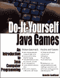

《自助制作 Java 游戏：Java 计算机编程简介》是我的“自助制作 Java 游戏”系列的第一本书。在本书中，我通过创建文本文字谜题和游戏程序来教授 Java 编程的基础知识，例如：冒险选择、秘密代码、吊字游戏、疯狂八点等等。《自助制作 Java 游戏：Java 计算机编程简介》可以在 [amazon.com](http://www.amazon.com/dp/B00H8T3AEY) 购买。

### 更多自助制作 Java 游戏：Java 图形与事件驱动编程简介

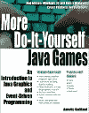

《更多自助制作 Java 游戏：Java 图形与事件驱动编程简介》是我的“自助制作 Java 游戏”系列的第二本书。在事件驱动编程中，程序布局所有的游戏组件，然后等待。随后用户执行一个动作，程序对该动作做出响应，无论该动作是什么，也无论动作执行的顺序如何。

在第二本书中，你将在学习创建窗口和对话框、添加按钮和输入框、使用图像和图形，以及响应按键、鼠标点击和拖拽等输入的同时，创建更多丰富且互动的游戏。你将额外创建 10 个游戏，包括几个拼图、一个迷宫、一个骰子游戏、一个文字游戏、牌游戏和一个图像缩放程序。《更多自助制作 Java 游戏：Java 图形与事件驱动编程简介》可以在 [amazon.com](http://www.amazon.com/dp/1519187998) 购买。

### 这个小程序进入了市场


我写了《这个小程序进入了市场：以低或无成本在互联网上创建、部署、分发、销售和营销软件等》。这本书详细介绍了我学到的技巧、工具和技术，用于将程序推向市场以及在互联网上销售几乎任何东西。《这个小程序进入了市场：以低或无成本在互联网上创建、部署、分发、销售和营销软件等》可以在 [amazon.com](http://www.amazon.com/This-Little-Program-Went-Market/dp/0615345832)、[Barnes and Noble](http://www.barnesandnoble.com/w/this-little-program-went-to-market-annette-godtland/1022822402) 以及许多其他书店购买。

## 附录 A——术表

本术表定义了书中使用的 Java 编程术语并列出了涵盖这些主题的课程。在某些情况下，专门用于教授这些主题的课程可以在其他的“自助制作 Java 游戏”书中找到。

`abstract class`（抽象类）：`abstract class` 是一个仅旨在作为 `superclass` 的 `class`。不能从抽象类创建 `Objects`。

`abstract method`（抽象方法）：`abstract method` 是一个带有 `abstract` 修饰符且没有 `code` 的 `method`。抽象方法必须在 `abstract class` 或 `interface` 中声明。扩展 `abstract class` 的 `Classes` 必须为该类所有的抽象方法提供 `code`。

action listener（动作监听器）：监听器是扩展 `ActionListener` 类的 `classes`。它们等待 `ActionEvents`。

`ActionEvent`（动作事件）：`ActionEvent` 是由 `user` 点击 `button`、`radio button`、复选框或 `menu item`，或者由 `user` 从列表中选择项目或在 `text field` 中按回车键而引起的 `event`。向 `component` 添加 `ActionListener` 以便在 `ActionEvent` 发生时运行 `code`。

`ActionListener`（动作监听器）：`ActionListener` 等待来自其分配 `component` 的 `ActionEvent`。当 `ActionEvent` 发生时，Java 会调用 `ActionListener` 的 `actionPerformed()` 方法。

alpha（透明度）：`Colors` 可以由四个整数值创建：红、绿、蓝和 `alpha`。`alpha` 值（也称为 Alpha 通道）范围从 0 到 255，其中 0 是透明的，255 是不透明的。

animation（动画）：可以通过 `user` 拖拽屏幕上的对象或通过 `thread` 移动对象的外观来执行 `animation`。

argument（参数）：`argument` 是传递到带有 `parameters` 的 `method` 中的值，当方法被 `called` 时。该方法可能会在其 `code` 中使用该值。

`ArithmeticException`（算术异常）：当程序尝试不允许的算术运算（如除以零）时抛出的 `exception`。

array（数组）：`array` 是一种 Java `list`。数组的 `Elements` 可以是 Java `primitives` 或 `Objects`，但它们必须具有相同的 `type`。数组的大小在 `declaration` 时被设置，且无法更改。

`ArrayList`：`ArrayList` 是一种 Java `list`。`ArrayList` 只能持有 `Objects` 而不是 `primitives`，列表中的所有 `elements` 必须具有相同的 `type`。`ArrayList` 的大小可以通过添加或删除元素来改变。

audio file（音频文件）：`audio file` 是一个录音。为了在 Java 中播放声音，音频文件必须是 `.wav` 或 `.au` 类型。

`AudioInputStream`（音频输入流）：`AudioInputStream` 是一个为音频输入格式化的 `InputStream`。它的数据可以实时播放，或者放入 `Clip` 中稍后播放。

background color（背景颜色）：`component` 在添加 `foreground color` 中的其他细节之前用 `background color` 填充。

block of code（代码块）：`block of code` 是被大括号 `{ }` 包围的零或多行 `code`。

boolean（布尔值）：`boolean` 是一种基本数据类型。`boolean` `variable` 只有两个可能的值：`true` 或 `false`。在程序中指定 `boolean` 值时为 `"true"` 或 `"false"`，不需要引号。

`BorderLayout`（边界布局）：`BorderLayout` 是一种 `layout`，当需要将 `components` 排在以下区域时：顶部（`PAGE_START`）、底部（`PAGE_END`）、左侧（`LINE_START`）、右侧（`LINE_END`）和中间（`CENTER`）。每个区域中只允许一个组件。组件将拉伸以填充其分配的区域。

`BoxLayout`（框框布局）：`BoxLayout` 是一种 `layout`，当需要将任意数量的 `components` 排成行（`X_AXIS`）或列（`Y_AXIS`）时使用。当 Java 在 `BoxLayout` 中布局组件时，行布局可能会垂直拉伸，列布局可能会水平拉伸。

`break`（中断）：`break` 语句用于退出 `switch` 语句或 `loop`。

`BufferedImage`（缓冲图像）：`BufferedImage` 是一个允许访问图像数据的 Java `object`。例如，图像中的单个像素可以更改。

`BufferedReader`（缓冲读取）：`BufferedReader` 比 `FileReader` 或 `InputStream` 更高效地读取字符文件。

`BufferedWriter`（缓冲写入）：`BufferedWriter` 比 `FileWriter` 更高效地写入字符文件。因此，`FileW` 通常用于创建 `BufferedW`。

build path（构建路径）：`build path` 是当前 Java 项目所需的其他 Java `projects` 和包含 `code` 的 `libraries` 列表。

button（按钮）：`button` 通常指 `window` 中可点击的 `component`。当组件被点击时，会发送 `ActionEvent`。程序通常会响应。

class（类）：`class` 是创建 `objects` 的蓝图。`class` 定义了对象可以包含的信息和对象可以采取的操作。

class variable（类变量）：`class variable` 有一个由声明 `class` 的所有 `instances` 共享的 `variable`。相比之下，类的每个实例都有自己的 `instance variable` 副本。类变量可以被该 `class` 定义的任何方法使用。

color（颜色）：`Colors` 由红、绿、蓝色调组合，有时包含一个 `alpha` 值。色调和 `alpha` 值范围都从 0 到 255。

collision detection（碰撞检测）：`collision detection` 是检查屏幕上两个对象之间交集的过程。

component（组件）：`component` 是任何可以添加的 `window`。

`ComponentAdapter`（组件适配器）：`ComponentAdapter` 是一个简化 `ComponentListener` 创建的 `class`。使用 `ComponentAdapter`，程序员只为将用到的 `ComponentListener` `methods` 编写 `code`。

component listener（组件监听器）：`component` 监听器是扩展 `ComponentListener` 类的 `classes`。它们等待 `ComponentEvents`。

console（控制台）：`console` 显示 Java 错误消息或程序的 `System.out` 信息。在 Eclipse 中，控制台通常显示在 `window` 的底部面板。

constructor（构造函数）：`constructor` 是一个被 `called` 以创建 `class` 对象的特殊 `method`。

case（分支）：`case` 标签标记了当 `switch statement` 表达式求出的值与 case 值匹配时要运行的 `code` 开始。

cast（类型转换）：`cast` 将一个 `type` 的 `object` 转换为另一个 `type`。`cast` 操作通过在 `variable` 之前放置一个新的 `type` 来指示。

char（字符）：`char` 是一个基本数据类型。`char` `variable` 只能持有单个 `character`。

character（字符）：`code` 是一系列指令，按顺序运行以执行所需的任务。


**comment（注释）**：`Comments`是放在`code`中的笔记，用于说明`code`的意图。`Comments`是以`//`开头的行或以`/*`和`*/`结尾的行。

**comment out（注释掉）**：你可以通过将`code`行变成`comment`来"注释掉"。当你将`code`变成`comment`时，代码会被忽略。

**coordinates（坐标）**：`coordinates`的Java`object`指其位置，由`x`值（容器左侧的像素）和`y`值（容器顶部的像素）指定。

**container（容器）**：`container`是一个`window`或`component`，可以包含其他一个`containers`。`JFrame`和`JPanel`都是容器组件。

**controller（控制器）**：在`model/view/controller`设计中，控制器提供了`model`和`view`之间的通信。控制器包含程序的`main()`方法，它指示向`view`添加或更新显示。

**default button（默认按钮）**：`default button`意味着`default button`。

**default enter button（默认回按钮）**：`default enter button`是当`window`中的另一个`component`具有`focus`时起的`button`。

**dialog（对话框）**：`dialog`是一个向`user`提问的小`window`。虽然`dialog`可以请求组合，但本书使用的`dialog`只期望是或否的回答。

**JOptionPane（对话面板）**：使用`JOptionPane`轻松创建`dialog`。

**double（双精度浮点数）**：`double`是基本数据类型。`double` `variable`可以持有许多小数。要指定程序中的`double`值，在值的末尾添加"f"。

**double buffer（双缓冲）**：如果绘制是双缓冲的，`double buffer`更流畅：首先在离屏上绘制，然后将图像绘制到屏幕上。`JPanel`默认双缓冲。

**InputStream（输入流）**：`AudioInputStream`是一个为音频输入格式化的`InputStream`。它的数据可以实时播放，或者放入`Clip`中稍后播放。

**EDT（事件调度线程）**：`EDT`是`event dispatch thread`的缩写。

**else（否则）**：`else`块是的。

**exception（异常）**：`exception`是在运行`code`时发生的事件，中断代码的执行流。例如，如果程序尝试转换`string`，就会发生异常。程序应该包含`try/catch blocks`来处理预期的异常发生。

**event（事件）**：`event`用于指示在`component`上采取了动作，通常由程序`user`。

**event-driven programming（事件驱动编程）**：`event-driven programming`是一种编程风格，程序设置所需环境，然后等待`events`。程序随后在事件发生时做出响应。

**event queue（事件队列）**：Java的`event queue`是一个用于处理来自`window`的许多输入的列表。所有Swing`components`都使用`event queue`来处理事件。

**escape（转义）**：`escape`字符（反斜杠`\`）用于标记`string`中的特殊字符。

**exit（退出）**：`exit`代码是与`System.exit()`使用的`integer`。

**extract（提取）**：提取文件是从归文件中复制和解压缩文件的过程。

**export（导出）**：`exporting`一个程序是将程序从Eclipse取出放入单独的`JAR`文件中。

**JAR file（JAR 文件）**：`JAR file`是Java Archive文件。它包含一个或多个`code`文件夹或文件。`JAR file`的扩展名为".jar"。

**JFrame（帧）**：`JFrame`是用于创建`window`的`class`。

**GridLayout（网格布局）**：`GridLayout`是一种`layout`，当需要将`components`排在每个部分相同的网格中时使用。如果组件大小都不相同，它们会被拉伸。

**JLabel（标签）**：`JLabel`是用于创建`label`的`class`。

**JMenu（菜单）**：`JMenu`是用于创建`menu`的`class`。

**JMenuBar（菜单栏）**：`JMenuBar`是用于创建`menu bar`的`class`。

**JMenuItem（菜单项）**：`JMenuItem`是用于创建`menu item`的`class`。

**JButton（按钮）**：`JButton`是用于创建`button`的`class`。

**JRadioButton（单选按钮）**：`JRadioButton`是用于创建`radio button`的`class`。

**JPanel（面板）**：`JPanel`是用于创建`panel`的`class`。

**JFileChooser（文件选择器）**：用于创建文件选择器。

**JScrollPane（滚动面板）**：`JScrollPane`是用于添加`scroll bars`的`class`。

**JTextArea（文本区域）**：`JTextArea`是用于创建大型文本框的`class`。

**JTextField（文本框）**：`JTextField`是用于创建`text field`的`class`。

**JToolBar（工具栏）**：`JToolBar`是用于创建`toolbar`的`class`。

**Dialog（对话框）**：`Dialog`是用于创建自定义`dialog`的`class`。

**Image（图像）**：`Image`是许多许多图像的`class`。

**BufferedImage（缓冲图像）**：`BufferedImage`是`Image`的子类。

```java
package annette.godtland.mytimer;

import javax.swing.JFrame;

public class MyTimer extends JFrame {

  private static final long serialVersionUID = 1L;

  public static void main(String[] args) {

  }
}
```

### 列表 1-2，源自`MyTimer.java`

```java
...
  public MyTimer() {
    initGUI();
    setTitle("My Timer");
    setResizable(false);
    pack();
    setLocationRelativeTo(null);
    setVisible(true);
    setDefaultCloseOperation(EXIT_ON_CLOSE);
  }
  ...
```

### 列表 1-3，源自`MyTimer.java`

```java
...    public void initGUI() {
    TitleLabel titleLabel = new TitleLabel("My Timer");
    add(titleLabel, BorderLayout.PAGE_START);
  }
  ...
```

### 列表 1-4，源自`MyTimer.java`

```java
...
  public static void main(String[] args) {
    try {
      String className = UIManager.getCrossPlatformLookAndFeelClassName();
      UIManager.setLookAndFeel(className);
    }
    catch (Exception e) {}
  }
  ...
```

### 列表 1-5，源自`MyTimer.java`

```java
...
  public static void main(String[] args) {
      ...
    catch (Exception e) {}
    SwingUtilities.invokeLater(new Runnable() {
      public void run() {
        new MyTimer();
      }
    });
      ...
```

### 列表 1-6，源自`TimerPanel.java`

```java
package annette.godtland.mytimer;

import javax.swing.JPanel;

public class TimerPanel extends JPanel {

  private static final long serialVersionUID = 1L;
  private int width = 150;
  private int height = 24;
  private String timeString = "00:00:00";
}
```

### 列表 1-7，源自`TimerPanel.java`

```java
...
  public void paintComponent(Graphics g) {
    super.paintComponent(g);
    g.setColor(Color.BLACK);
    g.drawString(timeString, 0, height);
  }
  ...
```

### 列表 1-8，源自`TimerPanel.java`

```java
...
  public Dimension getPreferredSize() {
    Dimension size = new Dimension(width, height);
    return size;
  }
  ...
```

### 列表 1-9，源自`MyTimer.java`

```java
...
public class MyTimer extends JFrame {
  private static final long serialVersionUID = 1L;
  private TimerPanel timerPanel = new TimerPanel();
  ...
```

### 列表 1-10，源自`MyTimer.java`

```java
...
  private void initGUI() {
    TitleLabel titleLabel = new TitleLabel("My Timer");
    add(titleLabel, BorderLayout.PAGE_START);
    JPanel centerPanel = new JPanel();
    add(centerPanel, BorderLayout.CENTER);
    centerPanel.add(timerPanel);
  }
  ...
```

### 列表 1-11，源自`TimerPanel.java`

```java
...
  private int width = 150;
  private int height = 24;
  private String timeString = "00:00:00";
  private long time = 10;
  ...
```

### 列表 1-12，源自`TimerPanel.java`

```java
...
  public void setTime(long time) {
    this.time = time;
    long h = time / 3600;
    long m = (time / 60) % 60;
    long s = time % 60;
    timeString = String.format("%02d:%02d:%02d", h, m, s);
    repaint();
  }
  ...
```

### 列表 1-13，源自`TimerPanel.java`

```java
...
  public TimerPanel(long time, Font font) {
    setTime(time);
    setFont(font);
    height = font.getSize();
    FontMetrics fm = getFontMetrics(font);
    width = fm.stringWidth(timeString);
  }
  ...
```

### 列表 1-14，源自`MyTimer.java`

```java
...
public class MyTimer extends JFrame {
  private static final long serialVersionUID = 1L;
  private Font font = new Font(Font.DIALOG, Font.BOLD, 36);
  private TimerPanel timerPanel = new TimerPanel(10, font);
  ...
```

### 列表 1-15，源自`TimerPanel.java`

```java
...
  public void start() { 
    while (time > 0) {
      time -= 1;
      setTime(time);
      System.out.println(time);
    }
    timesUp();
  }
  ...
```

### 列表 1-16，源自`TimerPanel.java`

```java
...
  public TimerPanel(long time, Font font) {
    setTime(time);
    setFont(font);
    height = font.getSize();
    FontMetrics fm = getFontMetrics(font);
    width = fm.stringWidth(timeString);
    start();
  }
  ...
```

### 列表 1-17，源自`TimerPanel.java`

```java
...
  protected void timesUp() {
    String message = "Time's up!";
    JOptionPane.showMessageDialog(this, message);
  }
  ...
```

### 列表 1-18，源自`TimerPanel.java`

```java
...
  public void start() { 
    while (time > 0) {
      time -= 1;
      setTime(time);
      System.out.println(time);
      try {
        Thread.sleep(1000);
      }
      catch (InterruptedException e) {
        return;
      }
    }
    timesUp();
  }
  ...
```

### 列表 1-19，源自`TimerPanel.java`

```java
...
  public TimerPanel(long time, Font font) {
    setTime(time);
    setFont(font);
    height = font.getSize();
    FontMetrics fm = getFontMetrics(font);
    width = fm.stringWidth(timeString);
  }
  ...
```

### 列表 1-20，源自`MyTimer.java`


### 列表 1-21，源自 `MyTimer.java`

```java
...
  public void initGUI() {
    TitleLabel titleLabel = new TitleLabel("My Timer");
    add(titleLabel, BorderLayout.PAGE_START);
    JPanel centerPanel = new JPanel();
    add(centerPanel, BorderLayout.CENTER);
    centerPanel.add(timerPanel);
    JPanel buttonPanel = new JPanel();
    add(buttonPanel, BorderLayout.PAGE_END);
    JButton startButton = new JButton("Start");
    startButton.addActionListener(new ActionListener() {
      public void actionPerformed(ActionEvent e) {
          start();
        }
      });
    buttonPanel.add(startButton);
  }
  ...
```

### 列表 1-22，源自 `TimerPanel.java`

```java
...
  private void start() {
    timerPanel.start();
  }
  ...
```

### 列表 1-23，源自 `TimerPanel.java`

```java
...
  public void start() {
    timerThread = new Thread(this);
    timerThread.start();
  }
  public void run() {
    while (time > 0) {
      time -= 1;
      setTime(time);
      System.out.println(time);
      try {
        Thread.sleep(1000);
      }
      catch (InterruptedException e) {
        return;
      }
    }
    timesUp();
  }
  ...
```

### 列表 1-24，源自 `TimerPanel.java`

```java
...
public class TimerPanel extends JPanel implements Runnable {
  private static final long serialVersionUID = 1L;
  private int width = 150;
  private int height = 24;
  private String timeString = "00:00:00";
  private long time = 10;
  private Thread timerThread;
  ...
```

### 列表 1-25，源自 `MyTimer.java`

```java
...
  public void start() {
    timerThread = new Thread(this);
    timerThread.start();
  }
  ...
```

```java
stop();

}

});

buttonPanel.add(stopButton);

}

...
```

### Listing 1-26，来自 `MyTimer.java`

```java
private void stop() {
    timerPanel.stop();
}
...
```

### Listing 1-27，来自 `TimerPanel.java`

```java
public void run() {
    while (time > 0) {
        time -= 1;
        setTime(time);
        try {
            Thread.sleep(1000);
        }  
        catch (InterruptedException e) {
            return;
        }
    }
    timesUp();
}
...
```

### Listing 1-28，来自 `TimerPanel.java`

```java
public void stop() {
    timerThread.interrupt();
}
...
```

### Listing 1-29，来自 `TimerPanel.java`

```java
public void start() {
    stop();
    timerThread = new Thread(this);
    timerThread.start();
}
...
```

### Listing 1-30，来自 `TimerPanel.java`

```java
public void stop() {
    if (timerThread != null) {
        timerThread.interrupt();
        timerThread = null;
    }
}
...
```

### Listing 1-31，来自 `TimerPanel.java`

```java
public long getTime() {
    return time;
}
...
```

### Listing 1-32，来自 `MyTimer.java`

```java
public class MyTimer extends JFrame {
    private static long serialVersionUID = 1L;
    private Font font = new Font(Font.DIALOG, Font.BOLD, 36);
    private TimerPanel timerPanel = new TimerPanel(0, font);
...
```

### Listing 1-33，来自 `MyTimer.java`

```java
public void initGUI() {
    ...
    JPanel buttonPanel = new JPanel();
    add(buttonPanel, BorderLayout.PAGE_END);
    JButton hoursButton = new JButton("Hour");
    hoursButton.addActionListener(new ActionListener() {
        public void actionPerformed(ActionEvent e) {
            addHour();
        }
    });
    buttonPanel.add(hoursButton);
    JButton startButton = new JButton("Start");
...
```

### Listing 1-34，来自 `MyTimer.java`

```java
public void initGUI() {
    ...
    buttonPanel.add(hoursButton);
    JButton minutesButton = new JButton("Min");
    minutesButton.addActionListener(new ActionListener() {
        public void actionPerformed(ActionEvent e) {
            addMinute();
        }
    });
    buttonPanel.add(minutesButton);
...
```

### Listing 1-35，来自 `MyTimer.java`

```java
public void initGUI() {
    ...
    buttonPanel.add(minutesButton);
    JButton clearButton = new JButton("Clear");
    clearButton.addActionListener(new ActionListener() {
        public void actionPerformed(ActionEvent e) {
            clear();
        }
    });
    buttonPanel.add(clearButton);
...
```

### Listing 1-36，来自 `MyTimer.java`

```java
private void addHour() {
    long time = timerPanel.getTime();
    time += 3600;
    timerPanel.setTime(time);
}
...
```

### Listing 1-37，来自 `MyTimer.java`

```java
private void addMinute() {
    long time = timerPanel.getTime();
    time += 60;
    timerPanel.setTime(time);
}
...
```

### Listing 1-38，来自 `MyTimer.java`

```java
private void clear() {
    timerPanel.stop();
    timerPanel.setTime(0);
}
...
```

### Listing 1-39，来自 `MyTimer.java`

```java
public void initGUI() {
    TitleLabel titleLabel = new TitleLabel("My Timer");
    add(titleLabel, BorderLayout.PAGE_START);
    JPanel centerPanel = new JPanel();
    centerPanel.setBackground(Color.MAGENTA);
    add(centerPanel, BorderLayout.CENTER);
    timerPanel.setBackground(Color.MAGENTA);
    centerPanel.add(timerPanel);
    JPanel buttonPanel = new JPanel();
    buttonPanel.setBackground(Color.BLACK);
    add(buttonPanel, BorderLayout.PAGE_END);
...
```

### Listing 1-40，来自 `TimerPanel.java`

```java
public class TimerPanel extends JPanel implements Runnable {
    private static long serialVersionUID = 1L;
    private static String ALARM_FILE = "/alarm.wav";
...
```

### Listing 1-41，来自 `TimerPanel.java`

```java
protected void timesUp() {
    try {
        URL url = getClass().getResource(ALARM_FILE);
        AudioInputStream audioInputStream = AudioSystem.getAudioInputStream(url);
        Clip clip = AudioSystem.getClip();
        clip.open(audioInputStream);
        clip.start();
        String message = "Time's up!";
        JOptionPane.showMessageDialog(this, message);
    }
}
...
```

### Listing 1-42，来自 `TimerPanel.java`

```java
protected void timesUp() {
    try {
        URL url = getClass().getResource(ALARM_FILE);
        ...
        JOptionPane.showMessageDialog(this, message);
    }  
    catch (IOException e) {
        String message = "File " + ALARM_FILE + " could not be opened.";
        JOptionPane.showMessageDialog(this, message);
    }  
    catch (UnsupportedAudioFileException e) {
        String message = "File " + ALARM_FILE + " is not a valid audio type.";
        JOptionPane.showMessageDialog(this, message);
    }  
    catch (LineUnavailableException e) {
        String message = "not available file " + ALARM_FILE + " at time.";
        JOptionPane.showMessageDialog(this, message);
    }
}
...
```

### Listing 1-43，来自 `TimerPanel.java`

```java
protected void timesUp() {
    ...
    String message = "Time's up!";
    JOptionPane.showMessageDialog(this, message);
    clip.stop();
}
...
```

### Listing 1-44，来自 `FileIO.java`

```java
package annette.godland.commonmethods;

import javax.sound.sampled.Clip;

public class FileIO {
    public static Clip playClip(Object requestor, String fileName) {
        return null;
    }
}
```

### Listing 1-45，来自 `FileIO.java`

```java
public static Clip playClip(Object requestor, String fileName) {
    Clip clip = null;
    try {
        URL url = requestor.getClass().getResource(fileName);
        AudioInputStream audioInputStream = AudioSystem.getAudioInputStream(url);
        clip = AudioSystem.getClip();
        clip.open(audioInputStream);
        clip.start();
    }  
    return clip;
}
...
```

### Listing 1-46，来自 `FileIO.java`

```java
public static Clip playClip(Object requestor, String fileName) {
    Clip clip = null;
    try {
        ...
    }  
    catch (IOException e) {
        String message = "File " + fileName + " could not be opened.";
        JOptionPane.showMessageDialog(null, message);
    }  
    catch (UnsupportedAudioFileException e) {
        String message = "File " + fileName + " is not a valid audio type.";
        JOptionPane.showMessageDialog(null, message);
    }  
}
```

```java
String message = "此时无法打开文件 " + fileName + 的资源.";

JOptionPane.showMessageDialog(null, message);

}

return clip;

...
```

### 列表 1-47，源自 `TimerPanel.java`


# 项目 2 - Speed Words

## 列表 2-1，源自 `SpeedWords.java`

```java
package annette.godtland.speedwords;

import javax.swing.JFrame;

public class SpeedWords extends JFrame {
  private static final long serialVersionUID = 1L;

  public static void main(String[] args) {
  }
}
```

## 列表 2-2，源自 `SpeedWords.java`

```java
...
  public SpeedWords() {
    initGUI();
    setTitle("Speed Words");
    setResizable(false);
    pack();
    setLocationRelativeTo(null);
    setVisible(true);
    setDefaultCloseOperation(EXIT_ON_CLOSE);
  }
...
```

## 列表 2-3，源自 `SpeedWords.java`

```java
...
  public void initGUI() {
    TitleLabel titleLabel = new TitleLabel("Speed Words");
    add(titleLabel, BorderLayout.PAGE_START);
  }
...
```

## 列表 2-4，源自 `SpeedWords.java`

```java
...
  public static void main(String[] args) {
    try {
      String className = UIManager.getCrossPlatformLookAndFeelClassName();
      UIManager.setLookAndFeel(className);
    }
    catch (Exception e) {}
  }
...
```

## 列表 2-5，源自 `SpeedWords.java`

```java
...
  public static void main(String[] args) {
    ...
    catch (Exception e) {}
    SwingUtilities.invokeLater(new Runnable() {
      public void run() {
        new SpeedWords();
      }
    });
  }
...
```

## 列表 2-6，源自 `ScorePanel.java`

```java
package annette.godtland.mycomponents;
import javax.swing.JPanel;
public class ScorePanel extends JPanel {
  private static final long serialVersionUID = 1L;
  private int initialScore = 0;
  private int score = 0;
}
```

## 列表 2-7，源自 `ScorePanel.java`

```java
...
  public ScorePanel(int initialScore, Color color) {
    this.initialScore = initialScore;
    score = initialScore;
    setBackground(color);
  }
...
```

## 列表 2-8，源自 `ScorePanel.java`

```java
...
public class ScorePanel extends JPanel {
  private static final long serialVersionUID = 1L;
  private static final Font SMALL_FONT = new Font(Font.DIALOG, Font.PLAIN, 12);
  private static final Font BIG_FONT = new Font(Font.DIALOG, Font.BOLD, 36);
  private int initialScore = 0;
  private int score = 0;
  private JLabel scoreLabel = new JLabel("0");
...
```

## 列表 2-9，源自 `ScorePanel.java`

```java
...
  public ScorePanel(int initialScore, Color color) {
    this.initialScore = initialScore;
    score = initialScore;
    setBackground(color);
    JLabel scoreTitleLabel = new JLabel("Score: ");
    scoreTitleLabel.setFont(SMALL_FONT);
    add(scoreTitleLabel);
    scoreLabel.setFont(BIG_FONT);
    add(scoreLabel);
  }
...
```

## 列表 2-10，源自 `ScorePanel.java`

```java
...
  public void addToScore(int points) {
    score += points;
    scoreLabel.setText("" + score);
  }
...
```

## 列表 2-11，源自 `ScorePanel.java`

```java
...
  public void reset() {
    score = initialScore;
    scoreLabel.setText("" + score);
  }
...
```

## 列表 2-12，源自 `SpeedWords.java`

```java
public class SpeedWords extends JFrame {
  private static final long serialVersionUID = 1L;
  public static final Color TAN = new Color(222, 191, 168);
  private ScorePanel scorePanel = new ScorePanel(0, TAN);
...
```

## 列表 2-13，源自 `SpeedWords.java`

```java
...
  private void initGUI() {
    TitleLabel titleLabel = new TitleLabel("Speed Words");
    add(titleLabel, BorderLayout.PAGE_START);
    // 主面板
    // 左侧面板
    // 分数面板
    // 计时面板
    // 游戏面板
    // 文本区域
  }
...
```

## 列表 2-14，源自 `SpeedWords.java`

```java
...
  private void initGUI() {
    TitleLabel titleLabel = new TitleLabel("Speed Words");
    add(titleLabel, BorderLayout.PAGE_START);
    // 主面板
    JPanel mainPanel = new JPanel();
    mainPanel.setLayout(new BoxLayout(mainPanel, BoxLayout.X_AXIS));
    mainPanel.setBackground(TAN);
    add(mainPanel, BorderLayout.CENTER);
  }
...
```

## 列表 2-15，源自 `SpeedWords.java`

```java
...
  private void initGUI() {
    ...
    // 左侧面板
    JPanel leftPanel = new JPanel();
    leftPanel.setLayout(new BoxLayout(leftPanel, BoxLayout.Y_AXIS));
    leftPanel.setBackground(TAN);
    add(leftPanel, BorderLayout.CENTER);
  }
...
```

## 列表 2-16，源自 `TimerPanel.java`

```java
package annette.godtland.speedwords;

import java.awt.Font;
import annette.godtland.timer.TimerPanel;

public class SpeedTimerPanel extends TimerPanel {
  private static final long serialVersionUID = 1L;
  private static final Font FONT = new Font(Font.DIALOG, Font.BOLD, 24);
  private SpeedWords speedWords;
}
```

## 列表 2-17，源自 `TimerPanel.java`

```java
...
  public SpeedTimerPanel(SpeedWords speedWords, int time) {
    super(time, FONT);
    this.speedWords = speedWords;
  }
...
```

## 列表 2-18，源自 `SpeedWords.java`

```java
...
  private ScorePanel scorePanel = new ScorePanel(0, TAN);
  private SpeedTimerPanel swTimerPanel = new SpeedTimerPanel(this, 60);
...
```

## 列表 2-19，源自 `SpeedWords.java`

```java
...
  private void initGUI() {
    ...
    // 计时面板
    JPanel timerPanel = new JPanel();
    timerPanel.setBackground(Color.RED);
    leftPanel.add(timerPanel);
    swTimerPanel.setBackground(Color.RED);
    timerPanel.add(swTimerPanel);
  }
...
```

## 列表 2-21，源自 `SpeedWords.java`

```java
public class SpeedWords extends JFrame {
  private static final long serialVersionUID = 1L;
  public static final Color TAN = new Color(222, 191, 168);
  private static final Font LIST_FONT = new Font(Font.DIALOG, Font.BOLD, 14);
  private ScorePanel scorePanel = new ScorePanel(0, TAN);
  private SpeedTimerPanel swTimerPanel = new SpeedTimerPanel(this, 60);
  private JTextArea textArea = new JTextArea();
}
```

## 列表 2-22，源自 `SpeedWords.java`

```java
  private void initGUI() {
      ...
    // text area
    Insets insets = new Insets(4, 10, 10, 4);
    textArea.setMargin(insets);
    textArea.setEditable(false);
    textArea.setFont(LIST_FONT);
    JScrollPane scrollPane = new JScrollPane(textArea);
    Dimension size = new Dimension(100, 0);
    scrollPane.setPreferredSize(size);
    mainPanel.add(scrollPane);
      ...
  }
```

## 列表 2-23，源自 `GamePanel.java`

```java
package annette.godtland.speedwords;

import javax.swing.JPanel;

public class GamePanel extends JPanel {
  private static final long serialVersionUID = 1L;
  private static final int WIDTH = 500;
  private static final int HEIGHT = 300;
  private SpeedWords speedWords;

}
```

## 列表 2-24，源自 `GamePanel.java`

```java
  public GamePanel(SpeedWords speedWords) {
    this.speedWords = speedWords;
  }
    ...
```

## 列表 2-25，源自 `GamePanel.java`

```java
  public void paintComponent(Graphics g) {
    // draw background
    g.setColor(SpeedWords.TAN);
    g.fillRect(0, 0, WIDTH, HEIGHT);
  }
    ...
```

## 列表 2-26，源自 `GamePanel.java`

```java
  public Dimension getPreferredSize() {
    Dimension size = new Dimension(WIDTH, HEIGHT);
    return size;
  }
    ...
```

## 列表 2-27，源自 `SpeedWords.java`

```java
  ...
  private ScorePanel scorePanel = new ScorePanel(0, TAN);
  private SpeedWordsTimerPanel swTimerPanel = new SpeedWordsTimerPanel(this, 60);
  private JTextArea textArea = new JTextArea();
  private GamePanel gamePanel = new GamePanel(this);
    ...  
```

## 列表 2-28，源自 `SpeedWords.java`

```java
  ...
  private void initGUI() {
      ...
    // game panel
    leftPanel.add(gamePanel);
      ...
  }
```

## 列表 2-29，源自 `FileIO.java`

```java
protected void timesUp() {
  Clip clip = FileIO.playClip(this, ALARM_FILE);
  String message = "时间到！";
  JOptionPane.showMessageDialog(this, message);
  clip.stop();
}
```


以下代码示例均来自各 Java 类文件，展示了 `SpeedWords` 游戏中的关键实现。

### `FileIO` 类中的图像与文本读取方法

**Listing 2-30，自 `FileIO.java`**

```java
  ...
  public static BufferedImage readImageFile(Object requestor, String fileName) {
    BufferedImage image = null;
    try {
      InputStream input = requestor.getClass().getResourceAsStream(fileName);
      image = ImageIO.read(input);
    }
    catch (IOException e) {
      String message = "The image " + fileName + " could not be opened.";
      JOptionPane.showMessageDialog(null, message);
    }
    return image;
  }
  ...
```

**Listing 2-31，自 `FileIO.java`**

```java
  ...
  public static ArrayList<String> readTextFile(Object requestor, String fileName) {
    ArrayList<String> lines = new ArrayList<String>();
    try {
      InputStream input = requestor.getClass().getResourceAsStream(fileName);
      BufferedReader in = new BufferedReader(new InputStreamReader(input));
      String line = in.readLine();
      while (line != null) {
        lines.add(line);
        line = in.readLine();
      }
      in.close();
    }
    return lines;
  }
  ...
```

**Listing 2-32，自 `FileIO.java`**

```java
  ...
  public static ArrayList<String> readTextFile(Object requestor, String fileName) {
    ArrayList<String> lines = new ArrayList<String>();
    try {
      ...
    }
    catch (NullPointerException e) {
      String message = "File " + fileName + " was not found.";
      JOptionPane.showMessageDialog(null, message);
    }
    catch (IOException e) {
      String message = "File " + fileName + " could not be opened.";
      JOptionPane.showMessageDialog(null, message);
    }
    return lines;
  }
  ...
```

### `LetterTile` 类的定义与实现

**Listing 2-33，自 `LetterTile.java`**

```java
package annette.godtland.speedwords;

import javax.swing.JPanel;

public class LetterTile extends JPanel {
  private static final long serialVersionUID = 1L;
  public static final int SIZE = 40;
  private String letter;

}
```

**Listing 2-34，自 `LetterTile.java`**

```java
  ...
  public LetterTile(String letter) {
    this.letter = letter;
  }
    ...
```

**Listing 2-35，自 `LetterTile.java`**

```java
  ...
  public void draw(Graphics g, int x, int y) {
    g.setColor(Color.WHITE);
    g.fillRect(x, y, SIZE, SIZE);
    g.setColor(Color.BLACK);
    g.drawRect(x, y, SIZE - 1, SIZE - 1);
  }
  ...
```

**Listing 2-36，自 `LetterTile.java`**

```java
  ...
  public Dimension getPreferredSize() {
    Dimension size = new Dimension(SIZE,SIZE);
    return size;
  }
    ...
```

**Listing 2-37，自 `GamePanel.java`**（注：此段代码实际应属于 `GamePanel` 类中的 `paintComponent` 方法，可能为书中误标）

```java
  ...
  public void paintComponent(Graphics g) {
    // draw background
    g.setColor(SpeedWords.TAN);
    g.fillRect(0, 0, WIDTH, HEIGHT);
    LetterTile tile = new LetterTile("A");
    tile.draw(g, 100, 100);
  }
  ...
```

**Listing 2-38，自 `LetterTile.java`**

```java
  ...
public class LetterTile extends JPanel {
  private static final long serialVersionUID = 1L;
  public static final int SIZE = 40;
  private static final String IMAGE_NAME = "/WoodTile.jpg";
  private String letter;
  private static BufferedImage image; 
}
```

**Listing 2-39，自 `LetterTile.java`**

```java
  ...
  public LetterTile(String letter) {
    this.letter = letter;
    if (image == null) {
      image = FileIO.readImageFile(this, IMAGE_NAME);
    }
  }
  ...
```

**Listing 2-40，自 `LetterTile.java`**

```java
  ...
  public void draw(Graphics g, int x, int y) {
    if (image == null) {
      g.setColor(Color.WHITE);
      g.fillRect(x, y, SIZE, SIZE);
    }
    else {
      g.drawImage(image, x, y, SIZE, SIZE, null);
    }
    g.setColor(Color.BLACK);
    g.drawRect(x, y, SIZE - 1, SIZE - 1);
  }
  ...
```

**Listing 2-41，自 `LetterTile.java`**

```java
  ...
public class LetterTile extends JPanel {
  private static final long serialVersionUID = 1L;
  public static final int SIZE = 40;
  private static final String IMAGE_NAME = "/WoodTile.jpg";
  private static final Font BIG_FONT = new Font(Font.DIALOG, Font.BOLD, 30);
  private static final Font SMALL_FONT = new Font(Font.DIALOG, Font.BOLD, 12);
  private static final String ALPHABET = "ABCDEFGHIJKLMNOPQRSTUVWXYZ";
  private static final int[] LETTER_POINTS = {1, 3, 3, 2, 1, 4, 2, 4, 1, 8, 5, 1, 3, 1, 1, 3, 10, 1, 1, 1, 1, 4, 4, 8, 4, 10};
  private String letter;
  private static BufferedImage image; 
  private FontMetrics bigFM = getFontMetrics(BIG_FONT);
  private FontMetrics smallFM = getFontMetrics(SMALL_FONT);
  private int points;
  ...
}
```

**Listing 2-42，自 `LetterTile.java`**

```java
  ...
  public LetterTile(String letter) {
    this.letter = letter;
    if (image == null) {
      image = FileIO.readImageFile(this, IMAGE_NAME);
    }
    int index = ALPHABET.indexOf(letter);
    points = LETTER_POINTS[index];
  }
  ...
```

**Listing 2-43，自 `LetterTile.java`**

```java
  ...
```

```java
public void draw(Graphics g, int x, int y) {
    ...
    g.drawRect(x, y, SIZE - 1, SIZE - 1);
    g.setFont(BIG_FONT);
    int letterWidth = bigFM.stringWidth(letter);
    int letterX = (SIZE - letterWidth) / 2 + x;
    int letterY = SIZE * 3 / 4 + y;
    g.drawString(letter, letterX, letterY);
}
```

...

* * *

### Listing 2-44，来自 `LetterTile.java`

* * *

...

```java
public void draw(Graphics g, int x, int y) {
    ...
    g.drawString(letter, letterX, letterY);
    g.setFont(SMALL_FONT);
    String pointsString = "" + points;
    int pointsWidth = smallFM.stringWidth(pointsString);
    int pointsX = SIZE - pointsWidth - 2 + x;
    int pointsY = SIZE * 34 / 40 + y;
    g.drawString(""+points, pointsX, pointsY);
}
```

...

* * *

### Listing 2-45，来自 `LetterTile.java`

* * *

...

```java
public String getLetter() {
    return letter;
}

public int getPoints() {
    return points;
}
```

...

* * *

### Listing 2-46，来自 `TileSet.java`

* * *

```java
package annette.godtland.speedwords;

import java.util.ArrayList;

public class TileSet {
    private static final int HIGHLIGHT_WIDTH = 2;
    private ArrayList<LetterTile> tiles = new ArrayList<LetterTile>();
    private int x = 0;
    private int y = 0;
}
```

* * *

### Listing 2-47，来自 `TileSet.java`

* * *

...

```java
public TileSet(String word, int x, int y) {
    for (int i = 0; i < word.length(); i++) {
        String letter = word.substring(i, i+1);
        LetterTile tile = new LetterTile(letter);
        tiles.add(tile);
        this.x = x;
        this.y = y;
    }
}
```

...

* * *

### Listing 2-48，来自 `TileSet.java`

* * *

...

```java
public void draw(Graphics g) {
    for (int i = 0; i < tiles.size(); i++) {
        LetterTile tile = tiles.get(i);
        int xPos = x + (LetterTile.SIZE * i);
        tile.draw(g, xPos, y);  
    }
}
```

...

* * *

### Listing 2-49，来自 `GamePanel.java`

* * *

...

```java
public void paintComponent(Graphics g) {
    // draw 背景
    g.setColor(SpeedWords.TAN);
    g.fillRect(0, 0, WIDTH, HEIGHT);
    TileSet tileSet = new TileSet("HELLO", 100, 100);
    tileSet.draw(g);
}
```

...

* * *

### Listing 2-50，来自 `GamePanel.java`

* * *

...

```java
public class GamePanel extends JPanel {
    private static final long serialVersionUID = 1L;
    private static final int WIDTH = 500;
    private static final int HEIGHT = 300;
    private static final int START_X = WIDTH / 2 - 7 * LetterTile.SIZE / 2;
    private static final int START_Y = HEIGHT / 2 - LetterTile.SIZE / 2;
    private static final String FILE_NAME = "/enable_7.txt";
    private SpeedWords speedWords;
    private ArrayList<TileSet> tileSets = new ArrayList<TileSet>();
    private ArrayList<String> sevenLetterWords = new ArrayList<String>();
    private Random rand = new Random();
}
```

* * *

### Listing 2-51，来自 `GamePanel.java`

* * *

...

```java
public GamePanel(SpeedWords speedWords) {
    this.speedWords = speedWords;
    sevenLetterWords = FileIO.readTextFile(this, FILE_NAME);
    restart();
}
```

...


```java
public void restart() {
    tileSets.clear();
    int range = sevenLetterWords.size();
    int choose = rand.nextInt(range);
    String s = sevenLetterWords.get(choose);
    TileSet tileSet = new TileSet(s, START_X, START_Y);
    tileSets.add(tileSet);
    repaint();
}
```

...

### Listing 2-52，来自 `GamePanel.java`

...

```java
public void paintComponent(Graphics g) {
    //绘制背景
    g.setColor(SpeedWords.TAN);
    g.fillRect(0, 0, WIDTH, HEIGHT);
    // 绘制所有字母集
    for (int i = tileSets.size() - 1; i >= 0; i--) {
        TileSet tileSet = tileSets.get(i);
        tileSet.draw(g);
    }
}
```

...

### Listing 2-53，来自 `TileSet.java`

...

```java
public void changeXY(int changeX, int changeY) {
    x += changeX;
    y += changeY;
}
```

...

### Listing 2-54，来自 `TileSet.java`

...

```java
private int getWidth() {
    int width = tiles.size() * LetterTile.SIZE;
    return width;
}
```

...

### Listing 2-55，来自 `TileSet.java`

...

```java
public boolean contains(int pointX, int pointY) {
    boolean contains = false;
    int width = getWidth();
    int height = LetterTile.SIZE;
    if (pointX >= x && pointX < x+width && pointY >= y && pointY < y+height) {
        contains = true;
    }
    return contains;
}
```

...

### Listing 2-56，来自 `TileSet.java`

...

```java
public String toString() {
    String s = "";
    for (int i = 0; i < tiles.size(); i++) {
        LetterTile tile = tiles.get(i);
        String s2 = tile.getLetter();
        s += s2;
    }
    return s;
}
```

...

### Listing 2-57，来自 `TileSet.java`

...

```java
public int getX() {
    return x;
}
public int getY() {
    return y;
}
```

...

### Listing 2-58，来自 `TileSet.java`

...

```java
public int getNumberOfTiles() {
    return tiles.size();
}
public LetterTile getTile(int i) {
    return tiles.get(i);
}
```

...

### Listing 2-59，来自 `GamePanel.java`

...

```java
private ArrayList<String> sevenLetterWords = new ArrayList<String>();
private Random rand = new Random();
private TileSet movingTiles;
private int mouseX;
private int mouseY;
```

...

### Listing 2-60，来自 `GamePanel.java`

...

```java
public void paintComponent(Graphics g) {
    g.setColor(SpeedWords.TAN);
    g.fillRect(0, 0, WIDTH, HEIGHT);
    ...
    tileSet.draw(g);
    // 绘制正在移动的字母集
    if (movingTiles != null) {
        movingTiles.draw(g);
    }
}
```

...

### Listing 2-61，来自 `GamePanel.java`

...

```java
public GamePanel(SpeedWords speedWords) {
    this.speedWords = speedWords;
    sevenLetterWords = FileIO.readTextFile(this, FILE_NAME);
    restart();
    addMouseListener(new MouseAdapter() {
        public void mousePressed(MouseEvent e) {
            int x = e.getX();
            int y = e.getY();
            clicked(x, y);
        }
    });
    ...
}
```

...

### Listing 2-62，来自 `GamePanel.java`

...

```java
private void clicked(int x, int y) {
    if (movingTiles == null) {
        mouseX = x;
        mouseY = y;
    }
}
```

...

### Listing 2-63，来自 `GamePanel.java`

...

```java
private void clicked(int x, int y) {
    if (movingTiles == null) {
        mouseX = x;
        mouseY = y;
    }
    for (int i = 0; i < tileSets.size() && movingTiles == null; i++) {
        TileSet tileSet = tileSets.get(i);
        if (tileSet.contains(x, y)) {
            System.out.println("点击了单词 " + tileSet);
            tileSets.remove(i);
        }
    }
    repaint();
}
}
```

...

### Listing 2-64，来自 `GamePanel.java`

```java
private void clicked(int x, int y) {
    if (movingTiles == null) {
        mouseX = x;
        mouseY = y;
        for (int i = 0; i < tileSets.size() && movingTiles == null; i++) {
            TileSet tileSet = tileSets.get(i);
            if (tileSet.contains(x, y)) {
                movingTiles = tileSet;
                tileSets.remove(i);
            }
        }
        repaint();
    }
}
```

### Listing 2-65，来自 `GamePanel.java`

```java
public GamePanel(SpeedWords speedWords) {
    ...
    addMouseListener(new MouseAdapter() {
        public void mousePressed(MouseEvent e) {
            int x = e.getX();
            int y = e.getY();
            clicked(x, y);
        }

        public void mouseReleased(MouseEvent e) {
            released();
        }
    });
    ...
```

### Listing 2-66，来自 `GamePanel.java`

```java
private void released() {
    // 如果释放在其他瓦片上，则将其连接到这些瓦片
    // 如果没有释放在其他瓦片上，将其返回瓦片集列表
    if (movingTiles != null) {
        String s = movingTiles.toString();
        int x = movingTiles.getX();
        int y = movingTiles.getY();
        TileSet newTileSet = new TileSet(s, x, y);
        tileSets.add(0, newTileSet);
        movingTiles = null;
    }
    repaint();
}
```

### Listing 2-67，来自 `GamePanel.java`

```java
public GamePanel(SpeedWords speedWords) {
    ...
    released(x, y);
    }
    });
    addMouseMotionListener(new MouseMotionAdapter() {
        public void mouseDragged(MouseEvent e) {
            int x = e.getX();
            int y = e.getY();
            dragged(x, y);
        }
    });
    ...
```

### Listing 2-68，来自 `GamePanel.java`

```java
private void dragged(int x, int y) {
    if (movingTiles != null) {
        int changeX = x - mouseX;
        int changeY = y - mouseY;
        movingTiles.XY(changeX, changeY);
        mouseX = x;
        mouseY = y;
        repaint();
    }
}
```

### Listing 2-69，来自 `TileSet.java`

```java
public TileSet removeAndReturn1At(int clickedX, int clickedY) {
    TileSet tileSet = null;
    for (int i = 0; i < tiles.size() && tileSet == null; i++) {
        int tileLeftEdge = x + (LetterTile.SIZE * i);
        int tileRightEdge = tileLeftEdge + LetterTile.SIZE;
        int tileTopEdge = y;
        int tileBottomEdge = y + LetterTile.SIZE;
    }
    return tileSet;
}
```

### Listing 2-70，来自 `TileSet.java`

```java
public TileSet removeAndReturn1At(int clickedX, int clickedY) {
    TileSet tileSet = null;
    for (int i = 0; i < tiles.size() && tileSet == null; i++) {
        int tileLeftEdge = x + (LetterTile.SIZE * i);
        int tileRightEdge = tileLeftEdge + LetterTile.SIZE;
        int tileTopEdge = y;
        int tileBottomEdge = y + LetterTile.SIZE;
        if (clickedX >= tileLeftEdge && clickedX <= tileRightEdge
            && clickedY >= tileTopEdge && clickedY <= tileBottomEdge) {
            LetterTile tile = tiles.get(i);
            String letter = tile.getLetter();
            tileSet = new TileSet(letter, tileLeftEdge, tileTopEdge);
            tiles.remove(i);
            if (i == 0) {
                x += LetterTile.SIZE;
            }
        }
    }
    return tileSet;
}
```

### Listing 2-71，来自 `GamePanel.java`

```java
public GamePanel(SpeedWords speedWords) {
    ...
    addMouseListener(new MouseAdapter() {
        public void mousePressed(MouseEvent e) {
            int x = e.getX();
            int y = e.getY();
            int mouseButton = e.getButton();
            boolean leftClicked = mouseButton == MouseEvent.BUTTON1;
            clicked(x, y, leftClicked);
        }
        ...
```

### Listing 2-72，来自 `GamePanel.java`

```java
private void clicked(int x, int y, boolean leftClicked) {
    if (movingTiles == null) {
        mouseX = x;
        mouseY = y;
        for (int i = 0; i < tileSets.size() && movingTiles == null; i++) {
            TileSet tileSet = tileSets.get(i);
            if (tileSet.contains(x, y)) {
                if (leftClicked) {
                    movingTiles = tileSet.removeAndReturn1At(x, y);
                    if (tileSet.getNumberOfTiles() == 0) {
                        tileSets.remove(i);
                    }
                } else {
                    movingTiles = tileSet;
                    tileSets.remove(i);
                }
            }
        }
    }
    repaint();
}
```

### Listing 2-73，来自 `TileSet.java`


## Listing 2-74，来自`TileSet.java`

```java
public boolean insertTiles(TileSet droppedTiles) {
    boolean inserted = false;
    int droppedTilesWidth = droppedTiles.getWidth();
    int droppedTilesHeight = LetterTile.SIZE;
    int droppedTilesLeft = droppedTiles.getX();
    int droppedTilesRight = droppedTilesLeft + droppedTilesWidth;
    int droppedTilesTop = droppedTiles.getY();
    int droppedTilesBottom = droppedTilesTop + droppedTilesHeight;
    return inserted;
}
```

## Listing 2-75，来自`TileSet.java`

```java
public boolean insertTiles(TileSet droppedTiles) {
    ...
    int droppedTilesBottom = droppedTilesTop + droppedTilesHeight;
    // 如果落下的瓦片重叠行
    // 如果这些瓦片重叠第一个瓦片的边缘
    // 将落下的瓦片插入到它们所在的瓦片中
    // 否则，如果这些瓦片重叠了其他瓦片
    // 将落下的瓦片插入到第一个重叠瓦片之后
    return inserted;
}
```

## Listing 2-76，来自`TileSet.java`

```java
public boolean insertTiles(TileSet droppedTiles) {
    ...
    // 如果落下的瓦片重叠行
    if (droppedTilesBottom > y && droppedTilesTop < y+droppedTilesHeight) {
        // 如果这些瓦片重叠第一个瓦片的边缘
        // 将落下的瓦片插入到它们所在的瓦片中
        // 否则，如果这些瓦片重叠了其他瓦片
        // 将落下的瓦片插入到第一个重叠瓦片之后
    }
    return inserted;
}
```

## Listing 2-77，来自`TileSet.java`

```java
public boolean insertTiles(TileSet droppedTiles) {
    ...
    // 如果这些瓦片重叠第一个瓦片的边缘
    if (droppedTilesRight >= x && droppedTilesRight <= x + LetterTile.SIZE) {
        // 将落下的瓦片插入到它们所在的瓦片中
    }
    else {
        // 否则，如果这些瓦片重叠了其他瓦片
        // 将落下的瓦片插入到第一个重叠瓦片之后
    }
}
```

## Listing 2-78，来自`TileSet.java`

```java
public boolean insertTiles(TileSet droppedTiles) {
    ...
    // 将落下的瓦片插入到它们所在的瓦片中
    for (int i = 0; i < droppedTiles.getNumberOfTiles(); i++) {
        LetterTile tile = droppedTiles.getTile(i);
        tiles.add(i, tile);
        inserted = true;
    }
    x -= droppedTilesWidth;
}
else {
    ...
}
```

## Listing 2-79，来自`TileSet.java`

```java
public boolean insertTiles(TileSet droppedTiles) {
    ...
    // 否则，如果落下的瓷砖与其他瓷砖重叠
    for (int i = 0; i < tiles.size() && !inserted; i++) {
        int compareX = x + i * LetterTile.SIZE;
        if (droppedTilesLeft >= compareX
            && droppedTilesLeft <= compareX+LetterTile.SIZE) {
            // 在第一个重叠瓷砖后插入落下的瓷砖
        }
    }
    ...
}
```

## Listing 2-80，来自`TileSet.java`

```java
public boolean insertTiles(TileSet droppedTiles) {
    ...
    // 在第一个重叠瓷砖后插入落下的瓷砖
    for (int j = 0; j < droppedTiles.getNumberOfTiles(); j++) {
        LetterTile tile = droppedTiles.getTile(j);
        tiles.add(i+1+j, tile);
        inserted = true;
    }
    ...
}
```

## Listing 2-81，来自`GamePanel.java`

```java
private void released() {
    // 如果落在其他瓷砖上，则将其连接到瓷砖上
    if (movingTiles != null) {
        boolean addedToTiles = false;
        for (int i = 0; i < tileSets.size() && !addedToTiles; i++) {
            TileSet tileSet = tileSets.get(i);
            addedToTiles = tileSet.insertTiles(movingTiles);
            if (addedToTiles) {
                movingTiles = null;
            }
        }
    }
    ...
}
```

## Listing 2-82，来自`Dictionary.java`

```java
package annette.godtland.speedwords;

import java.util.ArrayList;

public class Dictionary {
    private static final String FILE_NAME = "/enable1_2-7.txt";
    private static final String ALPHABET = "ABCDEFGHIJKLMNOPQRSTUVWXYZ";
    @SuppressWarnings("unchecked")
    private ArrayList<String>[] wordLists = (ArrayList<String>[])new ArrayList[26];
    public static void main(String[] args) {
    }
}
```

## Listing 2-83，来自`Dictionary.java`

```java
public Dictionary() {
    for (int i = 0; i < ALPHABET.length(); i++) {
        wordLists[i] = new ArrayList<String>();
    }
}
...
```

## Listing 2-84，来自`Dictionary.java`

```java
public Dictionary() {
    for (int i = 0; i < ALPHABET.length(); i++) {
        wordLists[i] = new ArrayList<String>();
    }
    try {
        InputStream input = getClass().getResourceAsStream(FILE_NAME);
        BufferedReader in = new BufferedReader(new InputStreamReader(input));
        String word = in.readLine();
        in.close();
    } catch (FileNotFoundException e) {
        String message = "File " + FILE_NAME + " was not found.";
        JOptionPane.showMessageDialog(null, message);
    } catch (IOException e) {
        String message = "File " + FILE_NAME + " could not be opened.";
        JOptionPane.showMessageDialog(null, message);
    }
}
```

## Listing 2-85，来自`Dictionary.java`

```java
public Dictionary() {
    ...
    String word = in.readLine();
    while (word != null) {
        char letter = word.charAt(0);
        int list = ALPHABET.indexOf(letter);
        wordLists[list].add(word);
        word = in.readLine();
    }
    ...
}
```

## Listing 2-86，来自`Dictionary.java`

```java
public boolean isAWord(String word) {
    boolean found = false;
    word = word.toUpperCase();
    char letter = word.charAt(0);
    int list = ALPHABET.indexOf(letter);
    int index = 0;
    String word2 = "";
    return found;
}
```

## Listing 2-87，来自`Dictionary.java`

```java
public boolean isAWord(String word) {
    ...
    String word2 = "";
    while (index < wordLists[list].size() 
        && word2.compareTo(word) < 0  
        && !found) {
        ArrayList<String> wordList = wordLists[list];
        word2 = wordList.get(index);
        if (word2.equals(word)) {
            found = true;
        }
        index++;
    }
    ...
}
```

## Listing 2-88，来自`Dictionary.java`

```java
public static void main(String[] args) {
    Dictionary dictionary = new Dictionary();
    String word = "Hello World";
    if (dictionary.isAWord(word)) {
        System.out.println(word + " is a word.");
    } else {
        System.out.println(word + " is not a word.");
    }
}
...
```

## Listing 2-89，来自`TileSet.java`

```java
private ArrayList<LetterTile> tiles = new ArrayList<LetterTile>();
private int x = 0;
private int y = 0;
private boolean valid = true;
...
public void setValid(boolean valid) {
    this.valid = valid;
}
...
```

## Listing 2-90，来自`TileSet.java`

```java
public void draw(Graphics g) {
    if (valid) {
        g.setColor(Color.YELLOW);
        int borderX = x - HIGHLIGHT_WIDTH;
        int borderY = y - HIGHLIGHT_WIDTH;
        int borderWidth = getWidth() + (HIGHLIGHT_WIDTH * 2);
        int borderHeight = LetterTile.SIZE + (HIGHLIGHT_WIDTH * 2);
        g.fillRect(borderX, borderY, borderWidth, borderHeight);
    }
    for (int i = 0; i < tiles.size(); i++) {
    ...
}
```

## Listing 2-91，来自`TileSet.java`

```java
private int x = 0;
private int y = 0;
private boolean valid = false;
...
```

## Listing 2-92，来自`GamePanel.java`

```java
public class GamePanel extends JPanel {
    ...
    private int mouseX;
    private int mouseY;
    private Dictionary dictionary = new Dictionary();
    ...
}
```

## Listing 2-93，来自`GamePanel.java`

```java
private void checkWord(TileSet tileSet) {
    String s = tileSet.toString();
    boolean isAWord = dictionary.isAWord(s);
    if (isAWord) {
        tileSet.setValid(true);
    } else {
        tileSet.setValid(false);
    }
}
...
```

## Listing 2-94，来自`GamePanel.java`

```java
public void restart() {
    ...
    checkWord(tileSet);
    repaint();
}
...
```

## Listing 2-95，来自`GamePanel.java`

```java
private void clicked(int x, int y, boolean leftClicked) {
    ...
    if (tileSet.getNumberOfTiles() == 0) {
        tileSets.remove(i);
    } else {
        checkWord(tileSet);
    }
}
...
```

## Listing 2-96，来自`GamePanel.java`

```java
private void released() {
    ...
    if (addedToTiles) {
        movingTiles = null;
        checkWord(tileSet);
    }
    ...
}
```

## Listing 2-97，来自`GamePanel.java`

```java
...
```


```java
  private void released() {
      ...

    // 如果没有落在其他瓷块上，则将其返回瓷块集列表

    if (movingTiles != null) {
      String s = movingTiles.toString();
      int x = movingTiles.getX();
      int y = movingTiles.getY();
      TileSet newTileSet = new TileSet(s, x, y);
      tileSets.add(0, newTileSet);
      movingTiles = null;
      checkWord(newTileSet);
    }
      ...
  }
```

Listing 2-98，来自 `SpeedWords.java`

...

```java
  public void addToScore(int newPoints) {
    scorePanel.addToScore(newPoints);
  }
    ...
```

Listing 2-99，来自 `TileSet.java`

...

```java
  public int getPoints() {
    int points = 0;
    for (int i = 0; i < tiles.size(); i++) {
      LetterTile tile = tiles.get(i);
      points += tile.getPoints();
    }
    points *= tiles.size();
    return points;
  }
    ...
```

Listing 2-100，来自 `GamePanel.java`

...

```java
  private void checkWord(TileSet tileSet) {
    String s = tileSet.toString();
    boolean isAWord = dictionary.isAWord(s);
    if (isAWord) {
      tileSet.setValid(true);
      int points = tileSet.getPoints();
      speedWords.addToScore(points);
    }
      ...
  }
```

Listing 2-101，来自 `SpeedWords.java`

...

```java
  public void setWordList(ArrayList<String> wordList) {
    String s = "";
    for (int i = 0; i < wordList.size(); i++) {
      String word = wordList.get(i);
      s += word + "\n";
    }
    textArea.setText(s);
  }
    ...
```

Listing 2-102，来自 `GamePanel.java`

...

```java
public class GamePanel extends JPanel {
    ...
  private Dictionary dictionary = new Dictionary();
  private ArrayList<String> formedWords = new ArrayList<String>();
    ...
}
```

Listing 2-103，来自 `GamePanel.java`

...

```java
  public void restart() {
    tileSets.clear();
    formedWords.clear();
      ...
  }
```

Listing 2-104，来自 `GamePanel.java`

...

```java
  private void checkWord(TileSet tileSet) {
    String s = tileSet.toString();
    boolean isAWord = dictionary.isAWord(s);
    boolean foundBefore = formedWords.contains(s);
    if (isAWord && !foundBefore) {
      tileSet.setValid(true);
      int points = tileSet.getPoints();
      speedWords.addToScore(points);
      // 如果是找到的单词，
      // 将其添加到列表
      // 否则，在字母顺序小于它的
      // 第一个单词之前插入单词
      // 如果该单词不小于列表中的任何单词，
      // 将添加到列表末尾
      speedWords.setWordList(formedWords);
    }
    ...
  }
```

Listing 2-105，来自 `GamePanel.java`

...

```java
  private void checkWord(TileSet tileSet) {
      ...
    // 如果是找到的单词，
    // 将其添加到列表
    if (formedWords.size() == 0) {
      formedWords.add(s);
    }
    // 否则，在字母顺序小于它的
    // 第一个单词之前插入单词
      ...
  }
```

Listing 2-106，来自 `GamePanel.java`

...

```java
  private void checkWord(TileSet tileSet) {
      ...
    else {
      // 否则，在字母顺序小于它的
      // 第一个单词之前插入单词
      boolean added = false;
      for (int i = 0; i < formedWords.size() && !added; i++) {
      }
      // 如果该单词不小于列表中的任何单词，
      // 将添加到列表末尾
    }
    ...
  }
```

Listing 2-107，来自 `GamePanel.java`

...

```java
  private void checkWord(TileSet tileSet) {
      ...
    for (int i = 0; i < formedWords.size() && !added; i++) {
      String formedWord = formedWords.get(i);
      if (s.compareTo(formedWord) < 0) {
        formedWords.add(i,s);
        added = true;
      }
    }
      ...
  }
```

Listing 2-108，来自 `GamePanel.java`

...

```java
  private void checkWord(TileSet tileSet) {
      ...
    // 如果该单词不小于列表中的任何单词，
    // 将添加到列表末尾
    if (!added) {
      formedWords.add(s);
    }
    ...
  }
```

Listing 2-109，来自 `SpeedWords.java`

...

```java
  public void checkWords() {
    ...
    setDefaultCloseOperation(EXIT_ON_CLOSE);
    swTimerPanel.start();
  }
```

Listing 2-110，来自 `SpeedTimerPanel.java`

...

```java
  protected void timesUp() {
    speedWords.outOfTime();
  }
```

Listing 2-111，来自 `GamePanel.java`

...

```java
public class GamePanel extends JPanel {
    ...
  private Dictionary dictionary = new Dictionary();
  private ArrayList<String> formedWords = new ArrayList<String>();
  private boolean outOfTime = false;
  private int mouseX;
  private int mouseY;
    ...
}
```

Listing 2-112，来自 `GamePanel.java`

...

```java
  private void clicked(int x, int y, boolean leftClicked) {
    if (movingTiles == null && !outOfTime) {
      mouseX = x;
      mouseY = y;
      ...
  }
```

Listing 2-113，来自 `GamePanel.java`

...

```java
  public void restart() {
    tileSets.clear();
    formedWords.clear();
      ...
    outOfTime = false;
    movingTiles = null;
    repaint();
  }
```

Listing 2-114，来自 `GamePanel.java`

...

```java
  public void setOutOfTime(boolean outOfTime) {
    this.outOfTime = outOfTime;
  }
    ...
```

Listing 2-115，来自 `SpeedWords.java`

...

```java
  public void outOfTime() {
    gamePanel.setOutOfTime(true);
    String message = "Time's up! Do you want to play again?";
    int option = JOptionPane.showConfirmDialog(this, message, "Play again?", JOptionPane.YES_NO_OPTION);
    if (option == JOptionPane.YES_OPTION) {
      textArea.setText("");
      scorePanel.reset();
      gamePanel.restart();
      swTimerPanel.setTime(60);
      swTimerPanel.start();
    }
    else {
      System.exit(0);
    }
  }
```

## 项目 3：三消除

Listing 3-1，来自 `MatchThree.java`

```java
package annette.godland.matchthree;

import javax.swing.JFrame;

public class MatchThree extends JFrame {
  private static final long serialVersionUID = 1L;

  public static void main(String[] args) {
  }
}
```

Listing 3-2，来自 `MatchThree.java`

...

```java
  public MatchThree() {
    initGUI();
    setTitle("Match Three");
    setResizable(false);
    pack();
    setLocationRelativeTo(null);
    setVisible(true);
    setDefaultCloseOperation(EXIT_ON_CLOSE);
  }
    ...
```

Listing 3-3，来自 `MatchThree.java`

...

```java
    ...
  private void initGUI() {
```

```java
TitleLabel titleLabel = new TitleLabel("Match Three");
add(titleLabel, BorderLayout.PAGE_START);
```

Listing 3-4，来自 `MatchThree.java`

```java
public static void main(String[] args) {
    try{
      String className = UIManager.getCrossPlatformLookAndFeelClassName();
      UIManager.setLookAndFeel(className);
    }
    catch (Exception e) {}
}
```

Listing 3-5，来自 `MatchThree.java`

```java
public static void main(String[] args) {
    ...
    catch (Exception e) {}
    SwingUtilities.invokeLater(new Runnable() {
        public void run() {
            new MatchThree();
        }
    });
}
```

Listing 3-6，来自 `MatchThree.java`

```java
public class MatchThree extends JFrame {
  private static final long serialVersionUID = 1L;
  private ScorePanel scorePanel = new ScorePanel(0, Color.GREEN);
    ...
}
```

Listing 3-7，来自 `MatchThree.java`

```java
private void initGUI() {
  TitleLabel titleLabel = new TitleLabel("Match Three");
  add(titleLabel, BorderLayout.PAGE_START);
  // 主面板
  // 分数面板
  // 球子面板
  // 按钮面板
}
  ...
```

Listing 3-8，来自 `MatchThree.java`

```java
private void initGUI() {
  TitleLabel titleLabel = new TitleLabel("Match Three");
  add(titleLabel, BorderLayout.PAGE_START);
  // 主面板
  JPanel mainPanel = new JPanel();
  mainPanel.setBackground(Color.GREEN);
  mainPanel.setLayout(new BoxLayout(mainPanel, BoxLayout.Y_AXIS));
  add(mainPanel, BorderLayout.CENTER);
    ...
}
```

Listing 3-9，来自 `MatchThree.java`

```java
private void initGUI() {
    ...
  // 分数面板
  mainPanel.add(scorePanel);
    ...
}
```

Listing 3-10，来自 `Cell.java`

```java
package annette.godtland.matchthree;
import java.awt.Color;
import java.util.Random;
public class Cell {
  private static final Color[] COLORS = {Color.BLUE, Color.CYAN, Color.GREEN, Color.MAGENTA, Color.RED, Color.WHITE, Color.YELLOW};
  public static final int SIZE = 50;
  private int color = -1;
  private boolean inChain = false;
  private Random rand = new Random();
}
```

Listing 3-11，来自 `Cell.java`

```java
public Cell() {
  color = rand.nextInt(COLORS.length);
}
```

Listing 3-12，来自 `Cell.java`


### 列表 3-13（来自 `BallPanel.java`）

```java
public void draw(Graphics g, int x, int y) {
  // 绘制背景
  if (inChain) {
    g.setColor(Color.DARK_GRAY);
  }
  else {
    g.setColor(Color.BLACK);
  }
  g.fillRect(x, y, SIZE);
  // 绘制球子
  if (color > -1) {
    g.setColor(COLORS[color]);
    g.fillOval(x + 8, y + 8, SIZE - 16, SIZE - 16);
  }
}
  ...
```

```java
package annette.godtland.matchthree;
import javax.swing.JPanel;
public class BallPanel extends JPanel {
  private static final long serialVersionUID = 1L;
  private static final int ROWS = 10;
  private static final int COLS = 6;
  private static final int WIDTH = COLS * Cell.SIZE;
  private static final int HEIGHT = ROWS * Cell.SIZE;
  private MatchThree game;
  private Cell[][] cells = Cell[ROWS][COLS];
}
```

### 列表 3-14（来自 `BallPanel.java`）

```java
public BallPanel(MatchThree game) {
  this.game = game;
  setLayout(new GridLayout(ROWS, COLS));
  setInitialBalls();
}
  ...
```

### 列表 3-15（来自 `BallPanel.java`）

```java
public void setInitialBalls() {
  for (int row = 0; row < ROWS; row++) {
    for (int col = 0; col < COLS; col++) {
      cells[row][col] = new Cell();
    }
  }
  repaint();
}
  ...
```

### 列表 3-16（来自 `BallPanel.java`）

```java
public Dimension getPreferredSize() {
  Dimension size = new Dimension(WIDTH, HEIGHT);
  return size;
}
  ...
```

### 列表 3-17（来自 `BallPanel.java`）

```java
public void paintComponent(Graphics g) {
  // 背景
  g.setColor(Color.BLACK);
  g.fillRect(0, 0, WIDTH, HEIGHT);
  // 单元格
  for (int row = 0; row < ROWS; row++) {
    for (int col = 0; col < COLS; col++) {
      int x = col * Cell.SIZE;
      int y = row * Cell.SIZE;
      cells[row][col].draw(g, x, y);
    }
  }
}
```

### 列表 3-18（来自 `MatchThree.java`）

```java
public class MatchThree extends JFrame {
  private static final long serialVersionUID = 1L;
  private ScorePanel scorePanel = new ScorePanel(0, Color.GREEN);
  private BallPanel ballPanel = new BallPanel(this);
  ...
}
```

### 列表 3-19（来自 `MatchThree.java`）

```java
private void initGUI() {
    ...
  // 分数面板
  mainPanel.add(scorePanel);
    ...
}
```

### 列表 3-20（来自 `Cell.java`）

```java
public int getColor() {
  return color;
}
public void setEmpty() {
  color = -1;
  inChain = false;
}
public boolean isEmpty() {
  return color == -1;
}
  ...
```

### 列表 3-21（来自 `Cell.java`）

```java
public boolean isInChain() {
  return inChain;
}
public void setInChain(boolean inChain) {
  this.inChain = inChain;
}
public void copy(Cell cell) {
  color = cell.getColor();
  inChain = false;
}
  ...
```

### 列表 3-22（来自 `BallPanel.java`）

```java
public class BallPanel extends JPanel {
  ...
  private static final int HEIGHT = ROWS * Cell.SIZE;
  private static final int DIRECTION_NONE = 0;
  private static final int DIRECTION_LEFT = 1;
  private static final int DIRECTION_RIGHT = 2;
  private static final int DIRECTION_UP = 3;
  private static final int DIRECTION_DOWN = 4;
  ...
}
```

### 列表 3-23（来自 `BallPanel.java`）

```java
private int getSwapDirection(int x, int y) {
  int direction = DIRECTION_NONE;
  // 判断点击了哪个单元格？
  // 点击位置距离每个边缘有多远？
  // 如果不在第一列且距离左边缘最近
  // 如果不在最后一列且距离右边缘最近
  // 如果不在第一行且距离顶边缘最近
  // 如果不在最后一行且距离底边缘最近
  return direction;
}
  ...
```

### 列表 3-24（来自 `BallPanel.java`）

```java
private void getSwapDirection(int x, int y) {
  int direction = DIRECTION_NONE;
  // 判断点击了哪个单元格？
  int cellSize = Cell.SIZE;
  int col = x / cellSize;
  int row = y / cellSize;
}
```

### 列表 3-25（来自 `BallPanel.java`）

```java
private void getSwapDirection(int x, int y) {
  ...
}
```

```java
// 点击位置距离每个边缘有多远？

int left = x % cellSize;
int right = cellSize - left;
int top = y % cellSize;
int bottom = cellSize - top;
...
```

### 列表 3-26（来自 `BallPanel.java`）

```java
private void getSwapDirection(int x, int y) {
    ...
    // 如果不在第一列且左侧边缘最近
    if (col > 0 && left <= right && left <= top && left <= bottom) {
      direction = DIRECTION_LEFT;
    }
    // 如果不在最后一列且右侧边缘最近
    else if (col < COLS - 1 && right <= left && right <= top && right <= bottom) {
      direction = DIRECTION_RIGHT;
    }
    // 如果不在第一行且顶部边缘最近
    else if (row > 0 && top <= left && top <= right && top <= bottom) {
      direction = DIRECTION_UP;
    }
    // 如果不在最后一行且底部边缘最近
    else if (row < ROWS - 1 && bottom <= left && bottom <= right && bottom <= top) {
      direction = DIRECTION_DOWN;
    }
    ...
```

### 列表 3-27（来自 `BallPanel.java`）

```java
private void swap(int row1, int col1, int row2, int col2) {
    Cell temp = new Cell();
    temp.copy(cells[row1][col1]);
    cells[row1][col1].copy(cells[row2][col2]);
    cells[row2][col2].copy(temp);
    repaint();
}
...
```

### 列表 3-28（来自 `BallPanel.java`）

```java
public BallPanel(MatchThree game) {
    this.game = game;
    setLayout(new GridLayout(ROWS, COLS));
    setInitialBalls();
    addMouseListener(new MouseAdapter() {
      public void mouseReleased(MouseEvent e) {
        int x = e.getX();
        int y = e.getY();
        clicked(x, y);
      }
    });
    ...
}
```

### 列表 3-29（来自 `BallPanel.java`）

```java
private void clicked(int x, int y) {
    int row = y / Cell.SIZE;
    int col = x / Cell.SIZE;
    int direction = getSwapDirection(x, y);
}
...
```

### 列表 3-30（来自 `BallPanel.java`）

```java
private void clicked(int x, int y) {
    int row = y / Cell.SIZE;
    int col = x / Cell.SIZE;
    int direction = getSwapDirection(x, y);
    switch(direction) {
      case DIRECTION_LEFT:
        swap(row, col, col - 1);
        break;
      case DIRECTION_RIGHT:
        swap(row, col, col + 1);
        break;
      case DIRECTION_UP:
        swap(row, col, row - 1);
        break;
      case DIRECTION_DOWN:
        swap(row, col, row + 1);
        break; 
    }
}
...
```

### 列表 3-31（来自 `BallPanel.java`）

```java
public class BallPanel extends JPanel {
    ...
    private static final int DIRECTION_DOWN = 4;
    private static final Cursor HORIZONTAL_ARROWS = new Cursor(Cursor.W_RESIZE_CURSOR);
    private static final Cursor VERTICAL_ARROWS = new Cursor(Cursor.N_RESIZE_CURSOR);
    private static final Cursor DEFAULT_CURSOR = new Cursor(Cursor.DEFAULT_CURSOR);
    ...
}
```

### 列表 3-32（来自 `BallPanel.java`）

```java
public BallPanel(MatchThree game) {
    ...
    clicked(x, y);
}
addMouseMotionListener(newMotionAdapter() {
  public void mouseMoved(MouseEvent e) {
    int x = e.getX();
    int y = e.getY();
    mouseMovedTo(x, y);
  }
});
...
```

### 列表 3-33（来自 `BallPanel.java`）

```java
private void mouseMovedTo(int x, int y) {
    int direction = getSwapDirection(x, y);
    switch(direction) {
      case DIRECTION_LEFT:
      case DIRECTION_RIGHT:
        setCursor(HORIZONTAL_ARROWS);
        break;
      case DIRECTION_UP:
      case DIRECTION_DOWN:
        setCursor(VERTICAL_ARROWS);
        break;
      default:
        setCursor(DEFAULT_CURSOR);
    }
}
...
```

### 列表 3-34（来自 `BallPanel.java`）

```java
private boolean twoMatchAbove(int row, int col) {
    boolean match = false;
    if (row > 1 && row < ROWS && col >= 0 && col < COLS) {
      int color1 = cells[row][col].getColor();
      int color2 = cells[row - 1][col].getColor();
      int color3 = cells[row - 2][col].getColor();
      if (color1 == color2 && color1 == color3) {
        match = true;
      }
    }
    }
...
```

### 列表 3-35（来自 `BallPanel.java`）

```java
private boolean twoMatchLeft(int row, int col) {
    boolean match = false;
    if (row >= 0 && row < ROWS && col > 1 && col < COLS) {
      int color1 = cells[row][col].getColor();
      int color2 = cells[row][col - 1].getColor();
      int color3 = cells[row][col - 2].getColor();
      if (color1 == color2 && color1 == color3) {
        match = true;
      }
    }
    return match;
}
...
```

### 列表 3-36（来自 `BallPanel.java`）

...


```java
public void setInitialBalls() {
    for (int row = 0; row < ROWS; row++) {
        for (int col = 0; col < COLS; col++) {
            cells[row][col] = new Cell();
            while (twoMatchAbove(row, col) || twoMatchLeft(row, col)) {
                cells[row][col] = new Cell();
            }
        }
    }
    repaint();
}
...
```

### 列表 3-37，自 `BallPanel.java`

...

```java
private int markChainsAndGetPointsInRow(int row) {
    int points = 0;
    // get the color of the first ball
    // loop through each column of the row
    // count the balls in each color
    // mark chains of three or more. When count 
    // reaches 3, also mark previous two.
    return points;
}
...
```

### 列表 3-38，自 `BallPanel.java`

...

```java
private int markChainsAndGetPointsInRow(int row) {
    int points = 0;
    // get the color of the first ball
    int color = cells[row][0].getColor();
    int count = 1;
    // loop through each column of the row
    for (int col = 1; col < COLS; col++) {
        // count the balls in each color
        // mark chains of three or more. When count 
        // reaches 3, also mark previous two.
    }
}
...
```

### 列表 3-39，自 `BallPanel.java`

...

```java
private int markChainsAndGetPointsInRow(int row) {
    ...
    // count the balls in each color
    int nextColor = cells[row][col].getColor();
    if (nextColor == color) {
        count++;
    } else {
        color = nextColor;
        count = 1;
    }
}
...
```

### 列表 3-40，自 `BallPanel.java`

...

```java
private int markChainsAndGetPointsInRow(int row) {
    ...
    // mark chains of three or more. When count 
    // reaches 3, also mark previous two.
    if (count == 3) {
        cells[row][col].setInChain(true);
        cells[row][col - 1].setInChain(true);
        cells[row][col - 2].setInChain(true);
    } else if (count > 3) {
        cells[row][col].setInChain(true);
    }
}
...
```

### 列表 3-41，自 `BallPanel.java`

...

```java
private int markChainsAndGetPointsInCol(int col) {
    int points = 0;
    // get the color of the first ball
}
```

```java
int color = cells[0][col].getColor();

int count = 1;

// 遍历该列的每一行

for (int row = 1; row < ROWS; row++) {
    // 统计每颜色球的数量
    int nextColor = cells[row][col].getColor();
    if (nextColor == color) {
        count++;
    } else {
        color = nextColor;
        count = 1;
    }

    // 标记三个或更多的链。当 count 
    // 达到 3 时，也标记之前的两个。
    if (count == 3) {
        cells[row][col].setInChain(true);
        cells[row - 1][col].setInChain(true);
        cells[row - 2][col].setInChain(true);
    } else if (count > 3) {
        cells[row][col].setInChain(true);
    }
}

return points;
...
```

***

### 列表 3-42，来自 `BallPanel.java`

***

```java
private void swap(int row1, int col1, int row2, int col2) {
    Cell temp = new Cell();
    temp.copy(cells[row1][col1]);
    cells[row1][col1].copy(cells[row2][col2]);
    cells[row2][col2].copy(temp);

    int points = 0;
    for (int row = 0; row < ROWS; row++) {
        int newPoints = markChainsAndGetPointsInRow(row);
        points += newPoints;
    }

    for (int col = 0; col < COLS; col++) {
        int newPoints = markChainsAndGetPointsInCol(col);
        points += newPoints;
    }
    ...
}
```

***

### 列表 3-43，来自 `MatchThree.java`

***

```java
public void addToScore(int newPoints) {
    scorePanel.addToScore(newPoints);
}
...
```

***

### 列表 3-44，来自 `BallPanel.java`

***

```java
private int calculatePoints(int count) {
    int points = 0;
    if (count == 3) {
        points = 10;
    } else if (count == 4) {
        points = 15;
    } else if (count >= 5) {
        points = 20;
    }
    return points;
}
...
```

***

### 列表 3-45，来自 `BallPanel.java`

***

```java
private int markChainsAndGetPointsInRow(int row) {
    ...
    for (int col = 0; col < COLS; col++) {
        ...
        else {
            color = nextColor;
            points += calculatePoints(count);
            count = 1;
        }
        ...
    }

    points += calculatePoints(count);
    return points;
}
...
```

***

### 列表 3-46，来自 `BallPanel.java`

***

```java
private int markChainsAndGetPointsInCol(int col) {
    ...
    for (int row = 0; row < ROWS; row++) {
        ...
        else {
            color = nextColor;
            points += calculatePoints(count);
            count = 1;
        }
        ...
    }

    points += calculatePoints(count);
    return points;
}
...
```

***

### 列表 3-47，来自 `BallPanel.java`

***

```java
private void swap(int row1, int col1, int row2, int col2) {
    ...
    repaint();
    if (points > 0) {
        game.addToScore(points);
    }
}
...
```

***

### 列表 3-48，来自 `BallPanel.java`

***

```java
private void removeMarkedChains() {
    for (int row = 0; row < ROWS; row++) {
        for (int col = 0; col < COLS; col++) {
            if (cells[row][col].isInChain()) {
                cells[row][col].setEmpty();
            }
        }
    }
    repaint();
}
...
```

***

### 列表 3-49，来自 `BallPanel.java`

***

```java
private void swap(int row1, int col1, int row2, int col2) {
    ...
    if (points > 0) {
        game.addToScore(points);
        removeMarkedChains();
    }
}
...
```

***

### 列表 3-50，来自 `BallPanel.java`

***

```java
private void pause(int milliseconds) {
    try {
        Thread.sleep(milliseconds);
    } catch (InterruptedException e) {
    }
}
...
```

***

### 列表 3-51，来自 `BallPanel.java`

***

```java
private void removeMarkedChains() {
    // 在清除标记的链之前暂停
    pause(1000);

    // 移除链
    for (int row = 0; row < ROWS; row++) {
        ...
    }
}
...
```

***

### 列表 3-52，来自 `BallPanel.java`

***

```java
private void swap(int row1, int col1, int row2, int col2) {
    ...
    new Thread(new Runnable() {
        public void run() {
            ...
            if (points > 0) {
                game.addToScore(points);
            }
        }
    }).start();
}
...
```

***

### 列表 3-53，来自 `BallPanel.java`

***

```java
private void removeMarkedChains() {
    

    


000


```

***

### 列表 3-54，来自 `BallPanel.java`

***

```java
private void removeMarkedChains() {
    ...
    // loop through all rows and columns,
    // starting with the last row
    for (int row = ROWS - 1; row >= 0; row--) {
        for (int col = 0; col < COLS; col++) {
            ...
        }
        //
        // each row
        // so the user can
        // one
        // at time
    }
}
...
```

***

### 列表 3-55，来自 `BallPanel.java`

***

```java
private void removeMarkedChains() {
    ...
    // if a cell is empty, copy the first non-empty
    // cell above it
    if (cells[row][col].isEmpty()) {
        foundEmptyCol = true;
        boolean foundBall = false;

        for (int r = row - 1; r >= 0 && !foundBall; r--) {
            if (!cells[r].isEmpty()) {
                cells[row][col].copy(cells[r]);
                cells[r].setEmpty();
                foundBall = true;
            }
        }

        // if no ball was found above it,  
        // fill the cell with a new ball
        if (!foundBall) {
            // logic for new ball
        }
    }
    // ...
}
...
```

***

### 列表 3-56，来自 `BallPanel.java`

***


# 列表 3-57，来自 `BallPanel.java`

```java
    private void removeMarkedChains() {
        ...
        // if no ball was found above it,  
        // fill the cell with a new ball
        if (!foundBall) {
            cells[row][col] = new Cell();
        }
        // ...
    }
    ...
```

# 列表 3-58，来自 `BallPanel.java`

```java
    private void removeMarkedChains() {
        ...
        repaint();
        pause(500);
        // loop through all rows and columns,
        // starting with the last row
        // if a cell is empty, copy the first non-empty
        // cell above it
        // if no ball was found above it,  
        // fill the cell with a new ball
        // repaint and pause after each row
        // so the user can see one row
        // at time
    }
    ...
```

# 列表 3-59，来自 `BallPanel.java`

```java
    private void swap(int row1, int col1, int row2, int col2) {
        ...
        int points = 0;
        boolean repeat = true;
        while (repeat) {
            points = 0;
```

```java
for (int row = 0; row < ROWS; row++) {
    int newPoints = markChainsAndGetPointsInRow(row);
    points += newPoints;
}
...
if (points > 0) {
    game.addToScore(points);
    removeMarkedChains();
}
else {
    repeat = false;
}
}
...
```

# 列表 3-60，来自 `BallPanel.java`

```java
private void swap(int row1, int col1, int row2, int col2) {
    new Thread(new Runnable() {
        public void run() {
            boolean validSwap = false;
            Cell temp = new Cell();
            ...
            if (points > 0) {
                game.addToScore(points);
                removeMarkedChains();
                validSwap = true;
            }
            else {
                repeat = false;
            }
        }
        // 如果不是有效交换，将交换过的球放回
        if (!validSwap) {
            cells[row2][col2].copy(cells[row1][col1]);
            cells[row1][col1].copy(temp);
        }        
    }).start();
}
...
```

# 列表 3-61，来自 `BallPanel.java`

```java
private boolean inChain(int row, int col) {
    boolean inChain = twoMatchAbove(row, col)
        || twoMatchAbove(row + 1, col)
        || twoMatchAbove(row + 2, col)
        || twoMatchToLeft(row, col)
        || twoMatchToLeft(row, col + 1)
        || twoMatchToLeft(row, col + 2);
    return inChain;
}
...
```

# 列表 3-62，来自 `BallPanel.java`

```java
private boolean isValidSwap(int row1, int col1, int direction) {
    boolean valid = false;
    // 设置要交换单元格的行列
    // 交换两个单元格
    // 如果交换的单元格中有一个在链中，
    // 则为有效交换
    // 将两个单元格交换回来
    return valid;
}
...
```

# 列表 3-63，来自 `BallPanel.java`

```java
private boolean isValidSwap(int row1, int col1, int direction) {
    boolean valid = false;
    // 设置要交换单元格的行列    
    int row2 = row1;
    int col2 = col1;
    switch(direction) {
        case DIRECTION_LEFT:
            col2 = col1 - 1;
            break;
        case DIRECTION_RIGHT:
            col2 = col1 + 1;
            break;
        case DIRECTION_UP:
            row2 = row1 - 1;
            break;
        case DIRECTION_DOWN:
            row2 = row1 + 1;
            break;
    }
    ...
}
```

# 列表 3-64，来自 `BallPanel.java`

```java
private boolean isValidSwap(int row1, int col1, int direction) {
    ...
    // 交换两个单元格
    Cell temp = new Cell();
    temp.copy(cells[row1][col1]);
    cells[row1][col1].copy(cells[row2][col2]);
    cells[row2][col2].copy(temp);
    ...
}
```

# 列表 3-65，来自 `BallPanel.java`

```java
private boolean isValidSwap(int row1, int col1, int direction) {
    ...
    // 如果交换的单元格中有一个在链中，
    // 则为有效交换
    if (inChain(row1,col1) || inChain(row2,col2)) {
        valid = true;
    }
    ...
}
```

# 列表 3-66，来自 `BallPanel.java`

```java
private boolean isValidSwap(int row1, int col1, int direction) {
    ...
    // 将两个单元格交换回来
    temp.copy(cells[row2][col2]);
    cells[row2][col2].copy(cells[row1][col1]);
    cells[row1][col1].copy(temp);
    ...
}
```

# 列表 3-67，来自 `BallPanel.java`

```java
private boolean validMovesRemaining() {
    boolean movesRemaining = false;
    for (int row = 0; row < ROWS && !movesRemaining; row++) {
        for (int col = 0; col < COLS && !movesRemaining; col++) {
            if (row < ROWS - 1) {
                movesRemaining = isValidSwap(row, col, DIRECTION_DOWN);
            }
            if (!movesRemaining && col < COLS - 1) {
                movesRemaining = isValidSwap(row, col, DIRECTION_RIGHT);
            }
        }
    }
    return movesRemaining;
}
...
```

# 列表 3-68，来自 `MatchThree.java`

```java
private void endGameIfDone() {
    boolean gameOver = !validMovesRemaining();
    if (gameOver) {
        String message = "没有更多可以移动了。你想重玩吗？";
        int option = JOptionPane.showConfirmDialog(this, message, "重玩?", JOptionPane.YES_NO_OPTION);
        if (option == JOptionPane.YES_OPTION) {
            game.restart();
        }
        else {
            System.exit(0);
        }
    }
}
...
```

# 列表 3-69，来自 `BallPanel.java`

```java
public void restart() {
    scorePanel.reset();
    ballPanel.setInitialBalls();
}
...
```

# 列表 3-70，来自 `BallPanel.java`

```java
private void swap(int row1, int col1, int row2, int col2) {
    ...
    if (points > 0) {
        game.addToScore(points);
        removeMarkedChains();
        validSwap = true;
        endGameIfDone();
    }
    ...
}
```

# 列表 3-71，来自 `MatchThree.java`

```java
public void setInitialBalls() {
    ...
    if (!validMovesRemaining()) {
        setInitialBalls();
    }
    repaint();
}
...
```

# 列表 3-72，来自 `MatchThree.java`

```java
private void initGUI() {
    ...
    // 按钮面板
    JPanel buttonPanel = new JPanel();
    buttonPanel.setBackground(Color.BLACK);
    
Panel.


}
```

# 列表 3-73，来自 `MatchThree.java`

```java
private void initGUI() {
    ...
    mainPanel.add(buttonPanel);
    JButton hintButton = new JButton("提示");
    hintButton.add(new ActionListener() {
        public void actionPerformed(ActionEvent e) {
            showHint();
        }
    });
    buttonPanel.add(hintButton);
    


```

# 列表 3-74，来自 `MatchThree.java`

```java
public void showHint() {
    ballPanel.showHint();
}
...
```

# 列表 3-75，来自 `BallPanel.java`

```java
public void showHint() {
    showHint = true;
    repaint();
}
}
```

# 列表 3-77，来自 `BallPanel.java`

```java
private void swap(int row1, int col1, int row2, int col2) {
    ...
    for (int col = 0; col < COLS; col++) {
        int newPoints = markChainsAndGetPointsInCol(col);
        points += newPoints
    }
    if (showHint) {
        showHint = false;
        int losePoints = points * (-2);
        game.addToScore(losePoints);
    }
    repaint();
    ...
}
```

# 列表 3-78，来自 `BallPanel.java`

```java
private void swap(int row1, int col1, int row2, int col2) {
    ...
    if (showHint) {
        showHint = false;
        if ((row1 == hintRow && col1 == hintCol)
            || (row2 == hintRow && col2 == hintCol)) {
            int losePoints = points * (-2);
            game.addToScore(losePoints);
        }
    }
    ...
}
```

# 项目 4 - 小幼鸟

## 列表 4-1，来自 `BabyBird.java`

```java
package annette.godtland.babybird;

import javax.swing.JFrame;

public class BabyBird extends JFrame {
  private static final long serialVersionUID = 1L;
  public static void main(String[] args) {
  }
}
```

## 列表 4-2，来自 `BabyBird.java`

```java
public BabyBird() {
    initGUI();
    setTitle("Baby Bird");
    setResizable(false);
    pack();
    setLocationRelativeTo(null);
    setVisible(true);
    setDefaultCloseOperation(EXIT_ON_CLOSE);
}
...
```

## 列表 4-3，来自 `BabyBird.java`


### Listing 4-4，来自 `BabyBird.java`

```java
private void initGUI() {
    TitleLabel titleLabel = new TitleLabel("Baby Bird");
    add(titleLabel, BorderLayout.PAGE_START);
    // 主面板
    // 评分面板
    // 飞行面板
    // 底部面板
    // 鸟巢面板
}
...
```

### Listing 4-5，来自 `BabyBird.java`

```java
public static void main(String[] args) {
    try {
        String className = UIManager.getPlatformClassName();
        UIManager.setLookAndFeel(className);
    } catch (Exception e) {}
}
...
```

### Listing 4-6，来自 `BabyBird.java`

```java
public static void main(String[] args) {
    ...
    catch (Exception e) {}
    Swing.invokeLater(new Runnable() {
        public void run() {
            new BabyBird();
        }
    });
}
...
```

### Listing 4-7，来自 `BabyBird.java`

```java
public class BabyBird extends JFrame {
  private static final long serialVersionUID = 1L;
  private ScorePanel scorePanel = new ScorePanel(0, Color.GREEN);
  ...
}
```

### Listing 4-8，来自 `BabyBird.java`

```java
private void initGUI() {
    TitleLabel titleLabel = new TitleLabel("Baby Bird");
    add(titleabel, BorderLayout.PAGE_START);
    // 主面板
    JPanel mainPanel = new JPanel();
    mainPanel.setBackground(Color.GREEN);
    mainPanel.setLayout(new BoxLayout(mainPanel, BoxLayout.Y_AXIS));
    add(mainPanel, BorderLayout.CENTER);
}
...
```

### Listing 4-9，来自 `BabyBird.java`

```java
private void initGUI() {
    ...
    // 评分面板
    mainPanel.add(scorePanel);
}
...
```

### Listing 4-10，来自 `FlightPanel.java`

```java
package annette.godtland.babybird;

import javax.swing.JPanel;

public class FlightPanel extends JPanel {
  private static final long serialVersionUID = 1L;
  public static final int WIDTH = 600;
  public static final int HEIGHT = 600;
  private BabyBird babyBird;
  public FlightPanel(BabyBird babyBird) {
    this.babyBird = babyBird;
  }
}
```

### Listing 4-11，来自 `FlightPanel.java`

```java
public Dimension getPreferredSize() {
    Dimension size = new Dimension(WIDTH, HEIGHT);
    return size;
}
...
```

### Listing 4-12，来自 `FlightPanel.java`

```java
public void paintComponent(Graphics g) {
    // 背景
    g.setColor(Color.BLUE);
    g.fillRect(0, 0, WIDTH, HEIGHT);
    // 鸟
    // 墙壁
}
...
```

### Listing 4-13，来自 `BabyBird.java`

```java
public class BabyBird extends JFrame {
  private static final long serialVersionUID = 1L;
  private ScorePanel scorePanel = new ScorePanel(0, Color.GREEN);
  private FlightPanel flightPanel = new FlightPanel(this);
  private void initGUI() {
    ...
    // 飞行面板
    mainPanel.add(flightPanel);
  }
}
...
```

### Listing 4-14，来自 `Bird.java`

```java
package annette.godtland.babybird;

public class Bird {
  private static final String BIRD_FLAP_UP = "/babyBirdFlap.gif";
  private static final String BIRD_GLIDE = "/babyBirdGlide.gif";
  private static final String BIRD_FLAP_DOWN = "/babyBirdFlDown.gif";
  private static final int FLAP_UP = 0;
  private static final int FLAP_GLIDE = 1;
  private static final int FLAP_DOWN = 2;
}
```

### Listing 4-15，来自 `Bird.java`

```java
public class Bird {
  ...
  private static final int FLAP_GLIDE = 1;
  private static final int FLAP_DOWN = 2;
  private BufferedImage[] birds = new BufferedImage[3];
  private int width;
  private int height;
  private int x = 10;
  private int y = 10;
  private int flap = FLAP_GLIDE;
}
```

### Listing 4-16，来自 `Bird.java`

```java
public Bird() {
    birds[FLAP_UP] = FileIO.readImageFile(this, BIRD_FLAP_UP);
    birds[FLAP_GLIDE] = FileIO.readImageFile(this, BIRD_GLIDE);
    birds[FLAP_DOWN] = FileIO.readImageFile(this, BIRD_FLAP_DOWN);
    width = birds[0].getWidth();
    height = birds[0].getHeight();
}
...
```

### Listing 4-17，来自 `Bird.java`

```java
public void draw(Graphics g) {
    g.drawImage(birds[flap], x, y, null);
}
...
```

### Listing 4-18，来自 `FlightPanel.java`

```java
private BabyBird babyBird;
private Bird bird = new Bird();
...
public void paintComponent(Graphics g) {
    ...
    // 鸟
    bird.draw(g);
}
...
```

### Listing 4-19，来自 `FlightPanel.java`

```java
public FlightPanel(BabyBird babyBird) {
    this.babyBird = babyBird;
    setFocusable(true);
    requestFocusInWindow();
    // 监听
    addKeyListener(new KeyAdapter() {
        public void keyReleased(KeyEvent e) {
            char key = e.getKeyChar();
            if (key == ' ') {
                bird.startFlapping();
                bird.move();
                repaint();
            }
        }
    });
}
...
```

### Listing 4-20，来自 `Bird.java`

```java
...
private int y = 10;
private int flap = FLAP_GLIDE;
private boolean flapping = false;
...
public void startFlapping() {
    flapping = true;
}
...
```

### Listing 4-21，来自 `Bird.java`

```java
...
public void move() {
    if (flapping) {
```

```java
      flap += 1;
      flap %= 3;
    }
    else {
      flap = FLAP_GLIDE;
    }
  }
```

### 代码列表 4-22，自 `FlightPanel.java`

```java
  private BabyBird babyBird;

  private Bird bird = new Bird();

  private Timer timer;

  public FlightPanel(BabyBird babyBird) {
      ...
    addKeyListener(new KeyAdapter() {
        public void keyReleased(KeyEvent e) {
          char key = e.getKeyChar();
          if (key == ' ') {
            bird.startFlapping();
          }
        }
      });
  }
      ...
```

### 代码列表 4-23，自 `FlightPanel.java`

```java
  public FlightPanel(BabyBird babyBird) {
      ...
    // 定器
    timer = new Timer(40, new ActionListener() {
        public void actionPerformed(ActionEvent e) {
          timedAction();
        }
      });
      timer.start();
  }
      ...
```

### 代码列表 4-24，自 `FlightPanel.java`

```java
  private void timedAction() {
    // 移动鸟
    bird.move();
    // 移动墙
    // 检查碰撞
    // 是否应该添加另一个墙？
    // 重绘
    repaint();
  }
      ...
```

### 代码列表 4-25，自 `Bird.java`

```java
  private static final int FLAP_GLIDE = 1;

  private static final int FLAP_DOWN = 2;

  private static final float GRAVITY = .5f;
    ...
  private boolean flapping = false;
  private float changeY = 0;
    ...
```

### 代码列表 4-26，自 `Bird.java`

```java
  public void move() {
    y += changeY;
    changeY += GRAVITY;
    if (flapping) {
      ...
```

### 代码列表 4-27，自 `FlightPanel.java`

```java
  private BabyBird babyBird;

  private Bird bird = new Bird();

  private Timer timer;
    ...
```

### 代码列表 4-28，自 `Bird.java`

```java
  private float changeY = 0;
  private int panelHeight;
  public Bird(int panelHeight) {
      ...
    width = birds[0].getWidth();
    height = birds[0].getHeight();
    this.panelHeight = panelHeight;
  }
```

### 代码列表 4-29，自 `Bird.java`

```java
  public void move() {
    int changeYInt = (int)changeY;
    int distanceFromTop = y + changeYInt;
    if (distanceFromTop > panelHeight) {
      y = panelHeight - height;
      changeY = 0;
    }
    else {
      y += changeY;
      changeY += GRAVITY;
    }
    if (flapping) {
      ...
```

### 代码列表 4-30，自 `Bird.java`

```java
  private static final float GRAVITY = .5f;

  private static final int FLAP_FORCE = -8;
    ...
  public void startFlapping() {
    flapping = true;
    changeY = FLAP_FORCE;
  }
      ...
```

### 代码列表 4-31，自 `Bird.java`

```java
  public void move() {
      ...
    else {
      y += changeY;
      changeY += GRAVITY;
      if (changeY > 0) {
        flapping = false;
      }
    }
  ...
```

### 代码列表 4-32，自 `Wall.java`

```java
package annette.godtland.babybird;
import java.awt.image.BufferedImage;

public class Wall {
  private static final String WALL_IMAGE_FILE = "/wall.jpg";
  private static BufferedImage wallImage;
  private static int width = 72;
  private static int height = 600;
  private int x = FlightPanel.WIDTH;
  private int bottomY;
  private int topHeight;
  private int bottomHeight;
  private BufferedImage topImage;
  private BufferedImage bottomImage;
}
```

### 代码列表 4-33，自 `Wall.java`

```java
  public Wall() {
    if (wallImage == null) {
      wallImage = FileIO.readImageFile(this, WALL_IMAGE_FILE);
      width = wallImage.getWidth();
      height = wallImage.getHeight();
    }
  }
    ...
```


### 代码列表 4-33，自 `Wall.java`

```java
public Wall() {
  if (wallImage == null) {
    ...
  }
  topHeight = 100;
  int gap = 150;
  bottomY = topHeight + gap;
  bottomHeight = FlightPanel.HEIGHT - bottomY;
  topImage = wallImage.getSubimage(0, height - topHeight, width, topHeight);
  bottomImage = wallImage.getSubimage(0, 0, width, bottomHeight);
}
...
```

### 代码列表 4-34，自 `Wall.java`

```java
public void draw(Graphics g) {
  if (wallImage == null) {
    g.setColor(Color.CYAN);
    g.fillRect(300, 0, width, topHeight);
    g.fillRect(300, bottomY, width, bottomHeight);
  }
  else {
    g.drawImage(topImage, 300, 0, null);
    g.drawImage(bottomImage, 300, bottomY, null);
  }
}
...
```

### 代码列表 4-35，自 `FlightPanel.java`

```java
private Bird bird = new Bird(HEIGHT);

private Timer timer;
private ArrayList<Wall> walls = new ArrayList<Wall>();
public FlightPanel(BabyBird babyBird) {
    ...
  Wall wall = new Wall();
  walls.add(wall);
  timer.start();
}
...
```

### 代码列表 4-36，自 `FlightPanel.java`

```java
public void paintComponent(Graphics g) {
    ...
  // 墙
  for (int i = 0; i < walls.size(); i++) {
      Wall wall = walls.get(i);
      wall.draw(g);
  }
}
...
```

### 代码列表 4-37，自 `Wall.java`

```java
private static final String WALL_IMAGE_FILE = "/wall.jpg";

private static final int CHANGE_X = -10;
  ...
public void move() {
  x += CHANGE_X;
}
...
```

### 代码列表 4-38，自 `Wall.java`

```java
public void draw(Graphics g) {
  if (wallImage == null) {
    g.setColor(Color.CYAN);
    g.fillRect(300, 0, width, topHeight);
    g.fillRect(300, bottomY, width, bottomHeight);
  }
  else {
    g.drawImage(topImage, 300, 0, null);
    g.drawImage(bottomImage, 300, bottomY, null);
  }
}
...
```

### 代码列表 4-39，自 `Wall.java`

```java
public boolean isPastWindowEdge() {
  int rightEdgeX = x + width;
  return rightEdgeX < 0;
}
...
```

### 代码列表 4-40，自 `FlightPanel.java`

```java
private void timedAction() {
  // 移动鸟
  bird.move();
  // 移动墙
  for (int i = 0; i < walls.size(); i++) {
      Wall wall = walls.get(i);
      wall.move();
      if (wall.isPastWindowEdge()) {
        walls.remove(i);
      }
  }
}
...
```

### 代码列表 4-41，自 `FlightPanel.java`

```java
public static final int WIDTH = 600;

public static final int HEIGHT = 600;

private static final int SEPARATION = 40;
  ...
private Timer timer;
private ArrayList<Wall> walls = new ArrayList<Wall>();
private int count = 0;
...
```

### 代码列表 4-42，自 `FlightPanel.java`

```java
private void timedAction() {
    ...
  // 是否应该添加另一个墙？
  count++;
  if (count > SEPARATION) {
    Wall wall = new Wall();
```

```java
walls.add(wall);

count = 0;

}

...
```

### 4-43，来自 `Wall.java`

```java
private static final String WALL_IMAGE_FILE = "/wall.jpg";

private static final int CHANGE_X = -10;

private static final int TOP_MIN = 100;

private static final int TOP_MAX = 300;

private static final int GAP_MIN = 100;

private static final int GAP_MAX = 240;

...

private BufferedImage topImage;

private BufferedImage bottomImage;

private Random rand = new Random();

...
```

### Listing 4-44，来自 `Wall.java`

```java
public Wall() {
  if (wallImage == null) {
    ...
  }
  int range = GAP_MAX - GAP_MIN;
  int pick = rand.nextInt(range);
  int gap = pick + GAP_MIN;
  range = TOP_MAX - TOP_MIN;
  pick = rand.nextInt(range);
  topHeight = pick + TOP_MIN;
  bottomY = topHeight + gap;

    ...
}
```

### Listing 4-45，来自 `Wall.java`

```java
public Rectangle getTopBounds() {
  Rectangle bounds = new Rectangle(x, 0, width, topHeight);
  return bounds;
}

public Rectangle getBottomBounds() {
  Rectangle bounds = new Rectangle(x, bottomY, width, bottomHeight);
  return bounds;
}

...
```

### Listing 4-46，来自 `Bird.java`

```java
public Rectangle getBounds() {
  Rectangle bounds = new Rectangle(x, y, width, height);
  return bounds;
}

...
```

### Listing 4-47，来自 `FlightPanel.java`

```java
private void timedAction() {
    ...
  // 检查碰撞
  Wall firstWall = walls.get(0);
  Rectangle birdBounds = bird.getBounds();
  Rectangle topWallBounds = firstWall.getTopBounds();
  Rectangle bottomWallBounds = firstWall.getBottomBounds();
  if (birdBounds.intersects(topWallBounds)
      || birdBounds.intersects(bottomWallBounds)) {
    timer.stop();
  }

    ...
}
```

### Listing 4-48，来自 `Bird.java`

```java
public BufferedImage getImage() {
  return birds[FLAP_GLIDE];
}

...
```

### Listing 4-49，来自 `FlightPanel.java`

```java
public Bird getBird() {
  return bird;
}
```

### Listing 4-50，来自 `BirdNestPanel.java`

```java
package annette.godland.babybird;

import java.awt.image.BufferedImage;

import javax.swing.JPanel;

public class BirdNestPanel extends JPanel {

  private static final long serialVersionUID = 1L;

  private static final int MARGIN = 10;

  private static final int SPACING = 20;

  private BufferedImage image;

  private int count = 0;

  private int birdWidth;

  private int birdHeight;

  private int width;

  private int height;

}
```

### Listing 4-51，来自 `BirdNestPanel.java`

```java
public BirdNestPanel(BufferedImage image, int count) {

  this.image = image;

  this.count = count;

  birdWidth = image.getWidth();

  birdHeight = image.getHeight();

  width = (birdWidth * count) + (2 * MARGIN) + ((count - 1) * SPACING);

  height = birdHeight + (2 * MARGIN);

}

...
```

### Listing 4-52，来自 `BirdNestPanel.java`

```java
public void paintComponent(Graphics g) {

  g.setColor(Color.BLACK);

  g.fillRect(0, 0, width, height);

  for (int i = 0; i < count; i++) {

    int x = MARGIN + (birdWidth + SPACING) * i;

    g.drawImage(image, x, MARGIN, null);

  }

}

...
```

### Listing 4-53，来自 `BirdNestPanel.java`

```java
public Dimension getPreferredSize() {

  Dimension size = new Dimension(width, height);

  return size;

}

...
```

### Listing 4-54，来自 `BirdNestPanel.java`

```java
public int removeBird() {

  count--;

  repaint();

  return count;

}

...
```

### Listing 4-55，来自 `BirdNestPanel.java`

```java
public void setBirdCount(int count) {

  this.count = count;

  repaint();

}

...
```

### Listing 4-56，来自 `BabyBird.java`

```java
private static final long serialVersionUID = 1L;

private static final int LIVES = 4;

private ScorePanel scorePanel;

private FlightPanel flightPanel;

private BirdNestPanel birdNestPanel;

...
```

### Listing 4-57，来自 `BabyBird.java`

```java
private void initGUI() {

    ...

  // 底部

  JPanel bottomPanel = new JPanel();

  bottomPanel.setBackground(Color.BLACK);

  add(bottomPanel, BorderLayout.END);

}
```

### Listing 4-58，来自 `BabyBird.java`

```java
private void initGUI() {

    ...

  // 鸟巢

  Bird bird = getBird();

  BufferedImage birdImage = bird.getImage();

  birdNestPanel = new BirdNestPanel(birdImage, LIVES - 1);

  add(birdNestPanel);

...

}
```

### Listing 4-59，来自 `BabyBird.java`

```java
public void nextBird() {

  birdNestPanel.removeBird();

}

...
```

### Listing 4-60，来自 `FlightPanel.java`

```java
private void timedAction() {

    ...

  if (birdBounds.intersects(topWallBounds)

      || birdBounds.intersects(bottomWallBounds)) {

    nextLife();

  }

...

}
```

### Listing 4-61，来自 `FlightPanel.java`

```java
private void nextLife() {

  babyBird.nextBird();

  count = 0;

  walls.clear();

  Wall wall = new Wall();

  walls.add(wall);

}

...
```


### Listing 4-62，来自 `Wall.java`

```java
  private BufferedImage bottomImage;

  private Random rand = new Random();

  private int points = 1;

  ...

  public int getPoints() {

    return points;

  }
```

### Listing 4-63，来自 `BabyBird.java`

```java
  public void addToScore(int points) {

    scorePanel.addToScore(points);

  }
```

### Listing 4-64，来自 `FlightPanel.java`

```java
  private void timedAction() {

      ...

    if (wall.isWindowEdge()) {

      walls.remove(i);

      int points = wall.getPoints();

      babyBird.addToScore(points);

    }

    ...

  }
```

### Listing 4-65，来自 `Wall.java`

```java
  public Wall() {

      ...

    int pick = rand.nextInt(range);

    int gap = pick + GAP_MIN;

    // 计算被选间隙与可能范围的比例

    float ratio = (float)pick/range;

    // 将比例转换为 1 到 10 的数字

    int intValue = (int)(ratio * 10);

    // 将值转换为 10 到 1 的数字，使得

    // 最小间隙得分最高

    points = 10 - intValue;

      ...

  }
```

### Listing 4-66，来自 `Wall.java`

```java
  private static final int GAP_MIN = 100;

  private static final int GAP_MAX = 240;

  private static final int POINTS_OFFSET = 80;

  ...

  private Random rand = new Random();

  private int points = 1;

  private String pointsString;

  private int pointsX;

  ...
```

### Listing 4-67，来自 `Wall.java`

```java
  public Wall(FontMetrics fm) {

      ...

    points = 10 - intValue;

    pointsString = "" + points;

    int pointsWidth = fm.stringWidth(pointsString);

    pointsX = width / 2 - pointsWidth / 2;

      ...

  }
```

### Listing 4-68，来自 `Wall.java`

```java
  public void draw(Graphics g) {

        ...

      g.drawImage(bottomImage, x, bottomY, null);

    }

    g.setColor(Color.BLACK);

    g.drawString(pointsString, x + pointsX, bottomY + POINTS_OFFSET);

  }

  ...
```

### Listing 4-69，来自 `FlightPanel.java`

```java
  ...

  public static final int HEIGHT = 600;

  private static final int SEPARATION = 40;

  private static final Font BIG_FONT = new Font(Font.DIALOG, Font.BOLD, 30);

  ...

  private ArrayList<Wall> walls = new ArrayList<Wall>();

  private int count = 0;

  private FontMetrics fm;

  ...

  public FlightPanel(BabyBird babyBird) {

    this.babyBird = babyBird;

    setFont(BIG_FONT);

    fm = getFontMetrics(BIG_FONT);

      ...

  }
```

### Listing 4-70，来自 `FlightPanel.java`

```java
  public FlightPanel(BabyBird babyBird) {

      ...

    Wall wall = new Wall(fm);

    walls.add(wall);

    timer.start();

  }

  ...

  private void timedAction() {

        ...

      if (count > SEPARATION) {

        Wall wall = new Wall(fm);

        walls.add(wall);

        count = 0;

      }

      ...

  private void nextLife() {

    babyBird.nextBird();

    count = 0;

    walls.clear();

    Wall wall = new Wall(fm);

    walls.add(wall);

  }

  ...
```

### Listing 4-71，来自 `FlightPanel.java`

```java
  ...

  private static final int SEPARATION = 40;

  private static final Font BIG_FONT = new Font(Font.DIALOG, Font.BOLD, 30);

  private static final String THUD_SOUND = "/ud.wav";

  ...
```

### Listing 4-72，来自 `FlightPanel.java`

```java
  ...

  public void nextLife() {

    FileIO.play(this, THUD_SOUND);

    babyBird.nextBird();

    ...

  }
```

### Listing 4-73，来自 `Wall.java`

```java
  ...

  public int getX() {

    return x;

  }

  public int getY() {

    return 0;

  }

  public int getWidth() {

    return width;

  }

  public int getChangeX() {

    return CHANGE_X;

  }

  ...
```

### Listing 4-74，来自 `Bird.java`

```java
  ...

  public int getX() {

    return x;

  }

  public int getY() {

    return y;

  }

  public int getWidth() {

    return width;

  }

  public int getHeight() {

    return height;

  }

  public int getChangeY() {

    return (int)changeY;

  }

  ...
```

### Listing 4-75，来自 `FlightPanel.java`

```java
  ...

  private void timedAction() {

    // 移动鸟

    int changeY = bird.getChangeY();

    bird.move();

    int paintX = bird.getX();

    int paintY = bird.getY();

    if (changeY > 0) {

      paintY -= changeY;

    }

    int paintWidth = bird.getWidth();

    int paintHeight = bird.getHeight() + Math.abs(changeY);

    repaint(paintX, paintY, paintWidth, paintHeight);

    ...

  }
```

### Listing 4-76，来自 `FlightPanel.java`

```java
  ...

  private void timedAction() {

      ...

      for (int i = 0; i < walls.size(); i++) {

        Wall wall = walls.get(i);

        wall.move();

        paintX = wall.getX();

        paintY = wall.getY();

        paintWidth = wall.getWidth() - wall.getChangeX();

        paintHeight = HEIGHT;

        repaint(paintX, paintY, paintWidth, paintHeight);

        ...

      }

  }
```

### Listing 4-77，来自 `FlightPanel.java`

```java
  ...

  private void timedAction() {

      ...

      if (count > SEPARATION) {

        Wall wall = new Wall(fm);

        walls.add(wall);

        count = 0;

      }

  }

  ...
```

### Listing 4-78，来自 `FlightPanel.java`

```java
  ...

  public void nextLife() {

    count = 0;

    walls.clear();

    Wall wall = new Wall(fm);

    walls.add(wall);

  }

  ...
```

### Listing 4-79，来自 `FlightPanel.java`

```java
  ...

  public void nextLife() {

      ...

    Wall wall = new Wall(fm);

    walls.add(wall);

  }

  ...
```

### Listing 4-80，来自 `BabyBird.java`

```java
  ...

  public void nextLife() {

    int birdsRemaining = removeBird();

    if (birdsRemaining < 0) {

      String message = "No birds remain. Do you want to play again?";

      int option = JOptionPane.showDialog(this,message,"?", YES_NO_OPTION);

      if (option == JOptionPane.YES_OPTION) {

        setBirdCount(LIVES - 1);

..();

      }

      else {

        System.exit(0);

      }

    }

  }

  ...
```

## Project 5 - Falling Bricks

#### Listing 5-1，来自 `FallingBricks.java`

```java
package annette.godland.fallingbricks;

import javax.swing.JFrame;

public class FallingBricks extends JFrame {

  private static long serialVersionUID = 1L;

  public static void main(String[] args) {

  }

}
```

#### Listing 5-2，来自 `FallingBricks.java`

```java
  ...

  public FallingBricks() {

    initGUI();

    setTitle("Falling Bricks");

    setResizable(false);

    pack();

    setLocationRelativeTo(null);

    setVisible(true);

    setDefaultCloseOperation(EXIT_ON_CLOSE);

  }

  ...
```

#### Listing 5-3，来自 `FallingBricks.java`

```java
  ...

  private void initGUI() {

    TitleLabel titleLabel = new TitleLabel("Falling Bricks");

    add(titleLabel, BorderLayout.PAGE_START);

    // 主面板

    // 分数面板

    // 砖块面板

  }

  ...
```

#### Listing 5-4，来自 `FallingBricks.java`

```java
  ...

  public static void main(String[] args) {

    try {

      String className = UIManager.getPlatformLookAndFeelClassName();

      UIManager.setLookAndFeel(className);

    }

    catch (Exception e) {}

  }

  ...
```

#### Listing 5-5，来自 `FallingBricks.java`

```java
  ...

  public static void main(String[] args) {

    ...

    catch (Exception e) {}

    SwingUtilities.invokeLater(new Runnable() {

      public void run() {

        new FallingBricks();

      }

    });

  }

  ...
```

#### Listing 5-6，来自 `FallingBricks.java`

```java
  ...

public class FallingBricks extends JFrame {

  private static long serialVersionUID = 1L;

  private ScorePanel scorePanel = new ScorePanel(0, Color.CYAN);

  ...
```

#### Listing 5-7，来自 `FallingBricks.java`

```java
  ...

  private void initGUI() {

    TitleLabel titleLabel = new TitleLabel("Falling Bricks");

    add(titleLabel, BorderLayout.PAGE_START);

    // main panel

    JPanel mainPanel = new JPanel();

    mainPanel.setBackground(Color.CYAN);

    mainPanel.setLayout(new BoxLayout(mainPanel, BoxLayout.Y_AXIS));

    add(mainPanel, BorderLayout.CENTER);

    ...

  }
```

### 列表 5-8，来自 `FallingBricks.java`

```java
  private void initGUI() {

      ...

    // score 面板

    mainPanel.add(scorePanel);

      ...
```


## 列表 5-9，来自 `Brick.java`

```java
package annette.godtland.fallingbricks;

public class Brick {

  public static final int TILE_SIZE = 30;

  protected int x;

  protected int y;

  public Brick(int row, int col) {

    x = col * TILE_SIZE;

    y = row * TILE_SIZE;

  }

}
```

## 列表 5-10，来自 `BricksPanel.java`

```java
package annette.godtland.fallingbricks;

import javax.swing.JPanel;

public class BricksPanel extends JPanel {

  private static final long serialVersionUID = 1L;

  private static final int ROWS = 15;

  private static final int COLS = 10;

  private static final int WIDTH = COLS * Brick.TILE_SIZE;  

  private static final int HEIGHT = ROWS * Brick.TILE_SIZE;  

}
```

## 列表 5-11，来自 `BricksPanel.java`

```java
  ...

  public Dimension getPreferredSize() {

    Dimension size = new Dimension(WIDTH, HEIGHT);

    return size;

  }

  ...
```

## 列表 5-12，来自 `BricksPanel.java`

```java
  ...

  public void paintComponent(Graphics g) {

    // 背景

    g.setColor(Color.BLACK);

    g.fillRect(0, 0, WIDTH, HEIGHT);

    // 掉落的砖块

    // 掉中的砖块

  }

  ...
```

## 列表 5-13，来自 `FallingBricks.java`

```java
  ...

  private ScorePanel scorePanel = new ScorePanel(0, Color.CYAN);

  private BricksPanel bricksPanel = new BricksPanel();

  ...

  private void initGUI() {

      ...

    // 砖块面板

    mainPanel.add(bricksPanel);

      ...
```

## 列表 5-14，来自 `SBrick.java`

```java
package annette.godtland.fallingbricks;

import java.awt.image.BufferedImage;

public class SBrick extends Brick {

  private static final String BRICK_FILE = "/redBrick.jpg";

  private static final boolean[][] TILES =  

    {{false, true, true},

     {true, true, false}};

  private static BufferedImage image;

}
```

## 列表 5-15，来自 `SBrick.java`

```java
  ...

  public SBrick(int row, int col) {

    super(row, col);

    if (image == null) {

      image = FileIO.readImageFile(this, BRICK_FILE);

    }

  }

  ...
```

## 列表 5-16，来自 `SBrick.java`

```java
  ...

  public void draw(Graphics g) {

    int rows = TILES.length;

    int cols = TILES[0].length;

    for (int row = 0; row < rows; row++) {

      for (int col = 0; col < cols; col++) {

        if (TILES[row][col]) {

          int tileX = x + TILE_SIZE * col;

          int tileY = y + TILE_SIZE * row;

          g.drawImage(image, tileX, tileY, null);

        }

      }

    }

  }

  ...
```

## 列表 5-17，来自 `BricksPanel.java`

```java
  ...

  private static final int HEIGHT = ROWS * Brick.TILE_SIZE;

  private SBrick brick;

  ...

  public BricksPanel() {

    start();

  }

  ...
```

## 列表 5-18，来自 `BricksPanel.java`

```java
  ...

  public void start() {

    pickABrick();

  }

  ...
```

## 列表 5-19，来自 `BricksPanel.java`

```java
  ...

  private void pickABrick() {

    int row = 0;

    int col = COLS / 2;

    brick = new SBrick(row, col);

  }

  ...
```

## 列表 5-20，来自 `BricksPanel.java`

```java
  ...

  public void paintComponent(Graphics g) {

      ...

    // 掉中的砖块

    if (brick != null) {

      brick.draw(g);

    }

  }

  ...
```

## 列表 5-21，来自 `Brick.java`

```java
  ...

  public void moveLeft() {

    x -= TILE_SIZE;

  }

  public void moveRight() {

    x += TILE_SIZE;

  }

  ...
```

## 列表 5-22，来自 `BricksPanel.java`

```java
  ...

  public BricksPanel() {

    initGUI();

  }

  ...
```

## 列表 5-23，来自 `BricksPanel.java`

```java
  ...

  private void initGUI() {

    setFocusable(true);

    addKeyListener(new KeyAdapter() {

      public void keyPressed(KeyEvent e) {

        int code = e.getKeyCode();

        switch(code) {

          case KeyEvent.VK_LEFT:

            moveLeft();

            break;

          case KeyEvent.VK_RIGHT:

            moveRight();

            break;

        }

      }

    });

  }

  ...
```

## 列表 5-24，来自 `BricksPanel.java`

```java
  ...

  private void moveLeft() {

    brick.moveLeft();

    repaint();

  }

  private void moveRight() {

    brick.moveRight();

    repaint();

  }

  ...
```

## 列表 5-25，来自 `Brick.java`

```java
  ...

  public int getColumn() {

    int col = x / TILE_SIZE;

    return col;

  }

  public int getRow() {

    // 向上取下一行

    int row = (y + TILE_SIZE - 1) / TILE_SIZE;

    return row;

  }

  ...
```

## 列表 5-26，来自 `SBrick.java`

```java
  ...

  public int getNumberOfRows() {

    return TILES.length;

  }

  public int getNumberOfColumns() {

    return TILES[0].length;

  }

  ...
```

## 列表 5-27，来自 `BricksPanel.java`

```java
  ...

  private boolean isLegal() {

    boolean legal = true;

    int row = brick.getRow();

    int col = brick.getColumn();

    int brickRows = brick.getNumberOfRows();

    int brickCols = brick.getNumberOfColumns();

    return legal;

  }

  ...
```

## 列表 5-28，来自 `BricksPanel.java`

```java
  ...

  private boolean isLegal() {

      ...

    // 如果超出了面板右侧或左侧

    if (col < 0 || col + brickCols > COLS) {

      legal = false;

    }

    // 如果超出了面板顶部或底部

    else if (row < 0 || row + brickRows > ROWS) {

      legal = false;

    }

    return legal;

  }

  ...
```

## 列表 5-29，来自 `BricksPanel.java`

```java
  ...

  private void moveLeft() {

    brick.moveLeft();

    if (isLegal()) {

      repaint();

    }

    else {

      brick.moveRight();

    }

  }

  ...
```

## 列表 5-30，来自 `BricksPanel.java`

```java
  ...

  private void moveRight() {

    brick.moveRight();

    if (isLegal()) {

      repaint();

    }

    else {

      brick.moveLeft();

    }

  }

  ...
```

## 列表 5-31，来自 `SBrick.java`

```java
  ...

  private static final String BRICK_FILE = "/redBrick.jpg";

  private static final boolean[][][] TILES =  

    {{{false, true, true},

      {true, true, false}},

    {{true, false},

      {true, true},

      {false, true}};

  private static BufferedImage image;

  private int state = 0;

    ...
```

## 列表 5-32，来自 `SBrick.java`

```java
  public int getNumberOfRows() {

    return TILES[state].length;

  }

  public int getNumberOfColumns() {

    return TILES[state][0].length;

  }

  ...
```

## 列表 5-33，来自 `SBrick.java`

```java
  public void draw(Graphics g) {

    int rows = TILES[state].length;

    int cols = TILES[state][0].length;

    for (int row = 0; row < rows; row++) {

      for (int col = 0; col < cols; col++) {

        if (TILES[state][row][col]) {

          int tileX = x + TILE_SIZE * col;

          int tileY = y + TILE_SIZE * row;

          g.drawImage(image, tileX, tileY, null);

        }

      }

    }

  }

  ...
```

## 列表 5-34，来自 `SBrick.java`

```java
  public void rotateLeft() {

    state--;

    if (state < 0) {

      state = TILES.length - 1;

    }

  }

  ...
```

## 列表 5-35，来自 `SBrick.java`

```java
  public void rotateRight() {

    state++;

    if (state >= TILES.length) {

      state = 0;

    }

  }

  ...
```

## 列表 5-36，来自 `BricksPanel.java`

```java
  private void initGUI() {

    setFocusable(true);

    addKeyListener(new KeyAdapter() {

      public void keyPressed(KeyEvent e) {      

        int code = e.getKeyCode();

        switch(code) {

        case KeyEvent.VK_LEFT :

          moveLeft();

          break;

        case KeyEvent.VK_RIGHT:  

          moveRight();

          break;

        case KeyEvent.VK_Z :

          rotateLeft();

          break;

        case KeyEvent.VK_X :

          rotateRight();

          break;

        }

      }

      ...
```

## 列表 5-37，来自 `BricksPanel.java`

```java
  private void rotateLeft() {

    brick.rotateLeft();

    if (isLegal()) {

      repaint();

    }

    else {

      brick.rotateRight();

    }

  }

  ...
```

## 列表 5-38，来自 `BricksPanel.java`

```java
  private void rotateRight() {

    brick.rotateRight();

    if (isLegal()) {

      repaint();

    }

    else {

      brick.rotateLeft();

    }

  }

  ...
```

## 列表 5-39，来自 `SBrick.java`

```java
  public boolean hasTileAt(int row, int col) {

    return TILES[state][row][col];

  }

  public BufferedImage getTileImage() {

    return image;

  }
```


## 列表 5-40，来自 `TBrick.java`

```java
public class TBrick extends Brick {

  private static final String BRICK_FILE = "/whiteBrick.jpg";

  ...

  public TBrick(int row, int col) {

    super(row, col);

    if (image == null) {

      image = FileIO.readImageFile(this, BRICK_FILE);

    }

  }

  ...
```

## 列表 5-41，来自 `TBrick.java`

```java
  private static final boolean[][][] TILES = 

    {{{true, true, true},

      {false, true, false}},

      {{false, true},

      {true, true},

      {false, true}},

      {{false, true, false},

      {true, true, true}},

      {{true, false},

      {true, true},

      {true, false}}};

  ...
```

## 列表 5-42，来自 `BricksPanel.java`

```java
  private static final int HEIGHT = ROWS * Brick.TILE_SIZE;

  private TBrick brick;

  ...

  private void pickABrick() {

    int row = 0;

    int col = COLS / 2;

    brick = new TBrick(row, col);

  }

  ...
```

## 列表 5-43，来自 `BricksPanel.java`

```java
  private static final int HEIGHT = ROWS * TILE_SIZE;

  private Brick brick;

  ...
```

## 列表 5-44，来自 `Brick.java`

```java
  public abstract void draw(Graphics g);

  public abstract int getNumberOfRows();

  public abstract int getNumberOfColumns();

  public abstract void rotateLeft();

  public abstract void rotateRight();

  public abstract boolean hasTileAt(int row, int col);

  public abstract BufferedImage getTileImage();

  ...
```

## 列表 5-45，来自 `Brick.java`

```java
public abstract class Brick {

  public static int TILE_SIZE = 30;

  ...
```

## 列表 5-46，来自 `ZBrick.java`

```java
public class ZBrick extends Brick {

  private static final String BRICK_FILE = "/pinkBrick.jpg";

  ...

  public ZBrick(int row, int col) {

    super(row, col);

    if (image == null) {

      image = FileIO.readImageFile(this, BRICK_FILE);

    }

  }

  ...
```

## 列表 5-47，来自 `ZBrick.java`

```java
  private static final boolean[][][] TILES = 

    {{{true, true, false},

      {true, true}},

      {{false, true},

      {true, true},

      {true, false}}};

  ...
```

## 列表 5-48，来自 `BricksPanel.java`

```java
  private void pickABrick() {

    int row = 0;

    int col = COLS / 2;

    brick = new ZBrick(row, col);

  }

  ...
```

## 列表 5-49，来自 `JBrick.java`

```java
public class JBrick extends Brick {

  private static final String BRICK_FILE = "/cyanBrick.jpg";

  ...

  public JBrick(int row, int col) {

    super(row, col);

    if (image == null) {

      image = FileIO.readImageFile(this, BRICK_FILE);

    }

  }

  ...
```

## 列表 5-50，来自 `JBrick.java`

```java
  private static final boolean[][][] TILES = 

    {{{true, true, true},

      {false, false, true}},

      {{false, true},

      {false, true},

      {true, true}},

      {{true, false, false},

      {true, true, true}},

      {{true, true},

      {true, false},

      {true, false}}};

  ...
```

## 列表 5-51，来自 `BricksPanel.java`

```java
  private void pickABrick() {

    int row = 0;

    int col = COLS / 2;

    brick = new JBrick(row, col);

  }

  ...
```

## 列表 5-52，来自 `LBrick.java`

```java
public class LBrick extends Brick {

  private static final String BRICK_FILE = "/greenBrick.jpg";

  ...

  public LBrick(int row, int col) {

    super(row, col);

    if (image == null) {

      image = FileIO.readImageFile(this, BRICK_FILE);

    }

  }

  ...
```

## 列表 5-53，来自 `LBrick.java`

```java
  private static final boolean[][][] TILES = 

    {{{true, true, true},

      {false, false, true}},

      {{false, true},

      {false, true},

      {true, true}},

      {{true, false, false},

      {true, true, true}},

      {{true, true},

      {true, false},

      {true, false}}};

  ...
```

```java
int col = COLS / 2;

brick = new LBrick(row, col);

}

...
```

## 列表 5-55，来自 `IBrick.java`

```java
public class IBrick extends Brick {

  private static final String BRICK_FILE = "/blueBrick.jpg";

  ...

  public IBrick(int row, int col) {

    super(row, col);

    if (image == null) {

      image = FileIO.readImageFile(this, BRICK_FILE);

    }

  }

  ...
```

## 列表 5-56，来自 `IBrick.java`

```java
  private static final boolean[][][] TILES =  

    {{{true, true, true, true}},

      {{true},

        {true},

        {true},

        {true}}};

      ...
```

## 列表 5-57，来自 `IBrick.java`

```java
  public void rotateLeft() {

    state--;

    if (state < 0) {

      state = TILES.length - 1;

    }

    if (state == 1) {

      moveRight();

    }

    else {

      moveLeft();

    }

  }

  ...
```

## 列表 5-58，来自 `IBrick.java`

```java
  public void rotateRight() {

    state++;

    if (state >= TILES.length) {

      state = 0;

    }

    if (state == 1) {

      moveRight();

    }

    else {

      moveLeft();

    }

  }  

  ...
```

## 列表 5-59，来自 `BricksPanel.java`

```java
  private void pickABrick() {

    int row = 0;

    int col = COLS / 2;

    brick = new IBrick(row, col);

  }

  ...
```

## 列表 5-60，来自 `Brick.java`

```java
  public Brick(int row, int col) {

    x = TILE_SIZE * (col - getNumberOfColumns() / 2);

    y = row * TILE_SIZE;

  }

  ...
```

## 列表 5-61，来自 `OBrick.java`

```java
public class OBrick extends Brick {

  private static final String BRICK_FILE = "/yellowBrick.jpg";

  ...

  public OBrick(int row, int col) {

    super(row, col);

    if (image == null) {

      image = FileIO.readImageFile(this, BRICK_FILE);

    }

  }

  ...
```

## 列表 5-62，来自 `OBrick.java`

```java
  private static final boolean[][] TILES = 

    {{true, true},

      {true, true}};

  private static BufferedImage image;

  public OBrick(int row, int col) {

  ...
```

## 列表 5-63，来自 `OBrick.java`

```java
  public void draw(Graphics g) {

    int rows = TILES.length;

    int cols = TILES[0].length;

    for (int row = 0; row < rows; row++) {

      for (int col = 0; col < cols; col++) {

        if (TILES[row][col]) {

          int tileX = x + TILE_SIZE * col;

          int tileY = y + TILE_SIZE * row;

          g.drawImage(image, tileX, tileY, null);

        }

      }

    }

  }

}
```

## 列表 5-64，来自 `OBrick.java`

```java
  public int getNumberOfRows() {

    return TILES.length;

  }

  public int getNumberOfColumns() {

    return TILES[0].length;

  }

  ...

  public boolean hasTileAt(int row, int col) {

    return TILES[row][col];

  }

  ...
```

## 列表 5-65，来自 `OBrick.java`

```java
  public void rotateLeft() {}

  public void rotateRight() {}

  ...
```

## 列表 5-66，来自 `BricksPanel.java`

```java
  private void pickABrick() {

    int row = 0;

    int col = COLS / 2;

    brick = new OBrick(row, col);

  }

  ...
```

## 列表 5-67，来自 `BricksPanel.java`

```java
  private static final int WIDTH = COLS * Brick.TILE_SIZE; 

  private static final int HEIGHT = ROWS * Brick.TILE_SIZE;  

  private static final int SHAPE_I = 0;

  private static final int SHAPE_J = 1;

  private static final int SHAPE_L = 2;

  private static final int SHAPE_O = 3;

  private static final int SHAPE_S = 4;

  private static final int SHAPE_T = 5;

  private static final int SHAPE_Z = 6;

  private static final int NUMBER_OF_SHAPES = 7;

  private Brick brick;

  private Random rand = new Random();

  ...
```

## 列表 5-68，来自 `BricksPanel.java`

```java
  private void pickABrick() {

    int row = 0;

    int col = COLS / 2;

    int pick = rand.nextInt(NUMBER_OF_SHAPES);

    switch(pick) {

      case SHAPE_I:

        brick = new IBrick(row, col);

        break;

      case SHAPE_J:

        brick = new JBrick(row, col);

        break;

      case SHAPE_L:

        brick = new LBrick(row, col);

        break;

      case SHAPE_O:

        brick = new OBrick(row, col);

        break;

      case SHAPE_S:

        brick = new SBrick(row, col);

        break;

      case SHAPE_T:

        brick = new TBrick(row, col);

        break;

      case SHAPE_Z:

        brick = new ZBrick(row, col);

        break;

    }

  }

  ...
```


### 列表 5-69，来自 `Brick.java`

```java
public void drop1Row() {
    y += TILE_SIZE;
}

public void rise1Row() {
    y -= TILE_SIZE;
}
...
```

### 列表 5-70，来自 `BricksPanel.java`

```java
private void initGUI() {
    setFocusable(true);
    addKeyListener(new KeyAdapter() {
        public void keyPressed(KeyEvent e) {
            switch(e.getKeyCode()) {
                case KeyEvent.VK_X:
                    rotateRight();
                    break;
                case KeyEvent.VK_SPACE:
                    drop();
                    break;
            }
        }
    });
}
...
```

### 列表 5-71，来自 `BricksPanel.java`

```java
private void drop() {
    // 将砖块移动到最低位置
    boolean legal = true;
    while (legal) {
        brick.drop1Row();
        if (!isLegal()) {
            legal = false;
            brick.rise1Row();
        }
    }
}
...
```

### 列表 5-72，来自 `BricksPanel.java`

```java
private void drop() {
    // 将砖块移动到最低位置
    boolean legal = true;
    while (legal) {
        brick.drop1Row();
        if (!isLegal()) {
            legal = false;
            brick.rise1Row();
        }
    }
}
```

### 列表 5-73，来自 `BricksPanel.java`

```java
private boolean[][][] board = new boolean[ROWS][COLS][];

private boolean isLegal() {
    int brickRow = brick.getRow();
    int brickCol = brick.getColumn();
    int brickRows = brick.getNumberOfRows();
    int brickCols = brick.getNumberOfColumns();

    for (int r = 0; r < brickRows; r++) {
        for (int c = 0; c < brickCols; c++) {
            int row = brickRow + r;
            int col = brickCol + c;
            if (row < 0 || row >= ROWS || col < 0 || col >= COLS) {
                return false;
            } else if (board[row][col] != null) {
                return false;
            }
        }
    }
    return true;
}
```

### 列表 5-74，来自 `BricksPanel.java`

```java
private void drop() {
    // 将砖块移动到最低位置
    boolean legal = true;
    while (legal) {
        brick.drop1Row();
        if (!isLegal()) {
            legal = false;
            brick.rise1Row();
        }
    }
    insertBrick();
    repaint();
}
```

### 列表 5-75，来自 `BricksPanel.java`

```java
private void insertBrick() {
    int brickRow = brick.getRow();
    int brickCol = brick.getColumn();
    int brickRows = brick.getNumberOfRows();
    int brickCols = brick.getNumberOfColumns();

    for (int r = 0; r < brickRows; r++) {
        for (int c = 0; c < brickCols; c++) {
            if (brick.hasTileAt(r, c)) {
                int row = r + brickRow;
                int col = c + brickCol;
                board[row][col] = brick.getTileImage();
            }
        }
    }
}
```

### 列表 5-76，来自 `BricksPanel.java`

```java
public void paintComponent(Graphics g) {
    ...
    // 掉落的砖块
    for (int row = 0; row < ROWS; row++) {
        for (int col = 0; col < COLS; col++) {
            int x = col * Brick.TILE_SIZE;
            int y = row * Brick.TILE_SIZE;
            if (board[row][col] != null) {
                g.drawImage(board[row][col], x, y, null);
            }
        }
    }
    ...
}
```

### 列表 5-77，来自 `BricksPanel.java`

```java
private boolean isLegal() {
    ...
    // 所需的空间为空吗？
    else {
        for (int r = 0; r < brickRows; r++) {
            for (int c = 0; c < brickCols; c++) {
                if (brick.hasTileAt(r, c)  
                    && board[row + r][col + c] != null) {
                    legal = false;
                }
            }
        }
    }
    return legal;
}
...
```

### 列表 5-78，来自 `BricksPanel.java`

```java
public class BricksPanel extends JPanel {
    ...
    private static final int SHAPE_Z = 6;
    private static final int NUMBER_OF_SHAPES = 7;
    private static final String SNAP_SOUND = "/snap.wav";
    ...
}
```

### 列表 5-79，来自 `BricksPanel.java`

```java
private void insertBrick() {
    ...
    FileIO.playClip(this, SNAP_SOUND);
    pickABrick();
}
...
```

### 列表 5-80，来自 `BricksPanel.java`

```java
private void insertBrick() {
    ...
    FileIO.playClip(this, SNAP_SOUND);
    removeFilledRows();    
    pickABrick();
}
...
```

### 列表 5-81，来自 `BricksPanel.java`

```java
private void removeFilledRows() {
    for (int row = ROWS - 1; row >= 0; row--) {
        boolean filled = true;
        for (int col = 0; col < COLS && filled; col++) {
            if (board[row][col] == null) {
                filled = false;
            }
        }
        if (filled) {
            for (int r = row; r >= 1; r--) {
                for (int c = 0; c < COLS; c++) {
                    board[r][c] = board[r - 1][c];
                }
            }
        }
        row++;
    }
}
...
```

### 列表 5-82，来自 `FallingBricks.java`

```java
public void addToScore(int points) {
    scorePanel.addToScore(points);
}
...
```

### 列表 5-83，来自 `FallingBricks.java`

```java
private ScorePanel scorePanel = ScorePanel(0, Color.CYAN);
private BricksPanel bricksPanel = BricksPanel(this);
...
```

### 列表 5-84，来自 `BricksPanel.java`

```java
private Random rand = new Random();
private BufferedImage[][] board;
private FallingBricks fallingBricks;

public BricksPanel(FallingBricks fallingBricks) {
    this.fallingBricks = fallingBricks;
    initGUI();
    start();
}
...
```

### 列表 5-85，来自 `BricksPanel.java`

```java
private void removeFilledRows() {
    int count = 0;
    for (int row = ROWS - 1; row >= 0; row--) {
        boolean filled = true;
        for (int col = 0; col < COLS && filled; col++) {
            if (board[row][col] == null) {
                filled = false;
            }
        }
        if (filled) {
            for (int r = row; r >= 1; r--) {
                for (int c = 0; c < COLS; c++) {
                    board[r][c] = board[r - 1][c];
                }
            }
            row++;
            count++;
        }
    }
    calculateScore(count);
}
...
```

### 列表 5-86，来自 `BricksPanel.java`

```java
private void calculateScore(int count) {
    switch(count) {
        case 1:
            fallingBricks.addToScore(1);
            break;
        case 2:
            fallingBricks.addToScore(3);
            break;
        case 3:
            fallingBricks.addToScore(5);
            break;
        case 4:
            fallingBricks.addToScore(8);
            break;
    }
}
...
```

### 列表 5-87，来自 `Brick.java`

```java
public void fall(int changeY) {
    y += changeY;
}
...
```

### 列表 5-88，来自 `BricksPanel.java`

```java
private void timedAction() {
    brick.fall(2);
    // 如果不能再下落了，将其放置
    if (isLegal()) {
        drop();
    } else {
        repaint();
    }
}
...
```

### 列表 5-89，来自 `BricksPanel.java`

```java
private BufferedImage[][] board;
private FallingBricks fallingBricks;
private Timer timer;
...
```

### 列表 5-90，来自 `BricksPanel.java`

```java
private void initGUI() {
    setFocusable(true);
    addKeyListener(new KeyAdapter() {
        ...
    });
    timer = new Timer(40, new ActionListener() {
        public void actionPerformed(ActionEvent e) {
            timedAction();
        }
    });
}
...
```

### 列表 5-91，来自 `BricksPanel.java`

```java
public void start() {
    board = new BufferedImage[ROWS][COLS];
    pickABrick();
    timer.start();
}
...
```

### 列表 5-92，来自 `FallingBricks.java`

```java
public void restart() {
    scorePanel.reset();
    bricksPanel.start();
}
...
```

### 列表 5-93，来自 `BricksPanel.java`

```java
private void pickABrick() {
    ...
    if (!isLegal()) {
        brick = null;
        timer.stop();
        String message = "你想再玩一次吗？";
        int option = JOptionPane.showDialog(this, message, "再次游戏?", YES_NO_OPTION);
        if (option == JOptionPane.YES_OPTION) {
            fallingBricks.restart();
        } else {
            System.exit(0);
        }
    }
}
...
```

## 项目 6 - Gravity 井

### 列表 6-1，来自 `GravityWell.java`

```java
package annette.godland;

import javax.swing.JFrame;

public class GravityWell extends JFrame {
    private static final long serialVersionUID = 1L;

    public static void main(String[] args) {
    }
}
```


## 代码列表 6-2，来自 `GravityWell.java`

```java
public GravityWell() {
    initGUI();
    setTitle("Gravity Well");
    setResizable(false);
    pack();
    setLocationRelativeTo(null);
    setVisible(true);
    setDefaultCloseOperation(EXIT_ON_CLOSE);
}
...
```

## 代码列表 6-3，来自 `GravityWell.java`

```java
private void initGUI() {
    TitleLabel titleLabel = new TitleLabel("Gravity Well");
    add(titleLabel, BorderLayout.PAGE_START);

    // 主面板
    // 分数面板
    // 游戏面板
}
...
```

## 代码列表 6-4，来自 `GravityWell.java`

```java
public static void main(String[] args) {
    try {
        String className = UIManager.getCrossPlatformLookAndFeelClassName();
        UIManager.setLookAndFeel(className);
```

```java
    }
    catch (Exception e) {}
}
...
```

## 代码列表 6-5，来自 `GravityWell.java`

```java
public static void main(String[] args) {
    ...
    catch (Exception e) {}

    SwingUtilities.invokeLater(new Runnable() {
        public void run() {
            new GravityWell();
        }
    });
}
...
```

## 代码列表 6-6，来自 `GravityWell.java`

```java
public class GravityWell extends JFrame {
    private static final long serialVersionUID = 1L;

    private ScorePanel scorePanel = new ScorePanel(0, Color.CYAN);
    ...
```

## 代码列表 6-7，来自 `GravityWell.java`

```java
private void initGUI() {
    TitleLabel titleLabel = new TitleLabel("Gravity Well");
    add(titleLabel, BorderLayout.PAGE_START);

    // 主面板
    JPanel mainPanel = new JPanel();
    mainPanel.setBackground(Color.CYAN);
    mainPanel.setLayout(new BoxLayout(mainPanel, BoxLayout.Y_AXIS));
    add(mainPanel, BorderLayout.CENTER);
    ...
```

## 代码列表 6-8，来自 `GravityWell.java`

```java
private void initGUI() {
    ...

    // 评分面板
    mainPanel.add(scorePanel);
    ...
```

## 代码列表 6-9，来自 `GamePanel.java`

```java
package annette.godtland.gravitywell;

import javax.swing.JPanel;

public class GamePanel extends JPanel {
    private static final long serialVersionUID = 1L;
    private static final int WIDTH = 640;
    private static final int HEIGHT = 400;
    private ScorePanel scorePanel;
}
```

## 代码列表 6-10，来自 `GamePanel.java`

```java
...
public GamePanel(ScorePanel scorePanel) {
    this.scorePanel = scorePanel;
}
...
```

## 代码列表 6-11，来自 `GamePanel.java`

```java
...
public Dimension getPreferredSize() {
    Dimension size = new Dimension(WIDTH, HEIGHT);
    return size;
}
...
```

## 代码列表 6-12，来自 `GamePanel.java`

```java
...
public void paintComponent(Graphics g) {
    // 背景
    g.setColor(Color.GREEN);
    g.fillRect(0, 0, WIDTH, HEIGHT);

    // 天空
    // 景观
    // 降陆平台
    // 着陆器
}
...
```

## 代码列表 6-13，来自 `GravityWell.java`

```java
...
private ScorePanel scorePanel = new ScorePanel(0, Color.CYAN);
private GamePanel gamePanel = new GamePanel(scorePanel);
...

private void initGUI() {
    ...

    // 游戏面板
    mainPanel.add(gamePanel);
    ...
```

## 代码列表 6-14，来自 `GamePanel.java`

```java
...
private static final int WIDTH = 640;
private static final int HEIGHT = 400;
private static final int LANDSCAPE_WIDTH = 600;
private static final int LANDSCAPE_HEIGHT = 360;
private static final String FILE_NAME = "/landscapePoints.txt";
private ScorePanel scorePanel;
private Polygon landscape = new Polygon();
...
```

## 代码列表 6-15，来自 `GamePanel.java`

```java
...
public GamePanel(ScorePanel scorePanel) {
    this.scorePanel = scorePanel;

    try {
        ArrayList<String> landingPoints = FileIO.readFile(this);

        for (int i = 0; i < landingPoints.size(); i++) {
            String coordinates = landingPoints.get(i);
            int commaPosition = coordinates.indexOf(",");
            String xString = coordinates.substring(0, commaPosition);
            int x = Integer.parseInt(xString);
            String yString = coordinates.substring(commaPosition + 2);
            int y = Integer.parseInt(yString);
            landscape.addPoint(x, y);
        }
    }
...
```

## 代码列表 6-16，来自 `GamePanel.java`

```java
...
public GamePanel(ScorePanel scorePanel) {
    this.scorePanel = scorePanel;

    try {
        ArrayList<String> landingPoints = FileIO.readFile(this);

        for (int i = 0; i < landingPoints.size(); i++) {
            ...
        }
    }
    catch (NumberFormatException e) {
        String message = "Data in " + FILE_NAME + " not be converted to numbers.";
        JOptionPane.showMessageDialog(this, message);
    }
    ...
```

## 代码列表 6-17，来自 `GamePanel.java`

```java
...
public void paintComponent(Graphics g) {
    ...

    // 天空
    g.setColor(Color.BLUE);
    g.fillRect(0, 0, LANDSCAPE_WIDTH, LANDSCAPE_HEIGHT);

    // 景观
    g.setColor(Color.GREEN);
    g.fillPolygon(landscape);
    ...
```

## 代码列表 6-18，来自 `LandingPad.java`

```java
package annette.godtland.gravitywell;

public class LandingPad {
    private static final int OFFSET_LABEL_X = 20;
    private static final int OFFSET_LABEL_Y = 30;
    private int x1 = 0;
    private int x2 = 0;
    private int y = 0;
    private int multiplier = 1;
    private String label = "x ";
    private int labelX;
    private int labelY;
}
```

## 代码列表 6-19，来自 `LandingPad.java`

```java
...
public LandingPad(int x1, int x2, int y, int multiplier) {
    this.x1 = x1;
    this.x2 = x2;
    this.y = y;
    this.multiplier = multiplier;
    label += multiplier;
    labelX = x1 + OFFSET_LABEL_X;
    labelY = y + OFFSET_LABEL_Y;
}
...
```

## 代码列表 6-20，来自 `LandingPad.java`

```java
...
public void draw(Graphics g) {
    g.setColor(Color.RED);
    g.drawLine(x1, y, x2, y);
    g.setColor(Color.BLACK);
    g.drawString(label, labelX, labelY);
}
...
```

## 代码列表 6-21，来自 `GamePanel.java`

```java
...
private ScorePanel scorePanel;
private Polygon landscape = new Polygon();
private LandingPad[] landingads = new LandingPad[3];

public GamePanel(ScorePanel scorePanel) {
    this.scorePanel = scorePanel;

    try {
        ArrayList<String> landingPoints = FileIO.readFile(this);

        for (int i = 0; i < landingPoints.size(); i++) {
            ...
            landscape.addPoint(x, y);
        }
    }

    landingads[0] = new LandingPad(127, 218, 300, 2);
    landingads[1] = new LandingPad(299, 397, 93, 1);
    landingads[2] = new LandingPad(430, 509, 315, 4);
}

catch (NumberFormatException e) {
    ...
}
```

## 代码列表 6-22，来自 `GamePanel.java`

```java
...
public void paintComponent(Graphics g) {
    ...

    // 降陆平台
    for (int i = 0; i < landingads.length; i++) {
        landingads[i].draw(g);
    }
}
```

## 代码列表 6-23，来自 `GamePanel.java`

```java
...
private static final int LANDSCAPE_HEIGHT = 360;
private static final String FILE_NAME = "/landscapePoints.txt";
private static final Font BIG_FONT = new Font(Font.DIALOG, Font.BOLD, 36);
...

public GamePanel(ScorePanel scorePanel) {
    this.scorePanel = scorePanel;
    ...
    landingads[0] = new LandingPad(127, 218, 300, 2);
    landingads[1] = new LandingPad(299, 397, 93, 1);
    landingads[2] = new LandingPad(430, 509, 315, 4);
    initGUI();
}
...
```

## 代码列表 6-24，来自 `GamePanel.java`

```java
...
private void initGUI() {
```

```java
setFont(BIG_FONT);

// timer
// listeners
}
...
```

## 列表 6-25，来自 `Lander.java`

```java
package annette.godtland.gravitywell;

import java.awt.image.BufferedImage;

public class Lander {
    private static final String IMAGE_DRIFT = "/lander.gif";
    private static final String IMAGE_LEFT = "/landerLeft.gif";
    private static final String IMAGE_RIGHT = "/landerRight.gif";
    private static final String IMAGE_UP = "/landerUp.gif";
    private static final int MOVE_DRIFT = 0;
    private static final int MOVE_LEFT = 1;
```


```java
private static final int MOVE_RIGHT = 2;

private static final int MOVE_UP = 3;

private static final int SIZE = 48;

private static final double START_X = 50d;

private static final double START_Y = 10d;

private static final double MAX_LANDING_SPEED = .25d;

private static final double GRAVITY = .003d;

private static final double ACCELERATION = .015d;

private BufferedImage[] image = new BufferedImage[4];

private int imageIndex = MOVE_DRIFT;

private double x = START_X;

private double y = START_Y;
```

### 列表 6-26，自 `Lander.java`

```java
...

public Lander() {
  image[MOVE_DRIFT] = FileIO.readImageFile(this, IMAGE_DRIFT);
  image[MOVE_LEFT] = FileIO.readImageFile(this, IMAGE_LEFT);
  image[MOVE_RIGHT] = FileIO.readImageFile(this, IMAGE_RIGHT);
  image[MOVE_UP] = FileIO.readImageFile(this, IMAGE_UP);
}

...
```

### 列表 6-27，自 `Lander.java`

```java
...

public void draw(Graphics g) {
  // lander
  int xPos = (int)x;
  int yPos = (int)y;

  // 允许右移动时额外的推进器喷射

  // lander
  if (imageIndex == MOVE_RIGHT) {
    xPos -= 4;
  }

  g.drawImage(image[imageIndex],xPos, yPos, null);

  // 燃料计

  // 速度表
}

...
```

### 列表 6-28，自 `GamePanel.java`

```java
...

private Polygon landscape = new Polygon();

private LandingPad[] landingPads = new LandingPad[3];

private Lander lander = new Lander();

...

public void paintComponent(Graphics g) {
  ...

  // lander
  lander.draw(g);
}

...
```

### 列表 6-29，自 `FuelGauge.java`

```java
package annette.godtland.gravitywell;

public class FuelGauge {
  private static final int X = 10;

  private static final int Y = 360;

  private static final int WIDTH = 620;

  private static final int HEIGHT = 20;

  private static final double FULL_TANK = 1000d;

  private double currentAmount = FULL_TANK;

  private int currentWidth = WIDTH;
}
```

### 列表 6-30，自 `FuelGauge.java`

```java
...

public void draw(Graphics g) {
  g.setColor(Color.YELLOW);

  g.fillRect(X, Y, currentWidth, HEIGHT);

  g.setColor(Color.BLACK);

  g.drawRect(X, Y, HEIGHT);
}

...
```

### 列表 6-31，自 `Lander.java`

```java
...

private double y = START_Y;

private FuelGauge fuelGauge = new FuelGauge();

...

public void draw(Graphics g) {
  ...

  // 燃料计
  fuelGauge.draw(g);

...
...
```

### 列表 6-32，自 `Speedometer.java`

```java
package annette.godtland.gravitywell;

public class Speedometer {
  private static final int X = 600;

  private static final int Y = 80;

  private static final int WIDTH = 20;

  private static final int HEIGHT = 200;

  private static final int MARKER_X = X - 6;

  private static final int MARKER_WIDTH = WIDTH + 12;

  private static final int MARKER_HEIGHT = 4;

  private static final int HALF_MARKER_HEIGHT = MARKER_HEIGHT / 2;

  private int markerY = HEIGHT;

  private int safeSpeedHeight;

  private int safeSpeedY;
}
```

### 列表 6-33，自 `Speedometer.java`

```java
...

public Speedometer(double maxSafeLandingSpeed) {
  safeSpeedHeight = (int)(HEIGHT * maxSafeLandingSpeed);

  safeSpeedY = Y + HEIGHT - safeSpeedHeight;
}

...
```

### 列表 6-34，自 `Speedometer.java`

```java
...

public void draw(Graphics g) {
  g.setColor(Color.RED);

  g.fillRect(X, Y, HEIGHT);

  // 安全速度
  g.setColor(Color.YELLOW);

  g.fillRect(X, safeSpeedY, WIDTH, safeSpeedHeight);

  // 当前速度
  g.setColor(Color.BLACK);

  g.fillRect(MARKER_X, Y + HALF_MARKER_HEIGHT, MARKER_WIDTH, MARKER_HEIGHT);
}
```

### 列表 6-35，自 `Lander.java`

```java
...

fuelGauge = new =

();

ometer

 = new =ometer(MAX_LAND__SPEED);

...
```

### 列表 6-36，自 `Lander.java`

```java
...

public void draw(Graphics g) {
  ...

  // 速度表
  speedometer.draw(g);

...
```

### -3，自 `Lander..java`

```java
privateGauge = = = =
  ();
private = new = =(ometer_SPEED_
);

...
```

### 列表 6-38，自 `Lander.java`

```java
...
public void move() {
  moveY += GRAVITY;
  x += moveX;
  y += moveY;
}

...
```

### 列表 6-39，自 `GamePanel.java`

```java
...
private LandingPad[] landingPads = new LandingPad[3];

private Lander lander = new Lander();

private Timer timer;

...

private void initGUI() {
  setFont(BIG_FONT);

  // timer
  timer = new Timer(30, new ActionListener() {
    public void actionPerformed(ActionEvent e) {
      timedAction();
    }
  });

...
```

### 列表 6-40，自 `GamePanel.java`

```java
...
private void timedAction() {
  lander.move();
  repaint();
}

...
```

### 列表 6-41，自 `GamePanel.java`

```java
...
public GamePanel(ScorePanel scorePanel) {
  ...
  initGUI();
  timer.start();
}

...
```

### 列表 6-42，自 `Speedometer.java`

```java
...
public void setSpeed(double speed) {
  int speedHeight = (int)(HEIGHT * Math.abs(speed));

  markerY = HEIGHT - speedHeight;

  // 将标记留在速度表范围内
  if (markerY < 0) {
    markerY = 0;
  }
  else if (markerY > HEIGHT) {
    markerY = HEIGHT;
  }
}

...
```

### 列表 6-43，自 `Lander.java`

```java
...
public void move() {
  moveY += GRAVITY;
  x += moveX;
  y += moveY;
  speedometer.setSpeed(moveY);
}

...
```

### 列表 6-44，自 `Lander.java`

```java
...
private double moveX = 0;

private double moveY = 0;

private double accelerateX = 0;

private double accelerateY = 0;

...
```

### 列表 6-45，自 `Lander.java`

```java
...
public void accelerateLeft() {
  accelerateX = -ACCELERATION;
  imageIndex = MOVE_LEFT;
}
```

```java
public void accelerateRight() {
  accelerateX = ACCELERATION;
  imageIndex = MOVE_RIGHT;
}

public void accelerateUp() {
  accelerateY = -ACCELERATION;
  imageIndex = MOVE_UP;
}

public void stopAcceleration() {
  accelerateX = 0;
  accelerateY = 0;
  imageIndex = MOVE_DRIFT;
}
```

### 列表 6-46，来自 `Lander.java`

```java
public void move() {
  if (accelerateX != 0) {
    moveX += accelerateX;
  }

  if (accelerateY != 0) {
    moveY += accelerateY;
  }

  moveY += GRAVITY;
}
```

### 列表 6-47，来自 `GamePanel.java`

```java
private void initGUI() {
  ...

  // 器
  setFocusable(true);

  addKeyListener(new KeyAdapter() {
    public void keyPressed(KeyEvent e) {
      int code = e.getKeyCode();

      switch(code) {
        case KeyEvent.VK_RIGHT:
          // 点射右推进器向左移动
          lander.accelerateLeft();
          break;

        case KeyEvent.VK_LEFT:
          // 点射左推进器向右移动
          lander.accelerateRight();
          break;

        case KeyEvent.VK_DOWN:
          // 点射底部推进器向上移动
          lander.accelerateUp();
          break;
      }

      lander.move();
      repaint();
    }
  });
}
```

### 列表 6-48，来自 `GamePanel.java`

```java
private void initGUI() {
  ...

  addKeyListener(new KeyAdapter() {
    public void keyPressed(KeyEvent e) {
      ...
    }

    public void keyReleased(KeyEvent e) {
      lander.stopAcceleration();
    }
  });
}
```

### 列表 6-49，来自 `FuelGauge.java`

```java
public void burn(int burnAmount) {
  currentAmount -= burnAmount;

  if (currentAmount < 0) {
    currentAmount = 0;
  }

  calculateWidth();
}
```

### 列表 6-50，来自 `FuelGauge.java`

```java
private void calculateWidth() {
  double percent = currentAmount / FULL_TANK;
  currentWidth = (int)(percent * WIDTH);
}
```

### 列表 6-51，来自 `Lander.java`

```java
public void move() {
  if (accelerateX != 0) {
    moveX += accelerateX;
    fuelGauge.burn(1);
  }

  if (accelerateY != 0) {
    moveY += accelerateY;
    fuelGauge.burn(1);
  }
}
```

### 列表 6-52，来自 `GamePanel.java`


## Listing 6-53，来自 `GamePanel.java`

```java
private static final String FILENAME = "/landscapePoints.txt";
private static final Font BIG_FONT = new Font(Font.DIALOG, Font.BOLD, 36);
private static final int STATE_READY = 0;
private static final int STATE_FLYING = 1;
private static final int STATE_SAFE_LANDING = 2;
private static final int STATE_BAD_LANDING = 3;
private static final int STATE_CRASHED = 4;
...
private Lander lander = new Lander();
private Timer timer;
private int state = STATE_FLYING;
```

## Listing 6-54，来自 `GamePanel.java`

```java
private void timedAction() {
  lander.move();
  repaint();
  switch(state) {
  case STATE_READY:
    ready();
    break;
  case STATE_FLYING:
    fly();
    break;
  case STATE_SAFE_LANDING:
    safeLanding();
    break;
  case STATE_BAD_LANDING:
    badLanding();
    break;
  case STATE_CRASHED:
    crashed();
    break;
  }
}
```

## Listing 6-55，来自 `GamePanel.java`

```java
private void ready() {}
private void fly() {}
private void safeLanding() {}
private void badLanding() {}
private void crashed() {}
```

## Listing 6-56，来自 `Lander.java`

```java
public Rectangle getBounds() {
  Rectangle bounds = new Rectangle((int)x, (int)y, SIZE);
  return bounds;
}
```

## Listing 6-57，来自 `FuelGauge.java`

```java
public boolean contains(Lander lander) {
  boolean contains = false;
  Rectangle landerBounds = lander.getBounds();
  int landerX1 = landerBounds.x;
  int landerX2 = landerBounds.x + landerBounds.width;
  int landerBottom = landerBounds.y + landerBounds.height;
  if (landerX1 >= x && landerX2 <= x && landerBottom >= y) {
    contains = true;
  }
  return contains;
}
```

## Listing 6-58，来自 `LandingPad.java`

```java
public int getMultiplier() {
  return multiplier;
}
```

## Listing 6-59，来自 `Lander.java`

```java
private double accelerateX = 0;
private double accelerateY = 0;
private int landingPoints = 0;
...
public boolean landOn(LandingPad landPad) {
  boolean safeLanding = false;
  if (moveY <= MAX_LANDING_SPEED) {
    safeLanding = true;
    double underLimit = MAX_LANDING_SPEED - moveY;
    int multiplier = landPad.getMultiplier();
    landingPoints = (int)(underLimit * 1000);
  }
  return safeLanding;
}
```

## Listing 6-60，来自 `GamePanel.java`

```java
private void fly() {
  boolean landed = false;
  for (int i = 0; i < pads.length && !landed; i++) {
    LandingPad landingPad = pads[i];
    if (landingPad.contains(lander)) {
      landed = true;
      boolean safeLanding = lander.landOn(landingPad);
      if (safeLanding) {
        state = STATE_SAFE_LANDING;
      } else {
        state = STATE_BAD_LANDING;
      }
    }
  }
}
```

## Listing 6-61，来自 `GamePanel.java`

```java
private void badLanding() {
  String message = "You were going too fast!";
  JOptionPane.showMessageDialog(this, message);
  state = STATE_READY;
}
```

## Listing 6-62，来自 `FuelGauge.java`

```java
public void addFuel(double addFuel) {
  currentAmount += addFuel;
  // 不溢
  if (currentAmount > FULL_TANK) {
    currentAmount = FULL_TANK;
  }
  calculateWidth();
}
```

## Listing 6-63，来自 `Lander.java`

```java
public void addFuel(double amount) {
  fuelGauge.addFuel(amount);
}
public int getLandingPoints() {
  return landingPoints;
}
```

## Listing 6-64，来自 `GamePanel.java`

```java
private void safeLanding() {
  int points = lander.getLandingPoints();
  String message = "You landed safely and got " + points + " points!";
  JOptionPane.showMessageDialog(this, message);
  scorePanel.addToScore(points);
  lander.addFuel(points);
  state = STATE_READY;
}
```

## Listing 6-65，来自 `Lander.java`

```java
public void nextLander() {
  x = START_X;
  y = START_Y;
  accelerateX = 0;
  accelerateY = 0;
  moveX = 0;
  moveY = 0;
  imageIndex = MOVE_DRIFT;
}
```

```java
landingPoints = 0;
}
...
```

---

### Listing 6-66，来自 `GamePanel.java`

```java
private void ready() {
    lander.nextLander();
    state = STATE_FLYING;
}
...
```

---

### Listing 6-67，来自 `GamePanel.java`

```java
private void fly() {
    boolean landed = false;
    for (int i = 0; i < landingPads.length && !landed; i++) {
        ...
    }
    if (!landed) {
        Rectangle landerBounds = lander.getBounds();
        if (landscape.intersects(landerBounds)) {
            state = STATE_CRASHED;
        }
    }
}
...
```

---

### Listing 6-68，来自 `GamePanel.java`

```java
private void crashed() {
    String message = "You crashed.";
    JOptionPane.showMessageDialog(this, message);
    state = STATE_READY;
}
...
```

---

### Listing 6-69，来自 `FuelGauge.java`

```java
public boolean isEmpty() {
    return currentAmount <= 0;
}
public void refill() {
    currentAmount = FULL_TANK;
    calculateWidth();
}
...
```

---

### Listing 6-70，来自 `Lander.java`

```java
public boolean isOutOfFuel() {
    return fuelGauge.isEmpty();
}
public void reset() {
    fuelGauge.refill();
    nextLander();
}
...
```

---

### Listing 6-71，来自 `GamePanel.java`

```java
private void fly() {
    ...
    if (!landed) {
        Rectangle landerBounds = lander.getBounds();
        if (landscape.intersects(landerBounds)) {
            state = STATE_CRASHED;
        }
        else if (lander.isOutOfFuel()) {
            lander.stopAcceleration();
        }
    }
    ...
```

---

### Listing 6-72，来自 `GamePanel.java`

```java
private void initGUI() {
    ...
    addKeyListener(new KeyAdapter() {
        public void keyPressed(KeyEvent e) {
            if (!lander.isOutOfFuel()) {
                int code = e.getKeyCode();
                switch(code) {
                    ...
                    lander.move();
                    repaint();
                }
            }
        }
        public void keyReleased(KeyEvent e) {
            ...
```

---

### Listing 6-73，来自 `GamePanel.java`

```java
private void crashed() {
    if (lander.isOutOfFuel()) {
        timer.stop();
        String message = "You ran out of fuel. Do you want to play again?";
        int option = JOptionPane.showDialog(this, message, "Play Again?", JOptionPane.YES_NO_OPTION);
        if (option == JOptionPane.YES_OPTION) {
            scorePanel.reset();
            lander.reset();
            timer.start();
            state = STATE_READY;
        }
        else {
            System.exit(0);
        }
    }
    else {
        String message = "You crashed.";
        JOptionPane.showMessageDialog(this, message);
        state = STATE_READY;
    }
}
...
```

---

### Listing 6-74，来自 `Lander.java`

```java
private static final double GRAVITY = .003d;
private static final double ACCELERATION = .015d;
private static final String TORCH_SOUND = "/torch.wav";
...
private double accelerateY = 0;
private int landingPoints = 0;
private Clip audioClip;
...
```

---

### Listing 6-75，来自 `Lander.java`

```java
public Lander() {
    image[MOVE_DRIFT] = FileIO.readImageFile(this, IMAGE_DRIFT);
    image[MOVE_LEFT] = FileIO.readImageFile(this, IMAGE_LEFT);
    image[MOVE_RIGHT] = FileIO.readImageFile(this, IMAGE_RIGHT);
    image[MOVE_UP] = FileIO.readImageFile(this, IMAGE_UP);
    try {
        URL url = getClass().getResource(TORCH_SOUND);
        AudioInputStream audioInputStream = AudioSystem.getAudioInputStream(url);
        audioClip = AudioSystem.getClip();
        audioClip.open(audioInputStream);
    }
}
...
```

---

### Listing 6-76，来自 `Lander.java`

```java
public Lander() {
    ...
    try{
        URL url = getClass().getResource(TORCH_SOUND);
        ...
    } catch (IOException e) {
        String message = "Audio file " + TORCH_SOUND + " not be opened.";
        JOptionPane.showMessageDialog(null, message);
    } catch (UnsupportedAudioException e) {
        String message = "File " + TORCH_SOUND + " is not a audio file.";
        JOptionPane.showMessageDialog(null, message);
    } catch (LineUnavailableException e) {
        String message = "Resources not available to open file " + TORCH_SOUND + " at time.";
        JOptionPane.showMessageDialog(null, message);
    }
}
...
```


### Listing 6-76, from `Lander.java`

```java
public void accelerateLeft() {
    accelerateX = -ACCELERATION;
    imageIndex = MOVE_LEFT;
    audioClip.loop(Clip.CONTINUOUS);
}
...
public void accelerateRight() {
    accelerateX = ACCELERATION;
    imageIndex = MOVE_RIGHT;
    audioClip.loop(Clip.CONTINUOUS);
}
...
public void accelerateUp() {
    accelerateY = -ACCELERATION;
    imageIndex = MOVE_UP;
    audioClip.loop(Clip.CONTINUOUS);
}
...
```

### Listing 6-77, from `Lander.java`

```java
public void stopAcceleration() {
    accelerateX = 0;
    accelerateY = 0;
    imageIndex = MOVE_DRIFT;
    audioClip.stop();
}
...
```

### Listing 6-78, from `Lander.java`

```java
public void stopSound() {
    audioClip.stop();
}
...
```

### Listing 6-79, from `GamePanel.java`

```java
private void safeLanding() {
    lander.stopSound();
    int points = lander.getLandingPoints();
    ...
}
private void badLanding() {
    lander.stopSound();
    String message = "You were going too fast!";
    ...
}
private void crashed() {
    lander.stopSound();
    if (lander.isOutOfFuel()) {
        ...
```

# 项目 7 - 猫鼠游戏

### Listing 7-1, from `CatAndMouse.java`

```java
package annette.godland.catandmouse;
import javax.swing.JFrame;
public class CatAndMouse extends JFrame {
  private static final long serialVersionUID = 1L;
  public static void main(String[] args) {
  }
}
```

### Listing 7-2, from `CatAndMouse.java`

```java
public CatAndMouse() {
    initGUI();
    setTitle("猫鼠游戏");
    setResizable(false);
    pack();
    setLocationRelativeTo(null);
    setVisible(true);
    setDefaultCloseOperation(EXIT_ON_CLOSE);
}
...
```

### Listing 7-3, from `CatAndMouse.java`

```java
private void initGUI() {
    TitleLabel titleLabel = new TitleLabel("猫鼠游戏");
    add(titleLabel, BorderLayout.PAGE_START);
    // 主面板
    // 分数面板
    // 游戏面板
}
...
```

### Listing 7-4, from `CatAndMouse.java`

```java
public static void main(String[] args) {
    try {
        String className = UIManager.getCrossPlatformLookAndFeelClassName();
        UIManager.setLookAndFeel(className);
    } catch (Exception e) {}
}
...
```

### 列表 7-5，来自 `CatAndMouse.java`

```java
  public static void main(String[] args) {
      ...
    catch (Exception e) {}
    SwingUtilities.invokeLater(new Runnable() {
      public void run() {
        new CatAndMouse();
      }
    });
  }
    ...
```

### 列表 7-6，来自 `CatAndMouse.java`

```java
public class CatAndMouse extends JFrame {
  private static final long serialVersionUID = 1L;
  private ScorePanel scorePanel = new ScorePanel(0, Color.YELLOW);
    ...
```

### 列表 7-7，来自 `CatAndMouse.java`

```java
  private void initGUI() {
    TitleLabel titleLabel = new TitleLabel("Cat and Mouse");
    add(titleLabel, BorderLayout.PAGE_START);
    // 主面板
    JPanel mainPanel = new JPanel();
    mainPanel.setBackground(Color.GREEN);
    mainPanel.setLayout(new BoxLayout(mainPanel, BoxLayout.Y_AXIS));
    add(mainPanel, BorderLayout.CENTER);
    ...
```

### 列表 7-8，来自 `CatAndMouse.java`

```java
  private void initGUI() {
      ...
    // 分数面板
    mainPanel.add(scorePanel);
    ...
```

### 列表 7-9，来自 `GamePanel.java`

```java
package annette.godland.catmouse;
import javax.swing.JPanel;
public class GamePanel extends JPanel {
  private static final long serialVersionUID = 1L;
  private ScorePanel scorePanel;
  private int width = 640;
  private int height = 400;
}
```

### 列表 7-10，来自 `GamePanel.java`

```java
  public GamePanel(ScorePanel scorePanel) {
    this.scorePanel = scorePanel;
  }
    ...
```

### 列表 7-11，来自 `GamePanel.java`

```java
  public Dimension getPreferredSize() {
    Dimension size = new Dimension(width, height);
    return size;
  }
    ...
```

### 列表 7-12，来自 `GamePanel.java`

```java
  public void paintComponent(Graphics g) {
    // 背景
    g.setColor(Color.GREEN);
    g.fillRect(0, 0, width, height);
    // 迷宫
    // 老鼠
    // 额外老鼠
    // 猫
  }
    ...
```

### 列表 7-13，来自 `CatAndMouse.java`

```java
  private ScorePanel scorePanel = new ScorePanel(0, Color.YELLOW);
  private GamePanel gamePanel = new GamePanel(scorePanel);
    ...
  private void initGUI() {
      ...
    // 游戏面板
    mainPanel.add(gamePanel);
    ...
```

### 列表 7-14，来自 `Maze.java`

```java
package annette.godtland.catandmouse;
public class Maze {
  public static final int CELL_SIZE = 30;
  private static final String FILE_NAME = "/maze.txt";
  private static final int HALF_CELL_SIZE = CELL_SIZE / 2;
  private static final int QUARTER_CELL_SIZE = CELL_SIZE / 4;
  private static final int TYPE_PATH = 0;
  private static final int TYPE_WALL = 1;
  private static final int TYPE_CHEESE = 2;
  private int rows;
  private int columns;
  private ArrayList<String> mazeData = new ArrayList<String>();
}
```

### 列表 7-15，来自 `Maze.java`

```java
  public Maze() {
    readMazeData();
  }
    ...
```

### 列表 7-16，来自 `Maze.java`

```java
  private void readData() {
    try {
      InputStream input = getClass().getResourceAsStream(FILE_NAME);
      BufferedReader in = new BufferedReader(new InputStreamReader(input));
      String line = in.readLine();
      while (line != null) {
        mazeData.add(line);
        line = in.readLine();
      }
      in.close();
      rows = mazeData.size();
      line = mazeData.get(0);
      columns = line.length();
    }
  }
    ...
```

### 列表 7-17，来自 `Maze.java`

```java
  private void readMaze() {
    try {
      InputStream input = getClass().getResourceAsStream(FILE_NAME);
      ...
      columns = line.length();
    } catch (NullPointerException e) {
      String message = "Maze file " + FILE_NAME + " was not found.";
      JOptionPane.showMessageDialog(null, message);
      System.exit(1);
    } catch (IOException e) {
      String message = "Maze file " + FILE_NAME + " could not be opened";
      JOptionPane.showMessageDialog(null, message);
      System.exit(2);
    }
  }
    ...
```

### 列表 7-18，来自 `Maze.java`

```java
  public int getWidth() {
    return columns * CELL_SIZE;
  }
  public int getHeight() {
    return rows * CELL_SIZE;
  }
    ...
```

### 列表 7-19，来自 `GamePanel.java`

```java
  private int width = 640;
  private int height = 400;
  private Maze maze;
    ...
  public GamePanel(ScorePanel scorePanel) {
    this.scorePanel = scorePanel;
    maze = new Maze();
    width = maze.getWidth();
    height = maze.getHeight();
  }
    ...
```

### 列表 7-20，来自 `Maze.java`

```java
  private int columns;
  private ArrayList<String> mazeData = new ArrayList<String>();
  private int[][] cell;
  private int cheeseCount = 0;
  private int mouseRow;
  private int mouseCol;
  private int catRow;
  private int catCol;
  private ArrayList<Integer> extraMiceX = new ArrayList<Integer>();
  private ArrayList<Integer> extraMiceY = new ArrayList<Integer>();
    ...
```

### 列表 7-21，来自 `Maze.java`

```java
  private void readMaze() {
    try {
      ...
      line = mazeData.get(0);
      columns = line.length();
      cell = new int[rows][columns];
      for (int row = 0; row < rows; row++) {
        line = mazeData.get(row);
        for (int col = 0; col < columns; col++) {
          char c = line.charAt(col);
          switch(c) {
            case 'X':
              cell[row][col] = TYPE_WALL;
              break;
            case ' ':
              cell[row][col] = TYPE_PATH;
              break;
            case '.':
              cell[row][col] = TYPE_CHEESE;
              cheeseCount++;
              break;
          }
        }
      }
    } catch (NullPointerException e) {
      ...
    }
```

### 列表 7-22，来自 `Maze.java`


```java
private void readMaze() {
    ...
    case '.':
      cell[row][col] = TYPE_CHEESE;
      cheeseCount++;
      break;
    case 'M':
      cell[row][col] = TYPE_PATH;
      mouseRow = row;
      mouseCol = col;
      break;
    case 'C':
      cell[row][col] = TYPE_CHEESE;
      catRow = row;
      catCol = col;
      cheeseCount += 1;
      break;
    case 'm':
      cell[row][col] = TYPE_WALL;
      int x = col * CELL_SIZE;
      int y = row * CELL_SIZE;
      extraMiceX.add(x);
      extraMiceY.add(y);
      break;
  }
    ...
```

```java
public void draw(Graphics g) {
  for (int row = 0; row < rows; row++) {
    for (int col = 0; col < columns; col++) {
      if (cell[row][col] != TYPE_WALL) {
        int x = col * CELL_SIZE;
        int y = row * CELL_SIZE;
        g.setColor(Color.WHITE);
        g.fillRect(x, y, CELL_SIZE, CELL_SIZE);
        if (cell[row][col] == TYPE_CHEESE) {
          g.setColor(Color.YELLOW);
          g.fillOval(x + QUARTER_CELL_SIZE, y + QUARTER_CELL_SIZE, HALF_CELL_SIZE, HALF_CELL_SIZE);
        }
      }
    }
  }
}
```

...

* * *

Listing 7-24，来自 `GamePanel.java`

* * *

...

```java
public void paintComponent(Graphics g) {
  ...

  // 迷宫
  maze.draw(g);
  ...
}
```

* * *

Listing 7-25，来自 `InvalidMazeCharacterException.java`

* * *

```java
package annette.godtland.catandmouse;

public class InvalidMazeCharacterException extends Exception {
  private static final long serialVersionUID = 1L;
  private static final String MESSAGE1 = "Invalid maze character ";
  private static final String MESSAGE2 = " in file ";
  private char invalidCharacter;
  private String fileName;
}
```

* * *

Listing 7-26，来自 `InvalidMazeCharacterException.java`

* * *

...

```java
public InvalidMazeCharacterException(char invalidCharacter, String fileName) {
  super(MESSAGE1 + invalidCharacter + MESSAGE2 + fileName);
  this.invalidCharacter = invalidCharacter;
  this.fileName = fileName;
}
...
```

* * *

Listing 7-27，来自 `InvalidMazeCharacterException.java`

* * *

...

```java
public char getInvalidCharacter() {
  return invalidCharacter;
}

public String getFileName() {
  return fileName;
}
...
```

* * *

Listing 7-28，来自 `Maze.java`

* * *

...

```java
private void readMazeData() {
  try {
    ...
    switch(c) {
      ...
      case 'm' :
        cell[row][col] = TYPE_WALL;
        int x = col * CELL_SIZE;
        int y = row * CELL_SIZE;
        extraMiceX.add(x);
        extraMiceY.add(y);
        break;
      default :
        throw new InvalidMazeCharacterException(c, FILE_NAME);
    }
  }
...
```

* * *

Listing 7-29，来自 `Maze.java`

* * *

...

```java
private void readMazeData() {
  ...
  catch (IOException e) {
    String message = "Maze file " + FILE_NAME + " not be opened";
    JOptionPane.showMessageDialog(null, message);
    System.exit(2);
  }
  catch (InvalidMazeCharacterException e) {
    String message = e.getMessage();
    JOptionPane.showMessageDialog(null, message);
    System.exit(3);
  }
  ...
}
```

* * *

Listing 7-30，来自 `InvalidMazeLengthException.java`

* * *

```java
package annette.godtland.catandmouse;

public class InvalidMazeLengthException extends Exception {
  private static final long serialVersionUID = 1L;
  private static final String MESSAGE1 = "Inconsistent row length at row ";
  private static final String MESSAGE2 = " in file ";
  private int invalidRow;
  private String fileName;
}
```

* * *

Listing 7-31，来自 `InvalidMazeLengthException.java`

* * *

...

```java
public InvalidMazeLengthException(int invalidRow, String fileName) {
  super(MESSAGE1 + invalidRow + MESSAGE2 + fileName);
  this.invalidRow = invalidRow;
  this.fileName = fileName;
}
...
```

* * *

Listing 7-32，来自 `InvalidMazeLengthException.java`

* * *

...

```java
public int getInvalidRow() {
  return invalidRow;
}

public String getFileName() {
  return fileName;
}
...
```

* * *

Listing 7-33，来自 `Maze.java`

* * *

...

```java
private void readMazeData() {
  ...
  for (int row = 0; row < rows; row++) {
    line = mazeData.get(row);
    if (line.length() != columns) {
      throw new InvalidMazeLengthException(row, FILE_NAME);
    }
    for (int col = 0; col < columns; col++) {
      ...
    }
  }
}
```

* * *

Listing 7-34，来自 `Maze.java`

* * *

...

```java
private void readMazeData() {
  ...
  catch (InvalidMazeCharacterException e) {
    String message = e.getMessage();
    JOptionPane.showMessageDialog(null, message);
    System.exit(3);
  }
  catch (InvalidMazeLengthException e) {
    String message = e.getMessage();
    JOptionPane.showMessageDialog(null, message);
    System.exit(4);
  }
  ...
}
```

* * *

Listing 7-35，来自 `Maze.java`

* * *

...

```java
public int getMouseX() {
  return mazeCol * CELL_SIZE;
}

public String getFileName() {
  return mazeRow * CELL_SIZE;
}
...
```

* * *

Listing 7-36，来自 `Maze.java`

* * *

```java
package annette.godtland.catandmouse;

public class Mouse {
  // 顺时针顺序
  public static final int DIRECTION_UP = 0;
  public static final int DIRECTION_RIGHT = 1;
  public static final int DIRECTION_DOWN = 2;
  public static final int DIRECTION_LEFT = 3;
  public static final int DIRECTION_NONE = 4;

  private static final String MOUSE_UP = "/mouseUp.gif";
  private static final String MOUSE_DOWN = "/mouseDown.gif";
  private static final String MOUSE_LEFT = "/mouseLeft.gif";
  private static final String MOUSE_RIGHT = "/mouseRight.gif";
}
```

* * *

Listing 7-37，来自 `Mouse.java`

* * *

...

```java
  private GamePanel gamePanel;
  private Maze maze;
  private int x;
  private int y;
  private int direction;
  private BufferedImage[] image = new BufferedImage[4];
  private int[] offsetX = new int[4];
  private int[] offsetY = new int[4];
  ...
```

* * *

Listing 7-38，来自 `Mouse.java`

* * *

...

```java
public Mouse(GamePanel gamePanel, Maze maze) {
  this.gamePanel = gamePanel;
  this.maze = maze;
  x = maze.getMouseX();
  y = maze.getMouseY();
  direction = DIRECTION_DOWN;
}
...
```

* * *

Listing 7-39，来自 `Mouse.java`

* * *

...

```java
private void setImage(int direction, String fileName) throws IOException {
  InputStream input = getClass().getResourceAsStream(fileName);
  image[direction] = ImageIO.read(input);
  int imageWidth = image[direction].getWidth();
  offsetX[direction] = (Maze.CELL_SIZE - imageWidth) / 2;
  int imageHeight = image[direction].getHeight();
  offsetY[direction] = (Maze.CELL_SIZE - imageHeight) / 2;
}
...
```

* * *

Listing 7-40，来自 `Mouse.java`

* * *

...

```java
public Mouse(GamePanel gamePanel, Maze maze) {
  this.gamePanel = gamePanel;
  this.maze = maze;
  x = maze.getMouseX();
  y = maze.getMouseY();
  direction = DIRECTION_DOWN;
  try {
    setImage(DIRECTION_UP, MOUSE_UP);
    setImage(DIRECTION_DOWN, MOUSE_DOWN);
    setImage(DIRECTION_LEFT, MOUSE_LEFT);
    setImage(DIRECTION_RIGHT, MOUSE_RIGHT);
  } catch (IOException e) {
    e.printStackTrace();
  }
}
```

### 列表 7-41，来自 `Mouse.java`

```java
  public Mouse(GamePanel gamePanel, Maze maze) {
      ...    
    try {
      setImage(DIRECTION_UP, MOUSE_UP);
      setImage(DIRECTION_DOWN, MOUSE_DOWN);
      setImage(DIRECTION_LEFT, MOUSE_LEFT);
      setImage(DIRECTION_RIGHT, MOUSE_RIGHT);
    }
    catch (IOException e) {
      String message = "Could not read the mouse image files.";
      JOptionPane.showMessageDialog(null, message);
      System.exit(5);
    }
      ...
```

### 列表 7-42，来自 `Mouse.java`

```java
  public void draw(Graphics g) {
    int xPos = x + offsetX[direction];
    int yPos = y + offsetY[direction];
    g.drawImage(image[direction], xPos, yPos, null);
  }
      ...
```

### 列表 7-43，来自 `GamePanel.java`

```java
  private Maze maze;
  private Mouse mouse;
  public GamePanel(ScorePanel scorePanel) {
    this.scorePanel = scorePanel;
    maze = new Maze();
    width = maze.getWidth();
    height = maze.getHeight();
    mouse = new Mouse(this, maze);
  }
      ...
```

### 列表 7-44，来自 `GamePanel.java`


### 列表 7-45，来自 `Mouse.java`

```java
public void paintComponent(Graphics g) {
    ...
    // mouse
    mouse.draw(g);
    ...
}
```

### 列表 7-46，来自 `GamePanel.java`

```java
public void turn(int direction) {
    this.direction = direction;
}
...
```

### 列表 7-47，来自 `GamePanel.java`

```java
public GamePanel(ScorePanel scorePanel) {
    ...
    initGUI();
    mouse = new Mouse(this, maze);
}
...
private void initGUI() {
    setFocusable(true);
    requestFocusInWindow();
    // listeners
    // timer
}
...
```

### 列表 7-48，来自 `GamePanel.java`

```java
private void initGUI() {
    setFocusable(true);
    requestFocusInWindow();
    // listeners
    addKeyListener(new KeyAdapter() {
        public void keyPressed(KeyEvent e) {
            int direction = Mouse.DIRECTION_NONE;
            int code = e.getKeyCode();
            switch(code) {
                case KeyEvent.VK_UP:
                    direction = Mouse.DIRECTION_UP;
                    break;
                case KeyEvent.VK_DOWN:
                    direction = Mouse.DIRECTION_DOWN;
                    break;
                case KeyEvent.VK_LEFT:
                    direction = Mouse.DIRECTION_LEFT;
                    break;
                case KeyEvent.VK_RIGHT:
                    direction = Mouse.DIRECTION_RIGHT;
                    break;
            }
            if (direction != Mouse.DIRECTION_NONE) {
                mouse.turn(direction);
                repaint();
            }
        }
    });
    ...
}
```

### 列表 7-49，来自 `State.java`

```java
package annette.godland.catandmouse;

public interface State {
    public void enter();
    public void performAction();
    public void exit();
}
```

### 列表 7-50，来自 `MouseRunState.java`

```java
package annette.godland.catandmouse;

public class MouseRunState implements State {
}
```

### 列表 7-51，来自 `MouseRunState.java`

```java
private Mouse mouse;

public MouseRunState(Mouse mouse) {
    this.mouse = mouse;
}

public void enter() {
}

public void performAction() {
    mouse.run();
}

public void exit() {
}
...
```

### 列表 7-52，来自 `Mouse.java`

```java
private static final String MOUSE_LEFT = "/mouseLeft.gif";
private static final String MOUSE_RIGHT = "/mouseRight.gif";
private static final int DEFAULT_SPEED = 10;
private GamePanel gamePanel;
...
private int[] offsetX = new int[4];
private int[] offsetY = new int[4];
private int changeX = 0;
private int changeY = 0;
private int speed;
...
```

### 列表 7-53，来自 `Mouse.java`

```java
public Mouse(GamePanel gamePanel, Maze maze) {
    ...
    direction = DIRECTION_DOWN;
    changeX = 0;
    changeY = 1;
    speed = DEFAULT_SPEED;
    try {
    ...
}
```

### 列表 7-54，来自 `Mouse.java`

```java
public void run() {
    x += changeX * speed;
    y += changeY * speed;
}
...
```

### 列表 7-55，来自 `Mouse.java`

```java
private static final int DEFAULT_SPEED = 10;
public final MouseRunState STATE_RUN = new MouseRunState(this);
...
private int changeY = 0;
private int speed;
private State state;
...
```

### 列表 7-56，来自 `Mouse.java`

```java
public Mouse(GamePanel gamePanel, Maze maze) {
    ...
    speed = DEFAULT_SPEED;
    state = STATE_RUN;
    ...
}
```

### 列表 7-57，来自 `Mouse.java`

```java
public void move() {
    state.performAction();
}
...
```

### 列表 7-58，来自 `GamePanel.java`

```java
private Maze maze;
private Mouse mouse;
private Timer timer;
...
private void initGUI() {
    ...
    // timer
    timer = new Timer(60, new ActionListener() {
        public void actionPerformed(ActionEvent e) {
            timedAction();
        }
    });
}
...
```

### 列表 7-59，来自 `GamePanel.java`

```java
public void timedAction() {
    mouse.move();
    repaint();
}
...
```

### 列表 7-60，来自 `GamePanel.java`

```java
public GamePanel(ScorePanel scorePanel) {
    ...
    mouse = new Mouse(this, maze);
    timer.start();
}
...
```

### 列表 7-61，来自 `Mouse.java`

```java
public void turn(int direction) {
    this.direction = direction;
    switch(direction) {
        case DIRECTION_UP:
            changeX = 0;
            changeY = -1;
            break;
        case DIRECTION_DOWN:
            changeX = 0;
            changeY = 1;
            break;
        case DIRECTION_LEFT:
            changeX = -1;
            changeY = 0;
            break;
        case DIRECTION_RIGHT:
            changeX = 1;
            changeY = 0;
            break;
    }
}
...
```

### 列表 7-62，来自 `MouseWaitState.java`

```java
package annette.godland.catandmouse;
public class MouseWaitState implements State {
}
```

### 列表 7-63，来自 `MouseWaitState.java`

```java
private Mouse mouse;
public MouseWaitState(Mouse mouse) {
    this.mouse = mouse;
}
public void enter() {
    mouse.stop();
}
public void performAction() {
}
public void exit() {
}
...
```

### 列表 7-64，来自 `Mouse.java`

```java
public void stop() {
    changeX = 0;
    changeY = 0;
}
...
```

### Listing 7-65, 源自 `Mouse.java`

```java
public void setState(State newState) {
    // 在切换到新状态之前
    // 退出上状态
    state.exit();
    state = newState;
    state.enter();
}
```

### Listing 7-66, 源自 `Mouse.java`

```java
public final MouseRunState STATE_RUN = new MouseRunState(this);  
public final MouseWaitState STATE_WAIT = new MouseWaitState(this);

public Mouse(GamePanel gamePanel, Maze maze) {
    speed = DEFAULT_SPEED;
    state = STATE_WAIT;
}
```

### Listing 7-67, 源自 `GamePanel.java`

```java
private void initGUI() {
    if (direction != Mouse.DIRECTION_NONE) {
        mouse.turn(direction);
        mouse.setState(mouse.STATE_RUN);
        repaint();
    }
}
```

### Listing 7-68, 源自 `GamePanel.java`

```java
private void initGUI() {
    addKeyListener(new KeyAdapter() {
        public void keyPressed(KeyEvent e) {
        }
        public void keyReleased(KeyEvent e) {
            int code = e.getKeyCode();
            if (code == KeyEvent.VK_UP
                || code == KeyEvent.VK_DOWN
                || code == KeyEvent.VK_LEFT
                || code == KeyEvent.VK_RIGHT) {
                mouse.setState(mouse.STATE_WAIT);
                repaint();
            }
        }
    });
}
```

### Listing 7-69, 源自 `Maze.java`

```java
public boolean wallAt(int x, int y) {
    boolean wall = false;
    int row = y / CELL_SIZE;
    int col = x / CELL_SIZE;
    if (cell[row][col] == TYPE_WALL) {
        wall = true;
    }
    return wall;
}
```

### Listing 7-70, 源自 `Mouse.java`

```java
private boolean wallInDirection(int direction) {
    boolean wall = false;
    int checkX = x;
    int checkY = y;
    switch(direction) {
        case DIRECTION_UP:
            checkY = y - speed;
        case DIRECTION_DOWN:
            int imageHeight = image[direction].getHeight();
            checkY = y + imageHeight + 1;
        case DIRECTION_LEFT:
            checkX = x - speed;
        case DIRECTION_RIGHT:
            int imageWidth = image[direction].getWidth();
            checkX = x + imageWidth + 1;
    }
    if (maze.wallAt(checkX, checkY)) {
        wall = true;
    }
    return wall;
}
```

### Listing 7-71, 源自 `Mouse.java`

```java
public void run() {
    if (!wallInDirection(direction)) {
        x += changeX * speed;
        y += changeY * speed;
    }
}
```

### Listing 7-72, 源自 `Mouse.java`

```java
public void moveIntoCell() {
    int intoX = x % Maze.CELL_SIZE;
    int intoY = y % Maze.CELL_SIZE;
    switch(direction) {
        case DIRECTION_UP:
            if (intoY > offsetY[direction]) {
                y -= intoY;
            }
        case DIRECTION_DOWN:
            if (intoY > offsetY[direction]) {
                y = y - intoY + Maze.CELL_SIZE;
            }
        case DIRECTION_LEFT:
            if (intoX > offsetX[direction]) {
                x -= intoX;
            }
        case DIRECTION_RIGHT:
            if (intoX > offsetX[direction]) {
                x = x - intoX + Maze.CELL_SIZE;
            }
    }
}
```


### Listing 7-72，源自 `MouseWaitState.java`

```java
public void enter() {
    mouse.stop();
    mouse.moveIntoCell();
}
```

### Listing 7-73，源自 `Maze.java`

```java
public boolean hasAt(int x, int y) {
    int row = y / CELL_SIZE;
    int col = x / CELL_SIZE;
    boolean cheeseAt = cell[row][col] == TYPE_CHEESE;
    return cheeseAt;
}
```

### Listing 7-74，源自 `Maze.java`

```java
public void removeCheese(int x, int y) {
    int row = y / CELL_SIZE;
    int col = x / CELL_SIZE;
    cell[row][col] = TYPE_PATH;
    cheeseCount--;
}
```

### Listing 7-75，源自 `Mouse.java`

```java
public void eatCheese() {
    maze.removeCheese(x, y);
}
```

### Listing 7-76，源自 `Mouse.java`

```java
public boolean foundCheese() {
    boolean foundCheese = false;
    if (maze.hasAt(x, y)) {
        foundCheese = true;
    }
    return foundCheese;
}
```

### Listing 7-77，源自 `Mouse.java`

```java
public void run() {
    if (foundCheese()) {
        eatCheese();
    }
    if (!wallInDirection(direction)) {
        x += changeX * speed;
        y += changeY * speed;
    }
}
```

### Listing 7-78，源自 `MouseWaitState.java`

```java
public void enter() {
    mouse.stop();
    mouse.moveIntoCell();
    if (mouse.foundCheese()) {
        mouse.eatCheese();
    }
}
```

### Listing 7-79，源自 `GamePanel.java`

```java
public void increaseScore() {
    scorePanel.addToScore(1);
}
```

### Listing 7-80，源自 `Mouse.java`

```java
public void eatCheese() {
    maze.removeCheese(x, y);
    gamePanel.increaseScore();
}
```

### Listing 7-81，源自 `Maze.java`

```java
public int getRemaining() {
    return cheeseCount;
}
```

### Listing 7-82，源自 `Maze.java`

```java
public void reset() {
    for (int row = 0; row < rows; row++) {
        String line = mazeData.get(row);
        for (int col = 0; col < columns; col++) {
            char c = line.charAt(col);
            if (c == '.' || c == 'C') {
                cell[row][col] = TYPE_CHEESE;
                cheeseCount++;
            }
        }
    }
}
```

### Listing 7-83，源自 `GamePanel.java`

```java
public void increaseScore() {
    scorePanel.addToScore(1);
    if (maze.getRemaining() == 0) {
        String message = "You got all the cheese!";
        endGame(message);
    }
}
```

### Listing 7-84，源自 `GamePanel.java`

```java
public void endGame(String message) {
    timer.stop();
    repaint();
    message += " Do you want to play again?";
    int option = JOptionPane.showConfirmDialog(this, message, "Play Again?", JOptionPane.YES_NO_OPTION);
    if (option == JOptionPane.YES_OPTION) {
        newGame();
    }
    else {
        System.exit(0);
    }
}
```

### Listing 7-85，源自 `GamePanel.java`

```java
  private void newGame() {
    maze.reset();
    scorePanel.reset();
    mouse = new Mouse(this, maze);
    timer.start();
  }
  ...
```

### 列表 7-86，来自 `MazeRunner.java`（`#part0012_split_001.xhtml_anchor-0_1_cc3aacb89a6cc219_a956`）

```java
package annette.godtland.catandmouse;

public abstract class MazeRunner {

}
```

### 列表 7-87，来自 `MazeRunner.java`（`#part0012_split_001.xhtml_anchor-0_1_8d322efe151cc178_a989`）

```java
  ...
  // 顺时针旋转的方向顺序
  public static final int DIRECTION_UP = 0;
  public static final int DIRECTION_RIGHT = 1;
  public static final int DIRECTION_DOWN = 2;
  public static final int DIRECTION_LEFT = 3;
  public static final int DIRECTION_NONE = 4;
  protected Maze maze;
  protected int x;
  protected int y;
  protected int direction;
  protected BufferedImage[] image = new BufferedImage[4];
  protected int[] offsetX = new int[4];
  protected int[] offsetY = new int[4];
  protected int changeX = 0;
  protected int changeY = 0;
  protected int speed;
  protected State state;
  ...
```

### 列表 7-88，来自 `Mouse.java`（`#part0012_split_001.xhtml_anchor-0_1_8704a54a92c693ca_aa02`）

```java
  ...
public class Mouse extends MazeRunner {
    ...
  private static final String MOUSE_UP = "/mouseUp.gif";
  private static final String MOUSE_DOWN = "/mouseDown.gif";
  private static final String MOUSE_LEFT = "/mouseLeft.gif";
  private static final String MOUSE_RIGHT = "/mouseRight.gif";
  private static final int DEFAULT_SPEED = 10;
  public final MouseRunState STATE_RUN = new MouseRunState(this);  
  public final MouseWaitState STATE_WAIT = new MouseWaitState(this);
  private GamePanel gamePanel;
    ...
```

### 列表 7-89，来自 `MazeRunner.java`（`#part0012_split_001.xhtml_anchor-0_1_25a6d5a126164df4_aa40`）

```java
  ...
  protected void setImage(int direction, String fileName) throws IOException {
    ...
  public void draw(Graphics g) {
    ...
  public void turn(int direction) {
    ...
  public void move() {
    ...
  public void setState(State newState) {
    ...
  protected boolean wallInDirection(int direction) {
    ...
  public void moveIntoCell() {
    ...
```

### 列表 7-90，来自 `Mouse.java`（`#part0012_split_001.xhtml_anchor-0_1_6729b08f52e93b61_aa85`）

```java
  ...
  public void run() {
    ...
  public void stop() {
    ...
  public void eatCheese() {
    ...
  public boolean foundCheese() {
    ...
```

### 列表 7-91，来自 `Mouse.java`（`#part0012_split_001.xhtml_anchor-0_1_6e99070a84ea9e3f_aabd`）

```java
package annette.godtland.catandmouse;
import java.io.IOException;
import javax.swing.JOptionPane;
  ...
```

### 列表 7-92，来自 `Maze.java`（`#part0012_split_001.xhtml_anchor-0_1_185cd47130bfeeb0_aad3`）

```java
  ...
  public int getCatX() {
    return catCol * CELL_SIZE;
  }
  public int getCatY() {
    return catRow * CELL_SIZE;
  }
  ...
```

### 列表 7-93，来自 `Cat.java`（`#part0012_split_001.xhtml_anchor-0_1_c7b49758161c42_ab10`）

```java
package annette.godtland.catandmouse;
public class Cat extends MazeRunner {
  private static final String CAT_UP = "/catUp.png";
  private static final String CAT_DOWN = "/catDown.png";
  private static final String CAT_LEFT = "/catLeft.png";
  private static final String CAT_RIGHT = "/catRight.png";
  private Mouse mouse;
}
```

### 列表 7-94，来自 `Cat.java`（`#part0012_split_001.xhtml_anchor-0_1_4dc3d31501af0_ab68`）

```java
  ...
  public Cat(Mouse mouse, Maze maze) {
    this.mouse = mouse;
    this.maze = maze;
    x = maze.getCatX();
    y = maze.getCatY();
    direction = DIRECTION_LEFT;
  }
  ...
```

### 列表 7-95，来自 `Cat.java`（`#part0012_split_001.xhtml_anchor-0_1_d57aaa1c496238_abc8`）

```java
  ...
  public Cat(Mouse mouse, Maze maze) {
    ...
    direction = DIRECTION_LEFT;
    try {
      setImage(DIRECTION_UP, CAT_UP);
      setImage(DIRECTION_DOWN, CAT_DOWN);
      setImage(DIRECTION_LEFT, CAT_LEFT);
      setImage(DIRECTION_RIGHT, CAT_RIGHT);
    }
    catch (IOException e) {
      String message = "Could not the cat image.";
      JOptionPane.showMessageDialog(null, message);
      System.exit(6);
    }
  }
  ...
```

### 列表 7-96，来自 `GamePanel.java`（`#part0012_split_001.xhtml_anchor-0_1_8351e0f8c35417_ac33`）

```java
  ...
  private Mouse mouse;
  private Timer timer;
  private Cat cat;
  ...
```

### 列表 7-97，来自 `GamePanel.java`（`#part0012_split_001.xhtml_anchor-0_1_37f5ce90ba560c_ac62`）

```java
  ...
  public GamePanel(ScorePanel scorePanel) {
    ...
    mouse = new Mouse(this, maze);
    cat = new Cat(mouse, maze);
    timer.start();
  }
  ...
```

### 列表 7-98，来自 `GamePanel.java`（`#part0012_split_001.xhtml_anchor-0_1_309c69e425f206_ac81`）

```java
  ...
  public void paintComponent(Graphics g) {
    ...
    // cat
    cat.draw(g);
  }
  ...
```

### 列表 7-99，来自 `Cat.java`（`#part0012_split_001.xhtml_anchor-0_1_d7b0f64ff71def_aca2`）

```java
  ...
  private static final String CAT_RIGHT = "/catRight.png";
  public static final int SPEED_WANDER = 5;
  public static final int SPEED_HUNT = 10;
  private Mouse mouse;
  private Random rand = new Random();
  ...
```

### 列表 7-100，来自 `Cat.java`（`#part0012_split_001.xhtml_anchor-0_1_ff80d2ef34c97f_6acca`）


```java
  ...
  public Cat(Mouse mouse, Maze maze) {
    this.mouse = mouse;
    this.maze = maze;
    x = maze.getCatX();
    y = maze.getCatY();
    direction = DIRECTION_LEFT;
    changeX = -1;
    changeY = 0;
    speed = SPEED_WANDER;
    ...
  }
```

### 列表 7-101，来自 `Cat.java`（`#part0012_split_001.xhtml_anchor-0_1_2cf29fb5be0ae28_acf9`）

```java
  ...
  public void setSpeed(int speed) {
    this.speed = speed;
  }
  ...
```

### 列表 7-102，来自 `Cat.java`（`#part0012_split_001.xhtml_anchor-0_1_47c3319978f025_25`）

```java
  ...
  public void followPath() {
    x += changeX * speed;
    y += changeY * speed;
  }
  ...
```

### 列表 7-103，来自 `CatWState.java`（`#part0012_split_001.xhtml_anchor-0_1_89c23c01a7f0e_60`）

```java
package annette.godtland.catandmouse;
public class CatWState implements State {
  private cat;

  public CatWState(Cat cat) {
    this.cat = cat;
  }

  public void enter() {}

  public void performAction() {}

  public void exit() {}
}
```

### 列表 7-104，来自 `CatWState.java`（`#part0012_split_001.xhtml_anchor-0_1_b508cd4796ce2f7_ada4`）

```java
  ...
  public void enter() {
    cat.setSpeed(SPEED_WANDER);
  }
  public void performAction() {
    cat.followPath();
  }
  public void exit() {
    cat.moveIntoCell();
  }
  ...
```

### 列表 7-105，来自 `Cat.java`（`#part0012_split_001.xhtml_anchor-0_1_b0c8339e694ff_adf0`）

```java
  ...
  public static final int SPEED_WANDER = 5;
  public static final int SPEED_HUNT = 10;
  public final CatWState STATE_WANDER = new CatWState(this);  
  ...
  public Cat(Mouse mouse, Maze maze) {
    ...
    speed = SPEED_WANDER;
    state = STATE_WANDER;
    ...
  }
```

### 列表 7-106，来自 `GamePanel.java`（`#part0012_split_001.xhtml_anchor-0_1_59a5dc5961857b_ae1e`）

```java
  ...
  public void timedAction() {
    mouse.move();
    cat.move();
    repaint();
  }
  ...
```

### 列表 7-107，来自 `Cat.java`（`#part0012_split_001.xhtml_anchor-0_1_cb43f8b8f7f239_ae42`）

```java
  ...
  public void followPath() {
    if (!wallInDirection(direction)) {
      // 沿当前方向继续
      x += changeX * speed;
      y += changeY * speed;
    }
  }
  ...
```

### 列表 7-108，来自 `Cat.java`

```java
  public void followPath() {
    if (!wallInDirection(direction)) {
      ...
    }
    else {
      // 随机选择左转或右转
      int right = (direction + 1) % 4;
      int left = (direction + 3) % 4;
      int pick = rand.nextInt(2);
    }
  }
```

### 列表 7-109，来自 `Cat.java`

```java
  public void followPath() {
    ...
    int pick = rand.nextInt(2);
    if (pick == 0) {
      // 先尝试右转
      if (!wallInDirection(right)) {
        turn(right);
      }
      else {
        turn(left);
      }
    }
    else {
      // 先尝试左转
      if (!wallInDirection(left)) {
        turn(left);
      }
      else {
        turn(right);
      }
    }
    ...
}
```

### 列表 7-110，来自 `Cat.java`

```java
  public void followPath() {
    if (!wallInDirection(direction)) {
      ...
    }
    else {
      moveIntoCell();
      // 随机选择左转或右转
      ...
```

### 列表 7-111，来自 `Cat.java`

```java
  public void hunt() {
    followPath();
  }
  ...
}
```

### 列表 7-112，来自 `CatHuntState.java`

```java
package annette.godtland.catandmouse;
public class CatHuntState implements State {
  private Cat cat;

  public CatHuntState(Cat cat) {
    this.cat = cat;
  }

  public void enter() {
  }

  public void performAction() {
  }

  public void exit() {
  }
}
```

### 列表 7-113，来自 `CatHuntState.java`

```java
  ...
  public void enter() {
    cat.setSpeed(Cat.SPEED_HUNT);
  }
  public void performAction() {
    cat.hunt();
  }
  public void exit() {
    cat.moveIntoCell();
  }
  ...
```

### 列表 7-114，来自 `Cat.java`

```java
  ...
  public final CatWanderState STATE_WANDER = new CatWanderState(this);
  public final CatHuntState STATE_HUNT = new CatHuntState(this);
  ...
```

### 列表 7-115，来自 `GamePanel.java`

```java
  ...
  private void initGUI() {
    ...
  }
  public void keyPressed(KeyEvent e) {
    ...
    mouse.setState(mouse.STATE_RUN);
    cat.setState(cat.STATE_HUNT);
    repaint();
  }
  public void keyReleased(KeyEvent e) {
    ...
    mouse.setState(mouse.STATE_WAIT);
    cat.setState(cat.STATE_WANDER);
    repaint();
  }
  }
  ...
```

### 列表 7-116，来自 `MazeRunner.java`

```java
  ...
  public void setState(State newState) {
    if (newState != state) {
      // 在切换到新状态前
      // 退出上状态
      state.exit();
      state = newState;
      state.enter();
    }
  }
  ...
}
```

### 列表 7-117，来自 `Mouse.java`

```java
  ...
  public int getX() {
    return x;
  }
  public int getY() {
    return y;
  }
  ...
}
```

### 列表 7-118，来自 `Cat.java`

```java
  ...
  public void hunt() {
    // 老鼠在哪个方向？
    int nextDirection = direction;
    int mouseX = mouse.getX();
    int mouseY = mouse.getY();
    int xDistance = mouseX - x;
    int yDistance = mouseY - y;
    int absXDistance = Math.abs(xDistance);
    int absYDistance = Math.abs(yDistance);
    followPath();
  }
  ...
```

### 列表 7-119，来自 `Cat.java`

```java
  ...
  public void hunt() {
    ...
    int absXDistance = Math.abs(xDistance);
    int absYDistance = Math.abs(yDistance);
    if (absXDistance > absYDistance) {
      if (xDistance < 0) {
        nextDirection = DIRECTION_LEFT;
      }
      else {
        nextDirection = DIRECTION_RIGHT;
      }
    }
    else {
      if (yDistance < 0) {
        nextDirection = DIRECTION_UP;
      }
      else {
        nextDirection = DIRECTION_DOWN;
      }
    }
    followPath();
  }
  ...
```

### 列表 7-120，来自 `Cat.java`

```java
  ...
  public void hunt() {
    ...
    else {
      nextDirection = DIRECTION_DOWN;
    }
  }
  if (!wallInDirection(nextDirection)) {
    turn(nextDirection);
  }
  followPath();
  ...
```

### 列表 7-121，来自 `Maze.java`

```java
  ...
  public Rectangle getBounds(int x, int y) {
    x -= CELL_SIZE;
    Rectangle bounds = new Rectangle(x, y, CELL_SIZE, CELL_SIZE);
    return bounds;
  }
  ...
```

### 列表 7-122，来自 `MazeRunner.java`

```java
  ...
  public Rectangle getBounds() {
    int width = image[direction].getWidth();
    int height = image[direction].getHeight();
    Rectangle bounds = new Rectangle(x, y, width, height);
    return bounds;
  }
  ...
}
```

### 列表 7-123，来自 `Cat.java`

```java
  ...
  private boolean withinCell() {
    Rectangle mazeBounds = maze.getBounds(x, y);
    Rectangle catBounds = getBounds();
    boolean within = mazeBounds.contains(catBounds);
    return within;
  }
  ...
```

### 列表 7-124，来自 `Cat.java`

```java
  ...
  public void hunt() {
    if (withinCell()) {
      // 老鼠在哪个方向？
      int nextDirection = direction;
      ...
      if (!wallInDirection(nextDirection)) {
        turn(nextDirection);
      }
      followPath();
    }
  }
  ...
}
```

### 列表 7-125，来自 `Maze.java`

```java
  ...
  public int getNumberOfMice() {
    return miceX.size();
  }
  public int getMouseX(int index) {
    return miceX.get(index);
  }
  public int getMouseY(int index) {
    return miceY.get(index);
  }
  ...
}
```

### 列表 7-126，来自 `Mouse.java`

```java
  ...
  public BufferedImage getFirstImage() {
    return image[0];
  }
  public int getFirstOffsetX() {
    return offsetX[0];
  }
  public int getFirstOffsetY() {
    return offsetY[0];
  }
  ...
}
```

### 列表 7-127，来自 `GamePanel.java`

```java
  ...
  private Timer timer;
  private Cat cat;
  private int numberOfMice;
  private BufferedImage mouseImage;
  private int mouseOffsetX;
  private int mouseOffsetY; 
  ...
}
```

### 列表 7-128，来自 `GamePanel.java`

```java
  ...
  public GamePanel(ScorePanel scorePanel) {
    ...
    mouse = new Mouse(this, maze);
    cat = new Cat(mouse, maze);
    numberOfMice = maze.getNumberOfMice();
    mouseImage = mouse.getFirstImage();
    mouseOffsetX = mouse.getFirstOffsetX();
    mouseOffsetY = mouse.getFirstOffsetY();
  }
```

### 列表 7-129，来自 `GamePanel.java`

```java
  ...
```


```java
public void paintComponent(Graphics g) {
    ...
    // extra mice
    for (int i = 0; i < numberOfExtraMice; i++) {
        int x = maze.getExtraMouseX(i) + mouseOffsetX;
        int y = maze.getExtraMouseY(i) + mouseOffsetY;
        g.drawImage(mouseImage, x, y, null);
    }
    ...
}
```

### 代码列表 7-130，自 `GamePanel.java`

```java
public void timedAction() {
    mouse.move();
    cat.move();
    repaint();
    Rectangle catBounds = cat.getBounds();
    Rectangle mouseBounds = mouse.getBounds();
    if (catBounds.intersects(mouseBounds)) {
        nextMouse();
    }
}
...
```

### 代码列表 7-131，自 `GamePanel.java`

```java
private void nextMouse() {
    timer.stop();
    numberOfExtraMice--;
    if (numberOfExtraMice >= 0) {
        String message = "You got caught!";
        JOptionPane.showMessageDialog(this, message);
        mouse = new Mouse(this, maze);
        cat = new Cat(mouse, maze);
        timer.start();
    }
}
...
```

### 代码列表 7-132，自 `GamePanel.java`

```java
private void nextMouse() {
    timer.stop();
    numberOfExtraMice--;
    if (numberOfExtraMice >= 0) {
        ...
    }
    else {
        String message = "No more mice.";
        endGame(message);
    }
}
...
```

### 代码列表 7-133，自 `GamePanel.java`

```java
private void newGame() {
    maze.reset();
    scorePanel.reset();
    mouse = new Mouse(this, maze);
    cat = new Cat(mouse, maze);
    numberOfExtraMice = maze.getNumberOfExtraMice();
    timer.start();
}
...
```

### 代码列表 7-134，自 `GamePanel.java`

```java
public class GamePanel extends JPanel {
    private static final long serialVersionUID = 1L;
    private static final String MUSIC = "/threeBlindMice.wav";
    ...
    private int mouseOffsetX;
    private int mouseOffsetY;
    private Clip audioClip;
    ...
}
```

### 代码列表 7-135，自 `GamePanel.java`

```java
public GamePanel(ScorePanel scorePanel) {
    ...
    mouseOffsetX = mouse.getFirstOffsetX();
    mouseOffsetY = mouse.getFirstOffsetY();
    try {
        URL url = getClass().getResource(MUSIC);
        AudioInputStream audioInputStream = AudioSystem.getInputStream(url);
        audioClip = AudioSystem.getClip();
        audioClip.open(audioInputStream);
    }
    timer.start();
    ...
}
```

### 代码列表 7-136，自 `GamePanel.java`

```java
public GamePanel(ScorePanel scorePanel) {
    ...
    try {
        ...
    }
    catch (IOException e) {
        String message = "Audio " + MUSIC + " could not be.";
        JOptionPane.showMessageDialog(this, message);
    }
    catch (UnsupportedAudioFileException e) {
        String message = "File " + MUSIC + " is not a valid file.";
        JOptionPane.showMessageDialog(this, message);
    }
    catch (LineUnavailableException e) {
        String message = "Resources not available to open file " + MUSIC + " at this time.";
        JOptionPane.showMessageDialog(this, message);
    }
    timer.start();
    ...
}
```

### 代码列表 7-137，自 `GamePanel.java`

```java
public GamePanel(ScorePanel scorePanel) {
    ...
    timer.start();
    audioClip.loop(Clip.LOOP_CONTINUOUSLY);
}
...
```

### 代码列表 7-138，自 `GamePanel.java`

```java
public void endGame(String message) {
    timer.stop();
    audioClip.stop();
    repaint();
    ...
}
private void newGame() {
    ...
    timer.start();
    audioClip.loop(Clip.LOOP_CONTINUOUSLY);
}
...
```

### 代码列表 7-139，自 `GamePanel.java`

```java
private void nextMouse() {
    timer.stop();
    audioClip.stop();
    numberOfExtraMice--;
    if (numberOfExtraMice >= 0) {
        String message = "You got caught!";
        JOptionPane.showMessageDialog(this, message);
        mouse = new Mouse(this, maze);
        cat = new Cat(mouse, maze);
        timer.start();
        audioClip.loop(Clip.LOOP_CONTINUOUSLY);
    }
    else {
        String message = "No more mice.";
        endGame(message);
    }
}
...
```

## 项目 8

### 代码列表 8-1，自 `BlitzController.java`

```java
package annette.godland.blitz.controller;
public class BlitzController {
    public static void main(String[] args) {
    }
}
```

### 代码列表 8-2，自 `BlitzController.java`

```java
public static void main(String[] args) {
    try {
        String className = UIManager.getLookAndFeelClassName();
        UIManager.setLookAndFeel(className);
    }
    catch (Exception e) {}
}
...
```

### 代码列表 8-3，自 `BlitzController.java`

```java
public static void main(String[] args) {
    ...
    catch (Exception e) {}
    SwingUtilities.invokeLater(new Runnable() {
        public void run() {
            new BlitzController();
        }
    });
}
...
```

### 代码列表 8-4，自 `BlitzViewWindow.java`

```java
package annette.godland.blitz.view;
import javax.swing.JFrame;
import annette.godland.blitz.controller.BlitzController;
public class BlitzViewWindow extends JFrame {
    private static final long serialVersionUID = 1L;
    private BlitzController controller;
}
```

### 代码列表 8-5，自 `BlitzViewWindow.java`

```java
public BlitzViewWindow(BlitzController controller) {
    this.controller = controller;
    initGUI();
    setTitle("Blitz");
    setResizable(false);
    pack();
    setLocationRelativeTo(null);
    setVisible(true);
    setDefaultCloseOperation(EXIT_ON_CLOSE);
}
...
```

### 代码列表 8-6，自 `BlitzViewWindow.java`

```java
private void initGUI() {
    TitleLabel titleLabel = new TitleLabel("Blitz");
    add(titleLabel, BorderLayout.PAGE_START);
    // game panel
    // button panel
}
...
```

### 代码列表 8-7，自 `BlitzController.java`

```java
public class BlitzController {
    private BlitzViewWindow window;
    public BlitzController() {
        window = new BlitzViewWindow(this);
    }
}
...
```

### 代码列表 8-8，自 `BlitzController.java`

```java
public class BlitzController {
    private static final String CARDS_FILE = "/cards.png";
    private static final String CARD_BACK_FILE = "/cardBack.png";
    public static final int CARD_WIDTH = 30;
    public static final int CARD_HEIGHT = 50;
    private static final int SUITS = 4;
    private static final int RANKS = 13;
    private static final int CARD_BACK_INDEX = SUITS * RANKS;
    private static final int NUMBER_OF_PLAYERS = 3;
    private static final int NUMBER_OF_IMAGES = SUITS * RANKS + 1;
    private BlitzViewWindow window;
}
```

```java
private BufferedImage[] cardImages = new BufferedImage[NUMBER_OF_IMAGES];

...
```

### 代码列表 8-9，来自 `BlitzController.java`

```java
public BlitzController() {
    readCardImages();
    window = new BlitzViewWindow(this);
}

...
```

### 代码列表 8-10，来自 `BlitzController.java`

```java
private void readCardImages() {
    BufferedImage cardsImage = FileIO.readImageFile(this, CARDS_FILE);
    int i = 0;
    for (int suit = 0; suit < SUITS; suit++) {
        for (int rank = 0; rank < RANKS; rank++) {
            int x = rank * CARD_WIDTH;
            int y = suit * CARD_HEIGHT;
            cardImages[i] = cardsImage.getSubimage(x, y, CARD_WIDTH, CARD_HEIGHT);
            i++;
        }
    }
    cardImages[CARD_BACK_INDEX] = FileIO.readImageFile(this, CARD_BACK_FILE);
}

...
```

### 代码列表 8-11，来自 `GamePanel.java`

```java
package annette.godtland.blitz.view;

import javax.swing.JPanel;
import annette.godtland.blitz.controller.BlitzController;

public class GamePanel extends JPanel {
  private static final long serialVersionUID = 1L;
  public static final int SPACING = 4;
  private static final int GAP = 20;
  private static final int MARGIN = 10;
  public static final int FONT_SIZE = 20;
  private static final int CARD_WIDTH = BlitzController.CARD_WIDTH;
  private static final int CARD_HEIGHT = BlitzController.CARD_HEIGHT;
  private static final int PLAYER_WIDTH = CARD_WIDTH * 4 + SPACING * 3;
  private static final int PLAYER_HEIGHT = CARD_HEIGHT + FONT_SIZE * 3 + SPACING * 2;
  private static final int WIDTH = PLAYER_WIDTH * 2 + GAP + MARGIN * 2;
  private static final int HEIGHT = PLAYER_HEIGHT * 2 + CARD_HEIGHT + GAP * 2 + MARGIN * 2;
}
```

### 代码列表 8-12，来自 `GamePanel.java`


```java
public GamePanel(BlitzController controller) {
  Font font = new Font(Font.DIALOG, Font.BOLD, FONT_SIZE);
  setFont(font);
}

...
```

### Listing 8-13，来自 `GamePanel.java`

```java
public Dimension getPreferredSize() {
  Dimension size = new Dimension(WIDTH, HEIGHT);
  return size;
}

...
```

### Listing 8-14，来自 `GamePanel.java`

```java
public void paintComponent(Graphics g) {
  g.setColor(Color.GREEN);
  g.fillRect(0, 0, WIDTH, HEIGHT);
  // 玩家
  // 牌堆
  // 弃牌堆
  // 移动中的牌
}
```

### Listing 8-15，来自 `BlitzViewWindow.java`

```java
private static final long serialVersionUID = 1L;
private BlitzController controller;
private GamePanel gamePanel;

public BlitzViewWindow(BlitzController controller) {
  this.controller = controller;
  gamePanel = new GamePanel(controller);
  initGUI();
}

private void initGUI() {
  // 游戏面板
  add(gamePanel, BorderLayout.CENTER);
}
```

### Listing 8-16，来自 `GamePanel.java`

```java
private static final int WIDTH = 2 * PLAYER_WIDTH + GAP + 2 * MARGIN;
private static final int HEIGHT = PLAYER_HEIGHT * 2 + CARD_HEIGHT + GAP * 2 + MARGIN * 2;
private static final int DECK_X = WIDTH / 2 - CARD_WIDTH / 2;
private static final int DECK_Y = MARGIN + PLAYER_HEIGHT + GAP;
private static final int DISCARD_X = DECK_X + CARD_WIDTH + SPACING;
private static final int DISCARD_Y = DECK_Y;
private BufferedImage deck;
private BufferedImage discard;
```

### Listing 8-17，来自 `GamePanel.java`

```java
public void paintComponent(Graphics g) {
  // 牌堆
  g.drawImage(deck, DECK_X, DECK_Y, null);
  // 弃牌堆
  g.drawImage(discard, DISCARD_X, DISCARD_Y, null);
}
```

### Listing 8-18，来自 `GamePanel.java`

```java
public GamePanel(BlitzController controller, BufferedImage cardBackImage) {
  Font font = new Font(Font.DIALOG, Font.BOLD, FONT_SIZE);
  setFont(font);
  deck = cardBackImage;
}

public void setDiscard(BufferedImage discard) {
  this.discard = discard;
  repaint();
}
```

### Listing 8-19，来自 `BlitzViewWindow.java`

```java
public BlitzViewWindow(BlitzController controller, BufferedImage cardBackImage) {
  this.controller = controller;
  gamePanel = new GamePanel(controller);
  initGUI();
}
```

### Listing 8-20，来自 `BlitzController.java`

```java
public BlitzController() {
  readCardImages();
  window = new BlitzViewWindow(this);
}
```

### Listing 8-21，来自 `BlitzViewWindow.java`

```java
public GamePanel getPanel() {
  return gamePanel;
}
```

### Listing 8-22，来自 `BlitzController.java`

```java
private BlitzViewWindow window;
private BufferedImage[] cardImages = new BufferedImage[NUMBER_OF_IMAGES];
private GamePanel gamePanel;
```

### Listing 8-23，来自 `BlitzController.java`

```java
public BlitzController() {
  readCardImages();
  window = new BlitzViewWindow(this);
  gamePanel = window.getPanel();
  // 测试代码
  Random rand = new Random();
  int numberOfCards = SUITS * RANKS;
  int pick = rand.nextInt(numberOfCards);
  gamePanel.setDiscard(cardImages[pick]);
}
```

### Listing 8-24，来自 `PlayerView.java`

```java
package annette.godtland.blitz.view;

import annette.godtland.blitz.controller.BlitzController;

public class PlayerView {
  private static final int CARD_WIDTH = BlitzController.CARD_WIDTH;
  private static final int CARD_HEIGHT = BlitzController.CARD_HEIGHT;
  private static final int SPACING = GamePanel.SPACING;
  private static final int FONT_SIZE = GamePanel.FONT_SIZE;
  private static final int TOKEN_SIZE = 10;
  private static final int TOKEN_Y_OFFSET = CARD_HEIGHT + SPACING;
  private static final int TOKEN_TEXT_Y_OFFSET = TOKEN_Y_OFFSET + FONT_SIZE;
  private static final int INFO_Y_OFFSET = TOKEN_TEXT_Y_OFFSET + SPACING + FONT_SIZE;
}
```

### Listing 8-25，来自 `PlayerView.java`

```java
private static final int TOKEN_TEXT_Y_OFFSET = TOKEN_Y_OFFSET + FONT_SIZE;
private static final int INFO_Y_OFFSET = TOKEN_TEXT_Y_OFFSET + SPACING + FONT_SIZE;
private String name;
private int tokens;
private int x;
private int y;
private ArrayList<BufferedImage> cards = new ArrayList<BufferedImage>();
private String info = "";
```

### Listing 8-26，来自 `PlayerView.java`

```java
public PlayerView(String name, int tokens, int x, int y) {
  this.name = name;
  this.tokens = tokens;
  this.x = x;
  this.y = y;
}
```

### Listing 8-27，来自 `PlayerView.java`

```java
public void draw(Graphics g) {
  // 名称
  g.drawString(name, x, y);
  // 卡牌
  // 标记
  // 信息
}
```

### Listing 8-28，来自 `GamePanel.java`

```java
private static final int DISCARD_X = DECK_X + CARD_WIDTH + SPACING;
private static final int DISCARD_Y = DECK_Y;
private static final int[] PLAYER_X =
  {MARGIN,
    MARGIN + PLAYER_WIDTH + GAP,
    WIDTH / 2 - PLAYER_WIDTH / 2};
private static final int[] PLAYER_Y =
  {MARGIN + FONT_SIZE,
    MARGIN + FONT_SIZE,
    DECK_Y + CARD_HEIGHT + GAP + FONT_SIZE};
private BufferedImage deck;
private BufferedImage discard;
private PlayerView[] players = new PlayerView[3];
```

### Listing 8-29，来自 `GamePanel.java`

```java
public void setPlayer(int index, String name, int tokens) {
  PlayerView playerView = new PlayerView(name, tokens, PLAYER_X[index], PLAYER_Y[index]);
  players[index] = playerView;
  repaint();
}
```

### Listing 8-30，来自 `GamePanel.java`

```java
public void paintComponent(Graphics g) {
  ...
  // 玩家
  g.setColor(Color.BLACK);
  for (int i = 0; i < players.length; i++) {
    if (players[i] != null) {
      players[i].draw(g);
    }
  }
  ...
}
```

### Listing 8-31，来自 `BlitzController.java`

```java
public BlitzController() {
  ...
  int pick = rand.nextInt(numberOfCards);
  gamePanel.setDiscard(cardImages[pick]);
  gamePanel.setPlayer(0, "Tom", 3);
  gamePanel.setPlayer(1, "Dick", 0);
  gamePanel.setPlayer(2, "Harry", -1);
}
```

### Listing 8-32，来自 `PlayerView.java`

```java
public void draw(Graphics g) {
  ...
  // 标记
  if (tokens > 0) {
    for (int i = 0; i < tokens; i++) {
      int tokenX = x + i * (TOKEN_SIZE + SPACING);
      int tokenY = TOKEN_Y_OFFSET + y;
      g.fillOval(tokenX, tokenY, TOKEN_SIZE, TOKEN_SIZE);
    }
  }
  else if (tokens == 0) {
    int textY = y + TOKEN_Y_OFFSET;
    g.drawString("Riding", x, textY);
  }
  else {
    int textY = y + TOKEN_Y_OFFSET;
    g.drawString("Out", x, textY);
  }
  ...
}
```

### Listing 8-33，来自 `PlayerView.java`

```java
public void updateCards(ArrayList<BufferedImage> newCards) {
  cards = newCards;
}
```

### Listing 8-34，来自 `PlayerView.java`

```java
public void draw(Graphics g) {
  ...
  // 卡牌
  for (int i = 0; i < cards.size(); i++) {
    BufferedImage cardImage = cards.get(i);
    int cardX = x + i * (CARD_WIDTH + SPACING);
    int cardY = SPACING + y;
    g.drawImage(cardImage, cardX, cardY, null);
  }
  ...
}
```

### Listing 8-35，来自 `GamePanel.java`

```java
public void updateCardsForPlayer(int playerIndex, ArrayList<BufferedImage> newCards) {
  players[playerIndex].updateCards(newCards);
  repaint();
}
```

### Listing 8-36，来自 `BlitzController.java`

```java
public BlitzController() {
  ...
  gamePanel.setPlayer(1, "Dick", 0);
  gamePanel.setPlayer(2, "Harry", -1);
  // 为每个玩家随机抽取 3 张卡牌
  for (int p = 0; p < NUMBER_OF_PLAYERS; p++) {
    ArrayList<BufferedImage> newCards = new ArrayList<BufferedImage>();
    for (int c = 0; c < 3; c++) {
      pick = rand.nextInt(numberOfCards);
      newCards.add(cardImages[pick]);
    }
    gamePanel.updateCardsForPlayer(p, newCards);
  }
}
```

### Listing 8-37，来自 `PlayerView.java`

```java
public void addInfo(String additionalInfo) {
  info += additionalInfo + " ";
}

...

public void draw(Graphics g) {
  ...
  // 信息
  int infoY = y + INFO_Y_OFFSET;
  g.drawString(info, x, infoY);
}
```

### Listing 8-38，来自 `GamePanel.java`


### Listing 8-39，来自 `BlitzController.java`

```java
public void addInfoForPlayer(int playerIndex, String additionalInfo) {
  players[playerIndex].addInfo(additionalInfo);
  repaint();
}
```

### Listing 8-40，来自 `BlitzController.java`

```java
public BlitzController() {
  ...
  // 为每个玩家随机抽取 3 张卡牌
  for (int p = 0; p < NUMBER_OF_PLAYERS; p++) {
    ...
  }
  gamePanel.addInfoForPlayer(0, "Rapped");
}
```

### Listing 8-41，来自 `GamePanel.java`

```java
private BufferedImage discard;
private PlayerView[] players = new PlayerView[3];
private BufferedImage movingCard;
private int cardX = 0;
private int cardY = 0;
private boolean cardIsMoving = false;
```

### Listing 8-42，来自 `GamePanel.java`

```java
public void paintComponent(Graphics g) {
  ...
  // 移动中的卡牌
  if (cardIsMoving) {
    g.drawImage(movingCard, cardX, cardY, null);
  }
}
```

### Listing 8-43，来自 `GamePanel.java`

```java
public void moveDeckToPlayer(BufferedImage movingCardImage, int playerIndex, int cardIndex) {
  int beginX = DECK_X;
  int beginY = DECK_Y;
  int offsetX = cardIndex * (CARD_WIDTH + SPACING);
  int endX = PLAYER_X[playerIndex] + offsetX;
  int endY = PLAYER_Y[playerIndex] + SPACING;
  movingCard = movingCardImage;
  moveCard(beginX, beginY, endX, endY);
}
```

### Listing 8-44，来自 `GamePanel.java`

```java
private void moveCard(int beginX, int beginY, int endX, int endY) {
  // 确定速度和方向
  int incrementX = 8;
  int incrementY = 8;
  if (beginX > endX) {
    incrementX = -8;
  }
  if (beginY > endY) {
    incrementY = -8;
  }
  // 设置移动中卡牌的初始位置
  // 移动卡牌
  // 如果 X 轴越界则停止
  // 如果 Y 轴越界则停止
}
```

### Listing 8-45，来自 `GamePanel.java`

```java
private void moveCard(int beginX, int beginY, int endX, int endY) {
  ...
  // 设置移动中卡牌的初始位置
  cardIsMoving = true;
  cardX = beginX;
  cardY = beginY;
}
}
```

### Listing 8-46，来自 `GamePanel.java`

```java
private void moveCard(int beginX, int beginY, int endX, int endY) {
  ...
  // 移动卡牌
}
```

```java
while (cardIsMoving) {
    repaint();
    cardIsMoving = false;
    cardX += incrementX;
    cardY += incrementY;
}
...
```

### Listing 8-47，来自 `GamePanel.java`

```java
private void moveCard(int beginX, int beginY, int endX, int endY) {
    ...
    while (cardIsMoving) {
        repaint();
        cardIsMoving = false;
        cardX += incrementX;
        cardY += incrementY;
        // stop X movement if it went too far
        if (incrementX > 0 && cardX > endX
            || incrementX < 0 && cardX < endX) {
            cardX = endX;
        }
        else {
            cardIsMoving = true;
        }
        // stop Y movement if it went too far
        if (incrementY > 0 && cardY > endY
            || incrementY < 0 && cardY < endY) {
            cardY = endY;
        }
        else {
            cardIsMoving = true;
        }
    }
}
...
```

### Listing 8-48，来自 `GamePanel.java`

```java
private void moveCard(int beginX, int beginY, int endX, int endY) {
    ...
    while (cardIsMoving) {
        repaint();
        System.out.println("Moved card to " + cardX + ", " + cardY);
        try {
            Thread.sleep(60);
        }
        catch (InterruptedException e) {
            e.printStackTrace();
        }
        cardIsMoving = false;
        ...
    }
}
```

### Listing 8-49，来自 `GamePanel.java`

```java
private void moveCard(int beginX, int beginY, int endX, int endY) {
    ...
    while (cardIsMoving) {
        paintImmediately(0, 0, WIDTH, HEIGHT);
        System.out.println("Moved card to " + cardX + ", " + cardY);
        try {
            ...
```

### Listing 8-50，来自 `GamePanel.java`

```java
private void moveCard(int beginX, int beginY, int endX, int endY) {
    ...
    while (cardIsMoving) {
        paintImmediately(0, 0, WIDTH, HEIGHT);
        try {
            ...
```

### Listing 8-51，来自 `GamePanel.java`

```java
public void moveDiscardToPlayer(BufferedImage movingCardImage, int playerIndex, int cardIndex) {
    int beginX = DISCARD_X;
    int beginY = DISCARD_Y;
    int offsetX = cardIndex * (CARD_WIDTH + SPACING);
    int endX = PLAYER_X[playerIndex] + offsetX;
    int endY = PLAYER_Y[playerIndex] + SPACING;
    movingCard = movingCardImage;
    moveCard(beginX, beginY, endX, endY);
}
...
```

### Listing 8-52，来自 `BlitzController.java`

```java
public BlitzController() {
    ...
    BufferedImage movingCardImage = cardImages[12];
    gamePanel.moveDeckToPlayer(movingCardImage, 1, 3);
    gamePanel.moveDiscardToPlayer(movingCardImage, 0, 0);
}
...
```

### Listing 8-53，来自 `GamePanel.java`

```java
public void moveDiscardToPlayer(BufferedImage movingCardImage, int playerIndex, int cardIndex) {
    int offsetX = cardIndex * (CARD_WIDTH + SPACING);
    int beginX = PLAYER_X[playerIndex] + offsetX;
    int beginY = PLAYER_Y[playerIndex] + SPACING;
    int endX = DISCARD_X;
    int endY = DISCARD_Y;
    movingCard = movingCardImage;
    moveCard(beginX, beginY, endX, endY);
}
...
```

### Listing 8-54，来自 `BlitzController.java`

```java
public BlitzController() {
    ...
    gamePanel.moveDeckToPlayer(movingCardImage, 1, 3);
    gamePanel.moveDiscardToPlayer(movingCardImage, 0, 0);
    gamePanel.movePlayerToDiscard(movingCardImage, 2, 1);
}
...
```

### Listing 8-55，来自 `GamePanel.java`

```java
public void moveDeckToDiscard(BufferedImage movingCardImage) {
    movingCard = movingCardImage;
    moveCard(DECK_X, DECK_Y, DISCARD_X, DISCARD_Y);
}
...
```

### Listing 8-56，来自 `BlitzController.java`

```java
public BlitzController() {
    ...
    gamePanel.moveDiscardToPlayer(movingCardImage, 0, 0);
    gamePanel.movePlayerToDiscard(movingCardImage, 2, 1);
    gamePanel.moveDeckToDiscard(movingCardImage);
}
...
```

### Listing 8-57，来自 `PlayerView.java`

```java
public void update(int newTokens) {
    tokens = newTokens;
}
...
```

### Listing 8-58，来自 `GamePanel.java`

```java
public void updateTokensForPlayer(int playerIndex, int count) {
    players[playerIndex].update(count);
    repaint();
}
...
```

### Listing 8-59，来自 `BlitzController.java`

```java
public BlitzController() {
    ...
    gamePanel.movePlayerToDiscard(movingCardImage, 2, 1);
    gamePanel.moveDeckToDiscard(movingCardImage);
    gamePanel.updateTokensForPlayer(0, 1);
    gamePanel.addInfoForPlayer(0, "Lost 2");
}
...
```

### Listing 8-60，来自 `BlitzViewWindow.java`

```java
private BlitzController controller;
private GamePanel gamePanel;
private JButton dealButton = new JButton("Deal");
...
public void enableDealButton(boolean enable) {
    dealButton.setEnabled(enable);
}
public void setDealButtonText(String text) {
    dealButton.setText(text);
}
...
```

### Listing 8-61，来自 `BlitzViewWindow.java`

```java
private void initGUI() {
    ...
    // 面板
    JPanel buttonPanel = new JPanel();
    buttonPanel.setBackground(Color.BLACK);
    add(buttonPanel, BorderLayout.PAGE_END);
    ActionListener dealListener = controller.getDealListener();
    dealButton.addActionListener(dealListener);
    buttonPanel.add(dealButton);
}
...
```

### Listing 8-62，来自 `BlitzController.java`

```java
public ActionListener getDealListener() {
    ActionListener dealListener = new ActionListener() {
        public void actionPerformed(ActionEvent e) {
            window.enableDealButton(false);
            window.setDealButtonText("Next Player");
        }
    };
    return dealListener;
}
...
```

### Listing 8-63，来自 `BlitzController.java`

```java
// 此部分内容缺失，仅保留标题
```


```java
public BlitzController() {
    readCardImages();
    window = new BlitzViewWindow(this, cardImages[CARD_BACK_INDEX]);
    gamePanel = window.getPanel();
}
...
public ActionListener getDealListener() {
    ActionListener dealListener = new ActionListener() {
        public void actionPerformed(ActionEvent e) {
            window.enableDealButton(false);
            window.setDealButtonText("Next Player");
            // 测试代码
            Random rand = new Random();
            int numberOfCards = SUITS * RANKS;
            ...
            gamePanel.updateTokensForPlayer(0, 1);
            gamePanel.addInfoForPlayer(0, "Lost 2");
        }
    };
    return dealListener;
}
...
```

### 列表 8-64，自 `BlitzViewWindow.java`

```java
private GamePanel gamePanel;
private JButton dealButton = new JButton("Deal");
private JButton rapButton = new JButton("Rap");
...
```

```java
public void enableRapButton(boolean enable) {
    rapButton.setEnabled(enable);
}
...
```

### 代码列表 8-65，源自 `BlitzViewWindow.java`

```java
private void initGUI() {
    ...
    buttonPanel.add(dealButton);
    ActionListener rapListener = controller.getRapListener();
    rapButton.addActionListener(rapListener);
    buttonPanel.add(rapButton);
}
...
```

### 代码列表 8-66，源自 `BlitzController.java`

```java
public ActionListener getRapListener() {
    ActionListener rapListener = new ActionListener() {
        public void actionPerformed(ActionEvent e) {
            window.enableRapButton(false);
        }
    };
    return rapListener;
}
...
```

### 代码列表 8-67，源自 `GamePanel.java`

```java
public boolean hasDeckAt(int x, int y) {
    Rectangle deckBounds = new Rectangle(DECK_X, DECK_Y, CARD_WIDTH, CARD_HEIGHT);
    boolean contains = deckBounds.contains(x, y);
    return contains;
}
...
```

### 代码列表 8-68，源自 `GamePanel.java`

```java
public boolean hasDiscardAt(int x, int y) {
    boolean contains = false;
    if (discard != null) {
        Rectangle discardBounds = new Rectangle(DISCARD_X, DISCARD_Y, CARD_WIDTH, CARD_HEIGHT);
        contains = discardBounds.contains(x, y);
    }
    return contains;
}
...
```

### 代码列表 8-69，源自 `GamePanel.java`

```java
public GamePanel(BlitzController controller, BufferedImage cardBackImage) {
    Font font = new Font(Font.DIALOG, Font.BOLD, FONT_SIZE);
    setFont(font);
    deck = cardBackImage;
    MouseAdapter mouseAdapter = controller.getMouseAdapter();
    addMouseListener(mouseAdapter);
}
...
```

### 代码列表 8-70，源自 `BlitzController.java`

```java
public MouseAdapter getMouseAdapter() {
    MouseAdapter adapter = new MouseAdapter() {
        public void mouseReleased(MouseEvent e) {
            int x = e.getX();
            int y = e.getY();
            clicked(x, y);
        }
    };
    return adapter;
}
...
```

### 代码列表 8-71，源自 `BlitzController.java`

```java
private void clicked(int x, int y) {
    if (gamePanel.hasDeckAt(x, y)) {
        System.out.println("The deck was clicked");
    }
    if (gamePanel.hasDiscardAt(x, y)) {
        System.out.println("The discard was clicked");
    }
}
...
```

### 代码列表 8-72，源自 `PlayerView.java`

```java
public int getCardIndexAt(int pointX, int pointY) {
    int index = -1;
    for (int i = 0; i < cards.size() && index == -1; i++) {
        int cardX = x + i * (CARD_WIDTH + SPACING);
        int cardY = y + SPACING;
        Rectangle cardBounds = new Rectangle(cardX, cardY, CARD_WIDTH, CARD_HEIGHT);
        if (cardBounds.contains(pointX, pointY)) {
            index = i;
        }
    }
    return index;
}
...
```

### 代码列表 8-73，源自 `GamePanel.java`

```java
public int getCardIndexForPlayerAt(int playerIndex, int x, int y) {
    int index = -1;
    if (players[playerIndex] != null) {
        index = players[playerIndex].getCardIndexAt(x, y);
    }
    return index;
}
...
```

### 代码列表 8-74，源自 `BllitzController.java`

```java
private void clicked(int x, int y) {
    ...
    System.out.println("The discard was clicked");
}
    int clickedCard = gamePanel.getCardIndexForPlayerAt(2, x, y);
    if (clickedCard > -1) {
        System.out.println("Clicked card: " + clickedCard);
    }
}
...
```

### 代码列表 8-75，源自 `PlayerView.java`

```java
public void clearCardsAndInfo() {
    cards.clear();
    info = "";
}
...
```

### 代码列表 8-76，源自 `GamePanel.java`

```java
public void clearCardsAndInfo() {
    for (int i = 0; i < players.length; i++) {
        players[i].clearCardsAndInfo();
    }
    discard = null;
}
...
```

### 代码列表 8-77，源自 `BlitzController.java`

```java
public ActionListener getDealListener() {
    ActionListener dealListener = new ActionListener() {
        public void actionPerformed(ActionEvent e) {
            ...
            gamePanel.updateTokensForPlayer(0, 2);
            gamePanel.addInfoForPlayer(0, "Lost 2");
            gamePanel.clearCardsAndInfo();
        }
    };
}
...
```

### 代码列表 8-78，源自 `BlitzController.java`

```java
public ActionListener getDealListener() {
    ActionListener dealListener = new ActionListener() {
        public void actionPerformed(ActionEvent e) {
            window.enableRapButton(false);
        }
    };
    return dealListener;
}
...
```

### 代码列表 8-79，源自 `BlitzViewWindow.java`

```java
private void initGUI() {
    ...
    ActionListener rapListener = controller.getRapListener();
    rapButton.addActionListener(rapListener);
    rapButton.setEnabled(false);
    buttonPanel.add(rapButton);
}
...
```

### 代码列表 8-80，源自 `Player.java`

```java
package annette.godtland.blitz.model;

public class Player {
    private static int NUMBER_OF_TOKENS = 3;
    private int id;
    private String name;
    private boolean human = false;
    private boolean show = true;
    private int tokens = NUMBER_OF_TOKENS;
    private boolean rapped = false;
}
```

### 代码列表 8-81，源自 `Player.java`

```java
public Player(int id, String name, boolean human, boolean show) {
    this.id = id;
    this.name = name;
    this.human = human;
    this.show = show;
}
...
```

### 代码列表 8-82，源自 `Player.java`

```java
public int getId() {
    return id;
}
public String getName() {
    return name;
}
public boolean isHuman() {
    return human;
}
public boolean shouldShow() {
    return show;
}
...
```

### 代码列表 8-83，源自 `Player.java`

```java
public int getTokens() {
    return tokens;
}
public void setTokens(int tokens) {
    this.tokens = tokens;
}
public void loseTokens(int count) {
    tokens -= count;
}
public void rap() {
    rapped = true;
}
...
```

### 代码列表 8-84，源自 `Player.java`

```java
public void setShow(boolean show) {
    this.show = show;
}
public boolean isOut() {
    return tokens < 0;
}
public boolean hasRapped() {
    return rapped;
}
...
```

### 代码列表 8-85，源自 `BlitzModel.java`

```java
package annette.godtland.blitz.model;

import annette.godtland.blitz.controller.BlitzController;

public class BlitzModel {
```

```java
  private BlitzController controller;

  private int numberOfPlayers;

  private Player[] players;

  private int myPlayerId;

}
```

### 列表 8-86，来自 `BlitzModel.java`

```java
...
  public BlitzModel(BlitzController controller, int numberOfPlayers) {
    this.controller = controller;
    this.numberOfPlayers = numberOfPlayers;
    players = new Player[numberOfPlayers];
    myPlayerId = numberOfPlayers - 1;
  }
  ...
```

### 列表 8-87，来自 `BlitzModel.java`

```java
...
  public BlitzModel(BlitzController controller, int numberOfPlayers) {
    this.controller = controller;
    this.numberOfPlayers = numberOfPlayers;
    players = new Player[numberOfPlayers];
    myPlayerId = numberOfPlayers - 1;
    // 最后一个玩家是人类
    int computerPlayers = numberOfPlayers - 1;
    for (int id = 0; id < computerPlayers; id++) {
      String name = "Player " + (id + 1);
      players[id] = new Player(id, name, false, true);
    }
    players[myPlayerId] = new Player(myPlayerId, "You", true, true);  
  }
  ...
```

### 列表 8-88，来自 `BlitzModel.java`


```java
...
  public Player getPlayer(int index) {
    return players[index];
  }

  public int getMyPlayerId() {
    return myPlayerId;
  }
  ...
```

### Listing 8-89，来自 BlitzController.java

```java
...
  private BufferedImage[] cardImages = new BufferedImage[NUMBER_OF_IMAGES];
  private GamePanel gamePanel;
  private BlitzModel model = new BlitzModel(this, NUMBER_OF_PLAYERS);
  ...
  public BlitzController() {
    readCardImages();
    window = new BlitzViewWindow(this, cardImages[CARD_BACK_INDEX]);
    gamePanel = window.getGamePanel();
    start();
  }
  ...
```

### Listing 8-90，来自 BlitzController.java

```java
...
  public void start() {
    for (int i = 0; i < NUMBER_OF_PLAYERS; i++) {
      Player player = model.getPlayer(i);
      String name = player.getName();
      int tokens = player.getTokens();
      gamePanel.setPlayer(i, name, tokens);
    }
  }
  ...
```

### Listing 8-91，来自 BlitzModel.java

```java
...
  private Player[] players;
  private int myPlayerId;
  private Random rand = new Random();
  private int dealerId;

  public BlitzModel(BlitzController controller, int numberOfPlayers) {
      ...
  }
  players[myPlayerId] = new Player(myPlayerId, "You", true, true);
  dealerId = rand.nextInt(numberOfPlayers);
  ...
```

### Listing 8-92，来自 BlitzModel.java

```java
...
  public Player getDealer() {
    return players[dealerId];
  }
```

### Listing 8-93，来自 BlitzController.java

```java
...
  public void start() {
    ...
    int tokens = player.getTokens();
    gamePanel.setPlayer(i, name, tokens);
    Player dealer = model.getDealer();
    String dealText = dealer.getName() + " Deal";
    window.setDealText(dealText);
    window.enableButton(true);
    gamePanel.set(null);
  }
  ...
```

### Listing 8-94，来自 BlitzModel.java

```java
...
public class BlitzModel {
  private static final int STATE_WAIT_FOR_INPUT = 0;
  private static final int STATE_NEW_HAND = 1;
  private static final int STATE_DEAL = 2;
  private static final int STATE_COMPUTER_DRAW = 3;
  private static final int STATE_COMPUTER_CARD = 4;
  private static final int STATE_NEXT_PLAYER = 5;
  public static final int STATE_MY_TURN_DRAW = 6;
  public static final int STATE_MY_TURN_CARD = 7;
  private static final int STATE_SETTLE_RAP = 8;
  private static final int STATE_SETTLE_BLITZ = 9;
  private static final int STATE_END_OF_HAND = 10;
  ...
  private Random rand = new Random();
  private int dealerId;
  private int state = STATE_WAIT_FOR_INPUT;
  ...
```

### Listing 8-95，来自 BlitzModel.java

```java
...
  public void play() {
    switch(state) {
      case STATE_NEW_HAND:
        newHand();
        break;
      case STATE_DEAL:
        deal();
        break;
      case STATE_NEXT_PLAYER:
        nextPlayer();
        break;
      case STATE_COMPUTER_DRAW:
        computerDraw();
        break;
    }
  }
  ...
```

### Listing 8-96，来自 BlitzModel.java

```java
...
  private void newHand() {
  }
  private void deal() {
  }
  private void nextPlayer() {
  }
  private void computerDraw() {
  }
  ...
```

### Listing 8-97，来自 BlitzModel.java

```java
...
  public void play() {
    switch(state) {
      case STATE_NEW_HAND:
        newHand();
        break;
      case STATE_DEAL:
        deal();
        break;
      case STATE_NEXT_PLAYER:
        nextPlayer();
        break;
      case STATE_COMPUTER_DRAW:
        computerDraw();
        break;
      case STATE_COMPUTER_CARD:
        computerDiscard();
        break;
      case STATE_SETTLE_RAP:
        settleRap();
        break;
      case STATE_SETTLE_BLITZ:
        settleBlitz();
        break;
      case STATE_END_OF_HAND:
        endOfHand();
        break;
    }
  }
  ...
```

### Listing 8-98，来自 BlitzModel.java

```java
...
  private void computerDiscard() {
  }
  private void settleRap() {
  }
  private void settleBlitz() {
  }
  private void endOfHand() {
  }
  ...
```

### Listing 8-99，来自 BlitzModel.java

```java
...
  public void start() {
    state = STATE_NEW_HAND;
    play();
  }
  ...
```

### Listing 8-100，来自 BlitzController.java

```java
...
  public ActionListener getDealListener() {
    ActionListener dealListener = new ActionListener() {
      public void actionPerformed(ActionEvent e) {
        window.enableButton(false);
        model.start();
      }
    };
    ...
  }
```

### Listing 8-101，来自 Card.java

```java
package annette.godland.blitz.model;

public class Card {
  public static String[] RANKS = {"2", "3", "4", "5", "6", "7", "8", "9", "10", "J", "K", "A"};
  public static int[] VALUES = {2, 3, 4, 5, 6, 7, 8, 9, 10, 10, 10, 11};
  public static String SUITS = "HDSC";
  private int id;
  private int value;
  private int suit;
}
```

### Listing 8-102，来自 Card.java

```java
...
  public Card(int id) {
    this.id = id;
    int index = id % 13;
    value = VALUES[index];
    suit = id / 13;
  }
  ...
```

### Listing 8-103，来自 Card.java

```java
...
  public int getId() {
    return id;
  }

  public int getSuit() {
    return suit;
  }

  public int getValue() {
    return value;
  }
  ...
```

### Listing 8-104，来自 Card.java

```java
...
  public boolean isGreaterThan(Card compareCard) {
    return id > compareCard.getId();
  }

  public boolean equals(Card compareCard) {
    return id == compareCard.getId();
  }
  ...
```

### 列表 8-105，来自 Deck.java

```java
package annette.godtland.blitz.model;

import java.util.ArrayList;
import java.util.Random;

public class Deck {

  private ArrayList<Card> cards = new ArrayList<Card>();

  private Random rand = new Random();

  public Deck() {
    reset();
  }
}
```

### 列表 8-106，来自 Deck.java

```java
...
  public void reset() {
    cards.clear();
    int numberOfSuits = Card.SUITS.length();
    int numberOfRanks = Card.RANKS.length;
    int numberOfCards = numberOfSuits * numberOfRanks;
    for (int id = 0; id < numberOfCards; id++) {
      int cardsSize = cards.size();
      int insertAt = 0;
      if (cardsSize > 0) {
        insertAt = rand.nextInt(cardsSize + 1);
      }
      Card card = new Card(id);
      cards.add(insertAt, card);
    }
  }
    ...
```

### 列表 8-107，来自 Deck.java

```java
...
  public Card deal() {
    Card card = cards.remove(0);
    return card;
  }
    ...
```

### 列表 8-108，来自 DiscardStack.java

```java
package annette.godtland.blitz.model;
import java.util.ArrayList;
public class DiscardStack {

  private ArrayList<Card> cards = new ArrayList<Card>();
}
```

### 列表 8-109，来自 DiscardStack.java

```java
...
  public void reset() {
    cards.clear();
  }
  public void add(Card card) {
    cards.add(card);
  }
  public boolean isEmpty() {
    return cards.size() == 0;
  }
    ...
```

### 列表 8-110，来自 DiscardStack.java

```java
...
  public Card getTopCard() {
    Card topCard = null;
    int size = cards.size();
    if (size > 0) {
      int top = size - 1;
      topCard = cards.get(top);
    }
    return topCard;
  }
    ...
```

### 列表 8-111，来自 DiscardStack.java

```java
...
  public Card removeTopCard() {
    Card topCard = null;
    int size = cards.size();
    if (size > 0) {
      int top = size - 1;
      topCard = cards.remove(top);
    }
    return topCard;
  }
  ...
```

### 列表 8-112，来自 Player.java

```java
...
  private int tokens = NUMBER_OF_TOKENS;
  private boolean rapped = false;
  private ArrayList<Card> cards = new ArrayList<Card>();
  ...
  public ArrayList<Card> getCards() {
    return cards;
  }
  public void startNewHand() {
    rapped = false;
    cards.clear();
  }
  ...
```

### 列表 8-113，来自 BlitzModel.java

```java
...
  private int dealerId;
  private int state = STATE_WAIT_FOR_INPUT;
  private int active = 0;
  private Player player;
  private boolean someoneRapped = false;
  private Deck deck = new Deck();
  private DiscardStack discardStack = new DiscardStack();
  ...
```

### 列表 8-114，来自 BlitzModel.java


```java
...
  private void newHand() {
    active = dealerId;
    player = players[active];
    someoneRapped = false;
    deck.reset();
    discardStack.reset();
    for (int i = 0; i < numberOfPlayers; i++) {
      players[i].startNewHand();
    }
    controller.showNewHand();
    state = STATE_DEAL;
    play();
  }
  ...
```

### 列表 8-115，来自 `BlitzController.java`

```java
...
  public void showNewHand() {
    gamePanel.clearCardsAndInfo();
  }
  ...
```

### 列表 8-116，来自 `Player.java`

```java
...
  public int addCard(Card newCard) {
    int i = 0;
    int numberOfCards = cards.size();
    boolean done = false;
    while (i < numberOfCards && !done) {
      Card card = cards.get(i);
      if (newCard.isGreaterThan(card)) {
        i++;
      }
      else {
        done = true;
      }
    }
    cards.add(i, newCard);
    return i;
  }
  ...
```

### 列表 8-117，来自 `Player.java`

```java
...
  public int getCardPosition(Card checkCard) {
    int position = -1;
    int checkId = checkCard.getId();
    for (int i = 0; i < cards.size() && position == -1; i++) {
      Card card = cards.get(i);
      int id = card.getId();
      if (id == checkId) {
        position = i;
      }
    }
    return position;
  }
  ...
```

### 列表 8-118，来自 `BlitzModel.java`

```java
...
  private void deal() {
    // 给每个玩家发三张牌
    for (int c = 0; c < 3; c++) {
      for (int p = 0; p < numberOfPlayers; p++) {
        int dealTo = (dealerId + p) % numberOfPlayers;
        if (!players[dealTo].isOut()) {
          Card card = deck.deal();
          players[dealTo].add(card);
          controller.showDrawCard(players[dealTo], card);
        }
      }
    }
    state = STATE_DEAL;
    play();
  }
  ...
```

### 列表 8-119，来自 `BlitzController.java`

```java
...
  private ArrayList<BufferedImage> createCardImagesForPlayer(Player player) {
    ArrayList<BufferedImage> playerCardImages = new ArrayList<BufferedImage>();
    ArrayList<Card> cards = player.getCards();
    for (int i = 0; i < cards.size(); i++) {
      BufferedImage cardImage = cardImages[BACK_INDEX];
      if (player.shouldShow()) {
        Card card = cards.get(i);
        int id = card.getId();
        cardImage = cardImages[id];
      }
      playerCardImages.add(cardImage);
    }
    return playerCardImages;
  }
  ...
```

### 列表 8-120，来自 `BlitzController.java`

```java
...
  public void showDrawCard(Player player, Card card) {
    int cardId = BACK_INDEX;
    if (player.shouldShow()) {
      cardId = card.getId();
    }
    BufferedImage cardImage = cardImages[cardId];
    int playerId = player.getId();
    int insertAt = player.getCardPosition(card);
    ArrayList<BufferedImage> playerCards = createCardImagesForPlayer(player);
    gamePanel.moveDeckToPlayer(cardImage, playerId, insertAt);
    gamePanel.updateCardsForPlayer(playerId, playerCards);
  }
  ...
```

### 列表 8-121，来自 `BlitzModel.java`

```java
...
  private void discard() {
    // 弃一张牌
    Card card = deck.deal();
    discardStack.add(card);
    controller.showDealDiscard(card);
  }
  ...
```

### 列表 8-122，来自 `BlitzController.java`

```java
...
  public void showDealDiscard(Card card) {
    int id = card.getId();
    BufferedImage cardImage = cardImages[id];
    gamePanel.moveDeckToDiscard(cardImage);
    gamePanel.setDiscard(cardImage);
  }
  ...
```

### 列表 8-123，来自 `BlitzModel.java`

```java
...
  public boolean hasSomeoneRapped() {
    return someoneRapped;
  }
  ...
```

### 列表 8-124，来自 `BlitzModel.java`

```java
...
```

```java
private void nextPlayer() {
    active = (active + 1) % numberOfPlayers;
    player = players[active];
    if (player.isOut()) {
      state = STATE_NEXT_PLAYER;
    }
    else if (player.hasRapped()) {
      state = STATE_SETTLE_RAP;
    }
    else if (player.isHuman()) {
      state = STATE_MY_TURN_DRAW;
      controller.showMyTurn();
    }
    else {
      state = STATE_COMPUTER_DRAW;
    }
    play();
}
```

### 列表 8-125，来自 `BlitzController.java`

```java
public void showMyTurn() {
    if (!model.hasSomeoneRapped()) {
        window.enableRapButton(true);
    }
}
```

### 列表 8-126，来自 `Player.java`

```java
public int[] getPointsInSuits() {
    int[] pointsInSuits = new int[4];
    // 添加每个花色的点数
    for (int i = 0; i < cards.size(); i++) {
        Card card = cards.get(i);
        int suit = card.getSuit();
        pointsInSuits[suit] += card.getValue();
    }
    return pointsInSuits;
}
```

### 列表 8-127，来自 `BlitzModel.java`

```java
private void computerDraw() {
    int[] testPoints = player.getPointsInSuits();
    for (int i = 0; i < testPoints.length; i++) {
        System.out.println(player.getName() + " has " + testPoints[i] + " in suit " + i);
    }
}
```

### 列表 8-128，来自 `Player.java`

```java
public int getPointsInHand() {
    // 获取每个花色的点数
    int[] pointsInSuits = getPointsInSuits();
    // 获取点数最多的花色的点数
    int highestPoints = pointsInSuits[0];
    for (int i = 1; i < pointsInSuits.length; i++) {
        if (pointsInSuits[i] > highestPoints) {
            highestPoints = pointsInSuits[i];
        }
    }
    return highestPoints;
}
```

### 列表 8-129，来自 `BlitzModel.java`

```java
private void computerDraw() {
    int[] testPoints = player.getPointsInSuits();
    for (int i = 0; i < testPoints.length; i++) {
        System.out.println(player.getName() + " has " + testPoints[i] + " in suit " + i);
    }
    int pointsInHand = player.getPointsInHand();
    System.out.println("points in hand = " + pointsInHand);
}
```

### 列表 8-130，来自 `Player.java`

```java
public int getLowestCardIndex() {
    // 获取每个花色的点数
    int[] pointsInSuits = getPointsInSuits();
    // 获取点数最少的花色
    int worstSuit = 0;
    // 最差点数的初始值应该是一个大于最大值的数字
    // 手牌可能持有最多 4 张牌，所以点数必须小于 42。
    int worstPoints = 42;
    for (int i = 0; i < pointsInSuits.length; i++) {
        if (pointsInSuits[i] > 0 && pointsInSuits[i] < worstPoints) {
            worstPoints = pointsInSuits[i];
            worstSuit = i;
        }
    }
}
```

### 列表 8-131，来自 `Player.java`

```java
public int getLowestCardIndex() {
    // 因为卡牌按花色和数值排列，最差花色中的最低牌
    // 应该是该花色中的第一张牌
    int i = 0;
    Card checkCard = cards.get(0);
    int checkSuit = checkCard.getSuit();
    while (checkSuit != worstSuit) {
        i++;
        checkCard = cards.get(i);
        checkSuit = checkCard.getSuit();
    }
    return i;
}
```

### 列表 8-132，来自 `BlitzModel.java`

```java
private void computerDraw() {
    int pointsInHand = player.getPointsInHand();
    System.out.println("points in hand = " + pointsInHand);
    int lowestCardIndex = player.getLowestCardIndex();
    System.out.println("index of lowest card = " + lowestCardIndex);
}
```

### 列表 8-133，来自 `Player.java`

```java
public Card removeCardAt(int index) {
    Card card = cards.remove(index);
    return card;
}
```

### 列表 8-134，来自 `Player.java`

```java
public void removeCard(Card removeCard) {
    boolean removed = false;
    int compareId = removeCard.getId();
    for (int i = 0; i < cards.size() && !removed; i++) {
        Card card = cards.get(i);
        int id = card.getId();
        if (id == compareId) {
            cards.remove(i);
            removed = true;
        }
    }
}
```

### 列表 8-135，来自 `BlitzModel.java`

```java
private void computerDraw() {
    // 如果弃牌堆不为空
    // 检查不包含弃牌的手牌点数
    // 将弃牌加入手牌
    // 移除手牌中的最低牌
    // 再次检查手牌的点数
    // 如果现在点数更多，说明改进了手牌
    // 将牌恢复到原来的样子
}
```

### 列表 8-136，来自 `BlitzModel.java`

```java
private void computerDraw() {
    boolean shouldTakeDiscard = false;
    // 如果弃牌堆不为空
    if (!discardStack.isEmpty()) {
        // 检查不包含弃牌的手牌点数
        // 将弃牌加入手牌
        // 移除手牌中的最低牌
        // 再次检查手牌的点数
        // 如果现在点数更多，说明改进了手牌
        // 将牌恢复到原来的样子
    }
}
```

### 列表 8-137，来自 `BlitzModel.java`


### Listing 8-138，来自 `BlitzModel.java`

```java
private void computerDraw() {
    boolean shouldTakeDiscard = false;
    // 如果弃牌堆不为空
    if (!discardStack.isEmpty()) {
        // 检查不包含弃牌的手牌点数
        int priorPoints = player.getPointsInHand();
        // 将弃牌加入手牌
        Card discard = discardStack.getTopCard();
        player.addCard(discard);
        // 移除手牌中的最低牌
        int lowestCardIndex = player.getLowestCardIndex();
        Card removedCard = player.removeCardAt(lowestCardIndex);
    }
}
```

### Listing 8-139，来自 `BlitzModel.java`

```java
private void computerDraw() {
    boolean shouldTakeDiscard = false;
    // 如果弃牌堆不为空
    if (!discardStack.isEmpty()) {
        // 再次检查手牌的点数
        int afterPoints = player.getPointsInHand();
        // 如果现在点数更多，说明改进了手牌
        if (priorPoints < afterPoints) {
            shouldTakeDiscard = true;
        }
        // 将牌恢复到原来的样子
        player.addCard(removedCard);
        player.removeCard(discard);
    }
    System.out.println("shouldTakeDiscard = " + shouldTakeDiscard);
}
```

### 列表 8-140，来自 `BlitzController.java`

```java
private void computerDraw() {
    player.addCard(removedCard);
    player.removeCard(discard);
}
if (shouldTakeDiscard) {
    Card discard = discardStack.removeTopCard();
    player.addCard(discard);
}
```

```java
Card nextDiscard = discardStack.getTopCard();
controller.showTakeDiscard(player, discard, nextDiscard);
state = STATE_COMPUTER_DISCARD;
```

### 代码列表 8-141，来自 `Player.java`

```java
public void showTakeDiscard(Player player, Card discard, Card nextDiscard) {
    BufferedImage nextDiscardImage = null;
    if (nextDiscard != null) {
        int nextDiscardId = nextDiscard.getId();
        nextDiscardImage = cardImages[nextDiscardId];
    }
    int discardId = discard.getId();
    BufferedImage discardImage = cardImages[discardId];
    int playerId = player.getId();
    int position = player.getCardPosition(discard);
    ArrayList<BufferedImage> playerCards = createCardImagesForPlayer(player);
    gamePanel.setDiscard(nextDiscardImage);
    gamePanel.moveDiscardToPlayer(discardImage, playerId, position);
    gamePanel.updateCardsForPlayer(playerId, playerCards);
}
```

### 代码列表 8-142，来自 `BlitzModel.java`

```java
private boolean rapped = false;
private ArrayList<Card> cards = new ArrayList<Card>();
private Random rand = new Random();

public boolean shouldRap() {
    boolean shouldRap = false;
    int pointsInHand = getPointsInHand();
    if (pointsInHand > 16) {
        int choice = rand.nextInt(3);
        if (choice == 0) {
            shouldRap = true;
        }
    }
    return shouldRap;
}
```

### 代码列表 8-143，来自 `BlitzModel.java`

```java
private void computerDraw() {
    ...
    controller.showTakeDiscard(player, discard, nextDiscard);
    state = STATE_COMPUTER_DISCARD;
} else if (!someoneRapped && player.shouldRap()) {
    someoneRapped = true;
    player.rap();
    controller.showRap(player);
    state = STATE_NEXT_PLAYER;
}
```

### 代码列表 8-144，来自 `BlitzController.java`

```java
public void showRap(Player player) {
    int playerId = player.getId();
    gamePanel.addInfoForPlayer(playerId, "Rapped");
}
```

### 代码列表 8-145，来自 `BlitzModel.java`

```java
private void computerDraw() {
    ...
    controller.showRap(player);
    state = STATE_NEXT_PLAYER;
} else {
    Card card = deck.deal();
    player.addCard(card);
    controller.showDraw(player, card);
    state = STATE_COMPUTER_DISCARD;
}
play();
```

### 代码列表 8-146，来自 `BlitzModel.java`

```java
private void playerDiscard(Card discard, int removeCardIndex) {
    discardStack.add(discard);
    controller.showDiscard(player, removeCardIndex);
    if (player.getPointsInHand() == 31) {
        controller.showBlitz(player);
        state = STATE_TLE_BLITZ;
    } else {
        state = STATE_NEXT_PLAYER;
    }
    play();
}
```

### 代码列表 8-147，来自 `BlitzModel.java`

```java
private void computerDiscard() {
    int lowestCardIndex = player.getLowestCardIndex();
    Card discard = player.removeCardAt(lowestCardIndex);
    playerDiscard(discard, lowestCardIndex);
}
```

### 代码列表 8-148，来自 `BlitzController.java`

```java
public void showDiscard(Player player, Card card, int position) {
    int cardId = card.getId();
    BufferedImage cardImage = cardImages[cardId];
    int playerId = player.getId();
    ArrayList<BufferedImage> playerCardImages = createCardImagesForPlayer(player);
    gamePanel.updateCardsForPlayer(playerId, playerCardImages);
    gamePanel.movePlayerToDiscard(cardImage, playerId, position);
    gamePanel.setDiscard(cardImage);
}
```

### 代码列表 8-149，来自 `BlitzController.java`

```java
public void showBlitz(Player player) {
    int playerId = player.getId();
    gamePanel.addInfoForPlayer(playerId, "Blitz");
}
```

### 代码列表 8-150，来自 `BlitzModel.java`

```java
public void myPlayerDrewCard() {
    Card card = deck.deal();
    player.addCard(card);
    controller.showDrawCard(player, card);
    state = STATE_MY_TURN_DISCARD;
    play();
}
```

### 代码列表 8-151，来自 `BlitzModel.java`

```java
public void myPlayerTookDiscard() {
    Card discard = discardStack.removeTopCard();
    player.addCard(discard);
    Card nextDiscard = discardStack.getTopCard();
    controller.showTakeDiscard(player, discard, nextDiscard);
    state = STATE_MY_TURN_DISCARD;
    play();
}
```

### 代码列表 8-152，来自 `BlitzModel.java`

```java
public int getState() {
    return state;
}
```

### 代码列表 8-153，来自 `BlitzController.java`

```java
private void clicked(int x, int y) {
    int state = model.getState();
    switch (state) {
        case BlitzModel.STATE_MY_TURN_DRAW:
            if (gamePanel.hasDeckAt(x, y)) {
                model.myPlayerDrewCard();
                window.enableRapButton(false);
            } else if (gamePanel.hasDiscardAt(x, y)) {
                model.myPlayerTookDiscard();
                window.enableRapButton(false);
            }
            break;
    }
}
```

### 代码列表 8-154，来自 `BlitzModel.java`

```java
public void myPlayerDiscarded(int index) {
    Card discard = player.removeCardAt(index);
    playerDiscard(discard, index);
}
```

### 代码列表 8-155，来自 `BlitzController.java`

```java
private void clicked(int x, int y) {
    ...
    window.enableRapButton(false);
    break;
    case BlitzModel.STATE_MY_TURN_DISCARD:
        int myPlayerId = model.getMyPlayerId();
        int cardIndex = gamePanel.getCardIndexForAt(myPlayerId, x, y);
        if (cardIndex > -1) {
            model.myPlayerDiscarded(cardIndex);
        }
        break;
    }
}
```

### 代码列表 8-156，来自 `BlitzModel.java`

```java
public int getNextDealerId() {
    boolean done = false;
    int nextDealerId = (dealerId + 1) % numberOfPlayers;
    while (!done) {
        if (!players[nextDealerId].isOut()) {
            done = true;
        } else {
            nextDealerId = (nextDealerId + 1) % numberOfPlayers;
        }
    }
    return nextDealerId;
}
```

### 代码列表 8-157，来自 `BlitzModel.java`

```java
private void settleRap() {
    // 寻找最低分
    int lowestPoints = 31;
    for (int i = 0; i < numberOfPlayers; i++) {
        if (!players[i].isOut()) {
            int points = players[i].getPointsInHand();
            if (points < lowestPoints) {
                lowestPoints = points;
            }
        }
    }
}
```

### 代码列表 8-158，来自 `BlitzModel.java`

```java
private void settleRap() {
    ...
}
```

```java
      }

    }
    // 如果当前玩家的分数最低，
    // 他将失去 2 个令牌，其他人不会丢失任何令牌
    int rappedPlayerPoints = player.getPointsInHand();
    if (rappedPlayerPoints == lowestPoints) {
      player.loseTokens(2);
      controller.showLoseTokens(player, 2);
    }
  }
  ...
```

### Listing 8-159，来自 `BlitzModel.java`

...


```java
private void settleRap() {
    ...
    controller.showLoseTokens(player, 2);
}
else {
    // 每个分值最低的玩家
    // 都会失去一个令牌
    for (int i = 0; i < numberOfPlayers; i++) {
        Player p = players[i];
        if (i != active) {
            if (!p.isOut()
                    && p.getPointsInHand() == lowestPoints) {
                p.loseTokens(1);
                controller.showLoseTokens(p, 1);
            }
        }
    }
}
...
```

### Listing 8-159，来自 `BlitzModel.java`

...

```java
private void settleRap() {
    ...
}
}
}
dealerId = getNextDealerId();
Player dealer = players[dealerId];
controller.showDealer(dealer);
state = STATE_END_OF_HAND;
play();
}
...
```

### Listing 8-160，来自 `BlitzController.java`

...

```java
public void showLoseTokens(Player player, int count) {
    int playerId = player.getId();
    int totalTokens = player.getTokens();
    gamePanel.updateTokensForPlayer(playerId, totalTokens);
    String info = "Lost " + count;
    gamePanel.addInfoForPlayer(playerId, info);
}
...
```

### Listing 8-161，来自 `BlitzController.java`

...

```java
public void showDealer(Player dealer) {
    String name = dealer.getName();
    String dealText = name + " Deal";
    window.setDealButtonText(dealText);
    window.enableDealButton(true);
}
...
```

### Listing 8-162，来自 `BlitzModel.java`

...

```java
public void myRapped() {
    someoneRapped = true;
    player.rap();
    controller.show(player);
    state = STATE_NEXT_PLAYER;
    play();
}
...
```

### Listing 8-163，来自 `BlitzController.java`

...

```java
public ActionListener getRapListener() {
    ActionListener rapListener = new ActionListener() {
        public void actionPerformed(ActionEvent e) {
            window.enableRapButton(false);
            model.myRapped();
        }
    };
    return rapListener;
}
...
```

### Listing 8-164，来自 `BlitzModel.java`

...

```java
private void settleBlitz() {
    for (int i = 0; i < numberOfPlayers; i++) {
        if (i != active) {
            if (players[i].hasRapped()) {
                players[i].loseTokens(2);
                controller.showLoseTokens(players[i], 2);
            }
            else if (!players[i].isOut()) {
                players[i].loseTokens(1);
                controller.showLoseTokens(players[i], 1);
            }
        }
    }
}
dealerId = getNextDealerId();
Player dealer = players[dealerId];
controller.showDealer(dealer);
state = STATE_END_OF_HAND;
play();
}
...
```

### Listing 8-165，来自 `Player.java`

...

```java
public void reset() {
    tokens = NUMBER_OF_TOKENS;
}
...
```

### Listing 8-166，来自 `BlitzModel.java`

...

```java
public void reset() {
    for (int i = 0; i < numberOfPlayers; i++) {
        players[i].reset();
    }
}
...
```

### Listing 8-167，来自 `BlitzModel.java`

...

```java
private void endOfHand() {
    Player playerNotOut = players[0];
    int count = 0;
    for (int i = 0; i < numberOfPlayers; i++) {
        if (players[i].isOut()) {
            count++;
        }
        else {
            playerNotOut = players[i];
        }
    }
    if (count == numberOfPlayers - 1) {
        controller.showEndGame(playerNotOut);
    }
    state = STATE_WAIT_INPUT;
    play();
}
...
```

### Listing 8-168，来自 `BlitzController.java`

...

```java
public void showEndGame(Player winner) {
    String name = winner.getName();
    String message = name + " won! Do play again?";
    int option = JOptionPane.showConfirmDialog(null, message, "Game Over", JOptionPane.YES_NO_OPTION);
    if (option == JOptionPane.YES_OPTION) {
        model.reset();
        start();
    }
    else {
        System.exit(0);
    }
}
```

### Listing 8-169，来自 `BlitzModel.java`

...

```java
private void deal() {
    boolean blitz = false;
    // 给每个玩家发 3 张牌
    for (int c = 0; c < 3; c++) {
        for (int p = 0; p < numberOfPlayers; p++) {
            if (!blitz) {
                int dealTo = (dealerId + p + 1) % numberOfPlayers;
                if (!players[dealTo].isOut()) {
                    Card card = deck.deal();
                    players[dealTo].addCard(card);
                    controller.showCard(players[dealTo]);
                    if (c == 2) {
                        int pointsInHand = players[dealTo].getPointsInHand();
                        if (pointsInHand == 3) {
                            blitz = true;
                            active = dealTo;
                            controller.showBlitz(players[dealTo]);
                        }
                    }
                }
            }
        }
    }
    if (!blitz) {
        // 弃弃牌
        Card card = deck.deal();
        discardStack.add(card);
        controller.showDiscard(card);
        state = STATE_NEXT_PLAYER;
    }
    play();
}
```

### Listing 8-170，来自 `BlitzModel.java`

...

```java
public BlitzModel(BlitzController controller, int numberOfPlayers) {
    ...
    for (int i = 0; i < numberOfPlayers; i++) {
        String name = "Player " + (i + 1);
        players[i] = new Player(i, name, false);
    }
    players[myPlayerId] = new Player(myPlayerId, "You", true, true);
    ...
}
```

### Listing 8-171，来自 `Player.java`

...

```java
public void reset() {
    tokens = NUMBER_OF_TOKENS;
    if (!human) {
        show = false;
    }
}
...
public void startNewHand() {
    rapped = false;
    cards.clear();
    if (!human) {
        show = false;
    }
}
...
```

### Listing 8-172，来自 `BlitzModel.java`

...

```java
private void endOfHand() {
    Player playerNotOut = players[0];
    int count = 0;
    for (int i = 0; i < numberOfPlayers; i++) {
        if (players[i].isOut()) {
            count++;
        }
        else {
            playerNotOut = players[i];
        }
    }
    if (count == numberOfPlayers - 1) {
        controller.showEndGame(playerNotOut);
    }
    state = STATE_WAIT_INPUT;
    play();
}
...
```

### Listing 8-173，来自 `BlitzController.java`

...

```java
public void showUpdatedCards(Player player) {
    int playerId = player.getId();
    ArrayList<BufferedImage> playerCardImages = createCardImagesForPlayer(player);
    gamePanel.updateCardsForPlayer(playerId, playerCardImages);
}
...
```

## Listing 8-174, 来自 `BlitzController.java`

```java
package annette.godtland.blitz.controller;

import annette.godtland.blitz.model.Card;

import annette.godtland.blitz.model.Player;

public interface BlitzController {

    public void showBlitz(Player player);
    public void showDealDiscard(Card card);
    public void showDealer(Player dealer);
    public void showDiscard(Player player, Card card, int position);
    public void showDrawCard(Player player, Card card);
    public void showEndGame(Player winner);
    public void showLoseTokens(Player player, int count);
    public void showMyTurn();
    public void showNewHand();
    public void showRap(Player player);
    public void showTakeDiscard(Player player, Card card, Card nextDiscard);
    public void showUpdatedCards(Player player);
}
```

## Listing 8-175, 来自 `BlitzControllerSwing.java`

```java
...
public class BlitzControllerSwing implements BlitzController {
    ...
}
```

## Listing 8-176, 来自 `BlitzModel.java`

```java
...
private static final int STATE_END_OF_HAND = 10;
private BlitzController controller;
private int numberOfPlayers;
private Player[] players;
...
public BlitzModel(BlitzController controller, int numberOfPlayers) {
    this.controller = controller;
    ...
}
```

# 附录 C - 设置

这些安装和设置说明是为 Microsoft Windows 设计的。下载、安装和创建的程序可以在任何运行 Windows、`OS X` 或 `Linux` 操作系统的计算机上运行。然而，本书没有描述如何为这些其他系统安装或设置编程环境。

## 创建 Java 工作文件夹

你必须在计算机上创建一个你自己的 Java 工作文件夹。我建议你将 Java 工作文件夹放在 Windows 用户文件夹中，但你也可以将工作文件夹放在计算机的任何位置。我将我的文件夹命名为 `java` 并放在我的用户文件夹 `c:\Users\Annette` 中。因此，我的 Java 工作文件夹是 `c:\Users\Annette\java`。

在 Windows 7 中创建文件夹，首先点击`开始` / `计算机` 打开 `Windows 资源管理器`。在 Windows 10 中创建文件夹，首先点击`开始` / `文件资源管理器`。然后点击要创建新文件夹的文件夹名称，并点击`新建文件夹`按钮。为你的新文件夹输入名称。


如果你和其他人共享计算机且他们也想学习 Java，请为你们每人创建一个不同的 Java 工作文件夹。你们的 Java 工作文件夹必须具有不同的名称，或者位于不同的文件夹中。

1. 现在在你的计算机上创建一个 Java 工作文件夹。

## 下载并安装 Java

你将使用 Java 编程语言编写你的计算机程序。你的计算机需要免费的 `Java Development Kit`（Java 开发工具包）来从 Java 代码生成程序。`Java Development Kit` 只需在计算机上安装一次，无论有多少人计划在你的计算机上编写 Java 程序。

安装 Java 开发工具包：

1. 访问 `http://www.oracle.com/technetwork/java/javase/downloads/index.html`。

2. 点击下所示的下载按钮下载适用于 `Java Standard Edition`（`SE`）的最新版本 `Java Development Kit`（`JDK`）。


3. 如下图像所示，接受许可协议。根据你拥有的 Windows 版本，下载 `Java Development Kit` 的 `Windows x86` 或 `Windows x64` 版本。`Windows x86` 适用于 32 位 Windows；`Windows x64` 适用于 64 位 Windows。

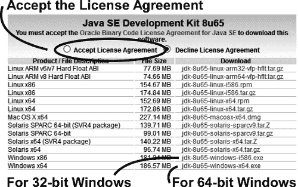

1. 如何检查你拥有的是 32 位还是 64 位的 Windows？在 Windows 7 中，点击`开始` / `控制面板` 并双击`系统`。在 Windows 10 中，点击`开始` / `设置` / `系统` / `关于`。`系统类型`会说明你拥有的是 32 位还是 64 位的操作系统。如果你的`控制面板`中没有`系统` 图标，你可能需要点击右上角的`查看`。

Eclipse 是一个免费的 Java 开发环境。Eclipse 让输入代码变得更容易，识别错误，甚至建议修复这些错误的方法。我建议将 Eclipse 安装在你的 Windows 用户文件夹中，但你也可以将其放在计算机的任何位置。我将我的放在 `c:\Users\Annette`。

1. 访问 `http://www.eclipse.org/downloads/`。点击下载按钮下载适用于 Java 的最新版本 `Eclipse`。

2. 根据你拥有的 Windows 版本，下载 `Java Development Kit` 的 `Windows x86` 或 `Windows x64` 版本。`Windows x86` 适用于 32 位 Windows；`Windows x64` 适用于 64 位 Windows。

在 Windows 7 中创建文件夹，首先点击`开始` / `计算机` 打开 `Windows 资源管理器`。在 Windows 10 中创建文件夹，首先点击`开始` / `文件资源管理器`。然后点击要创建新文件夹的文件夹名称，并点击`新建文件夹`按钮。为你的新文件夹输入名称。

如何检查你拥有的是 32 位还是 64 位的 Windows？在 Windows 7 中，点击`开始` / `控制面板` 并双击`系统`。在 Windows 10 中，点击`开始` / `设置` / `系统` / `关于`。`系统类型`会说明你拥有的是 32 位还是 64 位的操作系统。如果你的`控制面板`中没有`系统` 图标，你可能需要点击右上角的`查看`。

如果你和其他人共享计算机且他们也想学习 Java，请为你们每人创建一个不同的 Java 工作文件夹。你们的 Java 工作文件夹必须具有不同的名称，或者位于不同的文件夹中。

在 Windows 7 中创建文件夹，首先点击`开始` / `计算机` 打开 `Windows 资源管理器`。在 Windows 10 中创建文件夹，首先点击`开始` / `文件资源管理器`。然后点击要创建新文件夹的文件夹名称，并点击`新建文件夹`按钮。为你的新文件夹输入名称。

## 在桌面上为 Eclipse 创建快捷方式

1. 打开从压缩包提取的文件夹。我的文件夹是 `c:\Users\Annette`。

2. 右键点击 `eclipse.exe` 并选择`复制`。

3. 在桌面上右键并选择`粘贴`。

4. 如果你不是唯一使用 Eclipse 的人，右键点击你创建的快捷方式并为你的使用重命名。例如，我可能会将其重命名为 `Eclipse for Annette`。

5. 为每个将使用 Eclipse 的人重复步骤 1-4。

详细说明这些课程需要一些额外的数据文件。这些文件包含在 Godtland 网站上的一个免费压缩文件中：

1. 从 [`www.godtlandsoftware.com/DIYJava/`](http://www.godtlandsoftware.com/DIYJava/) 下载 `AdvancedDIY.zip`。

2. 要解压 `AdvancedDIY.zip`，右键点击 `AdvancedDIY.zip` 并选择`提取所有...`。使用`浏览`按钮将文件提取到你的 Java 工作文件夹中。我将其提取到了 `c:\Users\Annette\java`。

# 附录 D - 使用 Eclipse

## 设置 Eclipse

1. 双击 Eclipse 快捷方式。此窗口将出现：


2. 点击`浏览...` 按钮找到你的 Java 工作文件夹，如上所示，然后点击`确定`。此窗口将出现：

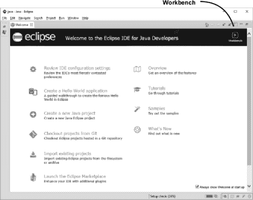

3. 点击`工作区` 打开主窗口。

## 使用 Java 视图

1. 点击`窗口` / `视图` / `打开视图` / `Java`。如果 `Java` 不在列表中，你可能已经处于 `Java 视图`中了。你的 Eclipse 窗口看起来如下：

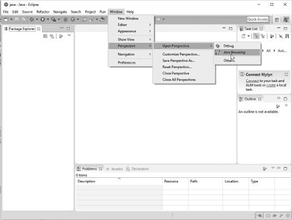

## 为编写代码留出更多空间

1. 如图所示，关闭`任务列表`和 `Connect MyLyn`：

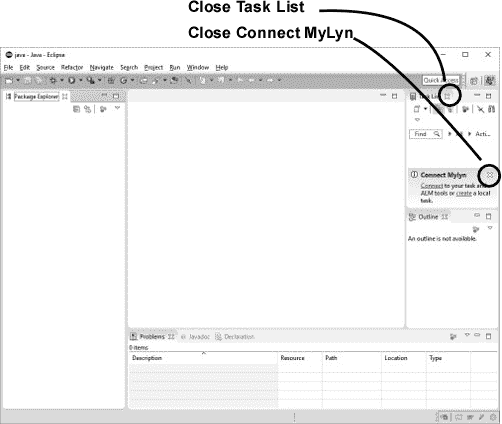

2. 将`大纲`选项卡移动到`包管理器`面板的底部，如下所示：

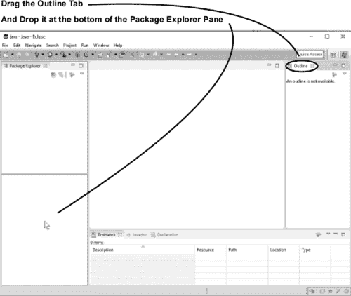

现在你已经有了创建第一个程序所需的所有内容！

## 创建第一个项目

创建你的第一个 Java 项目，命名为 `Hello World`：

1. 如果 `Eclipse` 没有打开：

    - 双击你在桌面上创建的 `Eclipse` 快捷方式。

    - 点击 `OK` 使用你的 Java 工作文件夹作为工作空间（workspace）。

2. 在 `Package Explorer`（包管理器）窗格中点击右键，并选择 `New / Java Project`。

3. 将 Java 项目命名为 `Hello World`，如果 JRE 是 `1.8` 或更高版本，选择 `Use Default JRE`，然后按所示点击 `Next`。如果默认 JRE 低于 `1.8`，请选择 `Use an execution environment JRE of 1.8` 或更高版本的选项。

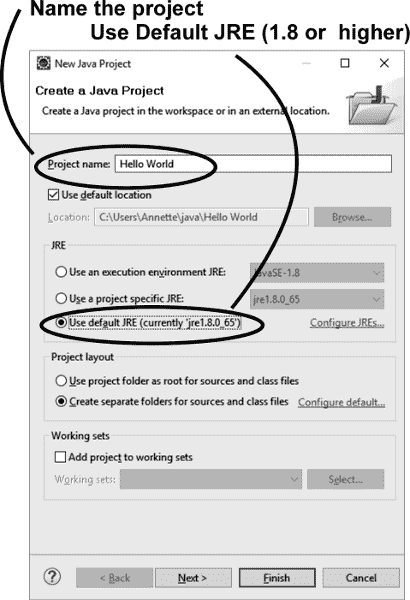

4. 点击 `Finish`。

`Package Explorer` 窗格现在应该列出项目 `Hello World`。

## 关键点及更多

- 本书中的每个程序都将在独立的 Java 项目中创建。

- 在不同程序之间共享的代码也将在独立的 Java 项目中创建。

- 在 `Package Explorer` 窗格中点击右键以创建 Java 项目。

- `Eclipse` 会在你的电脑上、你的 Java 工作文件夹中创建一个文件夹，名称与 Java 项目相同。请为你的 Java 项目指定一个你想要在电脑上作为文件夹名称的名称。

    - 现在，你的 Java 工作文件夹中有一个名为 `Hello World` 的文件夹。

    - 例如，每个单词的首字母大写，并在单词之间留一个空格，就像 `Hello World` 项目那样。

- 本书中程序所需的最低 JRE 要求为 `Java SE 1.8`。当你在书中创建 Java 项目时，请确保你选择了使用 `1.8` 或更高版本 JRE 的选项。一旦你在创建项目时选择了此选项，`Eclipse` 将对你以后创建的所有 Java 项目默认使用该选项。

## 创建第一个包

在 `Hello World` 项目中为你的 `Hello World` 程序创建一个包（package）：

1. 在 `Package Explorer` 窗格中右键点击 `Hello World` 项目，并选择 `New / Package`。

2. 将包命名为 `____________.____________.helloworld`，如下图所示。使用你自己的名字作为包名的一部分。我使用 `annette.godtland.helloworld` 作为我的包名。

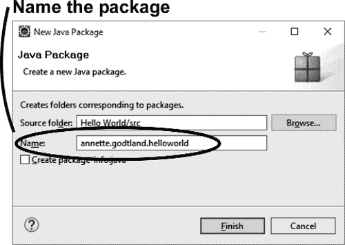

3. 点击 `Finish`。

`Package Explorer` 窗格现在显示了你在 `Hello World` 项目中创建的包。

## 关键点及更多

- 在 Java 项目中将你的程序文件组织到包中。

- 在 `Package Explorer` 窗格中右键点击你的项目以创建 Java 包。

- 将通常通常一起使用的程序文件放在同一个包中。

    - 因为你的程序很小，所以大多数程序将只包含一个包。

- 包名命名规则：

    - 确保你的包名与其他任何人的包名不同。Java 程序员传统上使用姓名、公司名称、域名或电子邮件地址作为包名的第一部分。

    - 使用全小写字母且不留空格。

    - 在包名中的不同类别之间使用句点。例如，如果包名标识了是谁创建了包以及包的用途，请在创建者和包的用途之间加上句点。

- Java 项目用于在 `Eclipse` 中组织程序；包用于在 Java 中组织程序。由于你使用 `Eclipse`，你将同时使用 Java 项目和包。如果你在没有 `Eclipse` 的情况下创建 Java 程序，你可能只会使用包。

## 创建第一个程序

使用 `JFrame` 类作为父类创建你的第一个程序：

1. 在 `Package Explorer` 窗格中右键点击你的包，并选择 `New / Class`。

2. 类名输入 `HelloWorld`，如下图所示。（提示：“Hello”和“World”之间没有空格。）

3. 点击父类（Superclass）旁边的 `Browse`。

    - 为类型输入“jfr”，选择 `JFrame` 并点击 `OK`。

4. 你想要创建哪些方法的存根（stubs）？仅勾选 `public static void main(String[] args)`。

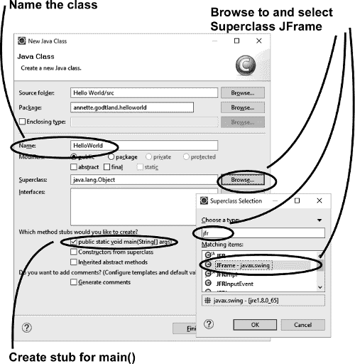

5. 点击 `Finish` 创建类。

`Eclipse` 将创建一个如下所示列表的代码。

列表 0-0，源自 `HelloWorld.java`

```java
package annette.godtland.helloworld;

import javax.swing.JFrame;

public class HelloWorld extends JFrame {
  public static void main(String[] args) {
    // TODO Auto-generated method stub
  }
}
```

1. 如列表所示替换 `main()` 方法中的代码：

列表 0-1，源自 `HelloWorld.java`

```java
package annette.godtland.helloworld;

import javax.swing.JFrame;

public class HelloWorld extends JFrame {
  public static void main(String[] args) {
    HelloWorld hello = new HelloWorld();
    hello.setVisible(true);
  }
}
```

2. 按 `Ctrl-S` 保存程序。

3. 点击 `Run` 运行程序。（等等，文字是“Click Run to run the program”）。

应该出现一个没有任何内容的窗口，如下所示：

OEBPS/images/advanceddoityourselfjavagames_html_dd756f0

OEBPS/images/advanceddoityourselfjavagames_html_662de37

## 关键点及更多

- 要创建类，请在 `Package Explorer` 中右键点击包名。

    - 类名可以包含数字、字母、美元符号和下划线。通常不使用美元符号和下划线。

    - 类名中不允许空格或句点。

    - 类名不能以数字开头。通常大写字母开头。

    - 如果类名包含多个单词，每个单词的首字母通常大写，其余字母小写。

- 删除 `Eclipse` 在创建类时自动生成的注释。

- 按 `Ctrl-S` 保存程序。

- 点击 `Run` 按钮运行程序。`Run` 按钮看起来像典型的播放按钮。

- 除非你有语法错误或收到指示，否则在修改每个列表后保存并运行程序。如果你有语法错误，使用 `Quick Fix` 进行修复：

    - 将鼠标悬停在下划线的错误上。`Eclipse` 将列出解决问题的方法。选择其中一个选项，`Eclipse` 将为你修复错误。

- 在整个课程中，你经常会收到“无法无法解析为类型”的语法错误。如果你收到该错误，使用 `Quick Fix` 导入所需的类。该类及其包名将添加到文件顶部的 import 语句中。

- `JDK` 在多个包中具有许多同名类。当你被要求导入包且没有另有说明时，从 `java.awt`、`java.io` 和 `javax.swing` 包导入类。

- 如果文本行自动换行，代码列表可能更难以阅读。为了减少换行，请将你的电子阅读器设置为较小的字体。

- 点击任何列表下方的`Completed Listing`链接查看如何完成代码。然而，你可以以不同的方式完成列表，只要你的代码功能相同，或者你更喜欢自己代码的效果。

- 创建每个类时使用的选项并不完全相同。在创建每个类时，请务必完全按照文字说明操作。

# 将项目添加到构建路径

构建路径存储了 Java 项目中创建程序所需的项目和库的位置。当程序需要使用来自不同项目或库的代码时，必须将该项目或库添加到程序所在项目的构建路径中。例如，本书中多个程序之间共享的代码将放在一个单独的 Java 项目中。该共享项目需要添加到每个使用该共享代码的程序项目的构建路径中。

## 在创建新项目时，将额外的共享代码项目添加到新项目中：

1. 点击 `Next` 按钮。

2. 点击 `Projects` 选项卡，下如图所示。

3. 点击 `Add....`。

4. 选择要添加的项目，然后点击 `OK`。

5. 点击 `Finish` 完成新项目的创建。

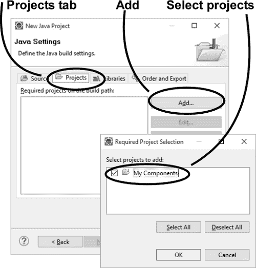

## 将额外的共享代码项目添加到现有项目：

1. 在 `Package Explorer`（包资源管理器）窗格中，右键点击现有项目，并选择 `Build Path` / `Configure Build Path...`（构建路径 / 配置构建路径...）。

2. 点击 `Projects` 选项卡，上图所示。

3. 点击 `Add....`。

4. 选择要添加的项目，然后点击 `OK`。

5. 点击 `OK` 关闭 `Java Build Path` 窗口。

# 导出程序

如果你想在 Eclipse 之外运行程序，或者想在不同的计算机上运行，则必须导出完成的程序。如果你导出了程序，它将在你的计算机上创建一个 `JAR` 文件（Java 归档文件）。`JAR` 文件名以 `.jar` 结尾。要运行程序，双击 JAR 文件名即可。

## 导出程序：

1. 在 `Package Explorer` 窗格中右键点击 Java 项目名称，选择 `Export`（导出）。

2. 选择 `Java / Runnable JAR File`（Java / 可运行的 JAR 文件），下如图所示，并点击 `Next`。

3. 选择你项目的启动配置（launch configuration）。Eclipse 会为你你在 Eclipse 中运行的每个新程序创建一个启动配置，并将其添加到列表中。下图显示了正在为 `ASCII Art` 项目选择启动配置，该程序是在第一本《Do-It-Yourself Java Games》书中创建的。

4. 为 JAR 文件输入一个名称作为 `Export destination`（导出目标）。将 JAR 文件命名为 Java 项目名称有助于你记住该 JAR 文件包含哪个程序。下图显示了将 JAR 文件命名为 `ASCIIArt.jar`。

5. 选择 `Package required libraries into generated JAR`（将所需的库打包到生成的 JAR）选项，如图所示：


6. 点击 `Finish` 完成导出。


## 在没有 Eclipse 的情况下运行你的程序

1. 在你的 Java 工作文件夹中找到新创建的`JAR`文件。
2. 双击`JAR`文件名。

你可以将`JAR`文件复制到任何其他文件夹或任何其他计算机。但是，请记住将 Java 工作文件夹中程序使用的任何文件也复制到与`JAR`文件相同的文件夹中。

## 关键点及更多

- 如果你想在 Eclipse 之外或在不同的计算机上运行程序，请将程序导出为`JAR`文件。
- 你可以将程序的不同版本保存在不同的`JAR`文件中。使用所有相同的导出选项，但为每个版本的程序命名不同的`Export destination`。
- 本书中创建的程序导出的`JAR`文件可以在任何运行 Windows、OS X 或 Linux 操作系统的计算机上运行，前提是安装了 1.8 或更高版本的 Java Runtime Environment（`JRE`）。
  - 大多数计算机已经安装了用于运行其他程序的`Java Runtime Environment`。
  - 你安装的`Java Development Kit`包含了`Java Runtime Environment`。因此，你的计算机上也已经安装了`Java Runtime Environment`。
  - 任何人都可以从[`java.com/en/download/index.jsp`](http://java.com/en/download/index.jsp)下载并安装`Java Runtime Environment`，而无需`Java Development Kit`。
- 如果 Java 工作文件夹中有程序使用的任何文件，请始终将这些文件的副本放在与导出`JAR`文件相同的文件夹中。
- `JAR`文件将包含 Java 工作文件夹`bin`文件夹中的所有`.class`文件。如果你想将`bin`文件夹中的任何其他文件插入`JAR`文件，请在导出项目之前将它们复制到`src`文件夹。

你现在应该准备好尝试书中的课程了。

# 附录 E - 使用的和其他提示

在本书中，你需要执行的操作将以编号列表给出。阅读每节课程末尾`Key Points and More`（关键点及更多）以回顾课程并学习更多知识。你不需要记忆它们；如果需要，以后可以轻松查阅。你也将通过实践学很多。

在本书中，每个代码列表都显示在下划线线条之间的等宽字体中。如果文本自动换行，代码列表可能会更难以阅读。为了减少换行，请将你的电子阅读器设置为较小的字体。每个列表的上方是所列代码的文件名。

从你的程序中删除列表中显示为`(Code was removed from here.)`（代码在此处删除）的代码部分。此外，删除你创建的每个类中自动生成的注释。你将在后的课程中添加自己的注释。

你对代码需要做的更改在列表中以粗体显示。大多数列表只显示程序代码的一部分。列表中未包含的代码部分显示为`...`。

你需要完成的代码在列表中显示为`fill-in blanks`（填空），`____`。在未指定的情况下，`right click`意味着使用左鼠标按钮点击对象。点击列表下方的`Completed`（已完成）链接以查看如何完成代码。然而，如果你在查看答案之前尝试完成代码，你会学得更多。你可以以不同的方式完成列表，只要你的代码效果相同。

删除 Eclipse 创建类时自动生成的注释。除非你有语法错误或被指示不要这样做，否则在完成列表更改后保存并运行程序。将鼠标悬停在代码中的下划线错误上。Eclipse 会列出修复的方法。选择其中一个选项，Eclipse 将为你修复错误。

在课程过程中，你经常会遇到提示无法解析类型的语法错误。如果收到该错误，请使用`Quick Fix`（快速修复）导入所需的类。该类及其包名将添加到文件开头的`import`语句中。

`JDK`在多个包中具有许多同名类。当你面临多个导入包的选择且没有另有说明时，请导入`java.awt`、`java.io`和`javax.swing`包中的类。

创建每个类不会使用相同的选项。在创建每个类时，务必完全按照说明操作。

将 Appendix A - Glossary 作为术表和索引。术表提供了编程术语的定义，并提供了在《Do-It-Yourself Java Games》书中查找该术语更多信息的链接。用你的电子阅读器书签 Appendix A - Glossary 以更方便访问术表。

《Do-It-Yourself Java Games》系列书籍是为电子阅读器设计的。点击下方图片或通过此[链接](http://youtu.be/XMuNyyk7mg)观看视频，展示这些电子书中在纸质书中无法实现的功能。


