# 高级 Java：高级用户指南

ABHIJIT KUMAR MISRA

# 1 集合与泛型

## 单元结构

- 1.0 目标
- 1.1 泛型简介
  - 1.1.1 泛型的优势
  - 1.1.2 泛型类
  - 1.1.3 泛型方法
  - 1.1.4 边界类型参数
- 1.2 通配符
  - 1.2.1 通配符的类型
- 1.3 Java 集合简介
  - 1.3.1 Java 集合框架
  - 1.3.2 Java 集合层次结构
  - 1.3.3 集合的优势
  - 1.3.4 Java 集合的基本和批量操作
- 1.4 List（列表）
  - 1.4.1 List 接口的方法
  - 1.4.2 如何创建 List - ArrayList 和 LinkedList
  - 1.4.3 遍历 List
- 1.5 Set（集合）
  - 1.5.1 Set 接口的方法
  - 1.5.2 HashSet 类
  - 1.5.3 TreeSet 类
- 1.6 Map（映射）
  - 1.6.1 Map 接口的方法
  - 1.6.2 HashMap 类
  - 1.6.2 LinkedHashMap 类
  - 1.6.3 TreeMap 类
- 1.7 总结
- 1.8 参考文献列表
- 1.9 章节结束练习

## 1.0 目标

学习完本章后，你将能够：

- 理解集合 API。
- 学习什么是泛型以及如何编写泛型类和方法。
- 对集合执行基本操作。
- 学习什么是通配符字符以及通配符的类型。
- 理解 List、Set 和 Maps。

## 1.1 泛型简介

Java 泛型是在 JDK 1.5 中引入的，允许进行泛化编程。它允许创建对不同类型对象以相同方式类和方法，同时在编译时提供类型安全。它通过在编译时检测错误来使代码更加稳定。

在泛型出现之前，我们可以在集合中存储任何类型的对象，即非泛型集合。现在，泛型强制 Java 程序员存储特定类型的对象。

### 1.1.1 泛型的优势

泛型有许多优势，如下所示：

#### 1）类型安全

我们只能在泛型中存储单一类型的对象。它不允许存储其他对象。在没有泛型的情况下，我们可以存储任何类型的对象。

示例：

```java
List list = new ArrayList();
list.add(10); // 在列表中存储一个 int 值
list.add("10"); // 在列表中存储一个 String 值
```

使用泛型时，则要求指定我们想要存储的对象的类型。

```java
List<Integer> list = new ArrayList<Integer>();
list.add(10);
list.add("10");//编译时错误
```

#### 2）不需要类型转换

不需要对对象进行类型转换。在泛型出现之前，我们需要进行类型转换。

示例：

```java
List list = new ArrayList();
list.add("hello");
String s = (String) list.get(0); //类型转换
```

使用泛型后，我们不需要对对象进行类型转换。

示例：

```java
List<String> list = new ArrayList<String>();
list.add("hello");
String s = list.get(0);
```

#### 3）编译时检查

类型检查在编译时完成，因此错误不会在运行时发生。

示例：

```java
List<String> list = new ArrayList<String>();
list.add("hello");
list.add(32);//编译时错误
```

### 1.1.2 泛型类

泛型不仅限于集合。类中使用泛型也是可能的。泛型声明看起来与非泛型声明相似，区别在于类名后面跟着一个类型参数部分。

泛型类的类型参数部分可以有一个或多个由逗号分隔的类型参数。这些类被称为参数化类。

示例：参数化类

```java
public class Shape<T> {
    private T t;
    public void add(T t) {
        this.t = t;
    }
    public T get() {
        return t;
    }
    public static void main(String[] args) {
        Shape<Integer> intShape = new Shape<Integer>();
        intShape.add(25);
        System.out.printf("Integer Value:%d\n", intShape.get());

        Shape<String> strShape = new Shape<String>();
        strShape.add("String");
        System.out.printf("String Value:%s\n", strShape.get());
    }
}
```

输出：

```text
Integer Value:25

String Value:String
```

（注：提供的 OCR 文本在跨页代码中片段破碎；我已根据标准的 Java 模式和提供的片段重建了其逻辑流。）

### 1.1.3 泛型方法

输出：

```text
Array integerArray 包含：

1 2 3 4 5

Array doubleArray 包含：

1.1 2.2 3.3 4.4

Array characterArray 包含：

HELLO
```

在此程序中，静态方法 `printArray` 的返回类型为 `void`，它接受一个名为 `T` 的单个参数。`T` 代表类型，客户端应用程序可以替换为任何 Java 类型。`main` 方法传递了不同类型的数组，并使用单一泛型方法打印所有数组元素。

### 1.1.4 边界类型参数（BOUNDED TYPE PARAMETERS）

有时需要限制允许传递给类型参数的类型。例如，一个操作数字的方法可能只想接受 `Number` 或其子类的实例。在这种情况下，可以使用边界类型参数。

要声明边界类型参数，列出类型参数的名称，随后是 `extends` 关键字，然后在下方列出其上界：

```java
class <T extends Number>
```

示例：计算整数或双精度数字平均值的程序

```java
package p1;
public class Test<T extends Number> {
    T[] numArr;
    Test(T[] numArr) {
        this.numArr = numArr;
    }
    public double getAvg() {
        double sum = 0;
        for (int i = 0; i < numArr.length; i++) {
            sum += numArr[i].doubleValue();
        }
        double avg = sum / numArr.length;
        return avg;
    }
    public static void main(String[] args) {
        Integer i[] = {12, 13, 14, 15, 16};
        Double d[] = {1.0, 2.0, 3.0, 4.0};
        Test<Integer> e1 = new Test<Integer>(i);
        Test<Double> e2 = new Test<Double>(d);
        double ai = e1.getAvg();
        double ad = e2.getAvg();
        System.out.println("Average of Integers = " + ai);
        System.out.println("Average of Double =" + ad);
    }
}
```

输出：

```text
Average of Integers = 14.0

Average of Double = 2.5
```

## 1.2 通配符字符（WILDCARD CHARACTER）

- 问号（`?`）在泛型编程中被称为通配符。它代表一个未知类型。
- 通配符可用于各种情况，如参数、字段或局部变量的类型；有时作为返回类型。
- 与数组不同，泛型类型的不同实例化之间是不兼容的，即使是显式的也不行。如果使用 `?` 作为实际类型参数，这种不兼容性可以通过通配符得到缓解。

### 1.2.1 通配符的类型（TYPES OF WILDCARDS）

有三种通配符，它们是：

#### 上界通配符（UPPER BOUNDED WILDCARDS）

- 当你想要放宽变量限制时，可以使用这些通配符。
- 例如，假设你想写一个处理 `List<Integer>`、`List<Double>` 和 `List<Number>` 的方法，可以使用上界通配符来实现这一点。
- 要声明上界通配符，使用通配符字符（`?`），随后是 `extends` 关键字，最后列出其上界。

例：`public static void add(List<? extends Number> list)`

示例：一个演示上界通配符的程序

```java
import java.util.Arrays;
import java.util.List;
class UpperBoundedWildcardDemo
{
    public static void main(String[] args)
    {
        // 上界整数列表
        List<Integer> list1=Arrays.asList(4,5,6,7);

        // 打印 list1 中元素的总和
        System.out.println("Total sum is:"+sum(list1));
        // 上界双精度列表
        List<Double> list2=Arrays.asList(4.1,5.1,6.1);

        // 打印 list2 中元素的总和
        System.out.print("Total sum is:"+sum(list2));
    }
    private static double sum(List<? extends Number> list)
    {
        double sum=0.0;
        for (Number i: list)
        {
            sum+=i.doubleValue();
        }
        return sum;
    }
}
```

输出：

```text
Total sum is:22.0

Total sum is:15.299...
```

在这里，`sum` 方法被用于计算整数列表和双精度列表元素的总和，因为它接受一个上界为 `Number` 的列表作为参数。

### 1.2.2 下界通配符（LOWER BOUNDED WILDCAR）

- 如果我们使用下界通配符，可以将 `?` 限制为特定类型或其超类。
- 它使用通配符字符（`?`），随后是 `super` 关键字，最后列出其下界来表示：`<? super A>`。

语法：`Collectiontype<? super A>`

示例：一个演示下界通配符的程序

```java
import java.util.Arrays;
import java.util.List;
class LowerBoundedWildcardDemo {
    public static void main(String[] args) {
        // 下界整数列表
        List<Integer> list1 = Arrays.asList(1,2,3,4);
        // 传递了 Integer 对象
        print(list1);
        // 下界数字列表
        List<Number> list2 = Arrays.asList(1,2,3,4);
        // 传递了 Integer 对象
        print(list2);
    }

    public static void print(List<? super Integer> list) {
        System.out.println(list);
    }
}
```

输出：

```text
[1, 2, 3, 4]

[1, 2, 3, 4]
```

在这里，`print` 方法被用于打印整数列表和数字列表的元素，因为它接受一个下界为 `Integer` 的列表作为参数。

### 1.2.3 无界通配符（UNBOUNDED WILDCARDS）

无界通配符类型使用通配符字符（`?`）进行指定，例如 `List<?>`。这被称为未知类型的列表。

考虑以下方法 `printList`：

```java
public static void printList(List<Object> list) {
  for (Object elem : list) {
    System.out.println(elem + " ");
    System.out.println();
  }
}
```

`printList` 的目标是打印任何任意类型的列表，但它未能实现该目标——它只打印 `Object` 实例列表；它无法打印 `List<Integer>`、`List<String>`、`List<Double>` 等，因为它们不是 `List<Object>` 的子类型。

要写一个泛型 `printList` 方法，请使用 `List<?>`。

示例：一个演示无界通配符的程序

```java
import java.util.Arrays;
import java.util.List;
public class UnboundedWildCardDemo {
  public static void printList(List<?> list) {
    for (Object elem : list) {
      System.out.println(elem + " ");
    }
    System.out.println();
  }
  public static void main(String[] args[]) {
    List<Integer> li = Arrays.asList(1, 2, 3);
    List<String> ls = Arrays.asList("one", "two", "three");
    printList(li);
    printList(ls);
  }
}
```

输出：

```text
1

2

3

one

two

three
```

在这里，`li` 和 `ls` 是通过 `Arrays` 创建的整数列表和字符串列表，两个列表都使用泛型方法 `printList` 进行打印。

## 1.3 Java 集合简介

`Collection` 接口还包含对整个集合执行操作的方法，这些方法称为批量操作。

| 方法 | 描述 |
| --- | --- |
| `boolean containsAll(Collection<?> c)` | 用于检查此集合是否包含被调用集合中的所有元素。 |
| `boolean addAll(Collection<? extends E> c)` | 用于将指定的集合元素插入到调用集合中。 |
| `boolean removeAll(Collection<?> c)` | 用于从调用集合中删除指定集合中的所有元素。 |
| `boolean retainAll(Collection<?> c)` | 用于删除调用集合中除指定集合以外的所有元素。 |
| `void clear()` | 移除集合中的所有元素。 |

### Iterator 接口

它提供了遍历集合中元素的功能。

| 方法 | 描述 |
| --- | --- |
| `public boolean hasNext()` | 如果迭代器还有更多元素，则返回 `true`，否则返回 `false`。 |
| `public Object next()` | 返回元素并将指针移动到下一个元素。 |
| `public void remove()` | 移除迭代器返回的最后一个元素。该方法较少使用。 |

## 1.4 List（列表）

Java 中的 List 提供了维护有序集合的功能。它包含了基于索引的插入、更新、删除和搜索元素的方法。它也可以包含重复元素。我们还可以在列表中存储 `null` 元素。

List 接口位于 `java.util` 包中，并继承自 `Collection` 接口。它是 `ListIterator` 接口的工厂。通过 `ListIterator`，我们可以正向和反向遍历列表。

List 接口的声明如下：

`public interface List<E> extends Collection<E>`

### 1.4.1 List 接口的方法

| 方法 | 描述 |
| --- | --- |
| `void add(int index, E element)` | 用于在列表的指定位置插入指定的元素。 |
| `boolean add(E e)` | 用于将指定的元素添加到列表末尾。 |
| `boolean clear()` | 用于从此列表中移除所有元素。 |
| `boolean equals(Object o)` | 用于将指定对象与列表中的元素进行比较。 |
| `int hashCode()` | 用于返回列表的哈希值。 |
| `boolean isEmpty()` | 如果列表为空则返回 `true`，否则返回 `false`。 |
| `int lastIndexOf(Object o)` | 用于返回指定元素在列表中最后一次出现的索引，如果列表不包含该元素则返回 `-1`。 |

### 1.4.2 如何创建 List？


由于`List`是一个接口，因此需要实例化接口的具体实现类才能使用它。

`List`接口的实现类有`ArrayList`、`LinkedList`、`Stack`和`Vector`。

- 使用`java.util.ArrayList`创建一个`String`类型的`List`

  `List<String> list=new ArrayList<String>();`

- 使用`LinkedList`创建一个`String`类型的`List`

  `List<String> list=new LinkedList<String>();`

- `java.util.Vector;`

  `List list1=new Vector();`

- `java.util.Stack;`

  `List list1=new Stack();`

`ArrayList`和`LinkedList`在`Java`编程中被广泛使用。

## ArrayList

`ArrayList`是一个对象引用的变长度数组。它可以动态地增加或减少大小。可以使用初始大小创建它。当超过此大小时，集合会自动扩大。当对象被移除时，数组可能会缩小。

### 示例：使用`ArrayList`类演示`List`的程序

```java
import java.util.*;
public class ArrayListDemo {
    public static void main(String[] args) {
        // 创建一个列表
        List<Integer> l11= new ArrayList<Integer>();
        // 在 0 索引添加 1
        l11.add(0, 1);
        // 在 1 索引添加 2
        l11.add(1, 2);
        System.out.println(l11);
        // 创建另一个列表
        List<Integer> l12= new ArrayList<Integer>();
        l12.add(1);
        l12.add(2);
        l12.add(3);
        // 从 1 索引添加列表 l12
        l11.addAll(1, l12);
        System.out.println(l11);
        // 移除索引 1 的元素
        l11.remove(1);
        System.out.println(l11);
        // 打印索引 3 处的元素
        System.out.println(l11.get(3));
        // 将第 0 个元素替换为 5
        l11.set(0, 5);
        System.out.println(l11);
    }
}
```

## 输出：

```
[1, 2]
[1, 1, 2, 3, 2]
[1, 2, 3, 2]
2
[5, 2, 3, 2]
```

## LinkedList

`LinkedList`是集合框架中实现的一个类，它内部实现了链表数据结构。它是一种线性数据结构，元素不存储在连续的位置，每个元素都是一个包含数据部分和地址部分的独立对象。元素通过指针和地址连接。每个元素被称为一个节点。`LinkedList`允许在任何点以常数时间插入和删除节点，但不支持随机访问。它允许包括`null`在内的所有元素。

### 示例：使用`LinkedList`类演示`List`的程序

```java
import java.io.*;
import java.util.*;
class LinkedListListDemo {
    public static void main(String[] args) {
        // LinkedList 的大小
        int n = 5;

        // 初始大小为 n 的 List
        List<Integer> ll = new LinkedList<Integer>();

        // 在列表末尾
        // 添加新元素
        for (int i = 1; i <= n; i++) {
            ll.add(i);
        }

        // 打印元素
        System.out.println(ll);

        // 移除索引 3 元素
        ll.remove(3);

        // 显示删除后的列表
        System.out.println(ll);

        // 逐个打印元素
        for (int i = 0; i < ll.size(); i++) {
            System.out.print(ll.get(i) + " ");
        }
    }
}
```

输出：`[1, 2, 3, 4, 5]`

`[1, 2, 3, 5]`

`1 2 3 5`

### 1.4.3 遍历列表

有多种方法遍历`List`。最常见的方法是使用基础的`for`循环结合`get()`方法获取特定索引的元素，以及增强型`for`循环。

*示例：遍历`ArrayList`的程序*

```java
import java.util.*;
public class ArrayListIteration {
    public static void main(String[] args) {
        List<String> al= new ArrayList<String>();

        al.add("Ann");
        al.add("Bill");
        al.add("Cathy");

        // 使用 Get 方法和 for 循环
        for (int i = 0; i < al.size(); i++) {
            System.out.print(al.get(i) + " ");
        }
        
        System.out.println();

        // 使用 for each 循环
        for (String str : al) {
            System.out.print(str + " ");
        }
    }
}
```

输出：

`Ann Bill Cathy`

`Ann Bill Cathy`

## 1.5 Set

`Set`扩展了`Collection`接口，是一个无序集合，其中不能存储重复值。该接口存在于`java.util`包中，包含了继承自`Collection`接口的方法。

实现`Set`接口的最流行类是`HashSet`和`TreeSet`。

`Set`接口声明为：

`public interface Set extends Collection`

### 1.5.1 SET 接口的方法

| 方法 | 描述 |
|---|---|
| `add(element)` | 用于向集合中添加特定元素。 |
| `addAll(collection)` | 用于将上述集合中的所有元素添加到现有集合中。 |
| `clear()` | 用于移除集合中的所有元素，但不删除集合。引用仍然存在。 |
| `contains(element)` | 用于检查特定元素是否存在于`Set`中。 |
| `isEmpty()` | 用于检查集合是否为空。 |
| `iterator()` | 用于返回集合的迭代器。集合中的元素按随机顺序返回。 |

### 1.5.2 HASHSET 类

在集合框架中实现的`HashSet`类是哈希表数据结构的内在实现。该类不允许存储重复元素，但允许`NULL`元素。我们插入到哈希中的对象不保证以相同的顺序插入。对象根据其哈希码进行插入。

**示例：演示`HashSet`实现的程序**

```java
import java.util.*;
class HashSetDemo{
    public static void main(String[] args) {
        Set<String> h = new HashSet<String>();
    }
}
```

```java
// 向 HashSet 中添加元素
h.add("India");
h.add("Australia");
h.add("South Africa");
```

```java
// 添加重复元素
h.add("India");
```

```java
// 显示 HashSet
System.out.println(h);
```

```java
// 从 HashSet 中移除项
h.remove("Australia");
System.out.println("Set after removing " + "Australia:" + h);
```

```java
// 遍历 hash set 的项
System.out.println("Iterating over set:");
Iterator<String> i = h.iterator();
while (i.hasNext())
System.out.println(i.next());
```

Output:

`[South Africa, Australia, India]`

`Set after removing Australia:[South Africa, Australia, India]`

`Iterating over set:`

`South Africa`

`India`

### 1.5.3 TREESET 类

`TreeSet`类由集合框架实现，是`SortedSet`接口的实现，而`SortedSet`扩展了`Set`接口。它的行为类似于简单的集合，不同在于它以排序的形式存储元素。`TreeSet`使用树数据结构进行存储。对象按升序顺序存储。

### 示例：演示`TreeSet`实现的程序

```java
import java.util.*;
class TreeSetDemo {
    public static void main(String[] args) {
        Set<String> ts = new TreeSet<String>();

        // 向 TreeSet 中添加元素
        ts.add("India");
        ts.add("Australia");
        ts.add("South Africa");

        // 添加重复元素
        ts.add("India");

        // 显示 TreeSet
        System.out.println(ts);

        // 从 TreeSet 中移除项
        ts.remove("Australia");
        System.out.println("Set after removing " + "Australia:" + ts);

        // 遍历 Tree set 的项
        System.out.println("Iterating over set:");
        Iterator<String> i = ts.iterator();
        while (i.hasNext()) {
            System.out.println(i.next());
        }
    }
}
```

Output:

`[Australia, India, South Africa]`

`Set after removing Australia:[India, South Africa]`

`Iterating over set:`

`India`

`South Africa`

## 1.6 Maps

存在于`java.util`包中的`Map`接口表示键（`key`）和值（`value`）之间的映射。`map`有唯一的键，每个键最多可以映射到一个值。某些实现允许`null`键和`null`值，如`HashMap`和`LinkedHashMap`，但某些如`TreeMap`则不允许。`map`的顺序取决于具体的实现。例如，`TreeMap`和`LinkedHashMap`有可预测的顺序，而`HashMap`则没有。

`Map`接口不是`Collection`接口的子类型。因此，它的行为与其他集合类型略有不同。

实现`Map`接口的类有`HashMap`、`LinkedHashMap`和`TreeMap`。

### 1.6.1 MAP 接口的方法

| 方法 | 说明 |
| :--- | :--- |
| `clear()` | 此方法用于清除并移除指定`Map`集合中的所有元素或映射。 |
| `equals(Object)` | 此方法用于检查两个`map`之间的相等性。它验证作为参数传递的`map`的元素是否与此`map`的元素相等。 |
| `get(Object)` | 此方法用于检索或获取参数中提到的特定键的映射值。当`map`不包含该键的映射时，返回`NULL`。 |
| `hashCode()` | 此方法用于为包含键和值的给定`map`生成哈希。 |
| `isEmpty()` | 此方法用于检查`map`是否包含任何键值对。如果不存在映射，则返回`true`。 |
| `clear()` | 此方法用于清除并移除指定`Map`集合中的所有元素或映射。 |

### 1.6.2 HASHMAP

`HashMap`类实现了`Map`接口，允许我们存储键值对，其中键应该是唯一的。如果你尝试插入重复的键，它将替换对应键的元素。使用键索引进行更新、删除等操作非常容易。`HashMap`类位于`java.util`包中。

`Java`中的`HashMap`类似于遗留的`Hashtable`类，但它不是同步的。它允许我们存储`null`元素，但只能有一个`null`键。从`Java 5`开始，它被表示为`HashMap<K,V>`，其中`K`代表键，`V`代表值。

### 示例：演示`HashMap`实现的程序

```java
import java.util.*;
public class HashMapDemo {
    public static void main(String[] args) {
        Map<String, Integer> map = new HashMap<>();
        map.put("Angel", 10);
        map.put("Liza", 30);
        map.put("Steve", 20);
        for (Map.Entry<String, Integer> e : map.entrySet()) {
            System.out.println(e.getKey() + " " + e.getValue());
        }
    }
}
```

```
Output:
vaibhav 20
vishal 10
sachin 30
```

### 1.6.3 LINKEDHASHMAP

`LinkedHashMap`就像`HashMap`，但额外具有维护插入元素顺序的功能。`HashMap`提供了快速插入、搜索和删除的优势，但它从不维护插入轨迹和顺序，而`LinkedHashMap`提供了这一点，可以按照插入顺序访问元素。

### 示例：演示`LinkedHashMap`实现的程序

```java
import java.util.*;
public class LinkedHashMapDemo {
    public static void main(String[] args) {
        Map<String, Integer> map= new LinkedHashMap<>();

        map.put("Angel", 10);
        map.put("Liza", 30);
        map.put("Steve", 20);

        for (Map.Entry<String, Integer> e : map.entrySet()) {
            System.out.println(e.getKey() + " " + e.getValue());
        }
    }
}
```

Output:

`Angel 10`

`Liza 30`

`Steve 20`

### 1.6.4 TREEMAP

`Java`中的`TreeMap`用于结合抽象类实现`Map`接口和`NavigableMap`。它提供了一种排序顺序存储键值对的有效方法。`TreeMap`只包含唯一元素，不能有`null`键，但可以有多个`null`值。

`TreeMap`不是同步的，并保持升序顺序。

示例：演示`TreeMap`实现的程序

```java
import java.util.*;
class TreeMapDemo {
    public static void main(String[] args[]) {
        TreeMap<Integer, String> map = new TreeMap<Integer, String>();
    }
}
```

```java
map.put(100, "Angel");
map.put(101, "Chris");
map.put(103, "Bill");
map.put(102, "Steve");
for (Map.Entry m : map.entrySet()) {
    System.out.println(m.getKey() + " " + m.getValue());
}
```

Output:

`100 Angel`

`101 Chris`

`102 Steve`

`103 Bill`

## 1.7 Let Us


“集合框架”包含了所有的集合类和接口，它定义了可以在不同类型上统一执行的操作，如搜索、排序、插入和删除。

`javutil`包包含了所有的类和接口。

- 泛型允许泛型编程。它允许创建在不同类型上工作相同的类和方法，并在编译时提供类型安全。
- 泛型也可以用于类。
- 泛型方法可以具有不同的参数。
- 边界类型参数可以限制传递给类型参数的类型。
- 号（`?`）表示未知类型，可以用于各种情况，例如参数、字段或局部变量的类型。三种通配符类型：上界、下界和无界。

## 1.8 参考文献列表

- 1. Java 8 Programming, BlackBook, DreamTech Press, 2015版

- 2. Core Java 8 for Beginners, Sharanam Shah, Vaishali Shah, 第三版, SPD

### 网络参考

- 1. https://www.geeksforgeeks.org

- 2. https://www.javatpoint.com

- 3. https://www.tutorialspoint.com

## 1.9 章节练习题

Q1. 集合相比原始数据类型有什么优势？

Q2. 什么是泛型？列出使用泛型的优势。

Q3. 解释边界参数的概念。

Q4. 区分 List、Set 和 Maps。

Q5. 什么是通配符字符？解释各种类型的通配符字符。

Q6. 解释 ArrayList 和 LinkedList 的区别。

Q7. 解释 HashMap、LinkedHashMap 和 TreeMap 示例程序的区别。

# 2

# Lambda 表达式 (LAMBDA EXPRESSIONS)

## 单元结构

- 2.0 目标

- 2.1 引言

  - 2.1.1 什么是 Lambda 表达式？

  - 2.1.2 为什么要使用 Lambda 表达式？

  - 2.1.3 Lambda 表达式的语法

  - 2.1.4 Lambda 表达式可以用在哪里？

- 2.2 Lambda 类型推断

- 2.3 参数

- 2.4 Lambda 函数体

- 2.5 从 Lambda 表达式返回值

- 2.6 作为对象的 Lambda

- 2.7 集合中的 Lambda

- 2.8 总结

- 2.9 参考文献列表

- 2.10 章末练习

## 2.0 目标

在学习完本章后，你将能够：

- 理解什么是 Lambda 表达式以及如何编写 Lambda 表达式

- 描述使用 Lambda 表达式的优点

- 解释 Lambda 表达式中传递参数的不同方式

- 理解目标类型推断

- 使用 Lambda 表达式简化程序并缩短代码长度

## 2.1 引言

Lambda 表达式是 Java 的一个新且重要的特性，它在 Java SE 8 中引入，由于简化了代码开发而变得非常流行。它提供了一种非常清晰简洁的方式，使用表达式来表示单方法接口。它在集合库中非常有用，有助于对集合进行迭代、过滤和提取数据。Lambda 表达式是 Java 迈向函数式编程的第一步。Lambda 表达式被视为函数，因此编译器不会创建 `.class` 文件。

具有单个抽象方法的接口被称为函数式接口（Functional Interface）或单抽象方法接口。Lambda 表达式用于提供此类函数式接口的实现。在 Lambda 表达式的情况下，我们不需要重新定义方法来提供实现。在这里，我们只需要编写实现代码，这节省了大量的代码。在 Java 8 之前，实现函数式接口的方法是匿名内部类，但这有时显得臃肿。

为了更好地理解 Lambda 表达式，让我们先看一个使用匿名内部类实现函数式接口的示例。

在下面的程序中，有一个接口 `Square`，其中包含一个抽象方法 `area()`。我们有一个类 `AnonymousClassEx`，它使用匿名内部类实现了 `Square` 接口中的方法。

**示例：使用匿名类演示函数式接口的程序**

```java
interface Square                   //函数式接口
    public void area();
}
public class AnonymousClassEx {
    public static void main(String[] args) {
        int side = 10;
        /* 没有 Lambda 表达式，使用匿名内部类实现 Square 接口 */
        Square s = new Square() { //匿名类
            public void area() {
                System.out.println("Area of square = " + side * side);
            }
        };
        s.area();
    }
}
```

**输出：**

```
Area of square = 100
```

在这里你可以注意到，我们在匿名内部类中重写了接口中的方法声明代码 `public void area()`。如果使用 Lambda 表达式，就可以消除这些重复代码。

### 2.1.1 什么是 LAMBDA 表达式？

Lambda 表达式指的是一个没有名称、没有访问修饰符（`private`、`public` 或 `protected`）且没有返回值声明的方法。这种方法也被称为“匿名方法”、“闭包”（Closures）或简单称为“Lambdas”。它提供了一种通过使用表达式简单表示单个方法接口的方法。

与匿名类一样，Lambda 表达式可以用于执行没有名称的任务。

### 2.1.2 为什么要使用 LAMBDA 表达式？

- 1. Lambda 表达式提供了将行为传递给方法的能力

- 2. 它提供了函数式接口的简化实现

- 3. 语法清晰紧凑

- 4. 减少重复编码

- 5. 更快的执行时间

### 2.1.3 LAMBDA 表达式的语法

Lambda 表达式的基本结构组成：

```
(参数列表) -> {表达式体}
```

- **参数列表**：它可以是空的，也可以是非空的。如果不为空，则不需要声明参数的类型。编译器可以从参数的值推断类型。此外，如果只有一个参数，参数列表周围的括号是可选的。

- **箭头标记 (`->`)**：用于连接参数列表和表达式体。

- **表达式体**：包含 Lambda 表达式的体。如果整个体只有一条语句，则大括号是可选的。你也可以使用 `return` 语句，但它应该包含在大括号中，因为它不是一个表达式。

考虑下面的代码片段来理解 Lambda 表达式的概念，其中创建了一个用于显示消息的简单方法。让我们先声明一个简单的消息：

```java
public void display() {
    System.out.println("Hello World");
}
```

现在，我们可以通过移除 `public` 访问修饰符、返回类型声明（如 `void`）以及方法名 `display` 将上述方法转换为 Lambda 表达式。

Lambda 表达式所示：

```java
() -> {
    System.out.println("Hello World");
}
```

因此，我们简化了代码。

现在我们已经知道如何编写 Lambda 表达式，让我们使用 Lambda 表达式重写示例 2.1：

**示例：使用 Lambda 表达式演示函数式接口实现的程序**

```java
interface Square {           //函数式接口
    public void area();
}
public class LambdaExpressionEx {
    public static void main(String[] args) {
        int side=10;

        // 使用 Lambda 表达式实现 Square 接口
        Square s= () -> {
            System.out.println("Area of square="+side*side);
        };
        s.area();
    }
}
```

**输出：**

```
Area of square = 100
```

在这里，你可以观察到在使用 Lambda 表达式在类中实现时，我们没有编写接口中的方法声明 `public void area()`。从而减少了重复代码。

### 2.1.4 LAMBDA 表达式可以用在哪里？

Lambda 表达式可以在任何具有目标数据类型的环境中编写。具有目标类型的上下文包括：

- 变量声明、赋值和数组初始化

- 返回语句

- 方法或构造函数的参数

- 三元条件表达式 (`?:`)

## 2.2 LAMBDA 类型推断

类型推断意味着任何表达式的数据类型（例如，方法的返回类型或参数类型）都可以由编译器自动理解。Lambda 表达式支持类型推断。类型推断允许我们不指定 Lambda 表达式参数的数据类型。参数列表中的类型可以省略，因为 Java 已经知道函数式接口单个抽象方法的预期参数类型。编译器通过查看其他地方（在此情况下为方法定义）来推断参数的类型。

**语法：**

```
(parameter_name1, parameter_name2 ...) -> { 方法体 }
```

**示例：**

```java
interface Operation {
 int add(int a,int b);
}
public class Addition {
 public static void main(String[] args) {
 Operation ad1=(a,b)->(a+b);
 System.out.println(ad1.add(10,20));
}
}
```

**输出：**

```
30
```

在这里，编译器可以推断 `a` 和 `b` 必须是 `int`，因为 Lambda 表达式被赋值给一个 `Operation` 引用变量。

## 2.3 LAMBDA 参数

- Lambda 表达式可以带有零到任意数量的参数编写。

- 如果没有参数需要传递，可以提供空括号。

  例如：

```java
() -> { System.out.println("Zero Parameter Lambda Expression"); }
```

**示例：演示无参数 Lambda 表达式的程序**

```java
//函数式接口
interface MyFunctionalInterface {
    // 无参数的方法
    public void say();
}

public class ZeroParamLambda {
    public static void main(String args[]) {
        // lambda 表达式
        MyFunctionalInterface msg = () -> {
            System.out.println("Hello");
        };
        msg.say();
    }
}
```

**输出：**

```
Hello
```

- 当有一个参数时，如果其类型被推断，则没有强制使用括号。

  例如：

```java
(str) -> { System.out.println("Single Parameter Lambda Expression" + str); }
```

**示例：演示单参数 Lambda 表达式的程序**

```java
//函数式接口
interface MyFunctionalInterface {
    // 带有单参数的方法
    public void say(String str);
}

public class SingleParamLambda {
    public static void main(String args[]) {
        // lambda 表达式
        MyFunctionalInterface msg = (str) -> {
            System.out.println(str);
        };
        msg.say("Hello World");
    }
}
```

**输出：**

```
Hello World
```

- 当有多个参数时，它们被封装在括号中并用逗号隔开。

  例如：

```java
(str1, str2) -> {
    System.out.println("Multiple Parameter Lambda Expression " + str1 + " " + str2);
}
```

**示例：演示多参数 Lambda 表达式的程序**

```java
//Functional接口
interface MyFunctionalInterface {
    // 带单参数的方法
    public void say(String str1, String str2);
}

public class SingleParamLambda {
    public static void main(String[] args) {
        // lambda 表达式
        MyFunctionalInterface msg = (str1, str2) -> {
            System.out.println(str1 + "" + str2);
            msg.say("Hello", "Java");
        };
    }
}
```

**输出：**

```
Hello Java
```

## 2.4 Lambda 函数体

- Lambda 表达式的体（即它所代表的函数/方法体）在 Lambda 声明中表示于 `->` 的右侧。

- Lambda 表达式体可以包含零到任意数量的语句。

- 语句应该封装在大括号中。

- 如果只有一个语句，则不需要大括号。

- 当体中包含多个语句时，这些语句必须封装在大括号中，且匿名函数的返回类型与代码块内返回的值的类型相同，如果没有返回任何内容，则为 `void`。

```java
() -> {
    System.out.println("Hello");
}
```

## 2.5 从 Lambda 表达式返回结果

Java Lambda 表达式可以返回结果，就像方法一样。你只需要在 Lambda 函数体中添加一个 `return` 语句，如下：

```java
(param) -> {
    System.out.println("param: " + param);
    return "value";
}
```

在所有情况下，你的 Lambda 表达式的操作都是计算一个返回值并将其返回，你可以用更短的方式指定返回值。而不是这样：

```java
(num1, num2) -> {return num1 > num2;}
```

你可以这样写：

```java
(num1, num2) -> num1 > num2;
```

编译器会识别出表达式 `a1 > a2` 是 Lambda 表达式的返回值。

**注意：** `return` 语句在 Lambda 表达式中**不是**表达式。我们必须将语句封装在大括号（`{}`）中。然而，我们不需要将 `void` 方法调用封装在括号中。

**示例：**演示从 Lambda 表达式返回值的程序

```java
interface Operation{
    int add(int a,int b);
}

public class Addition {
    public static void main(String[] args) {}
}
```

```java
// 不使用 return 关键字的 Lambda 表达式
Operation ad1 = (a,b) -> (a+b);
System.out.println(ad1.add(10,20));

// 使用 return 关键字的 Lambda 表达式
Operation ad2 = (int a,int b) -> {
    return (a+b);
}
System.out.println(ad2.add(30,40));
```

**输出：**（注：原文未给出）

## 2.6 作为对象的 Lambda

Java Lambda 表达式本质上是一个对象。你可以将 Lambda 表达式赋值给变量并进行传递，就像处理任何其他对象一样。这里是一个示例：

```java
public interface MyComparator {
    public boolean compare(int num1, int num2);
}

MyComparator c = (num1, num2) -> num1 > num2;
boolean result = c.compare(2, 5);
```

第一个代码块显示了 Lambda 表达式实现的接口。第二个代码块显示了 Lambda 表达式的定义、Lambda 表达式如何赋值给变量，以及最后如何通过调用它实现的接口方法来调用该 Lambda 表达式。

## 2.7 集合中的 Lambda

Lambda 表达式也可以用于不同的集合，如 `ArrayList`、`TreeSet`、`TreeMap` 等……以对其中的元素进行排序。

**示例：使用 Lambda 表达式对 ArrayList 中的数字进行排序的程序**


```java
import java.util.*;

public class Demo {
    public static void main(String[] args) {
        ArrayList<Integer> al = new ArrayList<Integer>();
        al.add(205);
        al.add(102);
        al.add(98);
        al.add(275);
        al.add(203);
        System.out.println("Elements of the ArrayList before sorting: " + al);

        // 使用 lambda 表达式代替比较器对象
        Collections.sort(al, (o1, o2) -> (o1 > o2) ? -1 : (o1 < o2) ? 1 : 0);

        System.out.println("Elements of the ArrayList after sorting: " + al);
    }
}
```

### 输出

Elements of the ArrayList before sorting : [205, 102, 98, 275, 203]

Elements of the ArrayList after sorting : [275, 205, 203, 102, 98]

## 2.7 更多使用 Lambda 表达式的程序

1. 写一个使用 Lambda 表达式计算 3 个数字平均值的程序。

```java
interface Operation {
    double average(int a, int b, int c);
}

class Calculate {
    public static void main(String args[]) {
        Operation opr = (a, b, c) -> {
            double sum = a + b + c;
            return (sum / 3);
        };
        System.out.println(opr.average(10, 20, 5));
    }
}
```

### 输出

| 输出 |
| :--- |
| 11.6666666666666666 |

2. 写一个程序，将整数 1 到 5 存储在 `ArrayList` 中，并使用 Lambda 表达式打印所有数字、偶数和奇数。

```java
import java.util.ArrayList;

class Test {
    public static void main(String args[]) {
        // 创建包含元素 1,2,3,4,5 的 ArrayList
        ArrayList<Integer> arrL = new ArrayList<Integer>();
        arrL.add(1);
        arrL.add(2);
        arrL.add(3);
        arrL.add(4);
        arrL.add(5);

        System.out.println("Displaying all numbers");
        // 使用 lambda 表达式打印所有元素
        arrL.forEach(n -> System.out.println(n));

        System.out.println("Displaying even numbers");
        // 使用 lambda 表达式打印偶数
        arrL.forEach(n -> {
            if (n % 2 == 0) System.out.println(n);
        });

        System.out.println("Displaying odd numbers");
        // 使用 lambda 表达式打印奇数
        arrL.forEach(n -> {
            if (n % 2 != 0) System.out.println(n);
        });
    }
}
```

### 输出

Displaying all numbers

1

2

3

4

5

Displaying even numbers

2

4

Displaying odd numbers

1

3

5

3. 写一个使用 Lambda 表达式计算半径为 5 的圆面积的程序。

```java
interface Area {
    double calculate(int r);
}

class AreaOfCircle {
    public static void main(String[] args) {
        Area a = (r) -> {
            double area = 3.142 * r * r;
            return (area);
        };
        System.out.println(a.calculate(5));
    }
}
```

### 输出

78.5

4. 写一个程序使用 Lambda 表达式创建一个存储 `id`、`name` 和 `age` 等学生信息的 `Student` 类。

```java
import java.util.ArrayList;

class Student {
    int id;
    String name;
    int age;

    Student(int id, String name, int age) {
        this.id = id;
        this.name = name;
        this.age = age;
    }

    @Override
    public String toString() {
        return "Student[id=" + id + ", name=" + name + ", age=" + age + "]";
    }
}

class Test {
    public static void main(String[] args) {
        ArrayList<Student> studentlist = new ArrayList<>();
        studentlist.add(new Student(1, "John", 22));
        studentlist.add(new Student(2, "Steve", 19));
        studentlist.add(new Student(3, "Kevin", 23));
        studentlist.add(new Student(4, "Ron", 20));
        studentlist.add(new Student(5, "Chris", 18));

        System.out.println("Displaying all student details:");
        studentlist.forEach(s -> System.out.println(s));

        System.out.println("\nSorting student list by age:");
        studentlist.sort((s1, s2) -> s1.age - s2.age);
        studentlist.forEach(s -> System.out.println(s));

        System.out.println("\nSorting student list by name:");
        studentlist.sort((s1, s2) -> s1.name.compareTo(s2.name));
        studentlist.forEach(s -> System.out.println(s));
    }
}
```

## 2.8 总结

- 1. Lambda 表达式（Lambda Expressions）是一种可以不属于任何类的创建函数。
- 2. 它没有名称、没有访问修饰符也没有返回值声明。
- 3. 它提供了一种非常清晰且简洁的方式来表示函数式接口。
- 4. Lambda 表达式支持类型推断。
- 5. Lambda 表达式参数列表可以有零个到任意数量的参数。
- 6. Lambda 表达式可以赋值给变量，像其他对象一样传递它。

## 2.9 参考文献

- 1. 《Java 8 Programming》，BlackBook, DreamTech Press, 2015 年版
- 2. 《Core Java 8 for Beginners》，Sharanam Shah, Vaishali Shah，第三版，SPD

### 网络参考

- 1. <http://tutorials.jenkov.com>
- 2. <https://www.geeksforgeeks.org>
- 3. <https://beginnersbook.com>

## 2.10 章节练习

- Q1. 什么是函数式接口（Functional Interface）？你如何结合函数式接口使用 Lambda 表达式？
- Q2. 以下哪一个是合法的 Lambda 表达式？

  ```java
  (int x, int y) -> x + y;
  ```

  或者

  ```java
  (x, y) -> x + y
  ```

- Q3. 写述使用 Lambda 表达式的优点。
- Q4. 使用 Lambda 表达式编写一个程序计算三角形面积。
- Q5. Lambda 表达式可以传递给不同的目标类型吗？请理由。

# JSP 架构、JSP 构建模块、脚本标签、隐式对象、JSP 标准标签库（JSTL）简介及 JSTL 标签

## 单元结构

### 3.0 目标

### 3.1 引言

### 3.2 Servlets 的问题

- 3.2.1 静态内容
- 3.2.2 对于客户端请求你必须编写 `service()` 方法
- 3.2.3 静态内容的任何修改，Servlets 都需要重新编译和部署。

### 3.3 Servlet 生命周期

- 3.3.a 图表

### 3.4 JSP 架构

- 3.4.a 图表

### 3.5 JSP 构建模块

- 3.5.a 脚本标签（Scriptlet tags）
- 3.5.b 声明标签（Declaration tags）
- 3.5.c 表达式标签（Expression tags）

### 3.6 脚本标签

- 3.6.a 注释
- 3.6.b 指令（Directives）
- 3.6.c 声明
- 3.6.d JSP 脚本标签
- 3.6.e 表达式

### 3.7 隐式对象

- 3.7.1 `Out`
- 3.7.2 `request`
- 3.7.3 `response`
- 3.7.4 `config`
- 3.7.5 `application`
- 3.7.6 `session`
- 3.7.7 `page context`
- 3.7.8 `page`
- 3.7.9 `Exception`

### 3.8 JSP 标准标签库（JSTL）简介及 JSTL 标签

### 3.9 总结

### 3.10 进一步阅读参考

## 3.0 目标

学习本课程的主要目标将帮助学生理解 Servlets 的基本概念、JSP 的部署、动态网页开发、各种隐式对象的使用以及 JSTL 预定义库。

## 3.1 引言

JSP（Java Server Pages）是 Servlets 技术的扩展或插件。与 Servlets 相比，JSP 提供了更多功能。它基本上用于开发 Web 应用程序。它本质上是处理请求并生成响应对象的 Servlets，这同样适用于 JSP。 在 Servlets 中，我们接受来自客户端的请求，处理请求，然后由 Servlets 生成响应。同样，我们可以使用 JSP 以更简单的方式实现接受请求和生成响应的过程，而不需要像 Servlets 那样重写更多方法。JSP 包含 HTML 和 JSP 标签，这就是为什么说 JSP 页面比 Servlets 更易维护，因为它为 Web 应用程序的设计和开发提供了独立的空间。

在开始学习 JSP 之前，我们应该对 Servlets 及其工作原理有一个大致的概念，以及使用 JSP 而不是 Servlets 技术的原因。这意味着我们可以说明 JSP 如何克服 Servlets 的缺点。Servlets 实际上是 Web 应用的基础，它有自己的生命周期，每当客户端发送请求时执行一次。Servlets 有时也被称为服务器端代码（即业务逻辑）。

### 图表 a）使用 `GetRequest()` 方法的 Servlets 工作原理

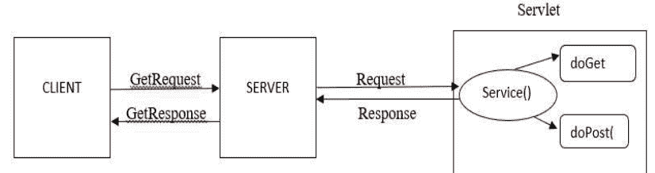

### 使用 `PostRequest()` 方法的 Servlets 工作原理

Servlet

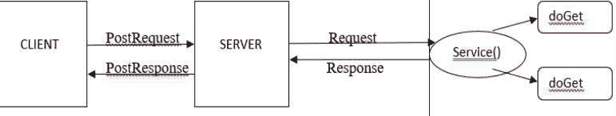

## 3.2 Servlets 的问题

1. **静态内容**：使用 Servlets 可以生成静态内容，但使用 Servlets 生成动态内容非常困难。在这种情况下，在 Servlets 中进行设计是一项困难的任务。

   > 使用 JSP 的解决方案：因此使用 JSP 我们可以创建动态内容（动态 Web 页面），而无需在编写嵌入 Java 代码的 HTML 标签上浪费大量时间。

2. **对于每个客户端请求你都必须编写 `service()` 方法**：在 Servlets 中，对于每个新请求都必须编写 `service()` 方法，这导致了服务器端产生更多的处理时间。简而言之，为了在 Servlets 中处理每个请求，我们需要为来自客户端的每个后续请求准备 `service()` 方法。这给服务器端处理过多的请求及其每个请求的 `service()` 方法造成了负担。

   > 使用 JSP 的解决方案：解决方案是不应该为客户端发出的每个请求编写 `service()` 方法代码的压力。请求可以在不花费过多处理时间的情况下被处理。这意味着请求应该被直接处理，而不需要通过其 `service()` 方法。

3. **静态内容中做的任何修改，Servlets 都需要重新编译和部署**：每当我们对显示逻辑中的静态内容（即 HTML 代码）进行任何修改或更改时，Servlets 都需要重新编译和部署，这在服务器端再次是一个耗时的部分。

   > 使用 JSP 的解决方案：在显示逻辑（前端）中进行的任何更改或修改（即你的静态内容）不需要更改其动态内容，即你的 Java 代码不需要重新编译和部署。因此，这有助于减轻服务器端处理更改的负担。

**注意：**在开始学习 JSP 之前，先过一遍 Servlet 的生命周期，这将有助于你进一步以更简单的方式理解 JSP。

## 3.3 Servlet 生命周期

当我们谈论 Servlet 的创建和销毁时，Servlet 在其生命周期期间会经历一些阶段。各个阶段如下：

- i）加载 Servlet 类
- ii）创建 Servlet 实例（对象）
- iii）调用 `init()` 方法
- iv）调用 `service()` 方法
- v）调用 `destroy()` 方法

基本上，Servlet 是一个服务器端程序，实际上位于服务器端，每当从客户端向服务器发送任何请求时，Servlet 就会执行以为请求生成相应的响应。

假设请求第一次来自客户端，首先进入：

- **a）Web 容器（Web Container）**：它负责维护 Servlet 的生命周期实例（对象创建）。因此，Web 容器负责在请求来自客户端时创建 Servlet 对象，这意味着 Servlet 类被加载且 Servlet 对象被创建（实例化）。
- **b）**第二步是初始化 Servlet 对象，Servlet 将调用其 `init()` 方法，该方法负责 Servlet 的初始化。
- **c）**在调用 `init()` 方法后，在此阶段，来自客户端的请求尚未被处理。为了处理客户端的请求，Servlet 将调用 `service()` 方法，这是 Servlet 最重要的方法，因为它包含了 Servlet 的业务逻辑。

  > **注意：**在 Servlet 的整个生命周期中，对象只创建一次，其 `init()` 方法也被调用一次。

- **d）**调用 `service()` 方法后，它将开始处理客户端的请求，并触发 `service()` 方法的业务逻辑执行。

  **注意：**对于每个新请求，Servlet 每次都会调用 `service()` 方法。

- **e）**在处理请求并执行 `service()` 方法后，Web 容器将开始销毁或者说开始释放 Servlet 处理请求和调用 `service()` 方法时使用的资源。
- **f）**最后阶段是调用或触发 Servlet 及其对象的 `destroy()` 方法。

### 图表 3.3（a）Servlet 的生命周期

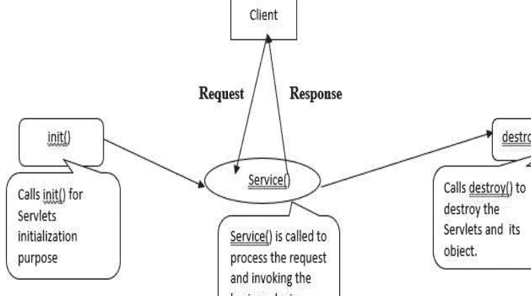

## 3.4 JSP 架构

JSP：以服务器端编程而闻名，提供了创建动态网页、平台无关的方法等功能，有助于构建基于 Web 的应用程序。JSP 可以访问 Java API 族，包括允许访问企业级数据库的 JDBC API。

| JAVA | HTML | = JSP |
| :--- | :--- | :--- |

在开始 JSP 之前，你应该了解 HTML 标签的使用。它是一种超文本标记语言，可以帮助程序员描述或设计网页的结构。因此，Java 被嵌入到 HTML 标签中，以创建作为 JSP 的动态网页。

JSP：它是一项使用 Java 代码、HTML 标签和一些脚本标签来开发动态网页的技术。JSP 页面遵循以下阶段：

1. JSP 页面的翻译。
2. JSP 页面的编译。
3. 类加载。


## JSP 生命周期

### 实例化

### 初始化

### 请求处理（web 容器调用 `jspService()` 方法）

### 销毁（web 容器调用 `jspDestroy()` 方法）

**注意**：JSP 的生命周期方法为：`jspInit()`、`jspService()`、`jspDestroy()`。

步骤 1：在 JSP 翻译器的帮助下，JSP 页面首先被翻译成 Servlet。

步骤 2：JSP 翻译器是服务器的一部分，负责将 JSP 页面翻译成 Servlet。

步骤 3：之后，Servlet 页面由编译器编译，并创建`.class`文件，这是一个二进制文件。

步骤 4：在 Servlet 中发生的所有过程都会在某些 JSP 中执行，即初始化和向浏览器发送响应，最后在结束时调用`destroy()`方法。

### 图表 3.4.a JSP 页面的生命周期

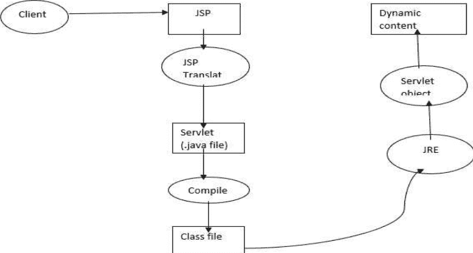

## 3.5 JSP 的构建块

JSP 代码有三个构建块：

- a) 脚本段标签 (Scriptlet tag)
- b) 表达式标签 (Expression tag)
- c) 声明标签 (Declaration tag)

### 3.5.a 脚本段标签

Java 提供了各种脚本元素，帮助程序员将 JSP 代码中的 Java 代码插入到 Servlet 中。脚本段元素具有不同的组件，可以帮助在 JSP 中编写代码。JSP 中的脚本元素必须写在`<% %>`标签内。JSP 引擎将处理写在`<% %>`标签对中的任何代码，JSP 页面中的任何其他文本将视为 HTML 代码。简而言之，脚本段标签用于在 JSP 中执行 Java 代码。

**语法**：`<% Java code %>`

**示例**：

```html
<html>
<body>
<% out.print("Welcome to JSP") %>
</body>
</html>
```

### 3.5.b 表达式标签

表达式元素由脚本语言表达式组成，这些表达式由 JSP 引擎执行并转换为字符串，并作为输出流的响应输出。不需要编写`out.print()`方法。

**语法**：`<%= statement %>`

**示例**：

```html
<html>
<body>
<%= "JSP based String" %>
</body>
</html>
```

### 3.5.c 声明标签

它用于在 JSP 中定义或声明方法和变量。写在 JSP 声明标签内部的代码放置在`service()`方法之外。

**语法**：`<%! Declaration %>`

## 3.6 脚本标签

JSP 中有五种不同的脚本段元素：

- 1) 注释 (Comments)
- 2) 指令 (Directives)
- 3) 声明 (Declaration)
- 4) JSP 脚本段标签 (JSP scriptlet Tag)
- 5) 表达式 (Expressions)

### 3.6.1 注释

注释用于编写某些 JSP 编译器忽略的文本或语句。当有人想在将来记住某些逻辑或信息时，它非常有用。

**语法**：`<!-- A JSP COMMENT -->`

### 3.6.2 指令

用于在 JSP 页面翻译时向 web 容器提供特定的指令。它有三个子类：

- Page：`<%@ page...%>`
- Include：`<%@ include...%>`
- Taglib：`<%@ taglib...%>`

### 3.6.3 声明

用于在 JSP 文件的 Java 代码中声明方法和变量。在 JSP 中，规则是在使用任何变量之前对其进行声明。

**语法**：`<%! declaration; [declaration;]+...%>`

**示例**：`<%! int a=62; %>`

### 3.6.4 JSP 脚本段标签

请参考 3.5.a 脚本段标签。

### 3.6.5 表达式

它包含脚本语言表达式，这些表达式由 JSP 引擎评估并转换为字符串，并作为响应的输出流。因此不需要写`out.print()`方法。

**示例**：

```html
<html>
<body>
<%= "a JSP String" %>
</body>
</html>
```

## 3.7 隐式对象

JSP 中有 9 个隐式对象。这些对象由 web 容器创建，并对所有 JSP 页面都可用。

| 对象 | 类型 |
| --- | --- |
| Out | `javax.servlet.jsp.JspWriter` |
| Request | `javax.servlet.http.HttpServletRequest` |
| Response | `javax.servlet.http.HttpServletResponse` |
| Config | `javax.servlet.jsp.ServletConfig` |
| Application | `javax.servlet.ServletContext` |
| Session | `javax.servlet.http.HttpSession` |
| pageContext | `javax.servlet.jsp.PageContext` |
| Page | `javax.servlet.jsp.JspPage` |
| Exception | `java.lang.Throwable` |

### 3.7.1 Out

`out`对象是`javax.servlet.jsp.JspWriter`的实例。它用于发送内容。

### 3.7.2 Request

`request`对象是`javax.servlet.http.HttpServletRequest`的实例。它用于请求。

`request`的一些方法：

- a) Attribute
- b) Cookies
- c) GetParameter
- d) Header
- e) Session
- f) Get
- g) Locale
- h) GetAttribute

### 3.7.3 Response

`response`对象是`javax.servlet.http.HttpServletResponse`的实例。它用于响应。

**示例**：`response.sendRedirect("http://www.google.com");`

### 3.7.4 Config

在 JSP 中，`config`是`javax.servlet.jsp.ServletConfig`的隐式对象。此对象可用于特定页面的初始化。

**示例**：`config.getParameter("name");`

### 3.7.5 Application

在 JSP 中，`application`是`javax.servlet.ServletContext`的隐式对象。此对象在应用程序部署时创建一次。

**示例**：`application.getParameter("name");`

### 3.7.6 Session

在 JSP 中，`session`是`javax.servlet.http.HttpSession`的隐式对象。此对象用于为会话信息设置、获取和删除属性。

**示例**：`session.setAttribute("user", x);`

### 3.7.7 pageContext

在 JSP 中，`pageContext`是`javax.servlet.jsp.PageContext`的隐式对象。此对象用于在以下作用范围内设置、获取和删除属性：

- Page
- request
- session
- application

### 3.7.8 Page

此对象作为`javax.servlet.jsp.JspPage`实例的实际引用。此对象可以代表整个 JSP 页面。

**示例**：`pageContext.removeAttribute("attrName", PAGE_SCOPE);`

### 3.7.9 Exception

在 JSP 中，`exception`是`java.lang.Throwable`的隐式对象。此对象可以仅在错误页中打印异常。

## 3.8 JSP 标准标签库 (JSTL) 简介和 JSTL 标签

JSTL 是一组预定义的标签，用于简化 JSP 开发。为了开发任何 JSP 应用程序我们用 Java 编写代码，因此为了编写这些 Java 代码我们需要一些像脚本段标签那样的标签。在 Java 中编写逻辑代码会导致代码长度增加，导致处理时间增加。

JSTL 的优势：

- 1) 快速开发：提供了许多简化 JSP 的标签。在 JSP 中编写逻辑代码需要使用脚本段标签。为了避免使用这些逻辑代码，JSTL 提供了一些预定义的逻辑标签。
- 2) 代码复用：我们可以在多个页面上使用 JSTL 标签。
- 3) 不需要使用脚本段标签：它避免了脚本段标签的使用。

JSTL 标签：它是提供自定义标签的预定义库。

- 1) 核心标签 (Core tags)：它有助于变量支持、URL 管理、流控制等。
- 2) 函数标签 (Functions tags)：它提供了字符串操作和获取字符串长度的支持。
- 3) 格式标签 (Formatting tags)：它提供了消息、数字、日期格式等的支持。
- 4) XML 标签 (XML tags)：它用于操作和创建 XML 文档。
- 5) SQL 标签 (SQL tags)：它提供了 SQL 支持，如数据库连接。

## 3.9 总结

本课程将帮助学生建立 Java 基础和高级 Java 编程技能。

## 3.10 进一步阅读的参考

- javadoc.in
- javapoint.com
- W3schools.in

## 练习选择题

1. 在 JSP 中应该使用哪个页面指令来生成 PDF 页面？
   - a. contentType
   - b. generatePdf
   - c. typePDF
   - d. contentPDF

2. Application 是哪个类的实例？
   - a. `javax.servlet.Application`
   - b. `javax.servlet.HttpContext`
   - c. `javax.servlet.Context`
   - d. `javax.servlet.ServletContext`

3. `HttpJspPage`类的`_jspService()`方法不应该被重写。
   - a. 正确
   - b. 错误

4. 下列哪项不是 JSP 指令？
   - a. Include
   - b. Page
   - c. Export
   - d. useBean

5. 在 JSP 配置中`config`是哪个类的实例？
   - a. `javax.servlet.ServletContext`
   - b. `javax.servlet.ServletConfig`
   - c. `javax.servlet.Context`
   - d. `javax.servlet.Application`

## 4 Bean 简介、标准动作、会话跟踪类型与方法、自定义标签

### 单元结构

- 4.0 目标
- 4.1 简介
- 4.2 Bean 简介
- 4.3 标准动作
  - 4.3.1 `jsp:useBean`
  - 4.3.2 `jsp:include`
  - 4.3.3 `jsp:setProperty`
  - 4.3.4 `jsp:forward`
  - 4.3.5 `jsp:plugin`
  - 4.3.6 `jsp:attribute`
  - 4.3.7 `jsp:body`
  - 4.3.8 `jsp:text`
  - 4.3.9 `jsp:param`
  - 4.3.10 `jsp:output`
- 4.4 会话跟踪类型和方法
  - 4.4.1 Cookies
  - 4.4.2 隐藏字段
  - 4.4.3 URL 重写
  - 4.4.4 Session 对象
- 4.5 自定义标签
- 4.7 延伸阅读参考

### 4.0 目标

EJB 代表 Enterprise Java Beans（企业级 Java Bean）。它是一种服务端组件。这意味着 EJB 基本上用于服务端编码。因此，如果我们同时有客户端和服务端，EJB 是用于服务器端而不是客户端的。

### 4.1 简介

EJB 是 J2EE 平台不可或缺的一部分。J2EE 应用容器包含了客户端用于执行业务逻辑的组件。这些组件被称为业务逻辑和业务数据。EJB 主要由业务逻辑和业务数据组成。EJB 组件始终位于某个容器中，该容器被称为 EJB 容器。EJB 组件是由开发者编写的实现业务逻辑的 EJB 类。

### 4.2 Bean 简介

JavaBeans 无非说是一个将许多对象封装到单个对象中的类，而这个对象本质就是一个 bean。JavaBeans 应该遵循某些协议，例如：

1) 它们是可序列化的
2) 有一个无参数的属性构造函数
3) 允许使用 getter 和 setter 方法访问属性。

**JavaBeans 类示例**：`students.java`

```java
package mypack;

public class students implements java.io.Serializable
{
    private int RollNo;
    private String name;
    public students(){}
    public void setRollNo(int id)
    {
        this.RollNo=RollNo;
    }
    public int getId()
    {
        return RollNo;
    }
    public void setName(String name)
    {
        this.name=name;
    }
    public String getName()
    {
        return name;
    }
}
```

#### 如何访问 JavaBean 类？

要访问 JavaBean 类，我们应该使用 getter 和 setter 方法。

```java
package mypack;
public class Test
{
  public static void main(String[] args)
  {
    students s=new students(); // 创建对象
    s.setName("Rahul"); // 为对象赋值
    System.out.println(s.getName());
  }
}
```

### 4.3 标准动作

JSP 中的标准动作用于控制 Servlet 引擎的行为。JSP 中有 11 个标准动作标签。通过这些标签的帮助，我们可以动态地插入文件、重用 bean 组件、转发用户等。

**语法**：`<jsp:action_name attribute="value" />`

#### 4.3.1 `jsp:useBean`

此标签用于在 JSP 页面中使用 beans 的时候。

**语法**：`<jsp:useBean class="" />`

#### 4.3.2 `jsp:include`

此标签用于将一个 JSP 文件插入到另一个文件中，与 include 指令相同。它在请求处理阶段进行计算。

**语法**：`<jsp:include page="page URL" flush="true/false">`

#### 4.3.3 `jsp:setProperty`

此标签用于设置 bean 的属性。在设置此属性之前，我们需要定义一个 bean。

**语法**：`<jsp:setProperty name="" property="">`

#### 4.3.4 `jsp:getProperty`

这用于获取 bean 的属性。它以字符串格式插入输出，并转换为字符串。

**语法**：`<jsp:getProperty name="" property="">`

#### 4.3.5 `jsp:forward`

这用于将请求转发到另一个页面。

**语法**：`<jsp:forward>`

#### 4.3.6 `jsp:plugin`

此标签用于在页面中包含插件。

**语法**：`<jsp:plugin>`

#### 4.3.7 `jsp:param`

此标签用于向页面传递参数。

**语法**：`<jsp:param>`

#### 4.3.8 `jsp:body`

此标签用于捕获标签体。

**语法**：`<jsp:body>`

#### 4.3.9 `jsp:attribute`

此标签用于为标签设置属性。

**语法**：`<jsp:attribute>`

#### 4.3.10 `jsp:output`

此标签用于向页面输出内容。

**语法**：`<jsp:output>`

### 4.4 会话跟踪类型和方法

有四种识别会话的技术：

- a) Cookies
- b) 隐藏字段
- c) URL 重写
- d) Session 对象

#### 4.4.1 Cookies

Cookie 是服务器发送到客户端的小型信息。Cookie 有两种类型：

- 会话 Cookie（Session cookies）：这些是临时的，当用户关闭浏览器时删除。
- 持久性 Cookie（Persistent cookies）：它们留在硬盘上直到它们过期。

#### 4.4.2 隐藏字段（Hidden Field）

隐藏字段与其他输入相似，区别在于它们不显示。例如：`<input type="hidden" name="session">`

#### 4.4.3 URL 重写

附加或修改 URL 以识别客户端的过程。


## 4.4.4 Session 对象：用于会话管理

当用户第一次进入网站时，服务器生成一个`ID`并将该`ID`附加到每个请求中。如何访问或获取`session`对象：通过调用`getSession()`方法，这是一个隐式对象。

```java
HttpSession x=request.getSession();
HttpSession y=request.getSession(false);
```

## 练习选择题

- 1. 在 JSP 中应该使用哪个页面指令来生成 PDF 页面？

a. `contentType`

b. `generatePdf`

c. `typePDF`

d. `contentPdf`

- 2. 哪个类的实例是`HttpSession`？

a. `javax.servlet.Application`

b. `javax.servlet.HttpServletContext`

c. `javax.servlet.Context`

d. `javax.servlet.ServletContext`

- 3. `HttpsPage`类的`_jspService()`方法不应被重写。

a. 正确

b. 错误

- 4. 下列哪项不是 JSP 指令？

a. `Include`

b. `Page`

c. `Export`

d. `useBean`

- 5. 在 JSP 配置中，`config`是哪个类的实例？

a. `javax.servlet.ServletContext`

b. `javax.servlet.ServletConfig`

c. `javax.servlet.Context`

d. `javax.servlet.Application`

# Spring 框架简介

## 单元结构

- 5.1 目标
- 5.2 Spring 框架简介
- 5.3 POJO 编程模型
- 5.4 轻量级容器
  - 5.4.1 Spring IOC 容器
  - 5.4.2 配置元数据
  - 5.4.3 配置和使用容器
- 5.5 总结
- 5.6 参考文献
- 5.7 单元练习

## 5.1 目标

本章将使你理解以下概念：

- Spring 框架
- POJO 编程模型
- IoC 容器
- 如何配置容器配置元数据

## 5.2 Spring 框架简介

- 最初，Java 开发者需要使用 JavaBeans 技术来创建 Web 应用。
- 虽然 JavaBeans 有助于用户界面（UI）组件的开发，但它们无法提供开发健壮且安全的企业级应用所需的服务，例如事务管理和安全性。
- EJB（企业 Java Beans）被视为解决问题的方案，它扩展了 Java 组件（作为 Web 和企业组件），并提供了有助于企业级应用开发的服务。
- 然而，使用 EJB 开发企业应用并不容易，因为开发者需要执行各种任务，例如创建`Home`和`Remote`接口以及实现生命周期方法，这导致了代码的复杂性，开发者开始寻找更简单的方法来开发此类应用。
- Spring 框架作为解决所有这些问题的解决方案而发展。
- 该框架使用各种新技术，如面向切面编程（AOP）、简单的旧 Java 对象（POJO）和依赖注入（DI）来开发企业级应用。
- Spring 是一个开源框架，允许 Java EE 7 开发者构建简单、可靠且可扩展的应用。
- 与经典的 Java 框架和应用程序接口（API），如 Java 数据库连接（JDBC）、Java Pages（JSP）和 Java Servlet 相比，它让 Web 应用的开发变得简单得多。

### 5.2.1 Spring 框架概述

- Spring 是企业 Java 最流行的应用程序框架。全球数百万开发者使用 Spring Framework 创建高性能、易测试和可用的代码。
- Spring 框架旨在让 J2EE 开发更容易，并通过启用基于 POJO 的编程模型促进良好的编程实践。
- Spring 可能会成为你所有企业级应用的一站式解决方案。然而，Spring 是模块化的，允许你选择哪些模块适用于你，而无需引入其他部分。
- 下节提供了 Spring 框架中可用所有模块的详细信息。

| Spring Framework | | | | |
| :--- | :--- | :--- | :--- | :--- |
| 数据访问 / 集成 | Web (MVC / Remoting) | | | |
| JDBC | ORM | WebSocket | Servlet | |
| OXM | JMS | | | |
| AOP | Aspects | Instrumentation | Messaging | |
| 核心容器 | | | | |
| Beans | Core | Context | SpEL | |

#### 核心容器

核心容器由`Core`、`Beans`、`Context`和`Expression Language`模块组成，其细节如下：

- **Core** 模块提供了框架的基础部分，包括 IoC 和依赖注入功能。
- **Bean** 模块提供了`BeanFactory`，它是工厂模式的一种复杂实现。
- **Context** 模块在 Core 和 Beans 模块提供的坚实基础之上构建，它是访问任何已定义和配置对象的媒介。`ApplicationContext`接口是 Context 的焦点。
- **SpEL** 模块提供了一种强大的表达式语言，用于在运行时查询和操纵对象图。

#### 数据访问/集成

数据访问/集成层由`JDBC`、`ORM`、`OXM`、`JMS`和`Transaction`模块组成，细节如下：

- **JDBC** 模块提供了一个 JDBC 抽象层，消除了对繁琐 JDBC 相关代码的需求。
- **ORM** 模块为流行的对象关系映射 API 提供集成层，包括`JPA`、`JDO`、`Hibernate`和`iBatis`。
- **OXM** 模块提供了一个支持`JAXB`、`Castor`、`XMLBeans`、`JiBX`和`XStream`的对象/XML 映射实现的抽象层。
- **JMS** 模块包含生产和消费消息的功能。
- **Transaction** 模块为实现特殊接口的类以及你所有的 POJO 支持程序化和声明式事务管理。

#### Web 层

Web 层由`Web`、`Web-MVC`、`Web-Socket`和`Web-Portlet`模块组成，细节如下：

- **Web** 模块提供了基本的面向 Web 的集成功能，例如多部分文件上传功能以及使用`servlet`监听器和 Web 应用程序上下文初始化 IoC 容器。
- **Web-MVC** 模块包含了 Spring 针对 Web 应用的模型视图-控制器（MVC）实现。
- **Web-Socket** 模块为 Web 应用中基于`WebSocket`的客户端与服务器之间的双向通信提供支持。
- **Web-Portlet** 模块提供了用于`portlet`环境的 MVC 实现，并镜像了`Web-Servlet`模块的功能。

#### 其他模块

还有其他重要的模块，如`AOP`、`Aspects`、`Instrumentation`、`Messaging`和`Test`模块，细节如下：

- **AOP** 模块提供了面向切面编程实现，允许你定义方法拦截器和切点，以解耦实现应该分离的功能的代码。
- **Aspects** 模块提供了与`AspectJ`的集成，这又是一个强大且成熟的 AOP 框架。
- **Instrumentation** 模块提供了类内入支持和类加载器实现，用于某些应用程序服务器。
- **Messaging** 模块提供了在应用程序中使用 `STOMP` 子协议的支持。
- **Test** 模块支持使用 `JUnit` 或 `TestNG` 框架对 Spring 组件进行测试。

## 5.3 POJO 编程模型

- Java 中的 POJO 代表 Plain Java Object。
- 通常，POJO 类包含变量以及它们的`Getters`和`Setters`。
- POJO 类与 Beans 类似，因为它们都用于定义对象以增加可读性和重用性。
- 它们唯一的区别是 Bean 文件具有某些限制，而 POJO 文件没有任何限制。
- POJO 仅意味着一个没有强制实现任何接口、扩展任何类、包含任何预定义的注解或由于强制限制而遵循任何模式的类。
- POJO 类用于定义对象实体。例如，我们可以创建一个`Employee` POJO 类来定义其对象。
- 下面是一个 Java POJO 类的示例：

### Employee.java

```java
// POJO class example
package Jtp.PojoDemo;
public class Employee
{
    private String name;
    private String id;
    private double sal;
    public String getName() {
    return name;
    }
    public void setName(String name) {
    this.name = name;
    }
    public String getId() {
    return id;
    }
    public void setId(String id) {
    this.id = id;
    }
    public double getSal() {
    return sal;
    }
    public void setSal(double sal) {
    this.sal = sal;
    }
}
```

### 在 Java 程序中使用 POJO 类

若要从 POJO 类中访问对象，请遵循以下步骤：

1. 创建 POJO 类对象
2. 使用`set()`方法设置值
3. 使用`get()`方法获取值

例如，在同一个包中创建一个`MainClass.java`类文件并在其中编写以下代码：

### MainClass.java

```java
// Using POJO class objects in MainClass Java program
package Jtp.PojoDemo;
public class MainClass {
    public static void main(String[] args) {
        // 创建一个 Employee 类对象
        Employee obj= new Employee(); //POJO class object created.
        obj.setName("Alisha");
        // 使用 set() 方法设置值
        
        obj.setId("A001");
        obj.setSal(200000);
        
        // 使用 get() 方法获取值
        System.out.println("Name: " + obj.getName());
        System.out.println("Id: " + obj.getId());
        System.out.println("Salary: " + obj.getSal());
    }
}
```

输出:

| Name: Alisha |
| :--- |
| Id: A001 |
| Salary: 200000.0 |

### POJO 类的属性

- POJO 类必须是公共的（`public`）。
- 它必须有一个公有的默认无参构造函数。
- 它可以有带参数的构造函数。
- 所有对象必须具有一些公共的`Getters`和`Setters`，以便其他 Java 程序访问这些值。
- POJO 类中的对象可以具有任何访问修饰符，如`private`、`public`、`protected`。但为了提高项目的安全性，所有的实例变量都应该是私有的（`private`）。
- POJO 类不应该继承预定义的类。
- 它不应该实现特定的接口。
- 它不应该有任何预设的注解。

## 5.4 轻量级容器

### 5.4.1 Spring IoC 容器

- Spring 容器是 Spring Framework 的核心。
- 容器用于创建对象并配置它们。
- 同时，Spring IoC 容器用于管理从创建到销毁的完整周期。
- 它使用依赖注入（DI）来管理组件，这些对象被称为 Spring Beans。
- 容器使用配置元数据，由 Java 代码、注解或 XML 表示，并如下所示的 Java POJO 类。

#### Java POJO 类

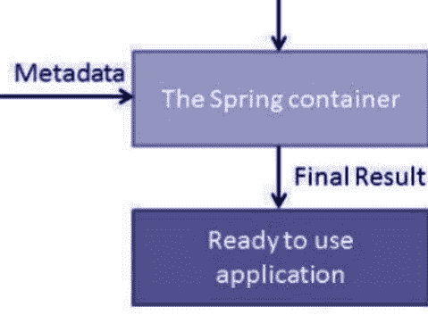

图. Spring IoC 容器

#### IoC 容器的类型

这是两种 Spring IoC 容器。

### 5.4.1.1 SpringFactoryBean 容器

- `SpringFactoryBean`容器是最简单的容器，为 DI 提供基本支持。
- 它由`org.springframework.beans.factory.BeanFactory`接口定义。
- Spring 提供了许多`BeanFactory`接口的实现，其中`XmlBean`是最常用的类。
- `XmlFactoryBean`从 XML 文件的元数据中读取配置，用于完全配置应用程序。
- 当资源受限于移动设备或基于 applet 的应用程序时，优先`BeanFactory`容器。
- 你将看到一个在 Eclipse IDE 中运行的示例以及创建 Spring 应用程序的步骤。

创建 Spring 应用程序的步骤：

i. 创建一个名为`SpringExample`的项目和`com.example`包。这些应该位于所创建项目的`src`文件夹下。

ii. 使用 `Add External JARS` 添加所需的 Spring 库。

iii. 在包`com.example`下创建 Java 类`HelloWorld`和`MainApp`。

iv. 在`src`文件夹下创建 Beans 配置文件`Beans.xml`。

v. 最后，创建所有 Java 文件和 Beans 配置文件的内容，并按照如下所示运行文件。

`HelloWorld.java`的代码所示：

```java
package com.example;

public class HelloWorld {

    private String message;

    public void setMessage(String message) {
        this.message = message;
    }

    public void getMessage() {
        System.out.println("Your Message : " + message);
    }
}
```

以下是`MainApp.java`的代码。

```java
package com.example;

import org.springframework.beans.factory.InitializingBean;
import org.springframework.beans.factory.xml.XmlBeanFactory;
import org.springframework.core.io.ClasspathResource;

public class MainApp {

    public static void main(String[] args) {
        XmlBeanFactory factory = new XmlBeanFactory(new ClassPathResource("Beans.xml"));

        HelloWorld obj = (HelloWorld) factory.getBean("helloWorld");
        obj.getMessage();
    }
}
```

请注意：

- 编写一个工厂对象，其中你使用了`XmlBeanFactory()`来加载 CLASSPATH 里的 bean 配置文件。
- `getBean()` 使用 bean ID 返回一个泛型对象以获取所需的 bean。

以下是`Beans.xml`的 XML 代码。

```xml
<?xml version="1.0" encoding="UTF-8"?>
<beans xmlns="http://www.springframework.org/schema/beans"
     xmlns:xsi="http://www.w3.org/2001/XMLSchema-instance"
     xsi:schemaLocation="http://www.springframework.org/schema/beans/spring-beans-3.0.xsd">
    <bean id="HelloWorld" class="com.example.HelloWorld">
        <property name="message" value="Hello World!"/>
    </bean>
</beans>
```

运行应用程序后，你将看到以下输出消息。

**Your Message: Hello World!**

### 5.4.1.2 SpringApplicationContext 容器

- `ApplicationContext`是 Spring 的高级容器。
- 它由`org.springframework.context.ApplicationContext`接口定义。
- `ApplicationContext`拥有`BeanFactory`的所有功能。
- 通常比`BeanFactory`更推荐。
- `ApplicationContext`最常见的实现有：

    - `FileSystemXmlApplicationContext`: 它是一种从 XML 文件加载 bean 定义的容器类型。为此，你应该能够向构造函数提供 XML bean 配置文件的完整路径。


- `ClassPathXmlApplicationContext`：这种类型的容器从 XML 文件加载 bean 的定义，但你不需要提供 XML 文件的完整路径。只需要正确设置 `CLASSPATH`，因为此容器会查找 Bean 配置 XML 文件。

- `WebXmlApplicationContext`：这种类型的容器在 Web 应用程序加载包含所有 bean 定义的 XML 文件。

你将通过 Eclipse IDE 中带有步骤的运行示例来更好地理解：

i. 创建一个名为 `SpringExample` 的项目和 `com.example` 包。这些应该位于所创建项目的 `src` 文件夹下。

ii. 使用 `Add External JARS` 添加所需的 Spring 库。

iii. 在包 `com.example` 下创建 Java 类 `HelloWorld` 和 `MainApp`。

iv. 在 `src` 文件夹下创建 Beans 配置文件 `Beans.xml`。

v. 最后，创建所有 Java 文件和 Beans 配置文件的内容，并按照如下所示运行文件。

`HelloWorld.java` 文件的代码：

```java
package com.example;

public class HelloWorld {

    private String message;

    public void setMessage(String message) {
        this.message = message;
    }

    public void getMessage() {
        System.out.println("Your Message : " + message);
    }
}
```

`MainApp.java` 的代码：

```java
package com.example;

import org.springframework.context.ApplicationContext;
import org.springframework.context.support.FileSystemXmlApplicationContext;

public class MainApp {

    public static void main(String[] args) {
        ApplicationContext context = new FileSystemXmlApplicationContext("C:/Users/ADMIN/workspace/HelloSpring/src/Beans.xml");

        HelloWorld obj = (HelloWorld) context.getBean("helloWorld");
        obj.getMessage();
    }
}
```

请注意：

- 使用框架 API `FileXmlApplicationContext` 创建一个工厂对象。该 API 负责创建和初始化所有对象。

- `UseBean()` 使用 bean ID 返回一个泛型对象以获取所需的 bean。

```xml
<?xml version="1.0" encoding="UTF-8"?>
<beans xmlns="http://www.springframework.org/schema/beans"
     xmlns:xsi="http://www.w3.org/2001/XMLSchema-instance"
     xsi:schemaLocation="http://www.springframework.org/schema/beans/spring-beans-3.0.xsd">

  <bean id="helloWorld" class="com.example.HelloWorld">
    <property name="message" value="Hello World!"/>
  </bean>

</beans>
```

## 5.4.2 配置元数据

- 配置元数据允许你表达组成对象及其复杂的依赖关系。

- 配置元数据以简单直观的 XML 格式提供。

- Spring 配置由至少一个通常是多个容器必须管理的对象定义组成。基于 XML 的配置将这些对象显示为顶层 `<objects>` 元素内部的 `<object>` 元素。

- 这些对象定义对应于构成应用程序的对象。通常你会定义服务层对象、数据访问对象（DAO）、表示对象（如 ASP.NET 页面实例）、基础设施对象（如 NHibernate SessionFactory）等。

- 下例展示了基于 XML 的配置元数据的基本结构。

```xml
<objects xmlns="http://www.springframeworkframework.net">
<object id="..." type="...">
  <!-- collaborators and configuration for this object go here -->
</object>
<object id="..." type="...">
  <!-- collaborators and configuration for this object go here -->
</object>

<!-- more object definitions go here -->
</objects>
```

注意：`id` 属性是一个字符串，用于它来标识单个对象的定义。`type` 属性定义了对象的类型。

## 5.4.3 配置和使用容器：

- 实例化 Spring IoC 容器是非常简单的。

- 给 `Application` 构造函数的路径或多个路径实际上是资源，允许容器从各种外部资源（如本地文件系统、嵌入式程序集等）加载配置元数据。

示例：

`getApplication = new XmlApplicationContext("services.xml", "data-access.xml");`

（注意：服务层对象 (`services.xml`) 配置文件，数据访问对象 (`daos.xml`) 配置文件）

`service.xml`：

```xml
<objects xmlns="http://www.springframework.net">
<object id="PetStore" type="PetStore.Services.PetStoreService,PetStore">
  <property name="AccountDao" ref="AccountDao"/>
  <property name="ItemDao" ref="ItemDao"/>
</object>

<!-- additional collaborators and configuration for this object go here -->
</object>
<!-- more object definitions for services go here -->
</objects>
```

（注意：服务层由类`PetStoreService`组成。）

`IApplicationContext` 是高级工厂的接口，能够维护不同对象及其依赖关系的注册表。使用 `GetObject(string)` 方法或索引器 `[string]` 可以检索对象的实例。

`IApplicationContext` 允许你通过以下方式读取对象定义并访问它们：

```java
// create and configure objects
```

```java
IApplicationContext context = new XmlApplicationContext("services.xml", daos.xml);
```

```java
// retrieve instance
```

```java
PetStoreService service = (PetStoreService) context.GetObject("PetStoreService");
```

```java
// configured instance
```

```java
IList userList = service.getUserNames();
```

## 5.5 总结：

- Spring 是一个开源的轻量级框架。

- Spring 是企业级 Java 最流行的应用程序开发框架。

- Java 中的 POJO 代表 Plain Old Object（简单旧对象）。

- POJO 意味着一个不被强制实现任何接口或继承任何特定类的类。

- Spring 容器是 Spring Framework 的核心。

- Spring IoC 容器用于管理从创建到销毁的完整生命周期。

- 配置元数据允许你以 XML 格式表示你应用程序中的对象。

## 5.6 参考文献

参考书籍：

- Java 6 Programming Black Book, Wiley–Dreamtech ISBN 10: 817722736X ISBN 13: 9788177227369

- Spring in Action, Craig Walls, 3rd Edition, Manning, Spring 9781935182351

- Professional Java Development with the Spring Framework by Roy Johnonset et al. John Wiley & Sons 2005 (672 pages) ISBN:0764574833

- Beginning Spring, Mert Calis kan Kenan Sevindik Published by John Wiley & Sons, Inc. 10475 Crosspoint Boulevard Indianapolis, IN 46256

网络引用：

- https://www.springframework.net/

- https://www.javadevjournal.com/

- https://www.tutorialspoint.com/

- https://www.geeksforgeeks.org/

## 5.7 单元结束练习：

1. 请带有整洁标签的图表解释 Spring 框架。

2. 什么是 POJO 编程模型？给出合适的示例。

3. 列出 POJO 类的属性。

4. 解释 IoC 容器的概念。

5. 解释不同类型的 IoC 容器。

6. 解释与容器进行元数据配置的过程。

# 6

# Spring 框架

# 单元结构

- 6.1 目标

- 6.2 依赖注入

- 6.2.1 Setter 注入

- 6.2.2 构造函数注入

- 6.3 循环依赖

- 6.4 Bean 覆盖

- 6.5 自动装配

- 6.6 Bean 查找

- 6.7 Spring 管理 Bean

- 6.8 总结

- 6.9 参考文献

- 6.10 单元结束练习

## 6.1 目标

本章将使你理解以下概念：

- 依赖注入

- 循环依赖

- Bean 覆盖

- 自动装配

- Bean 查找

- Spring 管理 Bean

## 6.2 依赖注入：

- 依赖注入 (DI) 是一个过程，在该过程中对象定义它们的依赖关系（即它们协作的其他对象），仅通过构造函数参数和在构建的对象实例上设置的属性来定义。

- 容器在创建对象时注入这些依赖。

- 依赖注入存在两种主要的变体：基于构造函数的依赖注入和基于 Setter 的依赖注入。

## 6.2.1 基于构造函数的依赖注入：

基于构造函数的 DI 通过容器调用带有多个参数的构造函数来实现，每个参数代表一个依赖。

下面的示例展示了一个可以进行构造函数注入的类。

```java
public class SimpleLister {
    // 对 MovieFinder 的依赖
    private MovieFinder movieFinder;
    public SimpleLister(MovieFinder movieFinder) {
        this.movieFinder = movieFinder;
    }
}
```

## 6.2.2 基于 Setter 的依赖注入：

基于 Setter 的 DI 通过容器在无参构造函数实例化对象后调用 setter 属性来实现。

下面的示例展示了一个可以使用 setter 注入的类。

```java
public class SimpleLister {
    // 对 MovieFinder 的依赖
    private MovieFinder movieFinder;
    void setMovieFinder(MovieFinder movieFinder) {
        this.movieFinder = movieFinder;
    }
}
```

## 6.3 循环依赖：

当一个 bean 依赖另一个时，在注入期间会出现问题。假设 A 和 B 相互依赖，即 A 依赖于 B，反之亦然。

让我们使用代码来理解。创建两个服务 `ServiceA` 和 `ServiceB`，并尝试将 `ServiceA` 注入到 `ServiceB`，反之亦然。

```java
@Service
public class ServiceA {
    private ServiceB serviceB;
    public ServiceA(ServiceB serviceB) {
        this.serviceB = serviceB;
        System.out.println("调用 A");
    }
}
```

```java
@Service
public class ServiceB {
    private ServiceA serviceA;
    public ServiceB(ServiceA serviceA) {
        this.serviceA = serviceA;
        System.out.println("调用 B");
    }
}
```

为了模拟循环依赖问题，运行下面的类并查看控制台日志。

`CircularDependenciesApp.java`

```java
import org.springframework.boot.SpringApplication;
import org.springframework.boot.autoconfigure.SpringBootApplication;

@SpringBootApplication
public class CircularDependenciesApp {
    public static void main(String[] args) {
        SpringApplication.run(CircularDependenciesApp.class, args);
    }
}
```

当我们执行 `CircularDependenciesApp` 类时，由于相互循环依赖，无法注入依赖关系，并将如下所示抛出受检查异常：

控制台日志

（错误日志将显示 `BeanCreationException` 以及 `ServiceA` 和 `ServiceB` 之间的循环）

## 6.3.1 如何解决这个问题？

要解决循环依赖问题，你有两个选择：使用 `@Lazy` 构造函数注入以及结合 `@Autowired` 和 `@Lazy` 注解使用。

## 6.3.1.1 在构造函数注入中使用 `@Lazy`

我们可以在构造函数注入期间延迟初始化 `ServiceB` bean，以推迟 `ServiceB` bean 的构造。为了清晰起见，以下是 `ServiceA` 中的代码更改：

`ServiceA.java`

```java
import org.springframework.context.annotation.Lazy;
import org.springframework.stereotype.Service;
@Service
public class ServiceA {
    private ServiceB serviceB;
    public ServiceA(@Lazy ServiceB serviceB) {
        System.out.println("Calling Service A");
        this.serviceB = serviceB;
    }
}
```

如果你再次运行 `CircularDependenciesTest` 类，你会发现循环依赖问题已经得到了解决。

控制台日志：

```
  .---.      .---.      .____
 /\   /|      |   |O'|\\\
(())_|  |_|_||_|_V'|\\\\
  W   _  |||||||||||| ()))
 '  '______,____|      /=/|/////
====================/=/|||
```

:: Spring Boot :: (v2.3.0.RELEASE)

2020-05-27 21:33:22.637 INFO 7156 --- [main]

w.w.CircularDependenciesTestApp : Starting CircularDependenciesTestApp on Atul-PC with PID 7156 (F:\7s4-workspace/circular-dependencies/target/classes used by user1 in F:\7s4-workspace\circular-dependencies-spring)

2020-05-27 21:33:22.640 INFO 7156 --- [main]

w.w.CircularDependenciesTestApp : No active profile set, falling back to default profiles: default

Calling Service A

Calling Service B


2020-05-27 21:33:23.251 INFO 7156 --- [main]  
`o.w.CircularDependenciesTestApp` : Started `CircularDependenciesTestApp`  
in 0.98 seconds (JVM running for 1.667)

## 6.3.1.2 结合 `@Lazy` 注解使用 `@Autowired`

在 `ServiceA` 中结合使用 `@Autowired` 和 `@Lazy` 注解来注入 `ServiceB`。

让我们使用这些注解来注入 bean 并测试我们的应用程序是否解决了该问题：

### `ServiceA.java`

```java
import org.springframework.beans.factory.annotation.Autowired;
import org.springframework.context.annotation.Lazy;
import org.springframework.stereotype.Service;

@Service
public class ServiceA {
    @Autowired
    @Lazy
    private ServiceB serviceB;
    /*
    public ServiceA(ServiceB serviceB) {
        System.out.println("Calling Service A");
        this.serviceB = serviceB;
    }
    */
}
```

当你再次运行`CircularDependenciesTestApp`类时，控制台日志输出如下：

### 控制台日志：

```
/^/|   '---|'---|__(O)---|---|---|\
(())\||'|_|'|_|V|\
W  )|_)||||||||||((|))
'  |  |_|_|_|_|_|\|/////
==================||_|=/||_|
```

:: Spring Boot :: (v2.3.0.RELEASE)

```
2020-05-27 21:45:07.583 INFO 4036 --- [main]  
o.w.CircularDependenciesTestApp : Starting CircularDependenciesTestApp  
at AtUL-PC with PID 4036 (F:\sts4-workspace\circular-dependencies-  
spring\target\classes started by user1 in F:\sts4-workspace\circular-dependencies-  
spring)
```

```
2020-05-27 21:45:07.586 INFO 4036 --- [main]  
o.w.CircularDependenciesTestApp : No active profile set, falling back to  
default profiles: default
```

Calling Service B

```
2020-05-27 21:45:08.141 INFO 4036 --- [main]  
o.w.CircularDependenciesTestApp
```

## 6.4 覆盖 Bean

一个 bean 定义可以包含许多配置信息，包括构造函数参数、属性值以及容器特定的信息（如初始化方法、静态工厂方法名称等）。

子定义继承自父定义的数据。子定义可以根据需要覆盖某些值，或添加其他值。

Spring Bean 定义的继承与 Java 类继承无关，但其继承的概念是相同的。你可以定义一个父 bean 作为模板，其他子 bean 可以从父 bean 继承所需的配置。

当你使用基于 XML 的配置元数据时，通过使用`parent`属性来指示子 bean 定义，并将父 bean 指定为该属性的值。

### 示例

让我们准备好可用的 Eclipse IDE，并按照以下步骤创建一个 Spring 应用程序——

步骤描述：

- 1. 创建一个名为`SpringExample`的 bean，并在创建的项目`src`文件夹下创建`com.tutorialpoint`包。
- 2. 按照 Spring Hello World 示例章节中的说明，使用`Add External JARs`选项添加所需的 Spring 库。
- 3. 在`com.tutorialpoint`包下创建`HelloWorld`、`HelloIndia`和`MainApp` Java 类。
- 4. 在`com.tutorialpoint`包下创建`HelloWorld`、`HelloIndia`和`MainApp` Java 类。（注：原文此处重复）
- 5. 最后一步是在`src`文件夹下创建`Beans.xml`的内容。以下是`Beans.xml`的内容，我们在其中通过`parent`属性定义了`HelloWorld`、`HelloIndia`和`MainApp`。

```xml
<?xml version="1.0" encoding="UTF-8"?>
<beans xmlns="http://www.springframework.org/schema/beans"
       xmlns:xsi="http://www.w3.org/2001/XMLSchema-instance"
       xsi:schemaLocation="http://www.springframework.org/schema/beans http://www.springframework.org/schema/beans/spring-beans.xsd">

  <bean id="helloWorld" class="com.tutorialpoint.HelloWorld">
    <property name="message1" value="Hello World"/>
    <property name="message2" value="Second World"/>
  </bean>

  <bean id="helloIndia" class="com.tutorialpoint.HelloIndia" parent="helloWorld">
    <property name="message1" value="Hello India"/>
    <property name="message2" value="Second World"/>
    <property name="message3" value="Namaste India"/>
  </bean>
</beans>
```

| 序号 | 类型 | 描述 |
| :--- | :--- | :--- |
| 3 | byType | 按属性类型自动装配。Spring 容器会查看 XML 配置文件中将`autowire`属性设置为`byType`的 Bean 属性。然后，如果该属性的类型与配置文件中某一个 Bean 的名称完全匹配，它将尝试匹配并装配该属性。如果存在多个此类 Bean，则会抛出致命异常。 |
| 4 | constructor | 与`byType`类似，但类型适用于构造函数参数。如果容器中不存在恰好一个构造函数类型的 Bean，则会抛出致命错误。 |
| 5 | autodetect | Spring 首先尝试通过`autowire by constructor`进行自动装配，如果无效，Spring 将尝试通过`byType`进行自动装配。 |

注意：你可以使用`byType`或`constructor`自动装配模式来装配数组和其他类型集合。

## 自动装配的局限性

自动装配在项目中一致使用时效果最好。如果项目中没有普遍使用自动装配，那么开发者使用它来装配一两个 Bean 定义可能会感到困惑。尽管自动装配可以显著减少指定属性或构造函数参数的需求，但在使用之前，你应该考虑自动装配的局限性和缺点。

| 序号 | 局限性 | 描述 |
| :--- | :--- | :--- |
| 1 | 覆盖可能性 | 你仍然可以使用`<constructor-arg>`和`<property>`设置来指定依赖，这些设置将始终覆盖自动装配。 |
| 2 | 基本数据类型 | 你无法自动装配所谓的简单属性，如基本数据类型、String 和类。 |
| 3 | 模糊性 | 自动装配的精确性低于显式装配，因此可能的情况下优先使用显式装配。 |

## 6.6 Bean 查找 (Bean Lookup)

带有`@Lookup`注解的方法告诉 Spring 在我们调用它时返回该方法返回类型的实例。本质上，Spring 将重写该注解的方法，并将我们方法的返回类型和参数作为`BeanFactory#getBean`的参数。

`@Lookup`用于：

- 将原型作用域（prototype-scoped）的 Bean 注入到单例（singleton）Bean 中（类似于 Provider）
- 以过程的方式注入依赖

### 6.6.1 将原型作用域 Bean 注入到单例 Bean 中

第 1 步：创建一个原型 Bean，稍后我们将将其注入到单例 Bean 中

```java
@Component
@Scope("prototype")
public class SchoolNotification {
    // ... 原型作用域状态
}
```

第 2 步：创建一个使用`@Lookup`的单例 Bean

```java
@Component
public class StudentServices {
    // ... 成员变量等

    @Lookup
    public SchoolNotification getNotification() {
        return null;
    }
    // ... getters and setters
}
```

使用`@Lookup`，我们可以通过单例 Bean 获取`SchoolNotification`的实例：

### 第 3 步：

```java
@Test
public void whenLookupMethodCalled_thenNewInstanceReturned() {
    // ... 初始化上下文
    StudentServices first = this.context.getBean(StudentServices.class);
    StudentServices second = this.context.getBean(StudentServices.class);

    assertEquals(first, second);
    assertNotEquals(first.getNotification(), second.getNotification());
}
```

（注意：在 Services 中，我们将`getNotification`方法留为了存根方法）

### 6.6.2 以过程的方式注入依赖

让我们为`StudentNotification`添加一些状态：

### 第 1 步：

```java
@Component
@Scope("prototype")
public class SchoolNotification {
  @Autowired Grader grader;
  private String name;
  private Collection<Integer> marks;

  public SchoolNotification(String name) {
    // ... 设置字段
  }
  // ... getters and setters

  public String addMark(Integer mark) {
    this.marks.add(mark);
    return this.grader.grade(this.marks);
  }
}
```

现在，它依赖于某些 Spring 上下文，还依赖于我们将通过过程提供的额外上下文。

### 第 2 步：我们可以为`StudentServices`添加一个方法，接收学生数据并将其持久化。

```java
public abstract class StudentServices {
    private Map<String, SchoolNotification> notes = new HashMap<>();

    @Lookup
    protected abstract SchoolNotification getNotification(String name);

    public String appendMark(String name, Integer mark) {
        SchoolNotification notification = 
            notes.computeIfAbsent(name, name -> getNotification(name));
        return notification.addMark(mark);
    }
}
```

在运行时，Spring 将以相同的方式实现该方法，并带有额外的技巧。

请注意：

- 它可以调用构造函数并注入其他 Spring Bean，允许我们把`SchoolNotification`处理得更像一个 Spring 感知的方法。它通过实现`getSchoolNotification`并调用`beanFactory.getBean(SchoolNotification.class, name)`来做到。
- 第二，我们有时可以将带有`@Lookup`注解的方法抽象化，如上面的示例所示。

```java
@Test
public void whenAbstractGetterMethodInjects_thenInstanceReturned() {
    // ... 初始化上下文
    StudentServices services = context.getBean(StudentServices.class);
    assertEquals("PASS", services.appendMark("Alex", 89));
    assertEquals("FAIL", services.appendMark("Bethany", 78));
    assertEquals("PASS", services.appendMark("Claire", 96));
}
```

通过这种设置，我们为`SchoolNotification`添加了 Spring 依赖以及方法依赖。

## 6.7 Spring 管理 Bean

Bean 是 Spring 管理应用程序的基础；所有 Bean 都存在于 IOC 容器中，该容器负责管理它们的生命周期。

我们可以通过两种方式获取此容器内所有 Bean 的列表：

- 1. 使用`ListableBeanFactory`接口
- 2. 使用 Spring Boot Actuator

### 6.7.1 使用 ListableBeanFactory 接口

`ListableBeanFactory`接口提供了`getBeanDefinitionNames()`方法，该方法返回工厂中定义的所有 Bean 的名称。该接口由所有预加载 Bean 定义以枚举所有 Bean 实例的工厂实现。

你可以在官方文档中找到所有已知子接口及其实现类的列表。

对于此示例，我们将使用一个 Spring Boot Application。

首先，我们将创建一些 Spring Bean。让我们创建一个简单的 Spring Controller`FooController`：

```java
@Controller
public class FooController {
    @Autowired
    private FooService fooService;

    @RequestMapping(value="/displayallbeans")
    public String getHeaderAndBody(Map model) {
        model.put("header", fooService.getHeader());
        model.put("message", fooService.getBody());
        return "displayallbeans";
    }
}
```

此 Controller 依赖另一个 Spring Bean`FooService`：

```java
@Service
public class FooService {
    public String getHeader() {
        return "Display All Beans";
    }

    public String getBody() {
        return "This is a sample application that displays all beans " + 
               "in Spring container using Listable interface " + 
               "and Spring Boot Actuator.";
    }
}
```

注意我们创建两个不同的 Bean：`fooController`和`fooService`

执行此应用程序时，我们将使用`applicationContext`对象并调用其`getBeanDefinitionNames()`方法，它将返回上下文中的所有 Bean。


```java
@SpringBootApplication
public class Application
{
    private static ApplicationContext applicationContext;
    public static void main(String[] args) {
        applicationContext = SpringApplication.run(Application.class, args);
        displayAllBeans();
    }

    public static void displayAllBeans() {
        String[] allBeanNames = applicationContext.getBeanDefinitionNames();
        for(String beanName : allBeanNames) {
            System.out.println(beanName);
        }
    }
}
```

这将打印`applicationContext`容器中的所有 Bean：

`fooController`

`fooService`

//其他 bean

### 6.7.2 使用 Spring Boot Actuator

Spring Boot Actuator 功能提供了用于监控应用程序统计信息的端点。

它包含许多内置端点，包括`/beans`。这显示了应用程序中所有 Spring 管理 Bean 的完整列表。你可以在官方文档找到端点列表。

现在，我们将访问`http://<address>:<management-port>/beans`。如果没有指定单独的管理端口，则使用我们的默认服务器端口。这将返回显示 Spring IoC 容器内所有 Bean 的 JSON 响应：

你将得到如下输出：

```json
[
  {
    "context": "application:8080",
    "parent": null,
    "beans": [
      {
        "bean": "fooController",
        "aliases": [],
        "scope": "singleton",
        "type": "com.baeldung.displayallbeans.FooController",
        "resource": "file [E:/Workspace/tutorials-master/spring-boot/target/classes/baeldung/displayallbeans/controller/FooController.class]",
        "dependencies": [
          {
            "bean": "fooService"
          }
        ]
      },
      {
        "bean": "fooService",
        "aliases": [],
        "scope": "singleton",
        "type": "com.baeldung.displayallbeans.service.FooService",
        "resource": "file [E:/Workspace/tutorials-master/spring-boot/target/classes/com/baeldung/displayallbeans/service/FooService.class]",
        "dependencies": []
      }
      // ... 其他 beans
    ]
  }
]
```

### 6.8 总结

- 依赖注入 (DI) 是一个对象定义其依赖项（即它们协作工作的对象）的过程。
- 基于构造函数的 DI 是通过容器调用构造函数来实现的。
- 基于 setter 的 DI 是通过容器调用对象上的 setter 属性来实现的。
- 在依赖注入过程中，当`spring-context`尝试加载对象且一个 bean 依赖于另一个 bean 时，这种现象被称为**循环依赖**。
- 子 bean 定义继承配置，且子定义可以根据需要覆盖某些值或添加其他值。
- Spring 可以自动完成协作 bean 的连接，而无需使用`<constructor-arg>`和`<property>`元素。
- 使用`@Lookup`注解的方法告诉 Spring 在被调用时返回该方法返回类型的实例。

### 6.9 参考文献

参考书籍：

- Java 6 Programming Black Book, Wiley–Dreamtech ISBN 10: 817722736X ISBN 13: 978177227369
- Spring in Action, Craig Walls, 3rd Edition, Manning, ISBN 9781935182351
- Professional Java Development with the Spring Framework by Rod Johnston John Wiley & Sons 2005 (672页) ISBN:07645748333
- Beginning Spring, Mert Cals and Kenan Sevindik Published by John Wiley & Sons, Inc. 10475 Crospoint Boulevard Indianapolis, IN 46256

网络参考：

- https://www.springframework.net/
- https://www.javdevjournal.com/
- https://www.tutorialspoint.com/
- https://www.geeksforgeeks.org/

### 6.10 单元结束练习

1. 解释依赖注入 (DI) 的概念。
2. 解释不同类型的依赖注入 (DI)。
3. 什么是循环依赖？同时对该问题提出的问题给出解决方案。
4. 如何在 spring bean 中实现覆盖概念？请结合合适的示例详细说明。
5. 写一个关于自动装配（Autowired）的笔记。
6. 结合示例解释`@Lookup`的概念。
7. 详细解释 spring 如何管理一个 bean。

# Spring 与 AOP

# 单元结构

- 7.0 目标
- 7.1 引言
- 7.2 概述
  - 7.2.1 什么是 spring AOP 以及关于 AspectJ 的介绍
  - 7.2.2 AOP 中使用的概念和术语（带示例）
  - 7.2.3 spring AOP 的优缺点
  - 7.2.4 建议 (Advices) 的类型
  - 7.2.5 切入点 (Point Cut)、设计指示符 (Designator)、注解 (Annotations) 的定义
- 7.3 总结
- 7.4 练习
- 7.5 参考文献列表

## 7.0 目标

学习本单元后，你将能够：

- 什么是 spring AOP？
- AOP 与 OOP 有何不同
- AOP 的术语和概念（带示例），以及 spring AOP 的优缺点、建议（advices）类型
- AspectJ、spring boot AOP 简介

## 7.1 引言

面向切面编程 (AOP) 通过提供另一种思考程序结构的方式，补充了面向对象编程 (OOP)。OOP 中模块化的核心单元是类，而在 AOP 中，模块化的单元是切面 (aspect)。与 Spring AOP 集成的面向切面编程 AspectJ 为更强的安全强制执行提供了非常强大的机制。面向切面编程 (AOP) 允许将安全切面织入应用程序，从而提供额外的安全功能或引入全新的安全机制。使用 AOP 实现安全是一种灵活的方法，用于开发分离的、可扩展的且复用的代码段，这些代码被称为切面。在对比研究论文中，我们认为 Spring AOP 比 AspectJ 提供了更强的安全执行。

## 7.2 概述

### 7.2.1 什么是 Spring AOP（面向切面编程）以及关于 AspectJ 的介绍？

面向切面编程 (AOP) 是 Spring Framework 的主要组件之一。Spring AOP 帮助将程序逻辑拆分为几个不同的部分，称为关注点 (concerns)。横切关注点是跨越应用程序多个点的函数。

横切关注点有助于增加模块化，并将其与应用程序的业务逻辑分离。此外，横切关注点是影响整个应用程序的关注点，它们应该尽可能在代码的一个位置集中管理，例如身份验证、事务管理、日志记录等。

下图显示了日志、安全和事务管理等关注点是如何跨越不同层层的：

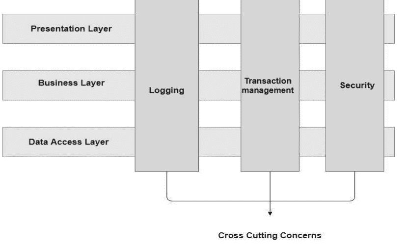

#### 横切关注点的示例

AOP 是 OOP（面向对象编程）的补充，它们可以被用于编写强大的应用程序，因为两者都提供了结构化代码的不同方式。OOP 专注于将一切都制成对象，而 AOP 引入了切面 (aspect)，这是一种特殊的对象类型，它通过注入和包装其行为来补充其他对象的行为。

横切关注点的示例：

- 日志记录 (Logging)
- 安全 (Security)
- 事务管理 (Transaction management)
- 缓存 (Caching)
- 国际化 (Internationalization)
- 错误检测 (Error detection)
- 内存管理 (Memory management)
- 性能监控 (Performance monitoring)
- 同步 (Synchronization)

我们可以在纯 Java 中实现 Spring AOP，它不需要特殊的编译。

### I. Spring AOP 的需求

Spring AOP 提供了一种在实际逻辑之前、之后或周围添加关注点的插拔方式。考虑类中有 10 个方法：

```java
class A{
    void m1() {}
    void m2() {}
    void m3() {}
    void m4() {}
    void m5() {}
    void n1() {}
    void n2() {}
    void p1() {}
    void p2() {}
    void p3() {}
}
```

这些是 5 个以`m`开头的方法、2 个以`n`开头以及 3 个以`p`开头的方法。

- 关于 AspectJ：
  - 场景：在调用完`m`方法后，你维护日志并发送通知。
  - 不使用 AOP 的问题：你在`m`方法中调用维护日志和发送通知的方法。为了这样做，你需要为所有方法编写代码。
  - 使用面向切面编程的解决方案：将维护日志、发送通知等额外关注点定义为类的方法。

### II. 何时使用 Spring 面向切面编程

Spring 的方面面向切面编程 (AOP) 框架。正如我们所知，OOP 模块化的核心单元是类，而在 AOP 中，模块化的单元是切面。切面使得事务管理等跨越多种类型和对象的关注点能够模块化。为了实现这些关注点，AspectJ 登场了。AspectJ 是 Java 编程语言的兼容扩展，是 AOP 的一种实现。它已经成长为一个完整且流行的 AOP 框架。由于越来越多的 AOP 框架支持 AspectJ，AspectJ 风格的切面更有可能在支持 AspectJ 的其他 AOP 框架中被复用。

AspectJ 是一个原始库，它提供了名为 AspectJ 的组件用于创建切面。它由 Xerox PARC 公司开发并于 1995 年发布。由于其简单易用性，它定义了 AOP 的标准。用于定义切面的语言语法与 Java 相似，允许开发者定义特殊的构造结构。在 AspectJ 中开发的切面是在编译时处理的，因此它们直接影响生成的字节码。有关 AspectJ 的更多信息请访问 https://eclipse.org/aspectj/

### 7.2.2 AOP 中使用的概念和术语

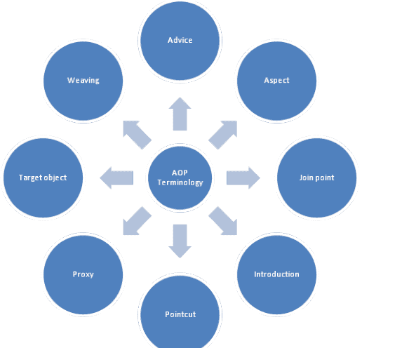

- 切面（Aspect）：一种跨越多个对象的关注点的模块化。
- 连接点（Join point）：程序执行过程中的某一个点，例如方法的执行或异常的处理。在 Spring AOP 中，连接点始终代表方法执行。在建议体中，通过调用`org.aspectj.lang.JoinPoint`参数类型可以获取连接点信息。
- 建议（Advice）：切面在特定点采取的操作。不同类型的建议包括“环绕（around）”、“之前（before）”和“之后（after）”。许多 AOP 框架（包括 Spring）将建议作为拦截器提供，并维护一个“环绕”连接点的拦截器链。
- 切入点（Pointcut）：一种匹配连接点的谓词。建议与切入点关联，并在切入点匹配的任何连接点上运行（例如，执行具有特定名称的方法）。通过切入点表达式匹配连接点的概念是 AOP 的核心。Spring 默认使用 AspectJ 语言。
- 引入（Introduction）：也称为类型间声明（inter-type declaration）。代表类型声明额外的方法或字段。Spring AOP 允许为任何代理对象引入新的接口及相应的实现。
- 目标对象（Target object）：被一个或多个切面建议的对象。也称为被建议对象。由于 Spring AOP 是使用运行时代理实现的，此对象始终是一个代理对象。
- 织入（Weaving）：将切面与其他类型或对象连接以创建被建议的对象。这可以在编译时（例如使用 AspectJ 编译器）、加载时或运行时完成。Spring AOP 与其他 Java AOP 框架一样在运行时执行织入。
- 代理（Proxy）：由 AOP 框架创建的实现切面约的动态代理。在 Spring 框架中，它将 JDK 动态代理或 CGLIB 代理。

上述 AOP 术语并不直观，因此我将通过创建一个示例应用程序（Spring AOP + AspectJ）来解释，并将术语与示例中的用法联系起来。

创建一个带有 Spring AOP 的 Boot 应用。

注意：“Spring Boot 是构建在 Spring Framework 之上的项目。它提供了一种更简单、更快速的方法来设置、配置和运行简单以及 Web 应用”。

创建 Spring Boot 应用有很多方法，如下：

- 使用 Spring Initializer 创建 Spring Boot 项目
- 在 Spring Tool Suite [STS] 中创建 Spring Boot 项目

首先，我们需要 Maven 依赖。实际上，你需要创建一个 Maven 项目并添加所有依赖。如果你想学习如何配置 Spring Framework，可以参考此 Spring Framework 教程。

要创建 Maven 项目，请为 JEE 开发人员安装 Eclipse 并按照步骤操作。

- 点击 File -> New -> Other -> Maven Project -> Next -> Choose maven-archetype-quickstart -> Specify GroupID -> Artifact ID -> Package name，然后点击 finish。

一旦创建了 Maven 项目，下一步的第一件事是在`pom.xml`文件中添加 Maven 依赖。

你的`pom.xml`文件应该包含以下用于面向面向编程的依赖。

### 向 maven 项目的 pom.xml 添加 Spring Aop starter：

```xml
<xml version="1.0" encoding="UTF-8"?>
<project xmlns="http://maven.apache.org/POM/4.0.0"
xmlns:xsi="http://www.w3.org/2001/XMLSchema-instance"
xsi:schemaLocation="http://maven.apache.org/POM/4.0.0
http://maven.apache.org/xsd/maven-4.0.0.xsd">
  <modelVersion>4.0.0</modelVersion>
  <groupId>springboot2</groupId>
  <artifactId>springboot2-springaop-example</artifactId>
  <version>0.0.1-SNAPSHOT</version>
  <packaging>jar</packaging>
  <name>springboot2-springaop-example</name>
  <description>Demo project for Spring Boot</description>
  <parent>
    <groupId>org.springframework.boot</groupId>
    <artifactId>spring-boot-starter-parent</artifactId>
    <version>2.1.4.RELEASE</version>
    <relativePath/>
    <!-- lookup parent from repository -->
  </parent>
  <properties>
    <project.build.sourceEncoding>UTF-8</project.build.sourceEncoding>
    <project.reporting.outputEncoding>UTF-8</project.reporting.outputEncoding>
    <java.version>1.8</java.version>
  </properties>
</project>
```


```xml
<dependencies>
  <dependency>
    <groupId>org.springframework.boot</groupId>
    <artifactId>spring-boot-starter-aop</artifactId>
  </dependency>
</dependencies>
<build>
  <plugins>
    <plugin>
      <groupId>org.springframework.boot</groupId>
      <artifactId>spring-boot-maven-plugin</artifactId>
    </plugin>
  </plugins>
</build>
</project>
```

# Employee.java

创建一个简单的`Employee`POJO类（你可以将其用于数据库操作的JPA实体）：

```java
public class Employee {
  private long id;
  private String firstName;
  private String lastName;
  private String emailId;

  public Employee(long id, String firstName, String lastName, String emailId) {
    this.id = id;
    this.firstName = firstName;
    this.lastName = lastName;
    this.emailId = emailId;
  }

  public long getId() {
    return id;
  }

  public void setId(long id) {
    this.id = id;
  }

  public String getFirstName() {
    return firstName;
  }

  public void setFirstName(String firstName) {
    this.firstName = firstName;
  }

  public String getLastName() {
    return lastName;
  }

  public void setLastName(String lastName) {
    this.lastName = lastName;
  }

  public String getEmailId() {
    return emailId;
  }

  public void setEmailId(String emailId) {
    this.emailId = emailId;
  }

  @Override
  public String toString() {
    return "Employee [id=" + id + ", firstName=" + firstName + ", lastName=" + lastName + ", emailId=" + emailId + "]";
  }
}
```

# EmployeeService.java

为了保持简单，我将创建一个`EmployeeService`并管理内存中的对象：

```java
import java.util.ArrayList;
import java.util.List;
import org.springframework.stereotype.Service;

/**
 * Employee Service
 */
@Service
public class EmployeeService {
    private List<Employee> employees = new ArrayList<>();

    public List<Employee> getAllEmployees() {
        return employees;
    }

    public Employee getEmployeeById(Long employeeId) {
        for (Employee employee : employees) {
            if (employee.getId() == Long.valueOf(employeeId)) {
                return employee;
            }
        }
        return null;
    }

    public void addEmployee(Employee employee) {
        employees.add(employee);
    }

    public void updateEmployee(Employee employeeDetails) {
        for (Employee employee : employees) {
            if (employee.getId() == Long.valueOf(employeeDetails.getId())) {
                employees.remove(employee);
                employees.add(employeeDetails);
            }
        }
    }

    public void deleteEmployee(Long employeeId) {
        for (Employee employee : employees) {
            if (employee.getId() == Long.valueOf(employeeId)) {
                employees.remove(employee);
            }
        }
    }
}
```

# LoggingAspect.java

现在，让我们创建一个`LoggingAspect`类：

```java
import org.aspectjj.lang.JoinPoint;
import org.aspectjj.lang.annotation.After;
import org.aspectjj.lang.annotation.Aspect;
import org.aspectjj.lang.annotation.Before;
import org.slf4j.Logger;
import org.slf4j.LoggerFactory;
import org.springframework.stereotype.Component;

/**
 * Aspect for logging execution.
 */
@Aspect
@Component
public class LoggingAspect {
    private final Logger LOGGER = LoggerFactory.getLogger(this.getClass());

    @Before("execution(*springboot2.springao.service.EmployeeService.*(..))")
    public void logBeforeAllMethods(JoinPoint joinPoint) {
        LOGGER.debug("LoggingAspect.logBeforeAllMethods("" + joinPoint.getSignature().getName() + ")");
    }
}
```

```java
@Before("execution(*springboot2.springaop.service.EmployeeService.getEmployeeById(..))")
    public void logBeforeGetEmployee(JoinPoint joinPoint) {
        LOGGER.debug("****LoggingAspect.logBeforeGetEmployee() : " + joinPoint.getSignature().getName());
    }
```

```java
@Before("execution(*springboot2.springaop.service.EmployeeService.createEmployee(..))")
    public void logBeforeAddEmployee(JoinPoint joinPoint) {
        LOGGER.debug("****LoggingAspect.logBeforeCreateEmployee() : " + joinPoint.getSignature().getName());
    }
```

```java
@After("execution(*springboot2.springaop.service.EmployeeService.*(..))")
    public void logAfterAllMethods(JoinPoint joinPoint) {
        LOGGER.debug("****LoggingAspect.logAfterAllMethods() : " + joinPoint.getSignature().getName());
    }
```

```java
@After("execution(*springboot2.springaop.service.EmployeeService.getEmployeeById(..))")
    public void logAfterGetEmployee(JoinPoint joinPoint) {
        LOGGER.debug("****LoggingAspect.logAfterGetEmployee() : " + joinPoint.getSignature().getName());
    }
```

```java
@After("execution(*springboot2.springaop.service.EmployeeService.addEmployee(..))")
    public void logAfterAddEmployee(JoinPoint joinPoint) {
        LOGGER.debug("****LoggingAspect.logAfterCreateEmployee() : " + joinPoint.getSignature().getName());
    }
```

# Application.java

现在使用`main()`方法测试AOP配置及其他内容：

```java
import org.springframework.boot.SpringApplication;
import org.springframework.boot.autoconfigure.SpringBootApplication;
import org.springframework.context.ApplicationContext;
import org.springboot2.springaop.model.Employee;
import org.springboot2.springaop.service.EmployeeService;

@SpringBootApplication
public class Application {

    public static void main(String[] args) {
        ApplicationContext applicationContext = SpringApplication.run(Application.class, args);

        EmployeeService employeeService = applicationContext.getBean(EmployeeService.class);
        employeeService.addEmployee(new Employee(100L, "ramesh", "fadature", "ramesh@gmail.com"));
        employeeService.getById(100L);
        employeeService.getAllEmployees();
    }
}
```

# 输出

| s.g.1.application |

| :--- | :--- |

| s.g.1.application | Starting Application on x86_64 with PID 1234: /Project/DClientworkspace/spring-aop-advice-example/target/classes started |

| s.g.1.application | Running with Spring Boot v2.1.4.RELEASE (PID 1234) |

| s.g.1.application | No active profile set, falling back to default profiles: default |

| s.g.1.application | Starting DataJpaRepository using an embedded H2 database type: hibernate.ddl-auto: set to 'none' to disable table creation |

| s.g.1.application | No logging configuration found for property files, using default console configuration: Level: "root" to "INFO" |

| s.g.1.application | Starting Spring Boot Application in 2.545 seconds (process running for 3.12) |

| s.g.1.application | Bootstrapping Spring repositories in order: None |

| s.g.1.application | H2 console available at /h2-console. Default URL: 'jdbc:h2:mem:testdb', User Name: 'sa', Password: '' |

| DefaultContext | Starting WebApplicationContext: Application 'Application' on port(s): 8080 (http) with servlet context path |

| s.g.1.application | Tomcat initialized with port(s): 8080 (http) with context path '' |

| s.g.1.application | Started Tomcat on port(s): 8080 (http) for 1.5 seconds |

| s.g.1.application | Root Application started in 3.125 seconds (process running for 3.850) |

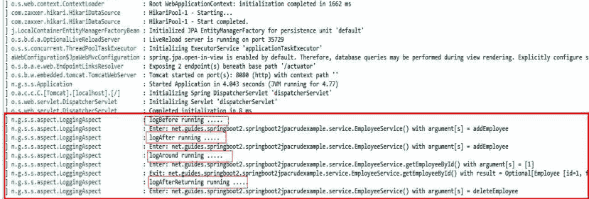

# 通过上述示例理解AOP概念和术语

### 切面 (Aspect)

切面是跨越多个类的关注点的模块化。事务管理是企业级Java应用中跨切关注点的一个良好示例。在Spring AOP中，切面通过普通类（基于基于的方法的方法）或带有`@Aspect`注解的普通类（`@Aspect`样式）来实现。

在我们的示例中，我们使用基于Java配置创建了`LoggingAspect`。要创建一个切面，你需要在Spring组件上应用`@Aspect`注解：

```java
@Aspect
@Component
public class LoggingAspect {
  ...
}
```

### 接点 (Join point)

接点是程序执行过程中的某一点，例如方法的执行或异常的处理。在Spring AOP中，接点始终代表方法执行。

在我们的示例中，`EmployeeService`内部定义的所有方法都是接点。

### 建议 (Advice)

建议是切面在特定接点上采取的操作。

在示例中，`logBeforeAllMethods()`、`logBeforeGetEmployee()`、`logAfterAddEmployee()`、`logAfterAllMethods()`、`logAfterGetEmployee()`和`logAfterEmployee()`方法都是建议。

### 切入点 (Pointcut)

切点是一个匹配接点的谓词。它定义了建议应该应用的位置。

### 目标对象 (Target object)

目标对象是接点提供的对象。

### AOP代理 (AOP proxy)

Spring AOP使用基于代理的方法来实现建议。当目标对象上调用方法时，代理会拦截该调用并应用建议。

## 7.2.2 切入点 (Pointcut)

为了将跨切关注点模块化，使用了切点。在Spring中，通常使用切点表达式将建议与切点关联。例如：


```java
@Before("execution(*springboot2.springaop.service.EmployeeService.*(..))")
@After("execution(*springboot2.springaop.service.EmployeeService.*(..))")
```

## 7.2.3 AOP 的优缺点

### AOP 的优点

1. AOP 非侵入性：允许开发者专注于业务逻辑，而无需添加跨切关注点。
2. AOP 是纯 Java 实现的：不需要特殊的编译器。
3. 它使用 Spring 的 IOC 容器进行依赖注入：切面可以配置为普通的 Bean。
4. 集中并模块化跨切关注点：更改只需要在一个处进行。
5. 提供了使用基于架构（XML）或基于注解样式创建切面。
6. 易于配置。

### AOP 的缺点

1. 调试基于 AOP 的应用代码有一点小困难。
2. 由于它使用基于代理的方法，因此只支持方法级别的建议；不支持字段级别的拦截。
3. 只有可见性为公共（`public`）的方法会被增强：私有（`private`）或保护（`protected`）可见的方法不会被增强。
4. 有极小的运行时开销，但是可以接受的。
5. 切面不能建议其他切面：一旦你将一个类标记为切面，Spring 会将其排除在自动代理之外。
6. 被增强类内部的本地或内部方法调用不会被代理拦截，切面的建议方法不会被调用。
7. 它不用于增强细粒度对象（领域对象）—由于性能原因，它最适合粗粒度对象。

## 7.2.4 建议的类型（Types of advice）

有不同类型的建议：

- 前置建议（Before advice）：在接点之前执行的建议，但它没有阻止执行流继续到达接点的能力（除非它抛出异常）。

  在切面中使用 `@Before` 注解声明：

  ```java
  import org.aspectj.lang.annotation.Aspect;
  import org.aspectj.lang.annotation.Before;

  @Aspect
  public class BeforeExample {
      @Before("com.xyz.myapp.SystemArchitecture.dataAccessOperation()")
      public void doAccessCheck() {
          // ...
      }
  }
  ```

- 返回后通知（After returning advice）：在连接点（join point）正常完成后执行的通知，例如，如果方法在没有抛出异常的情况下返回。

  它使用 `@AfterReturning` 注解声明：

  ```java
  import org.aspectjj.lang.annotation.Aspect;
  import org.aspectjj.lang.annotation.AfterReturning;

  @Aspect
  public class AfterReturningExample {
      @AfterReturning("com.xyz.myapp.SystemArchitecture.dataAccessOperation()")
      public void doAccessCheck() {
          // ...
      }
  }
  ```

- 异常后通知（After throwing advice）：如果方法通过抛出异常退出时执行的通知。

  它使用 `@AfterThrowing` 注解声明：

  ```java
  import org.aspectjj.lang.annotation.Aspect;
  import org.aspectjj.lang.annotation.AfterThrowing;

  @Aspect
  public class AfterThrowingExample {
      @AfterThrowing("com.xyz.myapp.SystemArchitecture.dataAccessOperation()")
      public void doRecoveryActions() {
          // ...
      }
  }
  ```

- 后（最终）通知（After (finally) advice）：无论连接点以何种方式退出（正常或异常）都会执行的通知。

  它使用 `@After` 注解声明。通知必须准备好处理正常和异常返回条件。它通常用于释放资源等。

  ```java
  import org.aspectjj.lang.annotation.Aspect;
  import org.aspectjj.lang.annotation.After;

  @Aspect
  public class AfterFinallyExample {
      @After("com.xyz.myapp.SystemArchitecture.dataAccessOperation()")
      public void doReleaseLock() {
          // ...
      }
  }
  ```

- 环绕通知（Around advice）：环绕连接点（如方法调用）的通知。这是最强大的通知类型。环绕通知可以在方法调用之前之后执行自定义行为。它还负责决定是继续执行连接点，还是通过返回自己的值或抛出异常来跳过被通知方法的执行。

  示例：

  ```java
  import org.aspectjj.lang.annotation.Aspect;
  import org.aspectjj.lang.annotation.Around;
  import org.aspectjj.ProceedingJoinPoint;

  @Aspect
  public class AroundExample {
      @Around("com.xyz.myapp.SystemArchitecture.businessService")
      public Object doBasicProfiling(ProceedingJoinPoint pjp) throws Throwable {
          // 启动计时
          Object retVal = pjp.proceed();
          // 停止计时
          return retVal;
      }
  }
  ```

## 7.2.5 切入点设计符、切入点注解

- 切入点设计符（Pointcut Designator）：切入点表达式以切入点设计符（PCD）开始，这是一个告诉 Spring AOP 要匹配什么内容的关键字。有多种切入点设计符，例如方法的执行、类型、方法参数或注解。

  `execution`：用于匹配方法执行（连接点）。这是一个主要的标识符，并且在处理 Spring AOP 时最常用。

  `within`：该设计符的限制是仅能匹配特定类型内的连接点。它不像 `execution` 那么灵活。例如，不允许指定返回类型或方法参数映射。如果内部模式指向 Java 包，它将匹配该包内所有类的所有方法。如果模式指向特定类，则该设计符将涵盖所有内容。

- 切入点注解（Pointcut Annotations）：使用注解比使用模式更方便。虽然模式可能涵盖从“大炮到手术刀”的任何范围，但注解无疑是一把“手术刀”，因为它只获取开发者手动指定的切入点。

  ```java
  @Aspect – 标记一个类为包含通知方法的类。
  ```

  ```java
  @PointCut – 标记一个函数为切入点。
  ```


## 7.3 总结

在 Spring AOP 的这一个章节中，你学习了 Spring Framework 中的面向切面编程。你看到了需要使用 Spring AOP 的场景以及在哪里使用它。同时，你还了解了它的术语、Spring AOP 的优缺点、通过示例展示的通知类型、AspectJ 的介绍以及 Spring Boot。如果你仍有疑问，请参阅参考文献和目录。

## 7.4 练习题

1. 什么是 Spring AOP？它的作用是什么？
2. Spring AOP 的不同实现方式有哪些？
3. 结合示例解释不同的 AOP 术语？
4. Spring 通知（Advice）有哪些不同的类型？
5. Spring AOP 的优缺点是什么？
6. 何时使用 Spring AOP？
7. Spring AOP 中的 Aspect（切面）是什么？
8. 如何声明一个 Spring AOP 切面？
9. Spring AOP 中的 Advice（通知）是什么？
10. 有哪些不同的 Spring AOP 通知类型？
11. 如何在 Spring AOP 中声明一个通知？
12. 切入点表达式中的 `execute` 是什么意思？
13. 还有哪些切入点设计符？
14. 定义切入点设计符和注解及其类型。

## 7.5 参考文献

1. Kotrappa Sirbi, Prakash Jayanth Kulkarni Stronger Enforcement of Security Using AOP & Spring AOP
2. Ravi Kumar, Dalip and Munishwar Rai A Comparative Study of AOP Approaches:AspectJ, Spring AOP, JBoss AOP
3. <https://www.javagudes.net/>

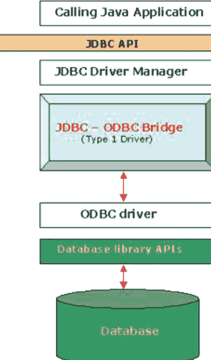

图 8.1 显示了第 1 型驱动（JDBC-ODBC 桥）的架构。

### 优点

- 几乎可以访问任何安装了 ODBC 驱动程序的数据库，并检索数据。

### 缺点

- 性能开销，因为调用必须通过 JDBC（数据库连接）桥接到 ODBC（开放数据库连接）驱动程序，然后到原生数据库连接接口（这可能比其他类型的驱动程序慢）。
- 客户端机器需要安装 ODBC 驱动程序。
- 不适用于 applet（小程序），因为 ODBC 驱动需要安装在客户端。
- 所有的平台并不总是能提供特定的 ODBC 驱动程序，因此该驱动的移植性有限。
- JDK 1.8（Java 8）不提供支持。

## 10.1.2 第 2 类驱动——原生 API 驱动

JDBC 第 2 类驱动也称为 Native-API 驱动，是一种使用数据库客户端库的数据库驱动实现。该驱动程序将 JDBC 方法调用转换为数据库 API 的原生调用。例如：Oracle OCI 驱动就是第 2 类驱动。

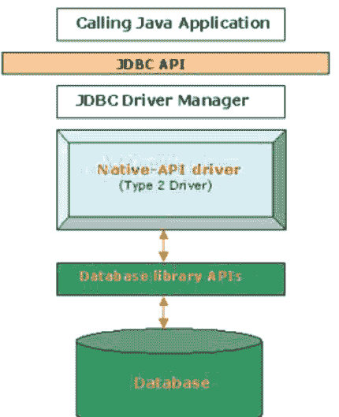

图 8.2 显示了第 2 类驱动（原生 API 驱动）的架构。

### 优点

- 由于没有 JDBC-ODBC 桥接的实现，它的速度可能比第 1 类驱动快得多。

### 缺点

- 客户端机器需要安装厂商客户端库。
- 并非所有数据库都有客户端库。
- 该驱动依赖于平台。
- 该驱动支持除 applet 之外的所有 Java。

## 10.1.3 第 3 类驱动——网络协议驱动（中间件驱动）

- JDBC 第 3 类驱动也称为用于中间件的纯 Java 驱动，是一种在调用程序和数据库之间利用中间层的数据库驱动实现。中间层（应用程序服务器）直接或间接地将 JDBC 调用转换为特定厂商的数据库协议。
- 它与第 4 类驱动的区别在于，协议转换逻辑不在客户端，而是在中间层。与第 4 类驱动一样，第 3 类驱动完全用 Java 编写。
- 同一个客户端 JDBC 驱动程序可以用于多个数据库。这取决于中间件配置支持的数据库数量。第 3 类驱动是平台无关的，因为与平台相关的差异由中间件处理。此外，利用中间件提供了安全性和防火墙访问的额外优点。

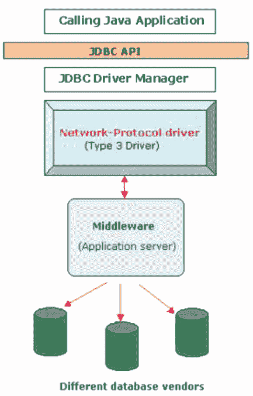

图 8.3 显示了第 3 类驱动（网络协议驱动）的架构。

### 功能

- 将 JDBC API 调用发送到中间层网络服务器，服务器将调用转换为特定的 DBMS 网络协议。然后将转换后的调用发送到特定的 DBMS。
- 遵循三层通信方法。
- 可以连接到多个数据库——不特定厂商。
- 用 Java 编写的 JDBC 客户端驱动使用数据库无关协议与中间件网络服务器通信，然后该网络服务器将请求翻译为该数据库的数据库命令。
- 因此，客户端到中间件的通信是数据库无关的。

### 优点

- 由于客户端与中间件服务器之间的通信是数据库无关的，因此客户端不需要数据库厂商库。对于新数据库，无需更改客户端。
- 中间件服务器（可以是功能 J2EE 应用程序服务器）可以提供典型的中间件服务，如缓存（连接、查询结果等）、负载均衡、日志和审计。
- 只要中间件支持，单个驱动就可以处理任何数据库。
- 例如：IDA 服务器。

### 缺点

- 需要在中间层进行特定数据库的编码。
- 添加的中间层可能会导致额外的延迟，但通常可以通过使用更好的中间件服务来克服。

## 8.1.4 第 4 类驱动——数据库协议驱动/瘦客户端驱动（纯 Java 驱动）

- JDBC 第 4 类驱动也称为直接到数据库的纯驱动程序，是一种将 JDBC 调用直接转换为特定厂商数据库协议的数据库驱动实现。
- 第 4 类驱动完全用 Java 编写，因此是平台无关的。它们安装在客户端的 Java 虚拟机内部。这比第 1 类和第 2 类驱动提供了更好的性能，因为它们没有将调用转换为 ODBC 或数据库 API 的开销。与第 3 类驱动不同，它不需要关联软件即可工作。
- 由于数据库协议是特定厂商的，JDBC 客户端需要单独驱动程序（通常由厂商提供）来连接到不同类型的数据库。

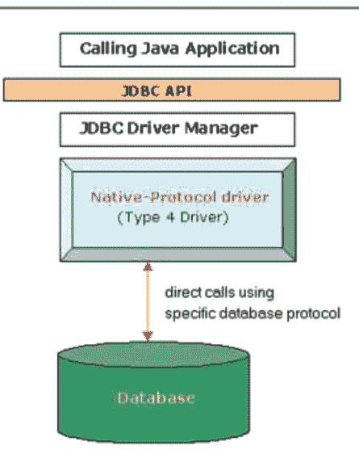

图 8.1.4 显示了第 4 类驱动（纯 Java 驱动）的架构。

### 优点

- 完全用 Java 实现以实现平台无关性。
- 这些驱动程序不将请求转换为中间格式（如 ODBC）。
- 应用程序直接连接到数据库。
- 不使用中间件层，提高了性能。
- JVM 管理应用程序与数据库连接的所有方面；这可以利于调试。

### 缺点

- 驱动程序是特定数据库的，因为不同的数据库厂商使用完全不同的网络协议。

## 8.1.5 第 5 类：高功能驱动

- 第 5 类驱动（如 DataDirect JDBC）比其他类型提供了更先进的功能和卓越的性能。
- JDBC 驱动从根本上基于第 4 类架构，但旨在解决所有或大部分这些局限性，却又背离了常规范。事实上，此类驱动可以被归类为一种全新的类型。事实上，随着对象建模抽象性的增加和高级应用程序的出现，开发者将 JDBC 驱动视为至关重要但“愚笨”的管道，而不是不仅驱动应用栈成功、还能增强它的关键齿轮。
- 出于此原因，在开发者社区中，对于 JDBC 5 类驱动的概念可能会持“那又怎样？”的态度。他们甚至拒绝将数据连接驱动视为一个组件，而那里是创新（如用于高可用性的应用程序故障转移）本应发生的地方。他们可以推断，此类创新可以在更高级的应用程序级别得到恰当处理。然而，这种推论非常有争议。

### 之前的驱动程序（第 4 类）的局限性

在熟悉使用 JDBC 驱动程序进行中间件数据连接幕后机制的开发者中，第 4 类驱动的局限性通常是没有任何争议的。这些包括：

- 需要为每个支持的数据源编写和维护特定代码。即使使用现代基于框架的对象关系映射（ORM）模型，JDBC 第 4 类驱动通常也需要专有代码来支持如 BLOB 和 CLOB、高可用性、XA 等变体数据库功能。
- 当驱动部署在某些运行时环境（如不同的 JVM）或与 ORM 和应用程序服务器配合时，驱动响应时间或数据吞吐量性能差且不一致。
- 无法对关键应用程序进行调或优化，或者只有在大量的应用程序停机的情况下才能做到。
- 由于运行时 CPU 使用率低效和内存占用过高，导致虚拟机（VM）合并率低。
- 部署上的头疼问题，例如必须部署多个 JAR 以支持不同的 JVM 或数据库版本，或者需要 DLL 来支持某些驱动程序或数据库功能。

这些局限性指向了现代 Java 环境中以下关键趋势和进展，作为当今第 4 类驱动挑战的来源：

- 对多个数据库的支持。
- 增加服务器虚拟化和数据中心整合。
- 快速采用如 Hibernate 等 ORM 模型或 Jboss 等应用服务器，这些服务器位于 JDBC 驱动之上，且不允许访问 JDBC 代码。

### 类型 5 的优势

那么，类型 5 驱动如何解决所有这些局限性呢？除了类型 4 驱动具有卓越的客户端、单层、100% Java 架构外，类型 5 驱动还具有哪些特征？

- **无限制性能**——无论运行时环境或数据访问模型如何，驱动程序都能够提供最大且一致的吞吐量。
- **无代码增强**——驱动程序应该能够为任何应用程序添加、配置或调整功能和特性，而无需更改任何应用程序代码，无论环境或数据访问模型如何。虽然这当然是为了无限制性能，但对于确保每个新的数据库或驱动程序功能在所有支持的 JVM 或硬件上可用也非常重要，并且即使使用了防止访问 JDBC 代码的 ORM 或应用服务器模型也可以进行访问（而启用此类功能和特性需要访问 JDBC 代码）。全面的驱动连接选项是实现这一目标的方法。
- **资源效率**——应该尽量减少对运行时 CPU 和内存的使用，并可以在驱动程序中进行调整以适应特定的运行时环境参数或限制。中间件数据访问操作对此类资源的消耗往往被忽视，直到它们对虚拟化计划中的服务器整合目标产生不利影响。
- **一体化部署**——无论 Java 环境或应用程序要求，JDBC 类型 5 驱动都应该只需要单个 JAR 文件。无论部署环境或应用程序使用的功能（批量数据加载、安全、高可用性和 XA 特性），它都不需要任何客户端库或外部 DLL。
- **简化标准**——JDBC 类型 5 驱动对任何支持的数据源都不应该需要 JDBC 规范的专用扩展。这将解决大多数类型 4 驱动需要专用代码来支持 BLOB、CLOB、高可用性和 XA 等功能的需求。

虽然从长期来看，正式委员会批准新的 JDBC 标准是理想的，但类型 4 驱动目前的局限性坦然变得过于明显且适得其反，不值得等待那个漫长的过程。依赖现代数据驱动 Java 应用程序的组织现在能够实现 JDBC 类型 5 驱动。

## 10.2 管理 JDBC 连接

Java 数据库连接（JDBC）连接允许网关查询外部数据库，并在策略消耗期间使用查询结果。

五步法 Java 数据库连接：

1. 注册驱动程序类。
2. 创建连接。
3. 创建语句。
4. 执行查询。
5. 关闭连接。

### 1. 注册驱动程序类

使用 `Class` 类的 `forName(Name)` 方法来注册驱动程序类。该方法用于动态加载驱动程序类。

`forName()` 方法的语法：

```java
public static void forName(String className) throws ClassNotFoundException
```

注册 `OracleDriver` 的示例：

在这里，Java 程序正在加载 Oracle 驱动以建立数据库连接。

```java
Class.forName("oracle.jdbc.driver.OracleDriver");
```

### 2. 创建连接对象

使用 `DriverManager` 类的 `getConnection()` 方法与数据库建立连接。

`getConnection()` 方法的语法：

1. `public static Connection getConnection(String url) throws SQLException`
2. `public static Connection getConnection(String url, String name, String password) throws SQLException`

与 Oracle 数据库建立连接的示例：

```java
Connection conn = DriverManager.getConnection(
    "jdbc:oracle:thin:@localhost:1234:vs",
    "system",
    "password"
);
```

### 3. 创建对象

使用 `Connection` 接口的 `createStatement()` 方法创建语句。`statement` 对象负责在数据库上执行查询。

`createStatement()` 方法的语法：

```java
public Statement createStatement() throws SQLException
```

创建语句对象的示例：

```java
Statement stmt = con.createStatement();
```

### 4. 执行查询

使用 `Statement` 接口的 `executeQuery()` 方法对数据库执行查询。该方法返回 `ResultSet` 对象，可以使用它获取表中所有的记录。

`executeQuery()` 方法的语法：

```java
public ResultSet executeQuery(String sql) throws SQLException
```

执行查询的示例：

```java
ResultSet rs = stmt.executeQuery("select * from student");

while (rs.next()) {
    System.out.println(rs.getInt(1) + rs.getString(2));
}
```

### 5. 关闭连接对象

通过关闭连接对象，`ResultSet` 将被自动关闭。`Connection` 接口的 `close()` 方法用于关闭连接。

`close()` 方法的语法：

```java
public void close() throws SQLException
```

关闭连接的示例：

```java
con.close();
```

## 10.3 配置数据源以获取 JDBC 连接

为了设置 JDBC 连接，您可以通过在管理控制台中定义属性来配置连接池、数据源对象（推荐使用，但在某些情况下可选）和多池（MultiPools）。

### 事务场景

- 本地事务——非分布式。
- 使用 XA 驱动的分布式事务——使用两阶段提交的多参与者。
- 使用非 XA 驱动的分布式事务——单个资源管理器和单个数据库实例。

下表总结了如何为这三种事务场景配置这些对象：

| 说明/对象 | 本地事务 | 分布式事务（XA 驱动） | 分布式事务（非 XA 驱动） |
| :--- | :--- | :--- | :--- |
| JDBC 驱动 | * 用于 Oracle 和 SQL Server 的 Web JDBC<br>* 符合标准的第三方驱动 | * 用于 Oracle/XA Web JDBC<br>* 符合标准的第三方驱动 | * 用于 Oracle 和 SQL Server 的 Web JDBC<br>* 符合标准的第三方驱动 |
| 数据源 | 推荐使用数据源对象。（如果没有源，则使用 JDBC API。） | 需要数据源。 | 需要 Tx 数据源。对于非 XA 驱动选择模拟两阶段提交。 |
| 连接池 | 在管理控制台中配置时需要数据源对象。 | 需要 Tx 数据源。 | 需要 Tx 数据源。 |
| 多池（MultiPool） | 需要连接池和数据源。 | 分布式事务不支持。 | 分布式事务不支持。 |

密码：用户在安装 MySQL 数据库时提供的密码。在本示例中，我们将使用 `root` 作为密码。

让我们先在 MySQL 数据库中创建一个表，但在创建表之前，我们需要先创建数据库。

```sql
CREATE DATABASE idol;

USE idol;

CREATE TABLE student (
    id INT(10),
    name VARCHAR(40),
    age INT(3)
);
```

# 代码

```java
import java.sql.*;

class MyqlCon {
    public static void main(String args[]) {
        try {
            Class.forName("com.mysql.jdbc.Driver");

            Connection con = DriverManager.getConnection(
                "jdbc:mysql://localhost:3306/idol",
                "root",
                "root"
            );

            // 这里 sono 是数据库名，root 是用户名和密码
            Statement stmt = con.createStatement();
            ResultSet rs = stmt.executeQuery("select * from student");

            while (rs.next()) {
                System.out.println(
                    rs.getInt(1) + " " +
                    rs.getString(2) + " " +
                    rs.getString(3)
                );
            }

            con.close();
        } catch (Exception e) {
            System.out.println(e);
        }
    }
}
```


要将 Java 应用与 MySQL 数据库连接，需要加载`mysqlconnector`文件。

下载 jar 文件`mysql-connector.jar`。加载 jar 文件有两种方法：

- 将`mysqlconnector.jar`文件粘贴到`jre/lib/ext`文件夹中
- 设置`classpath`

### 1) 将`mysqlconnector.jar`文件粘贴到`JRE/lib/ext`文件夹中

下载`mysqlconnector.jar`文件。进入`jre/lib/ext`文件夹并将 jar 文件粘贴到此处。

### 2) 设置`classpath`

设置`classpath`有两种方法：

- 临时
- 永久

**如何设置临时`classpath`**：提示符并输入：

```
C:>setclasspath=c:\folder\mysql-connector-java-5.0.8-bin.jar;;
```

**如何设置永久`classpath`**：进入环境变量，点击新建标签页。变量名输入`classpath`，在变量值中粘贴`mysqlconnector.jar`文件的路径，并在结尾添加`mysqlconnector.jar;;`，例如`C:\folder\mysql-connector-java-5.0.8-bin.jar;`。

## 10.4 使用 JDBC TEMPLATE 和 SPRING 进行数据访问操作

为了理解与`JdbcTemplate`类相关的 Spring JDBC 框架概念，让我们来写一个简单的示例，该示例将对以下`Student`实现所有的 CRUD 操作。

```sql
CREATE TABLE Student(
ID INT NOT NULL AUTO_INCREMENT,
NAME VARCHAR(20) NOT NULL,
AGE INT NOT NULL,
PRIMARY KEY (ID) );
```

在继续之前，让我们准备好一个可用的 Eclipse IDE，并按照以下步骤创建 Spring 应用——

**步骤及描述**：

1. 创建一个名为`SpringExample`的项目，并在项目的`src`文件夹下创建包`com.tutorialproject`。
2. 按照 Spring Hello World 示例章节说明的那样，使用 "Add External JARs" 选项添加所需的 Spring 库。
3. 在项目中添加 Spring JDBC 特定的库`mysql-connector-java.jar`、`org.springframework.jdbc.jar`和`org.springframework.transaction.jar`。如果你还没有这些库，可以自行下载。
4. 创建 DAO 接口`StudentDAO`并列出所有需要的方法。虽然这不是强制的，你也可以直接写`StudentJDBCTemplate`类，但作为一种良好的习惯，让我们这样做。
5. 在`com.tutorial`包下创建其他所需的 Java 类`Student`、`StudentMapper`、`StudentJDBCTemplate`和`MainApp`。
6. 确保你已经在`TEST`数据库中创建了`Student`表。同时确保你的 MySQL 服务器正在运行，并且使用给定的用户名和密码对数据库拥有读写权限。
7. 在`src`文件夹下创建配置文件`Beans.xml`。
8. 最后一步是创建所有 Java 文件和 Bean 配置的内容，并按照下面的说明运行应用程序。

以下是数据访问对象接口文件`StudentDAO.java`的内容：

```java
package com.tutorial;

import java.util.List;
import javax.sql.DataSource;

public interface StudentDAO {

    /**
    * 此方法用于初始化
    * 数据库资源，即 Connection。
    */
    public void setDataSource(DataSource ds);

    /**
    * 此方法用于在 Student 表中
    * 创建一条记录。
    */
    public void create(String name, Integer age);

    /**
    * 此方法用于根据传递的 student id
    * 列出 Student 表中对应的记录。
    */
    public Student getStudent(Integer id);

    /**
    * 此方法用于列出
    * Student 表中的所有记录。
    */
    public List<Student> listStudents();

    /**
    * 此方法用于根据传递的 student id
    * 删除 Student 表中对应的记录。
    */
    public void delete(Integer id);

    /**
    * 此方法用于更新 Student 表中
    * 的一条记录。
    */
    public void update(Integer id, Integer age);
}
```

以下是`Student.java`文件的内容：

```java
package com.tutorialspoint;

public class Student {

    private Integer age;
    private String name;
    private Integer id;

    public void setAge(Integer age) {
        this.age = age;
    }

    public Integer getAge() {
        return age;
    }

    public void setName(String name) {
        this.name = name;
    }

    public String getName() {
        return name;
    }

    public void setId(Integer id) {
        this.id = id;
    }

    public Integer getId() {
        return id;
    }
}
```

以下是`StudentMapper.java`的内容：

```java
package com.tutorialspoint;

import java.sql.ResultSet;
import java.sql.SQLException;
import org.springframework.jdbc.core.RowMapper;

public class StudentMapper implements RowMapper<Student> {

    public Student mapRow(ResultSet rs, int rowNum) throws SQLException {
        Student student = new Student();
        student.setId(rs.getInt("id"));
        student.setName(rs.getString("name"));
        student.setAge(rs.getInt("age"));
        return student;
    }
}
```

以下是用于 DAO 的实现类`StudentDBTemplate.java`：

```java
package com.tutorialspoint;

import java.util.List;
import javax.sql.DataSource;
import org.springframework.jdbc.core.JdbcTemplate;

public class StudentDBTemplate implements StudentDAO {

    private DataSource dataSource;
    private JdbcTemplate jdbcTemplate;

    public void setDataSource(DataSource dataSource) {
        this.dataSource = dataSource;
        this.jdbcTemplate = new JdbcTemplate(dataSource);
    }

    public void create(String name, Integer age) {
        String SQL = "insert into Student (name, age) values (?, ?)";
        jdbcTemplate.update(SQL, name, age);
        System.out.println("Created Record Name = " + name + " Age = " + age);
    }

    public Student getStudent(Integer id) {
        String SQL = "select * from Student where id = ?";
        Student student = jdbcTemplate.queryForObject(SQL, new StudentMapper(), id);
        return student;
    }

    public List<Student> listStudents() {
        String SQL = "select * from Student";
        List<Student> students = jdbcTemplate.query(SQL, new StudentMapper());
        return students;
    }

    public void delete(Integer id) {
        String SQL = "delete from Student where id = ?";
        jdbcTemplate.update(SQL, id);
        System.out.println("Deleted Record with ID = " + id);
    }

    public void update(Integer id, Integer age) {
        String SQL = "update Student age = ? where id = ?";
        jdbcTemplate.update(SQL, age, id);
        System.out.println("Updated Record with ID = " + id);
    }
}
```

以下是`MainApp.java`的内容：

```java
package com.tutorialpoint;

import java.util.List;
import org.springframework.framework.context.ApplicationContext;
import org.springframework.context.support.ClassXmlApplicationContext;
import com.tutorialpoint.StudentJdbcTemplate;

public class MainApp {

    public static void main(String[] args) {
        ApplicationContext context = new ClassXmlApplicationContext("Beans.xml");
        StudentJdbcTemplate studentJdbcTemplate = (StudentJdbcTemplate)context.getBean("studentJdbcTemplate");

        System.out.println("------Records Creation------");
        studentJdbcTemplate.create("Virat", 33);
        studentJdbcTemplate.create("Rohit", 34);
        studentJdbcTemplate.create("Hardik", 29);

        System.out.println("------Listing Multiple Records------");
        List<Student> students = studentJdbcTemplate.listStudents();
        for (Student record : students) {
            System.out.println("ID : " + record.getId());
            System.out.println(", Name : " + record.getName());
            System.out.println(", Age : " + record.getAge());
        }

        System.out.println("------Updating Record with ID = 2------");
        studentJdbcTemplate.update(2, 20);

        System.out.println("------Listing Record with ID = 2------");
        Student student = studentJdbcTemplate.getStudent(2);
        System.out.println("ID : " + student.getId());
        System.out.println(", Name : " + student.getName());
        System.out.println(", Age : " + student.getAge());
    }
}
```

对应的配置文件`Beans.xml`：

```xml
<?xml version="1.0" encoding="UTF-8"?>
<beans xmlns="http://www.springframework.org/schema/beans"
xmlns:xsi="http://www.w3.org/2001/XMLSchema-instance"
xsi:schemaLocation="http://www.springframework.org/schema/beans/spring-beans-3.0.xsd">

    <!-- 数据源初始化 -->
    <bean id="dataSource"
    class="org.springframework.jdbc.datasource.DriverManagerDataSource">
        <property name="driverClassName" value="com.mysql.jdbc.Driver"/>
        <property name="url" value="jdbc:mysql://localhost:3306/TEST"/>
        <property name="username" value="root"/>
        <property name="password" value="password"/>
    </bean>

    <!-- studentJDBCTemplate bean 的定义 -->
    <bean id="studentJDBCTemplate"
    class="com.tutorialspoint.StudentJDBCTemplate">
        <property name="dataSource" ref="dataSource"/>
    </bean>
</beans>
```


一旦你创建了源配置和 bean 配置文件，让我们运行应用程序。如果你的应用程序运行正常，它将打印以下消息：

```
------Records Creation------
Created Record Name = Virat Age = 33
Created Record Name = Rohit Age = 34
Created Record Name = Hardik Age = 29
------Listing Multiple Records------
ID : 1, Name : Virat, Age : 33
ID : 2, Name : Rohit, Age : 34
ID : 3, Name : Hardik, Age : 29
----Updating Record with ID = 2 ----
Updated Record with ID = 1
----Listing Record with ID = 1 ----
ID : 1, Name : Virat, Age : 34
```

你可以尝试自己实现删除操作（我们在示例中没有使用它），但现在你已经有一个基于 Spring 框架的运行应用程序，你可以根据项目需求对其扩展以添加复杂的功能。访问数据库还有其他方法，将使用`NamedParameterJdbcTemplate`和`SimpleJdbcTemplate`类，如果你对学习这些类感兴趣，请查阅 Spring Framework 的参考手册。

## 8.5 RDBMS 操作类

- RDBMS 代表关系型数据库管理系统。

- `JdbcTemplate`适用于简单的查询和更新，但有时你需要动态地构建 SQL 字符串，并需要更高层次的抽象以及更具面向对象的数据库访问方法。这由`org.springframework.jdbc.object`包提供。它包含了`SqlQuery`、`MappingSqlQuery`、`SqlUpdate`和`StoredProcedure`类，这些类旨在作为大多数 Spring JDBC 应用程序的核心类。这些类与`DataSource`和`SqlParameter`类一起使用。每个`RDBMSOperation`类都基于`RDBMSOperation`类，并且它们在内部都使用`JdbcTemplate`进行数据库访问。作为这些类的用户，你必须提供一个现有的`JdbcTemplate`，或者提供一个`DataSource`，框架代码会在需要时创建一个`JdbcTemplate`。

- Spring 的 RDBMS 操作类是参数化的操作，一旦准备绪并编译，它们就是线程安全的。你可以为定义的每个操作安全地创建一个单例实例。准备工作包括提供数据源并定义操作所需的所有参数。我们刚刚提到它们在编译后是线程安全的。这意味着我们在创建这些操作时必须稍微小心。推荐的方法是在构造函数中定义参数并编译它们。这样就不会有线程冲突的风险。

## 8.6 作为 Java 对象的 JDBC 操作

`org.springframework.jdbc.object`包包含了允许人们以更面向对象的方式访问数据库的类。例如，可以执行查询并将结果返回为一个包含业务对象的列表，其中关系数据被映射到业务对象的属性上。人们还可以执行存储过程并运行更新、删除和插入语句。

### 8.6.1 SqlQuery:

- `SqlQuery`是一个可重用的、线程安全的类，它封装了一个 SQL 查询。子类必须实现`newRowMapper(..)`方法以提供一个`RowMapper`实例，该实例可以根据遍历查询执行期间创建的`ResultSet`，为获取的每一行创建一个对象。`SqlQuery`很少被直接使用，因为`MappingSqlQuery`子类为将行映射到 Java 类提供了更方便的实现。其他实现扩展了`SqlQuery`：`MappingSqlQueryWithParameters`和`UpdatableSqlQuery`。

### 8.6.2 MappingSqlQuery:

- `MappingSqlQuery`是一个可重用的查询，其中具体的子类实现抽象的`mapRow(..)`方法，将提供的`ResultSet`的每一行转换为指定类型的对象。这是一个自定义查询的简单示例，它将数据从`t_actor`关系映射到`Actor`类的实例。

```java
public class ActorMappingQuery extends MappingSqlQuery<Actor> {

    public ActorMappingQuery(DataSource ds) {

        super(ds, "select id, first_name, last_name from t_actor where id = ?");

        super.declareParameter(new SqlParameter("id", Types.INTEGER));

        compile();

    }

    @Override

    protected Actor mapRow(ResultSet rs, int rowNumber) throws SQLException {

        Actor actor = new Actor();

        actor.setId(rs.getLong("id"));

        actor.setFirstName(rs.getString("first_name"));

        actor.setLastName(rs.getString("last_name"));

        return actor;

    }

}
```

带有`Actor`类型参数化的`MappingsSqlQuery`类为这个自定义客户查询提供了一个构造函数，它接受`DataSource`作为唯一参数。在这个构造函数中，我们调用父类的构造函数，并传入`DataSource`和应该执行以检索此查询行的 SQL。此 SQL 将被用于创建`PreparedStatement`，因此它可能包含执行期间传递的任何参数的占位符。每个参数必须使用`declareParameter`方法声明，传入一个`SqlParameter`。`SqlParameter`接收一个名称和`java.sql.Types`中定义的 JDBC 类型。在定义所有参数后，我们调用`compile()`方法，以便语句可以被准备并在稍后执行。该类在编译后是线程安全的，只要这些类是在 DAO 初始化时创建的，就可以被保留为实例变量并重用。

```java
private ActorMappingQuery actorMappingQuery;

@Autowired

public void setDataSource(DataSource dataSource) {

    this.actorMappingQuery = new ActorMappingQuery(dataSource);

}

public Customer getCustomer(Long id) {

    return actorMappingQuery.findObject(id);

}
```

示例中的方法根据作为唯一参数传入的`id`获取客户。由于我们只想返回一个对象，因此简单地调用便利方法`findObject`并将`id`作为参数。如果我们有一个返回对象列表并接受额外参数的查询，我们将使用接受以可变参数传递的参数值数组的执行方法之一。

```java
public List<Actor> searchForActors(int age, String namePattern) {

    List<Actor> actors = actorSearchMappingQuery.execute(age, namePattern);

    return actors;

}
```

### 8.6.3 SqlUpdate:

- `SqlUpdate`类封装了一个 SQL 更新。像查询一样，更新对象是可重用的，像所有的`RdbmsOperation`类一样，它提供了许多`update(..)`参数并在 SQL 中定义。该类提供了与查询对象的`execute(..)`方法类似的方法。该类是具体的。它可以被子类化（例如添加自定义的更新方法——如在本示例中我们调用它的那样），并且可以通过设置 SQL 和声明参数轻松地进行参数化。

```java
import java.sql.Types;

import java.sql.DataSource;

import org.springframework.jdbc.core.SqlParameter;

import org.springframework.jdbc.object.SqlUpdate;

public class UpdateRating extends SqlUpdate {

    public UpdateRating(DataSource ds) {

        setSql("update customer set credit_rating = ? where id = ?");

        declareParameter(new SqlParameter("rating", Types.NUMERIC));

        declareParameter(new SqlParameter("id", Types.NUMERIC));

        compile();

    }

    /**

    * @param id 用于更新的客户

    * @param rating 信用评分的新值

    * @return 更新的行数

    */

    public int execute(int id, int rating) {

        return update(rating, id);

    }

}
```

### 8.6.4 StoredProcedure:

`StoredProcedure`类是一个抽象子类。该类是抽象的，它的各种`execute(..)`方法具有受保护的访问权限，防止了通过子类以外的使用。继承的`sql`属性将是 RDBMS 中存储过程的名称。

要定义用于`StoredProcedure`的参数，你需要使用`SqlParameter`或其一个子类。你必须在构造函数中指定参数名称和 SQL 类型。SQL 类型使用`java.sql.Types`常量指定。我们已经见过类似这样的声明：

- `new SqlParameter("in_id", Types.NUMERIC)`,
- `new SqlParameter("first_name", Types.VARCHAR)`,

第一行`SqlParameter`声明了一个参数。参数既可以用于存储过程调用，也可以用于使用后续节介绍的`SqlQuery`及其子类的查询。

第二行`SqlParameter`声明了一个用于存储过程调用的参数。还有一个`SqlInOutParameter`用于输入参数，它可以向过程提供输入值并返回一个值。

除了名称和 SQL 类型，你还可以指定额外的选项。对于参数，你可以为数值数据指定精度或为自定义数据库类型指定类型名称。对于输出参数，你可以提供一个`RowMapper`来处理从引用游标返回的行的映射。另一个选项是指定`SqlReturnType`，它提供了一个自定义处理返回值的的机会。

```java
import java.sql.Types;
import java.util.Date;
import java.util.HashMap;
import java.util.Map;
import javax.sql.DataSource;
import org.springframework.beans.factory.annotation.Autowired;
import org.springframework.jdbc.object.SqlOutParameter;
import org.springframework.jdbc.object.StoredProcedure;

public class StoredProcedureDao {

    private GetSysdateProcedure getSysdate;

    @Autowired

    public void init(DataSource dataSource) {

        this.getSysdate = new GetSysdateProcedure(dataSource);

    }

    public Date getSysdate() {

        return getSysdate.execute();

    }

    private class GetSysdateProcedure extends StoredProcedure {

        private static final String SQL = "sysdate";

        public GetSysdateProcedure(DataSource dataSource) {

            setDataSource(dataSource);

            setFunction(true);

            setSQL(SQL);

            declareParameter(new OutParameter("date", Types.DATE));

            compile();

        }

        public Date execute() {

            // the 'sysdate' sproc has no input parameters, so an empty Map is supplied;

            Map<String, Object> results = execute(new HashMap<String, Object>());

            Date sysdate = (Date) results.get("date");

            return sysdate;

        }

    }

}
```

下面是一个具有两个输出参数的`StoredProcedure`示例（在此情况下为 Oracle REF cursors）。

```java
import oracle.jdbc.OracleTypes;

import org.springframework.jdbc.core.SqlOutParameter;

import org.springframework.jdbc.object.StoredProcedure;

import java.sql.DataSource;

import java.util.HashMap;

import java.util.Map;

public class TitlesAndGenresStoredProcedure extends StoredProcedure {

    private static final String SPROC_NAME = "AllTitlesAndGenres";

    public TitlesAndGenresStoredProcedure(DataSource dataSource) {

        super(dataSource, SPROC_NAME);

        declareParameter(new SqlOutParameter("titles", OracleTypes.CURSOR, new TitleMapper()));

        declareParameter(new SqlOutParameter("genres", OracleTypes.CURSOR, new GenreMapper()));

        compile();

    }

    public Map<String, Object> execute() {

        // again, this has no input parameters, so an empty Map is supplied

        return super.execute(new HashMap<String, Object>());

    }

}
```

- 注意在`TitlesAndGenresStoredProcedure`构造函数中，重载的`declareParameter(..)`方法是如何传入`RowMapper`实现实例的；这是一种非常方便且强大的复用现有功能的方法。（为了完整起见，下方提供了两个`RowMapper`实现的代码）。

```java
import org.springframework.jdbc.core.RowMapper;

import java.sql.ResultSet;

import java.sql.SQLException;

import com.foo.domain.Title;

public final class TitleMapper implements RowMapper<Title> {

    public Title mapRow(ResultSet rs, int rowNum) throws SQLException {

        Title title = new Title();

        title.setId(rs.getLong("id"));

        title.setName(rs.getString("name"));

        return title;

    }

}
```


- 第二是 `GenreMapper` 类，它同样简单地将提供的 `ResultSet` 中的每行映射到 `Genre` 对象。

```java
import org.springframework.jdbc.core.RowMapper;

import java.sql.ResultSet;
import java.sql.SQLException;

import com.foo.domain.Genre;

public final class GenreMapper implements RowMapper<Genre> {

    public Genre mapRow(ResultSet rs, int rowNum) throws SQLException {
        return new Genre(rs.getString("name"));
    }
}
```

- 如果你需要向存储过程传递参数（即在 RDBMS 定义中被声明为有一个或多个输入参数的存储过程），你应该编写一个强类型的 `execute(..)` 方法，该方法将委托给父类的（无类型的）`execute(Map parameters)`（其具有受保护权限）；例如：

```java
import oracle.jdbc.OracleTypes;

import org.springframework.jdbc.core.SqlOutParameter;
import org.springframework.jdbc.core.SqlParameter;
import org.springframework.jdbc.object.StoredProcedure;

import javax.sql.DataSource;

import java.sql.Types;
import java.util.Date;
import java.util.HashMap;
import java.util.Map;

public class TitlesAfterDateStoredProcedure extends StoredProcedure {

    private static final String SPROC_NAME = "TitlesAfterDate";

    private static final String CUTOFF_DATE_PARAM = "cutoffDate";

    public TitlesAfterDateStoredProcedure(DataSource dataSource) {
        super(dataSource, SPROC_NAME);

        declareParameter(new SqlParameter(CUTOFF_DATE_PARAM, Types.DATE));

        declareParameter(new SqlOutParameter("title", OracleTypes.CURSOR));

        compile();
    }

    public Map<String, Object> execute(Date cutoffDate) {
        Map<String, Object> inputs = new HashMap<String, Object>();

        inputs.put(CUTOFF_DATE_PARAM, cutoffDate);

        return super.execute(inputs);
    }
}
```

## 8.5 结论

本模块探讨了 JDBC 在为解决方案开发者提供企业级数据库连接能力方面的作用。具体来说，你学习了：

1. JDBC 的作用
2. JDBC 的架构
3. 二层和三层架构
4. 如何使用 JDBC 使用存储过程
5. 如何向存储过程传递参数

## 8.6 参考文献

- [连接数据库的步骤](https://www.javatpoint.com/steps-to-connect-to-database)
- [Java 数据库连接](https://en.wikipedia.org/wiki/Java_Database_Connectivity)

将它们交付给用户。信息系统（MIS）总监认为三层模型非常有吸引力，因为中间层使得对访问以及对企业数据更新类型的控制成为可能。另一个优势是它简化了应用程序的部署。最后，在许多情况下，三层架构可以提供性能优势。

## 9.2.2 三层架构

- 在三层模型中，没有直接通信。首先，所有的请求和查询都发送到中间层。中间层可以是带有 Web 页面的浏览器或桌面应用程序，它向 Java 应用程序发送请求。之后，请求被发送到数据库。数据库处理请求并将结果返回给中间层。然后由中间层与用户进行通信。这种模型具有更好的性能并简化了应用的部署。

- 所有这些不同的可执行文件都可以通过使用 JDBC 驱动作为中间层来访问数据库：Java 桌面应用程序、Java Applets、Java Servlets、Java Server Pages (`JSPs`)、企业级 JavaBeans (`EJBs`)。

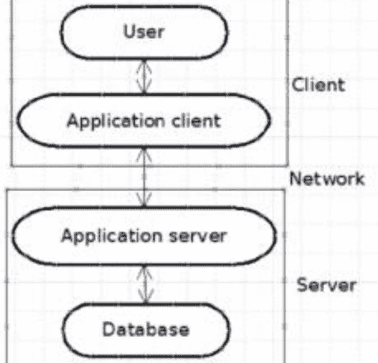

⇒ 图表表示 JDBC 的三层架构。

对于两层模型和三层模型，JDBC 有两个主要层：

- JDBC API（一个应用到 JDBC 管理器的连接），JDBC 驱动 API（这支持 JDBC 管理器到驱动程序的连接）。

- JDBC 驱动管理器和特定数据库的驱动程序提供了连接异构数据库的可能性。JDBC 驱动管理器的功能是确保使用正确的驱动程序来访问每个数据库。驱动管理器能够支持多个驱动程序。而且驱动程序可以并发连接到多个数据源。

- 直到最近，中间层通常用 C 或 C++ 等语言编写，这些语言提供了快速性能。然而，随着将 Java 字节码翻译成高效机器码的优化编译器的引入，以及 Enterprise JavaBeans™ 等技术的出现，Java 平台正迅速成为中间层开发的标准平台。这是一个巨大的优势，使得能够利用 Java 的健壮性、多线程和安全特性成为可能。

- 随着企业越来越多使用 Java 编程语言编写服务器代码，JDBC API 越来越多地被用于三层架构的中间层。使 JDBC 服务器技术的一些特性包括它对连接池、分布式事务和离线行结果集的支持。JDBC API 也是允许从 Java 中间层访问数据源的关键。

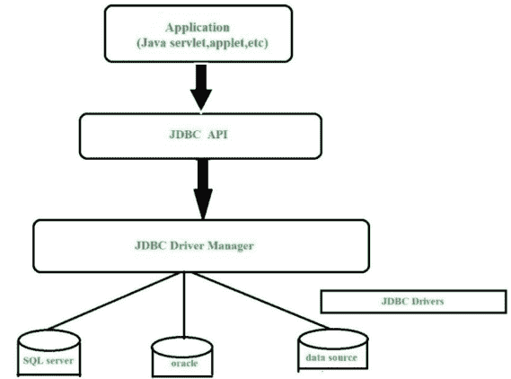

⇒ 图表表示 JDBC 的架构。

例如，你的应用程序可以同时连接 Oracle 数据库和 MySQL 数据库。连接将通过使用不同的驱动程序创建。你可以从 Oracle 数据库读取数据并插入 MySQL 中，反之亦然。

### Java 中的 JDBC 架构

为了理解 JDBC 架构，请查看以下图像。

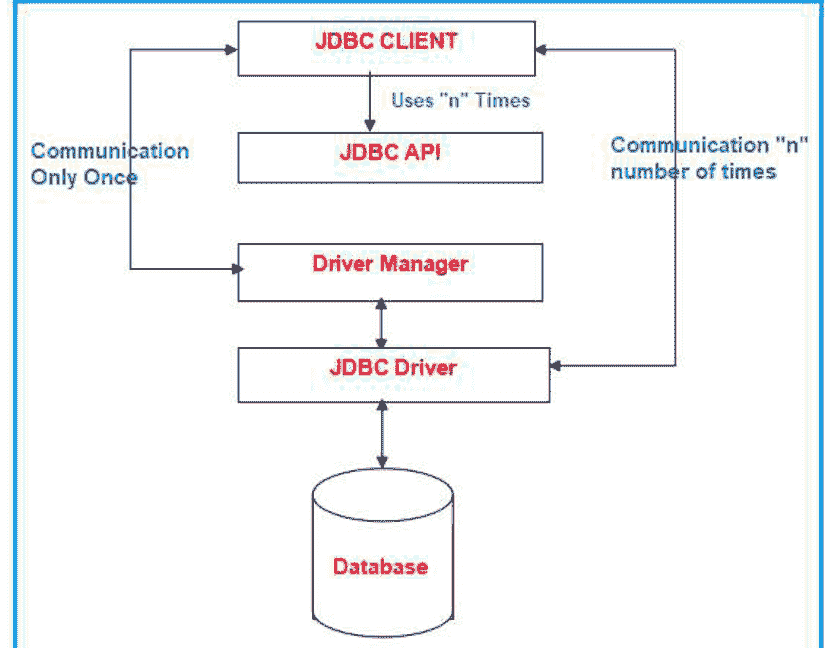

⇒ 图表表示 JDBC 的架构。

## JDBC 驱动程序的组件

JDBC 架构是一种客户端-服务器架构。JDBC 架构包含 5 个元素。

1. **JDBC 客户端：**这里的 JDBC 客户端无非一个想要与数据库通信的 Java 应用程序。

2. **JDBC API：**为了编写无需更改代码即可与任何数据库通信的 Java 程序，Sun Microsystems 发布了 JDBC API。通过 JDBC API 的实现，我们可以调用 JDBC 驱动程序。

3. **JDBC 驱动程序：**它是一个在 Java 应用程序和数据库之间充接口的 Java 应用程序。它理解给 Java 调用并转换为数据库调用，反之亦然。

4. **JDBC 驱动管理器：**它充当数据结构，收集一组 JDBC 驱动程序，并允许程序员为数据库连接动态选择驱动程序。

5. **数据库服务器：**它无非像 Oracle、MySQL、SQL Server 等数据库服务器，JDBC 客户端想要与之通信。

## 9.3 使用 DML 操作的 JDBC 程序

DML：DML 代表数据操纵语言（Data Manipulation Language）；它直接影响数据。

- 数据操纵语言（DML）提供了如在数据库中进行选择、插入、更新和删除数据的语句。DML 的组件包括对数据执行只读查询。SQL 也称为 DML 或数据操纵语言，因为它被用于在关系型数据库中检索和操作数据。

- `executeupdate()` 用于执行数据操纵语言操作，它用于修改存储的数据，但不修改模式或数据库对象。操作以持久化数据库对象（例如表或存储过程）的形式通过 SQL 模式语句进行，而不是存储在它们内部的数据。

### 插入

```java
import java.sql.Connection;
import java.sql.DriverManager;
import java.sql.SQLException;
import java.sql.Statement;

/** Copyright (c), AnkitMittal JavaMadeSoEasy.com */

public class StatementInsertExample {

    public static void main(String... args) {
        Connection con = null;
        Statement stmt = null;

        try {
            // 注册 Oracle 驱动类
            Class.forName("oracle.jdbc.driver.OracleDriver");

            // 获取连接
            con = DriverManager.getConnection(
                "jdbc:oracle:thin:@localhost:1521:orcl",
                "username",
                "password"
            );

            stmt = con.createStatement();

            String sql = "INSERT INTO employees (id, name, salary) VALUES (101, 'John Doe', 50000)";

            stmt.executeUpdate(sql);

            System.out.println("Insert successful!");

        } catch (SQLException e) {
            e.printStackTrace();

        } finally {
            try {
                if (stmt != null) stmt.close();
                if (con != null) con.close();

            } catch (SQLException e) {
                e.printStackTrace();
            }
        }
    }
}
```

### 输出

```text
Insert successful!
```

## 9.4 总结

在本章中，我们学习了 JDBC 架构及其组件。我们还学习了如何使用 JDBC 执行 DML 操作。这些知识对于构建与数据库交互的 Java 应用程序至关重要。

## 10.2.2 Spring Boot 和 Spring MVC 有什么区别？

- Spring Boot 和 Spring MVC 之间的主要区别在于上下文（context）和整体规模。

- Spring MVC 是传统意义上的一个特定 Spring Web 框架。这意味着它需要手动构建配置、单独指定依赖，并使用应用程序服务器。

- 另一方面，Spring Boot 更像是 Spring 的一个模块，旨在通过自动化和默认配置来封装 Spring 应用或框架。

- 因此，可以将一个 Spring MVC 项目打包为 Spring Boot 应用程序。尽管两者都可以被归类为 Spring 框架，但 Spring Boot 的规模涵盖了许多类型的 Spring 框架。相反，Spring MVC 负责框架的设计。

### 10.2.3 Spring Boot Starters（启动器）

- Spring Boot starters 正是为了为了解决这个问题而构建。Starter POM 是一组方便的依赖描述符，你可以将其包含在应用程序中。你可以获得所需的 Spring 及相关技术的“一站式服务”，而无需翻阅示例代码并复制粘贴大量的依赖描述符。

### Web Starter（Web Starter）

- 首先，让我们来看开发 REST 服务；我们可以使用 Spring MVC、Tomcat 和 Jackson 等库——对于单个应用程序来说，有大量的依赖。

- Spring Boot starters 仅需添加一个依赖即可帮助减少手动添加依赖的数量。

```xml
<dependency>
  <groupId>org.springframework.boot</groupId>
  <artifactId>spring-boot-starter-web</artifactId>
</dependency>
```

| 自动配置 | Spring 和其他第三方框架将自动进行配置。 |
| :--- | :--- |
| 生产级特性 | 健康检查、指标监控和外部化配置。 |
| Starter 依赖 | 这将提供旨在简化构建配置的策略性依赖（opinionated dependencies）。这还提供了构建工具的灵活性（Maven 和 Gradle）。 |

### Test Starter（测试 Starter）

- 对于测试，我们通常使用以下 set 库：Spring Test、JUnit、Hamcrest 和 Mockito。我们可以手动包含所有这些库，但使用 Spring Boot starter 可以以下方式自动包含这些库：

```xml
<dependency>
  <groupId>org.springframework.boot</groupId>
  <artifactId>spring-boot-starter-test</artifactId>
  <scope>test</scope>
</dependency>
```

- 注意，你不需要指定构件的版本号。Spring Boot 会确定应该使用哪个版本——你只需要指定 `spring-boot-starter-parent` 构件的版本。如果你以后需要升级 Boot 库和依赖，只需在一个地方升级 Boot 版本，它就会处理好其余工作。

### 测试 Controller 有两种方法

- 使用 mock 环境
- 使用嵌入式 Servlet 容器（如 Tomcat 或 Jetty）

### Data JPA Starter（数据 JPA Starter）

- 大多数 Web 应用都有某种程度的持久化——而这正是 JPA 的范畴。

与其手动定义所有相关的依赖，不如直接使用 starter：

```xml
<dependency>
  <groupId>org.springframework.boot</groupId>
  <artifactId>spring-boot-starter-data-jpa</artifactId>
</dependency>

<dependency>
  <groupId>com.h2database</groupId>
  <artifactId>h2</artifactId>
  <scope>runtime</scope>
</dependency>
```

注意，开箱即用，我们对以下数据库提供了自动支持：H2、Derby 和 Hsqldb。

### Mail Starter（邮件 Starter）

- 企业级开发中一个非常常见的任务是发送电子邮件，直接处理 Java Mail API 通常很困难。
- Spring Boot starter 隐藏了这种复杂性——可以通过以下方式指定邮件依赖：

```xml
<dependency>
  <groupId>org.springframework.boot</groupId>
  <artifactId>spring-boot-starter-mail</artifactId>
</dependency>
```


### 10.2.4 Spring Boot 的优势

- Spring 框架可以用于 Web 应用开发中的所有架构层。
- 在编写类时使用轻量级的 `POJO` 模型。
- 允许你自由链接模块并轻松测试它们。
- 支持声明式编程。
- 消除了独立创建工厂和单例类的需求。
- 支持多种配置方法。
- 提供中间件级服务。

### 10.2.5 Spring Boot 的缺点

- Spring Boot 可能包含未使用的依赖，从而导致部署文件体积巨大。
- 将遗留应用转换为 Spring Boot 需要大量工作且是一个耗时的过程。
- 对应用程序的控制有限。

## 10.3 Spring Boot 与数据库

Spring Boot JDBC 提供了 starter 和库，用于通过 JDBC 连接应用程序。

### 10.3.1 JDBC 连接池

连接池是一种创建和维护 JDBC 连接对象集合的机制。维护连接池的主要目标是利用可重用性。只有在没有可重用的连接对象时，才会创建新的连接对象。这种技术可以提高应用程序的整体性能。本文将尝试展示如何将连接池机制应用于 Java。

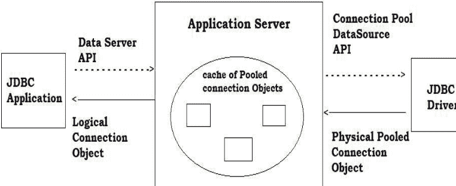

图表表示 JDBC 连接池的结构。

它提高了数据访问速度并减少了应用程序的数据库连接数量。它提高了应用程序的性能。连接池执行以下任务：

- 管理可用连接
- 分配新连接
- 关闭连接

### 10.3.2 为什么我们需要连接池？

建立数据库连接是一个非常消耗资源的过程，涉及大量的开销。此外，在多线程环境中，打开和关闭连接可能会变得糟糕。为了了解每次创建新连接请求实际上可能发生什么，请考虑以下几点。数据库连接使用 `DriverManager` 或 `DataSource` 对象建立。

- 应用程序调用 `getConnection()` 方法。
- JDBC 驱动程序请求 JVM socket。
- JVM 必须确保该调用不违反安全因素（如 applet 的情况）。
- 调用在进入网络之前可能需要穿过防火墙。
- 到达主机后，服务器处理连接请求。
- 数据库服务器初始化连接对象并返回给 JDBC 客户端（再次经过相同的过程）。
- 最终，我们得到了连接。
- 这是背后实际运行机制的概述。请放心，实际过程比这更复杂、详尽。在单线程控制环境中，数据库事务大多是线性的：打开连接、执行数据库事务、并在完成后关闭连接。现实中的应用更为复杂；连接池机制可以提升性能，尽管还有许多其他对应用程序整体性能至关重要的属性。
- 随着我们深入研究，连接池的复杂性会变得更加棘手。但要感谢那些专门为连接池需求而编写库的人们。这些库遵循 JDBC 规范，并提供了更简单的 API 以在 Java 应用中实际实现它们。

## 10.4 Spring Boot Web 应用开发

尽管 Spring 框架具有优势，但作者们决定为开发者提供一些工具，以自动化配置程序并加快创建和部署 Spring 应用程序的过程。这些工具被归类为 Spring Boot 这个通用名称。

Spring 框架专注于提供灵活性，而 Spring Boot 旨在缩短代码长度并简化 Web 应用开发。通过利用注解和样板配置，Spring Boot 减少了开发应用程序的时间。这种能力帮助你以更少或几乎没有配置开销的方式创建独立应用程序。

现在我们将探索这两个场景：

- 带有 Spring JDBC 和 `JdbcTemplate` 的 Spring Boot 控制台应用程序
- 带有 Spring Data JPA 和 Hibernate 框架的 Spring Boot Web 应用程序

基本上，为了连接到 MySQL 服务器，你需要执行以下步骤：

- 声明 MySQL JDBC 驱动的依赖，这使得 Java 应用程序能够与 MySQL 服务器通信。
- 声明 Spring JDBC 或 Spring Data JPA 的依赖。
- 为数据库连接信息指定数据源属性。
- 在 Spring JDBC 的情况下，使用 `JdbcTemplate` API 对数据库执行 SQL 语句。
- 在 Spring Data JPA 的情况下，你需要创建一个实体类（entity class）、存储接口（repository interface），然后使用 Spring Data JPA API。

以下是在 Spring Boot 应用程序中连接 MySQL 服务器的详情。

### 10.4.1 声明 MySQL JDBC 驱动依赖

要使用 MySQL JDBC 驱动，请在 Spring Boot 项目的 Maven `pom.xml` 文件中声明以下依赖：

```xml
<dependency>
  <groupId>mysql</groupId>
  <artifactId>mysql-connector-java</artifactId>
  <scope>runtime</scope>
</dependency>
```

不需要指定版本，因为 Spring Boot 使用了父 POM 中指定的默认版本。

### 10.4.2 指定数据源属性

接下来，你需要在 Spring Boot 配置文件（`application.properties`）中指定以下属性：

```properties
spring.datasource.url=jdbc:mysql://localhost:3306/bookshop
spring.datasource.username=root
spring.datasource.password=password
```

根据你的 MySQL 配置更新数据源 URL、用户名和密码。如果你连接到远程 MySQL 服务器，需要将 `localhost` 替换为远程主机的 IP 地址或主机名。

### 10.4.3 使用 Spring JDBC 连接 MySQL

Spring JDBC 在 JDBC 之上提供了一个简单的 API（`JdbcTemplate`），你可以在简单的情况下使用，例如执行原生 SQL 语句。你需要声明以下依赖：

```xml
<dependency>
  <groupId>org.springframework.boot</groupId>
  <artifactId>spring-boot-starter-jdbc</artifactId>
</dependency>
```

### 10.4.4 使用 Spring Data JPA 连接 MySQL

Spring Data JPA 提供了更高级的 API，基于 Java Persistence API（JPA）规范并使用 Hibernate 作为实现框架，极大地简化了数据库编程。

你需要按照如下声明 Spring Data JPA 的依赖：

```xml
<dependency>
  <groupId>org.springframework.boot</groupId>
  <artifactId>spring-boot-starter-jpa</artifactId>
</dependency>
```

对于数据源属性，在 URL、用户名和密码之前，你还可以指定这些额外属性：

```properties
spring.datasource.driver-class-name=com.mysql.cj.jdbc.Driver
spring.jpa.hibernate.ddl-auto=update
spring.jpa.show-sql=true
spring.jpa.properties.hibernate.format_sql=true
spring.jpa.properties.hibernate.dialect=org.hibernate.dialect.MyMySQL57Dialect
```

然后，你需要编写一个映射到数据库中表的实体类，例如：

```java
import javax.persistence.*;

@Entity
@Table(name = "users")
public class User {

  @Id
  @GeneratedValue(strategy = GenerationType.IDENTITY)
  private Integer id;

  private String email;

  private String password;

  // getters and setters...
}
```

并声明相应的存储接口：

```java
import org.springframework.data.jpa.repository.JpaRepository

public interface UserRepository extends JpaRepository<User, Integer> {

}
```

然后你就可以像这样在 Spring MVC 控制器或业务类中使用该存储接口：

```java
@Controller
public class UserController {

  @Autowired
  private UserRepository repo;

  @GetMapping("/users")
  public String listAll(Model model) {

    List<User> users = repo.findAll();

    model.addAttribute("listUsers", users);

    return "users";
  }
}
```

### 10.4.5 依赖管理的便利性

- 为了加速依赖管理过程，Spring Boot 隐式地封装了每种基于 Spring 的应用程序所需的第三方依赖，并通过所谓的 starter 包（如 `spring-boot-starter-web`、`spring-boot-starter-data-jpa` 等）提供这些依赖。
- Starter 包是方便的依赖描述符集合，你可以将其包含在应用程序中。它们允许你获取所有 Spring 相关技术的通用解决方案，消除了搜索代码示例以及从示例加载所需依赖描述符的必要性。
- 例如，如果你想开始使用 Spring Data JPA 访问数据库，只需在项目中包含 `spring-boot-starter-data-jpa` 依赖即可（无需寻找兼容的 Hibernate 数据库驱动和库）。
- 如果你想创建一个 Spring Web 应用程序，添加 `spring-starter-web` 依赖，它会将开发 Spring MVC 应用程序所需的所有库拉入你的项目，例如 `spring-webmvc`、`json`、`validation-api` 和 Tomcat。
- 简之 Spring Boot 的用途是它收集了所有常用依赖并将它们定义在一个地方，允许开发者立即开始工作，而不是在每次创建新应用程序时都重复轮子。
- 因此，在 Spring Boot 中运行时，`pom.xml` 文件的行数比在普通 Spring 少得多。

### 10.4.6 自动配置

- Spring Boot 值得提到的优点之一是应用程序的自动配置。
- 在选择合适的 starter 包后，Spring Boot 会根据你使用的 jar 依赖自动配置你的 Spring 应用程序。例如，如果你添加了 `spring-starter-web`，Spring Boot 会自动配置注册的 bean，如 `DispatcherServlet`、`ResourceHandlers`、`MessageSource`。
- 如果你使用 `spring-starter-jdbc`，Spring Boot 会自动注册 `DataSource`、`EntityManager` 和 `TransactionManager` bean，并从 `application.properties` 读取连接信息。
- 如果你不打算使用数据库，Spring Boot 将自动配置内存中的 H2。自动配置可以随时根据用户偏好被完全覆盖。

### 10.4.7 对应用服务器——Servlet 容器的原生支持

- 每个 Spring Boot 都包含一个嵌入式 Web 服务器。开发者不再需要担心设置 servlet 容器并将应用程序部署到其中。应用程序现在可以作为带有内置服务器的可执行 jar 自运行。如果你需要使用独立的服务器，只需排除默认依赖即可。Spring Boot 为不同的 HTTP 服务器提供了单独包。
- 使用嵌入式服务器构建独立的 Web 应用程序不仅对开发非常方便，而且是企业级应用程序的有效解决方案；此外，它在微服务世界中变得越来越有用。将整个服务（如用户身份验证）快速打包成提供 API 的独立可部署构件的能力，使得安装和部署变得简单得多。
- Spring Boot 是简化 Spring 应用程序配置的下一代工具的一部分。它不是自动生成代码的工具，而是项目构建系统的插件（支持 Maven 和 Gradle）。
- 该插件提供了测试和部署 Spring 应用程序的能力。`mvn spring-boot:run` 命令在 8080 端口运行你的应用程序。此外，Spring Boot 还允许你将应用程序打包成带有内置 Full Tomcat 容器的独立 jar（不过，Spring Boot 也可以创建 war）。

## 10.5 Spring Boot Restful Web 服务

- REST 代表表述状态转移（REpresentational State Transfer）。它由 Roy Thomas Fielding 开发，他也是 HTTP 的开发者。RESTful Web 服务的主要目标是让 Web 服务更高效。RESTful Web 服务尝试使用 HTTP 中已经存在的各种不同概念来定义服务。REST 是一种架构方法，而不是一种协议。
- 它没有定义标准的节点交换格式。我们可以使用 XML 和 JSON 构建 REST 服务。JSON 是 REST 中更流行的格式。REST 中的核心抽象是资源（resource）。资源可以是任何内容。它可以通过统一资源标识符（URI）进行访问。

### 10.5.1 为什么 REST 如此流行？

1. 它允许客户端和服务器的分离。
2. 它不依赖于单一的技术或编程语言。
3. 你可以使用 REST API 构建可扩展的应用程序，甚至集成两个不同的应用程序。
4. REST 是无状态的，并使用 GET、PUT、POST 和 DELETE 等基本 HTTP 方法在客户端和服务器之间进行通信。

> 资源具有 XML、HTML 和 JSON 等表示形式。当前状态由表示性资源捕获。当我们请求一个资源时，我们提供了该资源的表示形式。HTTP 的重要方法有：
>
> `GET`：读取资源。
>
> `PUT`：更新现有的资源。
>
> `POST`：创建一个新资源。
>
> `DELETE`：删除资源。
>
> 例如，如果我们想在社交媒体应用程序中执行以下操作，我们将得到相应的结果。
>
> `POST /users`：创建一个用户。
>
> `GET /users/{id}`：获取用户的详情。
>
> `GET /users`：获取所有用户的详情。
>
> `DELETE /users`：删除所有用户。
>
> `DELETE /users/{id}`：删除一个用户。
>
> `GET /users/{id}/posts/post_id`：获取特定帖子的详情。
>
> `POST /users/{id}/posts`：为该用户创建一个帖子。

### 10.5.2 Rest Controller

`@RestController` 注解用于定义 RESTful Web 服务。它提供 JSON、XML 和自定义响应。其语法如下所示：

```java
@RestController

public class ProductServiceController {

}
```

### 10.5.3 Request Mapping（请求映射）

`@RequestMapping` 注解用于定义访问 REST 端点（Endpoints）的请求 URI。我们可以定义请求方法来消费和产生对象。默认请求方法是 `GET`。

```java
@RequestMapping(value = "/products")

public ResponseEntity<Object> getProducts() {

}
```

### 10.5.4 Request Body（请求体）

`@RequestBody` 注解用于定义请求体的内容类型。

```java
public ResponseEntity<Object> createProduct(@RequestBody product) {

}
```

### 10.5.5 Path Variable（路径变量）

`@PathVariable` 注解用于定义自定义或动态请求 URI。请求 URI 中的路径变量用大括号 `{}` 定义，如下所示：

```java
public ResponseEntity<Object> updateProduct(@PathVariable("id") String id) {

}
```

### 10.5.6 Request Parameter（请求参数）

`@RequestParam` 注解用于从请求 URL 中读取请求参数。默认情况下，它是必选参数。我们也可以为请求参数设置默认值，如下所示：

```java
public ResponseEntity<Object> getProduct(
    @RequestParam(value = "name", required = false, defaultValue = "honey") String name) {

}
```


### GET API

默认 HTTP 方法是 `GET`。该方法会发送请求参数和路径变量来定义自定义或动态 URL。

### POST API

HTTP `POST` 请求用于创建资源。该方法包含请求体。我们可以发送请求参数和路径变量来定义自定义或动态 URL。

### PUT API

HTTP `PUT` 请求用于更新现有的资源。该方法包含请求体。我们可以发送请求参数和路径变量来定义自定义或动态 URL。

### 10.5.2 Spring Boot REST 示例

要创建 Spring Boot REST 程序，必须遵循以下四个步骤：

1. 使用 Spring Boot 工具或 Spring Initializr 项目创建一个新项目。
2. 在 Maven POM 文件中添加依赖。
3. 添加控制器并暴露 REST API。
4. 添加服务层以与 Spring Data JPA 的 `CrudRepository` 接口进行通信。

### 创建一个新的 Spring Boot Starter 项目

新的 Spring Starter 项目


| 字段 | 值 |
| :--- | :--- |
| 服务 URL | `https://start.spring.io` |
| 名称 | `spring-boot-rest-example` |
| 使用默认位置 | `C:\Codelay\Spring-Workspace\spring-boot-rest-example` | 浏览 |
| 类型 | Maven | 打包: Jar |
| Java 版本 | 8 | 语言: Java |
| 组 | `com.codelay.rest` |
| 架构 | `spring-boot-rest-example` |
| 版本 | `0.0.1-SNAPSHOT` |
| 描述 | Spring Boot REST API 的 Hello world 示例项目 |
| 包 | `com.codelay.rest` |
| 工作集 | 将项目添加到工作集 | 新... |
| 工作集: | | 选择... |

### 新的 Spring Starter 项目依赖

| Spring Boot 版本: 2.1.6 | 常用： |
| :--- | :--- |
| Cloud OAuth2 | Spring Boot DevTools | Spring Security |
| Spring Web Starter | Thymeleaf | |
| 可用： | 已选： |
| h2 | X Spring Data JPA |
| SQL | X H2 Database |
| H2 Database | X Spring Web Starter |
| Security | | |
| OAuth2 Client | | |
| OAuth2 Resource Server | | |
| Okta | | |
| Spring Security | | |
| Cloud OAuth2 | |

如示例所示，我创建了一个新项目 `spring-boot-rest-example`，并添加了 Spring Data JPA、H2 Database 和 Spring Web Starter 的依赖。

```xml
<?xml version="1.0" encoding="UTF-8"?>

<project xmlns="http://maven.apache.org/POM/4.0.0"
         xmlns:xsi="http://www.w3.org/2001/XMLSchema-instance"
         xsi:schemaLocation="http://maven.apache.org/POM/4.0.0 http://maven.apache.org/xsd/maven-4.0.xsd">
  <modelVersion>4.0.0</modelVersion>

  <parent>
    <groupId>org.springframework.boot</groupId>
    <artifactId>spring-boot-starter-parent</artifactId>
    <version>2.1.6</version>
    <relativePath>../pom.xml</relativePath>
  </parent>

  <groupId>com.codelay.rest</groupId>
  <artifactId>spring-boot-rest-example</artifactId>
  <version>0.0.1-SNAPSHOT</version>
  <name>spring-boot-rest-example</name>
</project>
```

```xml
<description>Hello world project for Boot REST APIs</description>

<properties>
  <java.version>1.8</java.version>
  <maven-plugin.version>3.1.1</maven-plugin.version>
</properties>

<dependencies>
  <dependency>
    <groupId>org.springframework.boot</groupId>
    <artifactId>spring-boot-starter-data-jpa</artifactId>
  </dependency>

  <dependency>
    <groupId>org.springframework.boot</groupId>
    <artifactId>spring-boot-starter-web</artifactId>
  </dependency>

  <dependency>
    <groupId>com.h2</groupId>
    <artifactId>h2</artifactId>
    <scope>runtime</scope>
  </dependency>

  <dependency>
    <groupId>org.springframework.boot</groupId>
    <artifactId>spring-boot-starter-test</artifactId>
  </dependency>

  <dependency>
    <groupId>org.springframework.boot</groupId>
    <artifactId>spring-boot-devtools</artifactId>
    <optional>true</optional>
  </dependency>
</dependencies>

<build>
  <plugins>
    <plugin>
      <groupId>org.springframework.boot</groupId>
      <artifactId>spring-boot-maven-plugin</artifactId>
    </plugin>
  </plugins>
</build>
```


### Maven 依赖树

```
[INFO] | com.codelay.rest:spring-boot-rest-example:jar:0.0.1-SNAPSHOT
[INFO] |+ org.springframework.boot:spring-boot-starter-data-jpa:jar:2.1.6.RELEASE
[INFO] |+ org.springframework.boot:spring-boot-starter-aop:jar:2.1.6.RELEASE
[INFO] |+ org.springframework.framework:spring-aop:jar:5.1.8.RELEASE
[INFO] | || org.aspectj:aspectjweaver:jar:1.9.4
[INFO] |+ org.springframework.boot:spring-boot-starter-jdbc:jar:2.1.6.RELEASE
[INFO] |+ com.zaxxer:HikariCP:jar:3.2.0
[INFO] || org.springframework.framework:spring-jdbc:jar:5.1.8.RELEASE
[INFO] |+ javax.transaction:javax.transaction-api:jar:1.3
[INFO] |+ javax.xml.bind:jaxb-api:jar:2.3.1
[INFO] || javax.activation:javax.activation-api:jar:1.2.0
[INFO] |+ org.hibernate:hibernate-core:jar:5.3.10.Final
[INFO] |+ org.jboss.logging:jboss-logging:jar:3.3.2.Final
[INFO] |+ javax.persistence:javax.persistence-api:jar:2.2
[INFO] |+ org.javassist:javavist:javavist:jar:3.23.2-GA
[INFO] || net.nettybuddy:byte-buddy:jar:1.9.13
[INFO] |+ antlr:antlr:jar:2.7.7
[INFO] |+ org.jboss:jindex:jar:2.0.5.Final
[INFO] |+ com.fasterxml:class-mate:jar:1.4.0
[INFO] |+ org.dom4j:dom4j:jar:2.1.1
[INFO] || org.hibernate.common:hibernate-commons-annotations:jar:5.0.4.Final
[INFO] |+ org.springframework.data:spring-data-jpa:jar:2.1.9.RELEASE
[INFO] |+ org.springframework.data:spring-data-commons:jar:2.1.9.RELEASE
[INFO] |+ org.springframework:spring-orm:jar:5.1.8.RELEASE
[INFO] |+ org.springframework:spring-context:jar:5.1.8.RELEASE
[INFO] |+ org.springframework:spring-tx:jar:5.1.8.RELEASE
[INFO] |+ org.springframework:spring-beans:jar:5.1.8.RELEASE
[INFO] || org.slf4j:slf4j-api:jar:1.7.26
[INFO] |-\ org.springframework:spring-aspects:jar:5.1.8.RELEASE:compile
[INFO] +- org.springframework.boot:spring-boot-starter-web:jar:2.1.6.RELEASE:compile
[INFO] +- org.springframework.boot:spring-boot-starter:jar:2.1.6.RELEASE:compile
[INFO] +- org.springframework.boot:spring-boot-starter-logging:jar:2.1.6.RELEASE:compile
[INFO] +- ch.qos.logback:logback-classic:jar:1.2.3:compile
[INFO] |- ch.qos.logback:logback-core:jar:1.2.3:compile
[INFO] +- org.apache.logging.log4j[4]:log4j:jar:2.11.2:compile
[INFO] |\- org.apache.logging.log4j[4]:log4j-api:jar:2.11.2:compile
[INFO] |\- org.slf4j:jul-to-slf4j:jar:1.7.26:compile
[INFO] +- javax.validation.annotation:javax.annotation-api:jar:1.3.2:compile
[INFO] |\- org.yaml:snakeyaml:jar:1.23:runtime
[INFO] +- org.springframework.boot:spring-boot-starter-json:jar:2.1.6.RELEASE:compile
[INFO] +- com.fasterxml.jackson.core:jackson-databind:jar:2.9.9:compile
[INFO] +- com.fasterxml.jackson.core:jackson-annotations:jar:2.9.0:compile
[INFO] |\- com.fasterxml.jackson.core:jackson-core:jar:2.9.9:compile
[INFO] +- com.fasterxml.jackson.datatype:jackson-datatype-jdk8:jar:2.9.9:compile
[INFO] +- com.fasterxml.jackson.datatype:jackson-datatype-jsr310:jar:2.9.9:compile
[INFO] +- com.fasterxml.jackson.module:jackson-module-parameter-names:jar:2.9.9:compile
[INFO] +- org.springframework.boot:spring-boot-starter-tomcat:jar:2.1.6.RELEASE:compile
[INFO] +- org.apache.tomcat:tomcat-embedded-core:jar:9.0.21:compile
[INFO] +- org.apache.tomcat:tomcat-embedded-el:jar:9.0.21:compile
[INFO] |\- org.apache.tomcat:tomcat-embedded-websocket:jar:9.0.21:compile
[INFO] +- org.hibernate.validator:hibernate-validator:jar:6.0.17.Final:compile
[INFO] |\- javax.validation:validation-api:jar:2.0.1.Final:compile
[INFO] +- org.springframework.validation:spring-web:jar:5.1.8.RELEASE:compile
[INFO] |\- org.springframework:spring-webmvc:jar:5.1.8.RELEASE:compile
[INFO] |- org.springframework:spring-expression:jar:5.1.8.RELEASE:compile
[INFO] +- org.h2database:h2:jar:1.4.199:runtime
[INFO] +- org.springframework.boot:spring-boot-starter-test:jar:2.1.6.RELEASE:test
[INFO] |- org.springframework.boot:spring-boot-test:jar:2.1.6.RELEASE:test
[INFO] |+ org.springframework.boot:spring-boot-autoconfigure:jar:2.1.6.RELEASE:test
[INFO] +- com.jayway.json:path:jar:2.4.0:test
[INFO] |- net.minidevev:accessors-smart:jar:2.3:test
[INFO] |\- net.minidevev:jackson-smart:jar:1.2:test
[INFO] |\- org.ow2.asm:asm:jar:5.0.4:test
[INFO] +- junit:junit:jar:4.12:test
[INFO] +- org.assertj:assertj-core:jar:3.11.1:test
[INFO] +- org.mockito:mockito-core:jar:2.23.4:test
[INFO] +- net.bytebuddy:byte-buddy-agent:jar:1.9.13:test
[INFO] |\- org.objenesis:objenesis:jar:2.6:test
[INFO] +- org.hamcrest:hamcrest-core:jar:1.3:test
[INFO] +- org.hamcrest:hamcrest-library:jar:1.3:test
[INFO] +- org.skyscreamer:json-assert:jar:1.5.0:test
[INFO] |\- com.vaadin.external:google-android-json:0.0.2013108.vaadin1:test
[INFO] +- org.springframework:spring-core:jar:5.1.8.RELEASE:compile
[INFO] |- org.springframework:spring-jdbc:jar:5.1.8.RELEASE:compile
[INFO] +- org.springframework:spring-test:jar:5.1.8.RELEASE:test
[INFO] +- org.xmlunit:xmlunit-core:jar:2.6.2:test
```

```java
package com.codedelay.rest.exception;

public class UserNotFoundException extends RuntimeException {

    public UserNotFoundException(int id) {
        super("User not found : " + id);
    }
}
```

现在添加 `Service` 类，如果数据库中没有该特定用户 ID 的详细信息，则抛出 `UserNotFoundException`。

```java
public User findById(int id) {
    return mRepository.findById(id).orElseThrow(() -> new UserNotFoundException(id));
}
```

仅仅抛出 Java 异常是不够的。

当 `UserNotFoundException` 发生时，我们需要返回某些 HTTP 错误。为此，让我们创建一个 `GlobalExceptionHandler` 处理器。当发生 `UserNotFoundException` 时，它将返回 `HttpStatus.NOT_FOUND` 错误。

```java
package com.codedelay.rest.exception;

import java.io.IOException;

import javax.servlet.http.HttpServletResponse;

import org.springframework.http.HttpStatus;

import org.springframework.web.bind.annotation.ControllerAdvice;
import org.springframework.web.bind.annotation.ExceptionHandler;

@ControllerAdvice
public class GlobalExceptionHandler {

    @ExceptionHandler(UserNotFoundException.class)
    public void handleUserNotFoundException(HttpServletResponse response) throws IOException {
        response.sendError(HttpStatus.NOT_FOUND.value());
    }
}
```


## 10.6 结论

Spring Boot 已成为 Java 生态系统中不可或缺的一部分，为构建微服务架构的 Spring 应用提供了高效且可扩展的工具箱。它通过对单元和集成测试使用直观的默认设置加速了开发和部署过程。此外，Spring Boot 帮助开发者通过清晰安全的配置构建健壮的应用程序，而无需花费大量精力去研究 Spring 的复杂细节。如果你不确定是否应该为你的 Java 项目使用此解决方案，请仔细审查使用 Spring Boot 的优缺点及其核心特性，并查看它们如何与你的业务目标保持一致。或者，你可以将开发过程委托给可靠的软件供应商。

## 10.7 参考文献

`https://docs.spring.io/spring-boot/docs/current/reference/html/using.html`

`https://bambooagile.eu/insights/pros-and-cons-of-using-spring-boot/`

## 11 理解 Spring 中的事务管理

## 单元结构

- 11.0 目标
- 11.1 引入
- 11.2 概述
  - 11.2.1 事务传播 (Required)
  - 11.2.2 事务传播 (Supports)
  - 11.2.3 事务传播 (Not_Supported)
  - 11.2.4 事务传播 (Requires_New)
  - 11.2.5 事务传播 (Never)
  - 11.2.6 事务传播 (Mandatory)
- 11.3 结论
- 11.4 参考文献列表

## 11.0 目标

任何应用程序都涉及多个服务或组件对其他服务或组件进行调用。事务传播指示任何组件或服务将或不参与事务，以及当调用组件/服务已经创建或尚未创建事务时，它将如何表现。

使用 Spring Framework 最具吸引力的理由之一是其全面的事务支持。Spring Framework 为事务管理提供了一个一致的抽象，带来了以下优势：

- 在 JTA、JDBC、Hibernate、JPA 和 JDO 等不同的事务 API 之间提供一致的编程模型。
- 支持声明式事务管理。
- 与 JTA 等许多复杂的事务 API 相比，为程序化事务管理提供了更简单的 API。
- 与 Spring 相当良好的数据访问抽象集成得非常好。

本章分为若干部分，每部分详细说明了 Spring Framework 事务支持的一项附加值或技术。本章以对事务管理相关的最佳实践的讨论结束（例如，在声明式和程序化事务管理之间进行选择）。

- 第一部分标题为“动机”（Motivations），描述了为什么人们想要使用 Spring Framework 的事务抽象，而不是 EJB CMT 或通过 Hibernate 等专有 API 驱动事务。
- 第二部分标题为“核心抽象”（Key abstractions），概述了 Spring Framework 事务支持中的核心类，以及如何从各种源配置并获取 `DataSource` 实例。
- 第三部分标题为“声明式事务管理”（Declarative transaction management），涵盖了 Spring Framework 对声明式事务管理的支持。
- 第四部分标题为“程序化事务管理”（Programmatic transaction management），涵盖了 Spring Framework 对程序化（即显式编码）事务管理的支持。

## 11.1 引入

事务是单个用户或应用程序正在执行的动作或系列动作，用于读取或更新数据库内容。

事务可以定义为数据库上的一个逻辑工作单元。这可能是一个完整的程序、程序的一部分，或者单个命令（如 `INSERT` 或 `UPDATE` 等 SQL 命令），并且可能涉及对数据库的任何数量的操作。在数据库上下文中，应用程序的执行可以被看作是一个或多个事务，其进行着非数据库的处理。

在传统的关系型数据库设计中，事务通过 `COMMIT` 或 `ROLLBACK` SQL 语句完成，这些语句表示事务的开始或结束。ACID 缩写定义了数据库事务的属性，如下：

- **原子性（Atomicity）**：事务必须完全完成、保存（提交）或完全撤销（回滚）。零售店数据库中的销售交易说明了一个解释原子性的场景。
- **一致性（Consistency）**：事务必须完全符合事务之前的数据库状态。换句话说，例如，如果数据库表的 `Phone` 列只能包含数字，那么一致性规定任何尝试输入字母写字母的事务都不能提交。
- **隔离性（Isolation）**：在原始事务提交或回滚之前，事务数据对其他事务不可用。
- **持久性（Durability）**：即使在数据库故障的情况下，事务数据更改也必须可用。

## 11.2 概述

事务代表系列不同的动作。

### 事务传播 (TRANSACTION PROPAGATION)

下面的图表示了事务的传播。

- 我们将通过客户端示例来表示 Spring 中的事务传播，如下：
- 使用 `Organization` service 调用
- 直接调用 `Employee` Service。

### 高级 Java (ADVANCE JAVA)

由于 `Employee` Service 可能被直接调用。

如果从另一个服务调用 `insertEmployee()` 方法：
1. 如果调用服务有事务，则使用现有事务。
2. 如果调用服务没有事务，则该方法将创建新事务。

因此在 `REQUIRED` 的情况下，如果存在调用服务的事务，`insertEmployee()` 方法将使用它；如果不存在则创建它自己的。

我们将通过观察 `Organization` 和 `Employee` 服务的行为来查看各种传播场景。共有六种事务传播类型：

- `REQUIRED`
- `SUPPORTS`
- `NOT_SUPPORTED`
- `REQUIRES_NEW`
- `NEVER`
- `MANDATORY`

### 11.2.1 事务传播 (Required)

### 事务传播-REQUIRED

在这里，`Organization` Service（组织服务）和 `Employee` Service（员工服务）的事务传播行为均为 `Required`。这是默认的事务传播行为。

## 代码

`Organization` Service 如下：

```java
package com.javainuse.service.impl;

import org.springframework.beans.factory.annotation.Autowired;
import org.springframework.stereotype.Service;
import org.springframework.transaction.annotation.Transactional;
import com.javainuse.model.Employee;
import com.javainuse.model.EmployeeHealthInsurance;
import com.javainuse.service.EmployeeService;
import com.javainuse.service.HealthInsuranceService;
import com.javainuse.service.OrganizationService;

@Service
@Transactional
public class OrganizationServiceImpl implements OrganizationService {

    @Autowired
    EmployeeService employeeService;

    @Autowired
    HealthInsuranceService healthInsuranceService;

    @Override
    public void joinOrganization(Employee employee, EmployeeHealthInsurance employeeHealthInsurance) {
        employeeService.insertEmployee(employee);
        if (employee.getEmpId().equals("emp1")) {
            throw new RuntimeException("throwing exception to test transaction rollback");
        }
        healthInsuranceService.registerEmployeeHealthInsurance(employeeHealthInsurance);
    }

    @Override
    public void leaveOrganization(Employee employee, EmployeeHealthInsurance employeeHealthInsurance) {
        employeeService.deleteEmployeeById(employee.getEmpId());
        healthInsuranceService.deleteEmployeeHealthInsuranceById(employeeHealth.getEmpId());
    }
}
```

`Employee` Service 如下：

```java
package com.javainuse.service.impl;

import org.springframework.beans.factory.annotation.Autowired;
import org.springframework.stereotype.Service;
import org.springframework.transaction.annotation.Transactional;
import com.javainuse.dao.EmployeeDao;
import com.javainuse.model.Employee;
import com.javainuse.service.EmployeeService;

@Service
@Transactional
public class EmployeeServiceImpl implements EmployeeService {

    @Autowired
    private EmployeeDao employeeDao;

    @Override
    public void insertEmployee(Employee employee) {
        employeeDao.insert(employee);
    }

    @Override
    public void deleteEmployeeById(String empid) {
        employeeDao.deleteEmployeeById(empid);
    }
}
```

## 输出

### 使用 Organization-Source 调用 EmployeeService

```
main com.javainuse.SpringBootApplication : Started SpringBootApplication in 3.96 seconds (JVM run)
main org.springframework.jdbc.datasource.DataSourceTransactionManager : Creating new transaction with name [com.javainuse.service.Employee]
main org.springframework.jdbc.datasource.DataSourceTransactionManager : Joined existing transaction
main org.springframework.jdbc.datasource.DataSourceTransactionManager : Switching JDBC Connection [HikariProxyConnection/1010021153]
main org.springframework.jdbc.datasource.DataSourceTransactionManager : Participating in transaction
main org.springframework.jdbc.core.NamedParameterTemplate : Creating prepared statement
main org.springframework.jdbc.core.NamedParameterTemplate : Executing prepared statement [INSERT INTO employee ...]
main org.springframework.jdbc.datasource.DataSourceTransactionManager : Committing transaction
main org.springframework.jdbc.core.NamedParameterTemplate : Creating prepared statement
main org.springframework.jdbc.core.NamedParameterTemplate : Executing prepared statement [DELETE FROM employee ...]
main org.springframework.jdbc.datasource.DataSourceTransactionManager : Releasing JDBC Connection [HikariProxyConnection/1010021153]
srad-2) s.j.jdbc.datasource.DataSourceUtils : Returning JDBC Connection to DataSource
srad-2) s.j.c.a.AnnotationConfigContext : Closing org.springframework.context.annotation.AnnotationConfigContext on Shutdown
srad-2) s.j.e.a.AnnotationBeanExporter : Unregistering JMX-exposed beans
srad-2) s.zaxxer.hikari.HikariPool : HikariPool-1 is shutting down.
main s.zaxxer.hikari.HikariDataSource : HikariPool-1 - Shutdown completed.
```

### 调用 Employeeservice

```
com.javainuse.SpringBootApplication : Started SpringBoot in 3.41 seconds (JVM for running)
org.springframework.jdbc.datasource.DataSourceTransactionManager : Creating new transaction with name [com.javainuse.service]
org.springframework.jdbc.datasource.DataSourceTransactionManager : Acquired Connection [HikariProxyConnection#809533315 wrapped]
org.springframework.jdbc.datasource.DataSourceTransactionManager : Initiating transaction [HikariProxyConnection#809533315 wrapped]
org.springframework.jdbc.core.JdbcTemplate : Executing SQL query
org.springframework.jdbc.datasource.DataSourceTransactionManager : Returning result [HikariProxyConnection#809533315 wrapped]
org.springframework.jdbc.datasource.DataSourceTransactionManager : Initiating transaction commit
org.springframework.jdbc.datasource.DataSourceTransactionManager : Returning Connection [HikariProxyConnection#809533315 wrapped]
com.javainuse.service.EmployeeService : Returning Connection to DataSource
org.springframework.context.AnnotationC
org.springframework.context.MBeanBeanExporter : Unregistering JMX-exposed beans on shutdown
com.zaxxer.hikari.HikariDataource : HikariPool-1 - Shutdown initiated...
```


`com.zaxxer.hikari.HikariDataSource : Shutdown completed.`

## 11.2 事务传播（Supports）

如果从另一个服务调用`insertEmployee()`方法：

- 如果调用方服务有事务，则该方法将使用该事务。
- 如果调用方服务没有事务，则该方法不会创建新事务。

在`SUPPORTS`的情况下，`insertEmployee()`方法将在没有事务的情况下运行。

如果直接调用`insertEmployee()`方法，它不会创建自己的事务。

`Organization Service`的事务传播行为定义为`Required`，而`Employee Service`的传播行为定义为`Supports`。

# 第 11 章：理解 Spring 中的事务管理

```java
@Override
public void deleteEmployeeById(String emp) {
    employeeDao.deleteEmployeeById(emp);
}
```

### 输出

## 使用`OrganizationService`的`EmployeeService`

```text
main] com.java.SpringBootApplication started in 4.36 seconds (JVM running )

main] org.s.j.d.DataSourceTransactionManager : Creating new transaction with name (com.java.service.impl.O

main] org.s.j.d.DataSourceTransactionManager : Participating in existing transaction; already active for

main] org.s.j.d.DataSourceTransactionManager : Switching JDBC Connection [HikariProxyConnection-113402713 wra

main] org.s.j.d.DataSourceTransactionManager : Starting local transaction

main] org.s.j.d.JdbcTemplate : Executing prepared SQL statement

main] org.s.j.d.JdbcTemplate : Executing prepared SQL statement [INSERT INTO employee (empId,

main] org.s.j.d.DataSourceTransactionManager : Committing transaction

main] org.s.j.d.JdbcTemplate : Executing prepared SQL statement [INSERT INTO employeeHealthInsur

main] org.s.j.d.DataSourceTransactionManager : Committing transaction

main] org.s.j.d.DataSourceTransactionManager : Closing Connection

main] org.s.j.d.DataSourceTransactionManager : Releasing JDBC Connection [HikariProxyConnection-113402713 wrapp

main] org.s.j.d.DataSourceTransactionManager : Returning JDBC Connection to Datasource
```

## 直接调用的`EmployeeService`

```text
main] com.java.SpringBootApplication started in 4.36 seconds (JVM running )

main] org.s.j.d.DataSourceTransactionManager : Creating new transaction with name (com.java.service.impl.O

main] org.s.j.d.DataSourceTransactionManager : Participating in existing transaction; already active for

main] org.s.j.d.DataSourceTransactionManager : Switching JDBC Connection [HikariProxyConnection-113402713 wra

main] org.s.j.d.DataSourceTransactionManager : Starting local transaction

main] org.s.j.d.JdbcTemplate : Executing prepared SQL statement

main] org.s.j.d.JdbcTemplate : Executing prepared SQL statement [INSERT INTO employee (empId,

main] org.s.j.d.DataSourceTransactionManager : Committing transaction

main] org.s.j.d.JdbcTemplate : Executing prepared SQL statement [INSERT INTO employeeHealthInsur

main] org.s.j.d.DataSourceTransactionManager : Committing transaction

main] org.s.j.d.DataSourceTransactionManager : Closing Connection

main] org.s.j.d.DataSourceTransactionManager : Releasing JDBC Connection [HikariProxyConnection-113402713 wrapp

main] org.s.j.d.DataSourceTransactionManager : Returning JDBC Connection to Datasource
```

## 11.23 事务传播（`NOT_SUPPORTED`）

### 事务传播

`NOT_SUPPORTED`

### 在事务中执行

### 在事务 T 中执行

### 在无事务中执行


```java
@Transactional(propagation = Propagation.NOT_SUPPORTED)
EmployeeService.insertEmployee();

@Transactional(propagation = Propagation.REQUIRED)
OrganizationService.joinOrganization();

@Transactional(propagation = Propagation.NOT_SUPPORTED)
EmployeeService.insertEmployee();
```

如果直接调用`insertEmployee()`方法，它将不会创建新事务。

1. 如果调用方法具有事务，它将不会开启新事务，也不会创建自己的事务。它将在无事务的情况下运行。
2. 如果调用方法没有事务，则该方法将不会创建新事务并在无事务的情况下运行。

因此，在`NOT_SUPPORTED`的情况下，`insertEmployee()`方法永远不会在事务中运行。

在这里，我们将`Organization Service`的事务传播定义为`REQUIRED`，并将`Employee Service`的事务传播定义为`NOT_SUPPORTED`。

## 代码

### `Organization Service`如下：

```java
package com.javainuse.service.impl;

import org.springframework.beans.factory.annotation.Autowired;

import org.springframework.stereotype.Service;

import org.springframework.transaction.annotation.Transactional;

import com.javainuse.model.Employee;

import com.javainuse.model.EmployeeHealthInsurance;

import com.javainuse.service.EmployeeHealthService;

import com.javainuse.service.OrganizationService;

@Service

@Transactional

public class OrganizationServiceImpl implements OrganizationService {

    @Autowired

    EmployeeService employeeService;

    @Autowired

    HealthInsuranceService healthInsuranceService;

    @Override

    public void joinOrganization(Employee employee, EmployeeHealthInsurance employeeHealthInsurance) {

        employeeService.insertEmployee(employee);

        if (employee.getEmpId().equals("emp1")) {

            throw new RuntimeException("throwing exception to test transaction rollback");

        }

        healthInsuranceService.registerEmployeeHealthInsurance(employeeHealthInsurance);

    }

    @Override

    public void leaveOrganization(Employee employee, EmployeeHealthInsurance employeeHealthInsurance) {

        employeeService.deleteEmployeeById(employee.getEmpId());

        healthInsuranceService.deleteEmployeeHealthInsuranceById(employeeHealthInsurance.getEmpId());

    }

}
```

### `Employee Service`如下：

```java
package com.javainuse.service.impl;

import org.springframework.beans.factory.annotation.Autowired;

import org.springframework.stereotype.Service;

import org.springframework.transaction.annotation.Transactional;

import com.javainuse.dao.EmployeeDao;

import com.javainuse.model.Employee;

import com.javainuse.service.EmployeeService;

@Service

@Transactional(propagation=Propagation.NOT_SUPPORTED)

public class EmployeeServiceImpl implements EmployeeService {

    @Autowired

    EmployeeDao employeeDao;

    @Override

    public void insertEmployee(Employee employee) {

        employeeDao.insertEmployee(employee);

    }

    @Override

    public void deleteEmployeeById(String empid) {

        employeeDao.deleteEmployeeById(empid);

    }

}
```

## 输出

### 使用事务调用的`EmployeeService`

```text
main com.javainuse.SpringBootApplication | Started SpringBootApplication in 3.922 seconds (JVM running...)

main o.s.jdbc.DataSourceTransactionManager | Creating new transaction with name (com.javainuse.service.impl.EmployeeServiceImpl

main o.s.jdbc.DataSourceTransactionManager | Participating in existing transaction; already active for

main o.s.jdbc.DataSourceTransactionManager | Switching JDBC Connection [HikariProxyConnection-113402713 wra

main o.s.jdbc.DataSourceTransactionManager | Starting local transaction

main o.s.jdbc.JdbcTemplate | Executing prepared SQL statement

main o.s.jdbc.JdbcTemplate | Executing prepared SQL statement [INSERT INTO employee (empId,

main o.s.jdbc.DataSourceTransactionManager | Committing transaction

main o.s.jdbc.JdbcTemplate | Executing prepared SQL statement [INSERT INTO employeeHealthInsur

main o.s.jdbc.DataSourceTransactionManager | Committing transaction

main o.s.jdbc.DataSourceTransactionManager | Closing Connection

main o.s.jdbc.DataSourceTransactionManager | Releasing JDBC Connection [HikariProxyConnection-113402713 wrapp

main o.s.jdbc.DataSourceTransactionManager | Returning JDBC Connection to Datasource
```

## `@Transactional`

```java
public class OrganizationServiceImpl implements OrganizationService {

    @Autowired

    EmployeeService employeeService;

    @Autowired

    HealthInsuranceService healthInsuranceService;

    @Override

    public void joinOrganization(Employee employee, EmployeeHealthInsurance employeeHealthInsurance) {

        employeeService.insertEmployee(employee);

        if (employee.getEmpId().equals("emp1")) {

            throw new RuntimeException("throwing exception to test transaction rollback");

        }

        healthInsuranceService.registerEmployeeHealthInsurance(employeeHealthInsurance);

    }

    @Override

    public void leaveOrganization(Employee employee, EmployeeHealthInsurance employeeHealthInsurance) {

        employeeService.deleteEmployeeById(employee.getEmpId());

        healthInsuranceService.deleteEmployeeHealthInsuranceById(employeeHealthInsurance.getEmpId());

    }

}
```

`Employee Service`将如下：


```java
package com.javainuse.service.impl;

import org.springframework.beans.factory.annotation.Autowired;
import org.springframework.stereotype.Service;
import org.springframework.transaction.annotation.Transactional;

import com.javainuse.dao.EmployeeDao;
import com.javainuse.model.Employee;
import com.javainuse.service.EmployeeService;

@Service
@Transactional(propagation = Propagation.REQUIRES_NEW)
public class EmployeeServiceImpl implements EmployeeService {

    @Autowired
    EmployeeDao employeeDao;

    @Override
    public void insertEmployee(Employee employee) {
        employeeDao.insertEmployee(employee);
    }

    @Override
    public void deleteEmployeeById(String id) {
        employeeDao.deleteEmployeeById(id);
    }
}
```

## 使用`OrganizationService`调用`EmployeeService`

```text
main com.javainous.SpringBoot3Application in 4.647 seconds (JVM running)
main Creating new transaction with name [com.javainous.service.impl.]
main com.s.j.d.DataSourceTransactionManager : Acquired Connection [HikariProxyConnection:1338595728] wrapping
main com.s.j.d.DataSourceTransactionManager : Creating new transaction with n
main com.s.j.d.DataSourceTransactionManager : Suspending current transaction, creating transaction with n
main com.s.j.d.DataSourceTransactionManager : Switching Connection [HikariProxyConnection:152166953]
main com.s.j.d.DataSourceTransactionManager : Executing SQL statement [INSERT INTO employee] (empld,
main com.s.j.d.DataSourceTransactionManager : Committing transaction [HikariProxyConnection]
main com.s.j.d.DataSourceTransactionManager : Releasing Connection [HikariProxyConnection:1338595728] was
main com.s.j.d.DataSourceTransactionManager : Resuming suspended transaction after completion of inner
main com.s.j.d.DataSourceTransactionManager : Initiating transaction
main com.s.j.d.core.JdbcTemplate : Executing SQL update
main com.s.j.d.core.JdbcTemplate : INSERT INTO EmployeeHealths
sad-2 s.o.j.e.AnnotationConfigApplicationContext : Closing org.springframework.framework.context.annotation.AnnotationConfig
sad-2 s.o.j.e.AnnotationBeanExporter : Unregistering JMX-exposed beans on shutdown
sad-2 com.s.zamer.hikar.HikariDataSource : HikariPool-1 Shutdown initialized...
sad-2 com.s.zamer.hikar.HikariDataSource : HikariPool-1 - Shutdown closed.
```

## `EmployeeService`调用

```text
main com.javainous.SpringBoot3Application in 4.647 seconds (JVM running)
main Creating new transaction with name [com.javainous.service.impl.]
main com.s.j.d.DataSourceTransactionManager : Acquired Connection [HikariProxyConnection:1338595728] wrapping
main com.s.j.d.DataSourceTransactionManager : Creating new transaction with n
main com.s.j.d.DataSourceTransactionManager : Suspending current transaction, creating transaction with n
main com.s.j.d.DataSourceTransactionManager : Switching Connection [HikariProxyConnection:152166953]
main com.s.j.d.DataSourceTransactionManager : Executing SQL statement [INSERT INTO employee] (empld,
main com.s.j.d.DataSourceTransactionManager : Committing transaction [HikariProxyConnection]
main com.s.j.d.DataSourceTransactionManager : Releasing Connection [HikariProxyConnection:1338595728] was
main com.s.j.d.DataSourceTransactionManager : Resuming suspended transaction after completion of inner
main com.s.j.d.DataSourceTransactionManager : Initiating transaction
main com.s.j.d.core.JdbcTemplate : Executing SQL update
main com.s.j.d.core.JdbcTemplate : INSERT INTO EmployeeHealths
sad-2 s.o.j.e.AnnotationConfigApplicationContext : Closing org.springframework.framework.context.annotation.AnnotationConfig
sad-2 s.o.j.e.AnnotationBeanExporter : Unregistering JMX-exposed beans on shutdown
sad-2 com.s.zamer.hikar.HikariDataSource : HikariPool-1 Shutdown initialized...
sad-2 com.s.zamer.hikar.HikariDataSource : HikariPool-1 - Shutdown closed.
```

# 第 11 章：理解 Spring 中的事务管理

## 11.1 事务传播（Transaction Propagation）

事务传播定义了当一个事务方法调用另一个事务方法时，事务如何传播。

1. **REQUIRED**（默认值）：如果当前存在事务，则使用当前事务；如果没有事务，则创建一个新事务。
2. **REQUIRES_NEW**：总是创建一个新事务。如果当前存在事务，则会挂起当前事务。
3. **NESTED**：如果当前存在事务，则创建一个嵌套子事务；如果没有事务，则创建一个新事务。
4. **MANDATORY**：要求当前存在事务。如果当前没有事务，则抛出异常。
5. **NEVER**：不允许当前存在事务。如果当前存在事务，则抛出异常。方法必须在非事务上下文中执行。
6. **SUPPORTS_NEVER**：如果当前存在事务，则使用当前事务；如果没有事务，则以非事务方式执行。

## 11.2 `REQUIRED`传播示例

当`insertEmployee()`方法被直接调用时，它会创建一个事务。

如果`insertEmployee()`方法是从另一个事务中调用的，那么：

1. 如果调用者有事务，它将加入该事务。
2. 如果调用者没有事务，它将创建一个新事务。
3. 如果`insertEmployee()`方法抛出异常，那么整个事务将回滚。

## 11.3 `REQUIRES_NEW`传播示例

当`insertEmployee()`方法被调用时，它会创建一个新事务。

对于`Organization` Service，我们将事务传播定义为`REQUIRED`，而`Employee` Service定义如下：

```java
package com.javainuse.service.impl;

import org.springframework.beans.factory.annotation.Autowired;
import org.springframework.stereotype.Service;
import org.springframework.transaction.annotation.Transactional;

import com.javainuse.dao.EmployeeDao;
import com.javainuse.model.Employee;
import com.javainuse.service.EmployeeService;

@Service
@Transactional(propagation = Propagation.REQUIRES_NEW)
public class EmployeeServiceImpl implements EmployeeService {

    @Autowired
    EmployeeDao employeeDao;

    @Override
    public void insertEmployee(Employee employee) {
        employeeDao.insertEmployee(employee);
    }

    @Override
    public void deleteEmployeeById(String id) {
        employeeDao.deleteEmployeeById(id);
    }
}
```

# 使用`OrganizationService`调用`EmployeeService`

```text
main com.javainous.SpringBoot3Application in 4.647 seconds (JVM running)
main Creating new transaction with name [com.javainous.service.impl.]
main com.s.j.d.DataSourceTransactionManager : Acquired Connection [HikariProxyConnection:1338595728] wrapping
main com.s.j.d.DataSourceTransactionManager : Creating new transaction with n
main com.s.j.d.DataSourceTransactionManager : Suspending current transaction, creating transaction with n
main com.s.j.d.DataSourceTransactionManager : Switching Connection [HikariProxyConnection:152166953]
main com.s.j.d.DataSourceTransactionManager : Executing SQL statement [INSERT INTO employee] (empld,
main com.s.j.d.DataSourceTransactionManager : Committing transaction [HikariProxyConnection]
main com.s.j.d.DataSourceTransactionManager : Releasing Connection [HikariProxyConnection:1338595728] was
main com.s.j.d.DataSourceTransactionManager : Resuming suspended transaction after completion of inner
main com.s.j.d.DataSourceTransactionManager : Initiating transaction
main com.s.j.d.core.JdbcTemplate : Executing SQL update
main com.s.j.d.core.JdbcTemplate : INSERT INTO EmployeeHealths
sad-2 s.o.j.e.AnnotationConfigApplicationContext : Closing org.springframework.framework.context.annotation.AnnotationConfig
sad-2 s.o.j.e.AnnotationBeanExporter : Unregistering JMX-exposed beans on shutdown
sad-2 com.s.zamer.hikar.HikariDataSource : HikariPool-1 Shutdown initialized...
sad-2 com.s.zamer.hikar.HikariDataSource : HikariPool-1 - Shutdown closed.
```

# `EmployeeService`调用

```text
main com.javainous.SpringBoot3Application in 4.647 seconds (JVM running)
main Creating new transaction with name [com.javainous.service.impl.]
main com.s.j.d.DataSourceTransactionManager : Acquired Connection [HikariProxyConnection:1338595728] wrapping
main com.s.j.d.DataSourceTransactionManager : Creating new transaction with n
main com.s.j.d.DataSourceTransactionManager : Suspending current transaction, creating transaction with n
main com.s.j.d.DataSourceTransactionManager : Switching Connection [HikariProxyConnection:152166953]
main com.s.j.d.DataSourceTransactionManager : Executing SQL statement [INSERT INTO employee] (empld,
main com.s.j.d.DataSourceTransactionManager : Committing transaction [HikariProxyConnection]
main com.s.j.d.DataSourceTransactionManager : Releasing Connection [HikariProxyConnection:1338595728] was
main com.s.j.d.DataSourceTransactionManager : Resuming suspended transaction after completion of inner
main com.s.j.d.DataSourceTransactionManager : Initiating transaction
```


主线程`main`在`com.s.j.d.core.JdbcTemplate`执行 SQL 更新。

`main`在`com.s.j.d.core.JdbcTemplate`执行`INSERT INTO EmployeeHealths`语句。

`sad-2`线程在`o.j.e.AnnotationConfigApplicationContext`关闭`org.springframework.framework.context.annotation.AnnotationConfig`上下文。

`sad-2`线程在`o.j.e.AnnotationBeanExporter`注销 JMX 暴露的 Bean。

`sad-2`线程在`com.s.zamer.hikar.HikariDataSource`初始化`HikariPool-1`关闭流程。

`sad-2`线程在`com.s.zamer.hikar.HikariDataSource`已关闭`HikariPool-1`。

---

## 代码

组织服务（`OrganizationService`）如下：

```java
package com.javainuse.service.impl;

import org.springframework.beans.factory.annotation.Autowired;

import org.springframework.stereotype.Service;

import org.springframework.transaction.annotation.Transactional;

import com.javainuse.model.Employee;

import com.javainuse.model.EmployeeHealthInsurance;

import com.javainuse.service.EmployeeService;

import com.javainuse.service.HealthInsuranceService;

import com.javainuse.service.OrganizationService;

@Service

@Transactional

public class OrganizationServiceImpl implements OrganizationService {

    @Autowired EmployeeService employeeService;

    @Autowired HealthInsuranceService healthInsuranceService;

    @Override

    public void joinOrganization(Employee employee, EmployeeHealthInsurance employeeHealthInsurance) {

        employeeService.insertEmployee(employee);

        if (employee.equals("emp1")) {

            throw new RuntimeException("throwing exception to test transaction rollback");

        }

        healthInsuranceService.registerEmployeeHealthInsurance(employeeHealthInsurance);

    }

    @Override

    public void leaveOrganization(Employee employee, EmployeeHealthInsurance employeeHealthInsurance) {

        employeeService.deleteEmployee(employee.getId());

        healthInsuranceService.deleteEmployeeHealthInsuranceById(employeeHealthInsurance.getId());

    }

}
```

员工服务（`EmployeeService`）如下：

```java
package com.javainuse.service.impl;

import org.springframework.beans.factory.annotation.Autowired;

import org.springframework.stereotype.Service;

import org.springframework.transaction.annotation.Transactional;

import com.javainuse.dao.EmployeeDao;

import com.javainuse.model.Employee;

import com.javainuse.service.EmployeeService;

@Service

@Transactional(propagation=Propagation.MANDATORY)

public class EmployeeServiceImpl implements EmployeeService {

    @Autowired

    EmployeeDao employeeDao;

    @Override

    public void insertEmployee(Employee employee) {

        employeeDao.insertEmployee(employee);

    }

    @Override

    public void deleteEmployeeById(String id) {

        employeeDao.deleteEmployee(id);

    }

}
```

---

## 第 11 章：理解 Spring 中的事务管理

### 输出：使用 `OrganizationService` 调用 `EmployeeService`

```
main | com.javainouse.SpringBootApplication : Started SpringBootApplication in 3.52 seconds (JVM running for 4.12)
main | com.n.j.d.DataSourceTransactionManager : Creating new transaction with name [com.javainouse.service.Employee.insert]
main | com.n.j.d.DataSourceTransactionManager : Initializing transactional DataSource
main | com.n.j.d.DataSourceTransactionManager : Switching DataSource to [HikariProxyConnection-159674462 wrap]
main | com.n.j.d.JdbcTemplate : Preparing SQL update
main | com.n.j.d.JdbcTemplate : Executing SQL statement [INHERIT INTO Employee (id,?,?)]
main | com.n.j.d.DataSourceTransactionManager : Participating in transaction
main | com.n.j.d.DataSourceTransactionManager : Successfully completing transaction
main | com.n.j.d.JdbcTemplate : Preparing SQL update
main | com.n.j.d.JdbcTemplate : Executing SQL statement [INHERIT INTO EmployeeHealthIns]
main | com.n.j.d.DataSourceTransactionManager : Participating in transaction
main | com.n.j.d.DataSourceTransactionManager : Committing transaction on Connection [HikariProxyConnection]
head-2 | com.n.j.d.DataSourceTransactionManager : Closing connection [HikariProxyConnection-159674462 wrap]
head-2 | org.springframework.framework.context.annotation.AnnotationConfigApplicationContext : Closing context on shutdown
head-2 | org.springframework.context.AbstractApplicationListenerContext : Unregistering JMX-exposed beans on shutdown
head-2 | com.zaxxer.hikari.HikariDataSource : HikariPool-1 initialized.
head-2 | com.zaxxer.hikari.HikariDataSource : HikariPool-1 Shutdown completed.
```

### 输出：调用 `EmployeeService`

```
525 | - | com.javainouse.SpringBootApplication : Started SpringBootApplication in 4.329 seconds (JVM running for 4.78)
525 | - | Creating new transaction with name [com.javainouse.service.Employee.insert] with propagation [MANDATORY]
525 | - | Initializing transactional DataSource
525 | - | Switching DataSource to [HikariProxyConnection-159674462 wrap]
525 | - | Preparing SQL update
525 | - | Executing SQL statement [INHERIT INTO Employee (id,?,?)]
525 | - | Participating in transaction
525 | - | Successfully completing transaction
525 | - | Preparing SQL update
525 | - | Executing SQL statement [INHERIT INTO EmployeeHealthIns]
525 | - | Participating in transaction
525 | - | Committing transaction on Connection [HikariProxyConnection]
524 | - | Closing connection [HikariProxyConnection-159674462 wrap]
524 | - | Closing context on shutdown
524 | - | Unregistering JMX-exposed beans on shutdown
524 | - | HikariPool-1 initialized.
524 | - | HikariPool-1 Shutdown completed.
```
