# 初学者级 Java 入门指南

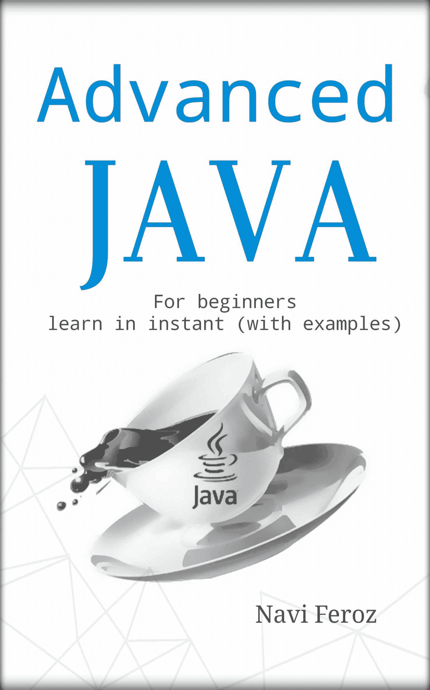

## 关于

Java Server Pages (JSP) 是一种用于开发动态网页的服务器端技术。它主要用于实现应用程序的表现层（GUI 部分）。一个完整的 JSP 代码更像是一个包含少量 Java 代码的 HTML。JSP 是 `servlets` 的扩展，每个 JSP 页面在处理客户端请求之前，都会先由 `JSP container` 转换为 `servlets`。

这些教程是为初编写的，因此即使你没有这方面的先验知识，理解这些教程也不会遇到任何困难。

我们书籍的目标是为所有学习者影响“高级 Java”的基础知识。所有的程序都通过示例进行了清晰的解释。

本书专为学习者准备的。

最后更新：2018 年 2 月 1 日

反馈：naviferoz@india.com

## 目录

- JSP 概览 生命周期
- 脚本段（SCRIPTLETS）
- 动作标签简介
- Include 动作标签
- 带参数的 Include 动作
- Forward 动作标签
- `jsp:useBean`、`jsp:setProperty` 和 `jsp:getProperty` 动作标签
- 表达式（EXPRESSIONS）
- 声明标签
- JSP 隐式对象（JSP IMPLICIT OBJECTS）
- 表达式语言（EL）
- 异常处理（EXCEPTION HANDLING）
- JSP 中的自定义标签
- 如何访问自定义标签的体内容
- 指令（DIRECTIVES）
- JSON 教程
- Servlet 教程（SERVLET TUTORIALS）

```html
</BODY>

</HTML>
```

## 你的第一个 JSP

让我们从简单的 JSP 开始学习 JSP。

```html
<%-- JSP 注释 --%>

<HTML>

<HEAD>

<TITLE>MESSAGE</TITLE>

</HEAD>

<BODY>

<%out.print("Hello, Sample JSP code");%>

</BODY>

</HTML>
```

上面的 JSP 生成以下输出：

`Hello, Sample JSP code.`

### 上述代码解释

1. `<%–JSP Comment–%>` 行表示名为 `JSP Comment` 的 JSP 元素，在 JSP 页面上添加注释时可以使用此标签，我们将在随后的文章中详细讨论。

   注意：JSP 注释必须以 `<%–` 开头并以 `%>` 结尾。

2. `Head`、`Title` 和 `Body` 标签是 HTML 标签——它们是 HTML 标签，经常用于静态网页。它们包含的任何内容都会原样传递给客户端（Web 浏览器）。

3. `<%out.print("Hello, Sample JSP code");%>` 是一个脚本段（scriptlet）。`out` 是一个用于向缓冲区打印内容的隐式对象。

### Servlet vs JSP

它们之间的主要区别是 Servlet 添加 Java 代码，而 JSP 在 HTML 内部添加 Java。

#### Servlet

1. Servlet 是支持 HTML 标签的 Java 程序。
2. 通常用于开发企业应用程序的业务层（复杂代码）。
3. 由 Java 开发者创建和维护。

#### JSP

1. JSP 程序是支持 Java 语句的 HTML 代码。准确地说，JSP 在 HTML 中嵌入 Java。
2. 用于开发企业应用程序的表现层。
3. 经常被 Web 开发者使用。

### JSP 的优点

JSP 具有 Servlet 的所有优点，如：比 CGI 更高效；内置 Session 功能；它还继承了 Java 特性，如多线程、异常处理、数据库连接。

JSP 实现了内容生成与内容展示的分离。这使其更加灵活。

有了 JSP，Web 设计师现在可以展示所需的信息。Web 应用程序程序员可以专注于如何处理/构建信息。

## JSP 架构

在开始开发 Web 应用程序之前，我们应该对架构有一个基本的了解。根据请求处理的位置（Servlet 或 JSP），JSP 有两种架构。它们是 Model1 架构和 Model2 架构。

1. **Model1 架构**：在这种模型中，JSP 扮演关键角色，负责处理客户端提出的请求。客户端（Web 浏览器）发出请求，JSP 然后创建一个 Bean 对象，完成请求并将响应传递给 JSP。JSP 然后将响应返回给客户端。与 Model2 架构不同，这种模型的大部分处理由 JSP 本身完成。

   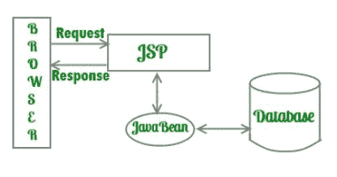

2. **Model2 架构**：在这种模型中，Servlet 扮演主要角色并负责处理客户端（网页浏览器）请求。表现部分（GUI 部分）将由 JSP 处理，并如如下所示通过 Bean 完成。Servlet 充当控制器并负责请求处理。如果 JSP 页面需要，它会创建 Bean 对象并调用相应的 JSP 页面。JSP 使用 Bean 对象处理表现部分。在这种模型中，JSP 不进行任何处理，Servlet 根据客户端提出的请求创建 Bean 对象并调用 JSP 程序。

   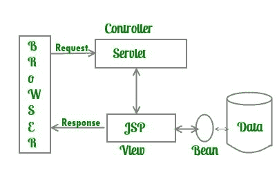

# Java Server Pages (JSP) 生命周期

JSP 页面以 `.jsp` 扩展名保存，这让服务器知道这是一个 JSP 页面，并且需要经过 JSP 生命各个阶段。

在我之前关于 JSP 介绍的博文中，我解释过 JSP 并不是直接被处理的，它们首先被转换为 `Servlets`，然后由服务器对相应的 servlet 处理。

当客户端向 `Server` 发起请求时，它首先进入 `container`。然后 `container` 检查 servlet 类是否旧于 JSP 页面（以确保 JSP 文件已被修改）。如果是如此，则 `container` 将再次进行翻译（将 JSP 转换为 `Servlet`），否则它将跳过翻译阶段（即：如果 JSP 网页未被修改，则不进行翻译以提高性能，因为此阶段非常耗时，且每次都重复此步骤在时间上是不可行的）。

JSP 页面的生命周期步骤如下：

1. 翻译（Translation）
2. 编译（Compilation）
3. 加载（Loading）
4. 实例化（Instantiation）
5. 初始化（Initialization）
6. 请求处理（Request Processing）
7. 销毁（Destruction）

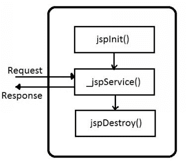

## 让我们详细查看 JSP 的周期

1. 如上所述，每当 `container` 接收到客户端请求时，只有当 servlet 类旧于 JSP 页时才会进行翻译，否则跳过此阶段（原因见上文解释）。

2. 然后 `container`：

   - 编译相应的 servlet 程序
   - 加载相应的 servlet 类
   - 实例化 servlet 类
   - 调用 `jspInit()` 方法初始化 servlet 实例（只有当 servlet 文件实例未运行或其旧于 jsp 文件时，Jsp 容器才会执行此工作）。

   ```java
   public void jspInit()
   {
       // 初始化 Servlet 实例的代码
   }
   ```

3. 然后创建一个新线程，该线程调用 `_jspService()` 方法，并将请求（`HttpServletRequest`）和响应（`HttpServletRespnse`）对象作为参数——所示。

   ```java
   void _jspService(HttpServletRequest req, HttpServletResponse res)
   {
       // 代码写在这里
   }
   ```

4. 调用 `jspDestroy()` 方法销毁 servlet 类实例。代码如下所示：

   ```java
   public void jspDestory()
   {
       // servlet 类实例的代码
   }
   ```

## SCRIPTTS

### JSP Scriptlets（脚本段）

我们可以使用 scriptlets 在 JSP 中编写 java 代码。JSP 容器会将 scriptlets 内容移动到 `_jspService()` 方法中，该方法在处理请求期间对服务器可用。

Scriptlets 无非就是封装在 `<%` 和 `%>` 标签内的 java 代码。JSP 容器在从 JSP 生成 servlet 时，会将包含其中的语句移动到 `_jspService()` 方法。将此代码拷贝到服务方法的原因是：对于每个客户端的请求都会调用 `_jspService()` 方法，因此其中的代码会为客户端的每个请求执行一次。

**Scriptlet 语法：**

```java
<% 可执行的 java 代码%>
```

### Scriptlet 的 JSP 到 Servlet 转换

正如我在之前的教程中所说，JSP 不直接执行，它首先被转换为 `Servlet`，然后像正常一样执行 `Servlet`。此外，我在第一段中解释过，在从 JSP 到 servlet 的翻译过程中，java 代码从 scriptlet 复制到 `_jspService()` 方法。让我们来看看它是如何发生的。

**示例 JSP 代码：**

```html
<H3>SampleJSP </H3>

<% myMethod();%>
```

注意：scriptlet 末尾的分的分号。

**上述 JSP 代码对应的翻译后的 Servlet 代码：**

```java
public void _jspService(HttpServletRequest request, HttpServletResponse response)
throws ServletException, IOException {
    response.setContentType("text/html");

    HttpSession session = request.getSession();

    JspWriter out = response.getWriter();

    out.println("<H2>Sample JSP</H2>");

    myMethod();
}
```

**一个学习脚本元素的示例：**

```java
<%– 一个用于学习 JSP 脚本元素的 JSP 示例 –%>

<%String string1 ="JSP scriptlet";%>

<%!String string2 ="";%>

<html>

<head>

<title> JSP 页面: 欢迎 </title>

</head>

<body>

<h1>

<%– 这是一个表达式语句 –%>

Welcome to <%=string1%>

</h1>

<%– scriptlet 示例 –%>

<%if(localstring.equals("JSP scriptlet"))

else  %>

<%– 也可以用这样做实现 –%>

<%if(localstring.equals("JSP scriptlet"))

out.println("Hi"+string2);

else

out.println("hello");

%>

</body>

</html>
```

在上面的示例中，存在许多类型的 JSP 元素，例如表达式（Expression）、JSP 注释、声明元素等。我们将在接下来的 JSP 教程中查看每一个，但目前你只需要关注 Scriptlets。以下是上述示例中使用的 scriptlets 语句：

```java
<%if(localstring.equals("JSP scriptlet"))

out.println("Hi"+string2);

else

out.println("hello");

%>
```

上面的代码是一个 JSP scriptlet（注意起始的 `<%` 和结束的 `%>` 标签）。如果你分析上面的代码段，你会发现标签内的代码是纯 java 代码，因此为了在 JSP 中执行 java 代码，我们使用 scriptlets。

```java
<%String string1 ="JSP scriptlet";%>
```

每当 `container` 接收到客户端请求时，只有当 servlet 类旧于 JSP 页面时才会进行翻译，否则跳过此阶段（原因见上文解释）。

然后 `container`：

```java
if (num > 5)
{
    out.println("hi");
}
else
{
    out.println("num value should be less than 6");
}
```

```html
<! DOYPE HTML PUBLIC "-//W3C//DTD HTML4.0//EN">

<html>

<head>

<TITLE> MY JSP PAGE </TITLE>

</head>

<body>

<% if (num > 5) { %>

<H3> hi </H3>

<%} else {%>

<h3> num value should be less than 6 </h3>

<% } %>

</body>

</html>
```

重要的点：由于内部代码是 java 代码，它必须以分号结束。现在注意所有语句——你会发现 java 中都需要它并以分号结束。

**注意：回到此处**

## DECLARATIONS（声明）

## ACTION TAGS（动作标签）

### JSP Actions – Java Server Pages

**Directives（指令）与 Actions（动作）**

1. 指令在翻译阶段使用，而动作在请求处理阶段使用。
2. 与指令不同，动作在每次访问页面时都会重新求值。
3. 以下是 JSP 中使用的动作元素：

#### 1. `<jsp:include>` 动作

就像 include 指令，此动作也用于将 JSP 文件插入另一个文件中。

`<jsp:include>` 与 include 指令：它们具有我在文章开头提到的相同区别（指令与动作）。在 `<jsp:include>` 中，文件是在请求处理期间包含的，而在 include 指令的情况下是在翻译阶段包含的。

**语法：**

```xml
<jsp:include page="page URL" flush="Boolean Value" />
```

这里 `page URL` 是需要包含的页面位置，`flush` 值可以是 `true` 或 `false`（布尔值）。

**示例：**

```html
<html>

<head>

<title>JSP include 动作标签演示</title>

</head>

<body>

<h3>JSP 页面: 包含演示</h3>

<jsp:include page="sample.jsp" flush="false" />

</body>

</html>
```

## 页面详情

Page：页面值为 `sample.jsp`，这意味着该页面需要被包含在当前文件中。提及的文件名表明 `sample.jsp` 位于同一目录下。

Flush：它的值为 `false`，意味着在包含到当前页面之前，资源缓冲区尚未刷新。

# JSP include 动作标签

JSP include 动作标签——JSP 教程

Include 标签用于将另一个资源包含到当前 JSP 页面中。被包含的资源可以是 HTML 静态页面、JSP 页面或 Servlet。我们还可以向要包含的资源传递参数及其值。在下面，我分享了两个 `<jsp:include>` 的示例，一个是在不传递任何参数的情况下包含页面，第二个示例是向被包含的页面传递几个参数。

### 语法

1. 带有参数的包含。

   ```jsp
   <jsp:include page="Relative_URL_Of_Page">

       <jsp:param ... />

       <jsp:param ... />

       <jsp:param ... />

       ...

       <jsp:param ... />

   </jsp:include>
   ```

2. 不共享参数的包含另一个资源。

   ```jsp
   <jsp:include page="Relative_URL_of_Page" />
   ```

`Relative_URL_of_Page` 如果页面位于当前 JSP 页面所在的目录，则应为页面名。

## 示例 1：不带参数的 `<jsp:include>`

在此示例中，我们将使用不带参数的 `<jsp:include>` 动作标签。结果该页面将原样包含在当前 JSP 页面中：

**index.jsp**

```jsp
<html>

<head>

    <title>JSP Include example</title>

</head>

<body>

    <b>index.jsp Page</b><br>

    <jsp:include page="Page2.jsp" />

</body>

</html>
```

**Page2.jsp**

```jsp
<b>Page2.jsp</b><br>

<i This is the content of Page2.jsp page</i>
```

**输出：**

`Page2.jsp` 的内容已追加到 `index.jsp` 中。

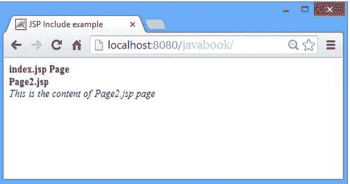

## 示例 2：使用 `<jsp:param>` 使用 `<jsp:include>`

**index.jsp**

我在这里使用 `<jsp:include>` 动作标签配合 `<jsp:param>` 来向我们将要包含的页面传递参数。


```html
<html>
<head>
    <title>JSP Include example with parameters</title>
</head>
<body>
    <h2>This is index.jsp Page</h2>

    <jsp:include page="display.jsp">
        <jsp:param name="userid" value="Chandru" />
        <jsp:param name="password" value="Chandru" />
        <jsp:param name="name" value="Chandru Babu" />
        <jsp:param name="age" value="27" />
    </jsp:include>
</body>
</html>
```

**display.jsp**

```jsp
<html>
<head>
    <title>Display Page</title>
</head>
<body>
    <h2>Hello this is a display.jsp Page</h2>

    UserID: <%=request.getParameter("userid") %><br>
    Password is: <%=request.getParameter("password") %><br>
    User Name: <%=request.getParameter("name") %><br>
    Age: <%=request.getParameter("age") %>
</body>
</html>
```

**输出：**

如你所示，`display.jsp` 的内容已包含在 `index.jsp` 中。此外，我们传递的参数在包含页面中正确显示。

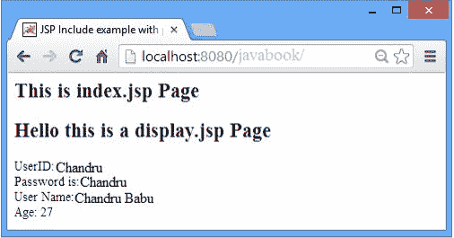

# 带有参数的 JSP include 动作示例

为了传递参数，我们需要使用 `<jsp:param>` 动作标签。

## 示例

在此示例中，我们使用 `<jsp:include>` 动作标签将一个 JSP 页面（`file.jsp`）包含主 JSP 页面（`index.jsp`）。为了从 `index` 向 `file` 页传递参数，我们使用了 `<jsp:param>` 动作标签。我们传递了三个参数 `firstname`、`middlename` 和 `lastname`，对于每个参数，我们需要指定对应的参数名和参数值。同样的内容可以在包含的页面中使用表达式语言或表达式标签及隐式对象来提取。

**index.jsp**

```jsp
<html>
<head>
    <title>JSP include with parameters example</title>
</head>
<body>
    <jsp:include page="file.jsp">
        <jsp:param name="firstname" value="Chandru" />
        <jsp:param name="middlename" value="Pratap" />
        <jsp:param name="lastname" value="Prasad" />
    </jsp:include>
</body>
</html>
```

**file.jsp**

```jsp
${param.firstname}<br>
${param.middlename}<br>
${param.lastname}
```

**输出：**

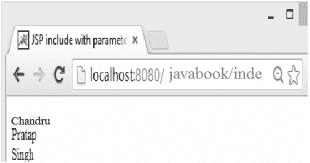

如你所示，包含的页面显示了从主页面传递的参数值。为了在 `file.jsp` 页面上显示参数，我们使用了表达式语言 `${}`。不过你也可以使用以下使用了 JSP 表达式标签和 `request` 隐式对象的代码：

```jsp
<%= request.getParameter("firstname")%>
<%= request.getParameter("middlename")%>
<%= request.getParameter("lastname")%>
```

# JSP forward 动作

`<jsp:forward>` 用于将请求转发到另一个资源。

## 语法

```jsp
<jsp:forward page="URL">
    <jsp:param ... />
    <jsp:param ... />
</jsp:forward>
```

## 示例

**first.jsp**

```jsp
<html>
<head>
    <title>JSP forward action</title>
</head>
<body>
    <h1>Demo forward</h1>
    <jsp:forward page="second.jsp" />
</body>
</html>
```

**second.jsp**

```jsp
<html>
<head>
    <title>Second Page</title>
</head>
<body>
    <h1>This is the second page</h1>
</body>
</html>
```

上述代码直接显示了 `display.jsp` 页面，该页面显示了从 `index.jsp` 页面传递的参数。

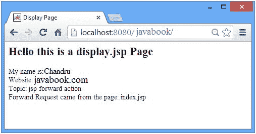

## 3. `<jsp:param>` Action

此动作用于将参数传递给其他的 JSP 动作标签，例如 `JSP include` 和 `JSP forward` 标签。这样新的 JSP 页面就可以通过 `request` 对象本身访问这些参数。

### 语法

```xml
<jsp:param name="param_name_here" value="value_of_parameter_here" />
```

现在考虑上述示例——

**first.jsp**

```html
<html>
<head>
    <title>Demo of JSP Param Action Tag</title>
</head>
<body>
    <h3>JSP page: 带有跳转的参数演示</h3>

    <jsp:forward page="second.jsp">
        <jsp:param name="date" value="20-05-2012" />
        <jsp:param name="time" value="10:15AM" />
        <jsp:param name="data" value="ABC" />
    </jsp:forward>
</body>
</html>
```

在上面的示例中，`first.jsp` 将三个参数（`data`、`time` 和 `data`）传递给 `second.jsp`，`second.jsp` 可以使用下面的代码访问这些参数——

```jsp
Date: <%= request.getParameter("date") %>
Time: <%= request.getParameter("time") %>
My Data: <%= request.getParameter("data") %>
```

## 4. `<jsp:useBean>` Action

当你想在 JSP 页面中使用 Beans 时，此动作非常有用，通过此标签你可以轻松地调用一个 bean。

### 语法

```xml
<jsp:useBean id="unique_name_to_identify_bean" class="package_name.class_name" />
```

### `<jsp:useBean>`、`<jsp:setProperty>` 和 `<jsp:getProperty>` 示例

一旦使用上述语句实例化 Bean 类，你就必须使用 `jsp:setProperty` 和 `jsp:getProperty` 动作来使用 bean 的参数。我们将看到这两者。

### jsp:useBean、jsp:setProperty 和 jsp:getProperty 动作标签

在这里我们将看到如何通过 `jsp:useBean`、`jsp:setProperty` 和 `jsp:getProperty` 动作标签在 JSP 中使用 bean 类。

**jsp:useBean 的语法：**

```xml
<jsp:useBean id="unique_name_to_identify_bean" class="package_name.class_name" />
```

**jsp:setProperty 的语法：**

```xml
<jsp:setProperty name="unique_name_to_identify_bean" property="property_name" />
```

**jsp:getProperty 的语法：**

```xml
<jsp:getProperty name="unique_name_to_identify_bean" property="property_name" />
```

### useBean、setProperty 和 getProperty 的完整示例

1. 我们有一个 bean 类 `Details`，其中包含三个变量 `username`、`age` 和 `password`。为了在 JSP 中使用该 bean 类及其属性，我们在 `userdetails.jsp` 页面中按如下方式初始化该类：

```xml
<jsp:useBean id="userinfo" class="Javabook.com.Details"></jsp:useBean>
```

我们使用了 `useBean` 动作来初始化该类。我们的类位于 `Javabook.com` 包中，因此我们提供了全限定类名 `Javabook.com.Details`。

2. 我们使用 `setProperty` 动作标签映射了 bean 类属性和 JSP 的属性。我们在 `property` 字段中给出了 `*`，以根据名称映射值，因为我们在 bean 类和 `index.jsp` JSP 页面中使用了相同的属性名。在 `name` 字段中，我们提供了在 `useBean` 标签中定义的唯一标识符。

```xml
<jsp:setProperty property="*" name="userinfo"/>
```

3. 为了获取属性值，我们使用了 `getProperty` 动作标签。

```xml
<jsp:getProperty property="propertyname" name="userinfo"/>
```

**Details.java**

```java
package javabook.com;

public class Details {
    public Details() {
    }

    private String username;
    private int age;
    private String password;

    public String getUsername() {
        return username;
    }

    public void setUsername(String username) {
        this.username = username;
    }

    public int getAge() {
        return age;
    }

    public void setAge(int age) {
        this.age = age;
    }

    public String getPassword() {
        return password;
    }

    public void setPassword(String password) {
        this.password = password;
    }
}
```

**index.jsp**

```html
<html>
<head>
    <title>useBean, getProperty and setProperty example</title>
</head>
<form action="userdetails.jsp" method="post">
    User Name: <input type="text" name="username"><br>
    User Password: <input type="password" name="password"><br>
    User Age: <input type="text" name="age"><br>
    <input type="submit" value="register">
</form>
</html>
```

**userdetails.jsp**

```xml
<jsp:useBean id="userinfo" class="javabook.com.Details"></jsp:useBean>
<jsp:setProperty property="*" name="userinfo"/>
```

你输入了以下详细信息：<br>

```jsp
<jsp:getProperty property="username" name="userinfo"/><br>
<jsp:getProperty property="password" name="userinfo"/><br>
<jsp:getProperty property="age" name="userinfo"/>
```

# 方法声明

```html
<title>方法声明</title>
<body>
<%!
int sum(int num1, int num2, int num3) {
    return num1 + num2 + num3;
}
%>

<%= "Result is: " + sum(10, 40, 50) %>
</body>
```

输出：浏览器上显示所有三个整数的和。

`Result is: 100`

# JSP 隐式对象

这些对象是由 JSP 容器在将 JSP 页面转换为 Servlet 时创建的。这些对象存在于方法内部，因此我们可以直接使用它们而无需进行声明。

这些对象是 JSP 引擎在翻译阶段（将 JSP 转换为 Servlet 时）创建的。它们在服务方法内部创建，因此我们可以直接在脚本段中使用它们，而无需初始化和声明。JSP 中总共有 9 个隐式对象可用。

## 隐式对象及其对应的类

| 对象 | 类 |
| :--- | :--- |
| `Out` | `javax.servlet.jsp.JspWriter` |
| `request` | `javax.servlet.http.HttpServletRequest` |
| `Response` | `javax.servlet.http.HttpServletResponse` |
| `Session` | `javax.servlet.http.HttpSession` |
| `Application` | `javax.servlet.ServletContext` |
| `Exception` | `javax.servlet.jsp.JspException` |
| `Page` | `java.lang.Object` |
| `pageContext` | `javax.servlet.jsp.PageContext` |
| `Config` | `javax.servlet.ServletConfig` |

注意：从此处返回

# JSP 中的表达式语言（EL）

## OUT 隐式对象

### 带有示例的 JSP 中的 OUT 隐式对象

它是 `javax.servlet.jsp.JspWriter` 的实例。这允许我们访问 Servlet 输出流。需要发送到客户端（浏览器）的输出通过此对象进行传递。简单来说，`out` 隐式对象用于向客户端写入内容。

### OUT 隐式对象的方法

1. `void print()`
2. `void println()`
3. `void newLine()`
4. `void clear()`
5. `void clearBuffer()`
6. `void flush()`
7. `boolean isAutoFlush()`
8. `int getBufferSize()`
9. `int getRemaining()`

让我们详细查看 `out` 的每个方法。

1. `Void print()`：此方法写入传递给它的值。例如，下面的语句将在输出屏幕（客户端浏览器）显示 `Out Implicit Object in jSP - JavaBook` 句子。

```java
out.print("Out Implicit Object in jSP - JavaBook");
```

2. `Void println()`：此方法与 `print()` 方法类似，`print` 和 `println` 唯一的区别是 `println()` 方法在末尾添加了一个换行符。让我们通过示例来看它们的区别。

**Print：**

```java
out.print("hi");
out.print(" ");
out.print("hello");
```

浏览器上的输出：所有三个 `out.print` 语句的结果之间不会有换行。

`hi hello`

**println：**

```java
out.println("hi");
out.println("hello");
```


```text
浏览器上的输出：
hi
hello
```

3. `Void newLine()`：此方法在输出中添加一个换行。示例：

```java
out.print("This will write content without a new line");

out.newLine();

out.print("I’m just an another print statement");
```

输出：

```text
This will write content without a new line
I’m just an another print statement
```

如你所知，`print` 语句不会添加换行。我们使用 `newLine()` 方法在两个 `out.print` 语句之间添加了换行。

4. `Void clear()`：它清空输出缓冲区，甚至不让其缓冲区内容写入客户端。调用方式如下：

```java
out.clear();
```

5. `Void clearBuffer()`：此方法与 `clear()` 方法类似。它们唯一的区别是，当对已经刷新的缓冲区调用 `out.clear()` 时它会抛出异常，但 `out.clearBuffer()` 则不会。

6. `Void flush()`：此方法也像 `clear()` 方法一样清空缓冲区，但它强制在刷新之前将内容写入输出流，这意味着缓冲区中的任何内容在清空缓冲区之前都会被到客户端屏幕。

7. `Boolean isAutoFlush()`：它返回一个布尔值 true/false。它用于检查缓冲区是否自动刷新。

8. `Int getBufferSize()`：此方法返回输出缓冲区的大小（字节为）。

9. `Int getRemaining()`：它返回在达到缓冲区溢出条件之前剩余的字节数。

### OUT 隐式对象示例

在这个示例中，我们使用 `OUT` 的 `print` 和 `println` 方法向客户端显示一些消息。

**index.jsp**

```html
<HTML>
<HEAD>
<TITLE> OUT 隐式对象示例 </TITLE>
</HEAD>
<BODY>
<%
out.print( "print statement " );
out.println( "println" );
out.print("Another print statement");
%>
</BODY>
</HTML>
```

输出：

```text
printstatement println
Another print statement
```

# 带有示例的 JSP 中的 request 隐式对象

### request 隐式对象的方法

1. `GetParameter(String name)`：此方法用于获取参数值。例如，在登录页面获取 `user-id` 和密码，一旦重定向到 JSP 页面，通过它可以获取信息。

```java
String Uid= request.getParameter("user-id");
String Pass= request.getParameter("password");
```

2. `ParameterNames()`：它返回请求关联的所有参数名称的枚举。

```java
Enumeration e= request.getParameterNames();
```

3. `ParameterValues(String name)`：它返回参数值的数组。

```java
String[] passwords = request.getParameterValues("password");
```

4. `GetAttribute(String name)`：获取属性值。

```java
request.getAttribute("admin")
```

5. `GetAttributeNames()`：用于获取会话中的属性。它返回会话中的属性名称。

```java
Enumerator e = request.getAttributeNames();
```

6. `SetAttribute(String,Object)`：将对象的值赋予属性。例如，有一个 `password` 和字符串 `str`，调用 `request.setAttribute("password", str)` 将为属性赋值。

7. `RemoveAttribute(String)`：使用此方法可以移除属性且无法再次使用。例如，如果在 JSP 页面执行 `request.removeAttribute("userid")`，则该属性将被移除，`request.getAttribute("userid")` 将返回 NULL。

8. `GetCookies()`：它返回从客户端接收的 cookie 对象数组。此方法主要在 JSP 中处理 cookie 时使用。

9. `GetHeader(String name)`：此方法用于获取请求的头部信息。

10. `HeaderNames()`：返回所有头部名称。下面的代码段将显示与请求关联的所有头部。

```java
Enumeration e = request.getHeaderNames();

while (e.hasMoreElements()) {
    String str = (String)e.nextElement();
    out.println(str);
}
```

11. `RequestURI()`：此方法（`request.getRequestURI()`）返回当前 JSP 页面的 URL。

12. `Method()`：返回 HTTP 请求方法。`request.getMethod()`。例如，GET 请求返回 GET，POST 请求返回 POST。

13. `QueryString()`：用于获取与 JSP 页面关联的查询字符串。它是问号（?）之后的字符串。

### request 隐式对象示例

在下面的示例中，我们在 `index.html` 页面接收用户输入，并使用 request 隐式对象在 `userinfo.jsp` 页面显示相同的信息。

**index.html**

```html
<html>
<head>
<title>输入用户名和密码</title>
</head>
<body>
<form action="userinfo.jsp">
输入用户名：<input type="text" name="uname" /> <br><br>
输入密码：<input type="text" name="pass" /> <br><br>
<input type="submit" value="提交详情"/>
</form>
</body>
</html>
```

**userinfo.jsp**

```jsp
<%@ page import = " java.util.*" %>

<html>
<body>
<%
String username=request.getParameter("uname");
String password=request.getParameter("pass");

out.print("Name: "+username+" Password: "+password);
%>
</body>
</html>
```

### 上述示例快照

一旦运行了上面的 JSP 代码，它将显示出如下界面，包含 `username` 和 `password` 两个文本字段。

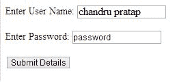

这是 `userinfo.jsp` 页面的输出。在这里，我们获取了用户在登录页面输入的 `id` 和 `password`。

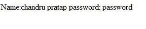

注意：

从此处返回：

带参数的 JSP include action 示例

# JSP 中的 Response 隐式对象

## JSP 中的 Response 隐式对象示例

我们将讨论 JSP 中的 `response` 隐式对象。它是 `javax.servlet.http.HttpServletRequest` 的实例，主要用于修改在处理客户端请求后发送到浏览器的响应。

### response 隐式对象的方法

1. `void setContentType(String type)`
2. `void sendRedirect(String address)`
3. `void addHeader(String name, String value)`
4. `void setHeader(String name, String value)`
5. `boolean containsHeader(String name)`
6. `void addCookie(Cookie value)`
7. `void sendError(int status_code, String message)`
8. `boolean isCommitted()`
9. `void setStatus(int statuscode)`

让我们详细查看每个方法。

1. `Void setContentType(String type)`：此方法通过设置 MIME 类型和字符编码来告诉浏览器响应数据的类型。此方法设置的信息有助于浏览器解释响应。示例为：

```java
response.setContentType("text/html");

response.setContentType("image/gif");

response.setContentType("image/png");

response.setContentType("application/pdf");
```

2. `Void sendRedirect(String address)`：它将控制权重定向到一个新的 JSP 页面。例如，当浏览器检测到以下语句时，它将从当前 JSP 页面重定向到 `javabook.com`。

```java
response.sendRedirect("http://javabook.com");
```

3. `Void addHeader(String name, String value)`：`addHeader` 方法向响应中添加一个头部，基本上它包含一个头部名称和它的值。例如，下面的语句将在响应中包含一个值为 `javaBook.com` 的名为“Site”头部。

```java
response.addHeader("Site", "JavaBook.com");
```

4. `Void setHeader(String name, String value)`：它设置头部值。此方法用新值覆盖当前头部的值。假设我正在修改头部“Site”的值。下面的语句将把当前值 `javaBook.com` 修改为新值 `AA.com`。

```java
response.setHeader("Site", "AA.com");
```

5. `Boolean containsHeader(String name)`：它返回一个布尔值 true/false。它基本上是检查响应中是否存在该头部。例如，在上面的 `addHeader` 方法的示例中，我们已向响应中添加了 `Site` 头部，因此下面的语句将返回 true。

```java
response.containsHeader("Site");
```

6. `Void addCookie(Cookie cookie)`：此方法向响应中添加一个 cookie。下面的语句将向响应中添加 2 个 Cookie：`Author` 和 `Siteinfo`。

```java
response.addCookie(Cookie Author);

response.addCookie(Cookie Siteinfo);
```

7. `Void sendError(int status_code, String message)`：它用于发送带有代码和错误消息的错误响应。例如：

```java
response.sendError(404, "Page not found error");
```

8. `Boolean isCommitted()`：它检查 HTTP 响应是否已发送给客户端，如果是则返回 true，否则返回 false。

```jsp
<% if(response.isCommited())
    {
        <%--做一些事情 --%>
    }else
    {
        <%--做其他事情 --%>
    } %>
```

9. `Void setStatus(int statuscode)`：此方法用于将 HTTP 状态设置为给定的值。例如，下面的语句将 HTTP 响应码设置为 404（页面未找到）。

```java
response.setStatus(404);
```

### Response 隐式对象示例

在下面的示例中，我们从登录页面接收 `id` 和 `password`，然后将其与硬编码的正确 id/pass 进行匹配。如果凭据正确，登录页面将重定向到成功页面，否则将重定向到登录失败的 JSP 页面。

**index.html**

```html
<html>
<head>
<title>登录页面</title>
</head>
<body>
<form action="checkdetails.jsp">
UserId: <input type="text" name="id" /> <br><br>
Password: <input type="text" name="pass" /> <br><br>
<input type="submit" value="Sign In!!"/>
</form>
</body>
</html>
```

此 JSP 页面根据硬编码的值验证输入的 id/pass。

**checkdetails.jsp**

```html
<html>
<head><title>检查凭据</title></head>
<body>
<%
String uid=request.getParameter("id");
String password=request.getParameter("pass");

if(uid.equals("Chandru") && password.equals("JavaBook"))
{
    response.sendRedirect("success.jsp");
}
else
{
    response.sendRedirect("failed.jsp");
}
%>
</body>
</html>
```

此 JSP 页面验证输入的 id/pass。

**success.jsp**

```html
<html>
<head><title>成功页面</title></head>
<body>
<%
String data=(String)session.getAttribute("uid");
out.println("Welcome "+data+"!!");
%>
</body>
</html>
```

此 JSP 页面验证硬编码的值。

**failed.jsp**

```html
<html>
<head><title>登录失败</title></head>
<body>
<%
String data2=(String)session.getAttribute("uid");
out.println("Hi "+data2+". Id are wrong. Please try Again.");
%>
</body>
</html>
```


输出：
登录页面


成功页面：ID 和密码正确。


带错误的 ID：


登录失败页面：ID 和密码错误。


注意：

返回此处：

表达式

### Session 隐式对象
JSP 中的 Session 隐式对象示例

`Session` 是 JSP 中最常用的隐式对象。它的主要用途是在会话期间访问所有用户数据。

#### session 隐式对象的方法

1. `setAttribute(String, object)` – 此方法通过分配一个唯一字符串将对象保存到会话。之后可以在会话期间从从中获取该对象。`setAttribute` 和 `getAttribute` 是处理会话时常用的两个方法。
2. `getAttribute(String name)` – 使用 `getAttribute` 方法从从中获取对象。例如：如果我们需要在每个 JSP 页面访问 `userId`，则应该将 `userId` 存储在会话。
3. `removeAttribute(String name)` – 存储在会中的对象可以使用此方法移除。将唯一字符串传递给 `removeAttribute` 方法。
4. `getAttributeNames()` – 它返回会中的所有对象。基本上，它产生对象的枚举。
5. `getCreationTime()` – 此方法返回会话创建时间，即会话启动（激活）的时间。
6. `getId()` – Servlet 容器在创建会话时会分配一个唯一的字符串标识符。`getId` 返回该唯一标识符。
7. `isNew()` – 用于检查会话是否为新会话。它返回布尔值（true 或 false）。主要用于跟踪客户端端是否启用了 Cookie。如果禁用了 Cookie，`session.isNew()` 方法将始终返回 true。
8. `invalidate()` – 它会杀死会话并打破会话与所有存储对象的关联。
9. `getMaxInactiveInterval()` – 返回会话的最大空闲间隔时间（以秒计）。
10. `getLastAccessedTime()` 通常用于获取会话的最后访问时间。

下方的 HTML 页面将显示一个文本框和一个提交按钮。提交操作会将控制权转移到 `session.jsp` 页面。

### index.html
```html
<html>
<head>
<title>欢迎页：输入您的姓名</title>
</head>
<body>
<form action="session.jsp">
<input type="text" name="inputname">
<input type="submit" value="点击这里!!"><br/>
</form>
</body>
</html>
```

`session.jsp` 页面会显示用户在 `index` 页面中输入的名称，并将该变量存储在 `session` 对象中，这样在会话失效之前，可以在任何页面上获取它。

### session.jsp
```html
<html>
<head>
<title>将输入值传递给会话变量</title>
</head>
<body>
<%
String uname=request.getParameter("inputname");
out.print("Welcome "+ uname);
session.setAttribute("sessname",uname);
%>
<a href="output.jsp">点击此处查看输出页面 </a>
</body>
</html>
```

在这个页面中，我们从 `session` 对象中获取变量值并将其显示。

### output.jsp
```html
<html>
<head>
<title>输出页面：从 session 中获取值</title>
</head>
<body>
<%
String name=(String)session.getAttribute("sessname");
out.print("Hello User: You have entered the name: "+name);
%>
</body>
</html>
```

### 输出屏幕：


# Application 隐式对象
## JSP 中的 Application 隐式对象示例
`Application` 隐式对象是 `javax.servlet.ServletContext` 的实例。它用于获取初始化参数以及在整个 JSP 中共享属性及其值，这意味着通过 `application` 隐式对象设置的任何属性对所有 JSP 页面都可用。

### 方法：
- `Object getAttribute(String attributeName)`
- `void setAttribute(String attributeName, Object object)`
- `void removeAttribute(String objectName)`
- `Enumeration getAttributeNames()`
- `String getInitParameter(String paramname)`
- `Enumeration getInitParameterNames()`
- `String getRealPath(String value)`
- `void log(String message)`
- `URL getResource(String value)`
- `InputStream getResourceAsStream(String path)`
- `String getServerInfo()`
- `String getMajorVersion()`
- `String getMinorVersion()`

1. `Object getAttribute(String attributeName)`: 它返回存储在给定属性名称中的对象。例如，下面的语句将返回存储在属性 `MyAttr` 中的对象。
```java
String s = (String)application.getAttribute("MyAttr");
```
2. `Void setAttribute(String attributeName, Object object)`: 它设置属性的值，换句话说，它在应用上下文中存储一个属性及其值，该值可以在整个 JSP 应用程序中使用。示例——
```java
application.setAttribute("MyAttribute", "This is the value of Attribute");
```
上述语句将存储该属性及其值。如果在任何 JSP 页面中使用下面的语句，`s` 的值将会是什么？
```java
String s= (String) application.getAttribute("MyAttribute");
```
`s` 的值将是 “This is the value of Attribute”，因为我们已经使用 `setAttribute` 方法设置了它。
3. `Void removeAttribute(String objectName)`: 此方法用于从应用程序中删除指定的属性。例如——它将从应用程序中删除属性 `MyAttr`。如果我们尝试使用 `getAttribute` 方法获取已删除属性的值，它将返回 Null。
```java
application.removeAttribute("MyAttr");
```
4. `Enumeration getAttributeNames()`: 此方法返回存储在 `application` 隐式对象中的所有属性名称的枚举。
```java
Enumeration e= application.getAttributeNames();
```
5. `String getInitParameter(String paramname)`: 它返回给定名称的初始化参数值。示例——web.xml
```xml
<web-app>
<context-param>
<param-name>parameter1</param-name>
<param-value>ValueOf1</param-value>
</context-param>
</web-app>
```
```java
String s= application.getInitParameter("parameter1");
```
`s` 的值将是 “ValueOf1”。
6. `Enumeration getInitParameterNames()`: 此方法返回所有初始化参数的枚举。
7. `String getRealPath(String value)`: 它将给定路径转换为绝对路径。
```java
String abspath = application.getRealPath("/index");
```
8. `void log(String message)`: 此方法将给定消息写入错误日志。
```java
application.log("This is error message");
```
9. `String getServerInfo()`: 此方法返回 Web 服务器的名称和版本。
```java
application.getServerInfo();
```

### Application 隐式对象示例
JSP 中的 Application 隐式对象示例
使用 `application` 隐式对象使用 Application 隐式对象。在这个示例中，我们正在统计访问次数。

counter.jsp
```jsp
<%@ page import="java.io.*,java.util.*" %>
<html>
<head>
<title>Application 隐式对象</title>
</head>
<body>
<%
Integer counter= (Integer)application.getAttribute("Visits");
if( counter ==null || counter == 0 ){
counter = 1;
}else{
counter = counter+ 1;
}
application.setAttribute("Visits", counter);
%>
<h3>Total number of hits this Page is: <%= counter %></h3>
</body>
</html>
```
输出截图：
第一次访问次数为 1。
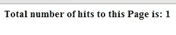
刷新页面时的访问次数。
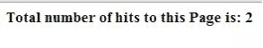

# Exception 隐式对象
## JSP 中的 Exception 隐式对象示例
在本教程中，我们将讨论 JSP 的 `exception` 隐式对象。它是 `java.lang.Throwable` 的实例，经常用于异常处理。该对象仅错误页面可用，这意味着 JSP 页面必须设置 `isErrorPage` 为 true 才能使用该隐式对象。让我们通过下面的示例来理解——

### Exception 隐式对象示例
Exception 隐式对象示例。

index.html
```html
<html>
<head>
<title>输入两个整数进行除法</title>
</head>
<body>
<form action="division.jsp">
输入第一个整数:<input type="text" name="firstnum" />
输入第二个整数:<input type="text" name="secondnum" />
<input type="submit" value="获取结果"/>
</form>
</body>
</html>
```
在这里我们指定 `exception.jsp` 为 `errorPage`，这意味着如果此 JSP 页面发生任何异常，控制权将立即转移到 `exception.jsp` JSP 页面。

division.jsp
```jsp
<%@ page errorPage="exception.jsp" %>
<%
String num1=request.getParameter("firstnum");
String num2=request.getParameter("secondnum");
int v1= Integer.parseInt(num1);
int v2= Integer.parseInt(num2);
int res= v1/v2;
out.print("Output is: "+ res);
%>
```
在下面的 JSP 页面中，我们将 `isErrorPage` 设置为 true，这是 Page 指令的一个属性，用于使页面具备处理异常的能力。由于此页面在 `division.jsp` 中被定义为异常页面，因此在发生异常的情况下该页面将被调用。在这里我们使用 `exception` 隐式对象向用户显示错误消息。

exception.jsp
```jsp
<%@ page isErrorPage="true" %>
<html>
<body>
<h2>发生错误: <%= exception %></h2>
</body>
</html>
```

```jsp
<%@ page isErrorPage="true" %>
```

发生此异常：`<%= exception %>`

请修正输入数据。

输出：

带有两个整数输入字段的屏幕。


当我们提供的第二个整数为零时，显示的算术异常消息。


这是在构建 JSP 应用时常用的隐式对象之一。作为替代，你也可以通过 JSP 脚本段中的 try catch catch 在 JSP 中处理异常。

注意：

从此处返回：

JSP 指令

# PageContext 隐式对象

## 带有示例的 JSP PageContext 隐式对象

它是 `javax.servlet.jsp.PageContext` 的实例。使用此对象你可以在以下任何级别查找属性、获取、设置属性和删除属性：

1. JSP 页面 – 范围：`PAGE_CONTEXT`
2. HTTP 请求 – 范围：`REQUEST_CONTEXT`
3. HTTP Session – 范围：`SESSION_CONTEXT`
4. 应用程序级别 – 范围：`APPLICATION_CONTEXT`

### pageContext 隐式对象的方法

1. `Object findAttribute (String AttributeName)`：此方法按照以下顺序在四个级别中搜索指定的属性：Page、Request、Session 和 Application。如果在任何级别上都未找到属性，则返回 `NULL`。

2. `Object getAttribute (String AttributeName, int Scope)`：它在指定的范围内查找属性。此方法与 `findAttribute` 方法类似；唯一的区别是 `findAttribute` 按顺序查找所有四个级别，而 `getAttribute` 则在指定的范围内查找。例如 – 在下述语句中，`getAttribute` 方法将在 `Session` 范围（或 Session 级别/层）中搜索属性“JavaBook”。如果找到该属性，它将将其赋值给对象 `obj`，否则它将返回 Null。

```java
Object obj = pageContext.getAttribute("JavaBook", PageContext.SESSION_CONTEXT);
```

同样地，该方法也可以用于其他范围 –

```java
Object obj = pageContext.getAttribute("JavaBook", PageContext.REQUEST_CONTEXT);
Object obj = pageContext.getAttribute("JavaBook", PageContext.PAGE_CONTEXT);
Object obj = pageContext.getAttribute("JavaBook", PageContext.APPLICATION_CONTEXT);
```

3. `Void removeAttribute(String AttributeName, int Scope)`：此方法用于从给定的范围内删除属性。例如 – 下述 JSP 语句将从页面范围删除属性“MyAttr”。

```java
pageContext.removeAttribute("MyAttr", PageContext.PAGE_CONTEXT);
```

4. `Void setAttribute(String AttributeName, Object AttributeValue, int Scope)`：在给定的范围内写入属性。示例 – 下述语句将属性“mydata”及其值“This is my data”存储在应用程序范围中。

```java
pageContext.setAttribute("mydata", "This isis my data", PageContext.APPLICATION_CONTEXT);
```

同样，这将在 Request 范围内创建一个名为 `attr1` 的属性，值为“Attr1 value”。

```java
pageContext.setAttribute("attr1", "Attr1 value", PageContext.REQUEST_CONTEXT);
```


## `PageContext` 隐式对象示例

### `index.html`

在这里我们只是要求用户输入登录详情。

```html
<html>
<head>
<title>用户登录页面 – 输入详情</title>
</head>
<body>
<form action="validation.jsp">
输入用户 ID: <input type="text" name="uid"><br>
输入密码: <input type="text" name="upass"><br>
<input type="submit" value="Login">
</form>
</body>
</html>
```

### `validation.jsp`

在此页面中，我们使用 `pageContext` 隐式对象通过 `session scope` 存储用户的凭据，这意味着只要用户的会话处于激活状态，我们就可以访问这些详情。我们也可以使用其他范围参数（如 `page`、`application` 和 `request`）存储属性。

```html
<html>
<head><title>验证 JSP 页面</title></head>
<body>
<%
String id = request.getParameter("uid");
String pass = request.getParameter("upass");

out.println("hello " + id);

pageContext.setAttribute("UName", id, PageContext.SESSION_SCOPE);
pageContext.setAttribute("UPassword", pass, PageContext.SESSION_SCOPE);
%>

<a href="display.jsp">点击此处查看你输入的内容</a>
</body>
</html>
```

### `display.jsp`

在此 JSP 页面中，我们使用 `getAttribute` 方法获取存储的属性。这里需要注意的是，我们是用 `session` 范围存储属性的，因此我们必须指定范围为 `session` 以获取这些属性的值。

```html
<html>
<head>
<title>显示用户详情</title>
</head>
<body>
<%
String username = (String) pageContext.getAttribute("UName", PageContext.SESSION_SCOPE);
String userpassword = (String) pageContext.getAttribute("UPassword", PageContext.SESSION_SCOPE);

out.println("Hi " + username);
out.println("Your Password is: " + userpassword);
%>
</body>
</html>
```

### 示例输出截图

登录页面，我们从用户那里接收用户 ID 和密码。

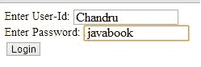

带有详情的页面 –


通过 `pageContext` 传递的用户详情页面。


# `Config` 隐式对象

## 带有示例的 JSP `Config` 隐式对象

它是 `javax.servlet.Config` 的实例。`Config` 对象用于获取特定页面的信息。使用 `application` 对象可以获取初始化参数。

### `Config` 隐式对象的方法

1. `String getInitParameter(String paramname)`：我们在 `application` 对象中讨论过的。
2. `Enumeration getParameterNames()`：返回初始化参数的枚举。
3. `ServletContext getServletContext()`：此方法返回 Servlet 上下文。
4. `String getServletName()`：返回在 `<servlet-name>` 中定义的名称。

## `Config` 对象示例

### `web.xml`

假设下面是 `web.xml` 文件。我在其中定义 servlet 名称和映射。稍后我们将使用 `config` 隐式对象从这里获取一些详情。

```xml
<web-app>
<servlet>
<servlet-name>JavaBookServlet</servlet-name>
<jsp-file>index.jsp</jsp-file>
</servlet>

<servlet-mapping>
<servlet-name>JavaBookServlet</servlet-name>
<url-pattern>/index</url-pattern>
</servlet-mapping>
</web-app>
```

### `index.jsp`

在此 JSP 页面中，我们调用 `config` 对象的 `getServletName()` 方法从 `web.xml` 文件获取 servlet 名称。

```html
<html>
<head><title>Config 对象</title></head>
<body>
<%
String sname = config.getServletName();
out.print("Servlet Name is: " + sname);
%>
</body>
</html>
```

### 输出

这是上述 JSP 页面的输出屏幕。

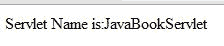

# 表达式语言

## JSP 中的表达式语言

表达式语言（EL）– 我们可以使用表达式语言轻松地访问变量、bean 组件和表达式的数据。必须阅读本教程了解 JSP Java。

表达式语言（EL）在 JSP 2.0 中引入。它的主要目的是简化从 bean 属性和隐式对象访问数据。EL 也包含算术、关系和逻辑运算符。

### EL 语法

`${expression}`

大括号内的内容将在运行时求值并发送到输出流。

### 示例 1：表达式语言评估表达式

在本例中，我们通过 EL 的帮助求值表达式。

```html
<html>
<head>
<title>表达式语言示例 1</title>
</head>
<body>
${1<2}

${1+2+3}
</body>
</html>
```

### 输出


### 示例 2：使用表达式语言参数变量获取值

在本例中，我们提示用户输入姓名和学号。在另一个 JSP 页面中，我们使用 EL 的参数变量获取输入的详情。

#### `index.jsp`

```html
<html>
<head>
```

## 表达式语言示例 2

```html
<head>
<title>表达式语言示例 2</title>
</head>
<body>
<form action="display.jsp">
学生姓名: <input type="text" name="stuname" /><br>
学生学号: <input type="text" name="rollno" /><br>
<input type="submit" value="提交详情!!"/>
</form>
</body>
</html>
```

#### `display.jsp`

```html
<html>
<head>
<title>显示页面</title>
</head>
<body>
学生姓名是 ${ param.stuname } <br>
学生学号是 ${ param.rollno }
</body>
</html>
```

### 输出

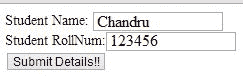


## 示例 3：从应用对象获取值

在这个示例中，我们使用 `application` 隐式对象设置了属性，并在显示页面上使用表达式语言的 `applicationScope` 获取这些属性。

### `index.jsp`

```html
<html>
<head>
<title>EL 示例 3</title>
</head>
<body>
<%
application.setAttribute("author", "Chandu");
application.setAttribute("Site", "JavaBook.com");
%>

<a href="display.jsp">点击</a>
</body>
</html>
```

### `display.jsp`

```html
<html>
<head>
<title>显示页面</title>
</head>
<body>
${applicationScope.author}<br>
${applicationScope.Site}
</body>
</html>
```

### 输出


## EL 预定义变量

与 JSP 中的隐式对象类似，我们在 EL 中也有一些预定义的变量。在上面的示例中，我们使用了 `param` 和 `applicationScope`，它们也是这些变量的一部分。

- `PageScope`：帮助获取存储在 `Page` 作用域中的属性。
- `PageContext`：等同于 JSP 的 `PageContext` 对象。
- `SessionScope`：从 `session` 对象设置的会话作用域获取属性。
- `RequestScope`：用于从请求作用域获取属性，即由 `request` 隐式对象设置的属性。
- `Param`：类似于 `ServletRequest.getParameter`。参考示例 2。
- `ApplicationScope`：用于获取应用级别的属性。与示例 3 中的相同。
- `Header`：帮助以字符串形式获取 HTTP 请求头。
- `HeaderValues`：用于获取所有的 HTTP 请求头。
- `InitParam`：链接到上下文的初始化参数。
- `ParamValues`：等同于 `ServletRequest.getParameterValues`。
- `Cookie`：映射到 `Cookie` 对象。

**注意：**

回到此处：

- 带参数的 JSP include action 示例
- JSTL

# 异常处理

JSP 中的异常处理 – 一个学习 JSP 异常处理的完整教程。我们分享了两种处理异常的方法。

在学习 JSP 异常处理之前，让我们先理解什么是异常，以及它与错误有什么区别。

- **异常（Exception）**：这些无非是中断正常执行流的异常状况。它们通常是因为用户输入了错误的数据。为了给用户提供有意义的信息，必须处理异常，以便用户能够理解问题并采取适当的行动。
- **错误（Error）**：这可能是代码问题或系统相关的问题。我们不应该处理错误，因为它们本该是被修复的。

## 处理异常的方法

我们可以使用以下两种方法处理异常：

1. 使用 `exception` 隐式对象进行异常处理。
2. 在脚本段（scriptlets）中使用 `try-catch` 块进行异常处理。

## 使用 `exception` 隐式对象的异常处理

在下面的示例中，我们使用 `Page` 指令的 `errorPage` 属性指定了处理页面。如果主 JSP 页面发生任何异常，控制将转移到 `errorPage` 属性指定的页面。

处理页面必须将 `isErrorPage` 设置为 `true` 才能使用 `exception` 隐式对象。这就是为什么我们为 `errorpage.jsp` 设置了 `isErrorPage` 为 `true`。

### `index.jsp`

```jsp
<%@ page errorPage="errorpage.jsp" %>

<html>
<head>
<title>JSP 异常处理示例</title>
</head>
<body>
<%
// 声明并初始化两个整数
int num1 = 122;
int num2 = 0;

// 应该抛出算术异常（Arithmetic Exception）
int div = num1 / num2;
%>
</body>
</html>
```

### `errorpage.jsp`

```jsp
<%@ page isErrorPage="true" %>

<html>
<head>
<title>在此处显示异常消息</title>
</head>
<body>
<h2>errorpage.jsp</h2>
<i>在 index.jsp 页面发生了异常。请修复错误。以下是错误消息：</i>
<b><%= exception %></b>
</body>
</html>
```

### 输出


## 在脚本段（scriptlets）中使用 `try-catch` 块的异常处理

在下面的示例中，我们使用 `try-catch` 块处理了异常。我们在下面的示例中放置了 `try-catch` 块。

### `error.jsp`

```jsp
<html>
<head>
<title>使用 catch 块处理异常</title>
</head>
<body>
<%
try {
    int arr[] = {1, 2, 3, 4, 5};
    int num = arr[6];
} catch (Exception exp) {
    out.println("这里是异常: " + exp);
}
%>
</body>
</html>
```

### 输出


# 自定义标签（CUSTOM TAGS）

用户定义的标签被称为自定义标签。在本教程中我们将学习如何创建它们。创建自定义标签需要三部分：

1. **标签处理器类（Tag handler class）**：在该类中我们指定标签的作用。
2. **TLD 文件**：指定标签属性的标签描述符。
3. **JSP 页面**：使用标签的 JSP 页面。

## 标签处理器类

标签处理器类应该实现 `Tag` 接口，也可以继承 `SimpleTagSupport`。

### `Details.java`

```java
package javabook.com;

import javax.servlet.jsp.tagext.*;
import javax.servlet.jsp.*;
import java.io.*;

public class Details extends SimpleTagSupport {

    public void doTag() throws JspException, IOException {
        JspWriter out = getJspContext().getOut();
        out.println("这是我的标签");
    }
}
```

## TLD 文件

该文件应该位于：`项目名称/WebContent/WEB-INF/`，并且以 `.tld` 扩展。

**注意：**

- `<name>`：自定义标签名称。在示例中我们命名为 `MyMsg`。
- `<tag-class>`：全类名。我们的标签处理器类 `Details.java` 在 `javabook.com` 包中，因此我们将其设为 `javabook.com.Details`。

### `message.tld`

```xml
<taglib>
<tlib-version>1.0</tlib-version>
<jsp-version>2.0</jsp-version>
<short-name>My Custom Tag</short-name>
<tag>
<name>MyMsg</name>
<tag-class>javabook.com.Details</tag-class>
<body-content>empty</body-content>
</tag>
</taglib>
```

## 在 JSP 中使用自定义标签

上面我们创建了一个名为 `MyMsg` 的自定义标签。在这里我们将使用它。

**注意：** `taglib` 指令应在 `uri` 字段中包含 TLD 文件的路径。上面我们创建了 `message.tld` 文件，因此我们提供了该文件的路径。选择任何前缀并在 `taglib` 指令的 `prefix` 字段中指定它。在这里我们指定为 `myprefix`。

自定义标签的调用方式如下：`<prefix:tagName/>`。我们的前缀是 `myprefix`，标签名为 `MyMsg`，因此在下面的 JSP 页面中我们将其写为 `<myprefix:MyMsg/>`。

```jsp
<%@ taglib prefix="myprefix" uri="WEB-INF/message.tld"%>

<html>
<head>
<title>JSP 自定义标签示例</title>
</head>
<body>
<myprefix:MyMsg/>
</body>
</html>
```


输出：
`This is my own custom tag`

### 如何访问自定义标签的主体（Body）

在本教程中，我们将学习如何访问自定义标签的主体。例如，如果我们的自定义标签是`xyz`，那么我们将学习访问`<prefix: xyz>`和`</prefix:xyz>`之间的内容。

```jsp
<prefix: xyz>
Body of custom tag: This is what we will access in the below example
</prefix:xyz>
```

## 示例：
在这个示例中，自定义标签将向其正体追加一个`String`并显示结果。

标签处理器类：`Details.java`

```java
package javabook.com;

import javax.servlet.jsp.tagext.*;
import javax.servlet.jsp.*;
import java.io.*;

public class Details extends SimpleTagSupport {

    //StringWriter object
    StringWriter sw = new StringWriter();

    public void doTag() throws JspException, IOException {
        getJspBody().invoke(sw);
        JspWriter out = getJspContext().getOut();
        out.println(sw.toString()+"Appended Custom Tag Message");
    }
}
```

TLD 文件：`message.tld`
> 记得将此文件放在`WEB-INF`文件夹中。

```xml
<taglib>
<tlib-version>1.0</tlib-version>
<jsp-version>2.0</jsp-version>
<short-name>My Custom Tag: MyMsg</short-name>
<tag>
<name>MyMsg</name>
<tag-class>javabook.com.Details</tag-class>
<body-content>scriptless</body-content>
</tag>
</taglib>
```

JSP 页面：`index.jsp`

```jsp
<%@ taglib prefix="myprefix" uri="WEB-INF/message.tld"%>
<html>
<head>
    <title>访问自定义标签主体的示例</title>
</head>
<body>
    <myprefix:MyMsg>
        Test String
    </myprefix:MyMsg>
</body>
</html>
```

输出：
`Test String Appended Custom Tag Message`

---

# JSP 指令 (DIRECTIVES)

## JSP 指令
JSP 指令 – 页面和 TagLib
指令控制整个 JSP 页面的处理。它为服务器提供了关于页面处理的指导方向。

**指令的语法：**
`<%@ directive name [attribute name=”value“ attribute name=”value“ ........]%>`

JSP 中有三种指令：
1. `Page指令` (Page Directive)
2. `Include指令` (Include Directive)
3. `TagLib指令` (TagLib Directive)

### 1) Page指令
有几个属性与`Page指令`一起使用，这些是：
1. `import`
2. `session`
3. `isErrorPage`
4. `errorPage`
5. `ContentType`
6. `isThreadSafe`
7. `extends`
8. `info`
9. `language`
10. `autoFlush`
11. `buffer`

#### 1. Import:
此属性用于导入包。在编码时，你可能需要包含多个包，在这种情况下，此页面指令属性非常有用，因为它允许你在同一处列出多个包，并用逗号（`,`）隔开。或者，你也可以拥有多个`page`元素实例，每个实例对应不同的包。

**import属性的语法：**
`<%@page import="value"%>`
此处`value`是包名。

**import示例：** 下面是一个关于如何使用`page`指令的`import`属性导入多个包的示例。

```jsp
<%@page import="java.io.*"%>
<%@page import="java.lang.*"%>
<%-- 注释：或者下述语句：两者等同 --%>
<%@page import="java.io.*, java.lang.*"%>
```

#### 2. Session:
通常在构建用户交互式 JSP 应用时，我们确保允许用户在会话（session）活动期间获取其个人数据。考虑登录银行账户的示例，我们可以在注销（或会话过期）之前访问你的所有数据。为了保持页面的会话，`session`属性应设为`true`。

此属性用于处理 JSP 页面的 HTTP 会话。它有两个取值：`true`或`false`。`session`属性的默认值为`true`，这意味着如果你没有提到此属性，服务器可能会认为该页面需要 HTTP 会话。

**该属性的默认值：** `true`

**语法：**
`<%@ page session="value"%>`
此处`value`是`true`或者是`false`。

**session示例：**
```jsp
<%@ page session="true"%>
```
上述代码将允许页面拥有 session 隐式对象。

```jsp
<%@ page session="false"%>
```
如果在 JSP 页面中指定了此代码，意味着该页面将无法使用 session 对象。因此，该页面无法维护会话。

#### 3. isErrorPage:
此属性用于指定当前 JSP 页面是否可以作为错误页。如果`isErrorPage`为`true`，则可以使用。

#### 4. errorPage:
如上所述，它指定发生异常时的 JSP 页面 URL。

**语法：**
`<%@ page errorPage="value"%>`
此处`value`是页面名。

**errorPage示例：**
```jsp
<%@ page errorPage="ExceptionHandling.jsp"%>
```

#### 5. ContentType:
此属性用于设置 JSP 页面的内容类型。
默认值：`text/html`

**语法：**
`<%@ page contentType="value"%>`
此处`value`可以任意，如`text/html`、`text/xml`。

**contentType示例：**
```jsp
<%@ page contentType="text/html"%>
<%@ page contentType="text/xml"%>
```

#### 6. isThreadSafe:
让我们通过示例来理解。假设你创建了一个 JSP 并将`isThreadSafe`设置为`true`，这意味着该 JSP 页面支持多线程（多个线程可以执行该页面）。另一方面，如果设置为`false`，则 JSP 不允许多线程，这意味着只有一个线程将执行页面代码。

**isThreadSafe属性的默认值：** `true`

**语法：**
`<%@ page isThreadSafe="value"%>`

**isThreadSafe示例：**
```jsp
<%@ page isThreadSafe="false"%>
```

#### 7. Buffer:
此属性用于指定缓冲区大小。如果在编码期间将其指定为`none`，则输出将由`JspWriter`直接写入`Response`对象。而如果你指定了缓冲区大小，则输出首先写入缓冲区，然后供响应对象使用。

**语法：**
`<%@ page buffer="value"%>`
`value`的单位是`kb`或`none`。

**buffer示例：**
```jsp
<%@ page buffer="none"%>
<%@ page buffer="5kb"%>
```

#### 8. Extends:
类似于`java`，此处此属性也用于扩展（继承）类。

**语法：**
`<%@ page extends="value"%>`
`value`是`package_name.class_name`。

**extends示例：**
```jsp
<%@ page extends="mypackage.SampleClass"%>
```

#### 9. Info:
它为 JSP 页面提供描述。当我们调用`getServletInfo()`方法时，在`info`中指定的字符串将返回。

**语法：**
`<%@ page info="value"%>`
此处`value`是消息或描述。

**info示例：**
```jsp
<%@ page info="此代码由 Chandru Prasad 提供"%>
```

## 10. language

它指定了页面中使用的脚本语言（底层语言）。

### language的语法：
```jsp
<%@ page language="value"%>
```
`value`在这里表示脚本语言。

### language属性示例：
```jsp
<%@ page language="java"%>
```

## 11. AutoFlush

如果为`true`，则意味着当缓冲区满时应该自动刷新。`false`则会在缓冲区溢出时抛出异常。

**默认值：** `True`

### autoFlush的语法：
```jsp
<%@ page autoFlush="value"%>
```
`value`可以是`true`或`false`。

### autoFlush属性示例：
缓冲区满时将自动刷新——
```jsp
<%@ page autoFlush="true"%>
```
当缓冲区因溢出条件而满时将抛出异常
```jsp
<%@ page autoFlush="false"%>
```

## 12. isScriptingEnabled

该属性已弃用且不再使用。

## 13. isELIgnored

此属性指定表达式是否会被求值。

**默认值：** `true`

### isELIgnored的语法：
```jsp
<%@ page isELIgnored="value"%>
```
`value`可以是`true`或`false`。

### isELIgnored属性示例：
JSP 页面中的任何表达式都不会被求值——
```jsp
<%@ page isELIgnored="false"%>
```
表达式将被求值（`true`是默认值，因此无需指定）——
```jsp
<%@ page isELIgnored="true"%>
```

## 2) 包含指令 (Include Directive)

包含指令用于将一个 JSP 页面的内容复制到另一个页面。它就像将一个文件的代码包含到另一个文件中。

### 语法：
```jsp
<%@include file ="value"%>
```
这里的`value`是需要包含的 JSP 文件名。如果文件在相同目录下，只需指定文件名；否则，需要在`value`字段中注明完整的 URL（或路径`path`）。

**注意：** 它可以用于页面的任何地方。

## 示例：
```jsp
<%@include file="myJSP.jsp"%>
```
你可以在你的 JSP 页面中使用上述代码来复制`myJSP.jsp`文件的内容。但在这种情况下，两个 JSP 文件必须位于相同的目录下。如果`myJSP.jsp`在不同的目录下，则需要在上述代码中指定完整路径，而不是是文件名。

### 必读：[JSP 中的包含指令详解](http://example.com) (占位链接)

## JSP 中的包含指令详解

包含指令用于在翻译阶段将外部文件合并到当前 JSP 页面（即 JSP 转换为相应的 Servlet 的阶段）。

### 为什么我们需要使用包含指令？难道不能直接将文件内容添加到当前 JSP 中，而是使用指令吗？

我们可以复制外部文件的内容并粘贴到主 JSP 中，但这不是良好的做法。让我们通过一个例子来理解这一点——我有 100 个外部文件和 1 个主 JSP 文件。如果我只是将所有文件的内容复制到主 JSP 中，那么当任何外部文件发生变化时我都必须编辑它；相反，我们可以使用指令包含所有文件，并在需要时编辑特定的文件。

此外，通过使用包含指令，你可以增强代码的可用性——假设某些代码或数据需要在你应用程序中所有的 JSP 页面中存在，那么你只需要将该代码/数据放在一个文件中并在所有的 JSP 页面中包含该文件。

上述两个原因可以被认为是使用包含指令的优势。

### 语法：
这是 JSP 中包含指令的语法。
```jsp
<%@ include file="文件的 URL" %>
```
我们必须指定相对 URL——
如果文件位于当前 JSP 页面所在的文件夹中，我们可以直接提及文件名，否则需要指定指向文件的相对路径。

### 包含指令示例

**index.jsp**
```jsp
<html>
<head>
<title>主 JSP 页面</title>
</head>
<body>
<%@ include file="file1.jsp" %>
主 JSP Page：两个包含指令之间的内容。
<%@ include file="file2.jsp" %>
</body>
</html>
```

**file1.jsp**
```jsp
<p align="center">
这是我的 File1.jsp，我将使用包含指令将其包含在 index.jsp 中
</p>
```

**file2.jsp**
```jsp
<p align="center">
这是 File2.jsp
</p>
```

**输出：** 运行上述代码时的输出将如下。如你所见，我们通过包含指令在我们的主 JSP 页面中包含了`file1`和`file2`的内容。


## 3) Taglib指令 (Taglib Directive)

该指令基本上允许用户在 JSP 中使用自定义标签（Custom tags）。我们将在后面的 JSP 教程中详细讨论自定义标签。Taglib 指令帮助你在 JSP 页面中声明自定义标签。

### 语法：
```jsp
<%@taglib uri ="taglibURI" prefix="tag prefix"%>
```
其中`URI`是统一资源定位符，用于标识自定义标签的位置，`tag prefix`是一个字符串，用于标识由`uri`确定位置的自定义标签。

### 示例：
```jsp
<%@taglib uri="http://sample.com/customlib" prefix="tagag" %>
<html>
<body>
<tagag:welcome/>
</body>
</html>
```
如你所见，`uri`是自定义标签的位置。**注意：** 在上述示例中，`tagag`是自定义前缀。

---

## JSTL

### JSTL 核心标签库

JSTL 代表 JSP 标准标签库（JSP Standard Tag Library），它是一组非常有用的标签。这些标签帮助你高效地编写 JSP。

### JSTL 核心标签

以下是 JSTL 标签。为了使用 JSTL 标签，必须存在以下行：
```jsp
<%@ taglib prefix="c" uri="http://java.sun.com/jsp/jstl/core" %>
```

### `<c:out>` 标签

`<c:out>`是 JSTL 核心标签，用于在客户端显示内容。你可能会疑惑既然可以使用表达式语言（EL）显示变量和数据，为什么还需要`<c:out>`？区别在于`<c:out>`标签会转义 XML 标记，而其他不会。

### `<c:out>` 标签示例

在此示例中，我们在浏览器上显示字符串，但我们使用了 HTML 标签并想查看结果。
```jsp
<%@ taglib prefix="c" uri="http://java.sun.com/jsp/jstl/core" %>
<html>
<head>
<title>c:out 示例</title>
</head>
<body>
<c:out value='<b>这是一个 <c:out> 示例</b>' />
</body>
</html>
```


**输出：**
`<b>这是一个 <c:out> 示例</b>`

### `<c:out>` 的 `escapeXml` 属性

假设我们将上述代码修改为如下所示——我在标签中添加了`escapeXml`属性并将其标记为`false`。`escapeXml`属性的默认值为`true`。由于我们将其标记为`false`，它将不会转义 HTML/XML 标记，标记将生效。

```jsp
<c:out value='<b>这是一个 <c:out> 示例</b>' } escapeXml="false"/>
```

**输出：**


### `<c:out>` 的 `default` 属性

上面我们看到了`<c:out>`标签的`escapeXml`属性。该标签还有一个属性`default`，用于当`<c:out>`标签值为`null`时显示回退或默认值。这里有一个示例，我们尝试使用标签打印字符串`str`的值，由于字符串`str`的值为`null`，标签将打印设置在`default`属性中的值。

```jsp
<%! String str = null; %>

<c:out value="${str}" default="c:out 的默认值"/>
```


### `<c:set>` 标签

`<c:set>`标签常用于在指定的作用范围内设置变量值。它基本上评估表达式并将结果设置给变量。

# JSTL `<c:set>` 核心标签

`<c:set>`核心 JSTL 标签用于在指定的作用范围内为对象或变量赋值。让我们通过一个例子来理解这一点。

在这里，我将一个字符串值赋值给应用程序范围内的一个变量名（这将允许我在应用程序中的任何 JSP 页面中访问我的变量）。在另一个页面（`display.jsp`）上，我使用`<c:out>`标签和 EL（表达式语言）在浏览器上打印了该值。

```jsp
<%@ taglib uri="http://java.sun.com/jsp/jstl/core" prefix="c" %>

<html>

<head>

<title>Example of c:set tag</title>

</head>

<body>

<c:set  var="name"  scope="application"  value="Chandru Pratap Prasad"/>

<a  href="display.jsp">Display</a>

</body>

</html>
```

### `display.jsp`

```jsp
<%@ taglib uri="http://java.sun.com/jsp/jstl/core" prefix="c" %>

<c:out  value="${name}"/>
```

### 输出：
下面是上述示例输出的截图。


### `<c:set>` 标签属性

1. **Value**：它可以是一个硬编码的值或表达式。例如，下面是`<c:set>`标签允许的变体——
变量`myvar`的值将存储在对象`name`中。

```jsp
<c:set  var="name"  scope="application"  value="${myvar}"/>
```

表达式的结果将存储在对象中。

```jsp
<c:set  var="sum"  scope="application"  value="${1+3+6}"/>
```

2. **Var**：它保存变量/对象的名称。

3. **Scope**：可以是`request`、`session`、`page`和`application`。在上面的示例中，我们指定了范围为`application`，但它可以是上述四种中的任何一种。这完全取决于需求。

4. **`<c:remove>` 标签**：用于从指定的范围或所有范围（`page`、`request`、`session`和`application`）中移除属性。默认从所有范围移除。

# JSTL `<c:remove>` 核心标签

`<c:remove>`标签用于从指定的范围或所有范围（`page`、`request`、`session`和`application`）中移除属性。

### 示例：
在下面的示例中，我首先使用`<c:set>`标签设置两个变量，然后使用`<c:remove>`标签移除了其中一个。正如你在输出截图所示——当我尝试显示两个变量时，对于第二个属性，页面没有获得值，并使用`<c:out>`标签的默认属性打印了默认值。

```jsp
<%@ taglib uri="http://java.sun.com/jsp/jstl/core" prefix="c" %>

<html>

<head>

<title>Example of c:remove tag</title>

</head>

<body>

<c:set  var="Site"  scope="session"  value="JavaBook.com"/>

<c:set  var="author"  scope="session"  value="Chandru"/>

<c:remove  var="author"/>

<a  href="display.jsp">check attributes</a>

</body>

</html>
```

### `display.jsp`

```jsp
<%@ taglib uri="http://java.sun.com/jsp/jstl/core" prefix="c" %>

<c:out  value="${Site}"/><br>

<c:out  value="${author}"  default="Attribute has no value"/>
```


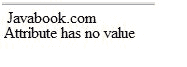

### `<c:remove>` 标签的 `Scope` 属性

上面我们代码如下：

```jsp
<c:remove  var="author"/>
```

上述代码从所有范围（`page`、`session`、`application`、`request`）移除属性。为了指定，我们必须在`<c:remove>`标签内部指定`scope`属性，就像我下面做的那样——下面的 JSTL 语句将从`session`范围移除变量`var`。

```jsp
<c:remove  var="author"  scope="session"/>
```

5. **`<c:if>` 标签**：这个 JSTL 核心标签用于测试条件。该标签还有两个可选属性`var`和`scope`，`test`是强制性的。

# JSTL `<c:if>` 核心标签

`<c:if>`是一个 JSTL 核心标签，用于测试条件。它类似于 Java 中的`if`语句，评估一个条件并在结果为真时执行一个代码块。

### 语法：
这是`<c:if>`核心标签的基本语法。如果`test="true"`，则封装在`<c:if>`标签内的语句将被执行。为了使用此标签，我们通常使用表达式语言来评估关系表达式。我们使用 EL 是因为它在评估条件后会返回布尔值（`true`/`false`），而我们的`test`属性需要这个布尔值。

```jsp
<c:if  test="${condition}">

...

..

</c:if>
```

### `<c:if>` 标签示例
在这个示例中，我们使用`<c:set>`标签定义了`age`变量，然后使用`<c:if>`标签检查投票资格。

```jsp
<%@ taglib uri="http://java.sun.com/jsp/jstl/core" prefix="c" %>

<html>

<head>

<title>JSTL c:if Tag</title>

</head>

<body>

<c:set  var="age"  value="26"/>

<c:if  test="${age >= 18}">

<c:out value="You are eligible for voting!"/>

</c:if>

<c:if  test="${age < 18}">

<c:out value="You are not eligible for voting!"/>

</c:if>

</body>

</html>
```

输出：
 （注：此处原文编号略有重复，已按逻辑翻译）

### `<c:remove>` 的 `Scope` 属性
上面我们代码如下：

```jsp
<c:remove  var="author"/>
```

上述代码从所有范围（`page`、`session`、`application`、`request`）移除属性。为了指定，我们必须在`<c:remove>`标签内指定`scope`属性，就像我下面做的那样——下面的 JSTL 语句将从`session`范围移除变量。

```jsp
<c:remove  var="author"  scope="session"/>
```

4. **`<c:if>` 标签**：这个 JSTL 核心标签用于测试条件。该标签还有两个可选属性`var`和`scope`，`test`是强制性的。

5. **`<c:choose>` 标签**：这个 JSTL 核心标签用于测试多个条件。它类似于 Java 中的`switch-else-if`语句。

# JSTL `<c:choose>`, `<c:when>`, `<c:otherwise>` 核心标签
`<c:choose>`、`<c:when>`、`<c:otherwise>`一起使用，类似于 Java 中的`switch-else-if`。

### `<c:choose>`, `<c:when>`, `<c:otherwise>`
在这里我们讨论`<c:choose>`类似于`switch`，`<c:when>`类似于`case`，可以在`<c:choose>`中使用多次。`<c:otherwise>`类似于`default`，当所有`<c:when>`语句为假时执行。

语法：

```xml
<c:choose>

  <c:when test="${condition1}">

    // 如果 condition1 为真，则执行某些操作

  </c:when>

  <c:when test="${condition2}">

    // 如果 condition2 为真，则执行某些操作

  </c:when>

  <c:otherwise>

    // 如果所有条件都为假，则执行某些操作

  </c:otherwise>

</c:choose>
```

### 示例：
在这个示例中，我们有三个数字，并使用这三个标签对它们进行比较。示例非常易于理解。输出截图在示例代码之后。

```jsp
<%@ taglib uri="http://java.sun.com/jsp/jstl/core" prefix="c" %>

<html>

<head>

<title>c:choose, c:when and c:otherwise Example</title>

</head>

<body>

<c:set  var="number1"  value="222"/>

<c:set  var="number2"  value="12"/>

<c:set  var="number3"  value="10"/>

<c:choose>

  <c:when test="${number1 < number2}">

    <c:out value="number1 is less than number2"/>

  </c:when>

  <c:when test="${number1 <= number3}">

    <c:out value="number1 is less than equal to number3"/>

  </c:when>

  <c:otherwise>

    <c:out value="number1 is largest number!"/>

  </c:otherwise>

</c:choose>

</body>

</html>
```

输出：


6. **`<c:when>` 标签**：它类似于 Java 中的`case`语句。注意：参考第 5 点完整示例。

7. **`<c:otherwise>` 标签**：它类似于 `switch-case` 语句中的`default`属性。注意：参考第 5 点完整示例。

8. **`<c:catch>` 标签**：该标签用于异常处理。在本文中讨论了使用`<c:catch>`核心标签进行异常处理。

### 语法：

```xml
<c:catch var="variable_name">

// 可能会发生异常的语句集

</c:catch>
```

## 变量处理
`variable_name`可以是用于存储异常信息的任何变量。如果在`<c:catch>`包围的语句中发生异常，则该变量将包含异常信息。让我们通过示例来理解这一点。

### 示例

在这个示例中，我们特意通过将整数除以零来抛出算术异常，然后使用表达式语言（EL）打印`errormsg`变量（该变量包含异常信息）。

注意：如果`<c:catch>`语句块中没有发生异常，则变量（示例中为`errormsg`）将具有`null`值。这就是为什么我们在打印变量值之前要检查`errormsg!=null`。

```jsp
<%@ taglib uri="http://java.sun.com/jsp/jstl/core" prefix="c" %>

<html>

<head>

<title>JSTL c:catch 核心标签示例</title>

</head>

<body>

<%!

int num1=10;

int num2=0; %>

<c:catch var ="errormsg">

<% int res = num1/num2;

 out.println(res);%>

</c:catch>

<c:if test = "${errormsg != null}">

 <p>上述算术操作中发生了异常。请修复错误。

 异常为：${errormsg}</p>

</c:if>

</body>

</html>
```

输出：
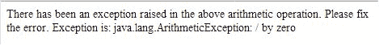

## JSTL `<c:import>` 核心标签
JSTL`<c:import>`标签用于从另一个文件/页面导入内容到当前 JSP 页面。属性有`var`、`URL`和`scope`。

### 语法

```xml
<c:import var="variable_name" url="relative_url"/>
```

这里`variable_name`是存储从另一个`url`导入数据的变量。
`relative_url`是需要导入的文件/页面地址。

### `<c:import>` 属性
- `url`：它是强制性属性，必须指定。
- `var`：这是一个可选属性，如果未指定，则导入的数据将打印在当前页面上。例如，语句`<c:import url="/file.jsp" />`将在客户端（浏览器）上打印`file.jsp`的数据。
- `scope`：也是可选的。如果我们使用`var`属性，则可以配合`scope`来指定存储在变量中的数据的作用域。

### 示例
这是一个包含某些数据的页面。我们将在`index.jsp`页面导入此页面。

**`display.jsp`**

```jsp
<%@ taglib uri="http://java.sun.com/jsp/jstl/core" prefix="c" %>

<c:out value="Chandru"/>

<c:out value="JavaBook.com" />

<c:out value="This is just a String" />
```

**`index.jsp`**
在这里我们将数据从`display.jsp`导入到变量`mydata`，然后使用`<c:out>`标签在浏览器上显示它。

```jsp
<%@ taglib uri="http://java.sun.com/jsp/jstl/core" prefix="c" %>

<html>

<head>

<title> JSTL c:import 标签示例</title>

</head>

<body>

<c:import var="mydata" url="/display.jsp"/>

<c:out value="${mydata}"/>

</body>

</html>
```

输出：
Chandru javabook.com This is just a string

## JSTL `<c:forEach>` 和 `<c:forTokens>` 核心标签
JSTL 中的`<c:forEach>`标签用于执行有限次数的相同语句集。它类似于`java`中的`for`循环。这基本上用于我们需要按照指定的次数反复执行（执行）一组语句的场景。

`<c:forTokens>`也用于迭代，但它只与分隔符一起工作，这意味着使用此标签我们可以根据分隔符将输入数据分成多个部分。

### `<c:forEach>` 标签

#### `<c:forEach>` 语法

```xml
<c:forEach var="counter_variable_name" begin="intial_value" end="final_limit">

    // 语句块

</c:forEach>
```


以下是`<c:forEach>`标签的三个主要属性：
- `begin`: 初始计数值。
- `end`: 循环执行的最终限制。
- `var`: 计数器变量名。

### 示例
在这个示例中，我们使用`<c:forEach>`标签在循环中打印变量`counter`的值。循环从值 1（在`begin`属性中指定）开始，到值 10（`end`属性的值）。

```jsp
<%@ taglib uri="http://java.sun.com/jsp/jstl/core" prefix="c" %>
<html>
<head>
<title>JSTL 中 c:forEach 标签示例</title>
</head>
<body>
<c:forEach var="counter" begin="1" end="10">
    <c:out value="${counter}"/>
</c:forEach>
</body>
</html>
```

输出：


### `<c:forTokens>` 标签

#### `<c:forTokens>` 语法
```xml
<c:forTokens var="variable_name" items="value" delim="delimiter">
```

以下是`<c:forTokens>`标签的三个主要属性：
- `items`: 要分割的集合。
- `delim`: 用于分割的分隔符。
- `var`: 用于存储每个部分的变量名。

### 示例
在这个示例中，我们使用`<c:forTokens>`将字符串分成多个部分。

```jsp
<%@ taglib uri="http://java.sun.com/jsp/jstl/core" prefix="c" %>
<html>
<head>
<title>JSTL 中 c:forTokens 标签示例</title>
</head>
<body>
<c:forTokens var="site" items="www.javabook.com" delim=".">
    <c:out value="${site}"/>
</c:forTokens>
</body>
</html>
```

输出：
www
javabook
com

## JSTL `<c:param>` 核心标签
`<c:param>`标签用于向 URL 添加参数。它通常用在`<c:url>`内部。

### 语法
```xml
<c:param name="parameter_name" value="parameter_value"/>
```

### 属性
- `name`: 参数名。
- `value`: 参数值。

### 示例
在这个示例中我们使用`<c:param>`标签为 URL 添加参数。

```jsp
<%@ taglib uri="http://java.sun.com/jsp/jstl/core" prefix="c" %>
<html>
<head>
<title>JSTL c:param 标签示例</title>
</head>
<body>
<c:url value="/mypage.jsp" var="completeURL">
<c:param name="Id" value="736"/>
<c:param name="user" value="chandru"/>
</c:url>
${completeURL}
</body>
</html>
```

输出：
`/mypage.jsp?Id=736&user=chandru`

#### 示例 2: `<c:redirect>` 中的 `<c:param>` 使用
在这里在使用`<c:param>`带重定向传递参数，然后使用表达式语言的`param`变量在重定向页面上显示这些参数。

```jsp
<%@ taglib uri="http://java.sun.com/jsp/jstl/core" prefix="c" %>
<html>
<head>
<title>c:param 示例 2</title>
</head>
<body>
<c:redirect url="/display.jsp">
<c:param name="UserId" value="222"/>
<c:param name="UserName" value="ChandruBabu"/>
</c:redirect>
</body>
</html>
```

**display.jsp**
```jsp
USER ID IS: ${param.UserId}
USER NAME IS: ${param.UserName}
```

输出：
USER ID IS: 222
USER NAME IS:ChandruBabu

## JSTL `<c:url>` 核心标签
`<c:url>`标签用于 URL 格式化或 URL 编码。它将相对 URL 转换为上下文 URL。属性有`var`、`context`和`scope`。

### 语法
```xml
<c:url value="/file1.jsp"/>
```

`value`属性是`<c:url>`标签的强制性属性。该标签还有三个可选属性，如下：
- `var`: 用于存储格式化后 URL 的变量名（生成的 URL）。
- `context`: 用于指定应用程序（或项目名称）。不明白吗？我们稍后将通过示例来解释。
- `scope`: `var`属性存储的作用域。它可以是`request`、`page`、`application`或`session`。

让我们通过示例来理解此标签及其属性的使用：

### 示例 1：`<c:url>` 的`value`属性

```jsp
<%@ taglib uri="http://java.sun.com/jsp/jstl/core" prefix="c" %>
<html>
<head>
<title>JSTL c:url 标签示例</title>
</head>
<body>
<c:url  value="/file1.jsp"/>
</body>
</html>
```

输出：上述代码生成了以下输出。
`/JavaBook/file1.jsp`

注意：`JavaBook`是我的基础书籍名称（换句话说就是 JSP 应用程序名称）。

### 示例 2：`<c:url>` 标签的`var`属性
让我们像这样修改示例 1。我们在`<c:url>`中添加了一个变量`myurl`。现在`<c:url>`的结果将存储在变量`myurl`中。

```jsp
<c:url  var="myurl"  value="/file1.jsp"/>
${myurl}
```

输出：
`/JavaBook/file1.jsp`

### 示例 3：`context`属性
默认情况下，此标签将当前应用程序作为上下文，但我们可以像下面的示例所示，在`c url`中显式地指定上下文——
注意：`context`的值必须以 "/"开头，否则你将得到下面的异常消息——
```
HTTP Status 500 – javax.servlet.ServletException: javax.servlet.jsp.JspTagException: 在 URL 标签中，当指定了“context”属性时，“context”和“url”属性的值都必须以“/”开头。
```

```jsp
<c:url  var="myurl"  value="/file1.jsp"  context="/MyJSPProject"/>
${myurl}
```

输出：
`/MyJSPProject/file1.jsp`

### 示例 4：Scope 属性
```jsp
<c:url var="myurl" value="/file1.jsp" context="/MyJSPProject" scope="session"/>
${requestScope.myurl}
```

输出：输出屏幕将为空，因为我们将`myurl`存储在`session`作用域中，而我们正尝试从`requestScope`获取值后打印它。

正确用法：这应该是代码编写方式。在这里我们将将其存储在 session 中并从`sessionScope`中获取，这样它就能正常工作。

```jsp
<c:url  var="myurl"  value="/file1.jsp"  context="/MyJSPProject"  scope="session"/>
${sessionScope.myurl}
```

输出：
`/MyJSPProject/file1.jsp`

14. `<c:redirect>` 标签：用于将当前页面重定向到另一个 URL，在此标签的`url`属性中提供相对地址，页面将重定向到该 url。

# JSTL `<c:redirect>` 核心标签

`<c:redirect>`用于将当前页面重定向到另一个 URL。

### 语法：
```jsp
<c:redirect  url="http://www.anydomainhere.com/samplepage.jsp"/>
```

这就是`<c:redirect>`标签的样子。我们只需要在该标签的`URL`属性中提供相对地址，页面在获取后会自动重定向到该 URL。

### 示例
在这里，我们根据变量`myurl`的值将页面重定向到不同的 url。如果值为 1，页面将重定向到`http://javabook.com`，如果是 2，它将转到`http://www.google.com`。

```jsp
<%@lib uri="http://java.sun.com/jsp/jstl/core" prefix="c" %>
<html>
<head>
<title>JSTL c:redirect 示例</title>
</head>
<body>
 <c:set  var="myurl"  value="2"  scope="request"/>
 <c:if test="${myurl==1}">
 <c:redirect  url="http://javabook.com"/>
 </c:if>
 <c:if test="${myurl==2}">
 <c:redirect  url="http://www.google.com"/>
 </c:if>
</body>
</html>
```

输出：由于变量`myurl`的值为 2，页面被重定向到`http://www.google.com`。

## JSTL 函数
以下是常用 JSTL 函数的教程链接。在 JSP 页面中必须包含标签指令才能使用 JSTL 函数。

```jsp
<%@ taglib prefix="fn" uri="http://java.sun.com/jsp/jstl/functions" %>
```

`fn:contains`: 此函数检查给定字符串是否作为子字符串出现在输入中。它执行的是大小敏感的检查。

## `fn:contains()` – JSTL 函数
`fn:contains()`检查给定字符串是否作为子字符串出现在输入中。它执行的是大小敏感的检查，意味着它在检查子字符串时会考虑大小写。

### 语法：
`boolean contains(String input, String check)`
该函数的返回类型为`boolean`。当指定的字符串作为子字符串出现在输入时，该函数返回`true`，否则返回`false`。

## 示例：
```jsp
<%@ taglib uri="http://java.sun.com/jsp/jstl/core" prefix="c" %>
<%@ taglib uri="http://java.sun.com/jsp/jstl/functions" prefix="fn" %>
<html>
<head>
<title>fn:contains 示例</title>
</head>
<body>
<c:set var="oldPassword" value="12"/>
<c:set var="newPassword" value="1 password"/>
<c:if test="${fn:contains(newPassword, oldPassword)}">
<c:out value="Password contains the string"/>
</c:if>
</body>
</html>
```

输出：
Password contains the string

2. `fn:containsIgnoreCase()`：此函数检查给定字符串是否不分大小写地作为子字符串出现在输入中。

## `fn:containsIgnoreCase()` – JSTL 函数
`fn:containsIgnoreCase()`检查给定字符串是否不分大小写地作为子字符串出现在输入中。

### 语法：
`boolean containsIgnoreCase(String input, String check)`
该函数的返回类型为`boolean`。当指定的字符串不分大小写地出现在输入中时，该函数返回`true`，否则返回`false`。

## 示例：
```jsp
<%@ taglib uri="http://java.sun.com/jsp/jstl/core" prefix="c" %>
<%@ taglib uri="http://java.sun.com/jsp/jstl/functions" prefix="fn" %>
<html>
<head>
<title>fn:containsIgnoreCase 示例</title>
</head>
<body>
<c:set var="string1" value="Hi This is CHANDRU from JavaBook.com"/>
<c:set var="string2" value="chandru"/>
<c:if test="${fn:containsIgnoreCase(string1, string2)}">
<c:out value="Case Insensitive Check: String1 contains string2"/>
</c:if>
</body>
</html>
```

输出：
Case Insensitive Check: String1 contains string2

3. `fn:indexOf()`：它用于查找字符串在提供的字符串中的起始位置。当输入中未找到字符串时，返回 -1。

# `fn:indexOf()` – JSTL 函数
`fn:indexOf()`函数用于查找字符串在提供的字符串中的起始位置（索引）。

### 语法：
`int indexOf(String, String)`
该函数的返回类型为`int`。它返回第二个字符串（函数的第二个参数）在第一个字符串（函数的第一个参数）中的起始位置（或索引）。

注意点：
- 当输入字符串中未找到字符串时，函数返回 -1。
- 函数是大小敏感的。它将相同字母的大写和小写视为不同的。
- 它返回第一次出现的索引，这意味着如果字符串在输入中出现多次，函数将返回第一次出现的索引。参考示例。

#### `fn:indexOf()` 函数示例
在此示例中，我们使用 EL 查找几个字符串的索引并显示它们。

```jsp
<%@ taglib uri="http://java.sun.com/jsp/jstl/core" prefix="c" %>
<%@ taglib uri="http://java.sun.com/jsp/jstl/functions" prefix="fn" %>
<html>
<head>
<title>JSTL fn:indexOf() 示例</title>
</head>
<body>
${fn:indexOf("My name is Chandru pratap", "chandru")}

${fn:indexOf("My name is Chandru pratap", "Chandru")}

${fn:indexOf("This is an example", "is")}

${fn:indexOf("JSTL function - indexOf function", "function")}
</body>
</html>
```

输出：
-1 11 2 5

## 4. `fn:escapeXML()`
它用于 HTML/XML 字符转义，这意味着它将 html/xml 标签视为字符串。类似于`<c:out>`标签的`escapeXml`属性。

### `fn:escapeXml()` – JSTL 函数
`fn:escapeXml()` JSTL 函数用于 HTML/XML 字符转义，这意味着它将 html/xml 标签视为字符串而非标记标签。

### 语法
```java
String escapeXml(String input_string)
```


在转义 HTML/XML 标记标签后，将`input_string`转换为输出字符串。

- 函数返回类型为`String`
- 参数：`input String`

### `fn:escapeXml()`示例

这里有两个包含加粗（`<b>`）和斜体（`<i>`）HTML 标签的字符串。我们正在使用`fn:escapeXml()`函数对它们进行处理。

```html
<%@ taglib uri="http://java.sun.com/jsp/jstl/core" prefix="c" %>
<%@ taglib uri="http://java.sun.com/jsp/jstl/functions" prefix="fn" %>

<html>
<head>
<title>JSTL fn:escapeXml() 示例</title>
</head>
<body>
Message1: <b>Hi This is just a message</b>
<br>Message2: <i>This is an example</i>
<br>Message1 and `fn:escapeXml()`: ${fn:escapeXml("<b>Hi This is just a message</b>")}
<br>Message2 and `fn:escapeXml()`: ${fn:escapeXml("<i>This is an example</i>")}
</body>
</html>
```

输出：

如你所见，当我们在输入字符串上使用该函数时，HTML 标签并没有生效，而是像原样一样被打印了出来，就像另一个普通字符串一样。

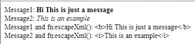

## 5. `fn:join()`和`fn:split()`函数

JSTL 函数：`fn:join()`使用给定的分隔符连接字符串并返回输出字符串。`fn:split()`将给定的字符串拆分为子字符串数组。

### `fn:join()`

它使用给定的分隔符连接字符串并返回输出字符串。

#### 语法

```java
String fn:join(String arrayofstrings, String separator)
```

它将输入数组中的所有元素连同提供的分隔符连接在一起。该函数的返回类型为`String`，它返回连接后的输出字符串。

#### 示例 – 使用`fn:join()`函数连接字符串

在此示例中，我们有一个字符串数组，并正在使用分隔符（`' & '`）将它们连接。

```html
<%@ taglib uri="http://java.sun.com/jsp/jstl/core" prefix="c" %>
<%@ taglib uri="http://java.sun.com/jsp/jstl/functions" prefix="fn" %>

<html>
<head>
<title>JSTL fn:join() 示例</title>
</head>
<body>
<%
String arr[]={"Chandru", "Rahul", "Ajith"};
session.setAttribute("names", arr);
%>

${fn:join(names, " & ")}
</body>
</html>
```

输出：

如你所见，三个名字都连接在一起了，中间有‘ &’。

Chandru & Rahul & Ajith

### `fn:split()`

它将给定的字符串拆分为子字符串数组。拆分过程考虑我们在调用函数时提供的分隔符字符串。也就是说，我们将字符串和分隔符作为参数传递给函数，它根据分隔符字符串拆分输入并返回数组。

#### 语法

```java
String[] fn:split(String inputstring, String delimiterstring)
```

#### 示例 – 使用`fn:split()`函数连接字符串

在此示例中，我们有一个中间包含几个空格字符的输入字符串。我们使用`fn:split()`函数以空格作为分隔符拆分了字符串。该函数返回了子字符串数组。

```html
<%@ taglib uri="http://java.sun.com/jsp/jstl/core" prefix="c" %>
<%@ taglib uri="http://java.sun.com/jsp/jstl/functions" prefix="fn" %>

<html>
<head>
<title>JSTL fn:split() 示例</title>
</head>
<body>
<c:set var="msg" value="This is an example of JSTL function"/>
<c:set var="arrayofmsg" value="${fn:split(msg,' ')}"/>

<c:forEach var="i" begin="0" end="6">
arrayofmsg[${i}]: ${arrayofmsg[i]}<br>
</c:forEach>
</body>
</html>
```

输出：

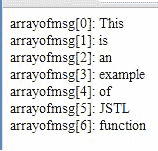

## 6. `fn:length()`

JSTL 函数`fn:length()`用于计算字符串的长度或查找集合中元素的数量。它返回对象的长度。

### `fn:length()`– JSTL 函数

JSTL 函数`fn:length()`用于计算字符串的长度或查找集合中元素的数量。

#### 语法

```java
int length(Object)
```

该函数的返回类型为`int`。它返回传入对象的长度。

#### `fn:length()`示例

我们正在计算不同字符串的长度。

```html
<%@ taglib uri="http://java.sun.com/jsp/jstl/core" prefix="c" %>
<%@ taglib uri="http://java.sun.com/jsp/jstl/functions" prefix="fn" %>

<html>
<head>
<title>JSTL fn:length() 示例</title>
</head>
<body>
<c:set var="string1" value="This is an example of JSTL function"/>
<c:set var="string2" value="Hi"/>
<c:set var="string3" value=""/>

Length of string1: ${fn:length(string1)}<br>
Length of string2: ${fn:length(string2)}<br>
Length of string3: ${fn:length(string3)}
</body>
</html>
```

输出：

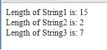

## 7. `fn:trim()`

`fn:trim()`是指定字符串的前。

### `fn:trim()`– JSTL 函数

`fn:trim()`用于移除字符串首尾的空格。

#### 语法

```java
String trim(String input)
```

该函数返回移除首尾空格后的字符串。

#### `fn:trim()`示例

在此示例中，我们有一个开头和结尾都有空格字符的字符串。我们正在使用`fn:trim()`函数去掉这些空格。

```html
<%@ taglib uri="http://java.sun.com/jsp/jstl/core" prefix="c" %>
<%@ taglib uri="http://java.sun.com/jsp/jstl/functions" prefix="fn" %>

<html>
<head>
<title>JSTL fn:trim() 示例</title>
</head>
<body>
<c:set var="msg" value="  This is an example of JSTL function  "/>

Trimmed string: '${fn:trim(msg)}'
</body>
</html>
```

输出：

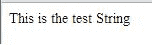

## 8. `fn:endsWith()`

`fn:endsWith()`是字符串。

### `fn:endsWith()`– JSTL 函数

`fn:endsWith()`函数用于检查字符串的后缀。它检查给定的字符串是否以特定的字符串结尾。该验证是`大小敏感`的。

#### 语法

```java
boolean endsWith(input_string, suffix_string)
```

它验证`input_string`是否以`suffix_string`结尾。如果测试成功，该函数返回`true`，否则返回`false`。

#### `fn:endsWith()`示例

在此示例中，我们检查一个字符串是否以特定的后缀结尾。

```html
<%@ taglib uri="http://java.sun.com/jsp/jstl/core" prefix="c" %>
<%@ taglib uri="http://java.sun.com/jsp/jstl/functions" prefix="fn" %>

<html>
<head>
<title>JSTL fn:endsWith() 示例</title>
</head>
<body>
<c:set var="msg" value="This is an example of JSTL function"/>

Ends with 'function': ${fn:endsWith(msg, 'function')}<br>
Ends with 'example': ${fn:endsWith(msg, 'example')}
</body>
</html>
```

输出：

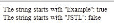

在示例中，我们有一个输入字符串“JavaBook.com”以及其他 4 个字符串。我们正在验证输入字符串是否以给定的四个字符串结束。

```xml
<%@ taglib uri="http://java.sun.com/jsp/jstl/core" prefix="c" %>
<%@ taglib uri="http://java.sun.com/jsp/jstl/functions" prefix="fn" %>

<html>
<head>
<title>JSTL fn:endsWith() 示例</title>
</head>
<body>
字符串以 ".com" 结束：${fn:endsWith("JavaBook.com", "com")}
<br>字符串以 "book.com" 结束：${fn:endsWith("JavaBook.com", "book.com")}
<br>字符串以 "Book.com" 结束：${fn:endsWith("JavaBook.com", "Book.com")}
<br>字符串以 "Book.co" 结束：${fn:endsWith("JavaBook.com", "Book.co")}
</body>
</html>
```

输出：

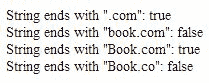

## 9. `fn:substring()`、`fn:substringAfter()`和`fn:substringBefore()`函数

`fn:substring()`：此 JSTL 函数用于从提供的字符串中获取子字符串。

在本教程中，我们将讨论 JSTL 的`fn:substring()`、`fn:substringAfter()`和`fn:substringBefore()`函数。这些函数都用于从给定的输入字符串中获取字符串的一部分。这三个函数获取输出的方法各不同。

### `fn:substring()`

该函数根据给定的起始和结束位置，返回给定输入字符串的子字符串。

#### 语法

`String fn:substring(String inputstring, int start, int end)`

- 函数返回类型：`String`
- `inputstring`：需要提取子字符串的字符串
- `start`：子字符串的起始位置
- `end`：子字符串的结束位置

#### 示例 – `fn:substring()`函数

在此示例中，我们通过提供子字符串的起始和结束位置，从给定的字符串中提取子字符串。

```xml
<%@ taglib uri="http://java.sun.com/jsp/jstl/core" prefix="c" %>
<%@ taglib uri="http://java.sun.com/jsp/jstl/functions" prefix="fn" %>

<html>
<head>
<title>JSTL fn:substring() 示例</title>
</head>
<body>
<c:set var="msg" value="This is an example of JSTL function"/>
${fn:substring(msg, 10, 26)}
</body>
</html>
```

输出：

example of JSTL

### `fn:substringAfter()`

它返回给定字符串中位于提供的字符串值之后的部分。

#### 语法

`String fn:substringAfter(String input, String afterstring)`

输入字符串中`afterstring`之后的所有内容都会由该函数返回。请参考下方的示例以更清楚地了解此主题。

#### `fn:substringAfter()`示例

```xml
<%@ taglib uri="http://java.sun.com/jsp/jstl/core" prefix="c" %>
<%@ taglib uri="http://java.sun.com/jsp/jstl/functions" prefix="fn" %>

<html>
<head>
<title>JSTL fn:substringAfter() 示例</title>
</head>
<body>
<c:set var="name" value="Rahul Pratap Prasad"/>
${fn:substringAfter(name, "Pr")}
</body>
</html>
```

输出：

atap Prasad

### `fn:substringBefore()`

它与`fn:substringAfter`函数正好相反。它返回原始字符串中位于指定字符串值之前的部分。

#### 语法

`String fn:substringBefore(String input, String beforestring)`

`input`中`beforestring`之前的部分将作为该函数的输出。

#### `fn:substringBefore()`示例

```xml
<%@ taglib uri="http://java.sun.com/jsp/jstl/core" prefix="c" %>
<%@ taglib uri="http://java.sun.com/jsp/jstl/functions" prefix="fn" %>

<html>
<head>
<title>JSTL fn:substringBefore() 示例</title>
</head>
<body>
<c:set var="justastring" value="Hi, How are you??"/>
${fn:substringBefore(justastring, "are")}
</body>
</html>
```

输出：

Hi, How

## 10. `fn:substringAfter()`

它用于获取输入字符串中指定字符串之前的子字符串。

注意：请完整阅读示例 9。

## 11. `fn:substringBefore()`

它从输入中获取位于指定字符串后续的子字符串。

注意：请完整阅读示例 9。

## 12. `fn:trim()`

JSTL 函数`fn:trim()`移除字符串开头和结尾的空格。

# `fn:trim()`和`fn:startsWith()`JSTL 函数

在这篇文章中，我们将讨论两个对字符串操作的函数。这些函数是`fn:trim()`和`fn:startsWith()`。`fn:trim()`函数移除字符串开头和结尾的空格，而`fn:startsWith()`检查指定字符串是否为给定字符串的前缀。

### JSTL `fn:trim()`函数

它移除字符串开头和结尾的空格字符。

它移除给定字符串开头结尾的空格。

#### 语法

`fn:trim(String input)`

该函数返回处理后的字符串。

#### 示例

我们有一个开头和结尾有空格的字符串。

```xml
<%@ taglib uri="http://java.sun.com/jsp/jstl/core" prefix="c" %>
<%@ taglib uri="http://java.sun.com/jsp/jstl/functions" prefix="fn" %>

<html>
<head>
<title>JSTL fn:trim() 示例</title>
</head>
<body>
<c:set var="msg" value="  This is a string  "/>
${fn:trim(msg)}
</body>
</html>
```


输出：

This is a string

## `fn:startsWith()` 函数

它会检查指定字符串是否为给定字符串的前缀。

### 语法

`boolean fn:startsWith(String input, String prefix)`

该函数返回一个布尔值。如果字符串以前缀开头则返回 `true`，否则返回 `false`。

### 示例

我们有一个字符串，并检查它是否以某个字符串开头。

```xml
<%@ taglib uri="http://java.sun.com/jsp/jstl/core" prefix="c" %>
<%@ taglib uri="http://java.sun.com/jsp/jstl/functions" prefix="fn" %>

<html>
<head>
<title>JSTL fn:startsWith() 示例</title>
</head>
<body>

<c:set var="msg" value="Hello World"/>

字符串以 "Hello" 开头:${fn:startsWith(msg, "Hello")}

<br>字符串以 "World" 开头:${fn:startsWith(msg, "World")}

</body>
</html>
```

输出：

true  
false

## `fn:toUpperCase()` – JSTL 函数

`fn:toUpperCase()` 与 `fn:toLowerCase()` 函数相反。它将字符串转换为大写。输入字符串中的所有字符都被替换为相应的大写字母。需要更改的字符串作为函数的参数传递，函数返回转换后的字符串。我们可以在调用函数时传递变量或直接硬编码字符串。

### 语法

`String fn:toUpperCase(String input)`

该函数在将输入字符串转换为大写后返回字符串。

### `fn:toUpperCase()` 示例

我们使用该函数将一些字符串转换为大写。

```xml
<%@ taglib uri="http://java.sun.com/jsp/jstl/core" prefix="c" %>
<%@ taglib uri="http://java.sun.com/jsp/jstl/functions" prefix="fn" %>

<html>
<head>
<title>fn:toUpperCase() 示例</title>
</head>
<body>

<c:set var="site" value="JavaBook.com"/>
<c:set var="author" value="Chandru"/>

Hi This is ${fn:toUpperCase(author)} from ${fn:toUpperCase(site)}.

</body>
</html>
```

输出：

CHANDRU  
JAVABOOK.COM

## `fn:toLowerCase()` – JSTL 函数

`fn:toLowerCase()` 函数用于将输入字符串转换为小写字符串。输入字符串中的任何大写字母都被替换为相应的小写字母。

### 语法

`String fn:toLowerCase(String input)`

该函数在将输入字符串转换为小写后返回字符串。

### `fn:toLowerCase()` 示例

在本示例中，我们对两个字符串应用此函数——其中一个是字符串变量，另一个是作为参数传递给函数的硬编码字符串。如你在输出中所看到的，它已将变量值和硬编码字符串的值替换为小写。代码块之后提供了输出的截图。

```xml
<%@ taglib uri="http://java.sun.com/jsp/jstl/core" prefix="c" %>
<%@ taglib uri="http://java.sun.com/jsp/jstl/functions" prefix="fn" %>

<html>
<head>
<title>fn:toLowerCase() example</title>
</head>
<body>

<c:set var="message" value="This is An Example of JSTL Function"/>

${fn:toLowerCase(message)}

${fn:toLowerCase("HELLO")}

</body>
</html>
```

输出：

This is an Example of jstl function hello

## `fn:replace()` – JSTL 函数

`fn:replace()` 函数在输入中搜索一个字符串，并将其替换为所提供的字符串。它执行的是大小写敏感的处理。

以下是 `fn:replace()` 函数的基本语法。

### 语法

`String fn:replace(String input, String search_for, String replace_with)`

包含三个字符串参数，返回值类型也是 `String`。它在 `input` 中搜索 `search_for` 字符串并将其替换为 `replace_with` 字符串。如果未找到该字符串，则原样返回输入。

**注意：** 它执行的是大小写敏感的处理。

### 示例

在本示例中，我们对两个输入字符串使用了 `fn:replace()` 函数。

```xml
<%@ taglib uri="http://java.sun.com/jsp/jstl/core" prefix="c" %>
<%@ taglib uri="http://java.sun.com/jsp/jstl/functions" prefix="fn" %>

<html>
<head>
<title>JSTL fn:replace() example</title>
</head>
<body>

<c:set var="author" value="Chandru Babu"/>
<c:set var="randomstring" value="abc def abc ghi ABC"/>

${fn:replace(author, "Chandru", "Rahul")}

${fn:replace(randomstring, "abc", "hello")}

</body>
</html>
```

输出：

Rahul Babu hello def hello ghi ABC

观察输出你会发现，`randomstring` 变量中的 “ABC” 保持不变，而其他的 “abc” 子字符串被替换为了 “hello”。这是由于大小写敏感匹配导致的，在上面的示例中，我们替换的是小写的 “abc”。

# JSON 教程

## JSON 教程：10 分钟学习 JSON

JSON 代表 JavaScript 对象表示法（JavaScript Object Notation）。JSON 对象用于在服务器和客户端之间传输数据，XML 具有相同的目的。然而，JSON 对象相比 XML 具有许多优势，我们将在本教程中讨论这些优势，并介绍 JSON 的概念和它的用法。

让我们来看这段 JSON 数据：它基本上由键值对组成。

```javascript
var chandru = {
  "firstName": "Chandru",
  "lastName": "babu",
  "age": "28"
};
```

### JSON 的特性

- 它是轻量级的
- 它是语言无关的
- 易于读写
- 基于文本的、人类可读的数据交换格式

## 为什么使用 JSON？

**标准结构：** 正如我们所看到的，JSON 对象具有标准的结构，这使得开发者编写和阅读代码的工作变得更容易，因为他们知道从 JSON 中期望什么。

**轻量级：** 在使用 AJAX 时，快速且异步地加载数据而不请求页面刷新是至关重要的。由于 JSON 是轻量级的，因此更容易快速获取并加载所请求的数据。

**可扩展性：** JSON 是语言无关的，这意味着它可以与大多数现代编程语言良好协作。假设我们需要更改服务器端语言，在这种情况下，对我们来说更容易更改，因为 JSON 结构对于所有语言都是相同的。

## JSON vs XML

让我们看看当以文本格式存储 4 个学生的记录时，JSON 和 XML 看起来是什么样，以便以后需要时检索它们。

**JSON 样式：**

```json
{
  "students": [
    {
      "name": "John",
      "age": "23",
      "city": "Agra"
    },
    {
      "name": "Steve",
      "age": "28",
      "city": "Delhi"
    },
    {
      "name": "Peter",
      "age": "32",
      "city": "Chennai"
    },
    {
      "name": "Chandru",
      "age": "28",
      "city": "Bangalore"
    }
  ]
}
```

**XML 样式：**

```xml
<students>
  <student>
    <name>John</name>
    <age>23</age>
    <city>Agra</city>
  </student>
  <student>
    <name>Steve</name>
    <age>28</age>
    <city>Delhi</city>
  </student>
  <student>
    <name>Peter</name>
    <age>32</age>
    <city>Chennai</city>
  </student>
  <student>
    <name>Chandru</name>
    <age>28</age>
    <city>Bangalore</city>
  </student>
</students>
```

如你清楚看到的，JSON 远要轻量得多。

## JSON 数据结构以及如何读取它们

### 1. JSON 对象

在上面的示例中，我们将信息存储在一个对象中：

```javascript
var chandru = {
  "name": "Chandru",
  "age": "28",
  "website": "Javabook"
};
```

要从对象中访问信息，我们这样做：

```javascript
document.writln("The name is: " + chandru.name);
document.writln("his age is: " + chandru.age);
document.writln("his website is: " + chandru.website);
```

### 2. 数组中的 JSON 对象

假设我们想存储多个人的信息，我们可以有一个数组：

```javascript
var students = [
  {
    "name": "Steve",
    "age": "29",
    "gender": "male"
  },
  {
    "name": "Peter",
    "age": "32",
    "gender": "male"
  },
  {
    "name": "Sophie",
    "age": "27",
    "gender": "female"
  }
];
```

要访问数组，我们这样做：

```javascript
document.writeln(students[0].age); //输出应为 29
```

### 3. JSON 对象的嵌套

另一种实现上面相同功能的方法：

```javascript
var students = {
  "steve": {
    "name": "Steve",
    "age": "29",
    "gender": "male"
  },
  "pete": {
    "name": "Peter",
    "age": "32",
    "gender": "male"
  },
  "sop": {
    "name": "Sophie",
    "age": "27",
    "gender": "female"
  }
};
```

像这样访问上面的嵌套对象：

```javascript
document.writln(students.steve.age); //输出: 29
document.writeln(students.sop.gender); //输出: female
```

## JSON 与 JavaScript

JSON 被认为是 JavaScript 的子集，但这并不意味着 JSON 不能与其他语言一起使用。事实上，它可以与 PHP、Perl、Python、Ruby、Java 和 Ajax 等许多语言配合良好。

为了演示如何结合 JavaScript 使用 JSON，这里有一个示例：

如果你学过上面的教程，你就熟悉 JSON 结构。JSON 文件类型为 `.json`。

如何从 JSON 文件读取数据并转换为 JavaScript 对象？

有两种方法：

1. 使用 `eval` 函数，但由于安全原因不建议这样做（恶意数据可以从服务器发送到客户端，然后在客户端脚本的 `eval` 中产生有害影响）。
2. 使用 `JSON.parse`：没有安全问题，而且比 `eval` 快。以下是使用方法：

```javascript
var chandru = {
  "name": "Chandru",
  "age": "28",
  "website": "Javabook"
};
```

我们使用 `JSON.parse` 将上面的 JSON 对象转换为 JavaScript 对象：

```javascript
var myJSObject = JSON.parse(chandru);
```


# SERVLET 教程

## Servlet 简介

Servlet 是运行在 Web 服务器 JVM 上的 Java 程序。它被用于开发动态 Web 应用程序。

在我们继续之前，让我们先了解什么是动态 Web 应用。Web 应用可以被描述为网页的集合（例如一个网站），当我们称其为“动态”时，简单意味着这些网页对于所有用户来说是不相同的，网页将根据客户端（用户浏览器）发出的请求在服务器端生成。

静态网页和动态网页的主要区别在于，静态页面顾如名义对所有用户都保持不变，而动态网页会根据客户端（用户浏览器）的请求发生变化。例如，考虑一个显示两个输入字段和一个添加按钮的 Web 应用，当你输入两个数字并点击添加时，它会显示另一个包含这两个数字相加结果的网页。这个 Web 应用在本质上是动态的，因为显示结果的第二个网页会根据用户的输入而改变，它对所有用户都不是静态的。

然而，你完全可以认为 Servlet 的功能可以通过 CGI（通用网关接口）完成，这确实如此，但问题在于——CGI 有若干局限性，如性能、可扩展性、复用性等，而 Servlet 并不具备这些问题。我不会详细讨论 CGI，但我会告诉你 Servlet 相比 CGI 好在哪里。

## CGI 的局限性

服务器必须为每个客户端请求创建一个新的 CGI 进程。例如，如果有 100 个用户访问该 Web 应用，服务器必须创建 100 个 CGI 进程来处理他们发出的请求。由于服务器资源有限，为每个新请求创建新进程并不是可行的方案，这给服务器造成了限制，导致服务器无法同时处理超过指定数量的用户。

## 为什么 Servlet 比 CGI 好

CGI 程序在每次发出新请求时都由新进程处理。与 CGI 不同，Servlet 程序由独立的线程处理，这些线程可以更高效地并发运行。

CGI 程序可以用任何编程语言编写，这使得它在很大程度上依赖于平台，因为并不是所有的编程语言都是平台无关的。Servlet 仅使用 Java 作为编程语言，这使其具有平台无关性和可移植性。使用 Java 的另一个优点是，Servlet 可以利用 Java 的面向对象编程特性。

## Servlet 如何工作

正如我上面提到的，服务器的并发请求是由线程处理的，以下是该内容的图形化表示——

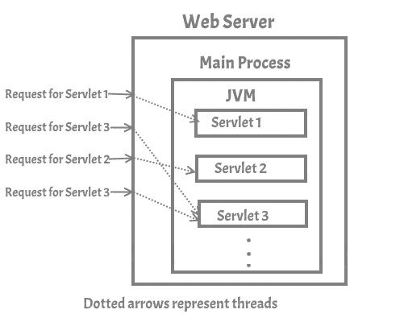

## Servlet 的特性

现在我们已经了解了什么是 Servlet 以及它的用途。让我们继续讨论它的主要特征。

1. **可移植性 (Portable)**：正如我上面提到的，Servlet 使用 Java 作为编程语言，由于 Java 是平台无关的，Servlet 也是如此。例如，你可以在 Windows 操作系统上创建一个使用 GlassFish 作为 Web 服务器的 Servlet，稍然后在任何其他操作系统（如带有 Apache tomcat Web 服务器的 Unix、Linux）上运行它，这一特性使得 Servlet 具有可移植性，这也是 Servlet 相比于 CGI 的主要优势。

2. **高效且可扩展 (Efficient and scalable)**：一旦 Servlet 被部署并加载到 Web 服务器上，它就可以立即开始满足客户端的请求。Web 服务器使用轻量级线程调用 Servlet，因此通过 Java 的多线程特性，Servlet 可以同时处理多个客户端请求。与服务器必须为每个客户端请求启动新进程的 CGI 相比，Servlet 真正是高效且可扩展的。

3. **健壮性 (Robust)**：通过继承 Java 的高级特性（如垃圾回收、异常处理、Java 安全管理器等），Servlet 较少出现内存管理问题和内存泄漏。这使得使用 Servlet 开发 Web 应用更加安全且更不容易出错。

# Servlet API

你需要使用 Servlet API 来创建 Servlet。在使用 API 时，你必须记住两个包：包含支持通用 Servlet（协议无关 Servlet）的类的`javax.servlet`包，以及包含支持 HTTP Servlet 的类的`javax.servlet.http`包。你可能想知道通用 Servlet 和 HTTP Servlet 是什么，我在本文稍后解释了它们。

让我们来看看包的层级结构：

```
java.lang.Object
|_ 由 javax.servlet.GenericServlet 扩展
|_ 由 javax.servlet.http.HttpServlet 扩展
```

每个 Servlet 都必须实现`java.servlet.Servlet`接口，你可以通过扩展以下类之一来实现：`javax.servlet.GenericServlet`或`javax.servlet.http.HttpServlet`。第一个用于协议无关的 Servlet，第二个用于 HTTP Servlet。

## Servlet 是如何工作的？

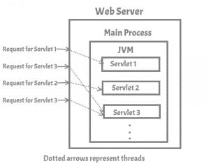

## Generic Servlet (通用 Servlet)

正如我上面提到的，如果你正在创建一个 Generic Servlet，那么你必须扩展`javax.servlet.GenericServlet`类。GenericServlet 类有一个抽象的`service()`方法。这意味着 GenericServlet 的子类应该始终重写`service()`方法。

`service()`方法的签名：

```java
public abstract void service(ServletRequest request, ServletResponse response) throws ServletException, java.io.IOException
```

`service()`方法接受两个参数：`ServletRequest`对象和`ServletResponse`对象。请求对象告诉 Servlet 客户端发出的请求，而响应对象用于向客户端返回响应。

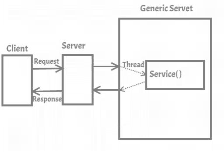

## HTTP Servlet (HTTP Servlet)

如果你正在创建 Http Servlet，你必须扩展`javax.servlet.http.HttpServlet`类，这是一个抽象类。与 Generic Servlet 不同，HTTP Servlet 没有重写`service()`方法。相反，它重写了以下方法之一或多个。它必须重写列表中至少一个方法：

- `doGet()` – 该方法由 servlet service 方法调用，用于处理来自客户端的 HTTP GET 请求。Get 方法用于从服务器获取信息。
- `doPost()` – 用于向服务器提交信息。
- `doPut()` – 方法类似于 doPost，但与 doPost 向服务器发送信息不同，此方法向服务器发送文件，类似于 FTP 操作。
- `doDelete()` – 允许客户端从服务器删除文档、网页或信息。
- `init()` 和 `destroy()` – 用于管理 Servlet 生命周期内保留资源。
- `getServletInfo()` – 返回有关 Servlet 的信息，如作者、版本和版权。

在 Http Servlet 中不需要重写`service()`方法，因为该方法会将 HTTP 请求分发到正确的方法处理器，例如，如果它接收到 HTTP GET 请求，会将请求分发到`doGet()`方法。

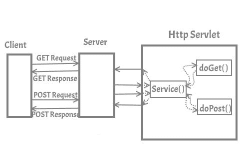

### javax.servlet 中的接口

- `Servlet`
- `ServletRequest`
- `ServletResponse`
- `ServletConfig`
- `ServletContext`
- `SingleThreadModel`
- `RequestDispatcher`
- `ServletRequestListener`
- `ServletRequestAttributeListener`
- `ServletContextListener`
- `ServletContextAttributeListener`
- `Filter`
- `FilterConfig`
- `FilterChain`

### javax.servlet 中的类

- `GenericServlet`
- `ServletInputStream`
- `ServletOutputStream`
- `ServletException`
- `ServletRequestWrapper`
- `ServletRequestEvent`
- `ServletResponseWrapper`
- `ServletContextEvent`
- `ServletRequestAttributeEvent`
- `ServletContextAttributeEvent`

### javax.servlet.http 中的接口

- `HttpSession`
- `HttpServletRequest`
- `HttpServletResponse`
- `HttpSessionAttributeListener`
- `HttpSessionListener`
- `HttpSessionBindingListener`
- `HttpSessionActivationListener`
- `HttpSessionContext`

### javax.servlet.http 中的类

- `HttpServlet`
- `Cookie`
- `HttpSessionEvent`
- `HttpSessionBindingEvent`
- `HttpServletRequestWrapper`
- `HttpServletResponseWrapper`
- `HttpUtils`

# 结合示例详解 Servlet 接口

在我上关于 Servlet API 的指南中，我已经解释了要创建任何 Servlet，你必须直接或间接地实现`Servlet`接口（间接实现意味着扩展实现了`Servlet`接口的类，这些类是`GenericServlet`和`HttpServlet`）。

如果你正在创建一个依赖于协议的 servlet（例如 `http servlet`），那么你应该扩展`HttpServlet`类；否则，对于协议无关的`Servlet`，你扩展`GenericServlet`类。

在本份指南中，我将不会详细解释`GenericServlet`和`HttpServlet`，因为我已经在单独的指南中涵盖了它们。

编辑：这里是那些指南的链接：GenericServlet | HttpServlet。

简而言之，你有 3 种创建 servlet 的方式：

1. 扩展`HttpServlet`类
2. 扩展`GenericServlet`类
3. 实现`Servlet`接口

注意：无论如何，你应该始终优先第一种创建 servlet 的方式，即通过扩展`HttpServlet`类。

## Servlet 接口方法

这里是`Servlet`接口可用方法列表。

1. `Void destroy()`：此方法由 Servlet 容器在 servlet 生命周期结束时调用。与在生命周期内被调用多次的`service()`方法不同，此方法在整个生命周期内由 Servlet 容器调用一次。一旦`destroy()`方法被调用，Servlet 容器就不会为该 servlet 调用`service()`方法。

2. `Void init(ServletConfig config)`：当 Servlet 容器启动时（发生在 Web 服务器启动时），它会加载所有 servlet 并实例化它们。在对每个实例化的 servlet 调用`init()`方法后，该方法将初始化该 servlet。

3. `Void service(ServletRequest req, ServletResponse res)`：这是 servlet 生命周期期间唯一被调用多次的方法。此方法处理客户端请求，每当服务器接收到请求就会调用一次。

4. `ServletConfig getServletConfig()`：返回一个`ServletConfig`对象，该对象包含此 servlet 的初始化和启动参数。

5. `Java.lang.String getServletInfo()`：返回关于 servlet 信息，如作者、版本和版权。

## 示例

在这个示例中，我们通过扩展`Servlet`接口创建了一个 servlet 类。

### index.html

```html
<a href="welcome">点击这里调用 servlet</a>
```

### DemoServlet.java

```java
import java.io.*;
import javax.servlet.*;

public class DemoServlet implements Servlet {

    ServletConfig config=null;

    public void init(ServletConfig config) {
        this.config=config;
        System.out.println("Initialization complete");
    }

    public void service(ServletRequest req,ServletResponse res)
            throws IOException,ServletExceptionException {
        res.setContentType("text/html");
        PrintWriter pwriter=res.getWriter();
        pwriter.print("<html>");
        pwriter.print("<body>");
        pwriter.print("<h1>Servlet Example Program</h1>");
        pwriter.print("</body>");
        pwriter.print("</html>");
    }

    public void destroy() {
        System.out.println("servlet life cycle finished");
    }

    public ServletConfig getServletConfig() {
        return config;
    }

    public String getServletInfo() {
        return "A Demo program written by Chandru";
    }
}
```

### web.xml

```xml
<web-app>
<servlet>
    <servlet-name>Javabook</servlet-name>
    <servlet-class>DemoServlet</servlet-class>
</servlet>
<servlet-mapping>
    <servlet-name>Javabook</servlet-name>
    <url-pattern>/welcome</url-pattern>
</servlet-mapping>
</web-app>
```


## GenericServlet 类

### 示例的 GenericServlet 类

在讨论 Servlet API 时，我简要提到了 Generic Servlet。在本文，我将详细讨论 Generic Servlet。

Generic servlet 是一种协议无关的 Servlet，它应该始终重写`service()`方法来处理客户端请求。`service()`方法接受两个参数：`ServletRequest`对象和`ServletResponse`对象。请求对象告诉 servlet 客户端提出的请求，而响应对象则用于向客户端返回响应。

### Generic Servlet 如何工作？

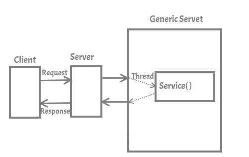

### Generic Servlet 的层级结构

`java.lang.Object`
|_ 扩展 `javax.servlet.GenericServlet`

`GenericServlet`是一个抽象类，它只有一个抽象方法，即`service()`。这就是为什么当我们通过扩展`GenericServlet`类创建 Generic Servlet 时，我们必须重写`service()`方法。

**使用 Generic Servlet 的优点：**

1. Generic Servlet 更更容易编写
2. 具有简单的生命周期方法
3. 编写 Generic Servlet 只需要扩展`javax.servlet.GenericServlet`并重写`service()`方法（查看下例所示）。

**使用 Generic Servlet 的缺点：**

使用 Generic Servlet 并不那么简单，因为在 Generic Servlet 中我们没有像在 Http Servlet 中可以使用的那些`doGet()`、`doPost()`、`doHead()`等便利方法。

在`HttpServlet`中，我们需要为特定的请求重写特定的便利方法，例如，如果你需要获取信息，则重写`doGet()`；如果你想向服务器发送信息，则重写`doPost()`。然而，在 Generic Servlet 中，我们只为每个请求重写`service()`方法。我始终建议使用`HttpServlet`而不是`GenericServlet`。

### GenericServlet 示例

我在示例中使用 Eclipse。从 Eclipse 菜单创建“Dynamic Web Project”。

注意：返回 Servlet Interface
注意：如果你不熟悉 Eclipse，参考此指南：如何安装 Eclipse

完成创建文件后，项目结构如下：


### index.html

我们创建一个点击网页链接时调用 servlet 的 html 文件。在`WebContent`文件夹中创建此文件。文件的路径应该是：`WebContent/index.html`

```html
<!DOCTYPE html>
<html>
<head>
<meta charset="UTF-8">
<title>Http Servlet Demo</title>
</head>
<body>
<a href="welcome">Servlet</a>
</body>
</html>
```

### ExampleGeneric.java

现在，我们通过扩展`GenericServlet`类创建一个 Generic Servlet。创建 GenericServlet 时，你应该始终重写`service()`方法。右键点击`src`文件夹并创建一个新类，文件名命名为`ExampleGeneric`。文件路径应该是：`Java Resources/src/default package/ExampleGeneric.java`

```java
import java.io.*;
import javax.servlet.*;

public class ExampleGeneric extends GenericServlet {

    public void service(ServletRequest req,ServletResponse res) throws IOException, ServletException {

        res.setContentType("text/html");

        PrintWriter pwriter=res.getWriter();

        pwriter.print("<html>");

        pwriter.print("<body>");

        pwriter.print("<h2>Generic Servlet Example</h2>");

        pwriter.print("<p>Hello JavaBook Readers!</p>");

        pwriter.print("</body>");

        pwriter.print("</html>");

    }

}
```

### web.xml

此文件位于路径`WebContent/WEB-INF/web.xml`。在此文件中，我们将 Servlet 映射到特定的 URL。由于点击`index.html`页面上的链接会调用欢迎页面，因此我们将欢迎页面映射到我们创建的 Servlet 类。

```xml
<web-app>
<display-name>JavaBookServlet</display-name>
<welcome-file-list>
<welcome-file>index.html</welcome-file>
<welcome-file>index.htm</welcome-file>
<welcome-file>index.jsp</welcome-file>
<welcome-file>default.html</welcome-file>
</welcome-file-list>
</web-app>
```

```xml
<web-app>

  <welcome-file-list>

    <welcome-file>default.htm</welcome-file>

    <welcome-file>default.jsp</welcome-file>

  </welcome-file-list>

  <servlet>

    <servlet-name>MyHttpServlet</servlet-name>

    <servlet-class>ExampleHttpServlet</servlet-class>

  </servlet>

  <servlet-mapping>

    <servlet-name>MyHttpServlet</servlet-name>

    <url-pattern>/welcome</url-pattern>

  </servlet-mapping>

</web-app>
```

运行项目：

右键点击`index.html`，在服务器上运行（run on server）。

输出：


# 点击第一个屏幕中的链接后的界面：

# Generic Servlet 示例

# Hello Javabook 的读者们

## GenericServlet 类的方法：

这里是`GenericServlet`类所有方法的列表。

1. `public void init()`: 这是一个方便的方法。可以重写此方法，这样就不需要调用`super.init(config)`。
2. `public void init(ServletConfig config)`: 由 Servlet 容器调用，表示 servlet 正在进入服务状态，此方法用于初始化 servlet。
3. `public String getInitParameter(String name)`: 返回一个包含给定初始化参数值的字符串，如果该参数不存在则返回 null。
4. `public Enumeration getInitParameterNames()`: 返回`web.xml`文件中定义的所有参数名称，如果`web.xml`中没有任何参数，则返回 null。
5. `public abstract void service(ServletRequest request, ServletResponse response)`: 由 Servlet 容器调用，允许 servlet 响应客户端提出的请求。
6. `public void destroy()`: 在 servlet 生命周期结束时由 servlet 容器调用一次，表示 servlet 正在被销毁。
7. `public ServletConfig getServletConfig()`: 返回初始化此 servlet 的`ServletConfig`对象。
8. `public String getServletInfo()`: 返回关于 servlet 的信息。
9. `public ServletContext getServletContext()`: 返回由`init`方法传递给此 servlet 的`ServletContext`对象。
10. `public String getServletName()`: 返回 servlet 实例的名称。
11. `public void log(String msg)`: 在 servlet 日志文件中写入给的消息。
12. `public void log(String msg, Throwable t)`: 在 servlet 日志文件中写入解释性消息，包括描述错误或异常的字符串。

## 带有示例的 HttpServlet 类

与`Generic Servlet`不同，`HTTP Servlet`没有重写`service()`方法。相反，它重写了`doGet()`方法或`doPost()`方法或两者。`doGet()`方法用于从服务器获取信息，而`doPost()`方法用于向服务器发送信息。

在`Http Servlet`中，没有需要重写`service()`方法，因为该方法会将`Http Requests`分发到正确的方法处理器，例如，如果它接收到 HTTP GET 请求，它会将请求分发给`doGet()`方法。

## Http Servlet 如何工作？

如如下图所示，客户端（用户浏览器）发出请求。这些请求可以是任何类型，例如——Get 请求、Post 请求、Head 请求等。服务器将这些请求分发到 servlet 的`service()`方法，该方法将这些请求分发给正确的处理器，例如，如果它接收到 Get 请求，它将分发给`doGet()`方法。

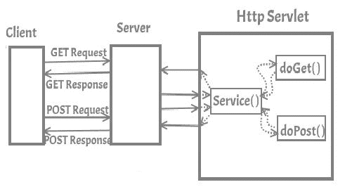

## Http Servlet 的层次结构

`java.lang.Object`
|_ 由`javax.servlet.GenericServlet`扩展
|_ 由`javax.servlet.http.HttpServlet`扩展

我在 Generic Servlet 文章中讨论过，你应该始终使用`HttpServlet`而不是`GenericServlet`。`HttpServlet`更容易操作，并且比`GenericServlet`有更多方法可以处理。

## Http Servlet 示例

我在此示例中使用 Eclipse IDE。从 Eclipse 文件菜单中创建一个新的“Dynamic Web Project”（动态 Web 项目）。

注意：我已解释了在 Eclipse IDE 中创建 Servlet 的所有步骤，但如果你不熟悉 Eclipse 且系统中没有安装它，请参考此指南：如何安装 Eclipse、配置 Tomcat 并使用 Eclipse 运行你的第一个 Servlet 应用程序。

一旦你在 IDE 中创建了以下所有文件，项目结构（或说层次结构）将看起来如下所示：

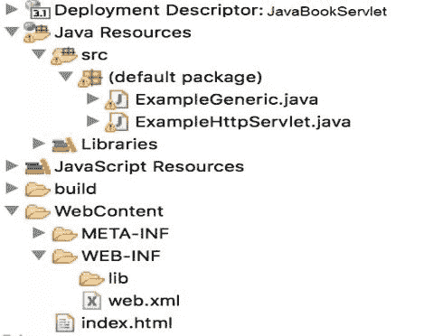

### index.html

我们正在创建一个 html 文件，当我们点击网页上的链接时，它将调用 servlet。在`WebContent`文件夹中创建此文件。文件路径应该如下所示：`WebContent/index.html`

```html
<!DOCTYPE html>
<html>
<head>
  <meta charset="UTF-8">
  <title>Http Servlet Demo</title>
</head>
<body>
  <a href="welcome">Click to call Servlet</a>
</body>
</html>
```

### ExampleHttpServlet.java

现在，我们正通过扩展`HttpServlet`类来创建一个`Http Servlet`。右键点击`src`文件夹并创建一个新类文件，文件名为`ExampleHttpServlet`。文件路径应该如下所示：`Java Resources/src/default package/ExampleHttpServlet.java`。

```java
import java.io.*;
import javax.servlet.*;
import javax.servlet.http.*;

// 通过扩展 HttpServlet 类创建 Http Servlet
public class ExampleHttpServlet extends HttpServlet {

    private String mymsg;

    public void init() throws ServletException {

        mymsg = "Http Servlet";

    }

    public void doGet(HttpServletRequest request, HttpServletResponse response) throws ServletException, IOException {

        // 设置网页的内容类型
        response.setContentType("text/html");

        // 在网页上写入消息
        PrintWriter out = response.getWriter();

        out.println("<h1>" + mymsg + "</h1>");

        out.println("<p>" + "Hello Friends!" + "</p>");

    }

    public void destroy() {

        // 如果你想在 servlet 生命周期结束时执行某些操作，请留空此处。
    }

}
```

### web.xml

该文件位于`WebContent/WEB-INF/web.xml`。在此文件中我们将 servlet 映射到特定的 URL。我们在点击 index.html 上的链接时调用它。

```xml
<web-app>

  <display-name>JavaBookServlet</display-name>

  <welcome-file-list>

    <welcome-file>index.html</welcome-file>

    <welcome-file>index.htm</welcome-file>

    <welcome-file>index.jsp</welcome-file>

    <welcome-file>default.html</welcome-file>

    <welcome-file>default.htm</welcome-file>

    <welcome-file>default.jsp</welcome-file>

  </welcome-file-list>

  <servlet>

    <servlet-name>MyHttpServlet</servlet-name>

    <servlet-class>ExampleHttpServlet</servlet-class>

  </servlet>

  <servlet-mapping>

    <servlet-name>MyHttpServlet</servlet-name>

    <url-pattern>/welcome</url-pattern>

  </servlet-mapping>

</web-app>
```


## `HttpServlet` 类的方法

1. `protected void doGet(HttpServletRequest req, HttpServletResponse resp)`：此方法由 servlet `service` 方法调用，处理来自客户端的 HTTP 请求。重写此方法时，读取请求数据，写入响应头，获取响应的 writer 或输出流对象，最后写入响应数据。
2. `protected long getLastModified(HttpServletRequest req)`：返回一个长型整数，指定 `HttpServletRequest` 对象最后修改的时间，自 GMT 1970 年 1 月 1 日午夜以来的毫秒数，如果时间未知则返回 `-1`。
3. `protected void doHead(HttpServletRequest req, HttpServletResponse resp)`：此方法由 servlet `service` 方法调用，处理来自客户端的 HTTP HEAD 请求。当客户端只想查看响应的头信息（例如 Content-Type 或 Content-Length）时，它会发送 HEAD 请求。
4. `protected void doPost(HttpServletRequest req, HttpServletResponse resp)`：此方法由 servlet 服务方法调用，用于处理来自客户端的 POST 请求。HTTP POST 方法允许客户端一次向 Web 服务器发送无长度限制的数据，在向服务器提交信息时非常有用。与我们从服务器获取信息的 `doGet` 不同，此方法用于将信息从客户端传输到服务器。
5. `protected void doPut(HttpServletRequest req, HttpServletResponse resp)`：此方法由 servlet 服务方法调用，用于处理来自客户端的 PUT 请求。此方法与 `doPost` 方法类似，但与向服务器发送信息的 `doPost` 方法不同的是，此方法是将文件发送到服务器，这类似于从客户端到服务器的 FTP 操作。
6. `protected void doDelete(HttpServletRequest req, HttpServletResponse resp)`：由 `service()` 方法调用，处理来自客户端的 DELETE 请求，允许客户端从服务器删除文档、网页或信息。
7. `protected void doOptions(HttpServletRequest req, HttpServletResponse resp)`：由服务方法调用，允许 servlet 处理 OPTIONS 请求。OPTIONS 请求确定服务器支持哪些 HTTP 方法并返回相应的头信息。
8. `protected void doTrace(HttpServletRequest req, HttpServletResponse resp)`：此方法由 `service()` 方法调用以处理 TRACE 请求。用于调试。
9. `protected void service(HttpServletRequest req, HttpServletResponse resp)`：无需重写此方法，此方法接收来自客户端的 HTTP 请求并将其转发到相应的 `doXXX` 方法，如 `doGet()`、`doPost()`、`doHead()` 等。
10. `public void service(ServletRequest req, ServletResponse res)`：将客户端请求转发到保护的 service 方法。此方法也无需重写。

## 注意

从此处返回

## Servlet 接口

## 如何在 Eclipse IDE 中创建和运行 Servlet

这是一份关于安装 Eclipse、配置 Apache Tomcat 服务器以及运行你的第一个 Hello World Servlet 应用程序的完整指南。

## 注意

从此处返回：

- `Generic Servlet`
- `HttpServlet` 类

## 下载 Eclipse IDE

### 在 Windows 上安装 Eclipse

访问此链接：`https://www.eclipse.org/downloads`。在“Get Eclipse Oxygen”下，点击“Download Packages”，下载“Eclipse IDE for Java Developers”。你会在右侧看到两个选项（32 位和 64 位），如果你的系统是 32 位的，点击 32 位，否则点击 64 位。这将在系统上下载一个压缩文件。

要安装 Eclipse，解压下载的文件并将解压后的文件夹复制到目标位置。

### 在 Mac OS X 上安装 Eclipse

访问此链接：`https://www.eclipse.org/downloads`。在“Get Eclipse Oxygen”下，点击“Download Packages”，下载“Eclipse IDE for Java Developers”。点击 64 位即可下载一个 TAR 文件。

下载完成后，双击 TAR 文件，它会将文件内容提取到文件夹。将该文件夹拖到“Applications”文件夹。

要启动 Eclipse，点击 Eclipse 文件夹中的 Eclipse 图标。Mac 用户可以将其拖到 Dock 栏区域，以便从桌面上快速启动 Eclipse；类似地，Windows 可以在桌面上创建 Eclipse 的快捷方式。

## 在 Eclipse 中安装和配置 Apache Tomcat 服务器

为了在 Eclipse IDE 中运行 Servlet，你需要在 Eclipse IDE 中配置 Apache Tomcat 服务器。

如果你还没有，请参考此教程：如何在 Eclipse IDE 中下载和配置 Apache Tomcat 服务器。

注意：我上面提供的链接属于 JSP 教程，但对于 Servlet 步骤是相同的。

## 在 Eclipse IDE 中创建 Servlet

### 第 1 步：创建项目

让我们在 Eclipse 中创建一个 Servlet 应用程序。打开 Eclipse，点击 File（文件）→ New（新建）→ Dynamic Web Project（动态 Web 项目）。


如果你在 Eclipse 中没有看到 Dynamic Web Project 选项，请参考此教程：如何解决 Eclipse 中缺少“Dynamic Web project”的问题](#part0000.xhtml_dynammic)。

输入项目名称并点击 Next（下一步）。


勾选“Generate web.xml deployment descriptor”复选框。

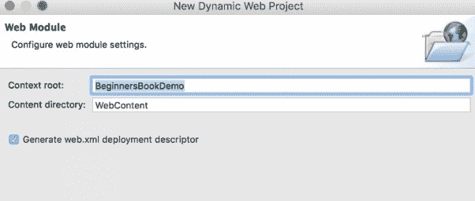

#### 初始项目结构

项目创建后，层次结构（项目结构）将如下：

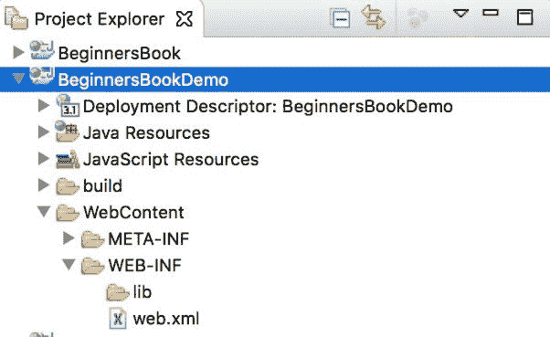

### 第 2 步：创建 Servlet 类

我们通过扩展 `HttpServlet` 类来创建 Http Servlet。右键点击 `src` 文件夹并创建一个新的类文件，文件名命名为 `MyServletDemo`。文件路径应如下：`Java Resources/src/default package/MyServletDemo.java`。

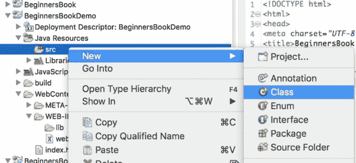

#### `MyServletDemo.java`

```java
import java.io.*;

import javax.servlet.*;

import javax.servlet.http.*;

// 扩展 HttpServlet 类创建 Http Servlet
public class MyServletDemo extends HttpServlet {

    private String mymsg;

    public void init() throws ServletException {
        mymsg = "Hello World!";
    }

    public void doGet(HttpServletRequest request, HttpServletResponse response)
        throws ServletException, IOException {

        // 设置网页的类型类型
        response.setContentType("text/html");

        // 将消息写入网页
        PrintWriter out = response.getWriter();

        out.println("<h1>" + mymsg + "</h1>");
    }

    public void destroy() {
        /*
         * 留空，当 Servlet 生命周期
         * 结束时需要执行某些操作
         */
    }
}
```

### 第 3 步：创建一个 HTML 页面来调用 servlet 类

我们创建一个在网页上调用 servlet 的 HTML 文件。将此文件创建在 `WebContent` 文件夹中。文件的路径应该是：`WebContent/index.html`。

#### `index.html`

```html
<!DOCTYPE html>
<html>

<head>
    <meta charset="UTF-8">
    <title>JavaBook Demo</title>
</head>

<body>
    <a href="welcome">调用 Servlet</a>
</body>

</html>
```

#### 编辑 `web.xml` 文件

此文件位于 `WebContent/WEB-INF/web.xml`。在此文件中我们将 Servlet 映射到特定 URL。由于我们在 `index.html` 页面点击链接进入欢迎页面，因此我们将欢迎页面映射到创建的 Servlet 类。

```xml
<web-app>

    <display-name>JavaBookDemo</display-name>

    <welcome-file-list>
        <welcome-file>index.html</welcome-file>
        <welcome-file>index.htm</welcome-file>
        <welcome-file>index.jsp</welcome-file>
        <welcome-file>default.html</welcome-file>
        <welcome-file>default.htm</welcome-file>
        <welcome-file>default.jsp</welcome-file>
    </welcome-file-list>

    <servlet>
        <servlet-name>MyHttpServletDemo</servlet-name>
        <servlet-class>MyServletDemo</servlet-class>
    </servlet>

    <servlet-mapping>
        <servlet-name>MyHttpServletDemo</servlet-name>
        <url-pattern>/welcome</url-pattern>
    </servlet-mapping>

</web-app>
```


## 最终项目结构

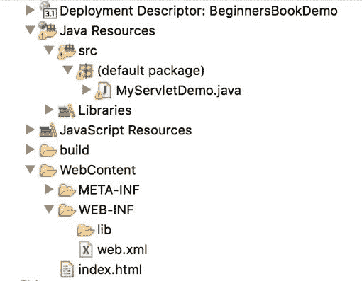

## 运行项目

右键点击 `index.html`，在服务器上运行。

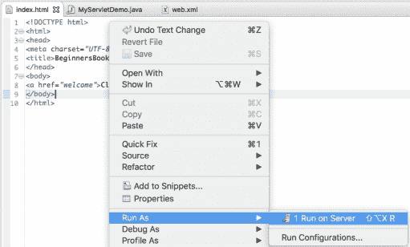

点击 Add All 将项目部署到服务器。点击 Finish（完成）。

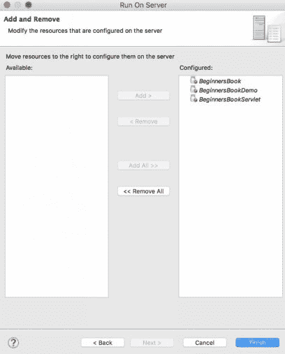

### 输出


点击链接后你将得到此屏幕：


访问此链接：`http://tomcat.apache.org/download-80.cgi`。如果你使用的是 Mac，点击 zip 文件（core 下的第一个选项）。如果你使用的是 Windows，你有两个选项：`32 bit` 和 `64 bit`，根据你的操作系统的类型点击 zip 文件，例如，如果你使用的是 `64 bit` 版本的 Windows，请点击 `64-bit Windows` zip。

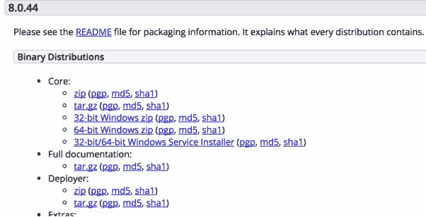

在本教程中，我正在下载 `8.0.44` 版本的 Apache tomcat。

## 步骤 2：解压下载的 zip 文件夹

将压缩文件夹解压到任何所需的位置。

## 步骤 3：在 Eclipse IDE 中选择服务器

打开 Eclipse IDE ❯ 点击底部的 `Servers` 选项卡 ❯ 右键点击 ❯ `New` ❯ 点击 `Server`。

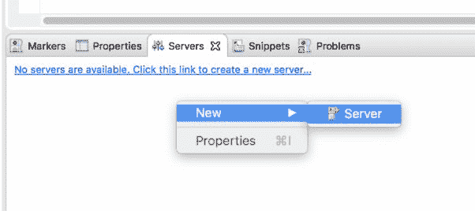

选择 Apache，然后选择相应版本的 tomcat 服务器，例如，我下载了 `8.0.44` 版本的 tomcat，所以我正在选择 `Tomcat v8.0 Server`。选择后，点击下一步。

**注意：** 如果你在添加服务器列表中没有看到 apache 选项，说明你的 Eclipse 缺少了一些适配器，请参考此教程修复此问题：如何修复“Eclipse 中没有 apache tomcat 适配器”问题。

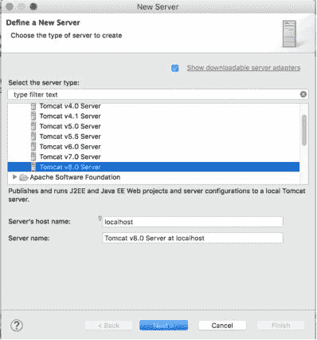

你将看到一个如下图所示的窗口。点击 browse（浏览）并选择你在步骤 2 中从 zip 文件中解出的文件夹。


点击 finish（完成）。


好了，你已经成功在 Eclipse 中配置了 tomcat 服务器，你现在可以在 Eclipse 中运行 JSP 了。

## 如何解决 Eclipse 中缺少动态 Web 项目（Dynamic Web Project）的问题

当你想要在 Eclipse 中创建第一个 JSP 项目，但在项目列表中找不到“dynamic web project”选项时，这会让人感到沮丧。好的，在本教程中，我们将逐步查看该问题的解决方案。

### 步骤 1：点击 `Help`，然后点击“Install New Software”（安装新软件）

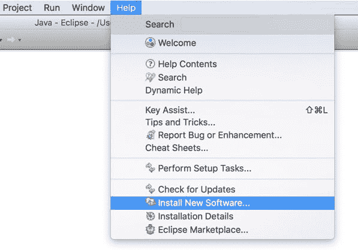

### 步骤 2：在 `Work with` 中粘贴此链接：`http://download.eclipse.org/releases/mars`

请注意，我提供的链接仅适用于 Eclipse mars 版本，因此请根据你的 Eclipse 版本更改链接，例如，对于 Eclipse Kepler，链接应为 `http://download.eclipse.org/releases/kepler`。

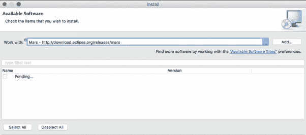

### 步骤 3：向下滚动找到“Web, XML, Java EE and OSGI Enterprise Development”选项并展开它

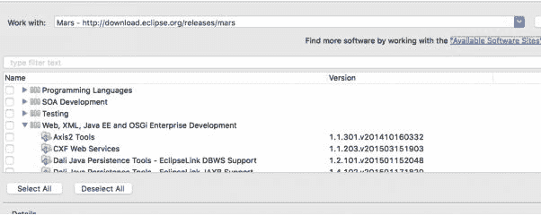

### 步骤 4：在“Web, XML, Java EE and OSGI Enterprise Development”下选择以下三个选项

- `Eclipse Java EE Developer Tools`
- `Eclipse Java Web Developer Tools`
- `Eclipse Web Developer Tools`

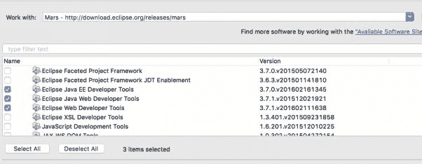

### 步骤 5：点击下一步，你将看到软件正在安装

等待片刻，会弹出一个窗口请求你重启 Eclipse。重启后，你会在项目列表中找到 dynamic web project 选项。

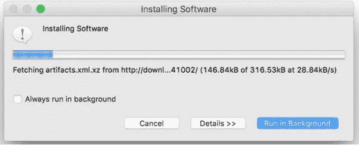

**注意：**

返回此处：

在 Eclipse IDE 中创建并运行 Servlet。

## 解决方案 – Eclipse IDE 中没有 Apache Tomcat 适配器选项

有时当你第一次尝试在 Eclipse 中添加 tomcat 服务器时，找不到 Apache 选项。发生这种情况是因为你缺少了一些适配器。在本教程中，我将告诉你如何修复这个问题。

### 步骤 1：转到 `Help` ❯ `Install New Software`


### 步骤 2：在 `Work with` 字段中粘贴 `http://download.eclipse.org/releases/mars`

仅在你使用 Eclipse mars 版本时才使用上述链接，否则请根据你的 Eclipse 版本提供链接。例如，Eclipse Kepler 用户会在 Work with 字段中输入此链接：`http://download.eclipse.org/releases/kepler`。

向下滚动直到看到“Web, XML, Java EE and OSGI Enterprise Development”，然后展开它并添加：

- `JST Server`

## 第 4：调用 `service()` 方法

每当 Web 服务器接收到对 `servlet` 的请求时，都会创建一个新线程来调用 `service()` 方法。如果 servlet 是 `GenericServlet`，则请求由 `service()` 方法本身处理；如果 servlet 是 `HttpServlet`，则 `service()` 方法将接收请求并根据请求类型将其分发到正确的处理器方法。

例如，如果是一个 Get 请求，`service()` 方法将通过调用带有请求参数的 `doGet()` 方法将请求分发到 `doGet()` 方法。同样，`Post`、`Head`、`Put` 等请求也会由 servlet 的 `service()` 方法分发到相应的处理器 `doPost()`、`doHead()`、`doPut()` 等。

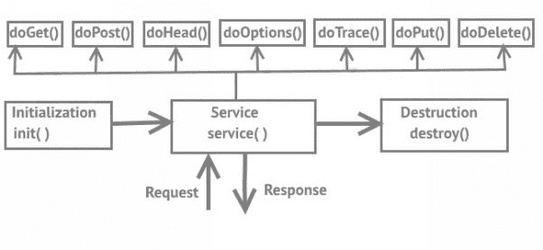

注意：与仅调用一次的 `init()` 和 `destroy()` 不同，`service()` 方法在 servlet 的生命周期内可以被多次调用。只要 servlet 不被销毁，每个客户端请求都会调用 `service()` 方法。

在生命周期中的所有 5 个步骤中，这是唯一一个执行多次的步骤。

## 第 5：调用 `destroy()` 方法

当 servlet 容器关闭（这通常发生在我们停止 Web 服务器时），它会卸载所有 servlet 并对每个初始化的 servlet 调用 `destroy()` 方法。

**注意：**

从此处返回：

Servlet 接口。

# Servlet 的工作

在我开始解释 servlet 如何工作之前，让我们先熟悉这三个术语。

- **Web 服务器（Web Server）**：它可以处理由客户端发送的 HTTP 请求，并用 HTTP 响应响应请求。
- **Web 应用（webapp）**：在本指南中我将其称为 `webapp`。基本上，项目就是你的 Web 应用，它是 servlet 的集合。
- **Web 容器（Web Container）**：也称为 Servlet 容器和 Servlet 引擎。它是 Web 服务器的一部分，与 Servlet 交互。它是管理 servlet 生命周期的 Web 服务器主要组件。

# Servlet 的工作原理

你会发现本指南的某些内容已经在 servlet 生命周期指南中涵盖了，但本指南侧重于 servlet 应用（webapp）的工作原理，而不是生命周期的步骤。我强烈建议你阅读这里，以深入了解 servlet 实际上是如何工作的。

## Servlet 如何工作？

1. 当 Web 服务器（例如 Apache Tomcat）启动时，servlet 容器会部署并加载所有 servlet。在此步骤中，servlet 容器会创建 `ServletContext` 对象。`ServletContext` 是一个接口，定义了 servlet 用于与 servlet 容器通信的一组方法。

   注意：每个 webapp 只有一个 `ServletContext`，所有 servlet 共享它。`ServletContext` 有几个实用的方法，如 `addListener()`、`addFilter()` 等。目前我不会解释它们，因为我将在关于 `ServletContext` 的单独正文中介绍它们。

2. 一旦 servlet 加载，servlet 容器就会创建 servlet 类的实例。对于每个实例化的 servlet，都会调用其 `init()` 方法。

3. 客户端（用户浏览器）向特定端口的 Web 服务器发送 HTTP 请求。每当 Web 服务器接收到请求时，servlet 容器就会创建 `HttpServletRequest` 和 `HttpServletResponse` 对象。`HttpServletRequest` 对象提供了访问请求信息，`HttpServletResponse` 对象允许我们在向客户端发送之前格式化并更改 http 响应。

   servlet 容器为每个客户端请求创建一个新线程并调用 `service()` 方法。`service()` 方法根据请求类型将请求分发到正确的处理器方法。

   例如，如果服务器接收到 Get 请求，`service()` 方法将通过调用带有请求参数的 `doGet()` 方法将请求分发到 `doGet()` 方法。同样，`Post`、`Head`、`Put` 等请求也会由 servlet 的 `service()` 方法分发到相应的处理器 `doPost()`、`doHead()`、`doPut()` 等。

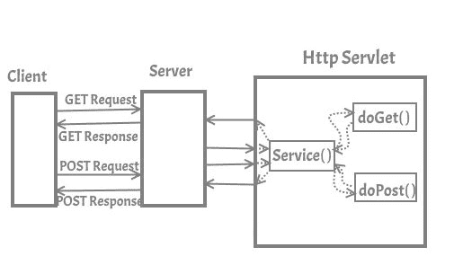

4. 当 servlet 容器关闭时，它会卸载所有 servlet 并对每个初始化的 servlet 调用 `destroy()` 方法。

## 项目 `web.xml` 文件中的 `welcome-file-list` 标签

你是否曾在 `web.xml` 文件中见过 `<welcome-file-list>` 标签并好奇它是什么？在本文中我将解释这个标签是什么以及我们为什么要使用它。

`<welcome-file-list>` 标签用于指定当你在浏览器上加载项目时未指定文件名，服务器默认需要调用的文件。

例如，你创建了一个名为“MyServletProject”的项目，并在项目里定义了几个 html 页面和 servlet 类。但在浏览器中，你提供的 URL 如下：

`http://localhost:8080/MyServletProject`

通常我们会提供这样的完整路径：`http://localhost:8080/MyServletProject/index.html`。但如果你提供了上面的路径，Web 服务器将会在你的项目 `web.xml` 文件中查找 `<welcome-file-list>` 标签。假设你的 `web.xml` 文件有以下内容：

```xml
<web-app>
  ....

  <welcome-file-list>
    <welcome-file>myhome.htm</welcome-file>
    <welcome-file>myindex.htm</welcome-file>
    <welcome-file>mydefaultpage.htm</welcome-file>
  </welcome-file-list>

  ....
</web-app>
```

根据 `web.xml` 文件中的内容，服务器会查找 `myhome.htm`，如果不存在则查找 `myindex.htm`，最后是查找 `mydefaultpage.htm`。

注意：如果 `web.xml` 文件中没有定义 `<welcome-file-list>` 标签，服务器将按照以下顺序查找：

1. `index.html`
2. `index.htm`
3. `index.jsp`

## `web.xml` 文件中的 `load-on-startup` 标签

默认情况下，Servlet 在接收到请求之前不会加载。这可能会导致访问 servlet 延迟。为了避免访问延迟，你可以在 `web.xml` 文件中使用 `<load-on-startup>` 标签，强制 servlet 容器在服务器启动时立即加载 servlet（实例化并调用 `init()`）。

### 如何使用 `<load-on-startup>`？

这是一个示例 `web.xml`：

```xml
<web-app>
  <servlet>
    <servlet-name>MyServlet</servlet-name>
    <servlet-class>com.Javabook.DemoServlet</servlet-class>
    <load-on-startup>1</load-on-startup>
  </servlet>
</web-app>
```

如果我没有指定 `<load-on-startup>`，Web 容器在请求之前不会加载 servlet。由于我指定了值 `>=0`，它将在启动时加载。

注意：值 `>=0` 意味着 servlet 在 webapp 部署或服务器启动时加载；如果值为 `<0`，则 servlet 在容器想要的时候加载。

### 如何使用 `<load-on-startup>` 标签指定 servlet 的加载顺序？

```xml
<web-app>
  …

  <servlet>
    <servlet-name>MyServlet1</servlet-name>
    <servlet-class>com.Javabook.DemoServlet1</servlet-class>
    <load-on-startup>5</load-on-startup>
  </servlet>

  <servlet>
    <servlet-name>MyServlet2</servlet-name>
    <servlet-class>com.Javabook.DemoServlet2</servlet-class>
    <load-on-startup>0</load-on-startup>
  </servlet>

  <servlet>
    <servlet-name>MyServlet3</servlet-name>
    <servlet-class>com.Javabook.DemoServlet3</servlet-class>
    <load-on-startup>-2</load-on-startup>
  </servlet>

  …
</web-app>
```


在这个示例中，我们在`web.xml`中指定了三个 servlet，由于 servlet 类`DemoServlet1`和`DemoServlet2`的`load-on-startup`值为`>=0`，它们都会在服务器启动时被加载。然而，由于`DemoServlet2`的值较小，它将在`DemoServlet1`类之前被加载。

servlet 类`DemoServlet3`因为具有负的`load-on-startup`值，不会在启动时加载。

当客户端向 Web 服务器发送请求时，Servlet 容器会创建`ServletRequest`和`ServletResponse`对象，并将它们作为参数传递给 servlet 的`service()`方法。请求对象提供了对请求信息的访问，例如请求数据的头部（header）和主体（body）。

首先我们将看一个示例，然后查看`ServletRequest`接口中可用的方法列表：

### 示例 1：使用`ServletRequest`的`getParameter()`方法显示用户输入

在这个示例中，我将演示`getParameter()`方法，它可以返回给定参数的值。

在这个 HTML 表单中，我们正在获取用户输入（姓名和年龄），并分别将它们存储在参数`uname`和`uage`中。

`index.html`

```html
<form action="details" method="get">

User Name: <input type="text" name="uname"><br>

User Age: <input type="text" name="uage"><br>

 <input type="submit" value="submit">

</form>
```

`MyServletDemo.java`

在这个 servlet 类中，我们通过使用`getParameter()`方法获取参数值，该方法属于`ServletRequest`接口。在此示例中，我们将`HttpServletRequest`作为`doGet()`方法的参数，`HttpServletRequest`继承了`ServletRequest`接口，因此`req`对象可以使用`getParameter()`方法。

获取这些值后，我们将把它们写到网页上。

```java
import javax.servlet.http.*;
import javax.servlet.*;
import java.io.*;

public class MyServletDemo extends HttpServlet {

    public void doGet(HttpServletRequest req, HttpServletResponse res)
    throws ServletException, IOException {

        res.setContentType("text/html");
        PrintWriter pwriter=res.getWriter();

        String name = req.getParameter("uname");
        String age = req.getParameter("uage");

        pwriter.println("Name: "+name);
        pwriter.println("Age: "+age);

        pwriter.close();
    }

}
```

`Web.xml`

这是你的部署描述文件，用于将 servlet 映射到 URL。由于我们的表单的 action 是 details 页面，因此我们将 servlet 类映射到 details 页面。

```xml
<web-app>
    <display-name>JavaBookDemo</display-name>
    <welcome-file-list>
        <welcome-file>index.html</welcome-file>
        <welcome-file>index.htm</welcome-file>
        <welcome-file>index.jsp</welcome-file>
        <welcome-file>default.html</welcome-file>
        <welcome-file>default.htm</welcome-file>
        <welcome-file>default.jsp</welcome-file>
    </welcome-file-list>
    <servlet>
        <servlet-name>JavaBook</servlet-name>
        <servlet-class>MyServletDemo</servlet-class>
    </servlet>
    <servlet-mapping>
        <servlet-name>JavaBook</servlet-name>
        <url-pattern>/details</url-pattern>
    </servlet-mapping>
</web-app>
```

输出：

屏幕 1：

点击 submit 后出现的屏幕 2：

### 示例 2：获取参数名称和值

在这个示例中，我们将使用`getParameterNames()`和`getParameter()`方法来获取参数名称和值。

`getParameterNames()`：返回一个包含`String`对象的`Enumeration`，其中该请求中包含的参数名称。如果请求没有参数，该方法返回一个空`Enumeration`。

`getParameter()`：如上所述，它返回给定参数的值。

`index.html`

```html
<form action="details" method="get">

User Name: <input type="text" name="uname"><br>

User Age: <input type="text" name="uage"><br>

 <input type="submit" value="submit">

</form>
```

`MyServletDemo.class`

```java
import java.io.IOException;
import java.io.PrintWriter;
import java.util.Enumeration; 
import javax.servlet.ServletException;
import javax.servlet.http.HttpServlet;
import javax.servlet.http.HttpServletRequest;
import javax.servlet.http.HttpServletResponse;

public class MyServletDemo extends HttpServlet {     

    public void doGet(HttpServletRequest req, HttpServletResponse res)
    throws ServletException, IOException {     

        PrintWriter pwriter=res.getWriter(); 
        res.setContentType("text/html");

        Enumeration en=req.getParameterNames();

        while(en.hasMoreElements()) {
            Object obj=en.nextElement();
            String param=(String)obj;
            String pvalue=req.getParameter(param);
            pwriter.print("Parameter Name: "+param+ " Parameter Value: "+pvalue);
        }

        pwriter.close();  
    }

}
```

`web.xml`

```xml
<web-app>
    <servlet>
        <servlet-name>JavaBook</servlet-name>
        <servlet-class>MyServletDemo</servlet-class>
    </servlet>
    <servlet-mapping>
        <servlet-name>JavaBook</servlet-name>
        <url-pattern>/details</url-pattern>
    </servlet-mapping>
</web-app>
```

输出：


`Parameter Name: uname Parameter Value: Chand`

`Parameter Name: uage Parameter Value: 30`

### 示例 3：获取头部信息

`index.html`

```html
<h1>Request Demo</h1>
<body><a href="headinfo">Click Here</a></body>
```

`HeaderDetails.java`

```java
import java.io.IOException;
import java.io.PrintWriter;
import java.util.Enumeration;
import javax.servlet.ServletException;
import javax.servlet.http.HttpServlet;
import javax.servlet.http.HttpServletRequest;
import javax.servlet.http.HttpServletResponse;

public class HeaderDetails extends HttpServlet {

    public void doGet(HttpServletRequest req, HttpServletResponse res)
    throws ServletException, IOException {

        res.setContentType("text/html");
        PrintWriter pwriter=res.getWriter();

        pwriter.println("HTTP header:<br>");
        Enumeration en=req.getHeaderNames();

        while (en.hasMoreElements()) {
            String hName = (String)en.nextElement();
            String hValue = req.getHeader(hName);
            pwriter.println("<b>"+hName+": </b>"+hValue + "<br>");
        }

        pwriter.close();
    }

}
```

`web.xml`

```xml
<web-app>
    <welcome-file-list>
        <welcome-file>index.html</welcome-file>
        <welcome-file>index.htm</welcome-file>
        <welcome-file>index.jsp</welcome-file>
        <welcome-file>default.html</welcome-file>
        <welcome-file>default.htm</welcome-file>
        <welcome-file>default.jsp</welcome-file>
    </welcome-file-list>
    <servlet>
        <servlet-name>JavaBook</servlet-name>
        <servlet-class>HeaderDetails</servlet-class>
    </servlet>
    <servlet-mapping>
        <servlet-name>JavaBook</servlet-name>
        <url-pattern>/headinfo</url-pattern>
    </servlet-mapping>
</web-app>
```

输出：


## `ServletRequest`接口的方法

`getParameter(String name)`：返回给定参数的`String`值值，如果给定参数不存在则返回 null。

`getParameterNames()`：返回一个包含请求中参数名称的`String`对象的`Enumeration`。

`getParameterValues(String name)`：返回包含该参数所有值的`String`数组，如果参数没有任何值则返回 null。

`getCharacterEncoding()`：返回请求主体中使用的字符编码名称。如果请求未指定字符编码，则该方法返回 null。

`setCharacterEncoding(String env)`：覆盖请求主体中的字符编码。

`getContentLength()`：返回请求内容的长度（字节）。

`getContentType()`：返回请求主体的 MIME 类型，如果类型未知则返回 null。

# RequestDispatcher 方法

# Servlet 中的 RequestDispatcher 方法示例

`RequestDispatcher`接口定义了一个对象，它可以接收请求并将其分发到资源（如 servlet、JSP、HTML 文件）。该接口具有以下两个方法：

`public void forward(ServletRequest request, ServletResponse response)`：将请求从一个 servlet 转发到另一个资源（如 servlet、JSP、HTML 文件）。

`public void include(ServletRequest request, ServletResponse response)`：将资源（如 servlet、JSP、HTML 文件）的内容包含在响应中。

## forward()与include()方法的区别

为了理解这两种方法的区别，让我们来看一个例子：假设你有两个页面`X`和`Y`。在页面`X`中，你有一个`include`标签，这意味着控制权将一直留在页面`X`直到遇到`include`标签，此之后控制权将转移到页面`Y`。在页面`Y`处理结束时，控制权将返回到页面`X`，从`include`标签之后的位置开始，并一直留在`X`直到结束。

在这种情况下，发送给客户端的最终响应将由页面`X`发送。

现在，我们使用`forward`取相同的例子。我们有相同的页面`X`和`Y`。在页面`X`中，我们有`forward`标签。在这种情况下，控制权将一直留在页面`X`直到遇到`forward`，之后控制权将转移到页面`Y`。这里的主要区别是控制权不会返回`X`，而是一直留在页面`Y`直到结束。

在这种情况下，发送给客户端的最终响应将由页面`Y`发送。

## Example：

在这个例子中，我将同时使用`include`和`forward`两种方法。使用`include`方法，我将更改当前页的内容，当我准备好将控制权转移到下一个页面时，我将使用`forward`方法。

### index.html

```html
<form action="loginPage" method="post">
  User Name:<input type="text" name="uname"/><br/>
  Password:<input type="password" name="upass"/><br/>
  <input type="submit" value="SUBMIT"/>
</form>
```

### Validation.java

```java
import java.io.*;
import java.io.*;
import javax.servlet.*;
import javax.servlet.http.*;

public class Validation extends HttpServlet {

    public void doPost(HttpServletRequest request, HttpServletResponse response) throws ServletException, IOException {

        response.setContentType("text/html");


`PrintWriter pwriter = response.getWriter();`

`String name = request.getParameter("uname");`

`String pass = request.getParameter("upass");`

```
if(name.equals("Chandru") && pass.equals("Javabook")) {
    RequestDispatcher dis = request.getRequestDispatcher("welcome");
    dis.forward(request, response);
} else {
    pwriter.print("User name or password is incorrect!");
    RequestDispatcher dis = request.getRequestDispatcher("index.html");
    dis.include(request, response);
}
```

## WelcomeUser.java

```java
import java.io.*;
import javax.servlet.*;
import javax.servlet.http.*;

public class WelcomeUser extends HttpServlet {
    public void doPost(HttpServletRequest request, HttpServletResponse response) throws ServletException, IOException {
        response.setContentType("text/html");
        PrintWriter pwriter = response.getWriter();

        String name = request.getParameter("uname");
        pwriter.print("Hello " + name + "!");
        pwriter.print(" Welcome to Javabook.com");
    }
}
```

## web.xml

```xml
<web-app>
  <display-name>JavaBookDemo</display-name>
  <welcome-file-list>
    <welcome-file>index.html</welcome-file>
  </welcome-file-list>
  <servlet>
    <servlet-name>Login</servlet-name>
    <servlet-class>Validation</servlet-class>
  </servlet>
  <servlet>
    <servlet-name>Welcome</servlet-name>
    <servlet-class>WelcomeUser</servlet-class>
  </servlet>
  <servlet-mapping>
    <servlet-name>Login</servlet-name>
    <url-pattern>/loginPage</url-pattern>
  </servlet-mapping>
  <servlet-mapping>
    <servlet-name>Welcome</servlet-name>
    <url-pattern>/welcome</url-pattern>
  </servlet-mapping>
  <welcome-file-list>
    <welcome-file>index.html</welcome-file>
  </welcome-file-list>
</web-app>
```

```
<context-param>
  <param-name>email_id</param-name>
  <param-value>javabook@gmail.com</param-value>
</context-param>
```

## ServletContext 完整示例：获取初始化参数

在这个示例中，我们在`web.xml`文件中定义了两个上下文初始化参数（用户名和用户邮箱），并在 Servlet 中使用`getInitParameter()`方法获取这些值，该方法会返回指定参数的值。

### DemoServlet.java

```java
import java.io.*;
import javax.servlet.*;
import javax.servlet.http.*;

public class DemoServlet extends HttpServlet {
    public void doGet(HttpServletRequest request, HttpServletResponse response)
    throws ServletException, IOException {
        response.setContentType("text/html");
        PrintWriter pwriter = response.getWriter();

        // 创建 Servlet 对象
        ServletContext scontext = getServletContext();

        // 获取初始化参数的值并打印
        String userName = scontext.getInitParameter("uname");
        pwriter.println("User name is=" + userName);

        String userEmail = scontext.getInitParameter("email");
        pwriter.println("Email Id is=" + userEmail);

        pwriter.close();
    }
}
```

### web.xml

```xml
<web-app>
  <servlet>
    <servlet-name>JavaBook</servlet-name>
    <servlet-class>DemoServlet</servlet-class>
  </servlet>
  <context-param>
    <param-name>uname</param-name>
    <param-value>Chandruprasad</param-value>
  </context-param>
  <context-param>
    <param-name>email</param-name>
    <param-value>javabook@gmail.com</param-value>
  </context-param>
  <servlet-mapping>
    <servlet-name>JavaBook</servlet-name>
    <url-pattern>/context</url-pattern>
  </servlet-mapping>
</web-app>
```

**输出：**
`User name is:Chandruprasad Email Is is:Javabook@gmail.com`

## ServletContext 接口方法

以下是`ServletContext`接口常用方法列表。

- `public String getInitParameter(String param)`: 返回指定参数的值，如果参数不存在则返回`null`。
- `public Enumeration getInitParameterNames()`: 返回上下文参数名称的枚举器。
- `public void setAttribute(String name,Object object)`: 为指定的属性名设置属性值。
- `public Object getAttribute(String name)`: 返回指定名称的属性值，如果不存在则返回`null`。
- `public String getServerInfo()`: 返回运行 servlet 的 servlet 容器名称和版本。
- `public String getContextPath()`: 返回 Web 应用程序的路径。

## ServletResponse 接口

Servlet 容器连接到 Web 服务器，Web 服务器在特定端口接收来自客户端的 HTTP 请求。当客户端向 Web 服务器发送请求时，Servlet 容器会创建`HttpServletRequest`和`HttpServletResponse`对象，并将它们作为参数传递给 servlet 的`service()`方法。

响应对象允许您格式化并将响应发送回客户端。首先，我们将查看`ServletResponse`接口中常用方法，然后看一个示例。

## ServletResponse 接口方法

1) `String getCharacterEncoding()`: 返回发送给客户端的响应体中所使用的 MIME 字符集名称。
2) `String getContentType()`: 返回响应的内容类型。例如：`text`, `html` 等。
3) `ServletOutputStream getOutputStream()`: 返回一个适用于在响应中写入二进制数据的`ServletOutputStream`。
4) `java.io.PrintWriter getWriter()`: 返回`PrintWriter`对象。
5) `void setCharacterEncoding(java.lang.String charset)`: 设置响应的 MIME 字符集（字符编码）。
6) `void setContentLength(int len)`: 设置响应体的长度。
7) `void setContentType(java.lang.String type)`: 设置响应数据的类型。
8) `void setBufferSize(int size)`: 设置缓冲区大小。
9) `int getBufferSize()`: 返回缓冲区大小。
10) `void flushBuffer()`: 强制将缓冲区中的任何内容写入客户端。
11) `boolean isCommitted()`: 返回一个布尔值，表示响应是否提交。
12) `void reset()`: 清空缓冲区数据以及响应头信息和状态码。

## 示例：

在下面的示例中，我们使用了`ServletResponse`接口的`setContentType()`和`getWriter()`方法。

### index.html

```html
<form action="mydetails" method="get">
  User name: <input type="text" name="uname">
  <input type="submit" value="login">
</form>
```

### MyServletDemo.java

```java
import javax.servlet.http.*;
import javax.servlet.*;
import java.io.*;

public class MyServletDemo extends HttpServlet {
    public void doGet(HttpServletRequest req,HttpServletResponse res)
    throws ServletException, IOException {
        res.setContentType("text/html");
        PrintWriter pwriter = res.getWriter();

        String name = req.getParameter("uname");
        pwriter.println("User Details Page:");
        pwriter.println("Hello " + name);

        pwriter.close();
    }
}
```

### web.xml

```xml
<web-app>
  <servlet>
    <servlet-name>DemoServlet</servlet-name>
    <servlet-class>MyServletDemo</servlet-class>
  </servlet>
  <servlet-mapping>
    <servlet-name>DemoServlet</servlet-name>
    <url-pattern>/mydetails</url-pattern>
  </servlet-mapping>
</web-app>
```

**输出：**
`User Details Page:Hello Chandruprasad`

## HttpSession

`HttpSession`对象用于会话管理。它包含了整个应用程序范围内特定用户的信息。当用户首次进入网站（或应用程序）时，通过`getSession()`获取会话，系统会分配一个唯一的 ID 来标识用户。该 ID 可以存储在 Cookie 或请求中。

会话将保持有效，直到超过`web.xml`中指定的超时时间。如果未指定，默认超时时间为 30 分钟，这意味着如果用户未访问应用程序，Servlet 容器将销毁会话。随后的请求将创建一个新的会话。

这就是创建`HttpSession`对象的方法：

```java
protected void doGet(HttpServletRequest req,HttpServletResponse res)
throws ServletException, IOException {
    HttpSession session = req.getSession();
}
```

您可以使用`setAttribute()`方法将用户信息存储到会话中，并在需要时从会话中获取这些信息。这就是在会话中存储信息的方法。在这里，我们分别使用属性名`uName`、`uemailId`和`uAge`将用户名、邮箱和年龄存储到会话中。

```java
session.setAttribute("uName", "ChandruPrasad");
session.setAttribute("uemailId", "myemailid@gmail.com");
session.setAttribute("uAge", "30");
```

第一个参数是属性名，第二个是属性值。例如上面的代码中`uName`是属性名，`ChandruPrasad`是属性值。

要从会话获取值，我们使用`HttpSession`接口的`getAttribute()`方法。在这里我们通过属性名获取属性值。

```java
String userName = (String) session.getAttribute("uName");
String userEmailId = (String) session.getAttribute("uemailId");
String userAge = (String) session.getAttribute("uAge");
```

## HttpSession 方法

- `public void setAttribute(String name, Object value)`: 将对象与名称绑定并将键值对存储为`HttpSession`对象的属性。如果属性已存在，则该方法将替换旧属性。
- `public Object getAttribute(String name)`: 从会话对象返回参数中指定的 String 对象。如果未找到指定的属性，则`getAttribute()`方法将返回`null`。
- `public Enumeration getAttributeNames()`: 返回一个`Enumeration`，其中包含所有作为属性绑定到会话（session）对象的对象的名称。
- `public void removeAttribute(String name)`: 从会话中移除指定的属性。
- `setMaxInactiveInterval(int interval)`: 设置会话空闲时间（以秒为单位）。该时间指定了自收到客户端请求以来，会话保持活跃的秒数。

## 会话示例

### index.html

```html
<form action="login">
  User Name:<input type="text" name="userName"/><br/>
  Password:<input type="password" name="userPassword"/><br/>
  <input type="submit" value="submit"/>
</form>
```

### MyServlet1.java

```java
import java.io.*;
import javax.servlet.*;
import javax.servlet.http.*;

public class MyServlet1 extends HttpServlet {


```java
public void doGet(HttpServletRequest request, HttpServletResponse response) {

    try {

        response.setContentType("text/html");

        PrintWriter pwriter = response.getWriter();

        String name = request.getParameter("userName");

        String password = request.getParameter("userPassword");

        pwriter.print("Hello " + name);

        pwriter.print("Your Password is: " + password);

        HttpSession session = request.getSession();

        session.setAttribute("uname", name);

        session.setAttribute("upass", password);

        pwriter.print("<a href='welcome'>view details</a>");

        pwriter.close();

    } catch (Exception exp) {

        System.out.println(exp);

    }

}
```

### MyServlet2.java

```java
import java.io.*;

import javax.servlet.*;

import javax.servlet.http.*;

public class MyServlet2 extends HttpServlet {

    public void doGet(HttpServletRequest request, HttpServletResponse response) {

        try {

            response.setContentType("text/html");

            PrintWriter pwriter = response.getWriter();

            HttpSession session = request.getSession(false);

            String myName = (String) session.getAttribute("uname");

            String myPass = (String) session.getAttribute("upass");

            pwriter.print("Name: " + myName + " Pass: " + myPass);

            pwriter.close();

        } catch (Exception exp) {

            System.out.println(exp);

        }

    }

}
```

### web.xml

```xml
<web-app>

  <servlet>

    <servlet-name>Servlet1</servlet-name>

    <servlet-class>MyServlet1</servlet-class>

  </servlet>

  <servlet-mapping>

    <servlet-name>Servlet1</servlet-name>

    <url-pattern>/login</url-pattern>

  </servlet-mapping>

  <servlet>

    <servlet-name>Servlet2</servlet-name>

    <servlet-class>MyServlet2</servlet-class>

  </servlet>

  <servlet-mapping>

    <servlet-name>Servlet2</servlet-name>

    <url-pattern>/welcome</url-pattern>

  </servlet-mapping>

</web-app>
```

### 输出

第一个界面：


点击提交后：

Hello Chandruprasad Your Password is:Javabookview details

点击 view details 后：

Name:Chandruprasad Pass:Javabook

## Servlet 中的 Cookies

### 带有示例的 Servlet Cookies

在这里我们将讨论同样用于会话管理的 Cookies。让我们回顾一下上一次教程中的一些内容，以便将会话和 Cookie 联系起来。当用户首次访问应用程序时，Servlet 容器通过调用 `request.getSession()` 创建一个新的 `HttpSession` 对象。会话会被分配一个唯一的 `Id`。Servlet 容器还会在 HTTP 响应头中设置一个 `Cookie`，以 Cookie 名称为键，并将唯一的会话 ID 作为值。

Cookie 存储在用户的浏览器中，客户端（用户浏览器）在 Cookie 有效的所有后续请求中会将此 Cookie 发回服务器。Servlet 容器检查请求头中的 Cookie，从 Cookie 中获取会话信息，并使用服务器内存中关联的会话。

会话的活跃时间由 `web.xml` 中指定的标签指定。如果 `web.xml` 中未设置该标签，则会话保持活跃 30 分钟。只要用户的浏览器运行，Cookie 就保持有效；一旦浏览器关闭，Cookie 关联会话信息就会被销毁。因此，当用户再次打开浏览器并向 Web 服务器发送请求时，将创建一个新的会话。

## Cookie 的类型

我们可以根据过期时间对 Cookie 进行分类：

1. 会话型（Session）
2. 持久型（Persistent）

### 1）会话 Cookie

会话 Cookie 没有过期时间。它存在于浏览器内存中。一旦浏览器关闭，该 Cookie 就会被删除。

### 2）持久 Cookie

与会话 Cookie 不同，它们有过期时间，存储在用户的硬盘上，并根据过期时间删除。

## 如何向客户端发送 Cookies

向客户端发送 Cookie 的步骤如下：

1. 创建 `Cookie` 对象。
2. 设置最大 `Age`。
3. 将 `Cookie` 放入 HTTP 响应头。

### 1）创建 Cookie 对象

`Cookie c = new Cookie("userName");`

### 2）设置最大 Age

使用 `setMaxAge()` 方法可以为特定 Cookie 设置最大年龄。

`c.setMaxAge(1800);`

### 3）将 Cookie 放入 HTTP 响应头

我们可以通过 `response.addCookie()` 方法将 Cookie 发送到浏览器。

`response.addCookie(c);`

### 如何读取 Cookie

`Cookie[] c = request.getCookies();` 获取 Cookie。

```java
for (int i = 0; i < c.length; i++) {
    System.out.println(c[i].getName() + " " + c[i].getValue());
}
```

`public void setComment(String purpose)`: 此方法用于设置 cookie 中的注释。这基本上用于描述 cookie 的用途。

`public String getComment()`: 返回描述此 cookie 用途的注释，如果 cookie 没有注释，则返回 null。

`public void setMaxAge(int expiry)`: 设置 cookie 的最大年龄（以秒为单位）。

`public int getMaxAge()`: 获取 Cookie 的最大年龄（以秒为单位）。默认返回 -1，表示 cookie 将持续到浏览器关闭。

`public String getName()`: 返回 cookie 的名称。名称在创建后无法更改。

`public void setValue(String newValue)`: 为此 Cookie 分配一个新值。

`public String getValue()`: 获取此 Cookie 的当前值。
