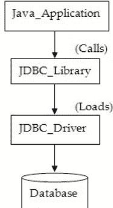

# 高级 Java 面试高频问题 (面试问题系列)

你最可能被问到的问题

> 免费提供 2 份能力测试，可在网站下载

## 高级 Java 面试题

回顾这些典型的面试题，并思考你将如何回答它们。阅读列出的答案；你将找到最佳答案以及策略和建议。

## 对象序列化

### 1: Java 对象如何能够在虚拟机的生命周期之外存在？

答案：

对象序列化允许 Java 对象存在于 JVM 的生命周期之外。

### 2: 我想序列化一个集合。是否必须要求所有成员都实现 `Serializable` 接口？

答案：

是的。为了序列化集合或数组，其所有成员必须实现 `Serializable` 接口。

### 3: 如何从对象的序列化状态中排除某些变量？

答案：

要从序列化过程中排除变量，应该将它们标记为 `transient`。

示例：`transient private String variable;`

### 4: 说对象序列化类和未标记为 `transient` 的实例变量也会被序列化，正确吗？

答案：

不是。属于类的静态变量不会作为序列化对象的一部分被保存。此外，`transient` 类变量也不会是序列化对象的一部分。

### 5: 如果我尝试序列化一个实现了 `Serializable` 接口但包含一个不可序列化对象的类实例，会发生什么？

答案：

运行时将抛出 `java.io.NotSerializableException`。

### 6: 如果我尝试序列化一个实现了 `Serializable` 接口的类实例，但该类又包含一个不可序列化的对象，会发生什么？

答案：

运行时将抛出 `java.io.NotSerializableException`。

### 7: 序列化完成后，`transient` 变量会变成什么？

答案：

`transient` 变量不会被序列化。

### 8: 在实现 `Serializable` 接口时，哪些方法必须实现？

答案：

不需要。

### 9: 考虑以下场景：

```java
public class ClassA implements Serializable {
    private transient String variable;
}
public class ClassB extends ClassA {
}
```

`ClassB` 的变量会获得什么值？

答案：

变量将获得默认值。

### 10: 使用 `serialVersionUID` 的目的是什么？

答案：

`serialVersionUID` 用于确保序列化数据与类定义版本兼容。

### 11: 如果序列化对象的 `serialVersionUID` 与类定义不匹配，会发生什么？

答案：

将抛出 `java.io.InvalidClassException`。

### 12: 如果你有一个没有定义 `serialVersionUID` 的 `Serializable` 类，编译器如何处理？

答案：

Java 会自动添加 `serialVersionUID`，其值是基于类的。

### 13: `Serializable` 接口中有哪些方法？

答案：

这是一个标记接口，没有任何方法。

### 14: 在哪些情况下应该使用序列化？

答案：

在网络发送对象时。

### 15: 对象序列化过程中 `NotSerializableException` 的原因是什么？

答案：

如果类包含的任何对象没有实现 `Serializable`，则会发生该异常。

### 16: 为了改变默认序列化行为，可以重写哪些方法？

答案：

可以实现 `writeObject()` 和 `readObject()`。通过这种方式，我们可以控制序列化过程。

### 17: 如果我们想完全控制类的序列化过程，应该实现哪个接口？

答案：

`java.io.Externalizable` 接口。

### 18: 实现 `Externalizable` 时需要重写哪些方法？

答案：

`readExternal` 和 `writeExternal`。

### 19: 考虑以下场景：

```java
public class Parent implements Serializable {}
public class Child extends Parent {}
```

`Child` 类是序列化的吗？

答案：

`Child` 类继承了其对象的序列化机制。

### 20: 说在反序列化对象时，构造函数会被调用吗？

答案：

反序列化意味着恢复序列化对象而不是重建它。反序列化过程中不会调用构造函数。

### 21: 我有一个名为 `Student` 的序列化类。它有一个类型为 `String` 的实例变量 `name`。由于 `name` 不是基本类型，我们应该预期序列化失败吗？

```java
public class Student implements Serializable {
    private String name;
}
```

答案：

`java.lang.String` 本身是可序列化的，因此 `Student` 类可以序列化。

### 22: 所有基本包装类都是可序列化的吗？

答案：

是的。所有的基本包装类都实现了 `Serializable` 接口。

### 23: 假设你有一个序列化类，其父类没有实现 `Serializable` 接口。父类定义了一个无参构造函数和一个字符串参数构造函数。在反序列化期间，调用父类的哪个构造函数？

答案：

无参构造函数会被调用。它应该是对序列化子类可见的。

### 24: 考虑以下场景：

有一个没有定义 `serialVersionUID` 的 `Serializable` 类。你对其进行了序列化。你在 `Serializable` 类中添加了一个新的实例变量，并对已序列化的实例进行反序列化。会发生什么？

答案：

由于 `Serializable` 类没有定义 `serialVersionUID`，JVM 将生成一个。一旦你在 `Serializable` 类中添加或删除实例变量，`serialVersionUID` 的值就会改变。在给定的场景中，将抛出 `java.io.InvalidClassException`。

## 泛型 (Generics)

### 25: 如何从集合中检索元素时避免类型转换？

答案：

可以使用泛型集合来避免类型转换。

示例：

`List<String> gList = new ArrayList<String>();`

### 26: 查看以下代码。它能编译吗？能运行吗？

```java
public static void main(String[] args) {
    List<String> typeSafeList = new ArrayList<String>();
    typeSafeList.add(new String("string1"));
    addElementsToList(typeSafeList);
    String a = typeSafeList.get(1);
}
private static void addElementsToList(List list) {
    list.add(new Integer(10));
}
```

答案：

代码可以正常编译，但会抛出以下异常：

`java.lang.ClassCastException: java.lang.Integer cannot be cast to java.lang.String`

### 27: 在声明中使用可以使用多个参数化类型吗？举个例子。

答案：

这是可能的。

示例：

`public class UseTwo<T, X> {}`

### 28: 如何使用一个类中未定义的类型来声明一个泛型方法？

答案：

`public <T> void makeList(T t) { }`

这个语法有点复杂。该方法的返回类型为 `void`，并且在返回类型之前声明了类型。

### 29: 可以实例化一个泛型类型的数组吗？

答案：

不可以。以下操作是非法的：

```
new List<String>[3];
```

但如果使用类型参数作为无界通配符，以下操作是合法的：

```
new List<?>[3];
```

## CORBA

### 30: CORBA 2.0 提供了哪些操作调用技术？

答案：

CORBA 2.0 提供的三种操作调用技术是：

- a) 同步 (Synchronous)
- b) 延迟同步 (Deferred Synchronous)
- c) 单向 (One-way)

### 31: 什么是同步操作调用技术？

答案：

在同步操作技术中，客户端调用一个操作。然后它会挂起以等待响应。

### 32: 什么是延迟同步操作调用技术？

答案：

在延迟同步操作调用技术中，客户端调用一个操作后继续处理。稍后客户端可以轮询或阻塞等待响应。

### 33: 什么是单向操作调用技术？

答案：

在单向操作调用技术中，客户端调用一个操作且不等待也不期望任何响应。ORB（对象请求代理）保证请求的交付。

### 34: 分布式对象提供的服务是如何定义的？

答案：

接口定义语言（IDL）定义了特定分布式对象提供的服务。

### 35: 哪个 CORBA 服务定义了对象的复制、移动、创建和删除？

答案：

对象周期服务（Object life cycle service）定义了它们。

### 36: 写出解耦分布式对象之间通信的 CORBA 服务名称。

答案：

事件服务（Events service）解耦了分布式对象之间的通信。

### 37: 对象接口代表了它是或将如何实现吗？

答案：

不。对象接口仅指示支持的操作。

### 38: 说 IDL 提供了对象的实现正确吗？

答案：

不。IDL 提供了使用对象的代码与实现对象的代码之间的契约。实际实现是在编程语言中完成的。

示例：Java, C++

### 39: 写出 OMG 已对语言绑定进行标准化的编程语言。

答案：

C, C++, Java, Ada, COBOL, Smalltalk, Objective C 和 Lisp 编程语言。

### 40: 写出 IDL 的基本数据类型。

答案：

IDL 的基本数据类型有 `long`, `short`, `string`, `float`...

### 41: 你想在 IDL 中使用构造数据类型。你有哪些选择？

答案：

`struct`（结构体）、`union`（联合体）、`enum`（枚举）、`sequence`（序列）

### 42: 使用哪个编译器来编译 IDL 声明？

答案：

IDL 编译器

### 43: 客户端使用什么向 CORBA 对象发出请求？

答案：

客户端使用对象引用（object reference）来向 CORBA 对象发出请求。

### 44: IDL 结构 `module` 对应 Java 的哪种结构？

答案：

`package` 结构。

### 45: IDL 结构 `operation` 对应 Java 的哪种结构？

答案：

`method` 结构。

### 46: 哪些基本机制可以获取对象引用？

答案：

可以通过作为参数传递、作为结果返回或将字符串转换为对象引用来获取对象引用。这些都由 ORB 支持。

## 线程 (Threading)

### 47: 在 Java 中创建线程的两种方式？

答案：

我们可以扩展 `Thread` 类并重写 `public void run()` 方法，或者调用接受 `Runnable` 参数的 `Thread` 构造函数。

### 48: 如果对同一个线程对象多次调用 `start()` 会发生什么？

答案：

将抛出一个 `RuntimeException`。

### 49: 可以同一个 `Runnable` 对象作为目标创建多个 `Thread` 对象吗？

答案：

不可以。这是非法的。

### 50: 线程对象何时变成执行线程？

答案：

在调用 `Thread` 的 `start()` 时，它变成一个执行线程。

### 51: 线程何时被认为是存活的？

答案：

在调用 `Thread` 的 `start()` 时。

### 52: 启动一个新线程。它将进入哪种状态？

答案：

它进入 `Runnable` 状态。

### 53: 线程何时进入死亡（dead）状态？

答案：

一旦其 `run` 方法完成。

### 54: 你有一台单处理器机器。同时可以有多少个线程处于运行状态？

答案：

只能有一个线程处于运行状态。

### 55: 线程启动的顺序决定了它们的运行顺序吗？

答案：

不。是由线程调度器调度线程的。

### 56: 线程会公平地轮替执行吗？

答案：

这取决于特定的 JVM。

### 57: 如何保证线程无论底层如何轮替执行？

答案：

你需要使用 `sleep()` 方法来防止线程饥饿。

### 58: 你在线程上调用了 `sleep()` 方法以延迟一段时间。睡眠结束后它会立即开始运行吗？

答案：

没有这种保证。它进入 `Runnable` 状态。

### 59: 什么是线程优先级？如何定义它？

答案：

线程优先级是告诉操作系统给每个线程分配多少资源的方法。优先级可以通过 `Thread.setPriority(int)` 设置。线程优先级的范围从 1 到 10，10 是最高的。

### 60: 线程的默认优先级是多少？

答案：

线程获得与其创建它的线程相同的优先级。

### 61: `join()` 方法的目的是什么？

答案：

如果 `ThreadA` 想等待 `ThreadB` 完成，它会调用 `ThreadB` 的 `join()` 方法，即 `ThreadA` 在 `ThreadB` 完成工作后才能开始工作。

### 62: 你有一个包含某些关键代码的方法，你希望防止多个线程同时执行它。你可以做什么来保护它？

答案：

该方法可以使用 `synchronized` 关键字标记为同步方法。

### 63: 睡眠的线程会释放它所有的锁吗？

答案：

不。睡眠线程的锁对其他线程仍然可用。

### 64: 如何同步一个代码块（即不是整个方法）？

答案：

为了同步一段代码，我们必须指定一个参数，即要进行同步锁的对象。

### 65: `wait` 方法的作用是什么？

答案：

`wait()` 方法将线程放入等待池。该线程在通过 `notify()` 方法通知之前一直保持等待。

### 66: `notify()` 方法可以指定通知哪一个等待线程吗？

答案：

不可以。`notify()` 方法只向一个线程发送信号。

### 67: `notify()` 和 `notifyAll()` 方法之间有什么区别？

答案：

`notifyAll()` 向所有等待该对象的线程发送信号，而 `notify()` 仅向对象等待池中的某一个线程发送信号。

### 68: 必须在同步（synchronized）上下文中调用 `wait()`、`notify()` 和 `notifyAll()` 吗？

答案：

是的。线程在调用 `wait()`、`notify()` 或 `notifyAll()` 时必须持有该特定对象的锁。

### 69: `wait` 和 `sleep` 方法之间有什么区别？

答案：

`sleep` 方法是一个静态方法，它会延迟后续操作直到睡眠时间结束。而 `wait` 方法会无限期地放弃线程执行的控制权，以便其他线程运行。

### 70: 你可以重写 `Thread` 的 `start()` 方法吗？

答案：

可以。它不是 `final` 的，可以被重写，但不应该这样做。

## Servlet

### 71: 如何卸载一个 Servlet？

答案：

你可以手动卸载 Servlet，或者简单地关闭服务器。

### 72: 假设你已经在 Web 容器中部署了一个 Servlet。它是在什么时候被加载的？

答案：

如果没有启用自动加载，Servlet 将在第一次请求时加载。当启用自动加载时，Servlet 在服务器启动时加载。

### 73: 使用哪个 `web.xml` 标签来定义 Servlet 的加载顺序？

答案：

使用 `load-on-startup` 标签来定义 Servlet 的加载顺序。

### 74: 你可以使用 `new` 关键字来实例化 Servlet 类吗？

答案：

不能。Servlet 容器负责实例化 Servlet，且只有它能调用构造函数。

### 75: 向你的 Servlet 发送 GET 请求并将调用 `doGet()` 方法。参数是如何接收的？

答案：

在 GET 请求中，参数被附加到 URL 中且不经过加密。使用 `HttpServletRequest.getParameter("paramName")` 来获取参数值。

### 76: 向你的 Servlet 发送 POST 请求并将调用 `doPost()` 方法。参数是如何接收的？

答案：

参数通过套接字传回 Web 服务器端。这些参数不会显示在 URL 中并且是加密的。使用 `HttpServletRequest.getParameter("paramName")` 来获取参数值。

### 77: 在什么场景下使用 `doGet()`？

答案：

当请求仅用于读取数据时使用 `doGet()`。它们不应该在服务器上添加或更新任何数据。

### 78: 在什么场景下使用 `doPost()`？

答案：

`doPost()` 用于向服务器更新或添加信息。

### 79: 比较 `doGet` 和 `doPost` 时，哪一个更快？

答案：

`doGet` 比 `doPost` 快。

### 80: GET 请求的数据限制是什么？

答案：

URL 最多可以包含 1024 个字符。

### 81: 写出 Servlet 生命周期的阶段。

答案：

Servlet 生命周期的阶段有：

- a) Servlet 类加载
- b) Servlet 实例化
- c) Servlet 初始化
- d) 请求处理
- e) 服务移除


# Servlet

## 82: 你可以在`doGet()`方法中手动调用`doPost()`吗？

答案：

可以。我们可以将请求从`doGet()`委托给`doPost()`。例如：

```java
public void doGet(HttpServletRequest request, HttpServletResponse response) throws ServletException, IOException {
    doPost(request, response);
}
```

## 83: 为什么我不应该在我的`HttpServlet`中重写`service()`方法？

答案：

通常最好不要重写，因为`HttpServlet`已经实现了，且默认的`service()`方法会根据发出的请求调用相应的`doXXX()`。

## 84: 哪一个更快？`forward()`还是`sendRedirect()`？

答案：

`forward()`比`redirect`快一点。原因是`redirect`需要两次浏览器请求，而`forward`只需要。

## 85: `sendRedirect()`是两个阶段的过程，这些阶段是什么？

答案：

阶段 1 - 浏览器向服务器发送请求。服务器指示浏览器获取不同的 URL。

阶段 2 - 浏览器发送另一个请求。

## 86: 为什么`forward()`保留了原始请求上下文？

答案：

保留原始请求是因为两个资源都属于同一个上下文。

## 87: 你想将请求重定向到另一个域的资源。你会使用`forward()`吗？

答案：不会。应该使用`sendRedirect()`，因为实际资源不属于当前上下文。

## 88: Servlet 运行在哪里？

答案：

Servlet 运行在 Web 容器内部。例如：Tomcat。

## 89: Java Servlet 支持哪些协议？

答案：

Java Servlet 支持任何协议。例如：HTTP、FTP、SMTP 等。

## 90: Servlet 容器如何进行会话跟踪（session tracking）？

答案：

会话跟踪通过 Cookies、URL 重写、`HttpSession`、隐藏表单字段等实现。

## 91: 定义会话映射（session mapping）。

答案：

使用 Session Mapping 维护 URL 模式与 Servlet 之间的关联。这种映射用于将请求映射到 Servlet。

## 92: 定义会话上下文（session context）。

答案：

Web 应用程序的信息包含在一个名为`ServletContext`的对象中。

## 93: 我想用构造函数代替`init()`来初始化 Servlet。我可以访问`ServletConfig`吗？

答案：

在构造函数中无法使用`ServletConfig`或`ServletContext`这种 Servlet 特有的内容。

## 94: 你如何获取当前 Servlet 的路径，即它在文件系统中的位置？

答案：

可以使用`request.getRealPath(request.getServletPath())`找到 Servlet 的文件系统位置。

## 95: `init()`方法在什么时候被调用？

答案：

`init()`方法在 Servlet 加载时被调用。每个 Servlet 实例只调用一次。

## 96: 如何让`init()`方法成为线程安全的？

答案：

由于`init()`每个 Servlet 实例只调用一次，我们不需要担心线程安全问题。

## 97: 你如何从一个 Servlet 调用另一个 Servlet？

答案：

有多种方法可以实现。例如：你可以使用`RequestDispatcher`、发送重定向等。

## 98: 举例说明如何使用`RequestDispatcher`将请求从一个 Servlet 转发到另一个 Servlet。

答案：

```java
RequestDispatcher rd = request.getRequestDispatcher("ServletB");
String myAttribute = "Test Attribute";
request.setAttribute("att1", myAttribute);
rd.forward(request, response);
```

## 99: 当`request`是`HttpServletRequest`实例时，`request.getParameter()`和`request.getAttribute()`有什么区别？

答案：

`request.getParameter()`用于获取表单提交的值。`request.getAttribute()`仅在服务器端使用。你可以向请求添加属性并将其转发。

## 100: 你如何从 Servlet 访问客户端的目录结构？

答案：

出于安全原因，这是可能的。

## 101: 什么是 Generic Servlet？

答案：

Generic Servlet 是协议无关的 Servlet。

## 102: Generic 和`HttpServlet`之间有什么区别？

答案：

`HttpServlet`是 Generic Servlet 的一种。它提供了 HTTP 特有的功能，而 Generic Servlet 是协议无关的。

## 103: `HttpServlet`是具体类吗？

答案：不是。它是一个继承`GenericServlet`的抽象类。

## 104: 既然`HttpServlet`是抽象类，它必须重写哪些方法？

答案：

`HttpServlet`必须重写以下方法中的一个：`doGet()`、`doPost()`、`doDelete()`、`init()`、`destroy()`、`getServletInfo()`。

## 105: 谁控制 Servlet 的生命周期？

答案：

Servlet 容器负责控制 Servlet 的生命周期。

## 106: 当请求映射到 Servlet 时，容器会做什么？

答案：

假设 Servlet 实例不存在，容器将加载 Servlet 类，创建其实例，通过调用`init()`方法初始化 servlet。完成后，将调用`service()`方法并将请求和响应对象传递给它。

## 107: 容器在需要移除 Servlet 时会调用哪个方法？

答案：

调用`destroy()`方法来移除 Servlet。

## 108: `service()`方法的作用是什么？

答案：

GenericServlet 类有一个抽象的`service()`方法，它接受`HttpServletRequest`和`ServletResponse`作为参数。HttpServlet 重写了它，并将客户端请求派发到接收`HttpServletRequest`和`HttpServletResponse`参数的保护`service()`方法。该方法将请求派发给`doXXX()`。

## 109: 你为 HTTP 协议编写一个 Servlet。你需要扩展哪个类？

答案：

将扩展`HttpServlet`来创建一个`HttpServlet`。

示例：

```java
public class HelloServlet extends HttpServlet {
```

## 110: `doXXX()`方法会抛出哪些异常？

答案：

`javax.servlet.ServletException`和`java.io.IOException`。

## 111: 你可以在哪里定义 Servlet 映射（mapping）？

答案：

Servlet 映射定义在`WEB-INF/web.xml`中。

## 112: 如何在`web.xml`中定义上下文初始化参数（context init parameter）？

答案：

上下文初始化参数使用`context-param`标签在`web.xml`中定义。

示例：

```xml
<context-param>
  <param-name></param-name>
</context-param>
```

# 你可能被问到的高级 Java 面试

```xml
<param-value>John</param-value>
</context-param>
<context-param>
<param-name>password</param-name>
<param-value>password</param-value>
</context-param>
```

## 113: 如何在 Servlet 中获取上下文初始化参数？

答案：为了获取上下文初始化参数，我们需要`ServletConfig`引用：

```java
ServletContext context = getServletContext();
dbName = context.getInitParameter("name");
dbPassword = context.getInitParameter("password");
```

## 114: 如何在`web.xml`中设置错误页面？

答案：

```xml
<error-page>
<error-code>404</error-code>
<location>/404.html</location>
</error-page>
```

## 115: 给出一个`web.xml`中 Servlet 映射的示例。

答案：假设 Servlet 类是`MyServlet`且我们可以通过`/Test/`访问它：

```xml
<web-app>
<servlet>
<servlet-name>MyServletName</servlet-name>
<servlet-class>MyServlet</servlet-class>
</servlet>

<servlet-mapping>
<servlet-name>MyServletName</servlet-name>
<url-pattern>/Test</url-pattern>
</servlet-mapping>
</web-app>
```

## 116: 定义`ServletContext`。

答案：这是一个用于与 Servlet 容器通信的接口。每个 Web 应用只有一个`ServletContext`。Web 应用中的所有资源共享该`ServletContext`。

## 117: Web 应用中所有的 Servlet 共享同一个`ServletConfig`吗？

答案：

不是。每个 Servlet 都有自己的`ServletConfig`。

## 118: `ServletContextListener`接口提供了哪些方法？

答案：

`ServletContextListener`接口提供两个方法：

```java
public void contextInitialized(ServletContextEvent event)

public void contextDestroyed(ServletContextEvent event)
```

如果我们实现了`ServletContextListener`，就必须实现这两个方法。

## 119: `ServletContextListener`何时会被通知？

答案：

当`ServletContext`初始化并从`ServletContext`获取参数时，会通知`ServletContextListener`。当`ServletContext`被销毁时，也会通知`ServletContextListener`。

## 120: 如何在`web.xml`中配置`ServletContextListener`？

答案：假设`ServletContextListenerExample`实现了`ServletContextListener`：

```xml
<web-app>
<listener>
<listener-class>example.ServletContextListenerExample</listener-class>
</listener>
</web-app>
```

## 121: 在 Web 容器部署 Servlet 时，`WEB-INF`的作用是什么？

答案：`WEB-INF`应该包含`web.xml`和一个包含 Servlet 类文件的`classes`文件夹。

## 122: 如果我想使用 Servlet 2.1 API 而不是 Servlet 2.0 API，会发生什么？

答案：如果我们使用 Servlet 2.1 API 而不是 Servlet 2.0 API，Servlet 与 Servlet 之间的通信将无法工作，因为像`getServletContext()`和`getServlets()`这样的 servletcontext 方法已被弃用。它们将返回`null`。

## 123: Servlet 中的懒性加载（lazy loading）是什么？

答案：服务器启动时，Servlet 容器默认不会加载/初始化 Servlet。它会在第一次接收到对该 Servlet 的请求时才加载/初始化该 Servlet。这就是懒加载。

## 124: 你如何带 URL 中的参数调用 Servlet？

答案：我们可以通过表单带参数调用 Servlet，例如`http://localhost:8080/servlet?param1=servlet1&param2=servlet2`。

此页面故意留白。

# Collections（集合）

## 125: `ArrayList`和`LinkedList`都实现了`get(int)`方法来获取列表中指定位置的 get。哪一个更快？

答案：与`LinkedList`的`get(int)`相比，`ArrayList`的`get(int)`更快，因为对于`LinkedList`，它只是遍历列表直到到达指定的索引。

## 126: 为什么`ArrayList`比`LinkedList`快？

答案：`ArrayList`快因为它使用数组来存储元素，而`LinkedList`需要遍历来查找元素。

## 127: 什么时候`LinkedList`比`ArrayList`快？

答案：当在列表开头或中间频繁插入和删除操作时，`LinkedList`更快。

## 128: 你如何向列表添加元素？

答案：你可以使用`add()`方法向列表添加元素。

## 129: `Hashtable`的容量（capacity）是多少？

答案：容量是指`Hashtable`在调整大小之前可以容纳的元素数量。

## 130: `Hashtable`的默认负载因子（load factor）是多少？

答案：`Hashtable`的默认负载因子是`.75`。

## 131: 如果使用`Hashtable()`创建，初始容量是多少？

答案：默认情况下，`Hashtable`的初始容量为 11。

## 132: `Hashtable`和`HashMap`有什么区别？

答案：`Hashtable`和`HashMap`的主要区别是：

- `Hashtable`是同步的，而`HashMap`不同步。
- `Hashtable`不允许 null，而`HashMap`允许 null。

## 133: 如果 key 不在`HashMap`中存在会发生什么？

答案：如果 map 不包含该 key 的映射，则返回`null`。以下方法用于确保 key 于 map 中：

```java
boolean containsKey(Object key)
```

## 134: 你如何获取此 map 中映射的集合视图（collection view）？

答案：调用`entrySet()`返回一个`Set`。集合中的每个元素都是一个`Map.Entry`。集合中的所有更改都会反映在`HashMap`中，反之亦然。

## 135: `Map`是一个`Collection`吗？

答案：不是。`Map`接口没有扩展`Collection`接口，它不是`Collection`。

## 136: 如果尝试在`Map`中添加重复的 key 会发生什么？

答案：对应的值将被覆盖，旧值将丢失。

## 137: 如果需要在`Map`中插入、删除和定位元素，你会使用哪种`Map`实现？

答案：`HashMap`为在 Map 中插入、删除和定位元素提供了最佳替代方案。

## 138: 在什么情况下你会优选`TreeMap`而不是`HashMap`？

答案：如果需要按排序顺序遍历键，那么`TreeMap`是更好的替代方案。

## 139: 如何调优`HashMap`和`TreeMap`？

答案：对于`HashMap`，你需要使用适当初始容量和负载因子来创建`HashMap`以获得更好的性能。`TreeMap`没有调优选项。

## 140: 你想使用 Collection 类创建一个单元素集合。你如何用一行代码实现？

答案：

```java
Set set = Collections.singleton("Test Msg");
```

## 141: 如果`Map`中键的哈希值与`Map`中已有的键冲突会发生什么？

答案：

在这种情况下，Map 将重新排列，并将键保持在哈希值下的列表中。键所属的类的`hashCode()`方法和`equals()`方法在这里起着重要作用。

## 142: 遍历集合（Collection）的两种方法是什么？

答案：

你可以使用 for-each 结构或使用 Iterators（迭代器）来遍历集合。

## 143: 假设你正在使用`Iterator`遍历一个`Collection`。你可以使用它的`Iterator`从集合中删除项吗？可以，如何操作？

答案：

`Iterator`提供了`remove()`方法，它可以移除上一个由`next()`方法返回的元素。例如，以下代码使用`Iterator`从`List`中移除`Test2`。

```java
List<String> myList = new ArrayList<String>();
myList.add("Test1");
myList.add("Test2");
myList.add("Test3");
```


```java
Iterator<String> myListIterator = myList.iterator();
while (myListIterator.hasNext()) {
    String val = myListIterator.next();
    if (val.equals("Test2")) {
        myListIterator.remove();
    }
}
```

## 144：对于集合，构建操作（build operation）是什么意思？

答案：

在整个集合上执行某些操作被称为构建操作。例如，你可以使用`clear()`清空集合。

```java
List<String> myList = new ArrayList<String>();
myList.add("Test1");
myList.add("Test2");
myList.add("Test3");
myList.clear();
```

## 145：Collection 接口支持哪些批量操作（bulk operations）？

答案：

`Collection`接口支持批量操作：`containsAll`、`addAll`、`removeAll`、`clear`。

## 146：我有一个名为`c`的集合，想从中移除所有 null 元素。我应该如何使用构建操作？

答案：

```java
c.removeAll(Collections.singleton(null));
```

`Collections.singleton`用于获取一个仅包含指定元素的不可变`Set`。

## 147：如何将 Collection 转换为 Array？

答案：

`Collection`接口提供了`toArray()`方法来将`Collection`转换为`Array`。

示例：

```java
Object[] a = c.toArray();
```

## 148：你有一个 String 类型的集合，想将其转换为 String 类型的数组。如何实现？

答案：

`c.toArray()`始终返回`Object`类型的数组。要获取`String`类型的数组，应使用以下方法：

```java
String[] myArray = myList.toArray(new String[0]);
```

`myArray`的大小将与`myList`的大小相等。

## 149：写出三种通用 Set 实现。

答案：

- `HashSet`
- `TreeSet`
- `LinkedHashSet`

## 150：哪种 java.util.Set 实现是最快的？

答案：

与`TreeSet`和`LinkedHashSet`相比，`HashSet`更快。

## 151：哪个 java.util.Set 实现不保证元素的顺序？

答案：

`HashSet`。

## 152：java.util.TreeSet 是如何存储元素的？

答案：

在`TreeSet`中，元素以红黑树的形式存储，并根据它们的值进行排序。

## 153：你有一个包含重复项的集合`c`。如何使用 Set 移除这些重复项？

答案：

假设`c`是 String 类型的集合且包含重复项。

```java
Collection<String> noDuplicates = new HashSet<String>(c);
```

## 154：你有一个包含重复项的集合`c`。如何使用 Set 移除这些重复项但保留元素的顺序？

答案：

假设`c`是 String 类型的集合且包含重复项。

```java
Collection<String> noDuplicates = new LinkedHashSet<String>(c);
```

## 155：如何获取 Set 的基数（cardinality）？

答案：

`size()`方法返回`Set`中存在的元素数量。

## 156：如果尝试向 Set 添加一个已存在的元素会发生什么？

答案：

由于`Set`不允许重复项，向`Set`中添加已存在的项将失败。

## 157：如果尝试从 Set 中移除一个不存在的项会发生什么？

答案：

不会抛出异常。`remove`方法将返回`FALSE`。

## 158：写出根据插入顺序对元素的 java.util.Set 实现。

答案：

`LinkedHashSet`。

## 159：你有两个集合`set1`和`set2`。你想通过并操作将`set2`添加到`set1`。你会使用哪种批量操作？

答案：

`addAll`操作可以实现此目的。

示例：

```java
set1.addAll(set2);
```

## 160：你有两个集合`set1`和`set2`。你想从`set1`中移除`set2`的所有元素。你会使用哪种批量操作？

答案：

`removeAll`操作可以实现此目的。

```java
set1.removeAll(set2);
```

## 161：List 可以包含重复项吗？

答案：

是的，它可以包含重复项。

## 162：除了从 Collection 接口继承的操作，List 还提供了哪些额外操作？

答案：

`List`接口提供了：

## 163：写出 List 支持的常用算法。

答案：

- 索引访问（Positional access）
- 搜索（Search）
- 迭代（Iteration）
- 排序（Sort）
- 反转（reverse）
- 洗牌（shuffle）
- 替换（replace）
- 二分查找（binarySearch）
- 索引查找（indexOfList）
- 最后索引查找（lastIndexOf）

## 164：List 和 Queue 之间有什么区别？

答案：

`List`接口提供了：

- `add(e)`
- `remove()`
- `element()`
- `offer()`
- `peek()`
- `clear()`

## 165：什么是边界队列（bounded queues）？

答案：

如果一个队列限制了元素的数量，它被称为边界队列（Bounded）。

## 166：哪个包包含边界队列？

答案：

`java.util.concurrent`包中的`Queue`实现是有边界的。

## 167：在空 Queue 上执行`remove()`操作的结果是什么？

答案：

将抛出`NoSuchElementException`。

## 168：你想获取 Queue 的头元素。可以使用哪些方法？

答案：

`element()`和`peek()`。

## 169：`element()`和`peek()`方法之间有什么区别？

答案：

`peek()`返回`Queue`的头元素但不将其移除，而`element()`会移除头元素。

## 170：写出允许插入 null 的实现。

答案：

`LinkedList`实现允许插入 null。

## 171：Queue 实现通常定义基于元素的`equals`和`hashCode`方法吗？

答案：

不是。它们通常从`Object`继承基于标识的`equals`和`hashCode`方法。

## 172：在并发编程中，需要阻塞队列（blocking queue）。Queue 接口提供吗？

答案：

不。`Queue`接口不提供阻塞队列方法。然而`java.util.concurrent.BlockingQueue`提供了。

## 173：写出通用的 Map 实现。

答案：

- `HashMap`
- `TreeMap`
- `LinkedHashMap`

## 174：Map Hashtable，哪一个可以在迭代过程中移除条目？

答案：

`Hashtable`。

## 175：如何区分 Vector 和 ArrayList？

答案：

`Vector`是`ArrayList`的同步版本。如果你的考虑是同步，使用`ArrayList`是更好的选择。

## 设计模式

### 184：在什么情况下优先使用代理模式（Proxy pattern）？

答案：

当创建一个对象在时间和内存方面的代价开销很大时，则会创建并使用代理对象。

### 185：什么是外观模式（Facade pattern）？

答案：

外观模式用于提供一个通用的接口，以使复杂的系统变得简单。它实际上通过解耦子系统来隐藏了系统的复杂性。

### 186：适配器模式（Adapter pattern）的另一个名称是什么？

答案：

适配器模式也称为包装器模式（Wrapper pattern）。

### 187：你希望将现有的接口转换为新接口，以实现遗留应用程序中不相关类的兼容性和可重用性。你将使用哪种设计模式？

答案：

可以使用适配器模式，因为它被用于让不相关的类能够协同工作。

### 188：你想在一组具有不同接口的类上添加操作。应该应用哪种设计模式？

答案：

应该应用访问者模式（Visitor pattern）。

### 189：哪种设计模式用于返回多个工厂中的一个？

答案：

抽象工厂模式（Abstract Factory Pattern）提供的接口比工厂模式高出一个级别。

### 190：什么是单例模式（Singleton pattern）？给出代码示例。

答案：

当你希望一个类恰有一个实例时，使用单例模式。

示例：

```java
public class ClassA {
    private static ClassA instance = null;

    private ClassA() {
    }

    public static ClassA getInstance() {
        if (instance == null) {
            instance = new ClassA();
        }
        return instance;
    }
}
```

## 数据结构

### 191：Java 数据结构中包含哪些类？

答案：

Java 数据结构中包含的类有：

- `Vector`：类，类似于数组
- `Stack`：类，后进先出（Last In First Out）
- `Enumeration`：接口，用于获取连续的元素
- `Bitset`：类，一组可以设置或清除的位/标志位
- `Dictionary`：类，键到元素的映射
- `Hashtable`：类，数据的组织形式
- `Properties`：哈希表的子类，维护一个包含字符串类型键和值的列表

### 192：你将如何通过“与”（AND）操作两个 bitset 的内容？

答案：

两个 bitset 的内容通过以下方式进行“与”操作：

- 使用 bitset 中的`void and(BitSet my_bset1)`函数。
- 调用带有指定 bitset 的 bitset 来执行“and”操作。
- 然后将结果存储在被调用的 bitset 中。

### 193：你将如何使用指定的 bitset 从调用 bitset 中删除元素？

答案：

可以通过以下方式使用指定的 bitset 从调用 bitset 中删除元素：

- 使用 bitset 中的`void andNot(BitSet my_bset2)`函数。
- 对于指定 bitset 中的每个对应项，调用 bitset 中的对应元素都会被删除。

### 194：你将如何清除 BitSet 中的位？

答案：

- 清除所有位，使用`void clear`方法。
- 清除从指定起点到终点的位，使用`void clear "int my_s_index, my_e_index"`方法。
- 清除指定位置的位，使用`void clear(int my_index_pos)`方法。

### 195："clone"和"equals"函数的作用是什么？

答案：

- `Clone`：被调用的 bitset 对象将被复制。
- `Equals`：当调用的 bitset 中的位与传递的位匹配时，返回 true；否则返回 false。

### 196：描述 bitset 中的"flip"（取反）函数。

答案：

- 为了取反给定范围内的位，使用`flip(int my_s_indices, int my_e_index)`方法。
- 为了取反指定索引的位，使用`flip(int my_index1)`。

示例：

```java
BitSet my_bset = new BitSet();

...

my_bset.flip(3, 6); // 从索引 3 到 6 的位被取反
my_bset.flip(7);    // 取反第 7 个位置的位
```

### 197：你将如何获取位的当前状态和哈希码（hash code）？

答案：

可以通过以下方式获取位的当前状态和哈希码：

- 使用返回类型为`Boolean`的`get`函数，返回指定索引处的位状态（True/false）。
- 使用返回类型为`int`的`hashCode`函数，返回调用对象的哈希码。

示例：

```java
BitSet my_bset = new BitSet();

...

my_bset.get(3);
my_bset.hashCode();
```

### 198：你将如何获取调用 bitset 的字符串等价表示和大小？

答案：

可以通过以下方式获取调用 bitset 的字符串等价表示和大小：

- 使用返回类型为`int`的`size`方法，返回调用用的 bitset 的大小。
- 使用返回类型为`String`的`toString`方法，返回调用对象的字符串等价表示。

示例：

```java
BitSet my_bset = new BitSet();

...

my_bset.size();
my_bset.toString();
```

### 199：你将如何向 vector 添加元素？

答案：

可以通过以下方式向 vector 添加元素：

- 使用`add`函数，并给定元素。
- 见上文（注：此处原文未提供细节，但逻辑一致）。

## 你可能会被问到的高级 Java 面试题

- 使用`addAll`函数，将一个集合中的元素插入到另一个集合中。
- 传递的集合中的元素会被添加到调用的集合中。
- 如果插入成功，返回 true。否则返回 false。

示例：

```java
List my_list1 = new ArrayList();
my_list1.addAll("h");
System.out.println(my_list1); // [h]
Collections.addAll(my_list1, "e", "l", "o");
System.out.println(my_list1);
```

### 211：你将如何获取列表的迭代器（iterator）？

答案：

- `listIterator`：迭代器返回到调用列表的开头。
- `listIterator(int myIdx)`：从指定的索引开始的调用列表将使用此函数接收迭代器。

### 212：在元素集合中，获取某些元素后，如何知道是否还有元素可以获取？

答案：

- 使用枚举接口（enumeration）中的`hasMoreElements`方法。
- 返回类型为`Boolean`。
- 当有元素可获取时返回`true`，否则返回 false。

### 213：`nextElement()`的作用是什么？

答案：

它返回列表中的下一个对象。

示例：

```java
Enumeration my_var1;
Vector my_var2 = new Vector();

...

my_var1 = my_var2.elements();

while (my_var1.hasMoreElements()) {
    System.out.println(my_var1.nextElement());
}
```

### 214：集合接口中`retain`函数的作用是什么？

答案：

- 用的集合中的元素将被删除，它将保留作为参数传递的集合中的元素。
- 如果调用的集合发生了变化，则返回 true，否则返回 false。

示例：

```java
boolean retainAll(Collection my_colctname) {}
```

### 215：`removeAll`和`retainAll`函数之间的区别是什么？

答案：

- 两个函数都接受一个`collection`（集合）作为参数。
- `removeAll()`移除作为参数传递的集合中存在的元素。
- `retainAll()`通过保留其他元素，移除不在作为参数传递的集合中的元素。

### 216：为`set`接口举一个例子。

答案：

```java
int my_var1[] = {21, 31, 51, 41, 81};
Set<integer> my_iset = new HashSet<integer>();

try {
    for (int y = 0; y < 5; y++) {
        my_iset.add(my_var1[y]);
    }

    System.out.println(my_iset);

    TreeSet my_sortediset = new TreeSet<integer>(my_iset);
    System.out.println(my_Sorted_list);
    System.out.println(my_sortediset);
}
```

### 217：你将如何从集合中获取小于特定元素的元素？

答案：

- 使用 Sortedset 接口中的`headSet`函数，我们可以从集合中获取小于特定元素的元素。
- 返回小于传递给该函数的元素。
- 示例：

```java
SortedSet my_sset1 = new SortedSet[];
my_sset1.headSet(7);
```

### 218：你将如何从集合中获取大于特定元素的元素？

答案：

- 使用 Sortedset 接口中的`tailSet`函数，我们可以从集合中获取大于特定元素的元素。
- 返回大于传递给该函数的元素。
- 示例：


```java
SortedSet my_sset1 = new SortedSet[];
my_sset1.tailSet(7);
```

## 219: 你将如何从集合获取第一个和最后一个元素？

答案：

- a) 使用`first`和`last`函数获取集合的第一个和最后一个元素。

示例：

```java
int my_var1[]={1,5,3};
Set <integer>my_iset = new HashSet();
for(int y=0;y<3;y++){
    my_iset.add(my_var1[y]);
    System.out.println("First element:" + my_iset.first()); // 1
    System.out.println("Last element:" + my_iset.last()); // 3
```

## 220: `SortedSet`接口中`subset`函数的作用是什么？

答案：

- a) 它返回排序后的元素。
- b) 用于从排序后的元素中获取子集。

示例：

```java
SortedSet my_iset = new TreeSet();
my_iset.add(2);
my_iset.add(4);
my_iset.add(1);
my_iset.add(5);
my_iset.add(3);
System.out.println(iset); // [1,2,3,4,5]
System.out.println(iset.subset(2,4)); // [2,3,4]
```

## 221: `map`接口方法抛出的异常有哪些？

答案：

- a) `ClassCastException`：类型不兼容的对象。
- b) `NoSuchElementException`：`map`中不存在。
- c) `UnsupportedOperationException`：尝试修改不可变的`map`。
- d) `NullPointerException`：空对象。

## 222: 你将如何替换链表（`linkedlist`）中的特定元素？

答案：

我们可以使用`set`函数替换链表中的特定元素。该函数的参数是要替换的元素的索引和要添加的元素。

示例：

```java
LinkedList my_linkedlist= new LinkedList();
System.out.println(my_linkedlist); // [A,B,D,E]
my_linkedlist.set(3, 'C');
System.out.println(my_linkedlist); // [A,B,D,C]
```

## 223: 你将如何获取指定元素最后一次出现的索引？

答案：

我们可以使用`lastIndexOf()`获取指定元素最后一次出现的索引。元素作为参数传递给该函数，返回该元素最后一次出现的索引。

示例：

```java
int my_var1[]={1,3,6,8,3,9};
Set my_iset = new Set();
for (int k=0;k<6;k++){ // 注意：此处修正了循环范围逻辑
  my_iset.add(my_var1[k]);
}
// 注：原文示例逻辑略有混乱，此处按意图翻译
```

（注：由于原文提供的223题代码示例存在语法不完整和逻辑跳跃，翻译时保持了其结构描述。）

## 232: 我们在 Java 中可以重载静态方法吗？

答案：

- a) 可以。静态方法可以重载，但不能被重写。
- b) 如果重写了静态方法，不会产生任何编译错误。然而值不会改变。例如，如果你在重写静态方法时更改变量的值，值不会改变。父类的变量值将保持不变。

## 233: 描述 Java 中提供数据库接口的方法

答案：

JDBC（Java Database Connectivity）通过定义类和接口来提供数据库连接，用于 Java 应用程序与数据库之间的通信。JDBC 可以执行 PL/SQL 和 SQL，并通过在 Java 代码中嵌入 SQL 查询来访问关系型数据库管理系统（RDBMS）。

## 234: 描述如何使用 JDBC 实现数据库连接

答案：



## 235: 描述加载 JDBC 驱动的方法

答案：

JDBC 驱动程序由 JDBC 库加载。这是通过调用函数`Class.forName`并将驱动类名作为参数来实现的。一旦驱动程序加载，就会创建一个驱动类的实例。

示例：

```java
try{
    Class.forName("// Driver name");
}
```

## 236: 你如何建立 JDBC 连接？

答案：

我们可以使用驱动类中的`getConnection`函数来建立 JDBC 连接。它接受三个参数（`jdbcurl`、`user_name`、`password`）来连接数据库并返回连接对象。连接对象包含有关数据库、表和字段的信息。

示例：

```java
Connection my_dbconn=DriverManager.getConnection(my_url,"user_name1", "my_pwd");
```

## 237: 你如何执行‘SQL’查询？

答案：

使用`createStatement`函数可以执行 SQL 查询。一旦使用`connection_object`建立了数据库连接，就可以使用`createStatement`函数从连接对象实例化`statement`对象。

示例：

```java
Connection my_conn=DriverManager.getConnection(my_url,"shobi", "shobi");
Statement my_stmtobj = my_conn.createStatement();
```

## 238: `statement`对象中可用哪些类型的`statement`？

答案：

- a) `Statement`：执行不带参数的简单 SQL 查询。
- b) `Callable`：执行存储在数据库中的函数调用。
- c) `Prepared`：执行带参数或不带参数的预编译 SQL 查询。

## 239: 你如何执行预编译的查询？

答案：

- a) 使用`statement`对象中的`prepared statement`。
- b) 使用此`statement`可以带参数或不带参数执行预编译查询。
- c) 语法：

  `PreparedStatement my_preprdstmt1(String my_sql1);`

- d) 返回预编译语句的对象，这些就是预编译的 SQL 查询。

## 240: 你如何调用数据库中的函数？

答案：

- a) 使用`statement`对象中的`callable statement`。
- b) 返回`callablesatement`对象，它是调用数据库中过程的 SQL 语句。
- c) 语法：

  `CallableStatement my_calblstmt1(String my_sql2)`

## 241: `statement`接口提供了哪些与数据库交互的方法？

答案：

- a) `execute`：用于 String 对象中的 SQL 查询。
- b) `executeQuery`：用于`select`语句。
- c) `executeUpdate`：用于创建或修改表。

## 242: `ResultSet`的作用是什么？

答案：

当执行`Statements`时，使用`ResultSet`访问表的内容。它按顺序检索数据并指向当前行的数据。

## 243: 什么是`ResultSetMetaData`？

答案：

- a) 从连接对象创建的接口。
- b) 包含结果集中列的详细信息（属性、类型等）。

## 244: 你可以像下面这样声明`arraylist`但泛型数据类型左右不一致吗？

答案：

`List<Employee1> myFruitList1 = new ArrayList<String>();`

不可以。会发生编译错误。

## 245: 你如何知道`httpsession`被移除（超时时）？

答案：

需要存储在 session 对象中的类应该实现`HttpSessionBindingListener`接口（`javax.servlet.http`包），并重写`valueUnbound()`和`valueBound()`方法。如果会超时或移除，Servlet 容器将调用类对象上的`valueUnbound()`方法。如果此类存储在 session 中供下一个用户使用，则将调用`valueBound()`方法。

`HttpSessionBindingListener`接口用于跟踪特定对象上的事件。

```java
public void valueBound(HttpSessionBindingEventboundEvent) {}
public void valueUnbound(HttpSessionBindingEventunboundEvent) {}
```

## 246: 你如何从 Servlet 中设置和删除 cookie？

答案：

创建一个 cookie 并将其添加到响应对象中。要删除它，使用`setMaxAge()`方法将 cookie 时代设置为零并将其添加到响应对象中。

- a) 添加 cookie：

  `Cookie cookie = new Cookie("username", "abc");`

  `response.addCookie(cookie);`

- b) 删除 cookie：

  `cookie.setMaxAge(0);`

  `response.addCookie(cookie);`

## 247: 你如何从 Servlet 中删除 cookie？

答案：

要删除 cookie，使用`setMaxAge()`方法将 cookie 时代设置为零并添加到响应对象中。

## 248: 什么是 Meta refresh？

答案：

`<META HTTP-EQUIV="refresh" content="seconds;url=URL">`用于在指定的秒数后刷新页面或跳转到另一个页面。

## 249: 什么是 Meta refresh？

答案：

Meta refresh 是一个 HTML 标签，用于在一定时间后刷新当前页面或跳转到不同的 URL。

## 250: 你如何实现 Meta refresh？

答案：

在 HTML head 中使用`<META HTTP-EQUIV="refresh" content="5">`每隔 5 秒刷新一次页面。

回答：

- a) 当 JVM 启动时，执行`main()`的线程将首先启动。

## 255: 一个对象会获取多少个锁？

回答：

- a) 每个对象只有一个锁。

## 256: 如果当前运行的线程调用一个新线程，新创建线程的优先级是多少？

回答：

- a) 与当前运行线程优先级相等。

## 257: 如果你对变量进行同步（`synchronize`），会发生什么？

回答：

- a) 编译错误。变量和类不能被同步。
- b) 只有方法可以被同步。

# 人力资源问题

回顾这些典型的面试问题，并思考你将如何回答。阅读列出的答案；你将会找到最佳答案以及相关的策略和建议。

## 1: 你最大的成就是什么？

回答：

你最大的成就应该是对你来说特别有意义的，并且你可以充满激情地谈论它——面试官能够看出这一点。请务必为这个问题准备好答案，并确保解释你是如何取得成功的，以及你从这段经历中学习到了什么。

## 2: 什么动力激励你？

回答：

最好的方法是关注你工作中一个关键方面，并将其作为你日常工作的“驱动力”。无论是客户服务、创造改变，还是进一步提升技能和获得经验的机会，让面试官看到你对职业的热情以及对该职位的奉献精神，都是至关重要的。

## 3: 当你失去动力时，你会怎么办？

回答：

最优秀的候选人会回答说他们很少失去动力，因为他们已经采取了策略来保持灵感，而且他们对自己的目标保持着专注。此外，你通过解释自己如何通过实现目标和进步来获得动力，可能会给面试官留下深刻印象，因此小成功是重新获得动力的绝佳方法。

## 4: 你空闲时间喜欢做什么？

回答：

你回答的内容并不如你不回答的内容那样重要——面试官不想听你说你喜欢喝酒、派对或沉迷于夜生活。相反，选择几个活动作为关注重点，这些活动是稳定和成熟的更好信号，并且不会影响你出勤工作和产出的能力，例如阅读、烹饪或摄影。这也是向面试官展示你是一个全面、有趣且充满活力的性格的绝佳机会，他们会乐意雇佣你。

## 5: 什么让你与其他员工区分开来？

回答：

这个问题是一个突出你为公司带来的特定技能组合和热情的绝佳机会，这些是其他人无法提供的。如果你无法准确概述你如何与其他员工区分开来，面试官将如何看到呢？请准备好详尽的大纲，说明你将贡献什么，以帮助公司实现目标。

## 6: 为什么你是该职位的最佳候选人？

回答：

提前为这个问题准备一个简短的回答，因为这是面试中的另一个常见主题（问题的变体包括：“我为什么要雇佣你而不是 B 候选？”以及“你能为我们公司提供什么 B 候选不能提供的？”）。确保你的陈述听起来不像背诵的，并突出你最独特的特质，向面试官说明为什么要雇佣你而不是其他所有候选人。包含关于你的经验、特殊项目或你获得的认可的特定细节，并展现你对该职位最大的热情、投入和热忱。

## 7: 成功需要什么？

回答：

努力、激情、动力和对学习的投入——这些都是对“成功”这一模糊概念的可能回答。选择哪种价值观作为成功的主要手段并不重要，或者你选择它们的结合也行。然而，绝对关键的是，无论你选择哪种价值观，都必须在你的态度、经验和目标中明确表现。

## 8: 对你来说，这个职位最大的挑战是什么？

回答：

保持这个回答积极，并专注于该职位可以提供的增长和学习机会。确保无论挑战是什么，显而易见你已经准备好并乐于应对它，并且充分清楚完成工作需要什么。

## 9: 你会将自己描述为内向者还是外向者？

回答：

这两种都有有益的特质，你的回答可能取决于你从事的工作类型。然而，一个成功的领导可以是内向的也可以是外向的，同样，优秀的团队成员也可以是其中之一。这个问题的关键方面在于具备所需的自我意识，以准确地描述你自己。

## 10: 你不具备哪些积极的性格特质？

回答：

如果面试官向你提一个关于你的缺点或缺乏积极特质的棘手问题，最好让你的回答轻松简单——例如，表达对自己能力极大的信心，然后（相当谦虚地）承认自己偶尔可以做得更谦虚一点。

## 11: 你学过的最大的教训是什么？

回答：

虽然这是一个非常广泛的问题，但面试官会更有兴趣听你对自己的价值观有多大的重视。你最大的教训可能与导师、父母或教授曾经告诉过你的有关，或者你可能是从你领域领先专家编写的书中汲取到的。无论教训是什么，最重要的是你能提供一个说明你是如何融入它的例子。

## 你可能被问到的高级面试问题

## 12: 你是否经历过你的某项优势变成劣势的情况？

回答：

识别一个在另一种环境下实际上可以成为优势的缺点是很重要的。然而，你要确保它是相对较小的并且没有对你的工作产生负面影响。

## 13: 谁是你生命中影响力最大的人？

回答：

举出一个对你产生巨大影响的人的具体例子。如果这种影响与你的职业生活有关就好了，但这个问题开启了讨论个人生活的可能性。

## 14: 你认为自己是“细节型”还是“大局观型”的人？

回答：

这两者都是极好的特质，如果能将两者都融入答案中是最好的。选择一种作为你的主要类型并与经验联系起来。然后，解释另一种类型如何也适应你的工作。

## 15: 你最大的恐惧是什么？

回答：

坦诚且不带尴尬地透露你最大的恐惧是向雇主展示你信心的绝佳方法。选择一个你正在努力克服的恐惧，例如对于像你这样的人来说似乎不可能的失败恐惧，并列出清晰的目标和行动。

## 16: 你喜欢面对什么样的挑战？

回答：

你喜欢的挑战应该展示出你的某种主动性或增长潜力，并且与你的职业目标一致。雇主在这里会评估一致性，因为他们会批判性地分析你期待的挑战与目标的关系。

## 17: 讲述一次你尴尬的经历。你是如何处理的？

回答：

没有人想在面试中提到自己尴尬的时刻，在这里最好避免轶事。然而，不要回避提供一个简短的概述，随后展示你自嘲的能力。向面试官证明那个事件没有对你产生重大影响。

## 18: 你最大的缺点是什么？

回答：

这是面试中另一个常问的问题之一，所以你应该已经准备好答案。尝试想出一个在另一种环境下实际上可以成为优势的缺点——例如，“我非常注重细节并喜欢确保事情做得正确，所以我有时很难将任务分配给他人。”然而，不要试图掩盖明显的缺点——如果你在领域内缺乏实践经验，请提到你期待获得进一步知识的绝佳机会。

## 19: 用三个形容词来描述你在工作环境中的状态

### 设定？

回答：

虽然这三个形容词可能已经出现在你的简历某处，但不要害怕再次使用它们来突出你的最佳特质。这是你向面试官推销自己的机会，并指出你具备而其他候选人不具备的特质。使用你能想到的最具体、最准确的词汇，并简要说明你是如何体现这些特质的。

## 20: 在私生活中，描述你的三个最合适的形容词是什么？

回答：

理想情况下，描述你私生活的三个形容词应该与描述你职业生活的形容词相似。雇主非常看重一致性，虽然他们可能理解你在办公室外有另一个人格，但最好的做法是在工作和生活中都采用相似的行为原则。

## 21: 你属于哪种类型的员工？

回答：

这是一个展示你某些最大优势的机会。对你的某些才华进行刻画，例如投入的、自我驱动的、注重细节的、充满激情的、勤工作的、分析性的或关注服务的。在这里要避开你的弱点，将注意力集中在你能为公司带来的所有美好事物上。

## 22: 请告诉我你在工作中最高兴的一天

回答：

你在工作中最高兴的一天应该包含你最大的职业成就之一，以及它带给你的感受。专注于你完成的内容，并确保详细说明这项成就对你来说有多回报感或满足感。

## 23: 请告诉我你在工作中糟糕的一天

回答：


这可能是因为你犯了所有的错误而成为最糟糕的一天，也可能是因为你刚刚和好朋友发生了一场大吵，但请确保这个回答集中在专业角度。尝试使用一个工作场所发生不可控事件的例子（例如，一名团队重要成员突然辞职，破坏了你们团队与客户的会议），并关注对无法控制局势的挫败感。保持回答简短，并务必以你从那一天中学到了什么作为结尾。

## 24：你对什么充满热情？

回答：

尽可能让回答集中在职业领域，但讨论你所热爱的个人问题也是合适的（例如环保或在救济汤厨房当志愿者）。坚持非争议性的话题，并在解释该话题如何激发你的灵感以及你如何积极参与其中时，让你的热情溢露出来。此外，如果你选择了一个个人爱好，请确保它不会影响你的工作可用性或生产力。

## 25：你经常收到的批评是什么？

回答：

对这个问题诚实、坦诚的回答可以给面试官留下深刻印象（当然，这需要加上对你正在如何改进的解释），但要确保批评是微小的或与你的职业无关的。

## 26：你在哪种工作环境中最成功？

回答：

在进入面试之前，务必对公司和特定职位进行研究。你的回答要适应你将要做的工作，并解释你为什么喜欢这种环境而不是其他环境。然而，保持适应能力也极其重要，对其他环境保持灵活性。

## 27：你是一个情绪化的人吗？

回答：

最好关注你的积极情绪——热情、快乐、动力——并避开其他可能导致你看起来不平衡的极端情绪。虽然你想要表现出对工作的兴奋，但请务必随时保持冷静理智，让面试官知道你不是那种会让情绪主宰并阻碍工作的人。

## 28：你是如何做决定的？

回答：

这是一个通过你的果断、自信和组织能力来惊艳面试官的绝佳机会。确保你概述了决策流程，并强调权衡选择以及信任直觉的重要性。如果你能熟练且从容地回答这个问题，面试官将信任你作为员工的能力。

## 29：对你来说最难做出的决策是什么？

回答：

解释你与决策的关系，以及你在做出选择时所采取过程的概述。如果某种类型的决策让你经常感到挣扎（例如涉及他人的决策），请确保解释为什么这类决策对你来说很难，以及你目前正如何致力于提高自己的技能。

## 30：在做出艰难决定时，你如何收集信息？

回答：

如果你正在做一个艰难的决定，最好从尽可能多的来源收集信息。引导面试官了解你从不同领域的人那里获取信息，首先是你领域专家的建议、同事或其他客户的反馈，以及通过分析性的回顾你自己的过去经验。

## 31：请告诉我你做过一个并不成功的决定。

回答：

诚实和透明是面试官非常欣赏的价值观——概述你所做的选择、你为什么那样做、糟糕决策的结果——最后（也是最重要的！）你从那次决定中中学到了什么。给面试官一个理由，让他们相信你将来不会做出那样的决定。

## 32：你能够快速做出决定吗？

回答：

你可能能够快速做出决定，但要确保同样传达你做出明智、周全决策的能力。讨论快速做决定的重要性以及你是如何做的，以及每项决策首先必须基于充分信息的必要性。

## 33：什么是客户服务？

回答：

客户服务可以代表许多含义——在这个问题中最重要的考虑因素是你要有一个创造性的回答。通过提供一个超出基础定义的自信回答，展示你跳出框架思考的能力，并表明你真正考虑了自己对“照顾客户”含义的个人见解。你对客户付有的周全考虑将说明一切。

## 34：请告诉我你曾为客户额外付出努力的经历。

回答：

提供一个你真的付出了额外努力的例子是很重要的——不要把对你来说感觉很大的事情与雇主本就该要求你做的事情混淆。提供一个关于客户问题的例子、你做了什么来解决它，以及你在处理好之后客户的反应。

## 35：你如何从客户那里获得信心？

回答：

这是一个非常开放的问题，允许你向面试官展示你的客户服务技能。有很多可能的答案，最好选择一个你有过良好经历的，例如“通过透明化的方式处理情况”、“提供奖励”或“关注良好的沟通”。提供你成功的具体案例。

## 36：请告诉我你遇到客户不高兴或激动的经历——你是如何处理该情况的？

回答：

这与与同事发生纠纷类似，回答这个问题最重要的部分是设定场景，提供你特定冲突解决风格的步骤指南，并以描述冲突是如何解决的结尾。确保在回答关于自己的冲突解决风格的问题时，强调双方开放沟通和理解的重要性，以及达成妥协或其他解决方案的意愿。

## 37：你什么时候可以为客户破例？

回答：

为客户破例通常可以根据公司政策或根据主管指示进行。展示你对哪些应该考虑破例的情况的理解，例如当客户遭受了特定的困难、订单出现问题，或者根据要求时。

## 38: 当客户和老板同时需要你时，你会怎么做？

**回答：**

虽然你的客户和老板对你的需求不同，且他们对你作为工作者的成功都非常重要，但最好的办法始终是尝试先满足客户——然而，关键在于向老板解释为什么客户迫切需要你，然后向老板保证你将尽快满足他她的需求（除非是绝对的紧急事项）。

## 39: 客户服务中最重要的方面是什么？

**回答：**

虽然许多人可能会简单地表示客户满意度是客户服务最重要的方面，但能够详述客户服务场景中的其他重要技术也是同样重要的。解释为什么客户服务是业务如此关键的一部分，并确保以合逻辑且深思熟虑的方式对你认为最重要的方面进行阐述。

## 40: 对客户建立高预期还是低预期较好？

**回答：**

你可以从任一方向回答来回答这个问题（当然，前提是你确定公司对这个问题没有明确意见）。然而，无论你选择哪种方式回答，都必须展示出详尽的思考过程，并对你所选方案给出清晰的推理。提供每种方案的优缺点，并包含一个倾向于你所选答案的最终观点。

## 41: 为什么你的技能与我们公司的 X 目标非常匹配？

**回答：**

如果你在面试前研究过这家公司，那么回答这个问题应该没有问题。确定公司的几个主要目标，并解释你拥有的特定技能是如何有助于实现这些目标的。此外，思考你的经验和技能如何转化为帮助公司扩展这些目标，并实现更远的目标。如果你的前公司有类似的目标，请举具体的例子说明你是如何帮助公司实现该目标的。

## 42: 你认为这份工作包含哪些内容？

**回答：**

确保在进入面试之前已经对该职位进行了充分的研究。阅读你能找到的所有职位描述（最好是直接从雇主的网站或招聘公告中查看），并记录关键职责、责任和要求的经验。没有比完全不知道自己正在面试什么工作的候选人更让面试官失望了。

## 43: 关于工作或公司，你还有什么想了解的吗？

**回答：**

如果你事先已经了解了公司，这是一个展示你在面试前付出了努力学习的绝佳机会。就公司使命与当前行业趋势的关系提问，并与面试官进行有趣且相关的对话。此外，在离开之前弄清楚你对特定职位所需的任何信息——这样如果面试官打电话给你录用通知，你已经准备好回答了。

## 44: 你是这个职位的最佳候选人吗？

**回答：**

是的！提供关于让你胜任该职位的具体细节，并确保讨论（并展示）你对新机会、工作和公司不受抑制的热情和投入。

## 45: 你是如何准备这次面试的？

**回答：**

这个问题的关键在于确保你已经做好了准备！确保你在面试之前已经研究了公司、他们的目标以及他们的服务，并尽可能地了解该特定职位。了解公司的历史以及当前组织中的关键人物也有帮助。

## 46: 如果你被录用到这里，你第一天会做什么？

**回答：**

虽然许多人会以一种无聊的方式回答这个问题（描述第一天的流程），但这个问题实际上是你向面试官展示你为什么会是一个优秀雇主的绝佳机会。除了参加培训或入职介绍等事项，还要强调你有多喜欢见到主管和同事，或者你将如何花一天中大部分时间提问并吸收所有的新环境。

## 47: 你看过我们公司的网站吗？

**回答：**

显然，你在来面试之前应该查看过公司网站并对其进行一些初步研究。如果由于某种原因你没有看，就说你看过，因为面试官可能会通过关于它的特定问题来揭穿你。如果你查看过公司网站，现在是提到你在那里看到的令你特别感兴趣的内容，或者你特别支持的价值观的好时机了。

## 48: 你简历上的 X 经验与这个职位有什么关系？

**回答：**

许多申请人的简历上都会有一些无法明确转化到所涉及特定职位的经验。然而，要准备好被问及这类看似无关的经验，并准备一个考虑到两者可能共享的相似技能集或培训的回答。

## 你可能会被问到的高级 Java 面试题

## 49: 你为什么想得到这份职位？

**回答：**

将这个回答积极地集中在该特定工作的某些方面，这些方面可以让你进一步提升技能、提供新经验，或者成为你做某些特别喜欢的事情的机会。不要告诉面试官你已经找了很长时间的工作了，或者薪水非常有吸引力，否则你看起来会缺乏动力且机会主义。

## 50: 你的背景与这个职位有什么关联？

**回答：**

理想情况下，这应该从你的简历上一目了然。然而，在你的经验与职位关联性较松的情况下，确保你在面试之前已经对工作进行了充分的研究。这样一来，你就可以智能地将你的技能联系起来。你的背景应该被描述为“准备”和“学习”，以及“成长和发展”的机会。

## 51: 你对我们公司的使命如何？

**回答：**

重要的是你在面试前研究过公司——而且如果你这样做了，这个问题就不会让你措手不及。最好的回答是简单、直击要点，并给出一些简短的陈述说明你为什么相信它，并你对这个机会感兴趣。

# 索引

## 高级 Java 面试题

## 对象序列化

- Java 对象如何在超出虚拟机生命周期的情况下存在

- 我想要序列化一个集合，所有成员必须是可序列化的？

- 如何将某些变量从状态中排除？

- 在对象序列化过程中，被标记为 `transient` 的变量会被序列化吗？

## 你最可能被问到的高级 Java 面试题

21: 我有一个名为 `Student` 的类，它实现了 `Serializable`。它有一个类型为 `String` 的实例变量 `name`。由于 `name` 不是基本类型，我们应该预期序列化失败吗？

22: 所有的基本包装类都是 `Serializable` 的吗？

23: 假设你有一个 `Serializable` 类，但它的父类没有实现 `Serializable` 接口。父类定义了一个无参构造函数和一个 `String` 参数构造函数。在反序列化过程中，会调用父类的哪个构造函数？

24: 考虑以下场景：

## 泛型 (Generics)

- 25: 从集合中检索元素时如何避免类型转换？

- 26: 检查以下代码。它能通过编译吗？能运行吗？

- 27: 在声明可以使用多个参数化类型吗？请举例。

- 28: 如何使用一个不在类中的类型（例如 `T`）来声明一个泛型方法？

- 29: 你可以实例化泛型类型的数组吗？

## CORBA

- 30: CORBA 2.0 提供了哪些调用技术？

- 31: 什么是同步操作调用技术？

- 32: 什么是延迟同步操作调用技术？

- 33: 什么是单向（One-way）操作调用技术？

- 34: 分布对象提供的服务是如何定义的？

- 35: 哪种 CORBA 服务定义了对象如何复制、移动、创建和删除？

- 36: 写出解耦分布式对象之间通信的 CORBA 服务。

- 37: 对象接口代表的是它的实现方式，还是它将要实现的方式？

- 38: 说 IDL 提供了对象的实现是正确的吗？

- 39: 请列出 OMG 为哪些编程语言标准了语言绑定。

- 40: 请列出 IDL 的基本数据类型。

- 41: 我想在 IDL 中使用构造数据类型。你有哪些选择？

- 42: 使用哪个编译器来编译 IDL 声明？

- 43: 客户端使用什么来向 CORBA 对象发出请求？

- 44: IDL 结构 `module` 对应 Java 的哪个结构？

- 45: IDL 结构 `operation` 对应 Java 的哪个结构？

- 46: 获取对象引用的基本机制有哪些？

# 线程 (Threading)

- 47: 在 Java 中创建线程的两种方式是什么？

- 48: 如果在同一个线程对象上多次调用 `start()` 会发生什么？

- 49: 你可以使用 `Runnable` 对象作为目标创建多个 `Thread` 对象吗？

- 50: 线程对象什么时候变成执行线程？

- 51: 线程什么时候被认为是存活（alive）的？

- 52: 启动一个新线程。它将进入哪种状态？

- 53: 线程什么时候进入死亡（dead）状态？

- 54: 你拥有一台单处理器机器。同时可以运行多少个线程？

- 55: 线程启动的顺序决定了它们运行的顺序吗？

- 56: 线程会以任何公平的方式轮流吗？

- 57: 如何保证你的线程无论底层 JVM 是什么都能轮流执行？

- 58: 你在线程上调用了 `sleep()` 来延迟其异常一段时间。睡眠结束后它会立即开始运行吗？

- 59: 什么是线程优先级，你如何定义它？

- 60: `join()` 方法的默认优先级是多少？

- 62: 你有一个方法，其中包含你希望保护免受多个线程同时执行影响的关键代码。你可以做什么来保护它？

- 63: 睡眠的线程会释放它所有的锁吗？

- 64: 如何同步一段代码块（而不是整个方法）？

- 65: `wait` 方法的作用是什么？

- 66: `notify()` 方法可以指定通知哪一个等待线程吗？

- 67: `notify()` 和 `notifyAll()` 方法之间有什么区别？

- 68: 必须在 `synchronized` 上下文中调用 `wait()`、`notify()` 和 `notifyAll()` 吗？

- 69: `wait` 和 `sleep` 方法之间有什么区别？

- 70: 你可以重写 `Thread.start()` 方法吗？

## Servlet

- 71: 如何卸载一个 Servlet？

- 72: 假设你将一个 Servlet 部署在 Web 容器上。它什么时候被加载？

- 73: 使用哪个 `web.xml` 标签来定义 Servlet 的加载顺序？

- 74: 可以 `new` 关键字实例化 Servlet 类吗？

- 75: 向你的 Servlet 发送 GET 请求，`doGet()` 方法将被调用。参数将如何接收？

- 76: 向你的 Servlet 发送 POST 请求，`doPost()` 方法将被调用。参数将如何接收？

- 77: 在什么场景下使用 `doGet()`？

- 78: 在什么场景下使用 `doPost()`？

- 79: 比较 `doGet` 和 `doPost` 时，哪一个更快？

- 80: GET 请求的数据限制是什么？

- 81: 写出 Servlet 生命周期的阶段。

- 82: 你可以在 `doGet` 方法中手动调用 `doPost` 吗？

- 83: 为什么我不应该在我的 `HttpServlet` 中重写 `service()` 方法？

- 84: 哪个更快？`forward()` 还是 `sendRedirect()`？

- 85: `sendRedirect()` 是一个两阶段的过程，这两个阶段是什么？

- 86: 为什么 `forward` 保留了原始的请求上下文？

- 87: 你想将请求重定向到另一个域的资源。你会使用 `forward()` 吗？

- 88: Servlet 运行在哪里？

- 89: Java Servlet 支持哪些协议？

- 90: Servlet 容器如何进行会话跟踪？

- 91: 定义会话映射（session mapping）。

- 92: 定义 Servlet 上下文（context）。

- 93: 我想用构造函数代替 `init()` 来初始化 Servlet。我可以访问 `ServletConfig` 和 `ServletContext` 吗？

- 94: 如何获取当前的 Servlet 路径（即它在文件系统的位置）？

- 95: `init()` 方法什么时候被调用？

- 96: 如何让 `init()` 方法线程安全？

- 97: 如何从另一个 Servlet 调用 Servlet？

- 98: 举例说明如何使用 `RequestDispatcher` 将请求从一个 Servlet 转发到另一个 Servlet。

- 99: 什么是？

- 100: 如何使用 `RequestDispatcher` 将请求从一个 Servlet 转发到另一个 Servlet？

- 101: 什么是？

- 102: 什么是？

- 103: Servlet 是抽象类吗？

- 104: 必须重写哪些方法？

- 105: 什么是？

- 106: 如何？

- 107: 哪个实现？

- 108: 什么是？

- 109: 为什么？

- 110: 哪些？

- 111: 如何？

- 112: 初始容量？

- 113: 什么是？

- 114: 什么是？

- 115: 举例说明。

- 116: 如何？

- 117: 什么是？

- 118: 初始容量？

- 119: 什么时候？

- 120: 如何？

- 121: 什么是？

- 122: 如何？

- 123: 什么是？

- 124: 如何？

# 集合框架 (Collections)

- 125: 在 `ArrayList` 和 `LinkedList` 之间

- 126: 哪个更快？

- 127: 为什么 `ArrayList` 会慢？

- 128: 如果你需要随机访问，你会选择哪种实现？

- 129: 谁的大小随时间增长？

- 130: 什么是负载因子（load factor）？

- 131: 初始容量是多少？

- 132: `Hashtable` 和 `HashMap` 有什么区别？

- 133: 如何从 `HashMap` 获取对象？

- 134: 获取映射的集合视图？

- 135: `Map` 是集合吗？

- 136: 如果尝试向 `Map` 添加重复键会发生什么？

- 137: 如果你需要插入、删除和定位元素，你会使用哪种实现？

- 138: 在什么情况下你会优选 `TreeMap` 而不是 `HashMap`？

- 139: 如何调整 `HashMap`？

- 140: 如何使用集合创建一个单个元素的集合？

- 141: 如果键的哈希值冲突会发生什么？

- 142: 遍历集合的两种方式是什么？

- 143: 假设你正使用迭代器遍历集合。你可以使用迭代器从集合中删除项吗？如果是，如何？

- 144: 对于集合而言，批量操作意味着什么？

- 145: 集合接口支持哪些批量操作？

- 146: 我有一个集合 `c`，想删除其中所有的 `null` 元素。我应该如何使用批量操作来实现？

- 147: 如何将集合转换为数组？


# 你最可能遇到的高级 Java 面试题

## Set（集合）

- 148: 你有一个 `String` 类型的集合，想将其转换为 `String` 类型的数组。如何实现这一点？
- 149: 列出三种通用的 `Set` 实现。
- 150: 哪种 `java.util.Set` 实现是最快的？
- 151: 哪种 `java.util.Set` 实现不保证元素的顺序？
- 152: `TreeSet` 是如何存储元素的？
- 153: 你有一个包含重复元素的集合。你可以使用 `Set` 去处理这些吗？
- 154: 你有一个包含重复元素的集合。如何使用 `Set` 去重但又想保留元素的顺序？
- 155: 如何获取 `Set` 的基数（cardinality）？
- 156: 如果尝试向 `Map` 添加一个已经存在的元素会发生什么？
- 157: 如果你尝试从 `Set` 中移除一个不存在的元素会发生什么？
- 158: 请列出根据插入顺序排序元素的 `java.util.Set` 实现类。
- 159: 你有两个集合 `set1` 和 `set2`。你想通过并集操作（union operation）将 `set2` 添加到 `set1` 中。你会使用哪种批量操作（bulk operation）？
- 160: 你有两个集合 `set1` 和 `set2`。你想从 `set1` 中移除 `set2` 的元素。你会使用哪种批量操作？
- 161: `List`（列表）可以包含重复元素吗？
- 162: 除了用自 `Collection` 接口的操作外，`List` 还提供了哪些额外操作？
- 163: 请列举 `List` 支持的几种常用算法。
- 164: `Queue` 方法根据操作失败的情况分为两种形式。请写出它们的名称。
- 165: 什么是有界队列（bounded queues）？
- 166: 哪个 `Java` 包包含有界队列，哪个包包含无界队列（un-bounded queues）？
- 167: 你有一个空 `Queue` 并尝试使用 `poll()` 移除元素。结果会是什么？
- 168: 在空 `Queue` 上执行 `remove()` 操作的结果是什么？
- 169: 你想获取 `Queue` 的头元素（head element）。可以使用哪些方法？
- 170: `Queue` 的 `element()` 方法和 `peek()` 方法有什么区别？
- 171: 请列出允许插入 `null` 元素的 `Queue` 实现类。
- 172: `Queue` 实现类是否通实现了基于元素的 `equals` 和 `hashCode` 方法？
- 173: 在并发编程中，需要阻塞队列（blocking queue）方法。`Queue` 接口提供这些方法吗？
- 174: 请列出通用的 `Map` 实现类。
- 175: 将 `Map` 与 `Hashtable` 比较时，其中哪一个提供了在迭代过程中移除条目的功能？
- 176: 你如何区分 `Vector` 和 `ArrayList`？
- 177: `Collection` 和 `Collections` 之间有什么区别？
- 178: 定义 `java.util.Vector` 类。
- 179: 什么是 `Iterator` 接口？
- 180: 哪些 `java.util` 类和接口支持事件处理（event handling）？
- 181: 什么是 `java.util.Map`？
- 182: 事件委托模型（event-delegation model）中最高级别的事件类是什么？
- 183: `Vector` 的大小（size）和容量（capacity）有什么区别？

## 设计模式（Design Patterns）

- 184: 在哪些情况下优先使用代理模式（Proxy pattern）？
- 185: 什么是门面模式（Facade pattern）？
- 186: 适配器模式（Adapter pattern）的另一个名称是什么？
- 187: 如果你希望将现有接口转换为新的接口顺序，以实现遗留应用程序中不相关类的兼容性和重用性。你会使用哪种设计模式？
- 188: 如何为具有不同接口的类添加操作？应该应用哪种设计模式？
- 189: 哪种设计模式用于返回多个工厂中的一个？
- 190: 什么是单例模式（Singleton pattern）？给出代码示例。

## 数据结构（Data Structures）

- 191: `Java` 数据结构中包含了哪些类？
- 192: 你将如何对两个 `bitset` 的内容进行“与”（`AND`）操作？
- 193: 你将如何使用指定的 `bitset` 从调用的 `bitset` 中删除元素？
- 194: 你将如何清空 `BitSet` 中的位？
- 195: `clone` 和 `equals` 函数的作用是什么？
- 196: 描述 `bitset` 中的 `flip` 函数。
- 197: 你将如何获取该位的当前状态和哈希值？
- 198: 你将如何获取调用的 `bitset` 对象的字符串等值和大小？
- 199: 你将如何向 `vector` 中添加元素？
- 200: 你将如何将 `vector` 的组件拷贝到数组？
- 201: `vector` 中 `ensureCapacity` 函数的作用是什么？
- 202: 描述 `remove` 和 `removeAll` 函数。
- 203: 为 `toArray` 函数举一个例子。
- 204: `hash table` 中 `get` 函数的作用是什么？
- 205: 你将如何将数据添加到 `hash table` 中？
- 206: 你将如何获取 `property` 类中 `key` 的值？
- 207: 你将如何将文本添加到列表并显示属性列表？
- 208: 描述栈（stack）中的 `pop` 和 `peek` 函数。
- 209: 你将如何将对象添加到集合中？
- 210: 你将如何将元素从一个集合插入到另一个集合中？
- 211: 你将如何获取列表的 `iterator`？
- 212: 在元素集合中，获取某些元素后，如何知道还有元素可以获取？
- 213: `nextElement()` 的作用是什么？
- 214: `collection` 接口中 `subretain` 函数的作用是什么？
- 215: `removeAll` 和 `retainAll` 函数有什么区别？
- 216: 为 `set` 接口举一个例子。
- 217: 你将如何从集合获取小于特定元素的元素？
- 218: 你将如何从集合获取大于特定元素的元素？
- 219: 你将如何从集合获取第一个和最后一个元素？
- 220: `nextSet()` 的作用是什么？
- 221: `Set` 支持哪些方法？
- 222: 你如何从 `Set` 中移除元素？
- 223: `descendingSet()` 的作用是什么？
- 224: 你将如何获取元素的索引？
- 225: 你将从集合获取第一个和最后一个元素？
- 226: `subSet()` 的作用是什么？
- 227: `headSet()` 的作用是什么？
- 228: `tailSet()` 的作用是什么？
- 229: `NavigableSet` 的作用是什么？
- 230: `SortedSet` 的作用是什么？
- 231: `TreeSet` 的作用是什么？
- 232: 你将如何获取较低和较高的元素？
- 233: `lower()` 的作用是什么？
- 234: `higher()` 的作用是什么？
- 235: `floor()` 的作用是什么？
- 236: `ceiling()` 的作用是什么？
- 237: `descendingIterator()` 的作用是什么？
- 238: `collection` 接口中 `subretain` 函数的作用是什么？
- 239: `removeAll` 和 `retainAll` 函数有什么区别？
- 240: `hash table` 中 `get` 函数的作用是什么？
- 241: 你将如何将数据添加到 `hash table` 中？
- 242: 你将如何获取 `property` 类中 `key` 的值？
- 243: 你将如何将文本添加到列表并显示属性列表？
- 244: 描述栈（stack）中的 `pop` 和 `peek` 函数。
- 245: 你将如何将对象添加到集合中？

## HR 面试题

- 1: 你的成就是什么？
- 2: 是什么在驱动你？
- 3: 失败时你会做什么？
- 4: 你空闲时喜欢做什么？
- 5: 什么让你与众不同？
- 6: 为什么你是该职位的最佳人选？
- 7: 成功需要什么？
- 8: 对你来说最大的挑战是什么？
- 9: 你认为是内向者还是外向者？
- 10: 你具备哪些积极的性格特质？
- 37: 你什么时候可以为客户破例？
- 38: 当客户和你的老板同时需要你时，你会怎么办？
- 39: 客户服务中最重要的方面是什么？
- 40: 对客户建立低预期还是高预期最好？
- 41: 为什么你的技能与我们公司的 `X` 目标非常契合？
- 42: 你认为这份工作包含哪些内容？
- 43: 关于这份工作或公司，你还有其他想了解的什么吗？
- 44: 你是如何准备这次面试的？
- 45: 你是这个职位的最佳候选人吗？
- 46: 如果你被录用，你第一天会做什么？
- 47: 你看过我们公司的网站吗？
- 48: 你简历中的 `X` 经验与这个职位有什么关系？
- 49: 你为什么想做这个职位？
- 50: 你的背景与这个职位有何关联？
- 51: 你对我们公司的 `X` 使命怎么看？

## 你可能被问到的高级 Java 面试题

# 以下标题可能也有用：

- 1. 你可能被问到的 .NET 面试题
- 2. 你可能被问到的 200 常见面试题
- 3. 你可能被问到的 Access VBA 编程面试题
- 4. 你可能被问到的 Adobe ColdFusion 面试题
- 5. 你可能被问到的高级 Excel 面试题
- 6. 你可能被问到的高级 JAVA 面试题
- 7. 你可能被问到的高级 SAS 面试题
- 8. 你可能被问到的 AJAX 面试题
- 9. 你可能被问到的算法面试题
- 10. 你可能被问到的 Android 开发面试题
- 11. 你可能被问到的 Ant & Maven 面试题
- 12. 你可能被问到的 Apache Web Server 面试题
- 13. 你可能被问到的人工智能面试题
- 14. 你可能被问到的 A4 面试题
- 15. 你可能被问到的自动化软件测试面试题
- 16. 你可能被问到的 Base SAS 面试题
- 17. 你可能被问到的 BEA WebLogic Server 面试题
- 18. 你可能被问到的 C & C++ 面试题
- 19. 你可能被问到的 C# 面试题
- 20. 你可能被问到的 C++ 面试题
- 21. 你可能被问到的 CCNA 面试题
- 22. 你可能被问到的云计算面试题
- 23. 你可能被问到的计算机架构面试题
- 24. 你可能被问到的计算机网络面试题
- 25. 你可能被问到的 Core Java 面试题
- 26. 你可能被问到的数据结构与算法面试题
- 27. 你可能被问到的数据仓库面试题
- 28. 你可能被问到的 EJB 3.0 面试题
- 29. 你可能被问到的 Entity Framework 面试题
- 30. 你可能被问到的 Fedora & HEL 面试题
- 31. 你可能被问到的 GNU 开发面试题
- 32. 你可能被问到的 Hibernate, Spring &s 面试题
- 33. 你可能被问到的 HTML, XML 和 CSS 面试题
- 34. 你可能被问到的 HTML5 面试题
- 35. 你可能被问到的 IBM WebSphere Application Server 面试题
- 36. 你可能被问到的 iOS 设计面试题
- 37. 你可能被问到的 Java / JEE 设计模式面试题
- 38. 你可能被问到的 Java / JEE 面试题
- 39. 你可能被问到的 Java Messaging Service 面试题
- 40. 你可能被问到的 JavaScript 面试题
- 41. 你可能被问到的 JavaServer Faces 面试题
- 42. 你可能被问到的 JDBC 面试题
- 43. 你可能被问到的 jQuery 面试题
- 44. 你可能被问到的 JSP-Servlet 面试题
- 45. 你可能被问到的 JUnit 面试题
- 46. 你可能被问到的 Linux 命令面试题
- 47. 你可能被问到的 Linux 面试题
- 48. 你可能被问到的 Linux 系统管理员面试题
- 49. 你可能被问到的 Mac OS X Lion 面试题
- 50. 你可能被问到的 Mac OS X Snow Leopard 面试题
- 51. 你可能被问到的 Microsoft Access 面试题
- 52. 你可能被问到的 Microsoft Excel 面试题
- 53. 你可能被问到的 Microsoft Powerpoint 面试题
- 54. 你可能被问到的 Microsoft Word 面试题
- 55. 你可能被问到的 MySQL 面试题
- 56. 你可能被问到的 Suite 面试题
- 57. 你可能被问到的网络技术面试题
- 58. 你可能被问到的 OOPS 面试题
- 59. 你可能被问到的操作系统面试题
- 60. 你可能被问到的 Oracle DBA 面试题
- 61. 你可能被问到的 Oracle E-Business Suite 面试题
- 62. 你可能被问到的 ORACLE PL/SQL 面试题
- 63. 你可能被问到的 Perl 编程面试题
- 64. 你可能被问到的 PHP 面试题
- 65. 你可能被问到的 PMP 面试题
- 66. 你可能被问到的 Python 面试题
- 67. 你可能被问到的 RESTful Java Web Services面试题
- 68. 你可能被问到的 Ruby on Rails 面试题
- 69. 你可能被问到的 Ruby on Ruby 面试题
- 70. 你可能被问到的 SAP ABAP 编程面试题
- 71. 你可能被问到的 SAP HANA 面试题
- 72. 你可能被问到的 SAS 编程面试题
- 73. 你可能被问到的 Selenium 测试面试题
- 74. 你可能被问到的 Silverlight 面试题
- 75. 你可能被问到的软件仓库面试题
- 76. 你可能被问到的软件测试面试题
- 77. 你可能被问到的 SQL Server 面试题
- 78. 你可能被问到的 Tomcat 面试题
- 79. 你可能被问到的 UI 设计面试题
- 80. 你可能被问到的 Unix 面试题
- 81. 你可能被问到的 UNIX Shell 编程面试题
- 82. 你可能被问到的 VB.NET 面试题
- 83. 你可能被问到的 Windows Server 2008 R2 面试题
- 84. 你可能被问到的 XLXP, XSLT, XPath, XFORMS & XQuery 面试题
- 85. 你可能被问到的 XML 面试题

获取完整列表

www.vibrantpublishers.com
