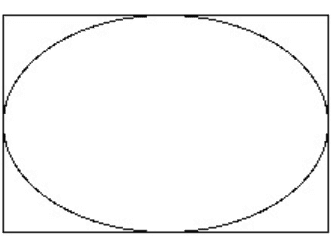
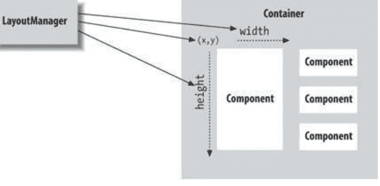
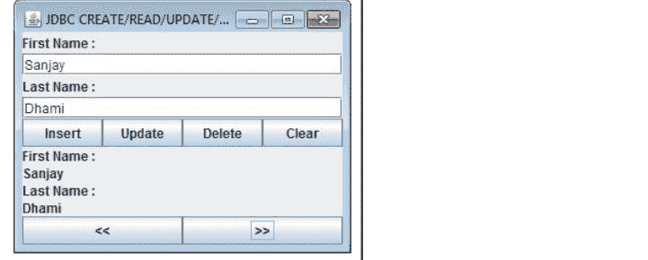

# 高级 Java 实验手册


作者：Gayatri Patel

# 第 1 元

## 简介

- 实验 1：编写一个绘制圆的 applet。该 applet 的尺寸应为 500 x 300 像素。圆应在 applet 中居中，半径为 100 像素。在圆内居中显示你的名字。（使用`drawOval()`方法）
- 实验 2：在 applet 的中心垂直绘制一列十个红圆。
- 实验 3：构建一个 applet，在其中心显示一个水平矩形。让矩形从左到右填充颜色。
- 实验 4：编写一个 applet，当鼠标被拖动或移动时，在 applet 的左上角显示鼠标的位置。在当前鼠标位置画一个 10x10 像素的黑色矩形。
- 实验 5：编写一个包含一个按钮的 applet。初始化按钮标签为“start”，当用户按下按钮时，每次按下按钮时在这两个值之间切换标签。
- 实验 6：编写一个使用鼠标监听器的 applet，仅重写`mousePressed`和`mouseReleased`方法。

## 练习：

# 第 2 元

## 简介

- 实验 7：编写一个框架中只有一个按钮的程序，点击按钮循环切换颜色：红->绿->蓝……以此类推。每次切换一种颜色。（使用`getBackground()`获取当前颜色）
- 实验 8：编写一个包含三个复选框和 30x30 像素画布的 applet。三个复选框的标签应为“红”、“绿”、“蓝”。复选框的选择决定画布的颜色。例如，如果用户选择“红”和“蓝”，画布应该是紫色。
- 实验 9：创建一个显示带有菜单栏框架的应用程序。当用户选择任何菜单或菜单项时，在框架中心的文本区域中显示该选择内容。
- 实验 10：编写一个 applet，绘制两组逐渐减小的矩形，一组为轮廓形式，另一组交替填充黑色和白色。

# 第 3 元

## 简介

- 实验 11：编写一个使用任何 JDBC 驱动数据库应用程序。
- 实验 12：开发一个执行以下 SQL 操作的 UI：1) 插入 2) 删除 3) 更新。
- 实验 13：编写一个程序，为用户提供一组选择以选择产品并显示产品价格。

# 第 4 元

## 简介

- 实验 14：编写一个简单的 servlet 程序，维护自加载以来访问次数的计数器；使用部署描述符初始化计数器。
- 实验 15：创建一个演示 cookie 使用的表单处理 servlet。
- 实验 16：创建一个演示 session 使用的表单处理 servlet。

# 第 5 元

## 简介

- 实验 17：编写一个简单的用户注册 JSP 程序，然后将控制转移到第二个页面。
- 实验 18：编写一个带有静态和动态数据库的简单用户登录表单 JSP 程序。
- 实验 19：编写一个 JSP 程序通过接受五门学科的分数显示学生的成绩。

# 第一单元

## 目标

在完成本单元后，学生将能够：

- 学习 applet
- 在 Java 中开发 applet
- 使用 Applet 运行 applet
- 在浏览器中运行 applet
- 学习使用 Graphics

### 学习成果

- 理解图形应用程序。

### 假设

- 已安装 Oracle JDK
- 有可用的编辑器进行开发
- 环境变量如`JAVA_Home`、`Path`、`Classpath`已配置

## 简介

## 什么是 applet？

根据 Sun 的定义，“applet 是一种旨在运行的小型程序”。

## Applet 的四种定义：

- 一种小型应用程序
- 在浏览器内部运行的安全程序
- `java.applet.Applet`的子类
- `java.applet.Applet`的实例

### APPLET HTML 标签

Applet 使用`<APPLET>`和`</APPLET>`标签嵌入到网页中。`<APPLET>`标签类似于``标签。

- `<APPLET>`标签的`CODE`属性告诉浏览器去哪里查找`.class`文件。它相对于源文档的位置。
- `CODEBASE`属性是一个指向`.class`文件所在目录的 URL。例如，如果在上一节的 HTML 页面中编写：

```html
<APPLET CODE="TestApplet.class"
CODEBASE="classes"
WIDTH=200 HEIGHT=200
</APPLET>
```

那么浏览器将尝试在与包含该 applet 的 HTML 页面相同的目录下 classes 目录中查找`TestApplet.class`。相反，如果你写了：

```html
<APPLET CODE="TestApplet.class"
CODEBASE="http://www.foo.bar/classes"
WIDTH=200
HEIGHT=200
</APPLET>
```

那么无论 HTML 页面在哪里，浏览器都会尝试从`http://www.foo.bar/classes`获取`TestApplet.class`。

总之，applet 查看将根据公式`(CODEBASE + "/" + code)`给出的 URL 获取 applet。一旦形成该 URL，所有的相对路径和绝对 URL 规则均适用。

你可以在`CODE`属性中省略`.class`扩展，直接使用类名。例如：

```html
<APPLET CODE="TestApplet"
CODEBASE="http://www.foo.bar/classes"
WIDTH=200
HEIGHT=200
</APPLET>
```

# 使用浏览器运行 applet

TestApplet.java

```java
import java.applet.*;
import java.awt.*;
public class TestApplet extends Applet {
    public void paint(Graphics g) {
        g.drawString("Welcome to the applet world",20,40);
    }
}
```

### TestApplet.html

```html
<HTML>
<HEAD>
<TITLE>Applet HTML Page</TITLE>
</HEAD>
<BODY>
<APPLET code="TestApplet.class" width=350 height=200></APPLET>
</BODY>
</HTML>
```

`import`语句引导 Java 编译器在编译时包含`java.applet.Applet`和`java.awt.Graphics`类。`import`语句允许在源代码中使用简单的类名（例如`Applet`）来引用这些类，而不是完全限定的类名（例如`java.applet.Applet`）。

Applet 为宿主应用程序提供了一个框架，用于显示和控制 applet 的生命周期。`Applet`类是抽象窗口工具（AWT）的一个组件，它为 applet 显示图形用户界面（GUI）并响应用户事件的能力。

### 使用 Appletviewer 直接执行 Applet

### TestApplet.java

```java
import java.applet.*;
import java.awt.*;
/*
<APPLET code="TestApplet.class" width=350 height=200></APPLET>
*/
public class TestApplet extends Applet
{
  public void paint (Graphics g)
{
  g.drawString("Welcome to Applet",20,40);
}
}
```

### Applet 基本生命周期

1. 浏览器读取 HTML 页面并找到任何`<APPLET>`标签。
2. 浏览器解析`<APPLET>`标签以找到`CODE`和可能的`CODEBASE`属性。
3. 浏览器从上一步找到的 URL 下载 applet 的`.class`文件。
4. 浏览器将下载的原始字节转换为 Java 类，即`java.lang.Object`。
5. 浏览器实例化 applet 类以形成一个 applet 对象。这要求 applet 具有一个无参数的构造函数（nargs constructor）。
6. 浏览器调用 applet 的`init()`方法。
7. 浏览器调用 applet 的`start()`方法。
8. 在 applet 运行时，浏览器会将任何发送给 applet 的事件（例如鼠标点击、按键按下等）传递给 applet 的`handleEvent`方法。更新事件（Update events）用于通知 applet 它需要重绘自己。
9. 浏览器调用 applet 的`stop()`方法。
10. 浏览器调用 applet 的`destroy()`方法。

所有的 applet 都有四个方法：

```java
public void init();
public void start();
public void stop();
public void destroy();
```

### 设计 Applet 的简单方法

| 方法 | 描述 |
| :--- | :--- |
| `void setBackground(Color colorname)` | 设置 applet 窗口的背景。 |
| `void setForeground(Color colorname)` | 设置 applet 窗口的前景颜色。 |
| `Color getBackground ( )` | 获取当前的背景颜色设置。 |
| `Color getForeground ( )` | 获取当前景颜色设置。 |
| `Applet getApplet ( String name )` | 从当前 applet 上下文中根据名称获取指定的 applet。 |
| `Void showStatus(String status )` | 在 applet 窗口的状态栏中显示状态消息。 |
| `URL getDocumentBase ( )` | 获取当前浏览器页面的目录。 |
| `URL getCodeBase()` | 获取加载 applet 类文件的目录。 |

示例：

```java
import java.applet.*;
import java.awt.*;
import java.net.*;
/*
<applet code=AppletMethods height=300 width=400>
<param name=first value="KDP">
</applet>
*/
public class AppletMethods extends Applet
{
    String arg;
    public void start()
    {
        arg=getParameter("first");
    }
    public void paint(Graphics g)
    {
      setBackground(Color.black);
      setForeground(Color.white);
      URL codename=getCodeBase();
      URL document=getDocumentBase();
      g.drawString("String = Welcome to KDP",30,40);
      g.drawString("Parameter Value = "+arg,30,70);
      g.drawString("Class name = "+codename.toString(),30,100);
      g.drawString("DocumentBase = "+document.toString(),30,130);
    }
}
```

输出：

### 向 Applet 传递参数

参数通过起始和结束`APPLET`标签之间的`<PARAM>`标签，以`NAME=VALUE`的对的形式传递给 applet。在 applet 内部，您使用`java.applet.Applet`类的`getParameter()`方法读取通过`PARAM`标签传递的值。

```html
<param name = parameter_name value = parameter_value>
```

包含`Param`标签的`APPLET`标签完整语法

```html
<APPLET
  CODEBASE = codebaseURL
  CODE = appletFile
  ALT = alternateText
  NAME = appletInstanceName
  WIDTH = pixels HEIGHT = pixels
  ALIGN = alignment
>
<PARAM NAME = appletAttribute1 VALUE = value>
<PARAM NAME = appletAttribute2 VALUE = value>
</APPLET>
```

带有参数的 Applet

```java
/*
 * TestWithPara.java
 */
import java.applet.*;
import java.awt.*;

/*
<applet code="TestWithPara.class" width=200 height=150>
<param name=author value="John">
<param name=age value="25">
<param name=designation value="Developer">
</applet>
*/
public class TestWithPara extends Applet
{
  String author;
  String age;
  String designation;

  public void init()
  {
    author = getParameter("author");
    age = getParameter("age");
    designation = getParameter("designation");
  }

  public void paint(Graphics g)
  {
    g.drawString("Author = "+author,20,40);
    g.drawString("Age = "+age,20,70);
    g.drawString("Designation = "+designation,20,100);
  }
}
```

输出：

### 绘制矩形

绘制矩形非常简单。从 Graphics 对象`g`开始并调用其`drawRect`方法：

```java
public void drawRect(int x, int y, int width, int height)
```

正如变量名所示，第一个`int`是矩形的左侧，第二个`int`是矩形的顶部，第三个`int`是宽度，第四个`int`是高度。这与某些直接给出矩形四条边的 API 不同。

此示例使用`drawRect()`在 applet 的四周边周围绘制一个矩形。

```java
import java.applet.*;
import java.awt.*;

public class RectangleApplet extends Applet {

    public void paint(Graphics g) {
        g.drawRect(0, 0, this.getSize().width - 1, this.getSize().height - 1);
    }
}
```

输出

记住`getSize().width`是 applet 的宽度，`getSize().height`是它的高度。

为什么绘制矩形只画到`getSize().height-1`和`getSize().width-1`呢？

记住 applet 的左上角从 (0, 0) 开始，而不是 (1, 1)。这意味着一个 100 比 200 像素的 applet 包含了 x 坐标在 0 到 99 之间的点，而不是 0 到 100。同样，y 坐标是在 0 到 199 之间（包含边界），而不是到 200。

### 填充矩形

`drawRect()`方法绘制的是一个空心矩形（如果你愿意，也可以称之为框）。如果你想绘制一个填充的矩形，请使用`fillRect()`方法。除此之外，语法是相同的。

此程序在 applet 中心绘制一个填充的正方形。这需要你将 applet 的宽度和高度与矩形的宽度和高度分开。以下是代码：

```java
import java.applet.*;
import java.awt.*;

public class FillAndCenter extends Applet {
    public void paint(Graphics g) {
        int appletHeight = this.getSize().height;
        int appletWidth = this.getSize().width;
        int rectHeight = appletHeight/3;
        int rectWidth = appletWidth/3;
        int rectTop = (appletHeight - rectHeight)/2;
        int rectLeft = (appletWidth - rectWidth)/2;

        g.fillRect(rectLeft, rectTop, rectWidth-1, rectHeight-1);
    }
}
```

输出

### 椭圆和圆形


Java 有方法来绘制描边和填充的椭圆。正如你可能猜到的那样，这些方法分别被称为`drawOval()`和`fillOval()`。你可能猜不到它们接收的参数与`drawRect()`和`fillRect()`相同，即：

```java
public void drawOval(int left, int top, int width, int height)
public void fillOval(int left, int top, int width, int height)
```

它们指定的不是椭圆本身的尺寸，而是能够包含该椭圆的最小矩形的尺寸。椭圆会被绘制得尽可能大，直到触及矩形边的中心。这张图片可能有所帮助：



`drawOval()`的参数与`drawRect()`的参数相同。第一个`int`是包含矩形的左侧，第二个`int`是包含矩形的顶部，第三个`int`是宽度，第四个`int`是高度。

### 示例

```java
import java.applet.*;
import java.awt.*;

public class Bullseye extends Applet {

    public void paint(Graphics g) {
        int appletHeight = this.getSize().height;
        int appletWidth = this.getSize().width;

        for (int i=8; i >= 0; i--) {
            if ((i % 2) == 0) g.setColor(Color.red);
            else g.setColor(Color.white);
            // 矩形居中
            int rectHeight = appletHeight*i/8;
            int rectWidth = appletWidth*i/8;
            int rectLeft = appletWidth/2 - i*appletWidth/16;
            int rectTop = appletHeight/2 - i*appletHeight/16;
            g.fillOval(rectLeft, rectTop, rectWidth, rectHeight);
        }
    }
}
```

### 输出

### 在 Applet 中使用颜色

创建自定义颜色的构造函数语法：

`Color ( int red, int green, int blue);`

示例：

```java
new Color (255, 100, 100);    // 淡红色
```

调用构造函数设置颜色：

```java
Color c=new Color (255, 175, 175)
g.setColor(c)
```

| 获取的颜色 | 红色值 | 绿色值 | 蓝色值 |
|---|---:|---:|---:|
| 白色 | 255 | 255 | 255 |
| 黑色 | 0 | 0 | 0 |
| 浅灰色 | 192 | 192 | 192 |
| 深灰色 | 128 | 128 | 128 |
| 红色 | 255 | 0 | 0 |
| 绿色 | 0 | 255 | 0 |
| 蓝色 | 0 | 0 | 255 |
| 黄色 | 255 | 255 | 0 |
| 紫色 | 255 | 0 | 255 |

### RGB 值表

你使用 RGB 三元组创建颜色。但是，你应该使用十进制数而不是十六进制。例如，中灰色是`Color(127,127,127)`。一些最常见的颜色可以通过名称可用。这些是：

```java
g.drawString(availableFonts[i], 5, 15*(i+1));
}
}
```

### 绘制图形

示例：`GraphicsDemo.java`

```java
import java.awt.*;
import java.applet.*;
```

```java
/*<applet code="GraphicsDemo" width=400 height=400>
</applet>*/
```

```java
public class GraphicsDemo extends Applet
{
public void paint(Graphics g)
{
setBackground(Color.pink);
setForeground(Color.blue);
Font f=new Font("Arial",Font.ITALIC,10);
```

```java
g.setFont(f);
g.drawLine(20,20,50,50);
g.drawString("Line",20,70);
g.drawRect(100,20,50,50);
g.drawString("Rectangle",100,100);
g.fillRoundRect(200,20,80,50,10,10);
g.drawString("Filled Round Rect",200,100);
g.drawOval(20,100,50,80);
g.drawString("Oval",25,200);
g.fillOval(100,130,50,50);
g.drawString("Circle",110,200);
g.drawString("WELCOME TO GRAPHICS",130,350);
}
}
```

## 实验 1：编写一个绘制圆的 Applet

Applet 的尺寸应为 500 x 300 像素。圆应该位于 Applet 的中心，半径为 100 像素。在圆的中心位置显示你的名字。（使用`drawOval()`方法）

### 特定目标

完成本次实验后，学生将能够：

- 了解 Applet。
- 在 JAVA 中开发 Applet 程序。
- 使用 AppletViewer 运行 JAVA Applet 程序。
- 在浏览器中运行 Applet。
- 学习如何使用 Graphics 类绘制圆。

### 学习成果

- 解释并练习图形绘制方法`drawOval()`来绘制圆。

### 假设

- 已安装 Oracle JDK。
- 可用记事本、Jcreator 等编辑器进行程序开发。
- 环境变量`JAVA_HOME`、`PATH`、`CLSPATH`已配置。

```java
import java.awt.*;
import java.applet.*;
/*
<applet code=CenterCircle height=500 width=300>
</applet>
*/
public class CenterCircle extends Applet
{
int w,h;
public void init()
{
w=getWidth();
h=getHeight();
}
public void paint(Graphics g)
{
g.setColor(Color.blue);
g.drawOval((w/2)-50,(h/2)-50,100,100);
g.drawString("J.B.Patel", w/2,h/2);
```

```java
g.setColor(Color.green);
showStatus("This applet draws circle in the center of the applet");
}
}
```

### 输出

## 实验 2：在 Applet 的中心垂直列出绘制十个红色圆

### 特定目标

完成本次实验后，学生将能够：

- 在 JAVA 中开发 Applet 程序。
- 使用 Appletviewer 或浏览器运行 JAVA Applet 程序。
- 学习如何使用 Graphics 类绘制圆。

### 学习成果

- 解释并练习图形绘制方法`drawOval()`来绘制圆的图案，并使用`setColor()`填充圆。

### 假设

- 已安装 Oracle JDK。
- 可用记事本、Jcreator 等编辑器进行程序开发。
- 环境变量`JAVA_Home`、`Path`、`Classpath`已配置。

### 代码

```java
import java.awt.*;
import java.applet.*;
/*
<applet code=TenRed height=500 width=300>
</applet>
*/
public class TenRed extends Applet
{
int w,h;
public void init()
{
  w=getWidth();
  h=getHeight();
}
public void paint(Graphics g) {
{
  int count=0;
  g.setColor(Color.red);
  for(int i=h;i>0;i=i-50) {
    g.fillOval(w/2-25,h-i,50,50);
    count++;
    if (count==10) break;
  }
  }
}
```

## 实验 3：构建一个 Applet，在它的中心显示一个水平矩形

让矩形从左到右填充颜色。

### 特定目标

完成本次实验后，学生将能够：

- 在 JAVA 中开发 Applet 程序。
- 使用 Appletviewer 或浏览器运行 JAVA Applet 程序。
- 学习如何使用 Graphics 类绘制和填充矩形。

### 学习成果

- 解释并练习图形绘制方法`drawRect()`和`fillRect()`来创建进度条（Postgres bar）。

### 假设

- 已安装 Oracle JDK。
- 可用记事本、Jcreator 等编辑器进行程序开发。
- 环境变量`JAVA_Home`、`Path`、`Classpath`已配置。

```java
import java.awt.*;
import java.applet.*;
/*
<applet code=FillRect height=500 width=300>
</applet>
*/
public class FillRect extends Applet
{
    int w,h, x1=100,x2,y1=50,y2=150, flag=0;
    Thread t;
    Graphics g1;
    public void init()
    {
        w=getWidth();
        h=getHeight();
    }
    public void paint(Graphics g)
    {
        g.setColor(java.awt.red);
        g.drawRect(100,50,300,150);
        for(x2=100;x2<=300;x2++)
        {
            try{
                Thread.sleep(100);
                g.fillRect(x1,y1,x2,y2);
            } catch(Exception e) {}
        }
    }
}
```

## 实验 4：编写一个 Applet，当鼠标被拖动或移动时，在 Applet 的角落显示鼠标的位置

绘制一个 10x10 像素的黑色矩形。

### 特定目标

完成本次实验后，学生将能够：

- 在 JAVA 中开发 Applet 程序。
- 使用 Appletviewer 或浏览器运行 JAVA Applet 程序。
- 学习使用 MouseListener 和 MouseMotionListeners 处理鼠标事件。

### 学习成果

- 解释并练习使用`init()`和`repaint()`方法处理移动位置等鼠标事件。

### 假设

- 已安装 Oracle JDK。
- 可用记事本、Jcreator 等编辑器进行程序开发。
- 环境变量`JAVA_Home`、`Path`、`Classpath`已配置。

```java
import java.awt.event.*;
import java.applet.*;
import java.awt.*;
/*
<applet code=MousePosition height=300 width=400>
</applet>
*/
public class MousePosition extends Applet implements MouseListener, MouseMotionListener
{
    String s="";
    int mx=0, my=0;
    public void init() {
        addMouseListener(this);
        addMouseMotionListener(this);
    }
    public void mouseClicked(MouseEvent m) {}
    public void mouseEntered(MouseEvent m) {}
    public void mouseExited(MouseEvent m) {}
    public void mousePressed(MouseEvent m) {}
    public void mouseReleased(MouseEvent m)
{}
    public void mouseDragged(MouseEvent m)
    {
        mx=m.getX();
        my=m.getY();
        s="Dragging:";
        repaint();
    }
    public void mouseMoved(MouseEvent m)
    {
        mx=m.getX();
        my=m.getY();
        s="Moving:";
        repaint();
    }
    public void paint(Graphics g)
    {
        g.drawString("Mouse"+s+mx+","+my, 10, 10);
        g.setColor(Color.red);
        g.drawRect( mx,my, 10, 10);
    }
}
```

| 移动时 | 拖动时 |
|---|---|
|  |  |

## 实验 5：编写一个包含一个按钮的 Applet

初始化按钮标签为“START”。当用户按下按钮时，每次按下都在这两个值之间切换标签。

### 特定目标

完成本次实验后，学生将能够：

- 使用 AWT Button 在 JAVA 中开发 GUI Applet 程序。
- 使用 Appletviewer 或浏览器运行 JAVA Applet 程序。
- 学习使用 ActionListener 接口处理 AWT 按钮事件。

### 学习成果

- 解释并练习使用`actionPerformed()`方法处理 AWT 按钮事件。

### 假设

- 已安装 Oracle JDK。
- 可用记事本、Jcreator 等编辑器进行程序开发。
- 环境变量`JAVA_Home`、`Path`、`Classpath`已配置。

### 代码

```java
import java.awt.*;
import java.applet.*;
import java.awt.event.*;
import java.lang.String;
/*<applet=ButtonsDemo.class width=300 height=300></applet>*/
public class ButtonsDemo extends java.applet.Applet implements ActionListener {
Button b1;
public void init()
{
b1=new Button("Start");
add(b1);
b1.addActionListener(this);
}
public void actionPerformed(ActionEvent e)
{
if(e.getSource()==b1)
{
String s;
s=b1.getLabel();
if(s=="Start")
b1.setLabel("Stop");
else
 b1.setLabel("Start");
 }
}
```

### 输出

| 当你按下停止按钮时 | 当你按下开始按钮时 |
|---|---|
|  |  |

## 实验 6：编写一个使用 MOUSE LISTENER 的 Applet

它只重写两个方法：MOUSE PRESSED 和 MOUSE RELEASED。

### 特定目标

完成本次实验后，学生将能够：

- 在 JAVA 中开发 Applet 程序。
- 使用 Appletviewer 或浏览器运行 JAVA Applet 程序。
- 学习使用 MouseListener 和 MouseMotionListeners 处理鼠标事件。

### 学习成果

- 解释并练习使用`mousePressed()`和`mouseReleased()`方法处理按下和释放等鼠标事件。

### 假设

- 已安装 Oracle JDK。
- 可用记事本、Jcreator 等编辑器进行程序开发。
- 环境变量`JAVA_Home`、`Path`、`Classpath`已配置。

### 代码

```java
import java.awt.event.*;
import java.applet.*;
import java.awt.*;
/*
<applet code=MouseState height=300 width=400>
```


```java
</applet>
/*
public class MouseState extends Applet implements MouseListener,
MouseMotionListener
{
    String s="";
    int mx=0, my=0;
    public void init()
    {
        addMouseListener(this);
        addMouseMotionListener(this);
    }
    public void mouseClicked(MouseEvent m) { }
    public void mouseEntered(MouseEvent m) { }
    public void mouseExited(MouseEvent m) { }
    public void mousePressed(MouseEvent m)
    {
        mx=m.getX();
        my=m.getY();
        s=" Pressed:";
        repaint();
    }
    public void mouseReleased(MouseEvent m)
    {
        mx=m.getX();
        my=m.getY();
        s=" Released:";
        repaint();
    }
    public void mouseDragged(MouseEvent m) { }
    public void mouseMoved(MouseEvent m) { }
    public void paint(Graphics g)
{
  g.drawString("Mouse" + mx + "," + my, 10, 10);
  g.setColor(Color.red);
  g.drawRect ( mx,my, 10, 10);
  //g.drawString("Mouse moving at: "+mx+",+my,20,40);
}
}
```

| 当你按下鼠标时 | 当你释放鼠标时 |

## 练习：

编写一个显示简单消息：“HELLO APPLET”的 Applet。

代码：

输出：

编写一个 Java 程序来绘制线条、矩形和椭圆。

代码：

输出：

编写一个用弧形和椭圆绘制人脸的 Applet。

代码：

输出：

编写一个程序，将给定的字符串以指定的字体和颜色设置并显示出来（字体：ARIEL，**粗体**且字号为 20，颜色：粉色）

代码：

输出：

# 第 2 单元

总体目标

在完成本次实践后，学生将能够：

- 学习 Windows AWT 控件。
- 使用 JAVA 开发 AWT 程序。
- 在 JAVA 中执行运行 AWT 程序。
- 学习如何使用 `Graphics` 类来绘制形状。

学习成果

- 使用 `Applets` 和 `Frames` 解释并练习 AWT 控件。
- 已安装 Oracle JDK。
- 可用记事本、`Jcreator` 等编辑器进行程序开发。
- 已配置 `JAVA_Home`、`Path`、`Classpath` 等环境变量。

假设条件

## 引言

## 抽象窗口工具包 (Abstract Window Toolkit)

AWT 包含了许多类和方法，允许我们创建和管理窗口。虽然 AWT 的主要目的是支持 applet 窗口，但它也可以用于创建在 GUI 环境（如 Windows）中运行的窗口。

## AWT 类

AWT 类包含在 `java.awt` 包中。它是 Java 最大的包之一。幸运的是，因为它按照自上而下的层次结构逻辑组织，所以理解和使用它比你最初认为的要容易。

- `AWTEvent` 封装 AWT 事件。
- `AWTEventMulticaster` 将事件分发给多个监听器。
- `BorderLayout` 边界布局管理器。边界布局使用五个组件：北、南、东、西和中心。
- `Button` 创建推按钮控件。
- `Canvas` 一个空白、无语义的窗口。
- `CardLayout` 卡片布局管理器。卡片布局模拟索引卡片。只显示最上面的那一个。
- `Checkbox` 创建复选框控件。
- `CheckboxGroup` 创建一组复选框控件。
- `CheckboxMenuItem` 创建一个开启/关闭菜单项。
- `Choice` 创建弹出列表。
- `Color` 以独立于布局的方式管理颜色。
- `Component` 各种 AWT 控件的抽象父类。
- `Container` `Component` 的子类，包含组件。
- `Cursor` 封装位图光标。
- `Dialog` 创建对话框窗口。
- `Dimension` 指定对象的尺寸。宽度存储在 `width` 中，高度存储在 `height` 中。
- `Event` 封装事件。
- `EventQueue` 队列化事件。
- `FileDialog` 创建一个可以从中选择文件的窗口。
- `FlowLayout` 流式布局管理器。流式布局从左到右、从上到下排列组件。
- `Font` 封装类型字体。
- `FontMetrics` 封装与字体相关的各种信息。这些信息帮助您在窗口中显示文本。
- `Frame` 创建一个具有标题栏、可缩放角和菜单栏的标准窗口。
- `Graphics` 封装图形上下文。该上下文被各种输出方法用于在窗口中显示输出。
- `GraphicsDevice` 描述图形设备，如屏幕或打印机。
- `GraphicsEnvironment` 描述可用 `Font` 和 `GraphicsDevice` 对象的集合。
- `GridBagConstraints` 为 `GridBagLayout` 类定义各种约束。
- `GridBagLayout` 网格包布局管理器。网格包布局根据 `GridBagConstraints` 指定约束显示组件。
- `GridLayout` 在二维网格中布局组件的网格布局管理器。
- `Image` 封装图形。
- `Insets` 封装容器的边框。
- `Label` 创建显示字符串的标签。
- `List` 创建一个用户可以从中选择的列表。类似于标准的 Windows 列表框。
- `MediaTracker` 管理媒体对象。
- `Menu` 创建拉式菜单。
- `Menu` 创建菜单栏。
- `MenuComponent` 由各种菜单类实现的抽象类。
- `MenuItem` 创建菜单项。
- `MenuShortcut` 封装菜单项的键盘快捷键。
- `Panel` `Container` 最简单的具体子类。
- `Point` 封装笛卡尔坐标对，存储在 `x` 和 `y` 中。
- `Polygon` 封装多边形。
- `PopupMenu` 封装一个弹出菜单。
- `PrintJob` 表示一个打印任务的抽象类。
- `Rectangle` 封装矩形。
- `Robot` 支持自动化测试的抽象类。
- `Scrollbar` 创建滚动条。
- `ScrollPane` 提供水平和垂直滚动条的容器。
- `System` 颜色。
- `TextArea` 创建多行编辑控件。
- `TextComponent` `Text` 的子类。
- `TextField` 创建单行编辑控件。
- `Toolkit` 实现 AWT 的抽象类。
- `Window` 创建没有菜单栏的窗口。

### Window 基础

AWT 窗口按照层次结构在每个层级添加功能。最常见的窗口源自 `Panel`（供 applets 使用），而那些源自 `Frame` 的创建标准窗口。这些窗口的功能源自父类。

### 使用 Frame

AWT 窗口按照层次结构在每个层级添加功能。最常见的窗口源自 `Panel`（供 applets 使用），而那些源自 `Frame` 的创建标准窗口。这些窗口的功能源自父类。

### 在 Applet 中创建 Frame

AWT 窗口按照层次结构在每个层级添加功能。最常见的窗口源自 `Panel`（供 applets 使用），而那些源自 `Frame` 的创建标准窗口。这些窗口的功能源自父类。

### 在 Applet 中创建 Frame

AWT 窗口按照层次结构在每个层级添加功能。最常见的窗口源自 `Panel`（供 applets 使用），而那些源自 `Frame` 的创建标准窗口。这些窗口的功能源自父类。

### 使用 AWT 控件、布局管理器和菜单

控件是允许用户以各种方式与其应用程序交互的组件——例如；常用的控件是推按钮。

**控件基础**

为了将控件包含在窗口中，我们必须将其添加到窗口。因此，我们必须先创建一个控件的实例，并通过调用 `add( )` 将其添加，`add( )` 由 `Container` 定义。`add( )` 方法有多种。以下形式用于本章的第一部分：

`Component add(Component compObj)`

在这里，`compObj` 是我们要添加的控件的实例。返回 `compObj`。一旦添加了控件，每当其父窗口显示时，它将自动可见。有时，我们会在不再需要某个控件时将其从窗口中移除。要执行此操作，请调用 `remove()`。该方法也由 `Container` 定义。其通用形式如下：

```java
void remove(Component obj)
```

在这里，`obj` 是我们想要移除的控件引用。我们可以通过调用 `removeAll()`移除所有的控件。

**响应控件**

除了被动控件标签（labels）外，所有控件在被用户访问时都会生成事件。例如，当用户点击推按钮（push button）时，会发送一个标识该推按钮的事件。通常，我们的程序只需实现相应的接口，并为我们需要监控的每个控件注册事件监听器。

**标签 (Labels)**

`Label` 定义了以下构造函数：

```java
Label();
```

```java
Label(String str);
```

```java
Label(String str, int how);
```

我们可以使用 `setText()` 方法设置或更改标签中的文本。可以通过调用 `getText()` 获取当前标签。这些方法显示如下：

```java
void setText(String str);
```

```java
String getText();
```

要获取当前对齐方式，请调用 `getAlignment()`。方法如下：

```java
void setAlignment(int how);
```

```java
int getAlignment();
```

示例：以下示例创建三个标签并将它们添加到 applet 中。

```java
// 演示标签。LabelDemo.java
import java.awt.*; 
import java.applet.*;
/*
<applet code="LabelDemo" width=300 height=200>
</applet>
*/
public class LabelDemo extends Applet
{
    public void init()
    {
        Label one = new Label("One");
        Label two = new Label("Two");
        Label three = new Label("Three");
        // 将标签添加到 applet 窗口
        add(one);
        add(two);
        add(three);
    }
}
```

输出：

**按钮 (Buttons)**

最广泛使用的控件是推按钮（push button）。推按钮是一个包含标签并在其被按下时生成事件的组件。推按钮是 `Button` 类型的对象。`Button` 定义了以下两个构造函数：

```java
Button();
Button(String str);
```

示例：使用按钮控件

```java
//ButtonDemo.java
import java.awt.*;
import java.applet.*;
/*
<applet code="ButtonDemo" width=250 height=150>
</applet>
*/
public class ButtonDemo extends Applet
{
    String msg = "";
    Button yes, no, maybe;
    public void init()
    {
        yes = new Button("Yes");
        no = new Button("No");
        maybe = new Button("Undecided");
        add(yes); 
        add(no); 
        add(maybe);
    }
    public void paint(Graphics g)
    {
        g.drawString(msg, 6, 100);
    }
}
```

输出：

**复选框 (Check Boxes)**

复选框（check box）是一种用于开启或关闭选项的控件。复选框可以单独使用，也可以作为组的一部分使用。复选框是 `Checkbox` 类的对象。`Checkbox` 支持这些构造函数：

```java
Checkbox();
Checkbox(String str);
Checkbox(String str, boolean on)
Checkbox(String str, boolean on, Checkbox cbGroup);
Checkbox(String str, Checkbox cbGroup, boolean on)
```

第一种形式创建一个标签初始为空的复选框。复选框的状态为未勾选。
第二种形式创建一个标签由 `str` 指定的复选框。复选框的状态为未勾选。
第三种形式允许我们设置复选框的初始状态。如果 `on` 为 `true`，则复选框初始为选中；否则被清除。
第四种和第五种形式创建一个标签由 `str` 指定且其组由 `cbGroup` 指定的复选框。如果此复选框不是组的一部分，则 `cbGroup` 必须为 `null`。`on` 的值决定了复选框的初始状态。

为了检索复选框的当前状态，请调用 `getState()`。要设置其状态，请调用 `setState()`。我们可以通过 `getLabel()` 获取与复选框关联的当前标签。设置标签使用 `setLabel()`。这些方法如下：

```java
boolean getState();
void setState(boolean on);
String getLabel();
void setLabel(String str);
```

示例：演示复选框。

```java
//CheckboxDemo.java
import java.awt.*;
import java.applet.*;
/*
<applet code="CheckboxDemo" width=250 height=200>
</applet>
*/
public class CheckboxDemo extends Applet
{
    String msg = "";
    Checkbox Win98, winNT, solaris, mac;
    public void init()
    {
        Win98 = new Checkbox("Windows 98/XP", null, true);
        winNT = new Checkbox("Windows NT/2000");
        solaris = new Checkbox("Solaris");
        mac = new Checkbox("MacOS");
        add(Win98);
        add(winNT);
        add(solaris);
        add(mac);
    }
    public void paint(Graphics g)
    {
    }
}
```

输出：

**复选框组/选项按钮 (Checkbox Group/Option Button)**

组内同一只能有一个复选框被选中。这些复选框通常被称为单选按钮（radio buttons）。为了创建一个互斥的复选框集，我们必须首先定义它们所属的组。单选按钮是 `CheckboxGroup` 类型的对象。默认构造函数创建一个空组。我们可以通过调用 `getSelectedCheckbox()` 来确定组中的哪个复选框被选中。我们可以设置单选按钮。这些方法如下：

- `Checkbox getSelectedCheckbox()`
- `void setSelected(Checkbox)`

示例：这是一个使用组的复选框的程序：

```java
//CBGroup.java
import java.awt.*;
import java.applet.*;
/*
<applet code="CBGroup" width=250 height=200>
</applet>
*/
public class CBGroup extends Applet
{
    String msg = "";
    Checkbox Win98, winNT, solaris, mac;
    CheckboxGroup cbg;
    public void init() {
        cbg = CheckboxGroup();
        Win98 = new Checkbox("Windows 98/XP", null, true);
        winNT = new Checkbox("Windows NT/2000");
        solaris = new Checkbox("Solaris");
        mac = new Checkbox("MacOS");
        add(Win98);
        add(winNT);
        add(solaris);
        add(mac);
    }
    public void paint(Graphics g) {
        msg = "Current selection: ";
        msg += cbg.getSelectedCheckbox().getLabel();
        g.drawString(msg, 6, 100);
    }
}
```


### 选择列表控件（Choice Controls）

`Choice` 类用于创建用户从中选择的弹出列表。`Choice` 类仅定义了默认构造函数，用于创建一个空列表。为了向列表中添加项，使用 `add()`。其通用形式如下：

```java
void add(String name)
```

在这里，`name` 是要添加的项目的名称。为了确定选择了哪个项目，我们可以调用以下任一方法：

- `String getSelectedItem();`
- `int getSelectedIndex();`

`getSelectedItem()` 方法返回包含项目名称的字符串。`getSelectedIndex()` 返回项目的索引。第一个项目位于索引 `0`。

默认情况下，添加到列表的项目被选中。要获取列表中的项目数量，调用 `getItemCount()`。我们可以使用 `select()` 方法，通过零基整数索引或匹配列表中的字符串来设置当前选中的项目。这些方法显示如下：

- `int getItemCount();`
- `void select(int index);`
- `void select(String name);`

给定一个索引，我们可以通过 `getItem()` 获取与该索引关联的名称，其通用形式如下：

```java
String getItem(int index);
```

#### 示例：演示选择列表

```java
//ChoiceDemo.java

import java.awt.*;
import java.applet.*;

/*
<applet code="ChoiceDemo" width=300 height=180>
</applet>
*/

public class ChoiceDemo extends Applet
{
    Choice os, browser;
    String msg = "";

    public void init()
    {
        os = new Choice();
        browser = new Choice();

        os.add("Windows 98/XP");
        os.add("Windows NT/2000");
        os.add("Solaris");
        os.add("MacOS");

        browser.add("Netscape 3.x");
        browser.add("Netscape 4.x");
        browser.add("Netscape 5.x");
        browser.add("Netscape 6.x");
        browser.add("Internet Explorer 4.0");
        browser.add("Internet Explorer 5.0");
        browser.add("Internet Explorer 6.0");
        browser.add("Lynx 2.4");

        browser.select("Netscape 4.x");

        add(os);
        add(browser);
    }

    public void paint(Graphics g)
    {
        msg = "Current selection: ";
        msg += browser.getSelectedItemItem().getLabel();
        g.drawString(msg, 6, 100);
    }
}
```

### 列表（Lists）

`List` 类提供了一个紧凑的、多选的、可滚动的选择列表。`List` 对象可以构造为在可见的窗口（`Window`）中显示任意数量的选项，也可以创建为允许多选。

`List` 提供了这些构造函数：

```java
List();

List(int numRows);

List(int numRows, boolean multipleSelect);
```

第一个版本创建一个 `List` 控件，在任何时间允许选择一个项目。

第二种形式中，`numRows` 的值指定列表中始终可见的条目数量，其他条目可以通过滚动进入视图。

第三种形式中，如果 `multipleSelect` 为 `true`，则用户可以一次选择两个或多个项目。如果它为 `false`，则只能选择一个项目。

要向列表添加选择项，我们可以调用 `add()`。它有以下两种形式：

```java
void add(String name);

void add(String name, int index);
```

在这里，`name` 是添加到列表中的项目名称。第一种形式将项目添加到列表的末尾。第二种形式在 `index` 指定的位置处添加该项目。

对于允许多选的列表，我们必须使用这里显示的 `getSelectedItems()` 或 `getSelectedIndices()` 来确定当前的选择项：

```java
String[] getSelectedItems();

int[] getSelectedIndices();
```

`getSelectedItems()` 返回一个包含当前选中项目名称的数组。`getSelectedIndices()` 返回一个包含当前选中项目索引的数组。

要获取列表中的项目数量，请调用 `getItemCount()`。我们可以使用 `select()` 方法，通过从 `0` 开始的整数索引来设置当前选中项目。这些方法显示在这里：

```java
int getItemCount();

void select(int index);
```

给定一个索引，我们可以通过调用 `getItem()` 获取与该索引项目相关的名称，其通用形式为：

```java
String getItem(int index)
```

在这里，`index` 指定了目标项目的索引。

#### 示例：List 演示

```java
//ListDemo.java

import java.awt.*;
import java.applet.*;

/*
<applet code="ListDemo" width=300 height=180>
</applet>
*/

public class ListDemo extends Applet
{
    List os, browser;
    String msg = "";

    public void init()
    {
        os = new List(4, true);
        browser = new List(4, false);

        os.add("Windows 98/XP");
        os.add("Windows NT/2000");
        os.add("Solaris");
        os.add("MacOS");

        browser.add("Netscape 3.x");
        browser.add("Netscape 4.x");
        browser.add("Netscape 5.x");
        browser.add("Internet Explorer 4.0");
        browser.add("Internet Explorer 5.0");
        browser.add("Internet Explorer 6.0");
        browser.add("Lynx 2.4");
        browser.select(1);

        add(os);
        add(browser);
    }

    public void paint(Graphics g)
    {
        int idx[];

        msg = "Current OS: " + "";
        idx = os.getSelectedIndices();

        for (int i = 0; i < idx.length; i++)
            msg += os.getItem(idx[i]) + " ";

        g.drawString(msg, 6, 120);

        msg = "Current Browser: ";
        msg += browser.getSelectedItem();
        g.drawString(msg, 6, 140);
    }
}
```

输出：

| TextField |
| :--- |
| TextComponent |
| # TextArea |
| # TextField |

图：文本组件层级结构

### TextField（文本字段）

`TextField` 类实现了一个单文本输入区域，通常称为编辑控件（edit control）。`TextField` 允许用户输入字符串，并使用方向键、剪切和粘贴键以及鼠标选择来编辑文本。`TextField` 是 `TextComponent` 的子类。

`TextField` 定义了以下构造函数：

- `TextField();`
- `TextField(int numChars);`
- `TextField(String str);`
- `TextField(String str, int numChars);`

第一个版本创建一个默认文本字段。第二种形式创建一个宽度为 `numChars` 个字符的文本字段。第三种形式用 `str` 包含的字符串初始化文本字段。第四种形式初始化文本字段并设置其宽度。

`TextField` 及其父类 `TextComponent` 提供了几个方法，允许我们利用文本字段。要获取文本字段中当前包含的字符串，我们可以使用 `getText()`。要设置文本，我们调用 `setText()`。这些方法如下：

- `String getText();`
- `void setText(String str);`

在这里，`str` 是新字符串。

用户可以选择文本字段中的部分文本。此外，我们也可以通过 `select()` 在程序控制下选择部分文本。我们的程序可以通过调用 `getText()` 获取当前选中的文本。这些方法显示在这里：

- `String getSelectedText();`
- `void select(int start, int endIndex);`

`getSelectedText()` 返回选中的文本。`select()` 方法选择从 `startIndex` 开始到 `endIndex - 1` 结束的字符。

我们可以通过调用 `setEditable()` 控制用户是否可以修改文本字段的内容。通过调用 `isEditable()` 判断是否可编辑。这些方法显示在这里：

- `boolean isEditable();`
- `void setEditable(boolean canEdit);`

如果文本可以更改，则 `isEditable()` 返回 `true`，否则返回 `false`。在 `setEditable()` 中，如果 `canEdit` 为 `true`，则可以更改文本。

有时我们可能通过调用 `echoChar()` 让用户输入不显示的文本。此方法指定了输入时显示的字符。这些方法如下：

```java
void echoChar(char ch);

boolean echoCharSet();

char getEchoChar();
```

在这里，`ch` 指定了回显字符。

#### 示例：使用 TextField

```java
//TextFieldDemo.java

import java.awt.*;
import java.applet.*;

/*
<applet code="TextFieldDemo" width=300 height=150>
</applet>
*/

public class TextFieldDemo extends Applet
{
    TextField name, pass;

    public void init()
    {
        Label namep = new Label("Name: ", Label.RIGHT);
        Label passp = new Label("Password: ", Label.RIGHT);

        name = new TextField(12);
        pass = new TextField(8);
        pass.echoChar('?');

        add(namep);
        add(passp);
        add(name);
        add(pass);
    }
}
```

### TextArea（文本区域）

有时单行文本输入是不够的。为了处理这些情况，AWT 提供了一个名为 `TextArea` 的多行编辑器。以下是构造函数：

- `TextArea();`
- `TextArea(int numChars);`
- `TextArea(String str);`
- `TextArea(String str, int numChars);`
- `TextArea(String str, int numChars, int sBars);`

在这里，`numChars` 指定了文本区域的高度（行数），另一个 `numChars` 指定了宽度。初始文本可以通过 `str` 指定。

在第五种形式中，我们可以指定要拥有的滚动条。`sBars` 必须是以下值之一：

- `SCROLLBARS_BOTH`
- `SCROLLBARS_NONE`
- `SCROLLBARS_HORIZONTAL_ONLY`
- `SCROLLBARS_VERTICAL_ONLY`

`TextArea` 是 `TextComponent` 的子类。因此，它支持在前节中描述的 `getText()`、`setText()`、`isEditable()` 和 `setEditable()` 方法。

`TextArea` 增加了以下方法：

- `void append(String str);`
- `void insert(String str, int index);`
- `void replaceRange(String str, int startIndex, int endIndex);`

`append()` 方法将指定的字符串附加到当前文本末尾。`insert()` 方法在指定的索引处插入指定的字符串。要替换文本，我们调用 `replaceRange()`。它将 `startIndex` 到 `endIndex - 1` 的字符替换为传入 `str` 的替换文本。文本区域几乎是自包含的控件。

#### 示例：使用 TextArea 控件

```java
//TextAreaDemo.java

import java.awt.*;
import java.applet.*;

/*
<applet code="TextAreaDemo" width=300 height=250>
</applet>
*/

public class TextAreaDemo extends Applet
{
    public void init()
    {
        String val = "There are two ways of constructing "
            + "a software design.\n"
            + "One way is to make it so simple\n"
            + "that there are obviously no deficiencies.\n"
            + "And the other way is to make it so complicated\n"
            + "that there are no obvious deficiencies.\n"
            + " -C.A.R. Hoare\n\n"
            + "There's an old story about the person who wished\n"
            + "his computer was as easy to use as his telephone.\n"
            + "That which has come true,\n"
            + "since I no longer know how to use my telephone.\n\n"
            + " -Bjarne Stroustrup, AT&T, (inventor of C++)";

        TextArea text = new TextArea(val, 10, 30);
        add(text);
    }
}
```

## 布局管理器（Layout Managers）

我们目前为止展示的所有组件都是由默认布局管理器进行定位的。布局管理器通过使用某种算法在窗口内自动排列我们的控件。

每个容器（`Container`）都关联着一个布局管理器。布局管理器是实现了 `LayoutManager` 接口的类的实例。布局管理器通过 `setLayout()` 方法进行设置。如果没有调用 `setLayout()`，则使用默认布局管理器。

每当容器大小发生变化时（或第一次调整大小时），系统都会使用布局管理器对其中的每个组件进行定位。



图：布局管理器的工作原理

`setLayout()` 方法具有以下通用形式：

```java
void setLayout(LayoutManager layoutObj);
```

在这里，`layoutObj` 是指向所需布局管理器的引用。如果我们想禁用布局管理器并手动定位组件，请为 `layoutObj` 传递 `null`。如果我们需要手动确定每个组件的形状和位置，可以使用 `Component` 定义的 `setBounds()` 方法。

每个布局管理器都维护一个按名称存储的组件列表。每当我们向容器添加组件时，布局管理器都会收到通知。

每当容器需要调整大小时，系统会通过其 `minimumLayoutSize()` 和 `preferredLayoutSize()` 方法咨询布局管理器。每个被布局管理器管理的组件都会调用 `getPreferredSize()` 和 `getMinimumSize()` 方法。这些方法返回显示每个组件所需的理想尺寸和最小尺寸。

Java 有几个预定义的 `LayoutManager` 类，其中几个将在下文中介绍。我们可以使用最适合应用程序的布局管理器。

### 流式布局（FlowLayout）


`FlowLayout` 是默认的布局管理器。组件从左上角开始，从左到右、从上到排列。当一行无法容纳更多组件时，下一个组件将出现在下一行。每个组件的上方、下方以及左右之间都会留出小小的空间。以下是 `FlowLayout` 的构造函数：

- `FlowLayout();`
- `FlowLayout(int how);`
- `FlowLayout(int how, int horz, int vert);`

第一种形式创建默认布局，它将组件居中并在组件之间留出像素空间。第二种形式允许我们指定每行的对齐方式。`how` 的有效值如下：

- `FlowLayout.LEFT`
- `FlowLayout.CENTER`
- `FlowLayout.RIGHT`

这些值分别指定左对齐、居中和右对齐。第三种形式允许我们分别通过 `horz` 和 `vert` 指定组件之间的水平空间和垂直空间。以下是之前的 `CheckboxDemo` Applet 的修改版本，它使用了左对齐的流式布局。

```java
// FlowLayoutDemo.java
import java.awt.*;
import java.awt.applet.*;
/*
<applet code="FlowLayoutDemo" width=400 height=200>
</applet>
*/
public class FlowLayoutDemo extends Applet
{
  String msg = "";
  Checkbox Win98, winNT, solaris, mac;

  public void init()
  {
  Win98 = new Checkbox("Windows 98/XP", null, true);
  winNT = new Checkbox("Windows NT/2000");
  solaris = new Checkbox("Solaris");
  mac = new Checkbox("MacOS");
  setLayout(new FlowLayout(FlowLayout.CENTER));
  add(Win98); add(winNT); add(solaris); add(mac);
  }

  public void paint(Graphics g)
  {
  }
}
```

输出：

## 边界布局 (BorderLayout)

`BorderLayout` 类为顶层窗口实现了一种常用的布局样式。它在边缘有四个窄的固定宽度组件，在中心有一个大区域。四边分别被称为北（north）、南（south）、东（east）和西（west）。中间区域被称为中心（center）。以下是 `BorderLayout` 定义的构造函数：

- `BorderLayout();`
- `BorderLayout(int horz, int vert);`

第一种形式创建默认的边界布局。第二种形式允许我们分别通过 `horz` 和 `vert` 指定组件之间的水平空间和垂直空间。`BorderLayout` 定义了以下常量来指定区域：

- `BorderLayout.CENTER`
- `BorderLayout.SOUTH`
- `BorderLayout.EAST`
- `BorderLayout.WEST`
- `BorderLayout.NORTH`

在添加组件时，我们将使用这些常量配合以下 `add()` 方法的形式，该方法由 `Container` 定义：

```java
void add(Component compObj, Object region);
```

在这里，`compObj` 是要添加的组件，`region` 指定组件添加的位置。以下是一个每个布局区域都包含组件的 `BorderLayout` 示例：

```java
// BorderLayoutDemo.java
import java.awt.*; import java.applet.*;
/*
<applet code="BorderLayoutDemo" width=400 height=200>
</applet>
*/
public class BorderLayoutDemo extends Applet
{
    public void init() {
        setLayout(new BorderLayout("This is across the top."), BorderLayout.NORTH);
        add(new Button("The footer message might go here."), BorderLayout.SOUTH);
        add(new Button("Right"), BorderLayout.EAST);
        add(new Button("Left"), BorderLayout.WEST);
        String msg = "The reasonable man adapts " + "himself to the world:\n" + 
"the unreasonable one persists in \n" + "trying to adapt the world to himself.\n" + 
"Therefore all progress depends " + 
"on the unreasonable man.\n\n" + 
" - George Bernard Shaw";
        add(new TextArea(msg));
    }
}
```

## 实验 7：编写一个只有一个按钮的程序，点击按钮循环切换颜色：红->绿->蓝（使用 `GETBACKGROUND()` 方法获取当前颜色）

### 具体目标

在完成本次实验后，学生将能够：

- 使用 `Button` 控件用 Java 开发 AWT 程序。
- 学习如何使用 `ActionListener` 接口处理按钮事件。

### 学习成果

- 解释并练习按钮事件。

### 假设条件

- 已安装 Oracle JDK
- 可用于开发的编辑器，如记事本或 Jcreator
- 环境变量 `JAVA_Home`、`Path`、`Classpath` 已配置好。

### 代码

```java
import java.awt.*;
import java.applet.*;
import java.awt.event.*;
import java.lang.String;

class ChangeColor extends Applet implements ActionListener {
    Button b1;
    public void init() {
        b1=new Button("Change Color");
        add(b1);
        b1.addActionListener(this);
    }
    public void actionPerformed(ActionEvent e) {
        if(e.getSource()==b1) {
            String s;
            s=b1.getBackground();
            if(s=="Change Color") {
                this.setBackground(Color.RED);
                b1.setLabel("Green");
            }
            if(s=="Green") {
                this.setBackground(Color.GREEN);
                b1.setLabel("Blue");
            }
            if(s=="Blue") {
                this.setBackground(Color.BLUE);
                b1.setLabel("Change Color");
            }
        }
    }
}
```

```java
public class ColorPickerDemo extends Frame {
    public static void main(String [] args) {
        Frame f = new Frame("Color Demo");
        ChangeColor c = new ChangeColor();
        c.init();
        f.add(c);
        f.pack();
        f.show();
    }
}
```

## 实验 8：编写一个包含三个复选框和 30x30 像素画布的 Applet。三个复选框标记为“红”、“绿”、“蓝”。复选框的选择决定画布的颜色。例如，如果用户同时选择了“红”和“蓝”，画布应该是紫色。

### 具体目标

在完成本次实验后，学生将能够：

- 使用 `Checkbox` 和 `Canvas` 控件用 Java 开发 AWT 程序。
- 学习如何使用 `ItemListener` 接口处理复选框事件。

### 学习成果

- 解释并练习复选框事件。

### 假设条件

- 已安装 Oracle JDK
- 可用于编辑器，如记事本或 Jcreator
- 环境变量 `JAVA_Home`、`Path`、`Classpath` 已配置好。

### 代码

```java
import java.awt.*;
import java.applet.*;
import java.awt.event.*;
import java.lang.String;

public class CanvasColorDemo extends Applet implements ItemListener
{
    Checkbox ch1,ch2,ch3;
    Canvas c=new Canvas();
    public void init()
    {
        setLayout(new GridLayout(1,4));

        ch1=new Checkbox("RED",false);
        ch2=new Checkbox("GREEN",false);
        ch3=new Checkbox("BLUE",false);
        add(ch1);
        add(ch2);
        add(ch3);
        add(c);
        ch1.addItemListener(this);
        ch2.addItemListener(this);
        ch3.addItemListener(this);
    }
    public void itemState(ItemEvent e) {
        int r = 0, g = 0, b = 0;
        if(ch1.getState()) r = 1;
        if(ch2.getState()) g = 1;
        if(ch3.getState()) b = 1;

        if(r && g && b) c.setBackground(Color.MAGENTA);
        else if(r && g) c.setBackground(Color.YELLOW);
        else if(r && b) c.setBackground(Color.PURPLE);
        else if(g && b) c.setBackground(Color.CYAN);
        else if(r) c.setBackground(Color.RED);
        else if(g) c.setBackground(Color.GREEN);
        else if(b) c.setBackground(Color.BLUE);
        else c.setBackground(Color.WHITE);
    }
}
```

```java
ch2.addItemListener(this);
ch3.addItemListener(this);
c.setBackground(Color.CYAN);
c.setVisible(true);
    add(c);
}
```

```java
public void itemStateChanged(ItemEvent e)
{
    if(e.getSource()==ch1)
        if(c1!=255)
            c1=255;
    else
        c1=0;
    if(e.getSource()==ch2)
        if(c2!=255)
            c2=255;
    else
        c2=0;
    if(e.getSource()==ch3)
        if(c3!=255)
            c3=255;
    else
        c3=0;
    c.setBackground(new Color(c1,c2,c3));
    repaint();
}
```

## 实验 9：创建一个显示带有菜单栏框架的应用程序。当用户选择任何菜单或菜单项时，在框架中央的文本区域中显示该选择内容

### 具体目标

完成此实验后，学生将能够：

- 使用 Java 中的 `Menu` 和 `TextArea` 开发一个 AWT 程序
- 学习如何使用 `ActionListener` 接口处理菜单事件。

### 学习成果

- 解释并练习菜单事件。

### 假设

- 已安装 Oracle JDK
- 可用记事本（notepad）、Jcreator 等编辑器进行程序开发
- 已配置 `JAVA_Home`、`Path`、`Classpath` 等环境变量。

### 代码

```java
/*MenuDemo.java*/
import java.awt.*;
import java.awt.event.*;
import java.awt.applet.*;

public class MenuDemo extends Applet implements ActionListener
{
    private TextField myTextField;
    private Frame myFrame;
```

```java
public void init()
{
  myFrame = new Frame();
  myFrame.addActionListener(new Terminator());
  myTextField = new TextField(20);
  add(myTextField);
  myFrame.setBounds(200,200,300,300);

  // 将 myMenuBar 放在 myFrame 的顶部
  MenuBar myMenuBar = new MenuBar();
  myFrame.setMenuBar(myMenuBar);

  Menu fileMenu = new Menu("File");
  myMenuBar.add(fileMenu);

  Menu editMenu = new Menu("Edit");
  myMenuBar.add(editMenu);
  MenuItem myMenuItem;

  myMenuItem = new MenuItem("Open");
  myMenuItem.addActionListener(this);
  fileMenu.add(myMenuItem);

  myMenuItem = new MenuItem("Close");
  myMenuItem.addActionListener(this);
  fileMenu.add(myMenuItem);

  myMenuItem = new MenuItem("Undo");
  myMenuItem.addActionListener(this);
  editMenu.add(myMenuItem);
```

```java
myFrame.show();
}
public void actionPerformed(ActionEvent e)
{
    if (e.getSource() instanceof MenuItem)
        myTextField.setText("Your Choice: " 
        + e.getActionCommand());
}
public class Terminator extends WindowAdapter
{
    public void windowClosing(WindowEvent e)
    {
        myFrame.dispose();
        // 应用程序使用 System.exit(0)
    }
}
```

## 实验 10：编写一个 Applet，绘制两组逐渐减小的矩形，一组为轮廓形式，另一组交替用黑色和白色填充。

### 具体目标

完成此实验后，学生将能够：

- 使用 `Graphics` 类方法（如 `drawRect()` 和 `fillRect()`）用 Java 开发 AWT 程序

### 学习成果

- 解释并练习 `Graphics` 类方法。

### 假设

- 已安装 Oracle JDK
- 可用记事本、Jcreator 等编辑器进行程序开发
- 已配置 `JAVA_Home`、`Path`、`Classpath` 等环境变量。

### 代码


```java
import java.awt.*;
import java.awt.event.*;
import java.awt.applet.*;

public class RectApplet extends Applet
{
    public static final int W = 200;
    public static final int H = 200;

    public void paint(Graphics g)
{
    g.setColor(Color.BLACK);
    g.fillRect(0, 0, getWidth(), getHeight());

    g.setColor(Color.WHITE);
    for (int x = 0; x < getWidth() / 2; x += 5)
    {
    int x1 = (getWidth() / 2) - x;
    int y1 = (getHeight() / 2) - x;
    g.drawRect(x1, y1, x * 2, x * 2);
    }
}
public static void main(String args[])
{
    RectApplet applet = new RectApplet();
    Frame frame = new Frame();
    frame.addWindowListener(new WindowAdapter()
    {
        public void windowClosing(WindowEvent e)
        {
            System.exit(0);
        }
    });
    frame.add(applet);
    frame.setSize(W, H);
    frame.show();
}
```

# 实验 10：编写一个 `Applet`，绘制两组逐渐减小的矩形，一组为轮廓形式，另一组交替用黑色和白色填充

## 具体目标

完成此实验后，学生将能够：

- 使用 `Graphics` 方法（如 `drawRect()` 和 `fillRect()`）用 Java 开发 AWT 程序。

## 学习成果

- 解释并练习 `Graphics` 方法。

## 假设

- 已安装 Oracle JDK。
- 可用记事本、Jcreator 等编辑器进行程序开发。
- 已配置 `JAVA_Home`、`Path`、`Classpath` 等环境变量。

## 代码

（见上方代码）

## 输出

## 练习

扩展之前的程序，当点击按钮时在文本区域中显示“HAPPY YEAR”。

扩展之前的程序，当点击按钮时在文本区域中显示“HAPPY NEW YEAR”。

扩展之前的程序，当点击按钮时在文本区域中显示“HAPPY NEW YEAR”。

扩展之前的程序，当点击按钮时在文本区域中显示“HAPPY NEW YEAR”。

扩展之前的程序，当点击按钮时在文本区域中显示“HAPPY NEW YEAR”。

扩展之前的程序，当点击按钮时在文本区域中显示“HAPPY NEW YEAR”。

扩展之前的程序，当点击按钮时在文本区域中显示“HAPPY NEW YEAR”。

扩展之前的程序，当点击按钮时在文本区域中显示“HAPPY NEW YEAR”。

扩展之前的程序，当点击按钮时在文本区域中显示“HAPPY NEW YEAR”。

扩展之前的程序，当点击按钮时在文本区域中显示“HAPPY NEW YEAR”。

扩展之前的程序，当点击按钮时在文本区域中显示“HAPPY NEW YEAR”。

扩展之前的程序，当点击按钮时在文本区域中显示“HAPPY NEW YEAR”。

扩展之前的程序，当点击按钮时在文本区域中显示“HAPPY NEW YEAR”。

扩展之前的程序，当点击按钮时在文本区域中显示“HAPPY NEW YEAR”。

扩展之前的程序，当点击按钮时在文本区域中显示“HAPPY NEW YEAR”。

扩展之前的程序，当点击按钮时在文本区域中显示“HAPPY NEW YEAR”。

扩展之前的程序，当点击按钮时在文本区域中显示“HAPPY NEW YEAR”。

扩展之前的程序，当点击按钮时在文本区域中显示“HAPPY NEW YEAR”。

扩展之前的程序，当点击按钮时在文本区域中显示“HAPPY NEW YEAR”。

扩展之前的程序，当点击按钮时在文本区域中显示“HAPPY NEW YEAR”。

扩展之前的程序，当点击按钮时在文本区域中显示“HAPPY NEW YEAR”。

扩展之前的程序，当点击按钮时在文本区域中显示“HAPPY NEW YEAR”。

扩展之前的程序，当点击按钮时在文本区域中显示“HAPPY NEW YEAR”。

# 第 3 章

## 一般目标

完成此实验后，学生将能够：

- 学习如何使用 JDBC 连接数据库。
- 开发 JDBC 应用程序创建、读取、删除记录。

### 学习成果

- 解释 JDBC 概念并练习 JDBC 程序。

### 假设

- 已安装 Oracle JDK，已安装 MySQL Connector。
- 可用记事本、Jcreator 等编辑器进行程序开发。
- 已配置 `JAVA_Home`、`Path`、`Classpath` 等环境变量。

## 简介

JDBC 代表 Java Database Connectivity（Java 连接），它是 Java 语言与多种数据库之间的标准 Java API。JDBC 库包含了与数据库使用常用的任务相关的 API：

- 建立连接。
- 创建 SQL 语句。
- 执行 SQL 查询。
- 断开数据库连接。

使程序运行的基本步骤是：

- 加载驱动并将其注册到驱动管理器。
- 连接数据库。
- 创建语句。
- 执行查询并获取结果，或对数据库进行更改。

步骤 1 和 2 是特定于 DBMS 的步骤。

以下是加载驱动并注册到驱动管理器的代码：

```java
DriverManager.registerDriver(new com.mysql.jdbc.Driver());
```

实现上述功能的另一种方法：

```java
Class.forName("com.mysql.jdbc.Driver");
```

一些常用数据库的驱动字符串：

- MySQL JDBC 连接 URL：`jdbc:mysql://hostname:3306/`，其中 3306 是 MySQL 默认端口。
- Java DB 连接：`jdbc:derby:testdb:create=true`
- Microsoft SQL Server 连接 URL：`jdbc:microsoft:sqlserver://localhost:1433;DatabaseName=northwind`
- Oracle JDBC 连接 URL：`jdbc:oracle:thin:@hostname:1521:MyDatabase`

## 连接数据库

`DriverManager` 类提供了静态方法 `getConnection()` 来打开数据库连接。以下是 `getConnection()` 方法描述：

```java
public static Connection getConnection(String url, String userid, String password) throws SQLException
```

### 获取连接

`Connection = DriverManager.getConnection("jdbc:jdbcDriver:database", username, password);`

### 查询执行并获取结果

```java
Statement statement = connection.createStatement();
ResultSet resultSet = statement.executeQuery("SELECT * FROM table");
```

### 解析 `ResultSet` 中的结果

```java
while (resultSet.next()) {
  int field1= rs.getInt("field1");
  String field2= rs.getString("field2");
}
```

## 实验 11：编写一个使用任何 JDBC 驱动程序的数据库应用程序

学习如何使用 JDBC API 和 JDBC 驱动来实现数据库功能。

### 学习成果

- 解释 JDBC 概念并练习 JDBC 程序连接 MySQL 数据库。

### 假设

- 已安装 Oracle JDK，已安装并配置 MySQL Java Connector。
- 可用如记事本（`notepad`）、Jcreator 等编辑器进行开发。
- 已配置 `JAVA_Home`、`path`、`classpath` 等环境变量。

### 代码

```java
//STEP 1. 导入所需的包
import java.sql.*;
public class JDBCExample {
    // JDBC 驱动和数据库 URL
    static final String JDBC_DRIVER = "com.mysql.jdbc.Driver";
    static final String DB_URL = "jdbc:mysql://localhost/";
    // 数据库凭据
    static final String USER = "root";
    static final String PASS = "";
    public static void main(String[] args) {
        Connection conn = null;
        Statement stmt = null;
        try{
            //STEP 2: 注册 JDBC 驱动
            Class.forName("com.mysql.jdbc.Driver");

            //STEP 3: 打开连接
            System.out.println("Connecting to database...");
            conn = DriverManager.getConnection(DB_URL, USER, PASS);
            //STEP 4: 执行查询
            System.out.println("Creating database...");
```

```java
stmt = conn.createStatement();
String sql = "CREATE DATABASE STUDENTS";
stmt.executeUpdate(sql);
System.out.println("Database created successfully...");
}catch(SQLException se) {
  // 处理 JDBC 错误
  se.printStackTrace();
}catch(Exception e) {
  // 处理 Class.forName 错误
  e.printStackTrace();
}finally{
  // finally 块用于关闭资源
  try{
    if(stmt!=null) {
      stmt.close();
  }catch(SQLException se2) {
    // 我们无能为力
  try{
    if(conn!=null) {
      conn.close();
  }catch(SQLException se) {
    se.printStackTrace();
    }//end finally try
  }//end try
  }//end try
System.out.println("Goodbye!");
}//end main
}//end JDBCExample
```

### 输出

- Connecting to database...
- Creating database...
- Database created successfully...
- Goodbye!

处理完成。

## 实验 12：开发一个执行以下 SQL 操作的界面：1）插入；2）删除；3）更新

### 具体目标

在完成本次实验后，学生将能够：

- 学习如何使用 JDBC 执行 CRUD 操作（创建、读取、更新、删除）。
- 学习如何使用 JDBC API 和 JDBC 驱动来实现数据库功能。

### 学习成果

- 解释 JDBC 概念并使用 JDBC 练习数据库操作。

### 假设

- 已安装 Oracle JDK，已安装并配置 MySQL Java Connector。
- 可用如记事本（`notepad`）、Jcreator 等编辑器进行开发。
- 已配置 `JAVA_Home`、`path`、`classpath` 等环境变量。

```java
import java.awt.Container;
import java.awt.GridLayout;
import java.awt.event.ActionEvent;
import java.awt.event.ActionListener;
import java.sql.Connection;
import java.sql.DriverManager;
import java.sql.ResultSet;
import java.sql.SQLException;
import java.sql.Statement;

import javax.swing.BoxLayout;
import javax.swing.JButton;
import javax.swing.JFrame;
```

```java
import javax.swing.JLabel;
import javax.swing.JPanel;
import javax.swing.JTextField;
```

```java
public class DBCCRRUD implements ActionListener {
  JLabel lblFname,lblName,lbllf,lblll;
  JLabel lbllfVal,lblllVal;
  JTextField txtName, txtLName;
  JButton btnInsert,btnDelete,btnUpdate,btnPrev,btnNext,btnClear;
  Connection con;
  
  ResultSet rs;
  public static void main(String[] args) {
    JDBCCRRUD obj = new JDBCCRRUD();
    obj.createUI();
    obj.connect();
  }
  private void createUI() {
    JFrame frame = new JFrame("JDBC CREATE/READ/UPDATE/DELETE");
    // 主窗口布局
    Container c = frame.getContentPane();
    c.setLayout(new BoxLayout(c,Box.Y_AXIS));
    lblFname = new JLabel("First Name :");
    lblName = new JLabel("Last Name :");
  
  txtName = new JTextField(); // 调整宽度
  JPanel pnlInput = new JPanel(new GridLayout(4,2));
  pnlInput.add(lblFname);
  pnlInput.add(txtName);
```

```java
  pnlInput.add(txtLName);
  btnInsert = new JButton("Insert");
  btnInsert.addActionListener(this);
  btnUpdate = new JButton("Update");
  btnUpdate.addActionListener(this);
  btnDelete = new JButton("Delete");
  btnDelete.addActionListener(this);
  btnClear = new JButton("Clear");
  btnClear.addActionListener(this);
  pnlButton = new JPanel(new GridLayout(1,4));
  pnlButton.add(btnInsert);
  pnlButton.add(btnUpdate);
  pnlButton.add(btnDelete);
  pnlButton.add(btnClear);
  pnlAns = new JPanel(new GridLayout(4,2));
  lbllf = new JLabel("First Name :");
  lbllfVal = new JTextField();
  lblll = new JLabel("Last Name :");
  lblllVal = new JTextField();
  pnlAns.add(lbllf);
  pnlAns.add(lbllfVal);
  pnlAns.add(lblll);
  pnlAns.add(lblllVal);
```

> 注：OCR 文本在后几页的变量名和逻辑存在显著不一致之处；我已根据标准的 Java/Swing 模式修正了结构流，同时保留了所提供的内容。

由于第 98—103 页源 OCR 文本的碎片化性质，已根据提供的文本片段对 `actionPerformed` 方法和 CRUD 方法的逻辑进行了重构，使其成为连贯的程序。


```java
frame.setSize(200,200);
frame.setVisible(true);
}
private void clearControls() {
{
  String empty = "";
  txtFname.setText(empty);
  txtLname.setText(empty);
  lblfVal.setText(empty);
  lbNameVal.setText(empty);
}
}
private void populateControls() {
{
  try {
    lblfVal.setText(rs.getString("fName"));
    lbNameVal.setText(rs.getString("lName"));
    txtFname.setText(lblfVal.getText());
    txtLname.setText(lbNameVal.getText());
  } catch (SQLException e) {
{
    e.printStackTrace();
  }
  }
}
```

### JDBC 插入操作

|  | 按下时的消息 |
| --- | --- |
|  | 插入按钮 |

### JDBC 更新操作

| 将 Thakkar 改为 Patel | 按下时的消息 |
| --- | --- |
|  | 更新按钮 |

### JDBC 删除操作

| 导航到 Sanjay Dhami | 按下时的消息 |
| --- | --- |
| 记录 | 更新按钮 |



## 实验 13：编写一个程序供用户选择产品并显示产品价格

### 具体目标

完成本次实验后，学生将能够：

- 使用 MySQL 作为后端开发一个 Java 的 JDBC 程序。
- 学习如何使用 `ItemListener` 接口处理 `JComboBox` 控制事件。

### 学习成果

- 解释并练习根据 `JComboBox` 事件中的选择来获取值。

### 假设条件

- 已安装 Oracle JDK。
- 可用用于程序开发的编辑器，如 `notepad`、`Jcreator`。
- 环境变量如 `JAVA_Home`、`Path`、`Classpath` 已配置。
- 在 MySQL 中创建了以下数据库和表：
  - 数据库：`ProductInfo`
  - 表格：`ProductTable {ProductName Char(50), Price Number}`

| 产品名称 (`ProductName`) | 价格 (`Price`) |
| --- | --- |
|  |  |
| CD | 30 |
| U盘盘 (`PenDrive`) | 250 |

### 代码

```java
import java.awt.Container;
import java.awt.GridLayout;
import java.awt.event.ItemEvent;
import java.awt.event.ItemListener;
import java.sql.Connection;
import java.sql.DriverManager;
import java.sql.ResultSet;
import java.sql.SQLException;
import java.sql.Statement;
import javax.swing.BoxLayout;
import javax.swing.JButton;
import javax.swing.JFrame;
import javax.swing.JLabel;
import javax.swing.JPanel;
import javax.swing.JTextField;
import javax.swing.JComboBox;

public class JDBCPriceDemo {
    JLabel lblItem;
    JComboBox cmbItemList;
    JLabel lblSelectedItem, lblItemPrice;
    String product;
    int price;
    Connection con;
    ResultSet rs1;
    ResultSet rs2;

    public static void main(String[] args) {
        JDBCPriceDemo obj = new JDBCPriceDemo();
        obj.connect();
        obj.createUI();
    }

    private void createUI() {
        JFrame frame = new JFrame("JDBC Product Price Demo");
        frame.setLayout(new GridLayout(3,3));
        lblItem = new JLabel("Select Product to check price:");
        JComboBox cmbItemList = new JComboBox();
        try {
            Statement stmt = con.createStatement();
            String query = "SELECT * FROM ProductTable";
            rs1 = stmt.executeQuery(query);
            while (rs1.next()) {
                cmbItemList.addItem(rs1.getString("ProductName"));
            }
            stmt.close();
            rs1.close();
        } catch (Exception e) {
            lblSelectedItem = new JLabel("Item:");
            lblItemPrice = new JLabel("Price:");
            frame.add(lblItem);
            frame.add(cmbItemList);
            frame.add(lblSelectedItem);
            frame.add(lblItemPrice);
            ItemListener itemListener = new ItemListener() {
                public void itemStateChanged(ItemEvent itemEvent) {
                    product = itemEvent.getItem().toString();
                    try {
                        Statement st = con.createStatement();
                        rs2 = st.executeQuery("SELECT Price FROM ProductTable WHERE ProductName = '" + product + "'");
                        if (rs2 != null) {
                            rs2.next();
                            lblSelectedItem.setText(product.toString());
                            lblItemPrice.setText(String.valueOf(rs2.getInt(1)));
                            rs2.close();
                        }
                    } catch (SQLException ex) {
                    } catch (Exception e) {
                    }
                }
            };
            cmbItemList.addItemListener(itemListener);
            frame.setDefaultCloseOperation(JFrame.EXIT_ON_CLOSE);
            frame.pack();
            frame.setVisible(true);
    }

    private void connect() {
        try {
            Class.forName("com.mysql.jdbc.Driver");
            con = DriverManager.getConnection("jdbc:mysql://localhost/ProductInfo", "root", "");
        } catch (Exception e) {
            System.out.println("Unable to connect");
        }
    }

    private void disconnect() {
        try {
            if (con != null) {
                con.close();
            }
        } catch (Exception e) {
            e.printStackTrace();
        }
    }
}
```

### 输出


## 练习

- JDBC 插入操作
- JDBC 更新操作
- JDBC 删除操作

例如，在购物车应用程序中，客户端通过多次请求不断向购物车添加物品。每当发出请求时，服务器都应该识别客户端购物车中要添加的物品。在这种情况下，需要进行会话跟踪（session tracking）。

解决方案是，当客户端发送请求时，每次都通过提供唯一标识符来介绍自己。实现这一点有五种方法：

## 会话跟踪方法

1. 用户授权
2. 隐藏字段
3. URL 重写
4. Cookies
5. 会话跟踪 API

### Cookies

也称为浏览器 Cookie 或跟踪 Cookie，是位于浏览器目录中的小型、通常经过加密的文本文件。Web 开发人员使用它们来帮助用户高效地浏览网站并执行某些功能。由于 Cookie 在增强可用性或网站流程中的核心作用，禁用 Cookie 可能导致用户无法使用某些网站。

当用户的浏览器加载特定网站时就会创建 Cookie。网站将信息发送给浏览器，浏览器随后创建一个文本文件。每当用户返回同一个网站时，浏览器都会检索并将文件发送到网站服务器。计算机 Cookie 不仅由浏览的用户创建，还由在加载页面上运行广告、小部件或其他元素的其他网站创建。这些 Cookie 规范了广告显示的方式或小部件和其他元素在页面上的运行方式。

### Cookie 类

在 JSP 中，cookie 是 `javax.servlet.Cookie` 类的对象。该类用于创建 Cookie，Cookie 是 servlet 发送到 Web 浏览器的少量信息，由浏览器保存，稍后发送回服务器。Cookie 的值可以唯一标识客户端，因此 Cookie 常用于会话管理。一个 Cookie 包含名称、单个值以及其他属性，如注释、路径和域限定符、最大生存期和版本号。

请求对象的 `getCookies()` 方法返回 `Cookie` 对象的数组。可以使用以下代码构造 Cookie：

```java
Cookie(java.lang.String name, java.lang.String value)
```

## 实验 14：编写一个简单的 SERVLET 程序，维护一个自加载以来访问次数的计数器；使用部署描述符初始化计数器

### 特定目标

完成此实验后，学生将能够：

- 学习如何使用 SERVLET 维护页面的访问量。

### 学习成果

- 理解使用 `web.xml` 文件进行 servlet 初始化参数。

### 假设条件

- 已安装 Oracle JDK，已安装并配置 Apache Web Server。
- 可用记事本、`Jcreator` 等编辑器进行程序开发。
- 已配置 `JAVA_Home`、`path`、`classpath` 等环境变量。

### 代码

#### `Index.html`

```html
<html>
<head>
<title>使用 Session 的访问计数器</title>
</head>
<body>
<form id="HitDemo" action="/pagehit/PageHitCounter" method="GET">
<label>点击测试 Servlet 的访问计数器</label>
<br><br>
<input type="submit" value="提交">
</form>
</body>
</html>
```

#### `PageHitCounter.java`

```java
import java.util.Enumeration;
import javax.servlet.*;
import javax.servlet.http.*;
import javax.servlet.ServletExceptionException;
import javax.servlet.ServletRequest;
import javax.servlet.ServletResponse;
import javax.servlet.ServletConfig;
public class PageHitCounter extends HttpServlet {
    private int hitCount;
    public void init(ServletConfig servletConfig) throws ServletException {
        this.hitCount = Integer.valueOf(servletConfig.getParameter("hit"));
    }
    public void doGet(HttpServletRequest request, HttpServletResponse response)
            throws ServletException, IOException {
        // 设置响应内容类型
        response.setContentType("text/html");
        // 此方法每当 servlet 被访问时都会执行
        hitCount++;
        PrintWriter out=response.getWriter();
        String title =="Total Number of Hits";
        String docType="<!DOCTYPE html-//W3C//DTD HTML 4.0//transitional//EN>\n";
        out.println(docType);
        out.println("<html>\n");
        out.println("<head><title>"+title+"</title></head>\n");
        out.println("<body bgcolor=#f0f0f0>\n");
        out.println("<h1 align=\"center\">"+title+"</h1>\n");
        out.println("<h2 align=\"center\">"+hitCount+"</h2>\n");
        out.println("</body></html>\n");
    }
    public void destroy() {
        // 这是可选的步骤，但如果你愿意
        // 可以将 hitCount 值写入数据库。
    }
}
}
```

#### `web.xml`

```xml
<?xml version="1.0" encoding="UTF-8"?>
<web-app>
  <servlet>
    <servlet-name>PageHitCounter</servlet-name>
    <servlet-class>PageHitCounter</servlet-class>
    <init-param>
      <param-name>hit</param-name>
      <param-value>0</param-value>
    </init-param>
  </servlet>
  <servlet-mapping>
    <servlet-name>PageHitCounter</servlet-name>
    <url-pattern>/PageHitCounter</url-pattern>
  </servlet-mapping>
</web-app>
```

### 实验 15：创建一个表单处理 SERVLET，演示 Cookies 的使用

### 特定目标

完成此实验后，学生将能够：

- 学习如何使用 SERVLET 维护页面的访问量。

### 学习成果

- 理解使用 `web.xml` 文件进行 servlet 初始化参数。

### 假设条件


- 已安装 Oracle JDK，已安装并配置 Apache Web Server。
- 可用记事本、Jcreator 等编辑器进行程序开发。
- 已配置 `JAVA_Home`、`path`、`classpath` 等环境变量。

### 代码

```html
Index.html
<html>
<head>
<title>Servlets 中的 Cookies 示例</title>
</head>
<body bgcolor=#f0f0f0>
  <center>
    <h1>Java 中的 Cookies 示例</h1>
    <form action="CookieExample" method="Post">
      名字: <html
```

```java
CookieExample.java
import javax.servlet.*;
import javax.servlet.http.*;
import java.io.*;
public class CookieExample extends HttpServlet {
  public void doPost(HttpServletRequest request, HttpServletResponse response) throws ServletException, IOException {
    String fname=request.getParameter("fname");
    String lname=request.getParameter("lname");

    Cookie f=new Cookie("first_name",fname);
    Cookie l=new Cookie("last_name",lname);

    res.setContentType("text/html");
    PrintWriter out=res.getWriter();
    out.print("Cookies 创建成功!!!");
    res.addCookie(f);
    res.addCookie(l);
    out.print("<a href='GetCookie'>点击读取 cookies</a>");
  }
}
```

```java
GetCookie.java
import javax.servlet.*;
import javax.servlet.http.*;
import java.io.*;
public class GetCookie extends HttpServlet {
    public void doGet(HttpServletRequest request, HttpServletResponse response) throws ServletException, IOException {
        PrintWriter pw=response.getWriter();
        pw.println("<h1>");
        Cookie[] c=request.getCookies();
        for(Cookie k:c) {
            pw.println(k.getValue());
        }
        pw.println("</h1>");
    }
}
```

```xml
web.xml
<?xml version="1.0" encoding="UTF-8"?>
<web-app>
    <servlet>
        <servlet-name>CookieExample</servlet-name>
        <servlet-class>CookieExample</servlet-class>
    </servlet>
    <servlet-mapping>
        <servlet-name>CookieExample</servlet-name>
        <url-pattern>/CookieExample</url-pattern>
    </servlet-mapping>
    <servlet>
        <servlet-name>GetCookie</servlet-name>
        <servlet-class>GetCookie</servlet-class>
    </servlet>
    <servlet-mapping>
        <servlet-name>GetCookie</servlet-name>
        <url-pattern>/GetCookie</url-pattern>
    </servlet-mapping>
</web-app>
```

```html
<title>Get a Hi!!!</title>
</head>
<body>
<form action="SessionExample" method="get">
  <input type="text" name="user"/>
  <input type="submit" value="Get"/>
</form>
</body>
</html>
```

`Web.XML`

```xml
<web-app>
  <servlet>
    <servlet-name>SessionExample</servlet-name>
    <servlet-class>SessionExample</servlet-class>
  </servlet>
  <servlet-mapping>
    <servlet-name>SessionExample</servlet-name>
    <url-pattern>/SessionExample</url-pattern>
  </servlet-mapping>

  <servlet>
    <servlet-name>SessionTrack</servlet-name>
    <servlet-class>SessionTrack</servlet-class>
  </servlet>
  <servlet-mapping>
    <servlet-name>SessionTrack</servlet-name>
    <url-pattern>/SessionTrack</url-pattern>
  </servlet-mapping>
</web-app>
```

`SessionExample.java`

```java
import javax.servlet.*;
import javax.servlet.http.*;
import java.io.*;
public class SessionExample extends HttpServlet
{
    public void doGet(HttpServletRequest req,HttpServletResponse res) throws ServletException, IOException
    {
        String st=req.getParameter("user");
        HttpSession ses=req.getSession();
        ses.setAttribute("uname",st);
        res.setContentType("text/html");
        PrintWriter out=res.getWriter();

        out.print("<a href='SessionTrack'>Session Created Successfully!!!Click to Read Session</a>");
    }
}
```

### `SessionTrack.java`

```java
import javax.servlet.*;
import javax.servlet.http.*;
import java.io.*;
public class SessionTrack extends HttpServlet
{
    public void doGet(HttpServletRequest req,HttpServletResponse res) throws ServletException, IOException
    {
        PrintWriter pw=res.getWriter();
        HttpSession ses=req.getSession();
        String st=(String)ses.getAttribute("uname");

        pw.println("<h1>Hi "+st+"</h1>");
    }
}
```

### 输出

# 第 5 单元

总性目标

完成本次实验后，学生将能够：

- 学习如何使用 JSP 开发 Web 应用。
- 使用 Apache Web 服务器开发并部署 JSP 应用程序。

学习成果

- 解释 JSP 概念
- 编写 JSP 程序。

前提条件

- 已安装 Oracle JDK，已安装、配置并运行 Apache Web 服务器。
- 可用记事本（notepad）或 Jcreator 进行程序开发。
- 已配置 `JAVA_Home`、`Path`、`Classpath` 等环境变量。

## 绪言

JavaServer Pages (JSP) 是一种 Java 技术，允许软件开发人员响应 Web 客户端请求动态生成 HTML、XML 或其他类型的文档。该技术允许将 Java 代码和某些预定义的动作嵌入到静态内容中。

JSP 语法增加了额外的类似 XML 的结构，称为 JSP 动作，用于调用内置功能。此外，该技术还允许创建 JSP 标签库，作为标准 HTML 或 XML 标签的扩展。

标签库提供了一种独立平台的方式来扩展 Web 服务器的能力。

JSP 由 JSP 编译器编译为 Java Servlets。JSP 编译器可能会生成 Java 代码形式的 servlet 然后由 Java 编译器进行编译，也直接为 servlet 生成字节码。

JSP 技术允许 Web 开发人员和设计师快速开发并于维护信息丰富的动态 Web 页面，这些页面利用了现有的业务系统。作为 Java 技术家族的一员，JSP 技术能够快速开发独立于平台的 Web 应用程序。

JSP 技术将用户界面与内容生成分离，允许设计师在不更改底层动态内容的情况下更改整个页面布局。

## 使用 tomcat 创建并运行简单的 JSP 程序

在这里我将解释如何创建一个简单的 jsp 程序并在 apache tomcat 中运行该程序。此过程包含一些步骤。以下步骤基于 Windows 操作系统。

Java Server Pages 以 `.jsp` 后缀保存。

JSP 的安装与执行

按照以下步骤运行 JSP：

步骤 1：下载并安装 Apache Tomcat 和 JAVA。

步骤 2：创建目录 `JSPDemo`，并在 webapps 下创建 `D:\apache-tomcat-8.0.15\webapps\JSPDemo` 目录，如下所示：

步骤 3：使用任何编辑器（如记事本）创建简单的 `HelloWorld.jsp` 程序：

```jsp
<%@page contentType="text/html" pageEncoding="UTF-8"%>
<html>
<head>
<title>First JSP Page</title>
</head>
<body>
<p> Hi, <h3><% ="Hello!" %> </h3>%</p>
</body>
</html>
```

步骤 4：将此文件保存为 `HelloWorld.jsp` 到 `D:\apache-tomcat-8.0.15\webapps\JSPDemo\JSPApp` 目录：

### 步骤 5：在运行此代码之前，按照你在后续章节中所的操作启动 apache tomcat。

Apache Tomcat 端口信息

我提供以下信息：

1. Tomcat 端口信息
2. 修改 Tomcat 用户名和密码（可选）
3. 启动、停止和重启 tomcat

1. Tomcat 端口信息

`D:// .../Tomcat6/conf/server.xml`:

```xml
<?xml version="1.0" encoding="UTF-8"?>
<Server>
  <Connector port="8080" protocol="HTTP/1.1" connectionTimeout="20000" />
  <Connector port="8443" protocol="HTTP/1.1" connectionTimeout="20000" />
  <Connector port="8005" shutdown="shutdown"/>
</Server>
```

2. 修改 Tomcat 用户名和密码（可选）：

在 `server.xml` 文件中，你可以更改端口号。

```xml
<Users>
  <user username="admin" password="s3" role="manager-gui"/>
  <user username="admin" password="s3" role="manager-script"/>
</Users>
```

3. 启动、停止和重启 tomcat：

如果你想更改端口号，请检查 `server.xml` 文件。

`http://localhost:8080/JSPDemo/HelloWorld.jsp`

步骤 7：在浏览器中运行 `HelloWorld.jsp`。

步骤 8：观察输出：

</div>

<div>

<label for="inputEmail">电子邮箱</label>

<div>

<input type="text" name="email" maxLength="50" placeholder="rakesh@gmail.com"></input>

</div>

</div>

<div>

<label for="gender">性别</label>

<div>

<input type="radio" name="optionsRadios" id="optionsRadios1" value="Male" checked>男性 <input type="radio" name="optionsRadios" id="optionsRadios2" value="Female">女性

</div>

</div>

<div>

<label for="inputAddress">地址 </label>

<div>

<input type="text" name="address" maxLength="70" id="address" placeholder="地址"></input>

</div>

</div>

<div>

<label for="inputCity">城市 </label>

<div>

<input type="text" name="city" id="city" placeholder="Noida">

</input>

</div>

</div>

<div>

<label for="inputState">州/省 </label>

<div>

<input type="text" id="state" name="state" id="state" placeholder="Delhi"></input>

</div>

</div>

</div>

<div>

<div>

<div>

<input type="reset" value="重置" /> <input type="submit" value="提交" />

</div>

</div>

</div>

</form>

<body>

<html>

</body>

</html>

`welcome.jsp`

```jsp
<%@ page language="java" contentType="text/html; charset=UTF-8"
pageEncoding="UTF-8"%>
<html>
<head>
<title>用户详情</title>
</head>
<body>
<h3>
<left>
<i>注册已成功完成............</i>
</left>
<<h3><br>
姓：<%=request.getParameter("firstname")%><br>
名：<%=request.getParameter("lastname")%><br>
```

# 实验 18：编写一个带有静态和&amp;动态数据库的用户登录表单的简单 JSP 程序。

### 特定目标

完成本次实验后，学生将能够：

- 使用 JAVA 开发一个 JSP 程序。
- 学习如何在 Web 浏览器中处理静态和动态数据库。

### 学习成果

- 解释并练习如何从 JSP 程序访问 mysql 数据库。

### 假设条件

- 已安装 Oracle JDK、Apache-tomcat-8.0.15 和 wampserver2.2c-x32。
- 可用 notepad、netbeans 等编辑器进行程序开发。
- 已配置环境变量如 `JAVA_Home`、`Path` 和 `Classpath`，并将 mysql-connector jar 复制到文件夹 `C:\Program Files\Java\jdk1.8.0_25\jre\lib\ext`。

### 代码 (A)

(a) 编写一个带有静态数据库的用户登录表单的简单 JSP 程序。

`Login.jsp`


# JSP 用户登录与成绩管理示例

## 第一部分：基础登录示例

### 登录页面（Login.jsp）

```jsp
<html>
<head>
<title>JSP 页面</title>
</head>
<body>
<h1><center>登录页面</center></h1>
<center>
<h2>注册详情</h2>
<form action="logincheck.jsp" method="post">
<br/>用户名：<input type="text" name="username">
<br/>密码：<input type="password" name="password">
<br/><input type="submit" value="提交">
</form>
</center>
</body>
</html>
```

### 登录验证页面（Logincheck.jsp）

```jsp
<html>
<head>
<title>JSP 页面</title>
</head>
<body>
<%
String username=request.getParameter("username");
String password=request.getParameter("password");
if((username.equals("kdp") && password.equals("kdp123")) {
session.setAttribute("username",username);
response.sendRedirect("home.jsp");
}
else
response.sendRedirect("error.jsp");
%>
</body>
</html>
```

### 主页（Home.jsp）

```jsp
<%@page contentType="text/html" pageEncoding="UTF-8"
errorPage="Error.jsp"%>
<html>
<head>
<title>JSP 页面</title>
</head>
<body>
<br/><br/><br/><br/><br>
<center>
<h2>
<%
String a=session.getAttribute("username").toString();
out.println("Hello "+a);
%>
</h2>
<br/>
<br/>
<br/><br/><br/><br/><br/><br><br>
<a href="logout.jsp">退出</a>
</center>
</body>
</html>
```

### 退出页面（Logout.jsp）

```jsp
<%@page contentType="text/html" pageEncoding="UTF-8"%>
<html>
<head>
<title>JSP 页面</title>
</head>
<body>
<%
session.removeAttribute("username");
session.removeAttribute("password");
session.invalidate();
%>
<h1>已成功退出。</h1>
</body>
</html>
```

### 错误页面（Error.jsp）

```jsp
@page content="text/html" pageEncoding="UTF-8">
<html>
<head>
<title>JSP 页面</title>
</head>
<body>
<h1>用户名或密码错误...</h1>
</body>
</html>
```

## 第二部分：带数据库的登录示例

### 数据库准备

- 在 MySQL 中创建 `logindatabase` 数据库。
- 在 `logindatabase` 数据库下创建 `members` 表：

| first_name | last_name | email | pass | regdate |
|---|---|---|---|---|

### 登录页面（login.jsp）

```jsp
<%@ contentType="text/html" pageEncoding="UTF-8"%>
<html>
<head>
<title>示例</title>
</head>
<body>
<form method="post" action="login.jsp">
<center>
<table border="1" width="30%" cellpadding="3">
<head>
<tr>
<th colspan="2">登录</th>
</tr>
</head>
<tbody>
<tr>
<td>用户名</td>
<td><input type="text" name="username"></td>
</tr>
<tr>
<td>密码</td>
<td><input type="password" name="password"></td>
</tr>
<tr>
<td><input type="submit" value="提交"></td>
<td><input type="reset" value="重置"></td>
</tr>
<tr>
<td>已注册！！</td>
<td><a href="registration.jsp">此处注册</a></td>
</tr>
</table>
</center>
</form>
</body>
</html>
```

### 登录验证页面（Logincheck.jsp）

```jsp
<%@ page import="java.sql.*" %>
<%
String user = request.getParameter("username");
String pwd = request.getParameter("password");
Class.forName("com.mysql.jdbc.Driver");
Connection con = DriverManager.getConnection("jdbc:mysql://localhost/logindatabase", "root", "");
Statement stmt = con.createStatement();

int i = stmt.executeUpdate("insert into members(first_name, last_name, email, pass, regdate) values (' + fname + "','" + lname + "','" + email + "','" + pwd + "',CURDATE())");
if (i > 0) {
response.sendRedirect("welcome.jsp");
}
else {
response.sendRedirect("login.jsp");
}
%>
```

### 注册页面（Registration.jsp）

```jsp
<%@page contentType="text/html" pageEncoding="UTF-8"%>
<html>
<head>
<title>注册</title>
</head>
<body>
<form method="post" action="registrations.jsp">
<center>
<table border="1" width="30%" cellpadding="5">
<head>
<tr>
<th colspan="2">输入信息</th>
</tr>
</head>
<tbody>
<tr>
<td>名</td>
<td><input type="text" name="fname"></td>
</tr>
<tr>
<td>姓</td>
<td><input type="text" name="lname"></td>
</tr>
<tr>
<td>邮箱</td>
<td><input type="text" name="email"></td>
</tr>
<tr>
<td>用户名</td>
<td><input type="text" name="user"></td>
</tr>
<tr>
<td>密码</td>
<td><input type="password" name="pass"></td>
</tr>
<tr>
<td><input type="submit" value="提交"></td>
<td><input type="reset" value="重置"></td>
</tr>
</table>
</center>
</form>
</body>
</html>
```

### 欢迎页面（welcome.jsp）

注册成功。

请登录 `<a href='login.jsp'>跳转到登录</a>`

### 会话检查页面（Success.jsp）

```jsp
<%
if (session.getAttribute("userid") == null || session.getAttribute("userid") == "") {
%>
您未登录
<a href="login.jsp">请登录</a>
<% } else {
%>
欢迎 <%=session.getAttribute("userid")%>
<a href='logout.jsp'>退出</a>
<% }
%>
```

## 第三部分：学生成绩等级计算

### 实验 19：编写一个 JSP 程序，通过接收五门科的成绩显示学生的等级。

#### 特定目标

完成本次实验后，学生将能够：

- 使用 JAVA 开发一个 JSP 程序。
- 学习如何在 Web 浏览器中处理页面跳转。

#### 学习成果

- 解释并练习 JSP 脚本标记和 HTML 标签。

#### 假设条件

- 已安装 Oracle JDK、Apache-tomcat-8.0.15。
- 可用 notepad、Jcreator 等编辑器进行程序开发。
- 已配置环境变量如 JAVA_Home、Path 和 Classpath。

#### 代码

```jsp
@page language="java" contentType="text/html; charset=ISO-8859-1"
pageEncoding="ISO-8859-1"%>
<html>
<head>
<title>学生成绩</title>
</head>
<body>
<h2>学生评分系统</h2>
<form action="" method="post">
<table>
<tr>
<td></td>
</tr>
<tr>
<td></td>
<td>输入每门 100 分的五门课程成绩</td>
</tr>
<tr>
<td></td>
</tr>
</table>
</form>
</body>
</html>
```

| 学目 | 得分 | 总分 |
| :--- | :--- | :--- |
| C | | 100 |
| Java | | 100 |
| Net | | 100 |
| VB | | 100 |
| DBMS | | 100 |

```jsp
%\ String c = request.getParameter("c");
String j = request.getParameter("java");
String n = request.getParameter("net");
String v = request.getParameter("vb");
String d = request.getParameter("dbms");
if(!(c == null || c.isEmpty()))
{
int cmarks = Integer.parseInt(c);
int jmarks = Integer.parseInt(j);
int nmarks = Integer.parseInt(n);
int vmarks = Integer.parseInt(v);
int dmarks = Integer.parseInt(d);

int total = cmarks+jmarks+nmarks+vmarks+dmarks;
int avg = (total)/5;
int percent = avg;
String grade = "";

if(percent < 40){
grade = "E";
//request.setAttribute("grade", grade);
}
else if(percent >= 40 && percent <=44) {
  grade = "D";
}
else if(percent >=45 && percent <=49) {
  grade = "D+";
}
else if(percent >= 50 && percent <=54) {
  grade = "C-";
}
else if(percent >= 55 && percent<=59) {
  grade = "C";
}
else if(percent >= 60 && percent <=64) {
  grade = "C+";
}
else if(percent >= 65 && percent<=69) {
  grade = "B-";
}
else if(percent >= 70 && percent <=74) {
  grade = "B";
}
else if(percent >= 75 && percent <=79) {
  grade = "B+";
}
else if(percent >= 80 && percent <=84) {
  grade = "A";
}
else if (percent >=85 && percent <=100){
grade = "A+";
}
request.setAttribute("Grade", grade);
%>
<table>
<tr>
<td><b>总分</b></td><td></td>
<td align="center">%%=total %%</td><td></td>
</tr>
<tr>
<td><b>等级</b></td><td></td><td>
<td align="center">%%=grade %%</td><td></td>
</tr>
</table>
%%
}
%>
</</body>
</html>
```
