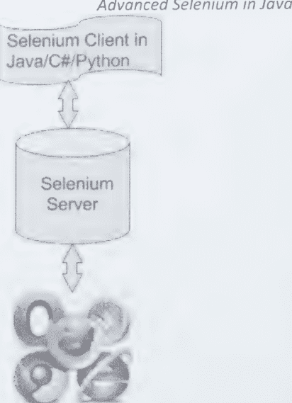
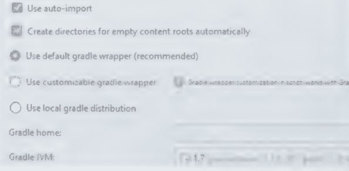
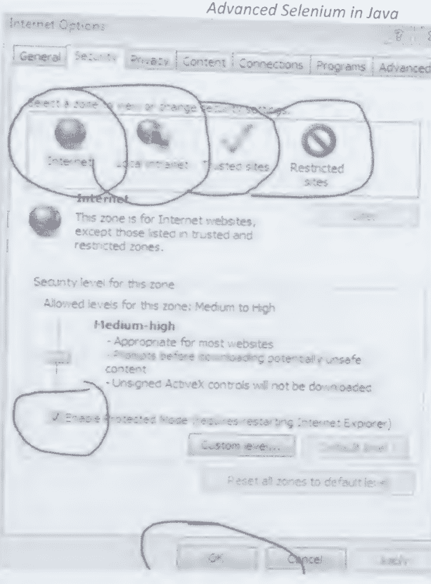
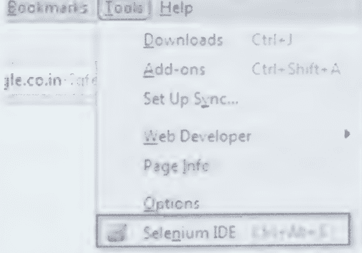
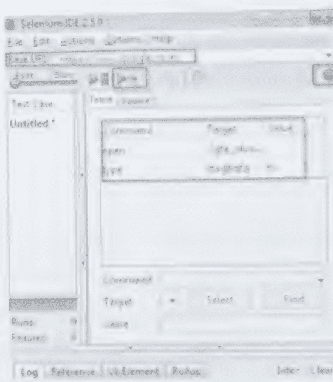
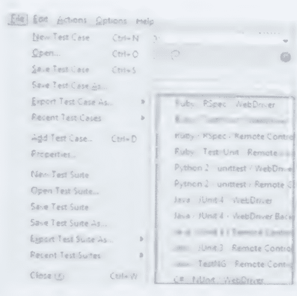
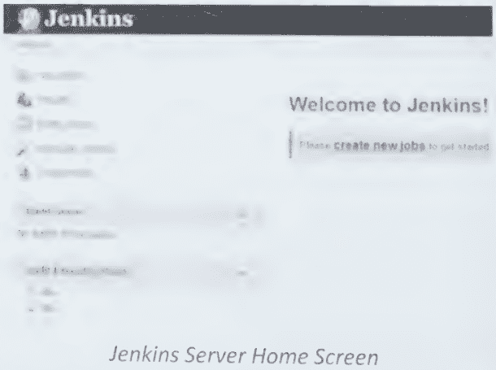
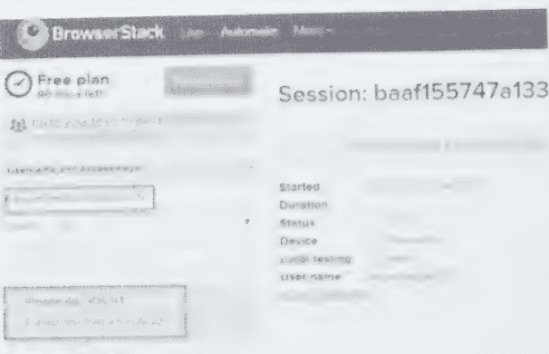
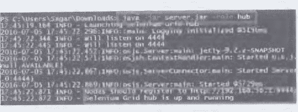

# Java 高级 Selenium 示例


## 关于作者

`Paul Watson` 先生在使用 `Selenium Webdriver`、`Junit`、`TestNG` 和 `Cucumber` 方面拥有多年经验。他曾在美国、英国、新加坡、香港、迪拜、澳大利亚和瑞士参与过大型软件项目。

他的爱好包括去新的旅游胜地旅行、看篮球、板球球、足球以及学习最新的技术事物。

## 本书适合谁读

本书适用于软件开发人员、自动化测试人员、`Devops` 以及以及从事 `Selenium` 自动化测试项目的工程师。无论你是初学者还是经验丰富的开发者，本书都将帮助你掌握 `Selenium` 技能。

本书从介绍 `Selenium` 开始，然后深入探讨核心概念，如在 `IntelliJ` 中设置项目、与 `Junit` 和 `TestNG` 的集成、与 `Gradle` 和 `Maven` 等构建工具的集成。你还将学习如何将 `selenium` 与 `Cucumber` 集成。最后，你将学习如何在 `TeamCity`、`Bamboo` 和 `Jenkins` 等 `CI` 服务器上运行 `Selenium` 测试。你也将学习如何处理各种类型的框架，如页面对象模型（`Page object models`）、页面工厂、关键字驱动框架等。书中还涉及了使用 `Selenium` 进行移动自动相关的概念。

## 前言

在书中，你将找到与 `Selenium Webdriver` 相关的所有概念。

你将学习以下主题：

- 1. 简介
- 2. `Selenium` 架构
- 3. `WebDriver JSON Wire` 协议
- 4. 安装、浏览器
- 5. 能力 (`Capabilities`)
- 6. 基础操作
- 7. 元素定位方法
- 8. 元素操作
- 9. 同步
- 10. 高级 `XPATH` 和 `CSS` 表达式
- 11. 表格操作
- 12. 多浏览器窗口处理
- 13. 异常
- 14. 上下文切换
- 15. `JavascriptExecutor`
- 16. 使用 `selenium` 的框架 – `Junit` 和 `TestNG`
- 17. `BDD` 框架 - `Cucumber`
- 18. 与 `Bamboo`、`TeamCity` 和 `Jenkins` 等 `CI` 服务器的集成
- 19. 云端 `Selenium`
- 20. 移动应用测试
- 21. `Selenium Grid`
- 22. `Selenium` 与其他工具对比
- 23. `Selenium` 自动化的挑战

## Java 高级 Selenium

- 13. 窗口相关操作............................................... 125
  - 13.1 上传文件 ....................................................... 125
  - 13.2 自动下载文件............................................... 128
- 14. 动作 (`Actions`)................................................... 130
  - 14.1 执行拖放操作 ................................ 130
  - 14.2 在网页元素上双击 ................................ 131
  - 14.3 执行鼠标悬停 / 鼠标移入动作.... 133
  - 14.4 在网页上打开右键菜单（右键点击）........................................................... 135
- 15. `Selenium` 中的异常 .......................................... 138
  - 15.1 可能发生的常见异常......................... 138
  - 15.2 环境问题与异常.................. 138
- 16. 切换上下文.................................................. 146
  - 16.1 处理多个浏览器窗口（标签页）。....... 146
  - 16.2 处理警告框（模态对话框） ................ 148
  - 16.3 切换到框架 (`frames`)................................ 150
  - 16.4 使用 `AutoIT Script` 在 `selenium web driver` 中上传文件.................................................. 152
  - 16.5 切换到默认内容 ...................... 155
- 17. `JavascriptExecutor` ................................ 157
  - 17.1 执行自定义 `Javascript` ............... 157
  - 17.2 如何在 `Selenium` 中滚动到元素 ............... 163
  - 17.3 `Selenium` 点击无效 ................... 164
  - 17.4 使用 `JavaScript` 在文本框中输入数据 ................................ 165
  - 17.5 使用 `JavaScript` 选择下拉列表值 ............ 165
- 18. 使用 `selenium` 的框架.................................................................. 167
  - 18.1 `Selenium` 中的关键字驱动框架 ................................ 167
  - 18.2 在 `excel` 文件中读写数据 ............................... 173
  - 18.3 页面对象模型 (`Page object models`) ........................................ 176
  - 18.4 页面工厂模型 (`Page Factory Model`)............................................................ 181
  - 18.5 编写 `JUnit` 测试...................................................................... 183
  - 18.6 如何使用 `TestNG`............................................................... 186
  - 18.7 数据驱动框架........................................................... 188
  - 18.8 框架工具类........................................................... 189
    - 18.8.1 根据名称杀死进程.................................................. 189
    - 18.8.2 生成唯一的随机数...................................... 190
    - 18.8.3 获取格式化金额............................................................... 192
    - 18.8.4 日期和时间工具类..................................................... 192
    - 18.8.5 执行 `Linux` 和 `windows` 命令 ................ 194
    - 18.8.6 设置和获取系统属性......................... 195
    - 18.8.7 从字符串中提取数字......................................... 196
  - 18.9 截取网页...................................... 196
  - 18.10 `Selenium` 中的日志框架.................................. 198
- 19. `BDD` 框架 ................................................................ 202
  - 19.1 `Cucumber` ................................................................ 202
- 20. 杂项 ................................................... 208
  - 20.1 使用 `VNC` 查看 `Linux` 远程机器桌面........................................................................................... 208
  - 20.2 `Firefox` 的 `Selenium IDE` 插件 ................................. 210
  - 20.3 事件监听器 (`EventListeners`) ................................................................. 212
- 21. 与 `CI` 服务器的集成.................................................. 218
  - 21.1 与 `TeamCity` 的集成 ................................................ 218
  - 21.2 使用 `Jenkins` 和 `GIT` 运行 `Selenium` 测试 ............................. 220
  - 21.3 `Bamboo` ............................................................................................ 227
- 22. 云端 `Selenium`.................................................................. 229
  - 22.1 使用 `SauceLabs` 在云端测试 `Web` 应用............................................................... 229
  - 22.2 使用 `BrowserStack` 在云端运行 `Selenium` 测试................................ 233
- 23. 移动应用测试.................................................. 240
  - 23.1 使用 `Appium` 进行首次移动端测试............................................... 244
  - 23.2 使用 `chrome` 进行移动模拟............................................................... 244
  - 23.3 `Selendroid` - `Android` 应用测试.................................. 245
- 24. `Selenium` 网格 ................................................ 249
  - 24.1 `Selenium` 中的 `RemoteWebDriver` ............................................ 249
  - 24.2 `Selenium` 网格 ................................................ 249
- 25. `Selenium` 与其他工具的对比...................................... 260
  - 25.1 `Webdriver` 与 `UFT` (`QTP`) 的区别................................................ 260
  - 25.2 `Selenium` 与 `Lean FT` 的区别....................................... 261
  - 25.3 `Selenium` 与 `Appium` 的区别....................................... 261
- 26. `Selenium` 中的挑战.................................................. 263
  - 26.1 `Selenium` 的局限性................................................ 263

## 1. 简介

`Selenium web driver` 是最流行的浏览器自动化工具。项目托管在 `https://github.com/seleniumhq/selenium`。

`Selenium WebDriver` 的特点：

- 开源
- 支持所有主流浏览器 - `IE`, `Firefox`, `Chrome`, `Safari`, `Opera`
- 适用于所有流行语言，如 `Java`、`Groovy`、`C#`、`Python` 等
- `Selenium WebDriver` 是浏览器自动化的 `W3C` 标准协议
- 支持桌面 `Web` 应用、`iOS` 和 `Android` 移动应用的测试
- 可以通过 `chrome` 的移动模拟对 `Web` 应用进行测试

对于每个 `Web` 浏览器都有相应的 `web` 驱动实现，帮助我们操作浏览器。

例如

如果你想自动化 `chrome`，你需要 `chromedriver`。`chromedriver` 是一个用于对浏览器执行操作的应用程序文件。



## 3. `WebDriver JSON Wire` 协议

你是否曾经想过 `Selenium 2.0` 内部是如何工作的？

在这篇文章中，你将了解 `selenium` 如何实现浏览器自动化。

`Selenium API` 以 `JSON` 协议的形式将 `HTTP` 命令发送到 `Selenium` 服务器。

然后，`Selenium` 服务器使用原生浏览器 `API` 来自动化浏览器。

因此，当你在代码中使用以下语句时——

```
driver = new ChromeDriver();
```

它实际上会向 `selenium` 服务器发送下方的 `HTTP` 命令。

`POST /session`

对于每个 `selenium API` 方法，都有一个相应的发送到服务器的 `HTTP` 请求。以下是发送到 `Selenium` 服务器的一些 `HTTP` 命令列表：

- `POST /session` - 创建新会话
- `GET /status` - 获取服务器状态
- `DELETE /session/:sessionId` - 删除 ID 为 `sessionId` 的会话
- `POST /session/:sessionId/timeouts/implicit_wait` - 指定驱动在查找元素时应等待的时间。
- `GET /session/:sessionId/url` - 导航到特定 `url`

下面的图片演示了 `JSON` 协议在 `Selenium` 中的工作原理。

Java 高级 Selenium

## 4. 安装

### 4.1 安装 `chrome` 和 `firefox` 的 `web driver`

要开始使用 `selenium` 自动化测试例，你需要按照以下步骤操作。

假设你选择 `Java` 作为 `selenium` 自动化的编程语言，你需要以下内容。

以下是你需要的软件列表 ->：

1. `Selenium API` (`Jar` 文件) - `http://docs.seleniumhq.org/download/`
2. `Internet Explorer` 的 `Webdriver`
3. `Chrome` 的 `Webdriver`
4. `Eclipse` - `Java IDE`

一旦你拥有了这些软件，就可以按照以下步骤操作。

1. 打开 `Eclipse` 并创建一个新的 `Java` 项目。
2. 创建一个包并在其中创建一个名为 `SampleTest` 的类。
3. 进入项目属性（`project properties`）并选择 `Java build path`（`Java` 构建路径）。选择 `libraries` 选项卡，然后选择 `add external jar`（添加外部 `jar`）。
4. 浏览到你在第 1 列表中下载的 `jar` 文件。
5. 选择 `apply and close`（应用并关闭）。

Java 高级 Selenium

### 在 `Eclipse IDE` 中添加 `Selenium`

### 4.2 设置 `Selenium` 和 `Maven` 项目

在 `Maven` 项目中，你可以添加以下依赖并开始使用 `JUnit` 或 `TestNG` 框架编写测试。

```
<dependency>
  <groupId>org.seleniumhq.selenium</groupId>
  <artifactId>selenium-java</artifactId>
  <version>2.53.1</version>
</dependency>
```

### 4.3 在 `IntelliJ IDEA` 中设置 `Selenium` `Gradle` 项目


# 使用 Gradle 设置 Selenium 项目

Gradle 是 Java 世界中最流行的构建管理系统之一。Gradle 的目的是消除 Ant 和 Maven 的缺点。在本文，你将学习如何在 IntelliJ IDEA 中使用 Gradle 设置 Selenium 项目。

## Java 高级 Selenium

你需要的工具是：

1. JDK —— 你可以在 Softpost Java 教程中了解更多关于 Windows 上的 JDK 安装过程。
2. IntelliJ IDEA —— 社区版（免费）。
3. Gradle（免费）。在最新版本的 IntelliJ IDEA（15.0.4+）中，Gradle 是内置的，所以不需要单独下载。

下面的图片将引导你完成 Selenium-Gradle 项目的步骤。

### 步骤 1：创建 Gradle 项目

点击 IntelliJ IDEA 中的 New Project 菜单并选择 Gradle Project。

### 步骤 2：设置项目标识

输入你的项目的 Group Id 和 Artifact Id。


### 步骤 3：提供 Gradle 设置



### 步骤 4：输入项目名称

Java 高级 Selenium

### 步骤 5：查看 Gradle 项目布局

### 步骤 6：配置 `Build.Gradle` 文件和 Selenium 依赖

```gradle
group 'org.softpost'
version '1.0-SNAPSHOT'

apply plugin: java

repositories {
    mavenCentral()
}

dependencies {
    testCompile group: 'junit', name: 'junit', version: '4.11'
    testCompile group: 'org.selenium', name: 'selenium-java', version: '2.53.0'
}
```

Java 高级 Selenium

### 步骤 7：编写并执行 Selenium 测试

### 步骤 8：执行 Gradle 任务

Java 高级 Selenium

## 5.1 启动 Internet Explorer

你可以从链接 `http://docs.seleniumhq.org/download/` 下载 IE 驱动。IEDriver 支持 32 位，也支持 64 位。

### 设置驱动参数

确保路径包含在 `PATH` 变量中，或按如下方式设置属性：

```java
System.setProperty("webdriver.driver", "F:\selenium\iedriver.exe");
```

我们可以设置的其他属性如下：

1. `webdriver.driver.host`
2. `webdriver.driver.loglevel`
3. `webdriver.driver.logfile`
4. `webdriver.driver.silent`

### 浏览器设置

确保所有区域的模式设置相同。对于 IE10 及以上版本，必须禁用增强模式并将浏览器级别设置为 100%。

对于 IE11，你需要编辑以下注册表键。

对于 32 位 Windows，键值为 `HKEY_LOCAL_MACHINE\SOFTWARE\Microsoft\Internet\Main\FeatureControl`。对于 64 位 Windows，键值为 `HKEY_LOCAL_MACHINE\SOFTWARE\Wow632Node\Microsoft\Internet\Main\FeatureControl`。

请注意，子键是可选的，如果不存在则应创建。在此键中，你需要创建一个 `name = ie.exe`、`value = 0` 的 DWORD 值。

确保你传递了 capability：`ieSession` 为 `true`。

### 清理 IE

可以使用下面的示例代码，使用 Selenium WebDriver 在 Java 中启动新的 IE 会话。

```java
package seleniumtest;

import java.util.concurrent.TimeUnit;

import org.openqa.selenium.By;
import org.openqa.selenium.Keys;
import org.openqa.selenium.WebDriver;
import org.openqa.selenium.WebElement;
import org.openqa.selenium.chrome.ChromeDriver;
import org.openqa.selenium.ie.*;
import org.openqa.selenium.interactions.Action;
import org.openqa.selenium.interactions.Actions;

public class MainTest
{
    public static void main(String[] args) {
        WebDriver driver = null;
        System.setProperty("webdriver.driver", "F:\\selenium\\java\\iedriver.exe");
        driver = new InternetExplorerDriver();
        driver.manage().timeouts().pageLoadTimeout(20, TimeUnit.SECONDS);
        driver.manage().timeouts().implicitlyWait(20, TimeUnit.SECONDS);

        try {
            driver.get("http://register.rediff.com/register.php");
            driver.findElement(By.name("name")).sendKeys("ff89");
            driver.findElement(By.name("name")).sendKeys(Keys.TAB);
            Thread.sleep(3000);

            // driver.findElement(By.name("passwd")).click();
            Actions builder = new Actions(driver);

            WebElement e = driver.findElement(By.cssSelector("#sk"));
            // 构建动作链。
            Action doubleclick = builder.doubleClick(e).build();

            // 执行双击动作
            doubleclick.perform();

            driver.switchTo().alert().accept();
            Thread.sleep(4000);
            // driver.navigate();
            // driver.navigate("http://www.google.com");
        } catch(Exception e) {
            System.out.println(e.toString());
        } finally {
            driver.close();
            driver.quit();
        }
    }
}
```

Java 高级 Selenium

请注意，我们需要设置系统属性 `webdriver.ie.driver`。我们必须提供 IEdriver.exe 的路径。一旦创建了 `driver` 对象，你可以使用它的方法来自动化浏览器任务。

## 5.2 启动 Chrome 浏览器

### ChromeDriver 的所需能力

Chrome 可以按照 Google 开发者提到的多种方式进行配置。

```java
ChromeOptions options = new ChromeOptions();

// 使用特定位置的 chrome 二进制文件
options.setBinary("/path/to/other/chrome/binary");

// 设置 chrome 配置
options.addArguments("user-data-dir=/path/to/your/profile");

// 禁用阻塞
options.addArguments("disable-popup-blocking");

// 不带安全警告启动 chrome
options.addArguments("test-type");

// 以最大化模式启动 chrome
options.addArguments("start-maximized");

// 设置自定义选项
Map<String, Object> prefs = new HashMap<String, Object>();
```

```java
prefs.put("profile.default_content_settings.pops", 0);
options.setExperimentalOption("prefs", prefs);

// 向 chrome 添加扩展程序
options.addExtensions(new
File("/path/to/extension.crx"));

// 我们可以像下面所示将 options 直接传递给 driver
driver = new ChromeDriver(options);

// 或者我们也可以像下面所示设置能力（capabilities）
DesiredCapabilities capabilities = new
DesiredCapabilities();
capabilities.setCapability(ChromeOptions.CAPABILITY, options);
ChromeDriver driver = new
ChromeDriver(capabilities);
```

### 使用 ChromeDriver 进行移动仿真

你可以通过传递下面的 capabilities 来启动移动仿真模式下的 Chrome。请注意，你可以像 Chrome 开发者工具中所示传递任何设备名称。

```java
Map<String, String> mobileEmulation = new HashMap<String, String>();
mobileEmulation.put("deviceName", "Google Nexus 7");

Map<String, Object> chromeOptions = new HashMap<String, Object>();
chromeOptions.put("mobileEmulation", mobileEmulation);
```

## 使用 `RemoteWebDriver` 和 `ChromeDriver`

你可以像下面所示启动 `chromedriver`：

```bash
$ ./chromedriver
```

```text
Started ChromeDriver

port=9515
```

然后你可以使用下面的代码实例化 `driver`：

```java
WebDriver driver = new
RemoteWebDriver("http://127.0.0.1:9515",
DesiredCapabilities.chrome());
driver.get("http://www.softpost.org");
```

### ChromeDriver 示例

你可以使用下面的示例代码，使用 Selenium WebDriver 在 Java 中启动新的 Chrome 会话。

```java
package seleniumtest;

import java.util.concurrent.TimeUnit;

import org.openqa.selenium.By;
import org.openqa.selenium.Keys;
import org.openqa.selenium.WebDriver;
import org.openqa.selenium.WebElement;
import org.openqa.selenium.chrome.ChromeDriver;
import org.openqa.selenium.ie.*;
import org.openqa.selenium.interactions.Action;
import org.openqa.selenium.interactions.Actions;
;
```

```java
public class MainTest
{
    public static void main(String[] args)
    {
        WebDriver driver =null;
        System.setProperty("webdriver.chrome.driver", "F:\selenium\csharp\chromedriver.exe");
        driver = new ChromeDriver();
        driver.manage().timeouts().pageLoadTimeout(TimeUnit.SECONDS);
        driver.manage().timeouts().implicitlyWait(20, TimeUnit.SECONDS);

        try {
            driver.get("http://register.rediff.com/register/register.php");
            driver.findElement(By.name("name")).sendKeys("f89");

            Thread.sleep(4000);
            //driver.navigate();
            //driver.navigate("http://www.google.com");
        } catch (Exception e) {
            System.out.println(e.toString());
        } finally {
            driver.close();
            driver.quit();
        }
    }
}
```

Java 高级 Selenium

请注意，我们需要设置系统属性 `webdriver.chrome.driver`。

我们必须提供 chromedriver exe 的路径。

一旦你创建了 `driver` 对象，就可以使用它的方法来自动化浏览器任务。

## 5.3 启动 Firefox 浏览器

要使用 Selenium 启动 Firefox，你不需要单独下载和运行 Firefox 驱动。下面的代码将从标准位置启动 Firefox。

```java
WebDriver driver = new
FirefoxDriver(myprofile);
```

### 使用不同的 Firefox Profile

```java
ProfilesIni profile = new ProfilesIni();
FirefoxProfile myprofile =
profile.getProfile("XYZ");
caps.setCapability(FirefoxDriver.PROFILE, profile);
```

或者我们可以像下面所示创建 Profile 并执行：

```java
ProfilesIni profile = new ProfilesIni();
FirefoxProfile myprofile =
profile.getProfile("XYZ");
```

```java
setCapability(profile)
```

# Java 高级 Selenium

请注意，我们需要设置系统属性 `webdriver.chrome.driver`。

我们必须提供 chromedriver exe 的路径。

一旦你创建了 `driver` 对象，就可以使用它的方法来自动化浏览器任务。

## 5.3 启动 Firefox 浏览器

要使用 Selenium 启动 Firefox，你不需要单独下载和运行 Firefox 驱动。下面的代码将从标准位置启动 Firefox。

```java
WebDriver driver = new

FirefoxDriver(myprofile);
```

### 使用不同的 Firefox Profile

```java
ProfilesIni profile = new ProfilesIni();

FirefoxProfile myprofile =

profile.getProfile("XYZ");

caps.setCapability(FirefoxDriver.PROFILE, profile);
```

或者我们可以像下面所示创建 Profile 并执行：

```java
ProfilesIni profile = new ProfilesIni();

FirefoxProfile myprofile =

profile.getProfile("XYZ");
```

```java
setCapability(profile)
```

# Java 高级 Selenium

请注意，我们需要设置系统属性 `webdriver.chrome.driver`。

我们必须提供 chromedriver exe 的路径。


一旦你创建了`driver`对象，就可以使用它的方法来自动化浏览器任务。

## 5.3 启动 Firefox 浏览器

要使用 Selenium 启动 Firefox，你不需要单独下载和运行 Firefox 驱动。下面的代码将从标准位置启动 Firefox。

```java
WebDriver driver = new FirefoxDriver(myprofile);
```

## 使用不同的 Firefox profile

```java
ProfilesIni profile = new ProfilesIni();
FirefoxProfile myprofile = profile.getProfile("XYZ");
caps.setCapability(FirefoxDriver.PROFILE, profile);
```

或者我们可以像下面所示创建 profile 并执行。

```java
ProfilesIni profile = new ProfilesIni();
FirefoxProfile myprofile = profile.getProfile("XYZ");
```

`setCapability(profile)`

# Java 高级 Selenium

请注意，我们需要设置系统属性`webdriver.chrome.driver`，我们必须提供`chromedriver.exe`的路径。

一旦你创建了`driver`对象，就可以使用它的方法来自动化浏览器任务。

## 5.3 启动 Firefox 浏览器

要使用 Selenium 启动 Firefox，你不需要单独下载和运行 Firefox 驱动。下面的代码将从标准位置启动 Firefox。

```java
WebDriver driver = new FirefoxDriver(myprofile);
```

## 使用不同的 Firefox profile

```java
ProfilesIni profile = new ProfilesIni();
FirefoxProfile myprofile = profile.getProfile("XYZ");
caps.setCapability(FirefoxDriver.PROFILE, profile);
```

# Java 高级 Selenium

请注意，我们需要设置系统属性`webdriver.chrome.driver`，我们必须提供`chromedriver.exe`的路径。

一旦你创建了`driver`对象，就可以使用它的方法来自动化浏览器任务。

## 5.3 启动 Firefox 浏览器

要使用 Selenium 启动 Firefox，你不需要单独下载和运行 Firefox 驱动。下面的代码将从标准位置启动 Firefox。

```java
WebDriver driver = new FirefoxDriver(myprofile);
```

## 使用不同的 Firefox profile

```java
ProfilesIni profile = new ProfilesIni();
FirefoxProfile myprofile = profile.getProfile("XYZ");
caps.setCapability(FirefoxDriver.PROFILE, profile);
```

# 6. Capabilities

## 6.1 Selenium WebDriver Capabilities

### 意义

在 Selenium 中，我们有一个`WebDriver`接口，并且有很多类实现了这个接口。所以让我们先尝试理解这个接口。

### WebDriver 接口中包含什么？

在接口中声明的重要方法有：

- `get()`
- `findElement()`
- `getTitle()`
- `getPageSource()`...等

实现此接口的类列如下：

- `ChromeDriver`
- `EventFiringWebDriver`
- `FirefoxDriver`
- `HtmlUnitDriver`
- `InternetExplorerDriver`
- `OperaDriver`
- `RemoteWebDriver`
- `SafariDriver`

现在让我们来看看`ChromeDriver`的不同构造函数：

1. `ChromeDriver()`
2. `ChromeDriver(Capabilities capabilities)`
3. `ChromeDriver(ChromeDriverService service)`
4. `ChromeDriver(ChromeDriverService service, Capabilities capabilities)`
5. `ChromeDriver(ChromeDriverService service, ChromeOptions options)`
6. `ChromeDriver(ChromeOptions options)`

如你所见，在 Java Selenium API 中，`ChromeDriver`类有 6 个构造函数。第一个构造函数不接受任何参数。但其余构造函数都接受下面所示的参数：

1. `Capabilities`
2. `ChromeDriverService`
3. `ChromeOptions`

现在让我们尝试理解这些类的意义。`Capabilities`用于管理浏览器属性。例如，我们可以使用`capabilities`设置浏览器名称、版本、平台。`ChromeDriverService`用于管理 chrome 服务（exe）。最后，`ChromeOptions`用于设置 chrome 浏览器的特定选项，如添加扩展、设置二进制文件路径等。

Java 高级 Selenium

其他类的构造函数也接受上述类似的参数。

## Selenium Server 使用的 Capabilities

1. `browserName` - `chrome`|`firefox`|`internet explorer`|`htmlunit`|`android`|`iPhone`|`iPad`|`opera`|`safari`
2. `version`
3. `platform` - `WINDOWS`|`MAC`|`LINUX`|`UNIX`|`ANDROID`

## 其他重要的 Capabilities

1. `acceptSslCerts`
2. `nativeEvents`
3. `proxy`

## IE 特有的 Capabilities

1. `ignoreZoomSetting`
2. `ie.ensureCleanSession`

## Firefox 特有的 Capabilities

1. `firefox_binary`

# 7. 基本操作

## 7.1 关闭浏览器窗口

下面的示例展示了如何使用 Selenium WebDriver 在 Java 中关闭浏览器窗口：

```java
WebDriver driver = new FirefoxDriver();
driver.close();
driver.quit();
```

请注意，相同的代码适用于所有其他浏览器如 Chrome、Safari 和 IE。注意，相同的代码也可以用于关闭标签页。在 Selenium 中，浏览器标签页被视为一个新的浏览器窗口。

## 7.2 导航到 URL

这是一个示例程序，用于在 Java 的 Selenium WebDriver 中导航到给定的 URL。

```java
//导入所需的包和类。
import java.io.File;
import java.util.NoSuchElementException;
import java.util.Set;
import java.util.concurrent.TimeUnit;

import org.apache.commons.io.FileUtils;
import org.openqa.selenium.By;
import org.openqa.selenium.JavascriptExecutor;
import org.openqa.selenium.Keys;
import org.openqa.selenium.OutputType;
import org.openqa.selenium.TakesScreenshot;
import org.openqa.selenium.WebDriver;
import org.openqa.selenium.WebElement;

import org.openqa.selenium.chrome.ChromeDriver;
import org.openqa.selenium.firefox.Firefox;
import org.openqa.selenium.interactions.Action;
import org.openqa.selenium.interactions.Actions;
import org.openqa.selenium.support.ui.ExpectedConditions;
import org.openqa.selenium.support.ui.WebDriverWait;

@SuppressWarnings("unused")
public class OpenGoogle {

    public static void main(String [] arg) {
        //设置 chrome driver exe 文件的路径
        System.setProperty("webdriver.chrome.driver", "C:\\Selenium\\chromedriver2.8.exe");

        //创建 chrome 浏览器的新实例
        WebDriver driver = new ChromeDriver();

        try {
            //设置隐式和页面加载超时
            driver.manage().timeouts().implicitlyWait(5, TimeUnit.SECONDS);
            driver.manage().timeouts().pageLoadTimeout(50, TimeUnit.SECONDS);

            //导航到指定的 url
            driver.get("https://www.google.co.in/preferences");
            //最大化浏览器窗口
            driver.manage().window().maximize();
            Thread.sleep(2000);
        }
        catch(Exception e) {
            System.out.println("Exception - > " + e.toString());
        }
        finally {
            driver.close();
            driver.quit();
        }
    } //main函数结束
} //类结束
```

上述代码将打开 Chrome 浏览器并导航到`https://www.google.co.in/preferences`。

## 对于 Firefox 浏览器

```java
//创建一个新的 firefox driver 对象
WebDriver ffdriver = new FirefoxDriver();
//导航到 google.com
ffdriver.navigate().to("http://www.google.com");
```

## 对于 Internet Explorer 浏览器

```java
System.setProperty("webdriver.ie.driver", "C:\\SeleniumProject\\IEDriverServer.exe");
// wb = new InternetExplorerDriver();
wb.navigate().to("http://www.google.com");
```

你也可以像下面所示使用`get`方法来打开任何网站：

```java
ffdriver.get("http://www.yahoo.com");
```

## 7.3 获取窗口标题

Selenium Java API 提供了`getTitle`方法，可以用于获取当前网站中打开的页面标题。

下面的示例展示了如何使用 Selenium WebDriver 在 Java 中获取网页的标题。


```java
//import所需的包和类。

import java.io.File;
import java.util.NoSuchElementException;
import java.util.Set;
import java.util.concurrent.TimeUnit;

import org.apache.commons.io.FileUtils;
import org.openqa.selenium.By;
import org.openqa.selenium.JavascriptExecutor;
import org.openqa.selenium.Keys;
import org.openqa.selenium.OutputType;
import org.openqa.selenium.TakesScreenshot;
import org.openqa.selenium.WebDriver;
import org.openqa.selenium.WebElement;
import org.openqa.selenium.chrome.ChromeDriver;
import org.openqa.selenium.firefox.Firefox;
import org.openqa.selenium.interactions.Action;
import org.openqa.selenium.interactions.Actions;
import org.openqa.selenium.support.ui.ExpectedConditions;
import org.openqa.selenium.support.ui.WebDriverWait;

@SuppressWarnings("unused")
public class OpenGoogle {

    public static void main(String [] arg) {
        //设置 chrome driver exe 文件的路径
        System.setProperty("webdriver.chrome.driver", "C:\Selenium\chromedriver2.8.exe");

        //创建 chrome 浏览器的新实例
        WebDriver driver = new ChromeDriver();

        try {
            //设置隐式和页面加载超时
            driver.manage().timeouts().implicitlyWait(5, TimeUnit.SECONDS);
            driver.manage().timeouts().pageLoadTimeout(50, TimeUnit.SECONDS);

            //导航到指定的 url
            driver.get("https://www.google.co.in/preferences");

            //获取当前页面的标题
            String title = driver.getTitle();
        }
        catch(Exception e) {
            System.out.println("Exception > " + e.toString());
        }
        finally {
            driver.close();
            driver.quit();
        }
    } //main函数结束
} //类结束
```

## 7.4 最大化浏览器窗口

你可以使用下面的代码在 Selenium 中最大化浏览器窗口。

```java
driver.manage().window().maximize();
```

请注意，相同的代码适用于其他浏览器，如 IE、SAFARI 等。

## 7.5 向后退和前进

你可以使用下面的代码在 Selenium 中向后退和前进。

```java
driver.navigate().back();
driver.navigate().forward();
```

## 7.6 如何获取当前 URL

在 Selenium 中，可以使用下面的代码获取浏览器的当前 URL。

```java
String currentUrl = driver.getCurrentUrl();
```

## 7.7 如何刷新页面

你可以使用下面的代码在 Selenium 中刷新页面。

```java
driver.navigate().refresh();
```

或者，你也可以通过使用 `sendKeys` 方法或 `Robot` 类按下 F5 键来刷新页面。

## 7.8 如何获取当前页面的 HTML 源代码

下面的代码可以用于获取 Selenium 中当前网页的 HTML 源代码。

```java
String pageSource = driver.getPageSource();
```

## 7.9 调整和移动浏览器窗口

要调整浏览器窗口的大小，可以使用下面的代码。`Dimension` 构造函数接受 2 个参数——窗口的高度和宽度。

```java
driver.manage().window().setSize(new Dimension(100, 100));
```

要设置浏览器窗口的位置，可以使用下面的代码。`Point` 构造函数接受 2 个参数——浏览器窗口的 X 和 Y 坐标。以下语句将窗口向下移动 200 像素。

```java
driver.manage().window().setPosition(new Point(0,200));
```

要最大化窗口，可以使用下面的代码。

```java
driver.manage().window().maximize();
```

# 8. 元素识别

元素识别方法在 Java、C# .Net 等所有编程语言中都是通用的，只是语法有所不同。

我们可以使用下面的方法在 Selenium WebDriver 中识别 Web 元素：

1. 通过 XPath
2. 通过 CSS Selectors
3. 通过 Id
4. 通过 Name
5. 通过 Tag Name
6. 通过 Class Name
7. 通过 Linktext（链接文本）
8. 通过 Partial Link text（部分链接文本）

在这些方法中，XPath 和 CSS 方法非常流行。我们可以使用 XPath 和 CSS 选择器识别网页中的各种元素。

只要给定的元素分配了 id、name 或 class name，我们也可以使用 Id、Name、Class Name 来识别元素。

我们还可以使用 table、div、form 等 HTML 标签来识别元素。

为了识别链接，Selenium driver 提供了 link text 和 Partial link text 两个额外方法。

## Java 中的 Web 元素识别示例

```java
driver.findElement(By.tagName("TD"));
```

上述方法将返回具有指定标签 `TD` 的第一个元素。

示例：

```java
WebElement e = driver.findElement(By.tagName("div"));
```

上面的代码将获取标签为 `div` 的第一个元素。

要获取所有的 `div` 元素，可以使用下面的代码：

```java
List <WebElement> we_collection = driver.findElements(By.tagName("div"));
```

请注意，获取单个元素我们使用 `findElement` 方法，而获取元素集合我们使用 `findElements` 方法。

如果你知道元素的类名，可以使用下面的代码访问该元素：

```java
driver.findElement(By.className("box"));
```

如果你知道元素的 id，可以使用下面的代码访问元素：

```java
driver.findElement(By.id("selenium"));
```

如果你知道 name 属性的值，可以使用下面的代码访问元素：

```java
driver.findElement(By.name("sagar"));
```

要查找网页中的链接，下文所述了两种方法：

```java
driver.findElement(By.partialLinkText("news"));
driver.findElement(By.linkText("hello"));
```

如果你知道链接名称的局部，可以使用 `By.partialLinkText`。

如果你知道完整的链接名称，可以使用 `By.linkText`。

如果你知道元素的 XPath 表达式，可以使用下面的代码访问元素：

```java
driver.findElement(By.xpath("//table"));
```

如果你知道元素的 CSS 表达式，可以使用下面的代码访问元素：

```java
driver.findElement(By.cssSelector("#kid"));
```

### 查找所有元素可以使用下面的语法

```java
List<WebElement> cells = tr.get(1).findElements(By.tagName("td"));
```

上面的代码将选择网页中所有的 `TD` 元素。

请注意，一些自动化工程师在元素识别时使用不同的术语，例如对象识别方法或 Selenium 定位器等。在 UFT 中，我们使用对象库（object repository）来存储对象。在 Selenium 中，我们没有单独的文件来存储对象或元素。但我们可以创建自定义文件，在其中存储有关对象及其定位器的信息。

## 8.2 检查元素是否真的存在页面上

使用 Selenium 进行自动化测试经常会遇到检查特定元素是否存在的情况。

我们可以使用 Java 中下面的代码轻松地实现这一点。

```java
if (driver.findElements(By.id("abc")).size() != 0)
    System.out.println("Element is present");
else
    System.out.println("Element is not present");
```

在 Java 或 Python 等其他语言 API 中，你可以使用类似的方法来检查元素是否存在。

请注意，如果你使用 `FindElement` 方法，将抛出 `NoSuchElementException`。

## 8.3 检查弹窗是否真的存在页面上

你可以使用下面的代码检查网页上是否打开了 Alert 弹窗（模态对话框）。

```java
try {
    driver.switchTo().alert();
    // Alert 存在且我们已切换它
} catch (NoAlertPresentException exception) {
    // 如果 alert 不存在，将执行此块
}
```

# 9. 元素操作

点击按钮、链接以及任何其他元素。我们可以使用 id 点击任何 Web 元素。

示例：

```java
WebElement e = driver.findElement(By.id("myid"));
```

上面的代码将点击 id 值为 `myid` 的元素。

我们也可以使用下述的 JavaScript 代码点击 Web 元素：

```java
((JavascriptExecutor)driver).executeScript("arguments[0].click()",e);
```

## 9.2 在文本框中输入数据

我们可以使用 `sendKeys` 方法在网页的编辑框或输入框中输入数据。

```java
WebElement e = driver.findElement(By.id("mainb"));
e.sendKeys("hello");
```

上面的代码将在 id 为 `mainb` 的编辑框或文本框中输入 `hello`。

```java
import org.openqa.selenium.Keys;
import org.openqa.selenium.OutputType;
import org.openqa.selenium.TakesScreenshot;
import org.openqa.selenium.WebDriver;
import org.openqa.selenium.WebElement;
import org.openqa.selenium.chrome.ChromeDriver;
import org.openqa.selenium.firefox.FirefoxDriver;
import org.openqa.selenium.interactions.Actions;
import org.openqa.selenium.interactions.Actions;
import org.openqa.selenium.support.ui.ExpectedConditions;
import org.openqa.selenium.support.ui.WebDriverWait;

//import com.sun.jna.platform.FileUtils;

@SuppressWarnings("unused")
public class OpenGoogle
{
    public static void main(String [] arg)
    {
        //设置 chrome driver exe 文件的路径
        System.setProperty("webdriver.chrome.driver", "C:\\Selenium\\chromedriver2.8.exe");

        //创建 chrome 浏览器的新实例
        WebDriver driver = new ChromeDriver();

        try
        {
            //设置隐式等待和页面加载超时
            driver.manage().timeouts().implicitlyWait(5, TimeUnit.SECONDS);
            driver.manage().timeouts().pageLoadTimeout(50, TimeUnit.SECONDS);

            //导航到指定的 url
            driver.get("https://www.google.co.in/preferences");

            //最大化浏览器窗口
            driver.manage().window().maximize();

            // 使用 id 识别编辑框元素
            WebElement e = driver.findElement(By.id("myid"));

            // 在编辑框中输入值
            e.sendKeys("hello");

            Thread.sleep(2000);
        }
        catch (Exception e) {
            System.out.println("Exception -> " + e.toString());
        }
        finally {
            driver.close();
            driver.quit();
        } //main 函数结束
    }//类结束
```

上述代码将在 id 属性值为 `myid` 的编辑框中输入 `hello`。

## 9.3 从网页列表中选择值

示例：我们可以使用 3 种方法从下拉列表中选择值。

1. `selectByVisibleText`——通过下拉列表中显示的文本进行选择
2. `selectByIndex`——通过下拉列表中选项的索引进行选择
3. `selectByValue`——通过下拉列表中选项的 value 进行选择

请考虑下面的代码。假设你想在组合框中选择第一个选项。

```html
<select id="44">
  <option value="1">xyz</option>
  <option value="2">abc</option>
  <option value="3">pqr</option>
</select>
```

## Selenium WebDriver Java 完整示例

下面的 Java 示例展示了如何使用 Selenium WebDriver 从组合框中选择第一个值。


```java
//导入所需的包和类。

import java.io.File;
import java.util.NoSuchElementException;
import java.util.Set;
import java.util.concurrent.TimeUnit;

import org.apache.commons.io.FileUtils;
import org.openqa.selenium.By;
import org.openqa.selenium.JavascriptExecutor;
import org.openqa.selenium.Keys;
import org.openqa.selenium.OutputType;
import org.openqa.selenium.TakesScreenshot;
import org.openqa.selenium.WebDriver;
import org.openqa.selenium.WebElement;
import org.openqa.selenium.chrome.ChromeDriver;
import org.openqa.selenium.firefox.FirefoxDriver;
import org.openqa.selenium.interactions.Action;
import org.openqa.selenium.interactions.Actions;
import org.openqa.selenium.support.ui.ExpectedConditions;
import org.openqa.selenium.support.ui.WebDriverWait;

@SuppressWarnings("unused")
public class OpenGoogle
{
    public static void main(String [] arg)
    {
        //设置 chrome driver exe 文件的路径
        System.setProperty("webdriver.chrome.driver", "C:\\Selenium\\chromedriver2.8.exe");

        //创建 chrome 浏览器的新实例
        WebDriver driver = new ChromeDriver();

        try
        {
            //设置隐式等待和页面加载超时
            driver.manage().timeouts().implicitlyWait(5, TimeUnit.SECONDS);
            driver.manage().timeouts().pageLoadTimeout(50, TimeUnit.SECONDS);
            //导航到指定的 url
            driver.get("https://www.google.co.in/preference");

            //最大化浏览器窗口
            driver.manage().window().maximize();

            WebElement e = driver.findElement(By.id("44"));
            Select select = new Select(e);

            // 以下两个述语句都会选择列表中的第一个选项
            select.selectByVisibleText("xyz");
            select.selectByValue("1");

            Thread.sleep(2000);
        }
        catch(Exception e) {
            System.out.println("Exception - " + e.toString());
        }
        finally {
            driver.close();
            driver.quit();
        } //main 函数结束
    }//类结束
```

## 9.4 从下拉框中读取所有项目或值

下面的代码展示了如何在 Selenium Java 中向并打印下拉框中所有选项的文本。

```java
package seleniumtest;

//导入所需的类
import java.text.SimpleDateFormat;
import java.util.Date;
import java.util.List;
import java.util.Set;
import java.util.concurrent.TimeUnit;

import org.openqa.selenium.By;
import org.openqa.selenium.WebDriver;
import org.openqa.selenium.WebElement;
import org.openqa.selenium.ie.InternetExplorerDriver;
import org.openqa.selenium.support.ui.Select;

public class ElementIdentification
{
    public static void main(String[] args)
    {
        WebDriver driver = null;
        //设置驱动路径
        System.setProperty("webdriver.chrome.driver", "C:\\selenium\\chromedriver.exe");
        System.setProperty("webdriver.ie.driver", "C:\\selenium\\chromedriver.exe");

        driver = new InternetExplorerDriver();

        //设置页面加载和所有元素的超时时间
        driver.manage().timeouts().pageLoadTimeout(60, TimeUnit.SECONDS);
        driver.manage().timeouts().implicitlyWait(20, TimeUnit.SECONDS);

        try {
            //打开指定的网页
            driver.get("http://register.rediff.com/common/index.php");
            driver.get("file:///selenium/blog.html");

            //最大化浏览器窗口
            driver.manage().window().maximize();

            System.out.println(driver.getPageSource());
            System.out.println(driver.getTitle());
            System.out.println(driver.getCurrentUrl());

            WebElement y = driver.findElement(By.id("day"));
            Select p = new Select(y);
            p.selectByVisibleText("1");
            String z = p.getSelectedOption().getAttribute("value");

            List<WebElement> k = p.getOptions();
            //打印列表中选项的值
            for(int i=0; i<k.size();i++)
                System.out.println(k.get(i).getText());

            //等待2秒
            Thread.sleep(2000);
        }
        catch(Exception e){
            //如果有任何异常则打印异常
            System.out.println(e.getMessage());
            e.printStackTrace();
        }
        finally {
            //关闭驱动
            driver.close();
            //退出驱动
            driver.quit();
        }
    }
}
```

## 复选框

可以使用下面的代码查看复选框是否被勾选。

示例：

```java
// (此处代码已在上方逻辑中包含，不再重复输出)
```

```java
boolean x = 
driver.findElement(By.id("myid")).isSelected();

if (x == true) {
    driver.findElement(By.id("myid")).click();
    Thread.sleep(2000);
}
catch(Exception e) {
    System.out.println("Exception - " + e.toString());
} finally {
    driver.close();
    driver.quit();
} // main 函数结束
```

# Java 高级 Selenium

示例：以下示例演示了如何使用 Selenium WebDriver 从网页页面上的组合框中选择值。

```java
// 导入必需的包和类。

import java.io.File;
import java.util.NoSuchElementException;
import java.util.Set;
import java.util.concurrent.TimeUnit;

import org.apache.commons.io.FileUtils;
import org.openqa.selenium.By;
import org.openqa.selenium.JavascriptExecutor;
import org.openqa.selenium.Keys;
import org.openqa.selenium.OutputType;
import org.openqa.selenium.Screenshot;
import org.openqa.selenium.WebDriver;
import org.openqa.selenium.chrome.ChromeDriver;
import org.openqa.selenium.firefox.FirefoxDriver;
import org.openqa.selenium.interactions.Action;
import org.openqa.selenium.interactions.Actions;
import org.openqa.selenium.support.ui.ExpectedConditions;
import org.openqa.selenium.support.ui.WebDriverWait;

@SuppressWarnings("unused")
public class OpenGoogle
{
    public static void main(String [] arg)
```

## 设置 Chrome Driver 文件路径

```java
// 设置 chrome driver 文件的路径

System.setProperty("webdriver.chrome.driver", "C:\\Selenium\\chromedriver2.exe");
```

## 创建 Chrome 浏览器实例

```java
// 创建 chrome 浏览器的实例
WebDriver driver = new ChromeDriver();
```

## 设置等待时间

```java
try{// 设置隐式等待和页面加载超时

driver.manage().timeouts().implicitlyWait(5, TimeUnit.SECONDS);
driver.manage().timeouts().pageLoadTimeout(50, TimeUnit.SECONDS);
```

## 导航到指定 URL

```java
// 导航到 url
driver.get("https://www.google.co.in/preferences");
```

## 最大化浏览器窗口

```java
// 最大化浏览器窗口
driver.manage().window().maximize();
```

## 使用 ID 识别元素

```java
// 使用 id 识别元素
WebElement e = driver.findElement(By.id("abc"));
Select comboBox = new Select(e);
```

## 获取下拉列表中的选中值

```java
// 使用 getAttribute 获取下拉列表中的选中值
value = comboBox.getFirstSelectedOption().getAttribute("value");
```

```java
System.out.println("Selected value is " + value);
```

```java
Thread.sleep(2000);
```

## 关闭浏览器

```java
}
catch(Exception e)
{
    System.out.println("Exception - " + e.toString());
}
finally
{
    driver.close();
    driver.quit();
}
// 类结束
```

## 9.7 上传文件

使用 Selenium WebDriver 上传文件非常简单。你只需要找到类型属性为 `file` 的输入元素，然后使用 `sendKeys`。

以下代码说明了如何使用 Java Selenium WebDriver 上传文件。

```java
package abc;
import java.util.concurrent.TimeUnit;
import org.openqa.selenium.By;
import org.openqa.selenium.WebDriver;
import org.openqa.selenium.WebElement;
import org.openqa.selenium.chrome.ChromeDriver;

public class FileUpload {
    public static void main(String[] args) {
        System.setProperty("webdriver.chrome.driver", "F:\\chromedriver.exe");
        WebDriver driver = new ChromeDriver();

        try {
            driver.manage().timeouts().setScriptTimeout(20, TimeUnit.SECONDS);
            driver.manage().timeouts().pageLoadTimeout(50, TimeUnit.SECONDS);
            driver.manage().timeouts().implicitlyWait(20, TimeUnit.SECONDS);

            driver.get("http://www.xyz.com");

            WebElement uploadElement = driver.findElement(By.id("uploadfile"));

            // 在文件输入框输入文件路径
            uploadElement.sendKeys("C:\\abc.docx");

            Thread.sleep(2000);
        } catch (Exception ex) {
```

```java
System.out.println(ex.toString());
finally {
    driver.close();
    driver.quit();
}
```

## 9.8 验证按钮是否被禁用

Selenium WebDriver 提供了一个名为 `isEnabled` 的方法，用于检查 Java Selenium WebDriver 中的按钮是否启用或禁用。

```java
boolean actualValue = e.isEnabled();
```

上述代码将检查按钮 `e` 是否启用或禁用。如果是启用的，`actualValue` 将为 `true`。如果是禁用的，`actualValue` 将为 `false`。

使用 Selenium WebDriver 的 Java 完整示例检查按钮是否被禁用：

```java
package temp;
import org.openqa.selenium.By;
import org.openqa.selenium.WebDriver;
import org.openqa.selenium.WebElement;
import org.openqa.selenium.chrome.ChromeDriver;
import org.openqa.selenium.support.ui.Select;
```


```java
public class first
{
    public static void main(String[] args)
    {
        // TODO 自动生成的方法体
        System.setProperty("webdriver.chrome.driver", "C:\\Selenium\\chromedriver2.3.exe");
        WebDriver driver = new ChromeDriver();

        try {
            driver.get("http://www.rediff.com/register.php");

            Thread.sleep(2000);
            WebElement e = driver.findElement(By.name("btnemail"));

            boolean actualValue = e.isEnabled();

            if (actualValue) {
                System.out.println("Button is enabled");
            } else {
                System.out.println("Button is disabled");
            }

            Thread.sleep(2000);
        } catch (Exception ex) {
            System.out.println("Exception " + ex.getMessage());
        } finally {
            driver.close();
            driver.quit();
        }
    }
}
```

# Java 高级 Selenium

```java
driver.get("http://register.rediff.com/register/register.php");

Thread.sleep(2000);
WebElement e = driver.findElement(By.name("chkemail"));

boolean actualValue = e.isSelected();

if (actualValue) {
    System.out.println("Checkbox is selected");
} else {
    System.out.println("Checkbox is not selected");
}

Thread.sleep(2000);
catch (Exception ex) {
    System.out.println("Exception " + ex.getMessage());
} finally {
    driver.close();
    driver.quit();
}
```

因此，我们可以使用 Java 中 selenium webdriver 的 `isSelected` 方法来验证复框是否被选中。

# Java 高级 Selenium

### 9.11 验证单选按钮是否被选中

web driver 提供了一个名为 `isSelected` 的方法，在 Java Selenium Webdriver 中可以检查单选按钮是否被选中。

```java
boolean actualValue = e.isSelected();
```

如果单选按钮被选中，上述代码将返回 `true`

否则将返回 `false`

# selenium webdriver 的 Java 完整示例

```java
package temp;
import org.openqa.selenium.By;
import org.openqa.selenium.WebDriver;
import org.openqa.selenium.WebElement;
import org.openqa.selenium.chrome.ChromeDriver;
import org.openqa.selenium.support.ui.Select;

public static class first
{
    public static void main(String[] args)
    {
        // TODO Auto-generated method stub

        System.setProperty("webdriver.chrome.driver", "C:\\Selenium\\chromedriver2.3.exe");
        WebDriver driver = new ChromeDriver();

        try{
            driver.get("http://register.rediff.com/register/register.php");
            Thread.sleep(2000);

            WebElement e = driver.findElement(By.name("gender"));

            boolean actualValue = e.isSelected();

            if (actualValue) {
                System.out.println("Radio Button is selected");
            } else {
                System.out.println("Radio Button is not selected");
            }

            Thread.sleep(2000);
        } catch (Exception ex) {
            System.out.println("Exception " + ex.getMessage());
        } finally {
            driver.close();
            driver.quit();
        }
    }
}
```

因此，我们可以使用 Java 中 selenium webdriver 的 `isSelected` 方法来验证单选按钮是否被选中。

# Java 高级 Selenium

## 9.1.2 验证元素是否显示在网页上

Selenium webdriver 提供了一个名为 `isDisplayed` 的方法，在 Java Selenium WebDriver 中可以检查按钮、复选框、链接等任何元素是否显示在网页上。

```java
boolean actualValue = e.isDisplayed();
```

上述代码将检查按钮 `e` 是否显示。如果显示了，`actualValue` 将为 `true`，否则将为 `false`。

# selenium webdriver 的 Java 完整示例

```java
package temp;
import org.openqa.selenium.By;
import org.openqa.selenium.WebDriver;
import org.openqa.selenium.WebElement;
import org.openqa.selenium.chrome.ChromeDriver;
import org.openqa.selenium.support.ui.Select;

public class first
{
    public static void main(String[] args)
    {
        // TODO Auto-generated method stub
        System.setProperty("webdriver.chrome.driver", "C:\\Selenium\\chromedriver2.3.exe");
        WebDriver driver = new ChromeDriver();

        try
        {
            driver.get("http://register.rediff.com/register/register.php");
            Thread.sleep(2000);
            WebElement e = driver.findElement(By.name("btnemail"));

            boolean actualValue = e.isDisplayed();

            if (actualValue) {
                System.out.println("Button is displayed");
            } else {
                System.out.println("Button is not displayed");
            }

            Thread.sleep(2000);
        }
        catch (Exception ex) {
            System.out.println("Exception " + ex.getMessage());
        }
        finally {
            driver.close();
            driver.quit();
        }
    }
}
```

请注意，我们可以使用 Java 中 selenium webdriver 的 `isDisplayed` 方法，以类似的方式验证按钮、复选框、单选按钮、组合框等所有元素是否显示显示。

# 0.13 读取任何属性

Selenium webdriver 提供了一个名为 `getAttribute()` 的方法，在 Java Selenium Webdriver 中可以读取任何元素的属性值。

```java
String actualValue = c.getAttribute("value");
```

上述代码将返回 selenium webdriver 中元素 `c` 的属性值 - `value`。

# selenium webdriver 的 Java 完整示例

```java
package temp;
import org.openqa.selenium.By;
import org.openqa.selenium.WebDriver;
import org.openqa.selenium.WebElement;
import org.openqa.selenium.chrome.ChromeDriver;
import org.openqa.selenium.support.ui.Select;

public class first
{
    public static void main(String[] args)
    {
        // TODO Auto-generated method stub
        System.setProperty("webdriver.chrome.driver", "C:\\Selenium\\chromedriver2.3.exe");
        WebDriver driver = new ChromeDriver();

        try
        {
            driver.get("http://register.rediff.com/register/register.php");
            Thread.sleep(2000);
            WebElement e = driver.findElement(By.tagName("tagName")); // Corrected based on context
            String actualValue = e.getAttribute("value");

            Thread.sleep(2000);
        }
        catch (Exception ex) {
            System.out.println("Exception " + ex.getMessage());
        }
        finally {
            driver.close();
            driver.quit();
        }
    }
}
```

请注意，我们可以使用 `getAttribute` 以类似的方式获取按钮、复选框、单选按钮、组合框等元素的属性。

## 14 读取 CSS 值

Selenium webdriver 提供了一个名为 `getCssValue()` 的方法，在 Java Selenium Webdriver 中可以读取任何元素的 CSS 值。

```java
String actualValue = c.getCssValue("width");
```

上述代码将返回元素 `c` 的样式 - `width`。

# selenium webdriver 的 Java 完整示例

```java
package temp;
import org.openqa.selenium.By;
import org.openqa.selenium.WebDriver;
import org.openqa.selenium.WebElement;
import org.openqa.selenium.chrome.ChromeDriver;
import org.openqa.selenium.support.ui.Select;

public class first
{
    public static void main(String[] args)
    {
        // TODO Auto-generated method stub
        System.setProperty("webdriver.chrome.driver", "C:\\Selenium\\chromedriver2.3.exe");
        WebDriver driver = new ChromeDriver();

        try
        {
            driver.get("http://register.rediff.com/register/register.php");
            Thread.sleep(2000);
            WebElement e = driver.findElement(By.tagName("tagName"));
            String actualValue = e.getCssValue("width");
            System.out.println("width - " + actualValue);
        }
        catch (Exception ex) {
            System.out.println("Exception " + ex.getMessage());
        }
        finally {
            driver.close();
            driver.quit();
        }
    }
}
```

## 9.15 使用 Selenium 按 Tab 键

我们在 Java 中通过两种方式在 Selenium Driver 中按下 Tab 键或其他任何键：

- 使用 `Keys.TAB`

- 使用 `Actions`

### 使用 Keys.TAB

使用此方法，你需要导入以下类：`import org.openqa.selenium.Keys;`

```java
driver.findElement(By.name("name")).sendKeys(Keys.TAB);
```

### 使用 Actions 类

使用此方法，你需要导入以下类：

`import org.openqa.selenium.interactions.Action;`

`import org.openqa.selenium.interactions.Actions;`

```java
Actions action = new Actions(driver);
action.sendKeys(Keys.TAB).build().perform();
```


```java
public class SendKey
{
    public static void main(String [] arg) 
    {
        System.setProperty("webdriver.chrome.driver", "C:\Selenium\chromedriver2.8.exe");
        WebDriver driver = new ChromeDriver();

        try {
            driver.manage().timeouts().implicitlyWait(5, TimeUnit.SECONDS);
            driver.manage().timeouts().pageLoadTimeout(50, TimeUnit.SECONDS);
            driver.get("https://www.google.co.in/preferences");
            driver.manage().window().maximize();

            //driver.get("http://register.rediff.com/register/register.php");
            Thread.sleep(2000);

            WebElement e = driver.findElement(By.xpath("//div[@id='instant-radio']/div[3]/span"));
            //using Keys.TAB
            e.sendKeys(Keys.TAB);

            //using Actions
            Actions action = new Actions(driver);
            action.sendKeys(e, Keys.TAB).build().perform();

        }
        catch(Exception e)
        {
            System.out.println("Exception - > " + e.toString());
        }
        finally
        {
            driver.close();
            driver.quit();
        }
    }//main function ends
}//class ends
```

请注意，我们也可以以相同的方式按下其他任何键，如 `ENTER`、`F1`、`F2`、`HOME`、`ARROW_UP`、`ESCAPE`。

## 9.16 在 Selenium 中按下回车键

Java 高级 Selenium

我们可以在 `C#.Net` 中通过 `Keys` 类在 Selenium Web driver 中按下 `TAB` 键或任何其他键。

`OpenQA.Selenium.Keys`

下面提供了一个 `C#.Net` 的完整示例，用于按下回车键。

```csharp
using System;
using System.Collections.Generic;
using System.Linq;
using System.Text;
using System.Threading;
using OpenQA.Selenium;
using OpenQA.Selenium.Keys;
using OpenQA.Selenium.Firefox;
using OpenQA.Selenium.Chrome;
using OpenQA.Selenium.IE;
//for Select
using OpenQA.Selenium.Support.UI;
using System.Collections.ObjectModel;
//for events - Actions
using OpenQA.Selenium.Interactions;
//screenshot
using System.Drawing.Imaging;

namespace Abc
{
    class Program
    {
        static void Main(string[] args)
        {
            //IWebDriver x = new
            InternetExplorerDriver(@"F:\selenium\csharp");
            //IWebDriver x = new
            FirefoxDriver();
            IWebDriver driver=null;
            try
            {
                ChromeDriver driver = new ChromeDriver("F:\selenium\csharp");
                driver.Url = "http://register.rediff.com/register/register.php";

                driver.Manage().Timeouts().ImplicitWait(TimeSpan.FromSeconds(20));
                driver.Manage().Timeouts().SetPageLoadTimeout(TimeSpan.FromSeconds(50));
                driver.Manage().Window.Maximize();

                driver.Navigate();

                try {
                    IWebElement e = driver.FindElement(By.Name("showdetail"));
                    e.SendKeys(Keys.Enter);
                } catch (Exception e) {
                    Console.WriteLine("Exception ******"+e.ToString());
                } finally {
                    Thread.Sleep(2000);
                    driver.Quit();
                    Console.ReadLine();
                }
            }
        }
    }
}
```

请注意，我们也可以以相同的方式按下其他任何键如 `F1`、`F2`、`HOME`、`ARROW_UP`、`ESCAPE`。

## Java 高级 Selenium

## 9.17 在 Selenium 中按下 control、shift 和 delete 键

我们可以使用下面的代码在 Selenium 中按下 `control`、`delete` 和 `shift` 键。

```java
driver.findElement(By.id("abc")).sendKeys(Keys.CONTROL + "a");

driver.findElement(By.id("abc")).sendKeys(Keys.DELETE);
String keys = Keys.chord(Keys.ALT, Keys.SHIFT, "p");

driver.findElement(By.id("abc")).sendKeys(keys);

driver.findElement(By.name("name")).sendKeys(Keys.TAB);
```

## 9.18 使用 JavaScriptExecutor 清除文本框中的数据

有时候，`clear` 方法不起作用。它无法清除文本框中的数据。在情况下，我们可以使用 `JavaScriptExecutor` 来清除数据。

下面的代码可以清除编辑框中的数据。

```java
((JavascriptExecutor)driver).executeScript("arguments[0].value='", element);
```

注意，第二个参数是`Web Element`（文本框）的名称。

## 9.19 验证是否存在文本

我们可以使用下面的 `xpath` 选择器来验证 Selenium 页面上是否存在文本。

```xpath
//*contains(text(),'text data')]
```

注意，上面的 `xpath` 将识别封装在任何元素（如 `div`、`span` 等）中的文本。唯一的条件是文本必须位于一个特定的标签内部。

## 10 同步

## 10.1 添加同步点

我们可以通过下面提到的 3 种方式在 Selenium 中添加同步点。

- 1. 页面加载同步
- 2. 同步
- 3. 特定条件同步

### 页面加载同步

我们可以设置默认的页面导航超时。以下语句将导航超时设置为 50。这意味着 selenium 脚本将最多等待 50 秒。如果页面未加载，它将抛出异常。

```java
driver.manage().timeouts().pageLoadTimeout(50, TimeUnit.SECONDS);
```

### 元素同步

我们可以设置默认的元素等待时间。以下语句将元素超时设置为 20。这意味着 selenium 脚本将最多等待 20 秒。如果元素不存在，它将抛出异常。

```java
driver.manage().timeouts().implicitlyWait(20, TimeUnit.SECONDS);
```

### 特定条件同步

我们还可以使用 `WebDriverWait` 类在脚本中插入显式同步点。请记住，在使用该类之前必须导入它。

```java
WebDriverWait w = new WebDriverWait(driver,20);
WebElement P = null;

//下述语句将等待元素可见
P=w.until(ExpectedConditions.visibilityOfLocated(By.id("ss")));
```

### Java 同步示例示例

```java
//import 所需的包和类

import java.io.File;
import java.util.NoSuchElementException;
import java.util.Set;
import java.util.concurrent.TimeUnit;

import org.apache.commons.io.FileUtils;
import org.openqa.selenium.By;
import org.openqa.selenium.JavascriptExecutor;
import org.openqa.selenium.Keys;
import org.openqa.selenium.OutputType;
import org.openqa.selenium.TakesScreenshot;
import org.openqa.selenium.WebDriver;
import org.openqa.selenium.WebElement;
import org.openqa.selenium.chrome.ChromeDriver;
import org.openqa.selenium.firefox.FirefoxDriver;
import org.openqa.selenium.interactions.Action;
import org.openqa.selenium.interactions.Actions;
import org.openqa.selenium.support.ui.ExpectedConditions;
import org.openqa.selenium.support.ui.WebDriverWait;
```

## Java 高级 Selenium 

我们可以指令 selenium 等待某个特定元素达到预期的状态。例如——在下面的代码中，代码将等待 `id` 为 `"x"` 的元素可见。

```java
//创建 WebDriverWait 对象
WebDriverWait w = new WebDriverWait(driver,20);

//添加需要忽略的异常
w.ignoring(NoSuchElementException.class);

WebElement P = null; //下述语句将等待直到元素可见
P=w.until(ExpectedConditions.visibilityOfElementLocated(By.id("x")));

//下述语句将等待直到元素变为可点击。
p=w.until(ExpectedConditions.elementToBeClickable(By.id("ss")));
```

## 10.2 如何在 Selenium 中避免 Thread.Sleep

我见过许多自动化工程师在 selenium 或任何其他自动化工具中使用固定等待（`sleep`）语句。个人的观点是，我们永远不应该在代码中使用固定等待语句，因为这会不必要的减慢测试执行速度。有时，固定的 `sleep` 语句可能会解决你的问题。假设你添加了一条条等待 5 秒的语句，代码今天运行良好，但如果下一次发布时 5 秒的等待不够了会发生什么？我们永远不知道。这是一种冒险的方法，也是糟糕的编码实践。

## Java 高级 Selenium

当测试用例由于同步问题而失败时，我们往往倾向于归咎于网络速度、应用程序延迟或浏览器限制。但事实并非如此。你可以采用下面提到的标准编码规范来避免代码中使用这些等待语句。

- 1. 使用 `WebDriverWait` 和 `ExpectedConditions` 类 - 我建议每当我们认为测试可能因为同步问题而失败时，就应该使用这些类。通过这些类的帮助，我们可以让 selenium webdriver 等待直到某些条件满足，例如特定元素启用或显示。

- 2. 在切换到新窗口时，确保在执行任何操作之前，网页文档已加载到窗口中。在一个项目中，我遇到了尝试切换到窗口的问题。但由于延迟，测试出现了不可预测的失败。我确保了窗口句柄的数量为 2，但在随机运行中我仍然遇到该问题。我使用了 10 秒的固定等待，但问题仍然存在。我不断增加 `sleep` 时间，但最后意识到必须有更好的技术来处理这种场景。然后我使用循环来检查窗口标题是否已更改为预期的值，然后我尝试切换过去。这让我的代码更加健壮。这就是我如何消除代码中 `sleep` 语句的方法。如果你仍然无法切换到新窗口，尝试切换到第一个窗口并重新切换到新窗口。

- 3. 另一个测试人员经常使用等待语句的场景是在从 Java 高级 Selenium 下拉列表中选择值时。这里的问题是——从下拉框中选择值后，新的网页控件或元素会从从页面添加或移除。在这种情况下，有时页面本身会变得无响应。在这种情况下，我们可以使用自定义函数，它将使用循环直到我们成功执行操作。

## 10.3 等待元素显示

下面的示例说明了如何在 Selenium 中等待直到元素显示。请注意，我们没有使用任何等待条件。下面的方法在处理 `Ajax` 请求时有用。`Ajax` 从服务器获取数据并动态显示在页面上。因此，我们可以使用下面的方法直到元素显示。

```java
public boolean waitUntilElementIsDisplayed(By by, int seconds) {
    if (checkElementExists(by,seconds)) {
        for (int i=0;i<seconds;i++) {
            if (driver.findElement(by).isDisplayed()) {
                return true;
            } else {
                sleep(1000);
            }
        }
        return false;
    } else {
        return false;
    }
}
```

```java
public boolean checkElementExistsBy(By by, int seconds) {
    boolean result=false;
    try {
        driver.manage().timeouts().
        implicitlyWait(seconds, TimeUnit.SECONDS);
        driver.findElement(by);
        result = true;
    }
    catch (org.openqa.selenium.NoSuchElementException ex) {
        result = false;
    }
    finally {
        driver.manage().timeouts().
        implicitlyWait(20, TimeUnit.SECONDS);
    }
    return result;
}
```

## 10.4 显式等待条件

我们在 Selenium C# API 中有下面的等待条件

- 1. 等待元素在页面上存在
- 2. 等待元素在页面上可见
- 3. 等待页面标题变为预期值

## Java 高级 Selenium

## 10.5 等待元素消失

下面的代码在 Selenium 中等待元素消失。


```java
public void waitUntilDisappear(By by) {
    for (int i=0;i<=60;i++) {
        if (checkElementExists(by)) {
            sleep(1000);
        } else {
            break;
        }
    }
}
```

# Java 高级 Selenium

## 10.6 等待页面标题更改

下面的方法将等待页面标题更改为 Selenium 中传递的参数。

```java
public boolean waitUntilTitle(String title) {
    for (int i=0;i<60;i++) {
        if (driver.getTitle().equalsIgnoreCase(title)) {
            return true;
        } else {
            sleep(1000);
        }
    }
    return false;
}
```

## 10.7 元素是否存在

下面的代码演示了如何检查元素是否存在。如果元素存在则返回 `true`。如果未找到元素则返回 `false`。请注意，如果元素不存在，代码不会抛出异常。

```java
public boolean checkElementExists(By by, int seconds) {
    boolean result=false;
    try {
        driver.manage().timeouts().implicitlyWait(seconds, TimeUnit.SECONDS);
        driver.findElement(by);
        result = true;
    } catch (org.openqa.selenium.NoSuchElementException ex) {
        result = false;
    } 
    finally {
        driver.manage().timeouts().implicitlyWait(20, TimeUnit.SECONDS);
    }
    return result;
}
```

## 10.8 Fluent Wait

Fluent wait 用于同步浏览器中的元素。

Fluent wait 允许你：

1. 指定轮询时间
2. 最大超时时间
3. 忽略异常

考虑一种场景，你期望特定元素在 20 秒内出现。加载该元素的时间可能会从 5 秒变为 20 秒。在这种情况下，我们可以像下面示例所示所示使用 Fluent Wait。

```java
@Test
public void testWait() {
  String driver = System.setProperty("webdriver.chrome.driver", "C:\chromedriver.exe");
  driver = new ChromeDriver();
}
```

```java
driver.manage().timeouts().implicitlyWait(10,
TimeUnit.SECONDS);
driver.manage().window().maximize();
driver.get("http://www.softpost.org/selenium-test-page/");
```

```java
Wait wait = new FluentWait(driver)
.withTimeout(20, TimeUnit.SECONDS)
.pollingEvery(5, TimeUnit.SECONDS);
```

```java
.ignoring(NoSuchElementException.class);
```

```java
WebElement foo = (WebElement) wait.until(
new Function<WebDriver, WebElement>() {
public WebElement apply(WebDriver driver)
{
  return
driver.findElement(By.xpath("//input[@value='Sign up']"));
}
);

driver.close();
driver.quit();
```

上述代码将等待直到 `xpath=//input[@value='Sign up']` 的元素被找到。代码最多等待 20 秒，如果 20 秒后仍未找到元素，将抛出异常。

# 11. 高级 XPath 和 CSS 表达式

## 11.1 用于识别元素的高级 XPath 表达式

如你所知，我们可以使用 selenium webdriver 中“如何在网页中识别元素”页面中描述的各种方法来识别网页中的元素。

在本文中我将向你解释如何使用 selenium web driver 通过 xpath 来识别网络元素。

### 什么是 selenium web driver 中的 xpath？

xpath 用于在给定的网页中查找特定元素。下面的示例将演示我们如何编写 xpath 表达式。

| 查找目标 | XPath |
|---|---|
| 查找所有标签为 input 的元素 | `//input` |
| 查找属性 type = 'hidden' 的 input 标签元素 | `//input[@type='hidden']` |
| 查找属性 type = 'hidden' 且 name 属性 = 'ren' 的 input 标签元素 | `//input[@type='hidden'][@name='ren']` |
| 查找 type 包含 'hid' 的 input 标签元素 | `//input[contains(@type, 'hid')]` |
| 查找 type 以 'hid' 开头的 input 标签元素 | `//input[starts-with(@type, 'hid')]` |
| 查找所有 innertext 为 'password' 的元素 | `//*[text()='Password']` |
| 查找所有 innertext 为 'password' 的 td 元素 | `//td[text()='Password']` |
| 查找所有 innertext 为 'gender' 的 td 标签的后续兄弟元素 | `//td[text()='Gender']//following-sibling::*` |
| 查找 td 标签第二个后续兄弟元素中所有 innertext 为 'gender' 的元素 | `//td[text()='Gender']//following-sibling::*[2]//*` |
| 查找 td 标签第二个后续兄弟元素中所有 innertext 为 'gender' 的 input 元素 | `//td[text()='Gender']//following-sibling::*[2]//input` |
| 查找包含文本 '12' 的 font 元素的 td | `//td/font[contains(text(),'12')]` |
| 查找包含文本 '12' 的 font 元素的 td 的所有前置兄弟元素 | `//td[font[contains(text(),'12')]]//preceding-sibling::*` |
| 查找第二个 td | `//span[text()='Exp Date']` |
| 找到包含文本 - Exp Date 的 span 元素的祖先，然后找到上一个 td 元素 | `//span[text()='Exp Date']//ancestor::td[2]//preceding-sibling` |
| 找到包含文本 - Exp Date 的 span 元素的第一个 td 祖先，然后找到上一个 td 元素 | `//span[text()='Exp Date']//ancestor::td[1]//preceding-sibling` |
| 查找包含特定文本的元素 | `//text[1]/sibling(..)[refer]` |

XPATH 中的逻辑运算符 - `//div[contains(@class,'result-row')] and not (contains(@style,'none'))`

XPath 包含的示例：

1. 处理文本中的引号 - `//label[contains(text(),"Killer's age.")]`

### 如何在 selenium webdriver 中使用 xpath 表达式？

下面的示例演示了我们如何在 Java 中在 selenium webdriver 中使用 xpath 表达式。

```java
package temp;
import java.util.concurrent.TimeUnit;
import org.openqa.selenium.By;
import org.openqa.selenium.WebDriver;
import org.openqa.selenium.chrome.ChromeDriver;

public class first {

    public static void main(String[] args) {

        System.setProperty("webdriver.chrome.driver", "C:\\SeleniumProject\\chromedriver.exe");
        WebDriver driver = new ChromeDriver();

        try {
            driver.manage().timeouts().pageLoadTimeout(50, TimeUnit.SECONDS);
            driver.manage().timeouts().implicitlyWait(20, TimeUnit.SECONDS);
            driver.get("http://www.register.rediff.com/register/register.php");
            driver.findElement(By.xpath("//input[starts-with(@onblur,'field')]")).sendKeys("Sagar Salunke");
            Thread.sleep(2000);
        } catch (Exception ex) {
            System.out.println(ex.toString());
        }
        finally {
            driver.close();
            driver.quit();
        }
    }
}
```

我还有另一篇关于如何使用 xpath 在 selenium 中查找相对元素的独立文章。请查看。

## 11.2 使用 XPath 查找相对元素

### 为什么要使用 XPath 查找相对元素？

查找相对元素很重要，因为有时元素没有唯一的 ID 或类名。在这种情况下，我们需要根据元素与其他元素的关系来查找它们。

### 如何在 selenium 中查找相对元素？

在这个示例中，我们将使用相对 XPath 来查找一些不唯一的元素。

- 使用 `following-sibling`（后续兄弟元素）
- 使用 `preceding-sibling`（前置兄弟元素）
- 使用 `ancestor`（祖先元素）
- 使用 `child`（子元素）

| 员工 ID | 邮箱地址 | 更新信息 |
|---|---|---|
| 172 | abc@gmail.com | 更新 |
| 142 | pqr@hotmail.com | 更新 |
| 532 | xxx@google.com | 更新 |

```xpath
//xpath[contains(text(),'172')]//following-sibling::td[contains(text(),'abc@gmail.com')]/../button[1]

//xpath[contains(text(),'172')]//following-sibling::td[2]//parent//td[contains(text,'Update')]//button[@onclick='alert(you clicked 172')']>Update</button>
//xpath[contains(text(),'172')]/parent::tr//td//button[@onclick='alert(you clicked 172')']>Update</button>
```

上述 XPATH 表达式也可用于点击特定单元格中的按钮。

## 11.3 使用 cssSelector 识别元素

如你所知，可以使用页面描述的多种方法识别网页中的元素。

我将向你解释如何使用 selenium web driver 中的 cssSelectors 来识别网页元素。

### 什么是 selenium web driver 中的 CssSelector？

cssSelector 用于在给定的网页中查找特定元素。

### Java 进阶 Selenium

下面的示例将演示我们如何编写 cssSelector 表达式。

| 描述 | 选择器 |
|---|---|
| 查找所有标签为 input 的元素 | `input` |
| 查找所有属性 type = 'hidden' 的 input 标签元素 | `input[type='hidden']` |
| 查找所有属性 type = 'hidden' 且 name 属性 = 'ren' 的 input 标签元素 | `input[type='hidden'][name='ren']` |
| 查找 type 包含 'hid' 的 input 标签元素 | `input[type*='hid']` |
| 查找 type 以 'hid' 开头的 input 标签元素 | `input[type^='hid']` |
| 查找 type 以 'den' 结尾的 input 标签元素 | `input[type$='den']` |

可以使用以下 CSS 选择语法找到包含特定文本的元素。

```css
$("h3:contains('Cloud')")
```

上述 css 将选择包含文本 Cloud 的 H3 元素。

### 如何在 selenium web driver 中使用 cssSelector 表达式？

下面的示例说明了如何在 Java 的 selenium webdriver 中使用 xpath 表达式。

```java
package temp;
import java.util.concurrent.TimeUnit;
import org.openqa.selenium.By;
import org.openqa.selenium.WebDriver;
import org.openqa.selenium.chrome.ChromeDriver;

public class first
{
    public static void main(String[] args)
    {
        System.setProperty("webdriver.chrome.driver", "C:\SeleniumProject\\chromedriver.exe");
        WebDriver driver = new ChromeDriver();

        try {
            driver.manage().timeouts().pageLoadTimeout(50, TimeUnit.SECONDS);
            driver.manage().timeouts().implicitlyWait(20, TimeUnit.SECONDS);
            driver.get("http://www.register.rediff.com/register/register.php");
            driver.findElement(By.cssSelector("input[Name='name']")).sendKeys("Sagar Salunke");
            Thread.sleep(2000);
        } catch(Exception ex) {
            System.out.println(ex.toString());
        } finally {
            driver.close();
            driver.quit();
        }
    }
}
```

# 12. 表操作

## 12.1 如何从表格单元格获取数据

Selenium webdriver 提供了一个名为 `getText()` 的方法，它可以用于读取 Java Selenium Webdriver 中任何网页元素的内部文本，而不仅仅是表格单元格。

```java
String actualValue = c.getText();
```

上述代码将返回 selenium webdriver 中单元格 `c` 显示的数据。

## 使用 selenium webdriver 的 Java 完整示例


```java
package temp;
import org.openqa.selenium.By;
import org.openqa.selenium.WebDriver;
import org.openqa.selenium.WebElement;
import org.openqa.selenium.chrome.ChromeDriver;
import org.openqa.selenium.support.ui.Select;

public class first
{
    public static void main(String[] args)
    {
        // TODO 自动生成的方法存根
        System.setProperty("webdriver.chrome.driver", "C:\\Selenium\\chromedriver2.3.exe");
        WebDriver driver = new ChromeDriver();

        try
        {
            driver.get("http://www.register.rediff.com/register/register.php");
            // ... (其余逻辑)
        }
    }
}
```

（注：根据后续页面的 OCR 流程继续）

### 12.1 如何从表格单元格获取数据

`Selenium webdriver`提供了一个名为`getText()`的方法，它可以用于读取Java `Selenium Webdriver`中任何网页元素的内部文本，而不仅仅是表格单元格。

```java
String actualValue = c.getText();
```

上述代码将返回`selenium webdriver`中单元格`c`显示的数据。

### 12.3 查找总行数和列数

我们可以使用以下`XPATH`表达式查找表格的行和列数。

- 1. `//table//th` - 查找表格的总列数。注意，只有当所有列都使用`th`标签标记时才有效。
- 2. `//table//tr` - 查找表格的总行数。
- 3. `//table//tr[1]//td` - 查找给定表格行内的`TD`标签总数。

# 13. 窗口相关操作

## 13.1 上传文件

有时你需要使用`selenium web driver`处理文件上传窗口。

`Selenium`没有提供任何处理此类弹出窗口的方法。

你可以使用`AutoIT`脚本来自动化此任务。`AutoIT`是一种用于`Windows`应用程序的脚本语言。你可以从此`URL`下载并安装`AutoIT`：Download AutoIT

```autoit
; 下行表示 Windows 控制器等待标题为 "Open" 的窗口显示。无论窗口名称是什么，都需要在此处传递。

WinWaitActive("Open")

; 下行将输入要上传的文件位置。
("C:\Users\sagar\Documents\onion_fennel_bisque.jpg")

; 最后我们需要点击 Ok 或按回车键开始上传过程。
Send("{ENTER}")
```

# Java 高级 Selenium

这里是完整的示例。

```java
package seleniumtest;

//autoIT
//TestNG
//Grid

//导入所需的类
import java.text.SimpleDateFormat;
import java.util.Date;
import java.util.Set;
import java.util.concurrent.TimeUnit;

import org.openqa.selenium.By;
import org.openqa.selenium.WebDriver;
import org.openqa.selenium.*;
import org.openqa.selenium.chrome.ChromeDriver;

public class AutoIT {
{
    public static void main(String[] args)
    {
        WebDriver driver =null;
        //设置驱动路径
        System.setProperty("webdriver.chrome.driver", "F:\\selenium\\csharp\\chromedriver.exe");

        System.setProperty("webdriver.ie.driver", "F:\\selenium\\IEDriverServer-Win32_2.43.0\\IEDriverServer.exe");

        Date dNow = new Date();

        //创建新的驱动实例
        driver = new ChromeDriver();
    }
}
```

# Java 高级 Selenium

```
driver.manage().timeouts().pageLoadTimeout(60, TimeUnit.SECONDS);

driver.manage().timeouts().implicitlyWait(20, TimeUnit.SECONDS);

try {

    driver.get("https://www.pdftoword.com/");

    driver.findElement(By.id("file-uploader")).click();

    //请注意，下面的行调用了 AutoIT 脚本，该脚本处理 Google Chrome 浏览器中的文件上传。

    //另外注意，我们需要提供编译后生成的 exe 文件路径。

    Runtime.getRuntime().exec("F:\\selenium\\handlefile.exe");

    //等待 2 秒

    Thread.sleep(2000);

} catch(Exception e) {

    // 如果有异常，则打印异常

    System.out.println(e.getMessage());

    e.printStackTrace();

} finally {

    //关闭驱动

    driver.close();

    //退出驱动

    driver.quit();

}
```

# 3.2 下载文件

当你尝试在`Selenium`中下载文件时，可能会出现对话框。但`Selenium`不处理`Windows`操作系统上的此类原生窗口。更好的解决方案是更改驱动设置，使文件自动下载并跳过保存对话框。如果你使用的是`Firefox`，可以使用以下代码。

```java
FirefoxProfile profile= new FirefoxProfile();
firefoxProfile.setPreference("browser.download.manager.showWhenStarting", false);
firefoxProfile.setPreference("browser.download.dir", "C:\\download");
firefoxProfile.setPreference("browser.download.neverAskToDisk", "application/pdf");
WebDriver driver = new FirefoxDriver(profile);
```

如果你使用的是`Chrome`，可以使用以下代码跳过下载窗口。

```java
ChromeOptions options = new ChromeOptions();
Map<String, Object> prefs = new HashMap<String, Object>();

prefs.put("download.prompt_for_download", false);
prefs.put("download.default_directory", "path-to-download-directory");
options.setOption("prefs", prefs);
WebDriver driver = new ChromeDriver(options);
```

# 4. 操作 (Actions)

## 4.1 执行拖放操作

我们可以使用Java中`selenium webdriver`中的`Actions`类来拖放元素。在执行拖放操作之前，必须导入接口。

```java
import org.openqa.selenium.interactions.Action;
import org.openqa.selenium.interactions.Actions;
```

```java
//创建 Actions 对象

Actions builder = new Actions(driver);

//创建一个动作链，将元素 e1 移动到 e2

Action dragAndDropAction = builder

.clickAndHold(e1)

.moveToElement(e2)

.release(e2)

.build();

//执行拖放操作

dragAndDropAction.perform();
```

## 4.2 对 Web 元素进行双击

我们可以使用`Actions`接口执行各种鼠标和键盘事件。请注意，我们需要导入以下类来执行这些操作。

# 在 Selenium Webdriver 中对 WebElement 执行双击的 Java 示例

```java
package temp;
import java.io.File;
import java.util.concurrent.TimeUnit;

import org.apache.commons.io.FileUtils;
import org.openqa.selenium.By;
import org.openqa.selenium.Keys;
import org.openqa.selenium.OutputType;
import org.openqa.selenium.TakesScreenshot;
import org.openqa.selenium.WebDriver;
import org.openqa.selenium.WebElement;
import org.openqa.selenium.chrome.ChromeDriver;
import org.openqa.selenium.firefox.FirefoxDriver;
import org.openqa.selenium.interactions.Action;
import org.openqa.selenium.interactions.Actions;

@SuppressWarnings("unused")
public class OpenGoogle
{
    public static void main(String [] arg)
    {
        System.setProperty("webdriver.chrome.driver", "C:\\Selenium\\chromedriver2.8.exe");
        WebDriver driver = new ChromeDriver();

        try {
          driver.manage().timeouts().implicitlyWait(20, TimeUnit.SECONDS);
          driver.manage().timeouts().pageLoadTimeout(50, TimeUnit.SECONDS);

          driver.get("http://www.google.com/");

          Thread.sleep(3000);

          WebElement element =
          driver.findElement(By.id("hlogo"));

          Actions builder = new Actions(driver);
          //构建动作链。
          Action doubleclick =
          builder.doubleClick(element).build();

          //执行双击操作
          doubleclick.perform();

          Thread.sleep(8000);
        } catch(Exception e) {
          System.out.println("Exception -> " + e.toString());
          e.printStackTrace();
        } finally {
          driver.close();
          driver.quit();
        }
    }
}
```

## 1.3 执行鼠标悬停 (mouseover) 操作

`driver`是`WebDriver`对象，`e`是要执行鼠标悬停的元素。示例：

```java
import java.io.File;
import java.util.NoSuchElementException;
import java.util.Set;
import java.util.concurrent.TimeUnit;

import org.apache.commons.io.FileUtils;
import org.openqa.selenium.By;
import org.openqa.selenium.JavascriptExecutor;
import org.openqa.selenium.Keys;
import org.openqa.selenium.OutputType;
import org.openqa.selenium.TakesScreenshot;
import org.openqa.selenium.WebDriver;
import org.openqa.selenium.WebElement;
import org.openqa.selenium.chrome.ChromeDriver;
import org.openqa.selenium.firefox.FirefoxDriver;
import org.openqa.selenium.interactions.Action;
import org.openqa.selenium.interactions.Actions;
import org.openqa.selenium.support.ui.ExpectedConditions;
import org.openqa.selenium.support.ui.WebDriverWait;

@SuppressWarnings("unused")
public class OpenGoogle
{
    public static void main(String [] arg)
    {
        //设置驱动 exe 文件路径
        System.setProperty("webdriver.chrome.driver", "C:\\Selenium\\chromedriver2.8.exe");

        //创建 chrome 浏览器的实例
        WebDriver driver = new ChromeDriver();

        try {
            //设置隐式和页面加载超时
            driver.manage().timeouts().implicitlyWait(5, TimeUnit.SECONDS);
            driver.manage().timeouts().pageLoadTimeout(50, TimeUnit.SECONDS);

            //导航到指定的 url
            driver.get("https://www.google.co.in/preferences");

            //最大化浏览器窗口
            driver.manage().window().maximize();

            //找到你想执行鼠标悬停的元素
            WebElement e =
            driver.findElement(By.xpath("//*[@id='Trade_Summary1_1']/table/head/tr"));

            //使用 Actions 类执行鼠标悬停等复杂操作
            Actions builder = new Actions(driver);
            Action hoverAction = 
            builder.moveToElement(e).build();

            //在 selenium webdriver 中执行鼠标操作
            hoverAction.perform();
            Thread.sleep(2000);
        } catch(Exception e)
        {
            System.out.println("Exception -> " + e.toString());
        }
        finally
        {
            driver.close();
            driver.quit();
        }
    } //main 函数结束
} //类结束
```

## 4.4 在网页上打开右键菜单（右键点击）


```java
package temp;
import java.io.File;
import java.util.concurrent.TimeUnit;

import org.apache.commons.io.FileUtils;
import org.openqa.selenium.By;
import org.openqa.selenium.Keys;
import org.openqa.selenium.OutputType;
import org.openqa.selenium.TakesScreenshot;
import org.openqa.selenium.WebDriver;
import org.openqa.selenium.WebElement;
import org.openqa.selenium.chrome.ChromeDriver;
import org.openqa.selenium.firefox.FirefoxDriver;
import org.openqa.selenium.interactions.Action;
import org.openqa.selenium.interactions.Actions;

@SuppressWarnings("unused")
public class OpenGoogle
{
    public static void main(String [] args) {
        System.setProperty("webdriver.chrome.driver", "C:\\SeleniumProject\\chromedriver2.8.exe");
        WebDriver driver = new ChromeDriver();

        try {
            driver.manage().timeouts().implicitlyWait(20, TimeUnit.SECONDS);
            driver.manage().timeouts().pageLoadTimeout(50, TimeUnit.SECONDS);

            driver.get("http://www.google.com/");
            Thread.sleep(3000);

            WebElement element = driver.findElement(By.id("hplogo"));

            Actions builder = new Actions(driver);

            //build the action chain.
            Action rightclick = builder.contextClick(element).build();

            //perform the action
            rightclick.perform();

            Thread.sleep(8000);
        }
        catch(Exception e) {
            System.out.println("Exception -> " + e.toString());
        }
        finally {
            driver.close();
            driver.quit();
        }
        //main function ends
    }
} //class ends
```

# Java 高级 Selenium

## 15. Selenium 中的异常

### 15.1 可能发生的常见异常

以下是 Java Selenium Web Driver 中常见的异常列表：

- 1. 元素在 `(x, y)` 处不可点击。
- 2. 找不到元素 (`No Such Element`) - 与 `Frame`（框架）相关的问题。
- 3. `Driver` 可执行文件不存在。必须通过 `webdriver.ie.driver` 系统属性设置 `Driver` 可执行文件。`Driver` 可执行文件的路径必须通过 `webdriver.chrome.driver` 系统属性设置。
- 4. 过期元素引用 (`Stale Element Reference`) - 这发生在元素通过 `ajax` 加载时。

### 15.2 环境问题与异常

**1. 启动 Internet Explorer 时发生意外错误**  
所有区域的保护模式设置不相同。在使用 Selenium Webdriver 和 Internet Explorer 浏览器时，可能会遇到以下错误消息：

启动 Internet Explorer 时发生意外错误。所有区域的保护模式设置不相同。“启用保护模式”必须为所有区域设置为相同的值（启用或禁用）。（警告：服务器未提供任何堆栈跟踪信息）命令持续或超时：1.43 秒

要修复上述错误，你需要在 Internet 选项 -> 安全 选项卡中进行如下设置，如底部所示：

启用保护模式必须为所有区域设置为相同的值（启用或禁用）


如果你没有权限修改上述设置，可以使用下面的代码进行操作：

```java
DesiredCapabilities capabilities = 
DesiredCapabilities.internetExplorer();
capabilities.setCapability(InternetExplorerDriver.INTRODUCE_FLAKINESS_BY_IGNORING_G_SECURITY_DOMAINS,true);
WebDriver driver = new InternetExplorerDriver(capabilities);
```

这将启动 Internet Explorer，使得“启用保护模式”对所有区域设置为相同的值（启用或禁用）。

**2. 类型 `WebElement` 中的方法 `sendKeys(CharSequence[])` 不适用于参数 (String)**

在使用 selenium 时，你可能会遇到以下错误：

类型 `WebElement` 中的方法 `sendKeys(CharSequence[])` 不适用于参数 (String)

要修复此错误，你必须在 Eclipse 中将项目的编译器兼容性级别更改为 `JRE 1.6` 或更高版本。

要打开下面的窗口，你需要右键点击你正在工作的 Java 项目文件夹。


当我使用 `JRE 1.4` 兼容性级别时遇到了 `sendKeys` 错误。在将编译器兼容性级别更改为 `1.6` 后，错误得到了解决。

**3. 接收渲染器消息超时 (`Timed out receiving message from renderer`)**

在使用 Selenium web driver 和 chrome 浏览器时，你可能会遇到说 `timeout: Tim Out receiving message from renderer` 的异常。

我使用 Java 中的以下语句修复了这个异常：

```java
driver.manage().timeouts().pageLoadTimeout(60, TimeUnit.SECONDS);
```

我之前在页面加载时间为 20 秒时遇到了该异常。我将页面加载时间增加到 60 秒，它就开始运行得良好。

作为良好的习惯，请始终确保页面加载超时至少为 60 秒。

**4. Internet Explorer 中存在意外的模态对话框**

在使用 Selenium WebDriver 自动化测试用例时，我们经常会遇到“发现意外的模态对话框”的错误。此错误通常发生在 Selenium Webdriver 无法执行任何操作时。

**5. 元素被禁用**

有时你需要使用 `JavaScriptExecutor` 与被禁用的元素进行交互。你可以使用以下语法配合 `JavaScriptExecutor`：

```java
((JavaScriptExecutor)driver).executeScript("arguments[0].value = ", welement);
```

当我们点击链接或按钮时，另一个窗口会打开。我们可以使用窗口句 (`window handles`) 找到新窗口。在某一台机器上我得到的计数是 2，而在另一台机器上是 1。我使用的是 Internet Explorer 8。由于设置，我为所有区域启用了保护模式。



**7. `StaleElementException`（过期元素异常）**

**8. `ElementNotFound` - 找不到**

**9. 在关闭的窗口上找不到**

**10. 无法找到独立执行文件**

**11. 无法获取浏览器**

**12. 在 Selenium 中无法定位**

**13. 在 Selenium webdriver 中无法定位 `frame`**

**14. 在 Selenium webdriver 中无法找到元素**

**15. 在 Selenium webdriver 中无法定位 `frame`**

**16. 在 Selenium webdriver 中无法发现页面**

**17. 无元素 (`No such Element`)**

**18. 元素在此时不可点击**

**19. `Driver` 可执行文件不存在**

**20. 元素当前不可见，无法交互**

## 同步问题

- 1. 等待页面加载
- 2. 等待元素加载
- 3. 等待元素确实能够接受输入

## Web 元素问题

- 1. 无法从下拉框中选择值

## 与 Selenium 局限性的问题

- 1. 处理 Selenium 中的窗口对话框

# 16. 切换

## 16.1 处理多窗口（标签页）

下面的代码将向你展示如何在 selenium 中处理弹出窗口。Selenium webdriver API 提供了一个名为 `getWindowHandles()` 的方法，用于获取打开的浏览器窗口句。

我们可以使用以下语法切换到所需的窗口：

```java
driver.switchTo().window(handle);
```

```java
public static void main(String[] args) {
    System.setProperty("webdriver.chrome.driver", "C:\SeleniumProject\chromedriver2.8.exe");
    WebDriver driver = new ChromeDriver();

    try {
        driver.manage().timeouts().implicitlyWait(20, TimeUnit.SECONDS);
        driver.manage().timeouts().pageLoadTimeout(50, TimeUnit.SECONDS);
        //driver.navigate().to("http://www.google.com");

        //在此处输入您的网页 URL
        driver.get("http://www.xyz.com/");

        String mainHandle = driver.getWindowHandle();

        driver.findElement(By.LinkText("Open New Window")).click();

        //wait while ( driver.getWindowHandles().size() == 1 );

        Set<String> HandleSet = driver.getWindowHandles();
        //切换到弹出窗口。

        for (String handle : HandleSet) {
            if(!handle.equals(mainHandle)) {
                //切换到新创建的窗口
                driver.switchTo().window(handle);
            }
        }
    } catch (Exception e) {
        System.out.println("Exception - > " + e.toString());
    } finally {
        driver.close();
        driver.quit();
    }
    // /main 函数结束

}//类结束
```

## 16.2 处理提示框（模态对话框）

在 Java 的 selenium webdriver 中，我们可以使用 `switchTo()` 方法非常方便地处理提示框。

我们可以使用 Java Web Driver 中的 `Alert` 接口来处理提示框。

首先，我们需要使用下面的语法获取提示框引用：

```java
Alert alert = driver.switchTo().alert();
```

然后，我们可以使用下面的语法点击确定按钮：

```java
alert.accept();
```

然后，我们可以使用下面的语法点击取消按钮：

```java
alert.dismiss();
```

若要获取提示框中显示的文本，可以使用 `getText()` 方法：

```java
String text = alert.getText();
```

// 在 selenium webdriver 中处理提示框的 Java 示例

```java
package seleniumtest;

import java.util.concurrent.TimeUnit;
import org.openqa.selenium.*;
import org.openqa.selenium.chrome.ChromeDriver;
import org.openqa.selenium.firefox.FirefoxDriver;

public class MainTest {
    public static void main(String[] args) {
        WebDriver driver = null;
        System.setProperty("webdriver.chrome.driver", "F:\selenium\sharp\chromedriver.exe");
        driver = new ChromeDriver();
        driver.manage().timeouts().pageLoadTimeout(20, TimeUnit.SECONDS);
        driver.manage().timeouts().implicitlyWait(20, TimeUnit.SECONDS);

        try {
            driver.get("http://register.rediff.com/register/register.php");
            driver.findElement(By.name("name")).sendKeys("ff89");
            driver.findElement(By.name("name")).sendKeys(Keys.TAB);
            Thread.sleep(3000);
            //driver.findElement(By.name("passwd"))

            driver.switchTo().alert().accept();
            Thread.sleep(4000);
            //driver.navigate();
            //driver.navigate("http://www.google");
        } catch (Exception e) {
            System.out.println(e.toString());
        } finally {
            driver.close();
            driver.quit();
        }
    }
}
```

## 16.3 切换框架 (frames)

一个网页可能包含多个框架。为了对 `frame` 内部的元素执行操作，我们需要先切换到该 `frame`，然后就可以对 `frame` 内的元素使用 Webdriver 方法。

我们可以通过 3 种方式切换到 `frame`：

- 1. 使用索引 (index)
- 2. 使用名称 (name)
- 3. 使用任何标识方法，如 `xpath`、`cssselector`。


```java
package seleniumtest;

import org.openqa.selenium.By;
import org.openqa.selenium.WebDriver;
import org.openqa.selenium.WebElement;
import org.openqa.selenium.chrome.ChromeDriver;
import org.openqa.selenium.firefox.FirefoxDriver;

public class Main {
    public static void main(String[] args) {
        WebDriver driver = null;
        System.setProperty("webdriver.chrome.driver", "F:\selenium\csharp\chromedriver.exe");
        driver = new ChromeDriver();

        try {
            driver.get("http://www.samplesite.com");

            // 切换到文档中的第一个 frame
            driver.switchTo().frame(0).findElement(By.id("dd")).clear();

            // 切换到 name = fname 的 frame
            driver.switchTo().frame("fname").findElement(By.id("dd")).clear();

            // 切换到 id = fid 的 frame
            WebElement e = driver.findElement(By.id("fid"));
            driver.switchTo().frame(e).findElement(By.id("dd")).clear();

            driver.navigate();
            //driver.navigate("http://www.google.com");
        } catch (Exception e) {
        } finally {
            driver.close();
            driver.quit();
        }
    }
}
```

## 6.4 使用 AutoIT 脚本在 Selenium WebDriver 中上传文件

有时你需要使用 Selenium WebDriver 处理文件上传窗口。

Selenium 没有提供任何处理此问题的方法。你可以使用 AutoIT 脚本来处理文件上传对话框。注意，AutoIT 是一种用于自动化 Windows 应用程序的脚本语言。

你需要提供编译并调用后生成的 `exe` 文件路径。

## Java 高级 Selenium

```java
package seleniumtest;

import java.util.concurrent.TimeUnit;
import org.openqa.selenium.*;
import org.openqa.selenium.chrome.ChromeDriver;
import org.openqa.selenium.firefox.FirefoxDriver;
import java.text.SimpleDateFormat;
import java.util.Set;

public class AutoIT {
    public static void main(String[] args) {
        WebDriver driver = null;
        System.setProperty("webdriver.chrome.driver", "F:\selenium\sharp\chromedriver.exe");
        driver = new ChromeDriver();
        driver.manage().timeouts().pageLoadTimeout(60, TimeUnit.SECONDS);
        driver.manage().timeouts().implicitlyWait(20, TimeUnit.SECONDS);

        try {
            driver.get("https://www.pdftoword.com/");
            driver.findElement(By.id("file-uploader")).click();
            //注意下面行调用了 AutoIT
            Runtime.getRuntime().exec("F:\\selenium\\handlefile1.exe");
            // 等待 5 秒
            Thread.sleep(5000);
        } catch (Exception e) {
            // 如果发生异常则打印异常
            System.out.println(e.getMessage());
            e.printStackTrace();
        } finally {
            // 关闭驱动
            driver.close();
            // 退出驱动
            driver.quit();
        }
    }
}
```

## 16.5 切换到默认内容（default content）

浏览器窗口可以包含多个框架。一个框架内部也可以包含多个子框架。

假设在顶层有两个名称为 `f1` 和 `f2` 的 frame。在 frame `f1` 内部有一个名为 `cf1` 的子框架。要切换到 frame `cf1`，你需要使用 2 行代码。

执行下述语句后，上下文切换到了 frame `f1`：

```java
driver.switchTo().frame("f1");
```

现在我们处于 frame `f1` 中。要将上下文切换到子框架 `cf1`，我们需要使用下面的命令：

```java
driver.switchTo().frame("cf1");
```

现在我们处于 frame `cf1` 中。

要将上下文切换到默认内容（主窗口内容），可以使用下面的行：

```java
driver.switchTo().defaultContent();
```

注意，在切换到子框架 `cf1` 时，我们必须切换到每个父框架。但切换到主窗口上下文时，我们可以直接使用 `defaultContent()` 方法。

# 17. JavascriptExecutor

下面的代码将演示我们如何在 Selenium WebDriver 中执行 JavaScript。

请注意，我们需要导入以下接口：

```java
import org.openqa.selenium.JavascriptExecutor;
```

## 使用 JavascriptExecutor 获取整个网页的内部文本（innertext）

```java
String x=((JavascriptExecutor) driver).executeScript("return document.documentElement.innerText;").toString();
```

## 返回网页的文档节点（document node）

```java
WebElement p=(WebElement)((JavascriptExecutor) driver).executeScript("return document.documentElement;");
```

## 使用 JavascriptExecutor 获取浏览器名称

```java
public boolean getBrowserName() {
    String agent = (String) ((JavascriptExecutor) driver)
        executeScript("return navigator.userAgent");
    if (agent.toLowerCase().contains("chrome")) {
        return "Chrome";
    }
    else if (agent.toLowerCase().contains("firefox")) {
        return "Firefox";
    }
    else if (agent.toLowerCase().contains(".net")) {
        return "IE";
    }
    else if (agent.toLowerCase().contains("macintosh") || agent.toLowerCase().contains("safari")) {
        return "Safari";
    }
}
```

## 使用 JavascriptExecutor 获取屏幕宽度

```java
boolean isScreenWidthSmall()
{
  Long width = (Long)(((JavascriptExecutor) 
  driver).executeScript("return window.screen.width;"));

  if (width < 767)
    return true;
  else
    return false;
}
```

## 使用 JavascriptExecutor 进行滚动

```java
public void scrollToElement(WebElement element) 
{
  ((JavascriptExecutor) driver).
  executeScript("arguments[0].scrollIntoView();", 
  element);
  ((JavascriptExecutor) 
  driver).executeScript("window.scrollBy(0,-111)")
}

public void scrollToTop() 
{
  ((JavascriptExecutor) 
  driver).executeScript("window.scrollTo(0,200)");
}
```

## 使用 JavascriptExecutor 获取文档状态

```java
public String getDocumentState() {
    String state = ((JavascriptExecutor)driver)
    executeScript("return document.readyState;");
    return state;
}
```

## 使用 JavascriptExecutor 获取文档的内部 HTML（Inner HTML）

```java
public String getInnerHtml(WebElement element) {
    ((JavascriptExecutor)driver)
    executeScript("return arguments[0].innerHTML;",element);
}
```

## 使用 JavascriptExecutor 点击元素

```java
protected void clickJavascript(WebElement element) {
    ((JavascriptExecutor)driver)
    executeScript("arguments[0].click();",element);
}
```

## 下面提供了使用 Java 执行 JavaScript 的完整示例

```java
package abc;
import java.util.concurrent.TimeUnit;
import org.openqa.selenium.By;
import org.openqa.selenium.WebDriver;
import org.openqa.selenium.WebElement;
import org.openqa.selenium.chrome.ChromeDriver;
import org.openqa.selenium.JavascriptExecutor;

public class ExecuteJavaScript {
    public static void main(String[] args) {
        System.setProperty("webdriver.chrome.driver", "F:\\chromedriver.exe");
        WebDriver driver = new ChromeDriver();

        try {
            driver.manage().timeouts().implicitlyWait(20, TimeUnit.SECONDS);
            driver.manage().timeouts().pageLoadTimeout(50, TimeUnit.SECONDS);
            driver.manage().timeouts().explicitWait(20, TimeUnit.SECONDS);

            driver.get("http://www.google.com");

            String x = ((JavascriptExecutor)driver).executeScript("return document.documentElement.innerText;").toString();

            // 有时我们想点击元素，因此可以使用下面的代码
            // 下面的语句将点击元素 e。
            ((JavascriptExecutor)
            driver).executeScript("arguments[0].click();",e);

            // 打印打开的页的内容
            System.out.println(x);

            Thread.sleep(2000);
        } catch(Exception ex) {
            System.out.println(ex.toString());
        } finally {
            driver.close();
            driver.quit();
        }
    }
}
```

当我们无法对网页上的元素执行复杂操作时，JavaScript 发挥着非常重要的作用。我们可以使用 JavaScript 使用所有的 HTML 方法和属性。

我们可以按照如下方式传递参数来执行脚本：

```java
((JavascriptExecutor)driver).executeScript("arguments[0].click();",e);
```

在上面的代码中，我传递了元素 `e` 来执行脚本。我可以使用 `arguments[]` 数组访问传递的参数。

# Java 高级 Selenium - 7.2 如何在 Selenium 中滚动元素

在 Safari 中自动化在 iPad 或 iPhone 上运行的 iOS 应用时，你会遇到类似“元素可见”的异常。但相同的代码在 Chrome 和 Firefox 等其他浏览器上运行良好。那么，导致 Safari 出问题的原因是什么？

要修复这个问题，你需要滚动到元素并对该元素进行操作。下面的方法将接受元素并滚动到它。

```java
public void scrollToElement(WebElement element) {
    ((JavascriptExecutor) driver).executeScript("arguments[0].scrollIntoView();",element);
    ((JavascriptExecutor) driver).executeScript("window.scrollBy(0,-111)")
}
```

## Java 高级 Selenium

将根据给定的源城市、目的地城市和日期搜索公交。

同样地，我们将为每个功能创建方法。创建方法的优点是，我们可以在具有不同输入测试数据的多个测试用例中重用这些方法。这通过提高生产力加速了自动化过程。

## 使用 Java Selenium WebDriver 中关键字驱动自动化框架的组件

每个关键字驱动的自动化框架都包含下面述的一些共同组件。

1. 具有特定功能方法的 Java 类库。
2. 测试数据表（通常为 Excel 格式）。
3. 带有 Java 的 Selenium WebDriver。
4. HTML 格式的报告。
5. 主 Java 驱动脚本。

### 1. 具有特定功能方法的 Java 类库

如前所述，我们可以为应用程序中的功能创建方法，如 `bookTicket`、`makePayment` 等。下面显示了用于登录 Web 应用程序的示例 Java 方法。


```java
public static boolean Login() {
    driver.navigate().to("http://www.abc.com");
    WebElement e1 = driver.findElement(By.id("Username"));
    e1.sendKeys("userid");
    WebElement e2 = driver.findElement(By.id("Password"));
    e2.sendKeys("password");
    WebElement e3 = driver.findElement(By.name("submit"));
    e3.click();

    Boolean isPresent = driver.findElements(By.className("logoutlink")).size()>0;

    if (isPresent == true) {
        //System.out.println("Login was successful");
        return true;
    } else {
        //System.out.println("Login was not successful");
        return false;
    }
}
```

请注意，你可以以类似的方式编写方法来执行更复杂的操作。

## 2. Seleniumdriver 中的测试数据表

如下所示所示，数据表包含以下列。

- 1. `ID` - `Test_Case_Name` - 测试用例名称
- 2. `Exec_Flag` - 执行标记，用于指示你是否想执行此测试用例，`Y` 表示将执行该测试
- 3. `Test_Id` - 测试用例的步骤 ID
- 4. `Test_Case_Steps` - 测试用例的步骤名称
- 5. `Keyword` - 你想要调用的库中的方法名称
- 6. `objectTypes` - Web 元素的类型，如复选框、列表等
- 7. `objectNames` - Web 元素识别方法和表达式，如 `xpath`
- 8. `objectValues` - 你想要输入 `WebElement` 的实际测试数据
- 9. `parameter1` - 用于驱动方法控制的额外参数
- 10. `parameter2` - 另一个驱动方法控制的参数

## 3. Java 中的 Seleniumdriver

这是你为执行测试用例而创建的驱动实例。下面提供了创建驱动实例的示例代码。

```java
System.setProperty("webdriver.driver", "F:\selenium\chromedriver.exe");
WebDriver driver = new ChromeDriver();
```

## 4. 在 Seleniumdriver 自动化框架中创建 html 报告

你可以使用 Java 中的文件处理机制创建 `html` 报告。以下代码将删除现有的报告文件

```java
if (new File("c:\reportfile.html").exists()){
    new File("c:\reportfile.html").delete();
}
```

以下代码将数据追加到存储在给定 `filePath` 的现有报告中

```java
public static void appendToFile(String filePath, String data) {
    //此函数将用于将文本数据追加到路径
    try {
        File temp = new File(filePath);
        FileWriter fw = new FileWriter(temp, true);
        fw.append(data);
        fw.close();
    } catch (Exception e){}
}
```

请注意，你需要导入 `java.io` 包中的类来处理文件。

## 5. Selenium webdriver 框架中的主驱动脚本

这是框架代码的主方法和起点。该方法的主要职责是：

- 1. 从数据表中读取测试用例步骤
- 2. 逐行执行测试用例
- 3. 在 `html` 报告中记录执行状态
- 4. 报告测试用例的成功或失败
- 5. 关于执行状态发送邮件
- 6. 在 `excel` 中记录当前状态
- 7. 使用 `POI` 库从 `excel` 写入数据
- 8. 在 `Seleniumdriver` 中读取和写入数据
- 9. 在 `Seleniumdriver` 中的 `html` 报告
- 10. 使用 `POI` 库从 `excel` 写入数据
- 11. 在 `Seleniumdriver` 框架中
- 12. 在 `Seleniumdriver` 框架中
- 13. 在 `Seleniumdriver` 框架中
- 14. 在 `Seleniumdriver` 框架中
- 15. 在 `Seleniumdriver` 框架中
- 16. 在 `Seleniumdriver` 框架中
- 17. 在 `Seleniumdriver` 框架中
- 18. 在 `Seleniumdriver` 框架中
- 19. 在 `Seleniumdriver` 框架中
- 20. 在 `Seleniumdriver` 框架中
- 21. 在 `Seleniumdriver` 框架中
- 22. 在 `Seleniumdriver` 框架中
- 23. 在 `Seleniumdriver` 框架中
- 24. 在 `Seleniumdriver` 框架中
- 25. 在 `Seleniumdriver` 框架中
- 26. 在 `Seleniumdriver` 框架中
- 27. 在 `Seleniumdriver` 框架中
- 28. 在 `Seleniumdriver` 框架中
- 29. 在 `Seleniumdriver` 框架中
- 30. 在 `Seleniumdriver` 框架中
- 31. 在 `Seleniumdriver` 框架中
- 32. 在 `Seleniumdriver` 框架中
- 33. 在 `Seleniumdriver` 框架中
- 34. 在 `Seleniumdriver` 框架中
- 35. 在 `Seleniumdriver` 框架中
- 36. 在 `Seleniumdriver` 框架中
- 37. 在 `Seleniumdriver` 框架中
- 38. 在 `Seleniumdriver` 框架中
- 39. 在 `Seleniumdriver` 框架中
- 40. 在 `Seleniumdriver` 框架中
- 41. 在 `Seleniumdriver` 框架中
- 42. 在 `Seleniumdriver` 框架中
- 43. 在 `Seleniumdriver` 框架中
- 44. 在 `Seleniumdriver` 框架中
- 45. 在 `Seleniumdriver` 框架中
- 46. 在 `Seleniumdriver` 框架中
- 47. 在 `Seleniumdriver` 框架中
- 48. 在 `Seleniumdriver` 框架中
- 49. 在 `Seleniumdriver` 框架中
- 50. 在 `Seleniumdriver` 框架中
- 51. 在 `Seleniumdriver` 框架中
- 52. 在 `Seleniumdriver` 框架中
- 53. 在 `Seleniumdriver` 框架中
- 54. 在 `Seleniumdriver` 框架中
- 55. 在 `Seleniumdriver` 框架中
- 56. 在 `Seleniumdriver` 框架中
- 57. 在 `Seleniumdriver` 框架中
- 58. 在 `Seleniumdriver` 框架中
- 59. 在 `Seleniumdriver` 框架中
- 60. 在 `Seleniumdriver` 框架中
- 61. 在 `Seleniumdriver` 框架中
- 62. 在 `Seleniumdriver` 框架中
- 63. 在 `Seleniumdriver` 框架中
- 64. 在 `Seleniumdriver` 框架中
- 65. 在 `Seleniumdriver` 框架中
- 66. 在 `Seleniumdriver` 框架中
- 67. 在 `Seleniumdriver` 框架中
- 68. 在 `Seleniumdriver` 框架中
- 69. 在 `Seleniumdriver` 框架中
- 70. 在 `Seleniumdriver` 框架中
- 71. 在 `Seleniumdriver` 框架中
- 72. 在 `Seleniumdriver` 框架中
- 73. 在 `Seleniumdriver` 框架中
- 74. 在 `Seleniumdriver` 框架中
- 75. 在 `Seleniumdriver` 框架中
- 76. 在 `Seleniumdriver` 框架中
- 77. 在 `Seleniumdriver` 框架中
- 78. 在 `Seleniumdriver` 框架中
- 79. 在 `Seleniumdriver` 框架中
- 80. 在 `Seleniumdriver` 框架中
- 81. 在 `Seleniumdriver` 框架中
- 82. 在 `Seleniumdriver` 框架中
- 83. 在 `Seleniumdriver` 框架中
- 84. 在 `Seleniumdriver` 框架中
- 85. 在 `Seleniumdriver` 框架中
- 86. 在 `Seleniumdriver` 框架中
- 87. 在 `Seleniumdriver` 框架中
- 88. 在 `Seleniumdriver` 框架中
- 89. 在 `Seleniumdriver` 框架中
- 90. 在 `Seleniumdriver` 框架中
- 91. 在 `Seleniumdriver` 框架中
- 92. 在 `Seleniumdriver` 框架中
- 93. 在 `Seleniumdriver` 框架中
- 94. 在 `Seleniumdriver` 框架中
- 95. 在 `Seleniumdriver` 框架中
- 96. 在 `Seleniumdriver` 框架中
- 97. 在 `Seleniumdriver` 框架中
- 98. 在 `Seleniumdriver` 框架中
- 99. 在 `Seleniumdriver` 框架中
- 100. 在 `Seleniumdriver` 框架中
- 101. 在 `Seleniumdriver` 框架中
- 102. 在 `Seleniumdriver` 框架中
- 103. 在 `Seleniumdriver` 框架中
- 104. 在 `Seleniumdriver` 框架中
- 105. 在 `Seleniumdriver` 框架中
- 106. 在 `Seleniumdriver` 框架中
- 107. 在 `Seleniumdriver` 框架中
- 108. 在 `Seleniumdriver` 框架中
- 109. 在 `Seleniumdriver` 框架中
- 110. 在 `Seleniumdriver` 框架中
- 111. 在 `Seleniumdriver` 框架中
- 112. 在 `Seleniumdriver` 框架中
- 113. 在 `Seleniumdriver` 框架中
- 114. 在 `Seleniumdriver` 框架中
- 115. 在 `Seleniumdriver` 框架中
- 116. 在 `Seleniumdriver` 框架中
- 117. 在 `Seleniumdriver` 框架中
- 118. 在 `Seleniumdriver` 框架中
- 119. 在 `Seleniumdriver` 框架中
- 120. 在 `Seleniumdriver` 框架中
- 121. 在 `Seleniumdriver` 框架中
- 122. 在 `Seleniumdriver` 框架中
- 123. 在 `Seleniumdriver` 框架中
- 124. 在 `Seleniumdriver` 框架中
- 125. 在 `Seleniumdriver` 框架中
- 126. 在 `Seleniumdriver` 框架中
- 127. 在 `Seleniumdriver` 框架中
- 128. 在 `Seleniumdriver` 框架中
- 129. 在 `Seleniumdriver` 框架中
- 130. 在 `Seleniumdriver` 框架中
- 131. 在 `Seleniumdriver` 框架中
- 132. 在 `Seleniumdriver` 框架中
- 133. 在 `Seleniumdriver` 框架中
- 134. 在 `Seleniumdriver` 框架中
- 135. 在 `Seleniumdriver` 框架中
- 136. 在 `Seleniumdriver` 框架中
- 137. 在 `Seleniumdriver` 框架中
- 138. 在 `Seleniumdriver` 框架中
- 139. 在 `Seleniumdriver` 框架中
- 140. 在 `Seleniumdriver` 框架中
- 141. 在 `Seleniumdriver` 框架中
- 142. 在 `Seleniumdriver` 框架中
- 143. 在 `Seleniumdriver` 框架中
- 144. 在 `Seleniumdriver` 框架中
- 145. 在 `Seleniumdriver` 框架中
- 146. 在 `Seleniumdriver` 框架中
- 147. 在 `Seleniumdriver` 框架中
- 148. 在 `Seleniumdriver` 框架中
- 149. 在 `Seleniumdriver` 框架中
- 150. 在 `Seleniumdriver` 框架中
- 151. 在 `Seleniumdriver` 框架中
- 152. 在 `Seleniumdriver` 框架中
- 153. 在 `Seleniumdriver` 框架中
- 154. 在 `Seleniumdriver` 框架中
- 155. 在 `Seleniumdriver` 框架中
- 156. 在 `Seleniumdriver` 框架中
- 157. 在 `Seleniumdriver` 框架中
- 158. 在 `Seleniumdriver` 框架中
- 159. 在 `Seleniumdriver` 框架中
- 160. 在 `Seleniumdriver` 框架中
- 161. 在 `Seleniumdriver` 框架中
- 162. 在 `Seleniumdriver` 框架中
- 163. 在 `Seleniumdriver` 框架中
- 164. 在 `Seleniumdriver` 框架中
- 165. 在 `Seleniumdriver` 框架中
- 166. 在 `Seleniumdriver` 框架中
- 167. 在 `Seleniumdriver` 框架中
- 168. 在 `Seleniumdriver` 框架中
- 169. 在 `Seleniumdriver` 框架中
- 170. 在 `Seleniumdriver` 框架中
- 171. 在 `Seleniumdriver` 框架中
- 172. 在 `Seleniumdriver` 框架中
- 173. 在 `Seleniumdriver` 框架中
- 174. 在 `Seleniumdriver` 框架中
- 175. 在 `Seleniumdriver` 框架中
- 176. 在 `Seleniumdriver` 框架中
- 177. 在 `Seleniumdriver` 框架中
- 178. 在 `Seleniumdriver` 框架中
- 179. 在 `Seleniumdriver` 框架中
- 180. 在 `Seleniumdriver` 框架中
- 181. 在 `Seleniumdriver` 框架中
- 182. 在 `Seleniumdriver` 框架中
- 183. 在 `Seleniumdriver` 框架中
- 184. 在 `Seleniumdriver` 框架中
- 185. 在 `Seleniumdriver` 框架中
- 186. 在 `Seleniumdriver` 框架中
- 187. 在 `Seleniumdriver` 框架中
- 188. 在 `Seleniumdriver` 框架中
- 189. 在 `Seleniumdriver` 框架中
- 190. 在 `Seleniumdriver` 框架中
- 191. 在 `Seleniumdriver` 框架中
- 192. 在 `Seleniumdriver` 框架中
- 193. 在 `Seleniumdriver` 框架中
- 194. 在 `Seleniumdriver` 框架中
- 195. 在 `Seleniumdriver` 框架中
- 196. 在 `Seleniumdriver` 框架中
- 197. 在 `Seleniumdriver` 框架中
- 198. 在 `Seleniumdriver` 框架中
- 199. 在 `Seleniumdriver` 框架中
- 200. 在 `Seleniumdriver` 框架中
- 201. 在 `Seleniumdriver` 框架中
- 202. 在 `Seleniumdriver` 框架中
- 203. 在 `Seleniumdriver` 框架中
- 204. 在 `Seleniumdriver` 框架中
- 205. 在 `Seleniumdriver` 框架中
- 206. 在 `Seleniumdriver` 框架中
- 207. 在 `Seleniumdriver` 框架中
- 208. 在 `Seleniumdriver` 框架中
- 209. 在 `Seleniumdriver` 框架中


- 210. 在`Seleniumdriver`框架中 
- 211. 在`Seleniumdriver`框架中 
- 212. 在`Seleniumdriver`框架中 
- 213. 在`Seleniumdriver`框架中 
- 214. 在`Seleniumdriver`框架中 
- 215. 在`Seleniumdriver`框架中 
- 216. 在`Seleniumdriver`框架中 
- 217. 在`Seleniumdriver`框架中 
- 218. 在`Seleniumdriver`框架中 
- 219. 在`Seleniumdriver`框架中 
- 220. 在`Seleniumdriver`框架中 
- 221. 在`Seleniumdriver`框架中 
- 222. 在`Seleniumdriver`框架中 
- 223. 在`Seleniumdriver`框架中 
- 224. 在`Seleniumdriver`框架中 
- 225. 在`Seleniumdriver`框架中 
- 226. 在`Seleniumdriver`框架中 
- 227. 在`Seleniumdriver`框架中 
- 228. 在`Seleniumdriver`框架中 
- 229. 在`Seleniumdriver`框架中 
- 230. 在`Seleniumdriver`框架中 
- 231. 在`Seleniumdriver`框架中 
- 232. 在`Seleniumdriver`框架中 
- 233. 在`Seleniumdriver`框架中 
- 234. 在`Seleniumdriver`框架中 
- 235. 在`Seleniumdriver`框架中 
- 236. 在`Seleniumdriver`框架中 
- 237. 在`Seleniumdriver`框架中 
- 238. 在`Seleniumdriver`框架中 
- 239. 在`Seleniumdriver`框架中 
- 240. 在`Seleniumdriver`框架中 
- 241. 在`Seleniumdriver`框架中 
- 242. 在`Seleniumdriver`框架中 
- 243. 在`Seleniumdriver`框架中 
- 244. 在`Seleniumdriver`框架中 
- 245. 在`Seleniumdriver`框架中 
- 246. 在`Seleniumdriver`框架中 
- 247. 在`Seleniumdriver`框架中 
- 248. 在`Seleniumdriver`框架中 
- 249. 在`Seleniumdriver`框架中 
- 250. 在`Seleniumdriver`框架中 
- 251. 在`Seleniumdriver`框架中 
- 252. 在`Seleniumdriver`框架中 
- 253. 在`Seleniumdriver`框架中 
- 254. 在`Seleniumdriver`框架中 
- 255. 在`Seleniumdriver`框架中 
- 256. 在`Seleniumdriver`框架中 
- 257. 在`Seleniumdriver`框架中 
- 258. 在`Seleniumdriver`框架中 
- 259. 在`Seleniumdriver`框架中 
- 260. 在`Seleniumdriver`框架中 
- 261. 在`Seleniumdriver`框架中 
- 262. 在`Seleniumdriver`框架中 
- 263. 在`Seleniumdriver`框架中 
- 264. 在`Seleniumdriver`框架中 
- 265. 在`Seleniumdriver`框架中 
- 266. 在`Seleniumdriver`框架中 
- 267. 在`Seleniumdriver`框架中 
- 268. 在`Seleniumdriver`框架中 
- 269. 在`Seleniumdriver`框架中 
- 270. 在`Seleniumdriver`框架中 
- 271. 在`Seleniumdriver`框架中 
- 272. 在`Seleniumdriver`框架中 
- 273. 在`Seleniumdriver`框架中 
- 274. 在`Seleniumdriver`框架中 
- 275. 在`Seleniumdriver`框架中 
- 276. 在`Seleniumdriver`框架中 
- 277. 在`Seleniumdriver`框架中 
- 278. 在`Seleniumdriver`框架中 
- 279. 在`Seleniumdriver`框架中 
- 280. 在`Seleniumdriver`框架中 
- 281. 在`Seleniumdriver`框架中 
- 282. 在`Seleniumdriver`框架中 
- 283. 在`Seleniumdriver`框架中 
- 284. 在`Seleniumdriver`框架中 
- 285. 在`Seleniumdriver`框架中 
- 286. 在`Seleniumdriver`框架中 
- 287. 在`Seleniumdriver`框架中 
- 288. 在`Seleniumdriver`框架中 
- 289. 在`Seleniumdriver`框架中 
- 290. 在`Seleniumdriver`框架中 
- 291. 在`Seleniumdriver`框架中 
- 292. 在`Seleniumdriver`框架中 
- 293. 在`Seleniumdriver`框架中 
- 294. 在`Seleniumdriver`框架中 
- 295. 在`Seleniumdriver`框架中 
- 296. 在`Seleniumdriver`框架中 
- 297. 在`Seleniumdriver`框架中 
- 298. 在`Seleniumdriver`框架中 
- 299. 在`Seleniumdriver`框架中 
- 300. 在`Seleniumdriver`框架中 
- 301. 在`Seleniumdriver`框架中 
- 302. 在`Seleniumdriver`框架中 
- 303. 在`Seleniumdriver`框架中 
- 304. 在`Seleniumdriver`框架中 
- 305. 在`Seleniumdriver`框架中 
- 306. 在`Seleniumdriver`框架中 
- 307. 在`Seleniumdriver`框架中 
- 308. 在`Seleniumdriver`框架中 
- 309. 在`Seleniumdriver`框架中 
- 310. 在`Seleniumdriver`框架中 
- 311. 在`Seleniumdriver`框架中 
- 312. 在`Seleniumdriver`框架中 
- 313. 在`Seleniumdriver`框架中 
- 314. 在`Seleniumdriver`框架中 
- 315. 在`Seleniumdriver`框架中 
- 316. 在`Seleniumdriver`框架中 
- 317. 在`Seleniumdriver`框架中 
- 318. 在`Seleniumdriver`框架中 
- 319. 在`Seleniumdriver`框架中 
- 320. 在`Seleniumdriver`框架中 
- 321. 在`Seleniumdriver`框架中 
- 322. 在`Seleniumdriver`框架中 
- 323. 在`Seleniumdriver`框架中 
- 324. 在`Seleniumdriver`框架中 
- 325. 在`Seleniumdriver`框架中 
- 326. 在`Seleniumdriver`框架中 
- 327. 在`Seleniumdriver`框架中 
- 328. 在`Seleniumdriver`框架中 
- 329. 在`Seleniumdriver`框架中 
- 330. 在`Seleniumdriver`框架中 
- 331. 在`Seleniumdriver`框架中 
- 332. 在`Seleniumdriver`框架中 
- 333. 在`Seleniumdriver`框架中 
- 334. 在`Seleniumdriver`框架中 
- 335. 在`Seleniumdriver`框架中 
- 336. 在`Seleniumdriver`框架中 
- 337. 在`Seleniumdriver`框架中 
- 338. 在`Seleniumdriver`框架中 
- 339. 在`Seleniumdriver`框架中 
- 340. 在`Seleniumdriver`框架中 
- 341. 在`Seleniumdriver`框架中 
- 342. 在`Seleniumdriver`框架中 
- 343. 在`Seleniumdriver`框架中 
- 344. 在`Seleniumdriver`框架中 
- 345. 在`Seleniumdriver`框架中 
- 346. 在`Seleniumdriver`框架中 
- 347. 在`Seleniumdriver`框架中 
- 348. 在`Seleniumdriver`框架中 
- 349. 在`Seleniumdriver`框架中 
- 350. 在`Seleniumdriver`框架中 
- 351. 在`Seleniumdriver`框架中 
- 352. 在`Seleniumdriver`框架中 
- 353. 在`Seleniumdriver`框架中 
- 354. 在`Seleniumdriver`框架中 
- 355. 在`Seleniumdriver`框架中 
- 356. 在`Seleniumdriver`框架中 
- 357. 在`Seleniumdriver`框架中 
- 358. 在`Seleniumdriver`框架中 
- 359. 在`Seleniumdriver`框架中 
- 360. 在`Seleniumdriver`框架中 
- 361. 在`Seleniumdriver`框架中 
- 362. 在`Seleniumdriver`框架中 
- 363. 在`Seleniumdriver`框架中 
- 364. 在`Seleniumdriver`框架中 
- 365. 在`Seleniumdriver`框架中 
- 366. 在`Seleniumdriver`框架中 
- 367. 在`Seleniumdriver`框架中 
- 368. 在`Seleniumdriver`框架中 
- 369. 在`Seleniumdriver`框架中 
- 370. 在`Seleniumdriver`框架中 
- 371. 在`Seleniumdriver`框架中 
- 372. 在`Seleniumdriver`框架中 
- 373. 在`Seleniumdriver`框架中 
- 374. 在`Seleniumdriver`框架中 
- 375. 在`Seleniumdriver`框架中 
- 376. 在`Seleniumdriver`框架中 
- 377. 在`Seleniumdriver`框架中 
- 378. 在`Seleniumdriver`框架中 
- 379. 在`Seleniumdriver`框架中 
- 380. 在`Seleniumdriver`框架中 
- 381. 在`Seleniumdriver`框架中 
- 382. 在`Seleniumdriver`框架中 
- 383. 在`Seleniumdriver`框架中 
- 384. 在`Seleniumdriver`框架中 
- 385. 在`Seleniumdriver`框架中 
- 386. 在`Seleniumdriver`框架中 
- 387. 在`Seleniumdriver`框架中 
- 388. 在`Seleniumdriver`框架中 
- 389. 在`Seleniumdriver`框架中 
- 390. 在`Seleniumdriver`框架中 
- 391. 在`Seleniumdriver`框架中 
- 392. 在`Seleniumdriver`框架中 
- 393. 在`Seleniumdriver`框架中 
- 394. 在`Seleniumdriver`框架中 
- 395. 在`Seleniumdriver`框架中 
- 396. 在`Seleniumdriver`框架中 
- 397. 在`Seleniumdriver`框架中 
- 398. 在`Seleniumdriver`框架中 
- 399. 在`Seleniumdriver`框架中 
- 400. 在`Seleniumdriver`框架中 
- 401. 在`Seleniumdriver`框架中 
- 402. 在`Seleniumdriver`框架中 
- 403. 在`Seleniumdriver`框架中 
- 404. 在`Seleniumdriver`框架中 
- 405. 在`Seleniumdriver`框架中 
- 406. 在`Seleniumdriver`框架中 
- 407. 在`Seleniumdriver`框架中 
- 408. 在`Seleniumdriver`框架中 
- 409. 在`Seleniumdriver`框架中 
- 410. 在`Seleniumdriver`框架中 
- 411. 在`Seleniumdriver`框架中 
- 412. 在`Seleniumdriver`框架中 
- 413. 在`Seleniumdriver`框架中 
- 414. 在`Seleniumdriver`框架中 
- 415. 在`Seleniumdriver`框架中 
- 416. 在`Seleniumdriver`框架中 
- 417. 在`Seleniumdriver`框架中 
- 418. 在`Seleniumdriver`框架中 
- 419. 在`Seleniumdriver`框架中 
- 420. 在`Seleniumdriver`框架中 
- 421. 在`Seleniumdriver`框架中 
- 422. 在`Seleniumdriver`框架中 
- 423. 在`Seleniumdriver`框架中 
- 424. 在`Seleniumdriver`框架中 
- 425. 在`Seleniumdriver`框架中 
- 426. 在`Seleniumdriver`框架中 
- 427. 在`Seleniumdriver`框架中 
- 428. 在`Seleniumdriver`框架中 
- 429. 在`Seleniumdriver`框架中 
- 430. 在`Seleniumdriver`框架中 
- 431. 在`Seleniumdriver`框架中 
- 432. 在`Seleniumdriver`框架中 
- 433. 在`Seleniumdriver`框架中 
- 434. 在`Seleniumdriver`框架中 
- 435. 在`Seleniumdriver`框架中 
- 436. 在`Seleniumdriver`框架中 
- 437. 在`Seleniumdriver`框架中 
- 438. 在`Seleniumdriver`框架中 
- 439. 在`Seleniumdriver`框架中 
- 440. 在`Seleniumdriver`框架中 
- 441. 在`Seleniumdriver`框架中 
- 442. 在`Seleniumdriver`框架中 
- 443. 在`Seleniumdriver`框架中 
- 444. 在`Seleniumdriver`框架中 
- 445. 在`Seleniumdriver`框架中 
- 446. 在`Seleniumdriver`框架中 
- 447. 在`Seleniumdriver`框架中 
- 448. 在`Seleniumdriver`框架中 
- 449. 在`Seleniumdriver`框架中 
- 450. 在`Seleniumdriver`框架中 
- 451. 在`Seleniumdriver`框架中 
- 452. 在`Seleniumdriver`框架中 
- 453. 在`Seleniumdriver`框架中 
- 454. 在`Seleniumdriver`框架中 
- 455. 在`Seleniumdriver`框架中 
- 456. 在`Seleniumdriver`框架中 
- 457. 在`Seleniumdriver`框架中 
- 458. 在`Seleniumdriver`框架中 
- 459. 在`Seleniumdriver`框架中 
- 460. 在`Seleniumdriver`框架中 
- 461. 在`Seleniumdriver`框架中 
- 462. 在`Seleniumdriver`框架中 
- 463. 在`Seleniumdriver`框架中 
- 464. 在`Seleniumdriver`框架中 
- 465. 在`Seleniumdriver`框架中 
- 466. 在`Seleniumdriver`框架中 
- 467. 在`Seleniumdriver`框架中 
- 468. 在`Seleniumdriver`框架中 
- 469. 在`Seleniumdriver`框架中 
- 470. 在`Seleniumdriver`框架中 
- 471. 在`Seleniumdriver`框架中 
- 472. 在`Seleniumdriver`框架中 
- 473. 在`Seleniumdriver`框架中 
- 474. 在`Seleniumdriver`框架中 
- 475. 在`Seleniumdriver`框架中 


- 476. 在 `Seleniumdriver` 框架中
- 477. 在 `Seleniumdriver` 框架中
- 478. 在 `Seleniumdriver` 框架中
- 479. 在 `Seleniumdriver` 框架中
- 480. 在 `Seleniumdriver` 框架中
- 481. 在 `Seleniumdriver` 框架中
- 482. 在 `Seleniumdriver` 框架中
- 483. 在 `Seleniumdriver` 框架中
- 484. 在 `Seleniumdriver` 框架中
- 485. 在 `Seleniumdriver` 框架中
- 486. 在 `Seleniumdriver` 框架中
- 487. 在 `Seleniumdriver` 框架中
- 488. 在 `Seleniumdriver` 框架中
- 489. 在 `Seleniumdriver` 框架中
- 490. 在 `Seleniumdriver` 框架中
- 491. 在 `Seleniumdriver` 框架中
- 492. 在 `Seleniumdriver` 框架中
- 493. 在 `Seleniumdriver` 框架中
- 494. 在 `Seleniumdriver` 框架中
- 495. 在 `Seleniumdriver` 框架中
- 496. 在 `Seleniumdriver` 框架中
- 497. 在 `Seleniumdriver` 框架中
- 498. 在 `Seleniumdriver` 框架中
- 499. 在 `Seleniumdriver` 框架中
- 500. 在 `Seleniumdriver` 框架中

## 18.3 Page 对象模型

# Page 对象模型的主要特征是：

1. 它是一个面向对象的框架。
2. 所有的应用程序页面都被建模为 `Page` 类。每个 `Page` 类都有字段（页面上的元素）。每个 `Page` 类都有获取或设置元素值的方法。这有助于项目的维护，因为元素没有重复定义。
3. 创建了步骤类，它们可以使用多个页面模型来执行特定操作，如登录、订票、取消订单、注销等。
4. 测试类包含测试方法，这些方法使用步骤类来自动化测试流程。从测试类中，我们将输入数据传递给 `steps` 类，而 `steps` 类再将数据传递给 `page` 类。

## Page 对象模型（Page Object models）的架构图


## Java 示例：Page 对象模型

### 创建页面对象模型的步骤

1. 识别应用程序中的所有页面，并为每个页面创建一个类。
2. 识别元素并创建访问这些元素的方法。
3. 编写 `Step` 类（`Step class`）来使用一个或多个 `Page` 类。这个步骤类是可选的，因为我们可以在 Java 中通过实例化 `Page` 类来访问高级 Selenium。测试方式如下：
4. 然后编写 `Test` 类（`Test classes`），使用 `steps` 来开发测试用例。

例如，考虑这个 Selenium 测试页面（[http://www.softpost.org/selenium-test-page/））。

那么该页面的示例 `page` 类如下所示。

```java
package pages;

import org.openqa.selenium.By;
import org.openqa.selenium.WebDriver;
import pages.common.BasePage;

public class SeleniumTestPage extends BasePage
{
    private String
    firstName="td[contains(text(),'First Name')"
    +"//following-sibling:td//input";

    public SeleniumTestPage(WebDriver driver)
{
        super(driver);
        driver.get("http://www.softpost.org/selenium-test-page/");
    }

    public void setFirstName(String name)
{
        driver.findElement(By.xpath(firstName)).sendKeys(name);
    }

    public String getFirstName()
{
}
```

```java
return
driver.findElement(By.xpath(firstName)).getAttribute("value");
}
```

我们可以从测试中创建此类的实例，然后对该页面执行任何操作。

```java
package page_object_model_tests;

import org.junit.Assert;
import org.junit.Test;
import page_object_model_tests.BaseTests.BaseTest;
import pages.SeleniumTestPage;

public class SamplePageTests extends BaseTest {

    @Test public void testPage(driver) {
        SeleniumTestPage seleniumTestPage = new SeleniumTestPage(driver);
        seleniumTestPage.setFirstName("Sagar");
        String name = seleniumTestPage.getFirstName();
        Assert.assertTrue("Name validation", name.equalsIgnoreCase("Sagar"));
    }
}
```

上述测试将创建 `Page - SeleniumTestPage` 的对象，然后使用它的方法与页面上的元素交互。

下面的代码显示了 `BaseTest` 类。所有测试都继承自这个类。

```java
package page_object_model_tests.BaseTests;

import org.junit.AfterClass;
import org.junit.BeforeClass;
import org.openqa.selenium.WebDriver;
import org.openqa.selenium.firefox.FirefoxDriver;
import java.util.concurrent.TimeUnit;

public class BaseTest {

    protected static WebDriver driver;
    @BeforeClass
    public static void init() {
        driver = new FirefoxDriver();
    }

    driver.manage().timeouts().implicitlyWait(20, TimeUnit.SECONDS);
    driver.manage().window().maximize();

    @AfterClass
    public static void clean() {
        driver.close();
        driver.quit();
    }
}
```

下面的代码显示了 `BasePage` 类。所有页面都继承自这个基础页面类。

```java
import org.openqa.selenium.WebDriver;

/** 由 Sagar 于 26-03-2016 创建。 */
public class BasePage {
    protected WebDriver driver;

    public BasePage(WebDriver driver) {
        this.driver = driver;
    }

    // 公共方法将放在这里
}
```

## 18.4 Page 工厂模型（Page Factory Model）

### Page 工厂模型的主要特征

1. 页面工厂模型是面向对象的。
2. 大多数功能与页面对象模型相似。
3. 页面对象模型与工厂模型的主要区别在于以不同的方式初始化元素。

这里是 Selenium 测试页面（[http://www.softpost.org/selenium-test-page/））。

```java
package pages;

import org.openqa.selenium.By;
import org.openqa.selenium.WebDriver;
import org.openqa.selenium.support.FindBy;
import org.openqa.selenium.support.PageFactory;
import pages.common.BasePage;

public class SeleniumTestPage extends BasePage
{
    @FindBy(xpath="td[contains(text(),'First Name')//following-sibling:td//input")
    private String firstName;

    public SeleniumTestPage(WebDriver driver)
    {
        super(driver);
        driver.get("http://www.softpost.org/selenium-test-page/");
        PageFactory.initElements(this, driver);
    }

    public void setFirstName(String name)
    {
        driver.findElement(By.xpath(firstName)).sendKeys(name);
    }

    public String getFirstName()
    {
        return driver.findElement(By.xpath(firstName)).getAttribute("value");
    }
}
```

我们可以从测试中创建此类的实例，然后对该页面执行任何操作。

```java
package page_object_model_tests;

import org.junit.Assert;
import org.junit.Test;
import page_object_model_tests.BaseTests.BaseTest;
import pages.SeleniumTestPage;

public class SamplePageTests extends BaseTest {

    @Test public void testPage(driver) {
        SeleniumTestPage seleniumTestPage = new SeleniumTestPage(driver);
        seleniumTestPage.setFirstName("Sagar");
        String name = seleniumTestPage.getFirstName();
        Assert.assertTrue("Name validation", name.equalsIgnoreCase("Sagar"));
    }
}
```

上述测试将创建 `Page - SeleniumTestPage` 的对象，然后使用它的方法与页面上的元素交互。

下面的代码显示了 `BaseTest` 类。所有测试都继承自这个类。

```java
package page_object_model_tests.BaseTests;

import org.junit.AfterClass;
import org.junit.BeforeClass;
import org.openqa.selenium.WebDriver;
import org.openqa.selenium.firefox.FirefoxDriver;
import java.util.concurrent.TimeUnit;

public class BaseTest {

    protected static WebDriver driver;
    @BeforeClass
    public static void init() {
        driver = new FirefoxDriver();
    }

    driver.manage().timeouts().implicitlyWait(20, TimeUnit.SECONDS);
    driver.manage().window().maximize();

    @AfterClass
    public static void clean() {
        driver.close();
        driver.quit();
    }
}
```

下面的代码显示了 `BasePage` 类。所有页面都继承自这个基础页面类。

```java
import org.openqa.selenium.WebDriver;

/** 由 Sagar 于 26-03-2016 创建。 */
public class BasePage {
    protected WebDriver driver;

    public BasePage(WebDriver driver) {
        this.driver = driver;
    }

    // 公共方法将放在这里
}
```

```java
import org.testng.annotations.AfterSuite;
import org.testng.annotations.AfterTest;
import org.testng.annotations.BeforeSuite;
import org.testng.annotations.BeforeTest;
import org.testng.annotations.Test;

public class NewTest {
    @Test
    public void Test1() {
        // 在此处测试 somethingNotNull。
        Assert.assertNotNull("abc");
    }

    @Test
    public void Test2() {
        // 在此处测试 something。
        Assert.assertNull("jj");
    }

    @BeforeSuite
    public void beforeSuite() {
        // 此方法在测试执行开始前调用一次
    }

    // 在这里你可以编写代码来启动 selenium web driver。

    @AfterSuite
    public void afterSuite() {
        // 此方法在测试执行结束后被调用一次。
        // 在这里你可以编写代码来关闭并退出 selenium web driver。
    }
}
```

## 18.7 数据驱动框架

其中之一是数据驱动框架。当我们需要使用不同的数据组合来测试相同的应用程序流时，就会使用这种框架。不同类型的应用程序需要不同类型的框架。在应用程序流数量有限但应用程序消耗的数据种类很多的情况下，我们必须使用数据驱动框架。

例如，考虑一个网站的简单注册功能。你需要验证密码应符合以下标准：

1. 长度至少为 8 个字符。
2. 应包含字母和数字字符。
3. 应包含至少一个非字母数字的字符。
4. 应包含至少一个小写字母和一个大写字母。

我们测试此功能只需要编写一个简单的测试用例，在密码文本框中输入值并验证密码测试是否通过。在这种情况下，除了测试数据外，所有步骤都是相同的。这就是我们应该使用数据驱动框架的时刻。我们可以将数据存储在 Excel 表格或数据库中。测试读取每组数据并重复相同的步骤。

# Java 高级 Selenium

关键字驱动数据框架与数据驱动数据框架的主要区别在于，在关键字驱动数据框架中，我们有多个应用程序流和操作。通常，在大多数项目中会使用混合框架，因为应用程序同时具有多个流和各种数据组合。

## 18.8 框架工具类

让我们来看下面的工具方法。

### 19.0.1 按名称杀死进程

我们可以使用下面的代码在 Java 中杀死进程。在下面的示例中，所有名为 `firefox`、`ieexplore` 和 `chrome` 的进程都将在 Linux 或 Windows 中被杀死。


```java
public static void killProcesses() {
    try {
        String [] processNames = {"firefox","ieexplore","chrome"};
        for (String process : processNames) {
            if (FileUtils.IS_OS_LINUX) {
                String[] command = {"/bin/sh", "-c", "ps -ef | grep -w " + process + " | grep -v grep | awk '/[0-9]'/print $2' | xargs kill -9 9"};
            }
        }
        StringBuffer output = new StringBuilder();
        try {
            Process p = Runtime.getRuntime().exec(cmd);
            List<String> result = IOtils.readLines(p.getInputStream());
            for (String line : result) {
                System.out.println(line);
                output.append(line);
            }
        } catch (Exception e) {
            e.printStackTrace();
        } else if (SystemUtils.IS_OS_WINDOWS) {
            Runtime.getRuntime().exec("taskkill /F /IM " + process + ".exe");
        } catch (IOException e) {
            e.printStackTrace();
        }
    }
}
```

### 13.8.2 生成唯一的随机数

下面的代码在 Java 中生成唯一的随机数和字母数字。

```java
Calendar date = Calendar.getInstance();
String day = String.valueOf(date.get(Calendar.DAY_OF_MONTH));
String month = String.valueOf(date.get(Calendar.MONTH)+1);
String year = String.valueOf(date.get(Calendar.YEAR));

if (day.length()==1){day = "0"+day;}
if (month.length()==1){month = "0"+month;};

String time = String.valueOf(date.get(Calendar.HOUR_OF_DAY)) 
+ String.valueOf(date.get(Calendar.MINUTE)) + 
String.valueOf(date.get(Calendar.SECOND));

System.out.println("Unique timeStamp is -> " + time + year + month + day);

// 生成包含数字和字符的随机哈希字符串
UUID id1 = UUID.randomUUID();
System.out.println("Unique id is -> " + id1);

java.util.Date date1= new java.util.Date();
System.out.println("Unique timestamp is -> " + new Timestamp(date1.getTime()));
```

### 18.8.3 获取格式化金额

下面的方法在 Java 中返回双精度格式的金额。

```java
double getFormattedAmount(String amount) {
  String digitalAmount = amount.replaceAll("[\\$,,]", "");
  return Double.parseDouble(digitalAmount);
}
```

### 18.8.4 日期工具类

#### 从日期增加或减少特定时长

```java
static Calendar calculateDate(String date) {
  int durationToBeAddedOrSubtracted;
  Calendar newState = Calendar.getInstance();
  // -20 年
  durationToBeAddedOrSubtracted = Integer.parseInt(date.split(" ")[0]);
```

#### 从日期中获取部分

```java
public void getDateParts(Calendar date) {
  durationToBeAddedOrSubtracted;
  Calendar newState = Calendar.getInstance();
  // -20 年
  durationToBeAddedOrSubtracted = Integer.parseInt(date.split(" ")[0]);
```

```java
Calendar date = Calendar.getInstance();
String day = String.valueOf(date.get(Calendar.DAY_OF_MONTH));
String month = String.valueOf(date.get(Calendar.MONTH)+1);
String year = String.valueOf(date.get(Calendar.YEAR));

if (day.length()==1){day = "0"+day;}
if (month.length11){month = "0"+month;};
}
```

```java
Calendar Calendar Calendar部分部分。
day = = IntegerparseIntparseInt(.0]);
int month = Integer.parseInt(dob[1]);
```

# Java 高级 Selenium

### 18.8.5 执行 Linux 和 Windows 命令

下面的示例说明了如何在 Java 中执行 Windows 和 Linux 命令。注意，我们使用了`org.commons.lang.SystemUtils`类来判断操作系统类型。

```java
if(SystemUtils.IS_OS_LINUX) {
    cmd = ["/bin/bash", "-c", " ps -fuwhoami|grep -v grep"]
} else if (SystemUtils.IS_OS_WINDOWS) {
    cmd= ["cmd", "tasklist | grep p1"]
}
StringBuilder output = new StringBuilder();
try {
    Process p = Runtime.getRuntime().exec(cmd);
    List<String> result = IOUtils.lines(p.getInputStream());
    for (String line : result) {
        System.out.println(line);
        output.append(line);
    }
} catch (Exception e) {
    e.printStackTrace();
}
return output.toString();
```

## 18.6 设置和获取系统属性

### 设置系统属性

```java
System.setProperty("p1", "v1");
```

从设置文件`xyz.properties`加载系统属性

```java
Properties prop = new Properties();
try {
  InputStream inputStream = URLReader.class.getClassLoader().getResourceAsStream("xyz.properties");
  prop.load(inputStream);
} catch (IOException ex) {
}
```

### 读取系统属性

```java
System.getProperty("os.name")
System.getProperty("user.dir");
```

同样我们可以读取`user.timezone`、`user.home`、`java.version`、`file.separator`

### 读取所有系统属性

```java
System.getProperties().list(System.out);
```

### 18.8.7 从字符串中提取数字

很多时候我们需要从给定的字符串中验证数字。

下面的 Java 代码将帮助从字符串中提取数字。

```java
public String extractDigits(String str) {
    return str.replaceAll("[^0-9]","");
}
```

## 18.9 网页截图

我们可以使用下面的代码轻松地截图。请注意我们需要导入下面的类/接口。

```java
import org.apache.commons.io.FileUtils;
import org.openqa.selenium.TakesScreenshot;
import org.openqa.selenium.OutputType;
```

以下是使用 Java 截图的完整示例。

```java
package temp;
import java.io.File;
import java.util.concurrent.TimeUnit;
import org.apache.commons.io.FileUtils;
import org.openqa.selenium.OutputType;
import org.openqa.selenium.TakesScreenshot;
import org.openqa.selenium.WebDriver;
import org.openqa.selenium.chrome.ChromeDriver;
import org.openqa.selenium.firefox.FirefoxDriver;

//import com.sun.jna.platform.FileUtils;
@SuppressWarnings("unused")
public class OpenGoogle {
    public static void main(String [] arg) {
        System.setProperty("webdriver.chrome.driver", "C:\\Selenium\\chromedriver2.8.exe");
        WebDriver driver = new ChromeDriver();

        try {
            driver.manage().timeouts().implicitlyWait(20, TimeUnit.SECONDS);
            driver.manage().timeouts().pageLoadTimeout(50, TimeUnit.SECONDS);
            //driver.get("https://www.google.com/");

            driver.get("http://www.google.com/");

            //截屏
            File scrFile = 
            ((TakesScreenshot)driver).getScreenshotAs(OutputType.FILE);

            //将截图以 png 格式保存到磁盘上。
            FileUtils.copyFile(scrFile, new File("c:\\sagar\\screenshot.png"));

        } catch(Exception e) 
        {
            System.out.println("Exception - > " + e.toString());
        } finally {
            driver.close();
            driver.quit();
        }
        //main函数结束
    }
    //class结束
}
```

当任何测试用例失败时，我们通常会在运行时截图，以帮助分析执行的测试用例，找到故障发生时应用程序的状态。

## 18.10 Selenium 中的日志框架

`log4j`是 Java 中非常流行的日志框架。

你可以使用 XML 文件或属性文件来指定框架的设置。

关于`log4j`框架需要了解的关键点是——

- 1. 它可以将日志消息发送到多个输出器（appenders），如文件、控制台等
- 2. 日志级别有`OFF`、`FATAL`、`ERROR`、`WARN`、`INFO`、`DEBUG`和`TRACE`。
- 3. 如果你将日志级别设置为`WARN`，则只有更高级别的（`FATAL`和`ERROR`）日志消息会被记录。
- 4. 它允许你在根级别（root level）以及类级别设置日志级别。
- 5. 我们使用`threshold`参数来限制每个输出器的日志级别。

这里是`log4j.properties`文件的示例。我们通常将此文件存放在 Java 项目的`resources`目录下。

```properties
# 我们将日志级别指定为 INFO 并设置了 2 个输出器
log4j.rootLogger=INFO, myststdoutappender, myfileappender
# 将日志消息发送到名为 mylog4j.log 的文件中
log4j.appender.fileappender=org.apache.log4j.FileAppender
log4j.appender.fileappender.File=mylog4j.log
log4j.appender.fileappender.layout=org.apache.log4j.PatternLayout
log4j.appender.fileappender.layout.ConversionPattern=%d{yyyy-MM-dd HH:mm:ss} %5p %c{1}:%L - %m%n
```

### 将消息发送到控制台 - 标准输出

```properties
log4j.appender.myststdoutappender=org.apache.log4j.ConsoleAppender
log4j.appender.myststdoutappender.Target=System.out
log4j.appender.myststdoutappender.layout=org.apache.log4j.PatternLayout
log4j.appender.myststdoutappender.layout.ConversionPattern=%yyyy-MM-dd HH:mm:ss %-5p %c{1}:%L - %m%n
```

这里是使用`logger`的示例类。

```java
import org.apache.log4j.Logger;
import org.junit.Test;

/**
* Created by Sagar on 04-07-2016.
*/
public class LogTest {
    final static Logger logger = Logger.getLogger(LogTest.class);

    @Test
    public void test1() {
        //OFF, FATAL, ERROR, WARN, INFO, DEBUG and TRACE
        logger.fatal("Fatal message");
        logger.error("Dump error");
        logger.warn("Warning baby");
        logger.info("Hello - This is info");
        //以下消息将不会被记录，因为我们将日志级别设置为 INFO
        logger.debug("Debug message");
        logger.trace("Trace message");
    }
}
```

这里是上述代码的输出。

```
2016-07-14 09:09:43 FATAL LogTest:13 - Fatal message
2016-07-14 09:09:43 ERROR LogTest:14 - Dump error
2016-07-14 09:09:43 WARN LogTest:15 - Warning baby
2016-07-14 09:09:43 INFO LogTest:16 - Hello - This is info
Process finished with exit 0
```

# Java 高级 Selenium

# 19. BDD 框架

## 19.1 Cucumber

Cucumber 是最流行的 BDD 测试框架之一。在篇文章中，你将学习如何使用。

- Cucumber 是最流行的 BDD 测试框架之一。在篇文章中，你将学习如何使用。


- `Cucumber` 是最流行的 BDD 测试框架之一。在篇文章中，你将学习如何使用。

- `Cucumber` 是最流行的 BDD 测试框架之一。在篇文章中，你将学习如何使用。

- `Cucumber` 是最流行的 BDD 测试框架之一。在篇文章中，你将学习如何使用。

- `Cucumber` 是最流行的 BDD 测试框架之一。在篇文章中，你将学习如何使用。

- `Cucumber` 是最流行的 BDD 测试框架之一。在篇文章中，你将学习如何使用。

- `Cucumber` 是最流行的 BDD 测试框架之一。在篇文章中，你将学习如何使用。

- `Cucumber` 是最流行的 BDD 测试框架之一。在篇文章中，你将学习如何使用。

- `Cucumber` 是最流行的 BDD 测试框架之一。在篇文章中，你将学习如何使用。

- `Cucumber` 是最流行的 BDD 测试框架之一。在篇文章中，你将学习如何使用。

- `Cucumber` 是最流行的 BDD 测试框架之一。在篇文章中，你将学习如何使用。

- `Cucumber` 是最流行的 BDD 测试框架之一。在篇文章中，你将学习如何使用。

- `Cucumber` 是最流行的 BDD 测试框架之一。在篇文章中，你将学习如何使用。

- `Cucumber` 是最流行的 BDD 测试框架之一。在篇文章中，你将学习如何使用。

- `Cucumber` 是最流行的 BDD 测试框架之一。在篇文章中，你将学习如何使用。

- `Cucumber` 是最流行的 BDD 测试框架之一。在篇文章中，你将学习如何使用。

- `Cucumber` 是最流行的 BDD 测试框架之一。在篇文章中，你将学习如何使用。

- `Cucumber` 是最流行的 BDD 测试框架之一。在篇文章中，你将学习如何使用。

- `Cucumber` 是最流行的 BDD 测试框架之一。在篇文章中，你将学习如何使用。

- `Cucumber` 是最流行的 BDD 测试框架之一。在篇文章中，你将学习如何使用。

- `Cucumber` 是最流行的 BDD 测试框架之一。在篇文章中，你将学习如何使用。

- `Cucumber` 是最流行的 BDD 测试框架之一。在篇文章中，你将学习如何使用。

- `Cucumber` 是最流行的 BDD 测试框架之一。在篇文章中，你将学习如何使用。

- `Cucumber` 是最流行的 BDD 测试框架之一。在篇文章中，你将学习如何使用。

- `Cucumber` 是最流行的 BDD 测试框架之一。在篇文章中，你将学习如何使用。

- `Cucumber` 是最流行的 BDD 测试框架之一。在篇文章中，你将学习如何使用。

- `Cucumber` 是最流行的 BDD 测试框架之一。在篇文章中，你将学习如何使用。

- `Cucumber` 是最流行的 BDD 测试框架之一。在篇文章中，你将学习如何使用。

- `Cucumber` 是最流行的 BDD 测试框架之一。在篇文章中，你将学习如何使用。

- `Cucumber` 是最流行的 BDD 测试框架之一。在篇文章中，你将学习如何使用。

- `Cucumber`。

- `Cucumber` 是最流行的 BDD 测试框架之一。

- `Cucumber` 是最流行的 BDD 测试框架之一。

- `Cucumber` 是最流行的 BDD 测试框架之一。

- `Cucumber` 是最流行的 BDD 测试框架之一。

- `Cucumber` 是最流行的 BDD 测试框架之一。

- `Cucumber` 是最流行的 BDD 测试框架之一。

- `Cucumber` 是最流行的 BDD 测试框架之一。

- `Cucumber` 是最流行的 BDD 测试框架之一。

- `Cucumber` 是最流行的 BDD 测试框架之一。

- `Cucumber` 是最流行的 BDD 测试框架之一。

- `Cucumber` 是最流行的 BDD 测试框架之一。

- `Cucumber` 是最流行的 BDD 测试框架之一。

- `Cucumber` 是最流行的 BDD 测试框架之一。

- `Cucumber` 是最流行的 BDD 测试框架之一。

- `Cucumber` 是最流行的 BDD 测试框架之一。

- `Cucumber` 是最流行的 BDD 测试框架之一。

- `Cucumber` 是最流行的 BDD 测试框架之一。

- `Cucumber` 是最流行的 BDD 测试框架之一。

- `Cucumber` 是最流行的 BDD 测试框架之一。

- `Cucumber` 是最流行的 BDD 测试框架之一。

- `Cucumber` 是最流行的 BDD 测试框架之一。

- `Cucumber` 是最流行的 BDD 测试框架之一。

- `Cucumber` 是最流行的 BDD 测试框架之一。

- `Cucumber` 是最流行的 BDD 测试框架之一。

- `Cucumber` 是最流行的 BDD 测试框架之一。

- `Cucumber` 是最流行的 BDD 测试框架之一。

- `Cucumber` 是最流行的 BDD 测试框架之一。

- `Cucumber` 是最流行的 BDD 测试框架之一。

- `Cucumber` 是最流行的 BDD 测试框架之一。

- `Cucumber` 是最流行的 BDD 测试框架之一。

- `Cucumber` 是最流行的 BDD 测试框架之一。

- `Cucumber` 是最流行的 BDD 测试框架之一。

- `Cucumber` 是最流行的 BDD 测试框架之一。

- `Cucumber` 是最流行的 BDD 测试框架之一。

- `Cucumber` 是最流行的 BDD 测试框架之一。

- `Cucumber` 是最流行的 BDD 测试框架之一。

- `Cucumber` 是最流行的 BDD 测试框架之一。

- `Cucumber` 是最流行的 BDD 测试框架之一。

- `Cucumber` 是最流行的 BDD 测试框架之一。

- `Cucumber` 是最流行的 BDD 测试框架之一。

- `Cucumber` 是最流行的 BDD 测试框架之一。

- `Cucumber` 是最流行的 BDD 测试框架之一。

- `Cucumber` 是最流行的 BDD 测试框架之一。

- `Cucumber` 是最流行的 BDD 测试框架之一。

- `Cucumber` 是最流行的 BDD 测试框架之一。

- `Cucumber` 是最流行的 BDD 测试框架之一。

- `Cucumber` 是最流行的 BDD 测试框架之一。

- `Cucumber` 是最流行的 BDD 测试框架之一。

- `Cucumber` 是最流行的 BDD 测试框架之一。

- `Cucumber` 是最流行的 BDD 测试框架之一。

- `Cucumber` 是最流行的 BDD 测试框架之一。

- `Cucumber` 是最流行的 BDD 测试框架之一。

- `Cucumber` 是最流行的 BDD 测试框架之一。

- `Cucumber` 是最流行的 BDD 测试框架之一。

- `Cucumber` 是最流行的 BDD 测试框架之一。

- `Cucumber` 是最流行的 BDD 测试框架之一。

- `Cucumber` 是最流行的 BDD 测试框架之一。

- `Cucumber` 是最流行的 BDD 测试框架之一。

- `Cucumber` 是最流行的 BDD 测试框架之一。

- `Cucumber` 是最流行的 BDD 测试框架之一。

- `Cucumber` 最。

- `Cucumber`。

- 。

- `Cucumber` 之一。

- `Cucumber`。

- 。

- `Cucumber`。

- `Cucumber`。

- 。

- 流行的 BDD框架框架之一。

- `Cucumber` 是最流行的 BDD 测试框架之一。

- `Cucumber` 是最流行的 BDD 测试框架之一。

- `Cucumber` 是最流行的 BDD 测试框架之一。

- `Cucumber` 是最流行的 BDD 测试框架之一。

- `Cucumber` 是最流行的 BDD 测试框架之一。

- `Cucumber` 是最流行的 BDD 测试框架之一。

- `Cucumber` 是最流行的 BDD 测试框架之一。

- `Cucumber` 是最流行的 BDD 测试框架之一。

- `Cucumber` 是最流行的 BDD 测试框架之一。

- `Cucumber` 是最流行的 BDD 测试框架之一。

- `Cucumber` 是最流行的 BDD 测试框架之一。

- `Cucumber` 是最流行的 BDD 测试框架之一。

- `Cucumber` 是最流行的 BDD 测试框架之一。

- `Cucumber` 是最流行的 BDD 测试框架之一。

- `Cucumber` 是最流行的 BDD 测试框架之一。

- 19.1 `Cucumber`

- `Cucumber` 是最流行的 BDD 测试框架之一。在篇文章中，你将学习如何使用。

- `Cucumber` 是最流行的 BDD 测试框架之一。在篇文章中，你将学习如何使用。

- `Cucumber` 是最流行的 BDD 测试框架之一。在篇文章中，你将学习如何使用。

- `Cucumber` 是最流行的 BDD 测试框架之一。在篇文章中，你将学习如何使用。

- `Cucumber` 是最流行的 BDD 测试框架之一。在篇文章中，你将学习如何使用。

- `Cucumber` 是最流行的 BDD 测试框架之一。在篇文章中，你将学习如何使用。

- `Cucumber` 是最流行的 BDD 测试框架之一。在篇文章中，你将学习如何使用。

- `Cucumber` 是最流行的 BDD 测试框架之一。在篇文章中，你将学习如何使用。

- `Cucumber` 是最流行的 BDD 测试框架之一。在篇文章中，你将学习如何使用。

- `Cucumber` 是最流行的 BDD 测试框架之一。在篇文章中，你将学习如何使用。

- `Cucumber` 是最流行的 BDD 测试框架之一。在篇文章中，你将学习如何使用。

- 19. BDD 框架

- 19.1 `Cucumber`

- `Cucumber` 是最流行的 BDD 测试框架之一。在篇文章中，你将学习如何使用。

- `Cucumber` 是最流行的 BDD 测试框架之一。在篇文章中，你将学习如何使用。

- `Cucumber` 是最流行的 BDD 测试框架之一。在篇文章中，你将学习如何使用。

- `Cucumber` 是最流行的 BDD 测试框架之一。在篇文章中，你将学习如何使用。

- `Cucumber` 是最流行的 BDD 测试框架之一。在篇文章中，你将学习如何使用。

- `Cucumber` 是最流行的 BDD 测试框架之一。在篇文章中，你将学习如何使用。

- `Cucumber` 是最流行的 BDD 测试框架之一。在篇文章中，你将学习如何使用。

- `Cucumber` 是最流行的 BDD 测试框架之一。在篇文章中，你将学习如何使用。

- `Cucumber` 是最流行的 BDD 测试框架之一。在篇文章中，你将学习如何使用。

- `Cucumber` 是最流行的 BDD 测试框架之一。在篇文章中，你将学习如何使用。

- `Cucumber` 是最流行的 BDD 测试框架之一。在篇文章中，你将学习如何使用。

- `Cucumber` 是最流行的 BDD 测试框架之一。在篇文章中，你将学习如何使用。

- `Cucumber` 是最流行的 BDD 测试框架之一。在篇文章中，你将学习如何使用。

- 19. BDD 框架

- 19.1 `Cucumber`

- `Cucumber` 是最流行的 BDD 测试框架之一。在篇文章中，你将学习如何使用。

- `Cucumber` 是最流行的 BDD 测试框架之一。在篇文章中，你将学习如何使用。

- `Cucumber` 是最流行的 BDD 测试框架之一。在篇文章中，你将学习如何使用。

- `Cucumber` 是最流行的 BDD 测试框架之一。在篇文章中，你将学习如何使用。

- `Cucumber` 是最流行的 BDD 测试框架之一。在篇文章中，你将学习如何使用。

- `Cucumber` 是最流行的 BDD 测试框架之一。在篇文章中，你将学习如何使用。

- `Cucumber` 是最流行的 BDD 测试框架之一。在篇文章中，你将学习如何使用。

- `Cucumber` 是最流行的 BDD 测试框架之一。在篇文章中，你将学习如何使用。

- `Cucumber` 是最流行的 BDD 测试框架之一。在篇文章中，你将学习如何使用。

- `Cucumber` 是最流行的 BDD 测试框架之一。在篇文章中，你将学习如何使用。

- `Cucumber` 是最流行的 BDD 测试框架之一。在篇文章中，你将学习如何使用。

- `Cucumber` 是最流行的 BDD 测试框架之一。在篇文章中，你将学习如何使用。

- `Cucumber` 是最流行的 BDD 测试框架之一。在篇文章中，你将学习如何使用。

- `Cucumber` 是最流行的 BDD 测试框架之一。在篇文章中，你将学习如何使用。

- `Cucumber` 是最流行的 BDD 测试框架之一。在篇文章中，你将学习如何使用。

- `Cucumber` 是最流行的 BDD 测试框架之一。在篇文章中，你将学习如何使用。

- `Cucumber` 是最流行的 BDD 测试框架之一。在篇文章中，你将学习如何使用。

- `Cucumber` 是最流行的 BDD 测试框架之一。在篇文章中，你将学习如何使用。

- `Cucumber` 是最流行的 BDD 测试框架之一。在篇文章中，你将学习如何使用。

- `Cucumber` 是最流行的 BDD 测试框架之一。在篇文章中，你将学习如何使用。

- `Cucumber` 是最流行的 BDD 测试框架之一。在篇文章中，你将学习如何使用。

- `Cucumber` 是最流行的 BDD 测试框架之一。在篇文章中，你将学习如何使用。

- `Cucumber` 是最流行的 BDD 测试框架之一。在篇文章中，你将学习如何使用。

- `Cucumber` 是最流行的 BDD 测试框架之一。在篇文章中，你将学习如何使用。

- `Cucumber` 是最流行的 BDD 测试框架之一。在篇文章中，你将学习如何使用。

- `Cucumber` 是最流行的 BDD 测试框架之一。在篇文章中，你将学习如何使用。

- `Cucumber` 是最流行的 BDD 测试框架之一。在篇文章中，你将学习如何使用。

- `Cucumber` 是最流行的 BDD 测试框架之一。在篇文章中，你将学习如何使用。

- `Cucumber` 是最流行的 BDD 测试框架之一。在篇文章中，你将学习如何使用。

- `Cucumber` 是最流行的 BDD 测试框架之一。在篇文章中，你将学习如何使用。

- `Cucumber` 是最流行的 BDD 测试框架之一。在篇文章中，你将学习如何使用。

- 19. BDD 框架

- 19.1 `Cucumber`

- `Cucumber` 之一。

- 框架。

- 。

- 框架。

- 。

- 框架。

- 框架。

- 框架。

- 流行的 BDD框架框架。

- 之一。

- 之一。

- `Cucumber` 是最流行的 BDD 测试框架之一。

- `Cucumber` 是最流行的 BDD 测试框架之一。

- `Cucumber` 是最流行的 BDD 测试框架之一。

- `Cucumber` 是最流行的 BDD 测试框架之一。

- `Cucumber` 是最流行的 BDD 测试框架之一。


- `Cucumber` 是最流行的 `BDD` 测试框架之一。


- 框架之一。
- 框架之一。
- 框架之一。
- 框架之一。
- 框架之一。
- 框架之一。
- 框架之一。
- 框架之一。
- 框架之一。
- 框架之一。
- 框架之一。
- 框架之一。
- 框架之一。
- 框架之一。
- 框架之一。
- 框架之一。
- 框架之一。
- 框架之一。
- 框架之一。
- 框架之一。
- 框架之一。
- 框架之一。
- 框架之一。
- 框架之一。
- 框架之一。
- 框架之一。
- 框架之一。
- 框架之一。
- 框架之一。
- 框架之一。
- 框架之一。
- 框架之一。
- 框架之一。
- 框架之一。
- 框架之一。
- 框架之一。
- 框架之一。
- 框架之一。
- 框架之一。
- 。之一。
- 。之一。
- 。
- 。
- 。
- 。
- 。
- 。
- 。
- 。
- 。
- 。
- 。
- 。
- 。
- 。之一。
- 框架之一。
- 框架之一。
- 框架之一。
- 框架之一。
- 框架之一。
- 框架之一。
- 框架之一。
- 框架之一。
- 框架之一。
- 框架之一。
- 框架之一。
- 框架之一。
- 框架之一。
- 框架之一。
- 框架之一。
- 框架之一。
- 框架之一。
- 框架之一。
- 框架之一。
- 框架之一。
- 框架之一。
- 框架之一。
- 框架之一。
- 框架之一。
- 框架之一。
- 。之一。
- 。。。
- 。。。
- 注意事项
  - 粗体（**bold**）和斜体（*itatic*）需要翻译翻译内容并保留符号。
  - 内联代码（`code`）和代码块不需要翻译。 own- 链接（[link](https://example.org)）需要翻译其内容，但保留网址。
  - 列表，表格，引用块保留格式，翻译内容
  - 原文可能有多行，不要漏掉任何一行，并注意一定不要重复输出原文！！！
  - 输出应包含在“[content]...

# Java 高级 Selenium

存在某些定义。`features`选项的值可以是目录名称。另一个需要注意的点是，我们可以使用 lambda 表达式来编写步骤定义。但为此你必须使用 Java 8。

在使用 lambda 表达式时，你可能会遇到以下错误：

`invalid method declaration return type required cucumber`。要修复此错误，你需要使用以下语法。

```java
public class lambda_steps implements En {
    public lambda_steps() {
        Given("^I am on softpost\\.org home page$", () -> {
        });
    }
}
```

# 20. 杂项

### 20.1 使用 VNC 查看 Linux 远程桌面

大多数情况下，测试是在远程 Linux 上运行的。我们可以通过虚拟桌面查看远程 Linux 上的执行情况。我们需要在服务器运行运行 2 个二进制文件。

- `xvfb` - 虚拟帧缓冲区 - 实现 X11 显示服务器协议的显示服务器。它不会在屏幕上显示任何内容。另一个选项是 `Xdummy`。简而言之，`xvfb` 在内存中创建虚拟网络计算显示。

- VNC Server - `xvnc` - 虚拟网络计算（显示服务器）。RealVNC、`x11vnc` 和 TightVNC 是你可以使用的其他工具。简而言之，VNC 服务器允许你启动附加到 `xvfb` 创建的显示的服务器。

- 在客户端，你需要安装 VNC 客户端。VNC 客户端连接到 VNC 服务器，允许你查看虚拟显示。

### 启动虚拟显示和 VNC 服务器

```bash
if [ - "${DISPLAY}" ]
then
    echo "DISPLAY environment variable is not set"
    exit 1
fi
XVFB_RUNNING=`ps -efa | grep "Xvfb :97" | grep -v grep | cat`
```

## Advanced Selenium Java

```bash
if [ ! -z "${XVFB_RUNNING}" ]; then 
    echo Xvfb is running: ${XVFB_RUNNING}
    exit 2
fi
VNC_RUNNING=`ps -efa | grep "Xvnc" | grep -v grep | grep cat`
if [ ! -z "${VNC_RUNNING}" ]; then 
    echo Xvnc is running: ${VNC_RUNNING}
    exit 2
fi
```

```bash
rm -rf /tmp/.X*
/usr/bin/Xvfb :97 -screen 0 1280x1024 1>/dev/null 2>&1 &
/usr/bin/vncserver "$DISPLAY" -geometry 1280x1024
```

### 杀死所有名为 Xvnc 的进程

```bash
/usr/bin/killall -q -u `whoami` Xvnc | cat
```

`XVFB` 还允许你在 Linux 上以无头模式运行 Firefox 测试。RealVNC 同样提供了 VNC 服务器和客户端。

然后我们可以从 VNC 客户端连接到端口为 97 的 VNC 服务器并查看虚拟显示。

## Java 高级 Selenium

Selenium IDE 是一个 Firefox 扩展，用于录制和回放 Selenium 脚本。我们还可以将脚本导出到各种编程语言，如 C#、Java、Ruby 和 Python。

你可以从链接下载扩展 XPI 文件：https://addons.mozilla.org/en-US/firefox/addon/selenium-ide/

接下来，你可以在 Firefox 中安装该扩展。一旦安装成功，你会在“工具”（Tools）菜单中看到 Selenium IDE 菜单，如下所示。



Selenium IDE 菜单

## Java 高级 Selenium

下图显示了 Selenium IDE 的 GUI。我们可以点击红色圆圈图标来录制脚本。



另一张图显示我们可以将录制的脚本导出到 Ruby、Python、Java、C# 等。



## 

当 Selenium 执行点击、导航等操作时，会触发事件。

我们需要创建一个实现这些方法的类。

## Java 高级 Selenium

下图显示了实现这些方法的类。

```java
package chrometest;

import org.openqa.selenium.By;
import org.openqa.selenium.WebDriver;
import org.openqa.selenium.events.EventEventListener;

/**
 * Created by Sagar on 22-06-2016.
 */
public class ListenerImplementation implements EventEventListener {

    @Override
    public void beforeNavigateTo(String s, WebDriver driver) {
        System.out.println("Before navigating to " + s);
    }

    @Override
    public void afterNavigateTo(String s, WebDriver driver) {
    }

    @Override
    public void beforeBack(WebDriver driver) {
    }
```

```java
    @Override
    public void afterBack(WebDriver driver) {
    }

    @Override
    public void beforeForward(WebDriver driver) {
    }

    @Override
    public void afterForward(WebDriver driver) {
    }

    @Override
    public void beforeFindBy(By by, WebElement element, WebDriver driver) {
    }

    @Override
    public void afterFindBy(By by, WebElement element, WebDriver driver) {
    }

    @Override
    public void beforeClick(WebElement element, WebDriver driver) {
    }

    @Override
    public void afterClick(WebElement element, WebDriver driver) {
    }

    @Override
    public void beforeChangeValueOf(WebElement element, WebDriver driver) {
    }

    @Override
    public void afterChangeValueOf(WebElement element, WebDriver driver) {
    }

    @Override
    public void beforeScript(String s, WebDriver driver) {
    }

    @Override
    public void afterScript(String s, WebDriver driver) {
    }

    @Override
    public void onError(Throwable throwable, WebDriver driver) {
        System.out.println("Exception");
    }
}
```


```java
package chrometest;

import org.junit.Test;
import org.openqa.selenium.WebDriver;
import org.openqa.selenium.chrome.ChromeDriver;
import org.openqa.selenium.events.EventFiringWebDriver;
import java.util.concurrent.TimeUnit;

public class LaunchEventChrome
{
    static WebDriver driver = null;

    @Test
    public void launchChromeTest() throws Exception
    {
        System.setProperty("webdriver.chrome.driver", "C:\\Users\\Sagar\\Videos\\chromedriver32\\chromedriver.exe");
        driver = new ChromeDriver();
        EventFiringWebDriver eventFiringWebDriver = new EventFiringWebDriver(driver);

        ListenerImplementation listenerImplementation = new ListenerImplementation();

        eventFiringWebDriver.register(listenerImplementation);

        eventFiringWebDriver.manage().timeouts().implicitlyWait(10, TimeUnit.SECONDS);

        eventFiringWebDriver.manage().window().maximize();

        String domain = "http://www.softpost.org";
        eventFiringWebDriver.get(domain);

        System.out.println(eventFiringWebDriver.getTitle());
        eventFiringWebDriver.close();
        eventFiringWebDriver.quit();
    }
}
```

# 20. 杂项

## 20.1 使用 VNC 查看 Linux 远程桌面

大多数情况下，测试是在远程 Linux 上运行的。我们可以通过虚拟桌面查看远程 Linux 上的执行情况。我们需要在服务器运行 2 个二进制文件。

- `xvfb` - 虚拟帧缓冲区 - 实现 X11 显示服务器协议的显示服务器。它不会在屏幕上显示任何内容。另一个选项是 `Xdummy`。简而言之，`xvfb` 在内存中创建虚拟网络计算显示。
- `VNC Server` - `xvnc` - 虚拟网络计算（显示服务器）。RealVNC、`x11vnc` 和 TightVNC 是你可以使用的其他工具。简而言之，VNC 服务器允许你启动附加到 `xvfb` 创建的显示的服务器。
- 在客户端，你需要安装 VNC 客户端。VNC 客户端连接到 VNC 服务器，允许你查看虚拟显示。

### 启动虚拟显示和 VNC 服务器

```bash
if [ - "${DISPLAY}" ]
then
    echo "DISPLAY environment variable is not set"
    exit 1
fi
XVFB_RUNNING=`ps -efa | grep "Xvfb :97" | grep -v grep | cat`
```

## Advanced Selenium Java

```bash
if [ ! -z "${XVFB_RUNNING}" ]; then 
    echo Xvfb is running: ${XVFB_RUNNING}
    exit 2
fi
VNC_RUNNING=`ps -efa | grep "Xvnc" | grep -v grep | grep cat`
if [ ! -z "${VNC_RUNNING}" ]; then 
    echo Xvnc is running: ${VNC_RUNNING}
    exit 2
fi
```

```bash
rm -rf /tmp/.X*
/usr/bin/Xvfb :97 -screen 0 1280x1024 1>/dev/null 2>&1 &
/usr/bin/vncserver "$DISPLAY" -geometry 1280x1024
```

### 杀死所有名为 `Xvnc` 的进程

```bash
/usr/bin/killall -q -u `whoami` Xvnc | cat
```

`XVFB` 还允许你在 Linux 上以无头模式运行 Firefox 测试。RealVNC 同样提供了 VNC 服务器和客户端。

然后我们可以从 VNC 客户端连接到端口为 `97` 的 VNC 服务器并查看虚拟显示。

## Java 高级 Selenium

Selenium IDE 是一个 Firefox 扩展，用于录制和回放 Selenium 脚本。我们还可以将脚本导出到各种编程语言，如 C#、Java、Ruby 和 Python。

你可以从链接下载扩展 XPI 文件：https://addons.mozilla.org/en-US/firefox/addon/selenium-ide/

接下来，你可以在 Firefox 中安装该扩展。一旦安装成功，你会在“工具”菜单中看到 Selenium IDE 菜单，如下所示。


Selenium IDE 菜单

## Java 高级 Selenium

下图显示了 Selenium IDE 的 GUI。我们可以点击红色圆圈图标来录制脚本。


另一张图显示我们可以将录制的脚本导出到 Ruby、Python、Java、C# 等。


## 20.3 EventListeners

当 Selenium 执行点击、导航等操作时，会触发事件。

我们需要创建一个实现这些方法的类。

## Java 高级 Selenium

下图显示了实现这些方法的类。

```java
package chrometest;

import org.openqa.selenium.By;
import org.openqa.selenium.WebDriver;
import org.openqa.selenium.events.EventEventListener;

/**
 * Created by Sagar on 22-06-2016.
 */
public class ListenerImplementation implements EventEventListener {

    @Override
    public void beforeNavigateTo(String s, WebDriver driver) {
        System.out.println("Before navigating to " + s);
    }

    @Override
    public void afterNavigateTo(String s, WebDriver driver) {
    }

    @Override
    public void beforeBack(WebDriver driver) {
    }
}
```

```java
@Override
public void afterBack(WebDriver driver) {
}

@Override
public void beforeForward(WebDriver driver) {
}

@Override
public void afterForward(WebDriver driver) {
}

@Override
public void beforeFindBy(By by, WebElement element, WebDriver driver) {
}

@Override
public void afterFindBy(By by, WebElement element, WebDriver driver) {
}

@Override
public void beforeClick(WebElement element, WebDriver driver) {
}

@Override
public void afterClick(WebElement element, WebDriver driver) {
}

@Override
public void beforeChangeValueOf(WebElement element, WebDriver driver) {
}

@Override
public void afterChangeValueOf(WebElement element, WebDriver driver) {
}

@Override
public void beforeScript(String s, WebDriver driver) {
}

@Override
public void afterScript(String s, WebDriver driver) {
}

@Override
public void onError(Throwable throwable, WebDriver driver) {
    System.out.println("Exception");
}
}
```

```java
package chrometest;

import org.junit.Test;
import org.openqa.selenium.WebDriver;
import org.openqa.selenium.chrome.ChromeDriver;
import org.openqa.selenium.events.EventFiringWebDriver;
import java.util.concurrent.TimeUnit;

public class LaunchEventChrome
{
    static WebDriver driver = null;

    @Test
    public void launchChromeTest() throws Exception
    {
        System.setProperty("webdriver.chrome.driver", "C:\\Users\\Sagar\\Videos\\chromedriver32\\chromedriver.exe");
        driver = new ChromeDriver();
        EventFiringWebDriver eventFiringWebDriver = new EventFiringWebDriver(driver);

        ListenerImplementation listenerImplementation = new ListenerImplementation();

        eventFiringWebDriver.register(listenerImplementation);

        eventFiringWebDriver.manage().timeouts().implicitlyWait(10, TimeUnit.SECONDS);

        eventFiringWebDriver.manage().window().maximize();

        String domain = "http://www.softpost.org";
        eventFiringWebDriver.get(domain);

        System.out.println(eventFiringWebDriver.getTitle());
        eventFiringWebDriver.close();
        eventFiringWebDriver.quit();
    }
}
```

# 21. 与 CI 服务器集成

## 21.1 与 TeamCity 集成

在本主题中，你将学习如何在 TeamCity 中为 maven 项目设置构建步骤。

如下所示，你需要选择运行器类型为 Maven。然后你需要提供要执行的目标。默认情况下，它使用项目根目录下的 POM.xml。你还可以在测试目标的同时运行代码覆盖率，这将提供关于测试覆盖了多少类的报告。

以下是一些常用的常用 maven 目标列表。

- `test` - 使用 sufire 插件执行测试。我们还可以向 maven JUnit 测试目标和 maven testNG 测试目标传递各种参数。
- `verify` - 执行单元测试并进行插件提供的验证。
- `install`
- `site`
- `deploy`

## Java 高级 Selenium

Projects Changes Agents Build Queue

# Build Configuration Settings

# Build Step

运行器类型:

步骤名称:

目标

POM 文件路径:

代码覆盖率

选择覆盖率运行器:

类文件目录或 jar:

TeamCity 中的 maven 构建步骤

下图显示了示例构建日志。


## 21.2 使用 Jenkins 和 GIT 运行 Selenium 测试

我们可以非常方便地使用 Jenkins 运行 selenium 测试。

### 如何设置 Jenkins？

1. 下载 Jenkins。
2. 安装 git 客户端。
3. 设置 maven 任务。

## 配置 Jenkins 并运行 Selenium 测试

可以通过 `localhost:8080` 访问 Jenkins 服务器。

请查看下方的 Jenkins 服务器截图。

1. 访问 `localhost:8080` 打开 Jenkins 首页。
2. 然后配置 JDK 和 Maven。
3. 然后安装 git 插件。
4. 然后创建一个新的 maven 任务。
5. 在 maven 任务配置中，指指定 git 详情（存放你 selenium 测试的 git url）和构建触发器。
6. 然后指定 Maven 目标 (goal)。
7. 任务保存后，你可以手动运行它或等待其自动触发。
8. 当任务运行时，你可以查看控制台输出。



## Java 高级 Selenium

### Jenkins 服务器 - Maven 配置


### Jenkins 服务器 - 管理插件

## Jenkins

## Jenkins 服务器 - 安装 Git 插件

## Jenkins

### Jenkins 服务器 - 创建新的 Maven 项目

## Java 高级 Selenium

Subversion

构建触发器

- 每当构建 SNAPSHOT 依赖时进行构建
- 在其他项目构建后构建
- 定期构建

计划

Hi-65 ****

上一次运行时间为 3 月 27 日星期日

- 轮询 SCM

前置步骤 (Pre Steps)

添加构建前步骤

构建 (Build)

根 POM

`pom.xml`

目标和选项

`test`

### Jenkins 服务器 - 构建触发器和目标

| 全部 | W | 名称 | 上次成功 | 上次失败 | 上次持续时间 |
|---|---|---|---|---|---|
|  |  | MavenJob | 13 min - #20 | 1 天 11 小时 - #10 | 3 min 14 sec |

### Jenkins 服务器 - 运行构建


### Jenkins 服务器 - 控制台输出

## 21.3 Bamboo

在你的 Selenium 项目中，按照下述添加几个 selenium 测试。

一个典型的 Selenium 测试项目包含几个测试类。

每个测试类继承自基类，我们在基类中定义测试前和测试后的方法。在测试前方法中，我们创建 `webdriver` 实例并执行测试初始化任务。在测试后方法中，我们关闭驱动并执行清理任务，如关闭测试运行期间创建的进程。

以下是所有 Selenium 测试类的示例基类。


# Java 高级 Selenium

## 基础测试类

```java
package seleniumtests;
import org.junit.Before;
import org.junit.After;
import org.openqa.selenium.WebDriver;
import org.openqa.selenium.firefox.FirefoxDriver;

public class BaseTest
{
    public WebDriver driver;
    @Before
    public void init()
    {
        driver = new FirefoxDriver();
    }

    @After
    public void cleanup()
    {
        driver.close();
        driver.quit();
    }
}
```

以下是一个简单的测试类，用于验证网站标题`www.softpost.org`：

```java
package seleniumtests;

import org.junit.Assert;
import org.junit.Test;

public class SmokeTests extends BaseTest
{
    @Test
    public void verifyTitle() {
        driver.get("http://www.softpost.org");
        Assert.assertTrue(driver.getTitle().contains("Free Software Tutorials"));
    }
}
```

完成这一切后，你只需要将此项目推送到 GitHub 或你的本地仓库服务器即可。然后在 Bamboo 上，你需要创建一个 Maven 构建。

# 云端 Selenium

## 在云端使用 SauceLabs 测试 Web 应用程序

以下是在 SauceLabs 服务器上调用驱动运行的示例代码：

```java
String URL = "http://" + UserId + ":" + Access_Key + "@ondemand.saucelabs.com:80/wd/hub";
WebDriver driver = new RemoteWebDriver(new URL(URL), caps);
```

要测试托管在本地服务器上的 Web 应用，你需要下载并执行 `SauceConnect`。`SauceConnect` 是一个在 Sauce Labs 云端与执行测试的主机之间创建安全隧道连接的应用程序，它还允许你穿过防火墙。

```bash
sc.exe -u xyz -k anykey --proxy 1.11.1.11:8080 --proxy-userid:passwd --pac http://pqr
```

以下是示例代码：

```java
import org.junit.Test;
import org.openqa.selenium.By;
import org.openqa.selenium.WebDriver;
import org.openqa.selenium.remote.DesiredCapabilities;
import org.openqa.selenium.remote.RemoteWebDriver;
import java.net.MalformedURLException;
import java.net.URL;
import java.util.Random;
```

```java
/**
 * Created by Sagar on 03
 */
public class BrowserStackTests {
    String Access_Key = "anykey";
    String UserId = "xyz";
    String URL = "http://" + UserId + ":" + Access_Key + "@ondemand.saucelabs.com:80/wd/hub";
    // ... 逻辑继续
}
```

## 在 BrowserStack 上运行的完整示例

以下是使用 `BrowserStack` 的完整测试示例：

```java
import org.junit.Test;
import org.openqa.selenium.By;
import org.openqa.selenium.WebDriver;
import org.openqa.selenium.remote.DesiredCapabilities;
import org.openqa.selenium.remote.RemoteWebDriver;
import java.net.MalformedURLException;
import java.net.URL;
import java.util.Random;

/**
 * 创建于 Sagar, 03-07-2016。
 */
public class BrowserStackTests
{
    String Access_Key = "mykey";
    String UserId = "sagar211";
    String url = "http://" + UserId + ":" + Access_Key+"@-hub-cloud.browserstack.com/wd/hub";

    @Test
    public void testiPhone()
    {
        DesiredCapabilities caps = new DesiredCapabilities();
        caps.setCapability("browserName", "iPhone");
        caps.setCapability("platform", "MAC");
        caps.setCapability("device", "iPhone6S");

        try {
            WebDriver driver = new RemoteWebDriver(new URL(url), caps);
            driver.get("http://www.softpost.org/selenium-test-page/");
            driver.findElement(By.id("fn")).sendKeys("Sagar");

            driver.close();
            driver.quit();

        } catch (MalformedURLException) {
            System.out.println("Malformed Exception");
        }
    }

    @Test
    public void testIpad() {
        DesiredCapabilities caps = new DesiredCapabilities();
        caps.setCapability("browserName", "iPad");
        caps.setCapability("platform", "MAC");
        caps.setCapability("device", "iPad Pro");

        try {
            WebDriver driver = new RemoteWebDriver(new URL(url), caps);
            driver.get("http://www.softpost.org/selenium-test-page/");
            driver.findElement(By.id("fn")).sendKeys("Sagar");

            driver.close();
            driver.quit();
        } catch (MalformedURLException ex) {
            System.out.println("Malformed Exception");
        }
    }

    @Test
    public void testAndroid() {
        DesiredCapabilities caps = new DesiredCapabilities();
        caps.setCapability("browserName", "android");
        caps.setCapability("platform", "ANDROID");
        caps.setCapability("device", "Samsung Galaxy S5");
        try {
            WebDriver driver = new RemoteWebDriver(new URL(url), caps);
            driver.get("http://www.softpost.org/selenium-test-page/");
            driver.findElement(By.id("fn")).sendKeys("Sagar");
            driver.quit();
        } catch (MalformedURLException ex) {
            System.out.println("Malformed Exception");
        }
    }
}
```

你可以在下方 URL 查看你的测试执行情况：

`https://www.browserstack.com/automate`

下图显示了 BrowserStack 仪表板界面。



# 移动应用测试

## 使用 Appium 进行首次移动自动化测试

### 什么是 Appium？

`Appium` 是一种用于测试安卓和 iOS 应用的移动自动化测试工具。

### Appium 测试的环境安装与设置

请按照以下步骤设置环境：

1. 下载并安装 `Java`。设置 `JAVA_HOME` 和 `JRE_HOME`。

2. 下载并安装 Android SDK。设置 `ANDROID_HOME`。

3. 同样配置系统路径环境变量，包含 Java 和 Android 工具。

4. 下载并解压 `Appium`。

5. 设置运行测试的设备（虚拟设备或安卓手机）。如果你使用真实手机进行测试，请通过点击版本菜单（位于设置->关于手机中）7 次来启用开发者选项。一旦开发者选项可见，就应该启用 USB 调试。你可以通过 USB 线将设备连接到笔记本电脑，首次使用需要接受设备。

### 使用 Appium 的自动化测试

你可以使用 Java、C#、Python 等语言编写 Appium 测试。以下是 C# 示例：

```csharp
using System;
using Microsoft.VisualStudio.TestTools;
using OpenQA.Selenium;
using OpenQA.Selenium.Remote;
using OpenQA.Selenium.Support;
using System.Text.RegularExpressions;

namespace Appium
{
    [TestClass]
    public class UnitTest2
    {
        [TestMethod]
        public void Test1()
        {
            IWebDriver driver;
            DesiredCapabilities capabilities = new DesiredCapabilities();
            capabilities.SetCapability("browserName", "Android");
            capabilities.SetCapability("version", "4.4");
            capabilities.SetCapability("deviceName", "yourdevice");
            capabilities.SetCapability("appPackage", "com.calculator");
            capabilities.SetCapability("appActivity", "MainActivity");

            driver = new RemoteWebDriver(new Uri("http://127.0.0.1:4723/wd/hub"), capabilities);
            driver.findElement(By.id("fn")).sendKeys("Sagar");
            driver.quit();
        }
    }
}
```

### 使用 Chrome 模拟功能进行移动设备测试

以下示例说明了如何使用 `Chrome` 模拟功能在 iPhone 5 上执行 Selenium 测试。同样我们可以在 Apple iPad、Google Nexus 5 等设备上运行测试。

```java
package browsertests;

import org.junit.Test;
import org.openqa.selenium.WebDriver;
import org.openqa.selenium.chrome.ChromeDriver;
import org.openqa.selenium.chrome.ChromeOptions;
import org.openqa.selenium.remote.DesiredCapabilities;
import java.util.HashMap;
import java.util.Map;

public class MobileEmulationOnChrome {

    @Test
    public void launchChrome() {
        Map<String, String> mobileEmulation = new HashMap<String, String>();
        // mobileEmulation.put("deviceName", "Google Nexus 5");
        // mobileEmulation.put("deviceName", "Apple iPhone 5");
        // mobileEmulation.put("deviceName", "Apple iPad");
        Map<String, Object> chromeOptions = new HashMap<String, Object>();
        chromeOptions.put("mobileEmulation", mobileEmulation);

        DesiredCapabilities capabilities = DesiredCapabilities.chrome();
        capabilities.setCapability(ChromeOptions.CAPABILITY, chromeOptions);

        System.setProperty("webdriver.chrome.driver", "C:\\softwares\\selenium\\chromedriver2.2.exe");

        WebDriver driver = new ChromeDriver(capabilities);
        driver.get("http://softpost.org/");
        driver.quit();
    }
}
```

## Selendroid - 安卓应用测试工具

### 什么是 Selendroid？

`Selendroid` 是一种安卓应用测试工具。

### 环境设置

1. 下载并安装 `Java`。设置 `JAVA_HOME` 和 `JRE_HOME`。下载并安装 Android SDK。例如 `D:\Program Files\Java\jdk1.8.0_45`

2. 设置 `ANDROID_HOME`。同样配置系统路径环境变量包含 Java 和 Android 工具。例如 `D:\Android\sdk`

3. 设置运行测试的设备（虚拟设备或安卓手机）。如果你使用真实手机进行测试，请通过点击版本菜单（位于设置->关于手机中）7 次来启用开发者选项。一旦开发者选项可见，就应该启用 USB 调试。

### Appium 和 Selendroid 的区别

`Appium` 可用于测试安卓以及 iOS 应用，而 `Selendroid` 只能测试基于安卓的应用程序。`Appium` 可以测试 API 级别 17 及以上版本的应用程序，但 `Selendroid` 只能测试 API 级别 17 的应用程序。我们可以使用`Selendroid`中的 UI 自动化工具来检查应用程序的元素。


关于设备点击 7 次。一旦“开发者选项”可见，您应该启用“USB 调试”。然后您可以使用 USB 线将设备连接到笔记本电脑。首次连接，您的设备 MAC 地址将在设备管理器中注册，你还需要在手机上接受带有 RSA 密钥指纹的消息以确认注册。要检查设备是否正常运行，你必须运行命令 `adb devices`。此命令会显示所有连接到计算机的设备。

- 下载 `selendroid` jar 文件和测试 apk 应用。

## 使用 Selendroid 测试应用程序的第一个程序

```java
import io.selendroid.client.SelendroidDriver;
import io.selendroid.common.SelendroidCapabilities;
import org.openqa.selenium.WebDriver;

public class Sele {
  /**
   * @param args
   */
  public static void main(String[] args) throws Exception {
    WebDriver driver;
    SelendroidCapabilities x;
    x = new SelendroidCapabilities("io.selendroid.testapp:015.0");
    driver = new SelendroidDriver(x);
  }
}
```

## Java 高级 Selenium

## 使用 Selendroid 运行第一个程序

i. 运行命令 `java -jar selendroid.jar -auto selendroid-test.apk`。你应该能看到服务器在 `http://localhost:4444/wd/hub/status` 运行。

ii. 然后运行上面的代码。

## 故障排除

- 1. 要修复错误 - "Error occurred while resigning the app selendroid"，请将 `Java_home` 设置为主目录。

- 2. 你可能会看到提示信息为 "The requested application under test is not configured in selendroid server.. select correct app id from url" 的错误。要修复此错误，请确保你提供了正确的 app id。

- 3. `emulator: ERROR: x86 emulation currently requires hardware acceleration!` 此错误发生在你尝试启动虚拟设备时。要解决此问题，你需要安装 Intel HAXM 软件。

## 其他需要考虑的要点 –

- 1. 你需要从 `http://repo1.maven.org/maven2/io/selendroid/selendroid-client/0.15.0/` 下载 `selendroid` client jar 文件 - 下载 client。这是因为 `SelendroidDriver` 类和其他类都定义在其中。

- 2. 你可以使用下方 URL 的工具检查应用结构。`http://localhost:4444/inspector`

## 重要的 Android 工具 –

- 1. `Android device monitor` 显示所有连接到计算机的设备，并提供应用包名、activity 名称的详细信息，我们还可以查看应用结构和代码

- 2. 通过 `AVD Manager`，我们可以管理 android 设备，连接新设备。

- 3. 通过 `SDK Manager`，我们可以安装/卸载 android api 包。

- 4. 通过 `chrome:://inspect#devices`，你可以在 chrome 中检查 web 应用 –

下面的截图显示了设备监控器。


Java 高级 Selenium

## 24. Selenium grid

### 24.1 Selenium 中的 RemoteWebDriver

如果你想连接到 selenium 服务器，则需要使用 `RemoteWebDriver`。我们将能力（capabilities）传递给远程服务器，由服务器将命令传递给具有给定能力的相应机器。

当你在使用 Selenium Grid 或在云端运行测试时，`RemoteWebDriver` 特别有用。`RemoteWebDriver` 的一个构造函数接受 2 个参数 - selenium 服务器的 url 和 capabilities。

### 24.2 Selenium grid

Selenium grid 允许你在不同的平台上并行运行相同的测试。想象你有一个 Web 应用，可以通过台式电脑、笔记本电脑、iPad、iPhone、Android 手机或任何移动设备访问。

在所有这些平台上测试同一个应用程序是一项具有挑战性且耗时的任务。但通过 Selenium Grid，你可以非常快速地在各种平台上测试你的应用程序。Selenium 的之处在于，你不需要为在不同配置上运行测试编写不同的代码。相同的 selenium 代码可以在所有平台上运行。

## Selenium Grid 的组件 -

- 1. Hub - Selenium Server - 将 JSON 命令传递给能力的节点。单个 HUB 控制所有节点。HUB 知道每个节点的能力，如操作系统、浏览器等。

- 2. Node - 驱动实际浏览器的 Selenium Server。实际的自动化执行在节点上进行。每个节点向 HUB 注册自己。

- 3. Test machine - 执行测试代码的地方。

## Selenium Grid 自动化执行的步骤

- 1. 你在 `IntelliJ IDEA` 或 `eclipse` 等编辑器中运行 selenium 代码

- 2. 你的代码向 HUB 发送 http 命令，包括所需能力等信息。例如 - 你可能请求一个可以在 Windows 操作系统和 chrome 浏览器上运行测试的远程 webdriver

- 3. HUB 读取能力信息并将命令转发给能力的节点

- 4. Node 创建新会话并将结果返回给 HUB

- 5. HUB 将结果返回给你的代码

- 6. 所有其他命令将在同一个会话执行

## 启动 Hub

你可以使用下面的命令启动 hub。

```bash
java -jar server.jar -role hub
```

你也可以使用下面的命令通过 json 配置启动 hub。

```bash
java -jar server.jar -role hub -hubConfig myconfig.json
```



## 启动 Node

你可以使用下面的命令启动 node。

```bash
java -jar server.jar -role node -hub http://localhost:4444/grid/register -port 3333
```

你也可以使用 json 文件注册 node。

```bash
java -jar server.jar -role node -nodeConfig myconfig.json
```

这里是节点配置 json 文件的示例。

```json
{
  "capabilities": [
    {
      "platform": "WINDOWS",
      "browserName": "chrome",
      "maxInstances": 1,
      "seleniumProtocol": "WebDriver"
    },
    {
      "platform": "WINDOWS",
      "browserName": "firefox",
      "maxInstances": 1,
      "seleniumProtocol": "WebDriver"
    },
    {
      "platform": "WINDOWS",
      "browserName": "internet explorer",
      "maxInstances": 1,
      "seleniumProtocol": "WebDriver"
    }
  ],
  "configuration": {
    "cleanUp": 6000,
    "register": 6000,
    "timeout": 1000,
    "polling": 50000,
    "hub": "http://localhost:4444/grid",
    "proxy": "org.openqa.grid.proxy.DefaultProxy",
    "maxSession": 2,
    "port": 6666,
    "nodeName": "node",
    "register": true,
    "hubPort": 4444,
    "hubHost": "localhost"
  }
}
```

一旦 Hub 和 node 启动，你可以在下面的 URL 查看你的 grid：`http://localhost:4444/grid/console`


# Java 高级 Selenium 

你可以使用以下命令来注册 Appium 节点。

```
appium -nodeId my --config nodeconf.json
```

以下是 iPhone 节点配置示例。

```json
{
  "capabilities": [
    "browserName": "iPhone-Simulator",
    "version": "7.1",
    "maxInstances": 1,
    "platform": "MAC"
  ],
  "configuration": {
    "cleanUpCycle": 3000,
    "timeout": 400000,
    "browserTimeout": 70000,
    "hub": "http://localhost:4444/grid/register",
    "host": "iPhoneHostName",
    "maxSession": 1,
    "port": 1234,
    "hubPort": 4444,
    "hubHost": "localhost",
    "url": "http://iPhoneHostName:1234/wd/hub",
    "register": true
  }
}
```

255

```json
  "registerCycle": 6000,
  "role": "node"
}
```

以下是 Android 的 JSON 配置示例文件。

```json
{
  "capabilities": [
    {
      "deviceName": "sagarcell",
      "browserName": "Android",
      "version": "4.4.4",
      "maxInstances": 1,
      "platform": "ANDROID"
    }
  ],
  "configuration": {
    "cleanUpCycle": 30000,
    "timeout": 400000,
    "proxy": "org.openqa.grid.selenium.proxy.DefaultRemoteProxy",
    "url":"http://appium:4730/wd/hub",
    "maxSession": 1,
    "port": "4730",
    "host": "appium",
    "register": true,
    "registerCycle": 3000,
    "hubPort": "4444",
    "hubHost": "127.0.0.1"
  }
}
```

# 执行代码

以下示例展示了如何在 Grid 中执行 Selenium 测试。

```java
package browertests;
import org.junit.Test;
import org.openqa.selenium.WebDriver;
import org.openqa.selenium.remote.DesiredCapabilities;
import org.openqa.selenium.remote.RemoteWebDriver;
import java.net.URL;
import java.util.concurrent.TimeUnit;

public class TestFirefoxGrid {
    private WebDriver driver;

    @Test
    public void test1(String[] args) throws Exception {
        WebDriver driver = new RemoteWebDriver(new URL("http://localhost:4444/wd/hub"),
        DesiredCapabilities.firefox());
        driver.manage().timeouts().implicitlyWait(20, TimeUnit.SECONDS);

        driver.get("http://www.softpost.org");
        driver.quit();
        //quit the browser
    }
}
```

以下示例展示了如何在 Grid 中的 Android 手机上执行 Selenium 测试。

```java
package browsertests;
import org.junit.Test;
import org.openqa.selenium.WebDriver;
import org.openqa.selenium.remote.DesiredCapabilities;
import org.openqa.selenium.remote.RemoteWebDriver;
import java.net.URL;
import java.util.concurrent.TimeUnit;

public class mainWebElementAndroidPhoneGrid {
    private WebDriver driver;
    @Test
    public void loginSinglePagetest() throws Exception {
        DesiredCapabilities capabilities = new DesiredCapabilities();
        capabilities.setCapability("platformName","ANDROID");
        capabilities.setCapability("platformVersion","4.4.4");
        capabilities.setCapability("browserName","MobileBrowserType.BROWSER");
        capabilities.setCapability("app","chrome");
        WebDriver driver = new RemoteWebDriver(new URL("http://localhost:4444/wd/hub"), capabilities);
        driver.manage().timeouts().implicitlyWait(20, TimeUnit.SECONDS);
        driver.get("http://www.post.org");
        driver.quit();
        //quit the browser
    }
}
```

# 25. Selenium 与其他工具的对比

## 25.1 Selenium 与 UFT (QTP) 的对比

尽管 Selenium 非常流行，但 Selenium 和 UFT 之间的主要区别在于：

-   Selenium 是开源工具。UFT 属于 HP。

-   Selenium 用于测试 Web 应用程序。UFT 用于桌面应用程序。

-   Selenium 支持 Java、C#、Python、Ruby 等多种语言。UFT 使用 VBScript。

## 25.2 Selenium 和 UFT 的区别

以下是 Selenium 和 UFT 的主要区别：

-   Selenium 是开源的。UFT 不是开源的。

-   Selenium 用于 Web 应用程序。UFT 用于原生应用程序（native applications）。

-   Selenium 平台无关。UFT 需要许可。

## 26. Selenium 面临的挑战

尽管 Selenium 是一个流行的自动化工具，但它存在以下局限性：

-   我们只能测试 Web 应用程序。

-   我们无法测试 Flash、Silverlight、Applet 等复杂控件。

-   我们无法自动化验证码（CAPTCHA）。

-   我们经常遇到由于不兼容导致 Selenium 无法启动最新浏览器的问题。在这种情况下，我们必须降低浏览器版本。

## 26.2 使用 AutoIT 处理窗口对话框

有时你可能需要使用 Selenium 驱动处理文件上传窗口。Selenium 并没有提供任何处理此类弹出窗口的方法。


你可以使用 `AutoIT` 脚本来自动化此任务。`AutoIT` 是一种用于 Microsoft Windows 应用程序的脚本语言。你需要从该 URL 下载并安装 `AutoIT`。下载完成后，可以在脚本中编写以下代码：

```
;以下行表示 Windows 控制器等待标题为 "Open" 的窗口显示。
;无论窗口名称是什么，都需要将其传递在这里。
WinWaitActive("Open")

;以下行将输入要上传的文件路径。
Send("C:\Users\sagar\Documents\onion_fennel_bisque.jpg")

;最后我们需要点击 Ok 或按下回车键来开始上传过程。
Send("{ENTER}")
```

# 高级 Selenium Java

```
Date dNow = new Date();
//创建新的驱动实例
driver = new ChromeDriver();
driver.manage().timeouts().pageLoadTimeout(60, TimeUnit.SECONDS);
```

```
WebDriverWait wait = new WebDriverWait(driver, 20);
try {
```

```
driver.get("https://www.pdfword.com/");
driver.findElement(By.id("file-uploader")).click();
//请注意，下面的行调用了 AutoIT 脚本，该脚本将处理 Google Chrome 浏览器中的文件上传对话框。同时请注意，我们需要提供编译并构建 AutoIT 脚本后生成的 .exe 文件路径。
```

```
Runtime.getRuntime().exec("F:\selenium\handle-file.exe");
//等待 2 秒（5秒）
Thread.sleep(5000);
} catch (Exception e) {
//如果有异常，则打印异常
System.out.println(e.getMessage());
```

```
e.printStackTrace();
} finally {
    //关闭驱动
    driver.close();
    //退出驱动
    driver.quit();
}
```

制作于美国

特拉华州米德尔尔顿

2017年11月22日

本书专为软件开发者、测试人员、DevOps 人员以及从事 Selenium 自动化项目的工程师编写。无论你是初学者还是经验丰富的开发者，本书都将帮助你掌握 Selenium 技能。

本书从 Selenium 介绍开始，然后深入探讨核心概念，如在 `IntelliJ` 中设置项目、与 `JUnit` 和 `TestNG` 集成、与 `Gradle` 和 `MAVEN` 等构建工具的集成。你还将学习如何将 `Selenium` 与 `Cucumber` 集成。最后，你将学习如何在 `Team-City`、`BAMBOO` 和 `Jenkins` 等 CI 服务器上运行 Selenium 测试。你也将学习如何与各种类型的框架工作，如页面对象模型（`POM`）、页面工厂（`Page Factory`）、关键字驱动框架等。本书还涉及了使用 `Selenium` 进行移动端自动化相关的概念。
