# 高级 Selenium Web 无障碍性测试：软件自动化测试秘籍揭秘

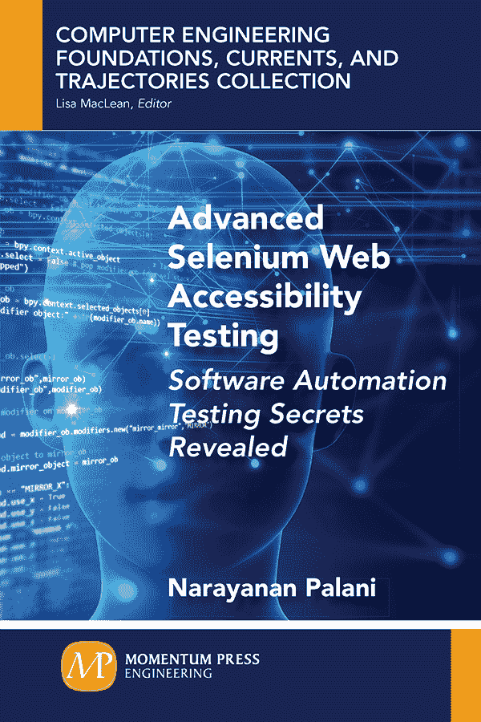


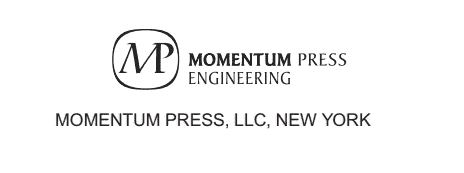

### 献给

Lakshmi

### 我的祖母

教导了我重要的课程，包括每个人对无障碍性的迫切需求。

## 摘要

如果您在 Google 上搜索主题或在线购买产品，Web 无障碍性是一项基本需求！如果一个网页可以通过鼠标访问，但使用键盘导航非常复杂，对于残障用户来说是非常困难的。Web 无障碍测试是面向客户的 Web 应用最重要的测试实践之一。

本书解释了编写手动无障碍测试的步骤，并将其转换为基于 Selenium 的自动化无障碍测试，以作为回归测试包的一部分。在解释测试设计步骤时，书中参考了`WCAG`和第 508 条指南。

由于手动和自动化无障碍测试的需求日益增长，具备无障碍测试知识的软件测试人员在大型组织中最受欢迎。本书通过测试用例和代码示例最好地说明了各种无障碍测试的类型。

## 关键词

selenium 测试；无障碍测试；Web 无障碍性；pa11y；手动测试；自动化测试；视觉测试；`WCAG`；自动化无障碍测试；非功能性测试

## 目录

- [图表列表](#)
- [前言](#)
- [致谢](#)

## 1 引言：无障碍测试员——一个极具未来感的手动测试角色

- 1.1 手动测试的未来
- 1.2 如何体验或学习无障碍测试？
- 1.3 无障碍测试
- 1.4 JAWS 辅助技术
- 1.5 JAWS 安装
- 1.6 测试网页上的链接
- 1.7 可点击链接打开新窗口
- 1.8 链接旁的内容
- 1.9 列表链接
- 1.10 色彩对比验证
- 1.11 标题顺序
- 1.12 为无障碍测试构建手动测试用例

## 2 左移测试

- 2.1 早期左移质量保证
- 2.2 敏捷项目中的无障碍测试

## 3 测试覆盖

- 3.1 测试覆盖指南和模板
- 3.2 无障碍测试覆盖检查表-故事启动阶段
- 3.3 无障碍测试覆盖检查表-设计阶段
- 3.4 键盘快捷键与测试用例覆盖矩阵
- 3.5 为了提高测试覆盖的七项无障碍需求考虑

## 4 工具安装

- 4.1 Axe Core 无障碍引擎
- 4.2 Google Chrome 浏览器的 Axe 插件
- 4.3 Achecker 在线工具

## 5 Web 无障碍

- 5.1 方法
- 5.2 兼容性

## 6 测试 WCAG 标准—可感知性

- 6.1 非文本内容
- 6.2 内容示例测试

## 7 测试键盘操作

## 8 测试 WCAG 标准—可区分性

- 8.1 色彩示例测试
- 8.2 色彩自动化测试
- 8.3 对齐
- 8.4 对齐
- 8.5 调查
- 8.6 音频控制

## 9 测试 WCAG 标准—可理解性

- 9.1 示例：登录页输入

## 10 测试 WCAG 标准—稳健性

- 10.1 名称、值的重要性
- 10.2 NVDA 测试用例
- 10.3 JAWS 测试用例

## 11 测试 WCAG 标准—可操作性

- 11.1 键盘示例测试
- 11.2 网页上的动画

## 12 使用 BackstopJS 进行视觉回归测试

- 12.1 为什么“视觉回归”是测试的解决方案？
- 12.2 为 BackstopJS 创建配置文件
- 12.3 使用 BackstopJS 执行测试

## 13 使用 Taurus 和 Selenium 进行并发测试

## 14 无障碍的频次

- 14.1 无障碍测试的规划-常见问题

## 15 缺陷分类

## 16 无障碍认证

## 17 带有无障碍测试的高级 Selenium JavaScript 框架

- 17.1 使用 Cucumber 模板中的复用函数构建无障碍测试

## 18 “设计”阶段的无障碍测试

- 18.1 为“色盲”客户设计应用
- 18.2 针对动画和运动敏感的应用的设计与测试

## 19 使用 AXE 进行自动化测试中的无障碍代码扫描

- 19.1 JavaScript 编程的 Axe 扫描示例
- 19.2 Java 编程的 Axe 扫描示例

## 20. 错误信息的可障碍性测试

## 20.1 错误信息的位置

## 结论

## 缩写表

## 关于作者

## 索引

## 图列表

- 图 4.1. 从 Webstorm IDE 打开的 Selenium `package.json` 文件。
- 图 4.2. Webstorm IDE 工具的终端。
- 图 4.3. 通过`npm`安装`axe core`后 Webstorm IDE 的终端。
- 图 4.4 在 Google 上搜索 Chrome 的 Axe 插件。
- 图 4.5. 用于 Google Chrome 浏览器的 Axe 插件。
- 图 4.6. 在 Google Chrome 中按`F12`查看 axe 标签页并点击分析扫描页面以查找该页面上的可障碍性违规。
- 图 4.7. Axe Google Chrome 插件提供了网页的违规列表。
- 图 4.8. Achecker 网站对网页进行无障碍验证扫描。
- 图 6.1. 访问 github 网站并使用`NVDA`读取该网站的内容。
- 图 6.2. 网页元素列表已显示在`NVDA`上。
- 图 7.1. `NVDA`语音查看器读取链接信息。
- 图 7.2. Aria label。
- 图 7.3. Github 网站。
- 图 7.4. Github 网站上的一个链接。
- 图 7.5. `NVDA`屏幕阅读器读取了 Slack 图片。
- 图 7.6. `NVDA`语音查看器。
- 图 7.7. Cucumber 脚本测试执行状态。
- 图 8.1. 颜色对比分析器。
- 图 8.2. Github 网站上的颜色验证。
- 图 8.3. Github 网站的颜色细节。
- 图 8.4. Github 网站。
- 图 8.5. Github 网站 Slack 图片的背景颜色细节。
- 图 8.6. Github 文本的类细节。
- 图 8.7. 颜色对比分析器显示测试失败。
- 图 8.8. Github 视频 6。
- 图 11.1. Github 博客。
- 图 11.2. `NVDA`语音查看器。
- 图 12.1. Github 项目。
- 图 12.2. `Backstop.json`文件。
- 图 12.3. `World.js`文件。
- 图 12.4. `Backstop.json`文件。
- 图 12.5. BackstopJS 报告。
- 图 12.6. Backstop approve 命令 8。
- 图 12.7. 测试结果。
- 图 12.8. BackstopJS 报告。
- 图 13.1. 测试结果。
- 图 17.1. Chromedriver。
- 图 17.2. 测试文件。
- 图 17.3. Github 网站。

## 第一章

## 引言：可障碍测试员——一个极具未来的手动测试角色

前言

“Web 属于所有人。”

Web 可障碍性是一门为有身体、视觉、认知和听力残障的用户构建网站的艺术。请记住，我们每每个人在生活的某个时刻、以某种方式自然地变得残障，并需要更好的无障碍支持！

根据世界卫生组织 2018 年 10 月 11 日发布的《盲和视力障碍》报告，约有 13 亿人受到某种形式视觉障碍的影响。互联网改变了人们的生活，大多数日常工作已严重依赖网站来处理日常活动，如住宿安排、旅行、食物和其他基本需求。尽管网站在构建时考虑了客户需求，但并非所有网站对于残障用户都是可障碍的！可障碍性缺陷非常重要，对于那些在生活中没有经历过此类情况的测试人员来说，很难复现。

信息技术行业一直在快速发展，迫切需要残障人士或身体受限的工程师向前一步，指出他们在日常生活中访问的网页中存在的问题！当我遇到一位双眼 2 级低视的朋友时，他表达了由于无法使用移动端旁读（voice over）导航到网页的预期部分，在访问职业网站时的挫败感。同样，另一位身材矮小的朋友在录音器仅读取了有限文本的情况下，无法理解 ATM 银行机的旁读以导航到下一个屏幕，而且很难看清 ATM 屏幕上的显示内容。对于普通测试人员来说，发现这些 bug 极其困难，而具有相似残障的工程师可以轻松发现这些缺陷并将其记录在“无障碍缺陷列表”中，因此，近期对残障人士测试员的需求日益增长。

当我向英国伦敦中心的一组工程师演示基于`selenium`的自动化无障碍测试时，观众中有几个人实际上参加了会议，目的是为了给他们的软件团队招聘工程师！寻找无障碍测试合适资源的主要挑战，是软件测试人员对《网页内容无障碍访问指南》（WCAG）标准的认知。尽管 WCAG 已经在网站上记录了大量示例，但基层并没有足够的经验项目工程师来解释如何实施。本书的编写目的是为了解释手动测试和自动化测试中几种无障碍测试的实现可能性。自动化测试框架使用了`JavaScript`来在全书中展示测试示例，因为`NodeJS`生态正在随着各种“奇妙”的测试自动化工具（如`webdriverio`、`backstopJS`和`cucumberjs`）而增长；书中也提供了一些 Java 编程示例，但重点更多在于“无障碍测试”而非“自动化测试”。如果读者想学习更多自动化测试代码示例，强烈建议阅读我之前关于《软件自动化测试秘密揭秘第 1 和第 2 部分》的著作。

## 1.1 手动测试的未来

IT 行业内部存在争论，认为手动测试将消失，自动化测试将接管大部分工作！这是未来走向更多测试自动化的真实趋势，但了解无障碍测试的手动测试员预计在不久的将来将作为小众资源存在！

符合`WCAG`或`section 508`等国际标准是大型面向客户组织的强制性需求之一。当需要满足无障碍要求时，迫切需要聘用对无障碍有丰富经验、并能进行此类无障碍需求测试的手动测试员。

当`selenium`和`UFT`等自动化测试工具需求巨大时，市场也在寻找具有`JAWS`或`NVDA`无障碍测试经验的手动测试员。

残障用户经常使用如`JAWS`或`NVDA`等语音辅助工具访问桌面端的网站或应用程序，以便听到来自网站的声音。当使用手机时，`talkback`是听取特定网站语音和从移动端访问任何应用程序的知名选项之一。

并不是所有的无障碍测试都能使用`selenium`等工具实现自动化！这是一个充分的原因。因为，在访问被测试应用程序（AUT）时，无障碍测试的经验至关重要。与其依赖自动化的无脑工具为测试用户执行操作，这可以探索更多的无障碍问题。

## 1.2 如何体验或学习无障碍测试？

如果你对学习无障碍测试感兴趣，只需在 Google 上搜索“NVDA”并将其安装在桌面上，即可开始使用它对网站或需要验证无障碍需求的 AUT 进行每一次键盘移动操作！

推荐读者在 YouTube 上观看标题为“NVDA: The free software empowering blind people world-wide”的`NVDA`相关视频，URL：`https://youtube.com/watch?v=Ks7AwV_uxO0`

在桌面端使用`NVDA`或`JAWS`时，请读者避免使用鼠标，或至少在目标 AUT 上减少对鼠标的使用，以验证应用程序的特性。

## 1.3 无障碍测试

视障或“身体受限”（本节中使用该术语称为“特殊用户”）等残障用户需要无障碍网页应用程序以方便使用。这已作为《网页内容无障碍访问指南》（简称“WCAG”）/通用服务管理局第 508 条（简称“Section 508”）的一部分详细提出。在为网页应用程序提供无障碍功能时，为页面的每个部分提供适当的并在网页上提供最佳用户体验是非常重要的。

注意：视力障碍有疾病控制与预防中心（CDC）指定的分类，它并不是对应用程序进行无障碍测试的唯一主要原因。无障碍确保了残障特殊用户可以访问与普通用户相同的网页。

导致视力障碍的主要原因：

- 未矫正的屈光不正
- 白内障
- 糖尿病视网膜病变
- 角膜混浊
- 胎形眼
- 黄斑变性（与年龄相关）
- 青光眼

无障碍测试中有一个常见的误区，认为测试主要是为了视力障碍客户执行的。但并不是执行无障碍测试的唯一需求，因为在测试时还必须考虑以下类型的障碍：

- 听力
- 言语
- 视觉
- 认知
- 神经
- 物理

案例研究：患阿尔茨海默病等神经系统障碍患者对`www.dementiablog.org`的网页访问。

该网站已使用`Total Validator Pro`经过验证，按住`CTRL`和`–`将分别增加或减少页面字体大小，此信息已提供：`www.dementiablog.org/accessibility/`

### 1.3.1 如何判断应用程序何时需要无障碍测试？

如果应用程序以任何可能的方式面向客户，建议进行无障碍测试，以确保应用程序符合`WCAG`/Section 508 标准。

### 1.3.2 如何通过测试来验证网页应用程序是考虑到这些特殊用户开发的？

通过残障客户使用`JAWS`、`NVDA`、`ZoomText`、`Windows Magnifier`、`Web Accessibility Toolkit`等辅助技术访问网页的方式进行测试。

## 1.4 JAWS 辅助技术

JAWS（授权版）是全球范围内视障人士广泛使用的知名工具！大约 90% 的网页可访问特殊残障用户使用 JAWS 来读出网页内容并与应用程序进行交互。如果残障用户想要登录网页，桌面电脑上安装了 JAWS，它会随着 Internet Explorer 网页登录页一同启动（因为 JAWS 仅与 IE 浏览器版本兼容良好）。因此，当按下键盘`TAB`、`DOWN`或`UP`箭头键时，JAWS 会读出登录页面内容并方便用户导航。如果用户想在 Firefox 中打开网页，最好是使用另一种名为`NVDA`（开源）的工具，它的读取效果与 IE 下的`JAWS`类似。如果用户想在 Chrome 中打开网页，`NVDA`效果更好，但使用 Firefox `NVDA`是最佳选择。

## 1.5 JAWS 安装

Freedom Scientific (2008) JAWS 屏幕阅读软件 [网络博客] 获取自 [`freedomscientific.com/Downloads/JAWS`](https://freedomscientific.com/Downloads/JAWS)

注意：一旦`JAWS`在电脑上安装并打开，它可能会阻止打开 Google Chrome 或任何其他浏览器（Internet Explorer 除外）；同样，已打开的 Chrome 浏览器会自动关闭，因为`JAWS`正在开启读取屏幕。因此，建议在使用`JAWS`时将 Internet Explorer 作为网页应用的优浏览器。如果`JAWS` 18 在 Windows 10 系统上安装时报错，请尝试安装旧版本，如`JAWS` 16。

## 1.6 测试网页上的链接

如果特定网页上提供了用于导航到不同页面（在新窗口中）的链接，导航到该链接时读出的内容应类似于：

## 1.7 可点击链接打开新窗口

当`JAWS`在导航到链接时读出此内容，将帮助残障用户理解按下键盘`ENTER`键（或点击链接）将打开新窗口，且光标或焦点将移动到新窗口！

**开发者注意事项：**

HTML 属性：特定对象的`href`属性有助于`JAWS`/`NVDA`将该对象读为可点击状态。因此，在`title`或`aria-label`上提供正确的文本有助于为残障用户提供更好的无障碍体验。

## 1.8 链接旁的内容

如果焦点位于链接上，残障用户按下键盘上的`DOWN`键可以移动到页面上这些链接下方的内容。由于大多数残障用户依赖键盘（而非鼠标），因此当使用键盘按键导航时，页面必须按预期工作。

**开发者注意事项：**

每个对象的`Title`、`aria-label`或`class`已被`JAWS`/`NVDA`工具读出，因此为每个对象`aria-label`更新清晰且相关的文本有助于提供更好的无障碍体验。

## 1.9 列表链接

`JAWS`用户对键盘快捷键非常熟悉，例如列表链接功能（`INSERT+F7`）。这些相同的快捷键在`NVDA`中同样适用。在网页上按下`Insert+F7`会打开`JAWS`的新窗口并列出该网页上所有可能的链接。因此，用户可以选择特定链接并从列表链接中按下`ACTIVATE`键，从而对该链接执行点击动作。

## 1.10 颜色对比度验证

当视障用户访问网页时，他们倾向于使用如`Zoomtext`之类的工具，将页面内容放大至高达 300%。

验证网页内对象的颜色对比度非常重要，`WCAG`（针对欧盟）Section 508（针对美国）已指示在普通模式下满足`4.5:1`的颜色对比度比例，并在放大模式下满足`3:1`的比例！

**QA（质量保证）注意：**

如果一张图片在普通模式下的颜色对比度为`4.3:1`，但在 300% 放大下符合`3:1`比例，这是否意味着存在缺陷？

是的。这是一个缺陷，因为它没有满足普通模式下`4.5:1`的最小比例。

如果一张图片在普通模式下的颜色对比度为`5:1`，但在 250% 放大下符合`3:1`比例，这是否意味着存在缺陷？

不是。

如果图片在网页视图中出现在页面`top left`，但在移动视图下放大到 300% 时变为`top center`，这是否意味着存在缺陷？

这实际上取决于规范。如果有规范规定放大 250% 后将页面转换为移动视图，那么必须在用户故事（或规范）中说明对图片的预期以及它出现的位置。

原因：移动视图较短，用户无法以与网页视图相同的尺寸查看网页。

## 1.11 顺序正确的标题

当残障用户打开网页时，必须读出 URL，并且用户的每次`TAB`键都应按顺序引导至标题，如`Header 1`、`Header 2`等。

示例：如果页面阅读器（如`JAWS`）在从`H1`导航后读出`H3`，这在维护 HTML 属性方面是不正确的。


**案例研究：** Mark 因患糖尿病性视网膜病变导致视力障碍，他正在进行常规在线购物，并使用杂食品零售商的在线门户网站将 15 件产品加入购物车。当他决定付款时，他想交叉检查购物车中的物品列表。他借助 `NVDA` 和键盘操作导航到购物车图标，并成功按了 `ENTER` 键，引导他进入了购物车页面。当页面加载后，`NVDA` 一次性读出了整个页面内容，他通过列表链接功能导航到特定产品。不幸的是，他无法通过 `TAB` 键导航到产品（使用 `INSERT+F7`）。

**解决方案：** 为购物车添加链接或标题（2 级或 3 级）会让 Mark 的生活变得轻松！

**测试范围：** 如果购物车代码因添加链接或标题而发生更改，则必须跨桌面、平板电脑和移动设备进行测试。

## 1.12 构建无障碍测试手动测试用例

建议测试用例侧重于涵盖 `WCAG` 2.0 的四项原则：感知（Perceivable）、可操作（Operable）、理解（Understandable）和健壮（Robust），并在测试场景中涵盖 `A`、`AA` 和 `AAA` 等成功标准。

将无障碍测试集成到敏捷测试项目中。

当一个用户故事开发完成并在敏捷看板的 `TO DO` 列表中等待时，必须由业务分析师/测试人员对无障碍测试范围进行评估。

书中讨论的迭代周期：

```text
BACKLOG > BLOCKED > TO DO > STORY KICK OFF > IN DESIGN > IN DEVELOPMENT > READY FOR TEST > IN TEST > DONE
```

如果故事已移至 `Story kick off` 会议，必须与参与的开发者和利益相关者分析并讨论相关的 `WCAG`/`Section 508` 指南，以便无障碍测试输入进入“验收标准”列表！

### 良好示例

如果用户故事是作为敏捷项目的一部分开发链接，验收标准可以包含以下要点：

- 必须满足 `WCAG 2.4.4`（链接含义）成功标准。

### 错误示例

验收标准：“必须验证列表链接”。

**原因：**

当链接被开发后，QA 必须使用 `JAWS` 导航到链接并理解在 Internet Explorer 中读出的内容；同样，在 Firefox 中使用 `NVDA` 进行类似的测试。

同样，QA 使用列表链接验证新开发的链接是否出现在列表中，选择它并按下 `Activate` 键是否真的点击了该链接。

最后，悬停在链接上并查看悬停时显示了什么文本（HTML 属性：对象的 `title` 将被显示为 `hover over text`）。

在移动设备上：

启用语音设置导航到链接并收听读出的文本。

因此，仅测试列表链接并不能证明测试是完整的！

### 敏捷测试中的早期测试自动化

当页面的某个部分已开发完成完整页面时，可以使用 `Pa11y`、`Axe`、`Total Validator`、`Fire eyes` 来扫描整个页面！因此，当相应的“用户故事”（user story）从“开发中”移动到“准备就绪”时，必须使用 `Pa11y` 扫描页面并提供错误、警告和建议。

**挑战：** 在提供 URL 的情况下，`Pa11y` 有助于扫描特定页面。如果应用需要在登录或身份验证后进行扫描，到目前为止，`pa11y` 无法提供帮助。

**解决方案 1：** 必须将其脚本化为名为 `pa11y-ci` 的另一个工具的一部分，因此登录部分由 Java 程序处理，然后在代码层面指令其在身份验证后扫描特定页面。

**解决方案 2（优先）：** `AXE` 可以在身份验证后导航到特定页面，并根据 `WCAG`/`Section 508` 标准扫描元素。

### 1.12.1 良好格式的测试用例示例

**测试用例名称：** `01_NFT_Accessibility_FFXNVDA_Verify_Google_Search`

**测试描述：** 使用 Firefox 和 `NVDA` 在网页 [www.google.com](http://www.google.com) 上验证 `H44` 和 `H32` `WCAG` 标准。

**前提条件：** 在 Windows 10 上安装 `NVDA`（开源）和 Firefox Quantum `58.0.2`。

**测试步骤 1：** 在 Windows 10 操作系统上打开 `NVDA`，并使用耳机听取 `NVDA` 提供的语音。

**预期结果 1：** `NVDA` 应成功打开，且 `NVDA` 向用户清晰地读出内容。

**测试步骤 2：** 在 Windows 10 操作系统上打开 Firefox Quantum（版本 `58.0.2`（64 位））。

**预期结果 2：** Firefox 应成功打开。

**测试步骤 3：** 启动 [www.google.com](http://www.google.com) 网站。

**预期结果 3：** Google 搜索页面应打开，并由 `NVDA` 成功读出 URL。

**测试步骤 4：** 在 Google 搜索页面上使用键盘上的 `TAB` 键从 URL 导航到文本框。

**预期结果 4：** `NVDA` 应读出文本框的详情。

**测试步骤 5：** 在文本框内输入文本。

**预期结果 5：** 文本框内输入的文本应被清晰地读出。

**测试步骤 6：** 按 `TAB` 键导航到搜索按钮。

**预期结果 6：** 提交按钮应清晰地读出。

**测试步骤 7：** 在搜索按钮上按 `ENTER`。

**预期结果：** `NVDA` 应清晰地读出搜索结果。

### 1.12.2 糟糕的测试用例

**测试用例名称：** `01_NFT_Accessibility_IEXNVDA_Verify_Google_Search`

**测试描述：** 使用 Internet Explorer 11 和 `NVDA` 在网页 [www.google.com](http://www.google.com) 上验证 `H44` 和 `H32` `WCAG` 标准。

**原因：**

`NVDA` 与 Internet Explorer 兼容性不佳，因此建议在此测试用例中使用 `JAWS` 来验证 Internet Explorer 上的可访问性。

---

# 第 2 章：左移测试（Shift Left Testing）

在敏捷冲刺驱动的开发期间执行软件测试，并将测试活动移动到开发的早期阶段，是 2017 年以来测试行业的最佳实践和趋势。

## 2.1 早期左移质量保证

敏捷冲刺开发的阶段被分为六个阶段，以描述书中的示例。每个冲刺根据团队决定从两周到四周不等，但大多数基于冲刺的团队在他们的团队中遵循相似的开发阶段，因此提供了以下阶段来解释如何能在生命周期早期进行最佳的无障碍测试？

- **待办（TO DO）**：当故事被列在“待办”列表时，分析其对无障碍测试的需求水平。

- **故事启动（STORY KICK OFF）**：讨论需要的无障碍测试类型，并在用户故事的验收标准中（由 BA/测试人员完成）更新 `WCAG`/`Section 508` 分类（待测试）。

- **设计中（IN DESIGN）**：根据 `WCAG`/`Section 508` 标准进行设计（开发人员/设计工程师）；设计无障碍测试组合（测试人员完成）。

- **开发中（IN DEVELOPMENT）**：开发 `html` 属性以促进更好的无障碍性，并在开发箱中使用 `JAWS` 或 `NVDA` 进行本地测试（开发人员完成）；开发手动无障碍测试用例（测试人员完成）。

- **准备就绪（READY FOR TEST）**：QA 使用 `Pa11y` 扫描页面（如果是可以通过 URL 访问的单页）或使用 `AXE`（如果页面位于身份验证或多次页面导航/操作之后）。扫描完成后，提供扫描报告并与开发者讨论以消除页面扫描期间识别的误报。一旦在此阶段解决了问题，被测应用（`AUT`）实际上已准备好执行测试，因此移动到“测试中”。

- **测试中（IN TEST）**：使用 `JAWS`、`NVDA`、`Zoomtext` 等工具执行手动无障碍测试用例，以验证 `AUT` 的无障碍性。一旦手动测试用例执行且测试失败（缺陷）被修复，使用 `webdriverio` 对测试集（最多 30%）进行自动化，以便“自动化无障碍测试”作为回归测试的一部分运行。因此，QA 不需要在使用自动化测试运行时对特定故事重新运行手动测试用例。

## 2.2 敏捷项目中的无障碍测试

当项目完全按照敏捷方法论开发时，建议在生命周期早期开始实施无障碍测试。以下是证明测试从右端向左端逐步移动的一些示例。

### 步骤 1：在“测试中”阶段测试 `AUT`

| 待办列表 | 待办 | 故事启动 | 设计中 | 开发中 | 测试中 | 完成 |
| :--- | :--- | :--- | :--- | :--- | :--- | :--- |
|  |  |  |  |  | 手动无障碍测试 |  |

**优点：**

- `AUT` 可以快速开发并部署测试。
- `AUT` 可用于无障碍测试，并提出缺陷以跟踪这些无障碍问题。
- 在修复测试过程中发现的大部分无障碍测试问题后，可以重新部署 `AUT`。

**缺点：**

- `AUT` 在生命周期早期未通过 `axe` 或 `Pa11y` 工具扫描，这导致在“测试中”阶段引入缺陷。
- 在“测试中”阶段在缺陷修复后进行无障碍重测试是一个高度手动化、耗时且枯燥的过程。
- 如果存在设计问题（例如缺少标题或由于复杂设计导致信息顺序错误等），由于设计阶段已经过去，这些可能会留在代码中。
- 由于提出了与无障碍相关的缺陷，故事留在“测试中”的时间可能会比通常长。

### 步骤 2：在“开发中”阶段扫描 `AUT`，并在“测试中”阶段测试 `AUT`

| 待办列表 | 待办 | 故事启动 | 设计中 | 开发中 | 测试中 | 完成 |
| :--- | :--- | :--- | :--- | :--- | :--- | :--- |
|  |  |  |  | 无障碍扫描 |  |  |

**优点：**

- `AUT` 可以快速开发并扫描，以识别并修复任何无障碍相关问题（如颜色对比度错误），并部署进行测试；通过在“测试中”阶段防止这些无障碍测试问题，从而预期会有更少的缺陷。
- `AUT` 在修复了测试过程中发现的大多数无障碍测试问题（开发阶段应用扫描后）后，可以重新部署以进行重测试和回归测试。

### 缺点

- 在“测试中”阶段，在缺陷修复后进行无障碍的重测试是一个高度人工化、耗时且枯燥的过程。
- 如果存在设计问题（例如缺少 `header 1` 或由于复杂设计导致信息顺序错误等），由于设计阶段已经过去，这些问题可能会保留在代码中。
- 由于提到了许多与无障碍相关的缺陷列表，“测试中”阶段的 Story 运行时间可能会比通常更长。

### 步骤 3

在“开发中”阶段扫描 `AUT`，并使用 `JAWS` 或 `NVDA`、`WAT` 等工具在开发周期内对目标 `AUT` 进行测试，通过挑选可能的无障碍测试子集，并在“测试中”阶段测试剩余测试：

| Backlog | To Do | Story Kick-off | In Design | In Development | In Test | Done |
| :--- | :--- | :--- | :--- | :--- | :--- | :--- |
|  |  |  |  | 无障碍扫描：人工无障碍测试的子集 | 剩余的人工无障碍测试集 |  |

#### 优点

- `AUT` 在生命周期更早阶段就通过 `axe` 或 `Pa11y` 等工具进行了扫描。
- `AUT` 可以快速开发并扫描，以识别并修复任何无障碍相关问题（如颜色对比度错误），通过第一组子集测试的帮助识别早期缺陷并进行快速修复，然后部署进行测试；通过在“测试中”阶段防止这些无障碍测试问题，从而预期会有极少的缺陷。
- `AUT` 在修复了测试过程中发现的大多数无障碍测试问题（开发阶段应用扫描和测试后）后，可以重新部署以进行重测试和回归测试。

#### 缺点

- 在“测试中”阶段，在缺陷修复后进行无障碍的重测试是一个高度人工化、耗时且枯燥的过程。
- 如果存在设计问题（例如缺少 `header 1` 或由于复杂设计导致信息顺序错误等），由于设计阶段已经过去，这些问题可能会保留在代码中。
- 由于提到了许多与无障碍相关的缺陷列表，“测试中”阶段的 Story 运行时间可能会比通常更长。

### 步骤 4

在“设计中”阶段讨论匹配无障碍标准的设计更改，在“开发中”阶段扫描 `AUT`，并使用 `JAWS` 或 `NVDA`、`WAT` 等工具在开发周期内对目标 `AUT` 进行测试，通过挑选可能的无障碍测试子集，并在“测试中”阶段测试剩余测试：

| Backlog | To Do | Story Kick-off | In Design | In Development | In Test | Done |
| :--- | :--- | :--- | :--- | :--- | :--- | :--- |
|  |  |  | 设计与无障碍标准的匹配 | 无障碍扫描：人工无障碍测试的子集 | 剩余的人工无障碍测试集 |  |

#### 优点

- 在设计 `AUT` 时可以考虑标题的对齐或信息的顺序。
- `AUT` 在生命周期更早阶段就通过 `axe` 或 `Pa11y` 等工具进行了扫描。
- `AUT` 可以快速开发并扫描，以识别并修复任何无障碍相关问题（如颜色对比度错误），通过第一组子集测试的帮助识别早期缺陷并进行快速修复，然后部署进行测试；通过在“测试中”阶段防止这些无障碍测试问题，从而预期会有极少的缺陷。
- `AUT` 在修复了测试过程中发现的大多数无障碍测试问题（开发阶段应用扫描和测试后）后，可以重新部署以进行重测试和回归测试。

#### 缺点

- 在“测试中”阶段，在缺陷修复后进行无障碍的重测试是一个高度人工化、耗时且枯燥的过程。
- 由于提到了许多与无障碍相关的缺陷列表，“测试中”阶段的 Story 运行时间可能会比通常更长。

### 步骤 5

在启动阶段更新 Story 的验收标准（Acceptance Criteria），并与开发和测试讨论在推进 Story 时可以考虑哪些相关的无障碍标准编号，获取 Story 点的实际工作量估算，其中包含了无障碍测试所需的工作量。

| Backlog | To Do | Story Kick-off | In Design | In Development | In Test | Done |
| :--- | :--- | :--- | :--- | :--- | :--- | :--- |
|  |  | 更新“验收标准”以匹配相关的 `WCAG` 或 `Section 508` 标准，并在计算“Story 点”时考虑无障碍因素 | 设计与无障碍标准的匹配 | 无障碍扫描：人工无障碍测试的子集 | 剩余的人工无障碍测试集 |  |

#### 优点

- 在设计 `AUT` 时可以考虑标题的对齐或信息的顺序。
- `AUT` 在生命周期更早阶段就通过 `axe` 或 `Pa11y` 等工具进行了扫描。
- `AUT` 可以快速开发并扫描，以识别并修复任何无障碍相关问题（如颜色对比度错误），通过第一组子集测试的帮助识别早期缺陷并进行快速修复，然后部署进行测试；通过在“测试中”阶段防止这些无障碍测试问题，从而预期会有极少的缺陷。
- `AUT` 在修复了测试过程中发现的大多数无障碍测试问题（开发阶段应用扫描和测试后）后，可以重新部署以进行重测试和回归测试。

#### 缺点

- 在“测试中”阶段，在缺陷修复后进行无障碍的重测试是一个高度人工化、耗时且枯燥的过程。
- 由于提到了许多与无障碍相关的缺陷列表，“测试中”阶段的 Story 运行时间可能会比通常更长。

### 步骤 6：实现自动化无障碍测试

| Backlog | To Do | Story Kick-off | In Design | In Development | In Test | Done |
| :--- | :--- | :--- | :--- | :--- | :--- | :--- |
|  |  | 更新“验收标准”以匹配相关的 `WCAG` 或 `Section 508` 标准，并在计算“Story 点”时考虑无障碍因素 | 设计与无障碍标准的匹配 | 无障碍扫描：人工无障碍测试的子集 | 剩余的人工无障碍测试集，实现“自动化”无障碍测试脚本 |  |

#### 优点

- 在设计 `AUT` 时可以考虑标题的对齐或信息的顺序。
- `AUT` 在生命周期更早阶段就通过 `axe` 或 `Pa11y` 等工具进行了扫描。
- `AUT` 可以快速开发并扫描，以识别并修复任何无障碍相关问题（如颜色对比度错误），通过第一组子集测试的帮助识别早期缺陷并进行快速修复，然后部署进行测试；通过在“测试中”阶段防止这些无障碍测试问题，从而预期会有极少的缺陷。
- `AUT` 在修复了测试过程中发现的大多数无障碍测试问题（开发阶段应用扫描和测试后）后，可以重新部署以进行重测试和回归测试。
- 自动化无障碍测试将验证持续集成和交付流水线中的任何无障碍问题。
- 在完成首轮人工无障碍验证和确认后，不再需要重复任何人工无障碍测试。

#### 缺点

- 无

### 步骤 7

在生命周期中尽可能尽早地实现自动化无障碍测试：

| Backlog | To Do | Story Kick-off | In Design | In Development | In Test | Done |
| :--- | :--- | :--- | :--- | :--- | :--- | :--- |
|  |  | 更新“验收标准”以匹配相关的 `WCAG` 或 `Section 508` 标准，并在计算“故事点”时考虑无障碍性 | 将设计与无障碍标准匹配 | 无障碍扫描 | 手动无障碍测试的子集 | 开始编写“自动化”无障碍测试脚本 |
|  |  |  |  |  | 剩余的手动无障碍测试全集，完成“自动化”无障碍测试脚本的编写 |  |

## 优势

- 在设计 `AUT` 时，可以考虑到标题的对齐或信息的顺序。
- 在生命周期的早期，可以使用 `axe` 或 `Pa11y` 等工具对 `AUT` 进行扫描。


`AUT` 可以快速开发并进行扫描，以识别并修复任何与无障碍相关的问题（例如颜色对比度错误），通过第一部分测试的帮助来识别并快速修复早期缺陷，并确保其部署进行测试，从而在`Test`阶段防止这些无障碍测试问题，因此预计缺陷会极少。

在修复了测试过程中识别的大多数无障碍测试问题（应用后扫描和开发阶段的测试）后，可以重新部署`AUT`进行重测和回归测试。

自动化无障碍测试将作为持续集成和交付流水线的一部分，验证任何无障碍问题。

在完成首轮手动无障碍验证和确认后，无需重复进行任何手动无障碍测试。

## 劣势

不适用

## 常见问题解答 (FAQs)

### 2.2.1 我们可以完全跳过无障碍测试中的手动部分吗？

这是一个错误的方法，因为体验不同残障用户使用真实应用程序的方式非常重要，因此至少需要进行一次手动测试。

### 2.2.2 使用`axe`或`Pa11y`扫描`AUT`是测试人员的责任吗？

测试人员的职责是建议需要扫描的内容，并帮助开发人员从`axe`、`pa11y`或其他工具集抛出的完整违规列表中理解哪些是有效的问题。

### 22.2.3 我们可以要求开发人员进行这项手动测试吗？

不建议这样做。

### 2.2.4 我们可以建议测试人员在`In Test`阶段之前编写自动化无障碍测试吗？

只有当测试人员具有根据无障碍标准测试应用程序的经验，并且无无障碍验证步骤是之前冲刺的一部分时，才可行。但只有在第一轮手动无障碍测试成功完成并完成所有缺陷修复和重测后，才能实现自动化。原因是，手动测试为这些自动化无障碍测试提供更广泛的覆盖范围提供了思路。

### 2.2.5 如果使用`axe`扫描页面，是否可以认为无障碍测试已完成？

不不——这只是启动无障碍验证的方法之一。在执行完完整的手动无障碍测试，并开发某些测试的自动化测试脚本（这些测试是通过手动测试的）之前，无障碍测试并不算开始。因此，这些测试可以在`CI/CD`流水线上定期运行，以证明无障碍性作为每次代码更改的一部分得到了验证。

## 第 3 章：测试覆盖

通过测试用例覆盖（编写）所有测试需求以确保测试覆盖达到 100%（也称为“需求追溯性”）是验证和确认被测试应用程序（称为`AUT`）中每个可能的可测试项的最佳实践。

当测试人员规划无障碍测试时，`WCAG`和`Section 508`是主要的指南，通过查看每项需求来匹配需求或测试用例覆盖的基础。类似于“需求追溯性指标”，可以存在“指南追溯性指标”，以将多个测试用例与每项需求和`WCAG`指南匹配，以证明测试完全覆盖。

### 示例

可以通过涵盖下表中的一个或多个指南，将每项需求映射到新的测试场景。或者，可以根据匹配设备覆盖和辅助技术（如`JAWS`或`NVDA`）来编写测试，因此它们可以跨`WCAG`指南和测试需求提供良好的覆盖。

| 指南 | 测试覆盖 | | | | | | | | | |
| :--- | :--- | :--- | :--- | :--- | :--- | :--- | :--- | :--- | :--- |
| | 设备 | 辅助技术 | | | | | | | | |
| WCAG 2.0 成功标准 | Section 508 | 电脑-Windows | 电脑-Safari | 移动-Android | 移动-iOS | 平板 | JAWS | NVDA | 其他 |
| 1.1.1 非文本内容 [A] | 1194.22(a) | | | | | | | | | |
| 1.2.1 预制仅音频和仅视频 [A] | 1194.22(a) | | | | | | | | | |
| 1.2.2 字幕（预制）[A] | 1194.22(b) 和 .24(c) | | | | | | | | | |
| 1.2.3 音频描述或媒体替代方案（预制）[A] | 1194.22(b) 和 .24(d) | | | | | | | | | |
| 1.2.4 字幕（实时）[AA] | 1194.22(b) 和 .24(c) | | | | | | | | | |
| 1.2.5 音频描述（预制）[AA] | 1194.22(b) 和 .24(d) | | | | | | | | | |
| 1.3.1 信息与关系 [A] | 1194.22(e) 至 (h) | | | | | | | | | |
| | | | | | | | | | | |
| 1.3.2 有意义的顺序 [A] | | | | | | | | | | |
| 1.3.3 感知特性 [A] | | | | | | | | | | |
| 1.4.1 使用颜色 [A] | 1194.21(i) 和 .22(c) | | | | | | | | | |
| 1.4.2 音频控制 [A] | | | | | | | | | | |
| 1.4.3 对比度（最小）[AA] | | | | | | | | | | |
| 1.4.4 文本缩放 [AA] | | | | | | | | | | |
| 1.4.5 文本图像 [AA] | 1194.21(f) | | | | | | | | | |
| 2.1.1 键盘 [A] | 1194.21(a) | | | | | | | | | |
| 2.1.2 无鼠标 [A] | | | | | | | | | | |
| 2.2.1 调整 [A] | 1194.21(p) | | | | | | | | | |
| 2.2.2 暂停、停止、隐藏 [A] | 1194.21(h) | | | | | | | | | |
| 2.3.1 闪烁或低于阈值 [A] | 1194.21(k) 和 .22(j) | | | | | | | | | |
| 2.4.1 跳过块 [A] | 1194.22(o) | | | | | | | | | |
| 2.4.2 页面标题 [A] | 1194.22(i) | | | | | | | | | |
| 2.4.3 焦点顺序 [A] | | | | | | | | | | |
| 2.4.4 链接目的（在上下文）[A] | | | | | | | | | | |
| 2.4.5 多种方法 [AA] | | | | | | | | | | |
| 2.4.6 标题和标签 [AA] | | | | | | | | | | |
| 2.4.7 焦点可见 [AA] | 1194.21(c) | | | | | | | | | |
| 3.1.1 页面语言 [A] | | | | | | | | | | |
| 3.1.2 部分语言 [AA] | | | | | | | | | | |
| 3.2.1 焦点 [A] | 1194.21(l) 和 .22(n) | | | | | | | | | |
| 3.2.2 输入 [A] | 1194.21(l) 和 .22(n) | | | | | | | | | |
| 3.2.3 一致导航 [AA] | | | | | | | | | | |
| 3.2.4 一致标识 [AA] | 1194.21(e) | | | | | | | | | |
| 3.3.1 错误识别 [A] | 1194.21(l) 和 .22(n) | | | | | | | | | |
| 3.3.2 标签或说明 [A] | 1194.21(l) 和 .22(n) | | | | | | | | | |
| 3.3.3 错误建议 [AA] | | | | | | | | | | |
| 3.3.4 错误预防（法律、财务、数据）[AA] | | | | | | | | | | |
| 4.1.1 解析 [A] | | | | | | | | | | |
| 4.1.2 名称、角色、值 [A] | 1194.21(d) | | | | | | | | | |

## 3.1 测试覆盖指南和模板

需求追溯矩阵的设计用于将测试脚本/用例映射到相应的测试需求，以理解任何覆盖缺口，从而确保了需求追溯性。

同样，需求和无障碍标准被映射到测试用例，以了解是否遗漏了任何相关的无障碍标准和需求！

| XXX | 区分性：理解指南 1.4 | 1.4_NFT_Accessibility_IEXWAT_Verify_Github_website |

可以在此处找到`WCAG`的完整指南：[`w3.org/WAI/standards-guidelines/wcag/`](https://w3.org/WAI/standards-guidelines/wcag/)

### 3.2 无障碍性测试覆盖清单 - 故事启动阶段

| 在“启动 (Kick Off)”或“待办 (To-Do)”阶段针对用户故事的问题/检查清单 | 强制 (M) /可选 (O) |
| :--- | :--- |
| 验收标准 (AC) 部分是否已更新需要完成的“无障碍性指南”编号？例如：必须满足`WCAG 1.1.1` | M |
| 每项无障碍性验收标准是否已分配给相应的开发者或测试人员？ | O |
| AC：是否由开发者执行（使用`AXE`或`PA11Y`）无障碍性代码扫描？ | O |
| AC：在故事移至“测试 (Test)”之前，应设计并完成无障碍性测试用例 | M |
| AC：在手动测试完成后，应设计自动化无障碍性测试 | O |
| AC：测试执行结果应为建议/问题/缺陷的形式 | O |
| 完成定义 (Definition of Done)：无障碍性缺陷级别 1、2、3 的定义 | M |
| 完成定义 (Definition of Done)：定义何时完成无障碍性测试执行 | M |
| 完成定义 (Definition of Done)：“推迟”无障碍性缺陷以待修复或在未来的修复中考虑的程序，以及提交“豁免 (Waivers)”的步骤 | M |

### 3.3 无障碍性测试覆盖清单 - 设计阶段

| 设计阶段用户故事的问题/检查清单 | 强制 (M) /可选 (O) |
| :--- | :--- |
| 用户故事涉及的任何部分都不应有任何“键盘陷阱”；为了避免键盘陷阱，建议设计师为开发者提供表单的导航流 | M |
| 应用不应完全依赖动画。动画内容应提供文本替代方案 | M |
| 应用是否具有逻辑的开始和结束状态构建？ | M |
| 如果应用使用了运动，请避免使用运动并尝试使用溶解过渡效果 | M |
| 颜色选择应与文本替代方案相关 | M |
| 如果应用包含闪烁、动画或视频类的音频视频组件，是否使用了模拟眼镜来测试应用？例如：针对以下情况的模拟眼镜：• 白内障和视力低下；• 隧道视野；• 隧道视野和视力低下；• 半盲；• 糖尿病视网膜病变；• 黄斑变性。参考[`optimalowvision.co.uk/product.cfm?prod=474&dept=479`](http://www.optimalowvision.co.uk/product.cfm?prod=474&dept=479) | O |
| 如果 Web 应用上有焦点指示器和链接，是否使用手持放大镜进行了测试？ | O |
| 设计师是否回答了这些问题？• 此视觉效果的整体目的是什么？• 传达最佳方式是什么？• 视觉效果的哪些部分是装饰性的需要文本替代方案？• 图像的哪些部分是功能性图像（如左右箭头），需要文本替代方案？ | M |
| 应用的媒体部分是否提供了音频描述？这是否能帮助听障观众阅读和理解视频？ | M |
| 每个表单字段（如复选框和单选框）是否都提供了`<label>`？ | M |
| 如果应用包含占位符（例如日期字段中灰色文本的 DDMMYYYY，在获得焦点时消失），该占位符是否设计为显示在字段下方、上方或右侧，而不是在获得焦点时隐藏？ | M |

### 3.4 键盘快捷键与测试用例覆盖矩阵

测试用例应与`JAWS`和`NVDA`等辅助技术支持的每个键盘快捷键进行映射。

`JAWS`快捷键可以在此处找到：[`webaim.org/resources/shortcuts/jaws`](https://webaim.org/resources/shortcuts/jaws)

`NVDA`快捷键可以在此处找到：[`webaim.org/resources/shortcuts/nvda`](https://webaim.org/resources/shortcuts/nvda)

### 3.5 为了更好的测试覆盖的七项无障碍性需求考虑

在测试 Web 应用或文档时，强烈建议考虑以下测试领域并生成测试用例：

1. 结构
2. 图片
3. 超链接
4. 列表
5. 列
6. 颜色与对比度
7. 表格

如果测试人员将将测试用例映射到 Web 应用或文档的这七个领域，那么在测试用例步骤中发现一些缺陷是可行的。下一步是更新测试用例，以尽可能涵盖在`AUT`（测试对象）内验证这七个领域。

参考

U.S. Access Board. 2017\. “WCAG 2.0 与现有 508 标准的对比表。” Web 博客。获取自 [`access-board.gov/guidelines-and-standards/communications-and-it/about-the-ict-refresh/background/comparison-table-of-wcag2-to-existing-508-standards`](https://www.access-board.gov/guidelines-and-standards/communications-and-it/about-the-ict-refresh/background/comparison-table-of-wcag2-to-existing-508-standards)

# 第 4 章

* * *

### 工具安装

#### 4.1 Axe Core

安装

GitHub 2018\. “Web 测试引擎。”参考 [`github.com/dequelabs/axe-core`](https://github.com/dequelabs/axe-core)

更新`package.json`文件：


图 4.1 WebStorm 中打开的`package.json`文件。

从终端安装：

```bash
npm install axe-core --save-dev
```


图 4.2 安装 axe core 后 WebStorm 的终端。

#### 4.2 Chrome Axe 插件

在 [www.google.com](http://www.google.com) 中搜索可以与 Chrome 配合使用的 axe 插件：


图 4.3 Google 搜索 Axe 插件。

点击“添加至 Chrome”将此插件添加到 Chrome：


图 4.4 Chrome 版 Axe 插件。

当需要扫描页面时，请点击`F12`（或`Fn+F12`）打开开发者工具并导航到 axe 标签页：


图 4.5 在 Google Chrome 中按 F12 查看 axe 标签。

在 axe 标签页点击 Analyse 按钮：

```bash
analyze
```


图 4.6 Axe Chrome 插件提供了违规列表。

#### 4.3 Achecker 在线工具

访问 achecker.ca 网站并输入网站以检查任何无障碍问题。例如，请输入 [`github.com`](https://github.com) 并按回车（在网页 URL 下方）。

这将几秒钟内根据 WCAG 标准提供网站的已知问题列表。此工具将帮助检查单页的无障碍问题；


图 4.7 使用 Achecker 网站扫描网页。

建议：

如果在登录页面后或在特定场景后显示的页面需要检查相同的无障碍问题，建议尝试扫描 ‘axe’ 插件。

残障特殊用户在尝试访问特定网页以进行订票、提交保险理赔或任何常规在线活动时，在使用网页期间需要键盘的全方位支持，且假设大多数此类用户并不使用鼠标访问 Web 应用程序。当网页不支持或部分支持键盘时，会使这些特殊用户处于挑战性境地。市面上有一种专门针对他们需求设计的键盘；当用户通过访问屏幕阅读器和键盘时，他们能够听到 Web 应用程序上的可用信息，并使用键盘执行导航、操作和事件。例如，用户在阅读`google.com`网页以对特定信息进行搜索时，通常使用带有键盘和鼠标的台式机或笔记本电脑等设备；残障用户使用诸如`JAWS/NVDA`等屏幕阅读软件，通过键盘按键启动浏览器并输入想要访问的网址，此类软件会将内容读给用户听，因此残障用户基本上能听到页面上的信息，并通过按下键盘键如`Tab`、`Shift + Tab`（用于后向导航）、`Left`、`Right`、`Up`或`Down`方向键等进行操作。

## 5.1 测试方法

在功能/回归测试期间，敏捷项目中的 Web 应用程序会根据用户故事进行测试，而瀑布模型或 V 模型项目则通过需求规格书或正式需求文档来辅助测试。

在无障碍测试期间，会根据`WCAG`或`Section 508`等无障碍标准对需求进行评估，并将两者（需求和无障碍标准）作为基准参考进行测试。

## 5.2 浏览器兼容性


在功能测试期间，会确定客户范围内广泛使用的浏览器作为兼容性测试范围，例如 `Internet Explorer`、`Safari`、`Firefox`、`Chrome` 等。在无障碍测试期间，将使用残障用户使用的相应“兼容”屏幕阅读软件对这些客户偏好的浏览器进行验证。直到 2017 年，`JAWS` 被残障用户广泛使用，并且与 `Internet Explorer` 浏览器高度兼容。同样，一些残障用户偏好使用 `NVDA` 作为屏幕阅读软件，它与 `Firefox` 浏览器高度兼容。当从手机或平板电脑等手持设备使用浏览器时，相应的 `android` 或 `iOS` 应用程序提供了语音功能，因此必须使用物理设备进行测试，以了解当从手机或平板电脑使用时，这些网页是如何被语音读取应用程序读取的。

# 第 6 章 测试 WCAG 无障碍标准——可感知性

网页为用户理解每个部分的信息提供了强大的能力，能够吸引更多客户，并让残障人士在访问页面时感到更加舒适。

## 6.1 非文本内容测试

当网页上存在图像或任何除文本以外的图形时，必须提供文本替代，因为视觉障碍用户可能无法看到非文本内容，只有在存在文本替代时他们才能理解这些内容。

## 6.2 GitHub.com 非文本内容验证测试用例

**测试用例名称：** `1.1.1_1.3_NFT_Accessibility_FFXNVDA_Verify_Github_website`

**测试描述：** 在网页 `www.github.com` 上验证符合 `WCAG` 标准的内容。

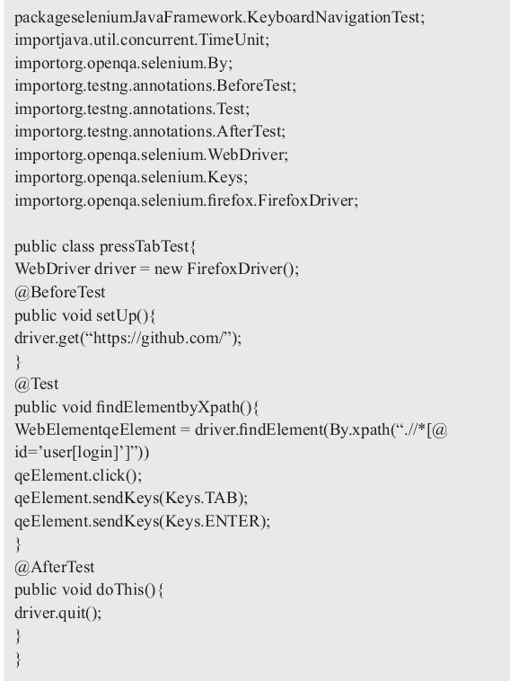

注意：可以将两个关键事件（如 `Tab` 和 `Enter`）合并为单行代码，如下所示：

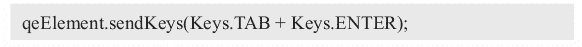

在基于 JavaScript 程序的 `seleniumWebdriverIO` 中关于 `Tab` 键的另一个示例：

### 对象的 HTML

在 Google Chrome 浏览器中打开网站，按 `F12` 打开开发者工具，然后选择“Elements”选项卡查看页面的 html 属性；或者，右键点击该对象（在本例中为“Learn about integrations”）并选择“Inspect Element”查看：

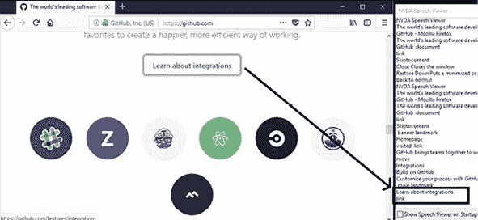

**图 7.1.** NVDA 语音查看器正在读取该链接。

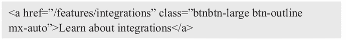

### 解释

`Href` 已被 `JAWS`/`NVDA` 识别，并结合之前显示的 html 属性中提供的“Learn about integrations”文本朗读为“link”。

#### Gherkin BDD

对于“Learn about integrations”对象示例，可以写在 `Then` 语句中如下：

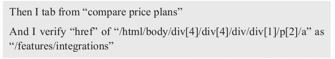

`href` 是从网页 html 属性中识别出的属性，“Learn about integrations”的 `xpath` 为 `/html/body/div[4]/div[4]/div[1]/p[2]/a`；同样，该对象的 `href` 为 `/features/integrations`；因此，测试基本上导航到对象的 `xpath` 并获取相应对象的 `href`，然后尝试将其与测试中提到的字符串 `/features/integrations` 进行匹配。这被称为 selenium 的“断言”（assertions）部分。

### 步骤定义（Step Definition）


使用了 JavaScript 中的 `WebdriverIO` 构建框架；使用了 WebStorm IDE 编写了这些脚本。第一个步骤定义从链接执行 `Tab` 按键以到达“Learn about integrations”，因此光标或焦点从页面上的上链接移动到此特定对象。在第二个步骤定义中，通过 `qaselector` 对象引用了“learn about integrations”链接的 `xpath`，通过 `qaselector` 传递的字符串为 `/html/body/div[4]/div[4]/div[1]/p[2]/a`；一旦对象被识别，自动化脚本使用 `.keys('Tab')` 按下了键盘按键 `Tab`，这意味着通过 selenium 浏览器驱动程序发送的指令执行 tab 操作并离开“Learn about integrations”。当 gherkin BDD 脚本的双引号内存在 `/` 时，会抛出错误并必须更新。此外，`href` 属性可能会根据组织的安全层而变化。因此请查看替代脚本（在其中您可以在同一个步骤定义中执行 tab 和验证）：

#### Gherkin BDD

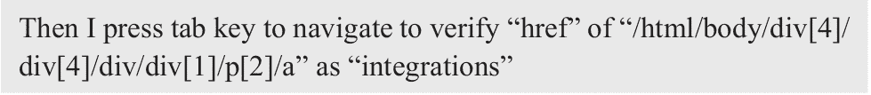

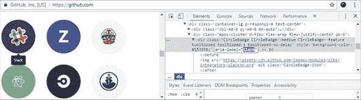

**图 7.2.** Aria label。

#### 步骤定义


### 下方向键（Down Arrow）的示例脚本

#### Gherkin BDD

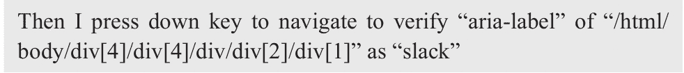

#### 步骤定义

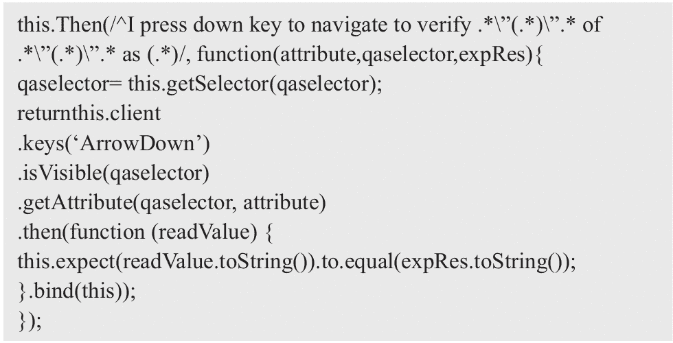

### 参考

W3c (2018) Keyboard Actions [Web Log Post]. 获取自 `https://w3c.github.io/webdriver/#keyboard-actions`

`webdriver.io` 2018. `keys` [Web Log Post]. 获取自 [`webdriver.io/api/protocol/keys.html`](http://webdriver.io/api/protocol/keys.html)

Selenium 2018 支持的所有按键。[Web Log Post]。获取自 `https://w3c.github.io/webdriver/#keyboard-actions`

slack 的 XPath 为 `/html/body/div[4]/div[4]/div[2]/div[1]`。

### 代码解释

假设光标或焦点位于“learn about integrations”链接上，按下键盘上的 `ArrowDown` 键会导致读取链接下方的“slack”图像：

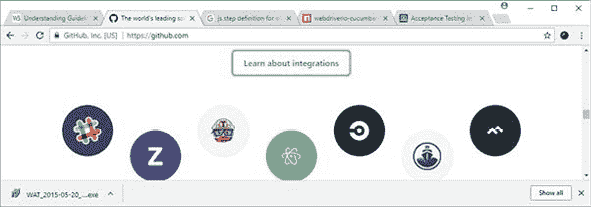

**图 7.3.** Github 网站。

这是在 Firefox 中使用 NVDA 时预期的行为：

使用 `Tab` 键导航到链接。

按 `ArrowDown` 箭头，观察到光标仍指向链接，但 NVDA 读出了 slack 图像：

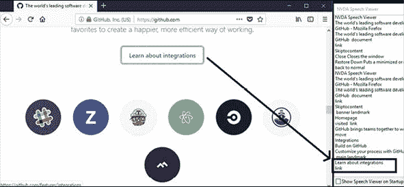

**图 7.4.** Github 网站上的一个链接。

此下方向键的行为使用 `webdriverio`（selenium）的 `.keys('ArrowDown')` 函数实现自动化：


**图 7.5.** 从 NVDA 屏幕阅读器读取了 Slack 图像。

在基于 Java 编程的 Selenium 测试中编写按键的代码示例：

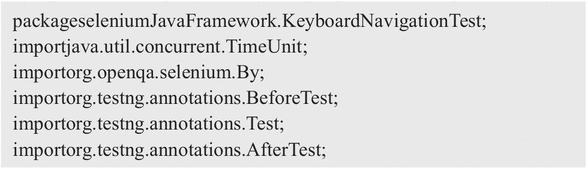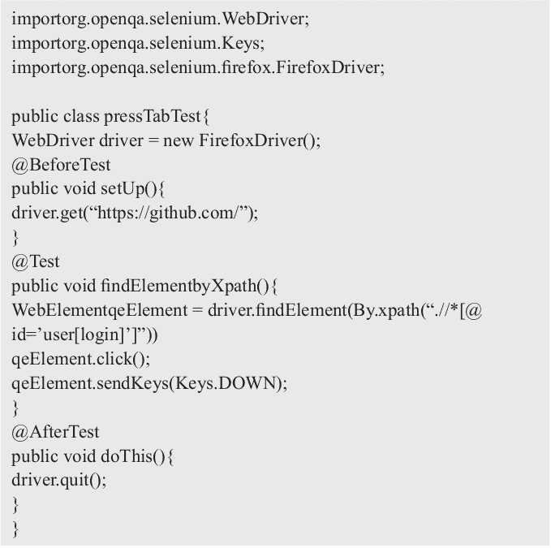

### 缺陷（defect）看起来是什么样的？

让我们以本部分的“顺序”（sequence）为例，测试页面表格项的顺序：

页面显示：表格内显示了标题 2（Heading 2）和标题 4（Heading 4），表格下方（外部）有一个链接，如“Contact us to learn more”。这在 Firefox 上被 NVDA 读出，以下是 NVDA 语音查看器的显示内容（已读给用户）：

预期表格内的内容在离开表格之前必须读出，以确保正确的顺序。在这种情况下，已经读出了标题 2，然后焦点移动到表格外的链接（按了 `Tab` 之后），进一步从链接（contact us to learn more）导航回表格并读出 4 级标题，这是一个顺序上的缺陷（AAA 级）。

来自 GitHub 仓库的练习脚本：

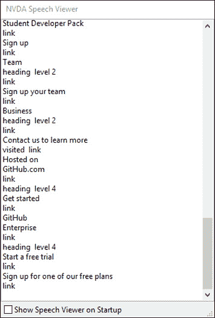

**图 7.6.** NVDA 语音查看器。

#### Feature 文件

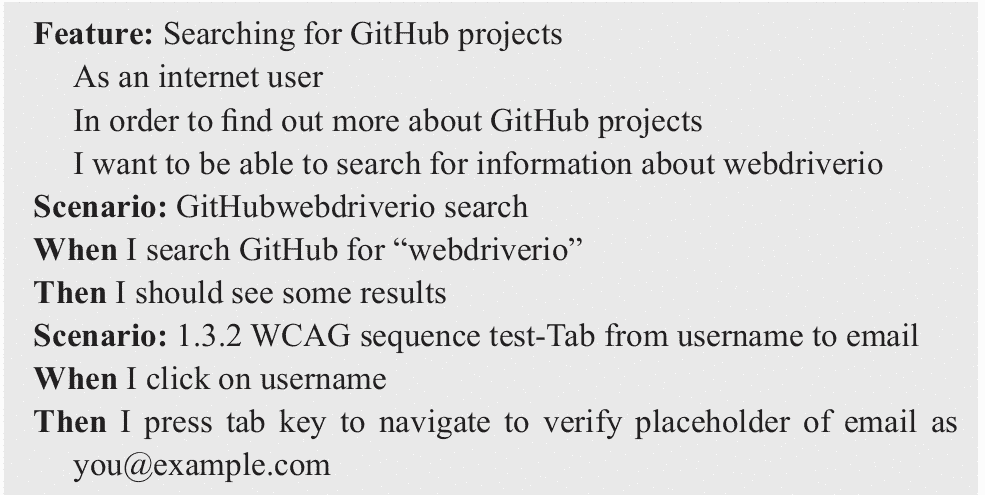

#### 步骤定义

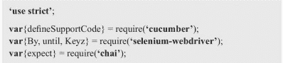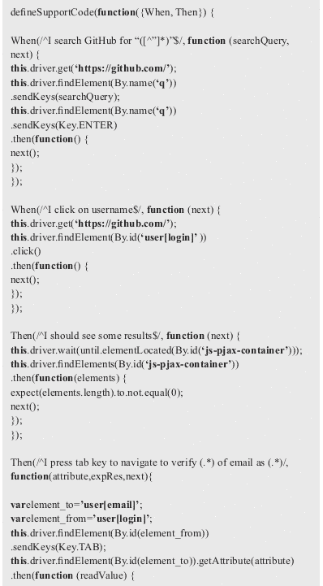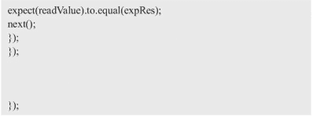

测试执行：右键点击 `cucumber.js` 并运行（使用 WebStorm IDE 工具）。

#### 结果

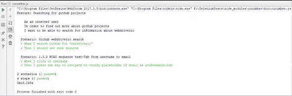

**图 7.7.** Cucumber 脚本测试执行状态。

# 第 8 章 色彩对比度测试

## 8.1 测试步骤 3：检查 GitHub Logo 的背景颜色和前景颜色

**预期结果 3：** 在普通模式（100%）下，色彩对比度必须高于 4.5:1。

**实际结果：**

当页面缩放至 300% 时，色彩对比度高于 3:1，测试通过：

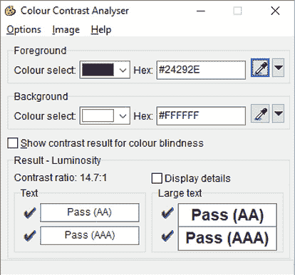

**图 8.1.** 颜色对比分析器。

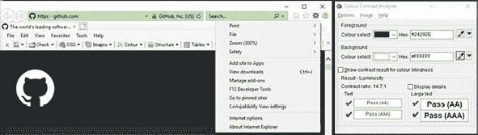

**图 8.2.** Github 网站上的颜色验证。

## 8.2 使用 Selenium 为颜色对比分析器编写自动化测试

`WebdriverIO`（`selenium` 的 JavaScript 版本）提供了更好的功能来验证网页内对象的 CSS 属性，因此在常规的行为驱动开发（BDD）测试期间，可以检查任何页面上的色彩对比度。

示例脚本：

### Gherkin BDD

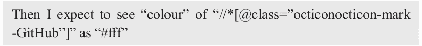

### 步骤定义（Step Definition）


`//GitHub Logo` 的对象属性为 `//*[@class=”octiconocticon- mark-GitHub”]`。

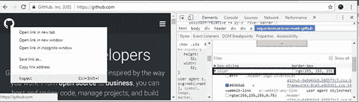

**图 8.3.** Github 网站颜色详情。

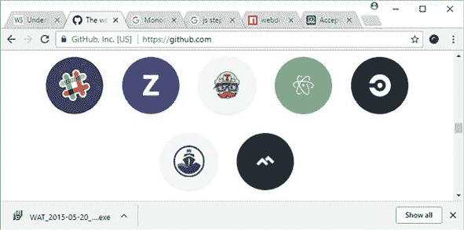

**图 8.4.** Github 网站。

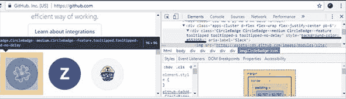

**图 8.5.** Github 网站上 Slack 图片的背景颜色详情。

### 代码解释

颜色是一个 CSS 属性，从浏览器中检查后即可查看，并且可以通过 `selenium` 的 `getCssProperty` 函数进行验证。因此，测试已更新，以检查页面显示时颜色是否已根据预期结果得到反映。

### 其他图像的相似测试

让我们以测试左侧的第一张图像为例：

图像的 CSS 属性为 `style=”background-colour: #553958;”`。

可以通过如下的 BDD 测试进行自动化：

### Gherkin BDD

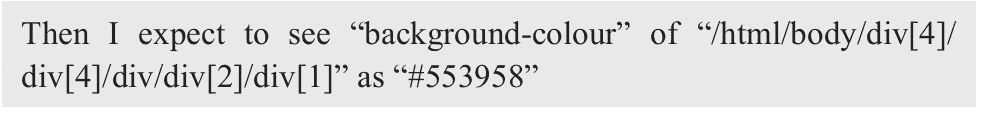

### 步骤定义（Step Definition）

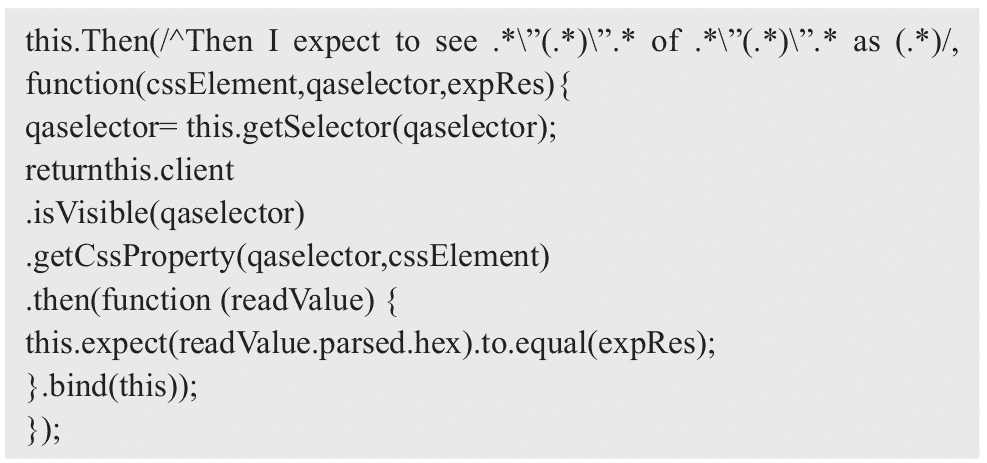

图像的 XPath 为 `/html/body/div[4]/div[4]/div/div[2]/div[1]`。

## 8.3 使用 Pa11y 在 Github.com 进行对比验证示例测试

**测试用例名称：** `1.4_NFT_Accessibility_Pa11y_Verify_Github_website`

**测试描述：** 使用 `Pa11y` 在网页 [`www.github.com`](http://www.github.com) 上验证遵循 WCAG 标准。

### 1.4 可区分性：理解指南 1.4

#### 1.4.3 对比度（最低对比）

##### 8.3.1 参考文献

W3C. 2016. “可区分性：理解指南 1.4。” Web 日志文章。获取自 [`w3.org/TR/UNDERSTANDING-WCAG20/visual-audio-contrast.html`](https://w3.org/TR/UNDERSTANDING-WCAG20/visual-audio-contrast.html)。

**前提条件：** 使用 JavaScript 在现有的 `webdriverIO`（`selenium`）BDD 仓库中安装 `Pa11y`（开源）。

**测试步骤 1：** 为 Web 应用程序的 URL 运行 `pa11y`。

**预期结果 1：** 应生成报告。

**测试步骤 2：** 与开发者和环境工程师讨论，排除 `pa11y` 报告中描述的“误报”，并从报告中识别有效问题。

**预期结果 2：** 应手动挑选有效缺陷并报告给敏捷团队，以更新待办事项（backlog）并修复这些项目。

字体将 Pa11y 配置到 BDD 中：

更新 `package.json` 文件中的 `pa11y` 版本：

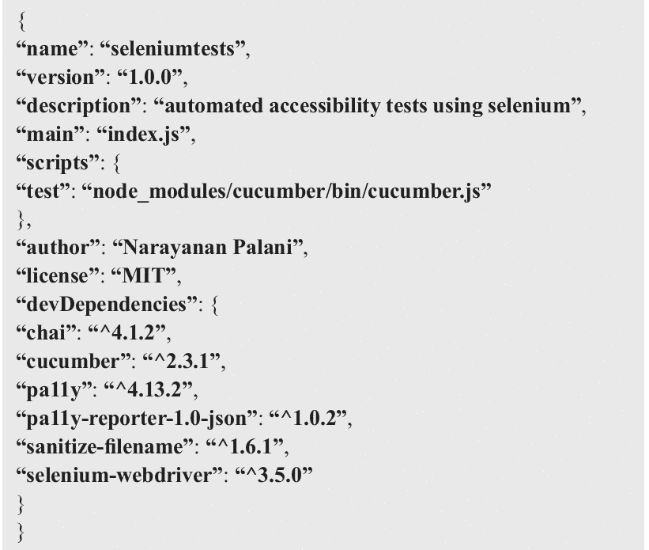

通过以下 Windows 命令执行安装：

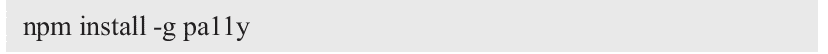

安装完成后，进行几次测试以了解它是如何工作的？

进入终端（WebStorm IDE）并输入：

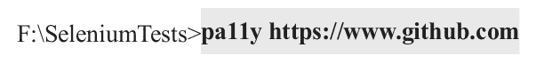

这将获得如下格式的报告：

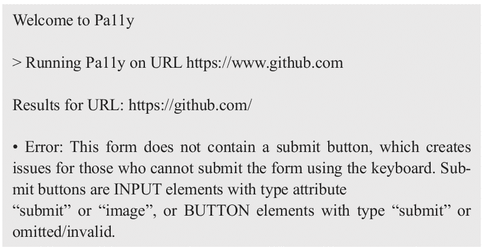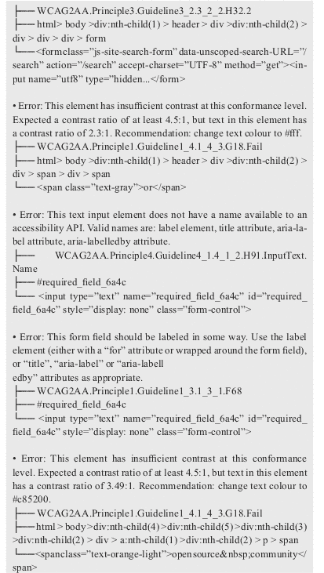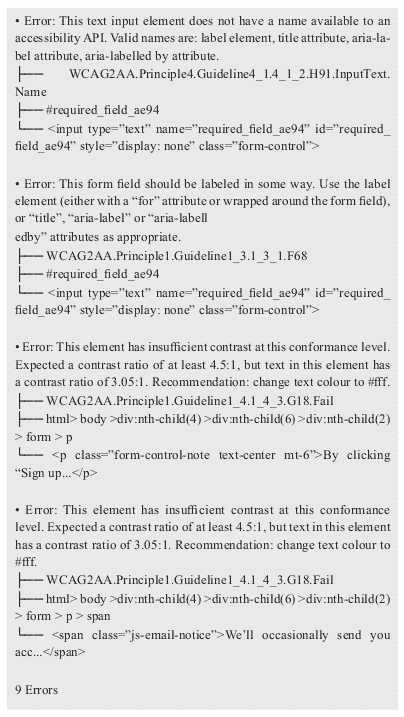

## 8.4 依据说明

这意味着页面上有 9 个与 Accessibility AA 标准 WCAG2 相关的错误，因为 `pa11y` 默认按 AA 标准扫描页面。如果我们需要特定标准（如 WCAG2 的 A 或 AAA 或第 508 节）的报告，必须在命令本身指定。

## 8.5 进一步调查

可以通过错误报告提供的 xpath 在网页上验证以下错误：

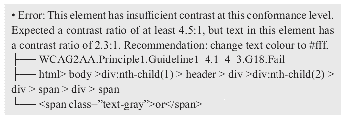

复制 xpath 并在 Google Chrome 页面的元素（Elements）部分搜索它（图 8.6）。

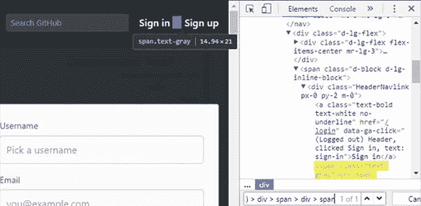

**图 8.6.** 来自 Github 的文本的类名详情。

为什么 Pa11y 将此文本报告为 `Guideline1_4.1_4_3` 的缺陷？

对比度最低要求为 4.5:1：[`w3.org/TR/UNDERSTANDING-WCAG20/visual-audio-contrast.html`](https://w3.org/TR/UNDERSTANDING-WCAG20/visual-audio-contrast.html)。

在测试 Web 应用时，如果测试人员发现难以阅读的复杂内容，应将此提交给可访问性测试部分的业务分析师（BA）。开发者应避免使用复杂的文本，并使网页上的内容易于阅读和理解。如果内容本身很复杂且难以阅读和理解其目的，则可能不被视为缺陷，因为开发者是完全按照用户故事或需求文档中的指示开发页面的。在这种情况下，可以在缺陷跟踪系统中以“问题”（Issue）或“建议”（Recommendations）的形式提出这些说明，以获得关于如何改进的明确指示。

# 第 9 章 输入辅助

## 9.1 示例：登录页上的输入辅助

如果用户尝试在 Web 页面上使用用户 ID 和密码登录，应在正确的时间向用户显示错误信息和说明。如果用户输入了用户 ID 但留空了密码框，显示的错误信息应该是恰当的，并提示用户填写密码以继续登录。同样，使用键盘按 `TAB` 键应帮助用户从用户 ID 文本框导航到密码文本框。如果用户想使用 `Shift+Tab` 键向后导航，应通过音频向用户提供清晰的导航说明。从密码字段按下 `Shift+Tab` 应到达 `user id` 字段，语音辅助应为用户读取有关用户 ID 字段的详情。如果用户输入了无效的用户 ID 和密码并点击登录按钮，应提供有效的错误信息，要求重新输入有效的用户 ID 和密码详情。当用户在屏幕上收到错误信息但未能通过语音读出时，这属于可访问性缺陷，因为使用 `JAWS` 或 `NVDA` 等辅助技术的用户将不知道在登录过程中发生了什么种错误。以下测试用例是验证此登录过程的一个良好示例：

```text
1.19.1_NFT_Accessibility_FFXNVDA_Verify_School_Student_Assingment_website_login
```

**测试描述：** 在登录页面时，使用 Firefox 和 NVDA 验证网页是否符合 WCAG 标准。

### 3.3.3 错误建议

### 9.1.1 引用

W3C 2016. “Input Assistance: Understanding Guideline 3.3.” Web Log Post. 获取自 [`w3.org/TR/UNDERSTANDING-WCAG20/minimize-error-suggestions.html`](https://w3.org/TR/UNDERSTANDING-WCAG20/minimize-error-suggestions.html)。

**前提条件：** 在 Windows 10 上安装 `NVDA`（开源）和 `Firefox quantum 58.0.2`。

**测试步骤 1：** 在 Windows 10 操作系统上打开 `NVDA` 并使用耳机听 `NVDA` 提供的语音。

**预期结果 1：** `NVDA` 应成功打开，`NVDA` 应向用户清晰地读取内容。

**测试步骤 2：** 在 Windows 10 操作系统上打开 `Firefox Quantum`（版本 `58.0.2`（64-bit））。

**预期结果 2：** `Firefox` 应成功打开。


**测试步骤 3：** 启动 Student Assignment 登录门户。

**预期结果 3：** 学生登录页面应打开，`NVDA` 应成功读取 URL。

**测试步骤 4：** 按 `TAB` 键导航到用户 ID 字段输入有效的用户 ID，再次按 `TAB` 键输入无效密码，再按一次 `TAB` 键导航到登录按钮并按 `Enter`。

**预期结果 4：** `NVDA` 应读出屏幕上显示的相同错误信息，该信息应是易理解且有效的，用于纠正所输入的密码。

## 第 10 章

### 测试 WCAG 可访问性标准——健壮性 (Robust)

当阅读器使用 `JAWS` 读取 Web 应用中的内容时，内容应足够可靠以提供各个部分的详情，且阅读器在使用 `NVDA` 和移动设备语音辅助模式时应具有类似的体验！

**案例研究：** Hema 年 15 岁，受阅读障碍（`Dyslexia`）的影响，这是一种常见的阅读、写写和拼写学习困难。她登录自己的学校在线账户访问作业，并使用 `NVDA` 音频和“语音查看器”选项阅读作业列表。在阅读作业部分时，她按下键盘操作 `INSERT+F7` 以查看整个页面列出的链接，作业以链接形式列出，她导航到每个需要处理并完成特定周任务的链接。该学生在线应用程序经过了软件升级，作业页面在视觉上没有变化。使用电脑时可以清晰看到，但 `NVDA` 的“列出链接”显示并读取的是链接的 URL，而不是以文本格式提供链接详情。如果她从移动端访问相同页面，移动端的语音辅助会从移动端视图清晰地读取链接。但她无法从移动端下载相关作业，因此她依赖笔记本电脑来下载和访问作业。应用程序本身是否存在确切缺陷，或者页面上是否存在可访问性缺陷？

**缺陷：** 作业页面内作业的每个链接都未在 HTML 属性中更新 `title`。网页上的每个链接都提供了 `href`，它作为指向目标页面的链接以继续打开作业。如果 HTML 为每个链接提供了 `title`，它将显示该“列出链接”中 `title` 部分的相关信息，而未开发 `title` 的链接会导致仅显示来自 html 属性中 `href` 的 URL，因此 Bug 存在于学生 Web 应用程序的 html DOM 属性。

**建议修复：** 为网页上的每个链接添加 `title`，且每个链接的 `title` 应该是唯一且一致的。如果有两个同名的作业，每个作业的 `title` 应该是唯一且有意义的，例如“assignment 1”和“assignment 2”等。

## 10.1 公共网站上的名称、角色、值

所有表单元素、文本框、链接、按钮和其他组件都应在 html 属性中提供名称、角色和值。

**示例：** 更新 html 属性如 `title`、`aria-label` 有助于在使用 `JAWS`、`NVDA` 等辅助技术时提供最佳体验。更多示例请参见：[`w3.org/TR/WCAG20-TECHS/ARIA16.html`](https://w3.org/TR/WCAG20-TECHS/ARIA16.html)

作业页面的 WCAG 指南测试用例

## 10.2 针对 NVDA 的测试用例

```
1.19.1_NFT_Accessibility_FFXNVDA_Verify_School_Student_Assingment_website
```

**测试描述：** 在登录页面时，使用 Firefox 和 NVDA 验证网页是否符合 WCAG 标准。

### 4.1.2 名称、角色、值

### 10.2.1 引用

W3C 2016. “Name, Role, Value: Understanding SC 4.1.2.” Web Log Post. 获取自 [`w3.org/WAI/WCAG21/quickref/?versions=2.0&showtechniques=412`](https://w3.org/WAI/WCAG21/quickref/?versions=2.0&showtechniques=412)

**前提条件：** 在 Windows 10 上安装 `NVDA`（开源）和 `Firefox quantum 58.0.2`。

**测试步骤 1：** 在 Windows 10 操作系统上打开 `NVDA` 并使用耳机听 `NVDA` 提供的语音。

**预期结果 1：** `NVDA` 应成功打开，`NVDA` 应向用户清晰地读取内容。

**测试步骤 2：** 在 Windows 10 操作系统上打开 `Firefox Quantum`（版本 `58.0.2` (64-bit)）。

**预期结果 2：** `Firefox` 应成功打开。

**测试步骤 3：** 启动 Student Assignment 网站。

**预期结果 3：** 学生页面应打开，`NVDA` 应成功读取 URL。

**测试步骤 4：** 使用 `TAB` 键从 URL 导航到作业标签页，并在学生主页上按键盘 `ENTER`。

**预期结果 4：** 导航到作业页面，`NVDA` 应读取链接、文本框的详情，任何图像应通过替代文本读取。

**测试步骤 5：** 按 `INSERT+F7` 键导航到列出的链接。

**预期结果 5：** 列出链接应显示页面上所有完整链接，并提供每个链接的详情和清晰信息。

# 10.3 JAWS 测试用例 (#contents.xhtml_c1.3)

## 1.19.2_NFT_Accessibility_IEXJAWS_Verify_School_Student_Assingment_website

**测试描述：** 使用 Internet Explorer11 或 Microsoft Edge 配合 JAWS 验证网页上符合 WCAG 标准的情况。

### 4.1.2 名称、角色、值 (Name Role Value)

#### 10.3.1 参考

W3C 2016. “Name, Role, Value: Understanding SC 4.1.2.” Web 日志. 获取自 [`w.org/WAI/WCAG21/quickref/?versions=2.0&showtechniques=412#name-role-value`](https://w.org/WAI/WCAG21/quickref/?versions=2.0&showtechniques=412#name-role-value)

**前提条件：** 在 Windows 10 上安装 JAWS（已授权）以及 Internet Explorer11 或 Microsoft Edge。

**测试步骤 1：** 在 Windows 10 操作系统上打开 JAWS，并使用耳机听 JAWS 提供的语音。

**预期结果 1：** JAWS 应成功打开，并 JAWS 向用户清晰地读出内容。

**测试步骤 2：** 在 Windows 10 操作系统上打开 Internet Explorer11 或 Microsoft Edge。

**预期结果 2：** Internet Explorer11 或 Microsoft Edge 应成功打开。

**测试步骤 3：** 启动学生作业（Student Assignment）网站。

**预期结果 3：** 学生页面应打开，且 JAWS 应成功读出 URL。

**测试步骤 4：** 在学生主页使用 `TAB` 键从 URL 导航到作业（assignments）标签页，并按下键盘上的 `ENTER` 键。

**预期结果 4：** 已导航到作业页面，JAWS 应读出链接详情、文本框，任何图像应带有其替代文本被读出。

**测试步骤 5：** 按 `INSERT+F7` 键导航到列出的链接。

**预期结果 5：** 应显示列出的链接，页面上显示完整的链接，并提供关于每个链接的清晰详细信息。

# 第 11 章 (#contents.xhtml_c11)

# 测试 WCAG 无障碍标准——可操作性 (Operable)

特殊用户使用快捷键访问网页，大部分导航通过键盘完成，而鼠标访问极少。通过考虑键盘，应验证用户对网页的导航以避免任何键盘陷阱，从而确保 `Tab`、`Shift Tab` 或方向键按正确的顺序流动，以获得更好的用户体验。

键盘陷阱的“A 级”（高优先级）缺陷示例：

用户从 URL 按 `TAB` 导航到标题 1，而从标题 1 按 `TAB` 却回到了 URL，而不是导航到页面的其他部分！因此，用户在获得鼠标访问权限或通过关闭电脑关闭应用程序之前，无法进行任何其他操作。

## 11.1 Github.com 上的 2.1 键盘可访问性测试 (#contents.xhtml_c11.1)

**测试用例名称：** 2.1_NFT_Accessibility_FFXNVDA_Verify_Github_website

**测试描述：** 使用 Firefox 和 NVDA 在网页 [www.github.com](http://www.github.com) 上验证符合 WCAG 标准的情况。

### 2.0 可操作性

### 2.1 键盘可访问性

#### 11.1.1 参考

W3C 2016. “Operable 2.0.” Web 日志. 获取自 [`w.org/TR/WCAG21/#operable`](https://w.org/TR/WCAG21/#operable)

**前提条件：** 在 Windows 10 上安装 NVDA（开源）和 Firefox quantum 58.0.2。

**测试步骤 1：** 在 Windows 10 操作系统上打开 NVDA，并使用耳机听 NVDA 提供的语音。

**预期结果 1：** NVDA 应成功打开，并由 NVDA 向用户清晰地读出内容。

**测试步骤 2：** 在 Windows 10 操作系统上打开 Firefox Quantum（版本 58.0.2 (64 位)）。

**预期结果 2：** Firefox 应成功打开。

**测试步骤 3：** 启动 [www.github.com](http://www.github.com) 网站。

**预期结果 3：** GitHub 页面应打开，且 NVDA 应成功读出 URL。

**测试步骤 4：** 按 `Tab` 导航到页面的每个部分/链接，并同样使用 `Shift Tab` 向后移动。

**预期结果 4：** 当按下 `Tab` 时，NVDA 应按顺序读出链接的详情。同样按下 `Shift Tab` 在向后移动时应提供相同的对象序列。

## 11.2 网页上的动画测试 (#contents.xhtml_c11.2)

根据 WCAG 2.2.2 暂停、停止、隐藏，用户应该能够理解并对网页内的动画采取行动。

当页面加载一小段动画时，当用户导航到该图像时，必须在页面上通过适当的替代文本进行处理。

在之前的图片（图 11.1）中，“保存的回复”动画图像以替代文本的形式呈现，该文本在测试时被 NVDA 捕获。

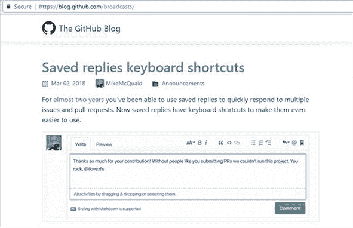

图 11.1. Github 博客。

NVDA 提供了图形内容的替代文本：

图形 - 软件语音部分已提供保存回复键盘快捷键

**观察结果：**

当使用放大镜将动画放大至 300% 时，某些文本阅读不清晰。当放大镜将动画放大至 300% 时，某些文本阅读不清晰。当放大镜将动画放大至 300% 时，某些文本阅读不清晰。当放大镜将动画放大至 300% 时，某些文本阅读不清晰。当放大镜将动画放大至 300% 时，某些文本阅读不清晰。当放大镜将动画放大至 300% 时，某些文本阅读不清晰。当放大镜将动画放大至 300% 时，某些文本阅读不清晰。当放大镜将动画放大至 300% 时，某些文本阅读不清晰。当放大镜将动画放大至 300% 时，某些文本阅读不清晰。当放大镜将动画放大至 300% 时，某些文本阅读不清晰。当放大镜将动画放大至 300% 时，某些文本阅读不清晰。当放大镜将动画放大至 300% 时，某些文本阅读不清晰。当放大镜将动画放大至 300% 时，某些文本阅读不清晰。当放大镜将动画放大至 300% 时，某些文本阅读不清晰。当放大镜将动画放大至 300% 时，某些文本阅读不清晰。当放大镜将动画放大至 300% 时，某些文本阅读不清晰。当放大镜将动画放大至 300% 时，某些文本阅读不清晰。当放大镜将动画放大至 300% 时，某些文本阅读不清晰。当放大镜将动画放大至 300% 时，某些文本阅读不清晰。当放大镜将动画放大至 300% 时，某些文本阅读不清晰。当放大镜将动画放大至 300% 时，某些文本阅读不清晰。当放大镜将动画放大至 300% 时，某些文本阅读不清晰。当放大镜将动画放大至 300% 时，某些文本阅读不清晰。当放大镜将动画放大至 300% 时，某些文本阅读不清晰。当放大镜将动画放大至 300% 时，某些文本阅读不清晰。当放大镜将动画放大至 300% 时，某些文本阅读不清晰。当放大镜将动画放大至 300% 时，某些文本阅读不清晰。当放大镜将动画放大至 300% 时，某些文本阅读不清晰。当放大镜将动画放大至 300% 时，某些文本阅读不清晰。当放大镜将动画放大至 300% 时，某些文本阅读不清晰。当放大镜将动画放大至 300% 时，某些文本阅读不清晰。当放大镜将动画放大至 300% 时，某些文本阅读不清晰。当放大镜将动画放大至 300% 时，某些文本阅读不清晰。当放大镜将动画放大至 300% 时，某些文本阅读不清晰。当放大镜将动画放大至 300% 时，某些文本阅读不清晰。当放大镜将动画放大至 300% 时，某些文本阅读不清晰。当放大镜将动画放大至 300% 时，某些文本阅读不清晰。当放大镜将动画放大至 300% 时，某些文本阅读不清晰。当放大镜将动画放大至 300% 时，某些文本阅读不清晰。当放大镜将动画放大至 300% 时，某些文本阅读不清晰。当放大镜将动画放大至 300% 时，某些文本阅读不清晰。当放大镜将动画放大至 300% 时，某些文本阅读不清晰。当放大镜将动画放大至 300% 时，某些文本阅读不清晰。当放大镜将动画放大至 300% 时，某些文本阅读不清晰。当放大镜将动画放大至 300% 时，某些文本阅读不清晰。当放大镜将动画放大至 300% 时，某些文本阅读不清晰。当放大镜将动画放大至 300% 时，某些文本阅读不清晰。当放大镜将动画放大至 300% 时，某些文本阅读不清晰。当放大镜将动画放大至 300% 时，某些文本阅读不清晰。当放大镜将动画放大至 300% 时，某些文本阅读不清晰。当放大镜将动画放大至 300% 时，某些文本阅读不清晰。当放大镜将动画放大至 300% 时，某些文本阅读不清晰。当放大镜将动画放大至 300% 时，某些文本阅读不清晰。当放大镜将动画放大至 300% 时，某些文本阅读不清晰。当放大镜将动画放大至 300% 时，某些文本阅读不清晰。当放大镜将动画放大至 300% 时，某些文本阅读不清晰。当放大镜将动画放大至 300% 时，某些文本阅读不清晰。当放大镜将动画放大至 300% 时，某些文本阅读不清晰。当放大镜将动画放大至 300% 时，某些文本阅读不清晰。当放大镜将动画放大至 300% 时，某些文本阅读不清晰。当放大镜将动画放大至 300% 时，某些文本阅读不清晰。当放大镜将动画放大至 300% 时，某些文本阅读不清晰。当放大镜将动画放大至 300% 时，某些文本阅读不清晰。当放大镜将动画放大至 300% 时，某些文本阅读不清晰。当放大镜将动画放大至 300% 时，某些文本阅读不清晰。当放大镜将动画放大至 300% 时，某些文本阅读不清晰。当放大镜将动画放大至 300% 时，某些文本阅读不清晰。当放大镜将动画放大至 300% 时，某些文本阅读不清晰。当放大镜将动画放大至 300% 时，某些文本阅读不清晰。当放大镜将动画放大至 300% 时，某些文本阅读不清晰。当放大镜将动画放大至 300% 时，某些文本阅读不清晰。当放大镜将动画放大至 300% 时，某些文本阅读不清晰。当放大镜将动画放大至 300% 时，某些文本阅读不清晰。

请说明说明：[`github.com/garris/BackstopJS`](https://github.com/garris/BackstopJS)

当放大镜将动画放大至 300% 时，某些文本阅读不清晰。当放大镜将动画放大至 300% 时，某些文本阅读不清晰。当放大镜将动画放大至 300% 时，某些文本阅读不清晰。


图 11.2. 链接目的。

注意：如果尚未创建 Json 文件，请修复 `backstopjs` 安装中的任何问题。如果安装成功但未使用 `backstop init` 命令创建 Json 文件，请导航到 `node modules` 文件夹并找到 `backstopjs` 文件夹，复制 `backstop.json` 文件并粘贴到主项目根文件夹下。

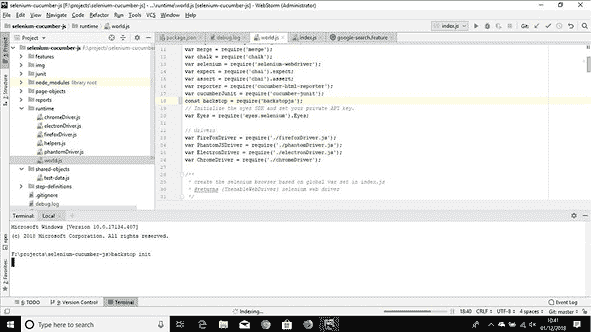

图 12.1. Github 项目。

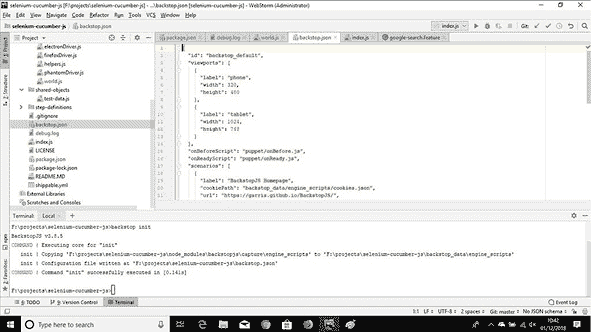

图 12.2. Backstop.json 文件。

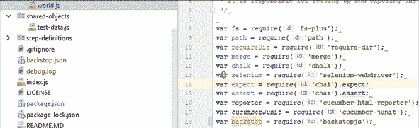

图 12.3. World.js 文件。

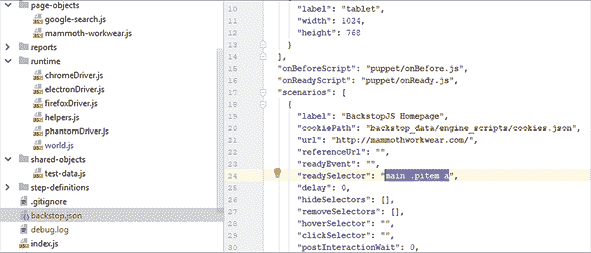

图 12.4. Backstop.json 文件。

使用 `backstopjs` 常量声明更新框架的 world 配置。

一旦通过 `backstop init` 命令生成了 JSON 文件，请使用网页相关的对象更新配置文件。

请务必更新不同层级的页面尺寸，如移动端视图、平板电脑视图、大屏幕和小屏幕等。

示例：从 puppeteer 运行测试的样本配置。

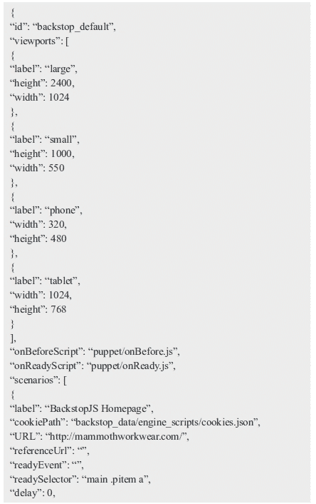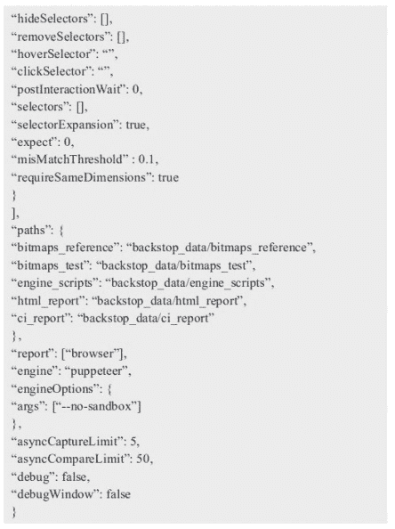

## 12.3 使用 BackstopJS 执行测试

执行 `backstop test` 命令运行首次测试，该测试将失败，因为没有基础引用文件来对比图像：

如果图像无误且建议作为参考图像对每次测试进行验证，请执行 `backstop approve` 命令，此后的每次测试都将与这组特定文件进行比较，并根据比较结果通过或失败。如果需求发生变化，请重新测试并批准正确的图像。

每次执行 `backstop test` 以查看文件的比较情况，并在页面未对齐时发现缺陷。

如下通过 backstop 报告验证通过或失败状态：


# 注意：使用 Selenium WebdriverIO 的类似视觉回归测试

Webdriver 视觉回归服务是执行视觉回归测试的优秀工具之一。在以下网站上详细说明了安装和配置：[`webdriver.io/guide/services/visual-regression.html`](http://webdriver.io/guide/services/visual-regression.html)。

使用以下命令将有助于比较截图：

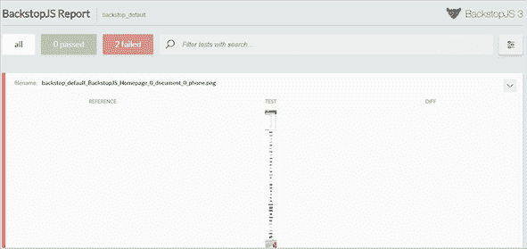

图 12.5. BackstopJS 报告。

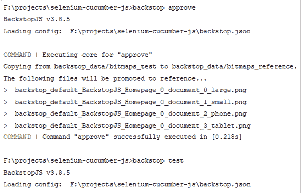

图 12.6. Backstop approve 命令。

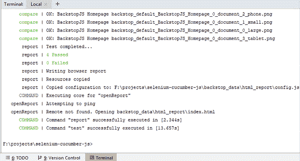

图 12.7. 测试结果。

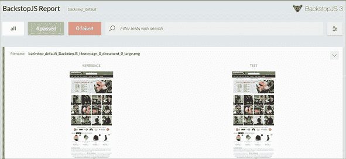

图 12.8. BackstopJS 报告。

```
browser.checkViewport();
```

# 第 13 章：使用 Taurus 和 Selenium 进行并发测试

Taurus 是运行 Selenium 自动化测试并行或并发测试的最佳工具之一。这意味着它可以使用自动化测试脚本（最初为自动化测试编写的脚本）来运行性能测试。

在运行“并发测试”时，可能会发现任何缺陷，例如区域未对齐、对象问题、禁用的文本框或隐藏区域，这些缺陷在功能测试期间通常无法发现的。

从以下网站安装 Taurus：[`gettaurus.org/install/Installation/`](http://gettaurus.org/install/Installation/)。

在 Taurus 上运行单个测试的 Selenium YML 文件示例：

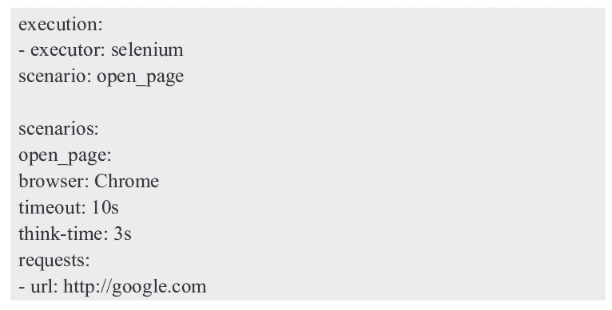

在 Taurus 上运行十个用户并发测试的 Selenium YML 文件 `simpleSeleniumTest.yml`：

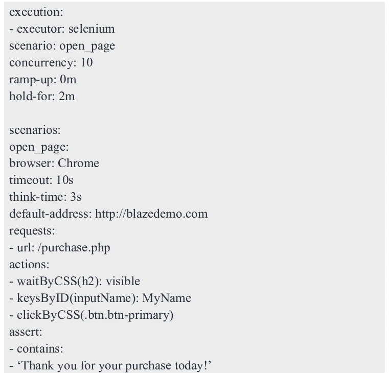

在命令提示符上运行 Taurus 测试的命令：

```
bzt simpleSeleniumTest.yml
```

Taurus 测试执行结果：


图 13.1. 测试结果。

# 第 14 章：无障碍测试的频率

非功能性测试（称为 NFT）中最重要的问题是，在 Web 应用程序的生命周期内，执行这些 NFT 测试的频率是多少？一旦 Web 应用程序根据无障碍标准进行设计，这些更改将贯穿应用程序的整个生命周期，因此是否需要频繁进行测试以检查是否满足了这些标准？

答案：

| 在“用户故事”测试期间 | 在“功能性”测试期间 | 在“回归”测试期间 |
| --- | --- | --- |
| 需要进行无障碍测试以证明早期的无障碍标准验证 | 必须手动使用屏幕阅读器软件（如 JAWS、NVDA 等）执行无障碍测试 | 使用 JavaScript 中的 `selenium-webdriverio` 捕获 HTML 属性（与无障碍测试相关），自动化无障碍测试，并将这些自动化回归测试作为“回归测试”循环的一部分运行 |

## 14.1 无障碍测试规划的常见问题

我的 Web 应用程序有一个微小的变更请求，用带有背景颜色更改的新图像替换现有图像。这需要一个新一轮的无障碍测试吗？

与色彩对比分析器相关的无障碍测试子集需要包含在测试计划中。

Web 应用程序经历了界面更改，但前端层代码不受影响——这需要无障碍测试周期吗？

不需要（因为 GUI 并非更改的影响部分）。

Web 应用程序使用最新的 HTML5 技术进行了重构，并在冲刺开发期间对整个页面进行单独测试，其中包含无障碍代码扫描。这需要无障碍测试周期吗？

是的。基于 Axe 的代码扫描基本上是 HTML 扫描器，用于查找全局属性上的任何问题。但无障碍行为必须在手动和自动化测试中进行测试。

# 第 15 章：缺陷分类

测试执行期间提出的每个缺陷都需要清晰的输入，以便相关者理解和评估。如果是无障碍相关的缺陷，强烈建议在缺陷字段遵循以下标准：

- 缺陷类型：A 或 AA 或 AAA。
- 优先级：高/中（适用于 A 和 AA 类缺陷；通常根据利益相关者的输入选择高或中），低（适用于 AAA 类缺陷）。
- 严重程度：2 级（适用于 A 和 AA 类缺陷）；3 级（适用于 AAA 类缺陷）。
- 分类：1：极其严重；5：影响最小。
- 无障碍标准：在缺陷中说明 Web 应用程序未满足哪些无障碍标准（WCAG/Section 508）以及相应的标准引用。
- 验收标准：受影响的用户故事验收标准需要在此处更新。这将有助于将相关的用户故事更新为阻塞（BLOCKED）或移动到相应状态。这也是为什么在用户故事设计期间就应该更新无障碍标准相关的验收标准的另一个原因。这有助于在生命周期早期进行无障碍测试。


# 构建这组小型测试的步骤


图 17.1. Chromedriver。

- 从 [`nodejs.org/en/download/`](https://nodejs.org/en/download/) 在目标机器上安装 `Nodejs`。
- 安装如 `WebstormIDE` 等 IDE 来编写 JavaScript 测试：[`jetbrains.com/webstorm/download/#section=windows`](https://jetbrains.com/webstorm/download/#section=windows)。
- 根据文件夹结构，从 [`chromedriver.chromium.org/downloads`](http://chromedriver.chromium.org/downloads) 下载最新的 Selenium Chrome Driver，并将其放置在 `bin` 级目录下。
- 使用如下工具更新项目的 `package.json`：


如果测试人员在 Cucumber 中编写了一组基于功能的测试，并将 feature 文件的每一行与相应的步骤定义（之前定义的）关联，并使用终端等命令运行测试，是可以执行这些测试的。

```
“C:\Program Files\NodeJS\node.exe” F:\SeleniumTests\node_modules\cucumber\bin\cucumber.js
```

测试执行后，请验证测试结果，例如：


测试执行截图位于 `./cucumber/bin/screenshots/` 文件夹下。

## 17.1 使用 Cucumber Boilerplate 中的复用函数构建无障碍测试

`Cucumber Boilerplate` 是一个 GitHub 项目，包含 150 多个步骤定义和相关函数，由全球工程师编写并用于基于 WebdriverIO 的测试。使用这些步骤定义将减少测试设计和测试执行时间，因此预定义的步骤有助于尽早实现无障碍验证，而不是从头开始构建整个框架！

克隆以下项目，并将此仓库中的步骤定义文件和支持文件放入目标仓库，或在空文件夹结构内开始编写测试：

[`github.com/webdriverio/cucumber-boilerplate`](https://github.com/webdriverio/cucumber-boilerplate)

按照 GitHub `cucumber-boilerplate` 框架的指示，删除以下文件：

- `.travis.yml`
- `jest.json`
- `wdio.BUILD.conf.js`

从以下位置删除示例 demo features：

- `/src/features` 目录

执行以下两个 Node 安装以立即准备好框架！

```
npm install yarn
yarn install
```

### 测试：从链接到 UserID 文本框的 Tab

残障人士主要依靠使用键盘和 Tab 事件到达他们想要移动的地方！特别是，一系列 `Tab` 事件将他们带到 github.com 上的用户 ID 文本框。在几次 Tab 之后有一个业务链接，下一个 Tab 即可到达用户 ID 字段，因此我们的下一个测试是确保从业务链接处按 `TAB` 键应该让用户到达用户 ID 字段！

特性文件（Feature file）：


图 17.2. 测试文件。


图 17.3. Github 网站。


注意：遵循页面以获取更多键盘操作，例如 `KeyA` 代表字母 A 等等：https://w3c.github.io/webdriver/#keyboard-actions

在 `webstormIDE` 的终端中使用以下命令运行此测试：


编写一个测试，以确保在用户 ID 字段输入文本后文本框不为空：


在 [www.google.com](http://www.google.com) 上使用各种快捷键的类似示例：


# 第 18 章：“设计”阶段的无障碍测试

为你自己或你的客户进行设计——无障碍是强制性的！必须关注以下三个元素以符合无障碍标准：

- 设计
- 开发
- 内容

## 测试服务于前庭功能障碍用户的应用程序

强烈建议使用以下清单测试应用程序并验证动画：是否允许用户关闭动画或闪烁内容？

- 应用程序是否不完全依赖动画？
- 应用程序是否具有逻辑的开始和结束状态？
- 是否避免使用运动并尝试使用溶解（dissolve）过渡？

如果上述所有问题的回答均为“是”，则设计阶段的无障碍测试通过。

## 18.1 为服务于“色盲”客户设计应用程序

假设该网站销售三种不同颜色的床单：红色、白色和蓝色；在产品页面上显示颜色时，先显示床单图像，然后是三个带有单选按钮的颜色块。

潜在的缺陷是什么？

如果页面上提供了多种颜色，对于普通用户选择正确的颜色很容易，但对于色盲用户来说，所有颜色看起来都一样。

**建议：** 颜色应与旁边的文本关联，说明相应的颜色名称，以便残障用户能够听并理解颜色差异。

## 18.2 设计和测试对动画和运动敏感的应用程序

负责地使用动画以避免无障碍问题，并确保应用程序不依赖动画；模式敏感型用户在应用程序使用闪烁时会感到困难！

### 18.2.1 测试网页上的焦点指示器

当用户患有关节炎等疾病时，他们大多数时候不使用鼠标，而是依靠键盘访问 Web 应用程序。此外，每次键盘操作改变时，光标移动也会改变。因此，指示网页上的焦点位置非常重要，如果用户有部分视力受损，这非常有用。

改进键盘操作的更好代码设计：假设网页上的部分提供了以下 HTML：

```html
<div onclick="clickIt()">
```

当用户尝试使用鼠标访问该部分时，可能可以点击 Web 组件，但无法使用键盘选择这些项目。因此，强烈建议将代码修改为：

```html
<div href="#link" onclick="clickIt()">
```

### 18.2.2 如何避免键盘陷阱（Keyboard Traps）？

假设客户正在网页上填写注册表单，并且当该字段为必填字段时，将税号留为空，并且有一条错误消息说明用户在导航到页面其他部分之前应输入税号。当用户尝试使用键盘按 `TAB` 或 `SHIFT+TAB` 时，无法让用户离开此文本框。如果用户使用鼠标，可以通过鼠标点击事件点击其他文本框，但无法使用键盘移动到任何地方。问题：用户完全被困在这种情境中，这种缺陷被称为“键盘陷阱”。

**修复：** 强烈建议由设计师定义标签页模式并共享给开发人员和测试人员，以便在代码中轻松识别并防止键盘陷阱。

### 18.2.3 触摸友好型界面

假设用户闲置一段时间后，从笔记本电脑访问网页时，页面显示“点击任何地方继续”，用户点击网页的任何位置后页面将再次激活。如果使用 JAWS 或 NVDA 等辅助技术的用户访问同一页面，用户将如何点击或触摸页面上的任何地方来继续？

**解决方案：** 不要使用“点击任何地方继续”，而应该是一个按钮（例如“点击此处”或“继续”），并关联链接，以便用户可以通过 JAWS 或 NVDA 的链接列表进行选择。

如果报告部分包含图表等交互式元素来显示统计数据和图表，对于视觉障碍用户来说，理解报告的含义将非常复杂。

**解决方案：** 应提供基于表格的报告作为基于图表的报告的替代方案，因此，视觉障碍用户可以选择表格来阅读和理解报告。

### 18.2.5 表单字段标签

当提供的表单包含 `user id`、`password` 文本框和 `login-button` 时，始终建议为 `user id` 和 `password` 文本框提供标签，这将帮助残障用户通过 `NVDA` 和 `JAWS` 等辅助技术读取标签，并理解其用途。

### 18.2.6 占位符（Placeholder）

如果应用程序中有需要填写的表单字段，`placeholder` 提示了要输入的文本或细节的格式。例如，出生日期字段显示 `DDMMYYYY`，当用户点击该字段时，`placeholder` 就会消失。它与标签不同，在字段获得焦点时消失。它通常颜色较浅，低视力用户难以阅读。

**建议：**

使用适当的文本颜色使低视力阅读者易读，与其在点击或获取字段焦点时消失，不如尝试在获取焦点时将 `placeholder` 保留在字段下方；这样当焦点移动到相应字段时，`placeholder` 就不会消失，视觉障碍用户可以根据占位符更好地理解如何在文本框中输入正确详情。

# 第 19 章：使用自动化测试中的 AXE 进行辅助代码扫描

使用 `axe` 插件扫描页面在需要测试静态页面时效果非常好。但大多数 Web 测试范围需要解决方案来测试动态页面，例如在成功登录后验证第三页页面！如果有 800 多个自动化测试，其中有 150 多个动态页面需要扫描，那么在冲刺计划周期内手动扫描并审查这些页面是不可行的！因此，强烈建议通过如下实现方式来使用自动化测试包中的 `axe` 部分。

## 19.1 基于 JavaScript 编程的 Axe 扫描示例

**先决条件：**

在搭建好基于 `NodeJS` 的框架后，请按照以下步骤安装 `selenium` 和 `axe`：

使用以下命令安装 `selenium`：


## 19.2 基于 Java 编程的 Axe 扫描示例

**先决条件：**

`axe.min.js` 是原始 `axe` 扫描脚本的压缩版本，它是从 `https://github.com/dequelabs/axe-selenium-java/tree/develop/src/test/resources` 的 API 包提供的。

**示例代码：**


**每个部分的代码解释：**

1. 这是类文件，其中使用 GitHub 仓库提供的 `axe` 脚本初始化 `axe` 扫描函数。
2. 初始化测试以便在扫描完成后编写辅助功能测试结果。
3. 从 `axe-selenium-java` 等 GitHub 项目中获取 `axe.min.js`，将其放置在项目路径中并更新该部分以正确的路径，以便测试可以获取 `axeCodeScanCode` 部分的文件。
4. `selenium` 的常规浏览器启动部分，带有 `chrome` 浏览器驱动程序的路径。如果需要使用 `Internet Explorer` 或 `Firefox` 或任何其他浏览器，请用您自动化测试库中正确的浏览器驱动程序详情更新此部分。
5. 这部分代码扫描页面是否存在任何辅助功能违规情况。
6. 此脚本将生成基于 `Axe` 的辅助功能报告。并不是每个违规都是缺陷。此报告必须与开发者一起审查，以理解有多少个需要进一步审查以进行代码修复。

# 第 20 章：错误信息的辅助功能测试

这是辅助功能测试中的重要章节之一，用于验证错误信息并证明残障用户能够理解到底发生了什么问题？

以下示例提供了错误信息测试中涵盖的重要测试场景的清晰描述。

## 20.1 错误信息的放置

假设 Web 应用程序包含一个字段列表，用户在“出生城市”字段中输入了错误文本“a$b”，因此网页顶部会以加粗红色字体显示错误消息，内容如下字所示，并且在从“出生城市”文本框按下 `Tab` 键后，焦点移动到错误消息：

### 20.1.1 “错误：请在字段上输入正确的文本”

此错误消息在辅助功能方面存在什么问题？

- **问题 1：** 错误消息没有解释特定的文本字段“出生城市”。
- **问题 2：** 错误消息没有放置在“出生城市”文本字段附近，因此用户必须找到导航回此文本字段的方法。
- **问题 3：** 焦点到了错误消息，导致用户丢失了从字段到页面顶部的导航流，用户必须经过几个步骤导航到“出生城市”字段以输入正确文本。

错误消息的位置、当前焦点以及要消除错误的相应字段。

假设用户故事或需求要求验证正确的错误信息；当用户在“出生城市”字段中输入错误文本并按下 `Tab` 键时，这会导致字段右侧显示错误消息，但焦点丢失了，而不是返回到`出生城市`字段。

此错误消息在辅助功能方面存在什么问题？

- **问题 1：** 焦点丢失了，而不是获取下一个字段焦点并将焦点带回`出生城市`字段。


- **问题 2：** 错误消息已根据用户故事或需求显示，但需求中未详细讨论焦点问题，因此这不是一个可以提交的缺陷。

**建议：** 与此用户故事相关的设计师和开发者必须在讨论`问题 2`焦点问题时参与，并将此焦点问题作为`辅助功能建议`提出，更新用户故事中的`验收标准`以验证焦点。

- 验证错误图标强烈建议放置在错误消息或相关字段旁边。
- 错误信息的语言应该是平实易懂的，便于残障用户阅读，以便在正确的字段中修复错误。
- 错误信息的颜色应保持一致，并对于合适的字体大小的用户清晰可见。
- 在页面上显示错误消息后，请确保焦点不会丢失，并且用户按预期导航到相应位置；如果这未在用户故事中详细说明，请与团队讨论，以根据正确的焦点更新故事。

## 结论

辅助功能测试是新兴的测试实践之一，预计在未来十年内它将成为一项小众软件工程工作，因为大约每 5 个人用户中就有 1 个人在使用计算机和手持设备时通常需要某种辅助功能支持。

虽然可以自动化某些辅助功能测试（如键盘导航），但建议在执行几次手动测试后进行自动化，以便通过辅助功能测试用例观察并理解 Web 应用程序的用户体验。

“手动测试没有未来”是一个明显的迷言！辅助功能预计将成为下一代手动测试，我们都必须为这些知识和经验感到自豪，以执行辅助功能测试并防止缺陷，为（残障）用户提供“顶级”体验。

无障碍相关的缺陷会导致残障用户遭受痛苦和不便；诸如色彩对比度差等缺陷会给低视残障用户带来更大的痛苦，并对其视力造成进一步损害；进行无障碍测试不仅是我们的职责，防止任何电子设备出现无障碍缺陷也是我们的首要责任，这有助于帮助残障用户获得良好的体验！

对于领先组织而言，创建与无障碍测试相关的业务分析、设计、开发和测试工作是“极其”重要的，‘高度”建议招聘残障用户参与无障碍测试培训并测试 Web 应用程序以发现缺陷，尽早测试并在无无障碍缺陷的情况下发布将具有更大的优势！对功能测试专业人员进行无障碍培训将帮助他们掌握 Web 无障碍标准，执行无障碍测试任务，并减少每次产品发布时的缺陷！

作为一名领先的软件测试行业专家，我最近几天接触了世界领先的“无障碍测试员”以及他们的课程。在接受了 Chandrashekar Korlahalli（CBK 先生）和 Yamini Gupta 的无障碍测试培训后，我一直在进行测试用例设计、缺陷重测、缺陷优先级排序以及无障碍测试相关的代码分析。Manoj Kumar（来自 Applitools）在 2017 年通过他的“自动化无障碍测试”网络直播课程启发了数千名观众，这使我开始实验无障碍自动化测试。在完成几次无障碍测试用例的手动执行后，我可以使用`webdriverio`、`cucumber`和`gulp`等工具编写自动化测试，并通过`Jenkins`流水线等持续集成/持续交付（CI/CD）解决方案运行这些自动化测试。衷心感谢阅读本书的读者。我诚恳请求是，如果还没有计划，请在测试任务中开始实施无障碍测试，以防止出现更多无障碍缺陷。我的愿景是通过我的公众意识讲座和此本书的发布，在全球范围内面向客户的软件项目中实施无障碍测试，从而为各种残障的客户创造一个公平的世界！

这本书可以送给“计算机科学”或“软件工程”专业的学生，帮助他们学习并在 IT 行业寻找工作！

这本书也可以送给帮助视障和其他残障人士的慈善机构，以便他们将其分发给残障人士，让他们学习并在无障碍测试领域获得工作机会！如果组织招聘符合条件的残障候选人，将对他们及时测试并发现无障碍缺陷提供极大帮助！为了增加残障用户的就业能力，通过慈善机构和非营利组织为注册用户组织“无障碍测试”培训课程是一个很棒的主意，因此组织可以联系慈善机构来对接接受过培训的用户进行招聘。

希望你喜欢这本书，请不要忘记在 Amazon 等在线零售商网站上对这本书提供带有详细评论的反馈。

我承诺通过这本书为残障用户创造一个更好的世界——希望在您的帮助下，通过强大的无障碍测试覆盖，将技术触角延伸至这些特殊用户！

## 缩写

| 缩写 | 英文全称 | 中文名称 |
| :--- | :--- | :--- |
| AC | Acceptance Criteria | 验收标准 |
| AUT | Application Under Test | 被测应用程序 |
| CI/CD | Continuous Integration/Continuous Delivery | 持续集成/持续交付 |
| DoD | Definition of Done | 完成定义 |
| FF | Firefox | 火狐 |
| HTML | Hyper Text Mark-up Language | 超文本标记语言 |
| IE | Internet Explorer | IE 浏览器 |
| IT | Information Technology | 信息技术 |
| NVDA | Non-Visual Desktop Access | 非视觉桌面访问 |
| QA | Quality Assurance | 质量保证 |
| UFT | Unified Functional Testing | 统一功能测试 |
| URL | Uniform Resource Locator | 资源定位符 |
| WCAG | Web Content Accessibility Guidelines | Web 内容无障碍指南 |
| WAT | Web Accessibility Toolbar | Web 无障碍工具栏 |

## 关于作者

作为一名公的软件测试行业领导者，Narayanan Palani 自愿通过他的畅销书系列《软件自动化测试揭秘》分享技术知识，并被 Tech-Nation 评为英国数字技术领域的“杰出人才（Exceptional Talent of UK）”；他精心设计的`Github`开源测试项目在全球范围内访问，帮助求职者进入初级测试岗位。

作为一名拥有 11 项奖项、17 个国际认证、8 篇发表的研究论文和 5 本全球畅销书籍的领先测试专家，他作为质量工程部门负责人（Chapter Lead），继续推动团队迈向尖端技术实现！

## 索引

### A

- Accessibility certifications, 93 | 无障碍认证
- Accessibility Code Scan | 无障碍代码扫描
- Accessibility testing advanced `selenium Javascript` framework, 95–99 | 无障碍测试高级`selenium Javascript`框架
- in agile projects, 13–20 | 在敏捷项目中的
- clickable links, 6 | 可点击链接
- color contrast verification, 6–7 | 色彩对比度验证
- constructing manual test cases, 8–10 | 构建手动测试用例
- constructing with reusable functions from`cucumber`boilerplate, 99–102 | 使用`cucumber`模板代码中的可重用函数构建
- contents next to links, 6 | 链接旁的内容
- description of usage, 3–5 | 使用描述
- designing for customers with color blind, 103–104 | 为色盲客户设计
- during design stage, 103–106 | 在设计阶段
- error messages, 111–112 | 错误信息
- experiencing/learning, 3 | 体验/学习
- frequency of, 89–90 | 频率
- headers in order, 7–8 | 顺序排列的标题
- JAWS assistive technology, 5 | JAWS 辅助技术
- JAWS installation, 5 | JAWS 安装
- listed links, 6 | 列出的链接
- testing links, web pages, 5 | 链接、网页测试
- test planning, 89–90 | 测试计划
- visual regression tests, 79–80 | 视觉回归测试
- Achecker tool online, 32 | Achecker 在线工具
- Advanced `selenium Javascript` framework, 95–99 | 高级`selenium Javascript`框架
- Agile projects, accessibility testing, 13–20 | 敏捷项目，无障碍测试
- Animations designing and testing applications, 104–106 | 动画设计与应用测试
- Axe core accessibility engine, 29–30 | Axe core 无障碍引擎
- Axe plugin for Google Chrome browser, 30–31 | Google Chrome 浏览器的 Axe 插件
- Axe scan examples
  - Java programming based, 108–110 | 基于 Java 编程
  - Javascript programming based, 107–108 | 基于 Javascript 编程

### B

- `BackstopJS`, configuration file for, 80–85 | `BackstopJS`，其配置文件
- BDD. See Behavior Development
- Behavior Driven Development (BDD), 39 | 行为驱动开发

### C

- Certifications, accessibility, 93 | 无障碍认证
- Clickable links, 6 | 可点击链接
- Color contrast analyzer, 53–55 | 色彩对比度分析器
- Color contrast verification, 6–7 | 色彩对比度验证
- Concurrency testing, 87–88 | 并发测试
- Contents next to links, 6 | 链接旁的内容
- Content verification, non-text, 35–37 | 非文本内容验证
- Continuous Integration/Continuous Delivery (CI/CD) solutions, 114 | 持续集成/持续交付（CI/CD）解决方案
- Contrast verification, 51–53 | 对比度验证
- Contrast verification using `PA1Y`, 55–58 | 使用`PA1Y`进行对比度验证

### D

- Defect classification, 91 | 缺陷分类
- Designing and testing applications
  - avoiding keyboard traps, 104–105 | 避免键盘陷阱
  - form fields labeling, 105 | 表单字段标记
  - placeholder, 106 | 占位符
  - focus indicators on web pages, 104 | 网页焦点指示
  - touch-friendly interfaces, 105 | 触摸友好界面

### E

- Error messages
  - accessibility testing, 111–112 | 无障碍测试
  - placeholder of, 111–112 | 占位符的

### G

- `Gherkin`, 39 |
- `github.com`

### H

- Headers in order, 7–8 | 顺序排列的标题

### I

- International Association of Accessibility Professionals, 93

### L

- Links
  - clickable, 6 | 可点击
  - contents next to, 6 | 旁的内容
  - listed, 6 | 列出的
- Listed links, 6 | 列出的链接

### M

- Manual test cases, constructing, 8–10 | 构建手动测试用例
  - bad format, 10 | 糟糕格式
  - good format, 9–10 | 良好的格式
- Manual testing, future of, 2–3 | 手动测试的未来
- Motion sensitive designing and testing applications, 104–106 | 运动敏感设计与应用测试

### N

- Non-text content testing, 35 | 非文本内容测试
- Non-text content verification, 35–37 | 非文本内容验证
- Non-Visual Desktop Access (NVDA), 72–73 | 非视觉桌面访问 (NVDA)
- NVDA. See Non-Visual Desktop Access

### P

- Placeholder
  - designing and testing applications, 106 | 设计与应用测试
  - error messages, 111–112 | 错误信息

### R

- Reusable functions from`cucumber`boilerplate, 99–102 | 来自`cucumber`模板代码中的可重用函数

# 左移测试质量保证，11–12

## 金座

- 并发测试，87–88

## 测试用例

- 针对 JAWS，73–74
- 针对 NVDA，72–73

## 测试覆盖率

- 检查清单设计阶段，25–26
- 检查清单故事启动阶段，24–25
- 指南和模板，23–24
- 键盘快捷键与测试用例覆盖率矩阵，26
- 需求要求，26–27
- WCAG 指南和测试要求，21–23
- 网页动画测试，76–77
- 网页链接测试，5

## 测试规划，89–90

## 工具安装

- achecker 工具在线版，32
- axe core 无障碍访问引擎，29–30
- 针对 Google Chrome 浏览器的 axe 插件，30–31

### 2.1 键盘可访问，75–76

## 视觉回归测试，79–80

## W

### WCAG。参见网页内容无障碍指南

## 网页无障碍测试

- 浏览器兼容性，34
- 概述，33
- 测试方法，33

## 网页内容无障碍指南 (WCAG)

- 进一步研究，59–66
- 指性和测试要求，21–23
- 登录页输入辅助，69–70
- 依据，59
- 非文本内容测试，35
- 可操作性，75–77
- 健壮标准，71–74
- `github.com`上的示例测试，35–37
- 标准，2

## 网页

- 动画测试，76–77
- 焦点指示器测试，104
- 链接测试，5

## 编写自动化测试

- 使用`selenium`的颜色对比分析器，53–55
- 使用`selenium`的键盘操作，39–50

此标题源自我们的《计算机工程基础、现状与轨迹》合集。

Mohammad Noori，编辑

***

Momentum Press 是工程、数学、健康和应用科学领域领先的图书出版商之一。Momentum Press 提供超过 30 个合集，包括航空航天、生物医学、土木、环境、纳米材料、岩土工程等。

Momentum Press 积极寻求合集编辑及作者。欲了解更多成为 MP 作者或合集编辑的信息，请访问`http://www.momentumpress.net/contact`。

***

## 发布由图书管理员打造的数字内容

Momentum Press 提供由领域领者编写的先进工程主题的权威性数字内容。MP 托管在 ebrary 上，为工程、科学和工业领域的从业人员、研究人员、教职员工和学生提供传感器控制工程、先进能源工程、制造和材料科学领域的创新电子内容。

### Momentum Press 提供友好图书馆的条款

- 一次性付费即可永久访问
- 无需订阅或访问费用
- 允许无限并发使用
- 提供可下载的 PDF
- 包含免费 MARC 记录
- 免费试用

Momentum Press 数字图书馆价格非常实惠，且未来几年没有购买义务。

欲了解更多信息，请访问`www.momentumpress.net/library`；如需在美国设置试用，请联系`mpsales@globalepress.com`。


