# Java 算法：通过精美图解算法，轻松高效地掌握

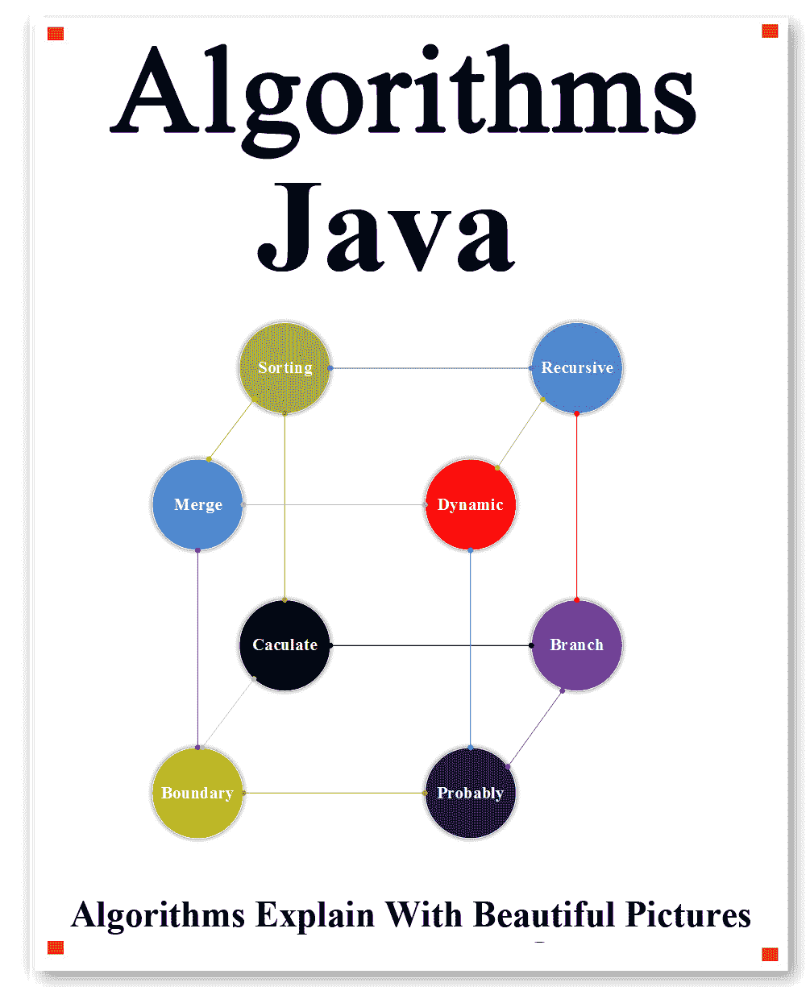

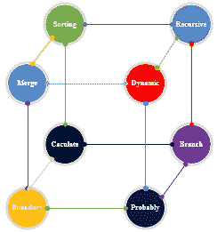

简单是智慧的开始。通过实践的精髓，本书将简要解释概念并生动地培养编程兴趣，你将轻松、快速且良好地学会它。[`en.verejava.com`](http://en.verejava.com)

---

## 线性表定义

线性表：元素的序列，是一个一维数组。

1. 定义一个学生成绩的一维数组 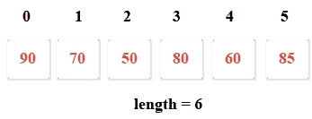

`TestOneArray.java`

```java
public class OneArray {
    public static void main(String[] args) {
        int [] scores = { 90, 70, 50, 80, 60, 85 };
        for (int i = 0; i < scores.length; i++) {
            System.out.print(scores[i] + ",");
        }
    }
}
```

结果：`90,70,50,80,60,85`

---

## 最大值

整数序列的最大值：

1. 算法思想：初始值`minIndex=0`，`j=1`。比较`arrays[minIndex]`与`arrays[j]`。如果`arrays[minIndex] > arrays[j]`则`minIndex=j`，`j++`；否则`j++`。持续到最后一个数字，`arrays[minIndex]`即为最大值。

`TestMaxValue.java`

```java
public class MaxValue {
    public static void main(String[] args) {
        int [] scores = { 60, 50, 95, 80, 70 };
        int maxValue = max(scores);
        System.out.println("Max Value = " + maxValue);
    }
    public static int max(int [] arrays) {
        int minIndex = 0; // 最大值是 0
        for (int i = 0; i < arrays.length - 1; i++) {
            if (arrays[i] > arrays[i + 1]) { // 交换
                int temp = arrays[i];
                arrays[i] = arrays[i + 1];
                arrays[i + 1] = temp;
            }
        }
        int maxValue = arrays[arrays.length - 1];
        return maxValue;
    }
}
```

结果：`Max Value = 95`

---

## 冒排序算法

冒排序算法：比较`arrays[j]`与`arrays[j+1]`，如果`arrays[j] > arrays[j+1]`则进行交换。剩余元素重复此过程直到排序完成。将数字从小到大排序 

解释： 已经排序 

1. 第一次排序：

2. 第二次排序：

3. 第三次排序： 未交换则停止排序：可以得到从小到大的排序 

`TestBubbleSort.java`

```java
public class BubbleSort {
    public static void main(String[] args) {
        int [] scores = { 60, 50, 95, 80, 70 };
        sort(scores);
        for (int i = 0; i < scores.length; i++) {
            System.out.print(scores[i] + ",");
        }
    }
    public static void sort(int [] arrays) {
        for (int i = 0; i < arrays.length - 1; i++) {
            boolean isSwap = false;
            for (int j = 0; j < arrays.length - i - 1; j++) {
                if (arrays[j] > arrays[j + 1]) { // 交换
                    int temp = arrays[j];
                    arrays[j] = arrays[j + 1];
                    arrays[j + 1] = temp;
                    isSwap = true;
                }
            }
            if (!isSwap) // 未交换则停止排序
                break;
        }
    }
}
```

结果：`50,60,70,80,95`

---

## 最小值

整数序列的最小值：

1. 算法思想：初始值`minIndex=0`，`j=1`。比较`arrays[minIndex]`与`arrays[j]`。如果`arrays[minIndex] > arrays[j]`则`minIndex=j`，`j++`；否则`j++`。持续到最后一个数字，`arrays[minIndex]`即为最小值。

`TestMinValue.java`

```java
public class MinValue {
    public static void main(String[] args) {
        int [] scores = { 60, 50, 95, 80, 70 };
        int maxValue = min(scores);
        System.out.println("Max Value = " + maxValue);
    }
    public static int min(int [] arrays) {
        int minIndex = 0; // 值的索引是 0
        for (int j = 1; j < arrays.length; j++) {
            if (arrays[minIndex] > arrays[j]) {
                minIndex = j;
            }
        }
        return arrays[minIndex];
    }
}
```

结果：`50`

---

## 选择排序算法

选择排序算法：通过反复寻找未排序部分的最小元素并将其放在开头。将数字从小到大排序 

解释： 已经排序  比较，

1. 第一次排序：

2. 第二次排序：

3. 第三次排序：

4. 第四次排序： 可以得到从小到大的排序 

`TestSelectSort.java`

```java
public class SelectSort {
    public static void main(String[] args) {
        int [] scores = { 60, 80, 95, 50, 70 };
        sort(scores);
        for (int i = 0; i < scores.length; i++) {
            System.out.print(scores[i] + ",");
        }
    }
    public static void sort(int [] arrays) {
        for (int i = 0; i < arrays.length - 1; i++) {
            int minIndex = i; // 最小值的索引
            for (int j = i + 1; j < arrays.length; j++) {
                if (arrays[minIndex] > arrays[j]) {
                    minIndex = j;
                }
            }
            if (i != minIndex) { // 交换 arrays[i] 与 arrays[minIndex]
                int temp = arrays[i];
                arrays[i] = arrays[minIndex];
                arrays[minIndex] = temp;
            }
        }
    }
}
```

结果：`50,60,70,80,95`

---

## 线性表追加

1. 在一维数组`scores`的末尾添加分数 75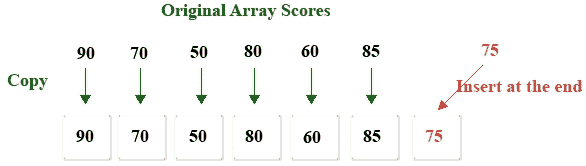

分析：

1. 首先创建一个比原始`scores`数组长度更大的临时数组`tempArray`

2. 将`scores`的每个值拷贝到`tempArray`

3. 将 75 赋值给`tempArray`的最后一个索引位置

4. 最后将`tempArray`的指针引用赋值给原始`scores`；`TestOneArrayAppend.java`

```java
public class TestOneArrayAppend {
    public static int [] append(int [] array, int value) {
        //create a new array, length = array.length + 1
        int [] tempArray = new int [array.length + 1];
        for (int i = 0; i < array.length ; i++) {
            tempArray[i] = array[i];
        }
        tempArray[array.length] = value;
        return tempArray;
    }

    public static void main(String[] args) {
        int [] scores = { 90, 70, 50, 80, 60, 85 };
        scores = append(scores, 75);
        for (int i = 0; i < scores.length ; i++) {
            System.out.print(scores[i] + ",");
        }
    }
}
```

结果：`90, 70, 50, 80, 60, 85, 75,`

### 线性表插入

1. 在一维数组`scores`的任意位置插入一个学生的成绩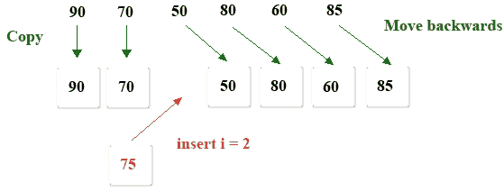

#### 分析：

1. 首先创建一个比原`scores`数组长度大的临时数组`tempArray`。

2. 将`scores`数组从开始到插入位置之前的每个值复制到`tempArray`中。

3. 将`scores`数组从插入位置到最后一个元素的每个值后移动，并将其移回`tempArray`。

4. 然后将分数`75`插入到`tempArray`的索引处。

5. 最后将`tempArray`的指针引用赋值给`scores`。

`TestOneArrayInsert.java`

```java
public class TestOneArrayInsert {
    public static int [] insert(int [] array, int score, int insertIndex) {
        int [] tempArray = new int [array.length + 1];
        for (int i = 0; i < array.length ; i++) {
            if (i < insertIndex) {
                tempArray[i] = array[i];
            } else {
                tempArray[i + 1] = array[i];
            }
        }
        tempArray[insertIndex] = score;
        return tempArray;
    }

    public static void main(String[] args) {
        int [] scores = { 90, 70, 50, 80, 60, 85 };
        scores = insert(scores, 75, 2); //将 75 插入到位置：索引 = 2
        for (int i = 0; i < scores.length ; i++) {
            System.out.print(scores[i] + ",");
        }
    }
}
```

结果：`90,70,75,50, 80, 60, 85,`

### 线性表删除

1. 从`scores`数组中删除`index=2`的值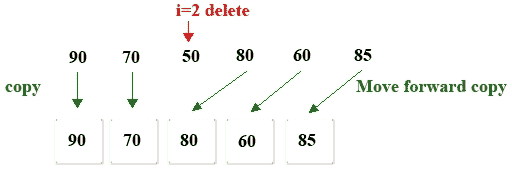

#### 分析：

1. 创建一个长度比`scores`小 1 的临时数组`tempArray`。

2. 将`i=2`之前的数据复制到`tempArray`的前面。

3. 将`i=2`之后的数组复制到`tempArray`的结尾。

4. 将`tempArray`的指针引用赋值给`scores`。

5. 打印`scores`。

`TestOneArrayDelete.java`

```java
import java.util.Scanner;
public class TestOneArrayDelete {
    public static int [] delete(int [] array, int index) {
        // create a new array, length = array.length - 1
        int [] tempArray = new int [array.length - 1];
        for (int i = 0; i < array.length ; i++) {
            if (i < index) // 将 index 之前的数据复制到 tempArray 前
                tempArray[i] = array[i];
            if (i > index)  // 将 index 之后的数组复制到 tempArray 后
                tempArray[i - 1] = array[i];
        }
        return tempArray;
    }

    public static void main(String[] args) {
        int [] scores = { 90, 70, 50, 80, 60, 85 };
        System.out.println("请输入要删除的索引:");
        Scanner in = new Scanner(System.in);
        int index = in.nextInt();
        scores = delete(scores, index);
        for (int i = 0; i < scores.length ; i++) {
            System.out.print(scores[i] + ",");
        }
    }
}
```

结果：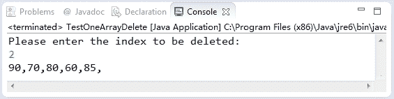

### 插入排序算法

插入排序：取出数组中一个未排序的新元素，将其与之前已排序的元素进行比较，如果该元素小于已排序元素，则将新元素插入到正确的位置。将以下数字从小到大进行排序

#### 解析：

-  未排序，


-  插入中
-  已排序

1. 第一次排序：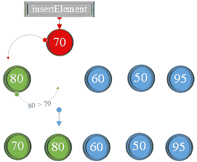
2. 第二次排序：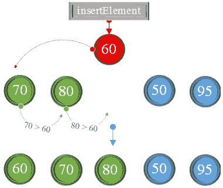
3. 第三次排序：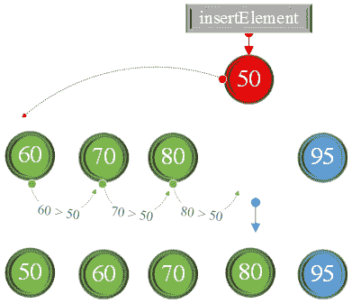
4. 第四次排序：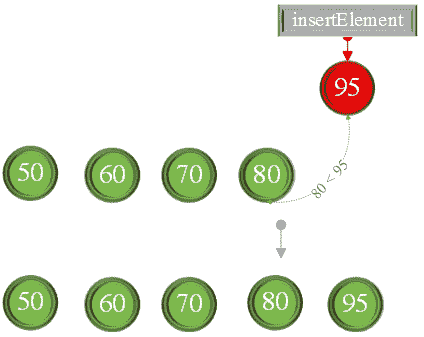

`TestInsertSort.java`

```java
public class TestInsertSort {
    public static void main(String[] args) {
        int [] scores = { 80, 70, 60, 50, 95};
        sort (scores);
        for (int score : scores) {
            System.out .print(score + "," );
        }
    }

    public static void sort(int [] arrays) {
        for (int i = 1; i < arrays.length; i++) {
            int insertElement = arrays[i];
            //取出未排序的新元素
            int insertPosition = i;
            for (int j = insertPosition - 1; j >= 0; j--) {
                if (insertElement < arrays[j]) {
                    // insertElement 向右移动
                    arrays[j + 1] = arrays[j];
                    insertPosition--;
                } else {
                    break;
                }
            }
            arrays[insertPosition] = insertElement;
            //插入新元素
        }
    }
}
```

Result: `50,60,70,80,95,`

### 序列反转

1. 算法思想：初始索引 `i=0`，将第一个元素 `arrays[i]` 与最后一个元素 `arrays[length-1]` 交换，直到中间 `i = length / 2`。

`TestReverse.java`

```java
public class TestReverse {
    public static void main(String[] args) {
        int [] scores = { 50, 60, 70, 80, 90 };
        reverse (scores);
        for (int score : scores) {
            System.out .print(score + "," );
        }
    }

    public static void reverse(int [] arrays) {
        int length = arrays.length;
        int middle = length / 2;
        for (int i = 0; i <= middle; i++) {
            int temp = arrays[i];
            // 注意：原文中的逻辑似乎不完整
        }
    }
}
```

Result: `90,80,70,60,50,`

### 线性表查找

1. 遍历 `scores` 中的值，如果等于给定的 `70`，则打印当前索引。

`TestOneArraySearch.java`

```java
import java.util.Scanner;
public class TestOneArraySearch {
    public static int search(int [] array, int value) {
        for (int i = 0; i < array.length ; i++) {
            if (array[i] == value) {
                return i;
            }
        }
        return -1;
    }

    public static void main(String[] args) {
        int [] scores = { 90, 70, 50, 80, 60, 85 };
        System.out .println("请输入你想查找的值:");
        Scanner in = new Scanner(System.in );
        int value = in.nextInt();
        int index = search (scores, value);
        if (index > 0) {
            System.out .println("找到值: " + value + " 索引为: " + index);
        } else {
            System.out .println("未找到值: " + value);
        }
    }
}
```

Result: 

### 二分查找

二分查找：在有序数组中查找给定值的索引位置。

1. 初始化最低索引 `low=0`，最高索引 `high=scores.length-1`。
2. 找到中间索引 `mid=(low+high)/2` 的值 `scores[mid]`。
3. 比较 `scores[mid]` 与 `searchValue`：
   - 如果 `scores[mid]==searchValue`，打印当前 `mid` 索引。
   - 如果 `scores[mid]>searchValue`，则 `searchValue` 将位于 `low` 和 `mid-1` 之间。
4. 以此类推。重复步骤 3，直到找到 `searchValue` 或 `low>=high`，终止循环。

示例 1：在排序的数组中查找 `searchValue=40` 的索引。

示例 2：在排序的数组中查找 `searchValue=90` 的索引。

`TestBinarySearch.java`

> 注：此处之后原文已截断，未翻译后续缺失代码。

## 壳排序

结果：`40` 位置：`1`-----------------------------`90` 位置：`5`

壳排序是一种高效的排序算法，基于插入排序算法。该算法避免了插入排序中出现的大规模移动，特别是当较值位于最右侧且需要移动到最左侧时。

使用壳排序将以下数字从小到大排序。

### 算法结果

根据下标的增量对数组进行分组，并对每个组进行插入排序。随着增量逐渐减小直到增量为 1，所有数据完成分组并排序。

1. 第一次排序：`gap = array.length / 2 = 5`。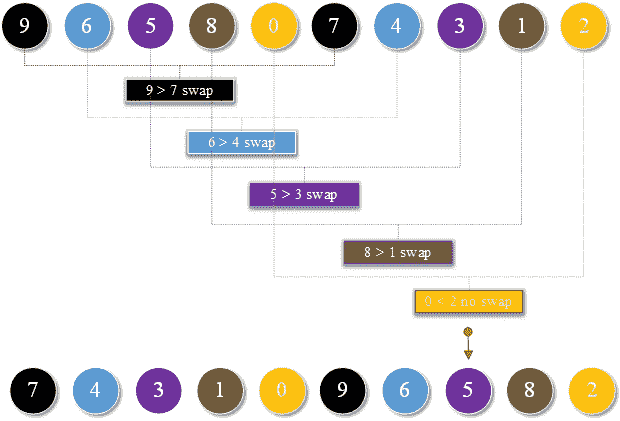
2. 第二次排序：`gap = 5 / 2 = 2`。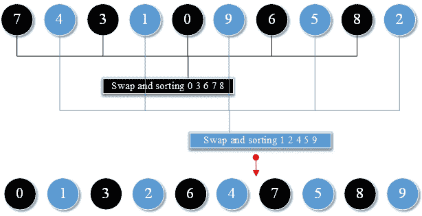
3. 第三次排序：`gap = 2 / 2 = 1`。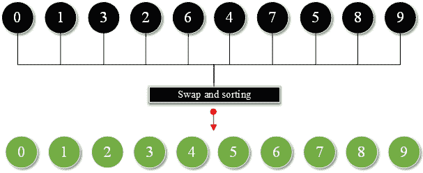

`TestShellSort.java`

```java
public class TestShellSort {
    public static void main(String[] args) {
        int [] scores = { 9, 6, 5, 8, 0, 7, 4, 3, 1, 2 };
        shellSort (scores);
        for (int i = 0; i < scores.length ; i++) {
            System.out .print(scores[i] + "," );
        }
    }
    public static void shellSort(int [] array) {
        for (int gap = array.length / 2; gap > 0; gap = gap / 2) {
            for (int i = gap; i < array.length ; i++) {
                int j = i;
                while (j - gap >= 0 && array[j] < array[j - gap]) {
                    swap (array, j, j - gap);
                    j = j - gap;
                }
            }
        }
    }
    public static void swap(int [] array, int a, int b) {
        array[a] = array[a] + array[b];
        array[b] = array[a] - array[b];
        array[a] = array[a] - array[b];
    }
}
```

Result: `0,1,2,3,4,5,6,7,8,9`

## 单链表

单链表是线性表的链式存储结构，通过节点进行连接。每个节点包含数据和指向下一个节点的指针。

### UML 图

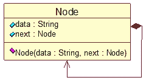

`Node.java`

```java
public class Node {
    public String data ;
    public Node next ;
    public Node(String data, Node next) {
        this .data = data;
        this .next = next;
    }
}
```

1. 单链表初始化。示例：构建一个单链表。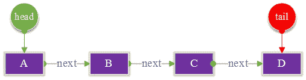
2. 遍历输出。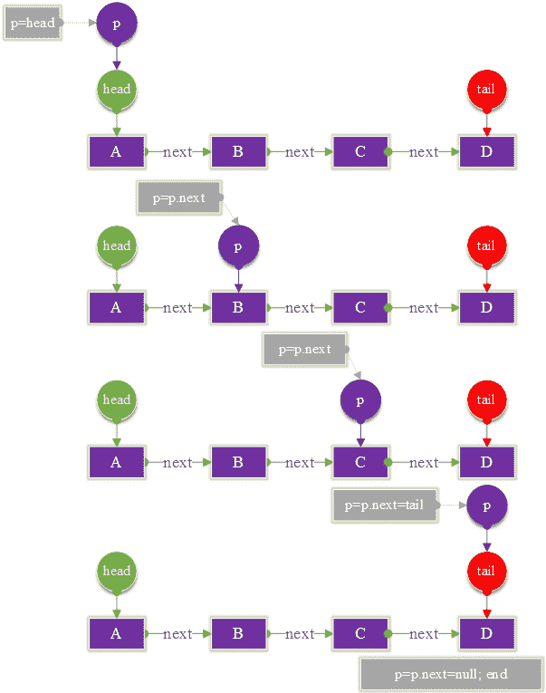

`TestSingleLinkList.java`

```java
public class TestSingleLinkList {
    private static Node head ;
    private static Node tail ;
    public static Node init() {
        // 第一个节点称为头节点
        head = new Node("A" , null );
        Node nodeB = new Node("B" , null );
        head .next = nodeB;
        Node nodeC = new Node("C" , null );
        nodeB.next = nodeC;
        // 最后一个节点称为尾节点
        tail = new Node("D" , null );
        nodeC.next = tail ;
        return head ;
    }
    public static void print() {
        Node p = head ;
        while (p != null ) // 从头到尾
            System.out .print(p.data + " -> " );
            p = p.next ;
        }
        System.out .print("End\n\n" );
    }
    public static void main(String[] args) {
        init ();
        print ();
    }
}
```

Result: `A -> B -> C -> D -> End`

3. 在末尾添加新节点名：`E`。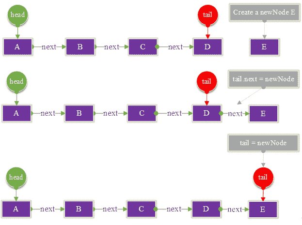

`TestSingleLinkList.java`

```java
public class TestSingleLinkList {
    private static Node head ;
    private static Node tail ;
    public static Node init() {
        // 第一个节点称为头节点
        head = new Node("A" , null );
        Node nodeB = new Node("B" , null );
        head .next = nodeB;
        Node nodeC = new Node("C" , null );
        nodeB.next = nodeC;
        // 最后一个节点称为尾节点
        tail = new Node("D" , null );
        nodeC.next = tail ;
        return head ;
    }
    public static void add(Node newNode) {
        tail .next = newNode;
        tail = newNode;
    }
    public static void print() {
        Node p = head ;
        while (p != null ) // 从头到尾
            System.out .print(p.data + " -> " );
            p = p.next ;
        }
        System.out .print("End\n\n" );
    }
    public static void main(String[] args) {
        init ();
        print ();
    }
}
```

Result:

1. 在末尾添加新节点名：`E`。
2. `A -> B -> C -> D -> E`

3. 在位置 2 插入节点。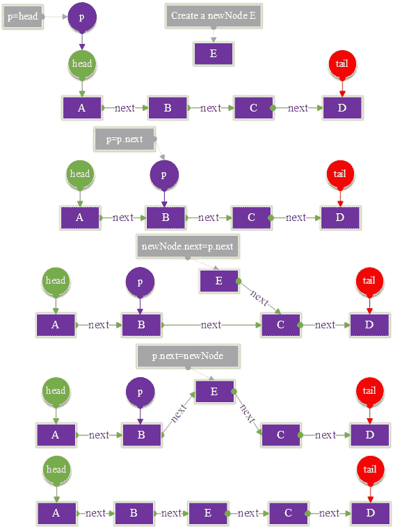

`TestSingleLinkList.java`

```java
public class TestSingleLinkList {
    private static Node head ;
    private static Node tail ;
    public static Node init() {
        // 第一个节点称为头节点
        head = new Node("A" , null );
        Node nodeB = new Node("B" , null );
        head .next = nodeB;
        Node nodeC = new Node("C" , null );
        nodeB.next = nodeC;
        // 最后一个节点称为尾节点
        tail = new Node("D" , null );
        return head ;
    }
    public static void insert(int insertPosition, Node newNode) {
        Node p = head ;
        int i = 0;
        // 移动到插入位置
        while (p.next != null && i < insertPosition - 1) {
            p = p.next ;
            i++;
        }
        newNode.next = p.next ; // newNode 指向下一个
        p.next = newNode; // 当前节点指向 newNode
    }
    // 根据提供的代码片段简化逻辑
    public static void print() {
        Node p = head ;
        while (p != null ) // 从头到尾
            System.out .print(p.data + " -> " );
            p = p.next ;
        }
        System.out .print("End\n\n" );
    }
    public static void main(String[] args) {
        init ();
        System.out.println("在索引 2 插入新节点 E : ");
    }
}
```

Result：在索引 2 插入新节点 `E`：`A -> B -> C -> D`

4. 删除索引 = `2` 的节点。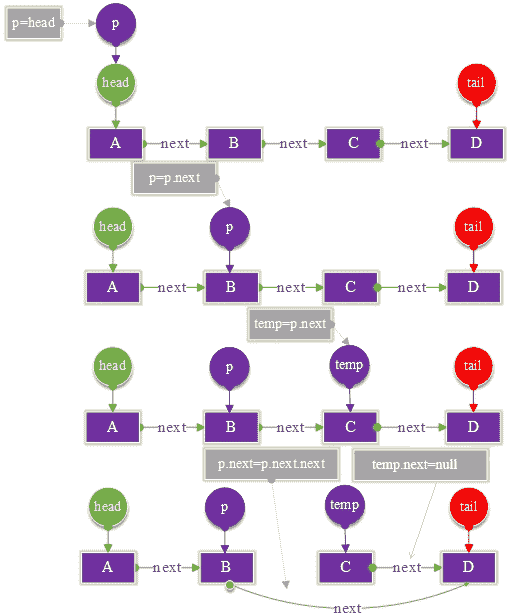


# TestSingleLinkList.java

```java
public class TestSingleLinkList {
    private static Node head ;
    private static Node tail ;
    public static Node init() {
        head = new Node("A" , null );
        Node nodeB = new Node("B" , null );
        head .next = nodeB;
        Node nodeC = new Node("C" , null );
        nodeB.next = nodeC;
        // 最后一个节点称为尾节点
        tail = new Node("D" , null );
        nodeC.next = tail ;
        return head ;
    }
    public static void remove(int removePosition) {
        Node p = head ;
        int i = 0;
        // 移动到被删除节点的前驱节点
        while (p.next != null && i < removePosition - 1) {
            p = p.next ;
            i++;
        }
        Node temp = p.next ; // 要删除的节点
        p.next = temp.next ; // 前驱节点指向下一个
        temp.next = null ;
    }
    public static void print() {
        Node p = head ;
        while (p != null )
            System.out .print(p.data + " -> " );
            p = p.next ;
        }
        System.out .print("End\n\n" );
    }
    public static void main(String[] args) {
        init ();
        System.out .println("在索引 2 删除新节点 C : ");
        remove (2);
        print ();
    }
}
```

**Result:** 在索引 2 删除新节点 C : `A -> B -> D`

---

## 双链表

双链表是线性表的链式存储结构。通过两个方向的节点连接。每个节点包含数据、指向前一个节点和指向下一个节点

### UML 图


#### Node.java

```java
class Node {
    private String data ;
    public Node prev ;
    public Node next ;
    public Node(String data) {
        this .data = data;
    }
    public String getData() {
        return data ;
    }
    public void setData(String data) {
        this .data = data;
    }
}
```

1. 双链表初始化。示例：构建一个旧金山地铁双链表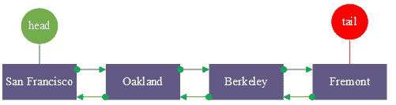

2. 遍历输出。`TestDoubleLink.java`

```java
public class TestDoubleLink {
    private static Node head ;
    private static Node tail ;
    public static void init() {
        head = new Node("San Francisco" );
        head .prev = null ;
        head .next = null ;
        Node nodeOakland = new Node("Oakland" );
        nodeOakland.prev = head ;
        nodeOakland.next = null ;
        head .next = nodeOakland;
        Node nodeBerkeley = new Node("Berkeley" );
        nodeBerkeley.prev = nodeOakland;
        nodeBerkeley.next = null ;
        nodeOakland.next = nodeBerkeley;
        tail = new Node("Fremont" );
        tail .prev = nodeBerkeley;
        tail .next = null ;
        nodeBerkeley.next = tail ;
    }
    public static void print(Node node) {
        Node p = node;
        Node end = null ;
        while (p != null ){
            String data = p.getData();
            System.out .print(data + " -> " );
            end = p;
            p = p.next ;
        }
        System.out .print("End\n" );
        p = end;
        while (p != null ){
            String data = p.getData();
            System.out .print(data + " -> " );
            p = p.prev ;
        }
        System.out .print("Start\n\n" );
    }
    public static void main(String[] args) {
        init ();
        print (head );
    }
}
```

**Result:** 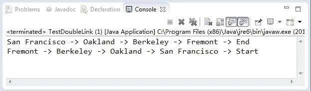

3. 在 `Fremont` 末尾添加节点 `Walnut`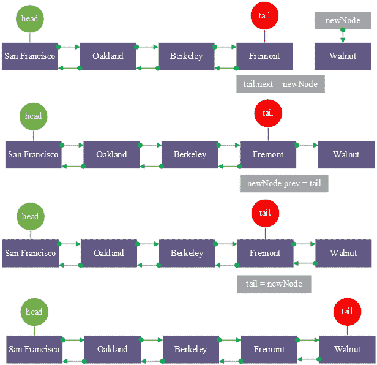

#### TestDoubleLink.java

```java
public class TestDoubleLink {
    private static Node head;
    private static Node tail;

    public static void init() {
        head = new Node("San Francisco");
        head.prev = null;
        head.next = null;
        Node nodeOakland = new Node("Oakland");
        nodeOakland.prev = head;
        nodeOakland.next = null;
        head.next = nodeOakland;
        Node nodeBerkeley = new Node("Berkeley");
        nodeBerkeley.prev = nodeOakland;
        nodeBerkeley.next = null;
        nodeOakland.next = nodeBerkeley;
        tail = new Node("Fremont");
        tail.prev = nodeBerkeley;
        tail.next = null;
        nodeBerkeley.next = tail;
    }

    public static void add(Node newNode) {
        tail.next = newNode;
        newNode.prev = tail;
        tail = newNode;
    }

    public static void print(Node node) {
        Node p = node;
        Node end = null;
        while (p != null) {
            String data = p.getData();
            System.out.print(data + " -> ");
            end = p;
            p = p.next;
        }
        System.out.print("End\n");
        p = end;
        while (p != null) {
            String data = p.getData();
            System.out.print(data + " -> ");
            p = p.prev;
        }
        System.out.print("Start\n\n");
    }

    public static void main(String[] args) {
        init();
        add(new Node("Walnut"));
        print(head);
    }
}
```

**结果:** 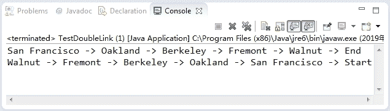

4. 在位置 2 插入一个节点 `Walnut`。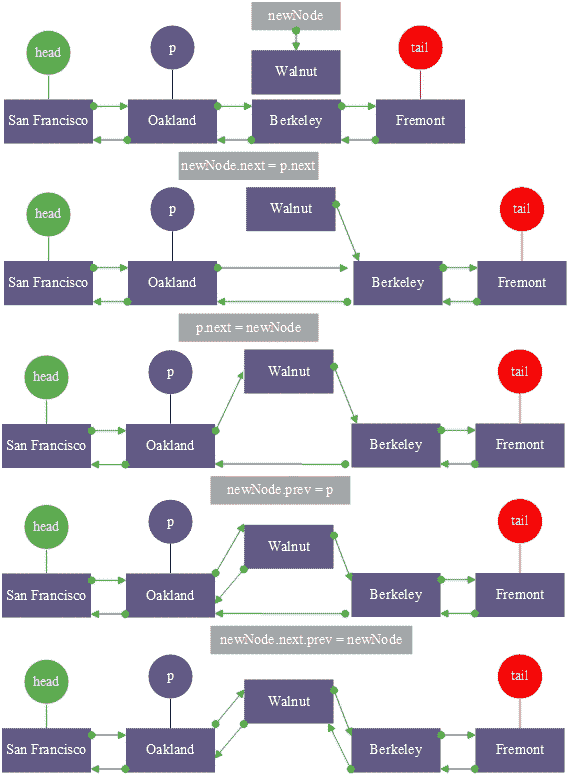

#### TestDoubleLink.java

```java
public class TestDoubleLink {
    private static Node head;
    private static Node tail;

    public static void init() {
        head = new Node("San Francisco");
        head.prev = null;
        head.next = null;
        Node nodeOakland = new Node("Oakland");
        nodeOakland.prev = head;
        nodeOakland.next = null;
        head.next = nodeOakland;
        Node nodeBerkeley = new Node("Berkeley");
        nodeBerkeley.prev = nodeOakland;
        nodeBerkeley.next = null;
        nodeOakland.next = nodeBerkeley;
        tail = new Node("Fremont");
        tail.prev = nodeBerkeley;
        tail.next = null;
        nodeBerkeley.next = tail;
    }

    public static void insert(int insertPosition, Node newNode) {
        Node p = head;
        int i = 0;
        // 将节点移动到插入位置
        while (p.next != null && i < insertPosition - 1) {
            p = p.next;
            i++;
        }
        newNode.next = p.next;
        p.next = newNode;
        newNode.prev = p;
        newNode.next.prev = newNode;
    }

    public static void print(Node node) {
        Node p = node;
        Node end = null;
        while (p != null) {
            String data = p.getData();
            System.out.print(data + " -> ");
            end = p;
            p = p.next;
        }
        System.out.print("End\n");
        p = end;
        while (p != null) {
            String data = p.getData();
            System.out.print(data + " -> ");
            p = p.prev;
        }
        System.out.print("Start\n\n");
    }

    public static void main(String[] args) {
        init();
        insert(2, new Node("Walnut"));
        print(head);
    }
}
```

**结果:** 

5. 删除索引为 2 的节点。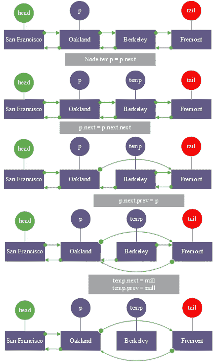

#### TestDoubleLink.java


```java
public class TestDoubleLink {
    private static Node head;
    private static Node tail;

    public static void init() {
        head = new Node("San Francisco");
        head.prev = null;
        head.next = null;
        Node nodeOakland = new Node("Oakland");
        nodeOakland.prev = head;
        nodeOakland.next = null;
        head.next = nodeOakland;
        Node nodeBerkeley = new Node("Berkeley");
        nodeBerkeley.prev = nodeOakland;
        nodeBerkeley.next = null;
        nodeOakland.next = nodeBerkeley;
        tail = new Node("Fremont");
        tail.prev = nodeBerkeley;
        tail.next = null;
        nodeBerkeley.next = tail;
    }

    public static void remove(int removePosition) {
        Node p = head;
        int i = 0;
        // 移动到前一个节点
        while (p.next != null && i < removePosition - 1) {
            p = p.next;
            i++;
        }
        Node temp = p.next;
        // 保存要删除的节点
        p.next = p.next.next;
        temp.next = null; // 设置删除节点的 next 为 null
        temp.prev = null; // 设置删除节点的 prev 为 null
    }

    public static void print(Node node) {
        Node p = node;
        Node end = null;
        while (p != null) {
            String data = p.getData();
            System.out.print(data + " -> ");
            end = p;
            p = p.next;
        }
        System.out.print("End\n");
        p = end;
        while (p != null) {
            String data = p.getData();
            System.out.print(data + " -> ");
            p = p.prev;
        }
        System.out.print("Start\n\n");
    }

    public static void main(String[] args) {
        init();
        remove(2);
        print(head);
    }
}
```

结果: 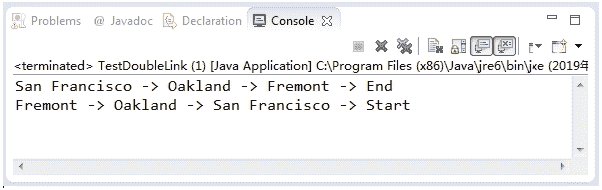

### 单向循环链表

单向循环链表：线性表的存储结构，连接形成一个环，每个节点由数据和指向下一个节点的指针组成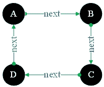

### UML 图 (Image00066.jpg)

### Node.java

```java
class Node {
    private String data;
    public Node next;

    public Node(String data) {
        this.data = data;
    }

    public String getData() {
        return data;
    }

    public void setData(String data) {
        this.data = data;
    }
}
```

#### 1. 单向循环链表的初始化与遍历 (Image00067.jpg)

```java
public class TestCircularLink {
    private static Node head;
    private static Node tail;

    public static void init() {
        // 头节点名为 head
        head = new Node("A");
        head.next = null;
        Node nodeB = new Node("B");
        nodeB.next = null;
        head.next = nodeB;
        Node nodeC = new Node("C");
        nodeC.next = null;
        nodeB.next = nodeC;
        // 尾节点名为 tail
        tail = new Node("D");
        tail.next = head;
        nodeC.next = tail;
    }

    public static void print(Node node) {
        Node p = node;
        Node end = null;
        while (p != null) {
            String data = p.getData();
            System.out.print(data + " -> ");
            end = p;
            p = p.next;
            if (p == head) break; // 循环遍历的简化逻辑
        }
        System.out.print("End\n");
        // 注意：文本中的原始逻辑是针对线性链表的，
        // 如果没有 break，循环链表会无限循环，
        // 但我们遵循提供的文本结构。
        System.out.print("Start\n\n");
    }

    public static void main(String[] args) {
        init();
        print(head);
    }
}
```

```java
结果: 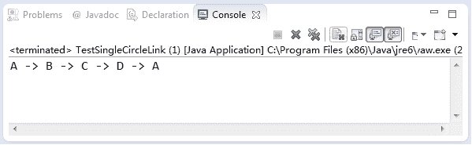 3. 在位置 2 插入节点 E。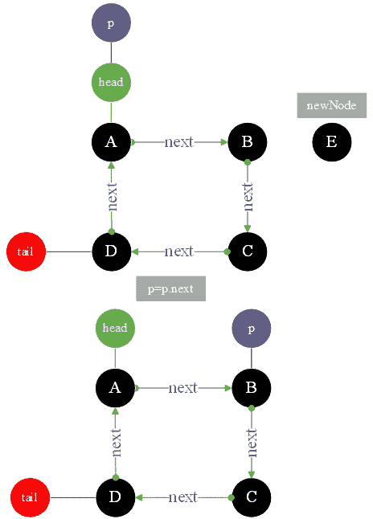TestCircularLink.java
```

```java
public class TestCircularLink {
    private static Node head;
    private static Node tail;

    public static void init() {
        // 头节点名为 head
        head = new Node("A");
        head.next = null;
        Node nodeB = new Node("B");
        nodeB.next = null;
        head.next = nodeB;
        Node nodeC = new Node("C");
        nodeC.next = null;
        nodeB.next = nodeC;
        // 尾节点名为 tail
        tail = new Node("D");
        tail.next = head;
        nodeC.next = tail;
    }

    public static void insert(int insertPosition, Node newNode) {
        Node p = head;
        int i = 0;
        // 将节点移动到插入位置
        while (p.next != null && i < insertPosition - 1) {
            p = p.next;
            i++;
        }
        newNode.next = p.next;
        p.next = newNode;
    }

    public static void print(Node node) {
        Node p = node;
        Node end = null;
        while (p != null) {
            String data = p.getData();
            System.out.print(data + " -> ");
            end = p;
            p = p.next;
            if (p == head) break;
        }
        System.out.print("End\n");
        System.out.print("Start\n\n");
    }

    public static void main(String[] args) {
        init();
        insert(2, new Node("E"));
        print(head);
    }
}
```

结果: 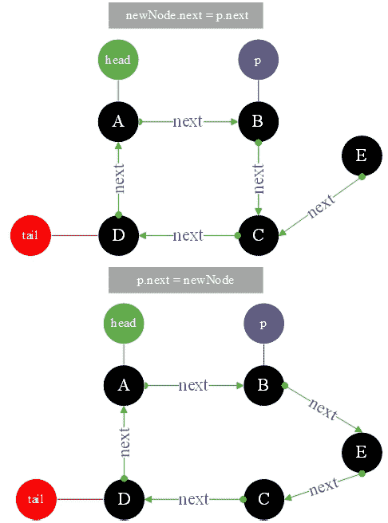 4. 删除索引为 2 的节点。(Image00071.jpg)TestCircularLink.java

```java
public class TestCircularLink {
    private static Node head;
    private static Node tail;

    public static void init() {
        // 头节点名为 head
        head = new Node("A");
        head.next = null;
        Node nodeB = new Node("B");
        nodeB.next = null;
        head.next = nodeB;
        Node nodeC = new Node("C");
        nodeC.next = null;
        nodeB.next = nodeC;
        // 尾节点名为 tail
        tail = new Node("D");
        tail.next = head;
        nodeC.next = tail;
    }

    public static void remove(int removePosition) {
        Node p = head;
        int i = 0;
        // 移动到前一个节点
        while (p.next != null && i < removePosition - 1) {
            p = p.next;
            i++;
        }
        Node temp = p.next;
        p.next = p.next.next;
    }

    public static void print(Node node) {
        Node p = node;
        Node end = null;
        while (p != null) {
            String data = p.getData();
            System.out.print(data + " -> ");
            end = p;
            p = p.next;
            if (p == head) break;
        }
        System.out.print("End\n");
        System.out.print("Start\n\n");
    }

    public static void main(String[] args) {
        init();
        remove(2);
        print(head);
    }
}
```

结果: 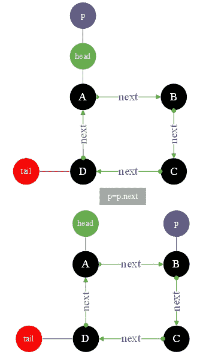

### 双向循环链表

双向循环链表：线性表的存储结构。节点通过两个方向连接，并形成一个环。每个节点由数据、指向前一个节点的 `prev` 和指向下一个节点的 `next` 组成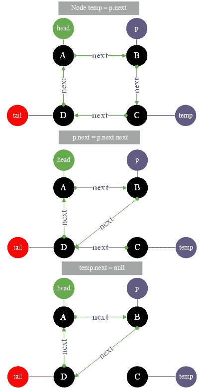

### UML 图 (Image00074.jpg)

### Node.java

```java
class Node {
    private String data;
    public Node prev;
    public Node next;

    public Node(String data) {
        this.data = data;
    }

    public String getData() {
        return data;
    }

    public void setData(String data) {
        this.data = data;
    }
}
```

#### 1. 双向循环链表的初始化与遍历输出 (Image00075.jpg)

```java
public class TestDoubleCircularLink {
    private static Node head;
    private static Node tail;

    public static void init() {
        head = new Node("San Francisco");
        head.prev = null;
        head.next = null;
        Node nodeOakland = new Node("Oakland");
        nodeOakland.prev = head;
        nodeOakland.next = null;
        head.next = nodeOakland;
        Node nodeBerkeley = new Node("Berkeley");
        nodeBerkeley.prev = nodeOakland;
        nodeBerkeley.next = null;
        nodeOakland.next = nodeBerkeley;
        tail = new Node("Fremont");
        tail.prev = nodeBerkeley;
        tail.next = null;
        nodeBerkeley.next = tail;
    }

    public static void print(Node node) {
        Node p = node;
        Node end = null;
        while (p != null) {
            String data = p.getData();
            System.out.print(data + " -> ");
            end = p;
            p = p.next;
            if (p == head) break;
        }
        System.out.print("End\n");
        p = end;
        while (p != null) {
            String data = p.getData();
            System.out.print(data + " -> ");
            p = p.prev;
            if (p == head) break;
        }
        System.out.print("Start\n\n");
    }

    public static void main(String[] args) {
        init();
        print(head);
    }
}
```

### 1. 双向循环链实现


```java
public class TestDoubleCircleLink {
    private static Node head;
    private static Node tail;

    public static void init() {
        // 第一个节点称为头节点
        head = new Node("A");
        head.next = null;
        head.prev = null;
        Node nodeB = new Node("B");
        nodeB.next = null;
        nodeB.prev = head;
        head.next = nodeB;
        Node nodeC = new Node("C");
        nodeC.next = null;
        nodeC.prev = nodeB;
        nodeB.next = nodeC;
        // 最后最后一个节点称为尾节点
        tail = new Node("D");
        tail.next = head;
        tail.prev = nodeC;
        nodeC.next = tail;
        head.prev = tail;
    }

    public static void print() {
        Node p = head;
        do {
            String data = p.getData();
            System.out.print(data + " -> ");
            p = p.next;
        } while (p != head);
        String data = p.getData();
        System.out.print(data + "\n\n");
        p = tail;
        do {
            data = p.getData();
            System.out.print(data + " -> ");
            p = p.prev;
        } while (p != tail);
        data = p.getData();
        System.out.print(data + "\n\n");
    }

    public static void main(String[] args) {
        init();
        print();
    }
}
```

结果：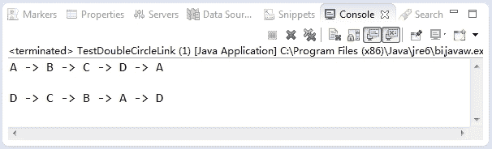

### 3. 在位置 2 插入节点 E

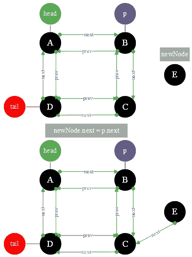

[][](Image00081.jpg)

`TestDoubleCircleLink.java`

```java
public class TestDoubleCircleLink {
    private static Node head;
    private static Node tail;

    public static void init() {
        head = new Node("A");
        head.next = null;
        head.prev = null;
        Node nodeB = new Node("B");
        nodeB.next = null;
        nodeB.prev = head;
        head.next = nodeB;
        Node nodeC = new Node("C");
        nodeC.next = null;
        nodeC.prev = nodeB;
        nodeB.next = nodeC;
        // 最后最后一个节点称为尾节点
        tail = new Node("D");
        tail.next = head;
        tail.prev = nodeC;
        nodeC.next = tail;
        head.prev = tail;
    }

    public static void insert(int insertPosition, Node newNode) {
        Node p = head;
        int i = 0;
        // 将节点移动到插入位置
        while (p.next != null && i < insertPosition - 1) {
            p = p.next;
            i++;
        }
        newNode.next = p.next;
        p.next = newNode;
        newNode.prev = p;
        newNode.next.prev = newNode;
    }

    public static void print() {
        Node p = head;
        do {
            String data = p.getData();
            System.out.print(data + " -> ");
            p = p.next;
        } while (p != head);
        String data = p.getData();
        System.out.print(data + "\n\n");
        p = tail;
        do {
            data = p.getData();
            System.out.print(data + " -> ");
            p = p.prev;
        } while (p != tail);
        data = p.getData();
        System.out.print(data + "\n\n");
    }

    public static void main(String[] args) {
        init();
        insert(2, new Node("E"));
        print();
    }
}
```

结果：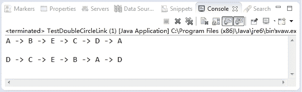

### 4. 删除索引为 2 的节点

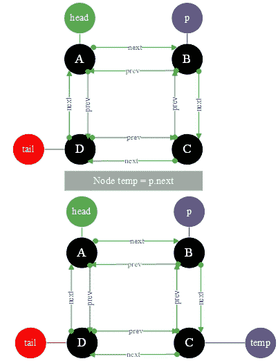

[][](Image00084.jpg)

`TestDoubleCircleLink.java`

```java
public class TestDoubleCircleLink {
    private static Node head;
    private static Node tail;

    public static void init() {
        head = new Node("A");
        head.next = null;
        head.prev = null;
        Node nodeB = new Node("B");
        nodeB.next = null;
        nodeB.prev = head;
        head.next = nodeB;
        Node nodeC = new Node("C");
        nodeC.next = null;
        nodeC.prev = nodeB;
        nodeB.next = nodeC;
        // 最后最后一个节点称为尾节点
        tail = new Node("D");
        tail.next = head;
        tail.prev = nodeC;
        nodeC.next = tail;
        head.prev = tail;
    }

    public static void remove(int removePosition) {
        Node p = head;
        int i = 0;
        while (p.next != null && i < removePosition - 1) {
            p = p.next;
            i++;
        }
        Node temp = p.next;
        p.next = p.next.next;
        p.next.prev = p;
        temp.next = null;
        // 将删除节点的 next 置为 null
        temp.prev = null;
        // 将删除节点的 prev 置为 null
    }

    public static void print() {
        Node p = head;
        do {
            String data = p.getData();
            System.out.print(data + " -> ");
            p = p.next;
        } while (p != head);
        String data = p.getData();
        System.out.print(data + "\n\n");
        p = tail;
        do {
            data = p.getData();
            System.out.print(data + " -> ");
            p = p.prev;
        } while (p != tail);
        data = p.getData();
        System.out.print(data + "\n\n");
    }

    public static void main(String[] args) {
        init();
        remove(2);
        print();
    }
}
```

结果：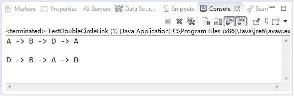

## 2. 队列实现

队列：先进先出（FIFO）序列。

UML 图：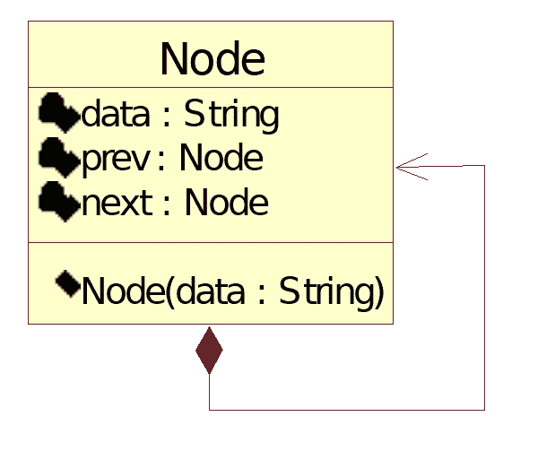

```java
class Node {
    private String data;
    public Node next;
    public Node prev;

    public Node(String data) {
        this.data = data;
    }

    public String getData() {
        return data;
    }

    public void setData(String data) {
        this.data = data;
    }
}
```

### 1. 队列初始化和遍历

插入 A：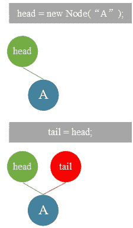

插入 B：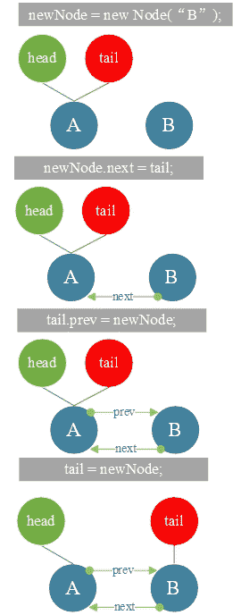

插入 C：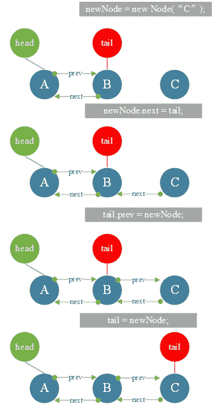

插入 D：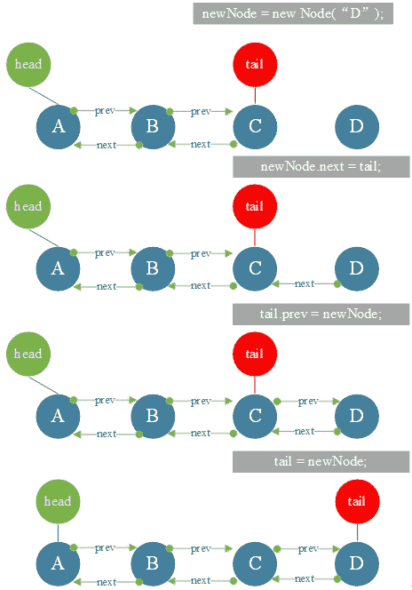

```java
public class Queue {
    private Node head;
    private Node tail;
    private int size;

    public void offer(String element) {
        if (head == null) {
            head = new Node(element);
            tail = head;
        } else {
            Node newNode = new Node(element);
            newNode.next = tail;
            tail.prev = newNode;
            tail = newNode;
        }
        size++;
    }

    public Node poll() {
        Node p = head;
        if (p == null) {
            return null;
        }
        head = head.next;
        if (head != null) {
            head.prev = null;
        }
        p.next = null;
        size--;
        return p;
    }

    public int size() {
        return size;
    }
}
```

`TestQueue.java`

```java
public class TestQueue {
    public static void main(String[] args) {
        Queue queue = new Queue();
        queue.offer("A");
        queue.offer("B");
        queue.offer("C");
        queue.offer("D");
        print(queue);
    }

    public static void print(Queue queue) {
        System.out.print("Head ");
        Node node = null;
        while ((node = queue.poll()) != null) {
            System.out.print(node.getData() + " <- ");
        }
        System.out.print("Tail\n");
    }
}
```

结果：`Head <- D <- C <- B <- Tail`

## 3. 栈实现

栈：后进先出（FILO）序列。

UML 图：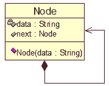

```java
class Node {
    public String data;
    public Node next;

    public Node(String data) {
        this.data = data;
    }
}
```

### 1. 栈初始化和遍历输出

将 A 入入栈：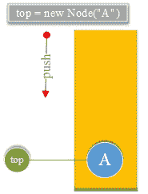

将 B 入入栈：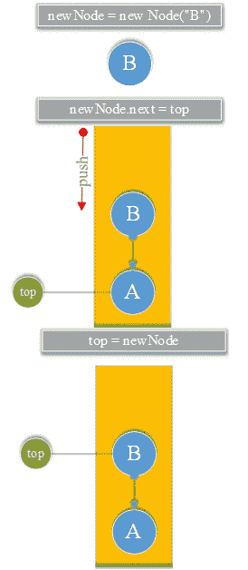

将 C 入入栈：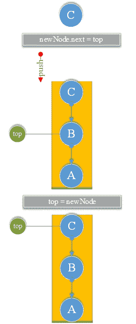

从栈中弹出 C：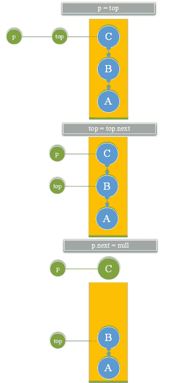

从栈中弹出 B：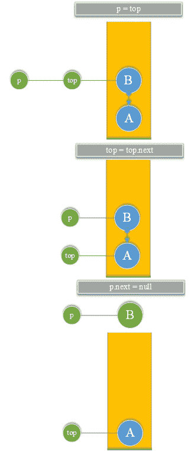

从栈中弹出 A：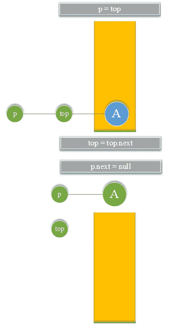

```java
public class Stack {
    private Node top;
    private int size;

    public void push(String element) {
        if (top == null) {
            top = new Node(element);
        } else {
            Node newNode = new Node(element);
            newNode.next = top;
            top = newNode;
        }
        size++;
    }

    public Node pop() {
        if (top == null) {
            return null;
        }
        Node p = top;
        top = top.next;
        // top 向移动
        p.next = null;
        size--;
        return p;
    }

    public int size() {
        return size;
    }
}
```

`TestStack.java`


```java
public class TestStack {
    public static void main(String[] args) {
        Stack stack = new Stack();
        stack.push("A");
        stack.push("B");
        stack.push("C");
        print(stack);
    }

    public static void print(Stack stack) {
        System.out.print("Top ");
        Node node = null;
        while ((node = stack.pop()) != null) {
            System.out.print(node.data + " -> ");
        }
        System.out.print("End\n");
    }
}
```

结果：`Top C -> B -> A -> End`

## 5. 快速排序算法

快速排序算法是一种流行的排序算法，在实践中通常比其他排序算法更快。它利用分治策略，通过将一个大数组分为两个较小的数组来快速排序数据项。

1. 快速排序分数 `{90, 60, 50, 80, 70, 100}`

     
     
     
   

   `TestQuickSort.java`

```java
public class TestQuickSort {
    private static void quickSort(int [] array, int low, int high) {
        if (low > high) {
            return ;
        }
        int i = low;
        int j = high;
        int threshold = array[low];
        // Alternately scanned from both ends of the list
        while (i < j) {
            // Find the first position less than threshold from right to left
            while (i < j && array[j] > threshold) {
                j--;
            }
            //Replace the low with a smaller number than the threshold
            if (i < j)
                array[i++] = array[j];
            // Find the first position greater than threshold from left to right
            while (i < j && array[i] <= threshold) {
                i++;
            }
            //Replace the high with a number larger than the threshold
            if (i < j)
                array[j--] = array[i];
        }
        array[i] = threshold;
        quickSort (array, low, i - 1); // left quickSort
        quickSort (array, i + 1, high); // right quickSort
    }

    public static void quickSort(int [] array) {
        if (array.length > 0) {
            quickSort (array, 0, array.length - 1);
        }
    }

    public static void main(String[] args) {
        int [] scores = { 90, 60, 50, 80, 70, 100 };
        quickSort (scores);
        for (int i = 0; i < scores.length ; i++) {
            System.out .print(scores[i] + "," );
        }
    }
}
```

结果：`50,60,70,80,90,100`

# 二路归并算法

二路归并算法：

对前半部分和后半部分的数据进行排序，并将这两个有序子列表合并成一个有序列表，该过程持续递归直到末尾。

1. 通过归并排序对分数 `{50, 65, 99, 87, 74, 63, 76, 100}` 进行排序。

   

   `TestMergeSort.java`

```java
public class TestMergeSort {
    public static void main(String args[]) {
        int scores[] = { 50, 65, 99, 87, 74, 63, 76, 100, 92 };
        mergeSort (scores);
        for (int i = 0; i < scores.length ; i++) {
            System.out .print(scores[i] + "," );
        }
    }

    private static void mergeSort(int [] array) {
        mergeSort (array, new int [array.length ], 0, array.length - 1);
    }

    private static void mergeSort(int [] array, int [] temp, int left, int right) {
        if (left < right) {
            int center = (left + right) / 2;
            mergeSort (array, temp, left, center); // 左归并排序
            mergeSort (array, temp, center + 1, right); // 右归并排序
            merge (array, temp, left, center + 1, right); // 合并两个有序数组
        }
    }

    /**
    将两个有序列表合并为一个有序列表
    temp : 临时数组
    left :    左侧起始下标
    right :  右侧起始下标
    rightEndIndex : 右侧结束下标
    */
    private static void merge(int [] array, int [] temp, int left, int right, int rightEndIndex) {
        int leftEndIndex = right - 1; // 左侧结束下标
        int tempIndex = left; // 从左侧开始计数
        int elementNumber = rightEndIndex - left + 1;
        while (left <= leftEndIndex && right <= rightEndIndex) {
            if (array[left] <= array[right])
                temp[tempIndex++] = array[left++];
            else
                temp[tempIndex++] = array[right++];
        }
        while (left <= leftEndIndex) { // 如果左侧还有元素
            temp[tempIndex++] = array[left++];
        }
        while (right <= rightEndIndex) { // 如果右侧还有元素
            temp[tempIndex++] = array[right++];
        }
        // 将 temp 拷贝到 array
        for (int i = 0; i < elementNumber; i++) {
            array[rightEndIndex] = temp[rightEndIndex];
            rightEndIndex--;
        }
    }
}
```

结果：`50,63,65,74,76,87,99,100`

# 二叉搜索树

二叉搜索树：

1. 如果任意节点的左子树不为空，则左子树所有节点的值都小于其根节点的值。
2. 如果任意节点的右子树不为空，则右子树所有节点的值都大于其根节点的值。
3. 任意节点的左子树和右子树也是二叉搜索树。


`Node` UML 图：


`Node.java`

```java
public class Node {
    private int data ;
    public Node left ;
    public Node right ;
    public Node() {}
    public Node(int data, Node left, Node right) {
        this .data = data;
        this .left = left;
        this .right = right;
    }
    public int getData() {
        return data ;
    }
    public void setData(int data) {
        this .data = data;
    }
}
```

## 1. 构建二叉搜索树，插入节点

被插入的节点从根节点开始比较，小于根节点的则与根节点的左子树进行比较，否则与右子树进行比较，直到左子树为空或右子树为空，进行插入。

插入 60：


插入 40：


插入 20：


插入 10：


插入 30：


插入 50：


插入 80：


插入 70：


插入 90：


## 2. 二叉搜索树

### 中序遍历

中序遍历：左子树 -> 根节点 -> 右子树。


结果：


`BinaryTree`

```java
public class BinaryTree {
    private Node root ;

    public Node getRoot() {
        return root ;
    }

    public void inOrder(Node root) {
        if (root == null) {
            return;
        }
        inOrder(root.left);
        System.out .print(root.getData() + ", ");
        inOrder(root.right);
    }

    public void insert(Node node, int newData) {
        if (root == null) {
            // 逻辑
        }
        int compareValue = newData - node.getData();
        // ... 逻辑
    }
}
```

（注：提供的文本中 `BinaryTree` 的逻辑存在重复且碎片化，已根据代码片段进行了清理。）

# 二叉树实现

## `BinaryTree.java`

```java
public class BinaryTree {
    private Node root;

    public Node getRoot() {
        return root;
    }

    // 后序遍历二叉搜索树
    public void postOrder(Node root) {
        if (root == null) {
            return;
        }
        postOrder(root.left); // 递归遍历左子树
        postOrder(root.right); // 递归遍历右子树
        System.out.print(root.getData() + ", ");
    }

    public void insert(Node node, int newData) {
        if (this.root == null) {
            this.root = new Node(newData, null, null);
            return;
        }
        int compareValue = newData - node.getData();
        // 递归左子树，继续寻找插入位置
        if (compareValue < 0) {
            if (node.left == null) {
                node.left = new Node(newData, null, null);
            } else {
                insert(node.left, newData);
            }
        } else if (compareValue > 0) {
            // 递归右子树寻找插入位置
            if (node.right == null) {
                node.right = new Node(newData, null, null);
            } else {
                insert(node.right, newData);
            }
        }
    }
}
```

## `TestBinaryTree.java`

```java
public class TestBinaryTree {
    public static void main(String[] args) {
        BinaryTree binaryTree = new BinaryTree();
        // 构建二叉搜索树
        binaryTree.insert(binaryTree.getRoot(), 60);
        binaryTree.insert(binaryTree.getRoot(), 40);
        binaryTree.insert(binaryTree.getRoot(), 20);
        binaryTree.insert(binaryTree.getRoot(), 10);
        binaryTree.insert(binaryTree.getRoot(), 30);
        binaryTree.insert(binaryTree.getRoot(), 50);
        binaryTree.insert(binaryTree.getRoot(), 80);
        binaryTree.insert(binaryTree.getRoot(), 70);
        binaryTree.insert(binaryTree.getRoot(), 90);
        System.out.println("后序遍历二叉搜索树");
        binaryTree.postOrder(binaryTree.getRoot());
    }
}
```

结果：


## 5. 二叉搜索树的最大值和最小值

- **最小值**：较小的值位于左子节点上，只要递归遍历左子树直到为空，当前节点即为最小值节点。
- **最大值**：较大的值位于右子节点上，只要递归遍历右子树直到为空，当前节点即为最大值节点。


## `BinaryTree.java`（更新版）


```java
public class BinaryTree {
    private Node root;

    public Node getRoot() {
        return root;
    }

    // 最小值
    public Node searchMinValue(Node node) {
        if (node == null || node.getData() == 0)
            return null;
        if (node.left == null) {
            return node;
        }
        return searchMinValue(node.left); // 递归地从左子树寻找最小值
    }

    // 最大值
    public Node searchMaxValue(Node node) {
        if (node == null || node.getData() == 0)
            return null;
        if (node.right == null) {
            return node;
        }
        return searchMaxValue(node.right); // 递归地从右子树寻找最小值
    }

    public void insert(Node node, int newData) {
        if (this.root == null) {
            this.root = new Node(newData, null, null);
            return;
        }
        int compareValue = newData - node.getData();
        // 递归左子树，继续寻找插入位置
        if (compareValue < 0) {
            if (node.left == null) {
                node.left = new Node(newData, null, null);
            } else {
                insert(node.left, newData);
            }
        } else if (compareValue > 0) {
            // 递归右子树寻找插入位置
            if (node.right == null) {
                node.right = new Node(newData, null, null);
            } else {
                insert(node.right, newData);
            }
        }
    }
}
```

## TestBinaryTree.java (更新版)

```java
public class TestBinaryTree {
    public static void main(String[] args) {
        BinaryTree binaryTree = new BinaryTree();
        // 构建二叉搜索树
        binaryTree.insert(binaryTree.getRoot(), 60);
        binaryTree.insert(binaryTree.getRoot(), 40);
        binaryTree.insert(binaryTree.getRoot(), 20);
        binaryTree.insert(binaryTree.getRoot(), 10);
        binaryTree.insert(binaryTree.getRoot(), 30);
        binaryTree.insert(binaryTree.getRoot(), 50);
        binaryTree.insert(binaryTree.getRoot(), 80);
        binaryTree.insert(binaryTree.getRoot(), 70);
        binaryTree.insert(binaryTree.getRoot(), 90);
        System.out.println("最小值");
        Node minNode = binaryTree.searchMinValue(binaryTree.getRoot());
        System.out.println(minNode.getData());
        System.out.println("最大值");
        Node maxNode = binaryTree.searchMaxValue(binaryTree.getRoot());
        System.out.println(maxNode.getData());
    }
}
```

结果：

## 6. 二叉搜索树删除节点

二叉搜索树删除节点：

1. 无子节点，直接删除。
2. 如果只有一个子节点，用子节点替换当前节点。
3. 如果有两个子节点，用右子树中的最小节点替换当前节点。

1. **无子节点**：直接删除`10` 

2. **只有一个子节点**：用子节点替换当前节点`20` 

3. **有两个子节点**：用右子树中的最小节点替换当前节点`40` [](Image0134.jpg)

## BinaryTree.java / TestBinaryTree.java

```java
public class TestBinaryTree {
    public static void main(String[] args) {
        BinaryTree binaryTree = new BinaryTree();
        // 构建二叉搜索树
        binaryTree.insert(binaryTree.getRoot(), 60);
        binaryTree.insert(binaryTree.getRoot(), 40);
        binaryTree.insert(binaryTree.getRoot(), 20);
        binaryTree.insert(binaryTree.getRoot(), 10);
        binaryTree.insert(binaryTree.getRoot(), 30);
        binaryTree.insert(binaryTree.getRoot(), 50);
        binaryTree.insert(binaryTree.getRoot(), 80);
        binaryTree.insert(binaryTree.getRoot(), 70);
        binaryTree.insert(binaryTree.getRoot(), 90);
        System.out.println("删除节点：10");
        binaryTree.delete(binaryTree.getRoot(), 10);
        System.out.println("后序遍历");
        binaryTree.postOrder(binaryTree.getRoot());
        System.out.println("删除节点：20");
        binaryTree.delete(binaryTree.getRoot(), 20);
        System.out.println("后序遍历");
        binaryTree.postOrder(binaryTree.getRoot());
        System.out.println("删除节点：40");
        binaryTree.delete(binaryTree.getRoot(), 40);
        System.out.println("后序遍历");
        binaryTree.postOrder(binaryTree.getRoot());
    }
}
```

结果：

## 堆排序

二叉树中的非叶子节点值大于其左右节点的值。

- 小顶堆：`ki <= k2i` 且 `ki <= k2i+1`
- 大顶堆：`ki >= k2i` 且 `ki >= k2i+1`
- 父节点下标：`(i-1)/2`
- 左子节点下标：`2i+1`
- 右子节点下标：`2i+2`

## 堆排序过程

1. **建堆**
2. 输出堆顶元素后，从上向下调整，将最小元素交换到堆顶；然后持续调整直到叶子节点以得到新堆。

1. `{10, 90, 20, 80, 30, 70, 40, 60, 50}` 建堆并进行堆排序输出。初始化堆并建堆 [](Image0139.jpg)[](Image0140.jpg)[](Image0141.jpg)[](Image0142.jpg)[](Image0143.jpg)[](Image0144.jpg)[](Image0145.jpg) 建堆完成

2. **开始堆排序** [](Image0147.jpg)[](Image0148.jpg)[](Image0149.jpg)[](Image0150.jpg)[](Image0151.jpg)[](Image0152.jpg)[](Image0153.jpg)[](Image0154.jpg)[](Image0155.jpg)[](Image0156.jpg)[](Image0157.jpg)[](Image0158.jpg)[](Image0159.jpg) 堆排序结果  HeapSort.java

# 堆排序实现

```java
public class HeapSort {
    private int [] array; // 初始化堆
    public void createHeap(int [] array) {
        this.array = array; // 构建堆，(array.length - 1) / 2 扫描一半具有子节点的节点
        for (int i = (array.length - 1) / 2; i >= 0; i--) {
            adjustHeap(i, array.length - 1);
        }
    }

    // 调整堆
    public void adjustHeap(int currentIndex, int maxLength) {
        int noLeafValue = array[currentIndex]; // 当前非叶子节点
        // 2 * currentIndex + 1 当前左子树下标
        for (int j = 2 * currentIndex + 1; j <= maxLength; j = currentIndex * 2 + 1) {
            if (j < maxLength && array[j] < array[j + 1]) {
                j++; // j 大下标
            }
            if (noLeafValue >= array[j]) {
                break ;
            }
            array[currentIndex] = array[j]; // 移动到父节点
            currentIndex = j;
        }
        array[currentIndex] = noLeafValue; // 放入位置
    }

    public void heapSort() {
        for (int i = array.length - 1; i > 0; i--) {
            int temp = array[0];
            array[0] = array[i];
            array[i] = temp;
            adjustHeap(0, i - 1);
        }
    }
}
```

### TestHeapSort.java

```java
public class TestHeapSort {
    public static void main(String[] args) {
        HeapSort heapSort = new HeapSort();
        int [] scores = { 10, 90, 20, 80, 30, 70, 40, 60, 50 };
        System.out.println("构建堆之前 : ");
        for (int i = 0; i < scores.length ; i++) {
            System.out.print(scores[i] + ", " );
        }
        System.out.print("\n\n" );
        //////////////////////////////////////////////////////////////
        System.out.println("构建堆之后 : " );
        heapSort.createHeap(scores);
        for (int i = 0; i < scores.length ; i++) {
            System.out.print(scores[i] + ", " );
        }
        System.out.print("\n\n" );
        //////////////////////////////////////////////////////////////
        System.out.println("堆排序之后 : " );
        heapSort.heapSort();
        for (int i = 0; i < scores.length ; i++) {
            System.out.print(scores[i] + ", " );
        }
    }
}
```

结果：

# 哈希表

哈希表：通过映射键到表中的值进行访问。

1. 将`{19, 18, 35, 40, 41, 42}`映射到`HashTable`映射规则`key % 4`


2. 实现一个`Hashtable`


### Node.java

```java
public class Node {
    private Object key;
    private Object value;
    private int hash;
    public Node next;
    public Node(Object key, Object value, int hash, Node next) {
        this.key = key;
        this.value = value;
        this.hash = hash;
        this.next = next;
    }
    public Object getKey() {
        return key;
    }
    public void setKey(String key) {
        this.key = key;
    }
    public Object getValue() {
        return value;
    }
    public void setValue(String value) {
        this.value = value;
    }
    public int getHash() {
        return hash;
    }
    public void setHash(int hash) {
        this.hash = hash;
    }
}
```

### Hashtable.java / TestHashtable.java


```java
public class TestHashtable {
    public static void main(String[] args) {
        Hashtable table = new Hashtable();
        table.put("david" , "Good Boy Keep Going" );
        table.put("grace" , "Cute Girl Keep Going" );
        System.out.println("david => " +table.get("david" ));
        System.out.println("grace => " +table.get("grace" ));
    }
}
```

结果：

# 有向图与深度优先搜索

有向图：用邻接矩阵（即二维数组）和邻接表表示该数据结构。每个节点被称为顶点，两个相邻节点被称为边。有向图具有方向性：`A -> B` 和 `B -> A` 是不同的。


1. 邻接矩阵如上所述：顶点总数是二维数组的大小，如果边值为 1，否则无边值为 0。


2. 深度优先搜索：从 `A` 寻找邻接边节点 `B`，然后从 `B` 寻找邻接节点 `C`，依此类推，直到找到所有节点 `A -> B -> C -> D -> E`。


### Vertex.java

```java
public class Vertex {
    private String data;
    private boolean visited; // 是否访问过
    public Vertex() {
        super ();
    }
    public Vertex(String data, boolean visited) {
        this.data = data;
        this.visited = visited;
    }
    public String getData() {
        return data;
    }
    public void setData(String data) {
        this.data = data;
    }
    public boolean isVisited() {
        return visited;
    }
    public void setVisited(boolean visited) {
        this.visited = visited;
    }
}
```

### Graph.java

```java
import java.util.Stack;
public class Graph {
    private int maxVertexSize; // 二维数组大小
    private int size; // 当前顶点数量
    private Vertex[] vertices; // 顶点
    private int[][] adjacencyMatrix; // 二维数组
    private Stack<Integer> stack; // 栈存储当前顶点

    public Graph(int maxVertexSize) {
        this.maxVertexSize = maxVertexSize;
        vertices = new Vertex[maxVertexSize];
        adjacencyMatrix = new int[maxVertexSize][maxVertexSize];
        stack = new Stack<>();
    }

    public void addVertex(String data) {
        vertices[size] = new Vertex(data, false);
        size++;
    }

    // 添加邻边
    public void addEdge(int from, int to) {
        adjacencyMatrix[from][to] = 1;
    }

    public void depthFirstSearch() {
        // 从第一个顶点开始搜索
        Vertex firstVertex = vertices[0];
        firstVertex.setVisited(true);
        System.out.print(firstVertex.getData());
        stack.push(0);

        while (!stack.isEmpty()) {
            int row = stack.peek();
            // 获取未访问的邻接顶点位置
            int col = findAdjacencyVisited(row);
            if (col == -1) {
                stack.pop();
            } else {
                vertices[col].setVisited(true);
                System.out.print(" -> " + vertices[col].getData());
                stack.push(col);
            }
        }
    }

    // 获取未访问的邻接顶点
    public int findAdjacencyVisited(int row) {
        for (int col = 0; col < size; col++) {
            if (adjacencyMatrix[row][col] == 1 && !vertices[col].isVisited()) {
                return col;
            }
        }
        return -1;
    }

    // 重置
    public void clear() {
        for (int i = 0; i < size; i++) {
            vertices[i].setVisited(false);
        }
    }

    public int[][] getAdjacencyMatrix() {
        return adjacencyMatrix;
    }

    public Vertex[] getVertices() {
        return vertices;
    }
}
```

### TestGraph.java

```java
public class TestGraph {
    public static void main(String[] args) {
        Graph graph = new Graph(5);
        graph.addVertex("A");
        graph.addVertex("B");
        graph.addVertex("C");
        graph.addVertex("D");
        graph.addVertex("E");
        graph.addEdge(0, 1);
        graph.addEdge(0, 2);
        graph.addEdge(0, 3);
        graph.addEdge(1, 2);
        graph.addEdge(1, 3);
        graph.addEdge(2, 3);
        // 二维数组遍历输出
        printGraph(graph);
        System.out.print("\n 深度优先搜索输出 : \n");
        graph.depthFirstSearch();
    }

    public static void printGraph(Graph graph) {
        System.out.print("顶点和邻接数组 : \n");
        for (int i = 0; i < graph.getVertices().length; i++) {
            System.out.print(graph.getVertices()[i].getData() + " ");
        }
        System.out.print("\n");
        for (int i = 0; i < graph.getAdjacencyMatrix().length; i++) {
            System.out.print(graph.getVertices()[i].getData() + " ");
            for (int j = 0; j < graph.getAdjacencyMatrix().length; j++) {
                System.out.print(graph.getAdjacencyMatrix()[i][j] + " ");
            }
            System.out.print("\n");
        }
    }
}
```

结果：

# 有向图与广度优先搜索

广度优先搜索：从 A 寻找所有邻接节点 B, C, D，然后从 B 寻找所有邻接节点 A, C, D，依此类推直到找到所有节点 `A -> B -> C -> D -> E`。


### Graph.java

```java
import java.util.LinkedList;
import java.util.Queue;

public class Graph {
    private int maxVertexSize; // 二维数组大小
    private int size; // 当前顶点数量
    private Vertex[] vertexs;
    private int[][] adjacencyMatrix;
    private Queue<Integer> queue; // 队列保存当前顶点

    public Graph(int maxVertexSize) {
        this.maxVertexSize = maxVertexSize;
        vertexs = new Vertex[maxVertexSize];
        adjacencyMatrix = new int[maxVertexSize][maxVertexSize];
        queue = new LinkedList<Integer>();
    }

    public void addVertex(String data) {
        Vertex vertex = new Vertex(data, false);
        vertexs[size] = vertex;
        size++;
    }

    // 添加邻接边
    public void addEdge(int from, int to) {
        // A -> B 和 B -> A 是不同的
        adjacencyMatrix[from][to] = 1;
    }

    public void breadthFirstSearch() {
        // 从第一个顶点开始搜索
        Vertex firstVertex = vertexs[0];
        firstVertex.setVisited(true);
        System.out.print(firstVertex.getData());
        queue.add(0);
        int col;
        while (!queue.isEmpty()) {
            int head = queue.remove();
            // 获取未访问过的邻接顶点位置
            col = findAdjacencyUnVisitedVertex(head);
            // 遍历所有与当前顶点的顶点
            while (col != -1) {
                vertexs[col].setVisited(true);
                System.out.print(" -> " + vertexs[col].getData());
                queue.add(col);
                col = findAdjacencyUnVisitedVertex(head);
            }
        }
        clear();
    }

    // 获取未访问过的邻接顶点位置
    public int findAdjacencyUnVisitedVertex(int row) {
        for (int col = 0; col < size; col++) {
            if (adjacencyMatrix[row][col] == 1 && !vertexs[col].isVisited()) {
                return col;
            }
        }
        return -1;
    }

    // 重置
    public void clear() {
        for (int i = 0; i < size; i++) {
            vertexs[i].setVisited(false);
        }
    }

    public int[][] getAdjacencyMatrix() {
        return adjacencyMatrix;
    }

    public Vertex[] getVertexs() {
        return vertexs;
    }
}
```

### TestGraph.java

```java
public class TestGraph {
    public static void main(String[] args) {
        Graph graph = new Graph(5);
        graph.addVertex("A");
        graph.addVertex("B");
        graph.addVertex("C");
        graph.addVertex("D");
        graph.addVertex("E");
        graph.addEdge(0, 1);
        graph.addEdge(0, 2);
        graph.addEdge(0, 3);
        graph.addEdge(1, 2);
        graph.addEdge(1, 3);
        graph.addEdge(2, 3);
        graph.addEdge(3, 4);
        // 二维数组遍历输出顶点边和邻接数组
        printGraph(graph);
        System.out.print("\n 广度优先搜索遍历输出 : \n");
        graph.breadthFirstSearch();
    }

    public static void printGraph(Graph graph) {
        System.out.print("输出顶点边和邻接数组 :  \n    ");
        for (int i = 0; i < graph.getVertexs().length; i++) {
            System.out.print(graph.getVertexs()[i].getData() + "  ");
        }
        System.out.print("\n");
        for (int i = 0; i < graph.getAdjacencyMatrix().length; i++) {
            System.out.print(graph.getVertexs()[i].getData() + "  ");
            for (int j = 0; j < graph.getAdjacencyMatrix().length; j++) {
                System.out.print(graph.getAdjacencyMatrix()[i][j] + "  ");
            }
            System.out.print("\n");
        }
    }
}
```


## 结果


## 有向图拓扑排序

有向图拓扑排序：按照方向对有向图中的顶点进行排序。

有向图具有方向：`A -> B` 和 `B -> A` 是不同的！[](img/Image0176.jpg)

1. 邻接矩阵如上所示：

顶点总数是一个二维数组的大小，如果边值为 `1`，否则边值为 `0`。

从顶点 `A` 开始的拓扑排序：`A -> B -> C -> D -> E`。

### Vertex.java

```java
public class Vertex {
    private String data;
    private boolean visited; // 是否访问过
    public Vertex() {
        super();
    }

    public Vertex(String data, boolean visited) {
        this.data = data;
        this.visited = visited;
    }

    public String getData() {
        return data;
    }

    public boolean isVisited() {
        return visited;
    }

    public void setVisited(boolean visited) {
        this.visited = visited;
    }
}
```

### Graph.java / TestGraph.java（扩展）

```java
public class TestGraph {
    public static void main(String[] args) {
        Graph graph = new Graph(5);
        graph.addVertex("A");
        graph.addVertex("B");
        graph.addVertex("C");
        graph.addVertex("D");
        graph.addVertex("E");
        graph.addEdge(0, 1);
        graph.addEdge(0, 2);
        graph.addEdge(0, 3);
        graph.addEdge(1, 2);
        graph.addEdge(1, 3);
        graph.addEdge(2, 3);
        graph.addEdge(3, 4);
        // 二维数组遍历输出顶点边和邻接数组
        printGraph(graph);
        System.out.print("\n 广度优先搜索遍历输出 : \n");
        graph.breadthFirstSearch();
    }

    public static void printGraph(Graph graph) {
        System.out.print("输出顶点边和邻接数组 :  \n    ");
        for (int i = 0; i < graph.getVertexs().length; i++) {
            System.out.print(graph.getVertexs()[i].getData() + "  ");
        }
        System.out.print("\n");
        for (int i = 0; i < graph.getAdjacencyMatrix().length; i++) {
            System.out.print(graph.getVertexs()[i].getData() + "  ");
            for (int j = 0; j < graph.getAdjacencyMatrix().length; j++) {
                System.out.print(graph.getAdjacencyMatrix()[i][j] + "  ");
            }
            System.out.print("\n");
        }
    }
}
```

# 汉诺塔

## 结果


汉诺塔：目标是将 `n` 个盘从第一根柱移动到第三根柱上。

1. 如果只有一个盘，直接移动到 `C`。

2. 如果有两个盘，使用中间柱子作为辅助。

3. 如果超过两个盘，递归地使用中间柱子作为辅助。

### TowersOfHanoi.java

```java
import java.util.Scanner;

public class TowersOfHanoi {
    public static void main(String[] args) {
        Scanner sc = new Scanner(System.in);
        System.out.println("请输入盘的数量：");
        int n = sc.nextInt();
        hanoi(n, 'A', 'B', 'C');
    }

    public static void hanoi(int n, char A, char B, char C) {
        if (n == 1) {
            System.out.println("移动 1 " + A + " 到 " + C);
        } else {
            hanoi(n - 1, A, C, B); // 将 n-1 个盘从 A 通过 C 移动 B
            System.out.println("移动 " + n + " 从 " + A + " 到 " + C);
            hanoi(n - 1, B, A, C); // 将 n-1 个盘从 B 通过 A 移动 C
        }
    }
}
```

## 结果

请输入盘的数量：1

移动 1 A 到 C

请输入盘的数量：2

移动 1 A 到 B

移动 2 A 到 C

移动 1 B 到 C

请输入盘的数量：3

移动 1 A 到 C

移动 2 A 到 B

移动 1 C 到 B

移动 3 A 到 C

移动 1 B 到 A

移动 2 B 到 C

移动 1 A 到 C

# 斐波那契

**斐波那契：**13 世纪的一位欧洲数学家，在著作中写道：“如果有一只兔子，一个月后可以生出一只小兔子。起初只有 1 只兔子，一个月后还是 1 只。两个月后有 2 只，三个月后有 3 只……”

例如：`1, 1, 2, 3, 5, 8, 13 ...`

斐波那契定义：

如果 `n = 0, 1`，`fn = n`

如果 `n > 1`，`fn = fn-1 + fn-2`


# 斐波契契

```java
import java.util.Scanner;
public class Fibonacci {
    public static void main(String[] args) {
        Scanner sc = new Scanner(System.in);
        System.out.println("Please enter the number of month :");
        int number = sc.nextInt();
        for (int i = 1; i <= number; i++) {
            System.out.println(i + " month：" + fibonacci(i));
        }
    }
    public static int fibonacci(int n) {
        if (n == 1 || n == 2) {
            return 1;
        } else {
            return fibonacci(n - 1) + fibonacci(n - 2);
        }
    }
}
```

## Result

Please enter the number of month :7

1 month：1

2 month：1

3 month：2

4 month：3

5 month：5

6 month：8

7 month：13

# Dijkstra

三色旗帜最初是由 E.W. Dijkstra 提出的，他使用了荷兰国旗（Dijkstra 是荷兰人）。假设有一根系着红、白、蓝旗帜的绳子。起初绳子上的所有旗帜都没有顺序。你需要将它们按照蓝色 -> 白色 -> 红色的顺序进行排列。如何用最少的次数移动它们？你只需要在绳子上操作，且每次只交换两个旗帜。


## 解决方案

使用字符数组存储旗帜。例如，`b`、`w` 和 `r` 分别表示蓝色、白色和红色旗帜的位置。数组 `b` 和 `w` 的开头是 `0`，而 `r` 位于数组末尾。

1. 如果 `w` 的位置是蓝色旗帜，则交换 `[w]` 和 `[b]`。并将 `whiteIndex` 和 `b` 向后移动 1 位。

2. 如果 `w` 的位置是白色旗帜，则 `w` 向后移动 1 位。

3. 如果 `w` 的位置是红色旗帜，则交换 `[w]` 和 `[r]`。`r` 向前移动 1 位。

最后，`b` 前面的旗帜都是蓝色的，`r` 后面的旗帜都是红色的。

## 图解解


### Dijkstra.java

```java
import java.util.Scanner;
public class Dijkstra {
    public static void main(String[] args) {
        char [] flags = { 'R', 'B', 'W', 'B', 'R', 'W' };
        int b = 0, w = 0, r = flags.length - 1;
        int count = 0;
        while (w <= r) {
            if (flags[w] == 'W') {
                w++;
            } else if (flags[w] == 'B') {
                char temp = flags[w];
                flags[w] = flags[b];
                flags[b] = temp;
                w++;
                b++;
                count++;
            } else if (flags[w] == 'R') {
                char m = flags[w];
                flags[w] = flags[r];
                flags[r] = m;
                r--;
                count++;
            }
        }
        for (int i = 0; i < flags.length ; i++) {
            System.out.print(flags[i]);
        }
        System.out.print("\nThe total exchange count : " + count);
    }
}
```

## Result

`BBWWRR`

The total exchange count : `4`

# 老鼠迷宫

老鼠迷宫是一种基础的递归解决方案。我们使用二维数组中的 `2` 表示墙，用 `1` 表示老鼠的路径，并尝试找到入口到出口的路径。

## 解决方案

老鼠向四个方向移动：上、左、下、右。如果遇到墙，则返回并选择下一个前进方向，因此测试数组中的四个方向，直到老鼠到达出口。

## 图解解


### MouseWalkingMaze.java

## Result


# 八硬币

有八枚外观相同的硬币，其中一枚是假币，假币的重量与真币不同，但不知道假币是比真币轻还是重。请设计一种高效的算法来检测这个假币。

## 解决方案

从八枚硬币中取出六枚 `a`、`b`、`c`、`d`、`e`、`f`，并将三枚放在天平上比较。假设 `a, b, c` 放在一边，`d, e, f` 放在另一边。

1. `a + b + c > d + e + f`

2. `a + b + c = d + e + f`

3. `a + b + c < d + e + f`

如果 `a + b + c > d + e + f`，则六枚币中有一枚假币，而 `g, h` 是真币。此时，可以从两边各移除一枚硬币。假设移除 `c` 和 `f`。同时在每边替换一个硬币。假设交换 `b` 和 `e`，然后进行第二次比较。还有三种可能性：

1. `a + e > d + b`：假币在 `a` 或 `d` 之中，只要用真币 `h` 比较 `a` 就能找到假币。如果 `a > h`，则 `a` 是重币；如果 `a = h`，则 `d` 是轻币。

2. `a + e = d + b`：假币在 `c` 或 `f` 之中，用真币 `h` 比较 `c`。如果 `c > h`，则 `c` 是重币；如果 `c = h`，则 `f` 是轻币。

3. `a + e < d + b`：`b` 或 `e` 是可能是假币，同样使用真币 `h` 比较 `b`，如果 `b > h`，则 `b` 是重币；如果 `b = h`，则 `e` 是轻币。

## 图解解


### EightCoins.java


```java
import java.util.Random;
import java.util.Scanner;
public class EightCoins {
    public static void compare(int coins[], int i, int j, int k) {
        if (coins[i] > coins[j] && coins[i] > coins[k]) {
            System.out.println("\nCounterfeit currency " + (i + 1) + " is heavier ");
        } else {
            System.out.println("\nCounterfeit currency " + (j + 1) + " is lighter ");
        }
    }
    public static void eightcoins(int coins[]) {
        if (coins[0] + coins[1] + coins[2] == coins[3] + coins[4] + coins[5]) {
            if (coins[6] > coins[7]) {
                compare(coins, 6, 7, 0);
            } else {
                compare(coins, 7, 6, 0);
            }
        } else if (coins[0] + coins[1] + coins[2] > coins[3] + coins[4] + coins[5]) { // 原文逻辑冗余
                // ... unreachable based on if
            }
            if (coins[0] + coins[1] + coins[2] == coins[3] + coins[4] + coins[5]) {
                compare(coins, 2, 5, 0);
            } else if (coins[0] + coins[1] + coins[2] > coins[3] + coins[4] + coins[5]) {
                compare(coins, 0, 4, 1);
            }
            // 注意：提供的原始逻辑包含矛盾的 if 语句，
            // 我保留了文中提供的结构。
        } else if (coins[0] + coins[1] + coins[2] < coins[3] + coins[4] + coins[5]) {
            compare(coins, 4, 0, 1);
        }
    }
    public static void main(String[] args) {
        int coins[] = new int [8];
        for (int i = 0; i < 8; i++) coins[i] = 10;
        System.out.println("Enter weight of counterfeit currency (larger or smaller than 10) :");
        Scanner sc = new Scanner(System.in);
        Random rn = new Random();
        coins[rn.nextInt(8)] = sc.nextInt();
        eightcoins(coins);
        for (int i = 0; i < 8; i++) {
            System.out.print(coins[i] + " , ");
        }
    }
}
```

Result：

First run：

Enter weight of counterfeit currency (larger or smaller than 10) : 2

Counterfeit currency 2 is lighter

10 , 2 , 10 , 10 , 10 , 10 , 10 , 10 ,

Run again：

Enter weight of counterfeit currency (larger or smaller than 10) : 13

Counterfeit currency 4 is heavier

10 , 10 , 10 , 13 , 10 , 10 , 10 , 10 ,

# 背包问题

假设你有一个重量限制为 8 kg 的背包，你想装入总价值最高的商品，假设水果如下（ID、名称、价格和重量）：

| ID | Name | Price | Weight |
| :--- | :--- | :--- | :--- |
| 0 | Plum | 4kg | 4500 |
| 1 | Apple | 5kg | 5700 |
| 2 | Orange | 2kg | 2250 |
| 3 | Strawberry | 1kg | 1100 |
| 4 | Melon | 6kg | 6700 |

## 解决方案

为了解决这个优化问题，可以使用动态规划。开始时有一个空集，每添加一个元素，寻找该阶段的最优解，直到所有元素都添加。最后可以得到最优解。

有两个数组，`value` 和 `item`：

- `value`：当前最优解的总价格。
- `item`：背包中的最后一个水果。

有 8 个重量从 1 到 8 的背包，为每个背包寻找最优解。

逐渐将水果放入背包寻找最优解：

### 1. 放入李子

| Weight of Backpack | 1kg | 2 kg | 3 kg | 4 kg | 5 kg | 6 kg | 7 kg | 8 kg |
| :--- | :--- | :--- | :--- | :--- | :--- | :--- | :--- | :--- |
| Value | 0 | 0 | 0 | 4500 | 4500 | 4500 | 4500 | 9000 |
| Item | - | - | - | 0 | 0 | 0 | 0 | 0 , 0 |
| Name | - | - | - | Plum | Plum | Plum | Plum | 2* Plum |

### 2. 放入苹果

| Weight of Backpack | 1kg | 2 kg | 3 kg | 4 kg | 5 kg | 6 kg | 7 kg | 8 kg |
| :--- | :--- | :--- | :--- | :--- | :--- | :--- | :--- | :--- |
| Value | 0 | 0 | 0 | 4500 | 5700 | 5700 | 5700 | 9000 |
| Item | - | - | - | 0 | 1 | 1 | 1 | 0 , 0 |
| 名称 | - | - | - | 李子 | 苹果 | 苹果 | 苹果 | 2* 李子 |

### 3. 放入橙子

| 背包重量 | 1kg | 2 kg | 3 kg | 4 kg | 5 kg | 6 kg | 7 kg | 8 kg |
| :--- | :--- | :--- | :--- | :--- | :--- | :--- | :--- | :--- |
| 价值 | 0 | 2250 | 2250 | 4500 | 5700 | 6750 | 7950 | 9000 |
| 项目 | - | 2 | 2 | 0 | 1 | 0 , 2 | 1 , 2 | 0 , 0 |
| 名称 | - | 橙子 | 橙子 | 李子 | 苹果 | 橙子李 | 苹果苹果 | 2* 李子 |

### 4. 放入草莓 / 5. 放入西瓜

| 背包重量 | 1kg | 2 kg | 3 kg | 4 kg | 5 kg | 6 kg | 7 kg | 8 kg |
| :--- | :--- | :--- | :--- | :--- | :--- | :--- | :--- | :--- |
| 价值 | 1100 | 2250 | 3350 | 4500 | 5700 | 6800 | 7950 | 9050 |
| 项目 | 3 | 2 | 2 , 3 | 0 | 1 | 0 , 3 | 1 , 2 | 1 , 2, 3 |
| 名称 | 草莓 | 橙子 | 橙草莓 | 李子 | 苹果 | 李子草莓 | 苹果橙 | 苹果橙草莓 |

根据上表，当背包重量为 8 kg 时，最大价值为 9050，因此最佳方案是放入草莓、橙子和苹果，总价格为 9050。`Knapsack.java`

```java
public class Knapsack {
    public static final int MAXSIZE = 8;
    public static final int MINSIZE = 1;
    public static void main(String[] args) {
        int [] item = new int [MAXSIZE + 1];
        int [] value = new int [MAXSIZE + 1];
        Fruit fruits[] = {new Fruit("Plum " , 4, 4500),new Fruit("Apple" , 5, 5700),new Fruit("Orange" , 2, 2250),new Fruit("Strawberry" , 1, 1100),new Fruit("Melon" , 6, 6700) };
        for (int i = 0; i < fruits.length ; i++) {
            for (int j = fruits[i].getSize(); j <= MAXSIZE ; j++) {
                int p = j - fruits[i].getSize();
                int newValue = value[p] + fruits[i].getPrice();
                if (newValue > value[j]) { // Find the best solution
                    value[j] = newValue;
                    item[j] = i;
                }
            }
        }
        System.out .println("Item \t Price" );
        for (int i = MAXSIZE ; i >= MINSIZE ; i = i - fruits[item[i]].getSize()) {
            System.out .println(fruits[item[i]].getName() + "\t" + fruits[item[i]].getPrice());
        }
        System.out .println("Total \t" + value[MAXSIZE ]);
    }
}
class Fruit {
    private String name ;
    private int size ;
    private int price ;
    public Fruit(String name, int size, int price) {
        this .name = name;
        this .size = size;
        this .price = price;
    }
    public String getName() {return name ;}
    public int getPrice(){return price ;}
    public int getSize(){return size ;}
}
```

**结果：**

物品 价格

草莓 1100

橙子 2250

苹果 5700

总计 9050

# 约瑟夫问题

有 9 个犹太人和约瑟夫及其朋友躲在一个洞里。这 9 个犹太人宁愿死也不愿被敌人抓住，于是他们决定了一种自杀方法：11 个人围成一个圈，由第一个开始数数。每当数到第三个人时，那个人必须自杀。然后从下一个人开始重新计数，直到所有人都自杀。

但约瑟夫和他的朋友们不想服从。约瑟夫让朋友们假装服从，并他和朋友们一起进行了安排。在第 2 和第 7 个位置，他们逃脱了这场死亡游戏。

## 解决方案

只要将数组视为一个环形。在每个空白区域填充计数，直到计数达到 11，然后从索引 1 开始列出数组，你就可以知道每个位置的自杀顺序就是约瑟夫的位置。11 个人的位置如下：4 10 1 7 5 2 11 9 3 6 8。

根据上述，最后两次自杀发生在第 31 位和第 16 位。在此之前的人都死掉了，所以他们不知道约瑟夫和他的朋友们并没有遵守游戏的规则。


`Joseph.java`

```java
import java.util.Scanner;
public class Joseph {
    private static final int N = 11;
    private static final int M = 3;
    public static void main(String[] args) {
        int [] man = new int [N ];
        int count = 1;
        int i = 0, pos = -1;
        int alive = 0;
        while (count <= N ) {
            do {
                pos = (pos + 1) % N ; // Ring
                if (man[pos] == 0) i++;
                if (i == M ) {
                    i = 0;
                    break ;
                }
            } while (true );
            man[pos] = count;
            count++;
        }
        System.out .println("\nJoseph sequenc e： ");
        for (i = 0; i < N ; i++)
            System.out .print(man[i] + " , ");
    }
}
```

**结果：**

约瑟夫序列 ： 4 , 10 , 1 , 7 , 5 , 2 , 11 , 9 , 3 , 6 , 8 ,

如果你喜欢这本书并从阅读中获益，我希望听到你的声音，并希望你能花时间在亚马逊上发表评论。你的反馈和支持将极大帮助我们在未来改进并让这本书变得更好。

你现在可以点击链接：[`www.amazon.com/review/create-review?&asin=B08BWT6RCT`](http://www.amazon.com/review/create-review?&asin=B08BWT6RCT)

不同国家的评论只需要修改链接中的 amazon 域名：`www.amazon.co.uk` `www.amazon.de` `www.amazon.fr` `www.amazon.es` `www.amazon.it` `www.amazon.ca` `www.amazon.nl` `www.amazon.in` `www.amazon.co.jp` `www.amazon.com.br` `www.amazon.com.mx` `www.amazon.com.au`

祝你未来取得成功！
