# 算法（第一部分，电子版）

## 第一部分

Robert Sedgewick

与

Kevin Wayne

普林斯顿大学

献给 Adam, Andrew, Brett, Robbie

特别献给 Linda

献给 Jackie 和 Alex

## 前言

本书旨在介绍现今最重要的算法，适用于已掌握基础技能的学生。**算法与数据结构的研究**是任何计算机科学的基础，但它不仅仅适用于程序员。从物理模拟到分子生物学，这里描述的基本方法已变得不可或缺。从体系结构到工程，再到搜索引擎，它们成为了本质的工具。

在第1章中，我们开发了算法的基本方法，包括栈、队列和其他数据类型。在第2和第3章中，我们介绍了排序和搜索；在第4和第5章中，我们涵盖了图和字符串。第6章是一个概述，将其余材料置于更大的背景中。

## 特色

本书的侧重点是研究可能具有实用价值的算法。本书介绍了多种算法和数据结构，并提供了充分的信息，使读者能够放心地实现、调试并应用它们。这种方法涉及：

算法对算法的描述基于完整的实现以及对一组一致示例的讨论。我们没有演示伪代码，而是使用真实代码，以便程序可以快速投入使用。我们的程序使用 Java 编写，但其风格允许大部分代码重用于其他编程语言的实现。

类型。我们使用基于数据抽象现代编程风格，使算法及其数据结构封装在一起。

应用。每一章都详细描述了这些算法发挥关键作用的应用。这些涵盖了从物理学和分子生物学，到计算机和系统工程，再到数据压缩和网络搜索等常见任务。

科学方法。我们强调建立数学模型来描述算法性能，利用这些模型提出性能假设，然后在现实语境中运行算法来测试这些假设。

涵盖范围。我们涵盖了基础抽象数据类型、排序算法、搜索算法、图处理和字符串处理。我们将材料保持为算法文本，描述数据结构、算法设计范式、归约和解决问题的方法。

**书籍网站** 本书的一个重要特性是它与在线书籍 `alg4.cs.princeton.edu` 的关系。该网站免费提供，包含了大量关于算法和数据结构的材料，面向教师、学生和执业人员，包括：

- **在线摘要。** 书中的内容在网站上进行了摘要，使其具有与书籍相同的整体结构，但通过链接提供，方便用户在材料之间进行导航。

- **完整实现。** 书中所有的代码都可以在网站上获取，并采用程序开发的形式。网站还提供了许多其他实现，包括书中描述的高级实现和改进、选练习题的答案以及各种应用程序的客户端代码。重点在于在有意义的应用背景下测试算法。

- **练习题与答案。** 书籍网站扩展了书中的练习题，增加了练习题（点击查看答案）、多种说明材料涵盖范围的广泛示例、带有代码解决方案的编程练习，以及具有挑战性的问题。

- **动态可视化。** 纸质书中无法实现动态模拟，但网站上有大量的实现，这些实现使用图形类来展示算法应用的引人入目的视觉演示。

- **课程材料。** 一套完整的讲义幻灯片直接与书籍和网站上的内容相关联。还包含了一系列完整的编程作业，附有清单、测试数据和准备材料。

- **在线课程。** 全套教学讲座视频和自测材料为学生提供了自主学习或复习材料的机会，并为教师提供了替换或补充讲座的机会。

- **相关材料链接。** 数百个链接引导学生获取背景信息、应用程序以及学习算法的资源。

我们创建这些材料的目的是为这些思想提供一种互性的方法。通常情况下，在首次学习特定算法或尝试获取全局视图时，您应该阅读书籍；而在编程时，应将书籍网站作为参考，或者在在线上搜索更多详细信息时将其作为起点。

### 在课程中的应用

本书旨在作为计算机科学专业第二门课程的教材。它全面涵盖了核心内容，是学生在编程、定量推理和问题解决方面获得经验和成熟的极佳工具。通常，一门计算机科学课程作为先修课就足够了——本书适用于任何熟悉现代编程语言和现代计算机系统基本特征的人士。

算法和数据结构用 Java 编写，但其风格对于精通其他语言的人来说易于理解。我们采用现代 Java 抽象（包括泛型），但抵制对语言晦涩特性的依赖。

支持分析结果的大部分数学材料都是自成一体的（或标注了在本书的适用范围），因此对于所有人来说，不需要进行特定的数学准备，尽管数学成熟度无疑会有帮助。应用部分取自科学领域的入门级材料，同样是自成一体的。

涵盖的内容是任何打算主修计算机科学、电气工程或运筹学专业的学生的基础背景，对于任何对科学、数学或工程感兴趣的学生来说都有价值。

### 背景

本书旨在接在我们的入门教材《Java 编程导论》（An Introduction to Programming in Java）之后。这两本书结合起来可以支持一个为期两个或三个学期的计算机科学导论，为任何学生提供必要的背景，使其能够成功处理科学、工程或社会科学中任何所选研究领域的计算问题。

书中大部分材料的起点是 Sedgewick 的《算法》（Algorithms）系列。从精神上讲，本书与该系列的第一版和第二版相似，但本文受益于几十教学教学学习该材料的经验。Sedgewick 目前的《C/C++/Java 算法》（第三版）更适合作为高级课程的参考或教材；而本书专门设计为面向大一或大二学生的单学期课程教材，并作为基础知识的现代介绍以及工作程序员的参考书。

### 谢谢

本书的制作耗了近 40 年时间，因此无法对所有使其成为可能的人给予充分认可。本书的早期版本列出了几十个名字，包括（按顺序）Andrew Appel, Trina Avery, Marc Brown, Lyn Dupré, Philippe Flajoet, Tom Freeman, Dave Hanson, Janet Incerpi, Mick Skidowski, Steve Summit 和 Chris Van Wyk。所有这些人人都值得感谢，尽管他们的一些贡献可能发生在几十年前。对于第四版，我们感谢普林斯顿大学及其他几所机构忍受了作品初版本的数百学生，并感谢全球读者在书籍网站上提供的意见和指正。

我们感谢普林斯顿大学在教学和学习方面的坚定承诺，这为本作品的发展提供了基础。

Peter Gordon 在这项工作演变过程中几乎从一开始就提供了智性的建议，包括温和地引入了“回归基础”的思想，这是本版的基础。对于第四版，我们感谢 Barbara Wood 细致且专业的编辑，感谢 Julie Nahil 管理生产，并感谢 Pearson 的许多其他人在制作和营销书籍方面的作用。所有人对相当紧迫的时间表都做出了极快速的响应，完全没有牺牲结果质量。

Robert Sedgewick

Kevin Wayneene

新泽西州，普林斯顿

## 第一章

# 基础

- 1.1 基础编程模型. . . . . . . . . . . . . . 8
- 1.2 数据抽象. . . . . . . . . . . . . . 64
- 1.3 集合、队列和栈 . . . . . . . . . . . 120
- 1.5 案例研究：并查集. . . . . . . . . . 216

本书的目标是学习各种重要且实用的算法——适用于计算机实现的问题解决方法。算法与数据结构相辅相成——数据组织方案，使其能够被算法高效处理。本章介绍了我们研究算法和数据结构所需的基础工具。

首先，我们介绍了基础编程模型。我们所有的程序都使用 Java 语言的一个子集以及我们用于输入输出和统计计算的一些库来实现。第 1.1 节是书中使用的语言结构、特性和库的总结。

接下来，我们强调数据抽象，在模块化编程中定义抽象数据类型（ADT）。在第 1.2 节中，我们介绍了在 Java 中实现 ADT 的过程，通过指定应用程序接口并使用 Java 类机制开发用于客户端代码的实现。

作为重要且实用的工具，我们考虑了三种基础 ADT：集合、队列和栈。第 1.3 节描述了使用数组、动态数组和链表实现的集合、队列和栈的 API 和实现，这些是书中算法实现的模型和起点。

性能是算法研究的核心考虑因素。第 1.4 节描述了我们分析算法性能的方法。我们方法的基础是科学方法：对性能提出假设，创建数学模型，并运行实验进行测试，必要时重复该过程。

我们以一个案例研究结束，在其中考虑了连通性问题的解决方案，该问题使用了实现经典并查 ADT 的算法和数据结构。

# 算法

当我们编写计算机程序时，我们通常是在实现一种之前设计好的方法，用于解决某些问题。这种方法通常独立于所使用的特定编程语言——它可能对于许多计算机和许多编程语言同样适用。规定我们解决问题所可以采取的步骤的是方法本身，而不是计算机程序本身。“算法”一词在计算机科学中用于描述一种有限的、确定性的且有效的、适合实现为程序的解决问题的方法。算法是计算机科学的核心：它们是该领域研究的核心对象。

我们可以通过用自然语言描述解决问题的步骤来定义算法，或者通过编写实现该步骤的计算机程序来定义，如右侧的欧几里得算法（用于寻找两个数的最大公约数）所示，其变体在 2,300 多年前就已被发明了。如果你对欧几里得算法不熟悉，鼓励你完成 `EXERCISE 1.1.24` 和 `EXERCISE 1.1.25`，也许可以在阅读完 `SECTION 1.1` 之后进行。在书中，我们使用计算机程序来描述算法。这样做的理由之一是更容易检查它们是否是有限的、确定性的且符合要求的。同样重要的是，要认识到特定语言的程序只是表达算法的一种方式。书中许多算法在过去的几十年里用多种编程语言表达过，这一事实强化了这样一个观点：每种算法都是适用于在任何计算机、任何编程语言上实现的方法。

大多数感兴趣的算法都组织了计算涉及的数据。组织导致了数据结构，数据结构也是计算机科学研究的核心对象。算法和数据结构相辅相成。在书中，我们认为数据结构是算法的副产品或最终产品，我们必须通过研究它们来理解算法。简单的算法可以产生复杂的数据结构，反之，复杂的算法可以使用简单的数据结构。我们将在书中研究许多数据结构的属性；事实上，我们本可以将书命名为《算法与数据结构》。

### 英语描述

按如下方式计算两个非负整数 `p` 和 `q` 的最大公约数：如果 `q` 为 0，答案为 `p`。如果不是，将 `p` 除以 `q` 并得到余数 `r`。答案是 `q` 和 `r` 的最大公约数。

### Java 语言描述

```java
public int gcd(int p, int q) {
    if (q == 0) return p;
    int r = p % q;
    return gcd(q, r);
}
```

### 欧几里得算法

当我们使用计算机来帮助解决问题时，我们通常面临许多可能的方法。对于小问题，使用哪种方法并不重要，只要我们有一个能正确解决问题的方法即可。然而，对于大问题（即我们需要解决许多小问题的应用程序），我们很快就会动力去设计高效利用时间和空间的方法。

学习算法的首要原因是这门学科赋予了我们获得巨大节省的潜力，甚至使我们能够完成原本无法完成的任务。在处理数百万个对象的应用程序中，使用设计良好的算法使程序速度快数百万倍并不罕见。我们将在书中多处看到这样的例子。相比之下，投入额外的资金或时间购买并安装新计算机，仅具有将程序加速 10 倍或 100 倍的潜力。仔细的算法设计是解决巨大问题过程中极其有效的一部分，无论应用领域如何。

在开发一个巨大或复杂的程序时，必须投入大量精力来理解和定义要解决的问题、管理其复杂性并将其分解为可以轻松实现的较小子任务。通常，分解后所需的许多算法实现起来非常简单。但在大多数情况下，有少数算法的选择是至关重要的，因为系统资源将消耗在运行这些算法上。这些是书中关注的算法类型。我们研究对于解决广泛应用领域挑战有利的基础算法。

计算机系统中的程序共享变得越来越普遍，尽管我们预计会使用书中很大一部分算法，但我们预计可能只实现其中的一小部分。例如，Java 库包含了许多基础算法的实现；实现基础算法的简单版本有助于我们更好地理解它们，并更有效地使用来自库的高级版本。更重要的是，实现基础算法的机会频繁出现。这样做的首要原因是我们经常面对完全全新的计算环境（硬件和软件），其具有新特性，旧实现可能无法充分利用这些特性。在书中，我们专注于最佳算法的最简单合理实现。我们密切关注算法关键部分的编码，并刻意记录底层优化努力可能获益的地方。

为特定任务选择最佳算法可能是一个复杂的过程，可能涉及复杂的数学分析。研究此类问题的计算机科学分支被称为算法分析。通过分析，我们已经看到许多算法具有出色的理论性能；另一些则仅通过经验已知运行良好。我们的首要目标是为重要任务学习合理的算法，我们还将密切关注方法的比较性能。在不了解算法可能消耗什么资源的情况下，我们不应该使用某种算法，因此我们努力意识到我们的算法性能可能如何。

# 主题总结

作为概述，我们描述了书的主要部分，给出了涵盖的具体主题，并指示了我们对材料的总体方向。涵盖的某些领域旨在接触我们深入研究的尽可能多的基础算法，以学习广泛适用性的基础知识。我们讨论的其他算法来自计算机科学及相关领域的高级领域。我们考虑的算法是数十年研发成果，将在不断扩展的计算应用中继续发挥关键作用。

在本书背景下，基础（第 1 章）是指我们实现、分析和比较算法的基本原理和方法论。我们考虑了 Java 编程模型、数据抽象、基础数据结构、用于集合的抽象数据类型、分析算法性能的方法以及案例研究。

用于顺序重排数组的排序算法（第 2 章）具有基础重要性。我们非常深入地考虑了多种算法，包括插入排序、选择排序、希尔排序、快速排序、归并排序和堆排序。我们还遇到了针对几个相关问题的算法，包括优先级队列、选择和合并。其中许多算法将在书中以后作为其他算法的基础。

用于在大型项目集合中寻找特定项的搜索算法（第 3 章）同样具有基础重要性。我们讨论了搜索的基本和高级方法，包括二叉搜索树、平衡搜索树和哈希。我们注意到这些方法之间的关系并比较了性能。

图（第 4 章）是对象和连接的集合，可能有权重和方向。图是大量困难且重要问题的有用模型，处理图的算法设计是一个主要研究领域。我们考虑了深度优先搜索、广度优先搜索、连通性问题以及若干算法和应用，包括寻找最小生成树的 Kruskal 算法和 Prim 算法，以及解决最短路径问题的 Dijkstra 算法和 Bellman-Ford 算法。

字符串（第 5 章）是现代计算应用中一种本质的数据类型。我们考虑了处理字符序列的一系列方法。首先，我们介绍了键为字符串时的更快速排序和搜索算法。接着，我们考虑了子字符串搜索、正则表达式模式匹配以及数据压缩算法。同样，我们通过对某些具有重要意义的初级问题的处理，介绍了一些高级主题。

背景（第 6 章）帮助我们将书中的内容与几个其他高级研究领域联系起来，包括科学计算、运筹学和计算理论。我们从入门视角调查了事件驱动模拟、B 树、后缀数组、最大流以及其他高级主题，以培养对算法起着关键作用的这些趣味高级研究领域的赞赏。最后，我们描述了搜索问题、归约和 NP 完全性，以介绍算法研究的理论基础以及与本书的关系。

**算法的研究是有趣且令人兴奋的**，因为它是一个新领域（我们研究的几乎所有算法都还没有 50 年历史，其中有些是最近发现的），并且拥有深厚的传统（少数算法已为人知数百年）。新发现不断涌现，但很少有算法被完全理解。在本书中，我们将错综、复杂和困难的算法视为优雅、简单且易懂的。我们的挑战是在科学和商业应用的背景下理解前者并欣赏后者。通过这种方式，我们将探索各种实用的工具，并培养一种算法思维方式，这种方式将在未来的计算挑战中大有益处。

## 1.1 基础编程模型

我们对算法的研究基于将它们实现为用 Java 编程语言编写的程序。我们这样做有以下几个原因：

-   我们的程序是简洁、优雅且对算法的完整描述。
-   你可以运行这些程序来研究算法的属性。
-   你可以立即将算法应用于应用程序中。

与使用英语描述算法的方法相比，这些是重要且具有重大意义的优势。

这种方法的一个潜在缺点是，必须与特定的编程语言工作，这可能导致难以将算法思想与其实现细节分离开。我们的实现设计旨在减轻这种困难，使用了在许多现代语言中都能找到且充分描述算法所必需的结构。

我们使用了 Java 的一小部分子集。虽然我们没有在形式上定义我们使用的这个子集，但你会发现我们使用的 Java 结构相对较少，并且强调了那些在许多现代编程语言中可见的结构。我们提供的代码是完整的，我们的期望是你会下载并执行它们，或者在你自行选择的测试数据上进行测试。

我们将用于实现和描述算法的编程结构、软件库和操作系统特性称为我们的“编程模型”。在本节和第 1.2 节中，我们将充分描述这一编程模型。该处理是自包含的，主要用于文档说明，并供你在理解书中任何代码时参考。我们在《Java 编程入门：一种跨学科方法》一书中描述了该模型，该书对材料的介绍节奏较慢。

作为参考，对面页上的代码描述了一个 Java 程序，它展示了我们编程模型的许多基本特征。我们在讨论语言特征时使用这段代码作为示例，但在第 46 页之前不会详细考虑它（它实现了一种名为二分查找的经典算法，并针对一个名为白名单过滤的应用对其进行了测试）。我们假设你具有某些现代语言的编程经验，因此你很可能识别此代码中的许多特征。注释中包含了页码引用，以帮助你找到可能任何问题的答案。由于我们的代码具有一定的风格化，且我们努力统一使用各种 Java 惯用法和结构，即使对于经验丰富的程序员来说，阅读本节的内容也是值得的。

## 1.1 基础编程概念

导入 Java 库（参见第 27 页）

```java
import java.util.Arrays;
```

代码必须位于 `BinarySearch.java` 文件中（参见第 26 页）

```java
public class BinarySearch {
    public static int rank(int key, int[] a) {
        int lo = 0;
        int hi = a.length - 1;
        while (lo <= hi) {
            int mid = (lo + hi) / 2;
            if (key < a[mid]) mid = mid - 1;
            else if (key > a[mid]) lo = mid + 1;
            else return mid;
        }
        return -1;
    }
}
```

初始化语句（参见第 16 页）

静态方法参数（参见第 22 页）

循环语句（参见第 15 页）


```java
public static void main(String[] args) {
    int[] whitelist = In.readInts(args[0]);
    while (!In.isEmpty()) {
        int key = In.readInt();
        if (rank(key, whitelist) == -1)
            System.out.println(key);
        }
    }
}
```

单元测试客户端（参见第 26 页）

条件语句（参见第 15 页）

调用 Java 库中的方法（参见第 27 页）

调用我们标准库中的方法；参见第 24 页）

需要下载代码（参见第 27 页）

调用本地方法（参见第 27 页）

系统将参数值 `"largeW.txt"` 传递给 `main()`

命令行（参见第 36 页）

文件名 (`args[0]`)

```bash
% java BinarySearch largeW.txt < largeW.txt
    499569
    948875
    ...
```

从标准输入重定向的文件（参见第 40 页）

标准输出（参见第 37 页）

Java 程序的解剖结构及其从命令行的调用

## Java 程序的基本结构

Java 程序（类）要么是静态方法（函数）库，要么是数据类型定义。为了创建静态方法库和数据类型定义，我们使用以下七个组件，它们是 Java 以及许多其他现代语言编程的基础：

-   基本数据类型定义了计算机程序中的如整数、实数和布尔值等含义。它们的定义包含了可能值的集合以及对这些值进行的操作，这些操作可以组合成类似于数学表达式的表达式来定义值。

-   语句允许我们通过创建并给变量赋值、控制执行流或产生副作用来定义一种计算。我们使用六种类型的语句：声明、赋值、条件、调用和返回。

-   数组允许我们处理同种类型的多个值。

-   静态方法允许我们封装和重用代码，并将程序作为一组独立模块进行开发。

-   字符串是字符序列。某些操作是内置在 Java 中的的。

-   输入/输出设置了程序与外部世界之间的通信。

-   数据抽象确保了封装和重用，允许我们定义基本数据类型，支持面向对象的编程。

在本节中，我们将轮流考虑前五个部分。数据抽象是下一节的主题。

运行 Java 程序涉及与操作系统或程序开发环境的交互。为了清晰和简洁，我们在虚拟终端中描述此类操作，在终端中我们通过向系统输入命令与程序交互。参阅手册有关在你的系统上使用虚拟终端的细节，或有关使用现代系统上提供的许多高级程序开发环境之一的信息。要调用 Java 程序，我们使用 `javac` 命令编译它，然后使用 `java` 命令运行它。例如，要运行 `BinarySearch`，我们首先输入 `javac BinarySearch.java`（这将创建一个 `BinarySearch.class` 文件，其中包含 Java 字节码形式的低级版本）。然后输入 `BinarySearch` 后跟白名单文件名，将控制权转移到程序的字节码版本。

## 原始数据类型与表达式

数据类型是值的集合以及对这些值进行的一系列操作集合。我们首先考虑以下四种作为 Java 语言基础的原始数据类型：

- 整数，带有算术运算 (`int`)

- 真实数，带有算术运算 (`double`)

- 布尔值，值集合 `{true, false}` 带有逻辑运算 (`boolean`)

- 字符，你输入的字母、数字和符号 (`char`)

接下来，我们考虑用标识符命名的变量的表示形式。每个变量都与一个数据类型关联，并存储一个允许的数据类型值。在 Java 代码中，我们使用类似于熟悉的数学表达式表达式来应用与每个类型相关的操作。对于原始类型，我们使用标识符来引用变量，使用如 `+`、`*`、`/` 等运算符符号，使用如 `1` 或 `3.14` 等字面量来指定值，使用如 `(x+2.236)/2` 等表达式来指定对值的操作。表达式的目的是定义一个数据类型的值。

| 术语 | 示例 | 值集合以及对这些值进行的一系列操作集合（Java 语言内置） |
| :--- | :--- | :--- |
| 原始数据类型 | `int` `double` `boolean` `char` | 字母、数字、`_` 和 `$` 的序列，第一个不是数字 |
| 标识符 | `a` `abc` `Ab$` `a_b` `ab123` `lo` `hi` | |
| 变量 | [任何标识符] | 命名一个数据类型的值 |
| 运算符 | `+` `-` `*` `/` | 命名一个数据类型操作 |
| 字面量 | `int` `1` `0` `-42` `double` `2.0` `1e-15` `3.14` `boolean` `true` `false` `char` `'a'` `'1'` `'9'` `'\n'` | 源码表示 |
| 表达式 | `int` `(hi - lo)/2` `double` `1.0e-15 * t` `boolean` `1lo <= hi` | 字面量、变量或对字面量和/或变量的操作序列，其产生一个值 |

## Java 程序的基础构建模块

要定义一个数据类型，我们只需要指定值以及对这些值进行的操作集合。这些信息在下表中总结了 Java 的 `int`、`double`、`boolean` 和 `char` 类型。这些数据类型与许多编程语言使用的基本类型相似。对于 `int` 和 `double`，操作是熟悉的算术运算；对于 `boolean`，它们是熟悉的逻辑运算。需要注意的是，`+`、`-`、`*` 和 `/` 是重载的——相同的符号根据上下文在不同类型中执行操作。原始操作的关键属性是，涉及给定类型值的操作的结果仍为该类型的值。这一规则强调了我们经常处理近似值这一点，因为由表达式定义的精确值往往不是该类型。例如，`5/3` 的值为 `1`，而 `5.0/3` 的值非常接近 `1.6666666666666667`；这两者都不等于 `5/3`。这部分远未完成；我们将在本节末尾的问答中讨论偶尔需要考虑的额外运算符和各种异常情况。

| 类型 | 值 | 运算符 | 表达式 | 值 |
| :--- | :--- | :--- | :--- | :--- |
| `int` | -2³¹ 到 2³ - 1 之间的整数（32 位补码） | `+` (加) | `5 + 3` | `8` |
| | | `-` (减) | `5 - 3` | `2` |
| | | `*` (乘) | `5 * 3` | `15` |
| | | `/` (除) | `5 / 3` | `1` |
| | | `%` (取余) | `5 % 3` | `2` |
| `double` | 双精度实数（64 位 IEEE 754 标准） | `+` (加) | `3.141 - .03` | `3.111` |
| | | `-` (减) | `2.0 - 2.0e-7` | `1.9999998` |
| | | `*` (乘) | `100 * .015` | `1.5` |
| | | `/` (除) | `6.02e23 / 2` | `3.01e23` |
| `boolean` | `true` 或 `false` | `&&` (与) | `true && false` | `false` |
| | | `||` (或) | `false || true` | `true` |
| | | `!` (非) | `!false` | `true` |
| | | `^` (异或) | `true ^ true` | `false` |
| `char` | 字符（16 位） | [算术运算，很少使用] | | |

## Java 中的原始数据类型

### 1.1 基本编程模型

表达式。如上一页底部表格所示，典型的表达式是中缀的：一个字面量（或表达式），后是一个运算符，继是另一个字面量（或另一个表达式）。当一个表达式包含多个运算符时，它们的应用顺序通常很重要；以下优先级约定是 Java 语言规范的一部分：运算符 `*`、`/` 和 `%` 的优先级高于（先于应用）`+` 和 `-` 运算符；在逻辑运算符中，`!` 具有最高优先级，其次是 `&&` 和 `||`。通常，相同优先级的运算符从左到右应用。与算术表达式一样，使用圆括号来覆盖这些规则。由于优先级在不同语言之间略有不同，我们在代码中使用圆括号，并在其他情况下尽量避免依赖优先级规则。

类型转换。数字会自动提升。

条件语句。大多数计算需要根据不同的输入执行不同的操作。在 Java 中表示这些差异的一种方法是 `if` 语句：

```java
if (<boolean expression>) { <block statements>
```

此描述引入了一种正式符号作为模板，我们偶尔使用它来指定 Java 构造的格式。我们在角括号 `< >` 中放入一个已经定义的构造，以表示可以在任何指定的地方使用该构造的任何实例。在这种情况下，`<boolean expression>` 表示一个具有布尔值的表达式（例如在比较操作中的表达式），而 `<block statements>` 表示一组 Java 语句序列。虽然可以对 `<boolean expression>` 和 `<block statements>` 进行正式定义，但我们不打算深入到那种程度的细节。`if` 语句的含义是不言自明的：块中的语句（或语句）仅在布尔表达式为真时执行。`if-else` 语句

```java
if (<boolean expression>) { <block statements>
else { <block statements>}
```

允许在两个备选语句块之间进行选择。

循环。许多计算本质上是重复的。处理计算的基本 Java 构造具有如下格式：

```java
while (<boolean expression>) { <block statements>
```

`while` 的形式与 `if` 语句相同（唯一的区别是使用关键字 `while` 代替 `if`），但含义完全不同。它是让计算机按如下方式运行的指令：如果布尔表达式为假，则什么都不做；如果布尔表达式为真，执行块中的语句序列（与 `if` 相同），然后再次检查布尔表达式，如果布尔表达式为真，则执行块中的语句序列，只要布尔表达式为真就持续执行。我们将块中的语句称为循环体。

Break 和 continue。某些情况需要比基本 `if` 和 `while` 语句稍显复杂的控制流。因此，Java 支持两种用于 `while` 循环内部的额外语句：

- `break` 语句，立即退出循环

- `continue` 语句，立即开始循环的下一次迭代

我们在书的代码中很少使用这些语句（许多程序员永远不使用它们），但它们在某些情况下可以显著简化代码。

## 快捷表示法 对于给定的计算有多种表示方法；我们追求清晰、优雅且高效的代码。这种代码通常利用以下广泛使用的快捷方法（这些方法存在许多语言中，而不只是 Java）。

初始化声明。我们可以将声明与赋值结合，在声明（创建）变量的同时对其进行初始化。例如，代码 `int i = 1;` 创建了一个整数变量 `i` 并给其分配初始值 `1`。最佳实践是使用这种机制先使用该变量（以限制作用域）。

隐式赋值。当我们的目的是相对于当前值修改变量的值时，可以使用以下快捷方法：

- 增/减运算符：`++i` 等于 `i = i + 1;`，表达式中的值都会发生变化。同样，`--i` 等于 `i = i - 1;`。代码 `i++` 和 `i--` 的例外在于，表达式的值是增/减之前的值，而不是之后。

- 复合运算符：在赋值时在 `=` 前加上二元运算符等同于将左侧变量作为第一个操作数。例如，代码 `i /= 2;` 等于代码 `i = i/2;`。注意 `i += 1;` 的效果与 `i = i+1;`（以及 `i++`）相同。

单语句块。如果条件或循环中的语句块只有一个语句，可以省略大括号。

用于表示法。许多循环遵循这种方案：初始化一个索引变量为某个值，然后使用 `while` 循环进行涉及索引变量的循环继续条件，其中 `while` 循环中的最后语句增加索引变量。我们可以使用 Java 的 `for` 来表示此：

```java
for (<initialize>; <boolean expression>; <increment>)
{
  <block statements>
}
```

这段代码在少数例外情况下，等同于

```java
<initialize>
while (<boolean expression>)
{
  <block statements>
  <increment>;
}
```

我们使用 `for` 循环来支持这种“初始化并递增”的编程范式。

## 1.1 基础编程模型

| 语句 | 示例 | 定义 |
| :--- | :--- | :--- |
| 声明 | `int i; double c;` | 创建指定类型的变量，用给定的标识符命名 |
| 赋值 | `a = b + 3; discriminant = b*b - 4.0*c;` | 给变量分配数据类型的值 |
| 初始化声明 | `int i = 1; double c = 3.141592625;` | 同时分配初始值的声明 |
| 隐式赋值 | `i++; i += 1;` | `i = i + 1;` |
| 条件 (`if`) | `if (x < 0) x = -x;` | 根据布尔表达式执行语句 |
| 条件 (`if-else`) | `if (x > y) max = x; else max = y;` | 根据布尔表达式执行其中任一个语句 |
| 循环 (`while`) | `int v = 1; while (v <= v) v = 2*v; double t = c; while (Math.abs(t - c/t) > 1e-15*t) t = (c/t + t) / 2.0;` | 执行语句直到布尔表达式为假 |
| 循环 (`for`) | `for (int i = 1; i <= N; i++) sum += 1.0/i; for (int i = 0; i < N; i++) StdOut.println(2*Math.PI*i/N);` | `while` 语句的紧凑版本 |
| 调用 | `int key = StdIn.readInt();` | 调用其他方法（见第 22 页） |
| 返回 | `return false;` | 从方法返回（见第 24 页） |

## Java 语句

## 数组

数组存储了一系列相同类型的值的序列。我们不仅想存储值，还想访问每个单独的值。我们引用数组中单独值的方法是对它们进行编号和索引。如果有 N 个值，我们认为它们是从 0 到 N-1 编号的。那么，我们可以在 Java 代码中使用符号 `a[i]` 无歧地指定其中之一，以引用任何从 0 到 N-1 的 `i` 的第 `i` 个值。这种 Java 构造被称为一维数组。

创建和初始化数组。在 Java 程序中制作数组涉及三个不同的步骤：

- 声明数组名称和类型。

- 创建数组。

- 初始化它。

要声明数组，你需要指定大小。要创建数组，我们使用 `new`。要初始化数组，我们进行赋值。例如，“短形式”代码初始化数组，“长形式”如下：

```java
double[] a = new double[N];
for (int i = 0; i < N; i++)
  a[i] = 0.0;
```

```java
double[] a = {1, 2, 3, 4, 5, 6, 7, 8};
```

数组的默认值对于数值类型为 0.0，布尔类型为 `false`。

### 基础编程模型

在 Java 数组中，默认值对于数值类型为 0.0，布尔类型为 `false`。

**初始化声明**。我们的第三种选项是在编译时通过大括号指定值。

**使用数组**。数组处理代码见第 21 页。声明并创建数组后，你可以在数组名称周围包围整数索引来引用任何单独的值。一旦创建了数组，其大小是固定的。可以使用 `.length` 获取数组的长度。数组的最后一个元素总是 `a[length-1]`。

**别名**。仔细注意数组名称引用的是整个数组——如果我们将一个数组赋值给另一个，它们都指向同一个数组，如下代码片段所示。

```java
int[] a = new int[N];
a[i] = 1234;
...
int[] b = a;
...
b[i] = 5678; // a[i] 是 5678。
```

这种情况被称为别名，可能会导致微妙的错误。

**二维数组**。Java 中的二维数组是一维数组的数组。二维数组可能是参齐的（其数组的长度不同），我们最常用的是（对于适当的参数 M 和 N）MxN 二维数组是 M 行的数组，每个数组的长度为 N（因此，称该数组有 N 列也是合理的）。扩展 Java 数组以处理二维数组是简单的。引用二维数组 `a[][]` 中第 `i` 行第 `j` 列的条目使用符号 `a[i][j]`；声明二维数组时添加一对方括号；创建数组时，我们在类型名后面指定行数，紧接着指定列数（都在方括号内），如下：

```java
double[][] a = new double[M][N];
```

我们将此类数组称为 M-N 数组。按照惯例，第一个维度是行数，第二个维度是列数。对于一维数组，Java 将所有数值类型数组中的条目初始化为零，将布尔值数组中的条目初始化为 `false`。二维数组的默认初始化非常有用，因为它比一维数组掩盖了更多的代码。以下代码与我们刚刚考虑的单行创建并初始化惯用写法等效：

```java
double[][] a;
a = new double[M][N];
for (int i = 0; i < M; i++)
  for (int j = 0; j < N; j++)
    a[i][j] = 0.0;
```

在初始化为零时，这段代码是多的，但在初始化为其他值时，需要嵌套循环。

## 1.1 基础编程模型

### 任务实现（代码片段）

寻找数组值的最大值

```java
double max = a[0];
for (int i = 1; i < a.length; i++)
if (a[i] > max) max = a[i];
```

计算数组值的平均值

```java
int N = a.length;
double sum = 0.0;
for (int i = 0; i < N; i++)
sum += a[i];
double average = sum / N;
```

复制到另一个数组


### 复制数组

```java
int N = a.length;
double[] b = new double[N];
for (int i = 0; i < N; i++)
    b[i] = a[i];
```

### 反转数组内的元素

```java
int N = a.length;
for (int i = 0; i < N/2; i++)
{
    double temp = a[i];
    a[i] = a[N-i-1];
    a[N-i-1] = temp;
}
```

### 矩阵乘法（方阵）

```java
int N = a.length;
double[][] c = new double[N][N];
for (int i = 0; i < N; i++) {
    for (int j = 0; j < N; j++) {
        // 计算行 i 和列 j 的点积
        for (int k = 0; k < N; k++)
            c[i][j] += a[i][k]*b[k][j];
    }
}
```

### 典型的数组处理代码

# 第 1 章 基础编程模型

## 静态方法

书中的每个程序要么是类型定义（我们在第 1.2 节中描述），要么是静态方法库（我们将进行描述）。静态方法在许多编程语言中被称为函数，它们可以像描述的那样表现得像数学函数。每个静态方法都是一组语句，在调用静态方法时，按照下面描述的方式逐条执行。`static` 修饰符将这些方法与实例方法区分开来，我们在第 1.2 节中讨论实例方法。当我们描述不同类型方法的共同特征时，不带修饰符使用“方法”一词。

### 定义静态方法

方法封装了一个定义为语句序列的计算。方法接受参数（给定数据类型的值），并返回一个取决于参数（如数学函数所定义）或影响参数的副作用（如打印值）的某种数据类型的值。`BinarySearch` 中的静态方法 `rank()``。

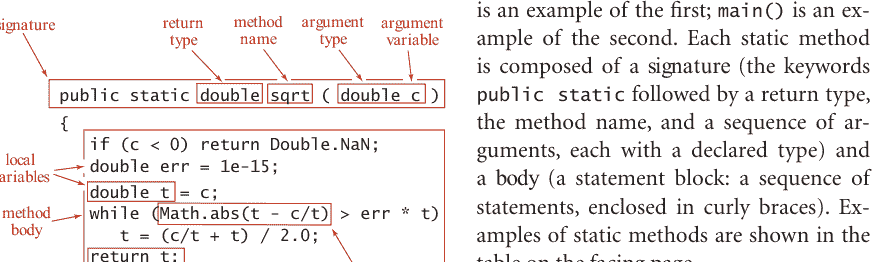

```java
public static double sort(double c) {
    if (c < 0) return Double.NaN;
    double err = 1e-15;
    double t = c;
    while (Math.abs(c - t) > err * t) {
        t = (c + t) / 2.0;
    }
    return t;
}
```

### 调用静态方法

通过在括号中指定参数的表达式对静态方法进行调用。方法会计算一个值，该值将用于表达式中的调用。例如，`BinarySearch` 中对 `rank()` 的调用返回一个 `int` 值。方法调用后跟一个以分号结尾的语句通常会产生副作用。例如，`BinarySearch` 中的 `Arrays.sort(main)` 是系统方法 `Arrays.sort()` 的调用，其副作用是将数组中的条目按顺序排序。

当方法被调用时，其参数用相应表达式的值进行初始化，并将控制权返回给调用者。如果静态方法通过方法返回语句结束以计算一个值，则该值必须在 `return` 语句中指定（如果静态方法到达语句序列末尾而没有返回，编译器将报告错误）。

## 1.1 基础编程模型

### 任务实现

#### `int` 值的绝对值

```java
public static int abs(int x)
{
    if (x < 0) return -x;
    else return x;
}
```

#### `double` 值的绝对值

```java
public static double abs(double x)
{
    if (x < 0.0) return -x;
    else return x;
}
```

#### 质数测试

```java
public static boolean isPrime(int N)
{
    if (N < 2) return false;
    for (int i = 2; i*i <= N; i++)
        if (N % i == 0) return false;
    return true;
}
```

#### 平方根（牛顿迭代法）

```java
public static double sqrt(double c)
{
    if (c < 0.0) return Double.NaN;
    double err = 1e-15;
    double t = c;
    while (Math.abs(t - c/t) > err * t)
        t = (c/t) / 2.0;
    return t;
}
```

#### 直角三角形的斜边

```java
public static double hypotenuse(double a, double b)
{
    return Math.sqrt(a*a + b*b);
}
```

#### 调和数（见第 185 页）

```java
public static double H(int N)
{
    double sum = 0.0;
    for (int i = 0; i < N; i++)
        sum += 1.0 / i;
    return sum;
}
```

## 典型的数组处理代码

### 方法的属性

方法的详细描述超出了我们的范围，但以下几点值得注意：

- 参数按值传递。
- 方法名可以重载。
- 方法只有一个返回值。
- 方法可以产生副作用。

## 递归

方法可以调用自己（如果你不熟悉这个想法，即递归，我们鼓励你完成练习 1.1.16 到 1.1.22）。例如，本页底部的代码提供了 `BinarySearch` 中 `rank` 方法的另一种实现。

我们经常使用递归，是因为它们可以导致紧凑、优雅的代码，比不使用递归的相应实现更容易理解。例如，下面实现中的注释对代码预期的功能提供了简要描述。我们可以通过数学归纳法利用此注释来说服自己它运行正确。我们将在第 3.1 节详细扩展这一主题并为二分查找提供证明。

开发递归程序时有三个重要的经验法则：

- 递归有一个基准情况——我们总是将条件语句作为程序的第一条语句。
- 递归调用必须处理某些意义上更小的子问题，以便递归调用收敛到基准情况。在下面的代码中，第四和第三参数的值之间的差异在增大。
- 递归调用不应处理重叠的子问题。在下面的代码中，两个子问题引用的数组部分是不相交的。

违反这些任何准则都可能导致错误或效率极低的程序（见练习 1.1.19 和 1.1.27）。遵循这些规则可能会产生一个清晰正确的程序，其性能易于理解。

使用递归方法的另一个原因是，它们产生了我们可以用来理解性能的数学模型。我们将在第 3.2 节以及书中的其他几处地方讨论二分查找的这一问题。

```java
public static int rank(int key, int[] a)
{ return rank(key, a, 0, a.length - 1); }

public static int rank(int key, int[] a, int lo, int hi)
{ // key 在 a[lo] 中的索引，如果存在，则不小于 lo
  //                                                     不大于 hi;
  if (lo > hi) return -1;
  int mid = lo + (hi - lo) / 2;
  if (key < a[mid]) return rank(key, a, lo, mid - 1);
  else if (key > a[mid]) return rank(key, a, mid + 1, hi);
  else return mid;
}
```

### 二分查找的递归实现

## 静态方法库

静态方法库是一组定义在 Java 类中的静态方法，创建方法是创建一个带有 `public` 关键字后跟类名的文件，用大括号括起静态方法，并将其保存在与类名同名且具有 `.java` 扩展的文件中。

Java 编程的基本模型是开发一个通过创建静态方法库来解决特定计算任务的程序，其中一个方法被命名为 `main()`。输入 `java 类名` 后跟一串字符串，将调用 `main()` 方法并传递一个包含这些字符串的数组。在 `main()` 中的最后语句执行完毕后，程序终止。

在本书中，当我们谈论用于完成任务的 Java 程序时，我们指的是按照这些思路开发的代码（可能包括数据类型定义，如第 1.2 节所述）。例如，`BinarySearch` 是由两个静态方法 `rank()` 和 `main()` 组成的 Java 程序，它的任务是从输入流中打印出不在命令行参数给定的白名单中的数字。

## 模块化编程

该模型至关重要的一点是，静态方法库（模块）允许模块化编程，即我们可以开发静态方法库并调用其他库中定义的静态方法。这种方法有许多优点。它允许我们：

- 在涉及大量代码的程序中，处理合理规模的方法。
- 共享和复用代码而无需重新实现。
- 轻松替换改进后的实现。
- 为解决编程问题开发合适的抽象模型。
- 本地化调试（参见下文关于测试的段落）。

例如，`BinarySearch` 使用了三个独立开发的库：我们的 `StdIn` 和 Java 的 `Arrays`。这些库中的每一个实际上又使用了其他几个库。

## 单元测试

Java 编程的一项基本实践是在每个静态方法库中包含一个 `main()`，用于测试该库中的方法（某些编程语言允许多个 `main()` 方法且不支持这种方法）。

适当的单元测试本身就是一个重大的编程挑战。至少，每个模块都应该包含一个 `main()` 方法来执行模块中的代码并提供其运行良好的保证。随着模块的成熟，我们通常会完善 `main()` 方法使其成为开发客户端（帮助我们在开发代码时完成更多细节）或测试客户端（广泛测试所有代码）。

随着客户端变得越来越复杂，我们可能会将其放在一个独立的模块中。在本书中，我们使用 `main()` 来帮助说明每个模块的用途，并将测试客户端留作练习。

## 外部库

- 静态方法库 `java.lang.*`。这些包括 `Math`（包含了常用数学函数的方法）、`Integer` 和 `Double`（用于转换字符字符串与 `int` 和 `double` 值）、`String` 和 `StringBuilder`（我们将在本节后部分和第 5 章中详细讨论），以及几十个我们未使用的库。
- 导入的系统库，如 `java.util.Arrays`。标准 Java 版本中有数千个这样的库，但我们可以在书中扫描其中一些。程序开头需要一个 `import` 语句来使用此类库（并标明我们正在这样做）。
- 本书中的其他库。例如，另一个程序可以使用 `BinarySearch` 中的 `rank()`。要使用此类程序，请从网站下载源代码到你的工作目录中。
- 我们为本书开发的标准库 `Std*`（以及我们的入门书籍《An Introduction to Programming in Java: An Interdisciplinary Approach》）。这些库在随后的几页中会被归纳概述。源代码和下载说明可以在书籍网站上获得。

要调用另一个库的方法（同一目录或指定目录中的库、标准系统库，或在类定义之前的 `import` 语句中命名的系统库），我们需要为每个方法名前加上库名。例如，`BinarySearch` 中的 `main()` 方法调用了系统库 `java.util.Arrays` 中的 `sort()` 方法、我们库 `In` 中的 `readInt()` 方法，以及我们库 `StdOut` 中的 `print()` 方法。

在模块化编程环境中，**由我们和他人实现的方法库**可以极大地扩展我们编程模型的范围。除了标准 Java 版本中的所有库之外，网上还有许多适用于各种应用程序的库。为了将我们编程模型的范围限制在可管理的范围内以便我们专注于算法，我们仅使用本页右侧表格中列出的库，其方法的子集列在 APIs 中，如接文所述。

# 第 1 章 基础

## APIs

模块化编程的一个关键组件是文档，它解释了供他人使用的库方法的操作。我们将一致地在应用程序编程接口（APIs）中描述在书中使用的库方法，API 中将列出库名以及我们所使用的每个方法的签名和简要描述。

我们使用“客户端”（client）一词来指代调用另一个库中方法的程序，使用“实现”（implementation）一词来描述实现 API 中方法的 Java 代码。

### 示例

下面的示例是 `java.lang` 标准 `Math` 库中常用静态方法的 API，说明了我们的 API 规范：

```java
public class Math {
    static double abs(double a) a 的绝对值
    static double max(double a, double b) a 和 b 的最大值
    static double min(double a, double b) a 和 b 的最小值
    // ... 为 int, long, 和 float 定义
    static double sin(double theta) 正弦函数
    static double cos(double theta) 余弦函数
    static double tan(double theta) 正切函数
```

注意 1：`abs()`、`max()` 和 `min()` 定义了 `int`、`long` 和 `float`。

注意 2：角度以弧度表示。

注意 3：使用 `toDegrees()` 和 `toRadians()` 进行转换。

```java
static double exp(double a) 指数 (e^a)
static double log(double a) 自然对数 (ln a)
static double pow(double a, double b) 将 a 升到 b 次 (a^b)
static double random() [0, 1] 之间的随机数
static double sqrt(double a) a 的平方根
static double E e 的值（常量）
static double PI π 的值（常量）
```

#### Java 数学库的 API（节选）

这些方法实现了数学函数——它们使用参数来计算指定类型的值（`random()` 除外，它不参数）。由于所有操作都是在 `double` 值上进行并计算 `double` 结果，你可以将它们视为对 `double` 类型的扩展——这种可扩展性是现代编程语言的特征之一。

API 中的每一行都描述一个方法，指定了使用该方法所需的信息。`Math` 库还定义了精确的常量 `PI`（对应 π）和 `E`（对应 e），因此你可以使用这些名称在程序中引用这些常量。例如，`Math.sin(Math.PI/2)` 的值为 1.0，`Math.log(Math.E)` 的值为 1.0（因为 `Math.sin` 以弧度接受参数，而 `Math.log` 实现的是自然对数）。

## Java 库

数千个库的详细在线描述是每个 Java 版本的一部分，但我们只节选了书中使用的方法，以清晰地划分我们的编程模型。例如，`BinarySearch` 使用了 Java `Arrays` 库中的 `sort()`，我们对其记录如下：

```java
public class Arrays
```

```java
static void sort(int[] a)      将数组按顺序排列
```

注意：该方法为所有其他原始类型和 `Object` 定义。

> *Java Arrays 库的节选（`java.util.Arrays`）*

`Arrays` 库不在 `java.lang` 中，因此需要一个 `import` 语句来使用它，就像 `BinarySearch`。实际上，本书的第 2 章专门介绍数组 `sort()` 的实现，包括在 `Arrays.sort()` 中实现的合并排序和快速排序算法。

我们在书中考虑的许多基础算法都在 Java 和许多其他编程环境中实现。例如，`Arrays` 还包含了二分查找的实现。为了避免混淆，我们通常使用自己的实现，尽管使用你理解的经过调优的库算法实现也没有问题。

## 我们的标准库

我们开发了许多库，为 Java 入门编程、科学应用以及算法的开发、研究和应用提供了有用的功能。这些库大部分用于输入输出；我们还利用以下库来测试和分析我们的实现。

第一个库扩展了 `Math.random()`，允许我们从各种分布中提取随机值；第二个库支持统计计算：

```java
public class StdRandom
    static void setSeed(long seed)      初始化
    static double random()               0 到 1 之间的实数
    static int uniform(int N)             0 到 N-1 之间的整数
    static int uniform(int lo, int hi)     lo 到 hi-1 之间的整数
    static double uniform(double lo, double hi) lo 到 hi-1 之间的实数
    static boolean bernoulli(double p)    概率为 p 的真
    static double gaussian()              正态分布，均值 0，标准差 1
    static double gaussian(double m, double s) 正态分布，均值 m，标准差 s
    static int discrete(double[] a)      概率为 a[i] 的 i
    static void shuffle(double[] a)       随机打乱数组 a[]
```

注：针对其他原始类型和 `Object` 包含了 `shuffle()` 的重载实现。

## 随机数静态方法库 API


```java
public class StdStats
    static double max(double[] a)        最大值
    static double min(double[] a)        最小值
    static double mean(double[] a)       平均值
    static double var(double[] a)        样本方差
    static double stddev(double[] a)     样本标准差
    static double median(double[] a)     中位数
```

## 数据分析静态方法库 API

`StdRandom` 中的 `setSeed()` 方法允许我们重现涉及随机数的实验。由于其中许多方法的实现请见第 32 页。其中一些方法的实现非常简单；我们真的有精力将它们包含在库中吗？这个问题的答案对于良好的库来说是标准的：

- 它们实现了一种抽象层，让我们能够专注于实现书中算法的测试，而不是生成随机对象或计算统计数据。使用此类方法的整洁代码比自己编写相同计算的代码更清晰、更易于理解。
- 库实现会测试异常情况或罕见情况，并经过广泛的测试，以便我们可以依赖它们按预期运行。此类实现可能涉及大量的代码。例如，我们经常需要各种类型数据的实现。例如，Java 的 `Arrays` 库包含了 `sort()` 的重载实现，适用于你可能需要排序的每种类型的数据。

这些 Java 模块化编程的基础考虑在情况下可能被忽略了。虽然这两个库中的方法本质上是自文档的，且许多方法并不难实现，但某些方法代表了有趣的算法练习。因此，强烈建议你学习 `StdRandom` 和 `StdStats` 中的代码以及网站上的 Java 内容，并利用这些可靠的实现。使用这些库（以及检查代码）最简单的方法是从网站下载源代码并将其放入你的工作目录；网站上还描述了在无需多个副本的情况下使用它们的各种系统相关机制。

### 自库

将你编写的每个程序都视为库实现是值得的，以便将来可能重用。

- 为客户端（client）编写代码，一个将计算分解为可行部分的高层实现。
- 为静态方法库（或多个库的多个 API）定义一个 API，以处理每个部分。
- 开发 API 的实现，并带有一个独立于客户端测试方法的 `main()` 方法。

这种方法不仅为你提供了可以重用的有价值软件，而且以这种方式利用模块化编程是成功处理复杂编程任务的关键。

## 预期结果

## 实现

| 预期结果 | 实现 |
| :--- | :--- |
| [a, b) 内的随机双精度浮 | ```java
public static double uniform(double a, double b) {
    return a + StdRandom.random() * (b-a);
}
``` |
| [0..N) 内的随机整数 | ```java
public static int uniform(int N) {
    return (int) (StdRandom.random() * N);
}
``` |
| [lo..hi) 内的随机整数 | ```java
public static int uniform(int lo, int hi) {
    return lo + StdRandom.uniform(hi - lo);
}
``` |
| 从离散分布中抽取的随机整数（概率为 a[i] 的 i） | ```java
public static int discrete(double[] a) {
    // a[i] 中的项之和必须为 1.
    double r = StdRandom.random();
    double sum = 0.0;
    for (int i = 0; i < a.length; i++) {
        sum = sum + a[i];
        if (sum >= r) return i;
    }
    return -1;
}
``` |
| 随机打乱双精度值数组中的元素（见练习 1.1.36） | ```java
public static void shuffle(double[] a) {
    int N = a.length;
    for (int i = 0; i < N; i++) {
        将 a[i] 与 a[i..N-1] 中的随机元素交换
        int r = 1 + StdRandom.uniform(N-i);
        double temp = a[i];
        a[i] = a[r];
        a[r] = temp;
    }
}
``` |

`StdRandom` 中静态方法的实现。

API 的目的是将客户端与实现分离：客户端除了 API 提供的信息外对实现一无所知，程序员通常将 API 视为一种合同。通常有许多方法可以做到，将客户端代码与实现分离让我们拥有替换新的、改进实现的自由。

## Java 的 String 数据类型

### 字符串 Strings

`String` 是字符序列（`char` 值）。字面量 `String` 是双引号内的字符序列，例如 `"Hello, World"`。`String` 类型是一种 Java 数据类型，但它不是原始类型。我们现在考虑 `String` 是因为它是每个 Java 程序都会使用的基本数据类型。

### 连接

Java 为 `String` 拥有一个内置的连接运算符（`+`），就像它为原始类型提供的内置运算符一样，这证明了在第 12 页原始类型值下方添加该行的合理性。连接两个字符串的结果是一个单个 `String` 值，第一个字符串后跟着第二个字符串。

### 转换

字符串的两个主要用途是将我们在键盘上输入的值转换为数据类型值，以及将数据类型值转换为可以在显示器上读取的值。Java 提供了内置的字符串操作来方便这些操作。特别是，该语言包含了 `Integer` 和 `Double` 库，它们分别包含静态方法，用于 `String` 值与 `int` 值之间以及 `String` 值与 `double` 值之间进行转换。

### 自动转换

我们很少显式地使用上文描述的 `toString()` 方法，因为 Java 拥有一种内置机制，允许我们通过拼接将任何数据值转换为字符串值：如果 `+` 运算符的参数之一是字符串，Java 就会自动将另一个参数转换为字符串（如果它本身还不是字符串的话）。除了诸如 `"The square root of 2.0 is " + Math.sqrt(2.0)` 这样的用法外，该机制通过与空字符串 `""` 拼接，可以将任何数据值转换为字符串。

### 命令行参数

字符串在 Java 编程中的一种用途之一是启用一种从命令行向程序传递信息的机制。该机制非常简单。当你输入 Java 命令，后跟一个库名，最后是一系列字符串时，Java 系统会用字符串数组作为参数调用该库中的 `main()` 方法；程序使用该值 `args[0]` 创建一个长度为 1 的数组。程序为包含白名单的文件命名，并将其作为 `In.readInts()` 的参数。我们在代码中经常使用的另一种典型范式是，当我们使用一个旨在表示数字的命令行参数时，我们使用 `parseInt()` 将其转换为 `int`，或使用 `parseDouble()` 将其转换为 `double` 值。

**字符串计算**是现代计算的核心组成部分。目前，我们使用 `String` 仅是为了在数字的外部表示与数值数据类型的内部表示之间进行转换。在第 1.2 节中，我们将看到 Java 对字符串值支持许多多我们在书中会用到的操作；在第 1.4 节中，我们将检查字符串值的内部表示；在第 5 章中，我们将深入考虑处理字符串数据的算法。这些算法是我们在本书中所考虑的最有趣、最复杂且影响最大的方法之一。

# 第 1 章 基础

## 输入与输出

我们的输入、输出和绘图标准库的主要目的是支持一个 Java 程序与外部世界交互的简单模型。这些库建立在 Java 库提供的强大功能之上，但通常要复杂得多，学习和使用也困难得多。我们先简要回顾一下该模型。

在我们的模型中，Java 程序从命令行参数或一个被称为标准输入流的抽象字符流获取输入值，并写入另一个抽象字符流作为标准输出流。


我们必须考虑 Java 之间的接口，并简要讨论大多数现代操作系统和程序开发环境提供的基本机制。你可以在手册上找到关于你特定系统的更多细节。默认情况下，命令行参数、标准输入和标准输出与接收命令的操作系统或程序开发环境相关。

我们使用“窗口”这一通用术语来指代由应用程序维护的、我们在其中输入和读取文本的窗口。20世纪70 年代的早期 Unix 系统证明了，这种模型是我们与程序和数据交互的一种方便且直接的方式。我们在经典模型中增加了标准的绘图功能，允许我们为数据分析创建视觉表示。

## 命令与参数

在终端中，我们看到一个提示符，我们在其中向操作系统输入可能带有参数的命令。我们在书中只使用了几条命令，如下表所示。我们最频繁地使用 `java` 命令来运行程序。如第 35 页所述，Java 有一个 `main()` 静态方法，它接收一个 `String array[]` 作为参数。该数组是由操作系统提供的一系列命令行参数。

按照惯例，Java 和操作系统都将参数视为字符串。如果我们认为某个参数应该是数字，我们会使用像 `Integer.parseInt()` 这样的方法将其字符串转换为相应的类型。

| 命令 | 参数 | 目的 |
| --- | --- | --- |
| `javac` | `.java` 文件名 | 编译 Java 程序 |
| `java` | `.class` 文件名（无扩展名）和命令行参数 | 运行 Java 程序 |
| `more` | 任何文本文件名 | 打印文件内容 |

典型的操作系统命令。

## 1.1 基础编程模型

### 标准输出

我们的 `Stdout` 库提供了对标准输出的支持。默认情况下，系统将标准输出连接到终端窗口。`print()` 方法将其参数置于标准输出上；`println()` 方法添加换行符；`printf()` 方法格式化输出，如接文所述。Java 在 `System.out` 中提供了类似的方法；我们使用 `Stdout` 以统一的方式处理输入和标准输出（并提供了一些技术改进）。

```java
public class Stdout {

    static void print(String s)

    static void println(String s)

    static void print()

    static void printf(String f, ...)

}
```

注意：包含了针对基本类型和 `Object` 的重载实现。

标准输出静态方法库的 API。

```java
public class RandomSeq {

    public static void main(String[] args) {

        // 在 (lo, hi) 之间打印 N 个随机值。

        int N = Integer.parseInt(args[0]);

        double lo = Double.parseDouble(args[1]);

        double hi = Double.parseDouble(args[2]);

        for (int i = 0; i < N; i++) {

            double x = StdRandom.nextDouble(lo, hi);

            Stdout.printf("%.2f\n", x);

        }

    }

}
```

要使用这些方法，请将 `Stdout.java` 下载到你的工作目录，并使用 `Stdout.println("Hello, World!");` 等代码调用它们。

### 格式化输出

简单的 `printf()` 取两个参数。第一个参数是描述格式的字符串，以 `%` 开头并以转换代码结束。我们最常用的转换代码是 `d`（用于整数值）、`f`（用于浮点值）和 `s`（用于字符串值）。使用 `printf` 最重要的一点是，格式中的转换代码与参数的类型必须匹配。如果，Java 必须能够将参数类型转换为转换代码所需的类型。例如，语句：

```java
StdOut.printf("PI is approximately %.2f\n", Math.PI);
```

PI 大约为 3.14。注意，我们需要在参数中显式包含换行符 `\n` 才能用 `printf()` 打印新行。`printf` 函数可以接受两个参数。在这种情况下，格式字符串将为每个额外的参数有一个格式说明符，可能由其他字符分隔以通过输出。你也可以使用静态方法 `String.format()`，其参数与 `printf()` 完全相同，用以获取格式化后的字符串而不打印它。格式化打印是一种方便的机制，允许我们编写紧凑的代码来生成表格化的实验数据（这是我们在书中的主要用途）。

| 类型 | 代码 | 字面量 | 示例格式 | 输出的转换后字符串值 |
|---|---|---|---|---|
| `int` | `d` | `512` | `"%14d"`, `"-%14d"` | `"512"` |
| `double` | `f` | `1595.168010754388` | `"%14.2f"`, `"%.7f"`, `"%14e"` | `"1595.17"`, `"1595.168011"`, `"1.5952e+03"` |
| `String` | `s` | `"Hello, World"` | `"%14s"`, `"-%14s"`, `"-%14.5s"` | `"Hello, World"`, `"Hello, World"`, `"Hello"` |

`printf()` 的格式约定（更多选项请参见附录）。

## 1.1 基础编程模型

### 标准输入

我们的 `StdIn` 库从标准输入流读取数据，该流可能是空的，也可能包含由空白字符（空格、制表符、换行符等）分隔的值。默认情况下，系统将标准输出连接到终端窗口——你输入的内容就是输入流（通过 `<ctrl-d` 或 `<ctrl-z` 触发，取决于你的终端应用程序）。值可以是 `String` 或 Java 原始类型的值。标准输入的一个关键特性是，程序在读取时会消耗这些值。一旦读取就无法回溯并再次读取。这种假设具有限制性，但它反映了某些输入设备的物理特性并简化了抽象的实现。在输入流模型中，该库中的方法很大程度上是自文档的（通过其签名描述）。

```java
public class Average {

    public static void main(String[] args) {

        // 计算 StdIn 中数字的平均值。

        double sum = 0.0;

        int cnt = 0;

        while (!StdIn.isEmpty()) {

            // 读取一个数字并累加和。

            sum += StdIn.readDouble();

            cnt++;

        }

        double avg = sum / cnt;

        StdOut.printf("Average is %.5f\n", avg);

    }

}
```

### 示例 StdInClient

```text
% java Average

1.23456

2.34567

3.45678

4.56789

<ctrl-d>
```

```java
public class StdIn {

    static boolean isEmpty()

    static int readInt()

    static double readDouble()

    static float readFloat()

    static long readLong()

    static boolean readBoolean()

    static char readChar()

    static byte readByte()

    static String readString()

    static boolean hasNextLine()

    static String readLine()

    static String readAll()

}
```

| 方法 | 说明 |
| :--- | :--- |
| `isEmpty()` | 如果没有更多值则返回 true，否则返回 false |
| `readInt()` | 读取一个 `int` 类型的值 |
| `readDouble()` | 读取一个 `double` 类型的值 |
| `readFloat()` | 读取一个 `float` 类型的值 |
| `readLong()` | 读取一个 `long` 类型的值 |
| `readBoolean()` | 读取一个 `boolean` 类型的值 |
| `readChar()` | 读取一个 `char` 类型的值 |
| `readByte()` | 读取一个 `byte` 类型的值 |
| `readString()` | 读取一个 `String` 类型的值 |
| `hasNextLine()` | 输入流中是否还有另一行？ |
| `readLine()` | 读取行的剩余部分 |
| `readAll()` | 读取输入流的剩余所有内容 |

用于我们标准输入静态方法库的 API。

# 第 1 章 基础

### 重定向与管道

标准输入和输出使我们能够利用许多操作系统支持的命令行扩展。通过在调用程序的命令中添加一个简单的指令，我们可以将它的标准输出重定向到文件，以进行永久存储，或在稍后作为另一个程序的输入：

```text
% java RandomSeq 1000 100.0 200.0 > data.txt
```


该命令指定标准输出流不打印在终端窗口中，而是写入一个名为`data.txt`的文件中。每次调用`Stdout.print()`或`Stdout.println()`都会向该文件的末尾追加文本。在这个示例中，结果是一个包含 1,000 个随机值的文件。终端窗口中没有出现输出；它直接进入以符号命名的文件。我们可以保存信息以备后检索。注意，我们不需要以任何方式更改`RandomSeq`。

```text
% java Average < data.txt
```

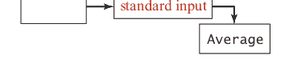

```text
% java RandomSeq 1000 100.0 200.0 > data.txt
```

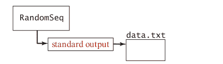

## 将一个程序的输出管道传输到另一个程序的输入

```text
% java RandomSeq 1000 100.0 200.0 | java Average
```

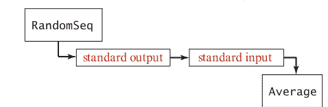

```text
% java Average < data.txt
```

该命令从文件`data.txt`中读取一系列数字并计算它们的平均值。具体而言，`<`符号是一个指令，告诉操作系统通过从文件`data.txt`读取来实现标准输入，而不是等待用户在终端窗口中输入内容。

从命令行窗口的重定向与管道。当程序调用`StdIn.readDouble()`时，操作系统从文件中读取值。将这些结合起来并将一个程序的输出重定向到另一个程序的输入被称为管道：

```text
% java RandomSeq 1000 100.0 200.0 | java Average
```

## 基础编程模型

该命令指定`RandomSeq`的标准输出和`Average`的标准输入是同一个。其效果就像`RandomSeq`在`Average`运行时将它生成的数字输入到终端窗口中一样。这种差异之所以存在，是因为它消除了我们能够处理的输入和输出流大小的限制。例如，我们可以将示例中的 1000 替换为 1000000000，尽管我们的计算机可能没有空间来保存十亿个数字（但我们确实需要时间来处理它们）。当`RandomSeq`调用`Std.printf()`时，一个字符串被添加到流的末尾；当`Average`调用`StdIn.nextDouble()`时，一个字符串从流的开头被移除。具体发生的时间取决于操作系统：它可能会运行`RandomSeq`直到产生一些数字，或者可能运行`Average`直到消耗一个数字，然后运行`RandomSeq`直到产生所需的数字。结果是相同的，但我们的程序无需担心这些细节，因为它们完全通过标准输入和输出抽象工作。

**来自文件的输入和输出**。我们的`In`和`Out`库提供了静态方法，实现了读取和写入任何原始类型（或`String`）内容到文件的抽象。我们在`In`库中使用了`readInts()`、`readDoubles()`和`readStrings()`，在`Out`库中使用了`writeInts()`、`writeDoubles()`和`writeStrings()`。`name`参数可以是文件或网页。例如，这允许我们在二进制搜索和网页之间切换。

```java
public class In

    static int[] readInts(String name)

    static double[] readDoubles(String name)

    static String[] readStrings(String name)

}
```

```java
public class Out

    static void write(int[] a, String name)

    static void write(double[] a, String name)

    static void write(String[] a, String name)

}
```

注意 1：其他原始类型也支持。注意 2：`StdIn`和`StdOut`支持省略`name`。

## 用于读写数组的 API

### 标准绘图（基础方法）

到为止，我们的输入/输出抽象专注于文本字符串。现在我们引入了一个用于输出绘图的抽象。该库可以通过下载`StdDraw.java`文件到工作目录来访问。标准绘图非常简单：我们想象在一个二维画布上绘制线条和点的抽象设备。该设备能够响应程序以静态方法调用形式发出的绘制形状命令，包括绘制线条、点、文本字符串、圆形、矩形和多边形。与标准输入的方法的方法，这些方法是自文档的：`StdDraw.line()`连接点$(x₀, y₀)$和点$(x₁, y₁)$；`StdDraw.point()`在点$(x, y)$处绘制一个点，以此此类推，如右侧图所示。几何形状可以填充（默认为黑色）。默认缩放是单位正方形（所有坐标都在 0 到 1 之间）。标准实现在计算机屏幕上的窗口中显示画布，白色背景上有黑色线条和点。

```java
StdDraw.point(x0, y0);
StdDraw.line(x1, y1, x2, y2);
```

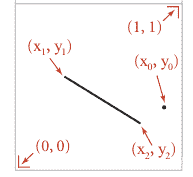

```java
StdDraw.circle(x, y, r);
```

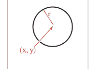

```java
StdDraw.square(x, y, r);
```

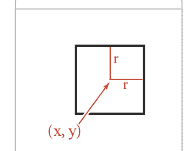

```java
double[] x = {x0, x1, x2, x3};
double[] y = {y0, y1, y2, y3};
StdDraw.polygon(x, y);
```

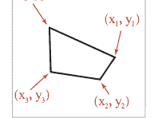

### `StdDraw`示例

```java
public void line(double x0, double y0, double x1, double y1)

static void point(double x, double y)

static void text(double x, double y, String s)

static void circle(double x, double y, double r)

static void filledCircle(double x, double y, double r)

static void ellipse(double x, double y, double rw, double rh)

static void filledEllipse(double x, double y, double rw, double rh)

static void square(double x, double y, double r)

static void filledSquare(double x, double y, double r)

static void rectangle(double x, double y, double rw, double rh)

static void filledRectangle(double x, double y, double rw, double rh)

static void polygon(double[] x, double[] y)

static void filledPolygon(double[] x, double[] y)
```

我们的标准绘制静态方法库（绘制方法）的 API。

## 标准绘制（控制方法）

该库还包含用于更改画布比例和大小、线条颜色和宽度、文本字体以及绘制时机（用于动画）的方法。作为`setPenColor()`的参数，可以使用预定义的颜色：`BLACK`、`MAGENTA`、`CYAN`、`DARK_GRAY`、`GRAY`、`GREEN`、`LIGHT_GRAY`、`ORANGE`、`PINK`、`RED`、`BOOK_RED`、`WHITE`和`YELLOW`，它们在`StdDraw`中被定义为常量（因此我们在代码中使用类似`StdDraw.RED`的方式引用它们）。窗口还包含一个菜单，可以将你的图形保存到文件中，格式适用于在网上发布。

```java
public class StdDraw

static void setScale(double x0, double x1)

static void setScale(double y0, double y1)

static void setPenRadius(double r)

static void setPenColor(Color c)

static void setFont(Font f)

static void setCanvasSize(int w, int h)

static void clear(Color c)

static void show(int dt)
```

- 将 x 重置为 (x0, x1)
- 将 y 重置为 (y0, y1)
- 设置画笔半径为 r
- 设置画笔颜色为 c
- 设置字体为 f
- 设置画布 w 宽 h 高的窗口
- 清除画布；将其清除为 c
- 显示所有；暂停 dt 毫秒

我们的标准绘制静态方法库（控制方法）的 API。

在书中，我们使用`StdDraw`进行数据分析以及创建算法运行的可视化表示。相反页的表格指示了一些可能性；我们将在书的正文和练习中考虑更多的示例。该库还支持动画——当然，这个主题主要在网站上处理。

## 1.1 基础编程模型

### 数据结果

```java
int N = 100;

StdDraw.setXscale(0, N);

StdDraw.setScale(0, N*N);

StdDraw.setRadius(.01);

for (int i = 1; i <= N; i++)

{

  StdDraw.point(i, i);

  StdDraw.point(i, i*i);

  StdDraw.point(i, Math.log(i));

}
```

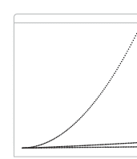

```java
int N = 50;

double[] a = new double[N];

for (int i = 0; i < N; i++)

a[i] = StdRandom.random();

for (int i = 0; i < N; i++)

{

  double x = 1.0*i/N;

  double y = a[i]/2.0;

  double rw = 0.5/N;

  double rh = a[i]/2.0;

  StdDraw.filledRectangle(x, y, rw, rh);

}
```

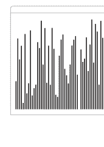

```java
int N = 50;

double[] a = new double[N];

for (int i = 0; i < N; i++)

a[i] = StdRandom.random();

Arrays.sort(a);

for (int i = 0; i < N; i++)

{

  double x = 1.0*i/N;

  double y = a[i]/2.0;

  double rw = 0.5/N;

  double rh = a[i]/2.0;

  StdDraw.filledRectangle(x, y, rw, rh);

}
```

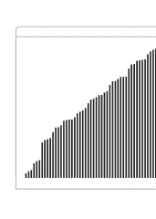

## `StdDraw`绘图示例

## 二分查找

我们在开头开始的示例 Java 程序（在对页所示）基于著名的、高效且广泛使用的二分查找算法。这是我们在全书中检查算法的方式的一种原型。对于我们考虑的所有程序，它都是该方法的精确定义，以及你可以从书网站下载的完整 Java 实现。

### 二分查找

我们将在第 3.2 节学习二分查找算法，但简短的描述是合适的。该算法实现在静态方法`rank()`中，该方法接受一个整数`key`和一个排序后的`int`值数组作为参数，如果键在数组中则返回其索引，否则返回 -1。它通过维护变量`lo`和`hi`来完成此任务，使得键在数组中时位于`[lo..hi]`之间，然后进入一个测试索引`mid`处中间部分的循环。如果键等于`a[mid]`，方法会将排序区间切一半，如果键小于`a[mid]`则查看左半部分，如果键大于`a[mid]`则查看右半部分。当找到键或区间为空时，过程终止。二分查找之所以高效是因为它只需要

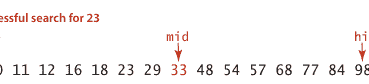

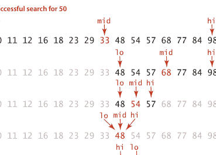

有序数组中的二分查找

### 开发客户端

对于每个算法实现，我们实现了一个开发客户端`main()`，你可以用它测试网站提供的输入文件。

有序数组中的二分查找

BinarySearch 的小型测试文件

```java
import java.util.Arrays;

public class BinarySearch

{

    public static int rank(int key, int[] a) {

        int lo = 0;

        int hi = a.length - 1;

        while (lo <= hi) {

            int mid = lo + (hi - lo) / 2;

            if (key < a[mid]) hi = mid - 1;

            else if (key > a[mid]) lo = mid + 1;

            else return mid;

        }

        return -1;

    }

    public static void main(String[] args) {

        int[] whitelist = In.reads(args[0]);

        Arrays.sort(whitelist);

        while (!In.isEmpty()) {

            int key = In.readInt();

            if (rank(key, whitelist) != -1)

                Std.out.println(key);

        }

    }

}
```

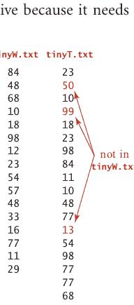

## 1.1 基础编程模型

| largeW.txt | largeT.txt |
| :--- | :--- |
| 489910 | 944443 |
| 18940 | 293674 |
| 774392 | 572153 |
| 490616 | 600579 |
| 125544 | 499569 |
| 407391 | 763178 |
| 115771 | 295754 |
| 922633 | 44696 |
| 923282 | 207807 |
| 176914 | 138910 |
| 217904 | 905331 |
| 517222 | 140925 |
| 519039 | 699418 |
| 395667 | 759984 |
| 199694 | |
| 774549 | |
| 1,000,000 | 635871 |

`int` values 161826  
805380  
10,000,000  
`int` values

```text
% java BinarySearch largeW.txt < largeT.txt

499569

984875

295754

207807

140925

161828
```


## 视角

在本节中，我们描述了一种精细且完整的编程模型，它在过去几十年中一直服务于许多程序员。然而，现代编程更进了一步。下一个层次被称为数据抽象，有时也称为面向对象编程，它是下一节的主题。简单来说，数据抽象背后的思想是允许程序定义数据类型（值的集合和对这些值的操作集合），而不仅仅是操作预定义数据类型的静态方法。

面向对象编程在最近几十年中广泛使用，数据抽象是现代程序开发的核心。我们在本书中拥抱数据抽象主要有三个原因：

- 它允许我们通过模块化编程来扩展重用代码的能力。例如，我们在第 2 章中的排序以及第 3 章中的二分搜索和其他算法，允许客户端对任何类型的数据（不仅仅是整数）使用相同的代码，包括由客户端定义的数据。
- 它为构建所谓的链式数据结构提供了方便的机制，这种结构比数组更具灵活性，并且许多场景下高效算法的基础。
- 它使我们能够精确地定义面临的算法挑战。例如，我们在第 1.5 节中的并查算法、第 2.4 节中的优先级队列算法以及第 3 章中的符号表算法，都是旨在定义能够高效实现一组操作的数据结构。这一挑战与数据抽象完美契合。

尽管尽管有这些考虑，我们的重点仍然是算法的研究。在此背景下，我们将继续考虑面向对象编程中与我们的任务相关的下一个核心特征。

## 问答

- **Q.** 什么是 Java 字节码？
- **A.** 你的程序在 Java 虚拟机上运行的低级版本。这种抽象层让 Java 开发者更容易确保我们的程序运行在各种设备上。

- **Q.** Java 仅仅让 `int` 溢出并给出错误值似乎是不对。Java 不应该自动检查溢出吗？
- **A.** 这个问题在程序员中是一个很有争议的话题。短回答是，缺乏这种检查是此类类型成为原始数据类型的原因之一。少量的知识对于避免此类问题非常有帮助。我们使用 `int` 处理小数字（小于十个十位数），当数值达到十亿或更多时使用 `long` 类型。

- **Q.** `Math.abs(-2147483648)` 的值是多少？
- **A.** `-2147483648`。这个奇怪的（正确的）结果是整数溢出影响的典型例子。

- **Q.** 如何将一个 `double` 变量初始化为无穷大？
- **A.** Java 提供了用于此目的内置常量：`Double.POSITIVE_INFINITY` 和 `Double.NEGATIVE_INFINITY`。

- **Q.** 你可以比较 `double` 和 `int` 吗？
- **A.** 不进行类型转换是不行的，但请记住 Java 通常会自动进行转换。例如，如果 `x` 是一个值为 3 的 `int`，那么表达式 `(x < 3.1)` 为真——Java 在执行比较之前会将其转换为 `double`（因为 3.1 是一个 `double` 字面量）。

- **Q.** 如果我在初始化变量赋值之前使用它会发生什么？
- **A.** 如果你的代码中任何路径会导致使用未初始化的变量，Java 将报告编译错误。

- **Q.** `1/0` 和 `1.0/0` 作为 Java 表达式的值值是多少？
- **A.** 前者产生除以零的运行时异常（这会停止你的程序，因为该值未定义）；后者的值是 `Infinity`（无穷）。

## 问答（续）

- **Q.** 你可以使用 `<` 和 `&` 来比较 `String` 变量吗？
- **A.** 不。这些运算符对于原始类型有效。

- **Q.** 负数除法的结果是什么？
- **A.** 商向零取整。

- **Q.** 嵌套语句中的歧义是一个问题吗？
- **A.** 是的。使用显式括号是避免这个问题的好方法。

- **Q.** `for` 循环和 `while` 循环有什么区别？
- **A.** 在 `for` 循环中，变量在后续语句中不可用；在对应的 `while` 循环中，可以。

- **Q.** 有些 Java 程序员使用 `int[]` 而不是 `int` 来声明数组。有什么区别？
- **A.** 在 Java 中两者都是合法的且等价的。前者是 C 声明数组的方式。后者是 Java 中的推荐风格，因为它明确表明这是一个数组。

- **Q.** 为什么索引从 0 开始而不是 1？
- **A.** 这种起源于机器语言编程，其中元素的地址通过加上起始地址来计算。从 1 开始会导致数组开头浪费空间，或者在计算时浪费时间减 1。

- **Q.** 如果 `a[]` 是数组，为什么 `Stdout.println(a)` 打印的是十六进制整数而不是数组元素？
- **A.** 好问题。它通常打印数组的内存地址，不幸的是这不是你想要的。相反，你可以调用 `Arrays.toString(a)`。

- **Q.** 为什么我们不使用 Java 标准输入和图形库？
- **A.** 我们正在使用，但我们更倾向于使用简单的抽象模型。`StdIn` 和 `StdDraw` 背后的 Java 库是为生产级编程设计的，它们及其 API 也是。如果你想了解它们是什么样的，可以查看 `StdIn.java` 和 `StdDraw.java` 中的代码。

- **Q.** 我的程序可以重新从标准输入读取数据吗？
- **A.** 不。你只有一次机会，就像无法撤销 `println()` 一样。

- **Q.** 如果我的程序在标准输入耗尽后尝试读取会发生什么？
- **A.** 你会得到一个错误。`StdIn.isEmpty()` 允许你通过检查是否有可用输入来避免此类错误。

- **Q.** 这个错误是什么意思？

```text
Exception in thread "main" java.lang.NoClassDefFoundError: StdIn
```

- **A.** 你可能忘记把 `StdIn.java` 放在工作目录下了。

- **Q.** Java 静态方法可以参数传递另一个静态方法吗？
- **A.** 不。好问题，因为许多其他语言确实支持这种能力。

## 练习

### 1.1.1

给出下列每个表达式的值：

- a. `(0 + 15) / 2`
- b. `2.0e-6 * 1000000000.1`
- c. `true && false || true && true`

### 1.1.2

给出下列每个表达式的类型和值：

- a. `(1 + 2.236) / 2`
- b. `1 + 2 + 3 + 4.0`
- c. `4.1 >= 4`
- d. `1 + 2 + "3"`

### 1.1.3

一个程序，接受三个整数命令行参数，如果三个都相等则打印 `equal`，否则打印 `not equal`。

### 1.1.4

下述语句中（如果有）哪些错误？

- a. `if (a > b) then c = 0;`
- b. `if a > b { c = 0; }`
- c. `if (a > b) c = 0;`
- d. `if (a > b) c = 0 else b = 0;`

### 1.1.5

写一个代码片段，如果双精度变量 `x` 和 `y` 都在 0 和 1 之间，则打印 `true`，否则打印 `false`。

### 1.1.6

下面程序打印什么？

```java
int f = 0;
int g = 1;

for (int i = 0; i <= 15; i++) {
    Stdout.println(f);
    f = f + g;
    g = f - g;
}
```

### 1.1.7

给出下列每个代码片段打印的值：

- a.

```java
double t = 9.0;

while (Math.abs(t - 9.0 / t) > .001)
    t = (9.0 / t + t) / 2.0;

System.out.printf("%.5f\n", t);
```

- b.

```java
int sum = 0;

for (int i = 1; i < 1000; i++)
    for (int j = 0; j < i; j++)
        sum++;

System.out.println(sum);
```

- c.

```java
int sum = 1;

for (int i = 1; i < 1000; i *= 2)
    for (int j = 0; j < 1000; j++)
        sum++;

System.out.println(sum);
```

### 1.1.8

下列每个打印什么？

- a. `System.out.println('b');`
- b. `System.out.println('b' + 'c');`
- c. `System.out.println((char)('a' + 4));`

解释每个结果。

### 1.1.9

写一个代码片段，将正整数的二进制表示存入字符串 `s`。

解决方案：Java 有一个内置方法 `Integer.toBinaryString(N)` 可以完成此工作，但练习的目的是观察如何实现这样的方法。这里是一个特别简洁的解决方案：

```java
String s = "";

for (int n = N; n > 0; n /= 2)
    s = (n % 2) + s;
```

## 练习（续）

### 1.1.10

下述代码片段有什么错误？

```java
int[] a;

for (int i = 0; i < 10; i++)
    a[i] = i * ;
```

解决方案：它没有使用 `new` 为 `a[]` 分配内存。这段代码会导致变量可能未初始化的编译时错误。

### 1.1.11

写一个代码片段，打印二维布尔数组的内容，用 `*` 表示 `true`，用空格表示 `false`。包含行号和列号。

### 1.1.12

下述代码片段打印什么？

```java
int[] a = new int[10];

for (int i = 0; i < 10; i++)
    a[i] = 9 - i;

for (int i = 0; i < 10; i++)
    a[i] = a[a[i]];

for (int i = 0; i < 10; i++)
    System.out.println(a[i]);
```

### 1.1.13

写一个代码片段，打印 `M` 行 `N` 列二维数组的转置（行列交换）。

### 1.1.14

写一个静态方法 `lg(n)`，接受一个整数值 `N` 作为参数，并返回不超过 `n` 的以 2 对数的最大整数。不要使用 `Math`。

### 1.1.15

写一个静态方法 `histogram(int[] a)`，接受一个整数数组和一个整数 `M` 作为参数，并返回一个长度为 `M` 的数组，其每个元素是数字 `i` 在参数数组中出现的次数。如果 `a[]` 中的值在 0 到 `M-1` 之间，则返回数组中值的和应等于 `a.length`。

### 1.1.16

给出 `exR1(6)` 的值：

```java
public static String exR1(int n) {
    if (n <= 0) return "";
    return exR1(n - 3) + n + exR1(n - 2) + n;
}
```

### 1.1.17

评价以下函数：

```java
public static String exR2(int n) {
    String s = exR2(n - 3) + n + exR2(n - 2) + n;

    if (n < 0) return "";
    return s;
}
```

答案：基本情况永远不会到达。调用 `exR2(3)` 将导致调用 `exR2(0)`、`exR2(-3)` 等直到发生栈溢出（`StackOverflow`）。

### 1.1.18

考虑以下递归函数：

```java
public static int mystery(int a, int b) {
    if (b == 0) return 0;
    if (b % 2 == 0) return mystery(a + a, b / 2);
    return mystery(a, b / 2);
}
```

`mystery(2, 5)` 和 `mystery(3, 1)` 的值是多少？对于正整数 `a` 和 `b`，描述 `mystery(a, b)` 计算的是什么。回答相同的问题，但将 `+` 运算符替换为 `*` 并将 `0` 替换为 `1`。

### 1.1.19

在你的计算机上运行以下程序：

```java
public class Fibonacci {
    public static long F(int N) {
        if (N == 0) return 0;
        if (N == 1) return 1;
        return F(N - 1) + F(N - 2);
    }

    public static void main(String[] args) {
        for (int N = 0; N < 100; N++)
            System.out.println(N + ": " + F(N));
    }
}
```

计算 `F(N)` 小于一小时的最大 `N` 值是多少？开发一个通过数组保存计算值的 `F(N)` 实现。

### 1.1.20

写一个递归静态方法计算 `N!` 的值。

### 1.1.21

写一个程序，从标准输入读取每行包含一个名称和两个整数，然后使用 `printf` 打印名称、整数以及第一个除以第二个的结果，保留三位小数。你可以使用这样的程序来统计棒球球员的打击率。

### 1.1.22

写一个 `BinarySearch` 版本，使用第 25 页的 `rank()` 方法并跟踪该方法。每当调用递归方法时，打印带缩进的参数 `i` 和 `j`。*提示：* 给递归方法添加一个跟踪深度的参数。

### 1.1.23

为 `BinarySearch` 添加响应第二个参数的能力：`+` 打印不在白名单中的标准输入数字，`-` 打印白名单中的数字。

### 1.1.24

给出使用欧几里得算法计算 15 和 24 的最大约数时计算出的 `p` 和 `q` 的序列。扩展第 4 页的代码开发一个接受两个整数并计算它们最大约数的程序，在递归方法的每次调用中打印这两个参数。使用你的程序计算 11111111 和 1234567 的最大约数。

### 1.1.25

使用数学归纳法证明欧几里得算法计算任意一对非负整数 `p` 和 `q` 的最大约数。

## 创意题

### 1.1.26 排序

假设变量 `a`、`b`、`c` 和 `t` 都是相同的数值类型。证明以下代码将 `a`、`b`、`c` 按升序排列：

```java
if (a > b) {
    t = a;
    a = b;
    b = t;
}

if (a > c) {
    t = a;
    a = c;
    c = t;
}

if (b > c) {
    t = b;
    b = c;
    c = t;
}
```

### 1.1.27 二项式分布

估计以下代码使用的递归调用次数：

```java
public static double binomial(int N, int k, double p) {
    if (N == 0 && k == 0) return 1.0;
    if (N < 0 || k < 0) return 0.0;

    return (1 - p) * binomial(N - 1, k, p)
         + p * binomial(N - 1, k - 1, p);
}
```

计算 `binomial(100, 50, 0.25)`。开发一个基于数组保存计算值的更好实现。

### 1.1.28 去重

修改 `BinarySearch` 中的测试客户端，在排序后移除白名单中的任何重复键。

### 1.1.29 相等键

为 `BinarySearch` 添加一个静态方法 `rank()`，它接受一个 `key` 和一个排序的整数数组（可能相等）作为参数，并返回小于 `key` 的元素个数；以及一个类似的方法 `count()`，返回等于 `key` 的元素个数。注意：如果 `i` 和 `j` 分别是 `rank(key, a)` 和 `count(key, a)` 返回的值，那么 `[i..i+j-1]` 就是数组中相等的值。

### 1.1.30 数组练习

写一个代码片段，创建一个 `N x N` 的布尔数组 `a[]`，如果 `i` 和 `j` 互质的（没有公因数），则 `a[i][j]` 为 `true`，否则为 `false`。

### 1.1.31 随机连接

写一个程序，接受整数 `N` 和双精度浮点数 `p`（0 到 1 之间）作为命令行参数，在圆周上绘制 `N` 个大小为 `.05` 的等间隔点，然后对于每对点，以概率 `p` 绘制一条灰色线连接它们。

## 创造性问题（继续）

### 1.1.32 直方图

假设标准输入流是一个双精度数值序列。编写一个程序，从命令行读取一个整数 `N` 以及两个双精度数值 `l` 和 `r`，并使用 `StdDraw` 绘制标准输入流中落在 `N` 个等距区间内的数字计数直方图，这些区间是通过 `(l, r)` 分为 `N` 个等宽间隔得到的。

### 1.1.33 矩阵库

编写一个 `Matrix` 库，实现以下 API：

```java
public class Matrix {
    static double dot(double[] x, double[] y);           // 向量点积
    static double[][] mult(double[][] a, double[][] b);  // 矩阵乘法
    static double[][] transpose(double[][] a);           // 转置
    static double[] mult(double[][] a, double[] x);      // 向量-矩阵乘法
    static double[] mult(double[] y, double[][] a);      // 向量-矩阵乘法
}
```

开发一个测试客户端，从标准输入读取值并测试所有方法。

### 1.1.34 过滤

以下哪些操作需要保存标准输入中的所有值（例如在数组中），哪些可以使用固定数量的变量和固定大小的数组（不依赖于 `N`）作为过滤器来实现？对于每个操作，输入均来自标准输入，由 0 到 1 之间的 `N` 个数字组成。

- 打印最大值最小值。
- 打印位数。
- 打印第 `k` 小的值（当 `k < 100` 时）。
- 打印数字平方和。
- 打印 `N` 个数的平均值。
- 打印大于平均值的数字百分比。
- 按升序打印 `N` 个数字。
- 按随机顺序打印 `N` 个数字。

## 实验

### 1.1.35 骰子模拟

以下代码计算了两个骰子之和的精确概率分布：

```java
int SIDES = 6;
double[] dist = new double[2 * SIDES + 1];

for (int i = 1; i <= SIDES; i++)
```


`for (int j = 1; j <= SIDES; j++)`

`dist[i+j] += 1.0;`

```java
for (int k = 2; k <= 2*SIDES; k++)
  dist[k] /= 36.0;
```

值`dist[k]`是骰子之和为 $k$ 的概率。运行实验以验证广告所述的 $N$ 次投掷模拟。编写一个`ShuffleTest`程序，接收命令行参数 $M$ 和 $N$，在计算 1 到 6 之间两个随机整数之和时记录出现频率。$N$ 需要多大，你的经验结果才能与结果匹配三位小数？

## 1.1.36 经验洗牌检查

运行计算实验，检查第 32 页上的洗牌代码接收命令行参数 $M$ 和 $N$，对大小为 $M$ 的数组进行 $N$ 次洗牌（数组在洗牌前初始化为`a[i] = i`），并打印一个 $M \times M$ 的表格，其中第 $i$ 行给出 $i$ 出位置 $j$ 的次数。表格中的所有项都应接近 $N/M$。

## 1.1.37 错误的洗牌

假设在我们的洗牌代码中，选择 0 到 $N-1$ 之间的随机整数，而不是 $i$ 到 $N-1$ 之间的整数。证明结果顺序并不是 $N!$ 种可能性中的等概率分布。针对此版本运行上一个练习的测试。

## 1.1.38 二分搜索与暴力搜索

编写一个`BruteForceSearch`程序，使用第 48 页提供的暴力搜索方法，并将其与`largeW.txt`和`largeT.txt`在你计算机上的运行时间进行比较。

# 实验（继续）

## 1.1.39 随机匹配

编写一个`BinarySearch`客户端，接收整数值 $T$ 作为命令行参数，并针对 $N = 10^3, 10^4, 10^5$ 和 $10^6$ 运行 $T$ 次以下实验：生成两个包含 $N$ 个随机生成的六位正整数的数组，并找到两个数组共同出现的数值个数。打印一个表格，给出每个 $N$ 值在 $T$ 次实验中该数量的平均值。

# 1.2 数据抽象

**数据类型**是一组值和对这些值的一组操作。到目前为止，我们详细讨论了 Java 的基本数据类型：例如，基本类型`int`的值是 $-2^{31}$ 到 $2^{31}-1$ 之间的整数；`int`的操作包括`+`、`*`、`/`、`%`、`<`和`>`。编程编程可以使用内置基本类型编写所有程序，但在更高抽象层次上编写程序要方便得多。在这方面，我们关注定义和使用数据类型的过程，这被称为数据抽象（它补充了作为 1.1 节基础的函数抽象风格）。

Java 编程很大程度上基于构建称为引用类型的数据类型，并使用熟悉的 Java 类。这种编程风格被称为面向对象编程，因为它围绕“对象”的概念展开，对象是一个持有数据类型值的实体。通过 Java 的基本类型，我们很大程度上局限于处理像素、声音的程序，以及 Java 标准库或我们程序中提供的成百上千种其他抽象。甚至比预定义数据类型库更重要的是，类型的范围是开放的，因为你可以定义自己的类型。

抽象数据类型（ADT）是一种其表示对客户端隐藏的数据类型。将 ADT 实现为 Java 类与实现静态方法库没有太大。主要区别在于我们将操作与数据关联并隐藏了表示。当使用 ADT 时，我们关注 API 中指定的操作。数据类型很重要，因为它们支持程序设计中的封装。我们研究同一任务的不同算法的首要原因是性能特性存在差异。抽象数据类型是研究算法的合适框架，因为它们允许我们关注：

- 以针对不同客户端的 API 形式精确指定问题
- 描述算法和数据结构

## 使用抽象数据类型

你不需要知道数据类型是如何实现的就可以使用它，因此我们从编写使用简单的`Counter`程序开始，其值是一个名称和一个非负整数，其操作包括创建并初始化为零、加一和检查当前值。这种抽象在许多情况下都用。为了指定抽象数据类型的行为，我们使用应用程序接口（API），它是构造函数和实例方法（操作）的列表，并对每个操作的效果进行非正式描述，如下所示`Counter`的 API：

| `Counter(String id)` | 创建名为 id 的计数器 |
| `void increment()` | 计数器加一 |
| `int tally()` | 自创建以来递增的次数 |
| `String toString()` | 字符串表示 |

尽管数据类型定义的定义是一组值，但值的作用在 API 中是可见的。因此，任何 ADT 定义与静态方法库有许多相似之处：

- 两者都实现为 Java 类。
- 实例方法可以接受零或多个指定类型的参数，参数之间用逗号分隔并括在括号内。
- 它们可以提供指定类型的返回值，或没有返回值（用`void`标记）。
- API 中的某些条目与类名相同且缺少返回类型。此类条目被称为构造函数，起着特殊作用。在这种情况下，`Counter`有一个接收`String`参数的构造函数。
- 实例方法缺少`static`修饰符。它们不是静态方法——其目的是对数据类型的值进行操作。
- 存在某些方法是为了符合 Java 规范——我们将此类方法称为继承方法，并在 API 中将它们显示为灰色。

作为静态方法库的 API，抽象数据类型的 API 是与所有客户端之间的约，因此，它是开发任何客户端代码和任何数据类型实现的的起点。API 告诉我们，要使用`Counter`，我们可以使用`Counter()`构造函数、`increment()`和`tally()`实例方法，以及继承的`toString()`方法。

### 继承方法

各种 Java 规范允许数据类型通过在 API 中包含特定方法来利用内置机制。例如，所有的 Java 数据类型都继承一个`toString()`方法，该方法通常返回数据类型的 String 表示。当任何数据类型的值准备要使用`+`运算符与 String 值连接起来时，Java 会调用此方法。默认实现并不特别有用（它给出了数据类型内存地址的字符串表示），因此我们经常会提供一个重写默认的实现，并在每当这样做时都会在 API 中包含`toString()`。其他方法的示例包括`equals()`、`compareTo()`和`hashCode()`（见第 101 页）。

### 客户端代码

作为基于静态方法的模块化编程，API 允许我们在不了解实现细节的情况下编写客户端代码（并且在不了解任何特定客户端细节的情况下编写实现代码）。在第 28 页引入的将程序组织为独立模块的机制对于所有 Java 类都是有用的，并且对于使用 ADT 的模块化编程以及静态方法库也是有效的。因此，只要源代码位于标准 Java 库的`.java`文件中，或者可以通过`import`语句访问，或者通过书籍网站上描述的类路径机制之一，我们就可以在任何程序中使用 ADT。模块化编程的所有好处都随之而来。通过将实现数据类型的代码封装在单个 Java 类中，我们能够在更抽象的层次上开发客户端代码。要开发客户端代码，你需要声明变量、创建对象来持有数据类型的值，并为实例方法提供访问这些值以便对其进行操作。这些过程与原始类型的相应过程不同，尽管你会注意到它们之间的相似之处。

# 数据抽象

**对象**。自然地，你可以通过以下代码声明变量`heads`与数据类型`Counter`关联：

```java
Counter heads;
```

但你如何赋值或指定操作呢？这个问题的答案涉及数据抽象中的一个基本概念：对象是一个可以承担数据类型值的实体。对象的特征有三个本质属性：状态、身份和行为。对象的状态是其数据中的值。身份将一个对象与其他对象区分开来。将对象的身份视为其值存储在内存中的位置是有用的。对象的行为是数据类型操作的。实现具有维护对象身份的唯一责任，以便客户端代码通过符合描述对象行为的 API，使用数据类型来表示其状态的表示。对象可以用于向客户端提供信息，或引起副作用，或被其某个数据类型操作所更改，但数据类型值表示的细节与客户端无关。**引用**（Reference）是用于访问对象类型的一种机制（其中变量与值关联），对于非原始类型使用术语引用类型。引用的实现细节在 Java 实现中各异，但将引用视为内存地址是有用的，如右所示（为了简洁起见，我们在图表中使用三位内存地址）。

**创建对象**。每个数据类型的值都存储在对象中。要创建（或实例化）单个对象，我们通过关键字`new`调用构造函数，后面跟着类名，然后是`()`或封装在括号内的参数列表，构造函数接收这些参数。构造函数没有返回类型，因为它始终返回对其数据类型对象的引用。每当客户端使用`new()`时，系统会：

- 为对象分配内存空间
- 调用构造函数初始化其值
- 返回对象的引用

在客户端代码中，我们通常在初始化声明中创建对象，该声明将变量与对象关联，正如我们经常对原始类型变量所的那样。与原始类型不同，变量与对象的引用关联，而不是数据类型的值。

# 第 1 章 基础

我们可以从同一个类创建任意数量的对象——每个对象都有自己的身份，并且可能存储也可能与其相同类型的另一个对象相同的值。例如，代码：

```java
Counter heads = new Counter("heads");
Counter tails = new Counter("tails");
```

创建了两个不同的`Counter`对象。在抽象数据类型中，表示细节对客户端代码隐藏的。你可能假设每个`Counter`关联的值是一个 String 名称和一个 int`tally`，但你无法编写依赖于任何特定表示的代码（甚至不知道该假设是否真实——也许`tally`是一个 long 值）。

# 实例实例方法

实例方法的目的是对类型值进行操作，因此 Java 语言包含了一种特殊的机制来调用实例方法，这种机制强调与对象的连接。具体来说，我们可以通过编写指向对象的变量名，后跟实例方法名来调用实例方法。

## 1.2 数据抽象

**使用对象**。声明为对象提供了变量名，我们不仅可以用它们创建和调用实例方法，还可以像我们使用整数、浮点数和其他原始类型的变量名一样使用它们。为数据类型开发客户端代码，我们：

- 在引用对象时，声明该类型的变量
- 使用关键字`new`调用创建该类型对象的构造函数
- 使用对象名调用实例方法，可以作为语句或表达式

例如，下一页顶部所示的`Flips`类是一个`Counter`客户端，它接受命令行参数`T`并模拟硬币抛（它也是一个 Random 客户端）。除了直接使用外，我们还可以像使用原始类型值的变量一样使用与对象关联变量：

- 在赋值语句中
- 从方法中传递或返回对象
- 创建和使用对象数组

理解这些类型使用的每种方式需要从引用而不是值的角度思考，正如当你依次考虑它们时会看到的那样。

**赋值语句**。引用类型的赋值语句会创建引用的副本。赋值语句不会创建新对象，只是指向现有对象的另一个引用。这种情况被称为**别名**（aliasing），两个变量都指向同一个对象。别名的影响有点出乎意料，因为对于持有原始类型值的变量来说是不同的。请务必理解这种差异。

# 70 第1章 基础

```java
public class Flips
{
    public static void main(String[] args)
    {
        int T = Integer.parseInt(args[0]);
        Counter heads = new Counter("heads");
        Counter tails = new Counter("tails");
        for (int t = 0; t < T; t++) {
            if (StdRand.bernoulli(0.5))
                heads.increment();
            else
                tails.increment();
        }
        Stdout.println(heads);
        Stdout.println(tails);
        int d = heads.tally() + tails.tally();
        Stdout.println("delta: " + Math.abs(d));
    }
}
```

```
% java Flips 10
5 heads
5 tails
delta: 0

% java Flips 10
8 heads
2 tails
delta: 6

% java Flips 1000000
497110 heads
500290 tails
delta: 580
```

模拟 T 次硬币抛掷的`Counter`客户端。

如果 x 和 y 是基本类型的变量，那么赋值语句`= y`会将 y 的值复制给 x。对于引用类型，复制的是引用（而不是值）。别名（Aliasing）是 Java 程序中常见的错误来源，如下例所示：

```java
Counter c1 = new Counter("ones");
c1.increment();
Counter c2 = c1;
c2.increment();
Stdout.println(c1);
```

| c1 | 811 |
|---|---|
| c2 | 811 |

> 指向同一个对象的引用

在具有典型的`toString()`实现的情况下，这段代码将打印出 "2 ones"，这可能不是初衷，而且初看之下是违反直觉的。这种错误在没有没有对象使用经验的人编写的程序中很常见（你可能就是其中之一，所以注意这里！）。更改对象的状态会影响所有涉及引用该对象的别名变量的代码。我们习惯于认为两个不同的基本类型变量是相互独立的，但这种直觉并不适用于引用类型的变量。

| c1 | 811 |
|---|---|
| | 2 |

> 指向 "ones" 的引用


别名


**作为参数的对象**。你可以将对象作为参数传递给方法。这种能力通常会简化客户端代码。例如，当我们使用`Counter`作为参数时，我们实际上传递了名称和计数，但只需要指定一个变量。当我们调用带参数的方法时，Java 中的效果就像参数值出现在赋值语句的右侧，对应的参数名。这意味着 Java 将调用程序中的参数值副本传递给方法。这种安排被称为**按值传递**（参见第 24 页）。一个重要的结果是，方法无法更改调用者变量的值。对于基本类型，这是我们预期的（尽管我们使用引用作为方法参数来获取别名，但我们必须小心）。换句话说，约定是通过按值传递引用（创建它的副本）来按引用传递对象的。例如，如果我们传递一个`Counter`类型对象的引用，方法无法更改原始引用（让它指向另一个`Counter`），但它可以使用该引用调用`increment()`来更改对象的值。

**作为返回值的对象**。自然，你可以使用对象作为方法的返回值。方法可能会返回作为参数传递给它的对象（如下例），也可能会创建一个对象并返回对它的引用。这种能力很重要，因为 Java 方法只允许一个返回值——使用对象使我们能够编写出实际上返回了多个值的代码。

```java
public class FlipsMax {
    public static Counter max(Counter x, Counter y) {
        if (x.tally() > y.tally()) return x;
        else return y;
    }

    public static void main(String[] args[]) {
        int T = Integer.parseInt(args[0]);
        Counter heads = new Counter("heads");
        Counter tails = new Counter("tails");
        for (int i = 0; i < T; i++) {
            if (StdRandom.bernoulli(0.5))
                heads.increment();
            else
                tails.increment();
        }
        if (heads.tally() == tails.tally())
            Std.out.println(max(heads, tails) + " wins");
    }
}
```

```
% java FlipsMax 100000
500281 tails wins
```

带有对象参数和返回值的静态方法示例。

# 72 第1章 基础

**数组对象**。在 Java 中，每个非基本类型的值都是对象。特别是，数组是对象。像字符串那样，语言对数组的某些操作有特殊的支持：声明、初始化和索引。对于任何其他对象，当我们把数组传递给方法或在赋值语句的右侧使用数组变量时，我们创建的是**引用的副本**，而不是数组的副本。这种约定适用于典型情况，即我们期望方法能够通过重新排列条目（例如）来修改数组，比如`java.util.Arrays.sort()`或我们在第 32 页考虑过的`shuffle()`方法。

**对象数组**。数组元素可以是任何类型，正如我们已经看到的：我们在`main()`实现中的`args[]`是一个`String`对象的数组。当我们创建一个对象数组时，我们分两步进行：

- 使用数组构造函数的方括号语法创建数组。
- 使用每个对象的标准构造函数创建数组中的每个对象。

例如，下方的代码模拟了掷骰子，使用`Counter`对象的数组来跟踪每个可能值出现的次数。Java 中的对象数组是**指向对象的引用的数组**，而不是对象本身。如果对象很大，通过不移动它们本身（只移动它们的引用），我们可能会获得效率。如果对象很小，由于每次获取信息时都必须遵循引用，我们可能会丢失效率。

```java
public class Rolls {
    public static void main(String[] args) {
        // 代码待补充
    }
}
```


```java
int T = Integer.parseInt(args[0]);

int SIDES = 6;

Counter[] rolls = new Counter[SIDES + 1];

for (int i = 1; i <= SIDES; i++)
    rolls[i] = new Counter("");

for (int t = 0; t < T; t++) {
    int result = StdRandom.uniform(1, SIDES + 1);
    rolls[result].increment();
}

for (int i = 1; i <= SIDES; i++)
    StdOut.println(rolls[i]);
}
}
```

| java Rolls | 100000 |
|---|---|
| 167308 | 1s |
| 166540 | 2s |
| 166087 | 3s |
| 167011 | 4s |
| 166422 | 5s |
| 165992 | 6s |

模拟 T 次掷骰子的 `Counter` 客户端。

## 1.2 数据抽象

这种关注对象的、编写采用数据抽象（定义并使用数据类型，并将数据类型值存储在对象中）代码的方法被称为面向对象编程。我们刚刚涵盖的基础概念是面向对象编程的起点，因此简要总结一下是有意义的。数据类型是一组值和定义在值上的操作。我们在独立的 Java 类模块中实现数据类型，并在客户端程序中使用它们。对象是能够承载数据类型值或数据实例的实体。数据类型实现支持如下：

- 客户端代码可以通过 `new` 构造调用构造函数来创建对象（建立身份），构造函数创建一个对象、初始化其实例变量并返回该对象的引用。
- 客户端代码可以通过使用与对象关联的变量调用实例方法来操纵数据类型值（控制对象的行为，可能改变其状态），该方法操作该对象的实例变量。
- 客户端代码可以通过创建对象数组并将它们传递和返回方法来操纵对象，这与基本类型值相同，只是变量引用的是值的引用，而不是值本身。

这些能力是我们在本书中学习算法时作为的灵活、现代且广泛使用的编程风格的基础。

# 抽象数据类型（ADT）示例

Java 语言拥有数千个内置的 ADT，我们还定义了许多其他 ADT 以促进算法的研究。我们写的每一个 Java 程序都是一个数据类型的实现（或静态方法库）。为了控制复杂性，我们将专门引用书中使用的任何 ADT 的 API（实际上这些 API 并不多）。

在本节中，我们介绍了几种数据类型的示例，并提供了一些客户端代码的示例。在某些情况下，我们展示了可能包含几十个更多实例方法的 API 摘录。我们阐述这些 API 是为了展示真实世界的示例，指定我们在书中使用的方法，并强调你不需要了解 ADT 实现的细节就可以使用它。

作为参考，我们在书中使用和开发的数据类型在对页页所示。它们分为以下几类：

- `java.lang.*` 中的标准系统 ADT 可以在任何 Java 程序中使用。
- 如 `java.awt`、`java.net` 和 `java.io` 等库中的 Java ADT 也可以在任何 Java 程序中使用，但需要 `import` 语句。
- 我们的 I/O ADT，允许我们处理诸如 `StdIn` 和 `StdOut` 等多个输入/输出流。
- 数据面向型 ADT，其主要目的是通过封装表示形式来方便数据的组织和处理。我们在本节稍后描述了在计算几何和信息处理应用中的几个示例，并在稍后的客户端代码中将它们作为示例。
- 集合 ADT，其主要目的是方便维护相同类型的数据集合。我们在第 1.3 节中描述了基本的 Bag、Stack 和 Queue 类型，在第 2 章中描述了 PQ 类型，在第 3 章和第 5 章中描述了 ST 和 SET 类型。
- 操作面向型 ADT，我们用它们来分析算法，如第 1.4 节和第 1.5 节所述。
- 用于图算法的 ADT，包括侧重于封装各种图表示的数据面向型 ADT，以及侧重操作的操作面向型 ADT。此列表不包括我们在练习中考虑的几十种类型，这些类型可以在索引中找到。此外，正如第 90 页所述，我们经常使用描述性前缀来区分各种 ADT 的多种实现方式。作为一个整体，我们使用的 ADT 表明，组织和理解你所使用的数据类型是现代编程中的重要因素。

一个典型的应用可能只使用这些 ADT 中的五个到十个。书中开发和组织 ADT 的主要目标是让程序员能够在开发客户端代码时轻松地利用其中较小的一组类型。

## `java.lang` 中的标准 Java 系统类型

| 类型 | 说明 |
|---|---|
| `Integer` | int 包装类 |
| `Double` | double 包装类 |
| `Queue` | FIFO 先出队列 |
| `String` | 索引字符 |
| `Bag` | 包 |
| `StringBuilder` | 字符串构建器 |
| `MinPQ`、`MaxPQ` | 优先级队列（带索引） |

## 其他 Java I/O 类型

| 类型 | same |
|---|---|
| `IndexMinPQ`、`IndexMaxPQ` | 符号表 |
| `java.awt.Color` | 颜色 |
| `ST` | 集合 |
| `java.awt.Font` | 字体 |
| `StringST` | 符号表（字符串键） |
| `java.net.URL` | URL |
| `java.io.File` | 图 |

## 数据面向的图类型

| 类型 | 说明 |
|---|---|
| `Graph` | 有向图 |

## 我们的标准 I/O 类型

| 类型 | 说明 |
|---|---|
| `Digraph` | 边（带权） |
| `In` | 输入流 |
| `EdgeWeightedGraph` | 图（带权） |
| `Out` | 输出流 |
| `EdgeDirected` | （有向，带权） |
| `Draw` | 绘图 |
| `EdgeWeightedDigraph` | 图（有向，带权） |

## 用于客户端示例的数据面向类型

| 类型 | 说明 |
|---|---|
| `Point2D` | 平面点 |
| `Interval1D` | 1D 间隔 |
| `UF` | 动态连通性 |
| `Interval2D` | 2D 间隔 |
| `DepthFirstPaths` | DFS 路径搜索 |
| `Date` | 日期 |
| `CC` | DFS 通分量 |
| `Transaction` | 事务 |
| `BreadFirstPaths` | BFS 路径搜索 |

## 操作面向的图类型

| 类型 | 说明 |
|---|---|
| `DirectedDFS` | DFS 深度路径搜索 |
| `DirectedBFS` | BFS 图路径搜索 |
| `Accumulator` | 累加器 |
| `TransitiveClosure` | 所有路径 |
| `VisualAccumulator` | 视觉版本 |
| `Topological` | 拓扑排序 |
| `Stopwatch` | 秒表 |
| `DepthFirst` | DFS 顺序 |
| `DirectedCycle` | 环搜索 |
| `SCC` | 强连通分量 |
| `MST` | 最小生成树 |
| `SP` | 最短路径 |

### 书中使用的 ADT

#### 几何对象

面向对象的一个自然示例是为几何对象设计数据类型。例如，对页的 API 定义了熟悉几何对象的抽象数据类型：`Point2D`（平面上的点）、`Interval1D`（直线上的间隔）和 `Interval2D`（平面上的二维间隔，或轴对齐的矩形）。和通常一样，这些 API 本质上是自文档的，并能够直接引导出易于理解的客户端代码，如左侧示例所示，该代码从命令行读取 `Interval2D` 的边界和整数 `T`，生成随机点并计算落在间隔内的点数（矩形面积的估计值）。

```java
public static void main(String[] args) {
    double xlo = Double.parseDouble(args[0]);
    double xhi = Double.parseDouble(args[1]);
    double ylo = Double.parseDouble(args[2]);
    double yhi = Double.parseDouble(args[3]);
    int T = Integer.parseInt(args[4]);

    Interval1D xInterval = new Interval1D(xlo, xhi);
    Interval1D yInterval = new Interval1D(ylo, yhi);
    Interval2D box = new Interval2D(xInterval, yInterval);

    box.draw();

    Counter counter = new Counter("hits");

    for (int t = 0; t < T; t++) {
        double x = Math.random();
        double y = Math.random();
        Point2D p = new Point2D(x, y);

        if (box.contains(p)) {
            counter.increment();
        }
    }

    System.out.printf("area = %.2f\n", box.area());
}
```

## 1.2 数据抽象

```java
public class Point2D {
    Point2D(double x, double y)
    double x()
    double y()
    double r()
    double theta()
    double distanceTo(Point2D that)
    void draw();
}
```

```text
创建一个点

    x 坐标

    y 坐标

    半径（极坐标）

    角度（极坐标）

    从此点到该点的欧几里得距离

    在 StdDraw 上绘制该点
```

平面内点的 API。

```java
public class Interval1D {
    Interval1D(double left, double right)
    double left()
    double right()
    double length()
    boolean contains(double x)
    boolean intersects(Interval1D that);
}
```

```text
创建一个间隔

    左端点

    右端点

    间隔长度

    间隔是否包含？

    间隔是否与另一个相交？
```

直线上间隔的 API。

```java
public class Interval2D {
    Interval2D(Interval1D x, Interval1D y)
    double area()
    boolean contains(Point2D p)
    boolean intersects(Interval2D that)
    void draw();
}
```

```text
创建一个 2D 间隔

    2D 间隔的面积

    2D 间隔是否包含？

    2D 间隔是否相交？

    在 StdDraw 上绘制 2D 间隔
```

判断点是否落在形状内（一个不困难但也非平凡的问题）。当然，我们可以为其他几何对象（如线段、三角形、圆形等）定义 API，尽管在它们上实现操作可能具有挑战性。本节末尾的练习涵盖了几个示例。在当前语境中，我们的意图是说明直接表示几何抽象的抽象数据类型并不难以定义，并且会导致简单清晰的客户端代码。这一观点在本节末尾的几个练习以及书的网站上得到了加强。

# 第 1 章 基础

信息处理。无论是银行处理数百万次信用卡交易，还是网络分析处理数十亿次触控板点击，还是科学小组处理数百万次实验观测，许多工作的核心都是围绕着信息的处理和组织展开。抽象数据类型（ADT）为信息的组织提供了一种自然机制。在不涉及细节的情况下，对页上的两个 API 展示了商业应用程序的一种典型方法。这种思想是定义数据类型，允许我们把信息存储在与现实世界事物对应的对象中。日期代表一天、一个月，而交易包含一个客户和一个日期。这些只是示例：我们可能还会定义可以存储客户、时间、位置、商品和服务或其他任何信息的数据类型。每个数据类型都由创建数据对象的构造函数和供客户端代码访问该数据的类型方法组成。为了简化客户端代码，我们为每个类型提供了两个构造函数：一个以适当的类型呈现数据，另一个通过解析字符串来获取数据（细节见练习题 1.2.19）。像往常一样，数据的表示并没有特殊的理由。大多数情况下，以这种方式组织数据是为了处理与单个实体相关的数据：我们可以维护 `Transaction` 值的数组，将 `Date` 值作为方法的参数或返回值，等等。此类数据类型的重点是封装数据，同时使客户端代码的开发不依赖于数据的表示。我们不再深究如何这样组织信息，但仅此提一点：这样做并包含继承的 `toString()`、`compareTo()`、`equals()` 和 `hashCode()` 方法，使我们能够利用可以处理任何类型数据的算法实现。我们将在第 100 页更详细地讨论继承的方法。例如，我们已经注意到 Java 的约定，如果我们包含了 `toString()` 的实现，客户端就可以打印每个值的字符串表示。我们在第 1.3 节、第 2.5 节、第 3.4 节和第 3.5 节中了与其他继承方法相应的约定，以 `Date` 和 `Transaction` 为例。第 1.3 节提供了数据类型的经典示例，以及一种利用这些约定的 Java 语言机制——参数化类型（或泛型），第 2 章和第 3 章也致力于利用泛型和继承方法，开发出对任何类型数据都有效的排序和搜索算法实现。

```java
public class Date implements Comparable<Date>
```

```text
Date(int month, int day, int year) 创建一个日期

Date(String date) 创建一个日期（解析构造函数）

int month() 月份

int day() 日

int year() 年

String toString() 字符串表示

boolean equals(Object date) 这个日期和那个是同一个？

int compareTo(Date date) 比较这个日期和那个日期

int hashCode() 哈希码
```

```java
public class Transaction implements Comparable<Transaction>
```

```text
Transaction(String who, Date when, double amount)

Transaction(String transaction) 创建交易（解析构造函数）

String who() 客户姓名

Date when() 日期

double amount() 金额

String toString() 字符串表示

boolean equals(Object transaction) 这个交易和那个是同一个？

int compareTo(Transaction transaction) 比较这个交易和那个

int hashCode() 哈希码
```

商业应用程序的示例 API（日期和交易）。

# 第 1 章 基础

字符串。Java 的 `String` 是一个重要且实用的 ADT。`String` 是一组字符值的索引序列。`String` 有几十个实例方法，包括以下这些：

```java
public class String {
    String() 创建一个空字符串
    int length() 字符串长度
    char charAt(int i) 第 i 个字符
    int indexOf(String p) p 首次出现的位置（如果没有则返回 -1）
    int indexOf(String p, int i) i 之后 p 首次出现的位置（如果没有则返回 -1）
    String concat(String t) 在此字符串后拼接 t
    String substring(int i, int j) 此字符串的子串（从 i 到 j-1 个字符）
    String[] split(String delim) delim 出现位置之间的字符串
    int compareTo(String t) 字符串比较
    boolean equals(String t) 此字符串的值与 t 相同吗？
    int hashCode() 哈希码
}
```


`String`值与数组相似，但两者并不等同。数组具有内置的 Java 语言语法来访问字符；而`String`具有用于索引访问、长度以及许多其他操作的实例方法。另一方面，`String`对初始化和拼接有特殊的语言支持：我们不需要使用构造函数创建并初始化字符串，而是可以使用字符串字面量；我们不需要调用`concat()`方法，而是可以使用`+`运算符。我们不需要考虑实现的细节，但在开发字符串处理算法时，理解某些方法的性能特征是非常重要的，正如你在第 5 章中看到的。为什么不直接使用字符数组呢？问题的答案与任何 ADT 都一样：简化并明确代码。通过`String`，我们可以编写清晰简单的客户端代码，使用许多方便的实例方法，而无需担心字符串的表示方式（见对面）。即使这个短列表也包含了需要高级算法的强大操作，例如：

```java
String a = "now is";
String b = "time";
String c = "to";
```

| call | value |
| :--- | :--- |
| `a.length()` | 7 |
| `a.charAt(4)` | i |
| `a.concat(c)` | "now is to" |
| `a.indexOf("Is")` | 4 |
| `a.substring(2,5)` | "w i" |
| `a.split(" ")[0]` | "now" |
| `a.split(" ")[1]` | "is" |
| `b.equals(c)` | false |

Java String API（方法部分列表）

字符串操作示例

## 数据抽象

```java
public static boolean isPalindrome(String s) {
    int N = s.length();
    for (int i = 0; i < N/2; i++) {
        if (s.charAt(i) != s.charAt(N-1-i)) return false;
    }
    return true;
}
```

```java
String s = args[0];
int dot = s.indexOf(".");
String base = s.substring(0, dot);
String extension = s.substring(dot + 1);
```

```java
String query = args[0];
while (!StdIn.isEmpty()) {
    String s = StdIn.readLine();
    if (s.contains(query)) StdOut.println(s);
}
```

```java
public static boolean isSorted(String[] a) {
    for (int i = 1; i < a.length; i++) {
        if (a[i-1].compareTo(a[i]) > 0) return false;
    }
    return true;
}
```

在第 5 章中考虑的典型字符串处理。例如，`split()`的参数可以是正则表达式（见第 5.4 节）81 页的`split()`示例使用了`"s+"`，表示“一个或多个制表符、空格、换行符”。

重温输入输出`StdIn`、`StdOut`和`Draw`库的缺点是，它们限制任何程序只能处理一个输入文件、一个输出文件和一个。通过面向对象的编程，我们可以定义类似的机制，允许我们在程序内部处理多个输入流、输出流和画布。你还可以将对象赋值给变量，将其作为参数或返回值，创建它们的数组并像处理任何类型对象一样操作它们。左侧所示的`Cat`程序是`In`和`Out`的示例客户端，它使用多个输入流将多个输入文件合并到一个输出文件中。

```java
public class Cat {
    public static void main(String[] args) {
        // 将输入拷贝到最后一个参数。
        Out out = new Out(args.length-1);
        for (int i = 0; i < args.length - 1; i++) {
            // 将第 i 个参数的文件名拷贝到 out。
            In in = new In(args[i]);
            String s = in.readLine();
            out.println(s);
        }
        out.close();
    }
}
```

输入输出客户端示例

```bash
% more in1.txt
This is
% more in2.txt
at tiny
test.
% Java in1.txt in2.txt out.txt
% more out.txt
This is
at tiny
test.
```

## 1.2 数据抽象

```java
public class In
    In()                        从标准输入创建一个输入流
    In(String name)             从文件或网站创建一个输入流
    boolean isEmpty()           如果没有更多输入，则返回 true，否则返回 false
    int readInt()               读取一个 int 类型的值
    double readDouble()         读取一个 double 类型的值
    ...
    void close()                关闭输入流
```

注意：`StdIn`支持的所有操作在`In`对象上也同样支持。

### 我们的输入流数据类型的 API

```java
public class Out
    Out()                       创建一个指向标准输出的输出流
    Out(String name)            创建一个指向文件的输出流
    void print(String s)        将 s 追加到输出流中
    void println(String s)      将 s 和一个换行符追加到输出流中
    void println()              向输出流中追加一个换行符
    void printf(String f, ...)  向输出流进行格式化打印
    void close()                关闭输出流
```

注意：`StdOut`支持的所有操作在`Out`对象上也同样支持。

### 我们的绘图数据类型的 API

```java
public class Draw
    Draw()
    void line(double x0, double y0, double x1, double y1)
    void point(double x, double y)
    ...
```

注意：`StdDraw`支持的所有操作在`Draw`对象上也同样支持。

## 实现抽象数据类型

与静态方法库一样，我们使用 Java 类来实现抽象数据类型（ADT），将代码放在与类名同名的文件中，并以`.java`扩展结尾。文件中的第一个语句声明了定义数据类型值的实例变量。在实例变量之后的是构造函数和对数据类型值操作的实例方法。方法可以是公共的（在 API 中），也可以是私有的（用于组织计算且对客户端不可用）。一个数据类型定义可以有多个构造函数，还可以包含静态方法的定义。在单元测试客户端中，`main()`方法对于测试和调试非常有用。作为第一个例子，我们考虑一下定义在第 65 页的`Counter` ADT 的实现。对应的页面显示了一个完全带注释的实现，供我们在讨论其组成部分时参考。你将开发的每一个 ADT 实现都具有此简单示例相同的基本要素。

**实例变量**。为了定义数据类型的值（每个对象的状态），我们以声明局部变量的方式声明实例变量。实例变量与你习惯的静态方法或块中的局部变量之间存在关键区别：在给定时刻，每个局部变量都有与每个实例变量对应的众多值（对应每个作为该数据类型实例的对象）。这种安排没有歧义，每当我们访问一个实例变量时，都是通过一个对象名来操作——即我们正在访问值的那个对象。在 ADT 实现中，我们使用`private`关键字，利用 Java 语言机制来强制执行“ADT 的表示应对客户端隐藏”的思想，如果该值在初始化后不被更改，还会使用`final`。`Counter`有两个实例变量：一个`String`类型的值`name`和一个`int`类型的值`count`。如果我们使用公共实例变量（Java 允许这样做），根据定义该数据类型将不是抽象的，因此我们不这样做。

**构造函数**。每个 Java 类都至少有一个构造函数，用于建立对象的标识且没有返回值。通常，构造函数的目的是初始化实例变量。每个构造函数都会创建一个对象并向客户端提供该对象的引用。构造函数的名称与类名相同。我们可以像方法一样重载名称，并拥有多个不同签名的构造函数。如果没有定义其他构造函数，则隐式包含一个默认的无参数构造函数，它没有参数并将实例值初始化为默认值。实例变量的默认值对于原始数值类型为 0，布尔类型为`false`，引用类型为`null`。这些可以通过实例变量的初始化声明进行更改。当客户端程序使用`new`关键字时，Java 会自动调用构造函数。重载构造函数通常用于将实例变量初始化为客户端提供的默认之外的值。例如，`Counter`有一个单参数构造函数，将实例变量初始化为给定的值（留出`count`实例变量初始化默认值 0）。

```java
public class Counter {
    private final String name;
    private int count;

    public Counter(String id) {
        name = id;
        count = 0;
    }

    public void increment() {
        count++;
    }

    public int getCount() {
        return count;
    }
}
```

**实例方法**。为了实现数据类型操作（每个对象的行为），我们使用代码实现实例方法，这些代码正是你在第 1.1 节中学到的实现静态方法（函数）的代码。每个实例方法都有返回类型、签名（指定其名称和参数变量的类型）以及方法体（由一系列语句组成，包括一个向客户端提供返回值的`return`语句）。当客户端调用方法时，参数值（如果有）将用客户端的值初始化，执行语句直到计算出返回值，并将该值返回给客户端，如果将客户端中的方法调用替换为该值，效果是相同的。所有这些操作与静态方法相同，但实例方法有一个关键区别：它们可以访问并对实例变量执行操作。我们该如何指定想要使用哪个对象的实例变量呢？如果你思考一下这个问题，你会发现逻辑上的答案：实例方法中对变量的引用指的是调用该方法的对象。当我们说`increment()`时，`increment()`中的代码指的是属于`heads`的实例变量。换句话说，

**作用域**。总之，我们编写用于实现实例方法的 Java 代码使用了三种变量：

- 参数变量
- 局部变量
- 实例变量

前两个与静态方法相同：参数变量在方法签名中指定，并在方法被调用时用客户端的值初始化，局部变量在方法体内部声明并初始化。参数变量的作用域是整个方法；局部变量的作用域是它们定义的块。实例变量完全不同：它们持有类中对象的数据类型值，其作用域是整个类（当出现歧义时，你可以使用`this`前缀来识别实例变量）。

API、客户端和实现。这些是你在 Java 中构建和使用抽象数据类型（ADT）时需要理解的基础组件。我们将考虑的 ADT 实现是一个带有私有实例变量、构造函数、实例方法和客户端的 Java 类。为了完全理解一个数据类型，我们需要 API、典型的客户端代码和一个实现，在相邻页上对`Counter`的这些内容进行了总结。为了强调客户端与实现的分离，我们通常将每个客户端呈现为一个独立的类，该类在数据类型定义中包含一个静态方法`main()`，以便进行最小单元的测试和开发（每个实例方法仅调用一次）。在我们开发的每种数据类型中，我们都遵循相同的步骤。我们不再思考为了完成计算目标需要采取什么行动（正如我们初学编程时那样），而是思考客户端的需求，然后按照以下步骤在 ADT 中满足这些需求：

- 指定一个 API。API 的目的是将客户端与实现分离，实现模块化编程。在指定 API 时，我们有两个目标。首先，我们希望能够编写清晰且正确的客户端代码。事实上，在最终确定 API 之前编写一些客户端代码是一个好主意，这让我们确信指定的数据类型操作正是客户端所所需的。其次，我们希望能够实现这些操作。如果我们不知道如何实现某些操作，那么指定这些操作是没有意义的。
- 实现一个符合 API 规范的 Java 类。首先我们选择实例变量，然后编写构造函数和实例方法。
- 开发多个测试客户端，以验证前两步中的设计决策。

客户端需要执行哪些操作，什么样的数据类型值能最好支持这些操作？这些基本决策是我们开发的每个实现的核心。

## 数据抽象

API 公共类 Counter

```
Counter(String id) 创建一个名为 id 的计数器
void increment() 计数器加1
int tally() 自创建以来递增次数
String toString() 字符串表示
```

典型客户端

```java
public class Flips {
    public static void main(String[] args) {
        int T = Integer.parseInt(args[0]);
        Counter heads = new Counter("heads");
        Counter tails = new Counter("tails");
        for (int t = 0; t < T; t++) {
            if (StdRandom.bernoulli(0.5)) {
                heads.increment();
            } else {
                tails.increment();
            }
        }
        Stdout.println(heads);
        Stdout.println(tails);
        int d = heads.tally() - tails.tally();
        Stdout.println("delta: " + Math.abs(d));
    }
}
```

实现

```java
public class Counter {
    private final String name;
    private int count;

    public Counter(String id) {
        name = id;
    }

    public void increment() {
        count++;
    }

    public int tally() {
        return count;
    }

    public String toString() {
        return count + " " + name;
    }
}
```


`java Flips 100000`  
`500172 heads`  
`499828 tails`  
`delta: 344`

一个用于简单计数器的抽象数据类型

## 抽象数据类型的更多实现

与编程概念一样，理解 ADT 力量和效用的最佳方法是考虑更多的示例和更多的实现。你将拥有充足的机会去这样做，因为大部分内容都致力于 ADT 的实现，但几个简单的示例将帮助我们为解决这些问题奠定基础。

`Date`。相邻页显示了我们在第 79 页构建的 `Date` ADT 的两种实现。为了减少杂乱，我们省略了构造函数（在练习 1.2.19 中描述了它）以及继承的方法，如 `equals()`（见第 103 页）、`compareTo()`（见第 247 页）和 `hashCode()`（见练习 3.4.22）。左侧的直接实现维护了日、月、年实例变量，因此实例方法仅可以使用单个 `int` 值来表示日期，使用混合基数数字将具有日 `d`、月 `m`、年 `y` 的日期表示为 `512y + d`。

客户端可能会注意到这些实现之间差异的一种方式是违反隐式假设：第二个实现为了其正确性，要求天在 0 到 31 之间，月份在 0 到 15 之间（在实践中，两种实现都应该检查月份是否在 1 到 12 之间，日期是否在 1 到 31 之间，并且诸如 6 月 31 日和 2009 年 2 月 29 日这样的日期是非法的，尽管这需要更多的工作）。这个例子突显了我们很少在 API 中指定要求（我们通常尽力而为，并且可以做得更好）。

客户端注意到这两种实现差异的另一种方式是性能：右侧的实现使用更少的空间来存储数据类型值，但代价是花费更多时间以约定的形式提供给客户端（需要一次或两次算术运算）。这种权衡很常见：一个客户端可能偏好一种实现，而另一个客户端可能偏好另一种，因此我们需要兼顾两者。事实上，本书的一个反复出现的主题是，我们需要理解各种实现的空间时间和需求以及它们对各种客户端的适用性。在我们的实现中使用数据抽象的一个关键优势是，我们通常可以在不更改任何客户端代码的情况下从一种实现切换到另一种。

维护多个实现。Java 有高级语言机制可以在不更改客户端代码的情况下维护多个实现，但我们谨慎使用它们，因为对于专家来说，使用具有挑战性（甚至是有争议的），特别是与我们重视的其他语言特征（泛型和迭代）结合使用时。

### 1.2 数据抽象

API 公共类 `Date`

```
Date(int month, int day, int year)  创建一个日期
int month()
int day()
int year()
String toString()  字符串表示
```

典型客户端

```java
public static void main(String[] args) {
    int m = Integer.parseInt(args[0]);
    int d = Integer.parseInt(args[1]);
    int y = Integer.parseInt(args[2]);
    Date date = new Date(m, d, y);
    Stdout.println(date);
}
```

应用

```java
public class Date {
    private final int month;
    private final int day;
    private final int year;

    public Date(int month, int day, int year) {
        month = month;
        day = day;
        year = year;
    }

    public int month() {
        return month;
    }

    public int day() {
        return day;
    }

    public int year() {
        return year;
    }

    public String toString() {
        return month + "/" + day + "/" + year;
    }
}
```

备实现实现

```java
public class Date {
    private final int value;

    public Date(int month, int day, int year) {
        value = year * 512 + month * 32 + day;
    }

    public int month() {
        return (value / 32) % 16;
    }

    public int day() {
        return value % 32;
    }

    public int year() {
        return value / 512;
    }

    public String toString() {
        return (value / 32) % 16 + "/" + (value % 32) + "/" + (value / 512);
    }
}
```

用于封装日期的抽象数据类型，具有两种实现

相邻页显示的累加器 API 定义了一个抽象数据类型，为客户端提供了维护数据值运行平均值的能力。例如我们在书中经常使用这种数据类型来处理实验结果（见第 1.4 节）。实现非常直观：它维护一个 `int` 实例变量 `N` 来计数到为止的数据值个数，以及一个 `double` 实例变量 `total` 来跟踪到为止的值；计算平均值时，它将总和除以计数。注意，该实现并没有保存数据值——它可以用于处理海量值（即使在无法容纳这么多值的设备上），或者在大型系统中可以使用海量的累加器。这种性能特性是微妙的，并可能会在 API 中指定，因为保存值的实现可能会导致应用程序内存耗尽。

### 1.2 数据抽象

93

API

```java
public class Accumulator {
    Accumulator()
    void addDataValue(double val)
    double mean()
    String toString()
}
```

创建一个累加器  
添加一个新的数据值  
所有数据值的平均值  
字符串表示

典型客户端

```java
public class TestAccumulator {
    public static void main(String[] args) {
        int T = Integer.parseInt(args[0]);
        Accumulator a = new Accumulator();
        for (int i = 0; i < T; i++)
            a.addDataValue(StdRandom.random());
        a.println(a);
    }
}
```

应用

```java
% java TestAccumulator 1000
Mean (1000 values): 0.51829
% java TestAccumulator 1000000
Mean (1000000 values): 0.49948
% java TestAccumulator 1000000
Mean (1000000 values): 0.50014
```

实现

```java
public class Accumulator {
    private double total;
    private int N;

    public void addDataValue(double val) {
        N++;
        total += val;
    }

    public double mean() {
        return total/N;
    }

    public String toString() {
        return "Mean(" + N + " values): " 
            + String.format("%.5f", mean());
    }
}
```

用于累加数据值的抽象数据类型。

## 可可视化累加器

相邻页显示的可视化累加器实现扩展了 `VisualAccumulator`，以一种实用的副作用：它绘制了所有数据（灰色）和运行平均值（红色）。最简单的方法是添加一个构造函数，提供要绘制的点数和最大值，以便对图表进行缩放。从技术上讲，`VisualAccumulator` 并不是 `Accumulator` API 的实现（它的构造函数签名不同，并且会导致不同的预设效果）。通常，我们会谨慎地完整指定 API，并且不愿意在阐述 API 后对其进行任何更改，因为这可能涉及更改未知数量的客户端（以及实现）代码；但为了获得功能而添加构造函数有时是可以辩护的，因为它涉及的是我们在更改类名时在客户端代码中更改的相同行。在这个例子中，如果我们开发了一个使用 `Accumulator` 的客户端，并且可能多次调用 `addDataValue()` 和 `mean()`，我们只需要更改一行客户端代码就可以享受 `VisualAccumulator` 带来的好处。

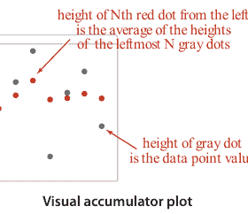

```java
% java TestVisualAccumulator 2000
Mean (2000 values): 0.509789
```

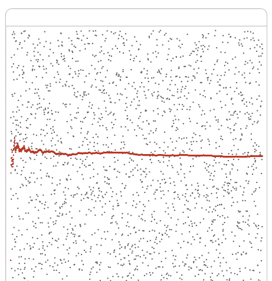

## 数据抽象

```java
public class VisualAccumulator {
    VisualAccumulator(int trials, double max)
    void addDataValue(double val) // 添加一个新的数据值
    double mean() // 所有数据值的平均值
    String toString() // 字符串表示
}
```

典型客户端

```java
public class TestVisualAccumulator {
    public static void main(String[] args) {
        int T = Integer.parseInt(args[0]);
        VisualAccumulator a = new VisualAccumulator(T, 1.0);
        for (int t = 0; t < T; t++) {
            a.addDataValue(StdRandom.random());
        }
        StdOut.println(a);
    }
}
```

实现

```java
public class VisualAccumulator {
    private double total;
    private int N;

    public VisualAccumulator(int trials, double max) {
        StdDraw.setAutoScale(0, trials);
        StdDraw.setYScale(0, max);
        StdDraw.setPenRadius(0.005);
    }

    public void addDataValue(double val) {
        total += val;
        StdDraw.setColor(StdDraw.DARK_GRAY);
        StdDraw.point(N, val);
        StdDraw.setColor(StdDraw.RED);
        StdDraw.point(N, mean());
    }

    public double mean() { ... }

    public String toString() {
        // 与 Accumulator 相同
    }
}
```


# 用于累加数据值的抽象数据类型（可视化版本）

## 设计抽象数据类型

抽象数据类型（ADT）是一种其表示对客户端隐藏的数据类型。这一思想对现代编程产生了巨大的影响。我们所考虑的各种示例为我们提供了描述 ADT 高级特性及其作为 Java 类实现的词汇。这些主题中的许多在表面上与算法研究是旁枝末节的，但你可以安全地跳过这一节，并在稍后在特定实现问题的语文中再次参考它。我们的目标是将与数据类型设计的重要信息放在一起供参考，并为全书的实现奠定基础。

### 封装（Encapsulation）

面向对象编程的一个标志是使我们能够将数据类型封装在其实现内部，以便于客户端和数据类型实现的分离开发。封装实现了模块化编程，允许我们：

- 独立开发客户端和实现代码
- 在不影响客户端的情况下替换改进的实现
- 支持尚未编写的程序（API 是任何未来客户端的指南）
- 限制潜在的错误
- 在实现中添加一致性检查和其他调试工具
- 简化客户端代码

封装类型可以被任何客户端使用，因此它扩展了 Java 语言。我们提倡的编程风格基于将大型程序分解为可以独立开发和调试的小模块的效果。这种方法通过限制和局部化更改产生的影响，提高了我们软件的韧性，并通过允许替换数据类型的新实现以提高性能、准确性或内存占用，促进了代码复用。同样的思想在许多场景下都适用。当我们使用系统库时，经常会重复封装的益处。Java 系统的新版本通常包含各种数据类型或静态方法库的新实现，但 API 不会改变。

在算法和数据结构研究的背景下，有强力且持续的动力去开发更好的算法，因为我们可以通过替换改进的 ADT 实现而不改变任何客户端代码的情况下，为所有人提高性能。模块化编程成功的关键在于保持模块之间的独立性。我们通过坚持 API 是客户端和实现之间唯一的依赖点来实现这一点。封装是实现这两个终点的关键。

### 设计 API（Designing APIs）

构建现代软件最重要且最具挑战性的步骤之一是设计 API。这项任务需要练习、仔细的深思和多次迭代，任何在设计良好的 API 上花费的时间都将在节省的调试时间上获得回报。在编写小型程序时，阐述 API 似乎是多此一举，但你应该像需要重用它一样编写每个程序。

理想情况下，API 应该清晰地阐述所有输入的行为（包括副作用），这样我们就有软件来检查实现是否符合规范。遗憾的是，计算机科学中一个被称为“规范问题”（specification problem）的基本结果意味着这个目标实际上无法实现。因此，我们的 API 是对抽象数据类型中值集的简短英文描述，以及构造函数和实例方法列表，同样带有对其用途的简短英文描述。为了验证设计，我们总会在 API 周围的文中包含客户端代码示例。

在这个广泛的框架内，存在许多每个 API 设计都容易遇到的陷阱：

- API 可能太难实现，意味着实现的开发困难或无法实现。
- API 可能太难使用，导致客户端代码比没有 API 的时候更复杂。
- API 可能太窄，遗漏了客户端需要的方法。
- API 可能太宽，包含了任何客户端需要的的方法。这种陷阱可能是最常见的，也是最难避免的之一。API 的规模往往随着时间而增长，因为向现有 API 中添加方法并不困难，但在不破坏现有客户端的情况下删除方法是很困难的。
- API 可能太通用，没有提供实用的抽象。
- API 可能太具体，提供的抽象过于详细或过于散漫而毫无用处。
- API 可能过度依赖于特定的表示，因此无法实现将客户端代码从该表示的细节中释放出来的目的。这种陷阱也很难避免，因为表示无疑是实现开发的核心。

这些考虑有时被总结为另一句格言：为客户端提供他们需要的方法，不再提供其他。

# 第一章 基础

## 算法与抽象数据类型

数据抽象天然地适用于算法研究，因为它帮助我们提供一个框架，在这个框架内，我们可以精确地指定算法需要完成的任务，以及客户端如何使用该算法。通常，在书中，算法是抽象数据类型中某个实例方法的实现。

例如，我们在章节开始的白名单（whitelist）示例根据以下操作被自然地视为一个 ADT 客户端：

- 从值数组构造一个集合（SET）。
- 确定给定值是否在集合中。

这些操作被封装在 `StaticToInt` ADT 中，在邻页与白名单一起所示，这是一个典型的例子。`StaticToInt` 是第三章中更通用、更有用的表（table）ADT 的一个特例。二分搜索是若干适用于实现这些 ADT 的算法之一。

与第 47 页的 `Binary` 实现相比，这种实现导致了更清晰、更有用的客户端代码。例如，`StaticToInt` 强制要求调用 `rank()` 之前数组必须经过排序。通过抽象数据类型，我们将客户端与实现分离开，使得任何客户端都能通过使用 API 受益二分搜索算法的精妙设计（`BinarySearch` 中的 `rank()` 客户端已知需先对数组排序）。白名单是能够利用二分搜索的许多客户端之一。

**每一个 JAVA 程序**都是一组静态方法和/或一个数据类型的实现。在本书中，我们主要关注抽象数据类型的实现，如 `StaticToInt`，其中操作和数据的表示对客户端是隐藏的。正如此示例所示，数据抽象使我们能够：

| 应用 | % Java 白名单 largeW.txt < largeT.txt |
|---|---|
|  | 499569 |
|  | 984875 |
|  | 295754 |
|  | 207807 |
|  | 140925 |
|  | 161828 |
|  | ... |

- 精确地指定算法为客户端提供的功能
- 将算法实现与客户端代码分离
- 开发抽象层，即利用理解良好的算法来开发其他算法

这些是描述算法的方法时所需的理想属性，无论是英语描述还是伪代码。通过采用支持数据抽象的 Java 类机制，我们几乎没有损失，却获益良多：我们可以使用并比较针对不同客户端的可运行代码。

## 数据抽象

### API

```java
public class StaticSetOfInts {

    StaticSetOfInts(int[] a) // 从 a[] 中的值创建一个集合

    boolean contains(int key) // key 是否在集合中?

}
```

### 典型客户端

```java
public class Whitelist {

    public static void main(String[] args) {

        int[] w = In.reads(args[0]);

        StaticSetOfInts set = new StaticSetOfInts(w);

        while (!Stdin.isEmpty()) {

            // 读取 key，如果不在白名单中则打印。

            int key = Stdin.readInt();

            if (!set.contains(key)) {

                Stdout.println(key);

            }

        }

    }

}
```

## 实现

```java
public class StaticSetOfInts {

    private int[] a;

    public StaticSetOfInts(int[] keys) {

        a = new int[keys.length];

        for (int i = 0; i < keys.length; i++)

            a[i] = keys[i]; // 防御拷贝

        Arrays.sort(a);

    }

    public boolean contains(int key) {

        return rank(key) != -1;

    }

    private int rank(int key) {

        // 二分搜索。

        int lo = 0;

        int hi = a.length - 1;

        while (lo <= hi) {

            // Key 在 a[lo..hi] 中或不存在。

            int mid = lo + (hi - lo) / 2;

            if (key < a[mid]) hi = mid - 1;

            else if (key > a[mid]) lo = mid + 1;

            else return mid;

        }

        return -1;

    }

}
```

重构为面向对象程序的二分搜索（针对整数集合的 ADT 搜索）

# 第一章 基础

## 接口继承

Java 提供了定义对象之间关系的语言支持，称为继承。这些机制被软件人员广泛使用，如果你修过软件工程课程，将详细学习它们。我们考虑的第一个继承机制是子类型（subtyping），它允许我们通过在接口中指定每个实现类必须包含的一组公共方法，来指定原本无关的类之间的某种关系。

接口无非一个实例方法列表。例如，与我们非正式的 API，我们可能会为 `Date` 编写一个接口：

```java
public interface Datable {

    int month();

    int day();

    int year();

}
```

然后在我们的实现代码中引用接口：

```java
public class Date implements Datable {

    // 实现代码（与之前相同）

}
```

这样 Java 编译器就会检查它是否匹配接口。在任何实现了 `month()`、`day()` 和 `year()` 的类中添加 `implements Datable` 代码，就向任何客户端保证该类的对象可以调用这些方法。

这种安排被称为接口继承——实现类继承了接口。接口继承允许我们通过调用方法，编写可以操作实现该接口的任何类型（未来将创建的类型）对象的客户端程序。我们本可以使用继承来取代更非正式的 API，但选择避免那些对理解算法至关重要的特定高级级机制，以避免额外的负担。

| 接口 | 方法 | 章节 |
|---|---|---|
| `java.lang.Comparable` | `compareTo()` | 2.1 |
| `java.util.Comparator` | `compare()` | 2.5 |
| `java.lang.Iterable` | `iterator()` | 1.3 |
| `java.util.Iterator` | `hasNext()`、`next()`、`remove()` | 1.3 |

本书中使用的 Java 接口。

利用接口是值得的：我们用它们进行比较和迭代，如上一页表格所示，并在涵盖这些内容时将详细地考虑它们。

### 实现继承

Java 还支持另一种称为子类化（subclassing）的继承机制，这是一种强大的技术，允许程序员在不重写整个类的情况下更改行为并添加功能。其思想是定义一个新类（子类或派生类），它继承自另一个类（父类或基类）的方法和变量。

子类包含比父类更多的方法。子类可以重定义或重写父类的方法。子类化被系统程序员广泛用于构建所谓的可扩展库——一个程序员（甚至是你）可以向另一个程序员（或者，可能是一个程序员团队）构建的库中添加方法，从而有效地复用可能巨大的库中的代码。

例如，这种方法在图形用户界面开发中被广泛使用，以便复用提供用户所有预期功能（下拉菜单、复制粘贴、访问文件等）所需的大量代码。

子类化的使用在系统和程序员之间存在争议（它与继承相比的优势尚待讨论），我们在书中避免了它，因为它通常违背了封装。该方法的某些遗迹已构建在 Java 中，因此不可避免：具体来说，每个类都是 Java `Object` 类的子类型。

这种结构形成了一种约定，每个类都包含了 `getClass()`、`toString()`、`equals()`、`hashCode()` 以及我们在书中未使用的几个方法。实际上，每个类都通过子类化继承了这些方法，因此任何客户端都可以对任何对象使用它们。

我们通常在新类中重写 `toString()`、`equals()` 和 `hashCode()`，因为默认的 `Object` 实现通常不会产生预期的行为。我们现在考虑 `toString()` 和 `equals()`；将在第 3.4 节讨论 `hashCode()`。

| 方法 | 目的 | 章节 |
|---|---|---|
| `Class getClass()` | 这个对象是什么类？ | 1.2 |
| `String toString()` | 此对象的字符串表示 | 1.1 |
| `boolean equals(Object that)` | 此对象等于那个对象吗？ | 1.2 |
| `int hashCode()` | 此对象的哈希码 | 3.4 |

本书中使用的自 `Object` 的继承方法。

### 字符串转换

按照约定，每个 Java 类型都继承自 `Object` 的 `toString()`，因此任何客户端都可以为任何对象调用 `toString()`。这一约定是 Java 自动转换的基础：当拼接运算符 `+` 的一个操作数是字符串时，它会将另一个操作数转换为字符串。

如果对象的数据类型没有包含 `toString()` 的实现，则会调用 `Object` 中的默认实现，这通常没有帮助，因为它返回的是对象内存地址的字符串表示。因此，正如对面页的数据强调所示，我们通常会在开发的每个类中包含重写默认方法的 `toString()` 实现。如代码所示，`toString()` 的实现通常非常简单，隐式地（通过 `+`）对每个实例变量调用 `toString()`。

### 包装类型

Java 提供了内置的引用类型，称为包装类型，每种基本类型对应一个：Boolean、Byte、Character、Double、Float、Integer、Long 和 Short 分别对应 boolean、byte、char、float、int 和 short。

这些类主要由像 `parseInt()` 这样的静态方法组成，但也包含了继承的实例方法 `toString()`、`compareTo()`、`equals()` 和 `hashCode()`。在需要时，Java 会自动从基本类型转换为包装类型，例如，当一个 int 值与字符串拼接时，它会被转换为一个可以调用 `toString()` 的 `Integer`。

### 相等性

两个对象相等意味着什么？如果我们使用 `(a == b)` 测试相等性，且 `a` 和 `b` 是相同类型的引用变量，我们是在测试它们是否具有相同的身份：即引用是否相等。

典型的客户端更希望测试数据值对象（对象状态）是否相同，或者实现某些特定类型的规则。Java 通过为 Integer、Double 和 String 等标准类型提供实现为我们提供了一个领先优势；对于更复杂的类型，我们使用内置实现。

例如，如果 `x` 和 `y` 是 String 值，只要 `x` 和 `y` 的长度相同且每个字符位置也相同，则 `x.equals(y)` 为真。当我们定义自己的数据类型（如 `Date` 或 `Transaction`）时，我们需要重写 `equals()`。

Java 的约定是 `equals()` 是一个等价关系。它必须满足：

- 反射性：`x.equals(y)` 为真当仅当 `y.equals(x)` 为真。
- 对称性：`x.equals(y)` 和 `y.equals(x)` 均为真。
- 传递性：如果 `x.equals(y)` 和 `y.equals(z)` 为真，那么 `x.equals(z)` 也为真。
- 一致性：在两个对象都没有被修改的情况下，多次调用 `x.equals(y)` 始终返回相同的值。
- 不为空：`x.equals(null)` 返回假。

## 1.2 数据抽象

这些是自然定义，确保这些属性的成立。遵循 Java 约定，在实现中避免不必要的工作可能是棘手的，如 `Date` 所示。它采取了以下步步就进的方法：

- 如果此对象的引用与参数对象的引用相同，返回真。此测试节省了执行所有其他检查的工作。
- 如果参数为 `null`，返回假，以遵循约定（并避免在代码中跟随一个空引用）。
- 如果对象不属于同一个类，返回假。要确定对象的类，我们使用 `getClass()`。请注意，当使用 `==` 来判断两个 `Class` 类型的对象是否相等时，`getClass()` 保证对任何给定类中的所有对象都返回相同的引用。
- 将参数从 `Object` 强制转换为 `Date`（由于之前的测试，此项强制转换必须成功）。
- 如果实例变量不匹配，则返回假。对于其他类，其他的相等性定义可能合适。例如，我们可能认为两个 `Counters` 相等是因为它们的计数实例变量相等。

```java
public class Date {

    private final int month;

    private final int day;

    private final int year;

    public Date(int m, int d, int y) {

        month = m; day = d; year = y;

    }

    public int month() {

        return month;

    }

    public int day() {

        return day;

    }

    public int year() {

        return year;

    }

    public String toString() {

        return month() + "/" + day() + "/" + year();

    }

    public boolean equals(Object x) {

        if (x == null) return false;

        if (this.getClass() != x.getClass()) return false;

        Date date = (Date) x;
```


```java
if (this.day != date.day) return false;

if (this.month != date.month) return false;

if (this.year != date.year) return false;

return true;
```

这种实现是一个模型，你可以针对你实现的任何类型去实现`equals()`。一旦你实现了一个`equals()`，你不会发现实现另一个是困难的。

## 在数据类型定义中重写`toString()`和`equals()`

## 内存管理

为引用变量分配新值的能力使得程序可能创建了一个再也无法被引用的对象。例如，考虑左图中的三条赋值语句。在第三条赋值语句之后，不仅`a`和`b`指向同一个`Date`对象（12/31/1999），而且不再有指向创建并用于初始化`b`的`Date`对象的引用。该对象的唯一引用被赋值覆盖了，因此没有办法再次引用该对象。当此类对象超出作用域时，它们也会变成“孤儿”。Java 程序会创建很多对象（以及超出作用域的变量）。

## 第 1 章 基础

你必须始终关注这些值在何时以及何时变化。不可变性的缺点是必须为每个值都创建一个新对象。这种开销通常是可以接受的，因为 Java 垃圾回收器通常针对此类情况进行了优化。不可变性的另一个缺点源于此：遗憾的是，`final`仅在实例变量为基本类型时才保证不可变性，而不是引用类型。如果一个引用类型的实例变量带有`final`修饰符，那么该实例变量的值（对对象的引用）永远不会改变——但对象本身的值可以改变。例如，这段代码并没有实现一个不可变类型：

```java
public class Vector {
    private final double[] coords;

    public Vector(double[] a) {
        coords = a;
    }

    ...
}
```

客户端程序可以通过指定数组中的项来创建一个`Vector`，然后（绕过 API）在构造后更改`Vector`的元素：

```java
double[] a = { 3.0, 4.0 };
Vector vector = new Vector(a);

a[0] = 0.0; // 绕过了公共 API。
```

实例变量`coords[]`是`private`且`final`的，但`Vector`是可变的，因为客户端持有指向数据的引用。在任何数据类型设计中，都需要考虑不可变性，并且一个数据类型是否应该是不可变的是在 API 中指定的，这样客户端就知道对象的值将不会改变。在书中，我们对不可变性的主要兴趣在于用于验证算法的正确性。例如，如果用于二分搜索算法的数据类型是可变的，那么客户端就可以破坏我们对数组已为二分搜索排序的假设。

## 契约设计（Design by contract）

最后，我们简要讨论允许你在程序运行时验证对程序假设的 Java 语言机制。我们为此目的使用了两种 Java 语言机制：

- 异常（Exceptions）和错误（errors），通常处理我们控制之外的不可预见错误。
- 断言（Assertions），用于验证我们在开发的代码中做出的假设。

适量使用异常和断言是良好的编程实践。为了简洁起见，我们在书中谨慎地使用它们，但你会在书籍网站的代码中随处发现它们。这段代码与文中关于每个算法的大量注释保持一致，这些注释涉及异常情况和断言的不变性。

### 异常和错误

异常是程序运行期间发生的破坏性事件，通常用于指示错误。所采取的操作是抛出异常或抛出错误。在学习基础特性的过程中，我们已经遇到过 Java 系统方法的异常：`StackOverflowError`、`ArithmeticException`、`IndexOutOfBoundsException`、`OutOfMemoryError`和`NullPointerException`是典型的例子。你可以创建自己的异常。最常用的是`RuntimeException`，它会终止程序的执行并打印错误消息：

```java
throw new RuntimeException("Error message here");
```

快速失败（fail fast）编程等通用做法建议，如果在发现错误时立即抛出异常，错误更容易被定位（而不是忽略错误并将异常推迟到以后）。

### 断言

断言是一个布尔表达式，你确认它在程序的某处为真。如果该表达式为假，程序将终止并报告错误消息。我们同时使用断言来增加程序正确性的信心并记录意图。例如，假设你有一个用于访问数组索引的计算值。如果该值为负数，它将断言`index >= 0`；你可以精确定位错误发生的位置。你还可以添加一个可选的详细消息，例如：

```java
assert index >= 0 : "Negative index in method X";
```

来帮助定位错误。默认情况下，断言是禁用的。你可以通过命令行使用`-enableassertions`标志（简称`-ea`）来启用它们。断言用于调试：你的程序不应依赖断言进行正常操作，因为它们可能会被禁用。

当你学习系统编程课程时，你将学习使用断言来确保你的代码永远不会因系统错误终止或进入无限循环。一种被称为契约设计（design-by-contract）编程的模型表达了这一思想。数据类型的设计者表达前置条件（客户端在调用方法时承诺满足的条件）、后置条件（实现在从方法返回时承诺实现的条件）以及副作用（方法可能引起的任何其他状态变化）。在开发期间，可以使用断言对这些条件进行测试。

### 总结

本节讨论的语言机制说明，适当的数据类型设计会导致难以解决的非平凡问题。专家们仍在争论支持我们讨论的某些设计思想的最佳方法。为什么 Java 不允许将函数作为参数？为什么 Matlab 会复制作为参数传递给函数的数组？

正如第 1 章开头提到的，从抱怨编程语言的特性到变成编程语言设计者是一个水滑坡。如果你不计划这样做，你最好的策略是使用广泛使用的语言。大多数系统都有你可以在合适时使用的海量库，但你通常可以通过构建可以轻松迁移到其他语言的抽象来简化客户端代码并保护自己。你的主要目标是开发数据类型，以便你的大部分工作都能在适合当前问题的抽象层次上完成。

对面的表格总结了我们考虑过的各种类型的 Java 类。

## 1.2 数据抽象 109

| 类的类型 | 示例 | 特性 |
|---|---|---|
| 静态方法 | `Math`、`StdIn`、`StdOut` | 无实例变量 |
| 不可变数据类型 | `Date`、`Transaction`、`String` | 实例变量均为私；所有实例变量均为`final`；引用类型的防御性拷贝。注意：这些是必要且充分的。 |
| 可变数据类型 | `Counter`、`Accumulator` | 实例变量均为私；并非所有都是`final` |
| 带有 I/O 副作用的数据类型 | `VisualAccumulator`、`In`、`Out`、`Draw` | 实例变量均为私；实例方法执行 I/O |

Java 类（数据类型实现）。

## 问答

### 问：为什么要费心进行数据抽象？

答：它帮助我们产生可靠且正确的代码。例如，在 2000 年总统选举中，阿尔尔·戈尔在佛罗里达州沃卢西亚县的一台电子投票机上得到了 -16,022 票——结果显然没有在投票机软件中被妥善封装！

### 问：为什么要区分基本类型和引用类型？为什么不直接使用引用类型？

答：性能。Java 提供了`Integer`、`Double`等引用类型，以便于忽略区别的程序员可以使用基本类型。基本类型更接近计算机硬件支持的数据类型，因此程序运行速度通常比使用相应引用类型的程序更快。

### 问：数据类型必须是抽象的吗？

答：不是。Java 也允许使用`public`和`protected`让某些客户端直接引用实例变量。正如文中描述，允许客户端代码直接引用数据的优势远大于对特定表示法的依赖带来的劣势，因此我们的代码中所有实例变量都是`private`的。我们偶尔使用`private`实例方法在公共方法之间共享代码。

### 问：如果创建对象时忘记使用`new`会发生什么？

答：对 Java 来说，这看起来像是你想调用一个返回值为对象类型的静态方法。由于你没有定义该方法，错误信息与任何时候返回`void`相同。如果你编译代码：

```java
Counter c = Counter("test");
```

你会得到此错误消息：

```text
cannot find symbol
symbol : method Counter(String)
```

如果你向构造函数提供的参数数量错误，也会得到类似的错误消息。

### 问：如果在创建对象数组时忘记使用`new`会怎样？

答：你需要为你创建的每个对象使用`new`。因此，当你创建一个包含 N 个对象的数组时，你需要使用 N+1 次`new`：一次用于创建数组，另一次用于创建每个对象。

如果你忘记了创建数组：

```java
Counter[] a;

a[0] = new Counter("test");
```

你将得到与尝试给未初始化的变量赋值时一致的错误消息：

```text
variable a might not have been initialized

a[0] = new Counter("test");
```

但如果你在数组内部创建对象时忘记使用`new`，然后尝试调用它的方法：

```java
Counter[] a = new Counter[2];
a[0].increment();
```

你将得到一个`NullPointerException`。

### 问：为什么不用`Stdout.println(x.toString())`来打印对象？

答：这段代码可以运行，但 Java 通过自动调用任何对象的`toString()`方法省去了编写该代码的麻烦，因为`println()`有一个接受`Object`作为参数的方法。

### 问：什么是指针（pointer）？

答：这是一个很好的问题。也许那应该是`NullReferenceException`。就像 Java 引用一样，你可以将指针视为机器地址。在许多编程语言中，指针是一种原始类型，程序员可以用许多方式对其进行操作。使用指针编程以极易出错著称，因此为指针提供的操作需要仔细设计以帮助避免错误。

Java 将这一观点推向极端（这是许多现代编程语言设计者所推崇的）。在 Java 中，创建引用只有一种方法（`new`），改变引用也只有一种方法（使用赋值语句）。也就是说，程序员对引用能做的事情只有创建和复制它们。

### 问：我可以在哪里找到更多关于 Java 如何实现引用和进行垃圾回收的详细细节？

答：一个 Java 系统可能与另一个完全不同。例如，一种自然的方案是使用指针（机器地址）；另一种方案是使用句柄（handle，指向指针的指针）。前者提供了更快的数据访问；后者提供了更好的垃圾回收。

### 问：导入一个名称（import a name）到底意味着什么？

答：意义不大：为了减少打字。你可以在代码中使用`import`语句的地方输入`java.util.Arrays`而不是`Arrays`。

### 问：实现继承（implementation inheritance）有什么问题？

答：子类型（Subtyping）由于两个原因使得模块化编程变得更加困难。首先，父类的任何更改都会影响所有的子类。子类无法脱离父类进行独立开发；事实上，它完全依赖于父类。这个问题被称为脆弱基类问题（fragile base class problem）。

子类代码由于可以访问实例变量可能会违反父类的意图。例如，一个投票系统的`Counter`类的设计者可能花费大量精力确保`Counter`只能将票数增加一（记住阿尔尔·戈尔的问题）。但一个拥有实例变量完全访问权的子类可以将其更改为任何值。

### 问：如何让一个类变得不可变（immutable）？

答：为了确保包含表实例变量的数据类型的不可变性，我们需要创建一个本地副本，被称为防御性拷贝（defensive copy）。这可能还不够。创建副本是一个挑战；而确保没有任何实例方法改变值，是另一个挑战。

### 问：什么是`null`？

答：它是一个不指向任何对象的字面量值（literal value）。调用方法是没有意义的并会导致`NullPointerException`。如果你收到这个错误消息，请检查你的构造函数是否正确地初始化了所有的实例变量。

### 问：我可以在实现某种数据类型的类中拥有静态方法（static method）吗？

答：当然可以。例如，我们所有的类都有`main()`。此外，对于涉及多个对象的操作考虑添加方法是自然的，当这些对象中没有哪一个自然而然被认为是该方法的调用者时。例如，我们可以在`Point`类中定义如下的静态方法：

```java
public static double distance(Point a, Point b) {
    return a.distTo(b);
}
```

通常，包含此类方法可以起到澄清客户端代码的作用。

### 问：除了参数变量、局部变量和实例变量，还有其他类型的变量吗？

答：如果在类声明中包含`static`关键字（任何类型之外），它会创建一个完全不同类型的变量，被称为静态变量（static variable）。像实例变量一样，静态变量可以被类中的每个方法访问；然而，它们与任何对象无关。

在旧的编程语言中，此类变量被称为全局变量。在现代编程语言中，我们专注于限制作用范围，因此很少使用此类变量。当我们使用时，会对它们引起注意。

### 问：什么是废弃方法（deprecated method）？

答：一种不再完全支持的方法，但保留在 API 中以保持兼容性。例如，Java 曾经包含过`Character.isSpace()`方法，程序员编写了依赖该方法行为的程序。当 Java 的设计者后来想要支持额外的 Unicode 空格字符时，在不破坏客户端程序的情况下无法更改`isSpace()`的行为，而是添加了一个新方法`Character.isWhitespace()`，并将旧方法标记为废弃。

随着时间的推移，这种做法确实使 API 复杂化。有时整个类都会被废弃。

# 练习

- **1.2.1** 编写一个程序检查两个字符串`s`和`t`是否为彼此的循环移动（circular shifts）。提示：解决方案是使用`indexOf()`、`length()`和字符串拼接的一行代码。
- **1.2.2** 编写一个`Interval1D`客户端，接受`N`作为参数，在单位正方形内生成随机点并计算最近的对。
- **1.2.3** 编写一个`Interval2D`客户端，接受`N`、`min`和`max`，并在`min`和`max`之间生成均匀分布的随机区间。画出它们相交的情况。
- **1.2.4** 下述片段打印什么？

  ```java
  String string1 = "hello";
  String string2 = "string1";

  string1 = "world";

  StdOut.println(string1);
  StdOut.println(string2);
  ```

- **1.2.5** 下述片段打印什么？

  ```java
  String s = "Hello World";

  s.toUpperCase();
  s.substring(6, 11);

  StdOut.println(s);
  ```

  答案："Hello World"。字符串对象是不可变的——字符串方法返回一个新的`String`，但不会改变所用对象的值。要打印 "WORLD"，使用`s = s.toUpperCase()`和`s.substring(6, 11)`。

- **1.2.6** 如果字符串`s`的字符通过任意位置移动后匹配字符串`t`，则`s`是`t`的循环旋转；例如 ACTGACG 是 TGACG，反之亦然。检测这种条件在基因序列研究中很重要。
- **1.2.7** 下述递归函数返回什么？

  ```java
  public static String mystery(String s) {
      int N = s.length();

      if (N <= 1) return s;

      String a = s.substring(0, N / 2);
      String b = s.substring(N / 2, N);

      return mystery(b) + mystery(a);
  }
  ```

- **1.2.8** 假设`a[]`和`b[]`都是由数百万整数组成的数组。下述代码做了什么？它高效吗？

  ```java
  int[] t = a;
  a = b;
  b = t;
  ```


答案：交换了它们。这很难更高效了，因为它通过复制引用来实现，因此不需要复制数百万元素。

## 练习

**1.2.9** 改造二分搜索（第47页），使用`Counter`来计算搜索期间检查的键，并在搜索完成后打印总数。提示：在`main()`中创建`Counter`并将其作为参数传递给`rank()`。

**1.2.10** 开发一个`VisualCounter`类，允许增加和减少操作。构造函数接受两个参数`N`和`max`，其中`N`指定最大操作数，`max`指定计数器的最大绝对值。作为副作用，创建一个显示计数器每次变化的值。

**1.2.11** 为我们的`Date` API实现一个`SmartDate`，如果日期非法则抛出异常。

## 练习（续）

**1.2.13** 使用我们实现的`Date`类作为模型（第 91 页），开发`Transaction`的实现。

**1.2.14** 以我们在`Date`中实现的`equals()`方法为模型（第 103 页），为`Transaction`实现`equals()`方法。

## 创造性问题

**1.2.15** 文件输入。为`In`类中的静态方法`readInts()`开发一种可能的实现方式，用于测试客户端，基于`String`类的`split()`方法实现二分查找读取整数。

解决方案：

```java
public static int[] readInts(String name)
{
    In in = new In(name);
    String input = in.readAll();
    String[] words = input.split("\\s+");
    int[] ints = new int[words.length];
    for (int i = 0; i < words.length; i++)
    ints[i] = Integer.parseInt(words[i]);
    return ints;
}
```

我们将在第 1.3 节中考虑一种不同的实现（参见第 126 页）。

**1.2.16** 有理数（Rational）。实现一个用于数字的不可变数据类型`Rational`，支持加、减、乘除。

```java
public class Rational
    Rational(int numerator, int denominator)
    Rational plus(Rational b) 此数与 b 的和
    Rational minus(Rational b) 此数与 b 的差
    Rational times(Rational b) 此数与 b 的积
    Rational dividedBy(Rational b) 此数除以 b 的商
    boolean equals(Object that) 此数是否等于那个？
    String toString() 字符串表示
```

你不需要担心溢出的测试（参见练习 1.2.17），但请使用两个`long`类型的实例变量来表示分子和分母，以限制溢出的可能性。使用辗转除欧几里得算法（参见第 4 页）确保分子和分母永远没有公因数。包含一个测试客户端来测试你编写的所有方法。

## 创造性问题（续）

**1.2.17** 有理数的健壮实现。使用断言（assertions）开发一个能够免疫溢出的`Rational`实现（参见练习 1.2.16）。

**1.2.18** 累加器的方差。验证以下代码，它为`Accumulator`添加了`var()`和`stddev()`方法，并计算了作为`addDataValue()`参数传入的数字的样本平均值、样本方差和样本标准差：

```java
public class Accumulator {
    private double m;
    private double s;
    private int N;

    public void addDataValue(double x) {
        N++;
        s = s + 1.0 * (N-1) / N * (x - m) * (x - m);
        m = m + (x - m) / N;
    }

    public double mean() {
        return m;
    }

    public double var() {
        return s/(N-1);
    }

    public double stddev() {
        return Math.sqrt(this.var());
    }
}
```

相比于基于保存数字平方和的直接实现，这种实现不容易受到舍入误差的影响。

**1.2.19** 解析。为你练习 1.2.13 中的`Date`和`Transaction`实现开发解析构造函数，这些构造函数接受单个`String`参数来指定初始化值，使用下表中的格式。

部分解决方案：

```java
public Date(String date)
{
    String[] fields = date.split("/");
    month = Integer.parseInt(fields[0]);
    day = Integer.parseInt(fields[1]);
    year = Integer.parseInt(fields[2]);
}
```

| 类型 | 格式 | 示例 |
|---|---|---|
| Date | 用斜杠分隔的整数 | 5/22/1939 |
| Transaction | 客户、日期和金额，用空格分隔 | Turing 5/22/1939 11.99 |

## 1.3 集合、队列和栈

若干**基础数据类型**涉及对象的集合。具体而言，值的集合是对象的集合，而操作是围绕在集合中添加、移除或检查对象展开的。在本节中，我们考虑这三类此类数据类型，即**包（bag）**、**队列（queue）**和**栈（stack）**。它们在规定下一个要移除或检查哪个对象的规范上有所不同。

包、队列和栈是基础且广泛实用的。我们在全书的实现中都会使用。此外，本节中的客户端代码和实现代码将作为我们开发数据结构和算法的通用方法的介绍。

本节的一个目标是强调我们表示集合中对象的方式直接影响了各种操作的效率。对于集合，我们设计了表示对象集合的数据结构，以支持高效实现所需的操作。

本节的第二个目标是引入**泛型（generics）**和**迭代（iteration）**，这些极大地简化了客户端代码的 Java 基础结构。这些是高级编程语言机制，对于理解算法并非必不可少，但它们允许我们开发出比其他方法更清晰、紧凑且优雅的客户端代码（以及算法实现）。

本节的第三个目标是引入并展示**链式数据结构**的重要性。特别是，一种名为**链表（linked list）**的经典数据结构能够实现包、队列和栈并达到其他无法实现的效率。使用链表是学习算法和数据结构的关键步骤。

对于这三种类型，我们都会考虑 API 和示例客户端程序，然后查看数据类型值的可能表示形式以及数据类型操作的实现。这种情况场景在全书中不断重复（带有更复杂的数据结构）。这里的实现是书后实现要求的模型，值得仔细研究。

如往常，我们通过定义集合的 API 开始对集合的抽象数据类型的讨论，如下所示。每个 API 都包含一个无参数构造函数、一个向集合中添加项目的方法、一个测试集合是否为空的方法以及一个返回集合大小的方法。栈和队列各有一个从集合中移除特定项目的方法。除了这些基础之外，API 还反映了我们将在接下来几页中描述的两个 Java 特性：泛型和可迭代集合。

### 包 (Bag)

```java
public class Bag<Item> implements Iterable<Item>
    Bag()                               创建一个空包
    void add(Item item)      添加一个项目
    boolean isEmpty()        包为空吗？
    int size()                               包中项目的数量
```

### 先进先出队列 (FIFO queue)

```java
public class Queue<Item> implements Iterable<Item>
    Queue()                   创建一个空队列
    void enqueue(Item item)  添加一个项目
    Item dequeue()           移除最近添加的项目
    boolean isEmpty()        队列为空吗？
    int size()               队列中项目的数量
```

### 后进先出栈 (LIFO stack)

```java
public class Stack<Item> implements Iterable<Item>
    Stack()                  创建一个空栈
    void push(Item item)     添加一个项目
    Item pop()               移除最近添加的项目
    boolean isEmpty()        栈为空吗？
    int size()               栈中项目的数量
```

用于基础泛型可迭代集合的 API

## 第 1 章 基础

**泛型**。集合抽象数据类型（ADT）的一个基本特征是，我们应该能够使用它们来处理任何类型的数据。一种被称为泛型的特定 Java 机制（也称为参数化类型）实现了这种能力。泛型对编程语言的影响是足够深远的，以至于在许多语言中（包括 Java 的早期版本）中并不存在这种泛型，但我们在当前语境中使用它们仅涉及极少量额外的 Java 代码，并且易于理解。每个 API 中类名后的`<Item>`符号将`Item`定义为类型参数，它是客户端使用的某些具体类型的符号占位符。你可以将`<Item>`理解为“项目的栈”。在实现`Stack`时，我们不知道`Item`的具体类型，但客户端可以使用我们的栈来处理任何类型的数据，包括在我们开发出实现之后很久定义的类型。在创建栈时，代码提供了一个具体类型：我们可以将`Item`替换为任何引用类型（在它出现的地方保持一致）。这恰恰提供了我们所需的能力。例如，你可以编写如下代码：

```java
Stack<String> stack = new Stack<String>();
stack.push("Test");
...
String next = stack.pop();
```

使用栈处理`String`对象，且代码如下：

```java
Queue<Date> queue = new Queue<Date>();
queue.enqueue(new Date(12, 31, 1999));

Date next = queue.dequeue();
```

使用队列处理`Date`对象。如果你尝试向栈添加`Date`（或除`String`之外的任何类型的数据）或向队列添加`String`（或除`Date`之外的任何其他类型的数据），你将得到编译错误。如果没有泛型，我们必须为可能收集的每种数据类型定义（并实现）不同的 API；有了泛型，我们就可以为所有数据类型使用一种 API（一种实现），即使是未来实现的类型。你很快就会发现，泛型带来了清晰、易于理解和调试的代码，因此我们在全书中都使用了泛型。

**自动装箱 (Autoboxing)**。类型参数必须实例化为引用类型，因此 Java 有特殊机制，允许泛型代码与基本类型使用。请记住 Java 的包装类型是对应基本类型的引用类型：`Boolean`、`Byte`、`Character`、`Double`、`Float`、`Integer`、`Long`和`Short`分别对应`boolean`、`byte`、`char`、`double`、`int`、`long`和`short`。Java 自动在这些引用类型和相应的基本类型之间进行转换——在赋值、方法参数以及算术/逻辑表达式中如此。在当前语境中，这种转换非常有帮助，因为它允许我们能够在基本类型上使用泛型，如下例所示：

```java
Stack<Integer> stack = new Stack<Integer>();
stack.push(17);      // 自动装箱 (int -> Integer)
int i = stack.pop();    // 自动拆箱 (Integer -> int)
```

自动将基本类型转换为包装类型是自动装箱（autoboxing），而自动将包装类型转换为基本类型是自动拆箱（auto-unboxing）。在这个示例中，当你调用`push()`时，Java 会自动（装箱）将基本值 17 转换为`Integer`类型。`pop()`方法返回一个`Integer`，Java 在将其赋值给变量`i`之前将其（自动拆箱）为`int`。

**可迭代集合（Iterable）**。对于许多应用程序，客户端的需求是以某种方式处理集合中的每个项，或者遍历集合中的所有项。这种范式如此重要，以至于它在 Java 和许多现代语言中具有第一类地位（编程语言有特定的机制来支持它，而不仅仅是库）。通过它，我们可以编写出清晰且紧凑的代码，且不依赖于集合实现的细节。例如，假设客户端在`Queue`中维护一个事务集合，如下：

```java
Queue<Transaction> collection = new Queue<Transaction>();
```

如果集合是可迭代的，客户端可以使用`for`语句打印事务列表：

```java
for (Transaction t : collection)
{
    System.out.println(t);
}
```

这种结构被称为`foreach`语句：你可以将`for`语句读为：对于集合中的每个事务`t`，执行以下代码块。这段客户端代码不需要关于集合的表示或实现的任何信息；它只需要处理集合中的每个项。同样的`for`循环也适用于事务的`Bag`或任何可迭代集合。我们几乎无法想象比这更清晰、紧凑的客户端代码了。正如你将看到的，支持这一点在实现上需要额外的努力，但这些努力是完全值得的。

值得注意的是，`Stack`和`Queue`的 API 之间的唯一区别在于它们的名称以及方法的名称。这一观察凸显了一个观点：我们无法在方法签名列表中轻松地指定数据类型的所有特征。在这种情况下，真正的规范是与英文描述相关的，这些描述规定了选择某个项进行移除（或在`foreach`语句中下次处理）的规则。这些规则的差异是深远的，是 API 的一部分，而且在开发客户端代码时无疑至关重要。

## 第 1 章 基础

**集合（Bags）**。集合是一种不支持移除项的集合——它的目的是为客户端提供收集项以及遍历已收集项的能力（客户端还可以测试集合是否为空并找到其项的数量）。遍历的顺序是不指定的，且对客户端来说无关紧要。为了理解这个概念，设想一个热衷的玻璃球收藏者，他可能会一次将玻璃球放入袋中，并定期处理所有玻璃球以寻找具有某些特定特征的球。通过我们的`Bag` API，客户端可以向集合中添加项并在需要时使用`foreach`语句处理它们。这样的客户端可以使用栈或队列，但强调项的处理顺序无关紧要的一种方法是使用`Bag`。右侧的`Stats`类展示了一个典型的`Bag`客户端。任务是计算标准输入中`double`值的平均值和标准差。如果标准输入中有`$N$`个数字，它们的平均值是通过将数字相加并除以`$N$`计算的；它们的样本标准差是通过将每个数字与平均值差的平方相加除以`$N-1$`，然后开平方计算的。考虑数字的顺序并不相关……将它们保存在`Bag`中并使用`foreach`结构计算每个总和。注意：可以在不保存所有数字的情况下计算标准差（正如我们在`Accumulator`中计算平均值那样——参见练习题 1.2.18）。对于更复杂的统计计算，需要将数字保留在`Bag`中。

### 典型的 Bag 客户端

```java
public class Stats
{
    public static void main(String[] args) {
        Bag<Double> numbers = new Bag<Double>();
        while (!StdIn.isEmpty()) {
            numbers.add(StdIn.readDouble());
        }
        int N = numbers.size();
        double sum = 0.0;
        for (double x : numbers) {
            sum += x;
        }
        double mean = sum/N;
        sum = 0.0;
        for (Double x : numbers) {
            sum += (x - mean)*(x - mean);
        }
        double std = Math.sqrt(sum/(N-1));
        StdOut.printf("Mean: %.2f\n", mean);
        StdOut.printf("Std dev: %.2f\n", std);
    }
}
```


# 应用

100 99 101 120 98 107 109 81 101 90

Mean: 100.60  
Std dev: 10.51

## 第 1 章 基础

FIFO 队列。FIFO 队列（或简称队列）是一种基于先入先出（FIFO）策略的集合。按照任务到达的顺序执行任务的策略是我们日常生活中经常遇到的：从在剧院外排队的人，在收费站外排队的汽车，再到你计算机上应用程序要处理的任务。任何服务策略的一个基石原则是公平性的感知。当大多数人考虑到公平时，想到的第一个想法是等待最久的人应该先被服务。这正是 FIFO 准则。队列是许多日常现象的自然模型，客户端使用 `foreach` 结构将项输入队列，项按照它们被放入的顺序进行处理。例如，在应用程序中使用队列的一个典型原因是在保存集合中的项的同时，保持它们的相对顺序：它们弹出的顺序与被放入的顺序相同。例如，下方的客户端是 `readInts()` 静态方法的可能实现，它为客户端解决了获取数字的问题。

| FIFO 队列 |
| :--- |
| ![img/c817df91fbd9a8284fe266334fc85cef_138_0.png) |

典型的队列

客户端使用 `foreach` 结构将项输入队列，项按照它们被放入的顺序进行处理。

```
public static int[] readInts(In in) {
    Queue<Integer> q = new Queue<Integer>();
    while (!in.isEmpty()) {
        q.enqueue(in.readInt());
    }
    int N = q.size();
    int[] a = new int[N];
    for (int i = 0; i < N; i++) {
        a[i] = q.dequeue();
    }
    return a;
}
```

# 栈（Pushdown stacks）

栈（或简称栈）是一种基于后入先出（LIFO）策略的集合。当你把邮件放在桌子上时，新邮件到达时你把它们堆在顶部，阅读它们时则从顶部弹出。这种策略的优点是我们可以尽早看到邮件；缺点是如果我们清空栈，旧邮件可能永远不会被阅读。你在浏览网页时可能遇到过另一个栈的例子。当你点击超链接时，浏览器显示新页面（并推入栈）。你可以通过点击返回按钮（从栈中弹出）来回到之前的页面。栈提供的 LIFO 策略提供了你期望的行为。当客户端遍历栈中的项时，其顺序与它们被放入的顺序相反。

| 栈 |
| :--- |
| ![img/c817df91fbd9a8284fe266334fc85cef_139_0.png) |

典型的队列

| 栈上的操作 |
| :--- |
| 文档栈 |
| `add()` |
| `add()` |
| `for (Marble m : bag):` |
| 处理每个玻璃球 `m`（以任意顺序） |

# 栈上的操作

```
public class Reverse {
    public static void main(String[] args) {
        Stack<Integer> stack;
        stack = new Stack<Integer>();
        while (!StdIn.isEmpty()) {
            stack.push(StdIn.readInt());
        }
        for (int i : stack) {
            Std.out.println(i);
        }
    }
}
```

## 算术表达式求值

作为栈客户端另一个示例，我们考虑一个展示泛型用处的经典例子。我们在第 1.1 节中考虑的一些早期程序涉及对如下算术表达式的值进行计算：

```
( 1 + ( ( 2 + 3 ) * ( 4 * 5 ) ) )
```

如果你将 4 乘以 5，将 3 乘以 2，将结果相乘，然后加 1，你得到值 101。但 Java 系统是如何进行此计算的呢？在不涉及 Java 系统如何构建的情况下，我们可以编写一个 Java 程序，接收字符串（表达式）作为输入，并将表达式所表示的数字作为输出来解决这个问题。为了简单起见，我们从以下显式递归定义开始：算术表达式是一个数字，或者是一个左括号，后面跟着算术表达式，然后是一个运算符，另一个是一个算术表达式，最后是一个右括号。为了简单起见，这个定义适用于全括号表达式，它精确指定了哪些运算符适用于哪些操作数——你对像 `1 + 2 * 3` 这样的表达式很熟悉，我们通常依赖优先级规则而不是括号。我们考虑的相同机制也可以处理优先级规则，但我们避免了那种复杂性。具体来说，我们支持熟悉的二进制运算符 `+`、`-` 和 `*`，以及接受单个参数的平方根运算符 `sqrt`。我们可以轻松地允许更多运算符和类型的运算符来涵盖大量的数学表达式，涉及三角、指数和对数函数。我们的重点是理解如何解释括号、运算符和数字字符串，以便按照正确的顺序执行任何计算机上都有的低级算术操作。具体如何将一个算术表达式（一个字符字符串）转换为它表示的值？E. W. Dijkstra 在 20 世纪 60 年开发的一种非常简单的算法使用了两个栈（一个操作数，一个运算符）来完成这项工作。从左到右逐个处理这些实体，根据以下四种可能的情况对栈进行操作：

- 将操作数推入操作数栈。
- 将运算符推入运算符栈。
- 忽略左括号。
- 当遇到右括号时，弹出一个运算符，弹出所需数量的操作数，并将该运算符应用于这些操作数的结果推入操作数栈。

在处理完最后一个括号后，栈上有一个值，即表达式的值。这种方法起初看起来可能很神秘，但要让自己相信它计算了正确的值：每当算法遇到一个由两个被运算符分隔的操作数组成且被括号括的子表达式时，它会将对这些操作数执行操作的结果留在操作数栈上。该结果与该值直接出现在输入而非子表达式的结果相同，因此我们可以认为用值替换子表达式可以得到一个产生相同结果的表达式。我们可以反复应用这一论点，直到得到一个单一的值的结果。例如，算法对所有这些表达式计算出相同的值：

```
1 + ( ( 2 + 3 ) * ( 4 * 5 ) )
1 + ( 5 * ( 4 * 5 ) )
1 + ( 5 * 20 )
1 + ( 100 )
101
```

上一页的求值是该算法的实现。这段代码是一个解释器的简单示例：一个解释由给定字符串指定的计算并执行该计算以得出结果的程序。

## Dijkstra 的表达式求值双栈算法

```java
public class Evaluate {
    public static void main(String[] args) {
        Stack<String> ops = new Stack<String>();
        Stack<Double> vals = new Stack<Double>();
        while (!Stdin.isEmpty()) {
            // Read token, push if operator.
            String s = Stdin.readString();
            if (s.equals("("))
            else if (s.equals("+")) ops.push(s);
            else if (s.equals("-")) ops.push(s);
            else if (s.equals("*")) ops.push(s);
            else if (s.equals("/")) ops.push(s);
            else if (s.equals("sqrt")) ops.push(s);
            else if (s.equals(")")) {
                // Pop, evaluate and push result if token is ").".
                String op = ops.pop();
                double v = vals.pop();
                if (op.equals("+")) v = vals.pop() + v;
                else if (op.equals("-")) v = vals.pop() - v;
                else if (op.equals("*")) v = vals.pop() * v;
                else if (op.equals("/")) v = vals.pop() / v;
                else if (op.equals("sqrt")) v = Math.sqrt(v);
                vals.push(v);
            } else {
                // Token not operator or paren; push double value.
                vals.push(Double.parseDouble(s));
            }
        }
        System.out.println(vals.pop());
    }
}
```

该客户端使用两个栈来求值算术表达式，说明了一个基本的计算过程：将字符串解释为程序并执行该程序以计算所需的结果。通过泛型，我们可以使用单个 `String` 值的栈和另一个 `Double` 值的栈。为了简单起见，这段代码假设表达式是全括号的，数字和字符之间用空格分隔。

```
* java Evaluate
( 1 + ( 2 + 3 ) * ( 4 * 5 ) )
101.0

* java Evaluate
( 1 + sqrt ( 5.0 ) ) / 2.0 )
1.61803398874985
```

## 1.3 集合、队列和栈

| 左括号：忽略 | 
|---|---|
| 操作数：推入操作数栈 | 
| `(1+((2+3) * (4*5)))` | 
| `1+((2+3) * (4*5))` | 
| 运算符：推入操作数栈 | 
| `+((2+3) * (4*5))` | 
| `((2+3) * (4*5))` | 
| `(2+3) * (4*5))` | 
| `2+3) * (4*5))` | 
| `+3) * (4*5))` | 
| `3) * (4*5))` | 
| 右括号：弹出运算符和操作数并推入结果 | 
| `*(4*5))` | 
| `*(4*5))` | 
| `(4*5))` | 
| `4*5))` | 
| `*(5))` | 
| `5)))` | 
| `))` | 
| `)` |

Dijkstra 双栈表达式求值算法

## 实现

为了解决 `Bag`、`Queue` 和 `Stack` 的问题，我们有一个简单的实现，然后是第 21 页的改进。**固定容量栈**。作为一个手工艺，我们考虑一个固定容量的字符串抽象类型，这与 `Stack` API 不同：它只适用于 `String` 值，并且不支持迭代。开发 API 的主要选择是选择数据的表示方式。对于 `FixedCapacityOfStrings`，明显的选择是使用数组 `a[]` 和计数元素的整数 `N`。为了插入新元素，我们设置 `a[N]` 并增加 `N`。这些操作保持以下属性：

- 元素是有序的。
- 当 `N` 为 0 时栈是空的。
- 栈顶（如果不为空）位于 `a[N-1]`。

按照惯例，思考栈的不变性是验证实现按预期运行的最简单方法。这样做的方法是检查测试用例栈轨迹，从输入读取字符串并推入栈，除非字符串为空，否则弹出栈并打印结果。这种实现的主要性能特性是推入弹出操作与栈的大小无关。对于许多应用程序，由于其简单性，它是选择的方法。但它有几个限制其作为通用工具的适用性，而我们现在需要。通过适当的努力（以及 Java 的帮助），我们可以开发出广泛使用的实现。这种努力是值得的，因为我们开发的实现可以作为书中其他更强大数据类型的模型。

| StdIn (push) | StdOut (pop) | N | a[] 0 | 1 | 2 | 3 | 4 |
|---|---|---|---|---|---|---|---|
| | | 0 | | | | | |
| | | 1 | | | | | |
| | | 2 | | | | | |
| | | 3 | | | | | |
| | | 4 | | | | | |
| | | 5 | | | | | |
| | | 4 | | | | | |
| | | 5 | | | | | |
| | | 4 | | | | | |
| | | 3 | | | | | |
| that | 4 | | | | | | |
| | | 3 | | | | | |
| | | 2 | | | | | |
| | | 1 | | | | | |
| is | 2 | | | | | | |

`FixedCapacityOfStrings` 测试客户端轨迹

## 1.3 集合、队列与栈

API 公类 `FixedCapacityStackOfStrings`

```
FixedCapacityStackOfStrings(int cap) 创建容量为 cap 的空栈
void push(String item)      添加一个字符串
String pop()                             移除最近添加的字符串
boolean isEmpty()                        栈是否为空？
int size()                                 栈中字符串的数量
```

测试客户端 `public static void main(String[] args)`

```
{
  FixedCapacityStackOfStrings s;
  s = new FixedCapacityStackOfStrings(100);
  while (!Stdin.isEmpty()) {
    String item = Stdin.readLine();
    if (!item.equals(""))
      s.push(item);
    } else if (!s.isEmpty()) Stdout.print(s.pop() + " ");
  }
  Stdout.println("" + s.size() + " left on stack");
}
```

应用程序 `% more tobe.txt`

```
to be or not to be - - that - is

% java FixedCapacityStackOfStrings tobe.txt
tobe be not that or be (2 left on stack)
```

实现 公类 `FixedCapacityStackOfStrings`

```
{
  private String[] a; // 栈项
  private int N;      // 尺寸
  public FixedCapacityStackOfStrings(int cap)
    { a = new String[cap]; }
  public boolean isEmpty() { return N == 0; }
  public int size()      { return N; }
  public void push(String item)
    { a[N++] = item; }
  public String pop()
    { return a[--N]; }
}
```

一种固定容量字符串栈的抽象数据类型

## 第 1 章 基础

**泛型**。`FixedCapacityOfStrings` 的第一个缺点是它只对 `String` 对象有效。如果我们想要一个 `double` 类型的栈，我们需要编写另一个具有相似代码的类，本质上是将所有地方的 `String` 替换为 `double`。当我们考虑构建一个 `Transaction` 值的栈或 `Date` 值的队列时，这虽然很容易，但却非常繁琐。正如第122页讨论，Java 的参数化类型（泛型）是专门为解决这种情况而设计的，我们在第125、126、127和129页看到了几个客户端代码示例。但我们如何实现一个泛型栈呢？对面代码显示了细节。它实现了一个 `FixedCapacityStack` 类，该类与 `FixedCapacityOfStrings` 的区别仅在于红色高亮的代码——我们将每个 `String` 替换为 `Item`（其中有一个例外，见下文），并用第一行代码声明该类：

```
public class FixedCapacityStack<Item>
```

`Item` 是一个类型参数，是客户端使用的某些具体类型的抽象占位符。你可以将 `FixedCapacityStack<Item>` 理解为“项的栈”，这正是我们所需要的。在实现 `FixedCapacityStack` 时，我们不知道 `Item` 的实际类型，但客户端可以在创建栈时提供具体类型，从而让我们的栈处理任何类型的数据。具体类型必须是引用类型，但客户端可以依赖装箱（autoboxing）将基本类型转换为其对应的包装类型。Java 使用类型参数 `Item` 来检查类型不匹配错误——尽管尚不知道具体的 `Item` 类型，但 `Item` 类型的变量必须赋予 `Item` 类型的值，依此类推。但在这个故事中有一个重大的障碍：我们希望在 `FixedCapacityStack` 中用代码实现构造函数

```
a = new Item[cap];
```

这需要创建一个泛型数组。由于超出我们范围的历史和技术原因，Java 不允许创建泛型数组。相反，我们需要使用一个缓存：

```
a = (Item[]) new Object[cap];
```


这段代码产生了预期的效果（尽管 `Java` 编译器给出了警告，我们可以安全地忽略），我们在整本书中都会使用这种惯用法（`Java` 库中类似的抽象数据类型的实现也使用了相同的惯用法）。

### 1.3 集合、队列与栈

#### API

```
public class FixedCapacityStack<Item>

    FixedCapacityStack(int cap)
    void push(Item item)
    Item pop()
    boolean isEmpty()
    int size()
```

创建一个容量为`cap`的空栈；添加一个项；移除最近添加的项；是否为空；栈中项的数量。

#### 测试客户端

```java
public static void main(String[] args) {

    FixedCapacityStack<String> s;

    s = new FixedCapacityStack<String>(100);

    while (!s.isEmpty()) {

        String item = StdIn.readLine();

        if (!item.equals(""))

            s.push(item);

        else if (!s.isEmpty()) StdOut.print(s.pop() + " " ");

    }

    StdOut.println("" + s.size() + " left on stack");
```

#### 应用程序

```
% more tobe.txt

to be or not to - be - - that - is

% java FixedCapacityStack < tobe.txt

to be not that or be (2 left on stack)
```

#### 实现

```java
public class FixedCapacityStack<Item> {

    private Item[] a; // 栈项
    private int N; // 尺寸

    public FixedCapacityStack(int cap) {
        a = new Object[cap];
    }

    public boolean isEmpty() { return N == 0; }
    public int size() { return N; }

    public void push(Item item) {
        a[N++] = item;
    }

    public Item pop() {
        return a[--N];
    }
}
```

一种固定容量泛型栈的抽象数据类型

## 第 1 章 基础

**数组扩容**。选择数组来表示栈的内容意味着客户端必须提前估计栈的最大尺寸。在 `Java` 中，一旦确定了数组的大小就无法更改，因此栈使用的空间与该最大值正比。选择大容量的客户端在集合为空或几乎为空时面临浪费大量内存的风险。例如，一个交易系统可能涉及数十亿个项和数千个集合。每个客户端都可以持有所有项，尽管系统中的一个紧凑限制是每个项只能出现在一个集合中。此外，每个客户端都面临集合超过数组容量的风险。因此，`push()` 需要测试栈是否满，我们应该在 `API` 中设置一个 `isFull()` 方法以允许客户端测试该条件。我们省略了它，正如原始 `Stack` `API` 所主张的那样，我们的目标是让客户端免于处理栈的成本。相反，我们修改数组以动态调整大小，使其足够大而不至于浪费过多的空间。实现这些目标是可能的。首先，我们实现一个将栈移动到不同大小的方法：

```java
private void resize(int max)
// 将栈移动到大小 max
Item[] temp = (Item[]) new Object[max];
for (int i = 0; i < N; i++)
    temp[i] = a[i];
```

现在，在 `push()` 中，我们检查数组是否太小。特别是，我们检查栈是否有空间。如果没有空间，我们将数组翻倍：

```java
public void push(Item item)
// 将项添加到栈
if (N == length) resize(2*length);
a[N++] = item;
```

同样，在 `pop()` 中，我们通过删除项，如果数组太大则将其减半。考虑这种情况，你会发现合适的测试是栈是否只有四分之一。数组减半后，它可以容纳大量的 `push()` 和 `pop()` 操作。

```java
public Item pop() {
  // 从栈移除项
  String item = a[--N];
  a[N] = null; // 防止内存泄漏（见文）
  if (N > 0 && N == length/4) resize(length/2);
  return item;
}
```

通过这种实现，栈永远不会溢出且不会小于四分之一（除非栈为空）。我们将在1.4节详细讨论这种方法的性能分析。

**内存泄漏**。`Java` 的垃圾回收策略是回收不再访问的对象的内存。在 `pop()` 实现中，被弹出项的引用仍然留在数组中。这实际上是一个孤儿——它永远不会再次被访问——但 `Java` 垃圾回收器不知道。即使如此，数组中的引用可能会使其存活。这种状态（持有不再需要的引用）被称为内存泄漏。在这种情况下，很容易避免内存泄漏，通过将对应项数组项设置为 `null`，从而避免未使用的引用并使系统能够在客户端完成该项时回收与其相关的内存。

| a[]
| push() pop() | N | a.length | 0 | 1 | 2 | 3 | 4 | 5 | 6 | 7 |
|---|---|---|---|---|---|---|---|---|---|---|
| | 0 | 1 | null | | | | | | | |
| to | 1 | 2 | | be | | | | | | |
| or | 2 | 3 | | to | be | or | null | | | |
| not | 3 | 4 | | to | be | or | not | | | |
| to | 4 | 5 | | to | be | or | not | null | null | null |
| be | 5 | 6 | | be | or | not | be | null | null | null |
| | 4 | 7 | | to | be | or | null | null | null | null |
| not | 3 | 8 | | to | be | or | null | null | null | null |
| that | 4 | 8 | | to | be | or | that | null | null | null |
| | 3 | 8 | | to | be | or | null | null | null | null |
| or | 2 | 4 | | to | be | null | null | | | | |
| be | 1 | 2 | | to | null | null | | | | | |

*在一系列 `push()` 和 `pop()` 操作期间数组扩容的轨迹*

**迭代**。如本节前面提到的，对集合的基本操作之一是使用 `Java` 的 `foreach` 语句通过遍历集合来处理每个元素。这种范式可以产生清晰且紧凑的代码，并且不依赖于集合实现的具体细节。为了考虑实现迭代的任务，我们从一段客户端代码开始，该代码会打印字符串集合中的所有元素，每行一个：

```java
Stack<String> collection = new Stack<String>();
...
for (String s : collection)
    Std.out.println(s);
...
```

现在，这个 `foreach` 是 `while` 结构的简写（就像 `for` 语句本身一样）。它本质等同于以下 `while` 语句：

```java
Iterator<String> i = collection.iterator();
while (i.hasNext()) {
    String s = i.next();
    Std.out.println(s);
}
```

这段代码包含了实现任何迭代集合所需的要素：

- 集合必须实现 `iterator()` 方法，返回一个 `Iterator` 对象。
- `Iterator` 类必须包含两个方法：`hasNext()`（返回布尔值）和 `next()`（返回集合中的泛型元素）。

在 `Java` 中，我们使用接口机制来表达类实现了特定方法的思想（第 100 页）。对于可迭代集合，必要的接口已经在 `Java` 中定义好了。要使一个类变为可迭代，第一步是在声明中添加 `Iterable<Item>` 短语，匹配接口：

```java
public interface Iterable<Item> {
    Iterator<Item> iterator();
}
```

（位于 `java.lang.Iterable` 中），并向类中添加一个返回 `Iterator<Item>` 的 `iterator()` 方法。迭代器是泛型的，因此我们可以使用参数化类型 `Item`，允许客户端遍历客户端提供的任何类型的对象。对于我们一直使用的数组表示法，我们需要反序遍历数组，因此我们将迭代器命名为 `ReverseArrayIterator` 并添加此方法：

```java
public Iterator<Item> iterator()
{ return new ReverseArrayIterator(); }
```

什么是迭代器？它是一个实现了以下接口中定义的 `hasNext()` 和 `next()` 方法的类对象（该接口位于 `java.util.Iterator`）：

```java
public interface Iterator<Item>
{
    boolean hasNext();
    Item next();
    void remove();
}
```

虽然接口指定了 `remove()` 方法，但在本书中，我们使用一个空的 `remove()` 方法；最好避免将迭代与修改数据结构的操作交织在一起。对于 `ReverseArrayIterator`，这些方法都是单行的，实现在我们栈类内部的嵌套类中：

```java
private class ReverseArrayIterator implements Iterator<Item>
{
    int i = N;
    public boolean hasNext() { return i > 0; }
    public Item next() { return a[--i]; }
    public void remove() { }
}
```

注意，这个嵌套类可以访问外部类的实例变量，在本例中为 `a[]` 和 `N`（这是我们为迭代器使用嵌套类的主要原因）。技术上，为了符合 `Iterator` 规范，我们应该在两种情况下抛出异常：如果客户端调用 `remove()`，抛出 `UnsupportedOperationException`；如果客户端在 `i` 为 0 时调用 `next()`，抛出 `NoSuchElementException`。由于我们只在 `foreach` 构造中使用迭代器，这些情况不会发生，因此我们省略了这些代码。剩下一个关键细节：我们必须在程序开头

```java
import java.util.Iterator;
```

因为（历史原因），`Iterator` 并不是 `java.lang` 的一部分（尽管 `Iterable` 是 `java.lang` 的一部分）。现在，客户端为此类使用 `foreach` 语句的行为等同于数组的常用 `for` 循环，但不需要感知数组表示法（一个实现细节）。这种安排对于基础数据类型的实现至关重要，例如我们在本书中考虑的集合以及 `Java` 库中包含的集合。例如，它让我们能够切换到完全不同的表示法，而无需更改任何客户端代码。更重要的是从客户端的角度来看，它允许客户端使用迭代而无需了解类实现的任何细节。

`ALGORITHM 1.1` 是我们 `Stack` `API` 的一种实现，它可以调整数组大小，允许客户端创建任何类型数据的栈，并支持客户端使用 `foreach` 按后进先出（`LIFO`）顺序遍历栈元素。该实现基于涉及 `Iterator` 和 `Iterable` 的 `Java` 语言，但没有必要详细研究这些细微差别，因为代码本身并不复杂，可以作为其他集合实现的模板。

例如，我们可以通过维护两个索引来实现 `Queue` `API`：`head` 用于队列开头，`tail` 用于队列末尾。要移除元素，使用 `head` 访问它然后递增 `head`；要插入元素，使用 `tail` 存储它然后递增 `tail`。如果索引增加超过数组末尾，则将其重置为 0。开发检查队列何时空以及数组何时满需要调整大小的细节是一个有趣且值得的编程练习（参见 `EXERCISE 1.3.14`）。

| StdIn | StdOut | N | head | tail | a[] |
|---|---|---|---|---|---|
| (enqueue) | (dequeue) | | 0 1 2 3 4 5 6 7 | | |
| | 5 | 0 | 5 | be or not to | | |
| | | 1 | 5 | be or not to | | |
| be | | 5 | be or not to | | | |
| | | | 5 | be or not to | | | |
| | | | | | be or not to | | | |
| | | | | | be or not to | | | |
| | | | | | be or not to | | | |

等等，文中说：`ALGORITHM 1.1` 是我们 `Stack` `API` 的一种实现，它可以调整数组大小，允许客户端创建任何类型数据的栈，并支持客户端使用 `foreach` 按后进先出（`LIFO`）顺序遍历栈元素。该实现基于涉及 `Iterator` 和 `Iterable` 的 `Java` 语言，但没有必要详细研究这些细微差别，因为代码本身并不复杂，可以作为其他集合实现的模板。

例如，我们可以通过维护两个索引来实现 `Queue` `API`：`head` 用于队列开头，`tail` 用于队列末尾。要移除元素，使用 `head` 访问它然后递增 `head`；要插入元素，使用 `tail` 存储它然后递增 `tail`。如果索引增加超过数组末尾，则将其重置为 0。

### 1.3 集合包、队列与栈

...

（位于 `java.lang.Iterable` 中），并向类中添加一个返回 `Iterator<Item>` 的 `iterator()` 方法。迭代器是泛型的，因此我们可以使用参数化类型 `Item`，允许客户端遍历客户端提供的任何类型的对象。对于我们一直使用的数组表示法，我们需要反序遍历数组，因此我们将迭代器命名为 `ReverseArrayIterator` 并添加此方法：

```java
public Iterator<Item> iterator()
{ return new ReverseArrayIterator(); }
```

什么是迭代器？它是一个实现了以下接口中定义的 `hasNext()` 和 `next()` 方法的类对象（该接口位于 `java.util.Iterator`）：

```java
public interface Iterator<Item>
{
    boolean hasNext();
    Item next();
    void remove();
}
```

虽然接口指定了 `remove()` 方法，但在本书中，我们使用一个空的 `remove()` 方法；最好避免将迭代与修改数据结构的操作交织在一起。对于 `ReverseArrayIterator`，这些方法都是单行的，实现在我们栈类内部的嵌套类中：

```java
private class ReverseArrayIterator implements Iterator<Item>
{
    int i = N;
    public boolean hasNext() { return i > 0; }
    public Item next() { return a[--i]; }
    public void remove() { }
}
```

注意，这个嵌套类可以访问外部类的实例变量，在本例中为 `a[]` 和 `N`（这是我们为迭代器使用嵌套类的主要原因）。技术上，为了符合 `Iterator` 规范，我们应该在两种情况下抛出异常：如果客户端调用 `remove()`，抛出 `UnsupportedOperationException`；如果客户端在 `i` 为 0 时调用 `next()`，抛出 `NoSuchElementException`。由于我们只在 `foreach` 构造中使用迭代器，这些情况不会发生，因此我们省略了这些代码。剩下一个关键细节：我们必须

```java
import java.util.Iterator;
```


因为（历史原因），`Iterator` 并不是 `java.lang` 的一部分（尽管 `Iterable` 是 `java.lang` 的一部分）。现在，客户端为此类使用 `foreach` 语句的行为等同于数组的常用 `for` 循环，但不需要感知数组表示法（一个实现细节）。这种安排对于基础数据类型的实现至关重要，例如我们在本书中考虑的集合以及 Java 库中包含的集合。例如，它让我们能够切换到完全不同的表示法，而无需更改任何客户端代码。更重要的是从客户端的角度来看，它允许客户端使用迭代而无需了解类实现的任何细节。

`ALGORITHM 1.1` 是我们 `Stack` API 的一种实现，它可以调整数组大小，允许客户端创建任何类型数据的栈，并支持客户端使用 `foreach` 按后进先出（LIFO）顺序遍历栈元素。该实现基于涉及 `Iterator` 和 `Iterable` 的 Java 语言，但没有必要详细研究这些细微差别，因为代码本身并不复杂，可以作为其他集合实现的模板。

例如，我们可以通过维护两个索引来实现 `Queue` API：`head` 用于队列开头，`tail` 用于队列末尾。要移除元素，使用 `head` 访问它然后递增 `head`；要插入元素，使用 `tail` 存储它然后递增 `tail`。如果索引增加超过数组末尾，则将其重置为 0。开发检查队列何时空以及数组何时满需要调整大小的细节是一个有趣且值得的编程练习（参见 `EXERCISE 1.3.14`）。

（注：原文文本中的表格严重损坏/重复，我根据上下文逻辑进行了重构。）

## 链表

现在我们考虑一种适合表示数据的基础数据结构。这是我们构建 Java 语言未直接支持的数据结构的第一个例子：

> 链表是一种递归数据结构，要么为空（null），要么指向具有泛型元素和链表引用的节点。

该定义中的节点是一个抽象实体，可以持有任何类型的数据，此外还有一个链表引用。对于递归程序来说，递归结构的概念起初可能有点绕，但由于其简单而具有巨大的价值。

**Node 记录**。通过面向对象编程，实现链表并不困难。我们从一个定义节点的嵌套类开始：

```java
private class Node {
    Item item;
    Node next;
}
```

`Node` 有两个实例变量：一个 `Item`（参数化类型）和一个 `Node`。我们在想要使用它的类内部定义 `Node`，并将其设为私有，因为它不是供客户端使用的。与任何数据类型一样，我们通过调用无参构造函数 `new Node()` 创建 `Node` 对象。结果是一个对象的引用，其实例变量都初始化为 `null`。`Item` 是我们可能用链表结构化的数据的占位符（我们使用 Java 的泛型机制以便它可以表示任何引用类型）；`Node` 的实例变量表征了数据的链式性质。为了强调我们正在使用 `Node` 类来结构化数据，我们没有定义任何方法，并在代码中直接引用实例变量：如果 `first` 是与 `Node` 对象关联的变量，`first.next`。此类类有时被称为记录。它们没有实现抽象数据类型，因为我们直接引用了实例变量。然而，`Node` 及其客户端代码在我们所有的实现中都是同一个类，并且对该类的客户端不可见，因此我们仍然享有数据抽象的益处。

## 1.3 集合、队列与栈

**构建一个链表**。现在，根据递归定义，我们可以通过多种 `Node` 类型来表示链表，确保其列表为空（null），或者指向一个 `Node` 的引用，其 `next` 字段指向该链表。例如，为了构建一个包含 "to", "be", "or" 项的链表，我们为每个项创建一个 `Node`：

```java
Node first = new Node();
Node second = new Node();
Node third = new Node();
```

并将每个节点中的 `item` 字段设置为所需的值（为了简单起见，这些示例假设 `Item` 是 `String`）：

```java
first.item = "to";
second.item = "be";
third.item = "or";
```

并设置 `next` 字段以构建链表：

```java
first.next = second;
second.next = third;
```

（注意 `third.next` 保持为 `null`，这是它创建时的初始值。）因此，`third` 是一个链表（它是指向一个带有 `null` 引用的 `Node` 的引用，而 `null` 是空链表的空引用），`second` 是一个链表（它是指向一个带有 `third` 引用的结点的引用），而 `first` 是一个链表（它是指向一个带有 `second` 引用的结点的引用，而 `second` 本身就是一个链表）。我们以不同顺序检查这些赋值的代码，如本页的图表所示。

**链表表示**一个项的序列。在刚才考虑的示例中，`first` 代表序列 "to be or"；我们也可以使用数组来表示项的序列。例如，我们可以使用：

```java
String[] s = { "to", "be", "or" };
```

来表示相同的字符串序列。其区别在于，使用链表更容易向序列中插入项或从序列中删除项。接下来，我们考虑如何完成这些任务。

**链接一个列表**

在追踪使用链表和其他链式结构的代码时，我们使用一种视觉化表示，其中：
- 我们画一个矩形来表示每个对象
- 我们在矩形内放入实例变量的值
- 我们使用指向被引用对象的箭头来描述引用

这种视觉化表示捕捉了链表的本质特征。为了方便起见，我们使用“列表”一词来指代节点引用。为了简单起见，当项的值是字符串时（在我们的示例中），我们将字符串放在对象内部，而不是像第 1.2 节中讨论的那样使用更准确的方法描述字符串对象数组。这种视觉化表示允许我们关注链接关系。

**在开头插入**。首先，假设你想向链表中插入一个新节点。这样做最简单的方法是在链表的开头。例如，为了在第一个节点为 `first` 的给定链表开头插入字符串 "not"，我们将 `first` 保存到 `oldfirst`，为 `first` 分配一个新 `Node`，并将其 `item` 字段设置为 "not"，将其 `next` 字段设置为 `oldfirst`。这段在链表开头插入节点的代码仅涉及几条赋值语句，其所花费的时间与链表的长度无关。

```java
// 设置新节点中的实例变量
first.item = "not";
first.next = oldfirst;
```

（在链表开头插入新节点的图示）

**从开头删除**。接下来，假设你想从列表中删除第一个节点。此操作甚至更容易：只需将第一个值赋值给 `first.next` 即可。通常，在执行此赋值之前，你会先获取项的值（通过将其赋值给某个 `Item` 类型的变量），因为一旦你更改了 `first` 的值，你可能无法再访问之前引用的那个节点。该对象变成了一个孤儿，Java 管理系统最终会清除它占据的内存。再次，此操作仅涉及一条赋值语句，因此其运行时间与链表的长度无关。

**在末尾插入**。我们如何向链表的末尾添加节点呢？要这样做，我们需要指向列表中最后一个节点的链接，因为该节点的链接必须被一个包含要插入项的新节点所引用。在链式代码中，维护一个额外的链接（extra link）是不应该被轻视的，因为每个修改链表代码的方法都必须检查该变量是否需要修改（并进行必要的修改）。例如，我们检查过的删除列表第一个节点的代码可能涉及更改指向列表末尾节点的引用，因为当列表中只有一个节点时，它既是第一个也是最后一个！此外，当列表为空时，这段代码无法工作（它遵循的是一个 `null` 链接）。像这样的链表代码细节极以难以调试而闻名。

**在其他位置插入/删除**。总结来说，我们已经证明只要拥有指向列表第一个元素的链接 `first` 和指向列表最后一个元素的链接 `last`，就可以通过几条指令在链表上实现以下操作：
- 在开头插入。
- 从开头删除。
- 在末尾插入。

```java
first = first.next;
oldlast = last;
last = new Node();
last.item = "";
oldlast.next = last;
```

其他操作（例如以下操作）并不那么容易处理：
- 删除指定的节点。
- 在指定的节点之前插入新节点。

例如，我们如何能从列表中删除最后一个节点呢？`last` 链接没有任何帮助，因为我们需要将列表中上一个节点的链接（即与 `last` 具有相同值的节点）被置为 `null`。在没有其他信息的情况下，唯一的解决方案是遍历整个列表，寻找指向 `last` 的节点（见下文和练习题 1.3.1）。这种解决方案是不理想的，因为它花费的时间与列表的长度成正比。实现任意插入和删除的标准解决方案是使用双向链表，它有两个节点，每个方向各一个。我们将这些操作的代码留作练习（见练习题 1.3.3）。我们后续的任何实现中都不使用单链表。

**遍历**。为了检查数组中的项，我们使用像下面的熟悉的循环来处理数组中的项：

```java
for (int i = 0; i < N; i++)
    // 处理 a[i].
```

检查链表中的项有一个对应的习惯（idiom）：我们初始化循环变量 `x` 指向链表的第一个 `Node`。然后我们通过访问 `x.item` 找到与 `x` 关联的项，并更新 `x` 指向链表中的下一个 `Node`，将其赋值为 `x.next` 的值，并重复此过程，直到 `x` 为 `null`（这表示我们已经到达末尾）。这种过程被称为遍历列表，用代码简洁地表示如下（关联变量 `first`）：

```java
for (Node x = first; x != null; x = x.next)
    // 处理 x.
```

这种习惯与处理数组的方式一样自然。

## 1.3 集合、队列与栈

**栈实现**。有了这些准备工作，开发栈的 API 是直接的，如第 149 页的算法所示。它使用链表维护栈，栈顶位于开头，由实例变量 `first` 引用。然后，`push()` 项时，我们将项添加到链表开头（见第 144 页）；`pop()` 项时，我们将其从列表开头移除（见第 145 页）。为了实现 `size()`，我们在 `push` 时增加实例变量 `N` 的计数，在 `pop` 时减少 `N`。为了实现 `isEmpty()`，我们检查 `first` 是否为 `null`——我们省略了在第 155 页讨论的迭代支持。我们使用的测试追踪在下一页。这种对链表的使用实现了我们的设计目标：
- 它可以用于任何类型的数据。
- 所需空间始终与集合的大小成正比。
- 每次操作的时间与集合的大小无关。

这种实现是我们考虑的许多算法实现的原型。它定义了链表数据结构，并实现了客户端方法 `push()` 和 `pop()`，仅需几行代码即可实现特定效果。算法和数据结构是密不可分的。在这种情况下，算法实现的代码非常简单，但数据结构的属性并不基础，需要在接下来的几页中进行解释。这种数据结构定义与算法实现之间的交互是典型的，也是我们书中整个 ADT 实现的重点。

```java
public static void main(String[] args)
    // 创建一个栈并按照 StdIn 的指令推弹出字符串。
    Stack<String> s = new Stack<String>();
    while (!StdIn.isEmpty()) {
        String item = StdIn.readString();
        if (!item.equals("-")) {
            s.push(item);
        } else if (!s.isEmpty()) Stdout.print(s.pop() + " ");
    }
    Stdout.println("" + s.size() + " left on stack:");
}
```

**栈的测试客户端**

## 标准输入 标准输出

存在或不存在 -  存在 - 不存在 - 那样 - 那样 - 或 是

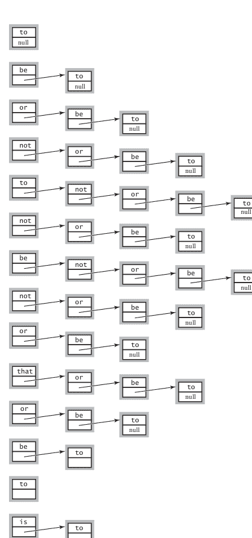

> 栈开发客户端轨迹

## 算法 1.2 压栈栈（链表实现）

```java
public class Stack<Item> implements Iterable<Item>
{
    private Node first; // 栈顶（最近添加的节点）
    private int N; // 元素数量
    private class Node
    { // 用于定义节点的嵌套类
        Item item;
        Node next;
    }
    public boolean isEmpty() { return first == null; }
    public int size() { return N; }
    public void push(Item item) {
        // 将元素添加到栈顶。
        Node oldfirst = first;
        first = new Node();
        first.item = item;
        first.next = oldfirst;
        N++;
    }
    public Item pop() {
        // 从栈顶移除元素。
        Item item = first.item;
        first = first.next;
        N--;
        return item;
    }
    // 迭代器实现请见第 155 页。
    // 测试客户端 main() 请见第 147 页。
}
```

此泛型 `Stack` 实现基于链表数据结构。它可以用于创建包含任何类型数据的栈。为了支持迭代，请添加第 155 页中为 `Bag` 描述的高亮代码。

| % 更多待处理.to-be.txt |
| :--- |
| 存在或不存在 - 存在 - 那样 - 是 |
| % java Stack < tobe.txt |
| 存在不存在那样或是（栈上剩余 2 个元素） = |

## 队列实现

基于链表数据结构的队列 API 实现同样简单，如对页的算法 1.3 所示。它将队列维护为从最先添加到最近添加的元素的链表，并用实例变量 `first` 引用队列头部，用实例变量 `last` 引用队列尾部。因此，为了入队（enqueue）一个元素，我们将其添加到列表尾部（使用第 145 页讨论的代码，并扩展为在列表为空时将 `first` 和 `last` 都指向新节点），为了出队（dequeue）一个元素，我们从列表头部移除（使用与 `Stack` 中 `pop()` 相同的代码，在列表变为空时更新 `last`）。`size()` 和 `isEmpty()` 的实现与 `Stack` 相同。对于 `Stack`，该实现使用了泛型类型参数，我们在 `Bag` 实现中考虑了这一点，并省略了支持迭代的代码。下方显示了一个与 `Stack` 使用的类似的开发客户端，该客户端的轨迹在下一页。此实现使用了与 `Stack` 相同的数据结构——链表——但它通过实现了不同的添加和移除元素的算法，这使得客户端而言能够区分 LIFO（后进先出）和 FIFO（先进先出）。再次，链表的使用实现了我们的优化设计目标：它可以用于任何类型的数据，所需的空间与集合中的元素数量成正比，且每个操作所需的时间与集合的大小无关。

```java
public static void main(String[] args) {
  // 创建一个队列并入队/出队字符串。
  Queue<String> q = new Queue<String>();
  while (!System.in.isEmpty()) {
    String item = System.in.readString();
    if (item.equals("-")) {
      q.enqueue(item);
    } else if (!q.isEmpty()) System.out.print(q.dequeue() + " ");
  }
  System.out.println("(" + q.size() + " 剩余在队列中)");
}
```

队列测试客户端

```text
% more 更多 to.txt
存在或不存在 - - 那样 - 是
% java Queue < tobe.txt
存在或不存在（队列中剩余 2 个元素）
```

## 算法 1.3 FIFO 队列

```java
public class Queue<Item> implements Iterable<Item> {
    private Node first; // 指向最先添加的节点
    private Node last; // 指向最近添加的节点
    private int N; // 队列上的元素数量
    private class Node {
        // 用于定义节点的嵌套类
        Item item;
        Node next;
    }
    public boolean isEmpty() { return first == null; }
    public int size() { return N; }
    public void enqueue(Item item) {
        // 将元素添加到列表尾部。
        Node oldlast = last;
        last = new Node();
        last.item = item;
        last.next = null;
        if (isEmpty()) first = last;
```


```java
else oldlast.next = last;

N++;

}

public Item dequeue() {

    // 从列表头部移除元素。

    Item item = first.item;

    first = first.next;

    N--;

    if (isEmpty()) last = null;

    return item;

}

// iterator() 的实现请见第 155 页。

// 测试客户端 main() 请见第 150 页。

}
```

此泛型 `Queue` 实现基于链表数据结构。它可以用于创建包含任何类型数据的队列。为了支持迭代，请添加第 155 页中为 `Bag` 描述的高亮代码。

# 基础

## 标准输入、标准输出

存在或不存在 - 存在 - 不存在 - 那样 - 那样 - 或 是


### 队列开发轨迹

链表是编程的替代方案，用于结构化数据。在编程历史中，John McCarthy 在 1950 年引入 LISP 是一项里程碑。使用链表进行编程是极其困难的。在现代代码中，链表的使用、自动垃圾回收，使得调试变得困难。正如在 1.4 中所示，为了集合，这种实现是有效的。

## Bag 实现

使用链表数据结构实现 Bag API 只需将栈的 `push()` 改为 `add()`，并移除 `pop()`。为了让 `Stack`、`Queue` 和 `Bag` 都可迭代，第一步是在类声明中包含 `Iterable<Item>`：

```java
import java.util.Iterator;
```

这样我们的代码就可以引用 Java 的 `Iterator` 接口。第二步是为类添加 `iterator()` 方法。`iterator()` 方法只需返回一个实现了迭代器接口的类。对于 `Stack`，它是 LIFO 顺序；对于 `Queue`，它是 FIFO 顺序；对于 `Bag`，它是 LIFO 顺序。在算法 1.4 中详细描述的高亮代码展示了如何实现这一点：

```java
public Iterator<Item> iterator()
    { return new ListIterator(); }
```

此代码承诺实现一个在客户端使用 `foreach` 结构时调用 `hasNext()`、`next()` 和 `remove()` 方法的类。为了实现这些方法，嵌套类 `ListIterator` 维护了一个实例变量 `current` 来跟踪当前节点。`hasNext()` 方法测试 `current` 是否为空，而 `next()` 方法保存当前元素，更新 `current` 指向列表的下一个节点，并返回保存的引用。

# 算法 1.4 Bag

```java
import java.util.Iterator;

public class Bag<Item> implements Iterable<Item>

{

    private Node first; // 列表中的第一个节点

    private class Node

    {

        Item item;

        Node next;

    }

    public void add(Item item)

    { // 与 Stack 的 push() 相同

        Node oldfirst = first;

        first = new Node();

        first.item = item;

        first.next = oldfirst;

    }

    public Iterator<Item> iterator()

    { return new ListIterator(); }

    private class ListIterator implements Iterator<Item>

    {

        private Node current = first;

        public boolean hasNext() { return current != null; }

        public void remove() { }

        public Item next()

        {

            Item item = current.item;

            current = current.next;

            return item;

        }

    }

}
```

此 `Bag` 实现维护了调用 `add()` 时提供的元素链表。`isEmpty()` 和 `size()` 与 `Stack` 相同，此处已省略。迭代器遍历列表，并在 `current` 中维护当前节点。我们可以通过向算法 1.2 和算法 1.3 添加红色高亮代码来使 `Stack` 和 `Queue` 也可迭代，因为它们使用了相同的底层数据结构，且 `Stack` 和 `Queue` 分别按 LIFO 和 FIFO 顺序维护列表。

# 概述

我们在本节中考虑的实现提供了一种抽象和迭代层次，使我们能够编写紧凑的客户端程序来操作对象集合。深入理解这些抽象数据类型（ADT）对于学习算法和数据结构至关重要，原因有三点：首先，在本书中，我们使用这些数据类型作为构建块，构建在更高级的数据结构中。其次，它们说明了数据结构与算法之间的相互作用，以及同时实现可能冲突的自然性能所面临的挑战。第三，我们的某些实现重点关注于支持对对象集合进行更强大操作的 ADT，我们把这些实现作为起点。

## 数据结构

我们现在有两种方式来表示对象集合：数组和链表。数组是 Java 内置的；链表可以通过标准的 Java record 轻松构建。这两种替代方案通常被称为顺序分配（sequential allocation）和链式定位（linked location）。在书的后半部分中，我们开发了能够以多种方式结合并扩展这些结构的 ADT 实现。

一个重要的扩展是具有多个链接的数据结构。例如，我们在 3.2 节和 3.5 节的重点是被称为二叉树的数据结构，它们由每个具有两个链接的节点构建。另一个重要的数据结构是：通过组合，我们可以拥有栈的包（bag）、数组的队列等等。例如，我们在第 4 章的重点是图，我们将其表示为包（bag）数组。通过这种方式定义任意复杂度的数据结构非常容易：我们关注抽象数据类型的一个重要原因是试图控制这种复杂性。

| 数据结构 | 优点 | 缺点 |
| --- | --- | --- |
| 数组 | 索引可以提供对任何项的立即访问 | 初始化时需要知道大小 |
| 链表 | 使用与大小成正比的空间 | 需要引用来访问项 |
| 基础数据结构 | | |

本节中对包（BAGS）、队列（QUEUES）和栈（STACKS）的处理是我们在书中使用的方法的典型示例。在处理一个新应用领域时，我们识别计算挑战并使用数据抽象来解决它们，步骤如下：

- 规范一个 API。
- 针对特定应用程序开发客户端代码。
- 描述一种数据结构（值集合的表示），它可以作为类中实例变量的基础，该类将实现符合 API 规范的 ADT。
- 描述算法（实现操作集的方法），它们可以作为类中实例方法实现的基础。
- 分析算法的性能特征。

在下一节中，我们将详细考虑这最后一步，因为它通常决定了哪些算法和实现在解决现实应用时最有用。

| 数据结构 | 章节 | ADT | 表示形式 |
|---|---|---|---|
| 父节点链接树 | 1.5 | `UnionFind` | 整数数组 |
| 二叉搜索树 | 3.2, 3.3 | `BST` | 每个节点两个链接 |
| 字符串 | 5.1 | `String` | 数组、偏移量和长度 |
| 二叉堆 | 2.4 | `PQ` | 对象数组 |
| 哈希表（分离链法） | 3.4 | `SeparateChainingHashST` | 链表数组 |
| 哈希表（线性探测法） | 3.4 | `LinearProbingHashST` | 两个对象数组 |
| 图邻接列表 | 4.1, 4.2 | `Graph` | `Bag` 对象数组 |
| 字典树（trie） | 5.2 | `TrieST` | 带有链接数组的节点 |
| 三元搜索字典树 | 5.3 | `TST` | 每个节点三个链接 |

书中开发的的数据结构示例

## 问答

**Q.** 并不是所有的编程语言都支持泛型，即使是 Java 的早期版本也是。替代方案有哪些？

**A.** 一种替代方案是为每种数据类型维护不同的实现，如文所述。另一种是构建一个 `Object` 值的栈，然后在代码中 `pop()` 时将其强制转换为所需的类型。这种方法的问题是无法在运行时检测到类型匹配错误。但有了泛型，如果你编写代码向栈中推入错误类型的对象，如下：

```java
Stack<Apple> stack = new Stack<Apple>();

Apple a = new Apple();

...

Orange b = new Orange();

...

stack.push(a);

stack.push(b); // 编译错误
```

你将得到一个编译错误：

```text
push(Apple) in Stack<Apple> cannot be applied to (Orange)
```

在编译时发现错误的能力是使用泛型的足够理由。

**Q.** 为什么 Java 不允许数组？

**A.** 专家们对这一点仍有争论。你可能需要成为其中之一才能理解它！首先，学习协变数组（covariant arrays）和类型擦除（type erasure）。

**Q.** 如何创建一个字符串栈的数组？

**A.** 使用强制类型转换，如下：

```java
Stack<String> a = (Stack<String>) new Stack[N];
```

警告：在客户端代码中的这种强制转换与第 134 页描述的不同。你可能原预期使用 `Object` 而不是 `Stack`。当使用泛型时，Java 在编译时检查类型安全，但在运行时会丢弃信息，因此只剩下 `Stack<Object>[]` 或简写为 `Stack[]`，我们必须将其强制转换为 `Stack<String>`。

**Q.** 如果我的程序对空栈调用 `pop()` 会发生什么？

**A.** 这取决于实现。对于我们第 149 页的实现，你将得到一个 `NullPointerException`。在我们书网站上的实现中，我们抛出一个运行时异常来帮助用户定位错误。通常，在可能被许多人使用的代码中包含尽可能多的检查。

**Q.** 既然有了链表，为什么我们选择可调整大小的数组？

**A.** 我们将看到几个 ADT 实现示例，它们需要使用数组来执行链表不易支持的操作。`ResizingArrayStack` 是一个控制内存用用的模型。

**Q.** 为什么将 `Node` 类声明为 `private`？为什么要用 `private`？

通过将嵌套的 `Node` 声明为 `private`，我们限制了它对外部类内部方法和实例变量的访问。私嵌套类的一个特征是从外部类可以直接访问实例变量但在其他地方不能，因此不需要将实例变量声明为私。专家注意：非静态类被称为内部类，因此从技术上讲，我们的 `Node` 类是内部类。

**Q.** 当我用 `javac Stack.java` 编译 ALGORITHM 1.2 类似的程序时，我发现了 `Stack.class` 和文件 `StackNode.class`。第二个文件的目的是什么？

**A.** 该文件是用于内部类 `Node` 的。Java 的命名规范是使用 `$` 作为内部类中外部类的名称。

**Q.** 有用于栈和队列的 Java 库吗？

**A.** 有也没有。Java 有 `java.util.Stack`，但你应该避免使用它。它有几个与栈无关额外操作，例如获取第 i 个元素。它还允许在底部添加元素。`java.util.Stack` API 是宽接口的一个示例，我们努力避免这种情况。

# 问答（继续）

**Q.** 是否应该允许客户端向栈或队列插入 `null` 项？

**A.** 这在 Java 中实现集合时经常出现。我们的实现（以及 Java 的栈和队列库）允许插入 `null` 值。

**Q.** 如果在迭代期间调用 `push()` 或 `pop()`，栈的迭代器应该做什么？

**A.** 抛出 `java.util.ConcurrentModificationException` 以实现快速失败迭代。见练习 1.3.50。

**Q.** 我可以使用数组进行 `foreach` 循环吗？

**A.** 可以（尽管数组没有实现 `Iterable` 接口）。以下单行代码打印命令行：

```java
public static void main(String[] args)

  { (String s : args) StdOut.println(s); }
```

**Q.** 我可以使用字符串进行 `foreach` 循环吗？

**A.** 不可以。`String` 没有实现 `Iterable`。

**Q.** 为什么不有一个单一的 `Collection` 类型实现添加项、删除最近插入的、删除最先插入的、随机删除、迭代、返回集合中的项数以及我们可能需要的其他操作？这样我们就可以在一个客户端使用的类中实现所有方法。

**A.** 再次，这是一个宽接口的示例。Java 在 `java.util.ArrayList` 和 `java.util.LinkedList` 类中提供了此类实现。避免它们的一个原因是无法保证所有操作都是高效的。在本书中，我们使用 API 作为设计高效算法和数据结构的起点，与具有许多操作的接口相比，这对只有少数操作的接口容易得多。

坚持窄接口的另一个原因是它们对客户端程序强制执行了特定的纪律，使得客户端代码更容易理解。如果一个客户端使用 `Stack<String>` 而另一个客户端使用 `Queue<Transaction>`，我们就知道 LIFO 纪律对前者很重要，而 FIFO 纪律对后者很重要。

# 练习

**1.3.1** 为 `FixedCapacityStackOfStrings` 添加一个方法 `isFull()`。

**1.3.2** 针对以下输入，给出 `java Stack` 打印的输出：

```text
it was the best - of times - - it was the - -
```

**1.3.3** 假设有一个类执行了交替的（栈）入栈（`push`）和出栈（`pop`）操作。`push` 操作将整数 0 到 9 按顺序压入栈中；`pop` 操作打印返回值。下列序列中哪一个可能发生？

- a. 4 3 2 1 0 9 8 7 6 5
- b. 4 6 8 7 5 3 2 9 0 1
- c. 2 5 6 7 4 8 9 3 1 0
- d. 4 3 2 1 4 5 6 7 8 9
- e. 1 2 3 4 5 6 9 8 7 0
- f. 0 4 6 5 3 8 1 7 2 9
- g. 1 4 7 9 8 6 5 3 0 2
- h. 2 1 4 3 5 6 8 7 9 0

**1.3.4** 编写一个 `Parentheses` 栈类，从标准输入读取文本流并使用栈来判断括号是否正确平衡。例如，你的程序对于 `[()]{[()]{}}` 打印 `true`，而对于 `[()]` 打印 `false`。

**1.3.5** 当 `N` 为 50 时，以下代码片段打印什么？请从高层面描述该代码在处理正整数 `N` 时的功能。

```java
Stack<Integer> stack = new Stack<Integer>();

while (N > 0) {

  stack.push(N % 2);

  N = N / 2;

}

for (int d : stack) Stdout.print(d);

Stdout.println();
```

答案：当 `N` 为 50 时，打印 `N` 的二进制表示（110010）。

# 练习（续）

**1.3.6** 以下代码片段对队列做了什么？

```java
Stack<String> stack = new Stack<String>();

while (q.isEmpty())

    stack.push(q.dequeue());

while (!stack.isEmpty())

    q.enqueue(stack.pop());
```

**1.3.7** 为 `Stack` 添加一个方法 `peek()`，该方法返回栈中最近插入的项（但不弹出它）。

**1.3.8** 针对以下输入，给出 `ResizingArrayStackOfStrings` 数组的内容和大小：

```text
it was - the best - of times - it was - the -
```

**1.3.9** 编写一个程序，从标准输入读取一个不带左括号的表达式，并打印插入括号后的等效中缀表达式。例如，给定输入为：

```text
( 1 + 2 ) * ( 3 - 4 ) * ( 5 - 6 ) )
```

你的程序应该打印：

```text
( ( 1 + 2 ) * ( 3 - 4 ) * ( 5 - 6 ) )
```


**1.3.10** 编写一个`FilterInToPostfix`，将算术表达式从中缀转换为后缀表达式。

**1.3.11** 编写一个程序`EvaluatePostfix`，从标准输入读取一个后缀表达式，对其进行求值并返回结果。（将上一个练习程序的输出通过管道传递给此程序，其行为等同于`Evaluate`。）

**1.3.12** 编写一个可迭代的`Stack`类，它有一个静态方法`copy()`，该方法接受一个字符串栈作为参数并返回该栈的副本。注意：这种能力是使用迭代器价值的典型示例，因为它允许在没有基本 API 的情况下开发此类功能。

**1.3.13** 假设一个客户端执行了交替的（队列）入队（`enqueue`）和出队（`dequeue`）操作。`enqueue`操作将整数 0 到 9 按顺序放入队列；`dequeue`操作打印返回值。下列序列中哪一个（或几个）可能发生？

- a. 0 1 2 3 4 5 6 7 8 9
- b. 4 6 8 7 5 3 2 9 0 1
- c. 2 5 6 7 4 8 9 3 1 0
- d. 4 3 2 1 0 5 6 7 8 9

**1.3.14** 开发一个`ResizingArrayOfStrings`类，用固定大小的数组实现队列抽象，然后扩展你的实现以使用数组扩容来移除大小限制。

**1.3.15** 编写一个`Queue`客户端，它接受命令行参数`k`，并打印标准输入中找到倒数第`k`个字符串（假设标准输入多于`k`个字符串）。

**1.3.16** 以第126页的`readInts()`为模型，为`Date`编写一个静态方法`readDates()`，它按照第119页表格指定的格式从标准输入读取日期，并返回一个包含这些日期的数组。

**1.3.17** 为`Transaction`完成练习 1.3.16。

# 链表练习

此练习列表旨在让你获得处理链表的经验。建议：使用文中描述的视觉表示进行绘图。

**1.3.18** 假设`x`是链表节点且不是最后一个节点。以下代码的效果是：

```
x.next = x.next;
```

答案：删除了`x`之后的节点。

**1.3.19** 给出一个代码片段，删除链表中的最后一个节点，假设第一个第一个。

**1.3.20** 编写一个`delete()`方法，接受整数`k`并删除链表中的第`k`个元素。

**1.3.21** 编写一个`find()`方法，接受链表和字符串键作为参数，如果存在则返回节点，否则返回 false。

**1.3.22** 假设`x`是链表节点。以下代码做了什么？

```
t.next = x.next;
```

答案：在`x`之后插入节点`t`。

**1.3.23** 为什么以下代码片段与上一个问题的作用相同？

```
t.next = x.next;
```

答案：当更新`t.next`时，`x.next`不再是原来的后续节点，而是变成了`t`。

**1.3.24** 编写一个`removeAfter()`方法，接受链表作为参数并移除给定节点之后的（如果参数为空则不操作）。

**1.3.25** 编写一个`insertAfter()`方法，接受链表作为参数（如果参数为空则不操作）。

# 包、队列与栈

**1.3.26** 编写一个`remove()`方法，接受链表和字符串键作为参数并移除列表中所有的节点。

**1.3.27** 编写`max()`方法，接受链表第一个节点作为参数并返回列表中的最大值。假设所有键均为正整数，如果列表为空则返回 0。

**1.3.28** 为上一个问题开发递归解决方案。

**1.3.29** 编写一个使用循环链表的`Queue`实现，只需保留一个实例`last`。

**1.3.30** 编写一个函数，接受链表第一个节点作为参数并（递归地）反转列表，返回结果的第一个节点。

*迭代解决方案*：为了完成此任务，我们维护三个连续节点：`reverse`、`first`和`second`。在每次迭代中，我们从原始列表中提取`first`并将其插入反转列表的开头。我们保持不变：`first`是原始列表中剩余部分的第一个，`second`是原始列表中剩余部分的第二个，而`reverse`是反转列表的第一个节点。

```
public Node reverse(Node x) {
    Node first = x;
    Node reverse = null;
    while (first != null) {
        Node second = first.next;
        first.next = reverse;
        reverse = first;
        first = second;
    }
    return reverse;
}
```

在编写涉及链表的代码时，必须始终小心处理异常情况（链表为空、只有两个节点）和边界情况（处理第一个或最后一个元素）。这通常比处理正常情况更复杂。

*递归解决方案*：假设链表有 N 个节点，我们反转后 N-1 个节点，然后仔细地将第一个节点附加到末尾。

```
public Node reverse(Node first) {
    if (first == null) return null;
    if (first.next == null) return first;
    Node second = first.next;
    Node rest = reverse(second);
    second.next = first;
    first.next = null;
    return rest;
}
```

**1.3.31** 为构建双链表实现一个嵌套类`DoubleNode`，其中每个节点包含指向列表中前驱项和后续项的引用（如果没有此类项则为`null`）。然后为以下任务编写静态方法：在头部插入、在尾插入、从头部删除、从尾删除、在给定节点之前插入、在给定节点之后插入以及删除给定节点。

# 创造性问题

**1.3.32** Steque。栈尾队列（Steque）是一种支持 push（入）、pop（弹出）和 enqueue（入队）的数据类型。为这个抽象数据类型（ADT）设计 API。开发一个基于链表的实现。

**1.3.33** Deque。双端队列（deque，读作 "deck"）类似于栈或队列，但支持在两端添加和删除元素。deque 收集一组元素并支持以下 API：

```
public class Deque<Item> implements Iterable<Item>
    create an empty deque 创建一个空的双端队列
    boolean isEmpty() size() 队列中元素的数量
    void pushLeft(Item item) 在左端添加一个元素
    void pushRight(Item item) 在右端添加一个元素
    Item popLeft() 从左端删除一个元素
    Item popRight() 从右端删除一个元素
泛型双端队列的 API
```

创建一个`Deque`类，使用双向链表实现此 API，并创建一个使用动态数组数组的`ResizingArrayDeque`类。

**1.3.34** RandomBag。随机袋（RandomBag）存储一组元素并支持以下 API：

```
public class RandomBag<Item> implements Iterable<Item>
    create an empty random bag 创建一个空的随机袋
    boolean isEmpty() 为空吗？
    int size() 袋中元素的数量
    void add(Item item) 添加一个元素
泛型随机袋的 API
```

创建一个实现此 API 的`RandomBag`类。注意，此 API 与 Bag 相同，区别在于“随机”（random）这个形容词，它表示迭代应该以随机顺序提供元素（对于每个迭代器，所有 N! 种排列的概率相等）。提示：将元素放入数组，并在迭代器的构造函数中随机化它们的顺序。

**1.3.35** Random queue。随机队列（RandomQueue）存储一组元素并支持以下 API：

```
public class RandomQueue<Item>
    RandomQueue()                创建一个空的随机队列
    boolean isEmpty()           是否为空？
    void enqueue(Item item)      添加一个元素
    Item dequeue()              删除并返回一个随机元素（不放回抽样）
    Item sample()               返回一个随机元素，但不删除（有放回抽样）
泛型随机队列的 API
```

编写实现此 API 的`RandomQueue`类。提示：使用数组表示（带动态扩容）。要删除元素，将随机位置（索引 0 到 N-1）的元素与最后一个位置（索引 N-1）交换。然后删除并返回最后一个对象，类似于`ResizingArrayStack`。编写一个使用`RandomQueue<Card>`的客户端来处理桥牌牌（每手 13 张牌）。

**1.3.36** 随机迭代器。为上一个练习中的`RandomQueue<Item>`写一个迭代器，以随机顺序返回元素。

**1.3.37** 约瑟夫问题。在古代的约瑟夫问题中，N 个人陷入困境并同意以下策略减少人数。他们排成一个圈（位置编号为 0 到 N-1），绕圈移动，每删除第 M 个人直到只剩一人。传说约瑟夫想出了坐在哪里可以避免被淘汰。编写一个`Queue`客户端，从命令行获取 M 和 N，并打印人们被淘汰的顺序（这将显示约瑟夫应该坐在圈的哪个位置）。

```
% java Joseph 2 7
1 3 5 0 2 4 6
```

## 1.3 袋、队列和栈

**1.3.38** 删除第 k 个元素。实现一个支持以下 API 的类：

```
public class GeneralizedQueue<Item>
    GeneralizedQueue()    创建一个空队列
    boolean isEmpty()        队列为空吗？
    void insert(Item x)      添加一个元素
    Item delete(int k)      删除并返回倒数第 k 个元素
泛型通用队列的 API
```

首先，开发一个使用数组的实现，然后开发一个使用链表的实现。注意：我们在第 3 章中引入的算法和数据结构使得开发一个能够保证`insert()`和`delete()`时间与队列中元素数量对数成比的成为可能——参见练习 3.5.27。

**1.3.39** 环形缓冲区。环形缓冲区（Ring buffer）或循环队列是一个固定大小 N 的 FIFO 数据结构。它对于在异步进程之间传输数据或存储日志文件非常有用。当缓冲区为空时，消费者等待数据存入；当缓冲区满时，生产者等待存入数据。为`RingBuffer`开发一个 API 以及一个使用数组表示（带环形循环）的实现。

**1.3.40** 移到前端（Move-to-front）。从标准输入读取一个序列，并在无重复的链表中维护这些字符。当你读到一个以前未见过的字符时，将其插入到列表头部。当你读到重复字符时，将其从列表中删除并插入开头。将你的程序命名为`MoveToFront`：它实现了著名的“移到前端”策略，这对于缓存、数据压缩以及许多其他访问过的项可能可能再次访问的应用有用。

**1.3.41** 复制队列。创建一个新的构造函数，使得：

```
Queue<Item> r = new Queue<Item>(q);
```

使`r`队列`q`的新且独立副本的引用。你可以对`q`或`r`进行入队和弹出操作而不影响对方。提示：从`q`删除所有元素并将这些元素添加到`r`。

## 创造性问题（续）

**1.3.42** 复制栈。为链表实现创建一个新的构造函数，使得

```
Stack<Item> t = new Stack<Item>(s);
```

使`t`栈`s`的新且独立副本的引用。

**1.3.43** 列出文件。文件夹是文件的列表。编写一个程序，获取文件夹名称作为命令行参数，并打印出该文件夹中的所有文件。提示：使用队列。

**1.3.44** 文本编辑器缓冲区。开发一种实现以下 API 的缓冲区数据类型：

```
public class Buffer {
    Buffer()
    void insert(char c)
    char get()
    char delete()
    void left(int k)
    void right(int k)
    int size()
}
```


缓冲区 API。提示：使用栈。

### 1.3.45 栈生成性
假设我们有一个交替的 `push` 和 `pop` 操作序列，整数 `0, 1, ..., N-1`（`push` 指令）与负号（`pop` 指令）混合。设计一个算法判断交替序列是否会导致栈下溢。（你只能使用与 `N` 无关的空间——不能存储整数。）设计一个线性时间算法，判断给定的排列是否可以作为输出生成（取决于 `pop` 指令出现的位置）。

### 1.3.46 栈生成的三元组
证明一个排列可以通过栈生成（如上一题所示），当且仅当它没有三元组 `(a, b, c)`，满足 `a < b < c` 且 `a` 先出现、`b` 后出现、`c` 最后出现（在 `a` 和 `c` 之间以及 `a` 和 `b` 之间可能有其他整数）。

**部分解**：假设存在 `a, b, c`。`a` 在 `b` 之前弹出，但 `a` 和 `b` 在 `c` 之前推送。因此当 `c` 被推送时，`a` 和 `b` 都在栈中。因此 `a` 不能在 `b` 之前弹出。

### 1.3.47 可连接队列或 stequ
添加一个额外的合并操作，破坏性地合并两个队列、栈或 `stequ`（参见练习 1.3.32）。提示：使用循环链表并维护最后一个元素的指针。

### 1.3.48 双栈
使用单个双端队列实现两个栈，使得每次操作只需要常数次 `deque` 操作（参见练习 1.3.33）。

### 1.3.49 常数栈队列
使用常数量的栈实现队列，使得每个队列操作只需要常数次（最坏情况）栈操作。警告：难度很高。

### 1.3.50 快速失败迭代器
修改栈中的迭代器，如果客户端在迭代期间（通过 `push` 或 `pop`）修改集合，则立即抛出 `java.util.ConcurrentModificationException`。

**解决方案**：维护一个计算 `push` 和 `pop` 操作的计数器。创建迭代器时，将此值存储为迭代器的实例变量。在每次调用 `hasNext()` 和 `next()` 之前，检查该值是否自构造迭代器以来发生了变化；如果是，则抛出异常。

---

## 1.4 算法分析

随着人们使用计算机经验的增加，他们开始使用计算机来解决困难的问题或处理大量数据，并不可避免地引出以下问题：

- 你的程序运行多长时间？
- 为什么我的程序会耗尽内存？

你一定问过自己这些问题，也许是在重新构建音乐或照片库、安装新应用程序、处理大型文档或处理大量实验数据时。这些问题太难了，无法精确回答——答案取决于许多因素，例如所用特定计算机的属性、正在处理的特定数据以及执行任务的特定程序（其实现了某些算法）。所有这些都留下了海量需要分析的信息。

尽管存在这些挑战，但为这些问题开发有效答案的路径非常直观，正如你将在本节中看到的。这一过程基于科学方法，即科学家用于开发关于自然界知识的被广泛接受的技术体系。我们应用数学分析来建立成本模型，并通过实验研究来验证这些模型。

### 科学方法

科学家用来理解自然界的方法对于研究程序的运行时间同样有效：

- 观察自然世界的某些特征，通常带有精确的测量。
- 假设一个与观察结果一致的模型。
- 使用假设预测事件。
- 通过进一步观察来验证预测。
- 重复实验直到假设和观察结果一致，从而进行验证。

科学方法的核心原则之一是，我们设计的实验必须是可以重复的，这样其他人才能确信假设的有效性。假设还必须是可证伪的，这样我们才能确定某个假设是错误的（并且需要修正）。正如爱因斯坦著名的名言（“任何数量的实验都无法证明正确；一次实验就可以证明错误”），我们永远无法确定任何假设是绝对正确的；我们只能验证它是否与我们的观察结果一致。

## 观察

我们的第一个挑战是确定如何对运行时间进行定量测量。这项任务在自然科学中要容易得多。我们不需要向火星发射火箭或杀死实验室动物或分裂原子——我们只需要运行程序。每当你运行程序时，你都在进行一次程序与自然世界相关的科学实验，并回答了我们的核心问题之一：我的程序运行多长时间？

我们对大多数程序的第一个定性观察是，存在一个表征计算任务难度的问题规模。通常，问题规模就是输入的大小，或者是命令行参数的值。直觉上，运行时间应该随着问题规模的增加而增加，但每次在我们开发和运行程序时，它自然增长的程度是多少是一个问题。

对大多数程序的另一个定性观察是，运行时间对输入相对敏感；它主要取决于问题规模。如果这种关系不成立，我们需要采取步骤来更好地理解并可能更好地控制运行时间对输入的敏感性。但这种关系通常成立的，因此我们专注于更好地量化问题规模与运行时间之间关系的目标。

**示例**：作为一个运行示例，我们在这里将使用 `ThreeSum` 程序，它统计一个包含 `N` 个整数的文件中和为 `0` 的三元组数量（假设溢出没有影响）。这个计算对你来说可能看起来很人为，但它与许多基础任务密切相关（例如，参见练习 1.4.26）。作为测试输入，考虑网站上的 `1M.txt` 文件，它包含 100 万个随机生成的值。`1M.txt` 中的第二、第八和第十项之和为 `0`。文件中多少个这样的三元组？`ThreeSum` 可以告诉我们，但它能在合理的时间内吗？`ThreeSum` 的问题规模 `N` 与运行时间之间是什么关系？作为第一次实验，尝试在你的计算机上对文件 `1Kints.txt`、`2Kints.txt`、`4Kints.txt` 和 `8Kints.txt` 运行 `ThreeSum`。

```java
public class ThreeSum {

    public static int count(int[] a) {

        // 计算和为 0 的元组

        int n = a.length;

        int cnt = 0;

        for (int i = 0; i < n; i++) {

            for (int j = i + 1; j < n; j++) {

                for (int k = j + 1; k < n; k++) {

                    if (a[i] + a[j] + a[k] == 0)

                        cnt++;

                }

            }

        }

        return cnt;

    }

    public static void main(String[] args) {

        int[] a = In.readInts(args[0]);

        System.out.println(count(a));

    }

}
```

给定 `N`，你的程序运行多长时间？

| 1Mints.txt |
| :--- |
| 324110 |
| -442472 |
| 626686 |
| -157678 |
| 508681 |
| 123414 |
| -77867 |
| 155091 |
| 287382 |
| 604242 |
| 686904 |
| -247109 |
| 77867 |
| 982455 |
| 210707 |
| -922943 |
| -738817 |
| 85168 |
| 855430 |

更多 `1Mints.txt`，它们分别包含 `1Mints.txt` 中的前 1000、2000、4000 和 8000 个整数。给定 `N`，你的程序运行多长时间？文件中多少个这样的三元组？`ThreeSum` 可以告诉我们，但它能在合理的时间内吗？`ThreeSum` 的问题规模 `N` 与运行时间之间是什么关系？作为第一次实验，尝试在你的计算机上对文件 `1Kints.txt`、`2Kints.txt`、`4Kints.txt` 和 `8Kints.txt` 运行 `ThreeSum`。

---

## 算法分析

### API 公类 `Stopwatch`

```java
Stopwatch()                // 创建一个计时器
double elapsedTime()       // 返回自创建以来的已过时间
```

### 典型客户端

```java
public static void main(String[] args)

{

    int N = Integer.parseInt(args[0]);

    int[] a = new int[N];

    for (int i = 0; i < N; i++)

        a[i] = Random.uniform(-1000000, 1000000);

    Stopwatch timer = new Stopwatch();

    int cnt = ThreeSum.count(a);

    double time = timer.elapsedTime();

    Stdout.println(cnt + " triples " + time + " seconds");

}
```

### 应用

```java
% java Stopwatch 1000

51 triples 0.488 seconds

% java Stopwatch 2000

516 triples 3.855 seconds
```

### 实现

```java
public class Stopwatch

{

    private final long start;

    public Stopwatch()

    {

        start = System.currentTimeMillis();

    }

    public double elapsedTime()

    {

        long now = System.currentTimeMillis();

        return (now - start) / 1000.0;

    }

}
```

一个计时器的抽象数据类型。

---

## 实验数据分析

对面页面上的 `DoublingTest` 程序是一个更复杂的 `Stopwatch` 客户端，它为 `ThreeSum` 产生实验数据。它生成一个随机输入数组序列，每一步将数组大小翻倍，并打印每个输入规模下 `ThreeSum.count()` 的运行时间。这些实验无疑是可重复的——你也可以在自己的计算机上运行它们，次数不限。当你运行 `DoublingTest` 时，你会发现自己处于一个预测-验证的循环中：它很快地打印出几行，然后速度显著变慢。每当它打印一行时，你都会想距离下一行出现还有多久。当然，由于你使用的计算机和我们的不同，你得到的实际运行时间可能与我们显示的不同。事实上，如果你的计算机比我们的快一倍，你的运行时间将减少一半，这引出了一个根据充分的假设：不同计算机上的运行时间可能存在一个常数倍的差异。因此，你会发现自己问了一个更详细的问题：我的程序作为输入规模的函数需要多久？为了回答这个问题，我们绘制了数据。对面底部的图表显示了数据绘制的结果，分别在普通刻度和对数刻度上，`x` 轴为问题规模 `N`，`y` 轴为运行时间 `T(N)`。对数对数图立即得出了关于运行时间的假设——数据在对数对数图上符合一条斜率为 `3` 的直线。这种直线的方程为：

```java
lg(T(N)) = 3 lg N + lg a
```

（其中 `a` 是常数）这等同于

```java
T(N) = a N^3
```

即所需的作为输入规模函数的运行时间。我们可以使用其中一个数据点来解出 `a`——例如 `T(8000) = 51.1`，`a = 8000^3`，所以 `a = 9.98×10⁻¹¹`，然后我们使用方程

```java
T(N) = 9.98×10⁻¹¹ N³
```

来预测大 `N` 的运行时间。非正式地说，我们正在检查该假设：对数对数图上的数据点接近直线。可以使用统计方法进行更仔细的分析，以找到 `a` 和指数 `b` 的估计值，但我们的快速计算已足够估计大多数用途的运行时间。例如，我们估计我们的计算机上 `N=16,000` 时的运行时间约为 `9.98×10⁻¹¹ × 60000³ = 408.8` 秒，或大约 `6.8` 分钟（实际时间为 `409.3` 秒）。在等待你的计算机在 `DoublingTest` 中打印 `N=16,000` 的行时，你可以使用这种方法预测它何时完成，然后通过等待观察预测是否正确来检查结果。

---

### 执行实验的程序

```java
public class DoublingTest

{

    public static double timeTrial(int N) {

        // 0.0

        // 针对 N 个随机 6 位整数的 ThreeSum.count()

        int MAX = 1000000;

        int[] a = new int[N];

        for (int i = 0; i < N; i++)

            a[i] = Random.uniform(-MAX, MAX);

        Stopwatch timer = new Stopwatch();

        int cnt = ThreeSum.count(a);

        return timer.elapsedTime();

    }

    public static void main(String[] args) {

        // 打印运行时间表。

        for (int N = 250; true; N += N) {

            // 打印问题规模 N 的时间。

            double time = timeTrial(N);

            System.out.printf("%7d %5.1f\n", N, time);

        }

    }

}
```

### 实验结果

| java | DoublingTest |
|---|---|
| 250 | 0.0 |
| 500 | 0.0 |
| 1000 | 0.1 |
| 2000 | 0.8 |
| 4000 | 6.4 |
| 8000 | 51.1 |

实验数据分析。对面页面上的 `DoublingTest` 程序是一个更复杂的 `Stopwatch` 客户端，它为 `ThreeSum` 产生实验数据。它生成一个随机输入数组序列，每一步将数组大小翻倍，并打印每个输入规模下 `ThreeSum.count()` 的运行时间。这些实验无疑是可重复的——你也可以在自己的计算机上运行它们，次数不限。当你运行 `DoublingTest` 时，你会发现自己处于一个预测-验证的循环中：它很快地打印出几行，然后速度显著变慢。每当它打印一行时，你都会想距离下一行出现还有多久。当然，由于你使用的计算机和我们的不同，你得到的实际运行时间可能与我们显示的有所不同。事实上，如果你的计算机比我们的快一倍，你的运行时间将减少一半，这引出了一个根据充分的假设：不同计算机上的运行时间可能存在一个常数倍的差异。因此，你会发现自己问了一个更详细的问题：我的程序作为输入规模的函数需要多久？为了回答这个问题，我们绘制了数据。对面底部的图表显示了数据绘制的结果，分别在普通刻度和对数刻度上，`x` 轴为问题规模 `N`，`y` 轴为运行时间 `T(N)`。对数对数图立即得出了关于运行时间的假设——数据在对数对数图上符合一条斜率为 `3` 的直线。这种直线的方程为：

```java
lg(T(N)) = 3 lg N + lg a
```

（其中 `a` 是常数）这等同于

```java
T(N) = a N^3
```

即所需的作为输入规模函数的运行时间。我们可以使用其中一个数据点来解出 `a`——例如 `T(8000) = 51.1`，`a = 8000^3`，所以 `a = 9.98×10⁻¹¹`，然后我们使用方程

```java
T(N) = 9.98×10⁻¹¹ N³
```

来预测大 `N` 的运行时间。非正式地说，我们正在检查该假设：对数对数图上的数据点接近直线。可以使用统计方法进行更仔细的分析，以找到 `a` 和指数 `b` 的估计值，但我们的快速计算已足够估计大多数用途的运行时间。例如，我们估计我们的计算机上 `N=16,000` 时的运行时间约为 `9.98×10⁻¹¹ × 60000³ = 408.8` 秒，或大约 `6.8` 分钟（实际时间为 `409.3` 秒）。在等待你的计算机在 `DoublingTest` 中打印 `N=16,000` 的行时，你可以使用这种方法预测它何时完成，然后通过等待观察预测是否正确来检查结果。

---

## 1.4 算法分析

# 177

### 执行实验的程序

```java
public class DoublingTest

{

    public static double timeTrial(int N) {

        // 0.0

        // 针对 N 个随机 6 位整数的 ThreeSum.count()

        int MAX = 1000000;

        int[] a = new int[N];

        for (int i = 0; i < N; i++)

            a[i] = Random.uniform(-MAX, MAX);

        Stopwatch timer = new Stopwatch();

        int cnt = ThreeSum.count(a);

        return timer.elapsedTime();

    }

    public static void main(String[] args) {

        // 打印运行时间表。

        for (int N = 250; true; N += N) {

            // 打印问题规模 N 的时间。

            double time = timeTrial(N);

            System.out.printf("%7d %5.1f\n", N, time);

        }

    }

}
```

### 实验结果

| java | DoublingTest |
|---|---|
| 250 | 0.0 |
| 500 | 0.0 |
| 1000 | 0.1 |
| 2000 | 0.8 |
| 4000 | 6.4 |
| 8000 | 51.1 |

实验数据分析。对面页面上的 `DoublingTest` 程序是一个更复杂的 `Stopwatch` 客户端，它为 `ThreeSum` 产生实验数据。它生成一个随机输入数组序列，每一步将数组大小翻倍，并打印每个输入规模下 `ThreeSum.count()` 的运行时间。这些实验无疑是可重复的——你也可以在自己的计算机上运行它们，次数不限。当你运行 `DoublingTest` 时，你会发现自己处于一个预测-验证的循环中：它很快地打印出几行，然后速度显著变慢。每当它打印一行时，你都会想距离下一行出现还有多久。当然，由于你使用的计算机和我们的不同，你得到的实际运行时间可能与我们显示的有所不同。事实上，如果你的计算机比我们的快一倍，你的运行时间将减少一半，这引出了一个根据充分的假设：不同计算机上的运行时间可能存在一个常数倍的差异。因此，你会发现自己问了一个更详细的问题：我的程序作为输入规模的函数需要多久？为了回答这个问题，我们绘制了数据。对面底部的图表显示了数据绘制的结果，分别在普通刻度和对数刻度上，`x` 轴为问题规模 `N`，`y` 轴为运行时间 `T(N)`。对数对数图立即得出了关于运行时间的假设——数据在对数对数图上符合一条斜率为 `3` 的直线。这种直线的方程为：

```java
lg(T(N)) = 3 lg N + lg a
```

（其中 `a` 是常数）这等同于

```java
T(N) = a N^3
```

即所需的作为输入规模函数的运行时间。我们可以使用其中一个数据点来解出 `a`——例如 `T(8000) = 51.1`，`a = 8000^3`，所以 `a = 9.98×10⁻¹¹`，然后我们使用方程

```java
T(N) = 9.98×10⁻¹¹ N³
```

来预测大 `N` 的运行时间。非正式地说，我们正在检查该假设：对数对数图上的数据点接近直线。可以使用统计方法进行更仔细的分析，以找到 `a` 和指数 `b` 的估计值，但我们的快速计算已足够估计大多数用途的运行时间。例如，我们估计我们的计算机上 `N=16,000` 时的运行时间约为 `9.98×10⁻¹¹ × 60000³ = 408.8` 秒，或大约 `6.8` 分钟（实际时间为 `409.3` 秒）。在等待你的计算机在 `DoublingTest` 中打印 `N=16,000` 的行时，你可以使用这种方法预测它何时完成，然后通过等待观察预测是否正确来检查结果。


## 1.4 算法分析

### 执行实验的程序

```java
public class DoublingTest {
    public static double timeTrial(int N) {
        // 0.0
        // 针对 N 个随机 6 位整数的 ThreeSum.count()
        int MAX = 1000000;
        int[] a = new int[N];

        for (int i = 0; i < N; i++)
            a[i] = Random.uniform(-MAX, MAX);

        Stopwatch timer = new Stopwatch();
        int cnt = ThreeSum.count(a);

        return timer.elapsedTime();
    }

    public static void main(String[] args) {
        // 打印运行时间表。
        for (int N = 250; true; N += N) {
            // 打印问题规模 N 的时间。
            double time = timeTrial(N);
            System.out.printf("%7d %5.1f\n", N, time);
        }
    }
}
```

### 实验结果

| java | DoublingTest |
|---|---:|
| 250 | 0.0 |
| 500 | 0.0 |
| 1000 | 0.1 |
| 2000 | 0.8 |
| 4000 | 6.4 |
| 8000 | 51.1 |

### 实验数据分析

对面页面上的`DoublingTest`程序是一个更复杂的`Stopwatch`客户端，它为`ThreeSum`产生实验数据。它生成一个随机输入数组序列，每一步将数组大小翻倍，并打印每个输入规模下`ThreeSum.count()`的运行时间。

这些实验无疑是可重复的——你也可以在自己的计算机上运行它们，次数不限。当你运行`DoublingTest`时，你会发现自己处于一个预测-验证的循环中：它很快地打印出几行，然后速度显著变慢。每当它打印一行时，你都会想距离下一行出现还有多久。

当然，由于你使用的计算机和我们的不同，你得到的实际运行时间可能与我们显示的有所不同。事实上，如果你的计算机比我们的快一倍，你的运行时间将减少一半，这引出了一个根据充分的假设：不同计算机上的运行时间可能存在一个常数倍的差异。

因此，你会发现自己问了一个更详细的问题：我的程序作为输入规模的函数需要多久？为了回答这个问题，我们绘制了数据。对面底部的图表显示了数据绘制的结果，分别在普通刻度和对数刻度上，x 轴为问题规模 $N$，y 轴为运行时间 $T(N)$。

对数对数图立即得出了关于运行时间的假设——数据在对数对数图上符合一条斜率为 3 的直线。这种直线的方程为：

```text
lg(T(N)) = 3 lg N + lg a
```

其中 $a$ 是常数。这等同于：

```text
T(N) = a N^3
```

即所需的作为输入规模函数的运行时间。

我们可以使用其中一个数据点来解出 $a$——例如 $T(8000) = 51.1$，$a = 8000^3$，所以 $a = 9.98\times10^{-11}$，然后我们使用方程：

```text
T(N) = 9.98\times10^{-11}N^3
```

来预测大 $N$ 的运行时间。

非正式地说，我们正在检查该假设：对数对数图上的数据点接近直线。可以使用统计方法进行更仔细的分析，以找到 $a$ 和指数 $b$ 的估计值，但我们的快速计算已足够估计大多数用途的运行时间。

例如，我们估计我们的计算机上 $N=16,000$ 时的运行时间约为 $9.98\times10^{-11}60000^3=408.8$ 秒，或大约 6.8 分钟（实际时间为 409.3 秒）。

在等待你的计算机在`DoublingTest`中打印$N=16,000$的行时，你可以使用这种方法预测它何时完成，然后通过等待观察预测是否正确来检查结果。

## 渐近运行时间

为了遵循高纳（Knuth）开发 Java 程序总运行时间数学表达式的方法，我们可以（原则上）研究我们的 Java 编译器，以找到与每条指令对应的机器指令数量，并研究我们的机器规格以找到每条机器指令的执行时间，从而得出一个总和。

对于邻页简要介绍的`ThreeSum`问题，我们根据执行频率对 Java 语句进行分类，开发出频率的主导项近似值，确定每个语句的代价，然后计算总和。

某些频率可能取决于输入。在`cnt++`的情况下，它是直接在输入上执行的——即和为 0 的三元组数量，其范围可能从 0 到约 $N^3/6$ 不等。

我们在此不再展示任何特定系统的细节（常数值），但强调的是，通过使用常数 $t_0, t_1, t_2$ 表示语句块所需的时间，我们假设每条 Java 语句都对应于需要特定时间的机器指令。

这项练习中的一个关键观察是：执行频率最高的指令对最终总和起着决定性作用——我们将这些指令称为程序的内循环。

对于`ThreeSum`，内循环是增加`k`并测试其是否小于`N`的语句，以及测试三个给定数字之和是否为 0 的语句。根据输入，内循环可能还包括实现计数的语句。

这种行为是非常典型的：许多程序的运行时间仅取决于其指令的一小部分集。

### 增长阶假设

总之，第 177 页的实验和第 181 页的数学模型支持以下假设：

**属性 A。** `ThreeSum`运行时间（在$N$个数中计算和为 0 的三元组数量）的增长阶是$N^3$。

**证据：** 令$T(N)$为`ThreeSum`处理$N$个数字的运行时间。数学模型表明$T(N) \sim aN^3$，其中$a$是某个依赖于机器的常数；在许多计算机（包括你的和我们的）上的实验验证了这个近似值。

在本书中，我们使用“属性”（property）一词指代需要通过实验验证的假设。我们数学分析的结论与实验分析的结论完全相同——`ThreeSum`的运行时间$\sim aN^3$，其中$a$是依赖于机器的常数。

这种匹配不仅验证了实验和数学模型，还展示了关于程序的更深层次洞解。

## API 公类 `Stopwatch`

```text
Stopwatch()               创建一个计时器
```

```text
double elapsedTime()      返回自创建以来的已过时间
```

### 典型客户端

```java
public static void main(String[] args) {
    int N = Integer.parseInt(args[0]);
    int[] a = new int[N];

    for (int i = 0; i < N; i++)
        a[i] = Random.uniform(-1000000, 1000000);

    Stopwatch timer = new Stopwatch();
    int cnt = ThreeSum.count(a);
    double time = timer.elapsedTime();

    Stdout.println(cnt + " triples " + time + " seconds");
}
```

### 应用

```text
% java Stopwatch 1000

51 triples 0.488 seconds

% java Stopwatch 2000

516 triples 3.855 seconds
```

### 实现

```java
public class Stopwatch {
    private final long start;

    public Stopwatch() {
        start = System.currentTimeMillis();
    }

    public double elapsedTime() {
        long now = System.currentTimeMillis();
        return (now - start) / 1000.0;
    }
}
```

## 一个计时器的抽象数据类型

### `ThreeSum`实现

```java
public class ThreeSum {
    public static int count(int[] a) {
        int N = a.length;
        int cnt = 0;

        for (int i = 0; i < N; i++) {
            for (int j = i + 1; j < N; j++) {
                for (int k = j + 1; k < N; k++) {
                    if (a[i] + a[j] + a[k] == 0)
                        cnt++;
                }
            }
        }

        return cnt;
    }
}
```


## 程序语句执行频率的分析

| 块 | 时间（秒） | 频率 | 总时间 |
|---|---|---|---|
| E | $t_0$ | $x$ (取决于输入) | $t_0x$ |
| D | $t_1$ | $N^3/6 - N^2/2 + N/3$ | $t_1(N^3/6 - N^2/2 + N/3)$ |
| C | $t_2$ | $N^2/2 - N/2$ | $t_2(N^2/2 - N/2)$ |
| B | $t_3$ | $N$ | $t_3N$ |
| A | $t_4$ | $1$ | $t_4$ |

总计：$(t_1/6)N^3 + (t_2/2 - t_1/2)N^2 + (t_1/3 - t_2/2 + t_3)N + t_4 + t_0x$

波浪近似：$\sim (t_1/6)N^3$（假设 $x$ 较小）

增长阶：$N^3$

## 分析程序的运行时间（示例）

因为确定指数不需要实验。通过某些努力，我们也可以在特定系统上验证 $a$ 的值，尽管这种活动通常留给在性能至关重要的情况下的专家处理。

**算法分析。** 像属性 A（PROPERTY A）这样的假设是有意义的，因为它们将 Java 程序的抽象世界与计算机运行的现实世界联系起来。利用增长阶允许我们更进一步：将程序与其所实现的算法分离开。ThreeSum 的增长阶为 $N^2$ 的想法并不依赖于它是用 Java 实现的，也不依赖于它是运行在你的笔记本电脑还是别人的手机或超级计算机上；它依赖于它检查了输入中所有的数字三元组。你所使用的算法（有时是输入模型）决定了增长阶。将算法与在特定计算机上的实现分离开是一个强大的概念，因为它允许我们建立关于算法性能的知识，然后将其应用到任何计算机上。例如，我们可以说 ThreeSum 是暴力破解算法“计算所有不同三元组之和，并统计和为 0 的那些”的一种实现——我们预计在任何计算机上的任何编程语言中，该算法的实现都会导致与 $N^2$ 成正比的运行时间。事实上，关于几十年前开发的经典算法性能的知识非常多，但这些知识对于如今的计算机仍然具有意义。

**代价模型。** 我们通过定义一个代价模型来关注算法的属性，该模型定义了我们研究的解决数组问题的算法所使用的基本操作。例如，3-sum 问题的一个合适代价模型（右所示）是访问数组条目的次数。通过这个代价模型，我们可以对算法属性（而非特定实现）做出精确的数学陈述，如下：

**3-sum 代价模型。** 在研究解决 3-sum 算法时，我们计算数组访问（读取或写入访问数组条目的次数）。

> **命题 B。** 暴力破解 3-sum 算法使用 $\sim N^3/2$ 次数组访问来计算 $N$ 个数中和为 0 的三元组数量。

> **证明：** 算法对每个 $\sim N/3/6$ 个三元组都访问了这 3 个数字中的每一个。

我们使用“命题”（proposition）一词来指代基于代价模型的关于算法的数学真理。在本书中，我们研究认为是特定代价模型框架的算法。我们的意图是阐明代价模型，例如给定实现的运行时间增长阶与底层算法代价的增长阶相同（也就是说，代价模型应该包含落在内循环中的操作）。我们寻求关于算法的精确数学结果（命题），以及关于实现性能的假设（属性），你可以通过实验进行检查。在这种情况下，命题 B 是一个支持属性 A 中述假设的数学真理，我们已经根据科学方法验证了该假设。

## 总结

对于许多程序，建立运行时间的数学模型可以归纳为以下步骤：

- 开发一个输入模型，包括问题规模的定义。
- 识别内循环。
- 定义一个包含内循环操作的代价模型。
- 确定这些操作在给定输入下的执行频率。这样做可能需要数学分析——我们将在书的后半部分考虑一些示例。

如果一个程序是由多个方法定义的，我们通常单独考虑这些方法。例如，考虑我们第 1.1 节的示例二分查找（`BinarySearch`）。

**二分查找。** 输入模型是大小为 $N$ 的数组 `a[]`；内循环是 `while` 循环中的语句；代价模型是比较操作（比较两个数组条目的的值）；在第 1.1 节中的讨论以及第 3.1 节命题 B 中的详细分析显示，比较的次数最多为 $\log N+1$。

**白名单。** 输入模型是白名单中的 $N$ 个数字以及标准输入中的 $M$ 个数字，我们假设 $M \gg N$；内循环是 `while` 循环中的语句；代价模型是比较操作（继承自二分查找）；给定二分查找的分析，结论显而易见——比较次数最多为 $M \log (N+1)$。

因此，我们得出结论：白名单计算运行时间的增长阶最多为 $M \log N$，但需考虑以下因素：

- 如果 $N$ 很小，输入输出成本可能会占主导。
- 比较次数取决于输入——它在 $M$ 和 $M \log N$ 之间，取决于标准输入中的数字有多少在白名单中，以及二分查找查找这些数字花费的时间。
- 我们认为 `Arrays.sort()` 的代价相对于 $M \log N$ 很小。`Arrays.sort()` 实现合并排序算法，在第 2.2 节中，我们将看到合并排序运行时间的增长阶是 $N \log N$（见第 2 章命题 G），因此这个假设是合理的。

因此，模型支持了我们在第 1.1 节中的假设，当 M 和 N 很大时，二分查找使得计算可行。如果我们把标准输入流的长度翻倍，预计运行时间也会翻倍；如果我们把白名单的大小翻倍，那么预计运行时间只会略微增加。

## 1.4 算法分析

为算法分析**建立数学模型**是一个富有成果的研究领域，在某种程度上超出了本书的范围。然而，正如你在二分查找、合并排序等许多算法中看到的，理解数学模型对于理解基础算法的效率至关重要，因此我们经常会展示细节或引用经典研究的结果。在这样做时，我们会遇到在数学分析中广泛使用的各种函数和近似值。为了方便参考，我们在下表中总结了一些此类信息。

| 描述 | 符号 | 定义 |
| --- | --- | --- |
| 下取 (floor) | $[x]$ | 不大于 $x$ 的最大整数 |
| 上取 (ceiling) | $[x]$ | 不小于 $x$ 的最小整数 |
| 自然对对数 | $\ln N$ | $\log_e N$（使得 $e^x = N$ 的 $x$) |
| 二进制对数 | $\lg N$ | $\log_2 N$（使得 $2^x = N$ 的 $x$) |
| 整数 | $[\lg N]$ | 不大于 $\lg N$ 的最大整数（$N-1$ 的二进制表示中的位数） |
| 调和数 | $H_N$ | $1 + 1/2 + 1/3 + 1/4 + \dots + 1/N$ |
| 阶乘 | $N!$ | $1 \times 2 \times 3 \times 4 \times \dots \times N$ |

算法分析中常见的函数

| 描述 | 近似值 |
| --- | --- |
| 调和和 | $H_N = 1 + 1/2 + 1/3 + 1/4 + \dots \approx \ln N$ |
| 三角求和 | $1 + 2 + 3 + 4 + \dots + N \approx N^2/2$ |
| 几何求和 | $1 + 2 + 4 + 8 + \dots + N = 2N - 1$（当 $N=2^n$ 时） |
| 斯特林近似 | $\lg N! = \lg 1 + \lg 2 + \lg 3 + \lg 4 + \dots \approx N \lg N$ |
| 二项式系数 | $(N/k) \approx N^k/k!$（当 $k$ 为较小常数时） |
| 指数 | $(1 - 1/x)^x \approx 1/e$ |

算法分析的常用近似值

## 增长阶分类

我们使用少数几个结构原语（语句、条件、循环、嵌套和方法调用）来实现算法，因此代价的增长阶通常只是问题规模 $N$ 的几个函数。这些函数总结在页面的表格中，并附带了我们使用的名称、导致每个函数的典型代码以及示例。

- **常数级 (Constant)。** 运行时间增长阶为常数的程序执行固定次数的操作来完成任务；因此，其运行时间不依赖于 $N$。大多数 Java 操作都耗费常数时间。
- **对数级 (Logarithmic)。** 运行时间增长阶为对数的程序仅比常数时间程序慢一点。程序运行时间与问题规模呈对数关系的经典例子是第 47 页的二分查找。对数的底数与增长阶无关（因为所有常数底的对数之间只差一个常数因子），所以我们在提到增长阶时使用 $\log N$。
- **线性级 (Linear)。** 花费固定时间处理每条输入数据的程序，或基于单个循环的程序非常常见。这类程序的增长阶被称为线性的——与 $N$ 成正比。
- **线性对数级 (Linearithmic)。** 我们使用线性对数级来描述对于规模为 $N$ 的问题，运行时间增长阶为 $\log N$ 的程序。同样，对数的底数与增长阶无关。原型算法是 `Merge.sort()`（见 ALGORITHM 2.4）和 `Quick.sort()`（见 ALGORITHM 2.5）。
- **平方级 (Quadratic)。** 运行时间增长阶为 $N^2$ 的典型程序具有两个嵌套循环，用于某些涉及 $N$ 个元素中所有元素对的计算。基础排序算法 `Selection.sort()`（见 ALGORITHM 2.1）和 `Insertion.sort()`（见 ALGORITHM 2.2）是此类分类中程序的原型。
- **立方级 (Cubic)。** 运行时间增长阶为 $N^3$ 的典型程序具有三个嵌套循环，用于某些涉及 $N$ 个元素三元组的计算。我们本节的示例 ThreeSum 就是一个原型。
- **指数级 (Exponential)。** 在第 6 章中（但现在还没到！）我们将考虑运行时间与 $2^N$ 或更高阶正比的程序。我们使用指数级来指增长阶为 $b^N$（对于任何常数 $b > 1$）的算法，尽管不同的 $b$ 值会导致完全不同的运行时间。指数级算法极其缓慢——对于大问题，你永远无法运行完成。尽管如此，指数级算法在算法理论中起着至关重要的作用。

| 描述 | 增长阶 | 典型代码框架 | 描述 | 示例 |
| --- | --- | --- | --- | --- |
| 常数 | 1 | `a = b + c;` | 语句 | 两数相加 |
| 对数 | $\log N$ | [ 见第 47 页 ] | 分治 | 二分查找 |
| 线性 | $N$ | `double max = a[0]; for (int i = 1; i < N; i++) if (a[i] > max) max = a[i];` | 循环 | 寻找最大值 |
| 线性对数 | $N \log N$ | [ 见 ALGORITHM 2.4 ] | 分治法 | 合并排序 |
| 平方 | $N^2$ | `for (int i = 0; i < N; i++) for (int j = i+1; j < N; j++)` | 双重循环 | 检查元素对 |
| 立方 | $N^3$ | `for (int i = 0; i < N; i++) for (int j = i+1; j < N; j++) for (int k = j+1; k < N; k++)` | 三重循环 | 检查三元组 |
| 指数 | $2^N$ | | 穷举搜索 | 检查子集 |

## 增长阶总结

研究程序增长阶的主要原因之一是为了设计更快的算法。为了说明这一点，我们考虑 2-sum 问题：确定输入中总和为 0 的元素对的数量。为了简化讨论，假设整数是互不相同的。这个问题可以通过双重循环检查所有元素对，在平方时间内轻松解决。然而，我们可以使用更好的算法来更快地解决它。

## 第一章 基础

与 $N \log N$ 成比例，由于每次二分查找的时间与 $\log N$ 成比例，该算法的运行时间与 $N \log N$ 成比例。开发这种更快的算法不仅仅是学术练习——更快的算法使我们能够处理更大的问题。例如，你可能可以在计算机上在合理时间内解决 100 万个整数的 2-sum 问题（`Mints.txt`），但如果使用二次算法，你将需要等待很长时间（见练习 1.4.41）。

**3-sum 的快速算法。** 同样的思路对于 3-sum 问题同样有效。同样，这些整数是互不相同的。`a[i]` 和 `a[j]` 的对组成和为 0 的三元组的一部分，当且仅当值 `(-a[i]+a[j])` 在数组中且不是 `a[i]` 或 `a[j]` 时。下面的代码显示了 $(N-1)/2$ 次二分查找，其时间与 $\log N$ 成比例，总运行时间与 $N^2 \log N$ 成比例。注意，在这种情况下，排序的成本是非常巨大的。同样，这种解决方案使我们能够处理更大的问题（见练习 1.4.42）。下一页底部的图表显示了在我们考虑的问题规模上，这四种算法之间的成本差异。这些差异无疑促成了对更快速算法的搜索。

**下界。** 191页的表格总结了本节的讨论。一个有趣的问题立即出现：我们是否能找到比 `TwoSumFast` 快得多的 2-sum 和 3-sum 算法？是否存在 2-sum 的线性算法或 3-sum 的线性算法？这个问题的答案对于 2-sum 是否（在计数并允许对数字的线性或二次函数进行比较的模型下），而 3-sum 尚无人知，专家认为 3-sum 最优算法是二次的。对于解决问题的所有可能算法的最坏情况运行时间增长阶的下界，是一个非常强大的概念，我们将在第 2.2 节结合排序的背景进行详细回顾。非平凡的下界很难建立，但对于指导我们寻找高效算法非常有帮助。

```java
import java.util.Arrays;

public class ThreeSumFast {

    public static int count(int[] a) {
        // 统计和为 0 的三元组。
        Arrays.sort(a);
        int n = a.length;
        int count = 0;
        for (int i = 0; i < n; i++) {
            for (int j = i+1; j < n; j++) {
                if (BinarySearch.rank(-a[i]-a[j], a) > j)
                    count++;
            }
        }
        return count;
    }

    public static void main(String[] args) {
        int[] a = In.parseInts(args[0]);
        StdOut.println(count(a));
    }
}
```

3-sum 问题的 $N^2 \lg$ 解决方案

## 1.4 算法分析

本节的示例为书中对算法的处理奠定了基础。在整书中，我们处理新问题的策略如下：

- 实现并分析该问题的直接解决方案。我们通常将此类解决方案（如 ThreeSum 和 TwoSum）称为暴力破解解。
- 考察算法改进，通常设计用于降低运行时间的增长阶，例如 TwoSum 和 ThreeSumFast。
- 运行实验以验证新算法更快假设。在很多情况下，我们对同一个问题检查几种算法，因为在为实际问题选择算法时，运行时间只是考虑因素之一。我们将在书中通过基础问题详细阐这一观点。

| 算法 | 运行时间阶 |
|---|---|
| TwoSum | $N^2$ |
| TwoSumFast | $N \log N$ |
| ThreeSum | $N^3$ |
| ThreeSumFast | $N^2 \log N$ |

运行时间总结

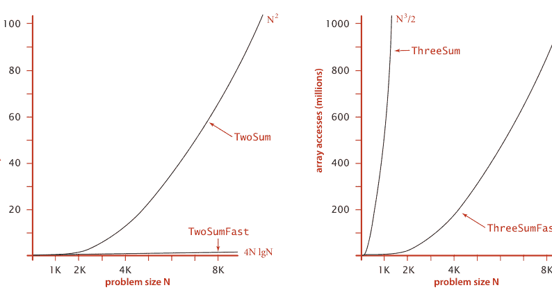

解决 2-sum 和 3-sum 问题的算法成本

## 倍增率实验

以下是预测性能和确定任何程序运行时间近似增长阶的一种简单且有效的捷径：

- 开发一个输入生成器，产生模拟实际预期输入的输入（例如 `DoublingTest` 中 `timeTrial()` 中的随机整数）。
- 运行下方的 `DoublingRatio` 程序，它是 `DoublingTest` 的修改版，计算每次运行时间与上一次运行时间的比例。
- 一直运行直到比例不再接近极限 $2^b$。

如果比例不接近一个极限值，则该测试无效，但对于许多许多程序，它们是接近的，这意味着以下结论：

- 运行时间的增长阶大约是 $N^b$。
- 要预测运行时间，将最后观察到的运行时间乘以 $2^b$ 并将 $N$ 倍，根据需要继续。如果你想预测不是 $N$ 的 2 的幂倍的输入大小，可以相应地调整比例（见练习 1-4.9）。

如下所示，ThreeSum 的比例约为 8，我们据此预测 $N = 16000, 32000, 64000$ 的运行时间分别为 408.8 秒、3270.4 秒和 26163.2 秒，只需将 8000 时的最后时间（51.1）乘以 8 即可。

执行实验的程序

```java
public class DoublingRatio {

    public static double timeTrial(int N)
    // 与 DoublingTest (第 177 页) 一

    public static void main(String[] args) {
        double prev = timeTrial(125);
        for (int N = 250; true; N *= N) {
            double time = timeTrial(N);
            Std.out.printf("%6d %.7f %n", N, time);
            Std.out.printf("%5.1f\n", time/prev);
            prev = time;
        }
    }
}
```


实验结果

| % | `java DoublingRatio` | |
|---|---|---|
| 250 | 0.0 | 2.7 |
| 500 | 0.0 | 4.8 |
| 1000 | 0.1 | 6.9 |
| 2000 | 0.8 | 7.7 |
| 4000 | 6.4 | 8.0 |
| 8000 | 5.1 | |

预测结果

| | | |
|---|---|---|
| 16000 | 408.8 | 8.0 |
| 32000 | 3270.4 | 8.0 |
| 64000 | 26163.2 | 8.0 |

该测试大致等同于第 176 页描述的过程（运行实验），在对数坐标图上绘制数值以建立运行时间为 $aN^b$ 的假设，通过斜率确定 $b$ 的值，但这种方法应用更简单。事实上，当你运行倍增时可以准确地预测性能，只需乘以该比例来填充表格中的后续值。你对增长阶的近似模型是一个幂律，以该比例的对为幂。为什么比例会接近一个常数？简单的数学计算表明对于所有常见的增长阶（指数除外）都是：

命题 C。（倍增率）如果 $T(N) \sim aN^b\lg N$，则 $T(2N)/T(N) \sim 2^b$。

证明：从以下计算直接得出：

```
$T(2N)/T(N) = a(2N)^b\lg(2N)/aN^b\lg N
= 2^b (1 + \lg 2 / \lg N)
\sim 2^b$
```


通常，在开发数学模型时不能忽略对数因子，但在使用倍增假设预测性能时，它的作用较小。

你应该对每个性能关重要的程序考虑运行倍增实验——这样做是估计运行时间增长阶的一种非常简单的方法，可能会揭示性能漏洞，即程序的效率可能没有你认为那么高。更广泛地说，我们可以通过程序运行时间增长阶的假设通过以下方式之一预测性能：

## 估计解决大问题的可行性

你需要为你编写的每个程序回答这个基本问题：程序能够在合理时间内处理这些输入数据吗？为了解决大量数据的问题，我们通过比倍增大得多的因子进行外推，例如 10 倍，如下一页底部表格中的第四列所示。

## 第一章 基础

因此，该表格关注的是这种情况。通过了解算法运行时间的增长阶数（`order of growth`），可以为你提供理解能够解决的问题规模限制所需的精确信息。建立理解是研究性能的最重要原因。没有它，你可能完全不知道程序将消耗多少时间；有了它，你就可以进行粗略的估算（`back-of-the-envelope` calculation）来估计成本并据此采取行动。

## 估计使用更快速计算机的时间

你可能也会定期面临这个基本问题：如果我得到了一台更快的计算机，解决问题的速度能快多少？通常，如果新计算机比旧的快 $x$ 倍，你就可以将运行时间缩短 $x$ 倍。但通常情况下，你可以用新计算机处理更大的问题。变化将如何影响运行时间？再次，增长阶数正是回答该问题所需的精确信息。

被称为**摩尔定律**（`Moore’s Law`）的著名法则意味着，你可以预期在 18 个月后获得一台速度翻倍、内存翻倍的计算机，或者在 5 年后获得一台速度快 10 倍、内存快 10 倍的计算机。下表证明，如果一个算法的运行时间是二次方或三方的，它无法跟上摩尔定律（即用速度快一倍的计算机解决规模大一倍的问题）。你可以通过进行倍率测试（`doubling ratio test`）并检查输入翻倍 2（线性）、4（二次方）或 8（立方）时运行时间的比例，快速判断情况是否如此。

| 时间增长阶数 | 2 倍因子 | 10 倍因子 | 对于输入大小为 N 运行需几小时的程序，预测 10N 的预测时间 | 在快 10 倍的计算机上，预测 10N 的预测时间 |
|---|---|---|---|---|
| 线性 | $N$ | 2 | 10 | 一天 | 几小时 |
| 线性 | $N \log N$ | 2 | 10 | 一天 | 几小时 |
| 二次方 | $N^2$ | 4 | 100 | 几周 | 一天 |
| 三次方 | $N^3$ | 8 | 1,000 | 几个月 | 几周 |
| 指数级 | $2^N$ | $2^N$ | $9N$ | 永远不会 | 永远 |

基于增长阶数函数的预测

## 1.4 算法分析

## 注意事项

在尝试分析程序性能时，有很多原因会导致你得到不一致或误导性的结果。所有这些都与一个观点有关：你假设所基础的一个或多个基本假设可能是不正确的。我们可以根据新假设开发新的假设，但我们需要考虑的细节越多，分析时就越需要小心。

**大常数（Large constants）。** 在使用领先项近似时，我们忽略了低阶项的常数系数，这可能是不合理的的。例如，当我们用 $\sim cN^2$ 来近似函数 $2^N + C$ 时，我们假设 $c$ 是很小的。如果事实并非如此（假设 $c$ 是 $10^3$ 或 $10^6$），这种近似就是具有误导性的。那么，我们必须对大常数的敏感性保持敏感。

**非主导内部循环（Nondominant inner loop）。** 内部循环占主导地位的假设可能错了。代价模型可能会忽略内部循环，或者问题规模 $N$ 不足够大，以至于内部循环指令执行频率的数学描述中的领先项并没有比低阶项大到可以忽略不的地步。某些程序在内部循环之外有大量的代码需要被考虑。换句话说，代价模型可能需要进一步细化。

**执行时间（Execution time）。** 每一条指令总是花费相同时间的假设并不总是正确的。例如，大多数现代计算机系统使用一种名为*缓存*（*caching*）的技术来组织内存，在这种情况下，如果巨大数组中的元素靠得不够近，那么访问这些元素所需的时间会长得多。你可以通过让 `DouRatio` 运行一段时间来观察 `ThreeSum` 的缓存影响。在达到 8 之后，由于缓存的原因，大数组的运行时间比例可能会跳到一个更大的值。

**系统考量（System considerations）。** 通常，你的计算机中有很多活动在运行。`Java` 是资源竞争的应用之一，且 `Java` 本身有许多选项和控制措施，可以显著影响性能。垃圾回收器、即时编译器（`jit compiler`）或从互联网下载的内容可能会极大影响实验结果。此类考虑可能会干扰科学方法的基石原则——即实验应该是可重复的，因为此时你计算机中正在发生的事情将不会再次发生。你系统中发生的任何事情在原则上都应该是微忽略其道的，或者是可以控制的。

**难以定论（Too close to call）。** 通常，当我们比较两个执行同一任务的程序时，一个在某些情况下可能更快，而在其他情况下可能更慢。上述提到的一个或多个考虑因素可能导致这种差异。某些程序员（以及一些学生）有一种自然的倾向，投入巨大的精力去寻找“最佳”实现，但这种工作最好留给专家。

**对输入的强依赖（Strong dependence on inputs）。** 我们在确定程序运行时间增长阶数时最初的假设之一是：运行时间应该对输入相对不敏感。当情况并非如此时，我们会得到不一致的结果，或者无法验证我们的假设。例如，假设我们修改 `ThreeSum` 来回答*输入是否存在三个和为 0 的元组*这个问题，通过将其改为布尔值，将 `cnt++` 替换为返回 true 并在最后一条语句返回 false。那么该程序运行时间的增长阶数就是常数。

**多个参数（Multiple parameters）。** 许多问题需要依赖于多个参数。例如，一种保守的方法可能是适当的，取决于问题规模的参数。然而，存在多个参数是很不的。当一个算法涉及到数据结构时，情况结构的大小。我们已经看到在在算法中，由于输入的大小。数据结构。这些方法是有效的，我们我们考虑。我们已经看到，预测预测，如果我们想要预测性能。我们简要考虑一些有效的方法，之后我们将在书中考虑。

## 处理对输入的依赖（Coping with dependence on inputs）

对于许多问题，上述提到的最重要的注意事项之一就是对输入的依赖，因为运行时间波动很大。`ThreeSum` 的运行时间从常数到立方不等，取决于输入，因此如果我们想预测性能，就需要更仔细的分析。我们简要考虑一些有效的方法，之后我们将在书中考虑。

## 输入模型（Input models）

一种方法是更仔细地对需要处理的输入进行建模。例如，我们可能假设输入数字是随机值。这种方法具有两个挑战性：

- 模型可能是不现实的。
- 分析可能极其困难，超出了普通学生或程序员的数学水平。

这些中的第一个更为重要，通常是因为计算的目标是发现输入的特征。例如，如果我们正在为一个基因组编写程序，我们该如何估计它在另一个基因组上的性能？一个描述自然界基因的良好模型正是科学家所做的，估计我们的程序在自然界数据上的运行时间实际上等同于连接到我们的模型！第二个挑战只为我们最重要的算法带来了数学结果。我们将在看到几个例子，简单易处理的输入模型结合经典的数学分析，帮助我们预测性能。

## 最坏情况性能保证（Worst-case performance guarantees）

某些应用要求程序的运行时间必须在某个边界内，无论输入如何。为了提供这种性能保证，理论学家对算法性能持有极端悲观的观点：在最坏情况下，运行时间是多少？例如，一种保守的方法对于运行核反应堆、起搏器或汽车刹车的软件可能是恰当的。我们希望此类软件在设定的范围内完成工作，因为如果不这样做，结果可能是灾难性的。科学家在研究自然世界时通常不考虑最坏情况：生物学中，最坏的情况可能是人类的灭绝；在物理学中，最坏的情况是宇宙的结束。但最坏情况在计算机系统中可能是一个非常真实的担忧，因为输入可能是另一个（可能是恶意的）用户生成的，而不是自然产生的。例如，不使用性能保证算法的网站容易受到服务攻击，黑客向它们发送病态请求使其运行速度比计划要慢得多。因此，我们的许多算法都被设计为提供性能保证，例如：

**命题 D。** 在 `Bag`（`ALGORITHM 1.4`）、`Stack`（`ALGORITHM 1.2`）和 `Queue`（`ALGORITHM 1.3`）的链表实现中，所有操作在最坏情况下的耗时时间均为常数级。

**证明：** 从代码中直接得出。每个操作执行的指令数被限制于一个很小的常数。注意：此论点依赖于一个（合理的）假设，即 `Java` 系统以常数时间创建一个新的 `Node`。

**随机算法。** 提供性能保证的一种方法是引入随机性。例如，我们在第 2.3 节中学习的快速排序算法（最广泛使用的排序算法）在最坏情况下是二次方的的，但通过对输入进行随机排序可以得到一个概率保证，即其运行时间是线性对数级的。你每次运行该算法时，所需的时间都不同，但时间为线性对数级的概率小到可以忽略不计。同样，我们在第 3.4 节中学习的符号表哈希算法（这可能也是最广泛使用的方法）在最坏情况下是线性时间，但在概率保证下是常数时间。这些保证并不是绝对的，但它们失效的概率小于你的电脑被雷劈中的概率。因此，这种保证在实践中作为最坏情况保证是很有用的。

**操作序列。** 对于许多应用，算法的“输入”可能不仅是数据，而是客户端执行的操作序列。例如，一个客户端推入 $N$ 个值然后将它们弹出的推入栈，其性能特征与一个客户端交替执行 `push` 和 `pop` 操作的栈可能大不同。我们的分析必须兼顾这两种情况（或包含一个操作序列的合理模型）。

**摊还分析。** 另一种提供性能保证的方法是摊还成本，即通过跟踪所有操作的总成本并除以操作次数。在这种设定下，我们允许某些昂贵的操作，同时保持操作的平均成本处于较低水平。这类分析的典型示例是我们在第 1.3 节中考虑的 `Stack` 动态调整数组数据结构（第 141 页的 `ALGORITHM 1.1`）。为了简单起见，假设 $N$ 是 2 的幂。从一个空结构开始，对于连续的 $N$ 次 `push()` 调用，访问了多少数组元素？这个数量很容易计算：数组访问的次数为

$N + 4 + 8 + 16 + \dots + 2N = 5N - 4$

第一项代表了 $N$ 次 `push()` 调用中的每一次数组访问；随后的项代表了初始化规模翻倍的数据结构所需的数组访问（复制 $N$ 个项目需要 $2N$ 次数组访问，初始化数组需要 $2N$ 次数组访问）（每个 `push` 占用一次）。因此，每个 $N/2 - 1$ 次 `push` 操作的平均数组访问次数是常数级，尽管最后一次操作的耗时是线性时间。这被称为“摊还分析”，因为我们通过将昂贵操作成本的一部分分配给大量廉价的操作，消耗了这些昂贵的成本。摊还分析为从空数据结构开始的任何操作序列提供了最坏情况保证。图 1 展示了这一过程，如上所示。

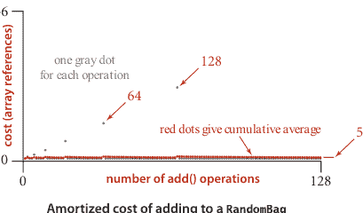

**命题 E。** 在 `Stack` 的数组实现（`ALGORITHM 1.1`）中，对于从空数据结构开始的任何 `push` 和 `pop` 操作序列，数组访问的平均次数在最坏情况下是常数级。

**证明思路。** 对于每个导致数组增长（从大小 $N$ 变为 $2N$）的 `push` 操作，考虑最近导致栈大小增长到 $k$ 的 $N/2 - 1$ 次操作，其中 $k$ 从 $N/2$ 到 $N$。将使数组增长到大小 $2N$ 的 $4N$ 次数组访问（复制 $N$ 个项目需要 $2N$ 次，初始化数组需要 $2N$ 次）取平均（每个 `push` 占用一次），我们得到每次 $N/2 - 1$ 次 `push` 操作的平均成本为 9 次数组访问。为任何 `push` 和 `pop` 操作序列建立这一属性要更为复杂（见练习 1.4.32）。

这种分析具有广泛的适用性。特别是，我们在书中后续考虑的几种算法中，重复使用了数组作为底层数据结构。

算法分析师的任务是尽可能地发现关于算法的相关信息，而程序员的任务是应用他们所知的知识开发出有效解决当前问题的程序。理想情况下，我们希望算法能够产生清晰且紧凑的代码，并对感兴趣的输入值提供良好的保证和良好的性能。我们在本章中讨论的许多经典算法对于各种应用都非常重要，因为它们具有这些属性。以它们为模型，你可以为编程过程中遇到的典型问题开发出良好的解决方案。

## 内存

与运行时间一样，程序的内存使用直接涉及到物理世界：你电脑中大量的电路使得你的程序能够存储和检索值。在任何给定时刻需要存储的值越多，需要的电路就越多。你可能已经意识到了电脑内存使用的限制（甚至比对时间的限制更为明显），因为你可能为了获得更多内存额外付了钱。

对于你电脑上的 `Java`，内存使用是有良好定义的（每次运行程序时，每个值所需的内存量完全相同），`Java` 实现在非常广泛的计算设备上，且内存消耗取决于实现。为了简单起见，我们使用“典型的”（`typical`）一词来表示所有值都受机器依赖的影响。

`Java` 最重要的特征之一是它的内存分配系统，它本应让你无需担心内存。尽管如此，仍建议你在适当的时候利用这一特性，特别是当你的内存需求会阻止你解决简单问题时。分析内存使用比分析运行时间容易得多，主要是因为其用法是有良好定义的且易于理解：我们可以计算变量的数量并根据其类型按字节数加权。例如，`Java` 的 `int` 数据类型是 -2,147,483,648 到 2,147,483,647 之间的整数值，总共 $2^{32}$ 个不同的值。对于其他基本类型也有类似的考虑：典型的 `Java` 实现使用 8 位的字节，每个 `char` 用 2 字节（16 位）表示，每个 `int` 用 4 字节（32 位），每个 `double` 和每个 `long` 用 8 字节（64 位），每个 `boolean` 用 1 字节（因为电脑通常一次访问一个字节内存）。通过这些知识，我们可以从这些值中进行计算。例如，如果你电脑有 1GB 内存，你无法放入超过 2.56 亿个 `double` 值。

另一方面，内存使用取决于机器，因此我们考虑典型基本类型的内存占用：

| 类型 | 字节 |
| :--- | :--- |
| boolean | 1 |
| byte | 1 |
| char | 2 |
| int | 4 |
| float | 4 |
| long | 8 |
| double | 8 |

链表。嵌套静态（内部）类如我们的 `Node` 类（第 142 页）需要额外的 8 字节开销（对外部实例的引用）。因此，一个 `Node` 对象使用 40 字节（16 字节开销、8 字节的 `Item` 和 `Node` 对象的引用，以及 8 字节的额外开销）。因此，由于 `Integer` 对象使用 24 字节，包含 $N$ 个整数的链表表示栈（`ALGORITHM 1.2`）使用 $32+64N$ 字节，即 `Stack` 对象的通常 16 字节开销，其引用实例变量 8 字节，`int` 变量 4 字节，填充 4 字节，以及每个元素 64 字节（一个 `Node` 40 字节，一个 `Integer` 24 字节）。

```java


`class Integer` 定义如下：

```java
class Integer {
    int x;
    int value;
}
```

典型对象内存需求

## 第 1 章 基础

数组。Java 中各种类型数组的典型内存需求总结在对面页的图中。Java 中的数组是以对象形式实现的，通常带有用于长度的额外开销。一个基本数据类型值的数组通常需要 24 字节的头部信息（16 字节的对象头、4 字节的长度和 4 字节的填充）加上存储值所需的内存。例如，一个包含 N 个 `int` 值的数组使用 `24 + 4N` 字节（向上取整到 8 的倍数），而一个包含 N 个 `double` 值的数组使用 `24 + 8N` 字节。指向对象的引用数组，我们需要为对象所需的引用添加空间。例如，一个包含 N 个 `Date` 对象的数组使用 24 字节（数组开销）加上 8 字节（引用）加上每个对象 32 字节，总计 `24 + 40N` 字节。一个数组数组的二维数组（每个都是一个对象）。例如，一个 M 比 N 的 `double` 值二维数组使用 24 字节（数组数组的开销）加上 8 字节（指向行数组的引用）M 乘以 24 字节（来自行数组）M 乘以 N 8 字节（对于 M 行中每行的 N 个 `double` 值），总计 `8NM + 32M + 24 ~ 8NM` 字节。当数组进入对象时，类似的计算会导致填充有对象引用的数组总计达到 `8NM + 32M + 24N`，加上对象本身的内存。

`String` 对象（Java 7 及更高版本）。标准的 `String` 表示法（用于 Java 7 实现中）有两个实例变量：一个指向字符数组 `value[]` 的引用（用于存储字符）和一个 `int` 类型的变量 `hash`（存储哈希值，用于在目前不关心的某些情况下节省重复计算）。因此，一个长度为 N 的 `String` 通常使用 40 字节来表示 `String` 对象（16 字节对象开销 + 8 字节数组引用 + 4 字节实例变量 + 4 字节填充）加上用于字符数组的 `24 + 2N` 字节，总计 `56 + 2N` 字节。

`String` 对象（Java 6 及更早版本）。另一种 `String` 表示法（用于典型的 Java 6 实现中）维护两个 `int` 变量（`offset` 和 `count`），并表示从 `value[offset]` 到 `offset + count - 1]` 的字符序列。现在，一个长度为 N 的 `String` 通常使用 40 字节（用于 `String` 对象）加上 `24 + 2N` 字节（用于字符数组），总计 `64 + 24N` 字节。这种表示法在提取子字符串时可以节省内存，因为两个 `String` 对象共享同一个底层字符数组。

子字符串提取。当使用 Java 7 表示法实现 `substring()` 方法时，我们必须创建一个新的字符数组，因此提取需要线性的时间空间（取决于结果子字符串的长度）。

### `int` 值的数组

```java
int[] a = new int[N];
```

总计：`24 + 4N`（N 为偶数）

### `double` 值的数组

```java
double[] c = new double[N];
```

总计：`24 + 8N`

### 对象数组

```java
Date[] d;
d = new Date[N];
for (int k = 0; k < N; k++) {
    a[k] = new Date(...);
}
```

总计：`24 + 8N + N×32 = 24 + 40N`

### 数组数组（二维数组）

```java
double[][] t;
t = new double[M][N];
```

总计：`24 + 8M + M×(24 + 8N) = 24 + 32M + 8MN`

### 总结

| 类型 | 字节 |
| :--- | :--- |
| `int[]` | ~4N |
| `double[]` | ~8N |
| `Date[]` | ~40N |
| `double[][]` | ~8NM |

`int` 值、`double` 值、对象和数组的典型内存需求

### `String`（Java 7 库）32 字节 + `char` 数组

```java
public class String {
    private char[] value;
    private int hash;
}
```

使用 Java 7 表示法，我们可以实现 `substring()` 方法，而无需复制包含原始字符串的字符数组，因为原始字符串在子字符串对象中是别名：`offset` 和 `count` 字段标识了子字符串。因此，一个现有字符串的哈希占用 40 字节。在内存中，提取子字符串需要常数额外内存或线性内存，取决于底层实现。我们假设此区块中使用 Java 7 表示法。

### `String`（Java 6 库）40 字节 + `char` 数组

```java
public class String {
    private char[] value;
    private int offset;
    private int count;
    private int hash;
}
```

这些基础机制对于估计许多程序的内存使用是有效的，但有许多复杂的因素可以使任务变得困难得多。我们已经注意到了别名的潜在影响。此外，当涉及函数调用时，内存消耗是一个复杂的动态过程，因为系统分配机制起着更重要的作用，具有更多的系统依赖。例如，当你的程序调用方法时，系统从一个名为栈（下推栈）的特殊内存区域为方法分配所需的内存（用于其局部变量），当方法返回给调用者时，栈会被释放。在递归程序中创建数组或大对象是危险的，因为每个递归调用都意味着内存使用。当你创建一个对象时，系统会在堆中分配内存，直到没有对它的引用为止，此时一个名为垃圾回收的系统过程会回收内存。这种动态使得精确估计内存使用的任务具有挑战性。

### 子字符串示例（Java 6）

```java
String genome = "CCTGAC";
String codon = genome.substring(6,9);
```

`genome` 40 字节

56 字节

`String` 和子字符串

## 1.4 算法分析

**观点** 性能是重要的。一个运行速度不可接受的程序和错误的程序一样毫无用处，因此在开始时关注成本是值得的，特别是对于哪些代码构成了程序的内部循环，某些想法总是明智的。

可能编程中最常见的错误之一是过度关注性能特性。你的首要任务是让代码清晰且正确。仅仅为了加速程序而修改程序最好留给专家来做。事实上，这样做往往适得其反，因为它倾向于创建复杂且难以理解的代码。C. A. R. Hoare（快速排序的发明者，清晰正确代码的领先倡导者）曾通过说“过早优化是万恶之根源”来推广这一观点，Knuth 随后补充道“（或至少在编程中大多数情况下）”。此外，如果可用成本微不足道，改进运行时间是没有意义的。例如，如果运行时间只有一瞬间，将其缩短 10 倍也是无关紧要。即使一个程序运行几分钟，实现和调试改进算法的总时间可能也多于运行稍慢算法的时间——你完全可以让计算机完成工作。更糟糕的是，你可能会花费精力实现理论上改进但在实践中无效的想法。

可能编程中的第二个常见错误是忽略性能特性。更快的算法通常比暴力算法更复杂，因此你可能会接受较慢的算法以避免处理更复杂的代码。然而，只需几行良好的代码就能获得巨大的节省。许多计算机系统的用户在不知情的情况下等待暴力平方算法完成问题的求解，而线性或对数算法可以在极短时间内解决这些问题。当我们处理巨大的问题规模时，我们往往没有选择寻找更好的算法。我们通常采用本文描述的方法来估计内存使用，并根据成本模型内的数学分析得到的时间近似值得出运行时间的增长阶假设，并通过实验检查这些假设。如果你在开发的整个过程中都关注成本，你每次使用它时都会受益。

## 问答

Q. 为什么不使用 `StdRandom` 生成随机值，而是维护 `1Mints.txt` 文件呢？

A. 在开发过程中，这样调试代码和复现实验更方便。`StdRandom` 每次被调用时都会产生不同的值，因此在修复 bug 后运行程序可能无法测试修复效果！你可以使用 `StdRandom.setSeed()` 来解决这个问题，但一个像 `1Mints.txt` 这样的参考文件使得在调试时更容易添加测试用例。此外，不同的程序可以在不同的系统上比较性能，而无需担心输入模型。一旦你确定了一个程序并对它的性能有了良好的了解，在随机数据上对其进行测试绝对是值得的。例如，`DoublingTest` 和 `DoublingRatio` 就采取了这种方法。

Q. 我在我的电脑上运行了 `DoublingRatio`，但结果不像书中的那么一致。其中一个比例并不接近 8。为什么？

A. 这就是我们“缓存”年龄 195 的原因。很可能是你的计算机操作系统在实验期间做了某些事情。缓解这一点的一种方法是在实验上投入更多时间。例如，你可以将 `DoublingTest` 修改为每个 N 运行 1,000 次，为每个尺寸的运行时间提供更准确的估计（练习 1.4.39）。

Q. 在波浪符号的定义中，“随着 N 的增长”具体意味着什么？

A. $f(N) \sim g(N)$ 的正式定义是 $\lim_{N\to\infty} f(N)/g(N) = 1$。

Q. 我见过其他描述增长阶的符号。那是怎么回事？

A. “大 O”（Big-O）符号被广泛使用：如果存在常数 $c$ 和 $N_0$，使得对于所有的 $N > N_0$，都有 $f(N) \le c[g(N)]$，则说 $f(N)$ 是 $O(g(N))$。这种符号对于为算法性能提供渐近上界非常有用，这在算法理论中非常重要。但它对于预测性能或比较算法没有用。

Q. 为什么没有？

A. 主要原因是因为它只描述了运行时间的上界。实际性能可能会好得多。一个算法的运行时间可能是 $O(N^2) \sim a N \log N$。因此，它不能用来证明像我们的翻倍率之类的测试（见第 193 页的命题 C）。

Q. 那么为什么大 O 符号被广泛使用呢？

A. 它有助于建立增长阶的界限，即使对于那些可能无法进行更精确分析的复杂算法也是如此。此外，它与理论计算机科学家使用的“大 Omega”和“大 Theta”符号兼容，他们通过界定最坏情况性能对算法进行分类。如果存在常数 $c$ 和 $N_0$，使得对于 $N > N_0$，有 $|f(N)| \ge c|g(N)|$，我们说 $f(N)$ 是 $\Omega(g(N))$；如果 $f(N)$ 既是 $O(g(N))$ 又是 $\Omega(g(N))$，我们说 $f(N)$ 是 $\Theta(g(N))$。“大 Omega”符号通常用于描述最坏情况的下界，而“大 Theta”符号通常用于描述在意义上最优的算法，即没有算法具有更好的渐近最坏情况增长阶。最优算法在实际应用中无疑值得考虑，但正如你将看到的，还有许多其他考虑因素。

Q. 渐近性能的界限重要吗？

A. 是重要的，但我们更倾向于根据成本模型的语句执行来讨论精确的结果，因为这提供了关于算法性能更多的信息，而且对于我们讨论的算法，推导出此类结果是可行的。例如，我们说“`ThreeSum` $\sim N^{3/2}$ 次数组访问”，以及“在 `ThreeSum` 中 `cnt++` 执行的次数在最坏情况下 $\sim N^{3/2}$”，这虽然有点冗长，但比“`ThreeSum` 的运行时间是 $O(N^3)$”的信息多得多。

Q. 当算法运行时间的增长阶为 $N \log N$ 时，翻倍测试会导致运行时间为 $\sim aN$（$a$ 为常数）的假设。这不是一个问题吗？

A. 我们必须小心不要推断实验数据意味着某个特定的数学模型，但在预测性能时，这真的不是一个问题。例如，当 $N$ 处于 16,000 到 32,000 之间时，$14N$ 和 $N \log N$ 的曲线非常接近。数据符合这两条曲线。随着 $N$ 的增加，曲线会变得越来越接近。实际上，要实验性地检查算法运行时间是线性的而非线性的这一假设需要一些仔细。

Q. `int[] a = new int[N]` 算 N 次数组访问（将元素初始化为 0）吗？

A. 大概率是，因此我们在书中做了该假设，尽管复杂的编译器实现可能会尝试对巨大的稀疏数组避免这样做。

# 练习

**1.4.1** 证明从 N 个元素中可以选出的不同三元组数量正是 $N(N-1)(N-2)/6$。*提示*：使用数学归纳法或计数原理。

**1.4.2** 修改 `ThreeSum`，使其在 `int` 值大到两个值之和可能导致溢出时能够正常工作。

**1.4.3** 修改 `DoubleingTest`，使用 `StdDraw` 生成类似于书中的标准图和对数坐标图，根据需要进行缩放，使图形始终填充窗口的很大一部分。

**1.4.4** 为 `TwoSum` 开发一个类似于第 181 页的表格。

**1.4.5** 为以下量给出紧的近似值：

- a. $N + 1$
- b. $1 + 1/N$
- c. $(1 + 1/N)(1 + 2/N)$
- d. $2N^3 - 15N^2 + N$
- e. $\lg(2N) / \lg N$
- f. $\lg(N^2 + 1) / \lg N$
- g. $N^{1000} / 2^N$

**1.4.6** 给出以下代码段运行时间的增长阶（作为关于 $N$ 的函数）：

- a.

```java
int sum = 0;
for (int n = N; n > 0; n /= 2)
    for (int i = 0; i < n; i++)
        sum++;
```

- b.

```java
int sum = 0;
for (int i = 1; i < N; i *= 2)
    for (int j = 0; j < i; j++)
        sum++;
```

- c.

```java
int sum = 0;
for (int i = 1; i < N; i++)
    for (int j = 0; j < i; j++)
        sum++;
```

**1.4.7** 分析每个代码段的比较次数。

**1.4.8** 编写一个程序，确定和为零的对。

**1.4.9** 假设输入是排序的，给出每个程序运行时间的公式。

**1.4.10** 修改二分查找，使其始终返回最小索引。

**1.4.11** 为 `StaticInts` 添加一个 `howMany()` 方法，用于查找键出现的次数。

**1.4.12** 编写一个程序，给定两个排序数组，打印它们共有的元素。

**1.4.13** 使用书中的假设，给出表示以下类型所需的内存：

- a. `Accumulator`
- b. `Transaction`
- c. `FixedCapacityStackOf`
- d. `Point2D`
- e. `Interval1D`
- f. `Double`

# 创造性问题

**1.4.14** 4-sum。开发一个 4-sum 算法。热身，实现一个在排序后使用线性算法的 `TwoFaster`。然后应用类似的思路为 3-sum 开发平方算法。

**1.4.16** 最近对（维度上）。编写一个程序，给定一个 `double[]` 数组，找到最近的一对：其差值不大于任何对的差值。你的程序运行时间在最坏情况下应该是对数级的。

**1.4.17** 最远对（维度上）。编写一个程序，给定一个 `double[]` 数组，找到最远对：其差值不小于任何对的差值。你的程序运行时间在最坏情况下应该是对数级的。

**1.4.18** 数组局部最小值。编写一个程序，给定一个包含 $N$ 个不同整数的数组，找到一个局部最小值：严格小于其邻居的 $a[i]$。每个内部元素（$a[0]$ 和 $a[N-1]$ 除外）有 2 个邻居。你的程序在最坏情况下应使用约 $2 \lg N$ 次比较。

**1.4.19** 矩阵局部最小值。给定一个包含 $N^2$ 个不同整数的 $N \times N$ 数组，设计一个算法找到局部最小值：严格小于其邻居的 $array[i][j]$。内部元素有 4 个邻居；边缘元素有 3 个；角元素有 2 个。你的程序运行时间在最坏情况下应该与 $N$ 成比例，而你无法检查所有的 $N^2$ 个元素。

**1.4.20** 波峰搜索。如果一个数组由一个递增序列紧接着一个递减序列组成，则它是波峰。编写一个程序，给定一个包含 $N$ 个不同整数值的波峰数组，判断给定整数是否存在于数组中。你的程序在最坏情况下应使用约 $3 \lg N$ 次比较。加分项：仅使用约 $2 \lg N$ 次比较。

**1.4.21** 基于不同值的二分查找。为 `StaticSetOfInts`（见第 99 页）开发一个二分查找实现，使得 `contains()` 的运行时间保证为 $\sim \lg R$，$R$ 是数组中不同整数的数量。

**1.4.22** 仅使用加法和减法的二分查找。[Mihai Patrascu] 编写一个程序，给定一个升序的包含 $N$ 个不同 `int` 值的数组，判断给定整数是否在数组中。你可以仅使用加法和减法以及常量的额外内存。你的程序的运行时间在最坏情况下应与 $\log N$ 成比例。

**1.4.23** 分数的二分查找。设计一种方法，使用对数数量的形式为“该数字是否小于 $x$?”的比较来找到一个有理数 $p/q$，使得 $0 < p < q < N$。*提示：*两个分母小于 $N$ 的分数之间的差值至少为 $1/N^2$。

**1.4.24** 从楼上扔鸡蛋。假设你有一栋 $N$ 层高的楼并且有足够的鸡蛋。假设如果鸡蛋从第 $F$ 层或更高处掉下它就会破碎，否则保持完好。首先，设计一种策略确定 $F$ 的值，使得在使用 $\sim\lg N$ 次投掷时，破碎鸡蛋的数量为 $\sim \lg N$，然后找到一种方法将成本降低到 $\sim2 \lg F$。

**1.4.25** 从楼上扔两个鸡蛋。考虑之前的问题，但现在假设你只有两个鸡蛋，你的成本模型是投掷次数。设计一种策略确定 $F$，使得投掷次数最多为 $2\sqrt{N}$，然后找到一种方法将成本降低到 $\sim cF$（对于某个常数 $c$）。这类似于搜索命中（鸡蛋完好）的成本比未命中（鸡蛋破碎）便宜得的情况。


**1.4.26** 三点共线。假设你有一个算法，输入平面上的`$N$`个不同点，并可以返回落在同一条直线上的三元组数量。证明你可以使用该算法解决 3-sum 问题。*强提示：*使用代数证明`$(a, a^3)$`、`$(b, b^3)$`和`$(c, c^3)$`共线当且仅当`$a + b + c = 0$`。

## 创造性问题（续）

**1.4.27** 双栈队列。用两个栈实现一个队列，使得每个队列操作都只需要常数分摊的栈操作。提示：如果你将元素推入栈并将其全部弹出，它们将以反序出现。如果你重复这个过程，它们就会恢复原有顺序。

**1.4.28** 队列栈。用单个队列实现一个栈，使得每个操作都需要线性数量的队列操作。提示：要删除一个项，请逐个获取队列中的所有元素，然后在最后弹出，除了被你删除并返回的最后一个元素。（这个解决方案诚然效率很低。）

**1.4.29** 双栈双端队列（Steque）。用两个栈实现一个双端队列（deque），使得每个 steque 操作（见练习 1.3.32）都只需要常数分摊的栈操作。

**1.4.30** 栈和双端队列实现的双端队列。用一个栈和一个双端队列（见练习 1.3.32）实现一个双端队列，使得每个 deque 操作都只需要常数分摊的栈操作和队列操作。

**1.4.31** 三栈双端队列。用三个栈实现一个双端队列，使得每个 deque 操作都只需要常数分摊的栈操作。

**1.4.32** 分摊分析。证明从空栈开始，在栈的动态扩容数组实现中，任何`$M$`次操作序列对数组的访问次数与`$M$`成比例。

**1.4.33** 32 位机器上的内存需求。给出 32 位机器上 Integer、Data、Counter、int[]、double[]、double[]、String、Node 和 Stack（链表表示法）的内存需求。假设字字节为 4 字节，对象开销为 8 字节，且对齐倍数是 4 字节的倍数。

**1.4.34** 热或冷。你的目标是猜出一个 1 到`$N$`之间的秘密整数。你将重复猜测 1 到`$N$`之间的整数。每次猜测后，你都会知道猜测是否等于秘密整数（游戏停止）。否则，你将知道这次猜测比上一次猜测更“热”（更接近）还是更“冷”（远离）。设计一个在最多`$\sim2 \ lg N$`次猜测内找到秘密数字的算法。设计一个在最多`$\sim1 \lg N$`次猜测内找到秘密数字的算法。

**1.4.35** 压入栈的时间成本。使用成本模型解释下表的各项，该表显示了各种压入栈实现的典型时间成本。该模型计算数据引用（对推入栈中数据的引用，可以是数组引用或对象实例变量的引用）和创建的对象。假设 Integer 对象未被缓存（因此每次 push 必须创建新的）。

| 数据结构 | 元素类型 | 数据引用 | 创建的对象 |
| --- | --- | --- | --- |
| 链表 | int | `$2N$` | `$N$` |
|  | Integer | `$3N$` | `$2N$` |
| 动态扩容数组 | int | `$\sim N$` | `$lg N$` |
|  | Integer | `$\sim 5N$` | `$\sim N$` |

压入栈的时间成本（各种实现方式）

**1.4.36** 压入栈的空间使用。解释下表的各项，该表显示了各种压入栈实现的典型空间使用。使用静态嵌套类来处理链表节点，以避免非静态嵌套类的开销。假设 Integer 对象未被缓存（因此每次 push 必须创建新的）。

| 数据结构 | 元素类型 | `$N$` 个 int 值的空间使用（字节） |
| --- | --- | --- |
| 链表 | int | `$\sim 32N$` |
|  | Integer | `$\sim 56N$` |
| 动态扩容数组 | int | 在`$\sim 4N$`到`$\sim 16N$`之间 |
|  | Integer | 在`$\sim 32N$`到`$\sim 56N$`之间 |

压入栈的空间使用（各种实现方式）

## 实验

**1.4.37** 装箱性能惩罚。运行实验确定在你机器上使用自动装箱和自动拆箱的性能惩罚。开发一个`FixedCapacityOfInts`实现以及一个如`DoublingRatio`的客户端，以便与泛型`FixedCapacityStack<Integer>`比较在大量`push()`和`pop()`操作下的性能。

**1.4.38** 朴素 3-sum 实现。运行实验评估以下 ThreeSum 的内部循环实现：

```
for (int i = 0; i < N; i++)
  for (int j = 0; j < N; j++)
    for (int k = 0; k < N; k++)
      if (i < j && j < k &&
        if (a[i] + a[j] + a[k] == 0)
          cnt++;
```

通过开发一个计算该程序和 ThreeSum 时间的 Doubling 版本来实现。

**1.4.39** 改进双倍精度。修改`DoublingRatio`以接收第二个命令行参数，指定每个 N 值调用`TrialC()`的次数。运行 10、100 和 1000 次实验并对结果的精确性进行评论。

**1.4.40** 随机值的 3-sum。制定并验证一个描述和为零的随机三元组数量的假设。如果你擅长数学分析，请为分布在`$-M$`和`$M$`之间（`$M$`不小）的值开发合适的数学模型。

**1.4.41** 运行时间。估计在你机器上处理 100 万个数字的文件，运行`TwoSumFast`、`TwoSum`、`ThreeSumFast`和`ThreeSum`需要的时间。使用`DoublingRatio`来实现。

**1.4.42** 问题大小。估计在你机器上处理`$2^p$`千个数字的文件，可以运行`TwoSumFast`、`TwoSum`、`ThreeSumFast`和`ThreeSum`的最大 P 值。使用`DoublingRatio`来实现。

**1.4.43** 动态扩容数组对比链表。运行实验验证动态扩容数组在栈方面比链表更快（见练习 1.4.35 和练习 1.4.36）。通过开发一个计算两个程序运行时间比例的`DoublingRatio`版本来实现。

**1.4.44** 生日问题。编写一个程序，从命令行接收整数 N，并使用`std::uniform_int()`生成`$0$`到`$N-1$`之间的随机整数序列。运行实验验证以下假设：在发现第一个重复值之前生成的整数数量`$\sim\sqrt{\pi N/2}$`。

**1.4.45** 优惠券收集者问题。按照上一个练习生成随机整数，运行实验验证以下假设：在生成所有可能值之前生成的整数数量`$\sim NH_N$`。

## 1.5 案例研究：并查查找（UNION-FIND）

为了阐明我们开发和分析算法的基本方法，我们现在考虑一个详细示例。我们的目的是强调以下主题：

- 良好的算法可以在能够解决实际问题与完全无法解决问题之间产生差异。
- 高效的算法可以和低效的算法一样简单。
- 理解实现的性能特征可以是一个有趣且令人有成就感的智力挑战。
- 科学方法是帮助我们在不同的解决问题方法中进行选择的重要工具。
- 迭代改进过程可以带来日益高效的算法。这些思想在全书中得到了强化。这个原型化的示例为我们在许多其他问题中使用通用方法论奠定了基础。

我们考虑的问题并不是一个简单的练习题；它是一项基础性的计算任务，我们开发的解决方案已应用于各种领域，从物理化学中的渗透作用到通信网络中的连通性。我们从一个简单的解决方案开始，然后试图理解该解决方案的性能特征，这有助于我们看到如何改进算法。

- 自反性（Reflexive）：p 与 p 连通。
- 对称性（Symmetric）：如果 p 与 q 连通，则 q 与 p 连通。
- 传递性（Transitive）：如果 p 与 q 连通且 q 与 r 连通，则 p 与 r 连通。

等价关系将对象划分为等价类。在这种情况下，两个对象属于同一个等价类当且仅当它们连通。我们的目标是编写一个程序从序列中过滤掉多余的（两个对象属于同一个等价类的对）。换句话说，当程序从输入中读取一对 p q 时，只有当到为止的对没有暗示 p 与 q 连通时，它才将该对写入输出。如果之前的对已经与 q 连通，则程序应该忽略这对 p q 并读取下一对。对页的图给出了这一过程的示例。为了实现目标，我们需要设计一种数据结构，能够记住关于已出现对的足够信息，以判断一组新对象对是否连通。非正式地说，我们将设计它的任务称为动态连通性问题。该问题在应用中出现如下：

**网络**。整数代表大型网络中的计算机，成对出现可能代表网络中的连接。我们的程序确定我们是否需要为 p 和 q 建立直接连接以便通信，或者是否可以使用现有连接来建立通信路径。或者，整数可能代表电子电路中的接触点，成对出现可能代表连接这些点的导线。又，成对出现可能代表社交网络中的人，在此类应用中，我们可能需要处理数百万个对象和数十亿连接。

**变量名等价**。在环境中，可以将两个变量名声明为等价（指向同一个对象）。在系列声明之后，系统需要确定给定的两个名称是否等价。该应用是 FORTRAN 编程语言的一个早期应用，它激发了我们即将考虑的算法的开发。

**数学集合**。在更抽象的层，你可以将整数看作属于数学集合。当我们处理一对 p q 时，我们是在询问它们是否属于同一个集合。当我们使用 P 和 Q 的集合时，将它们放在同一个集合中。

为了解决这个问题，我们在本节剩余部分将使用新的术语，将对象称为集合（sets），将对称为连接（connections），将等价类称为连通分量（connected components），或简称分量（components）。为了简单起见，我们假设有 N 个从 0 到 N-1 的整数编号站点。在不失一般性的情况下，我们将在第 3 章中介绍许多算法，它们可以高效地将任意名称与此类整数标识关联。

下一页顶部的图展示了一个较大的示例，显示了连通性问题的困难。你可以快速识别出图表左中间由单个站点组成的分量，以及左下角由五个站点组成的分量，但你可能难以验证所有其他站点是否都是相互连通的。对于程序来说，这项任务更加困难，因为它只能处理站点名称和连接，而无法访问站点在图中的几何位置。我们如何快速判断此类网络中任意两个给定站点是否连通呢？

我们在开发算法时面临的首要任务是以精确的方式规范化问题。我们对算法的要求越高，就越可能预期它需要更多的时间和空间来完成工作。预先量化这种关系是不可能的，我们通常在发现问题难以解决或成本高昂时修改问题规范，或者在幸运的情况下，在发现算法可以提供比原始规范中要求的更有有用的信息时对其进行修改。例如，我们的连通分量连通性问题规范仅要求程序能够判断任意对 p q 是否连通，而并不要求它能够演示一组连接该对的连接。这种要求使问题变得更加困难，并引导我们进入另一类算法，我们将在第 4.1 节中考虑它们。

为了规范问题，我们开发了一个封装了所需基本的 API：初始化、在两个站点之间添加连接、识别包含某个站点的分量、确定两个站点是否在同一分量中以及统计分量的数量。因此，我们阐述 API：

```
public class UF {
    UF(int N) 初始化 N 个整数名称 (0 到 N-1) 的站点
    void union(int p, int q) 在 p 和 q 之间添加连接
    int find(int p) p 的分量标识符 (0 到 N-1)
    boolean connected(int p, int q) 如果 p 和 q 在同一分量中则返回 true
    int count() 分量的数量
}
并查查找 API
```

`union()`操作在两个站点位于不同分量时合并这两个分量，`find()`操作为给定的站点返回一个整数标识符，`connected()`操作判断两个站点是否在同一分量中，`count()`方法返回分量的数量。我们从 N 个分量开始，每个`union()`合并两个不同的分量，分量数量减 1。

正如我们很快看到的，动态连通性算法的开发简化为实现此 API的任务。我们维护两个实例变量：分量数量和数组`[]`。为了分析算法，我们关注算法访问数组条目的次数。通过这种方式，我们隐式地支持这样一个假设：算法在特定机器上的运行时间在该数量的常数因子范围内。这一假设从代码中显而易见，通过实现并不困难，并且正如我们将看到的，它为比较算法提供了一个有用的起点。

**并查查找成本模型**。在研究实现并查查找 API 的算法时，我们计算数组访问（读取或写入数组条目的次数）。

为了测试 API 的实用性并为开发提供基础，我们在`main(c)`中包含了一个解决动态连通性问题的客户端。它通过一系列整数（0 到 N-1 范围内）读取 N 的值，对每一对调用`connected(c)`：如果对中的两个站点已经连通，则移动到下一对；如果不连通，则调用`union()`并打印结果。在考虑实现之前，我们还准备了测试数据：文件`tuf.txt`包含第 217 页小型示例中 10 个站点的 11 条连接，文件`mediumUf.txt`包含第 217 页 625 个站点之间的 900 条连接，文件`largeUf.txt`是一个 100 万个站点 200 万条连接的示例。我们的目标是在合理的时间内处理`largeUf.txt`输入。

```
tinyUf.txt
10
4
3
8
6
5
9
4
2
1
8
9
5
0
7
2
6
1
0
7
```

```
[900 connections]

% mediumUf.txt
625
503
528
548
523
```

```
largeUf.txt
1000000
786321 134521
696834 98245
...

[2000000 connections]
```

为了实现该 API，我们有以下任务：

- 定义一个表示分量的数据结构
- 基于该结构开发高效的`union()`、`find()`和`count()`实现

像 usual，数据结构的性质对算法的效率有直接影响，因此数据结构和算法设计是并行的。总结来说，我们的起点是对页的 ALGORITHM 1.5。我们始终使用分量中一个站点的名称作为分量标识符，因此使用以站点索引的数组`[]`是有意义的。

# 算法 1.5 并查查找集的实现

```java
public class UF
{
    private int[] id; // 访问组件 id（按站点索引）
    private int[] count; // 组件数量

    public UF(int N) {
        // 初始化组件 id 数组
        count = N;
        id = new int[N];
        for (int i = 0; i < N; i++)
            id[i] = i;
    }

    public int count() {
        return count;
    }

    public boolean connected(int p, int q) {
        return find(p) == find(q);
    }

    public int find(int p)
    // 见第 222 页 (快速查找)、第 224 页 (快速合并) 和第 228 页 (加权)。
public static void main(String[] args) {
        // 在 StdIn 上解决动态连通性问题。
        int N = StdIn.read(); // 读取站点数量。
        UF uf = new UF(N); // 初始化 N 个组件。
        while (!Stdin.isEmpty()) {
            int p = StdIn.read(); // 读取要连接的对。
            int q = StdIn.read();
            if (uf.connected(p, q)) continue; // 如果已连通则忽略。
            uf.union(p, q); // 合并组件
            Stdout.println(p + " " + q); // 并打印连接情况。
        }
        Stdout.println(uf.count() + " components");
    }
}
```

我们的 UF 实现基于这段代码，该代码维护一个整数数组`id[]`，使得`find()`方法为每个连通组件中的每个站点返回相同的整数。`union()`方法必须维护这一不变性。

## 实现

我们将考虑三种不同的实现方式，它们都基于使用站点索引的`id[]`数组来确定两个站点是否在同一个组件中。

## 快速查找 (Quick-find)

一种方法是维持不变性：p 和 q 连通当且仅当`id[p]`等于`id[q]`。换句话说，组件中的所有站点在`id[]`中必须具有相同的值。这种方法被称为快速查找，因为快速查找直接返回了`id[p]`，这立即意味着`connected(p, q)`简化为测试`id[p] == id[q]`，如果 p 和 q 在同一个组件中，则返回 true。为了在所有`union(p, q)`中维持该不变性，我们首先检查它们是否已经在同一个组件中，如果是的话，则无事可做。否则，我们面临的是这样一种情况：所有与 p 在同一组件的站点对应的`id[]`条目具有某一个值，而所有与 q 在同一组件的站点对应的`id[]`条目具有另一个值。为了将这两个组件合并为一个一个，我们必须使两组站点对应的所有`id[]`条目都具有相同的值，右所示。为了做到这一点，我们遍历数组，将所有值等于`id[p]`的条目改为值`id[q]`。我们也可以选择将所有等于`id[q]`的条目改为`id[p]`——在这些替代方案之间的选择是任意的。

查找示例 id[5] 和 id[9]

| p | q | 0 | 1 | 2 | 3 | 4 | 5 | 6 | 7 | 8 | 9 |
|---|---|---|---|---|---|---|---|---|---|---|---|


| 5 | 9 | 1 | 1 | 8 | 8 | 1 | 1 | 1 | 8 | 8 | |

`union` 将所有的 1 变为 8。

| p | q | 0 | 1 | 2 | 3 | 4 | 5 | 6 | 7 | 8 | 9 |
|---|---|---|---|---|---|---|---|---|---|---|---|
| 5 | 9 | 1 | 1 | 8 | 8 | 1 | 1 | 1 | 8 | 8 | |
|   |   | 8 | 8 | 8 | 8 | 8 | 8 | 8 | 8 | 8 | |

## 快速查找概览

```java
public int find(int p)
{ return id[p]; }

public void union(int p, int q)
{ // 将 p 和 q 放入同一个组件。
  int pID = find(p);
  int qID = find(q);

  // 如果 p 和 q 已经在
  // 同一个组件中。
  if (pID == qID) return;

  // 将值从 id[p] 改为 id[q]。
  for (int i = 0; i < id.length; i++)
    if (id[i] == pID) id[i] = qID;
  count--;
}
```

基于左侧提供的描述编写 `find()` 和 `union()` 代码是显而易见的。我们带有样本数据 `tinyUF.txt` 的开发客户端的完整追踪在下一页所示。

## 快速查找分析

`find()` 操作确实很快，因为它通过顺序访问 `id[]` 数组来完成操作。快速查找对于大型问题通常不可用，因为 `union()` 需要对每个输入对扫描整个 `id[]` 数组。

> **命题 F。** 快速查找算法对于每次调用 `find()` 使用一个数组，对于每次调用 `connected()` 使用两次数组访问，对于每次合并两个组件的 `union()` 调用使用在 N+3 到 2N+1 次数组访问之间。

**证明：** 直接从代码得出。每次调用 `connected()` 测试 `id[]` 数组中的两个条目，对应于两次 `find()` 调用。每次合并两个组件的 `union()` 调用通过调用两次 `find()` 实现，测试 `id[]` 数组中 N 个条目中的每一个，并在 1 到 N–1 次之间变化。

特别是，假设我们使用快速查找来解决动态连通性问题并最终得到一个组件。这至少需要 N–1 次 `union()` 调用，因此至少需要 (N+3)(N–1) 次数组访问——这导致了一个假设：使用快速查找的动态连通性可能是一个平方时间复杂度的过程。这一分析可以推广为：对于最终得到极少数组件的典型应用，快速查找是二次的。现代计算机每秒执行数亿或数十亿条指令，因此如果 N 很小，这种成本并不明显，但我们也发现现代应用程序中有数百万或数十亿个连接需要处理，正如我们的测试所示。不可避免的结论是，我们无法通过快速查找算法可行地解决此类问题，因此我们寻求更好的算法。

# 第 1 章 基础

## 快速合并（Quick-union）

我们考虑的下一个算法是一种专注于加速 `union()` 操作的方法。它基于相同的数据结构——站点索引的 `id[]` 数组——但我们以不同的方式解释值以定义更复杂的结构。具体来说，每个站点的 `id[]` 条目是该站点在组件中的名称（可能是自身）。为了实现 `find()`，我们沿着它指向另一个站点的链接，跟随该站点指向另一个站点的链接，以此类推，直到到达一个指向自身的根（这保证会发生，正如你所看到的）。只有当这个过程引导它们同一个根时，两个站点位于同一个组件中。为了容易验证这一点，我们跟随链接找到与 p 和 q 相关的根，并将其中一个组件重命名为另一个。

```java
public int find(int p) {
  // 找到组件名称。
  while (p != id[p]) p = id[p];
  return p;
}

public void union(int p, int q) {
  // 给 p 和 q 相同的根。
  int i = find(p);
  int j = find(q);
  if (i == j) return;

  id[i] = j;
  count--;
}
```

### 快速合并

我们需要 `union(p, q)` 来维持这一不变性；通过跟随链接找到 p 和 q 相关的根并将其中一个组件重命名为另一个，这是很容易实现的。下一页显示了快速合并算法的图形化描绘，即 `tinyUF`。

### 森林（Forests）

快速合并的代码是紧凑的，将站点标记为圆圈，将指向的连接标记为箭头，这使得容易理解。`id[]` 数组是森林的表示，通过这种方式检查站点是否连通。正如左侧所示的，对于任何站点，我们最终都会到达根。可以通过归纳法证明这一属性：数组在初始化时为指向自身，在 `find()` 方法调用后，连通是成立的。

## 快速合并分析（Quick-union analysis）

快速合并算法似乎比快速查找算法（quick-find algorithm）更快，因为它不需要对每对输入都遍历整个数组；它到底快多少呢？分析快速合并的成本比快速查找更困难，因为其成本更多地取决于输入的性质。在最好情况下，`find()` 只需要一次数组访问即可找到与站点关联的标识符，这与快速查找中相同；在最坏情况下，它需要 N-1 次访问（对于左侧的 0，这是保守的，因为简单的代码不会在 `while` 循环中对 `id[p]` 的第二次引用进行数组访问）；因此，构造一个使我们的动态连通性列表运行时间为线性的最好情况输入并不困难；另一方面，构造一个运行时间为二次方的最坏情况输入也不困难（见左图和下文的**命题 G**）。通常，我们不需要面对分析快速合并的问题，也不会纠结于快速查找和快速合并的性能比较。

### 快速合并最坏情况

接下来，我们将检查另一种比这两种都高效得多的变体。目前，你可以将快速合并视为对快速查找的改进，因为它消除了快速查找的主要缺陷（即 `union()` 总是花费线性时间）。这种差异对于典型数据代表了一种改进，但快速合并仍然有一个缺陷，即我们无法保证在每种情况下都显著快于快速查找（对于某些数据，快速合并并不比快速查找快）。

**定义。** 树的大小是其节点数。树中一个节点的深度是从该节点到根节点路径上的节点数。树的高度是所有节点中的最大深度。

**命题 G。** 在快速合并中，`find()` 使用的数组访问次数为 1 加上给定站点对应节点深度的两倍。如果给定站点位于不同的树中，`union()` 和 `connected()` 使用的数组访问次数为这两个操作的成本（`union()` 额外加 1）。

**证明：** 从代码中可以直接得出。

## 1.5 案例研究：并查查找（Union-Find）

同样假设我们使用快速合并来解决动态连通性问题并最终得到一个分量。**命题 G** 的直接意味着是，在最坏情况下，运行时间是二次方的。假设输入对的顺序为 0-1, 0-2, 0-3 等。在 N-1 个这样的对之后，我们有 N 个站点都在同一个集合中，快速合并算法形成的树高度为 N-1，其中 0 连接到 1，2 连接到 3，依此类推（见对页的图表）。根据**命题 G**，对于对 0 的 `union(i)` 操作，数组访问次数恰好为 2i+3（站点 0 深度为 i，站点 1 深度为 0）。因此，`f(n)` 次操作的数组访问总数为 `(3+5+...+2n-1)^2`。

### 加权合并（Weighted-union）

幸运的是，有一种简单的修改方法可以使用快速合并来保证不会发生此类情况。在 `union(i)` 时，不是任意地将第二棵树连接到第一棵树，而是记录每棵树的大小，并将较小的树连接到较大的树。这种变化需要稍多代码和另一个用于存储节点计的数组（如第 228 页所示），但它带来了效率的显著提高。我们将其称为加权快速合并（weighted quick-union）算法。该算法为 `tinyUF.txt` 构建的树森林见第 229 页左侧的图。即使对于这个小例子，树的高度也远小于未加权版本。

### 加权快速合并分析

第 229 页顶部的图说明了加权快速合并的最坏情况，即由 `union(i)` 合并的树的大小始终相等（且是 2 的幂），但它们具有一个简单的属性：具有 `2^n` 个节点的树的高度为 n。此外，当我们合并两棵拥有 `2^(n+1)` 个节点的树时，我们将树的高度增加到 n+1。这一观察可以推广，从而证明加权算法可以保证对数性能。

### 加权快速合并

```text
% java WeightedQuickUnionUF < mediumUF.txt
528 503
548 523
...
3 components
% java WeightedQuickUnionUF < largeUF.txt
786321 134521
696834 98245
...
6 components
```

## 算法 1.5（继续）：并查查找实现（加权快速合并）

```java
public class WeightedQuickUnionUF {
    private int[] id; // 父节点链接（站点索引）
    private int[] sz; // 根节点的分量大小（站点索引）
    private int count; // 分量数量

    public WeightedQuickUnionUF(int N) {
        count = N;
        id = new int[N];
        for (int i = 0; i < N; i++) id[i] = i;
        sz = new int[N];
        for (int i = 0; i < N; i++) sz[i] = 1;
    }

    public int count() {
        return count;
    }

    public boolean connected(int p, int q) {
        return find(p) == find(q);
    }

    public int find(int p) {
        // 沿着链接找到根节点。
        while (p != id[p]) p = id[p];
        return p;
    }

    public void union(int p, int q) {
        int i = find(p);
        int j = find(q);
        if (i == j) return;

        // 让较小的根指向较大的根。
        if (sz[i] < sz[j]) {
            id[i] = j; sz[j] += sz[i];
        } else {
            id[j] = i; sz[i] += sz[j];
        }
        count--;
    }
}
```

这段代码最好通过文中描述的树森林表示法来理解。我们添加了一个大小索引的数组 `sz[]` 作为实例变量，以便 `union(p, q)` 可以将较小树的根连接到较大树的根。这使得处理大型问题变得可行。

## 1.5 案例研究：并查查找

### 参考输入

### 最坏情况输入

```text
p q
4 3
3 8
6 5
9 4
2 1
5 0
7 2
6 1
1 0
6 7
```

```text
p q
0 1
2 3
4 5
6 7
0 2
0 4
```

### 加权快速合并轨迹（树森林）

**命题 H。** 对于 N 个站点通过加权快速合并构建的森林，任何节点的深度都不会超过 `lg N`。

**证明：** 我们通过强归纳法证明一个更强的事实：森林中每个大小为 k 的树的高度都不超过 `lg k`。基础情况从 k=1 时树高为 0 得出。根据归纳假设，假设对于所有 i < k，大小为 i 的树的高度都不超过 `lg i`。当我们合并两棵大小为 i 和 j 的树时（其中 i ≤ j 且 i+j=k），我们将较小集合每个节点的深度增加 1，但它们现在位于大小为 i+j=k 的树中，因此性质得以保留，因为 `1+lg i = lg(i+i) ≤ lg(i+j) = lg k`。

# 第 1 章 基础

## 快速合并与加权快速合并

- 快速合并
- 加权

平均深度：5.11

平均深度：1.52

快速合并与加权快速合并（100 个站点，88 次 `union()` 操作）

**推论。** 对于 N 个站点的加权快速合并，`find()`、`connected()` 和 `union()` 操作成本的最坏情况增长阶为 `log N`。

**证明：** 每个操作对于从节点到根节点路径上的每个节点最多只进行常数次数组访问。

## 案例研究：并查集（Union-Find）

### N 个点的增长阶（最坏情况）

| 算法 | 构造函数 | 查找（`find`） | 合并（`union`） |
|---|---:|---:|---:|
| quick-find | N | N | 1 |
| quick-union | N | 高度 | 高度 |
| 加权 quick-union | N | `lg N` | `lg N` |
| 带路径压缩的加权 quick-union | N | 非常接近但不是 1（摊还）（见练习 1.5.13） | 1 |
| 不可能 | N | 1 | 1 |

### 并查集算法的性能特征

**最优算法。** 我们能找到一种具有保证的常数时间操作性能的算法吗？这是一个极其困难的问题，困扰了研究人员多年。为了寻找答案，研究人员研究了 quick-union 和加权 quick-union 的许多变体。例如，这种被称为路径压缩的方法易于实现。理想情况下，我们希望每个节点都直接连接到其树的根节点，但我们不想像在 quick-find 算法中那样为更改大量链接而付出代价。我们可以通过简单地让检查的所有节点直接链接到根节点来接近这种理想状态。这一步乍看似乎很极端，但它很容易实现，而且这些树的结构并没有不可侵犯性：如果我们能修改它们来使算法更高效，我们就这样做。

要实现路径压缩，我们只需要在 `find(x)` 中添加另一个循环，将沿途遇到的每个节点的 `id[]` 条目链接到根节点。结果是树几乎完全地扁平化，接近了 quick-find 算法实现的理想效果。这种方法简单有效，但在实际情况下，你不太可能发现它比加权 quick-union 有任何改进（见练习 1.5.24）。关于该情况的理论结果极其复杂且非常显著。带路径压缩的加权 quick-union 是最优的，但每次操作并不是常数时间。也就是说，不仅带路径压缩的加权合并在最坏情况下（摊还）不是常数时间，而且没有任何算法能够保证在摊还时间内执行每个并查集操作（在通用的“单元探测”计算模型下）。带路径压缩的加权 quick-union 已经接近我们针对该问题能达到的最优状态。

## 232 第 1 章 基础

### 摊还成本图

与任何数据实现一样，值得运行实验来测试我们对典型客户端性能假设的有效性，正如第 1.4 节中 quick-find 的讨论一样。左图显示了我们的动态连通性开发客户端性能细节（`medium.txt`）。这类图很容易制作（见练习 1.16）：对于第一次连接，我们维护一个变量来计算对 `|id|` 的数组访问次数，以及一个变量 `total`，它是目前为止数组访问次数的总和。我们绘制一个灰点 `(i, cost)` 和一个红点 `(i, total)`。红点是每次操作的平均成本，或摊还成本。

这些图提供了对算法行为的良好洞察。对于 quick-find，每个 `union()` 操作至少使用 625 次（每个合并的连通或每次 `connected()` 操作使用 2 次访问）。最初，大多数连接都指向 `union()` 调用，因此累积平均值在 625 左右波动；随后，更多连接指向 `connected()` 调用，从而跳过了 `union()` 调用，累积平均值下降，但仍然保持在高位。（导致大量 `connected` 调用并使 `union()` 跳过的输入将获得显著更好的性能——参见练习 1.5.53）。

对于 quick-union，所有操作最初只需要几次数组访问；最终，树的高度变成了一个重要因素，摊还成本明显增长。对于加权 quick-union，树的高度保持很小，没有任何操作是昂贵的，摊还成本很低。这些实验验证了我们的结论：加权 quick-union 是值得实现的，并且对于实际问题没有太大的改进空间。

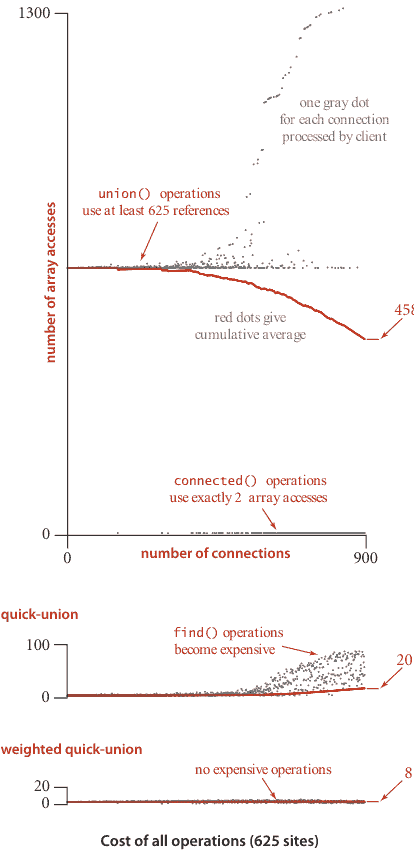

## 观点

我们考虑的每个 UF 实现在某种直观上都是对前一个版本的改进，但这个过程是人为平滑的，因为我们拥有后见之明，回顾研究人员多年来研究的算法发展过程。这些实现非常简单，问题定义清晰，因此我们可以通过运行实证研究直接评估算法。此外，我们可以利用这些研究来验证量化这些算法性能的数学结果。在可能的情况下，我们在书中对基础问题遵循了在本节中处理并查集算法时采取的相同步骤，其中一些在列表中被重点标记：

- 确定一个完整且具体的问题陈述，包括识别问题内在的基础抽象操作和 API。
- 使用深思熟虑的开发客户端和真实的输入数据，为简单算法仔细开发出简洁的实现。
- 了解何时某种实现可能无法解决预期规模的问题，并且必须进行改进或放弃。
- 通过逐步细化的过程开发改进的实现，通过实证分析、数学分析或两者结合来验证改进想法的有效性。
- 找到运行中数据结构或算法的高级抽象表示，以便对改进版本进行有效的高级设计。
- 在可能时追求最坏情况的性能保证，但在可用典型数据时接受良好的性能。

并查集的潜力是巨大的。随着并查集范围的扩大，使用高效算法解决问题的重要性也随之增长。并查集的设计是一个引人入胜的领域……（注：原文此处重复多次，已按要求处理）。

## 问答

**问：** 我想在 API 中添加一个 `delete()` 方法。关于如何进行有什么建议？

**答：** 还没有人设计出像本节中算法一样简单的可以处理删除的算法。

**问：** 什么是单元探测模型（cell-probe model）？

**答：** 一种只计算足够大的随机内存访问的计算模型。

## 1.5 案例研究：并查集

# 练习


### 1.5.1

在序列`9-0 3-4 5-8 7-2 5-7 0-3`上使用 quick-find，显示每个输入对时`id[]`数组的内容以及数组被访问的次数。

### 1.5.2

执行练习 1.5.1，但使用 quick-union（第 224 页）。此外，在处理每个输入后，画出由`id[]`数组表示的树森林。

### 1.5.3

执行练习 1.5.1，但使用加权 quick-union（第 228 页）。

### 1.5.4

显示对应加权合并示例（参考输入和最坏情况输入）的输入对的`sz[]`和`id[]`数组的内容以及数组访问次数。

### 1.5.5

估计在每秒执行`10⁸`条指令的计算机上，使用 quick-find 解决具有`10⁶`和`10⁷`个输入对的动态连通问题所需的最少时间（天）。假设内部循环每次需要 10 条机器指令。

### 1.5.6

为加权 quick-union 重复练习 1.5.5。

### 1.5.7

开发`QuickUnionUF`和`QuickFindUF`类，分别实现 quick-union 和 quick-find。

### 1.5.8

给出一个反例，说明为什么这种直观的 quick-find `union()`实现是不正确的：

```java
public void union(int p, int q)
{
    if (connected(p, q)) return;
    // 将 p 的组件重命名为 q 的名称
    for (int i = 0; i < id.length; i++)
        if (id[i] == id[p]) id[i] = id[q]
    count--;
}
```

### 1.5.9

画出右`id[]`数组对应的树。这可能是运行加权 quick-union 的结果吗？解释为什么这是可能的，或者给出产生该数组的操作序列。

| i | 0 | 1 | 2 | 3 | 4 | 5 | 6 | 7 | 8 | 9 |
|---|---|---|---|---|---|---|---|---|---|---|
| `id[i]` | 1 | 1 | 3 | 1 | 5 | 6 | 1 | 3 | 4 | 5 |

## 练习（续）

### 1.5.10

在加权快速并查（weighted quick-union）算法中，假设我们将`id[find(p)]`设置为`q`而不是设置为`id[find(q)]`。那么生成的算法是正确的吗？

答案：是的，但它会增加树的高度，因此性能保证将失效。

### 1.5.11

实现加权快速查找（weighted quick-find），其中你始终将较小组件的`id[]`条目更改为较大组件的标识符。这种改变对性能有什么影响？

## 创造性问题

### 1.5.12 带有路径压缩的快速并查

修改快速并查（第 224 页）以包含路径压缩，方法是在`find()`函数中添加一个循环，用于连接从`p`到根节点沿路径上的每个站点。给出一组输入对序列，使得该方法产生一个长度为 4 的树。

*注：*该算法的每次操作摊销成本已知是对数级的。

### 1.5.13 带有路径压缩的加权并查

修改加权并查（`ALGORITHM 1.5`）以实现练习 1.5.12 中描述的路径压缩。给出一组输入对序列，使得该方法产生一个高度为 4 的树。

*注：*该算法的每次操作摊销成本已知受限于名为反阿克曼函数的函数，且对于任何可以想象的`N`值，该值都小于 5。

### 1.5.14 按高度加权并查

开发一种 UF 实现，它使用与加权快速并查相同的策略来跟踪高度，并将较矮树合并到较高的树上。证明对于你的算法，对于具有`N`个站点的树，树的高度具有对数上界。

### 1.5.15 二项树

证明在加权快速并查最坏情况下，树中每一层的节点数是二项式系数。计算具有$N=2^k$个节点的最坏树中节点的平均深度。

### 1.5.16 摊销成本图

对你练习 1.5.7 中的实现进行插桩，以使摊销成本像文中所示的那样。

### 1.5.17 随机连接

开发一个 UF Erdos-Rényi 程序，它从命令行获取一个整数`N`，生成 0 到`N-1`之间的随机整数对，调用`connected(ij)`判断它们是否连通，如果不连通则调用`union(ij)`（如我们的开发客户端所示），循环直到所有站点都连通，并打印生成的连接数。

将你的程序封装为一个静态方法，该方法接收`N`作为参数，以及一个从命令行获取`N`的`main()`方法，调用`count()`并打印返回的值。

### 1.5.18 随机网格生成器

编写一个`RandomGrid`程序，它从命令行获取`N`，生成`N × N`网格中的所有连接，将它们随机排序，并对它们进行随机排序（使得`pq`和`qp`出现的概率相等），并将结果输出到标准输出。

为了随机排序连接，请使用`RandomBag`（见第 167 页练习 1.3.34）。为了将`p`和`q`封装在一个对象中，使用下面所示的`Connection`嵌套类。将你的程序封装为两个静态方法：`generate()`，接收`N`作为参数并返回连接数组；以及`main()`，从命令行获取`N`，调用`generate()`并遍历返回的数组以打印连接。

```java
private class Connection
{
    int p;
    int q;

    public Connection(int p, int q)
    { this.p = p; this.q = q; }
}
```

用于封装连接记录。

## 创造性问题（续）

### 1.5.19 动画

编写一个`RandomGrid`客户端（见练习 1.5.18），使用我们开发客户端中的`UnionFind`来检查连通性，并使用`StdDraw`在处理连接时绘制它们。

### 1.5.20 动态增长

使用链表或调整大小的数组，开发一种快速并查实现，消除预先知道对象数量的限制。在 API 中添加`newSite()`方法，它返回一个`int`标识符。

### 1.5.21 Erdős-Rényi 模型

使用你练习 1.5.17 中的客户端测试以下假设：得到一个组件所生成的对数在`N`中约为$\sqrt{N}$。

### 1.5.22 Erdős-Rényi 模型的翻倍测试

开发一个性能测试客户端，它从命令行获取一个整数值`T`，并对以下实验进行`T`次试验：使用你练习 1.5.17 中的客户端生成随机连接，使用我们开发客户端中的`UnionFind`确定连通性，循环直到所有站点创建。

对于每个`N`，打印`N`的值、平均处理的连接数以及当前运行时间与上一次运行时间的比例。使用你的程序验证文中的假设：快速查找和快速并查的运行时间是二次的，而加权快速并查是近线性的。

### 1.5.23 对于 Erdős-Rényi 模型比较快速查找与快速并查

开发一个性能测试客户端，它从命令行获取一个整数值`T`，并进行`T`次以下实验：使用你练习 1.5.17 中的客户端生成随机连接。保存连接，以便你可以使用快速并查和带有路径压缩的快速并查进行你练习 1.5.23 中的测试。

你可以在我们的开发客户端中识别连通性吗，循环直到所有站点创建。对于每个`N`，打印`N`的值和两次运行时间的比例。

### 1.5.24 对于 Erdős-Rényi 模型的快速算法

向你练习 1.5.23 中的测试添加加权快速并查和带有路径压缩的加权快速并查。你能看出这两种算法之间的差异吗？

### 1.5.25 随机网格的翻倍测试

开发一个性能测试客户端，它从命令行获取一个整数值`T`，并进行`T`次以下实验：使用你练习 1.5.18 中的客户端生成`N × N`平方网格中的连接（随机排序和有序），使用我们开发客户端中的`UnionFind`确定连通性，循环直到所有站点创建。

对于每个`N`，打印`N`的值、平均处理的连接数以及当前运行时间与上一次运行时间的比例。使用你的程序验证文中的假设：快速查找和快速并查的运行时间是二次的，加权快速并查是近线性的。

注：随着`N`倍增，网格中的站点数量增加 4 倍，因此预计二次算法的翻倍因子为 16，线性算法为 4。

## 实验（续）

### 1.5.26 Erdős-Rényi 的摊销成本图

开发一个客户端，从命令行获取整数值`N`，并对文中所示生成 0 到`N-1`之间随机对的摊销图：调用`connected()`判断它们是否连通，如果不连通则调用`union()`（如我们的开发客户端所示），循环直到所有站点连通。

# 第二章

## 排序

- 2.1 基础排序 ........................................ 244
- 2.2 合并排序 ........................................ 270
- 2.3 快速排序 ........................................ 288
- 2.4 优先级队列 ...................................... 308
- 2.5 应用 ............................................ 336

排序是重新排列对象序列的过程，使其按照某种逻辑顺序排列。例如，你的信用卡账单按日期显示交易——它们很可能是通过排序算法排列的。在计算机早期，常识认为所有计算周期的 30% 都花在了排序上。如果今天这个比例较低，一个可能的原因是排序算法变得高效了，而不是排序的重要性降低了。事实上，计算机的普及使我们数据泛滥，组织数据的第一步是所有计算机系统都拥有排序算法的实现。

## 2.1 基础排序

在我们对排序算法领域的首次探索中，我们将学习两种基础排序方法以及其中一种的变体。详细研究这些相对简单算法的原因如下：首先，它们为我们提供了学习术语和基础机制的背景。其次，在某些应用中，这些简单算法比我们之后将讨论的复杂算法更有效。第三，正如我们所看到的，它们对于提高复杂算法的效率很有用。

## 游戏规则

我们主要关注的是重新排列项数组的算法，其中每个项包含一个键（key）。排序算法的目标是根据某些定义的顺序（通常是数值顺序或字母顺序）对键有序的项进行重新排列。我们希望重新排列数组，使得每个键都小于索引较小的条目中的键，并且不大于索引较大的条目中的键。

键和项的特定特征在不同应用之间存在差异。在 Java 中，项是对象，键的抽象概念包含在一个内置机制中——`Comparable`接口——中，该接口在第 247 页有描述。

对面页的`Example`类示例说明了我们将使用的惯例：我们将排序代码放在单个类的`sort()`方法中，该类带有私有辅助函数`less()`和`exch()`（以及其他一些）以及示例客户端`main()`。

示例还说明了可能对初始调试有用的代码：其客户端`main()`从标准输入读取字符串并打印数组内容。在本章的后半部分，我们将检查各种客户端，用于比较这些算法并研究它们的性能。对于排序方法，我们为排序类赋予了不同的名称。客户端可以通过名称调用它们：`Insertion.sort()`、`Merge.sort()`、`Quick.sort()`等。

除少数例外外，我们的排序代码仅通过两个操作引用数据：比较项的`less()`方法和交换项的`exch()`方法。`exch()`方法很容易实现，而`Comparable`接口使得`less()`的实现变得易于许多。将数据访问限制在这两个操作上使得我们的代码具有可读性和可移植性，并使我们更容易验证算法的正确性、研究性能以及比较算法。

在继续考虑实现之前，我们先讨论了每种排序都需要仔细考虑的若干重要问题。

### 排序类模板

```java
public class Example
{
    public static void sort(Comparable[] a) {
        /* See Algorithms 2.1, 2.2, 2.3, 2.4, 2.5, or 2.7. */
        private static boolean less(Comparable v, Comparable w)
            return v.compareTo(w) < 0;

        private static void exh(Comparable[] a, int i, int j)
            Comparable t = a[i]; a[i] = a[j]; a[j] = t;

        private static void show(Comparable[] a)
            // Print the array, on a single line.
            for (int i = 0; i < a.length; i++)
                StdOut.print(a[i] + " ");
            StdOut.println();

    public static boolean isSorted(Comparable[] a) {
        // Test whether the array entries are in order
        for (int i = 1; i < a.length; i++)
            if (!less(a[i], a[i-1]))
                return false;
        return true;
    }

    public static void main(String[] args) {
        // Read strings from standard input, sort them, and print.
        String[] a = In.readStrings();
        sort(a);
        assert isSorted(a);
        show(a);
    }
}
```

这说明了我们实现排序的惯例。我们考虑的每种排序算法，都会在类似`Example`的类中提供一个`sort()`方法，并将`Example`改为与算法对应的名称。测试客户端的字符串从标准输入获取的，但通过此代码，我们的排序方法对于任何实现`Comparable`接口的数据类型都是有效的。

```text
% mine tiny.txt
SORTEXAMPLE

% java Example < tiny.txt
AEELMPRSTX
```

```text
% words3.txt
bed bad day zoo ... all bad yet

% java Example < words3.txt
all bad bad dad ... yes yet zoo
```

## 排序

### 验证

排序实现是否无论初始顺序如何都能将数组排好序？作为保守的做法，我们会在测试客户端中包含`assertSorted(a);`语句，以验证排序后数组条目是有序的。

在每个排序实现中包含此语句是合理的，尽管我们通常会测试代码并开发数学证明来确保算法是正确的。注意，只有当我们专门使用`exch()`来更改数组条目时，此测试才是充分的。当我们使用代码将值存储到数组时，我们并没有完全的保证（例如，通过将所有值设置为相同来破坏原始输入数组的代码可以通过此测试）。

### 运行时间

我们还会测试算法性能。首先，我们强制统计各种排序算法在自然输入模型下执行的基本操作次数（比较和交换，或者数组被读取或写入访问的次数）。然后，我们利用这些事实来开发关于算法比较性能的假设，并提供我们可以用来检查此类假设有效性的工具。

我们使用一致的编码风格，以便于开发在典型实现中成立的有效性能假设。

### 排序成本模型

在研究算法时，我们比较比较和交换。对于不使用交换的算法，计算访问次数。

### 额外内存

排序算法使用的额外内存量通常与运行时间一样是重要因素。排序算法分为两种基本类型：

- 原地排序算法（除了较小的调用栈或常数个实例变量外不使用任何额外内存）。
- 需要足够内存来容纳任何排序数组副本的算法。

### 数据类型

我们的排序代码对于任何实现`Comparable`接口的项都是有效的。像这样遵循 Java 的惯例是非常方便的，因为你可能想要排序多种`Comparable`的数据类型。

例如，Java 的原生包装类如`Integer`和`Double`实现了`File`或`URL`等各种类型。这时，你只需要将其中任何一种类型作为参数调用我们的排序方法即可。例如，右侧快速排序中排序`N`个随机`Double`值的代码。

当我们创建自己的类型时，可以通过实现`Comparable`接口来允许客户端排序该类型的数据。为了做到，我们只需要实现一个`compareTo()`方法，定义对该类型对象的顺序，这被称为自然顺序（natural order）。

```java
Double[] a = new Double[N]
for (int i = 0; i < N; i++)
    a[i] = StdRandom.uniform();
Quick.sort(a);
```

## 2.1 基础排序

在本章的剩余部分，我们将处理许多对具有自然顺序的对象数组进行排序的算法。为了对比分析这些算法，我们将检查它们的若干属性，包括它们对各种类型输入使用的比较次数和交换次数，以及使用的额外内存量。

这些属性导致了属性的产生，其中许多属性已在无数计算机或过去的几十年中得到了验证。具体的实现总是需要检查，因此我们还考虑了执行这些检查的工具。

在考虑了经典的选择排序、插入排序、壳排序、归并排序、快速排序和堆排序算法后，我们将在第 2.5 节考虑实际和应用。

### 定义一个可比较类型


# 第 2 章 排序

## 选择排序 (Selection sort)

最简单的排序算法之一的工作如下：首先，在数组中找到最小元素并将其与第一个元素交换（假设第一个元素本身已经是最小的）。然后，以这种方式继续，直到找到下一个最小元素并将其与第二个元素交换。这种方法被称为选择排序，因为它通过反复选择剩余元素来工作。

正如从 ALGORITHM 2.1 的实现所示，选择排序的内部循环只是一个比较，用于将当前元素与目前为止发现的最小元素进行比较（加上递增当前索引并检查其是否超出数组边界所需的代码）；它几乎不能更简单了。在内部循环之外移动元素的工作：每次交换都将一个元素放入其最终位置，因此交换次数为 N。因此，运行时间主要由比较次数决定。

**命题 A**。选择排序对长度为 N 的数组进行排序需要 $\sim N^2/2$ 次比较和 $N$ 次交换。

**证明：** 你可以通过检查轨迹图（trace）来证明这一点，轨迹是一个 $N \times N$ 的表格，其中未阴影的字母对应代码。表中大约一半的条目是未阴影的——即对角线上及以上的条目。每个对角线上的条目对应一次交换。此外，检查代码可以发现，对于从 0 到 $N-1$ 的每个 $i$，一次交换和 $N-1-i$ 次比较，因此总计为 $N$ 次交换和 $(N-1)(N-2)\dots+2+1+0 = N(N-1)/2 \sim N^2/2$ 次比较。

总而言之，选择排序是一种易于理解和实现的简单排序方法，其具有两个显著属性：

- **运行时间对输入不敏感。** 遍历数组寻找最小元素的过程并没有提供下一次遍历中最小元素可能所在位置的信息。这一属性在某些情况下可能是不利的。例如，使用排序客户端的人可能会惊讶地发现，对于已经有序的数组或所有键都相同的数组，其花费的时间与随机排序的数组差不多！我们都看到，其他算法能更好地利用输入中的初始顺序。

- **数据移动是最小的。** N 次交换中的每一次都会改变两个数组条目的的值，因此选择排序使用 N 次交换——交换次数是数组大小的线性函数。在我们考虑的这一属性上，没有其他排序算法能做到这一点（大多数涉及线性或二次方增长）。

## ALGORITHM 2.1 选择排序

```java
public class Selection
{
    public static void sort(Comparable[] a) {
        // 将 a[] 排序为升序。
        int N = a.length; // 数组长度
        for (int i = 0; i < N; i++) {
            // 将 a[i] 与 a[i+1...N] 中的最小元素交换。
            int min = i; // 最小元素的索引。
            for (int j = i+1; j < N; j++) {
                if (less(a[j], a[min])) min = j;
            }
            exch(a, min);
        }
        // 见第 245 页的 less(i), exch(i), isSorted(), 和 main().
    }
}
```

对于每个 $i$，该实现将最小元素放在 $a[i]$。位置 $i$ 左侧的条目是数组中的最小元素，且不再被检查。

| min | 0 | 1 | 2 | 3 | 4 | 5 | 6 | 7 | 8 | 9 | 10 |
|---|---|---|---|---|---|---|---|---|---|---|---|
| 0 | 6 | S | O | R | T | E | X | A | M | P | L | E |
| 1 | 4 | A | O | R | T | E | X | S | M | P | L | E |
| 2 | 10| A | E | R | T | O | X | S | M | P | L | E |
| 3 | 9 | A | E | E | T | O | X | S | M | P | T | R |
| 4 | 7 | A | E | E | E | L | M | X | O | P | T | R |
| 5 | 7 | A | E | E | E | L | M | O | S | X | P | T | R |
| 6 | 8 | A | E | E | E | L | M | O | S | X | P | T | R |
| 7 | 10| A | E | E | E | L | M | O | P | X | S | T | R |
| 8 | 8 | A | E | E | E | L | M | O | P | R | S | T | X |
| 9 | 9 | A | E | E | E | L | M | O | P | R | S | T | X |
| 10| 10| A | E | E | E | L | M | O | P | R | S | T | X |

选择排序轨迹（每次交换后的数组内容）

## 插入排序 (Insertion sort)

人们经常用于排序的算法是一次处理一张手牌，将其插入到已考虑的手牌中的正确位置。在计算机实现中，我们需要通过将较大的元素向右移动一位来为稍后遇到的较小元素留出空间。ALGORITHM 2.2 是该方法的实现，被称为插入排序。与选择排序不同，插入排序的运行时间取决于输入元素的初始顺序。例如，如果数组很大且条目已经是有序的，那么插入排序比随机排序或逆序排序要快得多。

**命题 B**。插入排序对长度为 $N$ 的具有不同键的随机数组需要 $\sim N^2/4$ 次比较和 $\sim N^2/4$ 次交换。最坏情况是 $\sim N^2/2$ 次比较和 $\sim N^2/2$ 次交换，最佳情况是 $N-1$ 次比较和 0 次交换。

**证明：** 对于命题 A，比较和交换次数在 $N \times N$ 的图中很容易可视化。我们统计对角线以下的条目——最坏情况下是全部，最佳情况下没有。对于随机排序数组，我们预期每个元素向后移动一半，平均我们统计对角线以下的一半条目。

比较次数减去交换次数等于 $N$ 减去插入元素的次数。在最坏情况下（数组逆序），这一项相对于总数可以忽略不计；在最佳情况下（数组有序），它等于 $N-1$。

插入排序对于实践中经常出现的某些非随机数组效果良好，即使它们很大。例如，正如提到的，考虑当对一个已经有序的数组使用插入排序时会发生什么。每个元素都被立即确定位于其正确位置，总运行时间是线性的（此类数组的选择排序运行时间是二次方的）。键相同的数组也是如此（因此命题 B 中要求键是不同的）。

## ALGORITHM 2.2 插入排序

```java
public class Insertion
{
    public static void sort(Comparable[] a) {
        // 将 a[] 排序为升序。
        int N = a.length;
        for (int i = 1; i < N; i++) {
            // 将 a[i] 插入 a[i-1], a[i-2], a[i-3]... 之间
            for (int j = i; j > 0 && less(a[j], a[j-1]); j--)
                exch(a, j, a[j-1]);
        }
    }
    // 见第 245 页的 less(), exch(), isSorted(), 和 main().
}
```

对于从 1 到 $N-1$ 的每个 $i$，将 $a[i]$ 与 $a[0]$ 到 $a[i-1]$ 中较大的条目交换。随着索引从左向右移动，其左侧的条目在数组中是有序的，因此当它到达右端时，数组完全有序了。

| i | j | 0 | 1 | 2 | 3 | 4 | 5 | 6 | 7 | 8 | 9 | 10 |
|---|---|---|---|---|---|---|---|---|---|---|---|---|
| | | S O R T E X A M P L E | | |
| 1 | | A O R T E X S M P L E | | |
| 2 | | A E R T O X S M P L E | | |
| 3 | | A E E T O X S M P T R | | |
| 4 | | A E E E L M X O P T R | | |
| 5 | | A E E E L M O S X P T R | | |
| 6 | | A E E E L M O S X P T R | | |
| 7 | | A E E E L M O P X S T R | | |
| 8 | | A E E E L M O P R S T X | | |
| 9 | | A E E E L M O P R S T X | | |
| 10| | A E E E L M O P R S T X | | |

更一般地说，我们考虑部分有序的概念，逆序是数组中无序的元素对。例如，X A MP LE 有 11 个逆序：E-A, X-A, X-M, X-P, L-E, M-L, M-E, 以及等等。如果一个数组中的逆序数量小于数组大小的常数倍，我们说该数组是部分有序的。部分数组的典型示例包括：

- 每个元素距离其最终位置不远的数组
- 附加在大型排序数组之后的小数组
- 只有少数元素不在位的数组

对于此类数组，插入排序是一种高效的方法；而选择排序不是。事实上，由于逆序数量很少，插入排序可能比本章中使用的任何排序方法都快。

**命题 C**。插入排序使用的交换次数等于数组中的逆序次数，而比较次数至少等于逆序次数，最多等于逆序次数加上数组大小减 1。

**证明：** 每次交换涉及两个相邻元素，因此减少一个逆序，并且当逆序次数变为零时数组是有序的。每次交换对应一次比较，并且对于从 1 到 $N-1$ 的每个 $i$，可能会额外发生一次比较（当 $a[i]$ 没有到达数组左端时）。

总而言之，插入排序对于部分有序数组是一种极的方法，对于微小数组也是一种很好的方法。这些事实之所以，不仅是因为数组在实践中经常出现，还因为这两种类型的数组在高级排序算法的中间阶段出现，因此我们将结合此类算法再次考虑插入排序。

## 算法可视化

在本章中，我们将使用一种简单的视觉表示法来帮助描述排序算法的属性。我们不再使用字母、数字或单词等键值来追踪排序的进度，而是使用垂直条形并根据它们的高度进行排序。这种表示法的优势在于，它可以让我们一眼洞察到排序方法的行为。

例如，你可以直观地从视觉轨迹看出，插入排序不会接触扫描指针右侧的条目，而选择排序不会接触扫描指针左侧的条目。此外，从视觉轨迹可以明显看出，由于插入排序也不会处理比插入元素更小的条目，因此它平均使用的比较次数是选择排序的一半。

使用我们的 StDDraw 库，开发一个可视化轨迹并不比执行标准追踪困难多少。我们将值翻倍，对算法进行插桩并在合适的地方 `show()`（就像我们执行标准排序一样），并开发一个版本的 `show()`，它使用 StDDraw 绘制条形而不是打印结果。最复杂的任务是设置 y 轴的比例尺，使得轨迹线条按预期的顺序出现。鼓励你完成练习 2.1.18，以更好地理解可视化轨迹的价值以及创建它们的代价。

一个更简单的任务是制作排序动画，你可以看到数组动态地演变为排序后的结果。开发动画轨迹涉及与上一段描述相同的流程，但不需要担心 y 轴（每次只需清空窗口并重绘条形即可）。尽管我们无法在印刷版页面上演示，但这种动画表示法对于洞察算法的运行原理同样有效。我们也鼓励你完成练习 2.1.17 以亲身验证。

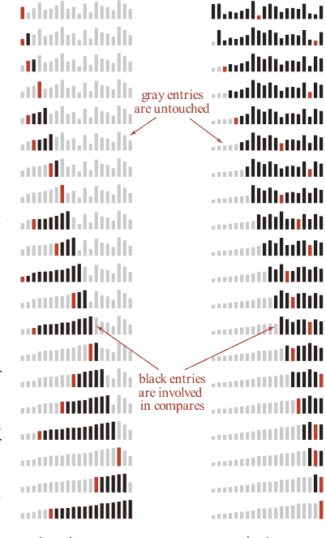

基础排序算法的可视化轨迹

## 比较排序算法

现在我们有了两种实现，我们自然地想知道哪一个更快：选择排序（算法 2.1）还是插入排序（算法 2.2）。这类问题在算法研究中反复出现，是贯穿本书的关注重点。我们在第 1 章中讨论了一些基础性概念，但我们使用这第一个案例来阐明回答此类问题的基本方法。通常，遵循第 1.4 节中介绍的方法，我们通过以下方式比较算法：

- 实现并调试它们
- 分析它们的基本属性
- 对比较性能提出假设
- 运行实验以验证假设

这些步骤无非是应用于算法研究的悠久科学方法。

在当前语境下，算法 2.1 和算法 2.2 是第一步的证据：命题 A、B 和 C 构成了第二步：255 页上的属性 D 构成了第三步，而 256 页的 `SortCompare` 类实现了第四步。这些活动都是相互关联的。

我们简短的描述代表了在实现、分析和测试算法上付出的巨大努力。每个程序员都知道，这样的代码是经过长期调试和完善的产物；每个数学家都知道，适当的分析可能非常困难；每个科学家都知道，提出假设以及设计执行实验来验证假设需要极大的谨慎。这些结果的完整开发留给了那些研究其性能报告背后最深科学背景的专家。

在开发出实现后，我们的下一个选择是为输入确定一个合适的模型。对于排序算法，一个自然模型（我们在命题 A、B 和 C 中使用了它）是假设数组是随机排序的，且键值是不相同的。在存在大量相同键值的应用中，我们需要一个更复杂的模型。

我们如何对随机排序数组的插入排序和选择排序的运行时间提出假设？检查算法 2.1 和 2.2 可以立即得出，两种算法对于随机排序数组的运行时间都是二次的。也就是说，插入排序对于此类输入的运行时间与某个小常数乘以 $N^2$ 成比例，而选择排序的运行时间与另一个小常数乘以 $N^2$ 成比例。这两个常量的值取决于所用特定计算机比较和交换的成本。对于许多类型的数据和典型的计算机，假设这些成本是相似的（尽管我们将看到一些显著的例外）。

直接得出以下假设：

**属性 D。** 对于具有不同值的随机排序数组，插入排序和选择排序的运行时间是二次的，且彼此之间处于很小的常数因子范围内。

**证据：** 这一陈在过去的半个世纪里已经在许多不同的计算机上得到了验证。1980 年本书第一版编写时，插入排序的速度大约是选择排序的两倍，今天依然如此，尽管使用这些算法排序 100,000 个项目需要几个小时，而现在仅需几秒钟。要发现结果，你可以使用下一页的 `SortCompare` 类，它使用作为命令行参数命名的类的 `sort()` 方法来执行指定次数的实验（排序指定大小的数组），并打印算法观测运行时间的比例。

为了验证这一假设，我们使用 `SortCompare`（见第 256 页）进行实验。照常，我们使用 `Stopwatch` 来计算运行时间。这里显示的 `time()` 实现可以完成本章基础排序的工作。“随机排序输入模型”嵌入在 `SortCompare` 的 `timeRandomInput()` 方法中，该方法为排序生成 Double 值并返回总测量试验次数。使用 0.0 到 1 之间的随机 Double 值比使用库函数 `StdRandom.shuffle(a)` 作为替代方案简单得多，并且是有效的，因为键值几乎是不同的（见练习 2.51）。正如第 1 章所述，由于试验次数也是一个参数，可以利用大数定律。

## 补充：Date 类示例

```java
public class Date implements Comparable<Date> {
    private final int day;
    private final int month;
    private final int year;

    public Date(int d, int m, int y) {
        day = d; month = m; year = y;
    }

    public int day() {
        return day;
    }
    public int month() {
        return month;
    }
    public int year() {
        return year;
    }

    public int compareTo(Date other) {
        if (this.year > other.year) return 1;
        if (this.year < other.year) return -1;
        if (this.month > other.month) return 1;
        if (this.month < other.month) return -1;
        if (this.day > other.day) return 1;
        if (this.day < other.day) return -1;
        return 0;
    }

    public String toString() {
        return month + "/" + day + "/" + year;
    }
}
```

这些规则在数学上是直观且标准的——你遵循它们并没有困难。简而言之，`compareTo(O)` 实现了我们的键抽象——它定义了待排序项（对象）的顺序，可以是任何实现 `Comparable` 接口的数据类型。注意，`compareTo(O)` 并不需要所有的实例。事实上，键可能是项的一部分。

按照惯例，`compareTo(O)` 必须实现全序：

- 反射性（对于所有 v，v=v）
- 反对称性（对于所有 v 和 w，如果 v<w 则 w>v，且如果 v=w 则相等）
- 传递性（对于所有 v, w 和 x，如果 v<w 且 w<x 则 v<x）

如果 v 和 w 类型不兼容或其中任一为 null，它将抛出异常。为了简洁，我们使用标准符号如 v<w 作为此段落剩余部分的简写。


```java
public static double time(String alg, Comparable[] a) {
    Stopwatch timer = new Stopwatch();
    if (alg.equals("Insertion")) Insertion.sort(a);
    if (alg.equals("Selection")) Selection.sort(a);
    if (alg.equals("Shell")) Shell.sort(a);
    if (alg.equals("Merge")) Merge.sort(a);
    if (alg.equals("Quick")) Quick.sort(a);
    if (alg.equals("Heap")) Heap.sort(a);
    return timer.elapsedTime();
}
```

本章中排序算法的计时是针对给定输入的（试验次数越多，总运行时间除以试验次数对真实平均时间的估计就越准确），并有助于消除系统影响。鼓励你对`SortCompare`进行实验。

## 比较排序算法

```java
public class SortCompare
{
    public static double time(String alg, Comparable[] a)
        /* 见正文 */
    public static double doubleTimeInput(String alg, int N, int T)
        /* 使用 alg 排序长度为 N 的随机数组。 */
        double total = 0.0;
        Double[] a = new Double[N];
        for (int t = 0; t < T; t++) {
            /* 执行一次实验（生成并排序）。 */
            for (int i = 0; i < N; i++)
                a[i] = Rand.uniformDouble();
            total += time(alg, a);
        }
        return total;
    }

    public static void main(String[] args)
    {
        String alg1 = args[0];
        String alg2 = args[1];
        int N = Integer.parseInt(args[2]);
        int T = Integer.parseInt(args[3]);
        double t1 = doubleTimeInput(alg1, N, T); // alg1 的总和
        double t2 = doubleTimeInput(alg2, N, T); // alg2 的总和
        Std.out.printf("%d random Doubles \n%s is, %.1f\n", N, alg1, t1);
        Std.out.printf("%.1f times faster than %s\n", t2/t1, alg2);
    }
}
```

客户端运行前两个命令行参数指定的排序算法，针对`N`（第三个命令行参数）个 0.0 到 1.0 之间的随机`Double`值，重复实验（第四个命令行参数）次数，然后打印总运行时间的比例。

```bash
% java SortCompare Insertion Selection 100 100
For 1000 random Doubles
Insertion is, 1.7 times faster than Selection
```

## 基础排序

在你的计算机上学习其关于插入排序和选择排序的结论在多大程度上是稳健的。

属性 D 故意设计得模糊——没有说明小的常数因子的值，也没有说明比较和交换成本的假设——以便它能够适用于广泛各种情况。在可能的情况下，我们尝试通过此类陈述来捕捉我们研究的每个算法性能的本质特征。正如第 1 章所讨论的，在给定情况下，我们需要通过科学方法测试的每个属性，可能还需要辅以基于相关命题（数学真理）的更精细的假设。

对于实际应用，还有一步至关重要的一步：运行实验以在手头数据上验证假设。我们将这一步的考虑推到了第 2.5 节和练习题。在此过程中，如果你的排序不是独特的且/或无序的，属性 D 则可能不成立。你可以使用`stdRandom::shuffle()`对数组进行随机排序，但涉及大量键的应用程序则需要更仔细的分析。

我们对算法分析的讨论旨在作为起点，而不是结论。如果你想到了其他关于算法性能的问题，可以使用`SortCompare`之类的工具进行研究。练习题中提供了许多这样的机会。

我们不会进一步赘述插入排序和选择排序的比较性能，因为我们更感兴趣的是运行速度比其中任何一种快一百或百万倍算法。尽管如此，理解这些基础算法出于几个原因仍然是值得的：

- 它们有助于制定基本规则。
- 它们提供了性能基准。
- 在某些特殊情况下，它们通常是首选方法。
- 它们可以作为开发更好算法的基础。

出于这些原因，我们将在整本书中使用相同的基本方法并考虑基础算法，而不只是排序。对于我们研究的每个问题，`SortCompare`等程序在算法开发的这种进式方法中起着至关重要的作用。在路径的每一步，我们都可以此类程序来帮助评估新算法或已知算法的改进版本是否提供了预期的性能提升。

# 第 2 章 排序

## 希排序

为了展示了解基础排序属性的价值，我们接下来考虑一种基于插入排序的快速算法。插入排序对于大型无序数组来说很慢，因为它只交换相邻项，因此项目每次只能移动一个位置。例如，如果键最小的项恰好在数组末尾，则需要`N-1`次交换才能将该项移动到它所属的位置。希排序是插入排序的简单扩展，它通过加速距离较远的数组项来提高速度，产生部分排序的数组，然后通过插入排序进行高效排序。

其思想是重新排列数组，使其具有以下属性：提取每隔`h`项（从任何地方开始）都会得到一个有序的子序列。这样的数组是`h`-排序的。换句话说，`h`-排序是相互交织在一起的独立排序子序列。通过对较大的`h`值进行`h`-排序，我们在数组中长距离移动项目，并使得对较小的`h`值进行`h`-排序变得更容易。

| L E E A M H L E P O L T S X R |
| :--- |
| L - M - P - T |
| E - H - S |
| E - L - 0 - X |
| A - E - L - R |

任何以 1 结尾的`h`值序列的程序将产生一个有序数组，递减值`1/2(3-1)`，`h`-排序序列是面对页算法 2.3 中使用递减序列生成的`h`个交错排序子序列，从大于或等于`[N/3]`的最小增量开始递减到 1。我们将此类序列称为增量序列。算法 2.3 计算其增量序列；另一种替代方案是将增量序列存储在独立的...

实现希排序的一种方法是，对于每个`h`，对`h`个子序列中的每一个都独立地使用插入排序。由于子序列是相互独立的，我们可以使用更简单的方法：在对数组进行`h`-排序时，我们通过与具有较大键的项交换，将每个项目插入到其`h`-子序列中之前的项目之间（将每个项目向右移动一个位置）。我们使用插入排序代码完成此任务，但将其修改为在遍历数组时每次递减`h`而不是 1。这一观察揭示了希排序的实现是对每个增量对数组进行类似于插入排序的遍历。

希排序通过在子序列的大小和部分顺序之间进行权衡来获得效率。在开始时，子序列很大；在排序后期，子序列是部分排序的。在这两种情况下，插入排序都是首选方法。子序列部分排序的程度是一个变量因素，强烈取决于增量序列。事实上，算法 2.3 是我们考虑的唯一在随机排序数组上执行但尚未被精确定义的排序方法。

### 算法 2.3 希排序

```java
public class Shell {
    public static void sort(Comparable[] a) {
        // 将 a[] 按照升序排序
        int N = a.length;
        int h = 1;
        while (h < N/3) h = 3*h + 1; // 1, 4, 13, 40, 121, 364, 1093, ...
        while (h >= 1) {
            // 对数组进行 h-排序。
            for (int i = h; i < N; i++) {
                // 在 a[j-h] 中对 a[i] 进行 h-排序
                for (int j = i; j >= h && a[j].compareTo(a[j-h]) < 0; j -= h) {
                    swap(a, j, j-h);
                }
            }
            h /= 3;
        }
    }
}
```

如果我们修改希排序，使用以 1 结尾的递减增量序列作为数组长度的常数分数，我们就得到了这种紧凑的实现。

我们如何决定使用什么增量序列？通常，这是一个很难回答的问题。算法的性能不仅取决于增量的数量，还取决于大小。文献中研究了许多不同的增量序列，但尚未发现可能的最好的序列。已经发现了更复杂的、具有更好坏情况性能的增量序列。明显优于增量序列仍待发现。

### 希排序的详细追踪（插入）

在继续阅读之前，尝试使用`SortCompare`比较不断增加的数组大小下的希排序、插入排序和选择排序（见练习 2.17）。你会发现希排序使得处理排序

## 2.1 基础排序 261

### 输入


### 40-排序


### 13-排序


### 4-排序


### 结果

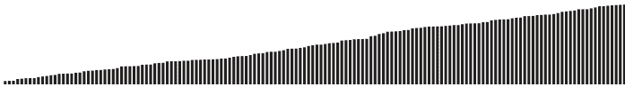

插入排序的可视化轨迹

有些问题无法通过书中贯穿始终的更基础原理来解决：例如，我们对一个重要原理的实际说明：实现加速以解决那些原本无法解决的问题，是研究算法性能和设计的首要原因之一。

研究希尔排序（shellsort）的性能特性需要超出本书范围的数学论证。如果你想通过思考如何证明以下结论来被说服：当一个`h`排序的数组是`k`排序的时，它仍然保持`h`排序状态。对于 ALGORITHM 2.3 的性能，当前背景下最重要的结果是：希尔排序的运行时间并不一定是二次的——例如已知 ALGORITHM 2.3 的最坏情况比较次数与`N^{3/2}`成正比。这样一个简单的修改就能打破二次运行时间的障碍是非常有趣的，因为这正是许多算法设计问题的首要目标。

# 第 2 章 ■ 排序

关于希尔排序对随机顺序输入的平均比较次数，目前还没有任何数学结论。人们已经设计了一些增量序列，可以将最坏情况比较次数的渐近增长率降低到`N^{4/3}`、`N^{5/4}`、`N^{6/5}`、`$\dots$`，但其中许多主要出于学术兴趣，因为对于实际的`N`值，这些函数很难彼此区分（也难以与`N`的常数因子区分来）。

在实践中，你可以通过使用 ALGORITHM 2.3 中的增量序列安全地利用过去对希尔排序的科学研究（或使用本节末练习中的一个增量序列，可能会提高 20% 到 40% 的性能）。此外，你可以轻松验证以下假设：

**属性 E**。希尔排序使用增量 1, 4, 13, 40, 121, 364, `$\dots$`时的比较次数受`N`乘以所用增量个数的小倍数限制。

**证据**。对 ALGORITHM 2.3 进行插桩以统计比较次数并除以所用增量的个数是一个非常直接的练习（见 EXERCISE 2.1.12）。大量的实验表明，每个增量的平均比较次数可能是`N^{1/3}`，但除非`N`巨大，否则很难察觉该函数的增长情况。该属性似乎也对输入模型不敏感。

**丰富的程序员**有时会选择希尔排序，因为它即使对于中等规模的数组，也有可以接受的运行时间；它只需要少量的代码；它不使用额外空间。在接下来的几节中，我们将看到更高效的方法，但除了非常大的`N`之外，它们可能只快一倍（如果快的话），而且更加复杂。如果你需要一个排序问题的解决方案，并且处于一种无法使用系统排序的情况下（例如目标为硬件或嵌入式系统的代码），你可以安全地使用希尔排序，稍后再决定是否有必要将其替换为更高级的方法。

## 问答

**问。** 排序看起来像是一个玩具问题。难道我们用计算机做的很多其他事情不有趣得多吗？

**答。** 也许吧，但许多那些有趣的事情都是通过快速排序算法才实现的。你将在第 2.5 节以及书的其他部分找到许多例子。排序值得研究，是因为这个问题易于理解，你可以欣赏更快速算法背后的精心设计。

**问。** 为什么有这么多排序算法？

**答。** 原因之一是算法的性能取决于输入值，因此不同的算法可能适用于具有不同类型的应用。例如，插入排序是部分有序数组或极小数组的首选方法。其他约束（如等键的空间和时间）也会起作用。我们将在第 2.5 节重新回到这个问题。

**问。** 为什么要费心思使用微小的`less()`和`min()`方法？

**答。** 它们是任何排序算法所需的基础抽象操作，从这些抽象的角度来看，代码更易理解。此外，它们使得代码可以移植到其他环境。例如，ALGORITHMS 2.1 和 2.2 中的大量代码在其他几种编程语言中都是合法的。在 Java 中，我们可以将此代码作为基本类型（它们没有实现`Comparable`接口）排序的基础：只需用代码`v < w`实现`less()`即可。

**问。** 当我运行`SortCompare`时，每次得到的值都不同（而且与书中的值不同）。为什么？

**答。** 首先，你用的计算机和我们用的不一样，那些值也和书中的值不同。为什么？

# 练习

- 2.1 按照示例展示希尔排序是如何排序的。
- 2.2 希尔排序的最大交换次数是多少？
- 2.3 实现一个将增量保留在数组中的希尔排序。
- 2.4 按照示例展示希尔排序是如何排序的。
- 2.5 对于所有键相同的数组，哪种方法运行更快？
- 2.6 对于任意数组，哪种方法运行更快？
- 2.7 对于逆序数组，哪种方法运行更快？
- 2.8 运行时间是线性的、二次的还是介？
- 2.9 按照示例展示希尔排序是如何排序的。
- 2.10 为什么不使用希尔排序？
- 2.11 实现一个使用增量的希尔排序。
- 2.12 对希尔排序进行插桩，打印比较次数除以数组大小。编写一个测试客户端，通过排序大小为 10 的幂的数组来测试该数为常数的假设。

## 创意问题

- 2.13 牌排序。说明你会如何给一副牌排序。
- 2.14 队列排序。说明你会如何排序一副牌。
- 2.15 昂贵的交换。运输公司的一名员工被分配了重新排列大量箱的任务。
- 2.16 验证。编写一个`check()`方法对给定数组调用`sort()`。
- 2.17 动画。在`Insertion`、`Selection`和`Shell`中添加代码，使它们将数组内容绘制为垂直条。
- 2.18 可视化轨迹。修改你对上一个练习的解法，使`Insertion`、`Selection`和`Shell`产生可视化轨迹。
- 2.19 希尔排序最坏情况。构造一个包含数字 1 到 100 的 100 个元素的数组用于希尔排序，增量为 1 4 13 40，使用尽可能多找到的比较次数。
- 2.20 希尔排序最好情况。希尔排序的最佳情况是什么？给出你的答案的理由。

## 创造性问题（续）

**2.1.21 可比较交易。** 以我们的`Date`代码（第247页）为模型，扩展你对`Transaction`的实现（练习 1.2.13），使其实现`Comparable`接口，以便事务按某种顺序进行排序。

**解决方案：**

```java
public class Transaction implements Comparable<Transaction>
{
    private final double amount;

    public int compareTo(Transaction that)
    {
        if (this.amount > that.amount) return +1;
        if (this.amount < that.amount) return -1;
        return 0;
    }
}
```

**2.1.22 排序测试客户端。** 编写一个`SortTransactions`类，它包含一个静态方法`main()`，该方法从标准输入读取一系列事务，对其进行排序，并将结果打印到标准输出（见练习 1.3.17）。

**解决方案：**

```java
public class SortTransactions
{
    public static Transaction[] readTransactions(){
        /* See Exercise 1.3.17 */
    }

    public static void main(String[] args)
    {
        Transaction[] transactions = readTransactions();
        Shell.sort(transactions);
        for (Transaction t : transactions)
            StdOut.println(t);
    }
}
```

## 实验


**2.1.23 牌牌排序。** 请几个朋友给一副扑克牌排序（见练习 2.1.13）。仔细观察他们并记录下他们使用的方法。

**2.1.24 带有哨兵的插入排序。** 开发一种插入排序的实现，通过将最小元素推入位置来消除内部循环中的 `j>0`。使用 `SortCompare` 评估这种方法的有效性。注意：通常可以通过这种方法使用索引越界测试——使测试能够被消除的元素被称为“哨兵”（sentinel）。

**2.1.25 无交换的插入排序。** 开发一种插入排序的实现，通过每个条目访问一次数组将较大的元素移动到右侧，而不是使用 `exch()`。使用 `SortCompare` 评估这种方法的有效性。

**2.1.26 基本类型。** 开发一个插入排序版本，用于对 `int` 值数组进行排序，并与文中给出的实现进行性能比较（该实现排序 `Integer` 值并隐式使用自动装箱和自动拆箱进行转换）。

**2.1.27 壳排序是二次的。** 使用 `SortCompare` 在你的电脑上比较壳排序与插入排序、选择排序。使用从 128 开始的 2 的幂增长的数组大小。

**2.1.28 相同键。** 针对仅包含两个键值的数组，制定并验证关于插入排序和选择排序运行时间的假设，假设这些值出现的概率相等。

**2.1.29 壳排序增量。** 运行实验比较`ALGORITHM 2.3`中的增量序列与序列 1, 5, 19, 41, 109, 205, 929, 2161, 3905, 8929, 16001, 36289, 64769, 206069（该序列由合并序列 $9\cdot4^k-9\cdot2^k+1$ 和 $4^k-3\cdot2^k+1$ 组成）。见练习 2.1.11。

**2.1.30 几何增量。** 运行实验以确定一个 $t$ 值，使得对于 $N=10^6$ 增量序列为 $t, [t], [t^2], [t^3], [t^4], \dots$ 的随机数组，壳排序运行时间最短。给出你找到的前三个 $t$ 值及其增量序列。

## 实验（续）

以下练习描述了用于帮助评估排序方法的各种客户端。它们旨在通过随机数据帮助理解性能特性。在所有练习中，都请使用类似于 `SortCompare` 中的 `time()`，这样你就可以在第二个命令行参数中指定更多试验来获得更准确的结果。在后续章节评估更复杂的方法时，我们会回过这些练习。

**2.1.31 倍增测试。** 编写一个对排序算法进行倍增测试的客户端。从 $N=1000$ 开始，随着 $N$ 翻倍，打印预测的秒数、实际秒数和倍率。使用你的程序验证插入排序和选择排序对于随机输入是二次的，并为多项排序（polysort）制定并测试假设。

**2.1.32 绘制时间图。** 编写一个使用 `StdDraw` 绘制随机输入和不同数组大小算法平均运行时间的客户端。你可以添加一个或两个命令行参数。努力设计一个实用的工具。

**2.1.33 分布。** 编写一个客户端，在第三个命令行参数指定的数组上无限运行 `sort()`，测量每次运行的时间，并使用 `StdDraw` 绘制图表。运行时间应该呈现出来。

**2.1.34 边界情况。** 编写一个客户端，在可能出现的困难用例上运行 `sort()`。示例包括逆序数组、所有键相同的数组、只有两个值的数组以及大小为 0 或 1 的数组。

**2.1.35 非均匀分布。** 编写一个客户端，使用以下非均匀的分布生成数据：

- 高斯（Gaussian）
- 泊松（Poisson）
- 离散（Discrete）

**2.1.36 非均匀数据。** 编写一个客户端，生成以下非均匀数据：

- 一半数据是随机的
- 一半数据是排序的

**2.1.37 部分排序。** 编写一个客户端，生成以下部分排序的数组：

- 95% 已排序
- 所有元素距离最终位置 10 个位置以内

**2.1.38 不同类型。** 编写一个客户端，生成具有以下随机键值的各种类型数组：

- `String`
- `double`
- `int`

## 2.2 归并排序

我们在节节考虑的算法基于一种名为“合并”（merging）的简单操作：将两个数组合并成一个有序数组。这种操作直接引出了一种名为“归并”的简单递归方法：排序数组，将其分为两部分，递归地排序这两部分，然后合并结果。正如你将看到的，归并排序最具吸引力的属性之一是保证在 $N \log N$ 时间内排序任何数组。它的主要缺点是使用了额外的空间。

## 归并排序概述

## 抽象原地合并

合并的最直接方法是设计一个将两个有序数组合并到第三个数组中的方法。这种策略很容易实现：创建一个所需大小的输出数组，并连续从两个输入数组中选择剩余的最小项作为添加到输出数组的下一个项。

然而，当我们排序一个大数组时，我们会进行大量的合并，因此每次合并都创建一个新数组来存储输出的成本是有问题的。更理想的情况有一个原地方法，我们可以对数组的前半部分进行原地排序，然后对后半部分进行原地排序，最后通过在数组中移动元素来完成两个部分的合并，而不需要使用大量的额外空间。花时间考虑如何做到这一点是值得。起初这个问题似乎是一个容易解决的问题，但已知的解决方案相当复杂，特别是与使用额外空间的替代方案相比。

尽管如此，原地合并的抽象是有用的。因此，我们使用方法签名`merge(a, lo, mid, hi)`来指定合并方法，该方法将子数组$a[lo..mid]$与$a[mid+1..hi]$合并成一个有序数组，并将结果留在$a[lo..hi]$中。

```java
public static void merge(Comparable[] a, int lo, int mid, int hi) {
    // Merge a[lo..mid] with a[mid+1..hi].
    int i = lo, j = mid+1;
    for (int k = lo; k <= hi; k++) // 将 a[lo..hi] 拷贝到 aux[lo..hi].
        aux[k] = a[k];
    for (int k = lo; k <= hi; k++) // 回到 a[lo..hi].
        if (i > mid)
            a[k] = aux[j++];
        else if (j > hi)
            a[k] = aux[i++];
        else if (less(aux[i], aux[j]))
            a[k] = aux[i++];
        else
            a[k] = aux[j++];
}
```

该方法通过首先复制辅助数组`[]`然后合并回`a`来实现。在合并（第二个循环）中，有四种情况：左半部分耗尽（从右侧取）、右半部分耗尽（从左侧取）、当前键小于左侧的当前键（从右侧取）、以及当前键大于或等于左侧的当前键（从左侧取）。

| k | 0 1 2 3 4 5 6 7 8 9 | j | 0 1 2 3 4 5 6 7 8 9 |
|---|---|---|---|---|---|---|---|---|---|---|---|---|---|---|---|---|---|---|---|---|---|---|
| input | E E G M R A C E R T | | E E G M R A C E R T |
| copy | E E G M R A C E R T | 0 5 | E E G M R A C E R T |
| | A | 0 6 | E E G M R A C E R T |
| 1 | C | 0 7 | E E G M R C R T |
| 2 | A C E | 1 7 | E E G M R E R T |
| 3 | A C E E | 2 8 | E E G M R E R T |
| 4 | A C E E E G | 3 8 | G M R R T |
| 5 | A C E E E G M | 4 8 | M R R T |
| 6 | A C E E E G M R | 5 9 | R T |
| 7 | A C E E E G M R | 5 8 | R T |
| 8 | A C E E E G M R | 5 9 | R T |
| 9 | A C E E E G M R R T | 6 10 | T |

合并结果 A C E E E G M R R T

原地合并轨迹追踪

# 自顶向下归并排序

`ALGORITHM 2.4`是一个基于此抽象原地操作的递归归并排序实现。它是分治范式在算法设计中用性的最为人知的示例之一。这段递归代码是归纳法证明的基础：如果它能排序两个子数组，那么它就能通过合并子数组来排序整个数组。

为了理解合并，考虑轨迹追踪中显示的方法调用的动态过程是值得的。为了对`a[0..15]`排序，`sort()`方法在最后调用自己排序`a[0..3]`和`a[0..1]`之前，完成`a[0]`与`a[1]`的第一次合并（为了简单起见，我们在轨迹中省略了基础情况单元素排序的调用）。下一次合并是`a[2]`与`a[3]`，然后是`a[0..3]`。以此类推。通过这个轨迹，我们看到`sort`代码提供了一种组织的方式来管理对`merge()`方法的调用。这一见解在本节后面将很有用。

递归代码还为我们分析归并排序的运行时间提供了基础。因为归并排序是分治算法范式的原型，我们将详细考虑这种分析。

```
sort(a, 0, 15)
  left half sort(a, 0, 7)
    sort(a, 0, 3)
      sort(a, 0, 1)
      merge(a, 0, 0, 1)
    sort(a, 2, 3)
      merge(a, 2, 2, 3)
    merge(a, 0, 1, 3)
  sort(a, 4, 7)
    merge(a, 4, 4, 5)
    sort(a, 6, 7)
      merge(a, 6, 6, 7)
  right half sort(a, 8, 15)
    sort(a, 8, 7, 15)
    sort(a, 8, 9)
      merge(a, 8, 8, 9)
    sort(a, 10, 11)
      merge(a, 10, 10, 11)
    sort(a, 12, 13)
      merge(a, 12, 12, 13)
    merge(a, 12, 15)
  merge(a, 14, 14, 15)
  merge(a, 12, 12, 15)
  merge(a, 8, 11, 15)
  merge(a, 0, 7, 15) results
```

自顶向下归并调用轨迹

**命题 F. 自顶向下归并排序对长度为 $N$ 的数组所需的比较次数在 $\frac{1}{2}N\log N$ 到 $N\log N$ 之间。**

**证明：** 设 $C(N)$ 为排序长度为 $N$ 的数组所需的比较次数。我们有 $C(0)=0$，对于 $N>0$，可以直接写出镜像`sort()`方法的递归关系来建立上界：

```
C(N) \le C([N/2]) + C([N/2]) + N.
```

右侧的第一项是排序左半部分的比较次数，第二项是排序右半部分的比较次数，第三项...

```java
public class Merge {

    private static Comparable[] aux; // 用于合并的辅助数组

    public static void sort(Comparable[] a) {

        aux = new Comparable[a.length]; // 只分配一次空间

        sort(a, 0, a.length - 1);

    }

    private static void sort(Comparable[] a, int lo, int hi) {

        if (hi <= lo) return;

        int mid = lo + (hi - lo)/2;

        sort(a, lo, mid); // 排序左半部分

        sort(a, mid+1, hi); // 排序右半部分

        merge(a, lo, mid, hi); // 合并结果（见第 271 页）。

    }

}
```


将子数组`a[lo..hi]`分为两部分：`a[lo..mid]`和`a[mid+1..hi]`，通过递归调用独立排序，然后合并这些子数组产生结果。

| lo hi | 0 1 2 3 4 5 6 7 8 9 10 11 12 13 14 15 |
|---|---|---|---|---|---|---|---|---|---|---|---|---|---|---|---|
| `merge(a, 0, 1)` | M E R G S O R T X M P L E |
| `merge(a, 2, 3)` | E M R S O R T X M P L E |
| `merge(a, 0, 3)` | E G M R S O R T X M P L E |
| `merge(a, 4, 5)` | E G M R S O T X M P L E |
| `merge(a, 6, 7)` | E G M R S O T X M P L E |
| `merge(a, 4, 7)` | E E G M O R S T X M P L E |
| `merge(a, 0, 7)` | E E G M O R S T X M P L E |
| `merge(a, 8, 9)` | E E G M O R R T X M P L E |
| `merge(a, 8, 11)` | E E G M O R R T X M P L E |
| `merge(a, 12, 13)` | E E G M O R R T X M P L E |
| `merge(a, 12, 15)` | E E G M O R R T X M P L E |
| `merge(a, 8, 15)` | E E G M O R R T X M P L E |
| `merge(a, 0, 15)` | A C E E E G M R R T |

*(注：原文表格内容部分存在乱码或占位符字符，译文已根据逻辑意图保持格式对齐)*

## 第 2 章 排序

下界$C(N) \ge C(\lfloor N/2 \rfloor) + C(\lceil N/2 \rceil)$是因为合并的比较次数至少为$\lceil N/2 \rceil$。当相等成立且$N$是 2 的幂时（例如$N=2^n$），我们推导出该递归式的精确解。首先，由于$\lfloor N/2 \rfloor = 2^{n-1}$，我们有$C(2^n) = 2C(2^{n-1}) + 2^n$。

两边同时除以$2^n$得到$C(2^n)/2^n = C(2^{n-1})/2^{n-1} + 1$。

将相同的等式应用于右侧的第一项，得到$C(2^n)/2^n = C(2^{n-2})/2^{n-2} + 2$。

重复上一步$n-1$次得到$C(2^n)/2^n = C(2^0)/2^0 + n$，两边同时乘以$2^n$，我们得到$C(N) = N$。

对于一般的$N$，其精确解更为复杂，但将相同的算法应用于描述比较次数界限的不等式并不困难，从而证明所有$N$值的所述结论。

理解命题 F 的另一种方法是检查下面画的树，其中每个节点描述了`sort()`执行的子数组。树恰好有$n$层。对于从$0$到$n-1$的$k$，树的第$k$层描述了$2^k$个子数组，每个长度为$2^{n-k}$，合并这些子数组需要$2^{n-k-1}$次比较，因此每层大约需要$2^k \cdot 2^{n-k-1} = 2^{n-1}$次比较，总计约为$n \cdot 2^{n-1} \approx \frac{1}{2}N\log N$。

**命题 G.** 自顶向下归并排序对长度为$N$的数组最多使用$N\log N$次数组访问。

**证明：** 同命题 F 的论证。

第一个子数组  
第二个子数组  
第一次合并  
第一半部分排序  
后半部分排序  
结果  
带小子数组截断的自顶向下合并排序视觉轨迹

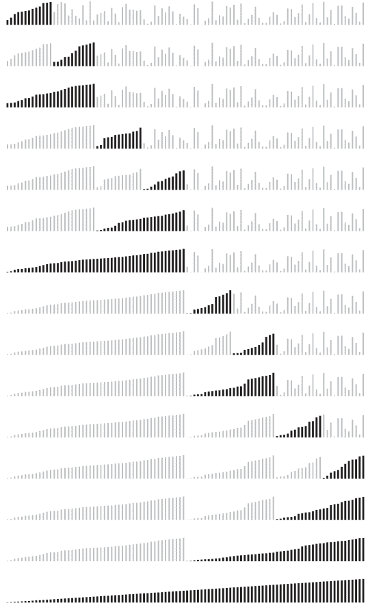

重复第 1 章中提到的一个容易忘记且需要重新强调的观点是合适的。在局部范围内，我们将书中的每个算法看作在某些应用中是至关重要的。从全局来看，我们尝试对推荐何种方法得出通用的结论。我们对此类改进的讨论并不意味着一定要实现它们，而是为了警告不要从初始实现中对性能得出绝对的结论。在处理新问题时，最好的办法是使用你熟悉的最简单实现，如果它成为瓶颈，再对其进行优化。其他情况下，处理那些减少运行时间常数倍的改进可能是不值得的。你需要通过运行实验来测试特定改进的有效性，正如我们在贯穿始终的练习中所指示的那样。

在合并排序的情况下，列出的三种改进易于实现，并且当合并排序是首选方法时（例如在本章末尾讨论的情况），它们是有意义的。

## 自底向上合并排序

合并排序的递归实现是分治算法设计范式的典型代表，我们通过将一个大问题分解若干部分并解决子问题，然后利用这些部分的解决方案来解决整个问题。尽管我们考虑的是合并两个大的子数组，但事实是大多数合并都是合并微小的子数组。实现合并排序的另一种方法是组织子数组，使得我们在一次通过中完成所有微小数组的合并，然后通过第二次通过合并子数组，以此类推，直到完成一次涵盖整个数组的合并。这种方法比标准的递归实现所需的代码更少。我们首先进行 1对1 的合并（将单个元素视为大小为 1 的子数组），然后进行 2对2 的合并（合并大小为 2 的子数组形成大小为 4 的子数组），然后是 4对4 的合并，以此类推。在每次通过的最后一次合并中，第二个子数组可能第一个小（这对`merge()`来说没有问题），否则所有合并都涉及相等大小的子数组，使下一次通过的排序子数组大小翻倍。

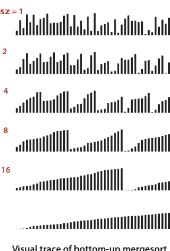

### 自底向上合并排序

```java
public class MergeBU
{
    private static Comparable[] aux;      // 用于合并的辅助数组

    // merge() 代码请见第 271 页。

    public static void sort(Comparable[] a) {
        // 进行 lg N 次两两对合并。
        int N = a.length;
        aux = new Comparable[N];
        for (int sz = 1; sz < N; sz = sz+sz) { // 子数组大小
            for (int lo = 0; lo < N-sz; lo +=sz) { // 子数组索引
                merge(a, lo, lo+sz-1, Math.min(lo+sz-1, N-1));
            }
        }
    }
}
```

自底向上合并排序由对整个数组的一系列通过组成，进行`sz`对`sz`的合并，从大小等于 1 开始，每次通过`sz`翻倍。只有当数组大小是`sz`的偶数倍时，最后一个子数组的大小才为`sz`（否则它小于`sz`）。

| sz=1 | 0 1 2 3 4 5 6 7 8 9 10 11 12 13 14 15 |
|---|---|---|---|---|---|---|---|---|---|---|---|---|---|---|---|---||
| `merge(a, 0, 1)` | E | M | G | R | E | S | O | R | T | E | A | M | P | L | E |
| `merge(a, 2, 3)` | E | M | G | R | E | S | O | R | T | E | A | M | P | L | E |
| `merge(a, 4, 5)` | E | M | G | R | E | S | O | R | T | E | A | M | P | L | E |
| `merge(a, 6, 7)` | E | M | G | R | E | S | O | R | T | E | X | A | M | L | E |
| `merge(a, 8, 9)` | E | M | G | R | E | S | O | R | T | E | A | M | P | L | E |
| `merge(a, 10, 11)` | E | M | G | R | E | S | O | R | T | E | X | A | M | L | E |
| `merge(a, 12, 13)` | E | M | G | R | E | S | O | R | T | E | A | M | P | L | E |
| `merge(a, 14, 15)` | E | M | G | R | E | S | O | R | T | E | X | A | M | L | E |
| sz=2 | | | | | | | | | | | | | | | | | |
| `merge(a, 0, 3)` | E | G | M | R | E | S | O | R | T | E | A | M | P | L | E |
| `merge(a, 4, 7)` | E | G | M | R | E | S | O | R | T | E | A | M | P | L | E |
| `merge(a, 8, 11)` | E | G | M | R | E | S | O | R | T | E | X | A | M | L | E |
| `merge(a, 12, 15)` | E | G | M | R | E | S | O | R | T | E | A | M | P | L | E |
| sz=4 | | | | | | | | | | | | | | | | | |
| `merge(a, 0, 7)` | E | E | G | M | R | E | S | O | R | T | E | X | A | M | L | E |
| `merge(a, 8, 15)` | E | E | G | M | R | E | S | O | R | T | E | X | A | M |

自底向上合并排序的轨迹结果

**命题。** 自底向上合并排序在排序长度为$N$的数组时，使用了$\frac{1}{2}N\lg N$到$N\lg N$之间的比较，以及最多$N\lg N$次数组访问。

**证明：** 遍历数组的次数恰好是$\lg N$（即为满足$2^{n-1} < N \le 2^n$的$n$值）。对于每次通过，数组访问的次数恰好为$N$，比较次数最多为$N$且不少于$N/2$。当数组长度为 2 的幂时，自顶向下和自底向上合并排序的比较和数组访问是相同的。当数组长度不是 2 的幂时，算法的比较和数组访问序列将不同（见练习 2.5）。自底向上合并排序的一个版本是数据排序的首选方法。将列表视为大小为 1 的子列表，然后是大小为 2 的子列表，然后大小为 4，以此类推。这种方法在原地重新排列列表（不创建新节点）。

## 2.2 合并排序

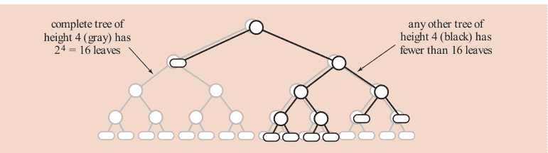

结合前两个段的内容，我们已经证明任何基于比较的排序算法都对应一个高度为$h$的比较树，其：

$N! \leq \text{叶节点数量} \leq 2^h$

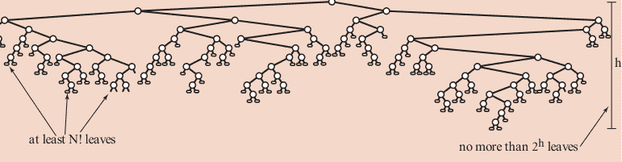

$h$的值恰等于最坏情况下的比较次数，因此我们可以对等式的两边取对数（底为 2），并得出任何算法所使用的比较次数至少为$lg(N!)$。近似值$lg(N!) \sim N \lg N$直接根据阶乘函数的斯特林近似（详见第 185 页）即可得出。

这一结果为我们提供了指导，让我们在设计排序算法时知道自己预期能达到什么水平。例如，如果没有这样的结果，人们可能会尝试设计一种在最坏情况下比较次数仅为合并排序一半的基于比较的算法。命题 I 中的下界表明这种努力是徒劳的。这是一个极其强力的陈述，适用于任何可以想象的基于比较的算法。

命题 I 断言，合并排序在最坏情况下使用的比较次数为$\sim N \lg N$。这一结果是排序问题困难度的**上界**，意味着更好的算法必须使用更少的比较次数。命题 I 断言，没有任何排序算法能保证使用少于$– N \lg N$次比较。它是排序问题困难度的**下界**，意味着即使是最好的算法在最坏情况下也必须使用至少这么多比较。它们共同暗示了：

> **命题 J。** 合并排序是一种渐近最优的比较排序算法。

**证明：** 准确地说，我们通过这一陈述是指，最坏情况下的比较次数以及任何基于比较的排序算法所保证的最小比较次数都是$\sim N \lg N$。命题 H 和 I 证明了这些事实。

需要注意的是，就像计算模型一样，我们需要精确定义什么是"最优算法"。例如，我们可能会收紧最优性的定义，并坚持认为排序的最优算法是恰好使用$lg (N!)$次比较的算法。我们不这样做，是因为对于大的$N$，我们无法察觉这种算法与合并排序之间的差异。或者，我们可能会扩大最优性的定义，包含任何最坏情况比较次数在$N \lg N$常数倍范围内的排序算法。我们不这样做，是因为对于大的$N$，我们能非常清楚地注意到这种算法与合并排序之间的差异。

**计算复杂度可能看起来相当抽象**，但关于解决计算问题内在困难性的基础研究几乎不需要证明。此外，当它适用时，可以肯定的是，计算复杂度会影响良好软件的发展。首先，良好的上界允许软件工程师提供性能保证；许多记录的实例表明，性能低下可以追溯到有人使用了平方排序而非线性对数排序。其次，良好的下界避免了寻找无法实现的性能改进的精力。

合并排序的最优性并不是故事的结束，不应被视为我们在实际应用中不需要考虑其他方法。事实并非如此，因为本节的理论具有局限性。例如：

- 合并排序在空间使用上不是最优的。
- 最坏情况在实践中可能并不发生。
- 比较以外的操作（如数组访问）可能很重要。
- 可以在不使用任何比较的情况下对某些数据排序。

因此，我们在文中将考虑其他排序方法。

## 问答

**Q. 合并排序比壳排序快吗？**

A. 在实践中，它们的运行时间彼此在一个小的常数倍之内（当壳排序使用经过良好测试的增量序列如算法 2.3 中的序列时），因此比较性能取决于实现。

```
% java SortCompare Merge Shell 100000

For 100000 random Double values

Merge is 1.2 faster than Shell
```


在理论上，还没有人能证明壳排序是线性的，因此其平均性能的渐近增长仍然存在可能。这种差距在最坏性能中已得到证明，但在实践中并没有意义。

**Q. 为什么不将`aux[]`数组设为`merge()`的局部变量？**

A. 为了避免每次合并（即使是微小的合并）都创建一个数组的开销。这种成本将主合并排序的运行时间（见练习 2.2.26）。更合适的解决方案（我们在文中为了减少代码整洁度而未采用）是将`aux[]`设为`sort()`的局部变量，并作为参数传递给`merge()`（见练习 2.2.9）。

**Q. 当数组中存在重复值时，合并排序表现如何？**

A. 如果所有项的值都相同，运行时间是线性的（带有一个额外的测试在数组已排序时跳过合并），但如果有多个重复值，这种性能增益并不一定能实现。例如，假设输入数组包含 $N$ 个项，奇数位置是一个值，偶数位置是另一个另一个值。对于这样的数组，运行时间是线性对数的（它满足了。

# 练习

**2.2.1** 给出一个轨迹（trace），风格参考本节开头，显示自顶向下和自底向上合并方法所使用的比较次数。

**2.2.2** 给出轨迹，风格参考本节开头，显示……使用的比较次数。

**2.2.3** 原地合并是否仅当当子数组已排序时才产生输出？给出你的答案，或提供一个反例。

**2.2.4** 给出 $N=512$ 时的尺寸序列。

**2.2.5** 编写一个程序通过自顶向下和自底向上计算确切值。使用你的程序绘制 $N$ 从 1 到 $\dots$ 的值，并与上界进行比较。

**2.2.6** 证明比较次数是单调增加的（$N > 0$）。

**2.2.7** 假设算法 2.4 经过修改，每当数组有序时都跳过对`merge()`的调用。证明比较次数是线性的。

**2.2.8** 在库软件中不建议使用静态数组，因为多个客户端可能并发使用。给出一个不使用静态数组的实现。提示：将辅助数组作为参数传递给`recursive()`。

## 创新题

**2.2.10** 更快的合并。实现一个版本的`merge()`，它将后半部分复制到`aux[]`，然后合并回`[]`中。注意：生成的排序不是稳定的。

**2.2.11** 实现该页描述的针对合并排序的三种改进：为小子数组添加截止阈值、测试数组是否有序，以及通过……复制代码。

**2.2.12** 次线性级额外空间。基于以下想法开发一个合并实现，将空间需求减少到 $\max(M, N/M)$：将数组分为 $N/M$ 个大小为 $M$ 的块（为了描述简单，假设 $N$ 是 $M$ 的倍数）。然后(i) 将块视为以第一个元素为排序键的项目，使用选择排序进行排序；(ii) 运行第一个块与第二个块、第二个块与第三个块等类的合并。

**2.2.13** 平均情况的下界。证明任何基于比较的排序算法的期望比较次数至少为 $\sim N \lg N$（假设所有可能的排列都是可能的）。提示：期望比较次数至少是树的外长度（从根到所有叶节点的路径长度之和），这在树平衡时是最小的。

**2.2.14** 合并有序队列。开发一个静态方法，接受两个有序队列作为参数，并返回合并这些队列后得到的有序队列。

**2.2.15** 自底向上合并排序。基于以下方法开发自底向上合并排序实现：给定 $N$ 个项，创建 $N$ 个队列，每个队列包含一个项。创建一个包含这 $N$ 个队列的队列。重复应用 2.2.1.4 中的合并操作于两个队列，并将合并后的队列插入最后。重复直到队列队列只包含一个队列。

**2.2.16** 自然合并。写一个自底向上合并排序的版本，利用数组中的顺序，每次需要找到两个数组合并时：寻找一个有序子数组（通过增加指针直到遇到一个比其前驱元素小的元素），然后找到下一个，并合并它们。根据数组大小和……的数量分析该算法的运行时间。

## 创造性问题（续）

数组中的最大递增序列。

- **2.2.17** 链表排序。为链表实现一种自然归并排序。（这是链表排序的一种方法，因为它不需要额外的空间，且保证为对数复杂度。）

- **2.2.18** 链表随机打乱。开发并实现一种分治算法，使其能够在线性对数时间内（linearith time）和对数级额外空间内随机打乱链表。

- **2.2.19** 逆序对。开发并实现一种线性对数算法，用于计算给定数组中的逆序对数量（即插入排序对该数组将执行的交换次数——见第 2.1 节）。该数量与 Kendall tau 距离有关；见第 2.5 节。

- **2.2.20** 索引排序。开发并实现一种归并排序的版本，该版本不重排数组，而是返回一个`int[]`，其中`perm[i]`是数组中第 $i$ 最小元素的索引。

- **2.2.21** 三连重复。给定三个各包含 $N$ 个名字的列表，设计一种线性对数算法来判断三个列表中是否存在共同的，如果有，则返回字典序最小的名称。

- **2.2.22** 三路归并排序。假设在每一步不是将其分为两半，而是分成三部分，对每部分进行排序，并使用三路合并进行组合。该算法总运行时间的时间复杂度阶是多少？

## 实验

**2.2.23** 改进。运行实证研究以评估文中描述的三种归并排序改进措施的有效性（见练习 2.2.11）。此外，比较文中给出的`merge`实现与练习 2.2.10 中`merge merged`实现的性能。特别是，通过实证确定决定对较小子数组切换到插入排序的参数的最优值。

**2.2.24** 排序测试改进。针对大型随机排序数组运行实证研究，研究练习 2.2.8 中描述的修改对于随机数据的有效性。特别是，关于测试（判断数组是否已排序）成功的平均次数，建立一个关于 $N$（排序的原始数组大小）的函数假设。

**2.2.25** 多路归并排序。开发一种基于 $k$ 路合并（而非 2 路合并）思想的归并排序实现。分析你的算法，提出关于 $k$ 的最优值的假设，并运行实验验证你的假设。

**2.2.26** 数组创建。使用`SortCompare`粗略了解在`merge()`中创建`aux[]`而不是在`sort()`中创建对你机器上性能的影响。

**2.2.27** 子数组长度。对大型随机数组运行归并排序，并确定当第一个子数组耗尽时，另一个子数组的平均长度，该长度是关于 $N$（给定合并中两个子数组之和）的函数。

**2.2.28** 自顶向下对比与自底向上。使用`SortCompare`比较 $N=10^3, 10^4, 10^5$ 和 $10^6$ 时的自顶向下和自底向上的归并排序。

**2.2.29** 自然归并排序。实证确定对于 $N=10^3, 10^6$ 和 $10^9$ 的随机`Long`类型，自然归并排序（见练习 2.2.16）所需的趟数。*提示：*你不需要实现排序（甚至不需要生成 64 位键）即可完成此练习。

## 2.3 快速排序

本节的主题是可能比其他任何算法都广泛使用的排序算法——快速排序。快速排序之所以流行，是因为它不易实现，适用于各种类型的输入数据，并且在应用中比任何其他排序方法都快。快速排序算法的理想特性是它是原地的（只使用一个很小的辅助栈），并且排序一个长度为 $N$ 的数组平均需要 $N\log N$ 的时间。在我们为止考虑的算法中，没有一个同时具备这两个属性。此外，快速排序的循环比大多数排序算法都短，这意味着它在实践和理论上都是快速的。它主要的缺点是它是脆弱的，因为在实现中需要一些小心，以避免糟糕的性能。文献中记录了许多导致实践中出现平方级性能的错误示例。幸运的是，从这些错误中吸取的教训导致了该算法的各种改进，使其具有更广泛的实用性，正如我们将看到的。

**基础算法** 快速排序是一种分治排序方法。它通过将数组分为两个子数组并独立排序这些子数组来工作。快速排序与归并排序是互补的：对于归并排序，我们将数组拆分为两个待排序的子数组，然后合并子数组以形成整个有序数组；对于快速排序，我们重排数组，使得当两个子数组完成后，整个数组是有序的。

快速排序是一种分治排序方法。它通过将数组分为两个子数组并独立排序这些子数组来工作。快速排序与归并排序是互补的：对于归并排序，我们将数组拆分为两个待排序的子数组，然后合并子数组以形成整个有序数组；对于快速排序，我们重排数组，使得当两个子数组完成后，整个数组是有序的。

**基础算法** 快速排序是一种分治排序方法。它通过将数组分为两个子数组并独立排序这些子数组来工作。快速排序与归并排序是互补的：对于归并排序，我们将数组拆分为两个待排序的子数组，然后合并子数组以形成整个有序数组；对于快速排序，我们重排数组，使得当两个子数组完成后，整个数组是有序的。

**基础算法** 快速排序是一种分治排序方法。它通过将数组分为两个子数组并独立排序这些子数组来工作。快速排序与归并排序是互补的：对于归并排序，我们将数组拆分为两个待排序的子数组，然后合并子数组以形成整个有序数组；对于快速排序，我们重排数组，使得当两个子数组完成后，整个数组是有序的。

**基础算法** 快速排序是一种分治排序方法。它通过将数组分为两个子数组并独立排序这些子数组来工作。快速排序与归并排序是互补的：对于归并排序，我们将数组拆分为两个待排序的子数组，然后合并子数组以形成整个有序数组；对于快速排序，我们重排数组，使得当两个子数组完成后，整个数组是有序的。

**基础算法** 快速排序是一种分治排序方法。它通过将数组分为两个子数组并独立排序这些子数组来工作。快速排序与归并排序是互补的：对于归并排序，我们将数组拆分为两个待排序的子数组，然后合并子数组以形成整个有序数组；对于快速排序，我们重排数组，使得当两个子数组完成后，整个数组是有序的。

**基础算法** 快速排序是一种分治排序方法。它通过将数组分为两个子数组并独立排序这些子数组来工作。快速排序与归并排序是互补的：对于归并排序，我们将数组拆分为两个待排序的子数组，然后合并子数组以形成整个有序数组；对于快速排序，我们重排数组，使得当两个子数组完成后，整个数组是有序的。

**基础算法** 快速排序是一种分治排序方法。它通过将数组分为两个子数组并独立排序这些子数组来工作。快速排序与归并排序是互补的：对于归并排序，我们将数组拆分为两个待排序的子数组，然后合并子数组以形成整个有序数组；对于快速排序，我们重排数组，使得当两个子数组完成后，整个数组是有序的。

**基础算法** 快速排序是一种分治排序方法。它通过将数组分为两个子数组并独立排序这些子数组来工作。快速排序与归并排序是互补的：对于归并排序，我们将数组拆分为两个待排序的子数组，然后合并子数组以形成整个有序数组；对于快速排序，我们重排数组，使得当两个子数组完成后，整个数组是有序的。

**基础算法** 快速排序是一种分治排序方法。它通过将数组分为两个子数组并独立排序这些子数组来工作。快速排序与归并排序是互补的：对于归并排序，我们将数组拆分为两个待排序的子数组，然后合并子数组以形成整个有序数组；对于快速排序，我们重排数组，使得当两个子数组完成后，整个数组是有序的。

**基础算法** 快速排序是一种分治排序方法。它通过将数组分为两个子数组并独立排序这些子数组来工作。快速排序与归并排序是互补的：对于归并排序，我们将数组拆分为两个待排序的子数组，然后合并子数组以形成整个有序数组；对于快速排序，我们重排数组，使得当两个子数组完成后，整个数组是有序的。

**基础算法** 快速排序是一种分治排序方法。它通过将数组分为两个子数组并独立排序这些子数组来工作。快速排序与归并排序是互补的：对于归并排序，我们将数组拆分为两个待排序的子数组，然后合并子数组以形成整个有序数组；对于快速排序，我们重排数组，使得当两个子数组完成后，整个数组是有序的。

**基础算法** 快速排序是一种分治排序方法。它通过将数组分为两个子数组并独立排序这些子数组来工作。快速排序与归并排序是互补的：对于归并排序，我们将数组拆分为两个待排序的子数组，然后合并子数组以形成整个有序数组；对于快速排序，我们重排数组，使得当两个子数组完成后，整个数组是有序的。

**基础算法** 快速排序是一种分治排序方法。它通过将数组分为两个子数组并独立排序这些子数组来工作。快速排序与归并排序是互补的：对于归并排序，我们将数组拆分为两个待排序的子数组，然后合并子数组以形成整个有序数组；对于快速排序，我们重排数组，使得当两个子数组完成后，整个数组是有序的。

**基础算法** 快速排序是一种分治排序方法。它通过将数组分为两个子数组并独立排序这些子数组来工作。快速排序与归并排序是互补的：对于归并排序，我们将数组拆分为两个待排序的子数组，然后合并子数组以形成整个有序数组；对于快速排序，我们重排数组，使得当两个子数组完成后，整个数组是有序的。

**基础算法** 快速排序是一种分治排序方法。它通过将数组分为两个子数组并独立排序这些子数组来工作。快速排序与归并排序是互补的：对于归并排序，我们将数组拆分为两个待排序的子数组，然后合并子数组以形成整个有序数组；对于快速排序，我们重排数组，使得当两个子数组完成后，整个数组是有序的。

**基础算法** 快速排序是一种分治排序方法。它通过将数组分为两个子数组并独立排序这些子数组来工作。快速排序与归并排序是互补的：对于归并排序，我们将数组拆分为两个待排序的子数组，然后合并子数组以形成整个有序数组；对于快速排序，我们重排数组，使得当两个子数组完成后，整个数组是有序的。

**基础算法** 快速排序是一种分治排序方法。它通过将数组分为两个子数组并独立排序这些子数组来工作。快速排序与归并排序是互补的：对于归并排序，我们将数组拆分为两个待排序的子数组，然后合并子数组以形成整个有序数组；对于快速排序，我们重排数组，使得当两个子数组完成后，整个数组是有序的。

img/c17df91bd8284fe2663485cef300_0

## 2.3 快速排序 289

## ALGORITHM 2.5 快速排序

**基础算法** 快速排序是一种分治排序方法。它通过将数组分为两个子数组并独立排序这些子数组来工作。快速排序与归并排序是互补的：对于归并排序，我们将数组拆分为两个待排序的子数组，然后合并子数组以形成整个有序数组；对于快速排序，我们重排数组，使得当两个子数组完成后，整个数组是有序的。

img/c17df91bd8284fe2663485cef300_0

本节的主题是可能比其他任何算法都广泛使用的排序算法——快速排序。快速排序之所以流行，是因为它不易实现，适用于各种类型的输入数据，并且在应用中比任何其他排序方法都快。快速排序算法的理想特性是它是原地的（只使用一个很小的辅助栈），并且排序一个长度为 $N$ 的数组平均需要 $N\log N$ 的时间。在我们为止考虑的算法中，没有一个同时具备这两个属性。此外，快速排序的循环比大多数排序算法都短，这意味着它在实践和理论上都是快速的。它主要的缺点是它是脆弱的，因为在实现中需要一些小心，以避免糟糕的性能。文献中记录了许多导致实践中出现平方级性能的错误示例。幸运的是，从这些错误中吸取的教训导致了该算法的各种改进，使其具有更广泛的实用性，正如我们将看到的。

```java
public class Quick {

    public static void sort(Comparable[] a) {

        // 随机打乱数组。

        StdRandom.shuffle(a);

        sort(a, 0, a.length - 1);

    }

    private static void sort(Comparable[] a, int lo, int hi) {

        if (hi <= lo) return;

        int j = partition(a, lo, hi);

        sort(a, lo, j - 1);

        sort(a, j + 1, hi);

    }

    private static int partition(Comparable[] a, int lo, int hi) {

        // 选择 a[lo] 作为划分元素。

        Comparable pivot = a[lo];

        int i = lo - 1;

        int j = hi + 1;

        while (true) {

            do { i++; } while (a[i].compareTo(pivot) < 0);

            do { j--; } while (a[j].compareTo(pivot) > 0);

            if (i >= j) return j;

            swap(a, i, j);

        }

    }

    private static void swap(Comparable[] a, int i, int j) {

        Comparable temp = a[i];

        a[i] = a[j];

        a[j] = temp;

    }

}
```

## 2.3 快速排序 302

在实现快速排序时有几个问题反映在这些代码中并值得注意，因为每个问题都可能导致错误代码或显著影响性能。接下来，我们讨论这些问题中的几个。在本节的最后部分，我们将考虑三个重要的高层算法改进。

## 快速排序分区

```java
private static int partition(Comparable[] a, int lo, int hi)
{ // 将数组划分为 a[lo..i-1], a[i], a[i+1..hi]。
    int i = lo, j = hi+1; // 左右扫描索引
    Comparable v = a[lo]; // 分区基元素
    while (true)
    { // 向右扫描，向左扫描，检查扫描是否完成并进行交换。
        while (less(a[++i], v)) if (i == hi) break;
        while (less(v, a[--j])) if (j <= lo) break;
        if (i > j) break;
        exch(a, lo, j);
    }
    exch(a, lo, j);
    // 使 a[lo..j-1] <= a[j] <= a[j+1..hi]。
    return j;
}
```


这段代码划分了 `a[lo]` 中的元素 `v`。当索引 `i` 和 `j` 交叉时，主循环退出。在循环内部，如果 `a[i]` 较小则交换 `a[i]`，当 `a[j]` 大于 `v` 时递减 `j`，然后进行交换以保持不变性：左侧没有元素大于 `v`，右侧没有元素小于 `v`。一旦索引相遇，通过交换 `a[lo]` 和 `a[j]` 完成分区（从而将分区基元素留在 `a[j]` 中）。

| | j | 0 | 1 | 2 | 3 | 4 | 5 | 6 | 7 | 8 | 9 | 10 | 11 | 12 | 13 | 14 | 15 |
|---|---|---|---|---|---|---|---|---|---|---|---|---|---|---|---|---|---|
| 初始值 | 16 | K R A T E L P U I M Q C X O S |
| 扫描，向右扫描 | 12 | K R A T E L P U I M Q C X O S |
| 交换 | 12 | K C A T E L P U I M Q R X O S |
| 扫描，向右扫描 | 9 | K C A T E L P U I M Q R X O S |
| 交换 | 9 | K C A I E L P U T M Q R X O S |
| 扫描，向右扫描 | 5 | K C A I E L P U T M Q R X O S |
| 交换 | 5 | K C A I E E L P U T M Q R X O S |
| 扫描，向右扫描 | 5 | K C A I E E L P U T M Q R X O S |
| 最终交换 | 5 | E C A I E K L P U T M Q R X O S |
| 结果 | 5 | E C A I E K L P U T M Q R X O S |

分区轨迹（每次交换前后的数组内容）

# 第 2 章 排序

## 2.3 快速排序

**命题 L。** 快速排序在最坏情况下使用 `~ N^2` 次比较；随机洗牌可以防止这种情况的发生。

**证明：** 根据刚刚给出的论，当每次划分其中一个子数组为空时，所使用的比较次数为：

`N + (N - 1) + (N - 2) + … + 2 + 1 = N(N + 1) / 2`

这种行为不仅意味着处理递归所需的时间是线性的（这对于大数组来说是不可接受的）。通过进一步的研究，我们可以对之前针对平均情况的分析进行扩展，发现比较次数的标准差大约为 `N`，因此随着 `N` 的增长，运行时间趋向于平均值，且不太远离平均值。例如，即使是使用切比雪夫不等式的粗略估计显示，对于一个拥有百万个元素的数组，其运行时间是平均值十倍的概率也小于 `.0001`（真实概率更小）。大数组运行时间接近二次方的概率低到我们可以安全地忽略可能（见练习 2.3.10）。例如，在你的计算机上对大数组进行排序时，快速排序使用的比较次数与插入排序或排序相同的概率，远小于你的计算机在排序期间被雷劈中的概率！

总结来说，你可以确信每当使用 `ALGORITHM 2.5` 排序 `N` 个元素时，其运行时间将在 `1.39 log N` 的常数因子范围内。归并排序也是如此，但快速排序通常更快（尽管它的比较次数多出 39%），它的移动操作要少得多。这种数学保证是概率性的，但你完全可以依赖它。

### 算法改进

快速排序由 C. A. R. Hoare 于 1960 年发明，从那以后有许多人对其进行了研究和改进。开发改进快速排序的方法是非常诱人的：一种更快的排序算法是计算机科学中的“更优陷阱”，而快速排序是一种古老的方法，似乎在邀请人们改进。几乎从 Hoare 首次发布该算法的那刻起，人们就开始提出改进算法的方法。这些想法并非全部都完全成功，因为该算法非常平衡，改进带来的效果可能会被意想不到的副作用所抵消，但其中我们现在考虑的几种是非常有效的。

如果你的排序代码将被多次使用，或用于对巨大的数组进行排序（特别是，如果它被用作库排序来对特征未知的数组进行排序），那么考虑接下来几段中讨论的改进是值得的。如所述，你需要运行实验来确定这些改进的有效性，并为你的实现确定最佳参数选择。通常，可以获得 20% 到 30% 的改进。

### 到插入排序的阈值

对于大多数递归算法，改进快速排序性能的一种简单方法是基于以下两个观察：

- 对于极小的子数组，快速排序比插入排序慢。
- 由于是递归的，快速排序的 `sort()` 会对极小子数组调用自身。

因此，通过简单的更改将极小子数组切换到插入排序，`ALGORITHM 2.5` 实现了这一改进：替换语句

```java
if (hi <= lo) return;

sort(hi)

if (lo <= M) { Insertion.sort(a, lo, hi); return; }
```

阈值 `M` 的最佳值取决于系统，但在 5 到 15 之间的任何值在大多数情况下都可能运行良好（练习 2.3.25）。

### 三数中值划分

改进快速排序性能的另一种方法是使用子数组中一小组元素的中位数作为划分元素。这样做会得到稍微更好的划分，但代价是计算中位数。事实证明，大多数可用的改进来自于选择一个大小为 3 的样本，然后对中间元素（即中位数）进行划分。（练习 2.3.18 和 2.3.19）。作为额外奖励，我们可以将元素作为数组末尾的哨兵，并移除 `partition()` 中的数组边界检查。

### 熵最优排序

在应用中经常出现大量重复键。例如，我们可能希望按出生年份对大型人事文件进行排序，或将女性与男性分开。在这些情况下，我们考虑的快速排序实现性能尚可，但可以得到大幅改进。例如，一个仅由相同元素（仅一个键值）组成的子数组不需要进一步处理，但我们的实现会一直划分到较小的子数组。在输入数组存在大量重复键的情况下，快速排序的递归性质确保了仅包含相等键元素的子数组经常出现。这存在巨大的改进潜力，可以从目前看到的对数线性时间性能提升到线性时间性能。

一个直接的想法是将数组分为三部分，每部分分别对应键小于、等于和大于划分元素的元素。完成这种划分比我们使用的二路划分更复杂，针对该任务已经提议了多种不同的方法。这是一个由 E. W. Dijkstra 推广的经典编程练习题，被称为“荷兰国旗”。

Dijkstra 对此问题的解决方案基于下一页所示极其简单的划分代码。它基于对数组的单次左右扫描，维护一个指针 `lt` 使得 `[lo..lt-1]` 小于 `v`，一个指针 `gt` 使得 `[gt+1..n]` 大于 `v`，以及一个指针 `i` 使得 `[lt..i-1]` 等于 `v`。从 `i` 等于 `lo` 开始，我们使用 `Comparable` 接口提供的三路比较（而不是使用 `<`）来处理 `a[i]`，以直接处理三种情况：

- `a[i]` 小于 `v`：交换 `a[i]` 和 `a[lt]`，并使 `lt` 和 `i` 都加 `1`。
- `a[i]` 大于 `v`：交换 `a[i]` 和 `a[gt]`，并使 `gt` 减 `1`。
- `a[i]` 等于 `v`：`i` 加 `1`。

这些操作中的每一种都维持了不变性并减少了 `gt-i` 的值（从而终止循环）。此外，除了与划分元素键相同的元素外，遇到的每个元素都会导致一次交换。

尽管这是在 20 世纪 70 代快速排序出现后很久才开发的，但它不再受到青睐，因为在重复键数量不高的常见情况下，它比标准的二路划分方法使用了更多的交换。20 世纪 90 代，J. Bentley 和 D. McIlroy 开发了一种巧妙的实现来克服这个问题（见练习 2.3.2），并观察到三路划分在涉及大量相等键的实际情况下，使得快速排序渐进比归并排序和其他方法更快。后来，J. Bentley 和 R. Sedgewick 开发了此点的证明，我们将在讨论。

但我们证明了归并排序是最优的。我们是如何打破那个下界的？这个问题的答案是，第 2.2 节中的命题 1 处理了所有可能输入的最坏情况性能，而我们现在查看的是在对某些键信息的情况下的最坏情况性能：

## 使用三路划分的快速排序

```java
public class Quick3way {
    private static void sort(Comparable[] a, int lo, int hi) {
        // 查看第 289 页调用此方法的公共 sort() 方法。
        if (hi <= lo) return;
        int lt = lo, i = lo + 1, gt = hi;
        Comparable v = a[lo];

        while (i <= gt) {
            int cmp = a[i].compareTo(v);
            if (cmp < 0) swap(a, lt++, i++);
            else if (cmp > 0) swap(a, i, gt--);
            else i++;
        }

        sort(a, lo, lt - 1);
        sort(a, gt + 1, hi);
    }
}
```

此排序代码在原地划分所有与划分元素相同的键，因此在递归调用的子数组中不包含这些键。对于具有大量重复键的数组，这种实现方式比标准的快速排序要高效得多（见正文）。

| lt | i | gt | 0 | 1 | 2 | 3 | 4 | 5 | 6 | 7 | 8 | 9 | 10 | 11 |
|---|---|---|---|---|---|---|---|---|---|---|---|---|---|---|
| 0 | 0 | 11 | R | R | B | W | R | W | W | B | R | R | W | B |
| 1 | 0 | 11 | R | B | W | W | R | W | B | R | R | W | B |
| 1 | 2 | 10 | | B | R | W - W | R | W | B | R | R | W - B |
| 1 | 2 | 10 | | | B | R - R - W | W | B | B | | R | W - B |
| 1 | 3 | 9 | | | | | B | R | R | W | R | B | R | W | W |
| 2 | 4 | 9 | | | | | | B | R | R | W - B | R | R | W | W |
| 2 | 5 | 8 | | | | | | | B | R | R | W - B | R | R | W | W |
| 2 | 5 | 7 | | | | | | | | B | R | R - B | R | R | W | W |
| 2 | 6 | 7 | | | | | | | | | B | R | R | R | R | W | W |
| 3 | 7 | 7 | | | | | | | | | B | R | R | R | R | W | W |
| 3 | 8 | 7 | | | | | | | | | | B | R | R | R | R | W | W |
| 3 | 8 | 7 | | | | | | | | | | B | R | R | R | R | W | W |

三路划分轨迹（每次循环迭代后的数组内容）

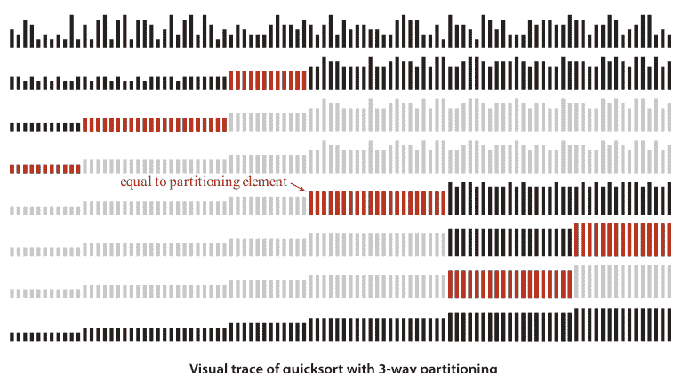

例如，对于只有常数个不同键值的随机有序数组，归并排序的时间是线性的，但使用三路划分的快速排序对于此类数组也是线性的。事实上，通过观察上面的视觉轨迹，你可以发现键值数量的 `N` 倍是运行时间的一个保守界限。

该分析通过考虑键值的分布得出了这些精确的结论。假设有 `N` 个键具有 `k` 个不同的键值，对于从 `1` 到 `k` 的每个 `i`，定义 `f_i` 为第 `i` 个键值的出现频率，`p_i` 为 `f_i / N`，即随机采样数组条目时找到第 `i` 个键值的概率。键的香农熵（其信息内容的经典衡量标准）定义为：

```text
H = -(p_1 log p_1 + p_2 log p_2 + … + p_k log p_k).
```


对于任何待排序的项数组，我们都可以通过统计每个键值的频率来计算它的熵。显著的是，我们还可以从熵中推导出三路划分快速排序的比较次数的下界和上界。

> **命题 M.** 任何基于比较的排序算法无法保证在少于 $NH - N$ 次比较的情况下排序 $N$ 个项，其中 $H$ 是根据键值频率定义的香农熵。

**证明概要。** 这一结果来自于对第 2.2 节命题 I 下界证明的（相对容易的）推广。

## 2.3 快速排序 301

> **命题 N.** 使用三路划分的快速排序使用 $\sim (2\ln 2) N H$ 次比较来排序 $N$ 个项，其中 $H$ 是根据键值频率定义的香农熵。

**证明概要。** 这一结果来自于对命题 K 中快速排序平均情况分析的（相对困难的）推广。对于不同的键，计数比最优值（optimum）多出约 39%（但没有常数因子）。

注意，当键彼此不同时，$H = \lg N$（所有概率均为 $1/N$），这与第 2.2 节的命题 I 一致。

（注：原文后续存在大量重复的段落，此处已根据指令要求去重并保留核心逻辑翻译）

## 练习题

**2.3.1** 参考`partition()`给出的轨迹，展示该方法是如何划分数组的。

**2.3.2** 参考本节给出的快速排序轨迹，展示快速排序如何对数组（为了本练习的目的，请忽略初始洗牌）。

**2.3.3** 对于长度为 $N$ 的数组，在`Quick.sort()`执行期间，最大项被交换的最大次数是多少？

**2.3.4** 假设省略了初始洗牌。给出六个十个元素的数组，使得`Quick.sort()`使用最坏情况下的比较次数。

**2.3.5** 给出一个排序已知包含两个不同键项数组的代码片段。

**2.3.6** 编写一个程序计算 $C_n$ 的精确值，并与近似值 $2N\ln N$ 进行比较，其中 $N=100, 1000, 10000$。

**2.3.7** 当使用快速排序对具有 $N$ 个不同键的数组时，找到大小为 0、1 和 2 的子数组的期望数量。如果你对数学感兴趣，请进行计算；否则，请运行实验以得出假设。

**2.3.8** 排序一个全部相等的 $N$ 个项的数组，`Quick.sort()` 大约为进行多少比较？

**2.3.9** 解释当`Quick.sort()`在具有仅两个不同键的数组上运行时会发生什么，并解释在具有三个不同键的数组上运行时会发生什么。

**2.3.10** 切比不等式指出，随机变量距离平均值超过 $k$ 个标准差的概率小于 $1/k^2$。对于 $N=100$ 万，使用切比不等式来限制快速排序使用的比较次数超过 1 亿次（$.1 N^2$）的概率范围。

**2.3.11** 假设我们扫描与划分元素相同的键，而不是在遇到它们时停止扫描。证明该版本的快速排序对于所有仅有常数个不同键的数组，其运行时间都是二次的。

## 练习题（继续）

**2.3.12** 按照代码附带的轨迹样式，展示三路快速排序是如何首次对数组 B A B A B A B C A D A R A 进行划分的。

**2.3.13** 快速排序在最好、最坏和平均情况下的递归深度是多少？这是系统为了跟踪递归调用而所需的栈的大小。请参阅练习题 2.3.20，了解一种确保在最坏情况下递归深度为对数级的方法。

**2.3.14** 证明当在包含 $N$ 个元素的数组上运行快速排序时，比较第 $i$ 小和第 $j$ 小元素的概率为 $2 / (j - i - 1)$。然后利用这个结果证明**命题 K**。

# 创造性问题

**2.3.15** 螺丝与螺母。（G. J. E. Rawlins）你有一组包含 $N$ 个螺丝和 $N$ 个螺母的混合文件，需要快速找到对应的螺丝和螺母对。每个螺丝恰好匹配一个螺母，每个螺母恰好匹配一个螺丝。通过匹配一个螺丝和一个螺母，你可以看出哪个更大，但无法直接比较两个螺丝或两个螺母。给出一种解决该问题的有效方法。

**2.3.16** 最好情况。编写一个程序，为 ALGORITHM 2.5 中的`sort()`生成一个最好情况数组（包含重复项）：一个包含 $N$ 个具有不同键的元素的数组，其属性是每次划分产生的子数组差异最多为 1（这与 $N$ 个键的数组所产生的子数组大小相同）。为了本练习的目的，请忽略初始洗牌。

以下练习题描述了快速排序的变体。每个练习题都需要实现，但你自然也想使用`SortCompare`进行实验，以评估每个建议修改的有效性。

**2.3.17** 哨兵。修改 ALGORITHM 2.5 中的代码，移除内部 `while` 循环中的两个边界检查。对子数组最后一个元素的测试是多余的，因为划分项充当了哨兵（$v$ 永远不会小于 $a[10]$）。为了能够移除另一个测试，在洗牌之后将键值为整个数组中最大的项放入 $a[length-1]$。该项将永远移动（除非可能与具有相同键的项交换），并在所有涉及数组末尾的子数组作为哨兵。注意：对于不涉及数组末尾的子数组，其右侧最左的条目作为该子数组末尾的哨兵。

**2.3.18** 三中位数划分。按照文中描述（见第 296 页）在快速排序中添加三中位数划分。运行倍增测试以确定该更改的有效性。

**2.3.19** 五中位数划分。实现一种基于对子数组中五个元素的随机样本进行划分的快速排序。将样本中的元素放在数组适当的末端位置，使得只有中位数参与划分。运行倍增测试，比较该更改与标准算法以及三中位数划分（见上一个练习题）相比的有效性。*额外分：*设计一种在任何输入上比较次数少于七次的多中位数算法。

## 创造性问题（继续）

**2.3.20** 非递归快速排序。实现一个基于主循环的非递归版本快速排序，该循环从栈中弹出一个子数组进行划分，并将生成的子数组推入栈中。注意：将较大的子数组推入栈顶，这保证了栈最多会有 $\lg N$ 个条目。

**2.3.21** 相同键排序的下界。通过遵循**命题 I** 证明中的逻辑，并利用**命题 M** 注中的观察（即有 $N!/(f_1!...f_k!)$ 种不同方法安排具有 $k$ 个不同值的键，其中第 $i$ 个值出现的频率为 $f_i (= N\pi_i)$），来完成**命题 M** 证明的第一部分，其中 $f_1 + ... + f_k = N$。

**2.3.22** 快速三路划分。（J. Bentley 和 D. McIlroy）实现一种基于将具有相同键的元素保持在子数组左右两端的熵最优排序算法。维护索引 $p$ 和 $q$，使得 $a[0..p-1]$ 和 $a[q..]$ 都等于 $a[0]$；维护索引 $i$，使得 $a[p..i-1]$ 都小于 $a[0]$；维护索引 $j$，使得 $a[j+1..q]$ 都大于 $a[0]$。在内部划分循环中添加：在常规比较 $a[i]$ 和 $a[j]$ 与 $a[j]$ 比较之前，如果 $a[i]$ 等于 $v$，则交换 $a[i]$ 与 $a[p]$（并增加 $p$）；在常规比较之前，如果 $a[j]$ 等于 $v$，则减小 $q$。在划分循环结束后，添加代码将具有相同键的元素交换到相应位置。

本文利-麦尔罗（Bentley-McIlroy）三路划分文本的意义在于它为与划分项键相等的键添加了额外交换，而代码为与划分项键不等的键添加了额外交换。

**2.3.23** Tukey 数值。在对练习题 2.3.22 的实现基础上添加代码，使用 Tukey 数值将元素划分为三组，取每组的中位数，然后使用这三个中位数的中位数作为划分项。此外，为小子数组添加插入排序的截断。

**2.3.24** 样本排序。（W. Frazer 和 A. McKellar）实现一种基于大小为 $2^k - 1$ 样本的快速排序。首先对样本进行排序，然后基于样本的中位数安排递归例划分，并将样本的两半移动到每个子数组中，以便它们可以在子数组中使用而无需再次排序。这种算法被称为样本排序（samplesort）。

## 实验

**2.3.25** 插入排序截断。实现一种对元素少于 $M$ 个子数组具有截断的快速排序，并在你的计算环境中经验性地确定 $M$ 的值，使得快速排序在排序 $N=10^3, 10^4, 10^5$ 和 $10^6$ 的双浮点数数组时运行最快。绘制 $M$ 从 0 到 30 的每个 $M$ 值的平均运行时间。你需要为 ALGORITHM 2.2 添加一个三参数的`sort()`方法，用于调用`Insertion.sort(a, lo, hi)`来对子数组 $a[lo..hi]$ 进行排序。

**2.3.26** 子数组大小。编写一个程序，当对大小为 $N$ 的数组运行具有小于 $M$ 大子数组截断的快速排序时，绘制插入排序子数组大小的直方图。针对 $M=10, 20, 50$ 和 $N=10^5$ 运行你的程序。

**2.3.27** 忽略小子数组。运行实验比较以下策略与练习题 2.3.25 中描述的处理小子数组的方法：在快速排序中简单地忽略小子数组，然后在快速排序完成后运行一次插入排序。注意：你可能通过这些实验估计你计算机缓存的大小，因为当数组无法放入缓存时，该方法的性能可能会退化。

**2.3.28** 递归深度。运行实证研究，确定在排序包含 $N$ 个不同元素的数组时，具有大小为 $M$ 的数组截断的快速排序所使用的平均递归深度，其中 $M=10, 20, 50$ 且 $N=10^3, 10^4, 10^5$。

**2.3.29** 随机化。运行实证研究，比较通过初始随机化数组（如文中所示）选择随机元素的策略的有效性。对于大小为 $M$ 的数组使用截断，并排序 $N$ 个不同元素的数组，其中 $M=10, 20, 50$ 且 $N=10^3, 10^4, 10^5$。

**2.3.30** 边界情况。在练习题 2.1.35 和 2.3.1 描述的大型非结构化数组上测试快速排序，分别进行初始随机洗牌和不洗牌。洗牌如何影响它对这些数组的性能？

**2.3.31** 运行时间直方图。编写一个接受命令行参数 $N$ 和 $T$ 的程序，进行 $T$ 次在 $N$ 个随机双精度数组上运行快速排序的实验，并绘制运行时间的直方图。针对 $N=10^3, 10^4, 10^5$ 运行你的程序，尽可能使曲线平滑。

## 2.4 优先级队列

许多应用要求我们按顺序处理元素，但并非完全有序，也不是一次性处理。通常，我们收集一组元素，然后处理键最大的，然后可能收集更多元素，以此类推。例如，你可能拥有一台计算机（或手机），能够运行多个应用程序。这通常通过为事件分配优先级，然后选择下一个优先级事件来实现。例如，大多数手机处理比游戏应用程序具有优先级的接入电话。

在这种环境中适当的数据类型支持两个操作：移除最大和插入。这种数据类型被称为优先级队列。使用优先级队列类似于队列（移除旧）和栈（移除最新），但高效地实现它们更具挑战性。

在本节中，在对一个或两个操作需要线性时间的简单表示短要讨论后，我们考虑基于堆数据结构的经典优先级队列实现，元素存储在数组中，具有某些约束允许高效（对数时间）实现移除最大和插入。

优先级队列的一些应用包括模拟系统，键对应事件时间并按时间顺序处理；作业调度，键对应优先级指示哪些任务先执行；数值计算，键代表计算误差，指示我们处理它们的顺序。我们在第 6 章中考虑了一个详细的案例研究，展示了优先级队列在粒子碰撞系统中的用法。

我们可以使用任何优先级队列作为排序算法的基础，通过按顺序移除最小元素来排序。一种重要的排序算法堆排序也自然源于我们的堆优先级队列实现。在书的后面，我们将看到如何将优先级队列作为其他算法的构建模块。在第 4 章中，我们看到优先级队列是实现若干基本图搜索算法适当抽象；在第 5 章中，我们将使用本节的方法开发一种数据压缩算法。这些都是优先级队列作为算法设计工具发挥重要作用的几个例子。

## 2.4 优先队列

API 优先队列是一个典型的抽象数据类型（见第 1.2 节）：它代表一组值以及对这些值的操作，并提供了一种方便的抽象，允许我们将应用程序（客户端）与在本节中将考虑的各种实现隔离开。在第 1.2 节中，我们通过指定一个提供客户端所需信息的应用程序编程接口（API）来精确定义操作。优先队列的特点是删除（remove）和插入（insert）操作，因此我们关注这两个操作。我们使用方法名`max()`表示删除，`insert()`表示插入。按照惯例，我们像在排序中一样使用辅助函数`less()`来比较键（keys）。因此，如果项具有重复的键，"最大"意味着任何具有最大值的项。为了完善该 API，我们还添加了构造函数（我们在处理栈和队列时使用的那些）和一个测试`isEmpty`的操作。为了灵活性，我们使用了泛型实现，带有实现了`Comparable`接口的参数化类型`key`。这种选择消除了项和键之间的区别，使得数据结构和算法的描述更加清晰、紧凑。例如，我们直接称为"最大"，而不是"最大的项"或"具有最大键的项"。

为了方便客户端代码，该 API 包含了三个构造函数，允许客户端构建初始大小的优先队列（可能用给定的键数组进行初始化）。为了代码清晰，我们在适当的情况下使用一个单独的类`MinPQ`，它与`MaxPQ`相同，只是多了一个`min()`方法，用于删除并返回队列中最小的项。任何`MaxPQ`实现都可以转换，反之亦然，只需反转`less()`中比较的方向即可。

```java

public class MaxPQ<Key> extends Comparable<Key> {

    MaxPQ() 创建一个优先队列

    MaxPQ(int max) 创建一个初始容量的优先队列

    MaxPQ(Key[] a) 根据 a[] 中的键创建一个优先队列

    void insert(Key v) 将一个键插入优先队列

    Key max() 返回最大的键

    Key delMax() 返回并删除最大的键

    boolean isEmpty() 优先队列是否为空？

    int size() 优先队列中键的数量

}

```

泛型优先队列的 API

### 一个优先队列客户端。

为了理解优先队列抽象的价值，请考虑以下问题：你有一个包含 N 个字符串和关联整数的巨量输入流，你的任务是在输入流中找到最大或最小的 M 个整数（及其关联字符串）。你可以想象这个流是金融交易，你的目标是找到大额交易；或者是农产品中的农药水平，你的目标是找到低水平部分；或者是服务请求，或科学实验数据，无论何种。在某些应用中，输入流的大小非常巨大，导致对输入流进行排序并从中提取 M 个最大键的方法是不可行的，但我们刚刚规定了输入流太大，无法进行这种操作。另一种方法是将每个新键与目前见过的 M 个最大键进行比较，但除非 M 很小，否则这种方法的代价可能高到无法接受。使用优先队列，我们可以通过下一页的`minPQ`客户端`topM`来解决问题，我们可以开发`Insert(x)`和`deleteMin()`的实现。这正是我本节的目标。对于在现代基础设施中可能遇到的巨量值 N，这些实现可以产生"能够解决此类问题"与"没有资源完成所有任务"之间的差异。

| | 增长阶数 | M |
|---|---|---|
| n 排序客户端 | N log N | N |
| 使用基础实现的 PQ 客户端 | NM | M |
| 使用基于堆实现的 PQ 客户端 | N log M | M |

在 N 个项的流中找到最大的 M 个值的成本

我们在第 1 章中讨论的基础数据结构为优先队列提供了即时的起始点。我们可以使用数组或链表，可以是有序的也可以无序的。这些实现对于小型优先队列、两种操作之一占主导地位的情况，或者可以对操作中涉及的键的顺序做出某些假设的情况非常有用。由于这些实现是基础性的，我们将在文中进行简要描述，并将代码留给练习题（见练习题 2.4.3）。

## 基础实现

数组表示（无序）。也许简单的优先队列实现是基于我们在第 1.3 节中用于入栈栈的代码。优先队列中的`insert`代码与栈中的`push`代码相同。要删除最大项，我们可以添加类似选择排序内部循环的代码，将最大项与末尾项进行交换并删除该项，就像我们在对栈执行`pop()`所做的那样。对于栈，我们可以添加动态数组代码，以确保数据结构始终至少填充四分之一且永不溢出。

## 数组表示（无序）。

## 一个优先队列客户端

```java

public class TopM

{

    public static void main(String[] args) {

        // 打印输入流中的前 M 行。

        int M = Integer.parseInt(args[0]);

        MinPQ<Transaction> pq = new MinPQ<Transaction>(M+1);

        while (Stdin.hasNextLine()) {

            // 从下一行创建条目并放入 PQ。

            pq.insert(new Transaction(Stdin.readLine()));

            if (pq.size() > M) {

                pq.delMin();

                // PQ 中有 M+1 个条目时删除最小值。

            }

        }

        Stack<Transaction> stack = new Stack<Transaction>();

        while (!pq.isEmpty()) 

            stack.push(pq.delMin());

        for (Transaction t : stack) 

            Stdout.println(t);

    }

}
```


给定命令行输入的整数 M 和每行包含一个操作的输入流，该 `MinPQ` 客户端打印数字最高的 M 行。我们这样做的方法是使用我们的 `Transaction` 类（见第79页，练习题 1.2.19 和练习题 2.1.21），使用数字作为键构建优先队列，一旦优先队列的大小达到 M，在每次插入后删除最小值。一旦所有交易处理完毕，前 M 个将按递增顺序从优先队列取出，因此我们将它们推入栈中，然后通过迭代反转顺序并按降序打印。

| 名称 | 日期 | 数值 |
|---|---|---|
| Turing | 6/17/1990 | 644.08 |
| vonNeumann | 3/26/2002 | 4218.85 |
| Dijkstra | 8/22/2007 | 2678.40 |
| vonNeumann | 1/11/1999 | 4409.74 |
| Dijkstra | 11/18/1995 | 837.42 |
| Hoare | 5/10/1993 | 3027.27 |
| vonNeumann | 2/12/1994 | 4732.35 |
| Hoare | 8/18/1992 | 4381.21 |
| Turing | 1/11/2002 | 66.10 |
| Thompson | 2/27/1990 | 4747.08 |
| Turing | 2/11/1993 | 2153.86 |
| Hoare | 8/12/2003 | 1025.70 |
| vonNeumann | 10/13/1999 | 2520.97 |
| Dijkstra | 9/10/2000 | 708.95 |
| Turing | 10/12/1993 | 3532.36 |
| Hoare | 2/10/2005 | 4050.20 |

* `% java TopM < tiny.txt`

| 名称 | 日期 | 数值 |
|---|---|---|
| Thompson | 2/27/2000 | 4747.08 |
| vonNeumann | 2/12/1994 | 4732.35 |
| vonNeumann | 1/11/1999 | 4409.74 |
| Hoare | 8/18/1992 | 4381.21 |
| vonNeumann | 3/26/2002 | 4218.85 |

## 第 2 章 排序

数组表示（有序）。另一种方法是添加 `insert` 代码，将较大的项向右移动一位，从而保持数组中的键有序（如插入排序）。这样，最大值始终位于末尾，优先队列的删除操作代码与栈的 `pop` 代码相同。

链表表示。同样，我们可以从入栈的链表代码开始，修改 `pop()` 代码以查找并返回最大值，或者修改 `push()` 代码以保持键的反序，并使用 `pop()` 代码断开并返回第一个（最大）项。

使用无序序列是解决该问题的典型延迟方法，即在需要（查找最大值）时才执行工作；使用序列是解决该问题的典型积极方法，我们在尽可能执行工作（在插入时保持列表排序），以提高后续操作的效率。

| 数据结构 | 插入 | 删除 | 大小 | 无序内容 | 有序内容 |
| --- | --- | --- | --- | --- | --- |
| 有序数组 | N | | 1 | P | P |
| 无序数组 | 1 | N | 2 | Q | Q |
| 堆 | logN | log N | 3 | P E | EP Q |
| 不可行 | | | 1 | PE X | EP P |
| 删除最大值 | Q | | 3 | PE X | EEP X |
| 插入 | X | | 4 | PE A | AEP X |
| 插入 | A | | 5 | PE A M | AEM P |
| 删除最大值 | M | | 4 | PEM A | AEMP P |
| 插入 | | | 5 | PEM A | AEMP P |
| 插入 | L | | 6 | PEM A L | AEL M P |
| 插入 | | | 7 | PEM A LE | AEL LM PP |
| 删除最大值 | P | | 6 | EE MAP PL | AEL M P |

## 2.4 优先队列

### 堆的定义
二叉堆（binary heap）是一种能够高效支持基本优先队列操作的数据结构。在二叉堆中，键被存储在数组中，使得每个键都保证大于（或等于）另外两个特定位置的键。反之，这些键中的每一个也必须大于（或等于）两个额外的键，以此此类推。如果我们把键视为位于二叉树结构中，且每个键都有指向其已知子节点的两个边，那么这种排序关系就是显而易见的。

**定义。** 如果二叉树中每个节点的键都大于或等于该节点两个子节点的键（如果有），则该二叉树是堆序的（heap-ordered）。

等价地，堆序二叉树中每个节点的键都小于或等于该节点父节点的键（如果有）。从任何节点向上移动，我们得到一个非递增的键序列；从任何节点向下移动，我们得到一个非递减的键序列。

**命题 O。** 堆序二叉树中值最大的键位于根节点。

**证明：** 对树的大小进行归纳法证明。

**二叉堆的表示。** 如果我们使用链表表示法堆序二叉树，我们需要为每个键关联三个链接以便在树中上下移动（每个节点将有一个指向父节点的指针和一个指向每个子节点的指针）。相反，使用像右图所示的完全二叉树则为方便。我们从左到右处理页面，为上一层的每个节点绘制并连接两个节点，直到达到 N 个节点。完全树提供了使用紧凑数组表示的机会，这种表示不涉及显式链接。具体而言，我们通过在数组中按层序表示二叉树，根节点位于位置 1，其子节点位于位置 2 和 3，它们的子节点位于位置 4, 5, 6 和 7，以此此类推。

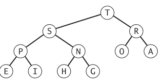
堆序的完全二叉树

## 第 2 章 排序

**定义。** 二叉堆是一组排列在完全堆或派生二叉树中的键，在数组中按层序表示（不使用第一个条目）。

| 索引 | 1 | 2 | 3 | 4 | 5 | 6 | 7 | 8 | 9 | 10 | 11 |
| :--- | :--- | :--- | :--- | :--- | :--- | :--- | :--- | :--- | :--- | :--- | :--- |
| **a[]** | - | T | S | R | P | N | O | A | E | I | H |
| | | - | T | | | | | | | | |
| | | | | | | | | | | | |
| | | | | P | N | O | A | | | | |
| | | | | E | | | | G | | |

（为了起见，现在我们省略“二叉”修饰词，在指代二叉堆时使用“堆”一词。）在堆中，节点 $k$ 的父节点位于位置 $[k/2]$，相反，节点 $k$ 的两个子节点位于位置 $2k$ 和 $2k+1$。我们不使用显式链接（如我们在第 3 章中考虑的二叉树结构），而是通过对索引进行简单的算术运算来上下移动：向上移动树时将 $k$ 设置为 $k/2$；向下移动树时将 $k$ 设置为 $2*k$ 或 $2*k+1$。

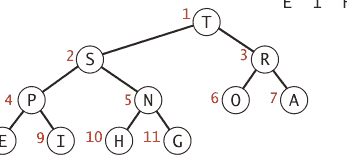
堆的表示

数组表示的完全二叉树（堆）是刚性结构，但它们有足够的灵活性允许我们实现高效的优先队列操作。具体而言，我们利用它们来开发对数时间的插入和删除最大值实现。这些算法利用了无需指针即可在树路径上下移动的能力，并且由于完全二叉树的以下属性保证了对数级性能：

**命题 P。** 大小为 N 的完全二叉树的高度为 $[\lg N]$。

**证明：** 上述结果可以通过归纳法容易证明，或者注意到当 $N$ 增加到变为 2 的幂时，高度会增加 1。

## 2.4 优先队列

### 堆上的算法
用长度为 $N+1$ 的私有数组 `pq[]` 表示大小为 $N$ 的堆，其中 `pq[0]` 未，堆位于 `pq[N]`。对于算法，我们仅通过私有辅助函数 `less()` 和 `exch()` 访问键，由于所有项都在实例变量 `pq[]` 中，我们使用了更紧凑且不涉及数组名作为参数的实现。我们执行堆操作首先进行一个可能违反堆条件的简单修改，然后根据需要修改堆以确保在任何地方满足堆条件。我们将这一过程称为重堆（reheapifying）。

```java
private boolean less(int i, int j)
    return pq[i].compareTo(pq[j]) < 0;

private void exch(int i, int j)
    int t = pq[i]; pq[i] = pq[j]; pq[j] = t;
```
*堆实现的比较和交换方法*

有两种情况。当某个节点的优先级增加（或在堆底部添加了新节点）时，我们必须向上移动堆以恢复堆序。当某个节点的优先级降低（例如，如果我们用一个大于该节点键的节点替换根节点）时，我们必须向下移动堆以恢复堆序。首先，我们将考虑如何实现这两个基本操作；然后我们将看到如何使用它们来实现插入和删除最大值。

**自底向上重堆 (swim)。** 如果由于节点的键大于其父节点的键而违反了堆序，我们通过将该节点与其父节点交换来修复这种违反。交换后，节点大于它的子节点（一个是旧父节点，另一个比旧父节点小因为它是该节点的节点），但该节点可能仍然大于其父节点。我们可以相同相同修复该违反，以此此类推，向上移动堆，直到遇到一个键更大的节点或根节点。只要记住堆中位置 $k$ 节点的父节点是位置 $k/2$，编写这个过程是非常直接的。`swim()` 中的循环保持了不变性，即当位置 $k$ 的节点大于其父节点时，堆序唯一可能被违反的地方。因此，当我们到达该节点不再大于父节点的地方时，我们就知道整个堆都满足堆序。

```java
private void swim(int k) {
    while (k > 1 && less(k/2, k)) {
        exch(k/2, k);
        k = k/2;
    }
}
```
为了证明方法名的合理，我们认为具有过大键的新节点必须“游”到堆的更高层级。

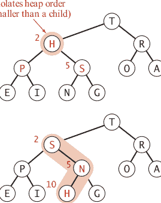

**自顶向下重堆 (sink) 实现**

**自顶向下重堆 (sink)。** 如果由于节点的键小于其一个或两个子节点的键而违反了堆序，我们可以通过将该节点与两个子节点中较大的交换来修复违反。这种交换可能会导致子节点处出现违反；我们以相同的方式修复它，并向下移动堆，直到遇到一个两个键都更小（或相等）节点或底部。代码同样遵循堆中位置 $k$ 节点的子节点是 $2k$ 和 $2k+1$。为了证明方法名的合理，我们认为具有过小键的节点必须“沉”到堆的较低层。

```java
private void sink(int k) {
    while (2*k <= N) {
        int j = 2*k;
        if (j < N && less(j, j+1)) j++;
        if (!less(k, j)) break;
        exch(k, j);
        k = j;
    }
}
```
如果我们想象一下这种残酷的等级制度，每个节点都代表下属（而父节点代表直接上级）。`swim()` 操作对应于新经理的到来，在命令链中被晋升（通过与任何资历较低的领导交换工作），直到新人遇到一个资历更高的老板。`sink()` 操作类似于公司总裁辞职并由外部人员取代的情况。如果总裁最有权力的下属比新人强，他们就会交换工作，我们沿着命令链向下移动，降职新人并提升其他人，直到达到新人的能力水平，那里没有资历更高的下属。这些理想化的场景在现实世界很少见到，但它们可以帮助你更好地理解堆的操作。

这些 `insert()` 和 `sink()` 操作为高效实现优先队列 API 基础，如下所示并在算法 2.6 中实现。

*插入。* 将新键添加到数组末尾，增加堆的大小，然后通过该键向上移动堆以恢复堆条件。

*删除最大值。* 我们从顶部取出最大项，将堆末尾的项放入，减少堆的大小，然后通过该键向下移动堆以恢复堆条件。

算法 2.6 解决了本节开头提出的基本问题：它是一个优先队列 API 实现，其插入和删除最大值的时间保证与队列的大小呈对数关系。

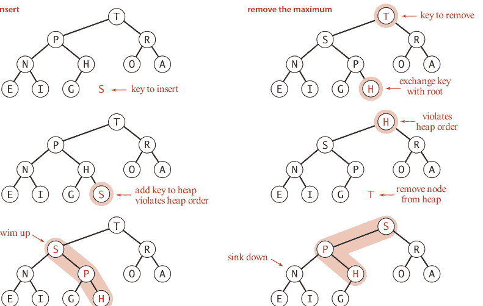
堆操作

# 算法 2.6 堆优先队列

```java
public class MaxQ<Key extends Comparable<Key>> {
    private Key[] pq;                   // 堆序完全二叉树
    private int N = 0;                  // pq[1..N] 存储，pq[0] 未使用

    public MaxQ(int maxN) {
        pq = (Key[]) new Comparable[maxN+1];
    }

    public boolean isEmpty() {
        return N == 0;
    }

    public int size() {
        return N;
    }

    public void insert(Key v) {
        pq[++N] = v;
        swim(N);
    }

    public Key delMax() {
        Key max = pq[1];                    // 从顶部获取最大键。
        exch(1, N--);                       // 与最后一个元素交换。
        pq[N+1] = null;                     // 避免残留（loitering）。
        sink(1);                            // 恢复堆属性。
        return max;
    }

    // 这些辅助方法的实现请参见第 315-316 页。
    private boolean less(int i, int j);
    private void exch(int i, int j);
    private void swim(int k);
    private void sink(int k);
}
```

优先队列维护在数组 `pq[]` 的堆序完全二叉树中，其中 `pq[0]` 未使用，优先队列中的 N 个键存储在 `pq[1]` 到 `pq[N]`。为了实现 `insert()`，我们增加 N，将新元素添加到末尾，然后通过 `swim()` 恢复堆序。对于 `delMax()`，我们从 `pq[1]` 取要返回的值，然后将 `pq[N]` 移动到 `pq[1]`，减小堆的大小，并执行 `sink(1)` 恢复堆条件。我们还将不再使用的位置 `pq[N+1]` 设置为 `null`，以便系统回收与之相关的内存。按照惯例，省略了动态数组扩扩的代码（参见第 1.3 节）。其他构造函数请参阅练习 2.4.19。

## 2.4 优先队列

**命题 Q。** 在一个包含 N 个键的优先队列中，算法对于插入所需的比较次数不超过 $1+\lg N$ 次，对于*删除最大值*所需的比较次数不超过 $2\lg N$ 次。

**证明：** 根据命题，这两个操作都涉及沿从节点到底部的路径移动，其链接数量不超过 $\lg N$。*删除最大值*操作对于路径上的每个节点（底部除外）需要两次比较：一次用于找到键值较大的孩子，另用于判断该孩子是否需要提升。

对于需要在优先队列中进行大量混合插入和删除最大值操作的典型应用，命题 Q 代表了一个重要的突破，总结在第 312 页所示的表格中。使用有序数组或无序数组的初级实现在其中一种操作上是线性时间，而基于堆的实现保证了两种操作都能在对数时间内完成。这种改进可能造出解决问题与完全无法处理问题之间的差异。

**多叉堆（Multway heaps）。** 修改我们的代码以构建基于数组表示的完全堆序三叉树并不困难，其中位置 $k$ 处的项大于或等于位置 $3k-1, 3k$ 和 $3k+1$ 处的项，且小于或等于位置 $[(k+1)/3]$ 处的项（对于从 1 到数组 N 个项之间的所有索引），对于任何给定的 $d$ 使用 $d$-叉堆也不太困难。在树高度降低 $(\log_d N)$ 带来的较低成本与在每个节点寻找 $d$ 个孩子产生的高昂成本之间存在权衡。这种权衡取决于实现的细节以及操作的相对频率。

| 堆中的优先队列操作 |
| :--- |
| insert P |
| insert Q |
| insert E |
| remove max |
| insert X |
| insert A |
| insert M |
| remove max (X) |
| insert P |
| insert L |
| insert E |
| remove max (P) |

数组扩容。我们可以添加一个无参数的构造函数，在 `insert()` 中实现数组倍增，在 `delMax()` 中实现数组减半，就像我们在第 1.3 节为栈做的那样。因此，客户端不需要担心任意的大小限制。当优先队列的大小任意且数组调整大大同时，命题 Q 隐含的对数界限是摊性的（参见练习 2.4.22）。

键的不可变性。优先队列包含由客户端创建的对象，但假设客户端代码不会更改键（这些机制可能会破坏堆序不变性）。可以开发出机制来强制这一假设，但程序员通常不会这样做，因为这会增加代码的复杂性并可能降低性能。

索引优先队列（Index priority queue）。在许多应用中，让客户端引用已经在优先队列中的项是有意义的。这样做的一种方法是为每个项关联一个唯一的整数索引。此外，通常情况下是客户端拥有一个已知大小 N 的项的集合，并且可能使用（并行）数组来存储有关项的信息，因此不相关的客户端代码可能使用整数索引来引用项。这些考虑使我们得出了以下 API：

```java


```java
public class IndexMinPQ<Key extends Comparable<Key>> {

    // 创建一个容量为 maxN 的优先队列

    // 索引可能在 0 到 maxN-1 之间

    IndexMinPQ(int maxN)

    void insert(int i, Key key)    // 插入键；将其与索引 i 关联

    void changeKey(int k, Key key) // 将与 i 关联的键改为 key

    boolean contains(int i)        // i 是否关联了某个键？

    void delete(int i)             // 删除 i 及其关联的键

    Key minKey()                   // 返回最小键

    int minIndex()                 // 返回最小键的索引

    int delMin()                   // 删除最小键并返回其索引

    boolean isEmpty()              // 优先队列是否为空

    int size()                     // 优先队列中键的数量

    Key keyOf(int i)               // 返回与索引 i 关联的键
}
```

## 带有关联索引的通用优先队列 API

思考这种数据类型的一种有用方式是实现一个数组，并能快速访问数组中的最小项。实际上，它做得更好——它提供了快速访问数组项的最小子集（已插入的项）。换句话说，你可以将 `IndexMinPQ` 视为代表数组 `pq[0..N-1]` 项的一个子集。

调用 `pq.insert(i, key)` 是将 `i` 添加到子集中并设置 `pq[i] = key`，而 `pq.changeKey(i, key)` 是设置 `pq[i] = key`，两者都维护了支持其他操作的数据结构，重要的是 `deMin()`（删除并返回最小键的索引）和 `changeKey()`（更改与数据结构关联的项——就像 `pq[i] = key`）。

这些操作在许多应用中非常重要，并且我们能够通过（索引）引用键。练习 2.4 描述了如何扩展算法 2.6，以极高的效率和极少的代码实现优先队列。直观上，即使在堆中，我们也可以通过单次操作（如果键减小）和交换操作（如果键增大）来恢复堆不变性。为了执行这些操作，我们使用索引在堆中查找项。在堆中定位项的能力允许我们向 API 中添加 `delete()` 操作。

> **命题 Q（续）。** 在一个大小为 `N` 的索引优先队列中，插入、更改优先级、删除和移除最小值的比较次数与 $\log N$ 成正比。
>
> **证明：** 通过检查代码以及堆中所有路径的长度最多为 `~log N` 这一事实可以直接得出。

此讨论是针对最小优先队列的；按照惯例，我们也在网站上实现了一个最大优先队列版本 `IndexMaxPQ`。

> **索引优先队列客户端。** 第 322 页上的 `IndexMaxPQ` 客户端解决了多路合并问题：将多个排序的输入流合并为一个排序的输出。这个问题出现在许多应用中：流可能是科学仪器的输出（按时间排序）、网络上的信息列表如电影（按时间或艺术家名称排序）、商业交易（按账户号或时间排序）或任何内容。如果你有空间，可能会将它们全部读入数组中并排序，但使用优先队列，你可以读取输入流并*无论它们多长*都能以排序顺序放入它们。

| 操作 | 数量的增长阶阶 |
| :--- | :--- |
| `insert()` | `log N` |
| `changeKey()` | `log N` |
| `contains()` | `1` |
| `delete()` | `log N` |
| `minIndex()` | `1` |
| `deMin()` | `log N` |

*基于堆的 `N` 个项索引优先队列的最坏情况代价*

## 多路合并优先级队列客户端

```java
public class Multiway {

    public static void merge(In[] streams) {
        int N = streams.length;
        IndexMinPQ<String> pq = new IndexMinPQ<String>(N);

        for (int i = 0; i < N; i++) {
            if (!streams[i].isEmpty()) {
                pq.insert(i, streams[i].readString());
            }
        }

        while (!pq.isEmpty()) {
            System.out.println(pq.minKey());

            int i = pq.delMin();

            if (!streams[i].isEmpty()) {
                pq.insert(i, streams[i].readString());
            }
        }
    }

    public static void main(String[] args) {
        int N = args.length;
        In[] streams = new In[N];

        for (int i = 0; i < N; i++) {
            streams[i] = new In(args[i]);
        }

        merge(streams);
    }
}
```

此 `IndexMinPQ` 客户端将通过命令行参数提供的排序输入流合并到标准输出（文本）的单个排序输出流中。每个流索引都与一个键（流中的下一个字符串）关联。

初始化后，它进入一个循环，找到队列中的最小元素并移除对应的条目，为该流中的下一个字符串添加新条目。例如，输出在行上——实际输出是每行一个字符串。

| `% m1.txt` | `% java m1.txt m2.txt m3.txt` |
| :--- | :--- |
| A B C F G I Z | A A B B C D E F G H I J N P Q Z |
| `% m2.txt` | |
| B D H P Q | |
| `% m3.txt` | |
| A B E F J N | |

# 堆排序（Heapsort）

我们可以使用任何优先级队列来开发一种排序方法。我们将所有待排序的项插入到一个最小优先的优先级队列中，然后反复移除最小值以按顺序移除它们。以这种方式使用无序数组表示优先级队列等同于执行选择排序；使用有序数组则等同于执行插入排序。如果我们有一个堆，会得到什么排序方法呢？完全不同的方法！接下来，我们使用堆来开发一种名为堆排序的经典排序算法。

堆排序分为两个阶段：堆构建，即将原始数组重新组织成堆；以及排序阶段（sortdown），我们按递减顺序从堆中取出项以构建结果。为了与我们学习过的代码保持一致，我们使用最大优先的优先级队列并反复移除最大值。

专注于排序任务，我们放弃了隐藏优先级队列表示的概念，直接使用 `sinkIn()` 和 `sinkOut()`。这样做允许我们通过在堆内部维护数组，在不需要额外空间的情况下对数组排序。

## 堆构建

从 `N` 个项构建堆的过程有多困难？我们当然可以在与 `N log N` 成正比的时间内完成它，从左到右遍历数组，使用 `sink()` 确保扫描指针的项形成一个堆有序的完全树，类似于优先级插入。

一种更高效的聪明方法是从右到左进行，在此过程中使用 `sinkIn()`。数组中一个小子堆的每个位置：`sinkIn()` 对此类小子堆有效。如果一个节点的两个子节点都是堆，那么在该节点上执行 `sinkIn()` 就能维持以父节点为根的子树为堆。这个过程通过归纳建立了堆序。

扫描从数组的中间开始，因为我们可以跳过大小为 1 的子堆。扫描在位置 1 结束，此时我们通过最后一个 `sinkIn()` 完成堆的构建。

作为排序的第一阶段，堆构建有点违反直觉，因为它的目标是产生一个堆有序的结果，该结果在数组中最大的项在前（其他较大的项靠近开头），而不是在注定结束的结尾。

> **命题 R。** 基于 `sink` 的堆构建从 `N` 个项构建堆所需的比较次数少于 `2N` 次，交换次数少于 `N` 次。
>
> **证明：** 由此，要构建一个包含 127 个项的堆，我们需要处理 32 个大小为 3 的堆、16 个大小为 7 的堆、8 个大小为 15 的堆、4 个大小为 31 的堆、2 个大小为 63 的堆以及 1 个大小为 127 的堆，因此（最坏情况下）需要 `32*1 + 16*2 + 8*3 + 4*4 + 2*5 + 1 = 120` 次交换（比较次数是两倍）。完整证明请参见 `EXERCISE 2.4.20`。

# 算法 2.7 堆排序

```java
public static void sort(Comparable[] a) {
    int N = a.length;

    for (int k = N / 2; k >= 1; k--) {
        sink(a, k, N);

        while (N > 1) {
            exch(a, 1, N--);
            sink(a, 1, N);
        }
    }
}
```


此代码使用`sink()`方法（修改为接受`a[i]`和`N`作为参数）对`a[1]`到`a[N]`进行排序。`for`循环构建堆；然后`while`循环将最大元素`[1]`与`a[N]`交换并修复堆，直到堆为空。在`exch(i)`和`less(i)`的实现中减少数组索引可以实现对`a[0]`到`a[N-1]`的排序，这我们的排序保持一致。

| N | 0 | 1 | 2 | 3 | 4 | 5 | 6 | 7 | 8 | 9 | 10 | 11 |
|---|---|---|---|---|---|---|---|---|---|---|---|
| 初始值 | S | O | R | T | E | A | M | P | L | E | |
| 11 | S | O | R | T | E | X | A | M | P | L | E |
| 11 | S | O | R | T | L | X | A | M | P | E | E |
| 11 | S | O | X | T | L | R | A | M | P | E | E |
| 11 | S | T | X | S | P | L | R | A | M | O | E | E |
| 堆有序 | 10 | 1 | T | S | P | L | R | A | M | O | E | E |
| 9 | 1 | S | P | R | O | L | E | A | M | T | X |
| 8 | 1 | R | P | E | O | L | E | A | M | T | X |
| 7 | 1 | O | M | E | A | L | E | P | R | S | T |
| 6 | 1 | M | E | A | L | E | O | P | R | S | T |
| 4 | 1 | L | E | A | L | M | O | P | R | S | T |
| 3 | 1 | E | A | E | L | M | O | P | R | S | T |
| 2 | 1 | E | A | E | L | M | O | P | R | S | T |
| 1 | 1 | A | E | E | L | M | O | P | R | S | T |
| 排序结果 | A | E | E | L | M | O | P | R | S | T |

> 堆排序轨迹（每次`sink()`之后的数组内容）

## 2.4 优先级队列

### 堆构建排序阶段


`sink(1, 6)`
`sink(1, 5)`
0 P


起始点（任意顺序）
起始点（堆有序）
`exch(1, 11)`
`sink(1, 10)`
`sink(1, 5)`
4 P

M O

`sink(4, 11)`
`exch(1, 10)`
`sink(1, 9)`
`sink(1, 4)`
3 P


L M P
`sink(3, 11)`
`exch(1, 9)`
`sink(1, 8)`
`exch(1, 3)`
`sink(1, 2)`


L M P
`sink(2, 11)`
`exch(1, 8)`
`sink(1, 7)`
`exch(1, 2)`
`sink(1, 1)`


L M P
`sink(1, 11)`
`exch(1, 7)`
`sink(1, 6)`
1 A
2 E
3 E
4 L
5 M
6 0
7 P
8 R
9 S
10 T


结果（堆有序）

堆排序：构建（左）和向下排序（右）堆

## 排序阶段 (Sortdown)

堆排序的大部分工作在第二阶段完成，我们从堆中移除剩余的最大项，并将其放入数组收缩的位置。这个过程有点像选择排序（按递减而非递增顺序取项），但它使用的比较少得多，因为堆为在未排序部分寻找最大项提供了更高效的方法。

输入 →


堆有序


红色项是下沉的项


### 命题 S

堆排序 N 个项所需的比较次数少于 `2N log N` 次（交换次数为一半）。

**证明**：`2N` 项涵盖了堆构建的成本（见命题 R）。`2N log N` 项通过将排序过程中每次`sink()`操作的成本限制为 `2log N` 得（见命题 Q）。


灰色项不移动


`ALGORITHM 2.7`是基于这些想法完整实现，即经典的堆排序算法，该算法由 J. W. Williams 发明并由 R. W. Floyd 在 1964 年改进。程序中的循环似乎执行不同的任务（第一个构建堆，第二个销毁堆进行排序），它们都围绕着`sink()`方法。我们在优先级队列 API 之外提供了一个实现，以突出排序算法的简单性（`sort()`有八行代码，`sink()`也有八行代码）并实现原地排序。

## 2.4 优先队列

先沉到底部，再向上浮。在下沉（sortdown）过程中，重新插入堆的大多数元素会一直沉到最后。Floyd 在 1964 年观察到，我们可以通过避免检查元素是否到达目标位置来节省时间，只需将两个子节点中较大的那个向上移动，直到到达底部，然后再回堆向上移动到合适的位置。这种思想在渐近意义上将比较次数减少了一半——接近归并排序（对于随机排序数组）所使用的次数。该方法需要额外的账目工作，且仅在比较成本相对较高时（例如，当我们对字符串或其他类型的长键进行排序）才有用。

堆排序在排序复杂度研究（第 279 页）中具有重要意义，因为它是我们见过的唯一在时间和空间利用上达到最优（常数因子）的方法——它在最坏情况下保证使用约 `~N ln` 次比较和常数级的额外空间。当空间非常紧张时（例如，在嵌入式系统或低成本移动设备上），它非常受欢迎，因为只需要几十行代码（即使是机器码）即可实现，同时仍提供优异的性能。然而，它在现代系统的典型应用中很少使用，因为它的缓存性能较差：数组元素很少与相邻的数组元素进行比较，因此其缓存缺失次数高于快速排序、归并排序，甚至高于壳排序（后者的大多数比较都是与相邻元素进行的）。

另一方面，利用堆来实现优先队列在现代应用中发挥着日益重要的重要的作用，因为它为在大量插入和删除最大值操作交替出现的动态情况下，提供了一种保证对数级运行时间的简便方法。我们将在书后的部分遇到几个例子。

## 问答

- **Q.** 我清楚优先队列的目的。为什么我们不直接对元素进行排序，然后在排序后的数组中按顺序考虑这些元素呢？
- **A.** 在某些数据处理示例（如 `TopM` 和 `Multiway`）中，数据总量太大，无法考虑排序（或存储在内存中）。如果你想在十亿个元素中寻找前十名，你真的想排序一个包含十亿个元素的数组吗？使用优先队列，你只需要一个只有十个元素的优先队列即可。在其他示例中，所有数据在任何时刻并不存在；我们从优先队列中取出元素进行处理，并根据处理结果可能向优先队列中添加更多元素。
- **Q.** 为什么不像我们在排序时那样使用`Comparable`，而不是在`MaxPQ`中使用泛型`Item`？
- **A.** 这样做需要将`delMax()`的返回值强制转换成实际类型，例如`String`。通常，在堆代码中应避免类型转换。
- **Q.** 为什么不在堆的表示中使用`a[0]`？
- **A.** 这样做可以简化算术运算。基于 0 索引的堆来实现堆方法并不困难（`a[0]`的子节点是`a[1]`和`a[2]`，`a[1]`的子节点是`a[3]`和`a[4]`，`a[2]`的子节点是`a[5]`和`a[6]`，依此类推），但大多数程序员倾向于更简单的算术。此外，使用`a[0]`作为哨兵值（在`a[1]`的值中）在堆应用中很有用。
- **Q.** 在堆排序中通过逐个插入元素来构建堆，似乎比书中第 323 页描述的复杂的自底向上方法更简单。为什么？
- **A.** 对于排序实现来说，它快了 20%，且需要的同样复杂（不需要`swim()`）。实现算法的难度并不与其简单性或效率有必然联系。
- **Q.** 如果我在像`MaxPQ`这样的实现中漏掉了`extends Comparable<Key>`短句会发生什么？
- **A.** 像往常，回答这类问题最简单的方法就是直接尝试。如果你对`MaxPQ`这样做，将得到一个编译时错误：

```
MaxPQ.java:21: cannot find symbol
symbol : method you that compareTo(Key)
```

这是 Java 在告诉它不知道`Item`中有`compareTo()`方法，因为你忘记声明`Key`继承`Comparable<Key>`。

## 练习

**2.4.1** 假设将序列 P R I O R * I T Y * * * Q U E * U E（其中字母表示插入，星号表示删除最大值）应用于初始为空的优先队列。给出删除最大值操作返回的字母序列。

**2.4.2** 批判以下想法：为了实现常数时间内的查找最大值，为什么不使用栈或队列，而是记录已插入的最大值，然后在查找最大值时返回该值？

**2.4.3** 提供支持插入和删除最大值的优先队列实现，分别为以下每个：无序数组、有序数组、无序链表和有序链表。给出你的四种实现中每种操作的最坏情况边界表。

**2.4.4** 一个按降序排序的数组是最大值型堆吗？

**2.4.5** 当键值 E A S Y Q U E T I O N 按该顺序插入到初始为空的最大值型堆时，给出该堆的状态。

**2.4.6** 使用练习 2.4.1 的约定，给出在初始为空的最大值型堆上执行操作 P R I O R * * I T Y * * * Q U E * * U * E 时所产生的堆的序列。

**2.4.7** 堆中最大的元素必须出现在位置 1，第二大的元素出现在位置 2 或 3。给出在大小为 31 的堆中，第 $k$ 大的元素 (i) 可能出现和 (ii) 不可能出现的位置列表，其中 $k=2, 3, 4$（假设值互不相同）。

**2.4.8** 回答上一个题，针对第 4 小的元素。

**2.4.9** 画出由五个键值 A A B C D E 可以组成的所有不同堆，然后画出由五个键值 A A A B B 可以组成的所有不同堆。

**2.4.10** 假设我们在堆顺序化数组`pq[]`中浪费一个位置，将最大值放在`pq[0]`中，其子节点放在`pq[1]`和`pq[2]`中，依此类推，按层序进行。`pq[k]`的父节点和子节点在哪里？

**2.4.11** 假设你的应用程序会有大量的插入操作，但只有少数的删除最大值操作。你认为哪种优先队列实现最有效：堆、无序数组或有序数组？

### 练习（续）

**2.4.12** 假设你的应用程序会有大量的查找最大值操作，但只有较少的插入和删除最大值操作。你认为哪种优先队列实现最有效：堆、无序数组或有序数组？

**2.4.13** 描述一种在`sink()`中避免`j < N`测试的方法。

**2.4.14** 在大小为 $N$ 且没有重复键的堆中，删除最大值操作最少需要交换多少元素？给出一个大小为 15 的堆，使其达到最小值。针对连续的两次和三次删除最大值操作回答相同的问题。

**2.4.15** 设计一个线性时间的认证算法来检查数组`pq[]`是否为最小值型堆。

**2.4.16** 对于 $N=32$，给出能让堆排序使用尽可能多和尽可能少比较的数组。

**2.4.17** 证明：构建一个大小为 $k$ 的最小值型优先队列，然后执行 $N-k$ 次替换最小（插入后删除）操作，会将 $N$ 个元素中最大的 $k$ 个留在优先队列中。

**2.4.18** 在`MaxPQ`中，假设客户端调用`insert()`插入一个比队列中所有元素都大的元素，然后调用`deleteMax()`。假设没有重复键。生成的堆与操作前的堆相同？对于两次`insert()`操作（第一个键大于队列中所有键，第二个键大于第一个键）后执行两次`deleteMax()`操作，回答相同的问题。

**2.4.19** 实现`MaxPQ`的构造函数，其接收元素数组作为参数，使用书中第 323 页描述的自底向上堆构建方法。

**2.4.20** 证明基于`sink`的堆构建使用的比较次数少于 $2N$ 次，交换次数少于 $N$ 次。

## 创意性题

**2.4.21** 基础数据结构。解释如何使用优先级队列来实现第 1.3 节和练习 1.3-35 中的栈、队列和随机队列类型。

**2.4.22** 数组扩缩。在`MaxPQ`中添加数组扩缩功能，并从摊还的角度证明数组访问的界限（类似于 PROPOSITION Q 中的界限）。

**2.4.23** 多叉堆。仅考虑比较的代价，并假设找到 $t$ 个元素中的最大值需要 $t$ 次比较，请找到 $t$ 的值，使得在使用 $t$ 叉堆时，比较次数中 $N \log N$ 的系数最小。首先，假设 $\log k$ 有一种直接的推广；然后，假设 Floyd 的方法可以在内部循环中节省一次比较。

**2.4.24** 带有显式链接的优先级队列。使用堆顺序的二叉树实现优先级队列，但使用三叉链结构而不是数组。你每个节点需要三个链接：两个用于遍历树，一个用于遍历顶部。你的实现应保证每个操作的运行时间为对数级，即使事先不知道最大优先级队列的大小。

**2.4.25** 计算数论。编写一个程序，按排序打印所有形式为 $a^3 + b^3$ 的整数，其中 $a$ 和 $b$ 是 0 到 $N$ 之间的整数，且不使用过多空间。也就是说，而不是计算 $N^2$ 个和的数组并对其排序，而是构建一个最小向优先级队列，初始包含 $(0^3, 0, 0)$、$(1^3, 0, 0)$、$(2^3, 2, 0), \dots, (N^3, N, N)$。然后，只要优先级队列不空，移除最小的 $(i^3 + j^3, i, j)$ 并打印，如果 $j < N$，则插入 $(i^3 + (j+1)^3, i, j+1)$。使用该程序找到 0 到 $10^3$ 之间所有不同的整数 $a, b, c$，使得 $a^3 + b^3 = c^3$。

**2.4.26** 不使用交换的堆。由于`sink()`和`swim()`操作使用了`exch()`原语，元素的加载和存储频率是必要的两倍。提供更高效的实现以避免这种低效，以及插入排序（参见练习 2.1-25）。

**2.4.27** 寻找最小值。在`MaxPQ`中添加一个`min()`方法。你的实现应使用常数时间和额外额外空间。

**2.4.28** 选择过滤器。编写一个类似于`TopM`的程序，它从标准输入读取点 $(x, y, z)$，从命令行获取值 $M$，并打印在欧几里得距离原点最近的 $M$ 个点。估计当 $N=10^8$、$M=10^4$ 时你的程序的运行时间。

**2.4.29** 最小最大优先级队列。设计一种支持以下操作的数据类型：*插入*、*删除最大值*和*删除最小值*（均为对数时间）；以及查找中位数和查找最小值（均为常数时间）。*提示*：使用两个堆。

**2.4.30** 动态中位数查找。设计一种支持对数时间插入、常数时间查找中位数以及*对数时间删除中位数*的数据类型。*提示*：使用一个最小堆和一个最大堆。

**2.4.31** 快速插入。开发一种基于比较的`MinPQ` API 实现，其中插入使用约 $\log \log N$ 次比较，*删除最小值*使用约 $\log \log N$ 次比较。*提示*：在指针上进行二分查找以在`swim()`中找到祖先。

**2.4.32** 下界。证明无法开发一种基于比较的`MinPQ` API 实现，使得*插入*和*删除最小值*都保证每个操作使用约 $\log \log N$ 次比较。

**2.4.33** 索引优先级队列实现。通过如下方式修改 ALGORITHM 2.6，实现第 320 页上索引优先级队列 API 中的基本操作：将`pq[]`改为存储索引，添加一个数组`items[]`来存储键值，并添加一个数组`qp[]`，它是`pq[]`的逆数组——`qp[i]`给出 $i$ 在`pq[]`中的位置（使得`pq[j]`为 $i$ 的索引 $j$）。然后修改 ALGORITHM 2.6 中的代码以维护这些数据结构。使用约定：如果 $i$ 不在队列中则`qp[i]=-1`，并包含一个测试此条件的`contains()`方法。你需要修改辅助方法`exch()`和`less()`，但不需要`sink()`或`swim()`。

### 2.4 优先级队列 333

部分解：

```java
public class IndexMinPQ extends Comparable<Key>
{
```


```java
private int N;               // PQ上的元素数量

private int[] pq;           // 使用从 1 开始索引的二叉堆

private int[] qp;           // 逆向：qp[pq[i]] = pq[i] = i

private Key[] keys;         // 带有优先级的项

IndexMinPQ(int maxN)

{

    keys = new Comparable[maxN + 1];

    pq = new int[maxN + 1];

    qp = new int[maxN + 1];

    for (int i = 0; i < maxN; i++) qp[i] = -1;

}

public boolean isEmpty() {

    return N == 0;

}

public boolean contains(int i) {

    return qp[i] != -1;

}

public void insert(int i, Key key) {

    N++;

    qp[i] = N;

    pq[N] = i;

    keys[i] = key;

    swim(N);

}

public Key minKey() {

    return keys[pq[1]];

}

public int delMin() {

    int indexOfMin = pq[1];

    exch(1, N--);

    sink(1);

    keys[pq[N+1]] = null;

    qp[pq[N+1]] = -1;

    return indexOfMin;

}

}

```

# 创意性题（续）

## 2.4.34 索引优先级队列实现（额外操作）

在你练习 2.4.33 的实现中添加`minIndex()`、`changeKey()`和`delete()`。

### 解法

```java
public int minIndex()

    { return pq[1]; }

public void changeKey(int i, Key key)

    {

        keys[i] = key;

        swim(qp[i]);

        sink(qp[i]);

    }

public void delete(int i)

    {

        int index = qp[i];

        exch(index, N--);

        swim(index);

        sink(index);

        keys[i] = null;

        pq[i] = -1;

    }

```

## 2.4.35 从离散概率分布中采样

编写一个`Sample`类，其构造函数接受一个`double`类型的数组作为参数并支持以下操作：`random()`——以概率$p[i]/T$返回$i$（其中$T$是$p[i]$中数字之和）以及`changeKey(i, v)`——将$p[i]$的值改为$v$。

提示：使用一个完全二叉树，每个节点的权重为$p[i]$。在每个节点中存储其子树所有节点的累积权重。为了生成随机索引，在 0 到$T$之间选取一个随机数并利用累积权重确定要探索的分支。更新$p[i]$时，更改从根节点到$i$路径上节点的权重。像堆那样避免显式指针。

## 实验

### 2.4.36 性能驱动 I

编写一个性能驱动程序，使用插入填充优先级队列，然后删除一半键，再次插入填充，然后删除所有键，在不同长度的随机序列上多次执行；测量每次运行所需的时间；并输出平均运行时间。

### 2.4.37 性能驱动 II

编写一个性能驱动程序，使用插入填充优先级队列，然后在 1 秒内尽可能执行删除最大值和插入操作，在不同长度的随机序列上多次执行；并输出能够执行的删除平均次数。

### 2.4.38 练习驱动

编写一个练习驱动程序，对 ALGORITHM 2.6 中的优先级队列接口处理困难或病态的情况。简单的示例包括已排序的键、逆序的键、全部相同的键以及仅有两个不同值的键序列。

### 2.4.39 构造代价

实证确定当$N = 10^3$、$10^6$和$10^9$时，排序在构造阶段花费的百分比。

### 2.4.40 Floyd 方法

根据 Floyd 的“沉到底部再向上浮”的想法实现一种排序方法，如文中描述。对于$N = 10^3, 10^6$和$10^9$的随机不同键，统计你的程序使用的比较次数以及标准实现使用的比较次数。

### 2.4.41 多叉堆

根据文中描述的完全有序 3 叉和 4 叉树的想法实现一种排序方法。对于$N = 10^3, 10^6$和$10^9$的随机不同键，统计每个实现使用的比较次数以及标准实现使用的比较次数。

# 2.5 应用

排序算法和优先队列广泛应用于各种场景。本节的目的是简要介绍其中的一些应用，考虑我们所研究的这些高效方法在这些应用中如何起着关键作用，并讨论使用我们的排序和优先队列代码所需的步骤。

排序之所以如此有用，一个主要原因是：在排序数组中搜索项比在未排序的数组中搜索要容易得多。一个多世纪以来，人们发现在按排序的电话簿中查找某人的号码非常容易。现在，数字音乐播放器按艺术家名称或歌曲标题组织文件；搜索引擎按重要性降序显示结果；电子表格按特定字段对列排序；矩阵处理包对称矩阵的特征值进行降序排序；等等。一旦数组经过排序，其他任务也变得更简单：例如从书的排序索引中查找项目；从长列表（如邮件列表、选民列表或网站列表）中删除重复项；执行统计计算，如删除离群值、寻找中位数或计算百分位数。

排序在许多看似与排序无关的应用中也是一个关键问题。数据压缩、计算机图形、计算生物学、供应链管理、组合优化、社会选择和投票只是众多例子中的少数几个。我们在本章中考虑的算法，对于本书后续每个章节中开发有效算法都起着至关重要的作用。

最重要的是系统排序，因此我们首先考虑在为各种客户构建排序算法时会涉及的若干实际考虑因素。虽然这些主题某些特定于 Java，但每项都反映了任何系统中需要解决的挑战。

我们的目的是证明，尽管我们使用了相对简单的机制，但我们正在研究的排序实现具有广泛的适用性。快速排序的已证明的应用非常多，因此我们只需要考虑其中一小部分：一些科学性的、算法的和商业性的。你将在练习题中发现更多例子，比网站上的要多得多。此外，我们经常会回溯本章，以有效解决我们在书中后续考虑的问题！

## 排序不同类型的数据

我们的实现对`Comparable`对象的数组进行排序。这种 Java 约定允许我们使用 Java 的回调机制对实现了`Comparable`接口的任何类型对象的数组进行排序。正如第 2.1 节所述，实现`Comparable`意味着定义一个`compareTo()`方法，为该类型实现自然排序。我们可以立即使用代码来对`String`、`Integer`、`Double`以及`File`和`URL`等其他类型进行排序，因为这些类型都实现了`Comparable`。能够对所有这些类型使用相同的代码是非常方便的，但典型的应用程序处理的是在内部定义的数据类型。此外，为用户定义的数据实现`compareTo()`方法是很常见的，以便它们实现`Comparable`，使客户端代码对该类型的数组进行排序（并构建该类型值的优先队列）。

### 事务示例

排序应用的典型温场是商业数据处理。例如，想象一家电子商务公司为每笔涉及客户账户的交易维护一条记录，其中包含所有相关信息，如客户名称、日期、金额等。如今，一家成功的公司需要能够处理数百万百万次的交易。正如我们在练习 2.2.1 中看到的，在类定义中添加适当的`compareTo()`方法来决定我们如何实现是合理的。有了这样的定义，我们可以对`Transaction[]`数组进行处理，例如首先调用`sort()`方法进行排序。我们的排序方法对`Transaction`数据类型一无所知，但 Java 的`Comparable`接口允许我们定义自然排序，这样我们就可以使用任何方法对`Transaction`对象进行排序。

或者，我们可能通过对`Date`字段实现`compareTo()`来规定`Transaction`对象按日期排序。由于`Date`对象本身是`Comparable`的，我们只需要调用`date`中的`compareTo()`方法，而不需要从头开始实现。通过其客户字段对这些数据进行排序也是合理的；让客户能够灵活地在不同排序之间切换是一个有趣的挑战，我们很快就会考虑它。

```java
public int compareTo(Transaction that)

{ return this.when.compareTo(that.when); }
```

用于按日期排序事务的另一种`compareTo()`实现。

### 指针排序

我们正在使用的方法在经典文献中被称为指针排序，即我们处理对项的引用，而不移动数据本身。在 C 和 C++ 等编程语言中，程序员显式地决定操作数据还是操作指向数据的指针；在 Java 中，指针操作是隐式的。除了数值类型外，我们总是操作对象的引用（指针），而不是对象本身。

指针排序增加了一层间接：数组包含指向待排序对象的引用，而不是对象本身。在排序的语境下，我们简要考虑了一些相关问题。通过多个引用，我们可以对单体数据的不同部分拥有多种不同的表示（可能如下文所述，使用多个键）。

### 键是不可变的

按理来说，如果允许客户在排序后更改键的值，数组可能无法保持排序状态。同样，如果客户可以在操作之间更改值，则很难期望优先队列能够正常运行。在 Java 中，使用不可变键来确保键值不改变是明智的。大多数可能使用键的标准数据类型，如`String`、`Integer`、`Double`和`File`都是不可变的。

### 交换是非常便宜的

使用引用的另一个优势是避免了移动项的成本。对于具有大项（和小键）的数组，这种成本节省是显著的，因为`compare`只需要访问项的一小部分，大部分项在排序过程中从未被触及。引用方法使得在涉及任意大小项目的通用情况下，交换的成本约等于`compare`的成本（代价是用于引用的额外空间）。

事实上，如果键很长，交换的成本可能甚至比`compare`低。研究数字数组排序算法性能的一种方法是查看它们使用的比较和交换的总数，并基于此假设认为交换的成本与`compare`的成本相同。

### 另一种排序

在许多应用程序中，我们希望根据情况对正在排序的对象使用不同的排序。Java 的`Comparator`接口允许我们在单个类中构建多种排序方式。它有一个公共方法`compare()`。

如果我们有一个实现了此接口的数据类型，我们可以将`Comparator`传递给`sort()`（随后传递给`less()`），如页所示。`Comparator`机制允许我们对任何类型的对象数组进行排序，使用我们为其定义的任何全序。使用`Comparator`代替`Comparable`类型可以使类型定义与比较两个对象的定义更好地分离。

事实上，通常有许多选择对象的方法，而`Comparator`（比较器）机制允许我们在其中进行选择。例如，为了对字符串数组`[]`进行排序而不忽略字符是大写还是小写，我们只需调用`Insertion.sort(a, CASE_INSENSITIVE_ORDER)`，它使用了 Java 的`String`类中定义的`CASE_INSENSITIVE_ORDER`比较器。你可以想象，字符串排序的精确规则非常复杂，且对于不同的自然语言有所不同，因此 Java 提供了许多`String`比较器。

### 具有多个键的项

在典型的应用中，项具有可能需要作为键的实例变量。在我们事务示例中，一个客户端可能需要按客户对事务列表进行排序（例如，将涉及每个客户的所有交易放在一起）；另一个客户端可能需要按金额对列表进行排序（例如，识别高价值交易）；其他客户端可能需要使用其他字段作为键。

`Comparator`机制正是我们为了实现这种灵活性所需要的。我们可以定义多个多个比较器，正如下一页底部的`Transaction`的实现中所示。通过这种定义，客户端可以通过以下调用按时间对`Transaction`对象数组进行排序：

```java
Insertion.sort(a, new Transaction.WhenOrder())
```

```java
Insertion.sort(a, new Transaction.HowMuchOrder()).
```

排序过程通过回调到`Transaction`中由客户端代码指定的`compare()`方法来执行每次比较。为了避免每次排序都创建一个新`Comparator`对象的代价，我们可以使用`public static final`实例变量来定义比较器（正如 Java 对`CASE_INSENSITIVE_ORDER`所做的那样）。

```java
private static void sort(Object[] a, Comparator c)

{

    int N = a.length;

    for (int i = 1; i < N; i++)

        for (int j = i; j > 0 && c.less(a[j], a[j-1]) < 0; j--)

            exch(a, j, j-1);

}

private static boolean less(Comparator c, Object v, Object w)

{

    return c.compare(v, w) < 0;

}

private static void exch(Object[] a, int i, int j)

{

    Object t = a[i]; a[i] = a[j]; a[j] = t;

}

```

使用比较器的插入排序。

# 第 2 章 ■ 排序

## 带有比较器的优先级队列

使用比较器的相同灵活性对于优先级队列也有用。将我们在 ALGORITHM 2.6 中的标准实现扩展以支持比较器，涉及以下步骤：

- 导入`java.util.Comparator`。
- 为`MaxPQ`添加一个实例变量`comparator`以及一个接收比较器并将`comparator`初始化为该值的构造函数。
- 在`less()`中添加代码，检查`comparator`是否为`null`（如果不为`null`则使用它）。

例如，通过这些更改，你可以使用`Transaction`键构建不同的优先级队列，使用时间、地点或账户号码进行排序。如果你从`MinPQ`中移除`Key extends Comparable<Key>`短语句，你甚至可以对没有自然顺序的键进行排序。

```java
import java.util.Comparator;

public class Transaction {

    private final String who;

    private final Date when;

    private final double amount;

    ...

    public static class WhoOrder implements Comparator<Transaction> {

        public int compare(Transaction v, Transaction w) {

            return v.who.compareTo(w.who);

        }

    }

    public static class WhenOrder implements Comparator<Transaction> {

        public int compare(Transaction v, Transaction w) {

            return v.when.compareTo(w.when);

        }

    }

    public static class HowMuchOrder implements Comparator<Transaction> {

        public int compare(Transaction v, Transaction w) {

            if (v.amount < w.amount) return -1;

            if (v.amount > w.amount) return +1;

            return 0;

        }

    }

}
```


`Transaction` 数据类型的比较器实现

## 2.5 应用

**稳定性。** 如果一个排序方法保留了数组中相等键的相对顺序，则该排序方法是稳定的。这一属性通常非常重要。例如：

| 按时间排序 | 按地点排序（不稳定） | 按地点排序（稳定） |
|---|---|---|
| 芝加哥 09:00:00 | 芝加哥 09:25:52 | 芝加哥 09:00:00 |
| 凤凰城 09:00:03 | 芝加哥 09:03:13 | 芝加哥 09:00:59 |
| 休斯顿 09:00:13 | 芝加哥 09:21:05 | 芝加哥 09:03:13 |
| 芝加哥 09:00:59 | 芝加哥 09:19:46 | 芝加哥 09:13:13 |
| 休斯顿 09:01:10 | 芝加哥 09:19:32 | 芝加哥 09:19:32 |
| 芝加哥 09:03:13 | 芝加哥 09:00:00 | 芝加哥 09:21:05 |
| 西雅图 09:10:11 | 芝加哥 09:21:21 | 西雅图 09:25:52 |
| 西雅图 09:10:25 | 芝加哥 09:00:59 | 芝加哥 09:35:21 |
| 凤凰城 09:14:25 | 休斯顿 09:01:10 | 芝加哥 09:35:21 |
| 芝加哥 09:19:32 | 休斯顿 09:00:13 | 休斯顿 09:01:10 |
| 芝加哥 09:19:46 | 休斯顿 09:37:44 | 凤凰城 09:00:03 |
| 芝加哥 09:21:05 | 凤凰城 09:03:13 | 凤凰城 09:14:25 |
| 西雅图 09:22:43 | 凤凰城 09:14:25 | 凤凰城 09:37:44 |
| 西雅图 09:22:54 | 西雅图 09:10:25 | 西雅图 09:10:11 |
| 芝加哥 09:25:52 | 西雅图 09:36:14 | 西雅图 09:10:25 |
| 芝加哥 09:35:21 | 西雅图 09:22:43 | 西雅图 09:22:54 |
| 凤凰城 09:00:03 | 西雅图 09:10:11 | 西雅图 09:35:21 |
| 凤凰城 09:14:25 | 西雅图 09:22:54 | 西雅图 09:37:44 |
| 西雅图 09:10:11 | 西雅图 09:10:25 | 西雅图 09:10:11 |
| 西雅图 09:10:25 | 西雅图 09:10:11 | 西雅图 09:10:25 |
| 凤凰城 09:14:25 | 休斯顿 09:01:10 | 休斯顿 09:01:10 |
| 休斯顿 09:01:10 | 休斯顿 09:00:13 | 凤凰城 09:00:03 |
| 凤凰城 09:00:03 | 凤凰城 09:03:13 | 凤凰城 09:14:25 |
| 凤凰城 09:14:25 | 凤凰城 09:14:25 | 凤凰城 09:37:44 |
| 西雅图 09:22:43 | 西雅图 09:10:25 | 西雅图 09:10:11 |
| 西雅图 09:10:11 | 西雅图 09:10:25 | 西雅图 09:10:25 |
| 西雅图 09:10:25 | 西雅图 09:10:11 | 西雅图 09:10:11 |
| 西雅图 09:10:11 | 西雅图 09:10:25 | 西雅图 09:10:25 |
| 西雅图 09:10:25 | 西雅图 09:10:11 | 西雅图 09:10:11 |
| 西雅图 09:10:11 | 西雅图 09:10:25 | 西雅图 09:10:25 |
| 西雅图 09:10:25 | 西雅图 09:10:11 | 西雅图 09:10:11 |
| 西雅图 09:10:11 | 西雅图 09:10:25 | 西雅图 09:10:25 |
| 西雅图 09:10:25 | 西雅图 09:10:11 | 西雅图 09:10:11 |

（注：由于原文部分表格数据存在重复逻辑混乱，译文已尽可能保持格式对齐）

对没有自然顺序的键进行排序。

```java
import java.util.Comparator;

public class Transaction {

    private final String who;

    private final Date when;

    private final double amount;

    ...

    public static class WhoOrder implements Comparator<Transaction> {

        public int compare(Transaction v, Transaction w) {

            return v.who.compareTo(w.who);

        }

    }

    public static class WhenOrder implements Comparator<Transaction> {

        public int compare(Transaction v, Transaction w) {

            return v.when.compareTo(w.when);

        }

    }

    public static class HowMuchOrder implements Comparator<Transaction> {

        public int compare(Transaction v, Transaction w) {

            if (v.amount < w.amount) return -1;

            if (v.amount > w.amount) return +1;

            return 0;

        }

    }

}
```

`Transaction` 数据类型的比较器实现

## 2.5 应用

**稳定性。** 如果一个排序方法保留了数组中相等键的相对顺序，则该排序方法是稳定的。这一属性通常非常重要。例如：

对没有自然顺序的键进行排序。

**使用哪种排序算法？**

我们已经讨论了许多排序算法，通过本节末尾的练习题，你可以对这些算法的比较性能进行更详细的研究。解释 `PROPERTY` 的最好方式是：在任何对运行时间重要的应用中，你应该认真考虑使用快速排序。

| 算法 | 是否稳定 | 是否就地排序 | 运行时间 | 备注 |
|---|---|---|---|---|
| 选择排序 | 否 | 是 | N² | 1 |
| 插入排序 | 是 | 是 | 在 N 和 N² | 1 |
| 壳排序 | 否 | 是 | N log N | 1 | 取决于输入 |
| 快速排序 | 否 | 是 | N log N | lg N | 概率性的，也取决于键的分布 |
| 合并排序 | 是 | 否 | N log N | lg N | 概率性的 |
| 堆排序 | 否 | 是 | N log N | 1 |

排序算法的性能特性

## 属性 T。快速排序是最快的通用排序算法。

**证据：** 这一假设得到了几十年来在无数系统上无数实现的支持。通常，快速排序之所以快的原因是（它的内部循环中指令较少（且由于顺序引用数据对缓存内存友好））是 `-c lg N`，其中 `c` 值小于其他线性算法的常数。通过三路划分，快速排序在某些键分布下是线性的。

在大多数实际情况下，快速排序是首选方法。考虑到排序的广泛应用以及计算机系统的多样性，这样一个简单的陈述很难证明。例如，我们已经看到了一个显著例外：如果稳定性很重要且空间允许，合并排序可能是更好的选择。我们将在第 5 章看到其他异常。通过 `SortCompare` 工具并投入大量精力，你可以对这些算法以及我们所讨论的改进进行更详细的研究。

**Java 系统排序。** 作为应用第 342 页表格所提供信息的一个例子，考虑 Java 的主要系统排序方法 `java.util.Arrays.sort()`。通过对参数类型的重载，这个名称实际上代表了一组方法：

## 第2章 排序

- 针对每种基本类型的不同方法
- 针对实现 `Comparable` 接口的数据类型的方法
- 使用 `Comparator` 的方法

Java 程序员选择使用快速排序（采用三路划分）来实现基本类型方法，并使用合并排序来实现引用类型方法。正如刚才讨论的，这些选择在实际应用中的主要意义在于：通过牺牲速度和内存消耗（针对基本类型）来换取性能的保证和稳定性（针对引用类型）。

我们一直以来考虑的**算法和思想**是现代系统（包括 Java）的要素组成部分。在开发 Java 程序来解决应用程序时，你可能会发现 Java 的 `Arrays.sort()` 实现（可能由你自己实现的 `compareTo()` 和/或 `compare()` 补充）将满足你的需求，因为你将使用三路快速排序或合并排序，这两者都是经过证明的经典算法。

在本书中，我们通常会在排序客户端中使用自己的 `Quick.sort()`（通常情况下）或 `Merge.sort()`（当稳定性很重要且不限制空间时）。除非你有充分的理由使用其他特定方法，否则你可以自由使用 `Arrays.sort()`。

## 归约

可以使用排序算法来解决其他问题的想法，是算法设计中一种被称为**归约**（reduction）的基本技术的示例。由于归约在算法理论中的重要性，我们将在第 6 章详细讨论其细节——在此，我们将考虑几个实际示例。归约是指为一个问题开发的算法被用于解决另一个问题的情况。应用程序程序员已经非常习惯使用归约的概念（无论它是否被显式提到）——每当你使用一个解决问题 B 的方法来解决问题 A 时，你就是在进行从 A 到 B 的归约。事实上，实现算法的一个目标是通过使算法适用于尽可能广泛的场景来促进归约。我们从几个排序的初级示例开始。其中许多问题以算法题的形式出现，在这些情况下平方级暴力算法是显而易见的。通常情况下，先对数据进行排序可以很容易地在额外的线性时间内完成问题的解决，从而将总成本从平方级降低。

在一个包含 `Comparable` 对象的数组中是否存在重复键？有多少个不同的键？哪个值出现的频率最高？对于小数组，这类问题可以通过将每个数组元素与其他每个数组元素进行比较的平方级算法轻松回答。对于大数组，使用平方级算法是不可行的。通过排序，你可以在对数线性时间内（linearith time）回答这些问题：首先对数组进行排序，然后遍历排序后的数组，记录有序数组中连续出现的重复键。例如，下面的代码片段正确计算了数组中不同的键。通过对此代码进行简单修改，你可以针对巨大的数组回答这些问题并执行诸如打印不同值、所有重复值等任务。

**排序。** 一个排列（即排名）是 N 个整数的排列，其中 0 到 N–1 之间的每个整数恰好出现一次。两个排序之间的 Kendall tau 距离是两个排序中顺序不同的对数。例如，`0 3 1 6 2 5` 和 `4 0–1–3–1–2–4–5–4` 之间的 Kendall tau 距离是，其中某些对相对于前者的顺序是不同的，但所有其他对的相对顺序是相同的。这种统计量被广泛使用：在社会学中研究选择和投票，在分子生物学中通过表达谱比较基因，以及在网络搜索引擎结果的排名中，还有许多其他应用。排列与恒等排列（每个条目等于其索引）之间的 Kendall tau 距离是排列中逆序对的数量，设计一个基于排序的计算距离的平方算法并不困难（回想 2.1 节中的命题 C）。高效地计算 Kendall tau 距离对于一个熟悉我们所拥有的经典排序算法的程序员（或学生！）来说是一个有趣的练习（见练习 2.5.19）。

```java
Quick.sort(a);

count = 1; // 假设 a.length > 0

for (int i = 1; i < a.length; i++)

  if (a[i].compareTo(a[i-1]) != 0)

    count++;
```


数组中不同键计数

优先队列归约。在第 2.4 节中，我们考虑了两个归约为对优先级队列系列操作的问题示例。第 311 页的`TopM`寻找输入流中键最大的 M 个项目。第 322 页的`Multiway`将排序后的流合并以形成排序的输出流。这两个问题都可以通过大小为 M 的优先级队列轻松解决。

中位数和顺序统计。与排序相关的一个重要应用（但不需要全排序）是寻找键集合中中位数的操作（具有一半键不大于、一半键不小的属性的值）。该操作是统计学和其他数据处理应用中的常见计算。寻找中位数是选择（selection）的一种特例：寻找一组数字中第 k 小的数。选择在实验数据和其他数据的处理中有许多应用。使用中位数和其他顺序统计量将数组分成更小的组是常见的。通常，只需要保存大数组的一小部分用于进一步处理；在这种情况下，一个可以选出例如数组前 10% 元素的程序可能比全排序更合适。我们在第 2 节中针对无界输入流的`TopM`应用使用了优先级队列。当你在数组中拥有项目时，`TopM`的替代方案是...

# 排序应用简析

排序的直接应用非常熟悉、无处不在，且数量多到我们无法一一列举。你按歌曲标题或艺术家名称排序音乐，按日期或来源排序电子邮件或电话，按日期排序照片。大学按名称或学 ID 对学生账户进行排序。信用卡公司按日期或金额对数百万或数十亿次交易进行排序。科学家按日期或其他标识符对实验数据进行排序，还对自然世界的详细模拟进行排序，从粒子或天体的运动到材料结构，再到社会互动和关系。事实上，很难找到一个不涉及排序的计算应用！为了详细说明这一点，我们将在这些示例中描述比我们刚刚考虑的归约更复杂的应用，其中几个我们将在本书的后部分进行探讨。

## 商业计算

世界充斥着信息。政府机构、金融机构和商业企业通过排序来组织其中的许多信息。无论信息按名称或数字排序、交易按日期或金额排序、邮件按邮政编码或地址排序、文件按名称或日期排序，还是其他任何方式，处理过程在某个阶段都会涉及到排序算法。通常，此类信息组织在巨大的数据库中，通过多个键进行排序以实现高效搜索。广泛使用的有效策略是收集新信息、将其添加到数据库、按感兴趣的键进行排序，并将每个键的排序结果合并到现有数据库中。我们所讨论的方法自计算早期以来一直有效使用，构建了庞大的排序数据基础设施和处理方法，这些成为所有此类商业活动的基础。今天，处理拥有数百万或数十亿条目的数组已是常态——如果没有对数级算法，此类数组将无法排序，导致处理变得极其困难或无法实现。

## 信息搜索

将数据保持在排序状态使得使用经典的二分查找算法（见第 1 章）进行高效搜索成为可能。你还会发现，相同的方案也易于快速处理许多其他类型的查询。有多少个项比给定项小？哪些项落在给定的范围内？在第 3 章中，我们将考虑此类问题。我们还详细考虑了排序和二分查找的各种扩展，这些扩展允许我们将此类查询与插入和删除集合中对象的操作混合，同时保证所有操作的对数级性能。

## 2.5 应用

运筹学。运筹学（OR）领域开发并应用数学模型来解决问题和决策。我们将在书中看到几个运筹学与算法研究之间关系的示例，从经典的运筹学问题——“调度”中使用排序开始。假设我们有 N 个任务要完成，其中任务 j 需要 t_j 的处理时间。我们需要完成所有任务，但希望通过最小化任务的平均完成时间来最大化客户满意度。最短处理时间优先规则（按处理时间的递增顺序调度任务）可以实现这一目标。我们可以按处理时间对任务进行排序，或将它们放入面向最小值的优先级队列中。结合其他各种约束和限制，我们得到了各种其他调度问题，这些问题在工业应用中频繁出现并已得到研究。另一个例子是考虑负载均衡问题，我们有 M 个相同的处理器和 N 个要完成的任务，我们的目标是将所有任务调度到处理器上，使得最后一个任务完成的时间尽可能早。这个特定问题是 NP 难的（见第 6 章），因此我们不预期找到计算最优调度方案的实际方法。已知一种产生良好调度方案的方法是最长处理时间优先规则，我们按处理时间的降序顺序考虑任务，将每个任务分配给变得可用的处理器。为了实现该算法，我们首先按反序对任务进行排序。我们维护一个包含 M 个处理器的优先级队列，其中优先级是任务处理时间之和。在每一步中，我们删除优先级最小的处理器，将下一个任务添加到该处理器，并将其重新插入优先级队列。

事件驱动仿真。许多科学应用涉及仿真，其中计算的重点是对现实世界的某些方面进行建模以便理解它。在计算出现之前，科学家别无选择只能为此建立数学模型；而这些模型现在配备了良好的计算模型。高效地进行此类仿真具有挑战性，而使用适当的算法确实可以在“在合理时间内完成仿真”与“受限于不准确的结果或等待仿真完成必要的计算以获得准确结果”之间产生区别。我们将在第 6 章考虑一个说明这一点的详细示例。

数值计算。科学计算通常关注准确性（我们离真实答案有多近？）。当我们使用估计值（如计算机上常用的实数浮点表示）进行数百万次计算时，准确性极其重要。某些数值算法使用优先级队列和排序来控制计算的准确性。例如，进行数值积分（求法）的一种方法（其目标是估计曲线下的面积）是维护一个包含构成整个区间的细分区精度的估计值的优先级队列。该过程是移除准确性最低的子区间，将其一分为二（从而为两个部分获得更好的准确性），并将这两个部分放回优先级队列，持续进行直到达到期望的容差。

组合搜索。人工智能中以及处理棘手问题时的一种经典范式是：定义一组配置，并定义从一个配置到下一个配置的定义良好的移动，以及与每个移动相关联的优先级。此外，还定义了起始配置和目标配置（对应于解决问题）。众名的 A* 算法是一个解决问题的过程，我们使用优先级队列上的起始配置，然后执行以下操作直到到达目标：移除优先级最高的配置，并将所有从该移动可到达的配置添加到队列中。对于事件驱动仿真，这一过程是为优先级队列量身定制的。它解决了定义有效优先级函数的问题。示例参见例题 2.5.32。

除了此类直接应用（我们只指出了其中很小一部分外），排序和优先级队列是算法设计中至关重要的抽象，因此它们将在书中频繁出现。我们列出了一些书中后面的应用示例。所有这些应用都取决于我们在本章中考虑的排序算法和优先级队列数据类型的高效实现。

Prim 算法和 Dijkstra 算法是第 4 章的经典算法。该章关于处理图的算法，图是项和连接项对的基础的基础模型。对于这些以及其他几种算法，是图搜索，我们沿着边从一个项移动。优先级队列在组织图搜索中起着基础作用，实现了高效算法。

Kruskal 算法是图的另一个经典算法，其边的权重取决于按其权重的顺序处理边。运行时间由排序成本决定。

Huffman 压缩是一种经典的数据压缩算法，依赖于处理一组具有整数权重的项，通过合并最小的两个来产生一个权重为两个组成部分之和的新项。正在实现此操作...

...是即时的，使用了优先级队列。其他几种数据压缩方案也基于排序。

字符串处理算法在现代密码学和基因组学应用中至关重要，它们通常基于排序（通常使用第 5 章中讨论的某种特殊字符串排序方法）。例如，我们将在第 6 章中讨论在给定字符串中寻找最长重复子字符串算法，该算法基于首先对字符串的后缀进行排序。

## 问答

问：Java 库中有优先级队列数据类型吗？

答：有的，请参见`java.util.PriorityQueue`。

问：在 Java 中对基本类型数组排序时，稳定性重要吗？

答：当应用于基本类型时，稳定性是一个（很大程度上）没有意义的概念，因为你无法区分两个相等的`int`或`double`值。存在一个奇异的异常，是因为 NaN 有多种表示形式，但在排序时它们被认为是相等的。

## 练习题

**2.5.1** 考虑以下 String 的`compareTo()`方法的实现。第三行是如何帮助效率的？

```java
public int compareTo(String that)
{
    if (this == that) return 0;      // 此行
    int n = Math.min(this.length(), that.length());
    for (int i = 0; i < n; i++) {
        if (this.charAt(i) < that.charAt(i)) return -1;
        else if (this.charAt(i) > that.charAt(i)) return +1;
    }
    return this.length() - that.length();
}
```

**2.5.2** 编写一个程序，从标准输入读取单词列表，并打印列表中所有的双词复合词。例如，如果 *after, thought, and afterthought* 在列表中，那么 *afterward* 就是一个复合词。

**2.5.3** 批评下面这个用于表示账户余额的类实现。为什么`compareTo()`是`Comparable`接口的一个缺陷实现？

```java
public class Balance implements Comparable<Balance>
{
    private double amount;
    public int compareTo(Balance that)
    {
        if (this.amount < that.amount - 0.005) return -1;
        if (this.amount > that.amount + 0.005) return +1;
        return 0;
    }
    ...
}
```

描述一种解决此的方法。

**2.5.4** 实现一个方法`String[] dedup(String[] a)`，它返回`a[]`中按排序排列且去除了重复的对象。

**2.5.5** 解释为什么选择排序（selection sort）不是稳定的。

## 练习题（继续）

2.5.6 实现`select()`的递归版本。

2.5.7 使用`select()`找到 N 个项目中最小的项，平均而言需要多少次比较？

2.5.8 编写一个名为`Frequency`的程序，它从标准输入读取字符串，并按出现频率的降序排列打印每个字符串出现的次数。

2.5.9 开发一个数据类型，允许你编写一个客户端，可以扫描如右侧所示的文件。

2.5.10 创建一个`Version`数据类型，表示软件版本号，例如 115.1.1、115.10、115.10.2。实现`Comparable`接口，使得 115.1.1 小于 115.10.1，依此类推。

2.5.11 描述排序算法结果的方法是指定一个从 0 到`a.length-1`的数字的排列`p[]`，其中`p[i]`指定了原始在`a[i]`中的键最终去往的位置。给出描述一个七键数组的插入排序、选择排序、对} 排序、归并排序、快速排序和堆排序结果的排列。

| 输入（每天 DI 卷） | |
| :--- | :--- |
| 1-Oct-28 | 3500000 |
| 2-Oct-28 | 3850000 |
| 3-Oct-28 | 4060000 |
| 4-Oct-28 | 4330000 |
| 5-Oct-28 | 4360000 |
| ... | ... |
| 30-Dec-99 | 554680000 |
| 31-Dec-99 | 374049984 |
| 3-Jan-00 | 931800000 |
| 4-Jan-00 | 1099000000 |
| 5-Jan-00 | 1085500032 |
| ... | ... |

| 输出 | |
| 19-Aug-40 | 130000 |
| 26-Aug-40 | 160000 |
| 24-Jul-40 | 200000 |
| 10-Aug-42 | 210000 |
| 23-Jun-42 | 210000 |
| ... | ... |
| 23-Jul-02 | 2441099904 |
| 17-Jul-02 | 2566500096 |
| 15-Jul-02 | 2574799872 |
| 19-Jul-02 | 2654099968 |
| 24-Jul-02 | 2775599936 |

## 2.5 应用 355

# 创造性问题

**2.5.12** 调度。编写一个程序`SPT.java`，它从标准输入读取名称和处理时间，并使用最短处理时间优先（shortest processing time first）规则（如第349页所示）打印出一个最小化平均完成时间的调度方案。

**2.5.13** 负载均衡。编写一个程序`LPT.java`，接受一个整数`M`作为命令行参数，从标准输入读取名称和处理时间，打印出一个将作业分配给`M`个处理器的方案，使用最长处理时间优先（longest processing time first）规则（如第349页所示）近似最小化最后一个作业完成所需的时间。

**2.5.14** 反向域名排序。编写一个`Domain`数据类型来表示名称，并包含一个适当的`compare()`方法，其中自然顺序是反向域名的顺序。例如，`cs.princeton.edu`的反向域名是`edu.princeton.cs`。这对于日志很有很有。提示：使用`s.split(".")`将字符串按点分隔符拆分为标记。编写一个客户端，从标准输入读取域名并按排序顺序打印反向域名。

**2.5.15** 垃圾邮件。为了发起垃圾邮件，你想发送地址，指定他们愿意支付的最高买价或最低卖出价，以及他们希望在该价格交易的股数。你会如何处理该列表以使其更高效？

**2.5.16** 公平选举。维护一个具有自然顺序的数据类型，并编写一个带有单一`main()`的客户端，按照以下顺序进行排序：

```
R W J M V A H B S Z N T C E P L
```


## 2.5.17

检查稳定性。扩展练习题 2.16 中的 `check()` 方法，如果 `sort()` 以稳定的方式对数组排序则返回 `true`，否则返回 `false`。不要假设 `sort()` 仅限于移动数据。

## 创造性问题（继续）

### 2.5.18 稳定性

编写一个包装方法，通过创建一个新的键类型并将每个索引附加到键上，调用 `sort()`，然后恢复原始键，从而使任何排序都变得稳定。

### 2.5.19 Kendall tau 距离

编写一个程序 `KendallTau.java`，它在线性对数时间内计算两个排列之间的 Kendall tau 距离。

### 2.5.20 空闲时间

假设一台机器处理 `N` 个作业。编写一个程序，给定排序和完成时间的列表，找到机器空闲的最长时间间隔以及非空闲的最长时间间隔。

### 2.5.21 多维排序

编写一个 `Vector` 数据类型用于对多维向量排序，按第一个分量对向量排序，第一个分量相同的按第二个分量排序，第一、二分量相同的按第三个分量排序，依此类推。

### 2.5.22 股票交易

投资者在电子交易所对特定股票下买入和卖出订单，指定他们愿意支付的最高买价或最低卖出价，以及他们希望在该价格交易的股数。开发一个使用优先级队列来匹配买家和卖者的程序，每当新订单与现有订单匹配时执行交易。

### 2.5.23 用于选择的采样

研究使用采样改进选择。*提示*：中位数并不总是有帮助。

### 2.5.24 稳定优先级队列

开发一个稳定的优先级队列实现（按键插入的顺序返回键）。

### 2.5.25 平面上的点

为第 77 页的 `Point2D` 数据类型编写三个静态比较器：一个按 x 坐标比较点，一个按 y 坐标比较点，以及一个按点到原点的距离比较点。为 `Point2D` 数据类型编写两个非静态比较器：一个按点到指定点的距离比较点，另一个按点相对于指定点的极角比较点。

### 2.5.26 简单多边形

给定平面上的 `N` 个点，画出一个简单多边形，其以 `N` 个点作为顶点。

提示：找到 y 坐标最小的点 `p`，如果 y 坐标相同，则取 x 坐标最小。按照点相对于 `p` 的极角从小到大的顺序连接这些点。

### 2.5.27 一维区间

为第 77 页的 `IntervalID` 数据类型编写三个比较器：一个根据左端点比较区间，一个根据右端点比较区间，一个根据区间长度比较区间。

### 2.5.28 按文件名排序文件

编写一个程序 `FileSorter`，它接收一个目录名称作为命令行参数，并打印该目录下的所有文件，按文件文件名排序。

提示：使用 `File` 数据类型。

### 2.5.29 按大小和最后修改日期排序文件

为 `File` 类型编写比较器，用于按文件大小升序/降序排序、按文件名升序/降序排序以及按最后修改日期升序/降序排序。在程序 `LS` 中使用这些比较器，该程序接收命令行参数并按照指定的顺序列出当前目录下的文件，例如使用 `-t` 按时间戳排序。支持多个标志位来处理平局。确保使用稳定排序。

### 2.5.30 Boerner 定理

判断对错：如果对矩阵的每一列进行排序，然后对每一行进行排序，列仍然是有序的。请给出你的理由。

## 实验

### 2.5.31 不同值

编写一个客户端，接收整数 `M`、`N` 和 `T` 作为命令行参数，然后使用文中提供的代码对以下实验进行 `T` 次试验：生成 0 到 `M-1` 之间的 `N` 个随机 `int` 值，并统计不同值的数量。

运行你的程序，设置 `T=10`，`N=10^3`、`10^4`、`10^5` 和 `10^6`，且 `M=N/2` 以及 `N`、`2N`。概率论认为，不同值的数量约为 `M(1-e^{-\alpha})`，其中 `\alpha=N/M`——打印一个表格帮助你确认实验是否验证了该公式。

### 2.5.32 八数字游戏

这是一个由 Noyes Chapman 在 19 世纪 70 年代发明并普及的游戏。它在 3x3 的网格上进行，有 8 个标记为 1 到 8 的数字块和一个空格。你的目标是重新排列数字块使其按顺序排列。允许将其中一个可用数字块水平或垂直（但不能对角线）滑动到空格处。

编写一个程序使用 `A*` 算法解决谜题。首先使用以下优先级：到达当前棋盘位置所需的移动步数加上位置错误的数字块数量。（注意：是位置错误的数字块数量）。研究使用其他函数代替错误数字块数量，例如每个数字块到其正确位置的曼顿距离之和，或者这些距离的平方和。

### 2.5.33 随机交易

开发一个生成器，接收参数 `N`，生成 `N` 个随机的 `Transaction` 对象（见练习 2.1.21 和 2.1.22），并使用你可以辩护的交易假设。然后比较壳排序、归并排序、快速排序和堆排序在对 `N` 次交易排序时的性能，针对 `N=10^3`、`10^4`、`10^5` 和 `10^6`。

# 三 搜索

- 3.1 符号表 . . . . . . . . . . . . . . . . . . 362
- 3.2 二叉搜索树 . . . . . . . . . . . . . . . 396
- 3.3 平衡搜索树 . . . . . . . . . . . . . . 424
- 3.4 哈希表 . . . . . . . . . . . . . . . . . . 458
- 3.5 应用 . . . . . . . . . . . . . . . . . . 486

现代计算和互联网使得海量信息触手可及。高效搜索这些信息的能力是处理它们的基础。本章描述了经典的搜索算法，这些算法在几十年来在许多不同的应用中被证明是有效的。没有这些算法，我们现代世界中所受到的计算基础设施的发展将是不可能的。

我们使用符号表来描述一种抽象机制，其中我们保存信息（值），并可以通过指定键（`key`）来搜索和检索它。键和值的性质取决于应用。键的数量可能巨大，信息量也巨大，因此实现一个高效的符号表是一项重大的计算挑战。

符号表有时被称为字典，这类比于参考书中通过按字母顺序列出单词来提供单词定义的系统。在英语词典中，键是一个单词，其值与该单词相关联，包含了定义、发音和词源。符号表有时也被称为索引，这类比另一种悠老的系统，通过在书（如教科书）末尾按字母顺序列出术语来提供访问。在书的索引中，键是一个感兴趣的术语，其值是页码列表，告诉读者在书中哪里找到该术语。

在描述了基本 API 和两种基本的实现后，我们考虑了可以支持高效符号表实现的三个经典数据结构：二叉搜索树、红黑树和哈希表。我们以几个扩展和应用作为结束，如果没有你将在本章中学到的高效算法，其中许多应用将是不可行的。

## 3.1 符号表

符号表的首要目的是将值与键关联。客户端可以将键值对插入到符号表中，并期望以后能够从所有已放入表的键值对中搜索与给定键相关的值。本章描述了组织此类数据的几种方法，以便不仅高效执行插入和搜索操作，还能执行其他几种方便的操作。为了实现符号表，我们需要定义一个底层数据结构，然后指定用于插入、搜索以及创建和操作数据结构的算法。

搜索对于许多计算机应用程序是如此重要，以至于符号表在许多编程环境中以高级抽象的形式存在，包括 Java——我们将在第 3.5 节讨论 Java 的符号表实现。下表给出了可能在典型应用中使用的键和值的示例。我们很快会考虑一些说明性的参考，第 3.5 节专门向你展示如何在自己的客户端中有效使用符号表。在整书中，我们在开发其他算法时也会使用符号表。

> **定义。** 符号表是一种用于键值对的数据结构，支持两种操作：向表中插入（`put`）一个新的键值对，以及搜索（`get`）与给定键相关的值。

| 场景 | 搜索目的 | 键 | 值 |
|---|---|---|---|
| 字典 | 查找定义 | 单词 | 定义 |
| 书籍索引 | 查找相关页面 | 术语 | 页码列表 |
| 文件共享 | 查找要下载的歌曲 |  | 计算机 ID |
| 账户管理 | 处理交易 | 账号 | 交易详情 |
| 网页搜索 | 查找相关网页 | 关键词 | 页面名称列表 |
| 编译器 | 查找类型和值 | 变量名 | 类型和值 |

典型的符号表应用场景

### API

符号表是一个典型的抽象数据类型（见第 1 章）：表示一组定义良好的值及其操作，使我们能够独立开发客户端和实现。按照惯例，我们通过指定一个应用程序接口（API）来精确定义操作，该接口提供了客户端与实现之间的约定：

```java
public class ST<Key, Value>

    ST();

    void put(Key key, Value val)

    Value get(Key key)

    void delete(Key key)

    boolean contains(Key key)

    boolean isEmpty()

    int size()

    Iterable<Key> keys()
```

通用符号表的 API

在查看代码之前，我们考虑了实现的几个设计选择：使代码一致、紧凑且有用。正如我们在排序中所做的那样，我们将在不指定处理项类型的情况下考虑泛型。对于符号表，我们通过指定键和值的类型来强调键和值在搜索中扮演的不同角色，而不是像我们在 2.4 节优先级队列那样将键视为隐式。在我们考虑了这种基础 API 的特性后（例如，注意没有提到键之间的顺序），我们将考虑键实现 `Comparable` 的典型情况扩展，这允许许多额外的方法。

### 重复键

我们在所有实现中采用以下约定：

- 每个键只关联一个值（表中没有重复键）。
- 当客户端向已包含该键（及关联值）的表插入键值对时，新值将替换旧值。

这些约定定义了关联数组抽象，你可以认为符号表就像数组一样，键是索引，值是数组元素。

在常规数组中，键是整数索引，我们用它们来快速访问数组值；在关联数组（符号表）中，键可以是任意类型，但我们仍然可以使用它们来快速访问值。某些编程语言（Java Java）提供了特殊支持，允许程序员使用 `st[key].get(key)` 和 `st[key]=val` 来代替 `st.put(key, val)`，其中 `key` 和 `val` 是任意类型的对象。

### 空键（Null keys）

键不能为空。在 Java 中，在异常运行时可以使用键（参见第 387 页的第三个问答）。

### 空值（Null values）

我们同样遵循约定，没有键可以与值 `null` 关联。这一约定直接取决于我们在 API 中的规范：如果键不在表中，`get()` 将返回 `null`。这一约定有两个（预期之中的）结果：首先，我们可以通过检查 `get()` 是否返回 `null` 来测试符号表是否定义了与键关联的值。其次，我们可以使用 `put()` 操作并将 `null` 作为其第二个（值）参数来实现删除，如下一段所描述。

### 删除（Deletion）

符号表中的删除通常涉及两种策略之一：懒删除，即我们将表中的键与 `null` 关联，然后在之后的某个时间删除所有键；以及急删除，即我们立即从表中移除键。如前所述，代码 `put(key, null)` 是 `delete(key)` 的一种简单（懒）实现。在我们不使用默认 `delete(key)` 的符号表实现中，书上的 `put()` 实现带有防御性代码：

```java
if (val == null) { delete(key); return; }
```

以确保表中的键与 `null` 关联。为了节省空间，我们没有在代码中包含这一点（并且在客户端代码中不会用 `null` 值调用 `put()`）。

### 简写方法（Shorthand methods）

为了代码清晰，我们在 API 中包含了 `contains()` 和 `isEmpty()` 方法，并在这里展示了默认的单行实现。为了节省空间，我们不重复这些代码，但假设它们存在于符号表 API 的实现中，并在客户端代码中自由使用这些方法。

| method | 默认实现 |
| :--- | :--- |
| `void delete(Key key)` | `put(key, null);` |
| `boolean contains(Key key)` | `return get(key) != null;` |
| `boolean isEmpty()` | `return size() == 0;` |

默认实现

### 迭代（Iteration）

为了让客户端处理表中的所有键和值，我们可能会在 API 的第一行添加 `implements Iterable<Key>`，指定每个实现必须实现一个 `iterator()` 方法，该方法返回一个具有 `next()` 和 `next()` 的迭代器，正如第 1.3 节中描述栈和队列的那样。对于符号表，我们采用了一种更简单的替代方法，指定一个 `keys()` 方法，该方法返回一个 `Iterable<Key>` 对象，供客户端遍历键。我们这样做的原因是为了与我们将为有序符号表定义的方法保持一致，这些方法允许客户端遍历表中的特定键集。

### 键的等性（Key equality）

确定给定的键是否在符号表中是基于对象等性的概念，我们在第 1.2 节（第 102 页）中详细讨论过这一点。Java 的所有对象都继承 `equals()` 方法的约定，以及它对 `File` 和 `URL` 等更复杂类型的实现是一个领先——当使用这些类型的数据时，你可以使用内置实现。例如，如果 `x` 和 `y` 是 `String` 值，那么 `x.equals(y)` 为真当且仅当 `x` 和 `y` 的长度相同且在每个字符位置上都完全相同。对于客户端定义的键，你需要重写 `equals()`，正如第 1.2 节讨论的那样。你可以为你自己的类型使用我们的 `equals()` 实现。正如第 320 页讨论优先级队列时提到的，最佳实践是使 `Key` 类型变为不可变的，否则无法保证一致性。

## 有序符号表（Ordered symbol tables）

在典型的应用中，键是 `Comparable` 对象，可以使用代码 `a.compareTo(b)` 来比较两个键 `a` 和 `b`。几种符号表实现利用了 `Comparable` 隐含的键之间的顺序，为 `put()` 和 `get()` 操作提供了高效的实现。更重要的是，在这些实现中，我们可以认为符号表将键按顺序存储，并可以考虑一个显著扩展的 API，该 API 定义了许多与键顺序相关的自然且实用的操作。

例如，假设你的键是一天中的时间。你可能希望知道最早或最晚的时间、两个时间之间的键等。在大多数情况下，使用 `put()` 和 `get()` 实现的相同数据结构和方法并不难以这些操作。具体而言，对于键为 `Comparable` 的应用，我们在本章实现了该 API：

```java
public class ST extends Comparable<Key, Value> {

    // 创建一个有序符号表

    void put(Key key, Value val)

        // 将键-值对插入表
        // （如果值为 null，则从表中移除键）

    Value get(Key key)

        // 与键关联的值
        // （如果键不存在则返回 null）

    void delete(Key key)

        // 从表中移除键（及其对应值）

    boolean contains(Key key)

        // 是否有与键关联的值？

    boolean isEmpty()

        // 表是否为空？

    int size()

        // 键-值对的数量

    Key min()

        // 最小的键

    Key max()

        // 最大的键

    Key floor(Key key)

        // 小于或等于 key 的最大键

    Key ceiling(Key key)

        // 大于或等于 key 的最小键

    int rank(Key key)

        // 小于 key 的键的数量

    Key select(int k)

        // 排名为 k 的键

    void deleteMin()

        // 删除最小的键

    void deleteMax()

        // 删除最大的键

    int size(Key lo, Key hi)

        // lo..hi 之间的键的数量

    Iterable<Key> keys(Key lo, Key hi)

        // lo..hi 之间的键

    Iterable<Key> keys()

        // 按排序排列的所有键
}
```


# 有序符号表的 API

## 3.1 符号表（Symbol Tables）

我们的程序中某一个正在实现此 API 的信号出现在类声明中，该声明指定了代码依赖于键是 `Comparable`，并且实现了更丰富的操作集。

### 最小值和最大值（Minimum and maximum）

对于有序表集合，最自然的查询也许是请求最小和最大的键。我们在第 2.4 节讨论优先级键时已经遇到过这些操作了。在有序表中，我们还有删除最大值和最小值（以及它们关联的值）的方法。主要的区别在于，优先级队列中允许相同的键，但表不允许，而且有序表支持更广泛的操作集。

| keys | values |
| :--- | :--- |
| `min()` | 09:00:00 |
| | 09:00:03 |
| | 09:00:13 |
| `get(09:00:13)` | 09:00:59 |
| | 09:01:10 |
| `floor(09:05:00)` | 09:01:13 |
| | 09:10:11 |
| `select()` | 09:10:25 |
| | 09:14:25 |
| | 09:19:36 |
| `keys(09:15:00, 09:25:00)` | 09:21:00 |
| | 09:22:43 |
| | 09:22:54 |
| `ceiling(09:30:00)` | 09:32:52 |
| | 09:36:14 |
| `max()` | 09:37:44 |

### 地板值和天花值（Floor and ceiling）

给定一个键，能够执行地板操作（找到小于或等于给定键的最大键）和天花操作（找到大于或等于给定键的最小键）通常是有用的。定义在实数上的函数命名法如下（实数 x 的地板是小于或等于 x 的最大整数，实数 x 的天花是大于或等于 x 的最小整数）...

### 排名和选择（Rank and selection）

确定新键在顺序中合适位置的基本操作是排名操作（找到小于给定键的键的数量）和选择操作（找到具有给定排名的键）。为了测试你对其含义的理解，请确认对于 `i` 和 `size()-1` 以及表中的所有键都满足 `select(rank(key))`。我们在第 2.5 节讨论排序应用时已经遇到过这些操作的需求了。对于符号表，我们的挑战是快速执行这些操作，并使其与插入、删除和搜索交替进行。

### 有序符号表操作示例

## 第 3 章 查找

### 范围查询

有多少个键落在给定范围内（两个给定的键之间）？哪些键落在给定范围内？回答这些问题的双参数 `size()` 和 `keys()` 方法在许多应用中非常有用，特别是在大型数据库中。处理此类查询的能力是有序符号表在实践中被广泛使用的主要原因之一。

### 异常情况

当方法需要返回一个键但表中没有符合描述的键时，我们的惯例是抛出一个异常（另一种同样合理的方法是在此类情况下返回 `null`）。例如，`min()`、`max()`、`deleteMin()`、`deleteMax()`、`floor()` 和 `ceil()` 在表为空时都会抛出异常，`select(k)` 在 `k` 小于 0 或大于 `size` 时也是如此。

### 简写方法

如我们在基础 API 中通过 `isEmpty()` 和 `contains()` 所示，为了客户端代码，我们在 API 中保留了一些冗余方法。为了采用简洁，我们假设除非另有说明，否则任何有序符号表 API 的实现都包含以下默认值：

| method | 默认实现 |
| --- | --- |
| `void deleteMin()` | `delete(min());` |
| `void deleteMax()` | `delete(max());` |
| `int size(Key lo, Key hi)` | `if (hi.compareTo(lo) < 0) return 0; else if (contains(hi)) return rank(hi) - rank(lo) + 1; else return rank(hi) - rank(lo);` |
| `Iterable<Key> keys()` | `keys(min(), max());` |

### 基于排序冗余符号表方法的默认实现

### 键的等性（重温）

Java 中的最佳实践是使所有 `Comparable` 类型中的 `compareTo()` 与 `equals()` 保持一致。也就是说，对于任何 `Comparable` 类型中的每对值 `a` 和 `b`，应当 `(a.compareTo(b) == 0)` 和 `a.equals(b)` 具有相同的值。为了避免任何潜在的歧义，我们在有序符号表的实现中避免使用 `equals()`。相反，我们专门使用 `compareTo()` 来比较键：我们将布尔表达式 `a.compareTo(b) == 0` 视为“a 和 b 是否相等？”。通常，这样的测试标记着在符号表中查找 a 的成功结束（找到了 b）。与排序算法一样，Java 为许多常用的键类型提供了 `compareTo()` 的标准实现，且为你自己的数据类型开发 `compareTo()` 实现也并不困难（见第 2.5 节）。

## 成本模型

在使用 `equals()`（用于键未实现 `Comparable` 的符号表）或 `compareTo()`（用于具有 `Comparable` 键的有序符号表）时，我们使用“比较”一词是指代将符号条目与搜索键进行比较的操作。在大多数符号表实现中，此操作位于内部循环中。在少数并非如此的情况下，我们还会计算数组访问。

## 查找成本模型

> 在符号表实现中，我们计算比较次数（等性测试或键比较）。在内部循环的（罕见）情况下，我们计算比较不是数组访问的情况。

符号表实现通常其特征是其底层数据结构以及对 `get()` 和 `put()` 的实现。我们并不总是提供文中所有其他方法的实现，因为其中许多方法是很好的练习题，可以测试你对底层数据结构的理解。为了区分不同的实现，我们在符号表实现的类名中为 `ST` 添加一个描述性前缀以引用具体的实现。在客户端中，我们使用 `ST` 调用一个引用实现，除非我们指的是某个特定的实现。通过在本章以及本书的其余部分展示和讨论的众多客户端和符号表实现，你将逐渐对 API 中方法背后的原理产生更好的理解。我们还将在问答和练习中讨论此处此处所描述的各种设计选择的替代方案。

## 示例客户端

虽然我们将对应用的详细考虑推迟到第 3.5 节，但在考虑实现之前，考虑一些客户端代码是值得的。因此，我们现在考虑两个客户端：一个用于在小规模输入上追踪算法行为的测试客户端，以及一个用于驱动高效实现的性能客户端。

### 测试客户端

为了在小规模输入上追踪我们的算法，我们假设我们所有的实现都使用下面的测试客户端，该客户端从标准输入读取一个字符串序列，构建一个将值 $i$ 与输入中的第 $i$ 个字符串关联起来的符号，然后打印表。在追踪中，我们假设输入是单字符字符串的序列。我们最常用的是 `"SEARCHEXAMPLE"`。根据我们的惯例，该客户端将键 `S` 与值 `0` 关联，将键 `R` 与值 `3` 关联，依此类推。但 `E` 与值 `8`（不是 `2`）关联，而 `A` 与关联数组组合意味着每个键都与最近一次调用 `put()` 时使用的值关联。对于基础（无序）实现，测试客户端输出中键的顺序没有规定（它取决于实现的特性）；对于有序符号表，测试客户端按排序顺序打印键。该客户端是索引客户端的一个示例，是基础符号表应用的一个特例，我们在第 3.5 节中讨论。

```java
public static void main(String[] args) {

    ST<String, Integer> st;

    st = new ST<String, Integer>();

    for (int i = 0; !st.isEmpty(); i++) {

        String key = st.keys();

        st.put(key, i);

    }

    for (String s : st.keys()) {

        Std.out.println("" + s + ": " + st.get(s));

    }

}
```

### 基础符号表输出

`SEARCHEXAMPLE`

`values 0 1 2 3 4 5 6 7 8 9 10 11 12`

| 测试客户端输出（一种可能性） | 有序符号表输出 |
| --- | --- |
| `L 11` | `A 8` |
| `M 10` | `E 12` |
| `X 7` | `H 5` |
| `H 5` | `L 11` |
| `C 4` | `M 9` |

键、值和输出

## 3.1 符号表

### 性能客户端

`FrequencyCounter`（在下一页）是一个符号表客户端，用于查找标准输入字符串序列中每个字符串的出现次数（至少达到给定的阈值），它遍历键以找到最频繁的一个。该客户端是字典客户端的一个示例，我们将在 3.5 节详细讨论。该客户端回答一个简单的问题：文本中哪个词（长度大于给定长度）出现最频繁？在本章中，我们使用三个参考输入测量该客户端的性能：双城的前五行（`tinyTale.txt`）、全文（`tale.txt`），以及从网络上随机取的 100 万句数据库，即莱比锡语料库（`leipzig1M.txt`）。例如，以下是 `tinyTale` 的内容：

```text
% tinyTale.txt

it was the best of it was the worst of

it was the age of wisdom it was the age of foolishness

it was the epoch of belief it was the epoch of incredity

it was the season of light it was the season of darkness

it was the spring of hope it was the winter of despair
```

## 小型测试输入

该文本有 60 个词，来自 20 个不同的词，其中四个出现了 10 次（最高频率）。给定此输入，`FrequencyCounter` 将输出 `it`、`was`、`the` 或 `of` 中的任意一个（选择哪一个取决于符号表的实现），随后是频率 `10`。

为了研究较大输入的性能，显然有两个指标值得关注：输入中的每个词都被用作搜索键，因此文本中的总数显然相关。其次，输入中的每个不同词都被放入。

| | `tinyTale.txt` | | `tale.txt` | | `leipzig1M.txt` | |
| --- | ---: | --- | ---: | --- | ---: |
| 所有词 | 60 | 20 | 135,635 | 10,679 | 21,191,455 | 534,580 |
| 至少 8 个字母 | 3 | 3 | 14,350 | 5,737 | 4,239,597 | 299,593 |
| 至少 10 个字母 | 2 | 2 | 4,582 | 2,260 | 1,610,829 | 165,555 |

# 符号表客户端

```java
public class FrequencyCounter {

    public static void main(String[] args) { // key-length cutoff

        int minlen = Integer.parseInt(args[0]);

        ST<String, Integer> st = new ST<String, Integer>();

        while (!st.isEmpty()) {

            // Build symbol table and count frequencies.

            String word = St.readString();

            if (word.length() < minlen) continue; // Ignore short keys.

            if (st.contains(word))

                st.put(word, st.get(word) + 1);

            else

                st.put(word, 1);

        }

        // Find the word with the highest frequency count.

        String max = "";

        st.put(max, 0);

        for (String word : st.keys()) {

            if (st.get(word) > st.get(max))

                max = word;

        }

        StdOut.println(max + " " + st.get(max));

    }

}
```

该客户端统计标准输入中字符串出现的频率，然后打印出出现频率最高的一个。命令行参数指定了考虑的键长度的下限。

```text
$ java FrequencyCounter 1 < tinyTale.txt

it 10

$ java FrequencyCounter 8 < tale.txt

business 122

$ java FrequencyCounter 10 < leipzig1M.txt

government 24763
```


## 3.1 符号表

符号表（以及输入中不同单词的总数决定了插入所有键后表的大小），因此输入流中不同单词的总数是贯穿相关的。我们需要知道这两个数值，以便估算`FrequencyCounter`的运行时间（首先，请参见练习 3.1.6）。我们将细节推迟到考虑某些算法时再讨论，你应该对这类典型应用有一个大致的了解。例如，在`it.txt`上运行`FrequencyCounter`查找长度为 8 或更的单词，这涉及在一个包含数十万个键值的表中进行数百万次搜索。Web 服务器器可能需要对包含数百万个键值的表处理数十亿次交易。

该客户端和这些示例提出的基本问题是：我们能否开发出一种符号表实现，能够在一个大型表上处理大量的`get()`操作，而该表本身是由大量交错的`get()`和`put()`操作构建的？如果你只进行几次搜索，对于大型问题，任何没有像`FrequencyCounter`客户端的实现都是足够的。`FrequencyCounter`是非常常见情况的代表。具体而言，它具有以下特征，这些特征许多其他符号表客户端共有：

- 搜索和插入操作是混合的。
- 不同键的数量并不小。
- 搜索次数可能远大于插入次数。
- 搜索和插入模式虽然不可预测，但并非随机。

我们的目标是开发符号表实现，使得使用此类客户端解决典型的实际问题变得可行。

接下来，我们考虑两种基础实现及其对`FrequencyCounter`的性能影响。在接下来的章节中，你将学习能够为此类客户端实现卓越性能的经典实现，即使对于巨大的输入流和表也是如此。

## 无序链表中的顺序搜索

符号表底层数据结构的一种直接选择是包含键和值的节点链表，如页面上的代码所示。为了实现`delete()`，我们扫描列表，使用`equals()`将键与列表中的每个键进行比较。如果找到匹配项，我们返回关联的值；如果没有，则返回`null`。为了实现`put()`，我们同样扫描列表，使用`equals()`将客户端键与列表中的每个键进行比较。如果找到匹配项，我们更新该键的值为第二个参数给的值；如果没有，则创建一个带有给定键的新节点并将其插入到列表开头。这种方法被称为**顺序搜索**：通过逐个考虑表中的键来搜索，并使用`equals()`测试是否与我们的搜索键匹配。

**算法 3.1 (SequentialSearch)** 是我们符号表 API 的一种实现，它使用了标准的列表处理机制，这些我们在第 1 章中已在基础数据结构中使用。我们预留了`size()`、`keys()`和`delete()`的实现供练习使用。鼓励你巩固对链表数据结构和基础符号 API 的理解。

这种基于链表的实现能够处理需要大型表的应用程序（例如我们的示例客户端）吗？正如我们注意到的，符号表算法比分析排序算法更复杂，因为很难刻画给定客户端可能调用的操作序列。正如`FrequencyCounter`所指出的，最常见的情况是，虽然搜索和插入模式不可预测，但它们并不是随机的。出于这种原因，我们非常关注最坏情况性能。为了简洁，我们使用“命中”（hit）指成功的搜索，使用“未命中”（search miss）指失败的搜索。

> **命题 A。** 在（无序）链表符号表中，N 个键值对的搜索未命中插入需要 N 次比较，最坏情况下搜索命中需要 N 次比较。
>
> **证明：** 当搜索一个不在列表中的键时，我们将表中的每个键与搜索键进行测试。由于我们不允许重复键的策略，在每次插入之前我们都需要进行这样的搜索。
>
> **推论。** 向一个初始为空的链表符号表中插入 N 个不同的键大约需要 ~N/2 次比较。

对于表中已有的键进行搜索并不需要线性时间。一个有用的衡量标准是计算搜索表中所有键的总成本，并除以 N。这个数值是在每个表表中每个键的搜索概率相等的条件下，一次搜索所需的期望比较次数。我们将这种搜索称为**随机搜索命中**。虽然客户端的搜索模式不太可能是随机的，但这种模型对其有很好的描述。很容易证明，随机搜索命中的平均比较次数为 ~N/2：算法 3.1 中的`get()`方法使用 1 次比较找到第一个键，使用 2 次比较找到第二个键，依此类推，平均成本为(1 + 2 ... + N)/N = (N + 1)/2 ~ N/2。

该分析表明，链表实现太慢了，无法解决像我们带有`FrequencyCounter`等客户端的参考输入那样大型的问题。比较的总数与搜索次数和插入次数的乘积正比，对于“Two Cities”，这个数字超过了 10⁹，对于“Leipzig Corpora”，则超过了 10¹⁴。

如往常，为了验证分析结果，我们需要运行实验。例如，我们研究了命令行参数为 8 的`FrequencyCounter`对`tale.txt`操作，这涉及 14,350 次`put()`操作（记住，输入中的每个单词都会导致一次`put()`以更新其频率，我们忽略了容易避免的`contains()`调用开销）。符号表增长到 5,737 个键，因此大约有三分之一的操作会增加表的大小；其余的都是搜索。为了可视化性能，我们使用`VisualAccumulator`（第 95 页）为每个`put()`操作绘制两个点，如下：对于第 i 次`put()`操作，我们绘制一个 x 坐标为 i、y 坐标为其比较的键数量的灰色点，以及一个 x 坐标为 i、y 坐标为前 i 次`put()`操作使用的累计平均键数的红色点。和任何科学数据一样，这里有大量信息供我们研究（该图包含 14,350 个灰色点和 14,350 个红色点）。在这种背景下，我们主要感兴趣的是，该图验证了我们的假设：平均每次`put()`操作访问了列表的一半部分。总数略低于一半，但这一事实（曲线的精确形状）可能通过应用程序的特性来解释，而不是我们的算法（练习 3.1.36）。

虽然对特定客户进行详细的性能描述可能很，但对于`FrequencyCounter`，使用我们的参考输入或随机排序输入，并使用我们在第 1 章中引入的`DoublingTest`等客户端，可以很容易地制定和测试特定假设。我们将测试留给练习以及稍后更复杂的实现。如果你还没有确定我们需要更快的实现（或者只需在`leipzig1M.txt`上运行带有`SequentialSearch`的`FrequencyCounter`！）。

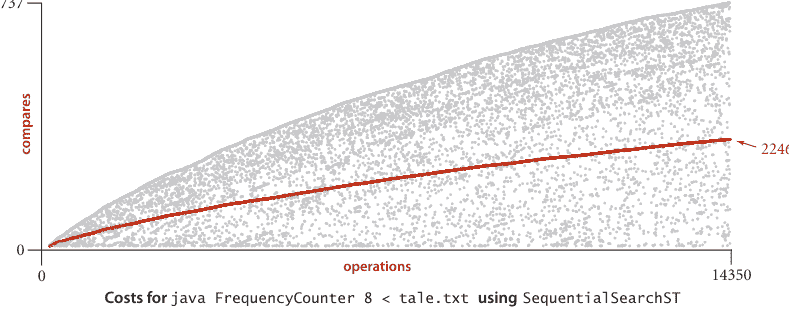

`java FrequencyCounter 8 < tale.txt`

## 有序数组中的二分查找

接下来，我们考虑有序符号表 API 的完整实现。底层数据结构是一对并行数组，分别用于键和值。对应页上的 **ALGORITHM 3.2 (BinarySearchST)** 按照顺序比较数组中的`Comparable`键，使用数组索引来实现`get()`和其他操作快速实现。

实现的核心是`rank()`方法，它返回比给定键小的键的数量。对于`get()`，`rank()`精确地告诉我们如果键在表中，它应该被找到的位置（如果不在那里，则它不在表中）。

对于`put()`，`rank()`精确地告诉我们当键在表中时更新值，以及当键不在表中时精确地将键放在哪里。我们将所有较大的键后移一个位置以腾出空间（从后往前），并将给定的键和值插入到各自区域的相应位置。再次，结合测试客户端的轨迹研究`BinarySearchST`是研究这种数据结构的一种富有启发意义的方法。

此代码维护了键和值的并行数组（替代方案请参见练习 3.1.2）。与我们在第 1 章中对泛型栈和队列的实现一样，这段代码带有具有`Comparable`类型 Key 数组和`Object`类型 Value 数组的不便之处，并在构造函数中将它们转换回`Key[]`和`Value[]`。按照惯例，我们可以调整数组大小以确保客户端不需要担心数组的大小（注意，如你将看到的，该方法用于大数组太慢了）。

| `keys[]` |  |  | `vals[]` |
| :--- | :--- | :--- | :--- |
| 0 1 2 3 4 5 6 7 8 9 | 0 1 2 3 4 5 6 7 8 9 |  |  |
| 0 | S |  | 0 |
| 1 | E S |  | 2 0 | 块中的项向右移动 |
| 2 | A E S | 插入了红色项 | 3 2 1 |
| 3 | R A E S |  | 4 2 1 3 |
| 4 | C A E R S | 灰色项未移动 | 5 2 4 1 3 |
| 5 | H A C E R S |  | 6 2 4 5 3 0 | 圈出的项改变了值 |
| 6 | E A C H E R S |  | 7 2 4 6 5 3 0 |
| 7 | X A C H E R S |  | 8 8 4 6 5 3 0 7 |
| 8 | A A C H E R S X |  | 9 8 4 6 5 9 3 0 7 |
| 9 | M A C H E M R S X |  | 10 8 4 6 5 2 10 3 0 7 |
| 10 | P A C H E M P R S X |  | 11 8 4 6 5 11 9 10 3 0 7 |
| 11 | L A C H E L M P R S X |  | 12 8 4 12 5 11 9 10 3 0 7 |
| 12 | E A C H E L M P R S X |  |  |
| 13 | A C C H E L L M P R S X |  |  |

*标准索引客户端的有序数组 ST 实现的轨迹*

## 算法 3.2 二分查找（在有序数组中）

```java
public class BinarySearchST<Key> extends Comparable<Key>, Value {
    private Key[] keys;
    private Value[] vals;
    private int N;

    public BinarySearchST(int capacity) {
        // 用于标准数组调整大小代码的算法 1.1。
        keys = (Key[]) new Comparable[capacity];
        vals = (Value[]) new Object[capacity];
    }

    public int size() {
        return N;
    }

    public Value get(Key key) {
        if (isEmpty()) return null;
        int i = rank(key);
        if (i < N && keys[i].compareTo(key) == 0)
            return vals[i];
        else
            return null;
    }

    public int rank(Key key)
    // 见第 381 页。

    public void put(Key key, Value val) {
        // 查找键：如果找到则更新值；如果是新的，则扩展表。
        int i = rank(key);
        if (i < N && keys[i].compareTo(key) == 0) {
            vals[i] = val;
            return;
        }

        for (int j = N; j > i; j--) {
            keys[j] = keys[j - 1];
            vals[j] = vals[j - 1];
        }

        keys[i] = key;
        vals[i] = val;
        N++;
    }

    public void delete(Key key) {
        // 此方法的练习 3.1.16。
    }
}
```

此 ST 实现将键和值维护在并行数组中。`put()`的实现在扩展表之前，会将较大的键向右移动一个位置，正如第 1.3 节中基于数组的栈实现一样。数组调整大小在此省略了。

## 二分查找

我们将键保持在有序数组中的原因是为了能够使用索引来大幅减少每次搜索所需的比较次数，并使用我们用作示例的经典且尊崇的二分查找算法。

```java
public int rank(Key key, int lo, int hi) {
    if (hi < lo) return lo;

    int mid = lo + (hi - lo) / 2;
    int cmp = key.compareTo(keys[mid]);

    if (cmp < 0)
        return rank(key, lo, mid - 1);
    else if (cmp > 0)
        return rank(key, mid + 1, hi);
    else
        return mid;
}
```

在第 1 章中，我们维护指向排序数组的索引，以界定可能包含搜索键的子数组。我们将搜索键与子数组的中间进行比较。如果搜索键小于中间的键，我们就在子数组的左半部分搜索；如果它大于中间的键，我们就在子数组的右半部分搜索；否则，中间的键就等于搜索键。二分查找页面上的`rank()`代码完成了刚刚讨论的符号表实现。

## 递归搜索

完成刚刚讨论的符号表实现。这个实现值得研究。今天，我们从左侧的等效递归代码开始。调用`rank(key, 0, N - 1)`执行的比较序列与算法 3.2 中的非递归实现相同，但这个备选版本暴露了算法的结构，正如第 1.1 节所讨论的。这个`recursive()`保留了以下属性：

- 如果键在表中，`rank()`返回它在表中的索引，这与表中比该键小的键的数量相同。
- 如果键不在表中，`rank()`也返回表中比该键小的键的数量。

花时间来说服自己算法 3.2 中的`recursive()`按预期运行（无论是通过证明它等同于递归版本，还是直接证明循环总是终止时`lo`的值精确等于表中比该键小的键的数量），对于任何程序员来说都是有意义的练习。（提示：注意`lo`从 0 开始且永远不会减少。）

### 其他操作

由于键保持在有序数组中，大多数基于顺序的操作都是简洁且直观的，你可以从第 382 页看到。例如，调用`select(k)`直接返回`keys[k]`。我们将`delete()`和`floor()`留作练习。鼓励研究`ceiling()`的实现以及两个参数的`keys()`，并完成这些练习以巩固对有序符号表 API 和此实现的理解。

## 算法 3.2（续）有序数组中的二分查找（迭代版）

```java
public int rank(Key key) {
    int lo = 0, hi = N - 1;

    while (lo <= hi) {
        int mid = lo + (hi - lo) / 2;
        int cmp = key.compareTo(keys[mid]);

        if (cmp < 0)
            hi = mid - 1;
        else if (cmp > 0)
            lo = mid + 1;
        else
            return mid;
    }

    return lo;
}
```

该方法使用了书中描述的经典方法来计算表中比`key`小的键个数。将`key`与中间的键进行比较：如果相等，返回其索引；如果较小，查找左半部分；如果较大，则查找右半部分。

| P 的成功查找 | 0 | 1 | 2 | 3 | 4 | 5 | 6 | 7 | 8 | 9 | 黑色条目 |
| --- | --- | --- | --- | --- | --- | --- | --- | --- | --- | --- | --- |
| `lo hi mid` | 0 9 4 | A | C | E | H | L | M | P | R | S | X | `are[lo..hi]` |
|  | 5 9 7 | A | C | E | H | L | M | P | R | S | X |  |
|  | 5 6 5 | A | C | E | H | L | M | P | R | S | X | 红色条目是`a[mid]` |
|  | 6 6 6 | A | C | E | H | L | M | P | R | S | X |  |

| Q 的失败查找 | 0 | 1 | 2 | 3 | 4 | 5 | 6 | 7 | 8 | 9 |
| --- | --- | --- | --- | --- | --- | --- | --- | --- | --- | --- |
| `lo hi mid` | 0 9 4 | A | C | E | H | L | M | P | R | S | X |  |
|  | 5 9 7 | A | C | E | H | L | M | P | R | S | X |  |
|  | 5 6 5 | A | C | E | H | L | M | P | R | S | X |  |
|  | 7 6 6 | A | C | E | H | L | M | P | R | S | X |  |

> 循环因`keys[mid] = P`退出：返回 6
>
> 循环因`lo > hi`退出：返回 7

*有序数组中`rank`操作的二分查找轨迹*

## 算法 3.2（续）用于二分查找的有序符号表操作

```java
public Key min() {
    return keys[0];
}

public Key max() {
    return keys[N - 1];
}

public Key select(int k) {
    return keys[k];
}

public Key ceiling(Key key) {
    int i = rank(key);
    return keys[i];
}

public Key floor(Key key)
```


// 参考练习 3.1.17。

`public Key delete(Key key)`

// 参考练习 3.1.16。

`public Iterable<Key> keys(Key lo, Key hi)`

```
{
  Queue<Key> q = new Queue<Key>();
  for (int i = rank(lo); i < rank(hi); i++)
    if (contains(hi))
      q.enqueue(keys[rank(hi)]);
  return q;
}
```

这些方法同练习 3.1.16 和练习 3.1.17 中的方法一起，完成了我们使用有序数组中的二分查找来对（有序）符号表 API 的实现。`min()`、`max()` 和 `select()` 方法是显而易见的，仅仅相当于从数组的已知位置返回相应的键。`rank()` 方法是二分查找的基础，在其他方法中起着核心作用。`floor()` 和 `delete()` 的实现留给了练习，虽然更复杂，但仍然直观。

## 二分查找分析

`rank()` 的递归实现引出了一个直接论点：二分查找保证了快速查找，因为它响应于描述比较次数上限的递推关系。

> **命题 B。** 在含有 $N$ 个键的有序数组中进行二分查找，每次查找（成功或失败）使用的比较次数不超过 $\lg N+1$ 次。

**证明：** 这种分析与归并排序分析（第 2 章中的命题 F）相似但更简单。令 $C(N)$ 为在大小为 $N$ 的符号表中查找键的比较次数。我们有 $C(0)=0, C(1)=1$，且对于 $N>0$，我们可以写出一个直接镜像递归方法的递推关系：

```
$C(N) \leq C([N/2]) + 1$
```

无论查找是向左还是向右，子数组的大小都不会超过 $[N/2]$，我们使用一次比较来判断相等性并决定向左还是向右。当 $N$ 小于 2 的幂时（例如 $N=2^{n-1}$），这个递推关系并不难解。首先，由于 $[N/2]=2^{n-1}-1$，我们有：

```
$C(2^n-1) \leq C(2^{n-1}-1) + 1$.
```

将相同的方程应用于右侧的第一项，我们得到：

```
$C(2^n-1) \leq C(2^{n-2}-1) + 1 + 1$.
```

重复前面的步骤 $n-2$ 次，得到：

```
$C(2^n-1) \leq C(2^0) + n
```

最终得到解：

```
$C(N) \leq C(2^n-1) \leq n + 1 < \lg N + 1$.
```

对于通用的 $N$，其精确解更为复杂，但扩展这一论点以为所有 $N$ 值建立所述属性并不困难（参见示例 3.1.20）。通过二分查找，我们实现了对数时间查找的保证。

刚刚给出的 `ceiling()` 实现是基于对 `rank()` 的单次调用，而默认的双参数 `size()` 实现调用了两次 `rank()`，因此该证明证实了这些操作（以及 `floor()`）在保证的对数时间内得到支持，而 `min()`、`max()` 和 `select()` 则是常数时间操作。

## 第 3 章 查找

尽管保证了对数级查找，`BinarySearchST` 仍然无法让我们使用像 `FrequencyCounter` 这样的客户端来解决海量问题，因为 `put()` 方法太慢了。二分查找减少了比较次数，但没有减少运行时间，因为它并没有改变这样一个事实：在有序数组中构建符号表所需的数组访问次数在键随机分布时是数组大小的二次方（在键非随机的典型情况下，该模型也有良好的描述）。

| 方法 | 运行时间的增长阶 |
| --- | --- |
| `put()` | N |
| `get()` | log N |
| `delete()` | N |
| `contains()` | log N |
| `size()` | 1 |
| `min()` | 1 |
| `max()` | 1 |
| `floor()` | log N |
| `ceiling()` | log N |
| `select()` | N |
| `deleteMax()` | N |

**B (续)。** 在含有 $N$ 个键的有序数组中进行二分查找，构建表使用的访问次数为 $2N$。

**证明：** 同命题 A。对于 $10^4$ 个不同键，构建表的访问次数为 $\sim 2N$；对于 `SearchST`，对于 $10^5$ 个不同键，构建表的访问次数为 $N^2$。这比预想的要糟糕。


## 3.1 符号表 预览

二分查找通常比顺序查找更好，是许多实际应用的选择。对于静态表（允许插入操作），有必要初始化并排序表，正如我们在第 1 章中考虑的那样。即使大部分键值已知，也有必要添加一个初始化并排序的构造函数（参见练习 3.12）。尽管如此，二分查找对于许多其他应用是不可行的。例如，对于 Leipzig 项目，因为查找是交替进行的且表的大小太大。正如我们强调的，典型的现代搜索需要能够以不可预测模式插入（并可能删除）键值的表。

下表总结了本节基础符号表实现的性能特征。表格给出了成本的前导项（二分查找的数组访问次数，其他方法的比较次数），这暗示了运行时间的增长阶。

| 数据结构 | 插入 N 次后的最坏情况成本 | 随机插入 N 次后的平均情况成本 | 是否高效支持有序操作？ |
| :--- | :--- | :--- | :--- |
| 顺序查找（无序链表） | N | N/2 | N | 否 |
| 二分查找（有序数组） | lg N | 2N | lg N | N | 是 |

基础符号表成本总结

核心问题是，是否可以设计出查找和插入都达到对数性能的算法和数据结构。答案是肯定的！提供这个答案是本章的主旨。与第 2 章的快速排序能力一样，快速符号表/插入是算法最重要的贡献之一，也是通向我们现在享有的丰富计算基础设施的重要步骤之一。

## 第 3 章 搜索

通过索引快速查找（而到达单链表中间的唯一方法是顺着链接）。为了将二分搜索的效率与链式结构的灵活性结合，我们需要更复杂的数据结构。这种结合可以通过二叉搜索树（后两节的主题）和哈希表（第 3.4 节的主题）来实现。

在本章中，我们将考虑六种符号表的实现，因此有必要进行简要预览。下表列出了数据结构列表，以及在应用中支持或反对它们的的主要理由。它们出现的顺序与我们考虑的顺序一致。

在讨论算法和实现时，我们将更详细地介绍它们的属性，但此表中的简要描述将帮助你在学习时将其放在更广泛的背景中来理解。核心结论是，我们有若干种快速的符号表实现方式，它们可以且已经在无数应用中被高效使用。

| 底层数据结构 | 实现 | 优点 | 缺点 |
| --- | --- | --- | --- |
| 链表（顺序查找） | `SequentialSearchST` | 最适合极小型符号表 | 对于大型符号表速度慢 |
| 有序数组（二分搜索） | `BinarySearchST` | 搜索和空间最优，基于顺序的操作 | 插入慢 |
| 二叉搜索树 | `BST` | 易于实现，基于顺序的操作 | 不保证链接所需的空间 |
| 平衡符号表 | `RedBlackST` | 搜索和插入最优，基于顺序的操作 | 链接需要空间 |
| 哈希表 | `SeparateChainingHashST`, `LinearProbingHashST` | 常见类型数据搜索/插入快 | 每种类型都需要哈希函数，无基于顺序的操作，链接/空位需要空间 |

符号表实现的优缺点

## 问答

Q. 为什么不在符号表中使用实现 `Comparable` 接口的 `Item` 类型（就像我们在第 2.4 节处理优先级队列时那样），而不是分开使用键和值？

A. 这也是一个合理的选择。这些方法说明了将信息与键关联的两种方式——我们可以通过构建一个包含键的数据类型来隐式地关联，也可以通过显式地分离键和值来实现。对于符号表，我们选择了突出关联数组。请注意，客户端在搜索时只需要一个键，而不是键值对聚合。

Q. 为什么要费劲使用 `equals()`？为什么不处处使用 `compareTo()` 呢？

A. 并不是所有数据的键值都是容易比较的，尽管使用符号表可能仍意义。举个极端例子，你可能希望使用图片或歌曲作为键。它们没有自然的方法来比较，但我们确实可以（通过一些工作）来测试它们的质量。

Q. 为什么不允许键取 `null` 值？

A. 我们假设键是一个 `Object`，因为我们用它来调用 `compareTo()` 或 `equals()`。但如果 `a` 为空，调用 `a.compareTo(b)` 将导致空指针异常。通过排除这种可能性，我们允许客户端代码更加。

Q. 为什么不使用我们排序时用的那种 `less()` 方法呢？

A. 等等性在符号表中起着特殊作用，因此我们还需要一个用于测试相等的方法。为了避免本质功能相同的方法泛滥，我们采用了 Java 内置的 `equals()` 和 `compareTo()` 方法。

Q. 为什么在 `BinarySearch` 中不先将 `key[]` 声明为 `Object[]`（而不是 `Comparable[]`）再强制转换，就像 `val` 被声明为 `Object` 那样？

A. 问得好。如果你这样做，将会得到一个 `ClassCastException`，因为键需要是 `Comparable`（以确保键中的项具有 `compareTo` 方法）。因此，将 `key[]` 声明为 `Comparable[]` 是必要的。深入探讨编程语言设计的细节来解释原因会偏离主题。在书中任何使用 `Comparable` 泛型和数组的代码中，我们都精确地使用了这种（通常是更复杂的）写法。

## 问答（续）

Q. 如果我们需要为同一个键关联多个值怎么办？例如，如果我们在应用中使用 `Date` 作为键，我们难道必须处理相同的键吗？

A. 也许需要，也许不需要。例如，你不能让两列火车同时到达同一条轨道上的车站（但它们可以同时到达不同的轨道）。处理这种情况有两种方法：使用某些其他信息来消除歧义，或者将值设为具有相同键值的队列（`Queue`）。我们将在第 3.5 节中详细讨论这些应用。

Q. 如第 385 页所述，对表进行预排序似乎是个好主意。为什么要把它推留到练习题（见练习题 3.1.12）？

A. 确实，这在某些应用中可能是首选方法。但在一个为快速搜索设计的数据结构中为了“方便”而添加一个慢速的插入方法是一个性能陷阱，因为毫无防备的客户端会在巨大的表中交替进行搜索和插入，并经历平方级的性能下降。这种陷阱太常见了，以至于处可见，因此在使用他人开发的软件时，“买者自负”无疑是合适的，特别是当接口过宽时。当为了“方便”包含了大量方法，导致到处都是性能陷阱时，这个问题会变得严峻，而客户端可能期望所有方法都有高效实现。Java 的 `ArrayList` 类就是一个例子（见练习题 3.5.27）。

## 练习题

3.1.1 编写一个客户端，创建一个将字母等级映射到数字分的符号表（如下表），然后从标准输入读取字母等级列表并计算 GPA（对应等级的数字的平均值）。

| A+ | A | A- | B+ | B | B- | C+ | C | C- | D | F |
|---|---|---|---|---|---|---|---|---|---|---|-|
| 4.33 | 4.00 | 3.67 | 3.33 | 3.00 | 2.67 | 2.33 | 2.00 | 1.67 | 1.00 | 0.00 |

3.1.2 开发一个符号表实现 `ArrayST`，使用（无序）数组作为底层数据结构来实现我们的基础符号表 API。

3.1.3 开发一个符号表实现 `OrderedSearchST`，使用有序列表数据结构来实现我们的有序符号表 API。

3.1.4 开发 `Time` 和 `Event` ADT，允许像第 367 页所示示例一样处理数据。

3.1.5 为 `SequentialSearchST` 实现 `size()`、`delete()` 和 `keys()`。

3.1.6 使用 `FrequencyCounter` 给出 `put()` 和 `get()` 的调用次数，作为输入中单词数 W 和不同单词数 D 的函数。

3.1.7 在 $N$ 个小于 1,000 的随机非负整数中，`FrequencyCounter` 找到的不同键的平均数量是多少（对于 $N=10, 10^2, 10^3, 10^4$ 和 $10^5$）？

3.1.8 《双城记》中最常用的十个字母或以上的单词是什么？在 `FrequencyCounter` 中添加代码以跟踪最后一次调用 `put()`。打印最后插入的单词以及在此插入之前在输入流中处理的单词数。针对 `tale.txt` 运行你的程序，截止位分别为 1, 8 和 10。

3.1.10 给出使用 `SequentialSearchST` 在初始空表上插入键 `EASYQUESTION` 的过程追踪。涉及多少次比较？

3.1.11 给出使用 `BinarySearchST` 在初始空表上插入键 `EASYQUESTION` 的过程追踪。涉及多少次比较？

3.1.12 修改 `BinarySearchST` 以维护一个包含键和值的 `Item` 对象数组，而不是两个并行数组。添加一个接受 `Item` 值数组作为参数的构造函数，并使用归并排序对数组进行排序。

3.1.13 对于一个执行 $10^3$ 次 `put()` 操作和 $10^6$ 次 `get()` 操作且随机混合的应用，你会使用本节中的哪种符号表实现？给出你的理由。

3.1.14 对于一个执行 $10^4$ 次 `put()` 操作和 $10^3$ 次 `get()` 操作且随机混合的应用，你会使用本节中的哪种符号表实现？给出你的理由。

3.1.15 假设对于 `BinarySearchST` 客户端，搜索频率是插入的 1,000 倍，当搜索次数为 $10^3, 10^6$ 和 $10^9$ 时。

3.1.16 为 `BinarySearchST` 实现 `delete()` 方法。

3.1.17 为 `BinarySearchST` 实现 `floor()` 方法。

3.1.18 证明 `BinarySearchST` 中的 `rank()` 方法是正确的。

3.1.19 修改 `FrequencyCounter` 以打印所有频率最高的值，而不仅仅是其中一个。*提示*：使用队列（`Queue`）。

3.1.20 完成命题 B 的证明（证明它对所有 $N$ 值都成立）。*提示*：先证明 $C(N)$ 是单调的：对于所有 $N > 0$，$C(N) \le C(N+1)$。

# 创造性问题

**3.1.21** 内存使用。在第 1.4 节描述的假设下，比较对于 $N$ 个键值对，`BinarySearchST` 与 `SequentialSearchST` 的内存使用情况。不要计算键和值本身的内存，但要计算指向它们的引用。对于 `BinarySearchST`，假设数组经过了调整，使得数组的填充率在 25% 到 100% 之间。

**3.1.22** 自组织搜索。自组织搜索算法是一种通过重新排列项，使得经常访问的项更有可能在搜索早期被找到的算法。修改你对练习题 3.1.2 的实现，以便在每次搜索时都执行以下操作：将键值对移动到列表开头，并将列表开头与被腾出的位置之间的所有对向向右移动一位。这种方法被称为置顶头部启发式（move-to-front heuristic）。

**3.1.23** 二分查找的分析。证明在大小为 $N$ 的表中，二分查找使用的最大比较次数恰好是 $N$ 的二进制表示中的位数，因为将二进制表示向右移动 1 位会将 $N$ 的二进制表示转换为 $[N/2]$ 的二进制表示。

**3.1.24** 插值查找。假设允许对键进行算术运算（例如，它们可以是 `Double` 或 `Integer` 值）。编写一个二分查找的版本，当单词开头的字母接近字母表开头时，模拟在字典开头附近查找的过程。具体来说，如果 $k_s$ 是要查找的键，$k_0$ 是表中第一个键的值，$k_n$ 是表中最后一个键的值，则首先在表的 $[k_s - k_0)/(k_n - k_0)$ 处进行查找，而不是在中间。使用 `BinarySearchST` 配合 `FrequencyCounter` 测试你的实现。

**3.1.25** 软件缓存。由于 `contains()` 的默认实现调用了 `get()`，`FrequencyCounter()` 的内部循环：

```
if (st.contains(word)) st.put(word, 1);
else st.put(word, st.get(word) + 1);
```


会导致对同一个键进行两次或三次搜索。为了在不牺牲效率的情况下启用这种清晰的代码，我们可以使用称为软件缓存的技术，即将最近访问的键的位置保存在实例变量中。修改 `SequentialSearchST` 和 `BinarySearchST` 以利用这个想法。

## 创造性问题（续）

**3.1.26** 字典频率计数。修改 `FrequencyCounter`，使其接受字典文件的名称作为参数，统计来自标准输入且也存在于该文件中的单词频率，并打印两个包含单词及其频率的表格：一个按频率排序，另一个按字典文件中发现的顺序排序。

**3.1.27** 小表。假设一个 `BinarySearchST` 客户端具有搜索操作和 $N$ 个不同的键。给出 $S$ 的增长阶阶，使得构建表的代价与所有搜索的代价相等。

**3.1.28** 有序插入。修改 `BinarySearchST`，使得插入一个大于表中所有键的键耗费常数时间（因此对于按顺序的键，通过调用 `put()` 构建表将耗费线性时间）。

**3.1.29** 为 `BinarySearchST` 编写一个测试客户端，测试文中给出的 `min()`、`max()`、`floor()`、`ceiling()`、`select()`、`rank()`、`deleteMin()`、`deleteMax()` 和 `keys()` 的实现。从第 370 页给出的标准索引客户端开始。根据需要添加代码以接受额外的命令行参数。

**3.1.30** 认证。在 `BinarySearchST` 中添加 `assert` 语句，以在每次插入和删除后检查算法不变性和数据结构的完整性。例如，每个索引 $i$ 应该始终等于 `rank(select(i))`，且数组应该始终保持有序。

**3.1.31** 性能驱动程序。编写一个性能驱动程序，该程序使用 `put()` 填充符号表，然后使用 `get()` 使得表中的每个键平均被命中十次，且缺失次数大致相同；对长度从 2 到 50 个字符不等的随机字符串键序列多次操作；测量每个操作所需的时间；并打印或绘制平均运行时间图。

**3.1.32** 练习驱动程序。编写一个练习驱动程序，该程序使用我们有序符号表 API 中的方法，处理实际应用中可能出现的困难或病态用例。简单的示例包括：已经有序的键、反序键序列、所有键都相同的键序列，以及由由两个不同值的键。

**3.1.33** 自组织搜索驱动程序。为自组织搜索实现（见练习 3.1.22）编写一个驱动程序，该程序使用 `put()` 填充包含 $N$ 个键的符号表，然后根据预定义的概率分布将 $N$ 次成功搜索翻倍。使用此驱动程序比较你在练习 3.1.22 中的实现与 `BinarySearchST` 在 $N = 10^4$、$10^5$ 和 $10^6$ 时的运行时间，其概率分布为搜索命中第 $i$ 小键的概率为 $1/2^i$。

**3.1.34** 齐普夫定律。上一个关于概率分布的练习中，搜索命中第 $i$ 小键的概率为 $1/(iH_n)$，其中 $H_n$ 是调和数（第 185 页）。这种分布被称为齐普夫定律。将置顶头部启发式与上一个练习中分布的最优安排进行比较，最优安排是将键按递顺序排列（按期望频率递减排列）。

**3.1.35** 性能验证 I。运行使用 `Two Cities` 前 $N$ 个节点的翻倍测试，针对不同的 $N$ 值，测试假设：当使用 `SequentialSearchST` 作为符号表时，`FrequencyCounter` 的运行时间是二次的。

**3.1.36** 性能验证 II。解释为什么 `BinarySearchST` 和 `SequentialSearchST` 用于 `FrequencyCounter` 的性能比分析预测的要。

**3.1.37** Put/get 比例。通过实验确定当使用 `FrequencyCounter` 查找值的出现频率时，`BinarySearchST` 花在 `put()` 操作上的时间与花在 `get()` 操作上的时间的比例。

394 第3章 搜索

## 实验（续）

在 100 万个随机 $M$ 位整数值中，$M = 10, 20, 30$。对 `tale.txt` 回答相同的问题并比较结果。

**3.1.38** 摊销代价图。为 `FrequencyCounter`、`SequentialSearchST` 和 `BinarySearchSearch` 开发插桩，以便你可以产生像本节中的图表，显示每次 `put()` 操作期间的代价。

**3.1.39** 实际计时。为 `FrequencyCounter` 进行插桩，使用 `Stopwatch` 和 `StdDraw` 产生像本节中的图表，x轴为 `get()` 或 `put()` 的调用次数，y轴为总运行时间。

**3.1.40** 二分查找的交叉点。找出在大小为 $N$ 的表中，二分查找比顺序查找快 10、100 和 1000 倍的 $N$ 值。

**3.1.41** 插值查找的交叉点。找出在大小为 $N$ 的表中，插值查找比二分查找快 2、10 倍的 $N$ 值，假设键为随机 32 位整数（见 3.1.24）。

# 3.2 二叉搜索树

在本节中，我们将研究一种结合了链表插入灵活性和有序数组搜索效率的符号表实现。首先，定义术语。我们正在处理由指向空或指向其他节点的链接组成的数据结构。在二叉树中，每个节点仅由一个节点指向，该节点被称为父节点（根节点没有节点指向它），且该节点恰有两个链接，即左链接和右链接，分别指向左孩子和右孩子。虽然链接指向节点，但我们可以将每个链接看作指向一棵以引用节点为根的二叉树。因此，一个二叉树为空，或者是一个具有左链接和右链接的节点，每个链接指向互不交的子树，这些子树本身也是二叉树。

> 定义。二叉搜索树（BST）是一种二叉树，其中每个节点有一个可比较的键（以及关联的值），并满足限制：任何节点中的键都大于其左子树中所有的键，且小于其右子树中所有的键。


## 基础实现

ALGORITHM 3.3 定义了我们在本节中一直使用的 BST 结构，用于实现有序符号表 API。首先，我们考虑这个经典的数据结构定义，以及与 `get()`（查找）和 `put()`（插入）方法的典型实现。

**表示。** 我们定义了一个私有嵌套类来定义 BST 中的节点，就像我们定义链表一样。每个节点包含一个键（`key`）、一个值（`value`）、一个左链接、一个右链接以及一个节点计数（在相关时，我们在图中节点中包含了节点计数）。左链接指向键较小的项的 BST，右链接指向键较大的项的 BST。实例变量 `N` 给出了该节点所在子树根节点的节点计数。该字段有助于各种有序符号表操作的实现，正如你将看到的那样。ALGORITHM 3.3 中的私有 `size()` 方法的实现是为了给空链接赋值 0，以便我们能够通过确保满足以下不变性来维护该不变性：

```
size(x) = size(x.left) + size(x.right) + 1
```

对于树中的节点 `x`。

BST 代表一组键（以及关联值），有许多不同的 BST 可以代表相同的集合。如果我们对 BST 中的键进行投影，使得每个节点子树中的所有键都出现在该节点键的左侧，且每个节点右子树中的所有键都出现在该节点键的右侧，那么我们总是能得到排序后的键。我们利用许多 BST 可以表示这种排序顺序的灵活性，开发出构建和使用 BST 的高效算法。

**查找。** 像通常一样，当我们在符号表中查找一个键时，有两种可能的结果。如果表中包含该键的节点，我们为查找命中（hit）并返回关联的值。否则，我们为查找失败（miss）（并返回 `null`）。在 BST 中查找键的递归算法直接源于递归结构：如果树为空，则为查找失败；如果搜索键等于根节点的键，则为查找命中。否则，我们在适当的子树中（递归地查找，如果搜索键较小则向左移动，如果较大则向右移动。`get()` 方法直接实现了该算法。它接受一个节点（子树的根）作为第一个参数，一个键作为第二个参数，从树的根节点和搜索键开始。代码维护了这一不变性：除了当前节点根的子树外，树的其他部分都不会有键等于搜索键的节点。正如二叉搜索树中区间的大小每次迭代大约缩小一半一样，

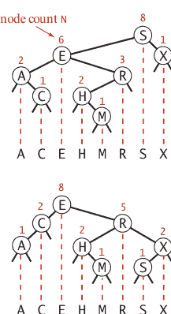

## ALGORITHM 3.3 二叉搜索树符号表

```java
public class BST<Key extends Comparable<Key>, Value>
{
    private Node root;              // BST的根

    private class Node
    {
        private Key key;            // 键
        private Value val;         // 关联值
        private Node left, right; // 指向子树的链接
        private int N;             // 此根子树中的节点数

        public Node(Key key, Value val, int N) {
            this.key = key; this.val = val; this.N = N;
        }
    }

    public int size() {
        return size(root);
    }

    private int size(Node x)
    {
        if (x == null) return 0;
        else return x.N;
    }

    public Value get(Key key)
    // 见第399页

    public void put(Key key, Value val)
    // 见第399页

    // 见第407页 min(), max(), floor(), and ceiling().
    // 见第409页 select() and rank().
    // 见第411页 delete(), deleteMin(), and deleteMax().
    // 见第413页 keys().
}
```

这种有序符号 API 的实现使用了由 `Node` 对象构建的二叉搜索树，`Node` 包含一个键、关联值、两个链接和一个计数 `N`。每个 `Node` 都是一个包含 `N` 个节点的子树的根，其左链接指向一个键较小的子树根节点 `Node`，其右链接指向一个键较大的子树根节点 `Node`。实例变量 `root` 指向 BST 根处的 `Node`（它包含符号表中所有的键和关联值）。其他方法的实现贯穿本节。

## ALGORITHM 3.3 (续) BST 的查找和插入

```java
public Value get(Key key)
{
    return get(root, key);
}

private Value get(Node x, Key key)
{
    // 返回与 x 为根的子树中键关联的值；
    // 如果不在 x 为根的子树中，则返回 null。
    if (x == null) return null;
    int cmp = key.compareTo(x.key);
    if (cmp < 0) return get(x.left, key);
    else if (cmp > 0) return get(x.right, key);
    else return x.val;
}

public void put(Key key, Value val)
{
    // 如果找到则更新值；如果是新的则扩展表。
    root = put(root, key, val);
}

private Node put(Node x, Key key, Value val)
{
    // 如果键在 x 为根的子树中，则将节点值改为 val。
    // 否则，在子树中添加新节点并将键与 val 关联。
    if (x == null) return new Node(key, val, 1);
    int cmp = key.compareTo(x.key);
    if (cmp < 0) x.left = put(x.left, key, val);
    else if (cmp > 0) x.right = put(x.right, key, val);
    else x.val = val;
    x.N = size(x.left) + size(x.right) + 1;
    return x;
}
```

这些用于符号表 API 的 `get()` 和 `put()` 实现是典型的递归 BST，它们也作为我们在本章节稍后部分将考虑的若干其他实现的模型。每个方法都可以被理解为既工作代码，也可以被视为对开头注释中归纳假设的归纳法证明。

## R 的成功查找

## T 的失败查找

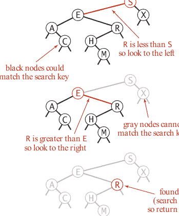

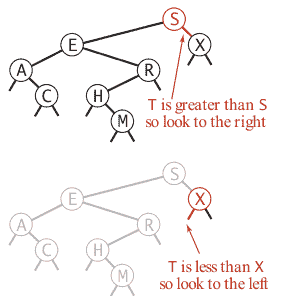

## BST 中的查找命中（左侧）和查找失败（右侧）

在 BST 中查找时，当我们沿树向下移动时，当前节点根的子树的大小会缩小（理想情况下缩小约一半，但至少减少一个）。该程序在找到包含搜索键的节点时（查找命中）或当前子树变为空时（查找失败）停止。从顶部开始，每个节点的查找程序涉及对该节点任一子节点的递归调用，因此查找定义了穿过树的路径。对于查找失败，路径终止在包含键的节点处。

**插入。** ALGORITHM 3.3 中的查找代码几乎和二分查找一样简单；简单性是 BST 的一个基本特征。BST 更重要的特征是，插入的实现并不比查找困难。对于树中的一个键，查找结束于一个空链接，我们需要做的只是用一个包含该键的新节点替换它（见下一页的图表）。

**递归。** 值得花时间理解这些递归实现的动态过程。你可以将递归调用之前的代码看作是在沿树向下移动的过程中执行的；它将键与每个节点的键进行比较，并根据情况向右或向左移动。然后将递归调用之后的代码看作是在沿树向上移动的过程中执行。对于 `get()` 来说，相当于一系列返回状态，但对于 `put()` 来说，它对应于重置路径上每个父节点的链接以增加计数。在简单的 BST 中，新链接是底部的那个，但重置路径较高处的链接同样容易做到，以避免它们。此外，我们只需要增加路径上每个节点的计数，但我们使用了更通用的代码，设置每个节点加上其子树的计数。在本节稍后和下一节中，我们将学习自然地用这种递归方案表示的高级算法，这些算法可以更改搜索路径上的更多链接，并且需要节点计数更新代码。基础 BST 通常用非递归代码实现（见练习 3.13）——我们在实现中使用递归是为了让你容易让自己相信代码正如描述的那样运行，并为更复杂的算法奠定基础。

仔细研究下一页标准索引客户端的轨迹将让你对二叉搜索树的增长方式有所感觉。新节点附加在树底部的空链接上；树结构没有发生其他变化。例如，根节点插入第一个键，根的节点之一插入第二个键，依此类推。由于每个节点有两个链接，树是向外增长的，而不是仅仅向下。此外，只有从根到搜索或插入键的路径上的键会被检查，因此随着树尺寸增大，检查的键占树中键总数的比例变得越来越小。

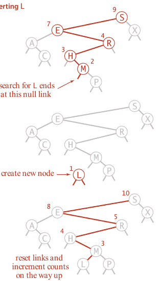

插入 L
查找 L 结束于此空链接

创建新节点

向上移动重置链接并增加计数

插入二叉搜索树

# 第3章 搜索

## 3.2 二叉搜索树

分析：在二叉搜索树上运行算法的时间运行取决于树的形状，而树的形状又取决于键插入的顺序。在最好的情况下，一个拥有 N 个节点的树可以是完美平衡的，根节点与每个空链接之间有 ~ lg N 个节点。在最坏的情况下，搜索路径可能有 N 个节点。典型树的平衡性实际上比最坏情况更接近最好。

对于许多应用，以下简单模型是合理的：我们假设键是（均匀）随机的，或者等价于它们按随机顺序插入。对该模型的分析源于这样一个观察：二叉搜索树（BST）与快速排序是对偶的。树的根对应于快速排序中的第一个划分元素（左侧没有更大的键，右侧是较小的键），子树递归构建，对应于快速排序的递归子数组。这一观察引导我们对树的属性进行分析。

## 命题 C. 在 N 个键构建的 BST 中，搜索命中的平均需要 ~ 2 ln N（约 1.39 lg N）次比较。

证明：在给定节点结束的搜索命中，使用的比较次数为 1 加上深度。将所有节点的深度相加，我们得到一个称为树内部路径长度的数量。因此，所需的数量是 1 加上树的平均路径长度，我们可以使用第 2.3 节中证明命题 K 时相同的参数进行分析：令 $C_n$ 为插入 N 个随机顺序不同键构建的 BST 的内部路径长度，因此搜索命中的平均代价为 $1 + C_n/N$。我们有 $C_0=C_1=0$，且对于 $N>1$，我们可以写出一个直接镜像递归 BST 结构的递归关系：

```
C_N = N - 1 + (C_0 + C_{N-1})/N + (C_1 + C_{N-2})/N + ... + (C_{N-1} + C_0)/N
```


`$N-1$` 项考虑了根节点为树中其他 `$N-1$` 个节点的每个路径长度都贡献了 `1`；表达式的其余部分是子树，它们等可能是 `$N$` 种尺寸中的任何一种。重新排列项后，该递归关系与我们在第 2.3 节中为快速排序求解的几乎相同，我们可以推导出近似值 `$C_N \sim 2N \ln N$`。

## 命题 D

在 `N` 个随机键构建的 BST 中，插入和搜索缺失的平均需要 `~ 2 ln N`（约 `1.39 lg N`）次比较。

**证明：** 平均而言，插入和搜索缺失比搜索命中多一次比较。这一事实通过归纳法并不容易建立（见练习题 3.2.16）。

命题 C 说，我们预期随机键的 BST 搜索成本比二分搜索高出约 39%。命题 D 说，这个代价是值得的，因为插入新键的代价预期也是对数级的——这比有序数组中的二分搜索好得多，在后者插入所需的数组访问次数通常是线性的。与快速排序一样，比较次数的标准差已知是很低的，因此这些公式随着 `N` 的增加而变得越来越准确。

**实验。** 我们的随机键模型与典型符号表客户端发现的结果如何匹配？按照惯例，由于性能存在巨大的波动，这个问题在实际应用中必须仔细研究。值得注意的是，对于许多客户端来说，该模型对于 BST 来说是非常好的。

对于对长度为 8 或以上的单词对 FrequencyCounter 进行 `put()` 操作的示例研究，我们看到平均代价从 BinarySearch 的每次操作 484 次数组访问或比较下降到 BST 的 13 次，这为理论模型预测的对数性能提供了快速验证。针对更大输入的更广泛实验见下一页的表格。基于命题 C 和 D，可以预测这个数字应该是表大小自然对数的两倍，因为大多数操作是在几乎满的表中进行的搜索。这一预测至少存在内在的不准确性：

- 许多操作针对较小的表。
- 键不是随机的。
- 表格大小可能太小，导致近似值 `2 ln N` 不准确。

尽管如此，如你在表格所示，该预测对于我们的 FrequencyCounter 测试用例在几次比较内是准确的。实际上，大部分的差异可以通过精炼近似值中的数学模型来解释（见练习题 3.2.35）。

### 使用 BST 的 Java FrequencyCounter `< tale.txt` 代价

|  | tale.txt |  |  |  | leipzig1.txt |  |  |  |
| :--- | :--- | :--- | :--- | :--- | :--- | :--- | :--- | :--- |
| all words | 135,635 | 10,679 | 18.6 | 17.5 | 21,191,455 | 534,580 | 23.4 | 22.1 |
| 8+ letters | 14,350 | 5,737 | 17.6 | 13.9 | 4,239,597 | 299,593 | 22.7 | 21.4 |
| 10+ letters | 4,582 | 2,260 | 15.4 | 13.1 | 1,610,829 | 165,555 | 20.5 | 19.3 |

## 基于顺序的方法和删除

BST 被广泛使用的一个重要原因是它们允许我们按顺序保持键。因此，它们可以作为实现我们有序符号表 API 中众多方法（见第 366 页）的基础，这些方法允许客户端不仅通过提供键，而且通过相对键顺序来访问键值对。接下来，我们考虑有序符号表 API 中各种方法的实现。

### 最小值和最大值

如果根节点的左链接为空，则 BST 中最小的键位于根节点；如果左链接不为空，则 BST 中最小的键是位于左链接根节点的子树中的最小键。这一陈述既是对第 407 页递归 `min(n)` 方法的描述，也是证明它能找到 BST 中最小键的归纳证明。该计算等同于简单的迭代（向左移动直到找到空），但我们为了一致性使用了递归。我们可能会让递归方法返回 `Key` 而不是 `Node`，但我们需要使用该方法获取包含最小键的 `Node`。寻找最大键类似，向右移动而不是向左。

### 下界（floor）和上界（ceiling）

如果给定的键小于 BST 根节点的键，那么该键的 floor（BST 中小于或等于该键的最大键）位于左子树中。如果键大于根节点的键，那么该键的 floor 可能在右子树中，但仅当右子树中有小于或等于该键的键时；此时该键就是 floor 的根。同样，这种描述既作为递归 `floor()` 方法的基础，也是证明它计算出所需结果的归纳证明。交换键和左（以及小于和大于）即可得到 `ceiling()`。

### 选择

BST 中的选择工作类似于我们在第 2.5 节中学习的数组中基于划分的选择方法。我们在 BST 节点中维护变量 `$N$`，用于精确计算以该节点为根的子树中键的数量，恰恰支持这一操作。

### 算法 3.3（继续）：BST 中的 `min`、`max`、`floor` 和 `ceiling`

```java
public Key min()
{
    return min(root).key;
}

private Node min(Node x)
{
    if (x.left == null) return x;
    return min(x.left);
}

public Key floor(Key key)
{
    Node x = floor(root, key);
    if (x == null) return null;
    return x.key;
}

private Node floor(Node x, Key key)
{
    if (x == null) return null;
    int cmp = key.compareTo(x.key);
    if (cmp == 0) return x;
    if (cmp < 0) return floor(x.left, key);
    Node t = floor(x.right, key);
    if (t != null) return t;
    else return x;
}
```

每个客户端方法调用一个相应的私有方法，该私有方法接受额外的链接（指向 `Node`）作为参数，并通过文中描述的递归过程返回空或包含所需 `Key` 的 `Node`。`max()` 和 `ceiling()` 方法与 `min()` 和 `floor()`（分别）相同，只是交换了右和左（以及 `<` 和 `>`）。

## 第 3 章 ■ 搜索

假设我们要寻找秩为 `$k$` 的键（即在 BST 中恰好有 `$k$` 个其他键比它小的键）。如果左子树中键的数量 `t` 大于 `$k$`，我们（递归地）在左子树中查找秩为 `$k$` 的键；如果它等于 `$k$`，我们返回根节点的键；如果 `t` 小于 `$k$`，我们（递归地）在右子树中查找秩为 `$k-t-1$` 的键。按照惯例，这一描述是对应页中递归 `select()` 方法的基础，并通过归纳法证明了它能按预期工作。

### 秩（Rank）

相反方法 `rank()` 返回给定键 `k` 的秩，其原理类似：如果该键等于根节点的键，我们返回左子树中键的数量 `t`；如果该键小于根节点的键，我们返回左子树中 `k` 的秩（递归计算）；如果该键大于根节点的键，我们返回 `t+1`（计入根节点键）加上右子树中键的秩（递归计算）。

### 删除最小值和最大值

最难实现的 BST 操作是 `delete()` 方法，它用于从符号表中移除一个键值对。作为一个热身，考虑 `deleteMin()`，这是一个递归方法，它接受一个 `Node` 链接作为参数并返回一个 `Node` 链接，这样我们可以通过赋值作为参数的链接来反映树的变化。对于 `deleteMin()`，我们向左查找直到找到一个左链接为空的 `Node`（只需在递归方法中返回其右链接即可）。被删除的节点没有指向它的链接，向左查找直到返回该节点的右链接，可供垃圾回收。更新链接和递归调用后的节点。在 BST 中删除最小值。

## 算法 3.3（续）：BST 中的选择与秩

```java
public Key select(int k)
{
    return select(root, k.key);
}

private Node select(Node x, int k)
{
    // 返回包含秩为 k 的键的 Node
    if (x == null) return null;
    int t = size(x.left);
    if (t > k) return select(x.left, k);
    else if (t < k) return select(x.right, k-t-1);
    else return x;
}

public int rank(Key key)
{
    return rank(key, root);
}

private int rank(Key key, Node x)
{
    // 返回以 x 为根的子树中小于 key 的键数
    if (x == null) return 0;
    int cmp = key.compareTo(x.key);
    if (cmp < 0) return 1 + size(x.left) + rank(key, x.right);
    else return size(x.left);
}
```

这段代码使用了我们在本章一直使用的递归方案来实现 `select()` 和 `rank()` 方法。它依赖于在本节开头提供的私有 `size()` 方法，该方法返回以某个节点为根的子树中的节点数量。我们的标准递归设置在删除后，完成了在父节点中设置适当链接并更新到根节点路径上所有节点计数的任务。对称方法同样适用于 `deleteMax()`。

### 删除

我们可以以类似的方式删除任何只有一个子节点（或没有子节点）的节点，但我们如何删除具有两个子节点的节点呢？我们只剩下两个链接，但父节点中只有一个存放其中一个的位置。这个困境的答案最早由 T. Hibbard 在 1962 年提出，即通过用它的后继节点来删除 `x`。由于 `x` 有一个键，它的后继节点是其子树中键最小的节点。这种替换保持了树的顺序，因为在 `x` 和后继节点的键之间没有其他键。可以通过四个（4）简单的步骤完成用后继节点替换 `x` 的任务：

1. 将要删除节点的链接保存在 `t` 中。
2. 将 `x` 指向它的后继节点 `min(t.right)`。
3. 将 `x` 的右链接（本应该是包含所有大于 `x.key` 的键的 BST）设置为 `deleteMin(t.right)`，即删除后包含所有大于 `x.key` 的键的 BST 链接。
4. 将 `x` 的左链接（目前为空）设置为 `t.left`（所有小于被删除键及其后继节点的键）。

我们的标准递归设置在删除后，完成了在父节点中设置适当链接并更新到根节点路径上所有节点计数的任务。对称方法同样适用于 `deleteMax()`。问题在于后继节点的选择是任意的。为什么不使用前驱节点呢？在前驱和后继节点之间进行选择是有价值的。这样做是通过用后继节点替换来删除 `x`。这种方法有效，但在某些情况下可能会引起问题。参见练习 3.2。

## 算法 3.3（续）：BST 中的删除

```java
public void deleteMin()
{
    root = deleteMin(root);
}

private Node deleteMin(Node x)
{
    if (x.left == null) return x.right;
    x.left = deleteMin(x.left);
    return x;
}

public void delete(Key key)
{
    root = delete(root, key);
}

private Node delete(Node x, Key key)
{
    if (x == null) return null;
    int cmp = key.compareTo(x.key);
    if (cmp < 0) x.left = delete(x.left, key);
    else if (cmp > 0) x.right = delete(x.right, key);
    else {
        if (x.left == null) return x.right;
        else if (x.right == null) return x.left;
        Node t = min(x.right);
        x.key = t.key;
        x.right = deleteMin(x.right);
    }
    return x;
}

private Node min(Node x)
{
    while (x.left != null) x = x.left;
    return x;
}

private Node deleteMin(Node x)
{
    if (x.left == null) return x.right;
    x.left = deleteMin(x.left);
    return x;
}
```

这些方法使用了我们在本章一直使用的递归方案来实现 `select()` 和 `rank()` 方法。它们依赖于在本节开头提供的私有 `size()` 方法，该方法返回以某个节点为根的子树中的节点数量。

## 搜索

### 范围查询

为了实现返回给定范围内键的 `keys()` 方法，我们从基础递归遍历开始，即中序遍历。这样做，先打印左子树中的所有键（它们小于根节点的键），然后打印根节点的键，最后打印右子树（它们大于根节点的键）。为了实现返回指定范围内所有键的 `keys()` 方法，我们修改此代码，将范围内的每个键添加到队列 `Queue` 中，并跳过对不包含范围内键的子树的递归调用。与二分查找（BinarySearch）一样，队列中的键对客户端是隐藏的。意图是客户端应该使用 Java 的 `foreach` 结构处理范围内的所有键，而不是知道它们实现了什么数据结构。

```java
private void print(Node x) {
  if (x == null) return;

  print(x.left);

  Stdout.println(x.key);

  print(x.right);
}
```

## 按顺序打印键

### 分析

BST 中基于顺序的操作效率如何？为了研究这个问题，我们考虑树的高度（树中任何节点的最大深度）。给定一棵树，其高度决定了所有 BST 操作的最坏情况（范围搜索会产生与返回键数量成比例的额外代价）。

> **题 E。** 在 BST 中，所有操作的最坏情况所需时间与高度成正比。
>
> **证明：** 所有这些方法都沿着树的一或两条路径向下。根据定义，任何路径的长度都不会超过高度。

预计树的高度（最坏情况代价）会比我们在 403 页定义的平均路径长度（后者也平均了短路径）高，高出多少呢？这个问题对你来说可能与 C 和 D 问题相似，但答案要困难得多，超出了本书的范围。J. Robson 在 1979 年证明了从随机键构建的 BST 平均高度是对数级的，L. Devoye 后来证明对于较大的 `$N$`，该值趋于 `2.99 lg N`。因此，我们应用程序中的插入可以通过随机键模型得到很好的描述，我们正朝着开发支持所有这些操作的符号表实现的目标迈进。

## 算法 3.3（续）：BST 中的范围搜索

```java
public Iterable<Key> keys()
  { return keys(min, max); }

public Iterable<Key> keys(Key lo, Key hi)
  {
    Queue<Key> queue = new Queue<Key>();
    keys(root, queue, lo, hi);
    return queue;
  }

private void keys(Node x, Queue<Key> queue, Key lo, Key hi)
  {
    if (x == null) return;

    int cmplo = lo.compareTo(x.key);
    int cmphi = hi.compareTo(x.key);

    if (cmplo < 0) keys(x.left, queue, lo, hi);
    if (cmplo <= 0 && cmphi >= 0) queue.enqueue(x.key);
    keys(x.right, queue, lo, hi);
  }
```


要将根节点位于给定范围内的树中的所有键入队队列中：首先（递归地）入队左子树中的所有键（如果它们中某些可能落在范围内），然后入队根节点（如果它落在范围内），最后（递归地）入队右子树中的所有键（如果它们中某些可能落在范围内）。

在范围 `[F . T]` 内进行搜索  
红色键用于比较  
但不在范围内  

## BST 中的范围搜索

## 第 3 章 搜索

在对数时间内完成。我们可以预期，由随机键构建的树中，没有任何路径的长度会超过 `3 lg N`，但如果键不是随机的，我们能预期什么呢？在下一节中，你将看到为什么这个问题在实践中极其重要，因为有了平衡 BST，它保证了无论键按插入的顺序如何，BST 的高度都是对数级的。

总而言之，实现 BST 困难，如果键的插入能够很好地近似随机键模型，它们就可以为各种实际应用提供快速的搜索和插入。对于我们的示例（以及许多实际应用）来说，BST 决定了能够完成当前任务还是无法完成。此外，许多程序员选择 BST 实现符号表，是因为它们还支持快速的搜索、选择和范围查询操作。尽管如此，正如我们所强调的，在某些情况下 BST 的最坏情况性能可能是不可接受的。基本 BST 实现良好的性能取决于键是否足够接近随机键，以至于树不太包含长路径。在快速排序中，我们能够通过符号表 API 实现随机化，因为客户端控制了操作的混合。事实上，最坏情况在实践中并不罕见——当客户端按逆序插入键时，这种情况就会发生，在没有任何显式警告避免这样做的情况下，某些客户端可能会尝试这种操作序列。这种可能性是寻找更好算法和数据结构的主要原因，我们将在接下来考虑。

| 算法（数据结构） | 最坏情况代价（插入 N 次后）搜索 | 插入 | 平均情况代价（N 次随机插入后）搜索 | 插入 | 高效有序操作 |
| :--- | :--- | :--- | :--- | :--- | :--- |
| 顺序查找（无序链表） | `N` | `N` | `N/2` | `N` | 否 |
| 二分查找（有序数组） | `lg N` | `N` | `lg N` | `N/2` | 是 |
| 二叉树搜索（BST） | `N` | `N` | `1.39 lg N` | `1.39 lg N` | 是 |

基本符号表实现的代价总结（已更新）

## 问答

**Q.** 我以前见过 BST，但没有使用过递归。它们的权衡是什么？

**A.** 通常，递归实现在验证正确性方面稍微容易一点；递归实现的效率稍微高一点。参见练习 3.2.13 关于 `get()` 的实现，那是你可能会注意到效率提高的一种情况。如果树是不平衡的，递归实现中函数调用栈的深度可能会成为问题。我们使用递归的主要理由是为了便于过渡到下一节的平衡 BST 实现，那些实现在使用递归时显然更容易实现和调试。

**Q.** 在 `Node` 中维护节点计数 `count` 字段似乎需要很多代码。这真的必要吗？为什么不维护一个包含树中节点数量的实例变量来实现 `size()` 客户端方法呢？

**A.** `rank()` 和 `select()` 方法需要每个节点节点为根的子树的大小。如果你不使用有序操作，可以通过消除该字段来精简代码（参见练习 3.2.12）。承认，保持所有节点的节点计数正确是容易出错的，但也是调试的良好检查。你也可以使用递归方法为客户端实现 `size()`，但那需要线性时间来计算所有节点，这是一个危险的选择，因为你可能会在客户端程序中遇到糟糕性能，而没有意识到如此简单的操作是昂贵的。

3.2.1 按照 A S Y U E S T I O N 的顺序（按照文中的约定，将值 $i$ 与第 $i$ 个键关联）插入初始空树中，画出生成的 BST。构建该树需要多少次比较？

3.2.2 按照 A X S E R H 的顺序将键插入初始 BST 中，会得到一个最坏情况树，其中每个节点都有 `null` 链接，除了底部的一个节点有两个 `null` 链接。给出这些键的另外五种产生最坏情况树的排序。

3.2.3 给出 A X S E R H 键的五种排序，插入到初始空 BST 中后会产生最好情况的树。

3.2.4 假设某个 BST 的键是 1 到 10 之间的整数，并搜索 5。下面的序列中哪一个不可能是检查过的键的序列？

- a. 10, 9, 8, 7, 6, 5
- b. 4, 10, 8, 6, 5
- c. 1, 10, 2, 9, 3, 8, 4, 7, 6, 5
- d. 2, 7, 3, 8, 4, 5
- e. 1, 2, 10, 4, 8, 5

3.2.5 假设我们对 BST 中搜索键的访问频率有一个估计，并且可以自由按我们所需的任何顺序插入它们。键应该按递增顺序、按访问频率的递减顺序插入树中，还是其他其他顺序？解释你的答案。

3.2.6 为 BST 添加一个 `height()` 方法，用于计算树的高度。开发两种实现：一种递归方法（消耗线性时间和与高度成正比的空间），以及一种类似于 `size()` 的方法，为树中的每个节点添加一个字段（消耗线性空间，且每次查询需要常数时间）。

3.2.7 为 BST 添加一个递归方法 `avgCompares()`，用于计算在给定 BST 中随机搜索命中所需的平均比较次数（树的内部路径长度除以其大小，再加一）。开发两种实现：一种递归方法（消耗线性时间和与高度成正比的空间），以及一种类似于 `size()` 的方法，为树中的每个节点添加一个字段（消耗线性空间，且每次查询需要常数时间）。

3.2.8 写一个静态方法 `optCompares()`，接收一个整数参数 $N$ 并计算在具有 $N$ 个节点的理想（完美平衡）BST 中随机搜索命中所需的比较次数，其中，如果链接数是 2 的幂，则所有 `null` 链接都在同一层；否则在两个层之一。

3.2.9 画出当 $N$ 个键插入初始空树时可能产生的所有不同形状，$N = 2, 3, 4, 5$ 和 $6$。

3.2.10 为 BST 写一个客户端，测试文中提供的 `min()`、`max()`、`floor()`、`ceiling()`、`select()`、`rank()`、`delete()`、`deleteMax()` 和 `keys()` 的实现。根据情况添加代码以接受额外的命令行参数。

3.2.11 高度为 $H$ 的 $N$ 个节点的二叉树有多少种？将 $N$ 个键插入初始空 BST 生成高度为 $N$ 的树的不同方法有多少种？（参见练习 3.2.2。）

3.2.12 一个省略 `rank()` 且不在 `Node` 中使用 `count` 字段的 BST 实现。

3.2.13 给出 BST 的非递归 `get()` 和 `put()` 实现。

部分解：这里是 `get()` 的实现：

```java
public Value get(Key key)
{
    Node x = root;
    while (x != null)
    {
        int cmp = key.compareTo(x.key);
        if (cmp == 0) return x.val;
        else if (cmp < 0) x = x.left;
        else if (cmp > 0) x = x.right;
    }
    return null;
}
```

`put()` 的实现更为复杂，因为需要保存一个父节点指针以便在底部链接新节点。此外，你需要一个单独的遍历来检查键是否已经在表中，因为需要更新计数。由于在性能关键的实现中搜索次数远多于插入，因此对 `get()` 使用此代码是合理的；而 `put()` 的相应更改可能不会被察觉。

## 练习（续）

**3.2.14** 给 `min()`、`max()`、`floor()`、`ceiling()`、`rank()` 和 `select()` 的非递归实现。

**3.2.15** 画出在使用二叉搜索树（BST）中的方法计算右图所示的以下各项量时，所检查的节点序列。

- a. `floor("Q")`
- b. `select("S")`
- c. `ceiling("Q")`
- d. `rank("J")`
- e. `size("D", "T")`
- f. `keys("D", "T")`

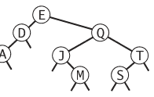

**3.2.16** 定义树的外部路径长度为从根节点到空链接路径上的节点数之和。证明任何具有 *N* 个节点的二叉树中，其外部路径长度与内部路径长度之差为 $2N$（见命题 C）。

**3.2.17** 按照键插入的顺序，逐个删除练习 3.2.1 树中的键，画出生成的 BST 序列。

**3.2.18** 按照字母表顺序，逐个删除练习 3.2.1 树中的键，画出生成的 BST 序列。

**3.2.19** 通过连续删除根节点处的键，逐个删除练习 3.2.1 树中的键，画出生成的 BST 序列。

**3.2.20** 证明 BST 中带两个参数的 `keys()` 的运行时间至多与树的高度加上该范围内键的数量成正比。

**3.2.21** 为 BST 添加一个 `randomKey()` 方法，该方法能够从符号表中返回一个随机键，在最坏情况下，其时间耗时与树的高度成正比。

**3.2.22** 证明如果 BST 中的一个节点有两个孩子，那么它的后继节点没有左孩子，且它的前驱节点没有右子节点。

**3.2.23** `delete()` 具有交换律吗？（先删除 x 再删除 y 的结果与先删除 y 再删除 x 的结果相同吗？）

**3.2.24** 证明没有任何基于比较的算法可以使用少于 $\lg(N!) \sim N \lg N$ 次比较来构建一个 BST。

## 创造性问题

**3.2.25** 完美平衡。编写一个程序，将一组键插入到初始为空的 BST 中，使得生成的树在意义上与二分搜索等价的，即在 BST 中搜索任何键时所执行的比较序列，与二分搜索搜索相同键时所使用的比较序列相同。

**3.2.26** 精确概率。找到练习 3.2.9 中每棵树都是向初始为空的树中插入 $N$ 个随机不同元素的结果的概率。

**3.2.27** 内存使用。在第 1.4 节描述的假设下，比较对于 $N$ 个键值对，BST 与 `BinarySearchST` 以及 `SequentialSearch` 的内存使用（见练习 3.1.21）。不要计算键和值本身的内存，但要计算对它们的引用。然后画一张图，描述一个使用 `String` 键和 `Integer` 值的 BST 的精确内存使用（单位为字节），即当 `FrequencyCounter` 使用 BST 处理《双城记》时构建的 BST。

**3.2.28** 软件缓存。修改 BST，将最近访问的 `Node` 保存在一个实例变量中，以便如果下一次 `put()` 或 `get()` 使用相同的键，可以在常数时间内访问（见练习 3.1.25）。

**3.2.29** 恒数额外内存的树遍历。设计一种算法，仅使用常数额外内存执行 BST 的中序树遍历。提示：在向下遍历树的过程中，让子节点指向父节点，并在向上返回树时将其反转。

**3.2.30** BST 重建。给定 BST 的前序（或后序）遍历（包括空节点），设计一种算法来重建该 BST。

## 创造性问题（续）

**3.2.31** 验证。编写一个 `isBST()` 方法，接受一个 `Node` 作为参数，如果该节点是二叉搜索树的根，则返回 `true`，否则返回 `false`。  
提示：编写一个辅助方法，接受一个 `Node` 和两个 `Key` 作为参数，如果该节点是一个二叉搜索树的根，且所有键严格介于两个参数键之间，则返回 `true`，否则返回 `false`。

解决方案：

```java
private boolean isBST(Node root) {
  return isBST(root, null, null);
}

private boolean isBST(Node x, Key min, Key max) {
  if (x == null) return true;
  if (min != null && x.key.compareTo(min) <= 0) return false;
  if (max != null && x.key.compareTo(max) >= 0) return false;
  return isBST(x.left, min, x.key) && isBST(x.right, x.key, max);
}
```


**3.2.32** 子树计数检查。编写一个递归方法，接受一个`Node`作为参数，如果以该节点为根的数据结构中的子树计数字段$N$是一致的，则返回`true`，否则返回`false`。

**3.2.33** 选择/排名检查。编写一个方法，检查对于从$0$到`size()-1`的所有$i$，$i$是否等于`rank(select(i))`，以及对于 BST 中的所有键，`key`是否等于`select(rank(key))`。

**3.2.34** 线程化。你的目标是实现一个扩展的`ExtendedDoublyThreadedBST`，它能够在常数时间内支持以下额外操作：

| 方法 | 描述 |
| :--- | :--- |
| `next(Key key)` | 在`key`之后的键（如果`key`是最大值则返回`null`） |
| `prev(Key key)` | 在`key`之前的键（如果`key`是最小值则返回`null`） |

为了实现这一点，在`Node`中添加`pred`和`succ`字段，包含指向前驱节点和后继节点的链接，并修改`put()`、`deleteMin()`、`deleteMax()`和`delete()`以维护这些字段。

# 3.2 二叉搜索树

**3.2.35** 细化分析。完善数学模型，以更好地解释文中表格中的实验结果。具体而言，展示对于从随机键构建的树，成功搜索的平均比较次数随着$N$的增加而趋于极限$2 \ln N + 2\gamma - 3 \approx 1.39 \lg N - 1.85$，其中$\gamma = .57721...$是欧拉常数。**提示：** 参考第 2.3 节中的快速排序分析，利用$1/x$的积分趋于$\ln$这一事实。

**3.2.36** 迭代器。是否可以写一个空间与树高度成正比的非递归`keys()`版本？

**3.2.37** 层序遍历。编写一个`printLevel()`方法，接受一个`Node`作为参数，并按照与根节点的距离顺序打印该节点所在子树中的键。**提示：** 使用队列（`Queue`）。

**3.2.38** 树绘图。为 BST 添加一个`draw()`方法，画出类似于文中风格的图形。**提示：** 使用实例变量来存储坐标。

## 实验

**3.2.39** 平均情况。运行实验研究，估计通过向初始为空的树中插入$N$个随机键（重复100次实验），搜索命中和缺失的平均比较次数及标准差，$N=10^4,10^5,10^6$。将你的结果与 3.35 中的公式进行比较。

**3.2.40** 高度。运行实验研究，通过向初始为空的树中插入$N$个随机键（重复100次实验），估计平均 BST 高度，$N=10^4,10^5,10^6$。将你的结果与文中描述的$2.99 \lg N$估计值进行比较。

**3.2.41** 数组表示。使用三个预分配数组表示 BST：一个存储键，一个存储左链接索引，一个存储右链接。将你的程序性能与标准实现进行比较。

**3.2.42** Hibbard 退化。编写一个程序，从命令行获取$N$，构建一个大小为$N$的随机 BST，然后进入一个循环，在其中删除一个随机键（使用代码`delete(select(RandomInt(N)))`）并插入一个随机键，循环$N^2$次。循环结束后，测量并打印树的平均路径长度（路径长度除以$N$再加 1）。在$N=10^2,10^3,10^4$时运行你的程序，以测试路径长度的增加与$N$的平方根成比例的反直觉假设。对于一种随机选择使用前驱或后继节点的`delete()`实现运行实验。

**3.2.43** Put/get 比例。使用`FrequencyCounter`查找 100 万个随机生成的整数出现频率，实验确定 BST 用于`put()`操作的时间与用于`get()`操作的时间比例。

**3.2.44** 成本。改造 BST 以便产生本节所示的计算过程中`put()`操作成本的图（见练习 3.1.38）。

**3.2.45** 实际计时。改造`FrequencyCounter`以使用`Stopwatch`和`StdDraw`绘制图表，x 轴为`get()`或`put()`的调用次数，y 轴为总运行时间，并绘制每次调用后累计时间的散点图。使用`Sequential1SearchST`运行《双城记》程序，再次使用`BinarySearchST`和`BST`运行，并讨论结果。注意：曲线中的剧烈跳跃可以用缓存来解释，这超出了本题的讨论范围（见练习题 3.1.39）。

## 3.2.46 交叉到二叉查找树。找到$N$的值，使得构建包含$N$个随机双精度浮数的符号表的二叉查找树比二叉查找快 10、100 和 1,000 倍。通过分析预测这些值并进行实验验证。

## 3.2.47 平均搜索时间。进行实证研究，通过向一个初始为空的树中插入$N$个随机键，计算 BST 中通往随机节点的平均路径长度（内部路径长度除以树的大小，加 1）的平均值和标准差，$N$从 100 到 10,000。对于每个树的大小进行 1,000 次试验。将结果绘制成 Tufte 图（如本页底部所示），并拟合函数$1.39 \lg N – 1.85$的曲线（见练习题 3.2.35 和练习题 3.2.39）。

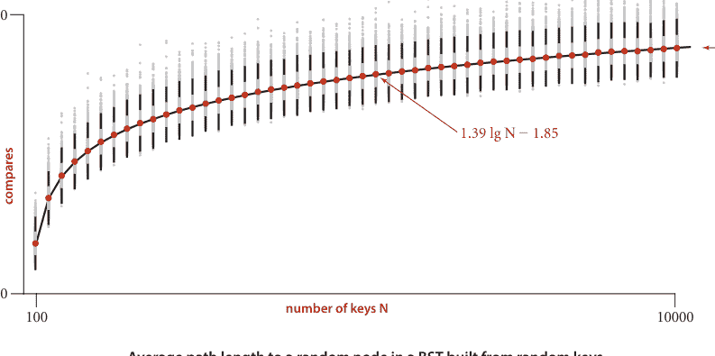

## 3.3 平衡查找树

上一节的算法适用于广泛应用，但它们的最坏情况性能很差。在本节中，我们引入一种二叉查找树，无论使用什么键序列来构建，其代价都保证是对数的。理想情况下，我们希望二叉查找树保持完美平衡。在一个拥有$N$个节点的树中，我们希望高度为$\sim \lg N$，这样就可以保证所有搜索都能像二叉查找一样在$\sim \lg N$次比较内完成（见命题 B）。遗憾的是，维护动态插入完美平衡代价很大。在本节中，我们考虑一种数据结构，它稍微放宽了完美平衡的要求，以便不仅为符号表 API 中的插入和搜索操作提供对数级性能，还为所有有序操作（范围搜索除外）提供性能。

### 2-3 查找树

获得保证查找树平衡所需的灵性的首要步骤是允许树中的节点持有多个键。具体而言，如果将标准 BST 中的节点称为 **2-节点**（它们持有两个链接和一个键），我们现在允许 **3-节点**，它们持有三个链接和两个键。2-节点和 3-节点对于其键划分的每个区间都拥有一个链接。


> 定义。2-3 查找树是一棵空树或：
> - 一个 2-节点，包含一个键（以及关联的值）和两个链接：左链接指向一个键较小的 2-3 查找树，右链接指向一个键较大的 2-3 查找树；
> - 一个 3-节点，包含两个键（以及关联的值）和三个链接：左链接指向一个键较小的 2-3 查找树，中间链接指向位于节点键之间的 2-3 查找树，右链接指向一个键较大的 2-3 查找树
> 按照惯例，我们将指向空树的链接称为空链接。

完美平衡的 2-3 查找树是指所有链接到根节点距离相同的树。在这种情况下，我们使用“2-3 树”来指代完美平衡的 2-3 查找树（该术语在其他上下文中表示更通用的结构）。稍后我们将看到定义和实现 2-节点、3-节点和 2-3 树基本操作的高效方法；现在，假设我们可以方便地操作它们，并看看如何将它们作为查找树。

## 3.3 平衡查找树

425

H 的成功搜索

B 的失败搜索

H 小于 M 向左查找

B 小于 M 向左查找

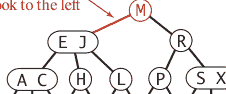

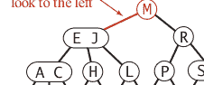

H 位于 E 和 J 之间，向中间查找

B 小于 E，向左查找

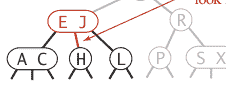

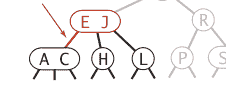

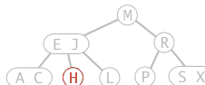

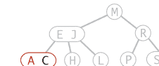

找到 H，返回值（搜索命中）

B 介于 A 和 C 之间，向中间查找；链接为空，B 不在树中（搜索失败）

2-3 树中的搜索命中（左）和搜索失败（右）

**搜索。** 2-3 查找中键的搜索算法通常与 BST 的搜索算法相似。要确定键是否在树中，我们将其与根节点的键进行比较。如果它等于其中任何一个，我们就是搜索命中；否则，我们顺着链接进入对应可能包含该搜索键值区间的子树。如果链接为空，则为搜索失败；否则，我们在该子树中递归搜索。

正在插入 K

**插入到 2-节点中。** 在 2-3 树中插入新键，我们可以先进行一次失败搜索，然后在底部挂载一个带有该键的新节点，就像我们在 BST 中做的那样，但新树将不会保持完美平衡。2-3 树有用的主要原因是我们可以在执行插入的同时保持完美平衡。如果搜索终止的节点是 2-节点，完成这项任务很容易：我们只需将该节点替换为包含其原键和待插入新键的 3-节点。如果搜索终止的节点是 3-节点，我们就有更多工作要做了。

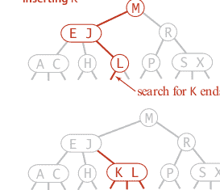

搜索 K 结束

将 2-节点替换为包含 K 的新 3-节点

插入到 2-节点中

## 第 3 章 ■ 搜索

**插入由 3-节点组成的树中。** 在考虑一般情况之前的首次热身，假设我们想向一个极小的树中插入，该树仅包含一个 3-节点。这种树有两个键，但没有空间存放新键。为了能够插入，我们暂时将新键放入一个 4-节点，创建一个 4-节点是很方便的，因为它可以将其转换为具有两个键的 2-3 树，并将新键推向父节点。

**插入到父节点为 2-节点的树中。** 作为第二次热身，假设搜索终止于 2-节点。我们将 2-节点替换为包含原键和新键的 3-节点。

**插入到父节点为 3-节点的树中。** 这是一般情况。当搜索终止于 3-节点时，我们将其临时转换为 4-节点（具有三个键和四个链接）。然后我们将 4-节点拆分为两个 2-节点和一个 3-节点，并将中间键推向父节点。这个过程一直持续，直到遇到 2-节点（我们将其转换为 3-节点）或根节点。如果根节点变成 4-节点，我们将其拆分为两个 2-节点，树的高度增加 1。

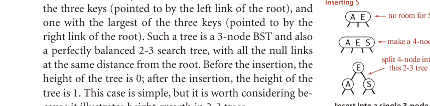

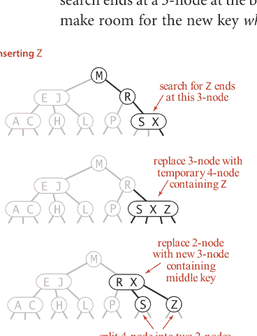

## 3.3 平衡查找树

## 第 3 章 搜索

每次变换涉及的链接数量受一个常数的限制。特别是，当我们在树的任何位置（而不仅仅是底部）找到模式时，这些变换都是有效的。每次变换都会将 4 节点中的一个键向上传递到它在树中的父节点，并相应地重构链接，触及树的任何其他部分。

全局属性。此外，这些局部变换保持了树有序且完美平衡的属性：从根节点到任何空链接（`null` link）的路径上的链接数量是相同的。上方展示了在 4 节点是 3 节点中间孩子的情况下说明这一点的完整图示。如果在变换之前从根到空链接的每条路径长度均为$h$，那么变换后仍然是$h$。每次变换都保持了这一属性，同时将 4 节点拆分为两个 2 节点，并将父节点从 2 节点变为 3 节点，或从 3 节点变为临时 4 节点。当根节点分裂为三个 2 节点时，从根到空链接的每条路径长度增加 1。如果你还不完全信服，可以做练习题 3.3.7，该题要求你扩展上一页顶部图示的其他情况，以说明相同的观点。理解每一个局部变换都能保持整棵树的有序和完美平衡是理解该算法的关键。

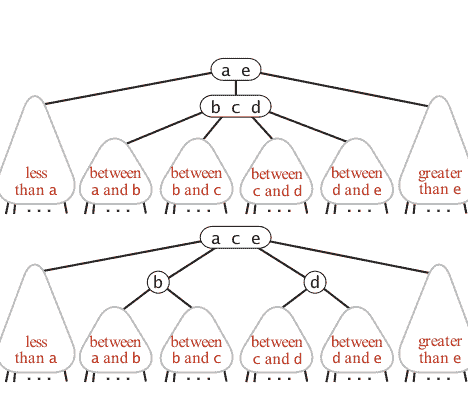

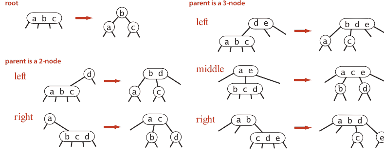

## 3.3 平衡搜索树

与从顶部向下生长的标准 BST 不同，2-3 树是从底部向上生长的。如果你花时间仔细研究下一页的图表（该图给了由我们的索引测试客户端生成的 2-3 树序列，以及当相同的键按递增顺序插入时生成的 2-3 树序列），你将很好地理解 2-3 树的构建方式。回想一下，在 BST 中，10 个键的递增序列会导致 9 的最坏高度。而在 2-3 树中，高度为 2。

前面的讨论已足够定义一个以 2-3 树作为底层数据结构的符号表（symbol-table）。分析 2-3 树与分析 BST 不同，因为我们主要感兴趣的是最坏情况性能，而不是平均性能（即我们期望随机键模型下的性能）。在符号表的实现中，我们通常无法控制客户端向树中插入键的顺序，而最坏情况分析是我们提供性能保证的一种。

**命题 F。** 在包含$N$个键的 2-3 树中，搜索和插入操作被保证最多访问$\lg N$个节点。

**证明：** 具有$N$个节点的 2-3 树的高度于$[\lfloor(\lg N)/(\lg 3)\rfloor]$（如果树全是 3 节点）和$[\lceil\lg N\rceil]$（如果树全是 2 节点）之间（见练习 3.3-4）。

因此，我们可以保证 2-3 树具有良好的最坏情况性能。操作在每个节点上所需的时间受常数限制，且两种操作都只检查一条路径上的节点，因此任何搜索或插入的总成本被保证是对数级的。通过比较第 431 页底部描述的 2-3 树与第 405 页由相同键形成的 BST，你可以看到，完美平衡的 2-3 树呈现出极其扁稳的姿态。例如，一个包含 10 亿个键的 2-3 树高度在 19 到 30 之间。通过检查最多 30 个节点就能保证在 10 亿个键中执行任意的搜索和插入操作，这是非常了不起的。

然而，我们只完成了实现的一半。编写代码来对表示 2 节点和 3 节点的不同数据类型执行变换是可能的，但我们描述的大部分任务在这种直接表示中是不方便的，因为有许多种需要处理的情况。我们需要维护两种不同类型的节点，将搜索键与节点中的每个键进行比较，从一种类型的节点复制链接和其他信息到另一种类型，将节点从一种类型转换为另一种类型等等。这不仅涉及大量的代码，引入的开销还可能让算法比标准的 BST 搜索和插入更慢。平衡的主要目的是为糟糕的最坏情况提供保险，但我们更希望这种保险的开销尽可能低。幸运的是，正如你将看到的，我们可以用很小的开销统一地进行变换。

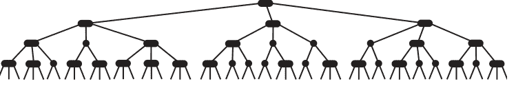


## 第 3 章 搜索

**红黑 BST** 上述描述的 2-3 树插入算法并不难理解；现在我们看到它的实现也不困难。我们将考虑一种名为*红黑 BST*的简单表示，它能引出一个自然的实现。最后，这不需要太多代码，但理解其背后的原理需要仔细观察。

**编码 3 节点。** 红黑 BST 背后的基本思想是通过 BST（由 2 节点组成）开始，并为 3 节点添加额外信息来编码 2-3 树。具体来说，我们将红黑 BST 称为使用红色链接来表示 3 节点的 2-3 树。使用这种表示方法的优势在于我们可以兼顾两者的优点：标准 BST 简单高效的搜索方法，以及 2-3 树高效的插入平衡方法。因此，我们将红黑 BST 定义为满足以下限制：
- 红链接向左倾斜。
- 没有节点有两个红色链接连接。
- 从根到空链接的每条路径具有相同数量的黑色链接。


**颜色表示。** 为了方便，每个节点恰好被一条链接指向（来自其父节点），我们通过在`Node`类型中添加一个布尔实例`color`来编码节点的链接颜色，如果来自父节点的链接是红色的则为`true`，黑色则为`false`。根据约定，空链接是黑色的。为了代码清晰，我们定义了`RED`和`BLACK`用于设置和测试该变量。我们使用私有方法`isRed()`来测试链接的颜色。当我们引用节点的颜色时，我们指的是指向它的链接的颜色，反之亦然。


## 第 3 章 查找

红链接。假设我们有一个右斜的红链接，需要将其旋转为左斜（见左图所示）。这种操作称为左旋。我们通过一个方法来组织计算，该方法接受一个指向红黑 BST 的链接作为参数，并假设该链接指向一个右斜的节点，它会进行必要的调整并返回一个链接，该链接是左侧为红的键集的红黑 BST 的根。如果你检查图中绘图前后的每一行代码，你会发现这种操作很容易理解：我们正在从右侧两个键中较小的那个切换为让两个键中较大的那个位于根节点。实现一个将左斜链接转换为右斜链接的右旋，代码量是相同的，只是左右互换了（见下方的图）。


```
Node rotateLeft(Node h) {

    Node x = h.left;
```


`h.left = x.right;`

`x.right = h;`

`x.color = h.color;`

`h.color = RED;`

`x.n = h.n;`

`h.n = 1 + size(h.left) + size(h.right);`

`return x;`

旋转后重置父节点中的链接。无论左旋还是右旋，每次旋转都会返回一个链接。我们使用`rotateRight()`或`rotateLeft()`返回的链接来重置父节点（或树的根）中相应的链接。这可能是右链接或左链接，我们也用它来重置父节点中的链接。这个链接可能是红色的或黑色——`rotateLeft()`和`rotateRight()`都通过设置`x.color`来设置颜色。


`rotateRight()`通过将`x.color`设置为`h.color`来保留其颜色。这允许树中出现连续的右链接，但我们的算法会在这种情况发生时也使用旋转来修正它。例如，代码

```
h = rotateLeft(h);
```

旋转位于节点`h`右侧的左斜红链接，将`h`指向结果子树的根（该子树包含了旋转前`h`指向的子树的所有节点，但根节点不同）。这种代码的易用性是我们使用 BST 方法递归实现的主要原因，正如你将看到的，这使得旋转成为普通插入的简单补充。

```
Node rotateRight(Node h) {
    Node x = h.right;
    h.right = x.left;
    x.left = h;
    x.color = h.color;
    h.color = RED;
    x.n = h.n;
    h.n = 1 + size(h.left) + size(h.right);
    return x;
}
```


左旋（`h`的右链接）


右旋（`h`的左链接）

## 3.3 平衡搜索树

在插入新键时，我们可以使用旋转来帮助维护 2-3 树与红黑 BST 之间的 1-1 对应关系，因为它们保留了红黑 BST 的两个属性：顺序和完美平衡。这意味着，我们可以在红黑 BST 上使用旋转，而不必担心丢失其顺序或完美平衡。接下来，我们将看到如何使用旋转来保留红黑 BST 的另外两个属性（任何路径上没有连续的红链接，且没有右斜红链接）。我们先从一些简单的情况开始热身。


**插入到 2 节点中。** 具有 1 个键的红黑 BST 就是一个 2 节点。插入第二个键立即显示出旋转操作的必要性。如果新键小于树中的键，我们为该键创建一个新的（红色）节点，然后就完成了：我们得到了一个等同于 3 节点的红黑 BST。它有两个键，一个左斜红链接，且高度为 0。但如果新键大于树中的键，则将新的（红色）节点连接到右斜链接上，并且代码`rotateLeft(root)`通过旋转左链接并更新树的根来完成插入。两种情况的结果都是 3 节点的红黑表示，具有两个键、一个左斜红链接且高度为 0。


**插入到底部的 2 节点。** 我们像普通 BST 那样向红黑 BST 插入键，在底部添加新节点（遵循顺序），但始终通过红链接与其父节点连接。如果父节点是 2 节点，则讨论上述两种情况。如果新节点连接到左链接上，父节点简单地变为 3 节点；如果它连接到右链接上，父节点简单地变为 3 节点。


**插入到带有两个键的 3 节点中。** 这创建了一个 4 节点，它必须被分裂。中间的键传递给父节点，剩下的两个键变成新的红色孩子。如果父节点是 2 节点，它将变为 3 节点。如果父节点是 3 节点，过程将继续，可能会分裂根并增加树的高度。


**插入到底部的 3 节点。** 我们像普通 BST 那样向红黑 BST 插入键，在底部添加新节点（遵循顺序），但始终通过红链接与其父节点连接。如果父节点是 2 节点，则讨论上述两种情况。如果新节点连接到左链接上，父节点简单地变为 3 节点；如果它连接到右链接上，父节点简单地变为 3 节点。


**插入到带有两个键的 3 节点中。** 这创建了一个 4 节点，它必须被分裂……（正继续）

旋转位于节点`h`右侧的左斜红链接，将`h`指向结果子树的根（该子树包含了旋转前`h`指向的子树的所有节点，但根节点不同）。这种代码的易用性是我们使用 BST 方法递归实现的主要原因，正如你将看到的，这使得旋转成为普通插入的简单补充。


- 如果出现 4 节点，我们创建一个右斜红链接。
- 如果出现 4 节点，我们创建一个左斜红链接。
- 如果出现 4 节点，我们分裂 4 节点并将中间键向上传递。


## 第 3 章 搜索

总结来说，在插入过程中，我们可以通过三种简单的操作：左旋、右旋和颜色翻转，维持 2-3 树与红黑二叉搜索树（BST）之间的 1-1 对应关系。我们可以从插入点向上遍历树，对每个节点依次执行以下操作来完成插入：

- 如果右孩子是红色的且左孩子是黑色的，则左旋。
- 如果左孩子及其左孩子都是红色的，则右旋。
- 如果两个孩子都是红色的，则翻转颜色。


值得检查一下这个序列是否处理了上述每种情况。请注意，第一个操作处理了父节点为 2-节点时，将 3-节点向左倾斜的旋转；当新的红色链接是 3-节点中的中间链接时，将底部链接向左倾斜的旋转。

在红黑 BST 中向上传递红色链接

## 实现

由于平衡操作是在从插入点向上遍历树的过程中执行的，因此在我们标准的递归实现中实现它们非常容易：我们在递归调用之后执行它们，如算法 3.4 所示。上段列出的三种操作每种都通过一个简单的`if`语句测试树中两个节点的颜色来完成。尽管这涉及少量代码，但如果没有为了实现它而开发的两层抽象（2-3 树和红黑 BST），这种实现将非常难以理解。以测试五个颜色节点为代价（并且可能在测试成功时进行一次或两次旋转或两次颜色翻转），我们获得了近乎完美平衡的 BST。

我们标准索引客户端的执行轨迹，以及在第 440 页中按顺序插入的键轨迹。正如我们一直所做的那样，简单地从红黑树的三种操作的角度来考虑这些示例，是一项很有意义的练习。另一个很有意义的练习是检查该算法维持的与 2-3 树的对应关系（使用第 430 页给出的键）。在这两种情况下，你都可以通过考虑将`P`插入到红黑 BST 时所需的转换（两次颜色翻转和两次旋转）来测试你对算法的理解（见练习 3.3.12）。

## 算法 3.4 红黑 BST 的插入

```java
public class RedBlackBST<Key extends Comparable<Key>, Value>
{
    private Node Node;
    private class Node // 带有颜色位字的 BST 节点（见第 433 页）
        private boolean isRed(Node h) // 见第 433 页。
        private Node rotateLeft(Node h) // 见第 434 页。
        private Node rotateRight(Node h) // 见第 434 页。
        private void flipColors(Node h) // 见第 436 页。
        private int size();

    public void put(Key key, Value value)
    {
        // 搜索键。如果找到则更新值；如果是新的则扩展表。
        root = put(root, key, value);
        root.color = BLACK;
    }

    private Node put(Node h, Key key, Value val)
    {
        if (h == null) // 标准插入，带有父节点的红色链接。
            return new Node(key, val, 1, RED);
        int cmp = key.compareTo(h.key);
        if (cmp < 0) h.left = put(h.left, key, val);
        else if (cmp > 0) h.right = put(h.right, key, val);
        else h.val = val;
        if (isRed(h.right) && !isRed(h.left)) h = rotateLeft(h);
        if (isRed(h.left) && isRed(h.left.left)) h = rotateRight(h);
        if (isRed(h.left) && isRed(h.right)) flipColors(h);
        h.N = size(h.left) + size(h.right) + 1;
        return h;
    }
}
```


红黑 BST 的递归 `put()` 代码与初等 BST 中的 `put()` 相同，区别在于递归调用后的三个语句，这三条语句通过在搜索路径上维持与 2-树的 1-1 对应关系，使树保持近乎平衡状态。第一条语句留下任何左倾的 3-节点（或临时 4-节点底部的右倾红色链接）；第二条语句右旋一个具有两个左倾红色链接的临时 4-节点中的顶部链接；第三条语句通过翻转颜色将红色链接向上传递树（见正文）。

## 440 第 3 章 搜索

| 操作 | 描述 |
| :--- | :--- |
| 插入 S | 插入 A |


| 标准索引客户端 | 按顺序排列的相同键 |

## 3.3 平衡搜索树

**删除** 由于由于算法 3.4 中的 `put()` 已经是我们在书中考虑过的最复杂的方法之一，且红黑 BST 的 `deleteMin()`、`deleteMax()` 和 `delete()` 的实现有些复杂，因此我们将它们的完整实现推迟到练习中。尽管如此，基本方法仍然值得研究。为了描述它，我们回到 2-3 树。像插入一样，我们可以定义一系列局部转换，允许我们在维持完美平衡的同时删除节点。这个过程比插入稍微复杂，因为我们在搜索路径的向下过程中执行转换，此时引入了临时 4-节点（以允许删除节点），并且在搜索路径的向上过程中执行转换，分裂任何剩余的 4-节点（方式与插入相同）。

**2-3-4 树向下。** 作为删除的首次预热，我们考虑一种更简单的算法，它在向下和向上路径上执行转换：一种 2-3-4 树的插入算法，其中我们在 2-3 树中看到的临时 4-节点在树中持续。该插入算法基于在通往路径的向下执行转换以维持当前节点不是 4 节点的不变性（因此我们确保底部有空间插入新键），以及在路径的向上执行转换，以平衡可能创建的任何 4-节点。向下路径的转换与我们在 2-3 树中分裂 4-节点时使用的转换完全相同。如果根节点是 4-节点，我们将其分裂为三个 2-节点。在向下的过程中，如果遇到 4-节点，我们将其分裂为 2-节点并将中间键传递给父节点，使其变为 3-节点；如果遇到 4-节点且父节点是 3-节点，我们将其分裂为 2-节点并将中间键传递给父节点，使其变为 4-节点。根据不变性，我们在底部得到 2-节点或 3-节点，因此可以插入新键。为了在红黑 BST 中实现这种算法，我们需要：

- 将 4-节点表示为三个 2-节点
- 在向下的过程中通过颜色翻转处理 4-节点
- 在向上的过程中通过旋转平衡 4-节点，对于


## 454 第 3 章 搜索

奇的是，你可以通过移动算法 3.4 中 `put()` 的一行代码来实现向下 2-3-4 树：将 `flipColors()` 调用（以及相应的测试）移动到递归调用之前。这种算法在某些应用中具有优势，因为它总是操作在内部内部的。我们接下来描述的删除算法基于类似的方案并且是有效的

**删除最小值。** 作为删除的第二次预热，我们考虑从 2-3 树删除最小值的选项。基本思想是基于我们可以很容易从底部的 3-节点删除键，但不能从 2-节点删除。从 2-节点删除键会留下一个没有节点，自然的做法是用空链接替换该节点，但该操作会破坏完美平衡。因此，我们采用以下方法：为了确保我们不会得到 2-节点，我们在树向下执行转换以确保当前节点不是 2 节点。首先，在根节点有两种情况：如果根节点是 2-节点且两个孩子都是 2-节点，我们可以将三个节点转换为 4-节点；否则根据需要从右兄弟处借用。然后在树向下的过程中，必须满足以下情况之一：

- 如果节点的左孩子不是 2 节点，则无事可做。
- 如果孩子是 2 节点且其邻接兄弟不是 2 节点，则从兄弟处移动一个键到左孩子。
- 如果左孩子及其邻接兄弟都是 2-节点，将它们与父节点中的最小键合并成 4-节点，将父节点从 3-节点变为 2-节点或从 4-节点变为 3-节点。

按照这一过程遍历链接到底部，我们最终得到一个带有最小键的 3-节点或 4-节点，因此我们可以直接将其删除，将 3-节点转换为


对于删除根节点的转换是不是


将 2-节点或 4-节点转换为 3-节点。然后，在树向上生长的过程中，我们分裂任何未使用的临时 4-节点。

**删除。** 对于前面描述的删除最小值的操作，在搜索路径上执行相同的转换，同样可以确保在搜索任何键时，当前节点不会是 2-节点。如果搜索键位于底部，我们可以直接将其移除。如果键不在底部，那么我们必须在普通的 BST 中将它与它的后继节点交换。然后，由于当前节点不是 2-节点，我们已经将问题简化为在一个根节点不是 2-节点的子树中删除最小值，并且我们可以对该子树使用上述描述的程序。删除操作后，像往常一样，我们沿着搜索路径向树上方分裂任何剩余的 4-节点。

本节末尾的**几项练习**致力于与这些删除算法相关的示例和实现。对开发或理解实现感兴趣的人需要掌握这些练习中涵盖的细节。对算法研究有一般兴趣的人需要意识到这些方法是重要的，因为它们代表了我们看到的第一个符号表实现，其中*搜索*、插入和删除都保证是高效的，正如我们接下来将建立的那样。

## 红黑 BST 的属性

研究红黑 BST 的属性在于检查它与 2-3 树的对应关系，然后应用 2-3 树的分析。最终结果是，红黑 BST 中所有的符号树操作都保证与树的大小呈对数关系（范围搜索除外，它额外花费与返回键数量成正比的时间）。我们重复并强调这一点，因为它的重要性。

分析。首先，我们确定无论键的插入顺序如何，红黑 BST 并不是完美平衡的，但总是接近平衡的。这一事实直接来自于与 2-3 树的一一对应关系以及 2-3 树的定义属性（完美平衡）。

> **命题 G。** 具有 $N$ 个节点的红黑 BST 的高度不超过 2 lg N。

**证明简述：** 最坏情况是一个 2-3 树，除了最左侧路径由 3-节点组成外，全都是 2-节点。从根节点取左链接的路径长度是涉及 2-节点的长度为 ~ lg N 的路径的两倍。可以（但并不容易）构造出键序列，使得构建的红黑 BST 的平均路径长度达到最坏情况的 2 lg N。如果你对数学感兴趣，你可能会喜欢通过完成练习 3.3-24 来探索这个问题。

这个上界是保守的：涉及随机插入和典型应用中找到插入序列的实验支持这样一个假设：在具有 N 个节点的红黑 BST 中，每次搜索平均使用大约 1.0 lg N - 0.5 次比较。此外，在实践中你可能遇到显著增加的比较次数。

由随机键构建的典型红黑 BST（省略空链接）

## 3.3 平衡搜索树

| 单词 | 唯一数 | 比较模型 | 实际 | leipzig1M.txt | 唯一数 | 比较模型 | 实际 |
| :--- | :--- | :--- | :--- | :--- | :--- | :--- | :--- |
| 所有单词 | 135,635 | 10,679 | 13.6 | 13.5 | 21,191,455 | 534,580 | 19.4 | 19.1 |
| 8+ 字母 | 14,350 | 5,737 | 12.6 | 12.1 | 4,239,593 | 299,593 | 18.7 | 18.4 |
| 10+ 字母 | 4,582 | 2,260 | 11.4 | 11.5 | 1,610,829 | 165,555 | 17.5 | 17.3 |

使用 `RedBlackBST` 的 `FrequencyCounter` 的 `put()` 操作的平均比较次数

> **属性 H。** 在具有 N 个节点的红黑 BST 中，从根到节点的路径平均长度为 ~1.00 lg N。

**证据：** 与典型的 BST（如第 405 页所示的树）相比，典型的树（例如上一页底部的树，甚至是本页底部通过递增顺序插入键构建的树）是非常相当平衡的。本页顶部的表格显示，我们的 `FrequencyCounter` 应用的路径长度（搜索成本）比基础 BST 低约 40%，正如预期的那样。自从红黑 BST 发明以来，这种性能已经在无数应用和实验中观察到。

对于对长度为 8 或更多单词的 `FrequencyCounter` 进行 `put()` 操作成本的示例研究，我们看到平均成本进一步降低，再次对理论模型预测的对数性能提供了快速验证，由于**命题 G** 提供的保证，这种验证相对于 BST 来说并不那么意外。总节省小于搜索成本的 40% 节省，因为我们还将旋转和颜色翻转也计算在内。

## 第 3 章 搜索

红黑 BST 中的 `get()` 方法不检查节点，因为平衡机制没有增加开销；搜索比基础 BST 更快，因为树是平衡的。每个键只插入一次，但可能涉及许多、许多搜索操作，最终结果是我们的得到了接近最优的时间（树几乎是平衡的，并且在（搜索）期间以很小的成本完成了任何工作（与二分查找不同，插入保证是非常短的，类似于二分查找的内部循环（比较和索引算术））。这种实现是我们看到的第一个对搜索和插入都具有对数保证的实现，它的内部循环非常紧凑，因此在使用库实现时，它在广泛的应用中价值。

有序符号表 API。红黑 BST 最吸引人的特征之一是，无序符号表 API 配合 E 和 G 就足以建立所有操作的对数性能了。

**命题 I。在红黑 BST 中，以下操作在最坏情况下需要对数级时间：搜索、插入、查找最小值、查找最大值、`floor`、`ceiling`、`rank`、`select`、删除最小值、删除最大值、删除。**

$N$ 个节点的红黑 BST 的高度不超过 2 lg N。

**证明简述：** 最坏情况是一个 2-3 树，除了最左侧路径由 3-节点组成外，全都是 2-节点。从根节点取左链接的路径长度是涉及 2-节点的长度为 ~ lg N 的路径的两倍。可以（但并不容易）构造出键序列，使得构建的红黑 BST 的平均路径长度达到最坏情况的 2 lg N。如果你对数学感兴趣，你可能会喜欢通过完成练习 3.3-24 来探索这个问题。

这个上界是保守的：涉及随机插入和典型应用中找到插入序列的实验支持这样一个假设：在具有 N 个节点的红黑 BST 中，每次搜索平均使用大约 1.0 lg N - 0.5 次比较。此外，在实践中你可能遇到显著增加的比较次数。

具有 N 个节点的红黑 BST 中，从根到节点的路径平均长度为 ~1.00 lg N。

**证据：** 与典型的 BST（如第 405 页所示的树）相比，典型的树（例如上一页底部的树，甚至是本页底部通过递增顺序插入键构建的树）是非常相当平衡的。本页顶部的表格显示，我们的 `FrequencyCounter` 应用的路径长度（搜索成本）比基础 BST 低约 40%，正如预期的那样。自从红黑 BST 发明以来，这种性能已经在无数应用和实验中观察到。

对于长度为 8 或更多单词的 `FrequencyCounter` 进行 `put()` 操作成本的示例研究，我们看到平均成本进一步降低，再次对理论模型预测的对数性能提供了快速验证，由于命题 G 提供的保证，这种验证相对于 BST 来说并不那么意外。总节省小于搜索成本的 40% 节省，因为我们还将旋转和颜色翻转也计算在内。

反思一下，能够实现这种性能是令人惊讶的。在信息爆炸的世界里，事实是我们可以完成任何这些操作只需要几次比较。

| 算法（数据结构） | 最坏情况成本（插入后） | 平均情况成本（插入后） | 是否支持有序操作？ |
| :--- | :--- | :--- | :--- | :--- |
| 顺序搜索（无序列表） | N | N | N/2 | N | 否 |
| 二分搜索（有序数组） | lg N | N | N/2 | N | 是 |
| 二叉树搜索（BST） | N | N | 1.39 lg N | 1.39 lg N | 是 |
| 2-3 树搜索（红黑 BST） | 2 lg N | 2 lg N | 1.00 lg N | 1.00 lg N | 是 |

符号表实现的成本总结

- **Q.** 为什么不让 3-节点向任何方向倾斜，并在树中允许 4-节点？
**A.** 那些是很好的替代方案，几十年来一直被使用。你可以在练习中学习几种替代方案。左倾斜约定减少了情况的数量，因此所需的代码少得多。

- **Q.** 为什么不使用 `Key` 数组来用单一 `Node` 类型表示 2-、3- 和 4- 节点？
**A.** 好问题。这正是我们在 B 树（见第 6 章）中所做的，在每个节点中允许更多的键。对于 2-3 树中的小型节点，数组的开销代价太大了。

- **Q.** 当我们分裂 4-节点时，有时会在 `rotateRight()` 中将右节点的颜色设置为 `RED`，然后在 `flipColors()` 中将其设置为 `BLACK`。这不浪费吗？
**A.** 是的，而且我们还不必要地重新设置了中间节点的颜色。从大局来看，重置几个额外的位与所有操作从线性到对数的提升不可同日语，但在性能敏感的应用中，你可以将 `rotateRight()` 和 `flipColors()` 的代码内联消除这些额外的测试。我们在删除时也使用这些方法，并发现通过确保保持完美的黑色平衡使其更容易使用、理解和维护。

# 练习

**3.3.1** 按照顺序将键 `E A S Y Q U T I O N` 插入一个初始为空的树，画出生成的 2-3 树。

**3.3.2** 按照顺序将键 `Y L P M X H C R A E S` 插入一个初始为空的树，画出生成的 2-3 树。

**3.3.3** 为键 `S E A R C H X M` 找到一个插入顺序，使其形成高度为 1 的 2-3 树。

**3.3.4** 证明 N 个键的 2-3 树的高度介于 $\sim\log_3 N \approx .63 \lg N$（对于全为 3 节点的树）和 $\sim\lg N$（对于全为 2 节点的树）之间。


**3.3.5** 右图显示了所有结构上不同的、具有 N 个键的 2-3 树，N 从 1 到 6（忽略子树的顺序）。画出 N = 7, 8, 9 和 10 时所有结构上不同的树。


**3.3.6** 计算练习 3.3.5 中每棵 2-3 树是向初始为空的树插入 N 个随机不同键后结果的概率。


**3.3.7** 参考第 428 页顶部的图示，为该页底部图中其他五种情况绘制类似的图。

**3.3.8** 展示用带有红色链接的三个 2 节点（不一定左倾斜）来表示一个 4 节点的所有可能方式。

**3.3.9** 下列哪些是红黑二叉搜索树（BST）？


**3.3.10** 按照顺序将键 `E A S Y Q U T I N` 插入一个初始为空的树，画出生成的红黑 BST。

**3.3.11** 按照顺序将键 `Y L P M X H C R A E S` 插入一个初始为空的树，画出生成的红黑 BST。

# 练习（续）

**3.3.12** 在为我们的标准索引客户端插入 `P` 的过程中，画出每次变换（颜色翻转或旋转）后生成的红黑 BST。

**3.3.13** 判断对错：如果向红黑二叉搜索树中按递增顺序插入键，树的高度是单调递增的。

**3.3.14** 按照顺序将字母 `A` 到 `K` 插入一个初始为空的树，画出生成的红黑 BST；描述当通过升序插入键构建树时通常会发生什么（另参见文中的图示）。

**3.3.15** 对于键按递减顺序插入的情况，回答上述两个问题。

**3.3.16** 展示向右图所示的红黑 BST 中插入 `n` 的结果（仅显示搜索路径，你需要在答案中仅包含这些节点）。

**3.3.17** 生成两个随机的 16 节点红黑 BST。画出它们（手画或用程序）。将它们与使用相同键构建的（不平衡的）BST 进行比较。


**3.3.18** 画出 N 从 2 到 10 的所有具有 N 个键的结构上不同的红黑 BST（参见练习 3.3.5）。

**3.3.19** 如果每个节点颜色使用 1 位，我们可以表示 2-、3- 和 4- 节点。如果用二叉树表示 5-、6-、7- 和 8 节点，每个节点需要多少比特？

**3.3.20** 当 N 是 2 的幂次减 1 时，计算完美平衡的 N 节点 BST 的内部路径长度。

**3.3.21** 基于你对练习 3.2.10 的解，为 `RedBlackBST` 创建一个测试客户端。

**3.3.22** 找到一组插入到 BST 和红黑 BST 中的键序列，使得 BST 的高度小于红黑 BST 的高度，或者证明不存在这样的序列。

# 创造性问题

**3.3.23** 2-3 树。开发一个基础符号表 API 的实现，使用不一定平衡的 2-3 树作为底层数据结构。允许 3 节点向左或向右倾斜。在向向底部的 3 节点插入元素时，用黑色链接将新节点挂在底部。运行实验以得出一个估计从 N 次随机插入构建的树的平均路径长度的假设。

**3.3.24** 红黑 BST 的最坏情况。展示如何构造一个红黑 BST，证明在最坏情况下，N 个节点红黑 BST 中从根节点到空链接的所有路径长度均为 2N。

**3.3.25** 自顶向下 2-3-4 树。开发一个基础符号表 API 的实现，使用平衡的 2-3-4 树作为底层数据结构，使用文中描述的红黑表示法和插入方法，其中通过沿向下路径翻转颜色并在途中进行平衡来分裂 4 节点。

**3.3.26** 单次自顶向下。开发你对练习 3.3.25 解决方案的修改版本，该版本不使用递归。在树向下的过程中完成所有 4 节点的节点和平衡（以及 3 节点的平衡）工作，并在底部完成插入。

**3.3.27** 允许右倾红色链接。开发你对练习 3.3.25 解决方案的修改版本，允许右倾红色链接。

**3.3.28** 自底向上的 2-3-4 树。开发一个基础符号表 API 的实现，使用平衡的 2-3-4 树作为底层数据结构，使用文中描述的红黑表示法和插入方法，其中通过沿向下路径翻转颜色并在途中进行平衡来分裂 4 节点。

**3.3.29** 优化存储。修改 `RedBlackBST`，使其不为颜色位使用额外存储。

**3.3.30** 软件缓存。修改 `RedBlackBST`，将最近访问的 `Node` 保在实例变量中，以便常数时间内访问。

## 创造性问题（续）

**3.3.31** 树绘图。在 `RedBlackBST` 中添加一个 `draw()` 方法，以文中风格绘制红黑 BST 图形（参见练习 3.3.38）。

**3.3.32** AVL 树。AVL 树是一种 BST，其中每个节点及其兄弟节点的高度差不超过 1。（最老的平衡树算法是基于旋转来维护 AVL 树高度的）。证明红色链接从偶数高度节点到奇数高度节点提供了一个（完美平衡的）2-3-4 树，其中红色链接不一定是左倾的。

**3.3.33** 验证。为 `RedBlackBST` 添加 `is23()` 方法来检查没有节点连接两个链接且没有右倾红色链接，以及一个 `isBalanced()` 方法来检查从根节点到空链接的所有路径具有相同的黑色链接。将这些方法与练习 3.2.31 中的 `isBST()` 代码结合，创建一个 `isRedBlackBST()` 方法来检查树是否为红黑 BST。

**3.3.34** 2-3 树。编写代码生成所有高度为 2、3 和 4 的结构 2-3 树。分别是否存在 2、7 和 122 棵这样的树？（提示：使用符号树）。

**3.3.35** 2-3 树。编写一个 `ThreeBST.java` 程序，使用两种节点类型实现 2-3 搜索树。

**3.3.36** 2-3-4-5-6-7-8 树。描述平衡 2-3-4-5-6-7-8 搜索树的搜索和插入算法。

**3.3.37** 无记忆。证明红黑 BST 不是无记忆的：如果你插入一个比树中所有键都小的键，然后立即删除最小值，可能会得到一个不同的树。

## 3.3.39 删除最小值。为红黑 BST 实现 `deleteMin()` 操作，在过程中保持与文中给出的沿 $m$ 向树的左主干的变换对应的关系，同时保持当前节点不为 2 节点的不变性。

解决方案：

```java
// 示例代码块
public void deleteMin() {
    if (isEmpty()) throw new NoSuchElementException("BST underflow");
    if (!isRed(root.left) && !isRed(root.right))
        root.color = RED;
    root = deleteMin(root);
    if (!isEmpty()) root.color = BLACK;
}

private Node deleteMin(Node h) {
    if (h.left == null) return null;
    if (!isRed(h.left) && !isRed(h.left.left))
        h = moveRedLeft(h);
    h.left = deleteMin(h.left);
    return balance(h);
}
```


```java
private Node moveRedLeft(Node h)
{
    // 假设 h 是红色的且 h.left 和 h.left.left
    // 黑色的，将 h.left 或其一个孩子变为红色。

    flipColors(h);

    if (isRed(h.right.left)) {
        h.right = rotateRight(h.right);
        h = rotateLeft(h);
    }

    return h;
}

public void deleteMin()
{
    if (!isRed(root.left) && !isRed(root.right))
        root.color = RED;

    root = deleteMin(root);

    if (!isEmpty(root))
        root.color = BLACK;
}

private Node deleteMin(Node h)
{
    if (h.left == null)
        return null;

    if (!isRed(h.left) && !isRed(h.left.left)) {
        h = moveRedLeft(h);
        h.left = deleteMin(h.left);
    }

    return balance(h);
}
```

此代码假设存在`balance()`方法，该方法由以下代码组成：

```java
if (isRed(h.right))
    h = rotateLeft(h);
```

随后是 ALGORITHM 3.4 中递归`put()`方法的最后五行，以及一个用于全三种颜色的`flipColors()`实现，而不是文中插入时给出的方法。对于删除，我们将父节点设为黑色，并将两个孩子设为红色。

## 创造性问题（续）

### 3.3.40 删除最大值

为红黑 BST 实现`deleteMax()`操作。注意，涉及的变换与上一个练习略有不同，因为红链是左偏斜的。

**解决方案：**

```java
private Node moveRedRight(Node h)
{
    // 假设 h 是红色的且 h.right 和 h.right.left
    // 是黑色的，将 h.right 或其一个孩子变为红色。

    flipColors(h);

    if (!isRed(h.left.left))
        h = rotateRight(h);

    return h;
}

public void deleteMax()
{
    if (!isRed(root.left) && !isRed(root.right))
        root.color = RED;

    root = deleteMax(root);

    if (!isEmpty(root))
        root.color = BLACK;
}

private Node deleteMax(Node h)
{
    if (isRed(h.left))
        h = rotateRight(h);

    if (h.right == null)
        return null;

    if (!isRed(h.right) && !isRed(h.right.left))
        h = moveRedRight(h);

    h.right = deleteMax(h.right);

    return balance(h);
}
```

## 3.3 平衡搜索树 455

### 3.3.41 删除

为红黑 BST 实现`delete()`操作，将前两个练习的方法与 BST 的`delete()`操作结合。

**解决方案：**

```java
public void delete(Key key)
{
    if (!isRed(root.left) && !isRed(root.right))
        root.color = RED;

    root = delete(root, key);

    if (!isEmpty(root))
        root.color = BLACK;
}

private Node delete(Node h, Key key)
{
    if (key.compareTo(h.key) < 0)
    {
        if (!isRed(h.left) && !isRed(h.left.left))
            h = moveRedLeft(h);

        h.left = delete(h.left, key);
    }
    else
    {
        if (isRed(h.left))
            h = rotateRight(h);

        if (key.compareTo(h.key) == 0 && (h.right == null))
            return null;

        if (!isRed(h.right) && !isRed(h.right.left))
            h = moveRedRight(h);

        if (key.compareTo(h.key) == 0)
        {
            Node x = min(h.right);
            h.key = x.key;
            h.val = x.val;
            h.right = deleteMin(h.right);
        }
        else
            h.right = delete(h.right, key);
    }

    return balance(h);
}
```

## 实验

### 3.3.42 统计红色节点

编写一个程序，计算给定红黑 BST 中红色节点的百分比。通过在初始为空的树中插入 $N$ 个随机键并运行至少 100 次实验试验来测试你的程序，其中 $N = 10^4, 10^5$ 和 $10^6$，并得出一个假设。

### 3.3.43 代价图表

对`RedBlackBST`进行插桩，以便能够生成像本节所示的图表，显示计算过程中每个`put()`操作的代价（参见练习 3.1.38）。

### 3.3.44 平均搜索时间

运行实证研究，对于从 1 到 10,000 的 $N$，计算通过向初始为空的树中插入 $N$ 个随机键构建的红黑 BST 中通往随机节点的平均路径长度（内部路径除以树的大小，加 1）的平均值和标准差。

每个树大小至少进行 1,000 次试验。用 Tufte 图绘制结果，类似于本页面底部的那样，并带有一绘制函数 $\lg N - 5$ 的曲线。

### 3.3.45 统计旋转次数

对练习 3.3.43 的程序进行插桩，以绘制构建树时所使用的旋转次数和节点分裂次数。讨论结果。

### 3.3.46 高度

对练习 3.3.43 的程序进行插桩，以绘制红黑 BST 的高度。讨论结果。

## 3.4 哈希表

如果键是较小的整数，我们可以使用一个数组来实现无序符号表，通过将键解释为数组索引，这样我们就可以与键 $i$ 关联的值存储在数组 $i$ 中，以便即时访问。

在本节中，我们考虑哈希，这是这种简单方法的扩展，用于处理更复杂的键类型。我们通过算术运算将键转换为数组索引，从而通过数组引用键值对。

使用哈希的搜索算法由两部分组成。第一部分理想情况下定义一个哈希函数将键转换为数组索引。理想情况下，不同的键将映射到不同的索引。这种理想是无法达到的，因此我们面临两个或多个不同键哈希到同一个数组索引的可能性。

哈希搜索的第二部分是处理这种情况的冲突解决过程。在描述了如何计算哈希函数之后，我们将考虑两种不同的冲突解决方法：分离链法（separate chaining）和线性探测（linear probing）。

| a | xyz | |
|---|---|---|
| b | pqr | 1 |
| c | ijk | |
| d | uvw | |

哈希是空间权衡（time-space tradeoff）的经典例子。如果没有内存，我们就无法使用哈希。如果有无限内存，我们就不需要它。哈希提供了一种方法。

### 模哈希

实现这样的哈希函数的方法是使用键中的三个数字。使用第三字段的三个数字可能比使用第一字段的三个数字更优（因为客户可能在地理上分布并不均匀），但更好的方法是使用所有九位数字创建一个整数值，然后考虑整数的哈希函数。

对于整数，最常用的哈希方法是模哈希：选择数组大小 $M$ 为素数，对于任何正整数 $k$，计算 $k$ 除以 $M$ 的余数。这个函数非常容易计算（在 Java 中为`k % M`）并且有效地分散键。

| key | hash (M=1000) | hash (M=7) |
|---|---:|---:|
| 212 | 12 | 18 |
| 618 | 8 | 36 |
| 302 | 2 | 11 |
| 940 | 4 | 6 |
| 704 | 4 | 25 |
| 612 | 12 | 30 |
| 606 | 6 | 24 |
| 772 | 7 | 93 |
| 510 | 10 | 25 |
| 423 | 2 | 35 |
| 650 | 5 | 68 |
| 317 | 2 | 26 |
| 907 | 7 | 34 |
| 507 | 7 | 22 |
| 714 | 14 | 35 |
| 857 | 5 | 81 |
| 900 | 0 | 27 |
| 801 | 1 | 25 |
| 413 | 13 | 25 |
| 418 | 18 | 30 |
| 601 | 6 | 19 |

#### 典型示例

假设我们有一个应用程序，其键是美国安全号码。社会安全号码如 123-65-6789 是一个分为三个字段的九位数。

第一个字段识别发行该号码的地理区域（例如，第一个字段为 035 的罗德岛州和为 214 的马里兰州），另外两个字段识别个人。有十亿（$10^9$）不同的社会安全号码，但假设我们的应用程序只需要几百个键，因此我们可以使用大小为 $M=1000$ 的哈希表。

实现这样的哈希函数的一种方法是使用键中的三个数字。使用第三字段的三个数字可能比使用第一字段的三个数字更优（因为客户可能在地理上分布并不均匀），但更好的方法是使用所有九位数字创建一个整数值，然后考虑整数的哈希函数。

如果 $M$ 不是质数，可能并不是键的所有位都起了作用，这导致了无法均匀分散数值的机会。例如，如果键是 10 进制数且 $M$ 是 $10^k$，则只使用了 $k$ 位有效数字。

一个这种选择可能会产生问题的简单例子：假设键是电话区号且 $M = 100$。由于历史原因，美国大多数区号的中间位数字是 0 或 1，这种选择极大地偏向于小于 20 的值，而质数 97 的分散效果更好（一个不接近 100 的质数效果会更好）。

同样，互联网中使用的 IP 地址也是由于与电话区号类似的历史原因而并非随机的二进制数，如果我们想使用模模哈希来分散它们，就需要使用一个为质数（特别是不是 2 的幂）的表。

### 浮点数

如果键是 0 到 1 之间的实数，我们只需要乘以 $M$ 并舍入到最近的整数，即可得到一个 0 到 $M-1$ 之间的整数。

虽然这种方法直观，但它是缺陷的，因为它给键的最有效位赋予了更大的权重；最低有效位没有起作用。解决这种情况的一种方法是对键的二进制表示使用模哈希（这就是 Java 的所做的）。

### 字符串

对于作为字符串的长键，使用模哈希；我们只需将其视为整数。例如，左侧的代码计算了字符串 $s$ 的模哈希函数；回想 Java 中的`charAt()`返回的是一个`char`值，它是一个 16 位非负整数。

如果 $R$ 大于任何字符值，此计算等同于将字符串视为一个 $N$ 位基 $R$ 整数，除以 $M$ 的余数。一种名为秦氏算法（Horner's method）的经典算法通过 $N$ 次乘法、加法和剩余运算完成任务。

如果 $R$ 的值足够小而不发生溢出，结果就是一个 0 到 $M-1$ 之间的整数，符合预期。使用像 31 这样的小质数整数可以确保所有字符的位都起了作用。Java 字符串的默认实现使用了这种方法。

```java
int hash = 0;

for (int i = 0; i < s.length(); i++)
    hash = (R * hash + s.charAt(i)) % M;
```

**字符串键哈希**

### 复合键

如果键有多个整数字段，我们通常可以像上面为字符串值描述的那样将它们混合在一起。

例如，假设搜索键的类型为`Date`，它有三个整数字段：`day`（两位日期）、`month`（两位月份）和`year`（四位年份）。我们计算数字：

```java
int hash = ((day * R + month) % M) * R + year) % M;
```

## 3.4 哈希表

如果 $R$ 的值足够小而不发生溢出，它就是一个 0 到 $M–1$ 之间的整数，符合预期。在这种情况下，我们可以通过选择一个适中的质数值（如 31）作为 $R$ 来节省内部`%`操作的代价。作为字符串，这种方法可以推广到处理任意数量的字段。

### Java 约定

Java 通过解决每种数据类型都需要哈希函数的基本问题，通过确保每个数据都继承一个名为`hashCode()`的方法，该方法返回一个 32 位整数。

数据类型的`hashCode()`实现必须与`equals()`一致。也就是说，如果`a.equals(b)`为真，那么`a.hashCode()`必须与`b.hashCode()`具有相同的数值。

相反，如果`hashCode()`的值不同，那么我们就知道对象是不等的。如果`hashCode()`值相同，对象可能相等也可能相等，我们必须使用`equals()`来决定哪种情况成立。

这种约定是客户端能够使用`hashCode()`构建符号表的要求。请注意，如果你需要使用用户定义类型进行哈希，则必须重写`hashCode()`和`equals()`。

默认实现返回键对象的内存地址，这通常不是许多人想要的。Java 为许多类型（包括`String`、`Integer`、`Double`、`File`和`URL`）提供了重写了默认行为的`hashCode()`实现。

### 将`hashCode()`转换为数组索引

由于我们的目标是数组索引而不是 32 位整数，我们在实现中将`hashCode()`与模哈希结合起来，以产生 0 到 $M–1$ 之间的整数，如下：

```java
private int hashCode(Key x)
{
    return (x.hashCode() & 0x7fffffff) % M;
}
```

这段代码掩码了符号位（将 32 位数转换为 31 位非负整数），然后像模哈希一样计算除以 $M$ 的余数。

程序员在使用像这样的代码时，通常使用质数作为哈希表的大小 $M$，以避免在哈希示例中进行所有这些计算，而改为使用表中的哈希值。

| key | S | E | A | R | C | H | M | P | L |
| :--- | ---: | ---: | ---: | ---: | ---: | ---: | ---: | ---: | ---: |
| hash (M = 5) | 2 | 0 | 0 | 4 | 4 | 2 | 4 | 2 | 3 |
| hash (M = 16) | 6 | 10 | 14 | 4 | 5 | 15 | 1 | 14 | 6 |

**示例中键的哈希值**

### 用户自定义的`hashCode()`

客户端代码中的`hashCode()`将键在所有可能的 32 位结果值之间均匀离散。也就是说，对于任何对象 $x$，你可以编写`x.hashCode()`并从原理上说，可以预期以等概率获得 $2^{32}$ 个可能的 32 位值中的任何一个。

Java 对`String`、`Integer`、`Double`、`File`和`URL`的`hashCode()`实现追求这种功能；对于你自己的类型，你必须尝试自己完成。我们在第 460 页考虑的 Date 示例说明了：

```java
public class Transaction {
    ..

    private final String who;
    private final Date when;
    private final double amount;

    public int hashCode() {
        int hash = 17;

        hash = 31 * hash + who.hashCode();
        hash = 31 * hash + when.hashCode();
        hash = 31 * hash + ((Double) amount).hashCode();

        return hash;
    }
}
```


一种处理方法：从实例变量创建整数并使用模哈希。在 Java 中，所有数据类型都继承`hashCode()`方法的约定允许更简单的方法：使用实例变量的`hashCode()`方法将每个转换为 32 位的`int`值，然后进行算术运算，如左侧`Transaction`示例所示。对于原始类型实例变量，注意需要装箱为包装类型才能访问`hashCode()`方法。再次，乘数（我们示例中的 31）的精确值并不特别重要。

## 在用户定义类型中实现`hashCode()`

缓存每个键的哈希。在此，我们在类型中维护一个实例变量，其中包含每个键对象的`hashCode()`值（参见练习 3.4-25）。在第一次调用`hashCode()`时，我们计算完整的哈希（并设置`hash`的值），但后续的`hashCode()`调用返回`hash`的值。Java 使用这种技术来降低计算`String`对象`hashCode()`的代价。

软件缓存。如果计算哈希的代价很高，可能是值得的。

总结来说，在为给定的数据类型实现良好的哈希函数时，我们有三个主要要求：

- 它应该是一致的——相等的键必须产生相同的哈希值。
- 它的计算应该是高效的。
- 它应该均匀地分布键集。

在 Java 中同时满足这些要求是专家的工作。与许多内置功能一样，使用哈希的 Java 程序员在没有相反证据的情况下，认为`hashCode()`已经胜任工作。

尽管如此，你应该保持警惕，永远在性能至关重要的情况下使用哈希，一个糟糕的哈希函数是性能 bug 的典型例子：一切运行正常，但速度比预期的要慢得多。也许确保均匀性最简单的方法是确保键的所有位在计算每个哈希值时都起相同的作用；也许实现哈希函数最常见的错误是忽略了大量的键位。无论实现如何，当性能重要时，测试你所使用的任何哈希函数都是明智的。


《双城记》单词的哈希值频率（10679 个键，M = 97）

哈希函数是否将典型的键均匀地分布在 0 到`M–1`的值之间？回答这些问题的简单实验可以保护未来的客户免受意外。例如，直方图显示我们使用 Java `String`数据类型的`hashCode()`实现的`hash(O)`为我们的《双城记》示例产生了单词的离散。

# 使用拉链法进行哈希

哈希函数将键转换为数组索引。哈希算法的第二个组件是冲突解决：即处理两个或多个键被插入到相同索引时的策略。解决冲突的一种直接且通用的方法是为`M`个数组索引中的每一个构建一个链表，该链表由所有哈希值映射到该索引的键值对组成。这种方法被称为拉链法（separate chaining），因为发生冲突的项被链在相互独立的链表中。其基本思想是选择一个足够大的`M`，使得链表足够短，从而能够通过一个两步处理过程实现高效搜索：先通过哈希找到可能包含该键的列表，然后在该列表中顺序查找该键。

一种后续方法是扩展`SequentialSearchST`（算法 3.1）以使用链表原语实现链链（练习 3.4.2）。另一种更简单（尽管效率略低）的方法是采用一种更通用的方法：为`M`个索引中的每一个构建一个哈希映射到该索引的键的符号表，从而重用我们已经开发过的代码。算法 3.5 中的实现`SeparateHashTable`维护了一个`SearchST`对象的数组，并通过计算哈希函数来选择索引以实现`get()`和`put()`。

| hash | value |
| :--- | :--- |
| S | 0 |
| E | 1 |
| A | 2 |
| R | 3 |
| C | 4 |
| H | 5 |
| E | 6 |
| X | 7 |
| A | 8 |
| M | 9 |
| P | 10 |
| L | 11 |
| E | 12 |

用于标准索引客户端的拉链法哈希处理

`SequentialSearchST`对象可以包含键，然后分别从`SequentialSearchST`调用`get()`和`put()`来完成工作。

由于我们有`M`个列表和`N`个键，列表的平均长度为`N/M`，但这取决于键在列表之间的分布情况。例如，假设所有项都落在了第一个列表中——列表的平均长度为`(N+0+0+0...+0)/N/M`。然而，如果键在列表中是均匀分布的，长度之和为`N`，平均长度为`N/M`。拉链法在实践中非常有用，因为每个列表极有可能包含`N/M`个键值对。在典型情况下，我们可以通过验证**假设 J**的这一结果，并依赖于快速的搜索和插入。

# 算法 3.5 使用拉链法进行哈希

```java
public class SeparateChainingHashST<Key, Value> {

    private int M;

    private SequentialSearchST<Key, Value>[] st; // ST 对象的数组

    public SeparateChainingHashST()

        {this(997);

    public SeparateChainingHashST(int M)

        {// 创建 M 个链表。

        this.M = M;

        st = (SequentialSearchST<Key, Value>[]) new SequentialSearchST[M];

        for (int i = 0; i < M; i++)

            st[i] = new SequentialSearchST();

    }

    private int hash(Key key)

        {return (key.hashCode() & 0x7fffffff) % M;}

    public Value get(Key key)

        {return st[hash(key)].get(key);}

    public void put(Key key, Value val)

        {st[hash(key)].put(key, val);}

    public Iterable<Key> keys()

        // 练习 3.4.19。

}
```

这种基础符号表实现维护了一个链表数组，使用哈希函数为每个键选择一个列表。为了简单起见，我们使用了`SequentialSearchST`方法。在创建`st[]`时我们需要进行类型转换，因为 Java 禁止使用泛型数组。默认构造函数指定了 997 个列表，因此对于大表来说，这比`SequentialSearchST`快大约 1000 倍。当你对要放入的键值对数量有大致了解时，这种快速解决方案也是获得良好性能的方法。更健壮的解决方案是使用数组扩容来确保无论表中有多少个键值对，列表都能保持较短（见第474页和练习 3.4.18）。

**命题 K**。在具有`M`个列表和`N`个键的拉链法哈希表中（在**假设 1**下），列表中的键数量在`N/M`的一个小常数因子内的概率极接近 1。

**证明简述**：**假设 1**使得这成为经典概率论的应用。为了熟悉基础概率分析的读者，我们概述了该证明过程。一个给定列表恰好包含`k`个键的概率由二项分布给出，

通过以下逻辑得出：从`N`个键中选择`k`个。`k`个键哈希到给定列表的概率为`1/M`，其他`N-k`个键不哈希到给定列表的概率为`1-(1/M)`。用`α = N/M`表示，我们可以将此表达式重写为

这（对于较小的`α`，它被经典的泊松分布紧密近似为

由此得出，列表包含超过`tα`个键的概率受限于量`(αet/e)^t`。例如，如果列表的平均长度为 10，则哈希到某个包含超过 20 个键的列表的概率小于`(10e/2)^2e^{-20} ≈ 0.0084`；如果列表的平均长度为 20，则哈希到某个包含超过 40 个键的列表的概率小于`(20e/2)^2e^{-20} ≈ 0.000016`。这种集中性并不保证每个列表都是短的。事实上，已知如果`α`是常数，最长列表的长度将随`log N`增长。

这种经典的数学分析非常有说服力，但重要的是它完全取决于**假设 J**。如果哈希函数不是均匀且独立的，搜索和插入的代价将与`N`成比，优于顺序搜索。**假设 J**比我们看到的其他概率假设强得多，且更难以验证。通过哈希，我们假设无论键多么复杂，我们无法对每个键进行实验，因此我们必须对可能的键集进行更复杂的采样实验。更好，我们可以使用算法本身作为测试，来验证**假设 J**以及我们得出的数学结果。

**性质 L**。在具有`M`个列表和`N`个键的拉链法哈希表中，搜索和插入的比较次数（相等性测试）约为`N/M`。

**证据**：自 1950 年以来，无数程序员都看到了命题 K 所预言的拉链法哈希表的加速效果，即使哈希函数不满足**假设 J**。例如，第 468 页的图表显示我们的`FrequencyCounter`示例（使用基于`String`类数据类型的`hashCode()`实现）的列表分布与理论模型完全吻合。许多场合记录的一个例外是由于哈希函数未考虑键的所有位而导致性能下降。除此之外，来自程序员经验的压倒性证据支持了我们的观点，即使用包含`M`个元素的数组进行拉链法哈希可以将符号表中的搜索和插入速度提高`M`倍。

*表大小*。在拉链法实现中，我们的目标是选择表大小`M`足够小，不至于浪费大量的连续内存来存储空链，同时足够大，不至于在搜索长链上浪费时间。拉链法的优点之一是这个决策并不是决定性的：如果到达的键较少，搜索将比我们预先选择更大的表要慢一点；如果表中的键较少，那么我们在浪费一些空间的情况下获得了额外的速度。当空间不是关键资源时，可以将`M`选择得足够大，使得搜索时间为常数；当空间是关键资源时，我们仍然可以通过选择合适的`M`来获得`M`倍的性能提升。

## 468 第 3 章 搜索


使用`SeparateChainingHashST`（链地址哈希表）`java FrequencyCounter 8 < tale.txt`的列表长度

尽可能在我们能承受的范围内大。对于我们的`FrequencyCounter`研究，我们在下面的图中看到，平均成本已经从`SequentialSearchST`每次操作需要成千上千次比较，减少到了`SeparateChainingHashST`的很小常数，这正如预期的那样。另一种方案是先使用数组扩容，然后通过调用表来保持列表简短（见练习 3.4-18）。

**删除。** 要删除一个键值对，只需找到包含该键的`SequentialSearch`，然后调用表的`delete()`方法即可（见练习 3.1-5）。以这种方式重用代码比在链表上重新实现这一基本操作更为优越。

**有序操作。** 哈希的重点在于均匀地分散键；在哈希时，键的顺序会丢失。如果你需要快速找到最大或最小键、查找给定范围内的键，或实现有序符号表 API（ordered symbol-table API）中的任何其他操作，那么哈希就是不合适的，因为这些操作都将耗费线性时间。

使用链地址哈希（SEPARATE CHAINING）易于实现且提供了最快的（也是最广泛使用的！）。当你的键是 Java 内置类型或具有经过良好测试的`hashCode()`实现的自定义类型时，算法 3 提供了一种快速快捷的搜索和插入路径。接下来，我们考虑另一种同样有效的冲突解决方案。


使用`SeparateChainingHashST java FrequencyCounter 8 < tale.txt`的成本 (M = 997)

## 3.4 哈希表 469

### 线性探测哈希（Hashing with linear probing）

实现哈希的另一种方法是将键值对存储在大小为`M > N`的哈希表中，利用表中的空槽来帮助解决冲突。这些方法被称为开放地址法哈希（open-addressing hashing）。

最简单的开放地址法是线性探测：（当我们将键哈希到一个已经被不同于搜索键的键占用的表索引时），我们只需检查表中的下一个条目（通过增加索引）。线性探测的特征是识别三种可能的结果：

- 键等于搜索键：搜索命中
- 空位置（索引位置为`null`）：搜索失败
- 键不等于搜索键：尝试下一个条目

我们将键哈希到一个表索引，并继续（增加索引，如果到达末尾则回到表开头），直到找到该键或一个空表条目为止。将判断给定的表条目是否持有键等于搜索键的项的操作作为一次“探测”（probe），是一种操作的惯例。我们将该术语与之前使用的“比较”（compare）术语交替使用，即使某些探测是对`null`的测试。


标准索引客户端的线性探测实现轨迹

### 算法 3.6 线性探测哈希

```java
public class LinearProbingHashST<Key, Value>

{

    private int N; // 表中键值对的数量

    private int M = 16; // 线性探测表的大小

    private Key[] keys; // 键

    private Value[] vals; // 值

    public LinearProbingHashST() {

        keys = (Key[]) new Object[M];

        vals = (Value[]) new Object[M];

    }

    private int hash(Key key) {

        return (key.hashCode() & 0x7fffffff) % M;

    }

    private void resize() // 见第 474 页。

    public void put(Key key, Value val) {

        if (N >= M/2) resize(2*M); // M 倍倍（见正文）

        int i;

        for (i = hash(key); keys[i] != null; i = (i + 1) % M) {

            if (keys[i].equals(key)) { vals[i] = val; return; }

        }

        keys[i] = key;

        vals[i] = val;

        N++;

    }

    public Value get(Key key) {

        for (int i = hash(key); keys[i] != null; i = (i + 1) % M) {

            if (keys[i].equals(key)) return vals[i];

        }

        return null;

    }

}
```

这种符号表实现将键和值存储在并行数组中（如`BinarySearchST`），但使用空空间（用`null`标记）来终止键的簇。如果一个新键哈希到一个空条目，则存储它；否则，我们顺序扫描以找到空位置。搜索键时，我们从其哈希索引开始顺序扫描，直到找到`null`（搜索失败）或该键（搜索命中）。`key()`方法的实现留给了练习 3.4.19。

开放地址法哈希的核心思想是：与其使用内存空间来存储链表中的引用，不如将其用于用于哈希表中的空条目，这标记了探测序列的结束。正如你从`LinearProbingHashST`（算法 3.6）中看到的，将此想法应用于实现符号表 API 是非常直接的。我们使用并行数组实现表，对于键和值，使用哈希函数作为索引，正如我们之前讨论的那样访问数据。

**删除。** 我们如何从线性探测表中删除一个键值对？如果你思考一下这种情况，你会发现将键的表位置设置为`null`是行不通的，可能会过早地终止对后插入到表的键的搜索。例如，假设我们在这个轨迹示例中删除了 C，然后搜索 H。H 的哈希值为 4，但它位于簇的末尾，位置 7。如果我们将位置 5 设置为`null`，那么`get()`将找不到 H。因此，我们需要将被删除键右侧的所有键重新插入到表中。这个过程比看起来要复杂，所以我们鼓励你对算法中的代码进行追溯跟踪（见练习 3.4-17）。

**与链地址哈希一样**，开放地址法哈希的性能取决于比例`α = N/M`，但我们对其的解释方式不同。我们将`α`称为负载因子。对于链地址哈希，`α`是每个列表的平均数量且大于 1；对于线性探测，`α`是被占据条目的百分比；它不能大于 1。事实上，我们不允许负载因子达到 1（完全满），因为在`LinearProbingHashTable`中搜索会进入无限循环。

```java
public void delete(Key key) {

    if (!contains(key)) return;

    int i = hash(key);

    while (!keys[i].equals(key)) {

        i = (i + 1) % M;

    }

    keys[i] = null;

    vals[i] = null;

    N--;

    // 为了简洁省略了重新插入逻辑，但文中是 N--;

    if (N > 0 && N >= M/8)

        resize(M/2);

}
```


# 线性探测删除

## 聚集

线性探测的平均成本取决于条目在插入时形成连续群组（称为簇）的方式。例如，当结果是一个长度为 3 的簇（`A C`）时，这意味着插入 `H` 需要四次探测，因为 `H` 哈希到簇的第一个位置。短簇是高效性能的要素。这一要求在表填充时可能会出现问题，因为长簇很常见。

此外，由于所有位置可能成为下一个插入键的哈希值（均匀哈希假设），长簇比短簇更容易增加长度，因为哈希到簇中任何位置的新键都会导致簇长度增加 1（如果簇之间只隔一个条目，可能会增加更多）。接下来，我们将转向量化线性探测聚集影响的挑战，并利用这些知识在我们的实现中设置设计参数。

## 线性探测中的聚集（$M=64$）


表占用模式（2,048 个键，每行 128 个位置的表）

## 线性探测法的分析

尽管结果的形式相对简单，但对线性探测法进行精确分析是一项极具挑战性的任务。Knuth 在 1962 年推导出以下公式是算法分析领域的一个里程碑：

**命题 M。** 在大小为 $M$ 且包含 $N = \alpha M$ 个键的线性探测哈希表中（在**假设 1**下），搜索所需的平均探测次数为：

$$
\sim \frac{1}{2}\left(1 + \frac{1}{1-\alpha}\right)
\quad\text{且}\quad
\sim \frac{1}{2}\left(1 + \frac{1}{(1-\alpha)^2}\right)
$$

分别对应搜索命中和未命中（或插入）。特别地，当 $\alpha$ 大约为 1/2 时，搜索命中的平均探测次数约为 3/2，搜索未命中的平均探测次数约为 5/2。当 $\alpha$ 接近 1 时，这些估计会丢失一些精度，但在这种情况下我们不需要这种精确度，因为我们只会在 $\alpha$ 小于一半时使用线性探测。

**讨论：** 我们计算表中每个位置搜索未命中的代价，然后将总和除以 $M$。所有搜索未命中至少需要 1 次探测，因此我们计算第一次探测之后的探测次数。

考虑半满（$M=2N$）的线性探测哈希表的两种极端情况：在最好的情况下，偶数索引的位置可以是空的，奇数索引的位置可以是被占据的；在最坏的情况下，表的半部分位置是空的，后半部分是被占据的。两种情况下簇的平均长度均为 $N/(2N) = 1/2$，搜索未命中的平均探测次数在最好的情况下为 1（所有搜索至少需要 1 次探测）加上 $(0+1+0+1+..)/(2N) = 1/2$，而在最坏的情况下为 $(N+(N-1)+..)/(2N) \sim N/4$。

该论证可以推广证明搜索未命中的平均探测次数与簇长度的平方成比例：如果一个簇的长度为 $t$，那么表达式 $(t+(t-1)+..2+1)/M = t(t+1)/(2M)$ 计算了该簇对总和的贡献。簇长度之和为 $N$，将表中所有条目的此类代价相加，我们发现搜索未命中的总平均代价为 $1+N/(2M)$ 加上簇长度平方和除以 $2M$。

因此，给定一个表，我们可以快速计算该表中搜索未命中的平均代价（见练习 3.4.21）。通常，簇是由复杂的动态过程（线性探测算法）形成的，这一过程很难通过分析来表征，并且完全超出了本书的范围。

命题 M 告诉我们（在我们通常的**假设 1**下），在几乎满的表中，我们可以预期搜索需要大量的探测次数（当 $\alpha$ 接近 1 时，描述探测次数的公式值变得非常），但如果我们能确保负载因子小于 1/2，预期的探测次数将在 1.5 到 2.5 之间。接下来，我们考虑使用数组扩容来实现。

## 数组扩容

我们可以使用第 1 章中的标准数组扩容技术来确保负载因子永远不超过一半。首先，我们需要为 `LinearProbingHashTable` 创建一个新的构造函数，接受固定容量作为参数（在算法 3.6 的构造函数中添加一行，在创建数组之前将 $M$ 设置为之前的值）。

接下来，我们需要一个给定的 `resize()` 方法，它创建一个新大小的 `LinearProbingHashTable`，并通过重新哈希所有键将旧表中的所有键值对放入新表中。这些添加允许我们实现数组翻倍。在 `put()` 方法的第一条语句中调用 `resize()` 确保了表是半满的。

```java
private void resize(int cap) {
    LinearProbingHashTable<Key, Value> t;
    t = new LinearProbingHashTable<Key, Value>(cap);

    for (int i = 0; i < M; i++) {
        if (keys[i] != null) {
            t.put(keys[i], vals[i]);
        }
    }

    M = t;
}
```

这段代码构建了一个大小翻倍但键相同的相同的哈希表，从而使 $\alpha$ 的值减半。与数组扩容的其他应用中一样，我们还需要添加：

```java
if (N > 0 && N < M/2) resize(M/2);
```

作为 `delete()` 中的最后一条语句，以确保表至少是八分之一满。这确保了所使用的内存始终处于表中键值对数量的常数因子范围内。通过数组扩容，我们确保了 $\alpha \le 1/2$。

### 链法哈

同样的方法适用于保持链法中的列表（平均长度在 2 到 8 之间）：在 `resize()` 中将 `LinearProbingHashTable` 替换为 `SeparateChainingHashTable`，在 `put()` 中当 $(N >= M/2)$ 时调用 `resize(2*M)`，在 `delete()` 中当 $(N > 0 && N <= M/2)` 时调用 `resize(M/2)`。

对于链法哈，数组扩容是可选的，如果你对客户端的 $N$ 有合理的估计，则不值得费力：根据搜索时间与 $1+ N/M$ 成比例的知识选择表大小 $M$。对于线性探测，数组扩容是必要的。一个插入更多键的客户端……

## 问答

### Java 如何为 Integer、Double 和 Long 实现 `hashCode()`？

**Q.** Java 如何为 `Integer`、`Double` 和 `Long` 实现 `hashCode()`？

**A.** 对于 `Integer`，它返回 32 位的值。对于 `Double` 和 `Long`，它返回该数字标准机器表示中剔除前 32 位后的后 32 位。这些选择看起来可能不是随机的，但它们确实起到了使值散开的作用。

### 在使用数组扩容时，表格的大小 $M$ 始终是 2 的幂。这是否不是一个潜在的问题，因为它只使用了 `hashCode()` 的最低位？

**Q.** 在使用数组扩容时，表格的大小 $M$ 始终是 2 的幂。这是否不是一个潜在的问题，因为它只使用了 `hashCode()` 的最低位？

**A.** 是的，特别是对于默认实现。解决此问题的一种方法是首先使用大于 $M$ 的质数来分布键，例如所示：

```java
private int hash(Key x) {
    int t = x.hashCode() & 0xfffffffff;

    if (lgM < 26) t = t % primes[lgM+5];

    return t % M;
}
```

这段代码假设我们维护了一个实例变量 `lgM`，其值等于 $lg$（通过初始化适当的值、在翻倍时增加、在减半时减少），以及一个数组 `primes[]`，其中存储了小于 2 的幂的最大质数（见下表）。常量 5 是一个任意选择——我们固定 `%` 符号是为了在小于质数的范围内均匀分布值，第二个是为了使小于 $M$ 的每个值约占 $2^5$ 之一。注意，对于较大的 $M$，这个问题是无关紧要的。

### 我忘了。为什么我们不使用 `x.hashCode() % M` 来实现 `hash(x)`？

**Q.** 我忘了。为什么我们不使用 `x.hashCode() % M` 来实现 `hash(x)`？

**A.** 我们需要一个 0 到 $M-1$ 之间的结果，但在 Java 中，`%` 函数可能是负数。

### 那么，为什么不通过返回 `Math.abs(x.hashCode()) % M` 来实现 `hash(x)` 呢？

**Q.** 那么，为什么不通过返回 `Math.abs(x.hashCode()) % M` 来实现 `hash(x)` 呢？

**A.** 想得不错。遗憾的是，`Math.abs()` 对最大的负数返回负数结果。对于许多典型计算，这种溢出没有问题，但对于哈希来说，它会导致你的程序在插入几十亿次后可能崩溃。例如，对于字符串值 `"polygenublubricants"`，`s.hashCode()` 是 $-2^{31}$。寻找其他哈希到该值（以及 0）的字符串已经变成了一个算法谜题。

### Java 库函数满足假设 $j$ 吗？

**Q.** Java 库函数满足假设 $j$ 吗？

**A.** 不。例如，`String` 数据类型中的 `hashCode()` 实现不是确定性的，但在 API 中是有指定的。

### 为什么在 ALGORITHM 3.5 中不使用 `BinarySearchST` 或 `RedBlackKST` 代替 `SequentialSearchST`？

**Q.** 为什么在 ALGORITHM 3.5 中不使用 `BinarySearchST` 或 `RedBlackKST` 代替 `SequentialSearchST`？

**A.** 通常情况下，我们设置参数使哈希到每个值的键的数量尽可能小，而基础符号表通常对于小表效果更好。在某些情况下，通过这种混合方法可以获得性能提升，但这种调优最好留给专家。

### 哈希查找比在红黑 BST 中查找要快吗？

**Q.** 哈希查找比在红黑 BST 中查找要快吗？

**A.** 这取决于键的类型，类型决定了计算 `hashCode()` 的成本与计算 `compareTo()` 的成本。对于典型的键类型和 Java 的默认实现，这些成本是相似的，因此哈希会快得多，因为它使用了常数次操作。

但重要的是，如果你需要有序操作，那么这个问题就是无关紧要的，因为哈希表无法高效支持有序操作。请参见第 3.5 节进行进一步讨论。

### 为什么不让线性探测表达到四分之三满呢？

**Q.** 为什么不让线性探测表达到四分之三满呢？

**A.** 没有特别的原因。你可以选择任何 $\alpha$ 值，使用 `PROPOSITION M` 来估计搜索成本。对于 $\alpha = 3/4$，搜索命中的平均成本为 2.5，搜索缺失为 8.5，但如果你让 $\alpha$ 增长到 $7/8$，搜索缺失的平均成本是 32.5，可能超过了你的需求。

当 $\alpha$ 接近 1 时，`PROPOSITION M` 中的估计将失效，但你不希望你的表接近满到那种程度。

## 练习题

### 3.4.1

按照顺序将键 `E A S Y Q T I O N` 插入到一个初始为空的 $M = 5$ 个列表的表中，使用单独链链法。使用哈希函数 $11k \pmod M$ 将字母表的第 4 个字母转换为表索引。

### 3.4.2

开发 `SeparateChainingHashST` 的另一种实现方法，直接使用 `SequentialSearchST` 中的链表。

### 3.4.3

修改你对上一个练习的实现，为每个键值对包含一个整数字段，用于设置在插入键值对时表中元素的数量。实现一个方法，删除所有该字段大于整数 $k$ 的键（以及关联的值）。注意：此额外功能对于实现编译器的符号表非常有用。

### 3.4.4

编写一个程序寻找尽可能小的 $a$ 和 $M$ 值，使得哈希函数 $(a *) \pmod M$ 在将字母表的第 4 个字母转换为表索引时，为键 `S E A R C X M P L` 产生不同的值（无冲突）。该结果被称为*完美哈希函数*（perfect hash function）。

### 3.4.5

下面的 `hashCode()` 实现是法的吗？

```java
public int hashCode() {
    return 17;
}
```


如果是，描述使用它的影响。如果不是，请解释原因。

**3.4.6** 假设键是 $i$ 位整数。对于具有质数 $M$ 的模哈希函数，证明每个键都具有这样一个属性：存在两个仅在最后一位上不同的键，它们具有不同的哈希值。

**3.4.7** 考虑整数键的模哈希实现，代码为 `(a *) \pmod M`，其中 `a` 是任意固定的质数。这种混合足够充分，使得你可以使用非质数的 `M`？

**3.4.8** 当向带有 `SeparateChainingHashST` 的哈希表中插入 `N` 个键时，你预期看到多少空列表，对于 `N=10, 10^2, 10^3, 10^4, 10^5`？提示：参见练习 2.5.31。

**3.4.9** 为 `SeparateChainingHashST` 实现一个激取的 `delete()` 方法。

**3.4.10** 按照顺序将键 `E A S Y Q T I O N` 插入到一个初始大小为 `M = 16` 的表中，使用线性探测。使用哈希函数 `11k \pmod M` 将字母表的第 `k` 个字母转换为表索引。为 `M = 10` 重做此练习。

**3.4.11** 给出一个线性探测哈希表的内容，当将键 `E A S Y Q U T O N` 插入到一个初始大小为 `M = 4` 的表中，且每当半满时翻倍扩容时。使用哈希函数 `11k \pmod M` 将字母表的第 `k` 个字母转换为表索引。

**3.4.12** 假设将 `A` 到 `G` 的键按照下面的哈希值插入到初始大小为 `7` 的表中（不扩容）：

| 键 | `A` | `B` | `C` | `D` | `E` | `F` |
|---|---|---|---|---|---|---|
| 哈希 (M=7) | 2 | 0 | 4 | 4 | | |

哪些可能是结果？

- a. `E F A C D`
- b. `C E B G`
- c. `B D F A E`
- d. `D C G A F`
- e. `F G B A C`

给出构建大小为 `7` 表所需的最小和最大探测次数，并证明答案。

**3.4.13** 在何种情况下，线性探测表的搜索命中预期为线性时间？

- a. 所有键哈希到同一个索引。
- b. 所有键哈希到不同的索引。
- c. 所有键哈希到偶数索引。
- d. 所有键哈希到不同的偶数索引。

**3.4.14** 假设搜索键等概率哈希到每个位置，回答上述搜索缺失的问题。

**3.4.15** 在最坏情况下，向初始表插入 `N` 个键需要多少次比较？

# 练习题（续）

**3.4.16** 假设一个大小为 `10^6` 的线性探测表半满，填充位置随机选择。估计所有 `100` 倍数位置被占据的概率。

**3.4.17** 显示使用第 `471` 页的 `delete()` 方法从 `ProbingHashTable` 中删除 `C`。

**3.4.18** 为 `SeparateChainingHashST` 添加一个构造函数，允许客户端指定平均探测次数。使用数组扩容保持平均列表长度小于指定值，并使用第 `478` 页描述的技术确保 `hash()` 的模为质数。

**3.4.19** 为 `SeparateChainingHashST` 和 `LinearProbingHashTable` 实现 `keys()` 方法。

**3.4.20** 为 `LinearProbingHashTable` 添加一个方法，计算搜索命中的平均成本，假设表中的每个键等概率被搜索。

**3.4.21** 为 `LinearProbingHashTable` 添加一个方法，计算搜索缺失的平均成本，假设使用随机哈希函数。注意：解决此问题不需要计算任何哈希函数。

**3.4.22** 为不同类型实现 `hashCode()`：`Point2D`、`Interval`、`Interval2D` 和 `Date`。

**3.4.23** 对于对于 `R=256` 和 `M=255` 的字符串键考虑模哈希。证明这是一个糟糕的选择，因为字符串内部字母的任意排列都会哈希到相同的值。

**3.4.24** 分析双键情况下单独链法、线性探测和 BST 的空间使用情况。使用类似于第 `476` 页的表格展示你的结果。

## 3.4 哈希表

# 创造性问题

**3.4.25** 哈希缓存。修改位于第 `462` 页的 `Transaction` 类以维护一个实例变量哈希，使得 `hashCode` 可以在每个对象第一次被调用时保存哈希值，从而在随后的调用中无需重新计算。注意：此方法仅适用于不可变类型。

**3.4.26** 线性探测的惰性删除。在 `LinearProbingHashST` 中添加一个 `delete()` 方法，通过将值置为 `null`（不移除键）来删除键值对，并在稍后的 `resize()` 中从表中移除该键值对。你面临的主要挑战是决定何时调用 `resize()`。注意：如果随后的 `put()` 将新值与键关联，则应覆盖该 `null`。确保你的程序考虑了墓碑项（tombstone entries）的数量以及空位置的数量，以此决定是扩展还是收缩表。

**3.4.27** 双重探测。修改 `SeparateChainingHashST` 使用第二个哈希函数并选择两个列表中较短的一个。给出一个顺序插入键 `E A S Y U T I O N` 到一个初始大小为 `M=3` 的空表中的轨迹，使用函数 `11k % M`（第 `k` 个字母）作为第一个哈希函数，使用函数 `17k % M`（第 `k` 个字母）作为第二个哈希函数。给出该表中随机搜索命中和搜索未命中的平均探测次数。

**3.4.28** 双重哈希。修改 `LinearProbingHashST` 使用第二个哈希函数来定义探测序列。具体来说，将 `(i + 1) % M`（两处）替换为 `(i + k) % M`，其中 `k` 是一个与 `M` 互质的非零键相关整数。注意：你可以通过假设 `M` 为质数来满足限制条件。给出一个顺序插入键 `E A S Y U T I O N` 到一个初始大小为 `M=11` 的空表中的轨迹，使用上一个练习中描述的哈希函数。给出该表中随机搜索命中和搜索未命中的平均探测次数。

**3.4.29** 删除。为之前每个练习中描述的方法实现一个 `delete()` 方法。

**3.4.30** 卡方统计。在 `SeparateChainingHashST` 中添加一个方法来计算哈希表的 `X^2` 统计量。对于 `N` 个键和大小 `M`，该数值由方程定义：

```
\chi^2 = (M/N) / ( (f_0 - N/M)^2 + (f_1 - N/M)^2 + ... + (f_{M-1} - N/M)^2 )
```

## 创造性问题（续）

其中 `f_i` 是哈希值为 `i` 的键的数量。该统计量是检查我们假设（即哈希函数产生随机值）的一种方法。如果是如此，对于 `N > M`，该统计量在 `1 - 1/c` 的概率下处于 `M - \sqrt{M}` 和 `M + \sqrt{M}` 之间。

**3.4.31** 布鸟哈希。开发一个符号表实现，维护两个哈希表和两个哈希函数。任何给定的键属于其中一个表，但不同属于两个。当插入新键时，对新键进行哈希处理，并将旧键哈希到另一个表（再次踢出一个可能存在的键）。此过程循环进行，直到重启。保持表填充率小于一半。该方法在最坏情况下搜索需要常数次等性测试（这是显然的），且插入需要摊均常数时间。

**3.4.32** 哈希攻击。找到 `2^N` 个每个长度为 `2^N` 且具有相同 `hashCode()` 值的字符串，假设 `String` 的 `hashCode()` 实现如下：

```java
public int hashCode()
{
    int hash = 0;
    for (int i = 0; i < length(); i++)
        hash = (hash * 31) + charAt(i);
    return hash;
}
```

*强力提示：* `Aa` 和 `BB` 的值相同。

**3.4.33** 糟糕的哈希函数。考虑以下 `String` 的 `hashCode()` 实现，它曾用于早期 Java 版本：

```java
public int hashCode()
{
    int hash = 0;
    int skip = Math.max(1, length()/8);
    for (int i = 0; i < length(); i += skip)
        hash = (hash * 37) + charAt(i);
    return hash;
}
```

解释你认为设计者选择这种实现的原因，以及后来为什么被抛弃而采用上一个练习中的实现。

## 实验

**3.4.34** 哈希成本。实证地确定 `hash()` 所需时间与 `compareTo()` 所需时间之比例，针对尽可能多你能获取有意义结果的常用键类型。

**3.4.35** 卡方检验。使用你在练习 3.4.30 中的解决方案来检查常用键类型的哈希函数产生随机值的假设。

**3.4.36** 列表长度范围。编写一个程序，使用链地址映射法向大小为 `N/100` 的表中插入 `N` 个随机键，然后找到最短和最长列表的长度，针对 `N=10^3, 10^4, 10^5`。

**3.4.37** 混合。运行实验研究以确定使用 `RedBlackBST` 代替 `SequentialSearch` 来处理 `SeparateChainingHashTable` 冲突的影响。这种解决方案的优点是即使在哈希函数很糟糕的情况下也能保证对数级性能，缺点是需要维护两种不同的符号表实现。实际效果是什么？

**3.4.38** 链地址分布。编写一个程序，使用链地址映射向大小为 `10^5` 的表中插入 `10^5` 个小于 `10` 的随机非负整数，并计算每 `10^5` 次连续插入的总开销。讨论你的结果在多大程度上验证了**命题 K**。

**3.4.39** 线性探测分布。编写一个程序，使用线性探测向大小为 `N` 的表中插入 `N/2` 个随机键，然后根据结果中的簇长度计算搜索未中的平均成本，针对 `N=10^3, 10^4, 10^5, 10^6`。讨论你的结果在多大程度上验证了**命题 M**。

**3.4.40** 图表。对 `LinearProbingHashTable` 和 `SeparateChainingHashTable` 进行实例化以生成与文中类似的图表。

**3.4.41** 双重探测。运行实验研究评估双重探测的有效性（见练习 3.4.27）。

**3.4.42** 双重哈希。运行实验研究评估双重哈希的有效性（见练习 3.4.28）。

**3.4.43** 停车问题。（`D. Knuth`）运行实验研究以验证以下假设：向大小为 `M` 的线性探测哈希表插入 `M` 个随机键所需的比较次数为 `~ cM^{1/2}`，其中 `c=\sqrt{\pi/2}`。

## 3.5 应用

从计算的早期开始，符号表允许程序员从使用机器语言中的数值地址进展到使用汇编语言中的符号名称；到千禧年的现代应用，符号名称在全球计算机网络中都具有意义，快速搜索算法在计算中一直起着至关重要的作用。符号表的现代应用包括科学数据的组织、在基因数据中搜索标记或模式以映射宇宙；网络知识的组织、在线商业搜索以及将图书馆在线；以及实现互联网基础设施，从在网络机器间路由数据包到共享文件系统和视频流。高效搜索算法使这些及无数其他应用成为可能。本节将考虑代表性的示例：

- 一个字典客户端和一个索引客户端，能够快速灵活地访问逗号分隔值文件（以及类似格式）中的信息，这些格式被广泛用于存储网络数据
- 用于为一组文件构建倒排索引的索引客户端
- 一种稀疏矩阵数据类型，使用符号表来处理超出标准实现范围的问题规模。

在第 6 章中，我们将考虑适用于数据库和文件系统等表格的符号表，这些表包含可以合理想象的海量键。

符号表在我们书的其他部分考虑的算法中也起着关键作用。例如，我们使用符号表来表示图（第 4 章）和处理字符串（第 5 章）。

正如我们在这一章中所看到的，开发能够保证所有操作快速性能的符号表实现确实是一项挑战性任务。另一方面，我们所考虑的实现已经经过了研究、被广泛使用，并在许多软件环境中可用（包括 Java 库）。从现在开始，你绝对应该将符号表抽象视为你程序员工具箱中的关键组件。

## 我应该使用哪种符号表实现？

页面底部的表格总结了在本章命题和属性中考虑的算法的性能特征（哈希的最坏情况结果除外，这些来自研究文献，在实践中不太可能遇到）。从表中可以看出，对于典型的应用，你的决策取决于在哈希表和二叉搜索树之间进行选择。

哈希相比于 BST 实现的优势是代码更简单且搜索时间是最优的（常数级），前提是键是标准类型或足够简单，我们可以有信心为它们开发出高效的哈希函数，并（近似）满足均匀哈希假设。BST 相比于哈希的优势是它们的接口更简单（不需要哈希函数）；红黑树 BST 可以提供保证的最坏情况性能；它们支持更广泛的操作（如范围查询、选择、排序和搜索）。根据经验法则，除非这些因素中的一个或多个因素非常重要，否则大多数程序员将使用哈希。在第 5 章中，我们将学习这一经验法则的一个例外：当键很长时，我们可以构建比红黑树 BST 更灵活、甚至速度更快的数据结构。

| (数据结构) | 最坏情况代价 (插入 N 次后) | 平均情况代价 (随机插入 N 次后) | 键接口 | 内存 (字节) |
| :--- | :--- | :--- | :--- | :--- | :--- |
| 顺序查找（无序列表） | `N` | `N` | `N/2` | `N` | `equals()` | `48 N` |
| 二二查找（有序数组） | `N` | `N` | `N` | `N/2` | `compareTo()` | `16 N` |
| 二二树 BST (BST) | `N` | `N` | `1.39` | `3.39` | `compareTo()` | `64 N` |
| 红黑 BST | `2 lg N` | `2 lg N` | `1.00 lg` | `1.00 lg` | `compareTo()` | `64 N` |
| 分链法†（列表数组） | `< lg N` | `< lg N` | `N/(2M)` | `N/M` | `equals() hashCode()` | `48 N + 32 M` |
| 线性探测法†（并行数组） | `c lg N` | `c lg N` | `< 1.50` | `< 2.50` | `equals() hashCode()` | `32 N` 到 `128 N` |

> † 在均匀哈希假设下

符号表实现的渐近代价总结

## 第 3 章 搜索

我们的符号表实现适用于广泛的应用，但我们的算法可以很容易调整以支持其他被广泛使用且值得考虑的选项。

**基本类型。** 假设我们有一个具有整数键和关联浮点数的符号表。当我们使用标准设置时，键和值存储为 `Integer` 和 `Double` 包装类型值，因此访问每个键值对需要两个额外的内存引用。在涉及数十亿个键搜索的应用中，这些引用可能不是问题，但在涉及数十亿个键的应用中，成本可能过高。使用基本类型 `Integer` 将可以为每个键值对节省一个引用。当关联值也是基本类型时，我们可以消除另一个引用。链链法的情况如图所示；其他其他实现也存在同样的权衡。对于对性能至关的应用，开发沿着此类路线的实现版本是值得且并不困难的（见练习 3.5.4）。

**重复键。** 在表实现中，有时需要特殊考虑重复键的可能性。在许多应用中，将多个值与同一个键关联是符合期望的。例如，在事务处理系统中，许多事务可能有相同的客户键。我们不允许重复键的惯例等同于将重复键的管理留给客户端。我们将在本节后部分考虑此类客户端的例子。在我们的许多实现中，我们可以考虑另一种方案，即将具有重复键的键值对留在主搜索数据结构中，并在搜索时返回具有给定键的任何值。我们的 BST 和哈希实现并不难适应在数据结构中保留重复键；对于红黑树 BST，这样做只是稍微更有挑战性（见练习 3.5.9 和 练习 3.5.10）。此类实现在文献中很常见（包括本书的早期版本）。

标准实现
数据存储在 `Key` 和 `Value` 对象中

基本类型实现
数据存储在链表节点中

链链法的内存占用

**Java 库。** Java 的 `java.util.TreeMap` 和 `java.util.HashMap` 库分别是基于红黑树 BST 和链哈希的符号表实现。`TreeMap` 不直接支持我们有序符号表 API 中的 `rank()`、`select()` 和其他操作，但它支持能够高效实现这些操作的操作。`HashMap` 大约等于我们的 `SeparateChHashTable` 实现——它使用数组扩容来强制执行 `75%` 的负载因子。Java 的 `java.util.IdentityHashMap` 是一种使用引用相等性代替对象相等性的符号表实现；它大致等于我们负载因子为 `2/3` 的 `LinearProbingHashMap`。

**为了保持一致和具体**，我们在书中使用第 3.3 节中基于红黑树 BST 的符号表实现或第 3.4 节中基于线性探测哈希的实现。为了简洁并强调对特定实现的独立性，我们在客户端代码中使用 `ST` 作为有序符号表 `RedBlackBST` 的缩写，并在对顺序不重要且可用哈希函数时使用 `HashMap` 作为 `LinearProbingHashTable` 的缩写。我们在调整这些约定时，完全知道特定应用可能需要对这些算法和数据结构进行某些变体或扩展。你应该使用哪种符号表？无论你决定什么，请测试你的选择，以确保它提供了你预期的性能。

## 集合 API

某些符号表客户端不需要值，只需要将键插入表中并测试键是否在表中的。由于我们不允许重复键，这些操作对应于以下 API，我们只对表中的键集感兴趣，而不是任何关联值：

```
public class SET<Key>

    create() 创建一个空集合

    void add(Key key) 将键加入集合

    void delete(Key key) 从集合中移除键

    boolean contains(Key key) 键是否在集合中？

    boolean isEmpty() 集合为空吗？

    int size() 集合中键的数量

    String toString() 集合的字符串表示
```


# 基本集合数据类型的 API

## 第 3 章 搜索

你可以通过忽略值或使用包装类将任何符号表实现转换为 `SET`（见练习 3.5.1 到 3.5.3）。

将 `SET` 扩展到包含并集、交集、补集和其他常见操作，需要一个更复杂的 API（例如，补集操作需要一种指定所有键的全集的机制），并提供了许多有趣的算法挑战，正如练习 3.5 中讨论的那样。

与 `ST` 一样，我们有无序和有序版本的 `SET`。如果键是 `Comparable` 的，我们可以包含 `min()`、`max()`、`floor()`、`ceiling()`、`deleteMin()`、`deleteMax()`、`rank()`、`select()` 以及 `size()` 和 `get()` 的双参数版本，为有序键定义完整的 API。为了匹配我们的 `ST` 约定，我们使用 `HashSET` 用于无序集合，使用 `TreeSET` 用于有序集合。

为了说明 `SET` 的用法，我们考虑了过滤器客户端，它们从标准输入读取字符串序列并将其中一些写入标准输出。此类客户端起源于早期系统，当时的内存太小无法容纳所有数据，在今天我们编写从网络获取输入的程序时，它们仍然具有意义。作为一个例子，我们使用 `tinyTable.txt`（见第 371 页）。

### 去重

典型的过滤器示例是 `SET` 或 `HashSET` 客户端，用于移除输入中的重复项。这种操作通常被称为 `dedup`。我们维护一个目前为止看到的字符串键的集合。如果键在集合中，如果不在，我们就将其加入集合并打印。键出现在标准输出中，且去除了重复项。这个过程占用的空间与输入流中不同键的数量成正比（这通常远小于键的总数）。

```java
public class Dedup {

    public static void main(String[] args) {

        HashSET<String> set;

        set = new HashSET<String>();

        while (!StdIn.isEmpty()) {

            String key = StdIn.readLine();

            if (!set.contains(key)) {

                set.add(key);

                StdOut.println(key);

            }

        }

    }

}
```

*去重过滤器*

## 3.5 应用

### 白名单和黑名单

另一种经典的过滤器是使用单独过滤器中的键来决定输入流中的哪些键可以被传递到输出流。这一通用过程有许多实际应用。

最简单的例子是白名单，过滤器中的任何键都会被识别为“好的”。客户端可能会选择通过标准输出，并忽略任何不在白名单中的键（如我们在第 1 章的第一个程序中考虑的示例所示）；另一个客户端可能选择通过不在白名单中的标准输出，并忽略任何不在白名单中的键（如 `HashSet WhiteFilter` 所示）。

例如，你的应用程序可以使用过滤器来指定你朋友的地址，并将来自其他人的邮件定向为垃圾邮件。我们为指定列表中的键构建一个 `HashSet`，然后从标准输入读取键。如果下一个键不在集合中，它就不在集合中；我们忽略它。

黑名单则相反，过滤器中的任何键都会被识别为“坏的”。同样，对于使用白名单的客户端，有两种自然的过滤器方式。在我们的示例中，你可能会指定已知垃圾邮件发送者的地址，并让电子邮件程序允许所有来自这些地址之一的邮件。我们可以为 `WhiteFilter` 中的过滤器测试实现一个 `HashSetBlackFilter`。

实际情况如信用卡支付系统使用黑名单过滤掉被盗的卡号，或者互联网路由器使用白名单来实现防火墙，可能需要处理巨大的列表、无界的输入流和严格的响应要求。我们所考虑这类符号表实现方式很容易应对这些挑战。

```java
public class WhiteFilter {

    public static void main(String[] args) {

        HashSet<String> set;

        set = new HashSet<String>();

        In in = new In(args[0]);

        while (!in.isEmpty()) {

            set.add(in.readString());

        }

        String word = Stdin.readString();

        if (set.contains(word)) {

            StdOut.println(word);

        }

    }

}
```

### 白名单过滤器

```bash
% more list.txt

was it the of

% java WhiteFilter list.txt < tinyList.txt

it the of it was the of

it the of of it was the of

it the of of it was the of

it the of of it was the of

% java BlackFilter list.txt < tinyT.txt

best times worst times

age wisdom age foolishness

epoch belief epoch incredibility

season light season darkness

spring hope winter despair
```

### 字典客户端

最基本的符号表客户端通过顺序连续的 `put` 操作来构建符号表，以支持 `get` 请求。许多应用程序还利用了符号表是一个动态字典的观点，在字典中很容易查找信息并更新表中的信息。以下熟悉的示例列表说明了这种方法的用处：

- **电话簿。** 当键（key）是姓名，值（value）是他们的电话号码时，符号表就模拟了电话簿。与纸质电话簿非常显著的区别在于我们可以添加新名字或更改现有的电话号码。我们也可以使用电话号码作为键，姓名作为值——如果你从未这样做过，可以尝试在浏览器的搜索框中输入你的电话号码（带区码）。
- **字典。** 将单词与定义关联起来是一个熟悉的概念，它给了我们“字典”这个名称。几个世纪以来，人们在家里和办公室保留字典来检查单词（键）的定义和拼写（值）。现在，由于有了良好的符号表实现，人们在计算机上内置了拼写检查器，并能立即访问单词定义。
- **账户信息。** 拥有股票的人现在经常在网上查看当前价格。一些服务将股票代码（键）与当前价格（值）关联，通常还带有大量的其他信息。此类商业应用随处可见，包括金融机构将账户信息与姓名或账号关联，或者教育机构将成绩与学生姓名或身份号关联。
- **符号在现代基因组学中占核心作用。** 最简单的例子是使用字母 `A`、`C`、`T` 和 `G` 代表生物体 DNA 中的核苷酸。其次简单的是密码子（核苷酸三联体）与氨基酸之间的对应（`TTA` 对应亮氨酸，`TCT` 对应丝氨酸等），以及氨基酸序列与蛋白质之间的对应关系。研究人员经常使用各种类型的符号表来组织这些知识。
- **实验数据。** 从天体物理到动物学，现代科学家沉没在实验数据中，组织并高效访问这些数据对于理解其含义至关重要。符号表是一个关键的起点，基于符号表的高级数据结构和算法现在是科学研究的重要部分。
- **编译器。** 符号表的最早用途之一是为编程组织信息。起初，程序仅仅是数字序列，但程序员很快发现，对操作和内存位置（变量名）使用符号名称要方便得多。将名称与数字关联需要符号表。随着程序规模的增长，符号表操作的成本变成了程序开发的瓶颈，这就像本章中考虑的数据结构和算法的发展一样。
- **文件系统。** 我们经常使用符号表来组织计算机系统。也许最著名的例子是文件系统，我们将文件名（键）与其内容的位置（值）关联。你的音乐播放器使用相同的系统将歌曲标题（键）与音乐本身的位置（值）关联。
- **互联网 DNS。** 域名系统是组织人类可理解的互联网信息（URL，如 `www.preton.edu` 或 `www.wikipedia.org`）与计算机路由器理解的 IP 地址（值，如 `208.216.181.15` 或 `207.142.131.206`）的基础。该系统是下一代“电话簿”。人类使用易记忆的名字，而机器可以高效处理数字。全球为此目的每秒进行的符号表查找非常重要。每年有数百万新计算机和其他设备接入互联网，因此互联网上的符号表需要是动态的。

| domain | key | value |
| :--- | :--- | :--- |
| phone book | name | number |
| dictionary | word | definition |
| account | number | balance |
| genomics | codon | amino acid |
| file | share | location |
| internet | website | address |

典型的代表性样本，旨在让你了解其范围。每当你通过名称指定某项内容时，你的系统中有一张表，或者有一张表可以查找以逗号分隔（`.csv`）格式存储在文件或网页中的信息。这种简单的格式实现了一个虽然谦虚但目标：将表格数据以任何人都能读懂的形式保留，并且可能在未来被读取，而无需使用特殊工具。

`LookupCSV` 从命令行指定的列分隔值文件中查找到一组键值对，然后从标准输入打印出来。命令行参数用于指定作为键的字段以及另一个指定的字段作为值。

此示例的目的是说明符号表方法的用处和灵活性。拥有 IP 地址 `128.112.136.35` 的什么？（`cs.princeton.edu`）哪种氨基酸对应 `TCC`？（丝氨酸）1929 年 10 月 29 日的 DJIA 是多少？（`230.07`）什么产品的 UPC 是 `0021000086`？（Kraft 帕玛森）你能轻松地通过 `LookupCSV.csv` 文件查找这些问题的答案吗？

## 字典查找

```java
public class LookupCSV {

    public static void main(String[] args) {

        In in = new In(args[0]);

        int keyField = Integer.parseInt(args[1]);

        int valField = Integer.parseInt(args[2]);

        ST<String, String> st = new ST<String, String>();

        while (in.hasNextLine()) {

            String line = in.readLine();

            String[] tokens = line.split(".");

            String key = tokens[keyField];

            String val = tokens[valField];

            st.put(key, val);

        }

        if (!StdIn.isEmpty()) {

            String query = StdIn.readLine();

            if (st.contains(query)) {

                Std.out.println(st.get(query));

            }

        }

    }

}
```

这个数据驱动的符号表客户端从文件中读取键值对，然后打印在标准输入中找到的键所对应的值。键和值都是字符串。作为键和值的字段是通过命令行参数获取的。

| 命令 | 输出 |
| :--- | :--- |
| `java LookupCSV ip.csv 1 0 128.112.136.35` | `www.cs.princeton.edu` |
| `java LookupCSV amino.csv 0 3 TCC` | `Serine` |
| `java LookupCSV DJIA.csv 0 3 29-oct-29` | `230.07` |
| `java LookupCSV UPC.csv 0 2 0002100001086` | `Kraft Parmesan` |

## 第 3 章 搜索

……（在输入查询的时间内搜索某个物品），因此在使用 `LookupCSV` 时，`ST` 的快速实现并不明显。然而，当程序进行查找（尤其是大量的查找）时，性能就至关重要。例如，互联网路由器可能每秒需要查找数百万个 IP 地址。在本书中，我们已经通过 `FrequencyCounter` 了解了对良好性能的需求，将在本节看到其他几个示例。

练习题中描述了针对 `.csv` 文件的类似但更复杂的测试客户端示例。例如，我们可以通过允许标准输入命令更改与键关联的值来使字典变为动态，或者我们可以允许范围搜索，或者为同一个文件构建多个字典。

## 索引客户端

字典的特点是每个键都关联有一个值。直接使用我们的 `ST` 数据类型是合适的，它是基于为每个键分配值的关联数组抽象的。例如，每个账户唯一标识一个客户，每个 UPC 唯一标识一个产品，以此类推。

通常情况下，一个给定的键可能关联多个值。例如，在我们的 `amino.csv` 示例中，每个密码子识别一种氨基酸，但每个氨基酸都关联一个密码子列表，正如示例所示，每行包含一个氨基酸和一个与其关联的密码子列表。我们用这个术语来描述与每个键关联多个值的符号。以下是一些示例：

- **商业交易。** 对于维护客户账户的公司来说，跟踪当天交易的一种方法是维护当天交易的索引。键是账户号码；值是该账户在交易列表中出现的次数列表。
- **网络搜索。** 当你输入一个关键词并获得包含该关键词的网站列表时，你正在使用由你的网络搜索引擎创建的索引。每个键（查询）都关联有一个值（页面集），尽管实际情况要复杂一些，因为我们指定了多个键。
- **电影和演员。** 用于书籍网站的 `movies.txt` 文件（下文节选）取自于电影数据库（IMDB）。每行都有一个电影名称（键），后面是一系列电影中的演员列表（值），用斜杠分隔。

我们可以通过将要与每个键关联的值放入单个数据结构（例如，队列 `Queue`），然后将该键与数据结构关联作为值，从而轻松构建索引。沿着这些思路扩展 `LookupCSV` 是很容易，但我们将其留作一个练习题（见练习 3.5.12），转而考虑第 499 页上的 `LookupIndex`，它使用符号表从类似 `ani.txt` 和 `movies.txt` 的文件构建索引（其中分隔符不需要像 `.csv` 文件那样是逗号，而可以在命令行上指定）。

构建索引后，`LookupIndex` 接收查询并打印与每个键关联的值。更有趣的是，`LookupIndex` 还为每个文件构建一个反向索引，其中值和键交换了位置。在氨基酸示例中，查找与给定密码子相关的氨基酸；在电影—演员示例中，它增加了查找任何给定演员的电影的能力，这在数据中是隐含的，但如果没有符号表将很难实现。仔细研究这个示例，因为它对符号表的本质提供了很好的见解。

| 领域 | 键 | 值 |
| :--- | :--- | :--- |
| 基因组学 | 氨基酸 | 密码子列表 |
| 商业 | 账户号码 | 交易列表 |
| 网络搜索 | 搜索关键词 | 网页列表 |
| IMDB | 电影 | 演员列表 |
|  | 典型的索引应用 |  |

## 反向索引

反向索引通常应用于我们想知道符号出现在哪里的情况。反向索引将每个术语与一组位置关联。在这个示例中，我们将每个演员与一组电影关联。

`FileIndex`（见对面页）从命令行获取文件名，并使用符号来构建倒排索引，将任何文件中的每个单词与找到该单词的文件名集合（`SET`）关联起来，然后从标准输入接收关键词查询，并生成相关的文件列表。

这个过程与我们熟悉的软件工具在搜索网页或搜索计算机上的信息时使用的方法相似；你输入一个关键词，即可获得关键词出现的位置列表。此类工具的开发者通常会通过仔细关注以下几点来优化这一过程：

- 查询的形式
- 建立索引的文件/页面集合
- 文件在响应中的列出顺序

例如，你一定习惯向网络搜索引擎输入包含多个关键词的查询（该引擎基于对网页绝大部分页面进行索引），并按相关性或重要性（对你或对广告商）的顺序提供答案。本节末的练习将涉及这些优化。我们稍后会考虑与网络搜索相关的各种算法问题；我们使用的符号表无疑是过程的核心。

与 `LookupIndex` 一样，我们鼓励你从书籍网站下载 `FileIndex`，并对计算机上的某些文本文件或你感兴趣的网站建立索引，以进一步体会符号表的实用性。如果你这样做，你会发现它可以极小的延迟为大文件构建大型索引，因为每个 `put` 操作和 `get` 请求都会被立即处理。为巨大的动态表提供这种即时响应是算法技术的经典胜利之一。

## 文件索引

```java
import java.io.File;

public class FileIndex {

    public static void main(String[] args) {

        ST<String, SET<File>> st = new ST<String, SET<File>>();

        for (String filename : args) {

            File file = new File(filename);

            In in = new In(file);

            while (!in.isEmpty()) {

                String word = in.readString();

                if (!st.contains(word)) {
                    st.put(word, new SET<File>());
                }

                SET<File> set = st.get(word);

                set.add(file);

            }

        }

        while (!StdIn.isEmpty()) {

            String query = StdIn.readString();
```


以`st.contains(query)`为条件的循环中，遍历`st.get(query)`返回的文件集合，并逐一打印文件名。

这个符号表客户端索引了一组文件。我们在符号表中搜索每个文件中的单词，并维护一个包含该单词的文件集合（`SET`）。`In`的名称也可以代表网页，因此这段代码可以构建网页的倒排索引。

| % ex1.txt | % JavaIndex ex*.txt |
| :--- | :--- |
| it was the best of times | age |
| % ex2.txt | ex3.txt |
| it was the worst of times | ex4.txt |
| % ex3.txt | best |
| it was the age of wisdom | ex1.txt |
| % ex4.txt | was |
| it was the age of foolishness | ex1.txt |
| ex2.txt | |
| ex3.txt | |
| ex4.txt | |

## 稀疏向量

我们的下一个示例说明了符号表在科学和数学计算中的重要性。我们描述了一种基础且常见的计算方法，它在实际应用中会成为瓶颈，然后说明了使用符号表如何能够这一瓶颈并解决规模大得多的问题。事实上，这种特定计算是 S. Brin 和 L. Page 开发的 `PageRank` 算法的核心，并在 21 世纪初导致了 Google 的诞生（并产生一种在许多其他语境下非常有用的数学抽象）。

我们考虑的基础计算是矩阵-向量乘法：给定一个矩阵和一个向量，计算一个稀疏向量，其第 $i$ 个元素是向量与矩阵第 $r$ 行的点积。为了简单起见，我们考虑矩阵为 $N$ 行 $N$ 列的正方形且向量大小为 $N$ 的情况。这种操作在 Java 中实现是非常基础的，计算结果向量中 $N$ 个元素所需的乘法次数与 $N^2$ 成正比，这与存储矩阵所需的 $N^2$ 空间相匹配。

在实践中，$N$ 往往是巨大的。例如，在上述 Google 应用中，$N$ 是网页上的页面数量。在 `PageRank` 开发时，这个数字是几十或数百亿，而现在已经飙升，因此 $N^2$ 的值将远大于 $10^{20}$。没有人能负担得那样的时间或空间，因此需要更好的算法。

幸运的是，矩阵通常也是稀疏的：其元素数量大约只有 $N$。事实上，对于 Google 应用，每行的平均非零元素数量是一个很小的常数：几乎所有的网页都链接到少数几个网页（而不是网页上的所有页面）。因此，我们可以矩阵表示为稀疏向量的数组，使用类似于对面页 `HashClient` 的 `SparseVector` 实现。而不是使用：

```java
double[] a = new double[N][N];
double[] x = new double[N];
double[] b = new double[N];

// Initialize a[] and x[];
for (int i = 0; i < N; i++) {
    double sum = 0.0;
    for (int j = 0; j < N; j++) {
        sum += a[i][j]*x[j];
    }
    b[i] = sum;
}
```
矩阵-向量乘法的标准实现

## 带有点点的稀疏向量

```java
public class SparseVector {
    private HashST<Integer, Double> st;

    public SparseVector() {
        st = new HashST<Integer, Double>();
    }

    public int size() {
        return st.size();
    }

    public void put(int i, double x) {
        st.put(i, x);
    }

    public double get(int i) {
        if (!st.contains(i)) return 0.0;
        else return st.get(i);
    }

    public double dot(double[] that) {
        double sum = 0.0;
        for (int i : st.keys())
            sum += that[i]*st.get(i);
        return sum;
    }
}
```
这个稀疏表客户端是一个基础的向量实现，展示了稀疏向量的高效点积。我们将每个元素与其对应的项相乘，并将结果加到运行和中。乘法的次数等于向量中非零元素数量。

## 稀疏矩阵表示

使用 `j` 来表示第 $i$ 行第 $j$ 列的元素，我们使用 `a[i].put(j, val)` 设置矩阵中的值，并使用 `a[i].get(j)` 获取值。从下面的代码中你可以看到，使用该类进行矩阵-向量乘法比使用数组表示更简单（并且更清晰地描述了计算）。更重要的是，它只需要与 $N$ 以及矩阵中非零元素数量成正比的时间。

对于小型矩阵或非稀疏矩阵，维护符号表的开销可能是巨大的，但确保理解影响是值得的。考虑一个巨大的应用（如 Fine 和 Page 面临的那个），$N$ 是 100 亿或 1000 亿，但每行的平均非零元素数量小于 10。对于这样的应用，使用符号将矩阵-向量乘法的速度提高了十亿倍。这种应用的简单性并不应削弱其重要性：不利用这种方式来节省时间和空间的程序员，极大地限制了他们解决实际问题的潜力，而利用了这种方法的程序员则不然。

当能够解决那些原本无法想象的问题时，实现十亿倍的速度提升将是不可思议的。

为 Google 应用构建矩阵是一个图处理应用程序（也是一个符号表客户端！），尽管它针对的是一个巨大的稀疏矩阵。给定矩阵，Page-Rank 计算无非执行矩阵-向量乘法，将源向量替换为结果向量，并迭代该过程直到其收敛（正如概率论基本定理保证的那样）。使用像 `SparseVector` 这样的类可以将此应用的时间空间效率提高 100 亿或更多。

在许多科学计算中也可以实现类似的节省效果，因此稀疏向量和矩阵被广泛使用，并通常被整合到专门的科学计算系统中。在处理巨大的向量和矩阵时，运行简单的性能测试是明智的，以确保我们所说明的那些性能提升没有被遗漏。另一方面，原始类型的数据数组处理已在大多数编程语言中，像我们在示例中那样，使用数组处理非稀疏的向量，可能会提供进一步的加速。对于此类应用，深入理解底层开销并做出相应的实现决策绝对是非常值得的。

符号表是算法技术对我们现代计算基础设施发展的主要贡献**，因为它们能够在广泛的实际应用中提供大规模的节省，这使得在提供广泛问题的解决方案与完全无法解决问题之间产生了区别。很少有科学或工程领域涉及研究将成本降低 1000 亿倍的发明效应——正如我们刚刚在几个示例中所看到的，符号表应用让我们恰好处于这样一个位置，而且这些改进具有深远的影响。我们所考虑的数据结构和算法绝不是终点：它们都是在几十年内开发的，而且它们的属性尚未被完全理解。由于其重要性，符号表的实现正继续受到全球研究人员的深入研究，随着应用规模和范围的不断扩大，我们可以期待许多领域的新进展。

## 问答

- **Q.** `SET` 可以包含 `null` 吗？
- **A.** 不可以。与符号表一样，键必须是非空对象。

- **Q.** `SET` 可以为 `null` 吗？
- **A.** `SET` 可以为空（不包含对象），但不能为 `null`。与任何 Java 数据类型一样，类型为 `SET` 的变量可以是 `null`，但这仅表示它没有引用任何 `SET`。使用 `new` 创建 `SET` 的结果是一个非 `null` 的对象。

- **Q.** 如果我的所有数据都在内存中，没有理由使用过滤器（filter），对吧？
- **A.** 正确。过滤在数据量多到无法预期时真正发挥作用。否则，它可能是一种有用的思考方式，但并非万能药。

- **Q.** 我在电子表格中有数据。我可以开发一个类似 `LookupCSV` 的东西来搜索它吗？
- **A.** 你的表格应用程序可能有导出为 `.csv` 文件的选项，因此你可以直接使用 `LookupCSV`。

- **Q.** 为什么我需要 `FileIndex`？我的操作系统不是已经解决了这个问题吗？
- **A.** 如果你使用的操作系统满足你的需求，请继续使用。与我们的许多程序一样，`FileIndex`旨在向你展示此类应用程序的基本底层机制，并为你提供可能性。

- **Q.** 为什么 `SparseVector` 中的 `dot()` 方法不以 `SparseVector` 对象作为参数并返回一个 `SparseVector` 对象？
- **A.** 这是一个很好的替代设计，也是一个很好的编程练习，它要求的比我们的设计稍微复杂一点（练习 3.5.16）。对于通用矩阵处理，可能值得也添加一个 `SparseMatrix` 类型。

# 练习

**3.5.1** 分别实现 `SET` 和 `HashSET` 作为 `ST` 和 `HashST` 的“包装类”客户端（提供占位值并忽略它们）。

**3.5.2** 从 `SequentialSearchSET` 的代码开始，开发一个 `SET` 实现 `SequentialSearchSET`。

**3.5.3** 从 `BinarySearchSET` 的代码开始，开发一个 `SET` 实现 `BinarySearchSET` 并消除所有涉及值的代码。

**3.5.4** 开发 `HashST` 和 `HashDouble` 来维护 `int` 和 `double` 类型的集合（在 `LinearProbing` 的代码中转换为泛型）。

**3.5.5** 开发 `STInt` 和 `STDouble` 来维护 `int` 和 `double` 类型的（在 `RedBlackBST` 的代码中转换为泛型）。使用 `SparseVector` 测试你的解决方案。

**3.5.6** 开发 `HashSET` 和 `HashSET` 来维护 `int` 和 `double` 类型的集合（在你的解决方案中消除涉及值的代码）。

**3.5.7** 开发 `SETInt` 和 `SETDouble` 来维护 `int` 和 `double` 类型的集合（在你的解决方案中消除涉及值的代码）。

**3.5.8** 修改 `LinearProbing` 以维护具有重复键的集合（返回给定键的任何值）。

**3.5.9** 修改 `BST` 以维护具有重复键的集合（返回给定键的任何值）。

**3.5.10** 修改 `RedBlackBST` 以维护具有重复键的集合（返回给定键的任何值）。

# 练习（继续）

**3.5.11** 开发一个类似于 `SET` 的 `Multiset` 类，但允许等值键。

**3.5.12** 修改 `LookupCSV`，与输入中的每个键关联（关联抽象）。

**3.5.13** 修改 `LookupCSV` 构造 `RangeLookupCSV` 程序，从标准输入读取两个键值，并打印 `.csv` 文件中落在范围内的键值对。

**3.5.14** 开发并测试一个静态方法 `invert()`，它接收 `ST<String, Bag<String>>` 作为参数，并产生给定符号的反转（相同类型）。

**3.5.15** 编写一个程序，从标准输入读取一个字符串并将整数 `k` 作为命令行参数，在标准输出输出字符串中找到 `k-gram`（长度为 `k` 的字符串），每个后面跟着其在字符串中的索引。

**3.5.16** 为 `SparseVector` 添加一个 `sum()` 方法，接收 `SparseVector` 作为参数，并返回该向量与参数向量逐项相加的向量。注意：需要 `delete()`（特别注意精度）来处理变为 `0` 的情况。

## 创意问题

**3.5.17** 有限数学集合。你的目标是开发一个处理有限数学集合的实现：

```java
public class MathSet<Key>
    MathSet(Key[] universe) // 创建空集（使用给定的宇宙）
    void add(Key key) // 将键放入集合
    MathSet<Key> complement() // 宇宙中不在集合集合中的键
    void union(MathSet<Key> a) // 将 a 中不在集合中的键放入集合中
    void intersection(MathSet<Key> a) // 从集合中移除不在 a 中的任何键
    void delete(Key key) // 从集合中删除键
    boolean contains(Key key) // 键在集合中吗？
    boolean isEmpty() // 集合为空吗？
    int size() // 基本集合类型 API 中键的数量
```

**3.5.18** 多集合。参考练习 3.5.2 和 3.5.3 以及之前的练习，开发多集合（允许等键的集合）的 API `MultiHashSet` 和 `MultiSET`，以及分别用于多集合和有序多集合的实现类。

**3.5.19** 符号表中的等键。认为 `MultiST`（无序或有序）的 API 与我们在第 363 页和第 366 页定义的符号表 API 相同，但允许等键，因此 `get()` 的语义是返回与给定键关联的任何值，并添加一个新方法：

```java
Iterable<Value> getAll(Key key)
```

## 创造性问题（续）

返回与给定键关联的所有值。以我们的 `SeparateChainingHashST` 和 `BinarySearchST` 代码为起点，为这些 API 开发并实现 `BinarySearchMultiST` 和 `SeparateChainingMultiST`。

- **3.5.20** 索引（Concordance）。编写一个 `ST` 索引程序，将标准输入流中字符串的索引输出到标准输出（参见第 498 页）。

- **3.5.21** 反向索引。编写一个 `InvertedConcordance` 程序，它从标准输入读取一个索引并在标准输出输出原始字符串。注意：此计算与一个关于死海卷的著名故事有关。发现原始手稿的团队执行了保密规则，这本质上导致了他们公开了一份索引。过了一段时间，其他研究人员发现了反转索引的方法，全文最终被公开。

- **3.5.22** 全索引 CSV。实现一个 `ST` 客户端 `LookupCSV`，它构建一个 `ST` 对象数组（每个字段一个），并带有一个测试客户端，该客户端允许用户在每次查询中指定键字段和值字段。

- **3.5.23** 稀疏矩阵。为稀疏二维矩阵开发一个 API 和一个实现。支持矩阵加法和矩阵乘法。包含行向量和列向量的构造函数。

- **3.5.24** 非重叠区间搜索。给定一组非重叠区间列表，编写一个函数接收它们作为参数，并判断任何项位于哪个（如果有）区间内。例如，如果项是整数且区间为 1643–2033、5532–7643、8999–10332、566653–5669321，那么查询 9122 位于第三个区间，而 8122 不在任何区间内。

- **3.5.25** 注册员调度。某东北部大学的注册员最近安排了一位讲师在同一时间教两门课。通过描述一种检查冲突的方法，帮助注册员防止未来发生错误。为了简单起见，所有课程均持续 50 分钟，从 9:00、10:00、11:00、1:00 或 3:00 开始。

- **3.5.26** LRU 缓存。创建一个支持以下操作的数据结构：访问（access）和删除（remove）。访问操作如果该项尚不存在，则将其插入数据结构中。删除操作删除并返回最近未被访问的项。**提示：** 在双向链表中按访问顺序维护项，并保留指向第一个和最后一个节点的指针。使用符号表，键（keys）=项，值（values）=链表中的位置。当你访问一个元素时，将其从链表中删除并重新插入到开头。当你删除一个元素时，将其从列表中删除并从符号表中移除。

## 3.5.27 列表（List）

```java
public class List<Item> implements Iterable<Item> {
    List()
    void addFront(Item item) // 将项添加到头部
    void addBack(Item item)  // 将项添加到末尾
    Item deleteFront()       // 从头部删除
    Item deleteBack()       // 从末尾删除
    void delete(Item item)   // 从列表中删除项
    void add(int i, Item item) // 将项作为列表第 i 个添加
    Item delete(int i)      // 从列表中删除第 i 个项
    boolean contains(Item item) // 项在列表中吗？
    boolean isEmpty()        // 是否为空？
    int size()               // 列表中项的数量
}
```


# 列表数据类型的 API

> **提示：** 使用两个符号表，一个用于高效查找列表中的第 i 个元素，另一个用于通过项高效搜索。（Java 的 `util.List` 接口包含此类方法，但没有任何高效支持所有操作的实现。）

## 3.5.28 唯一队列（UniQueue）

创建一个类似于队列的数据类型，但元素只能插入队列一次。使用存在性符号来跟踪所有插入过的元素，并忽略重新插入此类项的请求。

## 创造性问题（续）

### 3.5.29 带有随机访问支持的符号表

创建一个支持插入键值对、搜索键并返回关联值，以及删除并返回随机键的数据类型。提示：结合符号表和随机队列（参见练习 1.3.35）。

### 3.5.30 重复（重温）

使用第 490 页提供的 `Dedup` 过滤器重做练习 2.5.31。比较两种方法的运行时间。然后使用 `Dedup` 针对 `N = 10^7`、`10^8` 和 `10^9` 进行实验，对随机长值重复实验并讨论结果。

### 3.5.31 拼写检查器

使用书籍网站上的 `dictionary.txt` 文件作为命令行参数，第 491 页描述的 `BlackFilter` 会打印来自标准输入文本文件中所有拼写错误的单词。使用此客户端比较 `RedBlackBST`、`SeparateChainingHashST` 和 `LinearProbingHashST` 处理文件 `WarAndPeace.txt`（可在书籍网站获取）的性能并讨论结果。

### 3.5.32 字典

在性能重要的场景下研究如 `LookupCSV` 类的客户端的性能。具体而言，设计一个查询生成场景而不是从标准输入接收命令，并对大输入和大量查询运行性能测试。

### 3.5.33 索引

在性能重要的场景下研究如 `Lookup` 类的客户端的性能。具体而言，设计一个查询生成场景而不是从标准输入接收命令，并对大输入和大量查询运行性能测试。

### 3.5.34 稀疏向量

运行实验比较使用 `SparseVector` 进行矩阵乘法的性能。

### 3.5.35 基本数据类型

评估使用 `Integer` 和 `Double` 值对于 `LinearProbingHashST` 和 `RedBlackBST` 节省了多少空间和时间（在大量搜索的情况下）。

# Java 编程：跨学科方法

Robert Sedgewick/Kevin Wayne  
©2008 · 736 页 · ISBN: 0-321-49805-4

《Java 编程》采用跨学科的方法教授编程。

## 特性

本书彻底涵盖了该领域，非常适合入门课程。它也适用于编程与数学、工程相结合的课程。

学生在有趣的科学、工程和商业计算背景下学习基础计算机科学概念，利用熟悉的科学和数学，为后续课程计算机做好准备。这证明了计算不仅是一种工具，更是现代世界的不可或缺的一部分。

本书采用了“对象中间”的方法，学生学习基础控制结构和函数，然后学习如何使用、创建和设计类。

一个完整的编程模型包含了用于输入、图形、声音和图像处理的标准库，学生可以立即使用。

配套网站提供了丰富的 Java 示例、额外的练习和网络链接。

> 教师请联系您的 Pearson 代表以获取考试副本，或发送电子邮件至 `PearsonEd.CS@Pearson.com`。

注册您拥有的 Addison-Wesley、Exam Cram、Prentice Hall、Que 和 Sams 产品以解锁巨大的福利。

只需访问 `inform.com/register` 登录或创建账户。系统将提示您输入产品封底上的 10 位或 13 位 ISBN。

注册您的产品可以解锁以下福利：

- 补充内容，包括额外章节、源代码或项目文件。
- 用于下次购买的优惠券。

注册情况视产品而异。福利将在您的帐户“已注册产品”下显示。

## 关于 InformIT —— 可信的技术学习出版品牌

InformIT 是领先的 Addison-Wesley Professional、Cisco Press、Exam Cram、IBM Press、Prentice Hall Professional、Que 和 Sams 的所在地。在这里可以获得来自技术作者、创造者、创新者领导者的高质量信任的内容和资源。无论您是在寻找新技术的书籍、有用的文章、及时的时事通讯，还是访问 Safari Books Online 库，InformIT 都有您的解决方案。

# informIT.com：信赖的技术学习源

InformIT 是培盛（Pearson）旗下的品牌，也是全球领先技术出版商的在线平台。它是您可靠且优质的内容与知识来源，为您提供接入技术社区顶尖品牌、作者和贡献者的机会。

# 在 InformIT 学习 IT

正在寻找关于新技术的书籍、电子书或培训视频吗？正在寻求及时且相关的信息和教程吗？正在寻找专家意见、建议和技巧吗？InformIT 为您提供解决方案。

- 通过订阅各种新闻邮件，了解新发布和特别促销活动。
- 访问 `informit.com/newsletters`。
- 在 `informit.com/podcasts` 获取专家提供的免费播客。
- 在 `informit.com/articles` 阅读作者的最新文章和章节预览。
- 在 `safari.informit.com` 的 Safari Online 数字版中库中访问成千上万的书籍和视频。
- 在 `informit.com/blogs` 从专家博客中获取技巧。

访问 `informit.com/learn` 探索获取热门技术内容的所有方式。

# 你是 IT 人群的一员吗？

通过 RSS 订阅、Facebook、Twitter、YouTube 等与培盛的作者和编辑联系！访问 `informit.com/socialconnect`。

# 免费尝试 Safari Books Online

在线访问 5,000 多部书籍和视频。

## 免费试用——立即开始！

`www.informit.com/safaritrial`

- **快速找到信赖的答案**  
  只有 Safari 能让您搜索来自顶尖技术出版商的数千畅销书籍，包括 Addison-Wesley Professional、Cisco Press、O'Reilly、Prentice Hall、Que 和 Sams。
- **掌握最新的工具和技术**  
  除了可以使用海量的技术书籍，Safari 丰富的视频教程集还让您可以从领先的培训专家那里学习。
- **等等，还有更多！**  
  **保持您的优势**  
  通过 Rough Cuts（初稿预览），获取开发中的手稿，成为首批学习最新技术的人。
- **跟上新兴技术**  
  Short Cuts（精要指南）和 Quick Reference Sheets（快速参考表）是短小、专注的内容，旨在帮助您快速掌握新技术和前沿技术。
