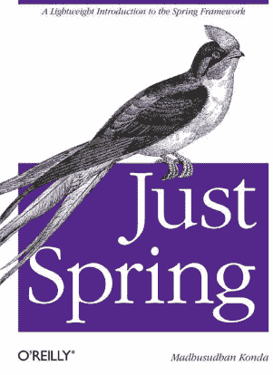
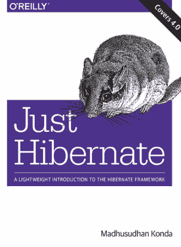
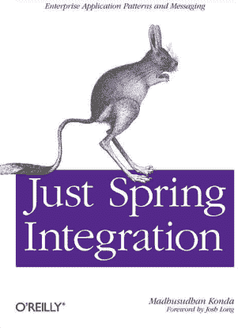
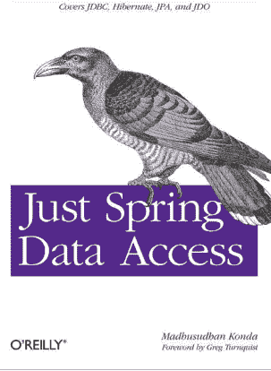

# Java 8 Lambda 表达式详解：Java 8 Lambda 表达式入门指南

《Just Spring》与《Just Hibernate》作者

`www.ebook3000.com`

`www.madhusudhan.com`

# 献辞

爸爸，我想念你！我们都想念你！

# 前言

毫无疑问，Java 8 的发布无疑巩固了 Java 作为世界上最流行的编程语言的地位。随着 Lambdas 的加入以及通过流处理数据的能力，它在其古老的面向对象特性基础上增加了强大的函数式能力。

听起来很令人兴奋不是吗？但 Lambdas 和流对你的未来以及学习现有代码库意味着什么？为了有效地使用这些新特性，你需要学习哪些基础性的陷阱和技巧？哪些编程挑战最适合用这些新的函数式技术来解决？在工作之余兼顾生活，你到底如何学习所有这些复杂的材料？这些都是非常有效的问题！

Lambdas、流和函数式编程范式对于当今超过 900 万的 Java 开发者来说，代表了巨大的转变。事实上，这些概念是如此不同，以至于我第一次在想：“这真的是 Java 吗？我学习了这些概念还能算作一名 Java 程序员吗？”这些变化实际上非常巨大，甚至让我怀疑了自己的能力。

幸运的是，我接触到了 Java 8 的早期版本，并作为 Adopt OpenJDK (`http://adoptopenjdk.java.net`) 社区计划的一部分。我在伦敦 Java 社区与 Brian Goetz（Oracle 后台 Lambdas 的首席工程师）进行了几天的运行和研讨会，这让我随着时间的推移熟悉了新特性。当然，大多数开发者并没有这种提前一年的幸运，幸运的是这本书就在这里为你提供帮助！

在我们在投资银行工作期间，我有幸与 Madhu 合作解决过各种复杂的软件问题。他擅长总结主题并将其提炼为我们其他人可以理解的内容。正如他的《Just Spring》和《Just Hibernate》一样，这本书将帮助你跨越学习新技术的门槛，让你在接下来的周一就能信心地使用它们来解决编码问题。

如果你想快速掌握 Lambdas、流和 Java 8，那么这本书就是适合你的！

Martijn Verburg

“恶魔开发者”

jClarity 首席执行官，Java 冠军，伦敦 Java 社区共同负责人

# 前序

## 为什么我写这本书

由于每天都有许多新框架出现，而我们学习和掌握它们的时间又如此少，作为一名开发者，我发现很难跟上不断演变的编程世界。编程工作要求高且节奏快，人们通常需要在周末内学习一门语言或框架，并在下周一开始编码。

如果我能找到一本书，可以在一天两天内教我所需的一切。一本能建立立即开始编码所需的信心的书。

我的目标是提供这样的书籍——简单、直截了当且由示例驱动的书！一本你可以在一天或两天内完成的书！我的梦想是编写可以在周末内读完的技术书籍，我诚地希望这本书能实现这个梦想！

我的写作之旅始于《Just Spring》的出版，这是关于该主题的第一本书，旨在提供关于 Spring 框架的轻松读。这本书广受欢迎（新版将于 2016 年初发行出版），并激励了我写更多。非常感谢你们过去几年来给我的鼓励。

我衷心希望这本书能成为你学习和理解 Java 8 的良好伙伴。

## 这本书是关于什么的

期待已久的 Java 8 终于发布，势如破竹

这本书关于理解 Java 8 lambdas。到为止，Lambdas 是该语言自诞生以来引入的最大变化。与 lambdas 一起引入的还有其他特性——例如接口解锁、函数式库、流和并行处理等。这本书试图用平俗易懂的文字和直观的示例消除这些概念的神秘感。

这本书主要集中在 lambdas 和其他相关概念上。Java 8 中引入的特性如新的日期和时间 API、Nashorn 脚本等将不会在书中。

你必须已经对 Java 编程语言有理解。这本书不会教你如何用 Java 编程。

## 代码在哪里

本书配有 Java 代码项目。代码可以在我的 Github 上找到：`https://github.com/madhusudhankonda/AllAboutLambdas`。

我将根据需要更新代码库，如果你有任何建议或推荐，或者希望做出贡献，请与我联系。如果你能为仓库做出贡献，我将不胜感激。

我尝试保持代码段的简洁，以免丢失其旨在说明的概念重点。为了简洁起见，如果你能为仓库做出贡献，我将不胜感激。

## 我欠谁的

很多人鼓励我、站在我身边并以各种方式支持我。感谢 Ravi Saitikonda、Vijay Kumar、Praveen EGK、Krishna Barella、Ajay Kumar Sathuluri、Sumit Mukherjee、Somay Nakhal、Robert Varga 以及许多其他人为这本书的付出的投入。

如果说有一个我感激不尽的人——那是我亲爱的妻子！她一直是这个项目的灯塔，在需要时在场，在我迷失时鼓励我并引导我，照顾好我的健康，并在我漏掉家务活时理解我！我不能忘记提到我 9 岁的儿子 Joshua 对他“作者爸爸”那份无与伦比的爱。他是我编写简单书籍的灵感。我们让我们意识到，保持简单要困难得多！

## 本书结构

本书像讲故事一样揭示这些概念，直击主题且没有过多的干扰。书中的代码示例刻意选择了简单且基础的内容。所有示例都可以在本书的 Github 路径在线查看（请参见上文的“代码”部分）。

每个代码示例都将有一个 Java 类名，在适当的情况下后紧跟方法名，例如：`Runnables.java#usinglambda`。在必要时，我在侧边栏的框中标记了重要的注意事项，请务必查看它们。完整的源代码可以在 github 上找到，请查看并尝试运行。如果你能提交改进建议，我将不胜感激！

## 封面设计

封面和竖琴图案（Harp）由我的妻子和儿子设计开发。竖琴是一种可以追溯到公元前 3500 年的古老多弦乐器。它是中世纪的关键乐器，被认为起源于猎人的弓。它经过精美的雕刻，带有不同长度的弦，能产生丰富的音，据说竖琴的音乐可以抚慰灵魂！

# 1. 引言

Java 8 为语言领域带来了一股清风。它被誉为游戏规则的改变者，拥抱函数式编程风格。Lambda 表达式、接口的演变、重构的库、使用流的数据处理支持以及开箱即用的并行处理，是该语言自诞生以来引入的一些重大变化。Java 开始在同类语言中显得落后，而让语言跟上时代无疑将赢得那些耐心等待并宣布对 Java 效忠近二十年的开发者们的心。

在深入细节之前，让我们通过基础示例对 Lambda 表达式有一个直观的了解。

## 概览

俗话说道：“男人不看说明书！”如果真要以此为准的话，我们更希望看到 lambda 的实际运行状态，而不是读几章赞美它们的文字。某些功能最初可能会让你感到困惑，但请相信，这本书将是你揭秘这些语言特征的最佳伴侣。

### Runnable 示例

与 Runnables 操作非常简单，我确定你可能已经使用 Runnables 创建并执行过线程。假设我们在看电影时需要在家里处理一些家务。`runErrands` 方法预计在单独线程中执行，因此我们创建了一个 `Runnable` 实现类来封装 `runErrands` 方法，并让一个新的 `Thread` 来执行它。实现这一目标有三种方法——让我们开始探索这些方法。

### 使用 Runnable 实例

在这种方法中，我们遵循传统方法：创建一个 `Runnable` 实例，并让 `Thread` 调用它。

下面的代码段演示了这一点：

```java
// Runnable.java#instanceRunnable

// Runnable 的具体实现
Runnable oldRunnable = new Runnable() {
    @Override
    public void run() {
        System.out.println("Errands using traditional Runnable!");
        runErrands();
    }
}

// 执行 Runnable
new Thread(oldRunnable).start();
```

为了运行我们的业务逻辑（即 `runErrands`），我们创建了 `Runnable` 接口的实现并在 `run` 方法中调用了该逻辑。然后我们创建了一个 `Thread` 并我们的 `Runnable` 传入执行。除了调用 `runErrands` 方法外，其他五行代码与业务逻辑无关（模板代码）。

### 使用匿名类

启动线程的另一种方法是使用匿名类方法。在这里，我们没有实例化 `Runnable` 实例，而是内联创建了匿名类，如下：

```java
// Runnable.java#anonymousRunnable

// 作为匿名类的 Runnable
new Thread(new Runnable() {
    @Override
    public void run() {
        System.out.println("Using an Anonymous runnable");
        runErrands();
    }
});
```

与第一种方法相比，这种方法也存在模板代码。除了省去了创建一个实例变量之外，这两种方法在结构上没有太大区别。在上述两种情况下（实例方法或匿名类方法），我们的业务逻辑（运行家务）都模糊并隐藏在模板代码之下。

### 使用 Lambda 表达式

好了，不深入探讨过多细节，上述逻辑可以表示为 lambda 表达式，如下所示：

```java
// Runnables.java#usingLambda

// 创建 lambda 表达式
Runnable runErrandsLambda = () -> runErrands();

// 让线程执行 lambda
new Thread(runErrandsLambda).start();
```

我们创建了第一个 lambda 表达式，并将其赋值给调用业务逻辑（`runErrands`）的 `Runnable`，抛弃了周围所有的废话。代码不仅清晰简洁，业务逻辑的意图也解释得非常清楚。我们不需要使用 lambda 表达式创建 `Runnable` 实例（就像我们在上面的示例中所做的那样），可以这样内联创建 lambda：

```java
// Runnables.java#usingLambda

// 内联创建 lambda 表达式
new Thread(() -> {
    System.out.println("Using a Lambda Expression");
    listErrands();
    runErrands();
}).start();
```

`Thread` 现在接收到的代码表达式，其中包含了打印调试语句、列出家务以及最后运行它们。在此调用中没有创建 `Runnable` 实例（不过，表达式必须符合 `Runnable` 接口的定义——稍后会详细介绍）。

为了简洁起见，让我在这里向你展示完整的示例（书中提到的完整运行程序请查看 github 中的代码）：

```java
// Runnables.java#usingLambda
public class Runnables {
    public static void main(String[] args) {
        Runnables client = new Runnables();
        client.usingLambda();
    }

    public void usingLambda() {
        // 简单的 lambda
        Runnable runnableSimple = () -> runErrands();
        new Thread(runnableSimple).start();

        // 内联 lambda 表达式
        new Thread(() -> {
            System.out.println("Using a Lambda Expression");
            listErrands();
            runErrands();
        }).start();
    }

    private void runErrands() {
        // 家务的逻辑
    }

    private void listErrands() {
        // 列出的逻辑
    }
}
```

### 流示例

考虑一个需要某些数据处理技术的需求，例如获取大订单列表。在不深入细节的情况下，这里是实现此功能的代码片段：

```java
// Streaming.java#findLargeTrades

// 流处理交易，过滤大订单
trades.stream()
    .filter(trade -> trade.getQuantity() > ONE_MILLION)
    .forEach(System.out::println);
```

上述代码对源使用了流技术，过滤掉不需要的交易。代码简单、富有表现力，不需要迭代或临时存储变量。流是从源提取的数据元素，通过管道并在元素上应用转换、映射、过滤等操作。终端操作是产生结果的最终组件，此时流也就结束了。

在可用核心上并行运行代码（多核处理）可以再简单不过了：

```java
// Streaming.java#findLargeTradesInParallel

// 在并行模式下运行操作
List<Trade> bigTrades = trades
    .stream()
    .parallel()
    .filter(t -> t.isBigTrade())
    .collect(toList());
```

我们没有为了在并行模式下执行程序创建大量的类或复杂的基础设施。我们没有在准备 fork/join 框架或管理任务或子任务上耗费代码。相反，我们只需要在流上调用一个方法（`parallel`），任务就完成了！无忧的并行化正是 Java 8 带给我们的。

Lambda 表达式或流（streams）的语法可能有点不寻常，但相信我，它并不比组装简单的乐高更复杂。在结束这个关于 lambda 的章节之前，让我向你展示这里几个更多的 lambda 表达式以保持完整性：

```java
// Examples.java

// 一个对给定 Trade 执行各种操作的 lambda 表达式
Callable<Trade> c = () -> {
    Trade t = new Trade("GOOGLE", 2000, "OPEN");
    encrypt(t);
    persist(t);
    return t;
};

// 一个并行流处理流水线，用于计算所有交易
// 的总数量
trades
    .stream()
    .parallel()
    .map(Trade::getQuantity)
    .reduce(Integer::sum);

// 获取斯尔伯格不同的电影
movies
    .stream()
    .filter(m -> m.getDirector().equals("Steven Spielberg"))
    .map(Movie::getName)
    .distinct()
    .forEach(System.out::println);
```

我们将在接下来的章节中介绍创建和使用 lambda 的细节，但与此同时，让我们研究 Java 8 升级背后的力量，即面向对象语言拥抱函数式编程风格的原因（也许成为一种函数式和面向对象的语言（FOO））！

### 力量

生活中有少数事情迫使我们改变，或者至少让我们适应变化。同样，在我看来，有三种主要力量共同作用驱动了 Java 景观的变革。让我们简要检查这些力量。当然，还有其他因素，但为了简单起见，我们考虑以下这三种力量。

#### 处理能力

即使是今天一个简单的平板电脑或手机设备也配备了多核心处理芯片。通过采用并行模式执行，这些强大的核心可以被有效利用。过去二十年，计算机处理能力的惊人进步将 Java 语言推向了边缘。只有当编程语言能够通过丰富的工具包和合适的函数来利用并行计算的力量时，它才能繁荣。

Java 凭借其古老的库和繁琐的多核心编程风格，已经落后了。当其他语言拥抱技术力量的进步时，Java 由于众多原因而处于落后。当它们努力变得更加精确和简洁时，Java 在这方面没有做出显著的尝试。过去几年，大数据应用也急剧上升。私营和公共部门对大数据的使用以及对处理海量数据的需求呈指数级增长。

Java 无疑是服务器端应用程序的一个大平台，但设计和开发多处理器应用程序是一项令人生畏的工作。开发者在开发并发和并行应用时，需要处理与低线程和内存模型工作的细节。线程（`Thread`）甚至让经验丰富的程序员都感到紧张。为了应对多核心巨型机器指数级增长带来的挑战，重新设计语言、引入现代工具包和库来支持这些挑战是至关重要的。

#### 捕获行为

捕获行为并像数据一样传递它是函数式编程范式的核心。我们将这种代码称为数据，即传递一个表示行为的程序块。这一功能对于 Java 来说并不新鲜，它以匿名类策略的形式存在，但处理匿名类是一种痛苦，而且无疑会带来很多麻烦。由于它们的冗长、紧密耦合和作用域解析，匿名类很快变得对非程序员不利。它们还携带了不必要的负担以及复杂的规则，导致代码遗憾地难以统一。

Java 类分别用类变量和方法表示状态和行为，方法并没有设计为接受另一个方法作为其参数。也就是说，我们不能将一个方法传递给另一个方法。捕获函数行为并将其作为数据传递是另一个大挑战。

#### 重构库

最后一种力量来自在不造成混乱的情况下增强应用程序库的需求。任何编程语言的繁荣都取决于其良好的设计和库的使用。随着时间的推移，库需要增强以适应不断变化的格局和需求。因此，库预计不断演进。

任何框架的核心都是一个简单的接口定义。正如我们所知，直到 Java 8 的接口……（注：原文此处此处中断，翻译随之结束）

`getDefaultName getRegion`。在 Java 8 之前，我们无法在接口中添加这些具体的实现。


```java
// Component.java

// 解锁的接口 - 不再是抽象的了！
@FunctionalInterface
public interface Component {
    // 一个抽象方法（以便它可以表示 lambda 表达式）
    String getName();

    // 完全实现的默认方法
    default String getDefaultName() {
        return "Default Component";
    }

    // 完全实现的静态方法
    static String getRegion() {
        return "United Kingdom";
    }
}
```

注意，声明的具体方法必须是 `static` 或 `default` 类型。如果这两个分类器中的一个都没有提供，编译器将会报错。此外，请注意接口上 `@FunctionalInterface` 注解的声明。虽然它是可选的，但该注解可以防止函数式接口的不当使用。我们将在接下来的章节中学习更多关于接口的知识，包括静态和默认方法。

## 默认和静态方法

正如我们之前提到的，Java 8 为接口的解锁打开了大门。我们现在可以在接口中创建默认和静态方法。如果有需要，我们还可以修改现有的接口（这就是为什么 Java 8 的接口如 `Runnable`、`Callable`、`Comparator` 被重构的原因）。方法应该适当地以 `default` 或 `static` 关键字开头，在接口中提供逻辑的完整实现。

如果你检查 `Comparator` 接口的定义（参见 Javadoc），你会发现 Java 8 版本添加了一些默认和静态方法。

## 函数式接口

函数式接口有一个抽象方法，因此可以作为 lambda 表达式的目标类型。每当我们将函数式接口作为方法的输入类型时，它就可以被 lambda 表达式所替代。

```java
// Finder.java
@FunctionalInterface
public interface IFinder {

    // 抽象方法
    String find(String criteria);

    // 默认方法
    default String criteria(){
        return "Search criteria:";
    }
}
```

`IFinder` 接口有一个抽象方法和一个具体的默认方法。只要我们只定义一个抽象方法，该接口就可以被分类为函数式接口，并作为 lambda 表达式的目标类型。

如果接口只有一个抽象方法，无论其他默认或静态方法有多少，它都将成为作为 lambda 表达式类型的候选者。这种接口有一个特殊的名称，叫做函数式接口。

下面的代码段显示了 lambda 表达式，注意 lambda 的目标类型：

```java
// 使用上述函数式接口的 lambda 表达式
IFinder finder = (input) -> "output result";
```

## 函数

函数是我们开发应用程序时使用的反复模式。Java 8 提供了一组函数定义作为库，而不是到处去创建和散布它们。为此，引入了新的包 `java.util.function`。函数有助于实现设计构品的统一方法。

`Predicate`、`Consumer`、`Supplier` 函数可以从函数库中获取。事实上，即使是专门函数如 `IntPredicate`、`LongPredicate` 或 `DoublePredicate`（还有许多此类专门化，如 `IntConsumer`、`DoubleConsumer`、`IntFunction`、`DoubleFunction` 等）也可以直接使用。我们之前查找大额交易或大交易的示例可以使用标准 Java 8 库中的 `Predicate` 函数来重写，如下代码示例所示：

```java
// 检查大交易
Predicate<Trade> bigTradeLambda = (t)->t.isBigTrade();

// 用于检查已取消交易的 Predicate
Predicate<Trade> cancelledLambda = (t)->t.isCancelledTrade();

// 检查新或未知交易的 Predicate
Predicate<Trade> newOrUnknownTrade = (t)-> {
  return
  t.getStatus().equals("NEW") ||
  t.getStatus().equals("UNKNOWN")
};
```

上述 lambda 表达式被分配给 `Predicate` 类型，以检查各种条件的真假。`Predicate` 是一个库函数，理想情况下它应该替换我们任何自定义的预定义条件检查函数。在接下来的章节中，有几章专门学习函数。

## 流（Streams）

流是 Java 8 语言的另一个跨越。这是一个为了有效处理大数据分析操作而引入的新概念。简单来说，流是元素的序列。虽然集合（Collections）是存储和访问数据的数据结构，但流本身不持有任何用于根据定义的业务逻辑处理或分析的数据。引入流极大地简化了集合库，并能够高效地执行大数据操作。

流补充了 lambda 表达式。在 lambda 表达式的帮助和支持下，流提供了强大的集合库。以使用流从大量的电影集中找到经典列表为例：

```java
// StreamsFeature.java#findClassics

return movies
  .stream()
  .filter(m -> m.isClassic())
  .collect(toList());
```

这段代码更具表现力且流利！它表示一旦我们对电影进行流处理，我们就使用经典电影谓词对其进行过滤，并将它们收集到列表中。

## 并行操作

利用计算机的全部处理能力是一个巨大的胜利。流配合 lambda 有助于在需要时创建并行程序和惰性求值（lazy evaluations）。惰性求值允许程序连接操作序列但在事件触发之前不会执行。流帮助在顺序模式和并行模式下对数据进行过滤、映射和切片。这仅仅是愉快旅程的开始。

将顺序程序转换为并行程序只需更改一个简单的方法调用。在 Java 的早期版本中，我们无法轻松地开启并行，因为我们必须处理线程和并发的底层机制。

例如，如果我们收集数百万部电影，将非常毫不费力地并行运行程序。只需在流上调用名为 `parallel` 的方法，让操作利用机器的多个核心并行运行。

下面的代码段演示了通过并行运行程序收集经典电影的示例：

```java
// ParallelStreamsFeature.java

// 使用并行模式收集经典电影
return movies.stream()
  .parallel()
  .filter(m -> m.isClassic())
  .collect(toList());

// 或者在集合上使用 parallelStream
return movies
  .parallelStream()
  .filter(m -> m.isClassic())
  .collect(toList());
```

调用 `parallel`（或 `parallelStream`）方法使管道操作以并行模式运行。

## 其他特性

除了上述基础语言特性外，Java 8 还引入了新的日期和时间 API。

如果你曾在 Java 中处理过日期和时间，我确定你会同意那是一件痛苦的事。它是几乎被 Java 开发者社区讨厌的最不友好且最复杂的 API。一个名为 Joda Time API 的开源替代方案出现，让我们免于危险。与此同时，幸运的是，Java 设计者听取了批评，因此从 Joda Time 中汲了许多灵感和设计，引入了新的日期时间 API。新创建的 `java.time` 包托管日期和时间组件。

注意，日期时间 API 以及 Nashorn 脚本引擎不在本书的范围内。

## 总结

本章对 Java 8 的新特性进行了旋风式的回顾。我们从非常高层的高度并尽可能结合示例查看了语言的特性。我们介绍了 lambda、函数式接口、函数，并简要探索了流。

# 3. 引入 Lambda

Java 是一种面向对象的编程语言。方法和变量都绑定到类，并且在调用方法执行函数之前，必须实例化类才能恰当执行。我们无法拥有不属于任何类的变量或代码块。

类是基础结构，即使只是一行业务逻辑，也必须写在方法中并在类中声明。随着 Java 8 的出现，我们可以编写代码块并将它们像传递数据一样传递给其他方法。在 Java 中，类曾经是唯一的“一等公民”，但随着 Lambda 的引入，代码的最小单元就变成了 Lambda！

本章将重点介绍如何去揭开 Lambda 的神秘面目，并尝试理解其整体概念。

## 什么是 Lambda？

Lambda 是程序代码块，表示类似于函数的行为。它可以像我们传递数据一样被传递给其他方法——我们称之为“代码即数据”。它们是匿名函数，并且简洁、整洁且富有表现力。它们是某种自由浮的代码块，帮助我们编写函数式代码。

考虑以下示例：

```java
// LambdaTasters.java

// 每天打印一条格言的 Lambda
QuoteLambda = () -> System.out.println("Hello, Lambdas!");

// 函数式接口定义：
interface Quote {
    void quoteOfTheDay();
}
```

这是一个简单的 Lambda 表达式，调用时它会在控制台打印格言。如果它看起来没什么意义，请不要担心。在现阶段，你只需要知道它在不接收参数的情况下会执行某些操作（向控制台打印消息）。

同样，考虑另一个提取交易工具的 Lambda 表达式示例：

```java
// LambdaTasters.java

// 获取交易工具的 Lambda
Instrument<T> instrumentLambda = (t) -> t.getInstrument();

// 函数式接口定义：
interface Instrument<T> {
    String extract(T t);
}
```

在以上两个示例中，我们都定义了一个函数式接口和一个 Lambda 表达式。从这些 Lambda 表达式可以看出，它们对我们来说是新事物，并且具有特殊的语法和语义。

Lambda 本质上是数学函数。它们将输入映射到唯一的输出，包括空参数列表的情况。它们代表了一种行为，例如预订机票座位、将温度从摄氏度转换为华氏度、合并两笔交易或汇总高净值人士的全部财富。我们可以使用 Lambda 来对这种功能行为进行参数化。

Lambda 是表示程序行为的匿名函数。我们可以像向方法传递数据一样传递它们。

通过使用 Lambda，我们可以轻松舒适地建模不断变化的客户端需求。

严格来说，Lambda 并不是自由浮的代码块，而是实现名为“函数式接口”特殊接口的函数。函数式接口必须定义且仅有一个抽象方法。

### 问题领域

学习 Lambda 特性的最好方法是通过示例。

让我们考虑一些需求，例如检查给定交易是否需要加密、是否由于相关的市场风险而需要卸载、或者是否是可以拆分的大交易等。通常，我们会设计并定义一个接口来捕获并执行此类行为。我们在之前的章节中已经创建了带有抽象方法 `check(T t)` 的 `Tradable` 接口，我们可以用它作为理解和分析 Lambda 语法的基础。

为了完整起见，再次显示接口的定义：

```java
// DissectingLambda.java

// 用于检查特性的函数式接口
interface Tradable<T> {
    boolean check(T t);
}
```

现在我们有了函数式接口，可以为各种情况开发几个 Lambda 表达式。如果我们想检查交易是否为大交易，我们可以像下面的代码所示创建一个带有相应业务逻辑的 Lambda 表达式：

```java
// 大交易 Lambda 表达式
Tradable<Trade> bigTradeLambda = (t) -> t.isBigTrade();
```

赋值语句的右侧是一个 Lambda 表达式。它表示：给定一个 `Trade t`，调用 `isBigTrade` 方法来返回一个布尔结果（我们很快就会学习其语法）。

Lambda 表达式的类型是函数式接口，上面的 Lambda 被赋值给类型为 `Tradable<Trade>` 的变量。

在这里，我们正在创建一个关联了 Lambda 表达式的 `Tradable` 实例。

然而与其创建一个 Lambda 并将其赋值给某个类型，不如直接将 Lambda 表达式传递给任何接受 `Tradable<Trade>` 作为参数的方法，例如此片段所示的 `checkCharistics` 方法：

```java
// DissectingLambda.java#checkChacteristics

// 将 Lambda 表达式传递给方法
private void checkChacteristics (Tradable<Trade> lambda, Trade t) {
  tradableLambda.check(trade);
}
```

该方法接受一个函数式接口，从而抽象了逻辑，使得客户端可以传入符合他们要求的多个 Lambda 表达式，如下所示：

```java
// 创建实例
DissectingLambda client = new DissectingLambda();
Trade trade = new Trade(..);

// 交易是否处于取消状态？
client.checkChacteristics((t) -> t.isCancelledTrade(), trade);

// 它是高风险交易吗
client.checkChacteristics((t) -> t.isRisky(), trade);
```

如你所注意的，`checkChacteristics` 方法能够接收符合指定签名的代码表达式：给定一个 `Trade`，返回一个布尔值。在两个示例中，我们都是内联声明 Lambda 代码并将其传递给 `checkChacteristics` 方法。因此，我们在无需重复代码的情况下交付了行为。客户端具有更大的灵活性来创建行为。我们已经宏观上理解了 Lambda，现在是理解其特殊语法的时候。

### 语法

考虑我们之前看到的这个 Lambda 表达式：

```java
// 打印消息的 Lambda 表达式
() -> System.out.println("Hello, Lambdas!");
```

这种语法初看起来可能会有些困惑。这是我们目前还不熟悉的东西。这里有一种表示 Lambda 表达式的特殊语法。但它与方法并没有太大区别，只是表示方式不同。

### 组成部分

Lambda 表达式的语法源自函数式接口定义。与普通方法类似，Lambda 有输入参数和主体、返回值以及可能存在的异常。从方法的角度来看，很容易理解语法。为了保持简单，我们将 Lambda 表达式分为两部分：左部分和右部分。部分之间通过箭头（→）分隔。箭头的左侧是 Lambda 表达式的输入参数持有者，而右侧是 Lambda 的主体。主体是应用业务逻辑并返回结果的地方，如果没有返回值则为 void。

```java
// 高级 Lambda 表达式
(Input arguments) → { body
```

让我们将这种语法与之前的示例进行比较，从示例中提取正确的部分：

```java
() → System.out.println("Hello, Lambda!");
```

左手是展示参数的地方，在这种情况下，Lambda 有空括号，意味着该 Lambda 不接收任何输入参数。右手是代表业务逻辑的主体，在这种是打印消息。如果我们只有一个参数，括号是可选的，参数列表变得更加简单，如下所示：

```java
// 单参数，查看下一个代码段了解我们可以做什么
(Trade t) -> t.getInstrument().equals("IBM")

// 丢弃括号和类型声明即可！
t -> t.getInstrument().equals("IBM")
```

### 类型推断

在 lambda 表达式 `t -> t.getInstrument().equals("IBM")` 中，输入参数没有声明类型。显然，Java 编译器在看到这种情况时理想情况下会感到不悦。然而，我们可以忽略输入参数的类型，因为编译器会根据函数式接口的定义推断出它们。编译器可以推断出 `t` 确实是一个 `Trade` 类型。我们将在稍后详细讨论目标类型（target typing）和类型推断（type inference）。

### 返回值

lambda 体中返回值的声明非常有意思。在某些必须声明输出值的情况下，返回类型是显式的。其他情况则是隐式的，在这种情况下，返回值会被省略。看下这个 lambda 表达式：

```java
// DissectingLambda.java
// 用于已取消交易的 lambda 表达式

// 返回是隐式的
(t) -> t.isCancelledTrade()
```

我们没有在上述表达式的体中声明返回值，因为这是一个简单的表达式，输出会隐式地返回给调用者。也就是说，如果体是一个语句（statement）或简单的表达式，我们可以忽略附加 `return` 关键字。

然而，如果我们有一个包含各种控制路径的复杂代码块，那么我们必须显式地标记返回。

考虑下面的代码段，它是上面示例的副本。

Lambda 语法源自函数式接口，代表输入和包括异常在体，类似于普通的方法声明。表达式的形成方式为：`(input) -> {body}`

```java
// DissectingLambda.java

// 由于体不再是简单的语句/表达式，返回是显式的

t -> ( 
    return t.isCancelledTrade();
)
```

对于多行代码体（每行用分号分隔），我们需要使用大括号并配合显式返回。例如，看另一个示例，在该示例中，lambda 的体被包含在大括号内（简单逻辑），此时 `return` 是强制性的：


```java
// GreetingExample.java

// 使用大括号时需要显式返回类型
Greeting greetingLambda = s ->(
    return "Hello, " +s;
);
```

### Lambda 类型

现在我们已经涵盖了语法基础，下一步是寻找 lambda 是如何形成的机制。正如之前提到的，lambda 表达式的形成取决于函数式接口的定义。

让我们考虑一个简单的 "Hello, World!" 示例。一个用于问候消息的函数式接口（只有一个抽象方法的接口）定义如下：

```java
// GreetingExample.java

// 函数式接口
interface Greeting {
    String sayHello(String name);
}
```

该接口有一个抽象方法`sayHello`，它接受一个名称（`String`）并返回一条消息（`String`）。由于它只有一个抽象方法，我们可以用`Greeting`作为其类型定义一个 lambda 表达式。

`sayHello`方法接受一个`String`类型的输入。我们 lambda 的左部分应该像这样。因此，lambda 的左侧可以写成：

```java
// lambda 的左部分
(String msg)
```

lambda 的右侧是应用于给定的输入的逻辑。该逻辑是向控制台打印一条消息。下面的代码段展示了这一点：

```java
// lambda 的右部分
System.out.println("Hello, "+msg);
```

现在我们已经有了 lambda 的左部分和右部分，两部分通过一个左箭头运算符连接在一起，产生了一个 lambda 表达式：

```java
// 最终的 lambda 表达式
(String msg) -> System.out.println("Hello, "+msg);
```

让我们将其与`Greeting`接口的具体实现进行比较。如果我们实现这个类，我们将拥有`sayHello`方法的一个具体实现，大致如下所示：

```java
Greeting oldGreeting = new Greeting() {
  @Override
  public void sayHello(String msg) {
    System.out.println("Hello, "+msg);
  }
};
// 这是转换成 lambda！
(String msg) -> System.out.println("Hello, "+msg);
```

将传统的`Greeting`接口实现与 lambda 表达式进行比较，我们可以看到传统类实现中的高亮代码是如何变成 lambda 的！主要的区别在于方法名称，以及其余的样板代码，这留给我们一个简单的表达式。

最后，如果我们需要将此表达式赋值给变量，我们应该将其赋值给我们最初推导出该 lambda 的函数式接口：

```java
// 类型是一个函数式接口
Greeting greetingLambda =
(String msg) -> System.out.println("Hello, "+msg);
```

### TradeMerger Lambda 示例

为了巩固对 lambda 表达式形成的理解，让我们考虑另一个示例，这次有两个输入并返回一个对象。

为了这个目的，我们创建了一个名为`Merger`的接口，它定义了合并两个交易以产生新交易的合约。我们定义了一个接受两个交易的单一抽象方法`merge`：

```java
// TradeMerger.java
// 用于合并交易的函数式接口
interface Merger{
  Trade merge(Trade t1, Trade t2);
}
```

由于该方法接受两个输入，我们在表达式左侧的括号中编写输入参数。在右侧，我们合并这两个输入并返回一个合并后的交易（为了简洁起见，省略了业务逻辑）。代码所示所示：

```java
// TradeMerger.java
// lambda 表达式
(Trade t1, Trade t2) -> {
    Trade mergedTrade = new Trade();
    ...
    return mergedTrade;
}
```

如果你愿意，可以省略参数的类型（如上面的示例所示），因为它们可以由编译器推断。

最后一块拼图是这个 lambda 的类型。函数式接口本身成为了 lambda 的类型。因此，上面的 lambda 表达式被赋值给`Merger`，如下所示：

lambda 的类型是函数式接口。如果预期代表 lambda，则函数式接口必须有一个抽象方法。（注意：此处文本跨页面合并）。

## 总结

在本章中，我们奠定了创建和形成 lambda 表达式的基础。我们查看了 lambda 示例，以及自定义函数式接口和相应的 lambda。

## 4. 使用 lambda

到目前为止，我们对 lambda 有了良好的理解，尽管是从高层面的。现在是时候深入研究以理解目标类型、作用域、继承等重要概念了。

### 目标类型

我们之前学过 lambda 表达式的类型是函数式接口。我们也知道由于 Java 是强类型语言，必须声明类型否则编译器会报错。

目标类型可以在 lambda 表达式被使用的上下文语文中被理解。在涉及类型时，我们可以处理的两类上下文：赋值上下文和调用上下文。在这两种情况下，编译器都足够智能可以推断出 lambda 表达式的类型。

### 赋值上下文

我们拥有创建 lambda 表达式并将其传递给方法而不必担心将其赋值给局部变量的奢侈然而，在某些情况下，我们可能需要引用 lambda 表达式的变量。例如，在下面的代码中，有一个表达式被赋值给`Merger`类型：

```java
// Merger.java
// lambda 被赋值给函数式接口
Merger mergedTrade = (t1, t2) -> {
    ...
    return mergedTrade;
}
```

我们将 lambda 表达式赋值给一个变量，以便在程序的其他地方引用它。在这个示例中，我们显式地声明了表达式的类型（赋值给`Merger`），通过这样做，如果我们没有在 lambda 表达式的定义中声明，编译器也可以推断出输入参数的类型。也就是说，在上面的示例中，你可以看到我们省略了参数`t1`和`t2`的类型。

为了找到这些输入参数的类型，编译器使用赋值上下文来推导它们。在这一目标过程中，它必须执行几个步骤，列举如下：

编译器首先查看变量类型（在此情况下为`Merger`），并读取该接口的方法签名（`Merger`有一个方法`merger`）。`Merger`的`merge`方法的签名表明它接受两个输入，类型都是`Trade`类型，这意味着我们的 lambda 输入参数也必须是相同的类型（`Trade`）。编译器应用这种逻辑并推断出`t1`和`t2`是`Trade`类型。

在早的示例中，我们已经见过输入参数类型被省略的情况。查看下面的 lambda 表达式，它被传递给一个方法并打印问候语：

```java
// The type of msg parameter is dropped!
msg -> System.out.println(msg);
```

在这种情况下，输入参数`msg`的类型没有被显式声明。编译器如何知道它是特定类型呢？嗯，这同样是从赋值上下推断出来的。由于上述表达式的类型是`Greeting`，该方法接受`String`作为输入并返回`void`。该输入应该与 lambda 的输入匹配——因此`msg`是`String`类型。同样，编译器还检查了方法的返回值（在此情况下为`void`）。编译器检查 lambda 表达式是否也返回`void`，它确实是这样。到为止一切看起来正常。最后一步是检查该方法是否抛出任何异常。我们的方法没有抛出任何异常，因此不会进行此检查。

在将 lambda 表达式赋值给变量的情况下，上下文是 lambda 被赋值的类型。编译器通过与函数式接口匹配来推导出类型。

由于所有检查都成功完成，编译器对我们赋值给 lambda 的目标类型表示满意，没有出现错误或警告。

### 调用上下文（Invocation Context）

当我们内联创建 lambda 表达式时，编译器会借助调用上下文来解析表达式的类型。假设我们有一个方法接受函数式接口`Runnable`作为其输入参数，如下：

```java
public void runMe(Runnable r){
    new Thread(r).start();
}
```

我们知道 lambda 表达式可以用`Runnable`作为其类型开发。因此，我们可以通过传递 lambda 表达式作为输入参数来调用`runMe`方法。参见下面的代码段：

```java
public void runMe(() -> {
    sendEmail();
    notifyAccounts();
}
```

我们在这里并没有创建`Runnable`的实例，而是将一个代码块传递给方法（将代码作为数据），这是一项强大的功能。我们正在动态为`runMe`方法设置 lambda 表达式。

编译器如何知道给定的 lambda 表达式符合要求呢？嗯，我们为赋值上下文学到的类型理论也适用于这里。`runMe`方法接受`Runnable`作为输入参数，所以我们的 lambda 表达式必须是`Runnable`类型。编译器执行了我们之前看到的常规检查。要点是，目标类型（target typing）允许从执行 lambda 表达式的上下文推断出类型。

### Lambda 作用域（Lambda Scoping）

与其他编程语言一样，Java 语言对对象、类、方法和变量也有作用域规则。作为开发者，我们应该完美地掌握类级、内部类和方法级的作用域。一旦我们熟悉了语言，这些作用域就会刻在脑子里。lambda 表达式作为代码块，也有一些作用域规则。

### 词法作用域（Lexical Scope）

lambda 表达式的作用域不会超出它创建的方法。它是词法作用域的，这意味着它表现出与所属方法相同的作用域。这被称为词法作用域。

适用于方法的规则和策略同样适用于在宿方法中创建的 lambda 表达式。`this`或`super`的使用以及对静态类型的访问在方法和 lambda 中是相同的。

lambda 是词法作用域的，这意味着 lambda 表达式的作用域与其闭包的方法相同。

考虑以下示例：

```java
// LambdaThisStaticSuperAccess.java
// 展示词法作用域功能的类
class LambdaThisStaticSuperAccess extends SuperScope{
    private String instanceName="instanceVariableName";
    private static String staticName = "staticVariableName";

    Runnable runnableLambda = () -> {
        print("Super variable: "+super.superVariable);
        print("Instance variable: "+this.instanceName);
        print("Static variable: "+LambdaThisStaticSuperAccess.staticName);
    };
}

// Super class
public class SuperScope {
    String superName = "superVariableName";
}
```

在这里，我们定义了一个类`LambdaThisStaticSuperAccess`，它有两个变量：一个实例变量（`instanceName`）和一个静态变量（`staticName`）。它扩展了一个名为`SuperScope`的父类，该类声明了自己的变量（`superName`）。在我们的 lambda 表达式（`runnableLambda`）中，我们像在普通方法中使用`this`、`super`或类名一样访问这些变量。

执行上述代码时，输出所示：

```text
// Output from LambdaThisStaticSuperAccess.java
Super variable: superVariableName
Instance variable: instanceVariableName
Static variable: staticVariableName
```

### 在匿名类中访问 this（Accessing this in Anonymous class）

然而，在匿名类中访问`this`与 lambda 不同。匿名类获取它所创建类的作用域，而 lambda 获取它定义所在方法的作用域。让我们通过创建一个访问`hashCode`的匿名实现和一个执行相同操作的 lambda 来检查这一点。它们都会打印它们所属的类的哈希码：

```java
// LambdaAnonymousScope.java
// Outputting Hashcode from a lambda
```

匿名类的`hashCode`调用是获取`Runnable`实例——因此 lambda 的作用域是闭包类。

### 重定义变量（Redearing the Variable）

在 lambda 表达式中不能重新声明变量。也就是说，如果一个变量已经在方法的其他地方声明，我们不能在 lambda 中重新声明或为它赋值。

在接下来的代码中，注意方法中声明了一个局部变量`methodName`，但我们又尝试在 lambda 表达式中声明同一个变量：

```java
// LambdaRedearingVariables.java
private void testLocalVariable() {
    final String methodName = "Modified Name";
    IComponent cc = () -> {
        // Error! Declaring the variable is illegal
        // String methodName = null; // 取消
        return methodName;
    };
}
```

这就像在一个代码块中存在两个同名的变量，这是非法的，因此编译器不会高兴。要点是，方法的作用域规则也适用于 lambda。

### 捕获 Lambda（Capturing Lambdas）

到为止，我们开发的 lambda 表达式使用它们自己的输入参数。例如，在下面的`Greeting` lambda 中，`msg`是输入参数，正体将`msg`打印到控制台：

```java
// CapturingLambda.java
Greeting greetingLambda = msg -> System.out.println("Hello, "+msg);
```

我们说`msg`是一个 lambda 变量，它的作用域仅限于 lambda 表达式本身。如果我们尝试在 lambda 表达式之外任何地方访问`msg`变量（即使在创建 lambda 的方法内部），编译器也会感到不高兴。

考虑以下代码示例：

```java
// CapturingLambda.java

private void accessLambdaVariables() {
  Greeting q = (name) -> {
    print(defaultGreeting + name);
  };
  // Cannot access the lambda's input variable
  // print("Can I access lambda's variable":+name);
}
```

当我们在 lambda 表达式外部访问 lambda 的输入变量名时，编译器会报错该名称无法解析。在这里，声明为 lambda 参数或在 lambda 内部使用的变量的作用范围对外部是不可见的。

相反的情况是允许的，即 lambda 访问类的实例变量或静态变量是合法的。这些变量不是传递给 lambda 的，而是在包方法或类中其他地方创建的。

考虑以下示例，在 lambda 表达式中访问了实例变量（`defaultGreeting`）：

```java
// CapturingLambda.java
public class CapturingLambda {
  // 实例变量
  private String defaultGreeting = "Howdy, ";

  private void accessInstanceVariables() {
    // Lambda 表达式访问实例变量
    Greeting g = (name) -> {
      // 允许访问实例变量
      print(defaultGreeting + name);
    };
  }
}
```

lambda 表达式访问`defaultGreeting`变量没有需要解决的问题。这种变量有一个专门的名称——自由变量（free variable）。任何没有声明为 lambda 表达式参数但从周围作用域访问的变量都称为自由变量。实例变量、静态变量以及局部变量都属于这一类。

捕获 lambda（capturing lambda）捕获（复制）了类类其他声明的变量。

使用这些自由变量的 lambda 捕获 lambda。也就是说， lambda 会捕获（或复制）给它的任何输入参数，这意味着这些输入变量的值被复制。

关于在 lambda 表达式中使用自由变量的建议：虽然从 lambda 访问类变量是合法的，但可能会导致副作用（side effects）。副作用是对程序状态的非意图修改。在纯函数式编程风格中，不采用共享状态，并建议使用无副作用的函数。

### 局部变量（有效最终状态）


在 Java 7 及更早版本中，在匿名类中，只要局部变量被声明为`final`，我们就可以捕获它们。而在 Java 8 中，lambda 表达式满足一个条件即可访问局部变量——即变量**没有被修改**。局部变量在访问时必须是**有效最终的**（effectively final），尽管它们不需要显式声明为`final`。

将局部变量声明为`final`是可选的，但预期它们在代码中不被修改，实际上使它们变成了最终的。

考虑以下示例：

```java
// EffectivelyFinalLambda.java

private void execute() {
  // 局部非 final 变量
  int count = 0;
  // 修改 count 的 lambda 表达式
  // Count 是局部变量，必须是有效最终
  // Lambda 无法编译
  new Thread(() -> print(count++)).start();
}
```

我们声明了一个局部变量`count`，它在 lambda 表达式中自增。在 lambda 表达式内部修改捕获变量（`count`）的值会导致错误（如下），提示你的变量违反了有效最终的作用范围限制：

```java
// 当局部变量在 lambda 中被修改时发生编译错误：

Local variable count defined in an enclosing scope must be
final or effectively final
```

因此，请记住局部变量被视为不可变对象或仅被赋值一次。

### 为什么是有效最终？

在方法作用域变量上设置“有效最终”限制是有理由的。

我们知道局部变量存在于栈内存中，而类或实例变量存在于堆内存。栈内存上的任何数据都无法被其他线程共享（没有线程安全问题）。除了原始线程本身，没有其他线程可以访问该栈。

然而，可能会出现这种情况：尽管 lambda 可能仍在运行，但创建它的线程可能已经被回收并消失了。如果值也被删除了，长时间运行的 lambda 表达式将遇到错误。为了避免这种情况，lambda 表达式会被捕获局部变量的值，并且数据不会被修改。

避免使用在 lambda 表达式外部声明的变量。良好的编程实践是将 lambda 视为黑盒，从而在每次调用时将数据传递给该表达式。

### 修改类/实例变量

修改方法局部变量的限制不适用于类或实例变量等其他变量。我们可以自由地在 lambda 中覆盖类/实例变量而没有任何问题。考虑以下代码段：

```java
// EffectivelyFinalLambda.java

public class EffectivelyFinalLambda {
    // 实例变量
    private String instanceVariable = "Instance Variable";
    private void modifyClassNameVariable() {
        // 局部非 final 变量
        instanceVariable = "Modified Instance Variable";
        new Thread(() -> print(instanceVariable)).start();
    }
    // 输出:
Modified Instance Variable
```

正如你观察到的，`instanceVariable`是一个带有初始值的实例变量。然而，我们在方法定义的 lambda 表达式中再次重置了`instanceVariable`。这是完全合法的，尽管它看起来违反了有效最终规则。

遗憾的是，当类或实例变量被修改时，有效最终规则并不适用。它不受编译器或运行时强制。编译器不会向我们提供任何提示、警告或错误，这完全取决于我们自己的意识。我们应该非常小心不要违反这一规则，因为它可能会导致严重的线程安全问题。

我的建议是对类和实例变量也遵循局部变量的路径（有效最终）。这样，我们可以避免许多微妙且有害的线程安全问题，并避免可能出现的难以发现和调试的并发错误。

### 类型推断

在我们之前的 lambda 示例中，我们在处理它们时省略了输入参数的类型。我们简要学习了编译器如何使用赋值上下文来推导它们的类型。推断类型的过程被称为**类型推断**（Type Inference）。例如，在下面的代码段中，输入参数`t`的类型被省略了：

```java
// 输入参数类型被忽略
Tradable tradablelambda = ( t ) -> check(t);
```

编译器足够通过评估 lambda 操作的上下文来推断类型。在上面的示例中，编译器使用赋值上下文确定`Tradable`接口的唯一方法`check`接收`Trade`类型的参数。

类型推断对 Java 8 并不新鲜，你可能在没有注意的情况下在使用它。例如，在这个示例中，我们声明了一个以 Integer 为键、String 为值的 HashMap，以及通过省略类型的相同声明：

```java
// 显式声明类型
Map<Integer, String> map = new HashMap<Integer, String>();

// 从上下文推断类型
Map<Integer, String> map = new HashMap<>();
```

类型参数将由执行它的上下文（Map 声明带有 Integer 和 String 参数）识别。这不仅让代码更整洁，也更容易阅读。

编译器推断系统是如何工作的？

记得，lambda 表达式的类型是一个函数式接口吗？我们知道 lambda 可以赋值给函数式接口实现的变量，或者任何接受函数式接口作为参数的方法。

Java 编译器知道此 lambda 表达式的目标类型是一个函数式接口，并根据 lambda 的输入参数必须匹配方法输入参数的条件相应评估类型。声明类型是可选的，除非存在冲突或混淆，否则我们不需要显式声明类型。

## 总结

在本章中，我们查看了 lambda 的一些高级话题。我们详细探讨了目标类型和 lambda 作用域。我们还研究了捕获 lambda。我们讨论了有效最终子句背后的逻辑，并最终理解了类型接口的概念。

## 5. 高级 Lambda

在处理 lambda 时，我们可能需要调用在方法其他处或独立类中定义的业务逻辑。Lambda 允许通过引用的方式来访问其他方法和构造函数。在本章中，我们将学习方法引用和构造函数引用。

## 方法引用

通常，我们可能希望在 lambda 表达式中引用一个存在的方法。该方法可能在其他类或包的某个地方声明，例如在公共模块中，也可能在第三方库中。Java 8 引入了从 lambda 表达式引用现有方法的概念——这就是方法引用。

考虑下面在`References`类中定义的工具方法，该方法检查某部电影是否为影经典：

```java
// References.java
public class References {
    // 一个检查电影是否为经典的普通方法
    public boolean isClassic(int movieID) {
        return ( movieID < 1000 );
    }
}
```

由于这是一个公共方法，预计它会被包括 lambda 表达式在内的其他客户端使用。如果我们需要从 lambda 表达式查找经典电影，你可以简单地从 lambda 中调用该方法，就像你通常调用方法一样：

```java
// References.java

public class References {
  ..
  // Lambda 调用类中其他地方定义的方法
  MovieChecker isClassic = movieId -> isClassic(movieId);

  // 类中定义的方法
  public boolean isClassic(int movieId) {
  }
}
```

如你所见，`isClassic`方法被 lambda 引用，无需多想。我们也可以从定义在独立类或库工具中的 lambda 调用这些方法。例如，假设一个`ReferenceUtil`类也定义了一个`isClassic`方法，我们希望在`References`类中定义的 lambda 中引用它。我们做的就是创建一个`ReferenceUtil`实例并在其上调用方法，与我们在 Java 中调用方法的方法一样：

```java
// References.java

// 创建另一个类的实例
ReferenceUtil util = new ReferenceUtil();

// 并在我们的 lambda 中通过实例调用方法
MovieChecker isClassic = movieId->util.isClassic(movieId);
```

我们的 lambda 表达式除了将调用委托给`ReferenceUtil`实例外，没有做多余的事情。然而，我们可以利用方法引用功能进一步压缩这个表达式，以缩短 lambda 表达式。

方法引用是引用现有方法的 lambda 表达式的简写。

方法引用是 lambda 表达式的简写——将调用委托给现有方法的简单方法。lambda 表达式可以写为：

```java
// References.java#instanceMethodRef

// 使用方法引用的 Lambda
MovieChecker isClassicLambda = util::isClassic;
```

特别注意赋值的右侧，即 lambda 实体。lambda 使用特殊运算符（`:`）来引用`util`对象中已存在的`isClassic`方法。双冒号（`::`）表示我们正在使用方法引用功能。

冒号左侧部分是被调用方法的宿主类，在本例中为`references`。而冒号后的右侧部分是方法本身的名称，在本例中为`isClassic`。

如果你仔细观察，会发现这种方法引用语法有几点特殊之处。我们不需要由箭头标记（`->`）分隔的输入体（正如我们表示 lambda 表达式时那样）。在连接方法名时，不需要括号（`is`后面没有括号）。此外，任何对输入参数的提及也会被忽略。

不提供括号和方法参数的原因实际上很简单：我们只是在声明对现有方法的引用，而完全没有调用它（因此被称为方法引用！）。所以，当你使用方法引用时，请确保丢弃 lambda 语法并仔细选择引用语法。

再看另一个使用方法引用的 lambda 表达式示例。

```java
// References.java#exampleMethodReferences

// 调用现有方法 (greet) 的 lambda
GreetingLambdaReference = s -> (
  return greet(s);
);

// 使用方法引用调用现有方法的 lambda
GreetingLambdaReference = this::greet;
```

该变量引用提供`greet`方法的实例。请注意，这里没有输入参数或箭头标记。

### 静态方法引用

让我们看看另一种情况，在`ReferenceUtil`类中定义了一个静态方法`isHorror`（如下所示），我们希望在`References`类的 lambda 表达式中引用它：

```java
// ReferenceUtil.java#isHorror

// 检查恐怖电影的工具方法
public static boolean isHorror(int movieId) {
    return (movieId >10000 && movieId < 20000);
}
```

让我们先看如何从 lambda 表达式使用该方法。

在下方的代码示例所示：

```java
// References.java#staticMethodRef

// 普通调用静态方法（不使用方法引用）
MovieChecker isClassic = movieId ->
ReferenceUtil.isHorror(movieId);
```

lambda 表达式正如预期的那样简单调用了`util`类上的静态方法。这里没有意外。然而，我们可以利用方法引用来让这个 lambda 变得简洁：

```java
// References.java#staticMethodRef

// 静态方法引用用法
MovieChecker::isClassLambda = ReferenceUtil::isHorror;
```

在这种情况下，不需要方法参数和括号。

### 任意类型方法引用

最后，我们想要调用任意类型的方法，例如`ArbitraryClass`中定义的`isBoxOfficeHit`方法，我们可以使用相同的方法引用原理来调用该方法：

```java
// References.java#arbitraryRef

private void arbitraryMethodRef() {
  // 使用类引用的 lambda
  MovieChecker boHit = ArbitraryClass::isOfficeHit;
}

// 带有方法的任意类
class ArbitraryClass{
  public static boolean isOfficeHit(int movieID) {
    // 此处的逻辑用于查找集合
    return true;
  }
}
```

在这里，任意类是在其他处声明的类，我们的 lambda 使用方法引用调用它的方法。

## 构造函数引用

类似于方法，构造函数也可以通过易读的语法从 lambda 表达式引用。构造函数引用与方法引用的主要区别是构造函数引用中的方法名称总是`new`。

例如，`ArrayList::new`表示创建新列表的简单构造函数引用。涉及到引用时，有一个棘手的部分：记得类可以有具有不同参数列表的构造函数吗？此外，引用机制忽略参数，对吗？为了理解这种机制需要一些解释，因为彻底理解构造函数的引用是非常重要的。

假设我们有一个`Employee`类，有两个构造函数——一个通过`id`创建`Employee`，另一个通过`id`和`name`创建`Employee`。我们在这里定义该类：

```java
// References.java

// 有两个构造函数的 Employee 类
class Employee {
  ...
  public Employee(int id) {
    // 根据 id 创建员工
  }
  public Employee(int id, String name){
    // 根据 id 和 name 创建员工
  }
}
```

为了引用这些构造函数，我们设计了两个函数接口，每个接口单独定义上述构造函数。考虑以下接口定义：

```java
// References.java

// 表示第一个构造函数的接口
interface EmployeeById {
  public Employee create(int id);
}
```

```java
// 表示第二个构造函数的接口
interface EmployeeByName {
  public Employee create(int id, String employee);
}
```

请注意，我们必须为类中定义的每个构造函数创建一个单独的函数接口（当然，仅针对我们希望在定义 lambda 表达式时使用构造函数引用的构造函数）。

使用我们目前为止的知识，我们可以按照通常的方式为上述每个函数接口创建一个 lambda 表达式，而不使用构造函数引用：

```java
// Employee.java

// 调用第一个构造函数的 Lambda - 无常量引用
EmployeeById empLambda = id -> new Employee(id);

// 调用第二个构造函数的 Lambda - 无常量引用
EmployeeByName empNameLambda = (id, name) -> new Employee(id, name);
```

然而，我们可以使用构造方法引用来缩短它们。使用构造方法引用的两个 lambda 表达式可以定义如下所示所示：

```java
// Employee.java
// 两者具有相同的构造方法引用

// 第一个构造方法的构造引用调用
EmployeeById empLambdaConstRef = Employee::new;

// 第二个构造方法的构造引用调用
EmployeeByName empNameLambdaConstRef = Employee::new;
```

你是否注意到上述代码段中构造方法引用声明的奇之处？两者的引用声明完全相同（`Employee::new`）。编译器是如何知道选择特定构造函数的？

嗯，这取决于 lambda 表达式定义的上下文。让我们看看上下文如何帮助选择正确的构造函数。注意定义的第一个 lambda 表达式的类型（上下文是赋值上下文）：

```java
// 注意赋值给 lambda 的类型。
EmployeeById empLambdaConstRef = Employee::new;
```

赋值上下文规定了 lambda 被声明为`EmployeeById`。我们知道`EmployeeById`有一个抽象方法`create`，它接受一个 id 并返回一个`Employee`。lambda 表达式在赋值给类型`EmployeeById`时创建。然而，lambda 表达式可以用构造方法引用来替换——

构造方法引用是调用构造函数的 lambda 表达式的简写。该方法始终被写为`new`。

因此`Employee::new`应该是`id -> new Employee(id)`的简写，它代表`EmployeeId`函数式接口，而该接口反过来是以 id 为参数的构造方法。


```java
// Employee.java
// 表示第一个构造方法的接口
interface EmployeeId {
    public Employee create(int id);
}

// 调用第一个构造函数的 Lambda - 无常量引用
EmployeeId empLambda = id -> new Employee(id);

// 使用构造引用
EmployeeId empLambdaConstRef = Employee::new;
```

因此，构造引用被解析为以`id`作为输入的第一个构造方法。

遵循相同的原理，第二个 lambda 的上下文是`EmployeeByName`，因此它必须是具有两个输入（`an`和`name`）的构造方法，尽管构造引用指向了相同的引用`Employee::new`。

你接口中的方法名可以是任何名称，不需要像我上面定义的那样是`create`。

### 数组构造引用

还有创建数组构造引用的情况吗？例如，如果我们有不同类型的数组，如何创建一个指向适当构造方法的 lambda 表达式？在这种情况下，我们使用`ClassName::new`语法。让我们通过示例来说。

对于生成`String`数组，假设我们设计了一个名为`StringArray`的接口，它根据大小作为输入参数创建一个`String`数组。

```java
// ArrayReferences.java

// 创建 String 数组的接口
interface StringArray {
    String[] create(int size);
}

// 没有引用的 Lambda
StringArray sArrayLambda = (size) -> new String[size];
```

然而，我们很懒，不想写完整的 lambda 表达式。这就是构造方法引用派上用场的地方：

```java
// ArrayReferences.java

StringArray sArrayLambdaMethodRef = String[]::new;
```

我们仅使用了类名（`String[]`）来推断数组情况的方法引用。同样，如果我们为自定义领域数组（例如`Trades`数组）工作，这就是我们需要做的：

```java
interface TradeArray {
    Trade[] create(int size);
}

// 使用数组引用的 Lambda
TradeArray tradesLambdaMethodRef = Trade[]::new;
```

## 总结

在本章中，我们学习了如何使用方法和构造方法引用来实现 lambda 表达式。我们理解这些引用只是指向实际方法和构造方法的简写。我们还看了赋值上下文，它用于通过 lambda 表达式导出实际方法的引用。

# 6. 接口 (INTERFACES)

在 Java 8 之前，接口一旦写好，几乎就是固定不变的。如果对接口进行更改，就需要对整个代码库进行重新编译、重构、重新测试和回归。这是非常低效且无产的。

我们知道向后兼容性在 Java 世界有多重要。与同类产品相比，Java 在源码和二进制兼容性方面卓越并超过了预期。这是一个巨大的优势，但同时也带来了巨大的痛苦。坦率地说，这种痛苦源于 Java 8 通过推翻接口来改变方向。接口的定义变得真正丰富了。在本章中，我们将详细介绍 Java 8 在接口方面带来的变化。

## 向后兼容性 (Backward Compatibility)

正如我们所知，接口是任何用户库的母体。设计者从一个简单的接口开始构建框架或库，与其他接口交织，并在此过程中构建系统。如果我们希望通过添加新方法或更改现有方法的签名来修改现有接口，在旧版本的编译器中将会失败。

我们的大多数库设计于很久以前，自 Java 早期以来一直存在。尽管如此，随着越来越多功能的亟需，对这些库进行修改是不可避免的。然而，这些功能对库造成了结构性修改，且没有高效的方法可以兼容这些变化。接口缺乏灵活性给 Java 设计者带来了巨大的头疼。

虽然 Java 8 正在拥抱函数式编程风格并引入 lambda 表达式，但如果现有库不能升级使用 lambda，那将是一个遗憾。

幸运的是，Java 设计者采取了一个勇敢而聪明的决定——重构接口并解锁它们以实现其全部潜力。

## 接口解锁 (Interface Unlocking)

那么，Java 设计者对我们老旧接口做了什么？

在 Java 8 中，我们可以更新现有接口以修改方法声明。修改接口不会导致任何编译器问题。此外，我们可以在接口中添加具体的实现实现。强大的接口可以拥有类似于抽象类的完整方法实现。在接口中定义和声明的具有完整实现的方法分为类：默认方法和静态方法。

另一个桥梁是函数式接口的引入。正如我们在前面的章节中学到的，函数式接口是跨入函数式编程世界的关键一步。它被用 lambda 表达式的目标类型。当然，函数式接口的唯一限制是，如果打算作为 lambda 的目标类型，它不能有多个抽象方法。除了这些接口结构的变化外，Java 8 还引入了交集类型，本章将进行讨论。

## 函数式接口 (Functional Interfaces)

函数式接口和 lambda 表达式形影不离，它们是终生夫妻。我们在前面的章节中简要提到了 lambda 表达式的类型。回顾一下，lambda 表达式的类型是函数式接口。lambda 可以传递给期望函数式接口的方法。

函数式接口是一种且只有一个抽象方法的特殊接口。函数式接口是 lambda 和函数式编程的基础。

由于 Java 是一种强类型语言，因此在类中必须声明使用的变量的类型，否则编译器会忠实地报错。幸运的是，为了表示 lambda 表达式，Java 设计者选择了通过函数式接口重用匿名类的策略。但什么是函数式接口呢？在创建 lambda 时，它为什么很重要？

考虑以下接收患者（`Patient`）的接口定义：

```java
// Interfaces.java

// 医院接收患者
interface Hospital{
    void admit(Patient patient);
}
```

在这里，我们有一个单一的方法`admit`接收一个`Patient`。只要接口遵守提供一个且仅一个抽象方法的约定，该方法的行为就可以任何 lambda 表达式来实现。看下方的示例 lambda 表达式：

```java
// Interfaces.java

// Lambda 表达式
Hospital emergencyAddmittance =
(p)->print("Admitting patient to A&E: "+p);

Hospital generalAdmittance = (p) -> (
    print("Admitting patient to a general ward: "+p);
    // 调用现有方法
    general(p);
);

// 或者我们可以使用方法引用来简化 lambda
Hospital generalAdmittanceMethodRef = this::general;
```

话虽如此，我们可以拥有一个有一个抽象方法的接口，但仍然不将其作为函数式接口使用。例如，以下是一个用于创建`Vehicle`对象的工厂接口：

```java
// Interfaces.java

// 一个可能用于或不用于 lambda 的接口
interface Factory {
    Vehicle create(int id);
}
```

库的用户将始终通过实现该接口以传统方式（非 lambda 特定的实现）来创建特定的车辆（如汽车、箱货车或巴士）。但是，没有什么能阻止我们为它创建一个 lambda 表达式，如下所示：

```java
// Interfaces.java

// 上述工厂的 lambda 表达式
Factory factory = id -> new Vehicle(id);
```

如果我们开始此接口作为函数式接口，并据此期望从中产生 lambda，我们需要确保通过 Javadoc 或其他手段记录我们的意图（我们将在下一节中将看到如何使用注解`@FunctionalInterface`实现这一点）。如果意图没有明确说明，当团队成员向该接口添加额外方法时，功能可能会被破坏，就像我们在这里这样做：

```java
// 再不是函数式接口了！
interface Factory {
    Vehicle create(int id);

// 额外的抽象方法
boolean scrap(int id);
}
```

向接口添加额外的抽象方法`scrap`破坏了函数式接口-lambda 表达式的约定。我们所有的 lambda 表达式都将失效，我们将花费大量时间来修复这些问题。这并不是你同事的错，因为你没有记录你的意图。让我们看看如何在不费力气的情况下解决这个问题！

### @FunctionalInterface 注解

我们用`@FunctionalInterface`注解来装饰函数式接口，以履行函数式接口-lambda 约。这是 Java 8 引入的一种新注解，充当安全屏障，避免无意使用该接口。对接口进行注解无非是将函数式接口契约正式化。

让我们如下所示用此注解装饰`Factory`接口：

```java
@FunctionalInterface
interface Factory{
  Vehicle create(int id);
  ...
}
```

在已注解的接口上添加任何额外的抽象方法将导致编译时错误，从而遵守约定。注意，该注解是完全可选的。注解将帮助开发 IDE 识别约定，并在编译时约定被破坏时报告问题。尽管它是可选的，但我强烈建议使用上述标签，让函数式接口的意图为世周知。

除了添加任何抽象方法外，它还可以有许多具体方法（静态默认方法）并仍然保持其函数式接口状态。只要你履行在接口中维护单一抽象方法定义的契约，编译器就会很高兴。

### 默认静态方法

我们都知道，在 Java 8 之前，向接口中添加任何形式的具体实现是不可能的，而且是非法的。然而，从 Java 8 开始发生了变化。从现在起，我们可以向接口中添加具体实现。接口允许我们完全定义并实现方法。然而，所有具体方法必须声明为`default`或`static`方法。

属于实现类实例的具体实现被称为默认方法，而与类关联的被称为静态方法。让我们详细探讨它们。

### 默认方法 (Default Methods)

默认方法是在接口中定义的、带有特殊关键字`default`前缀的具体代码体。看下面的代码段，其中我们定义了一个完全实现的默认方法：

```java
// Diner.java
@FunctionalInterface
public interface Diner {
    // 抽象方法
    String order(String order);

    // 默认方法
    default String getCoffee() {
        return "Cappuccino";
    }
    default String getEnglishBreakfast() {
        return "Bacon, Sausage, Eggs, Mushrooms, Beans and Toast";
    }

    default String getIndianBreakfast() {
        return "Idly, Sambar and a Dosa";
    }
}
```

以前，为了提供默认实现，我们通常使用的策略是创建一个抽象类并在其中实现所需的实现。然而，从 Java 8 开始，我们完全利用默认方法在接口本身中提供具体实现，而不是创建一个抽象类。

使一个方法成为默认方法的唯一要求是以`default`关键字开头。

### 默认方法继承

任何扩展接口的类自动继承在该接口中声明的默认方法。例如，下面的代码段显示了从父接口`Diner`继承`order`：

```java
// DinerImpl.java

public class DinerImpl implements Diner {
    @Override
    public String order(String order) {
        StringBuilder breakfastOrder = new StringBuilder();
        // 访问接口默认方法
        String coffee = getCoffee();
        String breakfast = getEnglishBreakfast();

        return breakfast
            .append(coffee).append(" with ")
            .append(breakfast).toString();
    }
}
```

我们也可以为`Diner`函数式接口中定义的抽象方法`order`创建 lambda 表达式。看这个使用 lambda 创建早餐订单的代码示例：

```java
// DinerImpl.java
public class DinerImpl implements Diner{
    // 接收 lambda 的方法
    public String order(String order, Diner lambda) {
        return lambda.order(order);
    }

    public static void main(String[] args) {
        DinerImpl impl = new DinerImpl();

        // Lambda 表达式
        Diner dineOrder = s -> {
            return "Breakfast on its way for "+s;
        };
        // 发送订单和 lambda！
        String lambdaOrder=impl.order("Mr Harry", dineOrder);
    }
}
```

### 静态方法 (Static Methods)

与默认方法类似，你可以向接口添加具体的静态方法。唯一的区别是静态方法属于类而不是实例。让我们增强`Diner`接口，增加一个接收账单的静态方法。代码如下：

```java
@FunctionalInterface
public interface Diner {
    ...
    static String payBill(double billAmount) {
        return "Ciao, see you next time!";
    }
}
```

所以，在方法前加上`static`关键字使其成为静态接口方法。我们使用类名来访问静态方法，如下所示：

```java
// 访问静态方法
Diner.payBill(5.60);
```

静态和默认方法在我们希望在接口层提供可以被子类继承的功能时非常有用。

### 接口与抽象类 (Interfaces VS Abstract Classes)

在 Java 中，我们非常熟悉抽象类策略。如果我们需要提供某种设计的部分实现或默认行为，我们通常遵循抽象类策略。我们提供一个带有定义方法的抽象类，并将其他方法留给子类实现。

在 Java 8，接口也可以承担这项工作。它们可以包含具体方法，类似于抽象类中定义的方法的完整实现。在这里，我们对比这两种策略。

### 通用功能

如果我们的需求是在一组相关类之间共享通用功能，抽象类策略是最好的。如果你希望子类除了行为之外还继承它，那么它们应该扩展该抽象类。我们在声明字段和方法的访问修饰符方面也有自由——也就是说，我们可以使用`public`、`private`或`static`或使用接口策略——根据类设计使用尽可能多的方法和字段。

但如果我们的意图是从多个类型派生行为，我们应该根据所需的行为类型使用尽可能多的接口。有时，如果我们合并各种功能或从不同的接口集派生，那么这种策略是建议的。记住，抽象类和接口不能被实例化。我们在它们中定义的任何行为只能通过其他类进行继承或派生。它们的唯一目的是被其他类使用，因此它们是实现通用模式的很好的候选者。

### 字段与方法

在抽象类和接口中，字段和方法的结构和访问方式可能存在差异。

类可以拥有任何类型的实例字段（例如`public`、`private`、`final`、`static`等）。这与接口字段的特性形成对比：接口字段隐式地`public`、`static`和`final`。早先在抽象类中实现的新默认方法，现在为接口开辟了道路，由于接口契约的性质，它们只能赋予`public`访问权限。

所以，不要觉得有义务使用或不使用抽象类或接口。因为如果要被继承，我仍然坚持使用抽象类；而如果重用行为是首要任务，我会选择接口策略。

## 继承行为

在继承方面，Java 语言遵循一套特定的规则。一个类可以扩展一个类，但可以实现多个接口。由于 Java 8 中的接口有了具体的实现实现，我们的类可以扩展各种接口，从而引入多重继承功能，这在之前的版本中是不可能的。我们可以利用这种多重继承特性来有效地重用代码，特别是在设计框架和库时。

例如，我们在`Engine`接口中有一个`make`方法，在`Vehicle`接口中也有`model`方法，如下代码所示：

```java
// InheritingBehaviour.java

// 返回默认 make 的 Engine 接口
interface Engine {
    default String make() {
        return "DEFAULT MAKE";
    }
}

// 返回默认 model 的 Vehicle 接口
interface Vehicle {
    default String model() {
        return "DEFAULT MODEL";
    }
}
```

现在，我们想要结合这两个功能，创建一个继承自`Engine`和`Vehicle`接口的`Car`类：


```java
// InheritingBehaviour.java

class Car implements Engine, Vehicle {
    public String getMakeAndModel() {
        return Engine.super.make() + ":" + Vehicle.super.model();
    }
}
```

假设我们有一个同时实现了`Engine`和`Vehicle`功能的`Car`对象。我们正在将默认行为——在两个完全独立的接口中定义的行为——引入`Car`对象，这只不过是从多个接口继承行为的机制。这看起来是一件简单的事，考虑到 Java 中对多重继承的禁忌，自从 Java 8 引入以来，这实际上是我们观念的一个巨大改变。

继承多状态在 Java 中仍然是不允许的。我们知道状态的多重继承是邪恶的，从 Java 诞生初起就没有立足之地。可怕的“菱形继承”（状态的多重继承）问题从 Java 一诞生起就消失在视野中了。

想象一下，如果没有默认方法我们会怎么做？嗯，这是可能的，因为 Java 不允许多重继承策略。注意，我们继承的仅仅是行为或功能，而不是状态。

## 多重继承

我们学到通过使用默认方法，我们可以在应用程序中支持行为的多重继承。然而，存在存在具有相同方法定义的接口时的情况。为了理解多重继承的概念，必须考虑一些规则。

## 继承规则

让我们开始理解管理 Java 继承的规则。我们取一个简单的案例：医生（`Doctor`）和外科医生（`Surgeon`）分别为患者。接口定义如下：

```java
// InheritanceRules.java

// 为患者手术的全科医生
interface Doctor {
    default String operate(Patient p) {
      return "Patient operated by a general physician";
    }
}

// 为患者手术的会诊医生
interface Surgeon {
    default String operate(Patient p) {
      return "Patient is being operated by a specialist";
    }
}
```

`Hospital`类实现了`Doctor`接口。正如示例所解释的那样，`Hospital`调用`Doctor`为患者手术：

```java
// InheritanceRules.java

// 实现 Doctor 函数型接口的 Hospital
class Hospital implements Doctor {
    private String admitAndOperate(Patient p) {
      // 此 operate 指向父方法
      return operate(p);
    }
}
```

正如你可能观察到的，`Hospital`的`admitAndOperate`方法调用了从`Doctor`接口继承的`operate`方法。

现在，假设我们有另一个接口`Surgeon`（让生活变得复杂点！），如果被引用，它可以为患者手术，并且拥有与`Doctor`接口相同的`operate`方法：

定义如下：

```java
// 接口与 Doctor 有相同的方法名
interface Surgeon {
    default String operate(Patient p) {
      return "Patient is being operated by a specialist";
    }
}
```

观察`Doctor`和`Surgeon`接口，我们现在知道它们实现了相同的默认方法`operate`！如果我们实现两个具有相同方法签名的接口，`Hospital`对象会发生什么：

```java
// InheritanceRules.java

// 实现两个具有相同
// 方法的类。编译器将抛错误。

class Hospital implements Doctor, Surgeon {
    private String admitAndOperate(Patient p){
        return operate(p);
    }
}
```

代码将无法编译。编译器抱怨在此类中继承了重复的方法。我们困扰了编译器，它不知道类需要使用哪一个方法，因为两者是相同的，且彼此之间没有优先级。换句话说，编译器无法替你做决定。

在这样的情况下，我们应该由我们给出清晰的指令并规定方向。解决此类问题从根本上说我们需要遵循两个规则，它们将在下文中讨论。

### 规则 1：显式声明

继承规则 1 规定，类必须显式地声明其重写默认方法的意图。

也就是说，`Hospital`类应该定义一个同名的方法，以免混淆编译器。编译器简单地拾取类的声明（类可以指向使用接口定义的其中一个）。因此，显式的类声明总是胜出的。

```java
// InheritanceRules.java

// 我们重写方法并提供自己的实现
class Hospital implements Doctor, Surgeon {
    // 使用自己的实现
    public String operate(Patient p){
        return "Patient operated";
    }
}
```

通过提供自定义实现，我们在类中重复了方法。不幸的是，在这种情况下我们无能为力。

然而，如果我们知道可以使用任一接口的默认方法，那么只需使用`super`关键字从相应的父接口获取方法即可。例如，在我们的`Hospital2`类中，让全科医生（`Doctor`）为患者手术，因此我们调用`Doctor`的`operate`方法：

```java
// InheritanceRules.java

// 特指引用 Doctor 的实现
class Hospital2 implements Doctor, Surgeon {
    public String operate(Patient p) {
        return Doctor.super.operate(p);
    }
}
```

如果我们想使用`Surgeon`，可以调用`Surgeon.super.operate(p)`方法。

你知道`super`关键字的用法吗？它是 Java 8 对`super`关键字的一项增强。如上面的示例所示，你可以以`<接口>.super.<方法名>`的格式调用接口方法。

### 规则 2：具体的接口胜

在我们的案例中，`Doctor`和`Surgeon`都在独立执行操作。然而，考虑一种其中一个继承另一个行为的情况。例如，我们的`Doctor`接口扩展了`Surgeon`接口如下，重写了`operate`方法：

```java
// InheritanceRules2.java

// 扩展另一个接口并重写方法
interface Doctor extends Surgeon {
    default String operate(Patient p) {
        return "Patient operated by a general physician";
    }
}
```

在这种情况下，我们完全可以预期`Hospital`类实现了两个接口。编译器不会发脾。同时，`Hospital`期望操作是由`Doctor`执行而非`Surgeon`（尽管它继承了拥有`operate`方法的`Surgeon`

拥有它们自己的实现。参见下所示有效代码片段：

```java
// InheritanceRules2.java

// 类实现了两个接口，但其中一个接口
//继承了另一个
public class Hospital implements Doctor, Surgeon {
    public String admitAndOperate(Patient p) {
        // 调用 Doctor 的 operate 方法
        return operate(p);
    }
}
```

这是因为第二条规则：子接口是获胜者，即会选择来自最近祖先类的方法。在这种情况下，对于`Hospital`对象来说，`Doctor`是其祖先类（请记住，`Doctor`继承了`Surgeon`），因此，编译器选取了`Doctor`的实现。

如果一个类提供了实现，那么它将是编译器的首选，而不是选择最具体的子接口（最近的祖先类）方法。否则，我们自己的实现将优于其他一切。

最后（作为第三条规则），如果上述任何规则都无法解决冲突，我们需要通过在类中重写实现来显式地解决。解决这个问题是开发者的责任，而不是依赖多重继承特性。

## 交集类型（Intersection Types）

Java 8 有一个非常有趣的功能，即通过交集其他类型来创建一个新类型。这种新类型被称为交集类型（intersecting type），在处理 Lambda 时可以派用场。

例如，如果你需要序列化一个 lambda 表达式，我们该如何做呢？也就是说，我们如何让我们的 lambda 表达式扩展`Serializable`接口？或者让它成为带有由`RandomAccess`标记接口提供的更快的随机访问标记的 lambda 表达式？

交集类型将在满足此类需求方面我们提供帮助。以一个没有方法的`Shape`接口为例——因此充当了标记接口。

```java
// IntersectionTypes.java

// 标记接口（无方法）
interface Shape { }
```

现在，假设`Ball`接口是一个带有抽象方法`bounce`的接口。

```java
// IntersectionTypes.java

// 一个会跳跃的球
interface Ball {
  void bounce();
}
```

它是 lambda 表达式目标类型的正确人选，因此我们可以创建一个 lambda 表达式，如下所示：

```java
// IntersectionTypes.java

// 用于跳跃球的 lambda 表达式
Ball b = () -> print("Bouncing..");
```

如果我们的意图创建一个既是 shape 又是 ball 的 lambda 表达式（即`Ball`和`Shape`的交叉体），我们该如何做呢？

我们可以使用交集类型来创建接口之间的交叉，以产生一个新品种。所以，如果我们有两个类型`T1`和`T2`，我们可以简单地通过连接符号`&`将它们连接来创建一个新类型，如下：`(T1&T2)`

在我们的示例中，我们需要交集`Ball`和`Shape`，以便`Ball`现在也可以成为一个`Shape`。以下片段执行了此功能：

```java
// Ball 和 Shape 之间的交集类型
Ball ball = (Ball & Shape) = () -> print("Bouncing shape..");
```

注意，lambda 表达式被转换为这种新类型（高亮代码），这产生了一个既是`Ball`又是`Shape`的函数式接口。

## 序列化 Lambda（Serializing Lambdas）

我们可以使用相同的交集类型技术来序列化 lambda。假设我们想要序列化表示`Ball`函数式接口的 lambda 表达式。如下所示，我们将`Ball`与`Serializable`接口交叉：

```java
Ball serializableBallLambda = (Ball&Serializable) -> print("Serializable ball");
```

`serializableBallLambda` lambda 是使用 Java 序列化方法进行持久化的候选对象。

然而，你需要记住一点。如果我们的意图是在 lambda 表达式在使用它，那么这些交集产生的目标类型应该是函数式接口。在上述情况下，`Ball`是函数式接口，因此 lambda 表达式被赋值给`Ball`类型。

## 总结（Summary）

在本章中，我们查看了接口的演变和变革。我们发现接口可以拥有具体方法（静态和默认方法）。我们学习了继承行为以及多重继承策略。我们还探索了多重继承实现期间解决方法冲突的继承规则。最后，我们查看了两个接口交叉的交集类型。

## 7. 函数（FUNCTIONS）

Java 8 引入了一个函数库，提供了许多现成的可用函数，代表重复的功能，例如检查条件、提供值列表、消费输入、将一种类型转换为另一种类型等。在本章中，我们将详细查看这些函数。

## 介绍函数（Introducing Functions）

重复执行某任务是无趣的。很多时候，我们可能会向应用程序中添加重复的功能，例如查找客户的函数或预订预约的函数等。有时，项目中可能会散布重复的函数，例如，一个应用程序为订单下订单检索客户详情，而另一个应用程序发布营销促销活动。这两个应用程序实际上依赖于同一个需求（查找客户）。创建一个单一的`find-a-customer`函数是明智的，它可以被这两个应用程序（实际上是任何应用程序）使用，而不是在每个单独项目中重复逻辑。

从更抽象的层次上考虑，检查有效条件、将一种类型转换为另一种类型、消费输入进行某些内部处理或为入站请求发布响应，都是反复出现的功能。

看以下函数式接口，它们检查给定输入上的条件：

```java
// RecurringFunctions.java

// 检查电影是否属于惊悚片类型
interface Movie {
    boolean isThriller(int movieId);
}

// 根据 id 获取员工
interface Employee {
    Employee fetch(int empId);
}

// 接收病人
interface Hospital {
    void admit(Patient patient);
}

// 提供引导系统种子所需的属性
interface Seeder {
    List<Properties> seed(String system);
}
```

如果我们仔细观察这些接口以及它们支持的功能，我们可以看到一种共同的策略。例如，考虑`Movie`接口：给定一个 id，它检查条件并返回真或假——本质上它是用于检查条件的函数。同样，`Employee`将 id 映射到`Employee`——一个产生输出的函数。或者，`Hospital`设计用于接收病人——一个接受输入的函数。最后`Seeder`是产生应用程序初始化的函数——一个供应数据的函数。

我们在应用程序中可能会经常遇到这种情况。与其为每种情况或类型创建一组接口，如果我们有一组通用的接口是否会更好？例如，我们可以创建一个用于产生数据的`Producer`，或者用于消费数据的`Consumer`，或者根据我们的需求创建内部实现。参见下面定义的自定义实现：

```java
// RecurringFunctions.java

// 用于检查条件的自定义接口
interface Tester<T> {
    boolean test(T t);
}

//产生对象的接口
interface Producer<T> {
    T produce(int id);
}

// 消费元素的接口
interface Consumer<T> {
    void consume(T t);
}
```

```java
@FunctionalInterface
public interface Predicate<T> {
  // single abstract method
  boolean test(T t);

  // Other methods such as and, or negate
  ....
}
```

如你所见，`Predicate`是一个拥有名为`test`的单个抽象方法的泛型接口。`test`方法评估给定参数并根据条件检查返回`true`或`false`。此接口中还定义了其他方法，我们稍后会看到。

让我们来看看`Predicate`的实际用法。我们需要通过根据员工的绩效对比评级标准，来检查员工是否符合奖金包的条件。逻辑并不重要，重要的是理解`Predicate`的用法。

让我们为这个条件创建一个 lambda 表达式：

```java
// Predicates.java

// 检查员工是否有足够的评分
Predicate<Employee> bonusEligibleLambda =
  emp -> emp.getRatings() > 10;
```

将一个员工作为此 lambda 表达式的输入，它会返回一个布尔值。注意返回类型——它是 Java 8 的`Predicate`类型。此功能符合`Predicate`的条件检查需求，因此将 lambda 赋值给`Predicate`。所以，以后任何可以检查条件并返回布尔结果的函数都可以使用`Predicate`来定义。

我们可以根据需求创建任意数量的`Predicate`。例如，以下片段都是检查布尔条件的`Predicate`函数：

```java
// Predicates.java

// 患者是否病重？
Triage t = patient -> patient.isSerious();

// 给定的字符串是否为空？
Predicate<String> emptyString = s -> s.isEmpty();

// 交易是否处于开启状态？
Predicate<Trade> openTrade = t -> t.isOpen();
```

我们不再需要为返回布尔值的参数函数使用自定义接口了。记得吗，在检查开启交易时，我们曾使用自己的接口？请看下文了解我们如何开始构建函数库：

```java
// 用于检查开启交易的自定义函数接口
Trade openTrade = t -> t.isOpen();

// 使用函数库实现相同
Predicate<Trade> openTrade = t -> t.isOpen();
```


`Predicate` 接口上还暴露了其他方法，如`negate`以及用于检查其他功能的`or`方法。我们使用这些方法将多个`Predicate`链起来，创建一个复杂的条件算法。这个过程被称为函数组合（functional composition）。我们将在下一章中学习函数的组合。

### Consumer 函数

与`Predicate`函数接口类似，Java 8 提供了`Consumer`函数来接收输入且不返回任何内容（void）。`Consumer`接口是一个泛型接口，包含一个单抽象方法`accept`以及一个默认方法`andThen`。

接口定义如下所示：

```java
// Consumer 函数接口
interface Consumer<T>{
  // 函数接口的单抽象方法
  void accept(T t);

  //default andThen method..
}
```

`accept`方法接受单个参数并返回`void`。因此，任何如持久化对象、加密文件、删除数据库条目等功能都是`Consumer`函数的良好候选，只要我们不期望这些方法返回结果。

让我们从将电影信息持久化到持久性存储的简单示例开始。由于此功能没有返回内容，`Consumer`是非常合适的。我们使用`Consumer`作为类型的 lambda 表达式如下：

```java
// Consumers.java

// 目标类型为 Consumer 的 lambda
Consumer<Movie> persistMovie = this::persist;

// 使用现有实例方法持久化电影
private void persist(Movie m) {
    System.out.println("Persisting "+m);
}

// 测试它

// 调用 accept 方法将执行 persist 方法
persistMovie.accept(movie);
```

我们正在使用现有的`persist`方法，它负责将电影信息存储到数据库。一旦我们准备好 lambda 表达式，只需通过在 lambda 上传递一个`Movie`对象并调用`accept`方法即可使其运行。

### Supplier 函数

`Supplier`函数是为用户提供某些数据的候选。如果我们需要为应用程序初始化一组初始数据或配置属性，`Supplier`就是实现此目的的函数。在某种意义上，它是`Consumer`函数的相反，因为它不接受参数但返回数据。

接口定义如下：

```java
// 接口定义
@FunctionalInterface
public interface Supplier<T> {
    T get();
}
```

它是一个泛型接口，有一个方法`get`，它不期望输入但返回相同类型。`Supplier`可以用作填充数据的函数。

我们可能希望在应用程序缓存中加载员工列表、获取一些新创建的交易，或者简单地获取客户的一些默认配置值。这些需求非常适合`Supplier`函数。

假设我们想创建一个饮料查询服务，该服务会为任何查询它的人返回软饮料列表。我们创建一个饮料的`Supplier`，这样想要获取饮料的客户端就可以简单地询问该`supplier`。让我们创建一个表示获取饮料列表的`supplier`的 lambda（饮料以`List<String>`的形式提供）：

```java
// Suppliers.java
// 提供饮料列表的 supplier

Supplier<List<String>> drinksSupplier = () -> {
    List<String> drinks = new ArrayList<String>();

    drinks.add("Orange Juice");
    drinks.add("Apple");
    drinks.add("Custard Apple");

    return drinks;
};
```

上述代码只是创建了饮料的本地存储（理想情况下应该从持久性存储中检索），在被请求时返回给用户。一旦我们有了`supplier`，就可以调用它。

### Function

`Function`接口最适合映射、转换或提取等场景。`Function`接口是一个接受一个参数并返回结果的泛型接口。接口定义如下：

```java
// Function 接口
@FunctionalInterface
public interface Function<T, R> {
  R apply(T t);
}
```

`apply`方法接受单个参数并返回结果。因此，任何如转换对象、提取字段、计算值等功能都是`Function`函数的良好候选，只要我们期望有返回。

让我们以将字符串转换为其长度的简单示例为例。此功能返回一个结果，`Function`是非常合适的。我们使用`Function`作为类型的 lambda 表达式如下：

```java
// Functions.java

// 目标类型为 Function 的 lambda
Function<String, Integer> lengthFunction = s -> s.length();

// 使用现有实例方法转换字符串
private int getLength(String s) {
    return s.length();
}

// 测试它

// 调用 apply 方法将执行该方法
Integer length = lengthFunction.apply("Hello World");
```

我们正在使用现有的`getLength`方法，它负责转换字符串。一旦我们准备好 lambda 表达式，只需通过在 lambda 上传递一个`String`对象并调用`apply`方法即可使其运行。

让我们再取一个将`Employee`映射到其 ID 的示例。此功能返回一个结果，`Function`是非常合适的。

```java
// Functions.java

// 目标类型为 Function 的 lambda
Function<Employee, Long> idFunction = emp -> emp.getId();

// 使用现有实例方法获取员工 ID
private Long getId(Employee emp) {
    return emp.getId();
}

// 测试它

// 调用 apply 方法将执行该方法
Long id = idFunction.apply(employee);
```

让我们再取一个从对象中提取字段的示例。此功能返回一个结果，`Function`是非常合适的。

```java
// Functions.java

// 目标类型为 Function 的 lambda
Function<User, String> nameFunction = user -> user.getName();

// 使用现有实例方法提取名称
private String getUserName(User user) {
    return user.getName();
}

// 测试它

// 调用 apply 方法将执行该方法
String name = nameFunction.apply(user);
```

## 总结

在本章中，我们详细讨论了谓词（predicate）和消费者（consumer）函数。我们观察了它们的实际应用，以及组合高阶函数的机制。我们还探索了这些函数暴露的各种静态和默认方法。

## 8. 函数的组合

在之前的章节中，我们查看了 Java 8 库提供的系列函数。如果我们已经定义了一组函数，就可以将它们组合在一起以执行复杂的业务函数。在本章中，我们将详细学习函数组合的机制。

### 组合谓词

如果你查看`Predicate`接口的 Javadoc，会发现除了抽象方法`test`之外，还有几个方法。这些额外的方法允许我们创建更复杂的 lambda 表达式。

假设我们有两个谓词函数，分别代表大额交易和已取消的交易：

```java
// 大额交易的 Lambda 表达式
Predicate<Trade> bigTrade = t -> t.isBigTrade();
```

```java
// 已取消交易的 Lambda 表达式
Predicate<Trade> cancelledTrade = 
t -> t.isCancelledTrade();
```

然而，如果我们我们需要找到一个状态为取消的大额交易，可以将这两个单独的函数链起来，而不是创建一个新的`Predicate`，因为后者可能会产生现有函数的重复逻辑。因此，合理的做法是链式现有谓词来构建一个新组合的谓词。这就是`Predicate`接口上那些额外方法大显用场的地方

### 使用 and 方法

`and`方法用于从现有的谓词组合并创建一个新的`Predicate`。它是一个默认方法，接受一个`Predicate`并应用各个谓词提供的逻辑返回一个`Predicate`。它对给定的两个输入谓词应用逻辑与（AND）。

让我们通过示例来理解其工作原理。使用`and`方法，我们为取消和大额交易组合了一个新的`Predicate`，如下所示：

```java
// Predicates.java
// 现有的函数
Predicate<Trade> cancelledTrade = Trade::isCancelled;
Predicate<Trade> bigTrade = Trade::isBigTrade;

// 一个取消且大额的谓词
Predicate<Trade>
cancelledAndBigTrade = cancelledTrade.and(bigTrade);
```

请注意，只有当交易被取消时，组合后的函数才会被评估。如果第一个函数的评估结果为 false（即交易未取消），则第二个表达式（大额交易函数）不会被执行（逻辑与的功能）。我们本质上是根据需求链式调用谓词。

### 使用 or 方法

与逻辑与类似，`Predicate`上还有另一个方法称为`or`，正如其名，它用作逻辑或（OR）。

假设我们有两个谓词分别检查交易的状态（新交易或待处理交易）：

```java
// Predicates.java
// 针对 NEW 状态的谓词
Predicate<Trade> newTrade = Trade::isNew;

// 针对 PENDING 状态的谓词
Predicate<Trade> pendingTrade = Trade::isPending;
```

为了检查代表新交易或待处理交易的条件，我们对现有的两个 lambda 使用逻辑或，以创建一个新的功能块，用于检查是否满足其中任一条件：

```java
// Predicates.java

// 新的或待处理的交易
Predicate<Trade> orLambda = newTrade.or(pendingTrade);
```

这个 lambda 检查交易状态是否为 NEW。如果第一个谓词的评估结果为 true，则不需要评估第二个。与这种组合谓词类似，链式调用的函数数量没有限制。

### 混合 & 和 or 方法

我们也可以混合使用逻辑与和或谓词。例如，使用之前的谓词，检查一个交易是否为新或待处理但大额，可以如下所示定义：

```java
// Predicates.java

// 新的或待处理的大额交易
Predicate<Trade> newOrPendingBigTrade = newTrade.or(pendingTrade).and(bigTrade);
```

### 使用 negate 和 isEqualTo 方法

`negate`方法可用于检查反条件。例如，如果我们想知道交易是否为新交易以外的任何交易，只需在新的谓词上调用`negate`：

```java
// Predicates.java

// 我们知道有一个针对新交易的谓词：
// 它变成了一个针对新交易以外任何内容的谓词：
Predicate<Trade> notNew = newTrade.negate();
```

最后，`Predicate`接口上有一个名为`isEqualTo`的静态方法，用于比较两个对象。如果我们想将每个交易与如 GOOGLE 这样的发行人进行比较，我们可以像下面的谓词所示操作：

```java
// Predicates.java

// 引用交易
Trade tl = new Trade("GOOGLE", 200000, "CANCEL");

// 用于与引用交易比较的谓词
Predicate<Trade> pl = Predicate.isEqualTo(tl);

// 比较给定交易的谓词
for(Trade t: trades) {
  if(pl.test(t)) {
    System.out.println("找到匹配的交易："+t);
  }
}
```

我们使用`isEqualTo`方法创建了一个带有引用 GOOGLE 交易的`Predicate`用于比较。当我们有一个交易列表时，遍历列表以找到匹配的交易。与其使用传统的 for 循环，我们也可以使用 Java 8 的流式功能，例如`trades.stream().anyMatch(pl)`，我们将在课程中学习。

### 组合消费者

与我们学过的组合谓词类似，我们也可以使用`andThen`默认方法组合（链式）消费者。`andThen`先调用当前消费者，然后调用第二个消费者。

考虑一个在电影信息持久化到持久性存储之前对其进行审计的示例。如果我们已经有了这些功能的现有 lambda（审计和持久化），我们需要做的只是使用`andThen`将它们组合起来，以便在持久化电影之前先记录用于审计目的的电影信息。如下代码所示：

```java
// 用于审计电影的消费者
Consumer<Movie> auditMovie = this::audit;

// 用于持久化电影的消费者
Consumer<Movie> persistMovie = this::persist;

// 审计并持久化电影的组合消费者
Consumer<Movie> andThenConsumer =
auditMovie.andThen(persistMovie);

// 测试：通过传递电影调用消费者
andThenConsumer.accept(movie);
```

注意使用`andThen`方法时函数的顺序。它首先调用第一个消费者（auditMovie）的`accept`，然后调用第二个消费者（persistMovie），即在将其持久化到持久性存储之前对其进行审计。

### 链式调用消费者

我们还可以链式消费者形成一个将所有功能需求连接在一起的单一消费者。考虑下面将电影分发到特定区域的 lambda 表达式：

```java
// Consumers.java

Consumer<Movie> distribute = t -> distribute(t);

private void distribute(Movie m) {
    System.out.println("分发 "+m);
}
```

我们可以通过链式连接审计、持久化和分发这三个操作来组合所有的 lambda，如下所示：

```java
// 创建链式消费者
void ChainingConsumers(Movie movie) {

  Consumer<Movie> chainedConsumer = auditMovie
    .andThen(persistMovie)
    .andThen(distribute);

  // 调用它
  chainedConsumer.accept(movie);
}
```

### 组合函数

遵循函数组合的相同主题，`Function`允许我们将函数关联以执行一组复杂的操作，即我们可以链式调用这些函数。`Function`函数式接口有两个默认方法：`andThen`和`compose`。

### 使用 andThen 方法

假设我们有两个函数：一个根据 ISBN 获取书籍的函数（`bookFinder`），另一个根据给定书籍作为输入返回书籍销售排名的函数（`rankFinder`）。

```java
// Functions.java

// 根据 ISBN 查找书籍
Function<String, Book> bookFinder = this::fetchBook;

// 查找书籍排名的函数
Function<Book, Integer> rankFinder = this::rankFinder;
```

如果我们的需求是找到书籍的销售排名，我们可以组合现有函数来创建一个新的函数，如下所示：

```java
// Functions.java

// 根据 ISBN 返回销售排名的函数
Function<String, Integer> bookRankFinder = bookFinder.andThen(rankFinder);
```

`bookFinder`函数将首先投入运行，该操作的结果是一个`Book`对象。第二个函数`rankFinder`被调用，并将从第一个函数获得的结果（`Book`）作为输入参数传递。`rankFinder`将使用该书籍作为输入来搜索并返回书籍的销售排名。因此，总之，给定一个 ISBN，就可以获取书籍的销售排名。

注意使用`andThen`方法时的函数顺序。首先调用`bookFinder`，然后调用`rankFinder`。`andThen`函数的返回类型可能让你感兴趣，将在下一节中讨论。

### 函数类型

在涉及组合函数时，形成返回类型变得有点复杂。上述函数的返回类型`Function<String, Integer>`有些故事要讲述。

正如我们所知的，`bookRankFinder` lambda 由两个函数组成：`bookFinder`和`rankFinder`函数。`bookFinder`接受一个 String 并产生一个 Book，而`rankFinder`消耗一个

生成一个整数的图书。


当我们使用`andThen`组合函数时，第一个函数的输出将作为第二个函数的输入。因此，作为`bookFinder`结果的`Book`将传递给`rankFinder`。在此返回过程中，产生了一个`Integer`（销售排名）。

如果我们将所有这些整合在一起，给定一个ISBN码，我们获取一本书；给定一本书，我们就能检索其销售排名。

## 使用 compose 方法

`Function`接口上的`compose`方法更像是`andThen`功能的反向操作。例如，假设我们有一个计算利率的函数，它对给定的金额应用利率（在以下示例中为2%）。同样，我们可能还有另一个函数对给定金额应用一个系数。这两个函数定义如下：

```java
// Functions.java
// 计算本金利息的函数
Function<Integer, Integer>
interestCalculator = amount -> amount*2;

Function<Integer, Integer>
factoredInterest = amount -> amount*10;
```

如果我们希望先计算利息然后对其进行折算，我们可以像上一节中看到的那样使用`andThen`函数。然而，如果我们想反转这个条件，即先进行折算，再对折算后的金额计算利息，就可以使用`compose`方法。为了简单起见，我们在这里对比`andThen`和`compose`。考虑下面定义的组合函数：

```java
// Functions.java
// 计算利息后进行折算
principalInterest.andThen(factoredInterest).apply(10)

// 在计算利息之前对本金进行折算
principalInterest.compose(factoredInterest).apply(10)

// 输出
// 先应用利息再折算：30
// 先折算金额再应用利息：40
```

当你执行程序时，你会发现上述每个函数产生了不同的结果。例如，对于£10的本金，`andThen`函数产生的金额是£30，而我们的`compose`函数输出的金额结果是£40！

`compose`函数中函数的执行顺序值得注意。`factoredInterest`（传递给`compose`方法的参数）首先执行，然后是`principalInterest`函数（这与`andThen`函数不同，`andThen`会先调用`principalInterest`，然后是调用`factoredInterest`函数）。

## 使用静态方法

最后，你是否注意到接口上有一个名为`identity`的静态方法？该方法用于返回与输入相同的输出。也就是说，如果我们给出 "ABCD"，我们就会得到相同的输出。输入和输出类型应该声明为函数的泛型类型。

检查函数的定义（输入和输出是相同类型T）：

```java
// Function 的恒等标识
static <T> Function<T, T> identity() {
    return t -> t;
}
```

注意，参数必须是相同类型。让我们来看一个例子。我们创建一个名为`idFunction`的函数，并为它分配一个恒等标识，如下所示：

```java
// Functions.java
Function<String, String> idFunction = Function.identity();
String result = idFunction.apply("ISBN123");
```

该静态方法创建了一个简单的将输入返回给用户的`Function`。结果无非就是我们传递的内容（ISBN123）。

## 总结

在本章中，我们查看了组合高阶函数的方法。高阶函数非常适合通过利用现有函数定义来定义复杂的逻辑。

## 9. 特殊化函数

我们目前为止学到的库函数都是为接收单个参数设计的。我们很可能遇到函数需要多个参数的情况。例如，我们希望查找酒店在两个日期期间的可用性；或者在图书馆中通过两个输入（出版年份和分类）搜索书籍，以及许多其他情况。在本章中，我们将探索这些二元函数（bi-arity functions）以及其他一些高级函数概念。

## 二元函数

接收两个输入参数的函数被称为二元函数（binary functions）。

以检查给定的经理是否为该员工的经理为例。我们需要提供员工和经理来推断这一点。返回结果给出一个是或否的答案，即布尔值表达式。正如我们之前做的那样，可以使用`Predicate`来检查条件，但`Predicate`仅接受单个参数。对于我们的需求，我们需要一个接受两个参数并返回布尔值的函数。这就是我们引入双参数版本的谓词`BiPredicate`的地方。

幸运的是，Java的函数库创建了一组新接口来满足双参数需求。它们是`BiPredicate`、`BiConsumer`、`BiSupplier`和`BiFunction`。正如名称所示，它们都作用于两个输入参数。让我们在接下来的章节中探索每一个一个。

### BiPredicate 函数

`BiPredicate`与它的双胞胎`Predicate`相同，但它接收两个参数。`BiPredicate`的定义如下：

```java
@FunctionalInterface
public interface BiPredicate<T, U> {
    boolean test(T t, U u);
    // 其他静态和默认方法
}
...
```

该接口是一个泛型接口，具有两个输入类型T和U（如上面的定义所示），返回布尔值作为结果。假设我们想要检查两个交易标识符是否相等。该函数接受两个交易并使用`BiPredicate`函数返回真或假值。以下代码段中演示了这一点，并包含了更多`BiPredicate`函数的用法示例：

```java
//BiPredicates.java

// 一个接受两个交易并返回布尔值的 BiPredicate
BiPredicate<Trade, Trade>
tradeComparer = (t1, t2) -> t1.getId() == t2.getId();

// 或者用于比较字符串的 Predicate
BiPredicate<String, String>
stringComparer = (s1, s2) -> s1.equals(s2);

// 用于复制加密交易的函数
BiPredicate<Trade, EncryptedTrade> tradeCopy = (trade, trade2) -> {
    boolean copySuccess = false;
    if(!trade.isOpen()){
        copySuccess = trade.copy(trade2);
    }
    return copySuccess;
}
```

### 链式 BiPredicate

正如我们对单元函数所的那样，我们也可以组合BiPredicates以产生一个复杂的函数。类似于`Predicate`中的三个默认方法，逻辑与（and）、逻辑或（or）以及否定方法也存在于BiPredicate中。

`and`方法会短路评估。假设我们有一个`empManagerPredicate`，这是一个给定员工和经理来检查员工经理的BiPredicate。除了这个谓词，假设我们还有另一个函数`mgrHasAssistantPredicate`，它检查经理的助理是否是员工。

```java
// BiPredicates.java

// 这两个谓词执行不同的函数
BiPredicate<Employee, Manager> empManagerPredicate =
(emp, manager) -> emp.getManager().equals(manager);

BiPredicate<Employee, Manager> mgrHasAssistantPredicate =
(emp, manager) -> manager.getPersonalAssistant().equals(emp);
```

给定一个员工，我们需要检查他的经理，并检查该员工是否也是经理的助理。这在下面的代码段中得到了演示，通过方法关联了两个谓词：

```java
// BiPredicates.java

// 使用方法组合的函数
BiPredicate<Employee, Manager> isPersonalAssistant =
empManagerPredicate.and(mgrHasAssistantPredicate);
```

函数的应用顺序很重要。第一个函数（`empManagerPredicate`）将先评估，然后再评估第二个函数（`mgrHasAssistantPredicate`）。

同样地，理解逻辑或方法并不困难。如果我们想知道员工是否有经理，或者该员工是否是经理的助理，我们只需使用逻辑或方法即可创建一个BiPredicate：

```java
// BiPredicates.java

// 使用 OR 方法
BiPredicate<Employee, Manager> isPersonalAssistant =
empManagerPredicate.or(mgrHasAssistantPredicate);
```

最后，接口上定义了一个`negate`默认方法，用于我们想要找到条件的反反时。如果我们想找出给定的员工没有我们传递的同一个经理，可以否定现有的谓词（`empManagerPredicate`），如下所示：

```java
// BiPredicates.java

// 否定现有的谓词
BiPredicate<Employee, Manager> notAManagerPredicate =
  empManagerPredicate.negate();
```

### BiConsumer 函数

两个参数的`BiConsumer`函数没有什么意外。正如名称所示，它消费了我们传递给它的两个参数（无返回值）。查看下方给出的`BiConsumer`接口定义：

```java
public interface BiConsumer<T, U> {
  void accept(T t, U u);
  // 其他默认方法
}
```

如你所示，`BiConsumer`接受两个类型为T和U的参数并返回`void`。

例如，我们想为一位努力工作的员工（比如你！）应用百分比的奖金。我们可以像下面的代码示例所示为此目的编写一个`BiConsumer`函数：

```java
// BiConsumers.java

BiConsumer<Employee, Integer> empBonusConsumer =
  (emp, bonus) -> printf("Employee %s with %d pct of bonus", emp, bonus);
```

该函数的输入是一个员工和他的奖金数字。Lambda表达式使用了这两个参数来推导出给员工的最终薪金额（尽管这里只是简单的打印语句）。在某种意义上，`Consumer`函数是通过副作用操作的。

### andThen 方法

`BiConsumer`接口上定义了一个默认方法`andThen`。该方法用于使用两个现有的`BiConsumer`函数组合一个新的`BiConsumer`函数。假设除了上面的`empBonusConsumer`之外，我们可能还有另一个加薪消费者函数：

```java
// BiConsumers.java

// 薪资增长函数（两个输入）
BiConsumer<Employee, Integer> empSalHikeConsumer =
  (emp, manager) -> printf("\nEmployee %s is receiving %d\nhike in salary", emp, manager);
```

现在我们有了这两个函数，如果想给给定的员工（真正努力工作的员工！）应用奖金比例和加薪，我们可以使用这两个Lambda表达式通过`andThen`函数将它们组合起来：

```java
// BiConsumers.java

// 使用 andThen 方法
BiConsumer<Employee, Integer> empBonusAndHikeConsumer =
  empBonusConsumer.andThen(empSalHikeConsumer);
```

`empBonusConsumer`将首先使用给定参数求值。`empBonusConsumer`的结果将传递给第二个消费者函数`empSalHikeConsumer`，随后将被求值产生最终结果。

### BiFunction

`Function`的双参数变体被称为`BiFunction`，它拥有一个接受两个参数的`apply`方法：

```java
@FunctionalInterface
public interface BiFunction<T, U, R> {
  R apply(T t, U u);
  // 此处默认方法
}
```

`BiFunction`处理三种类型：T和U是输入参数，而R是返回给用户的参数类型。

回到员工-经理的问题，假设在给定一个员工和经理的情况下，我们想要找到该经理的私人助理。我们可以通过创建如下所示的Lambda表达式来实现这一点（我认同你，这个例子有点奇怪！）。

```java
// BiFunctions.java

// BiFunction 函数定义
BiFunction<Employee, Manager, Employee> empManagerBiFunction =
  (emp, manager) -> {
    Employee employee = null;
    if (emp.getManager().equals(manager))
      employee = manager.getPersonalAssistant();
    return employee;
  };
```

函数定义声明了三个类型作为泛型——Employee和Manager是函数的输入参数，最后一个参数指示返回类型，在这种情况下，期望从方法返回`Employee`类型。

我们使用员工来获取他的经理，并在查找助理之前与输入参数进行比较。作为助理，它是一个`Employee`，返回类型符合`BiFunction`的预期。

### andThen 方法

`BiFunction`也有一个名为`andThen`的默认方法来支持高阶函数。我们可以使用该方法来链各种`Function`。

然而，有一点我们需要知道：在组合单参数函数时，第一个函数的结果可以顺利地流到第二个单参数函数中。但当涉及到双参数函数时，要链的第二个函数期望两个参数，而第一个函数只产生一个参数作为输出。然而，第二个函数总是期望单个参数（单参数`Function`）。参见下方的`andThen`定义：

```java
// andThen 函数定义
default <V> BiFunction<T, U, V> andThen(Function after) {
  ..
}
```

从定义中我们可以推断出`andThen`期望参数是一个`Function`。为了为我们的`BiFunction`函数创建一个链式组合，我们还需要定义一个单参数的`Function`，如下：

```java
// BiFunctions.java
// 单参数函数
Function<Employee, Employee> empManagerFunction = 
  emp -> emp.getManager().getPersonalAssistant();
```

上述函数的要点是，我们在给定员工的情况下获取其经理，随后检索该经理的私人助理。现在我们既有`BiFunction`又有`Function`，我们可以将它们组合并创建一个新函数：

```java
// BiFunctions.java
// 使用 andThen 方法
BiFunction<Employee, Manager, Employee> personalAssistant =
  empManagerBiFunction.andThen(empManagerFunction);
```

## 特化函数

有时我们可能需要向函数传递某些类型的输入，设计师们创建了大量的它们。我们在这里通过理解这些特化来学习它们的基础知识。

### 同类型函数

（注：提供的OCR文本在这些部分存在重复或缺失，我将根据提供的逻辑进行处理。）

```java
// SpecialisedFunctions.java#checkUsingIntPredicate
IntPredicate evenNumber = (x) -> x%2==0;
```

```java
// Testing the lambda
evenNumber.test(9988);
```

你可能已经注意第一点是我们从公式中去掉了类型泛型。如你所知，该接口并不是泛型类型，但名称本身已经告诉了我们该函数仅适用于基本类型整数。

按照相同的模式，我们还可以拥有`DoublePredicate`和`LongPredicate`，它们作为`double`和`long`基本类型的`Predicate`专门版本。以下是它们的各自示例：

```java
// SpecialisedFunctions.java
// Other specialised predicates
private DoublePredicate doublePredicate = x -> x*0.01 < 1;
private LongPredicate longPredicate = x -> x < 10;
```

基本类型函数不仅限于谓言。`Consumer`、`Supplier`和`Function`也有类似的专门版本，我们将在下一节中讨论。由于这些变体很容易理解，我就不详细阐述了。

### Int/Double/Long Consumer 函数


`IntConsumer` 是针对基本类型 `int` 的消费者函数的专门版本。同样，`DoubleConsumer` 是针对 `double` 的基本类型函数，`LongConsumer` 是针对基本类型 `long` 的。看下面的代码片段，展示了这些函数的示例：

```java
// SpecialisedFunctions.java#specialisedConsumers
IntConsumer intConsumer = x -> doSomething(x);
intConsumer.accept(10);
DoubleConsumer doubleConsumer = x -> doSomething(x);
doubleConsumer.accept(20.50);
LongConsumer longConsumer = x -> doSomething(x);
longConsumer.accept(1001);
```

### Int/Double/LongSupplier 函数

`Supplier` 变体也是如此。`IntSupplier` 返回基本 `int`，`LongSupplier` 提供基本 `long`，`DoubleSupplier` 提供基本值。看以下示例，展示了这些基本类型的用法：

```java
// SpecialisedFunctions.java#specialisedSuppliers

IntSupplier intSupplier = () -> 2;
int value = intSupplier.getAsInt();
print("Supplier supplied with (int)"+value);

DoubleSupplier doubleSupplier = () -> Math.PI;
double piValue = doubleSupplier.getAsDouble();
print("Supplier supplied with (double)"+piValue);

LongSupplier lognSupplier = () -> 1001;
long longValue = lognSupplier.getAsLong();
print("Supplier supplied with (long)"+longValue);
```

### Int/Double/LongFunction 函数

`IntFunction` 是针对基本类型 `int` 的 `Function` 专门版本。针对基本类型存在的三个 `Function` 类型分别是：`IntFunction`、`DoubleFunction` 和 `LongFunction`。但有一个转折。

同样的，在处理函数时，预期是基本类型是隐式提供给函数的，我们不会在方法声明中声明它们。

我们说有一个返回给定员工 ID 的函数。理想情况下，我们会这样定义函数：

```java
// SpecialisedFunctions.java#specialisedFunctions
// 使用非基本类型友好的函数
Function<Integer, Employee> empFunction = null;
```

然而，使用 `IntFunction` 定义，上面的 lambda 表达式变为：

```java
// SpecialisedFunctions.java#specialisedFunctions
// 转换为专门函数
IntFunction<Employee> empFunction2 = null;
```

`IntFunction<Employee>` 是 `int` 的 `Function` 专门版本。该函数定义 `Employee` 是输出，而 `int` 是输入（隐式的）。同样，在 `DoubleFunction` 中，`double` 是隐式参数，`LongFunction` 也是如此——给定一个 `long` 基本类型，函数返回一个类型结果。看这里显示的示例：

### SpecialisedFunctions.java#specialisedFunctions

```java
// 提供一个 double 并返回一个 String
DoubleFunction<String> doubleFunction =
d -> "PI is "+d; doubleFunction.apply(3.14);
```

```java
// 给定 id，返回一个 Patient
LongFunction<Patient> longFunction =
id -> new Patient(id);
```

### 基本类型到基本类型的函数

最后，还有一种接受一种类型基本类型但返回另一种类型的函数。例如，接受 `int` 并返回 `double` 的函数，或者接收 `long` 并返回 `double` 的函数等等。这无非是将一个基本类型转换为另一个基本类型。Java 设计者没有创建使用装箱/拆箱特性的箱 `Function`，而是创建了另一组用于基本类型转换为基本类型的自定义函数列表。例如，`IntToDoFunction` 接受 `int` 并返回 `double`；`DoubleToIntFunction` 则恰好相反（接受 `double` 同时返回 `int`）。在下方找到此类函数的若干示例：

### SpecialisedFunctions.java#primitiveConversionFunctions

```java
// 返回四舍五入后的数字
LongToIntFunction f = x -> Math.round(x);
// 给定一个 double 值，返回一个整数
DoubleToIntFunction f = x -> 1;
```

```java
IntToDoFunction intToDoFunction = id -> {
// 准备一个加密的 id
long encryptedId = 385038024
return encryptedId;
};
```

不再需要类型泛型，因为名称已经暗示了函数的意图。注意该方法遵循 `applyAsXXX` 的模式，如下表所示：

| 函数名称 | 描述 | 方法 |

| :--- | :--- | :--- |

| `DoubleToToIntFunction` | 将 `double` 转换为 `int` | `applyAsInt` |

| `DoubleToLongFunction` | 将 `double` 转换为 `long` | `applyAsLong` |

| `IntToDoubleFunction` | 将 `int` 转换为 `double` | `applyAsDouble` |

| `IntToLongFunction` | 将 `int` 转换为 `long` | `applyAsLong` |

| `LongToDoubleFunction` | 将 `long` 转换为 `double` | `applyAsDouble` |

| `LongToIntFunction` | 将 `long` 转换为 `int` | `applyAsInt` |

### Unity Primitive运算符

我们之前探索了一些函数的专门形式，如 `UnaryOperator` 和 `BinaryOperator`，它们是针对对象引用的单类型函数。但如果单类型参数是基本类型怎么办？当然，普通函数对基本类型有效，但问题是它们在背后使用了装箱和拆箱技术。

为了避免基本类型的装箱，库为基本类型提供了许多专门化版本。例如，`DoubleUnaryOperator` 接受单个 `double` 参数并返回结果作为输出。同样，`IntUnaryOperator` 和 `IntBinaryOperator` 处理 `int`，而 `LongUnaryOperator` 和 `LongBinaryOperator` 作用于基本类型 `long`。

看下面的代码片段，展示了这些运算符的操作：

```java
// SpecializedFunctions.java#unitySpecialisedFunctions

// 对 double 进行操作并返回 double 的函数
DoubleUnaryOperator doubleUnaryOperator = d -> d*0.01;
double d = doubleUnaryOperator.applyDouble(10);

// 接受 int 并返回 int 的函数
IntUnaryOperator intUnaryOperator = i -> i*1000;
int i = intUnaryOperator.applyAsInt(10);

// 接受 long 并返回 long 的函数
LongUnaryOperator longUnaryOperator = l->l+1;
long l = longUnaryOperator.applyAsLong(10);

System.out.println(d);
```

有许多此类专门版本，遗憾的是，除了少数几个，我们没有时间涵盖所有它们。但相信我，如果你遵循 Javadoc，它们是非常容易理解的。

## 总结

在本章中，我们详细查看了双参数（二元）函数。我们还研究了组合和链接它们的细节以准备高阶函数。我们还查看了这些函数的基本类型专门版本。

# 10. 流 (STREAMS)

Java 8 引入了流用于数据处理和计算。这是一个全新的 API，通过操作流水线在流式数据上应用函数。在接下来的章节中，我们将学习关于流的所有知识。

## 介绍流 (Introducing Streams)

想象 YouTube 或其他在线视频网站上的视频片段。该片段作为一个大文件存储在服务器某处的数据库中。当你访问它时，内容将流式传输到某些应用程序进行查看，而不是下载整个文件。视频应用程序可能需要对这些流式数据应用一些解码/解密函数。

这正是 Java 8 流 API 所提供的。我们可以在流式数据上执行聚合、过滤、转换等许多操作。

## 不使用流的示例

假设我们有一个 `Trades` 列表，在这个列表中，我们希望识别那些具有极大交易额的交易——价值大于百万英镑的交易。首先，让我们开发一个不涉及流的、即 Java 8 之前的解决方案，如下所示：

```java
// StreamsBasics.java

private List<Trade> findLargeTradesJava8(List<Trade> trades) {
    List<Trade> largeTrades = new ArrayList<Trade>();
    for (Trade trade : trades) {
        if (trade.getQuantity() > ONE_MILLION
            && trade.isCancelledTrade(trade)) {
            largeTrades.add(trade);
        }
    }
    return largeTrades;
}
```

我们首先创建一个空集合，即用于存储大额交易的 `ArrayList`。然后，我们遍历 `trades` 列表，找到满足条件的元素（在这种情况下，交易数量应大于一百万，且交易已取消），并将过滤后的交易添加到新创建的集合中。一旦迭代完成，我们就返回该集合。

这是一种我们一直以来使用的迭代式编程风格，然而，这种方法存在一些我们需要检查的固有问题。

首先，代码使用了一个丢弃性的（临时）`ArrayList`，不言而喻，如果满足条件的交易列表非常大，这将为我们的应用程序带来可扩展性问题。

其次，遍历 `trades` 列表的 `for` 循环必须显式定义。我们实际上是在手动执行迭代操作。我们不仅通过规定循环语义来执行“怎么做（how）”，我们还在执行“做什么（what）”——即这次迭代所预期的业务逻辑。

这引出了一个有趣的概念：“如何做”与“做什么”。既然我们的注意力本应该集中在业务逻辑上，我们又何要操心迭代本身呢？

接下来，我们看到代码是为单线程执行模型编写的。代码中的变动部分很少，这使其很脆弱。如果我们希望将此程序并行化，我们需要重新设计代码以确保线程安全或提高性能。当然，我们都清楚多线程编程的复杂性。编写正确的多线程代码是一门黑艺术，即使对于经验丰富的开发者来说，仍然是一个令人畏惧的领域。

# 关于 Java 8 Lambdas 的一切

最后但同样重要的一点是，如果我们必须添加更多条件呢？例如，我们想要收集已取消的大额交易、针对特定特定发行人的交易，或者可能是由某个交易员下达的交易等。嗯，如果我们遵循命令式编程风格，我们确实需要使用大量的 `if-else` 或逻辑与/或来编写许多控制语句。

这正是 Streams 发挥作用的地方。

## 使用 Streams 的示例

让我们重写之前的示例，这次使用 Streams API。

```java
// StreamsBasics.java
private List<Trade> largeTrades(List<Trade> trades) {
    return trades.stream()
    .filter(trade -> trade.getQuantity() > ONE_MILLION)
    .filter(Trade::isCancelledTrade)
    .collect(Collectors.toList());
}
```

这里发生了很多事情，让我们逐一探索。

`Collection` 接口 有一个名为 `stream` 的新方法，它产生一个 `Stream` —— 一个从 `trades` 列表中不断流出的连续元素列表。`trades.stream()` 的调用将元素列表转换为元素序列 `trade1`, `trade2`, `trade3`。

下一阶段是对此元素流应用过滤器（filter）。`filter` 是一种筛选掉不符合条件的元素的机制。在上面的代码中，我们希望只选择大额且已取消的交易。`filter` 应用于每个元素，并将它们传递到下一个阶段。

注意，`filter` 方法接受一个 `Predicate`，它检查业务条件并返回一个布尔值。对于每个元素，都会应用该条件，如果满足条件，元素就会被送往下一个阶段。

最终阶段是将这些元素收集到列表的过程。我们在流上调用 `collect` 方法，并传递一个实用方法 `Collectors.toList`，它只是简单地将元素收集到 `ArrayList` 中。

如你所见，使用流使得代码极具表现力。它表达了开发者的意图。没有中间数据结构（如 `list` 或 `map`）来收集结果元素——至少我们不需要声明一个。

# 关于 Java 8 Lambdas 的一切

一个重要的优势是开箱即用的并行性。我们可以通过在集合上调用 `parallelStream` 方法而不费力地将程序并行化。见下方的高亮代码：

```java
// StreamBasics.java
List<Trade> largeTradesParallel(List<Trade> trades) {
  return trades
    .parallelStream()
    .filter(trade -> trade.getQuantity() > ONE_MILLION)
    .filter(Trade::isCancelledTrade)
    .collect(Collectors.toList());
}
```

列表将被拆分为子列表并发送到其他核心进行多处理，最后将它们收集到一个列表中。当我们并行模式下运行程序时，背后发生了无数事情，但好消息是我们可以省去这些细节，因为运行时会处理一切。我们将在适当学习并行性。

最后一个优点是优雅地处理变化的需求。假设我们希望在大额交易之外，还能找到交易的少数发行人（例如 IBM 已取消的大额交易），我们只需要添加额外的过滤器，而无需重新设计代码，如下：

```java
trades.stream()
  .filter(trade -> trade.getQuantity() > ONE_MILLION)
  .filter(Trade::isCancelledTrade)
  .filter(trade -> trade.getInstrument().equals("IBM"))
  .limit(10)
  .distinct()
  .forEach(System.out::println);
```

我们还可以像上面的代码所示，向流水线添加过滤器或其他操作，如 `map`、`distinct` 或 `limit`。

## 理解 Streams

流是一个自由流动的元素序列。进入收件箱的电子邮件、击中飞行员仪表盘的警报，或健康监测仪记录危重患者的心跳，都是各种类型数据元素序列的例子，数据不断、不停地流过。

# 关于 Java 8 Lambdas 的一切

在 Java 8 之前，我们还没有以优雅的方式遍历元素列表并对其应用一组函数的能力（我们可以使用 `for` 循环和 `if-else` 块，但这并不是一个很好的选择）。Streams 非常擅长执行此任务，在元素流过时对输入的数据流上应用各种函数。Streams 不持有任何存储，因为该责任由集合承担。

流是元素的连续流，在其之上应用数据操纵函数。

## Streams 流水线 (Pipeline)

Streams 遵循流水线架构 —— 管道与过滤器模式。每个流都从数据源开始，建立流水线，通过流水线处理元素，并通过终端操作（terminal operation）演示这一点。请看下面的图片，它直观地展示了这种架构：


流水线是通过流过的数据创建的，并在移动过程中应用中间操作。流在终端操作处终止。终端操作的一个示例是将聚合结果收集到列表中。

### 数据源 (Sourcing Data)

流的源无非数据的容器，就像一个简单的文本文件、一个由行组成的数据库表或一个内存中的 map。通常情况下，源最可能是集合。Streams 不持有任何存储，而是请求源提供存储。流的作用是从源获取数据，而源的作用是持有数据。

流的需求决定了要在流元素上执行函数。这些函数根据条件将元素过滤到篮中、根据用户定义的谓词切分元素或将元素转换为其他实体。

# 关于 Java 8 Lambdas 的一切


我们可以在流数据上应用两种不同的函数：中间函数和终端函数。

## 中间操作 (Intermediate Operations)

顾名思，中间操作是作为流水线的中间步骤被应用的。过滤、映射和转换操作属于此类。可以将许多中间操作一个接一个地链在一起，如下所示：


注意，中间操作的输入或中间操作的输出始终是流本身。

## 终端操作 (Terminal Operations)

终端操作是结束流水线的最后一个操作（也称为终止器）。流上只有一个终端操作会产生确定性结果（不，不对——见下面的图片），这与中间操作不同。计算集合中的元素数量、将元素收集到列表中或简单地在控制台上打印元素都属于终端操作类别。

> `Stream` 预期是不可变的，任何修改集合的尝试都会抛出 `ConcurrentModificationException`。一旦对流使用终端操作，流就会被耗尽。


## 关于 Java 8 Lambda 表达式

### Stream 示例

考虑一个从集合中读取电影并打印列表的示例：

```java
// DissectingStreams.java

// 我们的电影源
List<Movie> movies = ----;

private void findMoviesByDirector(String director) {
    movies.stream()
    .forEach(System.out::println);
}
```

我们所做的是在`Collection`上调用流源方法，按顺序检索电影列表。对于每部电影，我们应用了`forEach`操作符，它简单地打印出电影详情。在这里，`forEach`是一个终端操作符，意味着流水线在操作后停止（因此被称为终止符）。一旦流被消费，我们就无法再次访问它。

上面的示例创建了一个从数据源到目标的流水线，但没有任何中间操作，因此那里没有发生真实的数据处理。让我们向管道中添加一些中间操作。

让我们在管道中添加一个布尔函数来检查电影是否由史蒂芬·斯皮尔伯导演——这是一个`filter`过滤器操作符。以下代码段显示我们可以添加过滤器：

```java
// DissectingStreams.java

// 我们的电影源
List<Movie> movies = ----;

private void findMoviesByDirector(String director) {
    movies.stream()
    .filter(m -> m.getDirector().equals(director))
    .forEach(System.out::println);
}
```

执行 lambda 将返回一个史蒂芬·斯皮尔伯导演的电影列表。使用`filter`，程序会丢弃所有不是斯皮尔伯导演的电影。我们可以根据需要向管道添加任意数量的过滤器。我们还可以添加其他中间操作，例如`map`，正如接下来讨论的。

## 关于 Java 8 Lambda 表达式

如果我们只想打印电影名称而不打印其他任何内容，我们可能需要一个函数从电影对象中提取电影名称（`movie.getName()`）。这正是`map`中间操作符的功能。在这里，以下代码演示了`map`函数如何根据电影对象提取电影名称：

```java
// DissectingStreams.java

movies
  .stream()
  .filter(m -> m.getDirector().equals(director))
  .map(Movie::getName)
  .forEach(System.out::println);
```

每部电影在成功完成过滤阶段后都会进入映射阶段。`map`函数通过调用电影对象上的`getName`获取电影名称，然后将其打印到控制台。注意，我们使用方法引用来获取电影名称（你将在以后学习方法引用和构造函数引用）。

让我们在流水线中再添加一个操作符——`limit`操作。`limit`操作符按特定数量裁剪输出（在这种情况下，由于`limit`子句，我们打印了三部斯皮尔伯的电影）：

```java
// DissectingStreams.java

movies.stream()
  .filter(m -> m.getDirector().equals(director))
  .map(Movie::getName)
  .limit(3)
  .forEach(System.out::println);
```

正如我们观察到的，根据切片和细分、转换或减少的功能，你可以对流水线进行增强。

## 总结

本章是对流（streams）的入门介绍。我们通过带有示例的支持处理基本功能，学习了流的基础知识。我们探索了流和非流策略，理解了中间操作和惰性操作。

## 11. 操作流

在本章中，我们将进一步深入流的语法和语义。

我们将学习创建流，理解惰性（lazy）和及时（eager）操作，探索集合与流之间的主要区别，并发现操作原始类型类型的流。

## 创建流

在早早的示例中，我们大多数是从集合创建流，例如从`ArrayList`创建电影或交易。`trades.stream()`或`movies.stream()`从集合作为其数据源创建一个流。然而，流也可以从文件、对象甚至无限数据中创建，而不仅仅是集合。让我们在下一节中回顾各种流源。

### 空流

空流表示没有值。`Stream`接口中有一个静态方法`empty`，用于产生一个包含空值的流，如下代码段所示：

```java
// CreatingStreams.java
private void emptyStreams() {
    Stream<Movie> emptyMoviesStream = Stream.empty();
    System.out.println("Movies: " + emptyMoviesStream());
}
```

返回的流不包含任何数据，但表现得像一个占位符。

如所预期，空流的大小为零。

### 数值流

流也可以由一组值来构建。如果我们的应用程序需要初始化静态种子数据，这将非常有用。例如，下面的示例创建了一个填充了电影的流。

```java
// CreatingStreams.java

// 带有初始值的流
Stream<String> movieNames =
Stream.of("Gods Must Be Crazy",
    "Fiddler On The Roof",
    "Ben-Hur");
movieNames.forEach(System.out::println);
```

`Stream.of`方法接受元素列表以创建包含这些元素的流。该方法接受各种参数作为其参数。`of`方法有两个版本：一个期望我们已经见过的值列表，另一个接受以数组或`List`形式的单个对象输入。下面的代码示例演示了这个版本：

```java
// CreatingStreams.java

// 字符串数组
String[] movieNames = {"Gods Must Be Crazy","Fiddler On The Roof","Ben-Hur"};

// 使用字符串数组创建流
Stream<String> movieStream = Stream.of(movieNames);

// (注：原文此处存在大量重复的赋值语句，已按逻辑精简)
```

### 集合流 (Collections Stream)

## 关于 Java 8 Lambda 表达式

如果我们只想打印电影名称而不打印其他任何内容，我们可能需要一个函数从电影对象中提取电影名称（`movie.getName()`）。这正是`map`中间操作符的功能。在这里，以下代码演示了`map`函数如何根据电影对象提取电影名称：

```java
// DissectingStreams.java

movies
  .stream()
  .filter(m -> m.getDirector().equals(director))
  .map(Movie::getName)
  .forEach(System.out::println);
```

每部电影在成功完成过滤阶段后都会进入映射阶段。`map`函数通过调用电影对象上的`getName`获取电影名称，然后将其打印到控制台。注意，我们使用方法引用来获取电影名称（你将在以后学习方法引用和构造函数引用）。

让我们在流水线中再添加一个操作符——`limit`操作。`limit`操作符按特定数量裁剪输出（在这种情况下，由于`limit`子句，我们打印了三部斯皮尔伯的电影）：

```java
// DissectingStreams.java

movies.stream()
  .filter(m -> m.getDirector().equals(director))
  .map(Movie::getName)
  .limit(3)
  .forEach(System.out::println);
```

正如我们观察到的，根据切片和细分、转换或减少的功能，你可以对流水线进行增强。

## 总结

本章是对流（streams）的入门介绍。我们通过带有示例的支持处理基本功能，学习了流的基础知识。我们探索了流和非流策略，理解了中间操作和惰性操作。

## 11. 操作流

在本章中，我们将进一步深入流的语法和语义。

我们将学习创建流，理解惰性（lazy）和及时（eager）操作，探索集合与流之间的主要区别，并发现操作原始类型类型的流。

## 创建流

在早早的示例中，我们大多数是从集合创建流，例如从`ArrayList`创建电影或交易。`trades.stream()`或`movies.stream()`从集合作为其数据源创建一个流。然而，流也可以从文件、对象甚至无限数据中创建，而不仅仅是集合。让我们在下一节中回顾各种流源。

### 空流

空流表示没有值。`Stream`接口中有一个静态方法`empty`，用于产生一个包含空值的流，如下代码段所示：

```java
// CreatingStreams.java
private void emptyStreams() {
    Stream<Movie> emptyMoviesStream = Stream.empty();
    System.out.println("Movies: " + emptyMoviesStream());
}
```

返回的流不包含任何数据，但表现得像一个占位符。

如所预期，空流的大小为零。

### 数值流

流也可以由一组值来构建。如果我们的应用程序需要初始化静态种子数据，这将非常有用。例如，下面的示例创建了一个填充了电影的流。

```java
// CreatingStreams.java

// 带有初始值的流
Stream<String> movieNames =
Stream.of("Gods Must Be Crazy",
    "Fiddler On The Roof",
    "Ben-Hur");
movieNames.forEach(System.out::println);
```

*(注：由于原文中存在大量重复内容和 OCR 错误，翻译已根据逻辑进行了去重和清理。)*

# 深入理解 Java 8 Lambdas

`Files`工具类通过增强一个名为`lines`的方法获得了流（stream）功能，该方法产生一个`Stream<String>`作为输出。对于逐行读取文件，这是一个非常有用的方法，如下代码所示：

```java
// CreatingStreams.java

// 从文件创建 Stream
Stream<String> lines =
    Files.lines(Paths.get("/Users/mkonda/tmp.txt"));

// 处理流
lines.forEach(System.out::println);
```

`Files`类还有另一个名为`find`的方法，给定一个起始文件或目录，它可以返回一个文件路径流 (`Stream<Path>`)。见下面的代码：

```java
// CreatingStreams.java

Path root = Paths.get("/Users/mkonda/Temp");
int maxDepth = Integer.MAX_VALUE;
BiPredicate<Path, BasicFileAttributes> filter = (path,
attrs) -> true;

// 创建 Path 的流
Stream<Path> pathStream = Files.find(root, maxDepth,
filter);
pathStream.forEach(System.out::println);
```

## 迭代策略

虽然以前我们必须显式定义迭代，但从 Java 8 开始，在处理流时我们采用了隐式迭代。也就是说，我们让库来处理迭代，而我们只关注业务逻辑。

考虑以下示例，它使用`for`循环查找经典电影列表（传统的、显式的迭代方法）：

```java
// IterationStrategy.java
List<Movie> movies = MovieUtil.createMovies();

// 外部迭代（显式声明）
List<Movie> classics = new ArrayList<Movie>(10);
for (Movie m: movies) {
  if (m.isClassic()) {
    classics.add(m);
  }
}
```

在这里，通过显式创建迭代，我们通过构建迭代器、遍历元素并应用我们的业务逻辑来控制流程。如果你仔细观察，会发现代码执行了两个功能——一个是遍历元素列表，另一个是应用过滤逻辑。这是我们之前讨论过的内容——“如何做”（how）和“部分”（parts）。浏览集合是“如何做”的部分，而应用过滤逻辑是“做什么”的部分。这看起来可能微不足道，尤其是当我们习惯了那种编程风格时，但将“如何做”和“做什么”的功能结合会导致脆弱的代码和缺乏灵活的设计。

这正是流的优势凸显的地方。Java 设计者巧妙地将“如何做”的部分封装在库之下，自动启用了隐式迭代策略。让我们专注于需要执行的逻辑，而不是不必要的迭代逻辑。

看下面的代码，它没有使用显式迭代（如何做的部分），但优雅地定义了要应用的逻辑：

```java
// IterationStrategy.java
// 不再有显式迭代
movies.stream()
  .filter(Movie::isClassic)
  .map(Movie::getName)
  .forEach(System.out::println);
```

流方法的调用会在后台隐式地创建一个迭代器。另外请注意，我们没有创建任何中间存储变量，因为底层库默认处理了这些低级需求。

## 懒性与急进流

我们了解到流支持各种功能，如过滤、映射、收集、限制等。尽管这些函数看起来很简单，但它们也具有懒性（lazy）或急进（eager）的特性。

任何立即执行的方法被称为急进方法。与之相反的定义了懒性。除非被显式要求，否则懒方法不会执行。懒方法会推迟管道的执行，直到在管道末尾找到一个终止器（终端操作）。流的活动管道被组合在一起，但在被急进操作执行之前，它们一直处于静音状态。

### 中间操作是懒性的

中间操作表现出一个重要的特性：懒性。我们可以在一个管道上关联许多中间操作，它们都处于休眠状态，等待某人唤醒它们（一个终端操作会将它们进入行动）。

假设我们创建了一个方法，在流上应用某些业务逻辑：

```java
// LazyAndEagerStreams.java
// filter 从未被执行 ..
Stream<Movie> movieStream = movies
  .stream()
  .filter(m -> {
    System.out.println("Lazy operation");
    return m.isClassic();
  });

//..除非添加一个终端操作（取消注释并重新运行）
movieStream.forEach(System.out::println);
```

在代码段中，`filter`方法在返回布尔值之前会返回一条信息消息。当你执行这个 lambda 时，`filter`方法不会被调用，控制台也不会打印任何打印语句。

这段代码没有问题。这种行为源于`filter`操作的特性——懒性。也就是说，`filter`是中间操作，根据设计所有中间操作都是懒性的。我们可以通过向管道中添加终端操作（如`count`或`collect`）来改变这种行为。这就像进入比赛赛道，等待发令信号。除非信号发出，比赛就不会开始。

我们通过为管道关联`count`或`limit`方法来修改代码示例：

```java
// LazyAndEagerStreams.java

movies.stream()
  .filter(m ->{
    System.out.println("Lazy??");
    return m.isClassic();
  })
  .count();
  // 或者使用 limit
  .limit(2);
```

`count`（或`limit`）方法立即启动管道，我们可以立即看到控制台记录的打印语句。

除了`filter`之外，还有其他懒方法如`map`、`sorted`、`peek`、`distinct`、`limit`和`skip`。

中间操作的结尾本身就是一个流。这意味着过滤、映射或限制将产生另一个流，尽管流的内容可能有所不同。事实上，如果一个操作产生流作为其结果，那么该操作确实是一个中间操作。

中间操作的输出始终是一个`Stream`。事实上，这是判断一个操作是否为中间操作的方法之一。

### 终端操作是急进的


另一方面，终端操作返回一个值或`void`。如`count`、`forEach`、`findFirst`、`findAny`或如`allMatch`、`noneMatch`等方法始终执行管道以产生结果。返回结果是检查该操作实际上是否为终止器的金标准。

让我们考虑过滤和映射电影流的相同示例。我们定义了带有打印语句的`filter`和`map`操作，并为管道附加了终端操作`forEach`。

```
// LazyAndEagerStreams.java

movies.stream()
  .filter(m -> {
    System.out.println("Filtering");
    return m.isClassic();
  })
  .map(s->{
    System.out.println("Mapping");
    return s;
  })
  .forEach(System.out::println);
```

在`forEach`方法调用之前，它不会执行。因此，没有任何打印语句被写入控制台。因此，`forEach`是一个终端操作，所有终端操作的工作都是启动管道并产生最终结果。

一旦`forEach`附加到管道上，请查看上述程序的输出：

Filtering // 第一部电影被丢弃

Filtering // 第二部电影是经典电影，发送到下一阶段

Mapping

Movie [name=Fiddler On The Roof]

Filtering // 第三部电影也是经典电影，进入下一阶段

Mapping

Movie [name=Sound of Music]

Filtering // 第四部电影是经典电影，进入下一阶段

Mapping

Movie [name=Ben-Hur]

Filtering // 第五部电影被丢弃

Filtering // 第六部等等

记住，过滤在将其发送到下一阶段之前会丢弃不符合的对象（非经典电影）。这就是为什么我们看到流中的所有对象都触发了`filter`调用。阅读上面示例中的注释以理解管道处理逻辑。

流上的中间操作是懒操作，并且总是产生另一个流而不是结果。在管道末尾附加终端操作之前，管道处于静音状态。终端操作是急进方法，始终会产生某些值，即使这意味着返回的是`void`。

## 流与集合

我们学习了可以从各种数据结构（如列表、映射、集合等）中创建流（streams）。在某种层面上，流（Streams）和集合（Collections）看起来是相同的，因此我们可能会对它们之间的区别感到困。

自Java诞生以来，集合就被用于存储元素。它们提供了以高效方式插入、删除和访问元素的功能。

例如，看看Java中的列表（Lists）。我们使用`ArrayList`和`LinkedList`来存储各种用途的数据。但为什么在解决特定问题时选择`ArrayList`而不是`LinkedList`呢？如果元素的定位访问是我们的基本需求，我们就选择`ArrayList`。但如果要求是快速插入和删除数据，我们就选择`LinkedList`，完全抛弃`ArrayList`。集合还有另一个契约绑定，即在元素插入集合之前，该元素可能需要先进行计算。

另一方面，流（Streams）并不关注存储需求。它们始终依赖于源数据，源数据可以是集合、文件等。如果没有数据源，使用流的意义不大。

由于JVM施加的物理限制，集合将始终持有有限量的数据。虽然流不受存储限制，但它们可以被设计为无限。例如，我们可以像之前探索的那样创建无限流（通过使用`generate`或`iterate`函数）。最后，元素的计算是在流数据上动态执行的，更像是按需执行。

## 原始类型流

有时在处理流时，我们希望对`int`、`long`、`boolean`或`double`等原始值进行操作，而不是对象引用。例如，如果我们想要找出所有交易总量，考虑以下未使用原始类型的代码段：

```java
// PrimitiveStreams.java
Optional<Integer> quantity = trades.stream()
  .map(Trade::getQuantity)
  .reduce(Integer::sum);

System.out.println(quantity);
```

## Java Java 8 Lambda

我们在上面的代码中使用了`reduce`函数。减少（Reducing）是一种聚合操作，该函数会累加所有数字的和以产生一个最终数字。

从上面的示例可以看出，尽管交易数量是原始类型`ints`，但它们被转换为`Integer`对象以对其进行聚合。原始类型被装箱（boxed）并作为结果返回。装箱（和拆箱）涉及原始类型与`Integer`类（或反之）之间的转换操作。该解决方案看起来很好，但问题在于这段代码必须承担的装箱成本。想象一下，一个巨大的数据存储，每次我们开始计算任务都要将原始类型转换为对象。这确实是一种糟糕的策略。

`Optional`是Java 8引入的一种新类型，用于对抗空指针。但记住，它不是万灵妙药！

为了降低这种成本，Java 8引入了针对`int`、`long`和`double`等原始值的流。有三种特定的流实现来支持这些原始类型——`IntStream`、`LongStream`和`DoubleStream`。

在继续之前，关于上述`reduce`操作的返回类型。该调用返回一个名为`Optional`的新类型，这是Java 8引入的处理空指针问题的新类型——稍后详细介绍`Optional`类型。

### IntStream

`IntStream`与其他原始类型流（`LongStream`, `DoubleStream`）遵循相同的模式。让我们运行一些示例来详细了解它们。

我们使用定义在`IntStream`接口上的静态方法创建一个`IntStream`。假设我们有一个`int`数组，可以像下面所示调用它来创建一个`IntStream`：

```java
// PrimitiveStreams.java
// 整数数组
int[] ints = new int[]{10, 20, 30, 40, 50};
// 从 int 数组创建 intstream
IntStream intStream = IntStream.of(ints);
```

## Java 8 Lambda

`ints`数组作为输入传递给静态方法，该方法返回一个`IntStream`。

该方法是重载的，它可以接受整数列表、`int`数组或作为可变参数（vargs）的整数列表。参见下面代码中将vargs传递方法输入的第二种方法：

```java
// PrimitiveStreams.java
// 从 vargs 创建原始流
IntStream intStream = IntStream.of(1, 2, 3);
```

正如之前提到的，原始类型流遵循相同的原理。让我们为`DoubleStream`编写下面的代码示例：

```java
// PrimitiveStreams.java
double[] doubles = new double[]{4.2, 6.3, 8.5, 10.1};

// 使用单个输入对象
DoubleStream doubleStream1 = DoubleStream.of(doubles);

// 使用 vargs 类型输入
DoubleStream doubleStream2 = DoubleStream.of(1.1, 22.33);
```

### 对象流到原始类型流

我们也可以使用对象流上的`mapToInt`方法将对象流转换为原始类型流。

例如，考虑我们之前聚合一组交易数量的示例。我们可以使用`mapToInt`方法，它会自动将对象流转换为`IntStream`（即原始类型`int`的流），如下所示：

## Java 8 Lambda

```java
// PrimitiveStreams.java

// 装箱后的流
Stream<Integer> stream = trades.stream()
  .map(Trade::getQuantity);

// 对象流到原始类型流
IntStream quantityStream = trades
  .stream()
  .mapToInt(Trade::getQuantity);
```

`mapToInt`接受一个`ToIntFunction`，它是产生原始`int`的函数的特化版本。我们可以通过应用`sum`方法更进一步：

```java
int quantity = trades.stream()
  .mapToInt(Trade::getQuantity)
  .sum();
```

`mapToInt`接受一个`ToIntFunction`，它是产生原始`int`的函数的特化。我们可以通过应用`sum`方法更进一步。（注意：文本在此处中断，已根据上下文重建）。

## 总结

在本章中，我们学习了创建各种类型的流。我们还查看了惰性（lazy）和急性（eager）操作的区别。最后我们探索了如何使用这些功能。

## 12. 流操作

切分数据、聚合和转换、限制和计数是一些基本操作。Java 8支持这些操作，我们将深入探讨。

### 过滤 (Filtering)

`filter`是一个中间操作（因此是惰性的），需要一个`Predicate`函数作为输入。除非附加了终端运算符，否则它不会被调用。过滤操作是无状态的中间操作。也就是说，它不依赖于整个集合，而是取决于自身的参数。

让我们考虑从员工创建执行人员列表的简单示例。`Employee`暴露了`isExecutable`方法来检查是否属于执行层：

```java
// StreamCommonOperations.java
Stream<Employee> employeeStream = employees
  .stream()
  .filter(Employee::isExecutable);
```

在这里我们使用`filter`函数筛选员工，管道的其他操作在过滤过程完成后才会执行。由于我们在开始通过过滤操作排除了不需要的项，执行人员列表变得非常容易管理。

### 过滤器链 (Chaining the Filters)

我们可以通过将过滤器链在一起来创建功能更丰富且复杂的过滤器。链式允许重用现有的过滤器，而不是在新过滤器中编写整个逻辑。

例如，除了寻找执行人员外，我们可能希望检查这些执行人员的经验（资深程度）。我们加入另一个检查资深的过滤器，如下代码所示：

```java
// StreamCommonOperations.java
// 过滤器链
Stream<Employee> employeeStream = employees.stream()
  .filter(Employee::isExecutive)
  .filter(Employee::isSenior);
```

如上面的代码所示，所有的执行人员都被收集起来并通过第二个过滤器测试他们是否具有资深经验。我们可以根据需要添加任意数量的过滤器，例如下面的代码在管道附加了另一个过滤器，检查执行人员是否属于营销部门：

```java
// StreamCommonOperations.java
Stream<Employee> employeeStream = employees.stream()
  .filter(Employee::isSenior)
  .filter(Employee::isExecutive)
  .filter(e -> e.getDepartment().equals("Marketing"))
```

### 映射 (Mapping)

`map`是转换数据的重要函数。它是一个中间的、惰性的且无状态的操作，通过将函数应用于输入来产生所需的结果。例如，根据员工ID提取员工，或者从电影中获取演员。

正如我们在前面的章节中所看到的，映射是通过在流上调用`map`方法来实现的。`map`方法接受一个标准的`Function`函数，该`Function`接收一个值并返回一个结果。

例如，为了从员工列表中查找员工姓名，我们创建一个接受员工并输出名称的函数。考虑以下代码：

```
// StreamCommonOperations.java
Stream<String> employeeStream = employees
    .stream()
    .map(Employee::getName);
```

`getName`函数将应用于流过流的每一个`Employee`元素，以获取员工姓名。换句话说，`map`函数的输入是一个`Employee`（流过流水线的的元素序列是`Employee`对象），而`map`函数的输出是一个`String`。因此，将`Employee`对象转换为`String`就是映射器（mapper）的工作。

### 映射器链

我们也可以像链式过滤器一样链式映射器。如果我们希望在从员工列表中提取员工姓名后将它们转换为大写字母：

```
// StreamCommonOperations.java
Stream<String> employeeStream = employees
    .stream()
    .map(Employee::getName)
    .map(Employee::toUpperCase);
```

与过滤类似，映射操作是无状态操作（stateless operation）。也就是说，它仅对作为参数提供的数据起作用。此外，注意它也是惰性操作（lazy operation）。

过滤和映射都是无状态的中间操作。

### Flat Map（扁平映射）

有时，我们希望将输出作为一个扁平化的列表，而不是列表的列表。例如，在下面的电影示例中，我们随后需要获取演员列表的流 (`Stream<List<Actors>>`)：

```
// StreamCommonOperations.java

Stream<List<Actor>> actorsListStream = movies
  .stream()
  .map(Movie::getActors);
  actorsListStream.forEach(System.out::println);

// 输出（针对给定的电影打印两个列表）：
[Julie Andrews, Christopher Plummer]
[Sam Neil, Jeff Goldblum]
```

此程序的输出将导致一个演员列表的流，而不是演员的流。这是为了从演员列表中创建另一个流（请记住，集合是流的数据源之一）。也就是说，我们正在查看流！理想情况下，我们希望从不同的电影中获得一个扁平化的演员列表输出，无论使用什么输入。为了实现这一点，我们需要展平列表，而`flatMap`就是用于获取结果的函数：

```
// StreamCommonOperations.java

// 演员的流，而不是演员列表的流！
Stream<Actor> actorsStream = movies
  .stream()
  .flatMap(m -> m.getActors().stream());

actorsStream.forEach(System.out::println);
```

我们在流上调用`flatMap`并传递提取演员的lambda表达式。反过来，需要在返回列表的lambda表达式上调用流方法。这样，输出被扁平化，我们简单地接收到了演员流而不是演员列表。

### 收集（Collecting）

可以通过在流上调用`collect`方法将元素收集到集合中。收集过程有两个版本：我们在这里看到的简单版本，以及一个需要自定义的高级版本（将在下一节介绍）。

`collect`方法用于将元素收集到集合中，如`list`、`set`或`map`。它接受一个`Collector`实例，这是一个将输入累积到集合中的收集机制。它是Java 8中引入的一个新接口，`collect`方法期望该接口的一个具体实现。然而，编写一个具体实现是一项困难的工作，因此我们在下一节中讨论这种方法。幸运的是，Java库中有一个名为`Collectors`（注意是复数）的工具类，它实现了这个`Collector`接口。我们只需使用该类提供的工具方法将输入收集到集合中。让我们通过使用现成的`Collectors`方法收集数据的各种实现。

### 收集到 List

如果我们希望将数据流收集到`ArrayList`中（例如一组大额交易），我们只需使用`Collectors.toList()`方法，如下所示：

```
// StreamCommonOperations.java
List<Trade> bigTrades = trades
  .stream()
  .filter(Trade::isBigTrade)
  .collect(Collectors.toList());
```

bigTrades.forEach(System.out::println);

如上所示，所有通过大额交易过滤条件的交易都被收集到了一个`ArrayList`中。返回类型 (`List<Trade>`) 表明我们已成功将交易收集到列表中。

由于`toList()`是静态方法，我们可以使用静态导入功能导入该方法，这使得代码更短且更具可读性：

```
// StreamCommonOperations.java
// 静态导入 static java.util.stream.Collectors.toList;

// 使用 toList 表达意图
Collection<Trade> tradesList = trades
  .stream()
  .collect(toList());
```

### 收集到 Set

与其收集到列表，如果我们的要求是将元素收集到`Set`中，我们使用`Collectors.toSet()`方法将元素收集到`Set`。以下代码段演示了这一点：


```java
// StreamCommonOperations.java

Set<Trade> bigTrades = trades
  .stream()
  .filter(Trade::isBigTrade)
  .collect(toSet());
```

```java
bigTrades.forEach(System.out::println);
```

`toSet` 方法是作为静态方法导入的。

### 收集到 Map

此外，还有 `toMap` 方法可以将元素收集到键值对映射中。`Map` 方法接受两个 `Function` 作为参数：一个用于创建键，另一个用于值。假设我们希望创建一个以电影名为键、演员为值的 `Map`。以下部分显示了我们如何创建并填充它：

```java
// StreamCommonOperations.java#collectingtoMap

// 键值对由两个函数提供
Map<String, List<Actor>> movieActorsMap = movies
  .stream()
  .collect(toMap(Movie::getName,
                 movie -> movie.getActors()));

// 打印到控制台
movieActorsMap.forEach(
  (name, actors) -> System.out.println(name+actors)
);

// 输出键值对
Jurassic Park[Sam Neil, Jeff Goldblum]
Sound Of Music[Julie Andrews, Christopher Plummer]
```

### Distinct（去重）、Limit（限制）和 Skip（跳过）

在数据处理练习中，删除重复项、限制输出指定数量以及跳过不需要的元素是框架中预期的基本操作。流为此提供了 `distinct`、`limit` 和 `skip` 功能。

### Distinct 函数

`distinct` 操作用于从数据集中删除重复。例如，如果我们想从可能包含重复条目的列表中选择去重的员工，我们使用 `distinct` 操作。查看 `distinct` 函数的实际运行：

```java
// StreamCommonOperations.java#distinctEmployees

// 从列表中移除重复项
Stream<String> employeeStream = employees
  .stream()
  .map(Employee::getName)
  .distinct();
```

`distinct` 方法的返回值是一个 `Stream`，使其成为一个中间惰性操作。然而，请记住 `distinct` 是一个有状态的操作（stateful operator）。与 `filter` 和 `map` 不同，它需要了解整个数据集才能删除重复项。

### Limit 操作

限制输出是处理数据时的首要要求之一。与其向客户端发送大量数据，我们可能需要将其限制在前一百个或十个元素，例如。这时 `limit` 操作就派上用场了。它接受一个整数作为输入参数，代表输出限制的元素数量。例如，以下代码显示我们只对前三个员工感兴趣：

```java
// StreamCommonOperations.java#limitOutput

Stream<String> employeeStream = employees
  .stream()
  .map(Employee::getName)
  .limit(3);
```

当我们的流水线操作产生时，`limit` 操作非常有用……的数据，我们希望提供唯一的 n 个元素。如果代码是并行运行，`limit` 操作将根据元素的相遇顺序产生结果。请注意，`limit` 操作的性能取决于流的顺序。如果流的顺序很重要，切换到顺序模式（通过在流上调用 `sequential` 方法）是明智的。否则，如果顺序优先级最低，可能优于并行运行。

### 跳过操作（Skip Operation）

当 `limit` 在指定的计数器后切掉剩余的数据集时，`skip` 操作则是相反的。也就是说，`skip` 操作在产生输出之前跳过元素。

例如，我们可以通过简单调用 `skip` 方法并传递一个值（在这种情况下传递值 2 表示我们希望跳过前两个）来跳过员工流中的前面的元素。`skip` 方法接受一个整数作为参数，表示要跳过的元素数量。下面的代码演示了 `skip` 的用法：

```java
// StreamCommonOperations.java#skipEmployees

// 跳过前三个元素。
Stream<String> employeesNamesStream = employees
  .stream()
  .skip(3)
  .map(Employee::getName);
```

如果 `size` 参数大于实际流的大小（这意味着我们预计跳过整个列表！），将返回一个空流。例如，当我们有一个五个元素的集合时跳过 10 个元素，将返回空流。

### 短路操作（Short Circuit Operations）

Java 8 在流式数据上使用 `finder` 和 `match` 方法进行搜索和查找功能。这几个方法被设计用于从数据集中匹配并查找元素。这些方法也被称为短路操作，因为一旦找到目标元素，流水线处理将停止执行。因此，短路操作具有巨大的性能优势，因为它们不需要筛选整个群体。

让我们来看一些 `find` 和 `match` 函数的示例。

### 查找方法（Find Methods）

查找方法（如 `findAny` 和 `findFirst`）根据某些条件查找元素。例如，`findAny` 将搜索符合任何条件的元素，而 `findFirst` 将返回列表中符合条件的第一个元素。

### findFirst 方法

`findFirst` 方法用于从整个集合获取符合条件的第一个元素。例如，假设我们想从交易列表中找到任何一笔大交易。我们想要的是第一笔大交易，而不是筛选所有的大交易。很清楚，一旦执行了过滤逻辑，我们就返回该元素（这确实是第一个元素），流水线应该执行。我们使用 `findFirst` 方法来满足这一需求，如下代码段所示：

```java
// StreamOperations.java#findFirst

// 获取第一笔大交易
Optional<Trade> firstBigTrade = trades
  .stream()
  .filter(Trade::isBigTrade)
  .findFirst();

System.out.println(firstTrade.get());
```

当满足大交易条件时，`filter` 函数会检索到该大交易。然后 `findFirst` 将开始作用并返回这笔大交易，立即停止流水线执行。

`findFirst` 有可能产生任何结果，从而导致空指针引用向上抛。为了避免空指针异常，`findFirst` 返回 `Optional`，它作为防止空指针的安全屏障。我们将在接下来的几节中学习 `Optional` 类型。

### findAny 方法

与其找到大交易中的第一笔，如果我们想从流中找到任何一笔大交易，我们改用 `findAny` 函数：

```java
// StreamCommonOperations.java#findAny

// 查找任何一笔大交易
Optional<Trade> anyTrade = trades
  .stream()
  .filter(t -> t.isBigTrade())
  .findAny();
```

你可能已经注意到 `findFirst` 和 `findAny` 方法之间的相似性。事实上，它们几乎相同，仅在并行模式下执行时的行为不同。`findAny` 将立即返回任何符合条件的交易并终止其余代码的执行。而 `findFirst` 则将等待所有数据返回后，再检查是否存在符合要求的第一个可用结果。

如果我们的代码支持并行准备，那么理想情况下我们应该使用 `findAny` 方法，这样我们就知道在满足条件时将立即获得结果，而无需等待处理其余元素。如果代码是为单线程执行设计的，那么 `findFirst` 是最佳选择。

### 匹配方法（Match Methods）

第二类匹配方法 `anyMatch`、`allMatch`、`noneMatch` 被用于根据谓词（predicate）检查元素，因此返回布尔值 true 或 false（与 `find` 方法返回的对象相反）。`anyMatch`、`allMatch` 和 `noneMatch` 方法接受一个 `Predicate` 用于条件检查。

### anyMatch 方法

`anyMatch` 用于检查元素是否满足 `Predicate` 表达式。例如，如果我们想检查交易列表是否有已取消的交易，我们如下所示使用 `anyMatch`：

```java
// StreamCommonOperations.java#anyMatch

boolean cancelledTrade = trades
  .stream()
  .anyMatch(t -> t.getStatus().equals("CANCELLED"));
```

在这里，我们遍历交易列表，检查每笔交易的状态。如果状态匹配给定的谓词，流水线执行立即终止并返回 true 值。

### allMatch 方法

假设我们想找到所有交易是否符合某个标准，在这种情况下我们使用 `allMatch` 方法。例如，如果我们想检查所有的交易是否都是针对 IBM 的，我们如下所示设计程序：

```java
// StreamCommonOperations.java#allMatch

boolean ibmTrades = trades
  .stream()
  .allMatch(t -> t.getInstrument().equals("IBM"));
```

这段代码检查是否所有交易都是 IBM 交易，如果每笔交易都是 IBM 交易，函数将返回 true。

### noneMatch 方法

假设我们想找出是否没有交易是被取消的，我们该怎么做？我们可以通过传递一个评估条件的 `Predicate` 来使用 `noneMatch` 函数：

```java
// StreamCommonOperations.java#noneMatch

boolean cancelledTrade = trades
  .stream()
  .noneMatch(Trade::isCancelledTrade);
```

`isCancelledTrade` 谓词检查被取消的交易，如果没有交易被取消，则返回 true。

## 归约（Reducing）

归约是将多个结果聚合到单个结果的方法，例如聚合一周内的电影总数，或者找出在乡村举办的考试中孩子的平均年龄等。流通过提供 `reduce` 方法支持归约操作。该方法正如预期的那样，聚合一组值并产生单个值。

`reduce` 操作接受一个类型为 `BinaryOperator` 的单参数。记住，`BinaryOperator` 是一种特殊的 `BiFunction`，它消耗两个相同类型的操作数并返回相同类型的结果。

假设我们想聚合给定所有交易的数量总和。我们可以提取每笔交易的数量并将其提供给 `reduce` 函数，以便它可以累加值。请看下方的代码示例：

```java
// StreamCommonOperations.java#reducingTradeQuantity

Optional<Integer> totalQuantity = trades
  .stream()
  .map(Trade::getQuantity)
  .reduce((a, b) -> a + b);

System.out.println("Agg quantity: " + totalQuantity.get());
```

归约操作传递了一个 lambda 表达式（实现了 `BinaryOperator`），它只是简单地将第一个值加到第二个值上。`reduce` 函数的工作并不复杂，但建议理解该函数。

在此示例中，上述表达式中的第一个元素 `a` 是种子或初始元素。然而，我们没有定义初始元素，因此它是。第一个元素被加到由 `b` 表示的第二个输入上。元素在通过归约函数时进行累加。累加的值在下一次迭代中成为初始元素（`a`），而从流中获取的下一个数量变成第二个元素（`b`）。这种累加过程一直持续到流耗尽，并将最终结果返回给用户。

返回值值得注意。它是 `Optional` 类型，用于处理空情况。

相同的示例可以使用原始类型流版本进行重写（从而避免自动装箱操作）：

```java
// StreamCommonOperations.java#reducingPrimitiveVersion

OptionalInt totalQuantity = trades
  .stream()
  .mapToInt(Trade::getQuantity)
  .reduce(Integer::sum);

System.out.println("Total quantity (unboxed version): " + totalQuantity.getAsInt());
```

我们使用 `mapToInt` 方法，以便数量在输入归约操作之前以原始类型表示（而不是转换为 Integer）。归约函数累加输入，这次使用了 `Integer` 类的一个静态方法。

再考虑另一个例子，这次创建一个从交易列表中提取的所有工具的字符串。这些工具预计将返回为一个以逗号分隔的字符串。

```java
// StreamCommonOperations.java#reduceNoSeed

// Using reduce function
Optional<String> instList = trades
  .stream()
  .map(Trade::getInstrument)
  .reduce((a, b) -> a + ",");
```

如上面的示例所示，我们使用 `map` 函数获取每笔交易的工具，并将其传递给约的下一个阶段。定义了一个 `BinaryOperator` 函数来用逗号分隔符连接输入内容。然后使用 `reduce` 函数将该函数应用于输入，该函数简单地使用 `BinaryOperator` 来完成工作。

### 使用带有种子值的 reduce

在我们之前的示例中，我们没有提供任何初始值或种子值。`reduce` 有一个重载方法可以接受一个种子值和一个累加函数。查看下面的代码段，它使用种子值作为输入，结合聚合这些数字的 lambda 表达式（累加器）对数字列表求和：

```java
// StreamCommonOperations.java#reduceUsingSeed

List<Integer> numberStream = Arrays.asList(11, 13, 12, 15);
SEED_VALUE = 100;

int result = numberStream
  .stream()
  .reduce(SEED_VALUE, (i, j) -> i + j);
```

注意，返回类型不是 `Optional` 类型。原因是当我们为累加函数提供一个初始值时，我们预期会接收到一个最终的确定结果。

我们在示例中已经看到 `Optional` 类型出现了几次，也许现在是谈论 `Optional` 类型的好时机了。

## Optional 类型

毫无疑问，我们都曾经历过 Java 中空指针异常（null pointer exceptions）的困扰。空指针异常就像英国的天气一样有名。好消息是，Java 8 引入了一种名为 `Optional` 的新类型，让我们能够优雅地摆脱空指针问题。

在处理对象时，始终存在对象未被创建的可能性。当我们解引用这些对象时，如果它们没有被创建，就会抛出空指针异常。理想情况下，代码应该处理空指针情况，但进行此类验证是繁琐的，因为有各种边缘情况可能会漏掉。

`Optional` 类型简单来说就是一个包含一个值的容器——该值可以是空值，也可以是非空值。技巧在于我们如何访问该值。`Optional` 提供了 `isPresent` 方法，如果（容器）包含非空值则返回 `true`，否则返回 `false`。如果 `isPresent` 返回 `true`，我们可以使用 `Optional` 上的 `get` 方法来获取非空值。

例如，我们希望按天统计会议演讲的人数。我们知道 `reduce` 函数返回一个封装在 `Optional` 中的聚合结果。接下来的示例演示了这些点：

```java
// OptionalType#sumOf

// List of attendees to various talks
List<Integer> attendees = Arrays.asList(22, 10, 13, 9);

// Total attendees at the conference
Optional<Integer> totalAttendees = attendees
  .stream()
  .reduce(Integer::sum);

// Using is on the optional to fetch result
int total =
  totalAttendees.isPresent() ? totalAttendees.get() : 0;

System.out.println("Total attendees: " + total);
```

归约的返回值是一个 `Optional`，它有一个 `get` 方法来获取值。然而，在获取值之前，理想情况下你应该通过调用 `isPresent` 方法进行一次检查。

`isPresent` 方法是一个指示器，判断结果值是否存在于容器中。如果该方法返回 `true` 表示存在一个值，我们就可以进行下一步，使用 `get` 方法获取值。如果不使用 `isPresent` 函数，我们可能会陷入之前处理空指针时同样的棘手境地。在上面的代码示例中，我们在 `Optional` 上调用了 `isPresent` 来返回一个最终值。正如三元运算符所示，如果容器中有值，就去获取它，否则简单地返回零作为结果（从而避免了空指针）；

让我们看看如果访问一个具有空值的 `Optional` 会发生什么。如下面的示例所示：


```java
// OptionalType.java#noAttendeesOptional

// No attendees to the conference!
List<Integer> attendees = Arrays.asList();

// This should have no value as there are no attendees
Optional<Integer> noAttendees = attendees
    .stream()
    .reduce(Integer::sum);

// Access the optional (not the right way)
System.out.println(noAttendees.get());
```

我们汇总了所有参会人员的总和。在这种情况下，`Optional` 结果中应该存在一个空值。然而，在不使用 `isPresent` 方法的情况下通过 `get` 方法调用 `Optional` 的空值，将导致异常。运行上面的代码将产生如下所示的异常：

```text
Exception in thread "main"
java.util.NoSuchElementException: No value present
at java.util.Optional.get(Optional.java:135)
..
```

在这里，为了避免这种尴尬，我们使用 `isPresent` 修改了对 `Optional` 的访问：

```java
// OptionalType.java#noAttendeesOptional
..

// Access the optional (the right way!)
if (noAttendees.isPresent())
    System.out.println(noAttendees.get());
```

### 创建 Optional 类型

我们可以使用静态方法创建 `Optional` 实例，如下面的 `Student` 示例所示：

```java
// OptionalType.java#creatingOptional

// Create an Optional instance
Student student = new Student();
Optional<Student> studentOptional = Optional.of(student);

// and access it
studentOptional.ifPresent(System.out::println);
```

在上面的代码中，如果学生实例是 `null` 会怎样？如果我们尝试通过 `Optional` 访问值，我们可能会得到空指针，因为我们没有正确地使用 `Optional`。在这种情况下，使用了 `ofNullable`。

### ofNullable Optional

`Optional` 上的 `ofNullable` 静态方法是一个帮助我们应对空值的情况的方法。使用 `ofNullable` 要么返回一个封装了非空值的 `Optional`，要么返回一个空的 `Optional`。这避免了程序在访问时抛出空引用。我们看到下面的示例代码，当学生实例为 `null` 时我们使用了 `ofNullable`：

```java
// OptionalType.java#creatingOptional (contd)

// Deliberately set the student instance to null
Student student = null;
Optional<Student> studentOptional = Optional.ofNullable(student);
```

请记住，创建一个学生实例（`Student student = new Student`）与为 `Student` 设置空值（`Student student = null`）是不同的。在前一种情况下，实例是存在的；而在另一种情况下，实例未被创建，当我们解引用它时，空指针是不可避免的。

### ifPresent 方法

`Optional` 上还有另一个名为 `ifPresent` 的方法，它接受一个 `Consumer` 函数来处理非空值。也就是说，如果存在非空的 `Optional` 值，则 `Consumer` 采取作用，否则什么都不做。例如：

```java
// OptionalType.java#usingIfPresent

Student student = new Student();
// student reference is valid
Optional<Student> studentOptional = Optional.of(student);

// ifPresent accepts a Consumer - printing in this case
studentOptional.ifPresent(System.out::println);
```

如果 `Optional` 原本就有值，则 `ifPresent` 调用会打印该值；其他情况下什么都不会打印。请记住，如果值为 `null`，则会抛出空指针。

> 不要期望 `Optional` 能解决 `NullPointerException` 带来的头疼问题！

### orElse 方法

如果对象在某些模糊的情况下有可能为 `null`，我们可以定义一个默认实现以避免空指针。在这种情况下，我们使用 `orElse` 方法来插入一个默认实现。

如示例所示，如果 `Optional` 为 `null`，我们使用 `orElse` 方法使用默认学生。这样，如果实际值不存在，我们就可以用备选的默认值进行替换。

```java
// OptionalType.java#usingOrElse

// Two students - one null and other is default student
Student student = null;
Student defaultStudent = new Student();
defaultStudent.setName("Default Name");

Optional<Student> optionalStudent =
    Optional.ofNullable(student);

// Accessing the above will throw a NoSuchElementException
// System.out.println(studentOptional.get());
```

在这种情况下，我们使用 `orElse` 获取一个默认值：

```java
String name = optionalStudent.orElse(defaultStudent).getName();
```

如果我们希望在预期空引用时抛出异常，我们应该调用可选的 `orElseThrow` 方法：

```java
// OptionalType.java#usingOrElseThrow

Optional<Student> studentOptional = null;

// 因为 studentOptional 为 null，将抛出异常
studentOptional.orElseThrow(Exception::new);
```

这是一种优雅的方式，当 `Optional` 对象不包含任何值时，可以创建一个异常并将其抛回给客户端。

### Optional 过滤与映射

我们还可以在 `Optional` 上添加过滤（filter）和映射（mapping）函数。`Optional` 上的 `filter` 期望一个返回 `Optional` 的谓词（`Predicate`）。例如，我们想找出学生是否已经分配了老师，以下代码演示了这一点：

```java
// OptionalType.java#filteringAndMapping

Student s = new Student();
s.setName("John Lingham");
s.setTeacher(new Teacher());

studentOptional
    .filter(student -> student.hasTeacher())
    .ifPresent(System.out::println);

// 输出
Student [name=John Lingham, teacher=Teacher [name=Prof.
Pandit]]
```

同样地，我们可以使用 `Optional` 上的 `map` 函数将 `Optional` 转换为另一种形式（获取学生的名字而不是完整的学生详情）：

```java
// OptionalType.java#filteringAndMapping

studentOptional
    .map(student -> student.getName())
    .ifPresent(System.out::println);
```

根据 `student`，从 `Optional` 对象中提取了学生的姓名。

## 总结

在本章中，我们学习了使用过滤器和映射器对数据进行切片、聚合和转换的各种函数，以及支持限制、跳过和去重功能的操作。我们还处理了还原（reduction）、查找（find）和匹配（match）函数。最后，我们学习了用于处理空指针的 `Optional` 类型。

## 13. 高级流（Streams）

在处理数据集时，数据的分组和分区是一项基本需求。我们在现实生活中每天也会处理这些，例如，我们根据类型对电影分组，开发坏信用名单，模拟全球气候模式等。在本节中，我们将详细介绍分组和分区函数。

## 分组

在通过 SQL 操作数据库时，你可能工作过使用 `group by` 子句来分离数据。Java 提供了类似的函数 `groupingBy` 来对元素进行分类。`stream.collect` 方法期望此 `groupingBy` 函数。然而，正如我们在前面的章节中所做的，我们使用 `Collectors` 工具类来调用 `groupingBy` 方法（类似于 `Collectors.toList` 或 `setTo`），提供我们自己的 `Collector`。

Java 8 提供了类似于 SQL 子句的 `groupingBy` 函数。

分组功能是一种接受 `Function` 的键值对类型操作。对于每个组，总有一个键（key）以及对应该键的一组值（values）。例如，经典电影组将经典作为键，并可能将《奥兹国仙游》、《雨中倾情》、《音乐响曲》等作为该组的值。我们用于表示这种分类的数据结构是 `Map` 容器。

假设我们有一个需求，将员工列表按部门分类。

我们使用 `grouping` 方法来执行这种分离。我们可以说部门将是键，而每个部门下的员工将成为值。

`groupingBy` 方法有两个变体：一个接受 `Function` 类型作为输入参数，另一个则接收另一个 `Collector` 以及该 `Function`。第二种变体帮助我们实现多级分组，将在下文进一步讨论。

### 单级分组

考虑以下代码段，它从流中收集员工并根据部门函数对它们分组：

```java
// GroupingAndPartitioning.java#groupingByDepartment

// 部门是键，员工是值
Map<String, List<Employee>> deptEmployees = employees
    .stream()
    .collect(Collectors.groupingBy(e -> e.getDepartment()));
```

在这里，我们提供了一个 `groupBy` 类型的 Lambda 表达式。正如之前提到的，`groupBy` 函数的输出是一个映射（map），它表示一个键值对容器。Lambda 表达式提取部门，它将成为 map 容器的键，而满足分组条件的员工将成为值。`Map<String, List<Employee>>` 的返回类型指示了这一点。

当你执行上述程序时，我们将看到控制台打印输出如下：

```java
// GroupingAndPartitioning.java#groupingByDepartment

// 按部门分组的员工
{
    Finance = [Employee1, Employee2],
    Strategy = [Employee1, Employee3, Employee 9]
}
```

上述输出显示每个员工都分在一个部门下。

分组条件可以通过修改 Lambda 表达式轻松更改，例如，以下代码段演示了按城市对员工分组：

```java
// GroupingAndPartitioning.java#groupByCity

// 按城市分组的员工
Map<String, List<Employee>> cityEmployees = employees
    .stream()
    .collect(Collectors.groupingBy(Employee::getCity));

// 输出
(New York = [Employee 1, Employee 4], London = [Employee 2,
Employee 5], Hyderabad = [Employee 3])
```

### 多级分组

如果我们需要在两个或更多层级对某些值进行分组，多级分组是一个非常有实用的功能。例如，根据居住城市对员工分组，或者准备一份惊悚类型的经典电影列表等。

我们可以使用 `grouping` 方法的第二种变体来满足这一需求，它接受 `Function` 和另一个 `Collector` 作为输入。这意味着作为第二个参数，我们可以提供另一个分组（它返回 `Collector` 实现）。

考虑以下代码段，它使用多级分组根据部门和居住城市检索员工：

```java
// GroupingAndPartitioning.java#groupByDeptAndCity

Map<String, Map<String, List<Employee>>> deptAndCity = employees
    .stream()
    .collect(Collectors.groupingBy(
        Employee::getDepartment,
        Collectors.groupingBy(Employee::getCity)
    ));

// 输出
{
    Finance = {London = [Employee 2]},
    Marketing = {New York = [Employee 1]}
}
```

我们剖析一下代码示例。`groupBy` 的参数（第二种变体）：以及另一个 `groupBy` 函数。部门充当键，而值由第二个 `groupBy` 函数填充。在这里 `groupBy` 变得有趣。第二个 `groupBy` 分配城市作为键，并将符合条件的员工作为值。因此，对于每个部门，我们在不同的城市中进行分组，如输出所示。

返回的结果值得一看。我们有一个 map 的 map！即，按部门分组，然后再次按组分组。

我们可以更进一步。我们可以创建嵌套分组，在任何限制下进行分组。这是一种创建多维网格的强大方法，将多级子句相互嵌套。例如，如果我们想按部门、城市以及高管和地区对员工分组，只需嵌套 `groupBy` 方法。我让你们尝试这个练习。

我们可以通过嵌套多级 `groupBy` 函数来创建多维网格。

分组的一种特殊情况是将数据划分为两个部分，这是下一节的主题。

## 分区（Partitioning）

我们热切希望将一组孩子分为男孩和女孩，将员工列表分为高管和非高管，或者将程序员按 Java 和 C# 技能划分等。在这里，我们根据谓词将一组数据分为两个独立的类别。与分组不同，数据仅被分为两个类别——基于 `true` 或 `false` 键。

```java
// GroupingAndPartitioning.java#partitionByExecutives

// 按高管和非高管分类
Map<Boolean, List<Employee>> execEmployees = employees
    .stream()
    .collect(partitionBy(Employee::isSelected));

// 输出：true 为高管，false 为非高管
true: [Employee 0, Employee 99]
false: [Employee 1, Employee 2, Employee 3]
```

这些员工被分为两组——一组基于 `true` 值（即高管），另一组基于 `false` 值（即非高管）。

### 接受 Collector 的 PartitioningBy

接下来，我们介绍 `partitioningBy` 方法的第二种变体：一个接受 `Collector`（除 `Predicate` 之外）参数的方法。这意味着我们可以先对数据进行分区，然后根据给定的条件进行分组。

假设我们要求根据部门对高管和非高管员工进行分组。我们需要做两件事：根据员工的级别（高管/非高管）进行分区，并根据部门进行分组。下面的示例演示了这一点：

```java
// GroupingAndPartitioning.java#partitioningAndGrouping

Map<Boolean, Map<String, List<Employee>>> execEmployees = employees
    .stream()
    .collect(partitionBy(
        Employee::isSelected,
        groupBy(Employee::getDepartment)
    ));

// 输出
// 先按高管/非高管分区，再按部门分组
false: {IT = [Employee1], Marketing = [Employee3, Employee4]}
true: {Finance = [Employee5], Strategy = [Employee3]}
```

`partitioningBy` 方法既接受 `Predicate`，也接受一个分组函数。输出显示了两个组——通过分区函数产生的高管和非高管，随后是根据部门分组的员工。

### 多级分区（Multilevel Partitioning）

正如我们学习了多级分组一样，我们也可以创建多级分区。多级分区是对分区后的数据再次进行分区。例如，对高管和非高管根据资资程度进行进一步分区：


```java
// GroupingAndPartitioning.java#multilevelPartitioning
Map<Boolean, Map<Boolean, List<Employee>>> execEmployees = employees
    .stream()
    .collect(partitioningBy((Employee::isExecutive),
        partitioningBy(Employee::isSenior)));

// 输出
false:{false=[Employee 1], true=[Employee 2, Employee 3]}
true:{false=[], true=[Employee 0, Employee 2, Employee 3]}}
```

注意函数的返回类型。它是一个嵌套的`Map`，两层都具有布尔详情。这意味着在处理分区函数时，我们总是期望得到`true`或`false`的分类集合。

## 自定义收集器（Custom Collectors）

我们已经知道流的`collect`方法接受`Collector`接口的实现。目前为止，我们利用了`Collectors`类，它提供了默认的收集算法，如`toList`、`groupBy`、`partitioningBy`等。

除了库函数外，如果出现特殊需求，我们也可以实现自己的收集器——例如一个在特殊容器中存储交易的收集器。

`collect`方法接受`Collector`的实现。`Collectors`工具类提供了许多预构建的`Collector`实现。

让我们来看我们讨论了一段时间的`Collector`接口。

### Collector 接口

`Collector`接口的基本目标是累加输入元素、减少（聚合）输出并将结果最终存储在容器中。在处理过程中，也可以对数据应用富化或转换操作。减少操作可以按顺序或并行模式运行，以适应我们的程序需求。

`Collector`接口的定义如下：

```java
public interface Collector<T, A, R> {
    Supplier<A> supplier();
    BiConsumer<A, T> accumulator();
    BinaryOperator<A> combiner();
    Function<A, R> finisher();
    Set<Characteristics> characteristics();
}
```

`Collector`接口有五个方法，它们共同工作产生所需的功能。理解并实现这些方法有点复杂，所以让我们来掌握它们：

- **Accumulator（累加器）**：累加器是一个用户定义的`lambda`表达式，在插入容器之前累加数据以还原为最终值。
- **Supplier（供应者）**：供应商是一个为应用程序需求创建合适容器的函数。例如，如果我们想创建一个用于存储逗号数据的自定义容器，我们可以要求供应商提供一个带有追加逗号分隔符的`StringBuilder`类型容器。
- **Combiner（合并器）**：合并器是一个聚合器，用于结合或合并两个中间结果以产生最终结果，并返回给调用者。
- **Finisher（完成者）**：完成者是一个转换函数，应用于元素上，将它们从类型 A 转换为类型 B。
- **Characteristics（特性）**：特性是定义减少实现的属性。这些特性以枚举属性的形式定义。

`Collector`接口还声明了一个静态方法，通过接受相应的类（即累加器、供应者等）来创建`Collector`。

查看下面的接口定义：

```java
// Collector definition
static<T,R> Collector<T,R,R> of(Supplier<R> supplier,
BiConsumer<R,T> accumulator, BinaryOperator<R> combiner,
Characteristics... characteristics) (
  ...
)
```

还有一个重载方法，它接受上述四个类以及一个名为`finisher`的`Function`：

```java
static<T,R> Collector<T,R,R> of(Supplier<R> supplier,
BiConsumer<R,T> accumulator, BinaryOperator<R> combiner,
Function<A,R> finisher, Characteristics... characteristics) {
  ...
}
```

### 自定义收集器（Custom Collector）

创建自定义收集器的简单起点是使用流的`collect`方法，它接受三个参数：`supplier`、`accumulator`和`combiner`。`characteristics`则是推导出或默认的。

假设我们想为给定集合中的所有工具创建一个字符串。首先，我们需要一个`supplier`（容器）来存放结果。`StringBuilder`可以满足我们的需求，因为我们只是追加字符串。

下面的代码将演示这一点（片段在`CustomCollector`中可用）：

```java
// CustomCollector.java#CustomCollector
// 一个 supplier
Supplier<StringBuilder> supplier = StringBuilder::new;
```

下一个任务是创建一个`accumulator`，其工作是用逗号分隔符加上给定内容。累加器是一个消费者函数，以下代码显示了逻辑：

```java
BiConsumer<StringBuilder, Trade> accumulator =
(sb, trade) -> sb.append(trade.getInstrument());
```

如你所示，累加器从每笔交易中提取工具并将其存储在`StringBuilder`中，并在结尾添加逗号。

最后，需要一个`combiner`来聚合存储在`StringBuilder`中的所有工具。它通过连接中间结果的字符串来最终产生最终值：

```java
BiConsumer<StringBuilder, StringBuilder> combiner =
(s1, s2) -> s1.append(s2.toString());
```

既然所有原料已就绪，是时候调用`collect`方法了：

```java
// 最后一步 - 收集到自定义收集器
StringBuilder results = trades.stream()
    .collect(supplier, accumulator, combiner);

// 输出
GOOG, APPL, IBM, IBM
```

我们的自定义收集器能够将所有交易的工具收集为逗号分隔的字符串。

我们还可以开发额外的收集器，例如实现`Collector`接口并将其传递给`collect`方法（记得`stream.collect`方法接受`Collector`实现吗？）。留给你们尝试。

### 最小、最大和平均值（Min, Max and Average）

获取流的统计数据是一个重要功能。幸运的是，有一种简单方便的方法可以获取最小值、最大值以及包括流的大小。Java 8 引入了一个新类`IntSummaryStatistics`，它可以一次性暴露所有统计数据。见下面的代码片段：

```java
// Stats.java#summaryOfTrades
List<Trade> trades = TradeUtil.createTrades();

// 获取摘要
IntStatistics stats = trades
    .stream()
    .collect(Collectors.summarizingInt(Trade::getQuantity));

// 输出
IntSummaryStatistics{count=4,sum=9200000,min=200000,average=2300000.000000,max=4000000}
```

这次，我们通过调用`summarizingInt`使用了不同的收集器。这个收集器在被请求时创建流统计信息方面表现非常出色。返回类型是`IntSummaryStatistics`对象的实例，它用于汇总这些统计数据。

该类一次性封装了所有的统计函数，但有时我们可能希望获取单个统计值来提取流中的最小值或最大值。库提供了`min`、`max`、`average`等函数用于此目的，这也是下一节的主题。

## 范围与统计

我们之前学习了基本类型流（primitive streams）。它们是特化的流，旨在避免在处理基本类型时产生装箱和拆箱开销。它们还暴露了寻找一组数字最小值或平均值的功能。但在探索之前，理解范围（range）方法是非常重要的。

### range 方法

`IntStream`暴露了一个名为`range`的静态方法用于生成整数流。例如，如果我们需要生成从 10 到 20 的连续整数流，我们调用`range`并传递数字的起始和结束点，如下段所示：

```java
// Stats.java#usingRange
// 从 10 到 20 的整数流
IntStream streamOfInts = IntStream.range(10, 20);
streamOfInts.forEach(System.out::println);

// 输出
10, 11, 12,...19
```

请注意传递给方法的结束数字（20）不会打印到控制台，且不会包含在范围内，因为该范围排除了结束数字。如果我们希望包含两个边界，我们应该使用`rangeClosed`方法而不是`range`方法。

### rangeClosed 方法

如果我们希望范围包含起始数字和结束数字，我们应该使用`rangeClosed`，如下所示代码块所示：

```java
// Stats.java#usingRangeClosed
IntStream streamOfInts = IntStream.rangeClosed(10, 20);
streamOfInts.forEach(s -> System.out.print(s + " "));

// 输出
10, 11, 12,...20
```

### Min 和 Max 方法

现在我们已经知道如何准备整数流，让我们看看如何找到流中整数的最小值、最大值和平均值。这非常直观，下面的代码段展示了：

```java
// Stats.java#minMaxAndAverage
IntStream streamOfInts = IntStream.rangeClosed(1, 100);

OptionalInt max = streamOfInts.max();
System.out.println("Max: " + max.getAsInt());

// 输出
Max: 100
```

同样，在流上调用`min`方法来获取最小值，调用`average`则获取所有元素的平均值：

```java
// Stats.java#minMaxAndAverage
IntStream streamOfInts = IntStream.rangeClosed(49, 59);

// 最小值
OptionalInt min = streamOfInts.min();
System.out.println("Min: " + min.getAsInt());

// 平均值
OptionalDouble avg = streamOfInts.average();
System.out.println("Avg: " + avg.getAsDouble());

// 输出
Avg: 17.5
```

计算平均值时的返回类型为`OptionalDouble`，因为平均值是用浮点数表示的。

## 总结

在本章中，我们学习了数据的分组和分区，并通过示例了如何使用多级分组和分区功能准备 n 维网格。我们还查看了创建自定义收集器的方法。最后，我们通过`IntSummaryStatistics`类以及流统计以及`min`、`max`和`average`等单个方法。

## 14. 并行处理

多核机器已经到来，如今的 PC、笔记本电脑和平板电脑都是用多核处理器构建的。有效利用核心来加速计算就像油之发动机至关重要一样。Java 8 之前的库比较老旧，更多地倾向于单 CPU 架构，而不是现代的多核处理架构。

处理能力的提升以及大数据应用的出现将 Java 平台推向了边缘。Java 8 迎抱了挑战并增强了并行处理技术。本章将涉及 Java 8 中并行编程范式的细节。

## 串行执行

到为止，我们一直以串行方式使用流处理数据，也就是说，我们的程序都没有并行并行执行。我们没有编写任何多线程代码。

从 Java 8 开始，只需调用`Stream`接口提供的`parallel`方法，即可以并行模式创建程序！这将自动地在多核心上运行我们的程序，切分并聚合所有数据。

在 Java 8 之前，Fork 和 Join 框架是编写并行处理代码的最佳工具。在底层，并行流使用了这个框架，因此我们可以专注于业务逻辑。

假设我们有一段串行流代码，通过累加所有大额交易（big trade）的值来计算总数量。我们首先创建一个`Predicate`和一个`Function`，它们可以分别传递给`filter`和`mapper`函数。下面的代码演示了这两个函数：

```java
// ParallelStreams.java#serialStream

// 过滤器谓词
Predicate<Trade> filterPredicate = t -> (
    System.out.printf("Id:%d Filter: %s\n", t.getId(),
    Thread.currentThread().getName());

    return t.isBigTrade();
);

// 映射函数
Function<Trade, Integer> mapFunction = t -> (
    System.out.printf("Id:%d Mapper:%s\n", t.getId(),
    Thread.currentThread().getName());

    return t.getQuantity();
);
```

为了显示线程，我们在管道中添加了打印语句。执行时，函数将打印如下信息：

```
// 输出
Id: 2 Filter: main
Id: 2 Mapper: main
Id: 4 Filter (ForkJoinPool.worker-2)
```

现在我们有了几个`Lambda`表达式，我们可以在这里将它们连接：

```java
Optional<Integer> sumOfTrades = trades
    .stream()
    .filter(filterPredicate)
    .map(mapFunction)
    .reduce(Integer::sum);
```

默认情况下，代码将以串行方式执行。运行程序时，控制台会打印以下输出：

```
// 输出
Id: 1 Filter: main
Id: 2 Filter: main
Id: 2 Mapper: main
Id: 3 Filter: main
Id: 4 Filter: main
Id: 4 Mapper: main
Sum: 60000
```

我们清楚地看到只有一个线程（主线程）被部署用于处理元素。尽管这个程序在我的四核处理器机器上运行，但并没有其他线程被调用的迹象，因为默认情况下程序是以串行方式运行的。

在深入研究并行处理模式之前，让我们考虑一下管道是如何执行管道的。

第一个元素（Id: 1）被过滤器处理，但由于不符合大额交易条件而被丢弃，因此没有进入映射阶段。第二个阶段是大额交易，因此通过了过滤标准，移动到映射阶段并随后被收集。在这里，你看到一个针对（Id: 2）交易的两个语句——一个在过滤阶段，另一个在映射阶段。

在数据处理软件中，资源未充分利用是一种罪过，特别是当应用程序是资源密集型和数据密集型时。想象一下十亿次交易通过管道并以串行方式一个接一个地处理！

我们如何指示程序开始使用线程来加速处理，而不需要亲自动手？我们需要开始构建 fork/join 框架基础设施，或开始编写自定义的多线程代码吗？

幸运的是，Java 8 在并行化方面提供了各种完备的功能。下面的代码是对我们之前看到的串行代码的细微修改（尽管修改很细微，影响却是巨大的！）：

```java
trades.stream()
    .parallel()
    .filter(Trade::isBigTrade)
    .map(t -> t.getQuantity())
    .reduce(Integer::sum);
```

在流上调用`parallel`方法仅仅会将处理过程转为多核处理，这已经是最简单的方式了！

为了方便理解，让我们添加一些调试语句，这样我们就知道是哪个线程在运行。有一个非常有用的方法`peek`，它简单地用于调试输入并打印到控制台。它是一个中间操作，主要用于系统调试和单元测试。

以下是添加了打印语句后的代码：

```java
// ParallelStreams.java#parallelStream
trades.stream()
    .parallel()
    .filter(Trade::isBigTrade)
    .peek(t -> print("Id=%d Filter Thread Name=%s\n",
        t.getId(), Thread.currentThread().getName()))
    .map(t -> t.getQuantity())
    .peek(t -> print("Mapper Thread=%s\n",
        Thread.currentThread().getName()))
    .reduce(Integer::sum);
```

执行此程序并检查输出：


```
// 并行运行的输出
Id=3 Filter Thread=main
Id=2 Filter Thread=ForkJoinPool.commonPool-worker-1
Id=4 Filter Thread=ForkJoinPool.commonPool-worker-2
Mapper Thread=ForkJoinPool.commonPool-worker-1
Mapper Thread=main
Mapper Thread=ForkJoinPool.commonPool-worker-2
并行模式聚合：9000000
```

从上面的输出中，我们可以了解到像`worker-1`和`worker-2`（它们是 Fork Join 公用池的一部分）等各种线程已经启动。此外，请注意交易是以不同的顺序处理的，这在启用并行执行时是真实存在的。`filter`、`map`和`reduce`等方法将根据并行算法在不同的线程上执行。

# 使用 parallelStream 方法

在处理集合时，创建并行流还有另一种方法。Java 8 在集合 API 中引入了一个名为`parallelStream`的方法，它返回一个并行流，如下所示：

```java
// ParallelStreams.java#collectionParallelStream

Stream<Trade> parallelStreams = 
trades.parallelStream();

parallelStreams.forEach(System.out::println);
```

`trades.parallelStream`将直接以并行模式创建流水线（而不是从顺序模式转换到并行模式）。

# 幕后机制

我们学习了如何将顺序程序转换为并行程序。我们所做的只是在流上调用`parallel`方法。一个简单的方法究竟是如何消除处理线程安全、并发和并行带来的痛苦和挣扎的？是否创建了线程？如果是，我们是否有控制权？数据是如何被分成各个块的？块的大小有多大？是如何分配给其他线程的？简单的答案是，Java 8 在底层使用了 fork/join 框架来实现并行化。我们不需要处理数据分块、子任务切片或作业调度。让我们进一步了解一下该框架及其在 Java 8 中的细节。

## Fork/Join 框架

为了理解 Java 8 的并行性，必须首先查看在 Java 7 中引入的 fork/join 框架。从高层次来看，fork/join 框架非常简单：将任务拆分为子任务，以利用多个核心。每个子任务被分配给一个线程进行处理，一旦子任务完成，就会通过组合所有子任务的结果产生最终结果。这种方式使得子任务可以在独立的处理器上运行，利用所有的核心。

Java 8 的巨大优势是并行化几乎只需点击一下即可实现。我们不需要设计和开发作为 fork/join 框架不可组成部分的`RecursiveTasks`或`RecursiveActions`。数据被自动分成块，每个块分配给一个线程，并最终从所有这些任务中接收聚合结果以产生最终结果。

## 线程

现在我们知道并行处理是通过使用 fork/join 框架实现的，让我们来回答在处理并行程序时会创建多少线程的问题？

fork/join 框架使用`ForkJoinPool`创建和执行任务。`ForkJoinPool`是`ExecutorService`的具体实现，它是 fork/join 机制的核心。该池的特征之一是它的“工作窃取”（work-stealing）算法（不忙的线程可以从非常繁忙的线程中窃取工作）。`ForkJoinPool`负责将数据分成小块并执行提交给它的任务或操作。

Fork/Join 框架是 Java 8 并行执行特性的背后动力。Java 运行时处理了大部分工作，让我们能够专注于手头的逻辑，而不是基础设施性的工作。

因此，当我们执行并行流时，`ForkJoinPool`会自动为任务创建一组线程以便并行运行。默认情况下，它创建的线程数等于核心数。

`ForkJoinPool`类上有一个`parallelism`属性，它规定了池执行并行任务时使用的线程数量。你可以通过调用`ForkJoinPool`来获取线程数量。

```java
// ParallelStreams.java#howManyThreads

// 创建该类的实例
ForkJoinPool fPool = new ForkJoinPool();

// 获取可用/分配的线程数
int allocatedThreads = fPool.getParallelism();
System.out.println("线程计数: "+allocatedThreads);
```

通过在池上调用`getParallelism`，它将返回一个正整数，表示机器上可用的线程数。当我在我的四核笔记本电脑上执行上述方法时，我得到的线程数是 4 —— 每个核心一个线程。然而，其中一个是主线程，而其他线程属于`ForkJoinPool`公用池。

公用池中的线程数少于计算机上可用处理器的数量（`Runtime.getRuntime().availableProcessors()`）。有一种可以通过调整`java.util.concurrent.ForkJoinPool.common.parallelism`属性来更改线程数。该属性需要作为 VM 参数设置，传递所需的线程数，如下所示：

```bash
// 命令行 vm 参数
-Java.util.concurrent.ForkJoinPool.common.parallelism=16

// 通过程序设置
System.setProperty("java.util.concurrent.ForkJoinPool.common.parallelism", "16")
```

考虑以下示例，它展示了如何增加并行处理中的线程数：

```java
// ParallelStreams.java#changeParalleism
IntStream intStream = IntStream.rangeClosed(0, 5);

// 设置并行属性
System.setProperty("java.util.concurrent.ForkJoinPool.common.parallelism", "10")

// 并行运行程序
intStream.parallel().forEach(i -> {
    System.out.println(Thread.currentThread().getName());
});

// 输出
main
ForkJoinPool.commonPool-worker-13
ForkJoinPool.commonPool-worker-9
ForkJoinPool.commonPool-worker-4
ForkJoinPool.commonPool-worker-11
ForkJoinPool.commonPool-worker-2
```

在这个示例中，我们有一个从 0 到 5 的`IntStream`在并行模式下运行`forEach`。这里的`forEach`并不接受它使用的线程名称。我们还通过系统属性设置了要创建的线程数。输出说明我们有六个不同的线程（五个是`ForkJoinPool`的，一个是主线程）正在活动处理我们的程序。

尽管我有一台四核机器，但我创建的线程比建议的要多（建议是每个处理器一个线程），这可能并不理想。创建更多线程有时会对程序性能产生不利影响，因为存在上下文切换、锁竞争以及其他等开销。通常的建议是拥有 $n$ 个（或 $n+1$ 个，其中额外的线程可能会排队，准备在需要时加入）线程，其中 $n$ 是处理器的数量。

我们接下来看的是数据是如何被切成块的。Java 8 引入了一种新机制来划分数据以提供给各种线程，称为`Spliterator`（分裂迭代器）。

## Spliterator

顾其名，`Spliterator`是可拆分的迭代器。它与我们的迭代器朋友没有区别，不同之处在于`Spliterator`会将数据分成块以进行并行处理。也就是说，它切分数据块，这些块可以分给不同的核心。`Spliterator`也可以分出一个新的`Spliterator`。

幸运的是，我们不需要与`Spliterator`打交道，因为 Java 8 为所有集合提供了默认实现。但是，如果你想实现一个，你可以这样做，但我恐怕我们在这里不会讨论自定义的`spliterator`。

以下是`Spliterator`的工作原理：如果块的大小大于预期，将调用`trySplit`方法来产生另一个`Spliterator`块。该`Spliterator`随后获取块的一部分，其余部分通过再次调用`trySplit`给另一个`spliterator`。这种拆分过程一直持续到块的最后一部分无法再被拆分。

# 并行流的使用

尽管听起来很容易，但并行流并不是解决你性能问题的“万灵妙药”。事实上，在某些情况下使用并行化可能会适得其反。除非我们对手头的数据进行分析，否则我们无法得出并行流适用于你的目标的结论。让我们讨论一下在应用程序中引入并行流之前可能需要考虑的一些特性：

## 排序

尽管我们可能有无数个核心可用，但如果排序是首要要求，我们就束手无策了！维持顺序迫使我们采用单线程模型。此外，数据排序无疑会增加开销。完全不需要排序是一种幸运，但不幸的是并不是所有人都有无序数据处理的需求。

因此，如果数据的排序或序列至关重要，那么通过并行处理所能实现的效果有限。

## 数据规模与数量

数据规模是大多数开发者在采用并行执行之前应该考虑的另一个因素。当然，更大规模的数据是并行化的更好候选对象，此外还有其他因素。当你的数据非常微小时，切不要尝试并行模式！创建线程、切换上下文和分块处理数据都涉及初始成本。如果你能够抵消初始成本和运行成本，再考虑并行化。

### 基准测试

在得出任何结论之前，我们必须创建一个基准测试工具，用以分析性能决策过程中涉及的各种因素。应该创建详细的测试，以检查串行版本和并行版本的性能衡量情况。并列测试这些模式并不困难（你只需要更改方法名称即可从串行执行切换到并行执行）。因此，在得出结论之前，请测量性能。

无论你做什么，请确保你创建了一个适当的基准测试套件，用于衡量并行流的性能。研究涉及并行化的大量变量。

性能基准测试本身是一个非常有价值的话题，显然超出了本书的范围。不过，有各种框架和工具可用，所以我强烈建议你选择一个你熟悉的。我建议使用 Java 团队提供的 [JMH](http://openjdk.java.net/projects/code-tools/jmh)，这是一个深度的基准测试工具。

### 简化示例

为了完整起见，让我们创建一个非常简单的示例，用于检查串行模式和并行模式下的运行时间。以下代码段演示了在顺序模式下对交易进行聚合操作所需的时间：

```java
// PerformanceExample.java#sequentialMode

Instant start = Instant.now();

// 顺序模式
// 并行模式请使用 trades.stream.parallel() 
trades.stream()
.map(Trade::getQuantity)
.reduce(Integer::sum);

Instant end = Instant.now();

Duration d = Duration.between(start, end);

System.out.printf("%s %d %s", "Aggregating trades took ", d.toMillis(),"ms in sequential mode\n");

// 输出

Aggregating trades took 91 ms in sequential mode
```

我们使用归约（reduction）操作以顺序方式汇总总交易量。在我的机器上，处理少量交易大约需要 91 毫秒。这项测试是一个粗略的性能测试，但它提供了对性能的基本理解，可用于选择串行或并行执行。

为了检查并行模式下的性能，请使用相同的代码，只需通过调用流上的并行方法将流水线更改为并行执行。当我在我的机器上运行程序时，我得到了如下输出：

```
Aggregating trades took 91 ms in sequential mode
Aggregating trades took 14 ms in parallel mode
```

然而，上述结果不应该是考虑的唯一因素，在选择计算模式之前，还有其他你需要考虑的问题。正如我之前提到的，你必须建立自己的性能标准，也许可以选择像 JMH 这样的现成工具来评估它们。

## 总结

在本章中，我们查看了串行流和并行流，浏览了线程创建的机制以及 fork/join 框架在并行执行中的作用。我们了了并行程序进行基准测试的必要性，并在倾向于并行执行时进行彻底测试。

## 作者的其他作品





