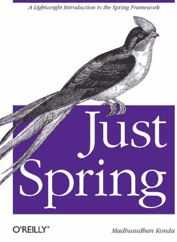
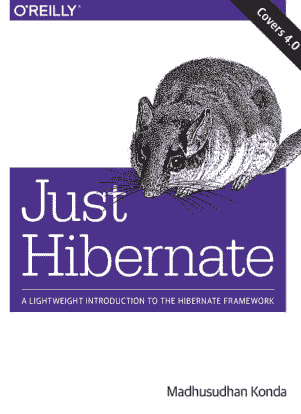
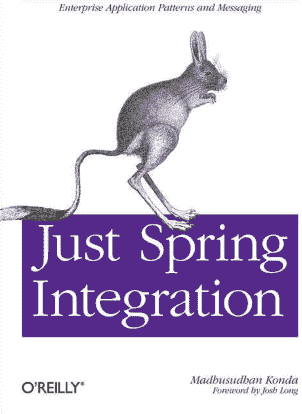
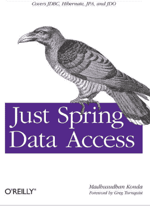

# Java 8 全详解：Lambdas——介绍 Java 8 Lambda 表达式

《Just Spring》与《Just Hibernate》作者

## 献辞

爸爸，我想你了！我们都很想你！

## 前言

毫无疑问，Java 8 的发布进一步巩固了 Java 作为世界上最流行的编程语言的地位。随着 Lambdas 的加入以及通过流处理数据的能力，它在其古老的面向对象特性基础上增加了强大的函数式能力。

听起来很令人兴奋，不是吗？但 Lambdas 和流对你的未来和现有代码库意味着什么？为了有效地使用这些新特性，你需要学习哪些基本的陷阱和技巧？哪些编程挑战最适合用这些新的函数式技术来解决？在工作兼顾生活的同时，你到底如何学习这些复杂的材料？这些都是非常有效的问题！

Lambdas、流和函数式编程范式对于当今 900 多万 Java 开发者来说是一个巨大的跨越。事实上，这些概念是如此不同，以至于我第一次在想：“这真的是 Java 吗？我学会这些新概念后还能算作一名 Java 程序员吗？”这实际上是一系列令人畏惧的改变，考验了我的学习能力。

幸运的是，我有机会在早期 Java 8 构建中进行探索，并作为 AdoptJDK（`http://openjdk.java.net`）社区计划的一部分。我们与 Brian Goetz（Oracle 后台 Lambdas 的首席工程师）进行了几天的运行和研讨会。伦敦 Java 社区让我随着时间的推移熟悉了这些新特性。当然，大多数开发者并没有这种提前领先一年的奢侈，幸运的是这本书就是为了为你提供帮助的！

在我们在投资银行工作的日子里，我有幸与 Madhu 合作处理过各种复杂的软件问题。他擅长提取主题内容并将其提炼成我们其他人可以理解的内容。正如他的《Just Spring》和《Just Hibernate》著作一样，这本书将帮助你跨越学习新技术的门槛，让你在接下来的周一就能自信地使用流来解决代码问题。

如果你想快速掌握 Lambdas、流和 Java 8，那么这本书就是适合你的！

Martijn Verburg

“魔鬼开发者”

jClarity 首席执行官，Java 冠军，伦敦 Java 社区共同领袖

## 前言

### 我为什么要写这本书

由于每天有这么多新框架出现，而学习和掌握它们的时间又如此少，作为一名开发者，我发现很难跟上不断演变的编程世界。跟上的工作要求高且节奏快，人们通常需要在一个周末内学习一种语言或一个框架，并在下周一开始编写代码。

如果我能找到一本书，在一两天内教我我需要的一切就好了。一本能让人立即开始编写代码所需的信心的书。

我的目标是提供简单、直击主题且由示例驱动的书！一本你应该在一两天内读完的书！我的梦想是编写可以在周末内读完的技术书籍，我真诚地希望这本书能实现这个梦想！

我的写作之旅始于《Just Spring》的出版，这是该主题的第一本书，旨在提供关于 Spring 框架的轻量级读物。这本书受到了良好反响（新版将于 2016 年初发行），并激励我写更多内容。非常感谢你们过去几年来给我的鼓励。

我衷心希望这本书能成为你学习和理解 Java 8 的良好伙伴。

### 这本书是关于什么的

期待已久的 Java 8 终于问世了。它势如破竹而来。

这本书关于理解 Java 8 lambdas。到目前为止，Lambdas 是该语言自诞生以来引入的最大变化。除了 lambdas，还有其他特性随之而来——例如接口解锁、函数式库、流和并行处理等。这本书试图用平实的文字和直观的示例来消除这些概念的神秘感。

这本书主要关注 lambdas 和其他相关概念。Java 8 中引入的特性，如新的日期和时间、Nashorn 脚本等，将不会在书中涵盖。

你必须对 Java 编程语言有了解。这本书不会教你如何用 Java 编程。

### 代码在哪里

本书配有 Java 代码项目。代码可以在我的 Github 上获取：`https://github.com/madhusudhankonda/AllAboutLambdas`。我会根据需要更新代码库，如果你有任何建议或推荐，或者想做出贡献，请随时与我联系。如果你能为存储库做出贡献，我将不胜感激。

我试图保持代码片段简洁，以免失去其本意表达的概念重点。为了简洁和保持概念鲜明，我排除了全文的展示。

### 本书结构安排

本书像讲故事一样揭示这些概念，直击主题且没有太多的干扰。书中的代码示例刻意选择了简单基础的内容。所有的示例都可以在书籍的 Github 页面在线查看（参见上文的“代码”部分）。

每个代码示例都将有一个 Java 类名，在合适的情况下后面跟上方法名，例如：`Runnables.java#usinglambda`。在必要时，我在侧边栏框中标记了重要的注释，请务必仔细阅读。完整的源代码可以在 github 上找到，请查阅并尝试运行。如果你能提交改进建议，我将不胜感激！

### 封面设计

封面和竖琴由我的妻子和儿子设计和开发。竖琴是一种可以追溯到公元前 3500 年的古代多弦乐器。它是中世纪的关键乐器，被认为起源于猎人的弓。它经过精美的雕刻，长短不一的琴弦产生丰富的声音，据说竖琴的音乐能够抚慰灵魂！

## 1. 引言

Java 8 为语言领域带来了新的清风。它被誉为游戏规则的改变者，拥抱了函数式编程风格。Lambda 表达式、接口的演进、重构后的库、使用流的数据处理支持以及开箱即用的并行性，是自该语言诞生以来目前为止引入的一些重大变化。Java 开始在与其同类的竞争对手中落后，因此，让语言跟上时代将赢得那些耐心等待了近 20 年并宣布对 Java 忠诚的开发者们的心。

在深入细节之前，让我们通过基础示例对 lambda 表达式有一个整体的认识。

### 概览

有一句俗话说：“男人们是不看说明书的！”如果真以此为准，我们更希望看到 lambda 的实际运行情况，而不是阅读几章赞美它的文字。某些功能起初可能会让你困惑，但请相信我，这本书将是你揭秘这些语言特性的最佳伴侣。

#### Runnable 示例

与 Runnables 协作非常简单，我确定你可能已经多次使用 Runnables 创建并执行过线程。假设我们在看电影时，必须在家里做一些杂务。`runErrands` 方法预期在单独线程中执行，因此我们创建了一个 `Runnable` 实现来封装 `runErrands` 方法，并让新 `Thread` 执行它。实现这一目标有三种方法——让我们开始探索这些方法。

#### 使用 Runnable 实例

在这种方法中，我们遵循传统的方法，即创建一个 `Runnable` 实例并让 `Thread` 调用它。

下面的代码段演示了这一点：

```
// Runnable.java#instanceRunnable

// Runnable 的具体实现
Runnable oldRunnable = new Runnable() {
    @Override
    public void run() {
        System.out.println("使用传统的 Runnable 执行杂务!");
        runErrands();
    }
}

// 执行 Runnable
new Thread(oldRunnable).start();
```

为了运行我们的业务逻辑（即 `runErrands`），我们创建了 `Runnable` 接口的实现并在 `run` 方法中调用了逻辑。然后我们创建了一个 `Thread` 并将我们的 `Runnable` 传递以执行。除了调用 `runErrands` 方法外，其余五行代码都是与业务无关的（模板代码）。

#### 使用匿名类

启动线程的另一种方法是使用匿名类方法。在这里，我们没有实例化 `Runnable` 实例，而是内联创建了匿名类，如下所示：

```
// Runn.java#anonymousRunnable

// 作为匿名类的 Runnable
new Thread(new Runnable() {
    @Override
    public void run() {
        System.out.println("使用匿名 runnable");
        runErrands();
    }
});
```

与第一种方法相比，这种方法中也存在模板代码。除了节省了创建实例变量之外，这两种方法在结构上没有太大区别。在上述两种情况下（实例方法或匿名类方法），我们的业务逻辑（运行杂务）都是模糊的并隐藏在模板代码之下的。

#### 使用 Lambda 表达式

嗯，不进行过多的细节，上述逻辑可以表示为 lambda 表达式，如下所示：

```
// Runables.java#usingLambda

// 创建 lambda 表达式
Runnable runErrandsLambda = () -> runErrands();

// 让线程执行 lambda
new Thread(runErrandsLambda).start();
```

我们创建了第一个 lambda 表达式并将其赋值给调用业务逻辑（`runErrands`）的 `Runnable`，抛弃了周围所有的杂质。代码不仅清晰简洁，逻辑意图也解释得非常清楚。我们不需要使用 lambda 表达式创建一个 `Runnable` 实例（就像在上面的示例中所做的那样），而是内联创建一个 lambda，如下所示：

```
// Runables.java#usingLambda

// 内联创建 lambda 表达式
new Thread(() -> {
    System.out.println("使用 Lambda 表达式");
    listErrands();
    runErrands();
}).start();
```

现在线程接收到了一个代码表达式，该表达式包含了打印调试语句、列出杂务以及最后运行它们。在此调用中没有创建 `Runnable` 实例（不过该表达式必须遵守 `Runnable` 接口的定义——稍后讨论）。

为了简洁起见，我在这里向你展示完整的示例（请从 github 查看书中提到的完整运行程序）：

```
// Runnables.java#usingLambda
public class Runnables {
    public static void main(String[] args) {
        Runnables client = new Runnables();
        client.usingLambda();
    }
    public void usingLambda() {
        // 简单的 lambda 表达式
        Runnable runnableLambdaSimple = () -> runErrands();
        new Thread(runnableLambdaSimple).start();

        // 内联创建 lambda 表达式
        new Thread(() -> {
            listErrands();
            runErrands();
        }).start();
    }
}
```

如果你想坐下休息而不是运行杂务，切换模式就像周日一样简单：

```
// Runnables.java#usingLambda
new Thread(() -> stayRelax()).start();
```

在上述 lambda 中，我们直接将 lambda 表达式传递给线程。这仅仅是数据传递的方式，而这在 Java 8 之前是不允许的。

如果不提到流（Streams），这一章将认为是不完整的。流是语言引入的另一项新特性，用于对连续数据流进行处理。我们在这里简要检查使用流的示例，但注意我将书中很大一部分内容留给了流。

#### 流式示例

考虑对数据采用某些处理技术的需求，例如从给定的交易列表中获取大额交易。在不涉及过多细节的情况下，这里是实现此功能的代码片段：

```
// Streaming.java#findTrades

// 流遍历交易并过滤非大额
trades.stream()
.filter(trade -> trade.getQuantity() > ONE_MILLION)
.forEach(System.out::println);
```

上述代码对源使用了流技术，根据大额交易条件进行过滤。代码简单、表现性强，不需要迭代或存储变量。

流仅仅是遵循管道架构（管道和过滤器模式）的自由流动序列。每个流从数据源开始，设置管道，通过中间操作处理元素，并在终端操作结束。终端操作是产生结果的最终组件，此时流停止。

在可用核心上并行运行代码（多核心处理）没有变得更简单了：

```
//Streaming.java#findLargeTradesInParallel

// 以并行模式运行操作
List<Trade> bigTrades = trades
.stream()
.parallel()
.filter(t -> t.isBigTrade())
.collect(toList());
```

我们没有为并行模式下的执行创建大量的类或复杂的设施。我们没有在准备 fork/join 框架或管理任务或子任务上浪费代码。相反，我们只需要在流上调用一个方法（`parallel`），工作就完成了！这种这种并行性正是我们在 Java 8 中获得的。

Lambda 表达式或流（streams）的语法可能有点不寻常，相信我，它并不比组装简单的乐高更复杂。在结束关于 Lambda 的这一节之前，为了完整性，让我向你们展示这里几个 Lambda 表达式：

```
// Examples.java

// 执行各种操作的 Lambda 表达式
// 针对给 Trade

Callable<Trade> c = () -> {
    Trade t = new Trade("GOOGLE", 2000, "OPEN");
    encrypt(t);
    persist(t);
    return t;
};

// 一个并行流流水线，计算所有交易
// 的总数量

trades
    .stream()
    .parallel()
    .map(Trade::getQuantity)
    .reduce(Integer::sum);
```

```
// 获取斯菲尔伯格的电影
movies
    .stream()
    .filter(m -> m.getDirector().equals("Steven Spielberg"))
    .map(Movie::getName)
    .distinct()
    .forEach(System.out::println);
```

我们将在接下来的章节中详细介绍创建和使用 Lambda 的细节，但在此期间，让我们研究驱动 Java 8 升级的动力，即面向对象的语言拥抱函数式编程风格的原因（也许是为了成为一种函数式和面向对象的语言（FOO）！）

#### 力量

生活中有少数事情迫使我们改变，或者至少让我们适应变化。同样，在我看来，有几种主要力量共同作用，驱动了 Java 领域的变革。让我们简要检查这些力量。当然，还有其他因素，但为了简单起见，我们考虑以下三种力量。

##### 计算能力

如今即使是简单的平板电脑或手机设备也带有多核处理芯片。通过采用并行模式执行，这些强大的核心可以被有效利用。过去二十年计算机处理能力的惊人进步将 Java 语言推向了边缘。只有当能够通过功能丰富的工具包和合适的函数来利用并行计算的力量时，编程语言才能繁荣。

Java 凭借其古老的库和笨拙的多核编程风格，已经落后了。当其他语言拥抱技术能力的进步时，Java 因为由于存在太多的“但是”而掉队了。当它们追求精确和简洁时，Java 在这方面没有做出显著的尝试。过去几年，大数据应用急剧上升。私营和公共部门对大数据的使用以及处理海量数据的需求正呈指数级增长。

Java 无疑是服务器端应用的伟大平台，但设计和开发多处理器应用程序是一项令人生畏的工作。开发者在开发并发和并行应用时，需要处理底层线程和内存模型的细碎细节。线程（`Thread`）甚至让资深程序员感到紧张。为了应对多核巨型机器指数级增长带来的挑战，重新设计语言、引入现代工具包和库来支持这些挑战是迫在必行的。

##### 行为捕获

捕捉行为并像数据一样传递它是函数式编程范式的核心。我们将这种代码称为数据，即传递表示行为的程序块。这一功能对于 Java 来说并不新鲜，它以匿名类策略的形式存在，但操作匿名类是令人恼怒的，而且无疑会带来麻烦。由于其冗长、紧密耦合和作用域解析，匿名类很快变得对程序员不友好。它们还携带了不必要的负担和复杂的规则，导致代码遗憾地变得不稳定。

Java 类分别通过类变量和方法表示状态和行为，方法的设计并没有为了接受另一个方法作为其参数。也就是说，我们不能将一个方法传递给另一个方法。捕获函数行为并将其作为数据传递是另一个大挑战。

##### 重构库

最后的力量来自于在不造成混乱的情况下增强应用库的需求。任何编程语言的繁荣都依赖于其良好的设计和库的使用。随着时间的推移，库需要增强以适应不断变化的格局和需求。因此，库预计将不断演进。

任何框架的核心都是一个基础的接口定义。正如我们所知，Java 8 之前的接口基本上是写死的。一旦它们被公开，除非破坏向后兼容性，否则就不可以被更改。在不伤害开发者社区的情况下增强这些库是一项艰巨的任务。理想的选择是重新设计和更新库，而不是重新造轮子。

#### Java 的诞生

当 Java 设计师们希望实现这三个愿望时，一个神灯精灵出现了并一次性给了他们所有——Lambda 的形式！嗯，某种程度上。Lambda 是该语言最新的添加内容，是语言现代化的基石。毫无疑问，Java 8 是 Java 历史到目前最大的里程碑。

总之，Java 8 是一艘你不应该错过的船。在我看来，这种语言正在朝着正确的方向带着巨大的响声进化。革命刚刚开始，它将持续到 Java 9 并可能进入未来的版本。

### 总结

本章介绍了问题领域并帮助我们理解了 Java 8 的需求。我们查看了可能导致 Java 8 诞生的各种因素，如新兴的计算能力、并行编程以及增强古老库的需求。在没有过深探讨 Lambda 表达式的情况下，我们查看了一些示例。

## 2. 新特性

Java 8 引入了 Lambda 表达式，随之而来的是许多新特性。除了 Lambda，Java 8 还有相当的成就：接口解锁、库重构、引入流、并行编程简化等。在本章中，我们将概览这些新特性。

### Lambda


## 面向对象编程与函数式风格的融合

面向对象编程与函数式风格的融合（一种函数式和面向对象的语言（FOO））！）具有巨大的优势。程序变得更有表现力、更短且不易出错。Lambda 使得行为可以简洁地参数化。使用匿名类的笨拙是过去，编写函数代码的优雅是未来。函数式编程的核心在于在函数中维护不可变状态，相同的输入返回相同的输出。

Lambda 实现了内置的延迟迭代概念。客户端不需要担心如何切分和处理数据集，只需指示程序做什么。开发者不需要处理如何

```java
// TradableLambda.java
// 用于检查交易的函数接口
interface Tradable<Trade>{
    boolean check(Trade t);
}
// 检查各种条件的 Lambda 表达式
// 检查大交易
Tradable<Trade> bigTradableLambda = (t) -> t.isBigTrade();

// 交易处于取消状态吗？
Tradable<Trade> cancelledLambda = (t) -> t.isCancelledTrade();

// 交易是新的还是未知的？
Tradable<Trade> newOrUnknownTrade = (t) -> {
    return t.getStatus().equals("NEW") ||
           t.getStatus().equals("UNKNOWN");
}
```

这些是可以像数据一样传递的自由代码表达式。它们对于参数化行为至关重要。注意，条件检查相同的功能由库以 `Predicate` 函数的形式提供，因此我们不需要为常见情况创建函数接口。我们将在课程中详细介绍函数接口。

### 接口

在 Java 中，接口是静态定义，一旦引入接口定义的更改，显然会打开与向后兼容性相关的潘多拉盒。一旦接口被引入库，更改接口就会产生影响。

在 Java 8 中，接口被重新设计和重新定义。现在，我们可以更改现有接口的定义而无需担心向后兼容性。我们在接口中添加了方法的具体实现，鼓励默认定义和初始化代码。

例如，考虑下面 `Component` 接口的定义，它有一个抽象方法 `getName` 和两个完全实现的方法 `getDefaultName` 和 `getRegion`。在 Java 8 之前，我们无法在接口中添加这些具体的实现类。

```java
// Component.java

// 解锁后的接口 - 不再是抽象的！
@FunctionalInterface
public interface Component {
    // 一个抽象方法（因此它可以表示 lambda）
    String getName();

    // 完整实现的默认方法
    String getDefaultName() {
        return "Default Component";
    }

    // 完整实现的静态方法
    static String getRegion() {
        return "United Kingdom";
    }
}
```

注意，声明的具体方法必须是 `static` 或 `default` 类型。如果你既没有提供这两个分类符之一，编译器将会报错。此外，请注意接口上的 `@FunctionalInterface` 声明。虽然它是可选的，但该注解可以防止对函数式接口的不当使用。我们将在后的章节中学习更多关于接口的知识，包括静态和默认方法。

#### 默认和静态方法

正如我们之前提到的，Java 8 为接口的解锁打开了大门。我们现在可以在接口中创建默认方法和静态方法。当然，如果有需要，我们也可以修改现有的接口（这也是为什么 Java 8 对 `Runnable`、`Callable`、`Comparator` 等接口进行了重构的原因）。方法应该适当地以 `default` 或 `static` 关键字为缀，在接口中提供逻辑的完整实现。

如果你检查 `Comparator` 接口定义（参见 Javadoc），你会发现 Java 8 版本添加了一些默认和静态方法。

#### 函数式接口

函数式接口只有一个抽象方法，因此可以作为 lambda 表达式的类型类型。每当我们将函数式接口作为方法的输入类型时，都可以用 lambda 表达式来替换它。

```java
// Finder.java
@FunctionalInterface
public interface IFinder {

// 抽象方法
String find(String criteria);

// 默认方法
default String criteria() {
    return "Search criteria:";
}
}
```

`IFinder` 接口有一个抽象方法和一个具体的默认方法。只要我们只定义一个抽象方法，这个接口就可以被归类为函数式接口，并作为 lambda 表达式的目标类型。

如果接口只有一个抽象方法，无论其他有多少个默认或静态方法，它都成为作为 lambda 表达式类型的候选者。这种接口有一个特殊的名称，叫做函数式接口（functional interface）。

下面的代码段显示了 lambda 表达式，注意 lambda 的目标类型：

```java
// 使用上述函数式接口 IFinder 的 lambda 表达式
IFinder finder = (input) -> "output result";
```

#### 函数

函数是我们开发应用程序时使用的重复模式。Java 8 提供了一组函数定义作为库，而不是到处去创建和散布它们。为此，引入了一个新的包 `java.util.function`。这些函数有助于以一种一致的方式设计构件。

作为 `Predicate`、`Consumer`、`Supplier` 的函数可以从函数库中获取。事实上，即使是特殊的函数如 `IntPredicate`、`LongPredicate` 或 `DoublePredicate`（还有许多如 `IntConsumer`、`DoubleConsumer`、`IntFunction`、`DoubleFunction` 等）也是开箱即用的。我们之前查找大额交易或大交易的示例可以使用 `Predicate` 函数来重写，该函数是标准 Java 8 库的一部分，如下代码示例所示：

```java
// 检查是否为大交易
Predicate<Trade> bigTradeLambda = (t)-> t.isBigTrade();

// 用于检查已取消交易的 Predicate
Predicate<Trade> cancelledLambda = (t)-> t.isCancelledTrade();

// 检查新或未知交易的 Predicate
Predicate<Trade> newOrUnknownTrade = (t)-> {
  return
  t.getStatus().equals("NEW") ||
  t.getStatus().equals("UNKNOWN");
};
```

上面的 lambda 表达式被赋值给 `Predicate` 类型，以检查各种准的条件性。`Predicate` 是一个库函数，理想情况下应该取代我们任何自定义的条件检查函数。在接下来的章节中会有专门的章节来学习函数。

#### 流（Streams）

流是 Java 8 语言的另一个巨大飞跃。这是一个为了有效处理大数据分析操作而引入的新概念。简单来说，流是元素的序列。虽然集合（Collections）是存储和访问数据的标准数据结构，但流本身并不持有任何用于根据预定义的业务逻辑处理或分析数据的存储。引入流极大简化了集合库，并能够高效地进行大数据。

流完善了 lambda 表达式。在 lambda 表达式的帮助和支持下，流提供了强大的集合库。以从巨大的电影列表中查找经典电影为例，使用流：

```java
// StreamsFeature.java#findClassics

return movies
  .stream()
  .filter(m -> m.isClassic())
  .collect(toList());
```

这段代码更具表现力且流畅！它表示一旦我们对电影进行流化，我们就使用经典电影谓词将其过滤掉，并将它们收集到列表中。

#### 并行操作

利用计算机的全部处理能力是一个巨大的胜利。流配合 lambda 有助于创建并行程序以及实现惰性求（lazy evaluations）。惰性求允许程序连接操作序列，但在事件触发之前不会执行它们。流有助于在顺序和并行模式下对数据进行过滤、映射和切片。这只是愉快之旅的开始。

将顺序程序转换为并行程序只需更改简单的方法调用。在 Java 的早期版本中，我们必须处理线程和并发的底层机制。

例如，如果我们收集数百万电影，可以毫不费力地并行运行程序。只需在流上调用名为 `parallel` 的方法即可让操作并行运行，从而有效利用机器的多个核心。

下面的代码段演示了通过并行运行程序收集经典电影的示例：

```java
// ParallelStreams.java

// 使用并行收集经典电影
return movies.stream()
  .parallel()
  .filter(m -> m.isClassic())
  .collect(toList());

// 或者，在集合上使用 parallelStream
return movies
  .parallelStream()
  .filter(m -> m.isClassic())
  .collect(toList());
```

#### 其他特性

除了上述基础语言特性外，Java 8 还引入了新的日期时间 API。

如果你在 Java 中处理过日期和时间，我确定你会同意那是一件痛苦。它是最不友好且复杂的 API，几乎被整个 Java 开发者社区所厌恶。一个名为 Joda Time API 的开源替代方案出现，让我们免于危险。与此同时，幸运的是，Java 设计者听取了批评，因此从 Joda Time 中汲了许多灵感和设计，引入了新的日期时间 API。新创建的 `java.time` 包包含了日期和时间组件。

Java 8 的另一个显著特性是对 JavaScript 引擎 Nashorn 的脚本支持。Java 8 标志着 Rhino 作为其脚本引擎的终结，并引入了 Nashorn，这是一个 JavaScript 脚本引擎。Nashorn 通过 Java 7 中引入的 `invokeDynamic` 机制工作，并且在性能方面带来了更大的提升。

注意，日期时间 API 以及 Nashorn 脚本引擎不在本书的讨论范围内。

## 总结

本章对 Java 8 的新特性进行了快速风式的回顾。我们尽可能地通过示例从非常高的层次审视了这些语言特性。我们接触了 lambda、函数式接口、函数，并简要探索了流。

# 3. 引入 Lambda

Java 是一种面向对象的编程语言。方法和变量都绑定到类上，在调用方法执行函数之前，必须先实例化类才能正确执行函数。我们无法拥有不属于任何类的变量或代码块。

类是基础结构，即使只是一行业务逻辑，也必须写在方法中并在类中声明。随着 Java 8 的出现，我们可以编写代码块，并像传递数据一样将它们传递给其他方法。类曾经是 Java 中的唯一“一等公民”，但随着 Lambda 的引入，代码的最小单元变成了 Lambda！

本章将重点介绍如何揭开 Lambda 的神秘面纱，并尝试理解其宏观概念。

## 什么是 Lambda？

Lambda 是程序代码块，表示类似于函数的行为。它可以像我们传递数据一样被传递给其他方法——因此我们称“代码即数据”。它们是匿名函数，并且简洁、清晰且具有表现力。它们是某种自由浮动的代码块，帮助我们实现函数式代码。

考虑以下示例：

```java
// LambdaTasters.java
// 每天打印一条名言的 Lambda
QuoteLambda = () -> System.out.println("Hello, Lambdas!");

// 函数式接口定义：
interface Quote {
    void quoteOfTheDay();
}
```

这是一个简单的 Lambda 表达式，调用时它会在控制台打印出该名言。如果它看起来没什么意义，请不要担心。在现阶段，你只需要知道它在没有参数的情况下执行了某些操作（向控制台打印了一条消息）。

同样，看另一个 Lambda 表达式示例，它用于提取交易的工具：

```java
// LambdaTasters.java

// 获取交易的工具的 Lambda
Instrument<T> instrumentLambda = (t) -> t.getInstrument();

// 函数式接口定义：
interface Instrument<T> {
    String extract (T t);
}
```

在两个示例中，我们都定义了一个函数式接口和一个 Lambda 表达式。从这些 Lambda 表达式可以看出，它们对我们来说是新颖，并且具有特殊的语法和语义。

Lambda 本质上是数学函数。它们将输入映射到唯一的输出，包括参数列表为空的情况。它们代表了行为，例如在航班上预座、将温度从摄氏度转换为华氏度、合并两笔交易或汇总高净值人士的全部财富。我们可以使用 Lambda 来对这种功能行为进行参数化。

Lambda 是表示程序行为的匿名函数。我们可以像向方法传递数据一样传递它们。

通过使用 Lambda，我们可以轻松舒适地建模不断变化的客户需求。

严格来说，Lambda 并不是自由浮动的代码块，而是实现名为“函数式接口”特殊接口的函数。函数式接口必须定义且只有一个抽象方法。

### 问题域

学习 Lambda 特性的最好方法是通过示例。

让我们考虑一些需求，例如检查给定交易是否需要加密、是否由于相关的市场风险而需要卸载、或者是一个可以拆分的大交易等。通常，我们会设计并定义一个接口来捕获并执行这些行为。我们在之前的章节已经了一个名为 `Tradable` 的接口，其中包含一个抽象方法 `check(T t)`，我们可以将其作为理解和分析 Lambda 语法的基础。

为了完整起见，再次显示接口的定义：

```java
// DissectingLambda.java

// 用于检查特征的函数式接口
interface Tradable<T> {
  boolean check(T t);
}
```

现在我们有了函数式接口，可以为各种情况开发几个 Lambda 表达式。假设我们想检查交易是否大额，我们在下面的代码段中创建一个带有适当业务逻辑的 Lambda 表达式：

```java
// 大交易 Lambda 表达式
Tradable<Trade> bigTradeLambda = (t) -> t.isBigTrade();
```

赋值语句的右侧是一个 Lambda 表达式。它表示给定一个 `Trade t`，调用 `isBigTrade` 方法返回一个布尔结果（我们很快就会学习这种语法）。

Lambda 表达式的类型是函数式接口，上面的 Lambda 被赋值给类型为 `Tradable<Trade>` 的变量。

在这里，我们正在创建一个 `Tradable` 实例，并与其关联一个 Lambda 表达式。

然而，与其创建一个 Lambda 并将其赋值给某种类型，不如直接将 Lambda 表达式传递给任何接受 `Tradable<Trade>` 作为参数的方法，例如此处所示的 `checkCharacteristics` 方法：

```java
// DissectingLambda.java#checkCharacteristics

// 将 Lambda 表达式传递给方法
private void checkCharacteristics(Tradable<Trade> lambdaLambda, Trade t) {
    tradableLambda.check(trade);
}
```

该方法接受一个函数式接口，从而抽象了逻辑，使得客户可以传入多个符合他们自身需求的 Lambda 表达式，如下所示：

```java
// 创建实例
DissectingLambda client = new DissectingLambda();
Trade trade = new Trade(..);

// 交易处于已取消状态吗？
client.checkCharacteristics((t) -> t.isCancelledTrade(), trade);

// 它是风险交易吗？
client.checkCharacteristics((t) -> t.isRisky(), trade);
```

正如你所注意的，`checkCharacteristics` 方法能够接收符合特定签名表达式：给定一个 `Trade`，返回一个布尔值。在两个示例中，我们都是内联声明 Lambda 代码并将其传递给所需的 `checkCharacteristics`。

在我们大致理解了 Lambda 后，是时候理解其特殊语法了。

### 语法

考虑我们之前看到的这个表达式：

```java
// 打印消息的 Lambda
() -> System.out.println("Hello, Lambdas!");
```

这种语法初看起来可能有些困惑。这是我们目前在 Java 语言中不熟悉的。有一种表示 Lambda 的特殊语法。但它与方法并没有太大区别，除了

### Lambda 组成部分

Lambda 表达式的语法源自函数式接口定义。与普通方法类似，Lambda 有输入参数和主体，返回值并可能抛出异常。从方法的角度来看，这种语法很容易理解。

为了保持简单，我们可以将 Lambda 表达式分为两部分：左半部分和右手部分。两部分之间使用箭头（→）分隔。箭头的左部分是 Lambda 表达式输入参数的持有者，而右侧是 Lambda 的主体。主体是应用业务逻辑并返回结果的地方，如果没有返回值则为 void。

```java
// 高级 Lambda 表达式
(Input arguments) -> { body }
```

让我们将这种语法与之前的示例进行比较，从示例中提取正确的部分：

```java
() -> System.out.println("Hello, Lambda!");
```


左侧是展示参数的地方，这里 Lambda 有空括号，这意味着该 Lambda 不接受输入参数。右侧是表示业务逻辑的主体，在这种情况下是打印消息。

如果我们只有一个参数，括号是可选的，参数列表变得更加简单，如下所示：

```java
// 单参数，请看下一个片段了解我们可以做什么
(Trade t) -> t.getInstrument().equals("IBM")

// 略去括号和类型！
t -> t.getInstrument().equals("IBM")
```

## 类型推断

在 Lambda 表达式 `t -> t.getInstrument().equals("IBM")` 中，输入参数没有声明类型。显然，理想情况下，Java 编译器在看到这一点时应该感到不满意。然而，我们可以忽略输入参数的类型，因为它们是通过函数式接口的定义推断出来的。编译器可以推断出 `t` 确实是一个 `Trade` 类型。我们将在稍后详细讨论目标类型和类型推断。

## 返回值

在 Lambda 体中声明返回值是非常有利的。在某些必须声明输出值的情况下，返回类型是显式的。其他情况则是隐式的，在这种情况下返回值是被省略了。看下面的 Lambda 表达式：

```java
// DissectingLambda.java
// 用于已取消交易的 Lambda 表达式

// return 是隐式的
(t) -> t.isCancelledTrade()
```

我们没有在上述表达式的体中声明返回值，因为这是一个简单的表达式，输出会隐式地返回给调用者。也就是说，我们可以忽略在语句或简单表达式的体上附加 `return` 关键字。

然而，如果我们有一个包含各种控制路径的复杂代码块，那么我们必须显式地标记返回。

Lambda 语法源自函数式接口，代表了输入和体（包括异常），这类似于普通方法的声明。表达式的形成方式为：`(输入) -> {体}`。

考虑下面的代码段，它是上面示例的副本。

```java
// DissectingLambda.java

// 返回是隐式的，因为体不再是一个简单的
// 语句/表达式

t -> {
    return t.isCancelledTrade();
}
```

对于多行代码体（每行之间用分号分隔），我们需要使用大括号并配合显式返回。例如，看另一个示例，其中 Lambda 的体被包含在大括号内（简单逻辑）中，此时 `return` 是强制的：

```java
// GreetingExample.java

// 使用大括号时需要显式返回类型
Greeting greetingLambda = s -> (
    return "Hello, " + s;
);
```

## Lambda 类型

现在我们已经涵盖了语法基础，下一步是寻找 Lambda 是如何形成的机制。正如之前提到的，Lambda 表达式的形成取决于函数式接口的定义。

让我们考虑一个简单的“Hello, World!”示例。一个用于问候消息的函数式接口（带有一个抽象方法的接口定义如下：

```java
// GreetingExample.java

// 函数式接口
interface Greeting {
    String sayHello(String name);
}
```

该接口有一个单一抽象方法 `sayHello`，它接受一个名称（`String`）并返回一条消息（`String`）。由于它只有一个抽象方法，我们可以用 `Greeting` 作为类型定义一个 Lambda 表达式。

`sayHello` 方法接受 `String` 类型的输入。我们的 Lambda 左侧应该看起来像这样。因此，Lambda 的左侧可以写为：

```java
// Lambda 的左部分
(String msg)
```

Lambda 的右侧是应用于给定输入上的逻辑。该逻辑是在控制台打印一条消息。下面的代码段展示了这一点：

```java
// Lambda 的右部分
System.out.println("Hello, " + msg);
```

现在我们已经有了 Lambda 的左部分和右部分，将两部分放在一起并用箭头运算符分隔，产生了一个 Lambda 表达式：

```java
// 最终的 Lambda 表达式
(String msg) -> System.out.println("Hello, " + msg);
```

让我们将其与 `Greeting` 接口的具体实现进行比较。如果我们实现这个类，我们将拥有 `sayHello` 方法的具体实现，类似于下面所示：

```java
Greeting oldGreeting = new Greeting() {
    @Override
    public void sayHello(String msg) {
        System.out.println("Hello, " + msg);
    }
}
// 这是向 Lambda 的转换！
(String msg) -> System.out.println("Hello, " + msg);
```

将 `Greeting` 的传统实现与 Lambda 表达式相比，我们可以看到传统类实现中的亮点代码是如何变成 Lambda 的！主要的区别首先是方法的名称，以及其余的模板代码，留给我们一个简单的表达式。

最后，如果我们需要将此表达式赋值给变量，我们应该赋值给我们的函数式接口，我们最初就是从那里推导出 Lambda 的：

```java
// 类型是一个函数式接口
Greeting greetingLambda = (String msg) -> System.out.println("Hello, " + msg);
```

## TradeMerger Lambda 示例

为了巩固对 Lambda 表达式形成的理解，让我们考虑另一个示例，这次有两个输入并返回一个对象。

为了这个目的，我们创建了一个名为 `Merger` 的接口，它定义了合并两个交易以产生新交易的合约。我们定义了一个单一抽象方法 `merge`，接受两个交易：

```java
// TradeMerger.java
// 用于合并交易的函数式接口
interface Merger {
    Trade merge(Trade t1, Trade t2);
}
```

由于该方法接受两个输入，我们在表达式左侧的括号中编写输入参数。在右侧，我们合并这两个输入并返回一个合并后的交易（省略了业务逻辑）。下面的代码所示：

```java
// TradeMerger.java
// Lambda 表达式
(Trade t1, Trade t2) -> {
    ...
    return mergedTrade;
}
```

如果你愿意，可以去掉输入参数的类型（如上面的第二部分所示），因为它们可以由编译器推断。

最后一块拼图是这个 Lambda 的类型。函数式接口本身成为了 Lambda 的类型。因此，上面的 Lambda 表达式被赋值给 `Merger`：

在本章，我们奠定了创建和形成 Lambda 表达式的基础。我们学习了 Lambda 类似于方法签名，但语法应遵循特殊的格式。我们看了 Lambda 示例，以及自定义函数式接口和相应的 Lambda。

## 4. 使用 Lambda

到目前，我们对 Lambda 有了良好的理解，尽管是在留在层面。现在是时候开始深入研究如目标类型、作用域、继承等重要概念了。

### 目标类型

目标类型可以在 Lambda 表达式使用的上下文中被理解。当涉及类型时，我们可以处理的两类上下文：赋值上下文和调用上下文。在两种情况下，编译器都足够智能可以推断 Lambda 表达式的类型。

### 赋值上下文

我们可以创建 Lambda 表达式并传递给方法，而不必担心将其赋值给局部变量。然而，某些情况下我们可能需要创建引用 Lambda 表达式的变量。例如，在下面的片段中，我们有一个赋值给 `Merger` 类型的表达式：

我们将 lambda 表达式赋值给一个变量，以便在程序的其他地方引用它。在本文示例中，我们显式地声明了表达式的类型（赋值给 `Merger`），通过这样做，如果我们没有在 lambda 表达式的定义中声明输入参数，编译器就可以推断它们的类型。也就是说，在上面的示例中，你可以看到我们省略了输入参数 `t1` 和 `t2` 的类型。

为了找到这些输入参数的类型，编译器使用赋值上下文来推导它们。在这一目标过程中，它需要执行几个步骤，列如下：

编译器首先查看变量类型（在此情况下为 `Merger`），并读取该接口的方法签名（`Merger` 有一个 `merge` 方法）。`Merger` 的 `merge` 方法签名表明它接受两个输入，都是 `Trade` 类型，这意味着我们的 lambda 表达式输入参数也必须是相同类型（`Trade`）。编译器应用逻辑并推断出 `t1` 和 `t2` 是 `Trade` 类型。

在之前的示例中，我们已经见过输入参数类型省略的情况。查看下面的 lambda 表达式，它被传递给一个方法并打印问候语：

```java
// msg 参数的类型被省略了！
msg -> System.out.println(msg);
```

在这种情况下，输入参数 `msg` 的类型没有显式声明。编译器如何知道它是特定类型呢？嗯，这是从赋值上下推断出来的。上述表达式的类型是 `Greeting`，它接受一个 `String` 作为输入并返回 `void`。此输入应该与 lambda 的输入匹配——即 `String` 类型。同样地，编译器检查了该方法的返回值（在此情况下为 `void`）。编译器检查 lambda 表达式是否也返回 `void`，而它确实返回了。到目前为止一切看起来正常。最后一步是检查该方法是否抛出任何异常。我们的方法没有抛出任何异常，因此将不会执行此检查。

当 lambda 表达式赋值给变量时，上下文就是 lambda 被赋值的类型。编译器通过与函数式接口匹配来推导出类型。

由于所有检查都成功完成，编译器对我们分配给 lambda 的目标类型表示满意，不会出现错误或警告。

### 调用上下文（Invocation Context）

当我们内联创建 lambda 表达式时，编译器会借助调用上下文来解析表达式的类型。假设我们有一个方法接受函数式接口 `Runnable` 作为其输入参数，如下：

```java
public void runMe(Runnable r) {
    new Thread(r).start();
}
```

我们知道 lambda 表达式可以用 `Runnable` 作为其类型来实现。因此，我们可以通过内联传递 lambda 表达式作为参数来调用 `runMe` 方法。见下面的代码段：

```java
public void runMe(( ) -> {
    sendEmail();
    notifyAccounts();
});
```

我们在这里并没有创建 `Runnable` 的实例，而是向方法传递了一个代码块（数据即代码），这是一个强大的特性。我们正在动态地为 `runMe` 方法设置 lambda 表达式。

编译器如何知道给定的 lambda 表达式符合要求？由于我们为赋值上下文学习的相同类型理论适用于这里。`runMe` 方法接受 `Runnable` 作为输入参数，所以我们的 lambda 表达式必须是 `Runnable` 类型。编译器通过我们之前见过的常规检查。关键点在于目标类型（target typing）允许从执行 lambda 表达式的文中推断出表达式的类型。

### Lambda 作用域（Lambda Scoping）

与其他编程语言一样，Java 语言对对象、类、方法和变量也有作用域规则。作为开发者，我们应该完美地学习类级、内部类和方法级的作用域。一旦我们熟悉了语言，这些作用域就会刻在脑子里。lambda 表达式作为代码块，具有一些规则：

### 词法作用域（Lexical Scope）

lambda 表达式的作用域不会超出其创建所在的方法。它是词法作用域，意味着它具有与包含的方法相同的作用域。这被称为词法作用域。

适用于方法的规则和策略同样适用于在宿方法中创建的 lambda 表达式。`this` 或 `super` 使用（包括对静态类型的访问）在方法和 lambda 中是相同的。

lambda 是词法作用域的，这意味着 lambda 表达式的作用域与其封装方法的作用域相同。

考虑以下示例：

```java
// LambdaThisStaticSuperAccess.java
// 词法作用域功能的类
class LambdaThisStaticSuperAccess extends SuperScope{
    private String instanceName="VariableName";
    private static String staticName = "staticVariableName";

    Runnable runnableLambda = () -> {
        print("Super variable: "+super.superVariable);
        print("Instance variable: "+this.instanceName);
        print("Static variable: " + LambdaThisStaticSuperAccess.staticName);
    };
}

// 超类
public class SuperScope {
    String superName = "superVariableName";
}
```

在这里，我们定义了一个类 `LambdaThisStaticSuperAccess`，它有两个变量：一个实例变量（`instanceName`）和一个静态变量（`staticName`）。它继承了一个名为 `SuperScope` 的超类，该超类声明了自己的变量（`superName`）。在我们的 lambda 表达式（`runnableLambda`）中，我们像在普通方法中使用 `this`、`super` 或通过类访问静态类型一样访问这些变量。

执行上述程序时，输出所示：

```
// LambdaThisStaticSuperAccess.java 的输出

Super variable: superVariableName
Instance variable: VariableName
Static variable: staticVariableName
```

### 在匿名类中访问 `this`

然而，在匿名类中访问 `this` 与 lambda 不同。匿名类获取它所创建的类的作用域，而 lambda 获取它创建所在方法的作用域。让我们通过创建一个访问 `hashCode` 的匿名 `Runnable` 来检查这一点。

```java
// LambdaAnonymousScope.java

// 从 lambda 输出 Hashcode
new Thread(()->print("Lambda hashcode:"+this.hashCode())).start();

// 从匿名类输出 Hashcode
new Thread(new Runnable(){
  @Override
  public void run() {
    print("Anonymous hashcode:"+this.hashCode());
  }
}).start();

// 输出
Lambda hashcode:115190497
Anonymous hashcode:557931705
```

### 重新声明变量（Redeclaring the Variable）

lambda 中不能重新声明变量。也就是说，如果一个变量在类的其他地方已经声明，我们不能在 lambda 中对其赋值或重新声明它。

在下面的代码中，注意局部变量 `myName` 在方法中已声明，但我们试图在 lambda 表达式中也声明同一个变量：

```java
// LambdaRedeclaringVariables.java
private void testLocalVariable() {
    final String myName = "Modified Name";
    IComponent cc = () -> (
        // 错误！重新声明变量是非法的
        // String myName = null; // 取消注释
        return myName;
    );
}
```

这就像在一个代码块中有两个同名的变量，这是非法的，因此编译器将不会满意。要点是，作用域规则也适用于 lambda。

### 捕获 Lambda（Capturing Lambdas）

到目前为止，我们开发的 lambda 表达式使用的是它们自己的输入参数。例如，在下所示 `Greeting` lambda 中，`msg` 是输入参数，主体将 `msg` 打印到控制台：

```java
// CapturingLambda.java
Greeting greetingLambda =
msg -> System.out.println("Hello, "+msg);
```

我们说 `msg` 是 lambda 变量，它的作用域仅限于 lambda 表达式。如果我们在 lambda 表达式之外的任何地方（甚至是创建 lambda 的方法中）访问变量 `msg`，编译器将不满意。

考虑以下代码示例：

```java
// CapturingLambda.java

private void accessLambdaVariables() {
    Greeting q = (name) -> {
        print(defaultGreeting + name);
    };
    // Cannot access the lambda's input variable
    // print("Can I access lambda's variable:"+name);
}
```


当我们在 lambda 表达式之外访问 lambda 的输入变量名时，编译器会报错该名称无法解析。声明为 lambda 参数或在 lambda 内部使用的变量的作用范围对外部世界是不可见的。

相反的情况是允许的，也就是说 lambda 访问类的实例变量或静态变量是合法的。这些不是传递给 lambda 的变量，而是在闭包方法或类的其他地方创建的变量。

考虑以下示例，其中在 lambda 表达式中访问了实例变量（`defaultGreeting`）：

```java
// CapturingLambda.java
public class CapturingLambda {
    // 实例变量
    private String defaultGreeting = "Howdy, ";

    private void accessInstanceVariables() {
        // 访问实例变量的 lambda 表达式
        Greeting g = (name) -> {
            // 允许访问实例变量
            print(defaultGreeting + name);
        }
    }
}
```

lambda 表达式正在访问 `defaultGreeting` 变量，没有任何解析问题。这种变量有一个名称——自由变量（free variable）。任何没有声明为 lambda 表达式参数但从周围作用域访问的变量都称为自由变量。实例变量、静态变量以及局部变量都属于这一类。

捕获 lambda（capturing lambda）捕获（复制）了在类其他地方的变量。

使用这些自由变量的 lambda 被称为捕获 lambda。也就是说 lambda 会捕获（或复制）传递给它的任何输入参数，这意味着这些输入变量的值被复制了。

关于在 lambda 表达式中使用自由变量的建议：虽然从 lambda 访问类变量是合法的，但可能会导致副作用。副作用是程序状态的非自愿修改。在纯函数式编程风格中，不采用共享状态，并建议使用无副作用函数。

## 局部变量（有效 final 状态）

在 Java 7 及之前的版本中，在匿名类中，只要局部变量被声明为 `final`，我们就可以捕获它们。这一规则在 Java 8 中被放宽。另一方面，lambda 表达式可以访问局部变量，前提是一个条件——变量没有被修改。局部变量在访问时必须是有效 final（effectively final），尽管它们不需要显式声明为 `final`。

将局部变量声明为 `final` 是可选的，但预期是它们在代码中不被修改，实际上使它们变为 `final`。

考虑以下示例：

```java
// EffectivelyFinalLambda.java

private void execute() {
    // 非 final 局部变量
    int count = 0;
    // 修改 count 的 lambda 表达式
    // Count 是局部变量，必须是有效 final
    // Lambda 无法编译
    new Thread(() -> print(count++)).start();
}
```

我们声明了一个局部变量 `count`，它在 lambda 表达式中被递增。在 lambda 表达式内部修改被捕获变量（`count`）的值会导致错误（如下所示），提示我们的变量违反了有效 final 范围限制：

```java
// 当局部变量在 lambda 中被修改时，会导致编译错误：

Local variable count defined in an enclosing scope must be
final or effectively final
```

因此，请记住局部变量被视为不可变对象或仅赋值一次。

## 为什么是有效 final？

在方法作用域变量上设置有效 final 限制是有合理理由的。

我们知道局部变量存在于栈内存中，而类或实例变量存在堆内存中。栈内存上的任何数据都无法被任何其他线程共享（没有线程安全问题）。除了原始线程外，没有其他线程可以访问该栈。

然而，可能会出现一种情况：lambda 可能仍在运行，但创建它的线程可能已经被回收并消失了。如果值也都被删除了，那么长时间运行的 lambda 表达式将遇到错误。为了避免这种情况，lambda 表达式要求捕获局部变量的值，并期望数据不会被修改。

避免使用声明在 lambda 表达式之外的变量。良好的编程实践是将 lambda 视为黑盒，从而在每次调用时将数据传递给该表达式。

## 修改类/实例变量

对方法作用域局部变量的限制不适用于类或实例变量等其他变量。我们可以自由地在 lambda 中覆盖类/实例变量而没有任何问题。考虑以下代码段：

```java
// EffectivelyFinalLambda.java

public class EffectivelyFinalLambda {
    // 实例变量
    private String instanceVariable = "Instance Variable";
    private void modifyClassVariable() {
        // 非 final 局部变量
        instanceVariable = "Modified Instance Variable";
        new Thread(() -> print(instanceVariable)).start();
    }
    // 输出：
    Modified Instance Variable
}
```

正如你观察到的，`instanceVariable` 是一个带有初始值的实例变量。然而，我们在方法中定义的 lambda 表达式中再次重了 `instanceVariable`。这是完全合法的，尽管它看起来违反了有效 final 规则。

遗憾的是，当类或实例变量被修改时，有效 final 规则并不适用。它不会由编译器或运行时强制执行。编译器不会向我们提供任何提示、警告或错误，完全取决于我们是否意识到。我们应该小心不要违反这一规则，因为可能会导致严重的线程安全问题。

我的建议是对类和实例变量也遵循局部变量的路径（有效 final）。这样，我们可以避免许多细微但致命的线程安全问题和并发 bug。

## 类型推断

在我们之前的 lambda 示例中，我们处理了省略类型的情况。我们简要学习了编译器如何使用上下文来推断这些类型。这种推导类型的过程被称为类型推断（Type Inference）。例如，在下面的代码中，输入参数的类型被省略：

```java
// 输入类型被忽略
Tradable lambdaable = ( t ) -> check(t);
```

编译器通过其操作的上下文来识别类型。在上面的示例中，编译器使用赋值上下文来确定 `Tradable` 接口。

类型推断对于 Java 8 来说并不新鲜，你可能在没有注意的情况下已经使用了。例如，在这个例子中，我们声明了一个键为 `Integer`、值为 `String` 的 `HashMap`：

```java
// 显式声明类型
Map<Integer, String> map = new HashMap<Integer, String>();

// 类型从上下文推断
Map<Integer, String> map = new HashMap<>();
```

类型参数将根据其执行的上下文（`Map` 被声明为 `Integer` 和 `String`）被识别。

记得 lambda 的类型是函数接口吗？我们知道 lambda 可以赋值给函数接口实现的变量，或任何接受函数接口作为参数的方法。

Java 编译器知道此 lambda 表达式的目标类型是函数接口，因此它根据 lambda 输入参数匹配方法输入参数的条件来评估类型。

## 总结

在本章中，我们查看了 lambda 的一些高级主题。我们详细探讨了目标类型和 lambda 作用域。我们还研究了捕获 lambda。我们讨论了有效 final 子句背后的原理，并最终理解了类型接口的概念。

## 5. 高级 Lambda

在处理 lambda 时，我们可能需要调用在方法其他地方或独立类中定义的业务逻辑。Lambda 允许通过引用它们的方式来访问其他方法和构造函数。这一过程被称为方法引用或构造函数引用。在本章中，我们将学习方法引用和构造函数引用。

## 方法引用 (Method References)

通常，我们可能需要在 lambda 表达式中引用已有的方法。该方法可能在其他类或包中被声明，例如在公共模块中，也可能在第三方库中。Java 8 引入了从 lambda 表达式引用现有方法的概念 - 这被称为方法引用。

考虑下面在 `References` 类中定义的工具方法，该方法用于检查给定的电影是否为经典电影：

```java
// References.java
public class References {
    // 一个用于检查电影是否为经典的普通方法
    public boolean isClassic(int movieID) {
        return ( movieID < 1000 );
    }
}
```

由于这是一个公共方法，预计它会被包括 lambda 表达式在内的其他客户端使用。如果我们需要从 lambda 表达式中查找经典电影，你可以简单地像平时调用方法一样从 lambda 中调用该方法：

```java
// References.java
public class References {
  ..
  // Lambda 调用类中其他地方定义的方法
  MovieChecker isClassic = movieId -> isClassic(movieId);

  // 类中定义的方法
  public boolean isClassic(int movieId) {
    
  }
}
```

如你所见，`isClassic` 方法无需思考就从 lambda 中引用了。我们也可以从在独立类或库工具中定义的 lambda 调用方法。例如，假设 `ReferenceUtil` 类也定义了一个 `isClassic` 方法，我们想在 `References` 类定义的 lambda 中引用它。我们所做的就是创建一个 `ReferenceUtil` 实例并在其上调用方法，这与我们在 Java 中调用方法的方法一致：

```java
// References.java
// 创建另一个类的实例
ReferenceUtil util = new ReferenceUtil();

// 在我们的 lambda 中通过实例调用方法
MovieChecker isClassic = movieId->util.isClassic(movieId);
```

我们的 lambda 表达式除了将调用委托给 `ReferenceUtil` 实例之外，没有做其他事情。然而，我们可以利用方法引用功能进一步压缩这个表达式，以缩短 lambda 表达式。

方法引用是引用现有方法的 lambda 表达式的简写。

方法引用是 lambda 表达式的简写 - 将调用委托给现有方法的简单方式。lambda 表达式可以写为：

```java
// References.java#instanceMethodRef

// 使用方法引用的 Lambda
MovieChecker isClassicLambda = util::isClassic;
```

特别注意赋值的右侧，即 lambda 表达式。lambda 使用一个特殊运算符 (`::`）来引用 `util` 对象中已存在的 `isClassic` 方法。双冒号 (`::`）表示我们正在使用方法引用功能。冒号左侧的部分是待调用方法的宿主类，在本例中引用为 `references`。而冒号后的右侧部分是方法本身的名字，在本例中为 `isClassic`。

如果你仔细观察，这种方法引用语法有几点特殊之处。我们不需要用箭头（`->`）来分隔输入和体（正如我们表示 lambda 表达式时的那样）。在连接方法名时，不需要括号（`isClassic` 没有括号）。此外，任何对输入参数的提及也会被忽略。

不提供括号和方法参数的原因其实很简单：我们只是在声明对现有方法的引用，而不是在调用它（因此被称为方法引用！）。所以，当你使用方法引用时，请确保丢弃 lambda 语法，并仔细选择引用语法。

再看另一个一个使用方法引用的 lambda 表达式示例。

```java
// References.java#exampleMethodReferences

// 调用现有方法 (greet) 的 lambda
GreetingLambdaReference = s -> (
  return greet(s);
);

// 使用方法引用调用现有方法的 lambda
GreetingLambdaReference = this::greet;
```

该变量引用提供 `greet` 方法的实例。请注意，这里没有输入参数或箭头标记。

### 静态方法引用 (Static Method References)

让我们看另一种情况，在 `ReferenceUtil` 类中定义了一个静态方法（如下所示），我们希望在 `References` 类的 lambda 表达式中引用它：

```java
// ReferenceUtil.java#isHorror

// 调用现有方法的 lambda
public static boolean isHorror(int movieId) {
    // 查找恐怖电影的逻辑
    return (movieId > 10000 && movieId < 20000);
}
```

为了引用这些构造函数（此处指静态方法），我们设计了两个函数式接口，每个接口单独定义上述方法。考虑以下内容：

```java
// References.java#staticMethod

// 调用现有方法的 lambda
MovieChecker isClassic = movieId -> ReferenceUtil.isHorror(movieId);
```

lambda 表达式只是按照预期调用了方法。然而，我们可以利用方法引用来使其更加简洁：

```java
// References.java#staticMethodRef

// 静态方法用法
MovieChecker isClassicLambda = ReferenceUtil::isHorror;
```

### 任意类型方法引用 (Arbitrary Type Method References)

最后，如果我们想调用任何类型的方法，例如 `ArbitraryClass` 类中定义的 `isOfficeHit` 方法，我们可以使用相同的方法引用原理：

```java
// References.java#arbitraryMethodRef

private void arbitraryMethodRef() {
    // 使用类引用的 Lambda 版本
    MovieChecker boHit = ArbitraryClass::isOfficeHit;
}

// 带有方法的任意类
class ArbitraryClass {
    public static boolean isOfficeHit(int methodId) {
        // 查找集合的逻辑
        return true;
    }
}
```

### 构造函数引用 (Constructor References)

与方法类似，构造函数也可以通过易读的语法从 lambda 表达式引用。构造引用与方法引用的主要区别在于方法名总是 `new`。

例如，`ArrayList::new` 表示创建新列表的简单构造函数引用。在引用构造函数时，有一个棘手的部分：记得一个类可以有多个不同参数的构造函数吗？同样记得，引用机制会忽略参数，对吧？为了理解这种机制，需要一些解释，因为彻底理解各种构造函数的引用是非常重要的。

假设我们有一个两个构造函数的 `Employee` 类——一个通过 `id` 创建 `Employee`，另一个通过 `id` 和 `name` 创建 `Employee`。我们在这里定义该类：

```java
// Employee.java

// 有两个构造函数的 Employee 类
class Employee {
    ...
    public Employee(int id) {
        // 根据 id 创建员工的逻辑
    }
    public Employee(int id, String name) {
        // 根据 id 和 name 创建员工的逻辑
    }
}
```

为了引用这些构造函数，我们为每个构造函数单独设计了两个函数式接口。考虑以下接口定义：

```java
// Employee.java

// 代表第一个构造函数的接口
interface EmployeeById {
    public Employee create(int id);
}

// 代表第二个构造函数的接口
interface EmployeeByName {
    public Employee create(int id, String employee);
}
```

请注意，我们为类中定义的每个构造函数创建一个单独函数式接口（当然，仅针对那些希望在定义 lambda 表达式时使用构造函数引用的构造函数）。

根据我们目前的知识，我们可以按照通常的方式为上述每个函数式接口创建一个 lambda 表达式，而不使用构造函数引用：

```java
// Employee.java

// Lambda 调用第一个构造函数 - 无常量引用
EmployeeId empLambda = id -> new Employee(id);

// Lambda 调用第二个构造函数 - 无常量引用
EmployeeByName empNameLambda = 
(id, name) -> new Employee(id, name);
```


然而，我们可以使用构造函数引用来缩短它们。使用构造函数引用的两个 lambda 表达式可以如下所示：

```java
// Employee.java
// 两者具有相同的构造函数引用

// 针对第一个构造函数的构造引用调用
EmployeeById empLambdaConstRef = Employee::new;

// 针对第二个构造函数的构造引用调用
EmployeeByName empNameLambdaConstRef = Employee::new;
```

你注意到上述代码段中构造函数引用声明的异常之处了吗？两者的声明完全相同（`Employee::new`）。编译器是如何知道选择特定构造函数的呢？

嗯，这取决于定义 lambda 表达式的上下文。让我们看看上下文如何帮助选择正确的构造函数。注意定义的第一个 lambda 表达式的类型（上下文是赋值上下文）：

```java
// 注意赋值给 lambda 的类型。
EmployeeById empLambdaConstRef = Employee::new;
```

赋值上下文规定了 lambda 被声明为`EmployeeId`。我们知道`EmployeeId`有一个抽象方法`create`，它接收一个 id 并返回一个`Employee`。该 lambda 表达式在创建时被赋值给类型`EmployeeId`。然而，lambda 表达式可以用构造函数引用替换，并且构造函数引用是调用构造函数的 lambda 表达式的简写。方法将始终写为`new`。

因此，`Employee::new`应该是`id -> new Employee(id)`的简写，它反过来代表了`EmployeeId`函数式接口，即以 id 为其参数的构造函数。

```java
// Employee.java
// 代表第一个构造函数的接口
interface EmployeeId {
    public Employee create(int id);
}

// Lambda 调用第一个构造函数 - 无常量引用
EmployeeId empLambda = id -> new Employee(id);

// 使用构造引用
EmployeeId empLambdaConstRef = Employee::new;
```

因此，构造引用被解析为接受`id`作为输入的第一个构造函数。

遵循相同的原理，第二个 lambda 的上下文是`EmployeeByName`，因此它必须是具有两个输入——`id`和`name`的构造函数，尽管构造引用指向了相同的引用`Employee::new`。

你接口中的方法名称可以是任何名称，不需要像我上面定义的那样是`create`。

## 数组构造函数引用

还有另一种创建数组构造函数引用的情况吗？例如，如果我们有不同类型的数组，我们如何创建一个引用相应构造函数的 lambda 表达式呢？在这种情况下，我们使用`ClassName::new`语法。让我们通过示例来后续。

对于生成 String 数组，假设我们设计了一个名为`StringArray`的接口，它根据大小作为输入参数创建一个 String 数组。

```java
// ArrayReferences.java

// 创建 String 数组的接口
interface StringArray{
    String[] create(int size);
}

// 没有引用的 Lambda
StringArray sArrayLambda = (size) -> new String[size];
```

然而，我们很懒，不想写完整的 lambda 表达式。这就是构造引用大派上用场的地方：

```java
// ArrayReferences.java

StringArray sArrayLambdaMethodRef = String[]::new;
```

我们仅使用类名（`String[]`）来推断数组情况的方法引用。同样，如果我们正在处理自定义领域数组（例如 Trade 数组），我们需要这样做：

```java
interface TradeArray{
    Trade[] create(int size);
}

// 使用数组引用的 Lambda
TradeArray tradesLambdaMethodRef = Trade[]::new;
```

## 总结

在本章中，我们学习了如何使用方法和构造函数引用来实现 lambda 表达式。我们理解了这些引用只是实际方法和构造函数的简写。我们还查看了赋值上下文，它用于通过 lambda 表达式推导出对实际方法的引用。

# 6. 接口 (INTERFACES)

在 Java 8 之前，一旦写好了接口，它在很大程度上就是板上钉钉。如果对接口进行了更改，就需要对整个代码库进行重新编译、重构、重新测试和回归。这是非常低效且无效的。

我们知道在 Java 世界中向后兼容性有多重要。与竞争对手相比，Java 在源码和二进制兼容性方面的表现卓越并超过了预期。这一直是一个巨大的优势，但同时也带来了巨大的痛苦。幸运的是，这种痛苦是通过 Java 8 通过推翻接口来改变现状解决的。接口定义变得更加丰富了。在本章中，我们将详细介绍 Java 8 引入的相关接口更改。

## 向后兼容性 (Backward Compatibility)

正如我们所知，接口是任何用户库的母体。设计者从一个简单的接口开始构建框架或库，将其与其他交织，并在此过程中构建系统。如果我们希望通过添加新方法或更改现有方法的签名来修改现有接口，它在旧版本的编译器中会自动失败。

我们的大多数库都是在以前设计的，有些自 Java 早期就存在。尽管如此，随着越来越多的功能和特性长期以来的需求，对这些库进行修改是不可避免的。然而，这些特性对库实施了结构性修改，在不牺牲向后兼容性的情况下，没有高效的方法来适应这些变化。接口缺乏灵活性给 Java 设计者带来了巨大的头疼。

虽然 Java 8 正在拥抱函数式编程风格并引入 lambda 表达式，但如果现有库不能升级使用 lambdas，那将是一个真正的遗憾。

幸运的是，Java 设计者采取了一个勇敢而聪明的决定——重构接口并释放它们的全部潜力。从现在起，我们可以修改接口而无需担心编译错误。

## 接口解锁 (Interface Unlocking)

那么，Java 设计者对我们旧的接口做了什么？

在 Java 8 中，我们可以更新现有接口以修改方法声明。修改接口将不再引起更多的编译问题。此外，我们可以在接口中添加具体的方法实现。强大的接口现在可以具有完整的方法实现，类似于抽象类。在接口中定义和带有完整实现的方法分为两类：`default`和`static`方法。

除了这些接口结构的更改外，Java 8 还引入了`交叉类型`（intersection type），将在本章中讨论。

## 函数式接口 (Functional Interfaces)

函数式接口和 lambda 表达式形密相随，它们是一辈一子的。我们在之前的章节中简要提到过 lambda 表达式的类型。回顾一下，lambda 表达式的类型是函数式接口。lambda 可以传递给期望函数式接口的方法。

函数式接口是`只有一个且只有一个抽象方法的特殊接口`。函数式接口是 lambda 和函数式编程的基础。

由于 Java 是一种强类型语言，在类中声明所使用的变量类型是强制性的，否则编译器会“尽职”地报错。幸运的是，为了表示 lambda 表达式，Java 设计者选择了以函数式接口的形式重用匿名类的策略。但什么是函数式接口呢？在创建 lambdas 时，它为什么很重要？

考虑以下接纳患者的接口定义：

```java
// Interfaces.java

// 医院收诊患者
interface Hospital{
    void admit(Patient patient);
}
```

在这里，我们有一个接收`Patient`的单一方法`admit`。该方法的行为可以由任何 lambda 表达式实现，只要该接口遵循了提供一个且仅一个抽象方法的约定。看下方的 lambda 示例：

```java
// Interfaces.java

// Lambda 表达式
Hospital emergencyAdmittance = (p)->print("Admitting patient to A&E: "+p);

Hospital generalAdmittance = (p) -> (
    print("Admitting patient to a general ward: "+p);
    // 调用现有方法
    general(p);
);

// 或者我们可以使用方法引用来简化 lambda
Hospital generalAdmittanceMethodRef = this::general;
```

话虽如此，我们可以拥有一个有一个抽象方法的接口，但不将其作为函数式接口。例如，以下是一个用于创建`Vehicle`对象的工厂接口：

```java
// Interfaces.java

// 一个可能用于或可能不用于 lambda 的接口
interface Factory {
    Vehicle create(int id);
}
```

库的用户将始终通过实现接口以传统方式（非 lambda 特定的实现）来创建特定的车辆（如汽车、货车或公共客车）。但是，没有什么能阻止我们为它创建一个 lambda 表达式，如下所示：

```java
// Interfaces.java

// 上述工厂的 lambda 表达式
Factory factory = id -> new Vehicle(id);
```

如果我们开始将此接口作为函数式接口使用，并据此期望从中产生 lambdas，我们需要确保通过 Javadoc 或其他手段记录了我们的意图（我们将在下一节中看到如何使用注解`@FunctionalInterface`）。如果意图没有被清楚地说明，那么当团队成员向该接口添加额外方法时，功能可能会损坏，就像我们在这里这样做：

```java
// 不再是函数式接口了！
interface Factory {
    Vehicle create(int id);

    // 额外的抽象方法
    boolean scrap(int id);
}
```

向接口添加额外的抽象方法`scrap`破坏了函数式接口-lambda 表达式的约定。我们所有的 lambda 表达式都将失效，我们将不得不忙于修复这些问题。这并不是你同事的错，因为你没有记录你的意图。让我们看看如何在不费力气的情况下解决这个问题！

## `@FunctionalInterface`注解

我们用`@FunctionalInterface`注解来装饰函数式接口，以满足函数式接口-lambda 约定。这是 Java 8 引入的一种新注解，充当安全防护，避免无意中使用该接口。对接口进行注解无非是将函数式接口的约定正式化。

让我们如下所示用此注解修饰`Factory`接口：

```java
@FunctionalInterface
interface Factory{
    Vehicle create(int id);
}
```

在带注解的接口上添加任何额外的抽象方法都将导致编译时错误，从而遵守约定。注意，该注解是完全可选的。标注注解可以帮助开发集成开发环境（IDE）识别约定，并在约定在编译时破坏时报告问题。尽管它是可选的，我强烈建议使用上述标签，让世界知道函数式接口的意图。

除了有一个抽象方法外，它还可以有许多具体方法（静态默认方法）并仍然保持其函数式接口状态。只要你履行在接口中维护单一抽象方法定义的契约，编译器就会很高兴。

## 默认方法和静态方法

我们都知道，在 Java 8 之前，向接口中添加任何形式的具体实现是不可能的，而且是非法的。然而，从 Java 8 开始发生了变化。从今以后，我们可以向接口添加具体实现。接口允许我们完全定义并实现方法。但是，所有具体方法必须声明为`default`方法或`static`方法。

属于实现类实例的具体实现被称为默认方法，而与类关联的被称为静态方法。让我们详细探讨它们。

### 默认方法

默认方法是在接口中定义的、以特殊关键字`default`为前缀的具体代码体。看以下代码段，我们定义了一个完全实现的默认方法：

```java
// Diner.java
@FunctionalInterface
public interface Diner {
    // 抽象方法
    String order(String order);

    // 默认方法
    default String getCoffee() {
        return "Cappuccino";
    }

    default String getEnglishBreakfast() {
        return "Bacon, Sausage, Eggs, Mushrooms, Beans and Toast";
    }

    default String getIndianBreakfast() {
        return "Idly, Sambar and a Dosa";
    }
}
```

以前，为了提供默认实现，我们使用的通常策略是创建一个抽象类并在其中实现所需的实现。然而，从 Java 8 开始，我们完全利用默认方法在接口本身中提供具体实现，而不是创建一个抽象类。

使一个方法成为默认方法的唯一要求是在其前面加上`default`关键字。

### 默认方法继承

任何扩展接口的类都会继承在该接口中声明的默认方法。例如，以下代码段显示了对父接口`Diner`的`order`方法的覆盖：

```java
// DinerImpl.java
public class DinerImpl implements Diner {
    @Override
    public String order(String order) {
        StringBuilder breakfastOrder = new StringBuilder();
        // 访问默认方法
        String coffee = getCoffee();
        String breakfast = getEnglishBreakfast();

        return breakfastOrder
            .append(coffee).append(" with")
            .append(breakfast).toString();
    }
}
```

当我们想在接口级别提供某种可以继承到子类的功能时，默认方法是非常方便的。查看以下使用 lambda 来实现`order`方法示例：

```java
// DinerImpl.java
public class DinerImpl implements Diner {
    @Override
    public String order(String order) {
        // lambda 表达式
        Diner order = s -> {
            return "Order for " + s;
        };
        // 使用函数式接口
        return order.order(order);
    }

    public static void main(String[] args) {
        Diner impl = new DinerImpl();
        System.out.println(impl.order("Pancakes"));
    }
}
```

### 静态方法

与默认方法类似，你也可以向接口添加静态方法。唯一的区别是静态方法属于类而不是属于实例。让我们通过一个接受账单的静态方法来增强`Diner`接口。如下：

```java
@FunctionalInterface
public interface Diner {
    ...
    static String payBill(double billAmount) {
        return "Ciao, see you time!";
    }
}
```

所以，在方法前面加上`static`关键字使其成为静态方法。我们使用类名来访问静态方法，如下：

```java
// 访问静态方法
Diner.payBill(5.60);
```

静态方法和默认方法在我们希望在接口级别提供某种可以继承到子类的功能时都非常有用。

类可以拥有任何类型的实例字段（例如 public、private、final、static 等）。这与接口字段的属性形成对比：接口字段隐式地是 public、static 和 final。早先在抽象类中实现的新默认方法，现在已经进入了接口，由于接口契约的性质，这些方法只能被赋予 public 权限。

所以，不要觉得有义务使用或不使用抽象类或接口。因为，如果需要继承状态，我将坚持使用抽象类；如果重用行为是优先级，那么我将采用接口策略。

#### 继承行为 (Inheriting Behaviour)

在继承方面，Java 语言遵循一套特定的规则。一个类可以扩展一个类，但可以实现多个接口。由于 Java 8 中的接口有了具体的实现，我们的类可以扩展各种接口，从而引入了以前版本中无法实现的多继承功能。我们可以使用这种多重继承特性来有效地复用代码，特别是在设计框架和库时。

例如，我们在`Engine`接口中有一个`make`方法，在`Vehicle`接口中有一个`model`方法，如下代码所示：


```java
// InheritingBehaviour.java

// 返回默认 make 的 Engine 接口
interface Engine {
    default String make() {
        return "DEFAULT MAKE";
    }
}
// 返回默认 model 的 Vehicle 接口
interface Vehicle {
    default String model() {
        return "DEFAULT MODEL";
    }
}
```

现在，我们想要结合这两个功能，产生一个继承`Engine`和`Vehicle`接口的`Car`：

```java
// InheritingBehaviour.java

class Car implements Engine, Vehicle {
    public String getMakeAndModel() {
        return Engine.super.model() + ":"+Vehicle.super.model();
    }
}
```

假设我们有一个实现了`Engine`和`Vehicle`功能的`Car`对象。我们正在将默认行为——即在两个完全独立的接口中定义的行为——引入`Car`对象中，这无非是一种从多个接口继承行为的机制。乍看这似乎是一件简单的事，考虑到 Java 中多继承的禁忌，自 Java 8 引入以来，这实际上是我们观念中的一个重大变化。

继承多个状态在 Java 中仍然是不允许的。我们知道状态的多重继承是邪恶的，因此从 Java 诞生初起就没有立足之地。令人可怕的菱形继承（状态的多重继承）问题从 Java 第一天起就消失在视野中了。

想象一下，如果没有默认方法，我们会怎么做？嗯，这是可能的，因为 Java 不允许多继承策略。请注意，我们继承的仅仅是行为或功能，而不是状态。

## 多重继承 (Multiple Inheritance)

我们学到通过使用默认方法，我们可以在应用程序中支持行为的多重继承。然而，存在一个具有相同方法定义的接口的情况。为了理解多重继承的概念，必须考虑一些规则。

## 继承规则 (Inheritance Rules)

让我们开始理解 Java 中继承的规则。我们以一个简单的案例为例，医生（`Doctor`）和外科医生（`Surgeon`）分别为患者手术。接口定义如下：

```java
// InheritanceRules.java

// 为患者手术的全科医生
interface Doctor{
    default String operate(Patient p) {
        return "Patient operated by a general physician";
    }
}

// 为患者手术的专家医生
interface Surgeon{
    default String operate(Patient p) {
        return "Patient is being operated by a specialist";
    }
}
```

实现`Doctor`接口的`Hospital`类。`Hospital`调用`Doctor`为患者手术，如下例所示：

```java
// InheritanceRules.java

// 实现 Doctor 接口的 Hospital 类
class Hospital implements Doctor{
    private String admitAndOperate(Patient p) {
        // 此 operate 指向父类方法
        return operate(p);
    }
}
```

正如你可能观察到的，`Hospital`的`admitAndOperate`方法调用了从`Doctor`接口继承的`operate`方法。

现在，假设我们另一个接口`Surgeon`（让生活变得复杂点！），如果转交给他/她，它可以为患者手术，并且具有与`Doctor`接口相同的`operate`方法：

定义如下：

```java
// 接口具有与 Doctor 接口完全的方法名
interface Surgeon{
    default String operate(Patient p) {
        return "Patient is being operated by a specialist";
    }
}
```

观察`Doctor`和`Surgeon`接口，我们现在知道它们都实现了相同的默认方法`operate`！如果我们实现两个具有相同方法签名的接口，`Hospital`对象会发生什么：

```java
// InheritanceRules.java

// 实现两个具有相同方法的类的类。编译器将抛出错误。

class Hospital implements Doctor, Surgeon{
    private String admitAndOperate(Patient p){
        return operate(p);
    }
}
```

代码将无法编译。编译器抱怨在该类中继承了重复的方法。我们困扰了编译器，它不知道类需要使用哪一个方法，因为两者都是相同的，且没有一个优于另一个的优先级。换句话说，编译器无法为你做决定。

在这样的情况下，应该由我们给出明确的指令并规定方向。解决此类问题从根本上需要遵循两条规则，将在下文中讨论。

### 规则 1：显式声明 (Explicit Declaration)

继承规则 1 规定，类必须显式地声明其重写默认方法的意图。

也就是说，`Hospital`类应该定义一个同名的方法，以免混淆编译器。编译器会直接选取类的声明（类可以指向使用接口的定义之一）。因此，显式的类声明总是胜出的。

```java
// InheritanceRules.java

// 我们重写了方法并提供了自己的实现
class Hospital implements Doctor, Surgeon{
    public String operate(Patient p){
        return "Patient operated";
    }
}
```

通过提供自定义实现，我们在类中复制了方法。不幸的是，在这种情况下我们无能为力。

然而，如果我们知道可以使用接口的任一默认方法，只需使用`super`关键字从相应的父接口获取方法即可。例如，在我们的`Hospital2`类中，我们让全科医生（`Doctor`）为患者手术，因此我们调用`Doctor`的`operate`方法：

```java
// InheritanceRules.java

// 特指 Doctor 的实现
class Hospital2 implements Doctor, Surgeon{
    public String operate(Patient p) {
        return Doctor.super.operate(p);
    }
}
```

如果我们想要使用`Surgeon`，可以调用`Surgeon.super.operate(p)`方法。

你知道`super`关键字用法吗？它是 Java 8 对`super`关键字的一种增强。如上述示例所示，你可以以`<接口>.super.<方法名>`的格式调用接口方法。

### 规则 2：具体接口胜出 (Most Specific Interfaces Wins)

在我们的`Hospital`案例中，我们有独立的`Doctor`和`Surgeon`操作。然而，考虑一种其中一个继承另一个行为的情况。例如，我们的`Doctor`如下扩展了`Surgeon`接口，重写了`operate`方法：

```java
// InheritanceRules2.java

// 扩展另一个并重写方法的接口
interface Doctor extends Surgeon{
    default String operate(Patient p) {
        return "Patient operated by a general physician";
    }
}
```

在这种情况下，我们完全可以预期`Hospital`类实现两个接口。编译器不会发大脾。同时，`Hospital`期望操作由`Doctor`执行，而不是`Surgeon`（尽管它继承了`Surgeon`），后者也有一个`operate`方法。

拥有自身的实现。参见下所示有效代码片段：

```java
// InheritanceRules2.java

// 类实现了两个接口，但一个接口
// 继承了另一个
public class Hospital implements Doctor, Surgeon {
    public String admitAndOperate(Patient p) {
        // 调用 Doctor 的 operate 方法
        return operate(p);
    }
}
```

这是因为第二条规则：子接口是获胜者，即会选择来自最近的祖类的方法。在这种情况下，`Doctor`在层级图中是最近的（记住，`Doctor`继承自`Surgeon`成为一个`Hospital`对象，因此`Doctor`的实现会被编译器挑中）。

> 如果一个类提供了一个实现，它将是编译器的首选。而不是选择子接口中最具体的（距离最近的祖类）方法。否则，我们自有的实现将优于其他所有实现。

最后（作为第三条规则），如果上述两个规则都没有解决冲突，我们需要通过在类中重写实现来显式地解决它。解决这个问题是开发者的责任，而不是依赖于多重继承特性。

## 交集类型 (Intersection Types)

Java 8 有一个非常有趣的特性，通过交叉其他类型来创建一个新类型。这种新类型被称为交集类型（intersecting type），在处理 Lambda 时可以派很有作用。

例如，如果你需要序列化一个 lambda 表达式，我们应该如何做呢？也就是说，我们如何通过`Serializable`接口扩展我们的 lambda 表达式？或者一个可能标记为由`RandomAccess`标记接口提供的更快速随机访问的 lambda 表达式？

交集类型将帮助我们满足此类需求。以一个没有方法的`Shape`接口为例——因此它充当了标记接口。

```java
// IntersectionTypes.java

// 标记接口（无方法）
interface Shape{ }
```

现在，假设`Ball`接口是一个有一个单个抽象方法`bounce`的接口。

```java
// IntersectionTypes.java

// 会弹跳的球
interface Ball {
  void bounce();
}
```

它是 lambda 表达式目标类型的理想人选，因此我们可以创建一个 lambda 表达式，如下所示：

```java
// IntersectionTypes.java

// 用于弹跳的球的 lambda 表达式
Ball b = () -> print("Bouncing..");
```

如果我们的意图创建一个既是 shape 又是 ball（即`Ball`和`Shape`的交叉）的 lambda 表达式，我们该如何做呢？

我们可以使用交集类型创建接口之间的交叉以产生一种新品种。所以，如果我们有两个类型`T1`和`T2`，我们可以简单地通过使用连接符`&`将它们连接起来创建一个新类型，例如：`(T1&T2)`。

在我们的示例中，我们需要做的是交集`Ball`和`Shape`，这样`Ball`现在也可以变成一个`Shape`。下面的代码片段执行了此功能：

```java
// Ball 和 Shape 之间的交集类型
Ball ball = (Ball & Shape) () -> print("Bouncing shape..");
```

注意 lambda 表达式被强制转换为这种新类型（高亮代码），这产生了一个既是`Ball`又是`Shape`的函数式接口。

## 序列化 Lambda (Serializing Lambdas)

我们可以使用相同的交集类型技术来序列化 lambda。假设我们想要序列化代表`Ball`函数式接口的 lambda 表达式。如下所示，我们将`Ball`与`Serializable`接口进行交叉：

```java
Ball serializableBallLambda = (Ball&Serializable) -> print("Serializable ball");
```

`serializableBallLambda` lambda 是使用 Java 序列化方法进行持久化的候选者。

然而，有一点你需要记住。如果我们的意图是在 lambda 表达式的范围内使用它，那么由此类交叉产生的目标类型应该是一个函数式接口。在上面的情况下，`Ball`是函数式接口，因此 lambda 表达式被赋值给`Ball`类型。

## 总结 (Summary)

在本章中，我们查看了接口的演变和变革。我们发现接口可以拥有具体的方法（静态和默认方法）。我们学习了继承行为以及多重继承策略。我们还探索了在多重继承实现过程中解决方法冲突的继承规则。最后，我们查看了两个接口交叉的交集类型。

# 7. 函数 (FUNCTIONS)

Java 8 引入了一个函数库，提供了许多开箱即用的函数，代表反复出现的功能，如检查条件、提供值列表、消耗输入、将一种类型转换为另一种类型等。在本章中，我们将详细查看这些函数。

## 介绍函数 (Introducing Functions)

反复执行某项任务是无聊的。很多时候，我们可能会向应用程序中添加重复的功能，例如查找客户的函数，或者预订预约的函数等。有时，项目中可能会散布着重复的函数，例如，一个应用程序为了下订单而获取客户详情，而另一个应用程序发布营销促销活动。这两个应用程序实际上依赖于同一个需求（查找客户）。创建一个单一的`find-a-customer`函数并让这两个应用程序（实际上是任何应用程序）使用，将比在每个单独项目中重复逻辑要明智得多。

从更抽象的层面考虑，检查有效条件、将一种类型转换为另一种类型、消耗输入进行某些内部处理或发布响应，都是反复出现的功能。查看以下检查输入条件的函数式接口：

```java
// RecurringFunctions.java

// 检查是否属于惊悚类型
interface Movie{
    boolean isThriller(int movieId);
}

// 根据 id 获取员工
interface Employee{
    Employee fetch(int id);
}

// 接收病人
interface Hospital{
    void admit(Patient patient);
}

// 为系统提供属性
interface Seeder{
    List<Properties> seed(String system);
}
```

```java
@FunctionalInterface
public interface Predicate<T> {
  // 单个抽象方法
  boolean test(T t);

  // 其他方法如 and, or, negate
  ...
}
```

正如你所看到的，`Predicate`是一个具有名为`test`的抽象方法的泛型接口。`test`方法评估给定参数并根据某些条件检查返回`true`或`false`。此接口还定义了其他方法，我们稍后会查看。

让我们来看看`Predicate`的实际用法。我们需要通过根据评分标准评估员工绩效，检查员工是否符合奖金方案的标准。这里的逻辑并不重要，重点是理解`Predicate`的用法。

让我们为此条件创建一个 lambda 表达式：

```java
// Predicates.java
// 员工的评分是否足够
Predicate<Employee> bonusEligibleLambda = emp -> emp.getRatings() > 10;
```

给定员工作为此 lambda 表达式的输入，它返回一个布尔值。注意返回类型 - 它是 Java 8 的`Predicate`类型。此功能符合`Predicate`条件检查的需求，因此将 lambda 赋值给`Predicate`。从现在起，任何可以检查条件并返回布尔结果的函数都可以使用`Predicate`定义。

我们可以根据需求创建任意数量的谓词。例如，以下代码段都是检查布尔条件的`Predicate`函数：

```java
// Predicates.java

// 患者是否重病？
Triage t = patient -> patient.isSerious();

// 给定的字符串是否为空？
Predicate<String> emptyString = s -> s.isEmpty();

// 交易是否处于开启状态？
Predicate<Trade> openTrade = t -> t.isOpen();
```

我们不再需要为返回布尔值的参数函数使用自定义的接口了。记得吗，在检查开启交易时，我们曾使用自己的接口？请看下文了解我们如何开始使用函数库：

```java
// 用于检查开启交易的自定义函数接口
ITrade openTrade = t -> t.isOpen();

// 使用函数库实现
Predicate<Trade> openTrade = t -> t.isOpen();
```

`Predicate`接口上还暴露了其他方法，如`negate`和用于检查其他功能的`or`方法。我们使用这些链式谓词来创建一个复杂的条件算法。这个过程被称为函数组合（functional composition）。我们将在下一章学习函数的组合。

## Consumer 函数


与`Predicate`函数接口类似，Java 8 提供了`Consumer`函数来接受输入且不返回任何内容（void）。`Consumer`接口是一个泛型接口，它有一个名为`accept`的单个抽象方法，以及一个默认方法`andThen`。

接口定义所示：

```java
// Consumer 函数接口
interface Consumer<T> {
    // 函数接口的单个抽象方法
    void accept(T t);

    // 默认 andThen 方法..
}
```

`accept`方法接收单个参数并返回`void`。因此，任何像持久化对象、加密文件、删除数据库中的条目等功能都是`Consumer`函数的良好候选者，当然，只要我们不期望这些方法有返回值。

让我们从将电影信息持久化到持久存储的简单示例开始。由于此功能不返回任何内容，`Consumer`是很好的选择。我们使用`Consumer`作为类型的 lambda 表达式如下：

```java
// Consumers.java

// 目标类型为 Consumer 的 lambda
Consumer<Movie> persistMovie = this::persist;

// 使用现有实例方法来持久化电影
private void persist(Movie m) {
    System.out.println("正在持久化 "+m);
}

// 测试它

// 调用 accept 方法将执行 persist 方法
persistMovie.accept(movie);
```

我们正在使用现有的`persist`方法，它负责将电影信息存储到数据库中。一旦我们准备好 lambda 表达式，只需通过传递`Movie`对象调用 lambda 上的`accept`方法即可让其运行。

## Supplier 函数

`Supplier`函数是为用户提供某些数据的候选者。如果我们可能为应用程序种子一组初始数据或配置属性，`Supplier`就是执行此操作的函数。在某种意义上，它是`Consumer`函数的反面，因为它不接受任何参数但返回数据。

接口定义如下：

```java
// 接口定义
@FunctionalInterface
public interface Supplier<T> {
    T get();
}
```

它是一个带有一个方法`get`的泛型接口，方法不需要输入但返回相同类型。`Supplier`可以用作种子数据的函数。

我们可能希望在应用程序缓存中加载员工列表、获取一些新创建的交易，或者简单地获取客户的一些默认配置源值。这些需求非常适合`Supplier`函数。

假设我们想创建一个饮料查询服务，该服务会为任何查询它的人返回软饮料列表。我们创建一个饮料的`Supplier`，这样想要获取饮料的客户端就可以简单地请求提供者。让我们创建一个代表获取饮料列表的提供者的 lambda（饮料以`List<String>`的形式提供）：

```java
// Suppliers.java

// 提供饮料列表的 supplier
Supplier<List<String>> drinks = () -> {
    List<String> drinks = new ArrayList<String>();

    drinks.add("橙子汁");
    drinks.add("菠萝汁");
    drinks.add("荔枝");

    return drinks;
};
```

上面的代码只是创建了饮料的本地存储（理想情况下，它应该从持久存储中检索），在被请求时返回给用户。一旦我们有了提供者，就可以调用提供者上的`get`方法来获取结果，如下：

```java
// Suppliers.java

// 获取饮料的 supplier
public void getDrinks() {
    List<String> softDrinks = drinks.get();
    softDrinks.stream().forEach(System.out::println);
}
```

`Supplier`是获取数据的良好候选者。与`Predicate`或`Consumer`不同，它不需要输入就能返回结果。

## Function 函数

`Function`是接受一个输入并返回结果的候选者。例如，给定一个 ID，我们想要返回结果。这种类型由函数接口支持。在深入理解`Function`之前，让我们看看接口定义：

```java
// Functions.java
public interface Function<T, R> {
  R apply(T t);
  // 方法
}
```

接口有一个抽象方法`apply`，它消费类型为`T`的对象并产生类型`R`。让我们来看一个简单的示例：给定一个电影名称，我们想要创建一个电影。

```java
// 给定字符串返回电影的函数
Function<String, Movie> movieFunction = movieName -> new Movie(movieName);
```

`String`分别代表输入和输出。因此，一旦创建函数，使用它非常简单：

```java
// 使用我们的电影函数创建电影
Movie movie = movieFunction.apply(movieName);
System.out.println("创建的电影:"+movie);
```

让我们来看另一个例子。这一次，我们想从交易列表中查找交易。输入是`Integer`（交易的 ID），返回是`Trade`。因此我们的函数可以写为：

```java
// Functions.java
List<Trade> trades = ...;

Function<Integer, Trade> tradeFinder = (id) -> {
// 遍历所有交易
// 检查给定的那个
Trade trade = null;
for (Trade t : trades) {
  if (t.getId() == id)
    trade = t;
}
  return trade;
};

// 调用它
public void tradeFinder(Integer id) {
  Trade trade = tradeFinder.apply(id);
  System.out.println("获取到的交易:"+trade);
}
```

在这里，我们有一个交易列表，逐一遍历给定的交易 ID。如果条件匹配，我们返回该交易，否则返回`null`。

如果你好奇，上面定义的`for`循环可以使用 Java 8 的流重写，如下所示。我们将在适当时候介绍流。

```java
List<Trade> trades = ...;

// 使用 Java 8 Streams
public void tradeFinderJava8(Integer tradeId) {
  List<Trade> trades = TradeUtil.createTrades();

  Trade trade = trades
    .stream()
    .filter(t -> t.getId() == tradeId)
    .findFirst()
    .get();
  print("获取到的交易（使用 Streams）"+trade);
}
```

`Function`接口最适合映射、转换或提取等场景。

## 总结

在本章中，我们详细讨论了谓词（predicate）和消费者（consumer）函数。我们不仅查看了它们的用法，还了组合高阶函数的机制。我们还探索了这些函数暴露的各种静态和默认方法。

# 8. 函数的组合

在之前的章节中，我们查看了 Java 8 库提供的系列函数。如果我们已经定义了一组函数，就可以将它们组合在一起以执行一个复杂的业务函数。在本章中，我们将详细学习函数组合的机制。

## 组合谓词

如果你查看 Javadoc 中的`Predicate`接口，除了单个抽象方法`test`之外，那里还有几个方法。这些额外的方法允许我们创建更复杂的 lambda 表达式。

假设我们有两个代表“大交易”和“取消交易”的`Predicate`函数：

```java
// 代表大交易的 Lambda 表达式
Predicate<Trade> bigTrade = t -> t.isBigTrade();

// 代表取消交易的 Lambda 表达式
Predicate<Trade> cancelledTrade = 
 t -> t.isCancelledTrade();
```

然而，如果我们需要找到一个状态为已取消的大交易，我们可以将这两个单独的函数链起来，而不是创建一个可能与现有函数逻辑重复的新`Predicate`。因此，合理的做法是将现有的谓词链起来以构建一个新组合的谓词。这就是`Predicate`接口上那些额外方法的用武之地了。

### 使用 and 方法

`and`方法用于从现有的谓词组合并创建一个新的`Predicate`。它是一个默认方法，接受一个`Predicate`并通过应用各个谓词提供的逻辑返回另一个`Predicate`。它对给定的两个输入谓词应用逻辑与（logical AND）。

让我们通过示例来理解其工作原理。使用`and`方法，我们组合了一个用于判断已取消且大交易的新`Predicate`，如下所示：

```java
// Predicates.java

// 现有函数
Predicate<Trade> cancelledTrade = Trade::isCancelled;
Predicate<Trade> bigTrade = Trade::isBigTrade;

// 取消且大交易的谓词
Predicate<Trade>
canceledAndBigTrade = cancelledTrade.and(bigTrade);
```

请注意，当且仅当交易已取消时，组合后的函数才会被求值。如果第一个函数的求值为 false（即交易未取消），则第二个表达式（大交易函数）不会被执行（逻辑与的功能）。我们本质上是根据需求链式调用谓词。

### 使用 or 方法

与逻辑与类似，`Predicate`接口上还有另一个名为`or`的方法，正如其名，它被用作逻辑或（logical OR）。

假设我们有两个谓词来检查交易的状态（新交易或待处理交易）：

```java
// Predicates.java

// 状态 NEW（新）的谓词
Predicate<Trade> newTrade = Trade::isNew;

// 状态 PENDING（待处理）的谓词
Predicate<Trade> pendingTrade = Trade::isPending;
```

为了检查代表新交易或待处理交易的条件，我们对现有的两个 lambda 使用逻辑或，以创建一个新的功能单元，用于检查是否满足任一条件：

```java
// Predicates.java

// 新的或待处理的交易
Predicate<Trade> orLambda = newTrade.or(pendingTrade);
```

这个 lambda 检查交易状态是否为 NEW。如果第一个谓词求值为 true，则不需要求值第二个。与`and`组合谓词类似，对于链式调用的函数数量没有限制。

### 混合 and 与 or 方法

我们也可以同时混合逻辑与和或谓词。例如，使用之前的谓词，检查一个交易是否为新或待处理但规模大，可以如下所示定义：

```java
// Predicates.java

// 新或待处理的大交易
Predicate<Trade> newOrPendingBigTrade = newTrade.or(pendingTrade).and(bigTrade);
```

### 使用 negate 和 isEqualTo 方法

`negate`方法可用于检查相反条件。例如，如果我们想知道交易是否为新交易以外的任何交易，只需在`newTrade`谓词上调用`negate`即可：

```java
// Predicates.java

// 我们知道有一个关于新交易的谓词：
// 这就变成了一个关于非新交易的谓词：
Predicate<Trade> notNewTrade = newTrade.negate();
```

最后，`Predicate`接口上有一个名为`isEqualTo`的静态方法，用于比较两个对象。如果我们想将每个交易与发行者（如 GOOGLE）进行比较，我们可以像下面的谓词所示操作：

```java
// Predicates.java

// 引用交易
Trade tl = new Trade("GOOGLE", 200000, "CANCEL");

// 检查交易与引用交易匹配的谓词
Predicate<Trade> pl = Predicate.isEqualTo(tl);

// 比较给定交易的谓词
for(Trade t : trades) {
  if(pl.test(t)) {
    System.out.println("找到匹配的交易："+t);
  }
}
```

我们使用`isEqualTo`方法创建了一个带有引用 GOOGLE 交易的`Predicate`用于比较。当我们有一个交易列表时，遍历列表以找到匹配的交易。与其使用传统的查找方式，我们也可以使用 Java 8 的流功能，例如`trades.stream().anyMatch(pl)`，我们将在课程中学习。

### 组合消费者

与我们学到的组合`Predicate`类似，我们也可以使用`andThen`默认方法组合（链式）消费者（Consumer）。`andThen`方法先调用当前消费者，然后调用第二个消费者。

考虑一个在将电影信息持久化到持久存储之前对其进行审计的示例。如果我们已经有了这些功能的现有 lambda（审计和持久化），我们只需要通过`andThen`组合它们。

### 消费者的链式调用

我们也可以通过链式调用消费者来组合它们。考虑在将电影信息持久化到持久存储之前对其进行审计：

```java
// Consumers.java

// 分发的消费者
Consumer<Movie> distribute = t -> distribute(t);

private void distribute(Movie m) {
    System.out.println("正在分发 "+m);
}
```

以及：

```java
// 审计的消费者
Consumer<Movie> auditMovie = m -> System.out.println("正在审计 "+m);

// 持久化的消费者
Consumer<Movie> persistMovie = m -> System.out.println("正在持久化 "+m);

// 组合后的消费者
Consumer<Movie> chainedConsumer = auditMovie.andThen(persistMovie).andThen(distribute);

// 执行
chainedConsumer.accept(movie);
```

生成整数的 Book。

当我们使用`andThen`组合函数时，第一个函数的输出将作为第二个函数的输入。因此，从`bookFinder`结果中产生的`Book`将被输入到`rankFinder`。这将产生一个`Integer`（销售排名）。

如果我们将这些内容整合在一起，给定一个 ISBN 号，我们就可以获取一本书；给定一本书，我们就可以检索其销售排名。

### 使用 compose 方法

`Function`接口上的`compose`方法更像是`andThen`功能的反向操作。例如，我们假设有一个利率计算函数，它对给定的金额应用利率（在以下用例中为2%）。同样，我们可能有另一个函数对给定的金额应用一个因子。这两个函数定义如下：

```java
// Functions.java
// 计算本金利利的函数
Function<Integer, Integer>
interestCalculator = amount -> amount*2;

Function<Integer, Integer>
factoredInterest = amount -> amount*10;
```

如果我们想先计算再进行折算，正如我们在上一节看到的，我们会使用`andThen`函数。然而，如果我们想反转这个条件，即对折算后的金额计算利，那么我们可以使用`compose`方法。为了简单起见，我们在这里对比并区分`andThen`和`compose`。考虑下面定义的组合函数：

```java
// Functions.java
// 先计算利后进行折算
principalInterest.andThen(factoredInterest).apply(10)

// 在计算利之前对本金进行折算。
principalInterest.compose(factoredInterest).apply(10)

// 输出
先应用利率再进行折算 :30
先折算金额再应用利率:40
```

当你执行该程序时，你会发现上述每个函数得出的结果不同。例如，`andThen`函数产生了30英镑的金额，而对于10英镑的本金，`compose`函数的输出是40英镑！

`compose`函数中函数的执行顺序值得注意。`factoredInterest`（传递给`compose`方法的参数）首先执行，然后是`principalInterest`函数，其中`principalInterest`将首先由`factoredInterest`函数调用。

### 使用静态方法

最后，你有没有注意到接口上有一个名为`identity`的静态方法？该方法用于返回与输入相同的输出。也就是说，如果我们给出一个字符串 "ABCD"，我们就会得到相同的输出。输入和输出类型应该声明为函数的泛型类型。

检查函数的定义（输入和输出是相同类型 T）：


```java
// Function 的恒等函数
static <T> Function<T, T> identity() {
    return t -> t;
}
```

注意，参数必须是相同类型。让我们来看一个例子。我们创建了一个名为`idFunction`的函数，并为其分配了一个恒等函数，如下所示：

```java
// Functions.java
Function<String, String> idFunction = Function.identity();
String result = idFunction.apply("ISBN123");
```

该静态方法创建了一个简单将输入返回给用户的`Function`。结果就是我们传递的内容（`ISBN123`）。

## 总结

在本章中，我们学习了组合高阶函数的方法。高阶函数非常通过使用现有函数定义来定义复杂的逻辑。

# 9. 特殊函数

我们到目前学到的库函数都是设计为接受单个参数的。我们可能会遇到函数需要多个参数的情况。例如，我们希望查找酒店在两个日期期间的可用；或者在图书馆中通过两个输入（出版年份和分类）搜索书籍，以及许多其他情况。在本章中，我们将探索这些二元函数以及其他一些高级函数概念。

## 二元函数

接受两个输入参数的函数被称为二元函数（binary functions）。

以检查输入的经理是否为员工的经理为例。我们需要同时提供员工和经理来推断这一点。返回值建议一个“是”或“否”的答案，即布尔值表达式。正如我们之前做的那样，可以使用`Predicate`来检查条件，但`Predicate`只接受单个参数。对于我们的需求，我们需要一个接受两个参数并返回布尔值的函数。这就是我们引入双参数版本的谓词——即`BiPredicate`的地方。

幸运的是，`Java`的函数库创建了一组新接口来满足双参数需求。它们是`BiPredicate`、`BiConsumer`、`BiSupplier`和`BiFunction`。正如名称所示，它们都作用于两个输入参数。让我们在接下来的章节中探索它们中的每一个。

### BiPredicate 函数

`BiPredicate`与它的双胞胎`Predicate`相同，不同在于它接受两个参数。`BiPredicate`的定义如下：

```java
@FunctionalInterface
public interface BiPredicate<T, U> {
    boolean test(T t, U u);
    // 其他静态和默认方法
}
...
```

该接口是一个泛型接口，具有两个输入类型`T`和`U`（如上面的定义所示），返回布尔值作为结果。假设我们想要检查两个交易标识符是否相等。该函数接受两个交易并使用`BiPredicate`函数返回真或假值。下面的代码段演示了这一点，并提供了更多`BiPredicate`函数的用法示例：

```java
//BiPredicates.java
// 一个接受两个交易的 BiPredicate，返回布尔值
BiPredicate<Trade, Trade>
tradeComparer = (t1, t2) -> t1.getId();

// 或者用于比较字符串的谓词
BiPredicate<String, String>
stringComparator = (s1, s2) -> s1.equalsIgnoreCase(s2);

// 用于复制加密交易的函数
BiPredicate<Trade, EncryptedTrade> tradeCopy = (trade, trade2) -> {
    boolean copySuccess = false;
    if(!trade.isOpen()){
        copySuccess = trade.copy(trade2);
    }
    return copySuccess;
};
```

### 链式 BiPredicate

正如我们处理一元函数一样，我们也可以组合`BiPredicate`以产生复杂的函数。类似于`Predicate`中的三个默认方法，`BiPredicate`中也存在`and`（逻辑与）、`or`（逻辑或）和`negate`方法。

`and`方法会短路求值。假设我们有一个`empManagerPredicate`，这是一个给定员工和经理检查检查经理的函数。

在这个谓词之外，假设我们还有另一个函数（`HasAssistantPredicate`），它检查给定经理的个人助理是否也是员工。

```java
// BiPredicates.java
// 这两个谓词执行不同的函数
BiPredicate<Employee, Manager> empManagerPredicate =
(emp, manager) -> emp.getManager().equals(manager);

BiPredicate<Employee, Manager> mgrHasAssistantPredicate =
(emp, manager) -> manager.getPersonalAssistant().equals(emp);
```

给定一个员工，我们需要检查他的经理，并检查该员工是否也是经理的个人助理。下面的代码演示了这一点，使用方法关联两个谓词：

```java
// BiPredicates.java
// 使用方法组合的函数
BiPredicate<Employee, Manager> isPersonalAssistant =
empManagerPredicate.and(mgrHasAssistantPredicate);
```

函数的顺序应用很重要。首先会评估第一个函数（`empManagerPredicate`），然后再评估第二个（`mgrHasAssistantPredicate`）。

遵循同样的思路，理解逻辑`OR`方法并不困难。如果我们想找出员工是否有经理，或者该员工是否是经理的助理，那么我们只需使用逻辑`OR`方法创建一个`BiPredicate`即可：

```java
// BiPredicates.java
// 使用 OR 方法
BiPredicate<Employee, Manager> isPersonalAssistant =
empManagerPredicate.or(mgrHasAssistantPredicate);
```

最后，接口上定义了一个`negate`默认方法，当我们想要找出条件的反反时使用它。如果我们想找出给定的员工没有我们传入的那个经理，我们可以反转现有的谓词（`empManagerPredicate`），如下所示：

```java
// BiPredicates.java

// 否定现有的谓词
BiPredicate<Employee, Manager> notAManagerPredicate =
  empManagerPredicate.negate();
```

### BiConsumer 函数

两个参数的`BiConsumer`函数没有什么惊喜。正如名称所示，它消费我们传递给它的两个参数（无返回值）。查看下方给出的`BiConsumer`接口的定义：

```java
public interface BiConsumer<T, U> {
  void accept(T t, U u);
  // 其他默认方法
}
```

如你所见，`BiConsumer`接收类型为`T`和`U`的参数并返回`void`。

例如，我们想为一位努力工作的员工（比如你！）应用百分比的奖金。我们可以像下面的代码示例一样为此目的编写一个`BiConsumer`函数：

```java
// BiConsumers.java

BiConsumer<Employee, Integer> empBonusConsumer =
  (emp, bonus) -> printf("Employee %s with %d pct of bonus", emp, bonus);
```

该函数的输入是一个员工和他的奖金数字。`Lambda`表达式使用了这两个参数来推导出给员工的最终报酬（尽管这里只是简单的打印语句）。从某种意义上说，`Consumer`函数是通过副作用操作的。

### andThen 方法

`BiConsumer`接口上定义了一个默认方法`andThen`。该方法用于使用两个现有的其他`BiConsumer`函数组合一个`BiConsumer`函数。假设除了上述`empBonusConsumer`之外，我们可能还有另一个——加薪消费者函数：

```java
// BiConsumers.java

// 一个加薪函数（两个输入）
BiConsumer<Employee, Integer> empSalHikeConsumer =
  (emp, manager) -> printf("\nEmployee %s is receiving %d\nhike in salary", emp, manager);
```

现在我们有了这两个函数，如果想给给定的员工（真的是努力工作的员工！）应用奖金百分比和加薪，可以使用这两个`Lambda`表达式通过`andThen`函数将它们组合：

```java
// BiConsumers.java

// 使用 AndThen 方法
BiConsumer<Employee, Integer> empBonusAndHikeConsumer =
  empBonusConsumer.andThen(empSalHikeConsumer);
```

`empBonusConsumer`将首先使用给定的参数求值。`empBonusConsumer`的结果将传递给第二个消费者函数`empSalHikeConsumer`，然后将其求值以产生最终结果。

### BiFunction

`Function`的双参数变体称为`BiFunction`，它有一个接受两个参数的`apply`方法：

```java
@FunctionalInterface
public interface BiFunction<T, U, R> {
  R apply(T t, U u);
  // 此处有默认方法
}
```

`BiFunction`处理三种类型：两个类型`T`和`U`是输入参数，而`R`是返回给用户的参数类型。

回到员工-经理的问题，假设在给定一个员工和一个经理的情况下，我们想找到经理的私人助理。我们可以通过像下面所示创建一个`Lambda`表达式来实现（我同意，这个例子有点有点异！）。

```java
// BiFunctions.java

// BiFunction 函数定义
BiFunction<Employee, Manager, Employee> empManagerBiFunction =
  (emp, manager) -> {
    Employee employee = null;
    if (emp.getManager().equals(manager))
      employee = manager.getPersonalAssistant();
    return employee;
  }
```

该函数声明了三个类型作为泛型——`Employee`和`Manager`是函数的输入参数，最后一个参数指示返回类型，在这种情况下，期望方法返回`Employee`类型。

我们使用员工来获取他的经理，并在查找助理之前与输入参数进行比较。由于它本身是一个`Employee`，因此返回类型匹配`BiFunction`的预期。

### andThen 方法

`BiFunction`有一个名为`andThen`的默认方法来支持高阶函数。我们可以使用此方法来链联各种`BiFunction`。

然而，有一点我们需要知道：当组合单参数函数时，第一个函数的结果可以顺畅地流到这些单参数函数中。但是，当涉及到双参数函数时，链式中的第二个函数期望两个参数，而第一个函数只产生单个参数作为输出。此时，第二个函数总是期望单个参数（单参数`Function`）。请看下方的`andThen`的定义：

```java
// andThen 函数定义
default <V> BiFunction<T, U, V> andThen(Function after) {
  ..
```

从定义中，我们可以推断出`andThen`期望的参数是一个`Function`。为了为我们的`BiFunction`函数创建一个链式组合，我们还需要定义一个单参数的`Function`，如下：

```java
// BiFunctions.java
// 单参数函数
Function<Employee, Employee> empManagerFunction =
  emp -> emp.getManager().getPersonalAssistant();
```

上述函数的核心内容是，在给定一个员工的情况下获取其经理，随后检索该经理的私人助理。现在我们既有`BiFunction`又有`Function`，我们可以将它们组合并创建一个新函数：

```java
// BiFunctions.java
// 使用 andThen 方法
Function<Employee, Manager, Employee> personalAssistant =
  empManagerBiFunction.andThen(empManagerFunction);
```

## 特殊化函数

有时我们可能必须向函数传递相同类型的输入。设计者创建了大量此类函数。我们在这里通过理解特殊化来学习它们基础知识。

### 同类型函数

我们知道，`Function`在给定相同类型的输入时可以工作。设计者创建了大量此类函数。我们在这里通过理解特殊化来学习它们基础知识。

*(注：根据可用内容提供逻辑清晰的流程。)*

```java
// SpecialisedFunctions.java#checkUsingIntPredicate
IntPredicate evenNumber = (x) -> x%2==0;
```

```java
// Testing the lambda
evenNumber.test(9988);
```

你可能注意到的第一点是，我们从公式中去除了类型泛型。如你所知，该接口并不是泛型类型，但名称本身就给了我们提示，该函数仅处理基本类型整数。

按照相同的模式，我们还可以拥有`DoublePredicate`和`LongPredicate`，它们分别是针对`double`和`long`基本类型的`Predicate`特化版本。以下是它们的示例：

```java
// SpecialisedFunctions.java
// Other specialised predicates
private DoublePredicate doublePredicate = x -> x*0.01 < 1;
private LongPredicate longPredicate = x -> x < 10;
```

基本类型函数并不此于谓词。`Consumer`、`Supplier`和`Function`也有类似的特化版本，我们将在下一节中讨论。由于这些变体易于理解，我将不再详细介绍。

# Int/Double/Long Consumer 函数

`IntConsumer`是针对基本类型`int`的消费者函数特化。同样，`DoubleConsumer`是针对`double`的基本类型函数，`LongConsumer`是针对基本类型`long`的。查看以下代码片段中这些函数的简单示例：

```java
// SpecialisedFunctions.java#specialisedConsumers
IntConsumer intConsumer = x -> doSomething(x);
intConsumer.accept(10);
DoubleConsumer doubleConsumer = x -> doSomething(x);
doubleConsumer.accept(20.50);
LongConsumer longConsumer = x -> doSomething(x);
longConsumer.accept(1001);
```

# Int/Double/LongSupplier 函数

`Supplier`变体也是如此。`IntSupplier`返回基本类型`int`，`LongSupplier`提供基本类型`long`，而`DoubleSupplier`返回一个基本值。看下面的示例，展示了这些基本类型供应者的用法：

```java
// SpecialisedFunctions.java#specialisedSuppliers

IntSupplier intSupplier = () -> 2;
int value = intSupplier.getAsInt();
print("Supplier supplied with (int)"+value);

DoubleSupplier doubleSupplier = () -> Math.PI;
double piValue = doubleSupplier.getAsDouble();
print("Supplier supplied with (double)"+piValue);

LongSupplier longSupplier = () -> 1001;
long longValue = longSupplier.getAsLong();
print("Supplier supplied with (long)"+longValue);
```

# Int/Double/LongFunction 函数

`IntFunction`是针对基本类型`int`的`Function`特化。针对基本类型存在三种`Function`类型：`IntFunction`、`DoubleFunction`和`LongFunction`。但有一个转折。


按照同样的逻辑，当处理函数时，预期是基本类型是隐式提供给函数的，我们不会在方法声明中声明它们。

假设我们有一个返回员工 ID 的函数。理想情况下，我们应该这样定义函数：

```java
// SpecialisedFunctions.java#specialisedFunctions
// 使用一个非基本类型友好的函数
Function<Integer, Employee> empFunction = null;
```

然而，使用`IntFunction`定义，上面的 lambda 表达式将变为：

```java
// SpecialisedFunctions.java#specialisedFunctions
// 转换为特化函数
IntFunction<Employee> empFunction2 = null;
```

`IntFunction<Employee>`是针对`int`的`Function`特化版本。函数定义的`Employee`是输出，而`int`是输入（隐式的）。同样，在`DoubleFunction`中，`double`是隐式参数，`LongFunction`也是如此——给定一个`long`基本类型，函数返回一个类型结果。看这里的一些示例：

```java
SpecialisedFunctions.java#specialisedFunctions
```

```java
// 提供一个 double 并返回一个 String
DoubleFunction<String> doubleFunction =
d -> "PI is " +d; doubleFunction.apply(3.14);
```

```java
// 给定一个 long id，返回一个 Patient
LongFunction<Patient> longFunction =
id -> new Patient(id);
```

## 基本类型到基本类型的函数

最后，还有一种函数接收一种类型的基本类型并返回另一种的情况。例如，一个接收`int`并返回`double`的函数，或者接收`long`并返回`double`的函数等等。这无非是将一个基本类型转换为另一个基本类型。Java 设计者并没有创建利用`Function`装箱/拆箱特性的装箱，而是创建了另一组自定义函数列表用于将基本类型转换为基本类型。例如，`IntDoubleFunction`接收一个`int`，而`DoubleToIntFunction`正相反（接收一个`double`并返回一个`int`）。下面是一些此类函数的示例：

```java
// SpecialisedFunctions.java#primitiveConversionFunctions
```

```java
// 返回四舍五入的数字
LongToIntFunction f = x -> Math.round(x);
// 给定一个 double 值，返回一个整数
DoubleToIntFunction f = x -> 1;
```

```java
IntToIntFunction intToIntFunction = id -> {
  // 准备加密 id
  long encryptedId = 385038204
  return encryptedId;
};
```

不再需要类型泛型，因为名称已经揭示了函数的意图。注意，方法遵循`applyAsXXX`模式，如下表所示：

| Function | 描述 | 方法 |
| :--- | :--- | :--- |
| `DoubleToToIntFunction` | 将`double`转换为`int` | `applyAsInt` |
| `DoubleToLongFunction` | 将`double`转换为`long` | `applyAsLong` |
| `IntToDoubleFunction` | 将`int`转换为`double` | `applyAsDouble` |
| `IntToLongFunction` | 将`int`转换为`long` | `applyAsLong` |
| `LongToDoubleFunction` | 将`long`转换为`double` | `applyAsDouble` |
| `LongToIntFunction` | 将`long`转换为`int` | `applyAsInt` |

## 基本类型一元运算符

我们之前探讨了用于对象引用的`UnaryOperator`和`BinaryOperator`。但如果我们的一元类型参数是基本类型呢？当然，普通函数适用于基本类型，但问题是它们内部使用了装箱。

为了避免装箱，库针对基本类型提供了许多特化。例如，`DoubleUnaryOperator`接收单个`double`参数并返回。同样，`IntUnaryOperator`和`IntBinaryOperator`处理`int`，而`LongUnaryOperator`和`LongBinaryOperator`处理`long`。

查看演示这些运算符的代码片段：

```java
// SpecialisedFunctions.java#unitySpecialisedFunctions

// 操作 double 并返回 double 的函数
DoubleUnaryOperator doubleUnaryOperator = d -> d*0.01;
double d = doubleUnaryOperator.applyDouble(10);

// 接收 int 并返回 int 的函数
IntUnaryOperator intUnaryOperator = i -> i*1000;
int i = intUnaryOperator.applyAsInt(10);

// 接收 long 值并返回 long 的函数
LongUnaryOperator longUnaryOperator = l->l+1;
long l = longUnaryOperator.applyAsLong(10);

System.out.println("d:"+d+","+i:"+l);
```

有很多这样的特化，遗憾的是我们在书中无法涵盖所有的。但请相信，如果你参考 Javadoc，它们很容易理解。

## 总结

在本章中，我们详细研究了双参数（二元）函数。我们还研究了组合和链式调用以准备高阶函数的细节。我们查看了这些函数的基本类型特化版本。

# 10. 流 (Streams)

Java 8 引入了流用于数据的处理和计算功能。这是一个全新的 API，通过操作管道对流式数据进行处理。在接下来的章节中，我们将学习流的所有知识。

## 流简介

想象 YouTube 或其他在线视频网站上的视频片段。该片段作为一个大文件存储在服务器的数据库中。当你访问它时，内容预计会流向某些应用程序进行查看，而不是下载整个文件。视频应用程序可能需要对这些流式数据应用一些解码/解密函数。

这正是 Java 8 流 API 所提供的。我们可以对流式数据执行聚合、过滤、转换等许多操作。

### 使用流的示例

假设我们有一个交易列表，在这个列表中，我们希望识别出大交易——即价值超过百万英镑的交易。首先让我们开发一个不涉及流的解决方案，即 Java 8 之前的方案，如下所示：

### 关于 Java 8 Lambda 的一切

```java
// StreamsBasics.java

private List<Trade> findLargeTradesJava8(List<Trade> trades) {
    List<Trade> largeTrades = new ArrayList<Trade>();
    for (Trade trade : trades) {
        if (trade.getQuantity() > ONE_MILLION
            && trade.isCancelledTrade())
            largeTrades.add(trade);
    }
    return largeTrades;
}
```

我们首先创建一个空集合，即用于存储大额交易的`ArrayList`。然后，我们遍历`trades`列表，寻找满足条件的元素（在这种情况下，交易数量应该大于一百万，且该交易已取消），并将过滤后的交易添加到新创建的集合中。一旦迭代完成，我们就返回该集合。

这是我们一直以来使用的迭代式编程风格，然而，这种方法存在一些固有的问题，我们需要检查一下。

首先，代码使用了一个丢性的（临时）`ArrayList`，不言而喻，如果满足条件的交易列表非常大，这将为我们的应用程序带来不必要的扩展性问题。

其次，遍历`trades`列表的`for`循环必须显式定义，我们实际上是在亲自执行迭代操作。我们不仅通过规定循环语义来完成“怎么做（how）”的工作，还在执行“做什么（what）”——即对次迭代预期的业务逻辑。

这引出了关于“如何做”与“做什么”的有趣概念。既然我们的注意力应该放在业务逻辑上，为什么我们还要操心迭代本身呢？

接下来，我们看到代码是为单线程执行模型编写的。代码中有几个变动部分使其变得很脆弱。如果我们希望将此程序并行化，我们需要重新设计代码以确保线程安全或提高性能。当然，我们都清楚多线程编程的复杂性。编写正确的多线程代码是一门黑艺术，即使对于经验丰富的开发者来说，仍然是一个令人畏惧的领域。

最后但同样重要的是，如果我们必须额外添加几个条件呢？例如，我们想要收集已取消的大额交易、针对特定发行人的交易，或者可能是由某个交易员下达的交易等等。嗯，如果我们遵循命令式编程风格，我们确实需要使用`if-else`或逻辑与/或操作来编写大量的控制语句。

这正是 Streams 发现身优势的地方。

### 使用 Streams 的示例

让我们重写上一个例子，这次使用 Streams API。

```java
// StreamsBasics.java
private List<Trade> largeTrades(List<Trade> trades) {
    return trades
        .filter(trade -> trade.getQuantity() > ONE_MILLION)
        .filter(Trade::isCancelledTrade)
        .collect(Collectors.toList());
}
```

这里发生了很多事情，让我们逐一探索。

`Collection`接口有一个新方法`stream`，它产生一个从`trades`列表流出的连续元素列表。`trades.stream()`的调用将元素列表转换为元素序列`trade1, trade2, trade3`。

下一阶段是对此元素流应用过滤器（filter）。过滤器是一种筛选机制，用于不满足条件的元素。在上面的代码中，我们只想选择大额且已取消的交易。过滤器在将元素传递到下一个阶段之前，应用到每个元素上。

注意，`filter`方法接受一个`Predicate`，它检查业务条件并返回一个布尔值。对于每个元素，都会应用该条件，如果满足条件，该元素就会引导到下一个阶段。

最终阶段是将这些元素收集到列表中的过程。我们通过向流传递一个名为`Collectors.toList`的工具方法来调用`collect`方法，它简单地将元素收集到`ArrayList`中。

你可以看到，使用流使得代码具有表现性的。它表达了开发者的意图。没有中间数据结构（如列表或映射）来收集结果元素——至少我们不需要声明它。

一个重要的优势是开箱即用的并行性。我们可以通过调用集合上的`parallelStream`方法，毫不费力地将程序并行化。见下方的标注代码：

```java
// StreamsBasics.java
List<Trade> largeTradesParallel(List<Trade> trades) {
  return trades
    .parallelStream()
    .filter(trade -> trade.getQuantity() > ONE_MILLION)
    .filter(Trade::isCancelledTrade)
    .collect(Collectors.toList());
}
```

列表将被分成子列表并发送到其他核心进行并行处理，最后将它们收集到一个列表中。当我们并行模式下运行程序时，后台发生了无数种事情，但好消息是我们可以省去这些细节，因为运行时会处理一切。我们将在适当的时候学习并行化。

最后一个优势是优雅地处理不断变化的需求。假设我们希望在大额交易之外还要寻找交易的发行人（例如 IBM 已取消的大额交易），我们只需要添加额外的过滤器，而无需重新设计代码，如下：

```java
trades.stream()
  .filter(trade -> trade.getQuantity() > ONE_MILLION)
  .filter(Trade::isCancelledTrade)
  .filter(trade -> trade.getInstrument().equals("IBM"))
  .limit(10)
  .distinct()
  .forEach(System.out::println);
```

我们还可以向管道或其他操作添加过滤器。

### 理解 Streams

流（Stream）是一个支持顺序和并行操作的元素序列。流不是一种数据结构；它不存储元素；相反，它将元素从源（如集合、数组或生成器函数）通过计算操作流水线传输。

流水线由一个或多个中间操作和一个终端操作组成。中间操作将流转换为另一个流，允许进行链式操作。终端操作产生副作用或从流中返回结果，并关闭流。

### Streams 流水线

流水线是应用于流的一系列操作。它始于一个源，后面是零或多个中间操作，结束于一个终端操作。

- **源（Source）**：提供要处理的元素。
- **中间操作（Intermediate Operations）**：转换流并返回流，允许链式调用。
- **终端操作（Terminal Operation）**：这是流水线中的最后一个操作。它要么返回结果要么执行副作用。一旦执行了终端操作，流就会被消费且无法再次使用。

### 数据源

源是流元素衍生源头。常见的源包括：

- 集合（例如`List`, `Set`, `Map`）
- 数组
- 生成器函数（例如`Stream.generate()`）
- I/O 通道（例如从文件中读取行）

流从源创建。例如，`collection.stream()`从集合创建流。

### 中间操作

中间操作是将流转换为另一个流的操作。它们是惰惰的，意味着在调用终端操作之前，它们不会执行。

- `filter`：根据谓词过滤元素。
- `map`：使用函数转换每个元素。
- `sorted`：根据自然顺序或比较器对元素进行排序。
- `distinct`：移除重复元素。
- `limit`：将流截断为指定数量的元素。

### 终端操作

终端操作触发流的处理并产生结果或副作用。

- `collect`：将流转换为集合（如`List`或`Set`）。
- `forEach`：对每个元素执行操作。
- `count`：返回流中数量。
- `reduce`：对元素执行归约操作。
- `anyMatch` / `allMatch`：检查是否有元素或所有元素匹配谓词。

## 流的示例

考虑一个从集合中读取并打印电影列表的示例：

```java
// DissectingStreams.java

// 我们的电影源
List<Movie> movies = ...;

private void findMoviesByDirector(String director) {
    movies.stream()
    .forEach(System.out::println);
}
```

我们所做的是在集合上调用流方法，按顺序获取电影列表。对于每一部电影，我们应用了`forEach`操作符，它简单地打印电影详情。在这里，`forEach`是一个终端操作（terminal operator），意味着管道在操作完成后就会停止（因此也称为终止符）。一旦流被消费，我们就无法再次访问它。

上面的示例创建了一个从源到目标的管道，但没有任何任何中间操作，因此那里没有发生真实的数据处理。让我们向管道中添加一些操作。

让我们在管道上添加一个布尔函数来检查电影是否由史蒂芬·斯皮尔伯（Steven Spielberg）导演——这是一个过滤器操作（filter operator）。下面的代码段展示了如何添加过滤器：

```java
// DissectingStreams.java

// 我们的电影源
List<Movie> movies = ...;

private void findMoviesByDirector(String director) {
    movies.stream()
    .filter(m -> m.getDirector().equals(director))
    .forEach(System.out::println);
}
```

执行 lambda 表达式将返回史蒂芬·斯皮尔伯导演的电影列表。使用过滤器，程序会丢弃所有不是由斯皮尔伯导演的电影。我们可以根据需要向管道中添加任意数量的过滤器。我们还可以添加其他中间操作，例如接下来将讨论的`map`。

### 深入 Java 8 Lambda

如果我们只想打印电影名称而不打印其他任何内容，我们可能需要一个函数从电影对象中提取电影名称（`movie.getName()`）。这正是`map`中间操作符的功能。在这里，下面的代码演示了`map`函数如何在给定电影对象的情况下提取电影名称：

```java
// DissectingStreams.java

movies
  .stream()
  .filter(m -> m.getDirector().equals(director))
  .map(Movie::getName)
  .forEach(System.out::println);
```


每部电影在成功完成过滤阶段后都会进入映射阶段。`map` 函数通过调用电影对象上的 `getName` 获取电影名称并将其打印到控制台。注意，我们使用方法引用（method reference）来获取电影名称（你将在课程中学习方法引用和构造函数引用）。

让我们向管道中再添加一个操作符——限制操作（limit operation）。`limit` 操作符按给定数量裁剪输出（在这种情况下，由于 `limit` 子句，我们只打印了三部斯皮尔伯的电影）：

```java
// DissectingStreams.java

movies.stream()
  .filter(m -> m.getDirector().equals(director))
  .map(Movie::getName)
  .limit(3)
  .forEach(System.out::println);
```

正如你所观察的，根据所需的切片和划分、转换或减少功能对管道进行增强。

## 总结

本章是对流（streams）的入门介绍。我们通过处理基本功能并结合示例支持，学习了流的基础知识。我们探索了流和非流的策略，理解了中间操作和惰性操作（lazy operations）。

## 11. 流操作

在本章中，我们将进一步深入流的语法和语义。我们将查看流的创建，理解惰性（lazy）以及以及（eager）操作，探索集合（collections）与流之间的主要区别，并查找对原始类型操作流。

## 创建流

在我们早期的示例中，我们大多数是从集合创建流，例如从 `ArrayList` 创建电影或交易（trades）。`trades.stream()` 或 `movies.stream()` 创建一个以集合作为数据源的流。然而，也可以从文件、对象甚至无限数据中创建流，不仅仅是集合。让我们在下一节中遍历各种流源。

### 空流

空流表示没有值。`Stream` 接口中有一个静态方法 `empty` 可以产生一个空值的流，如下代码段所示：

```java
// CreatingStreams.java

private void emptyStreams() {
    Stream<Movie> emptyMoviesStream = Stream.empty();
    System.out.println("Movies: " + emptyMoviesStream());
}
```

返回的流不包含任何数据，但表现得像占位符。

### 深入 Java 8 Lambda

如预期的一样，空流的大小等于零。

### 值流

流也可以使用一组值来构建。如果我们的应用程序需要初始化静态种子数据，这将非常有用。例如，下面的示例创建了一个填充了电影的流。

```java
// CreatingStreams.java

// 带有初始值的流
Stream<String> movieNames =
Stream.of("Gods Must Be Crazy",
  "Fiddler On The Roof",
  "Ben-Hur");
movieNames.forEach(System.out::println);
```

`.of` 方法接受元素列表以创建包含这些元素的流。该方法接受可变参数（variadic args）作为参数。`of` 方法有两个版本。一个期望我们已经见过的值列表，另一个接受以数组或 `List` 形式表示的单个对象输入。下面的代码示例演示了这个版本：

```java
// 字符串数组
String[] movieNames = {"Gods Must Be Crazy","Fiddler On The Roof","Ben-Hur"};

// 使用字符串数组创建流
Stream<String> mNameStream = Stream.of(movieNames);
```

### 关于 Java 8 Lambda

`Files` 工具类通过增强一个名为 `lines` 的方法引入了流（stream）功能，该方法产生一个 `Stream<String>` 作为输出。对于逐行读取文件来说，这是一个非常实用的方法，如下代码所示：

```java
// CreatingStreams.java

// 从文件创建 Stream
Stream<String> lines = Files.lines(Paths.get("/Users/mkonda/tmp.txt"));

// 处理流
lines.forEach(System.out::println);
```

`Files` 类还有另一个名为 `find` 的方法，它根据给定的起始文件或目录返回一个文件路径流（`Stream<Path>`）。见下面的代码：

```java
// CreatingStreams.java

root = Paths.get("/Users/mkonda/Temp");
int maxDepth = Integer.MAX_VALUE;
BiPredicate<Path, BasicFileAttributes> filter = (path, attrs) -> true;

// 创建路径的流
Stream<Path> pathStream = Files.find(root, maxDepth, filter);
pathStream.forEach(System.out::println);
```

## 迭代策略

以前我们必须显式定义迭代，但从 Java 8 开始，在处理流时我们采用了隐式迭代。也就是说，我们让库来处理迭代，而我们只关注业务逻辑。

考虑以下使用 `for` 循环（传统的显式迭代方法）查找经典电影列表的示例：

```java
// IterationStrategy.java

List<Movie> movies = MovieUtil.createMovies();

// 外部迭代（显式声明）
List<Movie> classics = new ArrayList<Movie>(10);
for (Movie m : movies) {
  if (m.isClassic()) {
    classics.add(m);
  }
}
```

在这里，通过显式创建迭代，我们控制了构建迭代器、遍历元素以及应用业务逻辑的流程。如果你仔细观察，这段代码执行了两个功能——一个是运行元素列表，另一个是应用过滤逻辑。这是我们之前讨论过的内容——“如何做”（how）和“做什么”（what）的部分。遍历集合是“如何做”部分，而应用过滤逻辑是“做什么”部分。这看起来可能无关紧要，尤其是当我们已经习惯了那种编程风格时，但“如何做”和“做什么”函数的结合会导致代码脆弱且缺乏活性。

这正是流优势发挥作用的地方。Java 设计者巧妙地将底层部分封装在库中，自动启用了隐式迭代策略。让我们集中在需要应用的逻辑上，而不是不必要的迭代逻辑。

看下面的代码，它没有使用显式迭代（如何做部分），但优雅地定义了要应用的逻辑：

```java
// IterationStrategy.java

// 无显式迭代
movies.stream()
  .filter(Movie::isClassic)
  .map(Movie::getName)
  .forEach(System.out::println);
```

流方法的调用会在后台隐式地创建一个迭代器。同时注意，我们没有创建任何中间存储变量，因为底层库默认处理了这些低级需求。

### 懒性与急切流

我们学习了流支持各种功能，如过滤、映射、收集、限制等。虽然这些函数看起来很简单，但它们也具有懒性（laziness）或急切（eagerness）的特性。

任何立即执行的方法被称为急切方法。与之相反的定义了懒性。除非显式要求，否则懒性方法不会执行。懒性会推迟流水线的执行，直到在流水线的末尾找到终止操作（终端操作）。流的活动流水线被聚集在一起，但在被急切操作执行之前，它们是静音状态的。

### 中间操作是懒性的

中间操作表现出一个重要的特性：懒性。我们可以在流水线关联许多中间操作。

假设我们创建了一个在流上应用某些业务逻辑的方法。

```java
// LazyAndEagerStreams.java

// filter 从未被执行 ..
Stream<Movie> movieStream = movies
.stream()
.filter(m -> {
  System.out.println("Lazy operation");
  return m.isClassic();
});

//.. 我们添加了一个终端操作（取消注释并运行）
movieStream.forEach(System.out::println);
```

在代码段中，`filter` 方法在返回布尔值之前会打印一条信息消息。当你执行这个 lambda 时，`filter` 方法不会被调用，控制台也不会打印任何打印语句。

这段代码没有问题。这种行为由于 `filter` 操作的特性——懒性。也就是说，`filter` 是一个中间操作，根据设计，所有中间操作都是懒性的。我们可以通过向流水线添加终端操作（如 `count` 或 `collect`）来改变这种行为。这就像进入比赛赛道，等待发令信号。除非信号发出，否则比赛不会开始。

### 关于 Java 8 Lambda

我们通过为流水线关联 `count` 或 `limit` 方法来修改了代码示例。

```java
// LazyAndEagerStreams.java

movies.stream().filter(m -> {
  System.out.println("Lazy??");
  return m.isClassic();
}).count(); // 或者限制 //.limit(2);
```

`count`（或 `limit`）方法会立即启动流水线，我们立即看到控制台记录了打印语句。

除了 `filter` 之外，还有 `map`、`sorted`、`peek`、`distinct`、`limit` 和 `skip` 等方法都是懒性方法。

中间操作的末尾是一个流本身。也就是说，过滤、映射或限制将产生另一个流，尽管流的内容可能不同。事实上，如果一个操作产生了流，那么该操作确实是一个中间操作。

### 终端操作是急切的

另一方面，终端操作返回一个值或 `void`。像 `count`、`forEach`、`findFirst`、`findAny` 以及 `allMatch`、`noneMatch` 等方法始终执行流水线产生结果。

让我们考虑过滤和映射流的相同示例。我们定义了带有打印语句的过滤和映射操作，并将终端操作 `forEach` 附加到流水线。

```java
// LazyAndEagerStreams.java

movies.stream()
  .filter(m -> {
    System.out.println("Filtering");
    return m.isClassic();
  })
  .map(s -> {
    System.out.println("Mapping");
    return s;
  })
  .forEach(System.out::println);
```

在流上调用 `forEach` 方法之前，流水线不会执行。因此，控制台没有任何打印语句。因此 `forEach` 方法是一个终端操作，所有终端操作的工作都是启动流水线并产生最终结果。

一旦 `forEach` 附加到流水线，查看上述程序的输出：

```text
Filtering // 第一部电影被过滤

Filtering // 第二部电影是经典电影，发送到下一阶段

Mapping

Movie [name=Fiddler On The Roof]

Filtering // 第三部电影也是经典电影，所以进入下一阶段

Mapping

Movie [name=Sound of Music]

Filtering // 第四部电影是经典电影，进入下一阶段

Mapping

Movie [name=Ben-Hur]

Filtering // 第五部电影被过滤

Filtering // 第六部电影以此类推
```

记住，`filter` 在将其发送到下一阶段之前丢弃不符合条件的对象（非经典电影）。这就是为什么我们看到流中的所有对象都执行了过滤操作。阅读上方示例中的注释以理解流水线处理逻辑。

流上的中间操作是懒性操作，始终产生另一个流而不是结果。在附加终端操作到流水线之前，流水线是静音的。终端操作是一个急切方法，始终产生某种值，即使这意味着返回 `void`。

## Java 8 Lambda 表达式详解

### 流（Streams）与集合（Collections）

我们已经了解到，可以从列表、映射、集合等各种数据结构创建流。在某种层面上，流和集合看起来可能相同，因此我们可能会对它们之间的区别产生困惑。

集合自 Java 诞生以来一直被用于存储元素。它们提供了高效的元素插入、删除和访问元素等功能。

例如，看看 Java 中的 `List`。我们使用 `ArrayList` 和 `LinkedList` 来存储各种用途的数据。但为什么在解决特定类型的问题时选择 `ArrayList` 而不是 `LinkedList` 呢？如果元素的位置访问是我们的基本需求，我们就选择 `ArrayList`。但如果需求是快速插入和删除数据，我们就选择 `LinkedList` 并完全放弃 `ArrayList`。集合还有另一个契约绑定，即在元素插入到集合之前，该元素可能需要经过计算。

另一方面，流并不关心存储需求。它们始终依赖于源数据，源数据可以是集合、文件等。没有数据源，使用流的意义不大。

由于 JVM 施加的物理限制，集合将始终持有有限量的数据。虽然流不受存储限制，但它们可以被设计为无限。例如，正如我们之前探索过的，我们可以创建无限流（通过使用 `generate` 或 `iterate` 函数）。最后，元素的计算是在流数据上动态执行的，更像是按需执行。

### 类型流（Primitive Streams）

有时在处理流时，我们希望对 `int`、`long`、`boolean` 或 `double` 等原始值进行操作，而不是对象引用。例如，如果我们想找出所有交易的总数量，考虑以下这段没有使用原始类型的代码：

```java
// PrimitiveStreams.java

Optional<Integer> quantity = trades.stream()
    .map(Trade::getQuantity)
    .reduce(Integer::sum);

System.out.println(quantity);
```

## Java 8 Lambda 表达式详解

我们在上面的代码中使用了 `reduce` 函数。`reduce` 是一种聚合操作，该函数会累加所有数字的和以产生最终的数字。

从上面的示例中可以看出，虽然交易数量是原始的 `int` 类型，但它们被转换为 `Integer` 对象以进行聚合。装箱（boxing）和拆箱（unboxing）是原始类型转换为 `Integer` 类（或反之）过程中涉及的操作。这个解决方案看起来可行，但问题在于这段代码必须承担的装箱成本。想象一下，在一个巨大的数据集中，每当我们开始计算任务时，原始类型都要转换为对象。这是一个非常糟糕的策略。

`Optional` 是 Java 8 引入的用于应对空指针的新类型。但记住，它不是万灵药！

为了减轻这种成本，Java 8 引入了针对 `int`、`long` 和 `double` 等原始值的流。有三种特定的流实现来支持这些原始类型——`IntStream`、`LongStream` 和 `DoubleStream`。

在继续之前，关于上述 `reduce` 操作的返回类型。调用返回一个名为 `Optional` 的新类型，这是 Java 8 引入的处理空指针问题的新类型——稍后会介绍 `Optional` 类型。

### IntStream

`IntStream` 与其他原始流（`LongStream`、`DoubleStream`）遵循相同的模式。让我们通过一些示例来详细了解它们。

我们使用定义在 `IntStream` 接口上的静态方法创建一个 `IntStream`。假设我们有一个 `int` 数组，可以像所示调用它来创建一个 `IntStream`：

```java
// PrimitiveStreams.java

// 整数数组
int[] ints = new int[]{10,20,30,40,50};

// 从 int 数组创建 intstream
IntStream intStream = IntStream.of(ints);
```

## Java 8 Lambda 表达式详解

`ints` 数组被作为 `of` 静态方法的输入，该方法返回一个 `IntStream`。

该方法重载，它可以接收整数列表、`int` 数组或作为变长参数（vargs）的整数列表。见代码中将 vargs 作为输入传递给方法的第二种方法：

```java
// PrimitiveStreams.java

// 从 vargs 创建原始流
IntStream intStream = IntStream.of(1,2,3);
```

正如我们之前提到的，`double` 和 `long` 的原始流遵循相同的原理。让我们为 `DoubleStream` 编写下面的代码示例：

```java
// PrimitiveStreams.java

double[] doubles = new double[]{4.2, 6.3, 8.5, 10.1};

// 使用单个输入对象
DoubleStream doubleStream1 = DoubleStream.of(doubles);

// 使用 vargs 类型输入
DoubleStream doubleStream2 = DoubleStream.of(1.1,22.33);
```

### 对象流到原始流

我们也可以使用对象流上的 `mapToInt` 方法将对象流转换为原始流。

例如，考虑我们之前聚合一组交易数量的示例。我们可以使用 `mapToInt` 方法，它会自动将对象流转换为 `IntStream`（即原始 `int` 的流），如下所示：


```java
//PrimitiveStreams.java

// 经过装箱的流
Stream<Integer> quantity = trades.stream()
    .map(Trade::getQuantity);

// 对象流到原始流
IntStream quantityStream = trades
    .stream()
    .mapToInt(Trade::getQuantity);
```

`mapToInt` 接收一个 `ToIntFunction`，它是产生原始 `int` 的 `Function` 的特化版本。我们可以通过在 `IntStream` 上使用 `sum` 方法更进一步：

```java
int quantity = trades.stream()
    .mapToInt(Trade::getQuantity)
    .sum();
```

## 总结

在本章中，我们学习了创建各种类型的流。我们还讨论了集合和流之间的区别。最后，我们探索了从对象流到原始类型。

## 12. 流操作 (STREAM OPERATIONS)

数据的切片处理、聚合和转换、限制和计数是一些基本操作。Java 8 流支持这些功能。我们本节介绍常用操作。

## 过滤 (Filtering)

`filter` 是一个中间操作（因此是延迟），需要一个 `Predicate` 函数作为输入。除非附加了终端操作，否则不会调用过滤器。过滤操作是无状态的中间操作。也就是说，该操作不取决于整个数据集，而是取决于自身的参数。

让我们考虑一个从员工创建经理列表的简单示例。`Employee` 暴露了 `isExecutable` 方法：

```java
Stream<Employee> employeeStream = employees
    .stream()
    .filter(Employee::isExecutable);
```

### 过滤器链 (Chaining the Filters)

我们可以通过链式创建更有功能（丰富且复杂）的过滤器。链式允许重用现有过滤器，而不是在新过滤器中编写整个逻辑。

例如，除了查找经理之外，我们可能希望检查这些经理的经验（资历程度）。我们加入另一个检查资历的过滤器，如下代码所示：

```java
// StreamCommonOperations.java
// 过滤器链
Stream<Employee> employeeStream = employees.stream()
    .filter(Employee::isExecutive)
    .filter(Employee::isSenior);
```

正如我们在上面的代码所示，所有的经理都被收集起来，并通过另一个测试以检查他们是否具有资深经验。我们可以根据需要添加多个过滤器，例如，下面的代码为管道附加了另一个过滤器，检查经理是否属于营销部门：

```java
// StreamCommonOperations.java
Stream<Employee> employeeStream = employees.stream()
    .filter(Employee::isSenior)
    .filter(Employee::isExecutive)
    .filter(e -> e.getDepartment().equals("Marketing"));
```

### 映射 (Mapping)

映射是转换数据的本质函数。它是一个中间、延迟且无状态的操作，将函数应用于输入以产生所需的结果。例如，根据员工 ID 提取员工，或从电影中获取演员。

正如我们在前面的章节中所看到的，映射是通过调用流（stream）上的 `map` 方法实现的。`map` 方法接受一个标准的 `Function` 函数，该 `Function` 接收一个值并返回一个结果。

例如，为了从员工列表中查找员工的姓名，我们创建一个接受员工并输出名称的函数。考虑以下代码：

```java
// StreamCommonOperations.java

Stream<String> employeeStream = employees
    .stream()
    .map(Employee::getName);
```

`getName` 函数将应用于流过中的每一个 `Employee` 元素，以获取员工的姓名。换句话说，`map` 函数的输入是一个 `Employee`（流过管道的元素序列是 `Employee` 对象），而 `map` 函数的输出是一个 `String`。因此，将 `Employee` 对象转换为 `String` 就是映射器（mapper）的工作。

## 映射器链式

我们也可以像链式过滤器（filters）一样链式映射器。如果我们希望在从员工列表中提取姓名后，将它们转换为大写：

```java
// StreamCommonOperations.java

Stream<String> employeeStream = employees
    .stream()
    .map(Employee::getName)
    .map(Employee::toUpperCase);
```

类似于过滤，映射操作是一种**无状态操作（stateless operation）**。也就是说，它仅对作为参数给的数据进行处理。此外，请注意它也是一种惰性操作（lazy operation）。

过滤和映射都是无状态的中间操作。

## 平铺映射 (Flat Map)

有时，我们希望输出呈现为一个扁平化的列表，而不是列表的列表。例如，在下面的电影示例中，我们随后需要获取一个演员列表的流（`Stream<List<Actors>>`）：

```java
// StreamCommonOperations.java

Stream<List<Actor>> actorsStream = movies
    .stream()
    .map(Movie::getActors);
actorsListStream.forEach(System.out::println);

//Output（对于给定的两个电影打印两个列表）：
[Julie Andrews, Christopher Plummer]
[Sam Neil, Jeff Goldblum]
```

此程序的输出结果将是演员列表的流，而不是演员的流。这是为了从演员列表（记住，集合是流的数据源之一）创建一个流（另一个！）。也就是说，我们正在查看流！理想情况下，我们希望从来自不同电影的演员列表中获得扁平化的输出，无论使用什么输入。为了实现这一点，我们需要展平列表，而 `flatMap` 就是用于获取结果的函数：

```java
// StreamCommonOperations.java

// 是演员的流而不是演员列表的流！
Stream<Actor> actorsStream = movies
    .stream()
    .flatMap(m -> m.getActors().stream());

actorsStream.forEach(System.out::println);
```

我们在流上调用 `flatMap` 并传递提取演员的 lambda 表达式。反之，我们需要在返回列表的 lambda 表达式上调用流方法。这样，输出就被扁平化了，我们简单地接收到了演员流，而不是演员列表。

## 收集 (Collecting)

可以通过调用流上的 `collect` 方法将元素收集到集合中。收集过程有两个版本：我们在这里查看的简单版本，以及另一个需要自定义的高级版本，该版本将在下一章中介绍。

`collect` 方法用于将元素收集到集合中，如列表、集合或映射。它接受一个 `Collector` 实例，这是一种将输入累积到集合中的收集机制。它是 Java 8 引入的一个新接口，`collect` 方法期望该接口的具体实现。然而，编写具体实现是一项棘手的工作，因此我们在下一章中讨论这种方法。幸运的是，Java 库有一个名为 `Collectors`（注意是复数）的工具类，它实现了这个 `Collector` 接口。我们只需使用该类提供的工具方法将输入收集到集合中。让我们通过现成的 `Collectors` 方法遍历收集数据的各种方式。

### 收集到列表

如果我们希望将数据流收集到 `ArrayList` 中（例如一组大额交易），我们只需使用 `Collectors.toList()` 方法，如下所示：

```java
// StreamCommonOperations.java
List<Trade> bigTrades = trades
    .stream()
    .filter(Trade::isBigTrade)
    .collect(Collectors.toList());
```

如上，所有通过大额交易过滤条件的交易都被收集到 `ArrayList` 中。返回类型（`List<Trade>`）表示我们已成功将交易收集到列表中。

由于 `toList` 是一个静态方法，我们可以使用静态导入功能导入该方法，这使得代码更短且更具可读性：

```java
// StreamCommonOperations.java
// 静态导入 toList 方法
import static java.util.stream.Collectors.toList;

// 使用表达意图的 toList
Collection<Trade> tradesList = trades
    .stream()
    .collect(toList());
```

### 收集到集合

如果不是收集到列表，而是我们的要求将元素收集到 `Set` 中，我们使用 `Collectors.toSet()` 方法将元素收集到 `Set` 中。以下代码段演示了这一点：

```java
// StreamCommonOperations.java

Set<Trade> bigTrades = trades
    .stream()
    .filter(Trade::isBigTrade)
    .collect(toSet());

bigTrades.forEach(System.out::println);
```

`toSet` 方法作为静态方法在类上导入。

### 收集到映射

此外，还有一个 `toMap` 方法，它可以将元素收集到键值对映射中。`Map` 方法接受两个 `Function` 作为参数：一个用于创建键，另一个用于创建值。假设我们想要创建一个电影名称为键、演员为值的 Map。以下片段显示了如何创建：

```java
// StreamCommonOperations.java#collectingMap

// 键值对由两个函数提供
Map<String, List<Actor>> movieActorsMap = movies
    .stream()
    .collect(toMap(Movie::getName, movie -> movie.getActors()));

// 将它们打印到控制台
movieActorsMap.forEach(
    (name, actors) -> System.out.println(name+actors)
);

// 输出
Jurassic Park[Sam Neil, Jeff Goldblum]
Sound Of Music[Julie Andrews, Christopher Plummer]
```

第一个参数（`getName`）获取电影名称作为键，第二个参数调用 `getActors` 作为值。

### Distinct, Limit 和 Skip

在数据处理操作中，去重、限制输出数量以及跳过不需要的元素是框架中预期包含的一些基本操作。流为此提供了 `distinct`、`limit` 和 `skip` 功能。

#### Distinct 函数

`distinct` 操作用于从数据集中去重。例如，如果我们想从可能包含重复项的列表中选取唯一的员工，我们使用 `distinct` 操作。查看下面的 `distinct` 函数用法：

```java
// StreamCommonOperations.java#distinctEmployees

// 从列表中移除重复项
<String> employeeStream = employees
    .stream()
    .map(Employee::getName)
    .distinct();
```

`distinct` 方法返回返回 `Stream`，这是一种中间惰性操作。然而，请记住 `distinct` 是一个**有状态的操作**。与 `filter` 和 `map` 不同，它需要了解整个集合的信息来去重。

#### Limit 操作

在处理数据时，限制输出是一个顶级需求。例如，我们可能需要将数据限制在先一百个或十个元素。这就是 `limit` 操作派上用场的地方。它接受一个整数作为输入参数，代表限制的元素数量。例如，以下代码显示我们只对前三个员工感兴趣：

```java
// StreamCommonOperations.java#limitOutput

<String> employeeStream = employees
    .stream()
    .map(Employee::getName)
    .limit(3);
```

当我们的管道操作产生数据，并且我们希望提供唯一的 n 个元素时，`limit` 操作非常有用。如果代码并行运行，`limit` 操作将根据元素的遇到顺序产生结果。请注意，`limit` 操作的性能取决于流的顺序。如果流的顺序很重要，那么切换到顺序模式（通过在流上调用 `sequential` 方法）是明智的。否则，如果顺序优先级最低，可能优选选择并行运行。

## 跳过操作 (Skip Operation)

当 `limit` 截断指定数量之后的剩余数据集时，`skip` 操作则是相反的。也就是说，`skip` 操作在产生输出之前跳过元素。

例如，我们可以简单地调用 `skip` 方法并传递一个值来跳过员工流中的两个元素（在本例中，传递值 2 表示我们希望跳过前两个元素）。`skip` 方法接受一个整数作为参数，表示要跳过的元素数量。下面的代码演示了 `skip` 的用法：

```java
// StreamCommonOperations.java#skipEmployees

// 跳过处理前三个元素。
Stream<String> employeesNamesStream = employees
    .stream()
    .skip(3)
    .map(Employee::getName);
```

如果 `size` 参数大于实际流的大小（这意味着我们预期跳过整个列表！），将返回一个空流。例如，当我们有五个元素时跳过 10 个元素将返回一个空流。

## 短路操作 (Short Circuit Operations)

Java 8 在流式数据上使用 `finder` 和 `match` 方法进行搜索和查找功能。这几个方法设计用于从数据集中匹配并找到元素。这些方法也被称为短路操作，因为一旦找到了相关的元素，流水线处理将停止执行。因此，短路操作具有巨大的性能优势，因为它们不需要筛选整个群体。

让我们来看一些 `find` 和 `match` 函数的示例。

## 查找方法 (Find Methods)

诸如 `findAny` 和 `findFirst` 等查找方法根据某些条件查找元素。例如，`findAny` 将搜索任何符合条件的元素，而 `findFirst` 则返回列表中符合条件的第一个元素。

### findFirst 方法

`findFirst` 方法用于从整个集合获取符合条件的第一个元素。例如，假设我们想从交易列表中找到任何一笔大交易。我们想要的是第一笔大交易，而不是筛选所有的大交易。很清楚，一旦执行了过滤逻辑，我们就返回该元素（这确实是第一个元素），流水线应该停止执行。我们使用 `findFirst` 方法来满足这一需求，如下代码所示：

```java
// StreamOperations.java#findFirst
// 获取第一笔大交易
Optional<Trade> firstBigTrade = trades
    .stream()
    .filter(Trade::isBigTrade)
    .findFirst();

System.out.println(firstBigTrade.get());
```

当满足大交易条件时，`filter` 函数获取该大交易。然后 `findFirst` 将起作用并返回这笔大交易，立即停止流水线的执行。

`findFirst` 可能不会产生任何结果，此时可能会抛出空引用异常。为了避免空指针异常，`findFirst` 返回一个 `Optional`，它作为防止空指针的安全防护。我们将在接下来的几个章节中学习 `Optional` 类型。

### findAny 方法

如果我们不是寻找第一笔大交易，而是想从流中找到任何一笔大交易，我们应该使用 `findAny` 函数：

```java
// StreamCommonOperations.java#findAny

// 查找任何一笔大交易
Optional<Trade> anyTrade = trades
    .stream()
    .filter(t -> t.isBigTrade())
    .findAny();
```

你可能已经注意到 `findFirst` 和 `findAny` 方法之间的相似性。事实上，它们几乎完全相同，仅在并行模式下执行时的行为不同。`findAny` 将立即返回任何符合条件的交易并终止其余代码的执行。而 `findFirst` 则会等待所有数据返回后，再检查符合要求的第一个可用结果。

如果我们的代码是支持并行准备就绪的（parallel-ready）的，那么理想情况下我们应该使用 `findAny` 方法，这样我们就知道在条件满足时将立即获得结果，无需等待处理其余元素。如果代码是为单线程执行设计的，那么 `findFirst` 是最佳选择。

## 匹配方法 (Match Methods)


第二类匹配方法 `anyMatch`、`allMatch`、`noneMatch` 用于根据谓词（predicate）检查元素，因此它们返回的是一个布尔值 `true` 或 `false`（这与 `find` 方法返回的对象不同）。`anyMatch`、`allMatch` 和 `noneMatch` 方法接受一个 `Predicate` 用于条件检查。

### `anyMatch` 方法

`anyMatch` 用于检查元素是否满足 `Predicate` 表达式。例如，如果我们想检查交易列表是否存在已取消的交易，我们如下所示使用 `anyMatch`：

```java
// StreamCommonOperations.java#anyMatch

boolean cancelledTrade = trades
.stream()
.anyMatch(t -> t.getStatus().equals("CANCELLED"));
```

我们遍历交易列表，检查每笔交易的状态。如果状态匹配谓词，流水线执行将立即终止并返回 `true` 值。

### `allMatch` 方法

假设我们想找到所有交易都符合某个标准，在这种情况下，我们使用 `allMatch` 方法。例如，如果我们想检查所有的交易是否都是针对 IBM 的，如下所示设计程序：

```java
// StreamCommonOperations.java#allMatch
boolean ibmTrades = trades
.stream()
.allMatch(t -> t.getInstrument().equals("IBM"));
```

这段代码检查所有交易是否为 IBM 的并返回 `true`。

### `noneMatch` 方法

假设我们想找出是否没有任何交易被取消了，我们该怎么做？我们可以通过传递一个评估条件的 `Predicate` 来使用 `noneMatch`：

```java
// StreamCommonOperations.java#noneMatch
boolean cancelledTrade = trades
.stream()
.noneMatch(Trade::isCancelled);
```

如果没有交易被取消，`noneMatch` 方法返回 `true`。

## 归约（Reducing）

`Reducing` 是一种聚合到单个结果的方法，例如聚合总值。流通过提供 `reduce` 方法支持归约操作。该方法正如预期的，接受一个 `BinaryOperator` 类型的单一参数。

假设我们想聚合交易数量的总和。我们可以提取每笔交易的数量并将其提供给 `reduce`，以便累加该值。在下方的代码示例中查看演示：

```java
// StreamCommonOperations.java#reducingQuantity
Optional<Integer> totalQuantity = trades
  .stream()
  .map(Trade::getQuantity)
  .reduce((a,b) -> a+b);

System.out.println("Agg quantity: "+totalQuantity.get());
```

归约操作传递了一个 lambda 表达式（实现了 `BinaryOperator`），它简单地将第一个值与第二个值相加。`reduce` 函数的工作方式并不复杂，但理解该函数是必要的。

在我们的示例中，上述表达式中的第一个元素 `a` 是种子或初始元素。然而，我们没有定义初始元素，它是空的。空的第一个元素与第二个输入 `b` 相加。元素在流过归约函数时进行累加。累加的值成为下一次迭代的初始元素（`a`），而从流中获取的下一个数量成为第二个元素（`b`）。这种累加过程一直持续到流耗尽，并将最终结果返回给用户。

返回值值得注意。它是 `Optional` 类型，用于处理可能出现的空指针。

相同的示例可以使用原始类型流版本进行重写（从而避免装箱操作）：

```java
// StreamCommonOperations.java#reducingPrimitiveVersion
OptionalInt totalQuantity = trades
  .stream()
  .mapToInt(Trade::getQuantity)
  .reduce(Integer::sum);

System.out.println("Total quantity (unboxed version):"+totalQuantity.getAsInt());
```

我们使用 `mapToInt` 方法，以便数量在输入归约操作之前以原始 `int` 类型表示（而不是转换为 `Integer`）。归约函数累加输入，这次使用了 `Integer` 类的静态方法 `sum`。

考虑另一个例子，即从交易列表中提取所有标的并创建一个字符串。这些标的被预期以逗号分隔的字符串形式返回。

```java
// StreamCommonOperations.java#reduceNoSeed

// 使用 reduce 函数
Optional<String> instList = trades
.stream()
.map(Trade::getInstrument)
.reduce((a,b)-> a+",_"+b);
```

如上面的示例所示，我们使用 `map` 函数获取每笔交易的标的，然后将其传递给下一个规约阶段。定义 `BinaryOperator` 函数用于用逗号分隔连接输入项。然后使用 `reduce` 函数将该函数应用于输入项，该函数简单地使用 `BinaryOperator` 来完成工作。

## 带种子值的 `reduce`

在我们之前的示例中，我们没有提供任何初始值或种子值。`reduce` 有一个重载方法可以接受一个种子值和一个累加函数。以下代码段使用种子值作为输入，结合聚合这些数字的 lambda 表达式（累加器）对数字列表进行求和：

```java
// StreamCommonOperations.java#reduceUsingSeed
List<Integer> numberStream=Arrays.asList(11, 13, 12, 15);
SEED_VALUE = 100;

int result = numberStream
.stream()
.reduce(SEED_VALUE, (i, j) -> i + j);
```

注意，返回类型不是 `Optional` 类型。原因是当我们为累加函数提供了初始值时，我们预期会接收到一个最终的确定性结果。

我们已经在示例中看到几次 `Optional` 出现，现在也许是谈谈 `Optional` 类型的好时机了。

## `Optional` 类型

毫无疑问，我们都曾经历过 Java 中空指针异常（null pointer exceptions）的困扰。空指针异常就像英国天气一样有名。好消息是，Java 8 引入了一种名为 `Optional` 的新类型，让我们能够优雅地避免空指针问题。

在处理对象时，始终存在对象可能未被创建的可能性。当我们解引用这些未创建的对象时，将抛出空指针异常。理想情况下，代码应该处理空指针情况，但进行此类验证是繁琐的，因为有各种边缘情况可能会漏网之鱼。

`Optional` 类型简单来说包含一个值的容器——该值可以是 `null` 或非 `null` 值。技巧在于我们如何访问该值。`Optional` 提供了 `isPresent` 方法，如果（容器）包含非 `null` 值则返回 `true`，否则返回 `false`。如果 `isPresent` 返回 `true`，我们可以使用 `Optional` 的 `get` 方法来获取非 `null` 值。

例如，我们希望按天统计会议上各种演讲的参与人数。我们知道 `reduce` 函数返回一个封装在 `Optional` 中的聚合结果。以下示例演示了这一点：

```java
// OptionalType#sumOf
// 各种讲座的参与者列表
List<Integer> attendees = Arrays.asList(22, 10, 13, 9);

// 会议总参与人数
Optional<Integer> totalAttendees = attendees
 .stream()
  .reduce(Integer::sum);

// 在 optional 上使用 isPresent 获取结果
int total =
totalAttendees.isPresent()?totalAttendees.get():0;
System.out.println("Total attendees: "+total);
```

规约操作的返回值是一个 `Optional`，它有一个 `get` 方法来获取值。然而，在获取值之前，理想情况下你应该通过调用 `isPresent` 方法进行一次检查。

`isPresent` 方法是一个指示容器中是否存在该值的指标。如果该方法返回 `true`，表示存在值，那么我们就可以继续到下一步，使用 `get` 方法获取值。如果我们不使用 `isPresent` 函数，我们可能会陷入与之前处理空指针时相同的尴尬境地。在上面的代码示例中，我们在 `Optional` 上调用了 `isPresent` 以返回一个最终值。正如三元运算符所示，如果容器中有值，则获取它，否则简单地返回零作为结果（从而避免了空指针）。

让我们看看当访问具有 `null` 值的 `Optional` 时会发生什么。如下例所示：

```java
// OptionalType.java#noAttendeesOptional
// 会议没有参与者！
List<Integer> attendees = Arrays.asList();

// 因为没有参与者，这里不应该有值
Optional<Integer> noAttendees = attendees
.stream()
.reduce(Integer::sum);

// 访问 optional（这种方法是不正确的）
System.out.println(noAttendees.get());
```

我们汇总了所有参加会议的人数总和，在这种情况下，`Optional` 结果中应该存在 `null` 值。然而，在不使用 `isPresent` 的情况下调用 `Optional` 的空值 `get` 方法将导致异常。运行上面的代码将产生如下所示的异常：

```text
Exception in thread "main"
java.util.NoSuchElementException: No value present
at java.util.Optional.get(Optional.java:135)
..
```

因此，为了避免这种尴尬，我们使用 `isPresent` 修改了对 `optional` 的访问：

```java
// OptionalType.java#noAttendeesOptional
....
// 访问 optional（正确的方法！）
if (noAttendees.isPresent())
System.out.println(noAttendees.get());
```

### 创建 `Optional` 类型

我们可以使用静态方法创建 `Optional` 实例，如下面的 `Student` 示例所示：

```java
// OptionalType.java#creatingOptional

// 创建一个 Optional 实例
Student student = new Student();
Optional<Student> studentOptional = Optional.of(student);

// 并访问它
studentOptional.ifPresent(System.out::println);
```

在上面的示例中，如果 `student` 实例为 `null` 会怎样？如果我们尝试通过 `Optional` 访问值，可能会得到空指针。在这种情况下使用了 `ofNullable`。

### `ofNullable` Optional

`Optional` 上的静态方法 `ofNullable` 是一个用于处理空值情况的有用方法。它会返回一个带有非空值的 `Optional` 或者一个空的 `Optional`。参见在 `student` 实例为 `null` 时使用 `ofNullable` 的示例：

```java
// OptionalType.java#creatingOptional

// 故意将 student 实例设置为 null
Student student = null;
Optional<Student> studentOptional = Optional.ofNullable(student);
```

记住，创建一个实例（`Student student = new Student()`）与设置 `null` 值（`Student student = null`）是不同的。在前一种情况下，实例存在；而在后一种情况下，实例未创建，当我们引用它时，空指针不可避免的。

### `ifPresent` 方法

`Optional` 上还有一个名为 `ifPresent` 方法，它接受一个 `Consumer` 来处理非 `null` 值。也就是说，如果存在非 `null` 值，`Consumer` 就会被触发，否则什么都不做。

```java
// OptionalType.java#usingIfPresent

Student student = new Student();
// student 引用是有效的
Optional<Student> studentOptional = Optional.of(student);

// ifPresent 接受 Consumer - 在这种情况下打印
studentOptional.ifPresent(System.out::println);
```

`ifPresent` 的调用在首先有值时会打印，否则不会打印。记住，如果值为 `null` 则不会抛出异常。

> 不要期望 `Optional` 能解决所有空指针的头疼问题！

### `orElse` 方法

如果在某些模糊的情况下对象可能为 `null`，我们可以定义一个默认实现以避免空指针。在这种情况下，我们使用 `orElse` 方法来接入默认实现。

如示例所示，如果 `optional` 为 `null`，我们通过 `orElse` 方法使用默认学生。通过这样，如果实际值不存在，我们可以将其替换为替代默认值。

```java
// OptionalType.java#usingOrElse

// 两个学生 - 一个为空，另一个是默认学生
Student student = null;
Student defaultStudent = new Student();
defaultStudent.setName("Default John");

Optional<Student> optionalStudent =
Optional.ofNullable(student);

// 访问上面将抛出 NoSuchElementException
// System.out.println(optionalStudent.get());
```

```java
// 在这种情况下，使用 orElse 获取默认值
String name =
optionalStudent.orElse(defaultStudent).getName();
```

如果我们期望在遇到空引用时抛出一个异常，我们应该调用可选的 `orElseThrow` 方法：

```java
// OptionalType.java#usingOrElseThrow

Optional<Student> studentOptional = null;

// 因为 studentOptional 为 null，将抛出异常
studentOptional.orElseThrow(Exception::new);
```

这是一种在 `Optional` 对象不包含任何值时，创建一个异常并将其抛回给客户端的方法。

## `Optional` 过滤与映射

我们还可以在 `Optional` 上添加过滤和映射函数。`Optional` 的 `filter` 方法期望一个返回 `Optional` 类型的 `Predicate`（谓词）。例如，我们要找出某个学生是否已经分配了老师，下面的代码演示了这一点：

```java
// OptionalType.java#filteringAndMapping

Student s = new Student();
s.setName("John Lingham");
s.setTeacher(new Teacher());

studentOptional
  .filter(student -> student.hasTeacher())
  .ifPresent(System.out::println);

//Output
Student [name=John Lingham, teacher=Teacher [name=Prof.
Pandit]]
```

同样地，我们可以使用 `Optional` 上的 `map` 函数将 `Optional` 转换为另一种形式（获取学生的姓名而不是完整的学生详情）：

```java
// OptionalType.java#filteringAndMapping

studentOptional
  .map(student -> student.getName())
  .ifPresent(System.out::println);
```

给定 `student`，从 `Optional` 对象中提取学生的姓名。

## 总结

在本章中，我们学习了使用过滤器和映射器对数据进行切片、聚合和转换的各种函数，以及支持对数据限制（limit）、跳过（skip）和去重（distinct）的操作。我们还处理了还原（reduction）、查找（find）和匹配（match）函数。最后，我们学习了用于处理空指针的 `Optional` 类型。

## 13. 高级流（Streams）


分组和分区是处理数据集时的基本需求。现实生活中也经常处理这些操作，例如，根据类型对电影进行分组，开发坏账名单，模拟全球气候模式等。在本节中，我们将详细介绍分组和分区函数。

## 分组

在通过 SQL 操作数据库时，你可能用过`group by`子句来分离数据。Java 提供了名为`groupingBy`的类似函数对元素进行分类。`stream.collect`方法期望此`groupingBy`函数。然而，正如我们在前面的章节中所做的，我们使用`Collectors`工具类来调用`groupingBy`（类似于`Collectors.toList`或`toSet`），提供自定义`Collector`。

Java 8 提供了类似于 SQL `group by`子句的`groupingBy`函数。

该特性是一个键值对类型的类型操作，接受一个`Function`。对于每个组，总有一个键（key）以及一组对应该键的值（values）。例如，经典电影组将“经典”作为键，可能将《奥兹国魔法奇幻世界》、《雨中倾情》、《音乐响曲》等作为该组的值。我们用于表示这种分类的数据结构是`Map`容器。

假设我们有一个需求，需要将员工列表按部门进行分类。

我们使用分组方法来执行这种分离。我们可以说部门将键，而每个部门下的员工将成为值。

`groupingBy`方法有两个变体：一个接受`Function`作为输入参数，另一个在接受`Function`的同时还接收另一个`Collector`。第二种变体帮助我们实现多级分组，将在下文讨论。

### 单级分组

考虑以下代码段，它从流中收集员工并根据部门函数对其进行分组。

```
// GroupingAndPartitioning.java#groupingByDepartment

// 部门是键，员工是值
Map<String, List<Employee>> deptEmployees = employees
  .stream()
  .collect(Collectors.groupingBy(e -> e.getDepartment()));
```

在这里，我们向`groupingBy`方法提供了一个类型的 Lambda 表达式。如前所述，`groupingBy`函数的输出是一个 map，它表示键值对容器。Lambda 表达式提取部门，使其成为 Map 容器的键，而满足分组条件的员工将成为值。`Map<String, List<Employee>>`的返回类型指示了这一点。

当你执行上述程序时，我们将看到控制台打印输出如下：

```
// GroupingAndPartitioning.java#groupingByDepartment

// 按部门分组的员工
{
Finance=[Employee1, Employee2],
Strategy=[Employee1, Employee3, Employee 9]
}
```

上面的输出显示每个员工都归类到一个部门下。

通过修改 Lambda 表达式可以轻松更改分组条件，例如，下面的代码段演示了按城市对员工分组：

```
// GroupingAndPartitioning.java#groupByCity
// 按城市分组的员工
Map<String, List<Employee>> cityEmployees = employees
  .stream()
  .collect(Collectors.groupingBy(Employee::getCity));

// 输出
(New York=[Employee 1, Employee 4], London=[Employee 5], Hyderabad=[Employee 3])
```

### 多级分组

如果我们必须对某些值进行两个或更多层的分分组，多级分组是一个非常有用的特性。例如，按居住城市的部门对员工分组，或者准备一份属于惊悚类型的经典电影列表等。

我们可以使用`groupingBy`方法的第二变体来实现此需求，它接受一个`Function`和另一个`Collector`作为输入。这意味着作为第二个参数，我们可以提供另一个`groupingBy`（返回`Collector`实现）。

考虑以下代码段，它使用多级分组根据部门和居住城市来检索员工：

```
// GroupingAndPartitioning.java#groupByDeptCity
Map<String, Map<String, List<Employee>>> deptAndCity = employees
  .stream()
  .collect(Collectors.groupingBy(
    Employee::getDepartment,
    Collectors.groupingBy(Employee::getCity)
  ));

// 输出
{Finance={London=[Employee 2]},
Marketing={New York=[Employee 1]}}
```

我们来分析这个代码示例。`groupingBy`参数（第二变体）和另一个`groupingBy`函数。部门作为键，而值由`groupingBy`函数提供。这就是`groupingBy`变得有趣的地方。第二个`groupingBy`分配城市作为键，返回的结果值得一看。我们有一个嵌套的 Map 组！也就是说，员工按部门分组，然后按组分组。

我们可以更进一步。我们可以创建嵌套分组，任何限制的分组。这是创建 n 维网格的强大方法，将多级子句相互嵌套。例如，如果我们想按部门、城市、高管和地区对员工进行分组，只需简单嵌套`groupingBy`方法即可。我会让你自己尝试这个练习。

我们可以通过嵌套多级`groupingBy`函数来创建 n 维网格。

分组的一种特殊情况是将数据划分为两个部分，这是下一节的主题。

### 分区 (Partitioning)

我们通常希望将一个班分为男孩和女孩，将员工列表分为高管和非高管，或者将程序员按 Java 和 C# 技能划分等。在这里，我们根据谓词（predicate）将一组数据分为两个独立的类别。与分组（grouping）不同，数据仅被分为两个类别——基于 true 或 false 键。

类似于`groupBy`，Stream 上的`collect`方法接受一个分区函数（Collector 的实现）。遵循我们在分组功能中使用的模式，我们利用工具类`Collectors.partitionBy`方法返回一个 Collector。

考虑一个根据高管角色划分数据的示例。由于`partitionBy`方法的键始终是 true 或 false 值之一，因此 Map 的键将始终为 Boolean。例如，如果我们想根据高管与非高管对员工进行分区，我们按照所示代码编写程序：

```java
//GroupingAndPartitioning.java#partitionByExecutives
// // 按执行层和非执行层分类
Map<Boolean, List<Employee>> execEmployees = employees
.stream()
  .collect(partitioningBy(Employee::isSelected));

// 输出: true 为执行层，false 为非执行层
true: [Employee 0, Employee 99]
false: [Employee 1, Employee 2, Employee 3]
```

员工被分为两组——一组基于 true 值（即执行层），另一组基于 false 值（即非执行层）。

### PartitioningBy 接收收集器（Collector）

接下来，我们来看`partitioningBy`的第二种变体：接受一个 Collector（除了 Predicate 之外）的方法。这意味着我们可以对数据进行分区，然后根据给定的条件进行分组。

假设我们要根据部门对执行层和非执行层员工分组。我们需要做两件事：根据员工的职级（执行层/非执行层）进行分区，并根据部门进行分组。下面的示例演示了这一点：

```java
//GroupingAndPartitioning.java#partitioningAndGrouping
Map<Boolean, Map<String, List<Employee>>> groupedEmployees = employees
.stream()
  .collect(partitioningBy((Employee::isExecutable),
  groupBy(Employee::getDepartment)));

// 输出
// 先按执行/非执行层分区，再按部门分组
false: {IT=[Employee1], Marketing=[Employee3,Employee4]}
true: {Finance=[Employee5], Strategy=[Employee3]}
```

`partitioningBy`方法既接受一个谓词（Predicate），也接受一个分组函数。输出显示了两个组——通过分区函数得到的执行层和非执行层，然后是根据部门分组的员工。

### 多级分区（Multilevel Partitioning）

正如我们学习过多级分组一样，我们也可以创建多级分区。多级分区是对已分区后的数据再次进行分区。例如，对执行层和非执行层进一步根据资深程度进行分区：

```java
// GroupingAndPartitioning.java#multilevelPartitioning
Map<Boolean, Map<Boolean, List<Employee>>> execEmployees =
    employees
    .stream()
    .collect(partitioningBy((Employee::isExecutive),
        partitioningBy(Employee::isSenior)));

// 输出
false;false=[Employee 1], true=[Employee 3, Employee 3]]
true;false=[], true=[Employee 0, Employee 2, Employee 3]}
```

注意函数的返回类型。它是一个两个布尔值的嵌套映射（map of maps）。这意味着，在处理分区函数时，我们总是期望得到 true 或 false 的分类集。

### 自定义收集器（Custom Collectors）

我们已经知道流 上的`collect`方法接受`Collector`接口的实现。到目前为止，我们利用了`Collectors`类，它提供了诸如`toList`、`groupBy`、`partitioningBy`等默认收集算法。

> 除了库函数外，如果出现特殊需求，我们也可以实现自己的收集器——例如，一个用于将交易存储在特殊容器中的收集器。

`collect`方法接受`Collector`的实现。

`Collectors`工具类提供了预构建的`Collector`实现。

让我们来看看我们已经讨论了一段时间的`Collector`接口。

### Collector 接口

`Collector`接口的基本目标是累积输入元素、减少（聚合）输出并最终将结果存储到容器中。在处理过程中，也可以对数据应用富化或转换操作。减少操作设计为以顺序或并行模式运行，以适应程序的需求。

`Collector`接口的定义如下：

```java
public interface Collector<T, A, R> {
    Supplier<A> supplier();
    BiConsumer<A, T> accumulator();
    BinaryOperator<A> combiner();
    Function<A, R> finisher();
    Set<Characteristics> characteristics();
}
```

`Collector`接口有五个方法，它们共同工作以产生所需的功能。理解并实现这些方法有些复杂，所以让我们来掌握它们。

- **Accumulator（累加器）：** 累加器是一个用户定义的 lambda 表达式，在将数据插入容器之前对其进行累加以还原为最终值。

- **Supplier（提供者）：** 提供者是一个为应用程序需求创建合适容器的函数。例如，如果我们需要创建一个自定义容器来存储用逗号分隔的数据，我们可以要求`Supplier`提供一个带有追加逗号分隔符的`StringBuilder`类型容器。

- **Combiner（合并器）：** 合并器是一个聚合器，它合并或合并两个中间结果以产生最终结果并返回给调用者。它在两个不完整的结果上工作产生结果并返回给调用者。

- **Finisher（结束器）：** 结束器是一个转换函数，应用于元素上，将它们从类型 A 转换为类型 B。

- **Characteristics（特征）：** 特征是用于定义减少实现的属性。这些特征被定义为枚举属性。

`Collector`接口还声明了一个静态方法，用于通过接受类（即累加器、提供者等）来创建`Collector`。

查看下方的接口定义：

```java
// Collector 接口定义
static<T,R> Collector<T,R,R> of(Supplier<R> supplier,
BiConsumer<R,T> accumulator,BinaryOperator<R> combiner,
Characteristics... characteristics) (
  ..
)
```

还有一个重载方法，它接受上述四个类以及一个名为`finisher`的`Function`：

```java
static<T,R> Collector<T,R,R> of(Supplier<R> supplier,
BiConsumer<R,T> accumulator,BinaryOperator<R> combiner,
Function<A,R> finisher,
Characteristics... characteristics) {
  ..
```

### Custom Collector（自定义收集器）

创建自定义收集器的简单位置是流的`collect`方法，它接受三个参数：`supplier`、`accumulator`和`combiner`。特征是推导或默认的。

假设我们要为给定的集合创建一个字符串。首先我们需要一个容器（supplier）来持有结果。`StringBuilder`将满足我们的需求，因为我们只是在创建并追加字符串。以下代码片段位于`CustomCollector.java`：

```java
// CustomCollector.java#collectToCustom
// A supplier
Supplier<StringBuilder> supplier = StringBuilder::new;
```

下一个任务是创建一个累加器，它的工作是添加给定的仪器（instrument）。累加器是一个消费者函数，以下代码显示了逻辑：

```java
BiConsumer<StringBuilder, Trade> accumulator =
(sb,trade)-> sb.append(trade.getInstrument()).append(",");
```

你可以看到，累加器从每个交易中提取仪器并存储在`StringBuilder`中，最后追加逗号。

最后，需要一个`combiner`来聚合`StringBuilder`中的所有内容。它通过连接中间结果的字符串来产生最终值：

```java
BinaryOperator<StringBuilder, StringBuilder> combiner =
(s1, s2) -> s1.append(s2.toString());
```

原料已准备就绪，现在是调用`collect`方法了：

```java
// 最后一步 -收集到自定义收集器
StringBuilder results = trades.stream()
.collect(supplier, accumulator, combiner);

// 输出
GOOG, APPL, IBM, IBM
```

我们的收集器能够以逗号分隔字符串的形式收集所有交易。

我们开发额外的收集器，例如实现`Collector`接口并将其传递给`collect`方法（记得`stream.collect`方法接受`Collector`吗？）。

流的统计信息是一项重要的功能。幸运的是，有一种简单方便的方法可以获取包括大小在内的最小值、最大值平均值。Java 引入了一个新的`IntSummaryStatistics`类，它可以一次性暴露所有状态。查看下面的代码片段：

```java
// Stats.java#summaryOfTrades
List<Trade> trades = TradeUtil.createTrades();

// 获取摘要
IntSummaryStatistics stats = trades
.stream()
.collect(Collectors.summarizingInt(Trade::getQuantity))

// 输出
IntSummaryStatistics{count=4,sum=9200000,min=200000,average=2300000.000000,max=4000000}
```

这一次，我们通过调用`summarizingInt`使用了不同的收集器。这个收集器在被请求时能够出色地创建流统计信息。它的返回类型是`IntSummaryStatistics`对象的实例，它汇总了所有的统计数据。

该类一次性封装了所有的统计函数，但有时我们需要获取单个统计数据，以便从流中提取最小值或最大值。库提供了`min`、`max`、`average`等函数来实现此目的，这正是下一节的主题。

## 范围与统计


我们之前学习了原始类型流（primitive streams）。它们是专门的流，用于在处理原始类型时避免装箱（boxing）和解箱的性能开销。它们还暴露了寻找一组数字最小值或平均值的功能。但在探索之前，理解范围方法（range methods）非常重要。

## range 方法

`IntStream` 暴露了一个名为 `range` 的静态方法，用于生成整数流。例如，如果我们需要生成从 10 到 20 的连续整数流，我们调用 `range` 并传入数字的起点和终点，如下代码所示：

```java
// Stats.java#usingRange
// 从 10 到 20 的整数流
IntStream streamOfInts = IntStream.range(10, 20);
streamOfInts.forEach(System.out::println);

// 输出
10, 11, 12...19
```

请注意，传递给方法的结束数字（20）不会打印到控制台上，且不会包含在范围内，因为范围不包含终点数字。如果我们想包含两个边界，我们应该使用 `rangeClosed` 方法而不是 `range` 方法。

## rangeClosed 方法

如果我们希望范围包含起点和终点数字，我们应该使用 `rangeClosed`，如下代码块所示：

```java
// Stats.java#usingRangeClosed
IntStream streamOfInts = IntStream.rangeClosed(10, 20);
streamOfInts.forEach(s -> System.out.print(s+" "));

// 输出
10, 11, 12,...20
```

## Min 和 Max 方法

现在我们已经知道如何准备整数流，让我们看看如何找到流中整数的最大值、最小值和平均值。这非常直观，下面的代码段展示了：

```java
// Stats.java#minMaxAndAverage
IntStream streamOfInts = IntStream.rangeClosed(1, 100);

OptionalInt max = streamOfInts.max();
System.out.println("Max: "+max.getAsInt());

// 输出
Max: 100
```

同样，在流上调用 `min` 方法来获取最小值，并获取所有元素的平均值：

```java
// Stats.java#minMaxAndAverage
IntStream streamOfInts = IntStream.rangeClosed(49, 59);

// 最小值
OptionalInt min = streamOfInts.min();
System.out.println("Min: "+min.getAsInt());

// 平均值
OptionalDouble avg = streamOfInts.average();
System.out.println("Avg: "+avg.getAsDouble());

// 输出
Avg: 17.5
```

在计算平均值时返回类型为 `OptionalDouble`，因为平均值是用浮点数表示的。

## 总结

在本章中，我们学习了数据的分组（grouping）和分区（partitioning），并通过示例练习了如何使用多级分组和分区功能准备多维网格。我们还查看了创建自定义收集器。最后，我们通过 `IntSummaryStatistics` 类学习了流统计，以及 `min`、`max` 和 `average` 等独立方法。

## 14. 并行处理

多核机器已经普及，今天的 PC、笔记本电脑和平板都是用多核处理器构建的。有效利用核心来加速计算就像油之引擎至关重要。Java 8 之前的库比较老旧，更多倾向于单 CPU 架构而非现代的多核处理架构。

处理能力的提升和大数据应用的到来将 Java 平台推向了边缘。Java 8 迎接了这些挑战并增强了并行处理技术。本章将涉及 Java 8 中并行编程范式的细节。

## 串行执行

到目前为止，我们一直以串行方式处理数据，也就是说，我们的程序都没有并行并行执行。我们没有编写任何多线程代码。

从 Java 8 开始，只需调用 `Stream` 接口提供的 `parallel` 方法，即可以并行模式创建程序！这将自动地在多核上运行我们的程序，切片并聚合所有数据。

在 Java 8 之前，Fork and Join 框架是编写并行处理代码的最佳工具。在底层，并行流使用了该框架，因此我们可以专注于业务逻辑。

假设我们有一段串行流代码，通过累加所有大交易的值来计算总数量。我们首先创建一个 `Predicate` 和一个 `Function`，它们可以分别传递给 `filter` 和 `mapper` 函数。下面的代码演示了这两个函数：

```java
// ParallelStreams.java#serialStream

// 过滤谓词
Predicate<Trade> filterPredicate = t -> (
    System.out.printf("Id:%d Filter: %s\n", t.getId(),
    Thread.currentThread().getName());

    return t.isBigTrade();
);

// 映射函数
Function<Trade, Integer> mapFunction = t -> (
    System.out.printf("Id:%d Mapper:%s\n", t.getId(),
    Thread.currentThread().getName());

    return t.getQuantity();
);
```

为了显示线程信息，我们在 lambda 表达式中添加了打印语句。执行时，打印语句会输出如下：

```output
// 输出
Id:2 Filter: main
Id:2 Mapper: main
Id:4 Filter: ForkJoinPool.commonPool-worker-2
Id:4 Mapper: ForkJoinPool.commonPool-worker-2
Id:3 Filter: main
Id:3 Mapper: main
Id:1 Filter: main
...
```

既然我们已经有了这些 lambda 表达式，现在可以在流水线处理期间连接它们：

```java
Optional<Integer> sumOfTrades = trades
    .stream()
    .filter(filterPredicate)
    .map(mapFunction)
    .reduce(Integer::sum);
```

在这里，我们对流元素应用了过滤和映射。这样我们就能确切知道哪个线程在处理元素。最后，`reduce` 方法收集数量并进行累加以产生结果。

默认情况下，代码将串行执行。运行程序时，控制台会打印以下输出：

```output
// 默认输出
Id:1 Filter: main
Id:2 Filter: main
...
Sum: 600000
```

我们清楚地看到只有一个线程（主线程）在部署处理元素。尽管此程序运行在四核处理器机器上，但并没有其他线程被调用的迹象，因为默认情况下程序是串行的。

在进入并行处理模式之前，让我们考虑一下流水线事件是如何执行的。

第一个元素（Id:1）被过滤器处理，但被丢弃了因为它不符合大交易条件，因此没有进入映射阶段。第二个元素是大交易，因此通过了过滤标准，进入映射阶段并最终被收集。在这里，你看到针对交易（Id:2）的两次语句——一个在过滤阶段，另一个在映射阶段。

## 并行执行

在处理数据软件时，资源利用不足是一种浪费，特别是当应用程序是资源密集和数据密集型时。想象一下百万交易通过流水线并以串行方式逐个处理！

我们如何指示程序启动线程来加速处理，而不需要亲自动手呢？我们需要开始构建 fork/join 框架基础设施还是开始编写自定义的多线程代码？

幸运的是，Java 8 在并行化方面提供了完备的功能。下面的代码是对我们之前看到的串行代码的微调（尽管是微调，影响却是巨大的！）：

```java
trades.stream()
.parallel()
.filter(Trade::isBigTrade)
.map(t -> t.getQuantity())
.reduce(Integer::sum);
```

在流上调用 `parallel` 方法只需将处理过程转为多核并行，这已经是最简单的方式了！

为了方便理解，让我们添加一些调试语句，以便知道正在运行哪个线程。这里有一个名为 `peek` 的方便方法，它只是简单地调试输入并打印到控制台。它是一个中间操作，主要用于系统调试和单元测试。

因此，这里是添加打印语句后的代码：

```java
// ParallelStreams.java#parallelStream

trades.stream()
.parallel()
.filter(Trade::isBigTrade)
.peek(t->print("Id=%d Filter Thread Name=%s\n",
	t.getId(), Thread.currentThread().getName()))
.map(t-> t.getQuantity())
.peek(t->print("Mapper Thread=%s\n",
	Thread.currentThread().getName()))
.reduce(Integer::sum);
```

执行此程序并检查输出：

```output
// Output from a parallel run
Id=3 Filter Thread=main
Id=2 Filter Thread=ForkJoinPool.commonPool-worker-1
Id=4 Filter Thread=ForkJoinPool.commonPool-worker-2
Mapper Thread=ForkJoinPool.commonPool-worker-1
Mapper Thread=main
Mapper Thread=ForkJoinPool.commonPool-worker-2
Aggregate in parallel mode:9000000
```

从上述输出中，我们可以了解到像 `worker-1` 和 `worker-2`（属于 Fork Join 公用池的一部分）这样的线程已经启动。此外，注意交易是以不同的顺序处理的，这在启用并行执行时确实如此。`filter`、`map` 和 `reduce` 等方法将根据内置的并行算法在不同的线程上执行。

## 使用 parallelStream 方法

在处理集合时，创建并行流的另一种方法。Collections API 在 Java 8 中引入了一个名为 `parallelStream` 的方法，它返回一个并行流，如下所示：

```java
// ParallelStreams.java#collectionParallelStream

Stream<Trade> parallelStreams =
trades.parallelStream();

parallelStreams.forEach(System.out::println);
```

`trades.parallelStream` 将直接以并行模式创建流水线（而不是从顺序模式转换为并行模式）。

## 幕后原理

我们学习了如何将顺序程序转换为并行程序。我们做的只是在流上调用 `parallel` 方法。一个方法究竟如何就能消除处理线程安全、并发和并行带来的痛苦呢？是否创建了线程？如果是，我们是否可以控制它们？数据是如何被拆分成不同的块的？块的大小有多大？是如何分配到其他线程的？简单的答案是，Java 8 使用了 fork/join 框架封装来实现并行化。我们不需要处理分块、子任务切片或作业调度。让我们进一步了解 Java 8 中该框架及其细节。

### Fork/Join 框架

为了理解 Java 8 的并行性，必须先看 Java 7 首次引入的 fork/join 框架。从高层次来说，fork/join 框架非常简单：利用多核处理器将任务拆分为子任务。每个子任务分配给一个线程进行处理，最终一旦子任务完成，通过合并所有子任务的结果来产生最终结果。这样，子任务就可以在独立的处理器上运行，从而利用核心。

Java 8 的巨大优势在于并行化几乎是一键完成的。我们不需要设计和开发 fork/join 框架不可或缺的 `RecursiveTasks` 或 `RecursiveActions`。数据被自动拆分成块，每个块分配给一个线程，最终聚合所有这些任务的结果产生最终结果。

### 线程

现在我们知道并行处理是通过使用 fork/join 框架实现的，让我们来回答在处理并行程序时会创建多少线程？

fork/join 框架使用 `ForkJoinPool` 来创建和执行任务。`ForkJoinPool` 是 `ExecutorService` 的具体实现，它是 fork/join 机制的核心。该池的一个特点是它的算法基于工作窃取（work-stealing，不忙的线程可以从忙的线程那里窃取任务）。`ForkJoinPool` 负责将数据分成小块，然后执行提交给它的任务或操作。

Fork/Join 框架是 Java 8 并行执行功能背后的骨干。Java 运行时处理了大部分工作，让我们专注于当前的逻辑，而不是基础设施性的工作。

因此，当我们执行并行流时，`ForkJoinPool` 会自动为任务创建一组线程以并行运行。默认情况下，它创建的线程数与核心数相同。

`ForkJoinPool` 类上有一个 `parallelism` 属性，它规定了池执行并行任务时使用的线程数。你可以通过询问 `ForkJoinPool` 来获取线程数：

```java
// ParallelStreams.java#howManyThreads
// 创建该类的实例
ForkJoinPool fjPool = new ForkJoinPool();
// 获取可用/已分配的线程数
int allocatedThreads = fjPool.getParallelism();
System.out.println("Thread count: "+allocatedThreads)
```

通过在池上调用 `getParallelism`，它将返回一个正整数，表示机器上可用的线程数量。（此处省略了原文中重复的描述句）。

因此，如果数据的顺序或排序至关重要，那么并行处理所能实现的效果非常有限。

### 数据规模与数量

数据规模是大多数开发者在采用并行执行之前应该考虑的另一个因素。当然，更大规模的数据是并行化更好的候选对象，此外还有其他因素。当你的数据非常微小时，不要尝试并行模式！创建线程、切换上下文和分块处理数据都涉及初始成本。如果你能够抵消初始成本和运行成本，再进行并行处理。

### 基准测试

在得出任何结论之前，我们必须创建一个基准测试工具，来分析参与性能决策的各种因素。应该创建详细的测试，以检查串行和并行版本的性能测量。并排测试这些模式并不困难（你只需要更改方法名称即可从串行执行切换到并行执行）。因此，在得出结论之前，请测量性能。

无论你做什么，请确保你创建了一个合适的基准测试套件来衡量并行流的性能。研究涉及并行化时的众多变量。

性能基准测试本身是一个值得研究的课题，并且显然超本书的范围。然而，目前有各种框架和工具可用，我强烈建议你选择一个你熟悉的工具。我建议使用 Java 团队提供的 JMH (http://openjdk.java.net/projects/code-tools/jmh)，这是一个深度的基准测试工具。

### 简化示例

为了完整起见，让我们创建一个非常简单的示例，检查在串行和并行模式下的运行情况。以下代码段演示了在顺序模式下对交易进行聚合所需的时间：

```java
// PerformanceExample.java#sequentialMode

Instant start = Instant.now();

// 串行模式
// 并行模式使用 trades.stream.parallel()
trades.stream()
  .map(Trade::getQuantity)
  .reduce(Integer::sum);

Instant end = Instant.now();
Duration d = Duration.between(start, end);

System.out.printf("%s %d s", "Aggregating trades took ", d.toMillis(), "ms in sequential mode\n");

// 输出

Aggregating trades took 91 ms in sequential mode
```


我们使用规约操作（reduction）以顺序方式汇总总量。在我的机器上，处理少量交易大约需要 91 毫秒。这个测试是一个粗略的性能测试，但它提供了对性能的基本理解，可用于选择串行或并行执行。

为了检查并行模式下的性能，请使用相同的代码，只需通过调用流上的并行方法将流水线更改为并行执行。当我在我的机器上运行该程序时，我得到了以下输出：

| Aggregating trades took 91 ms in sequential mode |
| Aggregating trades took 14 ms in parallel mode |

然而，上述结果不应该是考虑的唯一因素，在选择计算模式之前，你还需要考虑其他问题。正如我之前提到的，你必须建立自己的性能标准，也许可以选择像 `JMH` 这样的现成工具来评估它们。

## 总结

在本章中，我们查看了串行流和并行流，浏览了线程创建机制以及 `fork/join` 框架在并行执行中的作用。我们研究了在倾向于并行执行之前，对并行程序进行基准测试和彻底测试的必要性。

## 作者其他作品








