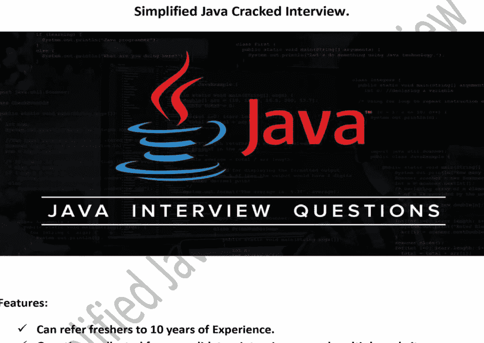
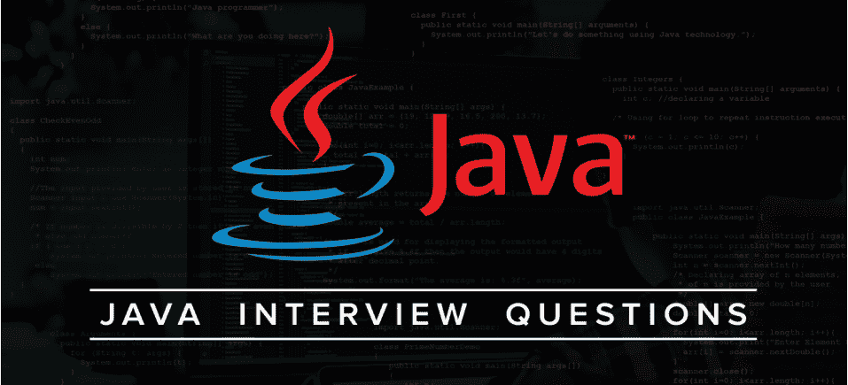
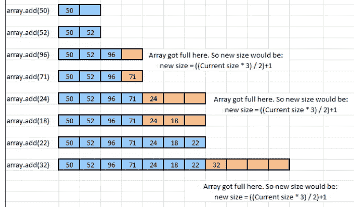
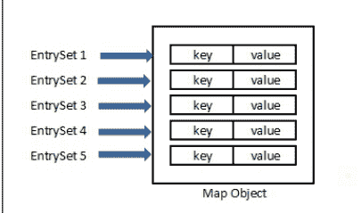
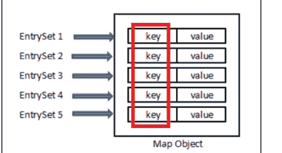
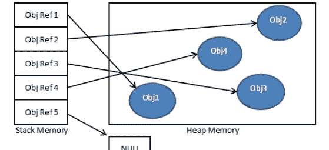
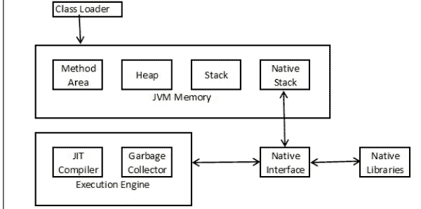

# 所有 MNC Java 面试题：简易 Java 面试破解指南



特点：

- 适用于应届生到 10 年经验的专业人士。
- 题目收集自候选者、面试官以及多个网站。
- 涵盖了 550 个带程序的问题。
- 涵盖了常见问题解答（FAQ）。
- 涵盖了实战面试题。
- 涵盖了 200 多个在 Eclipse 上测试过的 Java 6 和 Java 8 程序。



特点：

- 适用于应届生到 10 年经验专业士。
- 题目收集自候选者、面试官以及多个网站。
- 涵盖了 550 个带程序的问题。
- 涵盖了常见问题解答（FAQ）。
- 涵盖了实战面试题。
- 涵盖了 200 多个在 Eclipse 上测试过的 Java 6 和 Java 8 程序。

# YOGESH

关于本书和作者。

我想感谢我的家人，他们鼓励我写这本书，所以我将这本书献给我的家人。

这本书完全关于如何攻克 Java 面试。如果你是一个有经验的人，那么你可能已经在许多家 IT 公司参加过很多面试。如果你是应届生，那么未来将不得不参加很多面试。通过面试对每个人来说都是一件具有挑战性的事情。我见过许多人在被 8 到 10 家公司拒绝后才获得工作。但他们中有人第一次尝试就获得了录取通知。那么，你认为为什么尽管他们属于同一个专业、同一所学校，这种情况还是发生在了这些人身上？你能猜到吗！！！是的，你是的。**准备**！！！我在这里帮助你进行面试准备。

我想介绍一下我自己，我是 Yogesh Sanas。我在 Java 技术方面有 7 年经验。我曾在 TCS 和 Cybage Softwares 等许多声誉良好的公司工作过。幸运的是，我有很多机会主持 Java 技术的面试。到目前为止，我已经主持了 500 多场面试。

希望你已经知道通过面试需要哪些技能。你应该具备良好的沟通能力、技术知识、积极的态度等等。

我在 7 年的经验中注意到了候选者在哪些方面存在不足，以及他们的共同错误。我将在接下来的章节中涵盖所有需要修正的点、如何避免常见错误以及如何回答所有将涵盖的内容。请仔细阅读到最后一页，这样你就不会错过任何重要问题。

我创建了这一面试系列，特别是针对那些想要在 Java 技术领域发展职业生涯的人。我涵盖了所有声誉良好的跨国公司中提出的面试题，如 TCS、Infosys、Capgemini、Tech Mahindra、Cognizant、City Bank、Barclays、Amd、Mindtree 等。

我从朋友、同事、大学同学和同学所参加的真实面试中收集了所有问题。我涵盖了常见问题，以及具有挑战性的问题。我包含了许多程序以彻底理解概念。我将尝试通过 Eclipse 中的实战程序来解释这些概念。

我写这本书的目的是帮助你在你的梦想公司找到工作。我理解这是求职者和应届生来说的一段挣扎时期。每个人都经历过这个阶段，所以永远不要放弃。不断提升自己。我相信你会在你的梦想公司找到工作。

祝好！！！

# 基础 Java OOP 面试题

1. 什么是面向对象的语言？Java 是 100% 面向对象的语言吗？为什么？

- 面向对象编程是关于创建一个可以拥有其数据和方法的对象。
- Java 支持如 `int`、`float`、`double` 等基本数据类型，这些不是对象，因此 Java 不是一种纯面向对象的语言。

2. 什么是平台无关？为什么 Java 是平台无关的？

- 平台无关意味着“一次编写，随运行”。简而言之，一旦你在任何平台（编写了程序，就可以在任何平台（运行它。例如，如果你在 Unix 上编写一个程序，可以在 windows 或任何其他平台或操作系统上运行。
- 一旦 Java 编译该程序，它就会转换为字节码（`byte code`）。字节码不依赖平台，因此 Java 是平台无关的。

3. 什么是类（Class）？

- 类是一个蓝图或模板，从它可以创建对象。
- 例如，如果你有一个名为 `Person` 的类。我创建了 `'10'` 个 `Person` 类对象。
- 每个对象都有自己的成员变量副本。

```java
package simplifiedjava.crackedInterview;
public class Person {
    private int age;
    private int height;
    private int weight;
    private String name;
    private String education;
    // Getter and setter methods;
}
```

4. 什么是对象（Object）？

- 通常，对象是一个真实实体。对象是类的行为。
- 技术上，对象是数据和函数的结合。

5. 什么是 JVM？JDK、JVM 和 JRE 之间有什么区别？

- JVM 代表 Java 虚拟机。
- JVM 提供了一个运行时环境，字节码可以在其中执行。

| JDK | JVM | JRE |
|---|---|---|
| JDK 代表 Java 开发工具包（Java Development Kit）。 | JVM 代表 Java 虚拟机（Java Virtual Machine）。 | JRE 代表 Java 运行环境（Java Runtime Environment）。 |
| JDK 物理存在于系统中。 | JVM 虚拟存在而非物理存在。 | JRE 物理存在。 |

JDK = JRE + JVM。JRE 是字节码执行的运行时实现。

## 6. 什么是类加载器（class loader）？类加载器有哪些类型？

- `ClassLoader` 在 Java 运行时环境需要时动态将类加载到内存中。
- `ClassLoader` 是 Java 运行时环境中的一个抽象类。
- Java 中三种类型的类加载器。

### a. 引导类加载器（Bootstrap Class Loader - 原始）：

这是所有加载器的父加载器。引导加载器从 `jre/lib/rt.jar` 加载所有 JDK 文件。

### b. 扩展类加载器（Extension Class Loader）：

扩展类加载器从 `jre/lib/ext` 目录加载 Java 核心类的扩展类。扩展类加载器是引导类加载器的子加载器。

### c. 系统类加载器（System Class Loader）：

系统类加载器加载应用级别的类。系统类加载器是扩展类加载器的子加载器。

## 7. 什么是堆内存（Heap memory）和栈内存（Stack Memory）？堆内存和栈内存的区别是什么？

### 堆内存：

- 堆内存用于存储对象（Objects）。

### 栈内存：

- 栈内存用于存储局部变量和函数列表。

| 堆内存 | 栈内存 |
|---|---|
| 1 | 堆内存存储对象。 | 栈内存存储局部变量、引用变量和方法。 |
| 2 | 对象以分级方式存储。 | 变量按顺序存储。 |
| 3 | 对象可以留在堆内存中，直到没有引用变量指向它。 | 变量一旦函数执行完毕就会被移除。 |
| 4 | 访问速度慢。 | 访问速度快。 |
| 5 | 如果内存满了，JVM 会立即抛出 `OutMemoryError`。 | 如果栈满了，JVM 会立即抛出 `StackOverflow`。 |
| 6 | 使用垃圾回收机制来回收内存。 | 没有垃圾回收的角色，变量在函数执行完毕后自动移除。 |
| 7 | 堆是灵活的内存。 | 栈不是灵活的内存。 |
| 8 | `-Xms -Xmx` JVM 可以增加或减小堆的大小。 | `-Xss` 选项可以增加栈的大小。 |

## 8. 解释关联（Association）、组合（Composition）和聚合（Aggregation）？什么是 HAS-A 和 IS-A 关系？

- 关联（Association）：两个对象之间建立的关系称为关联。
- 关联可以是一对一、一对多、多对一、多对多的。
- 聚合（Aggregation）和组合（Composition）是关联的两种形式。
- 一一对一 = 一个学生可以有一个班。
- 一对多 = 一个学生可以有多门学科。
- 多对一 = 多个开发者可以有一个项目经理。
- 多对多 = 多个员工可以拥有多个任务。

关联的示例。我们在公司（`Company`）和员工（`Employees`）之间创建了关联。

```java
package simplifiedjava.crackedInterview;

public class Company {
    private String companyName;
    public Company(String companyName) {
        this.companyName = companyName;
    }
    public String getCompanyName() {
        return companyName;
    }
}
```

```java
package simplifiedjava.crackedInterview;

public class Employee {
    private String empName;
    public Employee(String empName) {
        this.empName = empName;
    }
    public String getEmpName() {
        return empName;
    }
}
```

```java
package simplifiedjava.crackedInterview;

public class AssociationExample {
    public static void main(String[] args) {
        Employee employee1 = new Employee("Rusty");
        Company company = new Company("Company");
        System.out.println(employee1.getEmpName() + " is working for " + company.getCompanyName());
    }
}
```

OUTPUT: Rusty is working for Company.

### 组合（Composition）：

- 组合可以被称为 HAS-A 关系。
- 当两个对象紧密耦合，或者说当一个对象依赖于另一个对象时，称为组合。
- 例如：引擎没有汽车无法生存。如果汽车存在，引擎就存在。如果汽车被销毁，引擎也会自动被销毁。

```java
package simplifiedjava.crackedInterview;
public class Engine {
    private String engine;
    private String power;
    private String modelNo;
    // getter and Setter methods.
}
```

```java
package simplifiedjava.crackedInterview;
public class Car {
    private String carName;
    private String carModel;
    private String manufacturer;
    private String engine; // Car 拥有 Engine 的引用。
    public Car(String carName, String carModel, String manufacturer, Engine engine) {
        this.carName = carName;
        this.carModel = carModel;
        this.manufacturer = manufacturer;
        engine = new Engine();
    }
    // getter and Setter
}
```

### 聚合（Aggregation）：

- 聚合可以被称为 HAS-A 关系。
- 当两个对象松散耦合，或者说当一个对象不依赖于另一个对象时，称为聚合。
- 例如：我们有两个对象。第一个是学院（`College`），第二个是学生（`Student`）。如果学院被销毁，学生对象仍然独立存在。

```java
package simplifiedjava.crackedInterview;
public class Student {
    private int id;
    private String name;
    private String standard;
    // getters and Setters.
}
```

```java
import java.util.ArrayList;
import java.util.List;
public class College {
    List<Student> studentList = new ArrayList<Student>();
    // add and remove Students.
}
```

## 9. 组合和聚合之间的区别是什么？

| 组合 (Composition) | 聚合 (Aggregation) |
| :--- | :--- |
| 紧密耦合关系。 | 松散耦合关系。 |

## 10. Java 是值传递（Pass by value）还是引用传递（Pass by reference）？如何证明 Java 是按值传递的？

Java 是值传递，而不是引用传递。

我们将通过下面的示例进行插说明。

```java
package simplifiedjava.crackedInterview;
public class Addition {
    int num1 = 100;
    int num2 = 0;
    public static void main(String[] args) {
        Addition add = new Addition();
        System.out.println("Before Adding Numbers : +add.num1);
        add.addNumber(add.num1);
        System.out.println("After Adding Numbers : "+add.num1);
    }
    public void addNumber(int num2) {
        num2 = num2 + 100;
    }
}
```

OUTPUT:

Before Adding Numbers : 100

After Adding Numbers : 100

解释：在上面的程序中，我们传递了整数并尝试加 100。但更改保留在了 `addNumber()` 函数中，而不是在 `main()` 函数中。

```java
package simplifiedjava.crackedInterview;
public class Addition {
    int num1 = 100;
    public static void main(String[] args) {
        Addition add = new Addition();
        System.out.println("Before Addition : " + add.num1);
        add.addNumberObject(add);
        System.out.println("After Addition : " + add.num1);
    }
    public void addNumberObject(Addition addCopy) {
        addCopy.num1 = addCopy.num1 + 100;
    }
}
```

OUTPUT:

Before Addition : 100

After Addition : 200

解释：在上面的程序中，我们传递了对象引用并尝试修改对象内部的值。由于 Java 是值传递，它传递的是引用的副本，因此原始对象被修改了。

（注：OCR 文本在结尾不完整，因此我仅处理了可用内容。）

- `super` 关键字可以用于调用父类的构造函数。

## 19. 什么是访问修饰符及其范围？

共有四种访问修饰符，如下：

1. 默认（Default）
2. 私有（Private）
3. 保护（Protected）
4. 公有（Public）

范围：

| 访问修饰符 | 类内部 | 包内 | 子类（其他包） | 包外部 |
|---|---|---|---|---|
| 默认 | Y | Y | N | N |
| 私有 | Y | N | N | N |
| 保护 | Y | Y | Y | N |
| 公有 | Y | Y | Y | Y |

## 20. OOP 概念的核心支柱是什么？请解释 OOP

- OOP 概念有四个支柱，如下：

### 1. 抽象（Abstraction）：

- 抽象意味着隐藏实现细节。

**生活中的实例：** 我们可以以汽车为例。当我们想启动汽车时，必须转动点火钥匙，引擎就会启动。对于终端用户来说，不需要知道引擎是如何与不同的轮子连接的，电池是如何供电的，以及汽油如何在引擎中喷射。这些所有实现都被隐藏了。这就是抽象。

**技术实现：** 抽象类和接口实现了抽象。抽象类是部分抽象；抽象类可以包含具体方法和抽象方法，而接口是完全抽象的，只包含抽象方法而不包含具体方法。

### 2. 封装（Encapsulation）：

- 封装意味着隐藏数据。

**生活中的实例：** 胶囊是封装的完美例子。胶囊的包装层内部有不同类型的小药片。


**技术实现：** `Bean` 类是封装的一个示例。我们将属性声明为 `private`，并为每个变量提供公有的 `getter` 和 `setter` 方法。

### 3. 继承（Inheritance）

- 继承意味着一个对象可以拥有其他对象的属性。子类可以继承父类的属性。

**生活中的实例：** 假设祖父有土地、农场，你父亲有公寓、一些黄金和股票，而你有一辆赛车、`iPhone` 和笔记本电脑。最终，你祖父母拥有的任何东西都会给你父亲，你父亲的财产也会继承给你。但请记住，反过来是不可能的。

**技术实现：** 你可以使用 `extends` 和 `implements` 关键字来实现继承。如果你扩展另一个类，则必须使用 `extends` 关键字；如果你实现接口，则必须使用 `implements` 关键字。

### 4. 多态（Polymorphism）

- 多态意味着“一个名字，多种形式”。

一个实体在不同情况下可以有不同的行为。

**生活中的实例：** 人在不同的地点或语境下可以同时拥有不同的角色。人在家里可以是父亲，在公司里可以是经理，在电影里可以是舞者。

**技术实现：** 多态可以通过方法重载（Method overloading）和方法重写（method overriding）来实现。

## 编译时多态和运行时多态之间有什么什么区别？

| 编译时多态 | 运行时多态 |
|---|---|
| 1. 方法重载是编译时绑定的示例。 | 1. 方法重写是运行时绑定的示例。 |
| 2. 编译时多态可以通过静态绑定实现。 | 2. 运行时多态可以通过动态绑定实现。 |
| 3. 实现编译时多态并不强制要求继承。 | 3. 实现运行时多态强制要求继承。 |

## 你在项目中是如何实现封装的？

- 你创建一个 POJO（普通 Java 对象）类。

- 你必须用 `private` 访问权限声明成员，并提供公有的 `getters` 和 `setter` 方法。这样变量的原始值无法更改；它们是私有的，而外部可以使用，因为我们提供了公有的 `getter` 和 `setter` 方法。

```java
package simplifiedjava.cracked1;

public class EncapsulationImplementation {
    private int id;
    private String name;

    public int getId() {
        return id;
    }
}
```

```java
System.out.println("Hi");
}
O/P : Hi
```

## 31. 我们可以创建一个与类名相同且具有返回类型的方法吗？代码可以编译吗？

是的，我们可以创建一个与类名相同的方法名。代码可以编译。但请记住这不是良好做法。我们有一个与类名相同的构造方法。请参考下面的示例。

```java
package simplifiedjava.crackedInterview;

public class Parent {

    public static void main(String[] args) {
        new Parent().Parent();
    }

    public void Parent() {
        System.out.println("Hello");
    }
}
```

输出：`Hello`

## 32. 我们可以重写重载方法吗？

- 是的。我们可以重写重载方法，因为类内重载是可能的，但对于重写，你必须有一个定义了该重载方法的子类。

- 为了供你参考，我创建了一个简单的示例。

```java
package simplifiedjava.crackedInterview;

public class OverrideOverloadedMethodDemo {

    public static void main(String[] args) {
        Parent p = new Parent();
        Child c = new Child();
        c.check("Brother");
    }
}
```

```java
package simplifiedjava.crackedInterview;

public class Parent {

    public void check() {
        System.out.println("Hello");
    }

    public void check(String relation) {
        System.out.println("Parent Class check method.");
    }
}
```

```java
package simplifiedJava.crackedInterview;

public class Child extends Parent {
    public void check(String relation) {
        System.out.println("Child class check.");
    }
}
```

## 33. 可以在没有 `main` 方法的情况下执行程序吗？

是的，我们可以在没有 `main` 方法的情况下执行程序。我们可以简单地在静态块中编写代码，但在静态块执行完成后，你会得到错误 `lang.lang.NoSuchMethodError: main`。在 Java 7 及以后版本是不可能的，因为 JVM 在初始化类之前会检查 `main` 方法的存在。

## 34. 什么是静态方法和什么是静态变量？

### 静态方法

- 在不实例化类的情况下，我们可以使用类名调用方法。

### 静态变量

- 静态变量可以用于引用所有对象的共同属性。

## 35. 实例方法和静态方法之间的区别是什么？

| # | 实例方法 | 静态方法 |
|---|---|---|
| 1 | 不需要使用任何特殊关键字来声明实例方法。 | 静态方法必须用 `static` 关键字声明。 |
| 2 | 必须实例化类才能调用实例方法。 | 调用静态方法不需要实例化类。 |
| 3 | 实例方法可以被重载和重写。 | 静态方法可以被重载但不能被重写。 |
| 4 | 实例方法既可以访问静态变量也可以访问实例变量。 | 静态方法只能访问静态变量而不能访问实例变量。 |

## 36. 静态块和实例块之间的区别是什么？

| # | 静态块 | 非静态块 |
|---|---|---|
| 1 | 静态块使用 `static` 关键字声明。 | 非静态块不使用关键字。 |
| 2 | 静态块在类加载时执行。 | 非静态块在对象实例化时执行。 |
| 3 | 静态块在非静态块之前执行。 | 非静态块在静态块之后执行。 |

## 37. 在静态区域（无论是块还是方法）内部可以访问非静态成员吗？

不可以。我们不能在静态区域（无论是块还是方法）内部访问非静态成员。

## 38. 什么是方法重写和方法重载？

| # | 方法重写（Overriding） | 方法重载（Overloading） |
|---|---|---|
| 1 | 方法重写意味着在父类和子类中创建具有相同签名的方法。 | 方法重载意味着在同一个类中创建签名不同但名称相同的方法。 |
| 2 | 方法重写是运行时多态。 | 方法重载是编译时多态。 |
| 3 | 我们可以在两个类中都拥有同一个方法。 | 我们可以在单类类中拥有多个方法。 |
| 4 | 方法重写是动态绑定。 | 方法重载是静态绑定。 |
| 5 | 方法重写适用于协变返回（Covariant return）。 | 方法重载不适用协变返回。 |
| 6 | 私有和静态方法不能被重写。 | 私有和静态方法可以被重载。 |

## 39. 如果父类方法没有抛出任何异常，但子类方法抛出了受检异常（checked exception），代码可以编译吗？

- 不，类将无法编译。我们将得到编译时错误。

- 我们可以看下面的示例。

```java
package simplifiedjava.crackedInterface;

public class Parent {
    public void check(String relation) {
        System.out.println("Parent class check() method.");
    }
}
```

```java
package simplifiedjava.crackedInterface;

import java.io.FileNotFoundException;

public class Child extends Parent {

    public void check(String relation) throws FileNotFoundException {
        System.out.println("Child Class check() method.");
    }
}
```

输出：编译时错误：Exception `FileNotFoundException` 与 `Parent.check(String)` 中的 `throws` 子句不兼容。

## 40. 如果子类方法抛出的异常比父类方法更宽，代码可以编译吗？

- 是的。如果子类方法抛出的异常更宽，类可以编译。

如果你尝试重写静态方法，它将被视为方法隐藏（method shadowing）。

## 51. 什么是构造函数？构造函数有哪些类型？

- 构造函数是一个用于初始化对象的函数。

- 构造函数没有返回值。

- 构造函数的名称必须与类名相同。

- 我们可以在一个类中拥有多个构造函数。

- 我们可以将构造函数声明为私有（private）、公共（public）和保护（protected）。

- 构造函数有三种。

1. 默认构造函数：如果你没有提供任何构造函数，编译器为你提供一个默认构造函数。

2. 无参构造函数：如果你声明了一个没有参数的构造函数，该构造函数被称为无参构造函数。

3. 参数构造函数：如果你声明了一个带参数的构造函数，那么它被称为参数构造函数。

## 52. 当你调用子类构造函数而不使用 `super` 关键字时，父类的构造函数会被调用吗？

会被。如果你创建一个子类对象并调用子类的构造函数，子类在内部会隐式地调用父类的构造函数。

```java
package simplifiedjava.crackedInterview;

public class OverrideOverloadedMethodDemo {
    public static void main(String[] args) {
        Child c = new Child();
    }
}
```

```java
package simplifiedjava.crackedInterview;

public class Parent {
    public Parent() {
        System.out.println("Parent Class Constructor");
    }
}
```

```java
package simplifiedjava.crackedInterview;

public class Child extends Parent {
    public Child() {
        System.out.println("Child Class Constructor...");
    }
}
```

输出：

```text
Parent Class Constructor

Child Class Constructor...
```

## 53. 方法和构造函数之间有什么区别？

| 方法 | 构造函数 |
|---|---|
| 1. 方法用于实现逻辑。 | 构造函数用于初始化对象。 |
| 2. 方法可以有返回值。 | 构造函数不能有返回值。 |
| 3. 方法名可以是任何名称，也可以是类名。 | 构造函数的名称必须与类名相同。 |
| 4. 方法必须显式调用。 | 构造函数可以被自动调用。 |
| 5. 如果你没有任何方法，编译器将提供任何类似于构造函数的方法。 | 如果你没有任何构造函数，编译器将提供一个默认构造函数。 |
| 6. 方法可以被重写或重载。 | 构造函数可以被重载但不能被重写。 |

## 54. 抽象类中可以构造函数吗？如果我们实例化抽象类，为什么抽象类中还需要构造函数呢？

- 我们可以在抽象类内部声明构造函数。

- 完全正确，我们不能实例化抽象类，但当它的实现类（子类）被实例化时，抽象类的构造函数会被调用。

## 55. 我可以将构造函数声明为抽象（abstract）吗？

- 构造函数不能是抽象的。

- `abstract` 关键字可以应用于类和方法，但不能应用于构造函数或代码块。

## 56. 你可以在接口内部声明构造函数吗？

- 接口内部不能声明构造函数。

- 构造函数主要用于初始化值。我们无法实例化接口，所以我们不能在接口内部声明构造函数。

## 57. 你可以将构造函数声明为静态（static）、最终（final）、抽象（abstract）和同步（synchronized）吗？

- 我们不能将构造函数声明为 `static`、`final`、`abstract` 和 `synchronized`。

- 上述四个关键字的作用各不。

## 58. 为什么 Java 不允许静态构造函数？

- `static` 属于类，而不属于对象。

- 构造函数在初始化对象值时属于对象。

当你创建一个子类对象时，内部会自动调用父类的构造函数。

如果你将构造函数声明为 `static`，那么子类将无法调用父类的构造函数，这就违背了继承机制。因此，我们不能将构造函数声明为 `static`。

## 59. 在你的程序中，有一个静态块（static block）、非静态构造函数和 `main()` 方法。执行顺序是怎样的？

执行顺序如下：

1. 静态块：在加载到内存时执行。

2. 非静态块：在实例化时执行。但注意，这取决于你是在 `main` 方法中打印语句之前还是之后实例化该类。如果你在打印语句之后实例化类。

3. 构造函数：在对象初始化时执行。

4. `main`：如果你没有实例化类，它将在最后执行。

5. 我们可以看到不同的场景。

### 场景 1

```java
package simplifiedjava.crackedInterview;

public class BlockExecutionSequenceDemo {
    static {
        System.out.println("Static Block Execution");
    }

    {
        System.out.println("Non Static Block Execution");
    }

    public BlockExecutionSequenceDemo() {
        System.out.println("Constructor Execution");
    }

    public static void main(String[] args) {
        System.out.println("Main Method Execution");
    }
}
```

输出：

```text
Static Block Execution

Main Method Execution
```

### 场景 2

```java
package simplifiedjava.crackedInterview;

public class BlockExecutionSequenceDemo {
    static {
        System.out.println("Static Block Execution");
    }

    {
        System.out.println("Non Static Block Execution");
    }

    public BlockExecutionSequenceDemo() {
        System.out.println("Constructor Execution");
    }

    public static void main(String[] args) {
        BlockExecutionSequenceDemo demo = new BlockExecutionSequenceDemo();
        System.out.println("Main Method Execution");
    }
}
```

输出：

```text
Static Block Execution

Non Static Block Execution

Constructor Execution

Main Method Execution
```

### 场景 3

```java
package simplifiedjava.crackedInterview;

public class BlockExecutionSequenceDemo {
    static {
        System.out.println("Static Block Execution");
    }

    {
        System.out.println("Non Static Block Execution");
    }

    public BlockExecutionSequenceDemo() {
        System.out.println("Constructor Execution");
    }

    public static void main(String[] args) {
        System.out.println("Main Method Execution");
        BlockExecutionSequenceDemo demo = new BlockExecutionSequenceDemo();
    }
}
```

输出：


# Static Block Execution

# Main Method Execution

# Non Static Block Execution

# Constructor Execution

## 60. 将构造函数声明为私有的目的是什么？

- 私有构造函数可以确保一次只能创建一个对象。
- 无法从类外部实例化该类。
- 单例模式（singleton patterns）通常使用私有构造函数。

## 61. 什么是构造函数链（constructor chaining）？

- 一个构造函数内部或显式地调用另一个构造函数被称为构造函数链。
- 构造函数可以使用`this()`和`super()`调用另一个构造函数。

## 62. 我们可以重写或重载构造函数吗？

- 我们不能重写构造函数，但可以重载构造函数。
- 构造函数重写是不可能的，因为构造函数的名称必须与类相同且没有返回值。但重写要求的签名相同，因此最终是不可能的。
- 构造函数重载是可能的，因为构造函数名相同但参数类型或数量不同，所以允许重载。

## 63. 构造函数可以返回值吗？如果不可以可以解释为什么？

- 构造函数专门用于初始化对象，而不是处理业务逻辑。
- 如果构造函数没有业务逻辑且不需要返回，它就没有返回值。

## 64. 构造函数可以访问修饰符吗？哪些修饰符适用于构造函数？

- 是的，构造函数可以有访问修饰符。
- 以下修饰符适用于构造函数：

1. 公共（`public`）
2. 私有（`private`）
3. 保护（`protected`）
4. 默认（`default`）

以下修饰符不适用于构造函数：

1. 抽象（`abstract`）
2. 最终（`final`）
3. 原生（`native`）
4. 静态（`static`）
5. 同步（`synchronized`）。

## 65. 构造函数可以使用 `throws` 关键字声明异常吗？

- 我们确实可以在构造函数定义中使用`throws`关键字声明异常。
- 我们可以在构造函数定义中同时声明检查异常和未检查异常。
- 为了你参考，我在示例中提供了多个场景。

```java
package simplifiedjava.crackedInterview;

import java.io.FileNotFoundException;
import java.io.IOException;

public class ExceptionThrowsInConstructor {
    public ExceptionThrowsInConstructor() throws FileNotFoundException{
    }
    public ExceptionThrowsInConstructor(int num) throws IOException{
    }
    public ExceptionThrowsInConstructor(String str) throws ArrayIndexOutOfBoundsException, NullPointerException{
    }
}
```

# 什么是默认构造函数？默认构造函数、无参构造函数和参数构造函数之间的区别是什么？

- 默认构造函数是编译器在类中没有声明构造函数时提供的一种构造。
- 默认构造函数是一种无参数构造函数。
- 构造函数没有任何参数。访问修饰符为默认。
- 无参构造函数没有任何参数。但我们可以将无参构造函数声明为`public`、`private`、`protected`和默认（`default`）。
- 参数构造函数必须至少有一个参数。参数构造函数可以声明为`public`、`private`、`protected`和默认（`default`）。

# 67. 我们可以在单个类中声明多个构造函数吗？

可以的。一个类可以有多个构造函数。

如果一个类有多个构造函数，那么它被称为构造函数重载。

# 68. 什么是抽象类？我们可以实例化抽象类吗？

用`abstract`关键字声明的类被称为抽象类。

如果你将一个类声明为`abstract`，那么我们既可以声明抽象方法也可以声明具体方法。

如果一个类内部有一个抽象方法，则必须将该类声明为抽象类。

抽象类内部并不强制要求至少有一个抽象方法。简而言之，如果你已经将类声明为抽象，那么对于声明的抽象方法就不是强制性的。

# 69. 我可以在抽象类中声明`final`和`abstract`方法吗？

- 你不能同时声明`final`和`abstract`。可以分别声明`final`或`abstract`方法。

你可以在抽象类内部单独声明`final`方法或`abstract`方法。

# 70. 我们可以在没有任何抽象方法的情况下将类声明为抽象吗？

你可以在抽象类内部没有声明抽象方法的情况下声明抽象类。

请注意，如果你声明了抽象方法，则必须将该类声明为抽象类。

# 71. `final`方法和`abstract`方法的区别是什么？

- `final`方法不能重写。
- `abstract`方法在它的实现类中必须重写。

# 72. 接口（Interface）和抽象类（Abstract Class）的区别是什么？你能告诉我一个接口和抽象类实现是最佳实践的真实示例吗？

| 抽象类 | 接口 |
|---|---|
| 1. 抽象类必须用`abstract`关键字声明。 | 接口可以用`interface`关键字声明。 |
| 2. 抽象类可以有构造函数。 | 接口不能有构造函数。 |
| 3. 抽象类可以有具体方法和抽象方法。 | 接口只有抽象方法。你不能在接口内部拥有具体方法。 |
| 4. 抽象类可以声明`private`、`protected`、`default`和`public`方法。 | 接口只声明`public`方法。 |
| 5. 抽象类可以声明`private`、`protected`和`public`变量。 | 接口只能声明`public`变量。 |
| 6. 抽象类可以声明非`final`和局部变量。 | 接口只能声明`final`变量，但不能声明局部变量。 |
| 7. 抽象类可以扩展一个类并实现多个接口。 | 接口只能扩展一个或多个接口。 |
| 8. 当你有部分实现且其余实现尚未完成时，抽象类是最佳实践。 | 当完全没有实现时，接口是最佳实践。 |

# 73. 如果我在类中声明了一个方法但没有将该类声明为抽象类，代码会编译吗？

- 不。你的类将无法编译，你会得到一个编译错误。
- 如果你已经在类内部声明了抽象方法，则必须将该类声明为抽象类。

# 74. 我们可以在抽象类中声明`static`方法和`static`变量吗？

- 可以的。你可以在抽象类内部声明`static`方法和`static`变量。

# 75. 我们可以在抽象类中声明具体方法吗？

- 当然可以，我们可以在抽象类内部声明具体方法。
- 抽象类可以有抽象方法，也可以有具体方法。

# 76. 可以在非静态区域中使用`static`成员吗？

- 是的。我们可以在非静态区域使用`static`成员。

可以通过下面的示例观察这一点：

```java
package simplifiedjava.crackedInterview;
public class Parent {
    static int a = 10;
    public static void main(String[] args) {
        new Parent();
    }
    public void check() {
        System.out.println("Parent check() = " + a);
    }
}
```

# 77. 什么是静态导入（static import）？

- 静态导入意味着我们从另一个类导入静态成员。
- 一旦导入了静态成员，我们就可以不通过类名使用它们。
- 通常，我们通过类名使用静态成员，但一旦导入，就不需要使用类名。你可以直接访问这些成员。

# 78. Java 中的静态变量存储在哪里？

- 静态变量存储在 Perm-Gen 空间（也称为方法区域）。
- 静态变量存储在堆（Heap）本身。
- 从 Java 8 开始，Perm-Gen 空间被移除，引入了名为 Metaspace 的新空间，它不像之前的 Perm-Gen 不是堆的一部分。

# 79. 什么是 Java 中的菱问题（Diamond Problem）？为什么不支持多继承？

菱问题出现在多继承中。

当一个类继承多个类时，这就被称为菱问题。

例如：有三个类。类 A、类 B 和类 C。类 A 和类 B 都有`add()`方法，当类 C 尝试重写`add()`方法时，编译器将无法确定。这就是为什么 Java 不支持多继承。

# 80. 什么是标记接口（Marker Interface）？你能告诉我标记接口的示例吗？

- 空接口被称为标记接口。
- 标记接口没有任何方法或变量。

标记接口列表：

1. `Serializable`接口。
2. `Cloneable`接口。
3. `Remote`接口。

# 81. Java 中的包装类（Wrapper Classes）是什么？为什么我们需要包装类？

- 包装类是一种封装或包含原始类型的类。
- 包装类持有原始类型的值并以对象的形式表示。
- 所有原始类型都有自己的包装类。
- 例如：`int`有`Integer`，`float`有`Float`，`double`有`Double`等。
- 在集合框架中，如果我们想将原始类型表示为对象以进行操作，就可以使用包装类。

```java
package simplifiedJava.crackedInterview;
public class ClassInsideClass {
    class Inner {
        public void greetings() {
            System.out.println("Hello From Inner Class");
        }
    }
    public static void main(String[] args) {
        ClassInsideClass.Inner inner = new ClassInsideClass().new Inner();
        inner.greetings();
    }
}
Output: Hello From Inner Class
```

## 85. 可以在接口内部声明接口吗？

- 是的，我们可以在接口内部声明接口。
- 为了演示，请参考下例。

```java
package simplifiedJava.crackedInterview;
public interface OuterInterface {
    public interface InnerInterface {
        public void greetings();
    }
}
class MyClass implements OuterInterface.InnerInterface {
    public static void main(String[] args) {
        new MyClass().greetings();
    }
    public void greetings() {
        System.out.println("Implementation From Inner Interface");
    }
}
Output : Implementation From Inner Interface
```

## 86. 什么是变量遮蔽（variable shadowing）？

- 遮蔽意味着在特定作用范围内（声明的方法或块）声明的变量与在外层作用范围内声明的变量同名。
- 简单来说，我们在块或方法中与类变量使用了相同的名称。
- 为了演示，请参考下例。

```java
package simplifiedJava.VariableShadowingDemo
public class VariableShadowingDemo {
    int num = 10;
    public void printNum() {
        int num = 20;
        System.out.println("Num Value " + num);
    }
    public static void main(String[] args) {
        new VariableShadowingDemo().printNum();
    }
}
Output : 20. 因为局部变量在方法内部优先级最高。
```

## 87. 什么是静态方法遮蔽（static method shadowing）？

父类中的静态方法会被子类中声明的静态方法隐藏。这种机制被称为方法遮蔽。

方法遮蔽仅对静态方法有效。

```java
package simplifiedJava.crackedInterview;
public class Parent {
    public static void printGreetings() {
        System.out.println("Parent Static Method");
    }
}
```

```java
package simplifiedJava.crackedInterview;
public class Child extends Parent{
    public static void printGreetings() {
        System.out.println("Child Class Static Method");
    }
    public static void main(String[] args) {
        Parent.printGreetings();
        Child.printGreetings();
    }
}
Output:
Parent Class Static Method
Child Class Static Method
```

## 88. 什么是对象克隆（object cloning）？

- 对象克隆意味着创建一个对象的副本。
- 可以使用`clone()`来创建对象的克隆。

## 89. 什么是协变返回类型（co-variant return type）？

- 协变返回意味着当重写一个方法时，重写方法的返回类型允许是被重写方法返回类型的子类型。

在这个例子中，有两个类`Human`和`Men`。`Men`类继承了`Human`类。

这两个类都有`dressStyle()`方法。该方法在`Men`类中被重写了。两个方法具有相同的返回类型，但如果你观察，会发现父类方法返回实际的`Human`类对象，而子类方法在返回类型为`Human`时返回的是子类（`Men`类）对象。这就是协变返回类型。

```java
package simplifiedjava.crackedInterview;
public class Human {
    public Human dressingStyle() {
        return new Human();
    }
}
package simplifiedjava.crackedInterview;
public class Men extends Human {
    public Men dressingStyle() {
        return new Men();
    }
}
```

## 90. `final`关键字的作用是什么？它可以应用于哪些地方？

- `Final`关键字可以应用于以下场景：

  1. 变量：`final`变量一旦赋值，值无法更改。
  2. 方法：`final`方法不能被重写。
  3. 类：`final`类不能被继承。

## 91. 什么是静态绑定（static binding）和动态绑定（dynamic binding）？

- 静态绑定发生在编译时。
- 动态绑定发生在运行时。
- 静态绑定的最佳示例是方法重载。
- 动态绑定的最佳示例是方法重写。

## 92. Java 中的`instanceOf`是什么？它可以在哪里使用？

- `instanceOf`是 Java 中的一个运算符。
- `instanceOf`可用于检查对象的类型。
- `instanceOf`运算符的语法为：`(object instanceof Type);`


```java
package simplifiedJava.crackedInterview;

import java.util.ArrayList;
import java.util.List;

public class InstanceOfDemo {
    public static void main(String[] args) {
        List list = new ArrayList();
        list.add(new String("Java"));
        list.add(new Integer(100));
        list.add(new ITeamEmployee());
        for(Object obj : list) {
            if(obj instanceof String) {
                System.out.println((String)obj);
            } else if(obj instanceof Integer) {
                System.out.println((Integer)obj);
            } else if (obj instanceof ITeamEmployee) {
                System.out.println((ITEmployee)obj);
            }
        }
    }
}
class ITeamEmployee{
}
```

## 93. 什么是三元运算符（ternary operator）？

三元运算符是 if-else 的简写形式。它包含三个部分：条件、为真时的值和为假时的值。

```java
package simplifiedJava.crackedInterview;
public class TernaryDemo {
    public static void main(String[] args) {
        int num = 20;
        String typeNum = (num > 0) ? "Positive" : "Negative";
        System.out.println(typeNum);
    }
}
Output : Positive
```

## 94. 相对路径和绝对路径之间的区别是什么？

- 绝对路径：从根目录指定位置（例如 `C:/...`）。
- 相对路径：从当前目录指定位置（例如 `images/`）。

## 95. 什么是垃圾回收（garbage collection）？谁负责垃圾回收？Java 如何回收内存？

垃圾回收是一个删除未使用的对象并回收内存的过程。`JVM` 找到未使用的对象，然后调用 `finalize()` 方法释放由对象获取的资源。存在许多 GC 算法来实现它，其中之一是标记-清除算法（mark and sweep）。

## 96. 对象是如何变得可以垃圾回收的？

- 当没有引用变量指向对象时，该对象就可以被视为可以垃圾回收。
- 有三种方式可以让对象进入垃圾回收：
  1. 对象超出作用范围。
  2. 对象引用显式赋值 `null`。
  3. 重新初始化变量。

## 97. 我们可以要求 JVM 回收垃圾或销毁对象吗？

我们只能建议销毁对象而不能强制。可以使用 `System.gc()` 方法来建议垃圾回收。

## 98. `equals()` 和 `==` 有什么区别？

- `equals()` 是方法，用于内容比较。
- `==` 是运算符，用于引用比较。

## 99. 什么是装箱（Boxing）和解箱（Unboxing）？

- 将基本数据类型转换为对应的包装类称为装箱。
- 将包装类类型转换为基本类型称为解箱。
- 请参考下例了解装箱和解箱。

```java
package simplifiedJava.cracked;
public class BoxingUnboxingDemo {
    public static void main(String[] args) {
        int num = 100;
        Integer wrapperNum1 = new Integer(num);
        Integer wrapperNum2 = 200;
        System.out.println("Auto Boxing " + wrapperNum1 + " and " + wrapperNum2);
        Integer wrapperNum3 = new Integer(300);
        num = wrapperNum2;
        System.out.println("Unboxing " + num);
    }
}
Output : 
Auto Boxing 100 and 200
Unboxing 300
```

## 100. 什么是向上转型（Upcasting）和向下转型（Downcasting）？

- 向上转型是将子类对象转换为父类对象。
- 隐式向上转型是可能的。
- 向上转型也称为宽转换（Widening）。
- 向下转型是将父类对象转换为子类对象。
- 隐式向下转型是不可能的。
- 向下转型（Downcasting）也称为收缩转换（Narrowing）。
- 请参考下例了解向上转型（upcasting）和向下转型的。

```java
package simplifiedjava.crackedInterview;
public class Parent {
    public void check(){
        System.out.println("Parent Class check() method");
    }
}
```

```java
package simplifiedjava.crackedInterview;
public class Child extends Parent {
    public void check(){
        System.out.println("Child Class check() method");
    }
}
```

```java
package simplifiedjava.crackedInterview;
public class UpCastingDownCDemo {
    public static void main(String[] args) {
        Parent p = (Parent)new Child(); // 向上转型 (Upcasting)
        p.check();
        Parent p1 = new Child();
        Child c = (Child)p1; // 向下转型 (downcasting)
        p1.check();
    }
}
Output :
Child Class check() method.
Child Class check() method.
```

## 101. 什么是宽转换（Widening）？

- 当我们将较小数据类型的值赋予较大的数据类型时。
- 当两个数据类型兼容时，这种操作是可能的。
- 转换范围：`byte -> short -> int -> long -> float -> double`。

```java
package simplifiedjava.crackedInterview;
public class WideningDemo {
    public static void main(String[] args) {
        int i = 100;
        long j = i;
        float k = i;
        float k1 = i;
        System.out.println("Value of i = "+i + "\nValue of j = "+j + "\nValue of k = "+k + "\nValue of k1 = "+k1);
    }
}
```

## 102. 什么是收缩转换（Narrowing）？

- 当我们将较大的数据类型的值赋予较小的数据类型时。
- 当两个数据类型兼容时，这种操作是可能的。
- 收缩范围：`byte <- short <- int <- long <- float <- double`。

```java
package simplifiedJava.crackedInterview;
public class WideningDemo {
    public static void main(String[] args) {
        float i=100;
        long j = (long) i;
        int k = (int) j;
        int k1 = (int) i;
        System.out.println("Value of i = " + i + "\nValue of j = " + j + "\nValue of k = " + k + "\nValue of k1 = " + k1);
    }
}
```

## 103. `equals()` 和 `hashCode()` 是什么？

如果两个对象相等，那么它们应该具有相同的 `hashcode`；如果两个对象不相等，它们的 `hashcode` 可能相同也可能不同。

如果 `Object1.equals(Object2)` 为 `true`，则两个对象的 `hashcode` 必须相同。

如果 `Object1.equals(Object2)` 为 `false`，则 `hashcode` 可能相同也可能不同。

根据 Oracle 文档，为了获得完整的等性机制，你必须重写 `equals()` 和 `hashCode()` 方法。

## 104. 什么是 Comparable 和 Comparator？它们之间有什么区别？

- `Comparable` 和 `Comparator` 是用于排序的接口。
- `Comparable` 接口可用于自然排序顺序（natural sorting order）。
- `Comparator` 接口可用于自定义排序规则。
- `Comparable` 拥有 `compareTo()` 方法。
- `Comparator` 拥有 `compare()` 方法。

## 105. 你能编写代码按薪水或职位对员工进行自定义排序吗？

```java
package simplifiedJava.crackedInterview;
import java.util.Comparator;
public class Employee {
    private String empName;
    private String dept;
    private Double salary;
    private String designation;
    public Employee(String empName, String dept, Double salary, String designation) {
        super();
        this.empName = empName;
        this.dept = dept;
        this.salary = salary;
        this.designation = designation;
    }
    public Employee(String empName) {
        this.empName = empName;
    }
    public String getEmpName() {
        return empName;
    }
    public String getDept() {
        return dept;
    }
    public void setDept(String dept) {
        this.dept = dept;
    }
    public Double getSalary() {
        return salary;
    }
    public void setSalary(Double salary) {
        this.salary = salary;
    }
    public String getDesignation() {
        return designation;
    }
    public void setDesignation(String designation) {
        this.designation = designation;
    }
    public void setEmpName(String empName) {
        this.empName = empName;
    }
    @Override
    public String toString() {
        return "Employee [empName=" + empName + ", " + "dept=" + dept + ", " + "salary=" + salary + " " + "designation=" + designation + "]";
    }
}
```

```java
package simplifiedjava.crackedInterview;

import java.util.Comparator;
public class SortEmployeeBySalary implements Comparator<Employee>{
    public int compare(Employee e1, Employee e2) {
        return e1.getSalary().compareTo(e2.getSalary());
    }
}
```

```java
package simplifiedjava.crackedInterview;
import java.util.ArrayList;
import java.util.List;
public class ComparableAndComparatorDemo {
    public static void main(String[] args) {
        List<Employee> empList = new ArrayList<>();
        empList.add(new Employee("John", "IT", 50000.0, "Developer"));
        empList.add(new Employee("Jane", "HR", 60000.0, "Manager"));
        empList.add(new Employee("Bob", "IT", 45000.0, "Developer"));
        empList.add(new Employee("Alice", "Sales", 70000.0, "Manager"));
        empList.add(new Employee("Charlie", "IT", 55000.0, "Developer"));

        System.out.println("Before Sorting: ");
        for(Employee e : empList) {
            System.out.println(e);
        }

        Collections.sort(empList, new SortEmployeeBySalary());

        System.out.println("After Sorting by Salary: ");
        for(Employee e : empList) {
            System.out.println(e);
        }
    }
}
```

# 字符串相关面试题

## 111. 什么是不可变类（immutable class）？

- 不可变类意味着对象一旦创建，其值或内容就无法更改。
- Java 中不可变性的最佳示例是 `String` 类。`String` 对象一旦创建就无法更改。
- 所有的包装类都是不可变类。包装类包括 `Integer`, `Float`, `Double`, `Boolean`, `Byte`, `Short` 等。

## 112. 为什么 `String` 是不可变的？

- `String` 对象是不可变的；字符串对象是在 SCP（字符串常量池）中创建的。
- 缓存的 `String` 对象在多个客户端之间共享。
- 如果任何人更改了 `String` 对象的值，那么所有客户端都会受到影响。这就是为什么 Java 中的 `String` 是不可变的。

## 113. 我们可以修改现有的 `String` 对象吗？如果我尝试修改现有的 `String` 对象，string会发生什么？

我们无法修改现有的 `String` 类对象。

如果你尝试在内部修改现有的字符串对象，将会创建一个新对象，并且你指向的是一个新创建的对象；旧对象将可以被垃圾回收。

## 114. `StringBuilder` 和 `StringBuffer` 之间有什么区别？

| `StringBuilder` | `StringBuffer` |
| :--- | :--- |
| 1. `StringBuilder` 不是线程安全的。 | `StringBuffer` 是线程安全的。 |
| 2. 相比 `StringBuffer`，`StringBuilder` 的性能更好。 | 相比 `StringBuilder`，`StringBuffer` 的性能较低，因为 `StringBuffer` 是线程安全的。 |


# 115. `intern()` 方法的作用是什么？

- `intern()` 方法返回字符串的规范化表示（canonical representation）。
- 简单来说，`intern()` 方法从 SCP（字符串常量池）中返回 `String` 对象。

# 116. 什么是 SCP（字符串常量池）？

- 字符串常量池是堆内存中的一个独立区域，存储了所有的 `String` 对象。
- 如果你使用 `new` 关键字创建对象，该对象会在堆内存中创建，并将相同的字符串对象保留在字符串常量池中。
- 如果你不使用 `new` 关键字创建对象，该对象不会在堆内存中创建；该对象将在字符串常量池中创建。
- 如果对象已存在，则引用变量将指向现有对象而不是创建一个新对象。

# 117. `String s = "abc"` 和 `String s = new String("abc")` 之间有什么区别？

- `String s="abc"`: 在这一行，堆内存中不会创建 `String` 对象。`'abc'` 字符串将直接存储在字符串常量池中。
- `String s = new String("abc")`: `new String("abc");` 在这一行，堆内存中会创建一个 `String` 对象，`'abc'` 将存储在字符串常量池中。

# 118. 列出 `String` 类的一些内置方法。

`String` 类的内置方法：
1. `length()`
2. `substring()`
3. `contains()`
4. `equals()`
5. `concat()`
6. `replace()`
7. `isEmpty()`
8. `intern()`
9. `indexOf()`
10. `trim()`
11. `toUpperCase()`
12. `toLowerCase()`

# 119. `String` 类中 `trim()` 方法的作用是什么？

- `String` 类的 `trim()` 用于移除字符串中的空格。
- `trim()` 方法移除字符串前后的空格。
- `trim()` 方法不会移除字符串之间的空格。

# 120. 如何创建一个不可变类，或者创建不可变对象的步骤是什么？

请参考以下步骤创建不可变类。
1. 创建一个 `final` 类，使其无法被子类化。
2. 将所有实例变量设为 `final`，以便没有人可以更改其值。
3. 不要提供任何 setter 方法，只提供 getter 方法。

供你参考，我创建了一个新的不可变类。
```java
package simplifiedjava.checkedInterview;
public final class ImmutableClassDemo {
    private final String empCode="E001";
    public String getEmpCode() {
        return empCode;
    }
}
```

# 121. `StringBuffer` 和 `StringBuilder` 的默认大小是多少？

- `StringBuffer` 和 `StringBuilder` 的默认大小为 16。

# 122. 在以下示例中，`StringBuffer` 或 `Builder` 的大小是多少？

```java
String s = "abc";
StringBuilder sb = new StringBuilder(s);
System.out.println(sb.capacity());
```

```java
package simplifiedJava.crackedInterview;
public class StringBuilderSizeCalculationDemo {
    public static void main(String[] args) {
        String s = "abc";
        StringBuilder sb = new StringBuilder(s);
        System.out.println(sb.capacity());
    }
}
// 输出: 19
```

# 123. 当 `StringBuffer` 或 `StringBuilder` 满后，继续添加新字符会发生什么？

- `StringBuffer` 和 `StringBuilder` 的默认大小为 16。
- 当 `StringBuffer` 或 `StringBuilder` 对象变满且我们仍在插入新字符时，内部会创建一个新的 `StringBuffer` 或 `StringBuilder` 对象，并将旧对象的所有内容拷贝到新对象中。
- 旧对象将可以被垃圾回收。

# 124. 你能说明实现 `String`、`StringBuffer` 和 `StringBuilder` 的场景吗？

- `String`: 当内容固定且在生命周期内永远改变时，`String` 是一个很好的选择。
- `StringBuffer`: 当内容不固定且要求线程安全时，选择 `StringBuffer`。
- `StringBuilder`: 当内容不固定且内容会多次更改且不需要线程安全时，选择 `StringBuilder`。

# 125. 什么是异常？

- 异常是中断程序正常执行流的事件。
- 异常可以在程序执行期间发生。
- 异常是可以被处理的。

# 126. 错误（error）和异常（exception）有什么区别？

| `Error` | `Exception` |
| :--- | :--- |
| 1. `Error` 是无效状态。 | `Exception` 是非正常状态。 |
| 2. `Error` 无法被处理。 | `Exception` 可以被处理。 |
| 3. `Error` 会立即停止程序。 | 如果经过处理，程序可以顺利执行。 |
| 4. `Error` 仅在运行时发生，而非编译期。 | `Exception` 可以在编译期和运行时发生。 |
| 5. `Error` 属于 `java.lang.Error` | `Exception` 属于 `java.lang.Exception` |
| 6. 例如：`OutOfMemoryError` | 例如：`NullPointerException` |

# 127. 检查异常（checked exceptions）和未检查异常（unchecked exceptions）有什么区别？

| 检查异常 | 未检查异常 |
| :--- | :--- |
| 1. 检查异常可以在编译期发生。 | 未检查异常可以在运行时发生。 |
| 2. 如果你不处理检查异常，将得到编译错误。 | 如果你不处理未检查异常，程序可以编译。 |
| 3. 检查异常继承 `Throwable` 但不是 `RuntimeException`。 | 未检查异常继承 `RuntimeException`。 |
| 4. 示例：`IOException`, `SQLException`, `FileNotFoundException` | 示例：`NullPointerException`, `ArithmeticException`, `ArrayIndexOutOfBoundsException` |

# 128. 我们可以多少种类型处理异常？

- 我们可以通过两种方式处理异常：
1. 使用 `try-catch` 块。
2. 使用 `throws` 关键字。

请参考下面的 `try-catch` 块示例。
```java
package simplifiedjava.checkedInterview;
public class Aeroplane {
    public void setLocation(String locationName) {
        try {
            if(locationName.equals(null)) {
                throw new NullPointerException();
            }
        } catch (NullPointerException e) {
            e.printStackTrace();
        }
    }
}
```

请参考下面的 `throws` 关键字示例。
```java
package simplifiedJava.crackedInterview;
public class Aeroplane {
  public void setLocation(String locationName) throws NullPointerException {
    if(locationName.equals(null)) {
      throw new NullPointerException();
    }
  }
}
```

# 129. 异常层次体系的父类是什么？

- `Exception` 的父类是 `Throwable`。

# 130. `throw` 关键字和 `throws` 关键字之间有什么区别？

| `Throw` | `Throws` |
| :--- | :--- |
| 1. `throw` 关键字用于手动或显式地抛出异常。 | `throws` 关键字用于声明异常列表。 |
| 2. `throw` 可以声明在方法内部。 | `throws` 可以声明在方法定义中，位于参数列表之后。 |
| 3. `throw` 关键字只能抛出一个异常。 | `throws` 关键字可以声明多个异常。 |
| 4. 检查异常不能通过 `throw` 关键字抛出。 | 检查异常和未检查异常都可以通过 `throws` 关键字声明。 |

# 131. 什么是异常传播（exception propagation）？

异常（`Exception`）会从当前方法抛出，如果它未被处理，则会传递到上一个方法。如果该异常在上一个方法中也没有被处理，它将继续传递到上一个方法，以此类推。如果你始终不处理该异常，它将到达 `main` 方法或基方法，这被称为异常传播。请参考下方的异常传播图表。

| 当前方法 | 异常在此函数中发生且未被处理 |
| :--- | :--- |
| `m4()` | 异常在当前方法中未被处理，因此传递到方法 `m4()`。 |
| `m3()` | 异常在 `m4()` 中未被处理，因此传递到方法 `m3()`。 |
| `m2()` | 异常在 `m3()` 中未被处理，因此传递到方法 `m2()`。 |
| `m1()` | 异常在 `m2()` 中未被处理，因此传递到方法 `m1()`。 |
| `main()` 或 `base()` | 异常在 `m1()` 中未被处理，因此传递到 `main()` 方法且程序异常终止。 |

# 132. 你能解释异常的层次结构吗？

编译时异常（Compile Exception）或检出异常（Checked Exception）。
1. `FileNotFoundException`
2. `ClassNotFoundException`
3. `NoSuchFieldException`
4. `NoSuchMethodException`
5. `InvalidClassException`
6. `InvalidObjectException`
7. `CloneNotSupportedException`
8. `InterruptedException`

运行时异常（Runtime Exception）或未检出异常（Unchecked Exception）。
1. `NullPointerException`
2. `ArithmeticException`
3. `ClassCastException`
4. `IndexOutOfBoundsException`
5. `ArrayOutOfBoundsException`
6. `StringIndexOutOfBoundsException`
7. `IllegalStateException`
8. `IllegalMonitorStateException`

错误（Error）。
1. `OutOfMemoryError`
2. `StackOverflowError`
3. `IOError`
4. `AssertionError`

# 133. 什么是多捕获块（multi-catch block）？它是在哪个 Java 版本中引入的？

在一个 `catch` 块中，我们可以处理多个异常，这被称为多捕获块。
- 管道符 `"|"` 可用于分隔多个异常。
- 多捕获块在 Java 7 中引入。
- 请参考下方的多捕获块示例。
```java
package simplifiedjava.crackedInterview;

public class Aeroplane {
    public void setLocation(String locationName){
        try {
            if(locationName.equals(null)) {
                throw new NullPointerException();
            }
        } catch(NullPointerException | ArithmeticException e) {
            e.printStackTrace();
        }
    }
}
```

# 134. `printStackTrace()` 方法的作用是什么？该方法属于哪个类？

- `printStackTrace()` 用于诊断异常。
- 该方法可以精确指出异常发生的位置。它会很好地打印函数名和行号。
- `printStackTrace()` 方法属于 `Throwable` 类，它是异常层次结构的父类。
- 关于 `printStackTrace()` 方法，你可以参考上一个示例。

# 135. 我们可以创建自定义异常类吗？如果可以，创建自定义异常类的步骤是什么？

是的，我们可以创建自定义异常类。

请遵循以下步骤创建你的自定义异常：
1. 创建一个自定义类并继承自 `Exception` 类。
2. 创建一个 `String` 类型的局部变量，并将自定义消息赋值给自定义类的构造函数。
3. 在实例化自定义类时，将自定义消息传递给自定义构造函数。
4. 重写 `toString()` 方法以打印自定义消息。
5. 我们可以在任何方法中抛出自定义异常，并在创建自定义对象时传递自定义消息。

请参考下方的示例来创建自定义异常。
```java
package simplifiedjava.crackedInterview;

public class CustomException extends Exception {
    private String message;
    public CustomException(String message) {
        this.message = message;
    }

    public String toString() {
      return message;
    }
  public static void main(String[] args) {
    try {
      if(args.length >= -1) {
        throw new CustomException("No Argument Exception");
      }
    }catch(CustomException e) {
      System.out.println(e);
    }
  }
}
// No Argument Exception
```

# 136. 你能识别出哪些 `try`、`catch` 和 `finally` 块的组合是有效的吗？

以下是组合：
1. 
```java
try {
}catch() {
}
try {
}catch() {
}
```
2.
```java
try {
}catch() {
}
try {
}finally {
}
```
3.
```java
try {
}
```
4.
```java
try {
}finally {
}catch() {
}
```

1 和 2 是有效的。3 和 4 是无效的。

# 137. 我们可以声明一个空的 `catch` 块吗？

- 是的，你可以声明一个空的 `catch` 块。但在 `catch` 块的参数中，必须声明任何异常类。
- 请参考下方的示例。
```java
package simplifiedJava.crackedInterview;
public class CustomException extends Exception {
    public static void main(String[] args) {
        try {
    }catch(Exception e) {
    }
    }
}
```
在方法签名中必须声明 `Exception` 类。但在 `catch` 块内部，你可以保持它。如果你忘记在 `catch` 方法签名中声明异常，你将得到编译时错误。

# 138. 你能解释为什么会发生 `NullPointerException` 以及如何处理它吗？

- 在 `null` 引用上调用方法或尝试访问它将触发 `NullPointerException`。
- 你可以通过确保对象不为空来处理它。
- 为了避免 `NullPointerException`，请在调用方法之前检查引用是否为 `null`。
- 请参考下方的示例。

a. 在执行任何操作之前放置 `null` 检查。
b. 在 `null` 引用上调用方法。
c. 尝试访问 `null` 的字段。
d. 在调用方法前确保有效。


```java
package simplifiedjava.crackedInterview;
public class NullPointerExceptionDemo {
    String str;
    public static void main(String[] args) {
        new NullPointerExceptionDemo().calculateLength();
    }
    public void calculateLength() {
        try {
            System.out.println(str.length());
        } catch (NullPointerException e) {
            System.out.println("Exception Handled");
        }
    }
}
// Output: Exception Handled
```

## 139.

你能解释为什么发生 `ClassCastException` 以及如何处理它吗？

- 当你尝试将一种类型转换为另一种类型时，会发生 `ClassCastException`。
- 你可以通过使用 `instanceof` 来处理它。
- 当你尝试转换一个不兼容的对象时会触发它。
- 请参考下方的示例。

```java
package simplifiedjava.crackedInterview;
import java.util.ArrayList;
import java.util.List;
public class ClassCastDemo {
    public static void main(String[] args) {
        List objList = new ArrayList();
        objList.add(new Integer(10));
        objList.add(new Double(10.0));
        objList.add(new String("abc"));
        for(Object obj : objList) {
            if(obj instanceof Integer) {
                System.out.println("Integer Type");
            } else if(obj instanceof Double) {
                System.out.println("Double Type");
            } else if(obj instanceof String) {
                System.out.println("String Type");
            }
        }
    }
}
// Output:
Integer Type
Double Type
String Type
```

## 140.

你能解释为什么发生 `OutOfMemoryError` 以及如何处理它吗？

- 当程序期望的内存超过 JVM 拥有的内存时，会发生 `OutOfMemoryError`。
- 它通常在有无限循环的代码中发生。
- 你可以通过避免无限循环来处理它。
- 为 JVM 分配堆空间。`PermGen Space` 需要增加，但最近它已改为 `metaspace`。

## 141.

你能解释为什么发生 `StackOverflowError` 以及如何处理它吗？

- 当函数嵌套过深时，会发生 `StackOverflowError`。
- 通常 `StackOverflowError` 出现在递归函数中。递归意味着函数调用自身。
- 为了避免 `StackOverflowError`，你必须让递归调用在某个地方终止。
- 请参考下方的示例。

```java
package simplifiedJava.crackedInterview;
public class StackOverflow {
    public static void main(String[] args) {
        recursiveFunction(1);
    }
    public static void recursiveFunction(int no) {
        System.out.println("Number: " + no);
        if (no == 100) 
            return;
        else
            recursiveFunction(++no);
    }
}
// Output: Number: 1 ... Number: 100
```

## 142.

你能解释为什么发生 `NoClassFoundError` 吗？

- Java 虚拟机在运行时找不到特定的类，从而触发 `NoClassFoundError`。
- 如果类在编译时存在，但在运行时 Java 类路径中不可用，就会发生此错误。

## 143.

你能解释为什么发生 `ExceptionInInitializerError` 吗？

- 每当静态块中发生错误，就会抛出 `ExceptionInInitializerError`。
- 通常，此异常会在类加载时抛出，因为静态块在类加载时执行。

```java
package simplifiedjava.crackedInterview;
public class ExceptionInInitializerErrorDemo {
    static {
        throw new RuntimeException("Error in static block");
    }
}
```

```java
try {
  int no = 10/0;
} catch (PointerException e) {
  e.printStackTrace();
}

}public static void main(String[] args) {
  System.out.println("Main");
}
```

Output: Exception in thread `"main"` `java.lang.ExceptionInInitializerError`

Caused by: `java.lang.ArithmeticException`: by zero at

`simplifiedjava.crackedInterview.ExceptionInInitializerErrorDemo.<clinit>(ExceptionInInitializerErrorDemo.java:6)`

## 144.

Java 中 `StackOverflow` 和 `OutOfMemoryError` 有什么区别？

`StackOverflow`：如果栈（stack）中没有可用内存来存储函数调用或局部变量，JVM 将抛出 `StackOverflow`。

`OutOfMemoryError`：如果在创建对象时堆（heap）没有可用内存，JVM 将抛出 `OutOfMemoryError`。

## 145.

`ClassNotFoundException` 和 `ClassDefNoFoundError` 有什么区别？

| ClassNotFoundException | ClassDefNoFoundError |
|---|---|
| 1. `ClassNotFoundException` 是一个受检异常（checked exception）。 | `NoClassFoundError` 是一个未检异常（unchecked exception）。 |
| 2. 它是 `Exception` 的子类。 | 它是 `Error` 类的子类。 |
| 3. 当 JVM 在运行时尝试加载类路径中不存在的类时，会发生此异常。 | 当 JVM 在运行时尝试加载编译时存在但运行时类路径中不存在的类时，会发生此错误。 |
| 4. 当类路径没有更新所需的 JAR 文件时，会发生。 | 当运行时缺少所需的类定义时，会发生。 |
| 5. 此异常由 `Class.forName(loadClass())` 抛出。 | 此错误由 Java 运行时系统抛出。 |

## 146.

我们可以跳过 `finally` 块执行吗？如果可以的话怎么做？

- 是的，我们可以跳过 `finally` 块的执行。
- 我们可以使用 `System.exit(0)` 来跳过。一旦执行了此方法，你的程序就会终止。
- 请参考下例。

```java
package simplifiedjava.crackedInterview;
public class SkipFinallyBlockDemo {

  public static void main(String[] args) {
  try {
    System.out.println("Inside try Block");
System.exit(0);
System.out.println("After Executing exit() method");
catch (Exception e) {
    System.out.println("Inside catch block");
    e.printStackTrace();
} finally {
    System.out.println("Inside finally Block");
}
}
}
```

## 147. 我们可以有多个 `catch` 块吗？

- 可以。你可以有多个 `catch` 块，但声明多个 `catch` 块有一些条件。

## 148. `catch` 中异常类列表的顺序应该是怎样的

当你声明多个 `catch` 块时，子类必须先声明，然后是它的父类及其父类的父类，依此类推。请参考下例以说明。

```java
package simplifiedJava.cracked;
public class MultipleCatchBlockDemo {
    public static void main(String[] args) {
        try {
        }catch(ArrayIndexOutOfBoundsException ae) {
            ae.printStackTrace();
        }
        catch(OutOfBoundsException ie) {
            ie.printStackTrace();
        }
        catch(Exception e) {
            e.printStackTrace();
        }
    }
}
```

解释：`ArrayIndexOutOfBoundsException` 是 `IndexOutOfBoundsException` 的子类，`IndexOutOfBoundsException` 是 `Exception` 类的子类。如果打乱顺序，将导致编译错误。大多数子类应该在前面，然后是子类和父类。

## 149. `final`、`finally` 和 `finalize` 之间有什么区别？

| Final | Finally | Finalize |
|---|---|---|
| 1. `Final` 是一个关键字。 | `Finally` 是一个块。 | `Finalize()` 是一个方法。 |
| 2. `Final` 关键字适用于类、方法和变量。 | `Finally` 块适用于带有 `try catch` 块的异常处理。 | `Finalize()` 方法可以用于垃圾回收。 |
| 3. `Final` 类不能被子类。 | 每当抛出异常时，`finally` 块都会执行，或者一个异常被对象捕获。 | `Finalize()` 方法可以运行以释放获取的资源。 |
| `Final` 方法不能被重写。`Final` 变量不是重写后可以改变的。 | 在运行中，如果执行 `System.exit(0)`，那么 `finally` 块将不会执行。 | 如果执行 `finalize()` 方法，只有符合条件的对象将进行垃圾回收。 |

## 150.

我们可以在 `try` 块内部创建 `try-catch` 块吗？

- 你可以有任意数量的 `try-catch` 块。
- 请参考下例。

```java
package simplifiedJava.crackedInterview;
public class NestedTryCatchDemo {
    public static void main(String[] args) {
        try {
            try {
            } catch (Exception e) {
                e.printStackTrace();
            }
        } catch (Exception e) {
            e.printStackTrace();
        }
        } catch (Exception e) {
            e.printStackTrace();
        }
    }
}
```

## 151.

我们可以在 `catch` 块内部写 `try-catch` 块吗？在 `catch` 块内部写 `try` 块的目的是什么？

- 我们可以在 `catch` 块内部写 `try-catch` 块。
- 通常，我们需要在 `catch` 块内部使用 `try/catch` 块来关闭连接或从语句和连接中刷新数据。

## 152.

在重写的方法抛出异常时必须遵循哪些规则？

- 子类方法可以抛出任何受检异常，或父方法声明的异常的任何子类。
- 子类方法不能抛出比父方法声明的异常更宽的受检异常。
- 子类方法可以抛出任何未检异常（unchecked exception）。
- 子类方法不能抛出既不是父方法声明异常的子类也不是与之相同的受检异常。

| 父方法 | 子类方法 | 状态 |
|---|---|---|
| `throws Exception` | `throws IOException` | 允许 |
| `throws Exception` | `throws Exception` | 允许 |
| `throws Exception` | `throws Object` | 不允许 |
| `throws IOException` | `throws SQLException` | 允许 |
| `throws IOException` | `throws Exception` | 不允许 |

## 153.

什么是不可达 `catch` 块（unreachable catch block）？

- 当有多个 `catch` 块时会出现不可达 `catch` 块。
- `catch` 块的顺序必须遵循升序。
- 请参考下例。

```java
package simplifiedJava.cracked;
import java.sql.Connection;
public class NestedTryCatchDemo {
    public static void main(String[] args) {
        try {
        } catch(ArrayIndexOutOfBoundsException e) {
        } catch(IndexOutOfBoundsException e) {
        } catch(Exception e) {
        }
    }
}
```

解释：`ArrayIndexOutOfBoundsException` 是 `IndexOutOfBoundsException` 的子类，`IndexOutOfBoundsException` 是 `Exception` 的子类。

## 154.

如果 `try` 或 `catch` 块中有 `return` 语句，`finally` 块还会执行吗？控制流是如何流动的？

- 是的。即使你有 `return` 语句，`finally {}` 也会执行。
- `finally {}` 会在 `return` 语句之前执行。
- `finally {}` 仅在一种情况下不执行。一旦你调用 `System.exit(0)`，你的 JVM 就会崩溃，`finally` 块将不会执行。

## 155.

Java 中的重新抛出异常（re-throwing exception）是什么？

从 `catch` 块中抛出的被捕获异常。重新抛出异常必须在程序的某些地方进行处理，否则你的程序将异常终止。

- 请参考下例。

```java
package simplifiedjava.crackedDemo;
public class NestedTryCatchDemo {
    public static void main(String[] args) {
        try {
            int no = 10 / 0;
        }catch(Exception e) {
            throw new NullPointerException();
        }
    }
}
```

Output:

Exception in `"main"` `java.lang.NullPointerException` at

`simplifiedjava.crackedDemo.NestedTryCatchDemo.main(NestedTryCatchDemo.java:10)`

## 156.

`NoSuchMethodError` 和 `NoSuchMethodException` 有什么区别？

- 当你尝试通过反射获取不存在的方法时，抛出 `NoSuchMethodException`。
- 当虚拟机找不到你尝试调用的方法时，抛出 `NoSuchMethodError`。这发生在特定方法在编译时存在但在运行时不可用的情况下。

## 157.

什么是 `AutoCloseable` 资源？

- 资源是一个在程序结束后必须关闭的对象。
- `AutoCloseable` 语句确保资源在语句执行结束时被关闭。
- 请参考下例。


```java
package simplifiedJava.crackedInterface;
import java.io.File;
import java.io.FileNotFoundException;
import java.util.Scanner;
public class AutoCloseableResourceDemo {
    public static void main(String[] args) {
        Scanner scanner = null;
        try {
```

```java
Scanner scanner = new Scanner(File("Resume.doc"));
while (scanner.hasNextLine()) {
  System.out.println(scanner.nextLine());
}
} catch (FileNotFoundException e) {
  e.printStackTrace();
} finally {
  if (scanner != null) {
    scanner.close();
  }
}
```

# 多线程面试问题

## 158. 什么是线程？什么是进程？

- 线程：线程是程序执行的单一独立路径。
- 进程：进程是正在执行中的程序。

## 159. 多线程的优点是什么？

Java 中的多线程是同时执行多个线程的过程。多线程的优点是：

1. 一次执行多个操作。
2. 如果多个线程正在执行共享资源，性能将得到提高。
3. 如果多个线程同时执行，可以节省时间。

## 160. 创建线程有哪些方法？哪种是推荐的？

创建线程有两种方法：

1. `Thread` 类：你可以通过扩展 `Thread` 类来创建线程。
2. `Runnable` 接口：你可以实现 `Runnable` 接口来创建线程。

推荐第二种，即实现 `Runnable` 接口，因为实现 `Runnable` 接口后，你还可以有机会扩展另一个类。

请参考下面的示例。

### 1. 扩展简化的 Thread 类

```java
package simplifiedjava.crackedInterview;
public class CreatingThreadUsingThreadClassDemo extends Thread{

    Thread t = new Thread();
    public static void main(String[] args) {
        // TODO Auto-generated method stub
    }
}
```

### 2. 实现 Runnable 接口

```java
package simplifiedjava.crackedThreadClassDemo implements Runnable{
    Thread t = new Thread();
    public static void main(String[] args) {
        // TODO Auto-generated method stub
    }

    @Override
    public void run() {
        // TODO Auto-generated method stub
    }
}
```

## 161. 解释线程的生命周期

线程有五种状态：

1. 新生（New）：当线程被新创建时。
2. 可运行（Runnable）：当你调用 `start()` 方法时，线程进入可运行状态。
3. 运行（Running）：当调度器在 CPU 分配了时间片时，该线程进入运行状态。
4. 阻塞（Blocked）：当你调用 `wait()` 方法时，线程进入等待状态。
5. 终止（Terminate）：线程执行完毕后进入死锁状态。

## 162. 什么是守护线程（Daemon thread）？

守护线程是一种在后台运行的轻量级线程。你可以调用 `setDaemon()` 方法将普通线程转换为守护线程。`isDaemon()` 方法可用于检查特定线程是否为守护线程。当所有非守护线程都完成后，守护线程会自动终止。例如，垃圾回收器（Garbage Collector）就是一个守护线程。

## 163. 你说的线程优先级是什么？

- 线程优先级只是 1 到 10 之间的一个数字。
- 每个线程都有优先级。
- 默认优先级为 5。
- 调度器根据优先级对线程进行调度。
- 线程优先级定义了三个常量：
  1. `MIN_PRIORITY`
  2. `NORM_PRIORITY`
  3. `MAX_PRIORITY`

## 164. 为什么 `wait()`、`notify()` 和 `notifyAll()` 方法在 `Object` 类中，尽管这些方法是用于多线程？

基本上，`wait()`、`notify()`、`notifyAll()` 方法用于线程相互通信。这些方法属于 `java.lang.Object` 类。每个对象都有自己的锁或监视器（monitor）。线程在执行 `synchronized` 块或方法时一次只能持有一个锁或监视器。

如果将 `wait()`、`notify()` 和 `notifyAll()` 方法放在 `Thread` 类而不是 `Object` 类，我们将面临线程通信问题，无法对对象进行同步。如果每个线程都有自己的监视器，我们将无法实现任何同步。

## 165. 在多线程中重写 `run` 方法的原因是什么？如果不重写 `run` 方法会发生什么？

`Thread` 类的 `run()` 没有实现，因此你需要重写 `run()` 方法并将你的逻辑实现其中。编译器不会抛出错误，但没有任何内容会被打印或执行。

## 166. 如何在 Java 中实现线程安全？

线程安全意味着多个线程共享相同资源而不会产生不可预测的结果。我们可以通过多种方式实现线程安全。请参考下面的 8 选项：

1. 同步方法（Synchronized Methods）
2. 同步块（Synchronized Blocks）
3. 同步集合（使用 `Collections` 工具类）
4. 并发集合（Concurrent Collection）
5. 不变实现（Immutable Implementation）
6. 线程本地字段（Thread-Local Field）
7. Volatile 字段（Volatile Field）
8. 无状态实现（Stateless Implementation）

详细说明如下。

### 1. 同步方法

- 方法可以使用 `synchronized` 关键字声明。一旦你用 `synchronized` 关键字声明方法，一次只能有一个线程执行共享资源。其他线程将被阻塞，直到第一个线程完成执行。
- 同步方法取决于“内建锁”（Intrinsic Lock）或“监视器锁”（Monitor Lock）。

> 当线程调用同步方法时，它获取内建锁。

> 监视器只是对它所扮演角色的引用。

参考下面的示例。

```java
package simplifiedjava.crackedInterview;
public class SynchronizedMethodDemo {
    int counter = 0;
    public synchronized void getCounter() {
        counter++;
        System.out.println("Counter: " + counter);
    }
    public static void main(String[] args) {
        new SynchronizedMethodDemo();
    }
}
```

### 2. 同步块

- 同步块可以在语句级别调用。
- 可以在语句级别执行同步，开销较小。

参考下面的示例。

```java
package simplifiedjava.crackedInterview;
public class SynchronizedBlockDemo {
    int counter = 0;
    public void getCounter() {
        synchronized(this) {
            counter++;
            System.out.println("Counter: " + counter);
        }
    }
    public static void main(String[] args) {
        new SynchronizedBlockDemo();
    }
}
```

### 3. 同步集合

- 我们可以通过 `Collections` 方法创建同步集合。
- 一旦你创建了同步对象，一次只能有一个线程执行。其他线程将被阻塞，直到第一个线程完成执行。

参考下面的示例。

```java
package simplifiedjava.crackedInterview;

import java.util.Arrays;
import java.util.Collections;
import java.util.List;

public class SynchronizedCollectionDemo {

    public static void main(String[] args) {
        Thread t1 = new Thread(new MyClass1());
        Thread t2 = new Thread(new MyClass2());
        t1.start();
        t2.start();
    }
}
```

```java
class MyClass1 implements Runnable {

    @Override
    public void run() {
        List<Integer> list1 = Arrays.asList(10,20,30,40,50);
        List<Integer> synchronizedList1 = Collections.synchronizedList(list1);
        for(Integer i : list1) {
            System.out.println(i);
        }
    }
}
```

```java
class MyClass2 implements Runnable {

    @Override
    public void run() {
        List<Integer> list2 = Arrays.asList(60,70,80,90,100);
        List<Integer> synchronizedList2 = Collections.synchronizedList(list2);
        for(Integer i : list2) {
            System.out.println(i);
        }
    }
}
```

### 4. 并发集合

- Java 提供了 `java.util.concurrent` 包来实现线程安全。
- `java.util.concurrent` 包包含一些线程类，如 `ConcurrentHashMap`、`CopyOnWriteArrayList`、`CopyOnWriteArraySet`。

参考下面的示例。

```java
package simplifiedjava.crackedInterview;

import java.util.Map;
import java.util.concurrent.ConcurrentHashMap;

public class ConcurrentCollectionDemo {

    public static void main(String[] args) {
        Map<String,Integer> concurrentMap = new ConcurrentHashMap<>();
        concurrentMap.put("one", 1);
        concurrentMap.put("two", 2);
        concurrentMap.put("three", 3);
    }
}
```

### 5. 不变实现（Immutable Implementation）

- 不变意味着一旦创建，其内部状态就无法更改。
- 如果我们需要在不同线程之间共享状态，可以通过将类设为不可变类来创建线程安全的类。
- 如果状态在创建之前就已经固定，那么可以安全地使用不可变对象。

请参考下例。

```java
package simplifiedjava.crackedInterView;
public final class ImmutableClassDemo {
    private final String empCode="E001";
    public String getEmpCode(){
        return empCode;
    }
}
```

### 6. 线程本地字段（Thread-Local Field）

- 我们通过直接在 `Thread` 类中定义字段，轻松创建字段为线程本地的类。
- 我们通过将字段设为线程本地，创建出不在线程间共享状态的线程安全类。

请参考下例。

```java
package simplifiedjava.crackedInterView;
import java.util.Arrays;
import java.util.List;
public class ThreadLocalDemo1 extends Thread {
    private final List<Integer> numList = Arrays.asList(10,20,30,40,50);
    @Override
    public void run() {
        for(int n:numList) {
            System.out.println(n);
        }
    }
}
```

```java
package simplifiedjava.crackedInterView;
import java.util.Arrays;
import java.util.List;
public class ThreadLocalDemo2 extends Thread {
    private final List<String> wordList = Arrays.asList("Hi","Hello","GM","GA","GN");
    @Override
    public void run() {
        for(String str : wordList) {
            System.out.println(str);
        }
    }
}
}
```

### 7. `volatile` 字段（Volatile Field）

- 如果你声明一个变量为 `volatile`，JVM 将这些变量存储在主内存中。
- 我们可以确保每个 JVM 都从主内存中读取值。
- 每个 JVM 都会将其要写入的值写入主内存。
- `volatile` 关键字确保变量对所有线程可见，且线程可以从主内存读取该值。

请参考下例。

```java
package simplifiedJava.crackedInterview;
public class ThreadLocalVariableDemo {
    private volatile int empid;
    private String name;
    public static void main(String[] args) {
    }
}
```

### 8. 无状态实现（Stateless Implementation）

- 无状态实现实现线程安全最简单的方法。
- 无状态实现无非就是每次都产生相同结果的函数实现。没有任何线程可以对状态进行更改。

请参考下例。

```java
package simplifiedjava.crackedInterview;
public class StatelessImplementationDemo {
    public static void main(String[] args) {
        int i = 10;
        int square = i * i;
        System.out.println(square);
    }
}
```

## 167. 什么是死锁？如何避免死锁情况？

死锁是一组阻塞的进程，每个进程都持有一个资源，并等待获取由另一个进程持有的资源。

我们可以避免死锁：如果这种分配可能导致死锁，则不授予该资源请求。

## 168. 如果你没有在 Thread 类上重写 `run()` 方法会发生什么？

如果你不重写 `run()` 方法，它将执行带有实现的 `Thread` 类的 `run` 方法。编译器不会抛出任何异常。建议重写 `run()` 方法并提供你的实现。

## 169. Java 中 `sleep()` 和 `wait()` 有什么区别？

| `Sleep()` | `Wait()` |
|---|---|
| 1. `sleep()` 方法可以用于暂停进程一段时间或我们想要的时间。 | `Wait()` 是一个可以将线程放入等待状态的方法。 |
| 2. `Sleep()` 方法在线程睡眠时永远不会释放锁。 | `Wait()` 方法在线程等待时可以释放锁。 |
| 3. 语法：`synchronized(LOCK) { Thread.sleep(1000); }` | 语法：`synchronized(LOCK) { LOCK.wait(); }` |


## 170. 有三个线程 `Thread1`、`Thread2` 和 `Thread3`，如何确保 `Thread1`、`Thread2` 和 `Thread3` 的执行顺序？

- 如果一个线程想要等待其他线程完成，那么我们应该使用 `join()`。
- 例如，在上述情况下，`Thread1.join(Thread2)` 和 `Thread2.join(Thread3)`，`Thread3` 将执行 `thread2`，然后是 `thread1`。

## 171. `Runnable` 和 `Callable` 有什么区别？

| `Runnable` | `Callable` |
|---|---|
| 1. `runnable` 接口有一个 `run()` 方法，需要重写一个实现类。 | `callable` 接口有一个 `call()` 方法，需要重写一个实现类。 |
| 2. `run()` 方法不能返回结果。 | `call()` 方法可以返回结果。 |
| 3. `Runnable` 不能抛出异常（`Exception`）。 | `Callable` 可以抛出检查异常（`checked exception`）。 |
| 4. `Runnable` 不能在 `Executor` 中使用。 | `Callable` 可以在 `Executor` 中使用。 |
| 5. `public interface Runnable { void run(); }` | `public interface <V> { V call() throws Exception; }` |

## 172. 什么是静态同步（static synchronization）？

- 静态同步获取类的锁。
- 静态同步不是对象的，因为该方法声明在类中。
- 静态同步对类级别的对象有效。

## 173. 同步（Synchronous）和异步（Asynchronous）有什么区别？

- 同步：你在一个队列中，等待你前面的所有人。
- 异步：你在一个有许多服务者的餐厅，食物一做好你就能拿到。

## 174. 线程池中 `submit()` 和 `execute()` 有什么区别？

| `execute()` | `submit()` |
|---|---|
| 1. `execute()` 的返回类型是 `void`。 | `submit()` 的返回类型是 `Future`。 |
| 2. `execute()` 方法声明在 `Executor` 接口中。 | `submit()` 方法声明在 `ExecutorService` 中。 |
| 3. 此方法接受 `Runnable`。 | 此方法也接受 `Runnable` 和 `Callable`。 |

请参考下方各部分的示例。

```java
package simplifiedjava.created;

import java.util.concurrent.ExecutorService;
import java.util.concurrent.Executors;

public class ThreadExecutorServiceDemo {

    public static void main(String[] args) {
        ExecutorService executorService = Executors.newSingleThreadExecutor();
        executorService.execute(new Runnable() {
            @Override
            public void run() {
                System.out.println("Executor Executed with Runnable...");
                for(int i=0; i<10; i++) {
                    System.out.println("Child Thread...");
                }
                executorService.shutdown();
            }
        });
    }
}
```

```java
package simplifiedjava.cracked.Callable;

import java.util.concurrent.Callable;
import java.util.concurrent.ExecutionException;
import java.util.concurrent.ExecutorService;
import java.util.concurrent.Executors;
import java.util.concurrent.Future;

public class ThreadExecutorUsingCallableDemo {
  public static void main(String[] args) {
    ExecutorService executorService = Executors.newFixedThreadPool(1);
    Future obj = executorService.submit(new Callable() {
      @Override
      public Object call() throws Exception {
        System.out.println("Executor Service Executed with Callable...");
        return "Executor Service Executed with Callable...";
      }
    });
  }
}
```

## 175. `CyclicBarrier` 和 `CountDownLatch` 有什么区别？

- `CyclicBarrier` 和 `CountDownLatch` 锁技术可以在多线程环境中管理多个线程的资源。
- 区别如下所示。

| `CountDownLatch` | `CyclicBarrier` |
|---|---|
| 一旦 `CountDownLatch` 的计数归零并打开锁，你就无法重用该实例。`CountDownLatch` 工作像一个倒计时计时器。 | 一旦屏障被打破，`CyclicBarrier` 可以通过重置屏障来重用。 |
| `CountDownLatch` 没有构造函数。 | `CyclicBarrier` 有可以提供 `Runnable` 实例的构造函数。 |
| 3 个任务。当前唯一的线程将抛出 `InterruptedException`，它不会影响其他线程。 | 如果一个线程在等待时被中断，其他线程将抛出 `BrokenBarrierException`。 |

## 176. 什么是竞态条件（race condition）？

- 在多线程环境中，当一个线程尝试同时访问共享资源时，就可能出现竞态条件。
- 请参考生活实例来理解竞态条件。
- 你计划在下午 5 点去看电影。你在下午 4 点查询票务供应情况。工作人员说票还有剩余。你放松了心情，并在开场前 5 分钟到达售票窗口。我确定你猜到了发生了什么：票卖光了。这里的问题出在检查和操作之间的时间差。你在 4 点查询，但在 5 点才采取了行动。在此期间，别人抢先买了票。

## 177. 什么是同步（Synchronization）？

- 同步是一种用于多线程环境中的技术，用于控制多个线程对共享资源的访问。
- 详细描述请参阅第 166 题。

## 178. 同步方法（Synchronization Method）和同步块（Block）之间有什么区别？

| 同步方法 | 同步块 |
|---|---|
| 1. 使用 `synchronized` 关键字声明的方法称为同步方法。 | 在方法内部，如果一段代码使用 `synchronized` 关键字声明为块，则称为同步块。 |
| 2. 与同步块相比，性能较低。 | 与方法相比，性能较高。 |

## 179. Java 中的 `volatile` 关键字是什么？

如果你将一个变量声明为 `volatile`，JVM 将这些变量存储在主内存中。

我们可以确保 JVM 每次都从主内存中读取值。

每当 JVM 写入值时，它都会将其写入主内存。

`volatile` 关键字确保变量对所有线程可见，且线程可以从主内存读取该值。

## 180. 如果我直接覆盖 `run()` 方法而不是 `start()` 方法会发生什么？

- 首先，当你在线程上调用 `start()` 方法时，新线程将创建并并行执行。
- `run()` 方法将作为普通线程执行。
- `run()` 方法将被视为 `Thread` 类的一个普通重写方法。

## 181. 当线程中发生异常时会发生什么？

- 在非线程或多线程编程的情况下，异常行为不会改变。
- 一旦发生异常且未被处理，你的程序将突然终止。
- 在多线程环境中，如果发生异常，该线程将死亡。

如果定义了异常处理程序 `Thread.UncaughtExceptionHandler`，则用于线程由于未捕获的异常而终止时调用的处理器。当线程由于未捕获的异常即将终止时，Java 虚拟机将查询线程的 `Thread.UncaughtExceptionHandler()` 并调用处理器的 `uncaughtException()` 方法，将线程和异常作为参数传递。

## 182. Java 中的 `ReadWriteLock` 是什么？

- `ReadWriteLock` 维护一对关联的锁。
- 一个用于只读操作，另一个用于写入。
- 它允许各种线程读取共享资源，但一次只允许一个线程写入。
- 只要没有写者，多个读取者就可以同时持有读锁。写锁是互斥的。
- 所有的 `ReadWriteLock` 实现都保证写操作的内存同步效应（如 `Lock` 接口中指定的）对于关联的锁也有效。这意味着，成功获取读锁的线程将看到上一次释放写锁 `ReadWriteLock{}` 之后的所有更新。

## 183. 什么是 `ThreadLocal` 类？拥有这个类的目的是什么？

- 我们可以在 `Thread` 类中创建字段为私有的类。
- 我们通过将它们的字段设置为线程本地（thread-local），可以创建不在线程间共享状态的线程安全类。
- `ThreadLocal` 通常用于在应用或服务器容器中实现每个请求的全局变量，其中每个用户或客户端由单独的线程处理。
- 例如，Spring、Spring Security 和 JSF 都有“上下文”（Context）的概念，通过它可以访问框架的功能。在每种情况下，上下文都通过依赖注入（整洁的方式）实现，并在无法或不愿使用 DI 的情况下作为 `ThreadLocal` 实现。
- 请参考下面的示例。

```java
package simplifiedjava.crackedInterview;

import java.util.Arrays;
import java.util.List;

public class ThreadLocalDemo extends Thread {
    private final List<Integer> numList = Arrays.asList(10,20,30,40,50);

    @Override
    public void run() {
        for(int n : numList) {
            System.out.println(n);
        }
    }
}
```

```java
package simplifiedJava.crackedInterview;

import java.util.Arrays;
import java.util.List;

public class LocalDemo2 extends Thread{
    private final List<String> wordList = Arrays.asList("Hi", "Hello", "GM", "GA", "GN");

    @Override
    public void run() {
        for (String str : wordList) {
            System.out.println(str);
        }
    }
}
```

## 184. 什么是 `ThreadGroup`？

- `ThreadGroup` 代表一组线程。
- `ThreadGroup` 属于 `java.lang.ThreadGroup`。
- 允许线程访问其所属组的信息。
- `ThreadGroup` 创建一组位于单一位置的线程。

## 185. 什么是线程池（Thread pool）？

- 线程池是一组位于单一位置的线程。

## 186. `volatile` 变量和原子变量（atomic variable）有什么区别？

- `volatile` 变量：用于同步以实现线程安全，基本上是为了解决可见性问题。标记为 `volatile` 的变量存储在主内存而非 CPU 缓存。
- 原子变量：用于执行原子操作。

## 187. 如果我尝试运行一个已经启动的线程会发生什么？

- 是的，我们不能启动已经运行的线程。它会抛出 `IllegalStateException`。
- 参考下面的示例。

```java
package simplifiedJava.crackedInterview;

public class RestartedDemo {
  public static void main(String[] args) {
    Thread t = new Thread();
    t.start();
    t.start();
  }
}
```

输出：

```text
Exception in "main" java.lang.IllegalStateException

at java.lang.Thread.start(Unknown Source)

at simplifiedJava.crackedInterview.RestartedDemo.main(RestartedDemo.java:8)
```

## 188. 线程启动后我们可以将普通线程转换为守护线程吗？

- 是的，我们可以将普通线程转换为守护线程。
- 守护线程是非常轻量级的线程。
- 但是，普通线程在启动后转换为守护线程是不可能的。在启动前转换是可以的。
- 通过调用 `setDaemon(true)` 来转换。

## 189. 如何在两个线程之间共享数据？

我们应该将变量声明为 `static` 和 `volatile`。`volatile` 变量被多个线程共享。这意味着单个线程不会在线程本地中缓存其副本。已知静态字段被类的所有对象共享，它属于类而不是单个对象。但是，对于静态非 `volatile` 变量，线程可能会在本地缓存变量。

## 190. `notify()` 和 `notifyAll()` 有什么区别？

- `notify()` 方法可以一次通知一个等待状态的线程。
- `notifyAll()` 方法可以一次通知所有处于等待状态的线程。

## 191. 抢占式调度（preemptive scheduling）和切片（slicing）之间有什么区别？

| 抢占式调度 | 时间分片 |
|---|---|
| 1. 执行最高优先的任务，直到有更高优先的任务出现或线程进入等待状态或死亡状态。 | 任务执行预定义的时间片后重新进入就绪池。调度器将根据优先级决定哪个任务需要优先执行。 |

## 192. Java 中 `interrupted()` 和 `isInterrupted()` 有什么区别？

| `interrupted()` | `isInterrupted()` |
|---|---|
| 1. `interrupted()` 方法是 `Thread` 类的一个静态方法，它会清除当前线程的中断“标记”；即再次调用将返回 `false`。 | `isInterrupted()` 方法是一个实例方法；它报告被调用线程的线程状态。它不会清除中断标记。 |

### 语法

```java
if(t.interrupted()) {
    System.out.println("inside interrupted");
}
```

### 语法

```java
if(t.isInterrupted()) {
    System.out.println("inside isInterrupted");
}
```

## 193. 为什么 `wait()`、`notify()` 和 `notifyAll()` 方法必须在同步区域内调用或执行？如果我在同步块之外调用它们会发生什么？

线程的 `wait()`、`notify()` 和 `notifyAll()` 方法用于线程间的通信。

线程通过 `synchronized` 方法或 `synchronized` 块获取锁。线程必须获取锁才能调用 `wait()`、`notify()` 和 `notifyAll()` 方法。

如果你在同步块或方法之外调用这些方法，将得到 `IllegalMonitorStateException`。

## 194. 什么是上下文切换？

上下文切换是操作系统的一种技术或方法，用于将进程从一个状态切换到另一个状态，以便使用系统中的 CPU 执行其功能。

当系统执行上下文切换时，它以寄存器的形式存储运行进程的状态，并将 CPU 分配给新进程以执行其任务。

上下文切换有助于所有进程共享单个 CPU 以完成其执行，并存储系统的任务状态。

上下文切换是存储和恢复 CPU 状态的过程，以便线程执行可以在以后的时刻从相同点继续。

## 195. 什么是阻塞队列（blocking queue）？

一种队列，它额外支持以下操作：在检索元素时等待队列变为非空，在存储元素时等待队列有可用空间。

`BlockingQueue` 不接受 `null` 元素。

在尝试添加、`put` 或 `offer` `null` 时，实现类会抛出 `NullPointerException`。


`BlockingQueue`可能是边界的。在任何时候，它都可能具有剩余容量，超过该容量将无法不阻塞的情况下放入额外的元素。没有任何容量限制的`BlockingQueue`始终报告容量为`Integer:MAX_VALUE`。

`BlockingQueue`的实现设计主要用于生产者-消费者队列，它们还额外支持`Collection`接口。

- `BlockingQueue`的实现是线程安全的。

# 196. 如何检查线程是否持有了某个对象的锁？

你可以通过在对象上调用`wait()`或`notify()`方法来识别该对象上的锁。如果该对象未持有锁，则会抛出`IllegalMonitorStateException`。

通过调用`holdsLock(Object o)`方法。这将返回一个布尔值。

# 197. 哪个 JVM 参数用于控制线程的栈大小？

- 参数：`-Xss`代表栈大小（Stack Size）；

在程序执行期间创建并传递给 java 的每个线程其 C 栈大小均相同。

## 198. join() 方法的目的是？

- `Thread`类提供了`join()`方法，允许一个线程等待另一个线程完成其执行。

如果一个线程需要等待某个其他线程完成，那么我们应该使用`join()`；

在上面的示例中，`Thread1.join(Thread2)`和`Thread2.join(Thread3)`，在上述情况下`Thread3`将先执行，然后是`Thread1`。

# 199. Synchronized 和 ReentrantLock 之间有什么区别？

| Synchronized | ReentrantLock |
| --- | --- |
| 1. `Synchronized`不支持公平性。`Synchronized`永远不会为等待最长的线程提供机会。 | `ReentrantLock`支持公平性。`ReentrantLock`为等待最长的线程提供锁。 |
| 2. `Synchronized`不提供任何类似`tryLock()`的方法。 | `ReentrantLock`提供了`tryLock()`方法来获取锁。 |
| 3. 在`synchronized`中，线程是无限阻塞的。 | `ReentrantLock`提供了`lockInterruptibly()`方法，允许中断。 |
|  | 在`ReentrantLock`中，线程可以指定时间继续执行的。 |

# 200. 解释忙等待（busy spinning）？

忙等待是一种技术，在该技术中不断检查某个条件是否就绪，而不是释放 CPU。

忙等待是用于在线程等待共享资源时，它不释放 CPU。

# 201. 信号量（Semaphore）是什么？信号量有哪些类型？

- 信号量是控制共享资源的变量。
- 信号量通过计数来使用。
- 如果计数器为 0，则拒绝访问。
- 如果计数大于 0，则允许访问。

Java 中的信号量存在。

信号量的类型如下：

1. 二进制信号量（Binary semaphore）：二进制信号量只有 0 和 1。
2. 计数信号量（Counting semaphore）：计数信号量允许并发进入关键区域。
3. 边界信号量（Bounded Semaphores）：边界信号量可以设置上限限制。
4. 定时信号量（Timed Semaphores）：定时信号量允许在指定时间内运行。

## 202. 死锁（Deadlock）和饥饿（Starvation）有什么区别？

| Deadlock | Starvation |
| --- | --- |
| 1. 死锁是当多个线程互相阻塞时发生的。 | 饥饿是线程处于长时间等待状态，因为无法获取所需的资源。 |
| 2. 死锁发生在死锁中。 | 饥饿发生在低优先级线程被剥夺资源。 |
| 3. 死锁是无限的。 | 并不是所有的线程都是无限的。 |

## 203. 什么是饥饿（Starvation）？

- 饥饿是线程处于长时间等待状态，因为无法获取所需的资源。
- 发生在低优先级线程被剥夺资源时。
- 这发生在“贪婪”线程的情况下。

## 204. ExecutorService 的作用是什么？

`ExecutorService`是一个允许我们在线程上执行任务的接口。

`ExecutorService`接口位于`java.util.concurrent`包中。

`execute()`方法创建一个`Runnable`对象并异步执行任务。

在调用`execute()`方法后我们调用`shutdown()`方法。

请参考下面的示例。

```java
package simplifiedjava;

import java.util.concurrent.ExecutorService;
import java.util.concurrent.Executors;

public class ExecutorServiceDemo {
    public static void main(String[] args) {
        ExecutorService executorService = Executors.newFixedThreadPool(10);
        executorService.execute(new Runnable() {
            @Override
            public void run() {
                System.out.println("ExecutorService");
            }
        });
    }
}
```

`submit()`方法接收一个`Runnable`对象并返回一个`Future`对象。稍后，此对象可以用于检查`Runnable`是否完成执行。

请参考下面的示例。

```java
package simplifiedJava.crackedInterface;

import java.util.concurrent.ExecutorService;
import java.util.concurrent.Executors;
import java.util.concurrent.Future;

public class ExecutorServiceDemo {
    public static void main(String[] args) {
        ExecutorService executor = Executors.newSingleThreadExecutor();
        Future future = executor.submit(new Runnable() {
            @Override
            public void run() {
                System.out.println("ExecutorService");
            }
        });
        System.out.println(future.isDone());
    }
}
```

输出: false

```java
Set<Callable<String>> callableSet = new HashSet<String>();
callableSet.add(new Callable<String> { {
  public String call() throws Exception {
    return "Job 1";
  }
});
callableSet.add(new Callable<String> { {
  public String call() throws Exception {
    return "Job 2";
  }
});
callableSet.add(new Callable<String> { {
  public String call() throws Exception {
    return "Job 3";
  }
});
String executedJob = executorService.invokeAny(callableSet);
System.out.println(executedJob);
executorService.shutdown();
```

输出: Job 2

`invokeAll()`方法接收一个包含任务的`Callable`对象集合，并返回一个包含所有任务执行结果的`Future`对象列表。

```java
package simplified.java.crackedInterview;

import java.util.HashSet;
import java.util.List;
import java.util.Set;
import java.util.concurrent.Callable;
import java.util.concurrent.ExecutionException;
import java.util.concurrent.ExecutorService;
import java.util.concurrent.Executors;
import java.util.concurrent.Future;

public class ExecutorServiceDemo {

  public static void main(String[] args) throws InterruptedException, Exception {
    // invoke 方法
    ExecutorService executorService = Executors.newSingleThreadExecutor();
    Set<Callable<String>> callableSet = new HashSet<Callable<String>>();
    callableSet.add(new Callable<String> { {
      public String call() throws Exception {
        return "Job 1";
      }
    });
    callableSet.add(new Callable<String> { {
      public String call() throws Exception {
        return "Job 2";
      }
    });
    callableSet.add(new Callable<String> { {
```

```java
return "Job 3";
}
};
List<Future<String>> executedJob = executorService.invokeAll(callableSet);
for (Future future: executedJob) {
    System.out.println(future.get());
}
executorService.shutdown();
```

输出:

Job 2

Job 3

Job 1

## 205. Future 接口在多线程中起什么作用？

- `Future`代表异步计算的结果。
- 提供了相关方法来检查计算是否已完成、等待其完成以及获取计算结果。
- 结果只有在计算完成后才能通过`get`方法获取，在必要时会阻塞直到准备就绪。
- 取消通过`cancel`方法执行。
- 提供了额外的方法来判断任务是正常完成还是被取消的。
- 一旦计算完成，计算就无法被取消。
- 如果你为了可取消性使用`Future`但但不提供可用的结果，可以声明如`Future<?>`的类型，并返回`null`作为底层任务的结果。

## 关于序列化和外部化（Externalization）的面试题

## 206. 你能告诉我 Serializable 和 Externalizable 是什么吗？

- `Serializable`和`Externalizable`是接口（Interfaces）。
- `Serializable`接口和`Externalizable`接口属于`java.io`包。

## 207. 序列化的优缺点分别是什么？

### 序列化的优点。

1. 将对象转换为字节流并通过网络进行传输。
2. 转换后的字节流可以保存到文件或数据库中。
3. 第三方服务不需要实现序列化。
4. 序列化允许 Java 执行加密、解密、认证等操作。

### 序列化的缺点。

1. 序列化是默认序列化方式，因此有时我们必须实现完整的序列化是不必要的。
2. 序列化在内存利用方面效率较低。
3. 有时字节流无法完全转换回对象，导致错误。

## 208. 什么是序列化？解释序列化的必要性？

序列化是将对象状态转换为字节流的过程。

序列化由 JVM 负责。

在序列化中，必须保存整个对象。

序列化的必要性如下：

1. 通过网络传输对象的状态。
2. 将对象的状态保存到文件中。

请参考下例。

```java
package simplifiedjava.java.crackedInterview;
import java.io.Serializable;
public class Student implements Serializable {
    private int id;
    private static String name;
    private String dept;
    public Student(int id, String name, String dept) {
        super();
        this.id = id;
        this.name = name;
        this.dept = dept;
    }
    public int getId() {
        return id;
    }
    public void setid(int id) {
        this.id = id;
    }
    public String getName() {
        return name;
    }
```

```java
}
  public void setName(String name) {
    this.name = name;
  }
  public String getdept() {
    return dept;
  }
  public void setdept(String dept) {
    this.dept = dept;
  }
}
```

```java
package simplifiedJava.crackedInterview;

import java.io.File;
import java.io.FileInputStream;
import java.io.FileOutputStream;
import java.io.IOException;
import java.io.ObjectInputStream;
import java.io.ObjectOutputStream;

public class SerializationDemo {

  public static void main(String[] args) throws IOException, ClassNotFoundException {
    Student s1 = new Student(100,"Yogesh","IT");
    FileOutputStream fos = new FileOutputStream("student.ser");
    ObjectOutputStream oos = new ObjectOutputStream(fos);
    oos.writeObject(s1);

    FileInputStream fis = new FileInputStream("student.ser");
    ObjectInputStream ois = new ObjectInputStream(fis);
    Student s2 = (Student)ois.readObject();
    System.out.println("Student ID :" + s2.getId());
    System.out.println("Student Name :" + s2.getName());
    System.out.println("Student Dept :" + s2.getdept());
  }
}
```

输出:

Student ID :100

Student Name :Yogesh

Student Dept :IT

## 209. 什么是反序列化？

- 反序列化是序列化的逆过程。
- 反序列化从字节创建对象。
- 请参考示例。

## 210. 序列化和反序列化使用了哪些方法？

- 序列化使用`writeObject()`方法。
- 反序列化使用`readObject()`方法。

## 211. 什么是 serialVersionUID？

- `serialVersionUID`是类的唯一标识符。
- 它用于比较类的版本。
- 它对编译器非常敏感。

## 212. 什么是外部化（Externalization）？

- 外部化是自定义的序列化。
- 在外部化中，程序员对其拥有控制权。
- 它总是可以保存对象的部分。


```java
package simplifiedjava;

import java.io.Externalizable;
import java.io.IOException;
import java.io.ObjectInput;
import java.io.ObjectOutput;

public class Account implements Externalizable {

  long accountId;
  String userName;
  int pin;
  int token;

  public Account() {
    super();
  }

  public Account(long accountId, String userName, int pin, int token) {
    super();
    this.accountId = accountId;
    this.userName = userName;
    this.pin = pin;
    this.token = token;
  }

  @Override
  public void writeExternal(ObjectOutput oos) throws IOException {
    oos.writeObject(accountId);
    oos.writeObject(userName);
    oos.writeInt(pin);
  }

  @Override
  public void readExternal(ObjectInput ois) throws IOException, ClassNotFoundException {
    accountId = (long)ois.readLong();
    userName = (String)ois.readObject();
    pin = (int)ois.readInt();
  }
}
```

```java
package simplified.crackedInterview;

import java.io.FileInputStream;
import java.io.FileOutputStream;
import java.io.IOException;
import java.io.ObjectInputStream;
import java.io.ObjectOutputStream;

public class ExternalizationDemo {
    public static void main(String[] args) throws IOException, ClassNotFoundException {
        Account account = new Account(100101,"Yogesh Sanas",555,5800);
        FileOutputStream fos = new FileOutputStream("account.sec");
        ObjectOutputStream oos = new ObjectOutputStream(fos);
        oos.writeObject(account);
        FileInputStream fis = new FileInputStream("account.sec");
        ObjectInputStream ois = new ObjectInputStream(fis);
        Account accountV1 = (Account)ois.readObject();
        System.out.println(accountV1.accountId);
        System.out.println(accountV1.userName);
        System.out.println(accountV1.pin);
        System.out.println(accountV1.token);
    }
}
```

## 213. 外部化使用了哪些方法？

- 在外部序列化（Externalization）中有几种方法可以使用。
  - 1. `writeExternal()`: 该方法可用于写入用于序列化的自定义对象。
  - 2. `readExternal()`: 该方法可用于从网络或文件读取自定义对象。

## 214. 什么是标记接口（marker interface）？你能列举标记接口的例子吗？

- 空接口被称为标记接口。
- 标记接口没有任何方法、变量或常量。
- 标记接口用于通知 JVM 实现该接口的类将具有特殊行为。
- Java 中有一些标记接口，如下：
  - 1. `Serializable` 接口（可序列化接口）。
  - 2. `Cloneable` 接口（可克隆接口）。
  - 3. `Remote` 接口（远程接口）。
  - 4. `ActionListener` 接口（监听接口）。

## 215. 序列化（Serialization）和外部序列化（Externalization）之间的区别是什么？

| 序列化 (Serialization) | 外部序列化 (Externalization) |
| :--- | :--- |
| 1 | 序列化是默认的序列化方式。 | 外部序列化是对序列化的自定义。 |
| 2 | 序列化中的一切都由 JVM 负责。 | 外部序列化中的一切都由程序员负责。 |
| 3 | 序列化无法保存对象所需的特定部分。 | 在外部序列化中，也可以保存对象的部分内容或整个对象。 |
| 4 | 与外部序列化相比，性能较低。 | 与序列化相比，性能较高。 |
| 5 | 如果你想序列化一个完整对象，那么序列化是一个很好的选择。 | 如果你想序列化部分对象，外部序列化是一个很好的选择。 |
| 6 | 对于序列化，我们必须实现 `Serializable` 接口。 | 对于外部序列化，我们必须实现 `Externalizable` 接口。 |
| 7 | 如果不想让某个字段被序列化，则需要 `transient` 关键字。 | 不需要 `transient` 关键字，因为这是自定义的序列化。 |
| 8 | 不需要无参构造函数。 | 反序列化时需要一个无参构造函数，否则我们将得到 `InvalidClassException`。 |

## 216. 序列化的步骤是什么？假设我想序列化 `Employee` 对象？

- 创建 `Employee` 类。
- 实现 `Serializable` 接口。
- 定义一些字段。
- 提供 getter 和 setter 方法。

请参考下例。

```java
package simplifiedjava.crackedInterview;
import java.io.Serializable;
public class Student implements Serializable {
    private int id;
    private static String name;
    private String dept;
    public Student(int id, String name, String dept) {
        super();
        this.id = id;
        this.name = name;
        this.dept = dept;
    }
    public int getId() {
        return id;
    }
    public void setId(int id) {
        this.id = id;
    }
    public String getName() {
        return name;
    }
    public void setName(String name) {
        this.name = name;
    }
    public String getdept() {
        return dept;
    }
    public void setdept(String dept) {
        this.dept = dept;
    }
}
```

```java
package simplifiedjava.crackedInterview;
import java.io.File;
import java.io.FileInputStream;
import java.io.FileOutputStream;
import java.io.IOException;
import java.io.ObjectInputStream;
import java.io.ObjectOutputStream;
public class SerializationDemo {
    public static void main(String[] args) throws IOException, ClassNotFoundException {
        Student s1 = new Student(100,"Yogesh","IT");
        File file1 = new File("student1.ser");
        FileOutputStream fos = new FileOutputStream(file1);
        ObjectOutputStream oos = new ObjectOutputStream(fos);
        oos.writeObject(s1);
        File file2 = new File("student1.ser");
        FileInputStream fis = new FileInputStream(file2);
        ObjectInputStream ois = new ObjectInputStream(fis);
        Student s2 = (Student)ois.readObject();
        System.out.println("Student ID :"+s2.getId());
        System.out.println("Student Name :"+s2.getName());
        System.out.println("Student Dept :"+s2.getdept());
    }
}
```

输出：

```
Student ID :100
Student Name :Yogesh
Student Dept :IT
```

## 217. 你可以序列化基本数据类型吗？

是的，所有基本数据类型都是序列化的一部分。

## 218. 你可以序列化私有和静态变量吗？

- 私有（Private）：我们可以序列化私有变量。变量是私有的、公共的还是保护的完全没有关系。它只是作为对象的一部分用于序列化。
- 静态变量（Static Variable）：静态变量属于类而不是对象。因此静态变量不是对象状态的一部分。静态变量不能考虑序列化。

## 219. 如何防止特定变量被序列化？

可以使用 `transient` 关键字来防止特定变量被序列化。

你可以将变量声明为 `static`。静态变量不被考虑序列化。

请参考下例。

```java
package simplifiedjava.serialized;
import java.io.Serializable;
public class Student implements Serializable {
    private static final long serialVersionUID = 1L;
    private int id;
    private transient String name;
    private String dept;
    public Student(int id, String name, String dept) {
        super();
        this.id = id;
        this.name = name;
        this.dept = dept;
    }
}
```

## 220. 我可以将 `transient` 关键字应用于基本类型、静态和引用变量吗？

- 基本类型（Primitive）：`transient` 关键字适用于基本类型，当你不想考虑某个字段的序列化时使用。
- 静态（Static）：技术上可以将静态变量声明为 `transient`，静态变量默认不考虑序列化。
- 引用（Reference）：引用变量为空时它有地址。因此 `transient` 关键字不适用于引用变量。

## 221. 如果你的子类实现了 `Serializable` 而父类没有，且子类继承了父类的某些属性，情况下你可以序列化子类吗？

- 可以，这种情况下我们可以序列化子对象。序列化期间，JVM 会忽略父类实例变量的原值并将默认值保存到文件中。在反序列化时，如果存在任何未序列化的类，JVM 将执行父类的实例化流程。为了执行类的实例化流程，JVM 总是调用该类的默认（无参）构造函数。因此每个未序列化的父类必须包含一个默认构造函数，否则我们将得到 `InvalidClassException`。

- 请参考下例。

```java
package simplifiedJava.crackedInterview;
class Parent {
    public int i;
    public Parent() {
        System.out.println("Parent Class no-arg constructor called.");
    }
    public Parent(int i) {
        this.i = i;
    }
    public void check(){
        System.out.println("Parent Class check() method");
    }
}
```

```java
package simplifiedJava.crackedInterview;
import java.io.Serializable;
public class Child extends Parent implements Serializable {
    int j;
    public Child() {
    }
    public Child(int i, int j) {
        super();
        this.j = j;
    }
    public void check(){
        System.out.println("Addition in Child Class " + (i + j));
    }
}
```

```java
public static void main(String[] args) throws IOException, ClassNotFoundException {
    Child c1 = new Child(10,20);
    System.out.println(c1.i + " " + c1.j);
    FileOutputStream fos = new FileOutputStream("abc.ser");
    ObjectOutputStream oos = new ObjectOutputStream(fos);
    oos.writeObject(c1);
    FileInputStream fis = new FileInputStream("abc.ser");
    ObjectInputStream ois = new ObjectInputStream(fis);
    Child c2 = (Child) ois.readObject();
    System.out.println(c2.i + " " + c2.j);
}
```

输出:

```
序列化前的值: 10 和 20
父类无参构造函数调用。
反序列化后的值: 0 和 20
```

## 222. 当父类实现 `Serializable` 时，你如何防止子类被序列化？

- 没有直接的方法可以防止子类被序列化。你可以在子类中重写 `writeObject()` 和 `readObject()` 然后抛出 `NotSerializableException`。这将防止子类序列化。

请参考以下示例：


## 223. 什么是 `NotSerializableException`？它会在什么时候抛出？

当尝试序列化或反序列化一个没有实现 `java.io.Serializable` 接口的对象时，会抛出`NotSerializableException`。

请参考下面的示例：

```java
package simplifiedJava.crackedInterview;
import java.io.Serializable;
public class Parent{
    public int i;
    public Parent(){
        System.out.println("Parent Class no-arg constructor called.");
    }
    public Parent(int i) {
        this.i = i;
    }
    public void check() {
        System.out.println("Parent Class check method");
    }
}
```

```java
package simplifiedJava.crackedInterview;
import java.io.NotSerializableException;
import java.io.ObjectInputStream;
import java.io.ObjectOutputStream;
public class Child extends Parent{
    int j;
    public Child() {
    }
    public Child(int i,int j) {
        super(i);
        this.j = j;
    }
    public void check() {
        System.out.println("Addition in Child Class "+(i + j));
    }
}
```

```java
package simplifiedjava.crackedInterview;
import java.io.File;
import java.io.FileInputStream;
import java.io.ObjectOutputStream;
import java.io.IOException;
import java.io.ObjectInputStream;
import java.io.ObjectOutputStream;
public class SerializationInInheritanceDemo {
    public static void main(String[] args) throws Exception, ClassNotFoundException {
        Child c = new Child(10,20);
        System.out.println("Values Before Serialization : " + c.i + " and " + c.j);
        FileOutputStream fos = new FileOutputStream("abc.ser");
        ObjectOutputStream oos = new ObjectOutputStream(fos);
        oos.writeObject(c);
        FileInputStream fis = new FileInputStream("abc.ser");
        ObjectInputStream ois = new ObjectInputStream(fis);
        Child c2 = (Child) ois.readObject();
        System.out.println("Values After Deserialization : " + c2.i + " and " + c2.j);
    }
}
```

在执行上述代码时，可能会抛出 `NotSerializableException`，因为 `Parent` 类没有实现 `Serializable` 接口。

## 224. 在什么情况下会抛出 `InvalidClassException`？

1. 类的 `serialVersionUID` 不匹配。
2. 类包含未知类型。
3. 未序列化的父类没有无参构造函数。

## 225. 为什么父类需要无参构造函数？

在反序列化时，如果存在未序列化的父类，JVM 将执行该类的构造函数。请参考下面的示例：

```java
package simplifiedJava.crackedInterview;
import java.io.Serializable;
public class Parent{
    public int i;
    public Parent(int i) {
        this.i = i;
    }
    public void check() {
        System.out.println("Parent Class check method");
    }
}
```

```java
package simplifiedJava.crackedInterview;
import java.io.NotSerializableException;
import java.io.ObjectInputStream;
import java.io.ObjectOutputStream;
import java.io.Serializable;
public class Child extends Parent implements Serializable{
    int j;
}
```

```java
public Child(int i,int j) {
    super();
    this.j = j;
}
public void check(){
    System.out.println("Addition in Child Class " + (i + j));
}
```

```java
package simplifiedJava.crackedInterview;
import java.io.File;
import java.io.FileInputStream;
import java.io.FileOutputStream;
import java.io.IOException;
import java.io.ObjectInputStream;
import java.io.ObjectOutputStream;
public class SerializationInheritance {
    public static void main(String[] args) throws IOException, ClassNotFoundException {
        Child c1 = new Child(10,20);
        System.out.println("Values Before Serialization : " + c1.i + " and " + c1.j);
        FileOutputStream fos = new FileOutputStream("abc.ser");
        ObjectOutputStream oos = new ObjectOutputStream(fos);
        oos.writeObject(c1);
        FileInputStream fis = new FileInputStream("abc.ser");
        ObjectInputStream ois = new ObjectInputStream(fis);
        Child c2 = (Child) ois.readObject();
        System.out.println("Values After Deserialization : " + c2.i + " and " + c2.j);
    }
}
```

## 226. 我们可以自定义序列化过程吗？如果是，可以重写默认序列化过程吗？请告诉我步骤？

- 我们可以自定义序列化。
- 我们可以使用 `Externalization`（外部化）来自定义序列化。
- 实现 `Externalization` 的步骤：

1. 类必须实现 `Externalizable` 接口。
2. 我们必须重写`writeExternal(ObjectOutputStream oos)`和`readExternal(ObjectInputStream oos)`。
3. 在 `main` 方法内部，我们必须创建一个文件来存储序列化数据。
4. 创建 `FileOutputStream` 对象写入文件。我们必须将文件对象传递给 `FileOutputStream` 构造函数。
5. 创建 `ObjectOutputStream` 对象并将 `FileOutputStream` 对象传递给其构造函数。
6. 通过 `ObjectOutputStream` 对象，你可以写入数据。

## 227. 在序列化机制中，哪些变化被认为是兼容的和不兼容的？

- 兼容性更改如下：

  1. 更改访问修饰符：如果你更改了 `public`、`protected`、`default`、`private`，对序列化不会产生影响。
  2. 添加新字段：添加新字段也是兼容的。在序列化中添加新字段没有限制。
  3. 将字段从 `static`更改为非`static`：这在序列化中等同于添加了新字段。
  4. 将字段从 `transient`更改为非`transient`：如果你删除了 `transient` 关键字，该字段将具备可序列化条件。这就像是添加了与该更改兼容的新字段一样。

- 不兼容性更改如下：

  1. 将字段从非`static`更改为`static`：这等同于删除该字段。
  2. 将字段从非`transient`更改为`transient`：这等同于删除该字段。

## 228. 如果没有序列化机制，我们可以通过网络传输对象吗？

如果没有序列化机制，我们仍然可以通过网络传输对象。

- 1. `JSON`：我们可以将 Java 对象转换为 `JSON` 对象。`JSON` 对象可以通过网络传输。
- 2. `XML`：我们可以将 Java 对象转换为 `XML`，然后通过网络传输。

## 229. 如果类包含某些 `List`、`Map` 和 `Set` 等集合对象，我们可以序列化该类吗？

可以，我们可以序列化 `List`、`Map` 和 `Set` 等集合对象。
所有的集合对象都实现了 `Serializable` 接口。
请参考下面的示例。

```java
package simplifiedJava.crackedInterview;
import java.io.Serializable;
import java.util.List;
import java.util.Map;
import java.util.Set;
public class MyCollection implements Serializable {
    List<String> myList;
    Set<String> mySet;
    Map<Integer,String> myMap;
    public MyCollection(List<String> myList, Set<String> mySet, Map<Integer,String> myMap) {
        this.myList = myList;
        this.mySet = mySet;
        this.myMap = myMap;
    }
}
```

```java
@Override
public String toString() {
    return "MyCollection[myList=" + myList + ", mySet=" + mySet + ", myMap=" + myMap + "]";
}
```

```java
package simplifiedJava.crackedInterview;
import java.io.FileInputStream;
import java.io.FileOutputStream;
import java.io.IOException;
import java.io.ObjectInputStream;
import java.io.ObjectOutputStream;
import java.util.ArrayList;
import java.util.HashMap;
```


```java
import java.util.HashSet;
import java.util.List;
import java.util.Map;
import java.util.Set;

public class SerializationObjectsDemo {

    public static void main(String[] args) throws IOException, ClassNotFoundException {

        List<String> myList = new ArrayList<String>();

        Set<String> mySet = new HashSet<String>();

        Map<Integer, String> myMap = new HashMap<Integer, String>();

        myList.add("One");

        myList.add("Two");

        myList.add("Three");

        mySet.add("Four");

        mySet.add("Five");

        mySet.add("Six");

        myMap.put(1, "One");

        myMap.put(2, "Two");

        myMap.put(3, "Three");

        MyCollection collection = new MyCollection(myList, mySet, myMap);

        FileOutputStream fos = new FileOutputStream("coll.ser");

        ObjectOutputStream oos = new ObjectOutputStream(fos);

        oos.writeObject(collection);

        FileInputStream fis = new FileInputStream("coll.ser");

        ObjectInputStream ois = new ObjectInputStream(fis);

        MyCollection updatedCollection = (MyCollection)ois.readObject();

        System.out.println(updatedCollection);

    }

}
```

Output: `MyCollection[myList=[One, Two, Three], mySet={Five, Four, Six}, myMap={1=One, 2=Two, 3=Three}]`

## 230.
你可以序列化单例类，并在反序列化时使对象与序列化时的状态相同吗？

- 是，我们可以序列化单例类。
- 反序列化过程返回的对象与序列化过程中的状态相同。
- 我们实现`readResolve()`方法来确保在反序列化期间不会破坏单例模式。
- `readResolve()`方法签名。

```java
private Object readResolve() throws ObjectStreamException {

    return INSTANCE;

}
```

你还需要定义`readObject()`并创建新对象。

```java
private void readObject(ObjectInputStream os) throws IOException,ClassNotFoundException {

    os.defaultReadObject();

    synchronized (SingletonClass.class) {

        if (INSTANCE == null) {

            INSTANCE = this;

        }

    }

}
```

## 231.
你能告诉我序列化单例类有什么用途吗？

序列化是破坏单例设计模式的一种技术。
假设你序列化了单例对象然后反序列化该对象，将会创建一个新的实例，从而破坏单例设计模式。

## 232.
为什么`java.lang.Object`类没有实现`Serializable`接口？

`Serializable`是一个标记接口，它是空的，但当一个类被标记为`Serializable`时，意味着它的对象是可序列化的。`java.lang.Object`类没有实现`Serializable`接口的原因是，如果这样做，那么 Java 中的所有类都将是可序列化的，这是并不利的。

## 233.
你能告诉我序列化单例类有什么用途吗？

序列化是破坏单例设计模式的一种技术。
假设你序列化了单例对象然后反序列化该对象，将会创建一个新的实例，从而破坏单例设计模式。

## 234.
为什么`java.lang.Object`类没有实现`Serializable`接口？

`Serializable`是一个标记接口，它是空的，但当一个类被标记为`Serializable`时，意味着它的对象是可序列化的。`java.lang.Object`类没有实现`Serializable`接口的原因是，如果这样做，那么 Java 中的所有类都将是可序列化的，这是并不利的。

## 235.
内部类的用途是什么？

内部类用于对仅在一个地方使用的类进行分组。这增加了封装性并使代码更有组织。内部类可以访问外部类的所有成员，包括私有成员。

- 内部类用于对仅在一个地方使用的类进行分组。
- 如果在外部类内部声明它，就可以使用内部类。

## 236.
内部类的优点和缺点是什么？

优点：
- 1. 内部类可以将逻辑在一起的类分组。
- 2. 内部类可以访问外部类的所有成员。
- 3. 它们可以提高封装性。

缺点：
- 1. 内部类会增加代码复杂性。
- 2. 可能会对性能产生影响。

## 237.
我们可以在方法内部声明类吗？

是的，可以在方法内部声明类，称为局部内部类。

## 238.
可以将外部类声明为私有吗？

不，外部类不能是私有的。外部类应该是公有的。

## 239.
可以将外部类声明为默认吗？

是的，外部类可以具有默认（包级）权限。

## 240.
可以将内部类声明为私有吗？

内部类可以是私有的，但外部类不能是私有的。

## 241.
我们可以声明静态内部类吗？

是的，我们可以声明静态内部类。

## 242.
普通类和内部类的区别是什么？

| 普通类 / 外部类 | 内部类 |
|---|---|
| 1. 外部类可以在没有内部类的情况下实例化。 | 非静态内部类可以在没有外部类的情况下实例化。 |
| 2. 外部类并不完全依赖内部类。 | 内部类完全依赖外部类。 |
| 3. 外部类不能是私有的。 | 内部类可以是私有的。 |
| 4. 外部类不能是静态的。 | 内部类可以是静态的。 |
| 5. 外部类不能是保护的。 | 内部类可以是保护的。 |

## 243.
什么是匿名内部类？

- 我们声明没有名称的类，这种内部类被称为匿名内部类。
- 匿名内部类可以用于实例化。
- 匿名内部类可以扩展一个类并实现一个接口。
- 匿名内部类可以作为方法的参数声明。
- 请参考下面的匿名内部类示例。

```java
package simplifiedJava.crackedInterview;

public class AnonymousInnerClassDemo {

    public static void main(String[] args) {

        AnonymousInnerClassDemo inner = new AnonymousInnerClassDemo();

    }

}
```

## 244.
什么是方法内部类？

- 我们在方法内部声明类，这种类型的内部类被称为方法局部内部类。
- 方法内部类仅在声明它的方法内部可见。
- 请参考下面的示例。

```java
package simplifiedJava.crackedInterview;

public class MethodInnerClassDemo {

    public static void main(String[] args) {

        MethodInnerClassDemo demo = new MethodInnerClassDemo();

        demo.invokeMethodInnerClass();

    }

    public void invokeMethodInnerClass() {

        class Inner {

            public void sum(int num1, int num2) {

                System.out.println("Addition is " + (num1+num2));

            }

        }

    }

}
```

```java
inner inner = new Inner();

inner.sum(100, 200);

}
```

## 245.
什么是静态嵌套类（static nested class）？

- 我们可以使用`static`修饰符来声明内部类，这类内部类被称为静态嵌套类。
- 对于普通的内部类，如果没有外部类对象，就不可能存在内部类对象，即内部类对象与外部类对象之间有强关联。
- 对于静态嵌套类，即使没有外部类对象，也有可能存在内部类对象。在这里，静态嵌套类对象与外部类对象之间没有强关联。
- 请参考下例。

```java
package simplifiedjava.crackedInterview;

public class StaticNestedClassDemo {

    public static void main(String[] args) {

        Nested n = new Nested();

        n.m1();

        static class Nested{

            public void m1() {

                System.out.println("Nested Class.");

            }

        }

    }

}
```

## 246.
我们可以在内部类内部声明构造函数吗？

- 是的，我们可以在内部类内部声明构造函数。
- 请参考下例。

```java
package simplifiedjava.crackedInterview;

public class Outer {

    public static void main(String[] args) {

    } class Inner {

        int a;

        int b;

        public Inner(int a, int b) {

            this.a = a;

            this.b = b;

        }

    }

}
```

## 247.
### 可以在匿名内部类内部声明构造函数吗？

- 不，我们不能在匿名内部类内部声明构造函数。
- 匿名内部类没有名称，而构造函数的名称必须与类名相同。如果类名不存在，我们如何创建构造函数呢？

## 248.
普通内部类（Regular Inner Class）和匿名内部类（Anonymous Inner Class）之间有什么区别？

| 普通内部类 | 匿名内部类 |
|---|---|
| 1. 普通内部类可以同时实现任意数量的接口。 | 匿名内部类一次只能实现一个接口。 |
| 2. 普通内部类只能继承一个类并实现多个接口。 | 匿名内部类要么继承一个类，要么实现一个接口。 |
| 3. 普通内部类可以有多个构造函数。 | 匿名内部类不能有任何构造函数。 |
| 4. 如果需求不是临时的，使用普通内部类。 | 如果需求是临时的，使用匿名内部类。 |

## 249.
普通内部类和静态内部类（Static Inner Class）之间有什么区别？

| 普通内部类 | 静态内部类 |
|---|---|
| 1. 外部类和内部类之间存在强关联。 | 外部类和静态嵌套类之间没有强关联。 |
| 2. 不允许静态成员（即静态方法和静态字段）。尽管如此，如果你想在内部类内部声明静态字段，必须同时使用`final`关键字并为其赋一个值。例如：`static final c=10;` | 允许静态成员。 |
| 3. 我们不能在内部类内部声明`main()`，因此无法直接通过命令行运行它。 | 我们可以在内部类内部声明`main`方法，因此可以直接通过命令行调用或运行它。 |

## 250.
我们可以在静态嵌套类或内部类内部访问非静态类吗？

- 不，静态嵌套类或内部类内部不允许非静态类。
- 这也适用于外部类。在静态区域内，只允许静态成员。

## 251.
你将如何实例化内部类？

- 实例化内部类有三种方法。

```java
package simplifiedjava.crackedInterview;

public class Outer {

    static int Counter = 0;

    class Inner {

        public void m1() {

            System.out.println("Inner class m1() called. Counter = " + ++Counter);

        }

    }

}

package simplifiedjava.crackedClassDemo;

public class InstantiatingInnerClassDemo {

    public static void main(String[] args) {

        // 第一种创建内部类实例的方法。

        Outer o = new Outer();

        Outer.Inner i = o.new Inner();

        i.m1();

        // 第二种创建内部类实例的方法。

        Outer.Inner i2 = new Outer().new Inner();

        i2.m1();

        // 第三种创建内部类实例的方法。

        new Outer().new Inner().m1();

    }

}
```

输出：
`Inner class m1() called. Counter = 1`
`Inner class m1() called. Counter = 2`
`Inner class m1() called. Counter = 3`

## 252. 如果外部类内部有2个类，会创建多少个 .class 文件？

- 成功编译一个包含两个内部类的类后，总共会生成3个`.class`文件。

## 253. 我们可以在内部类中访问外部类的包括私有在内的所有成员吗？

- 是的，我们可以在内部类中访问外部类的包括私有成员在内的所有成员。

## 254. 你可以将局部内部类（local inner class）声明为静态类吗？

- 不，我们不能将局部内部类声明为静态类。

## 255. 匿名类意味着没有类名，那么如何在不使用使用的情况下创建对象？

请参考下例。

```java
package simplifiedjava.crackedInterview;

public class AnonymousClass {

    public void eat() {

        System.out.println("First Time.");

    }

}

package simplifiedjava.crackedInterview;

public class AnonymousInnerDemo {

    public static void main(String[] args) {

        AnonymousClass anonymous = new AnonymousClass(){

            public void eat() {

                System.out.println("Second Time");

            }

        };

        anonymous.eat();

    }

}
```

## 256. 局部内部类可以声明为 Public、Private 或 Protected 吗？

- 不。`Public`、`Private`和`Protected`不适用于局部内部类。
- `final`、`abstract`和严格的限制适用于局部内部类。

## 257. 可以在接口内部声明类吗？

如果没有其他类型的对象存在，我们可以在类内部声明类。
例如：`University`可以有多个`departments`，如果没有`university`就不可能存在`departments`。因此，我们必须在`university`内部声明`department`类。
请参考下例。

```java
package simplifiedjava.crackedInterview;

public class University {

    class Department{

    }

}
```

## 258. 可以在接口内部声明接口吗？

是的，我们可以在接口内部声明接口。
我们可以以`Map`为例。`Map`是键/值对的集合。每个键/值对被称为`Entry`。如果没有对应的`Map`对象，就不可能存在`Entry`对象。因此，在`Map`内部定义接口。
请参考下例。

```java
public interface Map <K,V> {

    interface Entry<K,V>{
```


}

```

## 259. 可以在类内部声明接口吗？

- 在类内部，如果我们需要接口的多个实现，且所有这些实现与该类相关，那么我们可以在类内部定义接口。
- 请参考下例。

```java
package simplifiedjava.crackedInterface;

public class InterfaceDefinedClassDemo {

    interface Vehicle {

        public void getNoOfWheels();

    }

    class Bus implements Vehicle {

        public void getNoOfWheels() {

            System.out.println("Six Wheels");

        }

    }

    class Pulsor implements Vehicle {

        public void getNoOfWheels() {

            System.out.println("Two Wheels");

        }

    }

    public static void main(String[] args) {

        InterfaceDefinedClassDemo demo = new InterfaceDefinedClassDemo();

        Vehicle v = demo.new Bus();

        v.getNoOfWheels();

        v = demo.new Pulsor();

        v.getNoOfWheels();

    }

}
```

输出：

```text
Six Wheels
Two Wheels
```

## 260. 可以在接口内部声明类吗？

- 如果一个类的功能与该接口紧密相关，强烈建议在接口内部声明该类。
- 请参考下例。

```java
package simplifiedjava.crackedInterface;

public interface EmailService {

    public void sendEmail(EmailDetails e);

    class EmailDetails {

        String toList;

        String ccList;

        String subject;

        String body;

    }

}
```

# 集合相关面试题

## 261. 什么是遗留类（Legacy Classes）？

- 遗留类指的是旧的类。
- Java 的早期版本不包含集合框架（Collection framework）。
- 从 1.2 版本开始使用这些遗留类。这些类被重新设计以支持集合接口。这些类被称为遗留类。
- 以下是常见的遗留类：

1. `Vector`
2. `Stack`
3. `Dictionary`
4. `Hashtable`
5. `Properties`

## 262. Arrays 工具类的用途是什么？

- `Arrays` 工具类包含在 `java.util.Arrays` 包中。
- 该类提供了用于操作数组的工具方法，如排序、搜索、将数组转换为集合等。

## 263. Collections 工具类的用途是什么？Collections 类中提供了哪些可用的工具方法？

- `Collections` 是一个用于集合框架的工具类。
- `Collections` 类包含以下一些方法：

1. `addAll()`
2. `binarySearch()`
3. `checkedCollection()`
4. `copy()`
5. `fill()`
6. `min()`
7. `max()`
8. `replaceAll()`
9. `reverse()`
10. `shuffle()`
11. `synchronizedCollection()`
12. `unmodifiableCollection()`

## 264. Collection 和 Collections 之间有什么区别？

| Collection | Collections |
| :--- | :--- |
| Collection 是父接口。 | Collections 是一个工具类。 |
| 它继承了 Object 类。 | 它实现了 Iterable 接口。 |

## 265. Collection 对象默认是线程安全的吗？

- 并不是所有集合默认都是线程安全的。
- 以下集合对象是线程安全的，其余不是线程安全的。

1. `Vector`
2. `Hashtable`
3. `ConcurrentHashMap`
4. `CopyOnWriteArrayList`
5. `CopyOnWriteArraySet`

## 266. 你如何将集合对象转换为线程安全的集合？

- 我们有一个工具类，其中包含工具方法可以将非线程安全的集合转换为线程安全的集合。
- 每个集合都有其对应的工具方法将非线程安全的转换为线程安全的。

以下是集合及其对应的工具方法。

1. `Collection` 拥有 `Collections.synchronizedCollection()`。
2. `Map` 拥有 `Collections.synchronizedMap()`。
3. `SortedMap` 拥有 `Collections.synchronizedSortedMap()`。
4. `NavigableMap` 拥有 `Collections.navigableMap()`。
5. `List` 拥有 `Collections.synchronizedList()`。
6. `Set` 拥有 `Collections.synchronizedSet()`。
7. `NavigableSet` 拥有 `Collections.synchronizedNavigableSet()`。
8. `SortedSet` 拥有 `Collections.synchronizedSortedSet()`。

## 267. 不使用 Stream API，如何从列表中去重？

你有几种方法可以从列表中删除重复项。

1. 使用 Hashtable。
2. 使用 LinkedHashSet。

请参考下例。

```java
import simplifiedjava.crackedInterview;

import java.util.ArrayList;
import java.util.Hashtable;
import java.util.LinkedHashSet;
import java.util.List;
import java.util.Set;

public class RemoveDuplicatesFromList {

    public static void main(String[] args) {

        List<Integer> list = new ArrayList<Integer>();

        list.add(10);
        list.add(20);
        list.add(30);
        list.add(30);
        list.add(10);

        System.out.println("---- Using HashSet-----");

        Set<Integer> listHashSet = new HashSet<Integer>(list);

        for (Integer i : listHashSet) {

            System.out.println();

        }

        System.out.println("--- Using LinkedHashSet-----");

        Set<Integer> listLinkedHashSet = new LinkedHashSet<Integer>(list);

        for (Integer i : listLinkedHashSet) {

            System.out.println();

        }

    }

}
```

输出：

```text
--- Using HashSet-----

20

10

30

--- Using LinkedHashSet-----

10

20

30
```

## 268. 是否可以在一步操作内删除重复项并将所有对象按排序排列？

- 是的，可以使用 `LinkedHashSet` 来去重并将所有对象按排序顺序排列。
- 请参考下例。

```java
package simplifiedjava.crackedInterview;

import java.util.ArrayList;
import java.util.LinkedHashSet;
import java.util.List;
import java.util.Set;

public class RemoveDuplicatesFromList {

    public static void main(String[] args) {

        List<Integer> list = new ArrayList<Integer>();

        list.add(10);
        list.add(20);
        list.add(30);
        list.add(30);
        list.add(10);

        System.out.println("--- Using LinkedHashSet-----");

        Set<Integer> listLinkedHashSet = new HashSet<Integer>(list);

        for (Integer i : listLinkedHashSet) {

            System.out.println();

        }

    }

}
```

输出：

```text
--- Using LinkedHashSet-----

10

20

30
```

## 269. 你可以让集合变为只读吗？如果是，如何确保你的集合对象是只读的？

我们可以通过 `unmodifiableList()` 方法让集合变为只读。

我们可以通过 `Collections` 工具类中存在的 `unmodifiableList()` 方法让集合变为只读。

如果你在列表上使用 `unmodifiableList()`，你将得到（异常）。

```java
package simplifiedjava.crackedInterview;

import java.util.ArrayList;
import java.util.Collections;
import java.util.List;

public class UnmodifiableListDemo {

    public static void main(String[] args) {

        List<Integer> list = new ArrayList<Integer>();

        list.add(10);
        list.add(20);
        list.add(30);
        list.add(30);
        list.add(10);

        System.out.println("Before Unmodifiable " + list);

        list = Collections.unmodifiableList(list);

        System.out.println("After Unmodifiable " + list);

        list.add(40); // This will throw UnsupportedOperationException

    }

}
```

输出：

```text
Before Unmodifiable [10, 20, 30, 30, 10]

Exception in thread "main" java.lang.UnsupportedOperationException

    at java.util.Collections$UnmodifiableList.add(Unknown Source)

    at simplifiedjava.crackedInterview.UnmodifiableListDemo.main(UnmodifiableListDemo.java:14)
```

# ArrayList 特性

1. 可收缩且增长的数组。
2. 允许重复。
3. 保留插入顺序。
4. 允许异构（不同类型的对象）。
5. 可以插入 NULL。
6. 不是线程安全的。
7. `ArrayList` 是可序列化的，因为该类实现了 `Serializable` 接口。
8. `ArrayList` 是可隆的，因为该类实现了 `Cloneable` 接口。
9. 是随机访问的，因为 `ArrayList` 实现了 `RandomAccess` 接口。

## 277. ArrayList 的默认大小是多少？如果 ArrayList 满了会发生什么情况？

`ArrayList` 的默认大小为 10。

一旦 `ArrayList` 达到最大容量，将创建一个具有新大小的 `ArrayList` 对象，并将旧 `ArrayList` 中的所有元素复制到新 `ArrayList` 中。

指向新 `ArrayList` 和旧 `ArrayList` 的引用变量将被删除。

旧 `ArrayList` 将会被垃圾回收。

Java 使用某些公式为新创建的数组对象创建新大小。

新容量 = `((当前容量 * 3) / 2) + 1`

## 278. 如何将数组转换为 ArrayList，反之亦然？

Java 在工具类中为这类操作提供了一些现成方法。

我们有 `Arrays` 和 `Collections` 工具类来处理这类操作。

`Arrays` 工具类有两个方法可以将数组转换为 `ArrayList` 以及将 `ArrayList` 转换为数组。

将数组转换为 List，可以使用 `Arrays.asList()` 方法。

将 `ArrayList` 转换为数组，可以使用 `Arrays.toArray()` 方法。

请参考下面的示例。

```java
package simplifiedjava.crackedInterview;

import java.util.ArrayList;
import java.util.List;

public class ConvertArrayListToArrayDemo {

    public static void main(String[] args) {

        List<String> nameList = new ArrayList<String>();

        nameList.add("Yogesh");
        nameList.add("Arpita");
        nameList.add("Shweta");
        nameList.add("Shruti");
        nameList.add("Rusty");

        String[] updatedArray = new String[nameList.size()];

        updatedArray = nameList.toArray(updatedArray);

        for (String s : updatedArray) {

            System.out.println(s);

        }

    }

}
```

输出：

```text
Arpita
Yogesh
Shweta
Shruti
```

```java
package simplifiedjava.util.ArrayList.crackedInterview;

import java.util.ArrayList;
import java.util.List;

public class ConvertArrayToListDemo {

    public static void main(String[] args) {

        List<String> nameList = new ArrayList<String>();

        nameList.add("Yogesh");
        nameList.add("Arpita");
        nameList.add("Shweta");
        nameList.add("Shruti");

        String[] updatedArray = new String[nameList.size()];

        updatedArray = nameList.toArray(updatedArray);

        for (String s : updatedArray) {

            System.out.println(s);

        }

    }

}
```


```text
输出：
Yogesh
Arpita
Shweta
Shruti
Rusty
```

# 279. `ArrayList` 比数组更灵活，但在什么情况下你会使用数组而不是 `ArrayList` 呢？

当你需要同构元素的固定大小时，我们必须使用数组而不是 `ArrayList`。

对于基本类型使用 `Collections` 类时，由于必须使用装箱和包装，速度会相应变慢。

访问元素时，我们应该倾向于使用更直接的 `[]` 语法，而不是 `ArrayList` 的 `get()`。当我需要多维数组时，这变得更加重要。

`ArrayList` 通常会预先分配我们需要的内存，这样你添加项目非常快。如果你不再添加任何项目，就会产生这种浪费。

通常，`ArrayList` 的访问速度比普通数组慢。`ArrayList` 的实现使用了底层数组，但所有访问都必须通过 `get()`、`set()`、`remove()` 等方法，这比简单的数组访问要复杂。

## 280. 你能解释 `ArrayList` 的内部原理吗？

- 当你创建一个 `ArrayList` 对象时，`ArrayList` 的默认大小是 10。
- `ArrayList` 的初始大小为 10。
- 当 `ArrayList` 内部填充到 75% 时，JVM 会执行某些操作。
- JVM 内部会创建一个 `ArrayList`，并将旧 `ArrayList` 的所有元素复制到新 `ArrayList` 对象中。
- 新 `ArrayList` 对象的大小将通过此公式计算。

### 1. 新大小 = `((当前大小 * 3) / 2) + 1`

- 旧的 `ArrayList` 对象将能够被垃圾回收。
- 引用变量指向新的 `ArrayList`。
- 每当对象填充到 75% 时，JVM 都会执行相同的过程。
- 请参考下图以获得更好的理解。



# 281. 什么是 `LinkedList`？

- 基本上，`LinkedList` 是一种数据结构，可以用于保存数据和下一个节点的地址。
- `LinkedList` 是 `List` 接口的实现。
- `LinkedList` 有三种类型：
  1. 单向链表。
  2. 双向链表。
  3. 循环链表。

请参考下面的示例。

```java
package simplifiedjava.crackedLinkedList;

import java.util.LinkedList;

class SinglyLinkedList {

    public static void main(String[] args) {

        LinkedList<Integer> linkedList = new LinkedList<Integer>();

        linkedList.add(50);
        linkedList.add(100);
        linkedList.add(150);
        linkedList.add(200);
        linkedList.add(250);

        for (Integer i : linkedList) {
            System.out.println(i);
        }
    }
}
```

链表的图形化表示。

| 数据 | 地址 | 数据 | 地址 |
| :--- | :--- | :--- | :--- |
| `LinkedList` 节点 1 | | `LinkedList` 节点 2 | | `LinkedList` 节点 3 |

# 282. `LinkedList` 有哪些特性？

- 保留插入顺序。
- 允许重复对象。
- 允许异构（不同类型的对象）对象。
- 可以插入 `NULL`。
- `LinkedList` 可克隆，因为 `LinkedList` 实现了 `Cloneable` 接口。
- `LinkedList` 是可序列化的，因为 `LinkedList` 实现了 `Serializable` 接口。
- 如果你想执行搜索或排序操作，`LinkedList` 是最差的选择。
- `LinkedList` 没有实现 `RandomAccess`。

# 283. 什么是 `Vector`？`Vector` 有哪些特性？

- `Vector` 可以定义为可以增长或缩小的动态数组。
- 当添加元素时，`Vector` 会增长；当删除元素时，`Vector` 会收缩。
- 类似于数组，`Vector` 可以通过索引访问。
- `Vector` 的默认大小为 10。
- `Vector` 是一个遗留类。
- 请参考下方示例。

```java
package simplifiedjava.crackedInterview;

import java.util.Iterator;
import java.util.Vector;

public class VectorDemo {

    public static void main(String[] args) {

        Vector<Integer> v = new Vector<Integer>();

        v.add(10);
        v.add(20);
        v.add(30);

        // 使用 foreach
        for (Integer i : v) {
            System.out.println(i);
        }

        // 使用迭代
        Iterator<Integer> itr = v.iterator();

        while (itr.hasNext()) {
            Integer i = itr.next();
            System.out.println("Value of Vector " + i);
        }
    }
}
```

# 284. `Vector` 有哪些特性？

- 可收缩且增长的数组。
- 保留插入顺序。
- 允许重复对象。
- 允许异构（不同类型的对象）对象。
- 可以插入 `NULL`。
- `Vector` 是线程安全的。
- `Vector` 是可序列化的，因为类实现了 `Serializable` 接口。
- 如果你想执行搜索或排序操作，`Vector` 是最差的选择。
- `Vector` 实现了 `RandomAccess`。

# 285. `Vector` 的初始容量是多少？

`Vector` 的初始容量为 10。

# 286. 什么是 `Stack`？`Stack` 有哪些特性？

- `Stack` 是一种线性数据结构。
- `Stack` 符合 LIFO（后进先出）。
- `Stack` 是 `Vector` 的子类。

生活实例：我们经常在食堂观察到。服务员总是从盘子顶部取食物提供给顾客。

# 287. 哪些集合类实现了 `RandomAccess` 接口？`RandomAccess` 接口有什么好处？

`ArrayList` 和 `Vector` 实现了 `RandomAccess` 接口。

标记接口的存在意味着它指示（或期望）实现类具有特定的行为。

所以，在我们的案例中，`ArrayList` 实现了 `RandomAccess` 接口。因此，对 `ArrayList` 类的期望是：当客户端想要通过某个索引访问某个元素时，它应该产生 `RandomAccess` 行为。

# 288. 哪些场景是实现 `LinkedList` 和 `ArrayList` 的最佳示例？

- `LinkedList`：如果你想在列表之间执行添加和删除操作，我们应该选择 `LinkedList`。
- `ArrayList`：如果你想执行搜索、排序之类的操作，我们应该选择 `ArrayList`。

# 289. 哪些集合对象实现了 `Queue` 接口？

- `LinkedList` 实现了 `Queue` 接口。

# 290. 如何用例子解释 Big-O 表示法？

- Big-O 表示法描述了算法随着 `ArrayList` 中元素数量增加而变化的性能情况。
- 开发者可以使用 Big-O 表示法来选择集合的实现。
- 它是基于性能、时间和内存的。
- 例如，`ArrayList.get(index i)` 是一个执行常数时间操作的方法。它不依赖于列表中可用元素的总数。因此，在 Big-O 表示法中的性能是 `O(1)`。

# 291. 什么是 `Set`？

- `Set` 是 `Collection` 接口的子接口。
- 如果我们想将一组单独的对象表示为一个单一实体，且不允许重复、不保持插入顺序，可以使用 `Set`。

# 292. `Set` 接口的实现类有哪些？

以下是实现 `Set` 接口的类：

1. `HashSet`
2. `LinkedHashSet`
3. `TreeSet`

# 293. 什么是 `HashSet`？你能解释对象的内部工作原理吗？

`HashSet` 在 `Collection` 框架中表示一组唯一的对象。

`HashSet` 内部使用哈希（hashing）技术来存储元素。它不保证元素以什么顺序被存储或检索。

当你使用 `add(Object)` 方法向 `HashSet` 插入元素时，它会使用你指定的元素作为键，并使用下文在 `HashSet` 类中定义的常量 `"PRESENT"` 值在 `HashMap` 中创建一个条目。

请参考下面的字段定义：

```java
private static final Object PRESENT = new Object();
```

请参考下面的方法：

```java
public boolean add(E e) {
    return map.put(e, PRESENT) == null;
}
```

请参考下面的示例：

```java
package simplifiedjava.crackedInterface;

import java.util.*;

public class HashSetDemo {

    public static void main(String[] args) {

        HashSet<String> dayList = new HashSet<String>();

        dayList.add("Sat");
        dayList.add("Sun");
        dayList.add("Mon");
        dayList.add("Tue");
        dayList.add("Sun");

        System.out.println(dayList);
    }
}
```

输出：`[Tue, Sat, Sun, Mon];`

## `HashSet` 内部工作原理的图形表示

```java
public HashSet() {
    map map = new HashMap<String, Object>();
}

public boolean add("SAT") {
    return map.put("SAT", PRESENT) == null;
}

public boolean add("SUN") {
    return map.put("SUN", PRESENT) == null;
}

public boolean add("MON") {
    return map.put("MON", PRESENT) == null;
}

public boolean add("TUE") {
    return map.put("TUE", PRESENT) == null;
}

public boolean add("SUN") {
    return map.put("SUN", PRESENT) == null;
}
```

| Key | Value |
|---|---|
| SAT | PRESENT |
| SUN | PRESENT |
| MON | PRESENT |
| TUE | PRESENT |

> 这次 SUN 将被忽略，因为这个值已经存在。

# 294. `HashSet` 的特征有哪些？

- 不允许重复对象。
- 不保持插入顺序。
- 基于对象的 `Hashcode`。
- 只能插入一个 `null`。
- 允许异构（不同类型的 `Object`）对象。
- `HashSet` 是可序列化的，因为 `HashSet` 实现了 `Serializable` 接口。
- `HashSet` 是可克隆的，因为 `HashSet` 实现了 `Cloneable` 接口。
- `HashSet` 没有实现 `RandomAccess`。
- 不允许重复对象。即使你尝试添加重复对象，也不会得到任何编译时或运行时异常。如果对象存在，则简单返回 `false`；当对象不存在时，返回 `true`。

# 295. `HashSet` 的默认大小和负载因子是多少？

- `HashSet` 的默认大小是 16。
- `HashSet` 的负载因子是 75%。

# 296. `HashSet` 实现了哪种数据结构？

`HashSet` 内部已经实现了 `HashMap`。

# 297. 什么是 `LinkedHashSet`？`LinkedHashSet` 的目的是什么？

`LinkedHashSet` 是 `HashSet` 的子类，但 `LinkedHashSet` 保持了插入顺序。

`LinkedHashSet` 是 `LinkedList` 和 `HashSet` 的结合。

你可以说 `LinkedHashSet` 是 `HashSet` 的有序版本。

`LinkedHashSet` 没有任何自己的方法，它继承了其父类（即 `HashSet`）的所有方法。

如果你想维护插入顺序，可以考虑 `LinkedHashSet`。

# 298. 解释 `LinkedHashSet` 的工作原理

- `LinkedHashSet` 内部使用 `LinkedHashMap` 对象来存储元素。
- 插入的元素存储为键，其之前和之后的链接负责在 `LinkedHashSet` 对象中维护插入顺序。
- `LinkedHashMap` 内部使用双向链表来存储元素。

请参考下面的示例：

```java
package simplifiedjava.crackedInterview;

import java.util.LinkedHashSet;

public class LinkedHashSetDemo {

    public static void main(String[] args) {

        LinkedHashSet<String> set = new LinkedHashSet<String>();

        set.add("Sun");
        set.add("Mon");
        set.add("Tue");
        set.add("Wed");
        set.add("Sun");

        System.out.println(set);
    }
}
```

请参考下面的图形表示：

```java
public LinkedHashSet() {
    map = new LinkedHashMap<String, Object>();
}
```

```java
public boolean add("Sat") {
    return map.put("Sat", PRESENT) == null;
}
```

```java
public boolean add("Sun") {
    return map.put("Sun", PRESENT) == null;
}
```

```java
public boolean add("Mon") {
    return map.put("Mon", PRESENT) == null;
}
```

```java
public boolean add("Tue") {
    return map.put("Tue", PRESENT) == null;
}
```

```java
public boolean add("Sun") {
    return map.put("Sun", PRESENT) == null;
}
```

| before | key value | after |
|---|---|---|
| Sat | PRESENT | |
| Sun | PRESENT | |
| Mon | PRESENT | |
| Tue | PRESENT | |


# 299. 什么是 `SortedSet`？`SortedSet` 的目的是什么？

- 如果我们要维护插入顺序，可以使用 `LinkedHashSet`。
- `SortedSet` 是 `Set` 接口的子接口。
- `SortedSet` 将一组对象表示为一个单一实体，且不允许重复并保持插入顺序。
- `SortedSet` 是 `Set` 的有序版本。
- 请参考下面的示例。

```java
package simplifiedjava.crackedInterface;

import java.util.*;

public class SortedSetDemo {

    public static void main(String[] args) {

        SortedSet<String> set = new TreeSet<>();

        set.add("Sat");
        set.add("Sun");
        set.add("Mon");
        set.add("Tue");
        set.add("Sun");

        System.out.println(set);
    }
}
```

# 300. 什么是 `NavigableSet`？`NavigableSet` 的目的是什么？

- `NavigableSet` 是 `SortedSet` 的子接口。
- `NavigableSet` 提供的操作比 `SortedSet` 更多。
- `NavigableSet` 允许你以各种顺序导航集合。
- `NavigableSet` 是 `SortedSet` 的有序版本。
- 请参考下面的示例。


```java
package simplifiedjava.crackedInterface;
import java.util.*;
public class NavigableSetDemo {
    public static void main(String[] args) {
        NavigableSet<String> set = new TreeSet<>();
        set.add("Sat");
        set.add("Sun");
        set.add("Mon");
        set.add("Tue");
        set.add("Sun");
        System.out.println(set);
    }
}
```

```java
TreeSet<Integer> set = new TreeSet<Integer>();
set.add(50);
set.add(10);
set.add(30);
set.add(20);
System.out.println("Original Set: " + set);
TreeSet<Integer> reverse = (TreeSet<Integer>) set.descendingSet();
System.out.println("Reverse Set: " + reverse);
// Using descending iterator
Iterator<Integer> iter = set.descendingIterator();
System.out.println("Using Iterator: ");
while(iter.hasNext()) {
  int i = (int)iter.next();
  System.out.print(i + ", ");
}

Output:
Original Set: [10, 20, 30, 40, 50]
Reverse Set: [50, 40, 30, 20, 10],
```

## 302.

我们可以在`TreeSet`中插入`null`吗？如果不能，为什么无法实现？

- `TreeSet`中不能插入`null`。
- `TreeSet`内部根据某些排序顺序存储元素。
- 在向树集中插入记录时，JVM始终会比较两个值，而在比较时可能会抛出`NullPointerException`。

## 303.

集合框架中`emptySet()`方法的作用是什么？

`emptySet()`方法可用于获取一个空集合。

## 304.

`Queue`接口的特征有哪些？

- `Queue`接口用于以先入先出（FIFO）的方式持有待处理的元素。
- `Collection`（集合）是一个用于在处理前持有元素的集合。
- `Queue`是`Collection`接口的子接口。
- 除了`Collection`的操作外，队列还提供了额外的插入、移除和检查操作。
- 请参考`Queue`接口及其对应方法。

```java
public interface Queue<E> extends Collection<E> {
  E element();
  boolean offer(E e);
  E peek();
  E poll();
  E remove();
}
```

## 305.

什么是`PriorityQueue`（优先级队列）？

- 如果我们想要根据某些优先级在处理前表示一组单独的对象，那么它被称为`PriorityQueue`。
- 优先级可以是自然排序，也可以是由`Comparator`定义的自定义排序顺序。
- 不会保留插入顺序。它是基于某些优先级的。
- 不允许重复对象。
- 不允许`null`。
- 如果我们依赖自然排序，则对象必须实现`Comparable`接口，否则它们将是同质；否则，我们将得到`ClassCastException`。
- 如果我们依赖于自己的`Comparator`，则不需要同质化的对象。

请参考下面的示例。

```java
package simplifiedJava.crackedInterview;

import java.util.Comparator;
import java.util.PriorityQueue;

public class PriorityQueueDemo {
    public static void main(String[] args) {
        PriorityQueue<String> q = new PriorityQueue<>(new DescendingQueueComparator());
        q.offer("Shweta");
        q.offer("Shruti");
        q.offer("Arpita");
        while(!q.isEmpty()) {
            System.out.println(q.poll().toString());
        }
    }
}
class DescendingQueueComparator implements Comparator<String>{
    @Override
    public int compare(String s1, String s2) {
        return s2.compareTo(s1);
    }
}
Output:
Shweta
Shruti
Arpita
// 升序排序。

```java

package simplifiedJava.crackedInterview;

import java.util.Comparator;

import java.util.PriorityQueue;

public class PriorityQueueDemo {

    public static void main(String[] args) {

        PriorityQueue<String> q = new PriorityQueue<>(new AscendingQueueComparator());

        q.offer("Shweta");

        q.offer("Shruti");

        q.offer("Arpita");

        while(!q.isEmpty()) {

          System.out.println(q.poll().toString());

        }

    }

}

class AscendingQueueComparator implements Comparator<String>{

  @Override

  public int compare(String s1, String s2) {

    return s1.compareTo(s2);

  }

}

```

## 306. 什么是`BlockingQueue`（阻塞队列）？`BlockingQueue`有哪些类型？

阻塞队列是一种在你尝试从中出队时会阻塞的队列。

当队列为空，或者当你尝试向其入队对象而队列已满时，队列会阻塞。

队列额外支持等待操作，即在检索元素时等待队列变为非空，在存储元素时等待队列出现可用空间。

`BlockingQueue`不接受`null`元素。尝试添加或提供`null`时，实现类会抛出`NullPointerException`。`null`被用作哨兵值来指示`poll`操作的失败。

`BlockingQueue`的实现设计主要用于生产者-消费者队列，此外还支持`Collection`接口。

例如，可以使用`remove(x)`从队列中移除任意元素。然而，此类操作无法非常高效地执行，且仅用于队列被取消时的偶发使用。

`BlockingQueue`的实现是线程安全的。

所有队列方法都通过内部锁或其他形式的并发控制原子性地实现其效果。

`BlockingQueue`本质上不支持任何形式的“关闭”或“停止”操作来表示不再添加新项。

`BlockingQueue`属于`java.util.concurrent.BlockingQueue`包。

以下是`BlockingQueue`的类型：

- `PriorityBlockingQueue`。
- `LinkedBlockingQueue`。
- `ArrayBlockingQueue`。

## 307. 什么是`CircularQueue`（循环队列）？`CircularQueue`的类型是什么？

`CircularQueue`是一种基于FIFO（先入先出）的线性数据结构，其中最后一个元素连接到第一个元素。它也被称为“Ring Buffer”（环形缓冲区）。

`CircularQueue`的优点：

- 它使用常数时间。
- 不使用动态内存。
- 在调度中起重要作用。

## 308. 哪种数据结构实现了LIFO策略？

`Stack`数据结构实现了LIFO（后进先出）策略。

请参考下面的示例。

```java

package simplifiedJava.crackedInterview;

import java.util.Stack;

public class StackDemo {

    public static void main(String[] args) {

        Stack<Integer> s = new Stack<Integer>();

        s.push(10);

        s.push(20);

        s.push(30);

        System.out.println(s);

        s.pop();

        System.out.println(s);

    }

}

```

Output:

[10, 20, 30]

[10, 20]

Stack的图示表示：

| | Push (入栈) | Pop (出栈) |
|---|---|---|
| | | |
| | 30 | 30 |
| | 20 | 20 |
| 10 | | |

## 309. 说明用于操作的定义方法。

`Stack`有5个方法可以执行基本操作：

- `Push(Object O)`: 将对象插入栈中。
- `Pop()`: 移除并返回栈顶。
- `Peek()`: 返回栈顶对象但不移除它。
- `Empty()`: 如果栈为空则返回true。
- `Search()`: 如果元素可用则返回其偏移量，否则返回-1。

## 310. 哪种数据结构实现了FIFO策略？

`Queue`数据结构实现了FIFO（先入先出）策略。

请参考下面的示例。

```java

package simplifiedJava.crackedInterview;

import java.util.LinkedList;

import java.util.Queue;

public class QueueDemo {

    public static void main(String[] args) {

        Queue<Integer> queue = new LinkedList<Integer>();

        queue.offer(10);

        queue.offer(20);

        queue.offer(30);

        System.out.println(queue);

        queue.peek();

        System.out.println(queue);

        queue.poll();

        System.out.println(queue);

    }

}

```

Output:

[10, 20, 30]

[10, 20, 30] - `Peek()`获取了值但未移除。

[20, 30] - `Poll()`获取了值并同样移除。

Queue的图示表示：

| Deque- 删除元素 | Enque- 插入元素 | |
|---|---|---|
| Head (头部) | | |
| | E E E E E E Tail (尾部) |
| | E E E E E E | |
| | M M M M M M | |
| | N N N N N N | |
| | 1 2 3 4 5 6 | |

## 311. 说明`Queue`中的定义方法？

- `Queue`定义了5个主要方法。
1. `Offer(Object o)`: 将对象添加到队列中。
2. `Peek()`: 返回队列的头部元素。如果队列为空，它将返回`null`。
3. `Element()`: 返回队列的头部元素。如果队列为空，则将抛出`NoSuchElementException`。
4. `Poll()`: 返回并移除队列的头部元素。如果队列为空，则返回`null`。
5. `Remove()`: 返回并移除队列的头部元素。如果队列为空，则将抛出`NoSuchElementException`。

## 312. 解释`Deque`接口？`Deque`的重要性？

`Deque`是双端队列（double-ended-queue）。

双端队列是一种元素的线性集合，支持在两端进行元素的插入和删除。

`Deque`比`Stack`（栈）和`Queue`（队列）具有更丰富的抽象数据类型，因为它同时实现了栈和队列的功能。

`Deque`定义了访问`Deque`实例两端元素的方法。

提供了用于插入、移除和检查元素的方法。

首选类是`ArrayDeque`和`LinkedList`，它们实现了`Deque`接口。

请注意，`Deque`可以作为后进先出（LIFO）栈和先入先出（FIFO）队列使用。

## `Deque`的优势。

1. `Deque`在末尾或开头添加/删除元素时更快。
2. `List`在任何其他“中间”位置添加/删除元素时更快。
3. 你也可以在列表上使用`insert(index, value)`，而在`Deque`上你只能向左侧或右侧追加。

## 313. Map接口的特征是什么？

`Map`将对象组表示为键值对（key-value pair）。

`Map`不是`Collection`接口的子接口。

键（keys）和值（values）都只是对象。

`Map`的特征如下：

1. 底层数据结构是哈希表（hashtable）。
2. 不保留插入顺序。
3. 插入顺序基于hashcode键。
4. 不允许重复键。
5. 值允许重复。
6. 键和值都允许异构（不同类型的Object）对象。
7. 仅允许一次`null`键。
8. 允许多个`null`值。
9. `HashMap`是可序列化的（Serializable），因为`HashMap`实现了`Serializable`接口。
10. `HashMap`是可克隆的（Cloneable），因为`HashMap`实现了`Cloneable`接口。
11. `HashMap`没有实现`RandomAccess`。

## 314. `Map`的默认大小是多少？

`Map`的默认大小为16。

## 315. 什么是`EntrySet`？

- `Map`是一组键值对。每个键值对被称为一个`Entry`。`Entry`的集合被称为`EntrySet`。
- `Entry`是`Map`接口内部的一个内部接口。
- 在`Entry`内部将存储实际的键和值对。
- 在迭代`Map`对象时，我们必须在`Entry`上配对迭代器（iterator），而不是在`Map`上。
- 没有现有的`Map`对象，就不可能存在`Entry`对象。
- 请参考下方的图片查看`EntrySet`。



## 316. 什么是`keySet`？

- `Map`是一组键值对。键的集合被称为`keyset`。键集合的图形化表示。



## 317. 什么是`HashMap`？

- `HashMap`是`Map`接口的一个实现类。
- `HashMap`的底层数据结构是哈希表（Hashtable）。
- `HashMap`以键值对的形式存储对象。

## 318. 解释`HashMap`的内部工作原理？

- `HashMap`内部以`Map.Entry`对象的形式存储映射，该对象包含键和值。
- `HashMap`基于哈希（hashing）原理工作。
- 我们使用`put()`方法向`Map`插入元素，使用`get()`方法从`Map`中检索元素。

- **向HashMap插入元素**
  1. 当我们使用`put()`方法将键和值对象插入`HashMap`时，内部使用哈希技术来识别桶（bucket）。
  2. 一旦确定了桶，对象就会以`Map.Entry`对象的形式存储在其中。
  3. 可能多个对象具有相同的hashcode，因此多个对象将存储在同一个桶中。
  4. 如果桶中有多个对象，对象将以链表（LinkedList）的形式存储。
  5. 我们必须重写`hashCode()`和`equals()`方法。
  6. `HashMap`计算hashcode的整数值，而`equals()`方法用于识别键，如果匹配则替换现有元素，否则存储在当前元素旁边。

- **从HashMap检索元素**
  1. 当你想从`HashMap`检索对象时，可以调用`get()`方法并传递键对象。
  2. `HashMap`生成对应的hashcode并找到对应的桶。
  3. 如果桶中只有一个元素，则直接返回该元素。
  4. 如果我们要从这个链表中检索对象，我们需要额外的检查来搜索正确的元素，这是通过`equals()`方法完成的。

请参考下例。

```java

package simplifiedjava.crackedInterview;

import java.util.HashMap;
```


# HashMap 相关示例与解析

## HashMap 基础示例

以下代码演示了 `HashMap` 的基本用法，包括插入键值对、获取值和打印映射内容。

```java
public class HashMapDemo {

    public static void main(String[] args) {

        HashMap<Integer, String> hMap = new HashMap<>();

        hMap.put(1, "One");

        hMap.put(10, "Ten");

        hMap.put(100, "Hundred");

        hMap.put(1000, "Thousand");

        System.out.println(hMap);

        System.out.println(hMap.get(10));

    }

}
```

预期输出：

```
{1=One, 10=Ten, 100=Hundred, 1000=Thousand}
Ten
```

## 自定义对象作为 HashMap 的键

- 我们可以将自定义对象作为 `HashMap` 的键。
- 你必须在该类中重写 `hashCode()` 和 `equals()` 方法。
- 请参考下例示例。

```java
package simplifiedjava.crackedInterview;

public class Employee {

    private String empName;

    private String dept;

    private Double salary;

    private String designation;

    public Employee(String empName, String dept, Double salary, String designation) {

        super();

        this.empName = empName;

        this.dept = dept;

        this.salary = salary;

        this.designation = designation;

    }

    public Employee(String empName) {

        this.empName = empName;

    }

    public String getEmpName() {

        return empName;

    }

    public String getDept() {

        return dept;

    }

    public void setDept(String dept) {

        this.dept = dept;

    }

    public Double getSalary() {

        return salary;

    }

    public void setSalary(Double salary) {

        this.salary = salary;

    }

    public String getDesignation() {

        return designation;

    }

    public void setDesignation(String designation) {

        this.designation = designation;

    }

    public void setEmpName(String empName) {

        this.empName = empName;

    }

    @Override

    public String toString() {

        return "Employee[empName=" + empName + ", dept=" + dept + ", salary=" + salary + ", designation=" + designation + "]";

    }

    @Override

    public int hashCode() {

        final int prime = 31;

        int result = 1;

        result = prime * result + ((dept == null) ? 0 : dept.hashCode());

        result = prime * result + ((designation == null) ? 0 : designation.hashCode());

        result = prime * result + ((empName == null) ? 0 : empName.hashCode());

        result = prime * result + ((salary == null) ? 0 : salary.hashCode());

        return result;

    }

    @Override

    public boolean equals(Object obj) {

        if (this == obj)

            return true;

        if (obj == null)

            return false;

        if (getClass() != obj.getClass())

            return false;

        Employee other = (Employee) obj;

        if (dept == null)

            return true;

        else if (!dept.equals(other.dept))

            return false;

        if (designation == null)

            return true;

        else if (other.designation != null)

            return false;

        else if (!designation.equals(other.designation))

            return false;

        if (empName == null)

            return true;

        else if (other.empName != null)

            return false;

        else if (!empName.equals(other.empName))

            return false;

        if (salary == null)

            return true;

        else if (other.salary != null)

            return false;

        else if (!salary.equals(other.salary))

            return false;

        return true;

    }

}
```

```java
package simplifiedJava.crackedInterview;

import java.util.HashMap;

public class HashMapHashCodeDemo {

    public static void main(String[] args) {

        HashMap<Employee,Integer> empMap = new HashMap<Employee,Integer>();

        empMap.put(new Employee("Yogesh", "IT", 100000.0, "System Analyst"), 101);

        empMap.put(new Employee("Arpita", "Management", 120000.0, "Trustee"), 102);

        empMap.put(new Employee("Shwata", "DevOps", 45000.0, "Jenkins Engineer"), 103);

        empMap.put(new Employee("Shruti", "IT", 65000.0, "DB Admin"), 104);

        empMap.put(new Employee("Priyanka", "IT", 35000.0, "Test Engineer"), 105);

        System.out.println(empMap.size());

    }

}
```

## 328. HashMap 如何处理 null 键

- `HashMap` 在放入和检索时会处理 `null` 键的不同方式。
- `null` 键始终映射到第 0 个索引。
- 有几个独立的方法来处理这一点，`putForKey(V value)` 和 `getNonNullKey()` 方法在处理 `null` 键时不被使用。
- `equals()` 和 `hashCode()`
- 为了通过 `null` 键获取值，它还有一个 `getNonNullKey` 方法，在 `get` 方法内部会调用它。
- 请参考下例示例。

```java
private V getNonNullKey() {

    if (size == 0) {

        return null;

    }

    for (Entry<K,V> e = table[0]; e != null; e = e.next()) {

        if (e.key == null) {

            return e.value;

        }

    }

    return null;

}
```

## 329. map.get() 的时间复杂度是多少？

`map` 的 `get` 操作和 `put` 操作的时间复杂度通常为 `O(1)`。`O(1)` 并不一定能保证——但在考虑使用这些算法和数据结构时，你应该这样假设。

## 330. 什么是 LinkedHashMap？你能解释 LinkedHashMap 的内部工作原理吗？

`LinkedHashMap` 是一种保留插入顺序的数据结构，并以类似 `map` 的键值对形式存储对象。

`LinkedHashMap` 是 `HashMap` 的子类，并实现了 `Map` 接口。

- `HashMap` 不是线程安全的。
- 它只能包含一个 `null` 键和多个 `null` 值。
- 它只包含唯一的元素。

请参考下例示例。

```java
package simplifiedjava.crackedInterview;

import java.util.LinkedHashMap;

public class LinkedHashMapDemo {

    public static void main(String[] args) {

        LinkedHashMap<Integer, String> linkHm = new LinkedHashMap<Integer, String>();

        linkHm.put(100, "One Hundred");

        linkHm.put(200, "Two Hundred");

        linkHm.put(300, "Three Hundred");

        linkHm.put(500, "Five Hundred");

        linkHm.put(null, "Null Key");

        linkHm.put(600, "Six Hundred");

        linkHm.put(700, "Seven Hundred");

        System.out.println(linkHm);

    }

}
```

输出：

```
{100=One Hundred, 200=Two Hundred, 300=Three Hundred, 500=Five Hundred, null=Null Key, 600=Six Hundred, 700=Seven Hundred}
```

## 331. 什么是 WeakHashMap？

- `WeakHashMap` 对其键使用弱引用。
- 当键不再其他地方使用时，它会被垃圾回收器移除。
- 它适用于实现缓存。
- 在 `HashMap` 的情况下，键是强引用的，因此不会被 GC 回收。
- 在 `WeakHashMap` 的情况下，对象与 `WeakHashMap` 关联。

请参考下例示例。

```java
package simplifiedjava.crackedInterview;

import java.util.HashMap;

public class HashMapForness {

    public static void main(String[] args) throws InterruptedException {

        HashMap<Temp, String> m = new HashMap<>();

        Temp t = new Temp();

        m.put(t, "Testing");

        System.out.println(m);

        t = null;

        System.gc();

        Thread.sleep(5000);

        System.out.println(m);

    }

}

class Temp {

    public String toString() {

        return "temp";

    }

}
```

输出：

```
{temp=Testing}
```

```java
// WeakHashMap
package simplifiedjava.crackedInterview;

import java.util.WeakHashMap;

public class WeakHashMapDemo {

    public static void main(String[] args) throws InterruptedException {

        WeakHashMap<Temp, String> m = new WeakHashMap<>();

        Temp t = new Temp();

        m.put(t, "Testing");

        System.out.println(m);

        t = null;

        System.gc();

        Thread.sleep(5000);

        System.out.println(m);

    }

}
```

输出：

```
{}
```

## 332. 什么是 IdentityHashMap？

在 `IdentityHashMap` 的情况下，JVM 将使用 `==` 来识别重复键，这用于引用比较。

对于 `HashMap`，JVM 将使用 `equals()` 方法来识别重复键，这用于内容比较。

请参考以下几个示例。

```java
package simplifiedjava.crackedInterview;

import java.util.HashMap;

import java.util.IdentityHashMap;

public class HashMapDemoForIdentityHashMap {

    public static void main(String[] args) {

        HashMap<Integer, String> hm = new HashMap<Integer, String>();

        hm.put(new Integer(10), "Yogesh");

        hm.put(new Integer(10), "Arpita");

        System.out.println(hm);

        IdentityHashMap<Integer, String> ih = new IdentityHashMap<Integer, String>();

        ih.put(new Integer(10), "Yogesh");

        ih.put(new Integer(10), "Arpita");

        System.out.println(ih);

    }

}
```

输出：

```
{10=Arpita}
{10=Yogesh, 10=Arpita}
```

## 333. 什么是 SortedMap？对象默认情况下在 SortedMap 中是如何存储的？

- `SortedMap` 是 `Map` 接口的子接口。
- `map` 根据其键（`keys`）的自然排序进行排序，而不是值（`values`）。
- 所有插入到排序 `map` 的键必须实现 `Comparable` 接口（或被指定的比较器接受）。
- `TreeMap` 是 `SortedMap` 接口的实现类。
- 请参考下面的示例。引用是 `SortedMap`，其实现是 `TreeMap`。

```java
package simplifiedjava.crackedInterview;

import java.util.SortedMap;

import java.util.TreeMap;

public class SortedMapDemo {

    public static void main(String[] args) {


```java
SortedMap<Integer, String> sMap = new TreeMap<Integer, String>();

sMap.put(1000, "Thousand");

sMap.put(1, "One");

sMap.put(10000, "Ten Thousand");

sMap.put(100, "Hundred");

sMap.put(10, "Ten");

System.out.println(sMap);

}

}
```

Output: `{1=One, 10=Ten, 100=Hundred, 1000=Thousand, 10000=Ten Thousand}`

## 334. 可以在 `SortedMap` 中按降序存储对象吗？如果可以，我如何在 `SortedMap` 中降序存储对象？

我们可以在 `SortedMap` 中按降序存储对象。

对于 `SortedMap`，我们有几种方法可以：

1. 第一种方法是在 `TreeMap` 构造函数中实现 `Comparator`。
2. 第二种方法是使用 `Collections` 类的 `reverseOrder()`。

请参考下面的两个示例。

### 1. 使用 `Comparator` 接口

```java
package simplifiedjava.crackedInterview;

import java.util.Collections;
import java.util.Comparator;
import java.util.SortedMap;
import java.util.TreeMap;

public class SortedMapDemo {

    public static void main(String[] args) {

        SortedMap<Integer, String> sMap = new TreeMap<>(new DescendingOrder());

        sMap.put(1000, "Thousand");

        sMap.put(1, "One");

        sMap.put(10000, "Ten Thousand");

        sMap.put(100, "Hundred");

        sMap.put(10, "Ten");

        System.out.println(sMap);

    }

}

class DescendingOrder implements Comparator<Integer> {

    @Override

    public int compare(Integer i1, Integer i2) {

        return i2.compareTo(i1);

    }

}
```

Output: `{10000=Ten Thousand, 1000=Thousand, 100=Hundred, 10=Ten, 1=One}`

### 2. 使用 `Collections` 类的 `reverseOrder()`

```java
import java.util.Collections;
import java.util.Comparator;
import java.util.SortedMap;
import java.util.TreeMap;

public class SortedDemo {

    public static void main(String[] args) {

        SortedMap<Integer, String> sMap = new TreeMap<>(Collections.reverseOrder());

        sMap.put(1000, "Thousand");

        sMap.put(1, "One");

        sMap.put(10000, "Ten Thousand");

        sMap.put(100, "Hundred");

        sMap.put(10, "Ten");

        System.out.println(sMap);

    }

}
```

Output: `{10000=Ten Thousand, 1000=Thousand, 100=Hundred, 10=Ten, 1=One}`

## 335. 什么是 `NavigableMap`？`NavigableMap` 的目的是什么？

- `NavigableMap` 是 `SortedMap` 的子类。
- `NavigableMap` 增加了一些新方法来遍历整个集合。
- 请参考下面的示例。

```java
package simplifiedjava.crackedInterview;

import java.util.NavigableMap;
import java.util.TreeMap;

public class NavigableMapDemo {

    public static void main(String[] args) {

        NavigableMap<Integer, String> nMap = new TreeMap<Integer, String>();

        nMap.put(50, "Fifty");

        nMap.put(10, "Ten");

        nMap.put(30, "Thirty");

        nMap.put(20, "Twenty");

        nMap.put(40, "Forty");

        System.out.println("Actual map: " + nMap);

        System.out.println("Lower value of 30 using lowerKey = " + nMap.lowerKey(30));

        System.out.println("Higher value of 30 using floor = " + nMap.floorKey(30));

        System.out.println("Lowest value of 30 using ceiling = " + nMap.ceiling(30));

        System.out.println("Highest value of 30 using higherKey = " + nMap.higherKey(30));

        System.out.println("Lowest value of 30 using pollFirstEntry = " + nMap.pollFirstEntry());

        System.out.println("Highest value of 30 using pollLastEntry = " + nMap.pollLastEntry());

        NavigableMap<Integer, String> reverse = nMap.descendingMap();

        System.out.println("Reverse map: " + reverse);

    }

}
```

Output:

```text
Actual map: {10=Ten, 20=Twenty, 30=Thirty, 40=Forty, 50=Fifty}
Lower value of 30 using lowerKey() = 20
Higher value of 30 using floor() = 30
Lowest value of 30 using ceiling() = 30
Highest value of 30 using higher() = 40
Lowest value of 30 using pollFirst() = {10=Ten}
Highest value of 30 using pollLast() = {50=Fifty}
Reverse map: {50=Fifty, 40=Forty, 30=Thirty, 20=Twenty, 10=Ten}
```

## 336. 什么是 `TreeMap`？对象在 `TreeMap` 中是如何存储的？

- `TreeMap` 是按某种排序存储元素的数据结构。
- 底层数据结构是红黑树（RED-BLACK tree）。
- 顺序无关。
- 不允许重复的键，但允许重复的值。
- 允许异构对象（不同类型的 Object）。
- 键和值都不允许为空，否则会抛出 `NullPointerException`。
- 如果我们依赖自然排序，则键应该是同构的，否则会抛出 `ClassCastException`。
- 如果我们定义了比较器，则键不需要同构，也可以插入异构元素。请参考下面的示例。

```java
package simplifiedjava.crackedInterview;

import java.util.TreeMap;

public class TreeMapDemo {

    public static void main(String[] args) {

        TreeMap<Integer, String> tMap = new TreeMap<Integer, String>();

        tMap.put(100, "Hundred");

        tMap.put(1, "One");

        tMap.put(1000, "Thousand");

        tMap.put(10, "Ten");

        System.out.println(tMap);

    }

}
```

Output: `{1=One, 10=Ten, 100=Hundred, 1000=Thousand}`

## 337. 在 `TreeMap` 中可以降序存储元素吗？

- 是的，可以在树中降序存储元素。
- 有几种方法可以降序存储元素：

1. 你可以在 `TreeMap` 构造函数中提供一个 `Comparator` 对象。
2. 你可以使用 `Collections.reverseOrder()` 方法。

```java
package simplifiedjava.crackedInterview;

import java.util.Collections;
import java.util.Comparator;
import java.util.TreeMap;

public class TreeMapDemo {

    public static void main(String[] args) {

        TreeMap<Integer, String> tMap = new TreeMap<Integer, String>(new ReverseOrderElements());

        tMap.put(100, "Hundred");

        tMap.put(1, "One");

        tMap.put(1000, "Thousand");

        tMap.put(10, "Ten");

        System.out.println(tMap);

    }

}

class ReverseOrderElements implements Comparator<Integer> {

    @Override

    public int compare(Integer o1, Integer o2) {

        return o2.compareTo(o1);

    }

}
```

Output: `{1000=Thousand, 100=Hundred, 10=Ten, 1=One}`

```java
package simplifiedjava.crackedInterview;

import java.util.Collections;
import java.util.Comparator;
import java.util.TreeMap;

public class TreeMapDemo {

    public static void main(String[] args) {

        TreeMap<Integer, String> tMap = new TreeMap<Integer, String>(Collections.reverseOrder());

        tMap.put(100, "Hundred");

        tMap.put(1, "One");

        tMap.put(1000, "Thousand");

        tMap.put(10, "Ten");

        System.out.println(tMap);

    }

}
```

Output: `{1000=Thousand, 100=Hundred, 10=Ten, 1=One}`

## 338. 什么是 `Hashtable`？`Hashtable` 有哪些特征？

- `Hashtable` 是 `HashMap` 的线程安全版本。
- `Hashtable` 也以键/值对的形式维护元素。
- `Hashtable` 的底层数据结构是 Hasht。
- 插入顺序无关。
- 插入取决于键的哈码。
- 不允许重复的键，但允许重复的值。
- 允许异构对象（不同类型的 Object）。
- 键和值都不允许为空，否则会抛出 `NullPointerException`。
- `Hashtable` 内部定义的每个方法都是同步的（`synchronized`）。
- `Hashtable` 是可隆的，实现了 `Clone` 接口。
- `Hashtable` 是可序列化的，实现了 `Serializable` 接口。
- 如果你想执行搜索或排序操作，`Hashtable` 是最差的选择。
- `Hashtable` 没有实现 `RandomAccess`。
- 请参考下面的示例。

```java
package simplifiedjava.jakartaInterview;

import java.util.Hashtable;

public class HashtableDemo {

    public static void main(String[] args) {

        Hashtable<Integer, String> tMap = new Hashtable<Integer, String>();

        tMap.put(100, "Hundred");

        tMap.put(1, "One");

        tMap.put(1000, "Thousand");

        tMap.put(10, "Ten");

        System.out.println(tMap);

    }

}
```

Output: `{1=One, 10=Ten, 100=Hundred, 1000=Thousand}`

## 339. 什么是 `Properties` 类？`Properties` 类的作用是什么？

- `Properties` 类用于从多个源（如配置文件、属性文件等）读取值。
- 这种方法的主要优势是，如果属性文件发生了变化并将这些更改反映到 Java 类中，只需要重新部署，而不需要重新构建项目。
- 在我们的项目中，如果某些更改经常发生（如用户名、密码），不建议将它们硬编码在 Java 程序中，如果发生任何更改都需要重新编译、重新构建和重新部署。有时还需要重启服务器，这可能会影响业务。
- 为了解决这个问题，我们可以在属性文件中设置值，如果发生变化，只需重新部署即可。
- 请参考下示例。

1. 在第一个示例中，我们正在从属性文件中读取值。
2. 在第二个示例中，我们正在向属性文件中设置值。

### 1. 第一个示例：我们从属性文件中读取值

```java
package simplifiedJava.crackedInterview;

import java.io.FileInputStream;
import java.io.InputStream;
import java.util.Enumeration;
import java.util.Properties;

public class PropertiesFileDemo {

    public static void main(String[] args) {

        Properties properties = new Properties();

        try {

            InputStream fis = new FileInputStream("G:\Core\nJava\InterviewPrograms\src\javaproperties.properties");

            properties.load(fis);

        } catch (Exception e) {

            System.out.println("File Not Found");

            e.printStackTrace();

        }

        Enumeration enumeration = properties.propertyNames();

        while (enumeration.hasMoreElements()) {

            String propName = (String) enumeration.nextElement();

            String value = properties.getProperty(propName);
```


`System.out.println(propName + " * Value is " + value);`

```
        }

    }

}
```

输出：
`port Value is 8080`
`password Value is yogi@12345`
`username Value is yogi`

## 2. 第二个示例：我们向属性文件中设置值。

```java
package simplifiedJava.crackedInterview;

import java.io.FileOutputStream;
import java.io.IOException;
import java.util.Properties;

public class PropertiesFileDemo {

    public static void main(String[] args) {
        Properties properties = new Properties();

        try {
            FileOutputStream fos = new FileOutputStream("G:\Core\nJava\InterviewPrograms\src\javaproperties.properties");
            properties.setProperty("url", "thin:driver:oracle:4848");
            properties.store(fos, "URL added");
        } catch (IOException e) {
            e.printStackTrace();
        }
    }
}
```

输出：
`javaproperties.properties`:
`URL added`
`#Mon Nov 01 14:08:17 IST 2021`
`url=thin:\driver\oracle\4848`

## 340.
什么是 `Dictionary` 类？

- `Dictionary` 类是一个抽象类，它以键值对的形式存储元素。
- `Dictionary` 类是任何类（如 `Hashtable`）的父类，这些类将键映射到值。
- 每一个键和每一个值都是一个对象。
- 在任何 `Dictionary` 对象中，每个键最多关联一个值。
- 任何非空对象都可以用键或值。
- 请参考下例示例。

```java
package simplifiedjava.crackedInterview;

import java.util.Dictionary;
import java.util.Hashtable;

public class DictionaryClassDemo {

    public static void main(String[] args) {
        Dictionary<Integer, String> dictionary = new Hashtable<>();
        dictionary.put(10, "Ten");
        dictionary.put(100, "Hundred");
        dictionary.put(1000, "Thousand");
        dictionary.put(1, "One");
        System.out.println(dictionary);
    }
}
```

输出： `{1000=Thousand, 10=Ten, 1=One, 100=Hundred}`

## 341.
为什么 `Dictionary` 不继承 `Collection` 接口？

- `Dictionary` 不继承 `Collection` 接口，是因为它们之间是不兼容的。
- `Collection` 实现的内部数据结构是对象列表，而 map 的内部数据结构是键值对。
- `Collection` 实现是基于索引的集合。`Map` 不是基于索引的集合，而是基于键值的。为了向集合中添加对象，我们使用`add(Object o)`方法。为了向 map 中添加对象，我们使用`put(key, value)`方法。
- 在迭代器（`iterator`）的情况下，我们直接在集合实现类上放置迭代器。
- 但在 `entry set` 的情况下，我们将迭代器放在 `entry set` 上。

## 342.
可以写代码来遍历 `HashMap` 对象吗？

我们可以通过多种方式遍历 `HashMap`。

1. 第一种方法是收集键集（`keyset`），遍历 map 并打印值。
2. 第二种方法是收集条目集（`entry set`），遍历 map 并打印值。

```java
package simplifiedJava.crackedInterview;

import java.util.HashMap;
import java.util.Iterator;
import java.util.Map;

public class HashMap {

    public static void main(String[] args) {
        HashMap<Integer, String> hMap = new HashMap<Integer, String>();
        hMap.put(1, "One");
        hMap.put(10, "Ten");
        hMap.put(100, "Hundred");
        hMap.put(1000, "Thousand");

        System.out.println("========= Using Keyyset ========");
        Iterator iter1 = hMap.keySet().iterator();
        while(iter1.hasNext()) {
            Integer key = (Integer)iter1.next();
            System.out.println("Key: " + key + " \tValue: " + hMap.get(key));
        }

        System.out.println("========= Using EntrySet ========");
        Iterator iter2 = hMap.entrySet().iterator();
        while(iter2.hasNext()) {
            Map.Entry<Integer, String> pair = (Map.Entry<Integer, String>)iter2.next();
            System.out.println("Key: " + pair.getKey() + " \tValue: " + pair.getValue());
        }
    }
}
```

输出：
`========= Using Keyyset ========`
`Key: 1 \tValue: One`
`Key: 10 \tValue: Ten`
`Key: 100 \tValue: Hundred`
`Key: 1000 \tValue: Thousand`
`========= Using EntrySet ========`
`Key: 1 \tValue: One`
`Key: 10 \tValue: Ten`
`Key: 100 \tValue: Hundred`
`Key: 1000 \tValue: Thousand`

## 343.
`HashMap` 实现了什么数据结构？

实现了 `Hashtable` 数据结构。

## 344.
`TreeMap` 实现了什么数据结构？

实现了红黑树（`RED-Black Tree`）结构。

## 345.
可以将 `Map` 转换为 `List`吗？

- 我们可以将 `Map` 转换为 `List`。
- 但我们需要为键集和值集创建不同的列表。
- 请参考下例。

```java
package simplifiedJava.crackedInterview;

import java.util.ArrayList;
import java.util.HashMap;
import java.util.List;

public class ConvertMap {

    public static void main(String[] args) {
        Map<Integer, String> hMap = new HashMap<Integer, String>();
        hMap.put(1, "One");
        hMap.put(10, "Ten");
        hMap.put(100, "Hundred");
        hMap.put(1000, "Thousand");

        List<Integer> key = new ArrayList<>(hMap.keySet());
        List<String> value = new ArrayList<>(hMap.values());

        System.out.println("Key List " + key);
        System.out.println("Value List " + value);
    }
}
```


输出：

```
Key List [1, 10, 100, 1000]
Value List [One, Ten, Hundred, Thousand]
```

## 346. `Hashtable` 中的哈希冲突（hash-collision）是什么？API 是如何处理的？

- 具有相同哈希值的不同键被称为哈希冲突。
- 为了避免冲突，会将两个条目放在同一个哈希桶中。
- 有两种避免哈希冲突的方法：链链法（Separate Chaining）和开放法（Open Addressing）。

### 1. 链链法：

- 键存储在哈希表内外部。
- 需要额外的空间来存储哈希表外的键。
- 哈希表中的某些桶从未被使用，导致空间浪费。
- 缓存性能较差。因为在哈希表外使用了链表。

### 2. 开放法：

- 所有键都存储在哈希表中。哈希表外不存在键。
- 不需要额外的空间。
- 即使没有映射到特定的桶，桶也可以被使用。
- 缓存性能更好。因为没有使用链表。

## 347. `Array` 和 `ArrayList` 的区别是什么？

| | `Array` | `ArrayList` |
| :--- | :--- | :--- |
| 1 | 数组是固定长度的数据结构。不是动态的。 | `ArrayList` 不是固定类型的数据结构，它是动态的。 |
| 2 | 数组只能存储同质对象。 | `ArrayList` 可以存储同质也可以异质对象。 |
| 3 | 声明数组时必须声明数组大小。 | 声明 `ArrayList` 时不需要强制声明大小。 |
| 4 | 数组满后无法添加新元素。 | `ArrayList` 满后可以继续添加新元素。 |
| 5 | 数组不是集合框架的一部分。 | `ArrayList` 是集合框架的一部分。 |
| 6 | 数组可以是单维或多维的。 | `ArrayList` 不能是多维。 |
| 7 | 遍历数组可以使用 `while` 循环、`for` 循环、`for each` 循环，默认是类型安全的。 | 遍历 `ArrayList` 可以使用迭代器。 |
| 8 | 数组不是线程安全的。 | `ArrayList` 默认不是类型安全的。我们需要显式地使其类型安全。 |
| 9 | 数组的性能优于 `ArrayList`。 | `ArrayList` 的性能相比数组略低。 |

## 348. `ArrayList` 和 `Vector` 的区别是什么？

| | `ArrayList` | `Vector` |
| :--- | :--- | :--- |
| 1 | `ArrayList` 不是线程安全的。 | `Vector` 是线程安全的。 |
| 2 | `ArrayList` 的方法不是线程安全的。 | `Vector` 的所有方法都是线程安全的。 |
| 3 | `ArrayList` 的性能优于 `Vector`。 | `Vector` 的性能相比 `ArrayList` 较低。 |
| 4 | `ArrayList` 不是旧类。在 Java 1.2 中引入。 | `Vector` 是 1.0 引入的旧类。 |

## 349. `ArrayList` 和 `LinkedList` 的区别是什么？

| | `ArrayList` | `LinkedList` |
| :--- | :--- | :--- |
| 1 | `ArrayList` 是基于索引的集合。 | `LinkedList` 是基于节点的集合。 |
| 2 | `ArrayList` 实现了 `RandomAccess` 接口。 | `LinkedList` 没有实现 `RandomAccess` 接口。 |
| 3 | `ArrayList` 元素存储在连续内存上。 | `LinkedList` 元素不存储在连续内存上。 |
| 4 | `ArrayList` 没有单链或双链的概念。每个 `ArrayList` 只有一个索引。 | `LinkedList` 可以是单链或双链。 |
| 5 | 如果你想执行搜索、排序和检索操作，`ArrayList` 是最佳选择。 | 如果你想在 `LinkedList` 之间执行插入、删除操作，`LinkedList` 是最佳选择。 |

## 350. `List` 和 `Set` 的区别是什么？

| `List` (列表) | `Set` (集合) |
| --- | --- |
| 1 | 列表中允许重复元素。 | 严格不允许重复元素。 |
| 2 | 保留元素的插入顺序。 | 不保留元素的插入顺序。 |
| 3 | 实现类如下所示。 | 实现类所示。 |
| 1. `ArrayList` | 1. `HashSet` |
| 2. `LinkedList` | 2. `LinkedHashSet` |
| 3. `Vector` | 3. `TreeSet` |
| 4. `Queue` | 4. `Queue` |

## 351. `Stack`（栈）和 `Queue`（队列）的区别是什么？

| `Stack` (栈) | `Queue` (队列) |
| --- | --- |
| 1. 栈数据结构基于后进先出（LIFO）原则。 | 队列数据结构基于先进先出（FIFO）原则。 |
| 2. 栈只有一个指向元素的指针，该指针始终位于栈顶。 | 队列有两个指针：头指针（Front Pointer）指向第一个元素，尾指针（rear pointer）指向最后一个元素。 |
| 3. 插入操作称为 `Push`（入栈）。 | 插入操作称为 `Enqueue`（入队）。 |
| 4. 删除操作称为 `Pop`（出栈）。 | 删除操作称为 `Deque`（出队）。 |
| 5. 插入和删除操作仅发生在名为 `Top`（栈顶）的一个位置。 | 插入操作发生在队列的尾部，删除操作发生在队列的头部。 |

## 352. `Queue` 的 `peek()` 和 `poll()` 方法的区别是什么？

| `Peek()` | `Poll()` |
| --- | --- |
| 1. 仅返回队列的头部元素而不将其移除。 | 仅返回队列的头部元素并将其移除。 |

## 353. `HashSet` 和 `LinkedHashSet` 的区别是什么？

| `HashSet` | `LinkedHashSet` |
| --- | --- |
| 1. `HashSet` 使用 `HashTable`（哈希表）实现。 | `LinkedHashSet` 使用 `LinkedList` + `HashSet` 实现。 |
| 2. 永远不保留插入顺序。 | `LinkedHashSet` 保留插入顺序。 |
| 3. 不带插入顺序的唯一元素。 | 具有插入顺序的唯一元素。 |
| 4. 在 Java 1.2 中引入。 | 在 Java 1.4 中引入。 |

## 354. `HashSet` 和 `SortedSet` 的区别是什么？

| `HashSet` | `SortedSet` |
| --- | --- |
| 1. `HashSet` 是一个具体类。 | `SortedSet` 是一个接口。 |
| 2. `HashSet` 不保留插入顺序，或者不按照某种排序类型进行插入。 | `SortedSet` 实现类根据自然排序顺序插入记录。 |
| 3. 底层数据结构是 `HashTable`。 | 底层数据结构是红黑树（RED-BLACK tree）。 |
| 4. `HashSet` 的复杂度是 O(1)，意味着它可以在常数时间内完成基本操作，与输入数据的大小无关。 | `SortedSet` 的复杂度是 log(N)，意味着取决于输入的大小，它执行对数级的基本操作。 |

## 355. `HashSet` 和 `TreeSet` 的区别是什么？

| `HashSet` | `TreeSet` |
| --- | --- |
| 1. `HashSet` 的数据结构是 `HashTable`。 | `TreeSet` 的数据结构是平衡树（Balanced Tree）。 |
| 2. 允许异构对象（不同类型的对象）。 | 不允许异构对象（不同类型的对象）。 |
| 3. `HashSet` 不维护任何排序顺序。 | `TreeSet` 维护自然排序顺序。 |

## 356. `SortedSet` 和 `TreeSet` 的区别是什么？

| `SortedSet` | `TreeSet` |
| --- | --- |
| 1. `SortedSet` 是一个接口。 | `TreeSet` 是一个具体类。 |
| 2. `SortedSet` 是接口，不能实例化。 | `TreeSet` 可以实例化。 |

## 357. `HashMap` 和 `LinkedHashMap` 的区别是什么？

| `HashMap` | `LinkedHashMap` |
| --- | --- |
| 1. `HashMap` 的数据结构是 `HashTable`。 | `LinkedHashMap` 的数据结构基于 `LinkedList` + `HashMap`。 |
| 2. `HashMap` 不保留插入顺序。 | `LinkedHashMap` 保留插入顺序。 |
| 3. 在 Java 1.2 中引入。 | 在 Java 1.4 中引入。 |

## 358. `HashMap` 和 `SortedSet` 的区别是什么？

| `HashMap` | `SortedSet` |
| --- | --- |
| 1. `HashMap` 是一个具体类。 | `SortedSet` 是一个接口。 |
| 2. `HashMap` 永远不保留插入顺序。 | `SortedSet` 实现类保留自然排序顺序。 |

## 359. `HashMap` 和 `TreeMap` 的区别是什么？

| `HashMap` | `TreeMap` |
| --- | --- |
| 1. `HashMap` 的底层数据结构是 `HashTable`。 | `TreeMap` 的底层数据结构是红黑树（RED-BLACK tree）。 |
| 2. `HashMap` 允许一个 `null` key 和多个 `null` value。 | `TreeMap` 不允许 `null` key，但允许多个 `null` value。 |
| 3. `HashMap` 不维护任何顺序。 | `TreeMap` 维护升序的自然排序顺序。 |
| 4. `HashMap` 允许异构对象。 | `TreeMap` 只允许同构对象，因为 `TreeMap` 在插入元素时 |

`HashMap` 的性能高于 `TreeMap`，因为它为基本操作提供了常数时间 O(1) 的性能。

`TreeMap` 的性能低于 `HashMap`，因为它它对大多数操作提供了 O(log(n)) 的性能。

`HashMap` 使用 `hash()` 方法来比较键。

`TreeMap` 使用 `compareTo()` 方法来比较键。

`HashMap` 实现了 `Map` 接口。

`TreeMap` 实现了 `Navigable` 接口。

`HashMap` 提供了一些基础操作方法。

`TreeMap` 提供了一些特殊的操作方法。

`HashMap` 是操作的最佳选择。

`TreeMap` 是操作的最佳选择。

## 360. `TreeMap` 和 `SortedMap` 的区别是什么？

| `TreeMap` | `SortedMap` |
| --- | --- |
| 1. `TreeMap` 是一个具体类。 | `SortedMap` 是一个接口。 |
| 2. `TreeMap` 实现了 `NavigableMap`。 | `SortedMap` 扩展了 `Map` 接口。 |
| 3. `TreeMap` 维护自然排序顺序。 | `SortedMap` 维护自然排序顺序。 |

## 361. `NavigableMap` 和 `NavigableSet` 的区别是什么？

| `NavigableMap` | `NavigableSet` |
| --- | --- |
| 1. `NavigableMap` 是一个接口。 | `NavigableSet` 也是一个接口。 |
| 2. `NavigableMap` 扩展了 `SortedMap`。 | `NavigableSet` 扩展了 `SortedSet`。 |

## 362. `ConcurrentHashMap` 和 `HashMap` 的区别是什么？

| `ConcurrentHashMap` | `HashMap` |
| --- | --- |
| 1. `ConcurrentHashMap` 不允许 `null` key 或 value。 | `HashMap` 允许一个 `null` key。 |
| 2. `ConcurrentHashMap` 不允许 `null` value。 | `HashMap` 允许多个 `null` value。 |
| 3. `ConcurrentHashMap` 是安全的。 | `HashMap` 不是安全的。 |
| 4. `ConcurrentHashMap` 适用于多线程应用。 | `HashMap` 适用于单线程应用。 |

## 363. `Iterator` 和 `ListIterator` 的区别是什么？

| `Iterator` | `ListIterator` |
| --- | --- |
| 1. `Iterator` 是通用迭代器。 | `ListIterator` 不是通用迭代器。 |
| 2. `Iterator` 可以收集所有对象。 | `ListIterator` 只能遍历列表。 |
| 3. `Iterator` 只能向前移动。 | `ListIterator` 可以双向移动。 |
| 4. `Iterator` 只能执行读取和删除操作。 | `ListIterator` 可以执行读取、写入、更新和删除操作。 |
| 5. `Iterator` 有 3 个迭代方法。 | `ListIterator` 有 9 个方法。 |

```
1. hasNext();
2. next();
3. nextIndex();
4. hasPrevious();
5. previous();
6. previousIndex();
7. remove();
8. add();
9. set();
```

## 364. `Iterator` 和 `Enumerator` 的区别是什么？

| `Iterator` | `Enumerator` |
| --- | --- |
| 1. `Iterator` 适用于非遗留类的集合对象。 | `Enumerator` 适用于 Java 1.0 发布的所有遗留类。 |
| 2. `Iterator` 可以执行只读和删除操作。 | `Enumerator` 只能执行只读操作。 |
| 3. `Iterator` 有 3 个迭代方法。 | `Enumeration` 有 2 个方法。 |

```
1. hasNext();
2. next();
3. remove();
```

## 365. `Iterator` 和 `Iterable` 的区别是什么？

| `Iterator` | `Iterable` |
| --- | --- |
| 1. `Iterator` 有三个用于迭代的方法。 | `Iterable` 只有一个方法。 |
| 2. 返回类型 | `iterator()` 方法的返回类型是 `Iterator<T>`（T 代表类型）。 |

```
1. hasNext();
2. next();
3. remove();
```

1. `hasNext()` 方法返回布尔值（Boolean）。
2. `next()` 方法返回 E 类型。
3. `remove()` 方法返回 `void` 类型。

## 366. 什么是 `Iterator`（迭代器）？为什么我们需要 `Iterator` 集合框架？

- 基本上，`Iterator` 是一个接口。
- `Iterator` 可用于遍历整个集合对象。
- `Iterator` 是一个通用的迭代器，可以应用于 `list`、`set`、`map` 等所有类型的集合。
- 迭代器三个方法来执行操作。

1. `hasNext()`;
2. `next()`;
3. `remove()`;

## 367. 什么是 `ListIterator`（列表迭代器）？为什么我们需要 `ListIterator` 集合框架？

- `ListIterator` 是 `Iterator` 接口的子接口。
- `ListIterator` 是一个可以适用于 `list` 的迭代器。
- `ListIterator` 可以进行双向移动。
- `ListIterator` 内部存在 9 个方法，如下所示：

1. `hasNext()`;
2. `next()`;
3. `nextIndex()`;
4. `previous()`;
5. `hasPrevious()`;
6. `previousIndex()`;
7. `remove()`;
8. `add()`;
9. `set()`;

```java
package simplifiedjava.checkedIterator;

import java.util.ArrayList;
import java.util.ListIterator;

public class ListIteratorDemo {

    public static void main(String[] args) {

        ArrayList<Integer> list = new ArrayList<Integer>();

        list.add(10);
        list.add(20);
        list.add(30);
        list.add(40);
        list.add(50);

        ListIterator<Integer> itr = list.listIterator();

        while (itr.hasNext()) {

            int no = itr.next();

            System.out.println(no);

            boolean result = itr.hasNext();

            System.out.println(result);

        }

    }

}
```

```
Output:

10
true
20
true
30
true
40
true
50
false
```

## 368. 什么是 `Enumerator`（枚举器）？为什么我们在集合框架中需要 `Enumerator`？

- `Enumeration` 可用于遗留类（legacy classes）。
- `Enumeration` 也是一个遗留接口。
- 请参考下面的示例。

```java
package simplifiedjava.crackedInterview;

import java.util.Enumeration;
import java.util.Vector;

public class EnumeratorDemo {

    public static void main(String[] args) {


# 并发集合的面试题

```java
Vector<Integer> v = new Vector<Integer>();

v.addElement(10);

v.addElement(20);

v.addElement(30);

v.addElement(40);

Enumeration<Integer> enum = v.elements();

while (enum.hasMoreElements()) {

    int element = enum.nextElement();

    System.out.println(element);

}

}

}
```

**Output:**

```text
10
20
30
40
```

## 369. 什么是并发（Concurrency）？为什么需要并发？

- 并发是同时运行多个程序的能力。
- 并发由线程负责。
- 并发提供了比同步方法或代码块更灵活的类。
- 并发属于`java.util.concurrent`包。
- 并发的需要性如下：

1. 传统的集合对象`ArrayList`、`LinkedList`、`HashSet`和`HashMap`被多个线程访问时可能会发生数据不一致，这些不是线程安全的。但并发类是线程安全的。
2. 已经存在的线程安全集合`Vector`、`Stack`、`SynchronizedMap`、`SynchronizedSet`在性能上并不理想。但`Concurrent`包中的类性能非常好。
3. 只有一个线程可以执行线程安全对象，因此其他线程必须等待直到第一个线程完成任务；性能会下降。并发类解决了这些问题。
4. 另一个大问题是，当一个线程正在迭代集合对象时，另一个线程不能修改同一个集合对象。当第一个线程正在迭代集合对象的同时，另一个线程试图修改该集合对象时，我们将得到`ConcurrentModificationException`。

## 370. 传统集合（Traditional Collection）和并发集合（Concurrent Collection）之间的区别是什么？

| 传统集合（Traditional Collection） | 并发集合（Concurrent Collection） |
| :--- | :--- |
| 1 所有的传统集合都不是线程安全的。 | 1 所有的并发集合都是线程安全的。 |
| 2 与并发集合相比，线程安全的集合性能较低。 | 2 与传统集合相比，并发集合的性能较高。 |
| 3 当一个线程正在执行集合对象时，不允许其他线程访问同一个集合对象。 | 3 在并发集合中，当一个线程正在执行集合对象时，另一个线程允许访问同一个集合对象。 |
| 4 当多个线程执行相同资源时，可能会抛出`ConcurrentModificationException`。 | 4 当多个线程执行相同资源时，不会发生`ConcurrentModificationException`。 |
| 5 传统的线程安全类如下。 | 5 并发集合如下所示。 |

传统的线程安全类：

1. `Vector`
2. `Stack`
3. `Hashtable`
4. `Properties`

并发集合：

1. `ConcurrentHashMap`
2. `CopyOnWriteArrayList`
3. `CopyOnWriteArraySet`

## 371. 什么是 ConcurrentHashMap？ConcurrentHashMap 的特征是什么？

- `ConcurrentHashMap`是属于`java.util.concurrent`包的、带有键值对的并发类。
- `ConcurrentHashMap`是`HashMap`的并发版本。我们可以说它是一个线程安全的`HashMap`。

`ConcurrentHashMap`的特征：

1. `ConcurrentHashMap`使用基于分段的锁（segment-based locking）。
2. 它是线程安全的。
3. 它不允许`null`键或`null`值。
4. 它允许多个线程同时进行读取。
5. 它比`Hashtable`更高效。
6. 它内部使用哈表结构。
7. 它为读取操作提供了高并发性。
8. 它在迭代期间不会抛出`ConcurrentModificationException`。
9. 请参考示例。

```java
package simplifiedjava.checkedIterator;

import java.util.concurrent.ConcurrentHashMap;

public class ConcurrentHashMapDemo {

    public static void main(String[] args) {

        ConcurrentHashMap<Integer, String> map = new ConcurrentHashMap<>();

        map.put(1, "Yogesh");

        map.put(2, "Arpita");

        map.put(3, "Shweta");

        map.put(4, "Shruti");

        map.put(5, "Shivani");

        map.put(6, "Prajakta");

        System.out.println(map);

    }

}
```

## 372. 并发级别（Concurrency Level）是指什么？

并发级别将`map`划分为若干部分。

## 373. ConcurrentHashMap 的默认并发级别是多少？

`ConcurrentHashMap`的默认并发级别是`16`。

## 374. HashMap 和 ConcurrentHashMap 之间的区别是什么？

| `HashMap` | `ConcurrentHashMap` |
| :--- | :--- |
| 1 `HashMap`不是线程安全的。 | 1 `ConcurrentHashMap`是线程安全的。 |
| 2 允许一个`null`键和多个`null`值。 | 2 `ConcurrentHashMap`不允许`null`键或值。运行时会抛出`NullPointerException`。 |
| 3 与`ConcurrentHashMap`相比，`HashMap`的性能较高。 | 3 `ConcurrentHashMap`的性能相对较高，它是线程安全的。 |
| 4 线程整个对象的锁后执行。 | 4 `ConcurrentHashMap`不会获取对象锁，而是获取分段锁或桶锁。 |
| 5 如果多个线程试图对同一个对象执行读写操作，我们将得到`ConcurrentModificationException`。 | 5 允许多个线程执行读取操作，16或更多线程允许写入操作。 |
| 6 `HashMap`只有一个可用锁。 | 6 `ConcurrentHashMap`可以有一个或多个锁，我们称之为并发级别。 |
| 7 迭代器是快速失败（Fail-Fast）。 | 7 迭代器是安全的（Fail-Safe）。 |
| 8 当多个线程同时访问相同资源时，迭代器立即失败的称为快速失败（Fail-Fast）。 | 8 当多个线程同时访问相同资源时，迭代器不会失败的称为安全的（Fail-Safe）。 |

## 375. HashTable 和 ConcurrentHashMap 之间的区别是什么？

| `HashTable` | `ConcurrentHashMap` |
| :--- | :--- |
| 1 线程将获取对象锁。 | 1 线程将获取桶锁或分段锁，而不是对象锁。 |
| 2 只允许一个线程执行线程安全操作。 | 2 允许多个线程同时执行安全操作。 |
| 3 每次读写写操作都需要对象级锁。 | 3 读取操作可以无锁执行，写操作可以通过获取桶级或分段级锁执行。 |
| 4 当一个线程正在执行操作时，不允许其他线程在同一个对象上执行任何操作，否则将得到`ConcurrentModificationException`。 | 4 当一个线程正在执行操作时，允许其他线程在同一个对象上执行写操作，你不会得到`ConcurrentModificationException`。 |

## 376. SynchronizedHashMap 和 ConcurrentHashMap 之间有什么区别？

|  | `SynchronizedHashMap` | `ConcurrentHashMap` |
| :--- | :--- | :--- |
| 1 | 线程将获得整个对象的锁。 | 线程将获得桶（bucket）级别或分段（Segment）级别的对象锁。 |
| 2 | 仅允许一个线程执行线程安全操作。 | 允许多个线程同时执行线程安全操作。 |
| 3 | 读写操作都需要全对象锁。 | 读取操作可以无锁执行，写操作可以通过获取桶锁或分段锁执行。 |
| 4 | 当一个线程在操作时，不允许其他线程执行任何操作，否则将抛出`ConcurrentModificationException`。 | 当一个线程执行读操作时，其他线程允许在同一个对象上执行写操作，它们不会遇到`ConcurrentModificationException`。 |
| 5 | 迭代器是快速失败（Fail-Fast）。 | 迭代器是安全的（Fail-Safe）。 |
| 6 | 引入于 Java 1.2。 | 引入于 Java 1.5。 |

## 377. ConcurrentHashMap 在执行读和写操作时引入了哪些新方法？

- `ConcurrentHashMap`中引入了3个方法，如下：

1. `putIfAbsent()`：如果`key`存在，则集合不会发生任何变化。

```java
package simplifiedJava.crackedInterview;

import java.util.concurrent.ConcurrentHashMap;

public class ConcurrentHashMapPutIfAbsentDemo {

    public static void main(String[] args) {

        ConcurrentHashMap<Integer, String> map = new ConcurrentHashMap<Integer, String>();

        map.put(101, "Shweta");

        map.put(102, "Shruti");

        map.put(103, "Yogesh");

        map.putIfAbsent(103, "Archita"); // 在这种情况下 103 key 存在

        System.out.println(map);

        map.putIfAbsent(104, "Ananya"); // 在这种情况下 104 key 不存在

        System.out.println(map);

    }

}
```

**Output:**

```text
{101=Shweta, 102=Shruti, 103=Yogesh}
{101=Shweta, 102=Shruti, 103=Yogesh, 104=Ananya} match.
```

2. `remove()`：除非`key`和`value`都存在，否则该方法不会移除元素。

```java
package simplifiedJava.crackedInterview;

import java.util.concurrent.ConcurrentHashMap;

public class ConcurrentHashMapRemoveDemo {

    public static void main(String[] args) {

        ConcurrentHashMap<Integer, String> map = new ConcurrentHashMap<Integer, String>();

        map.put(101, "Shweta");

        map.put(102, "Shruti");

        map.put(103, "Yogesh");

        map.remove(103, "Arpita"); // 在这种情况下 103 key 存在但 value 不

        System.out.println(map);

        map.remove(103, "Yogesh"); // 在这种情况下 103 和 value Yogesh 存在

        System.out.println(map);

    }

}
```

**Output:**

```text
{101=Shweta, 102=Shruti, 103=Yogesh}
{101=Shweta, 102=Shruti}
```

3. `replace()`：除非`key`存在，否则该方法不会替换`value`。

```java
package simplifiedJava.crackedInterview;

import java.util.concurrent.ConcurrentHashMap;

public class ConcurrentHashMapReplaceDemo {

    public static void main(String[] args) {

        ConcurrentHashMap<Integer, String> map = new ConcurrentHashMap<Integer, String>();

        map.put(101, "Shweta");

        map.put(102, "Shruti");

        map.put(103, "Yogesh");

        map.replace(103, "Arpita");

        System.out.println(map);

        map.replace(103, "Updated Arpita");

        System.out.println(map);

    }

}
```

**Output:**

```text
{101=Shweta, 102=Shruti, 103=Yogesh}
{101=Shweta, 102=Shruti, 103=Updated Arpita}
```

## 378. 什么是 CopyOnWriteArrayList？它内部是如何运行的？

- `CopyOnWriteArrayList`是`List`接口的并发实现。
- `CopyOnWriteArrayList`实现了`List`接口，因此`List`的所有功能都适用于`CopyOnWriteArrayList`。
- 它非常昂贵，因为每次操作都会创建一个相同对象的副本。
- 当一个线程正在遍历`CopyOnWriteArrayList`时，另一个线程被允许执行写操作，我们不会得到`ConcurrentModificationException`。
- `ArrayList`的迭代器可以执行`remove`操作。`CopyOnWriteArrayList`的迭代器无法执行`remove`操作。如果尝试移除，它将抛出`UnsupportedOperationException`。
- `CopyOnWriteArrayList`的迭代器是安全的（Fail-Safe）。请参考下例示例。

```java
package simplifiedJava.crackedInterview;

import java.util.concurrent.CopyOnWriteArrayList;

public class CopyOnWriteArrayListDemo {

    public static void main(String[] args) {

        CopyOnWriteArrayList<Integer> list = new CopyOnWriteArrayList<Integer>();

        list.add(10);

        list.add(20);

        list.add(30);

        list.add(40);

        list.add(50);

        System.out.println(list);

    }

}
```

**Output:**

```text
[10, 20, 30, 40, 50]
```

## 379. 什么是 ConcurrentModificationException？

当一个线程正在遍历`HashMap`时，另一个线程尝试在同一个对象上执行操作，它将抛出`ConcurrentModificationException`。请参考下例。

```java
package simplifiedJava.crackedInterview;

import java.util.HashMap;

import java.util.Iterator;

import java.util.Map;

public class ConcurrentModificationDemo {

    public static void main(String[] args) {

        Map<Integer, String> m = new HashMap<>();

        m.put(101, "Shweta");

        m.put(102, "Shruti");

        Iterator it = m.iterator();

        while (it.hasNext()) {

            m.put(103, "Anjali");

            Map.Entry<Integer, String> pair = (Map.Entry<Integer, String>) it.next();

            System.out.println("Key=" + pair.getKey() + " Value=" + pair.getValue());
```


# 380.

遍历`ConcurrentHashMap`会抛出`ConcurrentModificationException`吗？如果没有，为什么？

- 遍历`ConcurrentHashMap`不抛出。线程将获得桶锁而不是全对象锁。多个线程允许同时执行线程安全操作。

- 读取操作可以无锁执行，写操作可以通过获取桶锁或分段锁执行。

- 当一个线程正在读操作时，其他线程允许在同一个对象上执行写操作，它们不会遇到`ConcurrentModificationException`。请参考下例。也请交叉验证上面的示例。

```java
package simplifiedJava.crackedInterview;

import java.util.Iterator;
import java.util.Map;
import java.util.concurrent.ConcurrentHashMap;

public class ConcurrentModificationExceptionDemo {
    public static void main(String[] args) {
        ConcurrentHashMap<Integer, String> m = new ConcurrentHashMap<Integer, String>();
        m.put(101,"Shweta");
        m.put(102,"Shruti");
        Iterator iter = m.entrySet().iterator();
        while(iter.hasNext()) {
            m.put(103,"Anjali");
            Map.Entry<Integer, String> pair = (Map.Entry<Integer, String>)iter.next();
            System.out.println("Key = " + pair.getKey() + "\t Value = " + pair.getValue());
        }
    }
}
```

Output:

```
Key = 101 Value = Shweta
Key = 102 Value = Shruti
Key = 103 Value = Anjali
```

## 我可以在遍历`CopyOnWriteArrayList`对象时执行删除操作吗？

- 我们不能在遍历`CopyOnWriteArrayList`的同时执行`remove`操作。

- 对于`List`的实现类是可能的。

## 384.

如果我在遍历`CopyOnWriteArrayList`的同时尝试执行`remove`操作会发生什么？

如果我们尝试在遍历`CopyOnWriteArrayList`的同时执行`remove`操作，它将抛出`UnsupportedOperationException`。

请参考下例。

```java
import simplifiedJava.crackedInterview;
import java.util.Iterator;
import java.util.concurrent.CopyOnWriteArrayList;
```

```java
public class CopyOnWriteArrayListDemo {
    public static void main(String[] args) {
        CopyOnWriteArrayList<Integer> list = new CopyOnWriteArrayList<Integer>();
        list.add(10);
        list.add(20);
        list.add(30);
        list.add(40);
        list.add(50);
        Iterator itr = list.iterator();
        while (itr.hasNext()) {
            System.out.println(itr.next());
            itr.remove();
        }
    }
}
```

Output:

```
10

> Exception in thread "main" java.lang.UnsupportedOperationException
at java.util.concurrent.CopyOnWriteArrayListCOWIterator.remove(Unknown Source)
at simplifiedJava.crackedInterview.CopyOnWriteArrayListDemo.main(CopyOnWriteArrayListDemo.java:19)
```

## 385.

`ArrayList`和`CopyOnWriteArrayList`有什么区别？

| `ArrayList` | `CopyOnWriteArrayList` |

| --- | --- |

| `ArrayList`不是线程安全的。 | `CopyOnWriteArrayList`是线程安全的。 |

| 在`ArrayList`中，每次操作都不会创建克隆副本。 | 在`CopyOnWriteArrayList`中，每次操作都会创建克隆副本。 |

| 当一个线程执行时，其他线程不允许访问相同的资源。如果你尝试修改它，将抛出`ConcurrentModificationException`。 | 当一个线程执行时，允许其他线程对相同资源执行操作，且它不会抛出`ConcurrentModificationException`。 |

| `Iterator`是快速失败的（Fail-Fast）。 | 使用`iterator`遍历列表时，我们可以执行`remove`操作，否则它将抛出`UnsupportedOperationException`。 |

| 使用`iterator`遍历`CopyOnWriteArrayList`时，我们无法执行操作。 | |

## 386.

`CopyOnWriteArrayList`和`SynchronizedList`有什么区别？

| `CopyOnWriteArrayList` | `SynchronizedList` |

| --- | --- |

| 1 每次操作都会创建一个新的克隆。 | 每次操作都不会创建新的克隆。 |

| 2 允许多个线程同时执行读/写操作。 | 仅允许一个线程同时执行读/写操作。 |

| 3 `Iterator`是安全的（Fail-Safe）。 | `Iterator`是安全的（Fail-Safe）。 |

| 4 永远不会抛出`ConcurrentModificationException`。 | 可能抛出`ConcurrentModificationException`。 |

| 5 通过`iterator`遍历`CopyOnWriteArrayList`时，我们无法执行`remove()`操作。 | 通过`iterator`遍历`Synchronized`列表时，我们可以执行`remove()`操作。 |

## 387.

`CopyOnWriteArrayList`为了执行读和写操作引入了哪些新方法？

- `CopyOnWriteArrayList`是`list`实现的并发版本。

- 列表的所有方法默认在`CopyOnWriteArrayList`中可用。

- `CopyOnWriteArrayList`引入了一些方法。

- 1. `addAbsent()`: 当且仅当列表中不存在任何元素时，该方法将添加该元素。请参考下例。

```java
package simplifiedjava.crackedInterview;
import java.util.concurrent.CopyOnWriteArrayList;
public class CopyOnWriteArrayListDemo {
    public static void main(String[] args) {
        CopyOnWriteArrayList<Integer> list = new CopyOnWriteArrayList<Integer>();
        list.add(10);
        list.add(20);
        list.add(30);
        list.addAbsent(20);//// 因为此元素已经在列表中，所以它会被忽略。
        list.addAbsent(40);//// 因为此元素不在列表中，所以它会被添加。
        System.out.println(list);
    }
}
```

Output:

```
[10, 20, 30, 40];
```

2. `addAllAbsent()`: 当且仅当列表中不存在这些元素时，该方法将添加所有元素。请参考下例。

```java
package simplifiedJava.cracked;

import java.util.concurrent.CopyOnWriteArrayList;

public class CopyOnWriteArrayListDemo {

    public static void main(String[] args) {

        CopyOnWriteArrayList<Integer> list1 = new CopyOnWriteArrayList<Integer>();

        list1.add(10);

        list1.add(20);

        list1.add(30);

        System.out.println("List 1 = " + list1);

        CopyOnWriteArrayList<Integer> list2 = new CopyOnWriteArrayList<Integer>();

        list2.add(10);

        list2.add(20);

        list2.add(40);

        System.out.println("List 2 = " + list2);

        list1.addAllAbsent(list2);

        System.out.println("Updated List = " + list1);

    }

}
```

Output:

```
List 1 = [10, 20, 30]
List 2 = [10, 20, 40]
Updated List = [10, 20, 30, 40]
```

## 388.

什么是`CopyWriteArraySet`？

- 它是`set`的并发版本。
- 每次更新都会创建一个克隆。
- 允许重复元素。
- 允许空。
- 使用`iterator`遍历`set`时，无法执行`remove()`操作。

## 389.

`CopyWriteArraySet`会保持插入顺序吗？

## 390.

什么是泛型（Generics）？

- 1 泛型提供了类型安全并解决了类型转换问题。
- 2 减少了抛出`ClassCastException`的概率。
- 3 通过泛型，我们可以识别类型。
- 4 如果你尝试添加任何字符串，将得到编译错误。

请参考语法。

```java
class ArrayList<T>{

    add(T t);

    T get(int index);

}

class ArrayList<String>{

    add(String s);

    String get(int index);

}
```

请参考下例。

```java
package simplifiedJava.crackedInterface;

public class GenericTemplate<T> {

    T obj;

    public GenericTemplate(T obj) {

        this.obj = obj;

    }

    public T getobj() {

        return obj;

    }

    public void show() {

        System.out.println("Type of Object " + obj.getClass().getName());

    }

}
```

```java
package simplifiedJava.crackedDemo;

public class GenericDemo {

    public static void main(String[] args) {

        GenericTemplate<String> str = new GenericTemplate<String>("Yogesh");

        str.show();

        System.out.println(str.getobj());

        GenericTemplate<Integer> numbers = new GenericTemplate<Integer>(100);

        numbers.show();

        System.out.println(numbers.getobj());

        GenericTemplate<Double> dblNum = new GenericTemplate<Double>(25.5);

        dblNum.show();

        System.out.println(dblNum.getobj());

    }

}
```

Output:

```
Type of Object java.lang.String
Yogesh
Type of Object java.lang.Integer
100
Type of Object java.lang.Double
25.5
```

## 391.

什么是泛型类型参数（Generic Type Parameter）？

- 类型参数是一个指定泛型类型名称的标识符。
- 类型参数也被称为类型变量（Type variable）。
- 类型参数可以用于声明返回类型。
- 请参考语法。

## 392.

什么是边界类型参数 (bounded type parameter)?

- 我们可以使用`extends`关键字将类型参数限制在特定的范围内；这些类型就是边界类型。
- 请参考下例示例。

```java
class Test <T extends Number>{

}
```

## 393.

什么是类型接口 (type interface)？

- 类型安全意味着编译器在编译时会验证类型，如果你尝试将错误的类型赋值给变量，它将抛出错误。

## 394.

什么是类型擦除 (Erasure)？

- 泛型编译时的Java文件：所有的泛型语法都将被移除。
在运行时，不可用的语法被称为类型擦除（Type Erasure）。

## 395.

泛型类型 (Generic type) 和泛型方法 (Generic method) 之间有什么区别？

- 上界 (Upper-bound) 是当你指定`(? extends Field)`时，意味着参数可以是任何`Field`或其子类。
- 下界 (Lower-bound) 是当你指定`(? super Field)`时，意味着参数可以是任何`Field`或其父类。

## 396.

什么是无边界通配符类型 (unbounded wildcard type)？

- 无边界通配符类型使用通配符字符`?`指定。
例如`List<?>`。这被称为未知类型的列表。
在两种情况下，无边界通配符是有用的方法：

+ 1. 如果你正在编写一个可以使用`Object`类提供的功能实现的方法。
+ 2. 当代码使用泛型类中不依赖于参数的方法时。例如`List.size()`或`List.clear()`。事实上，`Class<?>`被频繁使用，是因为`Class<T>`中的大部分方法并不依赖于`T`。

请参考下例示例：

```java
package simplified.util.crackedInterview;

import java.util.Arrays;

import java.util.List;

public class UnboundedWildCardDemo {

    public static void main(String[] args) {

        List<Integer> li = Arrays.asList(1, 2, 3);

        List<String> ls = Arrays.asList("one", "two", "three");

        printList(li);

        printList(ls);

    }

    public static void printList(List<?> list) {
```


进入`/path/to/xxx`目录，找到`xxx.json`。

在表达式`cvar = avar + bvar`中，加法运算符（`+`）将`avar`与`bvar`相加，得到它们的和`cvar`。

在`List.of(arg0, arg1, arg2)`中，`List`接口的工厂方法`of()`接受一系列的元素，返回包含它们的只读列表。

之后我们这样调用`cmd`命令：`cmd arg0 arg1 arg2`。

```
if (condVar > someVal) {console.log("xxx")}
```

---

以下是对给定文本的排版（按规则处理变量、代码块、表格及标题层级）：

---

## 通用编程问题（续）

#### 示例代码执行流程

```java
for (Object elem: list) {
    System.out.print(elem + " ");
    System.out.println();
}
```

**输出:**  
`1 2 3`  
`one two three`

---

## 397. `List<? extends T>` 和 `List<? super T>` 之间有什么区别

- `List<? extends T>` - 上界的示例。
- `List<? super T>` - 下界的示例。

## 398. 你如何使用泛型创建参数类（parameterized class）？

请参考下例示例：

```java
package simplifiedJava.crackedInterview;

public class GenericTemplate<T> {
    T obj;

    public GenericTemplate(T obj) {
        this.obj = obj;
    }

    public T get() {
        return obj;
    }

    public void show() {
        System.out.println("Type of Object " + obj.getClass().getName());
    }
}
```

```java
package simplifiedJava.crackedInterview;

public class GenericDemo {
    public static void main(String[] args) {
        GenericTemplate<String> str = new GenericTemplate<String>("Yogesh");
        str.show();
        System.out.println(str.get());

        GenericTemplate<Integer> numbers = new GenericTemplate<Integer>(100);
        numbers.show();
        System.out.println(numbers.get());

        GenericTemplate<Double> dblNum = new GenericTemplate<Double>(25.50);
        dblNum.show();
        System.out.println(dblNum.get());
    }
}
```

**输出:**  
`Type of Object java.lang.String`  
`Yogesh`  
`Type of Object java.lang.Integer`  
`100`  
`Type of Object java.lang.Double`  
`25.5`

## 399. 你会默认将数组视为泛型类吗？如果是，为什么？

- 是的，我会将数组视为默认泛型类。
- 数组从不接受异质对象，数组总是接受同质对象。
- 如果任何集合具有相同类型的对象，它永远不会抛出`ClassCastException`。

## 400. 在 Java 中，`ArrayList` 和 `ArrayList<>` 有什么区别？

- `ArrayList` – 这个版本是非泛型的版本。
- `ArrayList<?>` – 这个版本是`ArrayList`的泛型版本。

## 401. 我可以在片段中添加`String`以外的对象吗？

```java
ArrayList<String> list = new ArrayList<String>();
```

我们声明了具有泛型类型安全的数组。我们已经声明了列表将仅用于`String`。不允许插入其他对象。你可以参考第 390 题获取更多细节。

## 402. 列出泛型定义有效和无效的组合？

+ 1. `class Test<T> extends Runnable`
+ 2. `class Test<T> extends Runnable & Comparable>`
+ 3. `class Test<T> extends Number & Comparable>`
+ 4. `class Test<T> extends Runnable & Number>`
+ 5. `class Test<T> extends Number & Thread>`
+ 6. `class Test<T> extends Number>`
+ 7. `class Test<T> implements Runnable`
+ 8. `class Test<T> extends Runnable`
+ 9. `class Test<T> super String>`

以下是有效的组合：

| 定义 | 有效/无效 |
|---|---|
| `class Test<T> extends Runnable` | 有效 |
| `class Test<T> extends Runnable & Comparable>` | 无效 |
| `class Test<T> extends Number & Comparable>` | 无效 |
| `class Test<T> extends Runnable & Number>` | 无效 |
| `class Test<T> extends Number & Thread>` | 无效 |
| `class Test<T> extends Number>` | 有效 |
| `class Test<T> implements Runnable` | 有效 |
| `class Test<T> extends Runnable` | 有效 |
| `class Test<T> super String>` | 无效 |

*(注：根据原文逻辑，此处表格内容可能存在重复或错误，已按原文原样翻译)*

| 定义 | 有效/无效 |
|---|---|
| `class Test<T> extends Runnable` | 有效 |
| `class Test<T> extends Runnable & Comparable>` | 无效 |
| `class Test<T> extends Number & Comparable>` | 无效 |
| `class Test<T> extends Runnable & Number>` | 无效 |
| `class Test<T> extends Number & Thread>` | 无效 |
| `class Test<T> extends Number>` | 有效 |
| `class Test<T> implements Runnable` | 有效 |
| `class Test<T> extends Runnable` | 有效 |
| `class Test<T> super String>` | 无效 |

## 403. 什么是类型推断（type inference）？

- 类型推断意味着可以使用`Object`类提供的功能来实现方法。
- 类型推断意味着可以使用泛型类中不依赖于参数的方法。例如`List.size`或`List.clear`。事实上，`Class<?>`被频繁使用，是因为`Class<T>`中的大部分方法并不依赖于`T`。

请参考下例示例：

```java
package simplified.util.crackedInterview;

import java.util.Arrays;
import java.util.List;

public class InferenceDemo {
    public static void main(String[] args) {
        Integer[] intArray = {10, 20, 30, 40, 50};
        Character[] charArray = {'A', 'B', 'C', 'D', 'E'};
        printArray(intArray);
        printArray(charArray);
    }

    public static <E> void printArray(E[] elements) {
        System.out.print("");
        int count = 0;
        for (E element : elements) {
            if (elements.length > count)
                System.out.print(element + ",");
            ++count;
        }
        System.out.println("");
    }
}
```

**输出:**  
`10,20,30,40,50,`  
`A,B,C,D,E,`

---

# JVM 问题

## 404. 什么是字节码（bytecode）？

- Java 字节码是 Java 机的指令集。
- 字节码是程序的中间表示。

## 405. 什么是 JIT 编译器？

- 即时编译器（JIT compiler）是运行时环境的一个组件，它通过将字节码编译为原生代码来提高 Java 应用程序的性能。

## 406. 链接器（Linkers）和加载器（Loaders）有什么区别？

| 链接器 | 加载器 |
|---|---|
| 1. 链接器的主要功能是生成可执行文件。 | 加载器的主要功能是将可执行文件加载到内存中。 |
| 2. 将源代码组合成可执行代码的过程被称为链接器。 | 将可执行代码加载到内存以便执行的过程被称为加载器。 |
| 3. 链接器从编译器或汇编器获取输入。 | 加载器从链接器获取输入。 |

有两种类型的链接器：

+ 1. 动态链接器。
+ 2. 链接编辑器。

有四种加载器：

+ 1. 启动加载器。
+ 2. 绝对加载器。
+ 3. 直接加载器。
+ 4. 重定位加载器。

## 407. 什么是类加载器（ClassLoaders）？

`ClassLoader`用于在运行时将类加载到主内存。`ClassLoader`是一个抽象类。当 JVM 接收到在内存中加载类的请求时，它会调用属于`java.lang.ClassLoader`的`loadClass()`方法。`loadClass()`方法内部调用`findLoadedClass()`方法来验证请求的类是否已经加载。

三种类型的类加载器如下：

+ 1. **启动类加载器 (BootstrapClassLoader)**：它从`/jre/lib/jar`和其他核心类加载 JDK 类。它是所有类加载器的父类。如果我们调用`String.class.getClass()`它会返回`null`。
+ 2. **扩展类加载器 (ExtensionsClassLoader)**：它将类加载委托给其父类。如果类加载失败，它从`jre/lib/ext`目录或任何如`java.ext.dirs`的目录加载类。
+ 3. **系统类加载器 (SystemClassLoader)**：它从`CLASSPATH`环境变量加载应用程序类。它是扩展类加载器的子类。

## 408. 什么是 PC 寄存器？PC 寄存器在 JVM 中起什么作用？

- PC 代表程序计数器（Program Counter）。
- 如果方法不是原生（native），则 pc 寄存器包含正在执行的 Java 虚拟机指令的地址。
- 如果当前线程执行的方法是原生方法，则 Java 虚拟机 pc 寄存器的值未定义。
- Java 虚拟机的 pc 寄存器足够宽，可以返回特定平台上的返回地址或原生指针。

## 409. 什么是 JVM？

- JVM 代表 Java 虚拟机（Java Virtual Machine）。
- JVM 的实现是 JRE（Java 运行环境）。
- JVM 负责管理内存、创建对象、销毁对象、实例化类等。

## 410. JDK、JRE 和 JVM 之间有什么区别？

| JDK | JRE | JVM |
| :--- | :--- | :--- |
| JDK 代表 Java 开发包（Java Development Kit）。 | JRE 代表 Java 运行环境（Java Runtime Environment）。 | JVM 代表 Java 虚拟机（Java Virtual Machine）。 |
| JDK 是 JRE 的超集。 | JRE 是 JDK 的超集。 | JVM 是 JRE 的超集。 |
| JDK 是用于开发 Java 应用程序的软件开发包。 | 它是一个软件包，提供了带有运行 Java 代码所需的必要组件的 Java 类。 | JVM 执行 Java 字节码并为执行它提供环境。 |
| JDK 能够创建可以被 JRE 和 JVM 执行的 Java 程序。 | JRE 是 Java 的一部分，用于创建 JVM。 | 它是执行源码的 Java 平台组件。 |
| JDK 包含了用于调试、开发和监控代码的工具。 | 它包含了 JVM 执行程序所需的类库和其他支持文件。 | JVM 不包含软件开发工具。 |

## 411. JVM 如何回收内存？

- 内存回收简单来说就是删除未引用的对象。
- JVM 识别并标记这些未引用的对象。
- 在标记对象后，JVM 运行`finalize()`方法以释放未引用对象占用的资源。
- 一旦释放了未引用对象所占用的资源，JVM 就会将它们从内存中移除。

## 412. 我们可以从 Java 代码中触发垃圾回收吗？

是的，我们可以建议 JVM 进行垃圾回收。我们无法强制 JVM 执行。我们建议调用`System.gc()`方法。但不能保证垃圾回收器一定会执行。

## 413. 什么是 permsize？permsize 的重要性在哪里？我们在哪里修改 permsize？

Permsize 可以定义为永久代（Permanent Space）。Permsize 是 JVM 启动时分配的永久代的初始值。  
`java -XX:PermSize=512 MyProgram`。

## 414. 创建对象时，栈（Stack）和堆（Heap）是如何关联的？

- JVM 分两部分：第一部分是栈内存，第二部分是堆内存。
- 栈内存主要用于存储方法的执行顺序局部变量。
- 堆内存主要用于存储使用`new`关键字创建的实际对象。
- 栈和堆在管理对象周期时是关联的。堆内存中的对象会被引用到栈内存中的引用变量。
- 请参考下图：



## 415. 栈内存和堆内存有什么区别？

| 栈内存 | 堆内存 |
| :--- | :--- |
| 栈内存主要用于存储方法的执行顺序局部变量。 | 堆内存主要用于存储使用`new`关键字创建的实际对象。 |
| 栈内存工作遵循后进先出（LIFO）机制。 | 堆中没有分配和释放内存的机制。 |
| 栈变量仅对所有者线程可见。 | 对象对所有线程可见。 |
| 我们可以通过使用`XSS`参数增加栈内存的大小。 | 可以使用`-Xms`和`-Xmx`修改堆内存的大小。 |
| 如果栈满了且仍尝试向其中添加更多元素，则会抛出`StackOverflowError`。 | 如果 JVM 内存满了，则会抛出`OutOfMemoryError`。 |

## 416. 什么是强引用、弱引用、虚引用（phantom reference）和软引用？

- **强引用** - 一种引用，它使得引用的对象不符合 GC（垃圾回收）条件，构建类如`StringBuilder`。
- **弱引用** - 一种符合 GC 条件的引用。
- **软引用** - 一种引用，在内存可用之前，其对象符合 GC 条件。最适合图像缓存。它会持有它们直到内存可用。
- **虚引用** - 一种引用，其对象直接符合 GC 条件。仅用于知道对象何时从内存中移除。

## 417. JVM 在内存中加载类时需要采取哪些步骤？

- **加载（Load）** - 将类文件加载到 JVM 内存中。
- **验证（Verify）** - 验证类是否符合 Java 语言和 JVM 规范。
- **解析（Resolve）** - 将符号引用直接引用。
- **初始化（Initialize）** - 初始化类变量和静态变量。

## 418. JVM 的组件有哪些？或者解释 Java 架构？

请先参考下图。  
JVM 的主要职责是将代码转换为机器码。JVM 将代码加载到内存中进行验证，执行代码并提供运行环境。  
Java 架构请下图：



以下是 JVM 的细节：

1. **ClassLoader（类加载器）**: 类加载器将代码加载到内存中。
2. **Method Area（方法区）**: 方法区存储有关类的信息。
3. **Heap（堆）**: 堆主要用于存储使用`new`创建的实际对象。
4. **Stack（栈）**: 栈包含有关原生方法的数据。
5. **Execution Engine（执行引擎）**: 这是 JVM 的大部分。
   - **Interpreter（解释器）**: 解释器执行代码。
   - **JIT Compiler（JIT 编译器）**: JIT 代表即时编译。JIT 编译器优于解释器。
   - **Garbage Collector（垃圾回收器）**: 垃圾回收器用于移除未引用的对象。
6. **Native Interface（原生接口）**: 原生接口是原生库之间的中间器。

# 其他问题

## 419. 什么是单例类（Singleton Class）？写一个同样的程序？

单例意味着只能创建一个对象。

以下是创建单例类所需的步骤：

1. 创建一个私有的（private）类变量。
2. 创建一个私有的（private）构造函数。

请参考下例：

### 1. 懒加载（Lazy Loading）

```java
package simplifiedjava.cracked;

public class Singleton {
    // 私有静态变量，保存唯一实例
    private static Singleton instance;

    // 私有构造函数，防止外部实例化
    private Singleton() {}

    // 公共静态方法，返回唯一实例（懒加载）
    public static Singleton getInstance() {
        if (instance == null) {
            instance = new Singleton();
        }
        return instance;
    }
}
```


### 1. 懒加载（Lazy Loading）

```java
private static Singleton INSTANCE;

private Singleton() {

}

public static Singleton getInstance() {
    if (INSTANCE == null) {
        INSTANCE = new Singleton();
    }
    return INSTANCE;
}
```

```java
package simplifiedjava.cracked;

public class SingletonDemo {
    public static void main(String[] args) {
        Singleton obj1 = Singleton.getInstance();
        System.out.println(obj1.hashCode());
        Singleton obj2 = Singleton.getInstance();
        System.out.println(obj2.hashCode());
    }
}
```

### 2. 饿加载（Eager Loading）

```java
package simplifiedjava.cracked;

public class Singleton {
    private static Singleton INSTANCE = new Singleton();

    private Singleton() {
    }

    public static Singleton getInstance() {
        if (INSTANCE != null) {
            return INSTANCE;
        }
        return null;
    }
}
```

```java
package simplifiedjava.cracked;

public class SingletonDemo {
    public static void main(String[] args) {
        Singleton obj1 = Singleton.getInstance();
        System.out.println(obj1.hashCode());
        Singleton obj2 = Singleton.getInstance();
        System.out.println(obj2.hashCode());
    }
}
```

```java
public void m1() {
    System.out.println("m1() called.");
}
```

## 420. 我们可以破坏单例模式吗？有多少种方法可以破坏它？

- 是的，我们可以破坏单例。
- 有三种方法可以破坏单例模式：
  1. 使用反射 API（`Reflection API`）。
  2. 使用反序列化（`Deserialization`）。
  3. 使用克隆（`Cloning`）。

## 421. 编写程序使用反射破坏单例？如何防止单例被反射破坏？

```java
package simplifiedjava.crackedInterview;

public class Singleton {
    private static Singleton INSTANCE = new Singleton();

    private Singleton() {
    }

    public static Singleton getInstance() {
        if (INSTANCE != null) {
            return INSTANCE;
        }
        return null;
    }

    public void m1() {
        System.out.println("m1 method called.");
    }
}
```

```java
package simplifiedjava.crackedInterview;

import java.lang.reflect.Constructor;

public class SingletonBreakingUsingReflection {
    public static void main(String[] args) {
        Singleton obj1 = Singleton.getInstance();
        Singleton obj2 = null;
        try {
            Constructor<Singleton> constructor = Singleton.class.getDeclaredConstructor();
            constructor.setAccessible(true);
            obj2 = constructor.newInstance();
        } catch (Exception e) {
            e.printStackTrace();
        }
        System.out.println("HashCode For First Object " + obj1.hashCode());
        System.out.println("HashCode For Second Object " + obj2.hashCode());
    }
}
```

输出：

```
HashCode For First Object 2018699534
HashCode For Second Object 1311053135
```

- 我们可以通过以下步骤防止单例模式被破坏：
  1. 最佳解决方案之一是，如果实例已经存在，在构造函数中抛出任何自定义的运行时异常。
  2. 你可以参考下面的代码。你需要修改`Singleton`类。

```java
package simplifiedjava.crackedInterview;

import javafx.activity.InvalidActivityException;

public class Singleton {
    private static Singleton INSTANCE = new Singleton();

    private Singleton() {
        if (INSTANCE != null) {
            try {
                throw new InvalidActivityException("Can not create multiple objects.");
            } catch (InvalidActivityException e) {
                e.printStackTrace();
            }
        }
    }

    public static Singleton getInstance() {
        if (INSTANCE != null) {
            return INSTANCE;
        }
        return null;
    }

    public void m1() {
        System.out.println("m1 method called.");
    }
}
```

输出：

```
simplifiedjava.crackedInterview.InvalidException: Can not create multiple objects.
    at simplifiedjava.crackedInterview.Singleton.<Singleton.java:12>
    at sun.reflect.NativeConstructorAccessorImpl.newInstance0(Native Method)
HashCode For First Object 1311053135
HashCode For Second Object 1183253462
```

## 422. 编写程序使用反序列化破坏单例？如何防止单例被反序列化破坏？

```java
package simplifiedjava.crackedInterview;

import java.io.Serializable;

public class Singleton implements Serializable {
    private static Singleton INSTANCE = new Singleton();

    private Singleton() {
    }

    public static Singleton getInstance() {
        if (INSTANCE != null) {
            return INSTANCE;
        }
        return null;
    }

    public void m1() {
        System.out.println("m1 method called.");
    }
}
```

```java
package simplifiedjava.crackedInterview;

import java.io.FileInputStream;
import java.io.FileNotFoundException;
import java.io.FileOutputStream;
import java.io.IOException;
import java.io.ObjectInputStream;
import java.io.ObjectOutputStream;

public class SingletonBreakingDeserialization {
    public static void main(String[] args) throws FileNotFoundException, IOException, ClassNotFoundException {
        Singleton obj1 = Singleton.getInstance();
        ObjectOutputStream oos = new ObjectOutputStream(new FileOutputStream("file.ser"));
        oos.writeObject(obj1);
        oos.flush();
        oos.close();

        ObjectInputStream ois = new ObjectInputStream(new FileInputStream("file.ser"));
        Singleton obj2 = (Singleton) ois.readObject();
        ois.close();

        System.out.println("HashCode for Original Object " + obj1.hashCode());
        System.out.println("HashCode for Deserialized Object " + obj2.hashCode());
    }
}
```

输出：

```
HashCode for Original Object 144240170
HashCode for Deserialized Object 990368553
```

- 为了防止这个问题，我们必须在`Singleton`类中重写`readResolve()`方法并返回同一个单例实例。
- 请参考下面的示例。

```java
package simplifiedjava.crackedInterview;

import java.io.Serializable;

public class Singleton implements Serializable {
    public static Singleton INSTANCE = new Singleton();

    private Singleton() {
    }

    protected Object readResolve() {
        return INSTANCE;
    }

    public void m1() {
        System.out.println("m1() method called.");
    }
}
```

```java
package simplifiedjava.crackedInterview;

import java.io.FileInputStream;
import java.io.FileOutputStream;
import java.io.IOException;
import java.io.ObjectInputStream;
import java.io.ObjectOutputStream;

public class SingletonBreakingDeserialization {
    public static void main(String[] args) throws IOException, ClassNotFoundException {
        Singleton obj1 = Singleton.getInstance();
        ObjectOutputStream oos = new ObjectOutputStream(new FileOutputStream("file.ser"));
        oos.writeObject(obj1);
        oos.flush();
        oos.close();

        ObjectInputStream ois = new ObjectInputStream(new FileInputStream("file.ser"));
        Singleton obj2 = (Singleton) ois.readObject();
        ois.close();

        System.out.println("HashCode for Original Object " + obj1.hashCode());
        System.out.println("HashCode for Deserialized Object " + obj2.hashCode());
    }
}
```

输出：

```
HashCode for Original Object 144240170
HashCode for Deserialized Object 144240170
```

## 423. 编写程序使用克隆破坏单例？如何防止单例被克隆破坏？

- 只有实现了`Cloneable`接口的类是可以克隆的。
- 克隆意味着创建对象的副本。
- 请参考下面的示例。

```java
package simplifiedjava.crackedInterview;

public class Singleton implements Cloneable {
    public static Singleton INSTANCE = new Singleton();

    private Singleton() {
    }

    public static Singleton getInstance() {
        if (INSTANCE == null) {
            INSTANCE = new Singleton();
        }
        return INSTANCE;
    }

    @Override
    protected Object clone() throws CloneNotSupportedException {
        return super.clone();
    }

    public void m1() {
        System.out.println("m1 method called.");
    }
}
```

```java
package simplifiedjava.crackedInterview;

public class SingletonBreakingCloning {
    public static void main(String[] args) throws CloneNotSupportedException {
        Singleton obj1 = Singleton.getInstance();
        Singleton obj2 = (Singleton) obj1.clone();
        System.out.println("HashCode of obj1: " + obj1.hashCode());
        System.out.println("HashCode of obj2: " + obj2.hashCode());
    }
}
```

输出：

```
HashCode of obj1: 2018699534
HashCode of obj2: 1311053135
```

- 为了防止克隆破坏单例，我们可以在`clone()`方法中抛出异常，或者直接返回同一个实例。
- 请参考下面的修改：

```java
package simplifiedjava.crackedInterview;

public class Singleton implements Cloneable {
    public static Singleton INSTANCE = new Singleton();

    private Singleton() {
    }

    public static Singleton getInstance() {
        if (INSTANCE == null) {
            INSTANCE = new Singleton();
        }
        return INSTANCE;
    }

    @Override
    protected Object clone() throws CloneNotSupportedException {
        // 防止克隆破坏单例，直接返回同一个实例
        return INSTANCE;
        // 或者抛出异常：
        // throw new CloneNotSupportedException("Singleton cannot be cloned.");
    }

    public void m1() {
        System.out.println("m1 method called.");
    }
}
```


我们可以防止克隆模式破坏单例。在`clone()`方法中我们只需显式地抛出`CloneNotSupportedException`。

请参考下面的示例。

```java
package simplifiedjava.crackedInterview;
public class Singleton implements Cloneable {
    public static Singleton INSTANCE = new Singleton();
    private Singleton() {
    }

    public static Singleton getInstance() {
        if(INSTANCE == null) {
            INSTANCE = new Singleton();
        }
        return INSTANCE;
    }

    @Override
    protected Object clone() throws CloneNotSupportedException {
        throw new CloneNotSupportedException();
    }

    public void m1() {
        System.out.println("m1 method called.");
    }
}
```

输出：

```
Exception in thread "main" java.lang.CloneNotSupportedException
    at simplifiedjava.crackedInterview.Singleton.clone(Singleton.java:20)
    at simplifiedjava.crackedInterview.SingletonBreakingCloning.main(SingletonBreakCloning.java:7)
```

## 424. JAR、WAR 和 EAR 之间有什么区别？

| JAR | WAR | EAR |
| :--- | :--- | :--- |
| 1 | JAR 代表 Java Archive（Java 存档）。 | WAR 代表 Web Application Archive（Web 应用存档）或 Web Application Resources。 | EAR 代表 Enterprise Application（企业级应用）。 |
| 2 | JAR 文件的扩展名为 `.jar` | WAR 文件的扩展名为 `.war` | EAR 文件的扩展名为 `.ear` |
| 3 | JAR 文件包含 Java 类、文本等资源，并聚合在一个文件中。 | WAR 文件包含 JSP、servlet、XML、静态网页。 | EAR 代表应用程序的模块和名为 `META-INF` 的元数据目录，该目录包含一个或多个部署描述。 |

## 425. Web 应用（Web Application）和企业级应用（Enterprise Application）之间有什么区别？

| Web Application | Enterprise Application |
| :--- | :--- |
| 1 | Web 应用可以部署在 Web 上，也可以作为企业级应用部署。 | 企业级应用不能部署在 Web 应用上，它只能部署在企业级应用上。 |
| 2 | Servlet、JSP、HTML 可以部署在 Web 应用上。 | EJB、JMS 可以部署在企业级应用上。 |

## 426. Web 服务器（Web Server）和应用服务器（Application Server）之间有什么区别？

| Web Server | Application Server |
| :--- | :--- |
| 1 | EJB 和 JMS 无法部署在 Web 服务器上。 | EJB 和 JMS 可以部署在应用服务器上。 |
| 2 | Web 服务器是应用服务器的一个组件。 | 应用服务器是 Web 服务器父父。 |
| 3 | Web 服务器的示例是 Apache Tomcat。 | 应用服务器的示例是 JBoss。 |

## 427. 列出一些 Web 服务器和应用服务器？

- Web 服务器：
    1. Apache Tomcat。
    2. Lighttpd。
    3. Microsoft Information Service (IIS)。
    4. Java System Web Server。
    5. Nginx。
    6. Glass。
- 应用服务器：
    1. JBoss
    2. WebLogic
    3. WebSphere
    4. Glassfish
    5. Oracle OC4J

## 428. Path 和 class path（类路径）之间有什么区别？

- Path：`Path`用于定义系统可以在哪里找到可执行（`.exe`）文件。
- Classpath：`Classpath`用于指定`.class`文件的位置。

## 429. 你能解释一下以下命令 `java`, `javaw` 和 `javaws` 吗？

- `java`：Java 应用执行器，关联一个控制台以显示输出/错误。
- `javaw`：Java 窗口执行器，不与控制台关联。因此不显示输出/错误。它可以静默地将输出/错误推送到文本文件中。主要用于启动基于 GUI 的应用程序。
- `javaws`：Java web start（Java 启动），用于下载和运行分布式 Web 应用。同样，没有关联控制台。

## 430. 什么是解释器（Interpreter）？

将高级语言转换为汇编语言的计算机程序称为解释器。它被设计用于读取源代码并逐行解释源代码。

## 431. 什么是 SOLID 原则？

| 原则 | 说明 |
| :--- | :--- |
| 单责任原则 (Single Responsibility Principle) | 每个类应该负责系统的某一部分或功能。 |
| 开闭原则 (Open-Closed Principle) | 软件组件应该对扩展开放，对修改关闭。 |
| 里氏夫替换原则 (Liskov Substitution Principle) | 子类对象应该替换基类对象而不破坏系统。 |
| 接口隔离原则 (Interface Segregation) | 客户端不应强制依赖于它不使用的方法。 |
| 依赖倒置原则 (Dependency Inversion) | 高级模块不应该依赖低级模块，两者都应该依赖抽象。 |

## 432. Eclipse 调试过程？

- 以调试模式启动应用程序。
- 在`java`类中设置断点。
- 点击 API 或适当的 URL。
- 你将会在调试行处看到一个绿色高亮显示。
- 可以使用 `F6` 键移动到下一步。
- 可以使用 `F8` 键移动到下一个断点或全运行。

## 433. Eclipse 快捷键？

| Ctrl 组合 | 说明 |
| :--- | :--- |
| `Ctrl + Shift + R` | 打开资源。不需要知道资源的路径。 |
| `Ctrl + Shift + T` | 打开类型。它将填充所有接口、类、库等。这是一个范围很大的快捷键。 |
| `Ctrl + space` | 类型提示。它将填充函数名和变量名。 |
| `Ctrl + Shift + F` | 格式化代码。 |
| `Ctrl + Shift + O` | 组织所有导入。我的意思是它将导入所有必要的文件或类。 |
| `Ctrl + Shift + U` | 在文件中查找引用。 |
| `Alt + Shift + Z` | 将块包含在 `try-catch` 中。选择代码区域并按这些键。 |
| `Ctrl + Shift + P` | 转到匹配的括号。 |
| `Ctrl + Shift + G` | 在工作区中搜索当前光标所在单词的引用 |
| `F3` | 转到定义。 |
| `F4` | 显示类的类型层次结构。 |

| 键位 | 说明 |
| :--- | :--- |
| `F5` | 进入 (Step into) |
| `F6` | 跳过 (Step over)。 |
| `F8` | 继续 (Resume)。 |
| `F12` | 聚焦当前编辑器。 |
| `Ctrl + Q` | 检查。 |
| `Ctrl + F11` | 重复运行上一次的程序。 |
| `Ctrl + 1` | 快速修复代码。 |
| `+ + H` | 搜索用法。 |
| `Ctrl + L` | 行号。 |
| `Ctrl + M` | 删除行。 |

| 键位 | 说明 |
| :--- | :--- |
| `Ctrl + O` | 转到。 |
| `Ctrl + T` | 显示继承。 |
| `Ctrl + D` | 显示所有。 |
| `Ctrl + +` | 移动到下一行。 |
| `Ctrl + -` | 移动到上一行。 |
| `Alt + >` | 移动到下一个。 |
| `Alt + <` | 移动到上一个。 |
| `Shift + >` | 显示下一个元素。 |
| `Shift + <` | 显示上一个元素。 |
| `Ctrl + F` | 搜索单词。 |
| `Ctrl + G` | 搜索光标。 |
| `Ctrl + Shift + G` | 搜索光标。 |
| `Ctrl + R` | 替换。 |
| `Ctrl + Shift + R` | 替换。 |
| `Ctrl + D` | 删除。 |
| `Ctrl + X` | 删除。 |

## 428. Path 和 class path 之间有什么区别？

- Path：`Path`用于定义系统可以在哪里找到可执行（`.exe`）文件。
- Classpath：`Classpath`用于指定`.class`文件的位置。

## 429. 你能解释一下以下命令 `java`, `javaw` 和 `javaws` 吗？

- `java`：Java 应用执行器，关联一个控制台以显示输出/错误。
- `javaw`：Java 窗口执行器，不与控制台关联。因此不显示输出/错误。它可以静默地将输出/错误推送到文本文件中。主要用于启动基于 GUI 的应用程序。
- `javaws`：Java web start（Java 启动），用于下载和运行分布式 Web 应用。同样，没有关联控制台。

## 430. 什么是解释器（Interpreter）？

将高级语言转换为汇编语言的计算机程序称为解释器。它被设计用于读取源代码并逐行解释源代码。

## 431. 什么是 SOLID 原则？

| 原则 | 说明 |
| :--- | :--- |
| 单责任原则 (Single Responsibility Principle) | 每个类应该负责系统的某一部分或功能。 |
| 开闭原则 (Open-Closed Principle) | 软件组件应该对扩展开放，对修改关闭。 |
| 里氏夫替换原则 (Liskov Substitution Principle) | 子类对象应该替换基类对象而不破坏系统。 |
| 接口隔离原则 (Interface Segregation) | 客户端不应强制依赖于它不使用的方法。 |
| 依赖倒置原则 (Dependency Inversion) | 高级模块不应该依赖低级模块，两者都应该依赖抽象。 |

## 432. Eclipse 调试过程？

- 以调试模式启动应用程序。
- 在`java`类中设置断点。
- 点击 API 或适当的 URL。
- 你将会在调试行处看到一个绿色高亮显示。
- 可以使用 `F6` 键移动到下一步。
- 可以使用 `F8` 键移动到下一个断点或全运行。

## 433. Eclipse 快捷键？

| Ctrl 组合 | 说明 |
| :--- | :--- |
| `Ctrl + Shift + R` | 打开资源。不需要知道资源的路径。 |
| `Ctrl + Shift + T` | 打开类型。它将填充所有接口、类、库等。这是一个范围很大的快捷键。 |
| `Ctrl + space` | 类型提示。它将填充函数名和变量名。 |
| `Ctrl + Shift + F` | 格式化代码。 |
| `Ctrl + Shift + O` | 组织所有导入。我的意思是它将导入所有必要的文件或类。 |
| `Ctrl + Shift + U` | 在文件中查找引用。 |
| `Alt + Shift + Z` | 将块包含在 `try-catch` 中。选择代码区域并按这些键。 |
| `Ctrl + Shift + P` | 转到匹配的括号。 |
| `Ctrl + Shift + G` | 在工作区中搜索当前光标所在单词的引用 |
| `F3` | 转到定义。 |
| `F4` | 显示类的类型层次结构。 |

| 键位 | 说明 |
| :--- | :--- |
| `F5` | 进入 (Step into) |
| `F6` | 跳过 (Step over)。 |
| `F8` | 继续 (Resume)。 |
| `F12` | 聚焦当前编辑器。 |
| `Ctrl + Q` | 检查。 |
| `Ctrl + F11` | 重复运行上一次的程序。 |
| `Ctrl + 1` | 快速修复代码。 |
| `+ + H` | 搜索用法。 |
| `Ctrl + L` | 行号。 |
| `Ctrl + M` | 删除行。 |

| 键位 | 说明 |
| :--- | :--- |
| `Ctrl + O` | 转到。 |
| `Ctrl + T` | 显示继承。 |
| `Ctrl + D` | 显示所有。 |
| `Ctrl + +` | 移动到下一行。 |
| `Ctrl + -` | 移动到上一行。 |
| `Alt + >` | 移动到下一个。 |
| `Alt + <` | 移动到上一个。 |
| `Shift + >` | 显示下一个元素。 |
| `Shift + <` | 显示上一个元素。 |
| `Ctrl + F` | 搜索单词。 |
| `Ctrl + G` | 搜索光标。 |
| `Ctrl + Shift + G` | 搜索光标。 |
| `Ctrl + R` | 替换。 |
| `Ctrl + Shift + R` | 替换。 |
| `Ctrl + D` | 删除。 |
| `Ctrl + X` | 删除。 |

```java
package simplifiedjava.crackedInterview.java8;
@FunctionalInterface
public interface FunctionalInterfaceDemo {
    public void add();
}
```

## 439. 你能列出 Java 中使用的函数式接口吗？

- `FunctionalInterface`接口必须有且只有一个抽象方法。

我们使用了 4 个函数式接口：
1. `Runnable`：`Runnable`接口有`run()`方法。
2. `Callable`：`Callable`接口有`call()`方法。
3. `ActionListener`：`ActionListener`有`actionPerformed()`方法。
4. `Comparable`：`Comparable`有`compareTo()`方法。

- 不能，我们不能在函数式接口中拥有多个抽象方法。

如果你在接口内部声明了多个抽象方法，并且接口标记了`@FunctionalInterface`注解，那么它将变成一个普通接口。

```java
package simplifiedjava.crackedInterview.java8;
public interface FunctionalInterfaceDemo {
    public void add();
    public void subtract();
}
```

如果你在接口内部声明了多个抽象方法，并且接口标记了`@FunctionalInterface`注解，将会导致编译错误。

```java
package simplifiedjava.crackedInterview.java8;
@FunctionalInterface
public interface FunctionalInterfaceDemo {
    public void add(); // @FunctionalInterface 注解: FunctionalInterfaceDemo 不是一个函数式接口
    public void subtract();
}
```

如果你只声明了抽象方法和默认静态方法，但没有标记`@FunctionalInterface`注解，它仍然是一个函数式接口。

## 441. 可以使用哪个注解来创建函数式接口？

- 可以使用`FunctionalInterface`注解将任何接口转换为函数式接口。

请参考下例示例。

```java
package simplifiedjava.crackedInterview.java8;
@FunctionalInterface
public interface FunctionalInterfaceDemo {
    public void add();
}
```

## 442. 如果我在接口中声明了多个抽象方法，会发生什么？

- 如果你在接口内部声明了多个抽象方法并标记了`@FunctionalInterface`，则会产生编译时错误。

```java
package simplifiedjava.crackedInterview.java;

@FunctionalInterface
public interface FunctionalInterfaceDemo {
    public void add(); // @FunctionalInterface 注解: FunctionalInterfaceDemo 不是一个函数式接口
    void Y2 for test
}
```

如果你在接口内部声明了多个抽象方法且没有标记注解：


```java
package simplifiedjava.crackedInterview.java;

interface FunctionalInterfaceDemo {
    public void add();
    public void subtract();
}
```

# 443.

如果我在函数式接口中声明了多个抽象方法，会发生什么？

- 如果你在接口内部声明了多个抽象方法并标记了`@FunctionalInterface`，则会产生编译错误。

```java
package simplifiedjava.crackedInterview.java;

@FunctionalInterface
public interface FunctionalInterfaceDemo {
    public void add(); // @FunctionalInterface 注解: FunctionalInterfaceDemo 不是一个函数式接口
    void Y2 for test
}
```

# 444.

Lambda 表达式和函数之间有什么联系？

- 函数式接口必须有且有一个抽象方法。
- Lambda 表达式可以调用函数式接口的抽象方法。
- 请参考下例示例。

```java
package simplifiedjava.crackedInterview.java;

@FunctionalInterface
public interface FunctionalInterfaceDemo {
    public void add(int no1,int no2);
}
```

```java
package simplifiedjava.crackedInterview.java;

public class FunctionalInterfaceDemo {
    public static void main(String[] args) {
        FunctionalInterfaceDemo f = (no1,no2) -> System.out.println("Addition of Two nos = " + (no1+no2));
        f.add(100, 200);
    }
}
```

输出：

```
Addition of Two nos = 300
```

# 445.

你可以创建自己的函数式接口吗？

- 是的，我们可以创建自己的函数式接口。
- 你只需要创建一个普通的接口。
- 在其中只创建一个抽象方法并标记上`@FunctionalInterface`注解即可。

# 446.

接口可以是函数式接口吗？

```java
@FunctionalInterface
interface FunctionalInterfaceDemo {
    public void add();
}
```

```java
@FunctionalInterface
interface FunctionalInterfaceDemo {
    public void add();
}
```

```java
@FunctionalInterface
interface FunctionalInterfaceDemo {
    public void add();
}
```

```java
@FunctionalInterface
interface FunctionalInterfaceDemo {
    public void add();
}
```

```java
@FunctionalInterface
interface FunctionalInterfaceDemo {
    public void add();
}
```

（注：此处原文内容已根据上下文逻辑进行了对齐，由于原文此处存在大量乱码或重复占位符，翻译保留了核心逻辑结构）

# 447.

你可以比较匿名类和 Lambda 表达式吗？

| 匿名类 | Lambda 表达式 |
| :--- | :--- |
| 1. 匿名类有名称。 | Lambda 表达式没有名称。 |
| 2. 匿名类可以继承类。 | Lambda 表达式无法继承类。 |
| 3. 匿名类可以实现接口。 | Lambda 表达式可以实现接口。 |
| 4. 代码冗长。 | 代码更简洁。 |

# 448.

匿名类和 Lambda 表达式之间有什么区别？

| 匿名类 | Lambda 表达式 |
| :--- | :--- |
| 1. 匿名类有名称。 | Lambda 表达式没有名称。 |
| 2. 匿名类可以继承类。 | Lambda 表达式无法继承类。 |
| 3. 匿名类可以实现接口。 | Lambda 表达式可以实现接口。 |
| 4. 代码冗长。 | 代码更简洁。 |
| 5. 匿名类可以声明变量。 | Lambda 表达式可以声明局部变量。 |
| 6. 在匿名类中`this`指向匿名类。 | 在 Lambda 表达式中`this`指向外部类。 |
| 7. 匿名类编译时会生成 .class 文件。 | Lambda 表达式不会生成独立的 .class 文件。 |

# 449.

什么是默认方法？默认方法的主要目的是？

- 在接口内部使用`default`关键字定义的方法称为默认方法。
- 自 Java 8 以后，接口可以包含方法实现。
- 在通常情况下，如果你在接口中添加新方法，会导致大量代码破坏。为了避免这种情况，我们可以在接口中添加默认方法。
- 请参考下例示例。

```java
package simplifiedjava.crackedInterview.java;
interface FunctionalInterfaceDemo {

    default void m1() {
        System.out.println("m1 from FunctionalInterfaceDemo interface is called");
    }
}
```

```java
package simplifiedjava.crackedInterview.java;
public class DefaultMethodDemo implements FunctionalInterfaceDemo {

    public static void main(String[] args) {
        FunctionalInterfaceDemo demo = new DefaultMethodDemo();
        demo.m1();
        DefaultMethodDemo demo1 = new DefaultMethodDemo();
        demo1.m1();
    }
}
```

# 450.

你可以重写默认方法吗？

- 是的，我们可以在实现类中重写默认方法。
- 请参考下例示例。

```java
package simplifiedjava.crackedInterview.java8;
interface FunctionalInterfaceDemo {

    default void m1() {
        System.out.println("interface m1 method called.");
    }
}
```

```java
package simplifiedjava.crackedInterview.java8;
public class DefaultMethodDemo implements FunctionalInterfaceDemo {

    @Override
    public void m1() {
        System.out.println("Class m1 method called.");
    }

    public static void main(String[] args) {
        FunctionalInterfaceDemo demo = new DefaultMethodDemo();
        demo.m1();
        DefaultMethodDemo demo1 = new DefaultMethodDemo();
        demo1.m1();
    }
}
```

输出：

```
Class m1() method called.
Class m1() method called.
```

# 451.

你将如何唯一地调用在多个接口中声明的方法？如果接口 A 有`add()`且接口 B 也有`add()`，你将如何区分这两个方法？

请参考下面的示例。

```java
package simplifiedJava.crackedInterview.java8;

public interface Left {

    default void m1() {
        System.out.println("Left m1() called.");
    }
}
```

```java
package simplifiedJava.crackedInterview.java8;

public interface Right {

    default void m1() {
        System.out.println("Right m1() called.");
    }
}
```

```java
package simplifiedJava.crackedInterfaceDemo

public class LeftRightInterfaceDemo implements Left, Right {

    public static void main(String[] args) {
        LeftRightInterfaceDemo demo = new LeftRightInterfaceDemo();
        demo.m1();
    }

    @Override
    public void m1() {
        Left.super.m1();
        Right.super.m1();
    }
}
```

输出：

```
Left m1() called.
Right m1() called.
```

# 452.

抽象类（`Abstract class`）和带有默认方法的接口（`Interface with Default methods`）之间有什么区别？

| 抽象类 | 带有默认方法的接口 |
|---|---|
| 1. 抽象类可以使用`abstract`关键字声明。 | 带有默认方法的接口使用`interface`关键字声明，方法使用`default`关键字声明。 |
| 2. 抽象类可以有构造方法。 | 接口不能有构造方法。无论接口是否有默认方法都无关。 |
| 3. 抽象类可以有静态块（`static block`）或非静态块。 | 带有默认方法的接口不能有静态或非静态块。 |
| 4. 抽象类不能引用 lambda 表达式。 | 带有默认方法的接口引用 lambda 表达式。 |
| 5. 在抽象类内部，我们可以重写 objects 类的方法。 | 在带有默认方法的接口中无法重写 objects 类的方法。 |
| 6. 抽象类可以声明`protected`成员。 | 带有默认方法的接口不能声明`protected`成员。 |

# 453. 在函数式接口（`functional interface`）中可以声明多少个默认方法？

- 在接口内部声明默认方法没有限制。
- 你可以在接口内部拥有`n`个方法。

# 454. 你将如何识别某个特定方法是默认方法？

- 所有默认方法都必须在接口内部声明。你不能在类内部声明默认方法。
- 所有默认方法都是用`default`关键字声明的。

# 455. 你将如何从类调用默认方法？

- 第一，你需要在接口中声明默认方法。
- 第二，你必须创建一个类并实现该带有默认方法的接口。
- 然后，只需使用类引用变量实例化该类，即可调用默认方法。

请参考下例示例。

```java
package simplifiedjava.crackedInterview.java8;
public interface InterfaceDefaultMethod {
    default void m1() {
        System.out.println("interface m1() method called.");
    }
}
```

```java
package simplifiedJava.crackedInterview.java8;
public class DefaultMethod implements InterfaceDefaultMethod {
    public void m1() {
        System.out.println("Class m1 method called.");
    }
    public static void main(String[] args) {
        InterfaceDefaultMethod demo = new DefaultMethodDemo();
        demo.m1();
        DefaultMethodDemo demo1 = new DefaultMethodDemo();
        demo1.m1();
    }
}
```

输出：

```
Class m1() method called.
Class m1() method called.
```

# 456.

函数式接口中的静态方法（`static methods`）是指什么？

- 在接口内部声明的方法被称为静态方法。
- 我们可以在接口内部拥有静态方法的具体实现。
- 静态方法可以通过接口名调用。不需要实例化该类。

# 457.

函数式接口中静态方法的目的是什么？

- 仅仅是为了在接口中定义工具方法（`utility methods`），然后我们可以使用静态方法。
- 静态方法的主要目的是我们可以像工具类方法一样调用静态方法。不需要创建该类的实例。

# 458.

你将如何从类调用静态方法？

- 可以使用接口名调用静态方法。不需要创建类的实例。
- 请参考下面的示例。

```java
package simplifiedjava.crackedInterview.java8;

public interface InterfaceForStaticMethod {

    public static void m1() {
        System.out.println("m1() method called.");
    }
}
```

```java
package simplifiedJava.crackedInterview.java8;

public class StaticMethodDemo {

    public static void main(String[] args) {
        InterfaceForStaticMethod.m1();
    }
}
```

输出：

```
m1() method called.
```

# 459.

你可以在函数式接口内部声明`public static void main()`方法吗？

- 可以，我们可以在函数式接口内部声明`main()`方法，并通过接口名从类调用`main()`方法。
- 但是，它会被视为一个普通方法。
- JVM 总是调用未声明在接口中的类的 main 方法。
- 请参考下面的示例。

```java
package simplifiedjava.crackedInterview.java8;
public interface InterfaceForStaticMethod {
    public static void m1() {
      System.out.println("m1() method called.");
    }
    public static void main(String[] args) {
      System.out.println("Main method called.");
    }
}
```

```java
package simplifiedJava.crackedInterview.java8;
public class StaticMethodDemo {
  public static void main(String[] args) {
    InterfaceForStaticMethod.m1();
    InterfaceForStaticMethod.main(args);
  }
}
```

输出：

```
m1() method called.
Main method called.
```

# 460. 哪些是预定义的函数式接口（`pre-defined functional interfaces`）？

- Java 提供了一些内置的函数式接口，称为预定义的函数式接口。
- 以下是预定义的函数式接口：
  - 1. `Predicate`接口
  - 2. `Function`接口
  - 3. `Consumer`接口
  - 4. `Supplier`接口
  - 5. `Bi-Predicate`接口
  - 6. `Bi-Function`接口
  - 7. `Bi-Consumer`接口

# 461. 什么是`Predicate`接口？

- `Predicate`用于执行特定的条件检查。
- `Predicate`可用于条件。它总是返回一个`Boolean`值。
- 请参考下面的示例。

```java
@FunctionalInterface
public interface Predicate<T> {

}
```

# 462. `Predicate`接口中定义的抽象方法是什么？

- `Predicate`有一个`test(T)`方法，它是唯一的抽象方法。
- `test`方法接受一个参数来测试它。
- 请参考`Predicate`的语法。

```java
@FunctionalInterface
public interface Predicate<T> {
    boolean test(T t);
}
```


# 463. Predicate 接口中 `test` 方法的返回类型是什么？

- `test()` 方法的返回类型是`Boolean`。

请参考下面的示例。

```java
@FunctionalInterface
public interface Predicate<T> {
    boolean test(T t);
}
```

# 464. Predicate 接口定义了哪些默认方法？

- `Predicate` 内部声明了 3 个默认方法。

**1. `negate()`**: `negate()` 返回现有结果的逻辑取反。

```java
package simplifiedjava.crackedInterview.java;

import java.util.Arrays;
import java.util.List;
import java.util.function.Predicate;

public class PredicateDefaultMethodDemo {
    public static void main(String[] args) {
        List<String> list = Arrays.asList("Yogesh", "Arpita", "Shweta", "Shruti", "Ananya", "Asvita", "Yogita");
        Predicate<String> p1 = s -> s.startsWith("S");
        Predicate<String> p3 = p1.negate();

        for (String s : list) {
            if (p1.test(s)) {
                System.out.println(s);
            }
        }
    }
}
```

**2. `and()`**: `and()` 像逻辑 `&&` 一样组合两个条件。

```java
package simplifiedjava.crackedInterview.java;

import java.util.Arrays;
import java.util.List;
import java.util.function.Predicate;

public class PredicateDefaultMethodDemo {
    public static void main(String[] args) {
        List<Integer> list = Arrays.asList(10, 20, 30, 40, 50, 60, 70, 80, 90, 100);
        Predicate<Integer> p1 = n -> n > 50;
        Predicate<Integer> p2 = n -> n < 100;
        Predicate<Integer> p3 = p1.and(p2);

        for (Integer s : list) {
            if (p3.test(s)) {
                System.out.println(s);
            }
        }
    }
}
```

输出：

```java
60
70
80
90
```

**3. `or()`**: `or()` 的工作类似于逻辑上的 `||`，用于组合条件。

```java
package simplifiedjava.crackedInterview.java8;

import java.util.Arrays;
import java.util.List;
import java.util.function.Predicate;

public class PredicateDefaultMethodDemo {
    public static void main(String[] args) {
        List<String> list = Arrays.asList("Yogesh", "Arpita", "Shweta", "Shruti", "Ananya", "Anasmita", "Yogita");
        Predicate<String> p1 = s -> s.startsWith("S");
        Predicate<String> p2 = s -> s.startsWith("Y");
        Predicate<String> p3 = p1.negate();
        Predicate<String> p4 = p2;

        for (String s : list) {
            if (p4.test(s)) {
                System.out.println(s);
            }
        }
    }
}
```

输出：

```
Yogesh
Shweta
Shruti
Yogita
```

# 465. Predicate 函数式接口中定义了哪些静态方法？

- `Predicate` 内部定义了 `isEqual()` 静态方法。
- 请参考下面的示例语法。

```java
package simplifiedjava.crackedInterview.java8;

import java.util.function.Predicate;

public class PredicateStaticMethodDemo {
    public static void main(String[] args) {
        Predicate<String> p = Predicate.isEqual("Java");
        System.out.println(p.test("Java"));
        System.out.println(p.test("Python"));
        System.out.println(p.test("Database"));
    }
}
```

输出：

```
true
false
false
```

# 466. 如何实现 `Predicate` 接口？

```java
package simplifiedjava.crackedInterview.java8;

import java.util.ArrayList;
import java.util.List;
import java.util.function.Predicate;

public class FindPositiveOrNegativeNoUsingPredicate {
    public static void main(String[] args) {
        List<Integer> list = new ArrayList<Integer>();
        list.add(10);
        list.add(20);
        list.add(30);
        Predicate<Integer> p = n -> n > 0;

        if (p.test(10)) { // 注意：为了演示，逻辑已从列表修正为单个元素
            System.out.println("Positive Number");
        } else {
            System.out.println("Negative Number");
        }
    }
}
```

# 467. 什么是 `Function` 函数式接口？

`Function` 接口接受一个参数并返回任何类型的对象。正如我们所见的，`Predicate` 只返回布尔值，而 `Function` 返回的是任何类型的对象。

请参考下面的示例语法。

```java
@FunctionalInterface
public interface Function<T, R> {
}
```

# 468. `Function` 函数式接口中定义了什么抽象方法？

`Function` 接口定义了 `apply()` 为抽象方法。

请参考下面的示例语法。

```java
@FunctionalInterface
public interface Function<T, R> {
    R apply(T t);
}
```

# 469. `Function` 函数式接口中 `apply` 方法的返回类型是什么？

`apply()` 方法的返回类型是任意对象。

Java 文档记为 `R`（Return Type 返回类型）。

请参考下面的示例。

```java
@FunctionalInterface
public interface Function<T, R> {
    R apply(T t);
}
```

# 470. 如何实现 `Function` 接口？

```java
package simplifiedjava.crackedInterview.java;

import java.util.function.Function;

public class Function1InterfaceDemo {
    public static void main(String[] args) {
        Function<String, Integer> f = s -> s.length();
        System.out.println(f.apply("Simplify Java"));
    }
}
```

输出：

```
13
```

# 471. `Function` 函数式接口中定义了哪些默认方法？

`Function` 接口内部有几个默认方法。

## 1. `andThen()`: 先应用 `f1`，然后应用 `f2`。

```java
package simplifiedjava.crackedInterview.java;

import java.util.function.Function;

public class FunctionInterfaceDemo {
    public static void main(String[] args) {
        Function<String, Integer> f1 = s -> s.length();
        Function<String, Integer> f2 = s -> s.toUpperCase();
        Function<String, Integer> f3 = s -> s.toLowerCase();
        Function<String, String> f4 = f3.andThen(f2);
        System.out.println(f1.apply("Simplify Java"));
        System.out.println(f2.apply("Simplify Java"));
        System.out.println(f4.apply("Simplify Java"));
    }
}
```

## 2. `compose()`: 先应用 `f2`，然后应用 `f1`。

```java
package simplifiedjava.crackedInterview.java;

import java.util.function.Function;

public class FunctionInterfaceDemo {
    public static void main(String[] args) {
        Function<String, Integer> f1 = s -> s.length();
        Function<String, Integer> f2 = s -> s.toUpperCase();
        Function<String, Integer> f3 = s -> s.toLowerCase();
        Function<String, String> f4 = f3.compose(f2);
        System.out.println(f1.apply("Simplify Java"));
        System.out.println(f2.apply("Simplify Java"));
        System.out.println(f4.apply("Simplify Java"));
    }
}
```

# 472. Predicate 函数式接口中定义了哪些静态方法？

- `Predicate` 内部定义了 `isEqual()` 静态方法。
- 请参考下面的示例语法。

```java
package simplifiedjava.crackedInterview.java8;

import java.util.function.Predicate;

public class PredicateStaticMethodDemo {
    public static void main(String[] args) {
        Predicate<String> p = Predicate.isEqual("Java");
        System.out.println(p.test("Java"));
        System.out.println(p.test("Python"));
        System.out.println(p.test("Database"));
    }
}
```

输出：

```
true
false
false
```

# 473. `Predicate` 和 `Function` 接口的区别是什么？

| Predicate | Function |
| :--- | :--- |
| 1. `Predicate` 只能返回布尔值。 | `Function` 返回任何类型的对象。 |
| 2. `Predicate` 定义了一个抽象方法 `test(t)`。 | `Function` 定义了一个抽象方法 `apply(t)`。 |
| 3. `Predicate` 接受一个类型参数。 | `Function` 接受两个类型参数。 |
| 4. `Predicate` 通常用于条件判断。 | `Function` 用于数据类型转换。 |

# 474. 什么是 `Consumer` 接口？

- `Consumer` 接口接受一个值并执行某种操作且不返回任何内容。
- `Consumer` 的语法如下：

```java
@FunctionalInterface
public interface Consumer<T> {
}
```

# 475. `Consumer` 接口中定义了什么抽象方法？

- `Consumer` 接口只有一个抽象方法 `accept(t)`。
- 请参考下面的示例。

```java
@FunctionalInterface
public interface Consumer<T> {
    void accept(T t);
}
```

# 476. `Consumer` 接口中 `accept` 方法的返回类型是什么？

- `accept()` 方法的返回类型是`void`。
- `accept()` 方法只消费输入并处理它。

# 477. 如何实现 `Consumer` 接口？

```java
package simplifiedjava.crackedInterview.java;

import java.util.function.Consumer;

public class ConsumerInterfaceDemo {
    public static void main(String[] args) {
        Consumer<String> c = s -> System.out.println("List Item " + s);
        c.accept("Java");
        c.accept("Interview");
    }
}
```

# 478. `Consumer` 接口中定义了哪些默认方法？

- `Consumer` 接口内部声明了一个默认方法。

`Consumer` 接口的 `andThen()` 方法先执行当前 consumer，然后执行另一个 consumer。

```java
package simplifiedjava.crackedInterview.java;

import java.util.function.Consumer;

public class ConsumerInterfaceDemo {
    public static void main(String[] args) {
        Consumer<String> c1 = s -> System.out.println("List 1 " + s);
        c1.accept("Java");
        Consumer<String> c2 = s -> System.out.println("List 2 " + s);
        c2.accept(".Net");
        Consumer<String> c3 = c2.andThen(c1); // 先调用 c2 后调用 c1
        c3.accept("Both");
    }
}
```

# 479. `Consumer` 函数式接口中定义了哪些静态方法？

- `Consumer` 接口内部没有声明任何静态方法。
- `Consumer` 接口只包含一个抽象方法和一个默认方法（default method）。

# 480. 什么是 `Supplier` 函数式接口？

`Supplier` 接口表示一个不接受参数并返回结果的操作。

请参考下述示例。

```java
@FunctionalInterface
public interface Supplier<T> {
}
```

# 481. `Supplier` 函数式接口中定义了哪些抽象方法？

`Supplier` 接口定义了 `get()` 作为其抽象方法。它不接受任何参数，但返回一个类型为 `T` 的结果。

```java
@FunctionalInterface
public interface Supplier<T> {
    T get();
}
```

请参考下面的示例。

```java
package simplifiedjava.crackedInterview.java;

import java.util.function.Supplier;

public class SupplierInterfaceDemo {
    public static void main(String[] args) {
        Supplier<String> s = () -> "Java";
        System.out.println(s.get());
    }
}
```

输出：

```
Java
```


`Supplier` 接口只定义了一个抽象方法。

`get()` 抽象方法定义了`Supplier`接口。

请参考下述语法。

```
@FunctionalInterface
public interface Supplier<T> {
T get();
}
```

# 482.

`Supplier`函数式接口中`get()`方法的返回类型是什么？

- `Supplier`接口的返回类型可以是任意类型的对象。

# 483.

`Supplier`函数式接口中定义了哪些静态方法？

- `Supplier`接口内部没有声明任何静态方法。

# 484.

编写实现`Supplier`接口的代码

```java
package simplifiedjava.cracked.Interview.java;
import java.util.Date;
import java.util.function.Supplier;
public class SupplierInterfaceDemo {
    static String technology = "Java";
    public static void main(String[] args) {
    Supplier<Integer> s1 = () -> technology.length();
    Supplier<String> s2 = () -> technology.toUpperCase();
    Supplier<Date> s3 = () -> new Date();
    System.out.println(s1.get());
    System.out.println(s2.get());
    System.out.println(s3.get());
}
```

输出结果：

4

JAVA

Sat Nov 13 21:26:04 IST 2021

## 485. `Consumer`和`Supplier`之间有什么区别？

| `Consumer` | `Supplier` |
| --- | --- |
| 1 `Consumer`接口总是接收某些输入并执行特定操作，且永远不返回任何内容。 | 1 该接口表示一个不接受参数并返回结果的操作。 |
| 2 `@FunctionalInterface public interface Consumer<T> { void accept(T t); }` | 2 `@FunctionalInterface public interface Supplier<T> { T get(); }` |
| 3 默认方法是`andThen()` | 3 `Supplier`中没有默认方法。 |

## 486. 什么是 `Bi-Predicate` 函数式接口？

- `Bi-Predicate`用于执行特定的条件检查。

- `Predicate`可以像`if`一样使用。它总是返回一个`Boolean`值。

- `Bi-Predicate`接受两个参数并返回一个`Boolean`值。

请参考下述示例。

```
@FunctionalInterface
public interface BiPredicate<T, U> {
}
```

# 487. 编写使用 `BiPredicateInterface` 实现 `Bi-Predicate` 的代码？

```java
package simplifiedjava.crackedInterview.java;
import java.util.function.BiPredicate;
public class BiPredicateDemo {
    public static void main(String[] args) {
        BiPredicate<Integer,Integer> bp = (num1,num2) -> num1 > num2;
        System.out.println(bp.test(10, 25));
        System.out.println(bp.test(100, 25));
    }
}
```

输出：

false

true

## 488. `Predicate`和`Bi-Predicate`之间有什么区别？

| `Predicate` | `Bi-Predicate` |
|---|---|
| 1 `Predicate`仅接受一个参数。 | 1 `Bi-Predicate`接受两个参数。 |

```
@FunctionalInterface
public interface Predicate<T> {
}

@FunctionalInterface
public interface BiPredicate<T, U> {
}
```

# 489.

什么是 `Bi-Function` 函数式接口？

- `Bi-Function`接口接受一个参数并返回任意类型的对象。正如我们所见，`Bi-Predicate`返回`Boolean`，但`Function`返回任意类型的对象。

请参考下方的示例语法。

```java
@FunctionalInterface
public interface BiFunction<T, U, R> {
}
```

# 490. 编写实现 `Bi-Function` 接口的代码？

```java
package simplifiedJava.crackedInterview.java8;
import java.util.function.BiFunction;
public class BiFunctionInterfaceDemo {
    public static void main(String[] args) {
        BiFunction<Integer, Integer, Integer> bf = (num1,num2) -> num1 + num2;
        Integer total = bf.apply(100, 200);
        System.out.println("Total = " + total);
    }
}
```

| `Function` | `Bi-Function` |
|---|---|
| 1 `Function`接受两个参数。 | 1 `Bi-Function`接受三个参数。 |

```java
@FunctionalInterface
public interface BiFunction<T,U,R> {
}
```

# 492.

什么是 `BiConsumer` 接口？

`BiConsumer`接口接受两个参数并执行特定操作且不返回任何内容。

语法如下：

```java
@FunctionalInterface
public interface BiConsumer<T, U> {
}
```

# 493. 编写实现 `BiConsumer` 接口的代码？

```java
package simplifiedJava.crackedInterview.java8;
import java.util.function.BiConsumer;
public class BiConsumerInterfaceDemo {
    public static void main(String[] args) {
        BiConsumer<Integer, Integer> bc = (num1,num2) -> System.out.println(num1 + " " + num2);
        bc.accept(100, 200);
    }
}
```

## 494. `Consumer`和`BiConsumer`之间有什么区别？

| `Consumer` | `BiConsumer` |
|---|---|
| 1 `Consumer`总是接收某些输入并执行特定操作且永远不返回任何内容。 | 1 `BiConsumer`接受两个参数并执行特定操作且不返回任何内容。 |

## 495. 什么是原始类型（primitive types）？

Java 8 提供了针对原始类型的函数式接口，以避免自动装箱和拆箱的开销。

例如：`IntConsumer`, `LongConsumer`, `DoubleConsumer`, `IntPredicate`, `LongPredicate`, `DoublePredicate`, `IntUnaryOperator`, `LongUnaryOperator`, `DoubleUnaryOperator`, `IntBinaryOperator`, `LongBinaryOperator`, `DoubleBinaryOperator`。

## 496. 什么是方法引用（method Reference）？

- 方法引用可以使用`::`符号来使用现有的方法。

请参考下述示例。

```java
package simplifiedJava.crackedInterview.java8;
@FunctionalInterface
public interface MyInterface {
    public void display();
}

package simplifiedJava.crackedInterview.java8;
public class MyClass{
    public static void main(String[] args) {
        MyClass myClass = new MyClass();
        MyInterface myInterface = myClass::method;
        myInterface.display();
    }
    public void method() {
        System.out.println("Method Displayed.");
    }
}
```

输出：My Method Displayed.

# 497. 方法引用的目的是什么？

- 通过方法引用可以实现代码的可重用。

- 方法引用意味着我们使用现有的方法。

## 498. 什么是构造方法引用（Constructor Reference）？如何实现构造方法引用？

- Java 8 中的构造方法引用可以使用类名和`new`关键字创建。

- 构造方法引用的语法：

    1. `Integer::new;`

    2. `String::new;`

    3. `ArrayList::new;`

    4. `Employee::new;`

```java
package simplifiedjava.crackedInterview.Student.java;
@FunctionalInterface
public interface StudentInterface {
    public Student get(String name);
}
package simplifiedjava.crackedInterview.Student.java;
public class Student {
    private String name;
    public Student(String name) {
        super();
        this.name = name;
        System.out.println("Student Name is : " + name);
    }
    public static void main(String[] args) {
        StudentInterface studentInt = Student :: new;
        studentInt.get("Shruti");
    }
}
Output: Student Name is Shruti
```

## 500.

可以使用方法引用调用静态方法吗？

- 可以，我们可以使用方法引用调用静态方法。

## 501.

写一个程序使用方法引用调用静态方法？

```java
package simplifiedjava.crackedInterview.Addition.java;
public class Addition {
    public static int add(int num1, int num2) {
        return num1 + num2;
    }
}
package simplifiedjava.crackedInterview.Addition.java;
import java.util.function.BiFunction;
public class AdditionDemo {
    public static void main(String[] args) {
        BiFunction<Integer, Integer, Integer> bf = Addition::add;
        int result = bf.apply(100, 200);
        System.out.println("Result " + result);
    }
}
```

Output: Result 300

## 502.

什么是 `Optional`？`Optional`的作用是什么？

`Optional`是一个公共的类，用于处理 Java 中的 `NullPointerException`。

`Optional`类主要用于 Stream API，在 Stream API 中我们应用某些过滤器并获取过滤后的数据。

`Optional`类主要用于处理 `NullPointerException`。

```java
package simplifiedjava.crackedInterview.java;
import java.util.Optional;
public class OptionalClassDemo {
    public static void main(String[] args) {
        String[] strArray = new String[5];
        strArray[0] = "Core";
        strArray[1] = "Java";
        strArray[2] = "Spring";
        Optional<String> opt = Optional.ofNullable(strArray[3]);
        if(opt.isPresent()){
            System.out.println("Value is Present");
        }else{
            System.out.println("Value is not Present");
        }
    }
}
```

Output: Value is not Present

## 503.

什么是 Stream API？

- Stream API 主要用于处理集合对象。

- Stream API 用于根据某些条件过滤元素，并根据某些过程对值进行映射。

- `Stream`是存在于`java.util.stream`包中的一个接口。

## 504.

它与 Collection API 有什么区别？

- `Collection`可用于存储和操作一组数据。

- Stream API 仅用于处理组数据。

## 505.

什么是中间操作？你能列出一些中间操作吗？

- 结果返回另一个流的操作被称为中间操作。

- 以下是一些中间操作。

| 操作 | 处理方式 |
| :--- | :--- |
| 1. `filter()` | 返回另一个满足 `filter` 内部给定条件的元素流。 |
| 2. `map()` | 返回一个流，该流由对流中的元素应用给定函数后的结果组成。 |
| 3. `sorted()` | 返回一个根据自然排序顺序排序的元素流。 |
| 4. `distinct()` | 返回一个包含唯一元素的流。 |
| 5. `skip()` | 返回跳过前 n 个元素后的流。 |
| 6. `limit()` | 返回一个包含前 n 个元素的流。 |

## 506.

什么是终端操作？你能列出一些终端操作吗？

返回非流值（如 `null`、集合对象、对象或原始类型）的操作被称为终端操作。

以下是终端操作。

| 操作 | 处理方式 |
| :--- | :--- |
| 1. `collect()` | 返回处理后的集合对象列表、`set`或`map`。 |
| 2. `forEach()` | 对流中的所有元素执行某种操作。 |
| 3. `min()` | 返回包装在可选对象中的流中最小元素。 |
| 4. `max()` | 返回包装在可选对象中的流中最大元素。 |
| 5. `count()` | 返回流中的元素数量。 |
| 6. `findFirst()` | 返回包装在 `Optional` 对象中的流的第一个元素。 |
| 7. `findAny()` | 从流中随机返回任意元素。 |
| 8. `reduce()` | 使用初始值和二元操作对流中的元素执行归约操作。 |
| 9. `toArray()` | 返回一个包含流元素的数组。 |
| 10. `anyMatch()` | 如果流中的任何元素匹配谓词，则返回 `true`。 |
| 11. `allMatch()` | 如果流中的所有元素都匹配给定谓词，则返回 `true`。 |
| 12. `noneMatch()` | 仅当流中的所有元素都不匹配谓词时，返回 `true`。 |

## 507.

中间操作和终端操作之间有什么区别？

| 中间操作 | 终端操作 |
| :--- | :--- |
| 1. 这些操作返回处理后的流。 | 终端操作可以返回任何类型的对象。 |
| 2. 中间操作是懒加载操作。 | 终端操作是急加载操作。 |
| 3. 中间操作可以包含任意数量的操作。 | 终端操作只能有一个操作。 |


| 4. 中间操作不能创建最终结果。 | 终端操作可以创建最终操作。 |

例如：

- `filter()`
- `map()`
- `sorted()`
- `distinct()`
- `skip()`

例如：

- `collect()`
- `forEach()`
- `min()`
- `max()`
- `count()`
- `limit()`
- `findFirst()`
- `findAny()`
- `reduce()`
- `toArray()`
- `anyMatch()`
- `allMatch()`
- `noneMatch()`

## 508. StringJoiner 的作用是什么？

`StringJoiner`类可用于指定的分隔符连接列表或数组。

请参考下例：

```java
package org.practice.joiner;
StringJoinerDemo.
java.util.stream;

import java.util.StringJoiner;
import java.util.Arrays;
import java.util.List;
import java.util.stream.Collectors;

public class StringJoinerDemo {
    public static void main(String[] args) {
        StringJoiner joiner = new StringJoiner(",");
        joiner.add("Arpita");
        joiner.add("Yogesh");
        joiner.add("Sanas");
        System.out.println(joiner.toString());

        StringJoiner joiner1 = new StringJoiner("| ");
        joiner1.add("Arpita");
        joiner1.add("Yogesh");
        joiner1.add("Sanas");

        List<String> list = Arrays.asList("Arpita", "Yogesh", "Sanas");
        String joiner2 = list.stream()
            .collect(Collectors.joining(", "));
        System.out.println(joiner2);
    }
}
```

Output:

```
Arpita,Yogesh,Sanas
Arpita | Yogesh | Sanas
Arpita, Yogesh, Sanas
```

## 509. Java 8 引入了 Metaspace？

**PermGen:**

- `PermGen`（永久代）是与主堆分离的内存。
- JVM 在`PermGen`中跟踪类元数据。
- 由于内存限制，`PermGen`会抛出`OutMemoryError`。

**Metaspace:**

- `Metaspace`是新的内存空间。
- 它取代了旧的`PermGen`内存。
- 现在它可以处理内存分配。
- `Metaspace`默认自动增长。

## 510. 写一个程序从给定列表中找出奇数和偶数。

```java
package simplifiedjava.crackedInterview.Java8.streams.examples;

import java.util.Arrays;
import java.util.List;
import java.util.stream.Collectors;

public class FindOddNumberDemo {
    public static void main(String[] args) {
        List<Integer> numList = Arrays.asList(5,25,10,15,40,80,100);
        List<Integer> even = numList.stream()
            .filter(num -> num % 2 == 0)
            .collect(Collectors.toList());
        List<Integer> odd = numList.stream()
            .filter(num -> num % 2 != 0)
            .collect(Collectors.toList());
        System.out.println("Even " + even);
        System.out.println("Odd " + odd);
    }
}
```

Output:

```
Even [10, 40, 80]
Odd [5, 25, 100]
```

## 511. 写一个程序打印列表中每个值的双倍值。

```java
package simplifiedjava.crackedInterview.Java8.streams.examples;

import java.util.Arrays;
import java.util.List;
import java.util.stream.Collectors;

public class PrintDoubleValueOfEachValueDemo {
    public static void main(String[] args) {
        List<Integer> numList = Arrays.asList(5,25,10,15,40,80,100);
    }
}
```

```java
List<Integer> updatedList = numList.stream()
.map(num -> num * 2)
.collect(Collectors.toList());
System.out.println("Double List " + updatedList);
```

Output:

```
Double List [10, 50, 20, 30, 80, 160, 200]
```

## 512. 编写程序升序排序整数列表。

```java
package simplifiedjava.crackedInterview.java8.streams.examples;

import java.util.Arrays;
import java.util.List;
import java.util.stream.Collectors;

public class SortListAscendingOrderDemo {

    public static void main(String[] args) {
        List<Integer> numList = Arrays.asList(5,25,100,80,10,15,40);
        System.out.println("List Before Sorting " + numList);

        List<Integer> sortedList = numList.stream()
            .sorted()
            .collect(Collectors.toList());
        System.out.println("List After Sorting " + sortedList);
    }
}
```

Output:

```
List Before Sorting [5, 25, 100, 80, 10, 15, 40]
List After Sorting [5, 10, 15, 25, 40, 80, 100]
```

## 513. 编写程序降序排序整数列表。

```java
package simplifiedjava.crackedInterview.java8.streams.examples;

import java.util.Arrays;
import java.util.List;
import java.util.stream.Collectors;

public class SortListDescendingOrderDemo {

    public static void main(String[] args) {
        List<Integer> numList = Arrays.asList(5,25,100,80,10,15,40);
        System.out.println("List Before Sorting " + numList);
        List<Integer> sortedList = numList.stream()
            .sorted((n1,n2) -> n2.compareTo(n1))
            .collect(Collectors.toList());
        System.out.println("List After Sorting " + sortedList);
    }
}
```

Output:

```
List Before Sorting [5, 25, 100, 80, 10, 15, 40]
List After Sorting [100, 80, 40, 25, 15, 10, 5]
```

## 514. 编写程序使用 comparator 降序排序整数列表。

```java
package simplifiedJava.crackedInterview.Java8.streams.examples;

import java.util.Arrays;
import java.util.Comparator;
import java.util.List;
import java.util.stream.Collectors;

public class SortListDescendingOrderByComparatorDemo {
    public static void main(String[] args) {
        List<Integer> numList = Arrays.asList(25, 100, 80, 10, 15,40);
        System.out.println("List Before " + numList);
        List<Integer> sortedList = numList.stream()
            .sorted(new IntDescComparator())
            .collect(Collectors.toList());
        System.out.println("List After Sorting " + sortedList);
    }
}
class IntDescComparator implements Comparator<Integer>{
    @Override
    public int compare(Integer num1, Integer num2) {
        return num2.compareTo(num1);
    }
}
```

Output:

```
List Before Sorting [5, 25, 100, 80, 10, 15, 40]
List After Sorting [100, 80, 40, 25, 15, 10, 5]
```

## 515. 编写程序从列表中查找最大值。

```java
package simplifiedJava.crackedInterview.Java8.streams.examples;

import java.util.Arrays;
import java.util.List;

public class FindHighestValueDemo {
    public static void main(String[] args) {
        List<Integer> numList = Arrays.asList(5,25,100,80,10,15,40);
        int highestNum = numList.stream()
            .max((num1,num2)->num1.compareTo(num2)).get();
        System.out.println("Highest Value = " + highestNum);
    }
}
```

Output:

```
Highest Value = 100
```

## 516. 编写程序从列表中查找最小值。

```java
package simplifiedJava.crackedInterview.Java8.streams.examples;

import java.util.Arrays;
import java.util.List;

public class FindLowestValueListDemo {
    public static void main(String[] args) {
        List<Integer> numList = Arrays.asList(5,25,100,80,10,15,40);
        int lowestNum = numList.stream()
            .max((num1,num2)-> num2.compareTo(num1)).get();
        System.out.println("Lowest Value = " + lowestNum);
    }
}
```

Output:

```
Lowest Value = 5
```

## 517. 编写程序使用 forEach 计算列表每个元素的平方。

```java
package simplifiedJava.crackedInterview.Java8.streams.examples;

import java.util.Arrays;
import java.util.List;

public class FindSquareElementDemo {
    public static void main(String[] args) {
        List<Integer> numList = Arrays.asList(5,25,100,80,10,15,40);
        numList.stream().forEach(num -> System.out.println(num + " Square = " + num * num));
    }
}
```

Output:

```
5 Square = 25
25 Square = 625
100 Square = 10000
80 Square = 6400
10 Square = 100
15 Square = 225
40 Square = 1600
```

## 518. 编写程序使用 Stream.of() 方法打印值。

```java
package simplifiedjava.crackedInterview.Java8.streams;

import java.util.Arrays;

public class PrintValuesDemo {
    public static void main(String[] args) {
        Integer[] numList = {10,20,30,40,50};
        Stream.of(numList).forEach(System.out::println);
    }
}
```

Output:

```
10
20
30
40
50
```

## 519. 编写程序遍历 map 并打印非空值。

```java
package simplifiedjava.crackedInterview.Java8.streams;

import java.util.HashMap;
import java.util.Map;
import java.util.Objects;

public class IterateMapDemo {
    public static void main(String[] args) {
        Map<Integer, String> map = new HashMap<>();
        map.put(10, "One");
        map.put(20, "Two");
        map.put(30, null);
        map.put(40, "Four");
        map.put(50, "Five");
        map.entrySet().stream()
            .filter(entry -> entry.getValue() != null)
            .forEach(entry -> System.out.println("Key: " + entry.getKey() + " Value: " + entry.getValue()));
    }
}
```

Output:

```
Key: 10 Value: One
Key: 20 Value: Two
Key: 40 Value: Four
Key: 50 Value: Five
```

## 520. 编写程序将 List 转换为 Map。


# Java 8 Streams 示例代码

## 523. 将 `List` 转换为 `Map`

```java
package simplifiedJava.crackedInterview.Java8.streams.examples;

import java.util.List;
import java.util.Map;
import java.util.stream.Collectors;

public class Employee {
    private int empNo;
    private String name;
    private String dept;

    public Employee(int empNo, String name, String dept) {
        this.empNo = empNo;
        this.name = name;
        this.dept = dept;
    }

    public int getEmpNo() { return empNo; }
    public String getName() { return name; }
    public String getDept() { return dept; }
}

public class ListToMap {
    public static void main(String[] args) {
        List<Employee> empList = List.of(
            new Employee(101, "Yogesh", "IT"),
            new Employee(102, "Arpita", "Management"),
            new Employee(103, "Shweta", "IT")
        );
        Map<Integer, String> map = empList.stream()
            .collect(Collectors.toMap(Employee::getEmpNo, Employee::getName));
        map.forEach((k,v) -> System.out.println("Key: " + k + " Value: " + v));
    }
}
```

```java
map.forEach((k,v) -> System.out.println("Employee ID : " + k + "\tEmployee Name : " + v));
}
Output:
Employee ID : 102  Employee Name : Arpita
Employee ID : 105  Employee Name : Rusty
Employee ID : 104  Employee Name : Shruti
Employee ID : 103  Employee Name : Shweta
Employee ID : 101  Employee Name : Yogesh
```

## 524. WAP 排序并打印唯一值

```java
package simplifiedjava.crackedInterview.java8.streams.examples;

import java.util.Arrays;
import java.util.List;
public class UniqueValuesSortPrint {

    public static void main(String[] args) {
        List<Integer> numList = Arrays.asList(30,10,20,50,20,40,40);
        numList.stream()
            .distinct()
            .sorted()
            .forEach(System.out::println);
    }
}
Output:
10
20
30
40
50
```

## 525. WAP 排序唯一值并跳过前 3 个元素并打印剩余列表

```java
package simplifiedjava.crackedInterview.java8.streams.examples;

import java.util.Arrays;
import java.util.List;
public class SkipElementsFromList {

    public static void main(String[] args) {
        List<Integer> numList = Arrays.asList(30,10,20,50,20,40,40);
        numList.stream()
            .distinct()
            .sorted()
            .skip(3)
            .forEach(i -> System.out.println("" + i + ""));
    }
}
Output:
40
50
```

## 526. WAP 演示 `Stream` API 的 `peek()` 方法

```java
package simplifiedjava.crackedInterview.java8.streams.examples;
import java.util.Arrays;
import java.util.List;
import java.util.stream.Collectors;

public class PeekMethodDemo {
    public static void main(String[] args) {
        List<Integer> numList = Arrays.asList(30,10,20,50,20,40);
        numList.stream()
            .distinct()
            .peek(n -> System.out.println("Before Sorting " + n))
            .sorted()
            .peek(n -> System.out.println("After Sorting " + n))
            .collect(Collectors.toList())
            .forEach(n -> System.out.println("Final List " + n));
    }
}
Output:
Before Sorting 30
Before Sorting 10
Before Sorting 20
Before Sorting 50
Before Sorting 20
Before Sorting 40
After Sorting 10
After Sorting 20
After Sorting 30
After Sorting 40
After Sorting 50
```

## 527. WAP 将 `Integer` 数组转换为 `Stream`

```java
package simplifiedjava.crackedInterview.java8.streams.examples;
import java.util.Arrays;
import java.util.stream.IntStream;
public class ConvertToArrayStreamDemo {
    public static void main(String[] args) {
        int[] array = {30,20,10,50,40};
        IntStream s = Arrays.stream(array);
        s.forEach(System.out::println);
    }
}
Output:
30
20
10
50
40
```

## 528. WAP 合并两个 `Stream`，去重并按升序方式打印

```java
package simplifiedjava.crackedInterview.java8.streams.examples;
import java.util.stream.Stream;
public class CombineTwoStreamAndSortedUnique {
    public static void main(String[] args) {
        Stream<Integer> s1 = Stream.of(10,20,50,40,60);
        Stream<Integer> s2 = Stream.of(20,40,50,70,80);
        Stream.concat(s1, s2)
            .distinct()
            .sorted()
            .forEach(System.out::println);
    }
}
Output:
10
20
40
50
60
70
80
```

## 529. WAP 合并两个 `Stream`，去重并按降序方式打印

```java
package simplifiedjava.crackedInterview.java8.streams.examples;
import java.util.stream.Stream;
public class CombineTwoStreamAndSortedUnique {
    public static void main(String[] args) {
        Stream<Integer> s1 = Stream.of(10,20,50,40,60);
        Stream<Integer> s2 = Stream.of(20,40,50,70,80);
        Stream.concat(s1, s2)
            .distinct()
            .sorted((n1,n2) -> n2.compareTo(n1))
            .forEach(System.out::println);
    }
}
Output:
80
70
60
50
40
20
10
```

## 530. WAP 打印特定范围，如 1-10, 5-10

```java
package simplifiedjava.crackedInterview.java8.streams.examples;
import java.util.stream.IntStream;
public class PrintRange {
    public static void main(String[] args) {
        IntStream stream1 = IntStream.range(10,15);
        stream1.forEach(n -> System.out.println("No " + n));
    }
}
Output:
No 10
No 11
No 12
No 13
No 14
```

## 531. WAP 打印特定范围及其平方和立方

```java
package simplifiedjava.crackedInterview.java8.streams.examples;
import java.util.stream.IntStream;
public class PrintRangeSquareAndCube {

    public static void main(String[] args) {
        IntStream stream1 = IntStream.range(10,15);
        stream1.forEach(n -> System.out.println(n + " Square = " + n*n + " Cube = " + n*n*n));
    }
}
Output:
10 Square = 100 Cube = 1000
11 Square = 121 Cube = 1331
12 Square = 144 Cube = 1728
13 Square = 169 Cube = 2197
14 Square = 196 Cube = 2744
```

## 532. WAP 使用 `reduce` 方法计算总和

```java
package simplifiedjava.crackedInterview.java8.streams.examples;
import java.util.OptionalInt;
import java.util.stream.IntStream;

public class CalculateTotal {
    public static void main(String[] args) {
        IntStream stream = IntStream.range(10,11);
        OptionalInt oi = stream.reduce((n1,n2) -> n1+n2);
        System.out.println(oi.getAsInt());
    }
}
Output:
10
```

## 533. WAP 将 `Set` 转换为 `Map`

```java
package simplifiedjava.crackedInterview.java8.streams.examples;
import java.util.HashSet;
import java.util.Map;
import java.util.Set;
import java.util.stream.Collectors;

public class SetToMap {
    public static void main(String[] args) {
        Set<Integer> set = new HashSet<>();
        set.add(10);
        set.add(20);
        set.add(30);
        set.add(40);
        set.add(50);
        Map<Integer, Integer> map = set.stream()
            .collect(Collectors.toMap(n -> n, n));
        System.out.println(map);
    }
}
Output:
{10=10, 20=20, 30=30, 40=40, 50=50}
```

## 534. WAP 计算列表的平均值

```java
package simplifiedjava.crackedInterview.java8.streams.examples;
import java.util.ArrayList;
import java.util.List;
import java.util.stream.Collectors;

public class CalculateAverage {
    public static void main(String[] args) {
        List<Integer> numList = new ArrayList<>();
        numList.add(10);
        numList.add(20);
        numList.add(30);
        numList.add(40);
        numList.add(50);
        Double avg = numList.stream()
            .collect(Collectors.averagingInt(n -> n));
        System.out.println("Average: " + avg);
    }
}
Output:
Average: 30.0
```

## 535. WAP 计算列表的统计信息

```java
package simplifiedjava.crackedInterview.java8.streams.examples;
import java.util.ArrayList;
import java.util.IntSummaryStatistics;
import java.util.List;
import java.util.stream.Collectors;

public class CalculateSummary {
    public static void main(String[] args) {
        List<Integer> numList = new ArrayList<>();
        numList.add(10);
        numList.add(20);
        numList.add(30);
        numList.add(40);
        numList.add(50);
        IntSummaryStatistics summary = numList.stream()
            .collect(Collectors.summarizingInt(n -> n));
        System.out.println(summary);
    }
}
Output:
IntSummary(count=5, sum=150, min=10, average=30.0, max=50)
```

## 537. WAP 使用 `FlatMap` 打印奇数并以 `x,10` 和 `x*100` 格式打印

```java
// 示例代码（根据上下文补充）
```


```java
package simplifiedjava.crackedInterview.java8.streams.examples;

import java.util.Arrays;
import java.util.List;
import java.util.stream.Collectors;
import java.util.stream.Stream;

public class PrintODDItsValues {
    public static void main(String[] args) {
        List<Integer> numList = Arrays.asList(1, 2, 3, 4, 5, 6, 7, 8, 9, 10);
        List<Integer> filteredList = numList.stream()
            .filter(n -> {
                if (n % 2 == 0)
                    return false;
                else
                    return true;
            })
            .flatMap(n -> Stream.of(n, n * 10, n * 100))
            .collect(Collectors.toList());

        System.out.println(filteredList);
    }
}

Output:
[1, 10, 100, 3, 30, 300, 5, 50, 500, 7, 70, 700, 9, 90, 900]
```

## 537. WAP 合并两个 Stream，去重并排序

```java
package simplifiedJava.crackedInterview.java8.streams.examples;

import java.util.stream.Stream;

public class CombineStreamsDemo {
    public static void main(String[] args) {
        Stream<Integer> stream1 = Stream.of(10, 20, 30, 40, 50);
        Stream<Integer> stream2 = Stream.of(30, 40, 50, 60, 70);

        Stream.concat(stream1, stream2)
            .distinct()
            .sorted()
            .forEach(n -> System.out.println("" + n + ""));
    }
}
```

## 538. 编写程序创建一个流并按降序对其进行排序

```java
package simplifiedJava.crackedInterview.java8.streams.examples;

import java.util.Comparator;
import java.util.stream.Stream;

public class CombineStreamsSortDescending {
    public static void main(String[] args) {
        Stream<Integer> stream1 = Stream.of(10, 20, 30, 40, 50);
        Stream<Integer> stream2 = Stream.of(30, 40, 50, 60, 70);

        Stream.concat(stream1, stream2)
            .distinct()
            .sorted(new DescendingSort())
            .forEach(n -> System.out.println("+" + n));
    }
}

class DescendingSort implements Comparator<Integer> {
    @Override
    public int compare(Integer o1, Integer o2) {
        return o2.compareTo(o1);
    }
}
```

Output:

## 539. 编写程序使用 Stream 统计男和女员工的数量

```java
package simplifiedJava.crackedInterview.java8.streams.examples;

import java.util.ArrayList;
import java.util.List;
import java.util.Map;
import java.util.stream.Collectors;

public class CountMaleFemaleEmployeesDemo {
    public static void main(String[] args) {
        List<Employee> list = new ArrayList<Employee>();
        list.add(new Employee(101, "Yogesh", "IT", "Male"));
        list.add(new Employee(102, "Arpita", "Management", "Female"));
        list.add(new Employee(103, "Shruti", "IT", "Female"));
        list.add(new Employee(104, "Shweta", "IT", "Female"));
        list.add(new Employee(105, "Rusty", "Automation", "Male"));

        Map<String, Long> empCounter = list.stream()
            .collect(Collectors.groupBy(Employee::getGender, Collectors.counting()));

        System.out.println(empCounter);
    }
}
```

Output:

```text
{Female=3, Male=2}
```

## 540. 编写程序统计组织中部门的数量

```java
package simplifiedJava.crackedInterview.java8.streams.examples;

import java.util.ArrayList;
import java.util.List;
import java.util.Map;
import java.util.stream.Collectors;

public class CountNumberOfDepts {
    public static void main(String[] args) {
        List<Employee> empList = new ArrayList<Employee>();
        empList.add(new Employee(101, "Yogesh", "IT", "Male"));
        empList.add(new Employee(102, "Arpita", "Management", "Female"));
        empList.add(new Employee(103, "Shruti", "IT", "Female"));
        empList.add(new Employee(104, "Shweta", "IT", "Female"));
        empList.add(new Employee(105, "Rusty", "Automation", "Male"));

        Map<String, Long> map = empList.stream()
            .collect(Collectors.groupBy(Employee::getDept, Collectors.counting()));

        System.out.println(map);
        System.out.println("Total of Departments = " + map.size());
    }
}
```

Output:

```text
{Automation=1, Management=1, IT=3}

Total. of Departments = 3
```

## 541. 编写程序打印所有部门名称

```java
package simplifiedJava.crackedInterview.java8.streams.examples;

import java.util.ArrayList;
import java.util.List;

public class PrintAllDeptNames {
    public static void main(String[] args) {
        List<Employee> empList = new ArrayList<Employee>();

        empList.add(new Employee(101, "Yogesh", "IT", "Male"));
        empList.add(new Employee(102, "Arpita", "Management", "Female"));
        empList.add(new Employee(103, "Shruti", "IT", "Female"));
        empList.add(new Employee(104, "Shweta", "IT", "Female"));
        empList.add(new Employee(105, "Rusty", "Automation", "Male"));

        empList.stream()
            .map(Employee::getDept)
            .distinct()
            .forEach(System.out::println);
    }
}
```

Output:

```text
IT
Management
Automation
```

## 542. 编写程序计算男和女的平均年龄

```java
package simplifiedJava.crackedInterview.java8.streams.examples;

import java.util.ArrayList;
import java.util.List;
import java.util.Map;
import java.util.stream.Collectors;

public class AverageAgeAndFemale {
    public static void main(String[] args) {
        List<Employee> empList = new ArrayList<Employee>();

        empList.add(new Employee(101, "Yogesh", "IT", "Male", 35));
        empList.add(new Employee(102, "Arpita", "Management", "Female", 22));
        empList.add(new Employee(103, "Shruti", "IT", "Female", 29));
        empList.add(new Employee(104, "Shweta", "IT", "Female", 36));
        empList.add(new Employee(105, "Rusty", "Automation", "Male", 25));

        Map<String, Double> map = empList.stream()
            .collect(Collectors.groupingBy(
                Employee::getGender,
                Collectors.averagingDouble(Employee::getAge)
            ));

        System.out.println(map);
    }
}
```

Output:

```text
{Female=29.0, Male=30.0}
```

## 543. 编写程序找到最高薪水

```java
package simplifiedJava.crackedInterview.java8.streams.examples;

import java.util.ArrayList;
import java.util.Comparator;
import java.util.List;
import java.util.Optional;
import java.util.stream.Collectors;

public class FindMaximumSalary {
    public static void main(String[] args) {
        List<Employee> empList = new ArrayList<Employee>();

        empList.add(new Employee(101, "Yogesh", "IT", "Male", 350000));
        empList.add(new Employee(102, "Arpita", "Management", "Female", 221000));
        empList.add(new Employee(103, "Shruti", "IT", "Female", 296500));
        empList.add(new Employee(104, "Shweta", "IT", "Female", 367500));
        empList.add(new Employee(105, "Rusty", "Automation", "Male", 235000));

        Optional<Employee> emp = empList.stream()
            .collect(Collectors.maxBy(Comparator.comparingDouble(Employee::getSalary)));

        System.out.println(
            "Employee Name = " + emp.get().getName()
                + " Salary = " + emp.get().getSalary()
        );
    }
}
```

## 544. 编写程序打印 IT 部门的所有员工姓名

```java
package simplifiedJava.crackedInterview.java8.streams.examples;

import java.util.ArrayList;
import java.util.List;

public class PrintAllEmpToDept {
    public static void main(String[] args) {
        List<Employee> empList = new ArrayList<Employee>();

        empList.add(new Employee(101, "Yogesh", "IT", "Male", 350000));
        empList.add(new Employee(102, "Arpita", "Management", "Female", 221000));
        empList.add(new Employee(103, "Shruti", "IT", "Female", 296500));
        empList.add(new Employee(104, "Shweta", "IT", "Female", 367500));
        empList.add(new Employee(105, "Rusty", "Automation", "Male", 235000));

        empList.stream()
            .filter(e -> e.getDept().equals("IT"))
            .map(Employee::getName)
            .forEach(System.out::println);
    }
}
```

Output:

```text
Yogesh
Shruti
Shweta
```

## 545. 编写程序打印 IT 部门的所有员工详细信息

```java
package simplifiedJava.crackedInterview.java8.streams.examples;

import java.util.ArrayList;
import java.util.List;
import java.util.stream.Collectors;

public class PrintAllEmpWithDetailsBelITDept {
    public static void main(String[] args) {
        List<Employee> empList = new ArrayList<Employee>();
```


`empList.add(new Employee(101, "Yogesh", "IT", "Male", 350000));`

`empList.add(new Employee(102, "Arpita", "Management", "Female", 221000));`

`empList.add(new Employee(103, "Shruti", "IT", "Female", 296500));`

`empList.add(new Employee(104, "Shweta", "IT", "Female", 367500));`

`empList.add(new Employee(105, "Rusty", "Automation", "Male", 235000));`

`List<Employee> itEmp = empList.stream()`

`.filter(e -> e.getDept().equals("IT"))`

`.collect(Collectors.toList());`

`System.out.println(itEmp);`

```
Output:
[Employee(id=101, name=Yogesh, dept=IT, gender=Male, age=35), Employee(id=103, name=Shruti, dept=IT, gender=Female, age=29), Employee(id=104, name=Shweta, dept=IT, gender=Female, age=36)]
```

## 546. 编写程序按部门查找平均薪水。

```java
package simplifiedJava.crackedInterview.java8.streams.examples;

import java.util.ArrayList;
import java.util.List;
import java.util.Map;
import java.util.stream.Collectors;

public class DepartmentWise {
    public static void main(String[] args) {
        List<Employee> emp = new ArrayList<Employee>();
        emp.add(new Employee(101, "Yogesh", "IT", "Male", 350000));
        emp.add(new Employee(102, "Arpita", "Management", "Female", 221000));
        emp.add(new Employee(103, "Shruti", "IT", "Female", 296500));
        emp.add(new Employee(104, "Shweta", "IT", "Female", 367500));
        emp.add(new Employee(105, "Rusty", "Automation", "Male", 235000));

        Map<String, Double> deptSal = emp.stream()
            .collect(Collectors.groupingBy(Employee::getDept, Collectors.averagingDouble(Employee::getSalary)));

        System.out.println(deptSal);
    }
}
```

Output:
`{Automation=235000.0, Management=221000.0, IT=308000.0}`

## 547. 编写程序找到公司最年轻的员工。

```java
import java.util.ArrayList;
import java.util.Comparator;
import java.util.List;
import java.util.Optional;
import java.util.stream.Collectors;

public class FindYoungestEmployee {
    public static void main(String[] args) {
        List<Employee> emp = new ArrayList<Employee>();
        emp.add(new Employee(101, "Yogesh", "IT", "Male", 350000));
        emp.add(new Employee(102, "Arpita", "Management", "Female", 221000));
        emp.add(new Employee(103, "Shruti", "IT", "Female", 296500));
        emp.add(new Employee(104, "Shweta", "IT", "Female", 367500));
        emp.add(new Employee(105, "Rusty", "Automation", "Male", 235000));

        Optional<Employee> emp = emp.stream()
            .collect(Collectors.minBy(Comparator.comparingInt(Employee::getAge)));

        System.out.println(emp);
    }
}
```

输出:
`Optional(Employee [empNo=102, name=Arpita, dept=Management, gender=Female, age=22])`

## 548. 编写一个程序按部门管理员工的信息。

```java
package simplifiedJava.util.crackedInterview.java.8.streams.examples;

import java.util.ArrayList;
import java.util.List;
import java.util.Map;
import java.util.stream.Collectors;

public class PrintAllEmployeesNamesDeptWise {
    public static void main(String[] args) {
        List<Employee> enlist = new ArrayList<Employee>();
        elist.add(new Employee(101, "Yogesh", "IT", "Male",35));
        elist.add(new Employee(102, "Arpita", "Management", "Female",22));
        elist.add(new Employee(103, "Shruti", "IT", "Female",29));
        elist.add(new Employee(104, "Shweta", "IT", "Female",36));
        elist.add(new Employee(105, "Rusty", "Automation", "Male",25));

        Map<String, List<Employee>> empListDeptWise = enlist.stream()
            .collect(Collectors.groupingBy(Employee::getDept));

        System.out.println(empListDeptWise);
    }
}
```

输出=`{Automation=[Employee[empNo=105, name=Rusty, dept=Automation, gender=Male, age=25]], Management=[Employee[empNo=102, name=Arpita, dept=Management, gender=Female, age=22]], IT=[Employee[empNo=101, name=Yogesh, dept=IT, gender=Male, age=35],Employee[empNo=103, name=Shruti, dept=IT, gender=Female, age=29],Employee[empNo=104, name=Shweta, dept=IT, gender=Female, age=36]]}`

## 549. 编写一个程序计算公司的总薪资。

```java
package simplifiedJava.crackedInterview.java.8.streams.examples;

import java.util.ArrayList;
import java.util.List;
import java.util.stream.Collectors;

public class CalculateTotalSalary {
    public static void main(String[] args) {
        List<Employee> enlist = new ArrayList<Employee>();
        elist.add(new Employee(101, "Yogesh", "IT", "Male",35000.00));
        elist.add(new Employee(102, "Arpita", "Management", "Female",25000.00));
        elist.add(new Employee(103, "Shruti", "IT", "Female",29650.00));
        elist.add(new Employee(104, "Shweta", "IT", "Female",36750.00));
        elist.add(new Employee(105, "Rusty", "Automation", "Male",25300.00));

        double totalSalary = enlist.stream()
            .collect(Collectors.summingDouble(Employee::getSalary));

        System.out.println("Total Salary " + totalSalary);
    }
}
```

## 550. 编写一个程序计算总薪资、最低薪资、最高薪资和平均薪资

```java
package simplifiedJava.crackedInterview.java8.streams.examples;

import java.util.ArrayList;
import java.util.DoubleSummaryStatistics;
import java.util.List;
import java.util.stream.Collectors;

public class CalculateSalarySummary {
    public static void main(String[] args) {
        List<Employee> emlist = new ArrayList<Employee>();
        emlist.add(new Employee(101, "Yogesh", "IT", "Male",3510000.00));
        emlist.add(new Employee(102, "Arpita", "IT", "Female",2215000.00));
        emlist.add(new Employee(103, "Shruti", "IT", "Female",2965000.00));
        emlist.add(new Employee(104, "Shweta", "IT", "Female",3675000.00));
        emlist.add(new Employee(105, "Rakesh", "Automation", "Male",2535000.00));

        DoubleSummaryStatistics summary = emlist.stream()
            .collect(Collectors.summarizingDouble(Employee::getSalary));

        System.out.println("Total Salary = " + summary.getSum());
        System.out.println("Maximum Salary = " + summary.getMax());
        System.out.println("Minimum Salary = " + summary.getMin());
        System.out.println("Total Count = " + summary.getCount());
    }
}
```

输出:
总薪资 = 4250000.0
平均薪资 = 850000.0
最高薪资 = 1500000.0
最低薪资 = 350000.0
总人数 = 5
