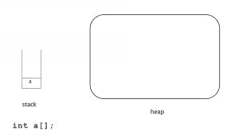
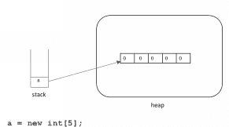
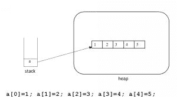
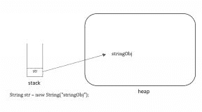
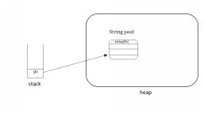
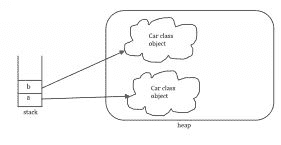
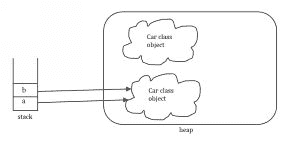
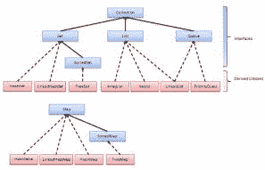

# Amazing Java：快速学习 Java！


# 第 1 章 原始数据类型

原始数据类型是 Java 中最基础的数据类型。它们存储在变量中。变量本质上就是预留的内存。内存的大小取决于原始类型。所有原始类型都有其默认值。大小如下：

| 原始类型 | 大小 | 最小值 | 最大值 |
| :--- | :--- | :--- | :--- |
| `boolean` | 1 位 | - | - |
| `char` | 16 位 | Unicode 0 | Unicode 2¹⁶–1 |
| `byte` | 8 位 | -128 | +127 |
| `short` | 16 位 | -2¹⁵ | +2¹⁵–1 |
| `int` | 32 位 | -2³¹ | +2³¹–1 |
| `long` | 64 位 | -2⁶³ | +2⁶³–1 |
| `float` | 32 位 | IEEE754 | IEEE754 |
| `double` | 64 位 | IEEE754 | IEEE754 |

## 原始类型的声明与初始化

```java
int a;
a = 1;
int a,b;
a = 2; int b = 2;
final int a = 15;//常量
```

声明意味着为变量提供类型和名称：`int a;`。所以，我们的变量是整数类型，名称为 `a`；初始化是给原始类型添加值的过程，在此例中：`int a = 0;`。在此之前 `int` 有一个默认值。`boolean` 的默认值为 `false`，`char` 的默认值为 `'\u0000'`，其余的均为零 (0)。

## 原始类型的转换

### 隐式转换

```java
int a = 1;
double b;
b = a;
```

### 显式转换

```java
long a = 4l;
int b = a;// 错误
int c = (int)a;
```

注意：这被称为强制转换运算符。接下来将介绍运算符。

# 运算符

## 算术运算符

主要的运算符有：`+`, `-`, `*`, `/`, `%`

| 运算符 | 表达式 | 结果 |
| :--- | :--- | :--- |
| `x = y + 1` | `y = 5` | `x = 6` |
| `x = y - 1` | `y = 5` | `x = 4` |
| `x = y % 2` | `y = 5` | `x = 1` |
| `x = ++y` | `y = 5` | `x = 6; y = 6` |
| `x = y++` | `y = 5` | `x = 5; y = 6` |
| `x = --y` | `y = 5` | `x = 4; y = 4` |

| 运算符 | 表达式 | 结果 |
| :--- | :--- | :--- |
| `x = y` | `y = 3` | `x = 3` |
| `x += y` | `y = 3` | `x = 6` |
| `x -= y` | `y = 3` | `x = 3` |
| `x *= y` | `y = 3` | `x = 9` |
| `x /= y` | `y = 3` | `x = 2` |
| `x %= y` | `y = 3` | `x = 0` |

### 关系运算符

主要的运算符有：`<`, `>`, `<=`, `>=`, `==`, `!=`

| 运算符 | 表达式 | 结果 |
| :--- | :--- | :--- |
| `x < y` | `x = 3, y = 2` | `false` |
| `x > y` | `x = 3, y = 2` | `true` |
| `x <= y` | `x = 3, y = 2` | `false` |
| `x >= y` | `x = 3, y = 2` | `true` |
| `x == y` | `x = 3, y = 2` | `false` |
| `x != y` | `x = 3, y = 2` | `true` |

正如你所周到的，算术运算符通常用于数学运算。取模（`%`）可以检查数字是偶数还是奇数。关系运算符非常简单。`==` 和 `!=` 常用于比较。`+` 可用于连接。

### 逻辑运算符

主要的运算符有：`&&`（逻辑与）、`||`（逻辑或）、`!`（逻辑非）

| 运算符 | 表达式 | 结果 |
| :--- | :--- | :--- |
| `x < y` | `x = 3, y = 2` | `false` |
| `x > y` | `x = 3, y = 2` | `true` |
| `x <= y` | `x = 3, y = 2` | `false` |
| `x && y` | | `false` |
| `x \| y` | | `true` |
| `!x` | `x = false` | `true` |

# 第 2 章 Java 输出

`System.out.println` 用于向控制台输出文本。让我们尝试最著名的例子。为了这样做我们需要设置我们的 Java 程序。

```java
System.out.println("Hello World!");
```

我们学习了如何打印一些消息。现在让我们使用已经学过的内容并混合原始类型。创建一个名为 `PrintTypes` 的类并添加 `main` 方法。

```java
int a = 2;
double b = 3.14;
System.out.println("1 b 的旧值 = " + b);
b = a;
System.out.println("2 b 的新值 = " + b);
```

尝试其他运算符。例如：

```java
int c = 4;
b = c * 3.14;
System.out.println("3 b 的新值 = " + b);
```

## 控制语句

### IF

```java
if(条件)
    动作
else
    另一个动作
```

现在我们将做一个 IF 的简单示例。创建一个名为 `ControlFlow` 的类并添加以下行：

```java
int a = 10;
if(a < 11) {
    System.out.println("A 小于 10");
} else {
    System.out.println("A 不小于 10");
}
```

让它变得复杂一点。就像现实生活中一样，你可以为任何情况提供多个条件。在这种情况下，通过添加 `else if` 语句来实现。将以下行添加到当前类中并运行：

```java
int b = 15;
if (b == 13)
    System.out.println("b == 13");
else if ((b <= 17) && (b >= 12))
    System.out.println("b 小于或等于 17 且大于或等于 12");
else
    System.out.println("b 不属于以上任何一个");
```

现在我们有了了如何编写简单 Java 程序的思路。让我们解决这个问题。假设你在学校参加了一次考试。你得到了一些分数和等级。尝试使用 `if` 语句编写程序，根据你的分数检查你得到了什么等级。

```java
int grade;
int score = 85;

if (score >= 95)
    grade = 10;
else if (score >= 85)
    grade = 9;
else if (score >= 75)
    grade = 8;
```

```java
else if (score >= 65) {
    grade = 7;
} else if (score >= 55) {
    grade = 6;
} else {
    grade = 5;
}
System.out.println("Grade is: " + grade);
```

预期：控制台打印 `Grade is: 9`

现在我们来看一个简单的代码示例：

```java
if (i < 10) {
    a = i * 100;
} else {
    a = i * 10;
}
```

现在看这段代码：

```java
a = i < 10 ? i * 100 : i * 10;
```

这是用两种不同方式实现的相同功能。就像 `if/else` 语句一样，这行代码告诉编译器检查 `i < 10`，如果为真则执行 `a = i * 100`。如果为假，则将 `i` 乘以 10（`i * 10`）。

`if` 配合 `for` 循环是最常用的语句，因此最好尽可能多练习。

### SWITCH

```java
switch(a) {
    case '1': action
        break;
    case '2': action
        break;
    case '3': action
        break;
    default:
        action
}
```

通过上面的示例，尝试编写一个根据条件打印季节的程序。这里有一个解决方案：

```java
int season = 2;
switch (season) {
    case 1: System.out.println("Spring");
        break;
    case 2: System.out.println("Summer");
        break;
    case 3: System.out.println("Autumn");
        break;
    case 4: System.out.println("Winter");
        break;
    default: System.out.println("Unknown season");
        break;
}
```

预期：控制台打印 `Summer`

注意：有三种类型的打印语句：

- `System.out.print("Massage");`

- `System.out.println("Massage");` // 换行

- `System.out.printf("Hello %s", str);` // 字符串的位占符 (`%s`)，也可以用于 `char`, `int`, `boolean`, `float`

### FOR

```java
for (initialization; condition; increment/decrement) {
    body
}
```

现在我们使用 `for` 循环从 1 到 10 进行一些基础迭代。这里是代码：

```java
for(int i = 1; i <= 10; i++) {
    System.out.print(i + " "); // 尝试使用 println 看看区别
}
```

预期：控制台打印 `1 2 3 4 5 6 7 8 9 10`

好的，但如果我们想以反向迭代怎么办？第一个示例使用了递增，所以在第二个示例中我们需要递减。想想还需要改变什么，条件还是 `i <= 10` 吗？这里是问题的解决方案：

```java
for(int i = 10; i >= 1; i--) {
    System.out.print(i + " ");
}
```

预期：控制台打印 `10 9 8 7 6 5 4 3 2 1`

### FOR EACH

`for each` 循环用于遍历数组，这稍后会介绍。这是一种更简单的循环类型，因为数组已经固定长度，不需要那个条件（`i <= 10`）。这里是一些基础示例：

```java
double[] array = {1.6, 2.8, 4.54};
for (double ar : array) {
    System.out.print(ar + " ");
}
```

预期：控制台打印 `1.6 2.8 4.54`

## 嵌套循环

现在我们将通过使用嵌套循环让事情变得复杂一点。嵌套循环是位于另一个内部的循环。对于初学者来说可能会令人困惑，但当你开始理解它们的概念时，你会发现它们有多强大。让我们从这个示例开始：

```java
for(int i = 0; i < 10; i++) {
    if (i == 7) {
        break;
    }
    if (i == 2) {
        continue;
    }
    System.out.print(i + " ");
}
```

预期：控制台打印 `0 1 3 4 5 6`

从这个示例可以看出 `break` 和 `continue` 的区别是清楚的。

- `break` – 当循环到达 7 时停止并打印直到该条件之前的所有内容。

- `continue` – 当满足条件时停止并开始下一次迭代。

下一部分代码将使其更进阶。看这个：

```java
int sumEven = 0;
int sumOdd = 0;
int counterEven = 1;
int counterOdd = 1;
for(int i = 1; i <= 100; i++) {
    if (i % 2 == 0) {
        if (counterEven == 3) {
            sumEven += i;
            counterEven = 1;
        } else {
            counterEven++;
        }
    } else {
        if (counterOdd == 3) {
            sumOdd += i;
            counterOdd = 1;
        } else {
            counterOdd++;
        }
    }
}
System.out.println("Sum of even: " + sumEven);
System.out.println("Sum of odd: " + sumOdd);
```

（注：此处原文代码逻辑在提供时略有不全，已根据语境补全逻辑以便翻译）

### WHILE

```java
while (condition) {
    body
}
```

`while` 循环直到条件为假。看看这个示例：

```java
int n = 15;
int i = 5;
while (i < n) {
    System.out.print(i);
    i++;
}
```

### DO WHILE

```java
do {
    body
} while (condition);
```

`do-while` 循环在检查条件之前至少执行一次。

```java
int y = 5;
do {
    System.out.print(y);
    y++;
} while (y < 15);
```

## String 类方法

### equals

我们有两个 `String` 字面量需要比较它们是否相等：

```java
String a1 = "This is some text";
String a2 = "this is some text";
if (a1.equals(a2)) {
    System.out.println("Strings a1 and a2 are similar");
} else {
    System.out.println("Strings a1 and a2 are not similar");
}
```

### equalsIgnoreCase

此方法忽略大小写：

```java
String a1 = "This is some text";
String a2 = "this is some text";
if (a1.equalsIgnoreCase(a2)) {
    System.out.println("Strings a1 and a2 are similar");
} else {
    System.out.println("Strings a1 and a2 are not similar");
}
```

### substring

`substring` 方法提取字符串的一部分：

```java
String s = "This is some text";
String s1 = s.substring(0, 5);
```

预期：`This`

### startsWith

`startsWith` 方法检查字符串是否以特定的前缀开头：

```java
String s = "This is some text";
String s1 = "This";
if (s.startsWith(s1)) {
    System.out.println("Starts with character from s1");
}
```

### contains

`contains` 方法检查序列是否存在于字符串中：

```java
String s = "This is some text";
if (s.contains("text")) {
    System.out.println("String s contains 'text'");
} else {
    System.out.println("Does not contain");
}
```

## compareTo

```java
String name1 = "Ara";
String name2 = "Ana";

if(name1.compareTo(name2) > 0)
    System.out.println("After");
else if(name1.compareTo(name2) < 0)
    System.out.println("Before");
else
    System.out.println("Same");
```

**预期输出**: 控制台将打印 `After`

此代码将按字典顺序比较 `String` 名称。


`返回` `< 0` 则调用该方法的`String`在字典顺序上靠前

`返回` `== 0` 则两个字符串在字典顺序上等价

`返回` `> 0` 则传递给`compareTo`方法的参数在字典顺序上靠前

## 数组

数组可以被视为存储固定数量值的容器。这些值必须是相同类型。数组在创建时具有固定的长度。

### 一维数组

```java
int a[];
a = new int[5];
int a[] = new int[5];//与之前相同
int[] a = new int[5];//也是相同
```

声明和初始化：

```java
int a[] = {1, 2, 3, 4, 5};
```

### 二维数组

```java
int[][] a = {{1, 2, 3}, {4, 5, 6}};
```

如果我们想打印存储在某个数组（一维或二维）中的所有值该怎么办？可以使用`for`循环和`for each`循环来实现：

```java
int array[] = {1, 3, 5 ,7, 9};
for(int i = 0;i<array.length;i++) {
    System.out.print(array[i] + " ");
}

int array2[] = {2, 4, 6, 8, 10};
for(int i : array2) {
    System.out.print(i + " ");
}

int[][] a = { {1, 2, 3}, {4, 5, 6} };
for (int i = 0; i<a.length; i++) {
    for (int j = 0; j<a[i].length; j++) {
        System.out.println(a[i][j]);
    }
    System.out.println();
}
```

循环遍历每一行，然后再次遍历每行的每一列并打印结果。

## 栈 (Stack) 与 堆 (Heap)

正如你所看到的，创建基本类型、数组和`String`非常简单。但与其他程序一样，每个操作都需要分配内存。JVM（Java 虚拟机）中有两种类型的内存：`Stack`（栈）和`Heap`（堆）。例如：







在第一个示例中，我们创建了一个空的`int`，它是基本类型。我们也可以对`double`、`float`等进行操作，结果相同。

在第二张图中你可以看到我们使用`new`关键字创建了一个对象。由此得出结论：`stack`上存储的是基本类型和引用，而`heap`上存储的是对象。

在最后一张图中，声明的值被委托到堆上的空内存空间。



`String`也发生了类似的情况。`String`对象的引用存储在`stack`上，而对象存储在`heap`上。在`String pool`中检查是否存在相同的`String`字面量，例如：

```java
String str1 = "stringObj";
```



**注意**: 使用`new`关键字创建对象不会检查`String pool`，它会创建一个新的`String`。如果不使用`new`关键字，它会在`String pool`中检查是否存在相同的。

# 第 4 章 Java IO

## BufferedReader

正如我们所见，`System.out`是输出流。与之相反的是`System.in`，即输入流。在`JavaIO`类的`main`方法中添加以下行：

```java
BufferedReader in = new BufferedReader(new InputStreamReader(System.in));
System.out.print("Type your name: ");
String name = in.readLine();
System.out.println("Your name is: " + name);
System.out.print("Type your height: ");
int height = Integer.parseInt(in.readLine());
System.out.println("Your height is: " + height);
```

会出现一些错误。提示："Unhandled exception type IOException"

**注意**: 要解决这个问题，点击红色警报并添加`throws`声明。现在`main`方法会在发生异常时抛出异常。

运行程序。

**预期输出**: 控制台将打印`Type your name: `

`Type your height:`

我们还可以看到包和类名之间的 import 部分。`java`包用于更好地组织`java`库和类。在本例中，我们可以看到导入了`java.io`包，其派生方法在我们当前类中使用。

## 包装类 (Wrapper Classes)

当输入的内容不是`String`时，使用包装类。每个基本类型都有其自己的`Wrapper`类。

*   `int` -> `Integer`

*   `long` -> `Long`

*   `boolean` -> `Boolean`

包装类使用`XXXparseXXX`方法自动进行装箱和拆箱（基本类型与对象之间的转换）。例如：

```java
int i = Integer.parseInt("10");
long l = Long.parseLong("10");
```

## Scanner

此的替代方案是`Scanner`类，它可以读取输入。



```
b = a;
```



`Operator=`只是复制引用，而不是对象。

## 构造函数 (Constructors)

构造函数用于初始化对象。构造函数在创建对象时被自动调用，并且名称必须与类名相同。构造函数有两种类型：

- 默认构造函数（无参构造函数）

对于我们的代码，我们需要一个带有`main`方法的新类`Student`。在该方法内部，像这样创建一个新的`Student`对象：

```java
Student stud = new Student();
```

构造函数是特殊方法，所以我们在`main`方法之外创建它们：

```java
Student() {

}
```

注意：如果没有创建默认构造函数，编译器将默认创建一个。为了确保构造函数被调用，让我们在它内部留一些信息并运行程序：

```java
Student() {
    System.out.println("Student is created!");
}
```

预期：控制台将打印`Student is created!`。

- 参数化构造函数

为了这个目的，我们需要`Professor`类（不带`main`方法）和`Faculty`类（带有`main`方法）。`Professor`类将包含属性、方法以及参数化构造函数：

```java
String name;
int age;
String city;

Professor(String n, int a, String c) {
    this.name = n;
    this.age = a;
    this.city = c;
}

void print() {
    System.out.println(name + " " + age + " " + city);
}
```

注意：`this`关键字意味着我们在引用当前对象。当前对象是我们正在使用的类中的对象。

现在我们想让它运行起来。你记得方法和构造函数什么时候被调用吗？当然是在创建对象时。所以在`Faculty`类中这样做并运行程序：

```java
Professor prof = new Professor("Ivan", 35, "Moscow");
prof.print();
```

预期：控制台将打印`Ivan 35 Moscow`。

这个示例地展示了参数化构造函数的用法。尝试删除`Professor`对象的参数。这会导致某些错误：构造函数`Professor()`未定义。

## 方法 (Methods)

```
modifier return_type name (parameters) {
    body
}
return
```

我们已经涵盖了方法并学会了如何编写大部分方法。但并不是所有方法都是相同的。对于这一点，我们需要一个带有`main`方法的`Area`类。首先解释带有`return`关键字的方法：

```java
public static int countArea(int width, int height) {
    return width * height;
}
```

`public static` – 修饰符，稍后会解释。

`int` – 返回类型。

这个方法需要被调用。在这种情况下，我们的目标是打印`width * height`的结果。为了做到，`println`将帮助我们，所以这段代码将放在`main`方法内部：

```java
System.out.println(countArea(3, 5));
```

预期：控制台将打印`15`。

## Void

正如我们看到的，带有`return`关键字的方法会返回某个值。该值以后可以用于某些操作。但如果我们不想返回任何内容呢？只是为了打印任何消息或类似的内容。如何制作这种方法？我们需要一个实现了`main`方法的`VoidMethods`类。我们的方法将检查输入并根据该条件打印相关结果。尝试自己制作，如果你卡住了，请看这段代码：

```java
static void seasonOfYear(String s) {
    if(s == "Spring") {
        System.out.println("It is spring!");
    } else if (s == "Summer") {
        System.out.println("It is summer!");
    } else if (s == "Autumn") {
        System.out.println("It is autumn!");
    } else if (s == "Winter") {
        System.out.println("It is winter!");
    } else {
        System.out.println("You made mistake, sorry");
    }
}
```

并不难发现我们有一个`String`参数，它在方法被调用时根据输入被。因此，在我们的`main`方法内部，我们需要调用`seasonOfYear(String s)`方法：

```java
seasonOfYear("Summer");
```

预期：控制台将打印`Summer`。

# 第 6 章 访问修饰符 (Access Modifiers)

- `public` – 对所有类可见

- `protected` – 在包和子类内可见

- `private` – 仅在类内部可见

- `default` (默认) – 当没有修饰符时，被视为默认，并在包内可见

从这里我们可以得出，我们的方法（例如`public`方法）在整个项目中是可以访问的。但其他修饰符呢？如何处理它们？现在我们将看一个`private`修饰符的示例。

首先添加两个类`PrivateClass`和`TestClass`（带有`main`方法）。在第一个类中，我们创建一个会被调用的简单方法：

```java
private void methodOne() {
    System.out.println("Method is called!");
}
```

在第二个类中调用此方法首先需要一个对象。在这种情况下，我们将创建一个`PrivateClass`类的对象，就像这样：

```java
PrivateClass pc = new PrivateClass();
pc.methodOne();
```

报错：类型`PrivateClass`的方法`methodOne()`不可见。

这就是我们所说的。方法是私有的，所以只在类内部可见。我们无法从另一个类访问它。要解决这个问题，点击错误并将`methodOne()`的可见性改为`package`：

```java
void methodOne() {
    System.out.println("Method is called!");
}
```

这是`default`修饰符。如果我们将其改为`public`会发生什么？

```java
public void methodOne() {
    System.out.println("Method is called!");
}
```

没有变化。公共方法在整个项目中都是可见的。现在改为`protected`。

```java
protected void methodOne() {
    System.out.println("Method is called!");
}
```

一样。保护方法在包内可见。

## this

在我们之前的章节"构造函数"中，如果你记得`this`关键字被使用了。我们有几个属性 name、age 和 city。`this.name = n;` `this.age = a;` `this.city = c;` `static`字段属于类`prof = new Professor();` 静态字段属于我们将讨论的类。

# 第 7 章 静态 (Static)

我们涵盖的所有属性和方法都属于某个对象，例外。你记得`seasonOfYear()`方法吗？区别在哪里？当然，方法带有`static`修饰符，但这意味着什么？是否有任何对象被调用该方法？没有。所以，静态字段和方法属于类，而不是对象。

如果一个变量需要被 Java 类的所有对象共用，那么它应该是静态变量（类变量）。所有实例共享同一个变量副本。静态变量只初始化一次。

就像静态变量一样，静态方法属于类而不是对象。静态方法通过类名调用。是时候看一些静态的示例了。创建一个`StaticClass`，它将包含这些字段：

```java
int val = 3;
static int val2 = 4;

static void changeValue() {
    val2 = 6;
    System.out.println(val2);
}

static void print() {
    System.out.println("Static method calling!");
}
```

所以，在我们的`main`方法中我们将调用静态方法：

```
StaticClass.print();
StaticClass.changeValue();
```

预期：静态方法调用！将打印到控制台 6

现在让我们在`changeValue()`方法内部将`val2`改为`val`。会发生什么？它报错了：`Cannot make a static reference to the non-static field val`。这是因为静态方法只能访问静态字段。调用静态方法还有另一种方法，结果是一致的：

```
print();
changeValue();
```

现在我们已经涵盖了所有需要的内容，就可以对我们著名的`main`方法进行总的解释了。

- `public` – 方法在整个项目中可见的。

- `static` – 方法属于类。`main`是静态的，因为它可能会产生歧义，编译器不知道该调用哪个构造函数。

- `void` – 方法不返回任何值。

好了，现在让我们来看一个非常有趣的例子：

```
static{
    System.out.println("static");
}

publicstaticvoid main(String[] args) {
    System.out.println("main");
}
```

预期：static 将打印到控制台

main

这是如何发生的？我们不是说方法是在`main`方法中执行的吗？这被称为静态块（static block）。当类首次被加载到 [JVM](https://crunchify.com/how-to-change-jvm-heap-setting-xms-xmx-of-tomcat/) 时，静态块会在 main 方法之前执行。

这个程序的输出将是 0 到 1 之间的随机数：

```
System.out.println("Random number: " + Math.random());
```

但是，它是如何工作的？就像`System.out.println();`一样。

`java.lang.System`

`java.land.Math`

这两个类都有可以调用的静态方法。它们不需要对象，所以更加简单。因此，我们已经常用的使用的方法`out()`是来自`System`类的静态方法，通过该类名进行调用。这与`Math`类中的`random()`方法是一样的。尝试使用其他这样的方法：

```
int a = 4;
int b = 2;
double c = 2.4;
System.out.println("Minimum is: " + Math.min(a, b));
System.out.println("Maximum is: " + Math.max(a, b));
System.out.println("Pow of c is: " + Math.round(c));
```

# 第 8 章 集合 (Collections)


集合用于存储和操作一组对象。这里展示了`Collection`类和接口的层级结构。我们将涵盖常用的部分。



数组（`Arrays`）有一个缺点。一旦创建，就无法更改它们的大小。这个问题通过集合（`Collections`）得到了解决。

- `List` – 有序的对象列表。可以通过索引访问对象。可以有两个相同的对象。
- `Queue` – 像`List`一样是有序的，区别是新元素添加到队列末尾，并从队列头部移除。
- `Set` – 所有元素都是唯一的。
- `Map` – 不是`Collection`接口的一种。元素通过键/值（`key/value`）映射。

大部分集合位于`java.util`包中。

所有集合的常用方法有：

- 添加元素
- 移除元素
- 遍历元素

一旦我们涵盖了几个集合，查看`JavaDoc`并弄懂其余集合是如何运作的就会变得更容易。现在我们将关注`List`和`Map`，它们最可能被需要。`Queue`和`Set`并不那么常用，但根据对这二者的经验，将很容易处理它们。此外，不要困惑，接口将在接下来的章节中被涵盖。

## ArrayList

`ArrayList`代表动态集合。操作元素的方法有：

- `add()` – 用于向`ArrayList`添加元素
- `remove()` – 用于从`ArrayList`移除元素
- `get()` – 用于从`ArrayList`获取

是时候看一些`ArrayList`的示例了。那么，让我们创建一个新的包`third.pack`并在里面创建一个类`Array`。

```
ArrayList<Integer> ar = new ArrayList<Integer>();
ar.add(1);
ar.add(2);
ar.add(3);
System.out.println("Size of ArrayList is: " + ar.size());
ar.remove(0);
int num = ar.get(0);
System.out.println(num);
System.out.println("New size of ArrayList is: " + ar.size());
```

预期：`Size of ArrayList is: 3`将打印到控制台

2

`New size of ArrayList is: 2`

所以，在我们的代码中使用了所有关于`ArrayList`提到的内容。首先是声明它。我们说过数组有一个很大的缺点，它们不应该改变大小。但如你所见，我们的`ArrayList`是动态的，增加了三个元素（`Size of ArrayList is: 3`）。编译器从0开始计算元素，所以`1 = 0`，`2 = 1`，`3 = 2`。记住这一点很重要，因为涉及到元素的操作。另一个操作是从我们的数组中移除第一个元素。变量`num`通过`get(0)`方法持有第一个元素，并且`println`将其打印到控制台（2）。此外，大小不再是3了，现在是2了。

如果我们有一个更大的`ArrayList`并想要打印所有值怎么办？使用`for`循环：

```java
for (int counter = 0; counter < ar.size(); counter++) {
    System.out.println(ar.get(counter));
}
```

```java
for (Integer n : ar) {
    System.out.println(n);
}
```

## HashMap

`Map`派自`Collection`接口，它的行为有些不同。操作方法有：

- `put()` – 添加键值对
- `get()` – 找到值

创建一个类并开始：

```java
HashMap<Integer, String> hm = new HashMap<Integer, String>();
hm.put(1, "numOne");
hm.put(2, "numTwo");
hm.put(3, "numThree");
System.out.println("Print me value of key 1: " + hm.get(1));
```

预期：`Print me value of key 1: numOne`

`Map`不是有序的，这意味着它不按照插入顺序返回键。`HashMap`允许任意的值。

现在让我们讨论一下。在`ArrayList`和`HashMap`的示例中，我们看到了类似`<Integer>`, `<Integer, String>`内容。这些类被称为泛型（`Generics`）。在`Map`中尝试添加这段代码：

```java
hm.put("four", "numFour");
```

编译器报错。这是因为我们将键声明为整数（`Integer`包装类），而`"four"`是字符串。`ArrayList`也是一样：

```java
ar.add("four");
```

`ArrayList`只允许整数。

`Enum`是一种特殊的集合。它是常量集合。`Enum`对我们之后的工作很有用，现在了解这些足够。

```java
public enum Person {
    name,
    age,
    city
}
```

## 异常处理 (Exception Handling)

处理发生时的异常是Java编程非常重要的一部分。假设你没有处理运行时错误的机制。会发生什么？谁知道呢。但大多数项目将会失败。所以，让我们从这里开始。

异常的分类基于编译时的检查。

- 编译时：在你编写代码时。例如：如果你还记得`ArrayList`和`Map`的那些由于编译器报错而产生的问题。
- 运行时：在你运行程序/项目时。

让我们来看一个常用的`try/catch`块的示例：

```java
try {
    int num = 2 / 0;
} catch (ArithmeticException e) {
    System.out.println("Error: Don't divide a number by zero");
}
System.out.println("Out of try/catch");
```

预期：`Error: Don't divide a number by zero`将打印到控制台

`Out of try/catch`

尝试将0改为1。错误不会发生。在“现实生活中”，处理异常比这复杂得多。但对于入门，弄清楚异常之间的区别以及我们需要捕获它们是很重要的。

未检查异常（`Unchecked exceptions`）：不需要捕获，因为它们在编码时可以被移除。例如：`NullPointerException`、`IndexOutOfBoundsException`、`ArithmeticException`。

检查异常：需要被`try/catch`块捕获。例如：`FileNotFoundException`、`SQLException`。

错误：表示某些严重问题。例如：`OutOfMemoryError`。我们不应该尝试处理它们。

## 封装

封装与访问修饰符相关的术语。假设你有一个带有属性的类。一切都可以运行得很好，但在数据不安全方面可能会出现问题。这是因为别人可以访问你的类并进行更改。因此，为了使这种情况不再并对类内部的数据进行完全控制，`getters`和`setters`将对你有帮助。看示例，首先创建一个新的`fourth.pack`包，并在其中创建`Person`类。我们的`Person`类将拥有`name`和`age`属性，它们被声明为`private`。

```java
private String name;
private int age;
```

现在我们需要打开`Source -> Generate Getters and Setters`。

最后一步是检查`name`和`age`字段并按`OK`。

预期：将生成`Getters`和`Setters`。

所以，如你所见，我们的属性保持为`private`（仅类内部可见），而我们生成的方法（`getters`和`setters`）是`public`。我们让我们的类更安全了。

```java
public String getName() {
    return name;
}

public void setName(String name) {
    this.name = name;
}
```

查看`getName()`方法。如果由于原因我们需要`name`，我们将调用此方法，它会返回`name`。我们的属性没有被碰。`setName(String name)`方法也是如此。它通过`this`关键字引用来更改`name`的值。

## 抽象类

你还记得我们提到过`Professor`和`Student`这样的类吗？它们是相关的实体，并且我们的示例中有一些共同属性，如`name`、`age`和`city`。那么，为什么要反复声明这些属性呢？难道拥有一个包含所有数据、属性和方法的基类，并将其共享给所有需要的类不是更好吗？当然是。做到点的类被称为`abstract class`（抽象类）。要让之前的`Professor`类变成抽象类，在它的名称上添加`abstract`声明：

```java
public abstract class Person
```

抽象类不能实例化。此外，如果类中至少有一个抽象方法，该类就会自动成为抽象类。抽象方法是没有实现且被声明为`abstract`的方法：

```java
abstract void run();
```

注意：为类`Person`创建带参数的构造函数，包含上述属性并生成`getters`和`setters`。还不要忘记添加`run()`方法。

现在我们有了第一个抽象类。下一步是创建一个使用来自`Person`类字段的类。再次让它成为`Student`类。为了让`Person`类可用，我们需要`extends`声明：

```java
public class Student extends Person
```

现在我们的`Student`类继承（共享）了`Person`的所有字段，但我们也可以为`Student`添加一些特定的属性。此外，构造函数现在看起来像这样：

```java
private int[] grades;

Student(String name, int age) {
    super(name, age);
    this.grades = new int[5];
}
```

这里对我们来说是新的`super`关键字意味着我们的构造函数引用了它的父类。所以我们扩展了`Person`类，它拥有`name`和`age`属性。这些属性在类中没有再次声明。此外，你现在可以识别出一个数组接收`int`值且大小为5。

注意：你可以看到编译器一直在报错：`The type Student must implement the inherited abstract method Person.run()`。

这是因为我们还需要实现来自父类（`Person`）的`run()`方法。

```java
@Override
void run() {
    System.out.println("Student runs!");
}
```

注意：`@Override`声明意味着方法派自父类。非常重要的一点是，类只能继承一个抽象类。

# 第 9 章 接口

接口不是类。它们只包含实现该接口的类需要具备的方法和属性。你可以看出与抽象类的第一个区别是，接口是通过`implements`关键字实现的，而不是`extends`。所有方法都是隐式的`public`，所有属性都是隐式的`public static final`。现在让我们通过右键点击当前包`New -> Interface`来创建我们的第一个接口并将其命名为`House`。我们将添加以下行：

```java
String bed = "My bed";
void sleep();
```

如你所见，我们的方法`sleep()`没有实现。这是因为我们目前不需要知道方法必须如何实现。为了更好地理解，假设你有一个接口`Vehicle`，其中包含`start()`和`stop()`等方法，以及实现该接口的类如`Car`、`Bicycle`和`Airplane`。在创建`Vehicle`接口时，你只知道未来会有某些不同类型（正如我们提到的），但你实际上不知道它们是如何工作的，因为所有工作方式都不同。可以这样去思考接口。

但是，从Java 8开始，接口发生了变化。现在你可以拥有`default`方法：

```java
default void watchTV() {
    System.out.println("I am watching TV");
}
```

正如你所料的，这意味着现在接口更类似于抽象类。一个非常重要的一点是，你可以实现多个接口，而只能继承一个类。

抽象类和接口都使用继承。继承是代码复用的类型。这非常有用，因为在开发中你会遇到某些具有某些属性的情况。当类被扩展或接口被实现时，子类需要重写所有方法。为什么我们说只能继承一个类？


类`A`是父类，类`D`继承了类`B`和类`C`，它们具有相同的签名`doStuff()`但编译器应该选择哪一个？这种情况是Java创建者没有//多重继承的原因。这被称为菱问题。

注意：继承是一种关系，`Student`是`Person`；`Car`是`Vehicle`。

## 关联、聚合与组合


当两个对象相互关联时，它们处于关联状态。组合和聚合都是关联的类型。

## 组合

继承并不是代码复用的唯一类型。组合是另一种，它是类之间的关系。在继承中，组合是代码复用的主要技术。组合是一种部分无法离开整体的关系。

```java
public class Thought {
}

public class Brain {
    Thought thought = new Thought();
}
```

`Brain`拥有一个`thought`。`Thought`无法离开`brain`而存在。组合的关系比聚合强。

## 聚合

聚合的关系比组合要弱。在聚合中，部分可以脱离主对象存在。例如：`Bed`和`Pillow`。

```java
public class Pillow {
}

public class Bed {
    public List<Pillow> pillows = new ArrayList<Pillow>();
}
```

## 重写与重载

### 重写

重写是我们在示例中已经见过的术语。如果子类中的方法与父类方法具有相同的名称和相同的输入参数，那么我们就拥有重写。它的用途是更改我们子类中的实现。你还记得车辆的示例吗？当`start()`方法派生到子类`Car`或`Airplane`时，实现是不同的。`Car`和`Airplane`的引擎完全不同。

```java
void start() {
    System.out.println("Starting car engine");
}

void start() {
    System.out.println("Starting airplane engine");
}
```

注意：当方法体内部只有`println`时，可能会让人有点困惑。这些只是简单的示例，在实际开发中会有一些逻辑之类的内容。

### 重载

在重写部分，我们提到派生类方法具有相同的输入参数。如果你还没有发现输入参数是在方法声明的圆括号内，例如：`(String n, int a)`。那么重载的情况并非如此。当方法具有相同的签名但不同的输入参数时（当然是在同一个类中），这些方法就构成了方法重载。我们将通过构造函数重载来解释这一点。例如，创建一个`StudentClass`类并添加属性`name`、`age`和`diploma`：

```java
private String name;
private int age;
private String diploma;

StudentClass(String n, int a) {
    this.name = n;
    this.age = a;
}

StudentClass(String n, int a, String d) {
    this.name = n;
    this.age = a;
    this.diploma = d;
}
```

这些构造函数是重载的。但这种用法有什么用呢？假设你有一个管理学生的`Faculty`类。并不是所有学生都是一样的。在完成学业之前学生还没有毕业证，所以如果你需要对学生进行某些操作，将使用这个没有`diploma`参数的构造函数。另一方面，如果你想将完成学的学生存储到某个文档中，带有`diploma`参数的构造函数将有用。除了构造函数，方法也可以被重载：

```java
void doSomething(String a) {
    System.out.println("Print a: " + a);
}

void doSomething(String a, String b) {
    System.out.println("Print both a and b: " + a + b);
}
```


重写和重载都是多态的形式。多态意味着一个方法可以根据使用的对象执行不同的事情。Java 中的多态有两种类型：

### 编译时多态

正如我们所说的，编译时是你编写代码时，编译器会自动识别你是否存在某些错误。因此，编译时是在那个时候决定的。这种类型多态的完美例子就是重载。编译时多态也被称为静态绑定。

### 运行时多态

重写是运行时多态的一种。与静态绑定不同，这种多态被称为动态绑定。从名称你可以猜出被重写的方法是在运行时识别的。向上转型是指父类的引用变量指向子类对象的情况。`JVM` 决定重写方法，而不是编译器。

注意：`JVM`（Java 虚拟机）是一个抽象机器，它允许你在计算机上运行 Java 程序。

## 小标题 1

章节文本

### 子子标题

章节文本

# 第 10 章 设计模式

## 单例模式

单例模式是最常用的设计模式之一。它属于创建型模式的范畴。该模式限制了对象的创建，并确保类只存在一个实例。假设你家里只需要一个车库，公司只需要一个人力资源部门，团队只需要一个队长。这些都是现实生活中你可能需要单例模式的例子。为了实现该模式，我们需要满足一些条件：

- `private constructor` - 我们在构造函数部分没有解释，但简而言之，私有构造函数不会允许从另一个类实例化该类。
- `private static instance` – 类的唯一实例。
- `public static method` – 返回类实例的方法。

使类单例有两种类型：

### 懒性初始化

为了更好地理解这三个条件具体意味着什么，让我们看看下面的代码：

```java
private SingletonOne() {

}

private static SingletonOne instance;

public static SingletonOne getInstance() {

    if(instance == null) {

        instance = new SingletonOne();

    }

    return instance;

}
```

类对象的创建被交给了`getInstance()`方法。由于公共静态方法具有全局访问权限，且不需要对象即可调用，因此通过类名调用静态方法。这种单例模式被称为“懒加载”（lazy），因为在调用`getInstance()`方法之前，类的实例不会被创建。`getInstance()`方法检查是否已经存在实例，如果为假（`null`），方法会创建一个新的（`new Class()`）并返回它。通过懒性初始化，你只在需要实例时才创建它，而不是在类加载时。这样你就避免了不必要的对象创建。

### 饿性初始化

```java
private static final SingletonTwo instance = new SingletonTwo();

private SingletonTwo() {}

public static SingletonTwo getInstance() {

    return instance;

}
```

与懒性初始化不同，饿性初始化是在类加载时完成的。所以区别在于，在第一方法方法，只有当你真正需要时才会获取单例类的实例。

## MVC 模式

MVC 模式可能是构建 Java 应用中最常用的模式。正如名称所示，它是`Model – View – Controller`的缩写。

- `Model` – 表现表示数据或 POJO 类。POJO 只是一个声明，必须符合某些条件，如：公共默认无参构造函数、私有属性以及 getter 和 setter。
- `View` – 代表上述属性的视图。
- `Controller` – 控制器介于模型和视图之间，它根据模型的变化来更新视图。

为了我们的解释，我们需要下面的类：

```java
public class Doctor {

    private String name;

    private int age;

    Doctor() {}

    public String getName() {

        return name;

    }

    public void setName(String name) {

        this.name = name;

    }

    public int getAge() {

        return age;

    }

    public void setAge(int age) {

        this.age = age;

    }

}
```

`Doctor`类代表我们的模型。如果你还记得，默认无参构造函数将由编译器默认生成，但我们这样做只是为了避免混淆。

```java
public class ShowDoctor {

    public void showDoctor(String name, int age) {

        System.out.println("Doctor with name: " + name + " and age: " + age);

    }

}
```

这个类代表了`Doctor`属性`name`和`age`的展示，视图。

```java
public class Controller {

    private Doctor doctor;

    private ShowDoctor showD;

    Controller(Doctor d, ShowDoctor s) {

        this.doctor = d;

        this.showD = s;

    }

    public Doctor getDoctor() {

        return doctor;

    }

    public void setDoctor(Doctor doctor) {

        this.doctor = doctor;

    }

    public ShowDoctor getShowD() {

        return showD;

    }

    public void setShowD(ShowDoctor showD) {

        this.showD = showD;

    }

    void shomMeDoctor() {

        showD.showDoctor(doctor.getName(), doctor.getAge());

    }

}
```

你可以看到，我们的控制器获取了模型和视图的引用。现在我们需要一个类来管理这一切。

```java
public class Program {

    Doctor doctor = setDoctorAttributes();

    ShowDoctor show = new ShowDoctor();

    Controller controller = new Controller(doctor, show);

    private static Doctor setDoctorAttributes() {

        Doctor doc = new Doctor();

        doc.setName("Bob");

        doc.setAge(50);

        return doc;

    }

    void printDoctor() {

        controller.shomMeDoctor();

    }

    public static void main(String[] args) {

        Program program = new Program();

        program.printDoctor();

    }

}
```

## 项目

我们为止涵盖的所有内容都有其特定的用途，并且 Java 编程中非常重要的部分。但它们只是一个大故事的一部分。学习某些东西（Java 也是如此）的最佳方法将其应用于实际问题，在本例中就是通过项目。在最后部分，我们将尝试根据所学（几乎是所有）内容创建一个功能性项目。通过此你将更清楚地了解如何以及何时使用某些 Java 特性。想法是做一个医院项目。

医院的特点是：

- `Doctor`（名、姓、专科）有许多`Patient`（名、姓、病历号）。
- 病人只能拥有一位医生。
- 医生为病人分配实验室检查。
- 检查有日期和时间。
- 检查类型：
  - 血糖水平（上限、下限、脉搏）。
  - 血压（数值、上一次进食时间）。

编写一个脚本模拟以下过程：

1. 创建医生`Bob Williams`。
2. 创建患者`Fill Kane`。
3. 患者`Fill`选择`Bob`为其医生。
4. 医生`Bob`叫病人`Fill`进行血糖检查。
5. 医生`Bob`叫病人`Fill`进行血压检查。
6. 检查具有`examinationID`和`date`值。
7. 显示两项检查的结果。

开始思考这个项目，对于`Doctor`和`Patient`实体，它们之间有相似之处吗？我们是否可能需要抽象类？检查也是如此情况吗？如何将一个医生派给一个病人？`单例模式 (Singleton pattern)`？

让我们开始构建我们的项目，以更好地理解所有这些。

在`Eclipse`中创建一个新项目`Hospital`。我们的实体将放在`model`包中。每家医院都有像`Doctor`和`Patient`这样的实体，我们的也会。首先，我们将创建一个抽象类`Person`：

```java
protected String nin;

protected String name;

protected String surname;

public Person(String n, String name, String surname){

this.nin = n;

this.name = name;

this.surname = surname;

}
```

为`nin`、`name`和`age`属性生成 getter 和 setter。`nin`代表国家身份号码 (National Identity Number)。下一个类是`Doctor`：

```java
publicclass Doctor extends Person{

private String specialty;

public Doctor(String n, String name, String surname, String spec){

super(n, name, surname);

this.specialty = spec;

}

}
```

### Patient 类

同样，为`specialty`属性生成 getter 和 setter。`Patient`类：

```java
publicclass Patient extends Person{

privateintmedicalRecordNumber;

public Patient(String n,String name, String surname, intmedRecNum){

super(n, name, surname);

this.medicalRecordNumber = medRecNum;

}

}
```

为`medicalRecordNumber`生成 getter 和 setter。

### Hospital 类

我们的下一次工作是将医生分配给病人。我们有一个条件，我们的病人只能拥有一位医生。你可以猜到，需要实现`单例模式 (singleton pattern)`。在`Hospital`类中使用懒初始化：

```java
private Hospital(){

}

privatestatic Hospital instance;

publicstatic Hospital getInstance(){

if(instance == null){

instance = new Hospital();

}

returninstance;

}
```

医生和病人需要存储在某个地方。我们将使用`HashMap`。在`Hospital`类中添加此内容：

```java
private Map<String, Person>persons = new HashMap<String, Person>();
```

我们的`Hospital`还需要用于操作人的方法：

```java
private Person TryGetPerson(String nin){

returnpersons.get(nin);

}

public Doctor TryGetDoctor(String nin){

Doctor doct;

doct = (Doctor)TryGetPerson(nin);

returndoct;

}

public Patient TryGetPatient(String nin){

Patient patient;

patient = (Patient)TryGetPerson(nin);

returnpatient;

}
```

`TryGetPerson()`根据其`nin`返回人。为了判断该人是医生还是病人，我们需要`TryGetDoctor()`和`TryGetPatient()`方法。

**注意**：查看脚本。在第 7 点，提到我们需要显示结果。为了这个目的，我们将使用`log4j`，这对我们来说是新的，但是一个非常简单的功能。从此网站下载 jar 文件：[`www.java2s.com/Code/Jar/l/Downloadlog4jjar.htm`](http://www.java2s.com/Code/Jar/l/Downloadlog4jjar.htm)

提取文件并通过右键点击 -> Properties -> Java Build Path -> Add External JARs -> `log4j`将 jar 文件添加到项目。

在`Hospital`类名下方，添加我们的`Logger`：

```java
static Logger log = Logger.getLogger(Hospital.class);
```

现在是编写实际创建医生和病人的方法了：

```java
publicvoid createDoctor(String nin, String name, String surname, String spec){

if(TryGetDoctor(nin) == null&& !persons.containsKey(nin)){

Doctor doctor = newDoctor(nin, name, surname, spec);

persons.put(nin, doctor);

log.info("Doctor " + name + " " + surname + " with speciality " + spec + "is created!");

}else{

log.info("Doctor " + name + " " + surname + " already exists!");

}

}

publicvoid createPatient(String nin, String name, String surname, intmedRecNum){

if(TryGetPatient(nin) == null&& !persons.containsKey(nin)){

Patient patient = newPatient(nin, name, surname, medRecNum);

persons.put(nin, patient);

log.info("Patient " + name + " " + surname + " with medical record " + medRecNum + " is created!");

}else{

log.info("Patient " + name + " " + surname + " already exists!");

}

}
```

两个方法都在做相同的事情。`HashMap`通过键值对接收输入。在这种情况下`nin`是键，所以在我们的方法中，我们检查该人是否存在。如果为真，我们就创建一个新的。如果假，我们就打印。

两个方法都在做相同的事情。`HashMap`通过键值对接收输入。在这种情况下`nin`是键，所以在我们的方法中，我们检查该人是否存在。如果为真，我们就创建一个新的。如果假，我们就打印。

### 分配逻辑

下一步是将医生分配给病人。我们有一个条件，我们的病人只能拥有一位医生。首先，在`Patient`类中需要一个分配医生的方法，如下：

```java
private Doctor assign;

publicassignDoctor(Doctor doc){

if(Hospital.getInstance().TryGetDoctor(doc) != null){

assign = doc;

log.info("Patient is assigned to " + doc.getName());

}else{

}

}}
```

**注意**：同样为`Patient`类添加 logger。

```java
static Logger log = Logger.getLogger(Hospital.class);
```

在开始时医生可以有很多病人，所以在`Doctor`类中需要一个`HashMap`：

```java
private Map<String, Patient>patients = new HashMap<String>();
```

这个 map 需要一个添加病人的方法：

```java


`publicvoid addPatient(Patient patient)` 方法中：

```
if(Hospital.getInstance().TryGetPatient(patient.nin) != null){
    patients.put(patient.nin, patient);
}
```

`Hospital` 现在需要一个方法来实现分配给病人：

```java
publicvoid assignToPatient(Doctor doctor, Patient patient){
    patient.assignDoctor(doctor);
}
```

### 检查

现在是处理检查了。每个检查都有 ID 和 `date` 共同属性，因此在这种情况下可以使用抽象类的概念。`LaboratoryExamination` 将是我们的抽象类：

```java
publicabstract class LaboratoryExamination {
    public String examinationID;
    public Date date;

    publicLaboratoryExamination(String exam, Date date){
        this.examinationID = exam;
        this.date = date;
    }
}
```

不要忘记生成 getter 和 setter，还要导入 `java.util.Date` 类。我们还没有讨论这个，但编译器会提示导入 `Map`、`HashMap` 和 `Hospital` 类到 `Doctor` 和 `Patient` 类中。只需执行。

`BloodSugarLevel` 类：

```java
publicclass BloodSugarLevel extends LaboratoryExamination{
    private double value;
    private Date lastMealTime;

    public BloodSugarLevel(String exam, Date date, double value, Date last){
        super(exam, date);
        this.value = value;
        this.lastMealTime = last;
    }

    public BloodSugarLevel(String exam, Date date){
        super(exam, date);
    }
}
```

`BloodPressure` 类：

```java
publicclass BloodPressure extends LaboratoryExamination{
    private int upperValue;
    private int lowerValue;
    private int pulse;

    public BloodPressure(String exam, Date date, int upper, int lower, int pulse){
        super(exam, date);
        this.upperValue = upper;
        this.lowerValue = lower;
        this.pulse = pulse;
    }

    public BloodPressure(String exam, Date date){
        super(exam, date);
    }
}
```

在我们制作最后的用于操作检查的方法之前，我们需要一个持有 `Patient`、`Doctor` 和 `LaboratoryExamination` 类引用的类。你稍后会看到为什么，所以创建一个 `PatientDoctorExamination` 类：

```java
private Doctor doctor;
private Patient patient;
private LaboratoryExamination labExam;

public PatientDoctorExamination(Doctor doc, Patient pat, LaboratoryExamination ladExamination){
    this.doctor = doc;
    this.patient = pat;
    this.labExam = ladExamination;
}
```

让我们完成 `Hospital` 类。像处理人员类一样，我们需要 `HashMap` 来处理检查项目：

```java
private Map<Integer, PatientDoctorExamination> examinations = new HashMap<Integer, PatientDoctorExamination>();
```

在这里你可以看到之前定义的 `PatientDoctorExamination` 类的用法。此外，我们还需要一个能够存储检查项目的结构。为了这一点，让我们在 `Hospital` 类中使用 `enum`：

```java
public enum laboratoryExaminations{
    bloodPressure,
    bloodSugarLevel,
}
```

好了，但像往常一样，我们需要对我们的数据（即检查项目）进行一些操作。方法需要根据输入将检查项目放入 `HashMap` 中。我们将使用之前涵盖过的另一个点 `switch`，因此为 `Hospital` 类中添加该方法：

```java
private int examID;

public int ScheduleExamination(Doctor doctor, Patient patient, Date date, laboratoryExaminations examinationsLab){
    LaboratoryExamination examination = null;
    switch(examinationsLab){
        case bloodPressure:
            examination = new BloodPressure(examID, date);
            break;
        case bloodSugarLevel:
            examination = new BloodSugarLevel(examID, date);
            break;
    }
    examinations.put(examID, new PatientDoctorExamination(doctor, patient, examination));
    examID++;
    return examination.examinationID;
}
```

为了使 `Hospital` 类具备功能，我们需要做的最后一件事就是以某种方式创建最终执行检查的方法。这将在下面的代码中展示：

```java
public void FillBloodSugarLevelExamination(int examinationID, double value, Date date){
    PatientDoctorExamination patientDoctorExamination = null;
    patientDoctorExamination = examinations.get(examinationID);
    if(patientDoctorExamination != null){
        if(patientDoctorExamination.getLabExam() instanceof BloodSugarLevel){
            BloodSugarLevel bloodSugarLevel = (BloodSugarLevel)patientDoctorExamination.getLabExam();
            bloodSugarLevel.setValue(value);
            bloodSugarLevel.setLastMealTime(date);
            log.info("Examination is successfully done! \n" +"=======\n"+ "value: " + value + ", last meal time: " + date);
        }else
            log.info("Selected examination is not for blood sugar level!");
    }else
        log.info("Selected examination does not exist!");
}

public void FillBloodPressureExamination(int examinationID, int upperValue, int lowerValue, int pulse){
    PatientDoctorExamination patientDoctorExamination = null;
    patientDoctorExamination = examinations.get(examinationID);
    if(patientDoctorExamination != null){
        if(patientDoctorExamination.getLabExam() instanceof BloodPressure){
            BloodPressure bloodPressure = (BloodPressure)patientDoctorExamination.getLabExam();
            bloodPressure.setUpperValue(upperValue);
            bloodPressure.setLowervalue(lowerValue);
            bloodPressure.setPulse(pulse);
            log.info("Examination is successfully done! \n" +"=======\n"+"upper value: " + upperValue + ", lower value: " + lowerValue + ", pulse: " + pulse);
        }else
            log.info("Selected examination is not for blood pressure!");
    }else
        log.info("Selected examination does not exist!");
}
```

现在，当所有特征和条件都满足后，剩下的工作就是创建一个包含 `main` 方法的类，以查看程序的输出。希望你没有忘记除了 `Hospital` 之外的所有类都应该在 `model` 包中。`Hospital` 类和现在创建的 `ProgramHospital` 类放在 `program` 包中。在创建此类时，添加 `main` 方法以及以下内容：

```java
org.apache.log4j.BasicConfigurator.configure();
Hospital.getInstance().createDoctor("1234", "Bob", "Williams", "surgeon");
Hospital.getInstance().createPatient("2345", "Fill", "Kane", 25);
Doctor doctor = Hospital.getInstance().TryGetDoctor("1234");
Patient patient = Hospital.getInstance().TryGetPatient("2345");
```

注意：不要被第一行代码搞混，它只是在配置我们的 `log4j`。

如你所见，当类是单例时，其内部的方法只能通过 `getInstance()` 静态方法调用。首先，我们创建了医生和患者，所以他们现在位于 `HashMap` 中。下一步是将我们的医生和患者存储到医生和患者的引用中。最后，我们将它们相互赋值。最后一部分是将检查任务委托给患者：

```java
int examination1 = Hospital.getInstance().ScheduleExamination(doctor, patient, new Date(), laboratoryExaminations.bloodSugarLevel);
int examination2 = Hospital.getInstance().ScheduleExamination(doctor, patient, new Date(), laboratoryExaminations.bloodPressure);
Hospital.getInstance().FillBloodSugarLevelExamination(examination1, 12, new Date());
Hospital.getInstance().FillBloodPressureExamination(examination2, 120, 90, 32);
```

之前你就可以清楚地识别出这些方法的作用了。它们负责填充检查计划。

运行程序。

## 谢谢，但我可以请你个忙吗？

感谢你下载并阅读我的书。书中中全是关于 Java 的内容。希望你喜欢，但你需要不断学习才能趋于完美！

如果你能在 Amazon 上发表简短的评论，我将不胜感激。

[`www.amazon.com/Amazing-JAVA-Learn-Quickly-ebook/dp/B0737762M8/ref=zg_bs_8624232011_f_23?_encoding=UTF8&psc=1&refRID=W8F9B0G980WACSXY1G8P`](https://www.amazon.com/Amazing-JAVA-Learn-Quickly-ebook/dp/B0737762M8/ref=zg_bs_8624232011_f_23?_encoding=UTF8&psc=1&refRID=W8F9B0G980WACSXY1G8P)

我会亲自阅读每一条评论，以便不断写出你需要的内容。谢谢。
