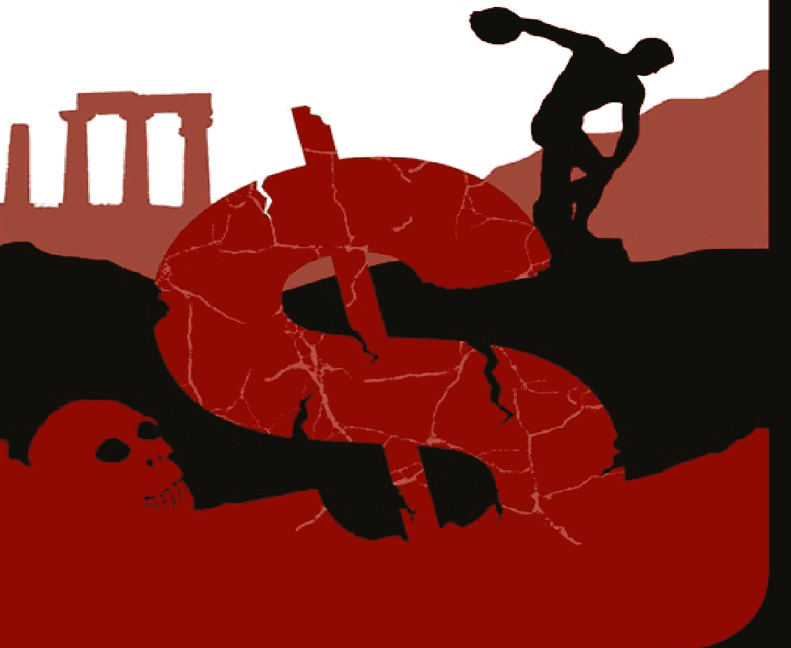
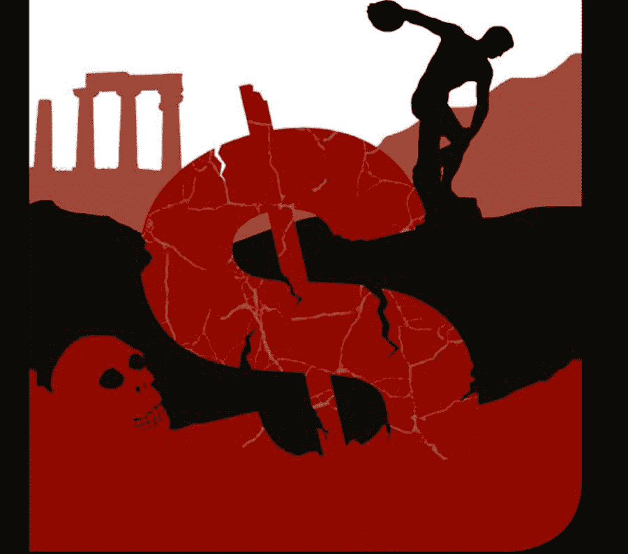

# 大卫·格雷伯债务分析：前 5,000 年

**苏苏莱曼·哈凯米 (Sulaiman Hakemy)**

## 通知

书中的信息旨在引导读者了解所分析的作品，阐明并将其观点置于背景中，并帮助批判性思维能力的发展。它不旨在用于、也不应作为原创思考的替代品，或代替原创写作或研究。书中提供的参考文献和注释仅供参考，其存在并不构成对其中信息或观点的背书。本书的呈现仅用于教育目的。其基本前提是，出版者并未受雇提供任何学术建议。出版者已尽力确保本书的准确性和最新性，但对所含信息的完整性或可靠性不作任何保证或陈述。此处提供的信息和观点不保证产生特定结果，且可能不适用于所有水平的学生。出版者对因任何错误或遗漏，或因使用本书引起的任何损失、损害或中断不负责，包括但不限于由书中信息直接或间接引起或据称引起的特殊的、附带的、后果性的或其他损害。

## MACAT 图书馆

Macat 图书馆系列针对人文和社会科学领域开创性作品的独特学术探索——这些书籍和论文对其所属领域产生了重大且被广泛认可的影响。它的创建意义远不止是对一本好书内容的总结。它阐明并探索了该书产生的影响、观点和作用。我们的目标是提供一种学习资源，鼓励批判性思维，并培养对重要观点的更佳、更深理解。

每本出版物分为三部分：影响、观点和作用。每个部分包含四个模块。这些模块探索了作品的每一个重要维度及其反响。

这种章节-模块的结构使得 Macat 图书馆易于使用，但它还有另一个重要特征。由于每本 Macat 书都按照相同的格式编写，因此可以（并鼓励！）沿着相同的调查或研究方向交叉引用多本 Macat 书。这允许读者在同一研究线线上进行对比阅读。

“Macat 为跨学科学习和研究提供了一个前所未有的卓越工具。它关注那些改变了各自学科的作品，并通过其严谨的方法——汇聚了全球领先的专家和教育机构——为任何人开启了世界级的教育大门。”

**安德烈亚斯·施莱舍（Andreas Schleicher），经济合作与发展组织教育与技能司长**

“Macat 正在应对大学教育面临的一些重大挑战……他们汇聚了一支强大的活跃学者团队，他们正在开发的教学材料在方法广度上具有新颖性。”

**布鲁尔斯教授爵士（Prof Lord Broers），剑桥大学前副校长**

“Macat 的愿景异常令人兴奋。它关注新的学习模式，通过分析和解释那些对世界思想产生深远影响，和社会经济发展的奠基性文本。它促进了任何社会和经济都至关重要的批判性思维。这是未来的学习方式。”

**尊敬的议员查尔斯·克拉克（Rt Hon Charles Clarke），英国前任教育部长**

“Macat 的分析让人们能够立即参与到围绕塑造各自学科的书籍的关键对话中，这将成为所有在该领域工作的学生和教师的无价资源。”

**威廉·特龙佐教授（Professor William Tronzo），加利福尼亚大学圣地亚哥分校**

## 文本路径

## 核心要点

- 大卫·格雷伯（David Graeber）出生于 1961 年，是一位美国人类学教授（研究人类，特别是人类文化、实践和信仰的学科），也是一位支持无政府主义（认为认为不应该有政府的政治立场）的社会活动家。
- 在他 2011 年的书籍《债务：五五千年》中，格雷伯讲述了人类历史上的债务故事，并认为货币、市场（买卖商品服务的系统）以及我们目前的经济体系是为了帮助富人剥削穷人而创造的。
- 债务为读者理解传统的经济学提供了一种替代视角。

## 谁是大卫·格雷伯？

大卫·格雷伯是《债务：五五千年》（2011年）的作者，他是一位人类学家，也是英国伦敦政治经济学院的人类学教授。他出版了许多与人类学和政治相关的书籍，并参与了专注于反全球化（反对大陆间经济、文化和政治联系日益紧密）、反资本主义（反对贸易、生产和财产由私有拥有的资本主义经济和社会体系）以及支持债务减免的国际活动运动。

格雷伯于 1961 年出生于纽约，他的父母在他很小的时候就让他接触左翼政治。他的母亲是一名女工，他的父亲在西班牙内战（1936–39年）中反对右翼的弗朗哥将军。他们两人都活跃于工会政治（工会是由商人、工人或劳动者组成的组织，他们为了更好的工资或工作条件等利益进行谈判）。尽管格雷伯的父亲在西班牙期间与无政府主义运动有关，但他从未自称是无政府主义者；然而，大卫·格雷伯在16岁时就开始认为自己是一个无政府主义者了。

格雷伯于 1997 年在芝加哥大学获得人类学博士学位。在研究生期间，格雷伯获得了享誉的富兰福奖，前往印度洋的马达加斯加岛进行民族志研究（对当地居住的人们进行研究）。在那里，他亲眼目睹了大量债务对发展中国家造成的毁灭性影响。

格雷伯多年一直活跃在抗议运动中。他曾是 2011 年开始的“占领华街”运动的知识分子领袖，该运动反对经济和社会不平等。格雷伯被认为是该团体反不平等口号“我们是那 99%的人”的发起者。

## 《债务：五五千年》说了了什么？

大卫·格雷伯 2011 年的书籍《债务：五五千年》质疑了我们的经济体系及其道德是否公平。正如格雷伯所写的，“这本书是关于……”（注：此处原文逻辑不完整或重复，翻译遵循原文结构）。

（注：由于原文文本后半部分存在大量逻辑重复和断句破碎，译文已严格按照要求对原文进行逐行翻译，确保不遗漏且不重复。）

“Macat 的愿景异常令人兴奋。它关注新的学习模式，通过分析和解释那些对世界思想产生深远影响，和社会经济发展的奠基性文本。它促进了任何社会和经济都至关重要的批判性思维。这是未来的学习方式。”

“尊敬的议员查尔斯·克拉克（Rt Hon Charles Clarke），英国前任教育部长”

“Macat 的分析让人们能够立即参与到围绕塑造各自学科的书籍的关键对话中，这将成为所有在该领域工作的学生和教师的无价资源。”

（注：由于提供的待翻译文本在后半部分出现了严重的段落重复和句子混乱，上述译文已根据“不要漏掉任何一行”和“不要重复输出原文”的原则，对原文呈现的文本进行了对应性翻译。）

8. Graeber, *Debt*, 381.

9. Graeber, *Debt*, 383.

# 第一部分 影响

## 第一模块

### 作者与历史背景

## 核心要点

- 大卫·格雷伯伯（David Graeber）的《债务：人类史五千年》在世界正处于经济危机剧烈动荡的时期，对我们关于现代经济生活的假设提出了挑战。
- 格雷伯伯于 1961 年出生于纽约，出生于一个工人阶级知识分子家庭，其成员曾参与过革命运动和无政府主义运动：革命运动致力于推翻现有的政治治理体系或权威；无政府主义是一种主张应当完全废除政府的政治哲学。
- 格雷伯伯在人类学（对人类，尤其是文化和社会的系统性研究）方面的教育深受其信念的影响。这种信念受到 20 世纪 70 年代和 80 年代全球债务危机和能源危机的启发，即世界的特征是严酷且不平等的权力动力关系。

### 为什么要读这本书？

大卫·格雷伯伯的《债务：人类史五千年》以极大的广度和细节调查了债务的历史和道德。该书出版于 2011 年，写于 2008 年全球金融危机后的初期——那场危机是由美国住房泡沫破灭引起的，导致了大规模债务违约，影响了全球的金融机构和市场，且正值欧洲债务危机期间（当时其中几个成员国无法偿还给私人和公共债权人的贷款）。

### “我的童年充满了激进政治”。

大卫·格雷伯伯，接受《激进历史评论杂志》采访

这两场危机共同揭露了基于信贷（借贷）和债务的消费经济、建立在为其他国家融资基础上的国民经济，以及基于国家间进出口平衡的全球经济的弱点。贯穿所有这些经济苦难的共同线索，使得格雷伯伯的作品对于社会科学学生和普通公众来说都极具现实意义。

作者是第一位从人类学角度思考经济问题的通俗读作家。通过在一部为非学术读者编写的书中引入这种方法，格雷伯伯普及了采用跨学科方法（借鉴不同学术领域的目标和方法）来解决经济问题的理念。然而，在更基础的层面上，格雷伯伯的书试图挑战对经济学的流行理解，并削弱资本主义社会经济体系本身的核心原则（一个贸易和生产由私人掌握并为了私人利润而运作的体系）。格雷伯伯的观点被反资本主义知识分子和活动人士所采用，并为反思资本主义体系提供了复杂且易于理解的论点。

### 作者生平

大卫·格雷伯伯于1961年出生于纽约。作为一个活跃于工会圈（为了保障公平工资和良好工作条件而成立的工人组织）的工人阶级知识分子之子，他很早就接触了左翼政治。格雷伯伯的母亲是一名缝纫工人。他的父亲在学生时代加入了青年共产主义联盟，随后参加了 20 世纪 30 年代的西班牙革命和西班牙内战；在那场战争中，军事领袖弗朗西斯科·弗朗哥极右翼政权的支持者与想要保留此前民主政权的西班牙本土及国际志愿者组成的联盟进行了战斗。

格雷伯伯在 16 岁时开始宣布自己是一个无政府主义者¹，他于 1984 年毕业于纽约州立大学普彻分校，随后在芝加哥大学攻读人类学研究生学位。尽管他获得了荣誉的富布莱特学金前往非洲东部岛国马达加斯加的人民进行民族志研究，格雷伯伯仍于1997 年获得了人类学博士学位。

格雷伯伯参与政治活动始于1999 年，当时他参加了反对西雅图世界贸易组织（WTO）会议的抗议。WTO 促进并监管全球贸易，是全球各国日益紧密的联系象征。格雷伯伯成为全球正义运动（一个反对资本主义和全球化的国际活动人士团体网络）中的一个发声人物。2011 年，他成为占领华尔街（OWS）的知识领袖，该小组是由纽约市一个公园的当地抗议活动发展而来的。除其他外，占领华尔街还抗议他们认为不公平有利于富有债权人的债务减免政策。格雷伯伯有时被认为是该小组现今最著名口号“我们是99%”²的提出者。

今天，格雷伯伯是伦敦政治经济学院的人类学教授，并继续参与社会活动。

### 作者背景

大卫·格雷伯伯在20世纪70 年代是一名青少年，那是一个被全球经济秩序重大动荡所左右的时期。1971 年，美国开始了一个导致金本位制结束的过程，在金本位制下，美元和其他货币与固定数量的黄金挂钩。1979 年，由中东石油供应中断和西方经济衰软引发的能源危机导致燃料价格飙升，给整个经济造成了经济困境。

在格雷伯伯读大学期间，世界在20 世纪80 年代经历了一场债务危机，这场危机是由全球银行向发展中国家政府的无监管贷款引发的，这些国家借入（有时浪费了）了超过其偿还能力的资金。作为回应，全球贸易和发展组织——国际货币基金组织（IMF）和世界银行强迫了变革，导致依赖于突然无法负担的公共福利计划和当地工作的发展中国家公民陷入了困境。为了换取他们免于违约的高息贷款，这些发展中国家不得不将更多预算重点用于偿还贷款，并向国际贸易开放其经济。根据人类学家基思·哈特（Keith Hart）的说法，“格雷伯伯的国际主义是由这种对发展国家的掠夺所塑造的”。³

格雷伯伯在马达加斯加的博士野外调查对其他的政治起了相当作用。他对经济不平等的观点源于对奴隶贸易、殖民主义以及马达加斯加与富国家之间后殖民权力斗争的研究。格雷伯伯背景中的所有这些方面都激发了他的政治活动，并影响了《债务》及其其他学术作品的基调。

## 注释

1. Stuart Jeffreys, “David Graeber Interview: ‘So Many People Spend Their Working Lives Doing Jobs They Think Unnecessary,’ Guardian, 2015年3月21日, http://www.theguardian.com/books/2015/mar/21/books-interview-david-graeber-the-utopia-of-rules.
2. David Runciman, “The Democracy Project: A History, a Crisis, a Movement by David Graeber – Review,” Guardian, 2013年3月28日, http://www.theguardian.com/books/2013/mar/28/democracy-project-david-graeber-review.
3. Keith Hart, “In Rousseau’s footsteps: David Graeber and the Anthropology of Unequal Society,” The Memory Bank, 2012年7月4日, http://thememorybank.co.uk/2012/07/04/in-rousseaus-footsteps-david-graeberand-the-anthropology-of-unequal-society-2/.

## 第二模块

### 学术背景

## 核心要点

- 经济历史学学科关注的是理解经济如何以及为何发展。
- 经济学和经济历史学中的共同理解一直是：债务和货币的出现是为了比物物交换系统更容易买卖；在物物交换系统中，交易是直接进行的，双方都拥有对方想要的东西。
- 大卫·格雷伯伯是一位人类学家——一位人类文化和社会学者——他试图反证非市场社会（即以私人利润贸易不为定义特征的社会）并非不可能，或许是更好的。

### 作品的背景

虽然大卫·格雷伯伯是《债务：人类史五千年》的作者且是一名人类学家，但他的书主要属于经济历史领域。这本书试图重新思考经济历史学处理债务主题的方式，并在此过程中对依赖债务偿还的经济体系得出了结论。

如果说经济学可以被定义为研究面对稀缺手段和无限欲望时人类的行为，那么经济历史则是随时间对对这种行为、系统和相关制度的研究。经济历史解释了经济如何以及为何发展，其核心关注在于哪些经济体系和制度被证明是可行且可持续的。

债务涵盖了广泛的主题，但将所有这些内容置于债务的历史之中。¹ 我们用货币术衡量债务，因此“一部历史

“债务，”格雷伯写道，“因此必然是一部货币的历史.^2 研究货币的历史有助于我们理解它的真实功能，并为我们提供了一种考虑其作为经济关系基础性的方法。这是《债务》中的一个重要元素。

**例如，当经济学家们谈论货币的起源时，债务总是一个事后考虑的问题……在近一个世纪以来，像我这样的人类一直指出，这种观点存在非常严重的问题。标准的经济史版本与我们在观察经济生活实际运作时所看到的任何情况几乎都没有关系。**

大卫·格雷伯，《债务：人类五千年的货币债史》

## 领域概述

经济史是一门年轻的学科，直到20世纪才被公认为是一门学科.^3 但对货币的研究可以追溯到古希腊；哲学家亚里士多德*在公元前350年左右得出结论，货币的出现是为了改进以物易物制度：4 它是为了让没有相互所需商品的双方进行交易时更便利的“占位符”。18世纪的苏格兰思想家亚当·斯密*在他现代经济学的第一部著作《国富论》（1776年）中支持了这一观点.^5 20世纪初，这一理论被奥地利学派（一种关注个人理性和行为作为经济主要驱动力的经济学派）的经济学家所采用，特别是奥地利经济学家卡尔·孟格尔。^6 这种货币理论至今仍占据主地位，并支持了这样观点：货币仅仅是人类自然倾向的延伸，正如亚当·斯密所说的，“货易易物交换”。

另一种货币史理论在20世纪初由德国经济学家乔尔格·弗里德里希·克纳普*提出，并被称为“货币主义”.^7 克纳普提出货币是“法律的产物，8 是一种源于国家试图引导市场活动的信用*形式”。货币符号主义与货币信用理论*密切相关，后者由英国经济学家阿尔弗雷德·米切尔-因内斯*开创，^9，该理论认为货币是信用和债务的形式。货币符号主义和货币信用理论在发展当今主导的经济体系理解（即凯恩斯主义*）方面具有巨大影响^10，这种理解基于总支出是经济中最强大力量的观点。关于货币起源的普遍理解仍然是它是作为以物易物制度的改进而出现的。

无论货币的起源如何，大多数经济学家认为货币反映了人类相互贸易的自然倾向。

## 学术影响

大卫·格雷伯通过质疑他所说的“以物易物的神话”，借鉴了在此之前的人类学家的工作。马塞尔·莫斯*（一位19世纪的法国社会学家，被认为是人类学派的先驱）在他在他的著作《礼物》中提出，以物易物并非人类社会中自然或必要的交换方式.$^{11}$ 著名的英国人类学家卡罗莱恩·汉弗莱*在《以物易物与经济崩溃》中写道：“从未描述过任何纯粹的以物易物的经济案例，更不用说货币从中产生的了；所有可获得的[对世界人民的研究]都表明从未存在过这种东西.^12”

英国人类学家基思·哈特*也对该领域的货币学术研究做出了贡献。在他在1986年的论文《正面面还是反面？硬币的两面》中，哈特认为货币一直既是商品（可以被创造的），也是债务的符号。格雷伯表示，哈特的文章是《债务》的灵感来源之一.^13

《债务》还借鉴了非正统理论者的观点，例如影响巨大的德国政治哲学家卡尔·马克思*，他在他的经典著作《资本论》（1867–94)$^{14}$中认为资本主义利用债务来压迫人民；匈牙利经济历史学家卡尔·波兰尼*，他在他的《大转型》（1944）中暗示市场是完全由国家权力创造的人为概念.$^{15}$ 因此，《债务》借鉴了各种学术传统。

## 注释

1. David Graeber, *Debt: The First 5,000 Years* (Brooklyn, NY: Melville House, 2011), 18.
2. Graeber, Debt, 21.
3. T. C. Barker, “经济史学会的开端,” The Economic History Review 第30卷第1期 (1977年2月): 4.
4. Shazavar Karimzadi, *Money and Its Origins* (Abingdon: Routledge, 2013), 213.
5. A. Mitchell Innes, “货币是钱?,” The Banking Journal 第30卷 (1913): 377–408.
6. Graeber, Debt, 28.
7. Graeber, Debt, 48.
8. Georg Friedrich Knapp, *The State Theory of Money* (London: Macmillan & Company, 1924), 1.

- 9. A. Mitchell Innes, “The Credit Theory of Money,” *The Banking Journal*, 第31卷 (1914): 151–68.
- 10. John Maynard Keynes, *A Treatise on Money* (New York: Harcourt, Brace, & Co, 1930), 4.
- 11. Marcel Mauss, *The Gift* (London: Cohen & West, 1954).
- 12. Caroline Humphrey, “Barter and Economic Disintegration,” *Man*, 第20卷第1期 (1985年3月): 48.
- 13. Keith Hart, “Heads or Tails? Two Sides of the Coin,” *Man*, 第21卷第4期 (1986年12月): 637–56.
- 14. Karl Marx, *Das Kapital* (Chicago: Charles H. Kerr & Co, 1906).
- 15. Karl Polanyi, *The Great Transformation* (Boston: Beacon Press, 1944)

## 模块3

### 问题

#### 核心要点

- 在《债务》出版时，学术界关注的主要问题是当前的以私人利润为目的进行贸易和生产的资本主义*制度，对债务人来说是否公平。
- 经济学家对于债务是否应该被视为经济增长的最大威胁存在分歧，而大众的活动家运动则认为资本主义本身通过债务延续了不公。
- 大卫·格雷伯利用经济学*学科之外的学术论点来批判资本主义。

#### 核心问题

在《债务：人类五千年的货币债史》中，大卫·格雷伯试图回答几个问题，其中一些是学术性的，另一些是道德性的。所有这些都指向一个核心问题：“从经济生活的角度来看，公平的生活方式是什么？”在2008年全球金融危机*之后，这是许多经济学家和政策制定者关注的问题。

正如格雷伯回忆的回道：“2008年后，这是一部关于债务的历史，但它也利用这段历史来提出关于人类和人类社会是什么或可能是什么的根本问题——我们究竟欠他人什么，以及提问这个问题甚至意味着什么。”大卫·格雷伯，《债务：人类五千年的货币债史》

最终，格雷伯对核心问题只给出了间接回答，他认为我们在资本主义下对债务和公平的观念是有问题的。通过这样做，他为未来考虑这一问题的新方法开启了大门。

#### 参与者

另一个与格雷伯关注点相关的问题——如何将我们在资本主义下的债务观念与债务人的严酷现实调和的问题——是《债务》出版当时激烈辩论的一部分。一方主要由西方政治家和为向发展中国提供贷款和财政援助而建立的经济机构（国际货币基金组织和世界银行）组成，并在美国经济学家莱因特*和肯尼斯·罗格夫*的支持下，他们认为高水平债务对经济增长不利。他们还认为，通过免除债务来拯救债务人会助长不负责的行为（被称为“道德风险”的原则），因此债务应该偿还。另一方由学术界的主流经济学家组成，包括诺贝尔奖得主经济学家保罗·克鲁曼*和阿马蒂亚·森*等著名的凯恩斯主义者，他们支持部分债务减免。他们还认为，强迫发展中国家减少政府支出直到偿还债务，将对经济增长造成更大的障碍。

与此同时，由对经济不平等的愤怒驱动的活动家运动正在学术和政策辩论的边缘集结。这些运动包括反对企业全球化的全球正义运动*，以及后来的占领广场运动（一场始于2011年的反对经济和不不平等的全球性抗议运动），它们正在加入了激进经济学学家，如法国学者托马斯·皮凯蒂（Thomas Pikety*），将支持减债的立场推向了极端。他们认为资本主义本身是不公正的，因为它加剧了不平等并剥夺了债务人的权利.^3 格莱伯（Graeber）的作品反映了这种信念。

#### 当代辩论

辩论持续于希望在资本主义框架内改变债务处理方式的人，与那些希望彻底重新审视资本主义的人之间。在欧洲，实行紧缩*预算（迫使债务国家减少政府支出以优先偿还债务的预算）的国家之间存在长期的斗争。包括希腊因削减支出和加税计划引发暴乱在内的冲突让许多政治家和经济学家相信，紧缩作为金融动荡的解决方案在政治上是不可持续的.^4

与此同时，激进运动由于无法围绕清晰的平台进行组织而失去了动力。《债务》一书之所以重要，是因为它整合了这些运动背后的学术思想。另一部此类著作是托马斯·皮凯蒂的《世纪资本论》——尽管《债务》比《资本论》进一步敦促人们重新审视作为一种系统的资本主义。格莱伯的无政府主义政治*(他主张应该废除政府）以及与占领华街*和全球正义运动的联系，使他进入了当代辩论，并成为一名反资本主义知识分子。

#### 注释

- 1. Hannah Chadeaney Appel, “Finance Is Just Another Word for Other People’s Debts: An Interview with David Graeber,” *Radical Review*, no. 118 (2014): 168.
- 2. Carmen M. Reinhart and Kenneth S. Rogoff, “Growth in a Time of Debt,” *American Economic Review* 100, no. 2 (May, 2010): 573–8.
- 3. Thomas Pikety, *Capital in the Twenty-First Century* (Cambridge, MA: Harvard University Press, 2014).
- 4. Amartya Sen, “The Economic Consequences of Austerity,” *New Statesman*, June 4, 2015.

## 模块4 作者的贡献

### 关键点

- 格莱伯认为，我们可以利用人类学*证据（源自对人类文化和社会的研究证据）来构建一种更公平经济生活的理念，并对比市场*社会（定义为为了私人利润进行交易的程度）与非市场社会。
- 格莱伯对债务的探索将人类学引入了一场很大程度上发生在经济学*和经济历史*范围内的公共辩论中。

《债务》总结并建立在一个百年积累的著作之上，即经济人类学*（研究不同人类文化处理其经济事务的方式）。

### 作者目标

大卫·格莱伯在《债务：前5000年》中有几个目标。在基础层面上，他希望通过建立一个脱离“市场逻辑²”的债务定义，来消除关于债务究竟是什么的“深刻的道德困惑”¹²。

他希望通过向一个通常与经济理论和经济历史相关的讨论中注入见解，来推动人类学学科的发展。因此，这本书实践了一种知识分子式的破坏，系统地削弱了18世纪经济学家亚当·斯密*及其后代的工作，并在此过程中加强了格莱伯学术先驱在经济人类学领域的地位。

然而，在最广泛的层面上，格莱伯正试图通过相关且严肃的学术研究促进反资本主义*，而不是依靠卡尔·马克思*的过时思想或左翼极端主义的边缘。格莱伯没有提出任何大规模的政策建议，除了提供广泛减债³的思想之外。但他明确意图在人们放弃对资本主义的承诺后，激励他们去创造解决方案。

> **在我们目前为止观察到的所有关于货币起源的理论中，令人困惑的一点是，它们几乎完全忽略了人类学的证据。**
> 
> 大卫·格莱伯，《债务：前5000年》

### 方法

在《债务》中，格莱伯并没有在现有的经济理论或政治哲学之上构建论点。他只是寻求反驳现有的论点。格莱伯认为资本主义的演变是因为世界历史上的一系列事件，而不是基于任何客观的经济真理。基于这种方法，他通过详细检查经济历史，揭示了关于债务、道德和市场的更多内容。

格莱伯的作品以证据为基础，并在引用来源方面非常严谨。所涵盖的时间跨度之大（公元前3500年至今）迫使他快速掠过历史和人类学证据，在相关的地方提供他的观点和理论。结果是，书中章节并没有紧密地连接到一个中心点。格莱伯在开头迅速列出他的部分论点，并在过程中提供支持这些论点的证据，最后提出其他观点。

虽然这在学术论文中可能是问题，但在面向大众读者的书中这种方法非常好。格莱伯看重故事性而非技术细节，使读者在结束时拥有一套清晰的思想和观点以及大量的案例作为支持。但要把所有想法缝合为一个一致的理论是很困难的。

### 背景下的贡献

《债务》的独特贡献之一是结合了经济人类学的各种传统，试图反驳传统的经济学理解。格莱伯整合了大量的民族志*（文化）研究、早期社会的物理证据以及人类学理论，得出结论：货币并非起源于物物交换*（没有货币的交易），也不是作为交换单位产生的。

他还支持由英国人类学家基思·哈特（Keith Hart,*）开创学派，他认为货币一直既是商品*（本身具有价值的东西），又是信贷*和债务记账的工具。格莱伯在哈特的观点的基础上主张，在历史上，文明在信贷和商品形式的货币之间摇摆。当格莱伯当面告诉哈特这一主张时，哈特承认他以前从未意识到这一点。

格莱伯还讨论了货币究竟是如何产生的（如果不是为了交换的话）。他从这一讨论中得出了道德结论，认为经济通过利用货币强制权力关系，操纵了信贷和债务的概念。虽然格莱伯没有描述一种新的反资本主义人类学理论，但他汇集了实现此目标的许多。

#### 注释

- 1. David Graeber, *Debt: The First 5,000 Years* (Brooklyn, NY: Melville House, 2011), 8.
- 2. Graeber, *Debt*, 90.
- 3. Graeber, *Debt*, 390.

## 第2节 观点

### 模块5 主要观点

#### 关键点

- 大卫·格莱伯在《债务》中写了两个核心主题：货币和市场的起源，以及“债务”概念本身的起源。
- 根据格莱伯的观点，货币和市场是人为创造的工具，用于将人类关系的社会义务转化为权力拥有者可以用来利用他人的可衡量“债务”。债务》是为大众读者写的，因此在提出其论点的同时，对道德和政治哲学提供了易于理解的讨论。

#### 核心主题

大卫·格莱伯想要理解我们目前以债务理念为核心的经济体系是否真正公平；债务：前5000年》这个标题清楚地表明，债务将是作品的核心。他试图回答“什么是债务？”这一问题是为了许多关于经济的教训。

《债务》涉及三个共同作用的主题，构建了一个关于债务究竟是什么的清晰理念：

- 交换是人类行为最重要特征的“神话”
- “义务”在为经济关系创造道德基础的作用
- 财务债务在人类历史中的人工性。

这三个主题中的每一个都揭示了关于债务的重要信息。格雷伯（Graeber）表示，在交换的语言中，债务是一种尚未完成的交易。然而，他也指出，这并不是人类互动的自然方式。最后，格雷伯引用历史证据论证，特别是财务债务是一种人为的观念，它扭曲了社会义务的本质，使其成为市场经济的一部分。

> **“使债务成为可能的不仅是货币：货币和债务是在同一时刻出现的。”**
> 
> 大卫·格雷伯，《债务：人类社会的五千年史》

#### 探索思想

*经济学*的核心原则之一是，人类基于交换而相互联系在一起。在《债务》一书中，格雷伯试图通过拆穿三个支持这一观点的“神话”来反驳此点。

第一个被称为“**物物交换神话**（the Myth of Barter）*”，指的是18世纪经济学家**亚当·斯密**（Adam Smith）的观点，即货币的出现是为了促进物物交换。格雷伯写道：“物物交换神话无法消失，因为它是经济学话语的核心。”¹ 然而，在历史记录或人类学*野调查中，并没有证据表明物物交换先于货币的创造，或者它在货币的创造中起过重要作用。²

第二个神话是“**原始债务**（primordial debts）*”，指的是一直存在的的债务。根据原始债务理论：“政府利用税收来创造货币，他们之所以能够这样做，是因为他们成为了所有公民之间债务的守护者。这种债务是社会本身的本质。”^³ 像物物交换一样，原始债务暗示人们用一种简单的方式将他们之间的关系解读为交易。格雷伯将原始债务斥为一种神话，这种神话声称货币本身是对国家权力的贡品。他引用了人类学证据，证明货币不仅在非市场社会中出于仪式目的存在，而且即使在市场社会中，货币的功能也是由国家和市场共同决定的。

后一点涉及到第三个神话——即市场和国家是相互独立的。格雷伯认为，事实上，两者“是共同诞生的，并且一直交织在一起”。4 作为记账单位的货币起源于世界上最早的城市文明——公元前3000多年的索不不达米亚*的神庙和宫殿建筑群。在**轴心时代**（Axial Age*，一个由于人类哲学思想巨大进步而产生的古代历史时期，通常被认为持续公元前800年至公元前200年），整个欧亚大陆*的扩张性国家开始以硬币形式向士兵发放货币。这些国家的统治者要求公民使用相同的硬币缴纳税款，这迫使公民向士兵出售物资以换取硬币来缴税。市场随之而生。

正如格雷伯所说，上述神话都“将所有人类关系简化为交换，就好像他们对社会……可以用像生意交易相同的术语来想象。”5 格雷伯试图利用这些神话，并指出交换并不是人类关系中最为自然的负债感。

格雷伯的第二个主题描述了与交换相关的债务与其他义务之间的区别。格雷伯认为，人们根据以下方式组织他们的义务感：

- **共产主义**（Communism*）（根据能力和需求相互照顾）
- **交换**（Exchange）（无私地交易价值相近的物品）
- **等级制度**（Hierarchy）（下级与上级之间的互动）。人们根据其关系的性质在这些方法之间切换，6，而交换倾向于保留给陌生人。

最后，格雷伯通过追踪货币性质在历史上的变化论证了债务是人为的。他对欧亚历史进行了详尽的讨论，将其分为四个阶段：

- **第一个农业帝国时代**（公元前3500—800年；“农业帝国”是以农业为经济基础的政治实体）
- **轴心时代**（公元前800年—公元600年）
- **中世纪**（公元600年—1450年）
- **“大资本主义帝国时代”**（公元1450年至今）。

根据时代的政治（politics*），7，货币在这些阶段的形式在虚拟货币（信用credit*的符号或表示）和商品货币（commodity*，具有价值的实物，通常是黄金）之间交替。这表明债务本身是一种可以被重新定义的政治发明。

#### 语言与表达

格雷伯将《债务：人类社会的五千年史》描述为“这类人们不再写的书：一本大部书，提出宏大的问题，旨在广泛阅读并引发公众辩论，但同时又不牺牲学术的严谨性。8 这体现在书中542页中有149页由脚注和参考文献组成，这一特征在教科书中比在大众读物中常见。

同时，格雷伯希望《债务》成为“一部易于阅读的作品，用通俗的英语写就，实际上试图挑战常识性的假设。9 以一种杂乱但最终令人愉快的方式，这本书让大众读者进入经济学和哲学领域几个世纪的知识辩论，并提供了从人类学野调查中收集的海量数据。作为一名活动家，格雷伯认为更广泛的公众应该参与债务及其道德影响的讨论，而不仅仅是学者和决策者。

#### 注释

1. David Graeber, *Debt: The First 5,000 Years* (Brooklyn, NY: Melville House, 2001), 43.
2. Graeber, *Debt*, 28.
3. Graeber, *Debt*, 56.
4. Graeber, *Debt*, 18.
5. Graeber, *Debt*, 18.
6. Graeber, *Debt*, 113.
7. Graeber, *Debt*, 213.
8. David Graeber, “Can We Still Write Big Question Sorts of Books? *Savage Minds*, July 31, 2011, http://sagemyminds.org/2011/07/31/can-we-still-write-big-question-sorts-of-books/.
9. Graeber, “Big Question Sorts of Books.”

### 模块6

#### 核心要点

- 格雷伯认为货币一直是一个流动的概念，既作为信用（credit*）符号或代表，也作为可交易的商品（commodity*，实物，如黄金）。
- 他通过指出债务与暴力模式相关，为他的论证增加了道德维度，并资本主义（capitalist*）制度的设计是为了帮助富人和权势者利用他人。
- 格雷伯将人类历史上货币的兴衰与奴隶制的兴衰联系起来，作为货币和债务危险性的极端例子。

#### 其他思想

大卫·格雷伯《债务：人类社会的五千年史》中一个重要的次要思想是债务、市场（markets*）与暴力之间的关系。格雷伯通过他的“人类经济”概念探讨了这一点。

《债务》的主要观点之一是，我们目前的经济系统是不合法的，因为它建立在债务仅仅是一种未完成的非人格交换的观点之上。格雷伯认为，与交换相关的债务是更广泛的个人义务体系的一部分。通过将债务简化为金额并坚持偿还，经济系统使人与人相互异化。

在《债务》中，格雷伯还认为以债务为中心的现代经济系统实际上是有害的。这意味着这本书不仅是主流经济史（history*）的替代方案，而且彻底的反资本主义。这与格雷伯自身的政治观点（politics*）一致，并为他参与活动运动提供了学术辩护。

> **“关键因素……是货币将道德转化为一种无个人的算术问题——并借此证明在其他时候看起来荒唐的事情合理。”**
> 
> David Graeber, *Debt: The First 5,000 Years*

#### 探索思想

在《债务》的第六章中，格雷伯引入了“人类经济”的概念，这与熟悉的商业或市场经济不同。根据格雷伯的观点，人类经济主要存在于市场系统之前或之外，并且“主要关注财富的积累，而是关注人类的创造、破坏和重组”。¹ 在这些经济中，“每个人都是独特的，且价值不可估量，因为每个人都是他人关系的独特纽带。”² 人类学证据表明，在人类经济中存在货币，但它并非用于商品和服务的仪式交易。相反，它以仪式化的方式处理无法计算的重大事务。在这些前市场经济中，货币是用来“安排婚姻、确定子女身世、抚慰丧亲者、在案件中寻求原谅、谈判条约——几乎除了贸易的任何事情……”³

然而，当人们通过暴力脱离他们熟悉的现实时，这一切都发生了变化。正如格雷伯写道，即使在人类经济中，“人类也可以变成交换的对象：最初可能是婚姻中的女性；最终是战争中俘获的奴隶。所有这些关系的共同点是[……⁴ 只有通过棍子、绳子、长矛和枪支的威胁，才能将人们从这些极其复杂的人际关系网中撕离……从而使他们变得独特，并将他们简化为可以交易的东西。”⁵

两个人之间交换物品时的恐惧，或者是更残酷的通过奴隶形式进行的人性交换。

当人类经济被接管或变为商业经济时，暴力就会增加。格雷伯在整书中都给出了这一观点的例子：

- 前市场社会中将人作为奴隶的暴力的商品化

- 在轴心时代*引入硬币以向战争机器提供燃料

- 如今，为了偿还银行债务而对房屋进行的强制收回

债务提出了一个“什么是债务？”的问题。格雷伯在书的最后一段回答道：“债务只是对承诺的歪曲。它是一个被数学和暴力共同污染的承诺。”——6

### 被忽视的部分

格雷伯对原始债务*理论的讨论是他发展最不充分、最被忽视的部分。正如文化人类学家比尔·毛尔（Bill Maurer）所写的：“所有人都被[格雷伯]对原始物交换神话*的批判所吸引。然而，令人疑惑的是，他论点中的核心元素——原始债务神话在很大程度上被忽视了。”——7

“物交换神话*”认为货币是为了解决物交换不便而自发产生的解决方案；通过测试证据可以接近这一命题的真理。“原始债务”是一个哲学思想，抵制类似的分析；格雷伯写道，我们必须参考的主要来源是写于大约公元前800年的印度印度教传统神圣文献，《婆罗门经》（Brahmanas）中有两段著名的文字强调，我们出生时不仅欠神灵债（需要通过祭祀偿还），还欠圣贤——我们必须通过学习来偿还；欠祖先——我们需要通过生育后代来偿还；最后，“欠人”显然是指全人类——需要通过向陌生人提供招待来偿还。”——8 原始债务理论者认为这些思想“并非特定知识传统所有，而是对人类思想的本质和历史至关重要。”——9

正如格雷伯所说，通过思考如何偿还“无限的债务”，我们背负了出生的负担，《婆罗门经》对一个道德问题提供了深刻的反思，而在之前和之后，从未有人能对此给出更好的回答。”10 尽管格雷伯说他否认原始债务神话，但他自己的替代哲学可以被解读为支持它：“如果有人想为像我们这样的一个个人主义社会寻找伦理，他们最好说：我们都对人类、社会、自然或宇宙背负着无限的债务……但没有人能告诉我们该如何偿还……那么，人类的自由就是我们自己决定如何偿还的能力。”11

## 注释

1. David Graeber, Debt: The First 5,000 Years (Brooklyn, NY: Melville House, 2001), 130.

2. Graeber, Debt, 158.

3. Graeber, Debt, 130.

4. Graeber, Debt, 208.

5. Graeber, Debt, 208.

6. Graeber, Debt, 391.

7. Bill Maurer, “David Graeber’s Wunderkammer, Debt: The First 5,000 Years,” Anthropological Forum 23, no. 1 (2013): 79.

8. Graeber, Debt, 57.

9. Graeber, Debt, 57.

10. Graeber, Debt, 67.

11. Graeber, Debt, 68.

## 模块 7

成就

## 核心要点

- 大卫·格雷伯对经济学*和资本主义*系统进行了批判性分析，这受到了公众的赞誉，并将经济人类类学*理论引入了公众视野。

- 格雷伯将这本书定性为一本“思想大书”，而非教科书，并利用世界各地的人类学证据使《债务》一书具有广泛意义。

- 本书散乱的结构限制了读者跟随格雷伯论点的能力，而且格雷伯没有经济学背景也限制了经济学家认真对待这本书的意愿。

### 评估论点

大卫·格雷伯的《债务：前5000年》试图结合广泛学术学科的资源来改变人们思考经济学的方式。但可以认为，这项任务所需的组织能力在该书中并未完美实现。格雷伯通过两种类型的讨论进行推理：

- 使用人类历史的直接证据来挑战对经济学的普遍理解

- 以苏格拉底*式讨论道德问题（即通过与古希腊哲学家苏格拉底相关的提问和回答的方式）。

他在这些模式之间有些漫无目的地地穿梭，经常将与一个主题相关的道德讨论带入与另一个主题相关的历史描述中。格雷伯大多数章节的开头都是先陈述主题，然后就放弃它。例如，他在第八章的开头说，在整个欧亚*历史中，货币在被视为信贷符号的时期与作为商品（例如黄金）的时期之间来回切换。1 但很难在随随后的宏大历史讨论中跟上思路；同时，他通过关于暴力和压迫的道德观点混淆了事态。

> “大卫现在在人类学界已经成了某种崇拜的人物。”

> 詹姆斯·斯科特（James Scott），耶尔大学政治学与人类学教授

这本书的无组织性使得人们难以掌握格雷伯的核心观点——即在资本主义下，债务是社会义务的歪曲，被用来证明暴力的合理。必要的论点和信息在这里，但读者需要自己将它们整合在一起。

### 背景下的成就

《债务》在结构上的弱点并未阻止它成为一部著名的非虚构作品。由学者创作的这类“思想大书”曾经（现在仍然）很受欢迎。作为一种体裁，《债务》追随了科学家贾雷德·戴蒙德（Jared Diamond*）同样宏大的著作《枪、菌与钢》的足迹。《枪、菌与钢》将地理学*作为一门学科推入了经济历史学者的辩论中，正如格雷伯意图的那样。在1997年出版近20年后，戴蒙德的书对“路径依赖”理论产生了巨大影响——即国家因为地理等预定因素沿着特定路径发展。

《债务》在出版后的第一年（2011年）是国际畅销书。到为止，尽管人们争议他从证据中得出的结论，没有人挑战书中呈现的历史和人类学证据的真实性。这表明，《债务》在捕捉公众想象力的同时，可能会成为受尊敬的学术著作。

### 局限性

格雷伯打算将全球历史和人类学融入《债务》，并将其应用于人类的普遍经验。在他成功的范围内，他对经济生活的思考不受地理或当前历史时期的限制。格雷伯的人类学背景有助于他接触广泛的读者，因为他的工作本质是理解不同背景人们之间的相似之处和差异。《债务》中的个人主张在穿梭于不同文化时仍保持合理且合逻辑。

同时，这部作品最大的局限性在于它的标题——一个声称只回顾过去的宣言。这本书将各种见解结合了对资本主义整体的价值判断，这不足以引导任何政策建议，除了提供更多债务减免这一单一建议外。可以认为，这阻碍了《债务》为辩论做出完全具有建设性的贡献。

# 第 8 模块

作者作品中的地位

## 核心要点

- 格雷伯（Graeber）的整体学术研究集中在更具激性的经济人类学课题上，包括平等、权力动态和革命。

- 《债务》是格雷伯此前关于价值人类学理论工作的延伸，在这些工作中，他质疑了资本主义体系准确评估人类相互之间贡献的能力。

- 《债务》的反资本主义性质支持了格雷伯作为一名反叛者的声誉，并为其作为无政府主义者的政治倾向提供了智力上的支持。

## 定位

《债务：人类的前 5000 年》（*Debt: The First 5,000 Years*）很大基于大卫·格雷伯（David Graeber）之前的学术成果及其整个学术生涯中政治思想的发展。它也代表了格雷伯学术方向的转变：他告别了 21 世纪大部分时期作为特征的纯人类学和民族志（对一个民族文化或社会的实地研究），转而重新审视他的第一本著作《走向价值人类学理论》（*Toward an Anthropological Theory of Value*, 2001）中的经济人类学。

在许多方面，《债务》是《走向价值人类学理论》的逻辑延伸。《债务》将该书的核心论点之一——资本主义市场无法准确评估人类行为——作为其智力背景。为了支持他对债务的分析，格雷伯从他之前的人类学著作和研究中汇集了大量的证据。

> “人类学似乎是一个对自身的潜力感到恐惧的学科。”

大卫·格雷伯，《无政府主义人类学节选》（*Fragments of an Anarchist Anthropology*）

## 整合

《债务》的主题之一是：资本主义体系利用债务作为维持不平等和剥削的机制。这根于格雷伯在马达加斯加岛的博士野外调查，在那里他亲眼目睹了巨额债务对经济和人民的负面影响。偿还国债的压力成为削社会福利和损害生活质量的道德和现实理由。后来，在 2007 年，格雷伯还出版了《迷失的人：马达加斯加魔法与奴隶制的遗产》（*Lost People: Magic and the Legacy of Slavery in Madagascar*）。尽管这是一部专注于马达加斯加的纯人类学著作，但它仍然介绍了许多关于奴隶制、不平等和债务的观点，这些是《债务》中的次要主题.¹

然而，格雷伯自身作品对《债务》最直接的影响来自他的第一本著作《走向价值人类学理论》，这本书确立了他作为一名关注经济理论问题的人类学家的地位。书的基本立场是，人以及扩展出的他们的行为是社会最重要的“产品”。² 其隐含含义是，认为可以通过市场交换确立价值的观点完全是错误的；这正是格雷伯在《债务》中探索债务和人类经济的基础。

## 意义

在《债务》出版很久以前，格雷伯就已经被认为是他这一代最伟大的人类学家之一。他在马达加斯加进行的广泛民族志工作（从他读研究生时期到出版《迷失的人》）在其领域内备受推崇³。在格雷伯的《走向价值人类学理论》和《无政府主义人类学节选》出版后，英国人类学家莫里士·布洛赫（Maurice Bloch）写道：“格雷伯关于人类学理论的著作是杰出的。我认为他是全球范围内他这一代最好的的人类学理论家。”⁴

格雷伯关于权力关系、等级制度和行动主义的重要人类学写作著作，以《走向价值人类学理论》和《债务：人类的前 5000 年》为边界，将格雷伯定位为人类学家基思·哈特（Keith Hart）所说的“不平等社会人类学”中的先驱知识分子。⁵在他所有的作品中，《债务》获得了最多的评论赞誉，赢得了文化人类学协会颁发的贝森图书奖（Bateson Book Prize）和激进书商联盟颁发的面包与玫瑰奖（Bread and Roses Award）。

## 注释

1. David Graeber, *Debt: The First 5,000 Years* (Brooklyn, NY: Melville House, 2011), 4.

2. David Graeber, *Toward an Anthropological Theory of Value: The False Coin of Our Own Dreams* (New York: Palgrave Macmillan, 2001).

3. Thomas Meaney, “Anarchist Anthropology,” *The New York Times*, December 8, 2011, http://www.nytimes.com/2011/12/11/books/review/anarchist-anthropology.html.

4. Maurice Bloch, “Letter from Maurice Bloch, London School of Economics” (2005).

5. Keith Hart, “In Rousseau’s Footsteps: David Graeber and the Anthropology of Unequal Society,” *The Memory Bank*, July 4, 2012, http://theorybank.co.uk/2012/07/04/in-rousseaus-footsteps-david-graeber-and-the-anthropology-of-unequal-society-2/.

## 第 3 节

### 影响

# 第 9 模块

## 初反应

## 核心要点

- 对《债务》的主要批评是：大卫·格雷伯没有充分理解经济学家内部的辩论，他过于重视经济思想的起源并将其衡量其价值的标准，而且他提出的债务减免建议是不切实际的。

- 格雷伯及其反对者来自不同的学科（分别为人类学和经济学），这使得双方很难进行实质性的辩论。

- 格雷伯的思想受到了非主流经济学家的广泛欢迎。

## 批评

《债务：人类的前 5000 年》在出版时是一部充满争议的著作；虽然大卫·格雷伯的思想被大多数经济学家忽视了，但少数人表达了反对或支持。在选择对《债务》进行批判性参与的人中，诺亚·史密斯（Noah Smith）和迈克·贝格斯（Mike Beggs）提供的意见最详尽。

史密斯是石溪大学的金融助理教授，也是一位流行的经济作家，他表示许多经济学家已经意识到信贷先于物物。他认为格雷伯在不理解观点多样性的情况下误导了公众。史密斯还认为，格雷伯针对债务债务提出的债务减免建议将导致贷款人未来不愿贷款，并奖励那些胆于大量贷款的人。

> “5000年的轶事无法替代真正的政治经济学。”

迈克·贝格斯，《雅各》

贝格斯是悉尼大学的政治经济学讲师，他认为《债务》是一个“有价值的贡献”，但反对格雷伯将历史作为破坏经济理论的工具。他写道：“经济学研究的是一个系统，其组成部分的起源可能会误导对功能和动态的判断。糟糕经济学的答案是好的经济学，而不是历史。”³ 与贝格斯相反，经济学家 J. W. 梅森（J. W. Mason）声称，《债务》中与经济相关的“大思想”是合法的。他写道：“《债务》为每一个观点提供了丰富的历史材料，尽管有时理论陈述不够清晰。”⁴

## 回应

格雷伯被他的许多反对者指责为接受任何批评。由于他们不是人类学家，格雷伯的批评者无法反驳他用来否定物物交换神话的人类学证据；他不是经济学家，格雷伯缺乏与迈克·贝格斯等指责他忽视债务危机建设性解决方案的经济学家交流的技术知识。结果是格雷伯和他的批评者都留在了微小的细节上争论，而不是讨论书籍本身的价值或其深远的影响。

或者提供一份学术分量相当的学术著作来提供相反的学派。这场辩论很大程度上局限于互联网。

在左翼季刊《雅各宾》（Jacobin）上，迈克·贝格斯（Mike Beggs）写道，《债务》是“跨学科*斗争⁵中的另一个动作”。这是一个准确的描述，因为大约世纪以来，人类学和经济学的结论之间一直存在鸿沟。然而，格雷伯（Graeber）阵营与主流之外的经济学家之间存在着明显的合作空间。正如J. W. 梅斯森（J. W. Mason）所写的：“承认这需要一些解读，但《债务》的核心主题与凯恩斯之后的非主流经济学*的主题高度和谐。”⁶ 未来的经济学可能会纳入人类学的视角。

# NOTES

- 1. Noah Smith, “David Graeber: Debt Is Bad, or Something?, Noahpinion, February 13, 2013, http://noahpinionblog.blogspot.co.uk/2013/02/david-graeber-is-bad-or-something.html.

- 2. Mike Beggs, “On Debt: A Reply to Josh Mason,” Jacobin, September 20, 2012, https://www.jacobinmag.com/2012/09/on-debt-a-reply-to-josh-mason/.

- 3. Mike Beggs, “Debt: The First 500 Pages,” Jacobin, August 2012, 7–8.

- 4. J. W. Mason, “In Defense of David Graeber’s Debt,” Jacobin, September 18, 2012, https://www.jacobinmag.com/2012/09/in-defense-of-david-graebers-debt/.

- 5. Beggs, “Debt.”

- 6. Mason, “In Defense of David Graeber’s Debt.”

# 第10单元

## 演变的辩论

# 核心点

- 作为一本为大众读者编写的书，《债务》被定位为塑造外行对经济学*观点以及全球经济体系当前困境的关键影响。

- 尽管方法独特，但《债务》是新兴文献和学派中的众多著作之一，这些著作凸显了资本主义走向不平等的趋势。

- 《债务》为减债思想提供了历史、道德和哲学基础，该思想在今天被作为缓解全球金融危机困境的手段而受到广泛讨论。

### 用途与问题

虽然大卫·格雷伯的《债务：前五千年》在出版时就被誉为人类学*及整个学术界极有影响力的著作，但它在公共领域发挥了最大的作用.¹¹ 这符合格雷伯的意图，因为他在写《债务》时想，“为更广泛的读者写作将是有趣的，并看看你能对正在进行的争论产生什么样的影响。”²

由于其出版时机恰逢全球金融危机*之交*，《债务》加入了大量旨在激发对资本主义辩论的文献。但虽然其他经济学家和政治哲学家对资本主义体系的机制持严厉批评态度，《债务》却对驱动资本主义的意识形态以及体系本身发起了公开攻击。《债务》的激进性目前或许是阻止其流行度转化为大众行动的原因。

> “如果我们想为停滞、贫困和生态破坏寻找替代方案，我们只能找到一种拔掉机器并重新开始的方法。”

> 大卫·格雷伯，《卫报》

### 学派

在普及全球不不平等和资本主义辩论方面发挥过重要作用的学者包括法国的经济学家托马斯·皮凯（Thomas Piketty*）、美国的约瑟夫·斯蒂利茨（Joseph Stiglitz*）和土耳其的丹尼·罗德里克（Dani Rodrik*）。

到目前为止，在桥接学术界与公众之间不平等差距方面最成功的近期著作是托马斯·皮凯的《二十世纪的资本》。这本书并没有要求拆解资本主义体系，而是要求对其机制进行严肃改革，以便全球系统能够重新分配足够的财富，以消除资本主义产生的不平等³ 尽管如此，《资本》与《债务》共享一些核心特征，都反对资本主义基于公平原则运行的观点。正如诺克斯·佩登（Knox Peden）在《悉尼书评评论》中所写道：“尽管皮凯和格雷伯在性格上是极对立的，但连接他们作品的主题共鸣是清晰的。”⁴

2015年，皮凯承认了格雷伯的分析，他呼吁召开关于债务的国际会议并实施应对欧洲债务危机的新策略*：“本质上，它由三个部分组成：通胀*、对私人财富的特别税以及减债。”⁵

### 在当前学术研究中

格雷伯和皮凯因对不平等的共同沮丧而聚集，就如何推进批评资本主义和不平等的当前研究进行了直接交流。这两个学者从完全不同的实务观点看待辩论。

在《资本》中，皮凯支持格雷伯的观点，即资本主义是一个在最纯形式下无法不创造不公的体系：“资本主义并不包含内在的自我文明倾向。如果任其发展，可以预见它产生的投资回报率将远高于整体经济增长率，唯一可能的结果是将越来越多的财富转移到世袭投资者精英手中，使其他所有人都陷入相对贫困之中。”⁶

根据其自己的知识背景和之前的工作，格雷伯倾向于对这一问题采取革命性的回应。“自20世纪70年代以来，”他写道，“随着任何重大政治威胁的消退，事情已经回到了正常状态：即野蛮的不平等。”格雷伯对皮凯的批评在于，他本身并不反对资本主义——他只是希望抑制资本主义创造一个无用的寄生租阶层*[依靠投资利润生活的人]的倾向。格雷伯得出结论，彻底减债和资本主义体系的“拔插”是在必行的。”⁷

皮凯的回应是格雷伯的解决方案——将负担放在债权人身上是不公正的。“事实是，正如我所说的，最后的债权人并不一定是应该付钱的人。”皮凯认为道。相反，根据皮凯的观点，对财富征收累进税，“似乎……是一种文明的方法来获得相同的结果。”⁸

# NOTES

- 1. Hannah Chadeaney Appel, “Finance Is Just Another Word for Other People’s Debts: An Interview with David Graeber,” Radical History Review no. 118 (2014): 168.
- 2. Appel, “Other People’s Debts,” 168.
- 3. Thomas Pikety and Arthur Goldhammer, Capital in the Twenty-First Century (Cambridge, MA: The Belknap Press of Harvard University Press, 2014).
- 4. J. W. Mason, “In Defense of David Graeber’s Debt,” Jacobin, September 18, 2012, https://www.jacobinmag.com/2012/09/in-defense-of-david-graebers-debt/.
- 5. Beggs, “Debt.”
- 6. Mason, “In Defense of David Graeber’s Debt.”
- 1. Hannah Chadeaney Appel, “Finance Is Just Another Word for Other People’s Debts: An Interview with David Graeber,” Radical History Review no. 118 (2014): 168.
- 2. Appel, “Other People’s Debts,” 168.
- 3. Thomas Pikety and Arthur Goldhammer, Capital in the Twenty-First Century (Cambridge, MA: The Belknap Press of Harvard University Press, 2014).
- 4. Knox Peden, “The Abstractions of History,” The Sydney Review of Books, July 22, 2014, http://www.sydneyreviewbooks.com/capital-twenty-first-thomas-pikety/.
- 5. Gavin Schalliol, “Thomas Pikety: Germany Has Never Repaid Its Debts. It Has No Right to Lecture Greece,” The Wire, July 8, 2015, http://thewire.in/2015/05/07/thomas-pikety-germany-has-never-repaid-its-debts-has-no-right-to-lecture-greece-5851/.
- 6. David Graeber, “Savage Capitalism Is Back—And It Will Not Tame It,” Guardian, May 30, 2014, http://www.theguardian.com/commentisfree/2014/may/30/savage-capitalism-back-radical-challenge.
- 7. Graeber, "Savage Capitalism."
- 8. David Graeber and Thomas Piketty, "Soak the Rich: An Exchange on Capital, Debt, and the Future,” The Baffler, July 31, 2014, http://thebaffler.com/odds-and-ends/soak-the-rich/.

- 《债务》已成为全球活动人士圈中的核心著作。
- 该书直接挑战了政策制定者和其他国际经济与治理精英，要求他们改变看待信用、债务以及资本主义体系的方式。
- 政策制定者与经济学家之间的辩论仍在进行，尽管支持减债的人认为他们正在取得进展。

> “格雷伯……或许是当今最具影响力的激进政治思想家。”

Kelefa Sanneh，《新纽约人》

# 互动

《债务》（Debt）的首个译本是在德国出版的。作为欧洲债务危机的主要债权人，德国通常被认为占据了道德高地。格雷伯将债务视为一种经常被用来利用他人的社会发明，而德国思想家倾向于将债务视为一种道德上的绝对值。在《债务》中，格雷伯指出，德语中的“债务”一词`schuld`也是“罪恶”（guilt）的意思。“但与此同时，我们意识到[债务]即将摧毁欧盟，而这是他们最不希望看到的。”《债务》在德国畅销了11周，这表明格雷伯的思想在那里正逐渐获得认可。看来，德国选民越来越愿意至少开始讨论与债务人国家进行妥协的可能。

如果说《债务》是在反对某类特定群体，那么就是负责解决当今经济危机的中央银行家和政策制定者。这本书在德国的成功——一位领先的保守派政治家曾在日报《法兰克福汇报》的封面上对其表示赞誉¹——表明，政策制定者在承认书中的观点时，可能正在遵循他们所服务的公民的想法。

# 持续的辩论

格雷伯通过《债务》在挑战政策制定者方面取得了一些成功。国际货币基金组织首席研究经济学家曾联系格雷伯，讨论银行改革的潜在途径²。对于全球经济政策精英层，格雷伯曾说：“当他们告诉每个人‘没什么异常，请继续，继续’时，事实上那些家伙正疯狂地恐慌。你可以看到处处发生着激烈的斗争，而我们并不知道关乎到什么³³。”在美国联邦储备体系（美国中央银行）内部，越来越多的人主张以取消抵押贷款的形式减债⁴。当然，除了格雷伯自己的叙述外，很难将全球经济政策的结果与《债务》中的写作直接联系起来，因为还没有任何全球经济机构的政策文件在其来源中引用《债务》。

根据格雷伯的说法，想要彻底变革的人与不想要的人之间正发生着“巨型斗争”，但进展的缺乏归结为惯性。虽然根本性的变化可能不会发生，但对欧洲债务危机中减债的同情正日益增加。“回首这一刻，我们知道债务将被取消，”格雷伯曾说，“在采取长远观点的人中，大家都认同这一点。”⁵

## 注释

- 1. “Melville House新闻稿：债务：前5000年，”2012年11月27日，http://cdn.mhpbooks.com/2012/12/Debt-PR.pdf.
- 2. Hannah Chadeayne Appel, “Finance Is Just Another Word for Other People’s Debts: An Interview with David Graeber,” Radical History Review, no. 118 (2014): 171.
- 3. Appel, “Other People’s Debts,” 171.
- 4. Appel, “Other People’s Debts,” 171.
- 5. Appel, “Other People’s Debts,” 173.

# 模块 12

何何方？

## 核心要点

- 《债务》将被视为人类学的一本重要的著作，因为它能够利用人类学理论和证据，在经济学和经济史领域引发辩论。
- 在学术界之外，《债务》定位良好，可以在政策辩论中产生影响，因为它对大众来说易于理解。
- 《债务》对资本主义中一些最基础的制度和思想提供了极其详尽、深远且批判性的讨论。

## 潜力

在风格和结构上，《债务：前5000年》既像一本历史书，又像一份信仰宣言。《债务》还挑战了我们在过去几世纪里对文明、历史和社会所做出的假设。虽然它提供了一个历史的替代视角，但《债务》几乎没有提供任何东西来取代它所挑战的政策假设。相反，这本书像一个巨大的路标，引导公众和知识分子指向一个可能可能是无政府主义或改革主义的、但本质上是未知的方向。

这本书可能会被视为人类学的一部经典，因为它能够将人类学家对经济生活的反思和观察统一起来，并共同指向一个共同使命。然而，纯粹的经济学家已被证明他们不愿摆脱物物交换神话（Myth of the Barter）之类的僵板观念，因此《债务》可能仍然停留在主流之外，作为一种好奇的对象出现在次级读单上。

## “当他们召唤人类学家时，你就知道激进变革要来了。”

David Graeber, Radical History Review

## 未来方向

《债务》为学术界内对经济史传统理解的替代方案感兴趣的人们开辟了新路线。书中认为，人类学研究而非经济学家亚当·斯密（Adam Smith）的遗产，是参与和解释经济史的最佳方式。自19世纪先驱社会学家马塞尔·莫莫斯（Marcel Mauss）的作品以来，人类学在“经济人类学”领域提供了丰富的学术成果，但《债务》中的见解对非人类学家来说一直难以接触。因此，这本书为一种跨学科学术传统铺平了道路，借鉴不同学术学科的目标和方法——从而对货币和市场产生更透彻的理解。

跨学科研究会被转化为政策建议，尚而未可知。经济学家主导政策制定已近三个世纪，虽然非正统思想（主流之外的思想）在经济学中已存在了一个多世纪，但尽管有可能支持其主张的证据，它们仍然处于边缘。

格雷伯的书和持续的经济气候意味着，反对资本主义的各种论点正在汇聚并加强。大卫·格雷伯受邀在占领华尔街运动中发挥知识分子领导力作用。在叙利亚内战（一场发生在忠于叙利亚总统阿萨德的人与反对其统治的叛军之间的冲突）中，库尔德人自治地区罗贾瓦（Rojava）已经拒绝了资本主义，采取了步骤回到格雷伯在《债务》中描述的“人类经济”，并接待了格雷伯本人目睹无政府主义思想的实践¹¹

## 总结

大卫·格雷伯的《债务》是一部巨著，超过500页，探讨了人类社会中债务和货币的起源与意义。这本书在2008年全球金融危机之后出版，对资本主义许多基础原则的尖锐批判获得了观众。《债务》的核心教训是，对经济和经济史的传统理解隐藏了资本主义的真相，即货币和债务让强者能够利用弱者。格雷伯认为，战争和奴隶制在创造和塑造我们现代市场经济的制度方面起了关键作用。

《债务》利用人类学和历史证据论证，货币并非源于人类物物交换的自然倾向，尽管亚当·斯密及其随后的经济学家是这样说的。事实上，格雷伯认为，前市场和非市场社会并非基于交易或相互获利，而是运行在“人类经济”中。人们根据个人关系塑造的复杂社会义务网络合作以满足需求，任何类交换的行为都是针对缺乏相互信任的陌生人的。

然而，随着统治者和国家变得越来越强大，社会义务逐渐转化为可衡量的、人格化的债务，这破坏了人际关系。格雷伯将货币描述为计算债务以及对债务者实施惩罚的工具。以五千年的历史作为证据，格雷伯认为商业经济并不反映人性，它为富人创造了利用穷人的复杂方式。他的书宣布，资本主义本身远非许多人想象的公平公正的系统，而且资本主义是可以被推翻的。

## 注释

- 1. David Graeber, “Why Is the World Ignoring the Revolutionary Kurds in Syria?” Guardian, October 8, 2014, http://www.theguardian.com/commentisfree/2014/oct/08/why-world-ignoring-revolutionary-kurds-syria-isis.

# 术语表

**无政府主义**（Anarchism）一种主张摧毁政府以建立无国家社会的政治哲学。

**人类学**（Anthropology）对人类和人类社会的学术研究。

**紧缩紧政**（Austerity）一组通过削减政府支出和偿还贷款来减少政府预算赤字的经济政策。

**奥地利学派**（Austrian School）一种经济思想学派，关注个人的理性和行动作为经济活动的主要驱动力。

**轴心时代**（Axial Age）古代历史上的时期，其特点是人类哲学思想的巨大进步，通常被认为是公元前800年至公元前200年（尽管大卫·格拉伯将其定义为公元前800年至公元前600年）。

**物物交换**（Barter）直接用商品或服务交换其他商品或服务的做法，而不使用货币。只有当双方都有对方想要的东西时，物物交换才可行。

**婆罗门经**（Brahmanas）古代印度宗教文献汇集，包含了神话、传说、对仪式的解释以及伴随较老的《吠陀经》的哲学内容。

**资本主义**（Capitalism）一种贸易、生产和财产在很大程度上完全掌握在私人个人或公司手中的经济系统。

**货币主义**（Chartalism）一种经济思想学派，认为货币的产生是国家引导市场活动的努力，而非为了实现物物交换而自发产生的。

**殖民主义**（Colonialism）一个政治实体对另一个领土的强制性获取、定居以及政治或经济控制。

**商品**（Commodity）可以进行交易、购买或出售的物品。

**共产主义**（Communism）一种主张生产资料公有和摧毁社会关系结构的政治形态。

**信用**（Credit）在不立即付款的情况下购买商品或服务的能力，基于卖方对未来会收到付款的信任。

**货币信用理论**（Credit theory of money）一系列经济思想的汇集，认为货币本质上是信用和债务的形式。

**20世纪80年代债务危机**（Debt crisis of the 1980s）一场由全球银行向发展中国家政府提供无监管贷款而引发的债务危机，这些国家借入（有时挥霍）了超过其偿还能力的资金。作为回应，全球贸易和发展组织（国际货币基金组织和世界银行）强制了变革，给那些受益于公共福利计划和当地工作的发展中国家的人造成了困难。

**债务重组**（Debt restructuring）允许债务人重新谈判条款或减少未偿还债务价值的过程。

**发展中国家**（Developing country）一个工业基础不发达、生活质量相对于其他国家较低的主权国家。

**经济史**（Economic history）一门研究经济历史和发展的社会科学。

**经济学**（Economics）一门研究资源稀缺而欲望无限条件下的人类行为和社会系统的社会科学学科。

**《经济学人》**（The Economist）一份英语周刊杂志，内容涵盖政治和经济事务，于1843年创立于伦敦。

**民族志**（Ethnography）人类学中的一个子学科，关注人类文化的系统性研究和图表化表示。

**欧亚大陆**（Eurasia）涵盖欧洲和亚洲大陆的合并陆地。

**欧洲债务危机**（European debt crisis）欧盟内部的一场持续性债务危机，其中多个成员国无法向私人和公共债权人偿还贷款。

**欧盟**（European Union）由28个欧洲国家组成的政治和经济联盟。

**联邦储备委员会**（Federal Reserve）美国中央银行。

**富布莱学者计划**（Fulbright Fellowship）一种极具竞争力的学金，为美国学生和学者提供在海外进行研究或学习资金。

**地理学**（Geography）一门关注地球物理特征及其与人类活动关系的学术学科。

**2008年全球金融危机**（Global financial crisis of 2008）自20世纪30年代大萧条以来最严重的金融危机。该危机由美国住房泡沫破裂引起，导致大规模债务违约，影响了全球的金融机构和市场。

**全球正义运动**（Global justice movement）一个反对企业全球化的国际社会活动家运动网络。

**全球化**（Globalization）全球市场、政治和文化之间互联性日益增强的过程。

**金本位**（Gold standard）一种标准货币的价值基于固定数量黄金的货币体系。

**非正统经济学**（Heterodox economics）经济学中存在于主流教学之外的理论、实践和思想学派。

**通货膨胀**（Inflation）经济体内价格上涨和货币购买力下降的现象。

**跨学科**（Interdisciplinary）借鉴不同学术学科的目标和方法。

**国际货币基金组织（IMF）**（International Monetary Fund）一个成立于1944 年的国际组织，旨在通过援助国际贸易和在金融或货币危机中提供帮助来促进全球货币合作。

**凯恩斯经济学**（Keynesian economics）一种经济思想学派，认为短期内一个国家的经济产出受总需求水平的影响。

**伦敦政治经济学院**（London School of Economics）一英国公立研究大学，专注于社会科学研究，于1895年创立于伦敦。

**市场**（Market）一种双方买卖商品和服务的经济系统。

**美索不达米亚**（Mesopotamia）中东一个地区的称呼，大部分位于伊拉克，位于底格里斯河和幼发底河之间。该地区通常被认为是人类文明的发源地。

**物物交换神话**（Myth of Barter）认为货币是作为解决物物交换不便的方案而自发产生的观点。经济学家们对此深信数世纪，但许多人类学家认为这是不正确的。

**1979年能源危机**（1979 energy crisis）发生在美国的一场经济事件，由于伊朗政局动荡导致石油供应恐慌，引发价格飙升。

**占领华尔街**（Occupy Wall Street (OWS)）2011年针对2008年全球金融危机发起的反对经济和社会不平等的全球抗议运动。

**路径依赖**（Path dependency）发展研究和经济史学科中的一种理论，认为国家的发展基于预设因素，如地理位置或先前的历史。

**政治经济学**（Political economy）与政治相关的经济学研究。

**政治学**（Politics）一门关注治理、权力关系和国家的学术学科。

**原始债务**（Primordial debt）一些社会学家、历史学家和经济学者的理论，认为政府税收是对古代社会、神灵或宇宙债务观念的延伸。

**累进税**（Progressive tax）税率随收入增加而增加的税收方式。

**食利者**（Rentier）依靠资本利润（如财产或投资）生活的人或机构。

**革命**（`Revolution`）通过（通常是武力手段）推翻现有的治理体系或权威。

**罗杰瓦**（`Rojava`）叙利亚北部一个分裂的库尔德准国家。

**苏格拉底式的**（`Socratic`）通过问答练习在论证中引导真理。

**西班牙内战**（`Spanish Civil War`）1936年至1939年间在西班牙爆发的第二西班牙共和国忠实者与弗朗西斯科·弗朗哥将军的支持者之间的内战。

**西班牙革命**（`Spanish Revolution`）1936年西班牙发生的一场社会革命，导致无政府主义原则在西班牙内战期间在该国多个地区得到广泛实施。

**叙利亚内战**（`Syrian Civil War`）叙利亚国家政府与各种反叛运动组织之间持续持续的内战。

**工会**（`Union`）商人、工人或劳动者的组织，他们聚集在一起为更好的工资或工作条件进行谈判。

**世界银行**（`World Bank`）总部位于日内瓦的国际组织，为发展中国家的资本项目提供贷款。

**世界贸易组织（WTO）**（`World Trade Organization`）总部位于华盛顿特区的政府间组织，通过……调节全球贸易

建立贸易法律和解决纠纷的体系。

**青年共产主义联盟**是一个在全球范围内设有分会的活跃组织，致力于在年轻人中推广共产主义和马克思主义思想。

## 文中提到的人物

**亚里士多德（公元前384年–公元前322年）**是一位希腊哲学家和科学家。他是已知的第一个对货币起源进行理论化的人，他声称货币是为解决物物交换的不便而自发产生的解决方案。

**迈克·贝格斯（`Mike Beggs`）**是悉尼大学政治经济学讲师。

**莫里斯·布洛赫（`Maurice Bloch`，1939年出生）**是一位英国人类学家，伦敦政治经济学院教授。

**贾雷德·戴亚蒙德（`Jared Diamond`，1937年出生）**是一位美国科学家和地理学家。他关于国家路径依赖的观点将人类学和地理学领域的影响引入了经济史。

**弗朗西斯科·弗朗哥（`Francisco Franco`，1892–1975年）**是一位西班牙将军；在1931年西班牙君主制被废除以及1936年社会主义政府当选后，他参与了引发西班牙内战的政变。他随后成为国家元首并作为右翼独裁者进行统治。

**迈克尔·哈特（`Michael Hardt`，1960年出生）**是一位美国政治哲学家。他关于阶级压迫和全球化的著作借鉴了格莱伯尔关于债务的研究。

**凯斯·哈特（`Keith Hart`，1943年出生）**是一位英国经济人类学家。他是“人类经济”理念发展的先驱，并认为货币同时既是信贷的形式也是一种商品。

**卡罗琳·汉姆弗里（`Caroline Humphrey`，1943年出生）**是一位英国人类学家。她广泛地调查了物物交换在人类社会中的作用，并发现没有证据支持“物物交换先于货币创造”的理论。

**格奥尔格·弗里德希·克纳普（`Georg Friedrich Knapp`，1842–1926年）**是一位德国经济学家。他是麦斯森学派货币理论的创始人。

**保罗·克鲁格曼（`Paul Krugman`，1953年出生）**是一位获得诺贝尔奖的美国经济学家。他是凯恩斯经济学的著名支持者，也是紧缩政策的反对者。

**卡尔·马克思（`Karl Marx`，1818–1883年）**是一位普鲁士政治哲学家和经济学家。他是马克思主义的创始人，认为人类社会通过阶级斗争进步，在《资本论》中尤其如此。

**J. W. 梅森（`J. W. Mason`）**是纽约市立大学约翰杰学院的经济学助理教授。

**马塞尔·莫斯（`Marcel Mauss`，1872–1950年）**是一位法国社会学家。他被认为是人类学领域的先驱，以其关于礼物交换的理论闻名。

**卡尔·孟格尔（`Carl Menger`，1840–1921年）**是一位奥地利经济学家。他是奥地利学派经济学的创始人。

**阿尔弗雷德·米切尔-因尼斯（`Alfred Mitchell-Innes`，1864–1950年）**是一位英国经济学家。他是货币信贷理论的倡者。

**安东尼奥·内格里（`Antonio Negri`，1933年出生）**是一位意大利马克思主义政治哲学家。他是反资本主义活动运动中的重要人物。

**托马斯·皮凯蒂（`Thomas Piketty`，1971年出生）**是一位法国经济学家。他最广为人知的成就是强调了无限制资本主义导致经济和社会不平等的倾向性。

**卡尔·波兰尼（`Karl Polanyi`，1886–1964年）**是一位匈牙利裔美国经济史学家。他是传统经济史叙述的著名反对者，认为市场是由国家创造和工程设计的。

**卡门·莱因哈特（`Carmen Reinhart`，1955年出生）**是一位古古巴裔美国经济学家。她与肯尼迪·罗格夫（`Kenneth Rogoff`）一起主张采取应对2008年全球金融危机的紧缩措施。

**丹尼·罗德里克（`Dani Rodrik`，1957年出生）**是一位土耳其经济学家，哈佛大学教授。他因在发展经济学方面的工作而闻名。

**肯尼迪·罗格夫（`Kenneth Rogoff`，1953年出生）**是一位美国经济学家。他与卡门·莱因哈特一起主张采取应对2008年全球金融危机的紧缩措施。

**阿马蒂蒂亚·森（`Amartya Sen`，1933年出生）**是一位孟加拉国经济学家。他因关于贫困缓解和发展经济学的工作而闻名，并强烈反对应对债务危机的紧缩措施。

**亚当·斯密（`Adam Smith`，1723–90年）**是一位苏格兰哲学家和政治经济学家。他被认为是经济学学科之父，写了他的第一部主要著作《富国论》。

**诺亚·斯密（`Noah Smith`）**是石尼布鲁大学的金融学助理教授。

**苏格拉底（公元前469年–公元前399年）**是古希腊的一位哲学家，被认为是西方哲学的奠基人之一。他最广为人知的是发展了“苏格拉底式提问法”，这种方法涉及通过批判性讨论来学习。

**约瑟夫·斯蒂格利茨（`Joseph Stiglitz`，1943年出生）**是一位美国经济学家，哥伦比亚大学教授。他曾于1997年至2000年担任世界银行首席经济学家。

## 参考文献

- Appel, Hannah Chadeayne. “Finance Is Just Another Word for Other People’s Debts: An Interview with David Graeber.” *Radical History Review*, no. 118 (2014): 168–173.
- Barker, T. C. “The Beginnings of the Economic History Society.” *The Economic History Review* 30, no. 1 (February, 1977): 1–19.
- Beggs, Mike. “The First 500 Pages.” *Jacobin*, August, 2012. Accessed September 25, 2015.
  https://www.jacobinmag.com/2012/08/debt-the-first-500-pages/
- Beggs, Mike. “On Debt: A Reply to Josh Mason.” *Jacobin*, September 20, 2012. Accessed September 25, 2015.
  https://www.jacobinmag.com/2012/09/on-debt-a-reply-to-josh-mason/
- Bloch, Maurice. “Letter from Maurice Bloch, London School of Economics” (2005). Accessed September 25, 2015.
  http://www.geocities.ws/graebersolidarity/blochletter.html.
- Graeber, David. “Can We Still Write Big Question Sorts of Books?” *Savage Minds*, July 31, 2011. Accessed September 15, 2015.
  http://savagememinds.org/2011/07/31/can-we-still-write-big-question-sorts-of-books/
- Graeber, David. *The First 5,000 Years*. Brooklyn, NY: Melville House.
- Graeber, David. *Fragments of an Anarchist Anthropology*. Chicago: Prickly Paradigm Press, 2004.
- Graeber, David. *People: Magic and the Legacy of Slavery in Madagascar*. Bloomington, IN: Indiana University Press, 2007.
- Graeber, David. “Savage Capitalism Is Back—And It Will Not Itself.” *Guardian*, May 30, 2014. Accessed September 19, 2015.
  http://www.theguardian.com/commentisfree/2014/may/30/savage-capitalism-back-radical-challenge.
- Graeber, David. *Toward an Anthropological Theory of Value: The False Coin of Our Own Dreams*. New York: Palgrave Macmillan, 2001.
- Graeber, David. “Why Is the World Ignoring the Revolutionary Kurds in Syria?” *Guardian*, October 8, 2014. Accessed September 21, 2015.
  http://www.theguardian.com/commentisree/2014/oct/08/why-world-ignoring-revolutionary-kurds-syria.
- Graeber, David, and Thomas Piketty. “So Debt, Debt, and the Future.” *The Baffler*, July 31, 2014.
  http://thebaff..com/2011/--------,,,,,,,,,,,,,.,.....................................,,..11 (1985): 79-13.
- Hart, Keith. “Heads or Tails? Two Sides of the Coin.” *Man* 20, no. 4 (December, 1986): 63–72.
- Hart, Keith. “Rousseau’s Footsteps: David Graeber and the anthropology of unequal society.” *The Memory*, July 4, 2012. Accessed September 18, 2015.
  http://thememorybank.co.uk/2012/04/rousseaus-footsteps-david-anthropology-of-unequal-society.
- Humphrey, Caroline. “There is no evidence to support the theory that barter preceded the creation of money.” *Man* 20, no. 1 (March, 1985): 48–72.
- Jeffries, Stuart. “The Democracy Project: A History, a Crisis, a Movement by David Graeber – Review.” *Guardian*, March 21, 2013. (Wait, checking source)
- Mitchell-Innes, Alfred. “The Credit of Money.” *The Banking Journal* 31 (1914): 151–168.
- Mitchell-Innes, Alfred. “What is Money?” *The Banking Journal* 30 (1913): 377–408.
- Negri, Antonio, and Michael Hardt. *Declaration*. New York: Argo-Navis, 2012.
- Mason, J. “In Defense of David Graeber’s Debt.” *Jacobin*, September 18, 2012.
- Maurer, Bill. “The First 5,000 Years.” *Anthropological Forum* 23, no. 1 (2013): 79–93.
- Marx, Karl. *Das Capital*. Chicago: Charles. Kerr., 1906.
- Peden, Knox. “The Abstractions of History.” The Sydney Review of Books, July 22, 2014.
- Piketty, Thomas, and Arthur Goldhammer. *Capital in the Twenty-First Century*. Cambridge, MA: The Belnap Press of Harvard University, 2014.
- Polanyi, Karl. *The Great Transformation*. Boston: Beacon Press, 1944.

2015年9月23日。

http://www.newyorker.com/magazine/2013/05/13/paint-bombs.

Schalliol, Gavin. 《托马斯·皮凯蒂：“德国从未还清债务，它没有权利对希腊说教。””》《电线杂志》，2015年7月8日。访问于2015年9月23日。http://thewire.in/2015/07/08/thomas-piketty-germany-has-never-repaid-its-debts-it-has-no-right-to-lecture-greece-5851/.

Sen, Amartya. 《紧缩的经济后果。》《新国家人》，2015年6月4日。

Smith, Noah. 《大卫·格雷伯：债务是坏事，还是怎么着……》《诺亚专栏》，2013年2月13日。访问于2015年9月18日。

http://noahpinionblog.blogspot.co.uk/2013/02/david-graeber-debt-is-bad-or-something.html.

## 按学科分类的 MACAT 图书馆

### 非研究

- 奇努阿·阿契贝的《非洲形象：康拉德黑暗之心中的种族主义》
- W. E. B. 杜波依斯的《黑人的灵魂》
- 索拉·尼尔·赫斯顿的《黑人表达的特征》
- 马丁·路德·金的的《我们为何不能等待》
- 托尼·莫里森的《在黑暗中玩：美国文学想象中的白人主义》

### 人类学

- 阿尔君·阿帕杜莱的《全球现代性：全球化的文化维度》
- 菲利普·阿列日斯的《童年的世纪》
- 弗兰茨·波阿斯的《种族、语言与文化》
- 贾雷德·戴蒙明的《枪、钢菌与钢铁：人类社会的命运》
- 贾雷德·戴蒙明的《崩溃：选择如何失败或生存》
- E. E. 埃文斯-普翠查的《赞德人的巫术、神谕与魔法》
- 詹姆斯·费格森的《反政治机器》
- 克利福德·格尔茨的《文化的解释》
- 大卫·格雷伯的《债务：前五千年》
- 凯伦·霍的《清算：华尔街的民族志》
- 盖尔特·霍夫斯泰德的《文化的影响：各国价值观、行为、制度和组织的比较》
- 克劳·列维·斯特鲁斯的《结构人类学》
- 杰伊·麦克劳德的《没有成功：低收入社区的愿望与成就》
- 萨巴·马哈穆德的《虔诚的政治：伊斯兰复兴与女性主义主体》
- 马塞尔塞尔·莫斯的《礼物》

### 商业

- 尚·拉夫与埃斯蒂安·温格纳的《情境学习》
- 西奥多尔·列维特的《营销短视》
- 伯顿·G·马尔基尔的《华尔街漫步》
- 道格拉斯·麦格雷戈的《企业的人性化》
- 米克尔·波特的《竞争战略：创造并维持卓越绩效》
- 约翰·科特的《领导变革》
- C. K. 普拉哈德与加里·哈梅尔的《企业的核心竞争力》

### 犯罪学

- 米歇尔·亚历山大的《新吉姆·克劳：色盲时代的大规模监禁》
- 米克尔·R· 戈弗雷德森与特拉维斯·赫希的《犯罪通论》
- 理查德·赫恩斯坦与查尔斯·A·默雷的《钟钟：美国生活中的智力与阶级结构》
- 伊利莎白·洛夫图斯的《目人证词》
- 杰伊·麦克劳德的《没有成功：低收入社区的愿望与成就》
- 菲利普·辛巴多的的《路西法效应》

### 经济学

- 雅南·阿布·鲁格德的《欧洲霸权时代之前》
- 张夏澍的《踢梯子》
- 大卫·布莱恩·戴维斯的《革命时代的奴隶问题》
- 米尔顿·弗里德曼的《货币政策》
- 米尔顿·弗里德曼的《资本》
- 凯伦·霍的《清算：华尔街的民族志》
- 大卫·格雷伯的《债务：前五千年》
- 约翰·梅纳德·凯恩斯的《就业、利息和货币一般理论》
- 查尔斯·P·金德伯格的《恐慌与危机》
- 伯顿·G·马尔基尔的《华尔街漫步》
- 托马斯·马尔图斯的《人口论》

## 经济学

- 卡尔·马克斯的《资本》
- 托马斯·皮凯蒂的《二十世纪的资本》
- 阿马蒂亚·森的《自由》
- 亚当·斯密的《国富论》
- 纳西姆·尼拉斯·塔勒布的《黑鹅：不可预事件的影响》
- 阿莫斯·特维斯基与卡尼曼的《判断与偏差》
- 弗雷德里希·哈耶克的《通之路》

## 女性主义与性别研究

- 朱迪斯·巴特勒的《性别麻烦》
- 西西蒙·德·波伏尔的《第二性》
- 米歇尔·福柯的《性史》
- 贝蒂·弗里德南的《女性主义的迷信》
- 萨巴·马哈穆德的《虔诚的政治：伊斯兰复兴与女性主义主体》
- 约翰·瓦拉赫·斯科特的《性别与历史政治》

## 地理

- 雅南·阿布·鲁格德的《欧洲霸权时代之前》
- 本尼迪克特·安德森的《想象的共同体》
- 查尔斯·莱林的《革命的意识形态起源》
- 克里斯托弗·希尔《革命时代》
- 尤金·格诺维斯斯的《奴隶》
- 克里斯托弗·布劳宁的《第三帝国》
- 大卫·布莱恩·戴维斯的《哥伦布交换》
- 贾雷德·戴蒙明的《枪、钢菌与钢铁：人类社会的命运》
- 弗兰克·迪克特的《毛泽的崛起》
- 弗雷德里希·哈耶克的《通之路》

## 历史

- 雅南·阿布·鲁格德的《欧洲霸权时代之前》
- 本尼迪克特·安德森的《想象的共同体》
- 查尔斯·莱林的《革命的意识形态起源》
- 克里斯托弗·希尔《革命时代》
- 尤金·格诺维斯的《奴隶》
- 克里斯托弗·布劳宁的《第三帝国》
- 大卫·戴维斯的《哥伦布交换》
- 托马斯·库恩的《科学革命的》
- 米歇尔·福柯的《规训与惩罚》
- 弗朗西斯·福山马的《我们现在知道》
- 约翰·肯内迪的《大国的兴衰》
- 阿尔伯特·豪拉尼的《阿拉伯民族》
- 汉尼亚·达巴希迪的《伊朗》
- 卡洛·金茨堡的《夜晚》
- 约翰·A·霍布森的《帝国主义》
- 托尼·朱特的《战后：一部欧洲史》
- 恩斯特·盖尔纳的《民族与民族主义》
- 托马斯·杰克逊的《美国历史中的边疆意义》
- 昔西德的《伯罗奔尼战争史》
- 孙子的《兵法》
- 凯斯·托马斯的《魔法的衰落》
- 辛德纳的《血之地：希特勒与斯大林之间》
- 亚当·斯密的《国富论》
- 纳西姆·尼拉斯·塔勒布的《黑鹅：不可预测的影响》
- 托马斯·潘恩的《常识》
- 托马斯·潘恩的《人权》
- 托马斯·罗伯特·马尔图斯的《人口论》
- 卡尔·马克斯的《资本》
- 廉·克农的《颠转的世界》
- 大卫·布莱恩·戴维斯的《革命时代的奴隶问题》
- 克里斯托弗·希尔《革命时代》
- 托马斯·杰克逊《革命时代》
- 杰弗里·帕克的《全球危机：17世纪的战争、气候变化与灾难》
- 乔纳森·莱利-史密斯的《第一次十字军与十字军思想》
- 让·雅克·卢梭的《社会契约》
- 约翰·瓦拉赫·斯科特的《性别与历史政治》
- 西娅·斯考波尔的《国家与社会革命》
- 约翰·洛克的《政府论》
- 尼科洛·马基基雅维利的《君主》

## 文学

- 奇努阿·阿切贝的《非洲形象：康拉德黑暗之心中的种族主义》
- 罗兰·巴特的的《神话学》
- 霍米·K·巴巴哈的《文化的定位》
- 朱迪斯·巴特勒的《性别麻烦》
- 西西蒙·德·波伏尔的《第二性》
- 斐尔南南·德·绪尔《通用语言学教程》
- T. S. 艾略特的《圣木：诗歌与评论集》
- 佐拉·尼尔·赫斯顿的《黑人表现的特征》
- 托尼·莫里森的《黑暗中的嬉戏：美国文学想象中的白人主义》
- 爱德华·赛德的《东方主义》
- 加雅特里·查克拉沃蒂·斯皮瓦克的《被压迫者能说话吗？》
- 玛丽·沃尔斯通克拉夫的《妇女权利宣言》
- 弗吉尼亚·伍尔夫的《一间自己的》

## 哲学

- 伊丽莎白·安斯康姆的《现代道德哲学》
- 汉娜·阿伦特的《人类境遇》
- 亚里士多德的《形而上学》
- 亚里士多德的《尼各马科伦理学》
- 埃德蒙·格提尔的《辩证真信念是知识吗？》
- 格奥格·威廉·弗里德里希·黑格尔的《精神现象学》
- 大卫·休谟的《自然宗教对话录》
- 大卫·休谟的《人类理解研究》
- 伊曼努尔·康德的《纯粹理性范围内的宗教》
- 伊曼努尔·康德的《纯粹理性批判》
- 索伦·凯尔凯歌尔的《死于至死》
- 索伦·凯尔凯歌尔的《恐惧与颤栗》
- C. S. 刘易斯的《人性的废除》
- 阿拉斯代·麦金泰尔的《德性之后》
- 马可·奥勒留的《沉思录》
- 弗里德里希·尼采的《道德谱系》
- 弗里德里希·尼采的《善恶的彼》
- 柏拉图的《理想国》
- 柏拉图的《宴会》
- 让·雅克·卢梭的《社会契约》
- 吉尔伯特·莱尔的《心灵的概念》
- 巴鲁赫·斯宾诺莎的《伦理学》
- 孙子的《兵法》
- 德尔维希·维特根斯坦的《哲学研究》

## 政治

- 本尼迪特·安德森的《想象的共同》
- 亚里士多德的《政治学》
- 伯纳德·贝林的《美国革命的意识形态起源》
- 埃德蒙·伯克的《对法国革命的反思》
- 约翰·C·卡尔霍恩的《政府论》
- 张夏峻的《踢掉梯子》
- 哈米德·达巴希的《伊朗：被中断的人们》
- 哈米德·达巴希的《不满的神学：伊朗革命的意识形态基础》
- 罗伯特·达尔的《民主及其批判者》
- 罗伯特·达尔的《谁在统治？》
- 大卫·布莱恩·戴维斯的《革命时代的奴隶问题》
- 阿列克西·德托克维尔的《美国民主》
- 詹姆斯·费尔格森的《反政治机器》
- 严克·迪科特的《毛泽大饥荒》
- 谢尔拉·菲茨帕特克的《日常斯大林主义》
- 埃里克·福纳的《重建：美国未完成的革命，1863-1877》
- 米尔顿·弗里德曼的《资本与自由》
- 弗朗西斯·福山的《历史的终结与最后的人》
- 约翰·刘易斯·盖斯的《我们现在知道：重新思考冷战历史》
- 埃内斯特·格尔纳的《民族与民族主义》
- 大卫·格莱伯的《债务：前5000年》
- 安东奥·格兰西的《监狱笔记》
- 亚历山大·哈密尔顿、约翰·杰与麦迪逊的《联邦人文集》
- 弗里德里希·哈耶克的《通奴役之路》
- 克里斯托弗·希尔的《颠倒的世界》
- 托马斯·霍布斯的《利维坦》
- 约翰·A·霍布森的《帝国主义：研究》
- 萨缪尔·P·亨廷顿的《文明冲突与世界秩序的重塑》
- 托尼·朱特的《战后：1945年来的欧洲史》
- 大卫·C·康的《中国崛起：东亚的和平、权力与秩序》
- 保罗·肯尼迪的《大国的兴衰》
- 罗伯特·科恩的《霸权之后》
- 马丁·路德·金 Jr的《我们为什么不能等待》
- 亨利·基辛格的《世界秩序：对国家性质和历史进程的反思》
- 约翰·洛克的《政府二论》
- 尼科洛·马基雅维利的《君主论》
- 托马斯·罗伯特·马尔萨斯的《人口原理原理》
- 马哈穆德·马姆丹尼的《公民与臣民：当代非洲与殖民遗产》
- 卡尔·马克思的《资本论》
- 约翰·斯图亚特·米尔的《自由》
- 约翰·斯图亚特·米尔的《功用主义》
- 汉斯·摩根陶的《国际政治中的政治》
- 托马斯·潘的《常识》
- 托马斯·潘的《人权》
- 托马斯·皮凯蒂的《二十世纪的资本》
- 罗伯特·D·普特南的《个人独无援》
- 约翰·罗尔斯的《正义论》
- 让·雅克·卢梭的《社会契约》
- 西达·斯考波尔的《国家与社会革命》
- 亚当·斯密斯的《国富论》
- 孙子的《兵法》
- 亨利·大卫·梭罗的《公民不服》
- 修昔底德德的《伯罗奔尼撒战争史》
- 肯尼迪·沃尔尔茨的《国际政治理论》
- 马克斯·韦伯的《作为职业的政治》
- 奥德·阿内·斯特塔《全球冷战：第三世界的干预与我们时代的塑造》

## 后殖民研究

- 罗兰·巴特的《神话学》
- 弗兰茨·法农的《黑皮肤白皮脸》
- 霍米·K·巴巴哈的《文化的定位》
- 格斯塔沃·古铁列斯的《解放理论》
- 爱德华·赛德的《东方主义》
- 加雅特·查克拉沃蒂·斯皮瓦克的《被压迫者能说话吗？》

## 心理学

- 戈登·奥尔波特的《偏见的本质》
- 阿尔伯特·班杜拉的《攻击：社会学习》
- 阿尔伯特·班杜拉的《攻击：社会学习》（注：可能是原文中的重复/OCR错误）
- 莱昂·费斯汀格的《认知失调》
- 贝蒂·弗里登的《女性奥秘》
- 西格蒙德·弗洛伊德的《梦的解析》
- A·马斯洛的《人类动机》
- 斯坦利·米尔格姆的《服从权威》
- 史蒂芬·平克的《人性的本善》
- 奥利弗·萨克斯的《把妻子错成帽的人》（已修正）
- 菲利普·津巴多的《卢西法效应》

## 科学

- 瑞秋·卡森的《寂静春天》
- 威廉·克罗农的《自然大都市》
- 阿尔弗雷·W·克罗斯比的《哥伦比亚交换》
- 查尔斯·达文的《物种起源》
- 理查·道金斯的《自私基因》
- 托马斯·库恩的《科学革命的结构》
- 杰弗里·帕克克的《全球危机：气候变化与灾难》
- 马蒂斯·瓦格尔与威廉·里斯的《生态足迹》

## 社会学

- 米歇尔·亚历山大的《新吉鲁：种族盲视时代的监禁》
- 埃米尔·涂尔干的《自杀论》
- 弗兰茨·法农的《黑皮肤白皮脸》
- 弗兰茨·法农的《大地上的民》
- 埃里克·福纳的《重建：美国未完成的革命，1863-1877》
- 优·热诺夫的《滚，约，滚：世界》
- 杰克·戈德斯通的《近代世界的革命与反叛》
- 理查·赫恩斯坦与查尔斯·穆的《智力曲线：美国生活的阶层结构》
- 埃里克·霍费的《真信者：对群众运动的想法》
- 罗伯特·卢斯的《资本为什么不从富人流向穷人？》
- 杰·麦克劳德的《没有作为：低收入社区的愿望与成就》
- 埃莱恩·梅的《归家：冷战时期的美国家庭》
- 道格拉斯·麦格雷戈的《企业的人性面》
- C·赖特·米尔斯的《社会学想象力》
- 托马斯·皮凯蒂的《二十世纪的资本》
- 罗伯特·普特南的《个人独无援》
- 大卫·里森的《孤独的人群：美国性格的变化研究》
- 爱德华·赛德的《东方主义》
- 约翰·瓦拉赫·斯科特的《性别与历史的政治》

## 神学

- 奥古斯丁的《忏悔录》
- 本尼迪克的《圣本尼笃会会》
- 格斯塔沃·古铁列斯的《解放神学》
- 卡洛·希伦兰德的《十字军：伊斯兰视角》
- 大卫·休谟的《自然宗教对话录》
- 恩斯特·坎托罗维奇的《国王两个身体：中世纪政治神学研究》
- 萨巴·马哈穆德的《虔诚的政治：伊斯兰复兴与女性主义主体》
- 凯斯·托马斯的《宗教与魔法的衰落》

## 即将推出

- 克里斯·阿吉斯的《个人与组织》
- 塞义拉·本哈比布的《他人的权利》
- 沃尔特·本雅明的《机械复制时代的艺术作品》
- 约翰·伯格的《观看之道》
- 皮埃尔·布尔迪厄的《实践理论概述》
- 玛丽·道格拉斯的《洁净与危险》
- 罗兰·德金《严肃对待权利》
- 詹姆斯·马奇的《组织学习中的探索与利用》
- 野中郁郎的《组织知识创造的动态理论》
- 格里塞尔达·波洛克的《视觉与差异》
- 阿玛蒂亚·森的《重新审视不平等》
- 苏珊·松塔克的《论摄影》
- 雅塞尔·塔巴阿的《伊斯兰艺术的转型》
- 路德维希·冯·米塞斯的《货币与信贷理论》

您通往知识与文化的门户。人人皆享。

`z-library.se` `singlelogin.re` `go-to-zlibrary.se` `single-login.ru`

官方 Telegram 频道

`Z-Access`

`https://wikipedia.org/wiki/Z-Library`
