# 艺术家编程指南：图形化入门指南

前言：Emelie Battaglia

## 关于作者

Jim Parker 是一位教授、作者和艺术家，他出版了十几本书和 170 多篇技术论文，此外还写过短小说。他拥有数学和计算机科学学位，并获得比利时根特州大学的博士学位。他的专业领域包括计算机模拟、图像处理、人工智能、游戏设计和生成艺术。他曾展出生成艺术，甚至将艺术品送入太空。他住在落基山脉脚下的一处小牧场上，在那里帮助饲养小动物和田纳西步行马。

## 关于技术审核员

Jeffrey Boyd 在不列颠哥比亚大学获得计算机科学博士学位，目前是卡尔加大学的副教授。他的研究专注于感知和计算机视觉，应用于分析人体运动、交互艺术与音乐、声化以及计算音乐学。Boyd 博士和他的学生从事多样化的工作，包括为速度滑冰的训练和康复提供实时声音反馈的可穿戴系统；大量的艺术和声音装置；以及通过分析当代作曲家作品的全景录音对他们的作品进行音乐学研究。

## 第 1 部分：绘画基础

### 练习 1：圆

- 示例 A
- 示例 B
- 示例 C

### 练习 2：颜色

- 示例 A
- 示例 B

### 练习 3：改变条件

- 示例 A
- 示例 B

### 练习 4：画圆

- 示例 A
- 示例 B

### 练习 5：线条

- 示例 A
- 示例 B

### 练习 6：数组画多个圆

### 练习 7：橡皮筋效果线条

### 练习 8：随机圆

### 练习 9：矩形

### 练习 10：三角形与运动

### 练习 11：显示文本

### 练习 12：处理文本字符串

## 第 2 部分：处理现有图像

### 练习 13：加载与显示图像

- 示例 A
- 示例 B

### 练习 14：图像——理论与实践

- 示例 A
- 示例 B

### 练习 15：处理图像 I——宽高比

- 示例 A
- 示例 B

### 草图 18：旋转

- 示例 A
- 示例 B

### 草图 19：绕任意点旋转—平移

- 示例 A
- 示例 B

### 草图 20：旋转图像

### 草图 21：获取像素值

### 草图 22：设置和更改像素值

- 示例 A
- 示例 B

### 草图 23：更改像素值—阈值化

### 草图 24：用户定义函数

### 草图 25：编程元素

### 草图 26：复制图像—更多函数

## 第 3 部分：2D 图形与动画

### 草图 27：保存图像并调整透明度

### 草图 28：物体在窗口中弹跳

### 草图 29：基础精灵图形

### 草图 30：检测精灵碰撞

### 草图 31：动画—生成静态

### 草图 32：帧动画

- 示例 A
- 示例 B

### 草图 33：油漆填充—填充复杂形状

## 第 4 部分：处理文本与文件

### 草图 34：字体、大小、字符属性

### 草图 35：滚动文本

### 草图 36：文本动画

### 草图 37：输入文件名

### 草图 38：输入整数

### 草图 39：从文件读取参数

### 草图 40：将文本写入文件

### 草图 41：在计算机屏幕上模拟文本

## 第 5 部分：创建用户界面与组件

### 草图 42：一个按钮

### 草图 43：类对象—多个按钮

### 草图 44：滑块

### 草图 45：仪表盘显示

### 草图 46：李克特量表

### 草图 47：温度计

## 第 6 部分：网络通信

### 草图 48：打开网页

- 示例 A
- 示例 B

### 草图 49：从网页加载图像

### 草图 50：客户端/服务器通信

## 第 7 部分：3D 图形与动画

### 草图 51：基础 3D 对象

- 示例 A
- 示例 B

### 草图 52：3D 几何—视角、投影

### 草图 53：3D 照光

### 草图 54：3D 中的球弹跳

### 草图 55：使用平面构建 3D 对象

### 草图 56：纹理贴图

### 草图 57：看板—模拟一棵树

### 草图 58：在 3D 中移动视角

### 草图 59：聚光灯

### 草图 60：绘画模拟

## 第 8 部分：高级图形与动画


草图 61：分层 . . . . . . . . . . . . . . . . . . . . . . . . . . . . . . . . . . . . . . . 136

草图 62：通过窗户看世界 . . . . . . . . . . . . . . . . . . . . . . . . . . . . . . . . 138

草图 63：形状对象—旋转行星 . . . . . . . . . . . . . . . . . . . . . . . . . . . . . 140

草图 64：样条曲线—绘制曲线 . . . . . . . . . . . . . . . . . . . . . . . . . . . . . 142

草图 65：带有路点的绘画模拟 . . . . . . . . . . . . . . . . . . . . . . . . . . . . . 144

草图 66：许多小物体—场雪暴 . . . . . . . . . . . . . . . . . . . . . . . . . . . . . 146

草图 67：流体图形—烟 . . . . . . . . . . . . . . . . . . . . . . . . . . . . . . . . 148

草图 68：保存状态—旋转的螺旋桨 . . . . . . . . . . . . . . . . . . . . . . . . . . . 150

草图 69：系统—绘制植物 . . . . . . . . . . . . . . . . . . . . . . . . . . . . . . . 152

草图 70：扭曲图像 . . . . . . . . . . . . . . . . . . . . . . . . . . . . . . . . . . . 154

## 第 9 部分：处理音频

草图 71：播放音频文件 . . . . . . . . . . . . . . . . . . . . . . . . . . . . . . . . . 158

草图 72：显示音频音量 . . . . . . . . . . . . . . . . . . . . . . . . . . . . . . . . . 160

草图 73：带有音效的球弹跳 . . . . . . . . . . . . . . . . . . . . . . . . . . . . . . 162

草图 74：混合两种声音 . . . . . . . . . . . . . . . . . . . . . . . . . . . . . . . . . 164

草图 75：显示音频波形 . . . . . . . . . . . . . . . . . . . . . . . . . . . . . . . . . 166

草图 76：用声音控制图形 . . . . . . . . . . . . . . . . . . . . . . . . . . . . . . . 168

草图 77：空间音频 . . . . . . . . . . . . . . . . . . . . . . . . . . . . . . . . . . . 170

草图 78：合成音 . . . . . . . . . . . . . . . . . . . . . . . . . . . . . . . . . . . . . 172

草图 79：录制并保存音频 . . . . . . . . . . . . . . . . . . . . . . . . . . . . . . . 174

## 第 10 部分：处理视频

草图 80：播放视频 . . . . . . . . . . . . . . . . . . . . . . . . . . . . . . . . . . . 178

草图 81：使用滚轮显示视频 . . . . . . . . . . . . . . . . . . . . . . . . . . . . . . 180

草图 82：从视频中保存静态帧 . . . . . . . . . . . . . . . . . . . . . . . . . . . . . 182

草图 83：实时处理视频 . . . . . . . . . . . . . . . . . . . . . . . . . . . . . . . . . 184

草图 84：从摄像头捕捉视频 . . . . . . . . . . . . . . . . . . . . . . . . . . . . . . 186

草图 85：将实时视频映射为纹理 . . . . . . . . . . . . . . . . . . . . . . . . . . . . 188

## 第 11 部分：测量与模拟时间

草图 86：显示时钟 . . . . . . . . . . . . . . . . . . . . . . . . . . . . . . . . . . . 192

草图 87：时间差异—测量反应时间 . . . . . . . . . . . . . . . . . . . . . . . . . . . 194

草图 88：模拟中的 M/M/1 队列 . . . . . . . . . . . . . . . . . . . . . . . . . . . . 196

# 第 12 部分：创建模拟与游戏

- 草图 89：捕食者与捕食者的模拟 . . . . . . . . . . . . . . 200
- 草图 90：群聚行为 . . . . . . . . . . . . . . . . . . . . 202
- 草图 91：模拟极光 . . . . . . . . . . . . . . . . . . . 204
- 草图 92：动态广告 . . . . . . . . . . . . . . . . . . . . . 206
- 草图 93：数字游戏 (Nim) . . . . . . . . . . . . . . . . . . 208
- 草图 94：路径寻者 . . . . . . . . . . . . . . . . . . . . 210
- 草图 95：变形球 (Metaballs)——熔岩灯 . . . . . . . . . . . 212
- 草图 96：机械臂 . . . . . . . . . . . . . . . . . . . . . . 214
- 草图 97：闪电 . . . . . . . . . . . . . . . . . . . . . . . 216
- 草图 98：电脑游戏《俄罗斯方块》(Breakout) . . . . . . . . . . . 218
- 草图 99：中点位移法——模拟地形 . . . . . . . . . . . . . 220

# 第 13 部分：发布你的作品

- 草图 100：Web 上的 Processing . . . . . . . . . . . . . . . . . . . . . . . . . . . 224

# 作者记

Processing 是一种由 Casey Reas 和 Ben Fry 设计的编程语言，旨在供创作生成式艺术的艺术家使用。它基于 Java，并在许多非常有用的方面扩展了 Java：它允许程序员轻松地读取、显示和写入图像文件；它具有绘制基本形状和曲线的函数；它让颜色的操作变得简单；等等。最重要的是，它打开了一个窗口，程序员/艺术家可以在其中绘图。所有的 Processing 程序都旨在创建一个图像，一个视觉输出。

本书通过一系列循序渐进的示例介绍了 Processing 语言及其许多应用。语法的细节不是重点，尽管对它们进行了简要的解释。其理念是展示一组读者可以实验的程序。当书中打开任何一个草图（sketch）时，页面的左侧将是描述性文本，右侧将显示程序和结果（图像形式）。

## 草图 10：弹簧质量块系统

在这个草图中，我们将模拟一个弹簧质量块系统。我们将使用简单的欧拉法来求解运动方程。弹簧施加的力为 $F = -kx$，其中 $k$ 是弹簧系数，$x$ 是离平衡位置的位移。我们还包含了阻尼力 $F = -cv$，其中 $c$ 是阻尼系数，$v$ 是速度。

```java
void setup() {
  size(600, 400);
  background(255);
}

void draw() {
  background(255);
  float k = 0.1;
  float c = 0.05;
  float m = 1.0;
  static float x = 0, v = 0, dt = 0.1;
  float a = (-k * x - c * v) / m;
  v += a * dt;
  x += v * dt;
  ellipse(300 + x, 200, 20, 20);
}
```

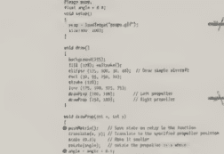

下面的图显示了质量随时间变化的位移。

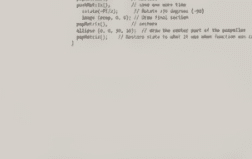

下面的图显示了质量随时间变化的速度。

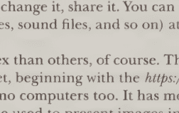

如果我们增加阻尼系数`c`，我们可以看到振荡衰减得更快。

代码已供你使用。使用它，修改它，分享它。

## 引言

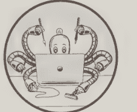

## 编程语言基础

当人们编程时，他们实际上是在与计算机进行通信。它是命令性的且精确的。命令性是因为计算机没有选择；它被告知要做什么，并且会完全按照指示执行。因为计算机不会思考，而且无法在没有任何怀疑的情况下评估一条命令。因此，作为程序员，我们在指示机器执行操作时必须谨慎且精确。

当我们相互交流时，我们使用语言。同样，人类也使用语言与计算机通信，但这些语言是人工的（人类为了此目的而发明的）、简洁的（修饰符很少）、精确的（语言中的每个项目都代表一个意思）以及是书面的（编程语言）。

编程过程始于一个需要解决的问题，第一步是尽可能清晰地陈述问题。然后我们分析问题并确定解决它的方法。计算机只能直接处理数字，因此在这个阶段讨论的解决方案通常是数值的或数学的。创建一个解决方案的草稿，也许是在纸上用人类语言书写。然后将其翻译成语言并通过键盘输入计算机。生成的文本文件被称为源代码或程序。接下来，另一个称为编译器的程序接收它并将其转换为计算机上执行的形式。基本上，所有程序都被转换为机器代码，由数字组成，计算机可以执行。

你将学习一种名为 *Processing* 的语言。它是为艺术家开发的，但对很多事情很有用，而且对于良好的教学，它让很多事情变得简单，并且始终有图形输出。在结构（语法）方面，它与我们现在使用的其他语言非常相似。事实上，它是经过特殊封装的 Java。Processing 程序在其起源处被称为 sketch（草图）。

为了使用编程语言，你需要理解一些基本概念和结构，至少在基础水平上。这些概念将在引言中介绍。书的其余部分将通过示例教你：当你打开书的任意位置时，左页几乎总是概述一个问题，而右页将会显示程序和结果（图像形式）。

## 开始

所有的草图都有相同的基本结构。有一个叫做`setup()`的预定义名称，它在程序开始时执行一次。这是我们进行初始化的地方，例如定义窗口的大小。如果我们需要从文件中读取一组图像或声音，就在这里完成。

> 注意：本节讨论介绍了一个用于开始任何程序的模板。语法的详细解释将会出现。

`setup()`的语法如下：

```java
void setup () {
  你的代码写在这里
}
```

这就是我们在 Processing 中所谓的函数（参见草图 24）。它是一段被包含在大括号`{ }`之中的代码，并赋予了一个名称。当我们以后使用该名称时，它会被执行（我们称之为调用）。在这种情况下，函数名为`setup()`，它由 Processing 自动调用一次。`void`（一个保留字）现在并不重要，但它意味着函数不返回数值。

在`setup()`完成后，屏幕上会打开一个窗口，程序将在其中绘制。这被称为草图窗口，它的大小是在`setup`中初始化的内容之一。

## 中间

草图 的第二部分是另一个函数

每 1/60 秒，Processing 系统就会调用`draw()`函数。显示的代码每次都会执行，其理念是程序员可以在用户观察时更新那里创建的图片。例如，如果逐帧显示一组移动动物的图像，结果将是该动物的动画图像。程序员可以在用户观察时绘制形状、显示文本和图像、改变颜色并在屏幕上移动形状。

## 其他部分

程序员编写的代码位于`setup()`或`draw()`函数内部，或者由这些函数执行的代码。程序中任何无法从`setup()`或`draw()`触及的部分将永远不会执行（某些鼠标和键盘函数除外）。

程序员可以为其他函数命名并提供代码，这些函数可以由`draw()`或`setup()`执行（调用）。这些函数通常被放置在程序中`draw()`函数之后。例如，如果程序员想定义一个名为`doSomething()`的函数，它看起来可能像这样：

```java
void doSomething() {
  // 代码写在这里
}
```

当在调用中使用该函数的名称时，它就会被执行：

```java
void draw() {
  doSomething();
}
```

分号`;`用于结束一个语句，以便 Processing 知道程序员何时认为一个语句已经结束了。它被用于检测错误：如果程序员认为语句已完成，而 Processing 编译器并不认为，编译器就会抛出错误信息。毕竟，编译器总是正确的。

## 变量


变量的概念是大多数初学者觉得难以理解的。本质上，变量是一个用于存放结果（通常是数字）的地方。在编程语言中，变量由名称表示，名称与值之间的连接通过语言中称为“赋值语句”的语句建立：它将一个值赋给变量。这里有一个示例：

```java
count = 0;
```

这确建立了名为`count`的变量值为 0。我们如何知道这个名称是一个变量呢？它必须出现在声明中：“声明” `count`是一个变量，并且我们指定一个类型。类型定义了可以赋值给变量的值集合。对于数值变量，常见的类型是整数（`integer`）和浮点数（`float`，即小数）。如果`count`是一个整数，那么声明如下：

```java
int count;
```

预定义的名称`int`意味着整数，此声明指明名称`count`将存储一个整数。如果它本 intended应该是一个带小数的数字（实数或浮点数），声明将如下：

```java
float count;
```

变量只有在声明后才能被使用。尝试使用未在声明中出现的变量是错误的，部分原因是因为它的类型是未知的。

现在你已经定义了变量，就可以进行复杂的计算。算术运算是可能的：`+`（加法）、`-`（减法）、`*`（乘法）和`/`（除法）。变量和常量都可以用于数学表达式，就像在代数中一样。以下是一个合法的赋值语句（假设名称为`radius`）：

```java
count = 2 * 3.1415926 * radius;
```

它将计算给定半径的圆的周长。

## 如何编写程序

当启动 `Processing` 时（无论是点击`processing.exe`还是点击`Processing`源文件），集成开发环境（IDE）都会在屏幕上打开一个窗口。它看起来像图 1，尽管根据你的操作系统和使用的`Processing`版本，它可能略有不同。图 1：`Processing`集成开发环境中的新窗口。这个特定的草图被称为`start`，位于名为`start.p`的文件中。`start.p`文件也必须位于名为`start`的目录下。这是规则。现在你可以开始输入代码了，当`start`图标位于窗口的白色矩形内时，它就会执行。当点击停止图标时，它会停止。

让我们尝试一个简单的程序：一个画圆的程序。首先，输入图 2 所示的基础程序。图 2：`Processing`程序的基础结构。我们可以编写代码。我们想画一个圆，`Processing`将我们打开绘图窗口。我们应该指定它的尺寸，以免它太小。`setup()`可以使用预定义的`size()`函数来指定宽度为 400 像素、高度为 400 像素的草图窗口。`draw()`函数会重复执行。我们想画一个圆，`Processing`将为我们打开绘图窗口。我们应该指定它的尺寸，以免它太小。`setup()`只执行一次。`draw()`函数每次调用都会执行（默认每秒 60 次）。使用`ellipse()`函数有四个参数。前两个参数指定圆心的像素坐标，后两个参数指定圆的宽度和高度。`ellipse(200, 150, 50, 50)`会在 (200, 100) 处画一个宽 50 像素、高 50 像素的椭圆。

默认情况下，背景颜色设置为灰色，圆的填充颜色是白色的。圆有黑色轮框。

调用`ellipse(200, 100, 50, 50)`会在 (200, 100) 处画一个宽 50 像素、高 50 像素的椭圆，这本质上是一个直径为 50 像素的圆。

图 3：点击`start`图标后出现的窗口。图 4：点击`stop`图标后停止的窗口。

## 绘图基础

### 草图 1：一个圆

画圆需要一些代码，但它是`Processing`中是最简单的程序之一。

```java
void setup() {
  size(400, 300);
}

void draw() {
  background(200);
  ellipse(200, 150, 50, 50);
}
```

在这个程序中，背景颜色设置为 200（灰色）。`ellipse()`函数具有四个参数：圆位于 (200, 150)，宽和高均为 50。

```java
void setup() {
  size(400, 300);
}

void draw() {
  background(200);
  ellipse(200, 150, 50, 50);
}
```

### 草图 2：填充颜色

这个例子与示例 A 类似，但现在背景颜色设置为白色，圆的填充颜色被设置为黑色。

```java
void setup() {
  size(400, 300);
}

void draw() {
  background(255);
  fill(0);
  ellipse(200, 150, 50, 50);
}
```

### 草图 3：两个椭圆

在这种情况下，背景颜色（白色 = 255）和填充颜色（黑色 = 0）在`setup()`中指定。这个草图在`draw()`中画了两个椭圆而不是圆，以展示如何使用宽度和高度参数。

```java
void setup() {
  size(400, 300);
  background(255);
  fill(0);
}

void draw() {
  background(255);
  ellipse(100, 150, 100, 50);
  ellipse(300, 150, 50, 100);
}
```

## 示例 A

```java
void setup () {
  size(400, 300);
}
void draw () {
  ellipse(200, 150, 50, 50);
}
```

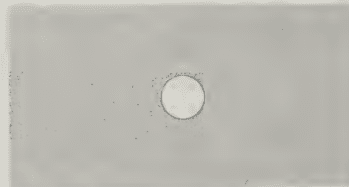

## 示例 B

```java
void setup () {
  size(400, 300);
}
void draw () {
  background(255);
  fill(0);
  ellipse(200, 150, 50, 50);
}
```

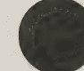

## 示例 C

```java
void setup () {
  size(400, 300);
  background(255);
  fill(0);
}
void draw () {
  ellipse(100, 150, 100, 100);
  ellipse(300, 150, 50, 100);
}
```

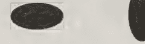

## 草图 2：颜色

我们可以通过单个数值分量指定灰色调，但也可以通过向同一个函数提供三个数值分量来指定颜色。这些分量按照传统的顺序给出：红、绿、然后蓝。每个分量占用一个字节（8 位），并用 0 到 255 之间的数字表示，该数字决定分量的深浅。数值越小，颜色越深。

数字 (255, 0, 0) 指定了最亮的红色，而数字 (254, 0, 0) 指定了稍暗的红色。绿色是 (0, 255, 0)，蓝色是 (0, 0, 255)。黄色由红色和绿色组成，因此黄色的 RGB 坐标为 (255, 255, 0)。灰色值则是三个分量几乎相等。

这是颜色的 RGB 表示法。还有其他表示方法：

### 示例 A

这个程序绘制了各种颜色的圆。在`draw()`函数中，前三次调用`fill()`和`ellipse()`绘制了第一行圆：红色 🔴、绿色 🟢 和蓝色 🔵。在绘制每个圆之前，填充颜色会发生。

第二行圆填充了黄色 🟡、洋红色 🟣 和青色 🔵。这里的每种颜色都有非零颜色值。

最后一行包含填充有逐渐变亮的灰色 ⚪ 的圆。每个圆都有三个相同的颜色值。

### 示例 B

我们可以使用第四个分量来表示透明度，有时也称为 alpha 通道。分量 (255, 0, 0, 128) 表示红色为 255，绿色和蓝色为 0，透明度为 128，即 50%。数值越高，透明度越低。除了 R、G、B 值外，我们还可以给任何颜色任何合法的透明度。

这个程序绘制了一组重叠的红、绿、蓝圆来显示透明度。

在`draw()`函数中，前三次调用`fill()`和`ellipse()` ⚫ 绘制了左上角的圆，填充颜色透明度为 20。

后三次调用 ⚪ 绘制了右上角的圆，透明度为 100。

第三三次调用 🔘 绘制了右下角的圆，透明度为 180。

最后三次调用 ⚪ 绘制了左下角的圆，透明度为 255，意味着完全不透明。`Processing`定义颜色类型包含红、绿、蓝和透明度值。`color(r, g, b, a)`函数接收数值并返回颜色类型的值。变量也可以持有颜色类型的值。我们可以这样声明并初始化一个变量：

```java
color r;
r = color(255, 0, 0); // 变量 r 现在持有红色
```

### 示例 A

```java
void setup () {
  size(400, 300);
  background(255);
}
```

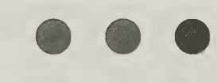

```java
void draw () {
  fill(255, 0, 0); ellipse(100, 50, 50, 50);
  fill(0, 255, 0); ellipse(200, 50, 50, 50);
  fill(0, 0, 255); ellipse(300, 50, 50, 50);
  fill(255, 255, 255); ellipse(100, 150, 50, 50);
  fill(255, 0, 255); ellipse(200, 150, 50, 50);
  fill(0, 255, 255); ellipse(300, 150, 50, 50);
  fill(64, 64, 64); ellipse(100, 250, 50, 50);
  fill(128, 128, 128); ellipse(200, 250, 50, 50);
  fill(196, 196, 196); ellipse(300, 250, 50, 50);
}
```

### 示例 B

```java
void setup () {
  size(400, 300);
  background(255);
}
```

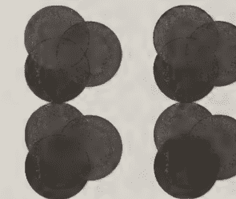

```java
void draw () {
  fill(255, 0, 0, 20); ellipse(50, 100, 100, 100);
  fill(0, 255, 0, 100); ellipse(100, 75, 100, 100);
  fill(0, 0, 255, 100); ellipse(50, 100, 100, 100);
  fill(255, 0, 100, 100); ellipse(250, 100, 100, 100);
  fill(0, 255, 100, 100); ellipse(300, 75, 100, 100);
  fill(0, 0, 255, 100); ellipse(250, 100, 100, 100);
  fill(255, 0, 180, 100); ellipse(50, 200, 100, 100);
  fill(0, 255, 180, 100); ellipse(100, 220, 100, 100);
  fill(0, 0, 180, 100); ellipse(50, 250, 100, 100);
  fill(255, 0, 255, 100); ellipse(250, 200, 100, 100);
  fill(255, 255, 255, 100); ellipse(300, 220, 100, 100);
  fill(0, 255, 255, 100); ellipse(250, 250, 100, 100);
}
```

## 草图 3：if 语句——条件改变颜色

在日常生活中，人们经常处理条件动作，尽管对数据很少思考。当然，我们用自然语言表达这些条件：

> “如果下雨了，我们就看电视，但如果晴天，我们就去滑雪雪。”

> “如果灯是红色的，就停下，但如果是绿色的，就继续开。”

我们在编写程序时也可以使用条件动作。如果某些情况为真，我们执行执行一段代码。条件或情况必须用数值术语表示，结果是真或假。这种条件通常是数字之间比较的结果，例如“等于 10”或“x 坐标是否小于宽度”。

条件代码使用`if`语句处理，其语法如下：

```java
if ( condition ) code;
```

条件可以是数字之间的比较，所以以下都是条件：

| | | |
| :--- | :--- | :--- |
| 等于 10 | x 坐标小于宽度 | 大于 20 |
| 等于 64 | 不等于 height | 等于 width |

这里使用了特殊的符号`else`。

```java
if ( condition ) code;
else code;
```

示例 B 使用`else`来实现与 A 相同的任务。

### 颜色切换

```java
int count = 0;
void setup () {
  size(400, 300);
}

void draw () {
  fill(255, 0, 0); ellipse(200, 150, 50, 50);
  if (count < 100) {
    count++;
  }
}
```

### 示例 A

```java
int count = 0;
void setup () {
  size(400, 300);
}

void draw () {
  fill(255, 0, 0); ellipse(200, 150, 50, 50);
  if (count < 100) {
    count++;
  } else {
    fill(0, 255, 0);
  }
}
```

### 示例 C

```java
int count = 0;
void setup () {
  size(400, 300);
}

void draw () {
  fill(255, 0, 0); ellipse(200, 150, 50, 50);
  if (count < 100) {
    count++;
  } else {
    fill(0, 255, 0);
  }
}
```


## 草图 4：循环

程序员经常需要多次执行相同的代码，因此使用循环。在`Processing`中，常见的方法是使用`for`循环：

```java
for (i=0; i<10; i++) statementA;
```

这个循环有四个部分：

- **i=0**: 在循环第一次通过时初始化。

- **i<10**: 只要条件为真，循环就会继续。

- **i++**: 在每次迭代结束（语句执行后）执行递增。

- **statementA**: 这是被执行的代码。

如果异常在开头，循环甚至一次都不会执行。事实上，任何时候我引用一个语句，都可以意味着一个复合语句，即在大括号括起来的语句集合。

```java
for (i=0; i<10; i++) {
  statementA;
}
```

循环可以用来绘制 20 个圆，`i`的值从 0 到 19。

```java
for (int i=0; i<20; i++) {
  ellipse(i*20, 150, 50, 50);
}
```

```java
void setup ()
{
  size(500, 300);
  for (int i=0; i<20; i++)
    ellipse(i*10+20,40,10,10);
}
```

```java
void draw () { }
```

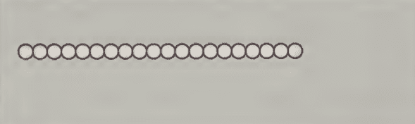

```java
void setup ()
{
  size(500, 300);
  int green = 10;
  for (int i=0; i<20; i++)
  {
    fill(255, green, 255);
    ellipse(i*10+20, 40, 10, 10);
    green = green+10;
  }
}
```

```java
void draw() { }
```

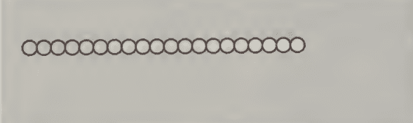

## 图画 5：线条

绘制线条是图形处理中的一项基础操作。在`Processing`中，线实际上是一条线段，它通过识别要连接的两个端点来指定。绘制线条的函数命名为`line()`，它接受端点的坐标作为参数（总共四个参数）。调用`line(10,10, 20,20)`将在窗口中坐标 (10, 10) 和 (20, 20) 之间绘制一条线。

### 示例 A

让我们画一些稿纸。我们可以使用此调用，对于某些垂直方向的`y`值，绘制一条贯穿整个画布窗口宽度的水平线：

```java
line (0, y, width, y);
```

窗口宽度由变量`width`给出，窗口高度由变量`height`给出。线条的起点是图像窗口左侧的 (0, y)，位于左侧，距离顶部`y`像素；终点位于窗口右侧的 (width, y)，具有相同的`y`值。

绘制线条的颜色可以通过调用`stroke()`参数来指定。例如，`stroke(255,0,0)`指定线条将为红色。

### 示例 B


Processing 将使用内置变量`mouseX`和`mouseY`告诉你鼠标在窗口内部的位置。每当按下鼠标时，Processing 会调用`mousePressed()`函数；当鼠标释放时，它调用`mouseReleased()`函数。`mousePressed()`和`mouseReleased()`函数被称为回调函数，它们提供了一种访问鼠标按下和释放的简单方法。此外，该程序在触摸屏设备上同样有效。

此示例使用点击和释放来绘制线条。第一次点击`(x0, y0)`定义了线条的起点；第二次点击（当`x1 > x0`时）定义了端点；第三次点击（当`x1 < x`时）再次开始。线条的粗细可以通过调用函数`strokeWeight(n)`指定，参数`n`是像素数量。符号`&&`表示“与”。它可以应用于任何对的变量或表达式；换句话说，即布尔类型的内容。它被用于`if`语句，当表达式的两边都为真时，结果为真。因此，表达式`(a && b)`只有当`a`和`b`都为真时才成立。例如，此语句测试窗口内的`x`：

```
if (x >= 0) && (x<width)
```

情况如下：

```
if (x >= 0)
if (x<width)
  statementA;
```

## 示例 A

```java
void setup () {
  size(500, 500);
}
void draw () {
  background(220, 220);
  stroke(255, 0, 0); // 红色线条
  line(20, 0, 20, height);
  stroke(100, 0, 250); // 蓝色水平线
  for (int i=4; i<50; i++) {
    line(0, i*10, width, i*10);
  }
}
```

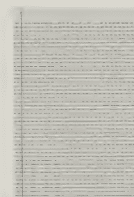

## 示例 B

```java
int x0=-1, y0=-1;
int x1=-1, y1=-1;
void setup () {
  size(300, 300);
}
void draw () {
  background(200, 200, 200);
  if (x1 >= 0) line(x0, y0, x1, y1);
  else if (x0 >= 0) line(x0, y0, mouseX, mouseY);
}
void mouseReleased () {
  if (x0 < 0) {
    x0 = mouseX; y0 = mouseY;
  } else if (x1 < 0) {
    x1 = mouseX; y1 = mouseY;
  } else {
    x0 = y0 = -1; x1 = y1 = -1;
  }
}
```


## 图画 6：数组——绘制多个圆

变量可以存储一个值，例如单个数字。如果我们想要更多值，可以使用更多的变量。例如，为了画两个圆，我们可以拥有两组变量，比如`x0`, `y0`和`x1`, `y1`，我们可以通过两次调用绘制这两个圆：

```
ellipse(x0, y0);
ellipse(x1, y1);
```

但如果我们想每次点击鼠标按钮时画一个圆，并在鼠标在屏幕上的位置画圆呢？我们提前不知道要画多少个圆，所以不想用数组来跟踪`x`和`y`。数组是具有相同类型值的集合。声明数组的语法是：

```
int x[] = new int[100];
```

此声明定义了一个名为`x`的数组，可以存储 100 个整数。`int[]`短语意味着“定义一个新数组”，`new[100]`定义了大小，其中100可以被任何常量替换。之前的声明可以分两部分完成：

```
int x[];
x = new int[100];
```

使用索引访问数组中的值，索引是一个指定你使用哪个值的数字，从 0 开始：`x[0]`是数组中索引为 0 的第一个元素（值），`x[1]`是索引为 1 的第二个，以此类推，直到最后一个`x[99]`。示例使用了两个数组，分别用于`x`和`y`，并在点击鼠标按钮的坐标（按下和释放）处绘制圆。最初，在`setup()`中为`x`和`y`数组中的每个元素赋值 -1。这是已记录的圆的数量；`n`从 0 开始，并增加到圆的最大数量，这是一个定义为 10 的常量。当鼠标按钮释放时，系统调用`mouseReleased()`回调函数，它保存了当前值...（注：原文此处有中断，翻译按原文逻辑结束）

```java
int N = 10;
int x0 = new int[N];
int y0 = new int[N];
int x1 = new int[N];
int y1 = new int[N];
int n = 0;
boolean down = false; // 布尔变量只能为true或false
```

```java
void setup() {
  size(500, 500);
}

void draw() {
  background(200, 200, 200);
  for (int i=0; i<n; i++) {
    line(x0[i], y0[i], x1[i], y1[i]);
  }
  if (down) line(x0[n], y0[n], mouseX, mouseY);
}
```

```java
void mousePressed() {
  down = true;
  if (n<N) {
    x0[n] = mouseX;
    y0[n] = mouseY;
  }
}
```

```java
void mouseReleased() {
  if (n<N-1) {
    x1[n] = mouseX;
    y1[n] = mouseY;
    n = n + 1;
  }
  down = false;
}
```

```java
void keyPressed() {
  if (key==BACKSPACE && n>0) {
    n = n - 1;
  }
}
```

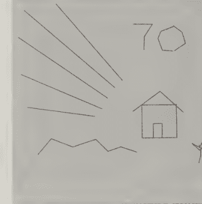

# 草稿 8：随机圆

这个草稿在屏幕的随机位置绘制圆，并带有随机的颜色。随机性指的是不可预测性，这是一个复杂的概念。如果你尝试用铅笔画直线，任何两条线都不可能是完全相同的。线条中细微的变会会渗透，并导致每条线产生微小的变化。绘画时的笔触也是如此。世界上没有两个人类是完全相同的，他们之间的差异是不可预测但又显而易见的。

在使用计算机时，随机数生成器会创建彼此之间相互随机的数字。随机数可以用于模拟游戏中的骰子等随机事件，或者用于执行用户会认为不可预测的事情，亦模拟复杂的现实世界情况。例如，道路上汽车之间的间距以及窗上雨滴的出现看起来是随机的，因为我们并不理解进入该情况的所有复杂因素。

Processing 中的随机数生成器命名为`random`。`random (100)`将生成一个 0 到 100 之间的实数，不包括 100。`random (10, 20)`将返回一个 10 到 20 之间的实数，但小于 20。`random (0, width)`在草稿窗口内生成一个`x`位置，而`random (0, height)`生成一个`y`位置。

与草稿 6 类似，它在数组中存储坐标并使用`ellipse()`调用来绘制圆，但它不是在点击鼠标时绘制圆，而是每秒钟自动创建一个新圆。为了实现这一点，我们设置了`draw()`被调用的频率（`setup()`中的`frameRate(1)`）。每次调用`draw()`时，我们都使用`random()`生成一个新的`x`和`y`坐标，并将其保存到`x`和`y`数组中。

```java
x[ncircles] = (int)random(0, width);
y[ncircles] = (int)random(0, height);
```

`random`调用前的`(int)`将结果（一个浮点数 float）转换为新类型整数（int）。这被称为强制类型转换（cast），我们将浮点值转换为整数，因为我们不能使用带有小数点的值作为坐标。也可以通过使用`int()`函数来实现：

```java
x[ncircles] = (int)random(0, width));
y[ncircles] = (int)random(0, height));
```

随机数生成器可以可以通过此调用来生成随机骰子：

`roll = int(random(1, 7));`

该调用永远不会返回 7，它会截断 1 到 2 之间的浮点值变为 1，2 到 3 变为 2，以此类推。随机掷硬币（1=正面，2=反面）将如下生成：

```java
toss = int(random(1, 2) + 0.5);
```

```java
final int MAXCIRCLES = 256;
int x[] = new int[MAXCIRCLES];
int y[] = new int[MAXCIRCLES];
int ncircles = 0;
```

```java
void setup () {
  size(600, 400);
  fill(200, 150, 100);
  for (int i=0; i<MAXCIRCLES; i++)
    x[i] = -1;
  frameRate(1);
}
```

```java
void draw () {
  background (200);

  for (int i=0; i<MAXCIRCLES; i++)
    if (x[i] >= 0)
      ellipse(x[i], y[i], 18, 18);
    else break;

  x[ncircles] = (int)random(0, width));
  y[ncircles] = (int)random(0, height));
  ncircles = (ncircles+1);
  if (ncircles>=MAXCIRCLES)
    ncircles = 0;
}
```

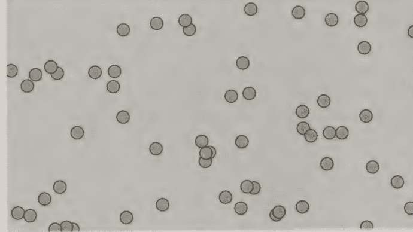

# 草稿 9：矩形

可以通过绘制代表边缘的直线来画矩形，但 Processing 系统不会认为这是一个矩形；它没有办法知道四条线是一个整体。相反，Processing 有一个绘制矩形的函数，称为`rect()`。指定矩形的默认方式是`CORNER`模式，前两个参数是左上角的坐标，后面是宽度和高度。如果你指定`CENTER`模式，前两个参数是矩形的中心。`CORNER`模式指定第一个角和对角顶点。你可以使用以下调用之一更改模式：

```java
rect(CORNER);
rect(CENTER);
rect(CORNERS);
```

在这个草稿中使用`setup`函数指定的`CORNER`模式，并用`(200, 0, 160)`填充矩形。之前的草稿中，`mousePressed()`函数在按下鼠标时 ① 将布尔变量设置为`true`，而`mouseReleased()` ② 将其设置为`false`。全局变量`x`和`y`代表矩形的第一个角。当按下鼠标时，我们将`x`和`y`设置为`mouseY`的当前值 ④，并设置`flag`变量以便`x`已设置。`draw()`函数将绘制以`(x, y)`为一个角、当前鼠标位置`(mouseX, mouseY)`为另一个 ⑤ 的矩形。这实现了橡皮筋效果。全局变量`x1`和`y1`是矩形的中心坐标。释放鼠标时，我们将`x1`和`y1`设置为当前坐标 ⑥，这完成了矩形。因为`flag`为`false`，`draw()`函数将以`x1`和`y1`为相反角绘制矩形。

圆也有绘制模式，通过`ellipseMode()`设置。`ellipseMode(CENTER)`是默认模式，也是你熟悉的模式。`ellipseMode(CORNER)`将圆的前两个参数视为左上角的坐标，其余两个视为宽度和高度。`ellipseMode(CORNERS)`将前两个参数视为框的一个角，后两个视为第二个角的坐标。

```java
int x = -1, y = -1;
int x1 = -1, y1 = -1;
boolean flag = false;

void setup () {
  size(600, 400);
  fill(200, 0, 160);
  rectMode(CORNER);
}

void draw () {
  background(200);
  if (flag) {
    rect(x, y, mouseX, mouseY);
  } else {
    rect(x, y, x1, y1);
  }
}

void mousePressed () {
  flag = true;
  x = mouseX; y = mouseY;
}

void mouseReleased () {
  flag = false;
  x1 = mouseX; y1 = mouseY;
}
```

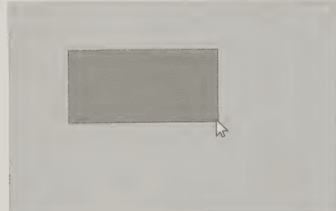

# 草稿 10：三角形与运动

就像矩形使用内置的`rect()`函数绘制一样，三角形也是使用内置的`triangle()`函数绘制的。三角形无法通过高宽绘制；它们的形状由三个角决定。因此，`triangle()`函数有六个参数：三个顶点（角）的`x`、`y`坐标。

这个草稿使用鼠标绘制三角形。与之前绘制矩形和线的草稿一样，这个草稿使用`mouseReleased()`来判断何时选择了一个点。点击三次后，将使用选定的点作为顶点绘制三角形。三角形绘制后，它开始向下移动，就像被稍微推了一下。它继续向下移动，直到碰到草稿窗口的边界，在那里消失。

我们通过在每次绘制时给三角形的`y`坐标加上一个小值（`delta = 1`）来实现运动。这使得三角形在窗口中出现在越来越的位置，直到看起来越过了窗口底部。实际上，三角形在 Processing 系统中仍然存在，尽管看不见，它的坐标仍在更新。

如果用户在三角形绘制完成后点击鼠标，三角形将消失并重新开始绘制过程。我们通过重新初始化所有顶点为 -1 来重新启动绘制过程，这表示它们尚未定义。

在`draw()`函数内部，有一行代码被注释掉了：

```java
// delta = delta + 1;
```

如果你删除行开头的`//`，该行就会执行，三角形会越掉越快，仿佛被某种力拉着（例如重力）。同样删除`mouseReleased()`附近的行的`//`，这样每次绘制新三角形时，初始速度都会重置为 1。

```cpp
int x0=-1, y0=-1;
int x1=-1, y1=-1;
int x2=-1, y2=-1;
int delta = 1;

void setup () {
  size (400, 400);
}

void draw () {
  background (200);
  if (x2 >= 0) {
    triangle(x0, y0, x1, y1, x2, y2);
    y0 = y0 + delta; y1 = y1 + delta; y2 = y2 + delta;
    // delta = delta + 1;
  } else if (x1 >= 0) {
    line(x0, y0, x1, y1);
    line(x1, y1, mouseX, mouseY);
  } else if (x0 > 0) {
    line(x0, y0, mouseX, mouseY);
  }
}

void mouseReleased () {
  if (x0 < 0) {
    x0 = mouseX; y0 = mouseY;
  } else if (x1 < 0) {
    x1 = mouseX; y1 = mouseY;
  } else if (x2 < 0) {
    x2 = mouseX; y2 = mouseY;
  } else {
    x0 = y0 = -1;
    x1 = y1 = -1;
    x2 = y2 = -1;
    // delta = 1;
  }
}
```

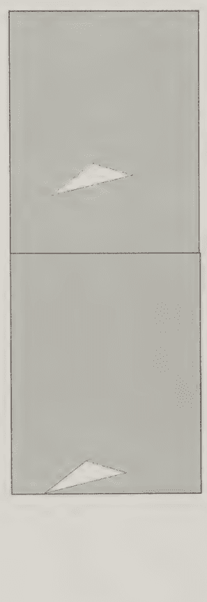

# 练习 11: 显示文本

文本在几乎所有的实际计算程序以及许多生成性艺术和新艺术程序中都是至关重要的。文本是人类交流的主要方式，虽然我们说“一画胜千言”，但事实往往是，几个精心挑选的词汇可以将原本不可理解的图像变成有用的交流工具。例如，图表坐标轴上的标签。

我们在窗口中绘制文本的方式与绘制线条和椭圆相同，使用一个简单的函数。你需要了解的第一点是，文本是从特定的`(x, y)`位置开始的，其中`x`和`y`代表在不考虑降部字母时包围文本的框的左下角坐标。像`y`这样的字符会延伸到该框下方，因此其`y`值会大于指定的值。

我们将通过调用`text()`函数来绘制文本：

```processing
text("This is a string to be drawn", 100, 20);
```

在这种情况下，字符串左下角的坐标是`(100, 20)`。初始字体和大小是默认的，这些默认值取决于系统。可以使用`textSize(n)`函数 ① 轻松地指定大小，该函数传递字符所需的像素大小（不是点数）。绘制文本时使用的颜色是当前的填充颜色（fill color），而不是描边颜色（stroke color）。


文本的对齐可以通过调用 `textAlign()` 函数 ② 来指定。

水平对齐相对于 `text()` 调用中指定的 x 和 y 坐标可以是 `LEFT`（左对）、`CENTER`（居中）或 `RIGHT`（右对）；默认是 `LEFT`。垂直对齐相对于 `text()` 调用中指定的 x 和 y 坐标可以是 `TOP`（顶部）、`CENTER`（居中）、`BOTTOM`（底部）或 `BASELINE`（基线）；默认是 `BASELINE`。

`BOTTOM` 是定义任何字符最低 y 值的行，例如降部字母的底部。`BASELINE` 定义了没有降部字母的典型字符的最低 y 值。因此，调用：

```processing
textAlign(CENTER, BOTTOM);
```

将当前文本从左到右居中（指定的 x 值是字符串的中心），并对齐指定的 y 值为字符串的底部。

示例 A 说明了如何以不同的大小显示文本。示例 B 显示了在 `text()` 调用中指定的 x 坐标上水平绘制，在指定的 y 坐标上垂直绘制。这是文本相对于指定坐标的对齐。

> `CENTER`、`LEFT`、`RIGHT` 等只是系统的常量。它们具体的数值并不重要，但系统必须知道这些值，以便进行正确的对齐。

## 示例 A

```processing
void setup () {
  size (400, 300);
  fill (255, 0, 0);
}

void draw () {
  background(200);
  textSize(12);
  text("12 pixel text starts at (100, 50)", 100, 50);
  textSize(20);
  text("20 pixel text starts at (50, 100)", 50, 100);
}
```

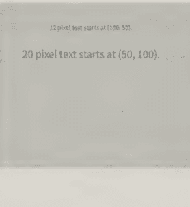

## 示例 B

```processing
void setup () {
  size (300, 200);
  fill (255, 0, 0);
}

void draw () {
  background(200);
  textAlign(LEFT);
  text("LEFT", 100, 50);
  textAlign(CENTER);
  text("CENTER", 100, 50);
  textAlign(RIGHT);
  text("RIGHT", 100, 50);
  textAlign(BASELINE);
  text("BASELINE", 100, 50);
  textAlign(TOP);
  text("TOP", 100, 50);
}
```

| 对齐方式 | 参考位置 |
|---|---|
| `LEFT` | `BASELINE` |
| `CENTER` | `CENTER` |
| `RIGHT` | `TOP` |

# 练习 12：字符串操作

上一个练习介绍了字符串，字符串是人类与计算机交流的自然方式。字符串是字符序列；在高级别，字符串是一个单词、句子或段落。字符串是双引号内的字符序列：`"To be or not to"`。可以使用字符串常量来声明变量并给它们赋值。例如，我们声明两个字符串变量并给它们赋值字符串常量：

```processing
String s1 = "To be or not to";
String s2 = "that is the question.";
```

可以通过拼接其他字符串来构造字符串。`+` 运算符应用于字符串表示连接或追加，因此可以通过拼接这两个字符串来完成引号：

```processing
s1 = s1 + s2;
```

这使得 `s1` 变成 `"To be or tothat is the question."`。不的是这不对，因为两个字符串之间需要逗号和空格。这样更好：

```processing
s1 = s1 + " " + s2;
```

第一个字符 `"T"` 的索引为 0，意味着它是第一个位置。字符 `"o"` 在位置 1，以此此类推。子串是由索引指定的字符串内的字符序列。`s1` 从索引 6 到 11 的子串是字符串 `"or not"`，获取如下：

```processing
s1.substring(6,12)
```

该字符串的长度为六个字符，由 `length()` 函数返回：

```processing
s1.substring(6,12).length()
```

可以使用 `charAt()` 函数找到特定位置的字符。例如，`s1.charAt(3)` 是 `"b"`，`s1.charAt(18)` 是 `" "`。字符串不能使用关系运算符进行比较（因为它们实际上以后将讨论的类实例）。相反，有用于比较的函数。比较 `s1` 和 `s2` 可以这样完成：

```processing
if (s1.equals(s2)) { }
```

这个练习显示了一些字符串操作及其使用练习 11 中讨论的 `text()` 函数绘制的结果。该练习包含了 `length()` ①、`charAt()` ② 和 `substring()` ③ 的示例。

```processing
String s1 = "To be or not to be";
String s2 = "that is the question.";

void setup() {
  size(500, 400); fill(0);
  text(s1 + " " + s1, 10, 20);
  text(s2 + " " + s2, 10, 35);
  text(s1 + " " + s1 + " " + s2, 160, 50);
  text(s1 + " " + s1 + " " + s2, 160, 65);
  text(s1 + " " + s1 + " To be or not be the question.", 10, 75);
  s1 = s1 + " " + s2;
}

- `s1.length()` is `s1.length()`, 25, 90;
- `s1.charAt(0)` is `s1.charAt(0)`, 160, 180;
- `s1.charAt(6)` is `s1.charAt(6)`, 160, 195;
- `s1.charAt(13)` is `s1.charAt(13)`, 160, 210;
- `s1.charAt(41)` is `s1.charAt(41)`, 160, 235;
- The `length()` function returns the number of characters in the string., 10, 250;
- The index of the final character is `length()-1`. It's an error to index past the end., 10, 265;
- Putting a `"` into a string is done by using a backslash: `\"` does it., 10, 280;
```

```processing
loop();

void draw() { }
```

## #2 使用已有图像

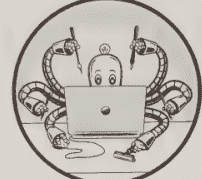

### 绘制稿 13：加载和显示图像

图像在网络空间中无处不在，即使是不懂计算机的人也知道图像格式的名称，或者至少知道文件后缀：GIF、JPEG、BMP、PNG 等。这些字母序列中的每一个都代表了以计算机形式存储图像的不同方式，每种方式对于不同用途都有特定的优缺点。GIF 图像是为了早期互联网而开发的，每个都具有存储动画的能力。JPEG（或 JPG）格式被几乎所有数码相机使用，它将图片压缩为相对较少的字节。

你应该意识到图像的重要性，以及从这些文件格式中读取图像是一项多么复杂的任务。读取大多数 GIF 文件的程序需要一千行代码。Processing 提供了一个易于读取和绘制图像的设施，这是它优于其他编程语言的优势之一。

Processing 使用了一种表示图像的类型，就像整数由 `int` 表示一样，系统可以通过一次函数调用将图像文件读取到变量中。该类型是 `PImage`（Processing Image 的缩写），函数是 `loadImage()`。为了加载图像，它应该保存在与程序文件相同的文件夹中，或者存在名为 `data` 的子文件夹中。

## 示例 A

假设存在名为 `image.jpg` 的图像，我们想要读取此图像并显示在程序窗口中。第一步要做的是声明一个 `PImage` 变量 `im`，我们将图像 ❶ 放入其中。在 `setup()` 中，我们将创建一个程序窗口（使用 `size()`）并读取图像。以下语句读取图像并将其赋值给变量：

```processing
im = loadImage("image.jpg");
```

现在，图像数据以某种内部形式存储在变量 `im` 中。

显示图像是在 `draw()` 函数中完成的，尽管在此情况下也可以在 `setup()` 中完成。Processing 系统为我们提供了一个 `image()` 函数，它可以在特定的 (x, y) 位置（指定图像左上角的位置）在程序窗口中绘制 `PImage`。以下调用绘制了图像，使其左上角与窗口的左上角对应：

```processing
image(im, 0, 0);
```

## 示例 B

该程序与示例 A 相同，但它在位置 (150, 30) ❷ 绘制图像。现在图像在可用空间中显示得更整齐。

`PImage` 类型由 Processing 定义，但与 `int` 和 `float` 等类型略有不同。事实上，`PImage` 是一种被称为“类”（class）的东西，我们可以创建自己的类。

### 示例 A：`PImage im`

```processing
void setup () {
  size(640, 480);
  im = loadImage("image.jpg");
}

void draw() {
  image(im, 0, 0);
}
```

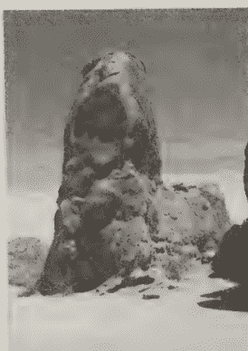

### 示例 B：`PImage im`

```processing
void setup () {
  size(640, 480);
  im = loadImage("image.jpg");
}

void draw() {
  image(im, 150, 30);
}
```

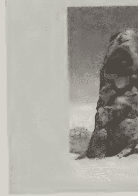

### 绘制稿 14：图像——理论与实践

图像在视觉艺术中经常被使用，而 Processing 是为艺术家设计的，因此在程序中使用图像非常简单这并不意外。不过，你仍然需要了解一些基础知识。

其之一是，图像要在计算机上使用必须被数字化；也就是说，它必须转换为数字。如果图像最初不是由计算机创建的，那么就必须扫描或拍摄，并且原始图像上的每个位置都必须是一个表示此处颜色的数字。结果是一个二维数字数组，图像的每个小区域被认为颜色是均匀，即使选取了最显眼的颜色来代表整个区域。这种颜色存储在内部表示的 (x, y) 位置，被称为像素元素（picture element），简称为像素（pixel）。这些像素的完整集合是原始图像的近似。在屏幕上绘制图像意味着计算机屏幕某部分的像素与图像中的像素匹配。这就是 `image()` 函数的作用。

图像的大小通常被认为是 N×M，其中 N 是行数，M 是列数。图像中的总像素数为 N×M。

像素数据类型为程序员提供了多种访问和操作图像中像素的方法。图像的属性可以使用点（`.`）符号来访问。例如，对于一个名为 `image` 的像素变量，我们有以下属性：

```processing
image.width  // 图像的宽度（像素）
image.height // 图像的高度（像素）
```

我们希望创建一个与特定图像大小相同的图形区域，但 `size()` 函数只能使用常量来设置窗口大小。为了解决这个问题，我们可以在 `setup()` 中添加 `surface.setResizable(true)`。这允许我们在程序运行时通过调用 `surface.setSize()` 来调整图形区域，我们可以使用像 `image.width` 这样的非常量。

单个值可以使用根据 (x, y) 坐标返回或设置颜色的函数来访问：

```processing
image.get(x,y);                // 返回列 x 行 y 的像素
image.set(x,y,color(255,0,0));  // 设置 (x,y) 处的像素
```

### 示例 A：`PImage img`

```processing
void setup () {
  img = loadImage("image.jpg");
  size(240, 480); // 固定大小窗口
  img.resize(240, 480);
  image(img, 0, 0);
}

void draw () { }
```

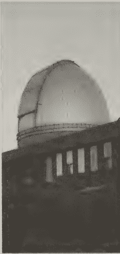

### 示例 B：`PImage img`

```processing
int w, h;
float aspect = 1.0;

void setup () {
  img = loadImage("image.jpg");
  size(540, 480);
  w = img.width; h = img.height;
  aspect = (float)w/(float)h;
}

if (w > h) {
  w = width;
  h = (int)((float)w/aspect);
} else {
  h = height;
  w = (int)(h*aspect);
}

img.resize(w, h);
image(img, width - w/2, (height-h)/2);
}

void draw () { }
```

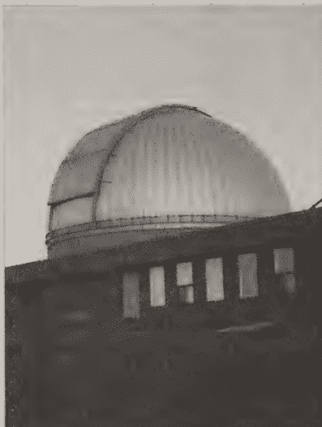

## 草图 16：图像处理 II——裁剪

裁剪图像是指移除任意的矩形子图像。我们裁剪图像通常是为了让图像更具吸引力或去除多余的内容。在 Paint 或 Photoshop 中，我们使用鼠标，首先点击裁剪图像所需的左上角，然后拖动鼠标到所需的右下角，最后释放按钮。所选矩形之外的所有图像都会被丢弃。Sketch 会裁剪图像，并可以选择地扩展裁剪区域以填充整个图像窗口。

首先读取图像并调整草图窗口的大小以适应图像。`draw()` 函数使用以下代码将图像（命名为 `img`）居中显示在窗口中：

```processing
image(img, (width-img.width), (height-img.height)/2);
```

如果图像没有被裁剪，`width-img.width` 将为 0，调用将变为 `image(img, 0, 0)`。否则，图像将比窗口小，`(width-w/2)` 将是左侧为了居中裁剪图像所需的像素数。对 `height` 执行相同操作，这会将图像放置在窗口中心。

当按下鼠标按钮时（`mousePressed()`），裁剪开始，使用光标所在的位置的点，该点被保存为 `x0` 和 `y0`。从该点到当前鼠标坐标绘制一个矩形，实现一个缓冲区矩形。

当释放鼠标按钮时，会评估鼠标坐标以确保当前的鼠标 `mouseY` 代表裁剪框的右下角；换句话说，确保鼠标的位置比按下按钮时大，并且确保 `mouseY` 也是如此。如果是，则将 `x0` 和 `y0` 的值与 `mouseX` 和 `mouseY` 的值交换。然后我们使用 `get()` 函数创建一个裁剪图像，使用左上角和右下角的坐标：

```processing
sub = get(x0, y0, (mouseX-x0), mouseY-y0);
```

`get()` 函数根据坐标对和高度返回图像的矩形区域。在前面的调用中，`(x0, y0)` 是左上角坐标，宽度是鼠标值与左上角 x 值之间的距离，高度是 `mouseY` 与左上角 y 值之间的距离。在这种情况下，`get()` 返回在草图窗口中显示的原始图像。

`get()` 函数返回的子图像将成为当前在 `draw(img)`（变量 `img`）中要显示的图像，它在窗口中居中显示。

此草图中的一个新想法是测试按了哪个鼠标按钮。在 `mouseReleased()` 中，此函数测试鼠标按钮：

```processing
if (mouseButton == RIGHT) sub.resize(width, height);
```

如果释放的是那一个，则子图像将重新缩放以适应窗口。

当我们将图形窗口调整为图像的大小的大，正如我们之前所做的那样。

```processing
PImage img;

boolean flag = false;

PImage sub;

int x0=0, y0=0;

void setup () {
  size(100, 100);

  surface.setResizable(true);

  img = loadImage("image.jpg");

  surface.setSize(img.width, img.height);
}

void draw () {
  background (200, 200, 200); // 白色背景

  image (img, (width-img.width)/2, (height-img.height)/2);

  if (flag) { // 如果鼠标按钮按下，则 x0,y0 被定义
    noFill(); stroke(200);
    rect (x0, y0, (mouseX-x0), (mouseY-y0)); // 从 (x0,y0) 到鼠标光标绘制一个矩形
  }
}

void mousePressed () {
  flag = true;

  x0 = mouseX; y0 = mouseY;
}

// 鼠标按钮释放。选择矩形内的子图像
// 并重新缩放；用新图像替换当前的显示图像。

void mouseReleased () {
  int t;
```


`flag = false;`

`if (x0 > mouseX) { t = mouseX; x0 = t; }`

`if (y0 > mouseY) { t = mouseY; y0 = t; }`

`sub = get(x0, y0, (mouseX-x0), mouseY-y0);`

`if ((mouseX-x0 > 0) && (mouseY-y0 > 0)) {`

  // 绘制矩形

  `if (mouseButton == RIGHT) sub.resize(width, height);`

  `img = sub;`

`}`

```
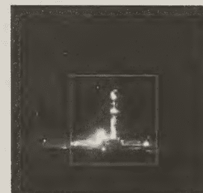

## 草图 17：图像处理—放大镜

某些电脑有一个由鼠标控制的“放大镜”对象，可以显示屏幕部分的局部（放大）视图。它让视力障碍的人能看清更清晰。

放大是通过增加原始图像中每个像素的大小来实现的。如果原始图像中的每个像素都增大，那么视力障碍的人就能更清楚地看到事物。

放大是通过增加原始图像中每个像素的大小来实现的。如果原始图像中的每个像素都增大，那么视力障碍的人就能更清楚地看到事物。

放大是通过增加原始图像中每个像素的大小来实现的。如果原始图像中的每个像素都增大，那么视力障碍的人就能更清楚地看到事物。

放大是通过增加原始图像中每个像素的大小来实现的。如果原始图像中的每个像素都增大，那么视力障碍的人就能更清楚地看到事物。

放大是通过增加原始图像中每个像素的大小来实现的。如果原始图像中的每个像素都增大，那么视力障碍的人就能更清楚地看到事物。

放大是通过增加原始图像中每个像素的大小来实现的。如果原始图像中的每个像素都增大，那么视力障碍的人就能更清楚地看到事物。

放大是通过增加原始图像中每个像素的大小来实现的。如果原始图像中的每个像素都增大，那么视力障碍的人就能更清楚地看到事物。

放大是通过增加原始图像中每个像素的大小来实现的。如果原始图像中的每个像素都增大，那么视力障碍的人就能更清楚地看到事物。

放大是通过增加原始图像中每个像素的大小来实现的。如果原始图像中的每个像素都增大，那么视力障碍的人就能更清楚地看到事物。

放大是通过增加原始图像中每个像素的大小来实现的。如果原始图像中的每个像素都增大，那么视力障碍的人就能更清楚地看到事物。

放大是通过增加原始图像中每个像素的大小来实现的。如果原始图像中的每个像素都增大，那么视力障碍的人就能更清楚地看到事物。

放大是通过增加原始图像中每个像素的大小来实现的。如果原始图像中的每个像素都增大，那么视力障碍的人就能更清楚地看到事物。

放大是通过增加原始图像中每个像素的大小来实现的。如果原始图像中的每个像素都增大，那么视力障碍的人就能更清楚地看到事物。

放大是通过增加原始图像中每个像素的大小来实现的。如果原始图像中的每个像素都增大，那么视力障碍的人就能更清楚地看到事物。

放大是通过增加原始图像中每个像素的大小来实现的。如果原始图像中的每个像素都增大，那么视力障碍的人就能更清楚地看到事物。

放大是通过增加原始图像中每个像素的大小来实现的。如果原始图像中的每个像素都增大，那么视力障碍的人就能更清楚地看到事物。

放大是通过增加原始图像中每个像素的大小来实现的。如果原始图像中的每个像素都增大，那么视力障碍的人就能更清楚地看到事物。

放大是通过增加原始图像中每个像素的大小来实现的。如果原始图像中的每个像素都增大，那么视力障碍的人就能更清楚地看到事物。

放大是通过增加原始图像中每个像素的大小来实现的。如果原始图像中的每个像素都增大，那么视力障碍的人就能更清楚地看到事物。

放大是通过增加原始图像中每个像素的大小来实现的。如果原始图像中的每个像素都增大，那么视力障碍的人就能更清楚地看到事物。

放大是通过增加原始图像中每个像素的大小来实现的。如果原始图像中的每个像素都增大，那么视力障碍的人就能更清楚地看到事物。

放大是通过增加原始图像中每个像素的大小来实现的。如果原始图像中的每个像素都增大，那么视力障碍的人就能更清楚地看到事物。

```


**放大图 17：图像处理—放大镜**

有些电脑有一个由鼠标控制的“放大镜”对象，可以显示屏幕部分的局部（放大）视图。它让视力障碍的人能看清更清晰。

放大是通过增加原始图像中每个像素的大小来实现的。如果原始图像中的每个像素都增大，那么视力障碍的人就能更清楚地看到事物。

放大是通过增加原始图像中每个像素的大小来实现的。如果原始图像中的每个像素都增大，那么视力障碍的人就能更清楚地看到事物。

`img/7534641f255e2513226c900fd85d94f3_54_1.png` 放大镜 17：图像处理—放大镜

放大镜 17：图像处理—放大镜

放大镜 17：放大镜

图 17：放大镜。

当释放鼠标按钮时，会评估鼠标坐标以确保当前的鼠标 `mouseY` 代表裁剪框的右下角；换句话说，确保鼠标的位置比按下按钮时大，并且确保 `mouseY` 也是如此。如果是，则将 `x0` 和 `y0` 的值与 `mouseX` 和 `mouseY` 的值交换。然后我们使用 `get()` 函数创建一个裁剪图像，使用左上角和右下角的坐标

```processing
sub = get(x0, y0, (mouseX-x0), mouseY-y0);
```

`get()` 函数根据坐标对和高度返回图像的矩形区域。在前面的调用中，`(x0, y0)` 是左上角坐标，宽度是鼠标值与左上角 `x` 值之间的距离，高度是 `mouseY` 与左上角 `y` 值之间的距离。在这种情况下，`get()` 返回在草图窗口中显示的原始图像。

`get()` 函数返回的子图像将成为当前在 `draw(img)`（变量 `img`）中要显示的图像，它在窗口中居中显示。

此草图中的一个新想法是测试按了哪个鼠标按钮。在 `mouseReleased()` 中，此函数测试鼠标按钮：

```processing
if (mouseButton == RIGHT) sub.resize(width, height);
```

如果释放的是那一个，则子图像将重新缩放以适应窗口。
当我们将图形窗口调整为图像的大小的大，正如我们之前所做的那样。

```processing
PImage img;
boolean flag = false;
PImage sub;
int x0=0, y0=0;

void setup () {
  size(100, 100);
  surface.setResizable(true);
  img = loadImage("image.jpg");
  surface.setSize(img.width, img.height);
}

void draw () {
  background (200, 200, 200); // 白色背景
  image (img, (width-img.width)/2, (height-img.height)/2);
  if (flag) { // 如果鼠标按钮按下，则 x0,y0 被定义
    noFill(); stroke(200);
    rect (x0, y0, (mouseX-x0), (mouseY-y0)); // 从 (x0,y0) 到鼠标光标绘制一个矩形
  }
}

void mousePressed () {
  flag = true;
  x0 = mouseX; y0 = mouseY;
}

// 鼠标按钮释放。选择矩形内的子图像
// 并重新缩放；用新图像替换当前的显示图像。
void mouseReleased () {
  int t;
  flag = false;
  if (x0 > mouseX) { t = mouseX; x0 = t; }
  if (y0 > mouseY) { t = mouseY; y0 = t; }
  sub = get(x0, y0, (mouseX-x0), mouseY-y0);
  if ((mouseX-x0 > 0) && (mouseY-y0 > 0)) {
    // 绘制矩形
    if (mouseButton == RIGHT) sub.resize(width, height);
    img = sub;
  }
}
```

```


## 草图 18：旋转

当旋转物体时，我们总是需要指定一个旋转轴，其中两个维度是点和角度。使用 `rotate()` 函数来旋转：

```processing
rotate(angle);
```

其中 `angle` 以弧度表示。圆周包含 2π 弧度也 360 度，因此将角度转换为弧度意味着乘以 `3.14159/180.0`，或者使用 Processing 函数 `radians(x)`。围绕旋转的点（轴）默认是窗口坐标系的原点 (0, 0)。它是窗口的左上角，旋转将绕该点顺时针进行。

当指定了旋转时，从该点绘制的所有内容都将旋转。再次调用 `rotate()` 会进一步旋转。关闭旋转是不可能的，但调用 `rotate(-angle)` 将取消 `rotate(angle)`。

## 示例 A

第一个示例画了一个旋转的图形。画了一条水平线并标记为 ①，随后是旋转了 10 线条 ②，然后是旋转了 20 线条 ③。为了避免文本旋转，在绘制标签之前，通过负角度旋转来“撤销”旋转。

## 示例 B

从原点画一条线。末端有一个小球。这条线从 0 到 90 度小步旋转，每一步都在 `draw()` 中显示。当线顺时针旋转时，每调用一次 `draw()`，角度就会增加 `0.01` 弧度 ④。当线变为垂直并进一步超出视野时，每帧的角度变化（变量 `d`）被更改为 `-d` ⑤。该物体看起来像钟摆，在 90 度和 0 度之间往复运动。

## Example A

```processing
float dzr = 3.14159/180.0;
void setup () {
  size(400, 400);
  noFill();
  stroke(255);
  ellipse(0,0,280,280);
  stroke(0);
  fill(0);
}
① line (100, 100, 200, 100);
text("0 degrees", 210, 100);
② rotate (radians(10));
line(100, 100, 200, 100);
rotate(-10*dzr);
text("10 degrees", 190, 140);
③ rotate (20*dzr);
line(100, 100, 200, 100);
rotate(-20*dzr);
text("20 degrees", 165, 180);
```

```
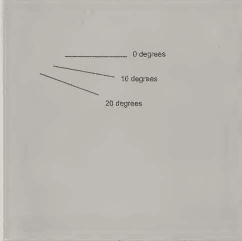

## Example B

```processing
float angle = 0.0, d = 0.01;
void setup () {
  size(150, 130);
  stroke(0);
}
void draw () {
  background (200);
  rotate(angle);
  line (0, 0, 5, 0);
  ellipse(50, 0, 3, 3);
① angle += d;
② if (angle > 1.6) d = -d;
else if (angle < 0.0) d = -d;
}
```

```
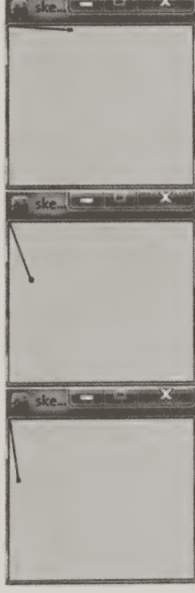

# Sketch 19: 任意点旋转——平移

能够旋转对象是关重要的，但如果只能旋转屏幕的左上角就会非常不方便。我们通常想要的是绕对象的中心进行旋转，但这需要对对象的了解。在图形学中，对象可以是复杂的实体；一个对象可能仅仅是一个圆或正方形，也可能是一栋建筑或一辆汽车。不能要求 Processing 知道一个对象是什么或者中心可能在哪里。然而，Processing 允许我们使用 `translate()` 函数将旋转中心移动到我们选择的任何坐标。

`translate()` 接收一个 `x` 和 `y` 坐标，这将改变后续所有绘制操作的原点位置。下面的示例将原点移动到窗口中的 (100, 200) 处，使得坐标 (0, 0) 变成了该位置：

```processing
translate(100, 200);
```

单词 translate（平移）在数学术语中意味着重新定位，因此平移涉及对象位置的变化。如果我们把原点平移到 (50, 50)，然后在 (0, 0) 处画一个圆，该圆将出现在屏幕的窗口坐标 (50, 50) 处。随后的圆将相对于窗口坐标 (50, 50) 进行绘制。因为旋转使用 (0, 0) 作为轴，我们可以将轴设置为我们喜欢的任何坐标，并绕任何点旋转对象。

## Example A

作为一个基础示例，我们将使用 `ellipse()` 函数 ① 在 (0, 0) 处画一个圆，然后调用 `translate()` 将原点更改为 (50, 50)。第二次调用 `ellipse()` 且与第一次完全相同，会在屏幕坐标 (50, 50) 处画一个圆。进一步的 `ellipse()` 调用在 (30, 40) 处画一个圆，则会在屏幕坐标 (80, 90) 处绘制该圆；即，相对于新原点 (50, 50) 的 (30, 40)。

## Example B

在这一草稿中，我们绕线的中心旋转一条线。处理过程是：先 `translate()` 移动到线的中心（在本例中为 (150, 100) ②），然后按当前角度旋转 ③，最后绘制线条。线的坐标必须反映原点是线的中心而非其中一端这一事实。由于线的中心在 (150, 100)，线在 `x` 方向上应该从 -50 到 +50 绘制，以便保持长度为 100 像素。平移后的起点坐标将是 (150 – 50, 200 – 100)，即 (100, 100)。终点的坐标将简单是在 `x` 方向上再增加 100 像素，即 (200, 100)。在中心点（原点）处 ④ 画了一个小圆以便可见。

每次调用 `draw()` 时，旋转角度都会增加 ④。由于每次调用 `draw()` 都会绘制线条，图像显示出一条缓慢旋转的线。

## Example A

```processing
// Translate a circle
void setup () {
  size(300, 200);
  stroke(0);
  fill(200, 100, 50);
}
void draw () {
  background(200);
  ellipse(0, 0, 10, 10);
  translate(50, 50);
  ellipse(0, 0, 10, 10);
  ellipse(30, 40, 10, 10);
}
```
```
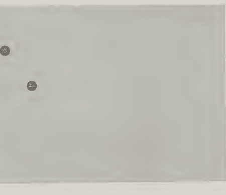

## Example B

```processing
// Rotate a line about its origin
float angle = 0.0;
void setup () {
  size(300, 200);
  stroke(0);
  fill(0);
}
void draw () {
  background(200);
  translate(150, 100);
  rotate(angle);
  ellipse(0, 0, 3, 3);
  line(-50, 0, 50, 0);
  translate(-150, -100);
  angle += .01;
}
```
```
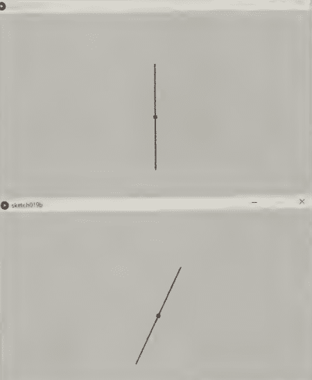
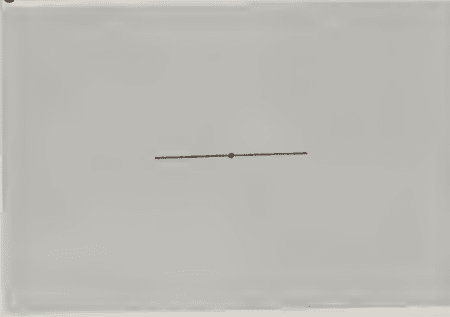

# Sketch 20: 旋转图像

旋转和平平移可以应用于复杂对象，也可以适用于线条。特别是，我们可以绕任意点以任何角度旋转图像。问题在于如何放置图像使其完全位于屏幕内。图像是矩形的，旋转它们会增加宽度或高度。如果我们没有正确将图像放置在窗口内，一个或多个角可能会超出窗口，如图 20-1 所示。

```
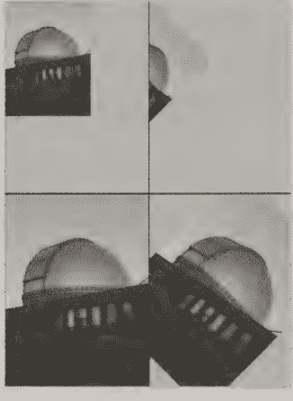

图 20-1: 图像超出窗口

上方两个图像显示了在窗口左上角显示的图像旋转的结果。旋转 45 度会将图像的一部分移到屏幕外。下方两个图像显示了当窗口足够大时绕其中心旋转的情况：图像的角被裁剪了。

此草稿显示了一个连续旋转的图像。图像入图像，窗口尺寸设置为图像尺寸的两倍 ①。`draw()` 函数将原点移动到图像中心并按角度旋转图像进行显示，从而绕其自身中心旋转 ②。下次调用 `draw()` 时，`angle` 的值会微增 ③。图像出现在窗口中心并看起来在旋转。

```processing
PImage img;   // Image to rotate
float angle = 0.0; // Angle of rotation
void setup () {
  size(100,100);
  surface.setResizable(true);
  img = loadImage("image.jpg");
  surface.setSize(img.width*2, img.height*2);
}
void draw() {
  background(200);                // 白色背景
  translate(img.width, img.height); // 将图像移动到原点
  rotate(angle);                   // 旋转
  translate(-img.width, -img.height); // 移回
}
```


`image(img, img.width/2, img.height/2);` // 绘制

`angle = angle + 0.01;` // 增加角度

}

```
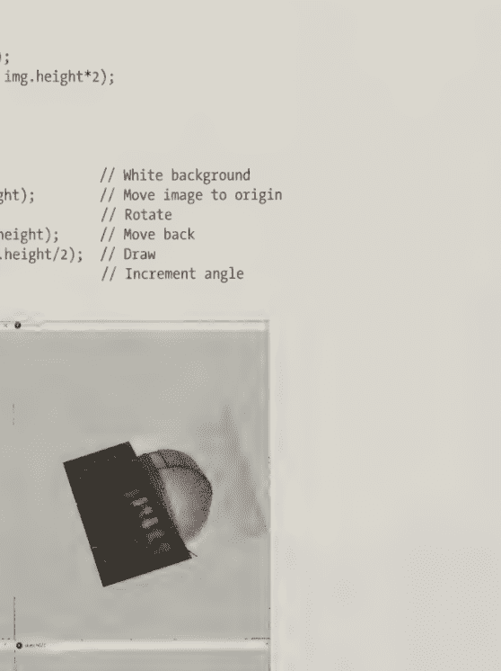

# Sketch 21：获取像素值

在开发 Sketch 14 时，我们讨论了如何使用 `get()` 函数从 `PImage` 中获取像素值。我们可以如下所示获取命名为 `im` 的 `PImage` 中 `(x, y)` 处的像素颜色：

```processing
color c;
PImage im;
c = im.get(x, y);
```

草稿窗口中当前显示的图片具有特殊地位，因为不使用变量就无法访问。通过简单调用 `get()` 可以获取屏幕上的像素值：

```processing
c = get(x, y);
```

因此，我们可以通过以下代码获取当前鼠标位置像素的颜色：

```processing
c = get(mouseX, mouseY);
```

此草稿加载图像并允许用户点击任何像素查看其颜色，颜色将以彩色条和文本形式的 `RGB` 值显示在屏幕右侧。第一个草稿加载图像并调整窗口适应它，右侧留有一个额外区域。在 `draw()` 中，它以背景颜色为 `(200, 200, 200)` 显示图像 ❶；当按下鼠标键时，它将 `mouseX`, `mouseY` 坐标处的像素值（颜色）赋值给颜色变量 `c` ❷；它在图像右侧显示颜色，并在屏幕右上角以文本形式显示 `RGB` 值 ❸。每当点击鼠标键，显示的颜色值就会改变。

> 注意：描述颜色的另一种方法是 `HSB` 系统，其中三个颜色值代表色相（`hue`）、饱和度（`saturation`）和亮度（`brightness`）。色相是实际颜色，例如红色或蓝色。饱和度表示颜色的强度。亮度表示光值。在 `Processing` 中切换到 `HSB` 模式通过调用 `colorMode(HSB, 256)` 实现，例如，`H`、`S`、`B` 的每个值都在 0 到 255 之间。调用 `colorMode(RGB, 256)` 将返回默认的 `RGB` 坐标。

无论颜色模式如何，函数 `hue(c)` 当 `c` 为颜色时会返回色相值。函数 `saturation(c)` 和 `brightness(c)` 产生另外两个 `HSB` 分量。

```java
PImage img;
color c;

void setup() {
  size(200, 200);
  surface.setResizable(true);
  img = loadImage("image.jpg");
  surface.setSize(img.width+55, img.height);
  c = color(200, 200, 200); // Default background
}

void draw() {
  background(c);
  image(img, 0, 0);
  if (red(c) != 200) {
    text("R="+red(c), img.width+2, 20);
    text("G="+green(c), img.width+2, 35);
    text("B="+blue(c), img.width+2, 50);
  }
}

void mousePressed() {
  if (mouseX > img.width) {
    c = color(200, 200, 200);
  } else {
    c = get(mouseX, mouseY);
  }
}
```

## Sketch 22：设置与更改像素

图像中的像素值（包括绘制区域）可以使用 `set()` 函数进行更改。我们使用坐标来指定位置，并识别要在该点绘制的颜色。例如：

```java
set(i, j, color(255, 255, 0));
```

这会将图形区域中位置 `(i, j)` 处的像素设置为黄色，即 `RGB (255, 255, 0)`。如果坐标位于窗口之外，像素会被绘制但并不可见。我们可以使用 `background()` 函数为窗口中的所有像素设置颜色：

```java
background(255, 100, 40);
```

这将以橙色调用该程序。

在不使用 `background()` 函数的情况下设置窗口中的所有像素需要嵌套循环——事实上，第一个循环检查水平方向上的所有像素；即所有列。第二个循环查看 `i` 的所有可能值，用以显示所有行。第一个循环在第二个循环内部设置标志，以便每行中的所有像素都能被修改：

```java
for (i=0; i<width; i++)
  for (j=0; j<height; j++)
    set(i, j, color(255, 100, 40));
```

这会将程序窗口中的所有像素设置为橙色。

图像的像素值可以在图像显示之前进行修改。不仅可以替换颜色，还可以细微地更改像素值，使其成为现有颜色的变体。此示例首先加载并显示一张图像。当程序通过 `mousePressed()` 检测到鼠标按下时，这表示屏幕上的图像将通过一个像上一个示例那样的循环逐像素地进行修改。在这种情况下，我们将每个像素的 `RGB` 值替换为它的亮度值，结果是一张没有颜色的灰色图像。当释放鼠标按钮时（`mouseReleased()`），程序会清除标志（将其设置为 `false`），图像再次以彩色显示。

## 示例 A

```java
void setup() {
  size(400, 300);
}

void draw() {
  int i, j;
  for (i=0; i<width; i++) {
    for (j=0; j<height; j++) {
      set(i, j, color(255, 100, 40));
    }
  }
}
```

## 示例 B

```java
PImage img;
color c1, c2, c;
boolean grey = false;

void setup() {
  size(200, 200);
  surface.setResizable(true);
  img = loadImage("image.jpg");
  surface.setSize(img.width, img.height);
  c = color(200, 200, 200); // Default background
}

void draw() {
  int i, j;
  color c1, c2;
  background(200);
  image(img, 0, 0);
  if (grey) {
    for (i=0; i<width; i++) {
      for (j=0; j<height; j++) {
        c1 = get(i, j);
        c2 = (int)brightness(c1);
        set(i, j, color(c2, c2, c2));
      }
    }
  }
}

void mousePressed() { grey = true; }
void mouseReleased() { grey = false; }
```

## Sketch 23：更改像素值——阈值化

将图像的像素值更改为黑色或白色的行为取决于原始颜色或亮度。阈值化创建一个二值图像：每个像素可以被视为开启或关闭。为什么要这样做？某些图像的内容从根本上是二值的；阈值化的背景是白色。其他情况下，它是简化图像以便执行其他操作的方法，例如检测边缘或特征。阈值化图像可能有助于计数它们。

阈值化图像是一个两步过程：第一步保留图像的特征。我们通常通过检查图像中的所有像素并使用统计公式计算数值来实现。阈值是一个 0 到 255 之间的数字；所有小于阈值的像素值将设置为黑色 `(0)`，大于阈值的将设置为白色 `(255)`。

处理第二步，应用阈值的方法是查看每个像素并判断它是小于还是大于阈值。我们将值赋值给变量 `g`，然后进行测试：

```java
if (g < threshold) g = black;
else g = white;
```

黑色的值是 `(0, 0, 0)`，白色是 `(255, 255, 255)`。在这个程序中，我们将使用鼠标位置手动确定阈值。这是鼠标位置占总宽度的比例：`mouse/width`。如果我们将此分数乘以 255，就会得到一个 0 到 255 之间的值，取决于鼠标靠右的位置。当鼠标在窗口左侧时，阈值很小，大部分图像是白色的；当鼠标在右侧时，阈值很大，图像是黑色的。`draw()` 函数计算并应用阈值，它是动态的，我们可以随着鼠标移动观察图像的变化。当从像素值计算阈值时，我们可以选择平均水平作为阈值；这里的含义是一半像素是白色。然而，这并不是一个好的方法，因为白色像素比黑色多。有很多其他的阈值算法，但通常没有最好的。我们也可以对每个值单独进行阈值化以创建有趣的图像，每种颜色开启或关闭。

```java
PImage img;
int threshold;
color black = color(0, 0, 0);
color white = color(255, 255, 255);

void setup() {
  size(200, 200);
  surface.setResizable(true);
  img = loadImage("image.jpg");
  surface.setSize(img.width, img.height);
  threshold = 128;
}

void draw() {
  color c;
  int i, j;
  background(200);
  image(img, 0, 0);
  threshold = (int)((float)mouseX / (float)width) * 255;
  for (i=0; i<width; i++) {
    for (j=0; j<height; j++) {
      c = get(i, j);
      g = (int)brightness(c);
      if (g < threshold) g = black;
      else g = white;
      set(i, j, g);
    }
  }
}
```

## Sketch 24：自定义函数

到为止，我们一直一直在使用系统提供的绘制函数：`ellipse()`、`line()`、`mousePressed()` 等。我们没有深入分析函数的概念，部分是因为它的运作似乎显而易见。然而，如果我们想创建自己的函数，就有一些需要理解的内容。

函数是赋予一组代码的名字。当函数名在语句中使用时，该函数被称为“被调用”（invoked）或“调用”（called），函数内部的代码会被执行。这意味着可以通过调用函数，在许多不同的地方执行这些代码，而不需要重复代码本身。

函数可以返回一个值：我们以前用过此类函数。例如，`color()` 和 `get()` 返回颜色和像素值。不返回值的函数被称为 `void`，这就是 `setup()` 和 `draw()` 前面的 `void` 单词的意思。它们是不返回值的函数。

要创建一个新函数，我们必须遵循与 `setup()` 和 `draw()` 相同的语法：写下类型、函数名、括号，然后在括号中写函数体。例如：

```java
void newFunctionA() {
  int newFunctionB() {
    code
    return value;
  }
}
```

上面，`newFunctionA()` 不返回值，它通过函数调用 `newFunctionA()` 被调用；`newFunctionB()` 返回一个整数值，并且有一个返回语句来指示要返回的值。这种类型的函数像表达式的一部分一样被调用：

```java
a = newFunctionB();
x = newFunctionB()*2 + 1;
```

函数中可以有多个 `return` 语句，但只有一个会被执行；一旦函数返回，函数中的其他代码将无法执行。

函数可以有参数或参数，即在函数被调用时赋予函数的值。当调用 `color()` 函数时，我们在括号中列出了三个值：红、绿、蓝。这些变量是专门传递给函数的，它们的值在函数内部可以用于计算。

让我们写一个计算两个点 `(x0, y0)` 和 `(x1, y1)` 之间距离的函数：

```java
float distance(int x0, int y0, int x1, int y1)
```

函数的参数命名为 `x0`、`y0`、`x1` 和 `y1`，它们具有类型，在此情况下是整数（`int`）。参数被用于计算点 `(x0, y0)` 和 `(x1, y1)` 之间的距离，如下：

```
\sqrt{(x0-x1)^2 + (y0-y1)^2}
```

这个程序使用两次鼠标点击来确定点：`(x0, y0)` ② 和 `(x1, y1)` ③。它在每个点绘制一个标记，并在窗口底部以文本消息显示它们之间的距离 ④。

```java
int x0 = -1, y0 = -1;
int x1 = -1, y1 = -1;
boolean ok = false;

void setup() {
  size(300, 300);
}

void draw() {
  background(200);
  fill(100, 255, 40);
  if (x0 >= 0)
    ellipse(x0, y0, 5, 5);
  if (x1 > 0)
    ellipse(x1, y1, 5, 5);
  if (ok) {
    fill(0);
    text("Distance is "+distance(x0, y0, x1, y1), 100, 250);
  }
}

float distance(int x0, int y0, int x1, int y1) {
  float d;
  d = (x0-x1)*(x0-x1) + (y0-y1)*(y0-y1);
  return d;
}

void mousePressed() {
  if (x0 < 0) {
    x0 = mouseX; y0 = mouseY;
  } else if (x1 < 0) {
    x1 = mouseX; y1 = mouseY;
  }
  ok = true;
}
```

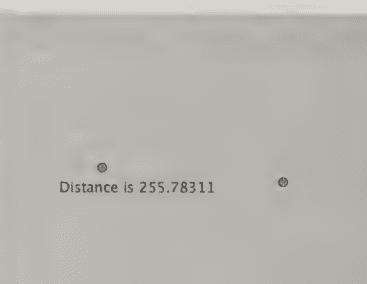

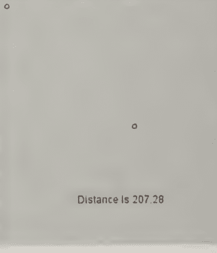

# 示例 25：编程风格元素

程序中的风格指的是那些通常不影响执行结果，但会影响他人阅读、修改或修复代码的代码。

例如，有一种方法可以在程序中放置其他程序员可读的文本。任何跟在双斜杠后面的文本都被称为注释，`Processing` 会忽略它们；同时也任何位于 `/*` 和 `*/` 符号之间的文本，这些符号定义了可以跨多行的注释。程序应该在代码中嵌入相关的注释，以向任何查看代码的人解释发生了什么。注释应该是清晰的、提供解释，而绝不能简单地替代代码本身。

程序中注释的性质是我们所说的“缩进”来传达结构的一个方面。缩进没有单一的正确方法，但此书中示例中展示的标准具有一致的特征。例如，用于封装代码块的 `[` 和 `]` 字符在垂直方向上始终对齐，这样代码块易于识别。唯一的例外是它们在同一行时：

```java
if (x0 < 0) {
  x0 = mouseX;
  y0 = mouseY;
}
```

在其他书中，你可能会看到另一种风格：

```java
if (x0 < 0) { x0 = mouseX; } }
```

括号的位置对于编程语言的编译器并不重要，但程序员应该保持一致。

变量应该具有有意义的名字。上述变量 `x0` 和 `y0` 代表 `x` 和 `y` 坐标，因此这些名字是有意义的。名为 `pixelCount` 的变量应该包含像素计数。给变量命名非常容易，这样做不会影响代码的运行速度或执行时所需的内存大小。

数值常量应该被命名为变量，这样就可以从名称中推断出常量的用途。一个完美的例子是使用 `PI` 代替 `3.1415`。程序应该包含极少数任何数值常量，而应该使用名称。考虑以下代码：

```java
r = d*0.01745;
```

对于大多数人来说，数字 `0.01745` 没有意义。现在考虑这个：

```java
r = d*2*PI/360;
```

这样更好。`PI/360` 是弧度与角度之间的转换。最好的做法是：

```java
radians = degrees * degrees_to_radians;
```

其中 `degrees_to_radians` 等 `0.01745`。现在任何阅读代码的人都能看到发生了什么。

此示例代码的功能与之前相同，但展示了更好的风格。注意，它在屏幕上占据了更多空间——这是典型的，而且即使在书中（为了这一页的文本很重要）遵循这些规则也是重要的。

```java
int x0 = -1, y0 = -1;           // 第一个点击点
int x1 = -1, y1 = -1;           // 第二个点击点
color beige = color(200, 200, 200); // 背景
color black = color(0, 0, 0);   // 颜色（文本）
color green = color(100, 255, 40); // 颜色
boolean bothPixels = false;     // 点击了两次
int text = 100, textY = 250;    // 绘制的位置
int circleSize = 5;             // 点击点的大小
```

```java
void setup() {
```


进入`/path/to/xxx`目录，找到`xxx.json`。

在表达式`cvar = avar + bvar`中，加法运算符（`+`）将`avar`与`bvar`相加，得到它们的和`cvar`

在`List.of(arg0, arg1, arg2)`中，`List`接口的工厂方法`of()`接受一系列的元素，返回包含它们的只读列表。

之后我们这样调用`cmd`命令：`cmd arg0 arg1 arg2`。

```
if (condVar > someVal) {console.log("xxx")}
```

---

```
size(300, 300);

}

void draw() {

    background(beige); // 用米色填充窗口

    fill(green);        // 填充为绿色

    if (x0 > 0)         // x0 > 0 表示已设置

        ellipse(x0, y0, circleSize, circleSize);

    if (x1 >= 0)         // x1 >= 0 表示已设置

        ellipse(x1, y1, circleSize, circleSize);

    if (bothPixels) { // 设置颜色

        fill(black);

        text("Distance is "+distance(x0,y0,x1,y1), text, textY);

    }

}

// 计算两个点之间的距离

float distance(int x0, int y0, int x1, int y1) {

    float d;

    d = sqrt((x0-x1)*(x0-x1) + (y0-y1)*(y0-y1));

    return d;

}

// 当松开鼠标时定义点

void mouseReleased() {

    if (x0 < 0) { // 第一次点击

        x0 = mouseX, y0 = mouseY;

    } else if (x1 < 0) { // 这是第二次点击

        x1 = mouseX, y1 = mouseY;

        bothPixels = true;

    }

}
```

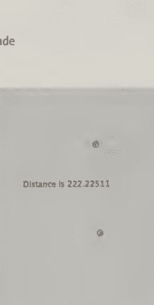

# 示例 26：复制图像

此示例的目的是提供关于如何组织代码的想法。此程序将读取图像，创建一个副本，并增加副本的亮度。当按下按钮时将显示更亮的版本。

第一个函数是`brighten()`。它接收一个图像（`img`）和一个整数值（`val`）作为参数。它的目的是通过在嵌套循环中提取每个像素的 HSB 值，将`val`加到亮度上并保存回图像。这是核心部分。

```java
// 从 (i,j) 像素提取 HSB 值
c = img.get(i,j);
// 将 val 加到亮度并再次保存。
img.set(i,j, color(hue(c), saturation(c)+val));
```

我们在`draw()`中使用了一个新功能。Processing 为我们提供了变量`mousePressed`，如果按钮按下则为`true`，否则为`false`，在简单情况下可以替代`mousePressed()`回调函数。

在这种情况下，当按下按钮时显示增强亮度的图像，否则显示原始图像。

```java
if (mousePressed) draw(img2, 0, 0);
else draw(img1, 0, 0);
```

此示例中的第二个函数创建原始图像的副本。我们如下所示定义`duplicate`函数：

```java
PImage duplicate(PImage from)
```

根据该函数的定义，它接收一个图像作为参数并返回一个图像。事实上，它返回的是传入图像副本的新图像。Processing 提供的创建新图像的函数名为`createImage()`，格式如下：

```java
createImage(width, height, RGB);
```

`width`和`height`是自言其明的；常量`RGB`指定了图像的格式，在这种情况下是 RGB 颜色。`createImage`返回的图像是非初始化的，具有未知值的像素，因此在创建一个与传入图像相同的图像后，我们的`duplicate()`函数使用标准的嵌套循环将新图像中的每个像素设置为原始图像中对应像素的值。

注意：`createImage()`中`RGB`参数的替代方案是`ARGB`和`ALPHA`。请查阅它们。所有常量都指向颜色格式。

```java
PImage img1, img2;

void setup () {
  size(100,100);
  surface.setResizable(true);
  img1 = loadImage("image.jpg");
  surface.setSize(img1.width,img1.height);
  img2 = duplicate(img1);
  colorMode(HSB);
  brighten(img2, 60);
}

void draw() {
  background(128); // 灰色背景
  if (mousePressed) image (img2, 0, 0);
  else image (img1, 0, 0);
}

void brighten(PImage img, int val) {
  color c;
  for (int i=0; i width`，其中`x`是球的位置，`radius`是半径，`width`是窗口宽度。如果球移动得缓慢，我们可以通过将`dx`（球每帧移动的距离）改为`-dx`来简单地反转。然而，这种方法并不完全准确，当球以高速移动时情况更糟糕。因为球在程序确定它到达边界之前可能已经越过了边界。（图 28-1）

图 28-1：快速移动的球可能会在你告诉它反弹之前越过边界。如果移动几个直径，它很容易在某一帧位于左侧，下一帧位于右侧。在中间某个时刻，它与墙发生了碰撞。在这种情况下，应该找到球越界的量，并将球放置在等距离处模拟反弹。我们将该距离计算为`delta`，它等于`(x + radius) - width`。给定这个距离，球反弹后的位置是`width - delta`，如图 28-1 所示。

在窗口左侧，当`x < radius`时我们知道球越过了边界。在这种情况下，我们通过将`x`设置为`2 * radius - x`来定位球，并反转球运动的方向。垂直（y）的情况是对称的。大多数对象不是圆形的，但在它们周围可以画一个虚拟的圆，可以使用这个圆检测与边界的碰撞。

```java
int x=320, y=240; // 圆（球）的坐标
int radius=20; // 圆（球）的大小
int dx=2, dy=2; // 圆（球）的速度

void setup() {
    size(640,480); // 典型的窗口尺寸
    fill(255, 0, 255); // 品红色填充
    noStroke(); // 不画轮廓
}

void draw() {
    background(255); // 白色背景
    ellipse(x, y, radius*2, radius*2); // 画球
    x = x + dx; y = y + dy; // 移动
    xbounce();
    ybounce();
}

void xbounce() {
    int delta = 0;
    delta = (x+radius) - width;
    if (x > radius) // 右侧
        x = width-delta-radius;
        dx = -dx;
    } else if (x < radius) // 左侧
        x = (2*radius)-x;
        dx = -dx; // 反转 x 方向
    }
}

void ybounce() {
    int delta = 0;
    delta = (y+radius) - height;
    if (y < radius) // 顶部
        y = (2*radius)-y;
        dy = -dy;
    } else if (y+radius > height) // 底部
        y = height-delta-radius; // 反转 y 方向
        dy = -dy;
    }
}
```

## 草稿 29：基础精灵图形

我们可以将之前的两个草稿结合起来，展示程序人员如何在计算机游戏中移动精灵（sprite）。精灵是代表游戏对象的相对低分辨率的图形。精灵通常是原始形状或导入的图像。如果是后者，精灵图像必须具有透明颜色，这样我们才能看到精灵背后的背景；否则精灵看起来看起来像一个内部包含图像的实色矩形。

这个草稿使用草稿 27 中的火箭作为精灵，并使用草稿 28 的代码在窗口中移动它。火箭将在星空背景图像上移动，以完成类似游戏的视觉。

检查火箭是否到达某侧的测试与圆形示例不同，因为精灵是从左上角开始的矩形图像，且到边界的距离在左/右和上下之间存在差异。左侧边缘的测试与之前非常相似，但缺少了半径的偏移，因为`x`坐标位于精灵的左侧，而不是中心。

```java
if (px < 0) // 左侧
{
    px = -px;
    dx = -dx;
    // 反转 x 方向
}
```

右侧的测试则不同，因为精灵的整个都在坐标`px`的右侧。

```java
delta = (px+sprite.width) - width;
if (delta > 0) // 右侧
{
    px = width-delta-sprite.width;
    dx = -dx;
}
```

所以`px+sprite.width`是精灵右侧的坐标。y 坐标的检查是对称的。

注意 大多数游戏允许玩家移动一个或多个精灵。惯例是使用按键：W 向上、A 向左、D 向右、S 向下。会将移动精灵的代码放在`keyPressed()`函数中：

```java
void keyPressed()
{
    if (key == 'w') py = py - 1;
    if (key == 's') py = py + 1;
    if (key == 'd') px = px + 1;
    if (key == 'a') px = px - 1;
}
```

```java
PImage img1, sprite;
color c=color(0,0,0);
int px=100, py=100, dx=2, dy=1;

void setup () {
  size(100,100);
  surface.setResizable(true);
  img1 = loadImage("background.bmp");
  surface.setSize(img1.width, img1.height);
  sprite = loadImage("image.gif");
  sprite.resize(90, 50);
}

void draw () {
  background(255);
  image(img1, 0, 0);
  image(sprite, px, py);
  px = px + dx; py = py + dy;
  xbounce(); ybounce();
}

void xbounce () {
  int delta;
  delta = (px+sprite.width) - width;
  if (delta > 0) // 右侧 {
    px = width-delta-sprite.width;
    dx = -dx;
  }
}
```


# 草图 30：检测精灵之间的碰撞

判断一个精灵是否仍在窗口内是一个相对简单的问题，但此时窗口是固定且不移动的。但如果窗口的大小同时发生变化呢？我们如何确定两个同时移动的精灵在移动过程中是否发生了碰撞？圆形物体的情况是最简单且通用的解决方案，因此本草图将处理任意数量的圆形物体（球），它们会在边界和彼此之间反弹。

每个球的坐标将存储在`xpos[i]`和`ypos[i]`中。绘制对象`i`非常简单：

```
ellipse(xpos[i], ypos[i], 10, 10);
```

如果两个对象之间的距离小于半径的两倍，或者它们的 10 像素区域重叠，则它们就会发生碰撞。以下是草图中的步骤：

1. 为`n`个球中的每一个球定义位置和速度（`dx`, `dy`）。
2. 每一步（帧）都通过调用`draw()`定义。首先，在每个位置`xpos[i], ypos[i]`处画一个圆。
3. 改变位置：`xpos[i] = xpos[i] + dx[i]`，`y`轴同理。
4. 检查与边界的碰撞（反弹），如果发生碰撞，则执行碰撞反应。会发生反弹吗？

对于每个球，检查它与每一个其他球之间的距离。如果距离小于半径的两倍，则改变两个球的方向（将碰撞实现为反弹）。

就是这样。`bounce()`函数与之前的函数不同，但它有效地执行了相同的操作。`distance()`函数计算两个球之间的欧几里得距离，正如你在草图 24 中看到的那样。如果两个球在反弹后重叠，它们可能会粘在一起，直到它们与另一个球碰撞。

**注意**：大小为`NxM`像素的矩形对象（`N > M`）有一个环绕它的圆，可以用于检查碰撞。中心在`(N/2, M/2)`，宽度为`N`。使用包围圆并不精确，但速度很快。草图 29 中飞船的包围圆如图 30-1 所示。

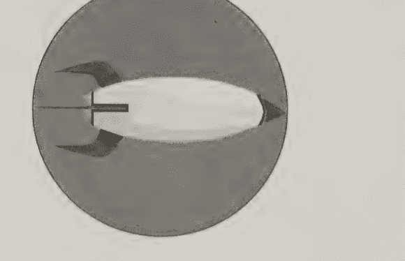

```
int MAXBALLS = 100;
int xpos[] = new int[MAXBALLS];
int ypos[] = new int[MAXBALLS];
int nballs = 30;
int dx[] = new int[MAXBALLS];
int dy[] = new int[MAXBALLS];

void setup() {
  for (int i=0; i<nballs; i++) {
    xpos[i] = (int)random(width-10)+5;
    ypos[i] = (int)random(height-10)+5;
    dx[i] = (int)random(10)-5;
    dy[i] = (int)random(10)-5;
  }
}

void draw() {
  background(255);
  for (int i=0; i<nballs; i++) {
    ellipse(xpos[i], ypos[i], 10, 10);
    xpos[i] = xpos[i] + dx[i];
    ypos[i] = ypos[i] + dy[i];
  }
  for (int i=0; i<nballs; i++) {
    for (int j=i+1; j<nballs; j++) {
      if (distance(xpos[i], ypos[i], xpos[j], ypos[j]) < 10) {
        dx[i] = -dx[i];
        dy[i] = -dy[i];
        dx[j] = -dx[j];
        dy[j] = -dy[j];
      }
    }
  }
}

float distance(int x0, int y0, int x1, int y1) {
  return sqrt((x0-x1)*(x0-x1) + (y0-y1)*(y0-y1));
}

void bounce(int i) {
  if (xpos[i] < 10) dx[i] = -dx[i];
  if (xpos[i] > width-10) dx[i] = -dx[i];
  if (ypos[i] < 10) dy[i] = -dy[i];
  if (ypos[i] > height-10) dy[i] = -dy[i];
  xpos[i] = xpos[i] + dx[i];
  ypos[i] = ypos[i] + dy[i];
}
```

# 草图 31：动画——生成电视雪点

我们之前在草图 8 和 30 中用过随机数。随机数在游戏、模拟和其他软件中起着几个重要的功能：

- 自然界使用不可预测的形式和形状。在二维网格中在森林中放置树木，揭示了自然的运作方式。
- 智能生物的行为是不可预测的。高速公路上的汽车行为都非常相似。
- 玩扑克或掷骰子时，卡牌和骰子是随机的。

## 示例 A

```
PImage []frames = new PImage[12];
int nFrames = 11, n=0;

void setup () {
  size(100,100);
  surface.setResizable(true);
  frames[0] = loadImage("a000.bmp");
  frames[1] = loadImage("a001.bmp");
  frames[2] = loadImage("a002.bmp");
  frames[3] = loadImage("a003.bmp");
  frames[4] = loadImage("a004.bmp");
  frames[5] = loadImage("a005.bmp");
  frames[6] = loadImage("a006.bmp");
  frames[7] = loadImage("a007.bmp");
  frames[8] = loadImage("a008.bmp");
  frames[9] = loadImage("a009.bmp");
  frames[10] = loadImage("a010.bmp");
  surface.setSize(frames[0].width, frames[0].height);
}

void draw () {
  frameRate(10);
  image(frames[n], 0, 0); // 显示帧
  n = (n + 1)%nFrames;
}
```

## 示例 B

```
int MAXFRAMES = 100;
PImage []frames = new PImage[MAXFRAMES];
int nFrames = 0, n=0;

void setup () {
  for (int i=0; i<MAXFRAMES; i++) {
    if (i<10)
      frames[i] = loadImage("a00"
```

# 草图 33：洪水填充——填充复杂形状

在 Processing 中绘制填充了特定颜色的矩形或椭圆是非常简单的。你只需要使用`fill()`函数指定填充颜色并绘制形状即可。然而，没有用于填充任意形状或区域的函数，因此让我们自己写一个。它的优点是向你展示了通用的填充实现方法。

这个草图读取一张具有白色背景的图像，其中包含用黑色轮廓勒出的区域（尽管你可以使用其他颜色）。这些区域不需要是规则的多边形，只需要它们是闭合的，即有内部和外部之分，边缘没有缝隙。当用户点击某个像素时，该像素周围的区域将用随机颜色填充。

被点击的像素具有某种颜色，即背景颜色（草图中的`bgcolor`）。将选择一个随机颜色作为填充颜色（变量`fillColor`）。目标是将该区域内所有当前为背景色的像素都设置为目标填充颜色。第一步是将选定的像素设置为填充颜色，然后重复设置所有邻居像素，直到没有剩余候选像素。

在第一个像素被改变后，它作为邻居的每个背景色像素也被设置为填充颜色。邻居被定义为垂直或水平方向上立即相邻的像素。然后再次扫描所有像素，任何作为填充颜色像素邻居的背景像素都会被设置为填充颜色。该过程如图 33-1 所示。


重复该过程直到没有变化为止。该过程在边界处停止，因为边界像素没有背景颜色且不会被改变。这不是实现填充的唯一方法，也不是最快的，但可能是最容易理解的。

`mouseReleased()`函数设置`bgcolor`和`fillColor`变量的值，并将第一个（种子）像素设置为填充颜色。`neighbor()`函数如果参数指定的像素是填充颜色像素的邻居，则返回`true`。每次调用`draw()`（每帧）都会显示填充过程的一次迭代，因此过程看起来像动画。

```
PImage inputImage;
color bgColor, fillColor;

void setup () {
  size(100,100);
  surface.setResizable(true);
  inputImage = loadImage("image.bmp");
  surface.setSize(inputImage.width, inputImage.height);
  bgColor = inputImage.get(0,0);
  fillColor = color(40,20,30);
}

void draw () {
  image(inputImage, 0, 0);
  for (int i=0; i<inputImage.width; i++)
    for (int j=0; j<inputImage.height; j++)
      if ((inputImage.get(i,j) == bgColor && neighbor(i,j,fillColor))
        inputImage.set(i,j,fillColor);
}

boolean neighbor(int x, int y, int c) {
  if (get(x-1, y) == c) return true;
  if (get(x+1, y) == c) return true;
  if (get(x, y-1) == c) return true;
  if (get(x, y+1) == c) return true;
  return false;
}

void mouseReleased () {
  bgColor = get(mouseX, mouseY);
  fillColor = color(random(128,255), random(128,255), random(128,255));
  inputImage.set(mouseX, mouseY, fillColor);
}
```

# 草图 34：字体、大小、属性

当在屏幕上绘制文本时，有很多绘制字符的方法。大小、粗细和样式变化很大。字体指定特定的大小、粗细和样式。字体保存为文件，包含绘制每个字符的指令。粗体、斜体、普通是独立的文件。名称、样式和大小是文件名的一部分，但必须使用工具菜单设置，可以选择字体名称、样式和大小，如图 34-1 所示。

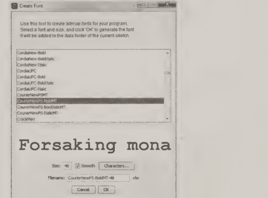

选择`CourierPS-Bold`，大小为 48，点击 OK 在名为`data`的目录内创建一个`CourierPS-Bold-48.v`文件。你可以根据需要重复此过程，创建许多文件。

在 Processing 中加载和使用字体是有点复杂的。你首先需要为每个需要的字体创建一个`PFont`类型的变量，然后使用`loadFont()`函数加载字体：

```
PFont font1;
font1 = loadFont("CourierPS-Bold-48.v");
```

要设置字体，调用`textSize()`并传入字体变量所需的大小：`textSize(font1, 48)`。大小是用像素指定的，而字体的标准是点。最后，你可以通过调用`textSize(size)`更改字体大小。这个草图加载了 Bold 48 字体并设置了它。然后绘制从 2 像素到 55 像素的“Hello”，每次调用`draw()`时改变一个像素。

```
PFont font1;
int x=20, y=100;
int size = 55, ds=-1;

void setup() {
  size(200, 200);
  font1 = loadFont("CourierPS-Bold-48.v");
  textFont(font1, 48);
  fill(0);
}

void draw() {
  background(200);
  textSize(size);
  text("Hello", x, y);
  size = size + ds;
  if (size < 2) ds = -ds;
  if (size > 55) ds = -ds;
}
```

# 草图 35：滚动文本

新闻滚动是电视新闻和气象站的常见功能。它是故事的摘要，从屏幕从右向左滚动，而屏幕的其他部分正在发生其他事情。经常看到股票价格也这样显示。我们如何在 Processing 草图窗口中实现这一点？

首先，特定项目的文本有一个绘制的`x`坐标，它将使用`text()`函数进行绘制。`x`坐标是常数，将位于屏幕底部附近。在这个草图中，它是 400x200，文本的`y`坐标是 190。`x`坐标是变化的。

要显示的文本应该从屏幕右侧开始；例如从`width-10`像素开始。每帧显示都应该让文本向左移动，因此`draw()`每次调用都会将`x`减 1：

```
text(x, y);
x = x - 1;
```

滚动中通常有多条消息。第一条消息可能在第二条消息显示之前消失，但这对于文本滚动来说是不常见的。另一个想法是让多个字符串相邻绘制，同步移动。字符串存储在一个名为`headlines`的数组中。

假设有两个字符串。每个字符串都有一个访问字符串的索引（`i1`和`i2`）和`x`位置（`x1`, `x2`）。如果第一个字符串`headlines[i1]`绘制在位置`x1`加上一个微小的空间。在 Processing 术语中，看起来像这样：

```
x2 = x1 + (int)textWidth(headlines[i1]) + 10;
```

`textWidth()`是一个以字符串为参数的函数，使用当前字体大小返回该字符串绘制时的像素宽度。该值很小。当第一个字符串从屏幕左侧消失时，它的绘制位置加上长度将小于 0：

```
x1+textWidth(headlines[i1]) < 0
```

此时，应该获取一个新字符串（即下一个索引）并将其放置在第二个字符串的右侧：

```
i1 = (i2)%5;
```


## Sketch 36: 文本动画

制作动画可以创造出有趣的效果。过去它一直被用于广告和艺术家的创作，但从未像现在这么容易。文本可以沿着曲线路径绘制；字符串中的字符可以改变方向、大小或颜色。运动可以根据用户的输入而变化，可以通过跟随鼠标或由于音频输入的结果而移动。文本动画的关键是使用`charAt()`函数访问字符串中的每个字符。`charAt(0)`返回字符串中的第一个字符，`charAt(1)`返回第二个字符，依此类推。通过这种方式，可以单独访问每个字符，并使其表现出与其他字符不同的行为。这会导致单词 "Processing" 爆炸开来，字母以不同的速度向各个方向飞散；字符的大小也会发生变化。最初，我们在屏幕中心整齐地绘制 "Processing" 单词，将其视为一组独立的字符：

```java
for (int i = 0; i < count; i++)
  text(s.charAt(i), x[i], y[i]);
```

几秒钟（60 帧）之后，我们改变每个字符帧的位置，从而移动它们，同时也调整了大小。字符向随机方向移动，最终从屏幕上消失。

```java
PFont font1;
int count = 0;
int x[] = new int[10];
int y[] = new int[10];
int size[] = new int[10];
int dx[] = new int[10];
int dy[] = new int[10];
String s = "Processing";
```

```java
void setup () {
  size(400, 200);
  font1 = loadFont("CourierNewPS-BoldMT-48.vlw");
  textFont(font1, 12);
  for (int i = 0; i < 10; i++) {
    x[i] = 100+15*i; y[i] = 100;
  }
}

void draw() {
  background(200);
  for (int i = 0; i < 10; i++) {
    text(s.charAt(i), x[i], y[i]);
    x[i] += dx[i];
    y[i] += dy[i];
    if (x[i] < 0 || x[i] > width || y[i] < 0 || y[i] > height) {
      dx[i] = random(-2, 2);
      dy[i] = random(-2, 2);
    }
  }
}
```

当第二个字符串从左侧消失时，也会发生同样的情况。

```java
x1 = x2 + (int)textWidth(headlines[i2]) + 10;
```

```java
PFont font1;
int x1, y=190, x2;
int size = 55;
int i1, i2;
String [headlines] = new String[5];
```

```java
void setup() {
  size (400, 200);
  textFont = loadFont(CourierNewPS-BoldMT-48.lvw);
  textFont(font1, 12);

  headlines[0] = "Die, 8 Hurt in Pasadena as Vehicle Hits Crowd ";
  headlines[1] = "L.A.'s Open Enrollment Plan Shrinks for 5th Year ";
  headlines[2] = "Program for Writers for Young Adults Starts With Duo Behind 'Buffy' Books ";
  headlines[3] = "Pickets Want Laguna Festival to Stay Put ";
  headlines[4] = "3rd Whale in a Month Washes Up on Coast ";
  i1 = 0; i2 = 1; x1 = width-10;
  x2 = x1 + (int)textWidth(headlines[i1]) + 10;
}
```

```java
void draw() {
  background(200);
  text(headlines[i1], x1, y); text(headlines[i2], x2, y); x1 = x1 - 1; x2 = x2 - 1;
  if (x1+textWidth(headlines[i1]) < 0) {
    i1 = (i2+1)%5;
    x1 = x2 + (int)textWidth(headlines[i1]) + 10;
  }
  if (x2+textWidth(headlines[i2]) < 0) {
    i2 = (i1+1)%5;
    x2 = x1 + (int)textWidth(headlines[i2]) + 10;
  }
}
```


```java
PFont font1;
int count = 0;
int x[] = new int[10];
int y[] = new int[10];
int size[] = new int[10];
int dx[] = new int[10];
int dy[] = new int[10];
String s = "Processing";
```

```java
void setup () {
  size(400, 200);
  font1 = loadFont("CourierNewPS-BoldMT-48.vlw");
  textFont(font1, 12);
  for (int i = 0; i < 10; i++) {
    x[i] = 100+15*i;
  }
}
```

## Sketch 36：文本动画

制作动画可以创造出有趣的效果。过去它一直被用于广告和艺术家的创作，但从未像现在这么容易。文本可以沿着曲线路径绘制；字符串中的字符可以改变方向、大小或颜色。运动可以根据用户的输入而变化，可以通过跟随鼠标或由于音频输入的结果而移动。

文本动画的关键是使用`charAt()`函数访问字符串中的每个字符。`charAt(0)`返回字符串中的第一个字符，`charAt(1)`返回第二个字符，依此类推。通过这种方式，可以单独访问每个字符，并使其表现出与其他字符不同的行为。这会导致单词“Processing”爆炸开来，字母以不同的速度向各个方向飞散；字符的大小也会发生变化。最初，我们在屏幕中心整齐地绘制“Processing”单词，将其视为一组独立的字符：

```java
for (int i = 0; i < count; i++)
  text(s.charAt(i), x[i], y[i]);
```

几秒钟（60帧）之后，我们改变每个字符每帧的位置，从而移动它们，同时也调整了大小。字符向随机方向移动，最终从屏幕上消失。

```java
PFont font1;
int count = 0;
int x[] = new int[10];
int y[] = new int[10];
int size[] = new int[10];
int dx[] = new int[10];
int dy[] = new int[10];
String s = "Processing";
```

```java
void setup () {
  size(400, 200);
  font1 = loadFont("CourierNewPS-BoldMT-48.vlw");
  textFont(font1, 12);
  for (int i = 0; i < 10; i++) {
    x[i] = 100+15*i;
  }
}
```

```java
String s = "";
int val = 0;
int x=-1, y=-1;

void setup() {
  size(500, 500);
}

void draw() {
  background(200, 200, 200);
  fill(0);
  text(s, 20, height-20);
  if (y<0) ellipse(x, y, 10, 10);
}

void keyPressed() {
  fill(0);
  if (s.length()>0 && key==BACKSPACE) {
    s = s.substring(0, s.length()-1);
    val = val/10;
  } else if(key==ENTER || key==RETURN) {
    if (x<0) x = val;
    else if (y<0) y = val;
    s = ""; val = 0;
  } else if ( (key>='0') && (key<='9')) {
    s = s + key;
    val = val * 10 + (key-'0');
  } else {
    s = "Error"; val = 0;
  }
}
```

## Sketch 39：从文件读取参数

许多计算机程序会在程序启动或重启时保存当前正在使用的值。初始值、按钮和其他界面对象的位置、游戏的高分：大多数人都有过在程序开始时从文件中读取这些内容的经历。玩电脑游戏并保存状态以便稍后继续进行；这也涉及将数据保存到文件中并在稍后检索。

这个练习从一个文件中检索游戏状态（尽管只是一个简单的游戏——国际象棋），该文件包含了游戏中所有棋子的位置。

国际象棋使用8×8的方格网格，通常称为棋盘，棋子放置在上面。只有一半的方格被真正使用，而且这些方格有两种颜色。棋子只能是其中一种颜色，因此这个练习中简单的部分是绘制方格，并在已知位置时在方格上放置棋子。新的部分是读取数据并将其解释为棋子的位置。

作为棋盘的表示方案，想象一组每行八个方格的网格。一个方格可以被索引为`(i, j)`，其中`i`是行，`j`是列。方格上棋子的颜色可以用`0`表示一种，`1`表示另一种——颜色本身并不重要，只要颜色为`0`的棋子属于另一方即可。

棋子有固定的位置，但棋子的位置是从文件中读取的。文件包含每个棋子的位置和颜色，每行数据如下所示：

| row | col | color |
| :--- | :--- | :--- |
| 1 | 2 | 1 |
| 1 | 4 | 1 |

该文件包含用单空格分隔的一位整数，每行三个。结构化的格式易于读取，实际上，它是计算机创建数据的典型格式。

在Processing中读取文件，我们将使用内置函数`loadStrings()`。它从文件（给定一个字符串参数）读取一组字符串，每行一个字符串。`loadStrings()`返回一个字符串数组，我们将其赋值给变量`dlines`。要找到数组中的项目数量（与文件中的行数相同），我们使用`dlines`的`length`属性：`dlines.length`。

当读取到一行时，我们用它在方格上放置棋子；当所有棋子都读取完毕后，我们将它们绘制在屏幕上。为了放置棋子，我们从`dlines`中的每个字符串中提取三个整数，然后使用行和列索引在正确的位置放置正确的棋子。

我们如下将字符串数据转换为数字：

```java
y = dlines[i].charAt(0) - '0';
```

每个棋子是两种颜色之一，由变量`k[i]`表示。棋子宽度为20像素，因此我们在`(x[i], y[i])`绘制一个，代码如下：

```java
if (k[i]==0) fill(200,0,0); else fill(200,200,0); // 颜色
ellipse(x[i]*40+20, y[i]*40+20, 20, 20);
```

水平位置向左偏移20像素，每个位置向右移动40像素。表达式`x[i]*40+20`是绘制棋子的`x`位置。

方格是40×40像素且颜色交替的。当我们绘制一个红色方格时，将填充颜色切换到下一个方格。8个方格后，进行额外的切换以使颜色垂直交替。如果`i`和`j`是方格的坐标，我们这样绘制：

```java
rect(i*40, j*40, 40, 40)
```

在练习中，棋子是红色或绿色，方格是红色或黄色。

```java
String[] dlines;
boolean errorflag = false;
int[] x = new int[12]; // 棋子的列
int[] j = new int[12]; // 棋子的行
int[] k = new int[12]; // 棋子的颜色
int n = 0;

void setup() {
  size(400, 400);
  readFile("save.txt"); // 读取数据
}

void draw() {
  background(200);
  board(); // 绘制棋盘
}

void board() {
  // 绘制方格
  for (int i=0; i<8; i++) { // 列
    for (int j=0; j<8; j++) { // 行
      // 交替方格颜色
      if ((i+j)%2 == 0) fill(255,255,255);
      else fill(255,255,0);
      rect(i*40, j*40, 40, 40);
    }
  }

  for (int i=0; i<n; i++) { // 绘制棋子
    if (k[i]==0) fill(200,0,0); else fill(100,200,0);
    ellipse(x[i]*40+20, y[i]*40+20, 20, 20); // 位置
  }
}

void readFile(String fileName) {
  dlines = loadStrings(fileName); // 读取为字符串
  for (int i=0; i<dlines.length; i++) {
    x[i] = dlines[i].charAt(0) - '0';
    j[i] = dlines[i].charAt(3) - '0';
    k[i] = dlines[i].charAt(5) - '0';
  }
  n = dlines.length;
}
```

## Sketch 40：向文件写入文本

计算机程序使用文本告诉用户发生了什么。在上一个练习中，它们使用文本保存程序状态；有时程序写入数值结果或记录进度。文本是计算机与人类通信的自然方式。

这里有一个要解决的问题：要在屏幕上模拟一个以匀速移动的球，每帧将球的位置写入文件；对应`saveStrings()`的输出方法是函数`saveStrings()`。我们声明字符串数组，每个字符串将作为文本写入文件。当需要保存球的位置时，创建一个表示位置的字符串并将其存储在数组的一个位置中。然后增加数组索引，以便下一个字符串进入下一个位置。


## 图画 41：在计算机屏幕上模拟文本

想象你正在为一部电视电影工作。这部电影是关于计算机、黑客和程序员的，扮演黑客角色的演员……嗯，只是演员。他们对编程一无所知。他们不会打字，也不会输入代码。因此，在摄像越过主角肩膀看向屏幕的场景中，我们需要一种特效——某种让屏幕看起来像她在写代码的效果。我们要使用计算机动画吗？那可能很贵。通常的技巧是使用一个简单的程序来显示文本，无论按下什么键，都显示特定的文本。这样演员们就不需要知道任何如何按键了。

根据我们目前所知的，在 `Processing` 中编写这个程序是非常直接的。程序打开并初始化一条消息，要打印到屏幕上的文本①可以从文件中读取。变量`N`初始值为 0 并初始化字符串；每个到`N`的字符都已输入，并应该显示在屏幕上。`draw()`函数每次被调用时都会绘制所有到`N`的字符，一次一个字符，它们之间的间隔为 9 像素。

为了组织文本行，我们使用 "|" 字符来表示行的结束。当程序在字符串中看到该字符时，它不会显示它，而是将`x`位置重置为初始值并将`y`位置增加 15 像素（一行）。

`draw()`函数输出文本，从语句②开始：

```java
for (int i=0; i<N; i++) // 显示下一个字符
```

要么显示字符串③中的一个字符，要么字符串中的字符是 "!" 并开始新行：

```java
text(message.charAt(i), x, y);
x = x + 10;

if (message.charAt(i) == '!')
{
  y = y + 15; // 垂直移动到下一行
  x = 15; // 从像素 15 处开始。
}
```

最后，当按下按键时（如 `Processing` 调用`keyPressed()`函数所示），计数值`N`增加 1，这样屏幕上就会出现更多字符④。无论输入了什么字符，消息字符串中定义的字符都将显示。如果`N`超过字符串长度，程序可以将`N`设为 0，从而从新屏幕重新开始，或者忽略后续的按键按下。

注意：

另一种可能性是让文本自动显示，一次一个字符，无需任何输入。实现该功能的代码出现在 `Processing` 程序`draw()`函数末尾被注释掉的代码⑤将魔法般地在没有打字员的情况下出现。还要注意，在早期的编程时代（如 1960 年代和 1970 年代），屏幕是绿色的。这很容易改变，对于真实的电影应用，设计师会指定他们想要的颜色。

```java
// N = N + 1
// if(N > message.length()) N = 0;
```

```java
int count = 0;
int N = 0;
int increment = 2;
String message;

void setup() {
    size(450, 500);
    background (0, 80, 0);
    message = "Processing 3.5.4 September 2021. // J Parker - Sketch 041!";
}

void draw() {
    for (int i=0; i<N; i++) {
        if (message.charAt(i) == '!') {
            y = y + 15;
            x = 15;
        } else {
            text(message.charAt(i), x, y);
            x = x + 10;
        }
    }
}
```

## 5 创建用户界面和控件

## 图画 42：按钮

来自控制台或文件以及基本的鼠标手势，简单的按钮是第三种流行的输入方法。它在网页页面、游戏屏幕以及任何需要开启/关闭的系统中无处不在。它是基于老式的按下式按钮这种存在了已久的电子设备，并且工作方式非常自然：按下按钮就会发生某些事情。从视觉上来说，按钮只是一个矩形。它通常填充有颜色，并有一个标签或图像来指示其功能。当用户在按钮内部点击鼠标时，分配给按钮的任务就会执行，通常是通过调用某个函数。按钮拥有的属性包括：位置（按钮左上角的`x`和`y`坐标）、尺寸（按钮的宽度和高度）、标签（写在按钮中的字符串），以及颜色或图像图像。当光标悬停在按钮上时，按钮变为激活（`armed`）。在激活状态下，点击鼠标会改变窗口的背景颜色。激活状态如下：

```java
if (mouseX>=bx && mouseX<=bx+bw && mouseY>=by && mouseY<by+bh)
```

`(bx, by)`是按钮的尺寸。`draw()`函数填充矩形并绘制文本。当按钮激活时，`drawButton()`将填充颜色从绿色变为红色。`mousePressed()`函数判断按钮是否被按下，如果是，则改变背景颜色。由于这个图画只实现了一个按钮，所以没有使用多少代码。应用程序有很多按钮是很常见的，正如你将在下一个图画中看到的。与其绘制和填充矩形，不如使用`image()`函数绘制图像来表示按钮。在这种情况下，未激活（`unarmed`）和激活（`armed`）状态是按钮的属性，这是为了方便方便。

```java
color bgcolor = color(200, 200, 200);
int bx=10, by=20, bw=60, bh=30;

void setup() {
  size(250, 300);
}

void draw() {
  background (bgcolor);
  drawButton();
}

void drawButton() {
  if (buttonArmed()) {
    fill(20, 200, 40);
  } else {
    fill(200, 200, 80);
  }
  rect(bx, by, bw, bh);
  text("Button", bx, by);
}

boolean buttonArmed() {
  if (mouseX>=bx && mouseX<=bx+bw && mouseY>=by && mouseY<by+bh) {
    return true;
  }
  return false;
}

void mousePressed() {
  if (buttonArmed()) {
    bgcolor = color(random(128,255), random(128,255), random(128,255));
  }
}
```

## 图画 43：类对象——多个按钮

这个图画将创建并显示三个按钮，分别对应红色、绿色和蓝色。当按钮被点击时，相应的背景颜色将会改变。

如果应用程序需要很多按钮，图画 42 中的方案就会变得很笨拙。当我们想要像`PImage`或`PFont`这样表示按钮的类型时，我们可以声明按钮变量或按钮数组。新的按钮类型应该包含按钮的所有属性，以及以函数形式编写的所有按钮操作代码。

使用关联函数创建自定义类型是通过使用名为“类”（`class`）的功能实现的。类是封装变量和函数并给它们命名的方法。按钮类看起来如下：

```java
class button {
  在此编写你的代码
}
```

在大括号内部，我们声明按钮使用的变量：`x`、`y`、宽度、高度、标签等。`drawButton()`和`buttonArmed()`函数也位于类内部，还有一个被称为构造函数的函数：它是每当创建一个新按钮（通常来说，创建一个类对象）时自动调用的函数。类语句以及大括号内部的内容将类声明为自定义类型，当你声明该类型的变量时，你就创建了一个实例，一个包含类变量和函数的特定对象。

类`button`的变量声明就像`PImage`变量一样：

```java
button b1, b2, b3;
```

下一步与`PImage`或`PFont`一样，使用`new`创建按钮类的实例并将其赋值给：

```java
b1 = new button(100, 150, 90, 30, "Button");
```

当你使用时，`Processing`会调用该类的构造函数。构造函数接受参数（如位置或尺寸），并将它们保存以便以后绘制按钮时使用。构造函数名与类名相同（在本例中为`button`），且没有类型——它的前面没有`void`或类型名。构造函数本身没有返回值，但`new`运算符将返回类的新实例。如果你定义了多个构造函数，`Processing`会调用与`new`语句中给出的参数类型和数量匹配的那个。然后构造函数返回类的新实例。你可以创建计算机内存允许的任意数量的实例。

```java
color bgcolor = color (200, 200, 200);
button bred, bgreen, bblue;
void setup() {
  size(450, 300);
  bred = new button (10, 200, 50, 30, "Red");
  bgreen = new button (220, 200, 50, 30, "Green");
  bblue = new button (300, 200, 50, 30, "Blue");
}
```

```java
void draw () {
  background (bgcolor);
  bred.draw();
  bgreen.draw();
  bblue.draw();
}
```

```java
void mousePressed () {
  if (bred.armed()) bgcolor = color(random(128,255),
    green(bgcolor), blue(bgcolor));
  if (bgreen.armed()) bgcolor = color(red(bgcolor),
    random(128,255), blue(bgcolor));
  if (bblue.armed()) bgcolor = color(red(bgcolor),
    green(bgcolor), random(128,255));
}
```

```java
class button {
  int bx, by, bw, bh;
  int armedColor= color(20,200,20);
  int unarmedColor = color (200,200,40);
  String label;
}
```

```java
void button (int x, int y, int w, int h, String s) {
  bx = x; by = y; bw = w; bh = h;
  label = s;
}
```

```java
void draw () {
  if (armed()) fill (20, 200, 40);
  else fill (200, 60, 80);
  rect (bx, by, bw, bh);
  fill (0); text (label, bx+13, by+19);
}
```

```java
boolean armed () {
  if (mouseX>bx) && (mouseX<bx+bw) &&
    (mouseY>by) && (mouseY<by+bh)) return true;
  return false;
}
```

## 图画 44：滑块 (Slider)

滑块是一种用户界面组件，允许用户沿水平或垂直线性路径移动一个小物体（光标）。光标沿路径的相对位置代表一个数字。光标在一个极端位置对应于最小值，在另一个极端位置代表最大值。如果光标位于最小和最大位置的中间，则与滑块关联的值就在最小和最大值之中间。

此组件可以用于在小窗口或较小区域内定位大图像。通常不是调整图像大小，而是在窗口底部和右侧放置一个滑块，并使用光标移动窗口，以便查看图像的不同部分。通过滑块选择的值代表窗口在较大图像之上的`(x, y)`位置。滑块的目的通常是通过在两个限制范围之间滑动光标来选择一个占总数比例的数字。如果我们把`sliderPos`定义为光标从滑块开始的位置，`sliderWidth`定义为滑块宽度，`sliderMax`和`sliderMin`定义为与最小和最大位置关联的数值，则选定的值为：

```java
value = (int)((float)sliderPos/sliderWidth)*sliderMax + sliderMin;
```

| sliderMin | value | sliderMax |
|---|---|---|
| posMin | posMax | maxWidth |

| value - sliderMin = (pos - posMin) / (pos - posMin) | sliderMax - sliderMin = (posMax - sliderMin) | sliderMax - sliderMin = maxWidth (pos - posMin) | 其中：`sliderPos = pos - posMin / range = sliderMax - sliderMin / maxWidth`

滑块可以用许多方式以图形形式表示。在当前草图中，该组件是一个带有圆形光标的水平矩形，当前数值值被绘制在右侧。然而，光标可以是矩形、椭圆形、指针或其他形状。`draw()`函数使用`sliderPos`变量绘制矩形和光标，该变量在用户用鼠标选择光标并在矩形两端之间移动（滑动）时被设置。要构建一个滑块类，你需要为位置、尺寸、当前光标位置和值创建类变量，并创建绘制滑块和光标位置的类函数（例如你可以调用`slider.draw()`）。

注意：

`mouseDragged()`函数在每次按下鼠标键并移动鼠标时都会被调用。此外，请注意鼠标和键盘事件只有在程序拥有`draw()`函数时才有效，即使该函数什么都不做。

```java
int sliderX=10, sliderY=100, sliderWidth=100, sliderHeight=8;
int sliderColor = color(128,128,128);
int sliderPos=0, sliderMin=0, sliderMax=1000;
int value=0;

void setup() {
  size(600, 300);
}

void draw() {
  background(200);
  drawSlider();
}

void drawSlider() {
  fill(sliderColor); // 条部分
  rect(sliderX,sliderY,sliderWidth,sliderHeight);
  fill(200,40,40); // 滑标部分
  ellipse(sliderX+sliderPos,sliderY+sliderHeight/2,12,12);
  fill(0);
  line(sliderX+sliderPos,sliderY,sliderX+sliderPos,sliderY+sliderHeight);
  text(value,sliderX+sliderWidth+7,sliderY+sliderHeight);
}
```

```java
void mouseDragged() {
  if (mouseY<sliderY) || (mouseY>sliderY+sliderHeight))
    return;
  if (mouseX<=sliderX) && (mouseX<=sliderX+sliderWidth))
    sliderPos = mouseX - sliderX;
  value = (int)((float)sliderPos/sliderWidth)*sliderMax + sliderMin;
}
```

## 图画 45：仪表盘显示 (Gauge Display)

计算机显示数值结果的明显方法是直接显示数字，但有时模拟方法更容易让人处理。有些人喜欢数字时，而另一些人喜欢带指针的旧式。模拟显示对人类处理可能更快。一种显示方式是仪表盘，它是一个带有旋转指针以显示值的表盘。


滑块的一个常见用途是显示图像。通常，图像无法适应特定的窗口，或无法适应任何窗口；某些图像非常大。不是调整图像大小，而是在窗口底部和右侧放置一个滑块，并使用光标移动窗口，以便查看图像的不同部分。

## Sketch 46：李克特量表（Likert Scale）

李克特尺度是一种用于回答问题的评分量表，通常用于问卷。被问者从一组选项（通常为五个）中选择从“非常不同意”到“非常同意”的任一个答案。其核心思想是收集标准答案，以便对其进行统计计算。

此草图通过在屏幕顶部附近绘制问题来提出提问。可能的答案从 1（非常不同意）到 5（非常同意）编号，每个答案对应一个圆圈。要选择答案，用户点击圆圈，圆圈会被填充。当用户对回答满意时，他们输入任何按键，草图就会提出另一个问题。

问题存储在一个名为`questions.txt`的文本文件中，该文件在`setup()`中打开。我们假设有多个问题，每个问题都是文件中的一行文本。`loadStrings()`函数将它们全部读取到数组`question`中，该数组的长度为问题的数量。每个问题根据其索引变量`questionNo`进行询问（显示），该变量从 0 迭代到问题的数量。用户在`mouseReleased()`中通过点击五个圆圈中的一个（使用名为`selected`的变量）来选择五个可能的答案之一。

当用户输入按键时，`keyPressed()`被调用，选择将被写入名为`save.txt`的文件中。然后，`questionNo`变量将加 1，从而显示下一个问题。当所有问题都问完后（即当`questionNo > question.length`时），文件关闭，程序结束。用户对所有问题选择的答案现在存储在`save.txt`文件中。

> 只有一个输出文件，但可能会有很多用户。我们可以提示用户输入他们的姓名或 ID 号，并将其作为文件名的依据，这样就可以保存许多组不同的答案。另一种方案是创建以连续数字结尾的文件名。当程序开始时，它可以尝试打开文件，直到找到一个不存在的文件；那么该文件就是下一个可用的文件名。

```java
int questionNo = 0;
String [] question;
int select = 0;
String list[];

void setup() {
  question = loadStrings("questions.txt");
  list = new String[question.length];
  size(600, 300);
}

void draw() {
  background(200);
  drawGraphic();
  fill(0);
  textSize(20);
  text((questionNo+1)+". ");
```

### 1. 这门课程演示清晰

非常不同意 1 2 3 4 5 非常同意

| 文件 | 编辑 | 视图 | 帮助 |
|---|---|---|---|
| 问题 | 1 | | |
| 问题 | 2 | 3 | |
| 问题 | 3 | | |
| 问题 | 4 | | |
| 问题 | 5 | | |

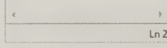

## Sketch 47：温度计

原始的温度计由玻璃制成，内部装有彩色液体，其设计由其功能决定，但它也是显示数值数据的极佳方式。它将数字表示为彩色线或矩形的高度。人们很容易看出一个矩形有多高，并容易与其他进行比较。这种思想已应用于许多地方，最显著的是音响设备上的音量显示。

在计算机上的表示是直观的。彩色矩形随着数值变量的大小而增长或收缩。这种变量有一个最小值和最大值，而矩形有一个最小（通常为 0）和最大高度。数字与高度之间的映射可以像滑块（Sketch 44）和仪表盘（Sketch 45）一样进行。在这个草图中，它的实现方式略有不同，但计算方式是相同的。

此草图计算了变量每增加一次，矩形高出多少。如果矩形的高度可以从`ystart`到`yend`，且数据值的范围是从`dataMin`到`dataMax`，那么每个数据增量对应的矩形高度变化如下：

```java
delta = (float)(ystart-y)/(float)(dataMax-dataMin);
```

然后，对于任何数据值`data`，矩形相对于`ystart`的高度如下：

```java
val = ystart-(int)(data*delta);
```

这个过程只绘制了一个矩形，这并不十分有趣，因此我们将添加一张背景图像（专门为此程序创建），该图像包含一个玻璃温度计的图像和允许用户将高度解释为数字的刻度。矩形的坐标必须专门映射到图像上，以便矩形与温度计柱对齐，使用与 Sketch 45 类似的过程。

此示例生成了一个随机数值用于显示。在从`data = 15`随机开始后，值每帧都会发生微小的随机变化。

```java
PIImage thermo; // 温度计图像

int xpos=100, ypos=50; // 左上角位置

int ystart = 240; // Y 最低点位置

int yend = 44; // Y 最高点位置

int xstart = 32; // 红色柱的左侧

int xend=50; // 红色柱的右侧

int dataMin=0, dataMax=90; // 数据值范围

float delta = 1;

float data = 15;

void setup() {
  size(400, 400);
  thermo = loadImage("thermo.gif");
  delta = (float)(ystart-yend)/(float)(dataMax-dataMin);
}

void draw() {
  background(200);
  image(thermo, 0, 0);
  fill(255, 0, 0);
  int h = ystart - (int)(data*delta);
  rect(xstart, h, xend-xstart, ystart-h);
  data += random(-0.5, 0.5);
}
```

## Sketch 48：打开网页

页面实际上只是一个包含由浏览器读取并渲染的描述的文件。文件本身位于互联网上某处的计算机上，为了显示它，我们必须有一个唯一的名称。这个唯一名称被称为统一（或通用）资源定位符，简称 URL。绝大多数人将其称为网络地址，例如`https://www.microsoft.com`。显示页面是一项复杂的操作，而浏览器是非常复杂的系统。Processing 使用`link()`函数操作并显示网页，该函数接受一个 URL 作为参数。此函数将 URL 传递给计算机上的默认浏览器，由浏览器打开并显示页面。

```java
link("https://www.microsoft.com");
```

### 示例 A

此草图如前所述打开 Microsoft 页面。当鼠标按键且光标位于显示窗口内时会执行此操作。

### 示例 B

此草图是示例 A 和 Sketch 37 的结合。用户输入 URL，草图根据输入的字符传递字符串。当用户按下回车键时，草图将 URL 传递给`link()`，浏览器将打开并显示相应的页面。

```java
if (key == CODED) return;
```

### 示例 A

```java
void setup () {
  size(200, 200);
}

void draw () {
  rect(20, 20, 60, 60);
}

void mousePressed () {
  link("https://www.microsoft.com");
}
```


### 示例 B

```java
String url = ""

void setup () {
  size(240, 200);
}

void draw () {
  background(200, 200, 200);
  fill(0);
  text(url, 20, height-20);
}

void keyPressed () {
  fill(0);
  if (keyCode== CODED) return;
  // if (keyCode==SHIFT) return;
  if (url.length()>0 && key==BACKSPACE)
    url = url.substring (0, url.length()-1);
  else if(key==ENTER || key==RETURN)
    link(url)
  else
    url = url + key;
}
```

## 草图 49：从网页加载图像

由于网页仅仅是一个文本文件，正如你在草图 48 中看到的，我们应该能够读取该文件并查看其内容。例如，应该能够识别页面访问的任何音频文件（例如 MP3），或者哪些图像（`.jpg`、`.gif`、`.png`等）将成为页面的一部分。这个草图将定位网页中引用的图像，并在显示窗口中显示它们。

要做的第一工作是读取页面。它包含 HTML，一种用于描述文档的语言，将其读取出来非常简单：解析 URL 就像处理`loadStrings()`函数中的文件名一样。你可以直接将 URL 传递给`loadStrings()`，将 Mink Hollow Media 页面作为文本文件使用：

```java
String web[] = loadStrings("https://minkhollowmedia.ca/");
```

或者像本草图中一样，使用`loadStrings(url+"/file")`，其中`url`是网页地址，`file`是我们想要的文件名。此时，网页已作为数组`web`中的字符串集合可用，每个字符串对应文件行。

HTML 使用调用`img`标签在页面中显示图像：

```html

```

图像的文件名紧随`src=`之后，因此草图应该在`web`数组的字符串中查找字符序列。如果找到，接下来的字符直到遇到闭合引号（"）即为文件名。我们可以使用`indexOf()`函数在另一个字符串中定位一个字符串：

```java
i = s.indexOf("src=", j);
```

在这个示例中，`indexOf()`从字符索引`j`开始在字符串`s`中搜索字符串`"src="`。它返回找到字符串所在位置的索引，如果未找到则返回 -1。如果找到了字符串，我们调用`getName()`函数从字符串中提取文件名本身。`getName()`函数读取并保存字符，直到遇到终止双引号，并将文件名作为字符串返回。该字符串被用作`loadImage()`的文件路径，如果可以加载具有该名称的图像，它就会被显示出来。

有许多合法的方法来指定文件名，这里的代码还尝试了另一种：它将获取并在文件名后添加斜杠（`/`）以查看是否有效。某些图像可能无法通过这种方法定位，并且某些文件不是图像（如 JavaScript、视频和音频），也可以被提取。它们将无法以图像形式显示，控制台中将出现错误消息。

当图像成功加载时，你可以简单通过`save()`将提取的图像保存为文件。使用程序从网页提取信息的行为被称为爬虫（scraping）。

```java
String [] webIn;
String url = "https://minkhollowmedia.ca/41-2/games";
String file = "", name="", s="";
int index = 0,i=0;
PImage next;

void setup () {
  size (400, 400);
  webIn = loadStrings(url+"/"+file);
  fill(0);
}

void draw () {
  background (200);
  if (next != null) image (next, 0, 0);
  index = index + 1;
  if (index==webIn.length) {
    text("DONE", 10, 370);
    return;
  }
  text(webIn[index], 10, 370);
  s = webIn[index].toLowerCase();
  i = s.indexOf("src", i);
  if (i<0) return;
  s = webIn[index];
  name = getName(s.substring(i+4));
  name = getName(s.substring(i+4));
  if (i(0) return
  }
;
}
```

## 服务器

```java
import processing.net.*;
Server sender;
int ind = 0;
char nextChar;
String message = "This is a message ";

void setup () {
  size(200, 100);
  sender = new Server(this, 5000); // Create server
}

void draw () {
  background(200);
  if (ind >= message.length()) ind = 0;
  nextChar = message.charAt(ind);
  sender.write(nextChar);
  text("IP address: "+sender.ip(), 30, 40);
  ind = ind + 1;
}
```

## 客户端

```java
import processing.net.*;
Client me;
char nextChar = ' ';
String message = "";

void setup () {
  size(200, 200);
  me = new Client(this, "***. ***. ***", 5000);
  fill(20);
  frameRate(10);
}

void draw () {
  if (me.available() > 0) {
    background(50, 250, 50);
    text("IP address: "+me.ip(), 30, 40);
    nextChar = (char)me.readChar();
    message = message + nextChar;
    if (message.length() > 20) {
      message = message.substring(1,message.length());
    }
    text(message, 10, 100);
  } else {
    background(200, 30, 10);
    text("No server at port 5000.", 10, 20);
  }
}
```

# 3D 图形与动画

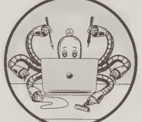

## 草稿 51：基础 3D 对象

到目前为止，我们一直只绘制二维（2D）对象：线、圆、三角形、矩形和图像。Processing 也可以绘制三维（3D）对象，尽管我们在计算机屏幕上能表示的只是其视图，即在平面上的二维投影。这种投影的特性使得 3D 变得更加复杂。x 轴是水平的，y 轴是垂直的，在 2D 屏幕上显示这些坐标是显而易见的。第三维度称为 z，垂直于屏幕表面。为了将其视觉化，必须将三个坐标减少为两个，这正是投影的作用。

Processing 提供了一个 3D 箱体（立方体）和一个球体。在这个草稿中，我们将绘制这些标准对象来展示 3D 作品。

要渲染 3D 对象，Processing 需要使用执行 3D 绘制操作的软件，称为 3D 渲染器。默认渲染器称为 P2D，仅处理两个维度。如果我们指定三个维度，则在`setup`函数的`size`函数中提供 P3D 渲染器作为参数：

```java
size (300, 400, 300);
```

现在所有的 3D 操作都通过函数提供，就像 2D 中的矩形和椭圆一样。立方体和球体对应的函数：`sphere(R)`在原点绘制一个半径为`R`的球体。

球体是由一系列三角形绘制的，每个顶点都有 x、y 和 z 坐标，沿着球体表面定向并从一条边到另一边连接。将其想象成使用许多连接的短直线来绘制圆的 3D 版本；它并不完全平滑，但如果三角形足够小，这种幻觉就会产生。除非使用`noStroke()`关闭轮廓，否则三角形将是可见的。

`box(s)`函数绘制一个每边长为`s`像素的立方体。要指定每个方向的尺寸，我们使用`box`的第二个函数：`box(w, h, d)`。

要在原点以外的地方绘制每个形状，我们首先调用`translate()`函数将原点移动到要绘制球体的位置。在 3D 中，坐标有三个值：x、y 和 z，`translate()`也有相应的参数。

最后，在三维空间中绘制时，我们需要照明来营造深度感。要启用照明，我们在`draw()`函数中调用`lights()`。如果不调用`lights()`，输出左侧的球体看起来就像一个圆。

### 示例 A

我们绘制了两个球体：其中一个组成球体的三角形可见（右侧），另一个三角形隐藏（使用`noStroke()`）位于左侧。球体远离视角然后返回，比它们静止时更清晰地展示了第三维度。

### 示例 B

我们绘制了两个立方体，同样是右侧显示立方体轮廓，左侧不显示。立方体也远离相机然后再次返回（沿着 z 轴）。

### 示例 A


```java
int z = 50, dz = 1;

void setup () {
  size(400, 300, P3D);
}

void draw () {
  background(200);
  noStroke();
  lights();
  translate(100, 150, z);
  sphere(50);
  translate(200, 0, 0);
  stroke(0);
  sphere(50);
  z = z + dz;
  if (z > 50) dz = -dz;
  if (z < -350) dz = -dz;
}
```

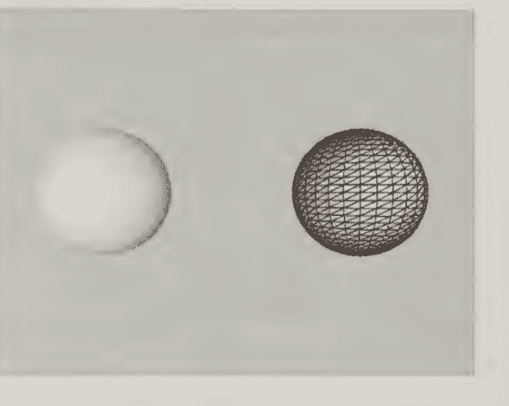

## 示例 B

```java
int z = 50, dz = 1;

void setup () {
  size(400, 300, P3D);
}

void draw () {
  background(200);
  noStroke();
  lights();
  translate(100, 150, z);
  box(50);
  translate(200, 0, 0);
  stroke(0);
  box(50);
  z = z + dz;
  if (z > 50) dz = -dz;
  if (z < -350) dz = -dz;
}
```

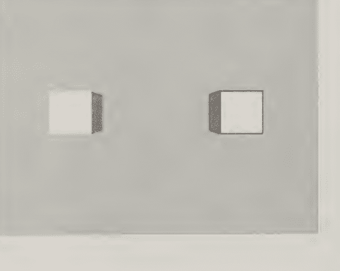

# 草稿 52：3D 几何学——视角、投影

3D 对象实际上是边和面在三维空间中具有三个坐标的模拟。因为计算机屏幕是二维的，可视化这些对象意味着将它们投影到平面上以便在屏幕上绘制。投影平面位于对象和观察的位置之间，即视角。视角是三维空间中的一个位置，如图 52-1 所示。（2D 场景并没有真正的视角；整个图像就是一个平面）。

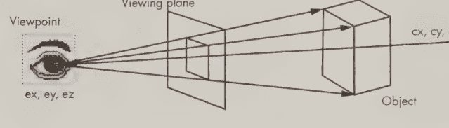

## 图 52-1：观察 3D 对象

有一个第二个关键点用于定义 3D 视图显示，即观察者（相机）所在的位置。这是场景的中心，由`(cx, cy)`表示。3D 场景投影到`(ex, ey)`和`(cx, cy)`之间的平面上，具体能看到什么取决于视角，或相机的移动。在 Processing 中，我们使用`camera()`调用来设置基础的 3D 配置：

```java
camera(ex, ey, ez, cx, cy, cz, 0, 1);
```

前三个参数是视角，接三个是场景中心。最后三个表示方向，以便场景方向正确。在这个例子中，向上是正 y 方向。此草稿使用`camera()`函数根据用户的按键改变 3D 对象的视图。我们通过在`keyPressed()`中增加或减少`ex`和`ez`的值来移动视角。A 减少 x（左），D 增加 x（右），W 减少 z，S 增加 z（到对象的距离）。由于球体绘制在`(cx, cy)`，为了让场景中心远离球体，可以使用向上和向下键更改`cy`的值。

```java
int x=100, y=100, z=100; // 球的位置
int ex=100, ey=100, ez=400; // 视角
int cx=100, cy=100, cz=200; // 我们正在看的点

void setup () {
  size(500, 400, P3D);
}

void draw () {
  background(200, 200, 200);
  camera(ex, ey, ez, cx, cy, cz, 0, 1, 0);
  noStroke();
  lights();
  translate(x, y, z);
  sphere(12);
  translate(20, 0, 0);
  box(12);
  translate(-x-20, -y, -z);
}

void keyPressed () {
  if (key == 'w') ez = ez - 10;
  if (key == 's') ez = ez + 10;
  if (key == 'a') ex = ex - 10;
  if (key == 'd') ex = ex + 10;
  if (keyCode == UP) cy = cy + 10;
  if (keyCode == DOWN) cy = cy - 10;
}
```

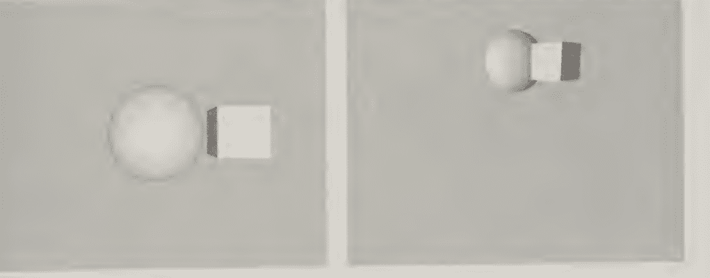

照明可以深刻地改变场景的外观。光源的位置会导致对象或场景的特定部分可见，而其他部分不可见。彩色光可以改变对象的视觉颜色。定向光可以照亮对象的某些部分而不照亮其他。Processing 提供了所有这些选项。

在这个草稿中，我们将绘制一个球体，并允许用户通过输入数字来选择照明类型。照明可以是环境光（1）、定向光（2）、点光源（3）、聚光灯（4）或三者都是定向光、点光源和聚光灯（5）。默认照明是 0。当用户更改照明类型时，颜色也会发生变化：环境光是青色，定向光是紫色，点光源是黄色，聚光灯是绿色。

之前的草稿已使用调用提供默认照明。另一种方法是使用调用`ambientLight()`函数来指定颜色，并可选地指定环境光的位置，这是渗透场景的照明。

```java
ambientLight(r, g, b, x, y, z);
```

前三个参数指定光颜色的 RGB 值。后三个是可选的，指定三维空间中的位置。光从该点向所有方向扩散。

`directionalLight()`指定特定方向的光，因此当它垂直于该方向的表面时最亮，随着角度变化亮度会降低。

```java
directionalLight(r, g, b, dx, dy, dz);
```

再次，前三个参数代表光的颜色。后三个指定方向。例如，如果`dy=1`且`dz=0`，物体将从上方被照明。

`pointLight()`函数创建一个产生照明的光点，就像灯一样。此调用在指定的`(x, y, z)`位置放置具有指定 RGB 值的光：

```java
pointLight(r, g, b, x, y, z);
```

最后，`spotlight()`是集中定向光，它是所有光源中最复杂的。此调用指定在位置`(x, y, z)`处具有 RGB 颜色并指向`(dx, dy, dz)`方向的光：

```java
spotlight(r,g,b,x,y,z, dx,dy,dz, angle, center);
```

`angle`的值是光的扩散角；角度越小，光圆越小。此角度以弧度为单位。浓度指定光跨越截面的变化情况，中心越亮边缘越暗。值可以从 1 到 10,000 不等。

```java
int x=100, y=100, z=100; // 球体位置
int ex=100, ey=100, ez=147; // 视角
int cx=100, cy=100, cz=100; // 我们看向的点
int code = 0;

void setup() {
  size(500, 400, P3D);
}

void draw() {
  background(200, 200, 200);
  camera(ex, ey, ez, cx, cy, cz, 0, 1, 0);
  if (code == 0) {
    lights();
  } else if (code == 1) {
    ambient(0, 200, 200, 1000);
  } else if (code == 2) {
    directionalight(200, 0, 200, 0, 0, -1000);
  } else if (code == 3) {
    pointlight(200, 200, 0, 0, -1000);
  } else if (code == 4) {
    spotlight(0, 200, 0, -300, 100, 100);
  } else if (code == 5) { // 全部三个！
    directionalight(200, 0, 200, 0, 0, 0);
    pointlight(200, 200, 0, 0, -1000);
    spotlight(0, 200, 0, -300, 100, 100, 0, PI/16, 1000);
  }
  translate(x, y, z);
  sphere(12);
}

void keyPressed() {
  if (key == '0') code = 0;
  if (key == '1') code = 1;
  if (key == '2') code = 2;
  if (key == '3') code = 3;
  if (key == '4') code = 4;
  if (key == '5') code = 5;
}
```


# 草图 54：3D 中的跳动球

草图 28 是一个跳动球的模拟。球（圆体）在窗口边界处反弹。这种三维的扩展包含了一个立方体。当球（圆体）击中立方体的某个面时，它会反弹。这在二维中是相同的问题，但需要更多的条件来处理。

场景由一个立方体和一个球体组成。立方体占据了视野的大部分。我们将用特殊颜色绘制坐标轴：x 为绿色，y 为蓝色，z 为红色。与其调用`box()`，我们将使用`sphere()`。从原点开始绘制立方体的边缘，剩下的剩余边缘。在每一帧之后，通过`(dx, dy, dz)`移动球。如果球的坐标超过了指定的尺寸，则发生反弹。

```java
if (x<6 || x>194) dx = -dx;
```

此测试是一个半径为 6 的球。当`r`接触面时，立方体从`(0, 0, 0)`开始，并在每个方向上延伸 200 单位。球在 x 坐标 6 和 194 处碰撞。立方体的中心位于`(100, 100, 100)`。这是场景的中心。从视角`(x, y)`观察立方体，沿着 z 轴 400。

可以从此程序创建一个 3D 版本的乒乓游戏。球板可以与 y-z 轴对齐。左球板可以通过 W、A、S、D 移动，右球板可以通过箭头移动。只有当球的 y 和 z 坐标位于球板定义的范围内时，会在 y-z 平面上反弹。

```java
int x=100, y=100, z=100;
int dx=2, dy=3, dz=4;
int eyex=100, eyey=100, eyez=400;
int cx=100, cy=100, cz=100;
// 球体位置
// 球的速度
// 视角
// 我们看向的点
```

```java
void setup() { size(400, 400, P3D); }

void mycube() {
  stroke(255, 0, 0); line(0, 0, 0, 0, 0, 200); // Z 轴为红色
  stroke(0, 255, 0); line(0, 0, 0, 0, 200, 0); // Y 轴为蓝色
  stroke(0, 0, 255); line(0, 0, 0, 200, 0, 0); // X 轴为绿色
  stroke(255); line(0, 0, 0, 0, 0, 200); // 所有边缘为白色
  line(0, 200, 0, 200, 200, 0);
  line(0, 0, 200, 0, 200, 0);
  line(0, 200, 200, 0, 200, 200);
  line(0, 0, 200, 200, 200, 200);
  line(200, 0, 0, 200, 0, 200);
  line(200, 200, 0, 200, 200, 200);
  line(200, 200, 200, 0, 200, 0);
  noStroke();
}
```

```java
void moveSphere() {
  // 移动球体位置一帧
  x = x + dx; y = y + dy; z = z + dz;
  if (x<6 || x>=194) dx = -dx;
  if (y<6 || y>=194) dy = -dy;
  if (z<6 || z>=194) dz = -dz;
}
```

```java
void draw() {
  background(45, 45, 45);
  camera(eyex, eyey, eyez, cx, cy, cz, 0, 1, 0);
  mycube();
  lights();
  stroke();
  translate(x, y, z);
  sphere(12);
  moveSphere();
}
```


# 草图 55：使用多面构建 3D 对象

Processing 只提供了球体和立方体，但这并不意味着我们不能制作更复杂的物体。我们可以从多边形构建任意物体。这意味着我们需要先设计物体，要么在纸上，要么使用像 Blender 或 Maya 这样的 3D 建模软件。设计会产生一组多边形的坐标（顶点点）。

棱柱是由沿边连接的矩形组成的。例如，立方体就是一个棱柱。第一步是确定组成棱柱每个矩形的坐标值。使用格纸很有用：画出棱柱并定义 x、y、z 坐标系（x 为水平方向）。然后从原点`(0, 0, 0)`点开始，将坐标放置在图中对应的位置，如图 55-1 所示。现在你可以按照任何顺序读取每个矩形的坐标。例如，图中正面由以下坐标定义：`(0, 0, 0)`、`(sx, 0, 0)`、`(sx, sy, 0)`和`(0, sy, 0)`。

# Sketch 56：纹理映射

在 Sketch 55 中，我们为每个棱柱分配了不同的颜色，以便于识别每个面。这只是一个练习，但在大多数实际应用中，棱柱通常是单色的，或者在其表面放置了纹理。纹理是一种图案（通常只是一张图像），通过它我们可以让简单的棱柱看起来像许多东西：建筑、书籍、椅子——任何有棱角的物体。本草图将纹理（地毯）应用到多边形（矩形），并移动视口以便看到 3D 效果。

将图像应用到多边形的过程被称为纹理映射（texture mapping）。算法的细节非常复杂，但原理非常简单，且在 Processing 中的实现方式与之前解释的绘制对象的方案完美契合。在英语中，该过程如下：

1. 读取作为纹理的图像。这是一个`Page`。
2. 定义 3D 多边形的坐标，它可能是更大物体的一部分。
3. 将纹理的四个角分别映射到较大多边形的顶点；也就是说，如果多边形是矩形，则决定将纹理图像的哪些角放置在矩形的角上。
4. 将纹理映射转换为对`vertex()`函数的调用。
5. 将顶点调用包含在`beginShape()`和`endShape()`之间。
6. 紧接`beginShape()`，通过调用内置的`texture()`函数告诉 Processing 使用哪张纹理图像。

在这个示例中，我们使用了一张地毯纹理图像。作为方向标记，左上角放置了一个红色矩形，右上角了一个绿色矩形。纹理图像大小为 524x928 像素。这是从纹理到顶点的坐标映射，如图 56-1 所示：

| 纹理坐标 | 多边形坐标 |
| --- | --- |
| `(0, 0)` | `(0, 0, 0)` |
| `(524, 0)` | `(sx, 0, 0)` |
| `(524, 928)` | `(sx, sy, 0)` |
| `(0, 928)` | `(0, sy, 0)` |

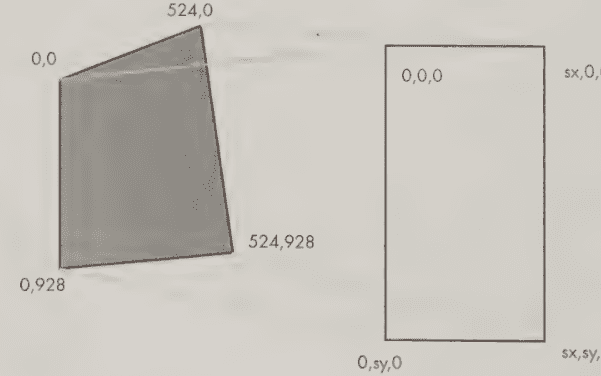

图 56-1：将纹理坐标映射到多边形

`vertex()`函数允许通过两个可选参数来指定映射。这些是之前顶点的映射：

```java
vertex (0., 0., 0., 0., 0.); 
vertex (sx, 0., 0., 524, 0.);
vertex (sx, sy, 0., 524, 928); 
vertex (0., sy, 0., 0., 928);
```

由于 Processing 知晓纹理图像的大小（`timage`），上述映射中的数字 524 可以被`timage.width`代替。同样，我们可以使用`timage.height`代替 928。

```java
float sx=30, sy=40, sz=12;
int eyex=30, eyey=50, eyez=60;
int dx = -;
```

```java
void setup() {
  size(200, 200, P3D);
  stroke(0);
  timage = loadImage("carpets.jpg");
}
```

```java
void draw() {
  background(255);
  camera(eyex, eyey, eyez, cx, cy, cz, 0, 1, 0);
  beginShape(QUAD);
  texture(timage);
  vertex (0., 0., 0., 0., 0.);
  vertex (sx, 0., 0., 524, 0.);
  vertex (sx, sy, 0., 524, 928);
  vertex (0., sy, 0., 0., 928);
  endShape(CLOSE);
}
```

```java
eyex = eyex + dx;
if (eyex < -30) dx = -dx;
if (eyex > 100) dx = -dx;
```

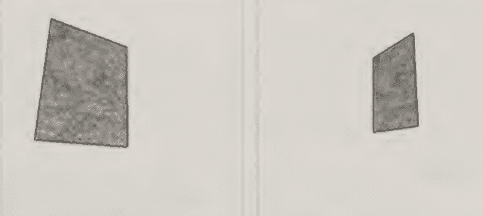

# Sketch 57：广告板（Billboards）——模拟树

让我们在 3D 中画一棵树。棱柱是一个简单的物体，但树有许多叶子、树枝和细节。图形专家们设计了非常复杂的方法来创建树、山和生物，但在大多数情况下，不需要那样。对于艺术作品和游戏，有一些简化物体的方法（“欺骗”），让它们看起来很好且易于实现。使用广告板构建树就是其中之一。


在最简单的形式中，广告板是一个绘制了纹理的矩形。它看起来像你在开车时看到的广告板，在计算机图形中，这通常只发生在距离观察者较远的地方。

为了制作一棵树，我们使用两个相互垂直的广告板，它们在中心处连接。每个广告板都是一个带有树纹理的矩形。从任何角度看树，当视点移动时，树的视图会发生变化。图 57-1 显示了我们在 3D 中如何排列这两个垂直的矩形。

放置在它们上的纹理需要透明背景，否则矩形将是可见的。这意味着使用 GIF 或 PNG 文件，因为它们支持透明。

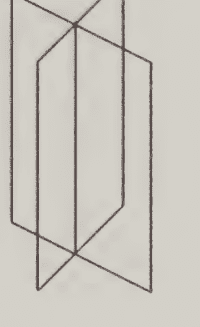

图 57-1：两个垂直矩形

草图首先读取将作为纹理的树图像，并像通常一样打开窗口。`draw()` 函数设置相机，并在原点绘制两个矩形，都将树作为纹理映射到多边形上，如 Sketch 56 所示。我们将第二个纹理映射的矩形旋转 90 度，并在 `x` 和 `z` 方向上移动 13 个单位，使其与第一个矩形对齐。（矩形宽度为 13。）

## Sketch 58：移动视点

在第一人称游戏中，玩家的表示是一个由玩家控制的虚拟形象（avatar）。按下 W 键向前，S 键向后，A 键向左，D 键向右。这种方案对于玩家来说更容易理解，但实现起来比我们一直使用的方案更困难。

草图首先读取将作为纹理的树图像，并像通常一样打开窗口。`draw()` 函数设置相机，并在原点绘制两个矩形，都将树作为纹理映射到多边形上，如 Sketch 56 所示。我们将第二个纹理映射的矩形旋转 90 度，并在 `x` 和 `z` 方向上移动 13 个单位，使其与第一个矩形对齐。（矩形宽度为 13。）

```java
int eyex=30, eyey=0, eyez=60;
int cx=20000, cy=15, cz=20000;
float angle = 0.0;
float dx = 1.0, dz = 1.0, sx, sy, sz;
```

```java
void setup () {
  size(500, 400, P3D);
  fill(200,0,0);
  keyPressed(); // 初始化视点
}
```

```java
void draw () {
  background(200, 255, 0);
  camera(eyex,eyey,eyez, cx, cy, cz, 0, 1, 0);
  for (int i=0; i<9; i++) // 绘制九个盒子 (30,0,30) {
    translate(30, 0, 30);
    box(20);
  }
}
```

```java
void keyPressed () {
  if (key == 'w') { // 向“前”移动
    eyex += 5*dx; eyez += 5*dz;
  } else if (key == 's') { // 向“后”移动
    eyex -= 5*dx; eyez -= 5*dz;
  } else if (key == 'a') { // 向左旋转（逆时针）
    angle = angle - 1.0;
  } else if (key == 'd') { // 向右旋转（顺时针）
    angle = angle + 1.0;
    if (angle < 0) angle = angle + 360.0;
    else if (angle > 360.0) angle = angle - 360.0;
    dx = cos(radians(angle)); dz = sin(radians(angle));
    cx = (int)(dx*20000.0); // 中心点的 x 坐标
    cz = (int)(dz*20000.0); // 中心点的 z 坐标
  }
}
```

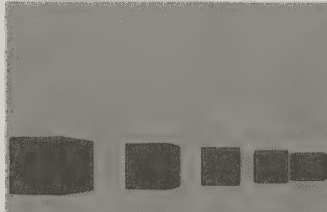

## 使用聚光灯模拟照明

如果环境光关闭且背景为深色，在 Processing 图形世界的 3D 空间内绘制的任何物体将不可见。这个示例以一种新的方式模拟照明——即黑暗空间中的一个小型聚光灯光源。

聚光灯照射在场景中心坐标上，场景的其他部分则是黑暗的。该示例在场景周围放置了三个不同颜色的立方体，用户可以通过旋转和转向这些被点亮的立方体来探索空间。

此示例的 `keyPressed()` 使用了与上示例相同的代码，因此化身可以旋转并向前后移动。在相机坐标处放置了一个 Processing 聚光灯：

```java
spotLight(255,255,20, eyex,eyey,cx,cy,cz, PI/4, 300);
```

聚光灯的前三个参数（255、255、20）代表光颜色的 RGB 值，接下来的三个（`eyex`、`eyey`、`eyez`）是光的 3D 坐标，接下来的三个（`cx`、`cy`、`cz`）是光指向的方向。这意味着无论相机或化身移动到何处，一个聚光灯都会照射在场景中心。

光的角度 `PI/4`（45 度）是第 10 个参数，我们可以增加或减少它来观察场景的变化。300 表示光在聚光点中心附近的集中强度，数字越大，聚焦越集中。

我们可以为其他类型的局部照明定义光。例如，汽车大灯是两个间隔很小距离的聚光灯。代码中有一条注释掉的语句，可以在示例光的基础上添加第二个灯光：

```java
spotLight(255,255,20, eyex+3*dx, eyey+3*dy, cx,cy,cz, PI/4, 300);
```

聚光灯只有通过反射在物体上的光才可见。它们不能被作为发光物体看到。点光源和其他光源也是如此。从意义上说，光不是物体。用物体围绕光会照明周围的物体，但不会使光源可见。

## 使用布尔标志切换照明

我们可以通过调用 `spotLight()` 函数或不调用它，根据名为 `flash` 的布尔标志（`true` 或 `false`）来开启或关闭光，或改变光的颜色。只需在每帧后更改计数器，并在固定帧数（这里为 20 帧）后更改标志。

以下代码交替使用红色或蓝色照明两个球体之一，像警车一样：

```java
if (count % 20 == 0) flash = !flash; // 如果 flash 为 true，则设为 false
if (flash) spotLight(255,0,0, 335, 0, 0, -1, 0, PI/4, 300);
else spotLight(0,0,255, 50, 33, 0, -1, 0, PI/4, 300);
sphere(20);
translate(50, 0, 0); sphere(20); translate(50, 0, 0);
```

```java
float eyex=35, eyey=10, eyez=-300;
float cx=200.0, cy=5.0, cz=100.0;
float dx=0.0, dz=1.0;
float angle=90.0;

void setup() {
  size(400, 300, P3D);
  keyPressed();
}

void draw() {
  background(200);
  camera(eyex, eyey, eyez, cx, cy, cz, 0.0, -1.0, 0.0);
  spotLight(255,255,250, eyex, eyey, eyez, cx, cy, cz, PI/4, 300);
  spotLight(255,255,255, eyex+dx, eyez+dx, cx+dx, cy, cz+dx, PI/4, 300);
  fill(255,255,255); box(20);
  fill(255,0,0); translate(50, 0, 0);
  translate(50, 0, 0); box(20); translate(50, 0, 0);
}
```

```java
void draw() {
  background(200);
  camera(eyex, eyey, eyez, cx, cy, cz, 0.0, -1.0, 0.0);
  spotLight(255,255,250, eyex, eyey, eyez, cx, cy, cz, PI/4, 300);
  spotLight(255,255,255, eyex+dx, eyez+dx, cx+dx, cy, cz+dx, PI/4, 300);
  fill(255,255,255); box(20);
  fill(255,0,0); translate(50, 0, 0); sphere(20); translate(50, 0, 0);
}
```


聚光灯只有通过反射在物体上的光才可见。它们不能被作为发光物体看到。点光源和其他光源也是如此。从意义上说，光不是物体。用物体围绕光会照明周围的物体，但不会使光源可见。

我们可以通过调用 `spotLight()` 函数或不调用它，根据名为 `flash` 的布尔标志（`true` 或 `false`）来开启或关闭光或改变颜色。只需在每帧后更改计数器，并在固定帧数（这里为 20 帧）后更改标志。以下代码交替使用红色或蓝色照明两个球体之一，像警车一样：

```java
if (count % 20 == 0) flash = !flash; // 如果 flash 为 true，则设为 false

if (flash) spotLight(255,0,0, 335, 0, 0, -1, 0, PI/4, 300);

else spotLight(0,0,255, 50, 33, 0, -1, 0, PI/4, 300);

sphere(20);

translate(50, 0, 0); sphere(20); translate(50, 0, 0);
```

```java
float eyex=35, eyey=10, eyez=-300;

float cx=200.0, cy=5.0, cz=100.0;

float dx=0.0, dz=1.0;

float angle=90.0;

void setup() {

  size(400, 300, P3D);

  keyPressed();

}

void draw() {

  background(200);

  camera(eyex, eyey, eyez, cx, cy, cz, 0.0, -1.0, 0.0);

  spotLight(255,255,250, eyex, eyey, eyez, cx, cy, cz, PI/4, 300);

  spotLight(255,255,255, eyex+dx, eyez+dx, cx+dx, cy, cz+dx, PI/4, 300);

  fill(255,255,255); box(20);

  fill(255,0,0); translate(50, 0, 0); sphere(20); translate(50, 0, 0);

}
```

# 8 高级图形与动画

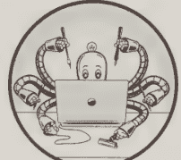

## 练习 61：分层

像 Photoshop 等现代图形程序的关键功能之一是“层”的概念。这是创建一组图形对象（图像），并将它们堆叠在一起以实现复杂的效果。透明度使得查看较低层上的对象成为可能。这个草图使用了三层：一张月球图像、中心周围的一个圆以及一个目标显示器（准星）。用户可以使用键盘重新定位月球图像。界面的目标允许用户将准星与目标圆对齐。

在草图窗口内绘图涉及使用一个名为 `PGraphics` 的图形对象。`background()`、`line()` 和 `ellipse()` 等许多函数都属于 `PGraphics` 类，尽管我们可以在不使用 `PGraphics` 对象的情况下使用它们。或者，我们的绘制可以在这些对象之一中进行，然后通过调用 `image()` 显示在屏幕上。这个草图将在 `PGraphics` 实例内部绘制一个带有高亮椭圆的月球图像，并将其显示在草图窗口中。

用于 `PGraphics` 对象的变量名为 `pg`，创建它的函数是（相当合理的）`createGraphics()` ①

```java
PGraphics pg;

pg = createGraphics(moon.width, moon.height);
```

在这里，`moon` 是 `PImage` 变量，它保存了月球的背景图像。要在 `PGraphics` 对象中绘图，使用我们之前用过的函数，但将 `pg` 变量指定为目标 ②

```java
pg.beginDraw();

pg.image(moon, 0, 0);

pg.stroke(0, 200, 0);

pg.noFill();

pg.ellipse(393, 233, 12, 12);

pg.endDraw();
```

绘图之前会调用 `beginDraw()`，该函数类似于一个左括号；对应的右括号是调用 `endDraw()`。如果你不使用这些调用，Processing 就不会初始化对象，绘制将无法工作（尽管 Processing 可能不会生成错误）。前面的代码在 `PGraphics` 对象中绘制了月球图像，并在目标周围画了一个圆。

`draw()` 函数使用 `image(pg, xoff, yoff)` 显示 `PGraphics` 对象，其中 `xoff` 和 `yoff` 是位置偏移量，通过传统方式使用按下 W、A、S、D 键来控制 ③（Graphics 对象具有 `PImage` 的许多属性，因为 `image()` 可以同时显示二者）。`xoff` 和 `yoff` 的值通常为负数，这样底层图形就会在窗口下方向左和上方移动，而窗口保持其从左上角起始点的稳定。`draw()` 函数还将准星绘制为一组指向窗口中心的短线 ④

以下是代码的实现：

```java
PImage moon;

int xoff=0, yoff=0;

PGraphics pg;

void setup() {

  moon = loadImage("moon.jpg");

  size(300, 300);

  pg = createGraphics(moon.width, moon.height);

  pg.beginDraw();

  pg.image(moon, 0, 0);

  pg.stroke(0, 200, 200);

  pg.noFill();

  pg.ellipse(193, 233, 12, 12);

  pg.endDraw();

  stroke(200);

  noFill();

}

void draw() {

  background(200);

  image(pg, xoff, yoff);

  line(0, height/2, width/2-10, height/2);

  line(width/2+10, height/2, width, height);

  line(width/2, 0, width/2-10);

  line(width/2, height/2+10, width/2, height);

  ellipse(width/2, height/2, 10, 10);

}

void keyPressed() {

  if (key == 'w') yoff--;

  else if (key == 's') yoff++;

  else if (key == 'a') xoff--;

  else if (key == 'd') xoff++;

  if (xoff > 0) xoff=0;

  if (xoff < -(moon.width-width)) xoff = -(moon.width-width);

  if (yoff > 0) yoff=0;

  if (yoff < -(moon.height-height)) yoff = -(moon.height-height);

}
```

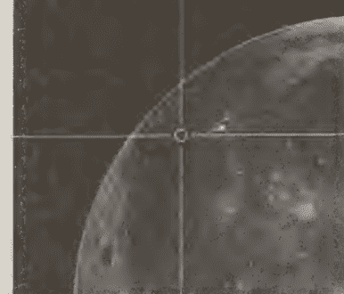

## 练习 62：透过窗口观察世界

许多游戏、动画和模拟（驾驶或太空旅行示例）都使用窗口。这个草图实现了一个面向 3D 场景的窗口，允许用户在透过窗口观察时移动。

这是 `PGraphics` 的更高级的应用。我们将简单的 3D 场景（窗口）渲染到名为 `pg` 的 `PGraphics` 实例，将具有透明部分的 2D 图像（窗口）渲染到名为 `g2` 的 `PGraphics` 实例，并使用 `image()` 将这两个对象绘制到屏幕上。用于绘制 3D 场景的原始图形都是 `PGraphics` 的一部分。我们使用 `createGraphics()` 而不是 `size()` 来启用它；每个 `PGraphics` 实例都有一个独立的窗口进行绘制，所有的方法都可以通过点调用：`pg.line()`、`pg.ellipse()` 等。除非在窗口内绘制，否则没有任何对象是可见的。因此，我们可以创建一个模拟的 3D 空间。2D 部分涉及显示 2D 图像（一个代表窗口的 `PImage` 变量，图 62-1）。图像具有使用类似 Photoshop 的编辑器定义的透明部分。我们将这种这种图像。

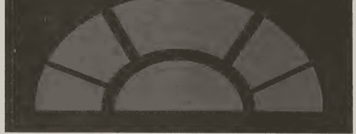

图 62-1：窗口模板

草图在窗口上绘制两个图像：`pg`（3D 渲染）③，然后是 `g2`（模板）④。`g2` 的透明部分允许透过窗口看到 3D 场景。用户可以使用通常的键盘控制 3D 场景的视角 ⑤。3D 场景随着视角的改变而改变，但 2D 场景不会。结果是窗口保持在原处，但透过它看到的视图（透明部分）就像用户在一个辆移动的车辆内看向窗外一样。

```java
int ex=-70, ey=0, ez=-25, cy=0, cz=0;

float dx, angle=0;

PGraphics pg, g2;

PImage back;

void setup() {

    size(200, 200, P2D);

    surface.setResizable(true);

    back = loadImage("window.gif");

    surface.setSize(back.width, back.height);

    pg = createGraphics(back.width, back.height, P3D);

    g2 = createGraphics(back.width, back.height);

    g2.beginDraw(); g2.image(back, 0, 0); g2.endDraw();

}

void draw() {

    background(200);

    pg.beginDraw();

    pg.background(0,0,200);

    pg.camera(ex, ey, ez, cy, cz, 0.0, -1.0, 0.0);

    pg.ambientLight(0, 0, 100);

    pg.translate(100, 0, 100); pg.box(20); pg.translate(-100, 0, 100);

    pg.translate(-100, 0, 100); pg.box(20); pg.translate(100, 0, 100);

    pg.translate(100, 0, 100); pg.box(20); pg.translate(-100, 0, 100);

    pg.translate(-100, 0, 100); pg.box(20);

    pg.endDraw();

    image(pg, 0, 0); image(g2, 0, 0);

}

void keyPressed() {

    if (key == 'w') { // 向前

        ex += 5*dx; ez += 5*dz;

    } else if (key == 's') { // 向后

        ex -= 5*dx; ez -= 5*dz;

    } else if (key == 'a') { // 左转（逆时针）

        angle += 1.0;

    } else if (key == 'd') { // 右转（顺时针）

        angle -= 1.0;

    }

    dx = cos(radians(angle)); dz = sin(radians(angle));

    cx = (int)(dx*20000.0); // 中心 x 坐标 = cos(angle)*20000

    cz = (int)(dz*20000.0); // 中心 z 坐标 = sin(angle)*20000

}
```


## 练习 63：形状对象旋转行星

这个草图将显示一个旋转的行星（球体），并允许用户在 3D 中绕它移动。这个草图的新部分是将行星表面映射到球体上，球体实际上是多边形的集合。实现这种方法的一种方法是用多边形构建球体模型，并在 `beginShape()` 和 `endShape()` 块中进行纹理映射。另一种简单的方法是使用 `PShape` 对象，它是任意形状的数据类型。为了实现旋转行星，我们将通过调用 `createShape()` 创建 `PShape` 对象，这允许我们使用 `PShape` 类提供的大量绘制操作构建任意复杂的形状。使用 `PShape` 可以创建任何东西，对于复杂的操作，在线文档是必要的。我们的案例很简单，因为 `sphere` 是提供的形状之一。创建行星的调用，`globe` 是一个 `PShape` 对象 ①

```java
globe = createShape(SPHERE, 100); // 100 是球体的大小
```

纹理是一个名为 `tim` 的 `PImage` 变量（火星地图），通过 `globe.setTexture(tim)` 应用 ②

```java
translate(x, y, z);
```

然后我们在 `draw()` 中通过调用 `shape()` 函数显示行星 ③

```java
translate(x, y, z);

globe.rotateY(radians(0.5)); // rotateY 函数是 PShape 的一部分

shape(globe); // 这在窗口中显示形状
```

```java
int x=100, y=100, z=100; // 球体位置

int eyex=100, eyey=100, eyez=400; // 视点

int cx=100, cy=100, cz=100; // 我们看向的目标

PShape globe;

PImage timg;

float theta=270, dx=0, dz=0;
```

```java
void setup() {

    size(400, 400, P3D);

    framerRate(10);

    timg = loadImage("globe03.jpg");

    globe = createShape(SPHERE, 100);

    globe.setStroke(255);

    globe.setTexture(timg);

}
```

```java
void draw() {

    background(45, 45, 120);

    camera(eyex, eyey, eyez, cx, cy, cz, 0, 1, 0);

    translate(x, y, z);

    globe.rotateY(radians(0.5));

    shape(globe);

}
```

```java
void keyPressed() {

    if (key == 'w') { // 向“前”移动

        eyex += 5*dx; eyez += 5*dz;

    } else if (key == 's') { // 向后移动

        eyex -= 5*dx; eyez -= 5*dz;

    } else if (key == 'a') { // 向左旋转一个单位（逆时针）

        theta = theta - 1.0;

    } else if (key == 'd') { // 向右旋转一个单位（顺时针）

        theta = theta + 1.0;

    }

    dx = cos(radians(theta)); dz = sin(radians(theta));

    cx = (int)(dx*20000.0);

    cz = (int)(dz*20000.0);

}
```

## Sketch 64：样条——绘制曲线

到目前为止，我们使用预定义的 Processing 函数渲染了线、椭圆、矩形和球体等简单几何对象。但现实世界中的许多物体不是线性或椭形的；它们具有复杂的形状。例子不胜数，包括风扇叶、珠宝、服装和生物——甚至是数据图表。为了演示，此 Sketch 允许用户通过一系列鼠标点击来绘制曲线，并观察选定的“控制点”如何影响曲线。

使用样条渲染曲线。在绘图的早期，人们使用铅笔和 T 方，，人们使用一种称为样条（spline）的东西来绘制平滑、奇特的形状。它是一条长长的、灵活的金属条，可以保持形状，与纸上的点对齐，并允许绘图员用铅笔将它们连接。从数学上讲，样条是一个多项式函数，通过一组点来近似曲线。细节可能复杂，但核心思想是使用许多相连的多项式来构建曲线。Processing 隐藏了这种复杂性。

Processing 提供了一个 `curve()` 函数，实现了一种名为 Catmull-Rom 样条的多项式类型。该函数使用四个点来定义曲线的每一段。前两个点定义了曲线起始时的方向，后两个点定义了结束时的方向。曲线本身由中间两个点之间的一组点（像素）组成。如图 64-1 所示，前两个点定义的角度确立了曲线在 P1 处的方向，而通过 P2 与 P3 之间的方向定义了 P2 处多边形的形状。图中，两个示例中的点 P1 和 P2 是相同的，但由于 P0 和 P3 的位置不同，曲线的形状也不同。

图 64-1：样条曲线的控制点

样条曲线的控制点

在 Processing 中调用的用于绘制 P1 和 P2 之间曲线的函数，P1 和 P2：

```java
curve(x0,y0,x1,y1,x2,y2,x3,y3);
```


点`x0,y0,x1,y1,x2,y2,x3,y3`

样条的起点和终点：`x0,y0,x1,y1,x2,y2,x3,y3`

此 Sketch 允许用户通过鼠标点击选择路径点，并观察它们如何影响曲线。使用多项式来绘制曲线：`x0,y0,x1,y1,x2,y2,x3,y3`

需要多个点来绘制曲线：`x0,y0,x1,y1,x2,y2,x3,y3`

通过鼠标点击来添加点：`x0,y0,x1,y1,x2,y2,x3,y3`

通过鼠标点击来绘制曲线：`x0,y0,x1,y1,x2,y2,x3,y3`

通过鼠标点击来绘制曲线：`x0,y0,x1,y1,x2,y2,x3,y3`

通过鼠标点击来绘制曲线：`x0,y0,x1,y1,x2,y2,x3,y3`

通过鼠标点击来绘制曲线：`x0,y0,x1,y1,x2,y2,x3,y3`

通过鼠标点击来绘制曲线：`x0,y0,x1,y1,x2,y2,x3,y3`

通过鼠标点击来绘制曲线：`x0,y0,x1,y1,x2,y2,x3,y3`

通过鼠标点击来绘制曲线：`x0,y0,x1,y1,x2,y2,x3,y3`

通过鼠标点击来绘制曲线：`x0,y0,x1,y1,x2,y2,x3,y3`

通过鼠标点击来绘制曲线：`x0,y0,x1,y1,x2,y2,x3,y3`

```java
final int SIZE = 200;
float[] x = new float[SIZE];
float[] y = new float[SIZE];
int N = 0;
boolean drawLast = true;

void setup() {
  size(400,400);
}

void draw() {
  background(200);
  stroke();
  if(drawLast) {
    for (int i=0; i<N; i++)
      line(x[i], y[i], x[i+1], y[i+1]);
    if (N>=4) {
      for (int i=0; i<N-3; i++)
        curve(x[i], y[i], x[i+1], y[i+1], x[i+2], y[i+2], x[i+3], y[i+3]);
    }
  }
}

void mousePressed() {
  x[N] = mouseX;
  y[N] = mouseY;
}

void mouseReleased() {
  if (N < SIZE-1) N++;
}

void keyPressed() {
  if (key == BACKSPACE) {
    if (N>0) N--;
  }
  if (key == ' ') drawLast = !drawLast;
}
```

## Sketch 65：基于路点的驾驶

到目前为止，我们使用预定义的 Processing 函数渲染了线、椭圆、矩形和球体等简单几何对象。但现实世界中的许多物体不是线性或椭形的；它们具有复杂的形状。例子不胜数，包括风扇叶、珠宝、服装和生物——甚至是数据图表。为了演示，此 Sketch 允许用户通过一系列鼠标点击来绘制曲线，并观察选定的“控制点”如何影响曲线。

使用样条渲染曲线。在绘图的早期，人们使用铅笔和 T 方，人们使用一种称为样条的东西来绘制平滑、奇特的形状。它是一条长长的、灵活的金属条，可以保持形状，与纸上的点对齐，并允许绘图员用铅笔将它们连接。从数学上讲，样条是一个多项式函数，通过一组点来近似曲线。

```java
float wpx[] = { 172, 221, 354, 787, 848, 847, 645, 198 };
float wpy[] = { 217, 166, 129, 100, 165, 536, 869, 384, 734 };
float wpa[] = { 39, 70, 80, 135, 175, 195, 260, 290, 354 }; // 度
Image track;
float x=wpx[8], y=wpy[8], dx, dy;
int wayPoint = 8, speed=2, N= wpx.length;
boolean lines = true;

void setup () {
    size(100,100);
    surface.setResizable(true);
    track = loadImage("road.png");
    surface.setSize(track.width, track.height);
}

void draw () {
    fill(255, 0, 0);
    image(track, 0, 0); // 画线?
    if (lines) {
        for (int i=0; i<N; i++)
            line(wpx[i], wpy[i], wpx[(i+1)%N], wpy[(i+1)%N]);
    }
    translate(x, y); // 旋转面向运动方向
    rotate(radians(wpa[wayPoint]));
    rect(0, 0, 5, 10);
    } else if (distance(x, y, wpx[wayPoint+1]%N, wpy[wayPoint+1]%N) < speed) {
        wayPoint = wpx[wayPoint+1]%N; // 是。对准下一个
        x = wpx[wayPoint];
        y = wpy[wayPoint];
    }
    // 改变汽车 x 和 y 位置
    dx = speed * (wpx[wayPoint+1]%N-wpx[wayPoint])/distance(wpx[wayPoint], wpy[wayPoint], wpx[wayPoint+1]%N);
    dy = speed * (wpy[wayPoint+1]%N-wpy[wayPoint])/distance(wpx[wayPoint], wpy[wayPoint], wpx[wayPoint+1]%N);
    wpy(wpy[wayPoint+1]%N);
    }
    x = x + dx; y = y + dy;
}

float distance(float x0, float y0, float x1, float y1) {
    return sqrt ((x0-x1)*(x0-x1) + (y0-y1)*(y0-y1));
}

void keyPressed () {
    if (key == ' ') lines = !lines; // 切换路点显示。
    if (key == 'W') speed = speed+1; // 更快
    if (key == 's') if(speed>0) speed = speed-1; // 慢慢，但不向后退
}
```


## 草图 66：许多小对象——雪暴

Processing 程序在每一帧执行时都会重绘屏幕。可见对象在每一帧中必须重新绘制，为了这样做，程序必须使用它们所有对象的参数（尺寸、位置、形状和颜色）。绘制每个对象都需要时间，因此如果对象很多，仍然能够以足够的速度重新重绘它们吗？在很多情况下是可以的，只要对象本身不复杂。这个草图将绘制在帧与帧之间真实移动的飘落雪花。

事实上，雪花是非常复杂的形状，但从远处看它们是白色的斑块。我们在每一帧中将它们绘制为宽度和高度均为随机值的小矩形，以模拟雪花掉落时的飘动效果。使用公式`width = size + random(3)-1.5`设置尺寸，`size`设置为 3，`random(3)`的值为 0 到 3 之间的数，`random(3)-1.5`的值在 -1 到 +1.5 之间，导致尺寸在 1.5 到 4.5 之间变化。每个雪花还有略不同的掉落速度。这产生了深度幻觉，因为比掉落较慢的雪花更靠近观察者。雪通常直直向下掉落；我们观察到它随气流漂移和漂浮。每个雪花在掉落过程中速度略微随机，以产生真实的幻觉。如果我们将`dx`设置为非零值，它将模拟风，雪将向指定方向吹动。每一帧，我们生成 30 个具有随机水平位置且 y 坐标为 0 的（窗口顶部，以保持幻觉）。每帧创建的雪花数量是随机的，它是位置的函数。鼠标越靠近屏幕顶部，掉的雪就越少。这意味着当`mouseY`较小时没有雪花掉落，而当`mouseY/height`达到最大值时，每帧产生最多 30 个新雪花。

```java
N = (int)((float)mouseY/height)*30;
```


变量 `SIZE` 的值为 5000，这是任何时候屏幕上可以存在的雪花数量。初始只有几个，但由于位置的函数关系，数量会增加。鼠标越靠近屏幕顶部，掉的雪就越少。这意味着当 `mouseY` 较小时没有雪花掉落，而当 `mouseY/height` 达到最大值时，每帧产生最多 30 个新雪花。

```java
N = (int)((float)mouseY/height)*30;
```

```java
final int SIZE = 800;

float x[] = new float[SIZE];
float y[] = new float[SIZE];
float dx[] = new float[SIZE];
float dy[] = new float[SIZE];
float size[] = new float[SIZE];

int last = 0;
Image background;
int emitterx=252, emittery=200;
```

```java
void setup() {
  size(100,100);
  surface.setResizable(true);
  background = loadImage("background.png");
  surface.setSize(background.width, background.height);
  for (int i=0; i<SIZE; i++) x[i] = -1;
}
```

```java
void draw() {
  int N=0;
  noStroke();
```


`image(background, 0, 0);` // 绘制现有粒子

```
if (x[i] > 0) {
  // 稍微改变颜色
  fill(200+random(10), 200+random(10), 150, 64);
  ellipse(x[i], y[i], size[i], size[i]); // 绘制圆
  x[i] = x[i] + random(3)-1.5; // X轴抖动
  y[i] = y[i] + dy[i] + random(3)-1.5; // 移动
  size[i] = size[i] + random(3)-1.5; // 改变大小
}

N = (int)random(15); // 创建新粒子
for (int i=0; i<N; i++) {
  last = (last+1);
  if (last >= SIZE) last = random(2)-1;
  x[last] = emitterx+random(2); // X位置（发射器）
  y[last] = emittery; // Y位置（发射器）
  dx[last] = 0; dy[last] = -2; // 初始速度（向上）
  size[last] = 4; // 初始大小
}
```


# 草图 68：保存状态——旋转的螺旋桨

这个草图将绘制一个正在旋转的螺旋桨。我们可以用许多方式来实现它，其中某些方法比本草图中的方法简单，但其目的是用一个简单的例子来解释如何以及为什么要保存（恢复）草图的*几何状态*。

几何状态是在绘制过程中直到特定点为止，显示对象时累积的所有平移、旋转和缩放的最终组合。绕物体中心旋转对象意味着将原点平移到对象中心，通过旋转处理，然后将原点移回原始位置。如果通过撤销平移来恢复状态，那么从那时开始绘制的所有对象都将移动到该对象的位置。

当前状态（无论是什么）包含了所有的旋转、平移和缩放，通过调用函数`pushMatrix()`进行保存，并通过调用`popMatrix()`进行恢复。这些调用必须成对出现，就像括号一样：一个`pushMatrix()`对应一个`popMatrix()`调用。例如，你可以在绕中心点 (100, 100) 旋转三角形时保存并恢复状态，如图 68-1 所示，如下：

```java
pushMatrix();
translate(100, 100);
rotate(angle);
triangle(0,-20, 20,-20, -20, 20);
popMatrix();
```

此时，旋转和角度已恢复到原始值，下一个对象可以从干净的状态开始绘制。

这个草图绘制了一个由四个部分的螺旋桨，每个部分是一个叶片（一张图像）。我们绘制了四次叶片：一次是原始方向，另外三次每次绕螺旋桨中心点旋转90度。绘制的每个部分都使用了保存和恢复：

```java
pushMatrix();      // 保存
rotate(PI);             // 旋转
image(prop, 0, 0);     // 绘制
popMatrix();          // 恢复
```

这个四部分的螺旋桨是在`drawProp(x,y)`函数内部绘制的，该函数在进入时保存状态，平移到 (x, y)，缩放图像，旋转它，更新角度以便以不同的角度绘制螺旋桨，并绘制四个部分。我们通过多次调用`drawProp()`在多个位置绘制旋转的螺旋桨。


图 68-1：绕物体中心旋转对象所需的变换

```java
PImage prop; float angle = 0.0;

void setup() {
  prop = loadImage("props.gif");
  size(400, 200);
}

void draw() {
  background(255);
  fill(128); noStroke();
  ellipse(175, 100, 30, 40); // 绘制简单飞机
  rect(50, 95, 250, 10);
  stroke(128);
  line(175, 100, 175, 75); // 左螺旋桨
  drawProp(100, 100);
  drawProp(250, 100); // 右螺旋桨

void drawProp(int x, int y) {
  pushMatrix(); // 保存状态
  translate(x, y); // 平移到指定部分
  scale(0.2); // 使其变小
  rotate(angle); // 整体旋转螺旋桨
  angle = angle + 0.1; // 绘制第一个螺旋桨
  image(prop, 0, 0); // 保存状态
  pushMatrix(); // 保存状态
  rotate(PI/2); // 旋转90度
  image(prop, 0, 0); // 绘制第二个螺旋桨
  popMatrix(); // 恢复
  pushMatrix(); // 再次保存
  rotate(PI); // 旋转180度
  image(prop, 0, 0); // 绘制第三个螺旋桨
  popMatrix(); // 恢复
  pushMatrix(); // 保存一个
  rotate(-PI/2); // 旋转270度 (-90)
  image(prop, 0, 0); // 绘制最终部分
  popMatrix(); // 恢复
  ellipse(0, 0, 30, 30); // 绘制螺旋桨中心
  popMatrix(); // 恢复到调用函数时的状态
}
```


## 草图 69：L 系统——绘制植物

绘制看起来真实的植物是很的。生物通常不包含直线，而这是计算机最擅长的。此外，自然界存在人类可以识别的形式，因此渲染至关重要。1968年，植物学家 Aristid Lindenmeyer 开发了一种描述真菌和藻类生长的方案，随后将其扩展到处理更复杂的植物生命。这转被计算机图形从业者改进为绘制植物的方案。我们将其称为 L 系统。

L 系统在技术上是一种文法，是一组生成字符串的规则集。如果文法有两个规则`X->F`和`X->X`，那么它显示了如何获取符号`X`并将其转换为字符序列。对于每个`X`，我们选择遵循的规则，并继续替换所有的`X`（称为非终止符号），直到没有可以替换的。以下是该文法的示例：`X->ff`。

在 L 系统中，定义植物的文法的最终字符串代表绘制某些内容的配方。它使用以下系统：

- 绘制线段。
- 保存当前状态 (`pushMatrix()`）。
- 回到之前的状态 (`popMatrix()`）。
- 按正角度旋转。
- 按负角度旋转。

文法使用两条规则来产生字符串方案：
`X->ff`
`X->f-[X]+f+[X]-X`

除非植物仅由两条直线 (`ff`) 组成，否则第一步是`X->f-[X]+f+[X]-X`。然后每个`X`将被替换为产生式的右侧，第二步可能是`f-[X]+f+[X]-ff+[ff]+ff`，后面跟着`f-[[ff]]...]]`，这现在可以绘制了。

`makeString`函数调用自己来扩展字符串并将其附加到构建的字符串上。它只会根据第一个参数`levels`指定的深度调用自己，然后返回，以确保程序最终结束。文法生成的字符串传递给`drawPlant()`函数，该函数将每个字符作为图形操作来绘制植物。在`void drawPlant(float length, float angle, String s, int drawLevel)`中，第一个参数`length`是符号`F`绘制线的长度；`angle`是`+`和`-`字符的旋转角度；`s`是`makeString`生成的字符串，指示绘制线的深度。本质上，`makeString()`创建了一个关于如何绘制植物的程序字符串，而`drawPlant()`执行该程序。

## 第 8 部分

```java
public void setup() {
  String rules;
  size(800, 800, P20); stroke(0);
  translate(width/2,height);
  rules = makeString(6, "X");
  drawPlant(4, 22, rules,rules.length()-1);
}
```

```java
String makeString(int levels, String s) {
  String next = "";
  char c;
  if (levels > 0) {
    // 检查是否还有剩余级需要渲染
    for (int i=0; i<s.length(); i++) {
      c = s.charAt(i);
      if (c == 'X')
        next+=makeString(levels-1, "-[X]+X+F+[FX]-X");
      else if (c == 'F') next += makeString(levels-1, "FF");
      else next = next + c;
    }
  }
  return next;
}
```

```java
void drawPlant(float length, float angle, String s, int drawLevel) {
  char c;
  int i=0;
  for (int j=0; j<s.length(); j++) {
    c = s.charAt(j);
    if (c == '-') rotate(radians(angle));
    else if (c == '+') rotate(-radians(angle));
    else if (c == '[') pushMatrix();
    else if (c == ']') popMatrix();
    else if (c == 'F') {
      if (i < drawLevel) line(0, 0, 0, -length);
      translate(0, -length);
      i++;
    }
  }
}
```

// (此草图是重做的，源自：https://www.openprocessing.org/sketch/103747)

## 练习 70：图像扭曲

1991年，公众第一次看到了*变形术*（morphing），这是一种利用计算机平滑地将一张图像转换为另一图像的效果。计算机产生一系列小的图像，当作为视频序列播放时，一个物体似乎在不断改变形状变成另一个物体。电影《终结者2》使用了这种技术，而且最引人注目的是，迈克尔·杰克逊歌曲《Black or White》的音乐录带中包含一个脸部相互变形的序列。本练习实现了对图像的扭曲或弯曲，但并没有完成完整的变形。

变形方法的基础原理被称为*多项式扭曲*（polynomial warp）。想象我们将一张图像放置在一个规则网格上，然后使用数学函数弯曲网格并带上图像。结果是得到一张以特定方式变化的图像——即扭曲。在两个图像之间进行变形需要我们建立图像之间的对应关系，通常由人工完成。一个函数将一张图像弯曲（映射）到另一张图像（扭曲），同时像素值从源值系统变为目标值。

如果图像是一张脸，且扭曲基于正弦曲线，我们创建了一个看起来像走游镜的效果，如图70-1所示。原始脸部的几何形状根据函数弯曲（*映射*）为新的形状。


图 70-1：扭曲脸部

本练习实现了图像扭曲。我们读取一张图像并根据坐标的正弦函数变换显示像素。原始图像是源（source），这是原始与新像素坐标之间的映射：

```
newX = (int)(x+ size*sin(radians(3*y)));
newY = (int)(y+ size*cos(radians(4*x)));
```

这种映射是任意的，为了有趣的效果而选择的。执行映射的循环①必须将像素值从目标映射回源，反之亦然。源中的每个像素确实对应目标中的一个像素，但如果我们不反向映射，结果中可能会出现未映射的像素。因此，对于目标图像中的每个像素 (x,y)，我们使用所需的函数将其转换为 (newX, newY)，然后在源图像中找到对应的像素。然后，我们将目标 (x,y) 设置为源 (newX, newY)。

在练习中，`ds`和`size`的值是变换函数的参数，它们在每一帧中略微变化②，在图像中产生周期性变化，人会将其感知为弯曲或扭曲动作的动画。

```
float size = 0;
float ds = .3;
PImage source, destination;
```

```
void setup () {
  size(100,100);
  surface.setResizable(true);
  source = loadImage("image.jpg"); // 在此处填充你自己的图像
  surface.setsize(source.width, source.height);
  destination = new PImage(source.width, source.height);
}
```

```
void draw () {
  background(200);
  warp(source);
  image(destination, 0, 0);
  size = random(size);
  if (abs(size) > 12) {
    if (ds = -ds;
    size = size - ds;
  }
}
```

```
void warp(PImage source) {
  int w = source.width, h = source.height;
  int newX, newY;
  color c;
  for (int x = 12; x < w-12; x++) {
    for (int y = 12; y < h-12; y++) {
      newX = (int)(x + size*sin(radians(3*y)));
      newY = (int)(y + size*cos(radians(4*x)));
      if(newX >= w || newX < 0 || newY >= h || newY < 0) {
        c = color(200);
      } else {
        c = source.get(newX, newY);
        destination.set(x, y, c);
      }
    }
  }
}
```


## 使用音频


## 练习 71：播放音频文件

一个显示图像但播放声音；无论原因如何，它的显示是听觉的，虽然这符合它的主要功能，但 Processing 语言通常创建更多图形化的输出。实现这一点的的一种明显方法是视觉化显示音量，如刻盘上的数字，或者在本练习中是垂直条的高度。

为了制作这个练习，我们必须为从文件中读取的音频获取数值。Minim 的`AudioInput`类允许连接到计算机当前的录音源。为了让练习正常运行，用户需要设置源设备以监控播放时的声音。例如，如果音频输入是一个文件，我们可以使用以下代码：

```
player = minim.loadFile("song.mp3");
```

程序中的第一个语句表示我们要访问 Minim 库：

```
import ddf.minim.*;
```

我们需要创建一个 Minim 的单例。`Minim`库是一个类，它包含了加载和播放文件的函数。定义一个`Minim`类型的变量并在`setup()`中初始化它：

```
minim = new Minim(this);
```

现在声明一个 player 变量：

```
AudioPlayer player;
```

使用`loadFile()`从 Minim 分配音频文件：

```
player = minim.loadFile("song.mp3");
```

我们可以使用硬件的`play()`函数播放这个文件：

```
player.play();
```

为了更改声器中声音的平衡（pan），用户按下 A（左）和 D（右）键。每次按键为 pan 变量增加或减去一个小值，然后将其用于设置平衡：

```
player.setPan(pan)


对于其他效果，有很多函数可以控制声音显示，包括获取和设置 pan/平衡、增益（gain）和音量：`getBalance()`，`getGain()`。Minim 的文档可以在网上找到，但在 2022 年可以在 http://code.net/2007/03/minim-audio-library-for-processing/ 找到。`AudioPlayer` 是一个类，音频文件需要自己的 `AudioPlayer` 实例（变量）。你也可以通过将 URL 而不是本地文件传递给 `loadFile()` 函数来播放网络文件。查看 `setup()` 中被注释的语句。

```
import ddf.minim.*;

Minim minim;
AudioPlayer player;
float pan = 0;

void setup() {
  size(500,400);
  minim = new Minim(this);
  player = minim.loadFile("song.mp3");
  // player = minim.loadFile("https://file-examples.github.io/uploads/2017/11/file_example.mp3_700KB.mp3");
  player.play();
  player.printControls();
  frameRate(10.0);
}

void draw() {
  float bal,vol=1, p, g;
  background(0);
  bal = player.getBalance();
  vol = player.getVolume();
  p = player.getPan();
  g = player.getGain();
  text("Balance: "+bal+" Pan: "+p+" Volume: "+vol+" gain: "+g, 10, 40);
  player.setGain(vol-1.0);
}

void keyPressed() {
  if (key == 'a') {
    if (pan>-1) pan = pan - .1;
    player.setPan(pan);
  } else if (key == 'd') {
    if (pan<1.0) pan = pan+.1;
    player.setPan(pan);
  }
}
```


## 练习 72：显示声音音量

练习 71 没有非常有趣的显示。它的显示是听觉的，虽然这与其主要功能一致，但 Processing 语言通常创建更多图形化的输出。实现这一点的的一种明显方法是视觉化显示显示音量，如刻盘上的数字，或者在本练习中是垂直条的高度。

为了制作这个练习，我们必须为从文件中读取的声音获取数值值。Minim 的 `AudioInput` 组件类允许连接到计算机当前的录音源。为了让练习正常运行，用户需要设置源设备以监控播放时的声音。例如，如果音频输入是一个文件，我们可以使用以下代码：

```
player = minim.loadFile("song.mp3");
```

假设这是真的，练习使用一个 `AudioInput` 类型的变量（名为 `in`）并在 `getLineIn()` 中初始化它：

```
in = minim.getLineIn(Minim.STEREO);
```

现在变量 `in` 可以访问属于 `AudioInput` 的函数，包括获取数据值的能力。计算机上的声音由采样电压组成，已缩放到到一个方便的范围。然后通常在 -1 到 +1 之间，代表音量。我们可以访问每个声道：左通道是 `in.left`，右通道是 `in.right`（这些类型的 `AudioBuffer` 是实数数组）。`get()` 函数允许访问数值：

```
ly = in.left.get(128);
```

这获取缓冲区中的第一个值，它可能是正的也负的，所以为了显示目的，最好使用 `abs(in.left.get(128))`，这仅仅是数值移动到 0 到 2 范围的幅度。现在这个数字可以代表矩形的高度，与音量成比例：

```
rect(100, 200, 20, -ly*100);
```

相同的过程适用于左右声道。

加载到变量 `player` 的声音的总时长为 `player.duration()`；当前位置（假设正在播放）为 `player.position()`。当声音结束时，`player.length() <= player.position()`，Minim 规范说重要的是关闭并停止 Minim 以确保资源归还系统（通过 `in.close(); minim.stop()`）。在练习中，`stop()` 函数执行了这些。

练习还显示了声音数据的数值。实数可能有许多数字，大部分并不重要。为了只打印两位小数，在练习中，将该值乘以 100 并转换为整数。这删除了剩余的小数部分（右侧的所有数字）。然后将其转换回实数小数：

```
(int)(ly*100)/100.0;
```

```java
import ddf.minim.*;
```

```java
Minim minim;
AudioInput in;
AudioPlayer player;
```

```java
void setup() {
  size(300, 300);
  minim = new Minim(this);
  in = minim.getlineIn(Minim.STEREO);
  player = minim.loadFile("song.mp3");
  player.play();
  stroke(255);
  fill(100);
  frameRate(10);
}
```

```java
void draw() {
  float ly, ry;
  background(0);
  ly = 0;
  ly = abs(in.left.get(128))*2;
  ry = abs(in.right.get(128))*2;
  fill(255, 255, 0);
  text("left: " + ly, "Right: " + ry, 100, 230);
  text(""+(int)(ly*100)/100.0+", "+(int)(ry*100)/100.0", 100, 250);
  rect(100, 200, 20, -ly*100);
  rect(200, 200, 20, -ry*100);
  if (player.length() <= player.position) {
    stop();
  }
}
```

```java
void stop() // 完成后务必关闭 Minim 音频类 {
  in.close();
  minim.stop();
  super.stop();
}
```


## Sketch 73：带音效的跳动球

在电影、动画、剧院和电脑游戏中，音效（通常）是一段指示某些事件发生的短音频。电话铃声、棒球拍击中棒球的砰击声以及石头掉入湖水的溅花声都是音效的例子。本草稿将演示如何在模拟中使用音效。

Sketch 28 模拟了一个跳动的球。它看起来很不错，但如果每次跳动时都伴随着声音，作为动画效果会更好。声音对人类来说是一个重要的线索，音效能为图形增加真实感。它不需要完全准确，只要是与事件相对应的点击声或弹跳声即可。通过 Sketch 28 的代码，我们将从 Mini 库中添加一个 `AudioPlayer` 对象，当球撞击窗口侧边时播放 MP3 文件。

为了创建音效，我们将使用 PC 麦克风录制大指的声音（例如在地板上弹跳或将盖子放在桌上的声音），并使用免费的音频编辑器/捕获工具，如 Audacity (https://audacity.org/) 或 GoldWave (https://www.goldwave.ca/)。本草稿假设声音被保存为 `click.mp3`。

在 `#init` 初始化后，`AudioPlayer`（变量 `player`）会读取 MP3 文件。当球撞击窗口侧边时（通过 `bounce()` 和 `ybounce()` 函数检测），球会改变方向，我们通过调用 `player.play()` 来播放声音。

每次播放时我们必须回溯声音以确保它从头开始。`AudioPlayer` 内部 `rewind()` 函数即可执行此操作。

动画和电脑游戏中通常使用四种声音：音效、音乐、环境音和人声。环境音是背景中持续、有时是随机的声音。雨声、交通声、人声和水流都是例子。环境音像音乐一样，在图形动画的某个特定点开始，持续时间较长，通常在结束后重复。人声通常由独立的句子组成，每个句子保存为单独的文件。在叙述中，人声会在特定时间播放。从某种意义上说，它像是一种音效，是与动作相关的短音频片段。

（以下为相关代码块，保持格式不变）

```java
import ddf.minim.*; // 圆形的坐标
int x=30, y=240;
int dx=3, dy=2, radius=10; // 圆形的尺寸和速度
AudioPlayer player;
Minim minim;
```

```java
void setup() {
  size(400, 300); // 窗口大小
  fill(255, 0, 255); // 品红色填充
  minim = new Minim(this);
  player = minim.loadFile("click.mp3");
}
```

```java
void draw() {
  background(128); // 灰色背景
  ellipse(x, y, radius+radius, radius+radius); // 绘制球
  x = x + dx; y = y + dy; // 移动
  xbounce(); ybounce();
}
```

```java
void xbounce() {
  if (x+radius > width) { // 右侧
    // 反转 x 方向
    x = width-(x+radius);
    dx = -dx; player.play();player.rewind();
  } else if (x < radius) { // 左侧
    x = radius-x; player.rewind();
    dx = -dx; player.play();
  }
  x = x + dx;
}
```

```java
void ybounce() {
  if (y<radius) { // 顶部
    y = radius-y; player.rewind();
    dy = -dy; player.play();
  } else if (y+radius > height) { // 底部
    y = height-(y+radius); dy = -dy;
    player.play();player.rewind();
  }
  y = y + dy;
}
```

## Sketch 74：混合两种声音

在声音混合过程中，我们将每个声源分配到不同的输出电平或音量。在演唱会上，这使得每个乐器的声音以合适的音量听到。录制多个声源（如麦克风、吉他和和其他乐器）时，我们也需要调整它们的音量。调音器已经存在很久了，大部分带有滑动控件来调整不同声音的音量。本草稿将通过声明两个 `AudioPlayer` ①，每个一个，加载声音文件 ② 并开始播放 ③。接下来，我们创建两个控件；其中一个 A，拥有 `position` 和 `value` 变量（`asider`, `value`），另一个是 B（`bsider`, `value` 等）。A 的值用于设置第一个播放声音（`player`），而 B 控制另一个声音（`player`）。我们通过调用 `setGain()` 设置输出电平。该函数有一个参数代表值（与音量成正比）。增益单位是分贝（dB），它们从 -80 开始到 +14 结束，范围为 94 dB。滑值的范围是 1000。因此，`player` 的增益使用以下调用 ④：

```java
player.setGain(value/1000.0 * 94 - 80);
```

如果滑块位于最小值 0，增益将为 `0/1000 * 94 - 80 = 0 - 80 = -80`。如果滑块位于最大值 1000，增益将为 `1000/1000 * 94 - 80 = 94 - 80 = 14`。增益值在极端值处具有正确的输出，支持了映射是正确的观点。dB 比例是对对数的，尽管这是对真实的近似。当草稿执行时，两个文件将播放。上方滑块将增加 `sound.mp3` 文件的音量，移动下方滑块将控制 `sound.mp3` 文件的音量。想法是找到合适的相对电平。将控制音量的滑动控件实现为一个类会更好，这样多个滑块就可以放置在屏幕任何部分并向程序传递多个值。某些调音器有输入，每个单独控制。另外注意在本草稿中，通常的 `play()` 调用 ⑤ 被 `loop()` ⑥ 取代，后者会不断从头重新播放声音直到结束（例如 `player.loop()`）。

```java
import ddf.minim.*;

intiderX=10, asiderY=0, avalue=0, sliderWidth=100;
int bsiderX=10, bsiderY=150, bvalue=0;
int asiderPos=0, bsiderPos=0, sliderMin=0, sliderMax=1000;
AudioPlayer player, playerb;
Minim minim;

void setup() {
  size(300,300);
  minim = new Minim(this);
  player = minim.loadFile("sounda.mp3");
  playerb = minim.loadFile("soundb.mp3");
  player.loop();
  player.setGain(-100);
  playerb.setGain(-100);
}

void draw() {
  background(200); fill(0);
  drawSiders();
}

void drawSiders() {
  line(asiderX, asiderY, asiderX+sliderWidth, asiderY, 12,12);
  ellipse(asiderX+asiderPos, asiderY, 12,12);
  line(bsiderX, bsiderY, bsiderX+sliderWidth, bsiderY);
  ellipse(bsiderX+bsiderPos, bsiderY, 12,12);
  text(bvalue, bsiderX+sliderWidth+7, bsiderY);
}

void mouseDragged(int mouseX, int mouseY) {
  if ((mouseY=asiderY-6) && mouseY<=asiderY+6) {
    if ((mouseX=asiderX) && mouseX<=asiderX+sliderWidth) {
      asiderPos = mouseX - asiderX;
      value = (int)(((float)asiderPos/100)*sliderMax + sliderMin);
      player.set(value/1000.0 * 94 - 80);
    }
  }
  if ((mouseY=bsiderY-6) && mouseY<=bsiderY+6) {
    if ((mouseX=bsiderX) && mouseX<=bsiderX+sliderWidth) {
      bsiderPos = mouseX - bsiderX;
      bvalue = (int)(((float)bsiderPos/100)*sliderMax + sliderMin);
      playerb.set(bvalue/1000.0 * 94 - 80);
    }
  }
}
```

## 草图 75：显示音频波形

大多数基于计算机的音频编辑器都会显示音频信号的图形化渲染，并允许用户用鼠标“抓取”部分内容并移动或删除。这种图形化显示实际上是音频音量随时间变化的图表。有些播放器会在音乐播放时实时显示此类图表。这正是本草图将要做的：它绘制计算机正在播放的任何声音的图表。

绘制这种图需要实时获取数值形式的音频数据的能力。一点误差并不重要，因为这不是科学工具，所以可以使用草图 72 中的部分代码，它也显示了音频可视化。在这里，我们将填充一个缓冲区，然后将其作为音频数据播放，直到数据结束。

音频表示为一组连续的数值，这些数值可以合理地存储在数组（缓冲区）中。音频有两个通道（立体声），可以使用 `in.get()` 或 `in.get()` 函数检索缓冲区中的任何值，并指定使用的样本。例如，程序通过调用 `in.get()` ① 获取左声道的数据点，并使用此值表示当前缓冲区中的所有电平。这只是许多样本中的一个数据点，并且可以在 `getLine()` 调用时指定缓冲区的大小。系统从此缓冲区播放声音，并在需要更多数据时重新填充。我们指定每个缓冲区的大小为 1,024 个样本 ②

```
in = minimum.get(Min.StereO, 1024);
```


如果窗口宽为 512 像素，那么每 2 个样本对应 1 个像素，高度为获取 -1 到 +1 之间数据元素的值，我们通过 ③ 为在 0 到 1,023 之间的所有 `i`，将 1,024 个数据点绘制为从 `(i, data)` 到 `(i+1, data+1)` 的线。这在图 75 中所示。


图 75-1：缩放样本并将其绘制成线

换句话说，我们拥有如下：

```
for (int i=0; i<1024; i=2)
{
  ly = in.left.get(i)*100+height/2;
  if (i!=0) line (i, y, i+2, ly);
  y = ly;
}
```

我们在`draw()`函数中执行此操作，以便每 1/10 秒刷新一次并显示音频的动画版本。我们通过乘以 100 来缩放数据，使其总高度达到 200 像素，然后通过将此值加上数据点将其平到窗口的垂直中心。

> 同时显示两个立体声通道，或将两者平均化作为每个声音时刻的音量可能会更好。

```
import ddf.minim.*;

Minim minim;
AudioInput in;
AudioPlayer player;

void setup () {
  size(512, 300);
  minim = new Minim(this);
  in = minim.getInput(Minim.STEREO, 1024);
  stroke(255);
  fill(100);
  frameRate(10);
}

void draw () {
  float ly, y=0;
  background(0);
  ly = 0;
  for (int i=0; i<1024; i=i+2) {
    ly = in.left.get(i)*100+height/2;
    if (in!=0) line(i,y, i+2, ly);
    y = ly;
  }
  // 使用完后始终关闭 Minim 音频类
}

void stop () {
  in.close();
  minim.stop();
  super.stop();
}
```


## 草图 76：用声音控制图形

基于 PC 的音乐播放器经常提供一组可视化器，展示与音乐同步变化的抽象图像，如图 76-1 所示。草图 75 是一个显示实际信号的可视化器，对于信号分析和编辑很有用，但音乐播放器可视化的目的是通过呈现有趣的图像来娱乐。本草图代表了实现此类可视化器的一种尝试。


图 76-1：可视化器示例

使用音乐控制图像的方法有很多，但基本思想是从声音数据中提取数字，并将其作为某些图形模型的参数，以便显示对实际声音做出反应。除了上一个图中描述的原始声音数据点外，我们希望测量指示声音变化的值，以便显示是动态的。两个连续值之间的差是一个测量值。这些数字需要彼此相似，固定时间间隔的两个值可能会提供更好的数值范围。另一个主意是使用左右声道之间的差异。更复杂的测量包括数据值与短期平均值之间的差，或者最大值与最小值之间的差。

一旦决定了使用哪种测量方法，我们将使用哪些值？这取决于所需的视觉效果。它们可以代表位置、颜色、速度甚至形状参数。本草图将使用椭圆作为基础。当前缓冲区左右声道的数据将增加绘制在中心的圆的宽度和高度。圆的大小每帧增加 5 像素，使其从中心增长。圆的颜色将与当前数据值和上一个缓冲区值之间的差有关。通过使用透明度（alpha）值为 30 绘制每个圆，可以让颜色相互混合。使用透明度应该先显示最大的圆，然后是较小的，否则小的会被大的覆盖。我们必须为这些椭圆维护一组参数，并将它们保存在数组中：`colors`、`hsize` 和 `vsize`。

在你的 PC 上运行程序并播放声音文件。考虑到这种方法的简单，每帧显示相应的椭圆非常有趣。

```
import ddf.minim.*;

final int MAXOBJECTS = 50;
color colors[] = new color[MAXOBJECTS];
int hsize[] = new int[MAXOBJECTS];
int vsize[] = new int[MAXOBJECTS];
int last = 0;
float lastd=0, dl, dr;
Minim minim;
AudioInput in;

void setup() {
  size(400, 300);
  minim = new Minim(this);
  in = minim.getline(Minim.STEREO, 1024);
  ellipseMode(CENTER);
  colorMode(HSB);
  noStroke();
  frameRate(50);
}

void draw() {
  background(128);
  for (int i=MAXOBJECTS-1; i>=0; i--) {
    fill(colors[i]);
    ellipse(200, 150, vsize[i], hsize[i]);
    vsize[i] += 5;
    hsize[i] += 5;
  }
  dl = ((in.left.get(0)+1/2) * 100);
  dr = ((in.right.get(0)+1/2) * 100);
  if (dl > dr) {
    vsize[last] = (int)(dl-dr)*200;
    hsize[last] = 1;
  } else {
    vsize[last] = 1;
    hsize[last] = (int)(dr-dl)*200;
  }
  colors[last] = color(abs(lastd-dl)*100, 200, 250, 30);
  lastd = dl;
  last = (last + 1)%MAXOBJECTS;
}
```


## 草图 77：定位声

由于人类有双耳朵，我们可以大致确定声音的位置。我们部分通过使用到达的时间差和每只耳朵的音量来实现这一点。靠近声源的耳朵声音更大，我们可以利用这一事实使用计算机模拟定位声。在这个草图中，我们将播放一段声音，并让用户从草图窗口的中心开始听。用户可以使用 `A` 和 `D` 键移动，改变面向，并使用 `W` 和 `S` 键向前向后移动。

当用户正对着或背对声源时，每只耳朵的响度应该相等。当他们面向使得左耳指向声源时，左耳的音量最大，右耳最小，当右耳面向声音时则反之亦然。考虑到这一点，我们可以根据听者面向的角度作为函数，将左侧最响的音量映射为右侧最响。

想象听者位置、声源位置和 `x` 轴之间形成的角度，在图 77-1 中标记为 `θ`。听者面向的角度与听者和物体之间的角度相结合，决定了声音在每只耳朵听起来有多大，从而决定了我们应该从每个扬声器多大的声音来模拟定位声。


图 77-1：定位音频的几何结构

角度 `θ` 使用三角函数通过 `x` 之差除以 `y` 之差的反正切，或者如下所示，`atan2` 处理角度垂直的情况：

```
θ = atan2(y1-y0, x1-x0)
```

面向角度与 `θ` (theta) 之间的差定义了一个通过`setPan()`函数控制两个播放的立体声道之间音量的角度。参数 -1 表示全左声道，0 表示平衡，+1 表示全右声道。在纸上推算一下，相对于声源的 0 度角应该对应 0 的声平衡，90 度角为 -1，180 度角为 0，270 度角为 +1。这些是函数 `-sin(facing-theta)` 的极值点，因此此值被传递给`setPan()`。

# 注意

此草稿没有考虑音量随距离距离 `$d$` 增加而减少。要包含音量衰减，请尝试将音量乘以因子 `$1/d^2$`。

```java
import ddf.minim.*;

float facing=0, dy=0;
float x=300, y=200, dx=1, dy=0;
AudioPlayer player;
Min minim;

void setup () {
  size(400, 400);
  minim = new Minim.load(this);
  player = minim.loadFile("sound.mp3");
  player.loop();
}

void draw () {
  background(200);
  ellipse(200, 200, 10, 10); ellipse(x, y, 10*dx, 10*dy);
  line(x, y, 200, 200); line(x, y, x+10*dx, y+10*dy);
  text("Angle is "+theta+", x, y, 200, 2) Facing "
}
```

音频音频处理 171

# 草稿 78：合成声音

此草稿将实现一个小型合成器。它将只有八个键，更像一个儿童玩具钢琴，但它是功能完备的，可以作为更复杂的声音合成项目的基础。

`Min` 提供了一个名为`AudioOutput`的类型（类），它允许我们在 PC 硬件上显示信号，而不仅仅是音频文件。它允许播放音符，尽管这并不完全通常意义上的音符。在此语境下，音符是指具有特定频率的数字音频信号。

草稿中`AudioOutput`变量的名为`out`，并按如下初始化 ①：

```java
out = minim.getLineOut(Min.STEREO);
```

此调用分配了一个`AudioOutput`的新实例，可以通过变量`out`访问。要播放一个音符，调用：

```java
out.playNote(440);
```

这向声卡发送一个频率为 440 Hz 的正弦波（音符 A）。`playNote()`可以以任何频率调用，因为“音符”只是正弦波的片段。不幸的是，`AudioOutput`对象喜欢对音符施加指定的持续时间，以便系统认为这是一个单一的时间单位。为了模仿人类演奏的乐器，我们需要调用带有更多参数的`playNote()`：

```java
out.playNote(0, 1000, 493.9);
```

在这个示例中，0 是直到音符被播放的时间（立即），1000 单位是持续时间，最后一个参数是频率。

草稿显示了一个带有标签按键的简单钢琴图像。当用户点击钢琴按键时，程序播放该音符 ③；鼠标的 `x` 位置告诉我们是哪个音符（`mousePressed()`）。当释放鼠标时，程序创建一个新的`AudioOutput` ④，以便旧音符停止，新音符开始（`mouseReleased()`）。

```java
import ddf.minim.*;
import ddf.minim.signals.*;

Minim minim;
AudioOutput out;
PImage piano;

void setup () {
  size(100,100);
  surface.setResizable(true);
  piano = loadimage("piano.png");
  surface.setSize(piano.width, piano.height);
  minim = new Minim(this);
  out = minim.getOut(Minim.STEREO);
}

void draw () {
  image(piano,0,0);
}

void mousePressed () {
  if (mouseX < 38) out.playNote(0,1,493.9);
  else if (mouseX < 57) out.playNote(0,1,523.3);
  else if (mouseX < 77) out.playNote(0,1,587.3);
  else if (mouseX < 95) out.playNote(0,1,659.3);
  else if (mouseX < 114) out.playNote(0,1,698.5);
  else if (mouseX < 134) out.playNote(0,1,784.0);
}

void mouseReleased () {
  out = minim.getOut(Minim.STEREO);
}

void keyPressed () {
  out.close();
  super.stop();
  exit();
}
```

# 草稿 79：录音与保存声音

此草稿捕获正在播放的音频并将其保存为 `.wav` 格式。这允许对 Skype 调用、网站和播客进行录音。在草稿 75 和 76 中，我们使用了`Minim`和`AudioInput`对象来访问正在播放的声音。在这种情况下，下一步是创建`AudioRecorder`，它接收一个输入，从中收集声音；即连接到正在播放声音的`AudioInput`对象。

`AudioInput` 有三个函数（方法）：

- `beginRecord()` 开始保存样本。
- `endRecord()` 停止音频样本。
- `save()` 将保存的样本存储音频文件。

我们可以保存多少音频数据取决于内存。草稿打开一个窗口并像草稿 75 一样显示信号。如果用户输入字符 `R`（由`keyPressed()`处理），我们调用`beginRecord()`开始保存数据。如果用户输入 `Q` 或 `S`，我们调用`save`并停止录音。我们在创建`AudioRecorder`时指定用于保存的文件作为参数：

```java
recorder = minim.createRecorder(input, "processing.wav", true);
```

这里，`input` 是已存在的`AudioInput`，`processing.wav` 是我们将保存数据的文件，最后一个参数代表录音是否缓冲，即数据是保存在内存中还是直接写入文件。如果没有缓冲，系统会在录音开始时打开文件。否则，系统会在写入数据时打开文件。对此代码的小更改允许用户每次启动和停止时保存到不同的文件。这对于语音记录很有用，例如录制脚本或书籍。

```java
import ddf.minim.*;

Minim minim;
AudioInput input;
AudioRecorder recorder;

void setup () {
  size(512, 200);
  minim = new Minim(this);
  input = minim.getLine(Minim.STEREO, 1024);
  recorder = minim.createRecorder(input, "processing.wav", true);
}

void draw () {
  background(0); stroke(255);
  for(int i = 0; i < input.left.size()-1; i++)
    line (1,input.left.get(i)*100+height/2, i+1, input.left.get(i+1)*100+height/2);
  if (recorder.isRecording()) {
    fill(255, 0, 0);
    text("Recording. Type 'q' to quit recording.", 5, 15);
  } else {
    fill(0, 255, 0);
    text("Type 'r' to record.", 5, 15);
  }
}

void keyReleased () {
  if (key == 'r' && !recorder.isRecording()) recorder.beginRecord();
  else if (key == 'q' && recorder.isRecording()) recorder.endRecord();
  else if (key == 's') recorder.save();
  else if (key == 'o') stop();
}

void stop () {
  input.close();
  minim.stop();
  super.stop();
  exit();
}
```

# 10
# 视频处理

# 草稿 80：播放视频

我们可以使用 Processing 播放视频，但与音频的情况类似。Processing 并没有自己的实现此的功能。相反，我们使用`processing.video`库中的`Movie`类，该类反过来使用底层基于 Java 的视频函数。作为第一个示例，此草稿将加载并显示一段视频。

首先，在程序的第一行导入`processing.video`库 ①：

```java
import processing.video.*;
```

现在我们可以声明一个`Movie`类的实例 ②，用于每个我们想要播放的视频：

```java
Movie movie;
```

当我们通过调用构造函数初始化类实例时加载视频文件，指定文件名 ③：

```java
movie = new Movie(this, "car.avi");
```


在`setup()`函数中，我们通过调用`movie.play()`函数 ④ 从文件中读取视频（它并不像你预期的那样只是播放）。视频是压缩帧的序列，就像动画一样，每一帧都需要相当的时间来读取。在我们调用`play()`后，系统尝试从文件中读取帧，当帧准备好时，`available()`函数返回 true。然后可以使用`read()`获取帧。因此，这就是显示视频的过程 ⑤：

```java
if (movie.available()) {
  movie.read();
  image(movie, 0, 0);
}
```

如果没有新帧可用，`read()`将不会被调用，之前读取的帧将显示在位置。这通常是明显的。`Movie`类播放视频带有声音。草稿还在窗口顶部显示相关信息。它计算读取的帧数并显示。它还显示时间计数，即到目前为止播放的秒数，通过`movie.time()`函数调用 ⑷ 获取。当视频完成时（如`movie.time() >= movie.duration()` ⑱ 所示），计数器重置并通过`movie.jump(t)`从第一帧恢复播放。`jump(t)`函数调用将当前帧移动到时间 t 的帧。循环播放也可以通过调用`movie.loop(0)`代替`movie.play()`来实现。

```java
import processing.video.*;

boolean playing = true;
Movie movie;
int frame = 1;

void setup() {
  movie = new Movie(this, "car.avi"); // 创建 Movie 实例
  size(320, 300);
  movie.play(); // 开始播放
}

void draw() {
  if (movie.available()) { // 有新帧吗？
    movie.read(); // 读取
    frame = frame + 1; // 计数
  }
  image(movie,0,0);
  text("Frame "+frame+" Time: "+(float((int)(movie.time())*100))/100, 10, 20);
  if (movie.time() >= movie.duration()) { // 结束
    frame = 1; movie.jump(0); // 重置计数器。
  }
}

void mouseReleased () {
  if (playing) {
    movie.pause();
    playing = false;
  } else {
    movie.play();
    playing = true;
  }
}
```


## 草图 81：使用摇杆轮（Jog Wheel）播放视频

摇杆轮（或称快进轮）是一种通常为圆形的设备，允许用户让视频前进或向后移动。顺时针旋转使视频逐帧向前移动，逆时针旋转则使视频向后移动。编辑人员经常用它来处理需要按帧定位的视频。这个草图将实现这种摇杆过程的近似。视频将开始播放，用户可以使用鼠标调整播放的速度和方向。在任何时候，用户都可以停止视频并缓慢回放，以到达任何特定帧。

为了实现这一点，我们解决了如何反向播放视频的问题。`jump()`函数允许将视频定位在时间上的任何时刻。任何特定帧的时间取决于帧率，即每秒的帧数。给定帧率，我们知道每帧持续 1/rate 秒。最后一帧出现在从开始计时`duration()`秒处，因此定位到前一帧可以通过以下代码完成：

```java
movie.jump(movie.duration-(1/rate))
```

再前一帧位于`(movie.duration-(1/rate)*2)`，依此类推。只需以这种方式简单地向后步进帧，读取该帧并显示它。

在草图中，我们将当前帧的时间存储在一个变量中，帧与帧之间的时间存储在变量`ftime`中。我们将使用鼠标来控制视频显示的速度。在屏幕中间点击鼠标会将`ftime`设置为 0，从而将速度设置为 0。点击右侧会将`ftime`设置为与中心距离成正比的值，并使视频向前移动；点击左侧会将`ftime`设置为使视频向后移动的值。初始`ftime = 1/rate`，但对于极左点击，它会变为 -3 倍，对于极右点击则会变为 +3 倍。这是整个计算过程：

```java
ftime = 3*((float)(width/2 - mouseX)/(width/2))/rate;
```

在视频结束时会发生一个小问题，如果是反向播放，那里实际上是开头。如果在向前移动时找到终点，则时间被设置为 0；如果在向后移动时找到终点，则时间被设置为`duration()-ftime`。
基础显示过程 1 发生在`draw()`中，如下：

```java
if (movie.available()) movie.read(); // 如果有帧，则读取
image(movie,0,0);                               // 显示它
time = time - ftime;                            // 推进/减慢时间值
movie.jump(time);                               // 将帧设置为该时间对应的帧
```

该草图显示了一个简单的计算以允许用户选择速度，并显示了`ftime`的值。

```java
import processing.video.*;

boolean playing = true;
Movie movie;
float time = 1, ftime = 1, rate = 20;

void setup() {
    movie = new Movie(this, "car.avi");
    size(320, 300);
    ftime = 1.0/rate;
    time = movie.duration() - ftime;
    movie.play(); // 开始播放
    fill(0);
}

void draw() {
    if (movie.available()) movie.read(); // 读取
    image(movie,0,0); // 显示当前帧
    text("Time: " + (float)(int)(movie.time()*100))/100, 10, 20);
    time = time - ftime; // 控制下一帧
    movie.jump(time);
    if (time < 0 || time > movie.duration()) {
        if (time < 0) time = movie.duration() - ftime; // 回卷。
        else time = 0;
        movie.jump(time); // 重置计数器。
    }
    text("Mouse click controls speed and direction", 50, 260);
    text("Reverse");
    ellipse(160, 245, 3, 3);
    for (int i=160; i<320; i+=30) ellipse(i, 245, 1, 1);
    for (int i=160; i>0; i-=30) ellipse(i, 245, 1, 1);
    text("-" + (int)(ftime*100))/100.0, 150, 275);
}

void mouseReleased() {
    if (mouseX < width/2) ftime = 3*(float)(width/2 - mouseX)/(width/2)/rate;
    else ftime = -3*(float)(mouseX-width/2)/(width/2)/rate;
}
```


## 草图 82：从视频中保存静态帧

此草图允许用户从视频中保存一组静态帧。视频将循环播放，以便用户可以选择他们所有需要的帧。点击鼠标将开始保存，再次点击将停止。

保存帧是通过使用`save()`函数实现的。通过`Movie`类的`save()`函数完成保存。如果`movie`是一个对象，它会保存当前帧并以`jpg`格式命名：

```java
movie.save();
```

这种方法保存帧是基于`movie`对象的当前帧。在这种情况下，它会保存`jpg`格式：

```java
movie.save("name.jpg");
```

这种方法保存帧是基于`movie`对象的当前帧。在这种情况下，它会以`frame.jpg`格式命名：

```java
movie.save("frame.jpg");
```

这种方法保存帧是基于`movie`对象的当前帧。在这种情况下，它会以`framev.jpg`格式命名：

```java
movie.save("frame"+v+".jpg");
```

这种方法保存帧是基于`movie`对象的当前帧。在这种情况下，它会以`framenclicks.jpg`格式命名：

```java
movie.save("frame"+nclicks+".jpg");
```

这种方法保存帧是基于`movie`对象的当前帧。在这种情况下，它会以`framea.jpg`格式命名：

```java
movie.save("frame"+char(a)+".jpg");
```

这种方法保存帧是基于`movie`对象的当前帧。在这种情况下，它会以`frameb.jpg`格式命名：

```java
movie.save("frame"+char(b)+".jpg");
```

这种方法保存帧是基于`movie`对象的当前帧。在这种情况下，它会以`framec.jpg`格式命名：

```java
movie.save("frame"+char(c)+".jpg");
```

这种方法保存帧是基于`movie`对象的当前帧。在这种情况下，它会以`framed.jpg`格式命名：

```java
movie.save("frame"+char(d)+".jpg");
```

这种方法保存帧是基于`movie`对象的当前帧。在这种情况下，它会以`framee.jpg`格式命名：

```java
movie.save("frame"+char(e)+".jpg");
```

这种方法保存帧是基于`movie`对象的当前帧。在这种情况下，它会以`framef.jpg`格式命名：

```java
movie.save("frame"+char(f)+".jpg");
```

这种方法保存帧是基于`movie`对象的当前帧。在这种情况下，它会以`frameg.jpg`格式命名：

```java
movie.save("frame"+char(g)+".jpg");
```

这种方法保存帧是基于`movie`对象的当前帧。在这种情况下，它会以`frameh.jpg`格式命名：

```java
movie.save("frame"+char(h)+".jpg");
```

这种方法保存帧是基于`movie`对象的当前帧。在这种情况下，它会以`framei.jpg`格式命名：

```java
movie.save("frame"+char(i)+".jpg");
```

这种方法保存帧是基于`movie`对象的当前帧。在这种情况下，它会以`framej.jpg`格式命名：

```java
movie.save("frame"+char(j)+".jpg");
```

这种方法保存帧是基于`movie`对象的当前帧。在这种情况下，它会以`framek.jpg`格式命名：

```java
movie.save("frame"+char(k)+".jpg");
```

这种方法保存帧是基于`movie`对象的当前帧。在这种情况下，它会以`framel.jpg`格式命名：

```java
movie.save("frame"+char(l)+".jpg");
```

这种方法保存帧是基于`movie`对象的当前帧。在这种情况下，它会以`framelm.jpg`格式命名：

```java
movie.save("frame"+char(m)+".jpg");
```

这种方法保存帧是基于`movie`对象的当前帧。在这种情况下，它会以`frameen.jpg`格式命名：

```java
movie.save("frame"+char(n)+".jpg");
```

这种方法保存帧是基于`movie`对象的当前帧。在这种情况下，它会以`frameo.jpg`格式命名：

```java
movie.save("frame"+char(o)+".jpg");
```

这种方法保存帧是基于`movie`对象的当前帧。在这种情况下，它会以`framep.jpg`格式命名：

```java
movie.save("frame"+char(p)+".jpg");
```

这种方法保存帧是基于`movie`对象的当前帧。在这种情况下，它会以`frameq.jpg`格式命名：

```java
movie.save("frame"+char(q)+".jpg");
```

这种方法保存帧是基于`movie`对象的当前帧。在这种情况下，它会以`framer.jpg`格式命名：

```java
movie.save("frame"+char(r)+".jpg");
```

这种方法保存帧是基于`movie`对象的当前帧。在这种情况下，它会以`framees.jpg`格式命名：

```java
movie.save("frame"+char(s)+".jpg");
```

这种方法保存帧是基于`movie`对象的当前帧。在这种情况下，它会以`framet.jpg`格式命名：

```java
movie.save("frame"+char(t)+".jpg");
```

这种方法保存帧是基于`movie`对象的当前帧。在这种情况下，它会以`frameu.jpg`格式命名：

```java
movie.save("frame"+char(u)+".jpg");
```

这种方法保存帧是基于`movie`对象的当前帧。在这种情况下，它会以`framev.jpg`格式命名：

```java
movie.save("frame"+char(v)+".jpg");
```

这种方法保存帧是基于`movie`对象的当前帧。在这种情况下，它会以`framew.jpg`格式命名：

```java
movie.save("frame"+char(w)+".jpg");
```

这种方法保存帧是基于`movie`对象的当前帧。在这种情况下，它会以`framex.jpg`格式命名：

```java
movie.save("frame"+char(x)+".jpg");
```

这种方法保存帧是基于`movie`对象的当前帧。在这种情况下，它会以`framey.jpg`格式命名：

```java
movie.save("frame"+char(y)+".jpg");
```

这种方法保存帧是基于`movie`对象的当前帧。在这种情况下，它会以`framez.jpg`格式命名：

```java
movie.save("frame"+char(z)+".jpg");
```

由于上述翻译过程中出现了逻辑重复，我将重新根据您提供的文本内容进行精确、简洁的翻译：

此草图允许用户从视频中保存一组静态帧。视频将循环播放，以便用户可以选择他们所有需要的帧。点击鼠标将开始保存，再次点击将停止。

保存帧是通过使用`save()`函数实现的。在这种情况下，它会以`jpg`格式命名：

```java
movie.save("name.jpg");
```

这种方法保存帧是基于`movie`对象的当前帧。在这种情况下，它会以`frame.jpg`格式命名：

```java
movie.save("frame.jpg");
```

这种方法保存帧是基于`movie`对象的当前帧。在这种情况下，它会以`framev.jpg`格式命名：

```java
movie.save("frame"+v+".jpg");
```

这种方法保存帧是基于`movie`对象的当前帧。在这种情况下，它会以`framenclicks.jpg`格式命名：

```java
movie.save("frame"+nclicks+".jpg");
```

这种方法保存帧是基于`movie`对象的当前帧。在这种情况下，它会以`framea.jpg`格式命名：

```java
movie.save("frame"+char(a)+".jpg");
```


## 草图 82：从视频中保存静态帧

此草图允许用户从视频中保存一组静态帧。视频将循环播放，以便用户可以选择他们所有需要的帧。点击鼠标将开始保存，再次点击将停止。

保存帧是通过使用`save()`函数实现的。在这种情况下，它会以`jpg`格式命名：

```java
movie.save("name.jpg");
```

```java
import processing.video.*;

PImage display;
Movie movie;

void setup () {
  // 创建 Movie 实例
  movie = new Movie(this, "car.avi");
  size(320, 480);
  movie.play(); // 开始播放
  movie.frameRate(15);
  fill(0);
  display = createImage(320, 300, RGB);
}

void draw () {
  background(255);
  if (movie.available()) {
    movie.read();// 读取它
    thresh();
  }
  image(display,0,0);
  image(movie,0,240);
  text(" Time: " + (float)(int)(movie.time())*100)/100, 10, 20);
}

void thresh () {
  color p,q;
  movie.loadPixels();
  for (int i=0; i<movie.pixels.length; i++) {
    p = movie.pixels[i];
    if ((red(p)+green(p)+blue(p))/3 < 100) q = color(0,0,0);
    else q = color(255,255,255);
    display.pixels[i] = q;
  }
  display.updatePixels();
}
```


## 草图 84：从摄像头捕捉视频

大多数电脑和几乎所有笔记本电脑都配有摄像头。之前的示例处理的是已经捕捉到的视频，即有一个视频文件可供显示或处理。而这个示例将从摄像头捕捉实时视频数据，并以灰度模式显示。

`Capture`类处理摄像头以及图像/视频捕获。要使用它，首先声明一个实例：

```java
Capture camera;
```

然后使用类构造函数初始化它。该类构造函数可以只接受参数`this`，或者接受`this`和一个设备指定符：

```java
camera = new Capture(this);
camera = new Capture(this, "myCamera");
```

`"myCamera"`变量是一个遵循以下格式的设备指定字符串：

```
"name=USB2.0 HD VC Webcam,size=160x120,fps=15"
```

此字符串中信息的含义是明显的，但并不是绝对必要的。如果你知道摄像头的分辨率是`640×480`，那么下面的调用将打开摄像头：

```java
camera = new Capture(this, "size=640x480");
```

图像捕获从调用`start()`开始：

```java
camera.start();
```

就像播放视频一样，当`camera.available()`返回`true`时，帧可用。现在摄像头实例可以像`UIImage`一样处理，并通过调用`image()`进行显示。

此示例将摄像头图像复制到`PImage display`。`gray()`函数将彩色图像转换为灰度图像，并取代原始图像显示。结果是摄像头捕捉内容的内容的动态灰度图像。请花些时间捕捉一下摄像头设备。

`Capture`类的函数`list()`查看电脑上可用的摄像头设备，并返回一个可以在构造函数中使用的描述符列表。因此，如果这一行代码

```java
String[] cameras = Capture.list();
```

后面跟着这一段：

```java
for (int i=0; i<cameras.length; i++)
  println(cameras[i]);
```

可用摄像头列表将打印到窗口中。我们可以选择一个，并在代码中使用它的索引从`cameras[]`数组中选择它。例如，你可以搜索一个分辨率为`640×480`且帧率为每秒`130`帧的摄像头，并在列表中找到`camera i`。然后你可以通过对数组索引来使用选择器：

```java
camera = new Capture(this, cameras[i]);
```

186 第 10 部分

```java
import processing.video.*;

// Capture camera;
PImage display;

void setup() {
  String[] cameras = Capture.list();
  if (cameras.length == 0) {
    println("There are no cameras.");
    exit();
  }
  Capture camera = new Capture(this, cameras[0]);
  display = createImage(640, 480, RGB);
  camera.start();
  size(640, 480);
}

void draw() {
  if (camera.available() == true) camera.read();
  display.copy(camera, 0, 0, 640, 480, 0, 640, 480);
  grey();
  image(display, 0, 0); // set(0, 0, camera)
}

void grey() {
  color p;
  int k;
  for (int i=0; i<display.pixels.length; i=i+1) {
    p = display.pixels[i];
    k = (int)((red(p)+green(p)+blue(p))/3);
    display.pixels[i] = color(k,k,k);
  }
}
```


## 草图 85：将实时视频映射纹理

在之前的示例中，你看到`Movie`对象可以被视为`PImage`用于显示以及从视频提取像素。此示例展示了将视频作为 3D 表面的纹理使用，就像`PImage`一样。这种思想是用视频绘制一个平面（quad），使其在 3D 平面上播放，并随着用户视图的变化而缩小。

示例的第一部分设置了摄像头（如之前），将摄像头作为源，并将`P3D`设置为渲染器。执行时，系统需要几秒钟来确定连接了摄像头以及使用哪一个。我们执行所有操作，通过调用`setup()`启动摄像头。在`draw()`中，第一件事是检查是否有新图像。如果是，读取它；如果不是，保持之前的图像。然后通过调用`setup`建立 3D 环境。在 3D 空间中绘制四边形并将摄像头作为纹理。视图略微波动（在`-30`和`100`之间）以显示视图正在变化。

效果是四边形在实时视频播放期间连续变化位置和方向。一种有趣的变体是绘制一个旋转立方体，这需要更多代码：

```java
import processing.video.*;

Camera camera;
float sx=30, sy=40, sz=12;
int eyex=30, eyey=50, eyez=60;
int cx=20, cy=30, cz=12, dx=-1;

void setup() {
  String[] cameras = Capture.list();
  size(640, 480, P3D);
  if (cameras.length == 0) {
    println("there are no cameras.");
    exit();
  }
  camera = new Capture(this, cameras[0]);
  camera.start();
}

void draw() {
  if (camera.available() == true) camera.read();
  background(255);
  camera(eyex, eyey, eyez, cx, cy, cz, 0, 1, 0);
  textureMode(NORMAL);
  beginShape(QUAD);
  texture(camera);
  vertex(0., 0., 0., 0);
  vertex(sx, 0., 1., 0);
  vertex(sx, sy, 1., 1);
  vertex(0., sy, 0., 1);
  endShape(CLOSE);
  eyex = eyex + dx;
  if (eyex < -30) dx = -dx;
  if (eyex > 100) dx = -dx;
}
```


# 测量与模拟时间


## 草图 86：显示时钟

计算机程序中的时间可以意味着许多含义。有执行时间，即程序到某一点所使用的 CPU 周期。有处理时间，即程序运行的时间。还有实时，即你手表上的时间。我们也可以调用时钟。此示例将从计算机系统获取时间并以传统时钟指针的形式显示。

从 Processing 获取当天时间是简单的。这些是基础函数：

- `hour()`：使用 24 小时制返回当天的当前小时。
- `minute()`：返回超过当前小时的分钟数。
- `second()`：返回当前分钟内的秒数。

时钟将是一个圆，并将三个线性指示器（指针）：秒针、分针和时针。因为每分钟有 60 秒，秒针每秒绕其中心点旋转`360/60`，即 6 度。分针也是如此；因为每分钟有 60 秒，每小时 60 分钟，它每分钟旋转 6 度。绘制秒针的原点是时钟的中心，但另一个端点未知，只有角度。如果秒针的长度为$r$，则可以通过三角函数确定第二个点，如图 86-1 所示。


图 86-1：确定时钟指针的位置

Processing 定义的角度与时钟的角度不同。在钟上，垂直代表 0，而在 Processing 中那是 -90 度。以`(cx, cy)`为中心点、长度为$r$绘制秒针的操作如下所示，其中变量`s`是秒数：

```java
s = radians(second())*6 - 90.0;
line(cx, cy, cx+cos(s)*r, cy+sin(s)*r);
```

同样的方案适用于较短的分针。时针应该更短，且如果存在 12，`hour()`值除以 2。此外，在 360 度循环中只有 12 个小时，而不是 60 个，所以每个小时对应 30 度。时针在盘面上连续移动，不会在指针改变时跳变，因此每经过一分钟都会让时针移动一点；30 度（1 小时）是 60 分钟，所以每分钟时针移动 0.5 度。这是对应的代码：

```java
h = radians(hour()*30.0-90.0) + radians(minute()*0.5);
```

```java
int cx=259, cy=380;
float hr = 8;
float mr = 15;
float sr = 20.0;
PImage clock;

void setup() {
  size(100,100);
  surface.setResizable(true);
  clock = loadImage("clock.jpg");
  surface.setSize(clock.width, clock.height);
}

void draw() {
  float s, m, h;
  float angle, x, y;
  background(200);
  image(clock, 0, 0);
  s = radians(second())*6 - 90.0;
  m = radians(minute())*6 - 90.0;
  h = hour();
  if (h > 12) h = h - 12;
  h = radians(hour())*30.0-90 + radians(minute())*0.5;
  stroke(21); // Draw the hands
  strokeWeight(2);
  line(cx, cy, cx+cos(s)*sr, cy+sin(s)*sr);
  line(cx, cy, cx+cos(m)*mr, cy+sin(m)*mr);
  strokeWeight(3);
  line(cx, cy, cx+cos(h)*hr, cy+sin(h)*hr);
}
```


## 草图 87：时间差——测量反应时间

测量两个事件之间的时间差是本草稿的主题：特别是计算机提示与用户响应之间的时间间隔，即反应时间。人类典型的（平均）反应时间大约为 0.215 秒。这意味着，在灯光亮起到某人按下按钮按钮之间，平均经过了 215 毫秒。

该草稿通过让用户在背景从灰色变为绿色时尽可能快地点击鼠标来测量反应时间。背景变回灰色，该循环重复五次。程序使用`millis()`函数测量屏幕变绿到鼠标点击之间的时间，并对五次尝试取平均值以获得更精确的测量。

我们在上一个草稿中使用了`millis()`函数来移动秒针，`second()`只返回秒。`millis()`返回自草稿开始执行以来的毫秒数（1/1,000 秒）。从表面上看，这个值似乎没有太大意义，但它意味着可以精确测量两个事件之间的时间差。只需在第一个事件发生时调用`millis()`并保存该值，在第二个事件发生时再次调用，然后将两者相减即可。

`millis()`函数还可以用于其他用途，最不重要的是确定执行特定循环或函数需要多长时间。当程序运行时间过长且程序员需要找到加速方法时，这种测量是非常重要的。测量单个函数调用可能无效，因为大多数函数执行得太快而无法测量（即使是慢函数也是如此）。相反，我们将待测函数放在循环中，并通过迭代次数执行，以确定单次执行所需的时间。以下是函数`get(12,100)`如何进行计时的方法：

```java
t1 = millis();
for (int i=0; i<100000000; i++) y = get(12,100);
t2 = millis();
println("Time was "+(t2-t1)+" or "+((t2-t1)/100000000.0));
```

获得的时间各不相同，因此对多次尝试取平均值应该给出更准确的结果。执行时间可能会取决于同时运行的其他程序或发生了多少次虚拟内存页缺页。

```java
float m0,m1, sum=0;
int wait = 0, count=0;
boolean timing = false;

void setup () {
  size(400, 200);
  fill(0);
}

void draw () {
  if (timing) background(0,200,0);
  else background(200);
  text("Count is "+count+" (5-count)+ more trials.", 10, 180);
  text("当背景变绿时，点击鼠标。", 10, 20);
  wait = wait + 1;
  if (wait > random(5000) && !timing) {
    background(0, 200, 0);
    timing = true;
    m0 = millis();
    if (count == 5) {
      noLoop();
      sum = sum/count;
      text("反应时间为 "+sum/1000 + " 秒。", 20, 100);
    }
  }
}
```


`void mousePressed ()` {

  if (timing) {

    m1 = millis();

    timing = false;

    sum = sum + (m1-m0);

  }

  count = count + 1;

  wait = 0;

}

```


## 图画 88：M/M/1 队列

M/M/1 队列是队列论中一种数学模型，用于预测等待队列。“M”代表马尔可夫（Markovian），意味着到达时间和处理时间都服从指数分布。“1”表示有一个服务器。

在这个草稿中，客户以随机速率 $\lambda$ (lambda) 到达并以随机速率 $\mu$ (mu) 被服务。我们随时间跟踪系统中的客户数量并计算平均队列长度。

```java

float queue[] = new float[200], end=2.0;

float mTime=16.0, msTime=8.0,arrival,departure;

int Nqueue=0, nq;

float qsum=0.0, time=0.0;

void setup() {

    size(500, 350);

    fill(0);

    arrival=-mTime*log(1));

    departure = end*2;

}

void draw () {

    if (time>end) return;

    background(200);

    if (arrival<departure) {

        // 客户到达

        into(time + -msTime*log(1)));

        arrival = time + -mTime*log(1));

        if (departure>end) departure = queue[Nqueue-1];

        time = arrival;

    } else if (departure<end) {

        // 客户离开

        out();

        time = departure;

        if (Nqueue>0) departure = queue[Nqueue-1];

        else departure = end*2;

    }

    fill(0); text("Time "+time+" Length is "+Nqueue+" Mean length "+(qsum/nq),30,145);

    nq += 1; qsum += Nqueue;

}

void into(float t) {

    queue[Nqueue] = t;

    Nqueue = Nqueue + 1;

}

void out () {

    if (Nqueue <= 0) return;

    for (int i=0; i<Nqueue-1; i++) queue[i] = queue[i+1];

    Nqueue = Nqueue - 1;

}

```

M/M/1 队列中的等待时间服从指数分布。系统中的平均等待时间为 $W = \frac{1}{\mu-\lambda}$，队列中的平均等待时间为 $W_q = \frac{\lambda}{\mu(\mu-\lambda)}$。

## 草 Sketch 89：捕食者与猎物的模拟

想象一下兔子和土狼共同生活在它们的自然环境中。它们在传统意义上并不和谐相处：土狼倾向于在有机会时吃掉兔子。兔子的繁殖速度非常快，而土狼不能。当然，如果兔子是唯一的猎物，那么当兔子全部死亡时，土狼很快也会随之而去。这就是捕食者与猎物的关系，当每个组中只有一个物种时，可以对其进行简单的建模。

在数学上，捕食者与猎物的关系由一对微分方程表示（别担心，这里几乎没有实际数学），如下：

```

$\frac{dx}{dt} = ax - \beta x$

$\frac{dy}{dt} = \delta y - \gamma y$

```

在这里，$\frac{dy}{dt}$ 代表土狼种群的增长，$\frac{dx}{dt}$ 是兔子种群增长的速度。这些方程的解（称为 Lotka-Volterra方程）并不重要，程序将模拟它们。在这些方程中，变量如下：

- x: 兔子（猎物动物）的数量
- y: 土狼（捕食者物种）的数量
- $\alpha$: 兔子种群在不受限制下的增长速率
- $\beta$: 猎物与捕食者相遇并导致兔子死的速率
- $\gamma$: 捕食者因自然原因或离开导致的速率
- $\delta$: 捕食者种群的增长速率

模拟将从四个变量 $\alpha$、$\beta$、$\gamma$ 和 $\delta$（alpha, beta, gamma, delta）的指定值开始，并具有已知的初始种群数量。然后每次执行 `draw()` 时，它将根据前面的方程计算新的种群数量。这是兔子的关键代码：

```

alpha = alpha*Nrabbits - beta*Nrabbits*Ncoyotes;

Nrabbits = (int)(Nrabbits + dr);

```

土狼的则是：

```

dc = delta*Nrabbits*Ncoyotes - gamma*Ncoyotes;

Ncoyotes = (int)(Ncoyotes + dc);

```

然后在窗口中图形化渲染种群（位置不重要），每只兔子都是屏幕上某处的绿色圆圈。我们可以观察到随着捕食者种群和猎物种群的变化，相对种群数量的增加减少。如果所有猎物死亡，捕食者也会死亡；如果所有捕食者死亡，猎物将无限制地增长。

```java

int Nrabbits=190, Coyotes=16;

float time=0, alpha=.19, beta=0.008, gamma=0.15, delta=.0.005;

```

```java

void setup()

{

  size (500, 500);

  frameRate(2);

  noStroke();

}

```

```java

void draw()

{

  background(0,200,0);

  for (int i=0; i<Nrabbits; i++)

    ellipse(random(width),random(height),2,2);

  for (int i=0; i<Ncoyotes; i++)

    ellipse(random(width),random(height),4,2);

  prey();

  predator();

}

```

```java

void prey()

{

  float dr=0.0;

  dr = alpha*Nrabbits - beta*Nrabbits*Ncoyotes;

  Nrabbits = (int)(Nrabbits + dr);

  if(Nrabbits<0) Nrabbits = 0;

  fill(0);

  text(" Rabbits = "+Nrabbits, 10, 25);

}

```

```java

void predator()

{

  float dc=0.0;

  dc = delta*Nrabbits*Ncoyotes - gamma*Ncoyotes;

  Ncoyotes = (int)(Ncoyotes + dc);

  fill(0);

  text(" Coyotes now "+Ncoyotes, 150, 25);

}

```

Craig Reynolds 在 1986 年创建了一个名为 Boids 的系统。它是对鸟群或鱼群行为的模拟。群落是同类不同对象的集合。它们相互移动，并最终聚集在同一个地方。它们也不希望相互碰撞。这涉及知道每个对象的位置、移动速度快慢、旅行方向，然后更新每个对象的位置。三条规则使得对象形成群落：

- **分离 (Separation)**：对象尝试在与其邻居之间保持很小的距离。在每次迭代中，对象会（在可能的情况下）远离任何邻居。
- **对齐 (Alignment)**：对象尝试与附近的对象匹配速度。这防止了它们分散得太厉害。我们计算从对象角度看到的局部速度，然后将该速度的一部分添加到对象的速度中，以供下一次迭代。
- **凝聚 (Cohesion)**：对象将尝试向其邻居的质心移动。我们找到不包括对象本身在质心，并让对象向该点移动百分比的距离。每个位置都存储为具有 x 和 y 分量的向量。向量数组存储每个对象的速度。`draw()` 函数调用移动对象向中心的函数，而 `away()` 计算新的速度，试图保持对象之间的间距。这些是小圆圈，当我们移动鼠标时，它们会跟随鼠标。关于 Craig Reynolds 的更多信息请访问 https://www.red3d.com/boids/。

```java

final int N = 42;

PVector flock[]=new PVector[N];

flockV[]=new PVector[N];

void setup()

{

  size(500, 500);

  for (int i=0; i<N; i++) {

    flock[i] = new PVector(random(width), random(height));

    flockV[i] = new PVector(0, 0);

  }

}

void draw()

{

  background(255);

  for (int i=0; i<N; i++) {

    applyRules(flock[i], flock, flockV, i);

    ellipse(flock[i].x, flock[i].y, 10, 10);

  }

}

void applyRules(PVector b, PVector[] flock, PVector[] v, int i) {

  PVector separation = new PVector(0, 0);

  PVector alignment = new PVector(0, 0);

  PVector cohesion = new PVector(0, 0);

  int count = 0;

  for (int j = 0; j < flock.length; j++) {

    float d = dist(b.x, b.y, flock[j].x, flock[j].y);

    if (i != j && d < 50) {

      PVector diff = new PVector(b.x - flock[j].x, b.y - flock[j].y);

      diff.div(d);

      separation.add(diff);

      alignment.add(v[j]);

      cohesion.add(flock[j]);

      count++;

    }

  }

  if (count > 0) {

    separation.divide(count);

    alignment.divide(count);

    cohesion.divide(count);

    cohesion.sub(b);

    v[i].add(separation.mult(0.05));

    v[i].add(alignment.mult(0.1));

    v[i].add(cohesion.mult(0.05));

  }

  v[i].limit(2);

  b.x += v[i].x;

  b.y += v[i].y;

  b.x = constrain(b.x, 0, width);

  b.y = constrain(b.y, 0, height);

}

```

幕帘效果通过正弦函数在垂直方向上定位像素来实现。对于基础坐标 (i, j)，实际像素将位于 (i,j-bb*sin(a*i))，其中参数 a 和 bb 在每次迭代中会发生微小且随机的变化。这使得幕帘移动起来。

使用一对图像增强了视觉效果。使用一幅星空图像作为背景，模拟夜空。我们绘制了极光，接着是一张树木和灌木的前景图像。这张图像是一个遮罩，透明背景上有黑色物体。结果是对极光的愉悦诠释，尽管它远非完美，在提高真实性方面仍可以很多大量工作。

```java

float a=02, bb=10;

Image foreground, background;

void setup () {

  foreground=loadImage("trees.gif");

  background=loadImage("stars.jpg");

  size(400, 224);

  colorMode(HSB);

}

```

```java

void draw () {

  float h, s, b=250, dt=0;

  image(background, 0, 0);

  for (int i=0; i<390; i++) {

    if (i3 == 0) s = 220+random(20)-10;

    else if (i2 == 0) s = 210+random(20)-10;

    else s = 200+random(20)-10;

    h = 15;

    for (int j=130; j>30; j--) {

      if (j<100) dt = (100-j)*3;

      else dt = 0;

      stroke(h, s, b, 200-dt);

      h = h + random(.87);

      point(i,j-bb*sin(a*i));

    }

    a = a + random(0.001)-0.0005;

    bb = bb + random(1)-0.5;

    if (bb<16) bb = 15;

    if (bb<-10) bb = 0;

    if (a<-0.1 || a>0.1) a = 0;

  }

  image(foreground, 0, 0);

}

```

## Sketch 92: 动态广告

在世界各地的视频屏幕上，我们可以看到公共广告。在机场、购物中心甚至学校，各种促销材料都呈现给受众吸引的观众。视频是一种方便的媒介，因为大型等离子和 LCD 屏幕的价格已经降到每英寸 10 美元以下。视频也是更动态的媒介，允许广告按顺序进行多次展示，这是印刷海报和告示牌无法做到的。

视频广告相关的技术也广为人知（Biteable Ad Maker, InVideo, 甚至 Adobe Premiere），并且在电脑桌面上可用。这个 Sketch 是一个简单广告的示例——一家德州墨西哥餐厅的广告。它松地基于在北美机场看到的系列实际视频演示集。

首先，我们需要一个良好的主体图像（产品：卷饼）。这里使用的图像是公开的（https://commons.wikimedia.org/wiki/File:CarneAsada-burrito.jpg），但通常情况下，此类图像是高分辨率拍摄的专业照片。在 Sketch 中，此图像是 800×431 像素。我们将其缩小到较小的尺寸 770×401，或者在尺寸上缩小 30 像素。这样做我们可以缓慢移动图像以实现更动态的展示。我们使用此语句 ① 显示图像，其中 xoff 和 yoff 是显示前定位图像的偏移量：

```java

image (ad1, xoff, yoff);

```

这些偏移量每帧发生微小变化，最大 30 像素，此时位移方向反转 ②：

```java

xoff += dx; yoff += dy;

if (xoff <= -30 || xoff > 0) dx = -dx;

if (yoff <= -30 || yoff > 0) dy = -dy;

```

dx 和 dy 的值非常小，分别为 0.05 和 0.03。它们的值不同，使得图像看起来以一种模糊的椭圆方式移动。

文本以固定位置显示在图像上，增强了图像的运动。底部的文本始终保持，但顶部的文本会变化。实现分为两个阶段：如果变量 stage = 0，我们显示第一个字符串（“我们花费了几个小时来制作”） ③。在经过 850 帧（约 28 秒）后，我们增加变量 stage，结果我们显示第二个字符串（你只需要五分钟就能吃完”） ④。再过 900 帧后，stage 再次变为 1，循环重复。

我们可以允许任意数量的阶段，以便展示多个不同的消息和图像，并以随机顺序。

```java

PImage adi;

float xoff=0, yoff=0;

float dx=-.05, dy=.03;

int stage = 0, count = 0;

void setup() {

  size(100, 100);

  surface.setResizable(true);

  adi = loadImage("burrito.jpg");

  setSize(adi.width-30, adi.height-30);

}


## Sketch 92: 尼尔游戏 (Nim)

尼尔游戏是一种古老的游戏，以至于它的源头已失在历史中。它可能是在中国发明的，也是计算机编程课程中常见的练习。游戏从三行物体开始，每行有不同数量的物体。玩家从某一行中移除多个物体，玩家轮流移除物体，最后一个移除物体的人获胜。

这个 Sketch 将使用 9、7 和 5 个硬币来实现游戏，并且它会自己玩。设置游戏阶段涉及到读取一张图像，在这种情况下在窗口中绘制正确的硬币数量。当玩家点击硬币之一时，左侧的所有硬币被移除，然后电脑移除一些硬币。每隔 100 像素，所以当玩家点击鼠标时，行索引简单的 `i = (mouseX/100)-1`。移除的硬币数是左侧硬币的数量，在 Sketch 的情况下 `j = (mouseX-10)/45+1`。一个名为 `val` 的数组包含了每行的硬币数量，当用户点击鼠标时，这是：

```java
val[i] = val[i] - j;
```

这减少了行 `(mouseY/100-1)` 的 `(mouseX-10)/45+1` 个硬币数量。然后轮到电脑。只要玩家先移动，有一种策略允许电脑几乎总是赢。涉及到计算奇偶值并移动以确保保持该奇偶值。考虑初始状态和从第 1 行移除两个硬币后的状态：

| | 之前 | 之后 |
| :--- | :--- | :--- |
| 第 1 行 | 5=0 1 1 | 3=0 1 1 |
| 第 2 行 | 7=0 1 1 | 7=0 1 1 |
| 第 3 行 | 9=1 0 1 | 9=1 0 1 |
| 奇偶性 | 0 1 1 |

通过查看值的二进制表示中的每个数字来确定奇偶性。在每一列中，如果列中的位数为奇数，则列的奇偶位为 1，如果是偶数则为 0。我们可以使用异或运算来计算这一点，在 Processing 中为 "^"，例如：`val[0]^val[1]`。

Nim 的策略是做出一个使奇偶值为 0 的移动。事实证明这是可能的；在之前的情况下，电脑可能会从第 3 行移除 5 个硬币，给出这个状态：

| | |
| :--- | :--- |
| 第 1 行 | 3=0 0 1 |
| 第 2 行 | 7=0 1 1 |
| 第 3 行 | 4=0 1 0 |
| 奇偶性 | 0 0 0 0 |

这是 Sketch 在玩家每移动一步后所做的：计算所有可能移动的奇偶性，直到找到一个奇偶值为 0 的移动。

```java
PImage piece;

int val[] = {5, 7, 9}, i, j;

void setup () {
  size(500, 400);
  piece = loadImage("coin.gif");
  frameRate(0.5);
}
```

```java
void draw () {
  background(0);
  for (int j=0; j<3; j++)
    for (int i=0; i<val[j]; i++)
      image(piece, i*45+10, (j+1)*100);
}
```

```java
void mouseReleased () {
  j = (mouseX/100)-1; j = (mouseX-10)/45+1;
  if (j<val[i]) val[i] = val[i] - j;
  draw(); move();
  if (val[0]+val[1] == 0)
    draw("Computer wins.",20,300);
  noLoop(); return;
}
```

```java
int eval() { return val[0]^val[1]+val[2]; }
```

```java
void move() {
  if (val[0]+val[1]+val[2] == 0)
    text("You Win.",20,300); noLoop();
  for(int i=0; i<3; i++)
    for (int j=1; j<val[i]; j++)
      val[i] = val[i] - j;
    if (eval() == 0) return;
    val[i] = val[i] + j;
  text("Computer resigns- win.", 20, 200);
  noLoop();
}
```

## 图解 94：路径查找 (Pathfinder)

路径查找相当于在二维或三维空间中找到从一点到另一点的路线。潜在路线可能会被墙壁、河流、电线或其他许多障碍物阻塞。

当然，我们需要的是最佳路线，而“最佳”可以基于许多因素，例如物理距离、时间或成本。在电路设计中，我们使用路径查找来寻找电路元件之间的连接。在计算机游戏中，它用于寻找游戏对象从一个地方移动到另一个地方的路径。本练习将实现一种基本的二维路径查找方法。

该方法从某个初始点 `(x, y)` 开始，并有一个需要到达的终点或目标点 `(xi, yi)`。`(x, y)` 的每个邻居 `(xj, yj)` 都会标记其到 `(x, y)` 的距离。然后，我们查看这些位置 `(xj, yj)` 的邻居，通过将到邻居 `(xj, yj)` 的距离加上 `(x, y)` 的距离，标记这些位置到起始点的距离。我们不断重复这个过程，直到找到目标点 `(xi, yi)`。现在我们知道了到起始点的距离，并且可以沿着标记值最小的连接位置追溯出最佳路线。邻居必须是开放空间而非障碍物才能被标记，因此路线永远不会穿过障碍物。

程序首先读取一张图像，其中障碍物显示为黑色，背景为白色。路径的起点和终点在程序中指定为 x, y 坐标 `starts`, `start` 和 `end`（你可以将这些更改为其他名称）。

从起始坐标开始，我们检查相邻的像素 ①。任何像素的邻居都在左侧、右侧、上方或下方。因此，像素 `(xj, yj)` 和 `(xi, yi)` 之间的距离为 `|xj - xi| + |yj - yi|`，这是一个整数。这是测量起始点和终点之间的距离，你也可以调整路径查找方法使用其他的距离测量方法。

如果其中一个邻居是路径的终点，则搜索 ②；否则，我们使用像素颜色的灰色深浅与其与起始点的距离成比例。我们使用 RGB 颜色的红色分量作为深浅，随着红色的增加，颜色变得明亮。我们也可以使用单独的 2D 数组来存储距离，特别是当需要浮点距离或计算欧几里得距离时。

接下来，我们以同样的方式检查所有红色值为 1（从起点开始）的像素，并将它们的邻居设置为 2。然后将它们的邻居设置为 3，以此类推，直到到达终点位置。

此时，到起始点的距离将需要追溯回起点：寻找终点位置的一个值为 N-1 的邻居；任何一个都可以。标记该位置位于路线上，然后寻找该位置的一个值为 N-2 的邻居；在任何时刻，会有许多具有特定值的路径，但只有与路径连接的路径是有意义的。当我们起始位置时，路径完成。`drawRoute` 函数搜索终点像素的邻居寻找值为 N 的邻居，将该像素标记为特定颜色，并递归地寻找该像素的邻居，标记它，以此类推 ③

```
set(i,j,color(0,100,200));
drawRoute(i,j,n-1);
```

结果是在显示图像上绘制的一条路径。在本练习中，颜色表示距离，以说明该方法。这在实际应用中不会这样做。此外，这对于许多应用来说通常太慢了，而且存在（更复杂的）算法。最常用的方法是 A* 算法。

```java
int startx=20, starty=20;
int endx=99, endy=73;
Image back;
int stage = 1, n=1;

void setup () {
  size(200, 200);
  back = loadImage("plan.png");
  back.set(startX, starty, color(1,1,1));
  image(back, 0, 0);
}

void draw() {
  if (stage == 1) step();
  else
    if (drawRoute(endx, endy, n-1)) noLoop();
}

void step() {
  for (int i=0; i<width; i++) {
    for (int j=0; j<height; j++) {
      if (get(i,j) == n) {
        ① (get(i-1,j)>n) set(i-1,j,color(n+1,255,255));
        if(get(i+1,j)>n) set(i+1,j,color(n+1,255,255));
        if(get(i,j-1)>n) set(i,j-1,color(n+1,255,255));
        if(get(i,j+1)>n) set(i,j+1,color(n+1,255,255));
        ② (i==endx && j==endy) { stage = 2; return; }
      }
    }
  }
  n=n+1;
}

boolean drawRoute(int x, int y, int n) {
  for (int i=x-1; i<x+1; i++) {
    for (int j=y-1; j<y+1; j++) {
      if (get(i,j) == n) {
        ③ set(i,j,color(0,100,200));
        drawRoute(i,j,n-1);
        return true;
      }
    }
  }
  return false;
}
```

## 图解 95：融胶球 (Metaballs)

这个练习尝试创建一个熔岩灯的动态模拟，它是 60 年代的一个流行物品（见图 95-1）。大多数人都会认识它，可能是因为感兴趣。熔岩灯是一个装满了油和彩色蜡蜡的玻璃容器。当灯加热时，蜡会融化并缓慢上升，产生平滑移动的动态视觉效果。灯中的每个球体独立移动，因此我们将使用一组 x, y 坐标作为每个球的中心，每个都是球体，我们将渲染一个高度大于阈值的三维球俯视图（见图 95-2）。两个融胶球靠近，它们相交区域的高度是之和，随着它们互相靠近，该区域将超过阈值，因此将出现在二维渲染中（见图 95-3）。为了产生球，我们将使用一个简单的融胶球函数，由命名方程定义任意点的像素值如下：

```java
int maxMetaballs = 6;
float x[] = new float[maxMetaballs];
float y[] = new float[maxMetaballs];
float dx[] = new float[maxMetaballs];
float dy[] = new float[maxMetaballs];
float radius[] = new float[maxMetaballs];
float MINT = 1.4f, MAXT = 50;

void setup() {
  size(500, 500);
  for (int i=0; i<maxMetaballs; i++) radius[i] = -1;
  x[0] = 250; y[0] = 850; radius[0] = 400;
  x[1] = 100; y[1] = 301; radius[1] = 20; dx[1] = 0; dy[1] = -0.55;
  x[2] = 120; y[2] = 100; radius[2] = 30; dx[2] = 0.02; dy[2] = 0.57;
  x[3] = 90; y[3] = -330; radius[3] = 23; dx[3] = -0.01; dy[3] = 0.32;
  x[4] = 320; y[4] = -650; radius[4] = 39; dx[4] = 0.01; dy[4] = 0.4;
  x[5] = 230; y[5] = -800; radius[5] = 24; dx[5] = 0.42;
}

void draw() {
  float sum;
  background(230, 220, 40, 90);
  for(int y=0; y<height; y++) {
    for(int x=0; x<width; x++) {
      sum = 0;
      for (int i=0; i<maxMetaballs && radius[i] > 0; i++) {
        sum += equation(x, y, i);
      }
      if(sum > MINT && sum <= MAXT) {
        set(x,y, color(0,170,50,100));
      }
    }
  }
}

float equation(float x, float y, int k) {
  return (radius[k] / sqrt((x-x[k])*(x-x[k]) + (y-y[k])*(y-y[k])));
}
```

## 图 Sketch 9：机械臂

“机器人”一词通常与人形状的机械设备相关，但到目前最常见的机器人是功能单一、运动范围较小的限制性设备。例如工厂里用于焊接关节或喷漆汽车的机器人。这些机器人通常看起来像一条手臂，具有多个关节，并在手部位置的末端带有某种工具。这个习练允许用户通过按键移动机械臂的二维仿真。

模拟中的机器人是上述描述的那种典型类型，就像商用的 PUMA 机器人一样。它由三个连接的段组成，每个段都可以在关节处旋转，如图 96-1 所示。关节包括肩部（`angle1`）、通过二头肌连接到肘部（`angle2`）、通过前臂连接到腕部（`angle3`），腕部连接到手。用户通过使用关节控制角度：`angle1` 由 Q 和 E 控制，`angle2` 由 A 和 D 控制，`angle3` 由 Z 和 C 控制。


我们用图像来表示每个部分。旋转轴不是图像的左上角或中心，而是图像中关节连接到前一个部分的点。关节的角度通过按一个键增加，通过按另一个键减小，但由于它们是相互连接的，所以旋转必须相对于前一个部分。旋转从肩部向下计算。然后，在最终的旋转位置（三次旋转后）绘制手部，在之前的一个位置（两次旋转）绘制前臂，最后在旋转后绘制二头肌。这是通过使用 Processing 的函数 `pushMatrix()` 和 `popMatrix()` 实现的：连接肩部并推入状态 ①，肘部旋转并推入 ②，腕部旋转并绘制。然后我们恢复之前的状态，绘制二头肌 ③，并再执行一次恢复。

代表机械臂部件的图像必须经过分析，并将结果作为坐标编码到程序中。例如，考虑这种情况：这是二头肌（代码中的 `armA`）与前臂（代码中的 `armB`）相的地方。该点相对于图像有不同的偏移量，如图 96-2 所示。对于二头肌，从其左上角测量的接触点是 (16, 37)。相对于该图像，与前臂的连接在 (31, 25)，那里也是它的旋转轴。所以，为了旋转前臂，我们首先将其平移 (-31, -25)，使其出现在正确的位置。绘制前臂时必须进行平移，以便二头肌上 (16, 37) 的连接与前臂上 (31, 25) 的连接对齐，因此下一次平移是 (16–30, -(37–24))，即 (17, -13)。我们反转了 y 坐标的符号，因为 y 方向与数学中常用的 y 轴相反。每个连接点的坐标从图像中获取，如果它们改变了，则必须重新调整点。


图 96-2：手臂段之间的连接点

```java
float jangle1=-40, jangle2=22, jangle3=90;
Image armA, armC;

void setup() {
  size(500, 500);
  armA = loadImage("robotA.gif");
  armB = loadImage("robotB.gif");
  armC = loadImage("robotC.gif");
  fill(200, 200, 110);
}

void draw() {
  background(100, 100, 100, 1);
  makeArm();
}

void makeArm() {
  translate(100, 400);
  rect(0, 0, 100, 100);
  translate(50, 40);
  pushMatrix();
  translate(-31, -37); rotate(radians(jangle1));
  pushMatrix();
  translate(137, -13); rotate(radians(jangle2));
  pushMatrix();
  translate(137, -11); rotate(radians(jangle3));
  translate(-16, -15); image(armC, 0, 0);
  popMatrix();
  translate(-30, -25); image(armB, 0, 0);
  popMatrix();
  translate(-31, -37); image(armA, 0, 0);
  popMatrix();
}

void keyPressed() {
  if (key=='q') jangle1 = jangle1-1;
  if (key=='e') jangle1 = jangle1+1;
  if (key=='a') jangle2 = jangle2-1;
  if (key=='d') jangle2 = jangle2+1;
  if (key=='z') jangle3 = jangle3-1;
  if (key=='c') jangle3 = jangle3+1;
}
```


## Sketch 97：闪电

闪电移动得很快且明亮。在计算机意义上捕捉它是一件困难的事情，因为在很多情况下，绘制它是有重要的。正如 Sketch 91 所示，这是一种基础尝试。研究人员测量了闪电线条与分支之间的角度（大约 16 度），以及分支的出现概率。这个习练将生成细小的、连接的线段。部分的长度和前一个部分的角度是随机的。主部分是第一个部分，带有起始点`x[i]`和`y[i]`连接到端点`x[i+1]`和`y[i+1]`，从`i=0`到`0`。分支会以 0.2 的概率随机产生，并占据数组中的`x[0]`、`y[1]`、`x[2]`、`y[0]`等。主部分可以持续，直到达到一个大于 20 的值。每次调用`draw()`时，都会随机创建一个新的线条并绘制，这样闪电看起来是动态的。闪电从图像顶部向下延伸到地面，或者在这种情况下显示背景图像中的闪电。这种方案有一些缺陷。有时，随机出现的分支会重叠，这在现实生活中并不经常发生。闪电通常有周围的光辉，这在 sketch 中缺失了。使用静态图像作为背景使其困难。最后，我们迭代地添加闪电线条，一旦它们确定了一个特定的点，就不会改变。代码提供了创建新分支或删除现有分支的机会。每个部分的长度现在随机在 0 到 12 之间，角度随机在 -30 到 +30 度之间，这对结果有显著影响。

```
PImage back;
float x[][][] = new float [40][600];
float y[][][] = new float [40][600];
int n[] = new int [40], m=0, count=0;

void setup() {
    size(100, 100);
    surface.setResizable(true);
    back = loadimage("back.jpg");
    surface.setSize(back.width, back.height);
    m=1; n[0] = 1;
    x[0][0] = 30; x[0][1] = 35;
    y[0][0] = 43; y[0][1] = 47;
}

void draw() {
    float a, d;
    stroke(250, 255, 250, 128);
    image(back, 0, 0);
    if (count<=0) {
        if (random(300) < 2) {
            m=1; x[0][0] = random(width); x[0][1] = x[0][0];
            y[0][0] = random(50)+12; y[0][1] = y[0][0]; n[0] = 1; count=1;
        }
    }
    for (int j=0; j<n[i]; j++) // 绘制现有线条
        if (x[i][0]<0) line(x[i][j], y[i][j], x[i][j+1],y[i][j+1]);
    for (int i=0; i<m; i++) // 生长
        a = random(60)+60; d = random(12);
        if (x[i][0] < 0) continue;
        x[i][n[i]+1] = x[i][n[i]]+d*cos(radians(a));
        y[i][n[i]+1] = y[i][n[i]]+d*sin(radians(a));
        n[i] = n[i] + 1;
        if (random(0.011)) // 新分支
            a = random(60)+60; d = random(12);
            x[m][0] = x[i][n[i]-1]; y[m][0] = y[i][n[i]-1];
            x[m][1] = x[i][n[i]-1]; y[m][1] = y[i][n[i]-1];
            n[m] = 1; m = m + 1;
        if (i==0 && random(1) < 0.20) for (int j=0; j<600; j++) x[i][j] = -1;
        if (y[0][n[0]-1] > 205) { m=0; count = -1; }
}
```

## Sketch 98：电脑游戏《打砖块》(Breakout)

原始游戏《Breakout》于1975年由 Atari 的传奇早期游戏设计师诺兰·布什内（Nolan Bushnell）、史夫·沃兹尼克（Steve Wozniak，后因苹果闻名）和史夫·布里斯托（Steve Bristow）设计并构建的。从基本概念来说，它是单人乒乓（Pong）的变体，使用挡板将球击入会被中后消失的砖块。原始游戏有八行矩形砖块，每两行颜色相同。球会在游戏屏幕的侧和顶部反弹，并在砖块消失后反弹，但可以自由从底部通过。玩家必须移动挡板击中向下移动的球以防止其消失。玩家有三次机会（即可以漏掉三次球）来清除屏幕上的砖块，不同颜色的砖块得分不同。

此 Sketch 将实现该游戏的简化版本。有三行红砖块，价值相等。没有声音也没有高分。砖块是 30 像素乘以 15 像素的实心矩形，球是一个直径 3 像素的简单圆。使用一个二维数组`exists[i][]`来跟踪哪些砖块已被消除，如果`exists[i][j]`为真，则将绘制第 $i$ 行的砖块。因此，绘制砖块非常简单：

```java
for (int i=0; i<nCols; i++) // 绘制所有砖块
  for (int j=0; j<nRows; j++)
    if (exists[i][j]) rect (i*30, j*15, 30, 15);
```

球在`(x, y)`处绘制，每帧按`(dx, dy)`移动。挡板是一条居于`(px, py)`的简单直线。输入 A 键使挡板左移动 10 像素（`px-=10`）；向右移动则是同样的`px - 30`和`px + 30`，然后球改变 y 方向（`dy=-dy`）且看起来像是在反弹。如果球遇到坐标`py`（`py = 300`），它会反弹。
球还会在屏幕顶部（`y=0`）和侧边（`x<0`或`x>width`）反弹。
我们在每帧中测试球与每个砖块的碰撞；这是通过每个砖块的绝对坐标完成的。如果`(i, j)`处的砖块存在，则这些是砖块的边界：

| 维度 | 坐标值 | 边界 | 坐标值 | 边界 |
|---|---|---|---|---|
| X | `i*30+20` | 左边缘 | `i*30+50` | 右边缘 |
| Y | `j*15+30` | 上边缘 | | 下边缘 |

只需检查每个砖块的球坐标与这些值，如果球在砖块内部则反弹。同时将`exists[i][j]`设置为 false 并增加分数。

当球掉过底部后，生命值减1，并在 y 值 150 的随机 x 位置处重新绘制球。当生命值为 0 或分数达到最大值 36 时，游戏结束。

这个简单版本的特点是：砖块的反弹并不发生在被击中的那侧侧；球的反弹方向总是改变的。无论碰撞点在哪里，挡板的反弹总是一样的。

```java
void move () // 移动球
  px = x + dx; y = y + dy; // 基础移动
  px = px + direction; // X 反弹
  if(x<2 || px>width-2) dx = -dx; // X 反弹
  if(y>py && px<py+30) dy = dy; // 挡板反弹
  if(y<0 || py>height) dy = -dy; // Y 反弹
  for (int i=0; i<nCols; i++) // 球击中砖块
    for (int j=0; j<nRows; j++)
      if(exists[i][j]) && rect(i*30+20, j*15+30, 30, 30)
        if(x=i*30+50 && y=j*15+45) {
          exists[i][j] = false; // 砖块被毁
          dy = -dy; score++; // 球反弹，得分
        }
  if (y>height) // 球通过底部
    if (score < 36) life--; // 失去一次生命，重启球
    x = (int)random(width-100);
```

## Sketch 99：中点位移法——模拟地形

此 Sketch 将生成一个带有深色天空和闪烁星光的伪随机地形轮廓。此 Sketch 的核心是生成地形的中点位移法，虽然这个例子是二维的，但它很好地说明了更通用的算法。该方法从一条线开始，在这个 Sketch 中，这是一条横跨整个图像的线。接下来，我们选择线的中点，通过一个在`dy`和`-dy`之间的随机值进行位移，并如图 99-1 所示创建两条线。

```
x = 0
x = width
```

然后我们对创建的两条线再次执行相同的操作，只是生成的段可以使用较小的`dy`再次分裂，直到达到某些终止标准。在 Sketch 中，`dy`的初始值为 75，当它小于 2 时停止分裂过程。分裂过程通过递归`md()`完成。

`dy`的初始值是 75,

```java
void md(float x0, float y0, float x1, float y1, float dy)
```

在这里，`(x0, y0)`和`(x1, y1)`是线的端点，`dy`是最大高度变化。该方法找到中点并递归调用两次，传递左半部分和右半部分。该过程如图 99-2 所示，直到达到`dy`的最小值。端点随后保存在数组`lx[]`和`ly[]`中。我们并没有实际绘制线，而是通过从端点到底部的填充区域来生成一个具有`dy`值的区域。天空是一组深蓝色的水平线。星光是随机位置的小圆，`starx[]`和`stary[]`存储它们的位置。整体效果是傍晚天空和乡村景观。

```java
int starx[]=new int[50], stary[]=new int[50];
float lx[]=new float[1000], ly[]=new float[1000];
int n=0;

void setup() {
  size(640, 480);
  fill(255);
  for (int i=0; i<50; i++) {
    starx[i] = (int)random(width);
    stary[i] = (int)random(height/2);
  }
  md(0,300,width, 300, 75.0);
}

void draw() {
  for (int i=0; i<height; i++) {
    stroke(50, 50, (float)(height-i)/2);
    line(0,i, width, i);
  }
  noStroke();
  for (int i=0; i<n; i++) {
    if (random(1)<0.99) ellipse(starx[i], stary[i], 2, 2);
    stroke(0); strokeWeight(lx[i]-lx[i+1]);
  }
  for (int i=0; i<n; i++) {
    line(lx[i],ly[i], lx[i],ly[i]);
  }
}

void md (float x0, float y0, float x1, float y1, float dy) {
  if (dy < 2) {
    lx[n] = x0; ly[n] = y0;
    lx[n+1] = x1; ly[n+1] = y1;
    n = n + 2;
  } else {
    float d = random(dy+dy)-dy;
    md(x0,y0, x0+(x1-x0)/2, y0+(y1-y0)/2-d, .6*dy);
    md(x0+(x1-x0)/2, y0+(y1-y0)/2-d, x1, .6*dy);
  }
}
```

## 示例 91：模拟极光

此示例是为网页适配的。
在计算机难以渲染的物体中，北极光（极光）的速度各异，且通常没有固定形状——没有某一种特定的形状。人们曾多次尝试绘制它们，但成败程度不一；此示例就是这些尝试之一。

```javascript
/* @pjs preload="trees.gif, stars.jpg"; */
float a=0.2, bb=10;
image foreground, background;

void setup () {
  foreground=loadImage("trees.gif");
  background=loadImage("stars.jpg");
  size(400, 224);
  colorMode(HSB);
}

void draw () {
  float h, s, b=250, dt=0;
  image (background, 0, 0);
  for (int i=0; i<390; i++) {
    if (i%3 == 0) s=220+random(20)-10;
    else if (i%2 == 0) s=210+random(20)-10;
    else s=200+random(20)-10;
    h=15;
    for (int j=130; j>30; j--) {
      if (j<=10) dt=(100-j)*3;
      stroke (h, s, b, 200-dt);
      h=h+random(.87);
      point (i, j-bb*sin(a));
    }
    a=a+random(0.001)-0.0005;
    bb=bb+random(1)-0.5;
    if (bb<16) bb=15;
    if (bb<-10) bb=0;
    if (a<-0.1 || a>0.1) a=0;
  }
  image (foreground, 0, 0);
}
```

```html
<!DOCTYPE html>
<html>
<head>
<title> 示例 100：网页上的 Processing</title>
<script src="min.js"></script>
</head>
<body bgcolor="a99aa">
<br>
<h1>示例 91：模拟极光</h1><br>
这是为网页适配的第 91 个示例。<br>
在计算机难以渲染的物体中，北极光或极光处于列表的前列。它们闪烁、滚动，颜色变化，形状以各种速度改变，且没有某一种特定的形状。人们曾多次尝试绘制它们，但成败程度不一；此示例是这些尝试之一。<br>
<center>
<canvas data-processing-sources="sketch100.pdf"></canvas>
</center>
<br>
极光可以呈现许多形状，而此示例仅尝试绘制其中一种：典型的帘幕型。<br>
示例将使颜色随 Y 位置的函数缓慢变化。从极光帘底部的一个值开始，色调在上方像素处会增加。从`h-5`的值开始，色调根据以下公式增加：<br>
`b = h + random(87)`<br>
使得色调以随机速率增加，但随着 y 坐标的变化始终在增加。

在帘幕的最顶部，亮度也会降低，使颜色逐渐消失。<br>
接下来，注意到极光似乎由垂直笔触组成，并呈水平带状。这在程序中通过根据 X 位置的函数周期地改变像素的饱和度来实现。代码如下：<br>
`if(i == 0) s=220+random(20)-10;`<br>
`else if(i%2 == 0) s = 210+random(20)-10;`<br>
`else s = 200+random(20);`\n其中 i 是水平位置，s 是饱和度。`i%3`是 i 除以 3 余数，因此饱和度会有某种随机变化，产生较暗的带。<br>
帘幕效果使用正弦函数来垂直定位像素。对于基础坐标`(i,j)`，实际像素位于`(i,j-bb*sin(a*i))`，其中参数和 bb 在每次迭代期间发生微小且随机的变化。这使得帘幕移动起来。<br>
</body>
</html>
```


## 资源

访问 `https://nostarch.com/artists-guide-programming/` 获取勘误表和更多信息。

来自 NO STARCH PRESS 的更多实事求是的书籍。


## 资源

访问 `https://nostarch.com/artists-guide-programming/` 获取勘误表和更多信息。

来自 NO STARCH PRESS 的更多实事求是的书籍。


## 资源

访问 `https://nostarch.com/artists-guide-programming/` 获取勘误表和更多信息。

来自 NO STARCH PRESS 的更多实事求是的书籍。


## 资源

访问 `https://nostarch.com/artists-guide-programming/` 获取勘误表和更多信息。

来自 NO STARCH PRESS 的更多实事求是的书籍。


