# Java 语言原理实践入门指南：Java 程序员篇

分类：LCC QA76.73.J38 R347 2022 | DDC 005.13/3—dc23/eng/20211130

LC 记录可见：`https://lccn.loc.gov/2021037263`

`d_r0`

致我的父母，感谢他们的无私与耐心。感谢 `Tej`、`Tara`、`Tir` 和 `Sharlene`，感谢他们对我这本书工作的理解，有时是在周末和假期期间。

— Hridesh Rajan

> 对于我们在做之前必须学习的事物，我们通过做来学习。
> —亚里士多德，《尼各马德伦理学》

> 我听而不忘。我见而记得。我做而懂。
> —孔子

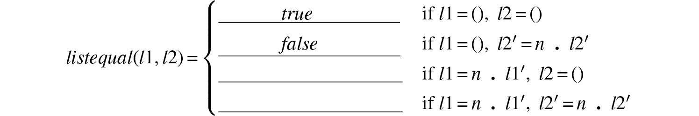

从第三个示例中，我们得到了第三个分支的定义：

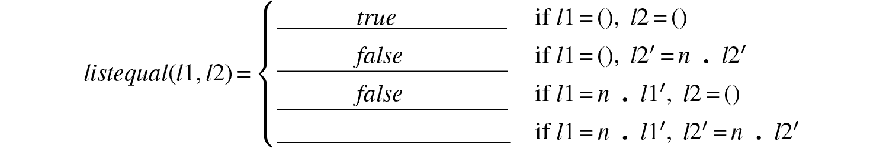

我们如何从递归调用的答案和其他信息中获得答案？从第三和第四个示例中，我们知道较大分支的答案是通过找到 `l1` 和 `l2` 的尾部，然后判断它们的长度是否相等来构建的。如果尾部列表长度相等，那么 `l1` 和 `l2` 的长度就相等。考虑我们的第四个示例；两个列表的尾部是空列表。由于 `listequal` 函数对于空列表返回 `true`（根据我们的第一个示例），因此 `listequal` 函数对于列表 `0 . ()` 和 `0 . ()` 返回 `true`。接下来考虑我们的第五个示例；两个列表的尾部是 `0 . ()` 和 `()`。`listequal` 函数对于这两个返回 `false`（根据第三个示例）。所以，`listequal` 函数对于 `0 . 0 . ()` 和 `0 . ()` 也会返回 `false`。通过结合这两条信息，我们可以得到归纳分支的答案并填充 `listequal` 函数定义大纲中剩余的空白：

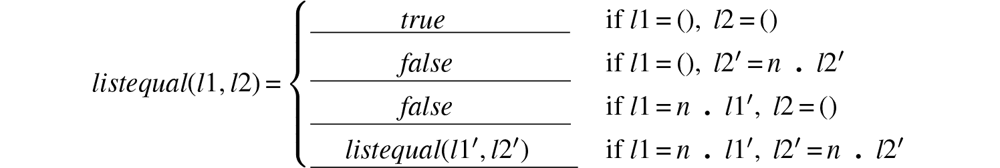

## 2.5.2 自然数上的递归比较函数

同样，让我们定义一个函数来比较两个自然数，以判断这两个自然数是否相等。以下是 `equal` 函数的一些示例：

| **输入 1** | **输入 2** | **输出** | **备注** |
| --- | --- | --- | --- |
| 0 | 0 | `true` | 输入的基础情况 |
| 0 | `succ 0` | `false` | 输入的基础情况 |
| `succ 0` | 0 | `false` | 输入的基础情况 |
| `succ 0` | `succ 0` | `true` | 在第一个示例的基础上构建 |
| `succ succ 0` | `succ 0` | `false` | 在第三个示例的基础上构建 |
| `succ 0` | `succ succ 0` | `false` | 在第二个示例的基础上构建 |

接下来，我们有了函数的大纲，如图 2.17 所示。

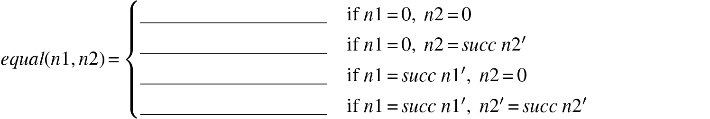

图 2.17 归纳函数 `equal` 的大纲，用于比较两个自然数以确定它们是否相等。该大纲源于自然数集定义中的归纳规则。

从第一个示例中，我们得到了第一个情况的定义：

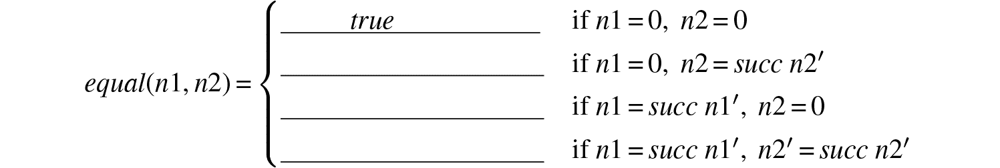

从第二个示例中，我们得到了第二种情况的定义：

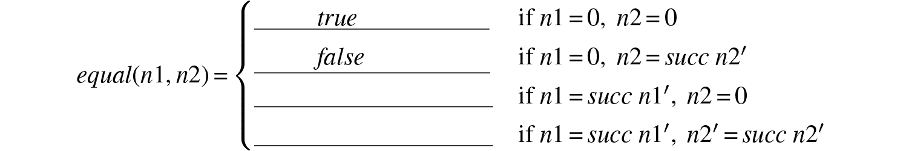

从第三个示例中，我们得到了第三种情况的定义：

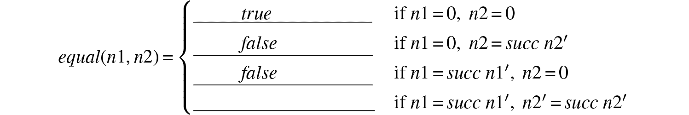

从最后两个示例中，我们得到了最后一种情况的定义：

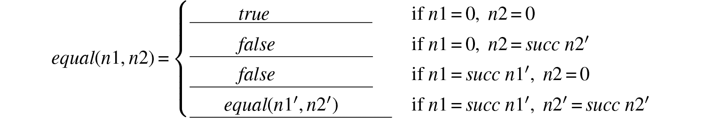

另一个示例，让我们定义一个函数 `plus`，将两个自然数相加产生另一个作为两者和的自然数。以下是 `plus` 函数的一些示例：

| 输入 1 | 输入 2 | 输出 | 备注 |
| --- | --- | --- | --- |
| 0 | 0 | 0 | 基础 |
| 0 | `succ 0` | `succ 0` | 基础 |
| `succ 0` | 0 | `succ 0` | 基础 |
| `succ 0` | `succ 0` | `succ succ 0` | 在上一个示例的基础上构建 |
| `succ succ 0` | `succ 0` | `succ succ succ 0` | 在上一个示例的基础上构建 |

接下来，我们有了函数的大纲：

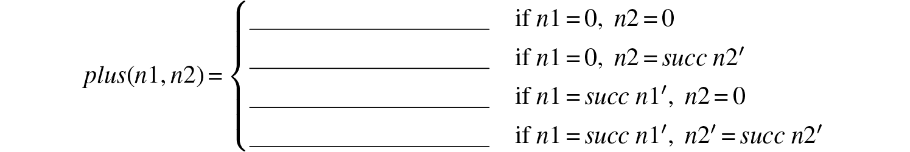

从第一个示例中，我们得到了第一个情况的定义：


从第二个示例中，我们得到了第二种情况的定义：

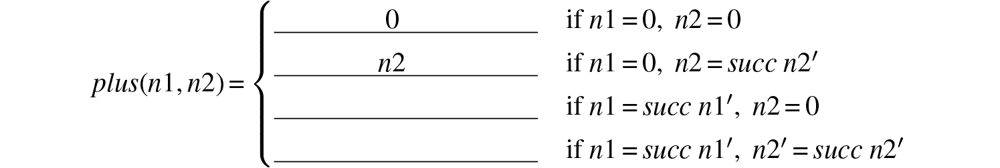

从第三个示例中，我们得到了第三种情况的定义：

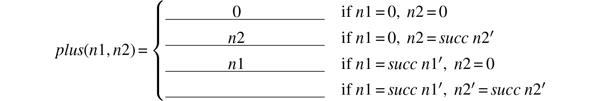

从最后两个示例中，我们得到了最后一种情况的定义：

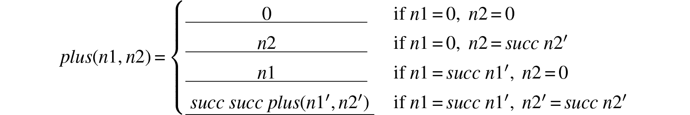

按照配方编写递归函数的优势是多层面的：

*   它为在归纳集上定义递归函数提供了一种系统化的方法，可以帮助避免定义过程中的错误。
*   通过遵循该配方，你可以确保所有输入情况都已考虑到，因为我们根据输入定义中的归纳规则创建了大纲。
*   创建的示例规模较小，且示例经过了系统的设计，有助于通过更小的步骤来理解问题的解决方案。
*   最后，由于该配方提供了一种近乎机械的方法来根据示例填充大纲，大部分精力可以花在关注递归函数感兴趣用例上。

正如任何配方一样，起初显式地练习是有帮助的，直到人们足够熟练。那时，大多数步骤就可以隐式地执行了。这些示例仍然有用，因为当递归函数需要作为计算机程序的一部分进行实现时，它们可以成为测试用例。

## 总结

总而言之，在本章中，我们介绍了归纳集，归纳集对于描述编程语言的多个方面非常重要，因为它们允许我们通过提供有限的成员描述规则来描述集合的成员身份。归纳集的定义是通过指定基础情况、归纳情况以及一个闭包规则来实现的。我们看到了这些归纳集的几个示例，例如自然数、列表和树。我们回顾了在这些归纳集上编写函数。具体来说，我们注意到在在这些归纳集上编写函数时，递归公式通常更加自然。我们还回顾了编写递归函数的配方，该配方依赖于一种系统方法，用于识别从基础情况开始并继继在上一个示例基础上构建的小示例。

### 练习题

2.5.1. 写下名为 `odddigit` 的函数的签名和定义。有两种编写方法：第一种是使用 `evendigit` 的定义，第二种是直接编写。练习这两种定义编写风格。

2.5.2. 写下名为 `carry` 的函数的签名和定义，如果增加数字会产生进位，则函数产生 `true`，否则产生 `false`。

2.5.3. 十六进制表示法表示 0–15 的数字。传统的数字 0–9 使用标准数字表示。数字 10、11、12、13、14 和 15 分别用 `a`、`b`、`c`、`d`、`e` 和 `f` 表示。使用本章讨论的符号定义一个新的归纳集 `hexdigits`。为该归纳集定义函数 `nextdigits` 和 `evendigit` 的变体。

2.5.4. 写下名为 `greater` 的函数的签名和定义，使用本章讨论的配方接受两个自然数作为参数。对于这个问题以及整章内容，我们建议显式地说明你是如何遵循该配方的。

2.5.5. 写下名为 `listgreater` 的函数的签名和定义，它接受两个 `list-of-naturals`，如果第一个列表的元素比第二个多，则产生 `true`，否则产生 `false`。对于这个问题以及整章内容，我们建议显式地说明你是如何遵循该配方的。

2.5.6. 写下名为 `sum-of-tree` 的函数的签名和定义，它接受一个 `tree-of-numbers` 作为参数并产生该树中所有数字的和。对于这个问题以及整章内容，我们建议显式地说明你是如何遵循该配方的。

# II 构建一种编程语言

## 3 开始

第 3 章

*   算术表达式语言
*   解释器和编译器
*   读取-求值-打印循环 (REPL)
*   具体语法和抽象语法
*   作为语法归纳函数的程序评估

第 4 章

*   变量作为抽象手段
*   变量定义和使用
*   作用域：词法和动态
*   变量环境、绑定
*   环境传递解释器、变量查找

第 5 章

*   全局变量
*   局部与全局定义
*   Define 声明
*   全局环境、绑定
*   带有全局环境的程序评估

成功的秘密在于开始。——马克·

既然我们已经完成了准备工作，让我们一起设计并实现我们的第一个编程语言。在设计和实现自己的编程语言的过程中，我们将熟悉任何编程语言设计和实现的基本思想（例如语法、词法分析、解析和抽象语法树等）。我们还将回顾贯穿书中讨论的编程语言实现的设计，包括数据抽象、面向变化的设计以及访问模式。

### 3.1 Arithlang：一种算术语言

我们将从设计和实现一种名为 *Arithlang* 的简单语言开始。你可以认为这种语言支持使用像图 3.1 所示的简单计算器可能进行的所有计算。


图 3.1 一个简单的计算器，图片感谢来自 Wikimedia Commons

Arithlang 的完整实现可以在随书代码中找到，托管于 [`github.com/hridesh/arithlang`](https://github.com/hridesh/arithlang)。鼓励读者下载、设置该实现，并按照本章提供的描述和步骤进行操作。

Arithlang 的主要目标是编写可以执行算术运算的程序。例如，该编程语言的用户可能会编写像图 3.2 所示的程序。

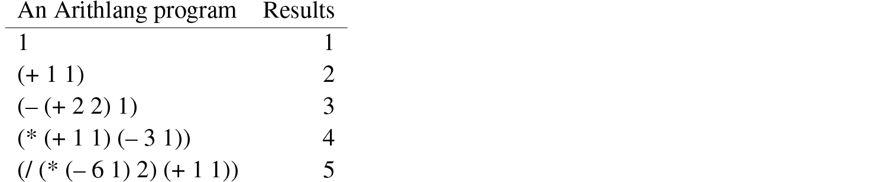

图 3.2 一些 Arithlang 程序及其结果

这些用户可以预期此类程序分别产生值 1、2、3、4 和 5。请注意，Arithlang 中的程序采用的是*前缀*（prefix）表示法，而不是 Java 等语言使用的*中缀*（infix）表示法。在前缀表示法中，如 `+`、`−`、`*` 和 `/` 等运算符出现在其操作数之前。在表达式 `(+ 1 2)` 中，`+` 是运算符，`1` 和 `2` 是操作数。为了消除歧义，我们用 `(` 和 `)` 界定算术表达式的开始和结束。在 Arithlang 中，符号 `+`、`−`、`*` 和 `/` 分别代表加、减、乘、除。

使用前缀表示法有一些优点（例如可以轻松表示适用于多个操作数的操作）。例如，算术表达式 `2 + 4 + 6 + 5` 可以写为 `(+ 2 4 6 5)`，这只需要使用一个运算符。同样，我们可以将 `10 * 2 * 7 * 3` 写为 `(* 10 2 7 3)`，将 `5 − 4 − 1` 写为 `(− 5 4 1)` 等。前缀表示法有助于消除运算符优先级的问题（如中缀符号所示）。例如，在表 3.1 的第三表达式，我们必须显式地为中缀形式添加括号，以表示应先执行 `(1 + 1)` 和 `(3 − 1)`，然后再将它们的结果相乘。

表 3.1 一些 Arithlang 程序及其中缀形式

| Arithlang 程序 | 等效的中缀形式 |
| :--- | :--- |
| `1` | `1` |
| `(+ 1 1)` | `1 + 1` |
| `(− (+ 2 2) 1)` | `2 + 2 − 1` |
| `(* (+ 1 1) (− 3 1))` | `(1 + 1) * (3 − 1)` |
| `(/ (− 6 1) 2) (+ 1 1))` | `((6 − 1) * 2) / (1 + 1)` |

在编写 Arithlang 程序以及书中后续讨论的其余编程语言时，使用缩进来匹配左括号和右括号可能会有所帮助。这里展示了表 3.1 中示例的缩进形式：

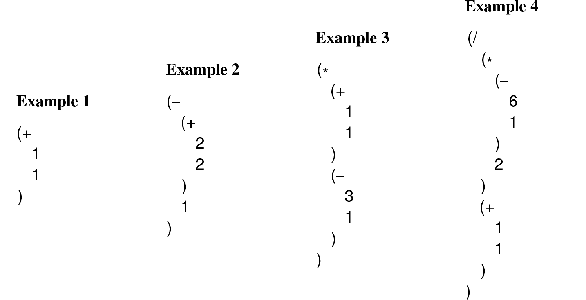

缩进仅为了清晰；它对 Arithlang 程序的语义没有影响（与 Python 不同，Python 的缩进开启词法作用域）。我们将运算符符号与左括号写在同一行，有助于显示每个运算符的开始。同一运算符的操作数通过制表符（或四个空格）缩进。同一运算符的所有操作数对齐。

#### 练习题

**3.1.1.** 将以下中缀表示法写的算术表达式转换为 Arithlang 的前缀表示法。

1. `2 + 3`
2. `2 + 3 * 4`
3. `5 * (6 + 4)`
4. `(5 − 1) / (2 * 2)`
5. `(2 + 3) * (6 − 1) / (7 − 2)`

**3.1.2.** 将以下前缀表示法写的算术表达式转换为中缀形式，并计算运算符数量的增加。

1. `(+ 5 1 5)`
2. `(* (+ 4 3) (+ 4 0))`
3. `(/ (+ 4 3 4 9) (+ 5 1 5))`

**3.1.3.** 使用 Arithlang 的前缀表示法编写五个不同的算术表达式，使得每个表达式产生的值均为 42。每个表达式必须使用所有的算术运算符：`+`、`−`、`*` 和 `/`。

### 3.2 合法程序

Arithlang 编程语言有效实现的目标是计算该程序所代表的算术表达式的值。如果你的简单计算器支持前缀表示法，它就是这种编程语言的有效实现。

并不是所有的文本都可以被视为该语言中的合法程序。我们需要规则来区分合法程序和非法程序。此外，这些规则也可以作为在该编程语言中创建新程序的指南。这些规则被编码为编程语言的语法。我们在第 2 章中看到了归纳集的语法。

描述语法的有多种表示法，取决于构建编程语言实现时所使用的工具。本书遵循扩展巴斯-诺尔形式（EBNF）表示法。Arithlang 实现中的语法遵循 ANTLR（`www.antlr.org/`）使用的格式，这是一种用于构建语言实现的工具。附录章节回顾了 ANTLR 的语法和用法。在以后，我们将独立于具体的 ANTLR 语法给出我们的语法规则。图 3.3 中语法的 ANTLR 等效形式实现在图 A.1 中。

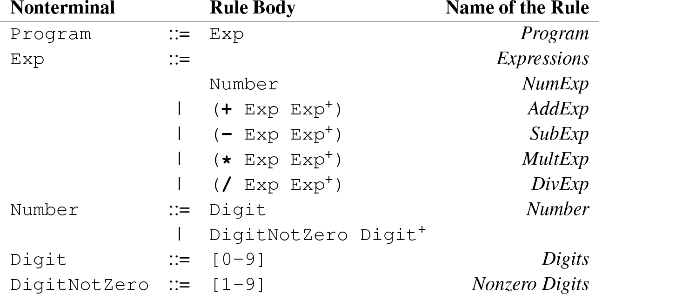

图 3.3 Arithlang 语言的语法。参见附录章节中的图 A.1 获取相同语法的 ANTLR 形式。

最简单的算术表达式是数字。我们可以通过如下定义语法，允许数字成为我们编程语言中的合法程序。表头（粗体）通常不包含在语法描述中，但在这里添加了：

| 非终端符 | 体 | 规则名称 |
| :--- | :--- | :--- |
| `program` | `exp` | `program` |
| `exp` | `numexp \| addexp \| subexp \| multexp \| diveexp` | `exp` |
| `numexp` | `digit` | `numexp` |
| `addexp` | `(+ exp exp )` | `addexp` |
| `subexp` | `(− exp exp )` | `subexp` |
| `multexp` | `(* exp exp )` | `multexp` |
| `diveexp` | `(/ exp exp )` | `diveexp` |
| `digit` | `0 \| nonzero` | `digit` |
| `0` | `0` | `0` |
| `nonzero` | `DigitZero+` | `nonzero` |

#### 终结符与非终端符

在语法中，可以展开的符号被称为*非终端符*（nonterminals），而叶节点且不能展开的符号被称为*终结符*（terminals）。在我们 Arithlang 的语法中，`program`、`exp`、`numexp`、`addexp`、`subexp`、`multexp` 和 `diveexp` 是非终端符。特殊字符如 `(`、`)` 以及数字是终结符。

根据此语法，“10”是一个有效的程序。这是因为‘1’是一个非零数字，而由于数字可以是一个非零数字后跟一个或多个数字（根据第三行的规则），并且由于‘0’是另一个数字，因此‘1’后面跟‘0’就是一个有效的数字。由于程序可以是一个数字，而‘1’后面跟‘0’是一个有效的数字，且“10”不包含除‘1’和‘0’之外的任何字符，因此“10”是一个有效程序。

与之前的有效程序不同，“01”不是一个有效程序。这是因为在该语法中没有相应的规则允许‘0’后面跟上任何其他数字。同样，“001”也不是一个有效程序，我们可以通过遵循相同的推理过程来确定这一点。

数字是很好的程序，但为了实现 Arithlang 的目标，语法必须能够支持更复杂的程序。我们可以如图 3.3 所示扩展语法，以允许此类程序的出现。

我们已经看到了 `Number`、`Digit` 和 `DigitNotZero` 的规则。`program` 的规则现在被扩展为允许几种类型的算术表达式。该规则规定，程序可以是一个表达式（缩写为 `Exp`）。一个表达式可以是数字表达式（简写为 `Number`）、加法表达式（标记为 `AddExp` 规则）、减法表达式（标记为 `SubExp` 规则）、乘法表达式（标记为 `MultExp` 规则）或除法表达式（标记为 `DivExp` 规则）。这些是 Arithlang 语言中允许的几种不同的表达式。

数字表达式（`NumExp`）的规则规定，表达式可以是一个数字。根据这条规则，我们仍然可以说明为什么“0”到“9”是有效程序，“10”是有效程序，但“01”不是有效程序。然而，这个论证过程变得有些冗长。为了论证“0”是一个有效程序，我们首先观察到程序可以是一个表达式（`Exp`），表达式可以是数字（通过 `NumExp` 规则），而数字可以是 `digit`，由于“0”包含数字‘0’，我们不需要应用任何其他规则。因此，“0”是一个有效程序。

剩余的规则定义了什么是合法的加法、减法、乘法和除法表达式。

这些规则都具有相似的结构，因此让我们关注加法表达式（`AddExp`）的规则。该规则规定，加法表达式以左括号字符‘(’开头，后面跟着‘+’字符，并以右括号字符‘)’结束。该规则的中间部分对于由子表达式形成加法表达式至关重要。它规定加法表达式可以包含一个表达式后跟*一个或多个*表达式。符号 `(X)+` 表示一个或多个 `X`。这个定义允许我们编写像 `(+ 0 0 0)` 这样的程序。减法、乘法和除法算术表达式的其他规则也可以类似的理解。

#### 习题


### 3.2.1

在图 3.3 所示的 Arithlang 语言语法中有多少非终结符和终结符？请列出。

### 3.2.2

扩展 Arithlang 的语法法以支持一元负表达式。比较一元负表达式的产生规则与 `SubExp` 的产生规则。

### 3.2.3

重写 Arithlang 的语法法，以避免重复常见的形式 `ExpExp+`。

### 3.3 语法推导

为了支持“某个字符串是特定编程语言中的有效程序”这一断言而创建论据（证明）的过程被称为该字符串的*推导*（简称推导）。这里给出一个关于“0”是 Arithlang 中有效程序断言的推导示例：

| 步骤 | 该步骤的句型形式 | 来自图 3.3 的产生规则 |
| --- | --- | --- |
| 1. | `Program →` | `Program::= Exp` |
| 2. | `Exp →` | `Exp::= Number` |
| 3. | `Number →` | `Number::= Digit` |
| 4. | `Digit →` | `Digit::= ‘0’` |
| 5. | ‘0’ | |

在每一步中，通过应用 Arithlang 语法法的产生规则，将一个非终结符替换为一个或多个非终结符或终结符。推导的中间结果（例如步骤 2–4）处于*句型形式*（sentential form）；也就是说它们还不是语法中的句子。作为论据的推导可以反向或向前读取。例如，“0”是一个合法的程序，因为‘0’是一个 `Digit`，是一个 `Number`，是一个 `Exp`，从而也是一个 `Program`。我们也可以说 `Program` 可以扩展为 `Exp`，`Exp` 可以扩展为 `Number`，`Number` 可以扩展为 `Digit`，`Digit` 可以扩展为字符‘0’。由于“0”不包含其他字符，因此“0”是一个合法的程序。这两种方法在理解语法推导这一概念上都是同样合理的。

语法推导在以下两种情况之一停止：所考虑的句型形式不再有剩余的非终结符，或者没有语法规则可以应用于句型形式中剩余的非终结符。例如，这里的推导在步骤 6 停止，因为那里不再剩余非终结符。

虽然在一个步骤中替换多个非终结符可能很有吸引力，但从理论和实践角度来看，最好替换一个终结符。这使得语法推导更容易理解。此外，如果在一个步骤中替换多个非终结符，回溯会变得更加困难。在这里，回溯可以理解为撤销推导中某一步的操作。当发现某个特定的语法推导不太可能产生字符串是有效程序的有效证明时，回溯是必要的。这里给出一个需要这种回溯的示例：

| 步骤 | 该步骤的句型形式 | 来自图 3.3 的产生规则 |
| --- | --- | --- |
| 1. | `Program →` | `Program::= Exp` |
| 3. | `Exp →` | `Exp::= Number` |
| 4. | `Number →` | `Number::= DigitNotZero Digit+` |
| 5. | 回溯到上一步 | |
| 6. | `Number →` | `Number::= Digit` |
| 7. | `Digit →` | `Digit::= ‘0’` |
| 8. | ‘0’ | |

在步骤 4 中，没有使用数字的第一种选择，此推导使用了第二种。注意，这个推导无法用于证明“0”是一个有效程序。因此，使用数字的第二种选择并不是好主意，必须回溯以返回之前的状态。从那里开始，推导可以按照之前的方式通过选择第一种选择继续。在手写推导时，习惯上会隐地进行这种前向思考，并只写出字符串正确推导的步骤。

为了进一步理解语法推导的概念，让我们首先构建一个非形式的论证，说明 `(+ 0 0 0)` 是根据图 3.3 中定义的法的有效 Arithlang 程序。根据我们之前的讨论，我们知道根据 `NumExp` 规则 `0` 是一个有效的表达式。由于程序可以是一个加法表达式，而加法表达式可以是 `(` `+` `Exp` `(Exp)+` `)`，如果我们将 `Exp` 替换为一个有效表达式，我们将继续得到一个程序——即 `(` `+` 0 `(Exp)+` `)` 仍然是一个有效程序。你可以将此处加法表达式中 `Exp` 的出现看作占位符，它可以被替换为任何其他有效表达式。由于 `(Exp)+` 代表一个或多个 `Exp` 实例，我们可以将其替换为两个有效表达式并仍然是一个有效程序——即 `(` `+` 0 `Exp Exp` `)` 仍然是一个有效程序。遵循我们之前的论证，我们可以将后两个表达式替换为 `0`，并继续在 Arithlang 中得到一个有效程序 `(` `+` `0` `0` `)`。我们可以更系统地写出这个论证，如图 3.4 所示。我们将识别从图 3.3 中应用在这些步骤每一步中的产生规则留作练习题。

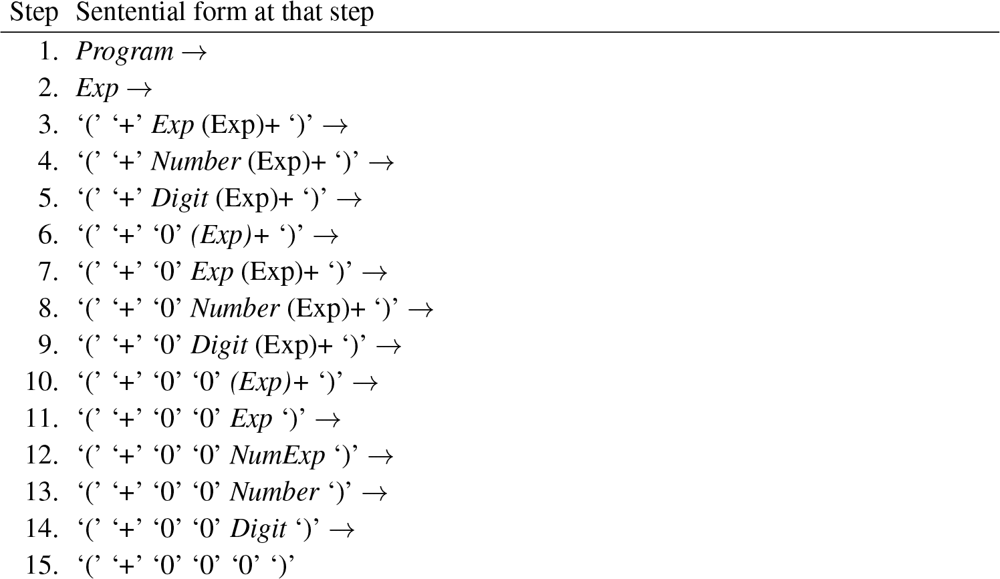

图 3.4

程序 `(+ 0 0 0)` 的最左语法推导

之前，我们提到过习惯上在每一步中只扩展一个非终结符。根据选择替换哪个非终结符，语法推导可以是最左推导或最右推导。

在图 3.4 所示的推导中，每一步中加粗非终端符都被替换为它的扩展形式。终结符号永远不会被扩展（例如 `0` 或 `+`）。同样注意，在每一步中，最左侧的符号都被扩展。这种推导被称为`最左推导`（leftmost derivation）。

另一个最左推导的例子在图 3.5 中所示。

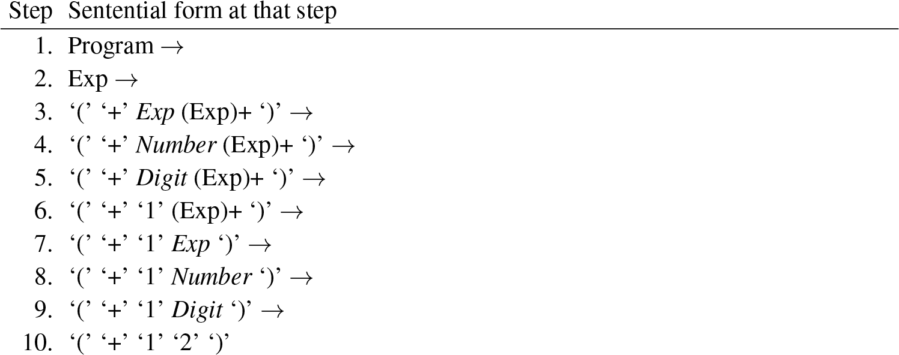

图 3.5

程序 `(+ 1 2)` 的最左推导

`最右推导`（rightmost derivation）是指首先扩展最右侧可用的非终端符。例如，`(+ 1 2)` 的最右推导如图 3.6 所示。将此推导与图 3.5 所示的最左推导进行比较。注意在步骤 3 中，扩展的不是最左的非终端符 `Exp`，而是最右的非终端符 `(Exp)+`。

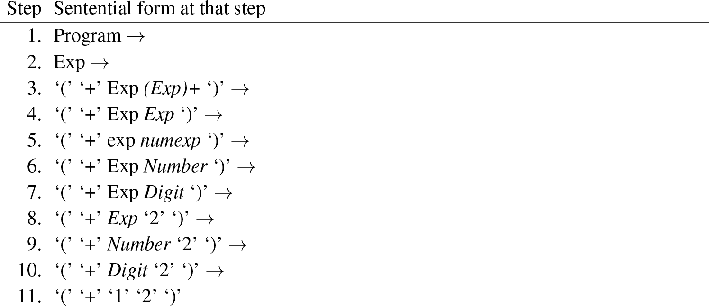

图 3.6

程序 `(+ 1 2)` 的最右推导

对于我们在本章研究的这类语法，最左推导和最右推导是等价的。推导中的句型（sentential forms）可以不同。例如，图 3.5 和图 3.6 中步骤 5–14 的句型是完全不同的，尽管这两个推导都在推导出同一个程序。

最左推导和最右推导的主要区别在解析程序时是显而易见的。最左推导可以在从左到右读取程序时消耗程序的终结符。相比之下，最右推导存储终结符直到读取完非终端符并从右到左消耗终结符。感兴趣的读者可能还想了解最左推导和最右推导在构建自顶向下解析器和自底向上解析器中的作用。

#### 练习题

##### 3.3.1

为以下 Arithlang 程序编写最左推导。

1. `3`
2. `(+ 3 4)`
3. `( + (+ 3 4) 2)`
4. `( + (* 3 4) (− 2 0))`
5. `( / 2 (− 4 3) )`

##### 3.3.2

为上一个练习中的程序编写最右推导。

##### 3.3.3

Arithlang 语法支持正整数。扩展此语法以支持负整数。

##### 3.3.4

Arithlang 语法支持正整数。扩展此语法以支持双精度浮点数。

### 3.4 实现的两种可能性

现在我们有了 Arithlang 合法程序的规范，可以开始创建实现。该实现的主要目标是获取一个 Arithlang 程序并计算其值。

#### Grace Hopper 与编译器

Grace Hopper 和她的团队是首批实现编译器的团队之一。该团队也被认为发明了“编译器”（compiler）一词。

来源：Hopper, Grace Murray, “The Education of a Computer,” Proceedings of the ACM National Meeting, Pittsburgh, PA, USA, 1952.

我们可以通过两种方式之一实现这种功能。我们可以构建一个`compiler`（编译器）或一个`interpreter`（解释器）。用于实现编译器或解释器的编程语言称为`defining language`（定义语言）。正在实现的编程语言称为`defined language`（被语言）。

编译器是一个读取定义语言中的`source program`（源代码）并将其翻译成另一种语言的程序的程序，通常称为`target language`（目标语言），这样当生成的目标语言程序运行时，它将执行源程序所预期的计算。例如，Java 编程语言的编译器是一个读取 Java 源代码并将其翻译成另一种字节码（Bytecode）语言程序的程序。当这个字节码程序运行时，它将执行 Java 程序所预期的计算。Java 语言的实现同时使用了编译器和解释器。前端 `javac` 是一个读取用源语言（在此处为 Java）编写的程序并生成另一个字节码语言程序的程序。这个生成的程序存储在一个或多个 `.class` 文件中，并可以在稍后运行以执行源代码旨在要执行的操作。后端 `java` 是一个读取用字节码语言编写的程序并立即执行该程序预期的计算的程序。我们以后将学到即使是那一步通常也分为两个部分：编译器和解释器；但现在我们不必担心这些细节。同样，C# 编程语言的编译器是一个读取 C# 源码并将其翻译成另一种通用中间语言（CIL）程序的程序。某些编译器还会产生目标语言程序，这些程序需要进一步编译。例如，有一系列语言的编译器会将代码翻译成 JavaScript 程序，如 Dart、CoffeeScript、TypeScript 等。

LISP 是 1958 年实现的第一个解释型语言。

另一方面，`interpreter`（解释器）是一个读取源程序指令并立即执行该指令预期的计算的程序。解释器是一个运行循环的程序，从用户处读取新程序（Read），评估这些程序的值（Eval），并打印这些值（Print）。因此，解释器的主要组件有时被称为读取-评估-打印循环（REPL）。LISP、Perl、PHP、Python、R、Smalltalk 和 VBScript 是一些广泛使用的、规范实现为解释器的编程语言。

两种实现技术各有其优缺点。例如，基于解释器的技术倾向于更简单，因此更容易实现。另一方面，由于它们在每次运行程序时通常会重复某些步骤（例如读取程序并将其转换为抽象语法树），有时执行效率可能不高。但由于在解释器的设计和实现上投入了巨大的研究和工程努力，许多现代解释型语言的实现其性能通常可以与编译型语言相当。

在本书中，由于我们的主要目标是关注理解和建模编程语言概念，因此我们将倾向于简单性，并以解释器的形式来实现我们的编程语言。

### 3.5 读取程序

程序以字符串的形式提供给解释器。读取阶段（read phase）的主要目标是将此字符串转换为更具结构化的形式，即`abstract syntax tree`（抽象语法树，AST），这样后续的`Eval`阶段就可以计算它的值。这一操作通常包含以下步骤：

1. 将程序字符串分为符号，称为`tokens`（标记）。
2. 根据编程语言语法的规则将标记组织成称为`parse tree`（语法分析树）的树形结构。
3. 通过忽略与程序评估无关的标记，将语法分析树转换为 AST。

第一步被称为`lexical analysis`（词法分析）。程序中的合法标记由其语法规定。例如，`Arithlang`在图 3.3 中的语法定义‘0’到‘9’、`+`、`*`、`/`、`(`和`))`为合法标记。程序可以有零或多个合法标记。例如，程序"3"中唯一的合法标记是数字 3，而程序"(+ 3 4)"中的合法标记按顺序依次为`(`、`+`、3、4 和`)`。

第二步被称为`syntax analysis`（语法分析），或更常用的`parsing`（解析）。解析是自动创建语法推导的过程。它根据编程语言语法的规则，将程序中的所有标记组织成语法分析树。解析步骤的输出是一个`parse tree`。图 3.7 展示了一个符合图 3.3 中语法的语法分析树示例。该语法分析树中的节点可以是终结节点（terminal），也可以是非终结节点（nonterminal）。例如，`Program`是非终结节点，而`+`是终结节点。两个节点之间的线可以读作“展开为”或“组成”（从上到下）。例如，根据图 3.3 中的`AddExp`规则，一个`Program`展开为一个`Exp`，该`Exp`展开为终结节点`(`，后面是终结节点`+`，然后是非终结节点`Number`，接着是另一个非终结节点`Number`，最后是终结节点`)`。

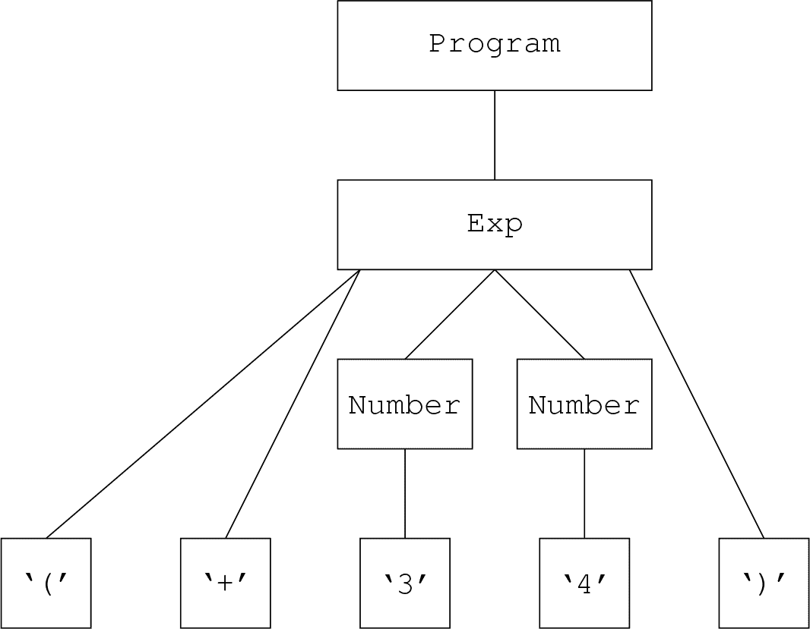

图 3.7

Arithlang 程序"( + 3 4)"的语法分析树

在第三步中，消除了不必要的具体标记，以创建程序的更抽象表示，称为`abstract syntax tree`（抽象语法树，AST）。AST 是程序的紧凑内部表示。AST 的主要使用者是解释器、编译器以及其他对程序进行操作的工具（例如检查程序错误）。示例程序的 AST 所示图 3.8。注意，属于具体语法的标记（如`(`、`+`、`)`和空白）没有在 AST 中表示。为了理解消除`(`、`+`、`)`背后的直觉，请考虑图 3.3 中`addexp`的产生规则。注意，产生规则本身提供了信息，即解析的表达式必须以`(`开头，后接`+`，并以`)`结束。因此，这些标记是冗余的，可以根据`AddExp`产生规则的知识进行重建。

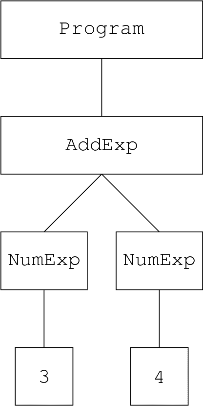

图 3.8

Arithlang 程序"( + 3 4)"的抽象语法树

标记是否可以被消除取决于 AST 的预期用途。例如，如果 AST 被用于必须保留间距的代码转换，那么我们需要保留空白、换行符和制表符。

编程语言实现的抽象语法结构也可能与其具体语法有显著差异。在这种情况下，从语法分析树到 AST 的转换可能会更加复杂。在`Arithlang`以及本书讨论的其余语言中，抽象语法结构与具体语法非常相似，只是缺少了抽象语法中不存在的标记（如`+`、`-`、`*`、`/`、`(`和`)`）。

给定编程语言的语法，可以自动生成词法分析和解析的代码。事实上，`Arithlang`的实现使用了`ANTLR`来生成词法分析器和解析器。附录章节介绍了如何使用`ANTLR`生成词法分析器和解析器，并在图 A.1 中包含了 Arithlang 语法到具体的`ANTLR`语法的直接翻译。

**范围：** 本书重点在于理解编程语言的设计及其语义。因此，我们对解释器词法分析和解析组件的实现关注较少。

#### 练习

##### 3.5.1

绘制以下 Arithlang 程序的语法分析树：

1. `(+ 5 1)`
2. `(* (+ 4 3))`
3. `(/ (+ 4 3) 4) 5`

接下来，为这些程序绘制 AST。最后，报告 AST 表示实现的压缩率。压缩率定义为：

`（语法分析树的节点数 - AST 的节点数）/ 语法分析树的节点数`

##### 3.5.2

在之前的练习中，你使用 Arithlang 的前置表示法和四个算术运算符`+`、`-`、`*`、`/`编写了五个不同的程序，使每个表达式的结果均为 42。为这些程序绘制语法分析树和 AST。

在面向对象的表示中，统一地处理每个实体（例如 `Program`、`Exp`）会非常方便。因此，在图 3.10 所示的表示中，我们引入了一个名为 `ASTNode` 的顶层类。面向对象的表示使用一种名为统一建模语言（UML）图的设计表示法。在这种表示法中，面向对象的类表示为分为三个部分的框。顶部是面向对象的类的名称。中间部分表示在该 particular 类中声明的字段。最后，底部表示在该类中声明的方法。从一个类到另一个类的带有三角形箭头的箭头表示继承关系。例如，图 3.10 中 `ASTNode` 和 `Program` 之间的箭头表示 `ASTNode` 是 `Program` 的父类。

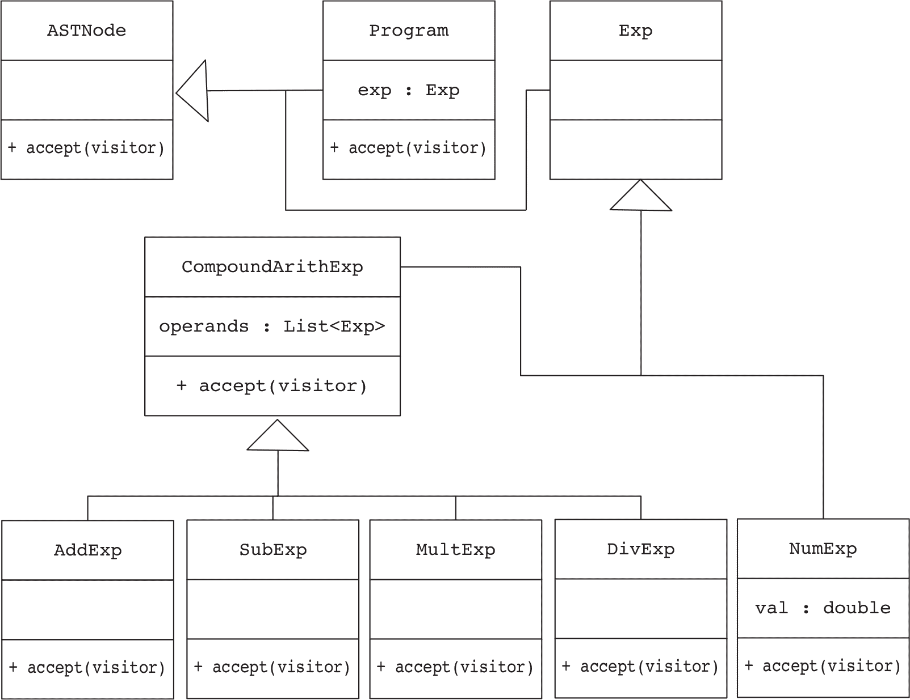

图 3.10

用于 AST 层次结构的 UML 图，用于存储如图 A.1 中语法法定义的 Arithlang 程序。具体的 Java 代码显示在图 3.11 和 3.12 中。

程序和表达式都是 AST 节点，因此 `Program` 和 `Exp` 类被设计为 `ASTNode` 类的子类。该类仅为 Arithlang 实现提供了一个抽象方法 `accept`。该方法是访问者模式（visitor pattern）实现的一部分，我们将经常使用该模式来检查 AST。我们将在本章稍后的 3.7 节中详细讨论这种模式。`ASTNode`、`Program` 和 `Exp` 类的具体实现显示在图 3.11 中。

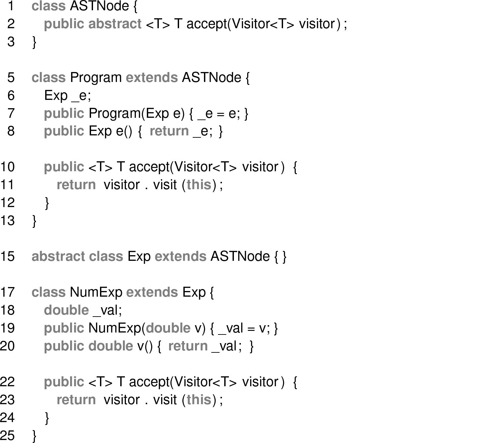

图 3.11

`ASTNode`、`Program`、`Exp` 和 `NumExp` 在 Java 中的具体实现

由于 Arithlang 的语法法定义了五种表达式，我们可以为每种类型创建一个 `Exp` 的子类，以便该子类可以实现特定于该类型表达式的行为。每种类型都需要存储有关该表达式子部分的信息。例如，图 3.11 中的 `NumExp` 表达式应该存储数字的实际值，供以后程序评估、打印和其他函数使用。同样，加法表达式 `(+ 3 4 2)` 需要存储子表达式 `3`、`4`、`2`，乘法表达式 `(* 3 (+ 4 2))` 需要存储子表达式 `3` 和 `(+ 4 2)` 以供以后使用。

这些表示 AST 中表达式节点的类的一种直观设计是让 `AddExp` 类维护一个参数表达式列表以及操作该列表的方法。然而，从语法法中注意到，`addexp`、`subexp`、`multexp` 和 `divexp` 在子表达式方面具有相似的结构。每个表达式都可以有一个或多个子表达式作为操作数。通过意识到这种共性，我们可以改进最初的面向对象设计。如果我们能创建一个实现共性的 `Exp` 子类，然后创建四个实现表达式特定特性的子类，我们就可以实现代码复用。图 3.10 所示的面向对象设计利用了这种策略。这种设计策略的实现显示在图 3.12 中。

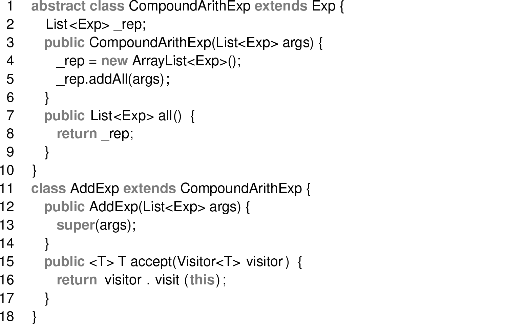

图 3.12

`CompoundArithExp` 和 `AddExp` 的具体实现

其他表达式 `SubExp`、`DivExp` 和 `MultExp` 的实现与 `AddExp` 类似。


在后面的章节中，我们不会不再展示像图 3.10 那样的面向对象设计，而是将其留给读者练习。也鼓励读者考虑从代码复用和存储的角度将`CompoundArithExp`的功能与`Exp`合并的优缺点。

#### 练习

##### 3.6.1

为表达式`(+ (− 6 3) (* 4 1) (/ (+ 7 2 1)) 5))`绘制一个 AST 图。示例参见图 3.8。确保你理解为什么某些节点是该树的叶子节点。该 AST 的最大深度是多少？该 AST 中有多少叶子节点？列出它们。

##### 3.6.2

为 Arithlang 的 AST 编写另一种实现方案，其中`CompoundArithExp`存储一个枚举类型`OperatorKind`字段，用四个值`Add`、`Sub`、`Mult`和`Div`建模具体的运算符。

##### 3.6.3

扩展 Arithlang AST 的实现，包含一个否定表达式`− Exp`的 AST 节点。

### 3.7 分析程序

回想 3.4 节，解释器运行一个三步循环（REPL）。第一步是读取程序并生成 AST。在 3.6 节中，我们学习了 AST 的一种可能实现。下一步是评估（或读取）AST 并生成其值。这个过程类似于树遍历，你可能在数据结构课程中遇到过，表达式的值取决于其子表达式。例如，乘法表达式`(* 3 (+ 4 2))`的值取决于子表达式`3`和`(+ 4 2)`。

程序评估不是唯一需要 AST 遍历的任务。如果你用过集成开发环境（IDE）的代码格式化工具，你就遇到过另一个生成格式化字符串的 AST。

实现遍历 AST 的策略有两种。在第一种策略中，我们可以扩展每个表示 AST 节点的类来实现功能。例如，常量、加、减、乘、除类都被扩展以实现代码格式化。在第二种策略中，我们可以扩展每个表示 AST 节点的类来实现通用的遍历功能。具体的遍历策略可以扩展通用行为。

在第一种策略中，评估行为（评估关注）的实现分散在相关的类中。同样，格式化行为（格式关注）的实现分散在相关的类中。也就是说，评估和格式关注点分散在这些类中，并被认为是相互耦合的这使得在需要时修改它们变得困难。在第二种策略中，这种行为局在一个类中，使其便于维护。

#### 3.7.1 访问者模式

在本书中我们将使用第二种策略，在面向对象程序设计中被称为访问者模式。我们将通过实现一个代码格式化器来说明这种模式。

回想 3.6 节中讨论的 AST 表示，每个具体类都实现了一个`accept`方法，该方法接收一个类型为`Visitor`的对象并调用该对象的`visit`方法。为了方便，我们在这里重现了图 3.11 和图 3.12 中的相关部分。注意，AST 表示的代码并不包含任何解释器其他部分的功能（如格式化、打印和评估）。相反，它只是提供了一个结构，以促进 AST 关注点与格式或评估关注点之间的分离。这使得独立开发和维护这些关注点成为可能，正如我们很快就会看到的。

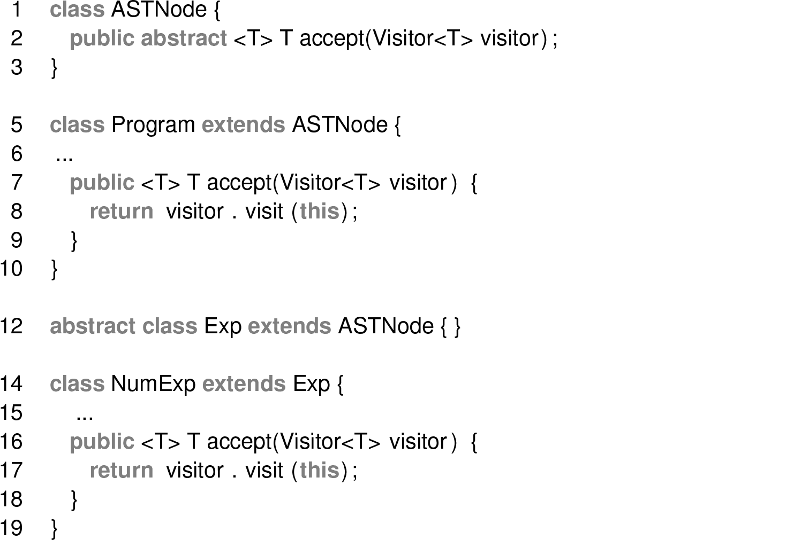

`Visitor`类型的定义在图 3.13 中。该接口为每个具体的 AST 节点提供了`visit`方法。任何需要 AST 遍历的功能（例如格式化）都实现在扩展了`Visitor`接口的独立类中。因此，它必须为`Visitor`接口中声明的每个`visit`方法提供实现。示例见图 3.14。

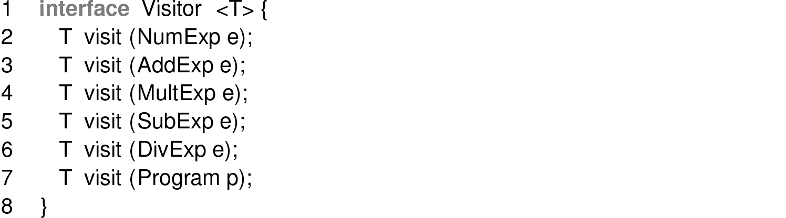

图 3.13

Visitor 接口

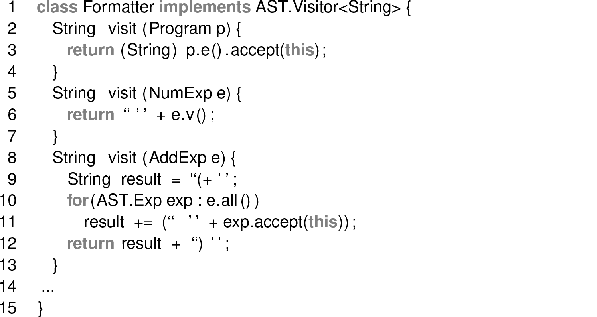

图 3.14

一个代码格式化器：访问者模式的示例

代码格式化器的目的是打印 AST。由于代码格式化器是一个具体类并实现了`Visitor`接口，因此它必须为该接口中声明的每个方法提供实现。图 3.14 中的列表显示了其中一些方法，而其他方法被省略了，因为它们与`AddExp`的`visit`方法非常相似。

代码格式化器是说明如何使用组件 AST 节点的值来构建 AST 节点值的极佳示例。以接受`Program`为参数的`visit`方法为例。在 Arithlang 中，一个程序由一个表达式组成，因此程序的格式化字符串与其表达式的格式化字符串相同。表达式的格式化字符串（`p.e()`）是通过调用`accept`方法并将当前访问者作为参数来计算的。再以接受`AddExp`为参数的`visit`方法作为另一个示例。在 Arithlang 中，加法表达式由一个或多个子表达式组成，因此加法表达式的格式化值为“(+,”，随后是每个子表达式的格式化值，最后是“)”。

还要注意，`Formatter`类仅代表了格式化关注点。它不包含 AST 类的实现。因此，通过这种解释器的设计，实现了格式化与 AST 关注点的分离。

#### 3.7.2 访问者模式的控制流

由于额外的间接层，使用访问者模式的程序的控制流起初可能有点难以理解，但记住两点会有帮助：(1) 处理每种 AST 节点的逻辑都在相应的`visit`方法中，(2) 调用`accept`方法是跳回当前类中合适的`visit`方法的一种。

为了说明，令`prog`为类型为`Program`的 AST 对象，对应程序“3.”。我们可以如下所示手动构造此 AST 对象：

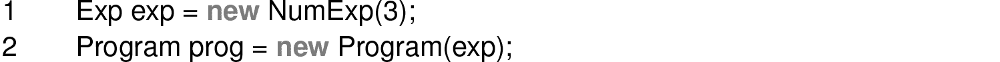

然后我们可以尝试按如下方式查找该程序的格式化形式：


如图 3.15 所示，对`accept`方法的调用会导致图 3.14 第 2 行`Formatter`类中的`visit`方法（`Program p`）运行，在此复制：

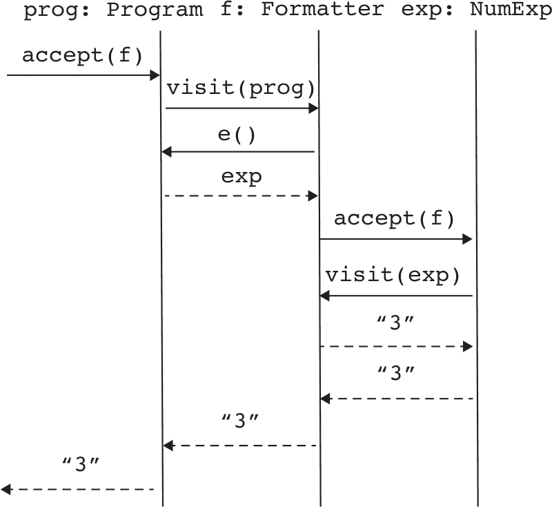

图 3.15

显示`prog.accept(f)`调用控制流的序列图。垂直线表示在行上方指定的为`obj:Class`的对象。实线表示方法调用，虚线表示方法调用的返回。每个箭头顶部的值是调用的返回值。


此方法调用了`Program`对象的访问方法`e`以获取表达式（在本例中为`exp`）。然后，它如此处代码以及图 3.15 所示的序列图所示调用了`accept`。

回想，`accept`方法为每个代表 AST 节点的类定义。这些方法接受一个访问者对象作为参数，其逻辑（主要）是在该访问者对象上调用`visit`方法，并将当前对象（类型为`ASTNode`的子类型）作为实际参数传递。。在`Visitor`接口的所有具体实现中，都为每种类型的`ASTNode`定义了一个方法。请看图 3.14 的此类示例。当 AST 节点对象被传递时，面向对象的方法调用分发机制会自动选择执行正确的方法，其形式参数与实际参数的类型匹配。在这种情况下，`NumExp`类内的以下方法`accept`将使用`Formatter`类的对象`f`作为参数运行：

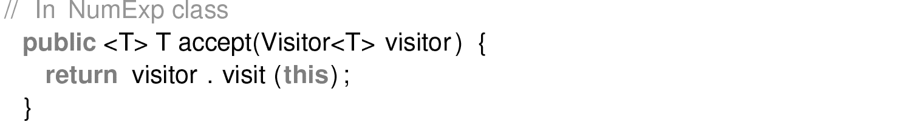

`accept`方法随后调用`Formatter`对象`f`上的`visit`方法，并将当前对象`this`作为参数传递。这导致了`Formatter`类中对应的`visit`方法运行，在此复制：


用于`f`的此`visit`方法返回`NumExp`‘‘3’’的字符串格式，并将控制权返回给`NumExp`类内部的`accept`方法。该方法完成返回‘‘3’’并将控制权返回给`Formatter`类中的`visit (Program p)`方法。访问者模式被认为使用了“双重分发”模式，即访问者调用被访问对象的`accept`方法，由该方法反过来调用访问者的`visit`方法，并将自身作为实际参数。使用当前对象作为实际参数通过根据实际参数类型来调用正确的访问者方法。

#### 双重分发与单重分发

单重分发仅根据接收对象将函数调用路由到相应的函数，例如对于方法调用`o.f()`，运行哪个`f`取于`o`的运行时类型。相比之下，在双重分发中，对于方法调用`o.f(o’)`，运行哪个`f`取于`o`和`o’`的运行时类型。访问者模式是在不支持该机制的编程语言中模拟双重分发的技术。在这里，运行哪个`v.visit(T o)`方法取决于访问者对象`v`的运行时类型以及被访问对象`o`的运行时类型。`accept`的调用根据访问者`v`的运行时类型进行选择，而`accept`方法内部随后的`visit`调用根据被访问对象的运行时类型进行选择。基于之前的示例，令`prog`为类型为`Program`的 AST 对象，对应程序“(+ 3 4 2).”我们可以如下所示构造此 AST 对象：

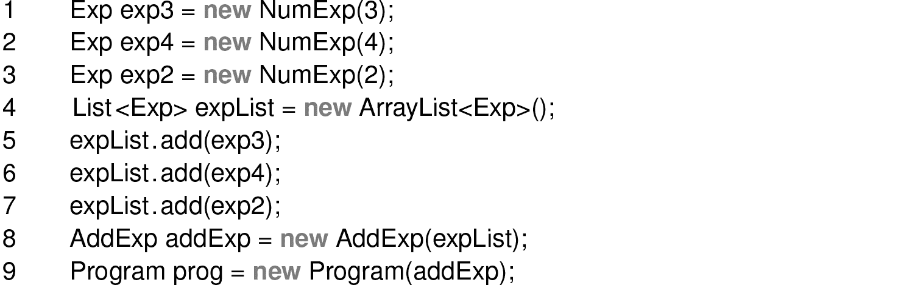

然后我们可以尝试按如下方式查找该程序的格式化形式：


如图 3.16 所示，如前面的示例所示，对`accept`方法的调用会导致图 3.14 第 2 行`Formatter`类中的`visit (Program p)`方法运行。例如，如果使用实际参数`prog`调用`visit`方法，由于`prog`是`Program`类型，则运行`visit (Program p)`方法。

该方法随后调用对象`addExp`上的`accept`方法，这反过来导致第 8 行`Formatter`类中的`visit (AddExp e)`方法运行。该方法遍历组件表达式`exp3`、`exp4`和`exp2`，并在每个对象上调用`accept`方法。这反过来又导致第 5 行`Formatter`类中的`visit (NumExp e)`方法运行三次，分别返回结果字符串“3”、“4”和“2”。因此，`visit (AddExp e)`方法的返回值是字符串“(+ 3 4 2)”。由此，`visit(Program p)`方法的返回值也是字符串“(+ 3 4 2)”，结果是表达式`prog.accept(f)`的值也是字符串“(+ 3 4 2)”。

#### 练习

##### 3.7.1 AST 节点计数器

- 使用访问者模式创建另一个访问者类示例，例如`ASTCounter`，用于计算 AST 节点的数量。`ASTCounter`中的方法不应使用任何全局或静态变量。`ASTCounter`类不应有任何字段。

##### 3.7.2 数字收集器

- 使用访问者模式创建另一个访问者类示例，例如`NumberCollector`，将 AST 中出现的所有数字收集到一个列表中。例如，程序“(+ 3 4 2)”的 AST 中出现了三个数字：“3”、“4”和“2”。`NumberCollector`中的方法也不应使用任何全局或静态变量。`NumberCollector`类不应有任何字段。

### 3.8 合法值

编程语言中程序的的输出是由其能够产生的合法值来定义和限制的。对于 Arithlang 来说，只有数值值是合法值。这是因为 Arithlang 中的所有表达式（如图 3.3 中的文法所示）只能产生数值值。

我们可以像图 3.17 所示所示定义这个合法值集合，该图指出合法值仅为`NumVal`的元素。`NumVal`是根据定义语言中的`double`数据类型来定义的。换句话说，Arithlang 的定义并不独立于定义语言，但为了简单起见，我们目前将容忍这种依赖。

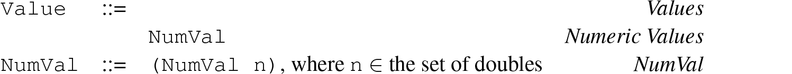

图 3.17

Arithlang 语言的合法值集合

#### 3.8.1 表示法

从现在起我们将使用前缀声明形式来编写值，而不是使用它们的命令式形式。因此`v = (NumVal 342)`等于`NumVal v = new NumVal(342)`。当我们使用像`Value`这样的抽象类名称时，意味着它的所有子类都可以用于该位置。换句话说，该关系对于该值的所有子类都有效。如果等式左侧的某个名称与等式右侧的名称匹配，它们就是同一个对象。

#### 3.8.2 实现

我们可以创建数据结构来实现`string`这一定义，如图 3.18 所示。为不熟悉 Java 的读者说明：在编程语言中，可以将`static`类定义为接口的一部分，如图 3.18 中的第 3 行所示。这些类通过在名称前附加其包含的接口名称来引用（例如`Value.NumVal`），以引用图 3.18 中的`NumVal`类。这种机制允许将相关的类在同一个编译单元中。

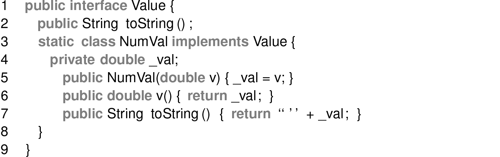

图 3.18

Arithlang 中的值

在值类型层次结构的设计中，我们创建了一个名为`Value`的接口作为所有类型值的超类型。这一决策允许为了`string`而进行设计。特别是，我们希望在未来允许其他类型的程序值。因此，创建一个接口是有意义的，这样我们就可以保护`Value`的客户端，使其不需要引用具体类型的值也能免受添加新类型值所的影响。这种概念被称为数据抽象，在编程语言的定义和实现中都起着重要作用。

### 3.9 将程序求值为值

为了将程序求值为值，我们将遵循一种类似于`formatter`的逐例讨论的递归方法。我们将此功能实现为`Evaluator`，这是一种访问者，但首先，让我们更抽象地学习这种求值过程。

Arithlang 中的程序由一个表达式组成。那么程序的值是什么？它就是这个表达式的值。

#### 3.9.1 表示法

令`Program`为 Arithlang 中所有程序的集合，`Exp`为 Arithlang 中所有表达式的集合，`Value`为 Arithlang 程序能产生的所有值的集合。此外，令`p`为一个程序（即它属于集合`Program`），`e`为一个表达式（即它属于集合`Exp`），使得`e`是`p`的内部表达式。

从现在起，我们将使用前缀声明形式来编写 AST 节点，而不是使用它们的命令式形式。因此`p = (Program e)`等于`Program(e)`。当我们使用像`Value`这样的抽象类名称时，意味着它的所有子类都可以用于该位置。换句话说，该关系对于该值的所有子类都有效。如果等式左侧的某个名称与等式右侧的名称匹配，它们就是同一个对象。

##### 3.9.1.1 值关系

我们将更精确地将语句“程序的值”写为：

```text
value(p) = v
```

在这里，将值看作一个以程序为参数的数学函数。

##### 3.9.1.2 逻辑规则

在描述编程语言的预期语义时，我们经常需要做出如“B 为真”之类的语句。我们将这种关系述为：

```text
B is true if A
```

同样，关系“当 A 和 B 都为真时 C 为真”述为：

```text
C is true if A and B
```

我们取行上方条件的逻辑与。

关系“A 无条件为真”被述为：

```text
A is true
```

#### 3.9.2 程序的值

有了这两个关系，我们可以更精确地将语句“程序的值是其内部表达式`e`的值”写为：

```text
value(p) = value(e)
```

你应该这样理解这里的关系：如果将函数作用于表达式`e`的结果是`v`，那么将函数作用于程序`p`的结果也为`v`。

`Evaluator`的实现模拟了这一数学关系：

```text
valueOf(p) = ...
```

`Evaluator`的客户端将调用`valueOf`方法来查找参数程序`p`的值。该方法利用访问者功能来查找程序的值。回之前，`accept`调用最终会将控制转移到访问者的`Program`情况：

```text
visit(p)
```

该情况说明程序的值是组成程序的表达式的值。

#### 3.9.3 数值表达式的值

首先，最简单的情况是结果是一个`NumExp`表达式（字面量）。数值表达式是任何 Arithlang 程序中的叶子节点，它没有任何组件子表达式。数值表达式的值是一个`NumVal`值：

```text
value(NumExp n) = n
```

在这里，`n`是一个`double`。和之前，值是从表达式到值的数学关系。表示法`(NumExp n)`等于`new NumExp(n)`，且 Number 代表所有合法数字。

该情况在`Evaluator`中的实现也建模了这种关系：

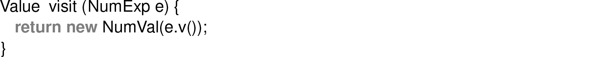

在这个用例中，我们从表达式中提取数值，然后根据该结果创建一个数值。这模拟了这样语义：字面量的值就是其数值值[例如，`10`的值是`(NumVal 10)`]。

#### 3.9.4 加法表达式的值

计算加法表达式的值与字面量（literals）不同，因为加法表达式是一个复合表达式，而数值表达式是一个叶子表达式。

要计算复合表达式的值，我们必须首先计算其组件子表达式的值。记住，加法表达式可以包含两个或多个子表达式，例如`(+ 300 40 2)`。下面的数学关系规定了加法表达式的值：


在这里，`e[0]` … `e[*n*]`是表达式（即它们属于集合`Exp`）。所有符号的含义与之前相同。记住，如果线以上的所有条件都成立，则线下方的条件也成立。你应该这样理解这个关系：如果每个组件子表达式 e[*i*] 求出的数值均为`(NumVal n[*i*])`并且数字 n[0] 到 n[*k*]的和为 n，那么以 e[0] 到 e[*k*] 为子表达式的加法表达式的值为 n。

这里是上述关系的应用：


这里是另一个递归使用相同关系的应用：


该情况在`Evaluator`中的实现也建模了这种关系：

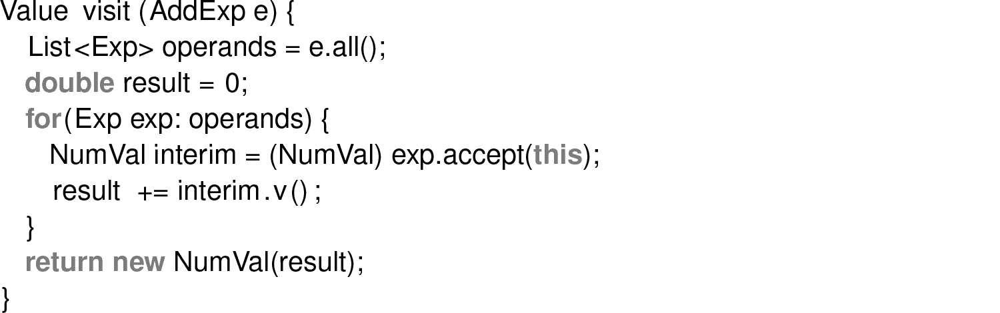


我们在这里使用的实现技术具有语义上的影响；也就是说，它可能会改变我们编程语言中加法的预期意图。例如，如果一个加法表达式有三个组件子表达式，我们可以随机计算它们的值，从第一个到最后一个（如果你记得，这等同于从左到右的文本顺序），或者从最后一个到第一个（等同于从右到左的文本顺序）。在我们的编程语言中，我们选择从左到右求值子表达式并将它们的值加到一个中间变量`result`中。存储在`result`中的最终值就是该加法表达式的值。

## 练习

**3.9.1.** *语义变化*：检查以下对加法表达式值的不同解释。这对程序的值可能产生什么影响？

*   加法表达式随机求值其子表达式。
*   加法表达式将求值任何一个子表达式时得到的任何非整数值（非`NumVal`）视为`0`。

## 3.9.5 减法表达式的值

减法表达式的值关系也以与加法表达式类似的方式进行表述：


所有符号的含义与之前相同。这里是上述关系的应用：


这里是另一个递归使用相同关系的应用：

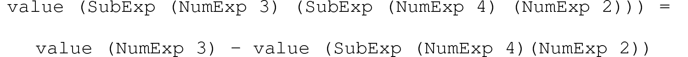

该情况在`Evaluator`中的实现也建模了这种关系：

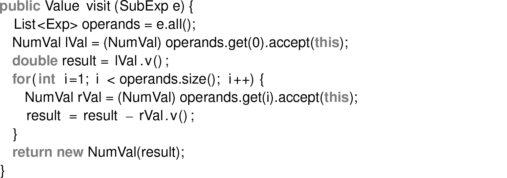

这种实现与加法的情况略有不同，在于我们首先计算第一个操作数的值，然后迭代地从该值中减去其他操作数。

## 3.9.6 乘法和除法表达式的值

乘法和除法表达式的值关系也以类似于加法表达式的方式表述，但为了完整起见，我们在这里复现它们：

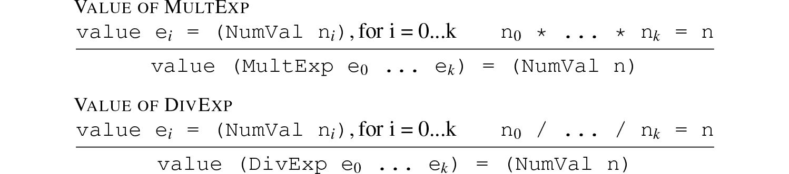

作为读者可以在`Evaluator`中实现乘法和除法表达式的情况。

## 3.10 读取-求值-打印循环 (REPL)

现在我们已经有了解释器的所有组件，就可以将它们组合在一个简单的 REPL 中，并获得 Arithlang 编程语言的第一个工作实现：

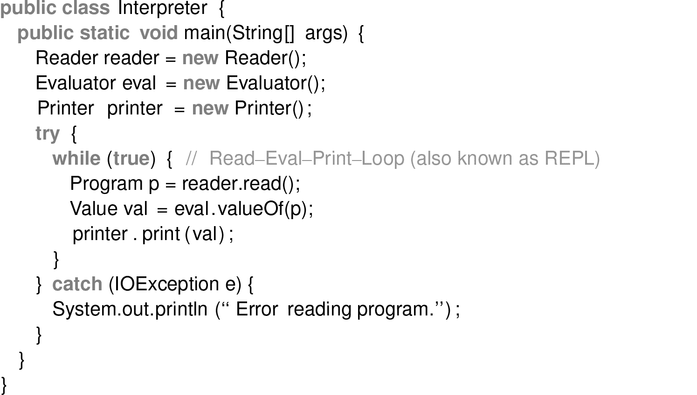

我们可以玩玩这个解释器观察它是如何工作的。在下面的*交互日志*中，`$`是解释器的提示符，`$`之后的文本是用户编写程序，下一行的文本是该程序的值：

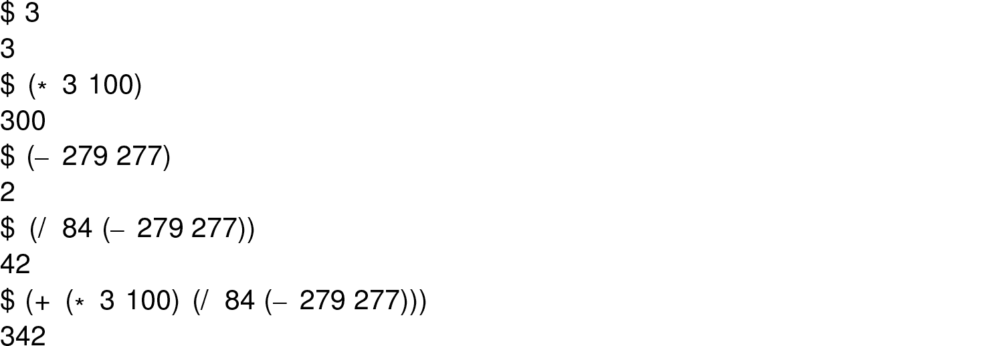

## 总结

在本章中，我们构建了第一个完整的（尽管非常小）编程语言 Arithlang，它允许我们对算术表达式进行计算。在构建这种语言的过程中，我们回顾了编程语言的两种可能实现：解释器和编译器。解释器是一个将定义语言中的程序转换为定义语言中合法值的程序。编译器是一个将定义语言中的程序转换为目标语言中另一个程序的程序。目标语言中的程序可以由解释器或另一个编译器进一步处理。在本章，我们选择了解释器作为语言的实现。

我们还学习了编程语言的语法，它由一个或多个定义该语言中合法程序的规则组成。我们回顾了非终结符（nonterminals），它们是可以进一步扩展的符号，语法包含一个或多个扩展非终结符的规则。我们还回顾了终结符（terminals），它们是无法扩展的叶子节点。语法由一个或多个扩展非终结符的逻辑规则组成。

我们回顾了存储程序的数据结构以便进一步处理。具体语法保留了程序员可见的语法部分。抽象语法忽略了完全为了程序员而存在的语法细节。我们创建了用于存储程序的 AST 抽象语法树设计和实现。给定语法，像 ANTLR 这样的工具可以生成解析程序到 AST 代码。

我们学习了访问者模式（visitor pattern），这是一种用于 AST 遍历的重要对象设计模式。这种模式通过其间接性，允许将打印 AST、评估 AST 等功能的实现与 AST 类的实现分离。

接下来，我们回顾了 Arithlang 的语义以及将表达式求值的过程。所有叶子表达式直接求值，而复合表达式首先计算组件表达式的值，然后结合这些结果以计算复合表达式的结果。我们学习了程序表达式的求值顺序。我们还回顾了以逻辑规则形式的程序表达式求值规则。最后，我们回顾了如何将解释器的部分组合在一个循环中，读取程序、计算程序的值并打印这些结果。

## 练习

**3.10.1.** *最小公倍数 (LCM) 表达式*：扩展 Arithlang 编程语言以支持最小公倍数（LCM）表达式，其语法应为`(# list-of-operands)`。整数的最小公倍数是所有这些整数整除的正整数。下面的交互日志展示了该表达式的预期语义：


**3.10.2.** *最小公倍数 (LCM) 表达式的值*：编写 LCM 表达式的值关系。注意你需要考虑`0`的情况。

**3.10.3.** *模运算表达式*：扩展 Arithlang 编程语言以支持模运算表达式`(% a b)`，有时也称为余数（remainder）。下面的交互日志展示了该表达式的预期语义：


**3.10.4.** *模运算表达式的值*：编写模运算表达式的值关系。

## 3.10.5 幂表达式

扩展 Arithlang 编程语言以支持幂运算`(** a b)`。下面的交互日志说明了该表达式预期的语义：


## 3.10.6 幂表达式的值

为幂表达式编写值关系。

## 3.10.7 最大、最小表达式

扩展 Arithlang 编程语言以支持两个新表达式：`greatest-of`（`(>? a b)`）和`least-of`（`(<? a b)`）。下面的交互日志说明了这些表达式预期的语义：

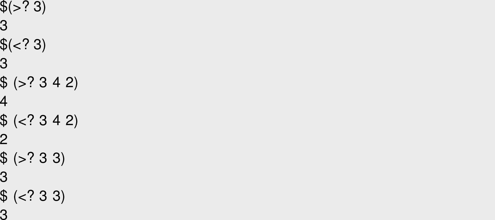

## 3.10.8 最大、最小表达式的值

为最大和最小表达式编写值关系。

## 3.10.9 除零

当前 Arithlang 编程语言的语义并未考虑除零错误。

1. 编写一个程序，使用 Arithlang 中定义的所有算术表达式并产生一个除零错误。

2. 扩展 Arithlang 编程语言，使得任何数字除以零的结果是一个类型为`DynamicError`的特殊值。这种值应该向用户提供关于哪个表达式导致了错误的信息。下面的交互日志说明了该表达式预期的语义：

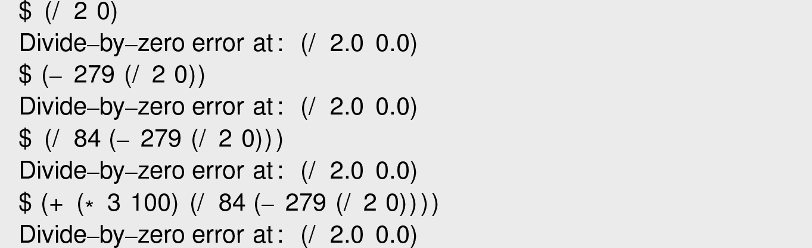

## 3.10.10 除零的值

必要时，修改所有 Arithlang 表达式的值关系，以便在支持该表达式语义时产生除零错误。

## 3.10.11 内存单元格

典型的计算器提供四种操作来记忆数值：加到内存（`M+`）、从内存减去（`M-`）、调用内存存储的值（`MRec`）以及清除内存中存储的值（`Mclr`）。扩展 Arithlang 编程语言以支持模拟这些操作的四个表达式。

1. 语法为`(Mrec)`的内存调用表达式`MrecExp`应该调用解释器内存中存储当前的值。

2. 语法为`(Mclr)`的内存清除表达式`MrecExp`应该清除解释器内存中存储当前的值。

3. 语法为`(M+ exp0 …expn)`的内存累加表达式`MaddExp`应该将`exp0`到`expn`的值加到解释器内存中存储的当前值。

4. 语法为`(M− exp0…expn)`的内存减法表达式`MsubExp`应该从解释器内存中存储的当前值减去`exp0`到`expn`的值。

## 3.10.12 内存单元格操作的值

为内存单元格操作编写值关系。

1. 加速计算的一种常用实现技术是*即时编译*（JIT），它在运行程序之前编译程序的部分。然后，运行这个编译版本而不是解释程序。

2. 关于语法、解析、语法分析以及编译器构造其他方面的更多信息，请参考 Alfred V. Aho, Monica S. Lam, Ravi Sethi 和 Jeffrey D. Ullman 的 *Compilers: Principles, Techniques, and Tools*, 2nd ed. (Addison Wesley, 2006)。

3. 关于 ANTLR 语法和语义的更多信息，请参考 Terence Parr 的 *The Definitive ANTLR 4 Reference*, The Pragmatic Bookshelf, Release P2.0 (2015)。

4. 关于访问者模式和其他对象设计模式的更多信息，请参考 Erich Gamma, Richard Helm, Ralph Johnson 和 John Vlissides 的 *Design Patterns: Elements of Reusable Object-Oriented Software* (Addison-Wesley Longman, 1995)。

5. 关注点分离（最早由 Edsger Dijkstra 在其开创性论文《科学思维的角色》（On the Role of Scientific Thought），*Selected Writings on Computing: A Personal Perspective*（Springer-Verlag, 1982, pp. 60–66）中正式提出的概念）是一种将程序分成若干部分的原则，以便开发者能够为了自身而理解这些部分。

6. SMALLTALK 是被认为第一个支持双分派，或者说支持其更通用形式多重分派的语言。

# 4 Varlang: 带变量的语言

**第4章**

* 变量作为抽象手段
* 变量定义与使用
* 作用域：静态与动态
* 变量环境、绑定
* 传递环境的解释器、变量查找

**第5章**

* 全局变量
* 局部与全局
* `Define`声明
* 全局环境
* 全局下的程序求值

**第6章**

* 函数作为抽象手段
* 函数作为一等值、柯里化
* 函数式数据结构
* 函数值创建、闭包、函数调用

我们将从设计并实现一种名为`Varlang`的简单编程语言开始。`Varlang`是上一章中开发的语言`Arithlang`的扩展。当我们说一种语言扩展了另一种语言时，意味着前者拥有后者的所有功能并且更多。因此，`Varlang`拥有`Arithlang`的所有功能并更多。

`Varlang`的主要目标以及它优于`Arithlang`的优势在于，它允许程序员编写能够同时使用数字和定义变量进行算术运算的程序。例如，该编程语言的用户可能会编写表4.1中所示的一些程序。该表格左侧显示程序，右侧显示它们的结果。

**表4.1** 一些Varlang程序及其运行结果

| Varlang程序 | 程序结果 |
| --- | --- |
| `(let ((x 1)) x)` | 1 |
| `(let ((x 1) (y 1)) (+ x y))` | 2 |
| `(let ((x 1) (y 1)) (let ((z 1)) (+ x y z)))` | 3 |
| `(let ((x 1)) (let ((x 4)) x))` | 4 |
| `(let ((x 5)) (let ((y x)) y))` | 5 |

`Varlang`的用户可以预期这些程序分别产生值`1`、`2`、`3`、`4`和`5`。注意，与`Arithlang`一样，`Varlang`中的程序也是以前置表示法编写的，而不是Java等语言使用的中置表示法。回想一下，在前置表示法中，`+`、`−`、`*`、`/`、`%`和`let`等运算符出现在操作数之前。为了消除歧义，我们用`（`和`）`来界定一个`Varlang`表达式的开始和结束。

这些程序展示了两个特征：变量定义和变量使用。变量定义通过`let expression`完成，这与数学中的变量定义相似，我们经常写下这样的语句：


在`Varlang`的语法中，`let expression`以左括号`(`和关键字`let`开头，以右括号`)`结尾。`let expression`的其余部分包含两个部分：

*   左括号`(`，后面跟着一个或多个已定义的变量，然后是右括号`)`。
*   该定义有效的表达式，称为变量定义的作用域。

每个变量定义都具有以下形式：一个左括号`(`，后面是给变量指定的名称，然后是将被赋值给变量的值的表达式，最后是右括号`)`。因此在`Varlang`中，这里给出的非正式陈述将写为以下表达式：

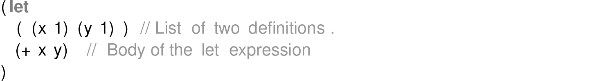

`let`表达式可以相互嵌套。例如，我们也可以如下定义两个变量`x`和`y`：

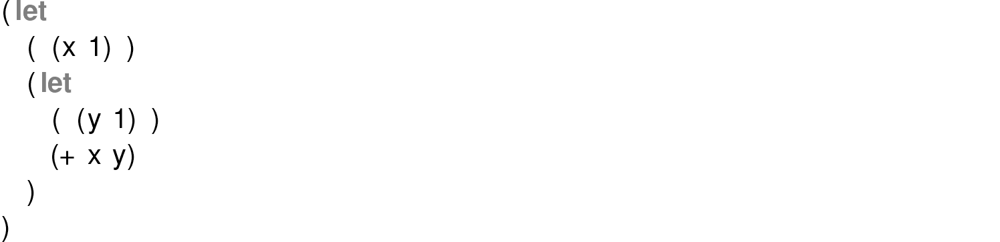

在这个例子中，第一个`let expression`声明变量`x`，第二个`let expression`声明变量`y`。让我们来看另一个例子：

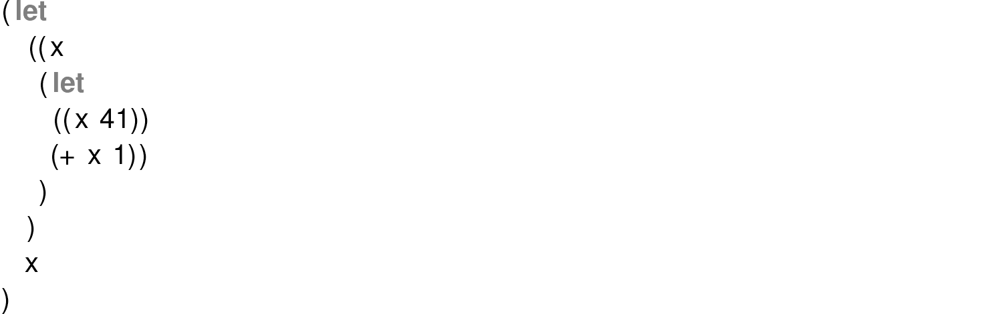

在这个例子中，第一个`let expression`将整个第二个`let expression`的值赋值给`x`。整个`let expression`的值是该上下文中`(+ x 1)`的值，即`42`。因此，该程序的值是`42`。

## 练习

### 4.2.1 将以下用非正式表示法写的算术表达式转换为Varlang表示法。同时，检查并写出每个表达式的值。

1. 让`x`为`1`。那么，结果是`x`。
2. 让`x`为`4`且`y`为`2`。那么，结果是`x - y`。
3. 让`x`为`1`。让`y`为`2`。那么，结果是`x + y`。
4. 让`x`为`7`，`y`为`1`，且`z`为`2`。那么，结果是`x - y - z`。
5. 让`x`为`10`，`y`为`2`。那么，结果是`x / y`。

### 4.2.2 使用Varlang的语法编写五个不同的算术表达式，使得每个表达式产生值`342`。每个表达式必须使用所有四个算术运算符`+`、`−`、`*`和`/`以及新的`let expression`。

### 4.2.3 在上一个问题的基础上，使用Varlang的语法编写五个不同的算术表达式，使得每个表达式产生值`342`。每个表达式必须使用所有四个算术运算符`+`、`−`、`*`和`/`以及新的`let expression`。第一个表达式应使用一个`let expression`，第二个使用两个，第三个使用三个。

### 4.2.4 使用`let expression`编写一个Varlang程序，声明一个值为`3.1415`的变量`pi`，然后在`let expression`的主体中使用该变量计算圆圆的面积。

### 4.2.5 使用`let expression`编写一个Varlang程序，声明一个值为`9.8065`的变量`g`，然后在`let expression`的主体中使用该变量计算重力。

### 4.2.6 给定两个变量，代表质量的`m`和代表速度的`v`，编写一个计算动能的程序。

## 4.3 作用域

在考虑变量定义时，它们的有效范围是一个重要问题。通常，在编写时，变量定义会覆盖之前的定义，直到下一个同名变量定义或结束，以较者为准。这句话是`作用域规则`的例子。

变量的`作用域`指的是程序中定义可见并产生影响的位置。变量在作用域内是可以访问的。

### 4.3.1 静态作用域

一种流行的作用域规则称为静态作用域。正如名称所示，如果一种编程语言实现静态作用域，那么该语言中变量的作用是由语法决定的。例如，考虑 ALGOL 族语言（如 C、C++ 或 Java）中的语句序列：`int x = 1; { int x = 42; res = x + 1; }`。对于这些语言，变量定义的开始通常用左括号`{`标记，结束用右括号`}`标记。因此，可以说`x`赋值`42`的定义对于`res = x + 1;`是有效的。这允许程序员在不运行程序的情况下查看代码确定变量定义是否产生影响。

在`Varlang`中，我们采用静态作用域规则。`let expression`中定义的名称仅在`let expression`的主体内有效，可以通过检查`let expression`找到。换句话说，通过观察`Varlang`程序的静态代码，可以确定每个变量定义的范围。

另一种作用域规则称为`动态作用域`（dynamic scoping）。它存在于某些语言中，例如Perl和Logo。在动态作用域中，变量的值是由运行时的当前作用域定义的，而不是变量定义时的词法作用域（lexical scope）。动态作用域的概念在函数的范围内将变得更加清晰，我们将在第6章学习这一点。目前，只需说如果一个函数没有对某些变量的定义，那么在词法作用域情况下，这些变量的值来自周围作用域；而在动态作用域情况下，则来自运行时作用域。动态作用域允许代码通过函数形式参数以外的内容进行参数化。另一方面，这种作用域规则会增加理解程序的复杂度，因为变量可能会意外地取自非预期变量定义的值。

### 4.3.3 作用域中的洞

变量的重新定义会在原始定义的作用域中创建一个“洞”（hole）。例如，考虑以下Varlang程序，它包含两个`let`表达式：

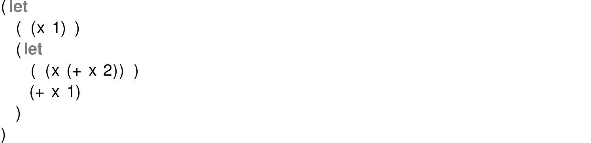

在程序中，第二个`let`表达式重新定义了`x`。这种重新定义在第二个`let`表达式的体内产生影响。这被称为在第一个`let`表达式的作用域中“创建了一个洞”，使得`x`的第一个定义不再有效。

再看另一个例子，考虑以下Varlang程序，它包含两个`let`表达式：

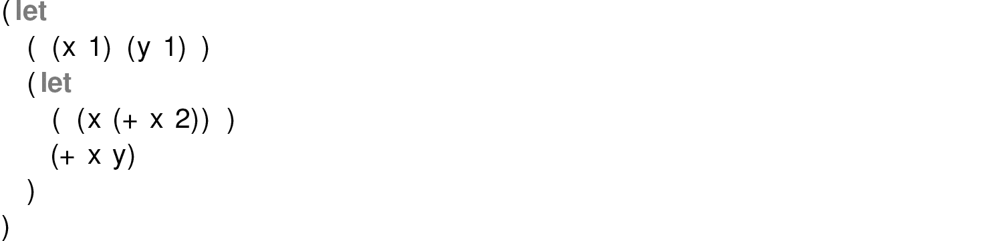

在该程序中，`y`定义的作用域是第一个`let`表达式的整个体，而第一个`x`定义的作用域仅为表达式`(+ x 2)`。在求值该表达式后，`x`的值被一个新定义覆盖。这个新定义的作用域是表达式`(+ x y)`。重新定义一个名称会在原始作用域中创建一个洞。因此，表达式`(+ x y)`就是`x`第一个定义作用域中的一个洞。

作用域中的洞是可以嵌套的，如下例所示：

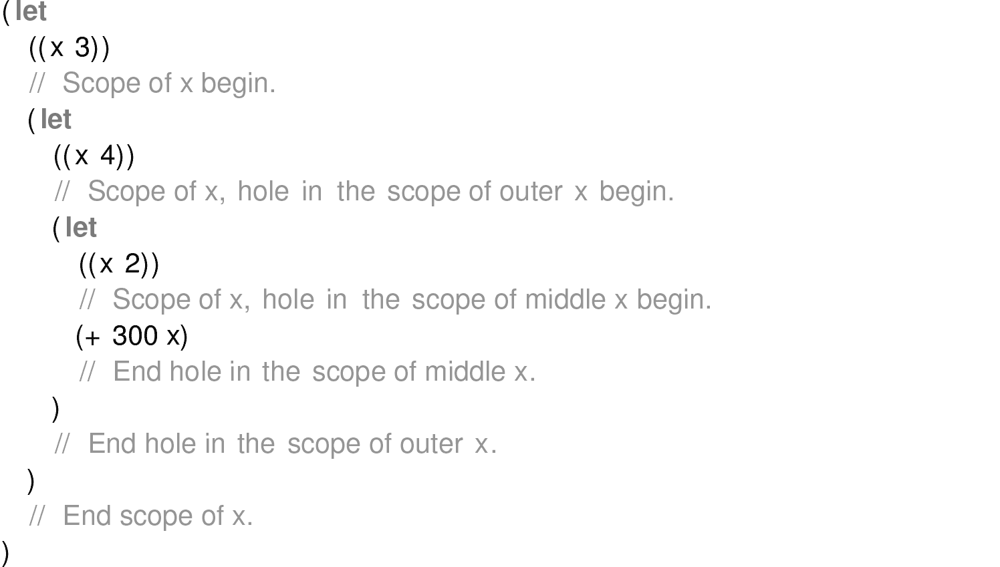


在这里，`x` 的连续定义在外层定义的作用域中创建了洞。

## 4.3.4 自由变量与绑定变量

与变量定义和作用域相关的概念是`自由变量`（free variable）和`绑定变量`（bound variable）。如果一个变量在表达式中没有被包含它的 `let` 表达式定义，则该变量在该表达式中是自由的。例如，在程序“x”中，变量 `x` 是自由的。在 Varlang 程序 `(let ((x 1)) x)` 中，变量 `x` 是绑定的，因为它被包含它的 `let` 表达式定义。因此 `x` 在此程序中不是自由变量。通常，带有自由变量的程序会产生未定义变量错误，除非它们被定义为全局变量，正如我们在第 5 章中看到的。

在所示的程序中，`x` 是自由变量而 `y` 是绑定变量。这是因为 `y` 被包含的 `let` 表达式中的变量定义所绑定，而 `x` 并没有被该表达式定义：

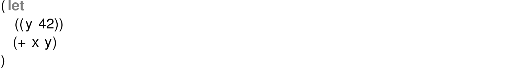

现在考虑这个例子的变体。下一个例子有两个 `x` 和 `y` 的定义，都在第 2 行，在第 2 行和第 3 行有两次 `x` 的使用，在第 3 行有一次 `y` 的使用：

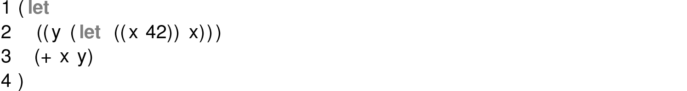

对于整个表达式，`x` 表现为自由的，因为第 3 行变量的使用没有被包含它的 `let` 表达式绑定。第 2 行 `x` 的使用不是自由的，因为它被一个定义 `x` 的 `let` 表达式包围；然而，对于第 1 到 4 行的整个程序，变量 `x` 表现为自由的，因为它在第 3 行处是自由的。

同样地，在下一个例子中，`x` 是自由的，因为紧接的 `let` 表达式和外层的 `let` 表达式都没有对 `x` 的绑定：

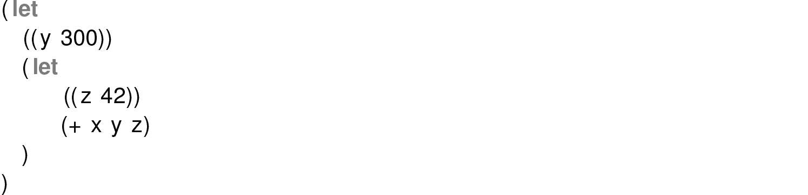

在示例中，`x` 是绑定的：


变量 `x` 在上一个例子中是绑定的，更准确地说，它至少绑定了一次，因为示例中有一个定义 `x` 的 `let` 表达式。

一段代码的自由变量可以由词法上下文（词法作用域规则情况下）或动态上下文（动态作用域规则下）中的变量定义来确定。正如我们在第 6 章中看到的，函数作为值的表示包含了其体中来自词法作用域自由变量的绑定值。

## 练习

4.3.1. 写出以下每个 Varlang 程序中所有的自由变量和绑定变量。如果程序中没有某类变量，请注明 None。

1. `(let ((x 1)) x)`

2. `(let ((x 1) (y 1)) (+ x y z))`

3. `(let ((c 3) (l p)) (let ((s 2)) (+ c l s)))`

4. `(let ((x 1)) (let ((x 4)) x))`

5. `(let ((q 5)) (let ((r q)) s))`

4.3.2. 在以下每个 Varlang 程序的顶层变量定义的作用域中是否存在洞？如果程序没有，请注明 None。否则，写出程序中代表洞的部分。

1. `(let ((x 1)) x))`

2. `(let ((x 1)) (let ((x 4)) x))`

3. `(let ((x 1) (y 1)) (+ x y z))`

4. `(let ((c 3) (l p)) (+ c l s)))`

5. `(let ((q 5)) (let ((r q)) s))`

## 4.4 读取 Let 和变量表达式

解释器通常包含三个步骤：读取、求值和打印。读取步骤包括将程序作为字符串读取、将字符串划分成更小的单元（称为标记）、根据文法将标记组织成解析树，最后将解析树转换为抽象语法树（AST）。我们已经在上一章中看过了算术语言的文法。由于 Varlang 有更多表达式，我们需要对其进行扩展。扩展后的文法如图 4.1 所示。


### Varlang 语言的文法

程序的规则是相同的——程序可以是一个表达式。表达式（`exp`）的规则有两个分支（在图中突出显示）：`varexp`（代表“变量表达式”）和 `letexp`（代表“let 表达式”）。`varexp` 的规则规定变量名可以是 `Identifier`。`Identifier` 可以是一个字母后跟零或多个字母或数字（例如，a1 是有效的标识符，但 1a 不是）。正如之前讨论的，`letexp` 的规则规定 let 表达式以左括号和 `let` 关键字开始，以右括号结束，并包含一个或多个变量定义 `(` `(` Identifier `)`)+ `)`，随后是体 `exp`。在我们的文法中，当我们说 `( x y )+`，这意味着 *x* 后跟着 *y* 重复一次多次，例如 `(` Identifier `)`)`。

与算术语言类似，我们可以为 Varlang 的示例程序编写语法推导。其中一个推导如图 4.2 所示。在此推导中，新的表达式在第 3 步（展开 let 表达式）和第 12 步（展开变量表达式）被展开。此外，注意第 5 步对 `+` 形式的展开，它被扩展为一组 `(` Identifier `)` 对。


程序 `(let ((x 1)) x)` 的左推推导

### 练习

4.4.1. 写出以下 Varlang 程序的左推推导。

1. `(let ((c 3)) c)`

2. `(let ((c 3)(d 4)) d)`

3. `(let ((c 3)(d 4)) (+ c d))`

#### 4.4.2. 修改 Varlang 语言的语法，使得 `let` 表达式可以仅声明一个变量。这种设计是否比之前可以声明多个变量的设计表达力更低？为什么？或者为什么不是？

## 4.4.3. 修改 Varlang 语言的语法，使得 `let` 表达式具有类似 Haskell 的语法。此类 `let` 表达式的一个示例是 `let x = 3 in x`。

## 4.5 用于 Let 和 Var 的 AST 节点

解释器的读取阶段为后续阶段产生程序的 AST。在 Arithlang 的 AST 表示中，我们没有用于存储 `var` 和 `let` 表达式的合适数据结构。因此，我们扩展了 AST 数据结构，以包含两种新类型的 AST 节点：表示变量的 `VarExp` 和表示 let 表达式的 `LetExp`。用于此 AST 节点表示的修改后的统一建模语言（UML）图如图 4.3 所示。这两个新类（右下角）也继承自 `Exp` 类。


图 4.3

根据图 4.1 中语法的定义，用于存储 Varlang 程序的 AST 层次结构设计的 UML 图。两个新 AST 节点的具体 Java 代码如图 4.4 所示。

这些新类型节点的源代码如图 4.4 所示。由于这两类节点也都是表达式，因此它们的实现扩展了 `Exp` 类。在内部，`VarExp` 存储变量名称（一个字符串）。`LetExp` 类存储已定义的变量名称、它们的初始值以及 `let body`（一个表达式，在该表达式期间变量定义将产生作用，即作用域）。


图 4.4

Varlang 语言的新型 AST 节点

由于我们的整个解释器框架使用了访问者设计模式，这些新的 AST 节点也实现了委托方法 `accept`。回想 `accept` 方法的作用是调用在 `Visitor` 类任何子类中声明的签名名为 `visit(LetExp e, Env env)` 方法。

最后，`Visitor` 接口被扩展以支持这两个新表达式（新方法位于图 4.5 第 9–10 行）。你还会注意到，每个现有方法都已扩展以包含一个类型为 `Env` 的额外形式参数，代表环境。我们将在本章稍后的 4.7 节讨论环境的概念。由于 `Formatter` 也是访问者的一种，此更改也需要更新它。


图 4.5

Varlang 语言的访问者接口

总结来说，为了扩展 Arithlang 语言的前端以支持变量定义和使用的新表达式，我们采取了以下步骤：

1. 扩展语言语法以支持解析新表达式

2. 扩展抽象语法树数据结构，为每种新类型的表达式添加新类

3. 扩展访问者结构以支持新类型的表达式

4. 更新现有访问者以支持新类型的表达式

在本书的其余部分，当我们说“扩展前端”时，指的是这些步骤。

## 4.6 词法作用域变量定义

`(let ((x 1)) x)` 的值是什么？对于这个简单的表达式，很容易猜出它可能是 1。我们可以这样推导该表达式的值：“令 x 为 1。那么，结果是 x。由于 x 是 1，因此结果是 1。”所以我们可能会大胆地进行推测，并声称 `let` 表达式的值是 `let body` 的值。因此，`(let ((x 3)(y 4)) (+ x y))` 的值就是 `(+ x y)` 的值。我们实现了加法表达式的语义，基于此，我们可以说 `let` 表达式的值是 `x` 的值加上 `y` 的值，但我们如何找到 `x` 和 `y` 的值呢？

思考这个问题有两种方法。第一种方法，称为**基于替换的语义**（substitution-based semantics），其工作原理如下：`(let ((x 3)(y 4)) (+ x y))` 的值是由原始 `let body` `(+ x y)` 通过将 `x` 替换为 `3` 并将 `y` 替换为 `4` 创建的新表达式的值。根据这种方法，`let` 表达式的值是 `(+ 3 4)` 的值，即 7。在这种风格下，我们不需要定义“变量的值”的含义，因为我们永远不需要寻找它。为了进一步说明这一点，`(let ((x 3)) (let ((y 4)) (+ x y)))` 的值是由原始 `let body` `(let ((y 4)) (+ x y))` 通过将 `x` 替换为 `3` 创建的新表达式的值；即 `(let ((y 4)) (+ 3 y))` 的值。`(let ((y 4)) (+ 3 y))` 的值是由原始 `let body` `(+ 3 y)` 通过将 `y` 替换为 `4` 创建的新表达式的值。

这两个示例所示：


图 4.6

基于替换的语义的 let 表达式


图 4.7

基于环境的语义的 let 表达式

第二种方法，称为**基于环境的语义**（environment-based semantics），其工作原理如下：`(let ((x 3)(y 4)) (+ x y))` 的值是在存在将 `x` 映射到 `3` 和 `y` 映射到 `4` 的字典（环境）时，`let body` `(+ x y)` 的值。这两种策略都有其优点。在编程语言的理论处理中，前者更好。在本书中，我们将遵循基于环境的方法，因为它更接近编程语言的实现。

简而言之，在基于环境的语义中，所有表达式访问一个环境，环境是从变量名到值的字典。`let` 表达式会在环境中添加新的映射。在运行 `let body` 期间，这些新映射存在。我们现在通过图 4.8 中的示例来阐明这一点。


图 4.8

Varlang 语言的环境

注意，变量到值的新映射（如 `x↦1`）被放置在环境的开头。此外，从表达式的演变可以看出，变量的值是在环境中从左找到第一个值。为了实现这种语义，我们首先为环境构建数据结构。

## 4.7 环境抽象

环境是一个提供查找变量值操作的数据类型。这里的定义模拟了这一意图，而图 4.9 中的实现实现了它：


图 4.9

Varlang 语言的环境数据类型

在这里，`var, var' ∈ Identifier`（标识符集），`val ∈ Value`（Varlang 语言中的值），`env, env' ∈ Env`（环境集）。与之前一样，用 `(EmptyEnv)` 表示使用 `EmptyEnv` 构造器构建的环境，用 `Env` 表示所有此类元素（即整个集合）。同样，`(ExtendEnv var val env)` 是使用 `ExtendEnv` 构造器构建的环境，其中 `var, val, env` 是用于构造此环境的值。

该定义提供了一个单一操作 `get`，用于从环境中查找变量，并规定在空环境中查找任何变量都会导致错误。此外，它还规定，在由 `var`、`val`、`env` 构建的扩展环境中查找变量，如果正在查找的变量与 `var` 相同，则结果为 `val`；否则，结果为在 `env` 中查找该变量得到的值。

空环境是最简单的一种环境。它不定义任何变量。图 4.10 中的列表模型化了这种行为。


图 4.10

Varlang 语言的空环境

由于这个空环境没有定义任何变量，因此对于每一个变量查找，它都会通过抛出异常来告诉客户端找不到该变量。

另一种环境是存储从单个变量到其值的映射的环境。这种行为由图 4.11 中定义的环境类 `ExtendEnv` 模型。在这种类环境中，使用 `get` 操作查找变量时，它会检查正在查找的变量是否与存储的变量相同。如果是，则返回存储的值；否则，它会委托。


图 4.11

Varlang 语言的扩展环境

这种委托行为非常有趣，因为它允许环境以单向链表的形式链在一起。`_saved_env` 字段存储链中的下一个环境，在图 4.11 的第 13 行中，我们将其委托给了它。

使用这些数据类型，我们可以按照如下方式创建一个环境，将变量 `a` 映射到值 3，将 `b` 映射到值 4，将 `c` 映射到值 1：


注意，由于空环境标记了列表的末尾，每一个在环境中未找到的变量查找都将导致 `LookupException`。我们还可以在环境链中为同一个名称设置两个映射，例如这里给出的环境 `env4`，它对名称“c”有两个映射：


我们可以像之前那样，在创建的环境中查找某些名称。对于每次查找，鼓励读者追溯“扩展环境”和“空环境”的列表，以理解注释中所述的演示行为。

### 练习题

4.7.1. `ExtendEnvList` 设计并实现一种新类型的环境 `ExtendEnvList`，它也实现了本节介绍的 `Env` 接口。与 `ExtendEnv` 不同，这种环境应该允许存储多个名称到值的映射。

4.7.2. `EmptyEnvNice` 设计并实现一种新类型的空环境 `EmptyEnvNice`，它也实现了本节介绍的 `Env` 接口。与 `EmptyEnv`（后者在查找名称，例如“x”）时会抛出异常）不同，这种环境会扩展自身，添加一个从“x”到默认值“0”的映射。通过这种环境，我们能够区分出被赋予默认值“0”的名称与未定义的名称吗？

## 4.8 环境传递解释器

现在由于我们已经有了表示环境的数据类型，我们可以在求值器中使用它。由于环境在定义新变量时以及变量定义的作用域结束时会变化，我们需要在表达式求值过程中将环境从父表达式传递到子表达式。在本节中，我们将增强 Varlang 解析器以包含此功能。

### 4.8.1 环境中程序的值

首先，由于我们已经有了表示环境的数据类型，我们可以在求值器中使用它。由于环境在定义新变量时以及变量定义的作用域结束时会变化，我们需要在表达式求值过程中将环境从父表达式传递到子表达式。在本节中，我们将增强 Varlang 解析器以包含此功能。

首先，由于我们已经有了表示环境的数据类型，我们可以在求值器中使用它。由于环境在定义新变量时以及变量定义的作用域结束时会变化，我们需要在表达式求值过程中将环境从父表达式传递到子表达式。在本节中，我们将增强 Varlang 解析器以包含此功能。

首先，由于我们已经有了表示环境的数据类型，我们可以在求值器中使用它。由于环境在定义新变量时以及变量定义的作用域结束时会变化，我们需要在表达式求值过程中将环境从父表达式传递到子表达式。在本节中，我们将增强 Varlang 解析器以包含此功能。

首先，由于我们已经有了表示环境的数据类型，我们可以在求值器中使用它。由于环境在定义新变量时以及变量定义的作用域结束时会变化，我们需要在表达式求值过程中将环境从父表达式传递到子表达式。在本节中，我们将增强 Varlang 解析器以包含此功能。

首先，由于我们已经有了表示环境的数据类型，我们可以在求值器中使用它。由于环境在定义新变量时以及变量定义的作用域结束时会变化，我们需要在表达式求值过程中将环境从父表达式传递到子表达式。在本节中，我们将增强 Varlang 解析器以包含此功能。

首先，由于我们已经有了表示环境的数据类型，我们可以在求值器中使用它。由于环境在定义新变量时以及变量定义的作用域结束时会变化，我们需要在表达式求值过程中将环境从父表达式传递到子表达式。在本节中，我们将增强 Varlang 解析器以包含此功能。

首先，由于我们已经有了表示环境的数据类型，我们可以在求值器中使用它。由于环境在定义新变量时以及变量定义的作用域结束时会变化，我们需要在表达式求值过程中将环境从父表达式传递到子表达式。在本节中，我们将增强 Varlang 解析器以包含此功能。

首先，由于我们已经有了表示环境的数据类型，我们可以在求值器中使用它。由于环境在定义新变量时以及变量定义的作用域结束时会变化，我们需要在表达式求值过程中将环境从父表达式传递到子表达式。在本节中，我们将增强 Varlang 解析器以包含此功能。

首先，由于我们已经有了表示环境的数据类型，我们可以在求值器中使用它。由于环境在定义新变量时以及变量定义的作用域结束时会变化，我们需要在表达式求值过程中将环境从父表达式传递到子表达式。在本节中，我们将增强 Varlang 解析器以包含此功能。


首先，由于我们已经有了表示环境的数据类型，我们可以在求值器中使用它。由于环境在定义新变量时以及变量定义的作用域结束时会变化，我们需要在表达式求值过程中将环境从父表达式传递到子表达式。在本节中，我们将增强`Varlang`解析器以包含此功能。

#### 4.8.1 环境中程序的值

首先，由于我们已经有了表示环境的数据类型，我们可以在求值器中使用它。由于环境在定义新变量时以及变量定义的作用域结束时会变化，我们需要在表达式求值过程中将环境从父表达式传递到子表达式。在本节中，我们将增强`Varlang`解析器以包含此功能。

首先，由于我们已经有了表示环境的数据类型，我们可以在求值器中使用它。


`，``` 是所有所有的集合，`Value` 是所有值的集合：


为了说明这一点，考虑加法表达式 `(+ x y)` 具有两个子表达式 `x` 和 `y`。现在，想象这个表达式是在一个环境中，`x` 映射到值 300 且 `y` 映射到值 42。这里给出的语义指出，我们在计算 `x` 和 `y` 的值时使用的环境应该与父表达式 `e` 的环境相同。

#### 4.8.2 不改变环境的表达式

有些表达式不依赖环境，例如 `NumExp`：


其他表达式并不直接改变环境。它们只是将环境传递给它们的子表达式。为了说明这一点，考虑加法表达式：


加法表达式既不定义新的变量定义，也不删除现有的变量定义。因此，加法表达式对环境产生任何*直接*影响。所有的子表达式都在相同的环境中求值。

与环境直接相互作用的有趣用例是 `var` 表达式和 `let` 表达式。

### 4.9 `Var` 表达式的值

在给定环境中，`var` 表达式的含义取决于我们评估该表达式所处的环境。例如，在一个将名称 `x` 映射到值 342 的环境中，`var` 表达式 `x` 的值将是数值 342。另一方面，在另一个将名称 `x` 映射到值 441 的环境中，同一个 `var` 表达式 `x` 的值将是数值 441。

这里的取值关系模型了这种语义：


它表示 `var` 表达式的值是通过在当前环境中查找该变量名而获得的值。

求值器实现中 `var` 表达式的用例也实现了这种语义，如下所示：


### 4.10 `Let` 表达式的值

`let` 表达式是 Varlang 中唯一通过向环境添加新名称来改变环境的表达式。首先，考虑一个只能定义单个名称到值映射的 `let` 表达式。该表达式的含义可以表为：


首先，该定义说明 `let` 表达式的值是其主体 `exp'` 在新构建的环境 `env'` 中获得的值。这个新环境并不是任意一个环境。它是通过扩展 `let` 表达式 `exp` 的原始环境并添加新的绑定（变量名称到值的映射）而得到的。具体来说，我们将名称 `var` 映射到我们之前计算出的 `exp` 的值。

注意，除了变量定义外，`let` 表达式还作用于将两个表达式 `exp` 和 `exp'` 合并为一个更大的表达式。因此，在 Varlang 编程语言中，它既充当了*组合手段*，也充当了*抽象*工具。

我们现在可以扩展此定义以支持允许定义多个变量的完整 `let` 表达式：


与单个定义的情况类似，`let` 表达式的值是其主体表达式 `exp[b]` 在新环境 `env[k+1]` 中的值，该环境是通过扩展原始环境 `env` 并添加从变量 `var[i]` 到其求值得到的值 `v[i]` 的绑定而创建的。

我们已经在之前的章节中考虑过几个 `let` 表达式示例。为了本节的讨论，考虑 `let` 表达式 `(let ((a 3)(b 4)(c 2)) (+ a b c))`。对于这个表达式，被定义的名称是“a”、“b”和“c”，它们被定义为表达式“3”、“4”和“2”的值，这些都是常量表达式。换句话说，名称“a”、“b”和“c”分别定义为值 `new NumVal(3)`、`new NumVal(4)` 和 `new NumVal(2)`。`let` 表达式的主体是 `(+ a b c)`。

在此背景下，考虑 `LetExp` 情况的实现，它模型了 `let` 表达式的语义：


首先，右侧的每个表达式在第 7 行求值为主体。然后，传递给该函数的环境被扩展以包含第 9—11 行中从变量名到右侧表达式对应值的映射。主体表达式在第 13 行使用这个新的扩展环境进行求值。最后，注意由于传递给该函数的原始环境没有被修改，因此在 `let` 主体求值完成后，这些新绑定不再存在当前环境中。

我们可以通过操作这个解释器来查看这些功能是如何运作的。在此处显示的*交互日志*中，`$` 是解释器的提示符，`$$` 之后的文本是用户编写的程序，下一行的文本是该程序的值。


## 总结

总结一下，在本章中我们学习了许多与变量相关的概念：变量定义和使用、变量环境和变量绑定的概念、变量作用域、进入和离开作用域、作用域空、词法和动态作用域以及基于替换的编程语言语义。我们在今天几乎所有的编程语言中发现这些概念，尽管它们具体的语义可能与 Varlang 的语义不同。

为了支持变量定义和使用，我们引入了一个新的抽象环境，在读取阶段增加了对 `var` 和 `let` 表达式的支持，支持了新的 AST 节点来存储 `var` 和 `let` 表达式，修改了求值器以从父表达式传递环境到子表达式，并在求值器中为变量和 `let` 表达式添加了新用例。这些是支持 Varlang 编程语言需要修改的唯一解释器组件。

### 练习

#### 4.10.1. [初始环境]

扩展 Varlang 编程语言，使得所有程序都在非空环境中运行，该环境预定义了 1—10 的罗马数字到对应数值。以下交互日志说明了该更改的预期语义：


#### 4.10.2. [丰富的环境]

扩展环境接口和数据类型以定义以下附加功能：

1. 谓词方法 `isEmpty`，当环境为空时返回 `true`，否则返回 `false`。
2. 谓词方法 `hasBinding`，接受一个变量名并在环境拥有该名称的绑定时返回 `true`，否则返回 `false`。

#### 4.10.3. [isFree]

如果变量在表达式中自由出现，如果它没有被外层的 `let` 表达式绑定。为每个 AST 节点实现此谓词方法 `isFree`，使得给定一个 `String` 类型的变量名，如果该名称在节点中自由出现，则返回 `true`，否则返回 `false`。

#### 4.10.4. [基于替换的 Let 表达式]

从上一个问题扩展 Varlang 编程语言以实现 `let` 表达式的*基于替换的变体*（例如 `lets` 表达式）。回基于替换的语义工作如下：`(lets ((x 3)(y 4)) (+ x y))` 的值是由原始 `let` 主体 `(+ x y)` 将 `x` 替换为 3 并将 `y` 替换为 4 创建的新表达式的值。根据基于替换的语义，该 `let` 表达式的值是 `(+ 3 4)` 的值，即 7。

- 该新语言特性的语法应该与 Varlang 语言中 `let` 表达式的语法完全相同，关键字改为 `lets`。
- 为每个 AST 节点实现替换方法 `subst`，使得给定一个变量名列表和一个值列表，`subst` 方法返回当前 AST 节点的副本，其中每个自由变量名都被替换为相应的值。

#### 4.10.5. [唯一 Let 表达式]

从 `let` 表达式的语义和实现可以看出，Varlang 对于在同一个 `let` 表达式中定义相同的变量没有任何限制。事实上，一个变量可以被定义任意，只有最右边的定义对 `let` 表达式的主体产生影响。因此程序 `(let ((a 3) (a 4) (a 2) (a 342)) a)` 将得到 342。修改 Varlang 编程语言的语义，使得 `let` 表达式中定义的所有变量名必须是唯一的。

#### 4.10.6. [禁止作用域空]

Varlang 语言中 `let` 表达式目前的语义允许变量定义在外层定义的作用域内创建一个空洞。修改 Varlang 编程语言的语义，禁止重定义变量并导致动态错误。

#### 4.10.7. 加密环境

在某些操作系统中，当程序释放内存页时，这些内存页可以在不发生任何更改的情况下被分配给其他程序。在这种情况下，其他恶意程序可以读取存储在内存页中的值，从而导致信息泄露。为了避免由于环境存储导致的此类信息泄露，我们可以扩展 `Varlang` 语言，增加一个 `lete`（编码 `let`）表达式，它在存储到环境之前对值进行编码；以及一个 `dec` 表达式，它在使用之前对其进行解码。扩展 `Varlang` 编程语言以支持这两个表达式。实现一个加密 `let`（`lete` 代表 `let encrypted`），它与 `let` 类似但多接受了一个参数密钥（key），以及一个与 `VarExp` 相似的 `dec` 表达式。所有值都通过密钥加密进行存储，并通过密钥解密进行读取。


#### 4.10.8. 级联定义

`let` 表达式目前的语义允许 `Varlang` 程序员定义多个变量（例如 `var0`、…、`varN`）并为它们赋予表达式 `exp0`、…、`expN` 的值。这些定义在 `let` 表达式的体内部有效，但在 `exp1`、…、`expN` 内部无效。改变 `Varlang` 的语义以实现级联定义，其中 `var0` 定义在 `exp1`、…、`expN` 以及 `let` 表达式的体内部；`var1` 定义在 `exp2`、…、`expN` 以及 `let` 表达式的体内部，依此类推。

以下是一些示例（不带级联定义）：


以下是示例（带级联定义）：


## 5 Definelang：带有全局变量的语言

### 本章内容

- 全局变量
- 局部与全局定义的对比
- 定义声明（Define declarations）
- 全局环境、绑定
- 全局环境下的程序评估

### 第 6 章

- 作为抽象手段的函数
- 作为一等值的函数、高阶函数、柯里化
- 函数式数据结构
- 一等函数值的创建、闭包和函数调用

### 第 7 章

- 堆与引用
- 内存相关操作：`ref`、`deref`、`set` 和 `free` 表达式
- 作为值的引用
- 作为抽象的堆以及引用操作的语义

本章的目标是学习全局定义的用法，并将其与第 4 章讨论的局部作用域定义进行对比。早期计算机编程语言完全依赖全局变量。当计算机程序的多个部分都需要访问共享信息时，全局变量是非常用的。

### 5.1 局部与全局定义

在目前为止的讨论中，我们在 `let` 表达式中定义的每个变量都有局部词法作用域。因此在 `let` 表达式 `(let ((a 3)(b 4)(c 2)) (+ a b c))` 中，变量 `a`、`b` 和 `c` 只在评估 `(+ a b c)` 期间定义，而在之外无效。有时，定义一个变量并使其在我们与解释器交互的整个期间都可用是有用的。例如，我们可以使用这种特性定义罗马数字：


我们将这种特性称为 `define` 声明。一个 `define` 声明包含三个部分：`define` 关键字、正在定义的名称（这里是 `i`）以及赋予该名称的初始值（这里是 `1`）。我们可以类似地定义其他罗马数字：


然后我们可以像这里所示，在所有程序中使用这些定义：


注意，这与在 `Varlang` 中通过预定义值来扩展程序的初始环境是不同的。那些定义会在解释器的每次运行中产生影响，而在解释器的某次特定运行期间通过 `define` 形式定义的名称，则不会在同一解释器的下一次运行中自动有效。

与使用 `let` 表达式定义的变量一样，使用 `define` 声明定义的变量也可以被重新定义：


这允许我们编写可以通过全局变量进行通信的程序：


通过全局变量通信的能力既是福音也是诅咒。一方面，它为程序设计提供了灵活性。本该全局已知的信息（如程序配置）可以通过全局变量进行通信。另一方面，使用全局变量的程序无法通过其输入和输出来理解，这使得通常难以理解。此外，程序某部分的更改可能会无意中通过全局变量影响其他部分。无论挑战如何，全局变量对程序员来说都是重要的工具。本章剩余部分将讨论具有全局定义的 `Varlang` 扩展的语法和语义。

### 5.2 Define

为了支持 `define` 声明，我们如图 5.1 所示扩展语法。

**图 5.1：Definelang 语言的语法**

语法有两个主要变化：

1. **程序语法**：语言中程序的语法发生了变化。`Definelang` 中的程序由零或多个定义（表示为 `DefineDecl*`）以及一个可选的表达式（表示为 `Exp?`）组成。这允许定义多个全局变量。
2. **定义声明的语法**：我们还添加了定义声明的语法。`Decl` 取一个标识符（被定义的名称）和一个表达式（被定义的值）。注意我们没有区分值的类型，这允许我们将函数定义为全局变量。

以下是一些示例：


注意，定义声明中的表达式可以使用之前定义的变量，但无法利用之后定义的变量。

上述示例中的每一行都是根据 5.1 的语法给出的。`Definelang` 语言还允许定义一个或多个常量，然后计算表达式的值：


在这个示例中，有一个定义声明，后跟一个表达式。全局变量声明可以在表达式中使用。

另一个示例，这里的程序定义了几个变量并在随后使用了它们。它是之前演示示例的变体：


与之前展示的六个程序不同，这里给程序包含了所有的定义和用法。

#### 5.2.1 扩展 AST、访问者和格式化器

除了语法，我们还需要扩展抽象语法树（AST）和访问者基础设施以适应这些语言变化。这些更改包括添加一个名为 `DefineDecl` 的新 AST 节点、修改 `Program` AST 节点以也存储定义、修改访问者接口以支持新的 AST，最后修改格式化器以打印新的 AST 节点。鼓励读者在继续之前通过网站上的配套代码查看这些更改。

### 5.3 带有定义声明程序的语义与解释

正确的 Varlang 程序不能包含任何自由变量。另一方面，Definelang 程序是可以包含的。例如，在启动解释器后，如果一个 Definelang 程序员输入了以下程序，解释器求值该程序时会产生一个动态错误：


另一方面，如果程序员的交互方式如例所示，同一个程序将产生预期的值：


为了理解这两种行为之间的区别，可以问问：当这两个程序都开始运行时，环境的值是什么？在 Varlang 中，当一个程序开始运行时，还没有任何变量被定义。如果你还记得 Varlang 的实现，我们是从一个空环境中开始求值每个程序。Definelang 的语义略有不同——当解释器开始运行时，还没有任何变量被定义；当一个程序开始运行时，自解释器开始运行以来声明的所有变量都已经被定义。对于熟悉解释器或类似系统的读者来说，这种区别并不会感到意外，但在开发 Definelang 的实现时，记住这一点是非常重要的。

回想之前的章节，在我们的解释器中，单个 `Evaluator` 对象在解释器的整个生命周期内持续。在 Definelang 中，我们希望定义能够在跨运行中保留，这可以通过将初始环境设置为 `Evaluator` 对象的属性来实现。以下实现模型改变了这一点：


Definelang 中程序的值是什么？在 Varlang 中，它是在空环境中对程序中所包含的表达式的值。在 Definelang 中，表达式的值是在保留了全局变量定义的初始环境上下文中计算的。这种变化通过此处所示修改 `valueOf` 的语义来实现：


如果程序包含任何全局变量，它们必须在求值表达式之前被定义。在以下代码的第 9—10 行，每个 `define` 声明都会被求值。注意，在求值这些 `define` 声明时，利用的是初始环境上下文而不是空环境。正如我们很快将看到的，`define` 声明的求值还会扩展环境以添加新的全局变量定义。结果是，后续的全局变量定义可以访问目前为止的所有定义：


这里给出的实现还对变量定义施加了从上到下的顺序。这是变量定义的典型词法顺序。

Varlang 的合法值集限于 `NumVal`；然而，对于 Definelang，这个集合需要像图 5.2 所示那样扩展，以建模 `define` 声明不产生任何值的语义。


**图 5.2：Definelang 语言的合法值集**

图定义了一种新类型的值 `UnitVal` 用于单元值。`UnitVal` 类似于 Java 中的 `void` 类型。它允许编程语言的定义和实现统一地将程序和表达式视为求值为一个值，当产生其他类型的值不合理时，该值可以是一个 `UnitVal`。

`define` 声明的语义与 `let` 表达式的语义非常相似，除了每个定义都会改变全局的 `initEnv` 以添加一个从 `name` 到值的新绑定：


该实现求值第 4 行的值表达式，并在第 5 行通过扩展 `initEnv` 的当前值创建一个新环境。`define` 声明的值是一个 `UnitVal`。在第 4 行，值表达式在与 `define` 声明相同的环境中求值。

## 总结

总结一下，在本章中，我们考虑了变量的变体：在整个程序范围内有效的全局变量。这些变量对于声明常量以及在程序的无关部分之间传递信息有用。同时，全局变量可能会增加程序的理解，因为程序的其他部分可能会改变它们的值。我们通过扩展 Varlang 实现了一种带有全局变量的语言。该扩展要求我们改变程序的形式，添加一个全局环境来跟踪全局变量，并改变程序求值的语义。程序的值在一个存储了全局变量绑定的初始环境中进行求值。`define` 声明向这个初始环境添加绑定。在下一章中，我们将学习全局变量在定义标准工具函数方面的用途。

### 练习题

#### 5.3.1. [球体积]

定义一个常量 `pi`，其通常值为 `3.14159265359`。定义一个常量 `fourByThree`，其值为 `1.33333`。使用 `pi` 和 `fourByThree` 的定义，计算半径为 `1.42` 的球体积。回想球的体积为 `4/3 * pi * radius * radius * radius`。

#### 5.3.2. [懒性定义]

扩展本章的 Definelang 编程语言使其支持 `define` 声明的变体，例如 `ldef` 声明（lazy define 的缩写）。在如下所示表达式的普通 `define` 声明中，首先计算表达式 `(/ (* n R T) V)` 的值，然后通过从名称 `P` 到该值的映射扩展全局环境：


在懒性声明中，表达式 `(/ n R T) V)` 的值将在 `P` 被使用时计算。示例如下：


注意，这里的交互在普通的 `define` 声明下将无法运行，因为 `n`、`R`、`V` 未被定义。在懒性声明中，由于表达式 `(/ n R T) V)` 的值在 `P` 被查找时计算，交互是可以运行的。

#### 5.3.3. [宏]

扩展 Definelang 使其支持宏的声明和展开。

宏定义的形式如下：


示例：


练习中描述的宏是一种更通用的概念——元编程的简化形式。广泛来说，元编程是指一组消耗用户语法并在编译时生成更多源代码的技术。元编程被许多编程语言利用（最著名的是 C++），也用于 Haskell 和 Curl。

#### 5.3.4. [取消]

扩展本章的 Definelang 编程语言使其支持 `undef` 声明。添加此新声明的目标是通过移除后续不再需要的声明来清理全局命名空间。

`undef` 声明的形式如下：


该声明的一些用法如下所示：


程序员可以在同一个程序中使用 `define` 和 `undef`：


该程序的运行应为 `202665.93750000003`。

#### 5.3.5. [cdefine]

扩展本章的 Definelang 编程语言使其支持用于常量定义的 `cdefine` 声明。添加此新声明的目标是定义一个定义后无法更改的常量变量。

`cdefine` 声明的形式如下：


该声明的一些用法如下所示：


在给出的示例中，`cdefine` 声明的行为与 `define` 声明完全相同。接下来看此处的示例：


程序员可以在同一个程序中使用 `define` 和 `cdefine`。例如，这里的程序展示了尝试使用 `define` 声明来更改由 `cdefine` 定义的常量，这同样失败了：


1. Fortran 编程语言被认为引入了作用域变量和词法作用域变量的概念。在 Fortran 中，这些变量的作用域限制在子程序内。
2. 对于好奇的读者，法拉第常数是一摩尔电子的电荷。

# 6 Funclang：一种带有函数的语言

### 本章内容

- 函数作为抽象的手段
- 函数作为一阶值、高阶函数、柯里化
- 函数式数据结构
- 一阶函数值的创建、闭包和函数调用

### 第 7 章

- 堆与引用
- 内存相关操作：`ref`、`deref`、`set` 和 `free` 表达式
- 引用作为值
- 堆作为抽象以及引用操作的语义

### 第 8 章

- 显式与隐式并发
- 显式并发特性：`Fork`、`lock` 和 `unlock` 表达式
- `fork` 和锁表达式的语义变体
- 数据竞态与死锁

本章的目标是详细学习函数。我们将特别关注一阶函数、lambda 抽象、闭包、高阶函数、柯里化以及函数式数据结构。我们还将学习对（pairs）和列表的本质以及扁平递归的技术。Funclang 的完整实现可以在随书代码中找到，托管在 [`github.com/hridesh/funclang`](https://github.com/hridesh/funclang)。

## 6.1 函数作为抽象

在之前的章节中，我们已经讨论了变量，这是计算机编程语言中最基础的抽象机制。变量名是部分计算的代理。例如，这里的变量 `x` 和 `y` 代表右侧的定义：


这使得我们可以编写 `x (*y - x)` 而不是以下更复杂的形式：


我们可以将这些变量视为不透明的、固定的抽象；一旦定义了它们，我们就无法自定义其功能。对于某些抽象，改变其部分功能可能是理想的。例如，对于变量定义 `x` 和 `y`，改变 `a`、`b` 和 `c` 的值并获得该抽象的不同实例化可能是合理的。计算机编程语言中的函数、过程和方法提供了这种抽象。这种通过赋值具体值代替形式参数来实例化抽象的能力被称为*参数化*（parametrization）。

编程语言特性有许多变体可用于计算的参数化。每种此类特性都是两个基本概念的变体：定义过程的能力和调用过程的能力。在本章中，我们首先关注这些概念，然后研究一些变体。我们将逐渐定义一种具有这些特性的编程语言，称为 `Funclang`。

## 6.2 函数的定义与调用

我们将从研究两个特性开始：lambda 抽象和调用。将 lambda 抽象想象成定义匿名函数的工具。让我们从这种特性的简单示例开始。例如，这里的列表定义了一个接受单个参数 `x` 的匿名函数，其函数值为 `x`。你可以尝试使用本章网站上的解释器运行这些示例，这对你可能有用：


如果你熟悉 `C`、`C++`、`Java` 和 `C#` 等 ALGOL 族语言中过程或方法的概念，你应该注意到语法上的三个关键区别和语义上的一个关键区别。语法上的关键区别是：

1. 我们没有指定函数的名称。
2. 形式参数名前后都不紧跟形式参数的类型。
3. 我们不需要写显式的“return”语句来指定函数返回的值。在之前给出的函数定义中，形式参数 `x` 的值就是返回值。

在 ALGOL 族语言以及汇编语言等低级语言中，过程和方法被视为代码段的一个子部分，过程/方法名被视为该子部分在代码段中位置的代理，而过程/方法调用被视为在调整环境后跳转到该位置。与这种心理模型不同，或许将 lambda 抽象视为代表函数的运行时值的生成器。lambda 抽象可以创建许多这样的函数值，且每个函数值都有不同的身份。每个这样的函数值都可以多次使用。

下面的列表显示了另一个匿名函数，它接受单个参数 `x` 且函数值为 `x + 1`：


这里的列表定义了一个接受两个参数 `x` 和 `y` 的匿名函数，其函数值为 `x + y`：


我们也可以调用匿名函数。这里有一个调用恒等函数的示例：


该程序的值为 1。注意函数调用的前缀表示法。这里的操作符是函数 `(lambda (x) x)`。这里是另一个调用加函数的示例：


程序的值为 2。这里的操作符是函数 `(+ x 1)`。这里是第三个调用加法函数的示例：


程序的值为 2。如果我们愿意，还可以使用 `let` 表达式为这些抽象赋予词法作用域名称。例如，我们可以为之前定义的 lambda 抽象命名为 `identity`：


我们也可以使用 `define` 声明为这些函数赋予全局作用域名称：


通常情况下，函数可以通过其他函数来定义：


### 练习

#### 6.2.1. Area

使用 `define` 声明定义一个常量 `pi`，值为 3.1415926359。使用 `pi` 的定义定义一个圆的函数 `area`，接受 `radius` 并使用标准公式 `pi * radius * radius` 计算面积。

#### 6.2.2. sumsquares

定义一个函数 `sumsquares`，接受两个整数参数，计算从第一个数字到第二个数字的平方和。


#### 6.2.3. sumseries

定义一个函数 `sumseries`，接受 `n` 作为参数计算这里的级数。取 `(sumseries 0)` 的值为 0：


## 6.3 用于对（pairs）和列表的函数

大多数编程语言提供一些内置函数（即程序员不需要从零定义而可以假设可用的函数）。在 Funclang 中，我们有许多这样的内置函数，大部分与列表操作有关。Funclang 程序员可以使用 `list`、`car`、`cdr`、`cons` 和 `null?` 内置函数。`car`、`cdr`、`cons` 和 `null?` 函数作用于对和列表。

Funclang 中的对是写为 `(fst.snd)` 的二元组。列表是第二个元素为列表的对。有一个特殊的列表——空列表，它不是对。并不是所有的对都是列表，但除了空列表之外的每个列表都是对。

`list` 函数是 `list` 的构造函数，它接受零或多个值作为参数，并生成一个包含这些值的列表。`car` 函数接受单个参数（一个序对或列表），并产生该序对或列表的第一个元素。`cdr` 函数也接受单个参数（一个序对或列表），并产生该序对或列表的第二个元素。`cons` 函数接受两个值作为参数。如果第二个值是一个列表，它将生成一个新列表，并将第一个值附加在第二个列表的前部；否则，它将生成一个包含两个参数值的序对。`null?` 函数接受单个参数，如果该参数为空列表，则求值为真 `#t`。本节的练习将帮助你更熟悉这些函数的语义。

使用这些基本函数，也可以定义其他针对列表的函数。例如，这里定义的 `cadr` 函数返回参数列表的第二个元素：


类似地，这里定义的 `caddr` 函数产生参数列表的第三个元素：


这里的 `length` 函数计算列表的大小：


`length` 函数是列表递归函数的一个极佳首例。*递归函数的定义应该反映输入数据类型的定义。*例如，列表可以被认为如下：


该定义说明，列表要么为空列表，要么是由一个元素和另一个列表连接而成的序对。注意，`length` 函数的结构与 `list` 的定义一样，分为两种情况：第一种情况处理空列表，第二种处理非空列表。

这里的 `append` 函数合并两个列表：


注意对于 `append`，`list` 的定义意味着函数的结构应该有四种情况：

- `lst1` 为空，`lst2` 为空。
- `lst1` 为空，`lst2` 不空。
- `lst1` 不空，`lst2` 为空。
- `lst1` 不空，`lst2` 不空。

通过仔细观察，我们发现在第一种和第二种情况下，函数 `append` 的值是相同的，因此为了优化函数定义，我们合并了这两个情况。从而，我们得到了具有三种情况的建议递归函数结构。总之，在编写处理列表等数据类型的递归函数时，数据类型的结构为创建函数结构提供了有用的提示。

### 练习

#### 6.3.1. 实验列表的内建函数

1. 使用 `(list)` 创建一个空列表。
2. 使用 `(list 342)` 创建一个包含单个元素 `342` 的列表。
3. 使用 `(car (list 342))` 获取之前定义的列表的第一个元素。
4. 使用 `(cdr (list 342))` 获取之前定义的列表中剩余元素。
5. 使用 `(null? (list))` 检查第 1 部分创建的列表是否为空列表。
6. 使用 `(cons 541 (list 342))` 在第 2 部分创建的列表开头添加一个元素。
7. 使用 `(cadr (list 541 342))` 获取列表的第二个元素。
8. 使用 `(caddr (list 641 541 342))` 获取列表的第三个元素。
9. 使用函数 `length` 找到表达式 `(list)` 创建的列表的长度。
10. 使用函数 `append` 将一个包含单个元素 `3` 的列表与另一个包含单个元素 `4` 的列表拼接。

#### 6.3.2. 偶数和

写一个函数 `sumeven`，它接受一个数字列表并返回列表中所有偶数的和。例如：


#### 6.3.3. 频率

写一个函数 `frequency`，它接受一个列表 `lst` 和一个元素 `elem`，返回该元素在列表中出现的频率。例如：


#### 6.3.4. 反转

写一个函数 `reverse`，它接受一个列表 `lst` 并返回该列表的反转。例如：


#### 6.3.5. `2^n` 之和

写一个名为 `sumPower` 的递归函数，它接受一个数字列表，并计算列表中每个元素的 2 的幂次之和。

以下交互日志说明了 `sumPower` 的语义：


#### 6.3.6. 获取书籍

写一个函数 `getbooks`，它接受一个包含作者/书籍字符串对的列表列表，并返回一个只包含书籍的列表。假设作者是第一个元素，书籍是第二个元素。例如：


#### 6.3.7. 三角

写一个函数 `triangle`，它接受一个数字并产生一个列表，其中每个元素都是一个符号列表。

当 `triangle` 被传入非负整数 `n` 时，它返回一个包含 `n` 个列表的列表。第一个内部列表有 `n` 个元素。

#### 6.3.8. 棋板

写一个函数 `board`，它接受一个数字并产生一个列表，其中每个元素都是一个符号列表。

#### 6.3.9. 地毯

写一个函数 `carpet`，它接受一个列表并返回该列表的反转。

#### 6.3.10. 杨辉三角

写一个函数 `pascal`，具有以下输出：

## 6.4 高阶函数

*高阶函数*是指接受函数作为参数或返回函数作为值的函数。在 Funclang 中，我们可以定义高阶函数。例如，这里有一个返回 `(lambda (x) c)` 的函数，它本身也是一个函数：


结果将是 `(lambda (x) 2)`。因此我们可以认为 `(lambda (c) (lambda (x) c))` 为一个常量函数生成器：


我们还可以定义接受其他函数作为参数的函数。例如，这里的代码列表定义了一个接受函数 `f` 并将其应用于 1 的函数：


为了尝试这个函数，我们可以定义另一个函数：


然后我们可以将 `add3` 作为 `applytoone` 的参数：


我们还可以动态创建一个函数并将其作为参数传递给 `applytoone`：


对函数 `applytoone` 的第二次调用特别值得注意。它使用了之前的高阶函数 `constgen` 创建了一个函数，该函数在被调用时会返回 342，并将该函数作为参数调用 `applytoone`。

高阶函数对于定义可重用的算法结构特别有用。例如，这里的代码列表显示了一个高阶函数，它接受一个操作和一个列表，并将操作应用于列表的每个元素：


以下是使用该函数的示例：


### 练习

#### 6.4.1. `filter`

定义具有以下签名的函数 `filter`：


该函数接受两个输入：一个操作符 `test_op`（它应该是一个返回布尔值的单参数函数）以及 `lst`（它应该是一个元素列表）。该函数输出一个包含 `lst` 中所有 `test_op` 函数返回 `#t` 的元素的列表：


#### 6.4.2. `foldl`

定义一个带有三个参数 `op`、`zero_element` 和 `lst` 的函数 `foldl`（左折叠）。参数 `op` 本身是一个二参数函数，`zero_element` 是操作函数的零元素（例如，加法函数为 0 或乘法函数的 1），而 `lst` 是元素列表。（加法函数接受两个参数并将它们相加。）

该函数连续将 `op` 函数应用于列表的每个元素以及上一个 `op` 函数的结果（如果不存在此类结果，则使用零元素）。下面的交互日志说明了 `foldl` 函数：


#### 6.4.3. `foldr`

定义一个带有三个参数 `op`、`zero_element` 和 `lst` 的函数 `foldr`（右折叠）。参数 `op` 本身是一个二参数函数，`zero_element` 是操作函数的零元素（例如，`+` 运算符为 0 或乘法运算符为 1），而 `lst` 是元素列表。

该函数连续将 `op` 函数应用于列表的每个元素以及上一个 `op` 函数的结果（如果不存在此类结果，则使用零元素）。下面的交互日志说明了 `foldr` 函数：


#### 6.4.4. [重复]

如果 `f` 是一个数值函数且 `n` 是正整数，那么我们可以形成 `f` 的第 `n` 次重复应用，其定义为一个在 `x` 处的值为 `f(f(…(f(x))…))` 的函数。例如，如果 `f` 是函数 `f(x) = x + 1`，那么 `f` 的第 `n` 次重复应用就是函数 `f(x) = x + n`。

定义一个函数 `repeated`，接受一个计算 `f` 的过程和一个正整数 `n`，并返回一个计算 `f` 第 `n` 次重复应用的函数。你的函数 `repeated` 应该允许以下用法：


在这个示例中，`quad` 是一个函数，给定数字 `x` 后返回 `(+ (* 2 x) 1)`。`repeated` 是一个接受函数（在此情况下为 `quad`）和另一个数字（在此情况下为 2）并返回一个对 2 应用两次 `quad` 函数的函数：


#### 6.4.5. [平滑]

函数平滑的思想是信号处理中的一个重要概念。如果 `f` 是一个函数且 `dx` 是一个小数，那么 `f` 的平滑版本是一个在点 `x` 处的值为 `f(x - dx)`、`f(x)` 和 `f(x + dx)` 平均值的函数。

编写一个函数 `smooth`，接受两个输入：一个计算 `f` 的函数和一个平滑参数 `dx`，并返回一个计算 `f` 平滑值的函数。你的函数 `smooth` 应该允许以下用法：


#### 6.4.6. [GCD]

两个数 `a` 和 `b` 的最大公约数（GCD）定义如下：如果 `a > b`，则 `(gcd a b)` 为 `a - b` 和 `b` 的 gcd；否则如果 `a < b`，则 `(gcd a b)` 为 `a` 和 `b - a` 的 gcd；否则，为 `a`。

1. 根据给出的定义定义一个计算 GCD 的函数 `gcd`。

下面的交互日志说明了该函数：


#### 6.4.7. `forloop`

定义一个高阶函数 `forloop`，它接受三个参数：初始值（计数器）、代表测试的函数（条件）和一个代表循环计数器的函数（增量）。它输出另一个函数，在条件返回假之前持续增加循环计数器。

这里的示例假设了函数定义：


这里给出了一些 `forloop` 的示例：


### 6.5.1. 记录的过程化表示

定义一个函数 `record`，它接受一个字符串列表 `fields` 和一个值列表 `values`，并返回记录的过程化表示。编写第二个过程 `lookup`，它接受一个记录的过程化表示和一个字符串，如果 `i` 是 `name` 在列表 `fields` 中的索引，则返回列表 `values` 的第 `i` 个元素。例如：


### 6.5.2. 树的过程化表示

定义一个二叉树的过程化表示。二叉树要么是一个包含值的终端节点，要么是一个包含两个子节点（均为二叉树）的非终端节点。定义两个构造函数 `leaf` 和 `interior` 用于创建终端树和非终端树。定义一个观察者 `traverse`，它以深度优先的方式遍历树，对树中存储的每个值应用 `op`，并应用 `combine` 结合根节点、左子树和右子树的值以产生一个单一值：


### 6.6 柯里化

到目前为止我们编写的所有函数都是使用 lambda 抽象定义的，这些抽象可以接受零或多个参数。接受零或多个参数的能力并不是 lambda 抽象的本质属性。事实上，在支持一等函数的编程语言中，可以将多参数 lambda 抽象建模为单参数 lambda 抽象的组合。以函数 `plus` 为例，我们之前的定义如下：


我们可以很容易地使用单参数 lambda 抽象重新定义 `plus`，如下：


这种仅使用单参数 lambda 抽象定义函数的形式被称为其 `柯里化形式`（curried form）。由于柯里化形式只接受单个参数，因此调用它的方式略有不同。这里有一个示例：


注意，表达式 `(plusCurry 3)` 只部分评估了函数。该表达式的值是一个函数，当它被应用于 `4` 时，会求出最终值 `7`。

### 练习

#### 6.6.1. 体积

使用接受长方体长度、宽度和高度的 lambda 抽象编写一个函数的柯里化形式，通过乘以长度、宽度和高度来计算长方体的体积。

使用该函数计算长度为 `3`、宽度为 `4`、高度为 `2` 的长方体的体积。

#### 6.6.2. 速度-mph

定义以下过程的柯里化版本，将其命名为 `speed-mph`：


执行以下代码来测试你的程序：


#### 6.6.3. 每两小时英里-速度

使用你在问题 6.6.2 中的解决方案，定义如下过程：


它接受一个数字（公里）作为参数，并计算汽车每 2 小时的英里速度。

执行以下代码来测试你的程序：


在本章的剩余部分中，我们将通过构建 `Funclang` 的实现来探索函数定义和调用语义的各个方面。与 `Varlang` 一样，我们将构建一个解释器而不是编译器。幸运的是，我们有 `Definelang` 的实现可以使用。因此，本章讨论的解释器将在此基础上构建。

### 6.7 Lambda 和调用表达式的语法

我们将首先构建对 lambda 抽象和调用的支持，并讨论其他特性，如列表相关函数、`if` 表达式和条件表达式。类似于 `Definelang` 的语法，在图 6.1 所示的 `Funclang` 语法中，程序由零或多个定义（`define` 声明）组成，后面跟着可选的表达式 `Exp?`。我们有两个新表达式：`LambdaExp` 和 `CallExp`。在本章之前的章节中我们经常使用这些表达式的语法。我们还需要扩展抽象语法树（AST）表示以支持这两个新节点，如图 6.2 所示。


**图 6.1：** `Funclang` 语言的语法。此语法中未定义的非终端符号与 `Definelang` 中的完全相同。


**图 6.2：** `Funclang` 语言的新 AST 节点。

lambda 表达式的 AST 节点具有用于存储形式参数名称和 lambda 表达式体的字段，而调用表达式的字段用于存储运算符表达式和零或多个操作数表达式。

我们还需要扩展访问者（visitor）基础设施以适应这些语言变化。这包括为 `Visitor` 接口中的 `CallExp` 和 `LambdaExp` 类型添加新方法。标准访问者（如 `Formatter`）需要提供处理这些新类型 AST 节点的功能。鼓励读者在继续之前在网站上的配套代码中查看这些更改。

### 6.8 Lambda 表达式的值

函数是 `Funclang` 中的一等特性，因为函数类型的值与数值、字符串、列表值一样被对待。它们可以作为参数传递、作为值返回，并存储在环境中。由于 Funclang 程序可以产生函数，扩展合法值集合以包含如下新类型变得至关重要：


在这里，`FunVal` 是一种新类型的值。根据我们之前对 lambda 表达式的讨论，lambda 表达式如图 6.3 所示评估为函数值。


**图 6.3：** Funclang 语言的合法值集。


**图 6.4：** 函数的 `FunVal`。

解释器中 lambda 表达式的实现如下所示：


该实现精确模拟了语义。它创建一个封装了形式参数名称、函数体和当前环境的值。

### 6.9 调用表达式的值

评估调用表达式包括三个关键步骤：

1. **评估运算符。** 评估产生函数值的表达式。例如，对于调用表达式 `(identity i)`，变量表达式 `identity` 的值将是函数值。
2. **评估操作数。** 对于形式参数位置的每个表达式，将其评估为值。例如，对于调用表达式 `(identity i)`，变量表达式 `i` 的值将是唯一的操作数值。
3. **评估函数体。** 此步骤包含三个部分：
   1. 找到作为函数值的体表达式。
   2. 为该评估创建一个合适的环境。
   3. 评估该体。

例如，对于调用表达式 `(identity i)`，如果函数值为 `(lambda (x) x)`，那么函数的体就是 `x`。运行该函数体的合适环境将包含从形式参数名称 `x` 到实际参数值（对于我们的示例调用为 1）的绑定。评估该体将得到值 1。

这里的值关系模拟了这一意图：


行上方的第一个条件说明，调用表达式的值是新环境 `env[k+1]` 中 `body` 的值。第二个条件说明求值 `exp` 的结果是一个函数值，且该函数值以 `exp[b]` 作为其函数体。我们还从函数值中获取形式参数的名字 `var[i]`，其中 `i = 0…k`。第三个条件说明，在原始环境中求值 `exp[0]` 到 `exp[k]` 中的每一个表达式，其结果分别对应值 `v[0]` 到 `v[k]`。第四个条件定义了扩展环境 `env[k+1]`，它将形式参数名映射到对应的实际参数值。

解释器中 `CallExp` 的用例实现了接下来讨论的这种语义。为了提高用户体验，它还实现了一些检查。例如，如果操作符求值的结果不是函数值，在表达式 `(1 2)` 中，结果将是一个动态错误。同样，如果形式参数的数量与实际参数的数量不匹配，调用表达式也会产生一个动态错误。

#### 6.9.1 动态错误

为了将动态错误作为一种合法值支持，我们重新定义了 `Funclang` 中合法值的集合，如图 6.5 所示。

**图 6.5：** 带有新的动态错误值的 Funclang 语言的合法值集合。

程序员无法使用任何表达式直接通过自己的自定义字符串产生动态错误。然而，程序员可以很容易地间接产生动态错误，例如错误地使用调用表达式。

#### 6.9.2 调用表达式的实现

该实现也镜像了调用表达式的值关系和非形式化语义：


在第三步，即在函数体中进行求值时，运行函数体的环境 `fenv` 是通过首先追加来自函数值的绑定和初始环境，然后连续添加从形式参数到实际参数的映射创建。第一步使用了一个递归定义的辅助函数 `appendEnv`，如下：


总结来说，为了支持函数定义和调用，我们引入了一种新类型的值 `FunVal`，用于封装函数定义的各个方面；在读取阶段增加了对 lambda 和调用表达式的支持；支持了存储 lambda 和调用表达式的新 AST 节点；并修改了求值器以添加 lambda 和调用表达式的语义。我们还添加了一种新类型的值 `DynamicError`，用于表示函数调用求值中的错误情况。

### 练习题

#### 6.9.1. [环境优化]

通过减小存储在 `FunVal` 中的环境的大小来优化函数调用语义，使其仅包含从函数体中的自由变量到当前环境中绑定的映射。

#### 6.9.2. [基于替换的调用表达式]

从问题 6.9.1 开始扩展 `Funclang` 编程语言，以实现一种基于替换的调用表达式变体（称为 `[ ]` 表达式）。回想基于替换的语义工作原理如下：`[(lambda (x y) (+ x y)) 3 4]` 的值是由原始函数体 `(+ x y)` 通过将 `x` 替换为 `3` 并将 `y` 替换为 `4` 创建的新表达式的值。根据基于替换的语义，调用表达式的值是 `(+ 3 4)` 的值，即为 `7`。

这种新语言的语法应该与 `Funclang` 语言中调用表达式的语法完全相同，仅符号语法 `[ ]` 不同。

为每个 AST 节点实现一个替换 `subst` 方法，使得给定一个变量名列表和一个值列表时，`subst` 方法返回当前 AST 节点的副本，其中每个自由变量名都被替换为对应的值。

#### 6.9.3. [追踪 Lambda 抽象]

扩展 `Funclang` 编程语言以实现追踪 lambda 表达式 `tlambda`，它在开始运行函数体之前打印“Entering a function”，在返回后打印“Exiting a function”。

#### 6.9.4. [动态绑定]

静态绑定的替代方案是动态绑定，在动态绑定中，函数体是在通过扩展函数调用点的环境而获得的环境中进行求值的（而不是用于静态绑定的函数定义点处的环境）。

扩展 `Funclang`，增加一种具有语法 `('dynamic' expr expr*)` 的动态调用表达式。动态调用表达式使用动态绑定进行求值。

以下示例说明了函数调用期间动态绑定和静态绑定之间的区别。考虑这里的程序：


该程序的值为 `0`。在此给出的表达式中，变量 `a` 被绑定为 `3`。

现在考虑另一个使用动态调用表达式的程序版本：


该程序的值为 `2`。在这里，变量 `a` 被绑定为 `5`。

考虑另一个仅使用静态绑定的程序：


该程序的值为 `6`。在这里，变量 `a` 被绑定为 `3`。


如果程序使用动态绑定，由于变量 `a` 将绑定为 `5`，该程序的值将为 `8`。

#### 6.9.5. [默认参数]

在这个问题中，你将探索调用的一种变体。

函数定义可以为参数提供默认值。扩展 `Funclang` 解释器以支持为最后一个参数提供默认值的函数。

以下交互日志说明了我们所期望的扩展：


#### 6.9.6. [隐式参数]

在这个问题中，你将探索调用的一种变体。

函数可以接受一个隐式参数。扩展 `Funclang` 语言以支持可选提供隐式参数 `this` 的函数调用。

以下交互日志说明了我们所期望的扩展：


在这里，函数 `f` 在其体内部使用了隐式参数 `this`：


在函数调用中，`obj` 作为隐式参数 `this` 的值提供。

以下是定义和使用此类函数的更多示例：


#### 6.9.7. [变参数函数]

在这个问题中，你将探索调用的一种变体。

函数可以接受任意数量的参数。此类函数被称为 varargs 或变参数函数。扩展 `Funclang` 语言以支持具有以下语法的变参数函数：


这种语法（特别是 `…` 三点）允许具有任意数量参数的 lambda 表达式。变参数函数的参数在函数体内被视为一个列表。例如，`(lambda (x…) (car x))` 定义了一个具有变参数 `x` 的匿名函数，其体返回函数的第一个参数。

调用变参数函数时可以传递任意数量的参数。例如，在程序 `((lambda (x…) (car x)) 8 2 3)` 中，三个参数 `8`、`2` 和 `3` 被传递给函数。程序返回参数列表中的第一个参数（即返回 `8`）：


### 6.10 按需传递求值

这里程序的值是多少？


函数 `f` 是一个递归函数，它无条件地调用自己。因此，它创建了一个无限循环。函数 `g` 接收两个参数，并且只使用第二个参数 `y`。函数调用 `(g (f 42) 42)` 带有两个参数调用了 `g`：使用 `42` 作为参数调用 `f` 的结果，以及 `42`。根据我们为止在本节中学过的按值调用（call-by-value）求值策略，实际参数表达式 `(f 42)` 和 `42` 会被求值为值，然后才会调用函数。由于 `(f 42)` 的求值导致了无限循环的发生，函数 `g` 永远不会被调用。取决于 Java 栈的大小，该程序在对函数 `f` 进行若干递归调用后会导致错误。遗憾的是，程序停止尝试计算 `f(x)` 的值，而函数 `g` 根本没有使用这个值。

某些编程语言使用一种求值策略，在调用函数之前不对实际参数进行求值。这种策略被称为按名求值（call-by-name evaluation）。当在参数传递策略的上下文中使用时，它也被称为按名参数传递（call-by-name parameter passing）。

我们可以改变 `Funclang` 的语义来实现按名策略。需要更改的两个规则是：函数调用规则（该规则需要包装代替参数的表达式，而不是直接对它们进行求值）以及变量查找规则。这种特殊的类型，作为稍后提供参数值的保证，被称为 `promise`（承诺）。

修改后的 `CallExp` 语义如下：


在按名求值语义中，不再像以前那样将每个表达式求值为一个值，而是将每个参数表达式转换为一个 `promise`。然后，每个 `promise` 都被作为一个值传递给函数。`promise` 的值与 `FunVal` 非常相似，如下所示：


主要区别在于 `Promise` 不需要任何参数即可求值，但像 `FunVal` 一样，它也存储了表达式以及包含该表达式中自由变量绑定的环境。

另一个需要的更改涉及 `VarExp` 的语义。该表达式的求值需要区分作为 `promise` 的变量值和不是 `promise` 的值：


当从环境中查找变量值且它是一个 `promise` 时，会对该 `promise` 进行求值以获取实际值。换句话说，函数的求值是惰性的，参数的求值被推迟到实际上需要它为止。正因为这些原因，按名求值策略也被称为惰性求值（lazy evaluation）。

在一个实现按名要求的 `Funclang` 版本中，本节开头讨论的程序的值将会是什么？和按值调用一样，会查找函数名 `g`。接下来，与按值调用不同（按值调用会尝试求值 `(f 42)` 和 `42`），将为这两个值都创建一个 `promise`。这些 `promise` 将作为实际参数传递给 `g`。因此，`g` 的体将在环境中求值，该环境将 `f` 绑定到求值 `(f 42)` 的 `promise`，并将 `y` 绑定到求值 `42` 的 `promise`。在 `g` 的体中，只使用了 `y`。因此，只有求值 `42` 的 `promise` 会被求值为 `42`。求值 `(f 42)` 的 `promise` 永远不会被使用。因此程序永远不会调用 `f`，它不是进入无限循环，而是以值 `42` 终止。

这里演示的按名调用对于节省不必要的计算特别有用。然而，按名的缺点之一是，当表达式可以修改内存位置时，它可能会以不直观的方式产生交互，正如我们在后面的章节中看到的。如果一个参数表达式修改了内存位置，而另一个表达式依赖于该修改，那么修改可能根本不会发生，或者以意想不到的顺序发生。这一属性可能使得在同时支持按名和引用的语言中理解程序变得具有挑战性。

接下来，看按名的另一个经常需要改进的属性。为了说明这一点，请考虑这里的程序。这个程序调用了多少次函数 `factorial`？


调用函数 `cube` 将 `(factorial 42)` 的值作为实际参数传递。在按名求值中，不再像按值调用那样计算 `(factorial 42)` 的值并传递该值，而是创建一个求值表达式 `(factorial 42)` 的 `promise`。这个 `promise` 被传递给函数 `cube`，并在其中被绑定到形式参数名 `x`。函数 `cube` 的体查找三次形式参数名 `x` 的值。每次这样的查找都会导致对表达式 `(factorial 42)` 的求值。因此，函数 `factorial` 被调用了三次。这对于计算开销大的函数来说可能不是理想的。

为了解决这个问题，某些编程语言提供了按名求值的一种变体，被称为按需求值（call-by-need evaluation）。在这种参数传递的变体中，每个 `promise` 在第一次被使用时会被进行求值。然后，`promise` 的值会被缓存。这也被称为记忆化（memoization），即对昂贵的 `promise` 重复计算进行了优化。如果 `promise` 被使用多次（如之前讨论的 `cube` 函数所示），则使用 `promise` 的缓存值而不是再次求值 `promise`。在按需求求值下，`factorial` 只会被求值一次。

按需策略结合了两个世界的优点。它像按名一样延迟计算。它又像按值一样精确地求值参数。在支持引用的语言中（如我们稍后讨论的语言），按需策略消除了按名的某些局限性。如果参数具有副作用（例如写入内存），这些副作用不会重复产生。然而，与按名一样，表达式的执行顺序仍然可能是不直观的。因此，在同时支持引用和按需求的语言中理解程序仍然具有挑战性。

### 练习题

#### 6.10.1. [优化承诺]

在此为止讨论的按名实现中，每个参数都会创建一个 `promise`。这似乎是过度了。例如，我们不需要为像 `42` 的数值或布尔值创建 `promise`。修改按名 Funclang 解释器的语义，实现一种不对基础值创建 `promise` 的优化按名策略。

#### 6.10.2. [按需]

修改 Funclang 解释器以实现之前讨论的按需参数传递策略。

### 6.11 条件表达式的语义

我们还为 Funclang 语言添加了条件表达式 `if` 以及三个比较表达式 `<`、`=`、`>`，以提高语言的表达能力。这些扩展的语法如图 6.6 所示。


Funclang 语言的扩展语法。该语法中未定义的非终端符与图 6.1 中的相同。

`if` 表达式与 ALGOL 类语言中的 `if` 语句不同。例如在 Java 中，`if` 语句可以有一个条件、then 语句块以及可选的 else 块。函数中的 `if` 表达式由三个表达式组成：条件表达式、then 表达式和 else 表达式。所有部分都是强制性的，并且它们三个都是表达式。

比较表达式是标准的，不同之处在于它们像 `Funclang` 中的其他表达式一样，是使用前缀形式编写。

为了向语言中添加这些新表达式，我们首先应该确定这些表达式产生的合法值。在这里，我们有两个选择：

1. **使用 `NumVal` 编码**：我们可以选择将 `NumVal` 的域作为比较表达式产生的合法值，以及 `if` 表达式消耗的值。例如，一个大于表达式 `(> a b)` 在 `a` 不大于 `b` 时可以产生一个 `0` 作为值；否则，它可以产生一个非零值。同样，一个 `if` 表达式 `(if (> a b)...)` 可以假定其条件表达式 `(> a b)` 的任何大于零的值都被视为 `true`，否则被视为 `false`。
2. **引入新类型的值**：我们也可以选择引入一种新类型的值来建模布尔条件。这种方案的缺点是语言的定义和实现必须支持额外的特性。一个明显的优点是，布尔比较的结果可能与算术操作的结果混淆，因为它们是不同类型的值。这具有减少错误的潜力，因此大多数现代语言都引入了布尔作为新类型的值。

在 `Funclang` 中，遵循最近的趋势，我们将扩展 `Funclang` 程序产生的合法值集，包含 `Boolean` 值。这个扩展后的值集如图 6.7 所示。

**图 6.7：** 带有新布尔值的 `Funclang` 语言的合法值集。

有了新的合法值集和语法，我们可以如下给出 `Funclang` 中三个比较表达式的语义：


`if` 表达式的语义稍微复杂一些，由以下两条规则给出。第一条规则处理布尔条件 `exp[cond]` 为 `true` 的情况，第二条规则处理 `false` 情况：


鼓励读者在继续之前查看伴随代码中这些表达式的实现。

### 练习题

#### 6.11.1. [逻辑与与逻辑或表达式]

扩展 `Funclang` 语言的语法和语义，增加对逻辑与 `(and)` 和逻辑或 `(or)` 表达式的支持。

示例：


#### 6.11.2. [Switch 表达式]

扩展 `Funclang` 语言的语法和语义，增加对 `switch` 表达式的支持。

示例：


### 6.12 元组和列表的语义

`Funclang` 程序员还可以访问元组值、列表值以及相关的表达式。记得 `Funclang` 中的元组是一个二元组。列表要么是一个空列表，要么是一个元组，其第二个元素是一个列表。

如图 6.8 所示。

**图 6.8：** `Funclang` 语言的扩展文法。此语法中未定义的非终端符与图 6.1 中的相同。

为了支持这些表达式，我们包含了两种额外类型的值：`PairVal` 和 `Null`，如图 6.9 所示。这是一个归纳定义的值。`ListVal` 要么是空列表（表示为类型 `EmptyList`），要么是一个由作为第一个元素的元素和作为第二个元素的 `ListVal` 组成的元组（表示为类型 `ExtendList`）。还添加了新的 AST 节点 `ListExp`、`CarExp`、`CdrExp`、`ConsExp` 和 `NullExp` 来存储这些表达式。


**图 6.9：** 带有新元组和空值的 `Funclang` 语言的合法值集。

与列表相关的表达式的语义通过列表值给出。`ListExp` 的值由以下关系给出：


该关系的一个推论是：


`CarExp` 的值由以下关系给出：


`CdrExp` 的值由以下关系给出：


`ConsExp` 的值由以下关系给出：


`NullExp` 的值由以下关系给出：


## 总结

在本章中，我们学习了函数，它是编程语言中实现抽象的基础机制。与 Java 中的函数不同，本章开发的函数特性是一等公民，因为函数值可以作为参数传递、作为返回值返回并存储在数据结构中。我们还学习了列表的函数。本章涵盖的最重要的概念之一是高阶函数，即接受其他函数作为参数并可以返回函数值的函数。我们看到在使用高阶函数时，可重用的算法可以表示为函数。

1. 表达式 `let ((identity (lambda (x) x)))…)` 存储了一个二元组：一个名称 `identity` 和一个环境中类型为 `FunVal` 的值。

# III 引用与并发

## 7 Reflang：一种带引用的语言

### 本章内容

- 堆与引用
- 内存相关操作：`ref`、`deref`、`set` 和 `free` 表达式
- 作为值的引用
- 作为一种抽象的堆以及引用操作的语义

### 第 8 章

- 显式并发与隐式并发
- 显式并发特性：`Fork`、`lock` 和 `unlock` 表达式
- `fork` 和锁表达式的语义变体
- 数据竞态与死锁

### 第 9 章

- 规范：类型与契约
- 添加类型注解
- 针对原子和复合表达式的类型检查规则
- 函数调用和引用表达式的类型检查

大多数编程语言都具有可以产生副作用的特征（即编程语言特征除了输出之外还可以改变程序的状态）。副作用的一些示例包括：

- 读取或写入内存位置
- 在控制台打印
- 读取用户输入
- 文件读与文件写
- 抛出异常
- 在网络上发送数据包
- 获取互斥锁

虽然理解使用副作用的程序通常比函数式程序更困难，但副作用对于某些用例来说是不可缺的。

尽管这里提到的每种副作用都有某些独特的语义属性，但与读取或写入内存位置相关的语义问题和设计权衡构成代表性的副作用。

### 7.1 堆与引用

为了支持读取或写入内存位置，编程语言通常在它们的定义中包含两个新概念：

- `Heap`（堆）：代表预留用于动态内存分配的内存区域。
- `References`（引用）：堆中的位置。

由于堆的大小是有限的，编程语言采用以下策略移除未使用的内存部分，以便分配新内存：

- `Manual memory management`（手动内存管理）：在这种模型中，语言提供了一种特性（例如 `C`/`C++` 中的 `free`）来释放内存，程序员负责在程序的适当位置插入内存释放。
- `Automatic memory management`（自动内存管理）：在这种模型中，语言不提供显式释放特性。相反，由语言实现负责回收未使用的内存。`Java` 和 `C#` 等语言采用了这种模型。

编程语言在支持引用方面也不同：

- `Explicit references`（显式引用）：在某些语言中，引用是程序员可见的程序对象。此类语言包括 `C` 和 `C++`。
- `Implicit references`（隐式引用）：在其他语言中，引用仅语言实现可用。程序的某些操作会隐式创建引用。

语言在支持的引用操作上也不同：

- `Reference arithmetic`（引用算术）：在某些语言中，引用被视为正整数，所有引用算术运算对程序员可用。此类语言包括 `C` 和 `C++`。
- `Deref and assignment only`（仅解引用和赋值）：在其他语言中，引用只能用于两种操作：`dereference`（解引用），获取堆该位置存储的值；以及 `assignment`（赋值），更改堆该位置存储的值。

最后，语言在处理堆中单个内存位置的方式也不同：

- `Untyped heap`（无类型堆）：存储在内存位置的值的类型是不固定的；它在程序执行期间可以改变。
- `Typed heap`（类型堆）：每个内存位置都有一个关联的类型，并且只能包含该类型的值。因此，存储在内存位置的值的类型在程序执行期间不会改变。

### 练习题

#### 7.1.1. 设计并实现 `Heap`

设计并实现 `Heap`，这是一种表示预留用于动态内存分配的内存区域的新抽象。为了测试，你可以假设堆的容量为 8 KB。

- 堆抽象内部维护一个连续的内存空间和一个 `free list`（空闲列表），该列表是表示可用空间的二元组 `(location, size)` 集合。表示可用空间的元组集合从单个条目 `(0, size)` 开始，其中 `size` 是堆的容量。
- 堆抽象提供四个操作：`alloc`、`get`、`set` 和 `free`。
- `alloc` 操作接收一个参数，所需内存空间的大小 `size`，它是语言中的一个数值。它扫描空闲列表并找到第一个足够用于分配的可用空间，返回该位置，并调整空闲列表以反映这次内存分配。

  如果没有连续空间可用，`alloc` 操作将抛出类型为 `InsufficientMemoryException` 的异常。
- `get` 操作接收一个参数：`location`，它是语言中的一个数值，并返回存储在该位置的值。如果 `location` 在空闲列表中，则会抛出类型为 `SegmentationFault` 的异常。如果 `location` 超出了堆的边界，再次抛出类型为 `SegmentationFault` 的异常。
- `set` 操作接收两个参数：`location`（语言中的一个数值）和 `value`（也是要存储在该位置的数值）。如果 `location` 在空闲列表中，将抛出类型为 `SegmentationFault` 的异常。如果 `location` 超出了堆的边界，再次抛出类型为 `SegmentationFault` 的异常。否则，将修改堆，使 `value` 存储在该位置上。
- `free` 操作接收两个参数：`location` 和 `size`，两者都是语言中的数值。如果 `location` 已经在空闲列表中，它什么都不做。否则，它将 `location` 放入空闲列表。

#### 7.1.2. `Fragmented heap`（碎片化堆）

为 `heap` 创建一个内存分配和释放测试用例，分配 `n` 块大小为 `s` 的内存，其中 `n = size/s`。这里，`size` 是堆的容量。测试用例随后释放每隔一个内存块以有效地释放大约一半的堆（即第 0 块、第 2 块、第 4 块等）。最后，测试用例应尝试分配大小为 `2s` 的内存块。

#### 7.1.3. `Array allocation and access`（数组分配与访问）

扩展堆抽象三个操作：`allocArray`、`getAt` 和 `setAt`，这允许将内存块视为二维数组。给定行和列的大小，`allocArray` 分配足够容纳数组的内存块。如果没有连续空间可用，`allocArray` 操作将抛出类型为 `InsufficientMemoryException` 的异常。

给定内存块的位置、行号、列号、行大小和列大小，`getAt` 操作返回该块中该位置存储的值。如果访问的元素超出数组的合法边界，该操作将抛出类型为 `IndexOutOfBoundsException` 的异常。

给定内存块的位置、行号、列号、行大小、列大小以及一个新值，`setAt` 操作更改该块中该位置的存储值使其为新值。如果访问的元素超出数组的合法边界，该操作将抛出类型为 `IndexOutOfBoundsException` 的异常。

#### 7.1.4. `Untyped access`（无类型访问）

使用堆抽象提供的 `alloc` 和 `set` 操作分配一个大小为 16 个单元、包含连续自然数 1—16 的内存块。然后将此内存块视为 4x4 数组，并使用 `setAt` 操作将此数组的对角线元素设置为值 0。

#### 7.1.5. [数组值与操作]

扩展 Funclang 语言，将 `numeric array`（数值数组）作为一种新的值类型添加到编程语言中。这需要添加三种新的表达式：`arrayexp`、`indexexp` 和 `assignexp`。你还需要对上一个问题中的堆内存分配和访问操作进行泛化处理。

要创建一个三行的数组，可以使用以下方式使用 `arrayexp`：


在输出中，我们为了清晰起见调整了间距，但你只需要产生与这些相似的输出。

要创建一个三行四列的数组，可以使用以下方式使用 `arrayexp`：


要创建一个三行、四列且高度为二的三维数组，可以使用以下方式使用 `arrayexp`：


要访问三行数组中的第二个元素，可以使用以下方式使用 `indexexp`：


要访问三行四列数组中第二行第一列的元素，可以使用以下方式使用 `indexexp`：


要给三行数组中的第二个元素赋值，可以使用以下方式使用 `assignexp`：


要给三行四列数组中第二行第一列的元素赋值，可以使用以下方式使用 `indexexp`：


### 7.2 Reflang 中的内存相关操作

在本章的剩余部分，我们将开发 `Reflang`，一种带有引用的语言。`Reflang` 包含了分配内存位置、解引用位置引用、为现有内存位置分配新值以及释放之前分配的内存位置的表达式。例如，我们可以使用 `reference expression`（引用表达式）如下所示分配一块新内存：


引用表达式类似于 C、C++ 中的 `malloc` 语句。它会导致在下一个可用内存位置分配一个内存单元。该位置将包含值 `1`。引用表达式的值是分配内存的 `location`（此处为 `loc:0`）。

引用表达式与 C 和 C++ 中的 `malloc` 语句也不同。与 `malloc` 接受要分配的内存的大小不同，引用表达式的参数是要存储在新分配位置上的值。从这个具体值中，可以推导出值的类型以及存储它所需的大小。

在 `Reflang` 语言中，我们可以使用 `free expression`（释放表达式）如下所示显式释放之前分配的内存位置：


释放表达式类似于 C、C++ 等语言中的同名操作。它会导致表达式所在位置被释放（该表达式的值为 `ref 1`）。

我们还可以使用 `dereference expression`（解引用表达式）访问之前分配的内存位置：


解引用内存位置是查找该位置存储了什么的方法。因此，解引用表达式接受单个表达式（一个评估为内存位置的表达式），解引用表达式的值是存储在内存位置上的值。

我们还可以使用 `assignment expression`（赋值表达式）修改存储在内存位置的值：


赋值表达式 `!` 有两个子表达式：一个评估为内存位置的左手操作（LHS）表达式，和一个评估为值的右手操作（RHS）表达式；`RHS` 表达式的值被存储在 `LHS` 表达式的值所代表的内存位置中。

`Reflang` 具有一个无类型的堆（即存储在堆内存位置中的值的类型可能会随时间而变化）。我们可以修改内存位置以存储不同类型的值：


在给出的两个示例中，最初位置 `loc` 存储了一个数字。在第一个示例中，赋值表达式在该位置存储了一个字符串 `"1"`。在第二个示例中，赋值表达式在该位置存储了一个内存位置 `loc2`。

### 7.3 解析引用相关表达式

`Reflang` 语法的主要变化在图 7.1 中加粗显示。该语法建立在 `Funclang` 语言的语法的基础上。


**图 7.1：** `Reflang` 语言的语法。加粗的表达式是该语言新增的。此语法中未定义的非终端符与 `Funclang` 中的完全相同。

图 7.1 中的符号 `…` 是一种简写，意味着 `exp` 的定义包含了 `Funclang` 语言定义的所有备选方案。

新表达式也遵循我们目前为止使用的前缀形式。为了存储这些新表达式，我们还需要引入四个新的抽象语法树（AST）节点：`RefExp`、`DerefExp`、`AssignExp` 和 `FreeExp`。按照惯例，添加 AST 节点需要扩展解释器的其他部分。

### 7.4 `RefVal`：一种新值

对于 `Funclang` 语言，正常值由以下集合组成：


我们还有 unit 值：


最后，我们有一个表示异常状态的值：


为了支持内存操作，我们为 `Reflang` 语言添加了一种新值 `RefVal`：


创建一个独立的值类型而不是使用 `NumVal` 来表示引用有几个后果：

- `NumVal` 在 `Reflang` 程序中不会被误认为引用，这防止了对任意位置的访问。另一方面，内存映射设备（内存地址）难以编码。
- 对 `NumVal` 的操作（如加、减、乘）无法应用于引用，这同样防止了对任意位置的访问，有助于理解 `Reflang` 程序。另一方面，某些数据结构（如在网络发送的消息）难以创建。
- 关于引用的额外元数据可以编码在 `RefVal` 的表示中。这种方法的优点是将信息封装在单一抽象中。也可以创建一个按引用数值索引表，但这需要额外的维护。

### 7.5 堆抽象

如之前所述，`Heap` 是动态分配内存位置的抽象。本质上，堆将每个引用值映射到另一个值：


可能会出现某些引用值映射到错误值 `DynamicError`。图 7.2 中的列表显示了堆抽象的实现。


**图 7.2：** Reflang 语言中的堆抽象。

### 7.6 Reflang 表达式的语义

现在，由于我们定义了两个核心概念——堆和引用，我们可以为 `Reflang` 程序赋予语义。

令 `Program` 为 `Reflang` 中所有程序的集合，`Exp` 为 `Reflang` 中所有表达式的集合。同样，令 `p` 为一个程序（即属于集合 `Program`），`e` 为一个表达式（即属于 `Exp`），且 `e` 是 `p` 的内部表达式。在这些假设下，在存在环境的情况下，我们将程序的语义规定为：“在环境 `env` 中，程序的值是其组件表达式在相同环境 `env` 中的值”，如下所示。


在这里，`e` 是一个表达式，`env` 是环境。在存在声明的情况下，我们进一步扩展了这条规则，但为了简单起见，让我们暂忽略声明。

在存在堆的情况下，值关系被进一步扩展：


我们可以将这种关系表述为：“在环境 `env` 和堆 `h` 中，程序的值是其组件表达式 `e` 在相同环境 `env` 和相同堆 `h` 中的值。”

### 7.6.1 不影响堆的表达式的语义

Reflang 中有三种表达式——不直接也不间接影响堆的表达式、仅通过其子表达式影响堆的表达式，以及直接影响堆的表达式。

常量表达式是任何 Reflang 程序中不直接影响堆的表达式的一个示例，由于它不包含任何组件子表达式，因此也无法间接影响堆。常量表达式的值是一个 `NumVal` 值。令 `e` 为一个封装了数值 `n` 的常量表达式。那么，


其中 `n` 是一个 `Number`，`env` 是一个环境，`h` 是一个堆。

在给定环境和堆中变量表达式的含义是简单的。与之前的语言一样，它是通过在当前环境中查找变量名获得的值。我们可以将该关系写如下：


变量表达式是另一种不影响堆的表达式。

### 7.6.2 间接影响堆的表达式的语义

如果复合表达式的子表达式可以影响堆，那么大多数复合表达式就可以影响堆。对于这些表达式，最重要的考虑因素是一个表达式的副作用对下一个表达式可见的顺序。为了说明这一点，考虑加法表达式的情况：


由于加法表达式对环境没有影响，其所有子表达式都在相同的环境中求值。然而，加法表达式的每个子表达式都可能影响堆。因此，在给出的关系中，副作用的可见性使用了从左到右顺序。

在定义此类与内存操作相关的语义关系时，从一个子表达式的副作用到下一个子表达式可见的顺序对所定义编程语言的语义具有重要影响。例如，考虑加法表达式的另一种语义，其中每个子表达式 `exp[0]` 到 `exp[*n]` 都是使用堆 `h` 求值的。这种模型将提供不同的权衡。

### 7.6.3 与堆相关的表达式的语义

Reflang 中有三种表达式直接影响堆。这些是引用表达式、赋值表达式和释放（free）表达式。解引用表达式读取堆中的内存位置，但不改变它们。解引用表达式的值关系定义为：


给出的关系说明，要求值引用表达式（`RefExp e`）的值，我们必须首先找到子表达式 `e` 的值，如果该值为 `v[0]`，则在堆中分配一个新位置 `l` 并在该位置存储值 `v[0]`。引用表达式的值是引用值 `l`，而修改后的堆 `h[2]` 包含从该新位置到值的映射。此外，请注意，这个新堆反映了在求值子表达式 `exp` 执行的所有副作用（即内存读/写）。

赋值表达式的值关系定义为：


与引用表达式一样，首先求值子表达式。求值顺序为 `RHS e[1]` 然后是 `LHS e[0]`（即 `e[1]` 产生的副作用将对 `e[0]` 可见）。符号 `h[2] ∖ { l ↦ _ }` 表示从集合 `h[2]` 中减去 `l` 的映射。

可以构出赋值表达式的几种变体（例如，这里给出的值关系定义了一个值为 `RHS` 的赋值表达式）。这种语义允许我们在某些编程语言中编写类似 `x = y = z` 的语句，但也导致了最常见的逻辑错误之一 `if (x = y) { … }`，当程序员实际上指的是进行比较而不是赋值时。编程语言可以通过将赋值表达式的值为 `unit`（或某些语言中称为 `void`）来防止此类错误。

释放表达式的值关系定义为：


这里的关系强调要释放的位置 `l` 实际上存在于堆 `h[1]` 中。这可能导致程序出现动态错误。虽然两次释放内存位置反映了程序中的逻辑问题，但在某些领域，这可能不被视为严重缺陷。因此，这种语义的变体可能会省略此检查。

解引用表达式的值关系定义为：


## 7.7 实现堆

给定定义 Reflang 的语义关系，我们现在可以开始实现这种编程语言了。为此，图 7.3 显示了堆抽象的实现。该实现使用数组作为后端存储来实现堆。因此，引用（`RefVal`）封装了后端存储中位置的索引。图 7.4 展示了 `RefVal` 的具体实现。


Reflang 中的堆实现

该实现特意使该类的对象是不可变的。


堆的实现


`RefVal` 的实现

对 `RefVal` 的实现进行多种改进是可能的。例如，该类可以维护封装的位置是否被访问以及访问频率。该类还可以扩展为能够引用更大的堆。目前，可以访问的最大堆大小由 `int` 的最大值决定。该类还可以扩展以维护通过引用该引用值发现的值的类型。

`free` 方法移除存储在给定引用处的值。该方法还会引发另一种类型的 `DynamicError`，表示尝试访问合法堆（heap）之外的内存位置。该方法的当前实现没有将释放已释放或未分配的区域视为错误。读者可以尝试增强解释器的语义，以将释放已释放或未分配的区域识别为错误。此外，请注意 `free` 方法会将被释放的内存位置设置为 `null`，从而从该内存位置中移除旧值。在某些语言的实现中，为了提高效率，`free` 表达式的实现不会擦除内存位置。在这些语言中，恶意程序可能仅仅通过分配大块内存来读取之前程序所留下的数据。

图 7.3 中的堆实现并没有尝试对已释放的内存位置进行压缩处理。该实现也没有尝试回收最近去分配的内存位置。这些增强功能是本章中某些问题的主题。

## 7.8 带有引用的评估器（Evaluator with References）

评估器中与引用相关的新表达式的实现紧密模拟了之前讨论的语义关系。如图 7.5 所示，每个程序都在新的堆中进行评估。


图 7.5

带有引用表达式的评估器

图 7.6 中的方法实现了引用、解引用、赋值和释放表达式的语义关系。请注意，与使用不可变集合堆所定义的数学关系不同，在实际实现中，评估器的全局堆在每个引用、赋值和释放表达式中都会被修改。这些引用相关表达式的实现严重依赖于堆抽象操作提供的语义。


图 7.6

带有引用表达式的评估器

引用表达式 `RefExp` 的评估通过先评估其子表达式进行，然后使用堆的辅助函数 `ref` 将该值存储在内存位置中。该表达式的值就是引用值。注意，该表达式并没有尝试防止错误值存储在堆中。读者可以选择增强解释器以实现另一种语义，在其中动态错误不会存储在堆中。

解引用表达式 `DerefExp` 的评估也通过评估子表达式进行，并直接基于堆抽象提供的辅助方法 `deref`。

赋值表达式 `AssignExp` 的评估通过先评估 `RHS`（右侧）表达式，后评估 `LHS`（左侧）表达式进行。这种评估顺序确保了 `RHS` 表达式对堆的修改对于 `LHS` 表达式是可见的。所实现的语义规定，赋值表达式的值是 `RHS` 的值。另一种语义是将赋值表达式的值取为单元值（unit value，类似于 `free` 表达式）。鼓励读者考虑这两种语义选择之间的权衡，特别是从链式多次赋值的角度来看。

释放表达式 `FreeExp` 的评估会将其子表达式评估为引用值，并使用辅助方法 `free` 移除堆中该位置存储的值。

## 7.9 手动内存管理的问题

在本节中，我们将回顾两个常见的内存相关问题。

### 7.9.1 引用无效引用

以下 Reflang 程序的值是什么？


该程序解引用了一个已经释放的位置！因此，它产生了一个动态错误作为值，错误信息为“Null pointer at loc:0.”。关于此错误信息的来源，请参图 7.3 中的第 17 行。产生此错误的解引用表达式位于第 5 行，释放内存位置的表达式位于第 7 行。在这种情况下，一个无意的释放表达式导致程序产生了错误。

在需要程序员自己管理内存的编程语言中，解引用已释放的位置是最常见的错误之一，会导致 `null pointer error`（空指针错误）。在大多数现代编程语言中，语言运行时自动管理内存，从而减轻了程序员的这项任务。语言运行时为程序员管理内存有几个潜在的优点——内存相关错误的减少是最重要的。正如我们稍后读到的，自动释放内存的任务必须确保任何程序剩余执行部分可能仍使用的内存位置都不会被无意释放。计算将不再被使用的内存位置集是一项复杂的任务，通常需要使用可靠的上界（sound upper bounds）。因此，某些在剩余执行中可能被使用的内存位置可能仍被自动内存管理技术释放。因此，在需要在资源受限的硬件平台上运行程序且每个内存单元都关重要的应用中，通常不采用自动内存管理技术，尽管最近的研究在改进这些技术方面取得了显著进展，使其更加精确。

### 7.9.2 内存耗出

与 Reflang 解释器的以下交互产生了什么结果？为了讨论起见，假设堆的大小为 10：


如果没有其他程序已经运行，运行最后一个程序将产生内存耗出错误（out-of-memory error）。请注意，该错误是在堆没有剩余空间时在引用表达式的语义中抛出的。敏锐的读者可能会认为，在每个程序之间重置堆是有意义的，这样程序在分配 10 个内存位置后就不会耗尽内存。事实上，解释器语义中的这种修复将帮助解决之前交互的内存耗出错误。接下来考虑这里的交互，从一个全新的解释器开始：


该程序也会产生内存耗出错误。`mref` 函数将进行九次递归调用，每次调用分配一个内存单元。在调用 `mref 0` 期间，程序将分配第 10 个内存单元，由于 `x` 为 0，条件表达式的假分支被评估。假分支尝试分配第 11 个内存单元，导致内存耗出错误，因为堆的大小为 10。

这些似乎看起来都是相当合理的。堆的大小为 10 个单元，程序在分配了 10 个内存位置后耗尽了内存。这并不是对解释器可用有限内存的最优利用。你可能会注意到，在表达式 `(deref (ref x))` 中分配内存位置后，程序立即解引用了该内存位置，但它没有将引用存储在任何局部或全局变量中，也没有将内存位置作为参数传递给其他函数。换句话说，在表达式 `(deref (ref x))` 完成评估后，程序没有方法再次引用 `(ref x)` 表达式分配的内存单元。此类程序无法访问的对象被称为 `垃圾内存`（garbage memory）。之前显示的程序产生了 10 个垃圾内存单元，并在分配第 11 个内存单元时耗尽了内存。程序不浪费 10 个内存单元将是理想的。

大多数现代编程语言都提供了一种检测并移除这些浪费内存的机制。这些技术被称为`垃圾回收`（garbage collection）。从本质上说，垃圾回收技术识别出那些保证从程序的剩余部分无法访问的内存位置，并自动释放它们。垃圾回收技术依赖于`可达性`（reachability）的概念。给定一个名称，可达内存位置集合包括所有可以使用该名称直接或间接访问的内存位置。例如，对于这里的表达式，名称 `c` 的可达内存位置是 `loc:0`：


同样，对于这里的表达式，名称 `c` 的可达内存位置是 `loc:0`、`loc:1` 和 `loc:2`。


在这里，值 `342` 存储在 `loc:0`，值 `541` 存储在 `loc:1`，列表存储在 `loc:2`。可达性概念用于确定哪些内存位置可能仍被程序的剩余部分访问。那么，那些不可访问的内存位置就会从堆中移除，因为它们是垃圾。

## 总结

在本章中，我们引入了可以操作内存位置的语言特性。之前的语言特性（如变量定义和全局定义）也允许程序的多个部分共享信息，但内存单元允许多个名称指向同一个内存位置。此外，内存单元可以释放，而变量不能被释放。

我们还学习了堆抽象以及指向堆内内存单元的引用。堆是物理内存中预留用于动态内存分配的区域，引用是堆的位置。我们回顾了内存相关的操作 `ref`、`deref` 和 `free` 表达式。为了支持引用的操作，我们扩展了解释器以具有共享堆。引用表达式在堆中创建新位置，解引用表达式访问引用所指向的内存位置，而 `free` 表达式移除该内存位置。我们还回顾了语言语义如何处理内存溢出错误等错误情况。最后，我们回顾了手动内存管理的局限性，这些局限性是开发自动内存管理技术的动力。

## 练习

### 7.9.1

本题的目标是理解 `Reflang` 表达式的语义。在你的 `Reflang` 实现上执行以下操作并解释输出结果。


### 7.9.2

编写三个使用别名的 `Reflang` 程序。记住，当两个变量指向同一个内存位置时，就创建了别名。

### 7.9.3 [内存映射的 I/O]

修改 `Reflang` 语言，使得位置 `0`、`1` 和 `2` 分别被特殊处理为标准输入、标准输出和标准错误。按照以下步骤实现此功能：

1. 修改堆抽象，使其从位置 `3` 开始分配内存。
2. 修改初始环境，使名称 `stdin`、`stdout` 和 `stderr` 分别映射到引用值 `loc:0`、`loc:1` 和 `loc:2`。
3. 修改 `free` 表达式的语义，使得尝试释放位置 `1`、`2` 和 `3` 会导致动态错误，消息分别为“Illegal attempt to free stdin”、“Illegal attempt to free stdout”和“Illegal attempt to free stderr”。
4. 修改解引用表达式的语义，使得尝试解引用位置 `1` 和 `2` 会导致动态错误，消息分别为“Illegal read from stdout”和“Illegal read from stderr”。进一步，修改解引用表达式的语义，使得尝试解引用位置 `0` 会导致在你定义的语言中调用标准输入的内部读取，并将从标准输入读取的行作为字符串值返回。如果从输入读取导致输入异常，结果应为消息为“Read from stdout failed.”的动态错误。
5. 修改 `assign` 表达式的语义，使得尝试向位置 `0` 赋值会导致动态错误，消息为“Illegal write to stdin”。进一步，修改 `assign` 表达式的语义，使得尝试向位置 `0` 和 `1` 赋值会导致将被赋值的值（`RHS`）分别打印到 `System.out` 和 `System.err`。在这些情况下，`assign` 表达式的值应为单元值（unit value）。

下面的交互日志说明了结果语言的属性：


### 7.9.4 [版本化堆]

修改 `Reflang` 的语义，实现一个实现堆版本的堆抽象。在版本化堆中，向现有内存位置写入不会覆盖旧值；而是创建一个该内存位置的新版本，包含新值。

### 7.9.5 [别名通知]

此题关于引用和别名。在 `Reflang` 中，类似下面的表达式会为存储值 `342` 的内存单元创建两个别名（`class` 和 `course`）：


修改 `Reflang` 解释器，使其在创建别名时打印消息。一个示例在处所示：


### 7.9.6 [类型化堆]

本题关于堆抽象的语义变体。

类型堆强制执行一个属性：在内存位置中，只能存储兼容类型的值。如果一个类型是另一个类型的子类型，则这两个类型兼容。扩展 `Reflang` 解释器以支持类型堆。

修改 `assign` 表达式的语义，在设置位置的值时检查新类型是否与位置存储的旧类型兼容。否则，抛出动态错误。提示：在 Java 中，可以使用 `isAssignableFrom` 检查兼容性。

下面的日志展示了类型堆的语义：


### 7.9.7 [热位置]

本题关于引用相关表达式的语义变体。

热位置是被程序频繁访问的位置。扩展 `Reflang` 以支持热位置。

* 跟踪热位置的第一步是为存储位置增加一个整数字段 `access-count`。
* 第二步是增强访问存储位置的逻辑，在读取和写入时增加计数。

为了实现这种语义，修改 `Reflang` 解释器：

1. 修改堆，使每个位置成为值和一个数字的对（从现在起我们将该数字称为 `access_count`）。你也可以使用单独的列表来跟踪位置的 `access_count`。初始时，每个位置的 `access_count` 为 `0`。
2. 修改解释器，使得每次对位置的读取和赋值，位置的 `access_count` 都会加 `1`。
3. 为 `Reflang` 添加一个频率表达式，该表达式接收一个位置并计算该位置的 `access_count`：


### 7.9.8 [严格释放]

此题关于内存释放。在 `Reflang` 中，`free` 表达式释放内存。当前的 `free` 表达式语义是宽松的，因为它允许内存位置在已经被释放的情况下再次被释放。

修改 `free` 表达式的语义，使得尝试释放已分配的值会导致动态错误，消息为“Illegal deallocation of ref value loc:0.”。例如：


### 7.9.9 [引用算术]

此题关于显式引用。在 `Reflang` 语言的当前实现中，不允许对引用值进行算术运算。

1. 修改解引用表达式的语义，使其能够引用指定为显式自然数的位置。请查看此处的交互日志获取示例：


2. 修改赋值表达式的语义，使其能够赋值指定为显式自然数的位置。请查看此处的交互日志获取示例：


1. 修改加法和减法表达式的语义，允许对引用值进行加法和减法。

在生成的语言中，对引用值加上一个或多个数值将创建一个引用值。请查看此处的交互日志获取示例：


在该语言中，从引用值中减去一个或多个数值将得到一个引用值。请查看此处的交互日志获取示例：


### 7.9.10. [使用引用算术] 本题关于显式引用。

在在上一个问题中，我们增强了`Reflang`语言以允许引用算术。添加一个新的谓词表达式`rarith?`，用于检查表达式在求值过程中是否使用了引用算术。

表达式`rarith?`遵循此处所示的语法：


以下交互日志说明了该表达式的语义：


1. 编写一个`Reflang`程序示例，其子表达式包含引用算术，但该子表达式在求值过程中不执行。你的程序必须至少使用一个`lambda`。

### 7.9.11. [可达性] 本题关于可达性，可达性是自动内存管理的一个重要概念。给定一个名称，可达内存位置集合包括通过该名称直接或间接访问的位置。例如，对于以下表达式，名称`c`的可达内存位置是`loc:0`：


同样，对于此处的表达式，名称`c`的可达内存位置为


在这里，值`342`存储在`loc:0`，值`541`存储在`loc:1`，列表值存储在`loc:2`。

添加一个遵循此处所示语法的表达式`reachable`：


`reachable`表达式的值是一个以左括号`{`开头并以右括号`}`结尾的字符串值。该字符串值包含逗号分隔的可达位置列表。之前出现过一些示例。

1. [1] 纯函数程序可以根据其输入和输出来理解。给定相同的输入，函数程序会产生相同的输出。

# 8 Forklang: 一种具有并发与并行能力的语言

#### 第 8 章

* 显式与隐式并发

* 显式并发特性：`Fork`、`lock`和`unlock`表达式

* `fork`和锁定表达式的语义变体

* 数据竞争与死锁

#### 第 9 章

* 规范：类型与契约

* 添加类型注解

* 原子和复合表达式的类型检查规则

* 函数调用和引用表达式的类型检查

#### 第 10 章

* 用于规范的语言特性：前置条件和后置条件

* 规范检查：静态与动态，规范的类型检查

* 无副作用

* 运行时规范检查

并发是大多数现代软件系统的关键需求。它是编程模型或编程语言允许在软件系统执行期间运行两个或多个同时的活动或控制线程的能力。并发对于以下方面非常重要：

* **构建响应迅速的软件系统。** 例如，想象一个带有用户界面的软件系统只有一个控制线程可用。该系统可能会运行一个循环，首先读取用户的响应，然后处理它。在处理响应期间，软件将无法接受用户响应。这可能导致用户输入丢失，且至少会导致用户界面滞后的典型不满意意体验。

* **在软件中引入并行性。** 许多软件系统执行开销较大的（即计算密集型的）任务，如果任务可以分解为子任务，且子任务可以同时执行，并且子任务的结果可以组合以确定原始开销任务的结果，那么就可以受益。

* **建模与仿真。** 另一大类软件系统设计用于对现实系统进行建模和仿真（例如：股市、天气系统、天文学系统、植物生理学和社会网络等）。这些系统自然涉及并发的实体。虽然可以使用单个控制线程来建模并发实体，但这种建模会引入复杂性，并且通常无法自然地编码仿真领域。

正由于这些原因，大多数现代编程语言提供了一种或多种并发与并行特性。

#### 8.1 显式与隐式并发

编程语言的并发特性可以是显式的，也可以是隐式的。显式并发特性为程序员提供了对软件中并发的更大控制；并发任务可以通过编程启动和停止。编程语言提供了控制并发任务数量和生命周期的机制。

`Java`语言中的`thread`是显式并发特性的示例。

隐式并发特性为程序员提供了识别软件中潜在并发的机制。程序员对这些机制的使用作为对编程语言实现的提示。语言实现本身管理并发线程的数量和生命周期。

隐式并发特性的示例是并行数组的想法。在数组上应用操作可能会隐式创建`n`个并行任务，其中`n`是元素的数量。

另一个隐式并发特性的示例是 actor。Actor 是一种通过交换消息通信的独立实体的编程抽象。通过一组 actor 描述计算，程序员为编程语言实现提供了提示。语言实现随后管理线程的数量和生命周期。

### 8.2 显式并发特性

在本章中，我们将首先讨论显式并发特性的设计、语义和实现。在最基础层面，语言需要支持以下各项：

* 创建并发任务集合

* 内存位置的互斥访问

通常还需要并发任务之间的同步设施，但可以使用获取内存位置互斥访问的设施轻松建模。

为了简单起见，我们可以从创建一个并发任务的表达式开始。此类表达式的使用示例所示：


在这里，我们的意图是以并发任务运行两个加法`+ 1 2`和`+ 2 1`。

为了获取内存位置的互斥访问，我们可以设计一个`lock`表达式：


在这里，我们的意图是获取`var`指向的内存位置的互斥访问。

为了释放内存位置的互斥访问，我们可以设计一个`unlock`表达式：


在这里，新添加代码的意图是释放对`var`所指向内存位置的互斥访问。

### 8.3 Fork 的语义变体

在设计用于创建并发任务的编程语言特性（如`fork`表达式）时，需要考虑几个设计决策。接下来我们将以`fork`表达式讨论这些决策：

* **值。** `fork`表达式`(fork exp exp')`的值是什么？某些语言将`fork`表达式的值视为单元（void）。在这些语言中，任务（父）创建的并发任务（子）通过写入预先定义的堆位置向父任务传递结果。在其他语言中，`fork`表达式的值是一个任务标识符，用于唯一标识一个分出的任务。当`fork`表达式可以一次分生多个子任务时（例如`(fork exp exp')`），`fork`的值是一个任务标识符集合。在另一些语言中，`fork`表达式的值是由子任务计算出的子表达式的值。

`fork`表达式的值传递给父任务的方式，对父任务与子任务之间交互的推理有影响。例如，如果使用堆位置来传递值，那么父任务可能需要实现定期检查该堆位置的逻辑。

* **连接语义。** `fork`表达式的连接语义是什么？在这方面可能存在多种变体。例如，当任务评估`fork`表达式`(fork exp exp')`时，父任务的评估是否继续？还是挂起直到评估`exp`和`exp'`的子任务完成工作（无论正常还是异常）？或者，是否是：父任务创建一个并发任务来评估`exp`，其自身的线程评估`exp'`，而父任务线程中的评估将等待评估`exp`的子任务完成？

* **共享语义。** `fork`表达式的堆共享语义是什么？例如，当`fork`表达式`(fork exp exp')`执行时，父任务与评估`exp`和`exp'`的并发任务之间是否共享堆？在像 C 这样的语言中，`fork`结构创建一个新进程，父进程和子进程之间不共享任何堆位置，除非是使用共享内存原语创建的那些。另一方面，在 Java 和 C# 等语言中，类似于 fork 的结构会创建一个新的控制线程，父任务和子任务可能会共享整个堆。除了这些极端情况，还有子任务和父任务共享部分堆的模型。

共享语义也对程序设计和推理有影响。例如，对于编写父任务和子任务在共享数据结构上紧密协作的程序，允许共享堆位置会更有效。另一方面，允许这种共享会显著增加程序程序推理的负担，因为程序员现在必须考虑并发任务在共享内存位置上的交错执行。

### 8.4 Lock 表达式的语义变体

与`fork`表达式类似，在设计为某些资源提供互斥访问的机制时，有几个值得关注的设计决策。接下来我们将以`lock`和`unlock`表达式为例检查这些设计决策：

* **阻塞与非阻塞。** 第一个问题是：如果锁不可用，评估`(lock exp)`是否会阻塞当前线程的执行？在某些情况下，返回一个表示获取锁尝试是否成功的的布尔值更为合适。然而，最常见的语义是：如果锁不可用，当前线程的执行将被阻塞。在某些语言（如 Java）中，提供了可选的“尝试锁”原语，它们会尝试获取锁，如果尝试失败则返回，而不是阻塞整个线程。

* **重入语义。** 当任务尝试获取它已经持有的锁时会发生什么？获取锁的尝试是否会通过且没有任何影响？某些语言的另一种替代方案是抛出错误，将再次尝试获取锁视为逻辑错误。某些语言的另一种替代方案是将第二次获取视为一次新的尝试，从而隐式地释放之前获取的锁。隐式地放弃之前获取的锁可能会允许其他等待同一把锁的任务获取到该锁。

* **内存一致性。** 现代处理器由多个核心组成，每个核心都能运行独立的控制线程。每个核心可能维护其名为*cache*（缓存）的本地内存，并且每个核心将共享相同的主内存。在这些处理器的设计中，为了优化效率，核心并不尝试维护一种*始终一致*的内存模型（即：同一时刻，同一个内存位置在同一处理器两个或多个核心的缓存中可能有不同的值）。相反，处理器设计试图遵循*最终一致*的内存模型（即：值最终会更新，以确保它们在所有核心的缓存中保持一致）。

在设计`lock`表达式的语义时，引入内存一致性的决策对于锁特性的有用性以及实现该特性的性能效率起着重要作用。如果锁定意味着内存一致性，那么并发任务就可以依赖锁定来安全地读取或更新内存位置，并确保读取或写入的值是该位置的最新值。也就是说，并发任务更新的新值将对其他所有任务可见。另一方面，具有一致性要求意味着被锁定的值应该从其他核心的本地缓存中剔除。

* **超时。** 当任务尝试获取一个锁，而该锁被另一个任务持有，且语言提供了阻塞语义（即尝试获取锁的任务被阻塞）时会发生什么？该任务会一直阻塞下去吗？当持有锁的另一个任务可能被阻塞或死亡时，这种情况就会出现问题。为了防止此类死锁，某些语言提供了超时功能（即尝试获取锁会阻塞当前任务一段时间）。在该时间之后，如果锁仍然不可用，则抛出错误且获取锁尝试失败。

### 8.5 并发的新表达式

新添加表达式的语法所示图 8.1。


图 8.1

显式并发的新表达式

为了简单起见，我们将`fork`表达式限制为创建两个并发任务，但能够创建任意数量的并发任务并不会带来重大的额外挑战。

与往常，为了实现这些新表达式，需要新的抽象语法树（`AST`）节点来存储它们的类型和子表达式。我们在这里并不定义它们，但与本章对应的解释器通过`ForkExp`、`LockExp`和`UnlockExp`类实现了这些新的 AST 节点。

### 8.6 Fork 表达式的语义

在本章较早之前，我们讨论了 fork 表达式的几种语义变体。在本章的剩余部分，我们将假设一种变体：fork 表达式的值是一个包含两个子表达式值的对；`join`语义是父任务挂起执行以等待子任务完成，而当两个子任务都求出值时，父任务恢复执行。


我们采用的共享语义是父任务和两个子任务共享同一个堆。因此，一个任务对内存位置的写入将被另一个任务看到。


为了运行 fork 表达式的子表达式，我们创建了一个构建在定义语言线程原语之上的数据结构：^(4)


由于线程底层数据结构不允许在创建线程时传递参数，`EvalThread`类设计用于持有并发任务的起始环境、表达式以及将使用的评估器。当此`EvalThread`启动时，它简单地在当前环境中求值`exp`表达式。注意，由于堆是作为评估器的一部分存储的，此并发任务可能与其他任务共享堆。


为了找到子表达式评估的结果，`EvalThread`类还提供了一个`value`方法，该方法尝试连接（join）。连接尝试可能会导致调用线程阻塞，直到子表达式求值完成或抛出异常。

使用该数据结构，我们可以如下所示在解释器中实现 fork 表达式的语义：


该实现创建并启动了两个线程来评估 fork 表达式的两个表达式（构造函数调用和 start 调用），找到两个表达式的计算值，并将这些值作为对返回。从该实现中，可以直观地看到 fork 表达式可以推广为并发运行两个或多个表达式。

### 8.7 锁相关表达式的语义

对于 lock 和 unlock 表达式，回想我们已经讨论了几种语义变体。对于本章，我们对锁采用阻塞语义（即：尝试获取锁会被阻塞，直到锁可用）。我们的锁也是可重入（即：如果当前任务已经持有该锁，则加锁成功，如本例所示）：


为了实现锁相关的表达式，我们还依赖定义语言提供的同步设施。我们通过扩展引用值以赋予其锁定能力来实现该模型：


`Forklang`版本的`RefVal`实现了两个用于锁定和解锁位置的标准实用函数。这样做的效果是，每个引用值都可能按照原始意图那样被锁定。`lock`函数实现了等待直到其他线程释放了锁。对`wait`的调用会被阻塞，直到锁可用。Java 中的`wait`方法会阻塞当前线程，直到其他线程在同一对象上调用`notify`方法。如果锁计数为零，则等待锁的线程将收到通知。

有了这些语义更改后，我们可以如下实现 lock 和 unlock 表达式：


在这里，lock 表达式的评估会计算子表达式，检查结果是否为引用值，然后使用底层重入锁的设施获取该位置的锁。如果底层锁不可用，调用`loc.lock()`可能会阻塞：


我们对`unlock`表达式的实现利用了重入锁的底层设施来释放之前获取的锁。

### 8.8 Forklang 程序中的数据竞态

数据竞态是并发程序中最臭的问题之一，且难以检测和现。当两个或多个线程共享一个内存位置并在没有同步的情况下访问它，且其中一个访问写入了该内存位置时，就会发生数据竞态。数据竞态会导致同一个程序产生不同的结果。可以通过在访问共享位置之前获取锁并在访问完成后释放来实现对共享内存访问的同步。

为了说明这一点，考虑这里的程序：


在该程序中，两个线程共享内存位置`x`，这两个线程都通过增加`x`的值来写入`x`。根据此处的定义，此类程序在位置`x`上存在数据竞态，取决于线程的调度，位置`x`的值可以是 1 可能是 2。也就是说，如果线程 1 评估`(deref x)`，然后调度器切换到线程 2 评估它的`(deref x)`，那么两个线程得到的`x`值都是 0。然后每个线程将`x`的值 0 加 1，导致`x`的值为 1。然而，在不同的调度下，第一个线程可以运行并结束，将`x`设置为 1，然后第二个线程运行，将`x`设置为 2。

### 8.9 Forklang 程序中的死锁

死锁是并发程序的另一个关键问题，它会阻止程序进展。为了说明死锁，请考虑以下 Forklang 程序：


在该程序中，fork 表达式的两个子任务共享锁`x`。在程序的评估过程中，其中一个线程锁定了`x`但之后没有释放。这反过来意味着另一个线程永远无法锁定`x`，从而无法完成评估。因此，第二个任务将被阻塞。在某些编程语言中，一旦任务完成，其获取的所有资源会自动释放。在这样的编程语言中，另一个并发任务可能会被暂时阻塞，但一旦持有锁的并发任务结束，它就会被解除。

死锁并不一定由单一锁引起。为了使用多个资源说明死锁，请考虑以下 Forklang 程序：


在该程序中，fork 表达式的两个子任务以不同的顺序获取锁。第一个任务获取`x`锁然后`y`锁，而第二个任务相反。结果是，这两个任务都无法成功，因为每个任务都在等待另一个释放锁，而这不会发生。

让我们看看计算机科学中另一个著名的例子，它模拟了围坐在桌边的哲学家，每个哲学家之间有一把叉子。该示例说明了涉及多个并发进程的死锁场景：


每位哲学家都试图通过获取两个叉子（左边一把，右边一把）来进。因此，第一位哲学家`philosopher0`将获取`fork0`和`fork1`，进（在此处建模为求解一个函数），然后放下叉子（在此处被建模为解锁叉子变量）。同样，第二位哲学家`philosopher1`将获取`fork1`和`fork2`，进，然后放下叉子。第三位哲学家`philosopher2`将按顺序获取`fork1`和`fork2`，进，然后放下叉子。在程序程序中，当每位哲学家都获取了一把叉子，并等待邻居哲学家持有的第二把叉子时，就会发生死锁。

我们在本章中不会详细介绍消除死锁的策略，但大多数策略依赖于为获取锁建立一个全局顺序。然后，每个进程都使用相同的顺序来获取和释放资源。例如，在我们哲学家晚餐示例中，如果我们为叉子建立从`0–2`的顺序，并确保每位哲学家在获取高编号叉子之前尝试获取低编号叉子，这种排序将防止死锁发生。在此程序中，`philosopher2`将先获取`fork0`然后获取`fork2`。截至本文编写，死锁检测和消除算法是编程语言和软件工程研究领域中一个活跃的子领域。

## 总结


并发和并行性的支持在现代编程语言中至关重要。这种支持以多种形式存在。在最高层，并发和并行特性要么要求程序员显式地管理并发和并行（显式并发和并行特性），或者由语言运行时处理并行和并发的细节，将程序员从这种负担中解放出来（隐式并发和并行特性）。在本章中，我们重点介绍了显式的并发和并行特性，以及用于获取内存位置互斥访问的特性。我们回顾了显式并发的代表性语言特征的设计和语义。`fork` 表达式创建了并发任务。`lock` 表达式为单个并发任务获取内存位置的互斥访问。`unlock` 表达式释放了这种访问。我们还看到了 `fork` 和 `lock` 表达式的一些语义变体。最后，我们回顾了并发程序中的两种常见错误情况：数据竞态和死锁。当两个并发任务访问共享内存位置，且其中至少一个访问执行写入操作时，就会发生数据竞态。取决于访问顺序，程序可能会产生不同的结果。当两个或多个并发任务持有资源的互斥访问，同时等待获取由另一个并发任务持有的资源的互斥访问时，就会发生死锁。

## 练习

### 8.9.1. `Join`

我们的并发模型包含了创建任务集合和内存位置互斥访问的设施。这些设施可以用于建模两个任务之间的同步，通常被称为 `join`。例如，考虑 `join`，这是一个允许当前任务等待 `join` 表达式指定的另一个任务的表达式。这可以通过为每个任务分配一个锁来轻松建模。然后，等待另一个任务 `t’` 完成的任务 `t` 可以建模为在任务 `t` 的 join 汇点处尝试获取锁 `l’`，该锁在任务 `t’` 开始时获取，在任务 `t` 结束时释放。在 Forklang 中编写一个示例程序，说明使用 `fork` 表达式创建的两个和三个任务的这种模式。

### 8.9.2. `Fork many`

扩展本章语言中的 `fork` 表达式，使其能够创建两个或多个并发任务，而不是恰好两个并发任务。

### 8.9.3. `Protected access`

在 Forklang 语言中，任务可以在不先获取锁的情况下访问内存位置。这使得任务可能在另一个任务的执行过程中引入错误，即使另一个任务正确地获取并释放了锁。修改 Forklang 中堆读写操作的语义，使其强制执行锁律。

### 8.9.4. `Data races`

下列问题与 Forklang 程序中的数据竞态有关。

1. 编写一个 Forklang 函数，在堆上创建一个位置，在该位置处存储一个空列表，并将其命名为 `buffer`。随后，程序派生（fork）两个并发任务：第一个任务将 `buffer` 位置存储的值替换为包含 `342` 的列表，第二个任务读取存储在 `buffer` 位置的列表值。该程序的值是这两个并发任务的值。这些程序在不同的运行中可能会产生不同的值吗？

2. 编写两个恰好包含一个数据竞态的 Forklang 程序。每个程序必须在其线程间只共享一个位置，并且必须使用 `deref`、`set!` 和 `call` 表达式，并且在不同的调度下必须求出两个不同的值。

3. 修改你在第一部分的程序，通过使用 `lock` 和 `unlock` 表达式添加足够的同步，使得这些程序不再具有数据竞态（即它们是无数据竞态的）。

4. 修改你在第一部分的程序，通过使用 `synchronized` 表达式添加足够的同步，使得这些程序不再具有数据竞态。

### 8.9.5. `Deadlock`

下列问题关于 Forklang 程序中的死锁：

1. 编写一个 Forklang 函数，创建三个引用并将它们命名为 `a`、`b` 和 `c`。在创建这三个引用后，程序派生三个并发任务：第一个任务获取 `a` 的锁然后获取 `b` 的锁，第二个任务获取 `b` 的锁然后获取 `c` 的锁，第三个任务获取 `c` 的锁然后获取 `a` 的锁。这个程序会总是终止吗？

2. 编写两个具有死锁的 Forklang 程序。每个程序必须在其线程间共享两个锁，并且使用 `call`、`lock` 或 `unlock` 表达式。

3. 修改上一部分的程序，使得这些程序不再产生死锁。

### 8.9.6. `Synchronized blocks`

Forklang 支持锁的锁定和解锁以同步对内存的访问（读写）。像 Java 这样的语言提供了高级同步机制，例如同步方法或块。对象的同步方法在方法执行开始时锁定对象，并在方法返回之前解锁。同样，同步块在进入块时锁定对象并在退出块时解锁。

扩展 Forklang 以包含 `synchronized` 表达式。同步表达式的语法遵循以下文法：


语义上，同步表达式 `(synchronized exp1 exp2)` 将 `exp1` 视为锁。类似于 `lock` 表达式，对 `exp1` 求值并获取锁。然后同步表达式在获取锁时求值 `exp2`。最后，在 `exp2` 的求值完成后释放锁。

以下交互日志说明了同步表达式的语义：


而没有同步的相同程序可能会求值为 1 或 2：


### 8.9.7. 传递堆的解释器

我们对 Forklang 语言的实现维护了一个共享堆。那些直接评估堆的程序表达式会直接操作这个共享堆。这种设计的优点是避免了在到处传递堆对象（类似于环境）。这种设计的主要缺点是难以实现堆语义的变体，即程序的部分部分可能使用原始堆的某种变体。

修改 Forklang 解释器，使得表达式能够显式控制在评估其子表达式时可用的堆。

### 8.9.8. Fork 进程

我们对 Forklang 语言的实现创建了两个线程。在某些编程语言中，`fork` 会创建一个独立的进程（即被分叉的任务和原始任务不共享内存）。在本次练习中，你将逐步修改 Forklang 解释器以实现进程。

- **堆克隆**：扩展堆的抽象，增加克隆功能。堆的克隆版具有原始堆中存在的所有位置。对于每个有效位置（即包含了存储值的位置），克隆堆中存储的值与原始堆中存储的值相同。是否有必要克隆原始堆中存储的每一个值？

- **进程**：修改 `fork` 的语义，使得两个新的并发子任务使用原始堆的克隆版本。

1. 考虑一个具有 `n` 个并发实体的系统。使用单线程控制来建模这些实体的方法之一是运行一个实体一个时间片，然后调度下一个实体。操作系统的调度器通常执行这种基于时间片的调度。

2. 准确来说，Java 中的线程作为标准库的一部分可用。与 Java 类似，C 和 C++ 中的线程也作为标准库可用。然而，这些功能的实现需要特殊处理，至少在运行时库中，因此从这个意义上说，它们与第 6 章中的普通库并不对等。

3. 将此功能与第 6 章在函数式语言上下讨论的 `map` 高阶函数进行比较将很有用。

4. 这种实现策略与定义语言 Java 中 `Thread` 类的实现策略非常相似，Java 是根据操作系统的线程原语（例如 Linux 系统上的 `PThreads`）定义的。

# IV 类型与规范

## 9 Typelang: 一种带有类型的语言

第 9 章

- 规范：类型与契约
- 添加类型注解
- 原子和复合表达式的类型检查规则
- 函数调用和引用表达式的类型检查

第 10 章

- 规范的语言特性：前置条件和后置条件
- 规范检查：静态对比动态类型检查
- 无副作用
- 运行时规范检查

第 11 章

- 消息传递并发：一种隐式并发模型
- 作为值的并发进程
- 消息传递表达式
- 消息缓冲区与消息处理顺序的语义变化

在本章中，你将学习类型、类型系统、类型检查以及相关概念。如果你用过 C、C++、Java 和 C# 等语言编程，你已经在程序中享受过类型带来的好处。本章将对类型及其相关设施的基础进行系统性的研究。

我们将通过探索一种名为 Typelang 的编程语言来学习这些概念。Typelang 的完整实现随书代码提供，托管在 `https://github.com/hridesh/typelang`。

### 9.1 为什么需要类型？

为了探索使用类型的动机，让我们考虑这里的过程 `f`：


对于这个程序，很自然的问题是，过程 `f` 是否总是正确运行？经过一些推导，我们可能得出答案是否定的。由于以下一个或多个原因，过程 `f` 可能并不总是正确运行：

- 它的参数 `x` 可能不是一个过程。
- `x` 可能不接受参数。
- `x` 的第一个参数可能不是数值。

例如，程序员可能会无意中编写以下调用表达式：


在 `let` 表达式的体内这会导致运行时错误。运行时错误比替代方案（错误的输出）要好，因为它们帮助我们识别程序何时未能按预期执行，但它们仍然可能导致用户不满，并且在某些情况下会导致致命性失败。理想情况下，我们希望检测并防止尽可能多的运行时错误。

在这种情况下，如果我们想防止在使用过程 `f` 时出现的所有此类运行时错误，我们不能仅仅通过过程 `f` 本身来描述它在做什么。相反，我们必须分析 `f` 的每一次用法，以确定它是否能正常工作。例如，在下面的列表中，我们可能认为 `f` 是错误的，对 `f` 的用法是错误的，或者整个程序都是错误的（取决于我们的个人喜好）：


这个程序基本上哪里有什么问题？

1. 过程期望其客户端满足某个契约。调用该过程的代码就是客户端。

2. 客户端与过程之间的契约缺失了，或者至少是隐式的。由于契约是隐式的，我们无法可靠地回答这个问题：谁应该承担责任？

3. 过程的契约没有被客户端满足。

### 9.2 规范的种类

我们将在随后的章节中详细讨论规范的概念，但目前，让我们关注过程的契约。我们说的过程契约是指什么？我们的含义与非编程设置下“双方之间的契约”这一短语的使用相同。程序中过程契约的主要目的是实现以下操作：

- 允许分工。（什么是这个过程的责任，什么是客户端的责任？）
- 允许开发者通过查看过程代码及其契约来理解过程。
- 允许责任归属。（什么时候是客户端或过程的责任？）

在我们的示例中，双方是 (1) 过程 `f` 和 (2) 过程 `f` 的客户端。我们关注两个方面：

1. 过程对客户端的期望
2. 它对客户端的承诺

在示例中，过程 `f` 对任何客户端的期望是什么？

1. 客户端必须传递过程作为参数。
2. 此外，该过程必须适用于数字。

过程 `f` 对客户端的承诺是什么？

如果使用过程 `x` 作为参数正确调用，它将返回与传入 2 作为参数调用时过程 `x` 返回相同的值。

这仍然不完全具体，但我们取得了进展。

在以前的示例中，如果编写 `f` 代码的程序员按如下编写过程代码（即添加了注释），那么他们就可以清楚地责怪 `f` 的客户端没有正确调用过程：


新添加的注释是客户端与过程之间的一种非正式契约。你经常听到“契约”和“规范”这两个术语互换。规范有助于消除不安全的计算（例如之前讨论过的运行时错误），但它们也有阐明计算的期望。有几种类型的规范：

1. **超轻量级规范**：`Types`。大多数类型由程序员通过编写程序注解并将其与产生值的代码段关联来定义。这些将是本章许多讨论的主题。

2. **轻量级规范**：这些允许将数学规范和程序规范混合。例如，在 Eiffel 语言中，Java 的 `JML`、C# 的 `Spec#` 以及 C# 的 `CodeContracts` 都是行为接口规范语言。

3. **全数学化规范**：这些是对程序的精确数学描述。示例包括 `Z` 语言及其面向对象的扩展版本 `Z++`、`Object-Z` 以及 `Alloy` 语言。

通常情况下，当我们从类型转向全数学化规范语言时，规范的表达能力会增强（即可以表示更复杂的程序属性）。与之对应的是，规范程序的成本也会随着从类型到全数学化规范语言的转变而增加。

### 9.3 类型 (Types)

简而言之，类型将程序处理的值分为不同的类别，例如所有数值类型的值、`Boolean` 类型的值或字符串类型的值。当显式地写成注解时，类型也可以被视为程序中值的生产者和消费者之间约定的轻量级规范。当我们说“某个值具有类型 `T`”时，我们隐含地表示任何认为对类型 `T` 有效的操作对该值也是有效的。当我们说“某个表达式具有类型 `T`”时，我们也隐含地表示该表达式产生的所有值都具有类型 `T`。

这种将程序值划分类型的类型提供了几个新机会：

- **抽象 (Abstraction)**：不再以具体值的角度思考，而是以类型的角度思考，这隐藏了值的具体细节。
- **性能 (Performance)**：将值显式地划分为类型允许语言实现利用类型信息来选择合适的例程来处理一组值。
- **文档化 (Documentation)**：当用作程序注解时，类型也是极好的文档来源。例如，编写 `x: num`（读作“x 的类型为 num”）比只写 `x` 具有更强的描述性。
- **验证 (Verification)**：类型还可以用于在不观察程序中具体运行时错误的情况下，将某些程序声明为非法。例如，我们可以通过确定 `n:num`、`s:String` 且 `+` 接受两个数值，从而将程序 `(+ n s)` 声明为非法。

在本章的剩余部分，我们将为类型构建支持。我们将创建一个 `Reflang` 编程语言的扩展，称为 `Typelang`。它将被构建为一种显式类型语言（即类型将作为语法注解出现在用户程序中）。这与隐式类型语言不同，在如 `Python` 中类型不会作为语法注解出现在用户程序中。

### 9.4 添加类型注解 (Adding Type Annotations)

`Typelang` 的核心特征集在[图 9.1]所示。在之前的章节中，我们没有讨论完整的语法，但对于 `Typelang`，由于某些顶层元素也会发生变化，我们将回顾完整的语法以观察所有的语法变化。注意现在出现在语法中的用 `T` 表示的类型注解。


[图 9.1] `Typelang` 语言的语法。语法中所有的类型注解（`:T`）对于该语言都是新的。此语法中未定义的非终结符与 `Reflang` 中的完全相同。

第一个变化出现在 `define` 声明的语法中，其中添加了一个新的非终结符 `T`（代表类型）。该非终结符在[图 9.2]中定义。


[图 9.2] `Typelang` 中的基本类型

根据[图 9.2]所示的语法，类型有四类：单元类型（unit types）、数字类型、`Boolean` 类型、函数类型和引用类型。单元、数字和 `Boolean` 类型是*基础类型*（即它们的定义不包含其他类型）。单元类型类似于 Java 中的 `void`。函数类型和引用类型是根据其他类型定义的。函数类型也被称为*箭头类型*（arrow type）。

下面的列表显示了使用这些类型的某些 `define` 声明示例。这些示例还引入了其他表达式的新语法，但目前，让我们关注于 `define` 声明的语法和新类型：


第一行表示程序员的意图是将 `pi` 定义为类型 `num` 的变量。同样，第二行表示 `r` 是类型 `Ref num` 的变量（即对数字的引用），第三行表示 `u` 是单元类型的变量。

给定这些定义，我们可以清楚地观察到早期 `define` 形式（`define pi 3.14159265359`）与这种新形式之间的区别。例如，在新形式中，第一行的注解 `num` 充当定义 `pi` 的消费者与其右侧表达式（`3.14159265359`）之间的约定。如果 `pi` 的消费者期望该变量具有 `num` 以外的值，那是他们的错误。如果 `define` 声明中的表达式为 `pi` 提供了一个非数值值，则应由该表达式负责。

下面的列表显示了其他错误的程序示例：


函数值也有函数类型。下面的列表显示了函数类型的示例：


第一行表示 `iden` 是类型 `num->num` 的变量；即一个接受数值作为参数并返回数值的函数。第二行表示 `fls` 是一个接受数值作为参数并返回 `Boolean` 结果的函数。在之前的章节中，我们讨论过高阶函数。函数类型也能够表示此类函数的类型。下面的列表显示了高阶函数的函数类型示例：


函数类型的赋值与基础类型非常相似。例如，考虑这里的函数 `f`，其声明类型为 `num->num`：


名称 `f` 被赋值了一个类型为 `bool->bool` 的函数值。因此，产生值的 lambda 表达式负责。另一个例子是，在列表中 `id` 被声明为函数类型 `(num->num)` 的变量（即一个接受数值作为参数并返回数值的函数），但它被赋值了一个类型为 `((num->num)->(num->num))` 的函数值。因此，该 lambda 表达式是错误的。


由于 `Typelang` 扩展了 `Reflang`，它包含了图 9.1 所示的所有标准表达式。在这些表达式中，`varexp`、`numexp`、`addexp`、`subexp`、`mulexp` 和 `divexp` 的语法没有改变以包含类型注解。`numexp`、`addexp`、`subexp`、`mulexp` 和 `divexp` 的语法没有改变，是因为它们的预期语义已经明确表明它们产生数值；因此，额外的类型注解是多余的。

`varexp` 的语法不包含类型注解，因为变量表达式本身无法对其提供任何保证。变量的值取决于我们在之前章节中所看到的环境。

### 9.5 类型检查 (Checking Types)

正如在本章 9.3 节中提到的，类型的一个重要优势来自于程序检查——即识别出那些这种类型定义认为可能导致运行时错误的程序。

#### 9.5.1 类型检查、类型系统、良好类型与错误类型


使用类型来验证程序的过程通常被称为 `typechecking`（类型检查）。这一过程由一个被称为 `type-system`（类型系统）的逻辑规则系统提供辅助。由于类型可以看作是值的生产者和消费者之间的轻量级合同，类型系统的规则规定了该合同如何适用于不同的语言特征。类似于法律合同，该规则系统必须涵盖所有可能的情况。

给定一个 `type-system`，如果程序没有报告任何类型错误，则称其为 `well typed`（类型良好的）。`ill-typed`（类型错误的）程序是指未能通过 `typechecking` 的程序。`type error`（类型错误）是指程序无法满足 `type-system` 某一规则的情况。

在本节中，我们将逐步为 `Typelang` 构建一个 `type-system`。该系统的目标是防止某些动态错误在运行时出现；相反，我们将在 `typechecking` 期间检测并消除错误。

## 9.5.2 类型系统中的规则

`type-system` 是规则的集合。通俗地说，与任何逻辑系统一样，规则分为两类：一类是明确断言某个事实，另一类是在某些其他断言成立时推导出出某个事实。

在接后的讨论中，我们将使用以下表示法表示第一类规则。这些类似于数学中的公理：


我们将使用以下表示法来表示第二类规则：


这种形式读作：“如果横线上的断言成立，则线下的断言也将成立”。线上的断言被称为 `premises`（前提），线下的断言被称为 `conclusions`（结论）。

有时我们还会使用以下表示法表示第二类规则：


这种形式读作：“如果横线上的断言 `A` 和 `B` 成立，则线下的断言 `C` 将成立”。线上的前提通过逻辑与（conjunction）隐含地连接。

## 9.6 常量的类型检查规则

我们现在开始开发 `Typelang` 的 `type-system`。该系统必须能够处理任意的 `Typelang` 程序。通过为语言中的每个特征提供规则来确保完备性。程序只能使用这些特征形成，并且对于每个特征都有一条规则。例如，`Typelang` 的 `type-system` 可以明确断言所有数值（常量）都具有类型 `num`。在下面的代码中，`n` 是一个 `NumVal`：


该断言表示所有数字将被视为具有类型 `num`。记住，`(Num)` 代表规则的名称，`:` 之前的项可以是表达式、值或程序，而 `:` 之后的项是该表达式、值或程序的类型。

表示法 `term`: `T` 应读作 `term`（项）具有类型 `T`。

同样地，`Typelang` 的 `type-system` 可以明确断言所有布尔值（常量）都具有类型 `bool`。在下面的代码中，`b` 是一个 `BoolVal`：


我们可以很容易地在定义处列举布尔值的集合。如果我们有其他类型的常量，例如字符串（Strings），则 `type-system` 需要增强以增加对这些常量的支持。目前，为了方便演示，让我们关注这个较小的集合。

## 9.7 原子表达式的类型检查规则

接下来，我们将引入原子表达式（即不包含子表达式的表达式）的类型检查规则。在我们目前考虑的 `Typelang` 子集中，唯一的此类表达式是数值型表达式 `NumExp n`。`Typelang` 的 `type-system` 断言所有数值表达式（`NumExp`）都具有类型 `num`。在下面的代码中，`n` 是一个数字：


该断言表示类型 `num` 是生产者（在本例中是一个 `NumExp` 类型的表达式）与该表达式消费者之间的合同。该合同规定生产者总是承诺产生类型为 `num` 的值，且没有消费者应该期望 `num` 之外的任何值。

在 `NumExp n` 的情况下，很容易看出生产者表达式永远不会违反合同。此外，注意 `NumExp n` 具有类型 `num` 的断言并不依赖于任何其他前提（`n` 是已经由解析器检查过的数字除外）。通过应用这条规则，我们可以说 `NumExp 0` 具有类型 `num`，`NumExp 1` 也是如此，以此类推。

## 9.8 复合表达式的类型检查规则

我们目前为止看到的类型检查规则都是无条件的断言。现在，考虑一个加上任意子表达式值的加法表达式。我们说这个加法表达式总是产生类型为 `num` 的值吗？显然，在不知道子表达式是什么的情况下，我们无法断言这一点。我们可能会做出不同的 `conditional`（条件）断言：如果加法表达式的子表达式总是产生类型为 `num` 的值，那么加法表达式也将产生类型为 `num` 的值。这里显示的类型检查规则模拟了这种意图：


这条规则可以读作：“如果子表达式 `e[0]` 到 `e[n]` 具有类型 `num`，则表达式 `AddExp e[0]` 到 `e[n]` 将产生类型为 `num` 的值。”另一种读法是：“如果子表达式 `e[0]` 到 `e[n]` 具有类型 `num`，则表达式 `AddExp e[0]` 到 `e[n]` 也具有类型 `num`。”这条规则建立了值的生产者（在本例中是 `e[0]` 到 `e[n]` 的表达式）与这些表达式消费者之间的合同。该合同规定生产者总是承诺产生类型为 `num` 的值，且没有消费者应该期望 `num` 之外的任何值。

在 `NumExp n` 的情况下，很容易看出生产者表达式永远不会违反合同。此外，注意规则并没有提到 `e[0]` 到 `e[n]` 可能会产生动态错误。这是开发的类型系统不足以检测和消除某些类错误的例子。使用这条规则，我们可以说 `AddExp NumExp 0 NumExp 1` 具有类型 `num`，因为 `NumExp 0` 具有类型 `num`，`NumExp 1` 也是如此。同样，我们可以说 `AddExp (AddExp NumExp 0 NumExp 1) (AddExp NumExp 2 NumExp 3)` 具有类型 `num`，因为正如预期的，子表达式 `AddExp NumExp 0 1` 和 `AddExp NumExp 2 3` 都具有类型 `num`。

我们可以同样地阐述乘法表达式的类型检查规则：


乘法的类型检查规则可以以同样的方式读取；例如，如果子表达式 `e[0]` 到 `e[n]` 具有类型 `num`，则表达式 `MultExp e[0]` 到 `e[n]` 也具有类型 `num`。减法和除法的规则在此同样阐述：


除法规则值得特别说明，因为除法表达式可能会产生除零错误。这里给出的规则没有考虑到除零错误。这是开发的类型系统不足以检测和消除某些类错误的例子。鼓励读者思考某种机制，在不求值子表达式的情况下检查除法表达式是否可以为零。

### 练习

#### 9.8.1. 练习

编写五个使用所有算术表达式的类型良好和类型错误的程序示例。

#### 9.8.2. 消除简单的除零错误

对于像 `/ x 0` 这样 `0` 作为直接子表达式出现的某些表达式，检查并消除除零错误是简单的。增强除法表达式的类型检查规则，使类型系统能够检测并消除此类错误，其中 `0` 是除法表达式的直接子表达式。

## 9.9 变量类型

我们目前看到的类型检查规则针对不直接定义和使用变量的表达式。对于我们的第一个语言 `Arithlang`，这些规则运行良好，但我们之后语言都支持变量的定义和使用。因此，增强这些规则以考虑到这些情况是非常重要的。

### 9.9.1 类型环境（Type Environments）

变量表达式 `x` 的类型应该是什么？变量表达式的类型检查规则应该是什么？

在 `Varlang` 环境中，我们问过类似的问题：变量表达式 `x` 的值应该是什么？答案是：它取决于 `x` 的周围上下文。然后我们将该周围上下文建模为数据类型 `environment`（环境）。环境是一个映射，提供了一个查找变量值的操作接口。在之前的章节中，我们都见过环境的函数式和面向对象的实现。此后，我们将存储值的环境称为 `value environments`（值环境），以将它们与我们很快将引入的另一种环境区分开来。

对于类型，我们可以使用类似的策略。变量表达式 `x` 的类型依赖于 `x` 的周围上下文。周围上下文被建模为数据类型 `type environment`（类型环境）。`type environment` 是一个映射，提供了一个查找变量类型的操作。这里给出的定义模拟了这一意图：


在这里，`v`, `v’` ∈ `Identifier`（标识符集合），`t` ∈ `T`（`Typelang` 语言中的类型集合），以及 `tenv`, `tenv’` ∈ `TEnv`（类型环境集合）。与之前一样，取符号 `(EmptyEnv)` 表示使用类型为 `EmptyEnv` 的构造函数创建的类型环境，取 `EmptyEnv` 表示所有此类元素（即整个集合）。同样，`(ExtendEnv v t tenv)` 是使用类型为 `ExtendEnv` 的构造函数创建的类型环境，其中 `var`、`t` 和 `tenv` 是用于构建该类型环境的值。

该定义提供了一个单一操作 `get`，用于从类型环境中查找变量的类型。它表示在空类型环境环境中查找任何变量都会导致错误。此外，它还表示如果在使用 `var`、`t` 和 `tenv` 构建的扩展类型环境中查找变量，如果所搜变量与 `var` 相同，则其类型为 `t`。否则，结果同于在 `tenv` 中查找该变量。

为了说明类型环境的概念，考虑一个类型环境 `tenv[0]`，它是空的：


我们可以扩展此类型环境，添加一个新的名称到类型的绑定，并声明名称 `x` 的类型为 `num`。在那个类型环境中查找 `x` 将得到 `num`：


我们可以进一步扩展此类型环境，添加一个新的名称到类型的绑定，并分别声明名称 `y` 的类型为 `bool`：


在此类型环境中查找 `x` 将得到 `num`，查找 `y` 将得到 `bool`。之前添加的类型绑定在新的类型环境中被保留。

我们可以进一步扩展此类型环境，添加一个新的名称到类型的绑定，并声明名称 `x` 的类型为 `bool`：


在此类型环境中查找 `x` 将得到 `bool`，查找 `y` 将得到 `bool`。之前添加的 `x` 的类型绑定在这个新的类型环境中被覆盖了。

### 9.9.2 变量的类型检查规则

有了类型环境的概念，我们现在准备好陈述变量使用的类型检查规则：


此规则使用新符号 `tenv ⊢ e: t`。其读法如下：假设类型环境为 `tenv`，表达式 `e` 的类型为 `t`。这里的整体规则说明，在类型环境 `tenv` 的上下文中，如果类型环境 `tenv` 中查找名称 `var` 得到结果 `t`，则带有变量 `var` 的变量表达式的类型为 `t`。

由于我们之前的类型检查规则没有使用类型环境，我们还需要对它们进行相应的增强。这些增强后的版本展示在这里：


对于这里给出的三个规则，类型环境没有起主要作用，因为这些表达式产生的值（以及它们的类型）不依赖于上下文：


对于加法表达式，类型检查规则唯一值得注意的方面是，用于执行子表达式类型检查的类型环境与加法表达式本身的环境是相同的。也就是说，存储在类型环境中的变量及其类型不受加法表达式的影响。


乘法、减法和除法的类型检查规则也是类似的，它们将类型环境传递给检查其子表达式的类型的规则，而不插入或移除任何变量。

### 9.9.3 `Let` 表达式的类型注解

`Typelang` 要求程序员指定 `let` 表达式中标识符的类型，如此处语法所示。在随后的章节中，我们将查看某些这些类型可以省略的变体。在 `let` 表达式中，每个声明的标识符都有类型，如图所示。为了说明这一点，考虑以下 `let` 表达式，它声明了一个类型为 `number` 值为 `2` 的变量 `x`：


类型注解 `: num` 在生产者和消费者之间建立了一种约。在 `let` 的情况下，消费者是 `let` 表达式的体，生产者是表达式 `2`。

同样，在下面的列表中，`let` 表达式声明了两个变量 `x` 和 `y`，类型均为 `num`，值为 `2` 和 `5`，从而在值的生产者与其消费者之间建立了约。在这种情况下，消费者依赖此约来证明 `(+ x y)` 产生一个数值：


然而，此处所示的 `let` 表达式变体未能通过类型检查：


显然，加法表达式不能处理数字和布尔值。更准确地说，此 `let` 表达式未能通过类型检查，因为 `let` 表达式只能保证 `x` 是 `num` 而 `y` 是 `bool`，但加法的类型检查规则期望 `x` 和 `y` 的类型都是 `num`。这种不匹配导致了由 `AddExp` 规则抛出的类型错误。

总结，就像 `define` 一样，在 `let` 表达式中，标识符上的类型注解（例如之前例子中的 `num`）在变量定义的消费者（`let` 表达式的体）与其右侧的表达式之间起到约的作用。如果 `x` 的消费者期望该变量具有非 `num` 值，那么他们是错误的。如果 `let` 表达式中的表达式为 `x` 提供了非数值，那么错误在于该表达式。类型系统可以检测并防止这些运行时错误。

### 9.9.4 `Let` 表达式的类型检查规则

检查 `let` 表达式可以被认为有两个步骤的过程：

1. 检查变量是否被赋值了兼容的值。以下代码包含一个在此检查中会被发现的错误：

   

   类型注解声称 `x` 是 `num`，因此赋值 `bool` 值是非合法的。

2. 在假设变量具有其声明类型的情况下，检查这些变量在 `let` 表达式体中使用是否与其声明类型兼容。以下代码展示了一个在此检查中会被发现的错误：

   

此处列出的 `let` 表达式的类型检查规则包含了以下两个检查：


该规则使用了新的记法 `tenv` ⊢ `e`: `t`。请记住，这种记法应读作：“假设类型环境 `tenv`，表达式 `e` 的类型为 `t`。”通俗地说，该规则规定一个定义了 `n` 个变量（`var[0]` `… var[n]`）、为它们指定类型（`t[0]` `… t[n]`）并分配了某些表达式的值（`e[0]` `… e[n]`）的 `let` 表达式，如果以下两个条件均成立，则其类型为 `t`：

* 每个值表达式 `e[i]` 的类型与对应变量 `var[i]` 的声明类型 `t[i]` 相同。
* 在一个新的类型环境上下文中，该环境通过从变量 `var[i]` 到其类型 `t[i]` 的新绑定来扩展了类型环境 `tenv`，该 `let` 表达式的体类型为 `t`。

## 9.10 函数与调用

函数定义和调用是两种“类型即契约”这一概念更为显式的语言特性。函数的类型是函数体（结果的生产者）与函数调用者（参数值的消费者）之间的契约。这种契约的对偶性自然地导致了函数类型的两个部分（`T* -> T`）：第一部分 `T*` 代表零或多个参数的类型，第二部分 `T` 代表结果的类型。

### 9.10.1 Lambda 和调用的类型注解

`Typelang` 要求程序员在 `lambda` 表达式中指定参数的类型。`lambda` 表达式中的参数类型在其声明中通过 `:` 指定，如图 9.4 所示：

`lambda` 表达式必须是一个函数类型，函数类型指定了函数的参数类型以及函数的返回类型。在函数类型（`t[a]->t[r]`）中，`t[a]` 是参数类型而 `t[r]` 是返回类型。`lambda` 表达式参数的数量必须与函数类型中的参数数量匹配。换句话说，`lambda` 表达式的每个参数在函数类型中都有对应的类型。


**Typelang 中 lambda 表达式的语法**

为了说明这一点，考虑以下 `lambda` 表达式，它定义了一个具有三个参数 `x`、`y` 和 `z` 的函数并返回它们的和：


该 `lambda` 表达式的类型为 `(num num -> num)`，它指定参数 `x`、`y` 和 `z` 的类型均为 `num`，且函数的返回类型也是 `num`。该 `lambda` 表达式在 `Typelang` 中类型正确。

另一个例子，下面的调用表达式定义了之前相同的函数，并通过传递整数 `1`、`2` 和 `3` 作为参数 `x`、`y` 和 `z` 来调用它：


为了检查调用表达式的类型，我们需要检查被调用的函数，检查实际参数的数量和类型，并检查形式参数类型与每个实际参数类型之间的对应关系。在该调用表达式的 `lambda` 表达式中，函数正在被三个类型均为 `num` 的实际参数调用。由于实际参数和形式参数的数量一致，该调用表达式在 `Typelang` 中可以通过类型检查，整个调用表达式的类型是函数的返回类型（`num`）。然而，此处所示的调用表达式变体无法通过类型检查，因为 `#t` 的类型是 `bool`，而不是函数对 `z` 要求的类型：


更准确地说，该调用表达式类型错误，因为该调用表达式的 `lambda` 表达式类型为 `(num num -> num)`，而函数正在被三个类型分别为 `num`、`num` 和 `bool` 的实际参数调用。


#### 9.10.2 Lambda 和调用的类型检查规则

检查 lambda 表达式和调用的规则与检查 let 表达式的规则相似：


该规则同样使用了新的记法 `tenv` ⊢ `e`: `t`。请记住，这种记法应读作：“假设类型环境 `tenv`，表达式 `e` 的类型为 `t`。”通俗地说，一个定义了 `n` 个形式参数（`var[0]…var[n]`）并为它们指定类型（`t[0]…t[n]`）的 lambda 表达式，如果满足以下情况，则其类型为 `t[0]…t[n] -> t`：

在一个新的类型环境上下文中，该环境通过从变量 `var[i]` 到其类型 `t[i]` 的新绑定来扩展了类型环境 `tenv`，lambda 表达式体类型为 `t`。

调用表达式的规则是函数类型的消费者：


该规则规定，如果括号后的第一个表达式（运算符）是函数类型，且剩余表达式（操作数）的类型与该函数类型兼容，则调用表达式可以通过类型检查。

#### 9.10.3 类型检查规则说明

为了说明类型检查规则，让我们考虑一个 Typelang 程序示例：


应用类型检查规则的过程：

1. 首先，由于外层表达式是一个调用表达式，因此适用该表达式的规则。该规则规定，如果括号后的第一个表达式（运算符）是函数类型，且剩余表达式（操作数）的类型与该函数类型兼容，则调用表达式类型正确。

2. 其次，由于操作数是一个 lambda 表达式，将适用 lambda 表达式规则来检查以下表达式

```
(lambda (x: num y: num) (let (z:num) 3 (+ x (+ z))))
```

是否类型正确且具有函数类型。lambda 表达式的规则规定，如果在从形式参数名到其类型的新绑定的扩展环境中，函数体类型正确。假设该程序在空环境中运行，这个扩展的类型环境（我们称之为 `tenv'`）将包含两个绑定：`x` 对应 `num`，`y` 对应 `num`。

3. 第三，将在类型环境 `tenv'` 下检查 lambda 表达式体。此处适用 let 表达式规则，该规则规定如果 (1) 在类型环境 `tenv'` 中，初始化表达式 `3` 的类型为 `num`；且 (2) 在扩展 `tenv'` 以添加从名称 `z` 到类型 `num` 的新绑定的类型环境中，let 表达式体 `(+ x (+ z))` 类型正确。

4. 第六，加法表达式 `(+ y z)` 将被检查以确定其是否类型正确且类型为 `num`，假设类型环境为 `tenv''`。通过应用加法表达式的规则，如果其操作数类型正确且类型为 `num`，则该表达式即为类型正确的。

5. 第七，变量表达式 `y` 将被检查以确定其是否类型正确且类型为 `num`，假设类型环境为 `tenv''`。由于类型环境 `tenv''` 将 `y` 映射到 `num`，因此该结论成立。

6. 第八，变量表达式 `z` 将被检查以确定其是否类型正确且类型为 `num`，假设类型环境为 `tenv''`。由于类型环境 `tenv''` 将 `z` 映射到 `num`，因此该结论成立。

#### 练习

### 9.10.1. 在 Typelang 中进行更多关于类型的练习：

1. 检查这个 `let` 表达式，解释为什么它是类型正确的，并写出它的类型。


2. 检查这个 `let` 表达式，解释为什么它是类型正确的，并写出它的类型。


3. 检查这个 `lambda` 表达式，解释为什么它是类型正确的，并写出它的类型。


4. 检查这个 `lambda` 表达式，解释为什么它是类型正确的，并写出它的类型。


5. 检查这个 `let` 表达式，解释为什么它是类型正确的，并写出它的类型。


### 9.10.2. 解释 Typelang 程序中的以下类型检查错误：

1. 检查这个 `let` 表达式，解释为什么它是类型错误的，并指定检测该错误的类型检查规则。


类型检查规则期望的是什么，又发现了什么？

2. 检查这个 `let` 表达式，解释为什么它是类型错误的，并指定检测该错误的类型检查规则。


类型检查规则期望的是什么，又发现了什么？

3. 检查这个 `lambda` 表达式，解释为什么它是类型错误的，并指定检测该错误的类型检查规则。


类型检查规则期望的是什么，又发现了什么？

4. 检查这个 `lambda` 表达式，解释为什么它是类型错误的，并指定检测该错误的类型检查规则。


类型检查规则期望的是什么，又发现了什么？

5. 检查这个 `let` 表达式，解释为什么它是类型错误的，并指定检测该错误的类型检查规则。


类型检查规则期望的是什么，又发现了什么？

## 9.11 引用表达式的类型

我们现在讨论如何检查与引用相关的类型。引用的类型是引用类型 `Ref T`，如图 9.5

图 9.5

Typelang 中 ref 表达式的语法

### 9.11.1 引用相关表达式的类型注解

Typelang 要求使用 `ref` 表达式来指定其所引用内存位置内容的类型，如下语法所示。

为了说明这一点，以下表达式分配了一个类型为 `num` 且值为 `2` 的内存位置：


同样，接下来的引用表达式分配了两个内存位置：第一个类型为 `num`，第二个类型为 `Ref num`：


类型 `Ref num` 与 `num` 和 `bool` 等基础类型不同，它与函数类型的相似之处在于，它可以帮助构建其他类型。示例包括 `Ref num`（指向数字的引用）以及 `Ref Ref num`（指向数字引用的引用）。

另一个例子，以下表达式将 `r` 声明为指向值为 `5` 的引用的引用，程序执行结果返回 `5`：


### 9.11.2 引用表达式的类型检查规则

检查引用相关表达式的规则与之前的规则相似。让我们先考虑用于分配内存的引用表达式规则：


规则规定：“假设类型环境 `tenv`，如果子表达式 `e` 的类型为 `t`，则引用表达式的类型为 `Ref t`。”如果子表达式 `e` 没有产生类型为 `t` 的值，那么引用表达式就不可能产生一个具有类型 `t` 值的内存位置。注意，用于检查子表达式的类型环境同样也是 `tenv`，因为引用表达式没有定义任何新名称。

解引用（dereference）规则表达了表达式对子表达式产生引用的依赖：


该规则规定：“假设类型环境 `tenv`，如果子表达式 `e` 的类型为 `Ref t`，则解引用表达式的类型为 `t`。”如果子表达式 `e` 没有产生类型为 `Ref t` 的值，解引用表达式就无法通过查找内存位置来获取类型为 `t` 的值。该规则捕获了对其他类型（如数字）进行解用的错误。因此，它防止了某些引用的编程错误。

赋值（assignment）规则规定了表达式右侧（RHS）与左侧（LHS）之间的约定：


该规则规定：“假设类型环境 `tenv`，如果代表右侧的子表达式 `e[1]` 类型为 `t`，且代表左侧的子表达式 `e[0]` 类型为 `Ref t`，则赋值表达式的类型为 `t`。”注意，整体表达式的类型与 RHS 相同。

释放（free）规则规定其适用于引用，而不是其他类型（如数字）：


该规则规定：“假设类型环境 `tenv`，如果表示被释放引用的子表达式 `e` 类型为 `Ref t`（这是一个引用），则释放表达式的类型为 `unit`。”注意，该规则无法防止对已经释放的值进行释放。消除此类类型错误超出了本类型系统的能力。

总结

在本章中，我们回顾了类型和类型检查的概念。类型是旨在防止程序错误的一种轻量级规范。类型可以显式添加到程序中，以辅助检查程序一致性的底层逻辑系统。类型检查规则规定了如何检查元素的类型，以及如何组合子表达式的类型以检查复合表达式的类型。在类型检查规则的陈述中，我们引入了一个新的数据结构类型环境。类型环境类似于值环境，是将名称映射到类型。

1. 考虑心搏器、放射治疗设备和火箭等系统中软件运行时错误的影响。

* Leveson, Nancy G., and Turner, Clark S., “An Investigation of the Therac-25 Accidents,” IEEE Computer, July 1993.

* Lions, J. L. et al., “ARIANE 5: Flight 501 Failure, A Report by the Inquiry Board,” July 1996. 节选：内部软件异常发生在从 64 位浮点到 16 位有符号整数的数据转换执行期间。被转换的浮点数超过了 16 位有符号整数所能表示的最大值。

2. 关于类型的定义存在许多争议，因此我们不会急于提供另一个定义，但我们确实鼓励你去参考一些之前的尝试，例如：

* Benjamin Pierce, *Types and Programming Languages*, MIT Press (2002).

* John C. Reynolds, *Fable on Types*, 1983.

3. 然而，这些内容仍然需要适当的源代码注释和其他更详细的文档来补充。

4. 鼓励读者考虑，在检查 `e[i]` 的子表达式时，类型环境是否会保持不变。

## 10 Speclang: 带有规范的语言

第 10 章

* 规范语言特性：前置条件和后置条件

* 规范检查：静态与动态，规范类型检查

* 无副作用

* 运行时规范检查

第 11 章

* 消息传递并发：一种隐式并发模型

* 作为值的并发进程

* 消息传递表达式

* 消息缓冲区、消息处理顺序的语义差异

第 12 章

* 事件驱动编程

* 事件与事件创建的语义，作为一等值的事件

* 主体与事件发布

* 事件处理器与 `when` 表达式的语义

在本章中，我们将学习更多关于规范的知识。我们将熟悉前置条件、后置条件、规范用例、不变性以及相关概念。如果你用过 Eiffel、JML 和 Spec# 等语言进行过编程，你已经在程序中享过规范带来的好处。本章将对规范背后的基础和相关设施进行系统性的研究。

在之前的章节中，我们讨论了在大规模编程系统中，在值的生产者和消费者之间建立契约是有益的。我们目前看到的类型提供了一种值生产者和消费者之间契约的概念。规范之所以重要，是因为它们提供了更丰富的保证集合。

我们将通过讨论一种名为 Speclang 的编程语言来学习这些概念。Speclang 的完整实现随书中代码提供，托管在 `https://github.com/hridesh/speclang`。我们将通过扩展第 9 章开发的 `Typelang` 来构建 Speclang。

### 10.1 动机

为了说明规范的必要性，让我们考虑此处的过程 `f`：


当满足以下条件时，过程 `f` 正常工作：(1) `x` 的值是一个数字，且 (2) `x` 的值不为 0。否则，表达式(`/ 342 x`) 未定义，因此该过程不会产生输出。

在之前的章节中，我们学习了如何使用类型来强制值生产者和消费者之间执行此类规范。例如，通过添加类型注解 `num` 来指定输入 `x` 的类型，我们可以对它的值指定第一个约束。这个修改后的版本如下列表所示。回顾上一章，符号 `(num -> num)` 表示 `f` 是一个接受类型为 `num` 的值作为参数并产生类型为 `num` 的值作为结果的函数：


这个修改后的函数定义虽然比之前的版本有所改进，但仍然是不够的。例如，它可以防止函数 `f` 的错误调用（如 `(f "hello")`），并由于该调用而抛出类型错误，指责客户端代码 `(f "hello")` 错误地使用了该函数。然而，我们还没有达到那种地步。特别是，如果以下程序失败了，该怪谁？


应该归怪 `f`，还是归怪客户端代码 `(f 0)`？从技术上讲，应该归怪 `f`，因为它在说明它必须是 `num` 类型的值之外，没有对 `x` 的值设置任何额外约束。在这里，`0` 是一个 `num` 类型的值，因此 `f` 应该提供答案。如果我们想将此错误归于 `f` 的客户端，则必须对 `x` 的值进行更强的约束。在本章中，我们将看到 Speclang 的语言特性，允许我们恰好做到这一点。

### 10.2 规范语言特性

首先，让我们重新考虑之前提供的例子。为了进行合理的归责分配，函数 `f` 必须确保 `x` 的值大于零。这里的代码在函数 `f` 的代码中添加了一个规范来检查这一属性：


第 1–3 行和 5–9 行的代码与之前相同，但由于第 4 行的更改，此代码在使用 Speclang 解释器求值时将抛出以下错误：


第 4 行的代码使用 Speclang 的语法为函数 `f` 添加了规范。`| [i.e., (> x 0) -> (> result 0)]` 之后的新代码就是规范。

Speclang 支持一种被称为“行为规范”（behavioral specifications）的规范。行为规范记录了函数的行为。在调用函数之前什么应该是真实的？在函数完成评估之后什么应该是有效的？行为规范由两部分组成：前置条件和后置条件。前置条件（Preconditions）是对客户端的义务；即在调用函数之前必须满足的条件。后置条件（Postconditions）是对函数的义务。如果满足函数的前置条件并调用了函数，那么后置条件必须满足。在例例中，`->` 之前的布尔条件是前置条件，`->` 之后的布尔条件是后置条件。前置条件表示参数 `x` 必须大于零。后置条件表示如果满足该条件并调用了函数，则结果将大于零。

如果函数对客户端没有任何要求，也不提供任何保证呢？虽然这不推荐，但可以通过将前置条件和后置条件设为始终成立的值 `#t` 来实现。这样的例子如下：


我们可以通过要求 `x` 大于零来加强前置条件。这里的列表为函数添加了该前置条件，调用仍然满足它：


这里的另一个例子显示了不同的前置条件，现在要求 `x` 大于 3。客户端没有满足此前置条件，因此抛出了前置条件违规：


同样，我们可以加强后置条件。在这些列表中，后置条件声明函数的结果等于 342，这并不成立，因此我们看到了后置条件违规：


显然，函数的后置条件与实现不匹配。在例中，后置条件变得更准确了：


现在，前置条件和后置条件都满足了，因此没有抛出规范错误。

所示列表中函数的规范是什么？


当未提供规范时，大多数规范语言会假设默认规范（即前置条件为真且后置条件为真）。对于之前的列表，其规范被认为等同于如下列表所示函数：


显式指定的默认方法规范与此代码没有区别。

函数的后置条件（postconditions）可以帮助记录函数的预期执行结果，但仅仅陈述后置条件通常是不够的。为了说明这一点，考虑这里函数的新的后置条件，它表示结果将大于 7。使用了默认的前置条件：


对于这里给出的客户端，后置条件是成立的；然而，考虑另一个使用参数 -1 调用该函数的不同客户端：


这次函数调用导致了后置条件违反。哪里出问题了？在这种情况下，在不要求客户端提供某些保证的情况下，函数无法保证结果将大于 7。接下来的代码解决了这个问题。现在该函数声明，如果参数大于 0 且调用了该函数，那么结果将大于 7：


现在，该规范能够进行适当的责任归属（blame assignment）。问题实际上在于客户端代码的失败，因为它没有满足前置条件。这里的代码修复了客户端：


现在我们同时满足了函数的前置条件和后置条件。

作为另一个例子，让我们考虑这里的 `natsum` 函数，它使用递归计算自然数的和。为了清晰起见，我们在函数类型、前置条件和后置条件之间添加了换行：


该函数第 3 行的前置条件规定输入可以大于或等于零。该函数第 4 行的后置条件规定函数的结果必须等于 `(n * n + 1)/2`。

### 10.3 列表函数的示例规范

让我们来看更多规范的示例，从一些针对列表函数的规范开始。你可能记得上一章中提到的 `length` 和 `append` 函数，它们分别计算列表长度和拼接两个列表。这里的代码为这些函数添加了规范：


`length`的规范出现在第 3 行。`length`的前置条件是`#t`。人们可能想说`l`是一个列表，但这已经由类型`l`保证了。该函数的后置条件规定，该函数的结果将大于或等于 0（在空列表的情况下）。

这个`length`的规范是一个很好的开始，但仍然相当薄弱。当我们说规范是薄弱的时，是指该规范无法阻止不符合要求的实现，或者该规范没有为函数的客户端提供足够的信息。之前所示的`length`规范可以被一个简单返回随机正数的`length`实现满足。我们可以通过声明如果列表为空，则函数将求值为 0，来进一步加强规范。当列表不为空时，结果比子列表`(cdr l)`的长度多 1。接下来的代码显示了`length`函数这一更强力的规范：


首先，注意第 3 行和第 4 行的语法规范`|| specification'`。与之前`length`函数的规范（它只有一个情况）不同，在这一修改后的规范中，我们有两种情况：列表为空和另一种情况。这两种情况都具有`pre -> post`的形式。第一个（按词法顺序）前置条件成立的规范被用于检查后置条件。换句话说，如果函数调用满足了`pre`且执行了函数，那么`post`必须成立。同样，如果函数调用满足了`pre'`且执行了函数，那么`post'`必须成立。对于我们的示例，如果前置条件`(null? l)`成立且运行了`length`函数，那么后置条件`(= result 0)`必须成立；如果前置条件`(not (null? l))`成立且运行了`length`函数，那么后置条件`(= result (+ 1 (length (cdr l))))`必须成立。下一个列表显示了带有规范的`append`函数代码：


`append`的规范出现在第 11 行。`append`的前置条件是`#t`，因为类型`lst1`和`lst2`已经确保这些参数是列表。`append`的前置条件规定拼接后的长度等于两个参数列表长度的和。

注意，可以调用其他辅助函数来帮助编写前置条件和后置条件。在某些规范语言中，这些被称为*谓词函数*（predicate functions）的特殊函数。在`Speclang`中，我们不区分这些函数。需要注意的是，这些辅助函数不能更改程序中的引用值。否则，检查前置条件或后置条件可能会导致意外的结果更改。我们将在 10.7.1 节重新讨论这一属性。

可能对`append`函数做出更丰富的断言，例如结果中的每个元素要么在`lst1`中要么在`lst2`中。这里的代码构建了几个辅助函数，将此断言添加到`append`函数的后置条件：


`and`和`or`的定义非常直接。`contains`函数检查元素是否存在于列表中。接下来，我们构建了一个函数，给定一个列表和一个谓词函数，检查列表中的每个元素是否满足`predicate`，如果所有元素都满足则返回真：


`forall`函数类似于数学和逻辑中的全称量词（∀），但这里专门用于列表。

现在，既然我们有了后置条件的所有要素，我们可以通过这里的高阶函数`post`来构建后置条件的核心逻辑。给定两个列表，`post`返回一个谓词函数，该函数接收一个数字并在：


使用`post`函数，我们可以为`append`编写一个修改后的后置条件，断言结果中的所有元素都在第一个列表或第二个列表中：


修改后的后置条件位于 4-7 行。长度的条件与之前相同。额外的后置条件放在第 6 行，检查由`post`实现的条件；即`result`的每个元素是否在`lst1`或`lst2`中。

这个示例说明，虽然可能需要构建谓词函数来检查所需的规范，但利用编程语言的全功能来编写规范是非常强大的。

在本章的剩余部分中，我们将通过构建`Speclang`的实现来理解规范和规范检查的不同方面。这个解释器将构建在`Typelang`解释器之上。

### 10.4 编写规范的新功能的语法

`Speclang`语法的主要更改如图 10.1 所示。该语法建立在`Typelang`语言语法之上。


图 10.1

`Speclang`语言的语法。语法中的所有类型注解（`:T`）对于该语言来说都是新的。此语法中未定义的非终端符与`Typelang`中的对应符完全相同。

该语法展示了添加到 lambda 表达式中的新规范特性。规范被标记为可选（`{}?`）。当未提供任何规范时，lambda 表达式的默认前置条件和后置条件均为`true`。函数`FunSpec`的规范允许一个或多个规范用例，用`*| |`分隔。每个规范用例的形式为一组前置条件列表，后跟一个箭头（类似于函数类型），然后是后置条件列表。如果一个规范用例中给了多个前置条件表达式，则它们都必须成立。同样，如果一个规范用例中给了多个后置条件表达式，则它们也必须成立。

在语法层面，`Speclang`语言确实允许使用那些改变程序堆的表达式，如`RefExp`和`AssignExp`。正如我们在本章后面看到的，`Speclang`的类型系统禁止使用此类规范。

#### 10.4.1 对 AST 节点和 AST 访问器的修改

为了存储这些新表达式，我们还需要引入两个抽象语法树（AST）节点：`FuncSpec`和`SpecCase`。按照惯，添加新的 AST 节点需要对解释器中处理每种表达式的其他部分进行扩展（例如`Visitor`接口和表达式格式化器）。

#### 10.5 规范检查：静态与动态

作为函数定义的一部分编写规范，可以精确地记录函数的行为，并帮助函数的调用者正确地使用它。虽然此属性本身就让编写规范变得有意义，但大多数语言通过将规范与用法进行检查来提供额外的价值，以防止客户端意外违反前置条件，或函数实现意外违反后置条件。

这种针对实现和用法来验证规范的检查可以在不运行程序的情况下发生，类似于上一章中类型检查器的实现方式；也可以在运行时发生。第一种检查被称为`静态验证`，第二种检查被称为`动态验证`，或者通常称为`运行时断言检查`。通常，静态验证技术采用抽象方法对所有可能的输入值抽象地运行或解释函数，并验证这些抽象运行的规范。由于该方法抽象地处理了所有可能的输入值，因此可以保证函数的实现对于指定的规范来说是有效的。除非实现发生变化，否则不需要对函数实现进行进一步检查，发生变化时需要重新进行静态验证。我们在这里不会详细讨论这些方法，但我们会指出，有效的静态验证技术是编程语言研究中一个非常重要的领域，因为它们具有显著减少程序错误数量的潜力。

相反，运行时断言检查技术在函数的实际调用时检查规范。对于函数的该特定运行，会对参数进行前置条件检查以确定它们是否成立。如果前置条件成立，则执行函数体。一旦函数体执行完毕，就会检查后置条件。如果后置条件成立，调用者接收函数结果。否则，将抛出规范违反错误。由于运行时断言检查技术的性质，它们可以保证函数在运行时断言检查期间使用的参数上满足其规范。与提供所有可能输入的保证的静态验证技术相比，这通常是一种较弱的保证。

为了说明区别，让我们重新考虑这里给出的函数`natsum`，它使用递归计算自然数的和：


静态验证技术将尝试证明第 2 行的规范对于所有`n`的值都成立，而动态验证技术将检查如第 8 行函数调用所示的规范对于数字 3 是否成立。虽然动态验证初看起来看起来可能有限，但它通常非常有效，因为逻辑错误往往于在简单的示例中表现出来。在给出的示例中，规范对输入 3, 2, 1 和 0 进行了检查。第一个是函数`natsum`的显式输入；其余的是递归调用的输入。

在`Speclang`的设计中，为了简单起见，我们将重点在编程语言中引入运行时断言检查机制。

#### 10.6 类型检查规范

我们为 lambda 表达式添加了规范。因此，检查 lambda 表达式的规则也应修改如下，以考虑这些规范：


这里给出的规则使用了第 9 章中的类型规则符号`tenv ⊢ e: t`。记住，这种符号应读作“假设类型环境为`tenv`，表达式`e`具有类型`t`”。由于规范产生的新含义在下文中通过斜体进行了*强调*。从非正式地说，该规则说：如果满足以下条件，则一个定义 *n* 个形式参数（`var[0] ... var[n]`）、为它们赋予类型（`t[0] ... t[n]`）并*具有 m 个规范用例（sp[0] ... sp[m]）*的 lambda 表达式具有类型`t[0] ... t[n] -> t`：

*   在扩展了类型环境`tenv`的变量（`var[i]`）到其类型（`t[i]`）的新绑的新类型环境上下文中，lambda 表达式体具有类型`t`。

*   *在类型环境`t[n]`的上下文中，每个规范用例的每个前置条件`spre[j]`类型良好且类型为 bool。*

*   *在类型环境`t[n]`的上下文中，每个规范用例的每个后置条件`spost[j]`类型良好且类型为 bool。*

让我们详细考虑项目列表中的第二个和第三个新条件。它们指定要类型检查规范用例（`sp[j]`），lambda 表达式的所有形式参数必须已定义（通过传递类型环境`tenv[n]`确保这些名称都已定义），并且必须定义一个特殊变量（`result`），其类型与 lambda 表达式的结果类型相同（通过扩展类型环境`tenv[n]`添加从`result`的绑定来确保）。在该类型环境中，规范用例应该是类型良好的。

在这个版本中，字面量`0`被替换为赋值表达式`(set! x 0)`，根据我们对赋值表达式的语义定义，它的求值为`0`。因此，事实上，这个新表达式也检查了前提条件`x`大于`0`；然而，函数未能满足其后置条件。这是因为在执行前提条件检查的过程中，`x`的值被改为`0`，导致后置条件被违反。这种改变了程序含义的规范是不理想的。事实上，一个通过了所有规范检查的程序，即使从该程序中删除了所有规范，也应该产生相同的结果。换句话说，除了检查正确性外，规范不应该改变程序的行为。

在第 7 章中，我们研究了表达式的副作用，例如写入内存位置。为了让规范中的表达式不改变程序的行为，它不能有任何副作用。这种属性被称为表达式的`无副作用性`（side-effect freedom）。没有副作用的表达式被称为`纯表达式`（pure expression）。在前提条件和后置条件中使用的所有表达式都必须是纯表达式。到目前为止，我们的类型检查规则还没有检查无副作用性。该主题将在接下来讨论。

### 10.7.1 实现无副作用性

在上一个小节中，我们讨论了规范中的表达式需要无副作用的。如果这些表达式具有副作用，观察程序的状态实际上会改变它的状态。现在我们将在`Speclang`解释器中实现这一检查。我们将此检查添加到`Speclang`的类型系统中。该检查作为纯性检查器中的独立模块实现。

`NumExp`、`StrExp`、`BoolExp`和`UnitExp`等原子表达式的副作用是什么？显然，这些表达式无法改变任何内存位置。因此，这些表达式本身是纯的。

结合两个或多个其他表达式的算术表达式如何？这些表达式本身没有副作用，但子表达式可能有。因此，如果它们的子表达式是纯的，这些算术表达式就是纯的：


同样，greater、less 和 equal 等二元比较表达式本身没有副作用，但它们的子表达式可能有。因此，如果它们的子表达式是纯的，这些比较表达式就是纯的：


计算列表函数的副作用与二元和算术表达式类似。如果它们的子表达式有副作用，这些表达式就有副作用。我们在这里使用`ConsExp`进行说明，但其他表达式也是类似的：


计算定义变量的表达式的副作用类似的。如果右侧（RHS）表达式（定义变量的值）有副作用，则`define`声明具有副作用：


如果 RHS 表达式和体体具有副作用，则`let`表达式具有副作用。

内存相关的表达式也会产生副作用。例如，考虑以下代码：


在此代码中，第 5 行的规范具有副作用，因此执行代码会产生以下错误：


对于赋值表达式和自由表达式，显而易见它们可能会改变堆的状态，因此检查规范将产生程序可见的副作用：


尽管解引用表达式是内存相关的表达式，但它只是读取内存的内容，因此解引用表达式只有在其子表达式有副作用时才具有副作用：


分配内存的引用表达式如何？分配一个新的内存位置不会对程序访问的现有内存位置产生副作用。因此，引用表达式只有在其子表达式有副作用时才产生副作用。还有其他表达式，例如读取文件和打印值，会产生副作用，因此不能包含在规范中。

### 10.8 运行时规范检查

到目前为止，我们讨论了编写规范的语法、验证规范中所用类型的类型检查，以及无副作用性的检查。在本节中，我们将查看规范的运行时检查。

添加规范改变了调用表达式的语义。在调用函数之前，必须检查前提条件；在函数运行结束后，必须检查后置条件。在下文列表中，我们将讨论这些语义变化：


首先，求值规范案例。使用环境`fun_env`求值这些规范案例确保了求值可以访问所有形式参数名。回想之前，对该函数调用检查前提条件成立的第一个规范案例。在这里，规范案例求值为前提条件成立的规范案例的词法顺序，如果两个规范案例的前提条件都不成立，则给出一个负值。如果没有任何规范案例的前提条件被发现成立，则报告前提条件违反：


如果其中一个规范案例的前提条件成立，则求值函数体。接下来，将函数的结果绑定到内置变量`result`。我们还需要在在此求值期间使用的规范中找到规范案例。在将`result`绑定到函数体产生的值的环境中，检查后置条件。如果后置条件成立，则函数调的值为函数体产生的值。否则，报告后置条件违反错误。

辅助函数`evalSpecCases`、`evalPreConditions`和`evalPostConditions`如下列表所示：


对每个规范案例的前提条件进行求值，直到第一组前提条件全部成立，这就是该规范案例的结果：


规范案例的每个前提条件必须成立，整个规范案例才能成立。同样，规范案例的每个后置条件也必须成立。一旦前提条件或后置条件求值为假，将跳过剩余表达式的求值：


总结来说，行为规范的添加主要影响调用表达式的语义。在调用之前，求值前提条件；在调用之后，求值后置条件。如果函数规范包含多个规范案例，则使用第一个（词法顺序上）满足前提前提的规范案例来检查后置条件。

在本章中，我们学习了用于表达代码可以依赖的预期（前置条件）以及它将提供的保证（后置条件）的规范。我们还学习了规范在程序出错时对责任归属（blame assignment）的作用。我们研究了用于为函数简化规范的语言特性。我们还查看了几个规范示例，包括针对列表函数的规范。规范可以进行静态验证或动态验证。在本章中，我们关注了规范的动态验证，也称为`runtime assertion checking`（运行时断言检查）。对于运行时断言检查以及静态验证，确保规范内部使用的表达式不修改引用是非常重要的。换句话说，规范表达式应该是无副作用的，因此我们还回顾了检查无副作用的过程。

#### 练习题

### 10.8.1. *立方立方和* 为`sumcubes`函数编写一个规范，如下：


### 10.8.2. *查找* 为所示的函数`find`编写规范：


### 10.8.3. *追加的情况* 为所示的函数`append`编写一个更详细的规范，该规范使用规范分支（cases）来在规范中明确该函数的四个独立实例：当`lst1`为空且`lst2`为空时、`lst1`为空且`lst2`不为空时、`lst1`不为空且`lst2`为空时，以及`lst1`和`lst2`都不为空时：


### 10.8.4. *前状态值* 在编写规范时，能够访问前置状态（即函数体尚未执行时）中变量的值是有很有帮助的。在某些规范语言中，前置状态也被称为`old state`（旧状态）。扩展`Speclang`，通过添加`old expression`来增加访问前置状态的能力。`old expression`只能在规范的后置条件中使用。示例所示：


在此例中，后置条件规定了变量`x`的新值比变量`x`的旧值大 1。

### 10.8.5. *函数不变性* 不变性是在整个计算过程中成立的条件。不变性对于指定数据结构非常有用，因为数据结构存在某些必须始终满足的约束。此类不变性被称为`data structure invariants`（数据结构不变性）。不变性对于程序中的循环也有用，并在循环的所有迭代中保持。此类不变性被称为`loop invariants`（循环不变性）。函数的不变性在函数被调用之前和运行完成后之后都成立。

为`Speclang`添加函数不变性特性。在规范分支的开头可以指定一个或多个函数不变性：


在此例中，函数不变性规定`x`在函数调用之前和之后都大于 0。


### 10.8.6 帧公理

对关于函数允许修改的内存位置集合进行断言通常是有理想的。其他内存位置保持不变。规范语言通常提供识别函数可能修改的内存位置的特性。

为 `Speclang` 添加 `modifies` 特性，这允许程序员指定函数可能修改哪些内存位置，并由此推导出其他任何内容都不会发生变化。示例所示，该函数满足其 `modifies` 规范：


`modifies` 特性的语法与问题 10.8.5 中讨论的不变性特性相似。事实上，这两个特性都有相似之处，即规定了函数调用之前之后成立的约束。

另一个示例所示，该函数未满足其 `modifies` 规范：


# V 高级特性

## 11 Msglang：带有消息传递并发的语言

### 第 10 章

- 规范语言特性：前置条件与后置条件
- 规范检查：静态与动态、规范类型检查
- 无副作用
- 运行时规范检查

### 第 11 章

- 消息传递并发：一种隐式并发模型
- 作为值的并发进程
- 消息传递表达式
- 消息缓冲区、消息处理顺序的语义差异

### 第 12 章

- 事件驱动编程
- 事件与事件创建的语义、作为一等值的事件
- 主体与事件发布
- 事件处理器与 `when` 表达式的语义

在第 10 章，我们学习了并发和并行是现代软件系统的重要需求。我们还研究了显式并发特性（即 `fork` 和 `lock`）。当我们说并发是显式的时，意味着开发者负责创建控制线程、管理这些线程、在线程之间同步以及销毁它们。语言提供了一个原语来创建新的控制线程（例如 `fork`），用于线程间的同步以及停止线程。这与在 `Reflang` 中使用 `ref` 和 `free` 原语对内存进行显式管理相似。在提供显式并发控制的语言中，程序员有更大的活性来创建编程模式。另一方面，由于程序员必须自己管理线程，因此出错的机会更多。我们在第 8 章中看到了一些此类并发错误的示例。

当我们说并发是隐式的时，意味着开发者不负责创建控制线程、管理这些线程、线程间同步以及销毁它们。相反，编程语言的运行时会在后台自动管理线程。类比，在具有隐式内存管理的语言（如 `Java`）中，程序员不负责管理内存。相反，当程序员创建新对象时，会隐式地分配内存。当对象不再处于作用范围内且没有存活引用指向该对象时，对象的内存会被自动销毁（或释放）。我们在第 7 章研究了垃圾回收等机制，这些机制在编程语言运行时实现了内存管理。同样，在具有隐式并发的语言中，程序员不负责管理控制线程。相反，语言运行时需要时分配新的控制线程。如果不再需要该线程，可以释放。程序员不需要显式地进行线程间同步。相反，同步会在需要时发生。在隐式管理并发的编程语言中，程序员无需思考程序并发，可以专注于当前任务。出错的可能性更少。另一方面，语言可能只支持某些并发模式而不支持其他。某些程序员可能会很难适应该编程语言支持的并发模式。

在本章中，我们将考虑一种基于 `message passing`（消息传递）的隐式并发语言模型。支持消息传递并发的编程语言和框架通常具有创建实体的特征，通常称为 `processes`（进程），它们通过交换消息相互交互。消息传递并发具有悠久的历史，至少可以溯到 1967 年的编程语言 `Simula`。Simula 引入了与其他类交换消息的类概念。Simula 67 中的这种类概念启发了 Per Brinch Hansen 在 1973 年左右对监控器（monitors）的发展。Atkinson 和 Hewitt 对 Actor 模型的后续工作，以及 Tony Hoare 的 `Communicating Sequential Processes`（通信顺序进程），进一步发展了这些思想。

在本章中，我们将在开发名为 `Msglang` 的并发语言的同时学习这些思想。`Msglang` 的完整实现可以在随书代码获取，托管在 [`github.com/hridesh/msglang`](https://github.com/hridesh/msglang)。

## 11.1 示例

为了说明进程的概念，请考虑这里的列表：


此列表在 `Msglang` 语言中定义了一个进程并向其发送了消息。进程的定义在第 2–6 行。进程声明的体包含一个表达式，该表达式将在进程创建时运行。语法 `receive` 后跟 `message` 表示该进程可以接收发送给它的包含一个元素的消息。这是一种简化的语言。在实践中，消息传递语言支持可以接收不同类型消息的进程，但目前我们只考虑这种简化的语言，它只能接受一种类型的消息。第 4 行的代码显示了该进程在接收消息时将做什么。在这里，该进程的定义说它将打印消息“hello.”。然后，在第 1 行，我们给这个进程命名为 `hello`。这个名字就像一个地址，可以用来引用这个进程。

如果进程 `hello` 没有接收到任何消息，它会做什么？什么都不做！这个进程将停留在那里，等待接收消息。

在第 9 行，展示了一个发送消息的示例。第 9 行的 `send` 表达式将进程名作为第一个参数（这里是 `hello`），并将消息的内容作为剩余参数发送给该进程。当运行此程序时，消息“hi”被发送给进程 `hello`，它会打印消息“hello.”

这里的列表展示了另一个进程示例：


与上一个示例一样，在这里我们也在第 2–6 行定义了一个进程，并在第 1 行给它命名为 `sum`。然而，与上一个示例不同，这个进程运行一个表达式作为它的体。这个 `receive` 表达式接受包含两个元素的消息——准确地说，是两个数字。当此进程接收到消息时，它将如第 4 行所示打印这两个数字的和。在第 9 行，`send` 表达式正在向 `sum` 进程发送一个包含两个数字（300 和 42）的消息。在进程 `sum` 接收到这些数字后，它会打印出 342。这个示例也可以重写为每次接收一个数字：


这里的列表展示了另一个包含多个进程的示例：


此示例中的进程 `sum` 与上一个示例中的相同。它打印通过消息发送给它的两个数字的和。在第 9–15 行定义了一个新进程 `forward`。这个进程本质上充当了中继器。它将接收到的消息发送给进程 `sum`。第 12 行的 `send` 表达式将两个值 `num1` 和 `num2` 发送给 `sum` 进程。第 17 行的 `send` 表达式正在将两个值 300 和 42 发送给 `forward` 进程，后者又将这些值转发给 `sum` 进程，最后由其相加并打印出 342。

这个示例展示了两种进程：只接收消息并对其进行处理的进程，以及既发送又接收消息的进程。

在目前为止的所有示例中，我们定义的进程都是并发运行的。接下来我们将看到一个利用这种并发性的示例。这个示例利用了我们在之前的章节中看到的技巧来按顺序运行两个表达式。第 1–3 行的函数 `seq` 接收两个参数：


此示例中第 5–11 行定义的进程 `sum` 与上一个示例中的相同。它打印通过消息发送给它的两个数字的和。第 13–22 行定义的进程 `multiforward` 与上一个示例中定义的进程 `forward` 不同。当此进程接收到消息时，它顺序发送两条消息。首先，在第 17 行，此进程将原始数字发送给进程 `sum`。然后，在第 18 行，`multiforward` 进程将原始数字 `num1` 和 `num2` 加 1，并将这些增加后的数字再次发送给 `sum` 进程。因此，当 `multiforward` 进程在第 24 行收到包含数字 300 和 42 的消息时，它向 `sum` 进程发送了一条包含数字 300 和 42 的消息。

这个示例通过进程 `sum` 和 `multiforward` 展示了并发计算。当 `sum` 忙于计算并打印 300 和 42 之和时，`multiforward` 正在并发计算 300 和 1 以及 42 和 1，以准备下一个发送给 `sum` 的消息。在这个示例中，并发导致了这两个任务之间的并行性，但这并不总是并发计算的唯一目的。

进程还可以向自己发送消息，这被称为 `self`。接下来我们将看一个自发送的示例。这与之前章节中讨论的递归类似，即过程调用自身：


在这个示例中，使用两个进程来实现求和函数。两个进程 `series` 和 `serieshelper` 协作计算一个简单数列的和。进程 `series` 类似于我们之前看到的转发进程。当此进程接收到一个包含数字的消息时，它将该数字和累加器的初始值转发给 `serieshelper`，如果数字小于 0，在第 10 行打印累加器的值。否则，它在第 7 行将 `num` 减 1，并在第 8 行计算数列的当前项（`+ num accumulator`）；然后通过第 5–9 行向自身发送消息，以计算并加上数列的下一项。

为了向自己发送消息，进程需要知道自己的名字或地址。第 6 行，使用 `self` 表达式获取当前进程的地址。大多数支持消息传递的语言都有这种或类似的自寻机制。在像 `Java` 等面向对象的语言中，`this` 机制的灵感源于消息传递语言中自寻的 `self` 机制。

到目前为止，我们看到的都是消息单向交换示例，例如从 `series` 发到 `serieshelper`。请求-响应模式在消息传递程序中也有用，正如这里的示例所示。这个示例构建在之前的示例基础上，但有一个变化。工作进程不再简单地打印两个数字的和，而是需要将结果返回给客户端：


在本示例中，一旦工作进程接收到作为部分的两个数字，它就会计算这两个数字之和，并在第 4 行将其发送回客户端。`send` 表达式的第一个参数是客户端的地址。第二个参数标记该消息是一个响应。在这个示例中，客户端只需要处理两种类型的消息。第三个参数是发送回客户端的结果，第四个参数是一个不用于响应消息的占位符值。为了让客户端在第 20 行启动工作，我们向它发送了两个数字。此消息发送操作将 `#t` 作为消息发送的第二个参数，标记这是一个请求消息。客户端代码检查传入的消息是否为请求，如果是，它就会将请求转发给工作进程；否则，如果它是响应，则打印该响应。使用参数来区分不同类型的消息是消息传递语言中的一种常见模式。

为了结束这组消息传递程序的示例，接下来的代码列表展示了一个示例，其中两个进程通过来回消息来模拟乒乓球游戏。该示例还阐明了如何使用 `stop` 表达式终止进程，这会导致进程完成执行。一旦进程完成了执行，它就无法再接收或处理更多消息了：


第一个进程 `ping` 接收包含两个部分的消息：发送者的地址和一个数字。第二个进程 `pong` 也接收包含两个部分的消息。

`ping` 进程的主体处理这个包含两个部分的消息。如果接收到的消息数字 `num` 大于 0，则进程打印消息 "ping" 或 "pong"，并向作为发送者传递的进程地址回复，回复时带上它自己的地址和 `num - 1`。进程使用表达式 `(self)` 获取自己的地址。如果接收到的消息数字 `num` 等于或小于 0，则进程停止（即死亡）。这是通过使用 `(stop)` 表达式实现的。

最后，表达式 `(send ping pong 42)` 触发了 `ping` 进程，向其发送 `pong` 进程的地址和数字 `42`。

因此，该程序将在两个进程之间交换以下序列的消息：actor `ping` 将向 actor `pong` 发送消息 `41`；结果是 `pong` 将向 `ping` 发送消息 `40`；结果是 `ping` 将向 `pong` 发送消息 `39`，并持续下去。最后，`pong` 将向 `ping` 发送消息 `0`。在接收消息 `0` 后，进程 `ping` 将停止。

在本章的剩余部分，我们将通过构建 `Msglang` 的实现来研究进程和消息传递的各个方面。该实现有助于清晰理解关键概念，如进程创建和消息队列、消息发送与接收以及处理接收消息的协议。该解释器将基于 `Reflang` 构建。

## 11.2 新表达式

`Msglang` 语法的主要更改在图 11.1 中加粗显示。该语法建立在 `Reflang` 语言的语法之上。


图 11.1：`Msglang` 语言的语法。加粗的表达式是该语言的新特性。此语法中未定义的非终结符与 `Reflang` 中的完全相同。

语法显示了为 `Msglang` 添加的五个新表达式：进程表达式、发送表达式、接收表达式、`self` 表达式和 `stop` 表达式。这些新表达式使用了与语法中其余表达式类似的前缀形式。进程表达式以关键字 `process` 开头，后跟将作为进程主体的表达式。`send` 表达式包含第一个求值为接收者地址的表达式，以及一个或多个求值为发送给该接收者的消息字段的表达式。`receive` 表达式以关键字 `receive` 开头，后面是一个或多个 `Identifier` 项，即消息发送到此进程时绑定到消息字段的名称。我们将消息字段的数量称为消息的*基数*（cardinality）。`self` 和 `stop` 表达式没有任何组件。

### 11.2.1 AST 节点和 AST 访问器的修改

为了存储这些新表达式，我们还需要引入五个新的抽象语法树（AST）节点：`ProcessExp`、`SendExp`、`ReceiveExp`、`SelfExp` 和 `StopExp`。按照惯例，添加新的 AST 节点需要扩展解释器的其他部分，以处理每种表达式（例如 `Visitor`）。

## 11.3 ProcessVal：一种新值

评估表达式 `(print n)` 的结果应该是什么？在我们的语言中，普通值集由以下给出：


值集包括普通值；单元值；代表程序异常状态的 `DynamicError`，以及支持内存操作的 `RefVal`。在这里我们至少有两个选择。我们可以选择在语义中使用 `FunVal` 来表示进程，进程的主体可以建模为函数的主体，函数的正式参数可以建模为消息字段。发送消息可以用过程调用来代替。这种方案显然可行，但它不会在发送者和接收者之间提供并发性。或者，我们可以在语言中添加一种独立的值。这种新类型的值可以表示一个并发实体。发送消息将建模为对该值的操作。在 `Msglang` 的设计中，我们选择了第二种方案：


`ProcessVal` 类型的值具有自己的并发执行线程。或者，多个 `ProcessVal` 值可以共享并发执行线程。为了简单起见，在我们的设计和实现中，我们选择了简单直接的方案：为每个 `ProcessVal` 值分配一个并发执行线程。另一个设计决策是内存位置和堆。不同的进程应该写入同一个堆吗？选择这种设计的优点是，从一个进程向另一个进程发送引用值只需要发送该值，因为两个进程共享同一个堆。如果每个进程都有自己的堆，那么向另一个堆发送引用值可能需要复制整个从发送者进程堆到接收者进程堆通过该引用可以到达的所有引用集。

然而，在进程间共享堆的决策也有一个巨大的缺点。当多个并发进程共享同一个堆时，进程的行为无法仅通过该进程的代码理解。相反，必须理解共享该堆的其他进程的行为。例如，如果 `X` 和 `Y` 是引用，在进程内评估的简单表达式 `(+ (deref X) (deref Y))` 可能会得到不同的值，如果 `X` 和 `Y` 也被可能同时写入这些内存位置的其他并发进程所访问。这是进程之间数据竞态的一个示例（我们在第 8 章中讨论过数据竞态）。这种设计决策也没有反映某些并发进程无法共享堆的消息传递场景；例如，它们可能运行在不同的物理计算机上。

另一种方案是完全禁止通过消息发送引用值。如果采用这种设计决策，那么进程可以拥有自己独立的堆，并在读取和写入自己的堆中，但在与其他进程交互时，存储在堆中的值需要转换为不存储在堆中的值，并通过消息发送。`serialization`（序列化）和 `deserialization`（反序列化）的概念其根源于在不共享堆的进程之间进行消息传递。

我们将从 `Msglang` 的一个更简单的设计开始，其中进程共享一个堆。因此，在进程之间发送引用值是简单的，但同时，`Msglang` 的这种设计遭受了进程间数据竞态的问题。这种实现（图 11.2 所示）扩展了 `Java` 中的 `Thread` 类，这意味着它可以作为一个独立的执行线程运行。每个 `Thread` 必须实现一个 `run` 方法，我们很快就会查看 `ProcessVal` 对该方法的实现。为了初始化一个 `ProcessVal`，需要提供环境（`env`）的引用、对评估器的引用以及对共享堆 `h` 的引用。


图 11.2：`Msglang` 语言中 `ProcessVal` 的实现。

## 11.4 接收消息

接下来我们将讨论 `Msglang` 支持的消息接收机制。正如我们在之前的示例所示，每个进程都可以接收消息。在设计 `Msglang` 的消息接收机制时，需要做出若干决策，接下来我们将讨论这些决策。

### 11.4.1 消息缓冲区

如果进程接收新消息时正忙于处理上一个消息怎么办？在 `Msglang` 中，我们的设计决策是将接收到的消息存储在缓冲区中，这样进程在忙处理时就不会丢失传入的消息。另一种设计决策可以是直到进程处理完上一个消息之前丢弃传入的消息。这种方案的优点是不需要任何空间来存储传入的消息，但缺点是发送者需要不断轮询接收者，直到其准备好接收消息，这种“忙等待”浪费了大量的计算周期。另一种设计决策是设置一个有限大小的消息缓冲区，如果缓冲区满了，进程将开始丢失消息。这允许一种形式的消息速率限制，以在可用多个可以实现相同目的的可交换进程时避免让进程过载。例如，当有多个可以为客户服务的柜台时，平衡队列以均衡负载是有意义的。这种设计还要求发送者检查消息是否成功接收。大多数消息传递语言都支持有限大小的消息缓冲区，其大小通常足够大，使得在大多数实际情况下进程不会丢失消息。消息缓冲区的大小通常受可用内存限制。


`Msglang`的语义使用有限大小的消息缓冲区，其大小受可用内存限制。换句话说，对于大多数实际用途，`Msglang`进程可能不会丢消息，但如果丢，它们将向发送进程发出信号。

## 11.4.2 消息处理

应该先处理哪条消息？这是另一个可能存在语义差异的设计决策。例如，进程应该按照接收的顺序消耗消息吗？这种策略允许等待最长的请求先被处理，这可以被视为一种公平策略。进程应该先消耗最新的消息吗？这种策略具有某些优势。由于消息包含必须从内存读取的数据，处理最近发送的消息可以增加消息数据仍处于内存层次较高位置（例如中央处理器的缓存）的机会，从而读取这些数据可能更快。然而，这种策略存在饥饿等待在缓冲区中的消息的。进程应该按照某种优先级消耗传入的消息吗？这种策略可以允许程序中的紧急信号被进程更快地处理，但它也可能饥饿等待在缓冲区中的低优先级消息。进程应该同时消耗相关消息吗？这些语义变体适用于不同的情况。先进先出（FIFO）策略类似于现实世界中处理请求的方式。`Msglang`的语义使用FIFO策略，但读者将在本章稍后的练习中探索其他策略。

`ProcessVal`的实现通过将传入的消息存储在链式阻塞队列（linked blocking queue）中实现了两个语义选择——消息缓冲区和消息处理，如图11.2中的第7行所示。链式阻塞队列的语义是，如果队列中没有项，尝试获取项将阻塞线程。图11.3中的辅助函数`sendhelper`显示了将传入的消息插入此队列的逻辑。如果进程尚未终止（如辅助函数`_exit`所示），且入队消息的操作成功，则调用者接收`true`作为返回值，否则为`false`。正如我们在本章稍后看到的，评估器利用此辅助函数来实现`Msglang`中`send`表达式的语义。


图 11.3

`Msglang`语言中`ProcessVal`内的`sendhelper`方法

之前我们了解到`ProcessVal`的语义将每个值视为独立运行的线程。这种语义是通过定义语言中的`Thread`特性实现的。`ProcessVal`类继承自定义语言中的`Thread`类，因此继承了它的所有属性。Java线程实现一个名为`run`的方法，它在调用`start`方法时运行。在`ProcessVal`的实现中，一旦构造完成就会启动线程，并在图11.2的第13行初始化消息缓冲区。这导致图11.4所示的`run`方法开始运行。`run`方法的主体由一个循环组成，直到进程退出。退出条件使用辅助函数`_exit`进行测试。`run`方法通过添加从名称`self`到当前`ProcessVal`的映射来为运行进程主体创建一个环境，然后在修改后的环境和共享堆`_h`中评估进程的主体。

`ProcExp`（进程表达式）的语义是：求值它会创建一个进程值。图11.5中的实现模拟了这种语义。评估一个`ProcExp`会创建一个`ProcessVal`，其中包含当前环境（`env`）、进程表达式的体体（`e.body()`）、当前的评估器以及当前的堆（`h`）。我们从第11.4节中知道，创建一个`ProcessVal`会启动该进程的计算线程，并使其准备好接收消息。除了启动自身和设置缓冲区之外，新创建的进程还会评估形成进程主体的表达式。如之前讨论的，在这种设计中，所有进程都共享同一个堆。本章后面的一项练习要求读者实现一种变体，即每个进程都有自己的堆。在当前设计中，所有进程共享同一个评估器。因此，评估器代码必须是线程安全的，因为它可以被多个进程并发访问。


图 11.5

`Msglang`语言中`ProcExp`的语义

`SendExp`（发送表达式）的语义是：求值它会导致其参数表达式被求值为其对应的值。第一个参数表达式的值必须是一个进程值，而剩余的参数表达式被评估为要发送的消息。然后，如果接收进程接受了该消息，则发送成功；否则，将失败并抛出`DynamicError`。

图11.6中发送表达式的实现模拟了这种语义。在第2–5行中，第一个参数被求值为一个值，并进行检查以确保它是一个进程值。在第7–10行中，评估了将作为递送消息部分的参数。在第12–19行中，如我们之前讨论的，尝试使用辅助函数`sendhelper`向接收者发送消息。如果该辅助函数执行成功，则发送表达式的值为`UnitVal`。完全可以考虑为发送表达式考虑返回值（例如`#t`或`#f`，取决于消息传输是成功还是失败）。在当前设计中，如果消息传输失败，则发送表达式的值为`DynamicError`。


图 11.6

`Msglang`语言中`SendExp`的语义

在`Msglang`的当前设计中，发送表达式向接收者传输消息并在不等待接收者响应的情况下继续。这种消息传递样式被称为异步消息发送或非阻塞发送。在未来的某个时刻，接收者可能不会收到实际消息，或者消息格式不匹配，正如我们接下来将学的。另一种消息传递样式被称为同步消息发送或阻塞发送，在这种情况下，发送者会等待接收者发送回复消息。在另一种消息传递样式中，接收者可以确认成功接收了消息，但发送者并不等待实际响应。

`ReceiveExp`（接收表达式）的语义是：求值它会导致查找当前上下文以确保该表达式在进程内求值，并尝试从当前进程的队列中检索匹配预期消息。如果没有此类消息，该进程将阻塞直到消息到达。如果接收到消息且它与接收表达式预期的基数（`cardinality`）匹配，则接收表达式的值为其体在环境中的值，在该环境中，形式参数被绑定到实际消息内容。

图11.7中接收表达式的实现模拟了这种语义。在第2–5行中，查找名称`self`。如果环境中存在该名称，则进行检查以确保它是一个进程值。在第7–10行中，尝试使用之前讨论的函数`receivehelper`检索消息。如果检索到的消息基数与预期基数不匹配，则接收失败并产生动态错误，如第10行所示。在第12–14行中，接收表达式的形式参数绑定到接收到的实际值，为运行接收表达式的体创建一个环境。最后，在第15行计算出体表达式的值，这也是接收表达式的值。


图 11.7

`Msglang`语言中`ReceiveExp`的语义

在我们目前的语义中，接收表达式的值不会传回给发送者，但可以考虑一种同步消息传递设计，其中接收表达式的值作为发送表达式的值返回给发送者：


当前语义也不支持消息的乱序接收。如果进程的体中有两个接收表达式（如此示例所示），第一个接收表达式期望一个带有一个字段的消息，而第二个接收表达式期望一个带两个字段的消息，如果发送两个字段消息的发送者在发送一个字段消息的发送者调度消息之前发送了消息，那么接收将失败。这被称为乱序递送问题。

`SelfExp`（自表达式）的语义是：在环境中查找名称`self`。如果环境中存储的值是一个进程值，则该值即为自表达式的值。图11.8中自表达式的实现模拟了这种语义。


图 11.8

`Msglang`语言中`SelfExp`的语义

敏锐的读者会注意到，在当前示例中很容易破坏这种自查找。例如，如果`self`变量可以声明并赋值另一个进程的地址，那么随后的接收表达式将从该另一个进程的队列中接收消息。在实践中，可以通过在`define`或`let`表达式中移除`self`作为标识符或变量定义来防止重定义`self`。我们将添加这些保护措施留给本章稍后的读者练习。

`StopExp`（停止表达式）的语义是：在环境中查找名称`self`。如果环境中存储的值是一个进程值，则利用辅助函数`exit`停止该进程的执行。图11.9中停止表达式的实现模拟了`StopExp`的语义。


图 11.9

`Msglang`语言中`StopExp`的语义

注意，进程只能从内部停止，但在当前实现中，正如我们之前在自表达式的上下文中讨论的那样，可能会破坏这种语义。当前语义还允许进程被停止多次，如果这种语义被认为不可接受，可以引入保护机制抛出错误。

## 总结

在本章中，我们构建了一种名为`Msglang`的消息传递编程语言。消息传递编程语言对于并发和并行都有益，并且更容易对现实世界中的对象及其交互进行建模。事实上，早期的面向对象语言就是建模为消息传递语言的，这也是为什么调用方法的对象被称为`receiver`（接收者）的主要原因。我们还研究了消息传递风格的语义变体。该语言引入了一个新概念——作为值的进程，并为五种操作引入了五种新表达式：创建新进程、向进程发送消息、在进程内部接收消息、查找当前进程的标识以及停止进程。我们还引入了进程间共享堆（shared heap）的语义变体，这可能会导致进程之间出现数据竞态。

## 练习

### 11.5.1. [倒计时] 编写一个`Msglang`程序，声明一个进程，该进程在接收到数字`n`作为消息时打印`n`，然后向自己发送`n-1`作为消息。当`n`为`0`时，该倒计时结束。

### 11.5.2. [状态机] 编写一个`Msglang`程序来建模一个状态机。如果进程接收`string`一个包含数字`0`的消息，随后接收另一个包含数字`1`的消息，则打印"accept"；否则打印"reject"。

### 11.5.3. [进程排序] 使用`Msglang`特性，定义一个基于进程的正负数排序结构。该结构由四个由全局引用表示（`posevenbin`、`posoddbin`、`negevenbin`、`negoddbin`）桶组成，每个桶包含一个数字列表。每个桶初始为空列表。排序结构本身由七个组织成完美二叉树的进程组成。第一个名为`main`的进程接收输入数字，并根据数字的正负情况将该数字及其自身的地址转发给它的两个子进程`pos`和`neg`之一。`pos`和`neg`都有各自的两个子进程，即`poseven`和`posodd`，以及`negeven`和`negodd`，它们会将接收到的数字如果是偶数则转发给`even`，如果是奇数则转发给`odd`。除了数字外，每个进程还会接收主进程的地址。

一旦`poseven`进程接收到一个数字，它将其添加到全局引用`posevenbin`中，并使用它收到的地址向主进程发送消息"poseven"。进程`posodd`、`negeven`和`negodd`的行为类似；即，一旦`posodd`进程接收到一个数字，它将其添加到全局引用`posoddbin`中，并使用它收到的地址向主进程发送消息"posodd"，依此类推。在设计`main`进程时应小心，使其能够接收来自外部实体的消息以及来自叶子进程`poseven`、`posodd`、`negeven`和`negodd`的消息。

### 11.5.4. [宽消息] 在`Msglang`的当前设计中，如果接收到的消息基数与发送消息的基基数匹配，`receive`表达式将失败。这对于某些人来说似乎过于限制。如果发送者发送了比接收者需要的更多的值（称为`wider messages`），那么另一种设计可能会丢弃接收到的额外值并继续评估`receive`表达式的主体。换句话说，接收较少的值可能会让接收者意外，但接收更多值可能不会，尽管这确实有一种"代码异味"。设计并实现`Msglang`的变体，其中`receive`表达式可以接受并处理宽消息，并用示例说明你的变体设计。

### 11.5.5. [乱序交付] 如果进程表达式体中有两个`receive`表达式，且第一个`receive`表达式期望一个包含两个字段的消息，第二个`receive`表达式期望一个包含三个字段的消息，那么如果发送三个字段消息的发送者在发送两个字段消息的发送者之前发送了其消息，则接收消息将失败。如前所述，这被称为`out-of-order delivery`（乱序交付）问题。设计并实现一种支持乱序接收消息的`Msglang`变体。

### 11.5.6. [优先级消息处理] 设计并实现`ProcExp`和`SendExp`的变体，以支持优先级消息处理。每条消息都包含优先级作为其第一个字段（一个正整数），数字越小优先级越高。每个进程按照优先级顺序消耗其输入消息（即先处理高优先级消息）。所有相同优先级的消息按FIFO顺序处理。

### 11.5.7. [强类型接收] 在`Msglang`的当前设计中，如果接收到的消息基数与发送消息的预期基数匹配，`receive`表达式将失败。在实践中，可能需要更强的保证。设计并实现一种类型化的`receive`表达式变体，该表达式被扩展以指定消息的预期类型。如果发送消息的基数与预期基数匹配，则发送消息的类型将与`receive`表达式预期的类型匹配。

### 11.5.8. [同步交付] 在`Msglang`的当前设计中，`send`表达式将消息发送给接收者而不等待接收者的响应。这种消息交付风格被称为`asynchronous message send`（异步消息发送）或`nonblocking send`（非阻塞发送）。在未来，接收者可能收不到实际消息，或者消息格式可能不匹配。另一种消息交付风格被称为`synchronous message send`（同步消息发送）或`blocking send`（阻塞发送），发送者等待接收者发送回复消息。设计并实现一种`Msglang`变体，其中发送消息会阻塞进程直到从接收者收到响应。`receive`表达式的值是发送者收到的响应，也是`send`表达式的值。

### 11.5.9. [隔离进程] 设计并实现一种`Msglang`变体，其中每个进程都有自己的堆。创建进程会创建该进程的堆。然后，实现两种`send`表达式的变体如下：

*   在第一种变体中，禁止`send`表达式发送任何引用值（无论是直接还是间接的）。只有数值、布尔值、字符串、单元、动态错误以及这些值的对可以从一个进程发送到另一个进程。

*   在第二种（复杂得多）变体中，允许进程直接或间接地发送引用值。当发送引用值时，将以该引用为根的树从发送者的堆复制到接收者进程的堆中，并根据需要调整引用。注意：引用可能无法在接收者的堆中具有相同的位置，因为该位置可能已经被接收者分配。

### 11.5.10. [进程垃圾回收] 如果一个进程没有进行独立计算、它阻塞以接收另一个进程的消息，并且没有其他进程可以向其发送消息来解除阻塞，那么该进程就是一个`garbage process`。此类进程会在不执行任何意义工作的情况下消耗资源。设计并实现一种`Msglang`变体，其中识别并杀死此类进程以回收资源。

* 事件驱动编程

* 事件的语义与事件创建，事件作为一等值

* 主体（Subjects）与事件发布

* 事件处理器（Handlers）与`when`表达式的语义

在本章中，你将学习用于事件驱动编程的编程语言特性。事件（即某些现象的发生）这一概念是计算机编程的核心。它体现在计算机编程的几乎所有抽象层中。例如，计算机硬件会在时钟滴答、网络数据包到达或磁盘读取命令完成等情况发生时触发事件（`interrupts`）。操作系统和其他更高层的软件抽象（如虚拟机和应用框架）会在鼠标按钮点击、窗口大小调整或对话框点击等情况发生时触发事件。从概念上说，事件也常用于表示和描述软件架构与设计。在软件架构术语中，使用事件的系统被称为隐式调用系统（implicit invocation systems），有时被称为发布-订阅系统。在软件设计中，事件的概念以观察者模式的形式出现。不用说，事件驱动编程是程序员工具箱中不可或缺的一部分。

我们将通过实现一个名为`Eventlang`的编程语言来学习这些概念。`Eventlang`的完整实现可以在书籍代码中找到，托管于[`github.com/hridesh/eventlang`](https://github.com/hridesh/eventlang)。我们将通过扩展第7章中开发的`Reflang`来构建`Eventlang`。

## 12.1 事件驱动编程

事件驱动编程涉及三个主要概念：

* `Event`（事件）：编程语言中模拟某些现象发生的概念（例如：鼠标点击、时钟滴答、网络数据包到达、窗口大小调整、定时器过期、任务完成或文件保存）。

* `Subject`（主体）：程序中触发事件的计算部分。对于某些事件（如时钟滴答），该功能可能不是用户代码的一部分。

* `Handler/observer`（处理器/观察者）：程序中在当事件被触发时运行的计算部分。

为了简单起见，我们只考虑事件、主体和处理器都属于同一个程序的程序。让我们从在`Eventlang`中定义一个简单的事件开始，如下：


事件定义包含两个部分：`event`关键字和事件信息。通常情况下，仅仅知道事件已发生是不够的。理解有关事件的一些信息也是有用的，例如鼠标点击的位置、是哪一次滴答、网络数据包的发送者、哪个窗口调整了大小、哪个定时器过期、哪个定时器完成或哪个文件完成了保存。对于我们的事件`hello`，`message`代表这部分额外信息。这些信息必须由所有触发该事件的主提供。这些额外信息也被称为`event payload`（事件有效负载）。

事件定义看起来像函数定义，不同之处在于没有定义在事件触发时进行求值的函数体：


这里的列表显示了用于发布事件的主体代码。事件发布包含三个部分：`announce`关键字、正在发布的事件名称以及所需的事件有效负载的值。

初看之下，事件发布可能看起来像函数调用，不同之处在于事件不返回任何值，而且根据事件的定义，我们可能不知道在事件发布时将运行哪些代码。此时，我们在这里看到的事件发布将不会产生任何影响，因为还没有处理器在监听`hello`事件。接下来，我们将看到一个将处理器附加到事件的示例：


该列表显示了一段代码，它在每次发布 `hello` 事件时将一段代码附加到该事件以运行。代码包含四个部分：关键字 `when` 和 `do`、事件名称（`hello`）以及附加到事件上的代码（`seq (print message) (print "World!")`）。这个过程被称为 `event registration`（事件注册）。事件注册并不运行代码；相反，该代码只是等待事件发布。如下所示的事件发布将运行该代码：


事件发布并没有显式调用主体的代码。相反，事件充当调度者，将事件调用分发给主体代码。事件驱动编程对于这类编程模式特别有用，即一段代码需要调用另一段代码而无需指明其名称。命名另一段代码会在两段代码之间引入 `name dependence`（名称依赖）并将它们耦合在一起。事件驱动编程促进了解耦。

事件驱动编程的另一个用处是它可以同时向多个主体广播事件。为了说明这一点，请考虑以下事件定义：


该事件期望两个数字 `a` 和 `b` 作为有效负载。

这里的主体代码注册了一段代码，在发布 `ev` 事件时运行，该代码打印两个数字的和。


当事件发布时，单一的主体代码运行并打印出值 6。

下面的列表注册了另一段代码，在发布 `ev` 事件时运行，该代码打印两个数字 `a` 和 `b` 的积。这段代码是在打印两个数字之和的代码之后注册的。


接下来，发布事件 `ev` 会运行两个已注册的处理器，先打印和，后打印积。它们是按照注册的顺序打印的。事件发布不需要遍历处理器的列表，也不需要显式地命名它们。

还可以建立事件和事件处理器链，它们相互触发以形成复杂的事件序列。此列表展示了一个受流行谚语“铁一钉”启发的示例：


运行此程序将输出如下谚语：


事件驱动编程对于建立此类事件传播规则非常有用，这些规则通常用于决策系统。在本节的剩余部分，我们将讨论 `Eventlang` 特性的设计和实现。

## 12.2 事件驱动编程新性的语法

`Eventlang` 语法的主要更改如图 12.1

图 12.1

`Eventlang` 语言语法。粗体表达式是该语言新增的。此语法中未定义的非终符与 `Reflang` 完全相同。

语法显示了 `Eventlang` 的三个新表达式：`event` 表达式、`when` 表达式和 `announce` 表达式。这些新表达式使用了与语法其他部分相似的前缀形式。`event` 表达式以关键字 `event` 开头，随后是一组将作为事件负载的标识符。`when` 表达式包含第一个求值为事件的表达式以及另一个在事件被发布时注册运行的表达式。`announce` 表达式以关键字 `announce` 开头，随后是待发布的事件表达式以及一个或多个将被求值并作为负载随事件发布发送的表达式。

### 12.2.1 对 AST 节点的修改与 AST 访问者

为了存储这些新表达式，我们还需要引入三个新的抽象语法树（AST）节点：`EventExp`、`WhenExp` 和 `AnnounceExp`。按照惯例，添加新的 AST 节点需要扩展解释器中处理每种表达式的其它部分，例如 `Visitor` 接口和表达式格式化器。

## 12.3 事件的语义与事件创建

在事件驱动编程功能的设计中，与函数定义和调用一样，命名是一个重要的决策。在第 6 章中，我们了解到将函数定义（lambda 表达式）匿名化会对递归函数调用产生影响。由于事件表达式的体不需要引用事件定义，这种考虑在事件表达式中并不存在。因此，`Eventlang` 支持匿名事件定义。正如在本章之前的示例所示，可以使用标准的 `let` 或 `define` 表达式为事件值命名。

下一个设计决策涉及到事件值是否为“一等类”（first-class）值。请记住，如果一个值可以作为参数传递、作为返回值返回并存储在数据结构中，那么它就是一等值。在之前的示例中，我们已经看到了将事件值存储在变量中的必要性。此外，能够将事件作为参数传递或将事件作为返回值也是非常有用的。下一个代码列表展示了一个返回事件的示例。


该代码列表说明了一等类事件值的用处。在这里，函数 `choose` 根据参数 `n` 是偶数还是奇数返回 `eveven` 或 `evodd`。第 15 行的事件公告表达式发布了函数 `choose` 返回的任何事件。与高阶函数类似，将事件视为一等类值可以实现有趣的编程模式。

为了支持事件作为一等类值，在 `Eventlang` 中我们扩展了语言支持的值集，将事件作为另一种类型的值添加，内部表示为 `EventVal`，如下：


这种新类型的值会跟踪注册以接收该事件公告的处理器集，以及它们的原始环境（即处理器注册时的环境）。通过将处理器集直接与事件值关联联，对处理器的记录工作变得更加简单。事件值还存储了发布事件时所需的有效负载（上下文）信息，以便在发布事件期间检查实际参数集是否符合要求。

事件表达式的语义非常直接。它创建一个类型为 `EventVal` 的值并返回它。

如下列表所示，来自事件表达式的上下文信息用于初始化事件值内部的上下文信息。注册的事件处理器初始为空集。


## 12.4 Subject 与事件公告的语义

接下来，我们讨论事件公告的语义。按照惯例，会求值参数表达式以找到它们的值。求值参数表达式采用从左到右的顺序，这与我们目前添加的大多数表达式类似：


虽然可以为语言添加类型，但为了防止事件期望的上下文变量与公告期间提供的变量之间出现不匹配，在 `Eventlang` 的实现中，这种检查是在运行时进行的。这种不匹配是一个运行时错误：


接下来，求值每个参数表达式找到其值。为了运行每个处理器表达式，需要创建一个环境。该环境应当将上下文变量映射到事件公告期间提供的实际值。初始环境有三个选择：解释器使用的初始环境、事件公告时的环境以及注册时的环境。在 `Eventlang` 的设计中，利用注册时的环境来创建运行处理器的环境。由于这种语义，处理器的代码可以访问该处理器注册时环境中所有的变量：


最后，按照注册的顺序逐个调用处理器。对于每次处理器调用，都会创建一个自定义环境，该环境通过上下文变量及其值扩展了存储的环境。最后一个事件处理器产生的值就是事件公告的值。

这种事件公告块的语义会阻塞 `subject` 表达式的执行，直到事件公告完成。此外，处理器按照它们注册的顺序运行并顺序执行。某些语言探索了替代设计，即事件公告并行发生且事件处理器并行运行。

## 12.5 处理器与 When 表达式的语义

接下来，我们讨论事件注册的语义。

此列表展示了 `when` 表达式的语义。要求值 `when` 表达式 `when e do e'`，首先求值 `e` 事件值。然后，使用表达式 `e'` 和当前环境注册事件。`when` 表达式的值是一个单元值（unit value）。另一种设计可以求值为与 `e` 的值相同的事件值：


## 总结

在本章中，我们回顾了事件驱动编程（这是一个重要的编程模式）以及对事件驱动编程的语言支持。通常，支持三种类型的语言特性：用于声明事件、用于公告事件以及用于注册事件以接收通知。我们设计并实现了编程语言 `Eventlang`，它提供了声明作为一等类值的匿名事件的机制，以及用于注册事件的 `when` 表达式和触发这些事件的 `announce` 表达式。在 `Eventlang` 中，注册的表达式（处理器）按注册顺序顺序执行，处理器可以访问词法作用域内的变量以及事件声明的上下文变量。

## 练习

### 12.5.1. 倒计时

编写一个 `Eventlang` 程序，声明一个名为 `CountDown` 的事件，它接受单个上下文变量 `n`。为事件注册一个处理器，当用数字 `n` 作为负载发布事件时，处理器打印数字 `n` 并发布另一个以 `n-1` 为负载的 `CountDown` 事件。当 `n` 为 0 时，该处理器终止倒计时。

### 12.5.2. 自动售货机

编写一个 `Eventlang` 程序模拟一台售卖四种物品的自动售货机：牛奶、饼干、巧克力和糖果。机器机器接受金额，发放相应的产品并找零。牛奶售价 1 美，饼干售价 0.75 美，巧克力售价 0.50 美，糖果售价 0.25 美。

程序工作原理如下：

*   当用 `amount inserted` 作为负载发布 `CoinInserted` 事件时，牛奶、饼干、巧克力和糖果的处理器都会运行，以及一个提示添加更多金额的处理器。

*   如果 `amount inserted` 大于 1 美，则牛奶处理器发布一个以 `milk` 为字符串的 `Dispense` 事件。它还会发布一个剩余金额为负载的 `Change` 事件。

*   如果 `amount inserted` 大于 0.75 美且小于 1 美，则饼干处理器发布一个以 `cookies` 为字符串的 `Dispense` 事件。它还会发布一个剩余金额为负载的 `Change` 事件。

*   如果插入的金额大于 $0.5 且小于 $0.75，则巧克力处理处理器会发布 `Dispense` 事件，带有字符串“chocolate.”。它还会发布 `Change` 事件，并将剩余的找零作为负载。

*   如果插入的金额大于 $0.25 且小于 $0.5，则糖果处理处理器会发布 `Dispense` 事件，带有字符串“candy.”。它还会发布 `Change` 事件，并将剩余的找零作为负载。

*   如果插入的金额小于 $0.25，则增加金额的处理器会打印“Add more money.”。它还会发布 `Change` 事件，并将小于 $0.25 的剩余插入金额作为负载返回。

*   `Change` 事件的处理器会打印应给出的找零，而 `Dispense` 事件的处理器会打印正在吐出的产品。

### 12.5.3. 事件驱动排序器

使用 `Eventlang` 的特性，为正数和负数定义一个基于事件的排序结构。该结构将由四个全局引用（`posevenbin`、`posoddbin`、`negevenbin` 和 `negoddbin`）表示的桶组成，每个桶持有一个数字列表。每个桶初始均为空列表。

排序结构本身由组织成完美二叉树的七个事件组成。名为 `main` 的第一个事件处理器检查输入数字，并根据数字是正是负发布 `pos` 或 `neg`。`pos` 和 `neg` 事件的处理器分别根据收到的数字是偶数还是奇数，发布 `poseven` 和 `posodd` 事件，以及 `negeven` 和 `negodd` 事件。

`poseven` 事件的处理器将数字添加到全局引用 `posevenbin` 中。`posodd`、`negeven` 和 `negodd` 事件的处理器的行为类似；即，一旦发布了 `posodd` 事件，处理器会将收到的数字添加到全局引用 `posoddbin` 中，并继续该过程。

### 12.5.4. 处理器之间的优先级

本题的目标是学习事件驱动编程语言特性的某种变体。语言和库中事件支持的一种常见变体允许程序员在观察者之间指定优先级，观察者根据指定的优先级运行。观察者之间优先级的常用用法是防止低优先级的观察者阻塞高优先级的观察者，或者确保高优先级的观察者完成其任务。

在 `Eventlang` 的当前语义中，`when` 表达式注册观察者表达式以便在信号发出时运行。该表达式的当前语法不支持在观察者表达式内部设置优先级。观察者表达式在运行时按照注册的顺序执行；也就是说，观察者表达式的执行顺序与其动态注册顺序相同。

将 `when` 表达式的语法、AST 和语义修改为如下：


使得语法中的最后一个可选表达式必须求值为 0 到 10 之间的数字，该数字指定了观察者表达式的优先级。换句话说，第一个表达式 `exp` 求值得到一个 `EventVal`，第二个表达式是观察者体，而第三个表达式求值为观察者优先级，这是一个 0 到 10 之间的数字。

当未给出优先级时，假设为 5；即，形式为 `(when ev do (+ a b))` 的 `when` 表达式与 `(when ev do (+ a b) 5)` 表达式是相同的。

修改事件发布的语义（即 `announce` 表达式的语义），使其按照 0-10 的优先级顺序运行观察者表达式。所有具有相同优先级的观察者按照注册的顺序运行。

这里显示了说明这种新语义的一些示例：


### 12.5.5. 所有观察者的结果

本题的目标是通过扩展 `Eventlang` 语言的语义来学习事件驱动特性的另一种变体。我们将学习返回所有观察者结果的 `announce` 表达式，这与我们目前为止看到的 `announce` 表达式不同。

`Eventlang` 语言的当前语义将最后一个动态注册的观察者的结果作为 `announce` 表达式的结果。如果没有注册观察者表达式，则结果为单元值（unit value）。这就是为什么你只看到 `announce` 表达式的结果只有一个值，尽管可能有零或多个已注册的观察者表达式。

修改 `announce` 表达式的语义，使其结果为所有观察者按运行顺序排列的值列表。

这里显示了说明这种新语义的一些示例：


注意，无论你是在完成本题之前还是之后完成问题 12.5.4，结果都应该是相同的，因为所有观察者的优先级都是 5，所以它们的结果应该按照它们注册的顺序出现。

### 12.5.6. Unregister 表达式

本题的目标是扩展 `Eventlang` 解释器以添加用于注销观察者表达式的表达式。到为止，我们只讨论了使用 `when` 表达式注册观察者表达式，但一旦注册，观察者表达式就无法移除。某些编程语言也提供了注销观察者表达式的功能。

修改 `Eventlang` 语言的语义以提供注销观察者表达式的功能。你可以通过两个扩展来支持这种新表达式。首先，扩展 `when` 表达式的语义以返回一个唯一的标识符，用于标识观察者表达式。然后，实现题目要求的新的 `unregister` 表达式。

这里显示了 `when` 表达式的新语义的一些示例。`when` 表达式返回一个用于注销观察者表达式的值：


注意标识符的编码并不重要，只要它可以唯一标识要注销的观察者表达式即可。新的 `unregister` 表达式接受两个参数：事件和一个对应要注销的观察者表达式的标识，并移除该观察者表达式，以便当该事件发布时，该观察者表达式不再执行。

该表达式的语法所示：


在 `unregister` 表达式语法中，第一个表达式求值为 `EventVal`，第二个表达式求值为代表观察者表达式的标识符。该表达式注销对应于标识符的观察者：


`unregister` 表达式产生的值如果注销成功为真，否则为假。

# 附录

## ANTLR：简要回顾

ANTLR ([www.antlr.org/](http://www.antlr.org/)) 是用于构建编程语言实现的工具，特别是词法分析器和解析器。它遵循了这类工具深厚的传统，例如用于 C 语言的 YACC。ANTLR 最初作为 Java 语言 YACC 的替代品，但后来发展到支持许多其他编程语言。

要定义语法，你可以在扩展名为 .g 或 .g4 的文件中编写。该文件随后由 ANTLR 工具处理，以生成词法分析器、解析器以及其他辅助工具的代码。

ANTLR 中的语法规则以小写开头。注释通过以前的 `//` 前缀编写：


在 ANTLR 中，语法法可以以以下声明开始：


这表示我们正在定义一个语法法并将其命名为 `ArithLang`。ANTLR 还支持其他类型的语法法，但我们目前不关心那些。

ANTLR 工具会根据你正在使用的本教科的版本，在你目标编程语言（如 Java 或 Python）中生成源文件。要从其他文件导入代码元素，你可以在语法文件的头部中包含它们。头部的内容将原封不动地插入到生成的源文件中。例如，这里的头部声明表示在 `ANTLR` 头部声明生成的源文件中插入一个 Java import 语句：


以下是一个简化形式的产生式规则（production rule）示例：


该规则表示 `program` 非终结符可以展开为 `exp` 非终结符。

该规则的完整形式所示，其中位于 `{ }` 中的动作被用于构建抽象语法树 (AST) 节点：


图 A.1 `Arithlang` 语言的语法（无动作）

语法返回 `[Program ast]` 表示该规则产生一个 `Program` 类型的对象，其他规则可以使用名称 `ast` 访问该生成的对象。如果该规则是起始规则（此处正是如此），那么 `ast` 就是解析程序时返回的对象。在此条规则中，语法 `e=exp` 应该读为“让我们这个非终结符命名为 `e`”。此外，`{ }` 内的语句是一个动作，当解析器成功证明输入字符串属于该语言时就会运行。例如，在这条规则中，当解析器成功证明它解析了一个表达式时，动作 `{ ast = AST.Program(e.ast); }` 运行，它使用规则为非终结符 `e` 产生的对象来创建一个新的 `Program` 对象。

以下是另一个简化形式的产生式规则示例：


该规则的完整形式（其中动作包含在`{ }`中）所示：


每个形式为`ast=n.ast;`的语句仅仅是将由子规则（如`numexp`）生成的对象赋值给由父规则`exp`生成的规则。动作也可以修改由子规则生成的对象。例如，一个有趣的例子可能是实现对如`1 + 1`之类的简单算术表达式的简化，并产生一个数字表达式`2`代替之。此类简化通常不在解析阶段实现。

以下是另一个简化形式的产生式规则示例：


该规则的完整形式（其中动作包含在`{ }`中）所示：


变量访问语法`$n0.text`是 ANTLR 用于获取名为`n0`的规则解析出的字符串的语法。该规则编码了该语言支持的四种数字写法：不带任何小数点的正数、不带任何小数点的负数、带小数点的正数、以及带小数点的负数。在第一种情况下，数字文本被解析并转换为正整数，然后转换为`NumExp`。在第二种情况下，数字文本被解析并转换为负数，然后转换为`NumExp`。在第三种情况下，小数点前的文本和小数点后的文本都被转换为浮点数，然后转换为`NumExp`。在最后一种情况下，小数点前的文本和小数点后的文本都将转换为负浮点数，然后转换为`NumExp`。以下是另一个简化形式的产生式规则示例：


该规则的完整形式（其中动作包含在`{ }`中）给出：


在该动作中，`locals`子句声明了在整个产生式规则中可用的变量，而`@init`子句指示了在我们开始解析该产生式规则之前将运行的动作。总而言之，该规则在解析`add`表达式的任何子表达式之前创建一个列表，在解析它们时将子表达式插入该列表，最后使用这些收集到的表达式创建一个`AddExp`对象。

# 参考文献

* Aho, Alfred V., Monica S. Lam, Ravi Sethi, and Jeffrey D. Ullman. 2006. *Compilers: Principles, Techniques, and Tools*, 2nd ed. Addison Wesley.

* Colmerauer, Alain, and Philippe Roussel. 1996. “History of Programming Languages—II.” In *The Birth of Prolog*, edited by Thomas J. Bergin Jr. and Richard G. Gibson Jr. (pp. 331–367), ACM. doi:10.1145/234286.1057820.

* Dahl, Ole-Johan, Bjørn Myhrhaug, and Kristen Nygaard. 1975. “Some Features of SIMULA.” In *Second Conference on Applications of Programming* (pp. 29–31).

* Dijkstra, Edsger W. 1978. “Communicating Sequential Processes.” *Communications of the ACM*, vol. 21, no. 8:666–677.

* Donovan, Alan A., and Brian W. Kernighan. 2015. *The Go Programming Language*. Addison-Wesley.

* Gamma, Erich, Ralph Johnson, and John Vlissides. 1995. *Design Patterns: Elements of Reusable Object-Oriented Software*. Addison Wesley.

* Goldberg, Adele. 1984. *SMALLTALK-80: The Interactive Environment*. Addison-Wesley.

* Hansen, Per. 1973. *Operating System Principles*. Prentice-Hall.

* Hansen, Per. 1975. “The Programming Language.” *IEEE Transactions on Software Engineering* SE-1 (2):199–207.

* Hopper, G. M. 1952. “The Education of a Computer.” *Proceedings of the ACM National Meeting.* Pittsburgh, PA.

* Hoare, C. A. R. 2002. *The Origin of Concurrent Programming: From Semaphores to Remote Procedure Calls*. Springer.

* Leveson, Nancy G., and Clark S.Turner. 1993. “An Investigation of the Therac-25 Accidents.” *IEEE Computer*, July.

* Lions, J. L. al al., 1996. “ARIANE 5: Flight 501 Failure, A Report by the Inquiry Board.” Excerpts: The internal software exception was caused during execution of data conversion from 64-bit floating point to 16-bit signed integer. The floating point number which was converted had a value greater than what could be represented by a 16-bit signed integer.

* Long, Yuheng, Sean L. Mooney, Tyler Sondag, and Hridesh Rajan. 2010. “Implicit Invocation Meets Safe, Implicit Concurrency.” In GPCE ’10: Ninth International Conference on Generative Programming and Component Engineering. Eindhoven, Netherlands, October.

* Odersky, Martin, Lex Spoon, and Bill Venners. 2011. *Programming in Scala: A Comprehensive Step-by-Step Guide*. 2nd ed. Artima Incorporation.

* Parr, Terence. 2015. *The Definitive ANTLR 4 Reference*. The Pragmatic Bookshelf.

* Pierce, Benjamin. 2002. *Types and Programming Languages*. MIT Press.

* Rajan, Hridesh, and Gary T. Leavens. 2008. “Ptolemy: A Language with Quantified, Typed Events.” In *ECOOP ’08: 22nd European Conference on Object-Oriented Programming*. Paphos, Cyprus, July.

* Reppy, John H. 1993. “Concurrent ML: Design, Application and Semantics.” In *Functional Programming, Concurrency, Simulation and Automated Reasoning: International Lecture Series 1991–1992, McMaster University, Hamilton, Ontario, Canada* (pp. 165–198). Springer-Verlag.

* Reynolds, J. C. 1983. “Types, Abstraction and Parametric Polymorphism.” In *Information Processing 83, Proceedings of the IFIP 9th World Computer Congress* (pp. 513–523).

* Sussman, Gerald Jay, and Hal Abelson. 1979. *Structure and Interpretation of Computer Programs*. 657. MIT Press.

* Virding, Robert, Claes Wikström, Mike Williams, and Joe Armstrong. 1996. *Concurrent Programming in ERLANG*. 2nd ed. Prentice Hall International (UK).

# 索引

* 抽象超类, 11

* 抽象语法树 (AST), 46

* actor, 170

* AddExp, 40

* 始终一致内存模型, 172

* announce expression, 255

* ANTLR, 47, 265

* 应用程序编程接口 (API), 6

* Arithlang, 35

* 箭头类型, 191

* 赋值表达式, 152

* AST 设计, 81

* 异步消息发送, 244

* 原子表达式, 194

* 自动释放锁, 178

* 自动内存管理, 148

* 基础情况, 15

* 基础类型, 191

* 行为规范, 211

* 二叉树, 19

* 绑定, 90

* 归责赋值, 188

* 阻塞任务, 178

* 阻塞, 172

* 阻塞语义, 175

* 阻塞发送, 244

* 布尔, 9

* 布尔值, 139

* BoolVal, 139

* 绑定变量, 77

* 内置函数, 108

* 调用表达式, 128

* 按名求值, 134

* 按名参数传递, 134

* 按需求值, 137

* CallExp, 128

* car, 109

* 基数, 239

* cdr, 109

* 类声明, 8

* 过程调用者, 188

* 闭包规则, 15

* 代码格式化程序, 54

* 比较表达式, 138

* 编译语言, 45

* 编译器, 44

* 结论, 8, 193

* 并发, 169

* 条件表达式, 138

* cons, 109

* 构造函数, 10

* 过程契约, 188

* 核心, 172

* 柯里形式, 124

* 数据抽象, 60

* 数据竞争, 177

* 数据类型, 121

* 死锁, 178

* 默认规范, 212

* define 声明, 95

* 定义语言, xx, 44

* Definelang, 97

* 定义语言, xx, 44

* deref, 157

* deref 仅赋值, 148

* 解引用表达式, 152

* 推导, 40

* 反序列化, 241

* 数字, 16

* 哲学家晚餐问题, 179

* 分派, 13

* 领域, 20

* 领域特定语言 (DSL), 6

* 领域特定编程语言, 3

* 双重分派模式, 56

* 动态错误, 129

* 动态作用域, 76

* 空环境, 85

* 空列表, 18, 108

* EmptyEnv, 85

* 环境, 84

* 基于环境的语义, 84

* event, 251

* event 公告, 252

* event 表达式, 255

* event 注册, 252

* 最终一致内存模型, 173

* 经验式学习风格, xix

* 并发显式特性, 170

* 显式引用, 148

* 显式类型语言, 190

* ExtendEnv, 85, 86

* 扩展前端, 82

* fenv, 130

* 字段声明, 9

* 一类特性, 126

* 一类值, 256

* 先进先出 (FIFO) 策略, 242

* Forklang, 173

* free, 159

* free 表达式, 152

* free 变量, 77

* 完全数学规范, 189

* Funclang, 106

* 函数类型, 201

* 函数, 7

* FunVal, 127

* free, 163

* 垃圾回收, 163

* 垃圾内存, 163

* 通用计算机编程语言, 4

* 生成词器和解析器, 265

* 全局变量, 96

* 语法, 38

* 语法动作, 265

* 语法名称, 265

* 语法规则, 265

* 处理器, 252

* 堆, 148, 154

* 高阶函数, 115

* 空, 76

* if 表达式, 138

* 类型错误, 193

* 隐式并发, 231

* 并发显式特性, 170

* 隐式调用, 251

* 显式引用, 148

* 隐式类型语言, 190

* 归纳情况, 15

* 归纳集, 15

* 非正式合约, 189

* 接口, 13

* 解释型语言, 45

* 解释器, xx, 45

* 不变性, 227

* Java, 8

* 结合语义, 171

* lambda 抽象, 106

* 惰性求值, 136

* 叶子节点, 19

* 左子树, 19

* 最左推导, 42

* 合法值, 59

* let 表达式, 73, 79

* letxp, 79

* 词法分析, 46

* 词法作用域, 75

* 轻量级规范, 189

* 列表, 18, 109

* ListVal, 141

* locals 子句, 268

* 锁表达式, 171

* 逻辑规则, 8, 61

* 手动内存管理, 148

* 抽象的手段, 6, 71

* 组合手段, 6

* 计算手段, 6

* 成员性测试, 17–19

* 记忆化, 137

* 内存一致性, 172

* 消息缓冲区, 241

* 消息基数, 239

* 消息传递, 232

* 消息处理, 242

* 方法参数, 9

* 方法调用, 12

* 方法声明, 9

* 方法名, 9

* 方法返回值, 9

* Msglang, 232

* 命名依赖, 252

* 自然数, 17

* 嵌套空洞, 77

* 嵌套作用域, 75

* 非阻塞, 172

* 非阻塞发送, 244

* 非终端符, 38

* Null, 141

* 空指针错误, 161

* null?, 109

* NumExp, 40

* 面向对象程序, 14

* 观察者, 252

* 观察者模式, 251

* 内存溢出, 162

* 乱序交付, 246

* 重写方法, 11

* 对, 108

* PairVal, 141

* 并行数组, 170

* 参数传递变化, 137

* 参数化, 106

* 语法树, 46

* 解析, 46

* 后置条件, 211

* 前置条件, 211

* 谓词函数, 214

* 前缀, 35, 73

* 前提, 8, 193

* 进程表达式, 239, 243

* 进程, 232

* 处理器, 172

* 产生式规则, 265

* 编程语言特征, 6

* 承诺, 135

* 发布/订阅系统, 251

* 纯表达式, 220

* 纯函数程序, 147

* 范围, 20

* 可达性, 163

* 读取程序, 79

* 读-求-打印循环 (REPL), 45

* 接收表达式, 232, 239, 245

* 接收者, 12

* 递归, 23

* 递归函数, 109

* 可重入语义, 172, 175

* ref, 157

* 引用, 148

* 引用算术, 148

* 引用表达式, 151

* Reflang, 151

* RefVal, 153

* REPL, 45, 79

* 请求-响应模式, 236

* 右子树, 19

* 最右推导, 42

* 根节点, 19

* 规则, 38

* 作用域, 72, 73

* 作用域规则, 75

* 自寻址, 236

* 自包含表达式, 236

* 语义, 61

* 发送表达式, 232, 239, 243

* 句法形式, 41

* 关注点分离, 53

* 序列化, 241

* set, 157

* 集, 7

* 共享语义, 172, 174

* 副作用, 147

* 副边自由, 220

* 副边可见性, 155

* 规范, 189

* 静态作用域, 75

* 停止表达式, 237

* 子类, 10

* 主体, 251

* 基于替换的语义, 84

* 超类, 10

* 基于调查的学习风格, xix

* 同步消息发送, 244

* 语法分析, 46


- 语法推导, 80
- 目标语言, 44
- 模板元编程, 102
- 终端符, 38
- 超时, 173
- 标记, 46
- 树, 19
- 类型环境, 196
- 类型错误, 193
- 函数的类型, 200
- 类型系统, 193
- 类型检查, 193
- 类型堆, 148
- Reflang, 187
- 类型, 189, 190
- 超轻量级规范, 189
- 一元表示法, 18
- 统一建模语言 (UML), 49
- UnitVal, 100
- 解锁表达式, 171
- 无类型堆, 148
- `value environment`, 196
- `value of a program`, 60
- `varexp`, 79
- `variable`, 71, 105
- `variable definition`, 73
- `Varlang`, 72
- `visitor design pattern`, 53, 81
- `visitor pattern`, 56
- `well-typed`, 193
- `when expression`, 255
