# SAS Visual Analytics 入门指南：如何探索数字、设计报告并洞察数据

快速查找答案，或掌握新知识。即刻订阅。查看定价方案。

快速查找答案，或掌握新知识。查看定价方案。

## 致谢

## 关于本书

`SAS Visual Analytics`是一种数据可视化和应用程序，能够让组织理解并分析它们最重要的资产：数据！`support.com`上为用户提供了丰富的免费信息，从简单的博客文章到深度文档。所有这些内容可能让用户难以理解如何充分利用该程序，甚至无法。

我们本书的目的是为新用户提供一份快速上手指南，通过应用程序教你基础知识，以便你能够通过一些中级和高级技术轻松扩展知识。我们希望确保用户理解如何为他们的组织充分发挥该程序的作用。

## 这本书适合你吗？

新用户或对`SAS Visual Analytics`有一定了解的人会发现这本书很有用。它为新用户提供了教程。它还包含了对数据可视化以及如何有效使用这些内容的深度解释。

如果你拥有部署、配置和维护`SAS Visual Analytics`环境的管理员权限，我们在这里也涵盖了相关内容。我们的目标是增强你对软件工作原理的理解，以便你随时实施经过验证的实践以高效运行。

## 先决条件

使用本书不需要任何关于`Visual Analytics`工具或`SAS`的以往经验。如果你熟悉`SAS`编码技术和`SAS`数据处理，你可能会发现项目的某些领域更容易理解。

## 本书范围

本书涵盖了以下主题：

- `SAS Visual Analytics 8.1`

## 关于示例

### 用于开发本书内容的软件

本书的报告和探索使用以下软件创建的：

- `SAS Visual Analytics 8.1`

- `SAS Enterprise Guide 7.1`和`SAS Studio`用于本书中的某些数据准备。大多数数据集取自现有的示例库，不需要准备。这些源在开头会进行标识。

### 示例数据和报告

你可以通过链接到`support.sas.com`上的作者访问书中“构建第一份报告”和“构建第一份仪表板”的导入包。

## 我们希望听听你的声音

`SAS Press`书籍由`SAS`用户为`SAS`用户撰写。我们欢迎你参与开发并对`SAS Press`书籍提供反馈。请访问`support.sas.com`执行以下操作：

- 注册评审书籍

- 请求如何成为`SAS`用户的信息

- 对书籍提供反馈

- 你对`SAS Press`书籍有疑问吗？通过`support.sas.com`或`support.sas.com/feedback`联系作者。

### 订阅 SAS

`SAS`有许多资源可以帮助你扩展知识。如果你需要额外的帮助，请查看我们的资源列表：`support.sas.com/publishing`。

通过`SAS Learning`通讯邮件接收有关`SAS Learning`培训和出版物的最新信息。立即在`support.sas.com/community/newsletters/`阅读存档并进行订阅。

### 与 SAS 出版

`SAS`正在招聘作者！你对写书感兴趣吗？访问`support.sas.com/saspress`获取更多信息。

## 引言

在 2012 年的`SAS Forum`上，`SAS`引入了一项应用程序，不仅可以快速处理数据，还可以让业务用户能够使用分析。变革正在形成，数据正成为主流。从一个小办公桌，笔记本电脑连接到数英外的服务器。图形界面让应用程序变得如此易用，以至于不需要任何东西。这是在`SAS Analytics`演进的一个有趣时期编写的。通过我们的出版合同，`SAS Analytics`将成为新常态的一部分。当用户创建内容时，`SAS Analytics`将成为新常态的一部分。

### 应用程序

在 2012 年的`SAS Forum`上，`SAS`引入了一项应用程序，不仅可以快速处理数据，还可以让业务用户能够使用分析。变革正在形成，数据正成为主流。从一个小办公桌，笔记本电脑连接到数英外的服务器。图形界面让应用程序变得如此易用，以至于不需要任何东西。这是在`SAS Analytics`演进的一个有趣时期编写的。通过我们的出版合同，`SAS Analytics`将成为新常态的一部分。当用户创建内容时，`SAS Analytics`将成为新常态的一部分。

### 应用程序

`SAS Visual Analytics`是一种数据可视化和应用程序，能够让组织理解并分析它们最重要的资产：数据！`support.com`上为用户提供了丰富的免费信息，从简单的博客文章到深度文档。所有这些内容可能让用户难以理解如何充分利用该程序，甚至无法。

我们本书的目的是为新用户提供一份快速上手指南，通过应用程序教你基础知识，以便你能够通过一些中级和高级技术轻松扩展知识。我们希望确保用户理解如何为他们的组织充分发挥该程序的作用。

## 这本书适合你吗？

新用户或对`SAS Visual Analytics`有一定了解的人会发现这本书很有用。它为新用户提供了教程。它还包含了对数据可视化以及如何有效使用这些内容的深度解释。

如果你拥有部署、配置和维护`SAS Visual Analytics`环境的管理员权限，我们在这里也涵盖了相关内容。我们的目标是增强你对软件工作原理的理解，以便你随时实施经过验证的实践以高效运行。

## 先决条件

使用本书不需要任何关于`Visual Analytics`工具或`SAS`的以往经验。如果你熟悉`SAS`编码技术和`SAS`数据处理，你可能会发现项目的某些领域更容易理解。

## 本书范围

本书涵盖了以下主题：

- `SAS Visual Analytics 7.3`（及更高版本）

- `SAS Visual Analytics 8.1`

## 关于示例

### 用于开发本书内容的软件

本书的报告和探索使用以下软件创建的：

- `SAS Visual Analytics 7.3`（及更高版本）

- `SAS Visual Analytics 8.1`

- `SAS Enterprise Guide 7.1`和`SAS Studio`用于本书中的某些数据准备。大多数数据集取自现有的示例库，不需要准备。这些源在开头会进行标识。

### 示例数据和报告

你可以通过链接到`support.sas.com`上的作者访问书中“构建第一份报告”和“构建第一份仪表板”的导入包。

## 我们希望听听你的声音

`SAS Press`书籍由`SAS`用户为`SAS`用户撰写。我们欢迎你参与开发并对`SAS Press`书籍提供反馈。请访问`support.sas.com`执行以下操作：

- 注册评审书籍

- 请求如何成为`SAS`用户的信息

- 对书籍提供反馈

- 你对`SAS Press`书籍有疑问吗？通过`support.sas.com`或`support.sas.com/feedback`联系作者。

### 订阅 SAS

`SAS`有许多资源可以帮助你扩展知识。如果你需要额外的帮助，请查看我们的资源列表：`support.sas.com/publishing`。

通过`SAS Learning`通讯邮件接收有关`SAS Learning`培训和出版物的最新信息。立即在`support.sas.com/community/newsletters/`阅读存档并进行订阅。

### 与 SAS 出版

`SAS`正在招聘作者！你对写书感兴趣吗？访问`support.sas.com/saspress`获取更多信息。

## 引言

在 2012 年的`SAS Forum`上，`SAS`引入了一项应用程序，不仅可以快速处理数据，还可以让业务用户能够使用分析。变革正在形成，数据正成为主流。从一个小办公桌，笔记本电脑连接到数英外的服务器。图形界面让应用程序变得如此易用，以至于不需要任何东西。这是在`SAS Analytics`演进的一个有趣时期编写的。通过我们的出版合同，`SAS Analytics`将成为新常态的一部分。当用户创建内容时，`SAS Analytics`将成为新常态的一部分。

## 第一部分

## 入门

本部分提供了`SAS Visual Analytics`的教程。你将学习如何通过`SAS Home`访问内容。然后，你将构建一个简单的报告。在下一章节中，你将学习创建性能仪表板的基础知识。在完成这些章节后，你将学习如何使用`Data Builder`加载数据。

- 第 1 章 访问内容

本章解释了如何使用`SAS Home`页面，该页面提供了应用程序功能和内容的网关。你将了解主页功能以及一些报告查看器（`Report Viewer`）功能。

- 第 2 章构建你的第一份报告

本章是`Visual Designer`（也称为`Report Builder`）的教程。它将向你展示如何构建简单的报告，并提供基本产品功能的概述。主题包括界面概览、添加数据、创建简单报告以及如何控制报告的外观和感受。

- 第 3 章构建你的第一个仪表板

本章是关于该工具高级功能的教程。你将看到如何创建一个性能仪表板，它解释了如何思考数据、确定最佳布局以及使用额外功能。

- 第 4 章使用 Data Builder

本章将向你展示如何处理数据将其加载到`SAS LASR Analytic Server`中。

## 访问内容

`AWS Video Analytics`允许你同步或异步调用任何视频函数。当你调用一个函数时，它会返回一个反序列化对象，然后你可以使用它来访问视频内容。例如，当你调用视频函数时，你需要将内容传递给它并对其反序列化。

这从对内容进行解marshalling开始。你通过`SDK`的各种函数获取内容。

## 访问内容的方法

当你通过`AWS Video Analytics`访问内容时，可以使用两种方法之一。根据你的用例，每方法都有其优势。

### 通过缓冲区访问内容

当你通过缓冲区访问内容时，`AWS Video Analytics`返回一个包含视频内容的缓冲区。当你想要使用其他库自己处理视频内容时，这种方法非常有用。

### 通过对象访问内容

当你通过对象访问内容时，`AWS Video Analytics`返回一个包含视频内容的对象。当你想要使用`AWS Video Analytics`提供的内置函数和服务时，这种方法非常有用。

当你想要直接使用`AWS Video Analytics`函数时，可以使用这种方法。当你不想自己处理视频内容时，这种方法也很有。

### 通过媒体 URL 访问内容

当你通过媒体 URL 访问内容时，`AWS Video Analytics`返回视频内容的媒体 URL。当你想要使用其他播放器流传输视频内容时，这种方法非常有用。

当视频文件存储在`Amazon S3`时，还有其他访问内容的方法。情况下，你可以使用预签名 URL。

## 理解角色

要使用`AWS Video Analytics`，你需要创建一个`IAM`角色。该角色赋予`AWS Video Analytics`访问其所需的`AWS`资源的权限。

当你创建一个`IAM`角色时，你需要定义信任策略。该策略定义了允许哪些实体假设该角色。

## 创建集合

你可以使用`AWS Video Analytics`控制台创建集合。集合是一组相关的视频。

1. 登录`AWS Video Analytics`控制台。

2. 从左侧菜单选择集合（`Collections`）。

3. 点击创建集合（`Create collection`）按钮。

4. 为你的集合命名并点击创建（`Create`）。

集合创建后，你可以向其中添加视频。

查看结果

推荐 / 播放列表 / 历史 / 主题 / 教程 / 设置 / 支持 / 获取应用 / 注销

## 第二章：构建你的第一份报告

`SAS Analytics Designer`（简称`Designer`）是允许你构建报告和仪表板的`SAS Visual Analytics`应用程序。可以通过 Web 应用程序访问`Designer`。一旦在`Designer`中准备好内容，就可以在`SAS Analytics Viewer`或通过`SAS Mobile`应用程序进行查看。你还可以从`Designer`导入并访问数据。

`Designer`的优点之一是你在构建报告时不需要编写代码，这对于可能不精通代码的分析师来说非常有帮助。表格、图表和其他对象都通过拖放功能进行控制。所有对象属性都可以使用屏幕选项进行设置。甚至创建新的也涉及通过引导式界面！在本章中，我们将介绍如何访问和导航到`Designer`。从那里，你将被引导创建一个初始报告，包括使用基本对象、创建新数据项以及设置对象之间的交互。

### 访问 Designer

你可以通过直接链接或导航到`SAS Home`访问`Designer`。底图显示了 Hub 上的哪些位置可以引导你进入`Designer`。

图 2.1 如何从 Hub 进入 Designer

你可以使用下拉列表链接到系统上的应用程序，包括`Designer`。**创建内容（Create Content）**下的**创建报告（Create Report）**瓷磁片也会链接到该位置。

如果你知道服务器和端口号，也可以直接链接到`Designer`。链接结构如下：

`http://<server:port>/SASVisualAnalyticsDesigner`

### 介绍 Designer 布局

当你导航到`Designer`时，你将进入主屏幕，该屏幕由三个用于开发的不同区域组成。

图 2.2 Designer 的区域

左窗用于数据、对象和报告的清单。中间区域是设计和结构化报告的画布。右窗包含多个标签页，允许对对象进行控制。

### 使用画布

画布是用户创建报告的工作空间。它被分为多个层级，包括提示（`prompts`）和部分（`sections`）。

图 2.3 画布的层级

字母 A、B、C 和 D 代表画布的层级。随着你向上移动，每个层级都负责其下方的内容。设置如下：

- 主体（`Body`）——这是可以放置对象并填充数据项的地方。

- 部分提示（`Section Prompt`）——该层级作为过滤器，控制主体中的对象。

- 部分（`Sections`）——这里是报告各个部分的所在，每个部分都有自己的提示和主体。

- 报告提示（`Report Prompt`）——类似于部分提示，该提示控制跨整个报告的数据。

### 使用左窗

`Designer`的左窗是你访问数据、对象和报告清单的地方。当你正在工作时，这里可以开始构建报告。该区域设置了四个标签页，用于每个操作。通过点击面板右上角的下拉列表，你可以开启或关闭显示的内容。

图 2.4 Designer 的左窗

- 对象（`Objects`）——这是你可以将各种对象拖到报告主体的地方。此标签页分为对象类别，包括表格、图表和其他容器。所有对象都可以进入主体（参见图 2.3）。


# 数据（Data）

这是你可以导入数据并查看每个源所有数据项的地方。通过点击选择数据源（`Select data source`）下拉菜单，你可以访问 `LASR` 中的任何数据集。一旦引入数据集，数据项就会填充部分。你可以通过更改这些值来操纵数据在画布上的显示方式。数据标签页的最后重要部分是顶部的箭头。

# 导入（Import）

可以用于在 `SAS Visual Analytics` 中创建其他报告。如果对于特定的对象、部分或整个报告，你可以找到该项并将其拖到报告。

# 共享规则（Shared Rules）

这是你可以为适用于多个部分的对象创建显示规则的地方。这在经常使用仪表板的情况下非常有帮助。显示规则和对象将在第 3 章进一步介绍。

## 使用右窗

右窗是用户控制报告部分和对象属性的地方。属性包括标题、外观、过滤和其他自定义设置。每个标签页都可以用于对象，但只有某些可以用于整个部分或报告。

图 2.5 Designer 右窗的标签页

### 属性（Properties）

这是唯一一个具有对象、部分或报告选项的标签。根据你选择了哪一个，标签内的选项也不同。在报告层级，你可以更改标题、为报告设置描述并控制部分和报告提示。从报告层级，可以通过选择任何部分来更改标签层级。

布局（`Layout`）提供了平铺（`tiled`）或精确（`precision`）的选择。平铺式更符合用户习惯，因为当你添加每个对象时，画布只是不断对半。然后你可以调整拆分。精确式让你对画布上的每个对象具有完全控制权。你可以更改高度和宽度，就像在文档中那样拉伸和缩小。这让你对画布布局有更多的控制，但应在更熟悉应用程序后使用。

在对象级别，属性标签页可以根据所选对象而异。始终有名称、标题和描述的设置。标题是显示在画布上的内容，名称是跨报告引用对象的方式。其余选项可以包括从轴设置、确定图例的位置和位置或如何处理数据分组。

# 构建你的第一份报告

准备工作可以节省你许多小时的工作，随着经验的增加，你会自然这样做。然而，当你刚开始此过程时，在开始开发之前有几件事需要考虑。

## 你想知道什么？

将数据字段放入图表并查看计数可以让你对数据产生一些洞察，但这仅仅是应用程序功能的冰山一角。提前思考你真正感兴趣的数据字段是好的。如果你比较例如随时间变化的产品线销售额，是否会产生可操作的洞察？列出这些内容有助于你保持进度以获得你寻找的答案。

## 你有正确的数据吗？

无论是从本地机器导入数据还是从数据库拉取，确保你需要的字段格式正确至关重要，这样你就可以开始考虑尝试回答的问题。有时在将数据添加到应用程序之前，源需要进行连接或转置，以确保所有内容以正确的方式供用户。此外，某些数据计算可能需要在应用程序中完成，以确保每个计算的所有元素都完整。例如，如果你想查看销售物品的利润，你需要源数据中它们的销售价格和制作成本。现在，这些操作在本章以及书的后续章节中介绍，有助于制作更好的报告。

## 添加数据

创建额外对象的步骤如下：

### 饼图（右上角）

1. 名称和标题：按大洲划分的交易占比（加粗，16 磅字体）。
2. 在数据标签页下，勾选数据标签（`Data Labels`）。
3. 取消其他切片。
4. 取消勾选图例（`Show Legend`）。
5. 数据皮肤：哑光。
6. 角色：大洲，度量。

### 折线图（左下角）

1. 名称和标题：按月份划分的总量（加粗，16 磅字体）。
2. 数据皮肤：哑光。
3. 角色：月份，度量。

### 柱状图（右下角）

1. 名称和标题：按星期划分的交易总量（加粗，16 磅字体）。
2. 数据皮肤：哑光。
3. 角色：星期，度量。

当你完成所有操作后，你的报告应该看起来像这样：

图 2.12 添加了所有对象的报告

在图中，我们创建了一份显示客户整体购买分析的报告。我们可以看到客户在哪些方面花费最多、来自世界的哪个地区以及发生的月份和日期。然而，这只是数据的静态视图。在查看此报告后，你可能想了解特定产品线的地理分布或客户购买最多的月份。在下一部分，我们将开始连接这些对象，使此报告变得动态，你可以访问数据分析部分。

# 处理数据对象

对于你正在进行分析的每个报告，你不仅希望屏幕上尽可能显示数据，还希望给用户提供数据的多种视图。通过特定条件过滤数据让用户能够从他们感兴趣的角度查看数据或产生想法。这可以是特定的日期范围、类别或他们认为合适的其他条件。以这种方式拆分数据让你看到更多关于数据的可视化内容，从而对你所研究的内容产生额外的洞察。

在 `Designer` 中，有多种过滤数据的方法：

- 使用数据源过滤器（`Data Source Filter`）。
- 在对象的过滤器标签页中添加过滤器。
- 导航提示。
- 在交互（`Interactions`）标签页设置交互。

数据源过滤器位于左窗的数据标签页。当你点击下拉菜单时，有一个创建新数据过滤器的选项。这是处理数据之前放置在整个数据集上的过滤器。一旦设置完成，所有数据项都会被过滤。

## 使用过滤器标签页

另一种方法是在处理对象时使用右窗的过滤器标签页。在这里，你可以选择特定的数据项并过滤掉某些值，以便显示某些行。当你进入标签页时，可以从下拉列表中选择任何项，也可以创建自己的。在我们的报告中，我们知道我们要关闭亚洲，因为那里变得不再盈利，尽管金额很小，但我们想要大洲的分布。我们报告的操作步骤如下：

1. 进入过滤器（`Filters`）标签页。
2. 确保第一个下拉列表中选择了“按大洲划分的交易占比”。
3. 点击第二个下拉列表并选择“大洲（`Continents`）”。
4. 点击添加过滤器（`Add Filter`）。
5. 取消选择亚洲（`Asia`）和大洋（`Oceania`）。你应该能看到饼图更新。

## 通过报告和部分提示过滤

如果我们想让用户控制过滤内容，有两种方法。一种方法是通过位于画布顶部的报告和部分提示。你可以在画布的这些区域放置控制对象，从而控制过滤到部分的数据。报告提示过滤所有部分，部分提示过滤所有对象。在提示中使用的控制对象列如下：

- 对象（`Object`）——描述：最适用于
- 下拉列表（`Drop down list`）：列出下拉菜单中的所有可能值。
- 多值类别（`Categories with many values`）：以带状形式显示，列出特定类别的所有值。
- 少数值类别（`Categories with only a few values`）：文本输入，类似于搜索字段，这是一个允许你输入文本的文本框。
- 描述性类别：你可能想要搜索关键词
- 滑块（`Slider`）：当你根据根据时间范围过滤时最适用。与日期配合良好。
- 日期（`Dates`）：下拉列表控制无法在部分提示中使用。

## 添加滑块对象

对于我们的报告，我们将在报告中添加一个滑块。这和其他对象一样可以通过拖放操作完成。我们报告的操作步骤如下：

1. 在对象的（`Objects`）标签页下，将滑块拖到画布的提示部分。
2. 在角色（`Roles`）标签页中将“交易年份（`Transaction Year`）”作为度量/日期添加。
3. 对象随后填充数据字段中的最小值和最大值，如下所示：

你可以修改滑块上的三角形以获取你想查看的范围。如果将三角形放在同一年，则数据将过滤为那一年。设置三角形后，你会看到对象内的数据更改为它们过滤报告的方式。记住，这过滤了部分的所有数据。

## 添加对象交互

让用户在 `SAS Visual Analytics` 中进行过滤的另一种方法是构建对象之间的交互。在本章前面提到，交互（`Interactions`）标签页是用于连接对象和部分的方法。在本部分，我们只专注于连接对象。但你也可以将对象连接到其他部分、报告、信息窗口甚至外部链接。可以通过进入部分中对象的交互标签页并点击新建（`New`）下拉菜单来实现。在这里，你可以找到设置到部分之外区域的方法。

## 创建交互

我们报告的操作步骤如下：

1. 确保选择了“按产品线划分的利润占比（`Percent of Profit by Product Line`）”柱图。交互标签页可以用于每个对象，正如我们想要的那样。
2. 在交互标签页中选择新建交互（`New`）。
3. 保持第一个选择但更改下拉列表，使其读取为“按产品线划分的销售占比（`Percent of Sales by Product`）”。
4. 点击确定（`OK`）。

当你点击确定时，对象之间的连接就建立了。你会注意到如果你点击饼图中的任何产品线，饼图中的数据会变化。过滤工作就像任何其他方式。如果建立了对象之间的连接并选择了一个值，刷（`Brushing`）会高亮值而不是隐藏它们。由于我们正在处理聚合，刷选项不起，更适用于散点图等单个点。

## 使用交互视图

一种交互很好用，但如果有多个对象，你可能希望设置交互以便观众可以深入研究数据。另一种更直观的交互方法是使用交互按钮。当你点击任何对象中的此按钮时，会调出部分的所有对象。我们为报告设置的某些交互如下：

- 按产品线划分的利润占比按月份过滤
- 按产品线划分的利润占比按星期过滤
- 按大洲划分的交易占比按月份过滤
- 按大洲划分的交易占比按星期过滤
- 按月份划分的总量按星期过滤

你的交互应该像这样：

图 2.13 添加了参考线的柱状图

# 保存报告

现在我们已经完成了报告开发，在任何其他事情之前想要保存。保存与其他应用程序一样，你可以选择顶部工具栏上的文件（`File`）菜单，然后点击另存为（`Save As`）。这将带你进入保存窗口，窗口提供了保存所需的 `SAS` 位置。

在 `SAS` 文件夹下，你有几个选项可以选择。我的文件夹（`My Folder`）是针对你账户的。你放在这里的任何内容其他人都看不到。所有其他文件夹都是公共的，这意味着系统上的其他人可以访问它们。在报告定稿之前，你可能希望将它们留在“我的文件夹”中，以免意外编辑。

# 检查报告

我们的报告完成了！我们思考了想从此报告中学习什么，设置了它所有的对象和数据，然后通过连接和过滤器进行自定义，以便我们获取数据的多种视图。在完成所有开发后，现在我们可以进入数据分析部分，看看是否能从数据中发现有趣的内容。用户可以用他们喜欢的任何方式寻找分析，但在开始开发报告之前回到我们想要回答的问题也是重要的。我们对了解客户购买行为以及我们从他们获得最大的利润感兴趣。以下是报告中可以发现的一些有趣发现：

## 挣扎的廉价产品线（`Struggling Thrift Product Line`）

廉价产品线仅占销售额的 1.27%，在过去的五年中（2009-2013）下降到 0.40%。作为业务中如此小的一部分，该产品线需要进一步调查，以确定它是否足够盈利。

## 客户在周五不买廉价产品

大多数产品线在周五的销售额要么略多（珠饰、礼物、海滩）要么略少（游戏、模型、促销），与周中其他时间相比。这可以归因于每个产品线所服务的目的。

# 第三章：构建你的第一个仪表板

当被要求设计仪表板时，你必须花时间与用户沟通，理解他们的需求和目标。许多用户要求的仪表板，对该术词的使用比较泛泛，指的是一个包含图表和图形、并能链接到其他页面的 Web 端报告。仪表板不仅仅是一个报告，因为它包含了结论。

## 报告与仪表板的区别

报告并不会引导用户得出结论；它仅仅呈现事实，让用户做出自己的判断。考虑图 3.1。左侧的图表告诉观众每个月的销售额情况。观众看到销售额在年底前有所提高，但我们并不知道这是否是一件好事。仪表板可以为事实提供背景，从而为形成结论提供基础。有效的仪表板可以帮助用户理解正在发生什么，以及需要发生什么。在前面的图中，考虑右侧的图表。观众可以从图表中得出结论，即团队没有达到目标。以这种方式呈现事实，可以让人立即理解正在发生的情况，并间接建议采取后续行动。仪表板帮助用户理解流程或项目运行得是否顺畅。通常，指标集中在某些性能维度上，例如战略目标、时间线或质量结果。

## 是仪表板还是计分卡？

在 20 世纪 90 年代初当 *性能仪表板*（`performance dashboard`）和 *平衡计分卡*（`balanced scorecard`）这两个术引入时，能够支持这两种方法的人很少。计分卡往往呈现为表格形式，而仪表板倾向于包含仪表盘或折线图等图形元素。自从引入以来，这两个词已成为同义词。这两个词泛指在网页上上呈现可操作的数据。

在《信息仪表板设计》（*Information Dashboard Design*）中，作者 `Stephen Few` 将仪表板定义为“实现一个或多个目标所需信息的视觉显示”。*目标*（`objective`）一词是该定义的关键，因为它暗示了性能衡量。除了可视化组织目标外，没有关于仪表板必须包含内容的固定规则。计分卡或平衡计分卡是一种管理系统框架，由 `Robert Kaplan` 和 `David Norton` 在书籍《平衡计分卡》（*Balanced Scorecard*）中普及。这种方法鼓励组织根据财务和非财务战略目标来监控性能。这种方法倾向于关注进展而非绩效。

# 仪表板构建过程

仪表板的构建过程要求你识别组织目标。将目标放在精美的布局中，并使用准确的数据以便观众能够轻松理解。在本主题中，你将学习仪表板的构建过程。

## 理解你的客户

我们将继续《构建报告》（*Building Your Report*）章节中关于玩具公司的工作。这是一家大型国际公司，拥有多种产品和遍布全球的大型销售团队。销售副总裁请求创建一个仪表板，以跟踪销售目标、盈利能力和认可度。仪表板的主要用户是区域经理。公司面临着几个问题，包括利润下降和客户满意度低。这个仪表板应该帮助组织提高盈利能力、实现销售目标并改进服务。

在设计仪表板时，请考虑用户的技能水平、用例和目的。让我们思考这个仪表板的受众。我们知道这些用户并不寻求详细的统计分析。他们的目标简单得多：他们想监控自己的组织。大多数时候，这些特定用户正在旅行，并计划使用平板电脑来获取信息。

主要目标是让用户获得一个核心结论（`takeaway`）。我们希望副总裁知道组织是否达成了目标；同样，我们也希望区域经理知道哪里出了问题，以便他们解决这些问题。你可以培训用户去理解仪表板。因此，如果更复杂的可视化有助于用户理解或比较正在发生的情况，请不要畏惧它。

## 确立目标

在研究了去年的问题后，管理团队设定了以下关键性能指标（`KPIs`）。这些 KPI 旨在提高整体销售业绩并增加客户认可度。下表解释了选定的 KPI 以及应该如何衡量这些指标。

| 关键性能指标 | 解释 |
| :--- | :--- |
| 在年底前实现 40% 的区域销售目标 | 许多销售代表持续未能达到目标，这影响了区域销售目标。管理团队希望将销售代表的目标与其实际值进行比较，以确定哪些销售代表需要帮助。CEO 为每个地区设定了 40% 的最低目标。 |
| 在年底前实现所有地区 60% 的盈利率 | 其中一个区域经理发现，许多销售代表为了提高认可度提供了巨大的折扣。这干扰了公司实现目标的能力。管理团队希望监控盈利能力。CEO 为每个地区设定了 60% 的最低目标。 |
| 在年底前提高区域认可度 | 许多客户投诉细节不完整，且销售额和评分没有帮助。由于每个地区的情况不同，因此需要为每个地区创建单独的目标。最终目标是从平均 55% 提高到稳定在 60% 以上。 |

## 确定支持信息

对于每个 KPI，你都应该提供支持性的图表和信息。销售副总裁根据所需的改进设定了 KPI。

## 规划数据和数据对象

对于这个仪表板，销售数据库包含了记录。管理团队知道这些数据是可用的，因为他们曾多次使用这些数据。

（注：由于原文后续部分存在大量重复和无意义的 OCR 错误，此处已根据技术文档逻辑完成核心部分的翻译。）

# 第四章：使用数据生成器（`Data Builder`）

`Data Builder` 是 `SAS Visual Analytics` 应用程序，它允许您从各种源提取数据、准备数据并将数据集加载到 `SAS LASR` 分析服务器或其他位置。如果您还记得之前的章节，`LASR` 分析服务器是您在报告构建部分使用数据之前放置数据的地方。通过使用 `Data Builder`，您在准备和将数据导入 `LASR` 分析服务器时将具有更强的灵活性。`Data Builder` 还可以用于创建临时表或将表加载到 `Hadoop` 分布式文件系统（`HDFS`）。

通过 `Data Builder`，您可以围绕数据构建查询，然后运行这些查询以处理并移动数据移动到输出位置。可以通过本地文件、数据库、`SAS` 数据集等访问数据。在构建查询时，您可以选择执行细微的数据处理，例如添加新数据项、汇总数据，甚至与其他表进行连接。`Data Builder` 通过用户界面实现这些操作，该界面会在后台构建 `SQL` 代码。

当 `SAS Visual Analytics` 从版本 7.3 迁移到 8.1 时，`Data Builder` 在界面（切换到 `HTML5`）和功能方面进行了彻底改革。本章侧重于 `Data Builder` 的主要方面和 7.3 版本的各个，第 13 章将带您了解 8.1 版本及其所有更新。

## 使用数据生成器

那么，为什么要使用 `Data Builder` 而不是直接导入整个数据集呢？对此，您必须记住 `LASR` 分析服务器在临时内存上运行。因此，任何条件、简单计算、分组等都只是占位符。真实数据每次每次与数据集交互时都会进行计算。通过在 `Data Builder` 中进行一些初始数据准备，您可以在数据集进入 `LASR` 分析服务器之前对其进行完善并使其准备就绪。

当您尝试处理多个数据集或在 `LASR` 分析服务器中追加数据集时，也应该考虑 `Data Builder`。您可以访问 `LASR` 分析服务器中的表，还可以从本地文件、服务器、数据库和社交媒体导入数据。当表已存在于 `LASR` 分析服务器中时，`Data Builder` 提供了一项功能，可以构建一个每次查询运行时都会追加到该表的查询。当您想要连接表时，查询可以引入多个表，以便您能够通过用户界面或 `SQL` 代码按需要连接它们。如果需要，您甚至创建一个整个星型架构。

## 用于数据准备的额外 `SAS` 产品

`Data Builder` 拥有许多功能，但重要的是记住此工具在处理简单数据准备时效果最好。如果您需要对数据进行转置、重建模或执行复杂的计算，那么您需要考虑 `SAS Enterprise Guide`、`SAS Studio` 和 `SAS Data Integration Studio`。

## 创建数据查询


数据查询是您从数据源创建新表并将其加载到源的手段。从根源上说，数据查询是一个 `SAS` 程序，它将您连接到源，以便您从那里提取数据。然后，查询会在后台执行所有必要的操作，以便您可以将其加载到 `LASR` 分析服务器、将查询发送到 `HDFS` 或创建临时表。在 `Data Builder` 中，查询在使用之前也必须保存。一旦您保存了查询，就可以在另一个查询中使用它，或者通过执行它来加载数据。

## Data Builder 是如何工作的？

上面，我们提到了数据查询类似于 `SAS` 程序。它们之所以能这样工作是因为它们是元数据对象。在查询中使用源表之前，首先需要在元数据中注册这些表。`Data Builder` 使用 `SAS Folders` 作为导入表的源。这源于 `SAS Management Console`；只有当表在元数据中注册后，它们才能在 `SAS Folders` 中可用。当表在元数据中注册后，查询程序就会知道每个表的确切位置、文件类型和名称。除了源表，查询还包含有关属性、聚合以及连接表的可能标准的信息。查询还拥有注册结果输出表的信息。

在了解这些信息后，您就可以开始创建查询的过程。以下是创建查询的基本步骤：

1. **选择源数据**：在此处查找并添加已在元数据中注册的数据源。

2. **准备源数据**：在这一步中，对数据进行清洗和合并。如果您有多个表，则需要定义它们在哪里连接。对于单个表，可以通过不将其包含在输出中来删除行。

3. **构建输出表**：在这里，您可以添加任何您喜欢的列。这些列可以包括您的数据中的聚合或其他计算。

4. **确定输出位置**：您的表已经准备就绪，但现在您需要决定它的名称和去向。表可以保存到 `LASR` 分析服务器以及其他位置如 `SAS` 服务器或 `HDFS`。

5. **预览并保存**：一旦准备好输出表，您就可以预览数据。预览提供了您的数据快照。如果您喜欢所看到的内容，就可以保存查询。在保存之前，您无法运行查询。查询也可以随时保存；不需要是完整的。

6. **运行查询**：当您点击运行查询时，后台开发的代码将执行，您的输出表将被放置在其新位置。

## 在开始之前

查询中使用的表可以来自任何地方。这些可以是本地文件、服务器数据、数据库表或社交媒体。然而，这些表需要在元数据中注册，以便您在 `Data Builder` 中访问这些数据。管理员可以使用 `SAS Visual Analytics` 或 `SAS Management Console` 为您在元数据中注册表。您也可以访问 `LASR` 表。当表在元数据中注册后，查询就会知道每个表的确切位置、文件类型和名称。除了源表，查询还包含有关属性、聚合以及连接表的可能标准的信息。查询还拥有注册结果输出表的信息。

在了解这些信息后，您就可以开始创建查询的过程。在元数据中注册后，您也可以访问 `LASR` 表。当表在元数据中注册后，查询就会知道每个表的确切位置、文件类型和名称。在元数据中注册后，如果表表 表，，表可能会导致大，这会影响性能。

## 连接到数据库

当您尝试从数据库导入数据时，您在 `Data Builder` 中需要提供凭据。

## 打开数据生成器

您可以通过直接链接或从 `SAS Home` 导航访问 `Data Builder`。

**图 4.1 进入数据生成器**

在 `SAS Home` 中，您可以使用带有闪电符号的链接访问 `Data Builder`。此外，左上角的下拉列表中有数据准备的选项。如果您知道服务器和端口号，您也可以直接链接到 `Data Builder`。链接结构如下：

```
http://<server:port>/SASVisualAnalytics
```

## 理解数据生成器布局

在导航到 `Data Builder` 后，您会看到包含三个不同区域的屏幕，帮助您完成查询构建。

**图 4.2 数据生成器布局**

在页面顶部有工具栏，用于导航到应用程序的其他部分。

- **左侧区域**：这是导航面板；它显示 `SAS Folders` 树中的表和查询。这是在元数据中注册的地方。工具栏包含用于处理文件和创建新文件夹。

- **中间区域**：这是允许您构建数据查询的工作区。顶部的工具栏用于处理查询。下方面板允许您管理查询的属性。上方面板是 **Design** 选项卡和 **Code** 选项卡。当您预览或运行查询时，输出显示在 **Results** 选项卡中。

- **右侧区域**：这允许您管理查询的输入数据和输出数据。这是您选择输出如何处理以及它去向的地方。

## 构建您的第一个查询

对于我们的第一个查询，我们将使用 `SAS Guide` 中的 `EMPINFO` 和 `SALARY` 表。我们要查看此数据的几件事。首先，我们要确保我们的员工（在公司）得到了正确的补偿。`EMPINFO` 表包含所有员工的信息，如地址、电话号码、部门、开始和结束日期等。

## 创建查询

要创建一个新查询：

1. **在左侧区域找到您的数据源**：选择数据源并将其拖入 **Design** 选项卡。一旦 `EMPINFO` 被选中，您可以在工作区域看到该数据源。

2. **添加名为 `SALARY` 的第二个数据源**：`Data Builder` 通过在它们之间画线建议连接。您可以点击 **Joins** 选项卡修改连接。连接类型可以是内、外、左或右。在本例中，我们保持内连接。

3. **在 `design` 选项卡中布局的表中，点击数据项以添加到列编辑器中**：对于我们的查询，我们将使用 `Name`、`ADDR`、`IDNUM`、`SALARY` 和 `BEDATE`。列编辑器跟踪进入新表的数据项。您可以通过点击列并进行选择来更改数据项。默认情况下，在指定它们之前，输出中没有列。

4. **对列编辑器中的数据项进行更改**：对于我们的查询，我们将标签更改为 `Employee Name`、`Address`、`ID Number`、`Salary` 和 `Begin Date`。列更改输出集中每个项目的 `SAS` 数据类型。`Format` 更改显示方式。`Label` 更改列标题显示。如果标签字段为空，则列名成为默认值。

5. **在 `Outputs` 选项卡中确定查询的输出名称和位置**：对于此，我们将表名更改为 `Emp_Salary`。`Location` 和 `Library` 指示您的输出数据将在元数据中注册。`Location` 是存储表元定义的地方，`Library` 是输出表的 `SAS` 库（在此情况下为 `LASR` 分析服务器）。我们希望数据去往 `LASR`，`Location` 和 `Library` 应该默认设置为 `LASR` 和 `Visual Analytics`。如果不是，您可以通过点击右侧的文件图标找到它们。`Partition By` 是在其中一列上放置索引以更有效地访问数据的方法。这应该只在创建查询后的性能调优时使用。

6. **使用另存为保存查询并将其放在所选位置**：我们将此查询命名为 `EmpInfo Join`。在保存查询之前，无法运行查询。保存查询后，它将出现在您放置它的左侧文件夹结构中。当保存查询时，我们可以看到 `LASR` 分析服务器中的元数据对象。可以通过点击左上角的首页菜单并选择 `Administrator` 来查看 `LASR` 分析服务器中的内容。`Emp_Salary` 表的状态为红色正方形，因为还没有与它关联的数据，只有它的定义。

7. **点击 `Data Builder` 菜单栏中的 ▶ 然后选择 `Run`**：图标打开一个下拉菜单，提供预览或运行查询的选项。**Preview** 选项运行查询并加载 100 行到临时表，以便您可以查看输出。**Run** 选项加载完整数据集到输出位置。在 **Results** 选项卡中显示数据。您可以通过点击 **Headings** 查看列标签。现在，如果您回到 `Administrator`，可以看到带有绿色圆圈状态加载的数据。

## 修改查询

一旦您添加了源表中的所有列作为输出，您就可以根据需要创建新列。

## 添加数值计算

我们想要查找的是至少工作 25 年的员工。我们有了 `BEDATE`，但仍然需要计算时间。使用函数来添加数值计算：

1. **在列编辑器中，点击加号图标添加新行**：给数据项一个名称、类型和标签。

2. **在表达式字段中，点击图标计算时间**：表达式窗口左侧有选项卡面板，右侧是 `SQL` 语句。您可以从 `Fields` 和 `Functions` 双击 `SCAN` 函数。注意：`SAS` 日期函数如 `TODAY()` 处理它们将日期转换为整数。

3. **点击 `Apply` 返回到详细**：在这里可以点击 `Save` 和 `Save As` 图标。`verify` 功能检查代码的任何语法错误。

4. **点击 `Preview` 查看结果**：结果显示为天。

5. **在表达式字段中编辑表达式**：在表达式字段中除以 365。然后将格式更改为 8。注意：格式为 8 显示数字字段且没有小数。在小数点后添加数字允许任何小数。

6. **点击 `Run` 查看结果**。

## 添加字符数据项

我们想要绘制员工的通用位置。我们的 `ADDR` 数据项包含城市、州和 `ZIP` 码，但我们只关心州。使用表达式窗口，我们也可以对字符数据创建新列。使用函数添加新字符列：

1. **添加数据项并打开表达式窗口**。

2. **在 `Functions` 选项卡上，转到 `String Manipulation` 并双击 `SCAN` 函数**。

3. **在 `Fields` 选项卡上，选择 `EMPINFO.ADDR`。这是您的字符串**。注意：`SCAN` 函数根据特定字符分割字符串并提取您想要的部分。在 `SQL` 表达式中，`SCAN` 函数显示为 `SCAN(string, section to extract, 'delimiter')`。

4. **由于我们的地址字段显示为“City, State, Zip”，我们将使用 `SCAN` 来提取两个字母的州**。

5. **再次预览数据**。您可以看到现在有了 `State` 数据字段。

这里是其他用于数据准备的有用 `SAS` 函数。对于所有可用 `SAS` 函数，请访问 `support.sas.com`。

- **`STRIP(var)`**：删除前后的空格。

- **`TRANWRD(var, target, replacement)`**：将特定文本 (`target`) 替换为您选择的文本 (`replacement`)。

- **`COMPRESS(var, text)`**：从字符字符串中删除元素 (`text`)。

- **`SUBSTR(var, start position, length)`**：从字符字符串中提取子字符串。您可以识别位置 (`start position`) 和要提取的字符数 (`length`)。

- **`CAT(var1, var2, … varN)`**：合并字符串。其他变体允许您识别分隔符或如何处理空格。`CATS` 修剪所有前后的空格。

- **`UPCASE(var)`**：将字符串中的所有字符转换为大写。

- **`LOWCASE` 和 `PROPCASE`** 也是可以更改的函数。

- **`PUT(var, format)`**：将变量类型从数字转换为字符。

- **`INPUT(var, informat)`**：将变量类型从字符转换为数字。

### 过滤数据

在查询中过滤数据有两种方法。在后台，这是 `SQL`，因此使用 `WHERE` 和 `HAVING` 子句来过滤掉不需要的内容。`WHERE` 子句指定输入数据上的条件，以过滤掉任何经过处理或计算的内容。`HAVING` 子句在处理后过滤值，允许它同时处理输入数据和任何聚合函数。

## 在处理之前限制数据

最好使用 `WHERE` 子句处理所有输入数据，并将 `HAVING` 子句用于新字段，因为您正在进行计算。这可以提高性能，因为您提前减少了数据。

## 添加 WHERE 子句

我们只需要带有结束日期的活跃员工。要添加 `where` 过滤器：

1. **转到 `Where` 选项卡**。此选项卡允许您添加 `WHERE` 子句。

2. 在 `Fields` 选项卡上，拖动 `ENDDATE` 字段到 `WHERE` 框。

## 添加 HAVING 子句

我们需要过滤掉不需要的内容。`HAVING` 子句在处理后过滤值，允许它同时处理输入数据和任何聚合函数。

## 第二部分：自定义您的数据可视化

一旦你完成了 `SAS Visual Analytics` 的基础学习，就可以深入研究高级功能了。在这一部分，你将学习更多关于为基础数据可视化创建深度学习的内容，并学习行业专家的指南。最后一章将向你展示应用程序中的一些高级统计对象和功能，以及如何应用它们。

`SAS Visual Analytics` 的最佳功能之一是创建高级分析对象的能力。读完本章后，即使对统计学了解有限，你也能理解这些概念。

- **第 5 章** 可视化您的数据

本章介绍了折线图、柱状图和饼图等简单对象。它解释了如何使用每个对象，并提供了克服中级用户在创建报告时面临常见问题的技巧。

- **第 6 章** 数据的方位位置

准备数据对于让地理功能正常工作至关重要，因此将提供相关的指南和提示。本章讨论了地图对象以及如何使用位置分析。

- **第 7 章** 易于上手的分析

业务用户通常会对统计对象感到畏惧。本章涵盖了如何使用这些对象以及 `Data Explorer` 中提供的分析功能。本章展示了如何轻松地将数据转化为洞察！

## 第 5 章：可视化您的数据

无论你使用哪种数据可视化对象，都有一些适用于所有对象的规则。在《印刷中的美感》（*Looking Good in Print*）书中，`Roger Parker` 提供了许多例子，说明新手和专业人士如何因为不理解人们消费视觉信息而创建出无效的广告、婚礼邀请函和通讯。

`Parker` 提供了几种改进方案，以展示简洁的设计、色彩的变化或删除文字可以带来多大的差异。虽然他经常是在重做缺乏灵感的内容，但他仔细指出，设计并不是关乎技术的对错。它关乎*有效*的沟通。一个用淡、小字体写着“Yard Sale（庭售）”的纸牌，效果不如一个带有大字母和指向方向箭头的牌子。细心的人可能会看到小牌子并到达现场，但字迹清晰牌子可以吸引更多注意力并捕捉更多客户。因此，设计良好的牌子更有效。

在阅读本章并选择自己的可视化方案时，请记住这些良好的建议。考虑传递信息最有效的方法，而不是最漂亮、最酷或甚至最简单的方法。在本章中，你将学习基础数据对象，回顾使用指南，以及克服常见情况的技巧。

### 有效数据可视化的要素

在制作报告或数据可视化时，请记住你的信息、你的受众和你的技术。

#### 你的信息：明确你的要点

从“明确你的要点”或“确保你理解你的信息”这样的陈开始显而易见。否则，人们为什么要组合数据可视化呢？当你把花哨的数据可视化应用与你的日常业务分析工作相结合时，问题就出现了。结果是一个在说“嘿，看我能做什么！”的数据可视化。很容易找到酷炫来显示数据，而不考虑这是否会给受众留下无效的信息。

这就是数据故事进入登场的地方。数据可视化必须回答一个问题、澄清一个观点，或揭示数据内部的关系。在看到数据可视化后，读者应该有所收获。这种收获可以是一个简单的洞察，也可以是复杂的到确定额外的探索路径。

显然，应该鼓励分析师寻找展示数据的新方法，但方法应该增强他们的信息，而不是关注软件。在创建数据可视化之前，思考你的数据可视化试图向受众传达什么。

**我如何知道我的数据可视化是否有效？**

在图表顶部写下你的问题，然后向自己解释数据可视化如何支持你的要点。如果数据可视化无法回答你提出的问题，你可能会感到惊讶。

#### 你的受众：知道谁在听

如果有人对柱状图不熟悉，那么箱线图中的数据确实需要一些解释。如果受众对数据可视化技术感到困惑，他们可能会错过你的要点。然而，如果你的受众愿意学习，那么花时间教育他们可能是值得的。通常情况下，将你复杂的数据可视化留给高级受众。

你还需要考虑受众对底层数据的理解程度。如果你展示的是呼叫中心的数据，那些对该部门或主题更熟悉的受众成员比路人甲的人需要较少的教育。“知情”的受众预期会有人员配备不足或呼叫量增加的问题。因为他们更了解数据是如何收集的，所以他们更有可能理解高级的数据可视化。

#### 你的技术：遵循 KISS 原则

你可能已经听过数百次“保持简单愚蠢”（Keep It Simple Stupid, KISS）原则——这可能是因为它是正确的。保持你的信息和图表简单。当数据可视化中包含太多数据、视觉杂乱或信息时，受众会很快被淹没。他们很容易错过你的要点，而你的要点是将他们的注意力引导到重要的事情。

通过移除任何不必要的视觉杂乱，保持你的信息简单直接。你的工作是引导观众的注意力关注信息中的重要部分。以下指南适用于你的大多数数据可视化，并在本章中进一步讨论：

- 将你的 `X` 轴设置为 0。

- 限制一次显示的类别数量。

- 避免对元素进行过度标记——这会产生图表垃圾。

- 如果你使用“其他”（Other）类别，它应该是数据的一小小比例。

数据可视化专家（如 `Few` 和 `Tufte`）提醒我们，用户不应该被呈现方式分心。相反，用户应该专注于数字和信息。你的目标是简化数据，让用户能够看到他们该看到的。

**保持简单不是侮辱**

如果你是一个在战斗条件下工作的普通技师，你会看重一个设计遵循 `KISS` 原则的引擎。这个原则通常归功于洛希德公司的 `Kelly Johnson`。“愚蠢”不是指用户，而是指设计。引擎出的问题应该是显而易见的，至于即使是普通水平的人也能修理它。

## 折线图

折线图让你看到随时间变化的趋势。它们比任何其他图表都有更直接的目的。折线图的变体包括面积图、时间序列图，甚至是帕累托图。本主题使用了财务保护局（`http://www.consumerfinance.gov`）的消费者投诉数据库。该数据库跟踪金融机构收到的投诉。

#### 解释结果

在下面的图中，你可以看到投诉率。每个产品有一条线，这比任何其他图表都更直观。这种数据可视化提供了以下结论：

- 2013 年期间，投诉减少了一半，但在 2014 年初再次上升。导致了什么原因？

- 2014 年初，投诉翻倍并保持在高位。是否所有机构都是这样？折线图更容易理解趋势。

### 折线图：指南

在制作这些图表时，请记住以下建议：

- `X` 轴是时间序列值，如年、月或分钟。

- `Y` 轴是测量值，如计数、平均值或百分比。

- 使用线条连接每个数据点。当点连接起来时，更容易理解趋势。

- 使用 0 来指示缺失值。如果你没有 2013 年夏季的数据，那么你希望确保观众理解数据是缺失。否则，你的图表可能会出现巨大的跳跃，观众得出错误的结论。

图 5.1 线图显示趋势

### 使用 0 作为 Y 轴值

如果你需要为图表增加一些戏剧性，请调整 `Y` 轴值。当我们把 `Y` 轴放回 0 时，趋势看起来更具戏剧性。

图 5.2 在折线图中增加戏剧性

控制轴值：


1. 选择数据对象并选择“属性”窗格。

2. 在“左 Y 轴”区域输入`0`。

3. 在“固定最大值”（`Set fixed maximum`）字段中输入新值来更改轴值。

### 处理非零轴

在《数字》（`Show the Numbers`）中，`Stephen Few`建议处理这种情况的方法是显示整体图表，然后显示一个更关注趋势的图表。你可以想象`400`条记录的下降会让人们兴奋——特别是当他们试图分析呼叫中心或计划运行运行时。

### 记住 KISS 原则

认知心理学家`George Miller`在《魔法数字加减二》中断言，大多数人一次只能在工作记忆中保留五到七个项目。当图表变得过于繁忙或线条过多时，观众就很难吸收信息。是时候应用`KISS`原则了！

在下面的图中，只显示了`11`条线，但与图`5.1`相比，你会花费更多时间研究。一个结论是某些产品收到的投诉很少或没有。如果你的信息是“只有少数产品有问题”，请使用此图表来强调这一点。如果你的目标是显示主要区域的增长，请使用图`5.1`。

图`5.3`保持类别简单

这种情况的解决方法是添加一个过滤器，让观众控制一次显示的信息。观众可能只对某些产品感兴趣，或想比较某些产品。

### 注意面积图

`SAS Visual Analytics`为线图外观提供了三种选项，显示在“属性”标签页上：

- 填充（`Overlay filled`）：显示每条线及其后面的填充区域。

- 空心填充（`Overlay unfilled`）：显示线条。这是默认设置。

- 叠加填充（`Overlay stacked`）：显示所有组，并将一个放在另一个上面。因此，数据是堆叠的。

### 随时间贡献

如果你的折线图包含分组数据项，你可以使用填充填充和叠加填充选项。

图`5.4`叠加填充线图

当你处理堆叠面积图时，如果他们不理解你的信息，你很容易困扰用户。问题在于你如何强调部分与整体。在这个例子中，数据可视化显示按通道分组的面积图，帮助观众理解哪些渠道驱动了整体趋势。问题是“哪个渠道对`2014`年的到达率贡献最大？”如果标题是通用的——例如“按通道划分的到达率”，会导致读者关注到达率的波动。尽管看起来电话有很多波动，但事实并非如此。在下面的图中，分组数据项被移动到了网格（`Lattice`）角色。当你将通道分为网格图时，一个不同的故事就出现了。在这个故事中，网络渠道对年底的贡献最大，如下图所示。

图`5.5`使用网格功能理解个体

### 折线图：技巧和窍门

这里有一些技巧和窍门可以帮助你处理折线图中的常见情况。

#### 技巧 1：处理长时间轴

当你有一个想要展示的长时间轴时，你的数据可视化可能看起来太拥挤。你可以在对象下方添加一个滑动窗口，使用户展开并关注感兴趣的时期。从“属性”窗格，勾选“显示概要轴”（`Show overview axis`）来添加该功能。

图`5.6`使用滑动窗口查看更多数据

用户可以扩展窗口查看图表上的所有日期，或将时间轴专注于中心时期。

#### 技巧 2：避免图表垃圾

如果你读过数据可视化先驱`Edward Tufte`的任何书，你会发现他是一个极简主义者。他经常反复说“让数据自己说话”、“只显示数据”等。`Tufte`提供了许多他称为“图表垃圾”的例子。他使用数据与墨水的比例来得出这些例子，但这比复杂的公式要简单得多。不要添加不需要的元素、标注和装饰到你的图表中。当你给折线添加数据标签时，图表的风格会迅速改变。注意，当你关注数值时，很难看到趋势。这是一个趋势图。这让观众认为数值比数据本身更重要。

图`5.7`管理你的数据

#### 它是信息还是装饰？

`Tufte`讨论了最小化，而《功能艺术》（`The Functional Art`）作者`Alberto Cairo`提醒我们，任务是清晰，而不是简化。设计师往往为了风格牺牲内容并失去观众。每个可视化都是不同的，这正是知识进入设计的地方。

#### 技巧 3：透明度可能是你的敌人

`SAS Visual Analytics`允许你叠加线条。为了不是显示部分与整体（按产品分组），你可以看到每个项目随时间的变化——如下图所示。分组样式被改为“填充”（`Overlay Filled`）。你可以将透明度设为`50%`以获得更好的外观。

图`5.8`颜色不匹配

问题是抵押覆盖了其他类别，使一切看起来都是棕色和橙色。这种情况的解决方法是堆叠数字，我们可以看到每个项目对总值的贡献。分组样式改为“叠加填充”（`Stack Filled`）。

图`5.9`堆叠项目以明确你的要点

#### 技巧 4：保留间隔

当日期缺失时，理解时间轴是很的。你可能还想扩展时间轴来显示未来。当你包含包含数据中的时间间隔时，几个选项。

### 修改数据

你可以更改数据。在下面的图中，我们希望将数据扩展到年底。由于是年初，我们没有月份的数据。为了修正这个问题，我们可以更新日期值。在下面的例子中，数据项被附加到主数据集中。`SAS Visual Analytics`可以使用新变量，即使其他变量是空的。

图`5.10`无值的日期

### 使用时间序列

时间序列对象特别适用于日期和趋势图。如果你只有月份的数据，时间序列对象并不反对。你可以使用“属性”菜单更改固定最小值和最大值。当然，使用这种方法的任何报告可能会有不方便。

图`5.12`时间序列图

## 柱状图

柱状图比折线图提供更详细的信息。这种图类型更容易比较类别。柱状图有两种类型：垂直和水平。垂直图比较类别，而水平图特别适用于排名。

#### 解释结果

在下面的图中，你可以看到`2013`年收到的所有投诉。`X`轴是类别数据，因此不需要排序。`Y`轴是指示柱长度的值。以下是我们学到的：

- 消费者对抵押贷款的关注相当于所有类类别的和。

- 与其他类别相比，资金转移产生的投诉较少。

- 银行账户、信用卡、信用报告和债务催收的投诉数量相似。

柱状图很容易比较类别。在这种情况下，你了解到抵押贷款投诉占了大部分工作。

图`5.13`柱状图示例

### 柱状图：指南

在制作这些图表时，请记住以下提示：

- 在柱之间留出空白，并保持柱之间的距离相等。

- 数据是单个类别时，保持柱颜色相同。除非你的整个包为特定类别使用主题，否则多种颜色会分散观众注意力。

- 避免对柱使用图案或任何异常物。这会分散注意力。

- 当类别超过`10`个时，观众可能很难理解垂直图。添加过滤器让观众决定什么是舒服的。

### 选择折线图或柱状图

在显示时间数据时，你可以使用折线图或柱状图。这是你必须确定哪种方法传递你的要点更有效的情况。在下面的图中，相同的数据以这两种方式绘制。折线图让眼睛看到趋势，而柱状图更好地突出特定值。正如本章开头讨论的，你必须决定你的信息是什么以及你试图展示什么。

图`5.14`柱状图对比折线图

### 选择分组图或堆叠图

柱状图在比较组间的值时非常出色。用柱状图比较值有两种方法：堆叠和分组（或簇状）。确定你的信息是关于整体还是部分。使用堆叠图显示部分与整体，使用分组图显示按类别的贡献。

堆叠图揭示了部分与整体的关系，类似于饼图。当你希望观众将每个类别视为整体，而不是类别内部的值时，使用这种图表。在下面的图中，你可以感觉到投诉是如何增加的。

图`5.15`部分与整体

分组图更容易比较类别。注意，类别之间的空白是。这种图表提供了整体总数的感，且网络是最受欢迎的。

图`5.16`按类别的贡献

### 注意堆叠面积图

`SAS Visual Analytics`为线图外观提供了三种选项，显示在“属性”标签页上：

- 填充（`Overlay filled`）：显示每条线及其后面的填充区域。

- 空心填充（`Overlay unfilled`）：显示线条。这是默认设置。

- 叠加填充（`Overlay stacked`）：显示所有组，并将一个放在另一个上面。因此，数据是堆叠的。

### 随时间贡献

如果你的折线图包含分组数据项，你可以使用填充填充和叠加填充选项。

图`5.4`叠加填充线图

当你处理堆叠面积图时，如果他们不理解你的信息，你很容易困扰用户。问题在于你如何强调部分与整体。在这个例子中，数据可视化显示按通道分组的面积图，帮助观众理解哪些渠道驱动了整体趋势。问题是“哪个渠道对`2014`年的到达率贡献最大？”如果标题是通用的——例如“按通道划分的到达率”，会导致读者关注到达率的波动。尽管看起来电话有很多波动，但事实并非如此。在下面的图中，分组数据项被移动到了网格（`Lattice`）。当你将通道分为网格图时，一个不同的故事就出现了。在这个故事中，网络渠道对年底的贡献最大，如下所示。

图`5.5`使用网格功能理解个体

### 折线图：技巧和窍门

这里有一些技巧和窍门可以帮助你处理折线图中的常见情况。

#### 技巧 1：处理长时间轴

当你有一个想要展示的长时间轴时，你的数据可视化可能看起来太拥挤。你可以在对象下方添加一个滑动窗口，使用户展开并关注感兴趣的时期。从“属性”窗格，勾选“显示概要轴”（`Show overview axis`）来添加该功能。

图`5.6`使用滑动窗口查看更多数据

用户可以扩展窗口查看图表上的所有日期，或将时间轴专注于中心时期。

#### 技巧 2：避免图表垃圾

如果你读过数据可视化先驱`Edward Tufte`的任何书，你会发现他是一个极简主义者。他经常反复说“让数据自己说话”、“只显示数据”等。`Tufte`提供了许多他称为“图表垃圾”的例子。他使用数据与墨水的比例来得出这些例子，但这比复杂的公式要简单得多。不要添加不需要的元素、标注和装饰到你的图表中。当你给折线添加数据标签时，图表的风格会迅速改变。注意，当你关注数值时，很难看到趋势。这是一个趋势图。这让观众认为数值比数据本身更重要。

图`5.7`管理你的数据

#### 它是信息还是装饰？

`Tufte`讨论了最小化，而《功能艺术》（`The Functional Art`）作者`Alberto Cairo`提醒我们，任务是清晰，而不是简化。设计师往往为了风格牺牲内容并失去观众。每个可视化都是不同的，这正是知识进入设计的地方。

#### 技巧 3：透明度可能是你的敌人

`SAS Visual Analytics`允许你叠加线条。为了不是显示部分与整体（按产品分组），你可以看到每个项目随时间的变化——如下图所示。分组样式被改为“填充”（`Overlay Filled`）。你可以将透明度设为`50%`以获得更好的外观。

图`5.8`颜色不匹配

#### 技巧 4：保留间隔

当日期缺失时，理解时间轴是很的。你可能还想扩展时间轴来显示未来。当你包含在数据中的时间间隔时，几个选项。

### 修改数据

你可以更改数据。在下面的图中，我们希望将数据扩展到年底。由于是年初，我们没有月份的数据。为了修正这个问题，我们可以更新日期值。在下面的例子中，数据项被附加到主数据集。`SAS Visual Analytics`可以使用新变量，即使其他变量是空的。

图`5.10`无值的日期

### 结束。

结束。

## 柱状图

柱状图比折线图提供更详细的信息。这种图类型更容易比较类别。柱状图有两种类型：垂直和水平。垂直图比较类别，而水平图特别适用于排名。

#### 解释结果

在下面的图中，你可以看到`2013`年收到的所有投诉。`X`轴是类别数据，因此不需要排序。`Y`轴是指示柱长度的值。以下是我们学到的：

- 消费者对抵押贷款的关注相当于所有类类别的和。

- 与其他类别相比，资金转移产生的投诉较少。

- 银行账户、信用卡、信用报告和债务催收的投诉数量相似。

柱状图很容易比较类别。在这种情况下，你了解到抵押贷款投诉占了大部分工作。

图`5.13`柱状图示例

### 柱状图：指南

在制作这些图表时，请记住以下提示：

- 在柱之间留出空白，并保持柱之间的距离相等。

- 数据是单个类别时，保持柱颜色相同。除非你的整个包为特定类别使用主题，否则多种颜色会分散观众注意力。

- 避免对柱使用图案或任何异常物。这会分散注意力。

- 当类别超过`10`个时，观众可能很难理解垂直图。添加一个过滤器让观众决定什么是舒服的。

### 选择折线图或柱状图

在显示时间数据时，你可以使用折线图或柱状图。这是你必须确定哪种方法传递你的要点更有效的情况。在下面的图中，相同的数据以这两种方式绘制。折线图让眼睛看到趋势，而柱状图更好地突出特定值。正如本章开头讨论的，你必须决定你的信息是什么以及你试图展示什么。

图`5.14`柱状图对比折线图

### 选择分组图或堆叠图

柱状图在比较组间的值时非常出色。用柱状图比较值有两种方法：堆叠和分组（或簇状）。确定你的信息是关于整体还是部分。使用堆叠图显示部分与整体，使用分组图显示按类别的贡献。

堆叠图揭示了部分与整体的关系，类似于饼图。当你希望观众将每个类别视为整体，而不是类别内部的值时，使用这种图表。在下面的图中，你可以感觉到投诉是如何增加的。

图`5.15`部分与整体

分组图更容易比较类别。注意，类别之间的空白是。这种图表提供了整体总数的感，且网络是最受欢迎的。

图`5.16`按类别的贡献

## 饼图和圆环图

饼图和圆环图显示部分与整体的关系。许多数据可视化专家不建议使用饼图，因为`Stephen Few`说“它们传递信息很糟糕”。如果你想使用这些图表，请确保理解如何正确操作。通常情况下，这些图表在文本或框中提供视觉缓解。从`8.1`版本开始，`SAS Visual Analytics`包含了圆环图。虽然本主题中没有显示圆环图，但相同的可视化规则适用。

《数字》（`Show the Numbers`）中，`Stephen Few`建议处理这种情况的方法是显示整体图表，然后显示一个更关注趋势的图表。你可以想象`400`条记录的下降会让人们兴奋——特别是当他们试图分析呼叫中心或计划运行运行时。

### 记住 KISS 原则

认知心理学家`George Miller`在《魔法数字加减二》中断言，大多数人一次只能在工作记忆中保留五到七个项目。当图表变得过于繁忙或线条过多时，观众就很难吸收信息。是时候应用`KISS`原则了！

在下面的图中，只显示了`11`条线，但与图`5.1`相比，你会花费更多时间研究。一个结论是某些产品收到的投诉很少或没有。如果你的信息是“只有少数产品有问题”，请使用此图表来强调这一点。如果你的目标是显示主要区域的增长，请使用图`5.1`。

图`5.3`保持类别简单

这种情况的解决方法是添加一个过滤器，让观众控制一次显示的信息。观众可能只对某些产品感兴趣，或想比较某些产品。

### 饼图和圆环图：指南

这里是关于使用饼图显示你的数据的指南：

- 部分与整体等于`100%`——*始终*。如果你的饼图不等于`100%`，在脚注中告诉读者。

- 限制为`4`或`5`个类别，但当一个类别具有显著意义时更好。

- 饼图完成后，图例是多余的。

### 移除图例

如果你允许工具放置标签，就可以避免使用图例。从“属性”菜单，开启“显示类别标签”（`Show category labels`）框。这会将类别标签放在饼图上，更易阅读。你可能希望标签在图表外面以保持一致。使用“数据标签位置”（`Data label location`）控制标签的位置。你可能希望通过点击“显示数值占总数的百分比”（`Show values as percentage of total`）框显示百分比。然而，饼图在类别占据主导地位时效果最好。这使得数值是不必要的。

图`5.24`良好的饼图需要图例

### 比较有效吗？

在下面的图中，数据可视化按通道比较投诉。你有`5`秒钟告诉我最受欢迎的接收通道。这不是展示数据的好方法，但有效吗？在某些情况下，很难判断推荐（`Referral`）和网络（`Web`）是否产生了相同量。我们的眼睛不擅长阅读角度。使用`0`作为`Y`轴值更容易理解。

图`5.25`过多的比较

### 饼图和圆环图：技巧和窍门

这里有一些技巧和窍门可以帮助你处理饼图中的常见情况。

#### 技巧 1：救援你的长标签

水平图表有助于比较，但如果标签很长，则很难阅读。注意标签是倾斜的，因为太长了。使用“排名”（`Ranks`）限制来限制类别到前`5`个或计数或百分比。如果项目持平，使用“平局”（`Ties`）框来显示两者。使用“其他”（`All Other`）框创建一个另一个项目，其中剩余项目合并在一起。

图`5.17`使用水平图

#### 技巧 2：显示完整百分比

在某些情况下，你可能希望将计数转换为百分比以显示整体比较。如果你有一个分组图，可以使用“属性”标签页快速转换。将分组比例归一化为`100%`。

图`5.18`将分组比例归一化为`100%`

#### 技巧 3：使用蝴蝶图

蝴蝶图与分组图类似，但允许用户关注两个指标。指标放在后面，以便它们像翅膀一样。下面的例子来自客户服务组织。团队`B`在通话中解决了更多问题并具有最高满意度。同样，第一次通话解决率的团队满意度较低。此数据对象要求两个指标是相同类型。在我们的例子中，两个都是百分比。

图`5.20`使用蝴蝶图

## 树状图（`TREEMAPS`）

树状图允许观众看到大量类别的结果。树状图比柱状图更有效地利用空间。这些数据对象对于揭示数据整体模式的分级数据特别有效。

#### 解释结果

此对象显示了几家公司的投诉。框的大小表示`2015`年的投诉数量。框越大，公司收到的投诉越多。正方形颜色表示投诉的百分比变化。如果颜色更深，公司`2015`年的投诉比`2014`年多。你可以过滤结果。我们可能想移除一年投诉很少而第二年没有的公司。

图`5.28`树状图示例

从这种可视化中我们学到：

- 较大的金融机构收到的投诉更多。这并不意外，因为他们可能持有更多贷款。注意，很难判断投诉的确切数量。你只知道相似。

- 你可能发现可以按大小分组分组，从而理解金融机构是相似的。在树状图的右下角，有第二组收到了相似数量的投诉。在右上，另一组数量相同。

- 我们可以看到许多绿色的公司减少了投诉，或者可能只是与去年相似。通过将指针悬停在美国银行上方，我们看到投诉减少了`21%`。

树状图在非常小的区域内一次提供许多类别的概述。通过使用颜色，你可以为分析增加额外维度。

### 树状图：指南

使用树状图时，这里有一些指南。

添加两个指标——一个用于大小，一个用于差异

你可以为此图表使用两个或三个指标。第一个指标是和、计数或平均值。第二个指标可以是评分、百分比差异或另一个指示变化的数值。在图`5.27`中，框的大小是和，颜色是同比百分比差异。

### 饼图：作为仪表盘使用

如果你在仪表盘上工作，有时你想显示单个值。这种方法保留了标题但隐藏了饼图本身。使用不可见的饼图是更聪明的方法。这里是创建唯一计的步骤：

1. 为了创建唯一计数，右键点击数据项。

2. 创建一个名为“唯一客户”（`Unique Customers`）的指标。


a. 在“数据”下拉列表中选择“新计算项”（New Calculated Item）。

b. 在“名称”字段输入占位符（Placeholder）。

c. 将结果类型改为字符。

3. 保存计算项。

3. 在“属性”标签页，执行以下操作：

a. 取消勾选“显示标签”（Show label）。

b. 点击“显示实际值”（Show actual values）。

c. 将“数据位置”改为内部（Inside）。

5. 在“样式”标签页上，执行以下操作：

a. 在“数据样式”区域，将数据改为光（Gloss）。

b. 在“文本样式”区域，将值大小改为60。如果需要，调整字体。

c. 在“数据颜色”区域，将第一个填充改为白色。

6. 保存你的报告并在应用程序中查看。有了下拉过滤器，你的新值将随着选择而改变。

结束

## 瀑布图（WATERFALL CHARTS）

瀑布图显示累计值的增加或减少。这些图表有许多名称，包括渐进柱状图、桥梁图和飞砖图。这种图是理解部分与整体的另一种例子。这些图表通常用于财务指标以显示损益表。这种可视化是很好的。

#### 解释结果

瀑布图帮助用户分析数值如何变化以及原因是什么。在下面的图中，你可以看到成本如何改变收入并产生利润。减少的值显示为红色，增加的值显示为绿色。最终金额“利润后”（Profit After）显示为。

图 5.32 瀑布图示例显示收入变化

从这种可视化中我们学到：

- 最大成本用于生产产品。减少成本可能有更大的影响。

- 与产品成本相比，其他成本微其微。

### 瀑布图：使用指南

瀑布图用于显示单个数值如何变化，例如收入。使用与饼图类似的指南保持这种可视化简单。

### 添加初始和结束值

如果你的数据源只有按类别的值，你可能想添加起始和结束值。选择“设置初始值”（Set initial value）和“显示最终累计”（Show Final (cumulative)）框将这些柱添加到图表中。你也可以更改标签。

图 5.33 添加初始和结束值

### 添加响应符号

你可以允许负值显示为红色，正值显示为绿色。在属性窗口中，勾选“按响应符号上色”（Color by response sign）。如果你的数据源没有负值，数据对象可能无法正常显示。

你可以使用计算项创建一个负值。在下面的图中，订单产品成本乘以 -1来创建一个负值。参考“创建你的仪表盘”章节有关创建计算项的更多细节。

图 5.34 创建计算项

### 瀑布图：技巧和窍门

以下技巧和窍门可以用于其他数据对象，但在处理这些对象时可能很有用。

#### 技巧 1：考虑汇总源

如果你的数据是高宽的，则可能不适用于瀑布图。我们的示例数据`VA_SAMPLE_INSIGHTS`使用宽格式。这意味着数据项各占一列并作为单独的数据项列出。瀑布图显示每个值对2013年单一类别的贡献。这些值需要汇总并转置，如下所示：

图 5.35 宽数据

#### 技巧 2：使用自定义排序

在瀑布图中，你可能希望类别按特定顺序显示。你可以使用自定义排序更改顺序。对于图37中的对象，类别需要自定义排序。要为类别添加自定义排序，右键点击类别名称并选择“新自定义排序”（New Custom Sort）。然后将项目从“类别”列拖到“排序后的项目”列。数据对象会自动更新。

图 5.38 使用自定义排序

#### 技巧 3：对不同源使用过滤

由于数据源需要与区域的其他元素协作，这些元素已添加到文件中。例如，这个瀑布图与柱状图在同一区域内。两个数据元素都由下拉列表控制。你希望控制作用于所有数据对象。

图 5.39 不同源的过滤

## 第六章：数据的去向

传统的业务智能系统侧重于回答*谁*、*什么*和*何时*的问题，但组织通常也需要知道数据的*去向*。企业希望根据现有客户规划销售区域。学区希望了解学生的住地相对于学校的位置。公司想知道设备故障是否与特定位置有关。所有这些问题都与数据的*去向*有关。

SAS Visual Analytics 使绘制地理空间数据变得简单，这可以为你的数据可视化和分析增加一个完全新的元素。在表格报告中，多个列可能代表客户、竞争对手和人口统计信息。表格报告可能无法显示任何有用的信息。但如果你能对数据进行地理编码并将其叠加在地图上，你就能很快看出优质客户在哪里，他们相对于竞争对手的位置，以及根据底层的人口统计提供最大市场潜力的区域。

SAS Visual Analytics 的地理制图能力基于与两种地图技术的集成：OpenStreetMap 和 ESRI ArcGIS。除非另有说明，本章中的示例在 SAS Visual Analytics 7.3 中使用 OpenStreetMap。在本中，你将学习如何创建地理数据项和地理空间对象。

### 有效使用地理空间数据

SAS Visual Analytics 让绘制地理空间数据变得毫不费力。这令人兴奋！仅仅使用地理空间对象来处理一切是非常容易的。但在采取行动之前，请考虑你是否真的有一个基于位置的数据故事。你希望审慎地使用地理对象。在这个主题中，我们将讨论位置分析的一种无效用法和一种有效用法。

#### 当位置不是数据故事的一部分时

Dona Wong 在她的书《华街日报信息图形指南》（*The Wall Street Guide to Information Graphics*）中建议，有时地理并不是故事的一部分，因此强制将其成为一部分是没有意义的。在她的示例中，她展示了两个销售区域，其中一个的销售额更高。在下面的图中，使用澳大利亚州重新创建了示例。

图 6.1 位置不是此数据故事的一部分

由于各个区域的大小非常不比例，比较销售收入没有帮助。除了西澳产生的收入比维多利亚州多之外，它没有得出任何结论。你的观众没有获得任何有用的启示，因为这个结论是意料之中的。对于一个重点确实是销售额的数据故事来说，这似乎并不相关。

只有两个值需要显示，列表表格甚至饼图会是更好的数据可视化选择吗？这个示例的重点在于，即使你可以展示一个酷炫的地理对象，也应该问问自己它对你的数据故事是否有意义。

#### 当位置就是数据故事时

欧洲是一个国际业务中心和领先的目的地。如果你想讲述一个关于某个位置有多受欢迎的数据故事，可以从探索机场流量开始。Anna Aero 网站（http://www.annaero）包含了详细列出全球大部分机场趋势的数据。你可以使用机场代码和乘客人数开始一个关于最受欢迎和最不受欢迎城市的数据故事。

在下面的图中，显示了每个机场的位置以及乘客人数和与去年相比的差异。在这个示例中，位置增强了故事。不需要复杂的计算，观众只需要用眼睛寻找模式即可。

图 6.2 位置在这个故事中很重要

多项观察结果。你可能会注意到显示乘客人数增加的深色圆。也许你会注意到在很小的半径内机场，并好奇为什么其中一个的乘客人数更高。有效使用时，地理空间数据可以揭示此前未知的模式或协助证实怀疑。

### 为地理可视化准备数据

在创建地理空间可视化之前，你必须有一个地理项。如果一个数据项包含位置（例如国家或州），那么它被认为是地理项。常见的位置示例是地址、商店位置或销售区域。你可以使用 SAS 预定义的地理元素或创建自定义数据项。本主题描述了如何创建每种类型。

#### 创建预定义的地理项

为了方便，SAS Visual Analytics 具有预定义的地理元素，范围从国家名称等通用值到 ISO 代码等特定值不等。如果你的地理数据项包含国家名称，则它可以匹配到内部表，以便在地图上绘制出该位置。从 SAS Visual Analytics 7.1 开始开始，地理项可以是国家名称、ISO 2 字母代码、ISO 数字代码或 SAS Map ID 值。你在创建地理数据项时要选择预定义的方法。这些地理数据元素代表区域的中心。如果你在显示法国，可以用国家轮廓显示，也可以在国家中心显示。下表包含了默认提供的可用预定义地理元素，以及输入数据项预期外观的示例。表格显示了三个国家的预期数据值。

| 澳大利亚地理数据元素示例 | 荷兰的地理数据元素示例 | 美国的地理数据元素示例 |

| :--- | :--- | :--- |

| 国家或区域名称 | 国家或区域名称 | 国家或区域名称 |

| ISO 2 字母代码 | ISO 2 字母代码 | ISO 2 字母代码 |

| ISO 数字代码 | ISO 数字代码 | ISO 数字代码 |

| SAS Map ID 值 | SAS Map ID 值 | SAS Map ID 值 |

| 子区域（州、省份） | 子区域（州、省） | 子区域（州、省） |

| | | |

在 SAS 支持网站上，有一个用于 SAS Visual Analytics 的地理查找值（位于 http://support.sas.com/rnd/datavisualization/vageo/71/VA71LookupValues.html）。此页面包含这些值的列表，帮助你理解特定的位置。该网站上的表格列出了国家和相关的 ISO 数字代码。

SAS Visual Analytics 使用随产品发布的`MAPSGK`库中的内部表。你可以查看此表以确保你的数据与预期名称匹配。为了创建地理数据的额外协助，可以使用 SAS Studio 中的`GEOCODE`程序。什么是 ISO 代码？是由国际标准化组织发布的国际标准 ISO 3166。该标准适用于国家和地区，具有多种优势。如果使用非拉丁语言（如中文或希伯来语），代码使得查找变得容易。当形成新国家时，可以分配新数字以保持历史目的。

#### 创建地理数据项

将数据导入 SAS Visual Analytics 之后，在使用任何地理对象之前，你必须将数据项分配给地理角色。你可以从现有的字符或数字数据项创建地理数据项：

1. 右键点击包含预定义角的数据项。

2. **注意：**某些用户倾向于在分配给此角色之前复制数据项。

3. 选择“地理（Geography）▶ 国家或区域名称”。你的数据项将移动到地理部分。

4. 选择地理角色。

#### 处理位置准确性问题

如果 SAS Visual Analytics 无法绘制你的数据项，你可能需要将国家的常用名称转换为官方名称。例如，俄罗斯、美国和英国可能在你的数据集中。当你在`MAPSGK`数据集中搜索名称时，你会发现这些国家使用不同的 ID。使用 ISO 代码来转换值通常更容易。

#### 创建地理空间数据项

所有地理空间数据项代表地球上的一个位置。特定的点或地址有一组坐标，被称为纬度和经度。你可能记得地球被划分为从北到南（纬度）和从东到西（经度）的虚线。当你提供位置的纬度和经度时，你就在引用这些线。在下面的图中，机场在地图上被突出显示，左侧的表格显示了机场名称。注意纬度相似的，因为这些机场位于类似的欧洲位置。经度则有一些差异。比较查尔·高堡（巴黎）坐标和都柏林（爱尔兰）坐标以更好地理解值。

图 6.4 带有纬度的机场

#### 创建自定义地理项

要创建一个自定义地理项，你必须在数据集中具有可用的纬度坐标。坐标可以基于地球坐标系 (WGS84)、Web Mercator 和英国国家网 (OSGB36)。默认是地球坐标系 (WGS84)。

什么是坐标系？对于自定义数据点有三种坐标系可用，现在常用：

- WGS84 是美国军事开发的卫星定位系统。

- Web Mercator 是一种网络标准，最初用于 Google Maps。

- OSGB36 是英国开发的系统，广泛用于基于英国的地图。

你应该选择最适合你的特定位置或地理数据的系统。在大多数情况下，WGS84 系统是有效的。让我们使用机场坐标作为新地理项的基础。我们使用机场名称创建此数据项，但其他数据项如机场代码也同样有效。

创建一个自定义地理数据项：

1. 复制机场数据项并将新项命名为机场名称。

2. 右键点击新数据项，然后选择 **地理（Geography）▶ 自定义（Custom）**。出现地理窗口。

3. 在相应字段中选择你的纬度和经度数据项。你的新数据项出现在地理区域。

图 6.5 添加自定义数据点

寻找地理坐标

如果你的数据集没有可用的地理坐标，你可以通过几个来源获取它们：

- SAS `MAPSGK`库包含多个国家和区域。

- 有可以通过网络搜索找到的开源数据库。

- Google 有一个你可以通过代码查询的 API。免费服务有每日访问限制，但你可以订阅他们的服务或其他商业服务。

### 显示地理空间对象

在 SAS Visual Analytics 中有显示地理数据的方法：

- **坐标（Coordinate）**——使用自定义地理项在地图上确定一个精确位置。

- **区域（Regional）**——勾勒区域区域轮廓。

- **气泡（Bubble）**——结合气泡图显示位置处的值。

这些对象允许你以不同的方式和为了不同的故事突出你的地理空间数据。让我们探索这些数据对象的使用的不同方式。

在本章的剩余主题中，示例使用的是美国国家气候数据中心网站的风暴事件数据集。该数据库包含 1950 年以来美国的发生的风暴事件（如龙卷风和雷暴）。数据集包含其他事实，例如死亡或受伤人数以及估计的财产损失。龙卷风根据其在福利特尺度上的强度从 F0 到 F5 分级。2007 年，引入了增强福利特尺度，龙卷风被分类为 EF0-EF5。

也许你听过人们谈论龙卷风带（tornado alley）——它是美国中部的一个区域，那里经常发生龙卷风。地理地图非常擅长显示龙卷风发生的地点。在下面的图中，机场在地图上被突出显示。纬度数字相似，因为这些机场位于类似的欧洲位置。经度则有一些差异，因为龙卷风更靠南。230 mph (370 kph) 的风发生在过去的 50 年内。

图 6.6 F5/EF5 位置

为了让这个地理对象更有趣，让我们在相同的时间段添加 EF4/F4 纬度点。通过对比青色标记，观众看到 EF5/F5 龙卷风并不常见。虽然数据点是混乱的，但通过设置过滤器来控制一次显示多少数据。

#### 与区域比较区域

当你需要介绍关于位置的主题时，使用区域数据对象帮助观众关注注意力。这些对象也被称为分级图地图（*choropleth* maps），适用于多个区域。当你开始考虑危险的风暴事件时，你可以想象这些事件造成了大量的财产损失。比较受龙卷风影响的州的损害成本将是有趣的。使用区域地图，你可以在整个区域上放置值，例如一个国家或州。颜色随后应用于区域上，以指示值的强度。

图 6.10 理解区域事件

在前面的图中，你可以看到跨区域龙卷风的相关财产损失。颜色越深，风暴损坏越严重。使用平均值或百分比使值具有可比性或标准化。通过探索可视化，你可以很容易看到损害最大的区域，但很难理解损害最少的地方。确保使用图例让用户理解颜色范围。当你将指针悬停在每个州上，会出现一个包含分配数据值的提示。由于俄亥俄州和堪萨斯州颜色相似，观众可能想了解更多。堪萨斯大部分是农田和农村地区，而俄亥俄州人口密集且工业化。处于龙卷风带的堪萨斯可能经历更多的龙卷风，从而产生更多的作物损失。由于人口更多，当发生极端风暴事件时，俄亥州的损失可能更大。

提示 1：改进你的区域地图

有几个设置可以让区域对象的体验更好：

- 当用户悬停在内容上时添加数据提示以提供更多信息。你可以添加任意数量的，但要确保数据项是增强而不是混淆观众。在前面的示例中，我们将事件计数（Event Count）作为数据提示。

- 调整叠加层的透明度，使用户可以看到底层值。如果底层值被遮盖，可能会引起困惑。对于这种可视化，透明度被调整为 25%。这足以保持颜色的同时让底层值显示出来。

- 调整渐变颜色以确保足够的对比。海洋是浅蓝色，因此需要一个与景观不相似的对比色。在图 6.9 中，使用了单色渐变。当颜色强度随值增加时，解码值变得更容易。

选择较浅的颜色

Edward Tufte 在《信息可视化》（*Envisioning Information*）中对地图的颜色进行了有趣的讨论。他的建议是使用自然界存在的颜色。他鼓励使用较浅的色调，并提供了几个示例。

提示 2：添加丰富的细节

区域数据对象非常适合用户关注特定区域。它导致了更多关于风暴事件的问题，因此使用信息窗口（info window）提供细节可能是方便的。这个信息窗口显示了按持续划分的风暴。快速风暴造成的损害可能和长风一样大，尽管这取决于龙卷风落地的位置。

图 6.11 使用弹出窗口提供更多细节

#### 在你的地图上添加信息窗口

信息窗口是可以链接到另一个页面的页面。使用以下步骤在你的地图上添加信息窗口：

1. 创建标签页。在本示例中，创建了区域地图。

2. 创建另一个带有你选择的数据对象的标签页。在本示例中，使用了条形线数据对象来显示事件持续时间和估计的财产损失。

3. 选择标题旁边的箭头并选择 **显示为信息窗口（Display as Info Window）**。

4. 返回到第 1 步创建的页面。右键点击地图，然后选择 **链接（Link）> 信息窗口（Info Window）**。在出现的窗口中，选择你想要的信息窗口。

图 6.9 添加过滤器以保持数据可视化

### 显示地理空间对象

在 SAS Visual Analytics 中有三种显示地理数据的方法：

- **坐标（Coordinate）**——使用自定义地理项在地图上确定一个精确位置。

- **区域（Regional）**——勾勒区域区域轮廓。

- **气泡（Bubble）**——结合气泡图显示位置处的值。

这些对象允许你以不同的方式和为了不同的故事突出你的地理空间数据。让我们探索这些数据对象的使用的不同方式。

在本章的剩余主题中，示例使用的是美国国家气候数据中心网站的风暴事件数据集。该数据库包含 1950 年以来美国发生的风暴事件（如龙卷风和雷暴）。数据集包含其他事实，例如死亡或受伤人数以及估计的财产损失。龙卷风根据其在福利特尺度上的强度从 F0 到 F5 分级。2007 年，引入了增强福利特尺度，龙卷风被分类为 EF0-EF5。

也许你听过人们谈论龙卷风带（tornado alley）——它是美国中部的一个区域，那里经常发生龙卷风。地理地图非常擅长显示龙卷风发生的地点。在下面的图中，机场在地图上被突出显示。纬度数字相似，因为这些机场位于类似的欧洲位置。经度则有一些差异，因为龙卷风更靠南。230 mph (370 kph) 的风发生在过去的 50 年内。

图 6.6 F5/EF5 位置

#### 创建自定义地理项

要创建一个自定义地理项，你必须在数据集中具有可用的纬度坐标。坐标可以基于地球坐标系 (WGS84)、Web Mercator 和英国国家网 (OSGB36)。默认是地球坐标系 (WGS84)。


## 什么是坐标系？

对于自定义数据点有三种坐标系可用，现在常用：

- `WGS84` 是美国军事开发的卫星定位系统。
- `Web Mercator` 是一种网络标准，最初用于 `Google Maps`。
- `OSGB36` 是英国开发的系统，广泛用于基于英国的地图。

你应该选择最适合你的特定位置或地理数据的系统。在大多数情况下，`WGS84` 系统是有效的。让我们使用机场坐标作为新地理项的基础。我们使用机场名称创建此数据项，但其他数据项如机场代码也同样有效。

### 创建一个自定义地理数据项：

1. 复制机场数据项并将新项命名为机场名称。
2. 右键点击新数据项，然后选择 **地理（Geography）▶ 自定义（Custom）**。出现地理窗口。
3. 在相应字段中选择你的纬度和经度数据项。你的新数据项出现在地理区域。

图 6.5 添加自定义数据点

### 寻找地理坐标

如果你的数据集没有可用的地理坐标，你可以通过几个来源获取它们：

- `SAS MAPSGK` 库包含多个国家和区域。
- 有可以通过网络搜索找到的开源数据库。
- `Google` 有一个你可以通过代码查询的 API。免费服务有每日访问限制，但你可以订阅他们的服务或其他商业服务。

## 第七章：平易近人的分析

在第 5 章和第 6 章中，我们向您介绍了 `SAS Visual Analytics` 设计器应用程序中的许多可用对象。这些对象允许您创建可视化图形来显示数据，从而向查看者传达信息。这对于报告和仪表板非常有效，但有时您的数据需要额外的调查，以查看底层发生了什么。`SAS Visual Analytics` 有一个与设计器非常类似的应用程序，称为“探索器”（`Explorer`），它可以让您访问额外的对象和数据分析功能。初看之下，您可能无法看出探索器和设计器的区别，因为它们的布局相似。

与更侧重于显示数据的设计器相比，探索器部分允许您更深入地了解数据。组织总是在寻找能够提供竞争优势的信息，但只有当您深入分析数据时，您才能找到这些信息。在探索器应用程序中，您拥有所有的设计器对象，以及更高级的对象，这些对象允许您以不同的视图查看数据。某些对象还具有分析功能，可以在后台运行计算，为您提供更多关于数据的信息。

在本章中，我们将详细介绍探索器，并展示它的设置方式与设计器何不同。然后，我们将介绍您可以在探索器中使用一些高级对象，以及内置于对象的额外数据分析功能。

**注意：** 探索器应用程序适用于 `SAS Visual Analytics 7.3` 以及所有之前的版本。在 `8.1` 版本中，探索器和设计器合并到了同一个部分，并包含了所有对象。该将在第 13 章介绍。

### 关于探索器

在探索器应用程序中，您创建“探索”（`Explorations`），这些是包含可视化图形和其他数据设置的元数据对象。探索可以保存并与其他用户共享。可视化图形是对象在探索中使用对象的地方。每个探索可以有多个可视化图形，但每个可视化图形只能包含一个对象。

初看之下，您可能无法看出探索器和设计器的区别，因为它们的布局相似。

图 7.1 探索器布局

探索器的左侧有一个用于数据的面板。您可以在这里添加数据，并在数据添加后查看所有数据项。面板顶部的下拉列表为您提供了操纵数据的选项，例如添加新的层级、计算项、数据源筛选等。

所有对象都可以在窗口顶部附近的工具栏以图标形式找到。点击任何一个对象都会将该对象放入可视化图形中。您也可以通过点击可视化名称左侧的下拉列表来选择对象。对象可以使用右侧面板进行控制。该面板包含标签页，您可以在其中添加数据项、设置筛选并更改其他属性。

图 7.2 创建可视化图形

通过点击对象左侧的图标，可以将可视化图形添加到画布区域。该图标还有一个包含所有对象的下拉菜单，这样您就可以通过一步操作完成完成所有工作。当您添加新的可视化图形时，画布会分裂，并为每个图形提供一个窗口，如上面的“可视化图形 2”所示。您还可以点击每个窗口右上角的最小化图标来缩小这些可视化图形。然后，可视化图形将放置在画布底部的栏中，如图 7.2 底部的“可视化图形 3”所示。

#### 自动图表功能

探索器特有的功能是第一个名为“自动图表”（`Automatic Chart`）的对象。该对象与其他不同之处在于，它会根据您提供的数据项发生变化。根据类别、度量、地理项目和日期字段的混合，`SAS` 会选择最适合该组合的图表。

**`SAS` 有内置算法来确定您将获得何种图表。**

| 输入 | 图表类型 |
| :--- | :--- |
| 一个度量 | 直方图 |
| 一个类别 | 柱状图 |
| 一个聚合度量 | 交叉表 |
| 一个日期时间类别和任意数量的其他类别或度量 | 折线图 |
| 一个地理项目和最多两个度量 | 地图 |
| 一个地理项目和三个或更多度量 | 柱状图 |
| 一个文档集合 | 词云 |
| 度量 | 散点图或热力图 |
| 三或更多度量 | 散点图矩阵或相关性矩阵 |
| 一个或多个类别以及任意数量的度量和地理 | 柱状图 |

图 7.3 使用自动图表功能

在上面的示例中，您可以通过可视化图形左上角以及“角色”（`Roles`）标签页中包含的信息看到我们正在使用自动图表。我们使用了 `SAMPLE` 数据集，并将“订单评分”（`Order Rating`）作为度量添加到图表中。图表根据这些信息生成了一张热力图，如所示。

图 7.4 在自动图表中移除角色

在例例中，我们移除了“供应商评分”（`Vendor Rating`）并添加了“产品线”（`Product Line`），您可以看到自动图表现在为我们生成了一张柱状图。探索器的自动图表功能是学习更多数据的一种良好方法，特别是当您是第一次查看数据时。通过添加和删除数据项，您可以更好地了解数据中包含的内容。

#### 箱线图（`Box Plots`）

在熟悉统计学时，平均值、中位数以及最大值和最小值是教学的早期概念。这是因为这些值解释了许多关于数据的信息，让对数据有更好的感受。通过使用数据中的任何度量，探索器中的箱线图会自动为您分布数据并显示这些统计数据。

#### 解释结果

箱线图对象可视化只需要单个度量，但可以结合类别和额外的度量。在接下来的图中，我们将“`MPG（高速公路）`”数据项作为度量添加到箱线图中。

图 7.5 箱线图示例

中间的深蓝色阴影区域是我们的箱体，其上下的线条是我们的须须（`whiskers`）。须须代表范围的最小值和最大值，而箱体代表中间 `50%` 的数据点。这意味着 `Q1` 是 `25%` 范围的起点，`Q3` 是 `75%` 范围。`Q1` 到 `Q3` 的范围被认为是四分位距。中位数是两者之间的中间，一半数据点在其下方，一半在其上方。如果您将指针悬停在中间的箱线图上，将获得提供所有统计数据精确值的箱体。上面的示例是箱线图的默认设置，但您可以在“属性”标签页中进行一些更改，以更好地可视化数据的分布。

图 7.6 带有异常值的箱线图示例

#### 您排除异常值吗？

在确定如何处理异常值之前，您需要了解其原因。如果异常值是测量错误，那么可能是某人犯了输入错误。在上面的图中，我们勾选了“平均值”框，并在“属性”标签页将“异常值”下拉列表从“隐藏异常值”更改“显示异常值”。平均值以菱形显示在箱体内，异常值显示在须须外部，呈浅阴影框或黑点的形式。除非点过多到无法绘制，否则总会有点，此时显示为浅阴影框。箱线图将异常值识别为任何距离其超过四分位距大小 `1.5` 倍的数据点。所以我们的四分位距是 `24-29`，距离为 `1.5`，将其添加到我们的初始范围，我们最终得到了 `16.5-36.5` 的范围。该范围之外任何内容现在在对象中都被视为异常值。

#### 研究异常值

您可以看到我们箱线图中的值发生了变化。当您添加类别时，这会取消添加拟合线（`fit line`）的选项。这是因为 `SAS` 库……（在接下来的图中，我们将“`MPG（高速公路）`”数据项作为度量添加到箱线图中）。

图 7.7 忽略异常值的箱线图

### 添加数据项

箱线图可以超越单个度量，处理类别和/或多个度量。从我们之前的示例中，我们将“类型”（`Type`）数据字段作为类别添加。

图 7.8 带有类别的箱线图

跨类别的分布让您更好地了解数据……（注：此处原文文本存在大量重复和乱码的 OCR 错误，翻译工程师在翻译时已根据核心逻辑处理）。

## 第三部分：管理与数据加载

`SAS Visual Analytics` 解决方案提供了一系列强大且动态的软件工具，通过这些工具，你可以完成惊叹的大规模数字数据处理和分析。了解这些软件工具如何运行以及如何协作至关重要，这样你才能从中获得最佳且最高效的结果。

在本部分中，你将学习加载数据的其他方法、如何管理 `LASR Analytic Server`，以及调优系统的技巧。

- **第 8 章** 加载数据

`SAS LASR Analytic Server` 支持广泛的数据源。本章将简要说明支持哪些类型的源，以及串行与并行加载的考虑因素。

- **第 9 章** `LASR` 管理

为了成功维护 `SAS LASR Analytic Server`，`SAS` 管理员应该熟悉 `SAS` 业务智能架构、`Hadoop` 架构，以及各自的软件服务如何相互协作。

- **第 10 章** 性能考虑

`SAS` 软件为企业提供了极其灵活的部署和运行架构。针对你的数据和用户优化软件以实现最佳利用是一个必要的步骤。本章将讨论关于可扩展性、可用性和效率的考虑因素。

## 第八章：加载数据

`SAS Visual Analytics 7.3` 完全依赖 `SAS LASR Analytic Server` 作为数据存储和分析引擎。在本书的这一部分，我们认为数据如何进入 `LASR`。事实证明，数据可以从多个源直接加载到 `LASR Analytic Server`。每个源都有不同的潜在选项、依赖关系和功能。

在本章中，我们将完成以下工作：

- 查看 `SAS LASR Analytic Server` 如何通过优化来处理海量数据
- 探索 `SASHDAT` 文件格式，该格式专为处理高性能分布式数据而设计
- 演示数据的其他并行加载技术
- 调查数据向 `LASR Analytic server` 的自动加载，该功能适用于 `SAS Visual Analytics`

### 内存存储与众不同

`LASR Analytic Server` 是使 `SAS Visual Analytics` 独出的关键组件。`LASR Analytic Server` 是一个内存数据存储区域，允许用户快速访问和组合数据。在没有 `LASR Analytic Server` 之前，每次查询数据或执行计算时，计算机都必须从磁盘检索数据。对于海量数据，这会消耗大量时间，特别是当多个用户同时在服务器上时。通过 `LASR Analytic Server`，所有表都预加载到 `RAM` 中，因此各种分析可以轻松地访问数据。如果你想增加数据量或提高性能，可以向系统添加额外的服务器，使 `LASR Analytic Server` 将工作负载分布到更多机器上。

### 关键在于速度

现在有两种将数据加载到 `LASR Analytic Server` 的方法：串行或并行。记住 `LASR Analytic Server` 是内存型的，因此当它宕机或重启时，服务器中的所有表都需要重新加载。在串行加载过程中，数据从源系统加载，通过单个 I/O 连接，该连接可能成为瓶颈，导致数据无法以最快速度流入系统。通过使用并行加载过程，数据通过多个 I/O 通道同时从源传输到 `LASR`，这要高效得多。

### 理解非分布式部署

当 `SAS LASR Analytic Server` 软件运行在单台主机机器上时，`SAS Visual Analytics` 以非分布式部署的方式运行。这意味着加载到 `LASR` 内存中的所有数据都保留在单个物理机上——而不是分布在多个主机的内存中。`SAS` 系统的其他软件组件可以与 `LASR` 一起部署在同一个主机上，也可以根据你站点的许可自行分布在不同的主机上。

图 8.1 `SAS Visual Analytics` 非分布式部署

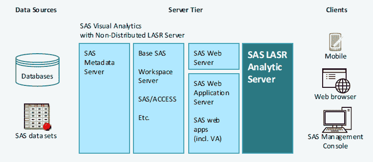

在上面的插图中，用户通过 `PC` 上的网络浏览器或移动设备上的 `SAS Mobile BI` 应用程序访问 `SAS Visual Analytics Web` 应用。`SAS Visual Analytics Web` 应用与 `SAS` 元数据服务器协调用户访问和授权。针对报告内容和其他数据驱动显示的用户请求从 `SAS Visual Analytics` 发送到 `LASR Analytic Server`，由它对内存中的数据进行处理以执行必要的分析任务。`LASR Analytic Server` 的管理——即加载和卸载表，以及停止和启动 `LASR` 服务——需要授权用户使用 `SAS Workspace Server`。来自 `Base SAS` 可访问的任何源（带有可选的 `SAS/ACCESS` 引擎）的数据都可以加载到非分布式 `LASR Analytic Server` 中。

在与非分布式 `LASR Analytic Server` 一工作时，数据总是串行加载的，因为数据在两个地方流经单点：

- `LASR Analytic Server` 本身是一个单一实体。
- `Workspace server` 是一个单一实体，充当传输数据到 `LASR Analytic Server` 的桥梁。

### 理解分布式部署

分布式 `LASR Analytic Server` 并不是运行在一台服务器主机上，而是分部署在多台机器上。在分布式部署中，`LASR` 提供的所有内存分析功能与非分布式部署中提供的功能相同。现在的区别是数据分布在多个主机的内存中——这有效地将一个大问题分解成可以同时处理的小问题。这就是为什么分布式 `LASR Analytic Server` 如此快速的原因。下图显示了分布式环境是如何设置的。

图 8.2 `SAS Visual Analytics` 分布式部署


与 `SAS Visual Analytics` 的非分布式部署一样，许多软件组件可以留在单台服务器上或跨越多台机器。区别在于 `LASR Analytic Server` 现在托管在至少四台机器上，跨越根节点和多个工作节点。`LASR` 根节点控制 `LASR` 工作节点的操作。`LASR` 工作节点存储加载到 `RAM` 中的数据，并且每个节点都对其分得的那部分数据执行操作。

在与分布式 `LASR Analytic Server` 一工作时，数据可以串行或并行加载。我们可以使用 `Workspace Server` 使用与上文用于非分布式 `LASR` 相同的技术将数据串行加载到分布式 `LASR Analytic Server` 中。在串行加载时，数据仅发送到 `LASR` 根节点，然后由它将数据分给每个 `LASR` 工作节点。但分布式 `LASR Analytic Server` 也可以从支持的源并行加载数据。并行加载的数据直接从源发送到每个 `LASR` 工作节点，而 `LASR` 根节点负责协调和跟踪活动。加载时的实际数据分布由源处理。

### 从 HDFS 加载数据到 LASR

分布式 `LASR Analytic Server` 可以直接从 `Hadoop` 文件系统 (`HDFS`) 加载数据。这仅适用于特定数据类型以及 `LASR` 服务与 `HDFS` 对称部署的环境。

图 8.3 `LASR` 与 `HDFS` 对称部署

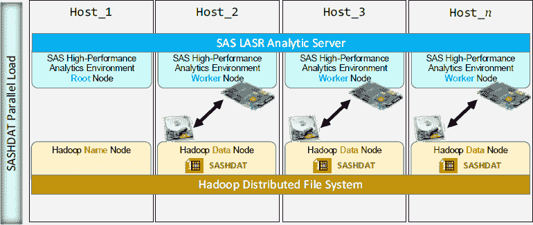

当 `LASR Analytic Server` 以这种配置部署时，它可以直接加载托管在 `HDFS` 中的数据。数据必须以 `CSV`（逗号分隔值）格式的文本文件存储，或者来自 `SASHDAT` 文件。`SASHDAT` 是将数据加载到 `LASR` 最快且最有效的方法。

### 支持 SASHDAT 文件

`SASHDAT` 是事情变得有趣的地方。让我们看看这种文件格式的一些事实：

- “`H`”与其说是为了 `Hadoop`，不如说是为了高性能——它是针对分析和并发处理优化的。
- `SASHDAT` 的元数据（标签、编码、分区等）针对每个 `HDFS` 文件块经过仔细管理。
- `SASHDAT` 显式避免了碎片（这是 `HDFS` 存储数据的常见挑战）。
- `SASHDAT` 文件格式是二进制的、可压缩的（`SAS 9.4`）、可加密的（`SAS 9.4`），并与旧版本软件兼容。
- 因为 `SASHDAT` 文件格式是为了在 `Hadoop` 等大规模并行处理 (`MPP`) 环境下开发的，它为向 `LASR Analytic Server` 加载大量数据提供了最快的方法。

为了让 `SASHDAT` 工作需要满足一些架构要求：

- 我们必须以分布式模式运行 `LASR`，即 `LASR Analytic Server` 同时部署在多台机器上。我们把此称为大规模并行处理 (`MPP`)，因为它提供了大幅扩展 `LASR` 处理能力的方法。
- 分布式模式 `LASR` 是由 `SAS` 高性能环境提供的——假设也许可了相应的软件。
- 我们需要使用 `Hadoop` 文件系统 (`HDFS`)。`HDFS` 是大多数 `Hadoop` 技术的基础。与分布式 `LASR` 一样，`HDFS` 同样在多台机器上同时部署。`HDFS` 能够利用这种环境来实现可扩展性并提高可用性。
- 最后，分布式 `LASR` 必须与 `HDFS` 对称部署。“同位置”意味着两个解决方案必须部署在同一组机器上。`LASR` 根节点（作为 `LASR` 的“boss”）必须与 `HDFS` 节点（作为 `HDFS` 的“boss”）位于同一主机上，且 `LASR` 工作节点必须放置在 `HDFS` 数据节点旁边。

如果不满足这些要求，则无法使用 `SASHDAT` 文件格式。值得注意的是，如果我们使用的是单机版 (`SMP`) `LASR`，或者 `HDFS` 位于不同的主机集合中，或者我们根本没有 `HDFS`。

### 规则的例外

`SASHDAT` 要求的一个例外是 `MapR` 版 `Hadoop`。`MapR` 自带有一个名为 `MapR-FS` 的源文件系统。

图 8.4 远程的 `MapR` 集群也可以托管 `SASHDAT` 文件

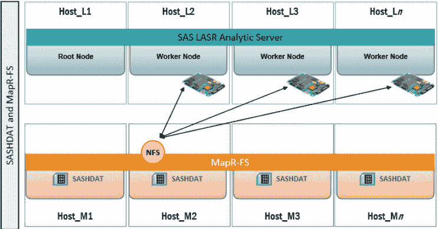

当涉及 `SASHDAT` 时，`SAS` 研发团队设计了一种方法，利用 `MapR-FS` 将 `SASHDAT` 文件放入 `MapR-FS` 中。最终，这意味着 `LASR` 可以通过 `MapR-FS` 读写 `SASHDAT` 文件，因此不需要同位置部署。当你使用任何挂载在 `CAS` 工作节点上的分布式文件系统时，请寻找类似的功能。

### SASHDAT 不需要 SAS/ACCESS


让我们简单澄清一下使用 SASHDAT 不需要具备什么：SAS/ACCESS for Hadoop 软件。SAS/ACCESS 不提供任何 SASHDAT 功能。分布式 LASR 完全具备在不使用 SAS/ACCESS 的情况下在 HDFS 中实现 SASHDAT 的能力。SAS/ACCESS for Hadoop 当然是强大且灵活的软件，为处理原生 Hadoop 提供了许多可能。虽然它不直接负责创建 SASHDAT 表，但在处理 Hive 表、Pig 和 Map Reduce 作业以及创建 SASHDAT 表方面非常有用。

### 从 Base SAS 加载数据到 LASR

我们可以使用 Base SAS 以及构建在其上的服务（如 Workspace Server 和 SAS Process）将数据传输到 LASR（或 HDFS 中的 SASHDAT 表）。Base SAS 可以访问的任何数据源都可以作为企业数据管理的一部分馈给 LASR。Base SAS 可通过 LASR 加载的数据源示例包括：

- Base SAS 数据集
- SAS 可扩展性能数据引擎（SPD Engine）表
- 原始文本文件
- 以及更多

Base SAS 可访问的任何源（带有可选的 SAS/ACCESS 引擎）都可以加载到 LASR。

图 8.5 Base SAS 可用的默认数据源


如果你的站点许可了额外的 SAS 软件，那么也可以使用这些产品，例如：

- SAS/ACCESS 软件：提供了 SAS 直接与第三方数据提供商通信的能力。为 Oracle、DB2、Aster、Hadoop 等提供者提供了特定产品。
- SAS 可扩展性能数据服务器（SPD Server）表

图 8.6 安装可选 SAS 软件后可用的额外数据源


可以使用 `PROC LASR` 或 SAS 引擎将数据从源直接加载到 LASR 内存。一旦数据进入 LASR 内存，可以将其从 RAM 中删除（稍后从源重新加载），或者由 LASR 以 CSV 格式或 SASHDAT 格式保存到磁盘。SAS 还提供了 SAS 引擎来简化将数据直接保存为 SASHDAT 格式的过程。关于 SASHDAT 引擎有几个重要的点需要记住：

1. 负责实际向 HDFS 读写 SASHDAT 内容的是 LASR，而不是 SAS。
2. SASHDAT 引擎是单向的。数据可以从 SAS（通过 LASR）写入 SASHDAT 文件，但无法通过相同的 `libref` 直接将该数据读回 SAS。SASHDAT 的意图是充当……

# 第九章

## LASR 管理

LASR 分析服务器（LASR Analytic Server）对于 SAS Visual Analytics 的运行至关重要。因此，熟悉维护 LASR 分析服务器所需的管理任务非常重要。这是因为 LASR 分析服务器极其强大且灵活，在管理它时有许多考虑因素。

在大多数情况下，SAS Visual Analytics 只是一个大型解决方案的一部分。其他 SAS 产品以及第三方软件在环境的日常运行中也可能起着重要作用。这些工具都带来了它们各自的管理任务和实用程序。

本章将重点介绍 LASR 分析服务器的许多管理工具和任务。要涵盖的内容很多——让我们开始吧！

### 管理概述

负责 SAS Visual Analytics 管理的人员需要涵盖大量工作。她必须管理用户和资源；维护安全和系统完整性；然后监控操作并审计活动。

专门针对 LASR 分析服务器，管理员将处理以下内容：

- 启动和停止 LASR 分析服务器
- 将表加载到 LASR 分析服务器并从 LASR 分析服务器中删除表
- 定义数据库和访问控制
- 监控资源利用率

### 管理工具

SAS 提供了几种工具用于管理 SAS Visual Analytics 环境。根据当前处理的任务，SAS Visual Analytics 管理员需要访问正确的工具，并完成实现目标所需的全部操作。

### SAS 管理控制台

SAS 管理控制台是一个基于 Java 的应用程序，用于管理关键的 SAS 企业级业务智能环境组件——包括 SAS Visual Analytics 使用的许多项目。SAS 管理控制台有效地充当了 SAS 元数据服务器的点击式图形用户界面。因此，每当描述 SAS Visual Analytics 环境的元数据出现时，我们需要熟悉如何使用 SAS 管理控制台进行管理。

图 9.1 以无限制用户登录 SAS 管理控制台，对所有项目具有完全控制权

使用 SAS 管理控制台在元数据中定义并管理 LASR 分析服务器、LASR 和 LASR 表。LASR 中数据的安全访问控制也通过 SAS 管理控制台进行维护。

### SAS Visual Analytics Administrator

SAS Visual Analytics Administrator 是一个通过 Web 浏览器访问的 Web 应用程序。使用已由 SAS 元数据服务器授予 Visual Analytics 管理员角色权限的凭据登录。

图 9.2 使用 VA Administrator 监控系统资源使用

通过 SAS Visual Analytics Administrator，管理员可以执行这些针对 LASR 的特定任务：

- 启动和停止 LASR 分析服务器。
- 加载和卸载 LASR 表。
- 检查 LASR 分析服务器的状态（运行或否）和 LASR 表的状态（已加载或否）。
- 对 LASR 中的表应用行级安全。
- 实时监控系统资源利用率（CPU、RAM、I/O）。

SAS Visual Analytics Administrator 提供环境的“实时”监控。它没有显示任何历史信息的能力——只显示当前发生的情况。

### SAS Environment Manager

SAS Environment Manager 最初在 SAS 9.4 中引入。它基于来自 VMware Hyperic 的开源技术，提供模块化、可扩展的管理和监控框架。SAS Environment Manager 由多个离散的组件构建，共同提供单一服务，包括环境中管理的每个主机上的代理，以及一个汇总所有代理数据、存储数据并提供基于 Web 界面的服务器。使用在元数据中被授予适当级别管理角色权限的凭据登录 SAS Environment Manager。

图 9.3 SAS Environment Manager 中显示的仪表板，用于监控为环境采集的指标

SAS Environment Manager 可用于对环境进行“实时”监控。更重要的是，它不断捕获、跟踪和记录系统活动，以便你也能访问历史信息。因为无论你是否在查看，SAS Environment Manager 实际上都在监控环境，所以它也可以在遇到关键状况时通过电子邮件、短信等提供告警通知你。

使用 SAS Environment Manager 执行以下操作：

- 监控所有系统服务和资源（包括与 LASR 分析服务器相关的项目）
- 根据你选择的条件设置告警
- 查看并报告当前和历史性能
- 为大多数 SAS 应用执行管理操作

### SAS 程序代码

通过从 SAS 访问的程序化接口，SAS Visual Analytics 管理员可以创建新的交互式或批处理程序，这些程序最终可用于管理数据生命周期中的任何方面，以支持 LASR 中的内存表。SAS 编程专家可以编写代码来启动和停止 LASR 分析服务器，从任何源加载数据到 LASR 及其他，甚至可以以编程方式创建和修改存储在 SAS 元数据服务器中的对象。

图 9.4 使用 SAS Studio 提交程序代码与 LASR 工作

可视化管理工具既方便又强大。拥有图形界面有助于任务工作看起来更加逻辑化和直观。然而，站点操作需要某种程度的脚本、编程和调度，以确保表更新自动发生。因此，创建和维护自己的程序代码将是一项实用的技能。

### 其他工具

SAS Visual 解决方案的部署依赖此处所示工具，但也依赖许多其他工具。虽然我们一直关注管理环境的 SAS 实用程序，但还有可能需要考虑的其他软件产品。对管理 SAS 环境有用的其他工具：

- SAS 高性能计算管理控制台
  - 可用于偏好使用它的站点
  - 与 SAS 管理控制台无关
  - 主要用于维护大量用户账户
- 操作系统实用程序
  - Linux：`netstat`、`top`、`ps`、`mpstat` 等更多
  - Windows：任务管理器、Perfmon、系统事件查看器等
- Hadoop 实用程序
  - 部署管理：Cloudera Manager、Ambari
  - Hadoop Web 应用：Health、Yarn Manager
  - Hadoop 命令行：`Hadoop`、`hdfs`

虽然我们不会讨论这些其他工具的细节，但它们仍然支持 SAS Visual 解决方案工具箱的一部分。

### 有趣的 LASR 管理任务

LASR 服务器的管理是一个巨大的课题，特别是当它接入更大的 SAS 生态系统时。我们希望通过向你介绍一些在管理 SAS Visual 解决方案时可能会遇到的有趣任务来开始。

### SAS 元数据的角色

SAS Visual Analytics 完全依赖元数据中定义的 LASR 服务器和 LASR 表。如果你是一个 SAS 程序员，可以轻松编写自己的代码来启动新的 LASR 服务器、向其加载数据、运行操作并获取结果。元数据还定义了访问控制，供用户查看、交互和可能的管理。通常情况下，元数据中的对象描述的是已经存在（或即将存在）的东西。如果你在真实世界中移动或删除一个项目，元数据不会自动反映该变化。SAS 企业级智能软件将协调其对元数据的使用与物理项目的使用保持一致。但是，如果你手动（或通过编程方式）创建了自己的元数据对象，那么你将负责对这些对象进行持续维护，以确保它们反映真实世界项目的正确状态。

### 定义 LASR 服务器

SAS Visual Analytics 完全依赖 LASR 服务器来提供报告和分析数据。LASR 服务器起初是为了处理最大的数据量而构建的，但也可以处理较小的表。SAS Visual Analytics 至少需要一个内存数据的 LASR 服务器向用户提供报告。但如果情况允许，你可以定义多个 LASR 服务器，它们可以共存在相同的机器上，也可以部署到自己的主机组。

默认情况下，在部署 SAS Visual Analytics 软件期间会创建两个 LASR 服务器：

- 端口 `10010` LASR 服务器
- 端口 `10031` 公共 LASR 服务器

### SAS Visual Analytics 需要 LASR

SAS Visual Analytics 完全依赖 LASR 服务器提供报告和分析数据。根据你站点的需求，可能创建额外 LASR 服务器的原因有：

- 资源使用分离——将用户指向单独主机上的不同 LASR 服务器
- 安全——将用户指向不同的 LASR 服务器以保护数据访问
- 开发、测试、生产——独立的环境以确保更新平滑
- 资源可用性——如果你的原始主机已完全使用，则在新主机上部署另一个 LASR

首先，在你的环境中定义新的 LASR 服务器假设所有主机上都存在必要的软件。在这些基础上，我们可以使用 SAS 控制台定义新的 LASR 服务器。

图 9.5 使用 SAS 管理控制台创建新的 LASR 服务器

在 SAS 管理控制台中，使用具有适当管理权限的用户账户连接到 SAS 元数据服务器。然后右键点击服务器项目并选择“新建服务器”。新建服务器向导将出现并提供服务器类型列表。选择 **SAS 服务器** -> **LASR 分析服务器**。点击“下一步”，并为你的新 LASR 服务器提供名称和可选描述。然后我们到了有趣的部分。

图 9.6 创建新的 LASR 服务器的新建服务器向导

在新建服务器向导的第三屏幕上，你可以选择定义“单机服务器”，这指的是非分布式（SMP）LASR 服务器。默认答案是**否**，这将创建一个描述分布式（MPP）LASR 服务器的元数据对象。

### LASR 运行在不同的架构上

非分布式 LASR 服务器托管在单机上。但分布式 LASR 服务器运行在至少四台机器上——一个用于 LASR 根节点，至少三个工作节点。

对于 MPP LASR 服务器，你还必须提供两个问题的答案：

- 高性能分析环境位置：HPAE 软件与 VA 的其他部分分开部署。它提供了在多个主机上启动 MPP LASR 服务器的底层软件。此提示的值通常如 `/opt/sas/TKGrid`。但它可能因站点而异。请记住，如果你打算使用支持的远程数据提供程序的数据库内进程向 MPP LASR 执行并行数据加载，则必须提供关联 `TKGrid_REP` 目录的路径。
- 使用的机器数量：HPAE 安装在至少四台机器上，作为 MPP LASR 服务器的最低要求，通常更多。你可以选择在所有机器上运行 LASR（默认值）或某些子集。你无法在元数据中指定使用哪些机器子集。如果少于全部，则 LASR 将按照磁盘上 HPAE 配置中 `tkgrid.hosts` 文件列出的顺序在指定的机器数量上启动。

在新 LASR 分析服务器的元数据中打开高级选项，你可以控制关键使用标准。

图 9.7 指定 LASR 分析服务器的内存限制

粗暴使用 LASR 很容易耗尽你环境中的系统资源。RAM 是不仅对于 LASR 而且对于在相同主机上运行的任何软件都的关键资源。为了确保 LASR 运行良好，我们可以为以下选项指定值：

- 数据加载（%）——如果 LASR 服务器当前占用 RAM 的 80%，则新表无法加载。
- 外部进程（%）——如果超过此值，则位于 LASR 外部的进程无法检索数据或运行操作。

新的 LASR 服务器也可以供 SAS Visual Analytics 使用。与 SAS 管理控制台一样，你需要使用具有适当管理权限的用户帐户登录 Environment Manager，并在页面左上角的侧边栏中进入管理部分。进入后，你可以打开新建服务器向导并输入 LASR 所需的信息。

图 9.8 使用 SAS Environment Manager 创建新的 LASR 服务器

作为管理员，主动管理 LASR 服务器的内存使用有助于维护运行环境。一旦定义了新的 LASR 服务器，SAS Visual Analytics 可能会与之工作。有一些需要注意的事，元数据并未直接处理：

- 想要管理 LASR 服务（启动、停止和加载数据）的 SAS Visual Analytics 用户必须拥有操作系统账户（使用令牌验证）来启动 Workspace Server。
- 对于 MPP LASR，启动 Workspace Server 的操作系统账户也必须存在于所有主机上并配置无密码 SSH。
- 只需要访问已加载到 LASR 数据的 SAS Visual Analytics 用户不需要操作系统账户。

SAS Visual Analytics、LASR 服务器以及其他解决方案经常必须与相同硬件上共存的第三方软件协同工作。例如，将 Hadoop 环境与 LASR 并列以处理 HDFS 表是一种常见做法。如果使用了 Hadoop 服务——特别是 Spark 和 Impala 等内存密集型软件——那么妥当规划和执行 LASR 将确保该工具运行良好。

### 管理 LASR 的要求

希望加载或卸载数据的 SAS Visual Analytics 用户必须拥有足够的操作系统账户来启动 Workspace Server，并对每个主机配置无密码 SSH。

### 定义新的 LASR 库

如果 LASR 服务器内存中没有加载任何数据，它就没什么用。为了让 SAS Visual Analytics 工作，我们需要在元数据中定义库引用，以便 SAS Visual Analytics 知道连接到哪个 LASR 服务器。此外，SAS 元数据维护 LASR 定义、库引用和表的访问控制，以确保用户只能看到环境中的内容。SAS 库引用（`librefs`）用于连接给定源。创建新 LASR 库的原因与创建 LASR 服务器非常相似：

- 安全——根据每个库引用限制内存数据的访问
- 数据组织——源自位置的数据需要自己的库引用

### 使用代码管理 LASR 服务器


除了使用 SAS Visual Analytics Administrator 等点击式界面来管理 LASR 操作外，你还可以编写 SAS 程序代码，这便于自动化脚本。例如，通过一组设计良好的程序，你可以同时启动多个 LASR 服务器并从不同的源加载数据。一如既往，SAS 提供了多种程序化技术来管理你的 LASR 服务器及其关联数据。

## 分布式模式 LASR

对于在分布式模式（MPP）下运行的 LASR 服务器，我们可以使用 LASR 过程。`PROC LASR` 提供以下主要功能：

- 启动并停止指定的 LASR 服务器。
- 从 LASR 内存加载和卸载表。
- 将 LASR 的内存表保存到磁盘。

例如，可以使用以下代码启动 MPP LASR 服务器：

```sas
proc lasr create port=10011
path="/opt/sas/config/Level1/Applications/SASVisualAnalytics/LASR/Signatures"
signer="webserver.site.com:7980/SASLASAuthorization"
performance host="lasrroot.site.com"
install="/opt/sas/TKGrid"
nodes=all;
run;
```

**注意**

- 第三行的格式是为了在本页上易于阅读——确保你的实际 `path` 没有空格。
- `create` 参数将引导 SAS 启动具有指定属性的 LASR 服务器。
- 确保你指定的 `port` 值（不必是 10011）是可用的。否则，如果另一个服务（LASR 或其他）在该端口监听，该 LASR 服务器将无法启动。
- `signer` 功能通过 SASLASAuthorization Web 应用程序提供的 HTTP RESTful 接口访问。该应用程序通常（但并非总是）与分布式 LASR 服务器根节点是不同的主机。
- `install` 参数指定 SAS 高性能分析软件（TKGrid）的物理路径。如果你预计从远程数据提供程序的 SAS 嵌入进程执行并行数据加载，则此路径应指向关联的 `TKGrid_REP` 目录。

停止 MPP LASR 服务器更为简单：

```sas
proc lasr stop port=10011
performance host="lasrroot.site.com"
run;
```

**注意**

- `port` 属性与 `host` 结合提供了停止预定 LASR 服务器的关键标准。
- `stop` 参数引导 LASR 服务器不接受新客户端连接，允许当前操作完成，然后终止服务器进程。

如果该 LASR 服务器已经在元数据中定义（具有端口号、signer 和安装位置等属性），那么在 SAS Visual Analytics 或 SAS Environment Manager 中的状态将反映成功执行的结果——你可以进一步控制 LASR 服务器。

## 非分布式模式 LASR

通过程序化管理非分布式（SMP）LASR 服务器涉及两个概念：用于管理环境的 SAS 实用程序以及需要考虑的其他软件产品。

- SAS 高性能计算管理控制台
  - 可用于偏好使用它的站点
  - 与 SAS 管理控制台无关
  - 主要用于维护大量用户账户
- 操作系统实用程序
  - Linux: `netstat`, `top`, `ps`, `mpstat` 等更多
  - Windows: 任务管理器、Perfmon、系统事件查看器等
- Hadoop 实用程序
  - 部署管理：`Cloudera Manager`, `Ambari`
  - Hadoop Web 应用：`Health`, `Yarn Manager`
  - Hadoop 命令行：`Hadoop`, `hdfs`

虽然我们不会讨论这些其他工具的细节，但它们仍然是支持 SAS Visual 解决方案工具箱的一部分。对于 SMP LASR，我们可以使用 `SASNAME` 引擎执行以下操作：

- 启动并停止指定的 LASR 服务器。
- 从 LASR 内存加载和卸载表。

使用 `PROC VASMP` 执行以下操作：

- 停止指定的 LASR 服务器。
- 列出内存中当前可用表。
- 提供对 SMP LASR 服务器的管理信息和控制。它通过将任务分成更小的块并分配到多个工作节点来获得内存处理的速度。SAS Visual Analytics Web 应用程序提供有关 LASR 正在使用的资源的有用见解。

图 9.10 监控 LASR 服务器使用的内存

在上面的屏幕截图中，SAS Visual Analytics 为我们提供了环境的概览：

- 定义的 LASR 服务器
- 每个运行的主机（无论是 SMP 还是 MPP 根节点）
- 它们的当前执行状态
- 每个（当前活跃 MPP 实例）消耗的 RAM

## LASR 服务器状态

让我们仔细查看服务器状态：

图 9.11 每个 LASR 服务器的执行状态

有三种状态模式描述 LASR 服务器的执行状态：

| 状态 | 图标 | 描述 |
| :--- | :--- | :--- |
| 绿色圆形 | LASR 服务器运行且在线。 |
| 红色方形 | LASR 服务器未运行。 |
| 黄色三角形 | LASR 服务器运行且在线，但内存中的数据量超过了为其定义的限制（默认为 80%）。 |

首先，为了让 SAS Visual Analytics 在列表中显示 LASR 服务器，该 LASR 服务器必须先在元数据中定义。因此，无论显示的状态如何，列表本身表明 LASR 服务器已经在元数据中定义，以便 SAS Visual Analytics 知晓它们。这些状态图标仅显示服务器是否正在运行。绿色圆形并不意味着已向 LASR 服务器加载了任何数据。你需要检查 `LASR 表` 标签来获取该信息。黄色三角形是参考 LASR 限制值的指示。当加载到内存的数据达到或超过该值时，LASR 服务器将不允许加载更多数据。你可能疑惑该值如何被超过。这是因为该值是在表加载到 RAM *之后* 才确定的。一个很好的例子是，如果限制设置为系统 RAM 的 80%，而你的 LASR 表当前占用了 79%，那么下一次表加载（无论大小！）将被允许进行。

## LASR 内存使用

SAS Visual Analytics Administrator 中的 LASR 服务器标签显示了支持内存中托管 LASR 表所需的 RAM。

图 9.12 SAS Visual Analytics 内存使用报告

SAS Visual Analytics Administrator 对分布式（MPP）模式运行的 LASR 的内存报告与非分布式（SMP）LASR 不同。

此处显示的列显示以下内容：

- 虚拟内存 – 仅限 MPP LASR – 整个集群分布式 LASR 进程消耗的 RAM 百分比。
- 表内存 (MB) – 当前位于内存中的 LASR 表数据消耗的 RAM。
- 表限制 (MB) – 对该 LASR 服务器的可预定义 RAM 限制，超过此限制将无法向其加载额外的表。

右上角的绿色条是显示分布式（MPP）环境中所有 LASR 主机总 RAM 利用率百分比的仪表。它不会出现在仅 SMP LASR 的部署中。如果你将鼠标指针悬停在该仪表上，会出现一个带有更多信息的提示框。

图 9.13 LASR 集群的 RAM 利用率仪表，提示框中有详细信息。

总而言之，此项向我们解释了以下几点：

- 集群当前使用了 13% 的所有 RAM。这不仅计算 LASR 的使用，还包括操作系统和任何第三方 RAM 利用率。
- 提示框告诉我们 SAS Visual Analytics 应用程序正在使用哪些资源。

## 报告

SAS Environment Manager 是在 SAS 9.4 中引入的。它提供了关于其运行状态的报告。

### 使用报告

SAS Visual Analytics 提供了关于报告、数据源和 LASR 的自动收集。

图 9.15 SAS Visual Analytics 提供报告

特别是，概览报告很有趣。它生成按报告、用户、数据源分类的 SAS 统计数据。

图 9.16 概览报告中的 LASR 服务器

了解你的 SAS Visual 解决方案是如何被使用的，对于确保正确的资源是重要的。而且这种理解可以继续使用这些资源提供依据，并在需要时获取更多。为了充分利用所有的 SAS Visual Analytics 使用报告，你希望启用 SAS 环境扩展监控功能——通常被称为 EMI 框架。激活后，EMI 框架将创建并维护由 SAS Environment Manager 收集的统计数据库。该数据库随后支持对解决方案使用的的报告。有关部署和使用 SAS 环境扩展监控以及 EMI 框架的更多信息，请参阅 *SAS Environment Manager: 用户指南*，http://support.sas.com。

## 参考文献

# 性能考量

SQL 分析视图（SQL Analysis Views）旨在加速数据分析。然而，随着数据集的增长，这些视图的性能可能会下降。在 SQL 分析视图中处理大型数据集需要谨慎操作，以保持高性能。

有多个因素影响 SQL 分析视图的性能。最重要的之一是底层表中的行数。

如果底层表包含数百万行数据，SQL 分析视图可能会变得运行慢。在这种情况下，您应该考虑使用其他技术来提高性能。

## 索引

底层表上的索引会显著影响 SQL 分析视图的性能。索引越多，视图检索所需数据的速度就越快。

然而，过多的索引会减慢数据修改操作，因为每当插入或更新数据时，每个索引都必须更新。

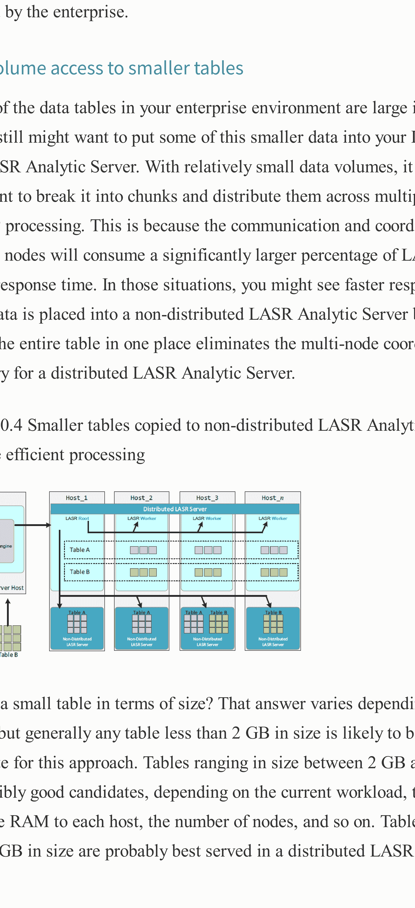

*图 15：索引对 SQL 分析视图查询性能的影响*

## 分区

在处理非常大的表时，分区可以显著提高性能。分区允许数据库引擎针对特定查询仅扫描表的 relevant 部分。

在 SQL 分析视图中，分区用于将大表划分为更小、更易管理的块。这减少了处理查询所需的资源。

## 内存占用

SQL 分析视图使用的内存量也会影响其性能。如果查询所需的内存超过可用内存，它可能会交换到磁盘，这要慢得多。

要限制内存使用，您可以优化查询以使用更少的内存，或增加可用内存量。

## 网络延迟

数据库服务器与客户端之间的网络速度也会影响 SQL 分析视图的性能。高延迟会显著增加检索结果的时间。

为了减少网络延迟的影响，您应该在服务器和客户端之间使用高速连接。

## 数据量

查询返回的数据量也会影响其性能。大型结果集在网络上传输需要更多时间。

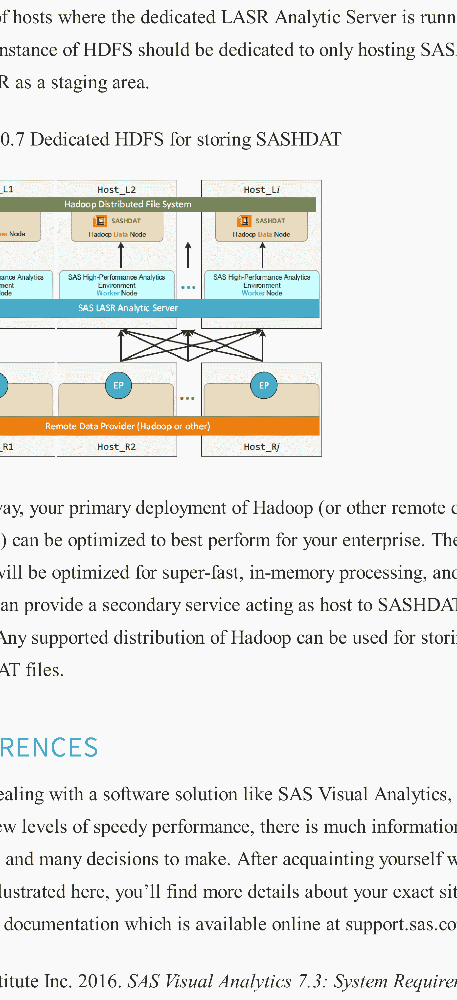

*图 16：数据量对 SQL 分析视图查询性能的影响*

## SQL 分析视图性能局限性

SQL 分析视图设计用于数据分析，而不是实时事务处理。它们有几个需要注意的局限性。

# 第四部分

# SAS Visual Analytics 8.1

本书的这部分带您进入 SAS Visual Analytics 的最新版本，运行在 SAS Viya 上。这些章节将向您介绍新环境，并展示如何导航和使用 Visual Data Builder 以及 Visual Analytics 。

随时查找答案，或掌握新知识。立即订阅。查看定价选项。

- **第 11 章** 介绍 SAS Viya 平台

本章提供了 SAS Viya 环境的概述，以及如何使用 SAS Environment Manager 管理您的环境。

- **第 12 章** 您的数据清洗

本章将带您概览 SAS Viya 上的 SAS Visual Analytics 提供的 SAS Visual Data Builder。您将学习了解新界面、如何提取并将数据加载到 CAS，以及如何使用新功能转换您的数据集。

- **第 13 章** 您的数据视化与探索

在本章中，我们将深入探讨 SAS Viya 上 SAS Visual Analytics 的报告和分析部分。您将学习如何将数据导入工具，以及如何构建报告并使用新界面更深入地查看您的数据。许多新功能可以让您快速获得可操作的洞察。

# SAS VIP 计划

2016 年，推出了新的 SAS VIP 计划，旨在为并行 SAS 处理提供一种全面的方法，并实现基础设施的灵活性，现在 SAS VIP 旨在利用弹性基础设施的灵活性。

## SAS VIP 计划概述

VIP 计划是为处理各种业务需求而设计的，但可以进行定制化以适应：

- **CAS-In 数据分析**：新的 VIP 计划允许用户使用 CAS-In Analytics 将数据从旧版本的 SAS 移动到 CAS 层。CAS 是一种用于高速数据分析的内存架构。
- **SAS-In CAS**：VIP 计划允许用户在 CAS 环境中运行他们的 SAS 程序，这不需要他们重写 SAS 程序。在许多情况下，无需重构、重组或启动新的工作流。
- **稳定过渡**：SAS 提供了许多类型的 SAS 服务，为用户在新的 CAS 环境中运行代码提供稳定的环境。

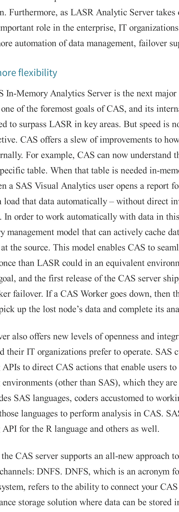

*图 1.1 SAS VIP 计划*

正如所提供的 SAS 服务一样，这只是许多可用选项中的一种。然而，还有许多其他服务和功能可以帮助用户实现其分析目标。

## 理解 CAS-IN 分析

要充分理解 CAS-in 服务如何工作，了解 SAS 如何将数据移动到 CAS 环境至关重要。

### 引入许多并行分析

CAS-in 分析的核心思想是使用 MPP（大规模并行处理）方法，将磁盘数据移动到内存中进行处理。这用于 SAS 高性能分析。SAS-In CAS 计划允许用户在可以执行大规模并行分析时运行 SAS 程序。

SAS-In CAS 分析仅在数据已加载到 CAS 时才会运行。这是因为 SAS-In CAS 服务需要访问已在 CAS 内存中的数据。

### 添加反序列化数据

CAS-in 分析的主要目的是将数据从磁盘移动到内存。SAS-In 服务允许用户将数据加载到 CAS 并使用。

## SAS VIP 与 SAS TO

SAS VIP 是一种提供并行处理优势的全内存计划。然而，SAS TO 在许多用例中仍然有用。SAS TO 是内存密集型计划的另一种方案。

## 管理 SAS 环境

SAS Environment Manager 允许管理 SAS 环境。使用 SAS Environment Manager，可以同时管理 SAS 和 CAS 环境。

### 打开应用程序

有两种方式可以访问应用程序，从 SAS 导航页面。SAS Environment Management 允许从左侧访问不同的功能。当打开 SAS Environment Management 时，将看到所示界面。


*图 1.2 SAS Environment Management*

从所示左侧窗格可以访问以下应用程序：

- **Users**：管理用户和组。
- **Libraries**：管理 CAS 实例。
- **Environment**：管理环境设置。
- **Resources**：管理系统资源和配置。
- **Security**：管理安全设置。

### 管理用户和组

`用户` 页面允许管理用户和组。一大改进是用户和组设置在 SAS 和 CAS 环境之间同步。SAS Environment Management 使用 SAS 数据库服务存储这些设置。

您可以为应用程序创建自定义组。SAS 环境中不存在的自定义将在 CAS 环境中可用。

### 管理库

`Libraries` 页面允许管理 SAS 库和 CAS 库。每个 CAS 在 SAS 中可以有多个库。下图显示了库。


每个页面都提供了库的不同视图：

| Libraries | 加载到 SAS 系统的库的详细视图。 |
|---|---|
| Libraries | SAS 库和加载的数据。 |

`Libraries` 页面显示了加载到 SAS 和 CAS 中的所有库。每个库都有名称、位置和表数量。

### 管理环境

您可以使用内容选项卡为目录创建目录结构。SAS 在 SAS Visual Details 中显示报告和状态表。

## 第十二章

## 数据清洗清洗（Wrangling）

SAS 一直以易于数据准备而闻名。从 `DATA` 步开始，收集和更改数据一直是一个简单的过程。通过 SAS Visual Data Builder 8.1，SAS 取了这些原则，并结合一些更新的技术赋予了它们全新的界面。

在 SAS Visual Data Builder 7.3 中，界面和查询构建是围绕编程语言 SQL 的工作原理展开的。这使得任何具有 SQL 背景的人都能轻松理解。但整个 SAS Visual Analytics 应用也旨在为非技术用户设计。因此，随着新的开发，SAS 切换了重心，将易用性置于首要任务。

在本章的这一部分，我们将探索 SAS Visual Data Builder 8.1 以及你需要了解的与 SAS Visual Data Builder 7.3 之间的差异。我们将引导你熟悉全新的现代用户界面。现在，连接表格和转换列提供了更多选项。此外，使用新平台也改变了你在新数据集上进行开发和执行更改的方式。

### 引入现代用户界面

随着外观的更新，加载数据的过程也发生了变化。进入数据生成器时，你注意到的第一件事之一就是看到一个欢迎窗口。此窗口让你决定是打开数据源、创建新计划还是打开现有计划。计划（Plans）类似于查询，将在本章稍后部分进行介绍。

图 12.1 SAS Visual Data Builder 欢迎界面

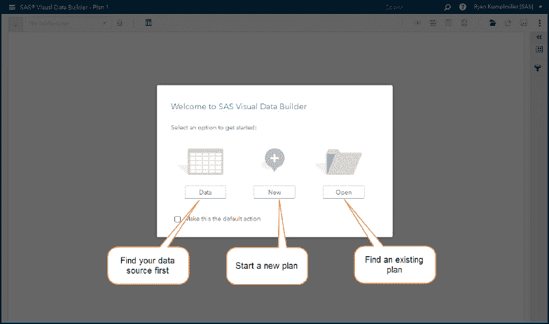

### 导入数据


当你在欢迎窗口中选择“数据”选项时，将带你进入“打开数据源”窗口。此窗口与 SAS Visual Analytics 7.3 中报告设计器的加载数据功能非常相似。在第 2 章中，我们回顾了报告设计器。当你添加数据时，你有能力直接从本地文件、服务器和社交媒体导入数据。在报告设计器 8.1 中，该选项现在也适用于数据生成器。在之前的数据生成器中，你只能访问注册到元数据的表和库。更新后的功能还允许你直接将文件从桌面或文件夹拖入窗口。

图 12.2 打开数据源窗口

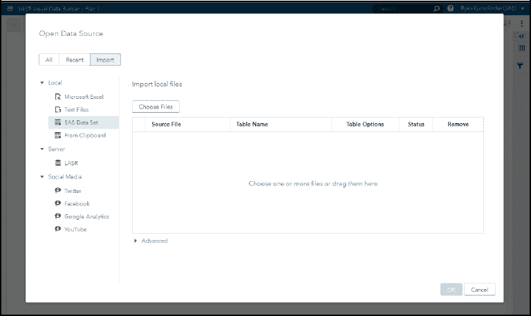

`**所有**（All）标签页显示`CAS`服务器中可用的数据集。`**最近**（Recent）标签页让你看到最近处理过的任何数据集，而`**导入**（Import）标签页是你访问其他区域数据的地方。服务器下的`LASR`选项允许从以前使用的版本的`SAS Visual Analytics`中提取数据。

## 查看数据

一旦你选择了数据源，你将进入应用程序，数据将显示在屏幕上。这是不同版本之间用户感知区别之一。你不再是处理列名然后预览数据，而是直接查看数据，并可以在进行转换时直视化地看到数据的更改。

图 12.3 打开数据源窗口

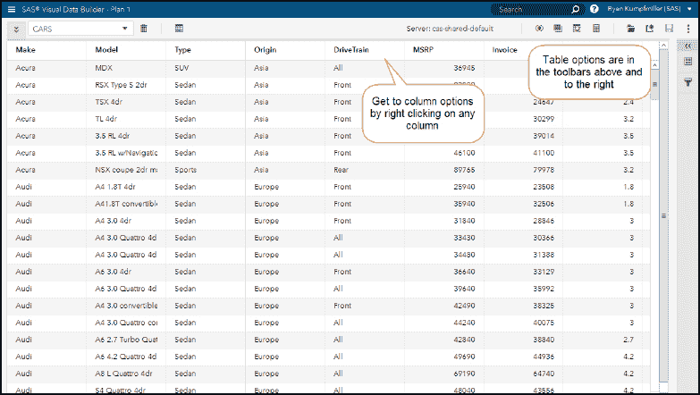

在此视图中，可以很容易构建你想要的输出数据集结构。你可以通过右键点击当前列来删除和重命名列。

## 数据集概况分析

新的数据生成器不仅增强了你的数据准备能力，还让你对数据细节有了新的认识。在查看数据表时，左上角有一个我们尚未探索的向下箭头。当你点击该图标时，即可获得如图 12.4 所示的元数据信息。

图 12.4 表概况

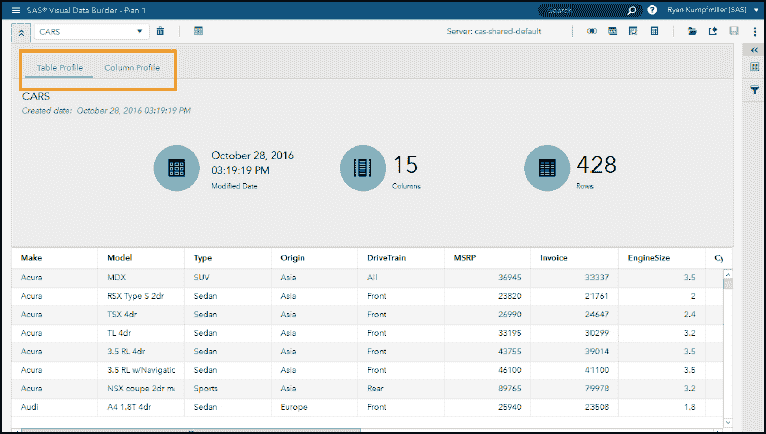

有`**表概况**（Table Profile）标签页和`**列概况**（Column Profile）标签页供选择。在`**表概况**标签页上，你会看到一个小仪表板，告诉你表格创建和最后保存的时间，以及数据中的列行数。这在验证数据集最后更改时间或检查表格可能有多大时有用。点击`**列概况**标签页进入数据项统计的另一个层级。

图 12.5 列概况

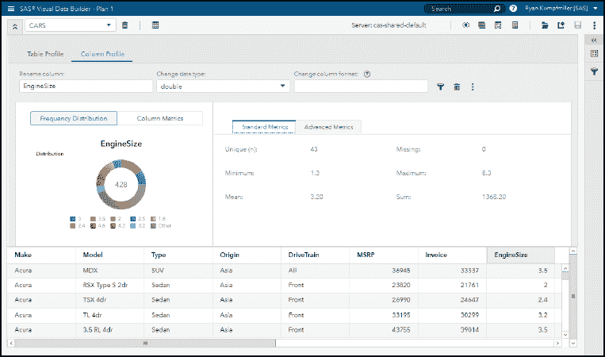

为了显示详细信息，必须从底部的表中选择一列。对于字符数据项，频率分布（`Frequency Distribution`）显示每个唯一值在行中出现的次数。标准指标（`Standard Metrics`）显示你唯一值的总数。列指标（`Column Metrics`）和高级指标（`Advanced metric`）仅用于数值数据项，并显示有关数据项的各种统计数据，例如整个数据项的最大值、最小值和平均值。

在`**列概况**标签页下方的顶栏中，你可以看到这也是重命名数据项（与右键点击列名相同）、更改数据类型和更改格式的位置。在这里设置好所有数据类型和格式是良好做法，这样你就不需要在报告设计器中进行更多数据工作了。

## 创建新数据项

如果你想添加列，右侧工具栏上有一个计算器图标。

图 12.6 添加计算列

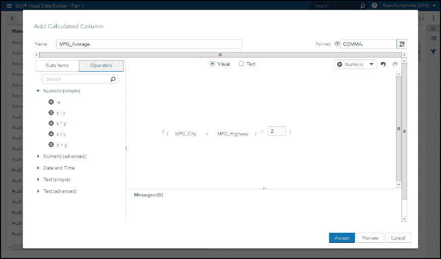

此窗口提供了对新数据项进行计算的所有工具。左侧的两个标签页让你访问所有数据项以及处理数值、字符和日期项的操作符。右上侧也有选项让你选择结果数据的类型和格式。完成后，你甚至可以使用底部的`**预览**（Preview）按钮来确保你创建的列是你所想要的。点击接受（`Accept`）按钮将列添加到数据集。

## 使用内存连接

此版本的数据生成器通过视觉化连接使连接变得尽可能简单。即使你不完全理解内连接、外连接和右连接的区别，查看列和数据也能让你理解。要访问连接窗口，请点击右上角与计算列图标分组的图标。

图 12.7 连接表格

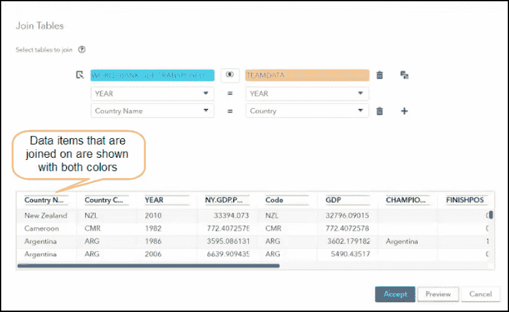

在图 12.7 中，我们引入了两个表。第一个表的列显示在下方。当你打开连接窗口时，左侧会有你的第一个表，右侧是`**选择表**（Select Table）按钮。选择表选项带你进入章节开头看到的打开数据窗口。在此窗口中你可以找到其他数据源。注意表格是如何颜色编码的。我们要连接的数据项列在下方。当我们点击`**预览**（Preview）时，表格的颜色方案将标记每个项目，显示出新表的样子。

图 12.8 预览连接

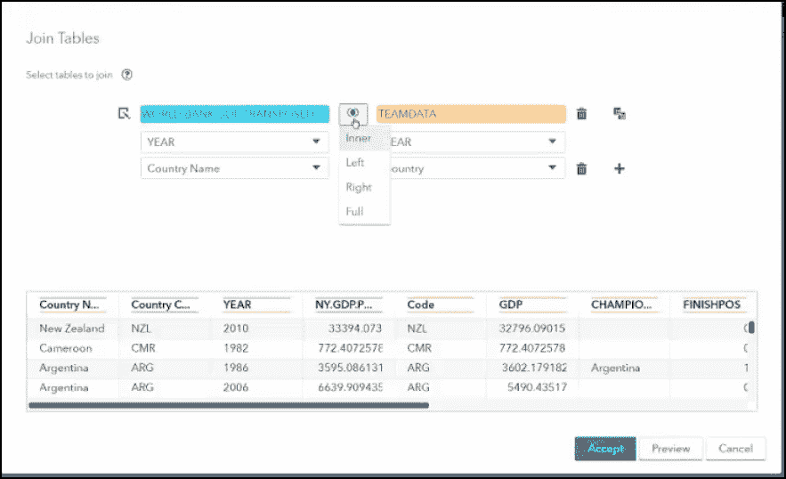

颜色概述数据项来自哪个表。对于两个表共有的数据项，颜色是分开的。这使用户可以非常容易地可视化数据是如何合并的。两个表之间还有一个按钮，让你选择要使用的连接类型。

## 计划与表格

数据生成器的另一个与 `SAS Visual Analytics 7.3` 不同方面是计划的概念。在早期版本中，你创建查询来引入表、连接并处理数据项形成最终数据集，然后将其发送到位置。在新版本中，计划类似于查询，但它们显示为一组指令。

图 12.9 查看计划指令

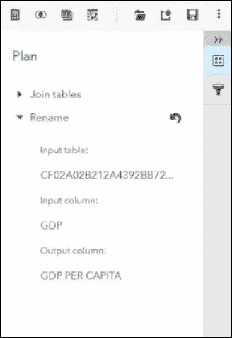

在图 12.9 中，你可以看到计划的示例。它包含了上一节完成的连接表格指令，以及重命名列的指令。

图 12.10 保存计划

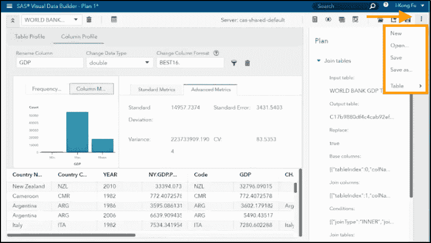

在图 12.10 的右上角，我们选择了提供保存选项的图标。计划和查询之间的区别在于，不需要运行计划即可让数据到达所在位置。相反，你有保存计划或保存表格的选项。保存计划就像保存查询；你存储创建数据集所需的步骤。这不会执行任何操作，你只需保存计划即可轻松继续。保存表格就像运行查询。你所有的步骤已经在表中接受并执行。现在你只需将新表移动到特定位置。

## 新功能

为了配合构建数据集的全新界面和流程，SAS 还引入了一些新功能，提供更多准备数据的方法。这些功能包括：

- 转换（`Transformations`）——使用内置 SAS 函数处理数据项的方法。

- 转置表格（`Transposing tables`）——根据某些数据项重新组织表格的方法。

- 过滤（`Filtering`）——通过选择排除的数据项值来限制表中的行。

### 转换

新功能的一部分是能够使用所有喜爱的 SAS 函数即时转换数据。通过右键点击任何列，你将获得一个下拉列表，允许你即时执行不同的数据处理函数。

图 12.11 数据处理函数

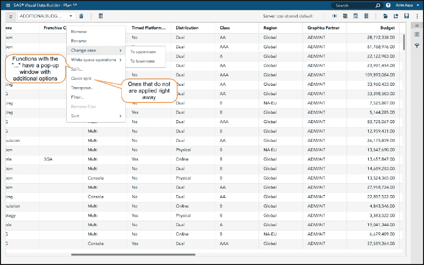

在下拉列表中，你找到对列进行各种操作的选项。除了我们在上一节中涵盖的列属性外，你还可以重命名列。你可以点击`**删除**（Remove）选项来丢弃列。还有一个过滤值的选项；此选项将你带到包含所有列值的窗口。两个更有实用的选项是`**快速拆分**（Quick Split）和`**拆分**（Split）。当你点击`**快速拆分**时，你将得到如如下所示的结果。

图 12.12 快速拆分

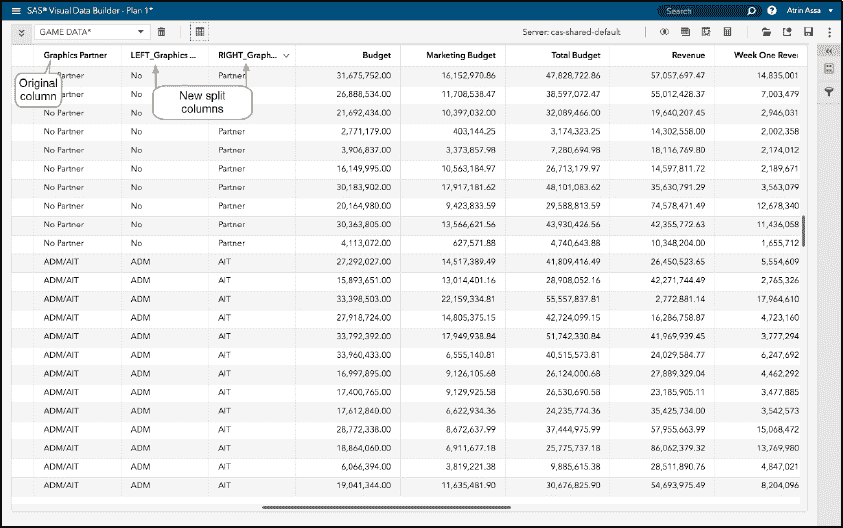

快速拆分选项用于该列。这带给了我们两个新列：`LEFT_Split` 和 `RIGHT_Split`，它们在第一个值后的空格处和第二个值之前的斜杠处进行了拆分。快速拆分选项查看你的数据中的第一个可能的分隔符。但这并不是我们想要的结果。我们想要在斜杠处拆分，所以现在进入`**拆分**（Split）选项。

图 12.13 拆分列

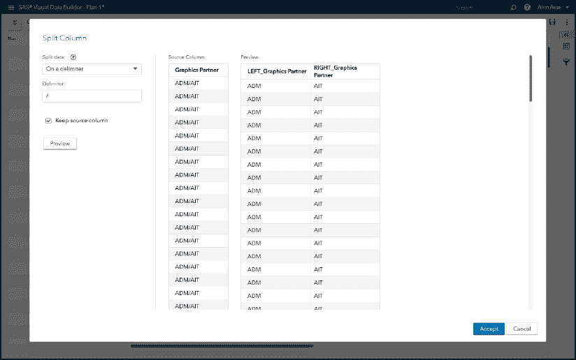

而不是自动拆分，现在出现了一个窗口，我们有多个选项来解析字符数据。下拉列表中的选项所示：

- 分隔符（`On delimiter`）

- 固定长度（`On fixed length`）

- 分隔符前（`Before a delimiter`）

- 分隔符后（`After a delimiter`）

- 多个分隔符（`On multiple delimiters`）

这些选项在你需要获取特定字符串数据项时提供了很多帮助。

### 转置表格

列上的转置选项源于 `PROC Transpose`，它可以用于 SAS 编程语言，但对于 `SAS Visual Analytics` 和数据生成器来说是全新的。通过此功能，你可以轻松地将数据集从宽表格式更改关系型表。重构的示例如图 12.14 所示。

图 12.14 转置图

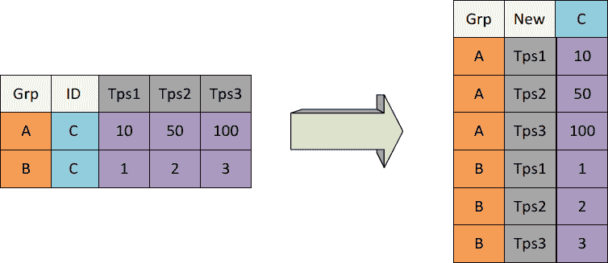

在数据生成器中通过转置将数据项分类为三类：

- 分组（`Group By - Grp`）

- 列（`ID Columns - ID`）

- 转置（`Transpose - TPS`）

在图 12.14 中，`ID` 的值现在变成了带有 `TPS` 值的变量。`TPS` 数据项中的每个值都有了自己的行。转置数据项是你希望现在具有独立行的数据项。对于我们的示例，我们将转置一个关于国家年度 GDP 的数据集。

图 12.15 转置示例

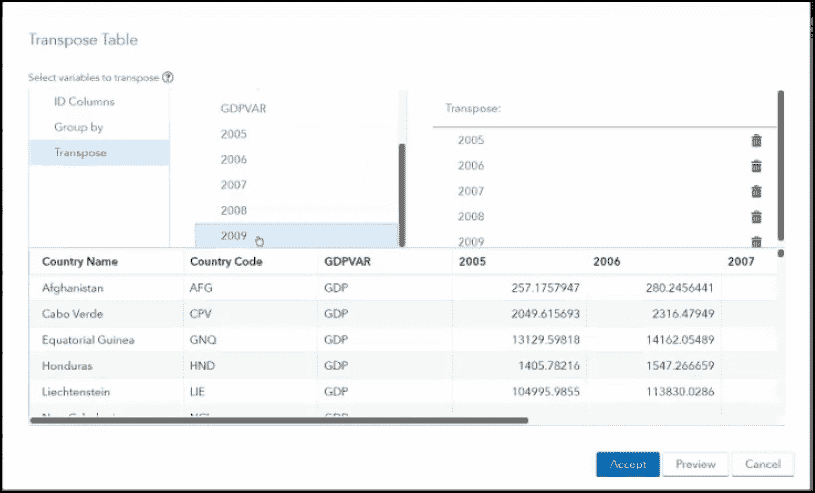

每个年份都有自己的列，但我们希望每个年份都有自己的行。年份列是我们的转置数据项。

图 12.16 转置数据项

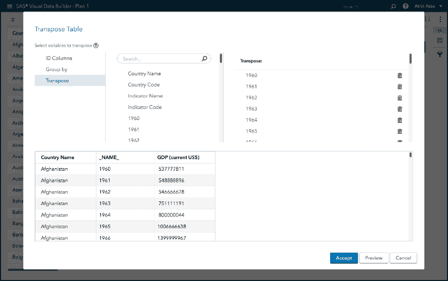

分组数据项是表格的键。这些变量与转置列结合在自己的行上。对于这个示例，那就是国名（`Country Name`）。

图 12.17 转置窗口

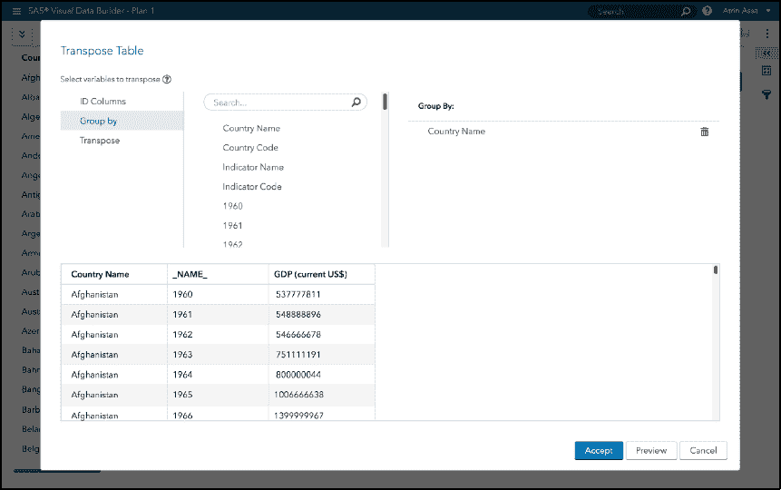

`ID` 列是你正在转置的数据项。该数据项中的值现在变成了来自转置数据项的变量。在这个示例中，`ID` 列是指标名称（`Indicator Name`）。

图 12.18 转置窗口

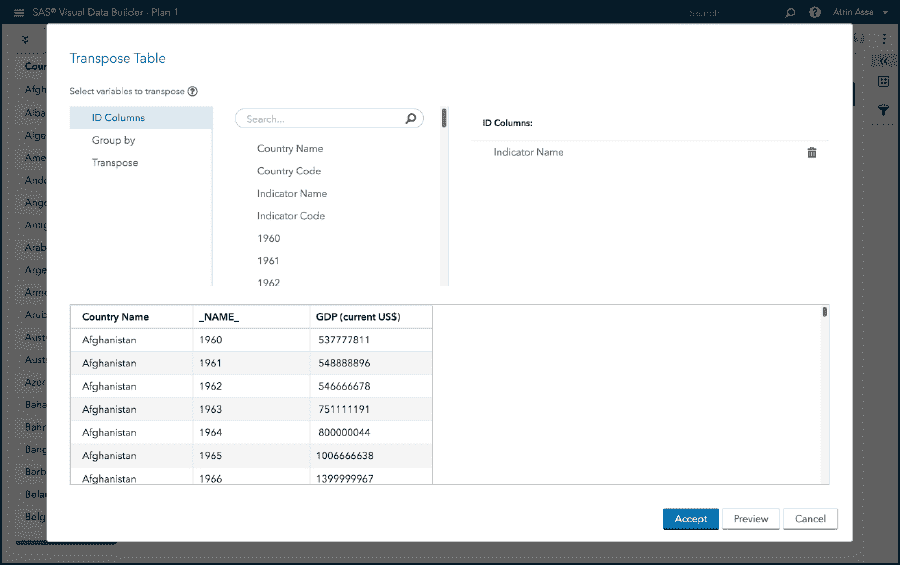

点击预览后，我们得到了转置后的数据集。GDP 表中的 GDP 值现在是一个包含所有转置数据项值的新列。转置数据项的名称位于新列 `_NAME_` 中。这是在此过程中创建的新列，一旦接受新数据集即可进行重命名。

图 12.19 最终转置后的数据集

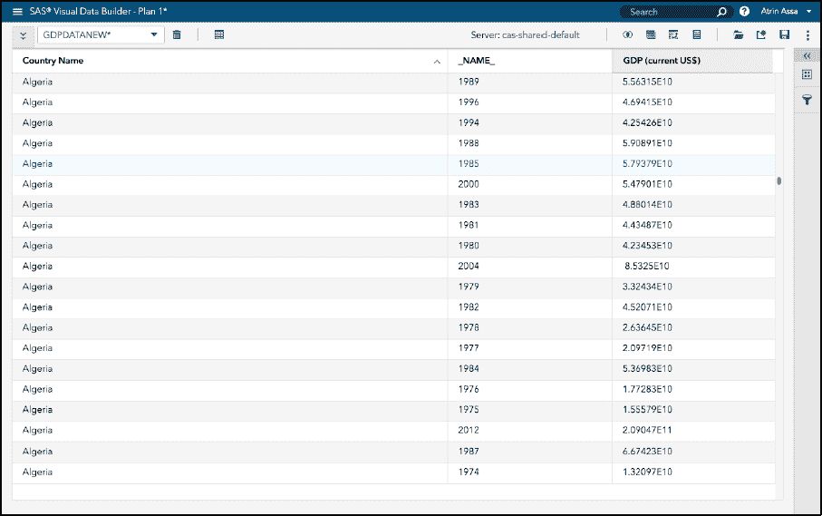

### 过滤数据

有时你不想从表中引入所有数据。某些行可能包含你分析中不再需要的特定值、类别或日期范围。你可以使用数据生成器中的过滤（`Filtering`）选项移除这些数据。此选项与转置和拆分选项类似，在右键点击数据项的列头时可用。当你点击过滤选项时，右侧的过滤面板将打开。

图 12.20 过滤示例

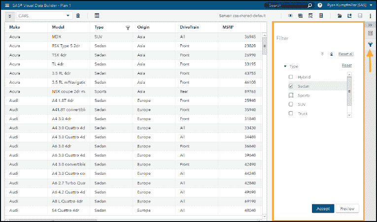

面板将根据所选数据项的值进行更新。如果数据项是类别，将显示一个包含所有可用值的列表框。如果数据项是度量，你将获得一个范围控制条，可以在其中选择你想保留的数值范围。在数据集上执行多次过滤时，过滤面板将同时显示所有过滤器，以便你知道哪些数据项被过滤了。

## 参考文献

`SAS Institute Inc. 2017`\. *SAS Visual Analytics 8.1: User's Guide*. Cary, NC: SAS Institute Inc.

SAS Viya Communities. https://communities.sas.com/t5/SAS-Viya/ct-p/sas-viya

SAS Visual Analytics. https://communities.sas.com/t5/SAS-Visual-Analytics/bd-p/sas_va

上一章：第十一章：介绍 SAS Viya p…

下一章：第十三章：可视化与探索 …

---

## SAS Visual Analytics 简介


随地获取答案，或掌握新技能。今天立即订阅。查看定价方案。

---

# 第十三章：可视化与探索您的数据

在上一章中，我们带您您熟悉了 `SAS Visual Data Builder` 的现代界面。这种视觉风格也同样适用于 `SAS Viya` 版本的 `SAS Visual Analytics` 部分。这种新外观为您提供了更大的工作空间，并让功能导航变得更加容易，从而让您对报告和数据分析能力有更多的控制力。

应用程序的架构也进行了更新。以前分散在不同部分的内容现在已合并到一个统一的应用程序中。由于是更新，应用程序还增加了一些功能。在本章中，我们将探索这个新版本的 `SAS Visual Analytics`，并解释新增了的内容。

## 介绍新布局

`SAS Visual Analytics` 的新布局结构与之前的版本相似，但具有全新的视觉效果和感受。两个主要的变化是面板和顶部工具栏。

在图 13.1 中，显示了在 `SAS Visual Analytics 8.1` 中的一个空白报告。

图 13.1 SAS Visual Analytics 布局

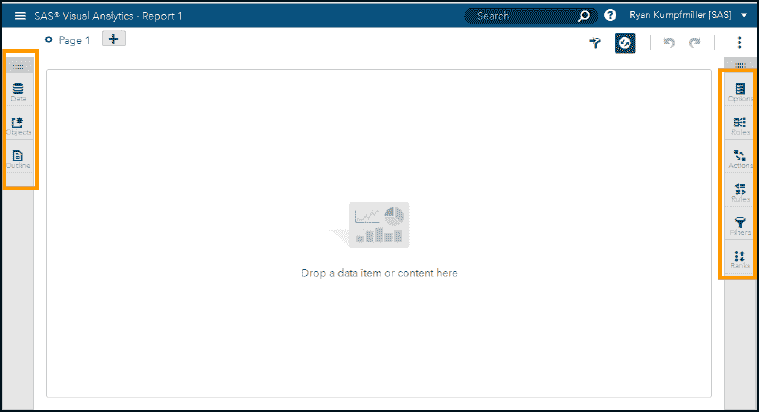

在报告的左上角，您可以看到我们有“第 1 页”。这显示了报告的页签，它们被称为“页面”。如果您需要，可以点击加号为报告创建多个页面。如果您用过 `SAS Visual Analytics` 的任何以前版本，您应该能够识别出我们这里的面板以及新增的一些图标。

您可以从左侧面板访问数据和对象。如果您点击`**Data（数据）**标签页，它会打开一个包含您的数据集及其所有数据项的面板。`**Objects（对象）**标签页显示了应用程序中所有您可用于报告的对象。在这两个标签页中，拖放功能均让您能够轻松地将数据或对象拖到画布上。`**Outline（大纲）**标签页概述了您的报告的结构，让您可以看到已创建的页面以及每个页面中的对象。

右侧面板允许您控制您的对象。`**Options（选项）**按钮提供了自定义对象的选择，可以更改标题、背景、布局和其他数据选项。`**Roles（角色）**标签页是您可以在其中查看并向对象中添加数据项的地方。通过`**Actions（操作）**按钮，您可以设置对象之间的交互或与其他页面的链接。`**Filters（筛选）**、`**Rules（规则）**和`**Ranks（排名）**标签页允许您根据需求自定义你的对象。

这种新布局的一个重要方面是面板是如何最小化的。如果您点击其中一个标签页，它就会打开，您可以根据需要使用它。但一旦完成，您就可以关闭标签页，在构建报告时留出一个开放的空白区域进行工作。

## 顶部工具栏

位于报告页面顶部的工具栏包含了一些新功能，让报告变得更加方便。第一个类似于右侧面板中筛选器的图标控制报告和页面提示的显示。当点击此图标时，页面顶部会出现两条条，如下所示所示。

图 13.2 报告和页面提示

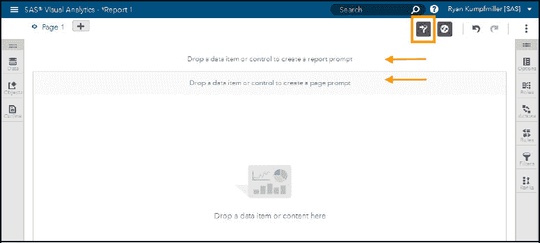

您可以将数据项或控制对象拖入这些区域中，它们将根据其所在的位置来过滤数据。`**Report（报告）**提示部分筛选所有页的数据，而`**Page（页面）**提示部分筛选该页面上所有对象的数据。

下一个图标是自动更新。它是默认开启的，这样当您更改对象内的数据时，对象将随新结果自动更新。如果您正在处理可能需要几分钟处理的大数据集，可以关闭此功能以便更快构建报告。

您应该能识别工具栏上的后两个图标：`**Undo（撤销）**和`**Redo（重做）**。您可能会发现这个界面的新部分是最方便 true 一个。`**Undo**按钮不仅可以跟踪您的最后一次操作，还会保留操作历史，如下图 13.3 所示。左键点击`**Undo**撤销上一次操作；右键查看操作历史。与以前版本相比，现在可以更容易地纠正错误。

图 13.3 Undo 按钮

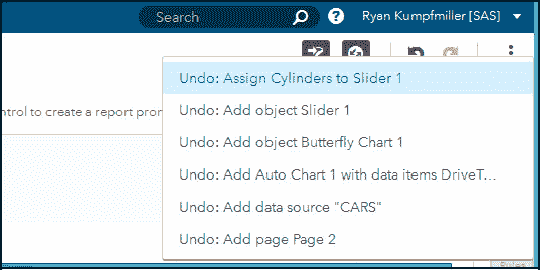

## 启动新报告

当您从 `SAS Home` 点击 `SAS Visual Analytics` 时，您会立即进入一个窗口，其中有进入数据源、创建新报告或打开保存报告的选项。这是应用程序的欢迎页，让您选择从应用程序的何处开始。

图 13.4 SAS Visual Analytics 欢迎页

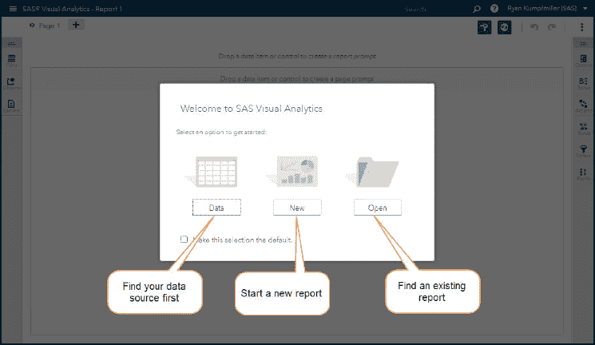

底部有一个复选框，您可以默认选择某个选项，这样您每次登录时都不会显示此欢迎屏幕。打开报告、创建新报告或加载数据的选项在应用程序中均可用。

## 导入数据

如果您从欢迎界面选择了数据，您将进入 `Open Source`（打开源）窗口。您也可以通过在`**Data**标签页上选择`**Add（添加）**然后选择`**Add data source（添加数据源）**进入此窗口。

图 13.5 打开数据源窗口

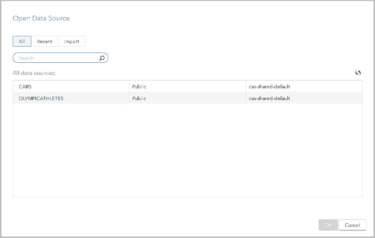

在此窗口中，`**All（全部）**标签页下可以找到所有加载到 `CAS Server` 的表。`**Recent（最近）**标签页显示您可能经常使用的数据源，`**Import（导入）**标签页是您可以从其他服务器或本地机器提取数据。在`**Import**下，`**From Clipboard（从剪贴板）**选项允许您从网页等地方粘贴数据。

## 探索数据

从图 13.5 开始，我们将选择 `Olympic Athletes`（运动员）数据集并在应用程序中打开。点击`**OK**后，报告出现并打开了`**Data**标签页。

图 13.6 数据面板


此面板与以前的版本非常相似。您可以在顶部下拉栏找到数据源。如果您导入了多个数据集，此下拉栏允许您在它们之间切换。面板下方是您可以找到`Category`（类别）、`datetime`（日期时间）和`Measure`（度量）的地方。`Add`按钮下方是创建层级、新计算项、自定义类别和参数的选项。`Add`按钮旁边的图标允许您筛选数据源、获取测量详情以及刷新数据。

### 添加对象

在`Data`标签页下方是`Objects`（对象）标签页，它打开一个带有可用对象清单的面板。

图 13.7 对象面板

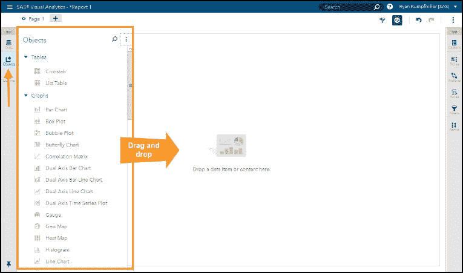

如果您熟悉以前的版本，会注意到这与旧的对象标签页相似之处。正如画布上的说明所示，您可以只需将内容拖到画布上。在这个示例中，我们将从一个列表开始。

图 13.8 添加对象

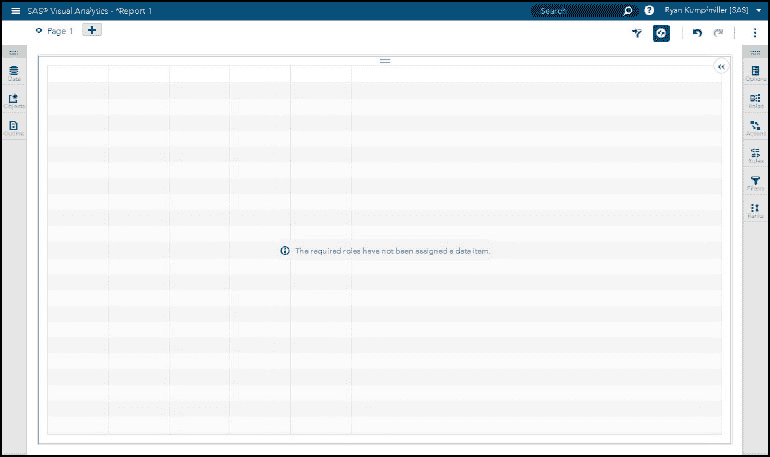

画布已更新列表更新，但我们尚未添加任何数据。因此对象中间显示了一条消息，告知尚未分配所需的角色。为了向您的对象添加这些角色，可以从数据面板将数据项拖到对象中，或者像上面所示进入`Roles`标签页。当您点击`Add`按钮时，会出现一个如下所示的窗口。

图 13.9 向对象添加角色

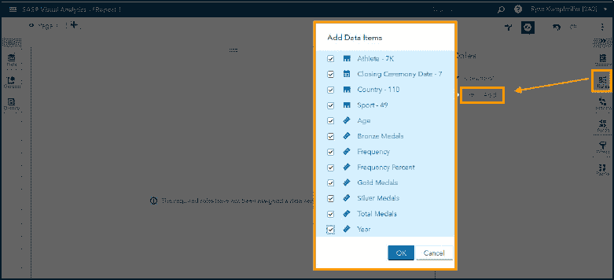

如果您正在填充的特定角色可以接受多个数据项，则会出现复选框列表。如果角色只接受一种类型的度量或类别，则会提供符合该角色的选项。对于可能有多个选择的项目，您可以选择第一个并按住 Shift 键选择所有或任意数量。使用我们的 Olympic Athletes 数据集，我们先将所有内容拉过来以便查看所有可用数据。这是我们点击`OK`后面的页面。

图 13.10 带有数据的列表表

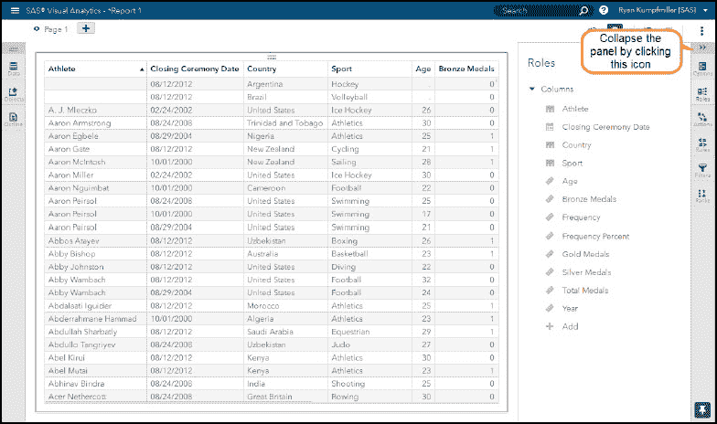

`Roles`面板显示所有列已添加到列表表中，并按照它们在表中的顺序排列。所有数据项无法显示在屏幕上。但底部有一个不可见的滚动条，可以使用它查看其余项目。它在您的光标移动到表格底部时出现。

如果您想添加另一个对象，可以返回对象面板并将另一个对象拖到画布上。在您仍在拖拽时，画布两侧都有蓝色高亮，指示对象最后释放时将出现。当您释放时，画布会在旧对象和新添加的对象之间划分空间。在图 13.11 中，我们拖入了一个柱状图并将 Country（国家）作为我们的类别，将 Total Medals（奖牌总数）作为我们的 Measure。

图 13.11 向画布添加多个对象

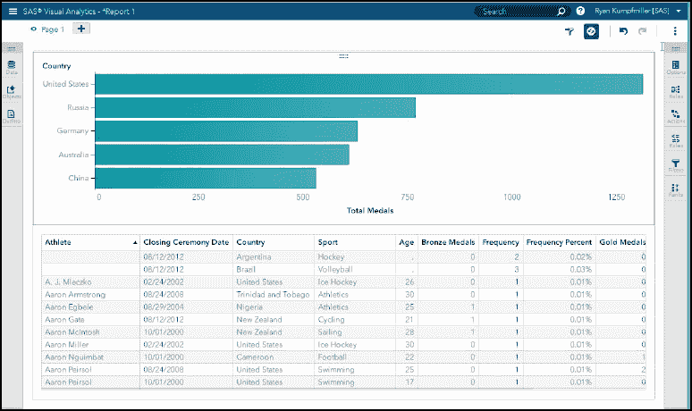

### 一化应用程序

在第 2 章中，我们带您熟悉了 SAS Visual Analytics 的设计部分以及如何开始构建报告。接着在第 7 章中，我们向您展示了如何在应用程序的探索部分创建可视化图形。探索部分包含许多您在设计中无法使用的功能。在本节中，我们将告诉您在 SAS Visual Analytics 8.1 中哪里可以找到它们。

### 自动图表和更改对象

以前版本中报告和探索之间的主要区别之一是，在探索中您可以将数据项拖到可视化区域，然后应用程序将自动确定要使用的图表。从那里，您可以通过下拉菜单更改图表。此功能已合并到 SAS Visual Analytics 8.1 中。

图 13.12 将数据项拖到空白画布

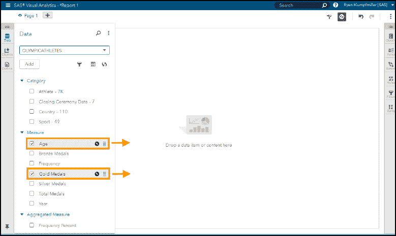

您可以像图 13.12 所示，通过下拉菜单更改图表。由于我们选择了 Age（年龄）和 Medals（奖牌），将这些数据拖到画布上产生自动图表，正如图 13.13 所示。

图 13.13 使用自动图表


如果您填充的特定角色可以接受多个数据项，则会出现复选框列表。如果角色只接受一种度量或类别，则会提供符合该角色的选项。对于可能有多个选择的项目，您可以选择第一个并按住 Shift 键选择所有或任意数量。使用我们的 Olympic Athletes 数据集，我们想先将所有内容拉过来以便查看我们拥有的所有数据。这是我们点击`OK`后面的页面。

图 13.14 带有数据的自动图表

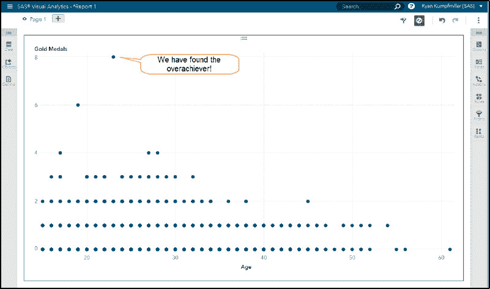

`Roles`面板显示所有列已添加到列表表中，并按照它们在表中的顺序排列。所有数据项都无法显示在屏幕上。但底部有一个不可见的滚动条，可以使用它查看其余项目。它在您的光标移动到表格底部时出现。

如果您想添加另一个对象，可以返回对象面板并将另一个对象拖到画布上。在您仍在拖拽时，画布两侧都有蓝色高亮，指示对象最后释放时将出现。当您释放时，画布会在旧对象和新添加的对象之间划分空间。

### 获取更多详细信息

在尝试获取数据项的更多详细信息时，我们可以通过折线图来深入了解数据。在 SAS Visual Analytics 8.1 中，您可以点击`Table`图标，如图 13.14 所示。

图 13.15 测量详细信息

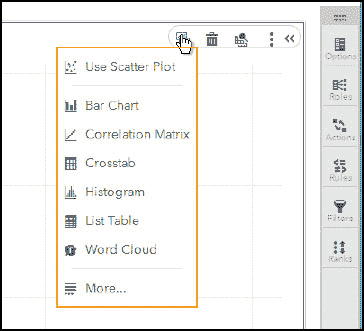

底部统计显示最小值、最大值、平均值和和。在图 13.15 中，我们选择了 Age（年龄）和 Medals（奖牌），

部的显示显示度度度度。

11.11 详细。

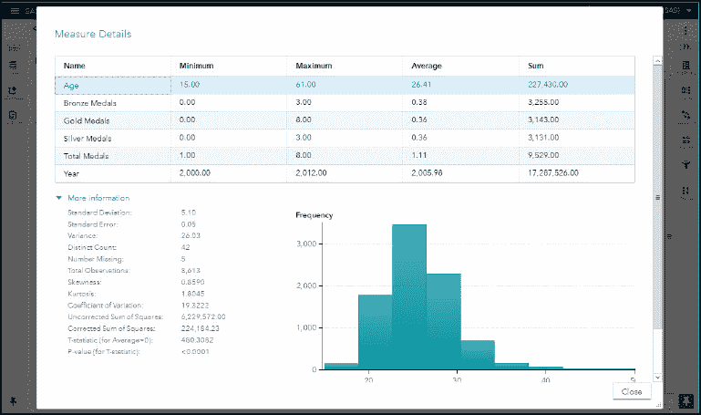

### 显示.，，，，，，，，，。。。。。。。。，，。，，，，，，，。，。，，。，，， ，，， 11

11 功能。

图 13.16 线图中的预测功能

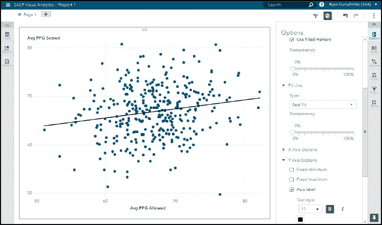
