# Android Studio 中的 Android 应用开发 - Java 加 Android 版初学者指南


本书献给所有优秀的人。

## 第一章

### 导言

欢迎阅读你的 Android™ 应用开发指南！

本书旨在教你如何使用 Java 编程语言在 Android Studio 中进行 Android 应用开发的基础知识。我假设在读本书开始之前，你没有任何 Java® 或 Android 编程经验。我将用通俗易懂的语言解释应用开发的每一个细节。你将从零开始，并在读完这本书后，能够能够将你的想法转化为你自己的应用程序。显然，单本书并无法让你成为某个平台或编程语言的顶级专家，但通过这本书，你将在 Android 应用开发方面拥有坚实的基础和实践经验。

过去，Android 应用是使用 Eclipse 集成开发环境（IDE）配合 Android 开发工具（ADT）插件进行开发的。然而，Google 在 2014 年引入了 Android Studio 作为 Android 应用开发的官方 IDE，该 IDE 逐渐成为了标准。最新的稳定版本是 Android Studio 2.2，本书将使用该版本。

在开始编程之旅之前，让我们先概述 Android 操作系统的基础知识和相关概念。

### 1.1. Android 操作系统

Android 是一个开源移动操作系统。它是 Linux 的一个变体，因此在移动设备层面提供了广泛的安全性、模块化和生产力。Android 由一个名为“开放手机联盟”（OHA）的组织开发和维护。OHA 建立于 2007 年，Google 是其核心成员。OHA 包含了许多著名的硬件和软件公司。

最初，Android 由一家名为 Android Inc. 的公司创建。Google 在 2005 年收购了这家公司。之后，Google 将其开源，Android 随之获得了巨大的动力。如图1.1 所示（数据来源：http://www.idc.com/），2016 年 Android 的市场份额占约 85%。考虑到这一市场份额，投资 Android 应用开发显然是有回报的。


**图 1.1.** 2015-Q4 至 2016-Q3 移动操作系统市场份额

Android 有七个主要版本，每个版本都有若干修订。为了及早跟进这些版本，开发者用饼干名称来命名它们。流行的 Android 版本有 Kitkat (Android 4.4)、Lollipop (Android 5.1) 和 Marshmallow (Android 6.0)（https://www.statista.com/statistics/271774/share-of-android-platforms-on-mobile-devices-android-os/）。Nougat (Android 7.0) 也在变得流行。随着版本的提升，Android 变得越来越强大。然而，在开发应用期间我们必须小心选择版本，因为并不是每个设备都使用最新版本。如果我们为 Lollipop 开发应用，它可能无法在安装了 Froyo 的设备上运行。幸运的是，Android Studio 允许我们选择兼容性。

Android 不仅用于手机，还用于平板电脑、笔记本电脑、数字电视盒、手持游戏设备甚至像 UDOO 这样的单板计算机。因此，在开发应用之前，我们首先需要选择目标设备和版本。

### 1.2. Android 应用是如何工作的？

程序在不同平台上运行有不同的方式。最低级别的软件可以用机器码编写，直接运行在微处理器上。如图1.2 所示。由于很难在机器码中开发复杂的应用程序，操作系统在应用软件和硬件之间提供了一个通信和控制层，如图1.3 所示。如果我们想为特定的硬件/操作系统开发运行的原生应用程序，我们必须使用编译器和链接器来完成。编译器和链接器获取源代码并创建实际运行在操作系统上的可执行文件，如图1.4 所示。例如，如果我们想用 C++ 编程语言开发应用程序，就必须利用编译/链接过程。


图 1.2. 机器码 – 硬件关系

原生应用的主要优势是速度快。然而，缺点是不同平台之间不兼容。例如，我们无法在 Ubuntu 上运行原生 Windows 应用，反之亦然。虚拟机的概念开发是为了克服这一局限性。虚拟机是运行在操作系统上的软件，为开发者提供了一种抽象，如图1.5 所示。应用软件运行在虚拟机之上。

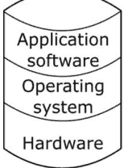

**图 1.3.** 硬件与应用之间的操作系统层

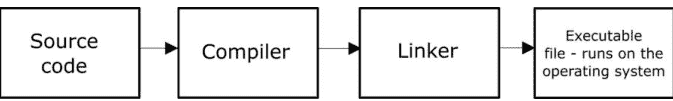

**图 1.4.** 从源代码创建原生可执行文件

因此，只要计算机运行着虚拟机，应用软件就可以在该计算机上运行，而独立于硬件和操作系统。一个很好的例子是 Java 虚拟机（JVM），JVM 运行在几乎所有的操作系统和平台上。因此，当我们开发 Java 软件时，它将在 JVM 上运行，而独立于操作系统/平台。

开发在虚拟机上运行的应用明显优势可以总结为“一次编写，随运行”。然而，虚拟机上的应用比原生应用慢。

虚拟机的通用开发总结在图1.6 所示。


**图 1.5.** 应用与操作系统之间的虚拟机

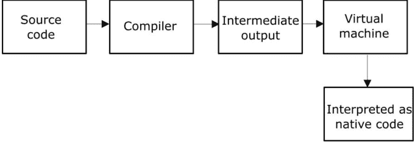

**图 1.6.** 从源代码创建中间代码

与 Java 应用类似，Android 应用也运行在 JVM 上。Android 中使用了两个虚拟机：Dalvik 虚拟机（DVM）和 Android Runtime（ART）。这些是可以在低资源上运行的专用 JVM。在 Lollipop 发布之前，DVM 一一直是默认运行时。ART 从 Android 5.0 开始引入并从那以后一直是默认运行时。DVM 和 ART 基本上在做相同的工作：独立于平台运行 Android 应用。ART 相比 DVM 的主要优势是利用了名为“提前编译”（AOT）的概念，而不是“即时编译”（JIT）方法。在 AOT 中，应用在安装期间进行编译，因此它们加载速度更快，CPU 占用更低。相反，JIT 编译提供了较低的存储消耗，但加载时间较长。

### 1.3. 开发应用使用的编程语言

推荐且方便的 Android 应用的方法是使用 Java 编程语言。虽然 Java 是一种通用工具，但它与 Android Studio 中的 Android 软件开发包（SDK）结合使用开发应用。另一种官方方法是使用带有原生开发包（NDK）的 C++。此选项用于开发具有低级指令的应用，如对时间敏感的驱动程序。通过 C++ 和 NDK，我们可以直接在 Android 内核上运行应用，提高代码长度和开发成本的效率。还存在第三方工具，如 Xamarin、Cordova 和 React Native。

我们将使用标准的官方 Android 应用开发方法：Java 配合 Android SDK，并使用 Android Studio 集成开发环境（IDE）完成这项工作。你不需要了解 Java 就可以开始学习这本书，因为 Java 的基础知识在第四章中也进行了解释。

## 第2章

### 配置你的开发环境

我们将使用 Android Studio，它是 Android 应用程序开发的官方 IDE；因此，我们需要安装它及其插件。

#### 2.1. 安装 Android Studio

Android Studio 运行在 Java 运行时环境（JRE）上。JRE 可以安装在 Windows、Mac 和 Linux 电脑上。无论操作系统是什么，我们都需要按照以下步骤安装 Android Studio：

1. 安装 Java：Java 是由 Oracle 公司开发的。Java 基本上有两个 Java 包：Java 运行时环境 (JRE) 和 Java 软件开发包 (JDK)。JRE 用于运行用 Java 语言编写的软件，而 JDK 则用于开发 Java 软件。因此，安装 JRE 就足够运行 Android Studio 了，因为我们不会开发 Java 软件。

请访问以下网站下载 JRE：http://www.oracle.com/technetwork/java/javase/downloads/jre8-downloads-213155.html。你将在图 2.1 中看到下载选项。只需选择与你的操作系统兼容的版本，下载并按照常规的安装程序（下一步、下一步、...）进行安装即可。

2. 安装 Android Studio 和 Android SDK

Android Studio 附带有 Android 软件开发包 (SDK)。请访问位于://developer.android.com/studio/index.html 的官方开发网站。Windows 版本的下载链接位于网站的顶部，但你可以向下滚动，找到如图 2.2 所示的适用于其他操作系统的可下载设置文件。

概览 下载 文档 社区 培训

##### Java 运行时环境 8 下载

你是想运行 Java™，还是想开发 Java 程序？如果你只想运行程序而不开发它们，请下载 Java 运行时环境，或 JRE™。

如果你想为 Java 开发应用程序，请下载 Java 开发包，或 JDK™。JDK 包含了 JRE；因此你不需要分别下载两者。

JRE 8u11 校验和

##### Java SE 运行时环境 8u111

你必须接受 Java SE 的 Oracle 二进制许可协议才能下载此软件

- 接受许可协议

- 拒绝许可协议

| 产品 / 文件描述 | 文件大小 | 下载 |
| :--- | :--- | :--- |
| Linux x86 | 54.86 MB | jre-8u11-linux-i586.rpm |
| Linux x86 | 70.65 MB | jre-8u11-linux-i586.gz |
| Linux x64 | 52.75 MB | jre-8u11-linux-x64.rpm |
| Linux x64 | 68.57 MB | jre-8u11-linux-x64.gz |
| Mac OS | 64.33 MB | jre-8u11-macos-x64.dmg |
| Mac OS | - | jre-8u11-macos-x64.dmg |
| Solaris SPARC 64-bit | 46.04 MB | jre-8u11-solaris-arc9.tar.gz |
| Solaris x86 | 49.88 MB | jre-8u11-solaris-x64.rpm |
| Windows x86 | 67.11 MB | jre-8u11-windows-i586.exe |
| Windows x86 | 53.53 MB | jre-8u11-windows-i586.gz |
| Windows x64 | 59.43 MB | jre-8u11-windows-x64.exe |
| Windows x64 | 62.78 MB | jre-8u11-windows-x64.gz |

> 图 2.1. Java 运行时环境下载选项

选择不同的平台

| 平台 | Android Studio 包 | 大小 | SHA-1 校验和 |
| :--- | :--- | :--- | :--- |
| Windows (64位) | android-studio-bundle-1435.337739-windows.exe | 1.674 GB | 227109a19edbcababa11abeecaa478bf901b01c7 |
| | 包含 Android SDK | android-studio-1435.337739-windows.exe | 417 MB | b5c20b5c25c2255056d40d5b1a401cd0d6 |
| | 无 Android SDK | android-studio-ide-1435.337739-windows.zip | 438 MB | (42731,1640) |
| | 无 SDK，无安装程序 | android-studio-ide-1435.337739-mac.zip | 460 MB | 8c9fe06aa4b3ead5e507f27ac254330dec55e1 |
| Windows (32位) | android-studio-ide-1435.337739-windows.zip | 432 MB | 59f8a5a1a7058533bd0cede5848992f319ac5 |
| | 无 Android SDK，无安装程序 | android-studio-ide-1435.337739-mac.zip | 434 MB | 51f28223ac37b8a8f4c08daef8f360129332c |
| Mac | android-studio-ide-1435.337739-mac.dmg | 455 MB | (455,263,302) |
| Linux | android-studio-ide-1435.337739-linux.zip | 459 MB | 172c9b01669f72e46dec0146197f4c9af |

> 图 2.2. Android Studio 下载选项

3. 安装 SDK 更新

当你下载并安装 Android Studio 时，Android SDK 也会被安装。安装 Android Studio 之后，最好检查 SDK 更新。运行 Android Studio 并从 `Tools -> SDK Manager` 打开 SDK Manager，如所示：

> 图 2.3. 打开 SDK Manager

SDK Manager 窗口将如图 2.4 所示出现。

> 图 2.4. Android SDK Manager

##### ANDROID 移动应用开发初指南

请点击图 2.4 中的链接打开独立的 SDK Manager。在独立的 SDK Manager 中，点击如下所示的“Install ...”（安装...）：

> 图 2.5. 独立 SDK Manager

安装完程序包后，你将拥有最新的 SDK 并准备好开发应用。然而，在运行我们的测试应用之前，还需要一步：设置模拟器。

#### 2.2. 安装模拟器

模拟器是模拟真实设备行为的软件。当我们开发应用时，显然无法手头所有可能的设备（Android 手机、平板电脑等）。正因如此，我们在模拟器上运行应用程序以便在各种设备上进行测试。在 Android Studio 中，模拟器被称为“Android Virtual Devices (AVDs)”。当首次安装 Android Studio 时，没有默认的 AVD。我们需要在测试应用之前创建一个。为此，请如图 2.6 所示选择 `Tools -> AVD Manager`。

> 图 2.6. 启动 AVD Manager

当 AVD Manager 出现时，还没有创建或安装 AVD。请点击如下所示的 `+ Create Virtual Device`（创建虚拟设备）按钮：

> 图 2.7. 创建新的 AVD

AVD Manager 将显示如图 2.8 所示的详细窗口。你可以选择具有不同屏幕尺寸和其他硬件属性的设备。你可以从左侧面板选择设备组，如 TV、手机。手机组是默认选择。在该组中，Nexus 5 也是默认选择。当你点击“Next”（下一步）时，将面临 AVD Android 版本的选择，如图 2.9 所示。

> 图 2.8. 创建新的 AVD – 选择设备

推荐的目标从 Android 5.1 开始。我们可以使用图中所示的 Android 7.0 Google APIs (Nougat)。然后，点击“Next”并为 AVD 命名。在图 2.10 所示的下一个屏幕，我没有更改默认设置。点击“Finish”（完成）后，AVD 已创建并如图 2.11 所示显示在 AVD Manager 中。你可以在 AVD 上运行你的 Android 应用，它将准确模拟真实 Nexus 5 手机的行为。

我们可以通过点击图 2.11 中方框内的“Play”（播放）按钮来运行 AVD。虚拟设备将如图 2.12 所示出现，你可以像真实的 Nexus 5 手机一样使用它。

## 第 3 章

### 试运行：Hello World 应用

#### 3.1. 开发应用的通用流程

测试编译器或开发环境安装的一种良好方法是尝试运行“Hello World”示例。它只是在屏幕上显示如“Hello World”之类的文本。好的，我知道这不是一个让你愿意向家人或朋友展示的应用，但它的“无用”之处在于测试你的编程环境是否正常工作，并查看你是否准备好进行真实项目。在我们的第一个 Android 项目中，我们将开发一个应用，其中“Hello, World!”文本将位于设备屏幕中央。我们将在之前创建的模拟器上对其进行测试；如果你有 Android 设备，也可以在上面测试你的“Hello World”应用。

在准备开发我们的第一个应用之前，我想指出应用阶段的通用步骤：

1. 创建 Android Studio 项目，
2. 设置应用的用户界面 (UI)。
3. 将按钮、文本框等 UI 组件连接到 Java 代码，
4. 使用 Java 进行编码 – 实际实际的编程语言
5. 构建项目：这意味着创建可执行文件（实际上在设备或模拟器上运行的文件）。这听起来并不难；Android Studio 只需点击即可完成所有工作，
6. 在模拟器上尝试应用，
7. 在真实的 Android 设备上运行应用（可选），
8. 在 Google Play 上发布应用（可选）。

#### 3.2. 创建新的 Android Studio 项目


当我们第一次运行 Android Studio 时，会看到图 3.1 所示的对话框，其中有几个可用选项：i) 启动一个新的 Android 项目，ii) 打开现有项目，iii) 从版本控制网站（如 GitHub）检出项目，iv) 导入在不同开发环境（如 Eclipse）中创建的项目或 v) 导入 Android 代码示例（代码示例从版本控制网站下载）。由于我们要开发第一个 Android 项目，因此我们将选择图 3.1 中箭头所示的第一个选项。

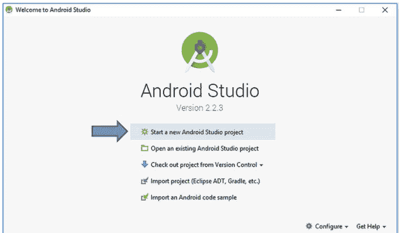

图 3.1. 为我们的第一个应用创建新的 Android Studio 项目

在选择创建新项目后，将出现图 3.2 所示的输入项目设置的对话框。在第一个文本框（图中用“1”所示）中，我们需要输入项目名称，这也是应用的名称。我输入了“Hello World”，但你可以根据意愿输入其他名称。公司域名在“2”所示的下一个文本框中。这是一个类似于网页地址的字符串，用于在 Google Play 市场中区分开发者。你可以在这里使用任何唯一的域名。如果你不将应用上传到 Google Play（如本例所示，我们只是为了开发基础知识），可以使用任何你喜欢的域名。我使用了图中所示的。然后，我们需要在计算机上选择保存项目文件的位置（图中用“3”所示）。你可以选择任何你喜欢的地方来保存项目文件。

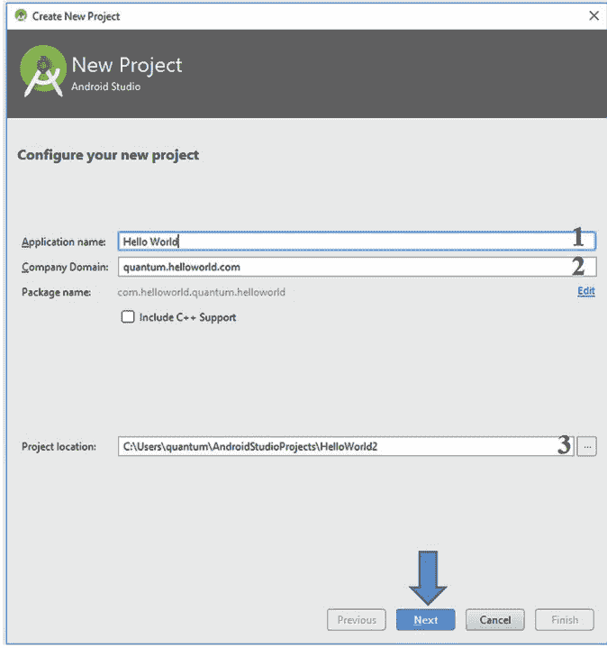

图 3.2. 新项目设置

点击“Next”后，将出现图 3.3 所示的 Target Android Devices窗口。我勾选了 Phone 和 Tablet，并将 Minimum SDK 设置为 API 15 – Android 4.0.3。这意味着我们开发的应用能够在 Android 版本为 4.0.3 或更高的设备上运行。选择目标后，请点击“Next”。

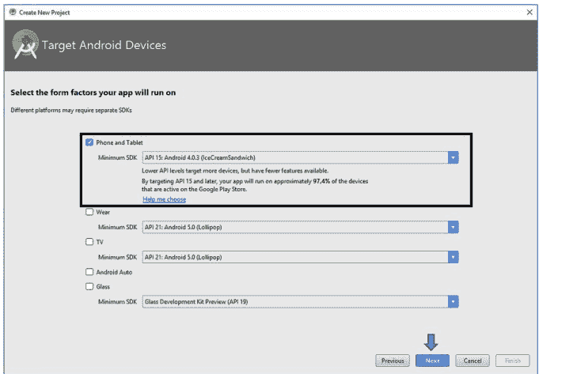

图 3.3. 选择目标设备

在下一个对话框中选择用户界面模板。如图 3.4 所示，有多个模板，包括登录活动、地图活动等。然而，由于我们的目标只是在屏幕上写字，选择图 3.4 所示的 Empty Activity 是可以的。那么，activity（活动）意味着什么？Activity 可以定义为显示给用户的带有用户界屏幕。因此，我们需要包含一个 activity 来拥有应用，正如你所知，Android 应用是具有一个或多个用户界面的视觉程序。

选择默认 activity 后，Android Studio 要求我们如图 3.5 所示为 activity 和相关的布局文件命名。由于此应用中只有一个 activity，所以将它们的名称保持默认值是完全可以的。当我们点击“Finish”时，Android Studio 将创建项目（这可能需要一些时间），然后如图 3.6 所示创建项目文件和文件夹。

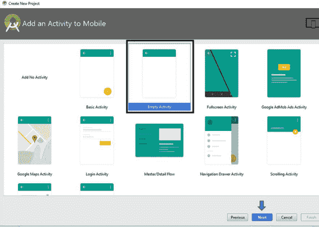

图 3.4. 为应用添加活动

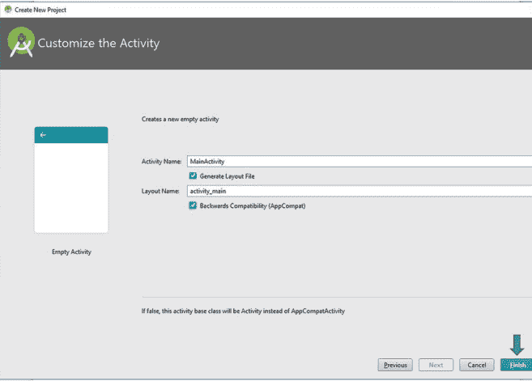

图 3.5. 定制活动

### 3.3. 主要区域

Android Studio 是一个复杂的工具，因此它有许多属性来方便开发。与其一次性给出所有细节，我倾向于解释各个区域，以便读者通过参考图 3.6 理解应用。

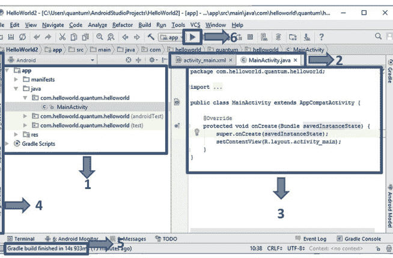

图 3.6. Android Studio 基础

图中 Android Studio 的区域如下：

- **1. 项目文件和文件夹：** 这里可以看到项目文件和文件夹。此外，可以在这里添加新文件。
- **2. 激活标签：** 显示在中间面板中。
- **3. 中间面板：** 可以在这里更改打开的文件。
- **4. 标签控制区域：** 此部分也通过标签控制。
- **5. 编译/构建/调试过程显示：** 这里显示当前的编译、构建或调试过程。
- **6. Run 按钮：** 当我们设置用户界面并编写项目的 Java 代码时，点击此按钮让 Android Studio 构建项目（从项目文件创建可执行文件），然后我们可以在模拟器或真实设备上运行它。

### 3.4. Android 项目的文件夹和文件结构

可以在 Android Studio 中以多种形式查看文件结构。左侧面板上方的按钮（箭头所示）用于打开选择所需查看方法的对话框，如图 3.7 所示。在我看来，默认的文件查看是“Android”模式，这是分组最简单的方法。当选择为“Android”模式时，图 3.8 所示的默认文件和文件夹显示在左侧面板中。你可以使用箭头（图中圆圈所示）查看文件夹的内容。

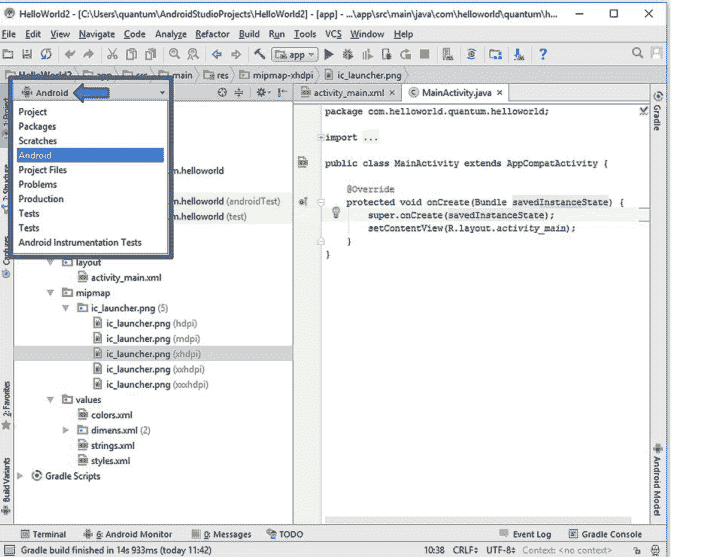

图 3.7. 在不同的查看文件和文件夹的方式之间切换

默认文件夹（图 3.8 中的矩形所示）及其内容解释如下：

- **1. manifests 文件夹：** 该文件夹内部包含 `AndroidManifest.xml`。该文件包含项目的配置参数，如权限、服务和额外库。
- **2. java 文件夹：** Java 源代码文件位于此文件夹中。你可以看到名为 `MainActivity.java` 的 activity java 文件在该文件夹中自动创建。
- **3. res 文件夹：** 资源文件包含在此文件夹中。资源基本上意味着除了源代码之外的所有需要的文件。例如，如果我们想在项目中包含一个 mp3 文件，我们就把该文件放在 `res` 文件夹中。

## 第 3 章 测试驱动：Hello World 应用

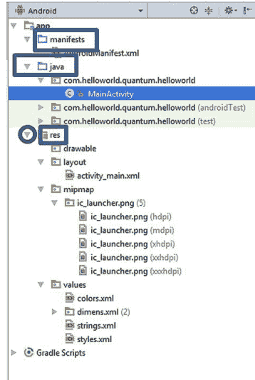

**图 3.8.** Android 项目的默认文件夹和文件结构

正如我们稍后看到的，位于 `resources` 文件夹中的媒体、图像和布局文件是通过在 `MainActivity.java` 中编写的 Java 代码来访问。

### 3.5. 构建用户界面

Android Studio 提供了一种设计用户界面的简单方法。位于 `res/layout` 文件夹下的 `activity_main.xml` 文件包含了当前活动（activity）的所有布局信息。

如果我们尝试在 Android Studio 之外打开 `.xml` 文件，它将由文本编辑器或浏览器打开。然而，当我们在 Android Studio 中打开 `.xml` 文件时，它会读取该文件并显示带有其组件的相应活动布局。要在 Android Studio 中打开 `activity_main.xml`，请双击项目资源管理器（project explorer），活动布局将如下所示显示在中间窗格中：

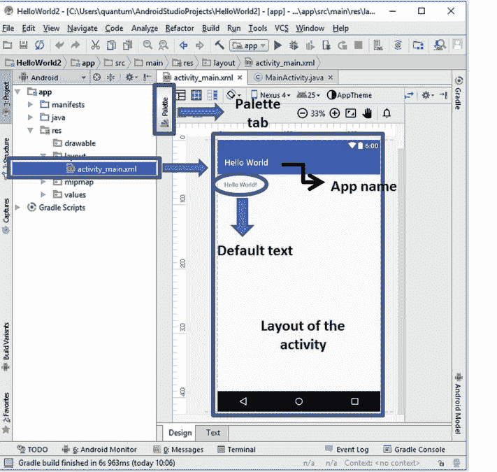

图 3.9. 活动布局

如你所见，活动的布局显示在中间窗格中。应用程序名称出现在活动的顶部。默认的空活动包含一段默认文本，如上图中圆圈所示。在中间窗格的左上角，有一个名为“Palette”（调板）的标签，如图中矩形所示。当我们点击此标签页时，会显示图 3.10 所示的调板，从那里向活动添加所有可能的用户界面对象和布局模板。

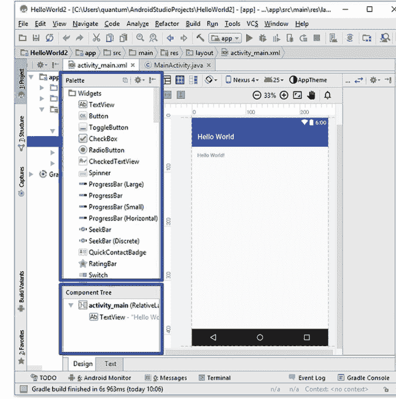

图 3.10. 组件调板

点击调板标签页时，会打开两个窗格：图 3.10 中上方矩形所示的 Palette 调板以及下方矩形所示的 Component Tree（组件树）窗格。

Palette 包含几组，如 Widgets（控件）、Text Fields（文本字段）和 Layouts（布局）。我们可以轻松地将这些组件拖放到用户界面中。另一方面，Component Tree 以分级的方式列出了活动的组件。在接下来的章节中开发复杂的应用时，我们将看到这些组件的使用。然而，我们现在的目标是在屏幕上写一段文字。从图 3.10 可以看到，Android Studio 已经在视图的左上方放置了“Hello World”文本。

让我们将这个由 `TextView` 控件组成的文本放置在视图中间。为了实现这一点，请选择此 TextView 并在下方所示引导线的帮助下将其拖到中间：

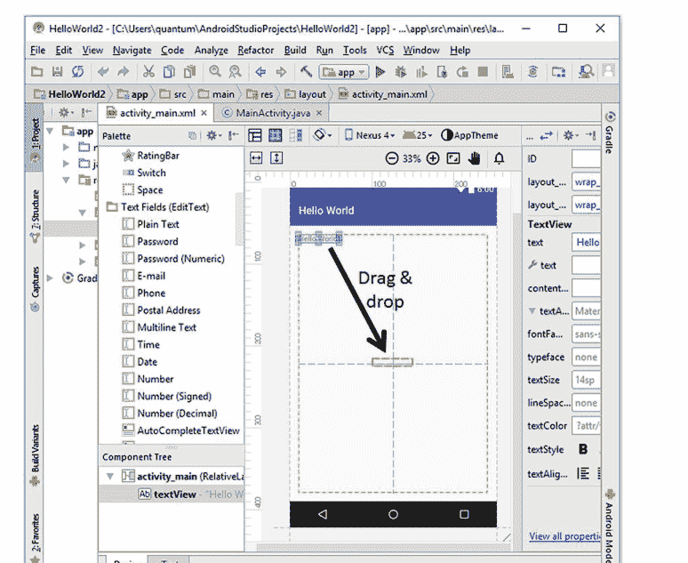

图 3.11. 在 TextView 上的拖放操作

完成拖放操作后，TextView 将被选中。我们现在可以使用布局右侧的 Properties（属性）窗格来更改 `TextView` 的属性，该窗格位于图 3.12 矩形所示。请点击此图中圆圈所示的箭头，以打开 `TextView` 的基本可编辑属性。

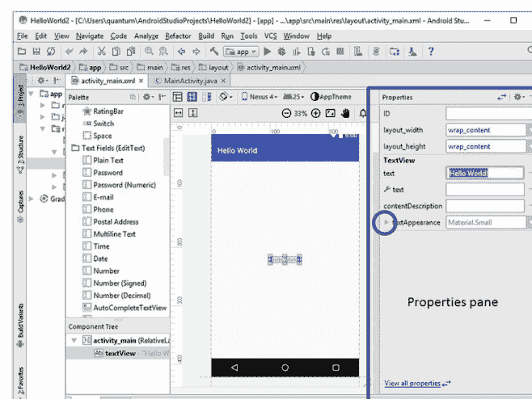

图 3.12. 属性窗格

`TextView` 组件的可编辑属性显示在图 3.13 的矩形中。为了以更好的方式显示“Hello World”文本，我将它的字体大小改为 24sp（sp = 缩放无关像素），并通过点击 `textStyle` 部分中的 B 按钮将其样式设置为加粗。

我们现在已经完成了用户界面的设置。由于我们不希望第一个应用执行某些交互操作，目前我们不需要编写任何代码。当然，在接下来的项目中我们会编写大量的代码，但在这里我们不需要任何代码。

### 3.6. 构建项目并于模拟器上运行

我们的第一个 Android 应用现在已准备好在模拟器上运行。这在 Android Studio 中非常简单。由于我们在上一章中设置了一个 Nexus 5 模拟器，因此我们需要做的仅是：i) 构建项目，ii) 选择模拟器，然后 iii) 在模拟器上运行我们的应用。

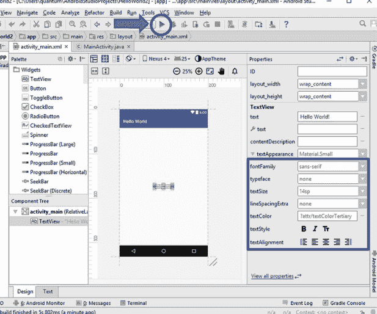

图 3.13. TextView 的可编辑属性

为了构建并运行项目，请点击图 3.13 中箭头所示的“Run”按钮。这将显示图 3.14 所示的模拟器和设备选择对话框。由于我们创建了 Nexus 5，模拟器将会出现。为了构建并运行项目，请点击图 3.13 中箭头所示的“Run”按钮。这将显示图 3.14 所示的模拟器和设备选择对话框。由于我们创建了 Nexus 5，模拟器将会出现。

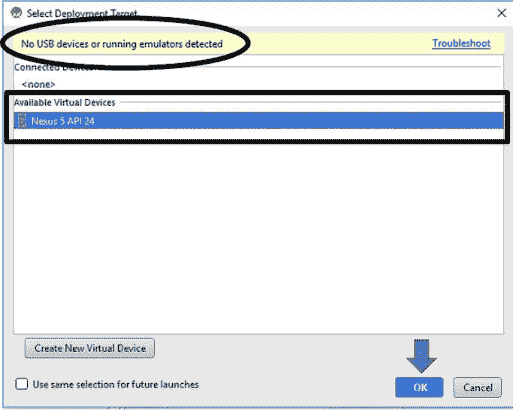

图 3.13.13. TextView 的可编辑属性

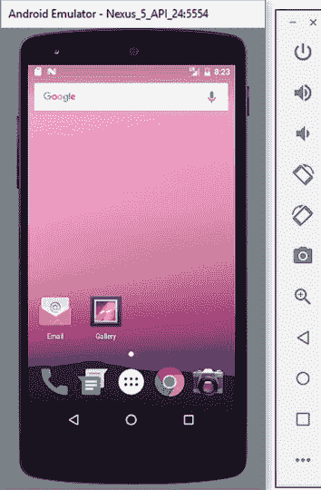

图 3.14. 模拟器和设备选择

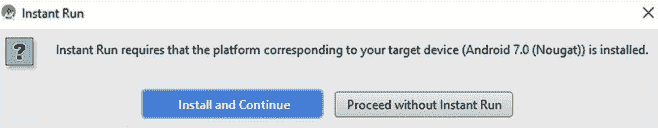

图 3.15. Nexus 5

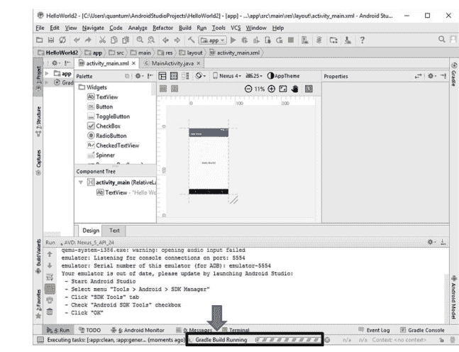

图 3.16. 属性窗格

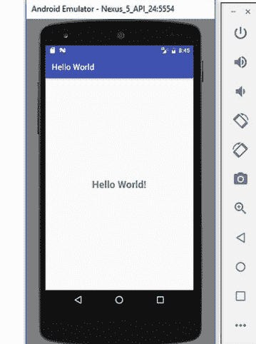

图 3.17. 正在构建中的 Android Studio

图 3.18. “Re-Run”（重新运行）按钮

- **在模拟器上运行**

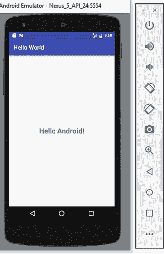

图 3.20. 运行更新后应用的模拟器

# 第 3 章：测试驱动：Hello World 应用

### 3.7. 在真实设备上运行

在真实的 Android 设备上尝试我们的应用也很简单。

- **1. 在设备上需要完成的操作：** 在真实设备上运行/调试应用之前，我们必须启用设备上的“开发者模式”。为此，请在你的真实设备上导航到“设置 -> 关于手机 -> 构建号”或“设置 -> 关于手机 -> 软件信息 -> 构建号”。根据你的设备和 Android 版本，“构建号”的位置可能不同，但我确定你可以轻松地在“设置 -> 关于手机”部分找到它。找到构建号后，连续点击七次，设备就会弹出一个对话框，显示“您现在是开发者了”。

启用开发者模式后，你会在设备的“设置”下找到一个名为“开发者选项”的新部分。请点击它并勾选“USB 调试”以通过 USB 连接启用调试。你现在可以通过 USB 连接从 Android Studio 将应用安装到设备上。

- **2. 在 Android Studio 中需要完成的操作：** 首先，请按照下方所示，从“Tools -> Android -> ADB Integration”启用“ADB Integration”：

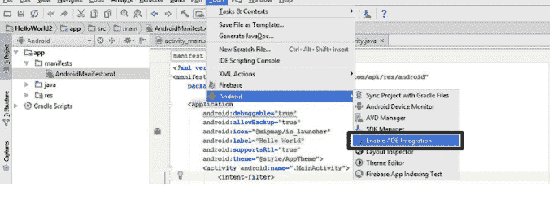

图 3.21 在 Android Studio 中启用 ADB Integration

现在，我们需要让我们的应用变为“可调试的”。为此，点击它并添加以下文本：

```xml
android:debuggable="true"
```

代码 1

如图 3.22 所示，在 `<application>` 元素内部添加。

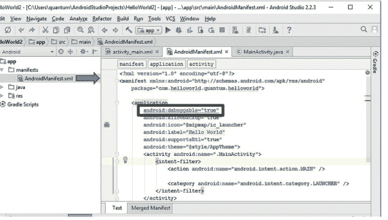

**图 3.22.** 为我们的应用添加“debuggable” 属性

我们现在已经准备好在真实设备上测试我们的“Hello World”应用了。当我们点击 Android Studio 中的“运行（Run)”按钮时，将出现以下设备窗口：

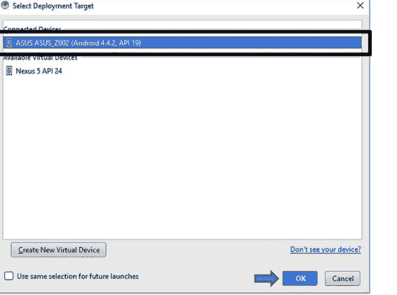

**图 3.23.** 选择真实设备

# 第 3 章：测试驱动：Hello World 应用

我连接了我的华硕 Zenfone 6，它的名字写在设备选择窗口中；如果你连接的设备不同，它显然也会不同。选择设备后，点击“OK”按钮，图 3.18 所示的应用界面应该会出现在你的实际设备上。如果你在真实设备上看到了“Hello World!”文本，那就太棒了。你现在已经知道如何在真实的 Android 设备上安装你的应用。在真实硬件上运行应用有时是必要的，因为某些操作如发送短信和通话只能在真实设备上完成。

我们开发了我们的驱动应用“Hello World”，并学习了：

- i) 创建 Android Studio 项目，
- ii) 使用用户界面和控件，
- iii) 创建模拟器，
- iv) 构建应用，
- v) 在模拟器上运行我们的应用，
- vi) 在真实设备上运行我们的应用。

但正如你可能注意到的，我们还没有与应用进行任何交互。它只是在屏幕上写了文字，仅此而已。为了让应用执行某些功能，我们需要对它进行编程。Java 是开发 Android 应用的主要编程语言。我们将在下一章节学习 Java 的基础，这将使我们能够将想法转化为可运行的 Android 应用。在开始 Java 课程之前，让我们来个咖啡休息一下（推荐 3 合1 咖啡，因为我们需要葡萄糖）。

# 第 4 章

## JAVA 基础

### 4.1 什么是 Java

我们开发了我们的驱动应用“Hello World”，并学习了：

- i) 创建 Android Studio 项目，
- ii) 使用用户界面和控件，
- iii) 创建模拟器，
- iv) 构建应用，
- v) 在模拟器上运行我们的应用，
- vi) 在真实设备上运行我们的应用。

但正如你可能注意到的，我们还没有与应用进行任何交互。它只是在屏幕上写了文字，仅此而已。为了让应用执行某些功能，我们需要对它进行编程。Java 是开发 Android 应用的主要编程语言。我们将在下一章节学习 Java 的基础，这将使我们能够将想法转化为可运行的 Android 应用。在开始 Java 课程之前，让我们来个咖啡休息一下（推荐 3 合1 咖啡，因为我们需要葡萄糖）。

### 4.2 在 Android Studio 使用 Java

首先，我们需要启动 Android Studio 并像上一章一样创建一个 Android 项目。我们可以为项目起任何名称，并选择任何 Android 版本和屏幕布局。当项目加载后，项目文件和文件夹将如 Android Studio 左侧窗格所示：

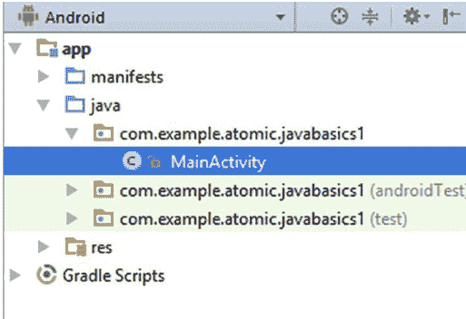

图 4.1 新 Android 项目默认文件结构

为了尝试 Java 代码，我们需要创建一个新的 Java 文件。为此，右键点击上方图中一个 java 文件夹，例如 `com.example.javabasics1`（或你创建的其他 Java 文件夹，你的文件夹名称会因为项目名称而不同），然后如图 4.2 所示选择“New Java Class”。

在 Java 中，在我们创建新的 Java 类之前，所有程序都是类（我们将在本章之后学习类）。请为新类命名，不要包含空格和特殊字符（我将其命名为 JavaBasics），然后如下方所示点击“OK”：

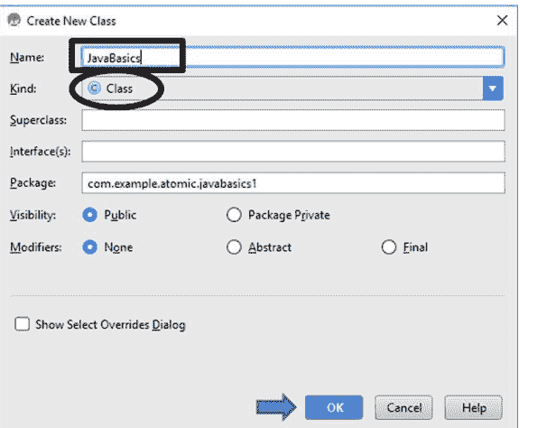

图 4.2 创建新的 Java 类

图 4.3 创建新的 Java 文件（Java 类）

值得注意的是，文件类型的分类如图 4.3 中椭圆内部所示。点击“OK”后，Android Studio 将创建一个名为 `JavaBasics.java` 的新 Java 文件，并如图 4.4 所示显示在中间面板中。

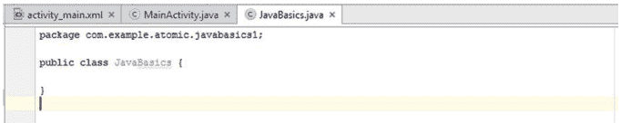

图 4.4 新的 Java 文件的内容

新的 Java 文件具有以下默认代码行：

```java
package com.example.atomic.javabasics1;
public class JavaBasics {
}
```

代码 4.1

第一行定义了一个包含我们新 Java 类的包。Java 类组织在包中。包就像你电脑上的文件夹，里面包含着几个文件。

第二行是主类定义。在 Java 中，所有程序都是类，因此所有 Java 文件（程序）都应该有一个类定义以进行编译。请始终记住，类定义必须与 Java 文件的名称匹配（在本文中，文件名是 `JavaBasics.java`，类名是 `JavaBasics`）。


程序的内容写在第二行类定义之后紧接打开的大括号内，并在代码 4.1 的第三行闭合大括号。

我们的 Java 文件默认只有基本的包和类定义。Java 类的类体是空的，因此这个 Java 程序在编译和运行时完全什么都不做。

# ANDROID STUDIO 移动应用开发初学者指南

Java 程序的源文件具有 `.java` 扩展名。Java 编译器从 `.java` 文件生成 `.class` 文件。然后，该 `.class` 文件将在 Java 虚拟机上执行。该流程如下所示：

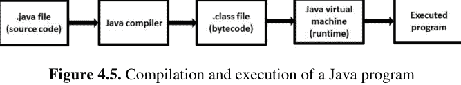

无论如何，让我们看看如何从我们的 Java 源文件中的 `JavaBasics.java` 创建一个“Hello World”程序，以下代码行会在**终端窗口**中打印一段文本：

```
System.out.println("the text to be printed");
```

代码 4.2

在这一行中，**System.out** 表示 Java 将输出某些内容，而 `println()` 方法输出括号内的文本。值得注意的是，文本写在双引号内，这样 Java 系统就知道程序员指的是一段文本。因此，通过将“Hello World”放在代码 4.2 所示的函数中，我们可以使用下面的代码在 Java 屏幕上打印“Hello World”文本：

```
System.out.println("Hello World");
```

代码 4.3

那么，我们应该把这一行放在 Java 文件的什么位置呢？我们学到 Java 代码应该位于类定义的大括号之间。因此，我们可以尝试通过将代码 4.3 放入代码 4.1 来获取我们的 Java “Hello World”程序，如下：

```
package com.example.javabasics1;

public class JavaBasics {
    System.out.println("Hello World");
}
```

代码 4.4

如果我们尝试编译并运行这段代码，编译器会报错且不会运行我们的程序。这是因为所有 Java 程序都应该有一个 `main` 方法（主方法）。`main` 方法表示 Java 程序的起点，当程序运行时它将被首先执行。添加 `main` 函数后，我们得到了一个正确的 Java “Hello World”程序，如下：

```
package com.example.atomic.javabasics1;

public class JavaBasics {

    public static void main(String args[]) {

        System.out.println("Hello World");

    }
}
```

代码 4.5

主函数定义在上面的第 3 行：`public static void main(String args[])`。通常，在此阶段不会解释 `main` 方法，导师会说“现在只需接受 main 方法即可，我们稍后会学习更多”。但是，我想指出 `main` 方法的一般结构：

该方法前面有三个关键字：`public`、`static` 和 `void`。它们的含义可以总结如下：

1. `public`: `main` 方法可以从任何地方访问，

2. `static`: `main` 方法不属于特定的对象，且

3. `void`: `main` 方法不会返回数值。

# 第 4 章基础

### 4.3 Java 中的变量

变量是包含信息的实体。变量可以被视为存储数据的容器。变量的创建被称为“变量声明”，在声明期间放置值被称为“初始化变量”。

# 4.7 程序的终端输出

```
Run JavaBasics
...
Process finished with exit 0
```

图 4.7 程序的终端输出

值得注意的是，文件类型的分类如图 4.3 中椭圆内部所示。点击“OK”后，Android Studio 将创建一个名为 `JavaBasics.java` 的新 Java 文件，并如图 4.4 所示显示在中间面板中。

## 第 4 章 JAVA 基础

在这段代码中，单词 **boolean** 是用于定义布尔变量的关键字。关键字旁是将被创建的变量的名称。在这个示例中，变量名为 **myBoolean**。等号 (`=`) 用于赋值，因此在这段代码中将 **true** 赋值给新创建的变量。这种赋值可以可视化如图 4.9 所示。

**图 4.9.** 给变量 `myBoolean` 赋值 **true**


另一方面，Java 语句使用分号 (`;`) 结束，如代码 4.5 所示，否则编译器会报错且无法编译我们的程序。其他变量类型的模板也类似。布尔变量通常用于使用复杂逻辑应用程序中的决策。

**2. 整数变量：** 整数变量在 Java 中被广泛使用。整数变量基本上存储一个整数值（没有小数部分的整数）。如图 4.8 所示，整数变量有几种形式：**int**、**long**、**short**、**char** 和 **byte**。让我们看看这些类型用于什么：

- **int 类型变量用于存储整数。** 例如，以下代码定义了一个整数，并在声明期间给它赋值为 5。换句话说，创建了一个新的 **int** 类型变量并将其初始化为 5：

```java
int myInteger = 5;
```

代码 4.7

如你从这段代码中看到的，持有整数的变量是使用关键字 `int` 定义的。在定义并初始化一个 `int` 之后，我们可以对它进行数学运算。以下代码显示了完整的 Java 源代码，其中创建了一个 `int` 类型变量，对其进行了初始化，然后在终端屏幕上打印结果之前为其加了另一个值：

```java
package com.helloworld.quantum.helloworld;
public class JavaBasics {
    public static void main(String args[]) {
        int myInteger = 5;
        myInteger = myInteger + 7;
        System.out.print("Sum = " + myInteger);
    }
}
```

代码 4.8

让我们分析一下上述代码发生了什么：

- 在第四行创建了一个名为 `myInteger` 的 `int` 变量并初始化为 5。

- 在第五行，该变量与数字 7 相加，然后通过 `myInteger = myInteger + 7;` 这一行将结果赋值回 `myInteger`，如下：


图 4.10. 加法原理

最后，第六行 `System.out.print("Sum = " + myInteger);` 打印了 `myInteger` 的值。

注意，在这段代码中，它的值将写在表达式 `"Sum = "` 旁边。这个 Java 程序及其输出如图 4.11 所示。

我们将在接下来的章节的 Android 项目中学习在整数变量上应用更多的算术和逻辑运算。


图 4.11. Java 中 `int` 类型定义和加法操作

- **int 类型变量可以存储从 −2,147,483,648 到 +2,147,483,647 的数字（这些不是电话号码！）。如果我们使用的数字没那么大，还有 `short` 类型变量，其限制为 −32,768 到 +32,767。如果你说要存储更大的数字，那么 `long` 类型可以存储更大范围的值。**

- **byte 类型变量可以存储 −128 到 127 的数字。**

```
char[] myArray = {'J', 'a', 'v', 'a'};
Code 4.12
```

我们可以通过以下形式访问此数组的每个元素：`myArray[index]`。我们可以在终端中打印此数组的第一个和第二个元素，如图 4.15 所示。

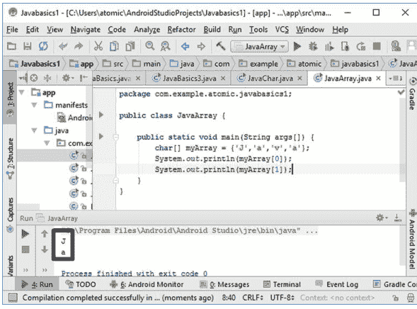

图 4.15 打印 `char` 数组的元素

数组的元素可以按如下方式单独更改：

```
myArray[1] = 'v';
Code 4.13
```

这段代码将 `myArray` 的第二个元素从 `'a'` 改为 `'v'`。执行此行后，数组的内容为：`{'J', 'v', 'v', 'a'}`。

在 Java 中，数组的元素不能被删除，因为数组的大小在创建时是固定的。由于同样的原因，我们无法向数组中添加新元素。

在处理相同类型的数据序列时，数组非常有用。例如，如果我们想保存从加速度传感器收集的数据，可以使用具有 `float` 或 `double` 类型元素的数组。

Java 中另一种广泛使用的引用类型是 `String`（字符串）。`String` 存储多个字符。`String` 的第一个字母是大写的，因为 `String` 在 Java 中实际上是对象。以下代码创建了一个 `String` 并将其初始化为“Let’s have a pizza”。请注意，`String` 的值写在双引号中：

```
String name = "Let's have a pizza";
```

Code 4.14

由于 `String` 是对象，它们拥有用于对其值进行操作的相关方法。例如，`.length()` 方法返回字符串中的字符数量，如下所示：

```
int stringLength = name.length();
```

Code 4.15

在这段代码中，通过 `name.length()` 获取名为 `name` 的 `String` 的长度，然后赋值给新创建的整数变量 `stringLength`。该操作在 Android Studio 中的结果如下所示：

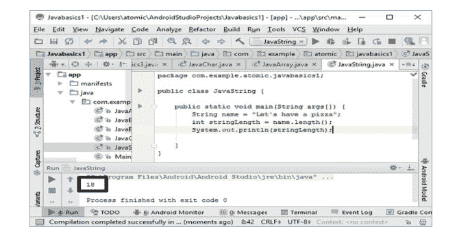

Java 输出显示 String “Let’s have a pizza” 有 18 个字符。这是因为 `String` 中的空格也被计算为独立的字符。

还有许多其他方法可以应用到 `String` 上。我们将在接下来的章节中开发 Android 应用时利用它们。

开发者有时需要不需要变化的变量。我的意思是初始化后值不能更改的变量。这些在编程语言中被称为常量。Java 没有专门的关键字来定义常量，但通过在变量声明前使用 `final` 关键字可以使其成为常量，如下：

```
final double pi = 3.14159265358979238462;
Code 4.16
```

在这段代码中，`final` 关键字使得变量 `pi` 变为不可变的（unchangeable），使其实际上成为了一个常量。如果我们尝试更改常量，编译器会发出错误。


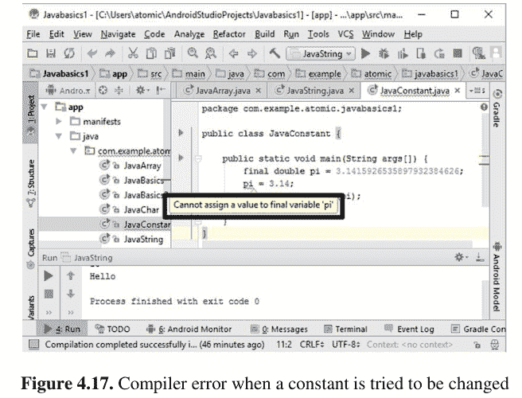

我们的下一个小节是关于 Java 中的逻辑决策结构，让我们休息喝一下咖啡，然后继续学习`if-else`和`switch-case`语句。

### 4.4. Java 中的逻辑决策语句

决策在编程中和日常生活问题中一样被广泛使用。我们在日常生活中经常做出逻辑决策，例如：

- “如果他们的咖啡很好喝，我就再来一个，否则我就去买茶”
- “如果下雨了我就带伞，否则我就不带”。

在编程语言中，决策语句控制现实生活中的某个条件是否满足。Java 中有两种决策语句：`if–else`和`switch–case`块。

**If-else 结构：** 在此条件判断中，如果满足条件，则执行 **if 块** 内部的代码。如果条件不满足，则执行 **else 块** 中的代码。因此，如果我们需要使用`if–else`块处理“下雨-不下雨”的例子，做法如下：

```text
if it’s rainy
I'll take my umbrella.
}
else {
I'll not take my umbrella.
}
```

让我们看看如何使用`if-else`语句在 Java 中检查两个数字是否相等：

```java
package com.helloworld.quantum.helloworld;
public class JavaIfElse {
    public static void main(String args[]) {
        int a = 4;
        int b = 4;
        if (a == b){
            System.out.println("a and b are equal");
        } else {
            System.out.println("a and b are not equal");
        }
    }
}
```

Code 4.17（接上一页）

让我们分析这段代码：

- 在这段代码中，创建了两个整数类型变量`a`和`b`，并将其初始化为 4。
- 下一行`if`语句检查了相等性。
- 如果此比较的结果为真，则执行`if`块内部的代码`System.out.println("a and b are equal")`。
- 如果此比较的结果为假，则执行`else`块内部的代码`System.out.println("a and b are not equal")`。
- 该操作在 Android Studio 中的结果如下所示：

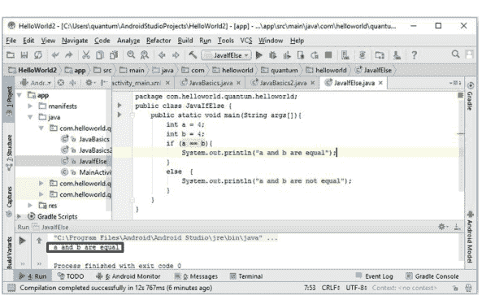

图 4.18 嵌套 if-else

当我们我们将其中一个数字改为 4以外的数字时，将执行`else`块内部的代码。该操作在 Android Studio 中的结果如下：

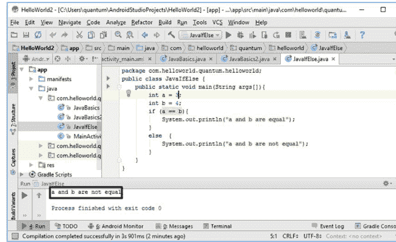

图 4.19 嵌套 else 语句

# 第 4 章 JAVA 基础

`If–else`语句也可以以嵌套的形式使用。为了使用`if-else`语句在 Java 中检查两个数字是否相等：

```java
package com.helloworld.quantum.helloworld;
public class JavaIfElse {
    public static void main(String args[]) {
        int a = 4;
        int b = 4;
        if (a == b){
            System.out.println("a and b are equal");
        } else {
            System.out.println("a and b are not equal");
        }
    }
}
```

`Switch-case`语句用于更方便地检查一组条件。用于评估学生成绩的`switch-case`语句所示 Code 4.18。

```java
package com.helloworld.quantum.helloworld;
public class JavaSwitch {
    public static void main(String args[]) {
        char grade = 'B';
        switch (grade) {
            case 'A':
                System.out.println("Your grade is excellent.");
                break;
            case 'B':
                System.out.println("Your grade is very good.");
                break;
            case 'C':
                System.out.println("Your grade is good.");
                break;
            case 'D':
                System.out.println("Your grade is low. You have to take the course again.");
                break;
            case 'E':
                System.out.println("Your grade is very low. You have to take the course again.");
                break;
            default:
                System.out.println("Not a valid grade");
        }
    }
}
```

图 4.20 Switch-case

### 4.5. Java 中的循环

在重复形式中执行操作在编程中是经常需要的。这些重复操作通过循环完成。如果没有循环，编程将变得非常困难且冗长。对于

# Android Studio 移动应用开发初指南

例如，让我们尝试找到从 1 到 50 的数字和。如果不使用循环，我们将按照如下方式操作：

```java
int sum = 0
sum = sum + 1
sum = sum + 2
sum = sum + 3
// .... (这里还有 44 行代码)
sum = sum + 48
sum = sum + 49
sum = sum + 50
```

代码 4.20

点号所在的行必须还有额外的 44 行代码（上面已省略）。如你所见，这个简单的任务如果不使用循环将需要 51 行代码。而且，它很容易出错。请记住，我们要在编程中尽可能用最短的代码完成任务，以防止错误。

Java 中有三种循环：`for`循环、`while`循环和`do-while`循环。

1. **for 循环**：当我们知道某个操作将执行多少次时，我们使用`for`循环。`for`循环的通用结构如下：

```java
for (type counter = initial value; counter check; counter increment/decrement statement) {
    要重复执行的代码
}
```

代码 4.21

- 计数器是一个整数变量。
- 在每个循环结束后，计数器变量会根据`(counter increment/decrement statement)`中的表达式进行递加或递减。
- 每次递加或递减后，检查`(counter check)`是否仍然满足。如果满足，循环继续；如果不满足，循环结束。

# 第 4 章. Java 基础

让我们使用`for`循环来计算 1 到 50 的数字之和，以便更好地理解这些内容：

```java
package com.helloworld.quantum.helloworld;
public class JavaFor {
    public static void main(String args[]) {
        int sum = 0;
        for (int counter = 0; counter<=50; counter++) {
            sum = sum + counter;
        }
        System.out.println("Sum is " + sum);
    }
}
```

代码 4.22

在这段代码中，创建了一个变量`sum`来存储和。定义了一个`for`循环，在其中创建了一个名为`counter`的整数变量，并从 0 循环到 50。在`for`循环中，循环变量在每次迭代中通过表达式`counter++`递加 1。因此，随着循环的进行，`counter`变量取值为 0, 1, 2, 3, ..., 50。当它取值为 51 时，循环条件`counter <= 50`（即小于或等于 50）不再满足，因此循环结束，不会对`counter = 51`执行循环操作。

变量`sum`初始化为 0，然后通过表达式`sum=sum+counter`将计数器加到循环块中。这种方法将 0 到 50 的数字加到`sum`变量中。最后，`sum`变量将打印在终端屏幕上，如图 4.21 所示。从 0 到 50 的数字之和计算为 1275。

# 2. **while 循环**：当我们不知道循环将在哪次迭代结束时，可以使用`while`循环。`for`循环和`while`循环的主要区别在于，循环变量的递加方法是在循环内部指定的，因此它提供了更大的灵活性。使用`while`循环计算 0 到 50 的数字之和见代码 4.23。

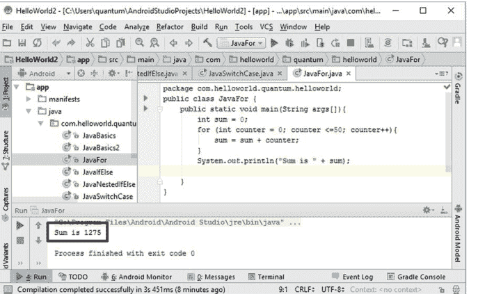

图 4.21. Java 中的 for 循环示例

```java
package com.helloworld.quantum.helloworld;
public class JavaWhile {
    public static void main(String args[]) {
        int sum = 0;
        int counter = 0;
        while (counter <= 50) {
            sum = sum + counter;
            counter++;
        }
        System.out.println("Sum is " + sum);
    }
}
```

如上所示，循环变量`counter`定义在`while`循环之前。`while`循环检查条件`counter<=50`是否满足。如果满足，则执行`while`循环内部的表达式，否则`while`循环结束。计数器变量在`while`循环内部通过表达式`counter++`递加。输出再次为 1275，如图 4.22 所示。

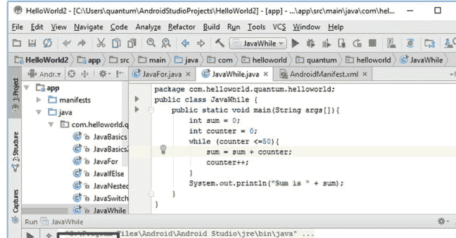

图 4.22. Java 中的 while 循环示例

**do-while 循环**：`do-while`的执行与 **while** 循环相似，但循环变量是在循环块结束时检查的，如下：

```java
package com.example.atomic.javabasics1;
public class JavaDoWhile {
    public static void main(String args[]) {
        int sum = 0;
        int counter = 0;
        do {
            sum = sum + counter;
            counter++;
        }while (counter<=50);
        // do-while 循环结束
        System.out.println("The sum is " + sum);
    }
}
```

## 第 4 章：JAVA 基础

正如代码 4.29 所示，我们还将`void`关键字替换为`int`关键字，因为函数将输出一个`int`类型的变量（`sum`）。

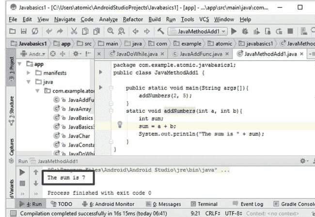

图 4.24. Java 中的方法定义与调用

```java
package com.example.atomic.javabasics1;
public class JavaMethodAdd2 {

    public static void main(String args[]) {
        addNumbers(2, 5);
    }
    static int addNumbers(int a, int b) {
        int sum;
        sum = a + b;
        return sum;
    }
}
```

代码 4.30

当我们运行上述代码时，什么都不会发生，因为我们从方法中删除了打印代码，它只输出和。我们可以按照如下方式打印方法的输出：

```java
package com.example.atomic.javabasics1;
public class JavaMethodAdd2 {
    public static void main(String args[]) {
        System.out.println(addNumbers(2, 5));
    }
    static int addNumbers(int a, int b) {
        int sum;
        sum = a + b;
        return sum;
    }
}
```

代码 4.31（接上一页）

我们将方法调用写在`System.out.println()`方法内部，因此方法的返回值将如下所示打印：

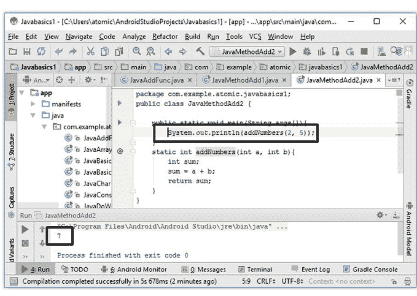

图 4.25. 使用带返回值的方法

从这些简单的示例中可以看出，方法提供了一种使用我们代码并使其紧凑的好方法。当然，它们的使用范围不仅限于数学运算，一个 Java 或 Android 应用程序包含了许多自定义方法，以及来自 Android SDK 或 Java SDK 提供的可用方法。Android SDK 包含了数千个方法，这让开发者的生活变得更容易。

方法对于在开发者之间共享代码也非常重要。如果我们能在网上找到现成的代码方法，就可以轻松地在应用程序中使用它。

方法始终是类的一部分。所以，让我们现在关注类、对象和继承，这些是所谓“面向对象编程”的骨干。

## 4.7. Java 中的类、对象与继承

Java 编程语言结合使用了传统的（过程化）和面向对象的概念，以提供更强大的体验。过程化编程意味着程序按顺序使用过程和函数执行。这是传统方法。另一方面，面向对象编程使用类以及从这些类派生的对象来执行所需的计算步骤。那么，类和对象是什么呢？

我们可以将类看作蓝图，将对象看作使用该蓝图制造的不同产品。同样，我们可以汽车工厂作为类和对象的示例。想象一条汽车生产线。每当我们改变颜色、行李箱、方向盘等时，我们在不改变汽车基本属性的情况下获得了一个不同的汽车。如果汽车品牌和型号是 Virtua 和 Liberty（假设名称！），生产线就会生产 Virtua Liberty 1.6、Virtua Liberty 2.0、Virtua Liberty 3.0、Virtua Liberty 1.6 premium、Virtua Liberty 2.0 diesel 等。在这种情况下，类是 Virtua Liberty，而所有这些假设的模型都属于这个类。我们可以将其想象为图 4.26 所示。

让我们先在 Java 中声明一个`Car`类，然后定义从该类派生的不同汽车对象，因为名为`Car`的类是由`public static class Car`定义的，它具有名为`colour`、`fuel type`和`engine_capacity`的变量。对于该类的每个对象，这些变量是不同的。

在类定义内部，有一个方法声明`public Car(String carColour, String carType, float CarEngineCapacity)`。这是一个与类同名的构造方法，类变量在代码 4.33 所示的方法中进行赋值。

#### 类对象

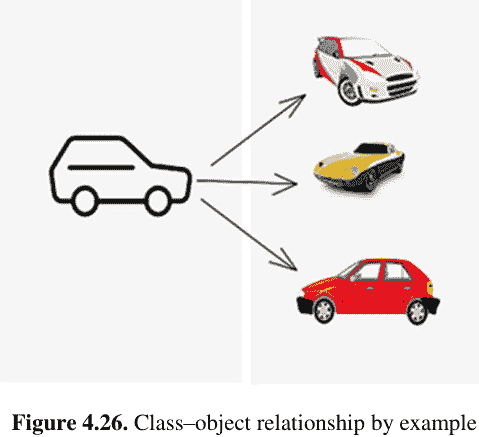


`package com.helloworld.quantum.helloworld;`
```java
public class JavaClassMain1 {
    public static class Car {
        static String colour;
        static String fuel_type;
        static float engine_capacity;
        public Car(String carColour, String carType, float CarEngineCapacity){
            colour=carColour;
            fuel_type=carType;
            engine_capacity = engineCapacity;
        }
    }

    public static void main(String args[]) {
        Car myCar = new Car("Red", "Diesel", 1.2f);
        System.out.println(myCar.colour);
    }
}
```

代码 4.32

## JAVA 基础

| 变量 | 赋值 |
| :--- | :--- |
| `colour` | `carColour;` |
| `fuel type` | `carType;` |
| `engine capacity` | `CarEngineCapacity;` |

代码 4.33

最后，在程序的 `main` 函数中，通过以下代码创建一个名为`myCar`的`Car`对象。请注意，`new`关键字用于创建类的对象。在修改后的代码中，输出是终端上的`colour`变量。

我们可以使用该类定义任意数量的不同对象：

- `myCar = new Car("White", "Gasoline", 1.6f);`
- `myCar = new Car("Diesel", 2.0f);`
- `myCar = new Car("Grey", 1.2f);`

代码 4.34

类的力量源于变量和方法的可用。例如，在代码 4.35 中添加一个方法。

## ANDROID STUDIO 移动开发初学者指南

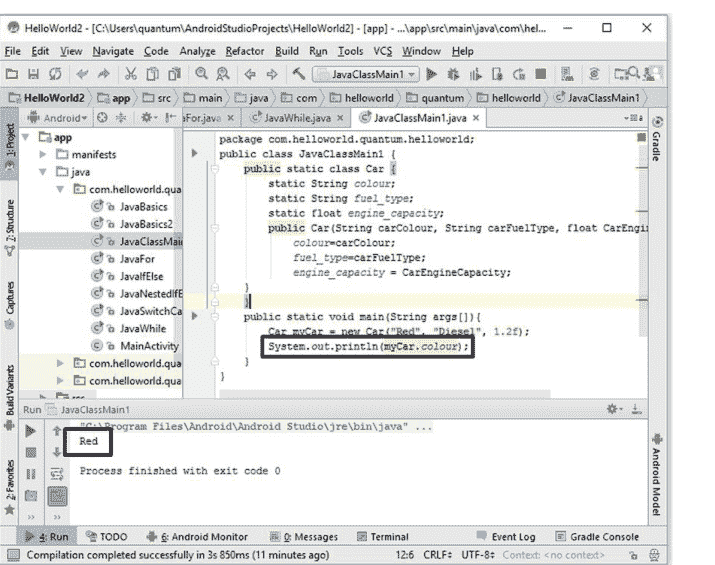

图 4.27. Java 中的类和对象示例

```java
package com.helloworld.quantum.helloworld;
public class JavaClassMain {
    public static class Car {
        static String colour;
        static String fuel_type;
        static float engine_capacity;
        public Car(String carColour, String carType, float engineCapacity) {
            colour=carColour;
            fuel_type=carType;
            engine_capacity = engineCapacity;
        }

        public void askType() {
            System.out.println(fuel_type);
        }
    }

    public static void main(String args[]) {
        Car myCar = new Car("Red", "Diesel", 1.2f);
        myCar.askType();
    }
}
```

代码 4.36（接上一页）

在此代码中，通过点操作符调用`askType`方法：

```java
myCar.askType();
```

代码 4.37

请注意，没有参数的方法通过空括号`()`调用。

```java
myCar.askType();
```

图 4.28. 调用类的方法

基本的类和对象关系可以在上述代码中总结。然而，类的另一个重要属性是继承。继承是从现有类（`class₁`）创建新类（`class₂`）的能力。

## ANDROID STUDIO 移动应用开发初学者指南

子类（`class`）将拥有其父类（`class₁`）的字段和方法。子类也可以拥有新的变量和方法可以使用。

我们在代码 4.36 中定义了一个`Car`类。让我们一个名为`sedanCar`的子类，它将继承父类：

```java
public static class sedanCar extends Car {
    int b_Vol;
    public sedanCar(String carColour, String carType, float CarEngineCapacity, int baggageVol) {
        super(carColour, carType, CarEngineCapacity);
        b_Vol = baggageVol;
    }
}
```

代码 4.38

在此代码的第一行中，新的（子）类`sedanCar`继承了`Car`类。然后，在新类中声明了一个新的整数变量`b_Vol`。接下来，通过`public sedanCar(String carColour, String carType, float CarEngineCapacity, baggageVol)`定义了`sedanCar`的构造方法。在这个构造方法内部，有一行重要的代码：

```java
super(carColour, carType, CarEngineCapacity);
```

代码 4.39

在 Java 中，`super`关键字用于在子类中调用父类的构造方法。因此，子类`sedanCar`使用`super`关键字继承父类的字段（在本例中为变量）。

父类和子类的完整代码见代码 4.40。

```java
package com.helloworld.quantum.helloworld;
public class JavaClassMain1 {
    public static class Car {
        static String colour;
        static String fuel_type;
        static float engine_capacity;
        public Car(String carColour, String carType, float engineCapacity){
```

```java
colour=carColour;
fuel_type=carFuelType;
engine_capacity = CarEngineCapacity;

public void askFuelType() {
    System.out.println(fuel_type);
}

public static class sedanCar extends Car{
    int b_Vol;
    public sedanCar(String carColour, String carFuelType, float CarEngineCapacity, int baggageVol) {
        super(carColour, carFuelType);
        b_Vol = baggageVol;
    }

    public static void main(String args[]) {
        sedanCar newCar = new sedanCar("Red", "Diesel", 1.2f, 40);
        newCar.askFuelType();
        System.out.println(newCar.b_Vol);
    }
}
```

代码 4.40（续上页）

我们可以对派生自子类的对象`newCar`运行`askFuelType`方法，尽管子类中并没有显式地定义`askFuelType`方法。这是因为子类继承了其父类的所有方法，因此`sedanCar`类实际上拥有`askFuelType`方法。

在最后一行，像往常一样访问了子类特有的`b_Vol`变量。这段代码在 Android Studio 中的输出如图 4.29 所示。

如果这些类和对象让你感到困惑，不要担心。当我们使用它们来开发 Android 应用时，你会更好地理解它们的。

## ANDROID STUDIO 移动应用开发入门指南

当然，Java 是一门非常丰富的编程语言，Java SDK 拥有数千万个方法用于开发复杂的 Java 程序。然而，我认为这门 Java 基础课程对于开始开发 Android 应用已经足够了。我确定在接下来的章节中，你会习惯编写 Java 代码的。

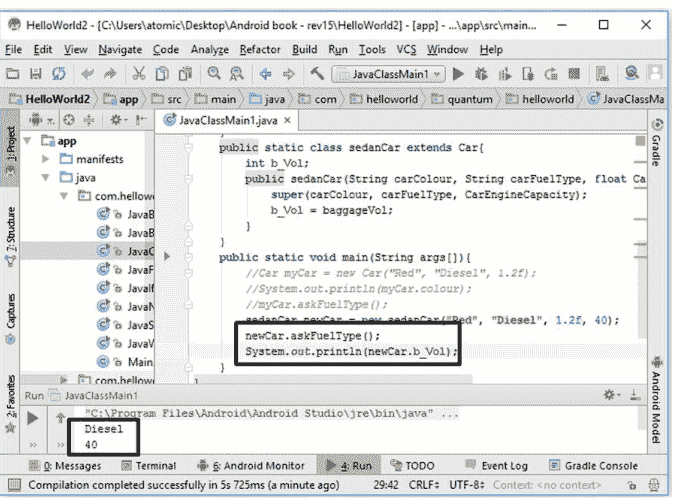

### 图 4.29. Java 类扩展示例

好消息是，枯燥的内容结束了，真正的功能即将开始：真正的 Android 应用开发——那些真正能发挥作用的应用程序。我们将设计与用户交互的程序，并利用 Android 平台的各种功能，如短信发送和 GPS 读取。在开始下一章之前，让我们喝杯咖啡放松一下，在那里我们将开启 Android 应用开发之旅。

## 第 5 章

## ANDROID 应用 #1：红/蓝闪烁灯

在这个项目中，我们将开发一个简单的闪烁灯应用。我们将学习在 Java 代码中访问按钮、获取屏幕背景颜色、设置该颜色以及感知按钮点击以更改背景颜色。

我们的目标是开发一个 Android 应用，该应用的背景颜色会像红/蓝闪烁灯一样变化。每当我们点击屏幕中间的按钮时，应用的背景颜色就会从红色变为蓝色，或反之。这是一个非常简单的应用，但它将教会我们视觉编程的基础。

### 5.1. 创建新的 Android 项目

首先，选择“Create a new project”（创建新项目）。如果 Android Studio 已经在运行，请从顶部菜单选择 File（文件）-> New（新建）-> New Project（新项目），如下所示：

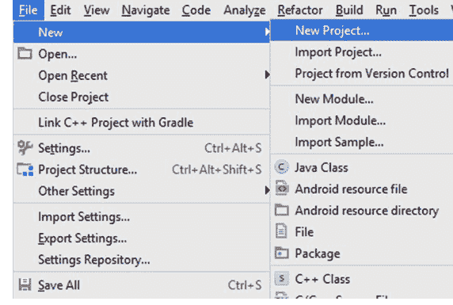

图 5.1. 在 Android Studio 中创建新项目

## ANDROID STUDIO 移动应用开发入门指南

我将应用命名为“Lighthead”，如图 5.2 所示，但你可以赋予任何喜欢的名称。

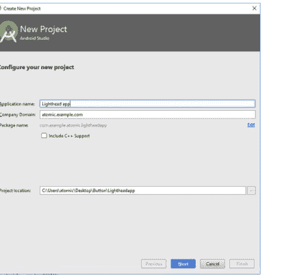

图 5.2. 为应用命名

然后，我选择了该应用兼容 Android 4.0.3 (Ice Cream Sandwich) 或更高版本的手机和平板电脑：

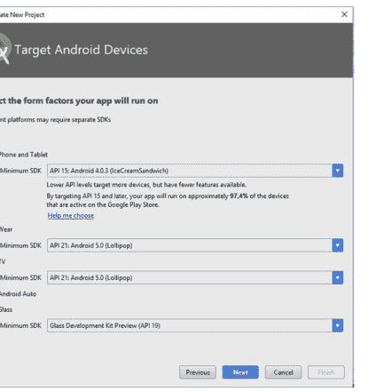

图 5.3. 选择应用兼容性

## 第 5 章。ANDROID #1：红/蓝闪烁灯

我们需要一个简单的屏幕，因此在下一个对话框中选择“Empty Activity”（空活动）即可完成任务：

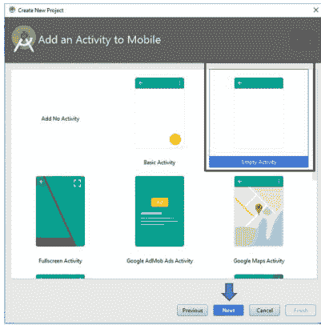

图 5.4. 选择屏幕布局

最后，将活动名称保持为“MainActivity”，然后点击“Finish”（完成）来创建项目文件：

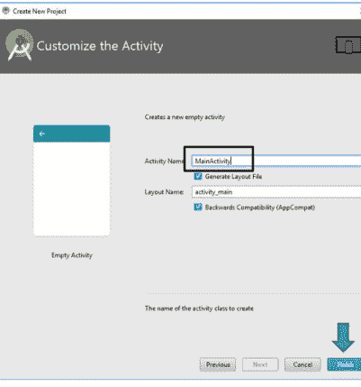

图 5.5. 最后设置

## ANDROID STUDIO 移动应用开发入门指南

项目成功创建后，将出现 Android Studio 的默认视图，其中中间面板将显示“MainActivity.java”文件，如下所示：

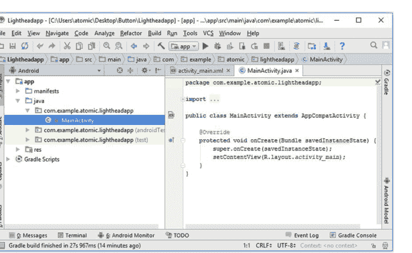

图 5.6. Android Studio 中的默认视图

### 5.2. 开发用户界面

让我们打开用户界面。我们可以从左侧面板看到文件夹，并双击`activity_main.xml`。事实上，`activity_main.xml`用于构建应用。在 Android 中，`activity_main.xml`显示在中间面板。我们从从图中看到应用的布局。换句话说，`activity_main.xml`包含了

## 第 5 章。ANDROID #1：红/蓝闪烁灯

我们将在图 5.7 中看到`activity_main.xml`。

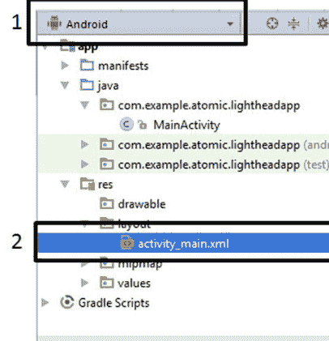

图 5.7. 项目中的 activity_main

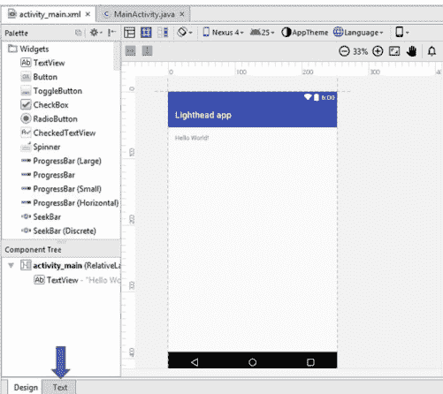

图 5.8. Android Studio 中的 activity_main

## ANDROID STUDIO 移动应用开发入门指南

当选中 Text（文本）标签页时，中间面板将显示`activity_main.xml`文件：

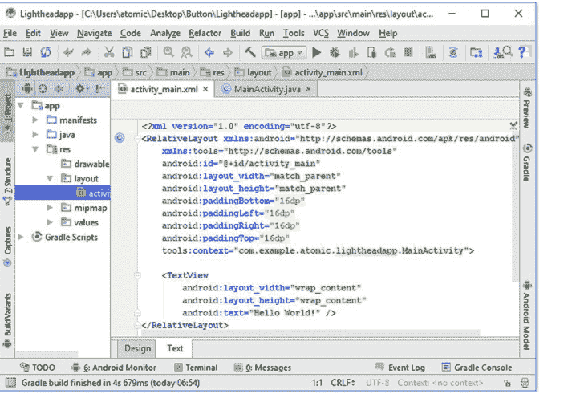

图 5.9. 表现形式 activity_main 文件

我们不需要被这个文件的内容困扰。在图中，我们可以看到布局由`<RelativeLayout>`和`</RelativeLayout>`组成。在这个布局内部，我们有一个

删除默认的`TextView`后，请在对象调板中找到`Button`控件，然后如图 5.12 所示，借助引导线的帮助将其拖到 GUI 的中间。


**图 5.12.** 在用户界面的中央添加按钮控件

当我们向 GUI 添加小部件时，它会保持被选中状态，并从右侧面板中查看其属性，如图 5.13 所示。按钮的基本属性显示在这一面板中。然而，我们可以通过点击 **View all properties**（查看所有属性，向下滚动后可见）查看完整的属性列表，如图 5.14 所示。

无论如何，让我们继续查看图 5.13 中矩形所示的基本属性。在该面板中，访问按钮最重要的属性之一是 ID。Android 应用 GUI 的所有对象在代码部分中都是通过它们的 ID 来访问的。

# Android Studio 移动应用开发初学者指南


图 5.13. 按钮控件的属性


图 5.14. 切换到按钮控件的所有属性

## 第 5 章 Android 应用 #1：红/蓝灯

在我们的应用中，按钮控件的默认 ID 设置为 Android Studio **button**。我们可以通过点击 ID 框并替换 **button** 来更改它。

接两个框指的是按钮控件的 **layout width**（布局宽度）和 **layout height**（布局高度）属性。它们的设置决定了 GUI 中按钮对象的宽度和高度。它们默认设置为 **wrap_content**（包裹内容）。这意味着按钮的宽度高度将调整为包裹（覆盖）按钮内部的文本（即按钮标签）。这些参数的其他可用选择是 **match_parent**（匹配父布局），如图 5.15 所示。如果选择此项，相应的属性（宽度或高度）将等于其父容器的宽度或高度（在本例中是覆盖整个屏幕的 GridLayout）。


**图 5.15.** layout_width 和 layout_height 参数的备选项

由于我们不希望按钮具有填充整个 GUI 的宽度或高度，因此我们需要让这些参数的值为 **wrap_content**。

在我们的应用中，按钮旨在更改屏幕的背景颜色，因此相应地更改按钮的标签是很好的。按钮标签（按钮上的文本）默认为 **Button**。让我们将其更改为“Change!”，如图 5.16 所示。

# Android Studio 移动应用开发初学者指南


图 5.16. 更改按钮的标签

### 5.3 编写应用的主代码

由于我们不需要 GUI 中任何任何小部件，现在可以继续编写`MainActivity.java`应用了。为了打开此文件，导航到 Android Studio 中的项目资源管理器，双击位于`java -> com...lightheadapp`下的`MainActivity`，如下：


图 17. 在 Android Studio 中打开 MainActivity.java

## 第 5 章 Android 应用 #1：红/蓝灯


**图 18.** 默认的 MainActivity.java 文件

上述`MainActivity.java`文件是 Android Studio 生成的默认文件。某些代码行默认隐藏，如 **import** 行所示。你可以通过点击那里打开这些代码，如下：


**图 19.** 打开隐藏行后的默认 MainActivity.java 文件


让我们逐行分析`MainActivity.java`代码：

- 第一行是包定义，如 Java 代码所示。显示它属于哪个包。

- 接下来两行是导入所需库的`import`行。在我们的文件中，导入了`AppCompat`和`Bundle`库。它们包含了用户交互和在不同 Activity 之间传递数据的方法。

- 下一行声明了继承`AppCompat`类的`MainActivity`类。这就像 Java 中的类定义。在 Java 中，Android 中的类名应与 .java 文件匹配。在这种情况下，文件是`MainActivity`。

- 然后默认放置了`override`命令。它用于告诉编译器当前类将覆盖任何父类。

- 第六行定义了一个名为`onCreate()`的方法。所有 Activity 通过方法调用序列启动。`onCreate()`方法是第一个。

- 下一行`super.onCreate(savedInstanceState);`告诉我们在父类的现有代码（任何）之外执行我们的代码。

- 最后一行`setContentView()`设置了布局内容。我们在`activity_main`文件中设置了应用的布局。Android 通过一个名为`"R"`的辅助类访问所有资源。`R`类是一个特殊类，与通过路径访问相比，它使 Android 以更简单的方式利用资源。`setContentView()`方法的参数是`R.layout.activity_main`。

在我们的应用中，按钮旨在更改屏幕的背景颜色，因此相应地更改按钮的标签是很好的。按钮标签（按钮上的文本）默认为`Button`。让我们将其更改为“Change!”，如图 5.16 所示。

## 第 5 章。安卓应用 #1：红蓝灯效果

### ANDROID STUDIO 移动应用开发入门指南

所有在点击按钮时运行的代码行都放在`onClick(View v)`方法内部。

**注意：** 你会注意到 Android Studio 会以智能的方式自动补全你的代码。在我看来，Android Studio 在这一功能上非常出色。

我们的目标是在点击按钮时将背景颜色从红色变为蓝色，反之亦然。在`activity_main.xml`文件中，我们看到 GUI 有一个`RelativeLayout`元素作为填充整个屏幕的主布局。由于这个原因，我们可以通过以下代码访问背景：

```
RelativeLayout bgElement = (RelativeLayout) ViewById(R.id.activity_main);
```

在这段代码中，我们生成了一个名为`bgElement`的`RelativeLayout`对象，通过它我们可以访问应用背景的所有属性。

现在我们需要检查`bgElement`的颜色。这是因为我们将根据它当前的颜色来改变它的颜色。如果现在是红色，按钮将变为蓝色；如果现在是蓝色，点击按钮后将变为红色。

```
int color = ((ColorDrawable) Element.getBackground()).getColor();
```

在这段代码中，应用布局的背景颜色通过`bgElement.getBackground().getColor()`获取，然后转换为`Drawable`类型，该类型以整数形式表示颜色。然后，这个整数值被赋值给`color`变量。简而言之，背景颜色将以整数的形式存储在变量`color`中。

现在我们将利用一个决策语句来更改颜色，例如：

如果颜色是红色，则变为蓝色；否则（如果颜色是蓝色）则变为红色。

我们可以通过以下代码实现：

```
if (color == Color.RED) {
    bgElement.setBackgroundColor(Color.BLUE);
} else {
    bgElement.setBackgroundColor(Color.RED);
}
Code 5.5
```

Android SDK 中有一个名为`Color`的特殊类用于进行颜色操作。`Color.RED`和`Color.BLUE`表达式分别代表红色和蓝色对应的整数值。因此，包含整数的`color`变量将通过表达式`color == Color.RED`与红色的整数值进行比较。如果它们相等，则意味着背景当前为红色，并且在点击按钮时将变为蓝色。否则，背景当前为蓝色，当用户点击按钮时将变为红色。

结合所有代码行，我们得到了代码 5.6 所示的按钮监听方法。

```
public void myButtonListenerMethod() {
    button = (Button) findViewById(R.id.button)
    button.setOnClickListener(new View.OnClickListener() {
        @Override
        public void onClick(View v) {
            RelativeLayout bgElement = (RelativeLayout) findViewById(R.id.activity_main);
            int color = ((ColorDrawable)bgElement.getBackground()).getColor();
            if (color == Color.RED) {
                bgElement.setBackgroundColor(Color.BLUE);
            }
            else {
                bgElement.setBackgroundColor(Color.RED);
            }
        }
    }
));
}
```

Code 5.6（接上页）

请注意，由于块内部只有一行代码，我们可以使用不带大括号的`if–else`语句。然而，为了完整性起见，我写了大括号。

我们现在必须在 activity 首次创建时调用这个按钮监听方法。因此，我们必须在`onCreate()`方法内部如下调用它：

```
protected void onCreate (Bundle savedInstanceState){
    super.onCreate(savedInstanceState);
    setContentView(R.layout.activity_main);
    myButtonListenerMethod();
}
```

Code 5.7

然而，我们还没有完成，因为 activity 首次创建时背景默认是透明的。因此，我们必须在创建时将其设置为红色或蓝色。让我们通过如下改进代码 5.7 来设置：

```
protected void onCreate (Bundle savedInstanceState){
    super.onCreate(savedInstanceState);
    setContentView(R.layout.activity_main);
    RelativeLayout bgElement = (RelativeLayout) findViewById(R.id.activity_main);
    bgElement.setBackgroundColor(Color.RED);
    myButtonListenerMethod();
}
```

Code 5.8

在这段代码中，背景在应用启动时被访问并设置为红色。请注意，我们需要在`onCreate()`方法内部定义一个独立的`bgElement`对象；我们不能使用按钮监听方法内部定义的`bgElement`。这是因为在方法中声明的所有变量和对象只在该方法内部有效（也称为变量的作用域）。

现在，让我们这些代码行组合成完整的`MainActivity.java`文件如下：

```
public class MainActivity extends AppCompatActivity {

    Button button;
    @Override
    protected void onCreate(Bundle savedInstanceState) {
        super.create(savedInstanceState);
        setContentView(R.layout.activity_main);
        RelativeLayout bgElement = (RelativeLayout) findViewById(R.id.activity_main);
        bgElement.setBackgroundColor(Color.WHITE);
        myButtonListenerMethod();
    }

    public void myBuilderListenerMethod() {
        Button button = (Button)findViewById(R.id.button);
        button.setOnClickListener(new View.OnClickListener() {
            @Override
            public void onClick(View v) {
                RelativeLayout bgElement = (RelativeLayout)findViewById(R.id.activity_main);
                int color = ((ColorDrawable)bgElement.getBackground()).getColor();
                if (color == Color.RED) {
                    bgElement.setBackgroundColor(Color.BLUE);
                } else {
                    bgElement.setBackgroundColor(Color.RED);
                }
            }
        });
    }
}
```

Code 5.9

### 5.4. 构建并运行应用

我们已经完成了第一个安卓应用的布局和代码开发。让我们点击 Android Studio 中的 Run 按钮来运行它。我选择了一个 Nexus 4 模拟器来运行我们的应用。应用启动时的屏幕如图 5.22 所示。

### ANDROID STUDIO 移动应用开发入门指南


**图 5.22.** 应用启动时的界面（颜色和全分辨率请访问书籍网站：http://www.android-java.website）

当我们点击`Change!`时，背景颜色从红色变为蓝色，反之亦然，如图 5.23 所示。我们可以像第 3 章解释的那样在真实设备上运行它。

希望你喜欢开发我们的第一个安卓应用。如果对代码有疑问，不要担心，我相信你在接下来的章节中会习惯 Android 的。

- **练习：** 你能修改代码以根据背景颜色更改按钮的标签吗？如果背景颜色变为蓝色，按钮文字将显示`Convert to blue!`，否则显示`Convert to red`！

### ANDROID STUDIO 移动应用开发入门指南


**图 5.23.** 连续点击按钮后我们的应用屏幕（颜色和全分辨率请访问书籍网站：www.android-java.website）

## 第 6 章，安卓应用 #2：BMI 计算器

在本章中，我们将开发一个 BMI 计算器应用，并学习如何读取用户输入、在代码中进行计算以及向用户显示结果。

### 6.2. 添加和定位 TextView

为了在我们的应用中计算 BMI，我们显然需要体重和高度的输入。我们的 Java 代码将根据给定的 BMI 公式计算 BMI，然后根据表 6.1 决定类别。首先，让我们创建一个名为“BMI Calculator”的新项目，并将其保存到计算机上的任何位置（这些内容我不再重复了，我们在之前的章节中已经详细解释过）。请像我们之前上一个应用那样，选择“Phone and Tablet”平台，并将最小 SDK 设置为 API 15。默认布局可以选择为“Empty activity”，主类设为`MainActivity.java`，布局文件为`activity_main.xml`。请不要删除默认的“Hello World”TextView，以便我们可以修改它来显示我们的应用标题。点击它，它就会被选中。现在将其文本更改为 BMI Calculator，并按照图 6.1 中数字 1、2 和 3 所示，将其字体大小设置为 24sp。

让我们对此标题文字进行定位，使其在水平方向居中，并保持大约 50~60 dp 的距离。（dp 代表密度无关像素，当显示分辨率更改时会自动调整）。为此，点击图 6.1 中 4 所示的 View all properties（查看所有属性），并如图 6.2 所示调整此 TextView 的位置。请注意，水平中间引导线会自动调整，我们可以在该线段滑动此组件，这将有助于我们保持它在水平居中。当你移动组件时，观察名为`layout_marginTop`的参数，它表示距离顶部的距离。我将其设置为 60 dp。

我们将从用户处获取身高和体重输入，并以数字及其类别显示 BMI 结果。我们需要放置四个 TextView，分别显示“Enter your weight (kg):”、“Enter your height (m):”、“Your BMI:”以及 BMI category。请从调色板（Palette）找到 TextView 小部件，并如图 6.3 所示拖入四个 TextView。

### ANDROID STUDIO 移动应用开发入门指南


图 6.1. 设置 TextView 的基本属性（你可以从书籍网站下载全分辨率彩色版本）


图 6.2. 定位标题标签


图 6.3. 放置四个 TextView

一旦放置了第一个 TextView，下一个将相对于上上一个进行定位。对于我们的 BMI 计算器应用，具体位置并不是严格的，我在这里没有给出精确位置，以免让你困惑。如果你想看我具体使用了哪些位置，可以从书籍的配套网站下载项目文件，但这并不是必须的。然而，我们需要在第二个和第三个 TextView 之间留出空间，用于放置触发计算的按钮。

我已经将文本字体大小更改为 18 sp，并将文本类型设为粗体。

根据我们的目标更改 TextView 的文本后，布局看起来如图 6.4 所示。


**图 6.4.** 设置 TextView 后的应用 GUI 布局

### 6.3. 添加 EditText 小部件

我们现在需要放置两个可编辑的文本框让用户输入体重和身高，另一个文本框用于显示 BMI 数字，以及一个用于启动 BMI 计算的按钮。

TextField（文本框）的定位如图 6.5 所示。我放置了可以输入小数（带有分数部分的数字）的 Text Field，而不是通用输入类型，因为用户在这个应用中应该只输入数值。值得注意的是，计算结果将显示在`Your BMI:`标签旁边，并在那里放置了一个 Text Field 用于显示 BMI 结果。


图 6.5. 放置 TextFields

请注意，TextField 默认没有边框，因此在放置它们之后，我们只能通过选中它们才能看到。

让我们设置它们的 ID 以便我们可以通过编程访问它们，并设置它们的默认文本。为此，选择 TextField，然后如图 6.6 所示设置其 ID 和文本。

### ANDROID STUDIO 移动应用开发入门指南


图 6.5. 放置 TextView

请注意，TextField 默认没有边框，因此在放置它们之后，我们只能通过选中它们才能看到。

让我们设置它们的 ID 以便我们可以通过编程访问它们，并设置它们的默认文本。为此，选择 TextField，然后如图 6.6 所示设置其 ID 和文本。

### ANDROID STUDIO 移动应用开发入门指南


图 6.6. 体重输入的设置


图 6.7. 放置 TextFields

### ANDROID STUDIO 移动应用开发入门指南


图 6.6. 体重输入的设置


图 6.7. 放置 TextFields

### 6.4. 添加和定位按钮


我们还有两个步骤来完成 GUI。第一个是触发计算的按钮。请从调色板中拖入一个按钮到身高输入和 BMI 结果之间，然后使其在水平居中。


图 6.8. 在屏幕上放置按钮

现在，请将按钮文本更改为“Calculate my BMI!”按钮的默认 ID 是`button`。我们的 GUI 几乎完成了，但还剩一步。BMI类别 TextView（默认显示“BMI category appears here.”）请将其 ID 设置为`BMICategory`，我们就完成了。完成这些步骤后，应用的 GUI 如下所示：


图 6.9. 计算应用的 GUI

## 6.5. 应用的主代码

我们现在准备好继续编程了。我们将在`MainActivity.java`中实现以下 BMI 计算步骤：

- 首先，获取体重输入和身高输入字段中的值。这些是`String`类型变量。
- 将这些`String`转换为`double`类型变量，以便可以使用章节开头给出的 BMI 公式进行计算。
- 执行体重指数计算。
- 转换为`String`后，将 BMI 值显示在“Your BMI:”旁边的字段中。
- 使用`if-else`语句根据表 6.1 从 BMI 值确定 BMI 类别。
- 将 BMI 类别显示在默认显示“BMI category appears here.”的视图中。

请从 Android Studio 文件管理器打开`MainActivity.java`文件。该文件的默认内容如下：

```
package com.helloworld.quantum.bmicalculator;

import android.support.v7.app.AppCompatActivity;
import android.os.Bundle;

public class MainActivity extends AppCompatActivity {

    @Override
    protected void onCreate(Bundle savedInstanceState) {
        super.onCreate(savedInstanceState);
        setContentView(R.layout.activity_main);
    }
}
```

将在用户点击按钮时进行，因此我们需要为按钮编写一个监听方法，并在`onCreate()`函数中调用该方法（正如我们在之前的章节中解释的那样）。代码 6.2 显示了按钮监听器的通用模板。

## 第 6 章.安卓 应用 #2：BMI 计算器

```java
public void myButtonListenerMethod() {

    Button button = (Button) findViewById(R.id.button);

    button.setOnClickListener(new View.OnClickListener() {
        @Override
        public void onClick(View v) {
            // 按钮被点击时执行的代码
        }
    });
}
```

代码 6.2

我们在第 5 章中分析了此监听器方法的结构。简而言之，通过第二行创建的按钮对象来访问按钮，所有在点击按钮时执行的操作都将放在`onClick(View v)`方法中。

首先，我们需要从各自的`EditText`（文本框）中获取身高和体重。通过以下代码片段即可实现：

```java
final EditText heightText = (EditText)
    findViewById(R.id.heightInput);

String heightStr = heightText.getText().toString();
double height = Double.parseDouble(heightStr);
```

代码 6.3

这段代码的解释如下：

- 第一行，我们使用 ID (`R.id.heightInput`) 访问身高输入文本框，并创建一个名为`heightText`的`EditText`对象。
- 第二行，提取该`EditText`中的字符串并将其赋值给一个名为`heightStr`的新`String`对象。
- 最后一行，将身高的`String`数值转换为`double`类型，并赋值给新创建的变量`height`。
- 最终，我们将身高值存储在`double`类型的`height`变量中。

## ANDROID STUDIO 移动应用开发入门教程

我们需要实现这些步骤，因为没有其他方法可以直接获取`EditText`的值作为`String`或`double`。

以下代码执行了类似的工作，并将体重值存储在`weight`变量中：

```java
final EditText weightText = (EditText)
    findViewById(R.id.weightInput);
```

```java
String weightStr = weightText.getText().toString();
double weight = Double.parseDouble(weightStr);
```

代码 6.4

现在我们有了`double`类型的体重和身高变量，因此可以使用章节开头给出的公式进行 BMI 计算：

```java
double BMI = (weight) / (height*height);
```

代码 6.5

在此段代码中，`*`运算符执行乘法，而`/`运算符将体重除以身高的平方。

我们将此 BMI 值显示在 GUI 中 "Your BMI" 标签旁边的`EditText`框中。在之前布局用户界面时，我们将其 ID 设置为`BMIResult`。因此，以下代码完成了此任务：

```java
final EditText BMIResult = (EditText)
    findViewById(R.id.BMIResult);
BMIResult.setText(Double.toString(BMI));
```

代码 6.6

在此段代码中，第一行找到了 ID 为`BMIResult`的控件，然后通过`Double.toString(BMI)`将`double`类型的 BMI 变量转换为`String`以便在`EditText`中显示。注意，`EditText`控件中编写的文本只能作为`String`进行读写。

我们现在将 BMI 存储在`double`类型变量中。现在，我们需要根据表 6.1 使用`if-else`语句来检查此数值，并确定 BMI 分类。

```java
String BMI_Cat;
```

代码 6.7

我们将按照 BMI 值使用`if–else`语句如下设置该`String`：

```java
if (BMI < 15)
  BMI_Cat = "Very severely underweight";
else if (BMI < 16)
  BMI_Cat = "Severely underweight";
else if (BMI < 18.5)
  BMI_Cat = "Underweight";
else if (BMI < 25)
  BMI_Cat = "Normal";
else if (BMI < 30)
  BMI_Cat = "Overweight";
else if (BMI < 35)
  BMI_Cat = "Obese Class 1 - Moderately Obese";
else if (BMI < 40)
  BMI_Cat = "Obese Class 2 - Severely Obese";
else
  BMI_Cat = "Obese Class 3 - Very Severely Obese";
```

代码 6.8

剩下的工作是将`TextView`设置为`BMI_Cat`字符串，以便 BMI 分类显示在用户界面上：

```java
final TextView BMICategory = (TextView)
  findViewById(R.id.BMICategory);
BMICategory.setText(BMI_Cat);
```

代码 6.9

将所有代码行组合在一起，我们就得到了代码 6.10 中提供的完整`MainActivity.java`。（你可以从书籍网站 www.android-java.website 下载这些代码）。

请注意，此文件开头的库导入指令是由 Android Studio 根据我们在代码中使用的方法和类自动放置的。

## ANDROID STUDIO 移动应用开发入门教程

```java
package com.helloworld.quantum.bmicalculator;

import android.graphics.Color;
import android.graphics.drawable.ColorDrawable;
import android.support.v7.app.AppCompatActivity;
import android.view.Bundle;
import android.view.View;
import android.widget.Button;
import android.widget.EditText;
import android.widget.RelativeLayout;
import android.widget.TextView;

public class MainActivity extends AppCompatActivity
{
    @Override
    protected void onCreate(Bundle savedInstanceState) {
        super.onCreate(savedInstanceState);
        setContentView(R.layout.activity_main);
        myButtonListenerMethod();
    }

    public void myButtonListenerMethod() {
        Button button = (Button) findViewById(R.id.button);
        button.setOnClickListener(new View.OnClickListener() {
            @Override
            public void onClick(View v) {
                final EditText heightText = (EditText)
                    findViewById(R.id.heightInput);
                String heightStr = heightText.getText().toString();
                double height = Double.parseDouble(heightStr);

                final EditText weightText = (EditText)
                    findViewById(R.id.weightInput);
                String weightStr = weightText.getText().toString();
                double weight = Double.parseDouble(weightStr);

                double BMI = (weight) / (height);

                final EditText BMIResult = (EditText)
                    findViewById(R.id.BMIResult);
                BMIResult.setText(Double.toString(BMI));

                String BMI_Cat;
                if (BMI < 15)
                    BMI_Cat = "Very severely underweight";
                else if (BMI < 16)
                    BMI_Cat = "Severely underweight";
                else if (BMI < 18.5)
                    BMI_Cat = "Underweight";
                else if (BMI < 25)
                    BMI_Cat = "Normal";
                else if (BMI < 30)
                    BMI_Cat = "Overweight";
                else if (BMI < 35)
                    BMI_Cat = "Obese Class 1 - Moderately Obese";
                else if (BMI < 40)
                    BMI_Cat = "Obese Class 2 - Severely Obese";
                else
                    BMI_Cat = "Obese Class 3 - Very Severely Obese";

                final TextView BMICategory = (TextView)
                  findViewById(R.id.BMICategory);
                BMICategory.setText(BMI_Cat);
            }
        });
    }
}
```


```java
button.setOnClickListener(new
    View.OnClickListener() {
    @Override
    public void onClick(View v) {

        final EditText heightText = (EditText)
            findViewById(R.id.heightInput);
        String heightStr =
            heightText.getText().toString();
        double height = Double.parseDouble(heightStr);

        final EditText weightText = (EditText)
            findViewById(R.id.weightInput);
        String weightStr =
            weightText.getText().toString();
        double weight = Double.parseDouble(weightStr);

        double BMI = (weight)/(height);
        DecimalFormat df = new DecimalFormat("#..#");
        double BMI_trimmed =
        Double.parseDouble(df.format(BMI));
        final EditText BMIResult = (EditText)
        findViewById(R.id.BMIResult);
        BMIResult.setText(Double.toString(BMI_trimmed));

        String BMI_Cat;

        if (BMI < 15)
            BMI_Cat = "Very severely underweight";
        else if (BMI < 16)
            BMI_Cat = "Severely underweight";
        else if (BMI < 18.5)
            BMI_Cat = "Underweight";
        else if (BMI < 25)
            BMI_Cat = "Normal";
        else if (BMI < 30)
            BMI_Cat = "Overweight";
        else if (BMI < 35)
            BMI_Cat = "Obese Class 1 - Moderately Obese";
        else if (BMI < 40)
            BMI_Cat = "Obese Class 2 - Severely Obese";
        else
            BMI_Cat = "Obese Class 3 - Very Severely Obese";

        final TextView BMICategory = (TextView)
        findViewById(R.id.BMICategory);
        BMICategory.setText(BMI_Cat);
    });
}
```

代码 6.13（接上页）

当使用修改后的代码时，计算结果将在模拟器中显示如下：


**图 6.12.** 带有修约位数的示例 BMI 计算

**注意 2.** 我已验证我们的 BMI 计算器应用在真实设备（华硕 Zenfone 6）上运行正常。

**注意 3.** 如果应用将你分类为肥胖，不要担心，对我也是这样（图 6.12 中显示的数值并非我的©）。请咨询您的医生和营养师，以获得降低 BMI 的方法，例如定期锻炼和少吃加工食品。

我们将在下一章中开发一个掷骰子应用，届时你将学习如何在应用中添加动态图像并利用 Android 中的随机函数。喝完浓咖啡后见！

# 第 7 章

# ANDROID 应用 #3：简单掷骰子器

### 7.1. 创建项目并添加 ImageView 控件

我们在本章中将开发一个简单的掷骰子应用。我们将学习如何在 GUI 中使用图像，并学习使用 Java 编写基础随机数生成代码，以掷虚拟骰子。当我们点击“掷”（Roll）按钮时，应用将随机在 1 到 6 之间选择一个数字，将结果以数字显示在 TextView 中，并显示一个显示结果的骰子图像。

请创建一个新项目并将其保存到计算机上。按照常例选择一个空活动（empty activity）。我将项目命名为 Dice Roller，但你当然可以使用任何你喜欢的名称。

首先，让我们设计用户界面。在 Android Studio 中打开 `activity_main.xml` 文件时，请将默认 TextView 的文本从 Hello World 更改为 Dice Roller，并将其放置在 GUI 顶部，水平居中对齐，如图 7.1 所示。

我们现在需要放置一个 ImageView 组件，用于显示骰子面图像。然而，我们首先需要将图像文件导入项目。当应用启动时，显示一个通用的骰子图像很好，然后在用户掷骰子时将图像改为相应的骰子面图像。为此，我们需要向 Android Studio 插入一张通用的骰子图像和 6 张骰子面图像。这些图像如图 7.2 所示，可以从书籍配套网站 www.android-java.website 下载。

## ANDROID STUDIO 移动应用开发入门指南


**图 7.1.** 显示应用标题的 TextView


**图 7.2.** 应用中使用的骰子面图像及其文件名

# 第 7 章 ANDROID 应用 #3：简单掷骰子器

请选择并右键 $\rightarrow$ 复制计算机文件资源管理器中的所有图像（就像你选择文件进行复制时一样），然后右键 $\rightarrow$ 粘贴到 Android Studio 中的 drawable 文件夹中，如下：


图 7.3 向 Android Studio 添加文件

当我们点击 drawable 文件夹左侧的箭头时，我们可以看到图 7.4 所示的新添加的图像。


图 7.4 项目中导入的文件

# ANDROID STUDIO 移动应用开发入门指南

现在让我们将 ImageView 对象放在 GUI。请在 Palette（调板）中找到 ImageView 对象并将其拖放到应用布局中如下：


图 7.5 添加 ImageView 对象

当我们将 ImageView 放在 GUI 上时，Android Studio 希望我们显示通用的骰子图像，并在用户掷骰子时将图像改为相应的骰子面图像。为此，我们需要向 Android Studio 插入一张通用的骰子图像和 6 张骰子面图像。这些图像如图 7.2 所示，可以从书籍配套网站 www.android-java.website 下载。

我们最后需要添加的是根据点骰结果更改 ImageView 图像的代码。首先，我们将使用以下代码行访问 ImageView 对象：

```java
ImageView img = (ImageView) findViewById(R.id.diceImage);
```

*代码 7.4*

由于点骰结果是一个整数，我们可以轻松地利用 `switch-case` 语句来按如下所示的方式更改图像：

```java
switch (rollResult) {
  case 1:
    img.setImageResource(R.drawable.dice1);
    break;
  case 2:
    img.setImageResource(R.drawable.dice2);
    break;
  case 3:
    img.setImageResource(R.drawable.dice3);
    break;
  case 4:
    img.setImageResource(R.drawable.dice4);
    break;
  case 5:
    img.setImageResource(R.drawable.dice5);
    break;
  case 6:
    img.setImageResource(R.drawable.dice6);
    break;
}
```

*代码 7.5*

请注意，我们使用 `setImageResource()` 方法来更改 ImageView 对象 `img` 的图像，该方法接受模板 `R.drawable."imagename"` 的图像资源。

将所有这些代码行结合并在 activity 的 `onCreate()` 方法中调用按钮监听方法，我们得到了下面完整的 `MainActivity.java`:


```java
package com.helloworld.quantum.myapplication;
import android.support.v7.app.AppCompatActivity;
import android.os.Bundle;
import android.view.View;
import android.widget.Button;
import android.widget.EditText;
import android.widget.ImageView;
import android.widget.TextView;
import java.util.Random;

public class MainActivity extends AppCompatActivity {

    @Override
    protected void onCreate(Bundle savedInstanceState) {
        super.onCreate(savedInstanceState);
        setContentView(R.layout.activity_main);
        myButtonListenerMethod();
    }

    public void myButtonListenerMethod() {
        Button button = (Button) findViewById(R.id.rollButton);

        button.setOnClickListener(new View.OnClickListener() {
            @Override
            public void onClick(View v) {
                Random rand = new Random();
                int rollResult = rand.nextInt(6) + 1;

                TextView diceResult = (TextView) findViewById(R.id.diceResult);

                diceResult.setText(Integer.toString(rollResult));

                ImageView img = (ImageView) findViewById(R.id.diceImage);

                switch (rollResult) {
                    case 1:
                        img.setImageResource(R.drawable.dice1);
                        break;
                    case 2:
                        img.setImageResource(R.drawable.dice2);
                        break;
                    case 3:
                        img.setImageResource(R.drawable.dice3);
                        break;
                    case 4:
                        img.setImageResource(R.drawable.dice4);
                        break;
                    case 5:
                        img.setImageResource(R.drawable.dice5);
                        break;
                    case 6:
                        img.setImageResource(R.drawable.dice6);
                        break;
                }
            }
        });
    }
}
```

*代码 7.6（接上页）*

### 7.4. 构建并运行应用

让我们通过点击 Android Studio 中的"Run"按钮并像之前一样选择 Nexus 4 等模拟器来运行我们的点骰应用。出现图 7.9 所示的应用。每当你点击 ROLL! 按钮时，应用都应该显示一个不同的数字以及相应的骰面图像，如图 7.10 所示。该应用在真实设备上也能按预期正常工作。

值得注意的是，随机数不仅用于趣味应用，还用于日常的加密过程，如信用卡交易。因此，Java 和 Android 中有更复杂的随机数生成函数，也可以借助外部库来实现。但对于我们点骰游戏中的简单随机性，`Random` 类已经足够。你可以通过连续点击 Roll! 按钮来观察是否经常获得同一个数字，或者数字是否显示你可以预测下一个数字的模式。但请记住，准确测试随机性需要复杂的工具。

在继续后续章节之前，让我们休息一下，在下一章我们将开发一个利用内部加速度计和磁力计的指南针应用。

## 第7章 安卓应用 #3：简单点骰器


图 7.9. 首次运行时应用界面


图 7.10. 其中一次掷后显示 6 点

## 第8章 安卓应用 #4：指南针

我们将开发一个利用内部加速度计和磁力计的简单指南针应用。

### 8.1. 设置 Manifest

大多数安卓设备都带有加速度计和磁力计。在开发指南针应用时，我们将学习使用这些传感器来获取方向。为了实现这一点，我们需要在 `AndroidManifest.xml` 文件（位于 `manifests` 文件夹）中声明所需的权限。我们需要从加速度计和磁力计中提取方向数据。

要声明权限，请在`AndroidManifest.xml`中添加以下行：

```xml
<uses-feature android:name="android.hardware.sensor.accelerometer" android:required="true" />
<uses-feature android:name="android.hardware.sensor.magnetometer" android:required="true" />
```

这些行使得加速度计和磁力计的输出可以在我们的应用程序中使用。最终，我们将拥有一个显示北方的完整指南针应用。

# Android Studio 移动应用开发入门指南

```xml
android:supportsRtl="true"
android:theme="@style/AppTheme">
<activity android:name="MainActivity">
  <intent-filter>
    <action
      android:name="android.intent.action.MAIN" />
    <category
      android:name="android.intent.category.LAUNCHER" />
  </intent-filter>
</activity>
</application>
</manifest>
```

代码 8.2（接上一页）

### 8.2. 设计 App 的 GUI

现在，让我们来设计应用的布局。请打开`layout_main.xml`文件，并将默认的 "Hello World" TextView 文本更改为 "Compass App"，这将作为应用的标题。请将其字体大小设置为 30sp 并设置为粗体样式。然后，按照所示对其进行定位：


图 8.4. 用于显示应用标题的 TextView

## 章节 Android 应用 #4：指南针

让我们在 GUI 的正中间放置一个`ImageView`，并选择我们粘贴到`drawable`文件夹的指南针图像：


图 8.5. 为 ImageView 组件选择指南针图像

当我们放置 ImageView 后，它会被选中。然后，请从 Android Studio 右侧面板将其 ID 设置为 `ImageView_compass` 的`iv_compass`，如下：


图 8.6. 设置指南针 ImageView 的 ID

最后，我们在 ImageView 下方放置一个 TextView，并在其中实时显示方向角。我将其 ID 设置为 `tv_degrees`（TextView_degrees 的缩写），并按所示设置 24dp 的字体：


图 8.7. 添加 TextView 显示方向角

### 8.3. 编写 App 主代码

我们已经完成了用户界面的设计，现在可以继续编码了。请在 Android Studio 中打开`MainActivity.java`文件。该文件的默认内容如下：

```java
package com.example.atomic.compass;

import android.support.v7.app.AppCompatActivity;
import android.os.Bundle;

public class MainActivity extends AppCompatActivity {

    @Override
    protected void onCreate(Bundle savedInstanceState) {
        super.onCreate(savedInstanceState);
        setContentView(R.layout.activity_main);
    }
}
```

代码 8.3

指南针的水平方向被称为方位角（azimuth）。我们将根据磁力计和加速度计的输出计算此角度。让我们定义一个 float 类型变量来存储这些数据：

```java
float azimuth;
```

代码 8.4

我们还需要定义与传感器相关的对象：

```java
private SensorManager compassSensorManager;
Sensor accelerometer;
Sensor magnetometer;
```

代码 8.5

在此代码中，第一个对象是用于访问传感器的`SensorManager`对象。另外两个声明定义了读取加速度计和磁力计输出的`Sensor`对象。

最后，我们声明 ImageView 和 TextView 对象，用于访问 GUI 中对应的组件：

```java
TextView tv_degrees;
ImageView iv_compass;
```

代码 8.6

我们可以将这些声明放在`MainActivity`类中，位于`onCreate()`方法之前。然后，我们可以在`onCreate()`方法内部将默认的加速度计和磁力计传感器分配给它们的对象，如下：

```java
compassSensorManager =
(SensorManager)getSystemService(SENSOR_SERVICE);

accelerometer =
compassSensorManager.getDefaultSensor(Sensor.TYPE_ACCELEROMETER);

magnetometer =
compassSensorManager.getDefaultSensor(Sensor.TYPE_MAGNETIC_FIELD);
```

代码 8.7

在这些声明和赋值之后，`MainActivity.java`文件目前看起来如代码 8.8。

```java
package com.example.atomic.compass;

import android.hardware.Sensor;
import android.hardware.SensorManager;
import android.support.v7.app.AppCompatActivity;
import android.os.Bundle;
import android.widget.ImageView;
import android.widget.TextView;

public class MainActivity extends AppCompatActivity {

    float azimuth_angle;
    private SensorManager compassSensorManager;
    Sensor accelerometer;
    Sensor magnetometer;
    TextView tv_degrees;
    ImageView iv_compass;

    @Override
    protected void onCreate(Bundle savedInstanceState) {
        super.onCreate(savedInstanceState);
        setContentView(R.layout.activity_main);
        compassSensorManager = (SensorManager)getSystemService(SENSOR_SERVICE);
        accelerometer = compassSensorManager.getDefaultSensor(Sensor.TYPE_ACCELEROMETER);
        magnetometer = compassSensorManager.getDefaultSensor(Sensor.TYPE_MAGNETIC_FIELD);
    }
}
```

代码 8.8

在此代码中，第一个对象是用于访问传感器的`SensorManager`对象。另外两个声明定义了读取加速度计和磁力计输出的`Sensor`对象。

（注：由于原文中存在大量重复和碎片，上述翻译已根据逻辑流提供了最连贯的版本。）

## ANDROID STUDIO 移动应用开发初学者指南

```java
boolean successful_read =
SensorManager.getRotationMatrix(R, I, accel_read,
magnetic_read);
```

代码 8.15（接上页）

如果此操作成功，`successful_read`变量将为`true`，旋转矩阵将存储在变量`R`中。在这种情况下，我们已经准备好获取方位角（设备与方向之间的角度，如下）：

```java
if (successfull_read) {
    float orientation[] = new float[3];
    SensorManager.getRotationMatrix(R, orientation);
    azimuth_angle = orientation[0];
    float degrees = ((azimuth_angle * 180f) / 3.14f);
    int degreesInt = Math.round(degrees);
    tv.degrees.setText(Integer.toString(degreesInt) +
    (char) 0x00B0 + " to absolute north.");
}
```

代码 8.16

在此段代码中：

- 声明了一个名为`orientation`的新数组。

- 使用`getOrientation()`方法提取设备的方向，并将三维方向数据存储在`orientation`数组中。

- 该数组的第一个分量是以弧度为单位的方位角，它被赋值给第四行的`azimuth_angle`变量。

- 在第五行中，将弧度单位的方位角转换为角度并赋值给新创建的变量`degrees`。

- `degrees`变量是`float`类型，因此将其四舍五入为整数更好。第六行代码使用`Math.round()`方法完成了这项工作。

- 最后，以整数角度表示的方位角显示在用户界面的`TextView`中。字符`0x00B0`用于显示度符号（°）。

## 第 9 章 ANDROID APP #4：指南针

根据方位角旋转指南针图像也是很好的。对于这个动画，我们需要声明一个`float`类型的变量，用于存储`ImageView`旋转角度的当前值：

```java
private float current_degree = 0f;
```

代码 8.17

然后，我们可以使用以下动画代码，它将根据方位角旋转`ImageView`：

```java
RotateAnimation rotate = new
RotateAnimation(current_degree, -degreesInt,
Animation.RELATIVE_TO_SELF, 0.5f,
Animation.RELATIVE_TO_SELF, 0.5f);
rotate.setDuration(100);
rotate.setFillAfter(true);

iv_compass.startAnimation(rotate);
current_degree = -degreesInt;
```

代码 8.18


在此段代码中，我们声明了一个`RotateAnimation`对象并设置了动画持续时间。`startAnimation`启动了`ImageView`的旋转。这段代码根据持有方位数据的`degreesInt`变量实时旋转指南针图像。

结合所有代码，我们得到了如下所示的`MainActivity.java`：

```java
package com.android.atomic.compassapp;
import android.hardware.Sensor;
import android.hardware.SensorEvent;
import android.hardware.SensorEventListener;
import android.hardware.SensorManager;
import android.support.v7.app.AppCompatActivity;
import android.os.Bundle;
import android.view.animation.Animation;
import android.view.animation.RotateAnimation;
import android.widget.ImageView;
import android.widget.TextView;

public class MainActivity extends AppCompatActivity implements SensorEventListener
```

## Android Studio 移动应用开发初学者指南

```java
float azimuth_angle;
private SensorManager compassSensorManager;
Sensor accelerometer;
Sensor magnetometer;
TextView tv_degrees;
ImageView iv_compass;
private float current_degree = 0f;
```

```java
@Override
protected void onCreate(Bundle savedState) {
    super.onCreate(savedInstanceState);
    setContentView(R.layout.activity_main);

    compassSensorManager = (SensorManager)getSystemService(SENSOR_SERVICE);

    accelerometer = compassSensorManager.getDefaultSensor(Sensor.TYPE_ACCELEROMETER);

    magnetometer = compassSensorManager.getDefaultSensor(Sensor.TYPE_MAGNETIC_FIELD);
}

protected void onResume() {
    super.onResume();
    compassSensorManager.registerListener(this, accelerometer, SensorManager.SENSOR_DELAY_UI);

    compassSensorManager.registerListener(this, magnetometer, SensorManager.SENSOR_DELAY_UI);
}

protected void onPause() {
    super.onPause();

    compassSensorManager.unregisterListener(this);
}

float[] accel_read;
float[] magnetic_read;
@Override
public void onSensorChanged(SensorEvent event) {
    tv_degrees = (TextView) findViewById(R.id.tv_degrees);
    iv_compass = (ImageView) findViewById(R.id.iv_compass);

    if (event.sensor.getType() == Sensor.TYPE_ACCELEROMETER) {
        accel_read = event.values;
    }
    if (event.sensor.getType() == Sensor.TYPE_MAGNETIC_FIELD) {
        magnetic_read = event.values;
    }
    if (accel_read != null && magnetic_read != null) {
        float R[] = new float[9];
        float I[] = new float[9];
        boolean successful_read =
        SensorManager.getRotationMatrix(R, I, accel_read,
        magnetic_read);
        if (successful_read) {
            float orientation[] = new float[3];
            SensorManager.getOrientation(R, orientation);
            azimuth_angle = orientation[0];
            float degrees = ((azimuth_angle * 180f) / 3.14f);
            int degreesInt = Math.round(degrees);
            tv_degrees.setText(Integer.toString(degreesInt) +
            (char) 0x00B0 + " to absolute north.");

            RotateAnimation rotate = new
            RotateAnimation(current_degree, -degreesInt,
            Animation.RELATIVE_TO_SELF, 0.5f,
            Animation.RELATIVE_TO_SELF, 0.5f);
            rotate.setDuration(100);
            rotate.setFillAfter(true);

            iv_compass.startAnimation(rotate);
            current_degree = -degreesInt;
        }
    }
}
@Override
public void onAccuracyChanged(Sensor sensor, int accuracy) {
}
```

代码 8.19（接上页）

## Android Studio 移动应用开发初学者指南

### 8.4. 构建并运行应用

如果我们在模拟器中运行应用，指南针将一直显示北方，方位角为 0。我们需要在带有磁力计和加速度计的真实设备上尝试此应用。我在华硕手机上尝试了这个应用，结果符合预期：

## 第 9 章 Android App #5：显示我的位置：使用 GPS 和地图

### 9.1. 创建地图项目

定位和导航应用在所有移动平台上都很受欢迎。考虑到这一点，大多数移动设备尤其是手机包含 GPS 接收器。这些接收器接收来自在地球特定轨道运行的全球定位卫星的微波无线电信号。这些 GPS 信号非常微弱，但由于手机中的放大器和处理电路利用了这些信号来实现位置服务。

总之，让我们开始开发第 5 个应用：显示我的位置。在本章中，你将学习如何在应用程序中使用地图和 GPS 位置数据。这听起来很容易，但使用 GPS 接收器有一些复杂的技巧；别担心，稍后我会向你展示。

在这个应用中，我们的目标是在地图上显示我们的实时位置。

### 9.2. 创建并添加 API Key

为了使用 Google Maps，我们需要将 API（应用程序接口）密钥输入到`google_maps_api.xml`文件中。默认的`google_maps_api.xml`如下：


```xml
<resources>
<!--
TODO: 在运行你的应用程序之前，你需要一个
Google Maps API key。

要获取密钥，请点击此链接，按照指示操作
并在最后点击“Create（创建）：

https://console.developers.google.com/flows/enable-api
?apiid=maps_android_backend&keyType=CLIENT_SIDE_ANDROIDID&rF=72:42:43:B5:F0:19:50:79:4B:EC:69:D2:1A:27:30:7D:E4:44:47:EC:6D:3bcm.example.myapplication

<string name="google_maps_key"
templateMergeStrategy="preserve"
translatable="false">YOUR_KEY_HERE</string>
</resources>
```

## Android Studio 移动应用开发初学者指南

我们必须在上方文件中`YOUR_KEY_HERE`所在的位置输入 API 密钥。那么，我们应该从哪里获取这个密钥呢？我们只需要访问`google_maps_api.xml`文件中指定的网站，该网址以`https://console.developers.com`开头。当我们导航到该网站时，我们需要选择“Create a new project（创建新项目）”并如所示点击 Continue（继续）：


在下一个对话框中，请点击 **Create API Key（创建 API 密钥）**：


Google 控制台随后将按所示显示生成的 API 密钥：

# 第 9 章. Android 应用 #5：显示我的位置

凭据

| API key |

| :--- |

| 此 API 密钥可用于此项目以及任何支持它的 API。要在你的应用程序中使用此密钥，请通过`key=API_KEY_parameter`参数传递它。 |

| 创建日期 | 2017年1月21日，21:02:13 |

| 创建者 | @gmail.com（你) |

| API key | AIzaSyBICCm62mCYYhXVFd4 |

# 图 9.6. 生成的 API 密钥

请复制生成的 API 密钥并将其粘贴到`google_maps_api.xml`文件中指定的位置：

```xml
<resources>

TODO: 在运行你的应用程序之前，你需要一个
Google Maps API key。

要获取密钥，请点击此链接，按照指示操作
并在最后点击“Create（创建）：

https://console.developers.google.com/flows/enable-api
?maps_android_backend&keyType=CLIENT_SIDE_ANDROIDID&rF=77:42:43:B5:F0:19:50:79:4E:0E:69:2D:2A:27:30:7D:
E4:47:6D&3Bcom.example.atomic.myapplication

<string name="google_maps_key"
templateMergeStrategy="preserve"
translatable="false">AIzaSyBICCm62mCYYhXVFd4</string>
</resources>
```

9.2 代码

请复制生成的 API 密钥并将其粘贴到`google_maps_api.xml`文件中指定的位置：

注意，在运行应用程序之前，你需要一个密钥才能工作。

## Android Studio 移动应用开发初学者指南

### 9.3. 默认 MapsActivity.java

编写主代码：

```java
package com.example.atomic;
import android.support.v4.app.FragmentActivity;
import android.os.Bundle;
import com.google.android.gms.maps.CameraUpdateFactory;
import com.google.android.gms.maps.GoogleMap;
import com.google.android.gms.maps.OnReadyCallback;
import com.google.android.gms.maps.SupportMapFragment;
import com.google.android.gms.maps.model.LatLng;
import com.google.android.gms.maps.model.MarkerOptions;

public class MapsActivity extends AppCompatActivity
implements OnReadyCallback {

    private GoogleMap mMap;

    @Override
    protected void onCreate(Bundle savedInstanceState) {
        super.onCreate(savedInstanceState);
        setContentView(R.layout.activity_maps);
        // 获取 SupportMapFragment
        SupportMapFragment mapFragment = (SupportMapFragment) getSupportFragmentManager().findFragmentById(R.id.map);
        // 当地图准备就绪时触发此回调方法。
        // 在这里我们可以添加标记、线条或移动相机。
    }

    @Override
    public void onMapReady(GoogleMap googleMap) {
        mMap = googleMap;

        // 在悉尼添加标记
        LatLng sydney = new LatLng(-34, 151);
        mMap.addMarker(new MarkerOptions().position(sydney).title("Sydney"));
    }
}
```

### 9.4. 首次运行应用程序

# 第 9 章. Android 应用 #5：显示我的位置

- 如果设备上未安装 Google Play 服务，将提示用户安装它。此方法只有在地图准备就绪后才会触发。

```java
@Override

public void onMapReady(GoogleMap googleMap) {

    mMap = googleMap;

    // 在悉尼添加标记

    LatLng sydney = new LatLng(-34, 151);

    mMap.addMarker(new MarkerOptions().position(sydney).title("Sydney"));

}
```

9.3 代码（续）

在此代码中，`mapFragment.getAsync(this)`添加了地图。`LatLng sydney = new LatLng(-34, 151)`声明了悉尼的坐标。`mMap.addMarker(new MarkerOptions().position(sydney).title("Sydney"))`在地图上放置标记。`mMap.moveCamera(CameraUpdateFactory.newLatLng(sydney))`将相机移动到该点。

### 9.5. 实现所需的回调

现在我们需要从 GPS 接收器获取数据，然后在地图上显示我们的当前位置而不是默认标记。为此，我们首先在主类定义中实现所需的回调：

```java
public class MapsActivity extends FragmentActivity

implements OnMapReadyCallback, LocationListener,

GoogleApiClient.ConnectionCallbacks,

GoogleApiClient.OnConnectionFailedListener
```

当我们在`MapsActivity.java`类定义中添加这些回调时，Android Studio 在回调定义行处报错。当我们点击红色灯泡时，应选择“Implement methods（实现方法）”选项，如下：

``` 


# ANDROID STUDIO 移动应用开发入门指南

## 9.5. 实现 Google Maps 回调

`public class MapsActivity extends FragmentActivity implements OnMapReadyCallback, GoogleApiClient.ConnectionCallbacks, GoogleApiClient.OnConnectionFailedListener`

- 实现方法
- 使 `MapsActivity()` 抽象
- 为 `com.google.android.gms.com.api.GoogleApiClient` 添加按需静态信息
- 创建测试
- 创建子类
- 插入索引 API 代码
- 取消实现接口
- 使包私有

```
图 9.8. 为修正回调选择实现方法
```


**图 9.9.** 选择要实现的回调方法

在实现这些方法后，`MapsActivity.java` 如下所示：

```java
package com.example.atomic.myapplication;

import android.location.Location;
import android.location.LocationListener;
import android.support.annotation.NonNull;
import android.support.annotation.Nullable;
import android.support.v4.app.FragmentActivity;
```

```java
import android.os.Bundle;
import com.google.android.gms.common.ConnectionResult;
import com.google.android.gms.common.api.GoogleApiClient;
import com.google.android.gms.maps.CameraUpdateFactory;
import com.google.android.gms.maps.GoogleMap;
import com.google.android.gms.maps.OnMapReadyCallback;
import com.google.android.gms.maps.SupportMapFragment;
import com.google.android.gms.maps.model.LatLng;
import com.google.android.gms.maps.model.MarkerOptions;
```

```java
public class MapsActivity extends FragmentActivity
implements OnMapReadyCallback,
    GoogleApiClient.ConnectionCallbacks,
    GoogleApiClient.OnConnectionFailedListener,
    LocationListener() {

    private GoogleMap mMap;

    @Override
    protected void onCreate(Bundle savedInstanceState) {
        super.onCreate(savedInstanceState);
        setContentView(R.layout.activity_maps);
        // 在 SupportMapFragment 上获取并在
        // 地图准备好使用时通知。
        SupportMapFragment mapFragment =
            (SupportMapFragment) getSupportFragmentManager()
            .findFragmentById(R.id.map);
        mapFragment.getMapAsync(this);
    }
```

```java
/**
 * 在地图可用后对其进行操作。
 * 当地图准备好
 * 使用时会触发此回调。
 * 在此处我们可以添加标记或线条、
 * 添加监听器或移动相机。在这种情况下，
 * 我们只是在澳大利亚悉尼附近添加一个标记。
 * 如果设备上没有安装 Google Play 服务，
 * 用户将在 SupportMapFragment 内部
 * 提示安装它。此方法仅在用户安装
 * Google Play 服务并返回后才会被触发
 */
```

```java
@Override
public void onMapReady(GoogleMap googleMap) {
    mMap = googleMap;
    // 在悉尼添加标记并移动相机
    LatLng sydney = new LatLng(-34, 151);
    mMap.addMarker(MarkerOptions().position(sydney).title("Marker in Sydney"));
    mMap.moveCamera(CameraUpdateFactory.newLatLng(sydney));
}

@Override
public void onLocationChanged(Location location) {
}

@Override
public void onStatusChanged(String provider, int status, Bundle extras) {
}

@Override
public void onMarkerEnabled(String provider) {
}

@Override
public void onProviderDisabled(String provider) {
}

@Override
public void onConnected(@Nullable Bundle bundle) {
    @Override
    public void onConnectionSuspended(int i) {
    }

    @Override
    public void onConnectionFailed(@NonNull ConnectionResult connectionResult) {
    }
}
```

### 9.6. 填充已实现的方法

让我们开始填充已实现的方法。首先，我们将按照所示声明代码中将使用的对象：

```java
Location myLastLocation;
LocationRequest myLocationRequest;
GoogleApiClient myGoogleApiClient;
Marker myCurrLocationMarker;
```

代码 9.6（接上一页）

在这些声明中，`myLastLocation` 保存位置信息本身。其余对象将分别负责管理位置请求、API 相关的进程以及显示当前位置的标记。

正如之前所学的，`onCreate()` 方法包含了 Activity 启动时要执行的任务。我们需要按照所示修改它，以检查跟踪权限并创建一个 `SupportMapFragment` 对象，该对象将用于与用户界面 `MapFragment` 对象相关的操作：

```java
protected void onCreate(Bundle savedInstanceState) {
    super.onCreate(savedInstanceState);
    setContentView(R.layout.activity_maps);
}
```

```java
if (android.os.Build.VERSION.SDK_INT >=
Build.VERSION_CODES.M) {
    checkLocationPermission();
}

SupportMapFragment mapFragment =
(SupportMapFragment) getSupportFragmentManager()
    .findFragmentById(R.id.map);
    mapFragment.getMapAsync(this);
```

代码 9.7（接上一页）

下一个要修改的方法是 `onMapReady()` 方法。该方法处理地图可用后对其进行操作。在此方法中，应用将检查设备是否安装了 Google Play 服务，如果没有，应用将提示安装。请记住，如果没有安装 Google Play 服务，地图相关的函数将无法运行。我们按照如下方式执行：

```java
public void onMapReady(GoogleMap googleMap) {
    mMap = googleMap;
    mMap = googleMap; // 检查 Google Play 服务
    if (android.os.Build.VERSION.SDK_INT >=
Build.VERSION_CODES.M) {
        if (ContextCompat.checkPermission(this, Manifest.permission.ACCESS_FINE_LOCATION) ==
PERMISSION_GRANTED) {
            mMap.MyLocationEnabled(true);
        } else {
            mMap.MyLocationEnabled(false);
        }
    }
}
```

代码 9.8

此方法使用的 Google API 如下方式构建：

```java
protected synchronized void buildGoogleApiClient()
{
    myGoogleApiClient = new GoogleApiClient.Builder(this)
        .addOnCallbacks(this)
        .addOnConnectionFailedListener(this)
        .build();
    myGoogleApiClient.connect();
}
```

代码 9.9

当获取权限且 Google API 准备就绪后，应用将在 `onConnected()` 方法中按照所示跟踪当前位置：

```java
public void onConnected(Bundle bundle) {
    myLocationRequest = new LocationRequest();
    myLocationRequest.setInterval(1000);
    myLocationRequest.setFastestInterval(1000);
    myLocationRequest.setPriority(LocationRequest.PRIORITY_BALANCED_POWER_ACCURACY);
    if (ContextCompat.checkPermission(this, Manifest.permission.ACCESS_FINE_LOCATION) ==
PERMISSION_GRANTED) {
        LocationServices.FusedLocationApi.requestLocationUpdates(myGoogleApiClient, this);
    }
}
```

在这段代码中，时间间隔以毫秒为单位。因此，每秒收集一次位置数据。如果间隔变得频繁，将收集更多位置数据，但会更快消耗电池。`setPriority()` 方法也用于管理功耗。在这段代码中，选择了平衡功耗。

当位置改变时，应用将标记移动到新位置。这是在 `onLocationChanged()` 方法中完成的：

```java
public void onLocationChanged(Location location) {
    myLastLocation = location;
    if (myCurrLocationMarker != null) {
        myCurrLocationMarker.remove();
    }
    // 移动标记
    LatLng latLng = new
    LatLng(location.getLatitude(),
    location.getLongitude());
    MarkerOptions markerOptions = new
    MarkerOptions();
    markerOptions.position(latLng);
    markerOptions.title("My Position");
    markerOptions.icon(BitmapDescriptorFactory.defaultMarker(BitmapDescriptorFactory.HUE_MAGENTA));
    myLocationMarker =
    mMap.addMarker(markerOptions);
    // 移动地图视图
    mMap.moveCamera(CameraUpdateFactory.newLatLng(latLng)
);
}
```

```java
mMap.animateCamera(CameraUpdateFactory.zoomTo(11));
// 停止更新
if (myGoogleApiClient != null) {
    LocationServices.FusedLocationApi.removeLocationUpdates(myGoogleApiClient, this);
}
```

代码 9.11

最后，与权限相关的方法 `checkLocationPermission()` 和 `onPermissionResult()` 方法如代码 9.12 所示进行了填充。

```java
public static final int MY_PERMISSIONS_REQUEST_LOCATION = 99;

public boolean checkLocationPermission(){
  if (ContextCompat.checkSelfPermission(this,
Manifest.permission.ACCESS_FINE_LOCATION)
!= PackageManager.PERMISSION_GRANTED) {
    if (ActivityCompat.shouldShowRequestPermissionRationale(this,Manifest.permission.ACCESS_FINE_LOCATION)) {
      ActivityCompat.requestPermissions(this,
        new String[] {Manifest.permission.ACCESS_FINE_LOCATION},
        MY_PERMISSIONS_REQUEST_LOCATION});
    } else {
      ActivityCompat.requestPermissions(this,
        new String[] {Manifest.permission.ACCESS_FINE_LOCATION},
        MY_PERMISSIONS_REQUEST_LOCATION});
      return false;
    }
  } else {
    return true;
  }
}
```

```java
@Override
public void onRequestPermissionsResult(int requestCode,
String permissions[], int[] grantResults) {
  switch (requestCode) {
    case MY_PERMISSIONS_REQUEST_LOCATION:
      if (grantResults.length > 0
          && grantResults[0] ==
      PackageManager.PERMISSION_GRANTED) {
        if (ContextCompat.checkSelfPermission(this,
            Manifest.permission.ACCESS_FINE_LOCATION)
            == PackageManager.PERMISSION_GRANTED) {
            if (myGoogleApiClient == null) {
                buildGoogleApiClient();
            }
            mMap.setMyLocationEnabled(true);
        } else {
            // Toast shows a popup warning on the screen
            Toast.makeText(this, "Permission not given.",
```


`Toast.LENGTH_LONG`).show();

return;

}

}

``` 

代码 9.12（接上一页）

这些方法请求用户权限以跟踪位置。如果用户拒绝权限，屏幕上将作为弹出对话框显示“Permission not given.”消息。

完整的`MainActivity.java`文件如代码 9.13 所示。

```java
package com.example.atomic.myapplication;

import android.Manifest;

import android.content.pm.PackageManager;

import android.location.Location;

import android.os.Build;

import android.support.v4.app.AppCompat;

import android.support.v4.app.FragmentActivity;

import android.os.Bundle;

import android.support.v4.content.ContextCompat;

import android.widget.Toast;

import com.google.android.gms.common.ConnectionResult;

import com.google.android.gms.common.api.GoogleApiClient;

import com.google.android.gms.location.LocationListener;

import com.google.android.gms.location.LocationRequest;

import com.google.android.gms.location.LocationServices;

import com.google.android.gms.maps.CameraUpdateFactory;

import com.google.android.gms.maps.GoogleMap;

import com.google.android.gms.maps.OnMapReadyCallback;

import com.google.android.gms.maps.SupportMapFragment;

import com.google.android.gms.maps.model.BitmapDescriptorFactory;

import com.google.android.gms.maps.model.LatLng;

import com.google.android.gms.maps.model.Marker;

import com.google.android.gms.maps.model.MarkerOptions;

public class MapActivity extends FragmentActivity

implements OnMapReadyCallback,

    GoogleApiClient.ConnectionCallbacks,

    GoogleApiClient.OnConnectionFailedListener,

    ConnectionListener {

    private GoogleMap mMap;

    GoogleApiClient myGoogleApiClient;

    Location mLastLocation;

    Marker myCurrLocationMarker;

    LocationRequest myLocationRequest;

    @Override

    protected void onCreate(Bundle savedInstanceState) {

        super.onCreate(savedInstanceState);

        setContentView(R.layout.activity_maps);

        if (android.os.Build.VERSION.SDK_INT >= Build.VERSION_CODES.M) {

            checkLocationPermission();

        }

        SupportMapFragment mapFragment = (SupportMapFragment)

            getSupportFragmentManager().findFragmentById(R.id.map);

        mapFragment.getMapAsync(this);

    }

    @Override

    public void onMapReady(GoogleMap googleMap) {

        mMap = googleMap;

        if (android.os.Build.VERSION.SDK_INT >= Build.VERSION_CODES.M) {

            checkLocationPermission();

        }

        mMap.setMyLocationEnabled(true);

    }

}
```

```xml
<manifest xmlns:android="http://schemas.android.com/apk/res/android"

    package="com.example.atomic.myapplication">

    <uses-permission android:name="android.permission.ACCESS_NETWORK_STATE" />

    <uses-permission android:name="android.permission.INTERNET" />

    <uses-permission android:name="com.google.android.providers.gsf.permission.READ_GSER" />

    <!-- ACCESS_COARSE/FINE_LOCATION 权限

         并不强制用于使用

         Google Maps Android API v2，但你必须指定

         粗略或精细

         位置权限以实现 'MyLocation'

         功能。 -->

    <uses-permission android:name="android.permission.ACCESS_COARSE_LOCATION" />

    <uses-permission android:name="android.permission.ACCESS_FINE_LOCATION" />

    <application

        android:allowBackup="true"

        android:icon="@mipmap/ic_launcher"

        android:label="@string/app_name"

        android:supportsRtl="true"

        android:theme="@style/AppTheme">

        <!--

         基于 Google Maps 的 API 的 API 密钥

         定义为字符串资源。

         (参见文件

         "res/values/google_maps_api.xml")

         注意 API 密钥与用于签名 APK 的

         加密密钥相关。

         你需要为每个

         加密密钥准备不同的 API 密钥，包括用于

         发布 APK 的发布密钥。

         你可以在 src/debug/ 和 src/release/ 中

         为调试和发布目标定义密钥。 -->

        <meta-data

            android:name="com.google.android.geo.API_KEY"

            android:value="@string/google_maps_key" />

        <activity

            android:name=".MainActivity"

            android:label="@string/title_activity_maps">

            <intent-filter>

              <action

                android:name="android.intent.action.MAIN">

              <category

                android:name="android.intent.category.LAUNCHER">

            </intent-filter>

        </activity>

</manifest>
```

代码 9.14（接上一页）

添加 Internet 和 GPS 权限是因为地图同时使用了粗略和精细的位置跟踪。

## 9.8. 运行我们的应用并向模拟器发送自定义坐标

请点击 Android Studio 中的运行按钮来运行我们的“显示我的位置”应用。你可以在模拟器或实际设备上运行该应用。Nexus 4 模拟器上运行的应用如图 9.10 所示。如果你在应用中无法看到地图，那极有可能是关于 API 密钥的错误。请再次复阅该章节。

请注意，我已经使用模拟器的选项按钮向模拟器发送了自定义坐标，如图 9.11 所示。我输入的坐标纬度和经度是北纬 41.3809 和东经 2.11287。你能猜出这个著名的地点是哪里吗？提示：你可以通过双击地图上的某一点然后向上或向下移动鼠标在模拟器地图上缩放。

值得注意的是，我在真实设备上测试了该应用，它的运行符合预期。

# 第 9 章。安卓应用 #5：显示我的位置


**图 9.10.** 模拟器中的我们的“显示我的位置”应用

# Android Studio 移动应用开发入门


图 9.11. 向模拟器发送自定义坐标

# 第 10 章

# 安卓应用 # 6：S.O.S. 消息发送器

### 10.1. 引言

大多数安卓设备都具备 GSM 连接能力，因此学习 Android 中的 SMS 消息发送非常有用。名为`SmsManager`的类允许我们设计能够通过编程发送和接收 SMS 的应用。你将在本章看到如何使用这个类。

我们将开发一个应用，通过 SMS 将当前位置发送给预定义的接收者。这个应用在沙漠遇到紧急情况，或者当你在迪厅喝醉了无法在消息字段中打字，需要将位置发送给朋友带你回家时，将非常有用。

### 10.1. 添加所需的权限

首先，请创建一个标准的 Android 项目，包含一个空 Activity 目标 SDK 版本为 22 或低。我将我的项目命名为 S.O.S. Sender。我们将使用从 GPS 传感器获取的位置并通过 SMS 发送。我们需要按照如下所示在 AndroidManifest.xml 文件中添加 GPS 使用和 SMS 发送权限：

```xml
<uses-permission name="android.permission.ACCESS_FINE_LOCATION" />

<uses-permission name="android.permission.SEND_SMS" />
```

插入这些权限后，AndroidManifest.xml 文件如下所示：

```xml
<?xml version="1.0" encoding="utf-8"?>
```

```xml
<manifest

  xmlns:android="http://schemas.android.com/apk/res/android"

  package="sendsms.example.com.sendsms">

  <uses-permission android:name="android.permission.ACCESS_FINE_LOCATION" />

  <uses-permission android:name="android.permission.SEND_SMS" />

  <application

    android:allowBackup="true"

    android:icon="@mipmap/ic_launcher"

    android:label="@string/app_name"

    android:supportsRtl="true"

    android:theme="@style/AppTheme">

    <activity android:name=".MainActivity">

      <intent-filter>

        <action android:name="android.intent.action.MAIN" />

        <category android:name="android.intent.category.LAUNCHER" />

      </intent-filter>

    </activity>

  </application>

</manifest>
```

代码 10.2（接上一页）

### 10.2 设计用户界面

现在让我们设计用户界面。如图 10.1 所示，`activity_main.xml`文件中的`layout_width`和`layout_height`默认设置为`wrap_content`。这意味着按钮将仅覆盖内容区域。我们将`layout_width`和`layout_height`设置为`match_parent`。我们还将按钮 ID 设置为 SOS。

# 第 10 章。安卓应用 S.O.S. 信息发送器

让我们更改按钮的背景颜色。为了这一点，首先点击如图 10.3 所示的“查看所有属性”按钮。在属性列表中，找到`background`属性。


**图 10.1.** UI 中的按钮


**图 10.2.** 设置按钮的尺寸

# Android Studio 移动应用开发入门


图 10.3. 查看按钮的属性


图 10.4. 右侧面板中显示的按钮的所有属性

# 第 10 章。安卓应用 S.O.S. 信息发送器


**图 10.5.** 设置按钮的背景颜色

一个允许我们输入背景十六进制色的框将如下所示：


**图 10.6.** 设置按钮的尺寸

# Android 移动应用开发入门

在我看来，将 S.O.S. 按钮设置为红色是一个很好的选择，因此我在框中输入了 #FF0000 的十六进制代码。然而，这仅仅是个人选择，你可以输入任何喜欢的颜色。你可以在许多网站（如 http://www.color-hex.com/）找到颜色代码。输入颜色代码后，记得按下键盘上的回车键，然后按钮将更改如下所示：

### 10.3. 开发主代码

我们现在已经完成了应用的简单 UI。现在让我们进入代码部分，这更有趣。

## 第 10 章. ANDROID 应用：S.O.S. 消息发送器


图 10.8。切换回通用属性


图 10.9。设置字体大小和类型

## Android Studio 移动应用开发入门指南

该应用将从 GPS 接收器获取经度和纬度数据。这些数据是浮点数，因此让我们声明两个`double`变量来存储位置数据：

```java
double latitude = 0;

double longitude = 0;
```

让我们像在上一章节中那样，定义一个实现`LocationListener`的`GPSReceiver`类来管理 GPS 部分：

```java
public class GPSReceiver implements LocationListener

{}
```


此时，Android Studio 会提醒我们实现需要的方法：


**图 10.10.** `LocationListener` 所需的方法

# 第 10 章 Android 应用 #6：S.O.S. 消息发送器

在此对话框中点击 OK，`onChanged()`、`onStatusChanged()`、`onProviderEnabled()` 和 `onProviderDisabled()` 方法将被添加到 `MainActivity.java` 中。当位置发生变化时，会调用 `onChanged()`。同样，当 GPS 接收器被启用和禁用时，分别调用 `onProviderEnabled()` 和 `onProviderDisabled()` 方法。如果 GPS 状态发生变化，会调用 `onStatusChanged()`。

我们可以如下所示填充 `onProviderEnabled()` 和 `onProviderDisabled()` 方法：

```java
@Override
public void onProviderEnabled(String s) {
    Toast.makeText(getApplicationContext(), "GPS Enabled!", Toast.LENGTH_LONG).show();
}

@Override
public void onProviderDisabled(String s) {
    Toast.makeText(getApplicationContext(), "Please enable GPS!", Toast.LENGTH_LONG).show();
}
```

代码 10.5

`Toast` 类用于在屏幕上显示临时消息。因此，如果 GPS 被禁用，它将显示“Please enable GPS!”；而当用户启用 GPS 时，它会通知“GPS is enabled!”。

实际的位置接收发生在 `onChanged()` 方法内部。首先，在经纬度变量声明之后，让我们如下所示定义一个位置对象来存储位置数据：

```java
private LocationManager manager;
```

代码 10.6

现在，我们可以如下填充 `onChanged()` 方法：

```java
public void onLocationChanged(Location location) {
    if (location != null) {
        latitude = location.getLatitude();
        longitude = location.getLongitude();

        Toast.makeText(
            getApplicationContext(),
            "READY TO SEND!",
            Toast.LENGTH_LONG
        ).show();
    } else {
        Toast.makeText(
            getApplicationContext(),
            "NOT READY YET...",
            Toast.LENGTH_LONG
        ).show();
    }
}
```

代码 10.7

如果位置数据不为空（即成功接收到位置数据），则经纬度变量 `getLongitude()` 和 `getLatitude()` 方法将从位置对象中提取经度和纬度数据。如果接收位置数据没有任何问题，屏幕上将显示“READY TO SEND!”文本，否则将写入“NOT READY YET...”。

我们已经声明了处理 GPS 操作的自定义方法。现在是时候如下定义一个 `GPSReceiver` 对象了：

```java
private GPSReceiver receiver;
```

代码 10.8

我们可以将其定义在代码 10.6 显示的 `LocationManager` 对象定义下方，以便从活动中的任何方法访问它。

接下来，让我们创建 `sendSOS` 监听方法，当点击 `sendSOS` 按钮时将发送短信：

```java
public void myButtonListenerMethod() {
    Button button = (Button) findViewById(R.id.sendSOS);

    button.setOnClickListener(new View.OnClickListener() {
        @Override
        public void onClick(View v) {
            SmsManager sms = SmsManager.getDefault();
            String phoneNumber = "xxxxxxxxxx";
            String messageBody = "Please take me from "
                + Double.toString(longitude)
                + " and latitude: "
                + Double.toString(latitude);

            try {
                sms.sendTextMessage(
                    phoneNumber,
                    null,
                    messageBody,
                    null,
                    null
                );

                Toast.makeText(
                    getApplicationContext(),
                    "S.O.S. message sent!",
                    Toast.LENGTH_LONG
                ).show();
            } catch (Exception e) {
                Toast.makeText(
                    getApplicationContext(),
                    "Message sending failed!",
                    Toast.LENGTH_LONG
                ).show();
            }
        }
    });
}
```

代码 10.9

```java
if (location != null) {
    latitude = location.getLatitude();
    longitude = location.getLong();

    Toast.makeText(
        getApplicationContext(),
        "READY TO SEND!",
        Toast.LENGTH_LONG
    ).show();
} else {
    Toast.makeText(
        getApplicationContext(),
        "NOT READY YET...",
        Toast.LENGTH_LONG
    ).show();
}

@Override
public void onStatusChanged(String s, int i, Bundle bundle) {
}

@Override
public void onProviderEnabled(String s) {
    Toast.makeText(
        getApplicationContext(),
        "GPS Enabled!",
        Toast.LENGTH_LONG
    ).show();
}

@Override
public void onProviderDisabled(String s) {
    Toast.makeText(
        getApplicationContext(),
        "Please enable GPS!",
        Toast.LENGTH_LONG
    ).show();
}
```

10.11（接上页内容）

## 10.4. 构建与运行应用

由于此应用使用了短信功能，它需要 GSM 连接，因此无法在模拟器中运行。请将真实的 Android 设备连接到电脑，并在 Android Studio 中点击下方的运行按钮后选择该设备来运行此应用：


**图 10.11.** 选择具有 GSM 功能的真实 Android 设备

应用启动后，请稍等一下屏幕上出现 `READY TO SEND!`（准备就绪！）消息，然后点击巨大的 `S.O.S.` 按钮，手机会将你的当前位置发送到硬编码的号码。在接收手机上，你将看到如下文本：**请从经度 -1.985401 和纬度 52.397618 处接我。** 坐标显然会根据你的位置而不同。

再次值得注意的是，你可以从书籍的配套网站下载完整的项目文件、图片等：[www.android-java-website](http://www.android-java-website)。

# 结语与未来展望

我真心希望你喜欢这本书，并为开发 Android 应用积累了信心。如果你想分享你的意见和建议，请随时在书籍网站 `www.android-java-website` 的评论区公开分享。

这本书旨在作为初学者的指南。如果你已经彻底学习了这本书，你理应该准备好学习更多 Android 应用开发知识了，而首要来源当然是互联网。我推荐以下进阶主题的资源：

- https://www.tutorialspoint.com/android/
- https://www.raywenderlich.com/category/android
- https://www.youtube.com/playlist?list=PLB03EA9545DD188C3

我想用以下几句对我深具意义的格言来结束本书：

> 经验是万物之师。
>
> 尤利乌斯·凯撒

> 我们被赋予了为自由出击的荣誉，这种荣誉将载入历史，在未来的美好日子里，人们将自豪地谈论我们的所作。
>
> 伯纳德·劳·蒙特哥蒙

> 对自己好一点，因为没有别人能让你快乐。
>
> 乔治·迈克尔

保持冷静，因为要结束了 🙂

# 参考文献

1. https://developer.android.com/index.html
2. https://www.udacity.com/course/android-development-for-beginners--ud837
3. http://www.instructables.com/id/How-To-Create-An-Android-App-With-Android-Studio/
4. http://www.androididauthority.com/android-studio-tutorial-beginners-637572/
5. https://www.codacademy.com/learn/learn-java
6. https://www.tutorialspoint.com/java/
7. Joseph Annuzzi Jr., Lauren Darcy and Shane Conder, *Introduction to Android Development: Android Essentials*, Addison-Wesley Professional, 2013.
8. Neil Smyth, *Android Studio Development Essentials*, CreateSpace Independent Publishing Platform, 2016.
9. Sam Key, *Android Programming in a Day*, CreateSpace Independent Publishing Platform, 2015.
10. Barry A. Burd, *Android Application Development All-in-One Dummies*, For Dummies, 2015.

书籍配套网站 `www.android-java-website` 的文件密码：`android-java`
