# Android Studio 中的 Android 应用开发：Java+Android 初学者指南


本书献给所有好人。

## Android Studio 中 Android 应用开发入门指南

最初，Android 由一家名为 Android Inc. 的公司创建的。Google 在 2005 年收购了这家公司。此后，Google 将其开源，Android 获得了巨大的动力。如图 1.1 所示，Android 在 2016 年的市场份额约为 85%（数据来源：http://www.idc.com/）。考虑到这一市场份额，投资 Android 应用开发显然是非常有回报的。


**图 1.1.** 2015-Q4 至 2016-Q3 移动操作系统的市场份额

Android 有七个主要版本，并带有若干次小修订。为了及早跟随这些版本，开发者用 Cookie 名称来命名它们。流行的 Android 版本有 Kitkat (Android 4.4)、Lollipop (Android 5.1) 和 Marshmallow (Android 6.0)（https://www.statista.com/statistics/217174/share-of-android-platforms-on-mobile-devices-android-os/）。Nougat (Android 7.0) 也在变得流行。随着版本的提升，Android 变得越来越强大。然而，在应用开发过程中我们必须小心选择版本，因为并不是每个设备都使用最新版本。如果我们为 Lollipop 开发一个应用，它可能无法在安装了 Froyo 的设备上运行。幸运的是，Android Studio 允许我们选择兼容性。

Android 不仅用于智能手机，还用于平板电脑、笔记本电脑、数字电视游戏设备，甚至用于如 UDOO 等单板计算机。因此，在开发应用之前，我们首先需要选择目标设备和版本。

## 1.2. Android 应用是如何工作的？

程序在各种平台上运行有不同的方式。最低层的软件可以用机器码编写，直接运行在微处理器上。这如图 1.2 所示。由于很难在机器码中开发复杂的应用程序，操作系统在应用软件和硬件之间提供了一个通信和控制层，如图 1.3 所示。如果我们想为特定的硬件/操作系统开发用于运行的应用程序，我们必须使用编译器和链接器来完成。编译器和链接器获取源代码并创建实际上在操作系统上运行的可执行文件，如图 1.4 所示。例如，如果我们想用 C++ 编程语言开发一个应用程序，我们就必须利用编译/链接过程。


**图 1.2.** 机器码 – 硬件关系

原生应用程序的主要优势是速度。然而，缺点是不同平台之间互不兼容。例如，我们不能在 Ubuntu 上运行原生 Windows 应用程序，反之亦然。虚拟机的概念是为了是为了克服这一局限性。虚拟机是运行在操作系统上的软件，并为开发者提供了一种抽象，如图 1.5 所示。应用软件运行在虚拟机之上。

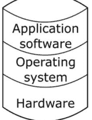

**图 1.3.** 硬件与应用之间的操作系统层

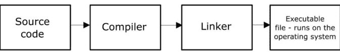

**图 1.4.** 从源代码创建原生可执行文件

因此，只要计算机运行着虚拟机，应用软件就可以在独立于硬件操作系统的计算机上运行。一个很好的例子是 Java 虚拟机 (JVM)，JVM 运行在几乎所有的操作系统和平台上。因此，当我们开发 Java 软件时，它将独立于操作系统/平台运行。

在虚拟机上运行的应用明显优势可以描述为：“一次开发，到处运行”。然而，在虚拟机上运行的应用比原生应用慢。

虚拟机的通用开发过程如图 1.6 所示。

## 第一章 引言


**图 1.5.** 应用与操作系统之间的虚拟机

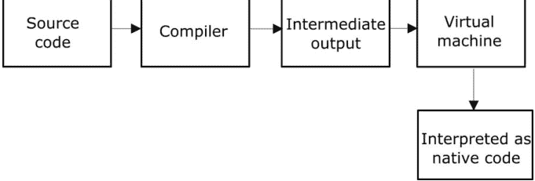

**图 1.6.** 从源代码创建中间代码 – 中间代码由虚拟机解释

与 Java 应用类似，Android 应用也运行在 JVM 上。Android 使用两个特殊的虚拟机：Dalvik Machine (DVM) 和 Android Runtime (ART)。这些是可以在低资源运行的专用 JVM。`.apk` 文件（Android 应用的可执行文件）实际上运行在这些虚拟机上。直到 Lollipop 发布（Android 5.0）之前，DVM 一一直是默认运行时环境（虚拟机）。ART 从 Android 4.0 开始引入并从 Android 5.0 起成为默认 VM。DVM 和 ART 基本执行相同的工作：独立于平台运行 Android 应用。ART 相对于 DVM 的优势是提前编译 (AOT)，它比实时编译 (JIT) 快。在 AOT 中，应用在安装期间编译，因此降低了 CPU 使用率。

## 1.3. 开发应用使用的编程语言

推荐且方便的应用开发方式是使用 Java。虽然 Java 是一个通用工具，但它结合 Android SDK 使用。存在第三方工具如 Xamarin、Cordova 和 React Native。这些平台提供了便利，但无法获得原级的性能。

## 第二章 设置你的开发环境

我们将使用 Android Studio，它是 Android 应用开发的官方 IDE；因此，我们需要安装所需的插件。

### 2.1. 安装 Android Studio

Android Studio 运行在 Java 运行时 (JRE)。JRE 可以安装在 Windows、Mac 和 Linux 上。根据我们的操作系统，我们需要按照以下步骤安装 Android Studio：

1. 安装 Java：Java 由 Oracle Inc. 开发。Java 基本有两个包：Java 运行时 (JRE) 和 Java 软件开发包 (JDK)。JRE 用于运行用 Java 语言编写的软件，而 JDK 用于开发 Java 软件。因此，安装 JRE 就足够运行 Android Studio。

导航到以下网站下载 JRE：http://www.oracle.com/technetwork/java/javase/downloads/jre8-downloads-213155.html。你将看到图 2.1 所示的选项。只需选择与你的操作系统兼容的版本，下载并按照通常的安装程序（Next, next, ...）安装。

2. 安装 Android Studio 和 Android SDK

Android Studio 包含了 Android 软件开发包 (SDK)。请导航到官方下载网站：https://developer.android.com/studio/index.html 。Windows 版本的下载链接在此页顶部，但如果你向下滚动

# Android Studio 移动应用开发入门指南

，你可以如图 2.2 所示找到其他操作系统的可用安装文件。

- 概览 下载 文档 社区 技术 培训

## Java 运行时环境 8 下载

您是想运行 Java™ 还是想开发 Java 程序？如果只想运行 Java 程序而不是开发它们，请下载 Java 运行时环境，或 JRE™。

如果您想为 Java 开发应用程序，请下载 Java 开发工具包，或 JDK™。JDK 包含了 JRE；因此您不需要分别下载两者。

- JRE 8u11 校验和

  JRE 8u11 校验和

## Java SE 运行时环境 8u111

您必须接受 Java SE 的 Oracle 二进制代码许可协议才能下载此软件

- 接受许可协议

- 拒绝协议

| 产品 / 文件 描述 | 大小 | 下载 |

|---|---|---|

| Linux x86 | 54.86 MB | jre-8u11-linux-i586.rpm |

| Linux x86 | 70.65 MB | jre-8u11-linux-i586.tar.gz |

| Linux x64 | 52.75 MB | jre-8u11-linux-x64.rpm |

| Linux x64 | 68.57 MB | jre-8u11-linux-x64.tar.gz |

| Mac OS X | 64.33 MB | jre-8u11-macos-x64.rpm |

| Mac OS X | 56.36 MB | jre-8u11-macos-x64.tar.gz |

| Solaris SPARC 64bit | 46.04 MB | jre-8u11-solaris-qc9.tar.gz |

| Solaris x64 | 49.88 MB | jre-8u11-solaris-x64.rpm |

| Windows x86 | 67.01 MB | jre-8u11-windows-i586.exe |

| Windows x86 | 53.53 MB | jre-8u11-windows-i586.tar.gz |

| Windows x64 | 59.43 MB | jre-8u11-windows-x64.exe |

| Windows x64 | 62.78 MB | jre-8u11-windows-x64.tar.gz |

> 图 2.1. Java 运行时环境下载选项

| 平台 | Android Studio 包 | 大小 | SHA-1 校验和 |

|---|---|---|---|

| Windows (64位) | android-studio-bundle-35.537739-windows.exe 包含 Android SDK (推荐) | 1.674 MB | 227109b19decababa114abee2c78901b01c7 |

| 无 Android SDK | android-studio-id-35.537739-windows.exe | 417 MB | b5c20b5c25c2fe55050d4d5b1a40cc01dc3 |

| 无 Android SDK, 无安装程序 | android-studio-id-35.537739-windows.zip | 438 MB (1,756,230 次) | 8c9fe06aa4b3ead5e507f2745334edc055e1 |

| Windows (32位) | android-studio-id-35.537739-windows.zip 无 Android SDK, 无安装程序 | 438 MB (460,290,402) | 59f5a5a1a750a853b3bcode584849f213fa399c5 |

| Mac | android-studio-id-35.537739-mac.dmg | 434 MB (455,263,302 字节) | 51f28223ac3t7a8b4fc0c8d4ef4360129332c7 |

| Linux | android-studio-id-35.537739-linux.zip | 438 MB (499,574,532 字节) | 17c2b01669f42e46dec01e466917f04c9a7f |

## 图 2.2. Android Studio 下载选项

## 第 2 章：搭建你的开发环境

当你下载并安装 Android Studio 时，Android SDK 也会自动安装。

## 3. SDK 更新安装：安装 Android Studio 后，最好检查 SDK 更新。运行 Android Studio 并从 Tools -> Android -> SDK Manager 打开 SDK Manager，如下所示：

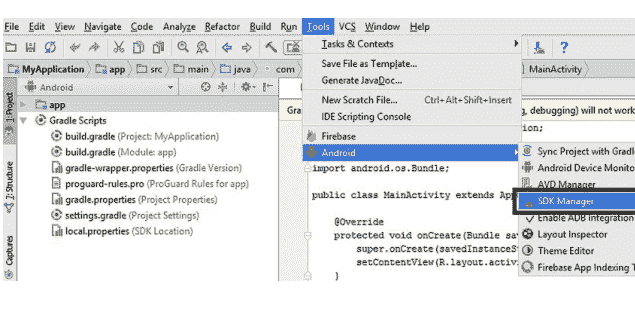

图 2.3. 打开 SDK Manager

SDK Manager 窗口将如图 2.4 所示出现。

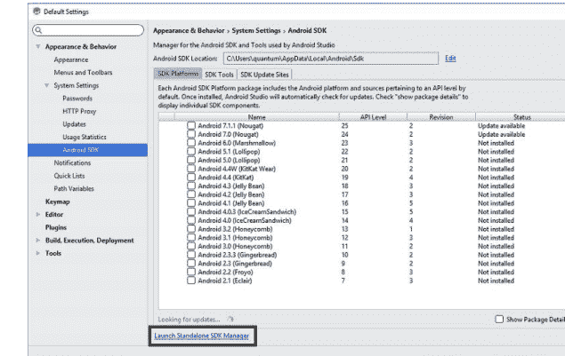

图 2.4. Android SDK Manager

### 2.2. 安装模拟器

模拟器是模拟真实设备的软件。当我们开发应用时，显然无法拥有所有可能的设备（手机、平板电脑等）。正如此，我们使用模拟器测试应用。模拟器在 Android Studio 中称为“Android 设备 (AVDs)”。当首次安装 Android Studio 时，没有默认的 AVD。我们需要在测试应用之前创建一个。为此，选择 Tools → Android → AVD Manager，如下所示：

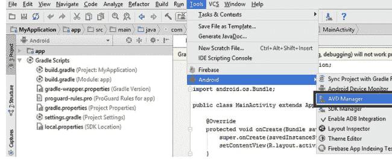

图 2.6. 启动 AVD


当 AVD Manager 出现时，还没有创建或安装 AVD。请点击下方的 **Create Virtual Device**（创建虚拟设备）按钮：

Android Virtual Manager

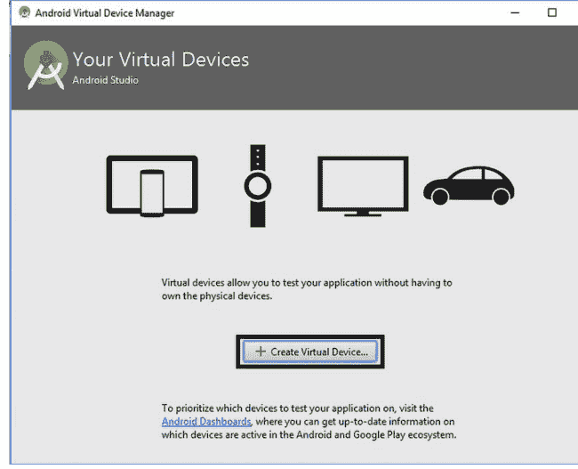

图 2.7. 创建新的 AVD

AVD Manager 将显示图 2.8 所示的详细窗口。你可以选择不同屏幕尺寸和其他属性的设备。你可以从左面板选择设备组，如 `Phone`。`Phone` 组是默认选择。在该组，`Nexus 5` 也是默认选择。当你点击“Next”（下一步）时，将出现 AVD Android 版本选项，如图 2.9 所示。

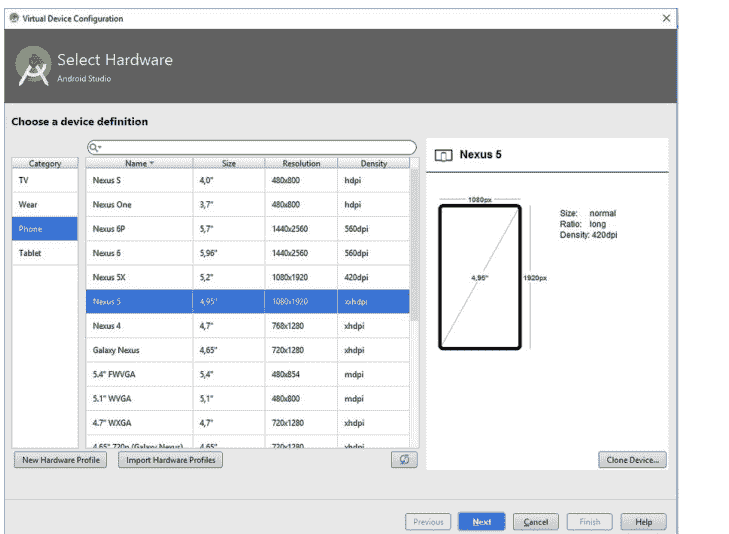

图 2.8. 创建新的 AVD – 选择设备

推荐目标从 Android 5.1 开始可以使用带有 Google APIs (Nougat) 的 Android 7.0。然后点击“Next”并为 AVD 命名。点击“Finish”（完成）后，AVD 将创建并如图 2.11 所示。你现在可以在此 AVD 上尝试你的 Android 应用，它将准确模拟真实 Nexus 5 手机的行为。

我们可以通过点击图 2.11 方框内的“Play”按钮来运行 AVD。虚拟设备将如图 2.12 所示出现，你可以像使用真实 Nexus 5 手机一样使用它。

安装完开发环境和模拟器后，我们现在准备好在下一章开发测试应用 Hello World。

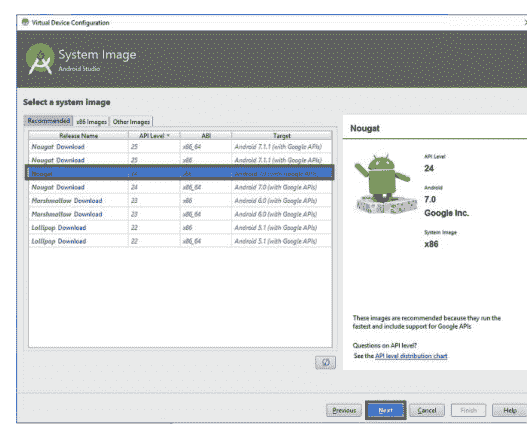

图 2.9. 选择 AVD Android 版本

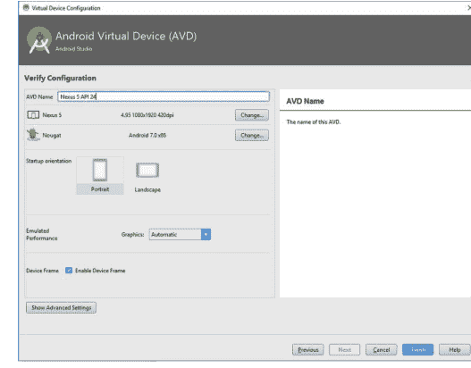

图 2.10. AVD 的最终设置

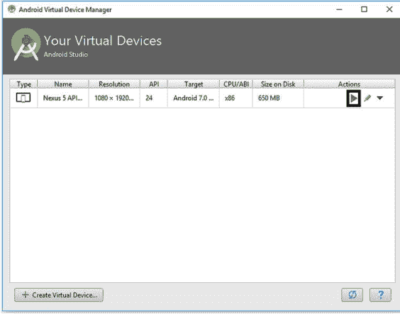

**图 2.11.** AVD Manager 中显示新创建的 AVD

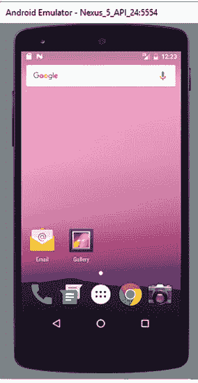

**图 2.12.** Nexus 5 模拟器窗口

## 第 3 章

## 驱动：HELLO WORLD 应用

### 3.1. 开发应用的通用步骤

测试编译器或开发环境安装的好方法是尝试“Hello World”示例。它只是在屏幕上显示如“Hello World”之类的文本。好的，我知道这不是一个让你自豪地向家人或朋友展示的应用，但它的用处在于测试你的编程环境是否正常工作，并查看你是否准备好应对真实项目。在我们的第一个 Android 项目中，我们将开发一个应用，其中“Hello, World!”文本将显示屏幕中间。如果你有 Android 设备，我们将在模拟器上进行测试。

在设置第一个应用之前，我想指出应用开发的通用步骤：

- 1. 创建 Android 项目，
2. 设置应用的界面 (UI)。
3. 将 UI 组件（如按钮、文本框等）连接到 Java 代码，
4. 使用 Java 编码 – 实际的编程部分
5. 构建项目：这意味着创建可执行文件（实际在设备上运行的文件）。这听起来并不困难；Android Studio 只需点击即可完成所有工作，
6. 在模拟器上尝试应用，
7. 在真实设备上运行应用（可选），
8. 在 Google Play 上发布应用（可选）。

### 3.2. 创建新的 Android 项目

当我们第一次运行 Android Studio 时，会看到图 3.1 所示的对话框，其中有几个选项：i) 启动新的 Android 项目，ii) 打开现有项目，iii) 从版本控制网站（如 GitHub）检出项目，iv) 导入在开发环境（如 Eclipse）中创建的项目或 v) 导入代码示例（示例从版本控制网站下载）。我们将开发第一个 Android 项目，因此选择图 3.1 中箭头所示的第一个选项。

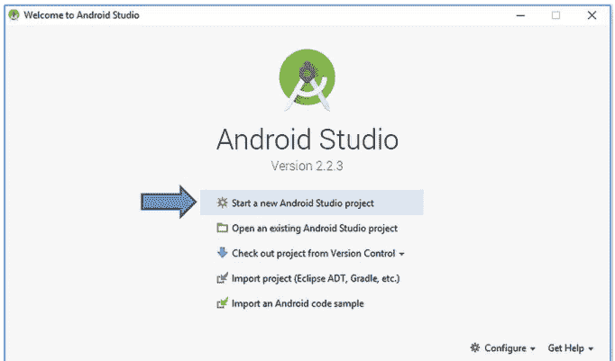

**图 3.1.** 为我们的第一个应用创建新的 Android 项目

选择创建新项目后，将出现图 3.2 所示的输入项目设置对话框。在第一个文本框中（图中“1”所示），我们要求输入项目名称，这将是应用的名称。我输入了“Hello World”，但你可以根据需要输入任何其他名称。公司域名在下一个文本框中给出（图中“2”所示）。这类似于在 Google Play 市场中区分开发者的网页地址。你可以在此处使用任何唯一的域名。如果你不会将应用上传到 Google Play（正如在本例中，我们只是为了学习而开发）基础部分，你可以使用任何喜欢的域名。我使用了图中所示的那个。然后，我们需要在计算机上选择位置来保存“（3）”所示的项目文件。你可以选择任何喜欢的地方来保存你的项目文件。

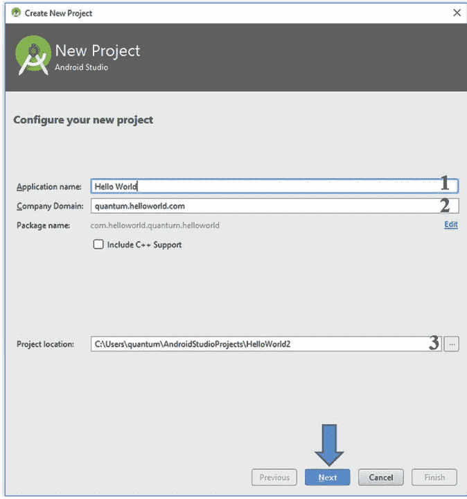

**图 3.2.** 新项目设置

点击“Next”（下一步）后，将出现图 3.3 所示的“Target Android Devices”窗口。我勾选了“Phone”和“Tablet”复选框，并将最小 SDK 设置为 API 15 – Android 4.0.3。这意味着我们将开发的应用程序能够运行在 Android 版本为 4.0.3 或更高的设备上。选择好目标后，请点击“Next”。

# ANDROID STUDIO 手机应用应用开发初学者指南

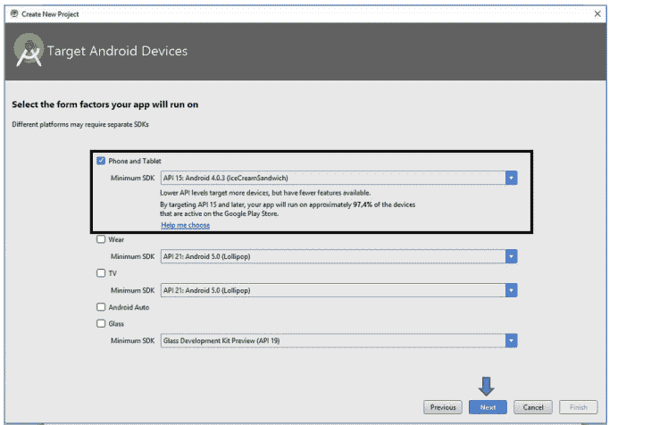

图 3.3. 选择目标设备

在接下来的对话框中选择用户界面模板。如图 3.4 所示，有多个模板，包括登录活动、地图活动等。然而，由于我们的目标只是在屏幕上写字，因此选择图 3.4 所示的“Empty Activity”（空活动）是可以的。那么，Activity（活动）意味着什么？Activity 可以定义为带有用户界面的用户屏幕。因此，我们必须包含活动才能创建一个应用程序——正如你所知，Android 应用是具有一个或多个用户界面的视觉程序。

选择默认项后，Android Studio 会要求我们如图 3.5 所示为 activity 和相关的布局文件命名。由于此应用中只有一个活动，因此将它们的名称留为默认值是完全没问题的。当我们点击“Finish”（完成）时，Android Studio 将自动创建项目文件和文件夹（这可能需要一些时间），然后 IDE 将像图 3.6 所示出现。

## 第 3 章：测试：HELLO WORLD 应用

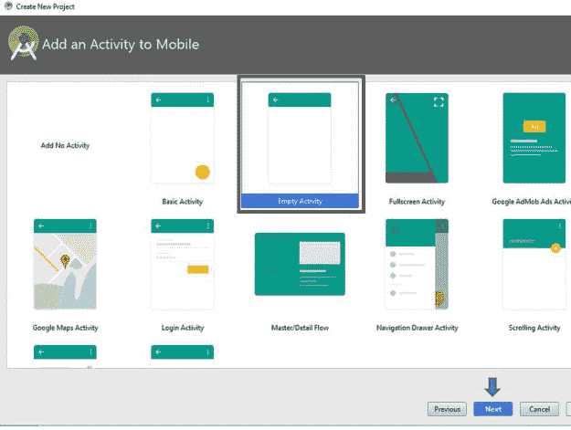

图 3.4. 为应用添加活动模板

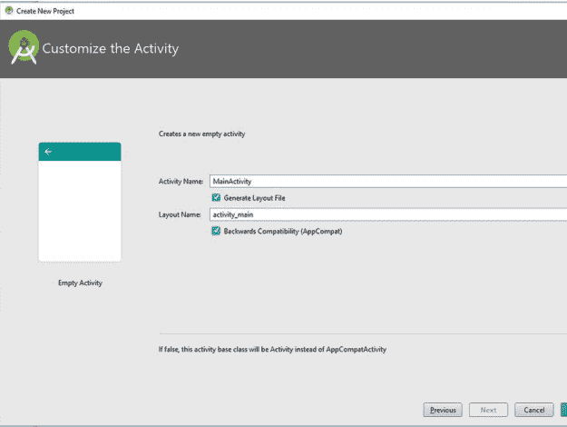

图 3.5. 自定义新添加的活动

# ANDROID STUDIO 应用开发初学者指南

### 3.3. IDE 的主要部分

Android Studio 是一个复杂的工具，因此它有几十个属性来使应用开发变得更容易。与其一次性给出此 IDE 的所有细节，我更倾向于以较慢的速度解释和教学，以便读者能够稳固地掌握应用开发内容。让我们结合图 3.6 开始解释 Android Studio 的主要部分。

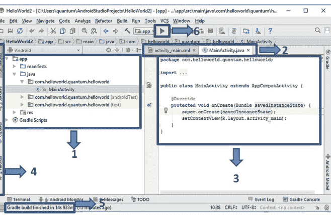

图 3.6. Android Studio 基础部分

图中 Android Studio 的部分可以总结如下：

**区域 1。** 可以从这里查看项目文件和文件夹。此外，可以从此面板添加新文件。我们需要双击这里的文件名以便在中间窗格中打开它们。项目结构将在下一个小节中解释。

**区域 2。** 可以从位于此处的标签激活已打开的文件以便在中间窗格中查看。

**区域 3。** 这是中间窗格。可以从这里查看和更改活动文件的内容。对于图 3.6 所示的项目，名为`MainActivity.java`的文件是区域 2 中的活动标签页，因此区域 3 中的中间窗格显示了该`MainActivity.java`文件的内容。

**区域 4。** 此区域也通过标签页控制。开发者可以切换项目文件、结构、捕获和收藏夹，以便在左侧窗格中查看。

**区域 5。** 此处显示当前或上一次的编译、构建或调试过程。对于图 3.6 的快照，它显示“Gradle build finished in 14 seconds”。Gradle 是 Android Studio 的构建系统。因此，该消息表示构建引擎在 14 秒内完成了其之前的任务。

**区域 6。** 这是 Android Studio 的 **Run**（运行）按钮。当我们设置用户界面并编写项目的 Java 代码时，我们点击此按钮让 Android Studio 构建项目（这意味着从项目文件创建可执行文件），然后我们可以在模拟器或真实设备上运行它。

### 3.4. Android Studio 项目的文件夹和文件结构

Android 项目的文件结构可以在 Android Studio 中以多种形式查看。位于左窗格正上方的按钮（如箭头所示）用于打开选择首选文件层级查看方法的选择框，如图 3.7 所示。默认的文件查看器是“Android”模式，在我看来这是对文件和文件夹最简单的方法。当选择为“Android”模式时，图 3.8 所示的默认文件和文件夹位于左侧窗格中。

文件夹的内容解释如下：

- **manifests 文件夹：** 此文件夹包含`AndroidManifest.xml`文件。它包含了配置参数，如权限、服务和额外的库。

- **java 文件夹：** 源代码文件位于此文件夹中。

- **res 文件夹：** 资源包含在此文件夹中。例如，如果我们想在项目中包含图像文件，我们将其放在“res”中。

# ANDROID STUDIO 应用开发初学者指南

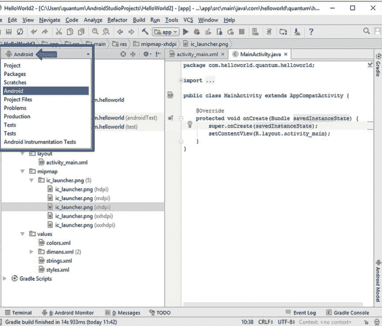

图 3.7. 切换文件夹的查看方式

# 第 3 章：测试：HELLO WORLD

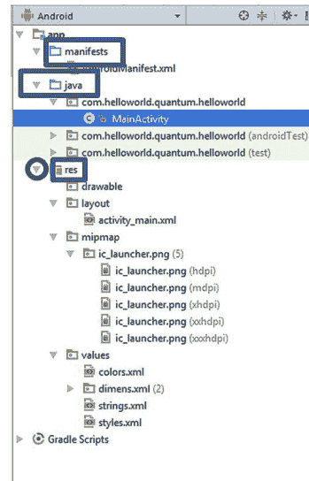

图 3.8. 项目的文件夹和文件结构

### 3.5. 构建用户界面

Android Studio 提供了一种设计用户界面的简单方法。“res/layout”文件夹下的名为`activity_main.xml`文件包含了所有的布局信息。如果在 Android Studio 之外打开`.xml`文件，它会被文本编辑器或浏览器打开。然而，当我们在 Android Studio 中打开`.xml`文件时，它会读取`.xml`文件并显示相应的组件活动布局。为了在 Android Studio 中打开`activity_main.xml`，请在项目管理器中双击它，活动布局将在中间窗格中显示：

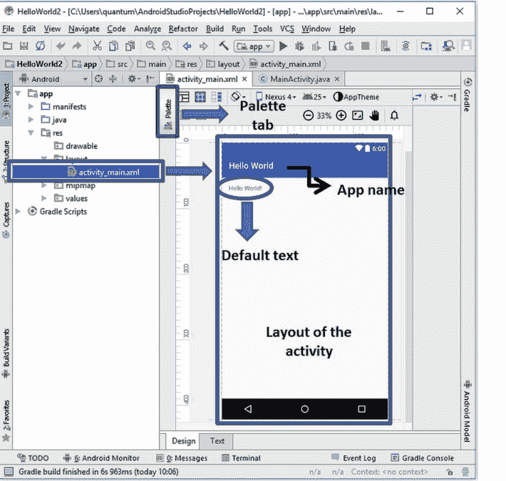

图 3.9. 活动布局

如你所见，布局位于中间窗格中。应用名称出现在活动的顶部。默认活动包含一个默认文本，如图中圆圈所示。在中间窗格的左上方，存在一个名为“Palette”（调板）的标签，如图中矩形所示。当我们点击此标签时，将出现图 3.10 所示的调板，从那里向活动添加所有可能的用户界面对象和布局模板。

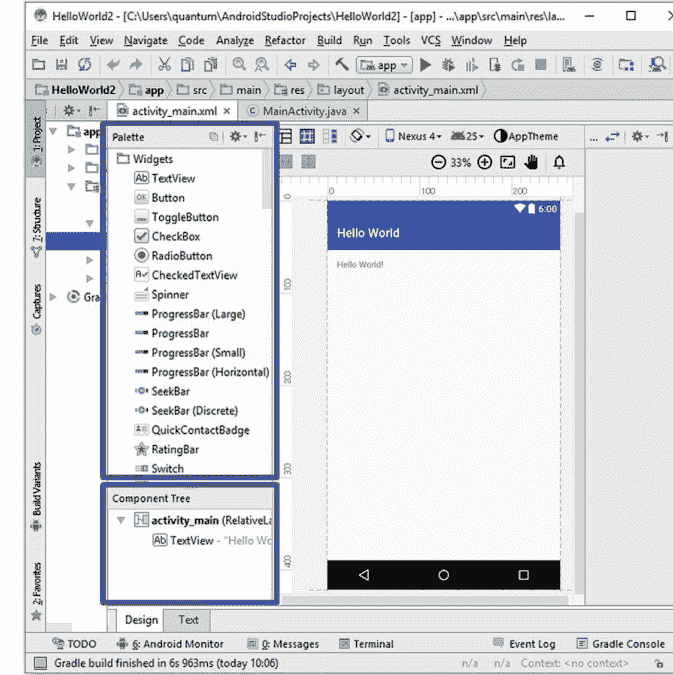

图 3.10. 组件调板

点击调板标签时，会打开两个面板：上方矩形所示的调板和图 3.10 下方矩形内的组件树面板。

调板包含几组组件，如小部件、文本字段和布局。我们可以轻松地将这些组件拖放到用户界面上。另一方面，组件树以分级方式列出了活动的组件。在随后的章节开发复杂应用时，我们将看到这些组件的利用。

# Android Studio 移动应用开发入门指南

让我们将这段由`TextView`控件组成的文本放置在视图的中间。为了这一点，请选择此`TextView`并在下方所示引导线的帮助下将其拖动到中间：

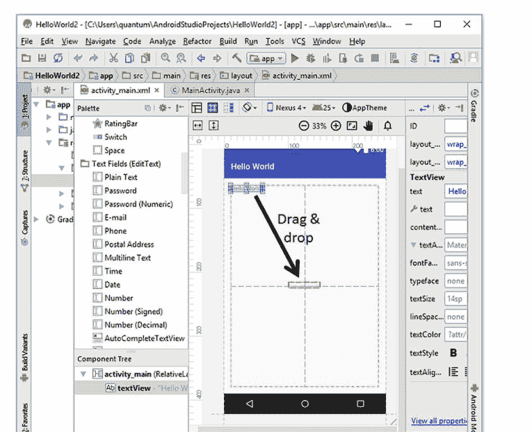

图 3.11. 在`TextView`上的拖放操作

完成拖放操作后，`TextView`被选中。我们现在可以使用 Layout 视图右侧的属性面板（Properties pane）来更改`TextView`的属性，如图 3.12 中矩形所示。请点击图中圆圈所示的箭头以打开`TextView`的基本属性。

## 第 3 章。实战：Hello World 应用

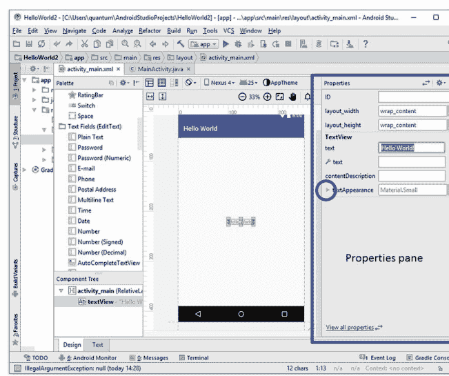

图 3.12. 属性面板

`TextView`组件的可编辑属性显示在图 3.13 的矩形内。为了以更好的方式显示“Hello World”文本，我将它的字体大小更改为 24sp（sp = 比例无关像素），并通过点击`textStyle`部分中的 **B** 按钮将其样式设置为**粗体**。

我们现在已经完成了用户界面的设置。由于我们不希望第一个应用具有某些交互功能，目前我们不需要编写任何代码。当然，在接下来的项目中我们会进行大量的编码工作，但此处我们不需要任何代码。

### 3.6. 构建项目并在模拟器上运行

我们的第一个 Android 应用现在已经准备好在模拟器上运行了。在 Android Studio 中这非常简单。我们在上一章中已经设置了一个 Nexus 5 模拟器，那里我们只需要做的是：

- i) 构建项目
- ii) 选择模拟器，然后，
- iii) 在模拟器上运行我们的应用。

# Android Studio 移动应用开发入门指南

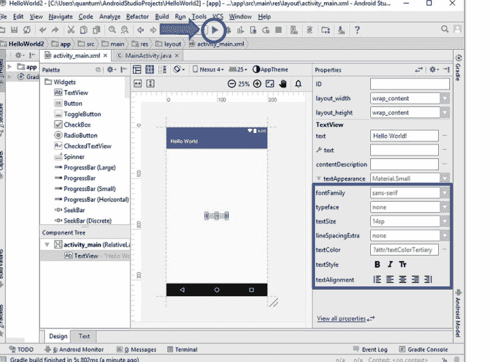

图 3.13. `TextView`的可编辑属性

为了构建并运行项目，请点击图 3.13 中箭头所示的“Run”按钮。将弹出图 3.14 所示的模拟器和设备选择对话框。由于我们之前创建过 Nexus 5 模拟器，它会被自动选中，如矩形所示。如果我们通过 USB 数据线向电脑连接了真实的 Android 设备，它也会显示在此对话框中。然而，由于目前没有连接真实设备，对话框顶部会显示图中椭圆所示的警告。请点击“Next”，然后模拟器将像真实设备一样启动。根据你的电脑速度，完全启动模拟器需要一些时间（大约 20 秒）。

当模拟器开始运行时，你将看到图 3.15 所示的 Nexus 5 。你可以像真实设备一样使用它（当然不包括通话和短信功能），如果你需要，还可以使用右侧栏的控件来更改模拟器的通用属性。

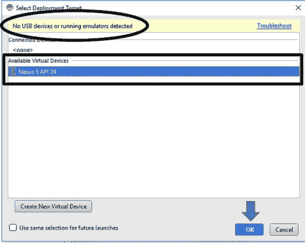

图 3.14. 为我们的第一个应用选择运行目标

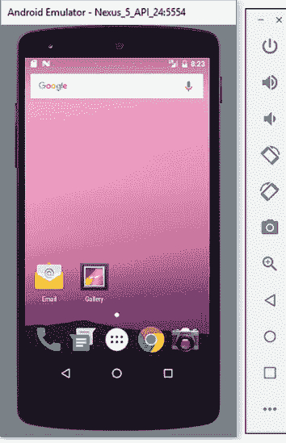

图 3.15. Nexus 5 模拟器

# Android Studio 移动应用开发入门指南

模拟器已启动，但我们无法看到应用在上面上运行。不要慌！！如果我们检查 Android Studio 的主窗口，可以看到它已经给出了如下所示的警告：

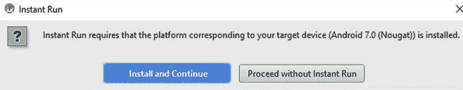

图 3.16. Instant Run（即时运行）警告

Android Studio 询问我们是否想要利用一个名为 Instant Run 的组件。Instant Run 是 Android Studio 2.0 中引入的系统，缩短了“代码 -> 构建 -> 运行”周期。当我们使用 Instant Run 时，Android Studio 将代码更新推送到模拟器，而不需要构建新的可执行文件。此外，可以在更短时间内在模拟器上看到代码更改的效果。总之，Instant Run 是一件好事，让我们通过点击图 3.16 所示的“Install and Continue”按钮来安装它。Android Studio 将在短时间内下载所需文件，然后我们需要按照通常的下一步-下一步程序安装这些更新。在完成微小的安装后，Android Studio 将如图 3.17 矩形内所示构建我们的项目。

构建过程完成后，模拟器将如图 3.18 所示运行我们的第一个应用。如果你看到了图中所示的模拟器屏幕，恭喜你。你成功创建了你的第一个 Android 应用。

我们可以对应用进行任何更改，然后按下图 3.19 箭头所示的“Re-Run”按钮。模拟器将安装更新后的应用进行仿真。

正如你从自己的项目中所看到的，Android Studio 提供了大量的可能性和用户友好的界面，可以将你的想法转化为 Android 应用。

## 第 3 章。测试：Hello World 应用

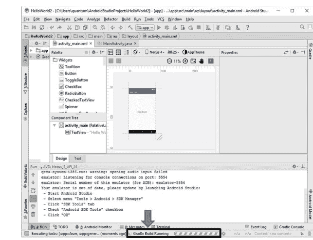

图 3.17. 正在构建我们项目的 Android Studio

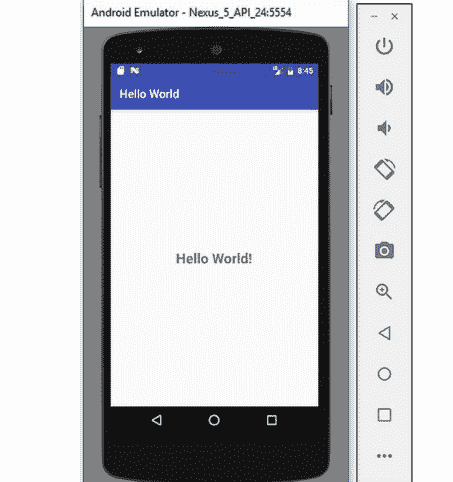

图 3.18. 模拟器运行我们的“Hello World”应用

# Android Studio 移动应用开发入门指南

```
HelloWorld2 - [C:\Users\quantum\AndroidProjects\HelloWorld2 - [app]] - ...\app\src\main\res\layout\activity_main.xml - Android Stu...
File Edit View Navigate Code Analyze Refactor Build Run Tools VCS Window Help
HelloWorld2 - [app]
  - app  src  main  res  layout  activity_main.xml
  - activity_main.xml  MainActivity.java
```

图 3.19. Android Studio 中的“Re-Run”按钮


我从`TextView`属性（图 3.12 所示）将文本更改为“Hello World!”并按了“Re-Run”按钮。Android Studio 构建了项目，更新后的应用如下显示在模拟器上：

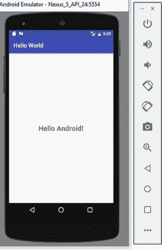

图 3.20. 运行更新应用的模拟器

你可以使用位于“Re-Run”按钮右侧的方形“Stop”按钮停止运行应用的模拟器。停止应用时，模拟器将关闭并等待下

## 3.7. 在真实设备上运行

在真实设备上尝试应用也是简单的。

1. **设备上需要完成的任务：**在真实设备上运行应用之前，我们必须在设备上启用开发者模式。为了这一点，请在真实设备上导航到“设置 -> 关于 -> 版本号”。根据设备和 Android 版本，“版本号”的位置可能不同，但我确定你可以在设置部分轻松地找到它。找到版本号后，连续点击七次，设备将弹出对话框“你现在是开发者了。”

   启用开发者模式后，你会在设备设置下找到名为“开发者选项”的新部分。请点击它并勾选“USB 调试”以通过 USB 连接调试。

2. **Android Studio 中需要完成的任务：**首先，请从“Tools -> Android -> ADB Integration”启用“ADB Integration”，如下所示：

   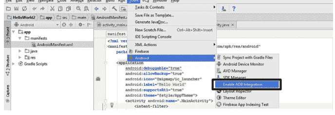

   图 3.21. 在 Android Studio 中启用 ADB Integration

现在你可以通过 USB 连接从 Android Studio 将应用安装到设备上。现在我们需要将应用设置为可调试。为了这一点，双击打开`AndroidManifest.xml`文件并添加文本：

```text
:debuggable="true"
```

我们现在准备好在真实设备上测试我们的“Hello World”应用了。当我们点击 Android Studio 中的“Run”按钮时，将弹出以下设备窗口：

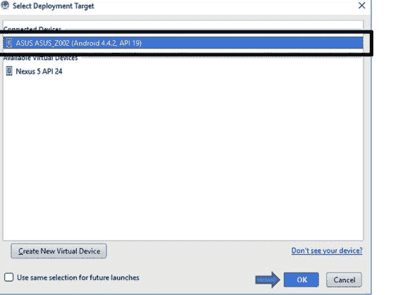

图 3.23. 选择真实设备

## 第 3 章 实战测试：Hello World 应用

我连接了我的华硕 Zenfone 6，因此设备选择窗口中显示了它的名称；如果你连接的设备不同，这里自然会有所不同。在选择设备后，点击“OK”按钮，图 3.18 所示的应用程序界面就会出现在你的真实设备上。如果你在真实设备上看到了“Hello World!”文本，那太棒了。你现在已经知道如何在真实的 Android 设备上安装你的应用程序了。在真实硬件上运行程序有时是至关重要的，因为像发送短信和拨打电话等操作只能在真实设备上完成。

我们开发了实战测试应用“Hello World”，并学习了：

- i) 创建一个 Android Studio 项目；
- ii) 使用用户界面和控件（widgets）；
- iii) 创建模拟器；
- iv) 编译应用；
- v) 在模拟器上运行我们的应用；
- vi) 在真实设备上运行我们的应用。

但正如你可能注意到的，我们还没有与应用有任何交互。它只是在屏幕上写了一段文字，仅此而已。为了让应用程序执行某些功能，我们需要对其进行编程。Java 是开发 Android 应用时主要的编程语言。我们将在下一章学习 Java 基础，这将使我们能够将想法转化为运行的 Android 应用。在开始 Java 课程之前，让我们来喝杯咖啡吧（推荐 3 合 1 咖啡，因为我们需要葡萄糖）。

# 第 4 章 JAVA 基础

## 4.1. 什么是 Java？

我们开发了第一个应用。这太好了。然而，它只是在屏幕上写了一段文字，仅此而已。用户与我们的应用没有任何交互。为了让应用程序具有交互性并执行真实任务，我们需要告诉它做什么。而且我们需要精确地告诉它。我们通过使用编程语言来实现这一点。

正如老话所说：“计算机其实相当笨”。这是因为：**当我们告诉计算机执行一项任务时，必须用精确的术语来表达。**

让我们用一个例子来解释这一点：想象你度过了疲惫的一天，肚子饿着回家。在 M4 高速公路上，牛津附近的交通堵塞了，你有时间思考晚餐吃什么。你突然想起冰箱里有冷冻的鸡肉咖喱（chicken korma）。你打了妻子的电话（当然用免提！）让她做那道菜。

你 —— 嗨，亲爱的，希望你一切都好。

妻子 —— 谢谢，有点累。你呢？

你 —— 我也是。而且非常饿。你能请为我做一份冷冻的鸡肉咖喱吗？冰箱里应该还有。我确定你也会喜欢的，我知道你很爱吃。

你的伴侣 —— 好吃好吃。我会的，亲爱的，等你回来时它就滋滋作响了。等见，拜拜。（真是贴心的妻子！）

你 —— 谢谢，亲爱的，拜拜。

然后，她会在冰箱的任何地方找到冷冻咖喱，拆开包装，撕掉外壳，并在膜盖上戳几个孔。设置定时，开启微波炉（或烤箱）并烹饪。她会直接煮好附带的香饭而不需要问你。就这样。

然而，如果你有一个拥有电脑大脑的机器人妻子，对话会更像这样：

你 —— 嗨，亲爱的，你很好。

机器人妻子 —— 谢谢。你还好吗？（语气一点也不浪漫！）

你 —— 非常累。非常饿。你能请为我做一份冷冻的鸡肉咖喱吗？冰箱里应该还有。

机器人妻子 —— 冰箱里的冷冻咖喱在哪里？你需要我一起煮香饭吗？你想要正常熟的还是过熟的？你还要大蒜包吗？你希望什么时候准备好？……

你 —— 停，请停下。我会开车去餐厅吃。

机器人妻子 —— 我不懂，你说话没重点……

事实上，任何可编程的数字设备都大同小异。我们必须告诉它们精确的内容。我们通过使用编程语言来实现。有许多不同的编程语言用于为不同的平台开发软件。你可以在 TIOBE 索引网站查看广泛使用的编程语言及其排名：<http://www.tiobe.com/tioobe-index/>。有时选择使用哪种编程语言是很困难的。不存在一种通用的完美/全能语言；它们都有自己的优缺点。

当我们查看 TIOBE 索引时，看到 Java 多年来一直是最常用的编程语言。这有几个原因。主要原因是：

1. 具有平台独立性；
2. 拥有大量的库；
3. 面向对象；
4. 具有强大的安全性和健壮性。

因为这些原因，Android 应用也主要用 Java 开发。因此，为了学习 Android 应用开发，我们必须掌握 Java 编程语言的基础。学习 Java 后，我们将使用 Java 调用 Android SDK 库并开发 Android 应用。

我们可以使用独立的 Java 编译器或 Java 专用的 IDE 来学习 Java。不过，通过一个简单的技巧，也可以在 Android Studio 中尝试 Java 代码。由于我们已经安装了 Android Studio，在这里我们将用它来进行 Java 编码。

## 4.2. 使用 Android Studio 进行 Java 编码

首先，我们需要启动 Android Studio 并创建一个项目。我们可以随心为项目命名并选择任何版本。项目的结构如下：

| 组件 | 描述 |
| :--- | :--- |
| Package（包） | 定义文件的命名空间 |
| Class（类） | 代码的主模板 |
| Method（方法） | 执行任务的代码块 |

在我们的案例中，文件名是`JavaBasics`。文件内容如下：

```java
package com.example.javabasics;

public class JavaBasics {

}
```

第一行定义了包含这些文件的包。第二行是类的定义。第三行是类的结束括号。类体是空的，因此这个 Java 程序在编译和运行时不会执行任何操作。我们将在下一章学习如何在内部编写代码。

如果我们尝试编译并运行这段代码，编译器会报错且不会运行我们的程序。这是因为所有 Java 程序都应该有一个`main`方法。`main`方法表示 Java 程序的起点，在程序运行时会首先执行它。添加`main`函数后，我们得到了一个正确的 Java “Hello World”程序，如下：

```java
package com.example.atomic.javabasics1;

public class JavaBasics {

    public static void main(String args[]) {

        System.out.println("Hello World");
    }
}
```

代码 4.5

`main`函数定义在上面的第 3 行：`public static void main(String args[])`。通常情况下，在此阶段不会解释`main`方法，导师们会说“现在直接接受`main`方法即可，我们以后会学习更多”。不过，我想指出`main`方法的通用结构：

该方法开头有三个关键字：`public`、`static`和`void`。它们的含义可以总结如下：

1. `public`：`main`方法可以从任何地方访问；
2. `static`：`main`方法不属于特定的对象；
3. `void`：`main`方法不会返回任何值。

当我们在本章的最后一个子节学习类时，这些内容将会变得更加清晰。

`main`方法还有参数，它们以`String args[]`的形式作为该方法的输入。这意味着`main`方法可以有多个文本形式的输入（参数）。当我们稍后深入研究函数及其参数时，将更好地理解这些。

请在此处不要恐慌，不要被吓跑。我知道这些内容可能令人困惑，你可能会说：“用 Java 写一个 Hello World 程序要花很长时间，而且很复杂。”与其他编程语言相比，Java 代码通常更长。不过，这也是 Java 的一面。这是因为 Java 是一种非常有组织性且结构化的语言，为开发者提供了更多可能性，同时降低了出错概率。

在将代码 4.5 插入我们的`JavaBasics.java`文件后，我们现在准备好运行我们的 Java “Hello World”程序了。为此，请在 Android Studio 的文件管理器中找到`JavaBasics.java`，右键点击它，并如下所示选择运行`JavaBasics.main()`：

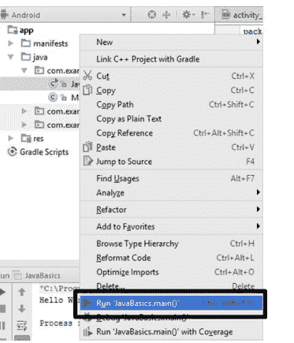

图 4.6. 在 Android Studio 中运行你的 Java 程序

Android Studio 将编译你的`JavaBasics.java`文件然后运行它。这需要一些时间。之后，程序的输出将显示在 Android Studio 底部面板的 Terminal 窗口中，如图 4.7 所示。

我们现在已经在不需要使用其他开发环境的情况下编写、编译并运行了第一个 Java 应用。让我们在下一个子节继续学习 Java 中使用的变量吧。

```text
"C:\Program Files\Android\Android Studio\jre\bin\java" ...
Hello World

Process finished with exit code 0
```

图 4.7. 在 Android Studio 中 Java 程序的 Terminal 输出

## 4.3. Java 中的变量

变量是包含信息的实体。变量可以被视为存储数据的容器。变量的创建被称为“变量声明”，在声明期间放置其值被称为“变量初始化”。我们可以根据条件在声明期间或稍后插入变量的值。

就像现实世界中可以用来存放不同物品的盒子（如糖盒、火柴盒或零件盒）一样，语言中的变量也有不同的类型。

Java 被定义为一种静态且强类型的编程语言，这意味着变量的类型应该在创建时定义，且该类型之后不能更改。Java 中有两类变量类型：

- **原始类型（Primitive types）：**这些变量类型一次存储单个数据。换句话说，原始变量持有原始值。原始变量始终有值。原始变量从创建到 Java 程序结束一直存在。
- **引用变量类型（Reference variable types）：**这些“非原始”类型是动态变量；它们可以在程序结束前创建和删除。这些变量存储它们所引用的对象的地址。与原始类型不同，引用类型的值可以为`null`，这意味着不存在。`null`值意味着其值的缺失。

起初看起来可能很困惑，但请试着记住：原始类型用于存储实际值，而引用类型存储的是对象的句柄（handle）。

Java 中广泛使用的变量类型如图所示：

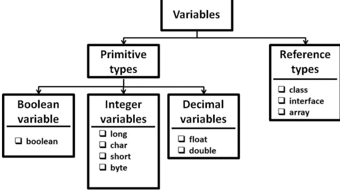

图 4.8. Java 中的变量类型

1. **布尔变量（Boolean variables）：**布尔变量具有两个不同值的属性：`true`或`false`。我们可以将布尔值视为“是-否”的问题，例如“屏幕背景是蓝色的吗？”答案只能是“是”或“否”。Java 不使用“yes”或“no”，而是使用`true`或`false`。以下代码定义了一个名为`myBoolean`的布尔变量，并在声明期间将其值赋值为`true`：

   ```java
   boolean myBoolean = true;
   ```

   代码 4.6

   在这段代码中，`boolean`是关键字。注意变量名是`myBoolean`，值是`true`。变量`myBoolean`在声明期间初始化为值`true`。如果需要，我们以后更改它的值：

   ```java
   myBoolean = false;
   ```

2. **整数变量（Integer variables）：**整数变量用于存储整数（没有小数的数字）。例如：

   ```java
   int age = 25;
   ```

3. **浮点变量（Floating-point variables）：**这些变量用于存储带有小数的数字。在 Java 中，常用的类型是`double`和`float`。

   ```java
   double price = 19.99;
   float weight = 5.5f;
   ```

4. **字符变量（Character variables）：**字符变量用于存储单个字符。字符用单引号括。

   ```java
   char grade = 'A';
   ```

5. **字符串变量（String variables）：**字符串变量用于存储字符序列。字符串用双引号括。

   ```java
   String name = "Java Developer";
   ```

(11111111)。这些数字之间有 256 个数字，因此它们被映射到 -128 到 127 的范围，包含 256 个数字。在接后的代码中，我们定义了一个字节变量`a`并在终端上打印它：

```java
package com.example.atomic.javascript;
public class JavaBasics3 {
    public static void main(String[] args) {
        byte a = 100;
        System.out.println(a);
    }
}
```

如果我们尝试给`byte`变量赋值一个不在 -128 到 127 范围内的数字，编译器会报错，如图 4.12 所示。

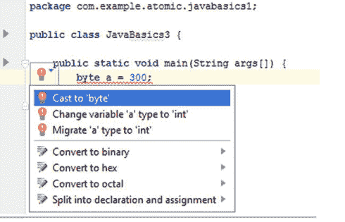

图 4.12. Java 编译器错误

在图中，变量`a`的类型是`byte`，因此它无法容纳 300 这个值。当我们写出错误的语句时，Java 编译器会用红线划线错误的代码，并在错误行处显示红灯泡。如果我们点击这些红灯泡，编译器会提供修正我们表达式的建议。

- 最后一个但同样重要的整数变量类型是`char`。它存储 0 到 65535 之间的值，这构成了 16 位（= 2 字节）。

`char`类型通常用于存储字符。我们可以将字符视为单个字母、单个数字或像键盘上的那种单个符号。在计算机中，字符通常通过美国信息交换标准代码（ASCII）表映射为整数，你可以在<http://www.ascitable.com>查看该表。Java 中的`char`类型使用 Unicode 系统，它是 ASCII 的超集。例如，在接后的代码中，字符被赋值给`char`类型的变量`myChar`：

```java
package com.atomic.javabasics1;
public class JavaBasics {
    public static void main(String args[]) {
        char myChar = 'd';
        System.out.println(myChar);
    }
}
```

代码 10

请注意，赋值给`char`变量的字符写在单引号内，以告诉 Java 编译器该值是字符类型。此代码的终端输出如下：

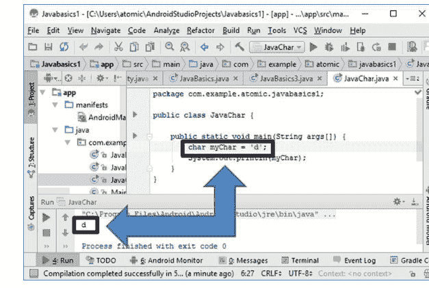

图 4.13. Java 中的 char 定义

3. **小数变量：**整数变量只能用于存储不带小数部分的整数。小数（带有小数部分）在 Java 中由两种类型表示：`float`和`double`。它们的区别在于它们能够容纳的小数位数。`float`类型可以存储 7 位小数，而`double`类型这个数字是 16 位。在接后的代码段中定义了两个`double`和`float`类型的变量，然后打印它们以显示 Java 从它们的初始化中获取的内容：


```java
package com.helloworld.quantum.helloworld;
public class JavaBasics {
    public static void main(String[] args[]) {
        float myFloat = 1.1234567890123456789f;
        double myDouble = 1.1234567890123456789;
        System.out.println("myFloat is: " + myFloat + ", myDouble is: " + myDouble);
    }
}
```

请注意，在上述代码中赋值给`myFloat`变量的小数数字以`f`结尾（`1.1234567890123456789f`）。这是因为 Java 尝试将我们创建的任何字面量视为`float`变量类型。此代码在 Android Studio 中的输出如下：

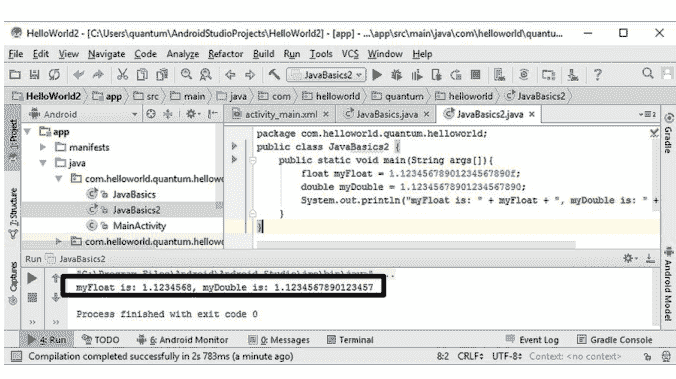

图 4.14. Java 中的 float 和 double 类型

在代码 4.10 中，我们尝试将数字`1.234567890123456789`赋值给`myFloat`和`myDouble`变量。然而，从图 4.12 的终端输出可以看出，Java 只给`myFloat`分配了该数字的 7 位小数，而给`myDouble`分配了 16 位小数。因此我们可以看到`float`和`double`类型分别可以持有 7 和 16 位小数。可以认为`double`类型变量比`float`类型变量更好，因为它们可以包含更多数字。但另一方面，`double`变量占用更多的内存空间。因此，如果我们的 Java 或 Android 中不考虑内存，我们可以使用`double`来获得更好的精度，而在内存成为问题时使用`float`更好。

我们已经学习了基本类型，这些类型是 Java 语言内置的并存储实际值。变量的第二大大类是引用类型。引用类型不存储值；相反，它们存储它们所引用对象的地址。那么什么是对象？对象是一个由值组成的概念包。引用类型有几种形式。

| 索引 | 值 |
| :--- | :--- |
| 0 | J |
| 1 | a |
| 2 | v |
| 3 | a |

数组在处理系列数据时非常有用。数组有索引。数组的索引始终从 0 开始。

# ANDROID STUDIO 移动应用开发初学者指南

```java
char[] myArray = {'J', 'a', 'v', 'a'};
```

我们可以以下方式访问数组的每个元素：

```java
System.out.println(myArray[0]);
```

通过此操作将`myArray`的第二个元素从 'a' 更改为 'v'：

```java
myArray[1] = 'v';
```

数组的大小在创建时是固定的。

Java 中另一个广泛使用的引用类型是`String`。`String`存储多个字符。例如，如果我们想保存来自加速度传感器的数据，可以使用`String`。

```java
String name = "Let's have a pizza";
```

由于`String`是对象，它们有相关的方法。例如，`.length()`方法返回字符串中的字符数量，如下：

```java
int stringLength = name.length();
```

在这段代码中，字符串`name`的长度通过`name.length()`获取，然后赋值给新创建的整数变量`stringLength`。此操作在 Android Studio 中的结果所示：

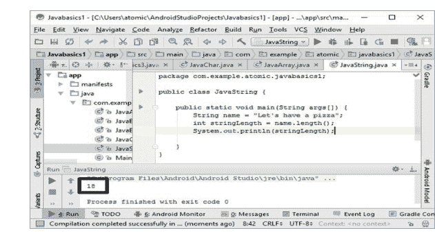

图 4.16. Java 中的基础 String 操作

Java 输出显示字符串“Let’s have a pizza”有 18 个字符。这是因为`String`中的空格也被算作独立的字符。

开发者有时需要不需要变化的变量。我指的是在初始化后值不能被更改的变量。这些在编程语言中被称为常量。Java 没有专门用于定义常量的关键字，但在变量声明前前面使用`final`关键字可以使其成为常量，如下所示：

```java
final double pi = 3.14159265358979238462;
```

如果我们尝试更改一个常量，编译器会发出错误，如图所示：

我们的下一个小节将关于 Java 中的逻辑决策结构，让我们休息一下喝咖啡，然后继续学习 if-else 和 switch-case 语句。

### 4.4. Java 中的逻辑决策语句

决策在编程中和日常生活问题中一样，被广泛使用。我们在日常生活中经常做出逻辑决策，例如：

- 如果咖啡好喝，我就再来一杯，否则我就去买杯茶。
- 如果下雨了我就带伞，否则我就不带。

在编程语言中，决策语句控制现实生活中某个条件是否满足。Java 中有两种决策语句：if–else 和 switch–case 块。

if-else 结构：在这种条件判断中，如果满足条件，则执行`if`块中的代码。如果不满足条件，则执行`else`块中的代码。因此，如果我们需要使用 if–else 块来实现“下雨不下雨”的例子，可以如下所示：

```java
if (it’s rainy) {
    I’ll take my umbrella.
} else {
    I’ll not take my umbrella.
}
```

让我们看看如何ing Java 中使用 if-else 语句来检查两个数字是否相等：

```java
package com.helloworld.quantum.helloworld;
public class JavaElse {
    public static void main(String[] args[]) {
        int a = 4;
        int b = 4;
        if (a == b) {
            System.out.println("a and b are equal");
        } else {
            System.out.println("a and b are not equal");
        }
    }
}
```

代码 4.17（接上页）

让我们分析这段代码：

- 在这段代码中，创建了两个整数类型的变量`a`和`b`，并将它们初始化为 4。
- 在下一行中，`if`语句检查`a`和`b`是否相等。使用比较运算符`==`来检查相等性。
- 如果此比较的结果为`true`，则执行`if`块中的语句`System.out.println("a and b are equal");`，这将在终端屏幕上打印“a and b are equal”。
- 如果此比较的结果为`false`，则执行`if`块中的语句`System.out.println("a and b are not equal");`，这将在终端屏幕上打印“a and b are not equal”。

由于我们将`a`和`b`都初始化为 4，它们是相等的，Java 编译器执行`if`块中的代码如下：

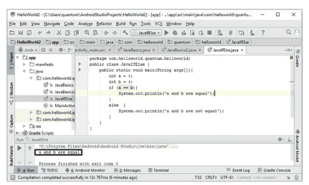

图 4.18. — Java 中的 -else 示例

## 第 4 章.JAVA 基础

当我们选择其中一个数字为 4 以外的数值时，将执行`else`块中的代码，如图 4.19 所示。

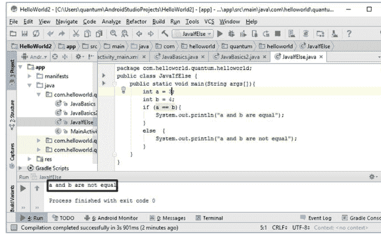

**图 4.19.** 条件不满足 Java 中的 if–else 语句

if–else 语句也可以像代码 4.17 那样以嵌套的形式使用。在嵌套语句中，条件从上到下进行检查。当某个条件被满足时，执行其块内部的代码并结束程序。如果所有条件都不真，则执行最后的`else`块。换句话说，如果上述没有任何条件被满足，则执行最后一个`else`块中的语句。练习场（playground）中这段嵌套代码的截图如图 4.20 所示。

```java
package com.helloworld.quantum.helloworld;
public class JavaNestedIfElse {
    public static void main(String args[]) {
        int a = 3;
        int b = 4;
        if (a == b) {
            System.out.println("a and b are equal");
        }
        else if (a > b) {
            System.out.println("a is greater than b");
        }
        else {
            System.out.println("a is lower than b");
        }
    }
}
```

代码 4.18（接上页）

```java
HelloWorld42 - C:\Users\quantum\Android\Projects\HelloWorld42 [app]\src\main\java\com.helloworld.quantum.helloworld.quantu...

package com.helloworld.quantum.helloworld;
public class HelloWorld {
    public static void main(String[] args) {
        int a = 2;
        int b = 1;
        if (a == b) {
            System.out.println("a and b are equal");
        } else if (a > b) {
            System.out.println("a is greater than b");
        } else {
            System.out.println("a is lower than b");
        }
    }
}
```

图 4.20. Java 中的嵌套 if–else 语句

随着添加的条件增加，嵌套的 if–else 决策语句变得容易出错。为了更容易地检查条件列表，使用了 switch–case 语句。switch–case 语句的工作原理与嵌套 if-else 类似，但它们更容易用于检查多个条件。代码 4.19 显示了一个用于成绩的 switch–case。

```java
package com.helloworld.quantum.helloworld;
public class JavaSwitch {
    public static void main(String[] args) {
        char grade = 'B';
        switch (grade) {
            case 'A':
                System.out.println("Your grade is excellent.");
                break;
            case 'B':
                System.out.println("Your grade is very good.");
                break;
            case 'C':
                System.out.println("Your grade is good.");
                break;
            case 'D':
                System.out.println("Your grade is low. You have to study again.");
                break;
            case 'E':
                System.out.println("Your grade is very low. You have to study again.");
                break;
            default:
                System.out.println("Not a grade");
        }
    }
}
```

代码 4.19 在此中，`grade`变量类型为`char`。`default`块在 Java 中不是强制性的，但正如我们在 Android 应用中看到的很有用。如果输入 A、B、C、D、E 以外的字符，程序将在终端上打印“Not a grade”。

### 4.5. Java 中的循环

编程中经常需要以重复的形式执行操作。这些重复通过循环完成。例如，让我们尝试计算 1 到 50 的和。如果没有循环，我们将执行如下：

```java
int sum = 0;
sum = sum + 1;
sum = sum + 2;
sum = sum + 3;
// ... 44 行代码
sum = sum + 48;
sum = sum + 49;
sum = sum + 50;
```

代码 4.20 在省略号所示的行中必须有 44 行代码（上文缩写）。如你所见，如果没有循环，这个简单的任务将需要 51 行代码。而且，它很容易出错。请记住，我们希望用尽可能短的代码来完成编程，以防止错误。

Java 有三种类型的循环：for 循环、while 循环和 do-while 循环。

1. **for 循环**：当我们知道操作执行次数时，使用 for 循环。for 循环的标准结构如下：

```java
for (type counter = initial value; counter check; counter increment/decrement statement) {
    重复执行的代码
}
```

代码 4.21

- 计数器是一个整数变量。
- 在每次循环后，计数器变量根据 (counter increment/decrement statement) 中的表达式进行递增或递减。
- 每次递或或减后，检查 (counter check) 是否仍然满足。如果满足，循环继续；如果不满足，循环结束。

让我们使用`for`循环计算 1 到 50 的数字和，以便更好地理解它：

```java
package com.helloworld.quantum.helloworld;
public class JavaFor {
    public static void main(String args[]) {
        int sum = 0;
        for (int counter = 0; counter<=50; counter++) {
            sum = sum + counter;
        }
        System.out.println("Sum is " + sum);
    }
}
```

在这段代码中，创建了一个名为`sum`的变量来存储和。定义了一个`for`循环，其中创建了一个名为`counter`的整数变量，并从 0 循环到 50。在`for`循环中，循环变量通过表达式`counter++`在每次迭代中增加 1。因此，随着循环的继续，`counter`变量会取 0, 1, 2, 3, ..., 50 的值。当它取值为 51 时，循环条件`counter<=50`（即小于或等于 50）不再满足，因此循环结束，不会对`counter = 51`执行循环操作。

变量`sum`初始化为 0，然后通过表达式`sum=sum+counter`将`counter`加到循环块中。这种方法将 0 到 50 的数字加到`sum`变量。最后，`sum`变量打印在终端屏幕上，如图 4.21 所示。0 到 50 的数字和结果为 1275。

## 2. while 循环：当我们不知道循环何时结束时，可以使用`while`循环。`for`循环和`while`循环的主要区别在于，循环变量的增加方法是在循环内部指定的，因此它提供了更大的灵活性。使用`while`循环计算 0 到 50 的和如代码 4.23 所示。

# Android Studio 移动开发学者指南

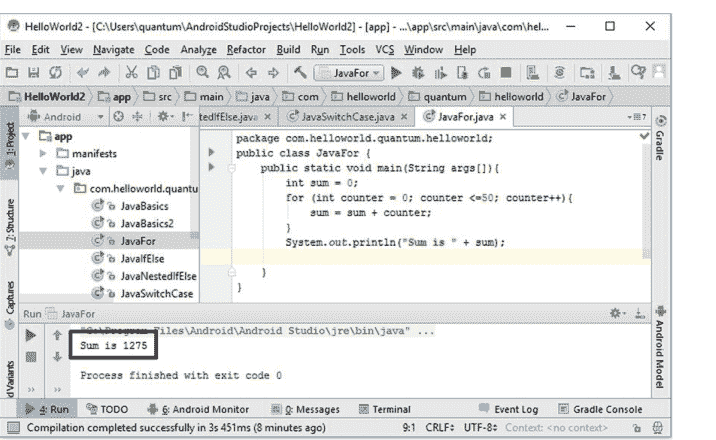

图 4.21 Java 中的 for 循环示例

```java
package com.helloworld.quantum.helloworld;
public class HelloWorld {
    public static void main(String[] args[]) {
        int sum = 0;
        int counter = 0;
        while (counter <= 50) {
            sum = sum + counter;
            counter++;
        }
        System.out.println("Sum is " + sum);
    }
}
```

代码 4.23


如上所示，循环变量`counter`在`while`循环之前被定义了。`while`循环检查条件`counter<=50`是否满足。如果满足，则执行`while`循环内部的表达式，否则`while`循环结束。`counter`变量在`while`循环内部通过表达式`counter++`增加。输出结果仍然 1275，如图 4.22 所示。

72

# 第 4 章 JAVA 基础

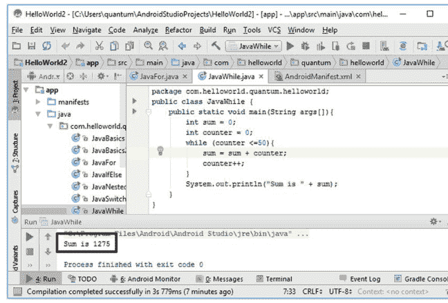

图 4.22 Java 中的 while 循环示例

**do-while 循环：** do-while 的执行与`while`循环相似，不同在于循环变量是在循环块末尾检查的，如下：

```java
package com.example.atomic.javabasics;
public class JavaWhile {
    public static void main(String[] args) {
        int sum = 0;
        int counter = 0;
        do {
            sum = sum + counter;
            counter++;
        } while (counter<=50);
        // do-while loop ends here
        System.out.println("The sum is " + sum);
    }
}
```

代码 4.24

此代码中的和再次计算为 1275。从上面的代码可以看出，`while`和`do-while`非常相似。另一方面，请注意代码`//do-while loop ends here.`。这是一个

73

# Android Studio 移动应用开发学者指南

Java 中的注释行。编译器会忽略`//`后面写的任何内容。注释用于提高代码的可读性。

do-while 程序的输出所示：

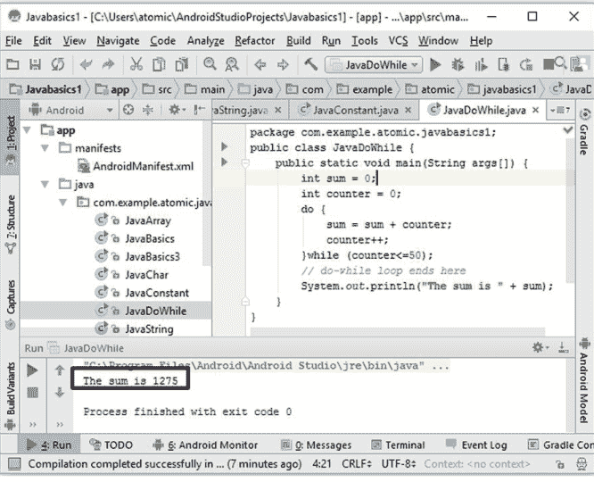

图 4.23 Java 中的 do-while 循环示例

注意：有两个用于进一步控制循环的重要关键字：`break`和`continue`语句。

它们通常与`if`语句一起使用。`break`命令用于终止循环；它意味着程序在循环条件过期之前退出当前循环。另一方面，`continue`让循环继续下一次迭代。

## 4.6. Java 中的方法

方法（Methods）是用于执行操作的子程序。方法与其他编程语言中的函数相似，但区别在于方法始终与类和对象相关联。

正如此，方法始终定义在类内部。函数的通用形式如代码 4.24 所示。

```java
(public) (void) (return type) methodName
(arguments) {
    ...... (code inside the method)
    (return output_values);
}
```

代码 4.25

方法声明包含以下部分：

- 方法名 (`methodName`)。
- 方法标识符，如`public`和`static`（可选）。
- 方法的参数（`arguments`）（可选）。
- 返回值的类型（可选）。
- `void`关键字——如果方法不输出任何值（可选）。
- `return`关键字——用于输出返回值（可选）。
- 执行操作的语句。

让我们写一个相加两个整数并在终端打印和的方法：

```java
static void addNumbers(int a, int b) {
    int sum;
    sum = a + b;
    System.out.println("The sum is " + sum);
}
```

代码 4.26

在此方法中：

- 使用`static`关键字意味着无需创建类对象即可调用此方法。
- 使用`void`关键字是因为方法不输出任何值；它只是在屏幕上打印。
- 方法的输入有两个输入变量`a`和`b`。

方法对于开发者之间共享代码也同样重要。如果我们可以在互联网上找到一个现成的方法，就可以轻松地在应用程序中使用它。

方法始终是类的一部分。因此，现在让我们关注类、对象和继承，它们是所谓的“面向对象编程”的骨柱。

## 4.7. Java 中的类、对象和继承

Java 编程语言结合使用了传统的（过程化）和面向对象的概念，以提供更强大的体验。过程化编程意味着程序按照顺序执行执行过程和函数。这是传统的方法。另一方面，面向对象编程使用类以及从这些类派生出的对象来执行所需的计算步骤。那么，什么是类和对象呢？

我们可以将类比为蓝图，将对象比作使用该蓝图制造的不同产品。同样，我们可以把汽车工厂作为类和对象的例子。每当我们改变颜色、行李箱尺寸、方向盘等时，我们可以在不改变汽车基本属性的情况下获得一辆不同的汽车。如果汽车的品牌和型号是 Virtua 和 Liberty（假设名称！），那么生产出的就是 Virtua Liberty 1.6、Virtua Liberty 2.0、Virtua Liberty 3.0、Virtua Liberty 1.6 premium、Virtua Liberty 2.0 diesel 等。在这种情况下，类是 Virtua Liberty，而所有这些假设的模型都是属于该类的对象。我们可以将其想象为图 4.26 所示。

让我们先在 Java 中声明一个 Car 类，然后如代码 4.31 所示定义从该类派生的汽车对象。在代码中，通过`public static class Car`定义了一个名为 Car 的类，它拥有名为`colour`（颜色）、`fuel type`（燃料类型）和`engine_capacity`（发动机容量）的变量。这些是每个从该类派生的对象都不同的变量。

在类定义内部，有一个方法声明`public Car(String carColour, String carFuelType, float CarEngineCapacity)`。这是一个与类名同名的构造方法，类变量通过代码 4.33 所示的代码行在该方法内部赋值。

### 类对象


图 4.26. 示例说明类与对象的关系

```java
package com.helloworld.quantum.helloworld;
public class JavaClassMain1 {
    public static class Car {
        static String colour;
        static static String fuel_type;
        static float engine_capacity;
        public Car(String carColour, String carFuelType, float CarEngineCapacity){
            colour=carColour;
            fuel_type=carFuelType;
            engine_capacity = CarEngineCapacity;
        }
    }

    public static void main(String args[]) {
        Car myCar = new Car("Red", "Diesel", 1.2f);
        System.out.println(myCar.colour);
    }
}
```

代码 4.32

## 第 4 章 Java 基础

| 变量 | 赋值 |

| :--- | :--- |

| colour | carColour; |

| fuel type | carFuelType; |

| engine capacity | CarEngineCapacity; |

代码 4.33

最后，在程序的`main`函数内部，通过以下行创建了一个名为`myCar`的 Car 对象：

```
Car myCar = new Car("Red", "Diesel", 1.2f);
```

代码 4.34

请注意`new`关键字用于使用类创建对象。我们可以将此对象声明行读取为“使用 Car 类和参数 'Red'、'Diesel' 和 '1.2f' 创建了一个名为 myCar 的对象”。

一旦创建了对象，我们就可以使用点运算符（`.`）访问它的变量和方法。在代码 4.31 的最后一行代码中，`myCar`对象的`colour`变量通过表达式`myCar.colour`被提取并打印在终端上。输出结果如图 4.27 所示的`myCar`对象的颜色变量。

我们可以使用我们的类定义任意数量的不同对象：

```
Car yourCar = new Car("White", "Gasoline", 1.6f);
Car newCar = new Car("Grey", "Diesel", 2.0f);
```

代码 4.5

类对象概念的力量源于单个对象提供的变量和方法，以及轻松使用相同类结构的可能性。

我们可以按照通常的方法定义向类添加一个方法。例如，如代码 4.35 所示，添加一个显示燃料类型的方法。

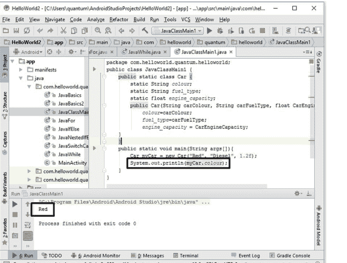

图 4.27. Java 中的类和对象示例

## ANDROID STUDIO 移动应用开发入门指南

Java 确实是一门非常广泛的编程语言，Java SDK 拥有数以千计的方法用于开发复杂的 Java 程序。然而，我认为这门 Java 基础课程足以让你开始开发 Android 应用。我确信，在接下来的章节中，你将习惯编写 Java 代码的。

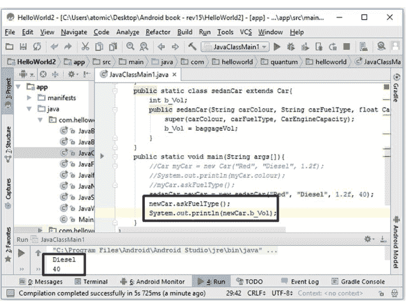

图 4.29. Java 中的类扩展示例

好消息是，枯燥的内容到此为止，接下来的重点将是：真正的 Android 应用开发——开发真正具有实际作用的应用程序。我们将设计与用户交互的程序，并利用 Android 平台的奇妙功能，如发送短信和读取 GPS。在开始下一章开启我们的 Android 开发之旅之前，让我们先喝杯咖啡放松一下吧。

## 第 5 章

## ANDROID 应用 #1：红/蓝闪光灯

在本项目中，我们将开发一个简单的闪光灯应用。我们将学习如何在 Java 代码中访问按钮、获取屏幕背景颜色、设置该颜色以及通过感知按钮点击来更改背景颜色。

我们的目标是开发一个 Android 应用，其背景颜色像红/蓝闪光灯一样变化。每当我们点击位于屏幕中间的按钮时，应用的背景颜色就会从红色变为蓝色，或反之。这是一个非常简单的应用，但它将教我们视觉编程的基础知识。

### 5.1. 创建一个新的 Android 项目

首先，选择“Create a new project（新建项目）”。如果 Android Studio 已经在运行，从底部所示顶部菜单选择 File（文件）-> New（新建）-> New Project（新建项目）：

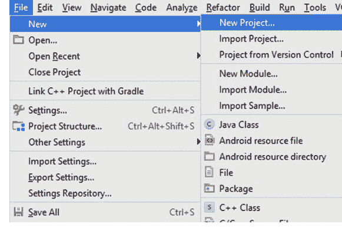

图 5.1. 在 Android Studio 中新建项目

我将应用命名为“Lighthead”，如图 5.2 所示，但你可以起任何喜欢的名称。

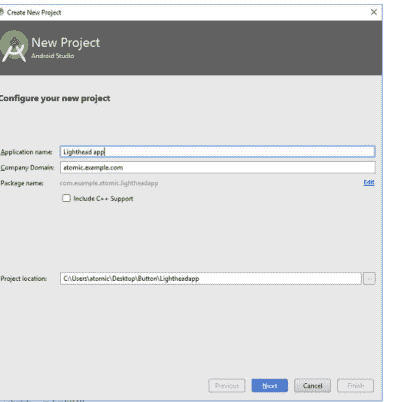

图 5.2. 为应用命名

然后，我选择了应用，适用于 Android 4.0.3 (Ice Cream Sandwich) 或更高版本的手机和平板电脑：

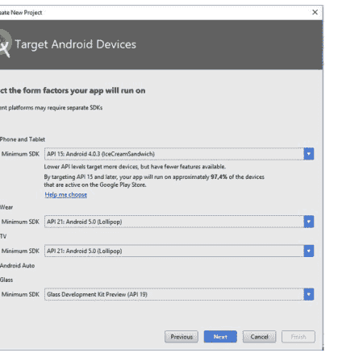

图 5.3. 选择应用兼容性

我们需要一个简单的屏幕，因此在下一次对话框中选择“Empty Activity（空活动）”即可：

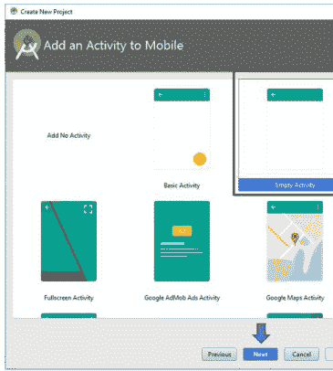

图 5.4. 选择屏幕布局

最后，将 Activity（活动）名称保留为“MainActivity”，然后点击“Finish（完成）”创建项目文件：


图 5.5. 最终设置

## ANDROID STUDIO 移动应用开发入门指南

项目成功创建后，Android Studio 的默认视图将出现在 (app) 中——中间面板将显示如下所示的“MainActivity.java”文件：


图 5.6. Android Studio 中的默认视图

### 5.2. 开发用户界面

让我们打开用户界面布局文件`activity_main.xml`。在 Android Studio 中，我们将在此处设计界面。如上所示，左侧面板将显示文件。我们将确保应用兼容性，并选择合适的布局。最后，根据需要设置 Activity（活动）名称。

## 第 5 章。安卓应用 #1：红/蓝灯闪烁

在我们的应用程序中，按钮组件的默认 ID 设置为`button Android Studio`。我们只需通过点击 ID 框并替换按钮文本即可更改它。

接下来的框指的是按钮组件的布局宽度（layout width）和布局高度（layout height）属性。它们的设置决定了按钮对象在 GUI 中的宽度和高度。它们默认被设置为`wrap_content`。这意味着按钮的宽度和高度将调整为包裹（覆盖）按钮内部的文本（即按钮的标签）。这些参数的其他可用选择是`match_parent`，如图 5.15 所示。如果选择此项，则相应的属性（宽度或高度）将等于其父容器的宽度或高度（在本例中，它是覆盖整个屏幕的`RelativeLayout`）。


**图 5.15。** `layout_width`和`layout_height`参数的备选方案

由于我们不希望按钮的宽度或高度填充整个 GUI，我们需要让这些参数保持为`wrap_content`值。

在我们的应用中，按钮本应该更改屏幕的背景颜色，因此相应地更改按钮标签是好的。按钮标签（按钮上的文字）默认是 **Button**。让我们按照图 5.16 所示将其更改为“Change!”。

## Android Studio 移动应用开发新手指南


### 5.3. 编写应用的主代码

由于我们在 GUI 中不需要任何其他组件，现在可以继续编写`MainActivity.java`应用了。我们将在`MainActivity`中进行编程：导航到 Android Studio 中的项目资源管理器（project explorer），然后双击位于`java -> com....lightheadapp`下的`MainActivity`，如下所示所示：


图 5.17. 在 Android Studio 中打开 MainActivity.java 文件

## 第 5 章。安卓应用 #1：红/蓝灯闪烁


**图 5.18。** 默认的 MainActivity.java 文件

上所示的`MainActivity.java`文件是 Android Studio 生成的默认文件。某些代码行默认是隐藏的，如`import`行中的`...`所示。你可以通过点击`...`来打开这些代码，如下所示：


**图 5.19。** 打开隐藏行后的默认 MainActivity.java 文件

## Android Studio 移动应用开发新手指南

让我们逐行分析默认的`MainActivity.java`代码：

- 第一行是像通常 Java 代码一样的`package`定义。它显示了该文件所属的包。
- 接两行是`import`行，用于导入所需的库。在我们的文件中，导入了`AppCompatActivity`和`Bundle`库。它们包含了用户交互和在不同活动之间传递数据的基础方法。
- 下一行声明了`MainActivity`类，它继承了`AppCompatActivity`类。这就像 Java 中的类定义。与 Java 一样，Android 中的类名应该与`.java`文件名匹配。在这种情况下，文件是`MainActivity.java`，因此类名是`MainActivity`。
- 接着放置了`@override`命令。它告诉编译器当前类将覆盖任何父类。
- 第六行定义了一个名为`onCreate()`的方法。所有活动通过一系列方法调用启动。`onCreate()`是这些调用中的第一个。
- 下一行`super.onCreate(savedInstanceState);`表示除了父类的代码（如果有）之外还要执行我们的代码。
- 最后一行`setContentView()`从布局源设置活动内容。我们在`activity_main.xml`文件中设置应用的布局。Android 通过名为`R`的辅助类访问资源。`R`类是一个特殊的类，它能够比通过文件路径更简单的方式利用资源。`setContentView()`方法的参数是`R.layout.activity_main`，这意味着“将活动的内容设置为位于 activity_main.xml 的布局”。


我们在 Android 编程中经常听到`activity`这个词。`Activity`是一个管理用户界面以及应用与用户交互的类。

当一个活动启动时，它可能处于不同的状态，如图 5.20 所示。

## 第 5 章。安卓应用 #1：红/蓝灯切换

如果颜色是红色，则变为蓝色；否则（如果颜色是蓝色）则变为红色。

我们可以通过以下代码实现这一功能：

```java
if (color == Color.RED) {
    bgElement.setBackground(Color.BLUE);
} else {
    bgElement.setBackground(Color.RED);
}
```

代码 5.5

Android SDK 中有一个名为`Color`的特殊类，用于与颜色相关的操作。表达式`Color.RED`和`Color.BLUE`分别代表红色和蓝色的整数值。因此，包含整数的颜色变量`color`将通过表达式`color == Color.RED`与红色整数值进行比较。如果它们相等，说明背景当前为红色，点击按钮时将变为蓝色。否则，背景当前为蓝色，用户点击按钮时将变为红色。

将所有这些行组合起来，我们得到了代码 5.6 所示的按钮监听方法。

```java
public void myButtonListenerMethod() {
    button = (Button) findViewById(R.id.button);
    button.setOnClickListener(new
    View.OnClickListener() {
        @Override
        public void onClick(View v) {
            RelativeLayout bgElement = (RelativeLayout)
                findViewById(R.id.activity_main);
            int color = ((Drawable)bgElement.getBackground()).getColor();
            if (color == Color.RED) {
                bgElement.setBackground(Color.BLUE);
            }
            else {
                bgElement.setBackground(Color.RED);
            }
        }
    });
```

## ANDROID STUDIO 移动应用开发初学者指南

```java
}};
}
```

代码 5.6（接上页）

请注意，由于块内部只有一行代码，我们可以使用不带大括号的`if–else`语句。不过，为了完整起见，我写了大括号。

现在我们必须在`activity`首次创建时调用此按钮监听方法。因此，我们必须在`onCreate()`方法中如下调用它：

```java
protected void onCreate (Bundle savedInstanceState) {
    super.onCreate(savedInstanceState);
    setContentView(R.layout.activity_main);
    myButtonListenerMethod();
}
```

代码 5.7

然而，我们还没有完成，因为`activity`在首次创建时背景默认是透明的。因此，我们必须在创建时将其设置为红色或蓝色。让我们通过改进代码 5.7 来设置它：

```java
protected void onCreate (Bundle savedInstanceState) {
    super.onCreate(savedInstanceState);
    setContentView(R.layout.activity_main);
    RelativeLayout bgElement = (RelativeLayout);
    findViewById(R.id.activity_main);
    bgElement.setBackgroundColor(Color.RED);
    myButtonListenerMethod();
}
```

代码 5.8

在此代码中，背景在应用启动时被访问并设置为红色。请注意，我们需要在`onCreate()`方法内部定义一个独立的`bgElement`对象；我们不能使用按钮监听方法内部定义的`bgElement`。这是因为方法中所有的变量和对象只在该方法内部有效（也称为变量的作用域）。

## 第 5 章。安卓应用 #1：红/蓝灯切换

现在，让我们这些代码行组合成完整的`MainActivity.java`文件，如下：

```java
public class MainActivity extends AppCompatActivity {

    Button button;
    @Override
    protected void onCreate(Bundle savedInstanceState) {
        super.onCreate(savedInstanceState);
        setContentView(R.layout.activity_main);
        RelativeLayout bgElement = (RelativeLayout) findViewById(R.id.activity_main);
        bgElement.setBackgroundColor(Color.WHITE);
    }

    public void myButtonListenerMethod() {
        Button button = (Button) findViewById(R.id.button);
        button.setOnClickListener(new View.OnClickListener() {
            @Override
            public void onClick(View v) {
                RelativeLayout bgElement = (RelativeLayout) findViewById(R.id.activity_main);
                int color = ((ColorDrawable)bgElement.getBackground()).getColor();
                if (color == Color.RED) {
                    bgElement.setBackgroundColor(Color.BLUE);
                } else {
                    bgElement.setBackgroundColor(Color.RED);
                }
            }
        });
    }
}
```

代码 5.9

### 5.4. 构建并运行应用

我们已经完成了第一个安卓应用的布局和代码开发。让我们点击 Android Studio 中的运行按钮来运行它。我选择了一个 Nexus 4 模拟器来运行我们的应用。应用启动时的屏幕如图 5.22 所示。

## ANDROID STUDIO 移动应用开发初学者指南


**图 5.22.** 应用启动时的界面（颜色和全分辨率图片请访问书籍辅助网站：www.android-java.website）

当我们点击**Change**（更改）按钮时，背景颜色从红色变为蓝色，反之亦然，如图 5.23 所示。我们可以在真实设备上运行此应用，如前文所示（此处重复已省略）。

## 第 5 章。安卓应用 #1：红/蓝灯切换


**图 5.22.** 应用启动时的界面（颜色和全分辨率图片请访问书籍辅助网站：www.android-java.website）

当我们点击**Change**（更改）按钮时，背景颜色从红色变为蓝色，反之亦然，如图 5.23 所示。我们可以在真实设备上运行此应用，如前文所示。

## 安卓应用 #2：体重指数计算器

### 6.1. 一般信息

体重指数（BMI）是一个用于衡量人体胖瘦程度的数据。BMI 定义为体重与身高平方的比率：

$BMI = \frac{mass(kg)}{height(m)^2}$

| 体重分类 | BMI |
|---|---|
| 极度消瘦 | 0-15 |
| 严重消瘦 | 15-18 |
| 正常（健康） | 18-25 |
| 超重 | 25-30 |
| 中度肥胖 | 30-35 |
| 重度肥胖 | 35-40 |
| 极度肥胖 | 40+ |

## ANDROID STUDIO 移动应用开发初学者指南

### 6.2. 添加和定位 TextView

为了在我们的应用中计算 BMI，我们显然需要体重和身高输入。我们的 Java 代码将使用给定公式计算 BMI，然后判断分类。首先，让我们创建应用的用户界面。

## 第 6 章。安卓应用 #2：BMI 计算器


图 6.1. 设置 TextView 的基本属性（你可以从书籍网站下载全分辨率彩色图片）


图 6.2. 定位标题标签

# Android Studio 移动应用开发入门


图 6.3. 放置四个 TextView

一旦放置了第一个 TextView，下一个 TextView 将相对于上一个一个进行定位。对于我们的 BMI 计算器应用，具体位置并不是严格的，我在这里没有给出精确位置，以免混淆你。如果你想查看我具体使用了哪些位置，可以从书籍的配套网站下载项目文件，但这显然不是强制性的。然而，我们需要在第二个和第三个 TextView 之间留出空间，用于放置触发计算的按钮。

我已经文本字体大小更改为 18 sp，并将文本类型设为粗体。在根据我们的目标修改 TextView 的文本后，布局看起来如图 6.4 所示。


**图 6.4.** 设置好 TextView 后应用的 GUI 布局

### 6.3. 添加 EditText 控件

我们现在需要放置两个可编辑的文本框，让用户输入体重和身高，另一个用于以数字显示 BMI 的文本框，以及一个触发 BMI 计算的按钮。

文本字段（文本框）的位置如图 6.5 所示。我放置了可以输入小数（带小数部分的数字）的文本字段，而不是通用输入类型，因为用户在这个应用中应该只输入数值。值得注意的是，计算结果将显示在**BMI:** 标签旁边，并在那里放置了一个文本字段来显示 BMI 结果。不过，如果我们想向你展示如何通过程序设置 TextField 的内容，可以使用静态文本（TextView）来实现此目的。


图 6.5. 放置 TextFields

请注意，文本字段默认没有边框，因此在放置它们之后，我们只能通过选中它们才能看到它们。

让我们设置它们的 ID，以便我们通过程序访问它们，并设置它们的默认文本。为此，请选择相应的 TextField，然后如图 6.6 所示，为体重输入 TextField 设置 ID 和 text 属性。我也像之前一样，将我的默认文本设置在中间位置。


图 6.6. 体重输入 TextField 的设置


图 6.7. 设置好所有 TextFields 后应用的 GUI

请将身高输入和 BMI 结果 TextField 的 ID 和默认文本分别设置为`heightInput`和`1.80`；`BMIResult`和`........`。通过将 BMI 结果 TextField 的默认文本设置为`.......`，我们让用户在计算 BMI 之前在该框中看到`......`。在完成这些设置后，GUI 如图 6.7 所示。

### 6.4. 添加并定位按钮

还剩下两个步骤来完成我们的 GUI 设计。第一步是触发计算的按钮。请从调色板（Palette）在身高输入 TextView 和 YourBMI TextView 之间拖放一个按钮控件，然后如图所示将其在水平方向上居中定位：


图 6.8. 在屏幕上放置按钮

现在，请将按钮文本设置为**Calculate my BMI!**。注意按钮的默认 ID 为`button`，这是可以的。

我们的 GUI 几乎完成了，但还剩最后一步。BMI 分类 TextView（带有文本**Your BMI category appears here.** 的那一个）。请将其 ID 设置为`BMICategory`，我们就完成了。完成这些步骤后，我们应用的 GUI 准备所示：


**图 6.9.** 我们应用的 GUI

### 6.5. 开发主代码

我们现在将实现应用程序逻辑。我们将在`MainActivity.java`文件中工作。

```java
package com.example.calculator;

import android.os.Bundle;
import android.view.View;
import android.widget.Button;
import android.widget.EditText;
import android.widget.Toast;
import androidx.appcompat.app.AppCompatActivity;

public class MainActivity extends AppCompatActivity {

    private EditText weightInput;
    private EditText heightInput;
    private EditText bmiResult;
    private Button calculateButton;

    @Override
    protected void onCreate(Bundle savedInstanceState) {
        super.onCreate(savedInstanceState);
        setContentView(R.layout.activity_main);

        weightInput = findViewById(R.id.weightInput);
        heightInput = findViewById(R.id.heightInput);
        bmiResult = findViewById(R.id.BMIResult);
        calculateButton = findViewById(R.id.button);

        calculateButton.setOnClickListener(new View.OnClickListener() {
            @Override
            public void onClick(View v) {
                String weightStr = weightInput.getText().toString();
                String heightStr = heightInput.getText().toString();

                if (!weightStr.isEmpty() && !heightStr.isEmpty()) {
                    double weight = Double.parseDouble(weightStr);
                    double height = Double.parseDouble(heightStr);
                    double bmi = weight / (height * height);
                    bmiResult.setText(String.format("%.2f", bmi));
                } else {
                    Toast.makeText(MainActivity.this, "Please enter both values", Toast.LENGTH_SHORT).show();
                }
            }
        });
    }
}
```

## 第 6 章安卓应用 #2：BMI 计算器

并确定 BMI 类别。为了这一点，我们定义一个存储 BMI 类别的`String`：

| `String BMI_Cat;` |
| :--- |
| 代码 6.7 |

我们将使用以下`if–else`语句根据 BMI 值来设置该`String`：


## ANDROID STUDIO 移动应用开发初学者指南

## 第 6 章 安卓应用 #2：BMI 计算器

### 6.5 完整代码：`MainActivity.java`

首先，我们通过代码 6.8 中的逻辑判断`BMI`值所属的类别，并将对应的描述字符串赋值给`BMI_Cat`变量：

```
if (BMI < 15)
  BMI_Cat = "Very severely underweight"
else if (BMI < 16)
  BMI_Cat = "Severely underweight"
else if (BMI < 18.5)
  BMI_Cat = "Underweight"
else if (BMI < 25)
  BMI_Cat = "Normal"
else if (BMI < 30)
  BMI_Cat = "Overweight"
else if (BMI < 35)
  BMI_Cat = "Obese Class 1 - Moderately Obese"
else if (BMI < 40)
  BMI_Cat = "Obese Class 2 - Severely Obese"
else
  BMI_Cat = "Obese Class 3 - Very Severely Obese";
```
代码 6.8

剩下的唯一工作是将`TextView`设置为`BMI_Cat`字符串，以便 BMI 类别能够显示在用户界面上：

```
final TextView BMICategory = (TextView)
findViewById(R.id.BMICategory)
BMICategory.setText(BMI_Cat);
```
代码 6.9

将所有这些代码行组合在一起，我们得到了代码 6.10 中给出的完整`MainActivity.java`。（你可以从书的网站：`www.android-java.website`下载这些代码。）

请注意，此文件开头的库导入指令是 `Android Studio` 根据我们在代码中使用的方法和类自动放置的。

```
package com.helloworld.quantum.bmicalculator;

import android.graphics.Color;
import android.graphics.drawable.ColorDrawable;
import android.support.v7.app.AppCompatActivity;
import android.view.View;
import android.widget.Button;
import android.widget.EditText;
import android.widget.RelativeLayout;
import android.widget.TextView;

public class MainActivity extends AppCompatActivity
{
    @Override
    protected void onCreate(Bundle savedInstanceState) {
        super.onCreate(savedInstanceState);
        setContentView(R.layout.activity_main);
        myButtonListenerMethod();
    }

    public void myButtonListenerMethod() {
        Button button = (Button) findViewById(R.id.button);
        button.setOnClickListener(new View.OnClickListener() {
            @Override
            public void onClick(View v) {
                final EditText height = (EditText) findViewById(R.id.height);
                String heightStr = height.getText().toString();
                double height = Double.parseDouble(heightStr);
                final EditText weight = (EditText) findViewById(R.id.weightInput);
                String weightStr = weight.getText().toString();
                double weight = Double.parseDouble(weightStr);
                double BMI = (weight)/(height*height);
                final EditText BMIResult = (EditText) findViewById(R.id.BMIResult);
                BMIResult.setText(Double.toString(BMI));
                String BMI_Cat;
                if (BMI < 15)
                    BMI_Cat = "Very severely underweight";
                else if (BMI < 16)
                    BMI_Cat = "Severely underweight";
                else if (BMI < 18.5)
                    BMI_Cat = "Underweight";
                else if (BMI < 25)
                    BMI_Cat = "Normal";
                else if (BMI < 30)
                    BMI_Cat = "Overweight";
                else if (BMI < 35)
                    BMI_Cat = "Obese Class 1 - Moderately Obese";
                else if (BMI < 40)
                    BMI_Cat = "Obese Class 2 - Severely Obese";
                else
                    BMI_Cat = "Obese Class 3 - Very Severely Obese";

                final TextView BMICategory = (TextView)
                    findViewById(R.id.BMICategory);
                BMICategory.setText(BMI_Cat);
            }
        });
    }
}
```
代码 6.10（接上页）

### 6.6. 编译并运行应用

现在让我们在 Nexus 4 模拟器中尝试我们的应用。只需点击 `Android Studio` 中的“Run”按钮并选择 Nexus 4 模拟器。你应该能看到图 6.10 所示的应用屏幕。

输入体重和高度值（公斤和米），然后点击 `CALCULATE MY BMI!` 按钮。如果你正确遵循了所有步骤，你应该在应用屏幕上看到如图 6.11 所示的 BMI 值和 BMI 类别。


图 6.10. 应用屏幕


图 6.11. BMI 计算示例

### 6.7. 注意事项

从图 6.11 可以看出，BMI 显示带有许多不必要的浮点数字。可能一位数字就足够了。我们可以使用以下代码来修剪`BMI`变量的小数位并分配新的`double`类型：

```java
DecimalFormat df = new DecimalFormat("#.#");
double BMI_trimmed = Double.parseDouble(df.format(BMI));
```

`DecimalFormat`类用于这些操作。`Android Studio` 会通过这些代码行自动添加所需的库：修改后的`MainActivity.java`如下：

```java
package com.helloworld.quantum.bmicalculator;

import android.support.v7.app.AppCompatActivity;
import android.os.Bundle;
import android.view.View;
import android.widget.Button;
import android.widget.EditText;
import android.widget.RelativeLayout;
import android.widget.TextView;
import java.text.DecimalFormat;

public class MainActivity extends AppCompatActivity
{
    @Override
    protected void onCreate(Bundle savedInstanceState) {
        super.onCreate(savedInstanceState);
        setContentView(R.layout.activity_main);
        myButtonListenerMethod();
    }

    public void myButtonListenerMethod() {
        Button button = (Button) findViewById(R.id.button);
        button.setOnClickListener(new View.OnClickListener() {
            @Override
            public void onClick(View v) {
                final EditText height = (EditText) findViewById(R.id.height);
                String heightStr = height.getText().toString();
                double height = Double.parseDouble(heightStr);
                final EditText weight = (EditText) findViewById(R.id.weightInput);
                String weightStr = weight.getText().toString();
                double weight = Double.parseDouble(weightStr);
                double BMI = (weight)/(height*height);
                final EditText BMIResult = (EditText) findViewById(R.id.BMIResult);
                BMIResult.setText(Double.toString(BMI));
                String BMI_Cat;
                if (BMI < 15)
                    BMI_Cat = "Very severely underweight";
                else if (BMI < 16)
                    BMI_Cat = "Severely underweight";
                else if (BMI < 18.5)
                    BMI_Cat = "Underweight";
                else if (BMI < 25)
                    BMI_Cat = "Normal";
                else if (BMI < 30)
                    BMI_Cat = "Overweight";
                else if (BMI < 35)
                    BMI_Cat = "Obese Class 1 - Moderately Obese";
                else if (BMI < 40)
                    BMI_Cat = "Obese Class 2 - Severely Obese";
                else
                    BMI_Cat = "Obese Class 3 - Very Severely Obese";

                final TextView BMICategory = (TextView)
                    findViewById(R.id.BMICategory);
                BMICategory.setText(BMI_Cat);
            }
        });
    }
}
```

当使用修改后的代码时，计算结果在模拟器中显示如下：


图 6.12. 带修剪数字的 BMI 计算示例

**注意 2.** 我已验证我们的 BMI 计算器应用在真实设备（华硕手机 Phone 6）上运行正常。

**注意 3.** 如果应用将你分类为肥胖，不要担心，我也是如此（图 6.12 中的值不是我的©）。请咨询您的医生和营养师以获得降低 BMI 的方法，例如定期锻炼和少吃加工食品。

我们将在下一章中开发一个骰子应用，到时你将学习向应用中添加动态图像并在 Android 中利用随机函数。喝完咖啡后见！

---

# 第 7 章 ANDROID 应用 #3：简单骰子掷器

### 7.1. 创建项目并添加 ImageView 小部件

在本章中，我们将开发一个简单的骰子掷器应用。我们将学习如何在 GUI 中使用图像，并学习使用 Java 基础随机数生成代码来掷虚拟骰子。当我们点击“Roll（掷）”按钮时，应用将在 1 到 6 之间随机选择一个数字，将结果以数字显示在`TextView`中，并显示结果的骰子图像。

请创建一个新项目并将其保存到电脑上。按照惯例选择一个空活动（empty activity）。我将项目命名为 `Dice Roller`，但你当然可以赋予任何喜欢的名称。

首先，让我们设计用户界面。在 `Android Studio` 中打开`activity_main.xml`文件时，请将默认`TextView`的文本从“Hello World”更改为“Dice Roller”，并将其放置在 GUI 顶部，水平居中对齐，如图 7.1 所示。

我们现在需要放置一个`ImageView`组件，用于显示骰子面的图像。然而，我们需要先将图像文件导入项目。当应用启动时，最好显示一个通用的骰子图像，然后在用户掷骰子时将更改更改相应的骰子面图像。为此，我们需要向 `Android Studio` 插入一个通用骰子图像和 6 个骰子面图像。这些图像如图 7.2 所示，可以从书籍的配套网站 `www.android-java.website` 下载。

**图 7.1.** 显示应用标题的`TextView`

**图 7.2.** 应用中使用的骰子面图像及其文件名

## 第 7 章。ANDROID 应用 #3：简单骰子掷器

请在电脑的文件资源管理器中选择并右键点击 -> 复制所有这些图像（就像你选择文件进行复制和粘贴时一样），然后右键点击 -> 粘贴到下文所示的 `Android Studio` 中的`drawable`文件夹中：

图 7.3. 向 `Android Studio` 项目添加图像文件

当我们点击`drawable`文件夹左侧的箭头符号时，我们可以看到如图 7.4 所示的新添加的图像文件。

图 7.4 导入到项目的图像文件

现在我们将`ImageView`对象放置到 GUI 中。请在调色板（Palette）中找到`ImageView`对象，并将其拖放到应用布局中，如下：

图 7.5. 添加`ImageView`对象

当我们把`ImageView`拖到 GUI 上时，`Android Studio`要求我们像图 7.6 所示设置其图像。选定的图像将在应用首次启动时在`ImageView`内部显示的图像（即默认图像）。因此，请按图 7.6 所示选择`dicegeneral.png`。

**图 7.6.** 为`ImageView`选择默认图像

选择完毕后，按下 OK，然后我们应用的布局将如下所示：

**图 7.7.** 放置`ImageView`后的布局

### 7.2. 添加其他小部件并设置 ID

请在`ImageView`对象下方放置一个`TextView`和一个`Button`，分别显示掷骰结果和启动掷骰。我已将`TextView`设置为显示“Please tap the button....（请点击按钮....）”。同样，按钮的文本已更改为“ROLL!”，如下所示：

图 7.8 放置所有所需对象后的 GUI

我们需要骰子图像、结果`TextView`和按钮的 ID，因为我们将在代码中访问它们。我已将它们的 ID 分别分配为`diceimage`、`rollResult`和`rollButton`。

### 7.3. 开发应用的主代码


让我们开始编写一个按钮监听器，它将在用户点击“Roll!”时被调用。按钮监听器的模板如代码 7.1 所示（在之前的章节中已开发）。在此方法中，声明了一个名为 `button` 的 `Button` 对象，并通过该对象访问 GUI 上的按钮。然后通过 `setOnClickListener()` 方法监听此按钮的点击。程序如下：

```java
public void myButtonClickListener() {
    Button button = (Button) findViewById(R.id.rollButton);
    button.setOnClickListener(new View.OnClickListener() {
        @Override
        public void onClick(View v) {
            // ...
        }
    });
}
```

代码 7.1

我们需要使用 `Random` 对象来生成 1 到 6 之间的随机数。

```java
Random rand = new Random();
int rollResult = rand.nextInt(6) + 1;
```

代码 7.2

在此代码中，创建了一个名为 `rand` 的 `Random` 对象。在第二行中，`rand.nextInt(6)` 生成 0 到 5 之间的数字。因此，`rand.nextInt(6) + 1` 生成 1 到 6 之间的数字，这在 `onClick()` 方法中当按钮被点击时运行。

```java
TextView diceResult = (TextView) findViewById(R.id.diceResult);
diceResult.setText(Integer.toString(rollResult));
```

代码 7.3

我们最后需要的是根据掷骰结果更改 `ImageView` 图像。

```java
ImageView img = (ImageView) findViewById(R.id.diceImage);
```

代码 7.4

由于掷骰结果是一个整数，我们可以轻松地使用 `switch` 语句更改图像，如下：

```java
switch (rollResult) {
  case 1:
    img.setImageResource(R.drawable.dice1);
    break;
  case 2:
    img.setImageResource(R.drawable.dice2);
    break;
  case 3:
    img.setImageResource(R.drawable.dice3);
    break;
  case 4:
    img.setImageResource(R.drawable.dice4);
    break;
  case 5:
    img.setImageResource(R.drawable.dice5);
    break;
  case 6:
    img.setImageResource(R.drawable.dice6);
    break;
}
```

代码 7.5

请注意，我们通过 `setImageResource()` 方法更改 `ImageView` 对象的图像，该方法接收图像资源。结合所有代码行并在活动的 `onCreate()` 方法中调用按钮监听器，我们得到了完整的 `MainActivity.java`：

```java
package com.helloworld.myapplication;

import android.support.v7.app.AppCompatActivity;
import android.os.Bundle;
import android.view.View;
import android.widget.Button;
import android.widget.ImageView;
import android.widget.TextView;
import java.util.Random;

public class MainActivity extends AppCompatActivity
{
    @Override
    protected void onCreate(Bundle savedInstanceState) {
        super.onCreate(savedInstanceState);
        setContentView(R.layout.activity_main);
        myButtonListenerMethod();
    }

    public void myButtonListenerMethod() {
        Button button = (Button) findViewById(R.id.rollButton);
        button.setOnClickListener(new View.OnClickListener() {
            @Override
            public void onClick(View v) {
                Random rand = new Random();
                int rollResult = rand.nextInt(6) + 1;

                TextView diceResult = (TextView) findViewById(R.id.diceResult);
                diceResult.setText(Integer.toString(rollResult));

                ImageView img = (ImageView) findViewById(R.id.diceImage);

                switch (rollResult) {
                    case 1:
                        img.setImageResource(R.drawable.dice1);
                        break;
                    case 2:
                        img.setImageResource(R.drawable.dice2);
                        break;
                    case 3:
                        img.setImageResource(R.drawable.dice3);
                        break;
                    case 4:
                        img.setImageResource(R.drawable.dice4);
                        break;
                    case 5:
                        img.setImageResource(R.drawable.dice5);
                        break;
                    case 6:
                        img.setImageResource(R.drawable.dice6);
                        break;
                }
            }
        });
    }
}
```

# Android Studio 移动应用开发入门指南

```java
case 4:
    img.setImageResource(R.drawable.dice4);
    break;
case 5:
    img.setImageResource(R.drawable.dice5);
    break;
case 6:
    img.setImageResource(R.drawable.dice6);
    break;
}
  }
}
```

代码 7.6（接上一页）

## 7.4. 编译并运行应用

让我们通过点击 Android Studio 中的“运行（Run）”按钮并像之前一样选择 Nexus 4 等模拟器，来运行我们的骰子生成器应用。图 7.9 所示的应用将会出现。每当你点击“ROLL!”按钮时，应用都应该显示一个不同的数字，并对应图 7.10 所示骰子面图像。该应用在真实设备上的运行情况也符合预期。

值得注意的是，随机数不仅用于趣味性应用，还用于在线信用卡交易等日常加密过程中。因此，在 Java 和 Android 中有更复杂的随机数生成函数，在外部库的帮助下也是如此。对于我们掷骰子游戏中的简单随机性，`Random` 类似乎足够了。你可以通过连续点击“Roll!”按钮来检查其随机性，观察是否经常获得相同的数字，或者数字是否显示出你可以预测下一个数字的模式。然而，请记住，对随机性的准确测试需要复杂的工具。

在继续下一章之前，让我们休息一下。在下一章中，我们将开发一个指南针应用，它将利用设备内部的加速度计和磁力传感器。

# 第 7 章。Android 应用 #3：简单骰子生成器


**图 7.9.** 应用首次运行时界面


**图 7.10.** 应用在掷掷后显示 6

# 第 8 章。Android 应用 #4：指南针

我们将开发一个简单的指南针应用，它将利用设备内部的加速度计和磁力传感器。加速度计是一种将机械加速度转换为电信号的传感器，同样，磁力计被用于将磁场强度转换为电子信号。大多数 Android 设备内部都有加速度计和磁力计，因此使用指南针应用需要软件而非硬件。

在开发指南针应用的过程中，我们将学习设置以使用传感器、在 Java 代码中读取加速度和磁场数据、以及提取方向数据。最后，我们将拥有一个可以在日常生活中使用的完整指南针应用。

## 8.1. 设置权限

让我们从创建一个 Android 项目开始。我将项目命名为“Compass App”，并选择“Empty Activity（空活动）”作为默认活动类型。最小 API 也设置为 15。我们需要一个指针指向绝对正北的指南针图片。我在图 8.1 中找到了这张图片（我选择它是因为它看起来像指南针）。你可以像往常从书籍网站下载此图片，或使用项目中的任何其他图片。请像以前一样将此图片复制并粘贴到 `drawable` 文件夹中。图片名为 `compass.png`，我们将使用它的名称在代码中访问它。


**图 8.1.** 指南针图片

如果我们在 Android 项目中使用传感器，我们必须在 `AndroidManifest.xml` 文件中获取这些这些所需的权限，该文件位于下方所示的 `manifests` 文件夹：


**图 8.2.** 项目管理器中的 AndroidManifest 文件

在 Android Studio 中双击此文件，你将看到图 8.3 所示的默认内容。请在 `<application>` 标签之前将代码 8.1 中的行添加到此文件中，你将获得代码 8.2 所示的最终内容。这些行使得加速度计和磁力计的输出可以在我们的应用中使用。


**图 8.3.** AndroidManifest.xml 文件的默认内容

```xml
<?xml version="1.0" encoding="utf-8" ?>
<manifest xmlns="http://schemas.android.com/apk/res/android"
  <package package="com.example.compassapp">
    <uses-feature
      android:name="android.hardware.sensor.accelerometer"
      android:required="true" />
    <uses-feature
      android:name="android.hardware.sensor.magnetometer"
      android:required="true" />
    <application
      android:allowBackup="true"
      android:icon="@mipmap/ic_launcher"
      android:label="@string/app_name"
      android:supportsRtl="true"
      android:theme="@style/AppTheme">
      <activity android:name="MainActivity">
        <intent-filter>
          <action
              android:name="android.intent.action.MAIN" />
            <category
              android:name="android.intent.category.LAUNCHER" />
        </intent-filter>
      </activity>
    </application>
</manifest>
```

代码 8.2（接上一页）

## 8.2. 设计 GUI

现在，让我们设计界面。请打开 `layout_main.xml` 文件，并放置如图 8.3 所示的 `TextView`，它将显示应用标题。将其字体大小设置为 30sp，如下所示：


**图 8.4.** 用于显示标题的 `TextView`

在 GUI 中放置一个 `ImageView` 并选择放入 `drawable` 文件夹的指南针图片：


**图 8.5.** 为 `ImageView` 选择指南针图片

放置 `ImageView` 后，我们将选择它。然后，在如下所示将其 ID 设置为 `iv_compass`：


**图 8.6.** 设置 `ImageView` 的 ID

最后，在 `ImageView` 下方放置一个 `TextView` 来显示方向角。将其 ID 设置为 `tv_degrees`，如下所示：


**图 8.7.** 添加显示方向角的 `TextView`

## 8.3. 编写应用主代码

我们完成了用户界的设计，现在准备继续编写代码。请在 Android Studio 中打开 `MainActivity.java` 文件。该文件将包含所示默认内容：

```java
package com.example.compassapp;

import android.os.Bundle;
import android.support.v7.app.AppCompatActivity;

public class MainActivity extends AppCompatActivity {

    @Override
    protected void onCreate(Bundle savedState) {
        super.onCreate(savedState);
        setContentView(R.layout.activity_main);
    }
}
```

指南针的水平方向称为方位角（azimuth）。我们将根据磁力计和加速度计的输出计算此角度。定义一个 `float` 类型变量来存储这些数据：

```java
float azimuth angle;
```

代码 8.4

我们还需要定义与传感器相关的对象，如下：

```java
private SensorManager compassSensorManager;
Sensor accelerometer;
Sensor magnetometer;
```

代码 8.5

我们可以将这些声明放在 `MainActivity` 类中，位于 `onCreate()` 方法之前。然后，在 `onCreate()` 方法内部将默认的加速度计和磁力传感器分配给这些对象，如下：

```java
compassSensorManager =
(SensorManager)getSystemService(SENSOR_SERVICE);

accelerometer =
compassSensorManager.getDefaultSensor(Sensor.TYPE_ACC_ELEROMETER);

magnetometer =
compassSensorManager.getDefaultSensor(Sensor.TYPE_MAGNET_IC_FIELD);
```

代码 8.7

# Android Studio 移动应用开发初学者


```java
package com.example.atomic.compass;

import android.hardware.Sensor;
import android.hardware.SensorManager;
import android.support.v7.app.AppCompatActivity;
import android.os.Bundle;
import android.widget.ImageView;
import android.widget.TextView;

public class MainActivity extends AppCompatActivity {
    Float azimuth_angle;
    private SensorManager compassSensorManager;
    Sensor accelerometer;
    Sensor magnetometer;
    TextView tv_degrees;
    ImageView iv_compass;

    @Override
    protected void onCreate(Bundle savedInstanceState) {
        super.onCreate(savedInstanceState);
        setContentView(R.layout.activity_main);
        compassSensorManager = (SensorManager)getSystemService(SENSOR_SERVICE);
        accelerometer = compassSensorManager.getDefaultSensor(Sensor.TYPE_ACCELEROMETER);
        magnetometer = compassSensorManager.getDefaultSensor(Sensor.TYPE_MAGNETIC_FIELD);
    }
}
```

为了继续读取传感器数据，我们必须实现`SensorEventListener`类。我们通过在主类定义中使用`implements`关键字来实现，如下：

```java
public class MainActivity extends AppCompatActivity
implements SensorEventListener
```

代码 8.9

注意这是一行单行代码。当我们实现`SensorEventListener`类时，Android Studio会通过一个红色灯泡警告我们，我们需要在代码中实现所需的方法：


图 8.8 实现所需方法的警告

请点击“Implement methods”（实现方法），然后当我们在点击对话框中的“OK”按钮时，Android Studio将自动放置`onChanged()`和`onSensorChanged()`方法：


图 8.9 显示将要实现的方法的对话框

# Android Studio 移动应用开发初学者

Android Studio自动将以下代码放入`MainActivity.java`中：

```java
@Override
public void onChanged(SensorEvent event) {
}

@Override
public void onAccuracyChanged(Sensor sensor, int accuracy) {
}
```

我们将主代码写在`onChanged()`方法中。然而，在编写主代码之前，让我们先为主活动编写`onResume()`和`onPause()`方法，因为传感器是耗电型组件，因此在活动暂停和恢复时暂停和恢复传感器监听器是非常重要的。对于这一点，我们只需在`onCreate()`方法末尾下方添加以下代码：

```java
protected void onResume() {
    super.onResume();
    compassSensorManager.registerListener(this,
    accelerometer, SensorManager.SENSOR_DELAY_UI);
    compassSensorManager.registerListener(this,magnetometer, SensorManager.SENSOR_DELAY_UI);
}

protected void onPause() {
    super.onPause();
    compassSensorManager.unregisterListener(this);
}
```

在`onResume()`方法中，注册了传感器监听器，这意味着当活动恢复时，传感器会再次开启。同样地，当活动暂停时，在`onPause()`方法中取消注册（断开）传感器。

我们现在准备好编写主代码了。首先，让我们定义两个`float`类型的数组来存储加速度计和磁计的输出数据。这些将是数组变量，这些传感器的输出是矢量，即它们在不同方向上有不同的值。我们可以如下为这些传感器定义数组`accel_read`和`magnetic_read`：

```java
float[] accel_read;
float[] magnetic_read;
```

请将这些声明写在`onSensorChanged()`方法之前，以便我们可以在该方法的任何地方访问这些变量。

在`onSensorChanged()`方法内部：当有新的传感器事件时，该方法会被自动调用，因此我们在这个方法中编写主代码。以下代码创建GUI的`ImageView`和`TextView`对象，它们会在传感器事件发生时更新：

```java
tv_degrees = (TextView) findViewById(R.id.tv_degrees);
iv_compass = (ImageView) findViewById(R.id.iv_compass);
```

然后，以下代码读取加速度计和磁计传感器，并将输出存储到`accel_read`和`magnetic_read`数组中：

```java
if (event.sensor.getType() == Sensor.TYPE_ACCELERETER)
    accel_read = event.values;
if (event.sensor.getType() == Sensor.TYPE_MAGNETIC_FIELD)
    magnetic_read = event.values;
```

如果传感器输出可用（即它们不为null），我们将在`getRotationMatrix()`方法中使用`accel_read`和`magnetic_read`变量获取设备的旋转矩阵`R`：

```java
if (accel_read != null && magnetic_read != null) {
    float R[] = new float[9];
    float I[] = new float[9];
    boolean successfulreadread = SensorManager.getRotationMatrix(R, I, accel_read,
```

代码 8.15（接上页）

如果此操作成功，旋转矩阵将为`R`。在这种情况下，我们准备好获取角度如下：

```java
if (successful_read) {
    float orientation[] = new float[3];
    SensorManager.getArrayTo(orientation, R);
    azimuth_angle = Math.toDegrees(orientation[0]);
}
```

代码 8.16

# Android Studio 移动应用开发指南

## Android 应用：指南针

根据角度旋转`ImageView`也是很好的。对于这种动画，我们需要声明一个持有角度的`float`变量。然后，可以使用以下动画代码旋转`ImageView`：

```java
float current_degree = 0f;
RotateAnimation rotate = new RotateAnimation(current_degree, current_degree + 360);
rotate.setDuration(1000);
rotate.setFillAfter(true);
iv_compass.startAnimation(rotate);
```

代码 8.17

在此代码中，我们声明了一个动画并设置了持续时间。`startAnimation`启动了`ImageView`的旋转。结合这些代码行，我们得到了所示的`MainActivity.java`：

```java
package com.example.atomic.compass;

import android.hardware.Sensor;
import android.hardware.SensorEventListener;
import android.hardware.SensorManager;
import android.support.v7.app.AppCompatActivity;
import android.os.Bundle;
import android.view.animation.Animation;
import android.view.animation.RotateAnimation;
import android.widget.ImageView;
import android.widget.TextView;

public class MainActivity extends AppCompatActivity
implements SensorEventListener {
    Float azimuth_angle;
    private SensorManager compassSensorManager;
    Sensor accelerometer;
    Sensor magnetometer;
    TextView tv_degrees;
    ImageView iv_compass;
    private float current_degree = 0f;

    @Override
    protected void onCreate(Bundle savedInstanceState) {
        super.onCreate(savedInstanceState);
        setContentView(R.layout.activity_main);
        compassSensorManager = (SensorManager)getSystemService(SENSOR_SERVICE);
        accelerometer = compassSensorManager.getDefaultSensor(Sensor.TYPE_ACCELEROMETER);
        magnetometer = compassSensorManager.getDefaultSensor(Sensor.TYPE_MAGNETIC_FIELD);
    }

    @Override
    public void onSensorChanged(SensorEvent event) {
        if (event.sensor.getType() == Sensor.TYPE_ACCELEROMETER) {
            accel_read = event.values;
        }
        if (event.sensor.getType() == Sensor.TYPE_MAGNETIC_FIELD) {
            magnetic_read = event.values;
        }
        if (accel_read != null && magnetic_read != null) {
            float R[] = new float[9];
            float I[] = new float[9];
            if (SensorManager.getRotationMatrix(R, I, accel_read, magnetic_read)) {
                float orientation[] = new float[3];
                SensorManager.getArrayTo(orientation, R);
                azimuth_angle = Math.toDegrees(orientation[0]);
                tv_degrees.setText(String.format("%.0f°", azimuth_angle));
                current_degree = azimuth_angle;
                RotateAnimation rotate = new RotateAnimation(current_degree, current_degree + 360);
                rotate.setDuration(1000);
                rotate.setFillAfter(true);
                iv_compass.startAnimation(rotate);
            }
        }
    }

    @Override
    public void onAccuracyChanged(Sensor sensor, int accuracy) {
    }

    @Override
    protected void onResume() {
        super.onResume();
        compassSensorManager.registerListener(this, accelerometer, SensorManager.SENSOR_DELAY_UI);
        compassSensorManager.registerListener(this, magnetometer, SensorManager.SENSOR_DELAY_UI);
    }

    @Override
    protected void onPause() {
        super.onPause();
        compassSensorManager.unregisterListener(this);
    }

    private float[] accel_read;
    private float[] magnetic_read;
}
```

```java
iv_compass = (ImageView)
findViewByIdById(R.id.iv_compass);

if (event.sensor.getType() == Sensor.TYPE_ACCELEROMETER)
    accel_read = event.values;
else if (event.sensor.getType() == Sensor.TYPE_MAGNETIC_FIELD)
    magnetic_read = event.values;

if (accel_read != null && magnetic_read != null) {
    float R[] = new float[9];
    float I[] = new float[9];
    boolean successful_read = SensorManager.getRotationMatrix(R, I, accel_read, magnetic_read);
    if (successful_read) {
        float orientation[] = new float[3];
        SensorManager.getOrientation(R, orientation);
        float azimuth_angle = orientation[0];
        float degrees = ((azimuth_angle * 180f) / 3.14f);
        int degreesInt = Math.round(degrees);
        tv_degrees.setText(Integer.toString(degreesInt) + (char) 0x00B0 + " to absolute north.");
        RotateAnimation rotate = new RotateAnimation(current_degree, -degreesInt, Animation.RELATIVE_TO_SELF, 0.5f, Animation.RELATIVE_TO_SELF, 0.5f);
        rotate.setDuration(100);
```


`rotate.setFillAfter(true);`

`iv_compass.startAnimation(rotate);`

`current_degree = -degreesInt;`

```
@Override
public void onAccuracyChanged(Sensor sensor, int accuracy) {
}
```

代码 8.19（接上一页）

ANDROID STUDIO 移动应用应用开发初学者指南

## 8.4 构建并运行应用

如果我们尝试在模拟器中运行该应用，指南针将不断显示正北且方位角为 0 度。我们需要在带有磁力计和加速度计的真实设备上尝试此应用（大多数 Android 设备都具备）。请在 Android Studio 中构建该应用并将其安装到真实设备上。我在华硕 Zenfone 上测试过此应用，它的运行符合预期：


现在，让我们休息一下去喝杯浓咖啡。在下一章中，我们将学习如何在应用中使用 GPS 和地图。

# 第 9 章：ANDROID 应用 第 5 部分：显示我的位置：使用 GPS 和地图

## 9.1 创建地图项目

地理定位和导航应用在所有移动平台中都很受欢迎。考虑到这一点，大多数移动设备（尤其是智能手机）都包含了名为 GPS 接收器的组件。这些接收器从围绕地球特定轨道运行的全球定位卫星接收微波频无线信号。这些 GPS 信号非常微弱，但得益于电子技术，手机中的放大器和处理电路利用这些信号进行定位服务。

无论如何，让我们开始开发第 5 个应用：显示我的位置。在本章中，你将学习如何在应用中使用地图和来自 GPS 的地理位置数据。这听起来很容易，但使用 GPS 接收器有一些复杂的技巧；别担心，我稍后会向你展示所有的技巧。

在这个应用中，我们的目标是在地图上显示我们的实时位置。

让我们从创建一个新的 Android 项目开始，并如图 9.1 所示选择 Google Maps Activity 作为活动类型。当我们选择 Google Maps Activity 时，主 Java 文件和项目的 xml 布局将自动命名为 `MainActivity.java` 和 `activity_maps.xml`，如图 9.2 所示。

创建 Google Maps 应用项目时，会生成一个名为 `google_maps_api.xml` 的文件并放置在 `res ->` 文件夹下，如图 9.3 所示。


# ANDROID STUDIO 移动应用应用开发初学者指南


图 9.1 创建项目期间选择 Google Maps Activity


图 9.2 由 Android Studio 自动分配的文件

# 第 9 章. ANDROID 应用 第 5 部分：显示我的位置


**图 9.3.** google_maps_api.xml 文件

## 9.2 创建并添加 Api Key

为了使用 Google Maps，我们需要在 `google_maps_api.xml` 文件中输入 api（应用程序接口）密钥。默认的 `google_maps_api.xml` 如下：

```xml
<resources>
<!--
TODO: 在运行应用程序之前，你需要一个
Google Maps API 密钥。
要获取密钥，请点击此链接，按照指示
并点击“Create”
-->
</resources>
```

# ANDROID STUDIO 移动应用应用开发初学者指南


图 9.1 创建项目期间选择 Google Maps Activity


图 9.2 由 Android Studio 自动分配的文件

# 第 9 章. ANDROID 应用 第 5 部分：显示我的位置


**图 9.3.** google_maps_api.xml 文件

## 第 9 章.ANDROID 应用 #5：显示我的位置

- 如果设备上未安装 Google Play 服务，用户将收到提示在 `SupportMapFragment` 内部安装。此方法只有在用户安装了 Google Play 服务并返回应用时才被触发。

```java
@Override
public void onMapReady(GoogleMap googleMap) {
    mMap = googleMap;
    // 在悉尼添加一个标记并移动相机
    LatLng sydney = new LatLng(-34, 151);
    mMap.addMarker(new MarkerOptions().position(sydney).title("Marker in Sydney"));
    mMap.moveCamera(CameraUpdateFactory.newLatLng(sydney));
}
```

代码 9.3（接上页）

在这一段代码中，`mapFragment.getAsync(this)` 这一行将地图组件添加到应用中。然后，在 `onMapReady()` 方法内部创建了一个包含纬度和经度数据的 `LatLng` 对象。代码行 `LatLng sydney = new LatLng(-34, 151)` 声明了一个纬度为 -34、经度为 151 的 `LatLng` 对象，这是澳大利亚悉尼的坐标（请注意，该点是由 Android Studio 自动选择的）。然后，通过应用于地图对象的 `addMarker()` 方法在悉尼处放置了一个标记。在最后一行，通过 `moveCamera()` 方法将相机移动到该点。

## 9.4 首次运行地图应用

我们现在准备好在模拟器中尝试当前状态的应用了。请点击 Android Studio 中的 Run（运行），然后你应该能在模拟器中看到如图 9.7 所示的应用。

如果你看到了带有标记的地图，恭喜你。如果你没有看到地图，请检查上面的 api 密钥部分。大多数错误是由错误的 api 密钥引起的，除非 gradle 构建系统指示了其他错误。


图 9.7. 我们应用当前的状态

## 9.5 实现所需的调函数

现在我们需要从 GPS 接收器获取数据，然后在地图上显示我们的当前位置，而不是默认标记。为了这一点，我们首先在主类定义中实现所需的调，如下所示：

```java
public class MapsActivity extends FragmentActivity
implements OnMapReadyCallback, LocationListener,
GoogleApiClient.ConnectionCallbacks,
GoogleApiClient.OnConnectionFailedListener
{}
```

代码 9.4

在这一段代码中，我们实现了这些额外的回调：`LocationListener`、`GoogleApiClient.ConnectionCallback` 和 `GoogleApiClient.OnConnectionFailedListener`。这些回调函数的功能如下：

- `LocationListener`：在位置改变时激活。
- `GoogleApiClient.ConnectionCallback`：在设备状态改变时激活。
- `GoogleApiClient.OnConnectionFailedListener`：在连接地图数据服务器失败时激活。

当我们在 `MapsActivity.java` 的类定义中添加这些回调时，Android Studio 会在回调定义行显示错误。当我们点击红色灯泡时，应该选择如下所示的 Implement methods（实现方法）选项：

| 选项描述 |
| :--- |
| public class MapsActivity extends FragmentActivity implements OnMapReadyCallback |
| GoogleApiClient.ConnectionCallbacks, GoogleApiClient.OnConnectionFailedListener |
| implement methods |
| Make 'MapsActivity' abstract |
| Add on demand static import for 'com.google.android.gms.com.api.ApiClient' |
| Create Test |
| Create subclass |
| Insert Map Indexing API ready to be used. |
| Unimplement Interface |
| Make package-local |

图 9.8. 为修正回调而选择 Implement methods

在选择实现方法后，会出现图 9.9 所示的对话框。请保留所选方法并点击此窗口中的 OK。然后，所需的方法将被添加到 `MapsActivity.java` 中，错误标记将消失。


图 9.9. 选择要实现的回调方法

实现这些方法后，`MapsActivity.java` 如下所示：

```java
package com.example.atomic.myapplication;

import android.location.Location;
import android.location.LocationListener;
import android.support.annotation.NonNull;
import android.support.annotation.Nullable;
import android.support.v4.app.FragmentActivity;
import android.os.Bundle;
import com.google.android.gms.common.ConnectionResult;
import com.google.android.gms.common.api.GoogleApiClient;
import com.google.android.gms.maps.CameraUpdateFactory;
import com.google.android.gms.maps.GoogleMap;
import com.google.android.gms.maps.OnMapReadyCallback;
import com.google.android.gms.maps.SupportMapFragment;
import com.google.android.gms.maps.model.LatLng;
import com.google.android.gms.maps.model.MarkerOptions;

public class MapsActivity extends FragmentActivity
implements OnMapReadyCallback, LocationListener,
GoogleApiClient.ConnectionCallbacks,
GoogleApiClient.OnConnectionFailedListener {

    private GoogleMap mMap;

    @Override
    protected void onCreate(Bundle savedInstanceState) {
        super.onCreate(savedInstanceState);
        setContentView(R.layout.activity_maps);
        SupportMapFragment mapFragment =
            (SupportMapFragment) getSupportFragmentManager()
                .findFragmentById(R.id.map);
        mapFragment.getMapAsync(this);
    }

    @Override
    public void onMapReady(GoogleMap googleMap) {
        mMap = googleMap;
        // 在悉尼添加一个标记并移动相机
        LatLng sydney = new LatLng(-34, 151);
        mMap.addMarker(new MarkerOptions().position(sydney).title("Marker in Sydney"));
        mMap.moveCamera(CameraUpdateFactory.newLatLng(sydney));
    }

    @Override
    public void onLocationChanged(Location location) {
        // 处理位置改变
    }

    @Override
    public void onConnectionConnected(GoogleApiClient client) {
        // 处理连接成功
    }

    @Override
    public void onConnectionFailed(GoogleApiClient client, ConnectionResult error) {
        // 处理连接失败
    }
}
```

## 第 9 章。安卓应用 #5：显示我的位置

```java
protected synchronized void buildGoogleApiClient()
{
    myGoogleApiClient = new
    GoogleApiClient.Builder(this)
        .addConnectionCallbacks(this)
        .addOnConnectionFailedListener(this)
        .addApi(LocationServices.API)
        .build();
    myGoogleApiClient.connect();
}
```

代码 9.9

当获取了所需的权限且 Google API 准备就绪后，应用将在 `onConnected()` 方法内部开始跟踪当前位置，如下：

```java
public void onConnected(Bundle bundle) {
    myLocationRequest = new LocationRequest();
    myLocationRequest.setInterval(1000);
    myLocationRequest.setFastestInterval(1000);
    myLocationRequest.setPriority(LocationRequest.PRIORITY_BALANCED_POWER_ACCURACY);
    if (Context.checkPermission(this,
        Manifest.permission.ACCESS_FINE_LOCATION)
        == PackageManager.PERMISSION_GRANTED) {
        LocationServices.FusedLocationApi.requestLocationUpdates(myGoogleApiClient, myLocationRequest, this);
    }
}
```

代码 9.10

在此代码中，时间间隔是以毫秒为单位的。因此，位置数据每隔 1 秒收集一次。如果间隔变得更加频繁，位置将在更短的时间间隔内收集，这将消耗更多的电量。`setPriority()` 方法也用于管理功耗。在此代码中，选择了平衡的功耗模式。

当位置发生变化时，应用会将标记移动到新位置。这在 `onLocationChanged()` 方法内部完成：

```java
public void onLocationChanged(Location location) {
  myLastLocation = location;
  if (myCurLocationMarker != null) {
    myCurLocationMarker.remove();
  }
  // 移动标记
  LatLng lng = new LatLng(location.getLatitude(), location.getLongitude());
  MarkerOptions markerOptions = new MarkerOptions();
  markerOptions.position(lng);
```


`markerOptions.title("My Position");`

`markerOptions.icon(BitmapDescriptorFactory.defaultMarker(BitmapDescriptorFactory.HUE_MAGENTA))`

`myCurLocationMarker = mMap.addMarker(markerOptions);`

// 移动地图视图

`mMap.moveCamera(CameraUpdateFactory.newLatLng(lng));`

`mMap.animateCamera(CameraUpdateFactory.zoomTo(11));`

// 停止移动标记

`if (myGoogleApiClient != null) {`

`LocationServices.FusedLocationApi.removeLocationUpdates(myGoogleApiClient, this);`

`}`

```java
if (myGoogleApiClient != null) {
  LocationServices.FusedLocationApi.removeLocationUpdates(myGoogleApiClient, this);
}
```

在此代码中，`getLatitude()` 和 `getLongitude()` 获取当前的纬度和经度，并将它们放在`LatLng`对象中。当位置变化时，标记被移动到新位置，标记的标题被设置为"My Position"。然后，相机移动到显示当前位置。

## 第 9 章。安卓应用 #5：显示我的位置

最后，与权限相关的`checkLocationPermission()`和`onRequestPermissionResult()`方法将如代码 9.12 所示填充。

```java
public static final int MY_PERMISSIONS_REQUEST_LOCATION = 99;

public boolean checkLocationPermission(){
    if (ContextCompat.checkSelfPermission(this,
        Manifest.permission.ACCESS_FINE_LOCATION)
        != PackageManager.PERMISSION_GRANTED) {
        if (ActivityCompat.shouldShowRequestPermissionRationale(
            this,Manifest.permission.ACCESS_FINE_LOCATION)) {
            ContextCompat.requestPermissions(this,
                new String[] {Manifest.permission.ACCESS_FINE_LOCATION,
                MY_PERMISSIONS_REQUEST_LOCATION});
        } else {
            ContextCompat.requestPermissions(this,
                new String[] {Manifest.permission.ACCESS_FINE_LOCATION,
                MY_PERMISSIONS_REQUEST_LOCATION});
            return false;
        }
    } else {
        return true;
    }
}
```

```java
@Override
public void onRequestPermissionsResult(int
    requestCode, String
    permissions[], int[] grantResults) {
    switch (requestCode) {
        case MY_PERMISSIONS_REQUEST_LOCATION: {
            if (grantResults.length > 0
                && grantResults[0] ==
                PackageManager.PERMISSION_GRANTED) {
```

```java
if (ContextCompat.checkSelfPermission(this,
    Manifest.permission.ACCESS_FINE_LOCATION)
    ==PackageManager.PERMISSION_GRANTED) {
  if (myGoogleApiClient == null) {
    buildGoogleApiClient();
  }
  mMap.setMyLocationEnabled(true);
} else {
  // Toast 在屏幕上显示弹出警告
  Toast.makeText(this, "Permission not given.",
  Toast.LENGTH_LONG).show();
  return;
}
```

代码 9.12（接上页页）

这些方法请求用户权限以跟踪精确位置。如果用户拒绝权限，屏幕上将以弹出对话框的形式显示"Permission not given." 消息。

完整的`MainActivity.java`文件如代码 9.13 所示。

```java
package com.example.atomic.myapplication;

import android.Manifest;
import android.content.pm.PackageManager;
import android.location.Location;
import android.os.Build;
import android.support.v4.app.AppCompat;
import android.support.v4.FragmentActivity;
import android.os.Bundle;
import android.support.v4.content.ContextCompat;
import android.widget.Toast;
import com.google.android.gms.location.*;
import com.google.android.gms.maps.*;
import com.google.android.gms.maps.model.*;
import com.google.android.gms.common.ActivityCompat;

public class MapActivity extends FragmentActivity
    implements OnMapReadyCallback, ConnectionCallbacks, LocationListener {
    private GoogleMap mMap;
    private GoogleApiClient myGoogleApiClient;
    private Location mLastLocation;
    private Marker myCurLocationMarker;
    private LocationRequest myLocationRequest;

    @Override
    protected void onCreate(Bundle savedInstanceState) {
        super.onCreate(savedInstanceState);
        setContentView(R.layout.activity_maps);

        if (Build.VERSION.SDK_INT >= Build.VERSION_CODES.M) {
            if (ContextCompat.checkSelfPermission(this,
                Manifest.permission.ACCESS_FINE_LOCATION)
                == PackageManager.PERMISSION_GRANTED) {
                checkLocationPermission();
            } else
            checkLocation            ();
        }

        // 初始化 Google 服务
        SupportMapFragment mapFragment = (SupportMapFragment) getSupportFragmentManager().findFragmentById(R.id.map);
        mapFragment.getMapAsync(this);
    }

    @Override
    public void onMapReady(GoogleMap googleMap) {
        mMap = googleMap;
        mMap.setMapType(GoogleMap.MAP_NORMAL);

        // 初始化 Google 服务
        if (Build.VERSION.SDK_INT >= Build.VERSION_CODES.M) {
            if (ContextCompat.checkSelfPermission(this,
                Manifest.permission.ACCESS_FINE_LOCATION)
                == PackageManager.PERMISSION_GRANTED) {
                buildGoogleApiClient();
                mMap.setMyLocationEnabled(true);
            }
        }
    }
}
```

## 第 9 章.ANDROID 应用 #5：显示我的位置

```java
markerOptions.icon (BitmapDescriptorFactory.defaultMarker(BitmapDescriptorFactory.HUE_MAGENTA));
myCurrLocationMarker = mMap.addMarker(markerOptions);
```

```java
mMap.moveCamera(CameraUpdateFactory.newLatLng(latLng));
mMap.animateCamera(CameraUpdateFactory.zoomTo(11));
```

```java
if (myGoogleApiClient != null) {
```

```java
LocationServices.FusedLocationApi.removeLocationUpdates(myGoogleApiClient, this);
}
```

```java
@Override
public void onConnectionFailed(ConnectionResult connectionResult) {
```

```java
public static final int MY_PERMISSIONS_REQUEST_LOCATION = 99;

public boolean checkLocationPermission(ContextCompat context) {
    return ContextCompat.checkSelfPermission(this, Manifest.permission.ACCESS_FINE_LOCATION) != PackageManager.PERMISSION_GRANTED;
}
```

```java
if (ActivityCompat.shouldShowRequestPermissionRationale(this, Manifest.permission.ACCESS_FINE_LOCATION)) {
    ActivityCompat.requestPermissions(this, new String[]{Manifest.permission.ACCESS_FINE_LOCATION, MY_PERMISSIONS_REQUEST_LOCATION});
} else {
    ActivityCompat.requestPermissions(this, new String[]{Manifest.permission.ACCESS_FINE_LOCATION, MY_PERMISSIONS_REQUEST_LOCATION});
    return false;
} else {
    return true;
}
```

## ANDROID STUDIO 移动应用开发初学者

```java
@Override
public void onRequestPermissionsResult(int requestCode, String permissions[], int[] grantResults) {
    switch (MY_PERMISSIONS_REQUEST_LOCATION) {
        if (grantResults.length > 0 && grantResults[0] == PackageManager.PERMISSION_GRANTED) {
            if (ContextCompat.checkSelfPermission(this, Manifest.permission.ACCESS_FINE_LOCATION) == PackageManager.PERMISSION_GRANTED) {
                if (myGoogleApiClient == null) {
                    buildGoogleApiClient();
                }
                mMap.setLocationEnabled(true);
            }
        } else {
            Toast.makeText(this, "Permission not given.", Toast.LENGTH_LONG).show();
            return;
        }
    }
}
```

代码 9.13（接上一页）

请记住，您可以从书籍的配套网站下载这些文件：www.android-java-website.com。

### 9.7. 向 Manifest 文件添加所需的权限

代码 9.14 中也提供了包含所需权限的`AndroidManifest.xml`文件。

```xml
<?xml version="1.0" encoding="utf-8"?>
<manifest xmlns:android="http://schemas.android.com/apk/res/android" package="com.example.atomic.myapplication">
  <uses-permission android:name="android.permission.ACCESS_NETWORK_STATE" />
  <uses-permission android:name="android.permission.INTERNET" />
  <uses-permission android:name="com.google.android.providers.gsf.permission.READ_GSER" />
  <!-- 使用 Google Maps Android API v2 需要 ACCESS_COARSE_FINE_LOCATION 权限，
       但你必须为"我的位置"功能指定粗略或精细
       位置权限。 -->
  <uses-permission android:name="android.permission.ACCESS_COARSE_LOCATION" />
  <uses-permission android:name="android.permission.ACCESS_FINE_LOCATION" />

  <application
    android:allowBackup="true"
    android:icon="@mipmap/ic_launcher"
    android:label="@string/app_name"
    android:supportsRtl="true"
    android:theme="@style/AppTheme">
    <!-- 基于 Google Maps 的 API 密钥被定义为字符串资源。
       （参见文件 "res/values/google_maps_api.xml"）
       注意 API 密钥与用于签名 APK 的加密密钥相关。
       每个加密密钥都需要一个不同的 API 密钥，包括用于发布签名 APK 的发布密钥。
       你可以在 src/debug/ 和 src/release/ 中定义调试和发布目标的密钥 -->
    <meta-data
      android:name="com.google.android.geo.API_KEY"
      android:value="@string/google_maps_key" />
    <activity


### Android 应用 #6：S.O.S. 消息发送器

#### 9.8 运行应用并向模拟器发送自定义坐标

请点击 Android Studio 中的`Run`按钮来运行我们的“显示我的位置”应用。您可以在模拟器或实际设备上运行该应用。Nexus 4 模拟器中运行的应用程序如图 9.10 所示。如果您无法看到地图，可能是因为 API 密钥未设置正确。

添加 Internet 和 GPS 权限是因为地图同时使用了粗略和精细位置跟踪。

```
<manifest>
  <application>
    <activity
        android:name=".MapsActivity"
        android:label="@string/title_activity_maps">
      <intent-filter>
        <action android:name="android.intent.action.MAIN" />
        <category android:name="android.intent.category.LAUNCHER" />
      </intent-filter>
    </activity>
  </application>
</manifest>
```

代码 9.14（接上一页）

#### 第 10 章 Android 应用 #6：S.O.S. 消息发送器

##### 10.1 简介

大多数 Android 设备都具有发送短信的能力。我们将开发一个将当前位置发送给预定义接收者的应用。一个名为`SmsManager`的类使我们能够发送消息。

##### 10.2 设计用户界面

现在让我们设计用户界面。用户基本上只需点击 S.O.S. 按钮，不需要其他操作。因此，我们在图 10.1 的`activity_main.xml`文件中心位置放置了一个按钮组件，并将其标签设置为 S.O.S.。

按钮的`layout_width`和`layout_height`属性默认设置为`wrap_content`。这意味着按钮的尺寸将仅覆盖其上的文字标签。然而，我们的按钮将用于 S.O.S. 情况，因此让我们扩大按钮以覆盖整个用户界面。为此，如图 10.2 所示，在 Android Studio 中选择按钮并将`layout_width`和`layout_height`属性设置为`match_parent`。正如如图所示，我将按钮的 ID 设置为`sendSOS`。

让我们将按钮的背景颜色改为红色。为此，首先如图 10.3 箭头所示点击“查看所有属性”按钮。在如图 10.4 所示的属性列表中，找到如图 10.5 所示的背景属性。


图 10.3. 查看按钮组件的所有属性


图 10.4. 右侧面板中按钮组件的所有属性


图 10.5. 打开按钮的手动编辑属性

在一个可以输入背景十六进制代码的框中，将显示如下所示：


图 10.6. 自定义颜色输入框

在我看来，将 S.O.S. 按钮设为红色是一个不错的选择，因此我在框中输入了`#FF0000`的十六进制代码。然而，这只是个人选择，你可以输入任何喜欢的颜色。你可以在 http://www.color-hex.com/ 等几个网站找到颜色代码。输入颜色代码后，记得按下键盘上的回车键，按钮将如下所示：


**图 10.7.** 设置按钮的背景颜色

我们已经设置了背景颜色，但现在按钮的 S.O.S. 标签看起来很小。让我们来编辑它的属性。第一步，如图 10.8 所示，再次点击“查看所有属性”按钮，切换回按钮的常用属性。

我已经将字体大小设置为`72dp`，并将其类型设置为**粗体**，如图 10.9 所示。

##### 10.3 开发主代码

我们现在已经完成了应用的简单 UI。现在让我们进入编码部分，这部分更有趣。


图 10.8. 切换回常用属性


图 10.9. 设置字体大小和类型

应用将从 GPS 接收器获取经纬度数据。这些数据是浮点数，因此让我们声明两个`double`类型变量来存储位置数据：

```java
double latitude = 0;
double longitude = 0;
```

代码 10.3

让我们像上一个章节一样，定义一个`GPSReceiver`类，通过实现`LocationListener`来管理 GPS 部分：

```java
public class GPSReceiver implements LocationListener
{
```

代码 10.4

Android Studio 此时会提醒我们实现所需的方法：


图 10.10. LocationListener 需要的方法

在此对话框中点击确定，`onLocationChanged()`、`onStatusChanged()`、`onProviderEnabled()`和`onProviderDisabled()`方法将被添加到`MainActivity.java`中。当位置发生变化时，会调用`onLocationChanged()`。同样，当 GPS 接收器启用或禁用时，会分别调用`onProviderEnabled()`和`onProviderDisabled()`方法。如果 GPS 状态发生变化，会调用`onStatusChanged()`。

我们可以如下填充`onProviderEnabled()`和`onProviderDisabled()`方法：

```java
@Override
public void onProviderEnabled(String s) {
    Toast.makeText(getApplicationContext(), "GPS Enabled!", Toast.LENGTH_LONG).show();
}

@Override
public void onProviderDisabled(String s) {
    Toast.makeText(getApplicationContext(), "Please enable GPS!", Toast.LENGTH_LONG).show();
}
```

代码 10.5

`Toast`类用于在屏幕上显示临时消息。因此，如果 GPS 被禁用，它将显示“Please enable GPS!”；而当用户启用 GPS 时，它会通知“GPS is enabled!”。

实际的位置接收发生在`onLocationChanged()`方法内部。首先，我们定义一个持有以下内容的位置对象：

```java
private Location manager;
```

代码 10.6

```java
public void onLocationChanged(Location location) {
    if (location != null) {
        latitude = location.getLatitude();
        longitude = location.getLongitude();
        Toast.makeText(getApplicationContext(), "READY TO SEND!", Toast.LENGTH_LONG).show();
    } else {
        Toast.makeText(getApplicationContext(), "READY YET...", Toast.LENGTH_LONG).show();
    }
}
```

代码 10.7

按钮监听器的创建如下：

```java
public void myButtonListener() {
    Button button = (Button) findViewById(R.id.sendSOS);
    button.setOnClickListener(new View.OnClickListener() {
        @Override
        public void onClick(View v) {
            SmsManager sms = SmsManager.getDefault();
            String phoneNumber = "xxxxxxxxxx";
            String messageBody = "Please take " + latitude + " and " + longitude;
            try {
                sms.sendTextMessage(phoneNumber, null, messageBody, null);
                Toast.makeText(getApplicationContext(), "S.O.S. sent!", Toast.LENGTH_LONG).show();
            } catch (Exception e) {
                Toast.makeText(getApplicationContext(), "Message failed!", Toast.LENGTH_LONG).show();
            }
        }
    });
}
```

代码 10.8

```java
protected void onCreate(Bundle savedInstanceState) {
    super.onCreate(savedInstanceState);
    setContentView(R.layout.activity_main);
    myButtonListener();
    receiver = new GPSReceiver();
    manager = (LocationManager) this.getSystemService(Context.LOCATION_SERVICE);
}

manager.requestLocationUpdates(LocationManager.GPS_PROVIDER, 1000L, 1.0F, receiver);
```

```java
protected void onCreate(Bundle savedInstanceStateState) {
    super.onCreate(savedInstanceStateState);
    setContentView(R.layout.activity_main);
    myButtonListenerMethod();
    receiver = new GPSReceiver();
    manager = (LocationManager) this.getSystemService(Context.LOCATION_SERVICE);
}

manager.requestLocationUpdates(LocationManager.GPS_PROVIDER, 1000L, 1.0F, receiver);

public void myButtonListenerMethod() {
    Button button = (Button) findViewById(R.id.sendSMS);
    button.setOnClickListener(new View.OnClickListener() {
        @Override
        public void onClick(View v) {
            SmsManager smsManager = SmsManager.getDefault();
            String phoneNumber = "056363242233";
            String messageBody = "Please take me " + Double.toString(longitude) + " and latitude: " + Double.toString(latitude);
            try {
                smsManager.sendTextMessage(phoneNumber, null, messageBody, null, null);
                Toast.makeText(getApplicationContext(), "S.O.S. message sent!", Toast.LENGTH_LONG).show();
            } catch (Exception e) {
                Toast.makeText(getApplicationContext(), "Message sending failed!!", Toast.LENGTH_LONG).show();
            }
        }
    });
}

public class GPSReceiver implements LocationListener {
    @Override
    public void onLocationChanged(Location location) {
        if (location != null) {
            latitude = location.getLatitude();
            longitude = location.getLong();
            Toast.makeText(getApplicationContext(),
            "READY TO SEND!!", Toast.LENGTH_LONG).show();
        } else {
            Toast.makeText(getApplicationContext(),
            "NOT READY YET...", Toast.LENGTH_LONG).show();
        }
    }

    @Override
    public void onStatusChanged(String s, int i, Bundle bundle) {
    }

    @Override
    public void onProviderEnabled(String s) {
        Toast.makeText(getApplicationContext(), "GPS Enabled!", Toast.LENGTH_LONG).show();
    }

    @Override
    public void onProviderDisabled(String s) {
        Toast.makeText(getApplicationContext(),
        "Please enable GPS!", Toast.LENGTH_LONG).show();
    }
}
```


### 10.4. 编译并运行应用

由于此应用使用了短信功能，它需要 GSM 连接，因此无法在模拟器中运行。请将真实的 Android 设备连接到电脑，并在 Android Studio 中点击运行按钮后选择它来运行此应用：

# 第 10 章。安卓应用 #6：S.O.S. 消息发送器


**图 10.11.** 选择具有 GSM 功能的真实 Android 设备

应用启动时，请稍等等待屏幕上显示 **READY TO SEND!** 信息，然后如果你点击巨大的 **S.O.S.** 按钮，手机会将你的当前位置发送到硬编码的电话号码。在接收手机上，你将看到类似 **Please take me from longitude: -1.985401 and latitude 52.397618.** 的文本。坐标显然会根据你的位置而不同。

同样值得注意的是，你可以从书籍的配套网站下载完整的项目文件、图片等：[www.android-java.website](http://www.android-java.website)。

# 结语与未来工作

我真心希望你喜欢这本书，并为开发 Android 应用获得了一些信心。如果你想分享你的不满或建议，请随时在书籍网站 www.android-java.website 的评论区公向大家分享。

这本书旨在作为初学者的指南。如果你透彻地学习了这本书，你应该已经准备好学习更多 Android 应用开发知识了，而首要来源当然互联网。我推荐以下网站用于进阶主题：

- https://www.tutorialspoint.com/android/
- https://www.raywenderlich.com/category/android
- https://www.youtube.com/playlist?list=PLB03EA9545DD188C3

我想用以下几句对我很有深意义的名言来结束这本书：

> “经验是万物之师。”

尤利斯·凯撒 (Julius Caesar)

> “我们被赋予了为自由出击的荣誉，这将将留在历史之中，在未来美好的日子里，人们将自豪地谈论我们的所作。”

伯纳德·罗·蒙特哥米 (Bernard Law Montgomery)

> 对自己好，因为没有别人能让你快乐。

乔治·迈克尔 (George Michael)

保持冷静，因为要结束了 🙂

# 参考文献

- 1. https://developer.android.com/index.html
- 2. https://www.udacity.com/course/android-development-for-beginners--ud837
- 3. http://www.instructables.com/id/How-To-Create-An-Android-App-With-Android-Studio/
- 4. http://www.androidauthority.com/android-studio-tutorial-beginners-637572/
- 5. https://www.codeacademy.com/learn/learn-java
- 6. https://www.tutorialspoint.com/java/
- 7. Joseph Annuzzi Jr., Lauren Darcy and Shane Conder, Introduction to Android Development: Android Essentials, Addison-Wesley Professional, 2013.
- 8. Neil Smyth, Android Studio Development Essentials, CreateSpace Independent Publishing Platform, 2016.
- 9. Sam Key, Android Programming in a Day, CreateSpace Independent Publishing Platform, 2015.
- 10. Barry A. Burd, Android Application Development All-in-One Dummies, For Dummies, 2015.

书籍配套网站 www.android-java.website 文件的密码：android-java
