# Android 应用开发傻学者指南


## 第二卷：第 5 章：XML 简介

## 第三卷：构建模块

### 处理右键菜单选择

#### Fragment、更多的 Fragment、甚至更多的 Fragment

### 兼顾两者的优势

### 上传应用

## 第六卷：第二章：更多 Inventor

## 使用 Ant 进行 Android 开发

## 使用操作系统命令进行 Android 开发

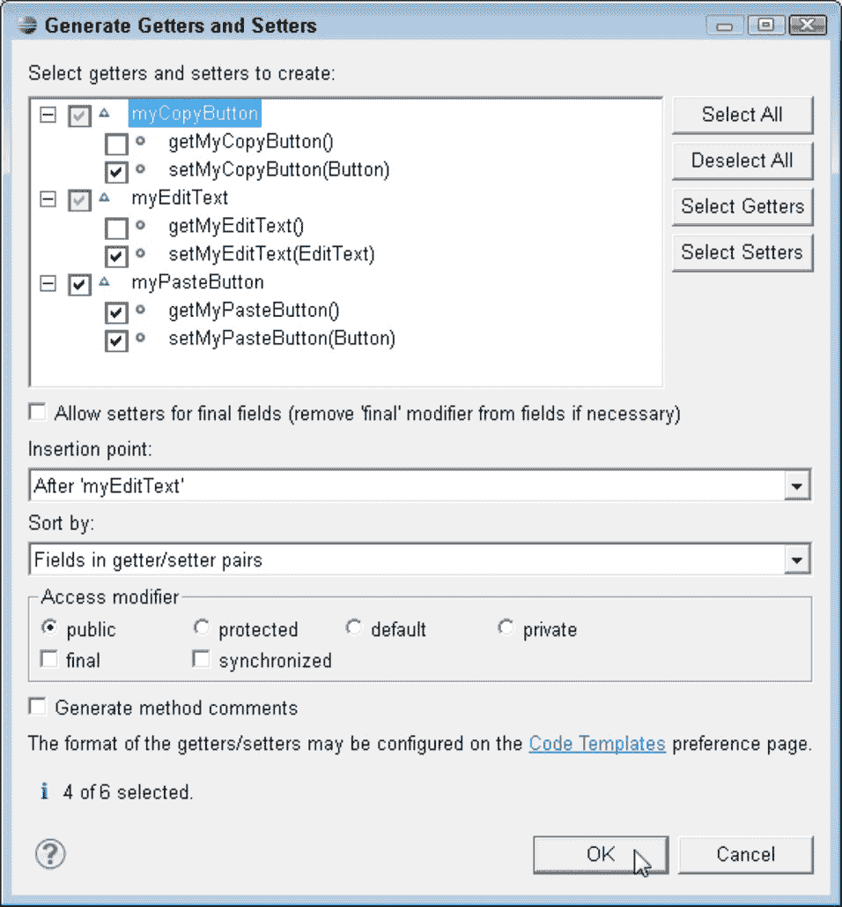

## 重命名内容

要更改 Java 程序中变量、方法或其他内容的名称，在编辑器中点击该名称，然后选择 `Refactor⇒Rename`。Eclipse 会等待你编辑现有名称。完成重命名后，按 Enter 键。（要取消重命名操作，请按 Esc。）

 当你点击编辑器中的一个名称时，不必点击该名称的定义处。你可以点击代码中出现该名称的任何地方。在你编辑名称后，Eclipse 会更改项目内该名称的所有出现处。

 Eclipse 足够智能，不会更改具有含义的相同名称。例如，如果一个 setter 方法包含语句 `this.myButton = myButton`，重命名 `this.myButton` 会更改你的类字段名。但重命名赋值右侧的 `myButton` 仅更改方法局部变量的名称。

## 创建 Android 字符串

你正在有力地输入 Java 代码（当然，这是在仔细规划和设计了代码之后），并且你输入了一个包含字符串字面量的语句：

```java
button.setText(“Click me!”);
```

然后你想起 Java 代码不应包含硬编码字符串。你应该将 `“Click me!”` 更改为类似 `R.string.click` 的内容，并向你的 `res/values/strings.xml` 文件添加字符串标签。然后，你的法语用户将从另一个不同的 `strings.xml` 文件获取数据——在该文件中，`R.string.click` 指向文本 `“Cliquez-moi!”`。

Eclipse 的 Android Development Tools 插件提供了一种快速简单的方法，将硬编码字符串字面量转换为外部化的 Android 字符串。在 Java 编辑器中选择字符串字面量的任何部分。然后，在 Eclipse 的主菜单中，选择 `Refactor⇒Android⇒Extract Android String`。在简短查看 `Extract Android String` 对话框中的选项后，你的字符串字面量就会转换为 `strings.xml` 中的一个元素。

## 使用其他重构操作

Eclipse 为你的 Java 代码提供了一系列重构操作。例如，通过几次菜单选择，你可以将几行代码转换为一个独立的方法。你可以从现有类创建一个接口。你甚至可以为旧式的原始集合类型声明添加泛型类型参数。（Eclipse 会对泛型参数类型进行合理的推断。）

要尝试 Eclipse 的重构功能，请从 Eclipse 的主菜单中选择 `Refactor` 并开始探索。

## 组织导入项操作

Eclipse 有一个很酷的 `Source⇒Organize Imports` 操作。当你进入 Eclipse 主菜单并选择 `Source⇒Organize Imports` 时，会发生很多好事：

- Eclipse 会移除任何你没有使用的导入声明。

如果你的代码开头是：

```java
import android.widget.EditText;
```

但你从未使用过 `EditText`，Eclipse 会删除 `EditText` 的导入声明。

- Eclipse 会添加任何缺失的导入声明。

如果你的代码包含：

```java
((EditText) findViewById(R.id.editText1))
```

但你没有为 `EditText` 添加导入声明，Eclipse 会在代码顶部添加：

```java
import android.widget.EditText;
```

我甚至见过 Eclipse 取消注释我之前注释掉的声明。

- Eclipse 会对代码的导入声明进行排序。

默认情况下，Eclipse 对声明进行排序，使得 `java` 包优先，然后是 `javax` 包，接着是 `org` 包，然后是 `android` 包，最后是 `com` 包。在每个类别中，Eclipse 按字母顺序对声明进行排序。（这样更容易查找。）

当然，你可以更改排序顺序。访问 `Window⇒Preferences` 对话框中的 `Java⇒Code Style⇒Organize Imports` 页面。在列表中向上移动名称，向下移动名称。

作为一种导入技术，拖放操作仅在 Windows 操作系统上有效。此外，这种技术像是一个粗线条的工具。它会导入你硬盘上某个特定目录下的所有内容。如果你只想从某个目录中导入几个文件，那么这种技术并不是你的最佳选择。

当然，如果你使用 Windows 并且喜欢拖放的直观感受，那么这种技术就适合你。只需从你开发电脑的文件管理器中将包含代码的文件夹，拖到 Eclipse 的 `Package Explorer`（包管理器）视图中相应的项目文件夹即可。

在上一段中，我通过指示你将文件夹拖到“相应的项目文件夹”来巧妙地掩盖了自己的笨拙。我承认吧，我经常忘记该把哪个文件夹拖到哪里。我通常会弄错一级（要么拖到了目标文件夹的父目录，要么拖到了子目录）。结果就是我的项目目录结构就不正确了，我在代码中看到了各种红色的错误标记。因此，我必须在 `Package Explorer` 中将项目从一个地方移动到另一个地方，或者删除导入的内容并重新开始拖放。我的大脑很难处理“拖放文件夹”这一特定概念。谁知道呢？也许你的大脑处理得更好。

### 使用导入向导

如果你不使用 Microsoft Windows，或者你想仔细挑选要导入的内容，就不能使用拖放操作。相反，你需要使用 `Import Wizard`（导入向导）。

如何使用 `Import Wizard` 取决于你想导入的内容类型。要导入一个 Eclipse 项目（可能来自旧的、当前未使用的 Eclipse 工作空间），请执行以下操作：

1. 在 Eclipse 的主菜单中，选择 `File⇒Import`。

   Eclipse 的 `Import Wizard`（魔法般地）出现了。

2. 在 `Import Wizard` 的 `General`（常规）分支下，点击 `Existing Projects into Workspace`（现有项目导入工作空间）子分支。（参见图 1-24。）

   **图 1-24：** 通知 Eclipse 导入现有项目。

   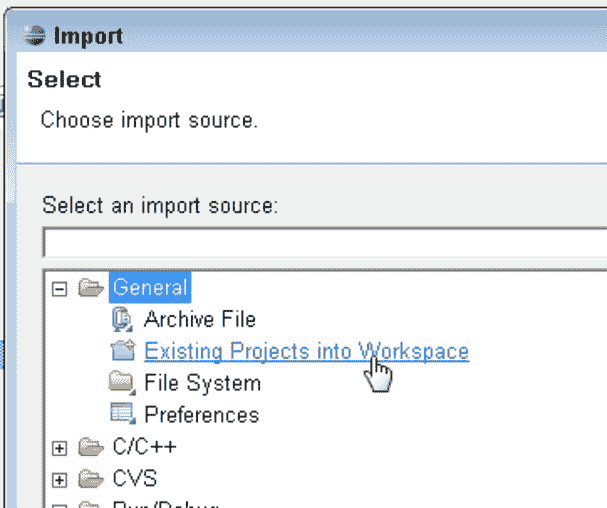

   点击 `Existing Projects into Workspace` 子分支后，另一个 `Import` 对话框（`Import Projects` 对话框）就会出现。

3. 在 `Import Projects` 对话框中，点击 `Select Root Directory`（选择根目录）单选按钮，并使用 `Browse`（浏览）按钮找到包含一个或多个 Eclipse 项目的文件夹（当前 Eclipse 工作空间之外的项目）。

   Eclipse 项目包含源代码和其他内容。这些“其他内容”包括 `.project` 和 `.classpath` 文件，你在 Eclipse 项目文件夹内部几乎注意不到这些文件。

    要被视为现有的 Eclipse 项目，文件夹必须包含一个名为 `.project` 的文件。

   在你浏览到一个文件夹后，Eclipse 会列出在该文件夹中找到的所有项目。（参见图 1-25。）

4. 在你想要 Eclipse 导入的每个项目旁边的选框中勾选。（再次参见图 1-25。）

5. 勾选 `Copy Projects into Workspace`（将项目复制到工作空间）选框。（或者不勾选！）

   如果你勾了这个选框，Eclipse 会在你的当前工作空间内创建一个项目的副本。你对该新副本进行的任何操作都不会影响你导入项目的原始文件夹。换句话说，你拥有了一个易于访问的项目备份副本。

   **图 1-25：** 选择一个或多个现有项目。

   

   如果你不勾选此选框，Eclipse 就不会创建项目的副本。相反，Eclipse 直接在原始包含这些项目的文件夹上操作。因此，你对项目文件进行的任何更改都会影响你导入项目的文件夹。换句话说，你没有易于访问的备份副本。

6. 在 `Import Projects` 对话框中，点击 `Finish`（完成）按钮。

好了！Eclipse 在 `Package Explorer` 的树中添加了一个新项目。

要将文件或文件夹导入你当前的 Eclipse 项目，请执行以下操作：

1. 在 Eclipse 的 `Package Explorer` 中，选择目标文件夹（将包含导入文件的文件夹）。

2. 在 Eclipse 的主菜单中，选择 `File⇒Import`。

   `Import Wizard` 出现了（参考图 1-24）。

3. 在 `Import Wizard` 中，点击 `Archive File`（归档文件）或 `File System`（文件系统）选项。

   一个 `Import` 对话框出现。

    你选择 `Archive File` 还是 `File System` 取决于你想导入的内容所在地。如果内容在压缩文件内（`.zip` 文件、`.tar.gz` 文件等），请点击 `Archive File`。如果你要导入的内容不在压缩文件中，请选择 `File System`。

4. 在 `Import` 对话框中，浏览到包含你想导入内容的文件夹或归档文件。

   浏览后，`Import` 对话框中的两个大面板将显示所选文件夹或归档文件内部的子文件夹和文件。（参见图 1-26。）

    有时你必须让 `Import` 对话框的两个大面板显示你的内容。点击，让 `Import` 对话框的两个大面板显示你想要导入的内容。

5. 在 `Import` 对话框中，勾选你想要 Eclipse 导入的每个项目旁边的选框。

   在 `Import` 对话框中，在 `Android` 选项卡（在这里，在 `Import` 对话框的主体中）中，勾选项目。

6. （可选）如果你想导入文件夹名称，勾选 `Create Folder Structure`（创建文件夹结构）。

7. 点击 `Finish`。

   `Import` 对话框消失。`Package Explorer` 树视图中包含了新条目。

**图 1-26：** `Import` 对话框。

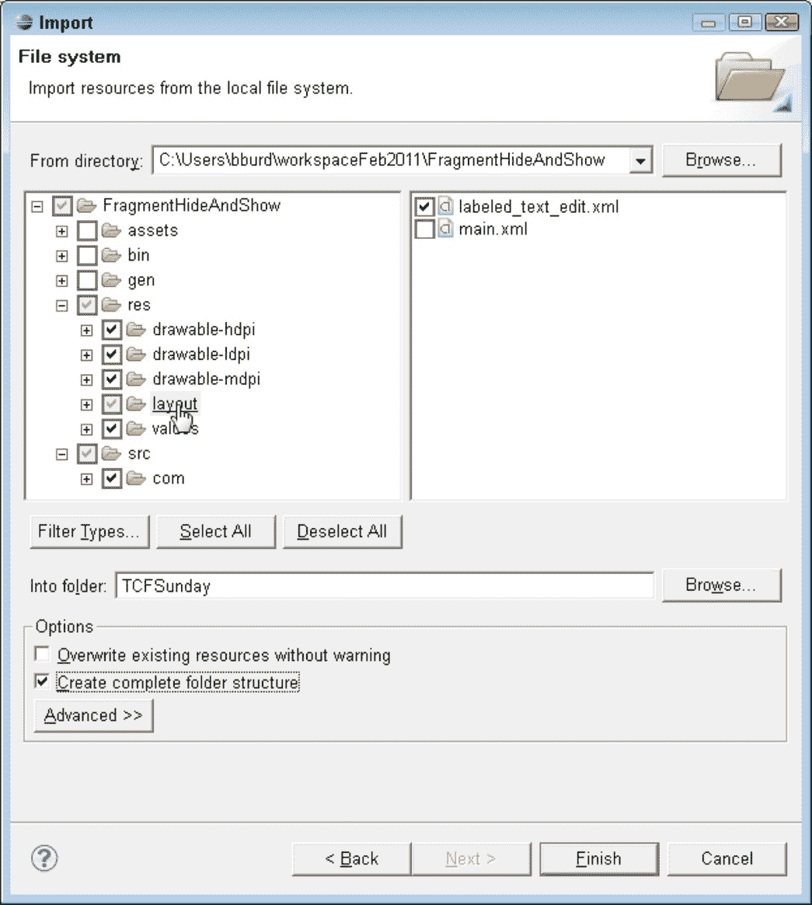

### 创建运行配置

运行配置是 Eclipse 用于运行应用程序的一套指南。运行配置存储了项目名称、目标平台（Gingerbread、Honeycomb 等）以及关于应用的许多其他信息。

每当你运行应用程序时，Eclipse 都会使用一个运行配置。如果你不创建运行配置，Eclipse 将使用默认配置。有时你希望在模拟器或设备上精细管理应用程序的运行方式。因此在此处你可以创建一个自定义运行配置。操作方法如下：

1. 在 `Package Explorer` 中右键点击 Android 项目（如果你是 Mac 用户，请 Control 点击）。

2. 在弹出的右键菜单中，选择 `Run As⇒Run Configurations`。

   大型 `Run Configurations` 对话框出现。

3. 点击窗口左角的 `New Launch Configuration`。（参见图 1-27。）

   **图 1-27：** `New Launch Configuration` 按钮。

   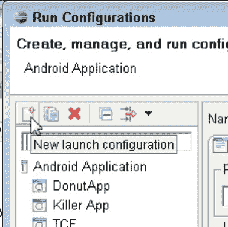

   `Run Configurations` 对话框左侧面板出现一个新的分支（标签类似于 `New_configuration`）。

4. 在 `Run Configurations` 对话框的主体中，在 `Name` 字段中为新配置输入一个具有描述性的名称。（参见图 1-28。）

   **图 1-28：** 为你的自定义配置添加信息。

   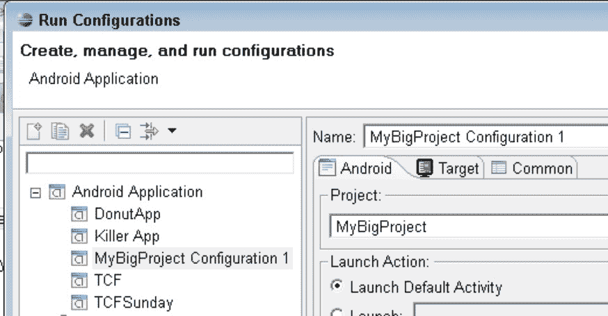

5. 在 `Android` 选项卡的 `Project` 字段中（再次，在 `Run Configurations` 对话框的主体中），输入该配置适用的项目名称。（再次参见图 1-28。）

6. 在 `Run Configurations` 对话框的主体中，点击 `Apply`。

7. 仍在 `Run Configurations` 对话框的主体中，点击 `Target` 选项卡。

   `Run Configurations` 对话框看起来类似于图 1-29。

8. 更改 `Target` 选项卡中的任何（或不更改）默认选项。

   在图 1-29 中，我指定了由哪一个模拟器来运行应用程序（名为 `GingerbreadWithSDImage` 的模拟器）。我还为模拟器的启动提供了 `-no-boot-anim` 选项。（`-no-boot-anim` 选项告诉模拟器不要浪费时间显示 Android 字样的闪烁动画。）

    了解更多模拟器选项，请访问 [`http://developer.android.com/guide/developing/tools/emulator.html`](http://developer.android.com/guide/developing/tools/emulator.html)。

9. 在“运行配置”（Run Configurations）对话框的主体中，点击 `Apply`（应用）。

10. 在对“运行配置”对话框完成所有所需的调整后，点击 `Run`（运行）或 `Close`（关闭）。

**图 1-29：** “运行配置”对话框的 Target（目标）选项卡。

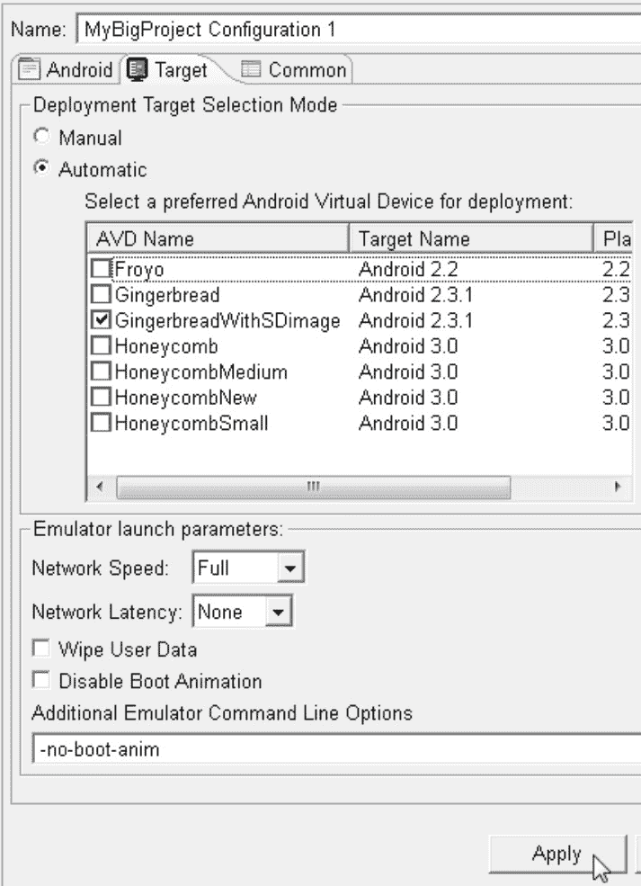

`Run` 和 `Close` 按钮出现在“运行配置”对话框的右下角。点击 `Run` 将使用新创建的配置启动你的项目。点击 `Close` 将保存新配置而不启动项目。

你自定义的运行配置将成为你在第 5 步中选择的任何项目的默认配置。因此，下次运行此项目时，你可以以简单的方式启动项目。要使用你的自定义配置启动，只需右键点击项目的 `Package Explorer`（包资源管理器）分支，并选择 `Run As⇒Android Application`（运行⇒Android 应用）。

### 向项目构建路径添加额外内容

在 Java 中，`.jar` 文件是类和其他内容的压缩集合。它是一组使用与 `.zip` 文件相同压缩方法压缩成单个文件的精良内容。`.jar` 文件包含了运行一个或多个应用程序时所需的类。例如，一个名为 `junit.jar` 的文件包含了运行 Java JUnit 测试的类。

根据你的心情，`.jar` 代表 Java ARchive（Java 归档），也可以代表装满 Java 咖啡豆的罐子（jar）。

 JUnit 是一个酷的软件测试工具。有关 JUnit 的更多信息，请访问 [`http://Junit.org/`](http://junit.org/)。

正如你可能已经猜到的，你可以将 `.jar` 文件添加到 Eclipse 项目中。这样，你就可以在项目代码中使用 `.jar` 文件的类了。操作方法如下：

1. 在 Eclipse 的 `Package Explorer` 中选择一个项目。

2. 在 Eclipse 的主菜单中，选择 `Project⇒Properties`（项目⇒属性）。

   Eclipse 显示项目的 `Properties`（属性）对话框。（大惊喜！）你可以在图 1-30 中看到一个 `Properties` 对话框。

   **图 1-30：** 项目的 `Properties`（属性）对话框。

   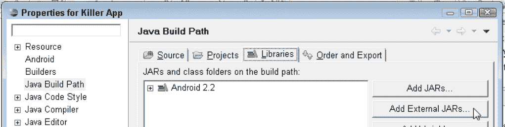

3. 在 `Properties` 对话框左侧的树结构中，点击 `Java Build Path`（Java 构建路径）。

   此树分支存储了 Eclipse 在编译你的项目代码时会检查的位置信息。`Java Build Path` 包含许多选项。在本节中，我将示例缩小到 Eclipse 可以检查的一个地方——一个 `.jar` 文件。

4. 在 `Properties` 对话框的主体中，点击 `Libraries`（库）选项卡。

   对话框的右侧会出现一些按钮。

5. 点击 `Add External JARs`（添加外部 JAR）按钮。

   当你点击此按钮时，Eclipse 会显示你操作系统的“打开文件”对话框。

6. 在“打开文件”对话框中，导航到你开发计算机上 `.jar` 文件的位置。


我无法告诉你去哪里找到你以后可能需要的所有`.jar`文件。但如果你是为了练习添加`.jar`文件而遵循这些指令，我有一个建议：在你的`JAVA_HOME`目录中查找`.jar`文件。在该目录的`lib`子目录下，你会发现很多不错的`.jar`文件。

 如需帮助查找开发计算机的`JAVA_HOME`目录，请参见第 VI 卷第 3 章。

7. 双击你选择的`.jar`文件。

瞧！“打开文件”对话框关闭了，现在你选择的`.jar`文件出现在了你的项目构建路径中。（为了得到图 1-31 的结果，我选择了一个名为`tools.jar`的文件。）

**图 1-31：** 增强后的 Java 构建路径。

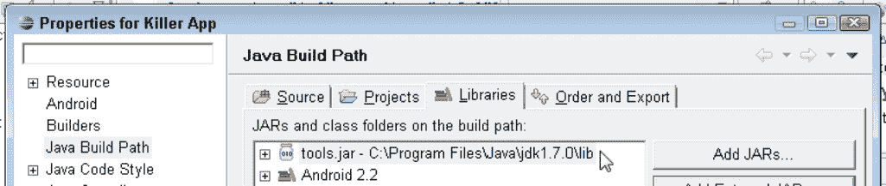

# 第 2 章：这是 Java！

## 本章内容

 计算机、手机和其他设备如何运行 Java 程序

 典型 Java 程序的部分

在成为一个 Android 哥之前，我是一个 Java 哥。Java 人是指痴迷于 Java 程序运行原理的人。我编写 Java 程序，阅读关于 Java 程序的内容，参加 Java 用户会议，穿着 Java T 恤。这就是为什么当我发现 Android 的应用程序编程语言是 Java 时感到非常兴奋。

在 20 世纪 90 年代初，Microsystems 的 James Gosling 创建了 Java。他使用了来自许多传统的思想，包括 C++。

## 从开发到执行 Java

Java 程序（例如 Android 应用程序）在你编写程序到处理器运行它之间会经过几个步骤。本节描述了这些层级。

### 什么是编译器？

在 Java 变得流行之前，程序几乎直接从开发者的键盘传输到处理器的电路。但 Java 增加了一个额外的层。人们可以理解列表 2-1 中的代码。

列表 2-1：Java 源代码

```java
public void checkVacancy(View view) {
    if (room.numGuests == 0) {
        label.setText("Available");
    } else {
        label.setText("Taken :(");
    }
}
```

列表 2-1 中的 Java 代码检查酒店的空房情况。如果不添加几行代码，你就无法运行列表 2-1 中的代码。但在游戏的这个阶段，那些额外的行并不重要。重要的是，通过盯着代码看、眯起眼睛并忽略代码中所有奇怪的标点符号，你可以看到代码正尝试做什么：

如果房间里没有客，

那么将`label`的文本设置为`"Available"`。

否则，

将`label`的文本设置为`"Taken :("`

列表 2-1 中的内容是 Java 源代码。

计算机、手机和其他设备中的处理器通常不遵循像列表 2-1 那样的指令。也就是说，处理器不遵循 Java 源代码指令。相反，处理器遵循像列表 2-2 中那样的加密指令。

列表 2-2：Java 字节码

```bytecode
0 aload_0
1 getfield #19 <com/allmycode/samples/MyActivity/room>
Lcom/allmycode/samples/Room;>
4 getfield #47 <com/allmycode/samples/Room/numGuests I>
7 ifne 22 (+15)
10 aload_0
11 getfield #41 <com/allmycode/samples/MyActivity/label>
Landroid/widget/TextView;>
14 ldc #54 <Available>
16 invokevirtual #56
<android/widget/TextView/setText(Ljava/lang/CharSequence;)V>
19 goto 31 (+12)
22 aload_0
```

```
23 getfield #41 <com/allmycode/samples/MyActivity/label
Landroid/widget/TextView;
26 ldc #60 <Taken :-(>
28 invokevirtual #56
<android/widget/TextView/setText(Ljava/lang/CharSequence;)V
31 return
```

列表 2-2 中的指令并不是 Java 源代码指令。它们是 Java 字节码指令。当你编写 Java 程序时，你编写的是源代码指令（如列表 2-1 中的指令）。写完源代码后，你会运行一个程序（即应用一个工具）来处理你的源代码。这个程序就是编译器。编译器将你的源代码指令翻译成 Java 字节码指令。换句话说，编译器获取你能够编写和理解的代码（例如列表 2-1 中的代码），并将你的代码翻译计算机可以执行的代码（例如列表 2-2 中的代码）。

 你可能将你的源代码放在一个名为`HotelActivity.java`的文件中。如果是这样，编译器可能会将 Java 字节码放在另一个名为`HotelActivity.class`的文件中。通常情况下，你不需要去查看`HotelActivity.class`文件中的字节码。事实上，编译器并没有将`HotelActivity.class`文件编码为普通文本，因此你无法用普通的编辑器查看字节码。如果你尝试用`Notepad`、`TextEdit`、`KWrite`甚至`Microsoft Word`打开`HotelActivity.class`，你看到的只有点、波浪线和其他乱码。为了创建列表 2-2，我不得不对我的`HotelActivity.class`文件再次应用了另一个工具。该工具可以显示 Java 字节码文件的类文本版本。我使用了由 Ando Saabas 开发的 Java 字节码编辑器（[`www.cs.ioc.ee/~ando/jbe`](http://www.cs.ioc.ee/~ando/jbe) ）。

 没有人（除了某些偏远实验室里的少数疯狂开发者之外）会去编写 Java 字节码。你是运行软件（编译器）来创建 Java 字节码的。查看列表 2-2 的唯一目的是为了理解计算机有多勤奋。

### Dalvik 字节码

如果说编译是一件好事，那么编译两次可能更好。2007 年，Google 的 Dan Bornstein 创建了 Dalvik 字节码 —— 另一种供处理器遵循的指令表示方式。（若想知道 Bornstein 的某些祖先来自哪里，请运行你最喜欢的地图应用，并在冰岛寻找 Dalvik。）Dalvik 字节码针对手机或平板设备上有限的资源进行了优化。列表 2-3 包含了一些示例 Dalvik 指令。

* 要查看列表 2-3 中的代码，我使用了`Dedexer`程序。参见 [`http://dedexer.sourceforge.net`](http://dedexer.sourceforge.net) 。

列表 2-3：Dalvik 字节码

```
.method public checkVacancy(Landroid/view/View;)V
.limit registers 4
; this: v2 (Lcom/allmycode/samples/MyActivity;)
; parameter[0] : v3 (Landroid/view/View;)
.line 30
    iget-object
    v0,v2,com/allmycode/samples/MyActivity.room
    Lcom/allmycode/samples/Room;
; v0 : Lcom/allmycode/samples/Room; , v2 :
Lcom/allmycode/samples/MyActivity;
iget v0,v0,com/allmycode/samples/Room.numGuests I
; v0 : single-length v0 : single-length
if-nez v0,l4b4
; v0 : single-length
.line 31
    iget-object
    v0,v2,com/allmycode/samples/MyActivity.label
    Landroid/widget/TextView;
; v0 : Landroid/widget/TextView; , v2 :
Lcom/allmycode/samples/MyActivity;
const-string v1,”Available”
; v1 : Ljava/lang/String;
invoke-virtual
    {v0,v1},android/widget/TextView/setText
; setText(Ljava/lang/CharSequence;)V
; v0 : Landroid/widget/TextView; , v1 : Ljava/lang/String;
l4b2:
.line 36
return-void
l4b4:
.line 33
    iget-object
    v0,v2,com/allmycode/samples/MyActivity.label
    Landroid/widget/TextView;
; v0 : Landroid/widget/TextView; , v2 :
Lcom/allmycode/samples/MyActivity;
const-string v1,”Taken :-(“
; v1 : Ljava/lang/String;
invoke-virtual
    {v0,v1},android/widget/TextView/setText
; setText(Ljava/lang/CharSequence;)V
; v0 : Landroid/widget/TextView; , v1 : Ljava/lang/String;
goto l4b2
.end method
```

 Java 字节码指令使用栈机器格式。相比之下，Dalvik 字节码指令使用寄存器机器格式。对于那些不太了解机器语言格式的人来说，结果是：典型的 Dalvik 指令比 Java 字节码指令更长、更复杂。尽管从你在列表 2-2 和 2-3 中看到的如此，但一个大的 Dalvik 指令通常会替换几个短小的 Java 字节码指令。

当你创建一个 Android 应用时，Eclipse 会执行两次编译。第一次编译从你的 Java 源文件创建 Java 字节码。（你的源代码文件名具有`.java`扩展名；Java 字节码文件名具有`.class`扩展。）第二次编译从你的 Java 字节码文件创建 Dalvik 字节码。（Dalvik 字节码文件名具有`.dex`扩展。）要执行第一次编译，Eclipse 使用一个名为`javac`的程序（即 Java 编译器）。执行第二次编译，Eclipse 使用一个名为`dx`的程序（被亲切地称为`dx`工具）。

### 什么是虚拟机？

在“什么是编译器？”章节中，我大费特力强调了手机和其他设备遵循如列表 2-3 那样的指令。就强调程度而言，这是一个非常棒的强调。但如果你没有读懂每一个纠结的词，你可能会被误导。确切的措辞是“……处理器遵循诸如列表 blah-blah-blah 中的加密指令。”列表 2-3 中的指令非常像手机或平板可以执行的指令，但通常情况下，计算机不执行 Java 字节码，手机不执行 Dalvik 字节码。相反，每种处理器都有自己的指令集，每种操作系统使用处理器指令的方式略有不同。

假设你有两个不同的设备——智能手机和平板电脑。设备具有两种不同的处理器。手机使用 ARM 处理器，平板使用 Intel Atom 处理器。（ARM 曾代表 Advanced RISC Machine。如今 ARM 仅代表一家设计处理器的公司。）在 ARM 处理器上，乘法指令是`000000`。在 Intel 处理器上，乘法指令是`D8`、`DC`、`F6`、`F7`等。许多 ARM 指令在 Atom 架构中没有对应项，许多 Atom 指令在 ARM 处理器上也没有等效项。ARM 指令对你的平板 Atom 处理器毫无意义，而 Atom 指令会让你的手机 ARM 处理器感到头疼。

那么开发者该怎么办？开发者需要为每个指令集提供每个应用的翻译吗？不需要。

虚拟机从这一切混乱中建立了秩序。Dalvik 字节码类似于列表 2-3 中的代码，但 Dalvik 字节码并不特定于某种处理器或某一个操作系统。相反，一组 Dalvik 字节码指令可以在任何处理器上运行。如果你编写了一个 Java 程序并将该 Java 程序编译成 Dalvik 字节码，你的 Android 手机、Android 平板甚至你祖母的超级计算机都可以运行该字节码。（为了做到，你祖母必须在她 Intel 机器上安装`Android-x86`，这是 Android 操作系统的特殊端口。）

 要查看某些 Dalvik 字节码，请返回列表 2-3。但请记住，你永远不需要编写或解码 Dalvik 字节码。编写字节码是编译器的工作。解码字节码是虚拟机的工作。

Java 字节码和 Dalvik 字节码都有自己的虚拟机。通过 Dalvik 虚拟机，你可以取为一个 Android 设备创建的字节码文件，将字节码复制到另一个 Android 设备上，然后毫无问题地运行该字节码。这就是 Android 迅速普及的众多原因之一。这种让你能够在许多不同类型的计算机上运行代码的卓越特性被称为“可移植性”。

想象一下，你是英特尔在联合国安理会的代表。（参见图 2-1。）ARM 的代表坐在你的右侧，德州仪器（Texas Instruments）的代表坐在你的左侧。（自然地，你和这两个人都都不相来。你们之间总是客客气气，但从不真诚。你还能期待什么呢？这是政治！）来自 Dalvik 的优秀代表正站在讲台上。Dalvik 代表使用 Dalvik 字节码进行演讲，你和你的大使同事们（ARM 和德州仪器）都听不懂一个单词的 Dalvik 字节码。

**图 2-1：** 一场想象中的联合国安理会会议。

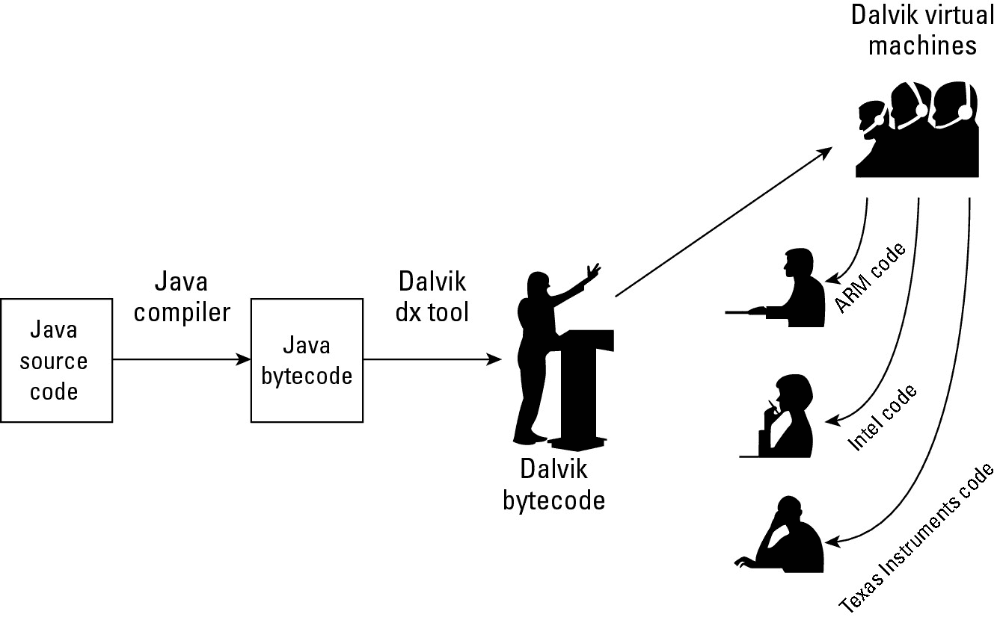

但你们每人都有一个翻译官。当 Dalvik 代表演讲时，你的翻译官会将 Dalvik 字节码翻译成英特尔指令。另一个翻译官会将字节码翻译成 ARM 语。而第三个翻译官则将字节码翻译成德州仪器语。

将你的翻译官想象成一个虚拟大使。翻译官并不真正代表你的国家，但它执行了真实大使执行的重要任务之一。翻译官代表你听 Dalvik 字节码。如果你的母语言是 Dalvik 字节码，翻译官会做你会做。翻译官假装成英特尔大使，听完无闷的字节码演讲，吸收每一个单词，并以某种方式处理每个单词。

你有一个翻译官——一个虚拟大使。同样，英特尔处理器也运行着它自己的字节码解释软件。该软件就是 Dalvik 虚拟机。

Dalvik 虚拟机是一个代理、一个跑差的、一个中间人。虚拟机在 Dalvik 的“随处运行”字节码与你设备自身的系统之间充当解释官的角色。在运行时，虚拟机引导你的设备执行字节码指令。虚拟机逐位地检查你的字节码，并执行字节码中描述的指令。虚拟机为你的 ARM 处理器、英特尔处理器、德州仪器芯片，或你正在使用的任何类型的处理器解释字节码。这是一件好事。这使得 Java 代码和 Dalvik 代码比用任何语言编写的代码更具可移植性。

## 掌握 Java 代码

当你创建一个新项目时，Android 的工具会创建一个简单、直接的 Java 类。我将该 Java 类复制在代码列表 2-4 中。

代码列表 2-4：一个极简的 Android Activity 类

```
package com.allmycode.samples;

import android.app.Activity;

import android.os.Bundle;

public class MyActivity extends Activity {
    /** 当 activity 首次创建时调用。 */
    @Override
    public void onCreate(Bundle savedInstanceState) {
        super.onCreate(savedInstanceState);
        setContentView(R.layout.main);
    }
}
```

本章涵盖了代码列表 2-4 中使用的 Java 语言特性。因此，在本章中，`android.app.Activity`（来自代码列表 2-4 的第二行）只是一个要导入的名称——仅此而已。要阅读关于该列表对 Android 的所有影响，请参阅第三卷第一章。

### Java 类

Java 是一种面向对象的编程语言。因此，作为开发者，你的首要目标是描述对象。你密切相关的目标是描述对象的近亲们——即类（classes）。

在 Java 中，除非发生在对象或类内部，否则任何事情都不会发生。代码列表 2-4 中的代码是一个类。我创建了这些代码，所以我为我的新类起了一个名字。我选择了`MyActivity`这个名字，因为代码列表 2-4 中的代码描述了 Android 设备上一个满屏幕的内容（在 Android 中，一个满屏幕的内容就是一个 activity）。因此，代码列表 2-4 中的代码包含了`public class MyActivity`这几个单词。


`public` 和 `class` 是 Java 关键字。这意味着无论谁编写 Java 程序，`class` 一词的含义始终是相同的。`public` 一词也是如此（尽管有些类没有被声明为 `public`）。

另一方面，代码列表 2-4 中的单词 `MyActivity` 是一个标识符。我在编写本章时构思了 `MyActivity` 这个单词。`MyActivity` 是一个特定类的名称——我通过编写此程序正在创建的类。

 Java 语言是区分大小写的（`cASe-sENSITiVE`）。如果你将一个单词中的一个小写字母改为大写字母，你就改变了该单词的含义。

如果你定义了一个名为 `DogAndPony` 的公共类，该类的 Java 代码必须放在一个名为 `DogAndPony.java` 的文件中，拼写和大小写必须完全一致。

如果你定义了一个名为 `DogAndPony` 的公共类，该类的 Java 代码必须放在一个名为 `DogAndPony.java` 的文件中，拼写和大小写必须完全一致。

如果你定义了一个名为 `DogAndPony` 的公共类，该类的 Java 代码必须放在一个名为 `DogAndPony.java` 的文件中，拼写和大小写必须完全一致。

如果你定义了一个名为 `DogAndPony` 的公共类，该类的 Java 代码必须放在一个名为 `DogAndPony.java` 的文件中，拼写和大小写必须完全一致。

如果你定义了一个名为 `DogAndPony` 的公共类，该类的 Java 代码必须放在一个名为 `DogAndPony.java` 的文件中，拼写和大小写必须完全一致。

如果你定义了一个名为 `DogAndPony` 的公共类，该类的 Java 代码必须放在一个名为 `DogAndPony.java` 的文件中，拼写和大小写必须完全一致。

### 类与对象

当你用 Java 编程时，你不断与类和对象打交道。这里有一个类比：椅子有座垫、靠背等等。

如果你定义了一个名为 `DogAndPony` 的公共类，该类的 Java 代码必须放在一个名为 `DogAndPony.java` 的文件中，拼写和大小写必须完全一致。

如果你定义了一个名为 `DogAndPony` 的公共类，该类的 Java 代码必须放在一个名为 `DogAndPony.java` 的文件中，拼写和大小写必须完全一致。

如果你定义了一个名为 `DogAndPony` 的公共类，该类的 Java 代码必须放在一个名为 `DogAndPony.java` 的文件中，拼写和大小写必须完全一致。

如果你定义了一个名为 `DogAndPony` 的公共类，该类的 Java 代码必须放在一个名为 `DogAndPony.java` 的文件中，拼写和大小写必须完全一致。

如果你定义了一个名为 `DogAndPony` 的公共类，该类的 Java 代码必须放在一个名为 `DogAndPony.java` 的文件中，拼写和大小写必须完全一致。

## 引言

根据表格的列标题，每个账户都有一个名称、一个地址和一个余额。用面向对象编程的术语来重新表述，`Account` 类中的每个对象（即 `Account` 类的每个实例）都有一个名称、一个地址和一个余额。因此，表格的最后一行是一个名为 `Jane Dough` 的对象。该相同对象拥有地址 800 Rich Street，余额为 247.38。如果你开了一个新账户，你就会拥有另一个对象，表格会多出一行。新对象将是同一个 `Account` 类的实例。

## Java 类型

“六（six）”意味着什么？你可以有六个孩子，你也可以有六英尺高。有六个孩子时，你确切知道自己有多少孩子（与美国平均家庭不同，你不能有 2.5 个孩子）。但如果你身高是 6 英尺，你实际上可能是 6 英尺半英寸高。或者你可能身高 5 英尺 11 分之三四英寸，没人会对此有异议。

一个值的含义取决于该值的类型。如果你在 Java 程序中写：

```java
int numberOfChildren = 6;
```

`6` 意味着“精确的六”。但如果你在 Java 程序中写：

```java
double height = 6;
```

`6` 意味着“在你关注的测量范围内尽可能接近六”。而且如果你在 Java 程序中写：

```java
char keystroke = '6';
```

`'6'` 意味着“排在数字 `5` 之后的数字”。

在 Java 程序中，每个值都有一个类型。Java 有八种基本类型（语言内置的类型），并且可以根据你的需要创建任意数量的引用类型。

表 2-2 列出了 Java 的八种基本类型。

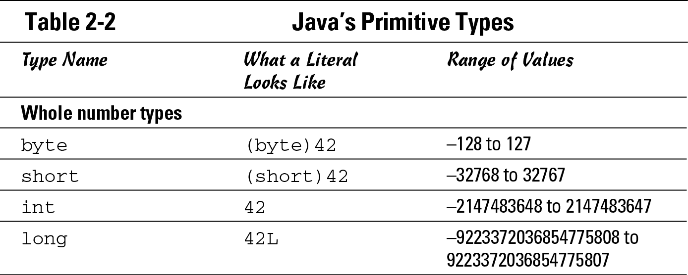

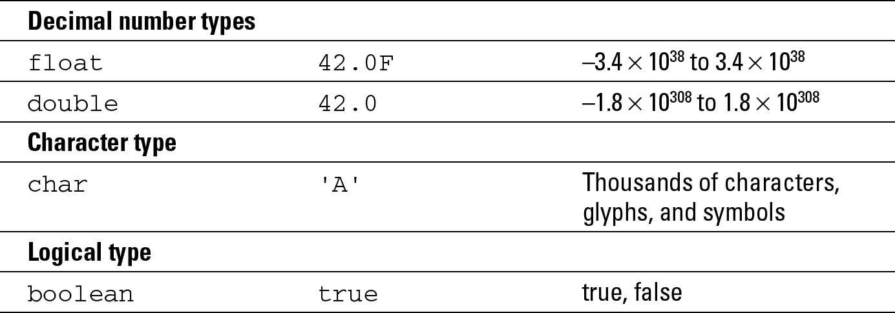

字面量（literal）是一个其值在不同 Java 程序之间不会改变的表达式。例如，表达式 `42` 在每个 Java 程序中都意味着“`int` 类型的值 42”。同样，表达式 `'B'` 在每个 Java 程序中都意味着“罗马字母表中的第二个大写字母”，而单词 `true` 在每个 Java 程序中都意味着“`false` 的反面”。

除了基本类型外，Java 还有引用类型。列表 2-4 中的代码包含了三个引用类型的名称。

- 引用类型 `android.app.Activity` 定义在 Android API（Android 庞大的现成声明库）中。

- 引用类型 `android.os.Bundle` 也定义在 Android API 中。

- 引用类型 `MyActivity` 定义在列表 2-4 中。

怎么样？每个类都是一种类型！

当你写 `int numberOfChildren = 6` 时，你声明了一个名为 `numberOfChildren` 的变量的存在。变量 `numberOfChildren` 的类型是 `int`，初始值为 `6`。

但在列表 2-4 中，`android.os.Bundle` 也是一种类型（引用类型）。事实上，`android.os.Bundle` 是一个作为 Android API 部分声明的类的名称。因此，就像你可以在 Java 程序中写 `int numberOfChildren` 一样，你也可以在列表 2-4 中写 `Bundle savedInstanceState`。（由于列表 2-4 顶部的 `import` 声明，你可以将 `android.os.Bundle` 简化为简单的名称 `Bundle`。）

因为每个类都是一种类型，而且你新声明的 `MyActivity` 类型是一个类，你可以将如下的行：

```java
MyActivity anActivity;
```

添加到列表 2-4 的代码中。这一行声明了名称 `anActivity` 是值的占位符（类型为 `MyActivity` 的值）。如果这个想法让你感到困惑，列表 2-5 提供了另一个示例。

### 列表 2-5：类是一种类型

```java
public class Account {
    String name;
    String address;
    double balance;
}

Account myAccount = new Account();
Account yourAccount = new Account();

myAccount.name
yourAccount.name
myAccount.balance = 24.02;
```

 列表 2-5 并不包含完整的 Java 程序。如果你尝试运行列表 2-5 中的代码（而不先向代码中添加其他内容），你会得到各种错误信息。

列表 2-5 声明了一个名为 `Account` 的类。这个账户的蓝图有三个字段。第一个字段——`name` 字段——引用 Java `String`（一排对齐的字符）。第二个字段——`address` 字段——引用另一个 Java `String`。第三个字段——`balance` 字段——存储一个 `double` 值。（参见表 2-2。）

类是“某种事物背后的思想”（我经常引用自己的这句话）。对象是“类的具体实例”。因此在列表 2-5 中，`myAccount` 指向一个实例，`yourAccount` 指向另一个。`myAccount.balance = 24.02;` 将 `24.02` 赋值给 `myAccount` 的 `balance` 字段。

方法（method）是执行某些操作并可能产生结果的代码块。在其他语言中，你可能熟悉函数（functions）或过程（procedures）。在 Java 中，这些东西被称为方法。

在列表 2-4 中，`onCreate` 的定义了一个方法的存在。

```java
public void onCreate(Bundle savedInstanceState) {
    super.onCreate(savedInstanceState);
    setContentView(R.layout.main);
}
```

方法的名称是 `onCreate`。真正的 Java 开发者方法名以小写字母开头。但如果你忽略了这一点，真正的开发者在阅读你的代码时会皱眉。

`onCreate` 方法体包含两条语句。第二条语句 `setContentView(R.layout.main)` 是对 `setContentView` 方法的调用。（`setContentView` 方法随每个 Android 实现提供，所以你不需要声明它。）

就像任何方法调用一样，`setContentView(R.layout.main)` 以方法名开始。方法名后面的括号里是参数列表（parameter list）。关于参数列表的深入理解，请考虑列表 2-6 中的代码。

### 列表 2-6：一个方法和两次方法调用

```java
double monthlyPayment(double principal, double percentageRate, int years) {
    int numPayments = 12 * years;
    double rate = percentageRate / 100.00;
    double effectiveRate = rate / 12;
    return principal * (effectiveRate /
      (1 - Math.pow(1 + effectiveRate, -numPayments)));
}

double myPayment = monthlyPayment(100000.00, 5.25, 30);
double yourPayment = monthlyPayment(100000.00, 5.00, 15);
```

- 在 `monthlyPayment` 方法声明的体内，处理器计算抵押贷款的每月还款额。

  你可以遵循这些方法和方法参数的描述，无需理解列表 2-6 中的任何计算逻辑。

- `monthlyPayment` 方法体内使用某些名称作为占位符。

  例如，在 `monthlyPayment` 方法体内，名称 `years` 代表抵押贷款期限的年数。同样，名称 `principal` 代表借贷总额。

- 某些占位符出现在方法声明开头的括号中。

  `principal`、`percentageRate` 和 `years` 名称是方法的参数。每个参数都注定代表一个特定的值。但在应用程序执行方法调用之前，参数并不代表某个值。

  在列表 2-6 中，调用 `monthlyPayment(100000.00, 5.25, 30)` 为方法的第一个参数（即 `principal`）赋予了值 `100000.00`。同一个调用为方法的第二个参数（`percentageRate`）赋予了值 `5.25`。最后，该方法调用为方法的第三个参数（`years`）赋予了值 `30`。

  列表 2-6 中的下一个方法调用为 `monthlyPayment` 方法的参数提供了不同的值（`principal` 再次为 `100000.00`，但 `percentageRate` 为 `5.00`，`years` 为 `15`）。你每次调用方法，都会为方法的参数提供值。

- 方法调用中的参数类型必须与方法声明中的参数类型匹配。

  列表 2-6 中 `monthlyPayment` 方法的声明有一个 `double` 参数（`principal`）、另一个 `double` 参数（`percentageRate`）以及一个 `int` 参数（`years`）。因此，列表 2-6 中的第一个方法调用有两个 `double` 参数（`100000.00` 和 `5.25`），随后是一个 `int` 参数（`30`）。列表 2-6 中的第二个方法调用同样有两个 `double` 参数，并在后跟一个 `int` 参数。

   你可以多次声明同一种方法，只要每个声明具有不同的参数列表即可。例如，列表 2-6 中的另一个方法声明可能有相同的名称 `monthlyPayment`，但只有两个参数：`double monthlyPayment(double principal, double percentageRate)`。要调用这个备用的 `monthlyPayment` 方法，你编写类似 `monthlyPayment(100000.00, 5.25)` 的代码。在这种情况下，备用 `monthlyPayment` 方法体内可能包含类似 `years = 30` 的语句。除非你知道抵押贷款期限是 30 年，否则不会调用这个双参数方法。

- 方法调用可能代表一个值。

  列表 2-6 中的第一个方法调用（位于列表倒数第二行）代表 `double` 值 `552.20`（或一个非常接近数字 `552.20` 的值）。值 `552.20` 来自于 `monthlyPayment` 方法体中所有计算，此时 `principal` 为 `100000.00`，`percentageRate` 为 `5.25`，且 `years` 数字为 `30`。在 `monthlyPayment` 方法体的末尾，公式

  ```java
  principal * (effectiveRate /
      (1 - Math.pow(1 + effectiveRate, -numPayments)))
  ```

  值为 `552.20`，而单词 `return` 表示“将 `552.20` 发送回调用此方法的语句”。因此，在列表 2-6 中，`monthlyPayment` 方法体的结尾实际上表示：

  ```java
  return 552.20;
  ```

  列表中的倒数第二行实际上表示：

  ```java
  double myPayment = 552.20;
  ```

  同样，列表 2-6 中的第二个方法调用（列表的最后一行）代表值 `790.79`。由于第二个方法调用的参数值，`monthlyPayment` 方法体的结尾实际上表示：

  ```java
  return 790.79;
  ```

  列表中的倒数第二行实际上表示：

  ```java
  double yourPayment = 790.79;
  ```

- 方法的声明（通常情况下）以返回类型的名称开始。

  在列表 2-6 中，`monthlyPayment` 方法声明以类型名称 `double` 开始。这是很好的，因为方法体结尾返回的值（`552.20` 或 `790.79`）是 `double` 类型。此外，名称 `myPayment` 和 `yourPayment` 存储的是 `double` 值，因此将调用 `monthlyPayment(100000.00, 5.25, 30)` 的值赋值给 `myPayment`，将调用 `monthlyPayment(100000.00, 5.00, 15)` 的值赋值给 `yourPayment` 是可以的。

- 方法调用并不一定代表一个值。

  在列表 2-1 中，第一行中的单词 `void` 表示 `check` 方法不代表值。

### 对象与构造函数

在此之前，我们向你介绍了 `Chair` 示例，以及如何定义一个 `Chair` 类，每个 `chair` 被称为该类的实例。

### 列表 2-7：什么是 Account？

```java
package all.samples;

public class Account {
    String name;
    String address;
    double balance;

    public Account(String name, String address, double balance) {
        name = name;
        address = address;
        balance = balance;
    }

    public String infoString() {
        return name + " (" + address + ") has " + balance;
    }
}
```


列表 2-7 是列表 2-5 代码的增强版本。在列表 2-7 中，`Account` 有一个 `name`、一个 `address`、一个 `balance` 以及一个 `infoString` 方法。变量 `name`、`address` 和 `balance` 是 `Account` 类的字段。此外，`infoString` 方法是 `Account` 类的成员。

根据列表 2-7，从 `Account` 创建的每个对象都有自己的 `name`、`address` 和 `balance`。因此，在列表 2-7 中，`Account` 构造函数表示：

- `name = name;`：当创建一个新对象（`Account` 类的实例）时，让 `this` 新对象的 `name` 等于传递给构造函数参数列表的 `name` 值。
- `address = address;`：当创建一个新对象（`Account` 类的实例）时，让 `this` 新对象的 `address` 等于传递给构造函数参数列表的 `address` 值。
- `balance = balance;`：当创建一个新对象（`Account` 类的实例）时，让 `this` 新对象的 `balance` 等于传递给构造函数参数列表的 `balance` 值。

**图 2-2：Account 实例如何获取其名称。**


列表 2-8 展示了你如何使用列表 2-7 中的代码。在列表 2-8 中，语句 `Account account1 = new Account("Burd", "222 Cyberspace Lane", 24.02)` 调用了来自列表 2-7 的构造函数。结果是，应用程序拥有了 `Account` 类的一个全新实例。变量 `account1` 指向该新对象。

### 列表 2-8：使用 Account 类

```java
package com.allmycode.samples;

import android.app.Activity;
import android.os.Bundle;
import android.widget.TextView;

public class MyActivity extends Activity {
    TextView textView1;
    @Override
    public void onCreate(Bundle savedInstanceState) {
        super.onCreate(savedInstanceState);
        setContentView(R.layout.main);
        Account account1 = new Account(
                "Burd", "222 Cyberspace Lane", 24.02);
        textView1 =
            ((TextView) findViewById(R.id.textView1));
        textView1.setText(account1.infoString());
    }
}
```

在列表 2-8 的后续部分，文本 `account1.infoString()` 调用了新对象 `account1` 的 `infoString` 方法。该方法返回一个美观的字符字符串， Activity 会在屏幕上显示它。

 要引用属于某个对象的成员，请使用点表示法。例如，要调用 `account1` 对象的 `infoString` 方法，请编写 `account1.infoString()`。要引用 `account1` 对象的余额，请编写 `account1.balance`。方法调用需要括号，而字段名不需要括号。

当你运行列表 2-8 中的代码时，你将得到图 2-3 所示的屏幕。

**图 2-3：** 列表 2-7 和 2-8 中应用程序的运行情况。

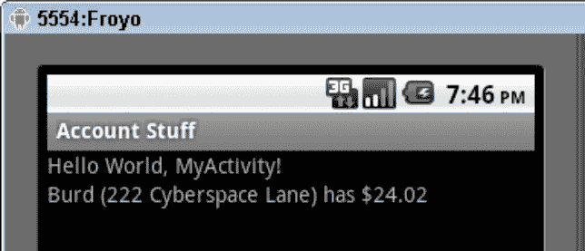

### 类在树上生长

列表 2-4 包含了 `extends Activity` 单词。显然，在列表 2-4 中声明的新类 `MyActivity` 是某种名为 `Activity` 的东西的扩展。那么，这到底是怎么回事？

你可以下载 Android 源代码（构成 Android 许多预定义类的 Java 代码）。当你下载时，可以使用你喜喜欢的编辑器打开 `Activity.java` 文件。列表 2-9 包含了该文件中部分（诚然不具代表性的）代码。

 有关关于下载 Android 源代码的更多信息，请访问 [`http://source.android.com/source/downloading.html`](http://source.android.com/source/downloading.html)。

### 列表 2-9：极度精简版的 Android Activity 类

```java
package android.app;

public class Activity extends ContextThemeWrapper {
    protected void onCreate(Bundle savedInstanceState) {
        mVisibleFromClient =
            !mWindow.getWindowStyle().getBoolean(
              com.android.internal.R.styleable.
              Window_windowNoDisplay, false);
        mCalled = true;
    }
    protected void onDestroy() {
        mCalled = true;
        // 释放任何我们正在管理的对话框。
        if (mManagedDialogs != null) {
            final int numDialogs = mManagedDialogs.size();
            for (int i = 0; i < numDialogs; i++) {
                final ManagedDialog md =
                    mManagedDialogs.valueAt(i);
                if (md.mDialog.isShowing()) {
                    md.mDialog.dismiss();
                }
            }
            mManagedDialogs = null;
        }
        // 关闭任何打开的对话框
        if (mSearchManager != null) {
            mSearchManager.stopSearch();
        }
    }
}
```

Android SDK 自带一个 `Activity` 类，`Activity` 类包含了名为 `onCreate` 和 `onDestroy` 的方法。（实际上，Android 的 `Activity` 类包含至少 140 个方法。但谁会在意个数呢？）列表 2-4 中，`MyActivity extends Activity` 单词在 `MyActivity` 类和 Android 的 `Activity` 类之间建立了关系。除其他外，`MyActivity` 类继承了属于 `Activity` 类的字段和方法。因此，无需向列表 2-4 中添加任何代码，你就可以放心 `MyActivity` 拥有一个 `onDestroy` 方法。这就像是你从列表 2-9 中复制了 `onDestroy` 方法并将其粘贴到列表 2-4 中。

除了 `extends` 术语外，Java 对 `MyActivity` 类和 `Activity` 类之间的关系有几种名称：

- `MyActivity` 类是 `Activity` 类的子类。
- `MyActivity` 类是 `Activity` 类的子节点。
- `Activity` 类是 `MyActivity` 类的超类。
- `Activity` 类是 `MyActivity` 类的父类。

如果这一切父子关系让你想起了家族树，那么你并不孤单。Java 开发者经常画倒立的树。例如，在列表 2-4 中，`extends Activity` 单词表示 `MyActivity` 类是 `Activity` 类的扩展。

```java
package com.allmycode.somepackage;

public class SomeClass {

}
```

在另一个文件中，你拥有：

```java
package com.allmycode.someotherpackage;
import com.allmycode.somepackage.*;

//你可以可以继承 SomeClass:
class SomeOtherClass extends SomeClass {
    public String infoString() {
        // 这样也行：
        SomeClass someObject = new SomeClass();
    }
}
```

如果一个类不是公共的（public），你只能在类包内的代码中引用该类。下面的代码清楚地说明了这一点。

在一个文件中，你拥有：

```java
package com.burdbrain.somepackage;
class SomeClass {
}
```

在另一个文件中，你拥有：

```java
package com.burdbrain.someotherpackage;
import com.burdbrain.somepackage.*;

//你不能继承 SomeClass:
class SomeOtherClass extends SomeClass {
    public String infoString() {
        // 这样也不行：
        SomeClass someObject = new SomeClass();
    }
}
```

### 其他公共内容

名称的作用范围（scope）是指你（开发者）可以使用该名称的代码范围。因此，总结一下前一节冗长的解释：

- 公共类名称的作用范围包括所有的 Java 代码。
- 非公共类名称的作用范围限制在声明该类的包（package）中。

 公共类的名称并不真正包含所有的 Java 代码。如果我在我月球基地的计算机上运行一个 Java 程序，而你正在环绕火星轨道度假时在手机上运行程序，那么你的手机无法访问我代码中的公共类。要让代码访问我的公共类，该代码必须运行在同一个 Java 虚拟机上。

类的成员（类的方法和字段）也可以是公有的。例如，列表 2-7 中的类具有公共字段 `name`、`address` 和 `balance`，并拥有公共方法 `infoString`。事实上，关于类成员的说明要复杂一些。`public` 关键字是一个访问修饰符，类的成员可以是 `public`、`private` 或 `protected`，也可以没有访问修饰符。（例如，列表 2-8 中的 `textView1` 字段没有访问修饰符。列表 2-9 中的 `onCreate` 和 `onDestroy` 方法具有 `protected` 访问权限。）你的访问修饰符选择分类如下：

- `public` 成员的作用范围包括所有的 Java 代码。
- `private` 成员的作用范围包括声明该成员的类。
- `protected` 成员的作用范围包括声明该成员的类。该范围还包括声明该成员的类的任何子类，以及属于该成员所在包的所有类。
- 无访问修饰符的成员的作用范围包括声明该成员的类。该范围还包括声明该成员所在包的所有类。

我不知道你们怎么想，但我很难理解 `protected` 访问的含义。困难点之一在于，与我的直觉相反，使用 `protected` 词的限制比完全不使用访问修饰符要小。总之，当我遇到具有 `protected` 访问权限的成员时，我会停下来思考足够久，直到我的恶心感消失。

### 反叛父母

在家庭中，孩子们经常会反叛父母的价值观。Java 也是如此。`MyActivity` 类（在列表 2-4）是 `Activity` 类（在列表 2-9）的子类。因此，一看，`MyActivity` 应该继承 `Activity` 类代码中声明的 `onCreate` 方法。

但 `Activity` 和 `MyActivity` 类都有 `onCreate` 方法声明。而且这两个 `onCreate` 声明具有相同的参数列表。通过这种方式，`MyActivity` 类反叛了它的父母。`MyActivity` 类对 `Activity` 类说：“我不想要你那臭的 `onCreate` 方法。我要声明我自己的 `onCreate` 方法。”

所以当你启动一个应用时，你的手机创建一个 `MyActivity` 对象，手机执行的是 `MyActivity` 版本的 `onCreate`，而不是父类 `Activity` 版本的 `onCreate`。

 像所有反叛的孩子一样，`MyActivity` 不能完全脱离其父类的代码。`MyActivity` 类中 `onCreate` 方法的第一条语句是对 `super.onCreate` 的调用。（我的孩子通常不叫我 `super`，但类是这样指代它的父类的。）总之，语句 `super.onCreate` 调用了父类的 `onCreate` 方法。所以，在 `onCreate` 方法之前……

### Java 注解

列表 2-4 中的 `@Override` 单词是一个注解（annotation）。注解告诉 Java 有关你代码的一些信息。如果你不小心写错了方法名，Android 会显示错误。

```java
@Override
public void onCreate(Bundle initState)
```

### Java 注释

注释是程序的一部分。但与声明、方法调用和其他内容不同，注释的目的是帮助人们理解你的代码。Java 编程语言有三种注释：

- 块注释：块注释以 `/*` 开始，以 `*/` 结束。起始 `/*` 和结束 `*/` 之间的所有内容都只给人类看。
- 行尾注释：行尾注释以双斜杠 `//` 开始，一直到该行的结束。
- Javadoc 注释：Javadoc 注释以斜杠和两个星号 `/**` 开始。

Javadoc 注释是为了给那些从不看 Java 代码的人读的。名为 `javadoc` 的特定程序可以找到 Javadoc 注释并将其转换为漂亮的网页。

```java
/**
 * 在活动首次创建时被调用。
 */
```

### 生成 Javadoc

要生成像图 2-5 那样的网页，请执行以下操作：

1. 在 Eclipse 的主菜单中，选择 `Project ⇒> Generate Javadoc`。
2. 在对话框的 Javadoc Command 字段中，输入开发计算机上 `javadoc`（或 `javadoc.exe`）文件的路径。

或者，你可以使用对话框的 `Configure` 按钮导航到 `javadoc` 或 `javadoc.exe` 文件。

3. 在 Select Types 格中，勾选你想文档的项目。

选择类型（Select Types）面板实际上是两个并排的窗格。（参见图 2-6。）左侧面板用于选择整个项目或整个包；右侧面板用于选择或取消选择包内的 `.java` 文件。

4. 在 `Destination` 字段中，输入将包含你的 Javadoc 页面的文件夹名称（或点击 `Browse` 按钮让鼠标完成操作）。
5. 点击 `Finish`。

**图 2-6：** Eclipse 生成 Javadoc 的对话框。


在 Generate Javadoc 对话框中，你可以选择 `Use Custom Doclet`（使用自定义 doclet）而不是 `Use Standard Doclet`（使用标准 doclet）。doclet 决定 Java 文档页的外观。因此，选择 `Use Custom Doclet` 可以让你更改文档页面的外观。例如，使用名为 `DroidDoc` 的 doclet，你可以获得与 [`http://developer.android.com/reference/packages.html`](http://developer.android.com/reference/packages.html%20)（Android 官方文档网站）类似的页面。

# 第 3 章：Java 能做什么（以及何时做）

## 本章

 使用 Java 语句进行决策

 使用 Java 语句重复操作

 添加异常处理


人类思维围绕名词和动词展开。名词是“实体”，动词是实体的动作。名词是零件，动词是胶水。名词负责存在，动词负责执行。当你使用名词时，你说“书”、“房间”或“东西”。当你使用动词时，你说“做这个”、“做那个”、“吊起那艘船”或“举起那捆草”。

Java 也有名词和动词。Java 的名词包括 `String`、`ArrayList` 和 `JFrame`，以及 Android 特有的内容如 `Activity`、`Application` 和 `Bundle`。Java 的动词涉及赋值、在备选方案中选择、重复操作和其他行动方案。

本章涵盖了 Java 的一些动词。在本书的第 4 章中，你将引入名词。

## 做出决策（Java `if` 语句）

当你编写计算机程序时，你不断地遇到十字路口。用户正确输入密码了吗？如果是，就让用户操作；如果不是，就把他踢出去。因此，Java 编程语言需要一种方法让程序在两个方向之一分支。幸运的是，这种语言有一种方法：它被称为 `if` 语句。`if` 语句的使用如列表 3-1 所示。

**代码列表 3-1：带有 `if` 语句的方法**

```java
public void onClick(View v) {
  if (((CheckBox) v).isChecked()) {
             textview.setTextColor(Color.GREEN);
             textview.setText("Thank you!");
  } else {
             textview.setTextColor(Color.RED);
             textview.setText("No harm done.");
  }
}
```

当用户点击特定的复选框时，Android 会调用列表 3-1 中的 `onClick` 方法。（Android 使用参数 `v` 将此复选框传递给 `onClick` 方法。这就是 `onClick` 方法如何发现用户点击了哪个对象的方法。）如果点击在复选框中打上标记，文本视图将用绿色字体显示 `Thank you!`。否则，文本视图将用红色字体显示 `No harm done.`。（参见无色的图 3-1。）

**图 3-1：** 列表 3-1 中的勾选与取消勾选。

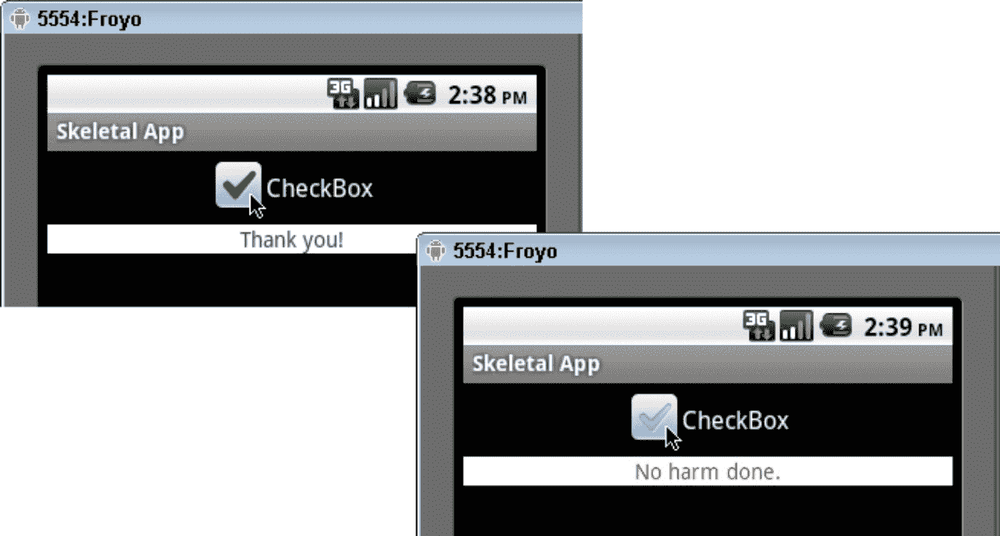

### 核心继承

在列表 3-1 中，变量 `v` 代表某种 `View`（`onClick` 方法的参数列表是这么说的）。和所有的 Java 类一样，`View` 类是类家族树的一部分。下图显示了 `View` 类的一些最亲近的亲属。在树中越得越深，类的特征就越具体。例如，在树的顶部，你有一个被称为 `Object` 的非常模糊的东西。在 `Object` 之下是 `View` 类。`View` 是你放在用户屏幕上的东西（用户看到的东西）。并不是所有的 `View` 实例都显示文本，因此在层次结构中 `View` 之下是更具体的 `ImageView` 和 `TextView` 类。

`CheckBox` 类位于图的最底部。`CheckBox` 是特定类型的 `TextView` —— 一直处于两种状态之一（已勾选或未勾选）的 `TextView`。

与此同时，回到列表 3-1，`onClick` 方法的参数 `v` 是任何种类的 `View`。这种不特定的“任何种 `View`”之所以是因为你永远不知道用户会点击哪种 `View`。Android 预先定义的 `onClick` 方法……

```java
textview.setText("Thank you!");
}
```

### 原始类型与引用类型

`int` 类型是一个原始类型。当你声明一个变量为 `int` 类型时，你可以以一种非常直观的方式视觉化该声明的含义。这意味着在计算机内存的某个地方，为该变量的值预留了一个存储位置。在这个存储位置中有一组位（bits）。这些位的排列确保了某个整数被表示出来。

这种解释对于 `int` 或 `double` 这样的原始类型是足够的，但每个 Java 类都是引用类型。如果你声明一个变量的类型不是原始类型，那么该变量的类型（大多数情况下）就是某个 Java 类的名称。

声明一个变量为引用类型意味着什么？声明 `response` 的类型为 `String` 或声明 `v` 的类型为 `View` 意味着什么？

因为 `String` 是一个类，你可以从该类中创建对象。每个这样的对象（每个 `String` 类的实例）都是字符序列。通过将变量 `response` 的类型声明为 `String`，你预留了对 `response` 这个名称的使用。这个预留告诉 Java，`response` 可以引用一个真正的 `String` 类型对象。换句话说，`response` 可以成为一个字符序列的昵号。下图说明了这种情况，图中描述了原始类型和引用类型的存储故事。

如果你熟悉其他编程语言并喜欢讨论指针，你可以安全地认为 `String response` 是一个声明，其含义是“`response` 存储指向字符序列的指针”。

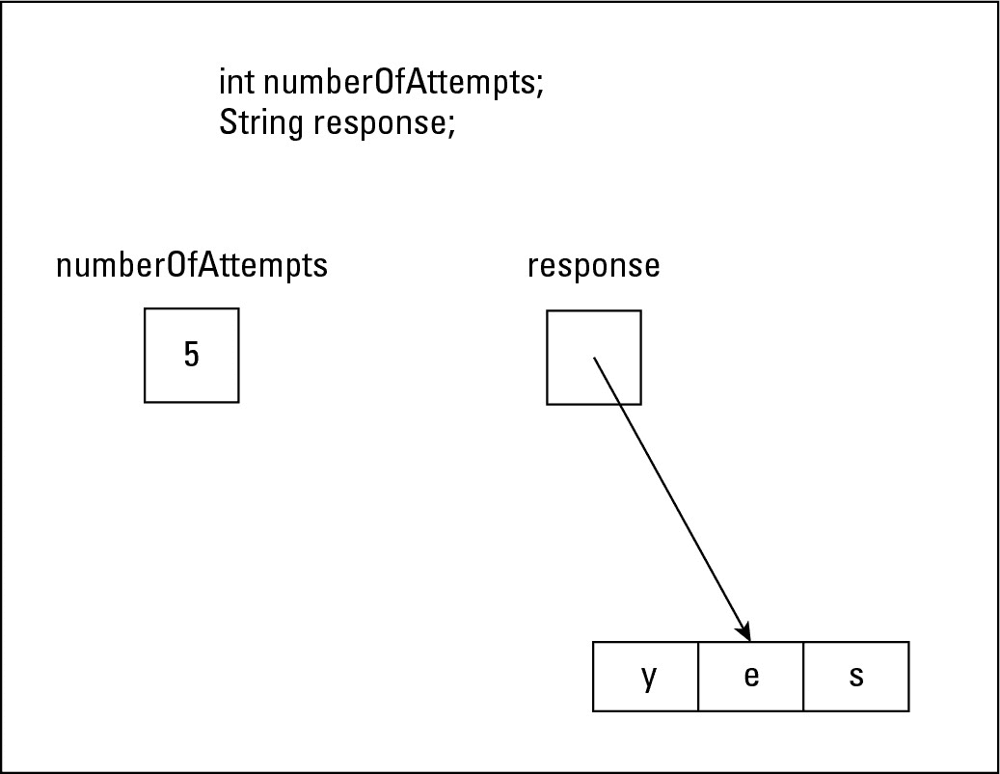

### 测试相等性

Java 有几种方法来测试相等性（“这个值和那个值相同吗？”）。这些方法都不是你首先想到的。特别是，为了找出参数 `v` 是否是你所调用的 `checkbox1` 那个东西，你不会写 `if (v = checkbox1)`。相反，你使用双等号（`==`）。你写 `if (v == checkbox1)`。在 Java 中，单等号（`=`）被留用于赋值。因此 `n = 5` 意味着“让 `n` 代表值 `5`”，而 `v = checkbox1` 意味着“让 `v` 代表 `checkbox1` 对象”。

比较两个字符串是另一回事。当你比较两个字符串时，你并不想使用双等号。使用双等号会询问：“这个字符串在内存中的存储位置是否与另一个字符串完全相同？”这通常不是你想要问的。相反，你通常是想问：“这个字符串包含的字符是否和另一个字符串相同？”为了问第二个问题（即更恰当的问题），Java 的 `String` 类型有一个名为 `equals` 的方法：

```java
if (response.equals("yes")) {
```

`equals` 方法比较两个字符串以查看它们包含的字符是否相同。在本段的微型示例中，变量 `response` 是一个字符串，而文本“yes”是一个字符串。如果 `response` 指向一个字母为“y”、然后是“e”、最后是“s”的字符串，则条件 `response.equals("yes")` 为真。


与大多数编程语言一样，Java 拥有一套比较运算符（如表示“小于”的 `<`）和逻辑运算符（如表示“和”的 `&&`）。有关此类运算符的列表，请访问 [`http://download.oracle.com/javase/tutorial/java/nutsandbolts/opsummary.html`](http://download.oracle.com/javase/tutorial/java/nutsandbolts/opsummary.html)。

### 在许多替代方案中进行选择（Java `switch` 语句）

我是第一个承认自己讨厌做决定的人。如果事情出了错，我宁愿问题是别人的责任。写完之前的章节（关于使用 Java 的 `if` 语句做决策）让我精疲力尽。这就是为什么当我开始这个关于在许多替代方案中进行选择的章节时，我的大脑一片空白。

考虑列表 3-2 中的代码。

**列表 3-2：Java `switch` 语句**

```java
public void onClick(View v) {
    String message;
    Editable edit = textfield.getText();
    if (edit.length() != 0) {
        int number =
                Integer.valueOf(edit.toString());
        switch (number) {
        case 0:
            message = "none";
            break;
        case 1:
            message = "one";
            break;
        case 2:
            message = "two";
            break;
        case 3:
            message = "three";
            break;
        default:
            message = "many";
        }
    }
    label.setText(message);
}
```

列表 3-2 中的代码是一个应用程序的一部分，该应用程序的屏幕如图 3-2 所示。

**图 3-2：** 一个 `TextView` 对象报告 `EditText` 的内容。


在列表 3-2 中，`switch` 语句检查 `number` 字段。如果 `number` 是 0，代码让 `message` 变为“none”；如果 `number` 是 1，代码让 `message` 变为“one”；如果 `number` 不是 0、1、2 或 3，则 `switch` 语句的 `default` 部分接管，代码让 `message` 变为“many”。

为了确保文本字段是数字，我们在布局中包含了以下元素：

```xml
<EditText android:id="@+id/editText1"
    android:layout_width="match_parent"
    android:layout_height="wrap_content"
    android:inputType="number"/>
```

在 3-2 中，`switch` 语句包含某些内容。如果你写：

```java
case 2:
    message = "two";
case 3:
    message = "three";
default:
    message = "many";
}
```

并且 `number` 是 2，Java 会按顺序执行三个情况，即执行 `message = "two"`，接着执行 `message = "three"`，紧接着执行 `message = "many"`。缺少 `break` 语句告诉 Java 从一个情况掉到下一个。最终结果是 `message` 为“many”，这可能不是你想要的。

`switch` 语句具有以下形式：

```java
switch (expression) {
case constant1:
    当表达式等于 constant1 时执行的语句
case constant2:
    当表达式等于 constant2 时执行的语句
case ...
default:
    当表达式的值与任何常量不同时执行的语句
}
```

你不能将任何旧表达式放在 `switch` 语句中。在 `switch` 语句开头测试的表达式必须是：

- `char`、`byte`、`short` 或 `int` 原始类型之一
- `Character`、`Byte`、`Short` 或 `Integer` 引用类型之一
- `enum` 类型

`enum` 类型是一种值限于你声明的几个值的类型。例如，以下代码：

```java
enum TrafficSignal {GREEN, YELLOW, RED};
```

定义了一个值仅为 `GREEN`、`YELLOW` 和 `RED` 的类型。在代码的其他地方，你可以写：

```java
TrafficSignal signal;
signal = TrafficSignal.GREEN;
```

来使用 `TrafficSignal` 类型。

从 Java 7 开始，你可以在 `switch` 语句的开头放入 `String` 类型表达式。但在 Java 7 彻底稳定之前，你可能希望在 Android 代码中避免使用此功能。

### 重复执行指令

1966 年，海飞碧（Head & Shoulders）洗发水的公司创造了历史。在瓶子背面，洗发水的使用说明写着：“揉泡沫，冲洗，重复。”以前从未有一套完整的指令（用于任何事情，更不用说洗头了）被如此简洁地概括。指令编写行业的人将其誉为一项里程碑式的成就。这样的指令与当时的其他指令形成了鲜明对比。（例如，一罐杀虫剂上的第一句写着：“转动罐子，让它对开你的脸。”废话！）

除了简洁之外，海飞碧指令如此酷炫的地方在于，通过三个简单的单词，它们成功地捕捉到了所有指令传达的核心概念——**重复**的概念。最后那个单词 `repeat`（重复），将原本平淡乏味的指令单调循环变成了一个精密的行动配方。

基本思想是，当你遵循指令时，你不仅仅是一个接一个地执行指令。相反，你在道路路口交替换行。你做出决策（`如果头发是干的，则使用护发素`），并进入循环（`揉泡沫-冲洗，然后再次揉泡沫-冲洗`）。在应用开发中，你一直在使用决策和循环。

## Java `while` 语句

在 Android 应用中，内容提供者（content provider）向你的代码提供一个游标（cursor）。你可以将游标认为指向表格中某行的指针。在列表 3-3 中，每行表都有三个条目——`_id`、`name` 和 `amount`。据假设，`_id` 唯一标识一行，`name` 是人的名字，而 `amount` 是该人欠你的巨额款项。


有关了解内容提供者的详情，请参阅第三卷第五章。

### 列表 3-3：一个 `while` 循环

```java
cursor.moveToFirst();
while (!cursor.isAfterLast()) {
    String _id = cursor.getString(0);
    String name = cursor.getString(1);
    String amount = cursor.getString(2);
    textViewDisplay.append(_id + " " +
                           name + " " + amount + "\n");
    cursor.moveToNext();
}
```

游标的 `moveToFirst` 方法使游标指向表格的第一行。无论游标当前指向哪一行，游标的 `moveToNext` 方法都会让游标指向表格的下一行。游标的 `isAfterLast` 方法在尝试移动到下一行但发现没有下一行时，返回 `true`。

在 Java 中，感叹号（`!`）表示“非”，所以 `while (!cursor.isAfterLast())` 的意思是“当游标没有超出表格最后一行时，持续执行……”。因此，列表 3-3 中的代码重复地执行以下操作：

只要游标没有超出最后一行：

- 获取行起始列中的字符串并
- 让 `_id` 指向该字符串；
- 获取行中间列中的字符串并
- 让 `name` 指向该字符串；
- 获取行最后一列中的字符串并
- 让 `amount` 指向该字符串，并且
- 将这些字符串添加到 `textViewDisplay` 中，然后
- 将游标移动到下一行，为返回 `while` 语句的顶部做准备。


假设某个特定游标的表格有 `100` 行。那么处理器就会执行列表 `3-3` 中 `while` 循环内部的语句 `100` 次。使用官方开发者术语，处理器完成了 `100` 次循环迭代。

`while` 语句具有以下形式：

```
while (condition) {
    要执行的语句
}
```

当循环只有一个要执行的语句时，你可以省略大括号。

 在列表 `3-3` 中，字符 `\n` 构成了一个转义序列。当你把 `\n` 放在字符串内部时，你通过不显示反斜杠也不显示字母 `n` 来脱离正常的常规处理流程。相反，Java 字符串中的 `\n` 总是意味着“跳到下一行”。因此在列表 `3-3` 中，`\n` 在一组 `_id`、`name`、`amount` 与下一组数据之间插入了换行符。

## Java for 语句

生活中充满了计数循环的例子。应用开发镜像了生活——或者反过来？当你告诉设备执行某项操作时，你通常是在告诉设备显示十行，或其他类似的。列表 `3-3` 显示了所有数据。为了获得表格的印象，你可能想显示前几行。列表 `3-3` 完成了任务。

### 列表 3-4：一个 for

```
cursor.moveToFirst();
for (int i = 0; i < 10; i++) {
    String _id = cursor.getString(0);
    String name = cursor.getString(1);
    String amount = cursor.getString(2);
    textViewDisplay.append(i + ": " + _id + " " + amount + "\n");
    cursor.moveToNext();
}
```

`for` 语句声明了一个 `i`。`i` 的起始值为 `0`。只要条件 `i < 10` 为真，处理器就会执行 `for` 语句内部的指令。在这个例子中，`textViewDisplay` 获取了这些内容。但等等！当处理器回到开头时会发生什么？在开始循环之前，处理器执行 `i++`，这是 Java 语言中的“i 加 1”。所以在十次迭代后，`i` 最终达到了 `10`。

`for` 语句具有以下形式：

```
for (初始化 ; 条件 ; 更新) {
    要执行的语句
}
```

- 初始化（如 `3-4` 中的 `int i = 0`）定义了第一次迭代之前的操作。

- 条件（如 `3-4` 中的 `i < 10`）定义了迭代前的检查项。如果条件为真，处理器执行迭代。如果条件为假，处理器继续执行 `for` 语句之后的内容。

- 更新（如 `i++`）定义了每次循环结束时执行的操作。

一样，当循环只有一个语句时，你可以省略大括号。像古代悲剧中的主角一样，`3-4` 中的循环有一个致命缺陷。如果游标的表格少于十行，循环就会崩溃。为了解决这个问题（并拯救主角），你可以在循环内部添加对“无行”的检查：

```
for (int i = 0; i < 10; i++) {
    if (cursor.isAfterLast()) {
        break;
    }
    String _id = cursor.getString(0);
    String name = cursor.getString(1);
    String amount = cursor.getString(2);
    textViewDisplay.append(i + ": " + _id + " " + amount + "\n");
    cursor.moveToNext();
}
```

在循环（`while` 循环、`for` 循环或其他类型的循环）内部，`break` 语句表示“这个循环结束了”以及“我们离开”。处理器将继续执行循环代码之后之后的内容。

## Java do 语句

要查找游标表格中的某个特定行，你通常会执行查询。（有关查询的直白解释，请参阅第四卷）。你几乎从不手动搜索表格数据。但就此一次，看看一个逐行迭代的循环——该循环在列表 `3-5` 中。

```
cursor.moveToFirst();
String name;
do {
    String _id = cursor.getString(0);
    name = cursor.getString(1);
}
```

```java
String amount = cursor.getString(2);
textViewDisplay.append(_id + “ “ + name + “ “ + amount + “\n”);
cursor.moveToNext();
} while (!name.equals(“Burd”) && !cursor.isAfterLast());
```

通过 `do` 循环，处理器会直接进入并执行操作，然后检查一个条件以判断操作的结果是否是你的预期。如果结果符合预期，循环的执行就会结束。如果不符合，处理器将回到循环顶部进行下一次循环。

在列表 `3-5` 中，你正在寻找名字为 `"Burd Burd"` 的行。（毕竟，那个混蛋欠了你一大笔钱。）当你进入循环时，`cursor` 指向表格的第一行。在检查某行的名称是否为 `Burd` 之前，你会先获取该行的数据，并将其添加到 `textViewDisplay` 中，用户可以在那里看到正在发生的情况。

在移动到下一行（下一次循环迭代）之前，你会检查一个条件，以确保另一行值得被访问。（确保你还没有找到那个叫 `Burd` 的家伙，并且还没有越过表格的最后一行。）

 要让列表 `3-5` 中的代码运行，你必须将 `name` 的声明放在 `do` 语句之外。在大括号内部的声明（例如列表 `3-4` 中的 `_id`、`name` 和 `amount` 声明）不能在大括号外部使用。因此，在列表 `3-5` 中，如果你不将 `name` 的声明移到循环外部，Java 会报错认为 `!name.equals(“Burd”)` 

## Java 中的数组

数组是一组相同类型的值。数组中的每个值都关联着一个索引。例如，以下代码将 `15.020999999999999` 放入应用的 `textView1` 中：

```java
double[] measurements = new double[3];
measurements[0] = 5.7;
measurements[1] = 9.32;
measurements[2] = 0.001;
textView1.setText(Double.toString(measurements[0] + measurements[1] + measurements[2]));
```

 `float` 值和 `double` 值的算术运算受到数值误差的困扰。`5.7 + 9.32 + 0.001` 的和是 `15.021`，而不是 `15.020999999999999`。但计算机内部使用位 `0` 和 `1`（而不是数字 `0` 到 `9`）来存储数字。`0` 和 `1` 的使用加上计算机无法存储无限长的小数展开式，不可避免地导致了算术错误。抱歉！

以下代码将 `Barry Burd` 和 `Jane Dough` 放入应用的 `textView1` 中：

```java
String[] names = new String[3];
names[0] = new String(“Barry Burd”);
names[1] = new String(“John Public”);
names[2] = new String(“Jane Dough”);
textView1.setText(names[0] + “ and “ + names[2]);
```

你可以使用 `for` 循环在数组中逐值遍历。例如，以下代码将 `Barry Burd John Public Jane Dough` 放入应用的 `textView1` 中：

```java
String[] names = new String[3];
names[0] = new String(“Barry Burd “);
names[1] = new String(“John Public “);
names[2] = new String(“Jane Dough “);
textView1.setText("");
for (int i = 0; i < 3; i++) {
  textView1.append(names[i]);
}
```

## Java 的增强型 for 语句

20 世纪 60 年代中期，一家公司通过广告推销其产品：“我们的产品曾是完美的。但现在，我们的产品更好！”

21 世纪 00 代中期，新发布的 Java 5 规范引入了一种全新的循环类型。这个功能已经是 Java 的一部分多年，但它仍然被称为增强型 `for` 循环。以下代码使用增强型 `for` 循环将 `Barry Burd John Public Jane Dough` 放入应用的 `textView1` 中：

```java
String[] names = new String[3];
names[0] = new String(“Barry Burd “);
names[1] = new String(“John Public “);
names[2] = new String(“Jane Dough “);
textView1.setText("");
for (String s : names) {
  textView1.append(s);
}
```

这是另一个例子。假设你有一个 `cursor`，并且你不知道它有多少列。Java 的增强型 `for` 语句提供了一种优雅的处理方法。

### 列表 3-6：For 循环

```java
cursor.moveToFirst();
while (!cursor.isAfterLast()) {
  String amount = cursor.getString(2);
  textViewDisplay.append(_id + “ “ + name + “ “ + amount + “\n”);
  cursor.moveToNext();
}
```

这是一个简单的方法，可以将表示为 `String` 值的数字加 `1`：

```java
int increment(String str) {
  return Integer.parseInt(str) + 1;
}
```

如果你调用 `increment(“985”)`，你会得到 `986`。这很好。

但如果你调用 `increment(“2.71828”)`，你的代码就会崩溃，你的应用程序也会停止运行。Java 会在 Eclipse 的 `LogCat` 视图中留下崩溃的线索。这些线索（形成 Java 堆栈跟踪）看起来如下：

```
Exception in thread “main” java.lang.NumberFormatException:
For input string: “2.71828”
    at java.lang.NumberFormatException.forInputString
    at java.lang.Integer.parseInt
```

如果你在 `increment` 方法中添加一些异常处理代码，无论是否调用 `increment(“2.71828”)`，你的代码都能继续运行。

```java
int increment(String str) {
  try {
    return Integer.parseInt(str) + 1;
  } catch (NumberFormatException e) {
    return 0;
  }
}
```

在修改后的方法中使用 `try` 和 `catch`，Java 会尝试评估 `Integer.parseInt(str)`。如果评估成功，该方法返回 `Integer.parseInt(str) + 1`。但如果 `str` 有一个奇怪的值，对 `Integer.parseInt` 的调用将抛出 `NumberFormatException`。幸运的是，修改后的 `increment` 方法捕获了 `NumberFormatException`，返回值 `0` 并继续运行而不打扰用户。

# 第 4 章：Java 中的面向对象编程

## 本章内容

 熟练使用类

 使用 Java 类和接口

 加入 Java 核心圈

如果你忘记了关于 Java 的其他任何内容，请记住本微型书籍第 2 章中的这些思想：

Java 是一种面向对象的编程语言。因此，作为一名开发者，你的首要目标是描述对象。你紧相关的目标是描述对象的近亲——即类（classes）。类是某种事物背后的概念。对象是类的具体实例。

如果你忘记了这些思想的其他任何内容，请记住这个两个词的总结：

类；对象。

本微型书籍的第 2 章涵盖了 Java 面向对象编程的亮点。本章涵盖了面向对象编程的一些更精细之处。

## 静态字段和方法

在列表 `4-1` 中，我重了 Android `Toast` 类源代码的一小部分。

**列表 4-1：Android Toast 类的一个非代表性样本**

```java
public class Toast {
  public static final int LENGTH_LONG = 1;
  public static Toast makeText(Context context,
                              CharSequence text,
                              int duration) {
      Toast result = new Toast(context);
      LayoutInflater inflate = (LayoutInflater) context.
        getSystemService(Context.LAYOUT_INFLATER_SERVICE);
      View v = inflate.inflate
        (com.android.internal.
        R.layout.transient_notification, null);
      TextView tv = (TextView)v.findViewById
        (com.android.internal.R.id.message);
      tv.setText(text);
      result.mNextView = v;
      result.mDuration = duration;
      return result;
  }
  public void show() {
    if (mNextView == null) {
      throw new RuntimeException
        (“setView must have been called”);
    }
    INotificationManager service = getService();
    String pkg = getPackageName();
    long tn;
    try {
      service.enqueueToast(pkg, tn, mDuration);
    } catch (RemoteException e) {
      // Empty
    }
  }
```

根据列表 `4-1` 中的代码，`Toast` 类有一个名为 `LENGTH_LONG` 的静态字段和一个名为 `makeText` 的静态方法。任何声明为静态（`static`）的内容属于整个类，而不属于该类的任何实例。当你创建静态字段 `LENGTH_LONG` 时，你只创建一个副本。这个副本与整个 `Toast` 类共存。无论你创建多少个 `Toast` 类的实例——一个还是一个——你都只有一个 `LENGTH_LONG` 字段。

对比一下第 2 章的情况。在那个章中，`Account` 类拥有字段 `name`、`address` 和 `balance`。这些字段不是静态的，因此 `Account` 类的每个实例都有它们自己的 `name`、自己的 `address` 和自己的 `balance`。一个实例拥有 `name` 为 `Barry Burd` 的 `balance` 为 `24`，另一个实例拥有 `name` 为 `John Q.` 的 `balance` 为 `47`。要引用 `balance`，你可以编写类似 `myAccount.balance` 的代码，如下所示：

```java
Account myAccount = new Account();
myAccount.address = “222 Cyberspace Lane”;
myAccount.balance = 24;
```

要引用类的非静态成员，你需要写对象的名称（例如 `myAccount`），后面跟着点，然后是成员的名称（例如 `balance`）。但 `Toast` 类的 `LENGTH_LONG` 字段是静态的。当你创建一个 `Toast` 实例时，你并没有创建一个新的 `LENGTH_LONG`。

```java
public interface SomeListener extends OnClickListener {
```

- 接口可以继承多一个接口。

- 接口的方法没有自己的方法体。

在列表 `4-2` 中，`onClick` 方法没有方法体——既没有大括号，也没有要执行的语句。取而代之的是一个分号。


 没有方法体的方法（如列表 4-2 中定义的方法）被称为抽象方法。

当你实现一个接口时，你为该接口的所有方法提供方法体。这就是为什么列表 4-3 中的`MyListener`类有一个`onClick`方法的原因。通过声明它将实现`OnClickListener`接口，`MyListener`类同意为接口的`onClick`方法赋予含义。在这种情况下，赋予含义意味着声明一个带有大括号、方法体以及可能包含一些要执行语句的`onClick`方法。

### 列表 4-3：实现 Android 的 OnClickListener 接口

```java
package com.allmycode.samples;

import android.app.Activity;
import android.os.Bundle;
import android.view.View;
import android.view.View.OnClickListener;
import android.widget.Button;

public class MyActivity extends Activity {
    Button button;
    @Override
    public void onCreate(Bundle savedInstanceState) {
        super.onCreate(savedInstanceState);
        setContentView(R.layout.main);
        button = ((Button) findViewById(R.id.button1));
        button.setOnClickListener(new MyListener(this));
    }
}

class MyListener implements OnClickListener {
    Activity activity;
    MyListener (Activity activity) {
        this.activity = activity;
    }
    @Override
    public void onClick(View arg0) {
        ((MyActivity) activity).button.setBackgroundColor
                              (android.graphics.Color.GRAY);
    }
}
```

列表 4-3 并不是实现`OnClickListener`接口最流行的方法，但该列表展示了接口及其实现的一种直接用法。

当你宣布你将实现一个接口时（例如`class MyListener implements OnClickListener`），Java 编译器会认真对待这一声明。在类体中，如果你未能为接口的任何方法赋予含义，编译器就会向你报错。

 如果你真的很懒，可以快速发现你的接口实现代码中需要声明哪些方法。尝试编译代码，编译器会列出所有你应该声明但没有声明的方法。

 本微型读本的第 2 章介绍了`@Override`的使用——这是一个 Java 注解。通常情况下，你使用`@Override`来表示替换已在父类中声明的方法。但从 Java 6 开始，你也可以使用`@Override`来表示接口方法的实现。这正我在列表 4-3 中所做的。

你可以将接口看作一种合同。当你写下：

```java
class MyListener implements OnClickListener
```

你正正在将`MyListener`绑定到列表 4-2 中描述的合同上。该合同规定：“你，作为实现类，在此同意为接口中声明的每个抽象方法提供方法体，并对因佩戴口袋保护而导致的任何损坏、意外或尴尬对该接口免于责任。”

作为社会的一员，你恰好有两个生物学父母，但你可以与几家公司签订协议。同样，一个 Java 类只有一个父类，但一个类可以实现许多接口。

接口实现的层次结构（如果你可以称其“层次结构”的话）跨越了类继承层次结构。这一观点在图 4-1 中得到了体现，我在图中垂直显示类继承，并水平显示接口实现。（Android 的`KeyboardView`类位于`android.inputmethod service`包中。`KeyboardView`和列表 4-3 中自定义的`MyListener`类都实现了 Android 的`OnClickListener`接口。）

**图 4-1：**接口层次结构跨越了类层次结构。

![9781118027707-fg0204]- 接口层次结构跨越了类层次结构。](images/9781118027707-fg0204)

### 事件处理与回调

Android 回调你的应用程序代码，因此“回调”一词描述了 Android 用来处理事件的机制。

在上一节中，我针对你的应用与 Android 回调之间的交互提出了几个问题。但在那个节中，我漏掉了其中一个问题。这个问题是：在列表 4-3 的`onClick`方法中，代码是如何知道`button`代表什么的？列表 4-3 包含了两个类——`MyActivity`和`MyListener`。在不经过某些操作的情况下，一个类对另一个类的字段一无所知。

在列表 4-3 中，关键字`this`位于定义`MyActivity`类的代码内部：

```java
button.setOnClickListener(new MyListener(this));
```

在 Java 中，`this`指“包含当前行代码的对象”。因此，在列表 4-3 中，单词`this`指的是`MyActivity`的实例——正在设备屏幕上显示的活动。当前的`MyActivity`实例有一个按钮。到目前为止，一切良好。

在列表 4-3 之后，`MyListener`构造函数将当前活的引用存入它的字段之一。（参见图 4-3。）

**图 4-3：** 监听器如何记住它的创建者。

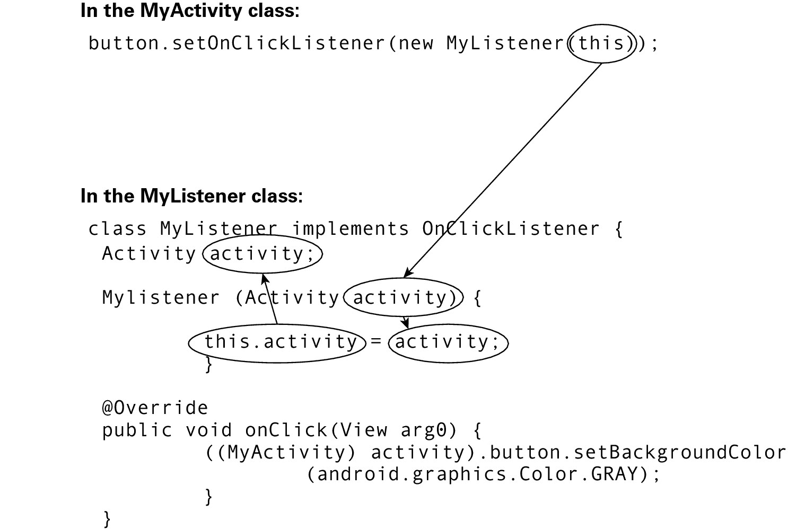

 有更多关于构造函数以及在构造函数内部使用单词`this`的信息，请参见本小书第 2 章。

再次查看图 4-3，`MyListener`引用`activity`，而该活动包含一个按钮。当 Android 调用`onClick`方法时，该方法执行的指令非常像这一条：

```java
activity.button.setBackgroundColor(android.graphics.Color.GRAY);
```

该指令获取引用的活动按钮，并将按钮的背景颜色设置为灰色。（为了使其正常工作，你必须在列表 4-3 的`onClick`方法中进行一些类型转换，但你可以在浏览本小书第 3 章时再担心转换问题。）

### 处理事件的简单方法

如果你读了上一节，接着读这一节，你可能会想给我发一封恶毒的邮件。上一节描述了一种诚然复杂的方法，让监听器记住要调整哪个活的按钮。了解列表 4-3 的工作原理是重要的，但如果你修改列表 4-3 使活动成为它自己的监听器，事情就会变得简单得多。列表 4-4 向你展示了如何这样做。

列表 4-4：活动吃自己的狗粮

```java
package com.allmycode.samples;

import android.app.Activity;
import android.os.Bundle;
import android.view.View;
import android.view.View.OnClickListener;
import android.widget.Button;

public class MyActivity extends Activity
implements OnClickListener {
    Button button;
    @Override
    public void onCreate(Bundle savedInstanceState) {
        super.onCreate(savedInstanceState);
        setContentView(R.layout.main);
        button = ((Button) findViewById(R.id.button1));
        button.setOnClickListener(this);
    }
    @Override
    public void onClick(View arg0) {
        button.setBackgroundColor(android.graphics.Color.GRAY);
    }
}
```

早早的章节以一个问题开头：“在`onClick`方法中，代码是如何知道`button`代表什么呢？”在本节中，这个问题消失了，就像我站起来时腿离开了一样。

在列表 4-4 中，按钮和`onClick`方法都是活动内部的成员。因此，`onClick`方法可以自由自在地访问按钮。你不需要像列表 4-4 那样的`Activity`字段，也不需要从`Activity`到`MyActivity`的任何复杂的类型转换。

你必须提醒 Android`MyActivity`包含一个`onClick`方法；你通过在`MyActivity`的声明中添加`implements OnClickListener`来做到。你还必须提醒 Android 在每当按钮被点击时通知当前的`MyActivity`对象。你通过编写代码来实现这种提醒：

```java
button.setOnClickListener(this);
```

大概来说，这翻译为“嘿，Android！当有人点击按钮时，调用`MyActivity`内部的`onClick`方法。”

### 必须（以及不能）被扩展的类

如果你读了上一节，接着读这一节，你可能会想给我发一封恶毒的邮件。上一节描述了一种诚然复杂的方法，让监听器记住要调整哪个活的按钮。了解列表 4-3 的工作原理是重要的，但如果你修改列表 4-3 使活动成为它自己的监听器，事情就会变得简单得多。列表 4-4 向你展示了如何这样做。

作为一名开发者，你无法从抽象类创建对象。如果你写成

```java
ViewGroup group = new ViewGroup();
```

Java 会提示你这种行为是不规范的。为了对`ViewGroup`类进行某些有用操作，你需要`ViewGroup`类的子类。该子类包含了`ViewGroup`类中每个抽象方法的具体实现版本：

```java
package com.allmycode.samples;

import android.content.Context;
import android.view.ViewGroup;

public class MyLayout extends ViewGroup {
    public MyLayout(Context context) {
        super(context);
    }
    @Override
    protected void onLayout(boolean changed, int l, int t, int r, int b) {
    }
}
```

## 内部类

这里有一个大新闻！你可以在另一个类内部定义类！大多数类并不存在于另一个类内部，而且大多数类也不包含其他类。但当一个类的背后的想法非常切地想要成为另一个类的一部分时，请尽管在类内部创建一个类。

### 具命名的内部类

对于用户来说，列表 4-6 的行为与列表 4-3 和 4-4 相同。但在列表 4-6 中，`MyActivity`类包含了了自己的`MyListener`类。

列表 4-6：类内部的类

```java
package com.allmycode.samples;

import android.app.Activity;
import android.os.Bundle;
import android.view.View;
import android.view.View.OnClickListener;
import android.widget.Button;

public class MyActivity extends Activity {
    Button button;
    @Override
    public void onCreate(Bundle savedInstanceState) {
        super.onCreate(savedInstanceState);
        setContentView(R.layout.main);
        button = ((Button) findViewById(R.id.button1));
        button.setOnClickListener(new MyListener());
    }
    class MyListener implements OnClickListener {
        @Override
        public void onClick(View arg0) {
            button.setBackgroundColor(android.graphics.Color.GRAY);
        }
    }
}
```

列表 4-6 中的`MyListener`类是一个内部类。内部类与任何其他类非常相似。但在内部类的代码中，你可以引用外部类的字段。例如，`MyListener`内部的`onClick`方法使用了`button`，而`button`是定义在外部类`MyActivity`中的。

列表 4-4 和 4-6 非常相似。在两个列表中，你都避开了本章前面“对象记得是谁创建了它”节中描述的复杂性。对于本章的示例，选择列表 4-4 还是列表 4-6 大程度上取决于个人喜好。

### 匿名内部类

注意，列表 4-6 中的代码只使用了一次`MyListener`类。（唯一的使用是在调用`button.setOnClickListener`时。）所以我问你，对于一个只使用一次的东西，你真的需要它有一个名字吗？不需要。你可以在`button.setOnClickListener`的调用中替换整个内部类的定义。当你这样做时，你就拥有了一个匿名内部类。列表 4-7 将为你展示它是如何工作的。

列表 4-7：没有名的类（在有名的类内部）

```java
package com.allmycode.samples;

import android.app.Activity;
import android.os.Bundle;
import android.view.View;
import android.view.View.OnClickListener;
import android.widget.Button;

public class MyActivity extends Activity {
    Button button;
    @Override
    public void onCreate(Bundle savedInstanceState) {
        super.onCreate(savedInstanceState);
        setContentView(R.layout.main);
        button = ((Button) findViewById(R.id.button1));
        button.setOnClickListener(new MyListener() {
            @Override
            public void onClick(View arg0) {
                button.setBackgroundColor(android.graphics.Color.GRAY);
            }
        });
    }
}
```

- XML 文件并不只描述外观和布局。事实上，极少有 XML 文件会描述任何视觉内容。相反，大多数 XML 文件描述的是数据——一份股票交易列表；一个汽车品牌和型号的层级列表；或者贝多芬交响曲中动作、度量值和注释的嵌套列表。
- 某些规则规定了你可以在 HTML 或 XML 文档中写什么、不能写什么。HTML 的规则非常宽松，而 XML 的规则则非常严格。

在 HTML 中，缺少一个字符或单词通常不会被察觉。在 XML 中，漏掉一个字符或单词可能会毁掉你一整天的心。

XML 文档各部分的正式定义可能令人望而畏。但你可以将 XML 文档想象成一组元素，每个元素都有一个或两个标签。

## 标签与元素

标签和元素是 XML 的主体工作。以下是内幕：

- 标签（tag）是某些尖括号包围的文本。

例如，列表 5-1 包含一个基本的`AndroidManifest.xml`文件。在这个文件中，`<intent-filter>`是一个标签，`</intent-filter>`（出现在文件稍后的位置）是另一个标签。像`<application android:icon=”@drawable/icon” android:label=”@string/app_name”>`这样的文本也是标签。

### 列表 5-1：一个 AndroidManifest.xml 文件


```xml
<?xml version="1.0" encoding="utf-8"?>
<manifest xmlns:android="http://schemas.android.com/apk/res/android"
    package="com.allmycode.andevcon"
    android:versionCode="1"
    android:versionName="1.0">
    <uses-sdk android:minSdkVersion="8" />
    <application android:icon="@drawable/icon"
        android:label="@string/app_name">
        <activity android:name=".MyActivity"
            android:label="@string/app_name">
            <intent-filter>
                <action android:name="android.intent.action.MAIN" />
                <category android:name="android.intent.category.LAUNCHER" />
            </intent-filter>
        </activity>
    </application>
</manifest>
```

并不是所有带有尖括号的内容都算 XML 标签。例如，文本`<This is my application.>`违反了许多语法正确的 XML 规则。关于 XML 标签可以包含和不能包含的内容，请继续阅读下文。

 当 XML 文档的文本遵守所有语法正确的 XML 规则时，它就是良好格式的（well formed）。

- XML 文档可能有三种不同的标签：
  - 起始标签（start tag）以左尖括号和名称开头。起始标签的最后一个字符是右尖括号。

在列表 5-1 中，`<intent-filter>`是一个起始标签。该标签的名称是`intent-filter`。

### 你可以使用哪些元素名称？

在 HTML 中，标签`<b>`和`</b>`包围着以粗体形式显示的文本。这就是网页的编码方式。

但在 XML 中，像`<cat>`和`</cat>`这样的标签可能代表一个 Windows 安全目录、从电线杆上垂下的链形电线，或者一只爬在你的电脑键盘上的宠物（顺便提一句，当你正在编写《自学者教程：Android 应用开发全书》时）。

### 你如何知道 XML 文档中的名称是有意义的？

简短的答案是：“意义取决于它的用途。”（无论那是什么意思！）只要计算机程序可以执行你意图让程序对该元素的操作，该元素的名称就有意义。例如，一个检查安全目录以区分可靠下载和恶意下载的程序，对于一个类似下面的元素，可能不会做任何有用的事情：

```xml
<cat name="Felix" age="7" breed="calico" />
```

另一方面，安全目录程序可能包含处理以下元素的指令：

```xml
<cat name="Firefox" verified="true" publisher="mozilla.org" version="7.0.1" />
```

DTD 看起来像这样：

```xml
<!DOCTYPE root [
  <!ELEMENT root (cat*)>
  <!ELEMENT cat EMPTY>
  <!ATTLIST cat name CDATA #REQUIRED
                        age CDATA
                        breed CDATA
                        verified CDATA
                        publisher CDATA
                        version CDATA>
]>
```

（注：原文提供的 DTD 文本是片段化的，此处已根据源文本逻辑进行了重新格式化。）

```xml
<!ELEMENT root (cat*)>
<!ELEMENT cat EMPTY
<!ATTLIST cat name CDATA #REQUIRED
                        age CDATA
                        breed CDATA
                        verified CDATA
                        publisher CDATA
                        version CDATA>
```

内容是位于起始标签和结束标签之间的部分。例如，在列表 5-1 中，`intent-filter`元素的内容是

```xml
<action android:name="android.intent.action.MAIN" />
<category android:name="android.intent.category.LAUNCHER" />
```

一个元素的内容可以包含其他元素。（在本例中，`intent-filter`元素包含一个`action`元素和一个`category`元素。）

元素的内容还可以包含普通文本。例如，在列表 5-2 中，`resources`元素包含两个`string`元素，每个`string`元素又包含普通文本。

### 列表 5-2：一个 Android strings.xml 文件

```xml
<?xml version="1.0" encoding="utf-8" standalone="no"?>
<resources>
    <string name="hello">Hello World!</string>
    <string name="app_name">AnDevCon App</string>
</resources>
```

你甚至可以混合内容。例如，在一个元素的起始标签和结束标签之间，你可以先有一些普通文本，紧跟着是一个或两个元素，然后是更多的普通文本。

- **在某些情况下，两个或多个元素可能具有相同的名称。**

在列表 5-2 中，两个不同的元素名称都是`string`。要了解更多关于 XML 文件中所使用的名称，请参旁边的侧边栏“你可以使用哪些元素名称？”。

- **元素要么彼此嵌套内部，要么完全不重叠。**

在列表 5-1 中，`manifest`元素包含一个`uses-sdk`元素和一个`application`元素。`application`元素包含一个`activity`元素，该元素又包含一个`intent-filter`元素，以此此类推。

```xml
<manifest>
    这段代码演示了元素嵌套。
    这段代码并不是一个真实的 AndroidManifest.xml 文件
    <uses-sdk />
    <application>
        <activity>
            <intent-filter>
                <action />
                <category />
            </intent-filter>
        </activity>
    </application>
</manifest>
```

在列表 5-1（以及此项目符号内部的虚假列表）中，`uses-sdk`和`application`元素完全不重叠。`action`和`category`元素完全不重叠。但每当一个元素与另一个重叠时，其中一个元素会被完全嵌套在另一个内部。

例如，在列表 5-1 中，`intent-filter`元素完全嵌套在`activity`元素内部。下面这种重叠且未嵌套的标签序列是非法的：

```xml
<activity>
    <intent-filter>
        这不是良好的 XML 代码。
</activity>
</intent-filter>
```

 在本章开头，我提到规定 HTML 的规则并不像规定 XML 的规则那样严格。在 HTML 中，你可以创建非嵌套的、重叠的标签。例如，`<b>Use <i>irregular</b> fonts</i> sparingly`在你的网络浏览器中显示为

**Use *irregular fonts** sparingly*

其中“Use irregular”为粗体，“irregular fonts”为斜体。

Microsoft Internet Explorer 是一个不错的 XML 查看器。当你用 Internet Explorer 访问 XML 文档时，你会看到彩色的、缩进良好的 XML 代码显示。代码中的元素可以根据你的命令展开和折叠。如果你访问一个格式不正确的 XML 文档（例如，一个带有重叠、非嵌套标签的文档），Internet Explorer 会显示一个空白页面。（这是好事。Internet Explorer 提醒你你搞砸了。）

- **每个 XML 文档包含一个元素，所有其他元素都嵌套在其中。**

在列表 5-1 中，`manifest`元素包含了所有其他元素。这很好。下面的大纲将无法构成合法的 XML 文档：

```xml
<manifest>
    <uses-sdk />
    <application>
    </application>
    这不是良好的 XML 文档，
    因为另一个元素出现在了
    下面的 manifest 结束标签之后：
</manifest>

<manifest>
    <uses-sdk />
    <application>
    </application>
</manifest>
```

在 XML 文档中，封装所有其他元素的单个元素是根元素。

- **起始标签和结束标签可以包含属性。**

属性是一个键值对。每个属性的形式为`name="value"`。值周围的引号是必须的。

在列表 5-1 中，起始标签和空元素标签包含许多属性。例如，在`manifest`起始标签中，`xmlns:android="http://schemas.android.com/apk/res/android"`是一个属性。在同一个标签中，`package="com.allmycode.andevcon"`是一个属性。总之，`manifest`起始标签有四个属性。在列表 5-1 后面，空元素`uses-sdk`标签有一个属性。

### 你在 XML 中发现的其他内容

生活不仅仅有标签。

- **XML 文档以 XML 声明开始。**

列表 5-1 中的声明是`<?xml version="1.0" encoding="utf-8"?>`。

问号将声明与普通标签区分开来。此声明宣布文档使用了`1.0`规范，并且用于存储文档的字符串应被解释为`UTF-8`。在实践中，你很少需要动文档。

 XML 声明中的`version="1.0"`部分看起来可能过时，但 XML 自 1998 年以来并没有很大变化。事实上，唯一的更新版本是`1.1`，开发者很少使用。

- **XML 文档可以包含注释。**

注释以`<!--`开始，以`-->`结束。例如，以下行

```xml
<!-- 此应用程序必须经过仔细测试。 -->
```

构成了一个 XML 注释。文档注释可以出现在标签之间（以及其他不值得关注的地方）。

 注释通常是给人类阅读的。但输入 XML 文档的程序可以读取注释并对其进行操作。Android 通常不对其 XML 文件中的注释做任何处理，但你永远不知道。

- **XML 文档可以包含处理指令。**

处理指令看起来非常像文档的 XML 声明。这里有一个处理指令的示例：

```xml
<?chapter number="x" Put chapter here ?>
```

文档可以有很多处理指令，这些处理指令可以出现在标签之间（以及其他几处地方）。但在实践中，大多数 XML 文档没有处理指令。（由于即使是技术图标也难以解释的原因，文档的 XML 声明并不是处理指令。）

和文档的 XML 声明一样，每个处理指令都以`<?`开始，以`?>`结束。每个处理指令都有一个名称。但在处理指令名称之后，任何内容都可以。此项目符号开头的处理指令名称为`chapter`，后面跟着一些自由文本。

 你可以在处理指令中放入几乎任何内容。大多数输入 XML 文档的软件将直接忽略该处理指令。（作为一个实验，我将我的章节处理指令添加到了列表 5-1 的文件中。这对我 Android 应用的运行产生没有任何影响。）

那么，处理指令到底有什么用呢？嗯，如果你偶然遇到了一个，我不希望你把它误认为是某种 XML 声明。此外，某些程序可能会读取特定的处理指令并从这些指令中获取特定的信息。

例如，样式表（style sheet）是一个描述 XML 文档中信息的外和布局的文件。通常，XML 文档和相应的样式表位于两个不同的文件中。为了指示`pets.xml`文档中的信息应该使用`animals.css`样式表中的规则显示，你需要在`pets.xml`文档中添加以下处理指令：

```xml
<?xml-stylesheet href="animals.css" type="text/css"?>
```

- XML 文档可能包含实体引用。

我在 Android 的官方示例应用程序中翻找，发现了以下元素（分布在不同的程序中）：

```xml
<Key android:codes="60" android:keyLabel="&lt;"/>
<Key android:codes="62" android:keyLabel="&gt;"/>
<Key android:codes="34" android:keyLabel="&quot;"/>
<string name="activity_save_restore">
App/Activity/Save &amp; Restore State
</string>
```

第一个元素包含对`&lt;`实体的引用。你不能在 XML 文档的任何地方使用真实的角括号。角括号标志着 XML 标签的开始。因此，如果你想表达`three-brackets`这个名字代表字符串`“<<<”`，你不能写成：

```xml
<string name="three-brackets"><<<</string>
```

额外的括号会混淆任何期望遇到普通 XML 标签的程序。

因此，为了绕过 XML 对角括号的特殊用法，XML 规范包含了实体`&lt;`和`&gt;`。第一个`&lt;`代表左角括号。第二个`&gt;`代表右角括号。所以，为了表达`three-brackets`这个名字代表字符串`“<<<”`，你应该写成：

```xml
<string name="three-brackets">&lt;&lt;&lt;</string>
```

 在实体`&lt;`中，字母`lt`代表“less than（小于）”。毕竟，左角括号看起来就像数学学中的“小于”符号。同样，在实体`&gt;`中，字母`gt`代表“greater than（大于）”。

## 命名空间包含什么？

XML 的第一个正式定义是由万维网联盟（W3C）于 1998 年发布的。这个标准标准忽略了一个棘手的问题：如果两个 XML 文档具有相同名称的元素或属性，且这些名称在两个文档中具有不同的含义，你如何可能合并这两个文档呢？

这是一个简单的 XML 文档：

```xml
<?xml version="1.0" encoding="utf-8"?>
<banks>
    <bank>First National Bank</bank>
    <bank>Second Regional Bank</bank>
    <bank>United Trustworthy Trusty Trust</bank>
    <bank>Federal Bank of Fredonia (Groucho Branch)</bank>
</banks>
```

这里是另一个 XML 文档：

```xml
<?xml version="1.0" encoding="utf-8"?>
<banks>
    <bank>Banks of the Mississippi River</bank>
    <bank>La Rive Gauche</bank>
    <bank>La Rive Droite</bank>
    <bank>The Banks of Plum Creek</bank>
</banks>
```

一个拥有似乎无限资源的组织旨在收集并合并来自互联网各处的知识。该组织的软件找到 XML 文档并将它们合并成一个全能的超级文档。（想象一个自动版本的维基百科。）


当你把关于金融机构的文档与关于河流的文档合并时，你会得到一些令人困惑的结果。如果 `First National` 和 `Banks of Plum Creek` 都位于同一个的 `bank` 元素中，分析该文档可能需要先验知识。换句话说，如果你已经不知道某些银行贷款，而另一些银行在风暴期间会泛滥，你可能会得出一些奇怪的结论。遗憾的是，计算机程序本身并什么也不知道。（当你遇到一个描述路易斯安州斯耶夫特尔红河银行的 XML 元素时，情况会变得非常复杂。这家河银行在斯耶夫特尔、亚历山大等城镇都有自动取款机。）

为了缓解这种局面，XML 标准委员会的成员创建了 XML 命名空间。命名空间是你附加到名称上的前缀。你用冒号（`:`）将命名空间与名称分开。例如，在列表 5-1 中，几乎每个属性名称都以 `android` 前缀开头。列表的属性包括 `android:versionCode`、`android:versionName`、`android:minSdkVersion`、`android:icon` 等。

因此，为了合并关于贷款银行和河岸银行的文档，你在列表 5-3 中创建了 XML 文档。

### 列表 5-3：带有两个命名空间的文档

```xml
<?xml version=”1.0” encoding=”utf-8”?>
<banks xmlns:money="http://schemas.allmycode.com/money" xmlns:river="http://schemas.allmycode.com/river">
    <money:bank>First National Bank</money:bank>
    <money:bank>Second Regional Bank</money:bank>
    <money:bank>United Trustworthy Trusty Trust</money:bank>
    <money:bank>Federal Bank of Fredonia (Groucho Branch)</money:bank>
    <river:bank>Banks of the Mississippi River</river:bank>
    <river:bank>La Rive Gauche</river:bank>
    <river:bank>La Rive Droite</river:bank>
    <river:bank>The Banks of Plum Creek</river:bank>
</banks>
```

符号字符串并不非得是一个 URL。相反，它可以是一个 URI —— 即通用资源标识符（Universal Resource Identifier）。URI 看起来像 URL，但 URI 并不一定指向实际的网络位置。URI 仅仅是一个名称，一串“充斥着喧哗和愤怒”且可能“毫无意义”的字符。一些 XML 开发者为他们的每个 URI 创建了相应的网页。这些网页包含了对 XML 文档中所用名称的有用描述。

但大多数用于 XML 命名空间的 URI 并不指向任何地方。例如，列表 5-1 中的 URI `http://schemas.android.com/apk/res/android` 几乎出现在每个 Android XML 文档中。如果你将该 URI 输入到你常用的 Web 浏览器地址栏，你会得到熟悉的`无法显示网页`或`找不到服务器`的消息。

 未绑定前缀消息（unbound prefix message）表示你没有将 XML 文档中找到的命名空间与 URI 关联。某些非常旧的软件（不支持命名空间的软件）不会捕获此类错误，但大多数现代软件都能捕获。

### package 属性

在列表 5-1 中，属性名称 `package` 没有前缀。所以你可能会说：“见鬼！为了保险起见，我把属性名称改为 `android:package` 。”但这种更改产生了一些错误信息。其中一条信息显示 `<manifest> does not have a package attribute.` 这是发生了什么？

在 `AndroidManifest.xml` 文件中，`package` 属性与 Java 的关系大于 Android。（`package` 属性指向包含应用程序 Java 代码的 Java 包。）因此，Android 的开发者决定不让这个 `package` 属性成为 `android` 命名空间的一部分。开发者在某些 Android SDK 文件中硬编码了 `android` 命名空间的单词（如 `android:versionCode` 和 `android:versionName`）。

当你创建一个 `AndroidManifest.xml` 文件时，Eclipse 会立即开始构建项目的部分内容。Android 软件会将 `AndroidManifest.xml` 文件中的名称与 `android` 命名空间中的单词进行比较。一旦 Android 软件遇到恶性的 `android:package`（`android` 前缀后跟非 android 名称），软件就会拉响警报。

 从 Cupcake 版本开始，每个 Android 平台在你下载 Android SDK 时获得的文件中都有名为 `public.xml` 的文件。如果你用文本编辑器打开 `public.xml` 文件，你会看到 `android` 命名空间中的名称列表。

### style 属性

`style` 和 `package` 同样遵循不是 `android` 名称的规则。样式（style）是一组描述移动设备屏幕上某元素外观的项（或属性）。样式的 XML 文档可能包含 Android 特有的名称，但样式本身仅仅是一组项，其本身并不是 Android 属性。

为了了解它是如何运作的，想象创建一个非常简单的应用。描述应用基础布局的 XML 文件可能像列表 5-4 中的代码。

列表 5-4：使用 style 属性

```xml
<?xml version=”1.0” encoding=”utf-8”?>
<LinearLayout xmlns:android=`
  “http://schemas.android.com/apk/res/android”
    android:orientation=”vertical”
    android:layout_width=”fill_parent”
    android:layout_height=”fill_parent”
  >
<TextView  
    android:layout_width=”fill_parent”
    android:layout_height=”wrap_content”
    android:text=”@string/callmom”
    style=”@style/bigmono”
    />
</LinearLayout>
```

在列表 5-4 中，除 `style`（以及 `android` 名称本身）外，所有属性名称都在 `android` 命名空间中。值 `“@style/bigmono”` 指向你应用 `res/values` 文件夹中的一个 XML 文件。列表 5-5 包含一个名为 `styles.xml` 的简单文件。

列表 5-5：带有样式的文件

```xml
<?xml version=”1.0” encoding=”utf-8”?>
<resources>
    <style name=”bigmono”>
      <item name=”android:textSize”>50dip</item>
      <item name=”android:typeface”>monospace</item>
    </style>
</resources>
```

再次注意 `android` 命名空间内部外的单词的混合。`android:textSize` 和 `android:typeface` 单词在 `android` 命名空间中，而列表 5-5 中的其他单词则不在。

列表 5-5 中的样式指定了字体大小为巨大的 50 设备无关像素（dip），并且字体类型为等宽（传统打字机）字体。当 Android 将列表 5-5 中的样式应用到列表 5-4 的布局时。

`android.app.Activity` 类的代码是一个完整的官方定义，描述了 activity 是什么，以及 activity 不是什么。但从应用设计者的角度来看，没有任何关于 activity 的正式定义能描绘全貌。因此，也许描述 activity 的方式应该是行为性的。以下是我的非正式描述：

在应用运行期间的某个时刻，应用设计师用内容填满了屏幕。此时，设计师在想：“我必须把这些东西都移开，让用户能够合理地处理当前变得最重要的事情。”于是，设计师创建了一个新的屏幕布局，编写了布局的行为，并将整个业务逻辑（布局及其行为）称为一个新的 activity。

在那个（较新的）时刻，设计师拥有了两个不同的 activity——一个是填满屏幕内容的原始 activity，另一个处理当前最重要事项的新 activity。在较小的设备上（或运行比 Honeycomb 更早版本的设备上），每个 activity 都会占据整个屏幕。原始 activity 调用了新 activity，然后新 activity 会覆盖原始 activity。

在正常情况下，这两个 activity 形成了一个栈的一部分——一种后进先出的结构。想象一下 `Activity A` 调用了 `Activity B`，而 `Activity B` 又调用了 `Activity C`。那么活动 `A`、`B` 和 `C` 就形成了一个栈，`Activity C` 位于栈顶（对用户可见）。当用户按下返回键时，`Activity C` 从栈中弹出，显示出 `Activity B`。当用户再次按下返回键时，`Activity B` 从栈中弹出，显示出 `Activity A`。

Android activity 栈被称为任务（task）。现在你有了应用（apps）、activity 和任务。遗憾的是，这些词对于 Android 开发人员的含义与世界上其他地方的含义不同。

应用程序（Application）是实现特定用户目标的各种项集合。属于应用的某些项就是 activity。

 应用的其他项是服务（services）、广播接收器（broadcast receivers）和内容提供者（content providers）。我在本书的第 3、4 和 5 章中介绍了这些内容。

## 应用与进程

典型的操作系统（包括 Android）拥有用户、进程和线程。

 每个登录系统的每个人都是一个用户。但系统也可能创建虚拟用户——操作系统将其视为独立的用户，但它们并不对应使用键盘的人。

对于非真实人类的用户，系统可以为访问资源创建专门的路径。例如，数据库可能是唯一有权访问某些数据的“用户”。真实的人类用户间接获取数据。人类用户登录数据库并请求代表其获取数据。

系统上的每个用户（由真实人类或虚拟用户进行的会话）都有一个用户标识符（`UID`）。

在本书的大部分内容中，我触摸设备屏幕的人称为“用户”。我并不太担心虚拟用户。

 操作系统将其工作划分为多个进程。

每个进程都有自己的内存空间，与其他进程的空间相互独立。进程之间仅通过通过狭窄的、受严格监管的路径进行交互。

系统调度进程的运行。为了做到这一点，系统会在一个进程中执行一系列语句，然后是在另一个进程中执行一系列语句，接着在第三个进程中执行一系列，最后返回到第一个进程上次停止的地方。

每个进程都有一个进程标识符（`PID`）。

 进程可以将其工作划分为线程。

操作系统以交替的方式调度线程。在这方面，线程非常像进程。但单个进程的线程共享该进程的内存空间。因此，单个进程的线程可以相互自由通信。

在 Android 中，每个应用都运行在自己的进程中，并拥有自己的 `PID` 和 `UID`。（应用不会在运行与运行之间保留其 `PID` 或 `UID`。操作系统在运行开始时分配这些数字，并在运行结束时将其丢弃。系统会为应用的下次运行分配新数字。）

随着新进程的创建，Android 会增量分配 `PID`。因此，当你的应用开始运行时，它的 `PID` 可能是 `1900`。稍后，你的设备可能内存不足。Android 可能会注意到，短期内不需要你应用的任何组件（例如，设备正在显示另一个应用的 activity，而你的应用不包含任何长时间运行的服务）。为了节省空间，Android 可能会杀掉你的应用进程。砰！进程消失了。

当然，用户对这个“暗杀”过程一无所知。（我指的是人类用户，而不是系统想象中的某种虚拟幻影。）用户只是通过调用另一个 activity、按下 Home 键、接听电话或其他方式离开了你的应用活动。因此，在某个时刻，用户说：“嘿，等一下！我想回到几分钟前正在做的事情。”用户导航回到你进程的某一个 activity。于是 Android（作为一个聪明的操作系统）启动一个新进程来运行你的应用，重新创建你的应用在被“杀掉”之前的 activity，并显示该 activity 仿佛没有发生过任何异常一样。现在你的应用有了新的 `PID`（可能是 `1921`），因为 Android 在你的应用被杀掉到它重生之间创建了几个其他进程。

每个应用运行在自己的进程中，并拥有自己的用户 ID。这是 Android 的优势之一。独立的进程不共享任何内存。应用程序之间的通信路径是狭窄定义的（严格监管的）。如果应用程序做了错误（无论是恶意的还是无意的），对系统的影响是有限的。作为开发者，你在应用的 `AndroidManifest.xml` 文件中使用 `<application>` 元素来创建应用。

activity 可以（且经常）调用属于其他应用的 activity（例如，封邮件中可能包含一个链接。因此邮件应用的 activity 可能会调用浏览器应用的 activity）。这意味着一个特定的任务可能包含来自多个应用的活动。（参见图 1-1。）

**图 1-1:** 活动、应用和任务。


场景通常是这样工作的：

1. 用户启动一个应用。（称之为 Application 1。）

Android 为该应用创建一个新进程，创建应用主活动的实例，并将主活动放入一个全新的任务栈中。（称之为 Task 1。）

2. 从应用的主活动，用户调用了另一个活动（例如，属于同一应用的辅助活动）。

Android 创建了辅助活动的新实例。Android 将辅助活动推入任务栈。（参见图 1-2。）设备的屏幕只显示辅助活动。（想象应用的主活动被隐藏在辅助活动之之下。将主活动称为 Activity 1；将辅助活动称为 Activity 2。）

**图 1-2:** 用户启动 Activity 1 和 2。


3. 用户按下 Home 键。

Android 将 Task 1 移出屏幕并显示主屏幕，如图 1-3 所示。

4. 用户启动第二个应用。（我们称之为 Application 2 好吗？）

在 Task 1 仍在等待的情况下，Android 为第二个应用创建了第二个任务（Task 2），包含第二个应用的主活动。

5. 用户再次按下 Home 键并点击 Application 1 的图标。

参见图 1-4。Android 显示了 `Task 1` 栈的顶部。`Activity 2` 仍然位于 `Task 1` 的顶部。因此，用户看到了 `Activity 2`。幸运的是，`Activity 2` 的状态与用户首次按下 Home 键时的状态相同。任何文本字段仍然保留了用户之前输入的文本，以此此类推。

6. 用户按下 `Back` 按钮。

Android 从 `Task 1` 栈中弹出 `Activity 2` 并销毁该 `Activity 2` 实例。用户看到了 `Activity 1`，它的状态与 Android 用 `Activity 2` 覆盖 `Activity 1` 之前的状态相同。

7. 从 `Activity 1` 开始，用户再次调用属于 `Application 1` 的次级活动（secondary activity）。

Android 创建了该次级活动的全新实例。Android 将该活动推入任务栈中。设备屏幕仅显示该活动。这个新实例的状态与 `Activity 2` 被销毁时的状态不同。该新实例用新值初始化（这对于新对象来说是正常的）。

**图 1-3：** 调用 Application 2 后，用户返回了主页。

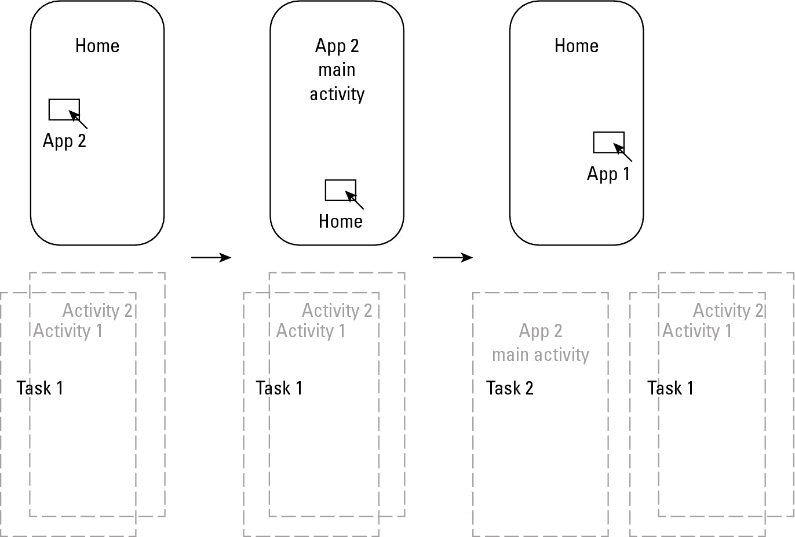

**图 1-4：** 用户关闭了 `Activity 2` 然后再次调用了 `Activity 2`。

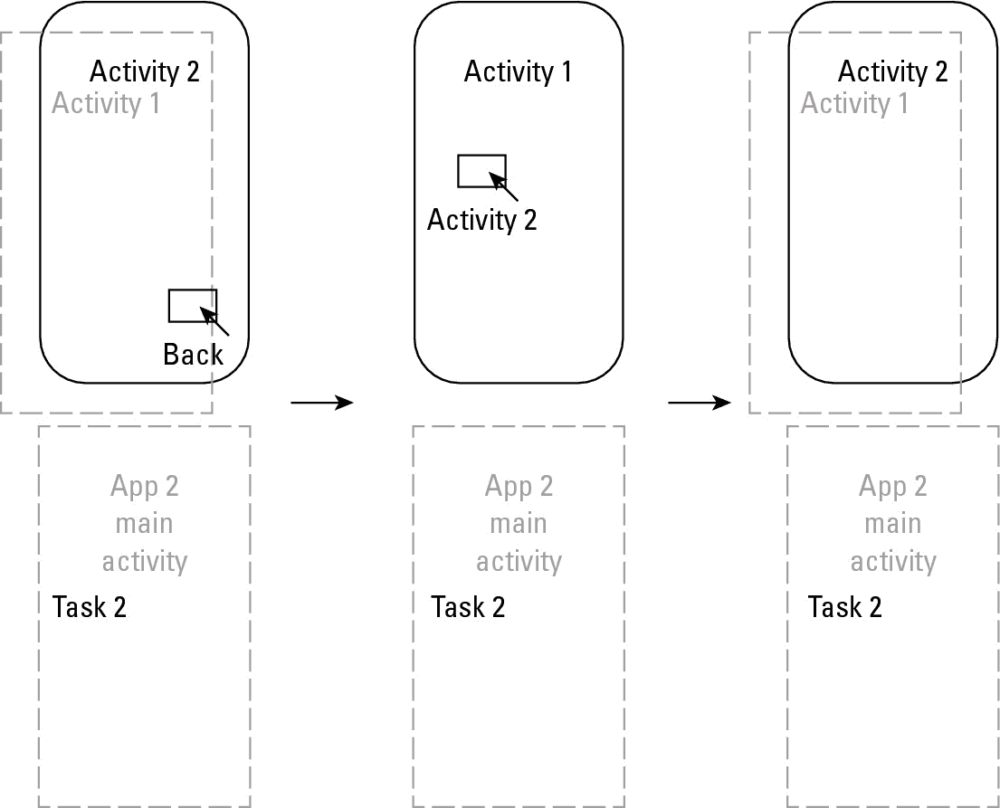

 这些步骤中的场景会有许多变体。首先，用户并不一定按照步骤描述的顺序点击按钮和图标。此外，开发者可以更改活动堆叠到任务中的方式（参见本小型型书的第 2 章）。从 Honeycomb 版本开始，Android 有了碎片（fragments），它们类似于活动但仅占据平板设备屏幕的一部分。（参见小型型书 IV 的第 4 章）。

## 声明你的意图


# Android 编程模型与活动生命周期

## 资源重用与意图（Intent）

Android 编程模型基于对稀缺资源的使用。与桌面电脑或笔记本电脑相比，智能手机屏幕较小、内存有限且处理器性能较弱。考虑到这一点，Android 的原始创建者专注于资源重用。

假设我的应用包含一个指向我个人网站的链接。当用户点击链接时，Android 会打开网络浏览器。但 Android 打开的是哪个浏览器呢？Android 自带了一个浏览器（基于 Apple 的 WebKit 引擎）。但用户可能还安装了 Android 版 Firefox、Opera Mini 或任何其他浏览器。

在 Microsoft Windows 中，浏览器的选择取决于文件扩展名和协议关联。但在 Android 中，开发者通过发出意（intent）来调用浏览器。

在 Android 开发中，意图就像一个开放式的方法调用。与其编写如下代码：

```java
firefox(“http://www.google.com”);
```

或者

```java
android_built_in_browser(“http://android.allmycode.com”);
```

而是编写以下代码：

```java
String url = “http://android.allmycode.com”;
Intent intent = new Intent(Intent.ACTION_VIEW);
intent.setData(Uri.parse(url));
startActivity(intent);
```

在这个示例中，调用`startActivity(intent)`就像向空中扔出一个代表“我想浏览”的球，并期望另一个应用的活动接住它。另一个应用通过在应用的`AndroidManifest.xml`文件中放置以下类型的元素来宣布其接住“我想浏览”球的意图：

```xml
<activity android:name=”.Catcher”
         android:label=”Catcher">
  <intent-filter>
    <action android:name=”android.intent.action.VIEW” />
    <category android:name=”android.intent.category.DEFAULT” />
    <category android:name=”android.intent.category.BROWSABLE” />
    <data android:scheme=”http” />
  </intent-filter>
</activity>
```

再次，我引用 Android 官方文档：

> “意（intent）是对要执行的操作的抽象描述。它可以配合`startActivity`来启动一个 Activity……。`Intent`为在不同应用程序中的代码之间执行延迟运行时绑定提供了便利。它最重要的用途是启动活动，此时它可以被认为是活动之间的胶水。它本质上是一个被动的数据结构，保存着要执行的操作的抽象描述。”

事实上，Android 有两种类型的意——隐式意（implicit intents）和显式意（explicit intents）。

- 我在前面的段落中描述的那种意（启动任何自称网络浏览器的活动）是隐式意。隐式意并不要求启动特定的活动。相反，隐式意指定了要执行的操作，以及完成该意所需的其他信息。

### 意图

```java
Intent intent = new Intent(Intent.ACTION_VIEW);
intent.setData(Uri.parse(url));
```

 是一个隐式意。

- 显式意实际上指明了要启动的活动实例名称。显式意

要使用显式意，你可以编写类似列表 1-1 的代码。

### 列表 1-1：使用显式意调用应用活动

```java
package my.pack;
import android.app.Activity;
import android.os.Bundle;
public class SomeActivity extends Activity {
  // ... code of some sort ...
  Intent intent = new Intent();
  intent.setClassName(“my.pack”, “OtherActivity”);
  startActivity(intent);
}
```

列表 1-1 中，`setClassName`方法接收两个`String`参数。第一个参数是目标所在的包名，第二个参数是活动的全限定名。因此在列表 1-1 中，`setClassName`使用了`my.pack`。

要调用另一个应用的活动，你可以编写类似列表 1-2 代码。

### 列表 1-2：使用显式意调用另一个应用的活动

```java
package my.pack;
import android.app.Activity;
import android.os.Bundle;
public class SomeActivity extends Activity {
  // ... code of some sort ...
  Intent intent = new Intent();
  intent.setClassName(“other.pack”, “OtherAppActivity”);
  startActivity(intent);
}
```

列表 1-2 几乎与列表 1-1 完全一样。不同在于 1-2 中的两个活动（调用者和被调用者）属于不同的应用程序。不同的应用程序意味着不同的包。因此列表 1-1 使用的是`my.pack`，而列表 1-2 使用的是`other.pack`。

对于应用程序中的每个活动，你必须在`AndroidManifest.xml`文件中添加`<activity>`元素。如果一个项目的活动调用另一个项目的活动，你必须让 Eclipse 感知这两个项目之间的连接。在 Package Explorer 中，选择包含`startActivity`调用的项目。选择 Project⇒Properties。在生成的属性对话框中，选择 Java Build Path⇒Projects。添加目标项目并点击 OK。未执行这些操作会导致运行时出现`Cannot Find Activity`消息。

### 使用上下文

启动特定活动的另一种方法是使用上下文。在列表 1-3 中，活动调用同一个应用程序内的另一个活动。

```java
  new Intent(this, OtherActivity.class);
  startActivity(intent);
}
```

在列表 1-3 中，最后两句语句的意思是：“使用`this`活动自身的上下文（context），启动运行`OtherActivity`的实例。”（如果一切顺利，`OtherActivity`类将继承自 Android 的`Activity`类，那么你就可以正常运行。）

在列表 1-3 中，`Intent`类的构造函数接收两个参数——一个上下文（context）和一个 Java 类。`this`关键字表示包在外部的`SomeActivity`实例。这很好，因为构造函数的第一个参数类型是`Context`，而 Android 的`Activity`类是抽象类`Context`类的子类。

`Context`对象是“通往应用程序环境全局信息的接口”。（再次强调，我在引用 Android 文档的内容。）活动（activity）是一个上下文，因为（除了是`Context`的子类之外）活动拥有一堆文件、包名、大量资源、主题、壁纸和其他内容。所有这些内容都可以通过活动的上下文以编程的方式获取。在列表 1-3 中，`Intent`构造函数从`this`获取了`OtherActivity`的包名——即`SomeActivity`对象的上下文。

每个活动都是应用程序的一部分，`Application`实例也是一个上下文。因此在许多程序中，你可以使用以下方法调用（代替`this`）来获取`Context`实例：

- `getContext()`  
- `getApplicationContext()`  
- `getBaseContext()`

`getApplicationContext`和`getBaseContext`方法在 Android 程序中具有有限且特定的用途。在本书的示例中，你永远不需要调用`getApplicationContext`或`getBaseContext`。

在列表 1-4 中，来自一个应用的活动使用上下文来调用另一个应用的活动。

### 列表 1-4：使用显式 Intent 和上下文调用另一个应用的活动

```java
package my.pack;

import android.app.Activity;
import android.os.Bundle;

public class SomeActivity extends Activity {
  // ... 某些代码属于这里
  try {
    otherContext =
      createPackageContext("other.pack",
      Context.CONTEXT_IGNORE_SECURITY |
      Context.CONTEXT_INCLUDE_CODE);
  } catch (NameNotFoundException e) {
    e.printStackTrace();
  }
  Class<?> otherClass = null;
  try {
    otherClass = otherContext.getClassLoader().
      loadClass("other.pack.OtherAppActivity");
  } catch (ClassNotFoundException e) {
    e.printStackTrace();
  }
  Intent intent = new Intent(otherContext, otherClass);
  startActivity(intent);
}
```

列表 1-4 比列表 1-3 复杂。但大部分复杂性来自于 Java 加载类的方式。无论如何，列表 1-4 都是根据上下文和类名创建一个 intent，然后启动该 intent 的活动。

# 活动生命周期

> “…… 人在一生中扮演许多角色，他的行为有七个阶段。”
> —— 出自莎士比亚的《亦或喜欢你》

人类的生命周期包括婴儿期、童年、青少年、成年、中年、老年，以及最后的终结。

Android 活动也有生命周期。以下是各个阶段：

- **活跃（Active 或运行中 Running）**：活动位于设备屏幕前台，处于任务栈的顶端。用户可以与活动进行交互。
- **停止（Stopped）**：活动位于任务栈中，但活动不可见。可能是该活动不在其栈的顶端，栈上的其他活动覆盖了该活动。或者，活动不可见是因为设备屏幕显示的内容不属于该活动所在的栈的一部分。
- **暂停（Paused）**：暂停状态是活跃（Active）和停止（Stopped）之间的一种中间状态。正式定义上，如果一个活动位于当前活跃栈上，但被另一个活动部分遮挡（例如透明活动或位于栈顶部的非全屏活动），则该活动处于暂停状态。

在实践中，一个从活跃到停止过渡的活动会经历一段短暂的暂停期，即使用户没有看到“部分被遮挡”的阶段。

- **销毁（Destroyed）**：多么悲哀！但等一下！销毁并不意味着“永远消失”。Android 可能会销毁一个活动，以便用不同的配置复活它。或者在用户没有活跃使用该活动时，Android 可能会暂时覆盖该活动。

## 生命周期周期方法

许多文化都有成年礼。成年礼是你从一个生命阶段过渡到另一个生命阶段时所做的事情。例如，在我的家乡，孩子在过渡到青少年时期时这样做：“你应当站在你所有土地的最高点（通常是法兰克福电车的 Dauphin Street 站），并在头顶上方挥动三次生鱼。在此期间，你要大喊：‘接下来的几年里我将成为一个麻烦的疯子。’”

Android 活动有自己的成年礼，被称为生命周期方法。图 1-5 展示了这些方法。与人不同，活动不会预测地从一个阶段移动到下一个阶段。例如，一个典型的活动会在活跃和停止之间来回切换，并穿插着几次暂停。而且在被销毁后，一个活动可以被毫无声息地复活。对于一个活动来说，销毁和重建是正常发展过程的一部分。一个 Android 活动有五个生命周期方法——即 `onCreate`、`onStart`、`onResume`、`onPause` 和 `onDestroy`。此外，活动还有一些 `onSomething` 方法（如 `onSaveInstanceState`），它们并不是生命周期正式的一部分，也不保证会被调用。总之，列表 1-5 包含了这些方法。

**图 1-5：** Android 活动的生命、死亡与重生。


### 列表 1-5：为你的活动添加日志

```java
package com.allcode.demo;

import android.app.Activity;
import android.content.Configuration;
import android.os.Bundle;
import android.view.View;

public abstract class MyActivity extends Activity {
  abstract void logStuff(String message);
  public void add(View view) {
    logStuff("------");
  }
  /** 活动创建时（第一次或销毁后）。 */
  @Override
  public void onCreate(Bundle savedInstanceState) {
    super.onCreate(savedInstanceState);
    logStuff("onCreate");
  }
  /** 当在停止后，过渡到暂停（通向活跃状态）。 */
  @Override
  public void onRestart() {
    super.onRestart();
    logStuff("onRestart");
  }
  /** 活动过渡到暂停（通向活跃状态），无论是第一次还是在活动停止后。 */
  @Override
  public void onStart() {
    super.onStart();
    logStuff("onStart");
  }
  /** 活动从暂停过渡到活跃时。 */
  @Override
  public void onResume() {
    super.onResume();
    logStuff("onResume");
  }
  /** 除非你在 AndroidManifest.xml 文件中了
  * android:configChanges，否则永远不会调用。 */
  @Override
  public void onConfigurationChanged(Configuration config) {
    super.onConfigurationChanged(config);
    logStuff("onConfigurationChanged");
  }
  /** 通常（但并非总是）在活跃到暂停的过渡期间，
  * 或者在暂停到停止的过渡期间调用。 */
  @Override
  public void onSaveInstanceState(Bundle state) {
  }
}
```

```java
super.onSaveInstanceState(state);
logStuff("onSaveInstanceState");
}
/** 当 activity 从
 * Active 切换到 Paused 时调用。
 */
@Override
public void onPause() {
    super.onPause();
    logStuff("onPause");
}
/** 当 activity 从
 * Paused 切换到 Stopped 时调用。
 */
@Override
public void onStop() {
    super.onStop();
    logStuff("onStop");
}
/** 当 activity 从
 * Stopped 切换到 Destroyed 时调用。
 */
@Override
public void onDestroy() {
    super.onDestroy();
    logStuff("onDestroy");
}
```

我创建列表 1-5 的目的是为了提供日志记录，以帮助你直观地看到生命周期方法的运行情况。你可以将列表 1-5 放入几乎任何应用中，以获取活动及其转换的全局视图。为了这一目标，我创建了一个应用，让你可以在不同类型的 activity 之间来回。列表 1-6、1-7 和 1-8 描述了该应用的主 activity，图 1-6 显示了主 activity 的屏幕。

### 列表 1-6: com.allmycode.demo1.Demo1Activity 类


```java
package com.allmycode.demo1;

import android.content.Intent;
import android.os.Bundle;
import android.util.Log;
import android.view.View;

public class Demo1Activity extends MyActivity {
    @Override
    public void onCreate(Bundle savedInstanceState) {
        super.onCreate(savedInstanceState);
        setContentView(R.layout.main);
    }
    @Override
    void logStuff(String message) {
        Log.i("Demo1Activity", message);
    }
    public void startOtherActivity(View view) {
        Intent intent = new Intent();
        intent.setClassName("com.allmycode.demo1",
            "com.allmycode.demo1.OtherActivity");
        startActivity(intent);
    }
    public void startOtherAppActivity(View view) {
        Intent intent = new Intent();
        intent.setClassName("com.allmycode.demo1A",
            "com.allmycode.demo1A.OtherAppActivity");
        startActivity(intent);
    }
    public void startTransparentActivity(View view) {
        Intent intent = new Intent();
        intent.setClassName("com.allmycode.demo1",
            "com.allmycode.demo1.TranslucentActivity");
        startActivity(intent);
    }
}
```

### 列表 1-7：`main.xml` 文件

```xml
<?xml version="1.0" encoding="utf-8"?>
<LinearLayout xmlns:android="http://schemas.android.com/apk/res/android"
    android:orientation="vertical"
    android:layout_width="fill_parent"
    android:layout_height="fill_parent">
    <TextView android:layout_width="fill_parent"
        android:layout_height="wrap_content"
        android:text="@string/hello" />
    <Button android:layout_width="wrap_content"
        android:id="@+id/button1"
        android:onClick="startOtherActivity"
        android:layout_height="wrap_content"
        android:text="@string/start_this_app_other" />
    <EditText android:layout_height="wrap_content"
        android:id="@+id/editText1"
        android:layout_width="match_parent"
        android:hint="Type anything here">
        <requestFocus></requestFocus>
    </EditText>
    <include android:id="@+id/include1"
        android:layout_width="wrap_content"
        layout="@layout/add_break"
        android:layout_height="wrap_content" />
    <Button android:id="@+id/button2"
        android:layout_width="wrap_content"
        android:layout_height="wrap_content"
        android:onClick="startOtherAppActivity"
        android:text="@string/start_other_app" />
    <Button android:id="@+id/button3"
        android:layout_width="wrap_content"
        android:layout_height="wrap_content"
        android:onClick="startTransparentActivity"
        android:text="@string/start_translucent" />
</LinearLayout>
```

### 列表 1-8：`add_break.xml` 文件

```xml
<?xml version="1.0" encoding="utf-8"?>
<LinearLayout xmlns:android="http://schemas.android.com/apk/res/android"
    android:orientation="vertical"
    android:layout_width="fill_parent"
    android:layout_height="fill_parent"
    android:gravity="center">
```

假设栈上有 `Demo1Activity` 和 `OtherActivity`，你按了返回键。结果 Eclipse 的 LogCat 视图显示了以下条目：

```
WARN/OtherActivity(4526): onPause
INFO/Demo1Activity(4526): onRestart
INFO/Demo1Activity(4526): onStart
INFO/Demo1Activity(4526): onResume
WARN/OtherActivity(4526): onStop
WARN/OtherActivity(4526): onDestroy
```

注意，按下返回键会销毁 `OtherActivity` 实例。

### 保存（以及不保存）活动的状态

在图 1-6 中，`Type Anything Here` 文本框可以帮助你理解活动的状态何时会被保留（以及何时不会被保留）。

尝试这个实验：

1. 在文本框中输入内容，然后点击 `Start This App’s Other Activity` 按钮。

   `OtherActivity` 遮住了 `Demo1Activity`，且 `Demo1Activity` 处于停止（Stopped）状态。

2. 使用返回键关闭 `OtherActivity`。

   `Demo1Activity` 重新出现，你输入的字符仍然留在文本框中。尽管 `Demo1Activity` 曾停止过，但 Android 保留了 `Demo1Activity` 的状态。

尝试另一个实验：

1. 在文本框中输入内容，然后点击 Home 键。

   主屏幕出现，`Demo1Activity` 停止运行。

2. 找到 `Demo1` 图标并触摸图标以启动 `Demo1Activity`。

   `Demo1Activity` 重新出现，你输入的字符仍然留在文本框中。Android 保留了 `Demo1Activity` 的状态。

这是另一个实验：

1. 在文本框中输入内容，然后点击返回键。

   `Demo1Activity` 的屏幕消失。在 LogCat 视图中，你看到 `Demo1Activity` 执行了它的 `onPause`、`onStop` 和 `onDestroy` 方法。

2. 找到 `Demo1` 图标并触摸图标以启动 `Demo1Activity`。

   `Demo1Activity` 重新出现，但 `Type Anything Here` 文本框已重新初始化。Android 没有保留 `Demo1Activity` 的状态。

3. （可选）为了在点击返回键和活动下一次调用之间保留状态，请在你的活动 `onPause` 方法中添加以下代码：

```java
SharedPreferences prefs = getPreferences(MODE_PRIVATE);
SharedPreferences.Editor editor = prefs.edit();
editor.putString("EditTextString", editText.getText().toString());
editor.commit();
```

4. 在你的活动 `onResume` 方法中添加以下代码：

```java
SharedPreferences prefs = getPreferences(MODE_PRIVATE);
String str = prefs.getString("EditTextString", "");
editText.setText(str);
```


5. 在你重写的 `onPause` 方法中保存活动的相关信息。

不要等到 `onStop` 或 `onDestroy` 方法中再保存信息。


第 4 步的代码使用了 `SharedPreferences`。关于 `SharedPreferences` 的更多信息，请参阅本微书的第 3 章。

这是你的下一个实验：

1. 在文本框中输入内容。

2. 将设备横置。

   如果你正在运行模拟器，可以通过按 `Ctrl+F11` 进行虚拟旋转。你的活动屏幕会调整（从竖屏到横屏或反之），你输入的字符仍然在文本框中。

但当你查看 Eclipse 的 LogCat 视图时，你会看到以下条目：

```
INFO/Demo1Activity(4526): onSaveInstanceState
INFO/Demo1Activity(4526): onPause
INFO/Demo1Activity(4526): onStop
INFO/Demo1Activity(4526): onDestroy
INFO/Demo1Activity(4526): onCreate
INFO/Demo1Activity(4526): onStart
INFO/Demo1Activity(4526): onResume
```

惊喜吧！为了旋转活动屏幕，Android 会销毁然后重建该活动。在销毁和后续创建之间，Android 保留了你的活动实例的状态。文本框的内容被恢复了。

这引导你进行另一个实验：

1. 在 `AndroidManifest.xml` 文件的 `Demo1Activity` 的 `<activity>` 元素中添加以下属性：

   `android:configChanges="orientation"`

2. 转应用并更改模拟器或设备的方向。

   你在 Eclipse 的 LogCat 视图中看到以下条目：

```
INFO/Demo1Activity(4588): onSaveInstanceState
INFO/Demo1Activity(4588): onPause
INFO/Demo1Activity(4588): onStop
INFO/Demo1Activity(4588): onDestroy
INFO/Demo1Activity(4588): onCreate
INFO/Demo1Activity(4588): onStart
INFO/Demo1Activity(4588): onResume
```

`android:configChanges="orientation"` 属性告诉 Android 通知活动方向的变化。

Android 会为了回收空间而杀死进程，而用户完全不知道该进程已被杀死。这对于 Android 操作系统来说是常态。

在实验的此时，`Demo1Activity` 处于停止（Stopped）状态，该 activity 的进程已被杀死，且该 activity 不在当前任务栈的顶端。

4. 返回模拟器的应用程序界面，并点击 `Demo1` 图标（`com.allmycode.demo1.Demo1Activity` 实例的图标）。

`OtherAppActivity` 重新出现在屏幕上。（见图 1-10。）Android 将你的点击解释为想要返回包含 `Demo1Activity` 的任务栈顶端，而不是返回 `Demo1Activity` 本身。在 LogCat 视图中，`OtherAppActivity` 经历了重启、启动（started）和恢复（resumed）。在 Eclipse 的 Devices 视图中，你仍然看不到 `com.allmycode.demo1`。

5. 按模拟器的返回键（Back）。

Android 记得 `com.allmycode.demo1.Demo1Activity` 在任务栈中（概念上）隐藏在 `OtherAppActivity` 之下。由于 `com.allmycode.demo1` 进程不再存在，Android 会创建一个带有新 PID 的进程来运行 `com.allmycode.demo1.Demo1Activity` 代码。

结果，`Demo1Activity` 出现在你的模拟器屏幕上，`com.allmycode.demo1` 以新 PID 重新出现在 Eclipse 的 devices 视图中，并在 Eclipse 的 LogCat 视图中出现了以下条目：

**图 1-10：** 返回任务。

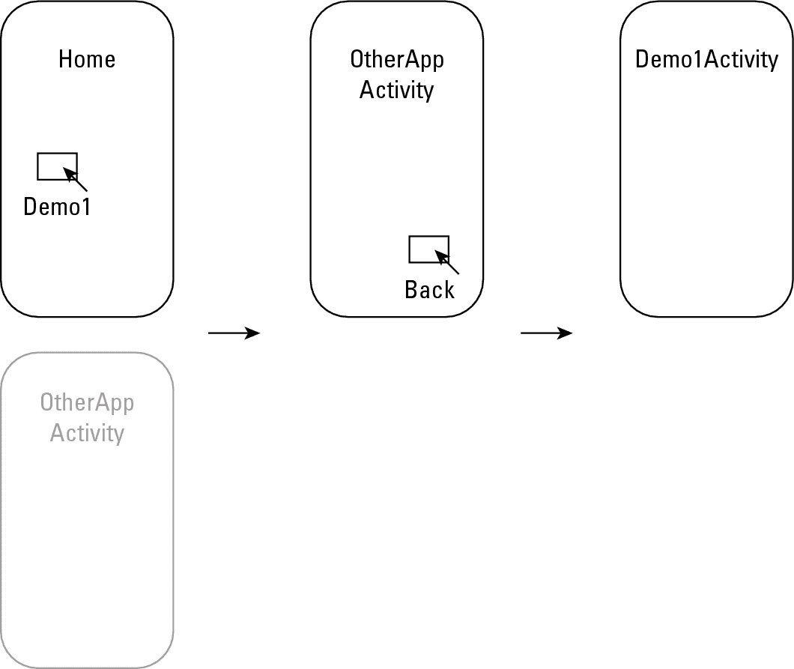

```
VERBOSE/OtherAppActivity(4697): onPause
INFO/Demo1Activity(4783): onCreate
INFO/Demo1Activity(4783): onStart
INFO/Demo1Activity(4783): onResume
VERBOSE/OtherAppActivity(4697): onStop
VERBOSE/OtherAppActivity(4697): onDestroy
```

在用户不知情的情况下，Android 已经在新进程中恢复了 `Demo1Activity`。

### 部分覆盖一个 activity

在图 1-6 中，点击“启动透明 Activity”（Start Translucent Activity）按钮的作用正如你预期的那样。该按钮让 Android 调用了一个透明的 activity。（App 开发术语往往模糊了“半透明 (translucent)”和“全透明 (transparent)”之间的区别。明白了吗？“模糊”了这种区别？）当然，除非你有一个透明的 activity 可以调用，否则你无法调用它。因此，列表 1-9 展示了如何创建一个透明 activity。

### 列表 1-9：本章大项目之一的 `AndroidManifest.xml` 文件


```xml
<?xml version="1.0" encoding="utf-8"?>
<manifest xmlns:android="http://schemas.android.com/apk/res/android"
    package="com.allmycode.demo1"
    android:versionCode="1"
    android:versionName="1.0">
    <uses-sdk android:minSdkVersion="8" />
    <application android:icon="@drawable/icon"
                 android:label="@string/app_name"
                 android:name=".Demo1App">
        <activity android:name=".Demo1Activity"
                  android:label="@string/app_name" >
            <intent-filter>
                <action android:name="android.intent.action.MAIN" />
                <category android:name="android.intent.category.LAUNCHER" />
            </intent-filter>
        </activity>
        <activity android:name=".OtherActivity" />
        <activity android:name=".TranslucentActivity"
                 android:theme="@style/Theme.Translucent" />
    </application>
</manifest>
```

要创建一个透明 `Activity`，创建一个扩展 Android `Activity` 类的 Java 类。然后，在你的 `AndroidManifest.xml` 文件中将 `Activity` 的 `theme` 声明为 Android 的 `Theme.Translucent` 样式。`TranslucentActivity` 类只有一个按钮——位于 `Activity` 的中心。因此，在点击图 1-6 中的透明 `Activity` 按钮后，我看到了图 1-11 内容。名副其实，Android 将透明 `Activity` 的按钮叠加在栈中下一个 `Activity` 之上。

参考“Activity 生命周期”中的状态列表，暂停（Paused）状态的职责之一就是存放部分遮挡的 `Activity`。因此，如果你在 Eclipse 的 `LogCat` 视图中点击透明 `Activity` 按钮，你会看到以下：

**图 1-11：** 另一个 `Activity` 之上的透明 `Activity`。

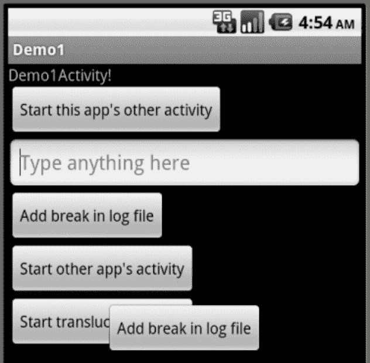

```
INFO/Demo1Activity(4783): onSaveInstanceState
INFO/Demo1Activity(4783): onPause
WARN/TranslucentActivity(4783): onCreate
WARN/TranslucentActivity(4783): onStart
WARN/TranslucentActivity(4783): onResume
```

`Demo1Activity` 暂停了但没有停止。

### 从 Activity 获取结果

在本书前面的部分，我将 `intent` 类比为方法调用。启动一个 `Activity` 时，你不是调用方法，而是触发一个 `intent`。到目前为止一切顺利。但 `intent` 的哪个功能可以替代方法调用的返回值？列表 10 和 11 给出了答案。

### 列表 1-10：请求结果的 Activity

```java
package com.allmycode.results;
import android.app.Activity;
import android.content.Intent;
import android.os.Bundle;
import android.view.View;
import android.view.OnClickListener;
import android.widget.Button;
import android.widget.TextView;

public class GetResultActivity extends Activity implements OnClickListener {
    final int MY_REQUEST_CODE = 42;
    TextView textView;
    Button button;

    @Override
    public void onCreate(Bundle savedInstanceState) {
        super.onCreate(savedInstanceState);
        setContentView(R.layout.main);
        textView = (TextView) findViewById(R.id.textView);
        button = (Button) findViewById(R.id.button1);
        button.setOnClickListener(this);
    }

    @Override
    public void onClick(View v) {
        Intent intent = new Intent();
        intent.setClassName("com.allmycode.results", "com.allmycode.results.GiveResultActivity");
        startActivityForResult(intent, MY_REQUEST_CODE);
    }

    @Override
    protected void onActivityResult(int requestCode, int resultCode, Intent intent) {
        if (requestCode == MY_REQUEST_CODE && resultCode == RESULT_OK) {
            textView.setText(intent.getStringExtra("text"));
        }
    }
}
```

### 列表 1-11：提供结果的 Activity

```java
package com.allmycode.results;
import android.app.Activity;
import android.content.Intent;
import android.os.Bundle;
import android.view.KeyEvent;
import android.view.View;
import android.view.OnClickListener;
import android.view.OnKeyListener;
import android.widget.Button;
import android.widget.EditText;

public class GiveResultActivity extends Activity implements OnKeyListener, OnClickListener {
    Button button;
    EditText editText;
    StringBuffer buffer = new StringBuffer();

    @Override
    public void onCreate(Bundle state) {
        super.onCreate(state);
        setContentView(R.layout.giver);
        editText = (EditText) findViewById(R.id.editText);
        editText.setOnKeyListener(this);
        button = (Button) findViewById(R.id.button2);
        button.setOnClickListener(this);
    }

    @Override
    public boolean onKey(View v, int keyCode, KeyEvent event) {
        buffer.append(keyCode);
        return false;
    }

    @Override
    public void onClick(View arg0) {
        Intent intent = new Intent();
        intent.putExtra("text", editText.getText().toString());
        setResult(RESULT_OK, intent);
        finish();
    }
}
```

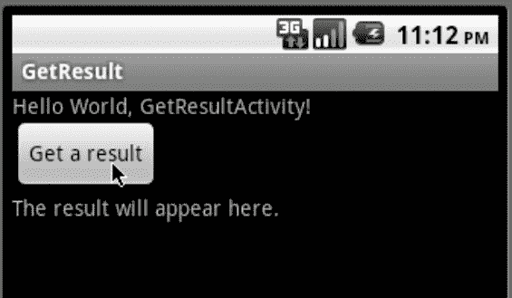

当用户点击获取结果（`Get a Result`）按钮时，Android 会调用 `startActivityForResult(intent, MY_REQUEST_CODE)`。

`startActivityForResult` 方法接收一个 `intent` 和一个请求代码。在代码列表 1-10 中，`intent` 显式地指向要启动的 `Activity`。请求代码可以是任何 `int` 值。请求代码用于在结果返回时标识该返回结果。（你可以在获取任何结果之前多次调用 `startActivityForResult`。当结果到达时，你使用请求代码来区分不同的结果。）

点击图 1-12 中的按钮后，用户会看到代码列表 1-11 中的 `GiveResultActivity`。（参见图 1-13。）

**图 1-13：** 代码列表 1-11 中的 `Activity`。


用户在图 1-13 的文本字段中输入文本，然后点击返回（`Go Back`）按钮。点击按钮会导致代码列表 1-11 中的代码创建一个 `intent`。该 `intent` 带有额外信息——即用户的文本输入。

调用 `setResult` 会发送一个结果代码（`RESULT_OK`、`RESULT_CANCELED` 或任何对接收者有意义的正 `int` 值）以及一个包含有用信息的 `intent`。

在代码列表 1-11 的末尾，`finish` 方法的调用结束了图 1-13 所示 `Activity` 的运行。屏幕返回 `GetResultActivity`。（参见图 1-14。）

**图 1-14：** 获取结果后代码列表 1-10 中的 `Activity`。

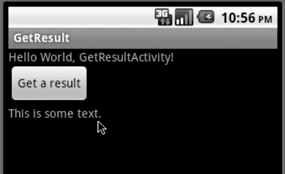

此时，Android 调用代码列表 1-10 中的 `onActivityResult` 方法。该方法会以某种方式使用结果。（在本例中，`onActivityResult` 方法简单地将结果显示在 `TextView` 元素中。）

## 应用程序也不会被遗落

在任何操作系统中，事物都在产生又消灭。用户登录和注销，`Activity` 被创建和销毁。但应用程序呢？应用程序会被创建和终止。

如果你检查代码列表 1-9，你会看到一个带有`android:name=".Demo1App"`属性的`application`元素。应用不需要`android:name`属性，但如果有该属性，你必须创建一个与你指定的名称相同的类。你可以通过这个类来跟踪应用程序的全局值（超越应用单个 `Activity` 的值）。

对`Application`类方法的调用是不可预测的。代码列表 1-12 阐明了这种情况。

### 代码列表 1-12：一个 Android 应用程序

```java
package com.allmycode.demo1;

import android.app.Application;
import android.content.res.Configuration;
import android.util.Log;

public class Demo1App extends Application {
    private static final String CLASSNAME = "Demo1App";
    @Override
    public void onCreate() {
        Log.v(CLASSNAME, "onCreate");
    }
    @Override
    public void onConfigurationChanged(Configuration config) {
        Log.v(CLASSNAME, "onConfigurationChanged");
    }
    @Override
    public void onLowMemory() {
        Log.v(CLASSNAME, "onLowMemory");
    }
    @Override
    public void onTerminate() {
        Log.v(CLASSNAME, "onTerminate");
    }
}
```

 Android 的`Application`类只有四个自己的方法——即在代码列表 1-12 中声明的方法。在之前的章节中，我没有向你展示代码列表 1-12 的日志记录。因此，如果你重新运行“重载系统”部分的实验，并且没有隐藏应用的日志条目，你就能看到。

首先，一个 `Activity` 发送一个 `intent`（意图）。然后系统会将该 `intent` 与其他 `Activity` 的意图过滤器（`intent filters`）进行比较，以找出哪些 `Activity` 具有匹配该 `intent` 的过滤器（哪些 `Activity` 可以执行所需的操作）。见图 2-1。

**图 2-1：** 寻找匹配意图的 `Activity`（或其他组件）。

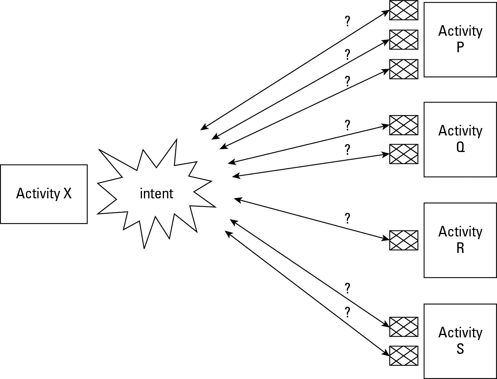

在图 2-1 中，Android 检查 `intent` 与 `Activity P` 的第一个过滤器是否匹配。如果 `intent` 不匹配 `Activity P` 的第一个过滤器，Android 会检查 `intent` 与第二个 `Activity P` 过滤器。如果 Android 在 `Activity P` 的某个过滤器中找到了匹配项，它会将 `Activity P` 标记为实现 `intent` 的一种可能方式（可能执行 `intent` 所描述的工作的可能组件）。

继续在图 2-1 中，Android 继续测试 `Activity Q`、`Activity R` 和 `Activity S` 的过滤器。Android 维护着所有至少有一个匹配过滤器的 `Activity` 列表。

* 如果恰好有一个 `Activity` 具有匹配的意图过滤器，则该 `Activity` 开始运行。

* 如果没有 `Activity` 具有匹配的意图过滤器，系统将抛出异常。

* 如果有多个 `Activity` 具有匹配的意图过滤器，系统将在匹配的 `Activity` 中进行选择，或者系统显示菜单让用户在匹配的 `Activity` 中进行选择。

 Android 的 `startActivity`、`bindService` 和 `sendBroadcast` 方法都接受 `Intent` 类型参数。因此，匹配意图的组件可以是 `Activity`、服务或广播接收器。在本章的大多数示例中，当你读到“组件”一词时，可以安全地认为它指的是“`Activity`”。有时我会模糊这些术语并用“`Activity`”作为示例，尽管更完善的解释会使用“组件”一词。

 在本微型书中，我将在第 3 章介绍服务，在第 4 章介绍广播接收器。

## 意图组成

图 2-2 显示了隐式意图（`implicit intent`）的部分。一个 `intent` 包含动作（`action`）、数据（`data`）、类别（`categories`）、额外信息（`extras`）和标志（`flags`）。这些内容可能会被省略，但 Android 对可以或不可以省略的内容以及省略的时有严格限制。

图 2-2 中的每个项目由一个或多个 Java 字符串组成。一些典型的示例值使用了斜体。因此，字符串`“android.intent.action.MAIN”`是一个示例动作值，而预定义的 `android.content.Intent.FLAG_ACTIVITY_NO_HISTORY` 常量是一个示例标志值。


 Android 意图周围的惯用法使得很难区分字符串和预定义常量。在图 2-2 中，`“android.intent.action.MAIN”`是一个字符串，而 `android.content.Intent.FLAG_ACTIVITY_NO_HISTORY` 是一个预定义常量（`android.content.Intent` 类中一个名为 `FLAG_ACTIVITY_NO_HISTORY` 的静态 final 字段）。奇怪的是，字符串`“android.content.intent.MAIN”` 中的点并没有太大意义。在任何 `android.content.intent` 类中都没有名为 `MAIN` 的成员。

 你可以在 Java 源文件中使用字符串、常量或对字符串资源的引用，但在 XML 文档中只能使用字符串。

**图 2-2：**一个 Android 意图。

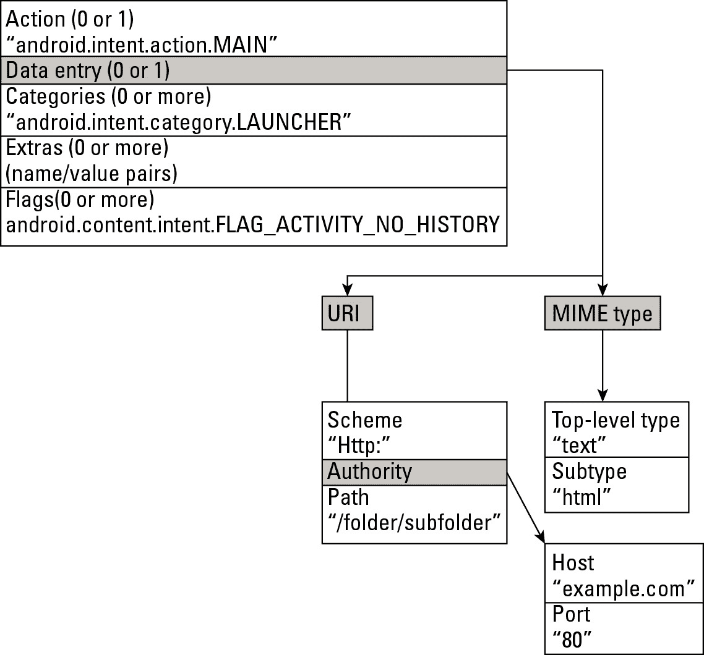

图 2-2 表示意图的数据部分有两种形式——URI 和 MIME 类型。一个意图可能这两者皆没有、只有其中之一，或者两者兼有。

继续看图 2-2，MIME 类型中的 MIME 代表多用途互联网邮件扩展（Multipurpose Internet Mail Extensions）。原始的 MIME 标准描述了可以在电子邮件中进行编码和发送的数据类型。例如，当你的电子邮件程序接收到带有 `Content-Type: text/html` 的消息时，你的程序会将消息解释为 HTML 文档，并像网络浏览器显示网页一样显示内容。当程序接收到声明为 MIME 类型 `audio/mp3`、`image/jpeg` 或 `application/zip` 的位流时，程序会将这些位解释为声音、图像或 ZIP 文件。在每种情况下，斜杠之前的单词是顶级类型，斜杠之后的单词是子类型。常见的顶级类型/子类型对包括 `text/plain`、`text/html`、`text/xml`、`image/png`、`image/jpeg` 和 `image/gif`。

 Android SDK 中的许多名称使用了缩词 `type` 而不是全称 `MIME type`。

 与普通电子邮件处理中使用 MIME 类型不同，Android 的 MIME 类型匹配是区分大小写的。因此，意图中的 `TEXT/PLAIN` 不匹配过滤器中的 `text/plain`。Android 开发者指南建议在 MIME 类型名称中仅使用小写字母。

统一资源定位符（URL）是当有人问起“我可以在网上找到那个？”时，你口出的任何熟悉的网络地址。统一资源标识符（URI）看起来像 URL，但 URI 描述的内容不仅仅是页面。

## 统一资源标识符

统一资源定位符（URL）是当有人问“我可以在网上找到那个？”时，你口出的任何熟悉的网络地址。统一资源标识符（URI）看起来像 URL，但 URI 描述的内容不仅仅是页面。每个 URL 都是 URI，但 URI 并不都是 URL。某些 URI 并不定位内容。

**图 2-3：**统一资源标识符。

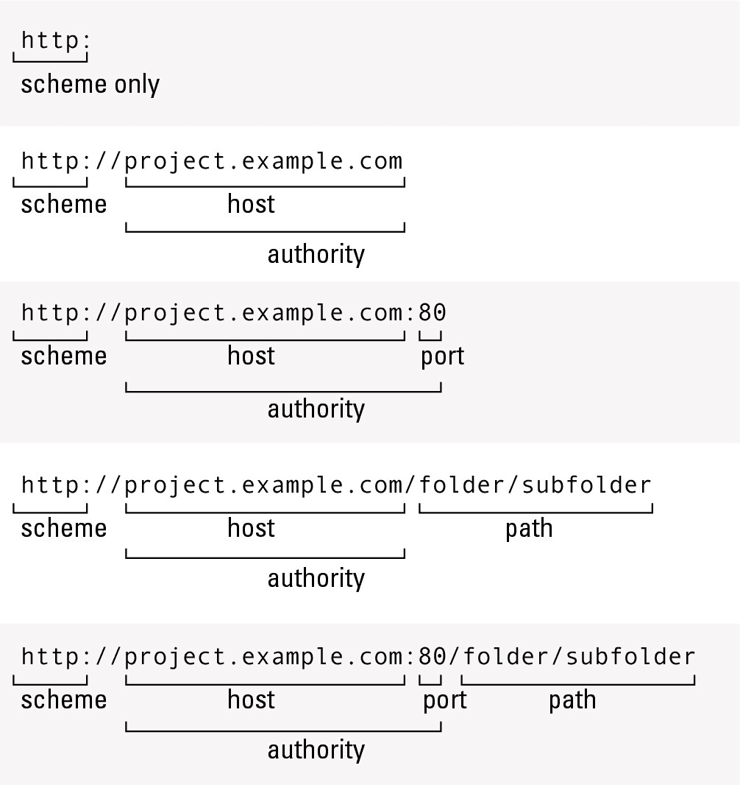

 我在图 2-3 中所示的 URI 是层次级 URI。层次级 URI 的替代方案是不透明 URI。不透明 URI（如 `tel:650253` 或 `mailto:allcode.com`）使用冒号而不是 `://`。此外，在不透明 URI 中，冒号之后的内容取决于方案。事实上，在不透明 URI 中，冒号之后的是 URI 的方案特定部分。例如，在 URI `mailto:allcode.com` 中，方案是 `mailto`，方案特定部分是 `allcode.com`。不透明 URI 既没有权威也没有路径。

### 什么是 URL？

如果你不是住在石头底下，你就用过成百上千的 URL（统一资源定位符）。正如名称所示，URL 定位资源。例如，[`www.panynj.gov:80/path`](http://www.panynj.gov:80/path) 定位了港务管理局网站（一个负责在纽泽西和纽约市之间运行火车的机构）的主页。该 URL 的方案是 `http`。它的主机是 `www.panynj.gov`。它的端口是 `80`。它的权威是 `www.panynj.gov:80`。它的路径恰好是 `/path`。

每个 URL 都是 URI（统一资源标识符），但 URI 并不都是 URL。某些 URI 并不定位内容。例如，每个 `AndroidManifest.xml` 文档包含属性 `xmlns:android="http://schemas.android.com/apk/res/android"`。该 URI 的方案是 `http`。主机和权威都是 `schemas.android.com`。（此 URI 没有端口。）该 URI 的路径是 `/apk/res/android`。

如果你在网络浏览器地址栏中输入 `http://schemas.android.com/apk/res/android`，你的浏览器将无处可去。URI `http://schemas.android.com/apk/res/android` 并不定位任何内容。就像许多 XML 文档开头的 URI 一样，这个 URI 仅仅是一个名称。这个 URI 是 URN（统一资源名称）。根据互联网工程任务组文档 RFC 3986，URN “即使资源消失或不可用，也要求保持全局唯一和持久 . . . ”换句话说，URN 命名某个东西——一个名称始终有效的东西——一个可能永远不需要被找到的东西。

这是另一个例子。Android SDK 包含一个充满示例应用程序的文件夹。其中一个程序（`SearchableDictionary` 示例）使用了 URI `content://com.example.android.searchable dict.DictionaryProvider/ dictionary`。该 URI 的方案（scheme）是 `content`，依此类推。这个 URI 在网络浏览器的地址栏中无法工作。但在 Android 的 `SearchableDictionary` 示例中，URI 定位了一个特定的内容提供者（在本例中，是一个字典单词和定义的提供者）。URI 定位的内容并不非要是网页。

世界维网联盟（W3C）正在研究 IRI（国际化资源标识符）。IRI 类似于 URI，不同之处是 IRI 的字符不受限于罗马字母表中的字符。下图展示了一个 IRI 的示例。


## 过滤器（intent filter）的组成

你的应用创建一个意图（intent），然后调用 `startActivity(intent)`。接着发生了什么？Android 设备上安装了一系列活动（activities），每个活动都有自己的意图过滤器（intent filters）。Android 尝试将意图与每个意图过滤器进行匹配。如果某个活动具有任何匹配的意图过滤器，该活动就会进入 `startActivity` 方法的可能响应者列表。

活动不匹配的过滤器不会损害该活动进入列表的机会。即使该活动只有一个过滤器匹配成功，该活动仍会进入可能响应者列表。

那么，什么构成了意图与意图过滤器之间的匹配呢？你这个问题问得真好！答案并不简单。

意图过滤器可以包含动作（actions）、数据项（data entries）和类别（categories）。与意图不同，意图过滤器可以有多个动作和多个数据项。与意图一样，意图过滤器也可以有多个类别。意图过滤器没有额外属性（extras）或标志（flags）（见图 2-4）。

**图 2-4：**意图过滤器的组成部分。

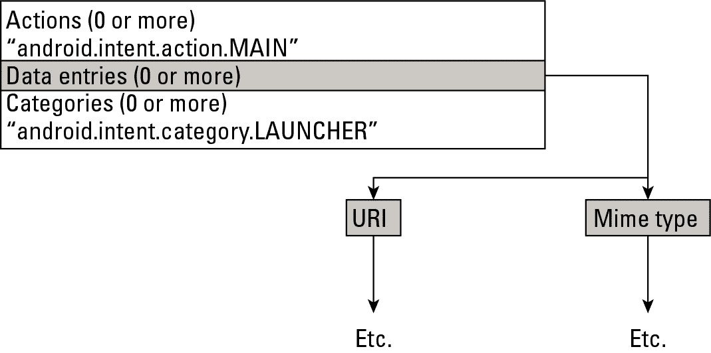

为了找到隐式意图与意图过滤器之间的匹配，Android 会进行三次测试：

• Android 测试意图的动作与过滤器的动作是否匹配。

• Android 测试意图的类别与过滤器的类别是否匹配。

• Android 测试意图的数据与过滤器的数据是否匹配。

Android 匹配意图动作与过滤器动作的规则相当简单。匹配意图类别与过滤器类别的规则还可以。但这两条规则都不是那种朗朗上口的、单句口号。而匹配意图数据与过滤器数据的规则则相当复杂。遗憾的是，关于过滤器匹配的官方文档（[`http://developer.android.com/guide/topics/intents/intents-filters.html`](http://developer.android.com/guide/topics/intents/intents-filters.html)）含义模糊，且包含一些错误。

因此，为了帮助你理解意图是如何匹配意图过滤器的，我采用了多方面的方法。（这是一种高级说法，意思是我会用几种不同的方式解释几次匹配过程。）

## 匹配：使用（幼稚的）类比的总体概念

两类人报名参加了一场相亲活动。在房间的一侧，每个参与者代表 Android 意图的一个部分。（所以一个人代表动作，接下来的两个人代表类别，依此类推。我警告过你这个类比会很幼稚！）在房间的另一侧，每个参与者代表过滤器的一个部分。（见图 2-5。）

**图 2-5：**相亲活动中的意图元素和过滤器元素。

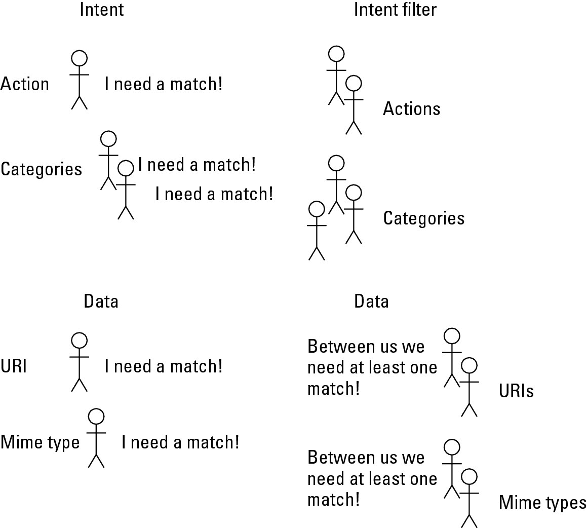

就像所有的约会场合一样，房间里的人数可能会失衡。过滤器可能有更多的动作或更多的类别。意图可能有更多的数据。这几乎从不是那种一对一的童话式组合。

在这个领域，有些人比其他人更“迫切”（needier）。例如，在意图端，你有一个动作坚决要在过滤器中找到匹配项。在过滤器端，你有一个类别仅仅是为了陪朋友来参加相亲的。这个漫不经心的类别并不需要在意图的类别中找到匹配项。

作为一个快速（且不完全准确）的规则：当且仅当每个迫切的人都找到匹配项时，整个意图才匹配整个过滤器。任何不迫切的人都不需要匹配。也就是说，即使那些为了凑热闹的人没有找到匹配项，整个相亲活动也是成功的。不迫切的部分不会偏离意图与过滤器之间的整体匹配。

那么谁是迫切的，谁是不迫切的呢？图 2-5 给你提供了一个大致的思路。

 图 2-5、2-6 和 2-7 中的匹配规则是通用指南。官方规则包含一些重要的例外。欲需更多信息，请参阅接几节。

## 真实情况

意图过滤器有三个部分：动作、类别和数据。如果动作、类别和数据都匹配，则意图过滤器匹配该意图。

匹配意图动作与过滤器动作的规则相当简单。匹配意图类别与过滤器类别的规则还可以。然而，匹配意图数据与过滤器数据的规则相当复杂。

## Java 方法与 XML 元素

你可以在 `AndroidManifest.xml` 或 Java 代码中描述意图过滤器。在 `AndroidManifest.xml` 文档中，`<intent-filter>` 有 `<action>`、`<category>` 和 `<data>` 子元素。

```xml
<intent-filter>
    <action android:name="string" />
    <category android:name="string" />
    <data android:scheme="string"
          android:host="string"
          android:port="string"
          android:path="string"
          android:pathPattern="string"
          android:pathPrefix="string"
          android:mimeType="string" />
</intent-filter>
```

意图方法与数据元素的属性并不是对应的。例如，通过意图的 `setAction` 方法，你设置意图的动作（如果意图需要动作）。但通过过滤器的 `<action>` 元素，你向过滤器添加多个动作中的一个。通过意图的 `setData` 方法，你设置意图的 URI（如果意图需要 URI）。但通过过滤器的 `<data>` 元素，你添加 URI 的各个部分。

你通常在 `AndroidManifest.xml` 文件中设置过滤器值。但在 Java 代码中，`android.content.IntentFilter` 类有很多实用的方法。我在这里列出几个：

- `addAction`: 向过滤器添加一个动作。

- `addCategory`: 向过滤器添加一个类别。

- `addDataScheme`: 向过滤器添加一个方案。

- `addDataAuthority`: 向过滤器添加一个权限。

- `addDataPath`: 向过滤器添加一个路径。

- `addDataType`: 向过滤器添加一个 MIME 类型。

正如 intent 方法和数据元素属性一样，intent 方法和 filter 方法之间并不是一一对应的。intent 的 `setAction` 方法执行的是显而易见的操作——它设置 intent 的 action（如果你希望 intent 拥有 action）。然而，filter 的 `addAction` 方法允许你向 filter 添加可能存在的多个 action 之一。intent 的 `setData` 方法设置 intent 的 URI（如果你希望 intent 拥有 URI）。另一方面，filter 的 `addDataScheme`、`addDataAuthority` 和 `addDataPath` 方法则允许你分段地添加 URI 的各个部分。

### 匹配 action

根据图 2-5 所示，intent 的 action 必须与 filter 的 action 之一匹配。这是很有道理的，因为 intent 的 action 表示的是：“我想要一个可以执行某项任务的组件。”而 filter 的 action 表示的是：“我可以执行某项任务。”filter 可能有其他 action（能够执行其他事情），但拥有额外的 filter action 并不会阻止 intent 与 filter 匹配。

action 到底是什么？最简单的回答是 action 是一个字符串。你可以创建自己的 action 字符串 `“thisismyaction”` 或 `“allmy code.intent.action.DO_THIS”`——Android 文档推荐后者的形式。但 Android 还有许多标准 action——为某些特定工作预留的 action。例如，当开发者创建一个可以显示内容（文档、网页、图像或任何内容）的 activity 时，开发者会在 activity 的 filter 中包含 `“android.intent.action.VIEW”`。然后，当你想要他人的 activity 显示某些内容时，就在你的 intent 中放入 `“android.intent.action.VIEW”`（或常量 `android.content.Intent.ACTION_VIEW`，其值为 `“android.intent.action.VIEW”`）。

表 2-1 列出了我最喜欢的一些标准 action。

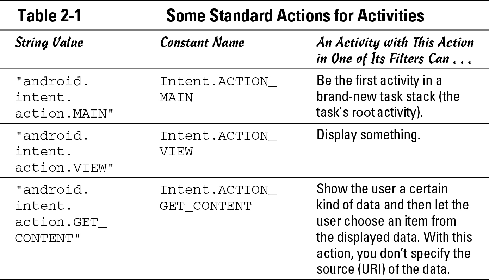

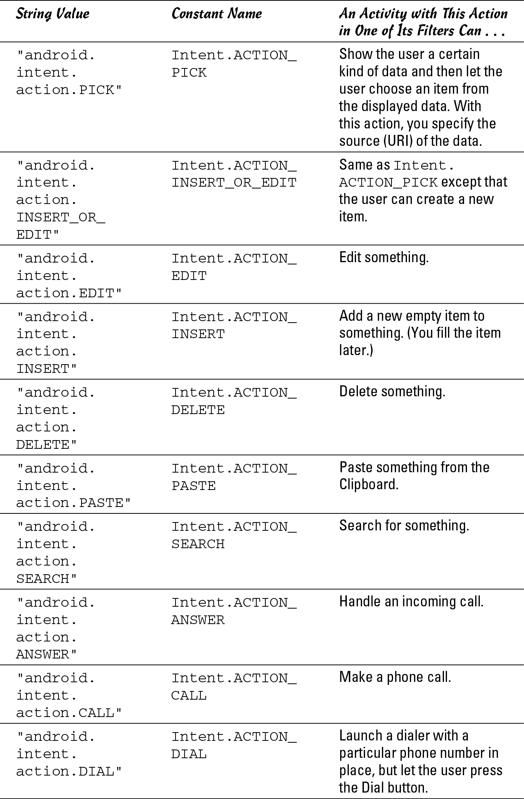


 欲查看 Android 标准 action 列表，请访问 [`http://developer.android.com/reference/android/content/Intent.html`](http://developer.android.com/reference/android/content/Intent.html)。

这里有一个用的实验：

1. 创建一个包含两个 activity 的新 Android 项目——由 Eclipse 创建的主 activity 和第二个 `OtherActivity.java` activity。

2. 向项目的 `AndroidManifest.xml` 文件中添加以下 `activity` 元素：

```xml
<activity android:name=”.OtherActivity”>
  <intent-filter>
    <action
      android:name=”com.allmycode.action.MY_ACTION” />
    <category
      android:name=”android.intent.category.DEFAULT” />
  </intent-filter>
</activity>
```

3. 在主 activity 中添加以下代码：


```java
final String THE_ACTION =
    "com.allmycode.action.MY_ACTION";
Intent intent = new Intent();
intent.setAction(THE_ACTION);
startActivity(intent);
```

4. 使用 Eclipse 的图形化布局编辑器更改另一个 activity 的布局。

任何更改都是可以的。更改另一个 activity 布局的唯一理由是帮助你识别两个 activity（主 activity 或另一个 activity）哪一个在模拟器屏幕上。

5. 运行项目。

一旦你的模拟器执行了第 3 步中的代码，Android 就会启动另一个 activity。intent 的`"com.allmycode.action.MY_ACTION"`匹配 filter 的`"com.allmycode.action.MY_ACTION"`，因此另一个 activity 开始运行。

 真正的 Android 开发者使用标准 action（如表 2-1 中的 action），或者他们会编写点分隔的 action 名称，例如`"com.allmy code.action.MY_ACTION"`。真正的开发者会在`AndroidManifest.xml`文件中输入那个`"com.allmy code.action.MY_ACTION"`字符串（因为必须这样做）。但在 Java 代码中，真正的开发者会创建一个常量值来表示该字符串（因为这是良好的编程习惯）。

 本节说明第 2 步中的`category`元素是一个异常，我在稍后的章节“细节说明”中介绍它。如果你不想跳转到该章节，只需为你的`AndroidManifest.xml`文件中的每个 filter 添加 category`"android.intent.category.DEFAULT"`即可。

继续实验 . . .

6. 从项目的`AndroidManifest.xml`中注释掉（或删除）以下元素：

```xml
<action name="com.allmycode.action.MY_ACTION" />
```

7. 运行你的项目。

当你的模拟器执行第 3 步中的代码时，Android 启动另一个 activity。intent 的`"com.allmycode.action.MY_ACTION"`匹配 filter 的`"com.allmycode.action.MY_ACTION"`，因此另一个 activity 开始运行。

 真正的 Android 开发者使用标准 action（如表 2-1 中的 action），或者他们会编写点分隔的 action 名称，例如`"com.allmy code.action.MY_ACTION"`。真正的开发者会在`AndroidManifest.xml`文件中输入那个`"com.allmy code.action.MY_ACTION"`字符串（因为必须这样做）。但在 Java 代码中，真正的开发者会创建一个常量值来表示该字符串（因为这是良好的编程习惯）。

 本节说明第 2 步中的`category`元素是一个异常，我在稍后的章节“细节说明”中介绍它。如果你不想跳转到该章节，只需为你的`AndroidManifest.xml`文件中的每个 filter 添加 category`"android.intent.category.DEFAULT"`即可。

考虑使用以下 Java 代码创建的猫咪意图（kitty-cat intent）：

```java
final String THE_ACTION = "com.allmycode.action.MY_ACTION";
final String THE_CATEGORY = "com.allmycode.category.KITTY";
Intent intent = new Intent();
intent.setAction(THE_ACTION);
intent.addCategory(THE_CATEGORY);
startActivity(intent);
```

该猫咪意图匹配以下 XML 代码的过滤器：

```xml
<activity android:name=".OtherActivity">
  <intent-filter>
    <action android:name="com.allmycode.action.MY_ACTION" />
    <category android:name="com.allmycode.category.KITTY" />
    <category android:name="android.intent.category.DEFAULT" />
  </intent-filter>
</activity>
```

猫咪意图也匹配以下意图，因为（在快速相亲语言中）过滤器的类别是不够挑剔的：

```xml
<activity android:name=".OtherActivity">
  <intent-filter>
    <action android:name="com.allmycode.action.MY_ACTION" />
    <category android:name="com.allmycode.category.KITTY" />
    <category android:name="Otto.Schmidlap" />
    <category android:name="android.intent.category.DEFAULT" />
  </intent-filter>
</activity>
```

猫咪意图不匹配以下意图，因为意图的类别是挑剔的：

```xml
<activity android:name=".OtherActivity">
  <intent-filter>
    <action android:name="com.allmycode.action.MY_ACTION" />
    <category android:name="Otto.Schmidlap" />
    <category android:name="android.intent.category.DEFAULT" />
  </intent-filter>
</activity>
```

## 匹配数据

图 2-5 展示了意图数据与过滤器数据之间一种有趣的关系：

- 如果意图拥有 URI，或者过滤器拥有 URI，那么过滤器的 URIs 之一必须匹配意图的 URI。

- 如果意图拥有 MIME 类型，或者过滤器拥有 MIME 类型，那么过滤器的 MIME 类型之一必须匹配意图的 MIME 类型。

这些规则还有一些推论：

- 没有 URI 的意图无法匹配没有 URI 的过滤器。没有 URI 的过滤器无法匹配没有 URI 的意图。

- 没有 MIME 类型的意图无法匹配没有 MIME 类型的过滤器。没有 MIME 类型的过滤器无法匹配没有 MIME 类型的意图。

所有这些关于 URI 和 MIME 类型的内容是如何自圆其说的的呢？关键在于，在匹配过滤器和意图时，数据起的作用与 action 或 category 并不相同。想象一下，一个意图声明：“我想要一个组件来执行`android.intent.action.VIEW`”，而某个 Activity 的过滤器声明：“我可以执行`android.intent.action.VIEW`。”意图并不不在乎过滤器是否声明了它还能执行其他操作。

但如果意图声明：“我想要一个组件来处理 URI `tel:6502530000`”呢？（URI `tel:6502530000` 会拨打向位于加利福尼亚州山景城的 Google 公司总部的电话。）一个合适的过滤器包含`tel`方案。（见图 2-6。）现在想象另一个意图没有`tel:` URI，而一个过滤器的唯一方案是`tel`方案。（再次见图 2-6。）在这种情况下，过滤器说：“我可以用电话号码做一些有用的事情，当我被调用时，我期望接收到一个电话号码。”如果意图没有`tel:` URI，则这种匹配是不合适的。

因此，意图数据与过滤器数据之间的耦合比 action 之间的耦合或 category 之间的耦合更强。对于数据中的 URI 部分，意图和过滤器都是挑剔的。数据的 MIME 类型也是如此。

**图 2-6：** 匹配 tel 方案。

![9781118027707-fg03206.jpeg]

以下意图和过滤器构成了一个匹配项：

```java
final String THE_ACTION = "com.allmycode.action.MY_ACTION";
Intent intent = new Intent();
intent.setAction(THE_ACTION);
intent.setData(Uri.parse("http:"));
startActivity(intent);
```

```xml
<intent-filter>
  <action android:name="com.allmycode.action.MY_ACTION" />
  <category android:name="android.intent.category.DEFAULT" />
  <data scheme="http" />
  <data scheme="mymscheme" />
</intent-filter>
```

带有稍作修改过滤器的相同意图并不构成匹配，因为过滤器中的 MIME 类型集是挑剔的：

```xml
<intent-filter>
  <action android:name="com.allmycode.action.MY_ACTION" />
  <category android:name="android.intent.category.DEFAULT" />
  <data scheme="http" />
  <data scheme="mymscheme" />
  <data mimeType="text/html" />
</intent-filter>
```

要匹配这个修改后的过滤器，你需要以下意图之一：

```java
final String THE_ACTION = "com.allmycode.action.MY_ACTION";
Intent intent = new Intent();
intent.setAction(THE_ACTION);
intent.setData(Uri.parse("http:"));
startActivity(intent);
```

```java
final String THE_ACTION = "com.allmycode.action.MY_ACTION";
Intent intent = new Intent();
intent.setAction(THE_ACTION);
intent.setDataAndType(Uri.parse("mymscheme:"), "text/html");
startActivity(intent);
```

最后，以下意图和过滤器构成匹配，因为意图中的 MIME 类型匹配过滤器中的 MIME 类型之一：

```java
final String THE_ACTION = "com.allmycode.action.MY_ACTION";
Intent intent = new Intent();
intent.setAction(THE_ACTION);
intent.setType("text/html");
startActivity(intent);
```

```xml
<intent-filter>
  <action android:name="com.allmycode.action.MY_ACTION" />
  <category android:name="android.intent.category.DEFAULT" />
  <data mimeType="abc/xyz" />
  <data mimeType="text/html" />
</intent-filter>
```

## 匹配数据

本章前面的“Java 方法与 XML 元素”列出了方法和元素。通过意图的`setData`方法设置意图的 URI（如果你希望意图拥有 URI）。通过过滤器的`<data>`元素添加 URI 的各个部分。过滤器的片段并不需要完全匹配。例如，以下意图和过滤器构成匹配：

```java
final String THE_ACTION = "com.allmycode.action.MY_ACTION";
Intent intent = new Intent();
intent.setAction(THE_ACTION);
intent.setData(Uri.parse("abc://example.com:2222"));
startActivity(intent);
```

```xml
<intent-filter>
  <data scheme="xyz" host="example.com" />
  <data port="2222" />
  <action android:name="com.allmycode.action.MY_ACTION" />
  <category android:name="android.intent.category.DEFAULT" />
  <data scheme="abc" />
</intent-filter>
```

过滤器可以拥有`abc`和`xyz`方案，以及`example.com`。那么过滤器数据就能匹配意图数据`abc://example.com`和意图数据`xyz://example.com`。即使你把`xyz`和`example.com`放在同一个`<data>`元素中，这同样有效。

通过过滤器的`addDataScheme`、`addDataAuthority`和`addDataPath`方法，你可以分别添加 URI 的各个部分。例如，以下意图和过滤器构成匹配：

```java
final String THE_ACTION = "com.allmycode.action.MY_ACTION";
Intent intent = new Intent();
intent.setAction(THE_ACTION);
intent.setData(Uri.parse("abc://example.com:2222"));
startActivity(intent);
```

```java
final IntentFilter filter = new IntentFilter();
filter.addAction(THE_ACTION);
// Constant com.content.Intent.CATEGORY_DEFAULT has
//  value "android.intent.category.DEFAULT"
filter.addCategory(Intent.CATEGORY_DEFAULT);
filter.addDataScheme("abc");
filter.addDataScheme("xyz");
filter.addDataAuthority("example.com", "2222");
```

此时，有几点观察需要说明。

- 一个意图（intent）有三种相似的方法：`setData`、`setDataAndType`和`setType`。对于带有 URI 但没有 MIME 类型的图，调用`setData`。对于有 MIME 类型但没有 URI 的意图，调用`setType`。只有对于同时具有 URI 和 MIME 类型的意图，才调用`setDataAndType`。

- 你不需要向`setData`方法或`setDataAndType`方法的参数传递字符串。你传递的是`android.net.Uri`类的实例。你通过对字符字符串应用`Uri.parse`方法来实现这一点。

- 这是一个虽然愚蠢但重要的细节：调用`intent.setData(Uri.parse("http:"))`时，由于`http`后面带有一个冒号，它会匹配过滤器元素`<data android:scheme="http" />`（而注意后者的`http`后面没有冒号）。URI 方案中其他冒号/无冒号的组合都无法匹配。

## 匹配 URI

图 2-5 展示了意图部分与意图过滤器（intent filter）之间的一场想象中的速会活动。该图并没有讨论一个 URI 与另一个 URI 的匹配问题。所以，想象图 2-5 中的 URI 带着它们心爱的小孩子（它们的方案、授权和路径）参加了这场速会。随着傍晚的开始，孩子们进入另一个单独的房间参加他们自己的速会。（当然，他们还太小，不能约会。但这对青少年期来说是很好的练习。）图 2-7 展示了孩子们活动中的“需求感”状况。

URI 孩子们的情况与所有数据的情况类似。只要意图侧的每个东西都能匹配过滤器侧的某个东西，大家就是开心的。例如，以下意图和过滤器形成了匹配：


```java
final String THE_ACTION = “com.allmycode.action.MY_ACTION”;
Intent intent = new Intent();
intent.setAction(THE_ACTION);
intent.setData(Uri.parse(“``abc://example.com:2222``”));
startActivity(intent);

<intent-filter>
  <action android:name=”com.allmycode.action.MY_ACTION” />
  <category android:name=”android.intent.category.DEFAULT” />
  <data android:scheme=”``abc``” />
</intent-filter>
```

**图 2-7：** 在 URI 的部分中，谁需要遇到某人？

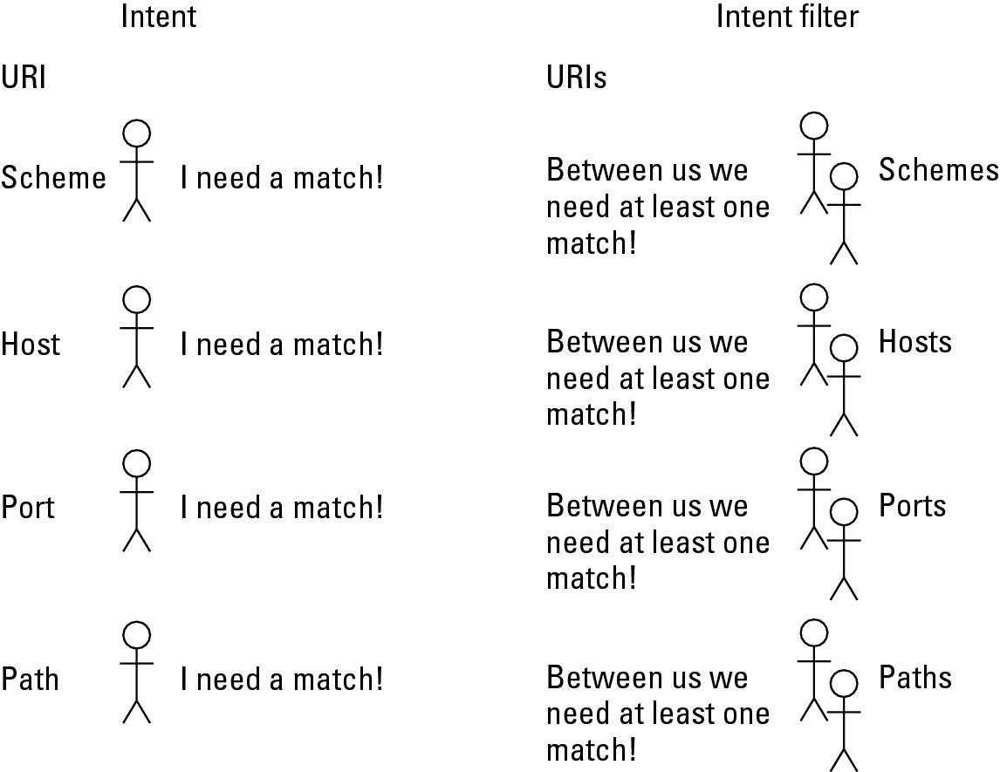

但使用同一个意图，以下过滤器并不匹配：

```xml
<intent-filter>
  <action android:name=”com.allmycode.action.MY_ACTION” />
  <category android:name=”android.intent.category.DEFAULT” />
  <data android:scheme=”abc” />
  <data android:host=”example.com” />
  <data android:port=”2222” />
  <data android:path=”/some/stuff” />
</intent-filter>
```

## 细节说明

在前面的几节中对过滤器匹配进行了如此大量的讨论，你可能会认为问题已经解决了。但工作永远没有完结的。以下是过滤器匹配中最重要的陷阱（gotchas）和异常列表：

- Android 对 activity 的处理与其他组件（如 service 和广播接收器）不同。

你可以创建一个没有 action 的隐式意图。如果你这样做，调用`startActivity(intent)`将不会在任何 activity 过滤器中找到匹配项。然而，调用`sendBroadcast(intent)`或`bindService(intent, ...)`可能会找到匹配。

 根据 Android 文档，“……一个没有指定 action 的 Intent 对象会自动通过测试——只要过滤器包含至少一个 action。” 就我所知，文档中的这一表述是不正确的。

- 在类别（categories）方面，Android 对 activity 的处理与其他组件不同。

当你尝试启动一个 activity 时，Android 的行为就像意图包含了`“android.intent.category.DEFAULT”`类别。（即使你没有执行代码将该类别添加到意图中，Android 也会这样做。）由于由于，没有`“android.intent.category.DEFAULT”`类的 activity 过滤器永远不会匹配意图。

 用户首次点击应用图标时启动的 activity 是该应用的主活动（main activity）。主 activity 的过滤器通常包含 action`“android.intent.action.MAIN”`和类别`“android.intent.category.LAUNCHER”`。如果你想让一个 activity 作为主活动运行（且永远不会通过应用的`startActivity`调用启动），你可以安全地从 activity 中省略`“android.intent.category.DEFAULT”`。

- 在 URI 的部分中，谁需要遇到某人？

- 使用同一个意图，以下过滤器并不匹配：

- 在前面的几节中对过滤器匹配进行了如此大量的讨论，你可能会认为问题已经解决了。

- 除了主机名（host name）之外，意图及其过滤器中的字符串是区分大小写的。

- 等等，Android 对 activity 的处理与其他组件（如 service 和广播接收器）不同。

- 你可以创建一个没有 action 的隐式意图。如果你这样做，调用`startActivity(intent)`将不会在任何 activity 过滤器中找到匹配项。

- 在类别方面，Android 对 activity 的处理与其他组件不同。

- 用户首次点击应用图标时启动的 activity 是该应用的主活动。

- 某些部分可能包含通配符或简化的正则表达式。

- `text/*`类型匹配`text/plain`。

- `text/*`类型也匹配`text/html`和`text/whatever`。

- `*/*`类型匹配`text/plain`。

- `*/*`类型也匹配`image/jpeg`等。

- `*`（没有斜杠的单个通配符）和`*/html`似乎不匹配任何东西。

- `text/ht*`类型不匹配`text/html`。

- 等等等等等等等等等等等。

- 路径使用简化的正则表达式形式。（也就是说，路径可以包含通配符和其他奇的符号。）例如，意图 URI`http://example.com/folder`匹配方案为`http`、授权为`example.com`路径模式为`/fol.*`的过滤器 URI。

如果我每误解一次 Android`Intent Filters`文档就能得到一分硬币，我有足够的钱加满我的油箱了。（这挺了不起的，不是吗？）我希望本章中关于意图过滤器匹配的章节是清晰且无歧义的。但内心深处，我知道几乎所有的口语句子都是移动目标。以以下句子为例：

*   把妈妈放在我们身后的车里。

*   我想让大卫·科珀菲尔德读书。

*   我会给自己贴上绷带。

*   所有东西不应该是蓝色的。

*   这种药每天吃三次，直到吃完。

*   我为每个人省了五美元。

*   拖车费由车主承担。

*   我们的奶油非常温和，即使在刮脸后也不会让大多数人感到刺痛。

*   我希望有一天你能像爱艾米一样爱我。

*   如果他发现野熊和狗是亲戚，而且不会伤害人类，他会更开心。

检验你理解程度最好的方法不是你在阅读此本书段落时点头的样子。相反，最好的测试是你在模拟器或设备上尝试你自己的例子。如果你能在大多数情况下准确地预测结果，你就理解了该主题。

遗憾的是，测试意图和过滤器匹配可能是枯燥的。每更改一次，你都必须编辑 Java 代码，然后编辑`AndroidManifest.xml`文件，最后重新安装应用。早些时候，在经历了几个小时这样的测试后，我简直“气疯了，再也无法忍受”。我写了一个应用来逐一个测试过滤器匹配，而无需修改文件或重新安装任何内容。我将其命名为 Intentsity 应用（因为作为作者，我厌倦了担心拼写是否正确的问题）。不用说，你可以通过本书的网站使用该应用——[`www.allmycode.com/android`](http://www.allmycode.com/android)。（你以后可以再感谢我。）

该应用主界面的上半部分如图 2-8 所示。

**图 2-8：** 输入意图和意图过滤器字符串的屏幕。

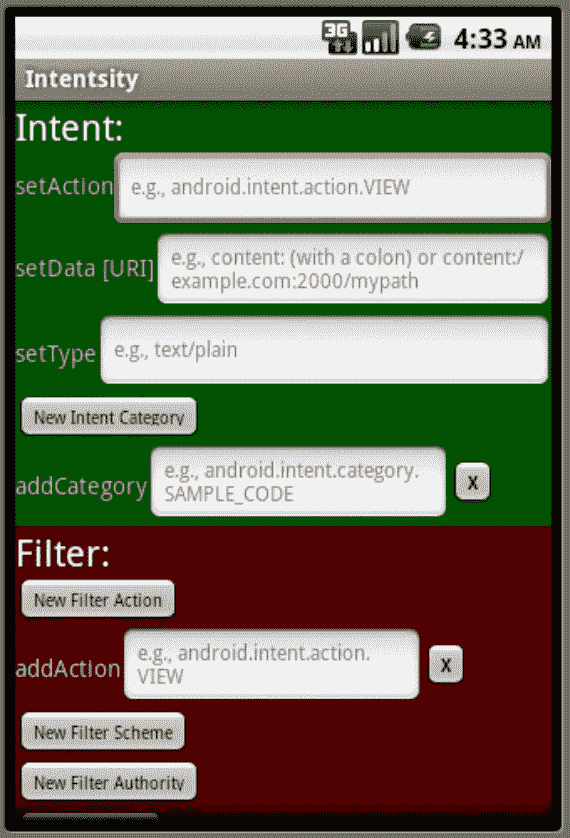

Intentsity 应用的屏幕有一个`Intent`部分和一个`Filter`部分。这两个部分都有用于填写`String`值的`EditText`字段。每个`EditText`字段代表一个`Intent`实例方法或一个`IntentFilter`实例方法。（此类方法的列表，请参见本章前面的“Java 方法和 XML 元素”部分。）

 Android 没有使用 Java 代码设置 Activity 意图过滤器的功能。但你可以创建另一个组件——广播接收器——并使用 Java 代码设置广播接收器的过滤器。（你使用“Java 方法和 XML 元素”部分中描述的`IntentFilter`方法调用）。因此，我的 Intentsity 应用通过尝试与广播接收器通信来测试你在`EditText`字段中输入的值。应用下半部分的字段（Filter 字段）与创建`IntentFilter`对象的 Java 方法匹配，而不是与`AndroidManifest.xml`文档中的属性匹配。为了尽可能忠于 Android 的真实行为，我的应用尊重广播接收器的过滤器可以不需要类别`“android.intent.category.DEFAULT”`这一事实。因此，当你从 Intentsity 应用转移到自己的项目时，请记住向你的 Activity 过滤器添加`“android.intent.category.DEFAULT”`。

本章前面的“Java 方法和 XML 元素”部分列出了`setAction`和`addCategory`等方法。以`set`开头的方法用于意图的动作（action），因为意图不能有多个动作。以`add`开头的方法用于意图的类别（category），因为意图可以有多个类别。

图 2-8 显示了一个“New Intent Category”（新建意图类别）按钮。当你点击此按钮时，应用会创建一个额外的`addCategory`行。

图 2-9 显示了 Intentsity 应用滚动屏幕的底部。

**图 2-9：** 按 Test 匹配。

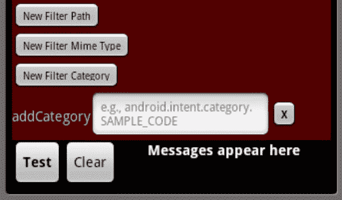

填写一些`EditText`字段后，点击 Test 按钮，应用就会执行它最擅长的工作：

*   应用调用`Intent`类的方法，根据你的 Intent 字段条目组合一个意图。

*   应用调用`IntentFilter`类的方法，根据你的 Filter 字段条目组合一个过滤器。

*   应用调用`registerReceiver(myReceiver, filter)`创建带有新过滤器的广播接收器。

*   应用调用`sendBroadcast(intent)`向系统所有的广播接收器发出广播。

如果接收器的过滤器匹配你的意图，接收器将显示类似图 2-10 所示的屏幕。

**图 2-10：** 匹配成功！

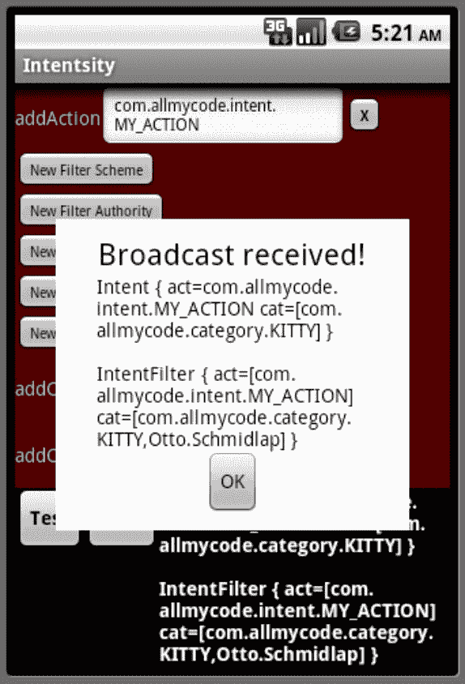

无论是否匹配，应用都会显示你的意图和意图过滤器的`toString`版本。图 2-10 显示了显示内容。

```java
private Intent IntentFromTextFields() {
    String theAction = actionText.getText().trim();
    Intent intent = new Intent();
    if (theAction.length() != 0) {
        intent.setAction(theAction);
    }
    if (intentCategoriesLayout != null) {
        int count = intentCategoriesLayout.getChildCount();
        for (int i = 0; i < count; i++) {
            String cat = ((EditText) ((ViewGroup) intentCategoriesLayout.getChild(i)).getText().trim();
            if (cat.length() != 0) {
                intent.addCategory(cat);
            }
        }
    }
    // 等等，等等，...
    return intent;
}
```

### 使用 ScrollView

应用主界面占据的空间比手机上通常提供的空间更多。因此，我将整个屏幕封装在`ScrollView`中。正如其名，`ScrollView`允许用户在其他内容滑出屏幕时将其滑入屏幕。`ScrollView`的主要限制是它只能包含一个直接子元素。因此在下面的代码中，你不能在结束标签`</LinearLayout>`和`</ScrollView>`之间放置另一个`View`元素：

```xml
<?xml version="1.0" encoding="utf-8"?>
<ScrollView xmlns:android="http://schemas.android.com/apk/res/android"
    android:id="@+id/scrollView1"
    android:layout_width="match_parent"
    android:layout_height="wrap_content">
    <LinearLayout android:orientation="vertical"
        android:layout_width="match_parent">
        <!-- 更多布局内容
             位于 LinearLayout 内部。
             这些内容可能包括额外的视图元素。 -->
    </LinearLayout>
</ScrollView>
```

```xml
  </LinearLayout>
    <!-- No additional view elements may appear here. -->
</ScrollView>
```

# 在 Java 代码中定义布局

通过我的 Intentsity 应用，用户可以向现有布局添加新元素。Android 拥有一个`ListView`类，用于处理运行时向布局添加内容的操作。然而，在 Intentsity 应用中，我发现 Android 的`addView`和`removeView`方法更易用。`addView`和`removeView`方法允许你在 Java 代码中动态地操作布局，而不是在 XML 资源文件中进行静态操作。以下节代码片段将让你略略一了解这种技术：


```java
void addRow(final LinearLayout layout,
            String label, String hintStr,
            boolean addRadioGroup) {
    LinearLayout.LayoutParams rowLayoutParams =
            new LinearLayout.LayoutParams(
              LinearLayout.LayoutParams.FILL_PARENT,
              ViewGroup.LayoutParams.WRAP_CONTENT);
    LinearLayout.LayoutParams editTextLayoutParams =
            new LinearLayout.LayoutParams(
              180, LinearLayout.LayoutParams.WRAP_CONTENT);
    LinearLayout row = new LinearLayout(this);
    row.setOrientation(LinearLayout.HORIZONTAL);
    row.setGravity(Gravity.CENTER_VERTICAL);
    TextView textView = new TextView(this);
    textView.setText(label);
    row.addView(textView);
    EditText editText = new EditText(this);
    editText.setTextSize(TypedValue.COMPLEX_UNIT_SP, 12);
    editText.setHint(hintStr);
    editText.setLayoutParams(editTextLayoutParams);
    if (!isFirstTime) {
        editText.requestFocus();
    }
    row.addView(editText);
    // Blah, blah, blah...
    Button button = new Button(this);
    button.setTextSize(10);
    button.setTypeface(null, Typeface.BOLD);
    button.setText("X");
    button.setTypeface(
              Typeface.SANS_SERIF, Typeface.BOLD);
    button.setOnClickListener(new OnClickListener() {
        public void onClick(View view) {
            layout.removeView(
                (LinearLayout) view.getParent());
        }
    });
    row.addView(button);
    row.setLayoutParams(rowLayoutParams);
    layout.addView(row);
}
```

# Activity 与栈

当用户首次点击应用图标时启动的 Activity 是该应用的主 Activity（`main activity`）。当用户首次点击应用图标时，这个主 Activity 会成为新任务栈中的根 Activity（`root activity`）（起初，根 Activity 是任务栈上唯一的 Activity。随着栈的增长，根 Activity 通常保留在栈的底部。）


欲了解更多关于任务的信息，请参考本小型书籍的第 1 章。

在 Activity A 的代码中调用`startActivity`可以启动属于另一个应用的 Activity（Activity B）。当这种情况发生时，Android 通过将 Activity B 推入 Activity A 的任务栈顶端来启动 Activity B。因此，一个任务可能包含属于多个应用程序的 Activity。

但每个任务都与单个应用程序关联——即包含该任务根 Activity 的应用程序。通常情况下，该唯一的应用程序有一个图标。


欲了解更多关于任务的信息，请参考本小型书籍的第 1 章。


欲了解更多关于任务的信息，请参考本小型书籍的第 1 章。

在 Activity A 的代码中调用`startActivity`可以启动属于另一个应用的 Activity（Activity B）。当这种情况发生时，Android 通过将 Activity B 推入 Activity A 的任务栈顶端来启动 Activity B。因此，一个任务可能包含属于多个应用程序的 Activity。

（注：提供的原文在后半部分包含大量重复段落和碎片化句子。已根据提供的指令，在保持技术背景的同时清理了核心叙述内容。）

- `Intent.FLAG_ACTIVITY_CLEAR_TOP`：如果要启动的 activity 在任务栈的某处已经有一个实例，则不在任务栈顶端添加新实例。相反，获取现有实例之上的所有 activity，并将它们从栈中弹出（是的，会销毁它们）。参见图 2-16。
- `Intent.FLAG_ACTIVITY_NEW_TASK`：每个任务都与一个应用程序关联。假设你有两个应用程序——App A 和 App B，且当前活跃的任务与 App A 关联。在这个任务中，你调用`startActivity`来启动另一个应用（App B）中的 activity。会发生什么？

  如果没有`FLAG_ACTIVITY_NEW_TASK`标记，Android 将新启动的 activity 推送到当前栈的顶部。（参见图 2-17。）但如果使用了`FLAG_ACTIVITY_NEW_TASK`标记，Android 会查找与 App B 关联的任务。

**图 2-14：**添加`FLAG_ACTIVITY_NO_HISTORY`的效果。

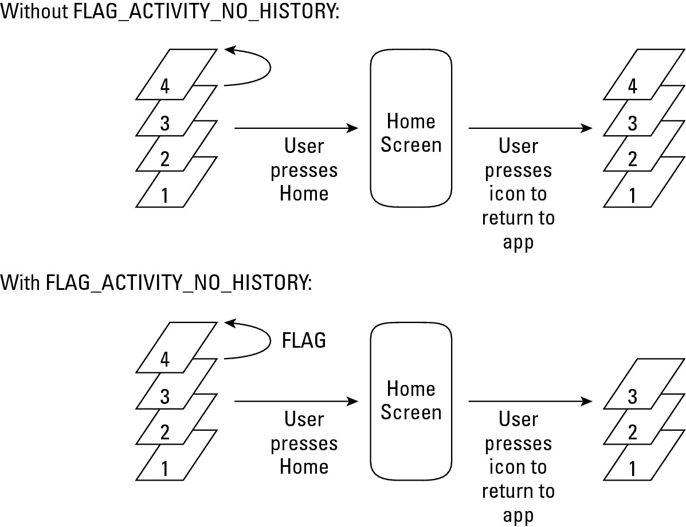

**图 2-15：**添加`FLAG_ACTIVITY_SINGLE_TOP`的效果。

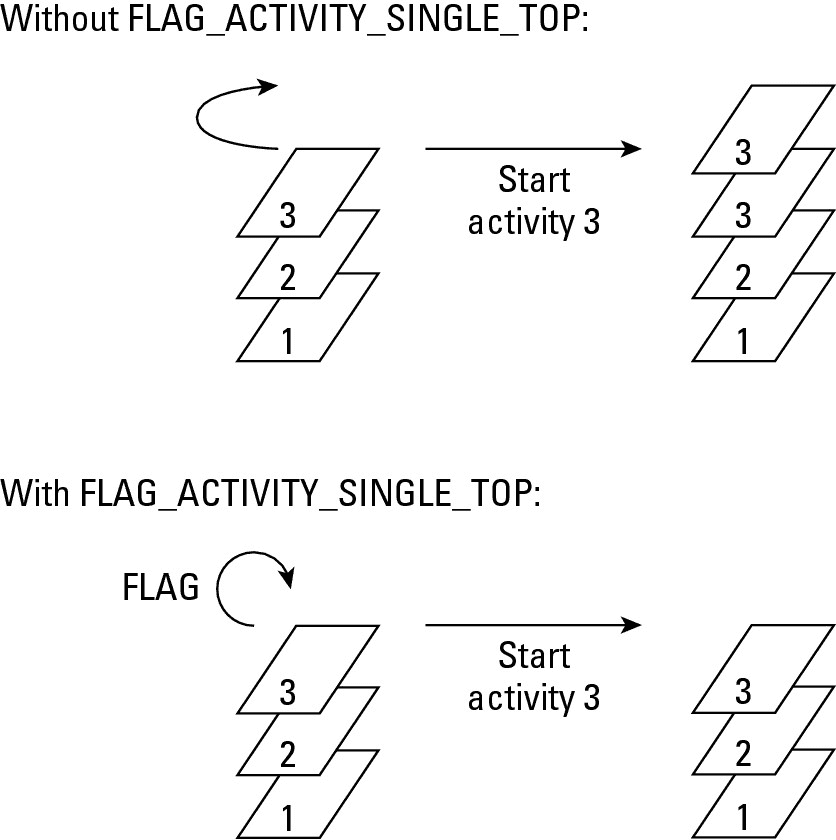

**图 2-16：**添加`FLAG_ACTIVITY_CLEAR_TOP`的效果。

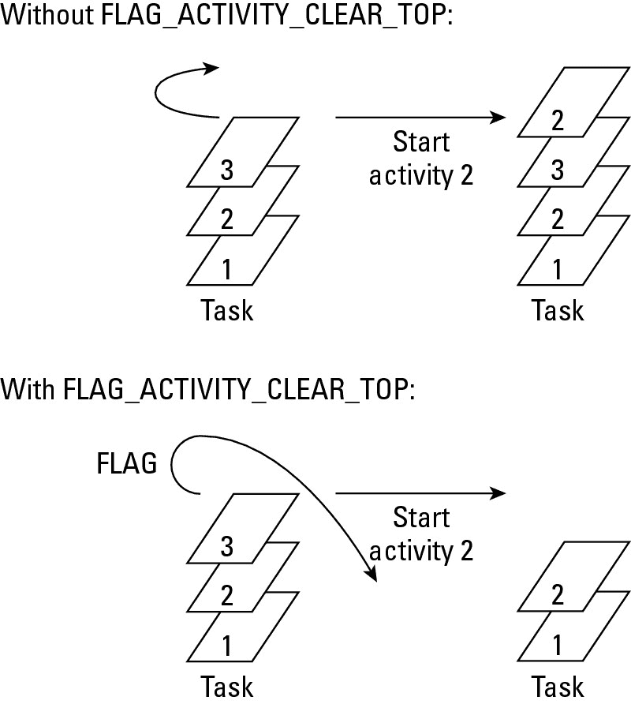

- 如果 Android 找到了这样的任务，Android 将把新启动的 activity 推送到该任务中。
- 如果 Android 没有找到这样的任务，Android 将创建一个与 App B 关联的任务。（参见图 2-17。）

无论之前是否存在 App B 任务，Android 都会在用户的屏幕上显示新启动的 activity。

**图 2-17：**添加`FLAG_ACTIVITY_NEW_TASK`的效果。

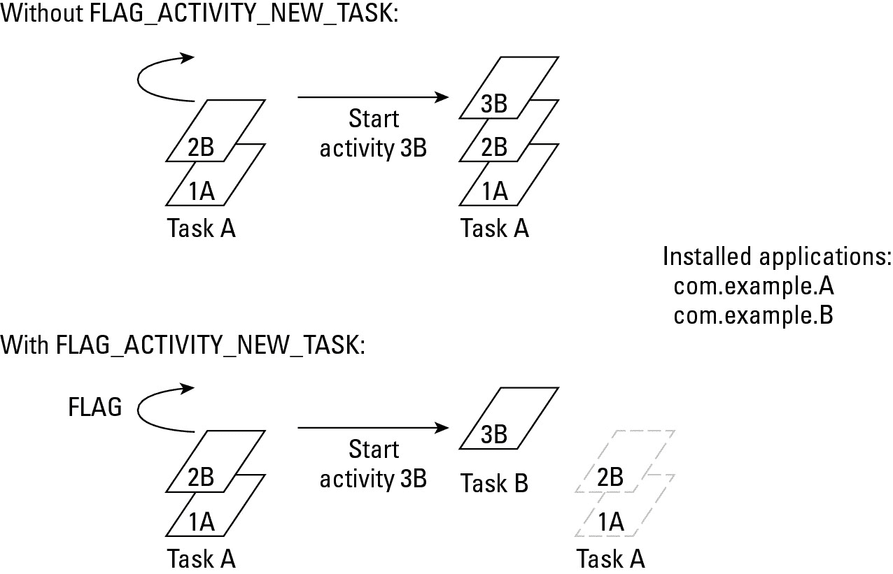

- `Intent.FLAG_ACTIVITY_EXCLUDE_FROM_RECENTS`：当用户长按 Home 键时，不要显示此 activity 应用程序。

当你创建一个新任务时，Android 会创建一个“最近（Recents）”项。将`FLAG_ACTIVITY_EXCLUDE_FROM_RECENTS`与`FLAG_ACTIVITY_NEW_TASK`结合可以抑制新“最近”项的创建。

- `Intent.FLAG_ACTIVITY_CLEAR_TASK`：与`FLAG_ACTIVITY_NEW_TASK`配合使用，如果新 activity 已经是任务的一部分，则使包含该 activity 的任务成为活跃任务，并抹除该任务上当前的所有其他 activity。（参见图 2-18。）


`FLAG_ACTIVITY_CLEAR_TASK`功能随着 Honeycomb 的发布加入了 Android SDK。如果你的目标版本比 Honeycomb 旧，请不要尝试使用`FLAG_ACTIVITY_CLEAR_TASK`。

- `Intent.FLAG_ACTIVITY_REORDER_TO_FRONT`：如果要启动的 activity 实例已经是当前任务的一部分，则重新排列任务的 activity，使该实例位于顶部。（参见图 2-19。）
- `Intent.FLAG_EXCLUDE_STOPPED_PACKAGES`：在搜索要启动的 activity 时，仅考虑当前处于活跃或暂停状态的 activity。

这些标记都有一个 Java `int` 值，你可以使用 Java 的位“或”运算符（`|`）组合两个或多个标记。例如，你可以写：

```java
intent.addFlags(FLAG_ACTIVITY_NEW_TASK |
               FLAG_ACTIVITY_CLEAR_TASK);
```

结果是`0x10000000 | 0x00008000`，即`0x10008000`。


`FLAG_ACTIVITY_CLEAR_TASK`功能随着 Honeycomb 的发布加入了 Android SDK。如果你尝试在非 Honeycomb 系统上使用此标记的数值（`0x00008000`），你不会得到编译时错误。毕竟，编译器认为`0x00008000`是一个完美的十六进制数，即使你将该数字传递给`addFlags`方法也是如此。但在运行时，非 Honeycomb 系统会说：“我无法执行`addFlags(0x00008000)`，所以我我想显示一条粗鲁的‘应用程序意外停止’消息。”因此，为了在运行之前捕捉此类错误，请始终使用常量名`FLAG_ACTIVITY_CLEAR_TASK`以及其他 SDK 常量。


不用说，我创建了一个应用来帮助你实验 intent 标记。我的标记测试 App 与我在本章稍后描述的 Intentsity App 非常相似。我没有给我的标记测试 App 起一个花丽的名字，但你可以从这本书的网站下载该 App 及其源代码——[`www.allmycode.com/android`](http://www.allmycode.com/android)。


要测试你的 intent 标记，你必须跟踪在模拟器或设备上运行的应用程序、任务和 activity。这并不总是那么简单。幸运的是，Android 的`dumpsys`命令可以让你看到当前状态的快照。要查看模拟器 activity 栈及其任务的最新列表，请在开发计算机的命令行窗口中输入`adb shell dumpsys activity`。或者，你可以登录模拟器的 shell（通过输入`adb shell`），然后在模拟器自己的命令行窗口中执行`dumpsys activity`命令。

**图 2-18：**添加`FLAG_ACTIVITY_CLEAR_TASK`的效果。

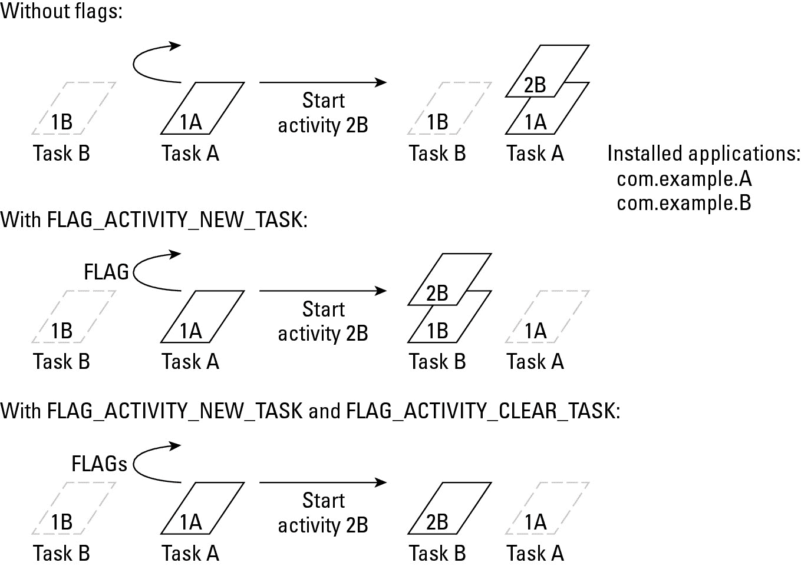

**图 2-19：**添加`FLAG_ACTIVITY_REORDER_TO_FRONT`。

# 第 3 章：服务

在本章中，我们将探索服务，它们是在没有用户界面的情况下后台执行长时间操作的组件。

某些服务用于执行耗时较的任务，例如播放音乐、下载文件或从网络获取数据。

## 列表 3-1：简单服务

```java
package com.allmycode.services;

import android.app.Service;
import android.content.Intent;
import android.os.IBinder;
import android.widget.Toast;

public class MyWeatherService extends Service {

    @Override
    public IBinder onBind(Intent intent) {
        Toast.makeText(this, R.string.service_bound, Toast.LENGTH_SHORT).show();
        return null;
    }

    @Override
    public int onStartCommand(Intent intent, int flags, int startId) {
        Toast.makeText(this, R.string.service_started, Toast.LENGTH_SHORT).show();
        return START_STICKY;
    }

    @Override
    public void onDestroy() {
        Toast.makeText(this, R.string.service_destroyed, Toast.LENGTH_SHORT).show();
    }
}
```

事实上，列表 3-1 中的服务代码比绝对需要的要多。作为抽象类`android.app.Service`类的子类，列表 3-1 中唯一要求的方法是`onBind`。

我将代码 3-1 中的服务放在它自己的 Eclipse 项目中，并拥有它自己的包名。因此，该服务在模拟器或设备上作为其独立进程中的独立应用程序运行。该服务没有用户界面（因此也没有布局文件）。应用程序的`AndroidManifest.xml`文件没有`<activity>`元素，而是有了如代码 3-2 所示的`<service>`元素。

## 代码 3-2：Un-Weather 服务 `AndroidManifest.xml` 文件中的一个元素

```xml
<service android:name=”.MyWeatherService">
    <intent-filter>
        <action android:name=”com.allmycode.WEATHER” />
    </intent-filter>
</service>
```

## 客户端 Activity

为了启动代码 3-1 中的服务，其他组件引用了代码 3-2 中命名的 action。代码 3-3 向你展示了如何操作。

## 代码 3-3：Un-Weather 服务的客户端

```java
package com.allmycode.demos;
import android.app.Activity;
import android.content.Intent;
import android.os.Bundle;
import android.view.View;

public class ServiceConsumerActivity extends Activity {
    Intent intent = new Intent();
    @Override
    public void onCreate(Bundle savedInstanceState) {
        super.onCreate(savedInstanceState);
        setContentView(R.layout.main);
        intent.setAction(“com.allmycode.WEATHER”);
    }
    public void onStartClick(View view) {
        startService(intent);
    }
    public void onStopClick(View view) {
        stopService(intent);
    }
}
```

代码 3-3 中的 activity 有两个按钮——一个启动按钮和一个停止按钮。（参见图 3-1。）

**图 3-1：**启动和停止服务。这有多简单呢？


在创建布局时，我冒昧为这两个按钮分配了监听器方法名：


```xml
<Button android:text="Start"
    android:onClick="onStartClick"
    android:id="@+id/button1"
    android:layout_height="wrap_content"
    android:layout_width="wrap_content">
</Button>
<Button android:text="Stop"
    android:onClick="onStopClick"
    android:id="@+id/button4"
    android:layout_height="wrap_content"
    android:layout_width="wrap_content">
</Button>
```

因此，点击启动按钮调用`startService(intent)`，点击停止按钮调用`stopService(intent)`。除了启动和停止服务外，每次点击都会显示一个`Toast`视图。

 关于 Android `Toast`类的简要介绍，请参见本章节后面的"通知用户"部分。

服务的主要目的是在后台运行（独立于任何明显的用户交互）并为其他应用提供帮助。因此，如果代码 3-1 中的代码代表一个实用的服务，那么这段代码将处理与天气有关的事情。（实用的代码，请参见本章的"讨论天气"部分。）

当你在操作图 3-1 中的按钮时，会发生以下情况：

* **按下启动然后按下停止。**

在按下启动后，你会看到 `Service Started` toast。然后，在按下停止后，你会看到 `Service Destroyed` toast。这里没有意外！

* **连续按下两次停止。**

如果服务正在运行，第一次调用 `stopService`（在代码 3-3 中）会销毁该服务。第二次调用 `stopService` 不会显示 `Service Destroyed` toast，因为未运行的组件无法被销毁。

* **连续按下两次启动，然后连续按下两次停止。**

结果是，你会看到两个 `Service Started` toast，随后只跟着一个 `Service Destroyed` toast。每次 `startService` 调用（来自代码 3-3）都会触发代码 3-1 中`onStartCommand`的调用。但第一次 `stopService` 调用（再次来自代码 3-3）会销毁该服务。随后的`stopService`调用没有任何影响。

* **按下启动，然后按下模拟器的返回键。**

当你按下返回键时，你不会看到 `Service Destroyed` toast。这就是 Android 服务的精髓。在启动服务的 activity 被销毁后，服务可以继续存在。

### 服务启动、停止和再次启动

服务没有用户界面，并且在你销毁启动服务的 activity 后，它可能会继续运行。这可能是一个危险的特征组合。没有界面的服务可能会像拉斯普京一样无限期地留下来——那个沙俄时代没人能杀掉的疯僧。如果开发者不包含管理其服务的代码，服务就会阻塞系统。没人会高兴。

当然，Android 可以杀死服务以回收所需的内存。

### 服务、线程和进程

当你还是个孩子，舒服地靠在妈妈膝上时，她告诉你 Android 服务运行在自己的线程中。遗憾的是，你妈妈错了。服务运行在应用程序的主线程中。你可以通过显示服务代码中`Thread.currentThread().getName()`的值来验证这一事实。当你这样做时，你会看到`main`。应用程序的 activity 也运行在应用程序的主线程中。因此，验证服务行为另一种方法是执行耗时工作——耗时工作包括从网络检索数据或进行计算。在主线程中执行重负载任务会导致 `ANR`（程序无响应）情况。

你可以强制让活动或服务在它自己的进程中运行。要做到这一点，可以在应用的`AndroidManifest.xml`文件中的`<service>`元素或`<activity>`元素添加`android:process="other.process.name"`属性。`other.process.name`可以是你想要的任何内容，只要它至少包含一个点。（通常情况下，`other.process.name`是包名，例如`com.example.mystuff`，但该名称并不非要是现有包名的一部分。）作为一个额外的好处，你可以用冒号开头进程名称（例如`android:process=":other.process.name"`）。按照真正的 Unix/Linux 极客风格，这种高效的键入的冒号符号表示该额外进程是组件所属应用程序私有的。其他应用无法与这个珍贵的进程进行通信。

底线是说是，你应该主动启动和停止自己的服务。不要依赖系统来为你清理内存，从而成为一个内存大户。要意识到你的服务的生命周期，并在不再需要时销毁你的服务。如果合适，在 activity 的`onPause`或`onDestroy`方法中添加`stopService`调用。如果服务知道自己已经不再有用，让服务调用自己的`stopSelf`方法。

 每当用户旋转设备时（例如从竖屏切换到横屏），Android 都会调用 activity 的`onDestroy`方法。如果你在 activity 的`onDestroy`方法中放置了`stopService`调用，你必须处理服务停止的所有可能情况。详情请参阅本章的"讨论天气"章节。

## 在启动时运行服务

你的服务有多重要？你的服务是否在用户按下特定按钮的少数情况下启动？还是说你的服务会在设备上电时启动？

如果 Android 用户没有你的服务就无法生存，你可以在启动时启动服务。要做到这一点，你需要创建另一种组件——广播接收器。

广播接收器响应你使用`sendBroadcast`或`sendOrderedBroadcast`方法抛出的意图（intent）。Android 对使用这两个方法之一发送的意图提供了特殊处理。

- 当你调用`startActivity`或`startService`时，Android 会寻找一个组件来满足意图。

如果系统发现多个合适的活动（例如安装了两个 Web 浏览器），Android 会显示一个对话框提示用户在备选项之间进行选择。

- 当你调用`sendBroadcast`或`sendOrderedBroadcast`时，Android 会触发所有过滤器满足意图的接收器。

使用`sendOrderedBroadcast`时，Android 会按顺序运行接收器。每个接收器可以将意图传递给队列中的下一个接收器，也可以通过调用其`abortBroadcast`方法中断链。

使用`sendBroadcast`时，Android 可能会交替运行多个接收器。在这种情况下，让接收器中止广播是没有意义的。

考虑列表 3-1 中的气象服务。在同一个应用程序中，使用列表 3-4 中的代码创建一个 Java 类。

### 列表 3-4：简单的广播接收器

```java
package com.allmycode.services;

import android.content.BroadcastReceiver;
import android.content.Context;
import android.content.Intent;

public class MyBootReceiver extends BroadcastReceiver {
  @Override
  public void onReceive(Context context, Intent intent) {
    Intent serviceIntent = new Intent();
    serviceIntent.setClass(context,
                         MyWeatherService.class);
    context.startService(serviceIntent);
  }
}
```

当`MyBootReceiver`运行时，它会启动`MyWeatherService`类的一个实例。并不难的技巧是让模拟器或设备启动时运行`MyBootReceiver`。

列表 3-5 向你展示了启动列表 3-4 中接收器的机制。

### 列表 3-5：列表 3-4 中接收器的 Manifest 元素

```xml
<uses-permission android:name="android.permission.RECEIVE_BOOT_COMPLETED"/>
<application android:icon="@drawable/icon"
             android:label="@string/app_name">
  <service android:name=".MyWeatherService">
    <intent-filter>
      <action android:name="com.allmycode.WEATHER" />
    </intent-filter>
  </service>
  <receiver android:name=".MyBootReceiver">
    <intent-filter>
      <action android:name="android.intent.action.BOOT_COMPLETED" />
      <category android:name="android.intent.category.DEFAULT" />
    </intent-filter>
  </receiver>
</application>
```

带有`android:name="android.permission.RECEIVE_BOOT_COMPLETED"`的`uses-permission`元素授予此应用接收启动的权限。`application`元素包含`service`和`receiver`。`service`元素拥有`android:name=".MyWeatherService"`和针对动作`com.allmycode.WEATHER`的`intent-filter`。`receiver`元素拥有`android:name=".MyBootReceiver"`以及针对动作`android.intent.action.BOOT_COMPLETED`和类别`android.intent.category.DEFAULT`的`intent-filter`。

`Activity A`调用`startService`来启动`MyService`。

Android 实例化`MyService`并调用实例的`onStartCommand`方法。

`Activity B`调用`startService`来启动`MyService`。

Android 调用现有实例的`onStartCommand`方法。

`Activity A`调用`stopService`来停止`MyService`。

Android 销毁`MyService`实例。

`Activity B`调用`stopService`来停止`MyService`。

Android 说："你白忙了。"这里没有`MyService`的实例可以停止。

- 你可以对服务进行绑定，并从服务上解绑定。

你通过调用`Context`类的`bindService`和`unbindService`方法来实现这一操作。在绑定和解绑定之间，你与服务保持着一个持续的连接。通过这个连接，你可以向服务发送消息并从服务处接收消息。这非常有用！

当你调用`bindService`时，如果已经没有运行中的实例，Android 会创建一个服务的实例。此外，Android 会调用服务的`onBind`方法。（例如，请跳到列表 3-6 和 3-7。）

 当你调用`bindService`时，Android 不调用服务的`onStartCommand`方法。

对`bindService`的调用会堆积。一个服务可以同时拥有多个绑定，每个绑定对应不同的活动。你的服务代码可以通过维护一个绑定对象的集合（`ArrayList`或其他类型）来跟踪所有的这些活动。当你调用`unbindService`时，并不会销毁服务实例。只要有活动绑定到该服务，Android 就会保持服务的活跃。

 服务可以同时接收启动请求和绑定请求。当所有绑定的活动都从某个特定服务解绑时，系统会检查这段时间内是否有人启动过服务。如果是，系统将等待有人调用`stopService`后再销毁该服务。

 Android 可以终止活动以回收内存。如果我是一个服务，而 Android 终止了绑定到我身上的活动，我会担心自己的生存。请测试你的应用，防止因活动及其服务的非预期终止而产生意外结果。如果在测试中，你由于服务的过早终止而遇到任何异常行为，请修复代码。

前几节的示例启动并停止了服务。本章的其余部分将与服务进行绑定和解绑定。

# 论天气

每本 Android 书籍都需要一个天气服务的示例，本书也不例外。在本节中，你的活动绑定到一个服务，而该服务转而通过互联网获取天气信息。

## 服务

我分阶段构建这个示例。第一阶段是服务的本质。一个活动绑定到服务，get 无意义查询获取一些虚假响应，然后解绑定。列表 3-6 包含了该服务。

### 列表 3-6：一个害怕承诺的天气服务

```java
package com.allmycode.services;
import android.app.Service;
import android.content.Intent;
import android.os.Bundle;
import android.os.Handler;
import android.os.IBinder;
import android.os.Message;
import android.os.Messenger;
import android.os.RemoteException;
import android.widget.Toast;

public class MyWeatherService extends Service {
  Messenger messengerToClient = null;
  MyIncomingHandler myIncomingHandler =
      new MyIncomingHandler();
  Messenger messengerToService =
      new Messenger(myIncomingHandler);
  @Override
  public IBinder onBind(Intent intent) {
    doToast(R.string.service_bound);
    return messengerToService.getBinder();
  }
  class MyIncomingHandler extends Handler {
    @Override
    public void handleMessage(Message incomingMessage) {
        messengerToClient = incomingMessage.replyTo;
        Bundle reply = new Bundle();
        reply.putString("weather", "It’s dark at night.");
        Message replyMessage = Message.obtain();
        replyMessage.setData(reply);
        try {
          messengerToClient.send(replyMessage);
        } catch (RemoteException e) {
          e.printStackTrace();
        }
        doToast(R.string.message_handled);
    }
  }
  @Override
  public boolean onUnbind(Intent intent) {
      doToast(R.string.stopped_itself);
      stopSelf();
      return false;
  }
  @Override
  public void onDestroy() {
    myIncomingHandler = null;
    doToast(R.string.service_destroyed);
  }
  void doToast(int resource) {
    Toast.makeText(this, resource, Toast.LENGTH_SHORT).show();
  }
}
```

列表 3-6 中的控制流并不简单，因此我创建了图 3-2 来帮助你理解。图 3-2 中首先注意到的点是，服务并没有与客户端交互。相反，服务通过 Android 操作系统间接接收调用。

**图 3-2**：绑定与消息传递。


与其他许多通信一样，客户端与服务之间的对话有两个阶段：

- 第一阶段（绑定阶段）建立了通信链路。

- 在第二阶段，客户端和交换交换信息。通常情况下，客户端发送请求，服务发送回复。


要绑定到服务，客户端发送一个`Intent`。Android 将此`Intent`传递给服务的`onBind`方法。作为响应，`onBind`方法返回一个 binder——一个实现了`IBinder`接口的对象（见列表 3-6 和图 3-2）。binder 就像一张名片。通过返回 binder，服务说：“Android，告诉客户端可以通过这个地址找到我。”这就是为什么在列表 3-6 中，服务是从`MyIncomingHandler`的实例创建 binder 的（就像打印号码）。

Android 将 binder 交付给客户端应用。最终，客户端应用查询服务。查询包含了对特定信息的请求。但查询还包含一个`replyTo`字段。服务的内部类（在本例中为`MyIncomingHandler`）使用`replyTo`信息向客户端应用。在列表 3-6 中，无论客户端发送什么，我都简单地回复`晚上很黑`。（这样的天气报告总是正确的。）

## 客户端

列表 3-7 包含了列表 3-6 服务的客户端。

### 列表 3-7：列表 3-6 服务的客户端

```java
package com.allmycode.demos;
import android.app.Activity;
import android.content.ComponentName;
import android.content.Context;
import android.content.Intent;
import android.content.ServiceConnection;
import android.content.SharedPreferences;
import android.os.Bundle;
import android.os.Handler;
import android.os.IBinder;
import android.os.Message;
import android.os.Messenger;
import android.os.RemoteException;
import android.view.View;
import android.view.View.OnClickListener;
import android.widget.Button;
import android.widget.EditText;
import android.widget.TextView;
import android.widget.Toast;

public class ServiceConsumerActivity extends Activity
    implements OnClickListener {
  Messenger messengerToService = null;
  MyIncomingHandler myIncomingHandler =
      new MyIncomingHandler();
  Messenger messengerFromService =
      new Messenger(myIncomingHandler);
  ServiceConnection connection =
      new MyServiceConnection();
  SharedPreferences prefs;
  boolean isBound = false;
  void bind() {
    Intent intent = new Intent();
    intent.setAction("com.allmycode.WEATHER");
    isBound =
      bindService(intent, connection,
```

```java
            Context.BIND_AUTO_CREATE);
  }

  public void queryService() {
    if (isBound) {
      Bundle bundle = new Bundle();
      bundle.putString("location", "Philadelphia");
      Message message = Message.obtain();
      message.replyTo = messengerFromService;
      message.setData(bundle);
      try {
        messengerToService.send(message);
      } catch (RemoteException e) {
        e.printStackTrace();
      }
    } else {
      textView1.setText(R.string.service_not_bound);
    }
  }
  class MyIncomingHandler extends Handler {
    @Override
    public void handleMessage(Message msg) {
      Bundle bundle = msg.getData();
      textView1.setText(bundle.getString("weather"));
    }
  }
  void unbind() {
    if (isBound) {
      unbindService(connection);
      isBound = false;
    }
  }
  class MyServiceConnection implements ServiceConnection {
    public void onServiceConnected(
        ComponentName className, IBinder binder) {
      messengerToService = new Messenger(binder);
      doToast(R.string.service_connected);
    }
    public void onServiceDisconnected(ComponentName n) {
      messengerToService = null;
      doToast(R.string.service_crashed);
    }
  }
  void doToast(int resource) {
    Toast.makeText(this, resource,
        Toast.LENGTH_SHORT).show();
  }
  @Override
  public void onDestroy() {
    super.onDestroy();
    prefs = getSharedPreferences("PREFS", MODE_PRIVATE);
    SharedPreferences.Editor editor = prefs.edit();
    editor.putBoolean("isBound", isBound);
    editor.putString("report", textView1.getText()
        .toString());
    editor.commit();
    unbind();
  }
  @Override
  public void onCreate(Bundle savedInstanceState) {
    super.onCreate(savedInstanceState);
    setContentView(R.layout.main);
    prefs = getSharedPreferences("PREFS", MODE_PRIVATE);
    if (prefs != null) {
      textView1 = (TextView) findViewById(R.id.textView1);
      textView1.setText(prefs.getString("report",
        getString(R.string.report_appears_here)));
      if (prefs.getBoolean("isBound", false)) {
        bind();
      }
    }
    // The rest of the code is boilerplate
    // such as onCreate.
  }
```

`Listing 3-7` 的前几行与 `Listing 3-6` 中的代码是平行的。与 `Listing 3-6` 中的服务一样，`Listing 3-7` 中的客户端也拥有 messenger 和一个入站处理器（incoming handler）。`Figure 3-3` 显示了我为 `Listing 3-7` 中的活动创建的布局。`Listing 3-7` 中的`bind`、`queryService` 和 `unbind` 方法处理了 `Figure 3-3` 中的按钮点击。（本节的服务并不不在乎你在哪个城市，因此 `Figure 3-3` 中为城市名称或邮政编码设置的 `EditText` 没有任何用。它是后续示例中用户输入的占位符。）

## 通知用户

在 `Figure 3-3` 的底部，有一个包含 `Message` 字样的圆角矩形。该矩形说明了 Android 中 `Toast` 类的用法。toast 是一种不显眼的小视图，会在短时间内显示一些有用信息。toast 视图在屏幕上弹出，就像一片热热的面包从吐司机中弹出一样（据传 Android 类名 `Toast` 就源于这个比喻）。

**图 3-3：** `Listing 3-7` 活动的用户界面。

 一个 toast 视图通常显示一条供用户阅读的消息。因此 Android 开发者经常提到 toast 消息（toast messages）。从原则上说，使用 toast message 这个词没有问题。但本章的大部分涉及 `android.os.Message` 类的实例——即在服务与其客户端之间发送的消息。在 `Figure 3-3` 的底部，`Message` 一词指的是服务与其客户端之间的消息，而不是 toast 消息。因此在 `Figure 3-3` 中，toast 消息告知用户的是另一种完全不同的消息。作者该怎么办？在本章中，我使用 message 一词来指代服务与其客户端之间的通信。在其他章节中，我会随意使用 toast message 等词而不必担心这个问题。

`Toast` 类有两个非常有用的方法：`makeText` 和 `show`。

静态方法 `Toast.makeText` 创建一个 `Toast` 类的实例。`makeText` 方法有三个参数：

*   第一个参数是上下文（context，即 `Listing 3-7` 中的 `this`）。

*   第二个参数是资源（resource）或字符序列（例如 `String`）。如果你使用一个 `String` 调用 `makeText`，那么当 Android 显示 toast 时，用户将看到该 `String`。如果你使用资源调用 `makeText`，Android 会在你的应用的 `res` 目录中查找该资源。在 `Listing 3-7` 中，代码调用了两次 `makeText`——一次使用资源 `R.string.service_connected`，另一次使用 `R.string.service_crashed`。

 如果你在 `makeText` 方法的第二个参数中使用一个 `int` 值（例如 42），Android 不会在 toast 视图显示字符 42。相反，Android 会寻找 `R.java` 中值为 42 的资源。你的 `R.java` 文件可能并不包含 42。因此，你得到的不是 toast 视图，而是 `ResourceNotFound` 异常。你的程序崩溃了，你感到沮丧。

*   `makeText` 方法的第三个参数是 `Toast.LENGTH_LONG` 或 `Toast.LENGTH_SHORT`。`LENGTH_LONG`，toast 视图持续大约四秒。`LENGTH_SHORT`，toast 视图持续大约两秒。

*   `show` 方法告诉 Android 显示 toast 视图。

在 `Listing 3-7` 中，注意我在一个 Java 语句中调用了 `makeText` 和 `show`。如果你忘记调用 `show` 方法，toast 视图就不会出现。你难以置信地盯着屏幕，不知道为什么看不到 toast 视图（“谁偷了我的 toast？”你想）。当你终于发现是忘记调用 `show` 方法时，你会觉得自己很蠢（至少我今天早些时候是这种感觉）。

### 绑定服务

在 `Listing 3-7` 中，`bindService` 的调用接受三个参数——一个 `intent`、一个服务连接（service connection）和一个表示标志的 `int` 值。

*   `intent` 帮助确定调用的服务。

在 `Listing 3-7` 中，该 intent 有 action `com.allmycode.WEATHER`。这很好，因为我的服务的 `AndroidManifest.xml` 文件包含了以下元素：

```xml
<application android:icon="@drawable/icon"
  android:label="@string/app_name">
  <service android:name=".MyWeatherService">
    <intent-filter>
      <action android:name="com.allmycode.WEATHER" />
    </intent-filter>
  </service>
</application>
```

（本章仅出现了 `AndroidManifest.xml` 文件的片段。）

当 Android 需要更多内存时，Android 会终止进程。在列表 3-7 中，标记 `BIND_AUTO_CREATE` 告诉 Android 在你的 activity 运行时避免终止服务的进程。另一种替代方案 `BIND_NOT_FOREGROUND` 则告诉 Android 在决定是否终止服务的进程时，不要考虑你的 activity 的需求。

## 查询服务

在列表 3-7 中，`queryService` 方法向服务请求问题的答案。以下是 `queryService` 方法的作用：

1. `queryService` 方法从 `android.os.Message` 类获取一个空消息（blank message）。

2. `queryService` 方法向消息中添加一个问题（即 bundle）。

3. `queryService` 方法告诉信使器（messenger）将该消息发送给服务。

bundle（`android.os.Bundle` 的实例）是一个进程可以写入、而另一个进程可以从其读取的对象。你会在每个 activity 的 `onCreate` 方法中看到一个 bundle。在数据通信的世界中，发送消息被比作写入数据。因此在列表 3-7 中，代码在处理各种 bundle。

* `queryService` 方法将 bundle 放在消息上，然后将消息“写入”Android 消息队列。

* `MyIncomingHandler` 类中的 `handleMessage` 方法从 Android 消息队列中“读取”消息，然后获取该消息的 bundle 以在设备屏幕上显示。

## 使用 shared preferences 重启连接

列表 3-7 包含了一个关于服务生命周的重要课程。绑定到另一个组件（例如 activity）的服务往往会保持存。如果开发者没有显式地从服务解绑（unbind），服务就会堆积并开始阻塞 Android 的通道。因此，一个良好的公民应该做清理工作来解绑服务。

因此在列表 3-7 中，`onDestroy` 方法解绑了服务。到目前为止一切良好。但当用户旋转设备时会发生什么？这本微型书籍的第一章提醒过当用户更改设备方向时会发生什么——Android 会销毁当前的 activity 并在新的方向上重新创建它。所以如果你不小心，用户只需移动设备就会丢失服务。这可能不是你想要的。

为了防止这个问题，请使用 shared preferences。通过 shared preferences，你可以存储信息。稍后，你的应用（或者如果你愿意，其他人的应用）可以检索这些信息。

以下是使用一组 shared preferences 的方法：

* 要创建 shared preferences，调用 `android.content.Context` 类的 `getSharedPreferences` 方法。

对于参数，向方法调用传递一个名称和一种模式。在列表 3-7 中，名称是字符串`“PREFS"`，模式是`int`值`android.content.Context.MODE_PRIVATE`。替代方案有：

* `MODE_PRIVATE`：没有其他进程可以读取或写入这些偏好。

* `MODE_WORLD_READABLE`：其他进程可以读取这些偏好。

* `MODE_WORLD_WRITEABLE`：其他进程可以写入这些偏好。

* `MODE_MULTI_PROCESS`：即使在一个进程进行读取操作，其他进程也可以写入这些偏好。如此并发的情况下可能会发生奇怪的事情。所以要小心！

你可以使用 Java 的位或 `or` 运算符组合模式。因此，如下的调用：

```java
getSharedPreferences("PREFS", MODE_WORLD_READABLE | MODE_WORLD_WRITEABLE);
```


会让你的偏好对所有其他进程都是可读且可写的。

* 要向一组 shared preferences 添加值，请使用`android.content.SharedPreferences.Editor`类的实例。

在列表 3-7 中，`onDestroy`方法创建了一个新的编辑器对象。然后代码使用该编辑器向 shared preferences 添加一个键/值对`("isBound", isBound)`。`Editor`类拥有如`putInt`、`putString`、`putStringSet`等方法。

* 要完成工作，调用编辑器的`commit`方法。

再次，参见列表 3-7。

* 要检索已存在的 shared preferences，调用`getSharedPreferences`，并使用与你创建偏好时相同的名称。

你能猜到是哪个列表包含此代码示例吗？是的！列表 3-7。看该列表的`onCreate`方法。

* 要从已存在的 shared preferences 中读取值，调用`getBoolean`、`getInt`、`getFloat`或属于`SharedPreferences`类的其他 get 方法。

在列表 3-7 中，对`getBoolean`的调用接受两个参数。第一个参数是你尝试获取的任何键/值对中的名称。第二个参数是默认值。所以当你调用`prefs.getBoolean("isBound", false)`时，如果`prefs`没有名为`"isBound"`的对，则该方法调用返回`false`。

在列表 3-7 中，`onDestroy`方法保存了`isBound`的值。然后当 Android 恢复 activity 时，`onCreate`方法检索`isBound`的值。实际上，`onCreate`方法“发现”了在 activity 被销毁之前服务是否已绑定。如果服务是绑定的，代码将重新建立连接，再次调用`bindService`方法。

 使用应用中`AndroidManifest.xml`文档中的属性，你可以防止 Android 在用户更改设备方向时销毁 activity。

## 获取真实数据

在本节中，你对天气进行操作。在列表 3-7 中，`queryService`方法向服务请求问题的答案。以下是`queryService`方法的作用：

1. `queryService`方法从`android.os.Message`类获取一个空消息。

2. `queryService`方法向消息中添加一个问题（即 bundle）。

3. `queryService`方法告诉信使器将该消息发送给服务。

bundle（`android.os.Bundle`的实例）是一个进程可以写入、而另一个进程可以从其读取的对象。你会在每个 activity 的`onCreate`方法中看到一个 bundle。在数据通信的世界中，发送消息被比作写入数据。因此在列表 3-7 中，代码在处理各种 bundle。

* `queryService`方法将 bundle 放在消息上，然后将消息“写入”Android 消息队列。

* `MyIncomingHandler`类中的`handleMessage`方法从 Android 消息队列中“读取”消息，然后获取该消息的 bundle 以在设备屏幕上显示。

（等等，输入文本包含大量重复部分。我已经根据保留核心内容并优化格式的指令清理了冗冗内容。）

```xml
<?xml version="1.0" encoding="UTF-8"?>
<xml_api_reply>
  <weather>
    <forecast_information>
      <city>San Francisco</city>
      <postal_code>San Francisco</postal_code>
      <latitude></latitude>
      <longitude></longitude>
      <date>2011-08-07</date>
      <current_time>2011-08-07 18:56:00 +0000</current_time>
      <unit_system>US</unit_system>
    </forecast_information>
    <current_conditions>
      <condition>Overcast</condition>
      <temp_f>59</temp_f>
      <temp_c>15</temp_c>
      <humidity>Humidity: 77%</humidity>
      <icon>/ig/images/weather/cloudy.gif</icon>
      <wind_condition>Wind: W at 10 mph</wind_condition>
    </current_conditions>
    <forecast_conditions>
      <day_of_week>Sun</day_of_week>
      <low>54</low>
      <high>63</high>
      <icon>/ig/images/weather/mostly_sunny.gif</icon>
      <condition>Mostly Sunny</condition>
    </forecast_conditions>
  </weather>
</xml_api_reply>
```

 你可以通过在网络浏览器地址栏中输入`http://www.google.com/ig/api?weather=San%20Francisco`来获得类似的 XML 响应。在这个地址中，字符`%20`是 Web 编码空格的方式。

* 在服务中，将 Google 的响应提交给 XML 解析器。

XML 解析器是一个从 XML 文件中筛选信息的程序。本节的代码包含一个解析器，它可以从 Google 的响应中提取出华氏度温度和天气状况。（预先向非美国、非伯利兹的读者表示歉意，我使用了华氏度量衡。坏习惯是很难改掉的。）

 在过去，在 XML 被广泛使用之前，你的应用程序通常会进行“屏幕抓取”（screen scraping）。屏幕抓取是指从普通网页中搜寻数据的做法。在 XML 时代，你的代码必须消除页面的颜色、字体标签、广告以及任何其他无关材料。然后，你的代码必须在页面中搜索当前的华氏度温度，并尽力避免抓取到下周的预报或《天气与葡萄酒周刊》（Weather and Wine Weekly）的订阅费用。接着，你只能希望网站布局的未来任何变化都不会破坏你代码的正确性。无疑，解析 XML 要可靠得多。

* 作为最后一步，你的服务获取从 XML 解析器返回的结果，并将该结果转发给客户端应用。

## 处理 XML

列表 3-8 包含一个看起来无害的`Weather`类，而列表 3-9 包含一个 XML 解析器。

### 列表 3-8：Weather 类

```java
package com.allmycode.services;

public class Weather {
  private int temperature = 0;
  private String condition = "";
  public Weather() {
  }
  public Integer getTemperature() {
    return temperature;
  }
  public void setTemperature(Integer temperature) {
    this.temperature = temperature;
  }
  public String getCondition() {
    return condition;
  }
  public void setCondition(String condition) {
    this.condition = condition;
  }
}
```

### 列表 3-9：当发现 XML 元素时该做什么

```java
package com.allmycode.services;

import org.xml.sax.Attributes;
import org.xml.sax.SAXException;
import org.xml.sax.helpers.DefaultHandler;

public class MySaxHandler extends DefaultHandler {
  private static final String CURRENT_CONDITIONS =
      "current_conditions";
  private static final String DATA = "data";
  private static final String CONDITION = "condition";
  private static final String TEMP_F = "temp_f";
  private Weather weather = new Weather();
  private boolean current_conditions = false;
  public Weather getWeather() {
    return weather;
  }
  @Override
  public void startElement(String namespaceURI,
      String localName, String qName,
      Attributes attributes) throws SAXException {
    if (localName.equals(CURRENT_CONDITIONS)) {
      current_conditions = true;
    } else {
      if (current_conditions) {
          if (localName.equals(TEMP_F)) {
            String dataAttribute =
                attributes.getValue(DATA);
            weather.setTemperature(Integer
              .parseInt(dataAttribute));
          } else if (localName.equals(CONDITION)) {
            String condAttribute =
                attributes.getValue(DATA);
            weather.setCondition(condAttribute);
          }
        }
    }
  }
  @Override
  public void endElement(String namespaceURI,
      String localName, String qName) throws SAXException {
    if (localName.equals(CURRENT_CONDITIONS)) {
      current_conditions = false;
    }
  }
}
```

列表 3-9 中的代码与 XML 的关系多于与 Android 的，因此我不会详细介绍列表 3-9 中的代码。简而言之，XML 解析器有两种类型：SAX 解析器和 DOM 解析器。SAX 的缩写代表 Simple API for XML（XML Simple API），DOM 的缩写代表 Document Object Model（文档对象模型）。列表 3-9 使用 SAX 是因为 SAX 解析器的内存占用比 DOM 解析器小。

DOM 解析器会分解 XML 文档，将所有这些信息加载到内存中，然后让你查询解析器文档中任何位置的值。你问：“`<current_conditions>` 元素中 `<temp_f>` 元素内的 `data` 属性值是多少？” DOM 解析器会回答，但只有在分析完整个文档之后。SAX 解析器一次扫描 XML 文档的一个片段，内存中只保留当前的片段。在每一步，解析器都会提议报告它的发现。“我发现了一个起始标签”或“我发现了一个属性，”解析器如是说道。列表 3-9 中的代码监控解析发现的相关数据，并将任何有用数据添加到`Weather`类的实例中。 关于如何解读 XML 内容的一些提示，请参见第二卷第 5 章。

# 从在线服务器获取信息

列表 3-10 包含了向 Google 天气 API 提交位置、调用 XML 解析器以及将解析器结果转换为可用字符串的代码。只需将列表 3-10 的代码添加到列表 3-7 的代码中。

### 列表 3-10：从 Google 获取信息


## 使用 AIDL

`AIDL` 不仅仅是一种语言，它还是一种编程范式。`AIDL` 是重写你的部分 `Java` 代码的一种方式，使其更加自然、更加直观。

在列表 3-6 和 3-7 中，一个服务及其客户端来回传递消息。消息传递范式很好，但如果客户端能够简单地调用服务的一个方法，生活难道不是更简单吗？这正是 `AIDL` 为你的代码所做的。

以下是 `AIDL` 的工作原理：

1. 从服务和一个客户端开始（例如列表 3-6 和 3-7 中的代码），并创建一个`.aidl`文件。`.aidl`文件描述了在服务和服务客户端之间传递的类型类型。
2. 将`.aidl`文件的副本分别放在服务项目和客户端项目中。`.aidl`文件属于服务的包（`package`）。因此，为了在客户端项目中放置一个`.aidl`文件的副本，你需要在客户端项目中创建服务包的对应版本。参见图 3-5，在图中，在一些花哨的照片编辑软件的帮助下，两个项目的源文件夹都是可见的。当你向这两个项目添加`.aidl`文件时，`Eclipse`会自动生成新的`Java`代码。你可以在图 3-5 项目的`gen`文件夹中看到这一证据。
3. 在客户端中，移除发送消息的代码，并添加直接（至少表面上）调用服务方法的代码。
4. 在服务中，移除对`Messenger`类的引用和传入的处理器类（`handler class`）。

使用 `AIDL`，客户端和服务端都不需要显式的消息传递器（`messenger`）。此外，服务内部的方法被直接调用了（至少表面上），因此服务不再需要传入的处理器类。（嗯，这几乎是如此。）

**图 3-5：** 服务项目和客户端项目中的源文件夹。

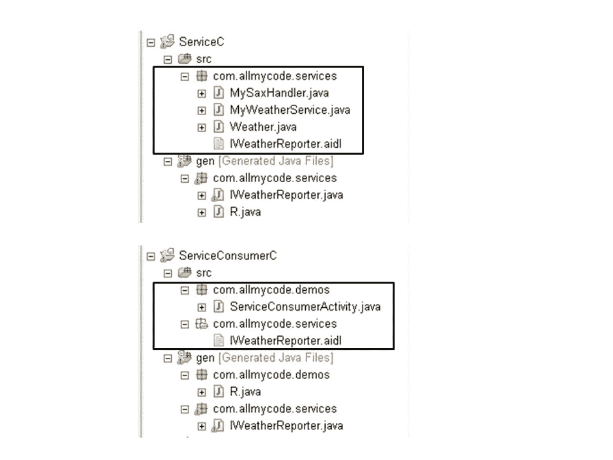

## AIDL 和 Java 代码

列表 3-11 显示了我的`WeatherInterface.aidl`文件。该文件几乎是一个普通的`Java`源文件。主要的区别在于使用了非 `Java` 关键字`in`。这个`in`关键字告诉世界，服务代码接收一个`String`值（而不是发送一个`String`值）。

列表 3-11：WeatherInterface.aidl 文件

```
package com.allmycode.services;
interface WeatherInterface
{
    String fetchWeather(in String location);
}
```

`Eclipse`会根据你在`WeatherInterface.aidl`文件中提供的信息自动生成`WeatherInterface.java`文件。`WeatherInterface.java`代码定义了一个扩展了`Android`自带`android.os.IInterface`的`Java`接口。（看到了吗？你不需要写`WeatherInterface.java`，因为`WeatherInterface.java`属于`Android`的包之一——而不是你的包。）你可以查看一眼`gen`文件夹中的`WeatherInterface.java`文件，但如果你不看也同样会开心。

列表 3-12 包含了列表 3-6 中服务的`AIDL`版本。为了方便你阅读，我将`AIDL`特有的代码加粗了。

列表 3-12：使用 AIDL 的服务

```
package com.allmycode.services;
import java.net.URL;
import javax.xml.parsers.SAXParser;
import javax.xml.parsers.SAXParserFactory;
import org.xml.sax.InputSource;
import org.xml.sax.XMLReader;
import android.app.Service;
import android.content.Intent;
import android.os.Bundle;
import android.os.IBinder;
import android.os.Message;
import android.widget.Toast;

public class MyWeatherService extends Service {
  @Override
  public IBinder onBind(Intent intent) {
        doToast(R.string.service_bound);
        return new WeatherFetcher();
  }
  class WeatherFetcher extends WeatherInterface.Stub {
        public String fetchWeather(String city) {
            String weatherString = null;
            if (city != null) {
                Weather weather = getWeather(city);
                weatherString =
                    Integer.toString(weather.getTemperature())
                    + (char) 0x00B0 + "F "
                    + weather.getCondition();
            }
            return weatherString;
        }
  }
  String getWeatherString(Message message) {
        Bundle query = message.getData();
        String location = query.getString("location");
        String weatherString;
        if (location != null && !location.equals("")) {
            Weather weather = getWeather(location);
            weatherString =
                Integer.toString(weather.getTemperature())
                + (char) 0x00B0 + "F "
                + weather.getCondition();
        } else {
            weatherString = "It’s dark at night.";
        }
        return weatherString;
  }
  private final String GOOGLE_WEATHER_URL =
    "http://www.google.com/api?weather=";
  public getWeather(String location) {
        URL url;
        Weather weather = null;
        try {
            url = new URL(GOOGLE_WEATHER_URL
                + location.replace(" ", "%20"));
            SAXParser parser = SAXParserFactory.newInstance().newSAXParser();
            XMLReader reader = parser.newXMLReader();
            MyHandler saxHandler = new MyHandler();
            reader.setContentHandler(saxHandler);
            reader.parse(new InputSource(url.openStream()));
            weather = saxHandler.getWeather();
        } catch (Exception e) {
            e.printStackTrace();
        }
        return weather;
  }
  private void doToast(int resource) {
        Toast.makeText(this, resource, Toast.LENGTH_SHORT).show();
  }
}
```

列表 3-6 中的代码有一个消息传递器和一个传入的处理器。消息处理器向客户端发送一个消息。相比之下，列表 3-12 中的代码有一个`fetchWeather`方法，它直接返回一个`String`值。列表 3-12 中的类无法使用消息传递器，因为它根本看不到消息传递器。

列表 3-13 包含了列表 3-7 内容的`AIDL`版本。再次，我将`AIDL`特有的代码加粗了。

列表 3-13：使用 AIDL 的客户端

```
package com.allmycode.demos;
import android.app.Activity;
import android.content.ComponentName;
import android.content.Context;
import android.content.Intent;
import android.content.ServiceConnection;
import android.content.SharedPreferences;
import android.os.Bundle;
import android.os.IBinder;
import android.os.RemoteException;
import android.view.View;
import android.view.OnClickListener;
import android.widget.Button;
import android.widget.EditText;
import android.widget.TextView;
import android.widget.Toast;
import com.allmycode.services.WeatherInterface;

public class ServiceActivity extends Activity implements OnClickListener {
  WeatherInterface reporter;
  ServiceConnection connection = new MyServiceConnection();
  SharedPreferences prefs;
  boolean isBound = false;
  @Override
  protected void onCreate(Bundle savedInstanceState) {
    super.onCreate(savedInstanceState);
    setContentView(R.layout.activity_main);
    locationText = findViewById(R.id.locationText);
    textView1 = findViewById(R.id.textView1);
    Button bindButton = findViewById(R.id.bindButton);
    Button queryButton = findViewById(R.id.queryButton);
    bindButton.setOnClickListener(this);
    queryButton.setOnClickListener(this);
  }
  void bind() {
    Intent intent = new Intent();
    intent.setAction("com.allmycode.WEATHER");
    isBound = bindService(intent, connection, Context.BIND_AUTO_CREATE);
  }
  public void queryService() {
    if (isBound) {
      try {
        String report = reporter.fetchWeather(locationText.getText()
            .toString());
        textView1.setText(report);
      } catch (RemoteException e) {
        e.printStackTrace();
      }
    } else {
      textView1.setText(R.string.service_not_bound);
    }
  }
  void unbind() {
    if (isBound) {
      unbindService(connection);
      isBound = false;
    }
  }
  @Override
  public void onClick(View v) {
    if (v.getId() == R.id.bindButton) {
      bind();
    } else if (v.getId() == R.id.queryButton) {
      queryService();
    }
  }
  EditText locationText;
  TextView textView1;
  class MyServiceConnection implements ServiceConnection {
    @Override
    public void onServiceConnected(ComponentName name, IBinder service) {
      reporter = WeatherInterface.Stub.asInterface(service);
    }
    @Override
    public void onServiceDisconnected(ComponentName name) {
      reporter = null;
    }
  }
}
```

---

以下是列表 3-6 中的原始代码，用于参考和对照：

```
String getWeatherString(Message message) {
  Bundle query = message.getData();
  String location = query.getString("location");
  String weatherString;
  if (location != null && !location.equals("")) {
    Weather weather = getWeather(location);
    weatherString =
      Integer.toString(weather.getTemperature())
      + (char) 0x00B0 + " F "
      + weather.getCondition();
  } else {
    weatherString = "It’s dark at night.";
  }
  return weatherString;
}
private static final String GOOGLE_WEATHER_URL =
    "http://www.google.com/ig/api?weather=";
public Weather getWeather(String location) {
  URL url;
  Weather weather = null;
  try {
    url =
      new URL(GOOGLE_WEATHER_URL
        + location.replace(" ", "%20"));
    SAXParser parser =
        SAXParserFactory.newInstance().newSAXParser();
    XMLReader reader = parser.getXMLReader();
    MySaxHandler saxHandler = new MySaxHandler();
    reader.setContentHandler(saxHandler);
    reader.parse(new InputSource(url.openStream()));
    weather = saxHandler.getWeather();
  } catch (Exception e) {
    e.printStackTrace();
  }
  return weather;
}
```


```java
ComponentName className, IBinder binder) {
    reporter =
        WeatherInterface.Stub.asInterface(binder);
    doToast(R.string.service_connected);
}
public void onServiceDisconnected(ComponentName n) {
    doToast(R.string.service_crashed);
}
}
void doToast(int resource) {
    Toast.makeText(this, resource, Toast.LENGTH_SHORT)
        .show();
}
@Override
public void onDestroy() {
    super.onDestroy();
    prefs = getSharedPreferences("PREFS", MODE_PRIVATE);
    SharedPreferences.Editor editor = prefs.edit();
    editor.putBoolean("isBound", isBound);
    editor.putString("report", textView1.getText()
        .toString());
    editor.commit();
    unbind();
}
@Override
public void onCreate(Bundle savedInstanceState) {
    super.onCreate(savedInstanceState);
    setContentView(R.layout.main);
    prefs = getSharedPreferences("PREFS", MODE_PRIVATE);
    if (prefs != null) {
        textView1 = (TextView) findViewById(R.id.textView1);
        textView1.setText(prefs.getString("report",
            getString(R.string.report_appears_here)));
        if (prefs.getBoolean("isBound", false)) {
            bind();
        }
    }
// 代码的其余部分是样板代码
// 如 onCreate。
}
```

在连接到服务时，列表 3-13 中的客户端创建了 AIDL 生成代码的实例。客户端通过执行`reporter = WeatherInterface.Stub.asInterface(binder)`来实现这一点。然后，通过这个新的`reporter`对象，客户端对`reporter`对象的`fetchWeather`方法进行了一个看起来像普通的调用。

在列表 3-12 和 3-13 中，当一个进程与另一个进程通信时，开发者无需处理复杂的消息业务。因此，开发者——也就是你！——可以专注于底层的应用程序逻辑。太棒了！

# 第 4 章：广播接收器

## 本章主要内容

- 创建广播接收器
- 整理来自广播接收器的数据
- 限制接收器的访问权限

本微型书籍的第 3 节介绍了一种用于在启动时运行代码的广播接收器。以下是该章广播接收器内容的摘要：

- 当你发送广播时，Android 会启动所有过滤器符合意图（`intent`）的接收器。
- 广播接收器的运行时间足够执行接收器中`onReceive`方法 get 代码。接收器没有`onCreate`、`onDestroy`或任何其他方法——只有`onReceive`。在 Android 完成执行`onReceive`方法的代码后，广播接收器将进入休眠状态，直到应用程序发送另一个匹配的广播为止。

本章将更详细地描述广播接收器。

## 接收器入门 (101)

本章的第一个示例包含了世界上最简单的广播接收器。确切地说，列表 4-1 包含了接收器类（`MyReceiver`，它继承自`BroadcastReceiver`），列表 4-2 包含了广播到接收器的代码，而列表 4-3 包含了示例的`AndroidManifest.xml`文件。

### 列表 4-1：一个简单的广播接收器

```java
package com.allmycode.rec1;
import android.content.BroadcastReceiver;
import android.content.Context;
import android.content.Intent;
import android.util.Log;
public class MyReceiver extends BroadcastReceiver {
  @Override
  public void onReceive(Context arg0, Intent arg1) {
    Log.i("MyReceiver", "Received a broadcast");
  }
}
```

继承`android.content.BroadcastReceiver`的类必须实现`onReceive`方法。列表 4-1 中的类写道：“当我收到广播时，我会在 Android 的日志中写一条目。”

### 列表 4-2：一个简单的广播者

```java
package com.allmycode.rec1;
import android.app.Activity;
import android.content.Intent;
import android.os.Bundle;
import android.view.View;
public class MyActivity extends Activity {
  @Override
  public void onCreate(Bundle savedInstanceState) {
    super.onCreate(savedInstanceState);
    setContentView(R.layout.main);
  }
  public void onButtonClick(View view) {
    Intent intent = new Intent();
    intent.setAction("com.allmycode.ACTION");
    sendBroadcast(intent);
  }
}
```

在列表 4-2 中，`onButtonClick`方法发送了广播。该方法创建一个意图并将将其传递给`sendBroadcast`方法。

### 列表 4-3：声明广播接收器

```xml
<?xml version="1.0" encoding="utf-8"?>
<manifest xmlns:android="http://schemas.android.com/apk/res/android"
    package="com.allmycode.rec1"
    android:versionCode="1"
    android:versionName="1.0">
  <uses-sdk android:minSdkVersion="8" />
  <application android:icon="@drawable/icon" android:label="@string/app_name">
    <activity android:name=".MyActivity" android:label="@string/app_name">
      <intent-filter>
        <action android:name="android.intent.action.MAIN" />
        <category android:name="android.intent.category.LAUNCHER" />
      </intent-filter>
    </activity>
    <receiver android:name=".MyReceiver">
      <intent-filter>
        <action android:name="com.allmycode.ACTION" />
      </intent-filter>
    </receiver>
  </application>
</manifest>
```

在列表 4-3 中，接收器的 action 是`com.allmycode.ACTION`。确实，在列表 4-2 中，广播意图的 action 也是`com.allmycode.ACTION`。在没有其他限制的情况下，广播匹配了接收器。当你运行列表 4-1、4-2 和 4-3 中的代码时，Android 会调用接收器的`onReceive`方法。该方法会在 Android 的日志文件中写入目。

## 动态创建接收器

在 Android 的四个组件（`Activity`、`Service`、`BroadcastReceiver`和`ContentProvider`）中，`BroadcastReceiver`是唯一不需要自己的`AndroidManifest.xml`元素的组件。与其像列表 4-3 那样创建`<receiver>`元素，你可以在代码中动态注册广播接收器。列表 4-4 展示了如何操作。

### 列表 4-4：注册一个新的广播接收器

```java
public void onButtonClick(View view) {
    IntentFilter filter = new IntentFilter();
    filter.addAction("com.allmycode.ACTION");
    registerReceiver(new MyReceiver(), filter);
    Intent intent = new Intent();
    intent.setAction("com.allmycode.ACTION");
    sendBroadcast(intent);
}
```

通过列表 4-4 中的加粗代码，你消除了列表 4-3 中`<receiver>`元素的需求。

## 调度接收器与广播

你可以创建多个广播接收器的实例并发送多个广播。列表 4-5 和 4-6 阐了这种情况。

### 列表 4-5：注册多个接收器

```java
public void onButtonClick(View view) {
    IntentFilter filter = new IntentFilter();
    filter.addAction("com.allmycode.ACTION");
    MyReceiver receiver = new MyReceiver();
    registerReceiver(receiver, filter);
    registerReceiver(receiver, filter);
    registerReceiver(new MyReceiver(), filter);
    Intent intent = new Intent();
    intent.setAction("com.allmycode.ACTION");
    sendBroadcast(intent);
    Log.i("MyActivity", "Sent a broadcast; about to send another...");
    sendBroadcast(intent);
}
```

### 列表 4-6：日志中的目

```
MyActivity(280): Sent a broadcast; about to send another...
MyReceiver(280): Received a broadcast
MyReceiver(280): Received a broadcast
MyReceiver(280): Received a broadcast
MyReceiver(280): Received a broadcast
```

是的，列表 4-5 中的代码调用了三次`registerReceiver`。但第二次调用是多余的，因为它包含了与第一次`registerReceiver`调用相同的`MyReceiver`实例。

- 列表 4-5 发送了两个广播。

这一点毫无疑问。

- 在发送完两个广播中的第一个后，activity 记录了`Sent a broadcast; about to send another...`字样。

但在列表 4-6 中，你看到的日志条目顺序不同。在列表 4-6 中，你看到 activity 在吹嘘自己已经发送了一个广播。然后你看到两个广播到达了两个接收器（总共四条日志记录）。

请记住，广播并不是方法调用。发送广播意味着向 Android 操作系统投递一条消息。系统会按照自己的节奏调用`onReceive`方法。因此，对`onReceive`的调用（以及相应的日志条目）与发送者的代码是不同步的。即使发送者和接收器类属于同一个应用，这种异步影响也会发生。

### 如何注销接收器

你可以注销、重新注册和再次注销广播接收器。你甚至可以对广播接收器进行“反-反-反-注销”。列表 4-7 和 4-8 用一些代码说明了这一切。

### 列表 4-7：注册与注销接收器

```java
public void onButtonClick(View view) {
  IntentFilter filter = new IntentFilter();
  filter.addAction(“com.allmycode.ACTION”);
  filter.addDataScheme(“letter”);
  MyReceiver receiver1 = new MyReceiver(1);
  MyReceiver receiver2 = new MyReceiver(2);
  registerReceiver(receiver1, filter);
  registerReceiver(receiver2, filter);
  Intent intent = new Intent();
  intent.setAction(“com.allmycode.ACTION”);
  intent.setData(Uri.parse(“letter:A”));
  sendBroadcast(intent);
  unregisterReceiver(receiver1);
  sendBroadcast(intent);
  intent.setData(Uri.parse(“letter:B”));
  sendBroadcast(intent);
  registerReceiver(receiver1, filter);
}
```

在列表 4-7 中，我在接收器的构造函数调用中为每个接收器提供了自己的`int`值。这有助于接收器在日志条目中识别自己。我还在代码的 intents 中添加了标识字母。但我改变了向 intents 粘贴额外数据（extras）的坏习惯。相反，我创建了自己的 URI 方案（字母方案），并随每个 intent 一起发送一个不透明的 URI。

 不透明的 URI（opaque URI）是指在第一个冒号之后没有特定结构的 URI。我在本微书的第 2 章中描述了不透明 URI。

列表 4-8 包含了接收器的代码。接收器会将它的数字和广播的字母写入每个日志条目中。

#### 列表 4-8：更详细的广播接收器

```java
package com.allmycode.rec1;
import android.content.BroadcastReceiver;
import android.content.Context;
import android.content.Intent;
import android.util.Log;

public class MyReceiver extends BroadcastReceiver {
  private int number;
  public MyReceiver(int number) {
    this.number = number;
  }
  @Override
  public void onReceive(Context context, Intent intent) {
    String letter =
        intent.getData().getSchemeSpecificPart();
    Log.i(“MyRecevier”, number + “ Received a broadcast “
        + letter);
  }
}
```

列表 4-7 和 4-8 中代码的日志输出是什么？列表 4-9 提供了答案。

#### 列表 4-9：日志中的条目

```
MyRecevier(278): 1 Received a broadcast A
MyRecevier(278): 2 Received a broadcast A
MyRecevier(278): 2 Received a broadcast A
MyRecevier(278): 2 Received a broadcast B
```

运行列表 4-7 中的代码时会发生以下情况：

- 代码注册了两个`MyReceiver`实例，分别为 1 和 2。
- 代码发送了一个字母为`A`的广播。

两个接收器都收到了该广播。（参见列表 4-9 中的前两行。）

- 代码注销了`receiver1`。

此时，只有`receiver2`处于注册状态。

- 代码发送了另一个字母为`A`的广播。


只有`receiver2`收到了该广播。（参见列表 4-9 中的第三行。）

代码发送了另一个字母为`B`的广播。再次，`receiver2`收到了该广播。（参见列表 4-9 中的最后一行。）

代码重新注册了`receiver1`。该代码在已注册的接收器之后清理了一个广播。相比之下，你为清单（manifest）调用了`registerReceiver`。

 前一段说，“Android 清理”。要了解更多信息，请跳到“如何变为粘性广播（How to be sticky）”部分。

 当我写“注册接收器”时，我包含了`AndroidManifest.xml`中声明的任何接收器。Android 通过注册每个清单的实例来响应。

## 广播接收器与 Context

与`startActivity`和`startService`方法一样，`sendBroadcast`方法属于`Context`类。熟悉的`Activity`类是`Context`的子类，因此 activity 的代码可以调用这些方法。Android 的`Service`类也是`Context`的子类。但`BroadcastReceiver`类不是`Context`的子类。因此广播接收器的代码无法直接调用`startActivity`或任何其他需要 context 方法。作为变通方法，让广播接收器在其`onReceive`方法中使用`context`参数：

```java
@Override
public void onReceive(Context context, Intent intent) {
  Intent newIntent = new Intent();
  newIntent.setClassName("com.allmycode.rec3", "com.allmycode.rec3.OtherActivity");
  newIntent.addFlags(Intent.FLAG_ACTIVITY_NEW_TASK);
  context.startActivity(newIntent);
}
```

另一种破解方法是将接收器编写为带有 context 的组件的内部类：

```java
package com.allmycode.rec3;
import android.app.Activity;
import android.content.BroadcastReceiver;
import android.content.Context;
import android.content.Intent;
import android.content.IntentFilter;
import android.os.Bundle;

public class ReceiverContextActivity extends Activity {
  @Override
  public void onCreate(Bundle savedInstanceState) {
    super.onCreate(savedInstanceState);
    setContentView(R.layout.main);
    IntentFilter filter = new IntentFilter();
    filter.addAction("MY_ACTION");
    registerReceiver(new MyReceiver(), filter);
    Intent intent = new Intent();
    intent.setAction("MY_ACTION");
    sendBroadcast(intent);
  }

  class MyReceiver extends BroadcastReceiver {
    @Override
    public void onReceive(Context context, Intent intent) {
      Intent newIntent = new Intent();
      newIntent.setClassName("com.allmycode.rec3", "com.allmycode.rec3.OtherActivity");
      ReceiverContextActivity.this.startActivity(newIntent);
    }
  }
}
```

## 基础之外

早些部分处理的是一些极简、直接的广播接收器示例。本节涵盖了一些额外的广播接收器功能。

上一节的代码既漂亮又简单。至少我认为它是很棒，因为我是一个老师，无论从职业上还是精神上都是如此。我喜欢这些小示例，即使它们并不健壮到足以在现实世界中使用。

但一些硬核开发者并不认同我的观点。他们会认为列表 4-4、4-5 和 4-7 是“糟糕且简单的”，因为（我在这里非常痛苦且诚实地表示）这些列表中的代码在现实世界中经不起任何考验。事实上，这些列表中的代码可能连轻微的抚摸都活不了。要弄清楚为什么，请尝试这个实验：

1. 创建一个目标 API 为 8 或更高的全新 Android 项目。实际上，比 API 8 更早的 API 也可以。但对于较早的 API，视图没有那个方便的`android:onClick`属性。因此，对于较早的 API，你需要扩展`OnClickListener`并进行一些其他无聊的工作。

2. 从列表 4-2 中的 activity 代码开始。

3. 将 activity 的`onButtonClick`方法更改为与列表 4-4 中的代码一致。

4. 在`main.xml`布局中添加一个按钮，其点击处理程序为 activity 的`onButtonClick`方法。

5. 使用列表 4-3 中的`AndroidManifest.xml`文件。

6. 运行应用。

7. 在等待应用加载时，切换到 Eclipse 的 DDMS 视图（perspective）。有关在 Eclipse 视图之间切换的详细信息，请参阅第二卷第 1 章。

当应用加载完成后，你会在模拟器屏幕上看到一个按钮。这就是你在步骤 4 中创建的那个按钮。

8. 点击按钮，查看 Eclipse LogCat 视图中生成的条目。

你会看到两个`MyReceiver Received a broadcast`条目，因为 Android 正在运行两个`MyReceiver`实例。一个实例来自`AndroidManifest.xml`文件中的`<receiver>`元素。另一个接收器来自列表 4-4 中的`registerReceiver`方法调用。

拥有两个`MyReceiver`实例并不是坏事。但在大多数情况下，这可能不是你想要的。观察这两个实例是执行此实验带来的额外收益。

9. 在应用仍运行时，按下模拟器的返回键（Back），再次查看 Eclipse 的 LogCat 视图。

在 Eclipse 的 LogCat 视图中，你会看到一条巨大的、丑陋的`activity has leaked IntentReceiver`错误消息。该消息告诉你 Android 已经销毁了你的 activity，并且（因为你忘记这样做……）Android 也注销了你的其中一个`MyReceiver`实例。

如果你调用了`registerReceiver`，Android 希望你在终止 activity 之前注销接收器。当你按下返回键时，Android 会调用 activity 的`onPause`、`onStop`和`onDestroy`方法。在这个实验的代码中，你没有重写继承的`onPause`、`onStop`和`onDestroy`方法，因此 Android 调用了这些继承的方法。

在这个实验中，Android 发现继承的`onDestroy`方法特别令人痛苦。你正在放弃你的 activity，却把你注册的接收器留在了悬空状态。如果有大量开发者都这样做，用户的 Android 设备将经历“活尸广播接收器之夜”。

于是 Android 说：“如果你拒绝清理你自己的摊子，我就帮你清理。我会终止你的广播接收器。而且就像你妈妈一样，我会通过向日志文件写入一条条目来表达我的不满。”（如果妈妈当时能那么冷静就好了！）

Android 不喜欢我在列表 4-4 中注册但没有注销的`MyReceiver`实例。但 Android 并不来自`AndroidManifest.xml`文件的`MyReceiver`实例（见列表 4-3）。Android 期望这样声明的接收器拥有它们自己的生命，其寿命超过应用程序中任何 activity 的寿命。

 错误消息`activity has leaked IntentReceiver`提示 SDK 有一个`IntentReceiver`类。但这具有误导性。`IntentReceiver`这个名字是 Android 早期历史产物。以前被称为`IntentReceiver`的东西现在是`BroadcastReceiver`。

你可能对步骤 9 中的`activity has leaked IntentReceiver`消息并不印象深刻。毕竟，Android 并不会提醒用户，所以你的应用看起来并不糟糕。当用户点击返回键时，你可能并不介意 Android 终止你的广播接收器。那么这有什么大不了的呢？尝试接下来的几步……

10. 重启本节的应用。

11. 再次点击 activity 屏幕上的按钮以调用列表 4-4 中的代码。

12. 在应用仍运行时，按 Ctrl+F11 将模拟器横过来。当然，如果你在真实设备上测试，只需将设备横过来即可。

在 Eclipse 的 LogCat 视图中，再次寻找那条侮辱性的`activity has leaked IntentReceiver`错误消息。除非你重写默认行为，否则 Android 在设备方向改变时会销毁并重建你的 activity。对于用户来说，activity 仍然运行良好。但用户并不知道，Android 杀死了广播接收器并没有将其复活。

这种异常在列表 4-4 中没有太大区别，因为你在同一个按钮上注册了接收器并发送了广播。但你的进程状态已经发生了巨大变化。在现实应用中，你仅仅通过倾斜设备就丢失了一个广播接收器。很难想象在那种情况下你会希望这种情况发生。

在大多数应用中，我们在`onButtonClick`方法中注册接收器并发送广播，如果我们在本章的示例中处理这些糟糕的情况是可以的。逻辑会变得复杂，而且很容易出错。

通常情况下，处理注册的最简单方法是在 activity 的周期方法中进行注册和注销。列表 4-10 显示了如何做。

### 列表 4-10：处理生命周期

```java
package com.allmycode.rec1;

import android.app.Activity;
import android.content.Intent;
import android.content.IntentFilter;
import android.os.Bundle;
import android.view.View;

public class MyActivity extends Activity {
  MyReceiver receiver = new MyReceiver();
  @Override
  public void onCreate(Bundle savedInstanceState) {
    super.onCreate(savedInstanceState);
    setContentView(R.layout.main);
  }
  @Override
  public void onResume() {
    super.onResume();
    IntentFilter filter = new IntentFilter();
    filter.addAction("com.allmycode.ACTION");
    registerReceiver(receiver, filter);
  }
  @Override
  public void onPause() {
    super.onPause();
    unregisterReceiver(receiver);
  }
  public void onButtonClick(View view) {
    Intent intent = new Intent();
    intent.setAction("com.allmycode.ACTION");
    sendBroadcast(intent);
  }
}
```

我可以简单地说明列表 4-10 的核心信息：在 activity 的`onResume`方法中创建内容，并在 activity 的`onPause`方法中丢弃它们。如果你想让内容存活更久，在 activity 的`onCreate`方法中创建内容，并在 activity 的`onDestroy`方法中丢弃它们。就这样。（是的，我意识到我写了三页的内容来论证一个我在结尾只用两句话就能总结的问题。）

## 如何做一个固执的人

普通广播在发送给所有匹配的正在运行的接收器后就会消失。但另一种类型的广播——粘性广播——会一直持续直到某些事或显式地将其移除。要移除粘性广播，你可以调用`removeStickyBroadcast`。或者，你可以关闭设备、用锤子敲设备，或者做其他不愉快的事情。列表 4-11 包含了一些信息性的代码。

### 列表 4-11：发送粘性广播

```java
public void onButtonClick(View view) {
  IntentFilter filter = new IntentFilter();
  filter.addAction("com.allmycode.ACTION");
  filter.addDataScheme("letter");
}
```

```java
MyReceiver receiver1 = new MyReceiver(1);
MyReceiver receiver2 = new MyReceiver(2);
MyReceiver receiver3 = new MyReceiver(3);
Intent intent = new Intent();
intent.setAction("com.allmycode.ACTION");
intent.setData(Uri.parse("letter:A"));
registerReceiver(receiver1, filter);
sendStickyBroadcast(intent);
registerReceiver(receiver2, filter);
removeStickyBroadcast(intent);
registerReceiver(receiver3, filter);
```

结合列表 4-11 中的发送和注册业务以及我在列表 4-8 中设置的接收器，Android 记录了列表 4-12 所示条目。

### 列表 4-12：日志文件条目

```text
MyRecevier(282): 1 Received a broadcast A
MyRecevier(282): 2 Received a broadcast A
```

在列表 4-11 中，我在发送广播之前注册了`receiver1`。因此，`receiver1`接收到了广播。这没什么特别的。

在列表 4-11 的运行过程中，`receiver1`是当前唯一注册的接收器，且`receiver1`已接收到广播。但由于广播是粘性的（sticky），所以广播会一直存在。在下一行代码中，当我在列表 4-11 中注册`receiver2`时，`receiver2`收到广播。这就是粘性的作用。

在列表 4-11 的最后两条语句中，我移除了粘性广播（通过方法调用，而不是用松剂），并注册了`receiver3`。由于我移除了唯一匹配的广播，`receiver3`并没有接收到任何内容。

 调用`sendStickyBroadcast`（或调用密切相关的`sendStickyOrderedBroadcast`方法）的组件必须在其应用的`AndroidManifest.xml`文档中包含`<uses-permission android:name="android.permission.BROADCAST_STICKY" />`元素。调用`sendBroadcast`（或它的伙伴`sendOrderedBroadcast`方法）的组件不需要为此获取权限。

## 使用接收器 Intent

在某个时刻，你可能会有多个接收器和多个粘性广播以多进程、非确定性的方式争夺注意力。听起来很有趣，不是吗？你可能还会处理来自其他应用以及系统本身的广播。为了帮助你跟踪来去去，`registerReceiver`方法会返回一个 intent。这个 intent 来自于新注册的接收器所捕获的（可能是多个）广播之一。

在列表 4-13 中，我注册了两个接收器并向空中抛掷了两个粘性广播（`"letter:A"`和`"letter:O"`）。对于每个接收器注册，列表 4-13 记录了接收器捕获的 intent。

### 列表 4-13：从接收器注册中获取 Intent


```java
public void onButtonClick(View view) {
    IntentFilter filter = new IntentFilter();
    filter.addAction("com.allmycode.ACTION");
    filter.addAction("com.allmycode.OTHER_ACTION");
    filter.addDataScheme("letter");
    MyReceiver receiver1 = new MyReceiver(1);
    MyReceiver receiver2 = new MyReceiver(2);
    Intent returnedIntent =
        registerReceiver(receiver1, filter);
    Log.i("MyActivity", getStatus(returnedIntent));
    Intent intentAct = new Intent();
    intentAct.setAction("com.allmycode.ACTION");
    intentAct.setData(Uri.parse("letter:A"));
    sendStickyBroadcast(intentAct);
    Intent intentOth = new Intent();
    intentOth.setAction("com.allmycode.OTHER_ACTION");
    intentOth.setData(Uri.parse("letter:O"));
    sendStickyBroadcast(intentOth);
    returnedIntent = registerReceiver(receiver2, filter);
    Log.i("MyActivity", getStatus(returnedIntent));
}

private String getStatus(Intent returnedIntent) {
    if (returnedIntent == null) {
        return "null";
    } else {
        return returnedIntent.toString();
    }
}
```

列表 4-14 显示了列表 4-13 代码的运行结果（使用了列表 4-8 中的接收器）。第一次注册返回 `null` 而不是实际的 intent。这是因为当代码执行此第一次注册时，没有任何活跃的广播。

### 列表 4-14：记录这个！

```text
MyActivity(313): null
MyActivity(313):
```

（注：列表 4-14 提供的文本在源码中不完整，此处保留了上述结构。）

列表 4-16 证实了 `receiver2` —— 优先级最高的接收器 —— 首先接收广播。而糟糕的 `receiver3` —— 优先级最低的接收器 —— 最后接收广播。

## 在途中停止广播

在节一节中，有序广播从一个接收器传输到另一个接收器。接收器的顺序取决于它们的相对优先级。

在本节中，你对除一个之外的所有接收器实例实施一个恶劣的手段。如列表 4-17 所示修改 `MyReceiver` 类的代码。

### 列表 4-17：中止广播

```java
package com.allmycode.rec1;

import android.content.BroadcastReceiver;
import android.content.Context;
import android.content.Intent;
import android.util.Log;

public class MyReceiver extends BroadcastReceiver {
  private int number;
  public MyReceiver(int number) {
    this.number = number;
  }
  @Override
  public void onReceive(Context context, Intent intent) {
    String letter =
          intent.getData().getSchemeSpecificPart();
      Log.i("MyRecevier", number + " Received a broadcast "
          + letter);
    abortBroadcast();
  }
}
```

由于列表 4-17 中调用了 `abortBroadcast`，运行列表 4-15 中的代码产生了两条日志记录：

```
MyActivity(281): Now watch the log entries pour in...
MyRecevier(281): 2 Received a broadcast A
```

第二条日志记录来自列表 4-17 中的接收器实例。列表对 `abortBroadcast` 的调用在途中停止了有序广播。其他的 `MyReceiver` 实例从未见过该广播。

`abortBroadcast` 方法仅对有序广播有效。通常情况下，你会让一个 `MyReceiver` 实例中止广播，以便其他接收器（可能是 `YourReceiver` 实例）不会获取广播。但在本章的示例中，我通过只创建一个 `MyReceiver` 类和该类的多个实例来保持简单性。

## 从接收器获取结果

它们接下来会想些什么？你已经有了粘性广播（sticky broadcasts）和有序广播（ordered broadcasts）。为什么不做一个既是粘性又是有序的广播呢？开发者通常使用粘性有序广播来从多个广播接收器收集结果。

列表 4-18 包含一个“加强版”的接收器。

### 列表 4-18：接收器管理数据

```java
package com.allmycode.rec1;
import java.util.ArrayList;
import android.app.Activity;
import android.content.BroadcastReceiver;
import android.content.Context;
import android.content.Intent;
import android.os.Bundle;
import android.util.Log;

public class MyReceiver extends BroadcastReceiver {
  private int number;
  private boolean INTENTIONALLY_FAIL = false;
  public MyReceiver(int number) {
    this.number = number;
  }
  @Override
  public void onReceive(Context context, Intent intent) {
    String letter =
          intent.getData().getSchemeSpecificPart();
      Log.i("MyRecevier", number + " Received a broadcast "
          + letter);
    if (INTENTIONALLY_FAIL) {
        setResultCode(Activity.RESULT_CANCELED);
        return;
      }
    if (getResultCode() == Activity.RESULT_OK) {
      Bundle bundle = getResultExtras(true);
      ArrayList<Integer> receiverNums =
          bundle.getIntegerArrayList("receiverNums");
      if (receiverNums != null) {
        receiverNums.add(new Integer(number));
      }
      setResultExtras(bundle);
    }
  }
}
```

有序广播发送到一个有序的接收器实例链。随着广播，每个接收器实例都会获得链中上一个接收器的结果额外数据（result extras）。这些额外数据以 `bundle` 的形式存在。关于 `bundle` 的详情，请参阅本书第 3 章。

列表 4-18 中的接收器实例获得了一个包含整数 `ArrayList` 的 `bundle`。这个 `ArrayList` 正好包含有序广播链中所有接收器实例的数字。列表 4-18 中的实例将自己的数字加到 `ArrayList` 中，然后将其结果设置为新增强的 `ArrayList`。链中的下一个接收器实例将获得这个新增强的 `ArrayList`。

有序广播还带有一个 `int` 值的代码。在列表 4-18 中，对 `getResultCode` 的调用检查了 `Activity.app.RESULT_OK` 代码。链中的任何接收器实例都可以破坏非 `OK` 的结果代码。在列表 4-18 中，我添加了一个额外的 `INTENTIONALLY_FAIL` 常量来测试不可避免的情况。将常量值更改为 `true` 会强制列表 4-18 将结果代码设置为 `Activity.app.RESULT_CANCELED`。此之后，有序广播的任何结果都再不可信。在发布应用之前，务必移除测试和调试代码（例如列表 4-18 中的 `INTENTIONALLY_FAIL` 代码）。

列表 4-19 让列表 4-18 中的接收器经受重炼。

### 列表 4-19：处理来自接收器链的结果

```java
package com.allmycode.rec1;
import java.util.ArrayList;
import android.app.Activity;
import android.content.BroadcastReceiver;
import android.content.Context;
import android.content.Intent;
import android.os.Bundle;
import android.util.Log;
import android.view.View;
import android.net.Uri;

public class MyActivity extends Activity {
  @Override
  public void onCreate(Bundle savedInstanceState) {
    super.onCreate(savedInstanceState);
    setContentView(R.layout.main);
  }
public void onButtonClick(View view) {
    IntentFilter filter = new IntentFilter();
    filter.addAction("com.allmycode.ACTION");
    filter.addDataScheme("letter");
    IntentFilter filter1 = new IntentFilter(filter);
    IntentFilter filter2 = new IntentFilter(filter);
    IntentFilter filter3 = new IntentFilter(filter);
    MyReceiver receiver1 = new MyReceiver(1);
    MyReceiver receiver2 = new MyReceiver(2);
    MyReceiver receiver3 = new MyReceiver(3);
    registerReceiver(receiver1, filter1);
    registerReceiver(receiver2, filter2);
    registerReceiver(receiver3, filter3);
    Intent intent = new Intent();
    intent.setAction("com.allmycode.ACTION");
    intent.setData(Uri.parse("letter:A"));
    MyEndResultReceiver resultReceiver = new MyEndResultReceiver();
    ArrayList<Integer> receiverNums = new ArrayList<Integer>();
    Bundle bundle = new Bundle();
    bundle.putIntegerArrayList("receiverNums", receiverNums);
    sendStickyOrderedBroadcast(intent, resultReceiver, null, Activity.RESULT_OK, null, bundle);
  }
}

class MyEndResultReceiver extends BroadcastReceiver {
  final static String CLASSNAME = "MyEndResultReceiver";
  @Override
  public void onReceive(Context context, Intent intent) {
    if (getResultCode() == Activity.RESULT_OK) {
      Bundle bundle = getResultExtras(true);
      ArrayList<Integer> receiverNums =
          bundle.getIntegerArrayList("receiverNums");
      Log.i(CLASSNAME, receiverNums.toString());
    } else {
      Log.i(CLASSNAME, "Result code: " + Integer.toString(getResultCode()));
    }
  }
}
```

在列表 4-19 中，对 `sendStickyOrderedBroadcast` 的调用包含了大量的参数。方法 `sendStickyOrderedBroadcast` 的官方签名如下：

```java
public void
sendStickyOrderedBroadcast(Intent intent,
  BroadcastReceiver resultReceiver,
  Handler scheduler,
  int initialCode,
  String initialData,
  Bundle initialExtras)
```

• `intent` 参数的作用与任何其他广播的意图相同。`intent` 呈现了一组用于测试接收器过滤器的标准。

* `resultReceiver` 是有序广播调用链中的最后一个实例。通过指定结果接收器，你就能知道该去哪里查找累积的结果。

* `scheduler`（如果它不为 `null`）负责处理来自 `resultReceiver` 的消息。

* `initialCode` 是从一个接收器传递到下一个接收器的结果代码序列的起始值。在大多数应用中，`initialCode` 的值是 `Activity.RESULT_OK`。只有在你创建自己的自定义结果代码值时，你才会给 `initialCode` 分配不同的值。当你这样做时，你会对你的程序对每个生成的自定义值做出合理的响应。

* `initialData`（如果它不为 `null`）是链中从一个接收器传递到另一个接收器的字符串的起始值。

有序广播携带一个数据包（结果额外数据 extras）和一个代码（一个 `int` 值，例如 `Activity.RESULT_OK`）。此外，有序广播还携带结果数据——一个可以被链中每个接收器实例检查和修改的 `String` 值。

* `initialExtras` 是广播额外内容数据包的起始值。在列表 4-19 中，`initialExtras` 包是一个空的 `ArrayList`。每个获取广播的接收器实例都会将其数字添加到此 `ArrayList` 中。

列表 4-20 显示了列表 4-18 和 4-19 中代码的输出。

#### 列表 4-20：更多日志记录

```
MyRecevier(3602): 1 Received a broadcast A
MyRecevier(3602): 2 Received a broadcast A
MyRecevier(3602): 3 Received a broadcast A
MyEndResultReceiver(3602): [1, 2, 3]
```

广播在 `MyEndResultReceiver` 实例处结束——该实例是通过列表 4-19 中的 `sendStickyOrderedBroadcast` 调用在链中最后命名的实例。当这个最后一个接收器执行其操作时，接收器会记录 `[1, 2, 3]`——接收器数字的累积 `ArrayList`。

### 使用权限和其他技巧

要发送广播，你只需向太空中投出一个 intent。如果接收器的过滤器与 intent 匹配，广播接收器就会获取该 intent。故事就此结束。真的如此吗？

当你发送广播时，还可以指定权限。权限来自于你放在 `AndroidManifest.xml` 文档中的那些 `<uses-permission>` 元素（在第一次忘记这么做并收到错误消息之后）。在列表 4-21 中，`sendBroadcast` 用的第二个参数就是一个权限。


### 列表 4-21：需要权限

```java
public void onButtonClick(View view) {
  Intent intent = new Intent();
  intent.setAction("THIS_ACTION");
  sendBroadcast(intent,
      android.Manifest.permission.INTERNET);
}
```

列表 4-22 中声明的接收器捕获列表 4-21 中的广播。

### 列表 4-22：声明应用拥有权限

```xml
<?xml version="1.0" encoding="utf-8"?>
<manifest xmlns:android="http://schemas.android.com/apk/res/android"
          package="com.allmycode.receiver2"
          android:versionCode="1"
          android:versionName="1.0">
  <uses-sdk android:minSdkVersion="8" />
  <uses-permission android:name="android.permission.INTERNET" />
  <application android:icon="@drawable/icon"
               android:label="@string/app_name">
    <receiver android:name="com.allmycode.receiver2.MyReceiverWithPermission">
      <intent-filter>
        <action android:name="THIS_ACTION" />
      </intent-filter>
    </receiver>
  </application>
</manifest>
```

另一个 manifest 中没有 `<uses-permission>` 元素的应用的接收器无法接收来自列表 4-21 的广播。


Android 内置的 `android.Manifest.permission.INTERNET` 常量（用于列表 4-21）具有 `String` 值 `"android.permission.INTERNET"`。冒着风险，`"android.permission.INTERNET"` 使用在 `AndroidManifest.xml` 中。

# 第 5 章：内容提供者（Content Providers）

## 本章

- 数据库基础
- Android 中的数据库处理
- 使用内容提供者共享数据

### 数据库：从石器时代到今天

数据库是存储大量数据的地方。对此没人意外。数据库管理系统是一组用于创建数据、查找数据以及对数据进行其他有用操作的软件。

直到 20 世纪 70 年代中期，人们对于数据库存储数据的最佳结构尚未达成共识。有些人支持层级结构，而另一些人则坚信网络结构是唯一的途径。但在 70 年代，在 IBM 工作的 Edgar Codd 发表了关于用于存储数据的关系型结构的论文。从 20 世纪 80 年代中期以来，关系数据库一直是最受欢迎的选择。

关系型数据库由一组表组成。就像书中的表一样，数据库表包含行和列。每行代表一个实例（客户、员工、预约或其他任何内容），每列代表某种属性（例如，客户的姓名、员工的薪水或预约时间）。表 5-1 是书中的一张表，但它完全可以看作关系型数据库中的一张表。

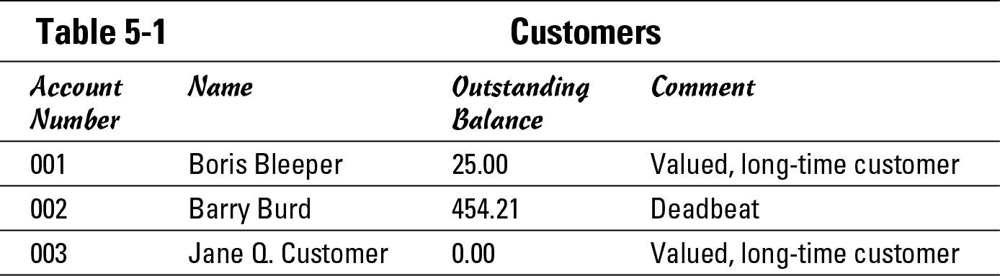

Java 程序员可能会将数据库表比作 Java 类。每个实例都是行行，每个公共字段都是一列。事实上，表与类之间的这种相似性人们已经察觉到很长时间了。许多软件框架专门用于对象-关系映射（ORM），在 ORM 中，软件会自动管理 Java 对象与关系型数据库表之间的对应关系。

数据库管理系统（DBMS）存储数据库数据，并为管理员和用户提供数据访问。数据库管理员（DBA）是负责维护 DBMS 软件运行的人员。用户是从数据库中获取信息并（在拥有相应权限的情况下）修改存储在数据库中的值的人。用户可能会直接或间接地向表中添加行，但用户不会向表中添加列或以任何方式更改表的结构。

数据库管理系统使用复杂的数据结构和算法来高效地存储和检索数据。因此，数据库中的数据很少存在于平文件中。


平文件是硬盘上普通的普通数据堆，没有指向文件内部重要位置的特殊指针或索引。数据库管理系统提供了将数据存储在平文件中的选项，但这仅作为快速、临时存储数据的必要之恶。如果在平文件中使用数据库表，DBMS 必须缓慢且低效地遍历文件所需的任何数据。

数据库管理系统来自许多不同的供应商，具有不同的价格范围和功能 set。主要的商业巨头有 IBM（拥有 `DB2` 软件）、Microsoft（拥有 `Access` 和 `SQL Server` 产品）和 Oracle（拥有名副其实的 `Oracle Database`）。一些流行的非商业产品包括 `MySQL`（Oracle 所有）、`PostgreSQL` 和 `SQLite`。每个 Android 设备都自带 `SQLite` 软件。

通常情况下，你通过以下方式与数据库通信：

- 你连接到数据库（无论这意味着具体什么）。
- 你查询数据库，请求符合你指定的标准的行和列。

作为响应，数据库管理系统会交给你游标。游标是一个微表；它是包含匹配你查询的行和列的表。数据库管理系统提炼数据库中的信息，以便游标交付给你。

和普通的数据库表一样，游标由行和列组成。在任何时刻，游标都指向表中的某一行（或指向表最后一行之后的“永无之地”）。

- 你使用游标在行与行之间移动，对每行数据执行你需要的任何操作。
- 最后（这一点很重要），你关闭与数据库的连接。

根据你的权限，你还可以创建表、修改表中行的值、向表中插入行以及进行其他操作。四个主要的表操作被称为 `CRUD`，代表 `Create`（创建）、`Read`（读取）、`Update`（更新）和 `Delete`（删除）。

向 DBMS 发布命令的最常用方法是使用 `SQL` —— 结构查询语言。（取决于心情，你可以将 SQL 缩写读作 ess-kyoo-el 或 sequel。）一条 SQL 语句看起来像这样：

```sql
SELECT * FROM CUSTOMER_TABLE WHERE COMMENT=’Deadbeat’;
```

每个数据库管理系统都有自己的 `SQL` 方言，因此详细学习 `SQL` 的唯一方法是专门针对一个 DBMS 进行工作。通过 Android 的 SDK，你可以向代码中添加包含 SQL 命令的字符串。但你也可以调用方法来代你组合 SQL 命令。


欲了解 `SQLite` 使用 `SQL` 的规则，请访问 [`http://sqlite.org/lang.html`](http://sqlite.org/lang.html)。

## 数据库操作

通过 Android 的 SDK，应用有两种方式可以访问数据库：

- 应用可以通过向 `SQLite` 的命令直接访问自己的数据库。（见图 5-1。）

**图 5-1：** 应用访问其自己的数据库。

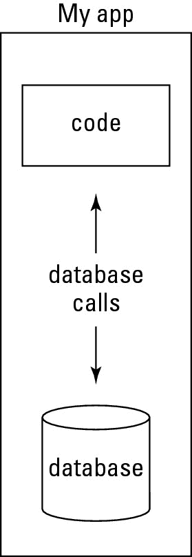

- 应用可以通过向另一个应用的内容提供者发送命令，间接访问另一个应用的数据库。（见图 5-2。）

**图 5-2：** 应用访问另一个应用的数据库。

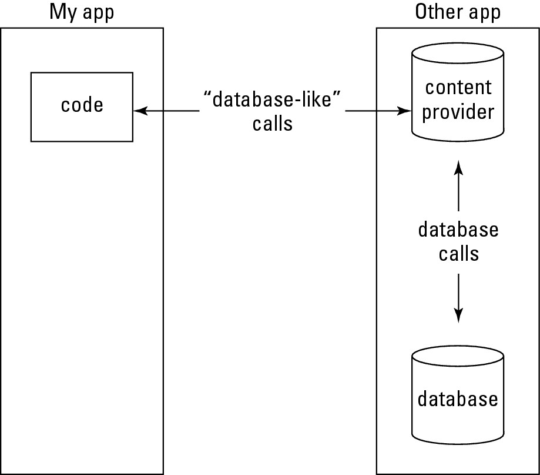

内容提供者（Content Provider）是 Android 四大组件类型之一。（这四种分别是 Activity、Service、广播接收器和内容提供者。）

为了全面说明，我必须写内容提供者并不只与数据库协作。内容提供者是应用代码与另一个应用数据之间的桥梁。另一个应用的数据并不必须是数据库。但提供者公开的方法看起来就像数据库调用。（见 553。）提供者创建数据。


本章剩余部分由三个示例组成。第一个示例演示了应用创建数据库。在第二个示例中，应用使用内容提供者暴露数据，另一个应用通过提供者访问数据。（第三个示例说明了较新的 API 特性。）

当你比较第一个和第二个示例时，你会发现一些相似之处。第二个示例非常像第一个。为了得到第二个示例，我（比喻地）将第一个示例一分为二，将第一个示例代码的一部分交给新的内容提供者，另一部分交给全新的应用。

### 使用 Android SDK 为 SQLite SQLite

列表 5-1 包含了访问 SQLite 数据库的代码。当活动运行时，代码会插入数据，然后修改数据，最后删除数据。为了保持简单，我刻意省略了数据库代码通常具有的故障检查。我只有一个简单的用户界面。活动的屏幕只有一个组件——用于显示处理阶段数据的文本视图。

### 涉及并发的问题

任何优秀的计算设备都会同时运行多个进程。也就是说，这些进程是并发的。

并发对于充分利用设备资源非常好，但如果两个或多个进程同时写入数据库，就会发生糟糕的事情。例如，我可能发现表 5-1 有三行并决定添加第四行。与此同时，你可能发现了相同的情况并发布了自己的命令添加第四行。结果是表格只增加了一行，而该行包含了你的数据和我数据的混合。哎呀！

为了解决双进程写入问题，数据库管理系统拥有锁。锁强制在同一时间除一个进程外其他进程处于只读状态。因此两个进程不能同时执行写入操作。数据库管理系统（有时对于开发者）的技巧在于选择能够在维护数据完整性的同时，以最短的时间锁定最小范围的数据。长期的、范围大的锁往往会减慢系统。

数据库处理的另一个可能陷阱是写入操作不完全的危险。想象一下，我富有钱的叔叔给公司支付表 5-1 中的账单。代表人员为账号 002 输入了新信息：我富有钱的叔叔的名字；新的 0.00 余额；以及“VIP 长期客户”的注释。DBMS 修改了姓名和新余额，但在 DBMS 接收到更改注释的请求之前，网络连接就中断了。结果，账号 002 拥有了 `Rich Burd`（富翁的伯德）、`0.00` 和 `Deadbeat`（赖账）这些值。你可能并不看好我叔叔，但他绝对不是个赖账！

为了防止不完全的写入操作，数据库管理系统执行事务（transactions）。事务是一组以“全有全无”方式执行的操作集合。“要么全部执行，要么一个都不执行，”DBMS 这样说。事务中的操作集合是原子的；该操作集合不能被分割。

正如你可能猜到的那样，强制原子性并不是容易的。当某些恶性的网络错误导致整个系统卡住时，DBMS 如何确保全有全无的写入呢？

幸运的是，如果你是数据库用户，用于强制原子性的机制并不是你需要的问题。如果你的应用需要原子性（并且如果数据库管理系统没有自动强制原子性），你只需要编写一系列常规数据库命令。在一个全有全无序列的末尾，你发布一个特殊的 `commit`（提交）命令或特殊的 `rollback`（回滚）命令。`commit` 命令表示：“固定此操作序列中的所有更改”，而 `rollback` 命令表示：“丢弃此序列中的所有更改”。数据库管理系统会干净、可靠地实现特殊的 `commit` 和 `rollback` 命令。

（如果你在想，这些 `commit` 和 `rollback` 命令通常位于你代码中的备选分支。你不会为了好玩而发出一堆命令然后又把它们回滚。）

### 列表 5-1：向数据库发送命令

```java
package com.allmycode.db1;

import android.app.Activity;
import android.content.ContentValues;
import android.database.Cursor;
import android.database.sqlite.SQLiteDatabase;
import android.os.Bundle;
import android.widget.TextView;

public class MyActivity extends Activity {
  TextView textView;
  Cursor cursor = null;
  DBHelper helper = null;
  SQLiteDatabase db = null;
  ContentValues values = null;

  @Override
  public void onCreate(Bundle savedInstanceState) {
    super.onCreate(savedInstanceState);
    setContentView(R.layout.main);
    textView = (TextView) findViewById(R.id.textView1);
    helper = new DBHelper(this, "simple_db", null, 1);
    db = helper.getWritableDatabase();
    values = new ContentValues();
    values.put("name", "Barry");
    values.put("amount", "100");
    db.insert("simpletable", "", values);
    values.clear();
    values.put("name", "Harriet");
    values.put("amount", "300");
    db.insert("simpletable", "", values);
    addToTextView();
    values.clear();
    values.put("amount", "500");
    db.update("simpletable", values, "name='Barry’", null);
    addToTextView();
    db.delete("simpletable", "1", null);
    addToTextView();
  }

  @Override
  public void onDestroy() {
    super.onDestroy();
    helper.close();
  }

  void addToTextView() {
    cursor =
        db.rawQuery("SELECT * FROM simpletable;", null);
    if (cursor != null && cursor.moveToFirst()) {
      String name;
      do {
        String _id = cursor.getString(0);
        name = cursor.getString(1);
        int amount = cursor.getInt(2);
        textView.append(_id + " " + name + " " + amount + "\n");
      } while (cursor.moveToNext());
    }
    textView.append("-----------\n");
  }
}
```

列表 5-1 中第一个新且令人兴奋的语句是调用 `DBHelper` 构造函数。我的 `DBHelper` 类（将在列表 5-2 中揭晓）扩展了 `android.database.sqlite.SQLiteOpenHelper` 类。此类类的目的是管理 SQLite 数据库的创建和修改。特别是列表 5-1 中的代码使用该助手类来获取实际数据库。

关于友好的助手类列表 5-2 的详情包含了 `DBHelper` 代码。

### 列表 5-2：SQLiteOpenHelper 的子类


```java
package com.allmycode.db1;
import android.content.Context;
import android.database.sqlite.SQLiteDatabase;
import android.database.sqlite.SQLiteOpenHelper;

public class DBHelper extends SQLiteOpenHelper {
  public DBHelper(Context context, String dbName,
      SQLiteDatabase.CursorFactory factory, int version) {
    super(context, dbName, version);
  }

  @Override
  public void onCreate(SQLiteDatabase db) {
    String createString =
        "CREATE TABLE IF EXISTS simpletable " +
        "_id PRIMARY KEY AUTOINCREMENT, " +
        "name TEXT NOT NULL, " +
        "amount INTEGER NOT NULL);";
    db.execSQL(createString);
  }

  @Override
  public void onUpgrade(SQLiteDatabase db,
      int oldVersion, int newVersion) {
    String dropString = "DROP TABLE IF EXISTS simpletable;";
    db.execSQL(dropString);
    onCreate(db);
  }
}
```

在列表 5-2 中，我实现了父类的抽象方法（正如我必须做的那样）。我还创建了一个构造函数，将所有参数传递给父构造函数。

列表 5-2 中最重要的部分是 `onCreate` 方法。你从不直接调用这个方法。相反，当你像我在列表 5-1 中那样设置助手时，Android 会代表你调用该方法。这对你的应用程序性能是有好处的。

Android 传递 `onCreate` 方法一个 SQLite 数据库（属于助手类所在的应用程序）。该 SQLite 数据库（在 `onCreate` 方法参数列表中称为 `db`）有一个 `execSQL` 方法。列表 5-2 调用数据库的 `execSQL` 方法，并传入了一个普通的 Java 字符串。幸运的是，这个普通的 Java 字符串正好是一个 SQL 命令。

在列表 5-2 的 `onCreate` 方法中，很多好事都在发生，但并没有动静。如果数据库不存在，Android 会创建一个。如果数据库已经没有名为 `simpletable` 的表，SQLite 会创建一个。如果数据库已经存在并拥有 `simpletable`，`onCreate` 方法就不会产生任何扰动。

数据库通常在托管进程终止后仍然存在。如果你在 3 月运行此示例代码，然后关闭设备三个月，当你 6 月再次打开设备时，数据库仍然存在（以及你在 3 月添加的任何数据）。

我没有在书中介绍 SQL 命令。尝试涵盖所有命令我会疯的。但幸运的是，其他作者已经涵盖了 SQL 而没有疯。所以，如果想阅读所有 SQL 命令，可以购买《SQL For Dummies》或加强版《SQL All-in-One For Dummies》，这两者都由 Allen G. Taylor 编写（John Wiley & Inc.）。

SQL 比其他语言更具可读性，因此即使没有深入的介绍，你可能也能理解书中的大多数 SQL 命令。例如，列表 5-2 中间部分的 SQL 命令表达了以下内容：

`如果数据库没有名为 simpletable 的表，`

`创建 simpletable，包含三列，名为`

`_id、name 和 amount。`

`_id` 列存储整数值，

`用于识别该行，

`并且每个新添加的行都会加 1，`

`name` 列存储一个不可为空的字符串值，而 `amount` 列存储一个不可为空的整数值。


Android 的 SDK 希望你使用 `_id` 作为表自增主键的名称。我还没有尝试过其他列名，但根据我读到的内容，如果我尝试这样做，某些功能将会崩溃。


`SQLiteOpenHelper` 的 `onUpgrade` 方法处理数据库的新版本。例如，当我修改列表 5-2 中的数据库，使每行都多出一列（可能是一个注释列）时，我实际上是在更改表的结构。这种更改要求我销毁现有的表（即删除该表），并像从头开始一样创建另一个表。在辅助类的 `onUpgrade` 方法中，你负责管理这个（诚然很微妙）的过程。

### 关于主流 SQLite 代码的细节

在列表 5-1 中，在调用 `getWritableDatabase` 后，代码执行了一些相当常见的操作——即插入、更新、删除和查询。

### 插入

每次调用 `db.insert` 都会向 `simpletable` 添加一行值。每个值实际上都是一个键值对，其中键是数据库列名，值是要填充到该列的内容。


属于 `ContentValues` 类的 `put` 方法接受两个 `String` 参数。在调用 `values.put("amount", "100")` 时，第一个参数是列名。第二个参数是要放入当前行该列中的值。注意第二个参数 `"100"` 是一个 Java `String`，尽管数据库的 `amount` 列存储的是整数。运行机制就是如此。哦，当你记住这些事情时，别在使用一组值和组装另一组值之间调用 `values.clear()`。


在列表 5-1 中，`insert` 方法接受三个参数——表名、一个空列处理小技巧（null column hack）以及一组构成新创建行的值。空列处理技巧是你添加的一个值，用于处理完全空插入的情况。如果你尝试插入一个不包含任何数据的行，SQLite 的表现会很糟糕。

由于列表 5-1 中对 `insert` 的调用，活动屏幕包含了图 5-4 文本视图中的前两行。

**图 5-4：** 运行列表 5-1 中的代码。


### 更新

在列表 5-1 中，`db.update` 的调用接受四个参数。前两个参数——表名和一组值——是老常识。`update` 方法的第三个参数是 SQL `WHERE` 子句的一部分。`WHERE` 子句告诉 SQLite 选择哪些行进行处理。例如，“数据库：从石器时代到现代”章节中的 `WHERE` 子句告诉 SQLite 仅选择 `Comment` 列包含值 `Deadbeat` 的行。

对于 `update` 方法调用中的第三个参数，你提供一个包含整个 `WHERE` 子句的字符串，但你省略了 `WHERE` 单词。因此在列表 5-1 中，`update` 方法的调用生成了一个包含 `WHERE name = ‘Barry’` 的 SQL 语句。在游戏的这个阶段，很容易被嵌套的单引号和双引号搞混。SQL 命令规则要求如 `‘Barry’` 的值值加引号，而 Java 字符串必须使用双引号。如果情况变得更加复杂，你就必须使用转义序列和其他技巧。


在列表 5-1 中，`update` 方法的第三个参数是 SQL `WHERE` 子句的一部分。`WHERE` 子句告诉 SQLite 选择哪些行进行处理。

如果情况变得更加复杂，你就必须使用转义序列和其他技巧。

#### 删除

在列表 5-1 中，`db.update` 的调用接受四个参数。前两个参数——表名和一组值——是老常识。`update` 方法的第三个参数是 SQL `WHERE` 子句的一部分。`WHERE` 子句告诉 SQLite 选择哪些行进行处理。例如，“数据库：从石器时代到现代”章节中的 `WHERE` 子句告诉 SQLite 仅选择 `Comment` 列包含值 `Deadbeat` 的行。

对于 `update` 方法调用中的第三个参数，你提供一个包含整个 `WHERE` 子句的字符串，但你省略了 `WHERE` 单词。因此在列表 5-1 中，`update` 方法的调用生成了一个包含 `WHERE name = ‘Barry’` 的 SQL 语句。

### 查询

在列表 5-1 中，在调用 `getWritableDatabase` 后，代码执行了一些相当常见的操作——即插入、更新、删除和查询。

该目录包含一个存储 `simple_db` 数据库的文件（由列表 5-1 中的代码创建的数据库）。


我调用了 `sqlite3` 可执行程序，这是一个可以帮助我探索和修改 SQLite 数据库的程序。

`sqlite3` 程序显示 `sqlite>` 提示符。接几个命令是针对 `simple_db` 数据库的。以点开头的命令是给 `sqlite3` 程序的指令。（这些可能包括 `.help`、`.log` 和 `.exit` 等指令。）

不以点开头的命令是实际的 SQL 命令。这些 SQL 命令读取并更新 `simple_db` 数据库。


会话期间，我输入了两次 `SELECT * FROM simpletable;` SQL 命令。

当我执行此命令时，我能看到 `simple_db` 数据库中的所有内容。我可以利用这些信息来帮助调试我的 Java 代码。（并不是说我的 Java 代码需要调试 . . .）


在相邻的图中，当我输入一个 SQL `INSERT` 命令时，我忘记用分号结束该命令了。

结果是 `sqlite3` 程序向我提示 `...>`。为了完成命令，我输入了所需的分号并按了回车。（我是不是该说：“我早就告诉过你了”？）


我输入 `.exit` 来终止 `sqlite3` 程序，然后输入 `exit` 来结束模拟器的 shell 会话。

考虑到所有因素，这是一次非常有启发性的会话。直接与数据库管理系统通信可能非常有帮助。

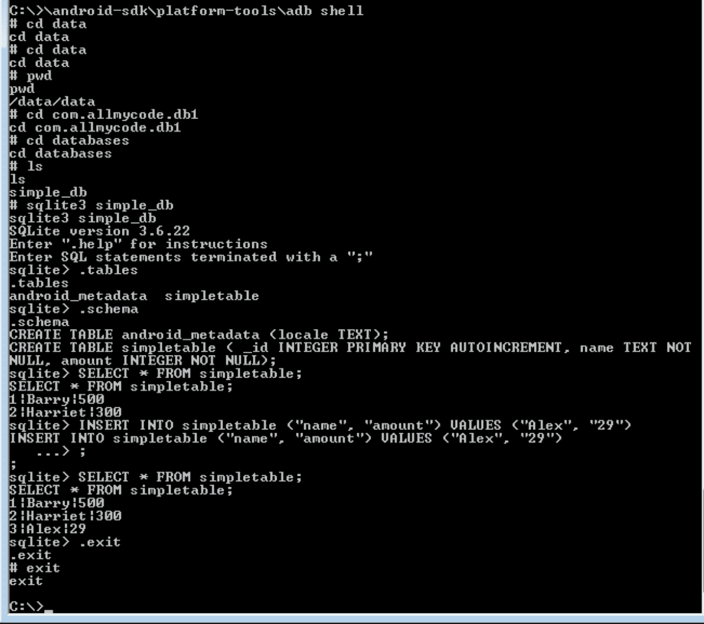

# 创建和使用内容提供者（Content Provider）

内容提供者是访问应用程序数据的网关。其他应用程序像对待数据库一样访问这个网关。但在底层，数据可以采取许多不同的形式。

本节的示例涉及两个应用——一个带有内容提供者的应用和一个独立的客户端应用。（参考图 5-2 和图 5-3。）客户端应用的代码看起来非常像列表 5-1 中的代码。

本节的客户端代码位于列表 5-3。（执行该代码的结果见图 5-5。）

## 列表 5-3：从内容提供者获取数据

```java
package a.b.c;

import android.app.Activity;
import android.content.ContentResolver;
import android.content.ContentValues;
import android.database.Cursor;
import android.net.Uri;
import android.os.Bundle;
import android.widget.TextView;

public class ClientActivity extends Activity {
  TextView textView;
  Cursor cursor = null;
  ContentValues values = null;
  ContentResolver resolver = null;
  public static final Uri CONTENT_URI = Uri
      .parse("content://com.allmycode.db/names_amounts");
  public static final Uri SILLY_URI = Uri
      .parse("content://com.allmycode.db/silly_stuff");
  @Override
  public void onCreate(Bundle b) {
    super.onCreate(b);
    setContentView(R.layout.main);
    textView = (TextView) findViewById(R.id.textView1);
    values = new ContentValues();
    resolver = getContentResolver();
    values.put("name", "Sam");
    values.put("amount", "100");
    resolver.insert(CONTENT_URI, values);
    values.clear();
    values.put("name", "Jennie");
    values.put("amount", "300");
    resolver.insert(CONTENT_URI, values);
    addToTextView(CONTENT_URI);
    values.clear();
    values.put("amount", "500");
    resolver.update(CONTENT_URI, values,
        "name='Sam'", null);
    addToTextView(CONTENT_URI);
    resolver.delete(CONTENT_URI, "1", null);
    addToTextView(CONTENT_URI);
    addToTextView(SILLY_URI);
  }
  void addToTextView(Uri uri) {
    cursor = resolver.query(uri, null, "1", null);
    startManagingCursor(cursor);
    if (cursor != null && cursor.moveToFirst()) {
      String name;
      do {
        String _id = cursor.getString(0);
        name = cursor.getString(1);
        int amount = cursor.getInt(2);
        textView.append(_id + " " + name + " " + amount + "\n");
      } while (cursor.moveToNext());
    }
    textView.append("-----------");
  }
}
```

**图 5-5：** 列表 5-3 中代码的运行。


列表 5-1 和 5-3 之间的许多差异是外观上的。巨大的非视觉差异是使用了 `content resolver`（内容解析器）而不是辅助类和数据库。在列表 5-3 中，客户端应用没有与提供者的数据库直接通信。相反，它通过 `content resolver` 进行通信。

当我执行此命令时，我能看到 `simple_db` 数据库中的准确内容。我可以利用这些信息来帮助调试我的 Java 代码。（并不是说我的 Java 代码需要调试 . . .）


在相邻的图中，当我输入一个 SQL `INSERT` 命令时，我忘记用分号结束该命令了。

结果是 `sqlite3` 程序向我提示 `...>`。为了完成命令，我输入了所需的分号并按了回车。（我是不是该说：“我早就告诉过你了”？）


我输入 `.exit` 来终止 `sqlite3` 程序，然后输入 `exit` 来结束模拟器的 shell 会话。

考虑到所有因素，这是一次非常有启发性的会话。直接与数据库管理系统通信可能非常有帮助。


# 创建和使用内容提供者（Content Provider）

内容提供者是访问应用程序数据的网关。其他应用程序像对待数据库一样访问这个网关。但在底层，数据可以采取许多不同的形式。

本节的示例涉及两个应用——一个带有内容提供者的应用和一个独立的客户端应用。（参考图 5-2 和图 5-3。）客户端应用的代码看起来非常像列表 5-1 中的代码。

本节的客户端代码位于列表 5-3。（执行该代码的结果见图 5-5。）

## 列表 5-3：从内容提供者获取数据


```java
package a.b.c;

import android.app.Activity;
import android.content.ContentResolver;
import android.content.ContentValues;
import android.database.Cursor;
import android.net.Uri;
import android.os.Bundle;
import android.widget.TextView;

public class ClientActivity extends Activity {
  TextView textView;
  Cursor cursor = null;
  ContentValues values = null;
  ContentResolver resolver = null;
  public static final Uri CONTENT_URI = Uri
      .parse("content://com.allmycode.db/names_amounts");
  public static final Uri SILLY_URI = Uri
      .parse("content://com.allmycode.db/silly_stuff");
  @Override
  public void onCreate(Bundle b) {
    super.onCreate(b);
    setContentView(R.layout.main);
    textView = (TextView) findViewById(R.id.textView1);
    values = new ContentValues();
    resolver = getContentResolver();
    values.put("name", "Sam");
    values.put("amount", "100");
    resolver.insert(CONTENT_URI, values);
    values.clear();
    values.put("name", "Jennie");
    values.put("amount", "300");
    resolver.insert(CONTENT_URI, values);
    addToTextView(CONTENT_URI);
    values.clear();
    values.put("amount", "500");
    resolver.update(CONTENT_URI, values,
        "name='Sam'", null);
    addToTextView(CONTENT_URI);
    resolver.delete(CONTENT_URI, "1", null);
    addToTextView(CONTENT_URI);
    addToTextView(SILLY_URI);
  }
  void addToTextView(Uri uri) {
    cursor = resolver.query(uri, null, "1", null);
    startManagingCursor(cursor);
    if (cursor != null && cursor.moveToFirst()) {
      String name;
      do {
        String _id = cursor.getString(0);
        name = cursor.getString(1);
        int amount = cursor.getInt(2);
        textView.append(_id + " " + name + " " + amount + "\n");
      } while (cursor.moveToNext());
    }
    textView.append("-----------");
  }
}
```

**图 5-5：** 列表 5-3 中代码的运行。


列表 5-1 和 5-3 之间的许多差异是外观上的。巨大的非视觉差异是使用了 `content resolver`（内容解析器）而不是辅助类和数据库。在列表 5-3 中，客户端应用没有与提供者的数据库直接通信。相反，它通过 `content resolver` 进行通信。

当我执行此命令时，我能看到 `simple_db` 数据库中的准确内容。我可以利用这些信息来帮助调试我的 Java 代码。（并不是说我的 Java 代码需要调试 . . .）

 在相邻的图中，当我输入一个 SQL `INSERT` 命令时，我忘记用分号结束该命令了。

结果是 `sqlite3` 程序向我提示 `...>`。为了完成命令，我输入了所需的分号并按了回车。（我是不是该说：“我早就告诉过你了”？）

 我输入 `.exit` 来终止 `sqlite3` 程序，然后输入 `exit` 来结束模拟器的 shell 会话。

考虑到所有因素，这是一次非常有启发性的会话。直接与数据库管理系统通信可能非常有帮助。


# 创建和使用内容提供者 (Content Provider)

内容提供者是访问应用程序数据的网关。其他应用程序像对待数据库一样访问这个网关。但在底层，数据可以采取许多不同的形式。

本节的示例涉及两个应用——一个带有内容提供者的应用和一个独立的客户端应用。（参考图 5-2 和图 5-3。）客户端应用的代码看起来非常像列表 5-1 中的代码。

本节的客户端代码位于列表 5-3。（执行该代码的结果见图 5-5。）

## 列表 5-3：从内容提供者获取数据

```java
package a.b.c;

import android.app.Activity;
import android.content.ContentResolver;
import android.content.ContentValues;
import android.database.Cursor;
import android.net.Uri;
import android.os.Bundle;
import android.widget.TextView;

public class ClientActivity extends Activity {
  TextView textView;
  Cursor cursor = null;
  ContentValues values = null;
  ContentResolver resolver = null;
  public static final Uri CONTENT_URI = Uri
      .parse("content://com.allmycode.db/names_amounts");
  public static final Uri SILLY_URI = Uri
      .parse("content://com.allmycode.db/silly_stuff");
  @Override
  public void onCreate(Bundle b) {
    super.onCreate(b);
    setContentView(R.layout.main);
    textView = (TextView) findViewById(R.id.textView1);
    values = new ContentValues();
    resolver = getContentResolver();
    values.put("name", "Sam");
    values.put("amount", "100");
    resolver.insert(CONTENT_URI, values);
    values.clear();
    values.put("name", "Jennie");
    values.put("amount", "300");
    resolver.insert(CONTENT_URI, values);
    addToTextView(CONTENT_URI);
    values.clear();
    values.put("amount", "500");
    resolver.update(CONTENT_URI, values,
        "name='Sam'", null);
    addToTextView(CONTENT_URI);
    resolver.delete(CONTENT_URI, "1", null);
    addToTextView(CONTENT_URI);
    addToTextView(SILLY_URI);
  }
  void addToTextView(Uri uri) {
    cursor = resolver.query(uri, null, "1", null);
    startManagingCursor(cursor);
    if (cursor != null && cursor.moveToFirst()) {
      String name;
      do {
        String _id = cursor.getString(0);
        name = cursor.getString(1);
        int amount = cursor.getInt(2);
        textView.append(_id + " " + name + " " + amount + "\n");
      } while (cursor.moveToNext());
    }
    textView.append("-----------");
  }
}
```

**图 5-5：** 列表 5-3 中代码的运行。


列表 5-1 和 5-3 之间的许多差异是外观上的。巨大的非视觉差异是使用了 `content resolver`（内容解析器）而不是辅助类和数据库。在列表 5-3 中，客户端应用没有与提供者的数据库直接通信。相反，它通过 `content resolver` 进行通信。

当我执行此命令时，我能看到 `simple_db` 数据库中的准确内容。我可以利用这些信息来帮助调试我的 Java 代码。（并不是说我的 Java 代码需要调试 . . .）

 在相邻的图中，当我输入一个 SQL `INSERT` 命令时，我忘记用分号结束该命令了。

结果是 `sqlite3` 程序向我提示 `...>`。为了完成命令，我输入了所需的分号并按了回车。（我是不是该说：“我早就告诉过你了”？）

 我输入 `.exit` 来终止 `sqlite3` 程序，然后输入 `exit` 来结束模拟器的 shell 会话。

考虑到所有因素，这是一次非常有启发性的会话。直接与数据库管理系统通信可能非常有帮助。


# 创建和使用内容提供者（Content Provider）

内容提供者是访问应用程序数据的网关。其他应用程序像对待数据库一样访问这个网关。但在底层，数据可以采取许多不同的形式。

本节的示例涉及两个应用——一个带有内容提供者的应用和一个独立的客户端应用。（参考图 5-2 和图 5-3。）客户端应用的代码看起来非常像列表 5-1 中的代码。

本节的客户端代码位于列表 5-3。（执行该代码的结果见图 5-5。）

## 列表 5-3：从内容提供者获取数据

```java
package a.b.c;

import android.app.Activity;
import android.content.ContentResolver;
import android.content.ContentValues;
import android.database.Cursor;
import android.net.Uri;
import android.os.Bundle;
import android.widget.TextView;

public class ClientActivity extends Activity {
  TextView textView;
  Cursor cursor = null;
  ContentValues values = null;
  ContentResolver resolver = null;
  public static final Uri CONTENT_URI = Uri
      .parse("content://com.allmycode.db/names_amounts");
  public static final Uri SILLY_URI = Uri
      .parse("content://com.allmycode.db/silly_stuff");
  @Override
  public void onCreate(Bundle b) {
    super.onCreate(b);
    setContentView(R.layout.main);
    textView = (TextView) findViewById(R.id.textView1);
    values = new ContentValues();
    resolver = getContentResolver();
    values.put("name", "Sam");
    values.put("amount", "100");
    resolver.insert(CONTENT_URI, values);
    values.clear();
    values.put("name", "Jennie");
    values.put("amount", "300");
    resolver.insert(CONTENT_URI, values);
    addToTextView(CONTENT_URI);
    values.clear();
    values.put("amount", "500");
    resolver.update(CONTENT_URI, values,
        "name='Sam'", null);
    addToTextView(CONTENT_URI);
    resolver.delete(CONTENT_URI, "1", null);
    addToTextView(CONTENT_URI);
    addToTextView(SILLY_URI);
  }
  void addToTextView(Uri uri) {
    cursor = resolver.query(uri, null, "1", null);
    startManagingCursor(cursor);
    if (cursor != null && cursor.moveToFirst()) {
      String name;
      do {
        String _id = cursor.getString(0);
        name = cursor.getString(1);
        int amount = cursor.getInt(2);
        textView.append(_id + " " + name + " " + amount + "\n");
      } while (cursor.moveToNext());
    }
    textView.append("-----------");
  }
}
```

**图 5-5：** 列表 5-3 中代码的运行。


列表 5-1 和 5-3 之间的许多差异是外观上的。巨大的非视觉差异是使用了 `content resolver`（内容解析器）而不是辅助类和数据库。在列表 5-3 中，客户端应用没有与提供者的数据库直接通信。相反，它通过 `content resolver` 进行通信。

当我执行此命令时，我能看到 `simple_db` 数据库中的准确内容。我可以利用这些信息来帮助调试我的 Java 代码。（并不是说我的 Java 代码需要调试 . . .）

 在相邻的图中，当我输入一个 SQL `INSERT` 命令时，我忘记用分号结束该命令了。

结果是 `sqlite3` 程序向我提示 `...>`。为了完成命令，我输入了所需的分号并按了回车。（我是不是该说：“我早就告诉过你了”？）

 我输入 `.exit` 来终止 `sqlite3` 程序，然后输入 `exit` 来结束模拟器的 shell 会话。

考虑到所有因素，这是一次非常有启发性的会话。直接与数据库管理系统通信可能非常有帮助。


# 创建和使用内容提供者（Content Provider）

内容提供者是访问应用程序数据的网关。其他应用程序像对待数据库一样访问这个网关。但在底层，数据可以采取许多不同的形式。

本节的示例涉及两个应用——一个带有内容提供者的应用和一个独立的客户端应用。（参考图 5-2 和图 5-3。）客户端应用的代码看起来非常像列表 5-1 中的代码。

本节的客户端代码位于列表 5-3。（执行该代码的结果见图 5-5。）

## 列表 5-3：从内容提供者获取数据

```java
package a.b.c;

import android.app.Activity;
import android.content.ContentResolver;
import android.content.ContentValues;
import android.database.Cursor;
import android.net.Uri;
import android.os.Bundle;
import android.widget.TextView;

public class ClientActivity extends Activity {
  TextView textView;
  Cursor cursor = null;
  ContentValues values = null;
  ContentResolver resolver = null;
  public static final Uri CONTENT_URI = Uri
      .parse("content://com.allmycode.db/names_amounts");
  public static final Uri SILLY_URI = Uri
      .parse("content://com.allmycode.db/silly_stuff");
  @Override
  public void onCreate(Bundle b) {
    super.onCreate(b);
    setContentView(R.layout.main);
    textView = (TextView) findViewById(R.id.textView1);
    values = new ContentValues();
    resolver = getContentResolver();
    values.put("name", "Sam");
    values.put("amount", "100");
    resolver.insert(CONTENT_URI, values);
    values.clear();
    values.put("name", "Jennie");
    values.put("amount", "300");
    resolver.insert(CONTENT_URI, values);
    addToTextView(CONTENT_URI);
    values.clear();
    values.put("amount", "500");
    resolver.update(CONTENT_URI, values,
        "name='Sam'", null);
    addToTextView(CONTENT_URI);
    resolver.delete(CONTENT_URI, "1", null);
    addToTextView(CONTENT_URI);
    addToTextView(SILLY_URI);
  }
  void addToTextView(Uri uri) {
    cursor = resolver.query(uri, null, "1", null);
    startManagingCursor(cursor);
    if (cursor != null && cursor.moveToFirst()) {
      String name;
      do {
        String _id = cursor.getString(0);
        name = cursor.getString(1);
        int amount = cursor.getInt(2);
        textView.append(_id + " " + name + " " + amount + "\n");
      } while (cursor.moveToNext());
    }
    textView.append("-----------");
  }
}
```

**图 5-5：** 列表 5-3 中代码的运行。


列表 5-1 和 5-3 之间的许多差异是外观上的。巨大的非视觉差异是使用了 `content resolver`（内容解析器）而不是辅助类和数据库。在列表 5-3 中，客户端应用没有与提供者的数据库直接通信。相反，它通过 `content resolver` 进行通信。

当我执行此命令时，我能看到 `simple_db` 数据库中的准确内容。我可以利用这些信息来帮助调试我的 Java 代码。（并不是说我的 Java 代码需要调试 . . .）

 在相邻的图中，当我输入一个 SQL `INSERT` 命令时，我忘记用分号结束该命令了。

结果是 `sqlite3` 程序向我提示 `...>`。为了完成命令，我输入了所需的分号并按了回车。（我是不是该说：“我早就告诉过你了”？）

 我输入 `.exit` 来终止 `sqlite3` 程序，然后输入 `exit` 来结束模拟器的 shell 会话。

考虑到所有因素，这是一次非常有启发性的会话。直接与数据库管理系统通信可能非常有帮助。


结果是 `sqlite3` 程序向我提示 `...>`。为了完成命令，我输入了所需的分号并按了回车。（我是不是该说：“我早就告诉过你了”？）

 我输入 `.exit` 来终止 `sqlite3` 程序，然后输入 `exit` 来结束模拟器的 shell 会话。

考虑到所有因素，这是一次非常有启发性的会话。直接与数据库管理系统通信可能非常有帮助。


# 创建和使用内容提供者 (Content Provider)

内容提供者是访问应用程序数据的网关。其他应用程序像对待数据库一样访问这个网关。但在底层，数据可以采取许多不同的形式。

本节的示例涉及两个应用——一个带有内容提供者的应用和一个独立的客户端应用。（参考图 5-2 和图 5-3。）客户端应用的代码看起来非常像列表 5-1 中的代码。

本节的客户端代码位于列表 5-3。（执行该代码的结果见图 5-5。）

## 列表 5-3：从内容提供者获取数据

```java
package a.b.c;

import android.app.Activity;
import android.content.ContentResolver;
import android.content.ContentValues;
import android.database.Cursor;
import android.net.Uri;
import android.os.Bundle;
import android.widget.TextView;

public class ClientActivity extends Activity {
  TextView textView;
  Cursor cursor = null;
  ContentValues values = null;
  ContentResolver resolver = null;
  public static final Uri CONTENT_URI = Uri
      .parse("content://com.allmycode.db/names_amounts");
  public static final Uri SILLY_URI = Uri
      .parse("content://com.allmycode.db/silly_stuff");
  @Override
  public void onCreate(Bundle b) {
    super.onCreate(b);
    setContentView(R.layout.main);
    textView = (TextView) findViewById(R.id.textView1);
    values = new ContentValues();
    resolver = getContentResolver();
    values.put("name", "Sam");
    values.put("amount", "100");
    resolver.insert(CONTENT_URI, values);
    values.clear();
    values.put("name", "Jennie");
    values.put("amount", "300");
    resolver.insert(CONTENT_URI, values);
    addToTextView(CONTENT_URI);
    values.clear();
    values.put("amount", "500");
    resolver.update(CONTENT_URI, values,
        "name='Sam'", null);
    addToTextView(CONTENT_URI);
    resolver.delete(CONTENT_URI, "1", null);
    addToTextView(CONTENT_URI);
    addToTextView(SILLY_URI);
  }
  void addToTextView(Uri uri) {
    cursor = resolver.query(uri, null, "1", null);
    startManagingCursor(cursor);
    if (cursor != null && cursor.moveToFirst()) {
      String name;
      do {
        String _id = cursor.getString(0);
        name = cursor.getString(1);
        int amount = cursor.getInt(2);
        textView.append(_id + " " + name + " " + amount + "\n");
      } while (cursor.moveToNext());
    }
    textView.append("-----------");
  }
}
```

```java
public static final Uri CONTENT_URI = Uri
    .parse("content://com.allmycode.db/names_amounts");
public static final Uri SILLY_URI = Uri
    .parse("content://com.allmycode.db/silly_stuff");
private static final String SIMPLE_DB = "simple_db";
private static final String SIMPLETABLE = "simpletable";
Cursor cursor = null;
DBHelper helper = null;
SQLiteDatabase db = null;
ContentValues values = null;
UriMatcher uriMatcher = null;
{
    uriMatcher = new UriMatcher(UriMatcher.NO_MATCH);
    uriMatcher.addURI("com.allmycode.db", "names_amounts", 1);
    uriMatcher.addURI("com.allmycode.db", "silly_stuff", 2);
}

@Override
public boolean onCreate() {
    try {
        helper = new DBHelper(getContext(), SIMPLE_DB, null, 1);
        db = helper.getWritableDatabase();
        values = new ContentValues();
        return true;
    } catch (Exception e) {
        return false;
    }
}

@Override
public Uri insert(Uri ure, ContentValues values) {
    long id = db.insert(SIMPLETABLE, "", values);
    return ContentUris.withAppendedId(CONTENT_URI, id);
}

@Override
public int update(Uri uri, ContentValues values, String whereClause, String[] whereArgs) {
    int numOfChangedRows = db.update(SIMPLETABLE, values, whereClause, whereArgs);
    return numOfChangedRows;
}

@Override
public int delete(Uri uri, String whereClause, String[] whereArgs) {
    int numOfChangedRows = db.delete(SIMPLETABLE, whereClause, whereArgs);
    return numOfChangedRows;
}

@Override
public Cursor query(Uri uri, String[] columns, String whereClause, String[] whereArgs, String sortOrder) {
    Cursor cursor = null;
    int code = uriMatcher.match(uri);
    if (code == 1) {
        cursor = db.query(SIMPLETABLE, columns, whereClause, whereArgs, null, null, sortOrder);
    } else if (code == 2) {
        String[] columnNames = { "_id", "name", "amount" };
        String[] rowValues = { "Table ", "2" };
        MatrixCursor matrixCursor = new MatrixCursor(columnNames);
        matrixCursor.addRow(rowValues);
        cursor = matrixCursor;
    }
    return cursor;
}

@Override
public String getType(Uri uri) {
    return null;
}
```

`Listing 5-5` 实现了 `android.content.ContentProvider` 类中声明的抽象方法。实现代码与 `Listing 5-1` 中的某些代码具有惊人的相似之处：

- 两个 `onCreate` 方法都使用 `DBHelper`（自 `SQLiteOpenHelper` 类）来获取可写数据库。

- 两个列表都调用了数据库的 `insert`、`update` 和 `delete` 方法。

- 两个列表都向数据库发出查询。

实际上，`Listing 5-1` 使用了 `rawQuery` 方法和 SQL 字符串。相比之下，`Listing 5-5` 使用了带有大量参数的 `query` 方法。这种区别与内容提供者无关。底线是：内容提供者对其应用数据的操作，就像普通 activity 对其应用数据所做的一样。

`Listing 5-5` 具有一些我在 `Listing 5-1` 中选择不使用的特性。例如，Android 的 `update` 和 `delete` 方法返回 `int` 值。在 `Listing 5-1` 中，我简单地忽略了返回值。但在 `Listing 5-5` 中，我将每个方法的返回值都传给了客户端。（内容提供者的抽象 `update` 和 `delete` 方法必须有 `int` 返回值。）

`Listing 5-5` 还具有一些内容提供者特有的特性。例如，为了分发数据，内容提供者必须管理 `URIs`。通常情况下，内容提供者会检查每个方法的传入 `URI`，并利用这些信息决定其操作。在 `Listing 5-5` 中，我通过在 `query` 方法中少量的 URI 处理来保持简单。

在 Android 世界之外，使用 `URIs` 连接数据库是十分常见的。例如，在 Java 程序中，你可能使用类似 `DriverManager.getConnection("jdbc:db")` 的语句来连接数据库。在这个语句的不透明 URI 中，方案 `jdbc:` 将请求转发到另一个方案——即 `db: ` 方案。

在 `Listing 5-5` 中，`query` 方法调用了 `UriMatcher` 实例来区分不同的路径。正如它在 `Listing 5-5` 开头定义的，`UriMatcher` 实例为 `names_amounts` 路径返回 `1`，为 `silly_stuff` 路径返回 `2`。返回 `1` 会让 `query` 方法执行常规数据库查询。但返回 `2` 则会执行不同的操作。为了证明我可以这样做，我对 `URI` 的 `silly_stuff` 路径做出响应，而没有咨询真实的数据库。相反，我使用数组伪造了一个看起来像 `simpletable` 行的内容。我将数组压缩进 `MatrixCursor`（一种从数组而非数据库构建的游标），并将游标返回给客户端。

`Listing 5-5` 中的 `insert` 方法返回一个 `URI`。这是什么意思？每个关联 `content:` 方案都有自己的 `URI`。例如，在本节的代码中，前两次插入操作拥有 `URIs` `content://allmycode.db/names_amounts/1` 和 `content://allmycode.db/names_amounts/2`。`android.content.ContentUris` 类的 `withAppendedId` 方法获取特定数据库行的 `URI`。客户端可以使用这个特定的行 `URI` 来引用数据库行。

### 最新的游标代码

随着 Honeycomb（Android 3.0）的到来，游标管理变成了全新的局面。特别是 `Listing 5-3` 中的 `startManagingCursor` 方法已经过时。尽管听起来糟糕，你仍然可以在运行 Honeycomb 的设备上运行 `Listing 5-3` 的代码。过时意味着“Android 创建者建议不要继续使用此方法，因为他们可能在未来的版本中不再支持它。”

为了取代托管游标，Honeycomb 有了一个 `CursorLoader` 类。就像去大学的大学生一样，`CursorLoader` 实例通过离开父线程、独立运行并最终返回结果来管理自己。就像任何真实的大学生，`CursorLoader` 实例由于其异步行为可能会以奇怪的方式运行。

总之，你可以通过查看 `CursorLoader` 的简单使用示例来入门。`Listing 5-6` 就有这样一个示例。

#### Listing 5-6：简单的 CursorLoader 示例

```java
package a.b.c;
import android.app.Activity;
import android.content.ContentResolver;
import android.content.ContentValues;
import android.content.CursorLoader;
import android.content.Loader;
import android.content.Loader.OnLoadCompleteListener;
import android.database.Cursor;
import android.net.Uri;
import android.os.Bundle;
import android.widget.TextView;

public class ClientActivity extends Activity {
    TextView textView;
    Cursor cursor = null;
    ContentValues values = null;
    ContentResolver resolver = null;
    public static final Uri CONTENT_URI = Uri
        .parse("content://com.allmycode.db/names_amounts");
    @Override
    public void onCreate(Bundle b) {
        super.onCreate(b);
        setContentView(R.layout.main);
        textView = (TextView) findViewById(R.id.textView1);
        values = new ContentValues();
        resolver = getContentResolver();
        values.put("name", "Sam");
    }
}
```


```java
values.put(“amount”, “100”);
resolver.insert(CONTENT_URI, values);
values.clear();
values.put(“name”, “Jennie”);
values.put(“amount”, “300”);
resolver.insert(CONTENT_URI, values);
addToTextView(CONTENT_URI);
}
CursorLoader loader = null;
void addToTextView(Uri uri) {
    loader =
        new CursorLoader(this, uri, null, “1”, null, null);
    loader.registerListener(42,
        new MyOnLoadCompleteListener());
    loader.startLoading();
    textView.append(“Here it comes...”);
}
class MyOnLoadCompleteListener implements
      OnLoadCompleteListener<Cursor> {
  @Override
  public void onLoadComplete(Loader<Cursor> loader,
      Cursor cursor) {
    if (cursor != null && cursor.moveToFirst()) {
      String name;
      do {
        String _id = cursor.getString(0);
        name = cursor.getString(1);
        int amount = cursor.getInt(2);
        textView.append(_id + “ “ + name + “ “ + amount
            + “\n”);
      } while (cursor.moveToNext());
    }
    textView.append(“-----------\n”);
  }
}
}
```

运行列表 5-6 中代码的结果如图 5-7 所示。

**图 5-7：**列表 5-6 代码的运行结果。


列表 5-6 只是向数据库表添加了两行数据，并在 activity 的 `textView` 中显示结果。对 `CursorLoader` 构造函数的调用看起来与列表 5-3 中的 `resolver.query` 调用非常相似。（事实上，我复制并粘贴了代码来创建 `CursorLoader` 构造函数的参数列表。）`CursorLoader` 构造函数与 `resolver.query` 调用之间的巨大巨大区别在于，`CursorLoader` 构造函数需要一个 context（上下文）参数。在列表 5-6 中，context 是该 activity 本身。

从构造函数调用开始，activity 的线程注册了一个回调监听器并调用了 loader 的 `startLoading` 方法。与 Java 的大多数监听器场景中一样，loader 的回调监听器（`MyOnLoadCompleteListener`）是一个类，其方法会静静等待另一个线程的通知。

在列表 5-6 中，监听器的 `onLoadComplete` 方法在等待 loader 的结果时什么什么都不做。在此期间，activity 的其他代码（即向文本框中追加 `Here it comes`）会继续执行它们自己的任务。

当数据加载最终完成时，`onLoadComplete` 方法将执行你希望它对游标数据执行的操作。在列表 5-6 中，该方法遵循了本章之前示例的指引，并在 activity 的 `textView` 中显示这些数据。

# 第四部分：编写酷炫的手机功能


## 目录概览

### 第 1 章：布局你的内容

- Android 布局
  - 线性布局（Linear Layout）
  - 属性（一个旁路）
  - 相对布局（Relative Layout）
  - 表格布局（Table Layout）
  - 帧布局（Frame Layout）

### 第 2 章：菜单、列表和通知

- 关于菜单的一切
  - 创建选项菜单（Options Menu）
  - 创建上文菜单（Context Menu）
- 关于列表的更多内容
  - 在列表中显示两个（或多个）值

### 第 3 章：Android 传感器

- 拨打电话
- 发送消息
- 绘制、拖拽

### 第 4 章：平板电脑应用

- 片段（Fragments）

## 第 1 章：布局你的内容

### Android 布局

运行列表 5-6 中代码的结果如图 5-7 所示。

**图 5-7：**列表 5-6 代码的运行结果。


列表 5-6 只是向数据库表添加了两行数据，并在 activity 的 `textView` 中显示结果。对 `CursorLoader` 构造函数的调用看起来与列表 5-3 中的 `resolver.query` 调用非常相似。（事实上，我复制并粘贴了代码来创建 `CursorLoader` 构造函数的参数列表。）`CursorLoader` 构造函数与 `resolver.query` 调用之间的巨大区别在于，`CursorLoader` 构造函数需要一个 context（上下文）参数。在列表 5-6 中，context 是该 activity 本身。

从构造函数调用开始，activity 的线程注册了一个回调监听器并调用了 loader 的 `startLoading` 方法。与 Java 的大多数监听器场景中一样，loader 的回调监听器（`MyOnLoadCompleteListener`）是一个类，其方法会静静等待另一个线程的通知。

在列表 5-6 中，监听器的 `onLoadComplete` 方法在等待 loader 的结果时什么什么都不做。在此期间，activity 的其他代码（即向文本框中追加 `Here it comes`）会继续执行它们自己的任务。

当数据加载最终完成时，`onLoadComplete` 方法将执行你希望它对游标数据执行的操作。在列表 5-6 中，该方法遵循了本章之前示例的指引，并在 activity 的 `textView` 中显示这些数据。

### Android 布局

运行列表 5-6 中代码的结果如图 5-7 所示。

**图 5-7：**列表 5-6 代码的运行结果。


列表 5-6 只是向数据库表添加了两行数据，并在 activity 的 `textView` 中显示结果。对 `CursorLoader` 构造函数的调用看起来与列表 5-3 中的 `resolver.query` 调用非常相似。（事实上，我复制并粘贴了代码来创建 `CursorLoader` 构造函数的参数列表。）`CursorLoader` 构造函数与 `resolver.query` 调用之间的巨大区别在于，`CursorLoader` 构造函数需要一个 context（上下文）参数。在列表 5-6 中，context 是该 activity 本身。

从构造函数调用开始，activity 的线程注册了一个回调监听器并调用了 loader 的 `startLoading` 方法。与 Java 的大多数监听器场景中一样，loader 的回调监听器（`MyOnLoadCompleteListener`）是一个类，其方法会静静等待另一个线程的通知。

在列表 5-6 中，监听器的 `onLoadComplete` 方法在等待 loader 的结果时什么什么都不做。在此期间，activity 的其他代码（即向文本框中追加 `Here it comes`）会继续执行它们自己的任务。

当数据加载最终完成时，`onLoadComplete` 方法将执行你希望它对游标数据执行的操作。在列表 5-6 中，该方法遵循了本章之前示例的指引，并在 activity 的 `textView` 中显示这些数据。

### 线性布局

线性布局具有垂直或水平方向性。当你创建一个新的 Android 项目时，Eclipse 会在你的 `main.xml` 文件中填充一个垂直方向的线性布局。

垂直线性布局中的视图一个接一个地排列。水平线性布局中的视图一个并一个地排列。（参见图 1-1。）

```xml
<?xml version="1.0" encoding="utf-8"?>
<LinearLayout xmlns:android="http://schemas.android.com/apk/res/android"
    android:layout_width="match_parent"
    android:layout_height="match_parent"
    android:orientation="vertical">
</LinearLayout>
```

```xml
<LinearLayout xmlns:android="http://schemas.android.com/apk/res/android"
    android:orientation="horizontal"
    android:layout_width="match_parent"
    android:layout_height="match_parent">
    <Button android:text="Button1"
        android:layout_height="wrap_content"
        android:layout_width="wrap_content"
        android:id="@+id/button1">
    </Button>
    <Button android:text="Button2"
        android:layout_height="wrap_content"
        android:layout_width="wrap_content"
        android:id="@+id/button2">
    </Button>
    <Button android:text="Button3"
        android:layout_height="wrap_content"
        android:layout_width="wrap_content"
        android:id="@+id/button3">
    </Button>
    <Button android:text="Button4"
        android:layout_height="wrap_content"
        android:layout_width="wrap_content"
        android:id="@+id/button4">
    </Button>
</LinearLayout>
```

你也可以通过在 Eclipse 的图形布局编辑器中拖放视图来创建图 1-1 中的布局。

线性布局（Linear layouts）不会换行，也不会滚动。因此，如果你在一个水平布局中添加了六个按钮，而用户的屏幕宽度仅够容纳五个按钮，那么用户只能看到五个按钮。（参见图 1-2。）

**图 1-2：**水平线性布局中的六个（是的，六个）按钮。

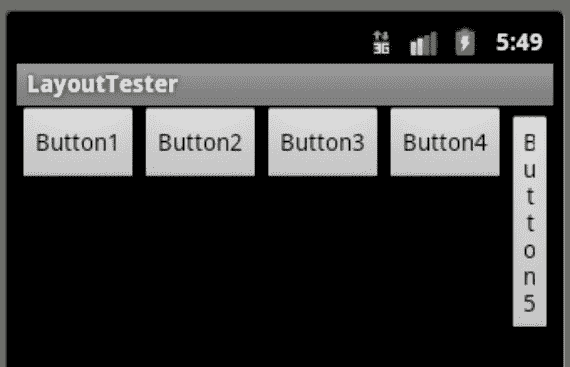

## 属性（一种旁路）

使用 XML 属性，你可以更改布局的默认行为。本节包含几个示例。

### `android:layout_width` 和 `android:layout_length`

你可以使用 `android:layout_width` 和 `android:layout_length` 属性来调整视图的大小。代码列表 1-2 包含了一些代码，图 1-3 显示了结果布局。

```xml
<?xml version="1.0" encoding="utf-8"?>
<LinearLayout xmlns:android="http://schemas.android.com/apk/res/android"
    android:orientation="vertical"
    android:layout_width="match_parent"
    android:layout_height="match_parent">
    <Button
        android:layout_width="match_parent"
        android:layout_height="wrap_content"
        android:text='1. android:layout_height="wrap_content"'
        android:id="@+id/button1">
    </Button>
    <Button
        android:layout_width="wrap_content"
        android:layout_height="wrap_content"
        android:text="2. wrap/wrap">
        android:id="@+id/button2">
    </Button>
    <Button
        android:layout_width="60dp"
        android:layout_height="wrap_content"
        android:text="3. width 60dp">
        android:id="@+id/button3">
    </Button>
    <Button
        android:layout_width="160dp"
        android:layout_height="wrap_content"
        android:text='4. android:layout_width="160dp'">
        android:id="@+id/button4">
    </Button>
    <Button
        android:layout_width="wrap_content"
        android:layout_height="match_parent"
        android:text="5. width wrap_content, height match_parent"
        android:id="@+id/button5">
    </Button>
</LinearLayout>
```

**图 1-3：**各种宽长度的按钮。

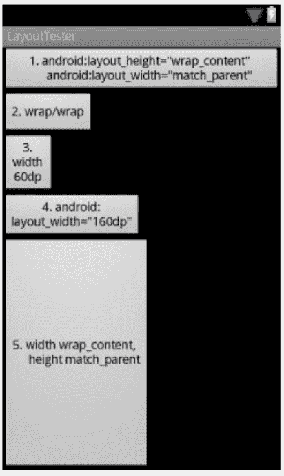

你可以按照后续章节所述，使用通用指南或单位数量来描述视图的大小。

### 使用通用尺寸指南

要创建通用指南，请使用 `wrap_content`、`match_parent` 或 `fill_parent` 值。（参见列表 1-2。）使用 `wrap_content` 时，Android 会缩小视图的宽度或长度，使视图紧密地包裹其包含的内容。使用 `match_parent` 和 `fill_parent` 时，Android 会扩展视图的宽度或长度，使视图紧密地嵌套在其容器内部。

 “紧密包裹”或“紧密嵌套在内部”的含义取决于你为边界指定的留白空间。这种留白有两种形式——内边距（padding）和外边距（margins）。如果你愿意，可以查看本章关于内边距和外边距的节。

 `match_parent` 和 `fill_parent` 字符串含义相同。在 API Level 8 之前，只有 `fill_parent`。从 API 8 开始，字符串 `fill_parent` 被废弃，取而代之的是 `match_parent`。根据 Java 官方文档，被废弃的特性是过时的且“仅为了向后兼容而支持”。在 API Level 8 之前，只有 `fill_parent` 有效。从 API Level 8 开始，字符串 `fill_parent` 被废弃，转而使用 `match_parent`。根据 Java 官方文档，废弃的特性是过时的且“仅为了向后兼容而支持”。

`match_parent` 和 `fill_parent` 字符串含义相同。在 API Level 8 之前，只有 `fill_parent` 有效。从 API Level 8 开始，字符串 `fill_parent` 被废弃，取而代之的是 `match_parent`。根据 Java 官方文档，被废弃的特性是过时的且“仅为了向后兼容而支持”。


`match_parent` 和 `fill_parent` 字符串含义相同。在 API Level 8 之前，只有 `fill_parent` 有效。从 API Level 8 开始，字符串 `fill_parent` 被废弃，取而代之的是 `match_parent`。根据 Java 官方文档，被废弃的特性是过时的且“仅为了向后兼容而支持”。

### 使用通用尺寸指南

要创建通用指南，请使用 `wrap_content`、`match_parent` 或 `fill_parent` 值。（参见列表 1-2。）使用 `wrap_content` 时，Android 会缩小视图的宽度或长度，使视图紧密地包裹其包含的任何内容。使用 `match_parent` 和 `fill_parent` 时，Android 会扩展视图的宽度或长度，使视图紧密地嵌套在其容器内部。

`match_parent` 和 `fill_parent` 字符串含义相同。在 API Level 8 之前，只有 `fill_parent` 有效。从 API Level 8 开始，字符串 `fill_parent` 被废弃，转而代之的是 `match_parent`。根据 Java 官方文档，被废弃的特性是过时的且“仅为了向后兼容而支持”。


`match_parent` 和 `fill_parent` 字符串含义相同。在 API Level 8 之前，只有 `fill_parent` 有效。从 API Level 8 开始，字符串 `fill_parent` 被废弃，转而代之的是 `match_parent`。根据 Java 官方文档，被废弃的特性是过时的且“仅为了向后兼容而支持”。

`match_parent` 和 `fill_parent` 字符串含义相同。在 API Level 8 之前，只有 `fill_parent` 有效。从 API Level 8 开始，字符串 `fill_parent` 被废弃，转而代之的是 `match_parent`。根据 Java 官方文档，被废弃的特性是过时的且“仅为了向后兼容而支持”。

`match_parent` 和 `fill_parent` 字符串含义相同。在 API Level 8 之前，只有 `fill_parent` 有效。从 API Level 8 开始，字符串 `fill_parent` 被废弃，转而代之的是 `match_parent`。根据 Java 官方文档，被废弃的特性是过时的且“仅为了向后兼容而支持”。

### 使用数字单位

在列表 1-2 中，我用单位描述第三个按钮的宽度。`60dp` 代表 60 密度像素。密度独立像素（dp）是基于 160 像素每英寸的测量值。“那么，”你问，“160 像素每英寸是什么？”密度独立像素是屏幕上的一个点。

不同的设备具有不同的像素密度。例如，低密度屏幕可能每英寸 120 像素，而高密度屏幕可能每英寸 260 像素。为了调整这些差异，每个 Android 屏幕都有多个指标。每个指标都是描述屏幕某些特征的数值值：

- `displayWidth`（`int`）：从屏幕左边缘到右边缘的像素数。
- `heightPixels`（`int`）：从屏幕顶部到底部的像素数。
- `xdpi`（`int`）：每英寸从左到右的像素数。
- `ydpi`（`int`）：每英寸从上到下的像素数。（在正正方形内，某些屏幕横向像素比垂直多，所以 `xdpi` 并不等于 `ydpi`。）
- `densityDpi`（`int`）：每英寸像素数的通用衡量。对于 `xdpi` 和 `ydpi` 值相同的屏幕，`densityDpi` 等于 `xdpi` 和 `ydpi`。对于 `xdpi` 和 `ydpi` 值不等的屏幕，有人计算出了屏幕的 `densityDpi`（但他们没有告诉我是如何计算的）。
- `density`（`float`）：每英寸像素数除以 160。
- `scaledDensity`（`float`）：`density` 测量值，但根据用户选择的默认字体大小进行了额外的的拉伸或压缩。

当你指定 160dp 时（如列表 1-2 所示），你是在告诉 Android 显示 `density` × 160 像素。因此，在我的小屏幕上，160dp 的宽度是英寸；而在你从 2055 年穿越时而带来的 Android 家庭影院上，160dp 的宽度也是英寸。每个人都得到了他们想要的英寸。

 `dpi` 字母代表每英寸点数（dots per inch）。你的 Android 项目拥有名为 `res/drawable-hdpi`、`res/drawable-ldpi` 和 `res/drawable-mdpi` 的文件夹。在运行时，Android 会感知设备或模拟器的屏幕密度，并使用最合适的 `res/drawable-dpi` 文件夹中的资源。要了解 Android 认为各种屏幕密度的“最合适”值是什么，请访问 [`http://developer.android.com/guide/practices/screens_support.html`](http://developer.android.com/guide/practices/screens_support.html)。

另一个方便的单位是 `sp` —— 比例无关像素（scale-independent pixels）。与 `dp` 单位一样，`sp` 单位的大小可以根据不同的屏幕进行良好调整。但 `sp` 单位的大小以两种方式发生变化。除了根据屏幕像素密度变化外，`sp` 单位还会根据用户的字体大小设置设置发生变化。

 `dp` 和 `dip` 缩写是可以互换的。它们都代表设备无关像素（device-independent pixels）。但 `sp` 始终是 `sp`。Android 没有名为 `sip` 的单位。

如果你想刁剔一下，可以使用物理单位。例如，值 1 代表一英寸。其他不理想的物理单位包括 `mm`（毫米）、`pt`（磅，1 磅等于 1/72 英寸）和 `px`（像素 —— 设备屏幕上的实际点）。在几乎所有情况下，你都应该避免物理单位。使用 `dp` 来指定视图的大小，使用 `sp` 来指定文本字体大小。

图 1-4 和图 1-5 说明了像素与密度无关像素之间的关系。图 1-4 中的屏幕密度为 0.75。因此，一个宽一英寸的按钮消耗了 `0.75 × 160 = 120` 个像素。你可以通过比较 `160dp` 和 `160px` 按钮的大小来确认这一点。`160dp` 按钮的宽度大约是 `160px` 按钮的四分三。

**图 1-4：** 低密度显示器。

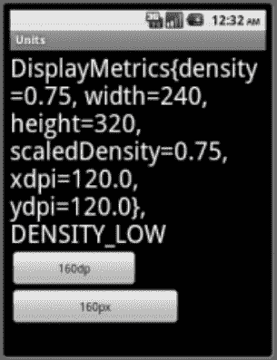

**图 1-5：** 高密度显示器。

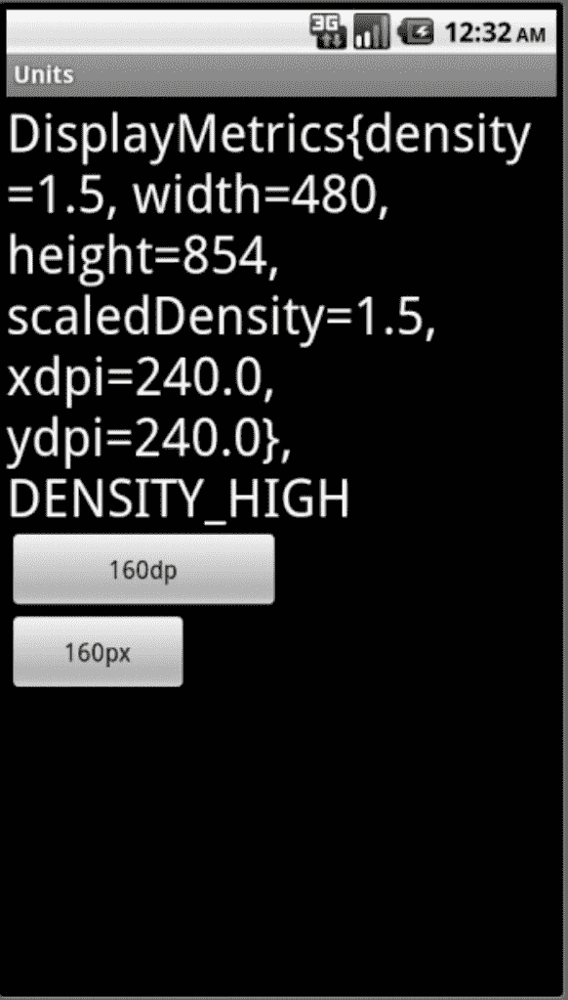

 本书的图表在打印过程中可能会被拉伸或缩小。物体可能比看起来要大。在书页上或你的电子阅读器屏幕上测量为一英寸的长度，并不一定是 Android 设备屏幕上的一英寸。

图 1-5 中的屏幕密度为 1.5，因此在图 1-5 中，`160dp` 按钮的宽度是 `160px` 按钮的 1.5 倍。

描述图 1-4 和图 1-5 布局的 XML 文档如代码列表 1-3 所示。

代码列表 1-3：使用尺寸单位

```xml
<?xml version=”1.0” encoding=”utf-8”?>
<LinearLayout xmlns:android
      “http://schemas.android.com/apk/res/android”
    android:orientation=”vertical”
    android:layout_width=”fill_parent”
    android:layout_height=”fill_parent”>
<TextView android:textSize=”30sp”
          android:layout_width=”wrap_content”
          android:layout_height=”wrap_content”
          android:textColor=”#FFFF”
          android:id=”@+id/textView1”></TextView>
<Button android:layout_width=”160dp”
          android:text=”160dp”
          android:layout_height=”wrap_content”
          android:id=”@+id/button1”></Button>
<Button android:layout_width=”160px”
          android:text=”160px”
          android:layout_height=”wrap_content”
          android:id=”@+id/button2”></Button>
</LinearLayout>
```

注意图 1-4 和图 1-5 中文本视图中的度量信息。为了显示这些信息，我在应用的主类中使用 `android.util.DisplayMetrics` 类：

```java
package com.allcode.screen;
import android.app.Activity;
import android.os.Bundle;
import android.util.DisplayMetrics;
import android.widget.TextView;
public class ScreenActivity extends Activity {
  TextView textView;
  DisplayMetrics metrics;
  String densityDpi;
  @Override
  public void onCreate(Bundle savedInstanceState) {
    super.onCreate(savedInstanceState);
    setContentView(R.layout.main);
    textView = (TextView) findViewById(R.id.textView1);
    metrics = new DisplayMetrics();
    getWindow().getDisplay().
    getMetrics(metrics);
    switch (metrics.densityDpi) {
      case DisplayMetrics.DENSITY_LOW:
        densityDpi = “DENSITY_LOW”;
      case DisplayMetrics.DENSITY_MEDIUM:
        densityDpi = “DENSITY_MEDIUM”;
      case DisplayMetrics.DENSITY_HIGH:
        densityDpi = “DENSITY_HIGH”;
      default:
        densityDpi = “???”;
    }
    textView.setText(densityDpi);
  }
}
```

### `android:padding` 和 `android:margin`

物体在屏幕上需要空间。Android 有名为 `padding` 和 `margin` 的属性：

* 视图的 `padding` 是视图与其边界之间的空间。
* 视图的 `margin` 是视图与其外部之间的空间。

在图 1-6 中，我们叠加到 Eclipse 布局编辑器上。带有小方块的矩形是视图的边界。`padding` 让视图内部不拥挤，而 `margin` 决定了视图想要的个人空间。

**图 1-6：** 内边距与外边距。

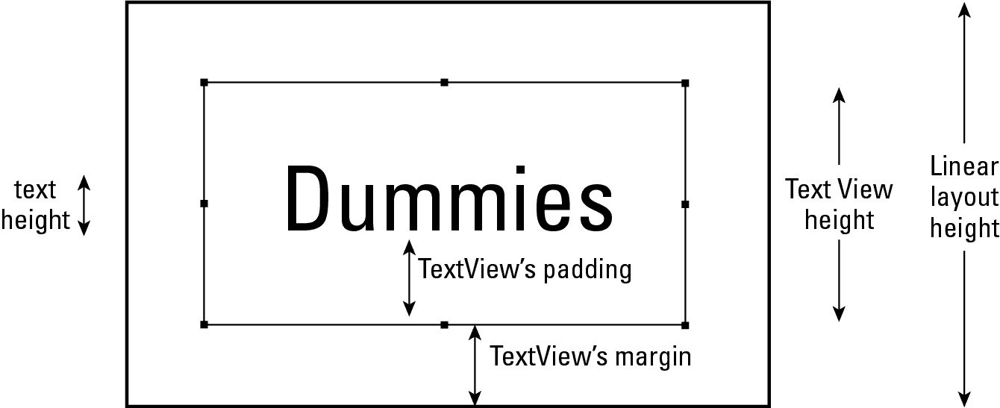

代码列表 1-4 包含了生成图 1-6 布局的代码。

代码列表 1-4：使用内边距和外边距

```xml
<?xml version=”1.0” encoding=”utf-8”?>
<LinearLayout xmlns:android
      “http://schemas.android.com/apk/res/android”
    android:orientation=”vertical”
    android:layout_width=”match_parent”
    android:layout_height=”match_parent”
    android:gravity=”center”>
  <LinearLayout android:id=”+id/LinearLayout1”
        android:layout_height=”wrap_content”
        android:layout_width=”wrap_content”
        android:background=”@color/opaque_white”>
    <TextView android:text=”Dummies”
             android:layout_margin=”30dip”
             android:padding=”30dip”
             android:textSize=”30sp”
             android:layout_height=”wrap_content”
             android:layout_width=”wrap_content”
             android:id=”@+id/textView1”
             android:textColor=”@color/opaque_black”></TextView>
  </LinearLayout>
</LinearLayout>
```

### `android:gravity` 和 `android:layout_gravity`

我曾问过一个按钮长大后想成为什么。按钮回答说：“我想成为宇航员。”于是我把它放在一个具有 `android:layout_gravity=”center”` 的布局中。Android 有两个命名相似的属性，很容易混淆它们：

* `android:gravity` 告诉布局如何在其内部对齐视图。
* `android:layout_gravity` 告诉视图如何在其布局中定位自己。

图 1-7 阐明了这一观点。

图 1-7 中的屏幕包含一个高度为 220dip 的缩短线性布局和一个按钮。其 `android:layout_gravity` 是 `center_vertical`，因此灰色布局移动到了屏幕中心。但布局的 `android:gravity` 属性是 `center_horizontal`，因此按钮在布局内水平移动到中心。按钮还悬挂在布局的顶部，因为默认情况下，物体会向上移动并靠向左侧。

图 1-7：灰色布局居于屏幕中心；按钮居于灰色布局的顶部。

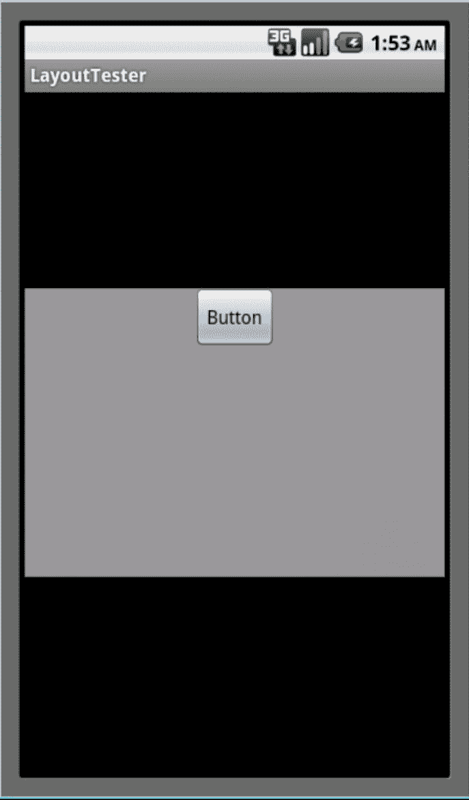

### 使用 `layout_gravity` 和 `gravity`

列表 1-5：使用 `layout_gravity` 和 `gravity`

```xml
<?xml version="1.0" encoding="utf-8"?>
<LinearLayout xmlns:android=
      "http://schemas.android.com/apk/res/android"
    android:layout_gravity="center_vertical"
    android:gravity="center_horizontal"
    android:background="#F999"
    android:orientation="vertical"
    android:layout_width="match_parent"
    android:layout_height="220dip">
    <Button android:text="Button"
        android:id="@+id/button1"
        android:layout_width="wrap_content"
        android:layout_height="wrap_content">
    </Button>
</LinearLayout>
```

图 1-8 到 1-11 展示了其他 `android:gravity` 属性值。

图 1-8：`<Linear Layout android: gravity= ”center_ vertical” . ..`


图 1-9：`<Linear Layout android: gravity= ”center” . ..`

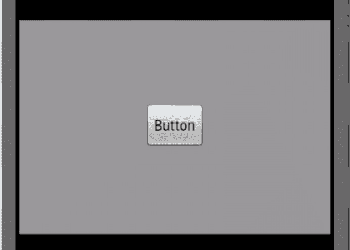

图 1-10：`<Linear Layout android: gravity= ”bottom| right” . ..`


图 1-11：没有显式 `android:gravity` 属性的 Linear Layout。


图 1-10 显示了通过使用 Java 的位或操作符（`|`）组合重 值时可以实现的效果。

### `android:color`

你可以将颜色应用于各种事物——诸如文本、背景、阴影、链接和其他内容。在列表 1-5 中，我使用了 `android:background="#F999”` 属性，将布局的背景设置为一种安静、庄重的浅灰色。

作为一名 Android 开发人员，创建颜色最专业的方法是在 `res/values/colors.xml` 文件中声明它。该文件的内容类似于列表 1-6 中的。

列表 1-6：一个 `colors.xml` 文件


```xml
<?xml version="1.0" encoding="utf-8"?>
<resources xmlns:android=
    "http://schemas.android.com/apk/res/android">
  <color name="bright_red">#F00</color>
  <color name="bright_red2">#FF00</color>
  <color name="bright_red3">#FF0000</color>
  <color name="translucent_red">#7F00</color>
  <color name="invisible_good_for_nothing_red">
      #00FF0000
  </color>
  <color name="white">#FFF</color>
  <color name="black">#000</color>
  <color name="puce">#CC8898</color>
</resources>
```

颜色值以井号（`#`）开头，然后是三、四、六或八个十六进制数字。对于三位数，最左边的数字代表红色程度，中间的数字代表绿色程度，右边的数字代表蓝色程度。（颜色总是按照这个顺序出现——红、绿、然后是蓝。这被称为 RGB 颜色。）因此，例如，颜色值 `#F92` 代表一种看起来不错的橙色——15 单位红色、9 单位绿色和 2 单位蓝色，每种颜色最大可为 16 单位。

仅用三位数时，你无法表达细微的差异。因此，Android 允许你用六位数序列来表示颜色。例如，值 `#FEF200` 是此书封面黄色的良好近似值。它是 254 单位红色、242 单位绿色且没有蓝色，每种颜色最大可为 255 单位。

对于三个 RGB 数字，你可以在井号后立即添加第四个数字。而对于六个 RGB 数字，你可以在井号后立即添加两个 alpha 数字。alpha 值是不透明度的程度，15 表示完全不透明，0 表示完全透明。因此，列表 1-6 中的值 `#7F00` 是部分红色的（“半透明红”）。

```xml
<?xml version="1.0" encoding="utf-8"?>
<LinearLayout xmlns:android=
    "http://schemas.android.com/apk/res/android"
    android:background="@color/translucent_red"
    android:layout_height="wrap_content"
    android:layout_width="match_parent"
    android:orientation="vertical">
    <Button android:text="Button"
        android:id="@+id/button1"
        android:layout_height="wrap_content"
        android:layout_width="wrap_content">
</LinearLayout>
```

黑色背景下，值 `#7F00` 是淡红色的。

但不要放弃相对布局（relative layouts）！对于复杂的设计，人们尝试在其他线性布局内部创建大量的线性布局嵌套。在有人运行代码之前，一切都很顺利。线性布局的过度嵌套会减慢处理器的速度。

Android 有两个工具可以帮助你摆脱嵌套的线性布局。一个是层级查看器（hierarchy viewer）。层级查看器是你 SDK tools 目录中的一个可执行文件。层级查看器的树显示了你布局对象的嵌套情况。

图 1-15 包含了我最近的一个项目中令人尴尬的层级查看器分析。每个圆矩形代表一个视图（view），树的长度（从左到右）显示了该项目的嵌套深度。树的某些分支深达七层，处理器在没有先计算树分支上左侧的视图之前，无法绘制某个视图。因此，处理器在尝试渲染整个场景时运行得非常缓慢。

**图 1-15：** 层级查看器。

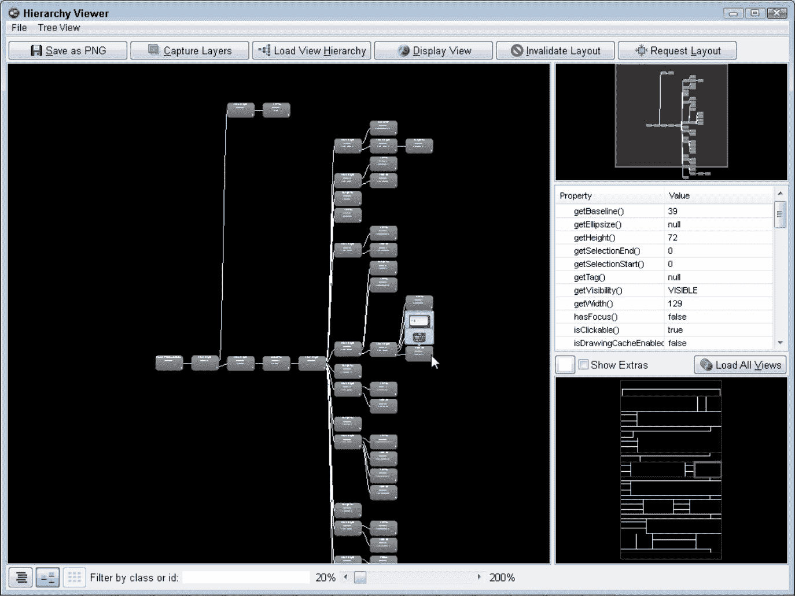

运行层级查看器可以告诉你你的布局嵌套有多深。结合查看器的树结构，你可以寻找消除某些嵌套的方法。

另一个在对抗嵌套布局中非常有用的工具是 Eclipse 中的重构工具。以下是使用方法：

1. 使用 Eclipse 的图形化布局编辑器（Graphical Layout editor）在线性布局内部创建一个极其糟糕的线性布局集合。

2. 在图形化布局编辑器中，选择最外层的线性布局。

3. 在 Eclipse 的主菜单中，选择 `Refactor⇒Android⇒Change Layout`。

此时会出现 `Change Layout` 对话框。

4. 在 `Change Layout` 对话框的下拉列表中，选择 `Relative Layout`（相对布局）。

5. 觉得好玩，点击 `Preview`（预览）。

Eclipse 向你展示它计划更改你的 XML 代码的所有方式。（见图 1-16。）

6. 点击 `OK`。

搞定！你获得了一个高效的相对布局。新的相对布局看起来和你旧的线性布局网络完全一样。但与一组嵌套的线性布局不同，相对布局在计算上是高效的。

**图 1-16：** Eclipse 比较你的旧代码和新代码。


### 表格布局 (Table Layout)

表格布局拥有行，每行包含一些视图。如果你不对默认值进行任何修改，视图将对齐并形成列。

例如，图 1-17 中的表格布局有三行表格。每行表格行都包含按钮。

```xml
<TableLayout ... >
    <TableRow ...>
        <Button ... android:layout_width="wrap content"
                  ... android:text="Button">
        <Button ... android:layout_width="wrap content"
                  ... android:text="Button">
        <Button ... android:layout_width="wrap content"
                  ... android:text="Button">
    </TableRow>
    <TableRow ...>
        <Button ... android:layout_width="wrap content"
                  ... android:text="Button">
        <Button ... android:layout_width="wrap content"
                  ... android:text="Wide button">
    </TableRow>
    <TableRow ...>
        <Button ... android:layout_width="wrap content"
                  ... android:text="Button">
        <Button ... android:layout_width="wrap content"
                  ... android:text="Btn.">
        <Button ... android:layout_width="wrap content"
                  ... android:text="Button">
    </TableRow>
</TableLayout>
```

**图 1-17：** 表格布局中的按钮。


### 帧布局 (Frame Layout)

帧布局显示一个视图。这有什么用呢？

嗯，更准确地说（而且不那么危人耸听），帧布局是在在另一个视图前面显示视图。（戴上 3D 眼镜，将帧布局想象成一个向外延伸的布局。）由于视图往往会覆盖它们，帧布局通常只显示一个视图——即最前面的那个。

帧布局通常用于以下目的之一：

- 帧布局可能会在较大的视图上显示较小的视图（例如图像上的文本）。

- 帧布局可以存储多个视图，但任何时间只有一个是的。通过帧布局，你可以更改屏幕上某个位置显示的内容。

本节的示例说明了这两种观点。你从一个叠加在图像上的单词开始，该图像又叠加在另一个图像上。（见图 1-18。）

**图 1-18：** 帧布局上的三个控件。


当用户触摸屏幕时，三个项目中的两个会消失。（见图 1-19。）屏幕在三张图像之间循环，每当用户触摸屏幕时切换图像。（见图 1-20 和 1-21。）

**图 1-19：** 喵！


**图 1-20：** 三张图像中最大的。


**图 1-21：** 中等大小的图像。


（我知道你想什么：“作者在找借口放猫。”这部分正确。我包含了大量的插图来帮助你视觉化代码。无论如何，猫的照片是完美的素材。）

列表 1-8 显示了图 1-18 到 1-21 应用的 XML 代码。

**列表 1-8：** 创建帧布局

```java
    super.onCreate(savedInstanceState);
    setContentView(R.layout.frame);
    imageCalico =
        (ImageView) findViewById(R.id.imageViewCalico);
    imageBurmese =
        (ImageView) findViewById(R.id.imageViewBurmese);
    textView = (TextView) findViewById(R.id.textView);
}
  int count = 0;
  public void rotate(View view) {
    switch (count++ % 3) {
    case 0:
        textView.setVisibility(View.VISIBLE);
        imageCalico.setVisibility(View.INVISIBLE);
        imageBurmese.setVisibility(View.INVISIBLE);
        break;
    case 1:
        textView.setVisibility(View.INVISIBLE);
        imageCalico.setVisibility(View.VISIBLE);
        imageBurmese.setVisibility(View.INVISIBLE);
        break;
    case 2:
        textView.setVisibility(View.INVISIBLE);
        imageCalico.setVisibility(View.INVISIBLE);
        imageBurmese.setVisibility(View.VISIBLE);
        break;
    }
  }
}
```

当应用启动运行时，所有三个视图（两个图像和一个文本视图）都是可见的。但随后列表 1-9 会在一个视图之间之间循环切换。每次调用`rotate`方法都会让一个视图可见并让另外两个视图隐藏。

# 第 2 章：菜单、列表与通知

## 本章内容

-  构建选项菜单和上下文菜单

-  在 Activity 中以及独立 Activity 使用列表

-  向状态栏添加通知

当然，我真希望自己正待在我最喜欢的廉价餐馆里，点几道美食家永远不会去吃的菜。遗憾的是，我并不在那里。尽管我很想聊聊关于食物的菜单，但我实际上要聊的是 Android 内部的菜单！

## 关于菜单的一切

Android 为提供了一个简单的机制，让你向应用程序中添加菜单。在 Android 的帮助下，你可以添加以下类型的菜单：

- **选项菜单 (Options menu)**：选项菜单是用户在预 Honeycomb 设备上按下`Menu`键时出现的菜单。（参见图 2-1。）在运行 Android 3.0 或更高版本的设备上，当用户点击小菜单图标时，会出现选项菜单。（图 2-2 用我开发电脑的模拟器说明了这一点。看到的不是手指触摸图标，而是我的鼠标光标。）

此外，Honeycomb 还有一个动作栏（action bar）。动作栏出现在屏幕的右上角。（参见图 2-3。）

- **上下文菜单 (Context menu)**：上下文菜单是用户长按视图时呈现的浮动菜单项列表。（参见图 2-4。）

- **子菜单 (Submenu)**：子菜单是用户通过点击选项菜单或上下文菜单上的菜单项而打开的浮动菜单项列表。子菜单项不支持嵌套的子菜单。

**图 2-1**：Gingerbread（或更版本）上的选项菜单。


**图 2-2**：Honeycomb（或更高版本）上的选项菜单。


**图 2-3**：动作栏中的选项菜单（Honeycomb 或更高版本）。


**图 2-4**：上下文菜单。


在选项菜单中，你会发现两组内容：

- **图标 (Icon)**：这些是出现在预 Honeycomb 设备屏幕底部的菜单项。该设备支持最多六个图标类型的菜单项。（再次参见图 2-1。）

- **展开 (Expanded)**：展开菜单是一个超了原始六个图标类型菜单项的菜单项列表。

在预 Honeycomb 设备上，当你在选项菜单上放置超过六个项时，Android 会自动添加一个“更多”（More）项。（参见图 2-5。）当用户点击“更多”项时，会出现展开菜单。（参见图 2-6。）

在 Honeycomb 之后，项可以堆叠在动作栏和动作栏的溢出箱中。（参见图 2-7。）你通过`android:showAsAction="ifRoom|withText"`属性控制这种行为。

在本章中，你将创建一个选项菜单和一个上下文菜单。

**图 2-5**：带有“更多”项的选项菜单。


**图 2-6**：展开菜单。


**图 2-7**：动作栏。


## 创建选项菜单

你可以使用 Java 代码或 XML 文档来创建菜单。如果你使用 XML，文档位于`res/menu`。这有助于将菜单定义与实际代码分离。

### 定义 XML 文件

要定义 XML，请按照以下步骤操作：

1. 在`res`目录下创建一个`menu`文件夹。

2. 添加`list_menu.xml`文件。

3. 在`list_menu.xml`中输入代码：

```xml
<?xml version="1.0" encoding="utf-8"?>
<menu xmlns:android="http://schemas.android.com/apk/res/android">
    <item
        android:id="@+id/menu_insert"
        android:icon="@drawable/ic_add"
        android:title="insert" />
    <item
        android:id="@+id/make_noise"
        android:icon="@drawable/ic_play"
        android:title="noise" />
</menu>
```

4. 创建名为`menu_insert`和`honk`的新字符串资源。

5. 将所示代码添加到项目的主 Activity 中：


```java
@Override
public boolean onCreateOptionsMenu(Menu menu) {
    super.onCreateOptionsMenu(menu);
    MenuInflater inflater = getMenuInflater();
    inflater.inflate(R.menu.list_menu, menu);
    return true;
}
```

当你加载 XML 文档时，Android 将 XML 代码转换为类似于 Java 代码的内容（可能是 Java 对象）。在前面的代码中，我获取了一个可以从 XML 加载菜单的`MenuInflater`。然后我加载 XML 代码以获取真实的对象。

`ldpi`、`mdpi`和`hdpi`版本的图标都构建在`res/drawable`文件夹中。

6. 运行应用程序。根据当前的风向，当你点击菜单按钮或图标时，你会看到图 2-2 或图 2-8。你甚至可能看到图 2-3 中的动作栏项（无需点击）。

## 处理用户操作

菜单已经创建，现在你希望在点击它时执行某些操作。为了此此，请将列表 2-1 中的方法添加到应用的主 Activity 中。

**列表 2-1：响应菜单项**

```java
@Override
public boolean onOptionsItemSelected(MenuItem item) {
    switch (item.getItemId()) {
        case R.id.menu_insert:
            createReminder();
            return true;
        case R.id.make_noise:
            MediaPlayer mediaPlayer =
                MediaPlayer.create(this, R.raw.honk);
            mediaPlayer.start();
            return true;
    }
    return super.onOptionsItemSelected(item);
}
```

在你的`onOptionsItemSelected`方法中，你进行了一次“老操作”来确定用户到底点击了哪一个项。你将被点击项的 ID 与`list_menu.xml`文档中的项 ID 进行匹配。在这个示例中，你的菜单有两个项。其中一个项创建一个提醒，另一个项则播放声音。

你仍然需要定义`createReminder`方法，但在此期间，你可以为项目添加一个声音。要添加声音，首先创建一个`res/raw`文件夹，然后将一个 MP3 文件拷贝到该`res/raw`文件夹中。将文件重命名为`honk.mp3`后，你就可以准备大显身手了。

列表 2-1 中的方法返回了`true`。这个`true`值告诉 Android 你已经完成了对用户选择的处理。如果你返回`false`，Android 会把选择事件传递给可能可能正在等待它的其他代码。

## 创建提醒

列表 2-2 中的方法响应了列表 2-1 中的调用。将列表 2-2 的代码添加到你项目的主活动类（main activity）中。

### 列表 2-2：调用 Activity 创建新提醒

```java
private static final int ACTIVITY_CREATE = 0;

private void createReminder() {
  Intent intent =
      new Intent(this, ReminderEditActivity.class);
  startActivityForResult(intent, ACTIVITY_CREATE);
}
```

`createReminder`方法启动了一个`ReminderEditActivity`实例。`startActivityForResult`调用允许你从`ReminderEditActivity`获取返回的结果。在这个应用中，你使用该结果用新添加的提醒重新填充一个列表。

 有关关于`startActivityForResult`方法的详细说明，请参阅第三 卷第 1 章。

列表 2-3 包含一个极其简单的`ReminderEditActivity`类。

```java
package com.allmycode.menus;
import android.app.Activity;
import android.content.Intent;
import android.os.Bundle;
import android.view.View;
import android.widget.EditText;

public class ReminderEditActivity extends Activity {
  EditText editText;
  @Override
  public void onCreate(Bundle b) {
    super.onCreate(b);
    setContentView(R.layout.reminder_edit);
    editText = (EditText) findViewById(R.id.editText1);
  }
  public void onPostButtonClick(View view) {
    Intent intent = new Intent();
    intent
        .putExtra("text", editText.getText().toString());
    setResult(Activity.RESULT_OK, intent);
    finish();
  }
}
```

当用户点击按钮时，`ReminderEditActivity`会设置其结果并结束运行。结果来自该的 EditText 小部件。

 当你创建一个新的 Android 项目时，Eclipse 会自动向项目的`AndroidManifest.xml`文档中添加一个`<activity>`元素。但当你向现有项目添加额外的活动时，你必须手动添加`<activity>`元素。是的，当我第一次创建这个章节的示例时，我已经犯了这几千次错误了。

列表 2-3 中该活动的直白布局如列表 2-4 所示。该活动的屏幕如图 2-9 所示。

### 列表 2-4：列表 2-3 中活动的布局

```xml
<?xml version="1.0" encoding="utf-8"?>
<LinearLayout xmlns:android=
      "http://schemas.android.com/apk/res/android"
    android:orientation="vertical"
    android:layout_width="match_parent"
    android:layout_height="match_parent"
    android:gravity="center_horizontal">
    <EditText android:layout_height="wrap_content"
              android:id="@+id/editText1"
              android:layout_width="match_parent"
              android:hint="Type a reminder here.">
    <requestFocus></requestFocus>
  </EditText>
  <Button android:layout_height="wrap_content"
      android:id="@+id/button1"
      android:layout_width="wrap_content"
      android:text="@string/post"
      android:onClick="onPostButtonClick"></Button>
</LinearLayout>
```

**图 2-9：** 添加提醒。


## 将新提醒放入列表

要实现本节标题所说的——将新提醒放入列表——请将列表 2-5 中的代码添加到你项目的主活动类中。

### 列表 2-5：使用 Activity 的结果

```java
ListView listView;
ArrayList<String> listItems = new ArrayList<String>();
ArrayAdapter<String> adapter;
@Override
public void onCreate(Bundle savedInstanceState) {
  super.onCreate(savedInstanceState);
  setContentView(R.layout.main);
  listView = (ListView) findViewById(R.id.listView1);
  adapter =
      new ArrayAdapter<String>(this,
      R.layout.my_list_layout, listItems);
  listView.setAdapter(adapter);
}
@Override
protected void onActivityResult(int requestCode,
    int resultCode, Intent intent) {
  if (resultCode == RESULT_OK) {
    listItems.add(intent
        .getStringExtra("text"));
    adapter.notifyDataSetChanged();
  }
}
```

 列表 2-5 中的代码重写了一个`onActivityResult`方法。关于 Android 的`onActivityResult`方法的几段精彩介绍，请参阅第 III 卷第 1 章。

在所有工作完成之后（或者在所有代码编写并阅读完毕之后；或者在完成开发、发布并下载之后），用户将看到类似于图 2-10 所示的屏幕。

**图 2-10：** 本节示例创建的项列表。


图 2-10 展示了几个“添加提醒”菜单项选择的结果。（请参考图 2-8。）我曾考虑过了一会儿，要不要在这里展示一个“鸣笛（Honk）”项的选择。我唯一的想法是让 Wiley 在这个页面上添加一个小扬声器，就像那种打开时会播放《Somewhere My Love》的问候卡一样。但最后，我没有勇气提出这个请求。你觉得呢？这是一个非常实用的主，不是吗？

## 创建上下文菜单

当用户长按某个视图（view）时，Android 会显示上下文菜单。上下文菜单悬浮在当前活动（activity）之上，允许用户选择各种选项。（请参考图 2-4。）

### 显示上下文菜单

列表 2-7 包含了描述本节上下文菜单的 XML 文档。

列表 2-7：`res/menu/list_menu_item_longpress.xml`文档

```xml
<?xml version="1.0" encoding="utf-8"?>
<menu xmlns:android="http://schemas.android.com/apk/res/android">
    <item android:id="@+id/menu_delete"
          android:title="@string/menu_delete" />
    <item android:id="@+id/make_noise2"
          android:title="Make a quacking sound" />
</menu>
```

注意我没有在这个菜单中放置任何`icon`属性。上下文菜单没有图标。它们只是悬浮在当前活动之上的菜单选项列表。

你希望在用户长按列表视图（list view）项时让 Android 加载列表 2-7 的菜单。要实现这一点，你需要建立两个连接：

* 将`listView`对象（在列表 2-5 中声明）与通用的上下文菜单连接起来。通过在列表 2-5 的`onCreate`方法中添加一条语句来实现。

```java
registerForContextMenu(listView);
```

* 将通用的上下文菜单与列表 2-7 中的菜单连接起来。列表 2-8 展示了如何操作。

列表 2-8：处理长点击

```java
@Override
public void onCreateContextMenu(ContextMenu menu,
    View view, ContextMenuInfo menuInfo) {
    super.onCreateContextMenu(menu, view, menuInfo);
    MenuInflater inflater = getMenuInflater();
    inflater.inflate("R.menu.list_menu_item_longpress",
        menu);
}
```

列表 2-8 的代码与之前在“定义 XML 文件”部分第 5 步中使用的代码非常相似。方法名不同，且列表 2-8 中的方法没有返回`boolean`值。除此，其他都是老内容了。

### 处理上下文菜单项选择

要处理上下文菜单项的选择，请将列表 2-9 中的代码添加到你的主活动（main activity）中。

列表 2-9：响应上下文菜单点击


```java
@Override
public boolean onContextItemSelected(MenuItem item) {
    switch (item.getItemId()) {
    case R.id.menu_delete:
            deleteReminder(item);
            return true;
    case R.id.make_noise2:
            MediaPlayer mediaPlayer =
                MediaPlayer.create(this, R.raw.quack);
            mediaPlayer.start();
            return true;
    }
    return super.onContextItemSelected(item);
}

void deleteReminder(MenuItem item) {
    AdapterContextMenuInfo info =
        (AdapterContextMenuInfo) item.getMenuInfo();
    listItems.remove(info.position);
    adapter.notifyDataSetChanged();
}
```

列表 2-9 看起来和列表 2-1 以及 2-2 非常相似。主要的区别在于删除列表视图项的代码。列表 2-9 并没有启动二级活动（secondary activity），所以你不需要 intent，也不需要像列表 2-5 那样的`onActivityResult`方法。

获取关于所选列表视图项的信息比你预期的要稍微复杂一点。这是因为你正在处理两个不同的项：用户长按的列表视图项和用户点击的上下文菜单项。在列表 2-9 中，我调用了`getMenuInfo`来创建一个`AdapterContextMenuInfo`实例。然后我使用该实例的公共字段`position`来告诉我是用户长按了哪个列表视图项。我删除了与`info.position`值对应的列表视图项。

## 关于列表的更多内容

之前的章节描述了列表视图（list views），但比列表视图类型的列表多得多。本节涵盖了 Android 的`ListActivity`类，并展示了更多可以在列表上执行的技巧。

### 创建列表活动

在典型的手机屏幕上，你可能没有空间添加项。本节涵盖了 Android 的`ListActivity`类，并展示了你可以在列表上执行的更多技巧。

总之，列表 2-5 和 2-10 使用相同的`R.layout.my_layout`资源。

```xml
<activity android:name=".MyListActivity">
    <intent-filter>
        <data android:scheme="checked" />
    </intent-filter>
</activity>
```

### 列表 Activity 的客户端

列表 2-11 包含了主 Activity（main activity）的代码。这个主 Activity 为用户提供了启动应用列表 Activity 的方法。

#### 列表 2-11：触发列表 Activity 的代码

```java
package com.allmycode.lists;

import android.app.Activity;
import android.content.Intent;
import android.net.Uri;
import android.os.Bundle;
import android.view.View;
import android.widget.CheckBox;

public class MainActivity extends Activity {
    CheckBox[] checkBoxes = new CheckBox[5];
    @Override
    public void onCreate(Bundle savedInstanceState) {
        super.onCreate(savedInstanceState);
        setContentView(R.layout.main);
        checkBoxes[0] = (CheckBox) findViewById(R.id.a);
        checkBoxes[1] = (CheckBox) findViewById(R.id.b);
        checkBoxes[2] = (CheckBox) findViewById(R.id.c);
        checkBoxes[3] = (CheckBox) findViewById(R.id.d);
        checkBoxes[4] = (CheckBox) findViewById(R.id.e);
    }
    public void onShowListClick(View view) {
        Intent intent =
            new Intent(this, MyListActivity.class);
        StringBuffer isChecked = new StringBuffer("");
        for (CheckBox box : checkBoxes) {
            isChecked.append(box.isChecked() ? "1" : "0");
        }
        intent.setData(Uri.parse("checked:"
            + isChecked.toString()));
        startActivity(intent);
    }
}
```

列表 2-11 维护了一个`CheckBox`实例数组。通过循环根据五个复选框的状态组合了一个由 0 和 1 组成的字符串。然后，列表 2-11 将这些 0 和 1 封装在 intent 的 URI 中，并将 intent 传递给列表 Activity。

列表 2-12 描述了主 Activity 的布局，图 2-12 显示了该布局在用户屏幕上的呈现。

#### 列表 2-12：`res/layout/main.xml`文档

```xml
<?xml version="1.0" encoding="utf-8"?>
<LinearLayout xmlns:android=
      "http://schemas.android.com/apk/res/android"
    android:orientation="vertical"
    android:layout_width="fill_parent"
    android:layout_height="fill_parent"
    android:gravity="center_horizontal">
    <CheckBox android:id="@++id/a"
               android:text="@string/box0"
               android:layout_height="wrap_content"
               android:layout_width="wrap_content">
    </CheckBox>
    <CheckBox android:id="@++id/b"
               android:text="@string/box1"
               android:layout_height="wrap_content"
               android:layout_width="wrap_content">
    </CheckBox>
    <CheckBox android:id="@++id/c"
               android:text="@string/box2"
               android:layout_height="wrap_content"
               android:layout_width="wrap_content">
    </CheckBox>
    <CheckBox android:id="@++id/d"
               android:text="@string/box3"
               android:layout_height="wrap_content"
               android:layout_width="wrap_content">
    </CheckBox>
    <CheckBox android:id="@++id/e"
               android:text="@string/box4"
               android:layout_height="wrap_content"
               android:layout_width="wrap_content">
    </CheckBox>
    <Button android:text="@string/show_list"
            android:onClick="onShowListClick"
            android:layout_width="wrap_content"
            android:id="@++id/show_list">
</LinearLayout>
```


要将屏幕上的列表与数据库表中的行连接起来，可以使用`android.widget.SimpleCursorAdapter`。

图 2-14 显示了将数字 1、3 和 4 发送到本节列表活动的结果。为了保持示例的整洁，我没有对任何复杂的操作来为每个数字关联第二个值。相反，我调用了我的`letterToIntegerString`方法。该方法将`int`值`0`、`1`、`2`、`3`和`4`转换为`char`值`‘A’`、`‘B’`、`‘C’`、`‘D’`和`‘E’`。

**图 2-14：** 每个条目有两个值的列表。


## 通知用户

Android 的酷功能之一是状态栏。在小屏幕手机上，状态栏出现在屏幕顶部。用户向下拖动状态栏即可查看所有当前通知。（参见图 2-15。）在大屏幕平板电脑上，状态栏出现在右下角。用户点击右下角即可显示通知。（参见图 2-16。）

在本节中，你将向设备的状态栏添加通知。除了视觉元素外，通知还可以有它自己的意图（intent）。当用户点击通知时，该意图会触发一个活动（activity）。

**图 2-15：小屏幕手机上的通知。**


**图 2-16：平板电脑上的通知。**


## 在任何设备上通知用户

在之前的章节中，你从一组复选框创建了一个列表活动。但在那些章节中，列表项是被动的。如果用户点击一个项，什么都不会发生。（嗯，用户会稍微弄弄一下屏幕，但这不算数。）

本节为代码列表 2-10 中的活动添加了代码。响应列表项点击的新代码位于代码列表 2-15 中。

### 代码列表 2-15：使用`onListItemClick`方法


```java
package com.allmycode.lists;

import java.util.ArrayList;
import android.app.ListActivity;
import android.app.Notification;
import android.app.NotificationManager;
import android.app.PendingIntent;
import android.content.Context;
import android.content.Intent;
import android.net.Uri;
import android.os.Bundle;
import android.view.View;
import android.widget.ArrayAdapter;
import android.widget.ListView;

public class MyListActivity extends ListActivity {
  int notificationNumber = 0;
  NotificationManager notificationMgr;
  /* 代码拷贝自代码列表 2-10... */
  public void onCreate(Bundle savedInstanceState) {
    super.onCreate(savedInstanceState);
    Intent intent = getIntent();
    String isChecked =
        intent.getData().getSchemeSpecificPart();
    ArrayList<Integer> listItems =
        new ArrayList<Integer>();
    for (int i = 0; i < 5; i++) {
        if (isChecked.charAt(i) == ’1’) {
          listItems.add(i);
        }
    }
    setListAdapter(new ArrayAdapter<Integer>(this,
        R.layout.my_list_layout, listItems));
  }
  /* 响应列表项点击的代码... */
  @Override
  public void onListItemClick(ListView listView,
      View view, int position, long id) {
      makeNewNotification(listView, position);
  }
  /* 创建状态栏通知的代码... */
  private void makeNewNotification(ListView listView,
      int position) {
      String numberValue =
      ((Integer) listView.getItemAtPosition(position))
      .toString();
      Notification notification = new Notification();
      notification.icon =
      android.R.drawable.ic_menu_info;
      notification.flags = Notification.FLAG_AUTO_CANCEL;
      Intent intent =
      new Intent(this, YetAnotherActivity.class);
      intent.setData(Uri.parse(“number:” + numberValue));
      intent.addFlags(Intent.FLAG_ACTIVITY_NEW_TASK);
      PendingIntent pendingIntent =
      PendingIntent.getActivity(this, 0, intent);
      notification.setLatestEventInfo(this, “Look!”,
      numberValue, pendingIntent);
      notificationMgr = (NotificationManager)
      getSystemService(Context.NOTIFICATION_SERVICE);
      notificationMgr.notify(notificationNumber++,
      notification);
  }
  @Override
  public void onDestroy() {
    super.onDestroy();
    for (int i = 0; i <= notificationNumber; i++) {
      notificationMgr.cancel(i);
    }
  }
}
```

为了响应列表项的点击，你在代码列表 2-10 的活动中添加了代码。响应列表项点击的新代码位于代码列表 2-15 中。

- 在本节关于创建 `notification` 对象的各种折腾之后，该方法的第二个参数（通知本身）已经是过时的新闻了。
- `notify` 方法的第一个参数是一个 `int` 值。这个 `int` 值——通知的 ID 号——用于标识以后引用该通知。例如，列表 2-15 中的 `onDestroy` 方法使用 ID 号来取消所有通知。

 通知的 ID 号不会跨越应用程序边界。如果两个不同的应用程序创建了 ID 号为 1 的通知，不会产生冲突。但一个应用程序内部，ID 号不应该冲突。如果你使用相同的 ID 号调用两次 `notificationMgr.notify`，Android 会用第二个通知替换第一个通知。两个通知中，只有其中一个会显示在状态栏中。

 当 Android 调用列表 2-15 中的 `onDestroy` 方法时，某些原始通知可能已经被取消了。（（通知的 `FLAG_AUTO_CANCEL` 值会完成部分这类清理工作。））幸运的是，当你尝试取消一个并不存在的通知时，不会发生任何坏事。

如果你好奇，列表 2-16 包含了我的 `YetAnotherActivity` 代码。在 `YetAnotherActivity` 类中，我获取了通知编号并显示在屏幕上。

### 列表 2-16：使用 Pending Intent 的结果

```java
package com.allmycode.lists;
import android.app.Activity;
import android.content.Intent;
import android.os.Bundle;
import android.widget.TextView;

public class YetAnotherActivity extends Activity {
  TextView textView;
  @Override
  public void onCreate(Bundle b) {
    super.onCreate(b);
    setContentView(R.layout.yet_another_layout);
    textView = (TextView) findViewById(R.id.textView1);
    Intent intent = getIntent();
    String numberValue =
        intent.getData().getSchemeSpecificPart();
    textView.setText(“You selected “ + numberValue + “.”);
  }
}
```

## 在 Honeycomb 及更高版本上通知用户

上一节的代码适用于几乎任何 Android 版本。但这段代码有点笨拙。因此，Android 的监管者建议你抛弃一些笨拙的代码，转用 Honeycomb 的 `Notification.Builder` 类。

 `Builder` 类是 `Notification` 类的内部类。

所以，如果你的目标设备运行的是 Honeycomb 或更高版本，不要像你祖祖辈那样创建通知。相反，请使用列表 2-17 中的代码。

### 列表 2-17：创建状态栏通知的现代方法

```java
  private void makeNewNotification(ListView listView,
      int position) {
    String numberValue =
        ((Integer) listView.getItemAtPosition(position))
          .toString();
    Notification.Builder builder =
        new Notification.Builder(this);
    builder.setSmallIcon
          (android.R.drawable.ic_menu_info_details);
    builder.setAutoCancel(true);
    Intent intent =
        new Intent(this, YetAnotherActivity.class);
    intent.setData(Uri.parse(“number:” + numberValue));
    intent.addFlags(Intent.FLAG_ACTIVITY_NEW_TASK);
    PendingIntent pendingIntent =
        PendingIntent.getActivity(this, 0, intent, 0);
    builder.setContentIntent(pendingIntent);
    builder.setContentTitle(“Look!”);
    builder.setContentText(numberValue);
    notificationMgr = (NotificationManager)
        getSystemService(Context.NOTIFICATION_SERVICE);
    notificationMgr.notify(notificationNumber++,
builder.getNotification());
  }
```

在列表 2-17 中，我将新的 `Notification.Builder` 语句进行了加粗。这些新语句更简洁、更安全，因为它们不依赖于实例的字段。真如释重负！

# 第 3 章：Android 杂锦

## 本章内容

- 编写 Android 程序拨打电话
- 处理短信和传感器
- 响应多点触摸事件
- 绘制图形
- 使用进度条分散用户注意力
- 运用 Java 线程

`Potpourri`（杂锦）是一种汇集——这一点，那一点。它是以某种方式联系的愉悦事物的混合体，但它们之间并不相互依赖。它是一首合唱或一束芬香的植物。它像皇后乐队的《波西米亚狂想曲》那样的拼贴画。它是一盘由鲤、鲈、鲻白鱼和其他东西组成的鱼肉，形成一种散满整个房屋的橙色雾气。但在书中，杂锦是一系列实用技巧的集合。

## 拨打电话

在智能手机出现之前，最精通技术的人会携带个人数字助理（PDA）。PDA（带有 Windows CE 的 PalmPilot 或 iPAQ）可以完成今天智能手机的很多事情。但早期的 PDA 不能拨打电话。因此它们并没有在大众中流行。

当公司与电信结合时，移动使用量发生了爆炸。回想起来，这并不意外。毕竟，通信是一个“杀手级应用”。人们需要分享。人们与朋友聊天、安排会议、发送照片，交流思想是人类的长处之一。

本节将电话引入智能手机。发起通话的两种方式：拨打电话需要两个步骤：Android 有两个 `intent` 动作——拨号，另一个呼叫。本节的代码 3-1 展示了两者。

### 列表 3-1：拨号和呼叫

```java
package com.allmycode.samples;
import android.app.Activity;
import android.app.AlertDialog;
import android.content.Context;
import android.content.DialogInterface;
import android.content.Intent;
import android.net.Uri;
import android.os.Bundle;
import android.telephony.TelephonyManager;
import android.view.View;
import android.view.View.OnClickListener;
import android.widget.Button;
public class MyActivity extends Activity implements
    OnClickListener {
  @Override
  public void onCreate(Bundle savedInstanceState) {
    super.onCreate(savedInstanceState);
    setContentView(R.layout.main);
    ((Button) findViewById(R.id.dialButton))
      .setOnClickListener(this);
    ((Button) findViewById(R.id.callButton))
      .setOnClickListener(this);
  }
  @Override
  public void onClick(View view) {
    boolean isOk = true;
    Intent intent = new Intent();
    if (!deviceIsAPhone()) {
      displayAlert();
      isOk = false;
    }
    if (isOk) {
      switch (view.getId()) {
        case R.id.dialButton:
          intent.setAction(Intent.ACTION_DIAL);
          break;
        case R.id.callButton:
          intent.setAction(Intent.ACTION_CALL);
          break;
        default:
          isOk = false;
      }
      intent.setData(Uri.parse(“tel:234-555-6789”));
    }
    if (isOk) {
      startActivity(intent);
    }
  }
  boolean deviceIsAPhone() {
    TelephonyManager manager = (TelephonyManager)
      getSystemService(Context.TELEPHONY_SERVICE);
    return manager.getPhoneType() !=
      TelephonyManager.PHONE_TYPE_NONE;
  }
  void displayAlert() {
    AlertDialog.Builder alertBuilder =
        new AlertDialog.Builder(this);
    alertBuilder
      .setTitle(”Not a telephone!”)
      .setMessage(”This device can’t phone make calls!”)
      .setPositiveButton(”OK”, new MyDialogListener())
      .show();
  }
}
```

```java
class MyDialogListener implements DialogInterface.OnClickListener {
    public void onClick(DialogInterface dialog, int whichButton) {
    }
}
```

在测试列表 3-1 中的代码之前，我按照图 3-1 所示布局了主 Activity 的屏幕。

当我运行代码并按下 Activity 的拨号（Dial）按钮时，我看到了手机熟悉的拨号盘。拨号盘屏幕顶部显示了我虚假的电话号码 234-555-6789，等待我点击那个小电话图标。（参见图 3-2。）

**图 3-1:** 列表 3-1 中代码的主布局。


**图 3-2:** 点击拨号按钮的 own。


（如果你的自尊心需要提升，拨打带有虚假 555 交换机的电话号码会让你觉得自己像好莱坞电影里的演员。）


按下 `Activity` 的通话（Call）按钮则是另一回事。按下图 3-1 中的通话按钮将我立即带到图 3-3 中的呼叫屏幕。


要使用 `Intent.ACTION_CALL` 启动 `Activity`，你的应用必须拥有 `android.permission.CALL_PHONE`。（`Intent.ACTION_DIAL` 不需要特殊权限。）

列表 3-1 中的基本策略并不复杂。你创建一个具有动作 `Intent.ACTION_DIAL`（或 `Intent.ACTION_CALL`）的意。你向该意添加一个 `tel` URI，然后调用 `startActivity`。

在列表 3-1 中，你可以修改 `tel` URI，使其不包含任何特定方案的部分：

```java
intent.setData(Uri.parse(“tel:”));
```

**图 3-3：** 点击通话按钮的结果。


想了解更多关于 URI 和特定方案部分的知识，请参第三本书第 2 章。

```java
intent.setData(Uri.parse(“tel:”));
```

这种方式修改 `tel` URI 会改变 `Intent.ACTION_DIAL` 的工作方式。现在手机启动了一个没有号码的拨号屏幕。（参见图 3-4。）用户输入电话号码然后按下通话按钮。

**图 3-4：** 空拨号盘。


如果你将 `“tel:”` 与 `Intent.ACTION_CALL` ，Android 会尝试拨打一个没有号码的电话。（这是一个拨向“无处”的电话——科幻小说情节的素材。）我手机上的结果是一个对话框，警告我出了非常严重的错误。（参见图 3-5。）

**图 3-5：** 尝试拨打某个特定的人。


## 哎！没有手机

某些 Android 设备并不是手机。在十英寸平板电脑上运行上一节的示例，就像试图用开罐器拨打巴黎一样。你可能希望用户知道这一点，但生活是复杂的，用户还有其他事情要考虑。（难道不是吗？）

最好的办法是预料最的情况，并在用户按下错误的按钮时提醒他们。因此，在列表 3-1 中，我添加了代码来检查“手机属性”。如果用户尝试从基于 Android 的洗碗机拨打电话，我会显示警报。

## 这是什么类型的手机？

在列表 3-1 中，`deviceIsAPhone` 方法获取了一个 `TelephonyManager`。然后该方法使用 `TelephonyManager` 来检查设备的手机类型。

手机类型选项有 `PHONE_TYPE_GSM`、`PHONE_TYPE_CDMA`、`PHONE_TYPE_SIP` 和 `PHONE_TYPE_NONE`。

- 全球移动通信系统（GSM）：被世界上大多数运营商使用，包括美国的 AT&T 和 T-Mobile。
- 码分多接入（CDMA）：在美国由运营商 Sprint 和 Verizon 使用。
- 会话发起协议（SIP）：一种基于 a 的电话标准。
- `PHONE_TYPE_NONE`：适用于没有电话功能的设备。

## 我需要注意

在列表 3-1 中，`deviceIsAPhone` 方法获取了一个 `TelephonyManager`。然后该方法使用 `TelephonyManager` 来检查设备的手机类型。

**图 3-6：** 一个警报框。


列表 3-1 中的 `displayAlert` 方法显示了结果。`show` 方法显示对话框。`AlertDialog.Builder` 类用于构建警报。

Listing 3-2 还包含一个 `<data>` 元素，如果没有这个 `<data>` 元素，代码将毫无意义。任何调用拨号器的应用都会将拨号信息（无论是否为空）作为 `intent` 的发送。拨号信息是一个带有 `tel` 方案的 URI。如果 `intent` 的数据包含方案，则匹配的 `intent` 过滤器（intent filter）必须具有相同的方案。


要深入了解关于 `intent` 和 `intent` 过滤器匹配的所有信息，请参阅第三本书第 2 章。

## 关注手机

`android.telephony` 包包含一个非常有用的 `PhoneStateListener` 类。通过这个类，你可以“监听”手机的状态转换。这里有一个代码片段：

```java
PhoneStateListener listener = new PhoneStateListener() {
  private static final String CLASSNAME =
      "PhoneStateListener";
  @Override
  public void onCallStateChanged(int state,
      String incomingNumber) {
    String stateString = "N/A";
    switch (state) {
    case TelephonyManager.CALL_STATE_IDLE:
      stateString = "Idle";
      break;
    case TelephonyManager.CALL_STATE_OFFHOOK:
      stateString = "Off Hook";
      break;
    case TelephonyManager.CALL_STATE_RINGING:
      stateString = "Ringing";
      break;
    }
    Log.i(CLASSNAME, stateString);
  }
};
```

当有来电到达时，Android 会调用监听器的 `onCallStateChanged` 方法。


使用模拟器，你可以通过 Eclipse 的 Emulator Control 视图模拟来电。该视图在 DDMS 视图中默认可见可见。

监听器的其他有用方法包括 `onCellLocationChanged`、`onDataActivity`、`onDataConnectionStateChanged` 和 `onSignal StrengthsChanged`。要使用其中任何方法，你必须在 `AndroidManifest.xml` 文档中添加以下元素：

```xml
<uses-permission
    android:name="android.permission.READ_PHONE_STATE">
</uses-permission>
```

## 发送短信

在我家乡，人们互相发送“文本消息”（text messages）。显然，世界上其他地方称之为 SMS（短消息服务）。无论你如何称呼它，发送简短手机间消息业务都是当今通信中的一项重要功能。

Listing 3-3 展示了 Android 程序如何发送短信。

### 什么是短信中心？

当你发送短信时，消息会先发送到服务中心。服务中心在将消息转发给目标接收者之前将其存储。

这种“存储并转发”机制听起来可能很麻烦。但事实是，短信并不是同步的。当你打电话时，你是在与另一个声音实时交互。但当你发送短信时，对方可能不会立即阅读消息。事实上，接收者的手机可能处于关闭状态。

由于这种时间上的差异，短信发送需要一个缓冲区——服务中心。如果没有这个缓冲区，没有立即处理的消息将永远无法送达。短信发送需要发送者和接收者之间仔细的协调。

### Listing 3-3：发送短信

```java
SmsManager smsMgm = SmsManager.getDefault();
smsMgm.sendTextMessage("2345556789", null,
    "Hello world", null, null);
```

`sendTextMessage` 方法有五个参数：

- 第一个参数是一个 Java 字符串，是目的地的电话号码。
- 第二个参数是一个 Java 字符串，是服务中心地址（见旁边栏）。Listing 3-3 中的值 `null` 表示：“我不在乎消息如何到达目的地。直接发送吧！”
- 第三个参数也是一个 Java 字符串，是消息内容。
- 第四个和第五参数是 pending intents（等待意图）。

Android 使用这两个 `intent` 来发送广播。第四个参数的广播在消息发送时通知系统。第五个参数的广播在消息被接收时通知系统。


有关 pending intents 的介绍，请参阅本小书的第 2 章。


要运行 Listing 3-3 中的代码，你的应用必须拥有 `android.permission.SEND_SMS` 权限。

## 使用设备传感器

功能全 Android 设备不仅仅是一个电话。为了强调这一点，我列出了来自 `android.content.PackageManager` 类的常量列表：

- `android.content.PackageManager`
- `BLUOTH`
- `CAMERA`
- `AUTOFOCUS`
- `FLASH`
- `FRONT`
- `LIVE_WALLPAPER`
- `LOCATION`
- `GPS`
- `NETWORK`
- `MICROPHONE`
- `NFC`
- `LANDSCAPE`
- `PORTRAIT`
- `ACCELEROMETER`
- `BAROMETER_BAROMETER`
- `COMPASS`
- `GYROSCOPE`
- `LIGHT`
- `PROXIMITY`
- `SIP`
- `VOIP`
- `TELEPHONY`
- `CDMA`
- `GSM`
- `TOUCHSCREEN`
- `ACCESSORY`
- `HOST`
- `WIFI`

其中一些常量是不言自明的，但另一些需要一些说明。例如，没有触摸屏的设备对触摸事件也有支持。（对于 `TOUCHSCREEN` 常量，`DISTINCT` 代表双指触摸，而 `JAZHAND` 代表五指触摸。）

设备可以通过多种方式感知 `LOCATION`。一种粗略的方法是使用附近的手机基站猜测位置。使用 GPS（全球定位系统）要准确得多。在所有 `PackageManager` 的 `FEATURE` 常量中，我最喜欢的是 `_ BAROMETER`。我无法想象在买手机时会想：“这个型号不够好。我无法用它来测量气压。”

无论如何当你开始为设备传感器编程时，你将面临新类型的问题。传感器测量的底层物理是什么？你如何处理必要的数学计算？你如何处理本质上是模拟的世界中的微调？GPS 传感器检测到位置变化。我的代码应该在它的 `onLocationChanged` 方法中进行处理，还是说变化太小以至于我应该将其视为背景噪声？

## 量化位置和方向

你可能熟悉经度和纬度的术语，但以防万一：

- 纬度在地球赤道上为 0，北极为 90 度，南极为 -90 度。
- 经度在英国格林尼的皇家天文台为 0。经度在格林尼以西为负，东方为正。经度在太平洋国际经线处为 180 度。

在 Android 世界中，“方向”（orientation）一词有两个不同的（但密切相关的）含义：

- 屏幕的方向可以是竖屏（portrait）或横屏（landscape）。
- 设备的方向是一个由三个数字组成的测量——偏航（yaw）、俯仰（pitch）和滚滚（roll）。

通常，当人们谈论或编写方向时，他们不会说“屏幕方向”或“设备方向”。他们只说“方向”。幸运的是，你可以从周围的术语中区分这两种方向：


你可以在大多数 Android 设备上使用竖屏或横屏模式。因此，作为开发者，你在设计 App 界面时必须兼顾这两种模式。诚然，用户往往以竖屏模式持有手机，以横屏模式持有平板电脑。但当你定义 `Activity` 的布局时，必须考虑所有可能性。当用户平躺在沙发上抬头看设备时，你的 App 看起来良好吗？

- 如果你将设备平放在地面上，使设备顶部指向地球磁北极，则设备的 `yaw`（偏航）、`pitch`（俯仰）和 `roll`（翻滚）值均等于 0。（这假设地面是完全水平的。）

Android 不使用度来测量 `yaw`、`pitch` 和 `roll`。相反，Android 方法返回的是弧度值。设备旋转半圈是 `Π` 弧度。完整的 360 度旋转是 `2Π` 弧度。度与弧度之间转换的最简单方法如下：

- 要将度转换为弧度，将度数乘以 `0.01745327777777777778`。
- 要将弧度转换为度，将弧度乘以 `57.2958279087977743754`。

不要纠结每个转换因子中的位数。如果你愿意，可以使用较少的位数。无论你使用多少位数字，这些数字都不是完全精确的。


有关 `yaw`、`pitch` 和 `roll` 的更详细描述，请参见第 VI 第 2 章。

## 发送位置和方向

Listing 3-4 中的程序显示了设备的位置和方向。程序的运行结果如图 3-7 所示。

Listing 3-4：感知设备方向


```java
package com.allmycode.sensor;

import static android.hardware.Sensor.TYPE_ACCELEROMETER;
import static android.hardware.Sensor.TYPE_MAGNETIC_FIELD;
import android.app.Activity;
import android.content.Context;
import android.hardware.Sensor;
import android.hardware.SensorEvent;
import android.hardware.SensorEventListener;
import android.hardware.SensorManager;
import android.location.Location;
import android.location.LocationListener;
import android.location.LocationManager;
import android.os.Bundle;
import android.widget.TextView;
import android.widget.Toast;

public class MyActivity extends Activity {
  SensorManager sensorManager;
  Sensor magFieldSensor, accelerometer;
  SensorEventListener sensorListener;
  LocationListener locationListener;
  LocationManager locationManager;
  TextView orientationView, locationView;
  private float[] gravityValues = new float[3];
  private float[] geoMagnetValues = new float[3];
  private float[] orientation = new float[3];
  private float[] rotationMatrix = new float[9];

  @Override
  protected void onCreate(Bundle savedInstanceState) {
    super.onCreate(savedInstanceState);
    setContentView(R.layout.main);
    sensorManager = (SensorManager)
            getSystemService(Context.SENSOR_SERVICE);
    magFieldSensor = sensorManager
                .getDefaultSensor(TYPE_MAGNETIC_FIELD);
    accelerometer = sensorManager
                .getDefaultSensor(TYPE_ACCELEROMETER);  
    sensorListener = new MySensorEventListener();
    locationListener = new MyLocationListener();
    locationManager = (LocationManager)
            getSystemService(Context.LOCATION_SERVICE);  
    orientationView =
            (TextView) findViewById(R.id.orientationView);
    locationView =
            (TextView) findViewById(R.id.locationView);
  }

  @Override
  protected void onResume() {
    super.onResume();
    sensorManager.registerListener(sensorListener,
        magFieldSensor, SensorManager.SENSOR_DELAY_UI);
    sensorManager.registerListener(
        sensorListener,
        accelerometer, SensorManager.SENSOR_DELAY_UI);
    locationManager.requestLocationUpdates(
        LocationManager.GPS_PROVIDER,
        0, locationListener);
  }

  @Override
  protected void onPause() {
    super.onPause();
    sensorManager.unregisterListener(sensorListener);
    locationManager.removeUpdates(locationListener);
  }

  class MySensorEventListener implements SensorEventListener {
    @Override
    public void onSensorChanged(SensorEvent event) {
      int sensorEventType = event.getType();
      if (sensorEventType == Sensor.TYPE_ACCELEROMETER) {
        System.arraycopy(event.values, 0, gravityValues, 3);
      } else if (sensorEventType == Sensor.TYPE_MAGNETIC_FIELD) {
        System.arraycopy(event.values, 0, geoMagnetValues, 3);
      } else {
        return;
      }
      if (SensorManager.getRotationMatrix(rotationMatrix,
          null, gravityValues, geoMagnetValues)) {
        SensorManager.getOrientation(rotationMatrix,
          orientation);
        orientationView.setText(
            "Yaw:  " + orientation[0] + "\n"
            + "Pitch: " + orientation[1] + "\n"
            + "Roll:  " + orientation[2]);
      }
    }  

    @Override
    public void onAccuracyChanged(Sensor sensor,
        int accuracy) {
      if (accuracy <= 1) {
        Toast.makeText(MyActivity.this, "Please shake the device in " +
            "eight pattern to " + "improve accuracy!", Toast.LENGTH_LONG)
          .show();
      }
    }
  }

  class MyLocationListener implements LocationListener {
    @Override
    public void onLocationChanged(Location location) {
      locationView.setText(
          "Latitude:  " + location.getLatitude() + "\n"
          + "Longitude: " + location.getLongitude());    
    }

    @Override
    public void onProviderDisabled(String provider) {
    }

    @Override
    public void onProviderEnabled(String provider) {
    }

    @Override
    public void onStatusChanged(String provider,
        int status, Bundle extras) {
    }
  }
}
```

**图 3-7:** 显示方向和位置。


从传感器事件获取有用值的代码取决于事件的类型。在列表 3-4 中，获取位置信息只需简单调用`location.getLatitude()`和`location.getLongitude()`。对于朝向，情况要复杂得多。无论如何，你都必须将设备重力加速度传感器或设备磁力计的值传递到`SensorManager.getRotationMatrix`方法中。

列表 3-4 中几个杂碎的细节值得注意：

- 为了感知设备的位置，你的应用必须拥有`"android.permission.ACCESS_FINE_LOCATION"`权限。感知朝向不需要特殊的权限。（黑客很少能从知道用户设备的倾斜角度获益。）

- 当你测试本节的应用时，你可能会在多个方向上倾斜设备。默认情况下，这种倾斜会使显示从竖屏切换到横屏，再回到竖屏。奇怪的是，这些显示变化可能会非常令人生恼。（对于大多数应用来说，当你旋转设备时，大脑会走神。但对于这个应用来说，旋转动作正是该应用存在的意义。）

为了不让屏幕方向的变化让你抓狂，请在`AndroidManifest.xml`文档的`<activity>`元素中添加`android:screenOrientation="landscape"`或`android:screenOrientation="portrait"`。

- 列表 3-4 中的`registerListener`调用带有延迟参数。延迟参数的值告诉设备检查传感器值的频率。可选值有`SENSOR_DELAY_FASTEST`、`SENSOR_DELAY_GAME`、`SENSOR_DELAY_NORMAL`和`SENSOR_DELAY_UI`。`SENSOR_DELAY_GAME`值适用于游戏播放，而`SENSOR_DELAY_UI`值最适合显示信息。当然，为了确定什么值对你的应用最合适，请忽略指南并进行大量测试。

- 当你实现`SensorEventListener`接口时，你必须创建一个`onAccuracyChanged`方法。预定义的精度值有：`SENSOR_STATUS_UNRELIABLE`（`int`值为`0`）、`SENSOR_STATUS_ACCURACY_LOW`（`int`值为`1`）、`SENSOR_STATUS_ACCURACY_MEDIUM`（`int`值为`2`）以及`SENSOR_STATUS_ACCURACY_HIGH`（`int`值为`3`）。由于某种原因，以八字形抖动设备往往能提高朝向灵敏度。

最后，请图 3-7 中看起来质朴的字体。我在应用的`AndroidManifest.xml`文档的每个`TextView`标签中都添加了`android:typeface="monospace"`。等宽字体为每个字符保留了相同的宽度。例如，使用等宽字体时，字母`i`消耗的宽度与字母`m`相同，每个空格的宽度也等字母字母`m`。

在本节的示例中，我使用等宽字体来帮助对齐数值。因此，在图 3-7 中，三个朝向数字形成一列，两个位置数字形成另一列。如果没有等宽字体，显示将像图 3-8 那样呈现锯齿状。

**图 3-8：** 本节应用未使用等宽字体时的显示。


我本可以通过创建单独的文本视图并指定每个视图的宽度来对齐数字。或者，我可以尝试在单个文本视图中添加制表符：

```java
locationView.setText
    ("Latitude:\t\t" + location.getLatitude() + "\n"
    + "Longitude:\t" + location.getLongitude());
```

转义序列`\t`告诉 Java 跳到下一个制表位。如果你使用制表符，显示看起来就像图 3-9 中的内容。

 当我我很想使用制表符时，我会停下来记住制表符有多不可靠。例如，在图 3-9 中，`Latitude`单词比`Longitude`单词窄。因此，我的代码片段通过在`Latitude`后面加两个制表符、在`Longitude`后面只加一个来补偿。这个额外的制表符在我的测试设备上运行良好，但在另一个用户的设备上如果有不同的字体设置，相同的制表符可能会导致数字无法对齐。

**图 3-9：** 本节应用使用制表符时的显示。


## 绘制、拖动和缩放

毫无疑问——触摸屏非常酷。你只需按下普通的玻璃，设备就有了响应！（好吧。它确实不是普通的玻璃。但它仍然很神秘。）当你滑动手指时，某种绘画就会移动！在多点触控屏上，你可以对物体进行缩放、旋转和重塑形状。

Android 的软件支持涉及多达 256 个手指的事件。这大约相当于两半只蜈蚣同时在屏幕上行走。当然，人类很少在设备屏幕上使用超过两个手指。

### 概览

列表 3-5 展示了触摸事件的处理。触摸事件与点击非常相似。最主要的区别是触摸事件涉及运动——你的手指（或手写笔）沿屏幕表面的滑动。

### 列表 3-5：处理触摸事件


```java
package com.allcode.draw;
import android.app.Activity;
import android.content.Context;
import android.graphics.Canvas;
import android.graphics.Color;
import android.graphics.Paint;
import android.graphics.Rect;
import android.os.Bundle;
import android.util.DisplayMetrics;
import android.view.MotionEvent;
import android.view.View;
import android.view.View.OnTouchListener;

public class DrawStuff extends Activity implements OnTouchListener {
    View myView;
    int numberOfFers = 0;
    float oldX[] = new float[2], oldY[] = new float[2];
    Rect rectangle = new Rect(0, 0, 100, 100);
    DisplayMetrics metrics = new DisplayMetrics();

    @Override
    protected void onCreate(Bundle savedInstanceState) {
        super.onCreate(savedInstanceState);
        myView = new MyView(this);
        setContentView(myView);
        myView.setOnTouchListener(this);
        getWindow().getDisplay().getMetrics(metrics);
    }

    @Override
    public boolean onTouch(View view, MotionEvent event) {
        switch (event.getActionMask()) {
            case MotionEvent.ACTION_DOWN:
                numberOfFers = 1;
                oldX[0] = event.getX(0);
                oldY[0] = event.getY(0);
                break;
            case MotionEvent.ACTION_POINTER_DOWN:
                numberOfFers = 2;
                oldX[1] = event.getX(1);
                oldY[1] = event.getY(1);
                break;
            case MotionEvent.ACTION_MOVE:
                handleMove(event);
                break;
            case MotionEvent.ACTION_POINTER_UP:
            case MotionEvent.ACTION_UP:
                numberOfFers--;
                break;
        }
        view.invalidate();
        return true;
    }

    // The handleMove 方法在列表 3-6 中。
    void handleMove(MotionEvent event) {
        // Implementation omitted for brevity
    }

    class MyView extends View {
        Paint whitePaint = new Paint();
        MyView(Context context) {
            super(context);
            whitePaint.setColor(Color.WHITE);
        }

        @Override
        protected void onDraw(Canvas canvas) {
            canvas.drawRect(rectangle, whitePaint);
        }
    }
}
```

图 3-10 是本节示例运行的一张平淡的截图。

**图 3-10：** 相信我！你可以移动并调整白色矩形的大小。

内容视图是`MyView`类的一个实例，我在列表 3-5 的末尾定义了这个类。`MyView`类并不复杂。该类的主要用途是重写`View`类的`onDraw`方法。当 Android 绘制`MyView`实例时，Android 会在画布上放置一个白色矩形。矩形本身（Android 的`Rect`类的实例）有四个属性：`left`、`top`、`right`和`bottom`。（参见图 3-11。）每个属性代表像素值。

在列表 3-5 中，`onTouch`方法响应运动事件。运动事件的`getActionMasked`方法返回运动的类型：

- 当用户将一个手指放在屏幕上时，Android 触发`MotionEvent.ACTION_DOWN`。随后当用户在屏幕上放置第二个手指时，Android 触发`MotionEvent.ACTION_POINTER_DOWN`。

**图 3-11：** `Rect`实例的属性。


- 当用户从屏幕上抬第一个手指时，Android 触发`MotionEvent.ACTION_UP`。

- 当用户从屏幕上拿起第二个手指时，Android 触发`MotionEvent.ACTION_POINTER_UP`。

- 当用户沿屏幕表面移动一个或多个手指时，Android 触发`MotionEvent.ACTION_MOVE`。

 Android 拥有一些常量，例如`ACTION_POINTER_2_UP`和`ACTION_POINTER_3_DOWN`，但这些名称已过时。要区分三个或更多手指，请查阅 Android SDK 文档中的`MotionEvent.ACTION_POINTER_INDEX_MASK`。

列表 3-5 中的`onTouch`方法记录了用户手指落在屏幕上的像素坐标：

- `getX`方法返回距离屏幕左边缘的像素数。

- `getY`方法返回距离屏幕顶部的像素数。

- 在对`getX`和`getY`的调用中，参数`0`代表用户放在屏幕上的第一个手指。

- 参数`1`代表用户放在屏幕上的第二个手指。

除了这些简单的记录工作外，`onTouch`方法将大部分代码计算工作交给了`handleMove`方法。（列表 3-6 中的`handleMove`方法——在本章稍后部分显示——负责计算白色矩形的新尺寸和位置。）

在`onTouch`方法的末尾，我调用了`view.invalidate()`。这告诉 Android 屏幕上该视图的渲染不再有效。因此，Android 必须重新绘制该视图。这意味着 Android 必须调用视图的`onDraw`方法。

在`onTouch`方法结束时，返回值`true`表示该方法已彻底处理了该运动事件。任何其他认为自己将处理该运动事件的方法都可以去远远了。

 本节的应用不应响应屏幕倾斜。要保持屏幕处于横屏模式，请在`AndroidManifest.xml`文档中 activity 的启动标签中添加`android:screenOrientation="landscape"`。

### 细节

在屏幕上移动控件（gizmos）可能涉及一些有趣的数学知识。事实上，大多数图形包使用矩阵变换来调整项目的形状和大小。但在本节中，我折中了。我没有使用 Android SDK 中简洁的数学工具，而是采用了一些简单（可能更直观）的测量方法。列表 3-6 包含了代码。

### 列表 3-6：拖动与缩放

```java
float newX[] = new float[2], newY[] = new float[2];
int xChange[] = new int[2], yChange[] = new int[2];
int diffX, diffY;
int newLeft = rectangle.left, newTop = rectangle.top,
    newRight = rectangle.right,
    newBottom = rectangle.bottom;
void handleMove(MotionEvent event) {
  newX[0] = Math.round(event.getX(0));
  newY[0] = Math.round(event.getY(0));
  xChange[0] = Math.round(newX[0] - oldX[0]);
  yChange[0] = Math.round(newY[0] - oldY[0]);
  oldX[0] = newX[0];
  oldY[0] = newY[0];
  switch (numberOfFingers) {
    case 1:
      newLeft = rectangle.left + xChange[0];
      newTop = rectangle.top + yChange[0];
      newRight = rectangle.right + xChange[0];
      newBottom = rectangle.bottom + yChange[0];
      if (newLeft < 0 || newRight > metrics.width) {
        newLeft = rectangle.left;
        newRight = rectangle.right;
      }
      if (newTop < 0 || newBottom > metrics.height) {
        newTop = rectangle.top;
        newBottom = rectangle.bottom;
      }
      rectangle = new Rect(newLeft, newTop, newRight, newBottom);
      break;
    case 2:
      newX[1] = Math.round(event.getX(1));
      newY[1] = Math.round(event.getY(1));
      xChange[1] = Math.round(newX[1] - oldX[1]);
      yChange[1] = Math.round(newY[1] - oldY[1]);
      oldX[1] = newX[1];
      oldY[1] = newY[1];
      newLeft = rectangle.left + xChange[1];
      newTop = rectangle.top + yChange[1];
      newRight = rectangle.right + xChange[1];
      newBottom = rectangle.bottom + yChange[1];
      view.invalidate();
      break;
  }
}
```

你可能对 Java 线程的使用非常熟悉。代码可以创建一个新线程。通过两个执行线程（主线程和新创建的线程），你的代码可以同时完成两件事。一个线程等待网页，而另一个线程处理按钮点击和其他与用户相关的事件。新线程就像是一条侧道。当一辆大卡车堵塞这条侧道时，汽车仍然继续在主公路上流动。

但是，仅仅创建新的 Java 线程并不能完全解决问题。Android 的线程规则规定，除了主线程外，任何线程都不能更新应用程序的用户界面。例如，你的辅助线程可以等待从网络获取图像。但在图像下载完成后，辅助线程无法轻松地显示该图像。

为了从根本上解决这个问题，Android 提供了一个抽象的`AsyncTask`类。`AsyncTask`在单独的线程中执行应用程序的耗时工作，并将有用的结果返回给应用的主线程。此外，`AsyncTask`具有许多方法，可以以一种合理、填空的方式来组织代码。

当然，你通过`AsyncTask`执行的工作有许多种形式和类型。这就是为什么`AsyncTask`类具有泛型参数。

 尽管命名如此，Android 的`AsyncTask`类与构成任务的活动（activity）栈并没有共同之处。确实，我有时用“任务”一词来指代 Activity 栈或`AsyncTask`实例。但这两类任务是不同的。要回顾 Activity，请参阅第 1 章和第 2 章。

### 创建 AsyncTask

列表 3-7 中的`AsyncTask`从网络获取图像。在此期间，代码会更新显示在设备屏幕上的进度条。

### 列表 3-7：从网站获取图像

```java
class MyAsyncTask extends AsyncTask<String, Integer, Bitmap> {
    int progress;

    @Override
    protected void onPreExecute() {
        progress = 0;
        button.setClickable(false);
    }

    @Override
    protected Bitmap doInBackground(String... urlArray) {
        try {
            URL url = new URL(urlArray[0]);
            HttpURLConnection connection = (HttpURLConnection) url.openConnection();
            connection.setDoInput(true);
            connection.connect();
            progress += 50;
            publishProgress(progress);
            InputStream input = connection.getInputStream();
            Bitmap bitmap = BitmapFactory.decodeStream(input);
            progress += 50;
            publishProgress(progress);
            return bitmap;
        } catch (IOException e) {
            e.printStackTrace();
            return null;
        }
    }

    @Override
    protected void onProgressUpdate(Integer... progressArray) {
        progressBar.setProgress(progressArray[0]);
    }

    @Override
    protected void onPostExecute(Bitmap result) {
        imageView.setImageBitmap(result);
        button.setClickable(true);
    }
}
```

列表 3-7 中的代码是一个内部类；它应该嵌套在应用的主 Activity 内部（或应用中的其他某个类内部）。当你扩展`AsyncTask`时，你必须提供三个泛型参数`<String, Integer, Bitmap>`和四个方法：

- 第一个泛型参数（列表 3-7 中的`String`）描述了任务的`doInBackground`方法的输入类型。将其想为任务执行其工作所需的输入类型。在列表 3-7 中，`doInBackground`方法的参数是一个字符串的可变长度数组。方法体仅使用一个字符串（存储在`urlArray`初始元素中的值）。代码使用该字符串就像你使用任何网页地址一样——用于获取网页（在本例中，是获取图像）。

- 第二个泛型参数（列表 3-7 中的`Integer`）描述了任务的`onProgressUpdate`方法的输入类型。将其想为描述进度条状态的信息类型。在列表 3-7 中，`onProgressUpdate`方法的参数是一个`Integer`值的可变长度数组。方法体仅使用一个整数（存储在`progressArray`初始元素中的值）。代码调用进度条的`setProgress`方法使进度条显示当前状态。


- 第三个泛型参数（列表 3-7 中的 `Bitmap`）描述了任务 `doInBackground` 方法的结果类型，这同时也是任务 `onPostExecute` 方法的输入类型。将其想为运行运行后产生的信息类型。在列表 3-7 中，`onPostExecute` 方法将位图（从网站获取的位图）传递给 Activity 的 `imageView` 对象。

 当你创建 `AsyncTask` 时，三个泛型参数中的任何或全部都可以是 `Void`。（Java 的 `Void` 类存储了原始 `void` 类型——多线程代码。）

### 使用进度条

很久以前我听过一个故事。我不知道在哪里听的。所以如果你是这个故事的作者，请通过电子邮件与我联系，我会在下一版中注明来源。总之，这个故事发生在一栋电梯太少的高层办公大楼里。人们不耐烦地等待从大厅前往较高楼层。大楼业主获取了增加更多电梯的估价，价格非常惊人。

为了解决这个问题，业主在每部电梯旁边旁边安装了通墙的镜子。结果是，人们停下来检查自己的容貌。从那时起，没有人再抱怨电梯太慢了。

显然，这个故事有一个重要的寓意。这个寓意是，你不一定要加快进程。但在进程运行期间，你必须让用户忙起来。这就是进度条的作用。图 3-12 显示了本节的进度条。

我们使用以下代码定义此示例中的进度条：

```xml
<ProgressBar android:id="@+id/progressBar1"
    style="?android:attr/progressBarStyleHorizontal"
    android:max="100"
    android:layout_width="fill_parent"
    android:layout_height="wrap_content"/>
```

Android 内置的 `android.R.attr.progressBarStyleHorizontal` 资源描述了图 3-12 中的进度条。`android:max="100"` 属性告诉应用程序在调用 `progressBar.setProgress(100)` 时显示完成的进度条，并在 `0` 到 `100` 之间的值显示部分完成的进度条。

**图 3-12：** 水平进度条。


对于本节的示例，如果使用 `style="?android:attr/progressBarStyleLarge"` 可能会更好，它显示一个没有进度百分比的旋转圆。但我选择水平样式是为了说明进度更新的使用。

 在列表 3-7 中，我在 `doInBackground` 方法中选取了两个点来更改进度值并更新进度条的显示。我这样做是为了说明水平进度条的用法。但实际上，列表 3-7 中的进度条很容易让用户感到反感。只有三个值（`0`、`50`、`100`）的进度条无法给用户提供太多有用信息。而且，列表 3-7 中 `doInBackground` 方法的工作执行时机可能并不是 50/50 分配的。当你创建一个真实的应用时，请务考虑考虑进度条的更新。尽力让它们反映任务的预期时间。如果时间不可预测，请使用 `progressBarStyleSmall`、`progressBarStyleLarge` 或 `android.R.attr` 类中其他不带百分比的类型。

### 使用 AsyncTask

列表 3-8 包含了使用列表 3-7 中任务的代码。为了形成一个完整的代码示例，请将列表 3-7 中的任务粘贴到列表 3-8 的 `MyActivity` 类中。（也就是说，让 `MyAsyncTask` 成为 `MyActivity` 类的内部类。）

### 列表 3-8：主 Activity 使用 AsyncTask

```java
package com.allmycode.samples;
import java.io.IOException;
import java.io.InputStream;
import java.net.HttpURLConnection;
import java.net.URL;
import android.app.Activity;
import android.graphics.Bitmap;
import android.graphics.BitmapFactory;
import android.os.AsyncTask;
import android.os.Bundle;
import android.view.View;
import android.view.View.OnClickListener;
import android.widget.Button;
import android.widget.ImageView;
import android.widget.ProgressBar;

public class MyActivity extends Activity implements OnClickListener {
    Button button;
    ImageView imageView;
    ProgressBar progressBar;
    @Override
    public void onCreate(Bundle savedInstanceState) {
        super.onCreate(savedInstanceState);
        setContentView(R.layout.main);
        button = ((Button) findViewById(R.id.button1));
        button.setOnClickListener(this);
        imageView = (ImageView) findViewById(R.id.imageView1);
        progressBar = (ProgressBar) findViewById(R.id.progressBar1);
        progressBar.setProgress(0);
    }
    public void onClick(View view) {
        new MyAsyncTask().execute("http://allmycode.com/JavaForDummies/"JavaForDummies5thEdition.jpg");
    }
    // The MyAsyncTask class is in Listing 3-7.
}
```

当用户点击按钮时，列表 3-8 中的代码会执行一个新的 `MyAsyncTask` 实例。结果（顺便推销一下我的一本 Java 书）如图 3-13 所示。

**图 3-13：** 任务的完成。


 本节的示例从网络获取位图。因此，要运行本节的代码，请在应用的 `AndroidManifest.xml` 中添加 `<uses-permission android:name="android.permission.INTERNET"></uses-permission>`。

# 第 4 章：平板电脑应用

## 本章内容

 适配屏幕尺寸和屏幕方向

 管理多面板 Activity

## 不要想大象

好了，既然你已经在想大象了，那就想大大象的腿。大象腿的直径大约是 40 厘米（超过一码的十分分之一）。

再想想跳蛛科的“大脚蜘蛛”，它们有像头发一样的腿。再想想格列夫和他的布罗丁纳格巨人朋友。每个布罗丁纳格巨人高约 72 英尺，但布罗丁纳格巨人的身体比例与格列夫相同。

《格列夫游记》是一部虚构作品。一个身高是人类 12 倍的动物，其骨骼尺寸不可能符合人类比例。换句话说，如果你增加对象的尺寸，就必须加宽对象的支撑部分。否则，物体将会坍塌。

这个关于宽高的反直觉的真相来自于某些几何事实。对象的体积随着高度的立方增长而增加。但支撑这种体积的能力仅随着高度的平方增长而增加。这是因为重量支撑取决于支撑腿的截面积，而截面积是平方测量，而不是立方测量。

总之，事物的大小会产生重要的定性差异。以一个为触摸手机设计的 `Activity` 为例。在进行任何其他更改的情况下，将该 `Activity` 放大到更大。然后在十英寸平板屏幕上显示放大后的版本。你在平板上看到的会非常糟糕。一个微小的、看起来清晰的图标变成了一个大而模糊的块。电子书页面适应了显示更长的行宽。但如果一行有 40 个单词，人眼会遭受极其严重的疲劳。

同样的问题也出现在 Android `Activity` 中。一个 `Activity` 包含了足够填充小手机屏幕的信息。当用户需要更多信息时，你的应用会显示另一个 `Activity`。新 `Activity` 替换旧 `Activity`，导致屏幕完全刷新。

如果你将这种 `Activity` 行为强加到更大的平板屏幕上，用户会觉得被骗了。尽管有空间同时容纳新旧信息，你却替换了屏幕上的所有内容。从一个 `Activity` 到另一个的过渡是突兀的，而且新旧 `Activity` 看起来都很空。

毫无疑问……Android 的平板设备需要全新的面貌。为了实现这种面貌，Android 的 Honeycomb 版本引入了碎片（`fragments`）。

## Fragment 能为你做什么

`Fragment` 处于 `View` 和 `Activity` 之间。像 `View` 一样，`Fragment` 无法独立生存。`View` 存在于 `Activity` 内部。除非你将其设置为 `Activity` 的内容，否则不会显示它。

是的，`Fragment` 类似于 `View`。但像 `Activity` 一样（与 `View` 不同），`Fragment` 有生命周期。表 4-1 列出了 `Fragment` 的生命周期方法。


`Fragment` 有生命周期。你对此消息的反应可能是：“噢，不！有更多此类之类的方法要管理！”但事实是，组件的生命周期方法是你的朋友。生命周期方法协调各个组件的进入和退出。这意味着你需要管理自己的应用界面。但如果没有生命周期方法，你必须微管理自己的应用与其他应用以及 Android 操作系统的交互。

## 使用 Fragment 编程

本节示例中的用户界面有三个面板——项目列表、描述列表中所选项目的详情面板，以及一个更深入的细节面板。在小手机屏幕上，每个面板将是一个独立的 `Activity`。但平板屏幕横屏模式下有空间容纳多个面板。

图 4-1 显示了本节应用三个面板中的两个。左面板显示 Android SDK 组件列表。右侧面板显示左列表中选中的任何组件的描述。（该描述实际上是组件 SDK 文档的前几句。）这种右侧详情的模式是许多用户界面的组成。

**图 4-1：** 附加到 Activity 的两个 Fragment。

要创建图 4-1 所示的界面，你需要构建一个 `activity`。该 `activity` 包含两个 `fragment` —— 左侧一个，右侧一个。左侧面板在整个应用运行期间一直显示同一个 `fragment`，因此你可以在 `AndroidManifest.xml` 文档中声明该 `fragment`。右侧面板每次显示一个 `fragment`，但 `fragment` 在应用运行期间会变化。因此，你在右侧面板声明了一个框架布局（frame layout）。代码列表 4-1 包含了代码。

### 代码列表 4-1：main.xml 文

```xml
<?xml version="1.0" encoding="utf-8"?>
<LinearLayout xmlns:android="http://schemas.android.com/apk/res/android"
    android:orientation="horizontal"
    android:layout_width="match_parent"
    android:layout_height="match_parent">
    <fragment class="com.allmycode.frag.ComponentNamesFragment"
          android:id="@+id/component_names"
          android:layout_height="match_parent"
          android:layout_width="0px"
          android:layout_weight="1" />
    <FrameLayout android:id="@+id/docs"
          android:layout_height="match_parent"
          android:layout_width="0px"
          android:layout_weight="1"
          android:background="?android:attr/detailsElementBackground" />
</LinearLayout>
```

应用的主 `activity` 代码出乎奇地平淡无奇。（参见代码列表 4-2。）

### 代码列表 4-2：MainActivity

```java
package com.allmycode.frag;
import android.app.Activity;
import android.os.Bundle;
public class AllPurposeActivity extends Activity {
  @Override
  protected void onCreate(Bundle savedInstanceState) {
    super.onCreate(savedInstanceState);
    setContentView(R.layout.main);
  }
}
```

代码列表 4-3 包含了 `ComponentNamesFragment` 类。得益于列表 4-1 中的布局，Android 在设备屏幕的左侧放置了一个 `ComponentNamesFragment`（参见图 4-1）。

### 代码列表 4-3：包含项目列表的 Fragment

```java
package com.allmycode.frag;
import android.app.FragmentManager;
import android.app.FragmentTransaction;
import android.app.ListFragment;
import android.os.Bundle;
import android.view.View;
import android.widget.ArrayAdapter;
import android.widget.ListView;
public class ComponentNamesFragment extends ListFragment {
  final static String[] COMPONENTS = { "Activity",
      "Service", "BroadcastReceiver", "ContentProvider" };
  @Override
  public void onActivityCreated(Bundle savedInstanceState) {
    super.onActivityCreated(savedInstanceState);
    setListAdapter(new ArrayAdapter<String>(
        getActivity(),
        android.R.layout.simple_list_item_activated_1,
        COMPONENTS));
  }
  @Override
  public void onListItemClick(ListView l, View v,
      int index, long id) {
    getListView().setItemChecked(index, true);
    DocsFragment docsFragment =
        DocsFragment.newInstance(index);
    FragmentManager fragmentManager =
        getFragmentManager();
    FragmentTransaction fragmentTransaction =
        fragmentManager.beginTransaction();
    fragmentTransaction.replace(R.id.docs, docsFragment);
    int backStackEntryCount =
        fragmentManager.getBackStackEntryCount();
    for (int i = 0; i < backStackEntryCount; i++) {
      fragmentManager.popBackStackImmediate();
    }
    fragmentTransaction.addToBackStack(null);
    fragmentTransaction.commit();
  }
}
```


`ListFragment`是一个显示列表的fragment。在fragment生命周期的早期，列表4-3中的代码为该fragment设置了一个列表适配器（更具体地说，是一个`ArrayAdapter`）。那么，“早期”是指多早呢？正如迷你书（minibook）第2章的示例所示，`ArrayAdapter`构造函数的第一个参数是上下文（context）。等一下！与activity不同，fragment不是上下文。因此，不能在构造函数的第一个参数中使用`this`关键字。

幸运的是，fragment拥有一个`getActivity()`方法。调用`getActivity()`可以获取fragment所挂载的activity。因此，对于`ArrayAdapter`构造函数的第一个参数，你可以调用`getActivity()`。当然，在fragment挂载到现有activity之前，你无法调用`getActivity()`。这就是为什么在列表4-3中，我重写了fragment的`onActivityCreated`方法。Android在挂载fragment并调用activity的`onCreate`方法后会调用`onActivityCreated`。因此，一切按计划运行。


`android.app.Activity`类的祖父类是`android.content.Context`。但`android.app.Fragment`类的父类是普通的`java.lang.Object`。因此，在activity的代码中，关键字`this`指向上下文。但在fragment的代码中，关键字`this`并不指向上下文。


`ListFragment`就像`ListActivity`——只一个它是一个fragment，而不是activity。`ListActivity`类的许多概念非常适用于`ListFragment`。要了解Android的`ListActivity`类，请参阅迷你书的第2章。就像`ListActivity`一样，`ListFragment`也有`onListItemClick`方法。在列表4-3中，我通过`DocsFragment`、`FragmentTransaction`和`FragmentManager`来响应点击：

- 列表4-3中的`DocsFragment`实例代表了图4-1的右侧。
- fragment事务（fragment transaction）是你对fragment进行的一些操作。例如，在列表4-3中替换一个fragment就是事务。
- fragment管理器（fragment manager）名副其实。它管理fragment的进入和离开。

### fragment

你直到列表4-4才能看到`DocsFragment`的代码。所以现在，通过`DocsFragment.newInstance()`创建的fragment还是一个黑盒。（我不应该这样故弄悬疑。）

列表4-3中关于`DocsFragment`实例的信息是，它知道当前的`index`——即用户选择的项目的位置。（列表在左侧。）`DocsFragment`类代码应该根据这个`index`值（`0`、`1`、`2`或`3`）决定显示哪个组件的文档。

### 事务

事务一词源于数据库领域。事务是一组操作。这些操作在一个全有或无的泡泡中运行。也就是说，事务中的所有操作要么全部执行，要么一个都不执行。

在列表4-3中，你将一组语句转换为事务。具体来说，你将一组语句夹在`beginTransaction()`和`commit()`调用之间。这些语句中的`fragmentTransaction.replace(R.id.docs, docsFragment)`准备将`docs`框架布局（位于列表4-1）中的当前内容替换为新的fragment。替换在Android执行`fragmentTransaction.commit()`方法时发生。

随着Android 3.0引入了fragment（片段），一个activity可以拥有它自己的私有栈。你可以显示fragment A，然后调用`fragmentTransaction.replace`和`fragmentTransaction.addToBackStack`。这些方法调用的组合使得fragment B覆盖fragment A。当用户按下返回键时，fragment B消失，fragment A回到在activity屏幕上的位置。在activity没有任何可以丢弃的fragment之前，Android不会销整个activity。

通过列表4-3中的`for`循环，片段管理器（fragment manager）对activity的fragment栈进行了一些快速清理工作。要了解更多关于这种清理工作，请看下一节。

## Fragments、更多的Fragments、甚至是Fragments

图4-1中的右侧面板有一个“更多”（More）按钮。当用户按下此按钮按钮时，应用程序会显示所选组件更详细的描述。要发现这是如何实现的，请若有所思（但要心情愉快）地观察列表4-4中的代码。

### 列表4-4：在图4-1右侧创建Fragment的代码

```java
package com.allmycode.frag;

import android.app.Fragment;
import android.app.FragmentTransaction;
import android.os.Bundle;
import android.view.LayoutInflater;
import android.view.View;
import android.view.View.OnClickListener;
import android.view.ViewGroup;
import android.widget.Button;
import android.widget.LinearLayout;
import android.widget.TextView;
public class DocsFragment extends Fragment {
  int index;
  public static DocsFragment newInstance(int index) {
    DocsFragment docsFragment = new DocsFragment();
    docsFragment.index = index;
    return docsFragment;
  }
  @Override
  public View onCreateView(LayoutInflater inflater,
      ViewGroup container, Bundle savedInstanceState) {
      LinearLayout layout = new LinearLayout(getActivity());
      layout.setOrientation(LinearLayout.VERTICAL);
      TextView textView1 = new TextView(getActivity());
      textView1.setTextSize(30);
      textView1
          .setText(ComponentNamesFragment.COMPONENTS[index]);
      layout.addView(textView1);
      TextView textView2 = new TextView(getActivity());
      textView2.setTextSize(20);
      textView2.setText(DOCS[index]);
      layout.addView(textView2);
      Button button = new Button(getActivity());
      button.setText(“More”);
      button
          .setOnClickListener(new MyButtonListener(index));
      layout.addView(button);
      return layout;
  }
  public class MyButtonListener implements
      OnClickListener {
    int index;
    public MyButtonListener(int index) {
      this.index = index;
    }
    @Override
    public void onClick(View view) {
      DocsFragmentVerbose docsFragmentVerbose =
          DocsFragmentVerbose.newInstance(index);
      FragmentTransaction fragmentTransaction =
          getFragmentManager().beginTransaction();
      fragmentTransaction.replace(R.id.docs,
          docsFragmentVerbose);
      fragmentTransaction.setTransition
          (FragmentTransaction.TRANSIT_FRAGMENT_OPEN);
      fragmentTransaction.addToBackStack(null);
      fragmentTransaction.commit();
    }
  }
  final static String[] DOCS =
    {"An activity is a single, focused thing that the user can do. Almost all activities interact with the user, so the Activity class takes care of creating a window for you which you can place your UI with setContentView(View).A Service is an application component representing either an application’s desire to perform a longer-running operation while not interacting with the user or to supply functionality for other applications to use.,Base class for code will receive intents sent by broadcast(). You can either dynamically register an instance of this class with Context.registerReceiver() or statically publish an implementation through the <receiver> tag in AndroidManifest.xml.,Content providers are one of the building blocks of Android applications, providing content to applications. They encapsulate data and provide it to applications through the single ContentResolver.A content provider is only required if you need to share data between multiple applications."};
}
```

表4-1列出了`onCreateView`为`Fragment`类生命周期方法之一。在列表4-4中，`onCreateView`方法使用Java代码来组合布局——图4-1右侧的布局。列表中的`onCreateView`方法返回一个线性布局（linear layout），它是一个视图组（view group），也是一个view。而这个view就成了fragment在平板屏幕上的可见呈现。

 在列表4-4中，我使用Java代码而非`res/layout`文档来定义fragment的布局。第三卷第2章将详细介绍使用Java代码定义view和布局的用法。

## 构建fragment栈

在列表4-4中，按钮的`OnClickListener`将图4-1的右侧替换为一个全新的fragment——一个我的`DocsVerbose`类的实例。由于我这人很聪明，我编写了`DocsVerbose`类来显示官方文档网站上的一个页面。列表4-5包含了这些代码。

### 列表4-5：包含Web View的Fragment

```java
package com.allmycode.frag;
import android.app.Fragment;
import android.os.Bundle;
import android.view.LayoutInflater;
import android.view.View;
import android.view.ViewGroup;
import android.webkit.WebView;
public class DocsFragmentVerbose extends Fragment {
  int index;
  public static DocsFragmentVerbose
    newInstance(int index) {
    DocsFragmentVerbose docsFragmentVerbose =
      new DocsFragmentVerbose();
    docsFragmentVerbose.index = index;
    return docsFragmentVerbose;
  }
  @Override
  public View onCreateView(LayoutInflater inflater,
      ViewGroup container, Bundle savedInstanceState) {
    WebView webView = new WebView(getActivity());
    webView.loadUrl(
        "http://developer.android.com/reference/android/"
        + ((index < 2) ? "app/" : "content/")
        + ComponentNamesFragment.COMPONENTS[index]
        + ".html");
    return webView;
  }
}
```

此时，我可以描述这一节大示例的完整故故事板（storyboard）：

- 用户看到一个列表——即图4-1左侧fragment中的组件名称列表。
- 用户选择列表中的一项。

作为响应，应用程序会显示所选项的简要描述。在图4-1中，该描述是Android`BroadcastReceiver`文档的前几句。

为了显示该描述，列表4-3中的代码调用了`replace(R.id.docs, docsFragment)`。也就是说，代码将fragment放入了`R.id.docs`view中。

当我创建列表4-3中的第一个代码草稿时，我并没有包含任何关于`getBackStackEntryCount`或`popBackStackImmediate`的内容。“呼！我完事了！”我对自己说。但随后我测试了代码。我在测试中发现，用户的注意力会随着新列表项的选择而发生突然转移。

想象一下选择了`BroadcastReceiver`然后点击了“更多”按钮。在查看了图4-2中的`BroadcastReceiver`文档页面后，你将注意力转向左侧的组件列表。一旦你选择了一个不同的组件，你往往会忘记所有的广播接收器。因此，如果你点击返回按钮，你可能不想再翻找之前的选择了。换句话说，在组件列表中选择一个项代表了一个全新的开始。当你从组件列表中选择一个项时，应用程序应该清除之前创建的任何fragment栈。

列表4-3中的`for`循环实现了预期的栈清理。该代码调用fragment manager的`getBackStackEntryCount`方法来确定栈上有多少个fragment。然后`for`循环使用条目计数来决定从栈中弹出多少个fragment。当循环完成工作后，fragment栈就空了，因此你可以安全地调用当前事务的`addToBackStack`方法。这种策略效果非常好。

### 兼顾两者


本章的节几节描述了一个使用 fragment 的应用程序。该程序运行得很好，但有一个微小的局限性。你不能让用户将平板电脑横放。如果平板设备处于竖屏模式，应用程序看起来会很傻。（是的，如果我把这个问题称为“微小的局限性”，那我一定是在讽刺。）

图 4-3 显示了在高度大于宽的显示器上的应用程序。你在左侧有大量的浪费空间，右侧没有空间显示页面标题（`BroadcastReceiver`）。

**图 4-3：** 屏幕方向非常重要！


我是第一个承认这一点的人，书中其他示例从平平无奇到丑陋不等。但对于其他示例，问题在于我缺乏艺术天赋。在本章的示例中，问题出在代码上。“亲爱的布鲁塔，错误不在于我们的艺术，而在于我们的代码……”

为了纠图 4-3 中的视觉失误，你创建了一个额外的 activity。新的 `DocsActivityVerbose` activity 只有一个视图——即显示列表 4-5 中网页 fragment 的视图。与图 4-3 中狭窄的 fragment 不同，新的 activity 占据了整个屏幕。（参见图 4-4。）你调整应用程序的其他代码，根据屏幕方向显示 `DocsFragmentVerbose` 或 `DocsActivityVerbose`。

要使本章的应用程序能够同时适应竖屏和横屏模式，请遵循以下步骤：

1. 从列表 4-1 到 4-5 描述的项目开始。你可以从这本书的网站（`www.allmycode.com/android`）下载代码。

**图 4-4：** 网页 fragment 占据了整个屏幕。


2. 向你的项目添加一个新的 Java 类。在列表 4-6 中，我将类命名为 `DocsActivityVerbose`。

列表 4-6：一个作为 Fragment 的 Activity

```java
package com.allmycode.frag;

import android.app.Activity;
import android.app.FragmentTransaction;
import android.os.Bundle;

public class DocsActivityVerbose extends Activity {
  @Override
  public void onCreate(Bundle bundle) {
    super.onCreate(bundle);
    setContentView(R.layout.docs_verbose);
    int index = getIntent().getIntExtra("index", 0);
    DocsFragmentVerbose docsFragmentVerbose =
        DocsFragmentVerbose.newInstance(index);
    FragmentTransaction fragmentTransaction =
        getFragmentManager().beginTransaction();
    fragmentTransaction.replace(R.id.docs_verbose_frame,
        docsFragmentVerbose);
    fragmentTransaction.setTransition
        (FragmentTransaction.TRANSIT_FRAGMENT_OPEN);
    fragmentTransaction.commit();
  }
}
```

新的 `DocsActivityVerbose` 执行相同的操作。


3. 向项目的 `AndroidManifest.xml` 添加一个 `<activity>` 元素。它如下：

```xml
<activity android:name="com.allmycode.frag.DocsActivityVerbose" />
```

4. 右键点击 `res/layout` 文件夹并选择拷贝。

5. 右键点击 `res` 文件夹并选择粘贴。

6. 在名称冲突框中，输入 `layout-land` 并点击确定。

7. 将 `docs_verbose.xml` 添加到 `res/layout` 文件夹。代码在列表 4-7 中。

列表 4-7：`DocsActivityVerbose` 的布局

```xml
<?xml version="1.0" encoding="utf-8"?>
<LinearLayout xmlns:android="http://schemas.android.com/apk/res/android"
    android:layout_width="match_parent"
    android:layout_height="match_parent">
    <FrameLayout android:id="@+id/docs_verbose_frame"
        android:layout_height="match_parent"
        android:layout_width="match_parent"
        android:layout_weight="1" />
</LinearLayout>
```

8. 修改 `DocsFragment` 代码中的 `onClick` 方法（参见列表 4-8）。

```java
@Override
public void onClick(View view) {
  if (getResources().getConfiguration().orientation == Configuration.ORIENTATION_LANDSCAPE) {
```

```java
DocsFragmentVerbose docsFragmentVerbose =
    DocsFragmentVerbose.newInstance(index);
FragmentTransaction fragmentTransaction =
    getFragmentManager().beginTransaction();
fragmentTransaction.replace(R.id.docs,
    docsFragmentVerbose);
fragmentTransaction.setTransition
        (FragmentTransaction.TRANSIT_FRAGMENT_OPEN);
fragmentTransaction.addToBackStack(null);
fragmentTransaction.commit();
} else {
    Intent intent = new Intent();
    intent.setClass(getActivity(),
        DocsActivityVerbose.class);
    intent.putExtra("index", index);
    startActivity(intent);
}
}
```

Listing 4-4 中的原始 `DocsFragment` 类没有检查屏幕的方向。但 Listing 4-8 中的代码会根据方向以不同的方式做出响应。如果方向是横屏，Listing 4-8 中的代码会模仿 Listing 4-4 中的代码。但如果方向是竖屏，Listing 4-8 则会启动新的 `DocsActivityVerbose` 类的实例。

### 9. 将 Listing 4-9 中的方法添加到 `AllPurposeActivity` 类的代码中。

**Listing 4-9: 拦截屏幕方向的变化**

```java
@Override
public void
onConfigurationChanged(Configuration config) {
    super.onConfigurationChanged(config);
    if (config.orientation ==
        Configuration.ORIENTATION_PORTRAIT) {
        FragmentManager fragmentManager =
            getFragmentManager();
        if (fragmentManager.getBackStackEntryCount() > 1) {
            fragmentManager.popBackStackImmediate();
        }
    }
}
```

原始的 `AllPurposeActivity` 类位于 Listing 4-2。在 Listing 4-9 中，新添加的 `onConfigurationChanged` 方法会检查危险。我所说的“危险”是指处于竖屏模式并显示网页 fragment。

准确地说，Listing 4-9 中的代码询问当前 activity fragment 栈中有多少个 fragment。如果数量大于一个，那么最近创建的 fragment 就是那个令人讨厌的网页 fragment。因此，为了消除危险，代码会从栈中弹出出网页 fragment。

### 10. 在 `AndroidManifest.xml` 文档中，为 `AllPurposeActivity` 的启动标签添加以下属性：

`android:configChanges="orientation"`

此属性告诉 Android，每当用户侧置设备时，不要销毁并重新创建 `AllPurpose Activity`。相反，Android 会调用 activity 的 `onConfigurationChanged` 方法。这很好，因为如果没有这个属性，第 9 步将是浪费时间。

 只有当你在 `AndroidManifest.xml` 文档中添加 `android:configChanges="orientation"` 属性时，Android 才会调用 activity 的 `onConfigurationChanged` 方法。

通过在本节步骤中的更改，用户可以将设备侧置、倒置或进行任何旋转。当用户想要查看网页时，应用将在 fragment 或整个 activity 中显示该页面，以效果最好的为准。

---

# 第五卷

## 在…… 之前，工作尚未完成


## 内容概览

### 第 1 章：将你的应用发布到 Android 市场

- 准备你的代码

- 创建 APK 文件

- 创建 Android 市场账户

- 为你的应用定价

- 为你的应用获取截图

- 将你的应用上传到 Android 市场

- 观察安装量飙升

### 第 2 章：将你的应用发布到 Amazon 应用商店

- 成为 Amazon 应用商店开发者

- 上传应用

# 第 1 章：将你的应用发布到 Android 市场

## 本章内容

-  准备你的代码

-  构建 Android 程序包文件

-  在 Android 市场开设账户

-  为你的应用选择价格

-  使用截图说明你的应用

-  上传并发布你的应用

## 准备你的代码

你有一个很棒的主意，为 Android 平台开发了下一款热门应用或游戏，现在你准备好将应用交到用户手中。你需要做的第一件事是测试你的应用。完成测试后，再多测试几次。

在彻底测试你的应用之后，问问自己在进行“彻底”测试时，你避开了哪些按钮组合。然后鼓起勇气点击那些按钮并使用那些奇怪的控件。顺便一下，将设备侧置、将设备倒置、将设备举过头顶，并尝试运行应用。如果你的设备是手机，用一个入电电话中断应用。

你测试完了吗？还没有。让你的朋友在他们的设备上测试该应用。无论你做什么，除了你打算发布的说明指令外，不要给他们任何其他指令。询问他们运行你应用时的体验。

 你可以在市场中“发布”你的应用，使得只有你指定的同事可以安装该应用。如需更多信息，请跳到“更多测试”部分。

我是否过分强调测试的必要性？我认为并不如此。当你测试应用时，要做自己应用最坏的敌人。尽力破坏你的应用。要严苛，要毫不留情。如果你的应用有 Bug 而你没有发现，用户会发现。

## 取消应用测试

当你测试应用时，你会发现某些功能运行不正常。你会检查日志，并可能添加代码来帮助诊断问题。在你准备发布应用时，移除任何不必要的诊断代码，移除多余的日志语句，并移除任何其他为了开发者而非用户提供便利的代码。

在开发应用过程中，你可能创建了一些测试数据。（你的应用联系人列表中有一只叫“唐纳德”的鸭子吗？）如果你创建了测试数据，请从应用中删除这些数据。

检查你项目的 `AndroidManifest.xml` 文件。如果 `<application>` 元素具有 `android:debuggable="true"` 属性，请删除该属性。（该属性的默认值为 `false`。）

## 选择 Android 版本

为了分发应用程序，你需要创建一个 Android 软件包（APK）文件。APK 文件包含了用户设备运行你的程序所需要的所有信息。你可以将 APK 文件认为是 Eclipse 的“包管理器（Package Explorer）”视图中针对特定项目所显示内容的压缩副本。

每个 APK 文件的文件名都以 `.apk` 扩展名结尾。当你让 Eclipse 运行你的应用程序时，Eclipse 会创建一个 APK 文件并将该 APK 文件安装到模拟器或设备上。如果你的程序包含一个带有 `"android.intent.action.MAIN"` 和 `"android.intent.category.LAUNCHER"` 属性的活动（activity），Eclipse 会更进一步，实际上直接启动你的程序。

在在你着手创建可分发的 APK 文件之前，请确保你的应用程序可以被尽可能多的用户。你可以通过调整 `AndroidManifest.xml` 文件中的 `android:minSdkVersion` 来实现：

```
<uses-sdk android:minSdkVersion="4" />
```

`minSdkVersion` 属性标识了哪些版本的 Android 平台可以安装此应用程序。Android 平台大部分是向后兼容的。API 版本 4 中的大多数功能也包含在 API 版本 8 和 9 中。是的，每个版本都会发布一些小变化，有时会有新的大型组件，但大多数情况下，平台中的其他内容仍然保持向后兼容。因此，声明此应用程序至少需要 API 版本 4（Donut）意味着任何 4 或更高版本的 Android 操作系统都可以运行该程序。

利用 `minSdkVersion` 信息，Android 市场可以决定为每个设备上的每个用户显示哪些应用程序。如果你现在将 `minSdkVersion` 设置为 `4` 并发布程序，然后在运行版本 3（Cupcake）的 Android 设备上打开 Android 市场，你将找不到你的应用程序。为什么呢？Android 市场已经为你过滤掉了。你，作为开发者，告诉 Android 市场：“嘿！这个程序只能运行在 API 级别 4 或更高版本的设备上！”如果你在运行 API 级别 4 或以上的设备上打开 Android 市场，你就可以找到并安装你的应用程序。

 如果你不在应用程序清单的 `uses-sdk` 元素中提供 `minSdkVersion` 值，Android 市场会将 `minSdkVersion` 默认设置为 `0`，这意味着该程序兼容所有 Android 版本。如果你的程序恰好使用了旧平台版本中不可用的组件（例如 Android 2.0 中的蓝牙技术），并且用户安装了你的程序，他将收到一个运行时错误，告知用户由于发生异常程序无法继续。

 有关最小 SDK 版本和目标 SDK 版本的信息，请参见第一部分第 3 章。

## 选择图标和标签

当你创建一个新的 Android 项目时，Eclipse 会在你的 `<application>` 元素的起始标签中放入一些默认属性：

```
<application android:icon="@drawable/icon"
             android:label="@string/app_name"
```


在发布程序之前，将这些默认值替换为你自己的值。你可以从 Android 图标模板包开始创建精美的图标（可以从这里 [`http://developer.android.com/shareables/icon_templates-v2.3.zip`](http://developer.android.com/shareables/icon_templates-v2.3.zip) 下载）。同时，查看 Android 图标设计指南：[`http://developer.android.com/guide/practices/ui_guidelines/icon_design.html`](http://developer.android.com/guide/practices/ui_guidelines/icon_design.html)。选择一个能吸引客户注意的标签（应用名称）。

## 设置你程序自己的版本号和版本名称

当你创建一个新的 Android 项目时，Eclipse 会在你的`<manifest>`元素的起始标签中放入一些默认属性：

```
<manifest android:versionCode=”1”
         android:versionName=“1.0“ ... (更多属性)>
```

版本号（version code）必须是一个整数，并且你的程序代码数字必须随时间增加。例如，如果你第一个发布的版本版本号是 42，那么你的第二个发布版本版本号必须高于 42。

用户永远看不到版本号。相反，用户看到的是程序的版本名称（version name）。你可以为程序的版本名称使用任何字符串。许多开发者使用`major-release.minor-release.point`系统。例如，一个典型的版本名称可能是`1.2.2`。但并没有限制。Android 拥有所有的甜点名称，而 Apple 拥有所有的丛林猫名称，所以我在`<manifest>`起始标签中添加了类似的内容：

```
android:versionName=”sea squirt”
```

（去查查这个词！）

## 创建 APK 文件

当你创建一个在模拟器或设备上运行的程序时，Eclipse 会将你的程序打包成一个 APK 文件——这是一个特殊格式的文件，包含了你程序的所有代码和所有程序数据。为了让打包过程顺利进行，你需要执行以下操作：

1. 打开 Eclipse，如果它尚未打开。

2. 右键点击（Windows）或 Control-点击（Mac）你的项目，然后选择`Android ToolsExport Signed Package`。

3. 点击`Next`按钮。

 有关密钥库（kestores）的更多信息，请跳到“数字签名应用程序”部分。

4. 你还没有创建密钥库，所以选择`Create New Keystore`。

5. 选择密钥库的位置。

6. 选择并输入你记得的密码；在`Confirm`字段中再次输入。

7. 点击`Next`按钮。

8. 填写以下字段：

   - `Alias`：这是你标识密钥的别名。

   - `Password`和`Confirm`：这是用于密钥的密码。

   - `Validity (Years)`：这指示密钥的有效期。你的密钥将在 2033 年 10 月 22 日之后过期。（我无法想象 Android 的开发者是如何想出这个日期的！我在想当 2033 年 10 月 22 日终于到来时应该举办什么样的派对。总之，为了安全起见，我通常在这个字段输入 30 年。）

9. 完成对话框的半部分（证书颁发者部分），至少填写以下字段之一：

   - `First and Last Name`（姓名）

   - `Organizational Unit`（部门）

   - `Organization`（组织）

   - `City or Locality`（城市或地区）

   - `State or Province`（州或省）

   - `Country Code (XX)`（国家代码）

`First and Last Name`、`Organizational Unit`等项目是 X.500 区分名称标准的一部分。在相同地区、相同组织相同部门的两个个人拥有相同的概率几乎为零。

当你完成后，你的对话框将如图 1-3 所示。

10. 点击`Next`按钮。

你遇到的最后一个屏幕是“导出 Android /目标以及密钥/证书检查”对话框，如图 1-4 所示。

11. 为扩展名为 `.apk` 的文件输入名称和位置。

在你开发项目时，Eclipse 会将 APK 文件放在项目的`bin`子目录中。因此，我在图 1-4 中将 APK 文件存放在了那里。

12. 点击`Finish`（完成）按钮。

这会在所选的位置创建 APK 文件。如果你打开该位置，你将看到 APK 文件以及其他一些好东西。（见图 1-5。）

**图 1-4：** 为你的 APK 文件选择名称和目标。


**图 1-5：** 验证 APK 文件的目标。


恭喜！你已经创建了一个可分发的 APK 文件和一个用于未来更新的可重用密钥库（keystore）。

## 为你的应用进行数字签名

Android 要求所有安装的应用都必须经过数字签名：

• 没有任何例外：所有的 Android 应用都必须签名。系统将不会安装未签名的应用程序。

当你在模拟器或你自己的设备上测试应用时，Android 的开发工具之一会静静地使用来自`debug.keystore`文件的简单密钥对你的应用进行签名。

 关于`debug.keystore`文件和数字签名其他方面的睡前读，请参阅旁边的“理解数字签名”侧边栏。

• 你可以使用自签名证书为你的应用进行签名；不需要证书机构。

要阅读所有关于证书机构的信息，请查看旁边的侧边栏。

• 当你准备将应用发布到市场时，必须使用私钥对其进行签名。你不能使用开发期间调试应用时签名 APK 文件的调试密钥来发布应用。

• 证书有有效期，该有效期仅在安装时进行验证。如果证书在应用安装后过期，应用将继续正常运行。

• Eclipse 的 Android 工具可以完成应用签名的大部分工作。为了更精细的控制，你可以使用标准的 Java 工具（如`keytool`或`jarsigner`）对你的 APK 文件进行签名。

关于自行签名的更多信息，请参阅第 卷第 3 章。

## 理解数字签名

当你对某物进行数字签名时，你添加了一个只有你才能添加的位序列。你使用复杂的软件来创建该序列并将其嵌入你的 APK 文件中。创建此序列的软件使用了数论中的技术（在 1777 年到 1855 年之间的，卡尔·弗里德里希·高斯将数论称为“数学之皇”，他可不是开玩笑！）

数字签名实际上涉及两个位序列：

 私钥：一个你不与他人分享的序列。

 公钥：一个你与他人分享的序列。

私钥永远不会离开你的办公室，但你可以在时代广场的霓虹灯牌上显示公钥。如果你告诉别人你的私钥，你就得 . . .（嗯，你知道的）。但你可以雇佣一名飞行员在金门大桥上方的空中用白烟写下你的公钥。

要为应用签名，你需要运行一个向你的应用添加证书的软件。证书是一系列信息，包括你的私钥、你的公钥、一些识别你身份的信息以及其他信息。就像你在合同上的签名一样，证书的私钥很难伪造。但通过证书的公钥，用户设备上的程序会验证你的应用是否是正品。

用户从你应用的证书中获取密钥。但作为开发者，你将密钥与任何证书分开存储。你将公钥和私钥保存在你的软件可以检索到它们的地方——密钥库文件（keystore file）。当你对应用进行数字签名时，软件会从你的密钥库文件中抓取密钥，使用这些密钥创建证书，并将证书合并到你的 APK 文件中。如果你访问开发电脑的主目录，并深入到`.android`目录（以点开头），你可能可能会找到`debug.keystore`文件。这个`debug.keystore`文件包含了签名你应用草稿版本的密钥。（如需帮助查找主目录，请参阅第 卷第 3 章。）

密钥库文件包含敏感信息，因此每个密钥库文件都受密码保护。Android 的`debug.keystore`文件受密码保护。与大多数密钥库文件不同，`debug.keystore`的密码是公开的。密码是`android`。通过 Java 的`keytool`程序，任何人都可以使用`debug.keystore`文件中的密钥对任何应用签名。没关系，因为`debug.keystore`文件的密钥无法发布在 Android 市场（或其他任何地方）的应用。因此，在发布应用之前，运行软件将你自己的密钥添加到应用中。

下载你的应用后，用户的软件会应用公钥来验证你的应用是否已正确签名。这证明了什么？嗯，如果黑客在发布和用户下载之间的某处篡改了你的应用，测试就会检测到篡改。Android 说：“我拒绝安装此应用。”

但如果恶意黑客创建了一个有害应用并使用 Android 的工具对其签名呢？对于整个世界来说，该应用看起来是正常的。签名并不能证明开发者的意图。链条中的薄弱环节是 Android 应用是自签名的。当你为应用添加数字签名时，没有其他人与你签名。对于需要更多安全性的场景（通常与移动设备无关），开发者可以向证书机构寻求帮助。证书机构是一个颁发特殊数字签名的组织——世界非常信任这些签名。要获得这种签名，你需要说服证书机构你是好人，并向证书机构付费。有些证书机构免费提供签名。这些免费签名还可以，但并不像付费签名那样可靠。

 如果应用使用了相同的签名，你可以创建相互通信的模块化应用。这允许应用在同一个进程中运行，并且根据需要，系统可以将它们视为单个应用。通过这种方法，你可以以模块的形式创建应用，用户可以根据需要更新每个模块。一个很好的例子是创建一个游戏，然后发布更新包来升级游戏。用户可以决定购买哪些更新。

## Java 的 keytool 应用

`keytool`允许您通过命令行创建自签名名的密钥库（keystore）。该工具位于 Android SDK 的`tools`目录中，并通过命令行提供许多选项。

接下来的章节描述了 Eclipse 导出向导（Export Wizard）的使用。（有关 Java `keytool`应用的使用示例，请参阅第 VI 卷第 3 章。）

## 保护您的密钥库

密钥库文件包含您的私有证书，Android 使用该证书在 Android 市场（Android Market）中识别您的应用程序。请将您的密钥库备份在安全的地方，因为如果丢失密钥库，您将无法使用相同的私钥对应用程序进行签名。因此，您无法升级应用程序，因为 Android 市场平台识别出该应用程序不是由同一个密钥签名，并限制您进行升级；市场会将该文件视为一个新的 Android 应用程序。如果您更改了应用的包名，也会发生这种情况；Android 不会将其识别为有效更新，因为包名和/或证书是相同的。

## 不要等待！进行混淆！

静静地隐藏在您的项目目录中 true 一个`proguard.cfg`文件。该`proguard.cfg`文件包含一个混淆代码的程序的配置信息。当您进行混淆时，您会使其变得难以阅读。您打乱内容，并通常做着与您编写清晰、可维护的代码时背道而驰的事。

为什么要这样做？混淆后的程序可以在适当的设备上无需修改即可执行。设备不需要密码，也不需要为了运行代码解密任何内容。事实上，对于 Dalvik 虚拟机来说，混淆后的程序没有任何异常。但对于一个试图对您的代码进行逆向工程的人来说，混淆是一场噩梦。这是因为人类大脑并不是机械地处理代码的。相反，人类会把握大局；人类必须理解事物才能对其进行操作；当人类处理晦涩、迂回且高度压缩的内容时，会感到压力。

因此，通过混淆代码，坏人无法轻易弄清楚您代码的工作原理。他们在窃取您的技巧方面会遇到困难（更重要的是），他们无法轻易向您发布的代码中添加病毒。

在发布到 Android 市场之前，您必须混淆应用的代码。幸运的是，本章“创建 APK 文件”章节中的步骤已经为您完成了混淆。Eclipse 的向导会将 ProGuard 工具应用到您的代码中，将您的代码变成任何试图摆弄它的人眼中令人眼晕的乱团。

ProGuard 是一个开源项目；其网站位于 [`http://proguard.sourceforge.net`](http://proguard.sourceforge.net)。

## 创建 Android 市场账户

现在您已经创建了 APK 文件，就可以在 Android 市场上发布该应用程序了。为了做到，您需要创建一个 Android 市场账户。创建此类账户，您需要一个 Google 账户。任何基于 Google 的账户（例如 Gmail 账户）都可以。如果您没有 Google 账户，可以访问 [`www.google.com/accounts`](http://www.google.com/accounts) 获取免费账户。

 这是您在进入收费道路前的最后一个出口。对于 Android 市场账户，您需要使用信用卡支付一次性的 25 美元开发者费用。

要创建 Android 市场账户，请按照以下步骤操作：

1. 打开您的网络浏览器并导航到 [`http://market.android.com/publish`](http://market.android.com/publish)。

2. 在屏幕右侧，使用您的 Google 账户登录，如图 1-6 所示。

**图 1-6：** `http://market.android.com/publish`页面。


3. 填写以下字段：

* **开发者名称（Developer Name）：** 显示为您发布的应用程序开发者的名称。这可以是您的公司名称或个人姓名。您可以在创建账户后以后更改它。

* **电子邮件地址（Email Address）：** 这是用户可以发送邮件的邮箱地址。如果他们对您的应用程序感兴趣，通常会发送有关问题或建议。

* **网站 URL（Web Site URL）：** 您网站的 URL。如果您没有网站，可以获取一个免费的 Blogger 账户，提供的免费博客足以作为网站。您可以从 [`www.blogger.com`](http://www.blogger.com) 获取免费的 Blogger 账户。

* **电话号码（Phone Number）：** 如果发布的内容出现问题，可以联系您的有效电话号码。

完成完成后，您的表单类似于图 1-7。

4. 点击`Continue`链接。

在下一页中，您会被告知需要支付 25 美元的开发者费用，如图 1-8 所示。

5. 点击`Continue`链接，通过 Google Checkout 支付开发者费用。

**图 1-7：** 开发者列表详情。


**图 1-8：** 开发者注册费。


6. 在安全页面（见图 1-9）上填写您的信用卡信息。

**图 1-9：** 个人信息。


7. 如果您已经有 Google 信用卡，可能会看到该信用卡而不是图 1-9 所示的内容。选择该信用卡并继续。

8. 在订单确认页面（见图 1-11）上，点击`Place Order`按钮。

根据您的网络速度和订单提交速度，可能会看到加载屏幕。完成后，您会看到确认您是开发者的消息（见图 1-12）。

**图 1-10：** 注册开发者的登录页面。


**图 1-11：** 订单确认。


**图 1-12：** 注册确认。


9. 点击消息中间的`Android Market`链接。

出现 Android 市场协议页面（见图 1-13）。

10. （可选）要在 Android 市场上拥有付费应用，您必须设置 Google Checkout 商家账户。要开始设置账户，请查找 Android 市场协议页面上的`Setup Merchant Account`链接。设置账户时，您提供：

**图 1-13：** 协议条款。


* 个人和业务信息

* 税务身份（个人或公司）

* 预计月收入（10 亿美元，对吧？）

我将在本章的后续章节中提供更多详细信息。

11. 阅读条款，然后点击屏幕左下角的`I Agree, Continue`链接。

您到达 Android 开发者主页（见图 1-14）。您已经创建了了自己的 Android 市场账户，可以开始上传您的应用。

**图 1-14：** Android 开发者主页。


## 为您的应用程序定价

现在您已经有了 `APK` 文件，并且注册了 Android 开发者。现在您终于准备好将应用交到用户手中了。但您需要问自己最后一个重要的问题——我的应用是免费应用还是付费应用？

在发布应用之前，你应该做出这个决定，因为这会对潜在客户/用户产生心理影响，并对你产生经济上的影响。如果你的应用程序是付费应用，你必须决定你的价格点。查看市场中类似的应用程序。大多数应用销售的价格范围似乎从 `$0.99` 到 `$9.99` 不等。我很少看到某个应用的价格超过 `10` 美元的门槛。让你的定价与你的产品保持竞争性，这是一场你必须参与的经济学游戏，以确定哪种方案适用于你的应用程序。

付费与免费的讨论是一个永恒的话题，双方都认为任何一种模式都可以盈利。我两种模式都尝试过，并发现它们都能带来可观的收入。（是的，“免费”应用也可以赚钱——如果你不相信，请查看本章稍后关于“免费模型”的内容。）哪种模型都不是万无一的——你必须根据自己的情况找出哪种最适合你的应用程序。

## 付费模型

如果你选择付费模型，在第一笔销售后的 `24` 小时内你就能拿到钱（节假日和周末除外，否则你将在下一个工作日收到资金）。但根据我的经验，你的应用程序不会收到很多活跃安装，因为它是一个付费应用。你就是自己应用的营销团队，如果没人知道你的应用，他们又怎么知道去买呢？免费应用也面临类似的问题，但用户可以免费安装，而且应用留在他们设备上的心理负担微乎其微。对于付费应用，情况会有所不同。

所有 Android 市场用户在首次购买你的付费应用时，都会获得免费的 `24` 小时试用期。这意味着用户可以购买并安装应用，`Google Checkout` 会授权用户存档的信用卡，该费用将保持授权状态，直到原始购买时间起 `24` 小时后。你可以在你的 `Google Checkout` 面板中监控这一点。

在这 `24` 小时内，用户可以使用功能完整的应用程序。如果用户在 `24` 小时内卸载了应用程序，Google 将全额退款。如果用户在 `24` 小时内未卸载应用，信用卡授权将变为收费，你将在第二天收到资金。

## 成为商家

当你在 Android Market 上销售应用时，Google 会收取 `30` 百分的佣金。考虑到 Google 巨大的曝光率，让你获得收入的 `70` 百分是一个相当不错的交易。

要发送你的应用，你必须先创建一个商家账户——与你在上一节中创建的 Android Market 账户不同。创建商家账户：

1. 遵循本章“创建 Android Market 账户”部分中的步骤操作。
2. 创建 Android Market 账户后，将浏览器指向 [`https://market.android.com/publish/Home`](https://market.android.com/publish/Home)。
3. 当到达 Android Market 首页时，点击 `Setup Merchant Account`（设置商家账户）链接。

点击此链接将带你进入一个带有大型表单的页面。（参见图 1-15。）

**图 1-15：** 输入你的私人联系信息。


4. 告诉 Google 你内心的秘密。

   . . . 但不要在《Android Application Development All-in-One For Dummies》的图 1-15 中显示它们。

5. 在表单的下一部分，填写你的公开可用联系信息。

   参见图 1-16。

6. 在表单的 Financial Information（财务信息）部分，向他们展示资金。

   参见图 1-17。

7. 同意服务条款（如果你愿意），并点击 `Complete Sign Up`（完成注册）按钮。

完成所有操作后，你就可以在 Google 的 Android Market 上销售应用了。

**图 1-16：** 输入你的公开联系信息。


**图 1-17：** 关键所在。


## 应用许可

要对你的应用收费，你必须为其添加许可。使用 Android 的许可验证库（`LVL`）来实现此操作。你可以使用 Android 的 `SDK` 和 `AVD Manager` 下载 `LVL`。在图 1-18 中，`LVL` 的名为 `Google Market Licensing` 包，版本号为 `1`。

**图 1-18：** 获取许可验证库。


 要调出 `SDK` 和 `AVD Manager`，请从 Eclipse 的主菜单选择 `Window⇒Android SDK and AVD Manager`。或者，在你开发电脑的命令行窗口中，导航到 Android SDK 目录。

在 `tools` 目录中运行 `android` 或 `android.bat`。

在你的应用中集成 `LVL` 时，它允许你选择一种许可策略。你有三种选择：

- `Strict`（严格模式）：每当用户尝试启动应用时，设备都会向 Market 请求许可。如果设备没有连接，用户将无法使用。这种方式很糟糕。
- `Server-managed`（服务器管理模式）：设备存储许可副本。设备会跟踪有效期等其他内容。这是默认策略，也是 Google 极推荐的策略。
- `Custom`（自定义模式）：在你的 Java 代码中创建自己的策略。对于开发者来说，这种选择可能会让你紧张。但对于非常敏感的情况，这可能是最好的。

 有关 `LVL` 的所有细节，请访问 [`developer.android.com/guide/licensing.html`](http://developer.android.com/guide/licensing.html)。

## 测试

当你与同楼的朋友测试应用时，你得到的是可靠的结果。因此，住在其他国家的朋友应该测试你的应用。这就是为什么 Android 的 `LVL` 允许你发布受限制的应用。图 1-19 显示了列出测试用户 Google 账户的屏幕。`Test Response`（测试响应）框让你选择 Market 的响应。

例如，在图 1-19 中，我在框中选择了 `LICENSED`（已许可）。当我的一个测试用户（例如 `user1@gmail.com`）尝试启动应用时，Market 回复：“是的，你已许可”。但注意你可以测试许可代码的程度。如果你在框中选择了 `NOT_LICENSED`（未许可），Market 服务器是否正确拒绝测试用户访问应用？如果 Market 返回 `LICENSED_OLD_KEY` 会发生什么？用户可以启动应用吗？你希望用户能够启动应用吗？所有这些选择都能帮助你测试许可代码的健壮性。

图 1-19 列出测试用户并选择响应。


## 免费模型

如果你选择免费路线，用户可以免费安装应用。根据我的经验，`50%-80%` 的应用用户会将应用留在设备上，而其他人会卸载。现在的问题是，你如何通过免费应用赚钱？

幸运的是，你有一些选择：

- **广告**：各种移动广告代理公司可以为你提供第三方库，以便在你的移动应用上显示广告。顶级的移动广告公司是 `Google AdSense`、`AdMob`（最近被 Google 收购）和 `Quattro Wireless`（最近被 Apple 收购）。

从这些公司中获取一个免费账户相当简单。它们提供极佳的 `SDK`，并引导你如何在你的原生 Android 应用程序上运行广告。大多数公司都采用 `60` 天的净账期支付周期，因此在可能几个月后，你才能收到第一张支票。

## 应用内购买

作为一名正规的 Android 市场（Market）开发者，你可以直接通过你的应用程序销售商品和服务。你可以出售订阅服务、厨房用具以及为失恋者提供建议。用户通过在你的应用程序内填写字段并点击按钮来完成购买。与付费模式一样，Google 会收取 `30%` 的佣金。

要设置应用内购买，你必须对你的应用代码进行重大的添加。你需要创建一个服务、一个广播接收器、一个 `AIDL` 文件以及其他内容。欲了解所有详尽细节，请访问 [`http://developer.android.com/guide/market/billing/billing_integrate.html`](http://developer.android.com/guide/market/billing/billing_integrate.html)。

## 为应用程序获取截图

截图是 Android 市场生态系统中非常重要的一部分，因为它们允许用户在安装之前预览你的应用程序。允许用户查看几张应用程序运行的截图，可能是决定用户是否安装你应用的决定性因素。想象一下你创建了一个游戏并想让用户玩。如果你花费了几个周（甚至是几个月）来创建精美的图形，你肯定希望游戏的潜在用户/买家能看到这些内容，这样他们就能看到你的应用看起来有多棒。

要获取应用程序的实时截图，你需要一个模拟器或物理 Android 设备。要获取截图，请执行以下操作：

1. 打开模拟器，然后导航到你想捕捉的屏幕。
2. 在 `Eclipse` 中，打开 `DDMS` 视图。
3. 在 Devices（设备）面板中选择该模拟器，如图 1-20 所示。
4. 点击 `Screen Shot` 按钮来捕捉截图。

会出现 Device Screen Capture（设备屏幕捕捉）对话框。起初，你会看到 Capturing（正在捕捉）字样而不是截图。几秒后，截图就会出现。

5. 在 Device Screen Capture 对话框中，点击 `Save`（保存）按钮。

操作系统会提示你文件名、目标文件夹以及所有这些操作。

6. 按照提示导航到 `Save Location`（保存位置）文件夹，输入文件名并点击 `Save`（保存）（或你在系统上保存文件时通常做的其他操作），完成截图的保存。
7. 要关闭 Device Screen Capture 对话框，点击框框的 `Done`（完成）按钮。

你可以在模拟器或设备上进行更改，并使用命名准确的 `Refresh`（刷新）按钮刷新截图对话框，如图 1-20 所示。拍摄此截图后，你可以将其发布到 Android 市场。

**图 1-20：** 已拍摄模拟器截图的 `DDMS` 视图。


## 将你的应用程序上传到 Android 市场

你终于达到了 Android 应用开发的巅峰——发布应用程序的时刻。发布应用程序很容易；只需遵循以下步骤即可：

1. 在 Android 开发者主页（参考图 1-14），点击 `Upload Application`（上传应用）按钮。

   打开 Upload an Application（上传应用）页面，如图 1-21 所示。

2. 对于 `Upload an .apk File`（上传 `.apk` 文件）字段，浏览到包含你应用的项目的 `bin` 目录；在该 `bin` 目录中，选择你在“创建 APK 文件”章节中制作的 `APK` 文件；然后点击 `Upload`（上传）。

 如果你导航到项目的 `bin` 目录，但在目录中没有看到 `APK` 文件，你的操作系统可能隐藏了诸如文件名末尾的 `apk` 字符的内容。关于此问题的解决方案，请参阅第一卷第 2 章中名为“那些讨厌的文件名扩展名”（Those pesky filename extensions）的侧边栏。

**图 1-21：** 上传页的第一部分。


 Android 市场使用 Java 包名作为市场内部的标识符。没有两个应用具有相同的包名。所以，如果你的第一个应用在 `com.example.earnMeAMillion` 包中，请将你的第二个应用放在 `com.example.secondTimeIsACharm` 包中。

 你的包名应该有助于识别你或你的公司。如果你有一个域名，请以域名部分的倒序顺序开始包名。例如，我是域名 `allmycode.com` 的自豪所有者，因此我发布了一个包名为 `com.allmycode.clicks` 的应用。（如果你发布了包名为 `com.allmycode.clicks` 的应用，你会收到我律师的电话的！）

3. 在 `Add a Screenshot`（添加截图）字段中，添加两张应用程序的截图。

这些截图的大小需要为 `320` 像素宽 x `480` 像素高，或 `480` 像素宽 x `854` 像素高。这些截图允许用户在运行状态下预览你的应用程序。如果你在犹豫提供截图是否值得麻烦，请考虑这个简单的事实：带截图的应用安装率更高。

4. 添加高分辨率图标。高分辨率图标的大小为 `512` 像素宽 x `512` 像素高。随着 Android 设备拥有更大、更好的屏幕，高分辨率图标已成为必需。
5. （可选）添加宣传图、特色图和宣传视频。Google 可能会使用这些展示你的应用。
6. 滚动到 `Listing Details`（列表详情）部分（参考图 1-22），填写应用标题。

 根据经验，一个出色的标题可以提升应用的流行度。

7. 设置应用程序的描述（参考图 1-22）。

这是用户在查看你的应用以决定是否安装时看到的描述。所有文本都用于搜索。

8. 设置应用的推广文字。

推广文字是在你的应用在市场中被推荐时使用的。让你的应用被推荐的过程在这一阶段相当模糊，根据我的观察，它是基于你应用的流行度的。如果你的应用被选中出现在推广区域（通常是市场中每个分类的顶部），推广文字将作为推广组件出现。

9. 设置应用类型。

选项有应用程序（Applications）和游戏（Games）。

**图 1-22：** 上传页的 `Listing Details` 部分。


10. 设置应用的分类。

应用程序类型的选项包括商务、漫画、通信、教育等许多其他。游戏类型的选项包括街机与动作、益智与益谜、卡牌与赌场等。

11. 滚动到 `Publishing Options`（发布选项）部分（参考图 1-23），选择你的 `Copy Protection`（复制保护）选项。

我总是选择关闭。当你选择开启时，设备上的文件占用空间通常会翻倍。如果你的应用是 `2MB`，开启复制保护后安装在设备上的文件占用空间约为 `4MB`。我将文件保持在最低设置上。

 在 Android `2.2` 之前的旧设备无法将应用程序安装到 `SD` 卡上。因此，内部空间有限，当用户空间耗尽时，他们倾向于首先卸载占用空间最大的应用以释放最多空间。如果你的应用非常庞大，它可能会为了节省空间而被删除。保持文件较小并将复制保护设置为 `Off`（关闭），可以让你避免成为这一问题的眼中。

12. 选择应用程序需要可见的位置列表。

例如，如果你的应用程序是一个意大利应用，请取消选择 `All Locations`（所有位置）并选择 `Italy`（意大利）作为目标位置。这确保了只有 `Italy` 地区的设备才能在市场中看到它。如果你仍然启用 `All Locations`，你猜得没错——所有地区都能在市场上看到你的应用。

**图 1-23：** 上传页的发布选项（Publishing Options）部分。


13. 向下滚动页面到 `Contact Information`（联系信息）部分（见图 1-24），并填写 `Web Site`（网站）和 `Email`（电子邮件）字段（如果需要，还可以填写 `Phone`）。

我从不填写 `Phone` 字段，因为嗯，用户会给你打电话！是的，他们会在午夜打电话给你提问、提供反馈等等。我更喜欢通过电子邮件与客户沟通。如果你正在为另一公司编写应用但在自己的开发者账户下发布，你可以更改 `Web Site`、`Email` 和 `Phone` 字段，这样用户就不会联系你了。用户出于各种原因联系你。我收到的最常见的邮件是应用功能请求和错误报告。

14. 通过勾选相关的复选框，验证你的应用程序符合 Android 内容指南，并且遵守了相关法律。
15. 选择以下选项之一：

- `Publish`（发布）：保存并实时将应用发布到市场。
- `Save`（保存）：保存所做的更改但不发布应用。
- `Delete`（删除）：删除目前为止的所有工作。不要这样做。

你可以在当前页的最顶部或最底部找到这些按钮。（两个地方都看看。这些按钮是移动目标。）


对于本次练习，点击 `Save` 按钮。这会保存你的应用程序并返回到 Android 开发者主页，那里有一个图标显示应用处于已保存状态。（见图 1-25。）你可以将其作为暂存区域，直到你准备好发布应用。

**图 1-24：** 上传页的联系信息（Contact Information）和同意（Consent）部分。


**图 1-25：** Android 开发者主页上已保存的应用。


16. 当你准备好发布应用时，在 Android 开发者主页上选择应用标题。

“上传应用程序”（Upload an Application）页面将打开。（参考图 1-21。）在此页面上，你的部分应用信息已经填写完毕。

17. 滚动到页面底部，点击 `Publish` 按钮。

这会将你的应用程序发布到 Android 市场。

你可能注意到了 Android 处理应用上传的一个额外好处：没有应用审核流程！亚马逊的 Android Appstore 有审核流程。而苹果的 App Store 有极其严格的筛选流程，并且每年需要支付 99 美元的费用。

但通过 Android 市场，你可以现在就创建并发布应用，然后用户就可以立即安装。这意味着你可以进行快速的发布周期，并在完成开发后尽可能快地推出新功能，这非常酷。

顺便说一下，如果你在 Android 市场中搜索本节的应用，你是找不到它的。我发布了该应用然后将其从市场移除。要移除应用，我在 Android 开发者主页上选择了应用标题，滚动到底部并点击了 `Unpublish`（取消发布）按钮。再见，应用！

## 观察下载量飙升

你终于发布了自己的第一个应用程序。是时候看着数百万下载开始涌入了，对吧？嗯，某种程度上是。你可能是一个正在发布下一款顶级第一人称射击游戏的独立开发者，也可能是一个正在推出公司 Android 应用的企业开发者。无论如何，你都需要意识到各种设备上的终端用户体验。你有多种方法来识别你的应用运行情况：

- 五星级评分系统：平均分越高越好。
- 评论：读读它们！人们花时间留评，所以请给予他们阅读评论的礼貌。你会对人们免费为你提供的绝佳主意感到惊讶的。大多数时候，我发现如果我实现了请求最频繁的功能，用户会对此感到兴奋，并回来更新他们的评论，给出更积极的评分好评。
- 错误报告：足够慷慨提交错误报告的用户是想让你知道应用由于未知原因发生了运行时异常。打开这些报告，查看错误，检查堆栈跟踪（stack trace），并尝试修复它。
- 安装量与活跃量：虽然这不是衡量用户满意度的最佳指标，但它是科学科学的方法，判断安装你应用的用户是否倾向于将其保留在手机中。
- 直接电子邮件：用户会返回市场寻找你的电子邮件地址和或网站地址。他们会发邮件给你询问有关功能的问题，并就他们的体验给你提供反馈。他们可能还会向你提供改进应用的想法，或者要求你创建另一个他们在市场上找不到的某些功能的应用。

为亚马逊商店开发应用比为 Google Android 市场开发要贵一点。要向 Amazon Appstore 提交应用，你需要支付 99 美元。当然，如果你有一个很棒的应用创意，并且打算认真营销它，那么这 99 美元的入场费是完全值得的。

所以拿起你的信用卡，按照以下步骤操作：

1. 访问 [`https://developer.amazon.com/welcome.html`](https://developer.amazon.com/welcome.html)。

   一个友好的页面邀请你点击 `Get Started` 按钮。

2. 继续，点击该按钮。

   这将带进入登录页面。（参见图 2-1。）

3. 使用你的电子邮件地址和密码登录，然后点击 `Sign In Using Our Secure Server` 按钮。

   会出现一个提交联系信息的页面——你的姓名、地址、电话等。

    不言而喻，如果你没有 Amazon 密码（尽管这不太可能），你需要在向 Amazon 注册以获取一个密码，才能向 Amazon Appstore 提交应用。

4. 填写你的联系信息，然后点击 `Save`。

   接下来是开发者许可协议页面。

5. 如果你有意向，请接受协议。

   与 Google Android 市场一样，Amazon Appstore 对你的应用每笔销售收取 30% 的佣金。

   与 Google Android 市场不同，亚马逊的开发者注册表单询问你是否打算对应用收费。（你的答案没有约束力，因为上传单个应用的表单有其自己的免费与付费入口。）

6. 在注册表单末尾，点击 `Save`。

   你准备好开始上传应用了。

**图 2-1：** 使用你的常规 Amazon 密码登录。


## 在哪里发布？

当你读到这本书时，可能已经有了其他的知名 Android 应用商店。即使现在，当我于 2011 年写这些文字时，也有几个网站看起来像是替代性的应用商店。其中一些仅仅是对应用进行广告和评分，然后链接到 Google Android 市场进行实际下载。作为开发者，你最大的关注的是让你的应用在这些网站上可见。

一些硬件厂商有自己的专属应用商店。例如，三星产品的所有者可以访问 Samsung Apps ([`samsungapps.com`](http://samsungapps.com/))。旧版 Archos 产品的用户无法访问 Google Android 市场，但他们可以从 AppsLib ([`appslib.com`](http://appslib.com/)) 下载应用。

一些老牌网站最初是托管 PDA 应用的——个人数字助手，如 Palm 和 iPAQ。随着智能手机和平板电脑的兴起，这些网站现在分发 Android 应用。此类类的网站包括 Handango、PocketGear.com、GetJar.com 等。

此外，大多数手机运营商允许用户从任何网站安装应用。（移动设备的网页浏览器访问普通网页；网页上的链接直接指向一个 `APK` 文件。）但现如今，普通消费者（John Q. Consumer）倾向于不信任那些并非来自知名应用商店的应用，因此这种自发布模式并没有很大的前景。

## 上传应用

上传应用从一个 URL 开始。要开始上传应用：

1. 在 [`https://developer.amazon.com/application/info.html`](https://developer.amazon.com/application/info.html) 登录。

   登录后，你会看到一个如图 2-2 所示的表单。

2. 填写表单字段——包括 `Supported Languages` 字段——然后点击 `Save`。

   在图 2-2 的表单中，`Application SKU` 字段用于你的产品编号，无论那是什么。如果你销售了足够不同的应用或其他物品，需要你自己的产品编号，那太棒了！（你可以付得起这本书的零售价的，所以我希望你已经买了！）

   接下来是表单的营销部分（Merchandizing）（参见图 2-3。）

3. 输入关于类别、价格、日期和其他所有信息；然后点击 `Save`。

**图 2-2：** 关于你的应用的通用信息。


**图 2-3：** 关于你的应用的营销信息。


图 2-3 展示了来自亚马逊开发者页面的一些重要的营销建议。在我图 2-3 的初稿中，描述字段只包含一句话：`This app helps Android developers learn about intents and intent filters.` 多大的错误啊！幸运的是，编写亚马逊帮助页面的人查看了他们的水晶球，预先知道我会写一个以 `This app` 开头的单句描述。帮助页面明确建议不要使用 `This app` 这个词，也不要使用单句描述。这就像帮助页面在说：“事实，我们知道你在营销上很偷懒，虚假广告无法隐瞒多久。”

根据你的文化取向，如图 2-4 所示的表单要么是耻辱也是荣誉。

4. 在表单的下拉框中进行选择，然后点击 `Save`。

   接下来的页面要求图标和截图。（参见图 2-5。）

5. 上传图标、截图和其他多媒体；然后点击 `Save`。

   我不是艺术类型的。所以对我来说，图 2-5 是最具挑战性的。但在征服了艺术世界后，我终于准备好上传我的应用。出现了 `Upload Binary` 页面（参见图 2-6）。

6. 你可以对你的应用应用数字权限管理（DRM），如图 2-6 所示。

   就像亚马逊 Kindle 书的 `DRM` 一样，应用商店按设备授权运行应用。就像任何其他管理用户权限的方案一样，应用商店的 `DRM` 在博客和论坛上引发了巨大的争议。

**图 2-4：** 描述你的应用。


**图 2-5：** 多媒体页面。


**图 2-6：** 上传 APK 文件。


亚马逊没有发布关于其 `DRM` 工作原理的信息。但如果你点击图 2-6 中的 `Why?` 链接，你会看到以下提示：“如果没有 DRM，你的应用可以无限制地使用。”因此当你发布付费应用时，`DRM` 是唯一选择。

7. 点击 `Choose File` 按钮选择你的应用 `APK` 文件，然后点击 `Upload File` 按钮。

8. 点击 `Done` 按钮移动到下一页。

   下一页的问题比看起来要重要。（参见图 2-7。）

9. 经过深思熟虑和多次重写后，填写图 2-7 中的大文本区域。

**图 2-7：** 帮助亚马逊的人员测试你的应用程序。


此外，应用程序必须符合亚马逊的非技术规范。这些包括图像的清晰度、你使用图像的权利、是否包含应用内广告、应用程序对各种观众的适用性以及其他事项。（再次，访问 [`https://developer.amazon.com/help/faq.html`](https://developer.amazon.com/help/faq.html)。）

想象一下，你正在亚马逊工作。你通常很喜欢测试开发者提交的应用程序，但今天你心情有些不佳。你评估的所有应用程序开始看起来大同小异。而且，办公室的咖啡机坏了！

这时，一个开发者提交了一个应用程序。这个程序看起来不错，但它被标记为一个更新版本。作为一名测试人员，你希望关注应用程序的新功能，而对旧版本的功能关注得少一点。（是的，你想确保新功能不会破坏任何旧功能，但那种测试需要特定的心态。）

问题是，开发者在图 2-7 的 `Release Notes`（发布说明）部分写得不够详细。如果不调出该应用程序的旧版本，你就无法区分新版本的功能和旧版本的功能。也许新版本看起来和旧版本一样，而新功能隐藏在后台。最好的情况下，你必须找出一个旧版本，并将其与新提交的应用程序进行比较。最坏的情况下，你必须进行一些逆向工程来弄清楚从一个版本到另一个版本发生了什么。

但记住……办公室的咖啡机今天坏了。这就决定了。这个应用程序被拒绝了。

同样的想法也适用于图 2-7 中的 `Testing Instructions`（测试说明）部分。作为应用程序的开发者，你非常清楚地知道应用程序的需求以及你在创建应用程序时所有的假设。但测试你应用程序的人对这些一无所知。如果缺少一个简单的测试前提条件导致你的应用程序从一个救命的工具变成了无用的千字节浪费，你必须在 `Testing Instructions` 字段中清楚地描述该前提条件。

 额外的广告、良好的营销和实用的功能决定了 1,000,000 次下载与 1,000 次下载的区别。但审批过程中的障碍或不便，决定了有下载和无下载的区别。

10. 当你添加了所有必要信息后，点击页面底部的 `Save`（保存）。

从那时起，就轮亚马逊了。你可以通过访问 `Developer Portal`（开发者门户）并检查门户的 `Dashboard`（仪表板）来查看应用程序审批的状态。（访问 [`https://developer.amazon.com/home.html`](https://developer.amazon.com/home.html)。）如果在测试过程中出现任何问题，亚马逊会给你发送电子邮件。当你的应用程序通过时，你也会收到电子邮件。

# 第六卷

## 替代 Android 开发技术


## 内容摘要

### 第一章：使用 App Inventor 快速创建代码

- 入门 App Inventor
- 创建项目
- 使用设计器
- 使用积块编辑器

### 第二章：更多 App Inventor 魔法

- 拍摄照片
- 发送短信
- 远游东方
- 动画！
- 使用数据库
- 启动另一个 Android 应用程序

### 第三章：如何在没有 Eclipse 的情况下“艰难生存”

- 准备工作
- 认识 Apache Ant
- 为文本开发做准备
- 使用 Ant 进行 Android 开发
- 使用操作系统命令进行 Android 开发

### 第四章：原生开发

- 原生开发包 (NDK)
- 创建应用程序

# 第一章：使用 App Inventor 快速创建代码

## 本章

-  设计用户界面
-  使用视觉工具构建程序逻辑
-  无需输入代码即可创建 Android 应用程序

生活是一长期的权衡过程。你喜欢吃甜腻的大甜点，但甜点并不健康。你喜欢在乐队里演奏，但大多数乐队成员无法获得体面的收入。你天生具有每天睡 10 或 12 小时的能力，但由于浪费了这些时间，你在编写《Android 应用开发全解（傻呆版）》时进度落后了。

情况就是如此。应用程序开发也涉及权衡。为了充分利用 Android 功能集的丰富性，你将使用 `Eclipse` 和 `Android API` 编写 `Java` 代码。但如果你可以放弃 Android 一些花哨的功能，就可以使用 Google 的 `App Inventor` 来节省精力和。

App Inventor 就是我在第一段中描述的“GUI 甜点”。App Inventor 使用拖放范式来处理视觉界面和应用程序逻辑，让 Android 开发变得简单。使用 App Inventor 时，你无法像使用 `Java` 代码那样精细地调整你的工作。你无法让你的应用程序执行某些 Android 程序能执行的更复杂的事情。但 App Inventor 隐藏了许多涉及开发的杂乱技术细节。对于快速、简单地开发应用程序，请尝试一下 App Inventor。（事实上，对于开发非基础应用程序，App Inventor 值得一看。）

## 入门 App Inventor

要开始你的 App Inventor 之之旅，请执行以下操作：

1. 访问 [`http://java.com`](http://java.com)。

   在访问期间，你可以检查你的电脑是否有 Java 运行时环境 (`JRE`)。使用 App Inventor 不需要完整的 Java 开发包 (`JDK`)。但你需要 Java 运行时环境 (`JRE`)。

   如果你已经按照第一卷第二章的步骤操作，你的电脑已有 `JRE`。或者由于某种原因你知道你的电脑有 `JRE`，你可以跳过此步直接进入第 4 步。

2. 在 Java 网站上检查是否安装了 Java。

   网站的术语与官方术语不同。网站提供检查你的电脑是否有“Java”。准确来说，它检查的是你的电脑是否有 Java 运行时环境 (`JRE`) 以及你的浏览器是否启用了 `JRE`。

   大多数电脑都预装了 `JRE`。因此，如果你运行该“我的电脑有 Java 吗？”测试，如果 Java 网页响应“Java 不工作”的消息，请确保你的浏览器已启用 `JRE`。

3. 按照 [`http://java.com`](http://java.com) 的说明在电脑上安装 Java。

   如果你的电脑没有 Java，或者你不想折腾浏览器设置，或者你可能已经有了 Java 但你不在意重新安装，请执行此操作。

   在 Windows 中，安装程序会将自身安装在 `c:\Program Files\AppInventor` 目录（在 64 位系统上则在 `C:\Program Files (x86)\AppInventor` 目录）。在 Mac 上，安装程序妥妥地存放在 `/Applications/Appinventor` 文件夹。在 Linux 中，安装程序通常嵌套在 `/usr/google/appinventor` 目录。

# App Inventor 是什么东西？

App Inventor 实际上由三部分组成：设计器（Designer）、积木编辑器（Blocks Editor）以及一些安装程序：

 通过**设计器**，你可以指定 Android 应用用户界面的外观。


 通过**积木编辑器**，你可以开发 Android 应用的行为。（当用户点击那个按钮时，这个文本框中会发生什么。）

设计器和积木编辑器程序都运行在网络上。你每次使用 App Inventor 时，都会从 Google 服务器下载这些程序的代码到你电脑的硬盘上。当你运行这些程序时，程序会频繁与 Google 服务器进行通信。

 安装程序本地存储在你电脑的硬盘上。这部分代码包含了一些 Android 软件开发包（SDK）工具和一个 Android 设备模拟器。

设计器运行在浏览器中，而积木编辑器运行在 Java Web Start 窗口中。Java Web Start 窗口就像在浏览器之外运行的 Java Applet。积木编辑器的运行非常像运行在桌面上的任何普通程序。但与大多数其他程序不同，你每次使用 App Inventor 时都会重新下载积木编辑器的代码。

当你下载 App Inventor 的安装程序时，你下载并安装了一小部分 Android SDK、一个模拟器以及其他几个小工具。但你最经常看到的 App Inventor 部分（设计器和积木编辑器）运行在 Google 的服务器上，而不是你电脑的硬盘上。

（附言：等你读到这本书时，已经有人会向我解释，为什么 Google 的人们要把 App Inventor 分为基于浏览器的部分和 Java Web Start 部分了。当我发现原因时，可能会为自己没有早点发现而感到尴尬。）

 一切都在变化。或者正如法国人所说：“变化越多，巴里书里的东西就越过时。”我推测 Google 的 App Inventor 在本书出版期间会快速变化，所以不要把本章的指令视为金科律。Google 的软件人员从零开始设计 App Inventor，使其既友好又直观。因此，如果我的指令与你在电脑屏幕上看到的并不完全匹配，请自己多找找看。如果你真的卡住了，请给我发邮件。（我的邮箱地址在本书的引言中。）

## 创建项目

按照以下步骤创建并测试一个空骨架的 App Inventor 项目：

1. 访问[`www.appinventorbeta.com`](http://www.appinventorbeta.com/)。

访问该网站会带你进入多个可能的网页之一。你看到的页面取决于你之前已经做过多少 App Inventor 的工作。如果你已经下载并安装了 App Inventor，该网站将带你进入 App Inventor 的项目页面（Projects page）或设计页面（Designer page）。

项目页面列出了你创建的项目。（见图 1-1。）

设计页面是进入 App Inventor 设计器程序的主界面。在设计页面上，你可以布局 Android 应用的屏幕，将组件拖拽到应用屏幕上，并设置组件的属性。（见图 1-2。）

你可以在项目页面和设计页面之间切换。当你处于项目页面时，点击主工具栏上的`New`按钮（创建新项目）将带你进入设计页面。或者，你可以选择一个现有项目的项目名称。

**图 1-1：** 项目页面。


**图 1-2：** 设计页面。


当你处于设计页面时，点击`My Projects`链接返回项目页面。

记住：拉夫·劳伦（Ralph Lauren）或克里斯蒂安·迪尔（Christian Dior）与 App Inventor 的设计页面没有任何关系。

2. 如果你不在项目页面，点击`My Projects`链接进入项目页面。

在图 1-2 中，`My Projects`链接位于页面的右上方。

3. 在项目页面上，点击`New`按钮。

打开“New App Inventor for Android Project”对话框。

4. 输入项目名称，并点击`OK`。

打开设计页面。（见图 1-2。）

此时，App Inventor 创建了一个骨架阶段的 Android 项目。你可以通过运行这个项目来做一个快速的现实检查。

5. 在设计页面上，点击右上角的`Open the Blocks Editor`按钮（见图 1-2）。

点击`Open the Blocks Editor`按钮后，你的电脑将从 Google 服务器下载并启动积木编辑器程序。

积木编辑器屏幕包含许多小玩意，但对于本节来说，你可以忽略顶部的两个按钮以外的所有内容。（见图 1-3。）

6. 点击`New`按钮。（见图 1-3 顶部。）

点击`New Emulator`会启动虚拟设备。

7. 等待模拟器的启动界面出现。

 启动 Android 模拟器需要圣人的耐心。（在我的 2GHz Intel Core 2 上启动需要几分钟。）有时在启动过程中模拟器会卡住，你需要关闭它并重试。但在完全启动后，它通常可靠的。

8. 在模拟器屏幕上，执行你通常解锁手机或平板电脑的操作。

用鼠标从屏幕的一处移动到另一处。

9. 在积木编辑器中，点击`Connect to Device`按钮。（再次见图 1-3 顶部。）

出现运行设备列表。（见图 1-4。）

10. 从下拉列表中选择一个设备。

在图 1-4 中，运行设备只有模拟器。

11. 等待你的 Android 应用出现在模拟器屏幕上。

App Inventor 的骨架应用平淡到了极点。模拟器屏幕上唯一的项目是状态栏和标题栏。（见图 1-5。）

## 5554 这个数字有什么特别？

当你启动 Android 设备模拟器时，新模拟器的名称类似于`emulator-5554`或`emulator-5556`。这个名字源于每次运行 Android 模拟器都会使用两个端口号（与开发电脑通信的两个通道）。正如你可能已经知道的，你的浏览器通常使用端口号`80`来请求网页。你的电子邮件程序可能使用端口`110`、`143`、`585`、`993`或`995`来检索电子邮件。

当你在开发计算机上启动模拟器时，可以为模拟器的几项网络需求指定多个端口号。但在本书的大多数示例中，你启动模拟器时并不会显式地指定端口号。当你不指定端口号时，模拟器将依赖于默认值。如果你指定了除默认值以外的端口号，是因为你不希望模拟器的通信与另一个程序对某个特定端口号的使用发生冲突。谁知道呢？也许你最喜欢的电脑游戏通过端口`5228`与网络进行通信，而这正是 Android 用于从 Android Market 获取应用的端口号。

现在，假设你的开发计算机上没有运行任何模拟器，并且你在没有指定任何端口号的情况下启动了一个模拟器。那么新的模拟器将使用两个默认端口号——`5554`和`5555`。

 模拟器使用端口`5554`来中继控制台消息（显示在`Eclipse`控制台视图中的文本）。

 模拟器使用端口`5555`与 Android 调试桥接（`adb`）通信。例如，当你开发计算机的命令行窗口中输入`adb install myApp.apk`时，Android 调试桥使用端口`5555`处理通信并将`myApp.apk`安装到你运行的模拟器上。

如果你在开发计算机的命令行窗口中输入命令`adb devices`，你会看到正在运行的模拟器列表。（该列表还包括通过 USB 或其他特殊方式连接到计算机的任何实际设备。）列表可能包含`emulator-5554`，因为`5554`是默认控制台端口号，而模拟器的名称源自模拟器的控制台端口号（而不是模拟器的`adb`端口号，在本例中该`adb`端口是`5555`）。

现在该加大难度了。假设在`emulator-5554`运行的同时，你回到开发计算机并启动第二个模拟器（同样没有显式地指定任何端口号）。这时 Android 会启动一个控制台端口为`5556`、`adb`端口为`5557`的新模拟器。`adb`端口号总是比控制台端口大一。要在两个运行的模拟器中的第二个上安装`myApp.apk`，你需要在开发计算机的命令行窗口中输入`adb -s emulator-5556 install myApp.apk`。如果你关闭第一个模拟器，第二个模拟器的端口号不会改变。因此，在关闭两个模拟器中的第一个后，当你输入`adb devices`时，设备列表将包含`emulator-5556`而不再包含`emulator-5554`。

Android 模拟器允许的控制台端口号是从`5554`到`5584`的偶数。因此，你可以同时运行名为`emulator-5554`、`emulator-5556`、`emulator-5558`等直到`emulator-5584`的模拟器。我从未尝试过同时运行超过 16 个模拟器，但我确定如果我尝试了的话，绝不会有好的结果。

**图 1-5：** 模拟器运行着你空的 App Inventor 项目。


确实，这一节的 Android 应用枯燥得像土一样。但不要因为沮丧而合上笔记本的盖子！在执行下一节的指令时，请保持一切运行。

## 使用设计器（Designer）

设计器由五个主面板加上一些额外的菜单和按钮组成。自然地，每个主面板都有特定的用途。（要查看每个面板，请参考图 1-2。）这五个主面板如下：

- **设计器（Designer）调板**包含供你拖入 Android 应用程序屏幕的项。设计器调板中的项被称为“组件（components）”。某些组件是可见的小东西（Android 视图等），但其他组件（例如`LocationSensor`）是功能性的而非可见的。

- **设计器（Designer）查看器**是你的目标设备屏幕的预览。你将组件从设计器调板拖入到设计器查看器中。

- **组件（Components）树**对于你拖入设计器查看器的每一个组件都有一个分支。设计器查看器和组件树中的选择是保持同步的。也就是说，当你在设计器查看器中选择一个组件时，App Inventor 会自动选择组件树中对应的分支。当你选择组件树中的一个分支时，App Inventor 会自动选择设计器查看器中对应的组件。

组件树面板的底部有用于重命名和删除树中组件的按钮。

 如果你正在进行一个严肃的项目（而不是在本书的指令中胡胡乱闹），请重命名你拖入设计器查看器的每一个组件。如果你不进行任何重命名，App Inventor 会为你的组件分配默认名称——如`Button1`、`Button2`等名称。稍后当你在块编辑器（Blocks Editor）中处理这些带有随机命名的组件时，你会在记住每个组件的作用方面遇到困难。

- **媒体（Media）面板**显示你添加到项目中的任何图像或其他媒体。在图 1-2 中，媒体面板静静地位于组件树下方。

- **属性（Properties）表格**列出了你在设计器查看器或组件树中选择的任何组件的属性。你可以使用属性表中的文本字段、下拉列表和其他工具来设置组件的属性。

## 向项目添加组件

在设计器、块编辑器和模拟器运行的同时，尝试以下操作：

1. 设计器调板中的组件被分为不同的类别，请找到基础（Basic）类别。参考图 1-2。基础类别位于图片的左上部分。

2. 在基础类别中，找到我喜欢的组件——`Button`。

3. 将`Button`组件从设计器调板拖到设计器查看器。

结果如图 1-6 所示。现在的乐趣开始了！

**图 1-6：** 查看器中的新`Button`组件。


4. 回到你在第 6 节中启动的模拟器。

看！模拟器显示了你修改后的 Android 应用——一个带有按钮的应用（见图 1-7）。

在“创建项目”第 9 节中，你建立了 App Inventor 与模拟器之间的连接。之后，当你在设计器查看器中添加按钮时，模拟器的屏幕会自动变化。你不需要重新加载修改后的项目到模拟器上。App Inventor 会为你加载。嘿！当你连接 App Inventor 到设备时，你真的连接了设备！

### 创建检查点（checkpoint）

设计器没有撤销（Undo）功能。相反，你可以创建检查点。当你创建一个检查点时，你就创建一个包含自上次保存、另存为或检查点操作以来的所有更改的项目。创建检查点后，设计器继续显示创建检查点之前显示的项目。

检查点按钮出现在设计器页查看器的上方。（见图 1-2。）点击此按钮打开检查点对话框。

6. 在检查点对话框中为你的检查点输入一个名称，然后点击确定。

• 当你点击`Checkpoint`时，你会创建一个新项目，其中包含自上一次`Save`、`Save As`或`Checkpoint`操作以来你进行的所有更改。创建检查点后，`Designer`将继续显示你在创建检查点之前所显示的任何项目。

要撤销对项目所做的更改，请返回`Projects`页面（通过点击`Designer`页面上的`My Projects`）。在`Projects`页面的列表中，选择你之前创建的一个项目。（你是使用`Designer`的`Save`、`Save As`和`Checkpoint`按钮创建项目的。）

 使用 App Inventor 时（就像你使用的任何其他工具一样），请经常保存你的工作。

**图 1-7:** 模拟器与`Designer`中的更改保持同步。


### 设置组件属性

使用`Designer`的`Properties`属性面板，你可以检查或更改你在`Designer`视图器中放置的每个组件的各种属性。尝试一下：

1. 遵循本章之前的指令。

我明白。要求你遵循本章之前所有的指令是一个很高的要求。但请相信我，这是值得的。

作为遵循这些指令的结果，你在`Designer`视图器中有了一个`Button`。（“没什么大不了，”你这样说。好吧，你正朝着更宏大、更好的目标迈进。）

2. 在`Components`树中选中`Screen1`，在`Properties`属性面板中找到`Screen-Orientation`下拉菜单，并将选择从`Unspecified`或`Portrait`改为`Landscape`。

结果，`Designer`视图器的屏幕方向变为`Landscape`。恭喜你！你刚刚把手机横过来了。

3. 在`Screen1`仍被选中的情况下，在`Properties`属性面板中找到`BackgroundImage`字段，并选中它以显示一个小小的`BackgroundImage`对话框。

见图 1-8。

**图 1-8:** 背景图像对话框。


4. 在`BackgroundImage`对话框中，点击`Add`。

出现`Upload File`对话框。（见图 1-9。）

5. 在`Upload File`对话框中，点击`Choose File`。

结果，你操作系统的`Open`对话框出现。

6. 使用你操作系统的`Open`对话框，在电脑的硬盘上寻找图像文件。

7. 选择图像文件后，点击几次`OK`（或任何你需要点击的内容）以退出`Open`对话框和`Upload File`对话框。

结果，`BackgroundImage`字段包含了你的图像文件的名称，`Designer`视图器的屏幕背景中显示了你的图像。图 1-10 显示了`Designer`视图器的屏幕，背景图像显示了金山的斯托顿街隧道（Stockton Street Tunnel）。这是我在参加 Google I/O 2011 后用我的 Android 手机拍摄的。

 因为你在步骤 3-7 中执行的操作，你的图像文件将作为`Designer`小`Media`面板中的一个选项出现。`Media`面板位于`Components`树下方。

**图 1-9:** `Upload File`对话框。


**图 1-10:** Android 应用程序背景有一个图像。


8. 在`Designer`视图器（或在`Components`树中），选中你之前创建的按钮。

在图 1-10 中，按钮表面的文字是`Button1`的`Text`。在你自己的项目中选择对应的按钮。

9. 在`Properties`属性面板中找到`Text`字段，更改字段中的文字，然后按`Enter`。

在`Designer`视图器中，按钮表面的文字发生了变化。（见图 1-11。）

**图 1-11:** 你更改了按钮表面的文字。


## 排列屏幕元素


App Inventor 没有提供 Android SDK 的所有布局设施。例如，`Designer` 调板没有 `Relative` 布局。通常情况下，`Designer` 的选项没有 SDK 布局那么丰富。但通过 `Designer` 调板的 `Screen Arrangement` 组件，你可以很大程度上自定义你的 Android 应用的外观。

 人们会好奇是否可以兼得。你可以用 App Inventor 在几分钟内创建一个 Android 应用。

要在屏幕上排列组件，请执行以下操作：

1. 在 `Designer` 调板中找到 `VerticalArrangement`。

见图 1-12。

2. 将 `VerticalArrangement` 从调板拖到 `Designer` 屏幕上。

`Designer` 视图器中出现了一个空矩形。

**图 1-12:** `Designer` 调板中的 `Vertical Arrangement`。


**图 1-13:** 屏幕包含一个空的 `Vertical Arrangement`。


3. 从调板将 `Button` 拖入 `VerticalArrangement` 框中。

`VerticalArrangement` 缩小以该按钮。

4. 从调板将第二个 `Button` 拖入 `VerticalArrangement` 框中。

`VerticalArrangement` 增大以容纳该按钮。布局内部的按钮垂直排列，因为这种布局是 `VerticalArrangement`。（见图 1-14。）

**图 1-14:** `Vertical Arrangement` 内部的两个组件。


5. 在 `Designer` 视图器或 `Components` 树中选中 `VerticalArrangement`。

6. 在 `Properties` 属性面板中选择 `Width` 字段。

出现一个小小的 `Width` 对话框。（见图 1-15。）

7. 在 `Width` 对话框中选择 `Fill Parent` 选项。

8. 在 `Width` 对话框中点击 `OK`。

结果，`VerticalArrangement` 跨越了整个 `Designer` 视图器屏幕。（见图 1-16。）

到目前为止一切顺利。但布局黑科技（layout hack）中尴尬的部分现在来了。

9. 从设计器（Designer）面板中拖入两个 `HorizontalArrangement` 组件到 `VerticalArrangement` 中。

10. 将设计器查看器屏幕上的按钮拖入 `HorizontalArrangement` 组件中。

也就是说，将一个按钮拖入一个 `HorizontalArrangement`，将另一个按钮拖入另一个 `HorizontalArrangement`。（参见图 1-17。）

11. 从面板中拖入四个新标签（labels）到 `HorizontalArrangement` 组件中，用两个标签包围每个按钮。（参见图 1-18。）

12. 将每个标签的 `Width` 属性设置为 `Fill Parent`（填充父容器）选项。

关于设置组件的 `Width` 属性的详情，请参见步骤 5–8。

13. 将两个 `HorizontalArrangement` 组件的属性都设置为（是）`Fill Parent` 选项。

此时，所有内容都拉伸了整个设计器查看器屏幕。唯一的痛点是每个标签中的文本。

**图 1-16：** `Vertical-Arrangement` 填充了它的父容器。


**图 1-17：** 每个 `Horizontal-Arrangement` 中有一个按钮。


**图 1-18：** 每个按钮都被标签包围。


14. 删除每个标签中的文本，只留下你的按钮文本。

关于设置组件的 `text` 的帮助，请参见“设置组件属性”部分。

 App Inventor 处理字符串的方式与 Java 不同。在 App Inventor 中，记法 `“”` 并不代表空字符串。相反，`“”` 代表包含两个双引号的两个字符字符串。要在 App Inventor 的任一个标签组件中放入空字符串，请进入 `Properties` 节点并删除组件 `Text` 字段中的所有字符。

在设计器查看器中，最终结果如图 1-19 所示。你在模拟器中看到的（美观）显示效果如图 1-20 所示。

**图 1-19：** 终于完成了！按钮居中了。


**图 1-20：** 太棒了！


## 使用 Blocks 编辑器

Google 的 App Inventor 有两个主要部分：`Designer`（设计器）和 `Blocks Editor`（区块编辑器）。`Blocks Editor` 有两个大面板。这些面板似乎没有特定的名称。为了清晰起见，我在此将这些面板命名为 `Blocks palette`（区块面板）和 `Blocks viewer`（区块查看器）。（在某些教程中，我看到 `Blocks viewer` 被称为编辑器，但那种术语让我我很困惑。）

 `Blocks Editor` 有一个面板和一个查看器，而 `Designer` 也有面板和一个查看器（以及其他面板）。对于 `Designer` 的面板，我使用 `Designer palette` 和 `Designer viewer` 的名称；对于 `Blocks Editor` 的面板，我使用 `Blocks palette` 和 `Blocks viewer` 的名称。我的术语并不是标准的。但就我来说，标准术语并没有太大帮助。事实上，在 App Inventor 的官方文档中，界面的很多部分都没有命名。

你可以在图 1-3 中看到 `Blocks palette` 和 `Blocks viewer`。

*   左侧的 `Blocks palette` 包含了用于操作的构建区块——你的 Android 应用要执行的操作。

*   `Blocks palette` 有两个标签页——`Built-In`（内置）和 `My Blocks`（我的区块）：

    *   `My Blocks` 标签页上的大部分项目代表你添加到 `Designer` 查看器中的组件——按钮、标签、屏幕布局等等。

    *   `Built-In` 标签页上的项目是编程逻辑的基础元素。这包括文本字符串、数学运算符、比较运算符、循环、`if-then` 结构以及其他内容。

*   `Blocks viewer` 是你应用程序操作的预览。`Blocks viewer` 最初是空的，占据了 `Blocks Editor` 大部分区域。正如你可能猜到的，你将项目从 `Blocks palette` 拖入 `Blocks viewer`。

 App Inventor 的 `Blocks Editor` 的编程模型是 Scratch 开发环境。访问 `http://scratch.mit.edu` 了解详情。

## 添加事件处理器

在之前的章节中，我描述了大多数视觉化编辑器可以做的事情。事实上，Eclipse 的 `Graphical Layout`（图形布局）具有与 App Inventor 的 `Designer` 相同的拖放功能，而且 `Graphical Layout` 还有一个额外的优势。通过 Eclipse 的 `Graphical Layout`，你可以访问大多数 Android SDK 特性。

那么，是什么让 Inventor 与众不同呢？为什么使用 App Inventor 而不是 Eclipse？随着 App Inventor 的 `no coding`（无代码）功能，也来了 `no coding` 的限制。在本节中，尝试一些：

-   事件（Event）是应用程序可能会响应的某些，例如点击按钮、按下按键、GPS 位置变化或文本消息的到达。

-   事件处理器（例如 `Button1.Click` 块）是你的应用程序中响应事件发生的部分。

-   当事件发生时，你的设备会自动调用事件处理器中包含的指令。

在这个示例中，当用户点击 `Button1` 时会发生一个事件。在 `Block1.Click` 事件处理器中，你将添加指令，将文本放入应用程序的另一个组件（`Label1` 组件）中。（事实上，你在这个步骤列表的剩余部分里都在精确做这件事。）

8. 在积木（Blocks）调板中，点击 `Label1`。

现在，展开的积木调板包含了一堆 `Label1` 拼图碎片。注意，有些碎片（积块）是成对出现的。展开的调板包含一个 `Label1.Text` 块和一个 `Set Label1.Text To` 块。

- `Label1.Text` 块是一个获取器（getter）。

- `Set Label1.Text To` 块是一个设置器（setter）。

获取器允许你访问现有值。设置器更改现有值（或首次设置该值）。获取器和设置器结合在一起允许你检查并更改组件属性的值。

**图 1-23：** 积木查看中的 `Button1.Click` 块。


9. 点击 `Label1.Text` 设置器块。

`Label1.Text` 设置器与 `Button1.Click` 事件处理器并列位于积木查看中。

是时候玩玩拼图的乐趣了！就像两个漂移的构造板块一样，积木查看中的这两个碎片看起来是一对的。`Labe1.Text` 设置器可以紧密地嵌入 `Button1.Click` 事件处理器内部。

10. 将 `Labe1.Text` 设置器块拖入 `Button1.Click` 事件处理器块的间隙中（参见图 1-24）。

极其精确地说，这些间隙中的一个名称实际上是插槽（socket）。

如果你将标签块放在正确的位置，你的电脑扬声器会发出啪嗒一声，块组合的外观会发生细微变化。这些响应表明你已成功地将一个块与另一个关联。在编程逻辑上，你说了：“当用户点击 `Button1` 时，将 `Label1` 的文本设置为 . . .”，而你还没有指定 `Label1` 的新文本。

 在 `Button1.Click` 块的顶部，App Inventor 在小框内显示了一个感叹号。如果你悬停在框上，弹出气泡会说：“Warning: 此组合包含一个空插槽，将不会发送到手机。”那个空插槽就是 `Label1.Text` 设置器块中 `To` 部分的间隙。本章前面的“向你的项目添加组件”部分中描述的轻松模拟器更新将无法进行。

11. 点击积木调板的 `Built-In` 标签页。

12. 在 `Built-In` 标签页中，点击 `Text` 项目。

展开的积木调板中出现了一堆文本相关的块。（参见图 1-25。）

13. 在展开的积木调板中，点击 `Text` 项目。

作为一个拼图碎片，该项目只有一个部分与另一个碎片连接。那个部分是一个小旋钮，可以完美地契入 `Label1.Text` 设置器块的空插槽。

**图 1-24：** 标签块吸入按钮块。


14. 将 `Text` 块拖入 `Label1.Text` 设置器块的间隙中（参见图 1-26）。

你正在指示你的应用程序将 `Label1` 的文本设置为某些内容。剩下的工作就是指定那个某些内容到底是什么。

15. 点击新掉落的 `Text` 碎片中加粗的 `Text` 单词。

该单词的外观发生了变化，就像你在管理器或 Finder 树中重命名的文件分支一样。

**图 1-25：** 展开的积木调板显示与文本相关的块。


**图 1-26：** 一个没有空插槽的块组合。


16. 在 `Text` 单词处输入几个字符，然后按回车（参见图 1-27）。

17. 如必要，启动模拟器并将 App Inventor 连接到模拟器。

有关详细信息，请参见前面的章节“创建项目”。

等待模拟器接收你的 Android 应用程序的最新更改。然后 . . .

18. 点击模拟器屏幕上的按钮。

模拟器通过更改标签文本做出响应。（参见图 1-28。）

**图 1-27：** 标签文本变为字符。


**图 1-28：** 搞定！


 为什么“OK, I’m typing”这段文本需要一个名称？用户的输入文本需要一个名称，因为你不能假设用户在图 1-30 的字段中总是输入的是“OK, I’m typing”。在某种程度上，你必须指示应用程序对用户输入的任何内容进行操作。在图 1-31 中，用户输入的任何内容的名称都是 `Response`。

用户在图 1-30 中输入的任何文本都称为 `Response`。这没关系，但你如何使用 `Response` 呢？操作方法如下：

**图 1-31：** 一得亦二。


9. 在 `My Blocks` 标签页中，点击 `My Definitions` 分类。

一个 `Value Response` 模块（仿佛变魔般）出现在扩展的 `Blocks` 调色板中。

10. 点击 `Value Response` 模块，但现在不要将模块附加到 `Blocks viewer` 中的任何其他地方。

你通过将此 `Value Response` 模块插入到插槽中来使用参数 `Response`。但首先，我想向你展示另一个或两个技巧。

11. 向 `Notifier1.AfterTextInput` 事件处理器模块中添加模块，形成如图 1-32 所示的不完整分组。

图 1-32 中的 `Join` 模块来自 `Blocks` 调色板中 `Built-In` 标签页下的 `Text` 分类。当你连接两段文本时，你将这两部分转换为一个组合的整体。（也就是说，你拼接了这两部分。）

在这个示例中，你计划连接三段文本。因此在下一步中，你将内容连接到现有的 `Join` 模块上。

12. 向 `Notifier1.AfterTextInput` 处理器中添加另一个模块，形成如图 1-33 所示的不完整分组。

**图 1-32：** 一个不完整（但有趣）的模块组。


**图 1-33：** `Join` 模块中的 `Join` 模块。


13. 按照如下所示填充 `Notifier1.AfterTextInput` 模块中的空插槽：

* 在最左侧的插槽中——你第一个 `Join` 模块剩余的空插槽——放入 `Label1.Text` 获取模块。

* 在中间插槽中——你第二个 `Join` 模块上的第一个空插槽——放入一个 `Text` 模块，其中包含一个反斜杠（`\`）后面跟着一个小字母 `n`。在许多现代编程语言中，`\n` 代表“换行”的指令。

* 在最右侧的插槽中——你第二个 `Join` 模块剩余的空插槽——放入你在步骤 10 中选择的 `Value Response` 模块。

生成的模块组如图 1-34 所示。

当用户完成文本输入时，图 1-34 中的模块组合将指示你的应用程序执行以下操作：

a. 获取 `Label1` 上已有的任何文本。

b. 在该文本后连接一个换行符。

c. 将用户的响应连接到该组文本上。

d. 将整块连接后的文本放回 `Label1`。

现在你有两组模块——一组用于处理按钮点击（见图 1-29），另一组用于处理文本输入（见图 1-34）。你可以连接到模拟器并尝试该应用程序。应用程序运行时的某些截图出现在图 1-35 中。


本章涵盖了 App Inventor 背后的通用概念。这本微型书籍的第 2 章描述了具体的 App Inventor 项目。

**图 1-34：** 终于！一个完整的事件处理器！


**图 1-35：** 每次遇到文本对话框都会向标签添加一行文本。


# 第 2 章：更多 App Inventor 魔法

## 本章内容

-  拍照并发送消息
-  测量设备倾斜
-  让物体在屏幕上移动
-  存储和访问数据
-  启动另一个应用

这本微型书籍的第 1 章为你介绍了 Google App Inventor 的精彩世界。“很高兴见到你，”你对 App Inventor 说道。就像任何新关系一样，初次结识结束了，随后进入了相互进一步了解的阶段。因此，在本章中，你将在午餐时通过咖啡和 App Inventor 一起放松，并发现更多关于创建 Android 应用程序的知识。

## 拍摄照片

App Inventor 可以访问相机。要检查它：

1. 创建一个新的 App Inventor 项目。
2. 在 Designer 视图中放入相机。
3. （可选）在按钮上写“拍摄照片”。
4. 在 Media 分类中找到相机。
5. 将相机拖入 Designer 视图。
6. 将 `Camera1` 重命名为其他名称。
7. 打开 Blocks 编辑器。
8. 启动模拟器或连接手机。

如果你好奇，图 2-1 显示了这一点。

**图 2-1：** 当用户点击按钮时，拍照。


（由于原文中存在重复和乱码，已根据逻辑流进行了清理。）

**图 2-2：** 点击按钮的结果。


**图 2-3：** 点击按钮的结果。


## 发送短信

SMS 是短消息服务——一种允许从一个移动设备向另一个发送消息的技术。本节的示例使用 App Inventor 发送此类消息：

1. 创建一个新的 App Inventor 项目。
2. 在 Designer 视图中放入两个 `TextBox` 组件和一个 `Button` 组件。
3. （可选）为每个 `TextBox` 添加提示文字。
4. （可选）在按钮上写“发送消息”。
5. 在属性表上，勾选属于电话号码文本框的 `NumbersOnly` 复选框。

当用户选择文本框时，`NumbersOnly` 会告诉键盘以数字模式弹出。此外，`NumbersOnly` 可以防止用户在文本框中输入字母和其他奇怪的字符。

6. 在设计器（Designer）面板的社交（Social）类别中，找到 `Texting` 组件，将其从设计器面板拖到设计器查看器中。

你没有在设计器查看器的屏幕上看到新的 `Texting` 组件。但在组件（Components）树中，你会看到一个标记为 `Texting1` 的分支。

7. 打开块（Blocks）编辑器。
8. 在块（Blocks）查看器中，添加并对齐块，如图 2-5 所示。

在图 2-5 中，第二个设置器块（setter block）用于 `Texting1.Message`。我在第 2 步中所谓的简短消息体在这个设置器块中简单地称为 `Message`。因此，此块获取第二个文本框中的任何内容并将其作为短信正文发送。


你可以将几个块一个接一个地挤进处理器块（handler block）的插槽中。在图 2-5 中，我将两个设置器块以及一个 `Texting1.SendMessage` 块放入 `Button1.Click` 插槽中。这是没问题的。当用户点击 `Button1` 时，设备会顺序执行处理器块的指令。首先，设备设置 `PhoneNumber`。接下来，设备设置 `Message`（即消息正文）。最后，设备执行 `Texting1.SendMessage`。

9. 在真手机上测试你的应用。

输入一个电话号码和简短的消息体。当你按下 `Send a Message` 按钮时，你的手机会发送短信。（如果你在模拟器上测试应用，按下 `Send a Message` 按钮时什么都不会发生。这很令人失望丧，但至少没有发生什么坏事！）


如需将手机或平板电脑设备连接到开发计算机，请参见第一部分第 3 章。

**图 2-5：** 当用户点击按钮时，发送短信。


## 环东方旅行

设备方向传感器会跟踪设备面向的方向。屏幕朝向天空且顶部朝北的手机其偏航角（yaw）、俯角（pitch）和滚角（roll）均为 0。如果你顺时针旋转手机（保持其平放在地面上），偏航角会增加。（参见图 2-6。）四分之一圈代表 90 度。例如，顶部面向东的手机偏航角为 90。顶部面向西的手机偏航角为 270。

要在 App Inventor 项目中使用方向设置，请尝试以下操作：

1. 创建一个新的 App Inventor 项目。
2. 将三个 `Label` 组件拖到设计器查看器中。

一个标签用于设备的偏航角，另一个标签用于俯角，第三个标签用于滚角。

**图 2-6：** 偏航角、俯角和滚角。


### 角度与方向

Android 的方向和物体移动函数使用几何角度来描述方向。如果你上过几何课程，并且还没有忘记记忆，你可能还记得以下事实：

-  0 度角指向右侧。（想象一个指针只指向 3 点的模拟钟。）看下方的图。
-  90 度角指向上方。（想象一个指针只指向 12 点的模拟钟。）
-  随着指针逆时针旋转，度数会随之增加。
-  180 度角指向左侧（指向 9 点钟）。
-  360 度角已经逆时针绕了整整一圈。像 0 度角一样，360 度角指向右侧。

这些事实（以及其他几个事实）在下图中所示。

要将这些内容与手机的方向联系起来，你需要设置一个观察点。例如，如果你进行某个（诚然是愚蠢的）实验，你手机的偏航角变化与图中度数的变化完全一致。以下是实验步骤：

首先，将手机放在玻璃桌子上，手机屏幕朝天花板，手机顶部朝北。手机的偏航角、俯角和滚角均为 0。然后，爬到桌子下面透过玻璃向上看手机的背面。调整头部位置，使头顶面向东。现在手机的偏航角变化与图中的角度完全一致。

完成实验后，起来并向大家解释你为什么躺在桌子底下。


3. 将一个 `OrientationSensor` 组件拖到设计器查看器中。

可以在设计器面板的传感器（Sensors）类别中找到 `OrientationSensor`。（这真惊喜！）你没有在设计器查看器的屏幕上看到它。

4. 在同一位置拖入一个 `Clock` 组件。

可以在设计器面板的基础（Basic）类别中找到 `Clock` 组件。 `Clock` 这个名字有点误导性。它暗示了时间，但它跟踪的是毫秒。

5. 选择 `Clock` 组件。
6. 在属性表中，将 `TimerInterval` 属性设置为 `500`。
7. 打开块（Blocks）编辑器。
8. 在块查看器中，添加并对齐块，使其类似于 2-5。
9. 将手机连接到电脑，并运行吧！


此部分看起来就像图 2-7。（至少在秒内是这样。）

**图 2-7：** 每秒刷新一次标签上的偏航角、俯角和滚角值。


**图 2-8：** 你的应用显示了设备的方向。


## 动画！

有什么比让物体在屏幕上移动更有趣的吗？（我想我想起几件事，但这本书是关于 Android 开发的。）总之，App Inventor 有一些很酷的功能可以帮助你制作动画。按照以下指令进行一个简单但有用的示例：

1. 创建一个新的 App Inventor 项目。
2. 将一个 `Canvas` 组件拖到设计器查看器中。

可以在设计器面板的传感器类别中找到 `OrientationSensor`。App Inventor 不允许你将 `Animation` 组件直接拖到空白的设计器查看器上。相反，你必须先在屏幕上放置一个 `canvas`，然后在 `canvas` 上放置一个 `Animation` 组件。

3. 选择 `canvas`（在设计器查看器或组件树中），然后在属性表中，将 `canvas` 的宽度设置为 `Fill Parent`。
4. 在设计器面板的动画（Animation）类别中，找到 `ImageSprite` 组件。

`ImageSprite` 组件非常好用，因为它能显示图像，并且你可以快速编写精灵在画布上的移动程序。


在计算机动画中，精灵（sprite）是添加到较大场景的小型动画图像。

5. 将两个 `ImageSprite` 组件拖到画布（即你在第 2 步中创建的画布）上。

尝试放置这两个精灵，使它们距离画布顶部相同。如果你在对齐方面有困难，可以在属性表中调整精灵的 `Y` 值。

6. 使用属性表为每个精灵放置一张图片。

每个精灵都有一个 `Picture` 属性。对于这两个精灵，请使用不同的图片。这样，当你启动模拟器时，你就能区分出这两个精灵。


有关如何将图片放入精灵中（或放入任何其他地方），请参考本迷你书籍的第 1 章。

现在你有了两个并排的精灵。

### 7. 选择最左侧的精灵

在 `Designer` 视图中或 `Components` 树中选择最左侧的精灵；然后，在 `Properties` 属性表中，按照如下设置设置精灵的属性：

- **Enabled**：勾选

  此对象启用动画。也就是说，该对象会移动。

- **Heading**：`0`

  该对象从方向 `0` 开始移动。要了解“方向 0”是什么，请参阅本章侧边栏的“Angles and directions”。

- **Interval**：`100`

  该对象每 100 毫秒移动一次。（换句话说，该对象每秒移动十次。）

- **Speed**：`5`

  对象每次移动时，都会朝着其朝向移动五个像素。

- **Visible**：勾选

  该对象出现在设备的屏幕上。

你可以将此精灵的其他属性保持为默认值。


你通过 `Properties` 属性表设置的任何值都是组件的初始值。在应用程序运行时，你在 `Blocks Editor` 中配置的行为可以更改这些初始值。

### 8. 选择最右侧的精灵

在 `Designer` 视图中或 `Components` 树中选择最右侧的精灵；然后，在 `Properties` 属性表中，按照如下设置设置精灵的属性：

- **Enabled**：勾选
- **Heading**：`180`

  该对象从方向 `180` 开始移动（与另一个精灵的起始方向相反）。

- **Interval**：`100`
- **Speed**：`10`

  对象每次移动时，都会朝着其朝向移动十个像素——速度是另一个精灵的两倍。

- **Visible**：勾选
- **Y**：与另一个精灵的 `Y` 值相同（参见第 5 步）

你可以将此精灵的其他属性保持为默认值。


取决于屏幕分辨率、图片大小以及月球阶段，你在模拟器中查看动画时动画可能会看起来很糟糕。如果是这样，尝试调整第 7 步和第 8 步中的某些数字。

### 9. 运行应用程序

好了！打开 `Blocks Editor`，连接模拟器，并观察你的应用程序运行。

图 2-9 尽力向你展示模拟器屏幕上精灵的移动。加比猫（Calico）从左侧开始向右移动。缅甸猫（Burmese）从右侧向左移动。两只小猫在屏幕中间附近相而过。当小猫到达屏幕边缘时，它会停止。


要让物体动起来，你始终有第二个选择。你可以创建一个带有计时器的时钟，并在每当计时器触发时更改精灵的位置。（参见图 2-10。）如果你尝试这种方法，不要忘记将你的精灵放在 `Canvas` 组件内部。（参考第 2 步和第 3 步。）在 `Canvas` 组件之外，你无法显式地控制对象的 `X` 位置或 `Y` 位置。有关时钟和计时器的信息，请参阅本章前面的“Travel to the Orient”部分。

**图 2-9：** 移动的精灵。


**图 2-10：** 移动精灵……一次点击。


## 让精灵在屏幕边缘反弹

你可以扩展前一节的示例，让精灵在屏幕边缘反弹。操作方法如下：

1. 如果你还没有完成此示例之前的所有后续工作——在“Animate!”部分中进行的操作——请完成它。


放置精灵时，确保没有任何一个精灵接触到封闭画布的顶部或底部。

当精灵从左右移动时，它们应该在屏幕的左右边缘反弹。要完成所有这些操作，你需要一个 `EdgeReached` 事件处理器。坦率地说，在接下来的几步中，你将创建一个 `EdgeReached` 事件处理器。

现在，如果一个精灵在侧向滑动时沿着画布底部移动会发生什么？那么精灵每次微小的侧向移动都会触发意外的 `EdgeReached` 事件。（当精灵碰撞边缘时，`EdgeReached` 处理器触发。但当精灵擦过边缘（例如画布的顶部或底部）时，处理器也会触发。）所以底线是在示例中，不要让任何一个精灵接触画布的底部。

如果你的图片和封闭画布一样高，你可以执行任何一种操作：

- 在每个精灵上放置较小的图片。
- 从大图片开始，但在将其放入精灵之前，使用图像编辑程序缩小每张图片。
- 通过将 `Height` 属性设置为特定的像素值来增大画布。

2. 在 `Blocks` 标签页中，找到 `ImageSprite1.EdgeReached`。
3. 选择 `ImageSprite1.EdgeReached` 事件处理器。
4. 将 `ImageSprite1.Bounce` 模块和（来自 `My Definitions` 分类）`Value Edge` 模块拖入 Blocks 查看器中，如图 2-11 所示。
5. 对 `ImageSprite2` 重复第 2 到 4 步。（参见图 2-12。）
6. 在积木编辑器中，连接到设备或模拟器，观察这些精灵来回弹跳吧！

## 让精灵相互弹开

如果你测试了前一节的示例，你会看到两个精灵像夜色中的陌生人一样擦肩而过。但在游戏应用中，你可能不希望好人与坏蛋在没有发生某种冲突的情况下就擦肩而过。因此，在本节中，你将处理两个精灵之间的碰撞：

1. 如果你还没有完成前一节的内容，请先完成。

结果是，你有两个精灵左右移动，并在移动过程中从屏幕边缘反弹。

2. 在积木查看器（Blocks viewer）中已有的内容基础上，添加图 2-13 所示的组。


关于在积木查看器中创建组的详细信息，请参阅本教程的第 1 章。

图 2-13 中的大积木组展示了几个之前章节中未出现过的技术：

- 你可以创建一个变量。

  变量是存储数字、字符串或任何内容的地方。在 App Inventor 的术语中，变量就像参数，区别在于参数属于特定的事件处理程序，而变量可以独立存在。


在图 2-13 中，变量的定义独立地悬浮在其他积木上方。我通过从“内置”（Built-In）选项卡的“定义”（Definition）类别中拖出一个积木来创建了这个变量。为了给变量赋一个初始值，我从“内置”选项卡的“数学”（Math）类别中获取了一个数字积木。每个变量都有一个名称，App Inventor 会自动创建默认名称 `Variable`、`Variable1`、`Variable2` 等。在图 2-13 中，我没有改动默认名称 `Variable`。

**图 2-13：** 当精灵碰撞时。


- 你可以测试一个条件，并在条件为真时执行代码。

  在图 2-13 中，我使用了“内置”选项卡“控制”（Control）类别中的 `If` 积木。`If` 积木包含两个部分——条件测试部分和条件为真时要执行的部分。

- 你可以使用一个积木来引用整个组件。

  在图 2-13 中，`If` 积木顶部的测试用于判断 `ImageSprite1` 碰撞的物体是否是 `ImageSprite2`。你可以从“我的积木”（My Blocks）选项卡中的 `ImageSprite2` 类别中获取 `ImageSprite2` 积木。（你需要的积木标签为 `Component ImageSprite2`。）

  图 2-13 中的条件还包含一个带有小等号的积木。你从“内置”选项卡的“逻辑”（Logic）类别中获取了该积木。

- 你可以设置变量的值并获取变量的值。

  在图 2-13 中，我使用我的变量临时存储关于 `ImageSprite1` 的信息，同时交换 `ImageSprite1` 和 `ImageSprite2` 运动属性的值。当尘埃落定后，`ImageSprite1` 拥有了原本属于 `ImageSprite2` 的朝向和速度，而 `ImageSprite2` 拥有了原本属于 `ImageSprite1` 的朝向和速度。

交换精灵朝向和速度值的依据是两个等质量物体的线性动量守恒定律。几年前，我教过一年的大学导论物理。（我有资格教大学导论物理吗？嗯，这是一个长故事。）

创建完图 2-13 所示的积木后，你就可以准备测试你的应用了。

 你的应用中只有一个精灵拥有像图 2-13 所示的积木组。如果你有一个 `ImageSprite1.CollidedWith` 事件处理程序，那么你没有 `ImageSprite2.CollidedWith` 处理程序。如果你错误地向应用添加了类似的 `ImageSprite2.CollidedWith` 处理程序，那么每当两个精灵碰撞时，设备都会调用两个处理程序，导致运动属性的交换在一次碰撞中发生两次。这不是你想要的结果。

### 3. 测试你的应用

精灵应该来回移动，在屏幕边缘反弹，并在屏幕中间相遇时互相弹开。

## 使用数据库

到目前，我的 App Inventor 示例往往是视觉化的。你发送照片、制作动画或类似的操作。本节的示例不同。本节涵盖了枯燥数据库的世界。

App Inventor 组件集合包含一个基础数据库。本节将向你展示如何使用该数据库：

1. 创建一个新的 App Inventor 项目。
2. 在项目的设计器视图（Designer viewer）中添加两个 `TextBox` 组件。
3. （可选）在每个 `TextBox` 组件的属性面板中，删除 `Text` 字段中的所有字符；在你精求细节的同时，将 `TextBox` 组件整齐地排列在屏幕上。
4. 在设计器视图中添加一个 `ListPicker` 组件。

你可以在设计器色板的“基础”（Basic）类别中找到 `ListPicker` 组件。

 在本节结束时，当你看到完成的应用时，你可能会认为 `ListPicker` 不是最好的组件。但你可能会辩论说 `ListPicker` 并不是执行该工作的最佳组件。也许复选框会更友好。但我想在本章中使用它。

5. 在设计器视图或组件树中选择 `ListPicker1`。

   结果，属性面板有一个 `ElementsFromString` 字段。

6. 进入属性面板上的 `ElementsFromString` 字段，输入 `store, retrieve`。

   你不应该感到惊讶 `ListPicker1` 与一个列表有关。文本 `store, retrieve` 告诉 App Inventor `ListPicker` 的列表包含两个项目——第一个是 `store`，第二个是 `retrieve`。

7. （可选）更改 `ListPicker1` 上的文本。

   这一步是可选的，但说真的，默认文本（Text）太丑了。你可以做得更好。在图 2-14 中，我在选择器上放置了 `store` 或 `retrieve`。

图 2-14 中的 `ListPicker` 组件看起来像一个按钮。这很奇怪，因为在巨大的电脑屏幕上，“选择器”看起来不像按钮。相反，选择器会展开以显示许多选项。（想象一个显示月份或国家的列表。）

但在移动设备的小屏幕上，显示选项的最佳方法是覆盖一个单独面板。因此，当用户按下示例中的 `ListPicker` 时，设备的整个屏幕都会改变，显示图 2-15 所示的选项。

**图 2-14：** 本节应用中可见组件的排列。


**图 2-15：** 屏幕上出现了选项列表。


 在官方 Android 术语中，图 2-15 所示的单独面板是一个独立的活动（activity）。关于新活动接管整个屏幕的说法在你阅读这本书时可能已经过时。App Inventor 可能能够为更大的平板电脑创建应用。在这种情况下，`ListPicker` 的选项将出现在应用程序文本框的片段中。关于活动的更多文字，请参阅本章后部分的“启动另一个 Android 应用”部分。关于片段的更多讨论，请参阅教程 IV 的第 4 章。

8. 将一个 `TinyDB` 组件拖放到设计器视图中。

   你可以在设计器色板的“基础”类别中找到 `TinyDB` 组件。

你不在设计器屏幕上看到 `TinyDB1`，但 `TinyDB1` 现在是你应用的一部分。

 `TinyDB` 的名称代表 `Tiny Database`（微型数据库）。这个名字有点误导性，因为 `TinyDB` 组件几乎不具备真实数据库的特征。事实上，`TinyDB` 组件与真实数据库的唯一相似之处在于：数据库和 `TinyDB` 组件都控制持久化存储，即从应用程序的一次运行到下一次运行期间对值的保存（以及检索）。如果没有 `TinyDB` 组件，你在运行运行期间创建的任何数据都无法在后续的任何运行中使用。

9. 打开“块编辑器”（Blocks Editor）。
10. 在“块查看器”（Blocks viewer）中，创建图 2-16 所示的块组。

 关于在块查看器中创建组的详细信息，请参见本微型书籍的第 1 章。

**图 2-16：** 用于控制 App Inventor 数据库的块。


该组是在你执行本章之前描述的点击、拖拽和释放操作时生成的。但图 2-16 中的组组涉及了一些新花样。

- 图 2-16 中最外层的块是一个事件处理器。

  当用户点击 `ListPicker1` 时，Android 会显示一个包含要存储和检索的选项的列表。然后，当用户点击列表中的某项时，Android 会调用 `ListPicker1.AfterPicking` 事件处理器。

- 用户所做的选择（在本例中，可以是存储或检索）将成为 `ListPicker1.Selection` 的值。

  在图 2-16 中，我将 `ListPicker1.Selection` 与单词 `store` 进行了比较。（也就是说，我正在测试 `ListPicker1.Selection` 的值是否为单词 `store`。）除非发生极其严重的错误，否则 `ListPicker1.Selection` 的值的另一种可能就是单词 `retrieve`。

- `TinyDB1` 组件包含项目。

  每个项目都有两个部分——`Tag`（标签）和 `Value`（值）。将 `TinyDB1` 想象成一个两列表格。（参见表 2-1。）


表中第一个项目的标签是 `Barry`；第一个项目的值是 `10`。第二个项目的标签是 `Harriet`；第二个项目的值是 `14`。依此类推。

 如果你熟悉真实数据库，你可能就会理解 App Inventor 的 `TinyDB` 组件到底有多小。一个 `TinyDB` 组件只有一个表，而该表只有两列。如果你在应用程序中放入两个 `TinyDB` 组件，这两个组件都与同一个表一起工作。（因此，根结底没有必要在应用程序中放入多个 `TinyDB` 组件。）应用程序不会与其他应用程序共享它们的 `TinyDB` 表格。但幸运的是，`TinyDB` 数据是持久化的。这意味着，在一次运行期间存储在表格中的项目可以由同一个应用程序在稍后的运行中检索到。

- `Built-In` 选项卡下的 `Control` 类别包含一个 `Ifelse` 块。

  这本书的编辑告诉我，`Ifelse` 这个词很难看。但作为一个电脑极客，我喜欢 `Ifelse` 这个词。无论如何，图 2-16 中的 `Ifelse` 块说：“如果用户在 `ListPicker1` 中选择了 store，则执行一系列动作；否则，执行另一个动作。”具体地说，该 `Ifelse` 块包含以下内容：

```text
If the user selected store, then
    将文本框的值作为新项目存储
        在数据库中（将 TextBox1 的文本作为
        项目的标签，将 TextBox2 的文本作为
        项目的值），然后
    清空两个文本框（通过在每个框中
        不输入任何字符）。
Otherwise (else)
    在 TinyDB1 中查找标签与
        TextBox1 中当前任何内容匹配的项目，并且
        如果你找到了这样的项目，那么
        将该项目的值放入 TextBox2。
```

 用户可能会尝试搜索 Fred，尽管 `TinyDB1` 中标签为 Fred 的项目。如果 `TinyDB1` 没有标签与 `TextBox1` 中任何内容匹配的项目，则调用 `TinyDB1.GetValue` 将无任何结果。因此在这种情况下，Android 会清空 `TextBox2` 中的任何字符。这很好，但对于一个稍微有点技巧的应用程序，你可以进行如图 2-17 所示的测试。在那个测试中，你寻找标签与 `TextBox1` 中任何内容匹配的项目。如果你什么都没找到，就在 `TextBox2` 中放入（Not Found）（未找到）。

11. 运行本节的应用程序。

图 2-18 到 2-20 展示了本节应用程序运行过程中的步骤。为了节省空间，这些图没有显示类似图 2-15 中的步骤（即用户在存储和检索之间进行选择的步骤）。

**图 2-17：** 未找到，但失败得很华丽。


**图 2-18：** 存储 Barry 的信息。


**图 2-19：** 检索 Harriet 的信息。


**图 2-20：** 查找 Rhonda 的信息但一无所获。

## 另一个应用程序

Android 开发的一个很棒的功能是可以重用现有代码。例如，如果你想让应用程序查看页面，你不需要创建自己的浏览器。你只需要向另一个应用程序请求。

## Activity 和意

`Activity` 是一个“屏幕”。将 `Activity` 想象成一个表单——可以是输入信息的表单。与在线表单不同，Android `Activity` 并不一定有文本框——输入数字的地方。但 Android `Activity` 有自己的布局。当 `Activity` 首次出现在设备上后，其布局可能会由于用户的行为或显示的数据或其他原因而改变。

一个 Android 应用程序可以拥有多个自己的 `Activity`——多个不同的屏幕。此外，Android 应用程序还可以请求启动其他应用程序的 `Activity`。例如，我的游戏程序可以请求一个网页应用——即运行一个页面 `Activity`。

例如，假设用户在 Android 内置浏览器之外还安装了 Firefox。当一个应用程序发出请求启动 `android.intent.action.VIEW` 活动时，设备会寻找能够显示信息的应用程序和活动——即具有 `android.intent.action.VIEW` 能力的活动。如果用户已经将 Firefox 设置为默认网页查看活动，设备将启动 Firefox 浏览器。但如果用户没有指定默认网页浏览器，Android 会显示一个列表，询问用户想要打开哪种浏览器。这就是意图（intents）的工作原理。

## 使用 App Inventor 启动活动

本节的示例将使用预定义的 URL 启动浏览器。在示例中，你并没有直接引用特定的浏览器，而是通过请求可以满足 `android.intent.action.VIEW` 意图的活动来间接引用浏览器。工作原理如下：

1. 创建一个新的 App Inventor 项目。
2. 在项目的 `Designer`（设计器）视图中添加两个 `Button` 组件。
3. （可选）使用组件的 `Properties`（属性）表，在每个按钮上放置一些说明性文本。在图 2-21 中，我放了“Barry 的 Android 页面”和“Barry 的 Java 页面”（无耻的推广）。
4. 在 `Designer` 视图中添加一个 `ActivityStarter` 组件。你可以在 `Designer` 面板的 `Other Stuff` 类别中找到 `ActivityStarter` 组件。新组件 `ActivityStarter1` 是不可见的，因此你不会在 `Designer` 视图屏幕上看到 `ActivityStarter1`。
5. 在 `Components`（组件）树中选择 `ActivityStarter1`。结果是 `Properties` 表有一个 `Action` 字段。
6. 进入 `Properties` 表上新创建的 `Action` 字段，输入 `android.intent.action.VIEW`。文本 `android.intent.action.VIEW` 描述了一个意图——显示信息的能力。有关详细细节，请参见上一节。
7. 打开 `Blocks`（区块）编辑器。
8. 在 `Blocks` 视图中，创建图 2-22 所示的内容。

**图 2-21：** 本节示例的 `Designer` 视图。


**图 2-22：** 本节示例的 `Blocks` 视图。


 有关在 `Blocks` 视图中创建组的详情，请参见本微型书籍的第一章。

是的，你可以使用自己喜欢的 URL。但为了保持示例简单，请使用以 `http://` 开头的 URL。

`ActivityStarter1` 组件有多个属性。在步骤 6 中，你设置了组件的 `Action` 属性。在图 2-22 中，你通过为 `ActivityStarter1` 分配 URL 来使组件的请求更加具体。你分配哪个 URL 取决于用户点击哪个按钮。

 在图 2-22 中，注意属性名 `DataUri` 中的字母 `Uri`。字母 `URI`（通常全大写）代表通用资源标识符（Universal Resource Identifier）。URI 类似于 URL，但 URI 更多用途。关于 URI 极其准确的描述，请访问 `www.w3.org/Addressing/URL/uri-spec.html`。

9. 运行应用程序。

当程序开始运行时，你会看到图 2-23 中的按钮。然后，当你点击按钮时，你会看到两个网页之一（例如图 2-24 所示页面）。

**图 2-23：** 选择一个页面。


**图 2-24：** 每个按钮对应的网页。


# 第 3 章：如何在没有 Eclipse 的情况下“艰苦”

## 本章内容

- 使用命令行窗口
- 像蚂蚁一样思考
- 为基于文本的开发做准备
- 使用 Ant 和操作系统命令进行开发

是时候庆祝了！你已经接近《Android 应用开发傻傻指南》的末尾了。当然，你可能直接跳到了这一章，但这没关系。这一章没有任何剧透。这里不是你学到管家杀了继承人以及拉里·佩奇（Larry Page）是无辜的地方。

无论如何，你很快就会成为一名专家 Android 开发者，所以请通过举办大型派对来为你未来的成功感到高兴。

为了准备派对，我会烤一个蛋糕。我很懒，所以我将用现成的蛋糕粉。让我看看……

## 预备知识

我们的故事从操作系统开始。

## 命令行窗口

通常情况下，你不会只是打开电脑就开始输入命令。相反，你的电脑会启动一个外观良好的窗口（图形用户界面，简称 GUI），你开始使用鼠标指向和点击。在计算机响应命令之前，你必须启动一个命令行窗口，这是一个目的是接受你命令的应用程序。

以下是启动你的操作系统命令行窗口的方法：

- 在 Windows 中，选择**开始⇒所有程序⇒附件⇒命令提示符**。
- 在 Mac OS X Finder 窗口中，选择**应用程序⇒实用工具⇒终端**。
- 在 Linux 中，根据你的发行版和窗口环境进行相应操作。

启动命令行窗口后，你就可以开始输入命令了。图 3-1 和 3-2 显示了 Windows 和 Macintosh 上的命令行窗口。

**图 3-1：** 运行 Microsoft Windows 的电脑上的命令行窗口。


**图 3-2：** Mac 上的命令行窗口。


 当你使用 Eclipse 创建应用程序时，Eclipse 会静静地将你的鼠标点击转换为命令，并代表你执行这些命令。例如，在 Eclipse 中，选择`File⇒New⇒Project⇒Android Project`，然后填写`New Android Project`对话框中的字段。当你点击`Finish`时，Eclipse 实际上执行了一条类似如下的命令：

```
android create project -t 10 -p MyProject
                      -a MyActivity -k com.allmycode.samples
```

在底层，Android 应用程序开发其实是一系列命令。

## 脚本

在娱乐界，脚本是一系列提前为演员准备的待说台词。在计算领域，脚本是一系列为计算机执行而提前准备的命令序列。

每个操作系统都提供了某种方法，让你将命令收集到一个文件中，然后执行该文件中的命令。通常情况下，你打开一个纯文本编辑器，输入命令，保存文件，然后在命令行窗口中输入文件名。

- 在 Windows 中，你可以使用`Notepad`并将文件保存为`.bat`扩展名。
- 在 Mac 上，你可以使用`TextEdit`并选择`Format⇒Make Plain Text`。
- 在 Linux 中，你可以使用`gedit`或`KEDIT`并将文件保存为`.sh`扩展名。

这种场景的问题在于可移植性。为 Mac 编写的脚本几乎不可能在 Linux 上正确运行，而为 Windows 编写的脚本几乎没有可能在 Mac 上运行。

# 认识 Apache Ant

为了解决上一节的可移植性问题，Apache 软件基金会的人们提出了 Ant 项目。Ant 是一个用于保存和重新运行命令序列的工具。Ant 简化了为了创建、编码和部署 Android 应用程序而需要一个接一个输入命令的巨型工程。

Android 的创建者编写了 Ant 脚本来简化创建应用程序的工作。最棒的是，Ant 并不特定于某一个操作系统。你可以在 Windows、Mac 和 Linux 上使用 Ant 脚本，而无需进行任何重大更改。

 与 Eclipse 一样，Apache Ant 为开发者隐藏了细节。有了 Android 预制的 Ant 脚本，你不需要输入通常在命令行窗口中需要输入的所有命令。创建 Android 的人们编写了可移植的命令并将其嵌入 Ant 脚本中。但 Ant 隐藏的细节比 Eclipse 少，所以当你使用 Ant 时仍然会有些不便。而且，你也可以兼得两者。你可以使用 Ant 执行某些任务，并使用你操作系统的命令行语言执行其他任务。

## Ant 的视角

Ant 的核心仅仅是另一个计算机程序。事实上，Ant 是一个 Java 程序。当你运行 Ant 程序时，Ant 会解释你在指定的任何 Ant 脚本中编写的任何指令。例如，在 Ant 脚本中，元素

```xml
<mkdir dir="${out.classes.absolute.dir}" />
```

告诉 Ant 无论底层操作系统是什么都创建一个新目录。在元素的`dir`属性中，占位符`${out.classes.absolute.dir}`代表一个目录名称。名称中的精确字符是在 Ant 脚本运行期间动态生成的。由于 Ant 脚本具有占位符（或其他特性），因此 Ant 脚本是灵活且高度可编程的。

 有关 XML 文档的一些背景信息，请参阅第二卷第 5 章。

列表 3-1 包含一个小型 Ant 脚本。除非另有指定，否则 Ant 程序会在`build.xml`文件中查找它的脚本。

列表 3-1：一个 Ant 脚本（build.xml 文件）

```xml
<?xml version="1.0" encoding="UTF-8"?>
<project>
  <target name="compile">
    <mkdir dir="classes" />
    <javac srcdir="src" destdir="classes" />
  </target>
  <target name="run" depends="compile">
    <java classpath="classes" classname="Hello" />
  </target>
  <target name="clean">
    <delete dir="classes" />
  </target>
</project>
```

作为 Android 开发者，你很少（如果有的话）编写 Ant 脚本。但能够解读其他开发者脚本的亮点是有帮助的。

一个基础 Ant 脚本有一个`project`元素、`project`内部的`target`元素以及`target`内部的`task`元素：

- `project`元素是 Ant 脚本的根元素。
- 在`project`元素内部，每个`target`元素描述了执行的起点。

在列表 3-1 中，`compile`目标创建一个`classes`目录以包含字节码文件，编译源代码文件并将生成的字节码文件放在新创建的`classes`目录中。`run`目标执行编译后的字节码文件。`clean`目标删除字节码文件及其目录，为再次编译做准备。

- 在`target`内部，每个`task`元素描述了要执行的步骤。

在列表 3-1 的`compile`目标中，一个`task`创建`classes`目录，另一个`task`调用了`javac`（Java 编译器）。你通过启动 Ant 程序并添加目标名称来启动 Ant。例如，要执行列表 3-1 中的`compile`任务，你在操作系统的命令行窗口中输入类似的内容：

`ant compile`

列表 3-1 中的另一个细节值得你注意。Ant 目标的执行可以依赖其他目标。在列表 3-1 中，`run`目标依赖于`compile`。所以如果你调用

`ant run`

Ant 会执行`compile`目标，然后执行`run`目标。（如果不需要编译，`compile`目标只是挥手致意。）

## 安装 Apache Ant

要下载并安装 Ant，请执行以下操作：

1. 访问`http://ant.apache.org/`并找到 Binary Distributions 页面。
2. 选择 Binary Distributions 页面上的一个链接。

`.zip`存档适用于大多数系统，如果你是硬核 Linux 用户，你可能想要`.tar.gz`存档或`.tar.bz2`存档。

 Android 的 Ant 脚本需要 Apache Ant 1.8.0 或更高版本。如果你发现了 1.7 或早期版本，请忽略该版本并访问`http://ant.apache.org/`获取最新版本。

当你的计算机完成下载后，继续第 3 步。

3. 执行你通常提取存档的方法。

通常，我会创建一个`ant`文件夹并将存档的内容提取到该`ant`文件夹中。当然，你可能没有将其命名为`ant`，或者你的`ant`文件夹可能是`Applications`文件夹的子目录。在本章中，我使用`ANT_HOME`代表任何包含 Ant 东西的文件夹。

整个过程从开始到结束并不十分复杂。但那些挑剔的细节（你使用的是什么操作系统、你的 Android SDK 文件存储在哪里、你的电脑是如何预先配置的等）可能会让你抓狂。因此，在你投入与分号、斜杠、波浪号和其他符号的海洋进行斗争之前，你应该先了解大局。基于此，我将向你介绍使用命令行工具进行 Android 开发的概述：

1. **创建一个 Android 项目。**

   通过输入命令来实现。该命令以`android create project`开头。在此上下文中，`android`是一个程序的名称，而`create project`是`android`程序的选项之一。

2. **编辑项目代码。**

   使用你喜欢的纯文本编辑器（记事本、TextEdit 或任何编辑器），反复搜寻，直到你创建出完美的 Java 代码和理想的 XML 文档。

3. **运行创建一个 Ant 脚本的程序。**

   再次输入一个命令来调用`android`程序。但这次要添加`update project`选项。

4. **运行 Ant 脚本。**

   输入`ant`并加上一两个选项。Ant 脚本会编译并打包你的代码，并将你的代码安装到模拟器或连接的设备上。

有了这个大纲，我邀请你进一步深入探索。本章的其余部分都是细节、细节、细节。

### 准备你的系统

我妻子的几个亲戚都叫 Chris。所以，由于名字和姓氏相同，很难讨论某个 Chris 的工作或 Chris 最喜欢的甜点。相反，我必须通过位置来识别这些人。我会说“来自加利福尼亚的 Chris”或“来自波士顿的 Chris”。如果我不小心说成“来自巴伐利亚的 Chris”，我就有点大麻烦了，因为我妻子在巴伐利亚没有亲戚。

当你在开发电脑的命令行窗口中输入`android`时，也会发生同样的事情。你的电脑可能存在多个名为`android`的文件，每个文件位于不同的目录。而且许多目录与 Android 无关，且没有`android`文件。因此，在命令行窗口中输入`android`就像在巴伐利亚的街道上大喊 Chris 的名字。为了帮助理清这一切，你的操作系统会记录一个`PATH`。

你的`PATH`是一个包含你经常执行的程序的目录列表。当你在命令行窗口的一行中输入程序名称时，你的操作系统会在`PATH`列表的每个目录中寻找同名文件。只要你的`PATH`设置正确，你就可以通过输入程序名称来启动程序。你不需要输入存放该程序的（可能很长的）目录名称。

在我家里，我们不言而喻的`PATH`包含了加利福尼亚。所以，我不需要说“加利福尼亚的 Chris”，只需要说“Chris”。指代另一个亲戚时，我必须说“波士顿的 Chris”或“斯克内尼斯迪的 Chris”。

在本节的步骤中，请调整你的`PATH`：

1. **启动命令行窗口。**

   详情请参阅本章前面的“你的朋友，命令行窗口”部分。

2. **在命令行窗口中，输入`cd /`然后按回车（那是`cd`字母，后面跟着一个空格、一个斜杠和回车）。**

    该命令将带你进入电脑的根目录。根目录是一个中立的地方，你可以安全地按照第 3 步的指令操作。

3. **发现开发电脑的 PATH 中包含哪些软件工具。**

   对于本章的示例，你的`PATH`应该包含 Java 工具、Android 工具和 Ant 工具。

   * 要检查你的`PATH`是否包含 Java 开发工具，请在命令行窗口中输入`javac -version`。

     如果电脑返回如下内容：

     ```
     javac 1.7.0
     ```

     说明你的`PATH`包含 Java 开发工具。相反，如果你的电脑返回类似

     `'javac’ is not recognized as a command`

     或者：

     ```
     javac: command not found
     ```

     说明你的`PATH`不包含 Java 开发工具。无论结果如何，请记录下来。

   * 要检查你的`PATH`是否包含 Android 开发工具，请在命令行窗口中输入`android`。

     如果电脑响应并打开 Android SDK 和 AVD Manager 窗口，说明你的`PATH`包含了 Android 开发工具。你可以关闭 Android SDK 和 AVD Manager 窗口并继续你的测试。

     如果你的电脑返回`no such command`信息，说明你的`PATH`不包含 Android 开发工具。

   * 要检查你的`PATH`是否包含 Ant 工具，请在命令行窗口中输入`ant -version`。

     如果电脑返回如下内容：

     ```
     Apache Ant(TM) version 1.8.2
     ```

     说明你的`PATH`包含了 Ant 工具。相反，如果你的电脑返回`no such command`信息，说明你的`PATH`不包含 Ant 工具。

4. **找到不在 PATH 中的软件工具的根目录。**

   对于第 3 步中每个返回`no such command`信息的软件工具，请在你的硬盘中搜索包含该工具的目录。

   * 你的`JAVA_HOME`目录名称类似于`jdk1.7.0`（或该名称的变体）。

     你的`JAVA_HOME`目录包含一个名为`bin`的子目录，而`bin`子目录包含一个`javac.exe`文件，或简单称为`javac`。（这个`javac`文件就是 Java 编译器。更多信息见书 I 第 2 章。）

     当你找到符合`JAVA_HOME`定义的目录时，记录该目录名称。例如，在我的电脑上，该目录是：

     `C:\Program Files (x86)\java\jdk1.6.0_25`

      在某些情况下，你的硬盘上可能有多个包含 Java 工具的目录。如果硬盘上有多个 JDK 目录，只需选择一个作为你的`JAVA_HOME`。

   * 你的`ANDROID_HOME`目录名称中包含`android`。

     该目录有两个子目录：`tools`和`platform-tools`。`tools`和`platform-tools`文件夹包含了帮助你开发 Android 应用的程序。详情见书 I。

   * 你在本章的“安装 Ant”部分创建`ANT_HOME`目录。

     `ANT_HOME`目录包含一个`bin`子目录。`bin`子目录下有多个文件：`ant`、`antRun`等。这些文件在不同的操作系统上对启动 Ant 起着某种作用。

5. **对于不在 PATH 中的任何软件工具，将相应的根目录添加到你的 PATH。**

   当你输入`javac`时，你希望电脑执行`JAVA_HOME`目录`bin`子目录下的`javac`程序。换句话说，你希望`JAVA_HOME`目录的`bin`子目录在 PATH 中。`ANDROID_HOME`目录有两个包含程序的子目录——`tools`目录和`platform-tools`目录。因此你希望这两个子目录都在 PATH 中。

   此步骤的工作取决于你开发电脑的操作系统。

   * Windows

     在我的 Windows 电脑上，`JAVA_HOME`目录是`C:\Program Files (x86)\java\jdk1.6.0_25`，`ANDROID_HOME`目录是`C:\Program Files (x86)\Android\android-sdk`，`ANT_HOME`目录是`C:\ant`。因此为了将软件目录添加到我的 PATH，我输入列表 3-2 中的命令。

     列表 3-2：在 Windows 电脑上修改 PATH


```
set JAVA_HOME=C:\Program Files (x86)\java\jdk1.6.0_25
set ANDROID_HOME=^
C:\Program Files (x86)\Android\android-sdk
set ANT_HOME=C:\ant
set PATH=%PATH%;%JAVA_HOME%\bin;%ANDROID_HOME%\tools;^
%ANDROID_HOME%\platform-tools;%ANT_HOME%\bin
```

列表 3-2 包含四个命令。每个命令都以`set`开头。但列表 3-2 有六行，是因为列表中的两个命令非常长。这两个长命令都无法完全位于书的页边距之间。

对于每一条长命令，我都会在一行中输入命令的一部分；然后用 Windows 换行符（`^`）结束该行；紧接着在下一行继续输入该命令。当你输入命令时，可以使用`^`字符将一个命令分成两行或多行。或者，你也可以像在越窗口窗口边缘时那样输入每条长命令。每当你到达窗口边缘时，长命令会自动换到下一行。

 在输入完列表 3-2 中的内容后，你可以通过输入`echo %PATH%`并按回车键来检查工作结果。当你这样做时，你会看到一长串目录，最后以你的`JAVA_HOME`、`ANDROID_HOME`和`ANT_HOME`目录结尾。分号将列表中的每个目录与下一个目录分隔。

 当你在特定的命令窗口中输入列表 3-2 中的内容时，`set`命令对任何其他命令窗口中的`PATH`都没有影响。例如，假设你打开了两个命令窗口——窗口 1 和窗口 2。在窗口 1 中输入列表 3-2 中的命令。此时，窗口 1 中的`PATH`包含了你的`JAVA_HOME`、`ANDROID_HOME`和`ANT_HOME`目录，但窗口 2 中的`PATH`可能不包含这些目录。完成所有操作后，打开第三个窗口——窗口 3。这第三个窗口的`PATH`可能不包含`HOME`目录。这个道理是，如果你切换到不同的命令窗口，请在新命令窗口中输入列表 3-2 中的内容。

## Macintosh

步骤 3 中的内容告诉我，我的 Mac 的`PATH`包含了 Java 工具和 Ant 工具。在步骤 4 中，我发现我的 Mac 的`ANDROID_HOME`目录是`/Applications/android-sdk`。因此，为了将软件目录添加到我的`PATH`中，我输入了列表 3-3 中的命令。

### 列表 3-3：在 Macintosh 上修改你的 PATH

```bash
export ANDROID_HOME=/Applications/android-sdk/
export PATH=${PATH}:
${ANDROID_HOME}/tools:${ANDROID_HOME}/platform-tools
```

列表 3-3 两个命令。每条命令都以`export`开头。但列表 3-3 有三行，是因为列表中的一条命令非常长。这两条长命令都无法完全放入书的页边距之间。

对于每一条长命令，我都会在一行中输入命令的一部分；然后用 Unix 换行符（`\`）结束该行；紧接着在下一行继续输入该命令。当你输入命令时，可以使用`\`字符将一个命令分成两行或多行。或者，你也可以像在越过窗口边缘时那样输入每条长命令。每当你到达窗口边缘时，长命令会自动换到下一行。

 在输入完列表 3-3 中的内容后，你可以通过输入`echo ${PATH}`并按回车键来检查工作结果。当你这样做时，你会看到一长串目录，最后以你在列表 3-3 版本中添加的任何目录名称结尾。冒号将列表中的每个目录与下一个目录分隔。

 当你在特定的命令窗口中输入列表 3-3 中的内容时，`set`命令对任何其他命令窗口中的`PATH`都没有影响。

## 创建项目

当你正确设置了`PATH`之后，就可以开始创建一个新的 Android 项目：

1. 设置你的`PATH`。

   若需比你所想的更详细的说明，请参见前一节。在执行本节后续步骤时，请使用同一个命令窗口。

2. 创建一个目录来存储本章的 Android 项目，并将目录切换到该新目录。

   在 Windows 电脑上，我输入以下两条命令：

   ```cmd
   md %HOMEPATH%\MyAndroidProjects
   cd %HOMEPATH%\MyAndroidProjects
   ```

   在 Mac 上，我输入这两条命令：

   ```bash
   mkdir ~/MyAndroidProjects
   cd ~/MyAndroidProjects
   ```

切换目录的概念并不难理解，但要严谨地描述这个概念很难。当你使用命令窗口时，你总是处于一个目录或另一个目录中。例如，当你第一次打开命令窗口时，你可能处于`C:\Users\yourname`或`/Users/yourname`。你可以通过输入`cd`命令以及你想要到达的目录名称来更改你所在的位置。

在任何时刻，你所所在的目录就是你的工作目录。在这一步中，你创建了一个新目录（使用`md`或`mkdir`命令）。然后，通过`cd`命令切换目录（这样新创建的目录就成了你的工作目录）。

 在普通电脑上，每个用户都有自己的目录（存储设置、文档、数据和其他内容的地方）。在 Windows 电脑上，`%HOMEPATH%`代表你的用户目录。（通常，`%HOMEPATH%`代表`C:\Documents and Settings\your-user-name`或`C:\Users\your-user-name`。）在 Mac 上，波浪号（`~`）代表你的用户目录。（通常，`~`代表`/Users/user-name`。）

 在不同目录之间跳转时（使用`cd`命令），你可以检查你是否到达了想要的地方。

3. 最后，创建项目！

   如果你运行 Windows，请输入列表 3-4 中的命令。如果你使用 Mac，请输入带有反斜线的相同命令。

### 列表 3-4：创建一个 Android 项目

```bash
android create project --target "android-8" ^
--name MyProject \
--path MyProject \
--activity MyActivity \
--package com.allcode.samples
```

 在列表 3-4 中，连接是 Windows 换行符。同样，反斜线是 Macintosh 换行符。要了解更多关于换行符（以及为什么我痴迷的写作习惯使我使用它们），请参见本章前面的“准备你的系统”。

`android`工具（随你下载的 Android SDK）有很多用途。该工具的一个用途是创建一个全新的 Android 项目。在列表 3-4 中，你在工具名称`android`后面紧跟着动作名称`create project`。（动作名称没有任何秘密！）

在`create project`之后，你有一些选项：

- 在`--target`选项中，`"android-8"`代表 Froyo，也称为 Android 2.2。

  查看接受的目标名称列表，请在命令窗口中输入`android list targets`。然后将`"android-8"`替换为适用于你的目标名称。

- 在`--name`选项中，我使用了老旧的`MyProject`名称。

- `--path`选项为电脑指定一个新目录的名称（即包含你新 Android 项目的目录）。

由于我很懒，所以我重复使用了`MyProject`这个名字。新的`MyProject`目录将成为你工作目录的一个子目录。（在步骤 2 中，我将我的工作目录命名为`MyAndroidProjects`。）

- `--activity`选项告诉你的计算机创建一个基础的 Android 活动（activity）。

同样，在列表 3-4 中，懒惰促使我创建了`MyActivity.java`。而且不，我从没有在任何密码中使用`password`这个词。

- `--package`选项为项目的 Java 代码提供一个包名。

在分享我的包名方面我很自私。所以，请使用你自己的包名。

创建一个 Android 项目后，你几乎已经准备好打包你的应用程序了。但当然，你还没有完全准备好。这里还有几个步骤：

### 4. 编辑你项目的 Java 代码和项目的 XML 文件。

没什么大不了，对吧？是的，这一步确实很重要，但本章并不是关于编写 Java 代码和调整 XML 文件的。

如果你在避开 Eclipse，我建议在 Windows 电脑上使用 TextPad 编辑器。（要查看 TextPad 编辑器，请访问[`http://textpad.com`](http://textpad.com/)）。）在 Mac 上，我推荐 TextEdit，但在第一次保存 JAVA 文件或 XML 文件之前，选择`Format⇒Make Plain Text`（格式⇒制作纯文本）。

### 5. 在命令窗口中输入以下命令：

```bash
android update project --path MyProject
```

`android`工具的`update project`操作会自定义你项目的`build.xml`文件（你项目的 Ant 脚本）。

 你的计算机将`--path`名称`MyProject`解析为相对于你的工作目录。此步中的命令仅在你的工作目录与步骤 3 中的工作目录相同时才有效。

### 6. 启动模拟器。

启动 Android 模拟器永远都不为早。（你永远不知道模拟器启动自己需要长时间。）

要启动模拟器，你有几种替代方案：

- 你可以运行`android`脚本。

在命令行中输入不带其他单词的`android`会导致 Android 启动其 SDK 和 AVD Manager。（参见第一部分第 2 章。）从 SDK 和 AVD Manager 中，你可以启动你选择的模拟器。

- 你可以运行`emulator`程序。

例如，假设你已经创建了一个名为`Froyo1`的 AVD。你可以输入`emulator -avd Froyo1`来启动一个基于你的`Froyo1` AVD 的模拟器。

- 你可以运行 Eclipse 并按照你通常处理 Eclipse 项目的方式启动模拟器。

无论用哪种方法，让模拟器运行起来。

# 使用 Ant 进行 Android 开发

完成了本章“创建项目”部分的内容后，你已经准备好编译并测试你的 Android 应用程序了。你可以在一步中完成所有的繁重工作。但为了更精细的控制，你可能更喜欢多步骤的方法：

1. 遵循上一节的指令 . . .

. . . 这意味着也要遵循两个章节之前的指令，而反过来又意味着遵循从很久以前的指令，以此此类推。

2. 在命令窗口中，进入包含你 Android 项目的目录。

快速回顾一下：在前一节中，我进入了我自己的用户目录，Windows 下为`%HOMEPATH%`，在 Mac 上调用`~`（波浪符号）。从那里，我移动到一个我称为`MyAndroidProjects`的子目录。然后，在列表 3-4 中，我创建了一个`MyProject`目录（`MyAndroidProjects`的子目录）。在这个`MyProject`目录中，我准备了 Android 项目的所有材料（`src`文件、`res`文件以及所有其他极好的东西）。

所以，如果你完全按照我在上一节中的做法操作，你就在一个`MyProject`目录中拥有了一个 Android 项目。你希望你的工作目录就是那个`MyProject`目录。

在 Windows 电脑上，输入以下命令：

```bash
cd %HOMEPATH%\MyAndroidProjects\MyProject
```

在 Mac 上，输入此命令：

```bash
cd ~/MyAndroidProjects/MyProject
```

3. （可选）通过输入运行 Ant 脚本：

```bash
ant compile
```

在在前一节的步骤 5 中，你为你的项目创建了一个 Ant 脚本。幸运的是，那个 Ant 脚本包含一个`compile`目标。当你带有该`compile`目标调用 Ant 时，你的计算机会生成项目的`R.java`文件并编译与你项目相关的所有 Java 源文件。

这个`ant compile`步骤是可选的。如果你跳过这一步，步骤 4 中运行的 Ant 将代你调用`compile`目标。

4. （可选）通过输入运行 Ant 脚本：

```bash
ant debug
```

在前一节的步骤 5 中的 Ant 脚本包含一个`debug`目标。当你带有该`debug`目标调用 Ant 时，你的计算机会执行脚本中`compile`目标中的所有任务，并将你的项目打包成 APK 文件。

这个`ant debug`步骤是可选的。如果你跳过这一步，步骤 5 中运行的 Ant 将代你调用`compile`和`debug`目标。

5. 通过输入运行 Ant 脚本：

```bash
ant install
```

在前一节的步骤 5 中的 Ant 脚本包含一个`install`目标。当你带有该`install`目标调用 Ant 时，你的计算机会执行脚本中`compile`和`debug`目标中的所有任务，并将项目安装到模拟器（或连接到开发设备的设备）。

6. 测试你的应用程序。

在某些情况下，测试你的应用程序。

# 使用操作系统命令进行 Android 开发

多年前，我参加了一个汽车修理课程。我想以此节省一些维护费用，但我对机械事务并没有天赋。在一次课程中，当我在测试变速箱油时被卡在了汽车下面。老师威胁说，如果结束前我没有从车下面出来，他就把车推到停车场（连同我一起）。

总之，我不擅长修理东西，所以我放弃了。但一年后，我正开车在 94 号高速路上前往密尔基机场。我有足够的时间赶上飞机。但在 35 号出口和 26 号出口之间，我的车自动熄火了。当我滑到高速路路边时，我不知道是否能赶上后一班飞机。

当我的恐慌缓解一些，我下车打开了引擎盖。我的目光立刻注意到一根从部件上掉出来的线。其他一些部件奇怪地挂着，但根据我在汽车修理课程的经验，我知道这根特定的线必须连接回它的部件。我连接好电线，启动汽车，并及时赶到了机场。

这就是我的故事。理解事物的内部原理起初可能看起来深奥。但从长远来看，几乎没有知识会被浪费。比绝对需要的更多要总是好的。

在本节中，我将展示一组 Windows 命令（即一个 Windows`BAT`文件），用于创建、编译和安装 Android 应用。我已努力让这个批处理文件具有移植性，以便该文件可以在任何更新过的 Windows 电脑上正确运行。但我不作保证。如果列表 3-5 中的命令在你的电脑上无法运行，请不要死磕（撞墙）去试图让这些命令运行。把汽车电线重新接回那个小装置上即可，但不要趴在车底检查变速油。

抱歉就到此为止…… 列表 3-5 包含了这些命令。

### 列表 3-5：用你的双手创建一个 Android 应用


在本节中，我将展示一组 Windows 命令（即一个 Windows `BAT` 文件），用于创建、编译和安装 Android 应用。我已努力让这个批处理文件具有移植性，以便该文件可以在任何更新过的 Windows 电脑上正确运行。但我不作保证。如果列表 3-5 中的命令在你的电脑上无法运行，请不要死磕（撞墙）去试图让这些命令运行。把汽车电线重新接回那个小装置上即可，但不要趴在车底检查变速油。

抱歉就到此为止…… 列表 3-5 包含了这些命令。

### 列表 3-5：用你的双手创建一个 Android 应用

```batch
set JAVA_HOME=C:\Program Files (x86)\java\jdk1.6.0_25
set JRE_HOME=C:\Program Files (x86)\java\jre6
set ANDROID_HOME=^
C:\Program Files (x86)\Android\android-sdk
set ANT_HOME=C:\ant
set PATH=%PATH%;%JAVA_HOME%\bin;%ANDROID_HOME%\tools;^
%ANDROID_HOME%\platform-tools;%ANT_HOME%\bin
rem Uncomment the next command if you
rem want to start an emulator
rem
rem start “Starting the emulator...” emulator ^
rem -scale 0.75 -avd Froyo1
cd “%HOMEPATH%\MyAndroidProjects”
call android create project ^
  --target “android-8” ^
  --name MyNextProject ^
  --path MyNextProject ^
  --activity MyActivity ^
  --package com.allmycode.samples
set MY_PROJECTS=%HOMEPATH%\MyAndroidProjects
set THISPROJ=%MY_PROJECTS%\MyNextProject
cd “%THISPROJ%”
mkdir gen
mkdir bin\classes
aapt package -f -m -M AndroidManifest.xml -S ^
  -I “%ANDROID_HOME%\platforms\android-8\android.jar” ^
  -J gen
set CLASSPATH=”%THISPROJ%\bin\classes”;^
“%THISPROJ%”;^
C:\ant\lib\ant-launcher.jar;^
C:\ant\lib\ant-antlr.jar;^
C:\ant\lib\ant-apache-bcel.jar;^
C:\ant\lib\ant-apache-bsf.jar;^
C:\ant\lib\ant-apache-log4j.jar;^
C:\ant\lib\ant-apache-oro.jar;^
C:\ant\lib\ant-apache-regexp.jar;^
C:\ant\lib\ant-apache-resolver.jar;^
C:\ant\lib\ant-apache-xalan2.jar;^
C:\ant\lib\ant-commons-logging.jar;^
C:\ant\lib\ant-commons-net.jar;^
C:\ant\lib\ant-jai.jar;^
C:\ant\lib\ant-javamail.jar;^
C:\ant\lib\ant-jdepend.jar;^
C:\ant\lib\ant-jmf.jar;^
C:\ant\lib\ant-jsch.jar;^
C:\ant\lib\ant-junit.jar;^
C:\ant\lib\ant-junit4.jar;^
C:\ant\lib\ant-netrexx.jar;^
C:\ant\lib\ant-swing.jar;^
C:\ant\lib\ant-testutil.jar;^
C:\ant\lib\ant.jar;^
“%JAVA_HOME%\lib\tools.jar”
set CLASSPATH=%CLASSPATH%;”%JRE_HOME%\lib\ext\QTJava.zip”
set SOURCEPATH=”%THISPROJ%\src”;”%THISPROJ%\gen”
set BOOTCLASSPATH=^
“%ANDROID_HOME%\platforms\android-8\android.jar”
javac -d “%THISPROJ%\bin\classes” ^
  -classpath %CLASSPATH% ^
  -sourcepath %SOURCEPATH% ^
  -target 1.5 ^
  -bootclasspath %BOOTCLASSPATH% ^
  -encoding UTF-8 ^
  -g ^
  -source 1.5 ^
  “%THISPROJ%\src\com\allmycode\samples\*.java”
call dx --dex --output=%THISPROJ%\bin\classes.dex ^
  %THISPROJ%\bin\classes
aapt package -f --debug-mode ^
  -M “%THISPROJ%\AndroidManifest.xml” ^
  -S “%THISPROJ%\res” ^
  -I “%ANDROID_HOME%\platforms\android-8\android.jar” ^
  -F “%THISPROJ%\bin\MyActivity-debug-unaligned.apk”
call apkbuilder ^
  %THISPROJ%\bin\MyActivity-debug-unaligned.apk ^
  -v ^
  -u ^
  -z “%THISPROJ%\bin\MyActivity-debug-unaligned.apk”
  -f “%THISPROJ%\bin\classes.dex”
keytool -genkey -v ^
-keystore “%MY_PROJECTS%\my-keystore.keystore” ^
-alias my-alias -keyalg RSA -validity 10000
“%JAVA_HOME%\bin\jarsigner”
```

为了在（设备或模拟器上）运行，Android 项目文件必须经过签名。你必须添加证明证明该文件来自你，而不是来自恶意黑客。但项目文件并不像合同或艺术品，你无法在项目文件上签名字。相反，你通过“签名”文件来添加你自己的比特序列——一个只属于你自己的序列。一种帮助创建此类序列的算法是 RSA 加密（如果你想知道，那就是 Rivest、Shamir 和 Adleman 加密）。在签名文件之前，你需要一个密钥——一个应用到文件比特上的大数字。例如，想象通过将 A 变为 C、将 B 变为 D、将 C 变为 E 等方式来加密秘密消息。单词 Android 变成了 Cpftqkf。那么，应用到文件字母上的“大”数字就是 2。

总之，列表 3-5 中运行的`keytool`创建了一个包含 617 位的密钥。然后运行`jarsigner`将该密钥应用到你的 Android 应用程序文件中。

当`keytool`运行时，你的电脑会提示你输入一些标识信息。每条信息都是 X.500 属性名称（Distinguished Name）标准的一部分。例如，以下是我在开发计算机上运行`keytool`的片段：

```
Enter keystore password: (我编造了一个密码。)
Re-enter new password: (我重复了密码。)
What is your first and last name?
  [Unknown]:  Barry Burd
What is the name of your organizational unit?
  [Unknown]:  Global Headquarters
What is the name of your organization?
  [Unknown]:  Burd Brain Consulting
What is the name of your City or Locality?
  [Unknown]:  Madison
What is the name of your State or Province?
  [Unknown]:  NJ
What is the two-letter country code for this unit?
  [Unknown]:  US
Is CN=Barry Burd, OU=Global Headquarters,
O=Burd Brain Consulting, L=Madison, ST=NJ,
C=US correct?
  [no]:  yes
```

10. `zipalign` 程序对齐 Android 应用程序文件中的字节（参见旁边的侧边栏）。

你始终要在签名之后进行对齐。对齐不会破坏之前的签名。但如果你反过来操作，签名可能会破坏之前的对齐。

11. 带有`install`选项的`adb`将你的 Android 应用程序复制到模拟器或连接的设备上。

如果`adb`有多个模拟器或连接设备可供选择，你可以指定特定的模拟器或设备。例如，要安装到`emulator-5556`而不是`emulator-5554`，请向`adb`命令中添加`-s emulator-5556`选项。

### 偏移超过你的视图范围

Android 操作系统（以及所有其他 Unix 类系统）都有一个`mmap`程序。`mmap`中的`mm`代表内存映射输入/输出（memory-mapped input and output）。`mmap`程序从文件中获取数据并让应用程序可以使用数据。`mmap`程序是一个真正的得力助手，为许多应用程序同时提供快速高效的数据访问。

`mmap`的灵活性并非完全免费。为了让`mmap`工作，必须存储某些值以便它们从四字节边界开始。为了理解四字节边界，请考虑你应用程序 APK 文件中的一段数据。一个字节是 8 位数据（每位为 0 或 1）。因此，4 个字节是 32 位。现在想象两个值（Value A 和 Value B）紧挨存储在你的 APK 文件中。（参见此图）。Value A 消耗了 3 个字节，Value B 消耗了 4 个字节。

如果没有四字节对齐，计算机可能会将 Value B 的第一个字节紧接着 Value A 的最后一个字节存储。如果是这样，Value B 将从四字节组的最后一个字节开始。但`mmap`只有当每个值从四字节组的开头开始时才能工作。因此，Android 的`zipalign`程序按照下图下半部分所示移动数据。`zipalign`没有使用每个可用字节，而是浪费了一个字节以便 Value B 易于定位。


# 第 4 章：原生化

## 本章内容

- 将 C 代码到 Java 代码
- 使用原生代码创建 Android 应用程序

有时，你必须亲自动手。你必须打开引擎盖，弄清楚为什么汽车会冒烟。你必须为那位对商店蛋糕成分过敏的特殊朋友烘焙蛋糕。或者，为了构建完美的移动应用，你必须绕过 Android 舒适的 Java 外壳，深挖以找到真正的内在极客精神。你必须使用 C 这种原始的、螺丝钉式的、粗直接的语言来创建应用的一部分。

第二卷第 2 章解释了 Java 如何在你的处理器硬件和运行的应用程序之间放置一个虚拟机。Java 程序不会直接转换为处理器可以运行的指令集。相反，你的处理器运行的是一组指令，或者一个虚拟机。（你的 Android 设备运行 Dalvik 虚拟机；你的笔记本电脑运行 Java 虚拟机。）虚拟机解释 Java 程序的指令并代表你的处理器执行这些指令。

总之，这个新增的软件层（在 Java 指令和你的处理器电路之间）既有优点也有缺点。与硬件隔离增强了可移植性和安全性。但额外的软件层可能会减慢程序的执行速度。该层还防止了 Java 对处理器进行微观管理。

想象通过直接从当地烘焙店订购蛋糕来解决过敏朋友的问题。“我的朋友对小麦过敏。你们可以在不使用任何小麦制品的情况下制作蛋糕吗？”

下载 NDK 压缩包后，双击此压缩文件以显示文件内容。然后，将文件的内容（不是文件本身——而是压缩包内部的内容）拖到你开发计算机硬盘上方便存放的地方。（在我的 Windows 电脑上，我只在下载的压缩包里看到一个项目，即一个名为`android-ndk`的文件夹。我将此文件夹拖到我的 C 盘根目录下。结果是，我有一个名为`c:\android-ndk`的文件夹。）

 请记住包含你解压后的 NDK 材料的文件夹（或者你“解压`bz2`”并“解压`tar`”后的 NDK 材料）。我在后面的章节中会引用这个文件夹。我将其称为你的`NDK_HOME`目录。

## 获取 C 编译器

在本章的大型示例中，一个 C 程序执行应用程序的部分工作。因此，要运行本章的大型示例，你需要一个 C 编译器。如果你运行 Mac OS X 或 Windows，你可能也可能没有 C 编译器。如果你在开发电脑上运行 Linux，你可以自得洋了，因为你已经正确 own 好了一切。（实际上，别自得。只需跳过此“获取 C 编译器”章节即可。）

### 为 Windows 获取 C 编译器

Windows 用户可以通过以下步骤获取 C 编译器：

1. 访问[`http://cygwin.com`](http://cygwin.com)。
2. 在 Cygwin 网站上，寻找 Cygwin 安装文件。

我找到的文件命名非常雅致，名为`setup.exe`。但请记住，你的文件名可能会有所不同。

3. 下载 Cygwin 安装文件，然后双击安装文件开始运行。

`setup.exe`和“安装文件”这些名称略有误导性。当你运行此文件时，计算机会启动一个程序，提议从网上下载更多代码。

4. 点击 Next（下一步）浏览安装的初始对话框。

点击 Next 从一个对话框移动到另一个后，你到达了 Select Packages（选择包）对话框。（见图 4-1。）

**图 4-1：** Cygwin 的设置程序为你提供了一些包。


在图 4-1 中，每个类别旁边的 Default（默认）（位于 Accessibility、Admin 等旁边）表示你打算在这些类别中下载最少的 Cygwin 软件。Cygwin 的文档建议运行安装文件两次。第一次运行此安装时，接受图 4-1 中显示的所有默认设置。

5. 在 Select Packages 对话框中保持默认设置，点击 Next。

Cygwin 的安装（带有最少组件集）将在你的电脑上进行。要进行 Android NDK 开发，你需要比 Cygwin 的最小工具集多一点。

6. 第二次运行 Cygwin 安装文件。
7. 再次点击 Next 浏览初始对话框。

当你终于看到 Select Packages 对话框时，你会看到类别列表，每个类别都显示单词 Default。

8. 展开列表中的 Devel 分支（见图 4-2）。

**图 4-2：** 展开 Devel 类别的分支。


既然简单的 Devel 就能说明一切，为什么要给这个分支标记为 Development（开发）呢？

9. 在 Devel 分支中，寻找`make`项（见图 4-3）。

在`make`项行的某处，你会看到 Skip（跳过）单词。

10. 重复点击看到 Skip 的地方，直到看到版本号而不是 Skip。

**图 4-3：** 安装 make 实用程序。


在图 4-3 中，我点击同一个位置，直到看到`3.81-2`而不是 Skip。当你点击该位置时，可能会看到 Source 而不是 Skip，或者可能会看到其他版本号。如果有不同的版本号供选择，选择最高的。（这是最安全的做法。）

11. 在 Select Packages 对话框的右下角，点击 Next。

安装完成后，你就拥有了所需的所有 Cygwin 工具。

### 为 Macintosh 获取 C 编译器

Mac 用户必须安装 Xcode 来编译 C 程序。此外，Mac 用户必须安装 Xcode 可选的 Unix 开发支持。

检查你是否已经拥有所需内容：

1. 打开 Terminal（终端）窗口。

你在 Mac 的`Applications`文件夹下的`Utilities`子文件夹中找到 Terminal 应用。

2. 在 Terminal 窗口中，输入`make`然后按 Return。

计算机应该返回类似的内容：

```
/usr/bin/make
```

如果你看到这个响应（或与其非常相似的行），说明你已经在 Mac 上安装了`make`。（或者可能你在`make`上安装了 Mac！我不知道。）相反，如果计算机只返回另一个提示符，则你必须安装`make`。

在 Mac 上安装`make`的方法：

1. 定位到你的 Macintosh 安装。
2. 访问 Finder 窗口。


3. 在搜索框中输入`Xcode`。

4. 双击项目。

5. 点击 Continue 直到看到列表（见图 4-4）。

图 4-4：Xcode 安装选项。


6. 确保选中了`Unix Support`选项。

7. 点击 Continue 继续安装。

安装完成后，你就拥有了所需的工具。


Eclipse 有一些非常好的插件可以帮助处理`C/++`代码和 Android NDK。在本章中，我不介绍这些工具。（我不想让你为了半小时的应用经历两个小时的下载。）但如果你计划大量使用 Android NDK，请查看 Eclipse 的 CDT（C/++ 开发工具）。还要访问 Sequoyah 项目页面（[`www.eclipse.org/sequah`](http://www.eclipse.org/sequah)）。Sequoyah 是一个帮助调试 Android 代码的工具集。

## 创建应用程序

启用 NDK 的应用程序与普通的应用程序几乎一样，但它不同！（开玩笑）。创建一个简单的启用 NDK 的应用程序如下：

1. 使用 Eclipse 创建一个新的 Android 项目（见图 4-5）。

你可以选择任何项目名称，但如果你想跟随示例中的步骤，请将项目命名为`MyNDKProject`。此外，选择 Android 2.2 目标，应用名称`My NDK App`，活动名称`MyActivity`。对于包名，选择`com.allmycode.examples.ndk`。

书籍 I 和 II 包含了创建“普通”简单 Android 应用程序所需的所有。

图 4-5：创建你的新项目。


2. 使用布局编辑器在`main.xml`（主布局）中添加`EditText`视图。


关于添加`EditText`视图以及后续几个步骤的详细信息，请参见第二本书第 1 章和第三本书第 2 章。

3. 使用布局编辑器在`main.xml`（主布局）中添加一个按钮。

4. 为按钮的 Click 事件监听器分配一个名称。

如果你正在家里跟着操作，我给按钮的点击事件监听器命名为`onButtonClick`。也就是说，我使用属性（Properties）视图将按钮的`onClick`属性设置为`onButtonClick`。

### 5. 为你的 app activity 添加事件监听器代码

我不清楚你的 activity 如何，但我的 activity 包含以下监听器代码：

```java
public void onButtonClick(View v) {
    Editable name = ((EditText) findViewById(R.id.editText1)).getText();
    Toast.makeText(getApplication(), getString() + name,
                    Toast.LENGTH_LONG).show();
}
```


这些监听器代码大部分是完全无害的。但请记住，代码中的名称必须与项目中的名称对应。例如，方法名（在我的示例中为`onButtonClick`）必须与你在第 4 步中为按钮指定的`onClick`监听器名称相同。此外，ID`editText1`必须与你在第 2 步中创建的视图 ID 相同。

监听器代码中唯一异常的地方是调用了一个名为`getString`的方法。你并不像声明大多数 Java 方法那样来声明`getString`。

### 6. 在你的 activity 类（第 1 步中命名为`MyActivity`）添加以下代码

```java
public native String getString();

static {
    System.loadLibrary("my-jni-app");
}
```

无论是否使用 Android，Java 技术套件都带有一个 JNI —— Java 原生接口（Java Native Interface）框架。JNI 的目的是帮助 Java 程序与用其他语言编写的代码进行通信。这一步的代码是 JNI 告诉你的程序：`getString`方法体将是用 Java 以外的语言编写的。第一行：

```java
public native String getString();
```

告诉 Java 去其他地方寻找`getString`的体（在出现行所在的 Java 类之外）。代码的其余部分：

```java
static {
    System.loadLibrary("my-jni-app");
}
```

告诉你的程序去名为`my-jni-app`的地方寻找方法体。你猜怎么着？本节的示例包含了一个名为`my-jni-app.c`的文件，其中 C 语言代码。

列表 4-1 汇总了你`MyActivity.java`文件中的所有代码。

### 列表 4-1：你的项目的主 Activity

```java
package com.allmycode.examples.ndk;
import android.app.Activity;
import android.os.Bundle;
import android.text.Editable;
import android.view.View;
import android.widget.EditText;
import android.widget.Toast;

public class MyActivity extends Activity {
    /** 当 activity 首次创建时调用。 */
    @Override
    public void onCreate(Bundle savedInstanceState) {
        super.onCreate(savedInstanceState);
        setContentView(R.layout.main);
    }
    public native String getString();
    static {
        System.loadLibrary("my-jni-app");
    }

    public void onButtonClick(View v) {
        Editable name =
            ((EditText) findViewById(R.id.editText1)).getText();
        Toast.makeText(getApplication(), getString() + name,
            Toast.LENGTH_LONG).show();
    }
}
```

### 7. 在 Eclipse 的 Package Explorer 树中，右键点击`MyNDKProject`分支并选择 New⇒Folder。（在 Mac 上，使用 Control-click 代替右键。）

Eclipse 显示 New Folder 对话框。

### 8. 在 New Folder 对话框的 Folder Name 字段中输入`jni`，然后点击 Finish。

Package Explorer 树有了一个名为`jni`的新分支。此时，检查`jni`文件夹的位置会有帮助。在图 4-6 中，`jni`文件夹是`MyNDKProject`（主项目文件夹）的直接子目录。`jni`文件夹与`res`、`assets`、`Android 2.2`等处于级。这个位置非常重要，因为如果位置错误，Java 将找不到你的代码。（而且，这很容易出错。）

图 4-6：`jni`文件夹。


### 9. 在 Eclipse 的 Package Explorer 树中，右键点击`MyNDKProject`分支并选择 New⇒Folder。

### 10. 在 New Folder 对话框的 Folder Name 字段中输入`jni`，然后点击 Finish。

`jstring`

`Java_com_allmycode_examples_ndk_MyActivity_getString`

```c
jstring
(JNIEnv* env, jobject obj)
{
    return (*env)->NewStringUTF(env, “Hello, “);
}
```

如果你不是一名资深的 C 程序员，你可能会疑惑`my-jni-app.c`中的代码是什么意思。很好，你运气不错。那里有一个侧边栏可以解释！（该侧边栏的名称为“600 字以内的 C 编程”。）

在接下来的步骤中，你将从 Eclipse 切换到开发电脑的命令行窗口。

## 600 字以内的 C 编程

阅读这一章并不会让你成为一名 C 程序员，但你可能想了解一下列表 4-2 中 C 代码的一些信息。

首先，C 代码通常不运行在虚拟机上。你将 C 程序编译成一个原生可执行文件——这是一种低级二进制文件，它仅运行在 Intel x86 处理器、ARM 处理器或其他类型的处理器上。由于缺乏虚拟机，C 语言更加依赖于特殊的二进制文件类型。当你完成本章步骤后，你不仅拥有第 14 步中的`.c`文件，还有一个`.o`对象文件、一个`.o.d`文件以及一些`.so`库文件。

我会因为尝试将列表 4-2 翻译成 Java 而受到纯主义者的批评。尽管如此，你仍然可以使用我的伪 Java 代码来理解这个 C 程序：

```java
/*
* 免责声明：
* 这是对列表 4-2 中 C
* 程序的粗略翻译。这段代码
* 说明了 my-jni-app.c 
* 含义。但这段 Java
* 代码不能替换列表 4-2 中的 my-jni-app.c
* 程序。
*/
package com.allmycode.examples.ndk;

import java.lang.String;
import java.lang.Runtime;

public class MyActivity {
    public String getString() {
        return “Hello, “;
    }
}
```

列表 4-2 中实际的`my-jni-app.c`程序定义了一个方法——方法`Java_com_allmycode_examples_ndk_MyActivity_getString`。这个长方法名遵循 JNI 规则，以实现列表 4-1 中的`getString`方法。列表 4-1 中的`MyActivity`类声明了一个原生方法，其全限定名为`com.allmycode.examples.ndk.MyActivity.getString`。为了形成列表 4-2 中的 C 语言 JNI 名称，你将点替换为下划线，并在整个名称前加上`Java_`。

C 语言并不会把指针藏在毯子下。在 C 中，你使用星号和箭头来显式引用指针，并可以使用指针将对象传递给函数。例如，`JNIEnv`名称指向一个拥有约 200 个字段的类。每个`JNIEnv`字段都是指向函数的指针。当你调用列表 4-2 中的方法时，你传递了一个指向`JNIEnv`对象的指针（也就是说，你传递了一个类型为`JNIEnv*`的内容）。参数`env`存储了该指向`JNIEnv`对象的指针（见附近的图形）。

在 C 程序中，当你输入`env`时，你正在对存储在`env`中的指针进行解引用。换句话说，`*env`代表`env`所指向的任何对象。因此在列表 4-2 中，`(*env)`代表一个`JNIEnv`对象。

在 C 中，像`x->y`这样的表达式是“x 对象的 y 字段所指向的内容”的简写。在列表 4-2 中，文本`(*env)->NewStringUTF`代表由`*env`的`NewStringUTF`字段指向的函数。换句话说，`(*env)->NewStringUTF`代表当前 JNI 环境版本的`NewStringUTF`函数。

列表 4-2 中的`return`语句创建了一个新的`java.lang.String`对象（在 JNI C 程序中被称为`jstring`对象）。新的`String`对象成为 Java 调用环境的一部分，Java 调用环境获取了返回值`“Hello, “`。

如果这还不够复杂，那么当你放弃纯粹的 C 语言而改用 C++ 编写原生代码时，整个过程的工作方式会有所不同。呼！


## 设置步骤

15. 在你的电脑上打开一个命令行窗口。

- Windows：选择开始⇒所有程序⇒辅助工具⇒命令提示符。
- Macintosh：双击`Terminal`应用，它位于 Mac`Applications`文件夹的`Utilities`子文件夹中。
- Linux：嗯……呃……这取决于你的 Linux 发行版。如果你是 Linux 用户，你现在可能在笑，因为你知道如何启动终端窗口（或 Shell），并且一直在使用它。

16. 在命令行窗口中，使用更改目录命令（`cd`）导航到包含你的 Android 项目的目录。

如果你不确定 Android 项目在哪里，返回 Eclipse 并选择文件⇒切换工作区。对话框弹出并显示你的名称。在命令行窗口中，输入`cd`后接项目路径。例如：

```bash
cd project
```

17. 回忆你电脑上 Android SDK 的位置。在我的电脑上是`c:\android-sdk`，但在你的电脑上可能有所不同。


18. 在命令行窗口中，输入以下命令并回车：

- Windows 用户：`android-sdk\tools\android project`
- Mac 和 Linux 用户：`android-sdk/tools/android project`

Windows 命令与其他人的唯一区别在于 Windows 使用反斜杠。


这是一个秘密：Windows 也接受正斜杠作为文件分隔符。Mac 和 Linux 的命令在 Windows 上同样有效！

此步骤的`android project`命令创建一个`build.xml`文件。这个`build.xml`文件包含一组告诉 Java 如何打包你的指令。由于项目中有特殊的 NDK 内容，该项目需要一个`build.xml`文件。

如果一切顺利，你的命令行窗口会对你的命令做出如下响应：

```text
Updated local.properties
Updated file build.xml
Updated file proguard.cfg
```

程序的下一个部分涉及运行 Unix/Linux Shell 脚本。要在 Windows 上执行此操作，请使用 Cygwin。

19. （仅限 Windows）启动 Cygwin。

Cygwin 命令行窗口打开了。它看起来非常像普通的 Windows 命令框。但 Cygwin 理解 Unix/Linux 命令。

20. （仅限 Windows）在 Cygwin 命令行窗口中输入以下命令然后按回车：

```bash
cd /cygdrive/c
```

在 Cygwin 世界，此命令让你进入 Windows C 盘根目录。如果你的项目在其他驱动器上（例如 X 驱动器），请输入命令`cd /cygdrive/x`。

21. （仅限 Windows）在 Cygwin 窗口中，使用熟悉的更改目录命令（`cd`）导航到包含你的 Android 项目的目录。

换句话说，重复你在第 16 步中执行的操作，但在输入目录完整路径时，请使用正斜杠并省略最左边的斜杠。在我的电脑上，我输入：

```bash
cd Users/bburd/workspace/MyNDKProject/
```

通常情况下，你输入类似下面的内容：

```bash
cd Users/your-user-name/workspace/MyNDKProject/
```

### 22. 输入以下命令并按回车：

```bash
NDK_HOME/ndk-build
```

在我的 Windows 电脑上，我将 NDK 源码解压到了`C:\android-ndk-r5b`文件夹。因此在这一步中，我输入：

```bash
/cygdrive/c/android-ndk-r5b/ndk-build
```

额外的`/cygdrive/c`内容是为了让 Cygwin 正常运行。

在我的 Macintosh 上，我懒得直接把压缩包 NDK 留在了“下载”（Downloads）文件夹里。所以我输入：

```bash
/Users/my-user-name/Downloads/android-ndk-r5b/ndk-build
```


默认情况下，`ndk-build`命令会在你执行命令时所在的文件夹中运行。因此在执行此步骤的命令之前，请导航到你的 Android 项目目录。Windows 用户：请遵循第 19 到第 21 步。Mac 和 Linux 用户：由于第 16 步，你已经处于项目目录了。在 Windows 用户花时间准备工作时，请不要走神。

执行`ndk-build`命令后，你的电脑会返回类似以下的消息：


```text
Compile thumb  : my-jni-app <= my-jni-app.c
SharedLibrary  : libmy-jni-app.so
Install         : libmy-jni-app.so =>
                   libs/armeabi/libmy-jni-app.so
```

恭喜你！该消息表示你的 C 代码已转换为适用于 ARM 处理器的可用库。

### 23. 在 Eclipse 的包管理器（Package Explorer）中刷新项目

在 Eclipse 的包管理器（Package Explorer）中，右键点击 `MyNDKProject` 分支，在弹出的右键菜单中选择“刷新”（Refresh）。

和往常一样，Mac 用户应该使用 Control-点击而不是右键点击。

这是正在发生的情况：在第 15 到 22 步中，你离开了 Eclipse 窗口并在一个或多个命令行窗口中工作。通过这样做，你在你的 `MyNDKProject` 目录中创建了一些新文件。对你来说这很好，但在第 1 步中，你是使用 Eclipse 创建的 `MyNDKProject` 目录。因此，你在没有使用 Eclipse 的情况下修改了 Eclipse 项目。

你必须告诉 Eclipse 醒过来，观察四周，并找出在 Eclipse 没注意到期间发生了什么变化。换句话说，Eclipse 必须更新它对 `MyNDKProject` 目录中文件的认知。要做到这一点，你需要右键并选择“刷新”。


考虑到创建一个 NDK 应用所需要做的所有工作，你很容易忘记刷新 Eclipse 项目。（我经常忘记。）请在心里留个记，提醒自己这个刷新步骤。

刷新项目后，Eclipse 的包管理器将显示三个你通常在 Android 项目中看不到的文件夹：`jni`、`libs` 和 `obj`。（见图 4-7。）

图 4-7：你拥有 `jni`、`libs` 和 `obj` 文件夹。


### 24. 运行你的 Android 项目

经过一段延迟（以及大量的期待）之后，你看到了类似图 4-8 所示屏幕。

### 25. 在 EditText 视图中输入你的名字，然后点击按钮

模拟器屏幕上会出现一个 toast 通知（吐司）。在图 4-9 中，名字 Barry 来自于 activity 的 `EditText` 视图。（这没什么大。）但通知中的初始文本来自一个 C 语言程序——即代码清单 4-2 中的程序。

图 4-8：你的应用开始运行。


图 4-9：你做了一个 toast！


当然了！从 C 程序中获取一个“Hello”字符串并不是你见过的最有用的应用。但调用 C 代码来辅助 Android 应用工作具有巨大的潜力。

新 NDK 程序员面临的最常见障碍涉及正确地将方法调用与其方法连接。例如，在代码清单 4-1 中，你的 Java 程序调用了 `getString()`，但由于所有的命名规范和链接技巧，系统可能无法识别它。

```text
Java_com_allcode_MyActivity_getString
```

`UnsatisfiedLinkError`

如果这种情况发生在你身上，请回溯你的步骤。Java 方法与其对应的 C 方法之间的连接可能非常脆弱。

```text
ndk-build
```

`armeabi`

## ARM 字母汤

运行 `ndk-build` 命令创建一个名为 `armeabi` 的文件夹。这到底是怎么回事？

ARM 缩写最初源于 Advanced Machines（高级机器），而它又源于 Reduced Set Computing（精简指令计算）（我喜欢这些缩写！）该公司设计并许可其处理器设计。（ARM 公司并不制造处理器。相反，公司负责思考并出售方案。）

ABI 缩写代表 Application Binary Interface（应用程序二进制接口）。ABI 类似于 API，但 ABI 在二进制层面描述软件之间的通信方式。例如，在 API 中你会说：“为了表示对象的字符串，调用对象的 `toString()` 方法。”在 ABI 中，你可能会说：“一个符号双字由 8 个字节组成，字节对齐为 8 [无论那是什么意思]。”

ARM EABI 是嵌入应用程序二进制接口。嵌入是指 ARM 处理器出现在特殊设备——通用计算机以外的设备。例如，你笔记本的主处理器不是嵌入式处理器。你的笔记本处理器进行通用计算——这一分钟处理文档，下一分钟播放音乐。相比之下，嵌入式处理器静位于设备内部，根据设备的特殊需求处理数据。你的汽车充满了嵌入式处理器。

你可能会认为手机内部的处理器不是特殊处理器。因此，ARM EABI 中的 E 不适用于移动开发。随你怎么争论吧。这个术语的使用可能有多种变化，无论你认为手机内部是什么，许多手机都使用 ARM 处理器，且 `ndk-build` 命令根据 ARM EABI 标准创建代码。
