# Java™ Android™ 开发者训练营：创建你的第一个 Android 应用指南


Corinne Hoskins

产品总监：Kathleen McMahon

产品团队经理：Kristen McNary

高级产品经理：Jim Gish

高级内容开发人员：Alyssa Pratt

开发编辑：Lisa Ruffolo,

软件资源

产品助理：Abigail Puffaff

营销经理：Eric LaScola

高级产品总监：Wendy Troeger

制作总监：Patty Stephan

高级内容项目经理：Jennifer K. FelGeorge

首席艺术总监：Jack Pendleton

封面图片：©traffic_analyzer/iStock, ©pictafolio/iStock, ©Marty8801/iStock, ©Makaronproduktion/iStock, ©Artos/Shutterstock

列印于 EPAC 墨西哥，07-16

前言……xvii

## 第 1 章 哇！认识 Android……1

- 认识 Android……2
- Android 设备……4
- Android 的功能……6
- 编写 Android 应用……6
- Android 模拟器……7
- 市场部署……8
- 进入 Android 世界……9
- 打开 Studio 创建新项目……10
- 创建 Hello World 项目……10
- 构建用户界面……16
- 浏览 Android 项目视图……16
- 在虚拟设备中设计用户界面……17
- 修改 `TextView` 中的文本……19
- 测试应用程序……2
- 在模拟器中打开应用……24
- 本章总结……25
- 关键术语……26
- 开发者常见问题……27
- 拓展阅读……27
- 案例编程项目……28
- 案例项目技术……29
- 案例项目 Android 应用……30
- 案例项目大型……31

## 第 2 章 简化！Android 用户界面……33

- 设计应用……34
- 大……35
- 使用 Android 界面……35
- 相对布局和线性布局……42
- 设计健康界面……44
- Android 属性……45
- 向资源添加文件……49
- 添加 `ImageView` 控件……52
- 添加按钮控件……56
- 创建活动（Activities）……57
- 计划程序……58
- 添加类文件……58
- Android Manifest 文件……63
- 编写 Java Activity……64
- 在 `onCreate` 方法中编写……64
- 显示用户界面……65
- 创建按钮事件处理器……66
- 编写按钮事件处理器……67
- 修正代码中的错误……72
- 保存并运行应用程序……73
- 本章总结……73
- 关键术语……74
- 开发者常见问题……75
- 拓展阅读……76
- 案例编程项目……76
- 案例项目……76
- 青旅旅舍应用……76
- 案例项目……76
- 滑板车租赁应用……78
- 案例项目……79
- 你的学校应用……79
- 案例项目……79
- 名片应用……79
- 案例项目……80
- 你的联系人应用—通讯录……80
- 案例项目……80
- 最新音乐场景应用……80

## 第 3 章 参与！Android 用户输入、变量与操作……81

- Android 主题……83
- 预览主题……84
- 在 `styles.xml` 文件中更新主题……88
- 简化用户输入……89
- 使用 Android 文本字段……90
- 添加字符串数组……93
- 为文本字段设置 `Hint`（提示）属性……98
- 使用 Android `Spinner` 切换器控件……100
- 添加 `Button`、`TextView` 和 `ImageView` 控件……102
- 为文本字段编写 `EditText` 类……105
- 编写 `Spinner` 控件……107
- 实例化 `Button` 控件……108
- 声明变量……111
- 基本数据类型……112
- `String` 数据类型……113
- 声明变量……113
- `GetText()` 方法……114
- 运用数学运算……116
- 算术运算符……116
- 数字格式化……116
- 显示 Android 输出……117
- `GetItemSelected()` 方法……118
- `SetText()` 方法……118
- 总结——章节摘要……120
- 关键术语……121
- 开发者常见问题……122
- 拓展阅读……123
- 案例编程项目……124
- 案例项目……124
- 卡塔纳岛渡轮快 App……124
- 案例项目……124
- 三项赛注册 App……125
- 案例项目……125
- 绘画计算器 App……126
- 案例项目……126
- 芝加哥出租车票价 App……127
- 案例项目……127
- 分单 App……127
- 案例项目……127
- 储钱罐儿童 App……28

## 第 4 章 探索！图标与决策控制控件……29

- 使用启动图标……32
- 自定义启动图标……34
- 显示 `ActionBar`……40
- 字符串表……42
- `RadioButton` 组控件……42
- 更改 Android 控件的颜色……43
- 更改边距（Margins）……44
- 更改布局对齐方式（Layout Gravity）……44
- 添加 `RadioGroup`……44
- 完成用户界面……48
- 编写 `RadioButton`……49
- 编写 `Button` 控件……51
- 做出决策……53
- 使用条件语句……53
- 使用 `Else` 语句……54
- 关系运算符……54
- 逻辑运算符……56
- 数据验证……57
- `Toast`（吐司）通知……57
- `RadioButton` 的 `isChecked()` 方法……57
- 使用 `Else` 语句……58
- 编写 `Button` 事件……58
- 嵌套 `If` 语句……60
- 运行……64
- 总结——章节摘要……64
- 关键术语……65
- 开发者常见问题……66
- 拓展阅读……67
- 案例项目……68
- 案例：手机打印 App……68
- 案例：洗车 App……70
- 案例：工具租赁 App……72
- 案例：铺砖 App……72
- 案例：汇率转换 App……73

## 第 5 章 调查！列表、数组与浏览器……175

- 创建列表……179
- `ListActivity`……180
- 创建数组……183
- 声明数组……184
- 使用 `ArrayAdapter`……185
- 向资源文件夹中添加图片……187
- 字符串表……188
- 为 `ListView` 创建自定义 XML 布局……189
- 使用自定义 XML 布局适配器……191
- `onItemClick` 方法……193
- `Switch` 语句……195
- Android `Intent`……197
- 从 Android 设备启动浏览器……198
- 添加文件……200
- 设计 XML 文件……202
- 打开文件……205
- 运行应用……206
- 总结——章节摘要……207
- 关键术语……208
- 开发者常见问题……209
- 拓展阅读……210
- 案例项目……211
- 案例：山地自行车租赁 App……212
- 案例：巧克力咖啡 App……214
- 案例：租车 App……216
- 案例：咖啡搜索 App……217
- 案例：科技产品 App……217
- 案例：创建你自己的 App……218

## 第 6 章 加工！在 Android App 中实现音频……219

- 创建启动页……221
- 为 `TextView` 控件添加背景图片……223
- 创建定时器……226
- 调度定时器……229
- Activity 的生命周期……231
- 启动下一个 Activity……234
- 设计 `activity_main.xml` 文件……235
- 类变量……238
- 播放音乐……242
- 为音乐创建 Raw 文件夹……243
- 使用 `MediaPlayer` 类……244
- `MediaPlayer` 状态……245
- 使用代码更改文本……248
- 使用代码更改可见性……250
- 运行应用……253
- 总结——章节摘要……253
- 关键术语……254
- 开发者常见问题……255
- 拓展阅读……256
- 案例项目……256
- 案例：凯尔特歌曲 App……257
- 案例：动物叫儿童 App……258
- 案例：宁静声音 App……259
- 案例：吉他独奏 App……259
- 案例：铃声 App……260
- 案例：你的播放列表 App……260

## 第 7 章 揭！在 `GridView` 中显示图片……261

- 添加 `GridView` 控件……264
- 添加 `ImageView` 控件和图片……268
- 为图片创建数组……271
- 实例化 `GridView` 和 `ImageView` 控件……273
- 使用 `setAdapter` 设置 `ImageAdapter`……274
- 编写 `OnItemClickListener`……276
- 编写自定义 `Toast` 通知……279
- 显示选定的图片……281
- 自定义 `ImageAdapter` 类……282
- 定义 `ImageAdapter` 类的上下文……283
- 计算数组长度……284
- 编写 `getView` 方法……286
- 运行与测试应用程序……290
- 总结——章节总结……290
- 核心术语……291
- 开发者常见问题（FAQs）……292
- 拓展阅读……293
- 案例编程项目……293
- 案例项目：快速健康零食主点 App……294
- 案例项目：新七大奇迹世界 App……295
- 案例项目：S.P.C.A. 动物救助收容所 App……296
- 案例项目：租车 App……297
- 案例项目：合集婚礼摄影 App……297
- 案例项目：个人照片 App……298

## 第 8 章 设计！在平板电脑上使用 `DatePicker`……299

- 设计平板电脑应用……302
- 设计平板电脑的最佳实践……303
- 为平板电脑添加 Android 虚拟设备……304
- 创建一个平板 App……304


创建字符串表 . . . . . . . . . . . . . . . 309

设计平板电脑表格布局 (`TableLayout`) . . . . . . . . . . . . 311

日期、时间与时钟 . . . . . . . . . . . . . . . 317

实例化对象 . . . . . . . . . . . . . 319

使用 `Calendar` 类 . . . . . . . . . . . . 322

日期格式 (`DateFormat`) . . . . . . . . . . . . . . . . . . 323

`DatePickerDialog` 输入 . . . . . . . . . . . . . . . 323

从 `DatePickerDialog` 中选择日期 325

添加 `onCreateSet()` 方法 . . . . . . . . . . 326

使用 `getTime()` 方法显示日期 327

运行与测试应用程序 . . . . . . . . . . . . 329

总结——章节总结 . . . . . . . . . . . . . 329

核心术语 . . . . . . . . . . . . . . . . . . . . 330

开发者常见问题 (`FAQs`) . . . . . . . . . . . . . . . . . . . 331

拓展阅读 . . . . . . . . . . . . . . . . . . . . 332

案例编程项目 . . . . . . . . . . . . . . . . . . 332

- 案例项目：阿巴拉契亚山径节节平板 App . . . . . . . . . . . 333
- 案例项目：狗拉雪体验平板 App . . . . . . . . . . . . 335
- 案例项目：乡村木屋租赁平板 App . . . . . . . . . . . . 337
- 案例项目：`Final Touch` 自动汽车美容平板 App . . . . . . 338
- 案例项目：`Wild Ginger` 晚餐外卖平板 App . . . . . . . 339
- 案例项目：创建你自己的平板 App . . . . . . . . . . . . 339

## 第 9 章 自定义！在平板电脑上使用主/详情流活动导航 . . . . . . . . . . . . 341

- 理解响应式设计 . . . . . . . . . . . . . . . . . 345
- 使用应用模板 . . . . . . . . . . . . . . . 346
- 主/详情流模板 (`Master/Detail Flow Template`) . . . . . . . . . . . . . 347
- 理解主/详情流模板的结构 . . . . . . . . . . . . . . . . . . . . . 351
- 向 `Drawable` 文件夹添加图像 . . . . . . . . . . . . . . . . . 353
- 设计一个 XML 表格布局 (`TableLayout`) . . . . . . . . . . . . . . . . 354
- 为第二个列表项创建 `TextView` XML 布局 . . . . . . . 359
- 为第三个列表项创建 `WebView` XML 布局 . . . . . . . 361
- 自定义列表 . . . . . . . . . . . . . . . . . . . . 363
- 在详情面板 (`DetailPane`) 中显示布局 . . . . . . . . . 367
- 运行与测试应用程序 . . . . . . . . . . . . . . . . . . . . 371
- 总结——章节总结 . . . . . . . . . . . . . 371
- 核心术语 . . . . . . . . . . . . . . . . . . . . . . . . 372
- 开发者常见问题 (`FAQs`) . . . . . . . . . . . . . . . . . . . . . . . 372
- 拓展阅读 . . . . . . . . . . . . . . . . . . . . . . . . 373
- 案例编程项目 . . . . . . . . . . . . . . . . . . . . 374
  - 案例项目：绿洲 (`Oasis`) 平板 App . . . . . . . . . . . . . . . . . . . 374
  - 案例项目：现代博物馆 (`ModernMuseums`) . . . . . . . . . . . . . . . . . . . . 376
  - 案例项目：运动员 (`Athlete`) App . . . . . . . . . . . . . . . . . . . . 377
  - 案例项目：快照 (`Snap`) 平板 App . . . . . . . . . . . . . . . . . . . . 377

## 第 10 章 移动！创建动画 . . . . . . . . . . . . . . . . . . . . 379

Android 动画 . . . . . . . . . . . . . . . . . . . . . . . . . . 382

为帧图像和按钮添加布局 . . . . . . . . . . . . . . . . . . . 382

逐帧动画 (`Frame-by-Frame Animation`) . . . . . . . . . . . . . . . . . . . . . . . 387

动画对象 (`AnimationObject`) . . . . . . . . . . . . . . . . . . . . . . . . 390

设置背景资源 (`SettingtheBackgroundResource`) . . . . . . . . . . . . . . . . . . . 391

添加按钮控件 . . . . . . . . . . . . . . . . . . . . . . . . 394

使用启动和停止方法 (`StartandStopMethods`) . . . . . . . . . . . . . . . . . . . . . 397

创建补间动画 (`TweenAnimation`) . . . . . . . . . . . . . . . . . . . . . . . . 400

创建第二个活动和 XML 布局以启动 . . . . . . . . . . . . . . . 401

补间动画 (`TweenAnimation`) . . . . . . . . . . . . . . . . . . . . . . . . 401

为补间图像添加布局 . . . . . . . . . . . . . . . . . . . . . . . . 403

编写补间旋转 XML 文件 (`TweenRotationXMLFile`) . . . . . . . . . . . . . . . . . . . . 406

编写启动动画 (`CodingaStartAnimation`) . . . . . . . . . . . . . . . . . . . . . . . . 406

将模拟器更改为横屏 (`ChangingtheEmulatortoLandscape`) . . . . 408

运行与测试应用程序 . . . . . . . . . . . . . . . . . . . . . . . . . 408

总结——章节总结 . . . . . . . . . . . . . . . . . . . . . . . . . 408

核心术语 . . . . . . . . . . . . . . . . . . . . . . . . . . . . . . . . 409

开发者常见问题 (`FAQs`) . . . . . . . . . . . . . . . . . . . . . . . . 410

拓展阅读 . . . . . . . . . . . . . . . . . . . . . . . . . 411

案例编程项目 . . . . . . . . . . . . . . . . . . . . 412

- 案例项目：面部表情 App (`FacialExpressionsApp`) . . . . . . . . . . . . . . . . . . . . 412
- 案例项目：改进高尔夫杆 App (`ImproveYourGolfStrokeApp`) . . . . . . . . . . . . . . . . 413
- 案例项目：Android 旋转 App (`AndroidRotationApp`) . . . . . . . . . . . . . . . . . . . . 414
- 案例项目：卡通动画 App (`CartoonAnimationApp`) . . . . . . . . . . . . . . . . . . . . 414
- 案例项目：世界旗帜 App (`FlagsoftheWorldApp`) . . . . . . . . . . . . . . . . . . . . 415
- 案例项目：帧与补间动画 App (`FrameandTweenAnimationApp`) . . . . . . . . . . . . . . . 415

## 第 11 章 发现！持久化数据 417

- 理解持久化数据 . . . . . . . . . . . . . . . 420
- 使用共享偏好 (`SharedPreferences`) . . . . . . . . . . . . . . . . . . . 420
- 使用内部存储 (`InternalStorage`) . . . . . . . . . . . . . . . . . . . . 421
- 使用外部存储 (`ExternalStorage`) . . . . . . . . . . . . . . . . . . . . 421
- 使用 `SQLite` 数据库 . . . . . . . . . . . . . . . . . . . . 421
- 使用网络连接 . . . . . . . . . . . . . . . . . . . 422
- 创建 XML 布局文件 . . . . . . . . . . . . . . . . . . 422
- 创建第二个活动和 XML 布局 . . . . . . . . . . 428
- 实例化 XML 控件 . . . . . . . . . . . . . . . . 430
- 使用 `SharedPreferences` 写入持久化数据 . . . . . . . . . . . 433
- 启动第二个活动 . . . . . . . . . . . . . . . . 436
- 实例化第二个活动控件 . . . . . . . . . . . 437
- 检索偏好 (`RetrievingPreferences`) . . . . . . . . . . . . . . . . 438
- 编写 `ImageView` 控件 (`ImageViewControl`) . . . . . . . . . . . . . 440
- 运行与测试应用程序 . . . . . . . . . . . . . . . . . . . . 444
- 总结——章节总结 . . . . . . . . . . . . . . . . . 444
- 核心术语 . . . . . . . . . . . . . . . . . . . . . . . . . . . 445
- 开发者常见问题 (`FAQs`) . . . . . . . . . . . . . . . . . . . . . . . . 445
- 拓展阅读 . . . . . . . . . . . . . . . . . . . . . . . . 446
- 案例编程项目 . . . . . . . . . . . . . . . . . . . . 447
  - 案例项目：`BMI` 计算器 (`BMICalculator`) . . . . . . . . . . . . . 447
  - 案例项目：家居兴趣 App (`HomeInterestApp`) . . . . . . . . . . . . . 447
  - 案例项目：搬家车 App (`RelocationMovingTruckApp`) . . . . . . 449
  - 案例项目：马拉松比赛 App (`MarathonRaceApp`) . . . . . . . . . 451
  - 案例项目：`Amtrak` 火车 App (`AmtrakTrainApp`) . . . . . . . . . . . . 452
  - 案例项目：你的五味律诗 App (`YourLimerickApp`) . . . . 454

## 第 12 章 终幕！发布你的 Android 应用 455

- 理解 `Google Play` . . . . . . . . . . . . . . . 456
- 目标设备配置与语言 . . . . . . . . . . . . . 457
- 使用翻译编辑器添加本地化 (`AddingLocalizationUsingtheTranslationsEditor`) . . . . . . . . . . . . . . . . . . . . . . . . . . . . 458
- 在 Android 设备上测试你的应用 . . . . . . . . 460
- 创建 `APK` 包 . . . . . . . . . . . . . . . . . . . . 461
- 准备要上传的宣传材料 . . . . . . . . . . 466
- 提供图像 . . . . . . . . . . . . . . . . . . . . . 467
- 提供描述 . . . . . . . . . . . . . . . . . . . . . . 467
- 包含社交网络 . . . . . . . . . . . . . . . 470
- 注册 `Google Play` 账号 . . . . . . . . . . 470
- 将应用上传到 `Google Play` . . . . . . . . . . 472
- 总结——章节总结 . . . . . . . . . . . . . . . . 477
- 核心术语 . . . . . . . . . . . . . . . . . . . . . . . . . . . 478
- 开发者常见问题 (`FAQs`) . . . . . . . . . . . . . . . . . . . . . . . . 478
- 拓展阅读 . . . . . . . . . . . . . . . . . . . . . . . . 479

# 术语表 (`Glossary`) . . . . . . . . . . . . . . . . . . . 481

# 索引 (`Index`) . . . . . . . . . . . . . . . . . . . . 489

# 前言

欢迎阅读《Java 开发者 Android 快速训练营：创建你的第一个 Android 应用指南（第三版）》。本书专为具有一定编程经验或 Java 编程初学者，并希望在 Windows 或 Mac 电脑上开始开发 Android 设备应用的读者而设计。Google Android 正在迅速成为移动设备（包括智能手机和平板电脑）的操作系统，全球近四分之三的移动设备运行在 Android 平台上。为了帮助你参与不断增长的 Android 市场，本书将重点关注应用开发。

# 方法

《Java 开发者 Android 快速训练营（第三版）》采用非常直观。你将回顾一个完成的 Android 应用，识别人们使用该应用的原因，然后分析它执行的任务和解决的问题。你还将学习创建该应用时可以使用的编程逻辑、Java 工具和代码语法。接下来，你将通过一个实战教程，该教程将引导你完成创建 Android 应用的步骤，包括设计用户界面和编写代码。在每一步之后，你可以将自己的工作与插图进行对比，插图会精确显示界面应该什么样或代码应该包含什么内容。通过这些插图，你可以避免在创建应用时出现错误，并以一个吸引人的真实 Android 应用结束本章节。

《Java 开发者 Android 快速训练营（第三版）》使用的主要工具是开发者创建 Android 应用的标准工具：`Android Studio`，这是一个免费的开源集成开发环境（`IDE`）。`Android Studio` 包含一个用于测试应用程序的模拟器，因此你不需要智能手机或平板电脑即可运行书中涵盖的任何应用。本前言后后部分提供了下载和设置 `Android Studio` 的说明。

# 本书内容

本书向你介绍如何为 Android 移动设备编写应用。它将让你熟悉创建 Android 应用的开发软件、应用中的编程逻辑，以及将软件设计和逻辑付诸实现的 Java 代码。你不需要 Android 设备，因为你可以使用 Android 模拟器运行在书中创建的应用。

# 本书不包含的内容

由于本书面向初次开发 Android 应用的学者，因此它没有涵盖高级主题，例如针对每个平台的应用程序编程接口（`API`）。相反，本书提供了一个启动平台，让你开启为了兴趣和营利而创建 Android 应用的旅程。

此外，本书并非详尽的信息资源。你可以在网上找到大量关于 Android 平台的信息、教程、示例和其他资源。你应该从书中学习足够的知识，以便修改并使用某些代码来适应你的需求。学习如何创建 Android 应用的最佳方法是编写代码、犯错并学习如何修复它们。

# 结构与范围

**第 1 章**介绍了 Android 平台，并描述了当前的 Android 应用市场。你将使用 `Android Studio` 创建第一个 Android 项目，并熟悉 Android 界面及其工具。按照编程传统，你的第一个项目被称为“Hello Android World”（你好 Android 世界），你将完成它并在模拟器中运行。

**第 2 章**重点关注 Android 用户界面。在开发一个用于选择和显示健康食谱的应用时，你将遵循一系列在每次创建 Android 应用时都要重复的步骤。你将学习如何使用特定类型的控件开发用户界面、选择屏幕布局，并编写响应按钮事件（如触摸或点击）的代码。在创建项目中，你将开发一个包含多个屏幕可以在屏幕之间切换的应用。最后，你将学习如何纠正 Java 代码中的错误。


**第 3 章**涵盖了输入、变量和操作。你将开发一个 Android 应用，允许用户输入想要购买的音乐会票数量，然后点击按钮计算票务总费用。为此，你将使用 Android 主题创建一个包含文本字段、按钮和旋转器（`spinner`）控件的界面。你声明变量和算术运算进行计算，然后转换并格式化数值数据。

**第 4 章**讨论了图标和决策控件。示例应用为医疗保健人员提供了一种移动方式，可以将患者的体重从磅转换为公斤，再从公斤转换为磅。你将使用自定义应用程序图标创建此项目，学习微调用户界面布局，并包含用于用户选择的单选按钮。你还将学习如何使用 `If` 语句、`If Else` 语句和逻辑运算符来编写决策。

**第 5 章**描述了如何在 Android 应用中使用列表、数组和网络浏览器。你将设计并创建一个 Android 应用，人们可以将其作为美国伊利诺伊州芝加哥热门景点的旅行指南。为此，你将处理列表、图像和 `Switch` 决策结构。你还学习了在运行 Android 应用时如何访问网络浏览器。

**第 6 章** 解释了如何在 Android 应用中包含音乐等音频。示例应用从启动页打开，并显示第二个屏幕，用户可以在其中选择歌曲进行播放。为了开发此应用，你将创建并设置启动页，学习 `Activity` 周期、暂停 `Activity`，以及开始、播放、停止和恢复音乐播放。

**第 7 章**演示了如何使用名为 `GridLayout` 的 Android 布局，它在滚动网格中显示缩略图。当用户触摸或点击缩略图时，应用会在网格下方显示较大的图像。你还学习了如何使用数组管理图像。

**第 8 章**，你将设计一个日历程序，其中包含一个用于选择预约日期的 `DatePicker` 控件。由于此应用是为平板界面设计的，你还学习了如何为平板设备以及专门为平板电脑设计的 Android 虚拟设备设计应用。

**第 9 章**继续探索用于平板设备的 Android 应用。在本章中，你将创建一个多面板界面，左面板显示列表，右面板显示所选选项的详情。每个页面显示一个布局和一个 `Activity`。为了创建多面板界面，你使用了 `Master/Detail Flow` 模板。

**第 10 章**解释了如何创建两种动画。使用逐帧动画，你对一组图像制作动画使其按顺序播放。使用运动补间（`motion tween`），你对单个图像应用动画效果。

**第 11 章**向你展示如何创建一个 Android 应用来请求数据、存储数据，然后在多个 `Activity` 中修改数据以产生结果。你将学习 Android 应用保存持久化数据的方法，并使用其中一种——`SharedPreferences` 类——为航空公司的客户奖励应用存储数据。

**第 12 章**，你将学习如何将 Android 应用发布到 `Play Store`。在发布应用之前，你将进行测试、准备发布、创建包并对应用进行数字签名，然后准备推广材料。

## 本书特点

《Java 开发者 Android 快速训练营（第三版）》包含以下特点：

- **目标**——每章开头都有一个目标列表以及本章讨论主题的概述，作为有用的帮助。

- **GTK、实战（In the Trenches）和批判性思维**——`GTK` 代表“要点”（`Good to Know`）。这些注释提供了关于 Android 设备、Android 应用和 Android 开发工具的技巧。“实战”功能提供了编程建议和解决挑战性问题的实用方案。“批判性思维”（`Critical Thinking`）功能提出了一个能引发深思的问题，并提供了与编程和 Java 相关的答案。

- **图表和表格**——章节包含了大量的截图，在你创建 Android 应用和了解 Android 市场时提供指导。此外还包含了许多表格，以提供有用信息的概览摘要。

- **逐步教程**——从第 1 章开始，你将通过执行一系列实战教程中的步骤来创建可运行的 Android 应用。

## 教师前言

- **语法特征**——每个新的编程概念或技术都通过代码语法特征引入，该特征会突出显示特定类型的语句或编程结构。在你在章节项目中使用它之前，我们将对代码进行彻底的分析和解释。

- **总结**——每章末尾都有一个总结列表，回顾本章涵盖的 Android 术语、编程概念和 Java 编码技巧，以便你检查对章节主要要点的理解情况。

- **关键术语**——每章都包含新术语的定义，并按字母顺序排序以便查阅。这一功能是回顾章节主要概念的另一种有用方法。

- **开发者常见问题（FAQs）**——每章都包含许多简答题，帮助你回顾章节中的关键概念。

- **书外**——除了复习题外，每章还提供了研究课题和问题。你可以通过网络搜索这些问题的答案，并进一步深你的 Android 知识。

- **案例编程项目**——除第 12 章外，每章都概述了真实的编程项目，包括其目的、算法和条件。对于每个项目，你将使用在本章中学的相同步骤和技术，自己创建一个可以运行的 Android 应用。

- **质量**——每个章节项目和案例编程项目都使用 `Windows 8` 和 `Mac OS` 电脑进行了测试。

## 学生资源

本文书中章节项目和案例编程项目的源代码和项目文件可在 `www.CengageBrain.com` 获取。

有关下载、安装和设置执行书书中步骤所需的工具的完整说明，请参阅本前言后部分标题为“序曲！使用 `Android Studio` 安装 `Android SDK`”的内容。

## 针对教师

《使用 Java 的 Android 开发者启动训练营（第三版）》旨在作为一门专注于 Android 设备移动编程的完整课程进行教授，或者作为编程类或素养课程中的探索性主题。学生可以在 Windows 或 Mac 电脑上使用 `Android Studio` 模拟器，在传统或在线课程中开发 Android 应用。提供这种与当移动环境巨大增长相关的极具刺激性的话题，为编程教室带来了活力。Android 平台完全免费且开源，这意味着所有学生都自己的家庭电脑上访问这些工具。

## 教师资源

已采用此本书的教师可以在教师伴侣网站 (`sso.cengage.com`) 获取以下教学工具：

**教师手册**。教师手册按章节编写，协助规划和组织一门高效、引人入胜的课程。手册包括学习目标、章节概述、活动建议以及丰富的额外资源。还提供了示例课程大纲。

**题库**。`Cengage Learning` 测试（由 `Cognero` 驱动）是一个灵活的在线系统，允许你：

- 从多个 `Cengage Learning` 解决方案中编写、编辑和管理题库内容

- 瞬间创建多个测试版本

- 从你的 `LMS`、教室或任何你想的地方交付测试

**PowerPoint 演示文稿**。每章都提供 `PowerPoint` 幻灯片。它们作为课堂演示的教学辅助，可以在网络上提供给学生进行章节复习，或打印后在课堂分发。教师可以为其他主题添加自己的幻灯片，或通过访问书中所有的图形文件来自定义幻灯片。

**解决方案文件**。提供所有章节项目和章末练习的解决方案。

## 序曲！使用 Android Studio 安装 Android SDK

### 设置 Android 环境

要开始开发 Android 应用，你必须首先在电脑上设置 Android 编程环境。为了建立开发环境，本前言将引导你完成 Windows 或 Mac 电脑的安装和设置。Android软件开发包（`SDK`）允许开发者为 Android 平台创建应用程序。`Android SDK` 包含了 `Android Studio` 以及包含源代码、开发工具、模拟器以及构建 Android 应用所需的库的示例项目，这些应用是用 Java 编程语言编写的。

虽然使用 `Android Studio` 安装 `Android SDK` 很容易，但你必须遵循本前言中的说明来正确为创建 Android 应用做准备。在第 1 章中编写你的第一个应用程序之前，请完成以下通用步骤，以在电脑上成功安装 `Android SDK` 和 `Android Studio`：

1. 为安装准备电脑。

2. 下载并安装 `Android Studio` 集成开发环境 (`IDE`)。

3. 添加 `Android SDK`。

4. 设置 Android 模拟器。

### 准备你的电脑

Android 软件包兼容 `Windows Vista`（32 或 64 位）、`Windows 7`（32 或 64 位）、`Windows 8.x`（32 或 64 或 128 位）、`Windows 10`（32 或 64 或 128 位）、`Mac OS X`（仅限 Intel）以及 Linux，所有平台均至少需要 2 GB 内存。PC 上必须已安装 Java 开发工具包 (`JDK`) 7。要安装编写 Android 应用所需的 Basic 文件，你的硬盘至少需要 1 GB 的可用空间。`Android Studio` 是 Android 应用开发官方推荐的 `IDE`，已取代了 `Eclipse`。

在开始之前，确认你的电脑已安装了最新的免费 Java 更新。如有必要，访问 `java.com` 网站安装最新的 Java 更新以为安装 Android 做准备。如果未安装 Java 更新，你无法安装 `Android Studio`。

### 使用 Android Studio 下载 Android SDK

用于移动应用程序的首选 Java 程序开发软件称为 `Android SDK`，它包含了 `Android Studio` 以及其他工具。`Android SDK` 提供了构建、测试和调试 Android 应用所需的 `API` 库和开发者工具。`Android SDK` 是一个免费开源的集成开发环境 (`IDE`)。`AVD Manager` 提供了一个图形用户界面，你可以在其中创建在模拟器中运行的 Android 设备 (`AVDs`)。

要使用 `Android Studio` 下载 `Android SDK` 并启动，请完成以下步骤。请注意显示的图像在你的电脑上可能看起来不同。

**第 1 步**

- 使用浏览器打开网页 `http://developer.android.com/studio/`。

- 打开**下载**页面（图 1）。

### 设置环境

**第 2 步**

- 轻点或点击 `Android Studio` 按钮以下载最新版本的 `Android Studio`。如果你使用的是 Mac，按钮名称为 `Download Studio for Mac`。

网站会检测你是在运行 Windows 还是 Mac OS X 的电脑上安装 `SDK`。此安装包包含了模拟器的最新系统镜像。打开条款和条件页面（图 2）。

**第 3 步**

- 向下滚动页面并轻点或点击“我已阅读并同意上述条款和条件”复选框。

- 轻点或点击 `Download Studio for Windows` 或 `Mac` 按钮。

- 将文件保存到电脑上。

- 导航到下载文件的位置，然后双击或双击文件开始设置。

打开 `Android Studio` 安装对话框（图 3）。

**第 4 步**

- 轻点或点击 `Next` 按钮继续下载和安装过程。如果你使用的是 Mac，请将 `Android Studio` 图标拖到 `Applications`（应用程序）文件夹。

- 在 `Android Studio` 的下载和安装过程中接受默认设置。

- 默认情况下，`Android Studio` 会启动。你可能想在桌面上创建一个快捷方式，以便更容易启动 `Android Studio`。成功下载 `Android Studio` 后，你就可以开始使用各种预装模拟器进行编码了，准备测试你新构建的程序。本教程使用 `Nexus 5` 内置模拟器进行智能手机应用测试。

### Mac 系统要求

在安装软件之前，请通过完成以下步骤确保你的 Mac 满足以下系统要求：

**第 1 步**

- 轻点或点击 Mac 菜单栏上的苹果图标，然后轻点或点击“关于 Mac”以打开“关于 Mac”对话框并查看你当前的操作系统版本。你的操作系统应该是 `Mac OS X 10.5.8` 或更高版本（仅限 `x86`）。

- 在“关于 Mac”对话框中，验证你的 Mac 是否拥有 Intel 处理器。如果处理器显示为“未知”，在可能的情况下，轻点或点击“更多信息”按钮以显示处理器类型。

# 致谢

《使用 Java 的 Android 开发者训练营：创建你的第一个 Android 应用指南》（第三版）是一个优秀专业团队的结晶，他们朝着同一个目标努力：为学生提供相关且引人入胜的材料，促进他们的知识和职业发展。感谢 `Cengage` 的同事们——特别是高级产品经理 `Jim Gish`；高级内容开发人员 `Alyssa Pratt`；高级内容项目经理 `Jennifer Feltri-George`；开发编辑 `Lisa Ruffolo` 以及 `MQA` 测试员 `Danielle Shaw`。

写一本书类似于与一个痴迷的伴侣建立一段长期关系。在这段旅程中，生活在你周围继续进行：全职授课、继续在世界各地进行演讲、庆祝家人的出生和生日。随着世界继续运转，你最亲近的人通过协助完成其他任务，让你能够专注于专属的写作。感谢我的丈夫 `Timothy`，他参与了我的游牧式生活，最重要的是感谢他的爱意、灵魂厨师的厨艺以及耐心。特别感谢我的六个孩子——`Tim`、`Bryan`、`Ryan`、`Daniel`、`Breanne` 和 `Eric`，他们提供了许多充满欢笑的休息时间。感谢我家庭最新的成员，我的两个孙子 `Liam` 和 `Lochlan`，他们让我露出了无与伦比的笑容，是的，我们很快就会出去。特别感谢 `Lisa Ruffolo`，作为我的开发编辑和文字大师，在这个交付周期极短的新项目中，她付出的努力超出了职责的范围。

## 棒了！认识 Android

在本章中，你将学习到：

- 理解 Android 应用市场

- 识别 Android 设备在移动市场中的作用

- 描述 Android 手机的特性

- 识别 Android 开发中使用了哪些语言

- 描述 `Google Play` 在移动市场中的作用

- 使用 `Android Studio` 创建 Android 项目

- 解释 Android 项目视图的作用

- 明确用户界面中布局和小部件控件（`widget controls`）的使用

- 在模拟器上运行 Android 应用

- 在 `Android Studio` 中打开已保存的项目

## 棒了！认识 Android

欢迎来到创建 Android 手机应用和为移动设备市场开发的旅程。移动计算已成为与互联网建立个人连接最流行的方式。手机和平板电脑是世界上任何技术中增长最快的类别。手机的使用已经超越了语音通话和短信的简单预期。移动设备（通常称为智能手机）的平均数据套餐通常包括浏览网页、玩《消除大亨》（`Candy Crush`）或《文字词对》（`Words with Friends`）等流行游戏、使用业务应用程序、检查电子邮件、听音乐、录制视频以及使用 `GPS`（全球定位系统）地图定位。

购买智能手机时，你可以从许多移动操作系统（`OS`），包括 iPhone 的 `iOS`、Google Android 和微软手机。最近，Android 手机已成为销售领导者，销量超过了竞争对手。Android 市场正在爆炸式增长，每天有超过百万个新的 Android 手机激活，全球使用的 Android 设备激活已超过十亿。Android 用户每月从 `Google Play` 下载超过 15 亿个应用和游戏。全球近 73% 的移动设备运行在 Android 平台上。约 12.7% 的全球移动设备运行在 `iOS` 平台上。

### 前线实况

> 超过三分之一的美国家庭为了方便只处理来自移动运营商的一张账单，已经取消了固电话。

为 Android 手机市场创建移动应用程序（称为 `apps`）是一项令人兴奋的新工作机会。无论你是成为一家为企业创建专业应用的科技公司的开发者，还是一个创建游戏、小众程序或精新应用程序的爱好者开发者，Android 市场都提供了收入的新手段。

### GTK

> 根据《美国新闻与世界报道》，应用开发者被认为是科技领域的顶级工作，中位薪资为 90,060 美元。

## 认识 Android

Android 手机基于免费操作系统构建，该系统主要由一家名为 `Android, Inc.` 的公司创建。2005 年，Google 收了 `Android, Inc.` 以在移动手机市场开展创业。由于 Google 打算让 Android 平台成为开源的，因此 Android 代码在 Apache 许可证下发布，允许任何人免费下载完整的开源 Android 代码。两年后，Google 发布了它的第一款基于开放标准的移动设备，称为 Android（图 1-1）。在不到十年的时间内，Android 手机市场已成为全球最畅销的手机平台。

Android 是首个移动设备的开源技术平台。作为一个开源操作系统，意味着没有一家公司或个人定义开发的特性或方向。组织和开发者可以创建、修改和使用这些代码来创建任何应用。Android 手机的快速成功归功于开放手持联盟（`openhandsetalliance.com`）的合作，这是一个由 80 家公司组成的开源业务联盟，他们为移动设备开发标准。开放手持联盟由 Google 领导。其他成员包括三星、索尼、`HTC`、德州仪器、京瓷和 `LG` 等公司。Google 以“`Project Ara`”之名生产了自己的手机——一种模块化设备。像生产 iPhone 的苹果等竞争对手则没有开源代码环境，而是使用专有操作系统。开源社区的强大之处在于开发者分享其源代码的能力。尽管开源的 Android 软件是免费的，但许多开发者获得了报酬来构建和改进该平台。例如，授权给公司员工以在组织内部构建程序的专有软件。Android 开源平台提供了更多的自由，让人们能够协作并改进源代码。


图 1-1 Android 手机

由于 Android 是开源的，许多手机制造商在他们的品牌手机上安装了 Android 操作系统。开源结构意味着制造商不需要支付许可费或版税。通过少量的定制，每个制造商都可以将 Android 操作系统放置在他们最新的设备上。这种极低的开销允许制造商以相对较低的价格（低于 100 美元）在零售市场上手机。Android 移动设备的低价增加了这些设备的销量和普及率。


开源社区也让 Android 对消费者具有吸引力。Android 拥有庞大的开发者社区，编写扩展设备功能的应用。例如，用户可以从 Android 市场上提供的 130 万多个应用中受益，其中许多是免费的。由于 Android 手机平台已成为移动市场的销售领导者，预计 Android 应用市场将保持同步。

GTK 平均而言，全球每部智能手机运行 41 个应用。

## Android 手机设备

Android 手机由多家公司以你熟悉的名称销售，如 Moto X、Galaxy、Droid、Xperia、OnePlus、Nexus 和 HTC One（图 1-2）。


**图 1-2** Android 型

**前线实况**

Android 也进军了电视市场。`Chromecast` 是一种能够将网络流传输到电视的 U 盘。

**GTK**

根据技术研究公司 Gartner 的数据，中国手机制造商华为、小米和联想的市场份额合计四个百分点。

Android 设备具有许多形状和大小，如图 1-2 所示。Android OS 驱动所有类型的移动设备，包括智能手机、平板电脑、笔记本电脑、手表、MP4 播放器、汽车和智能电视。Android 设备有多种屏幕尺寸。许多设备支持横屏模式，宽度和高度会根据设备的方向自动反转。当你设计 Android 时，屏幕尺寸会影响用户界面的布局。为了充分利用特定设备的功能，你需要为该设备专门设计界面。例如，智能手机和平板电脑不仅物理尺寸不同，分辨率和像素密度也不同，这改变了开发过程。当你开发 Android 应用时，可以在模拟器上测试结果，模拟器复制了典型移动设备的外观、硬件和软件功能，只是无法通话。你可以更改 Android 模拟器以模拟 4.5 英寸屏幕的智能手机或更大屏幕的平板电脑，两者都有高密度图形。Android 会将内容缩放到你选择的屏幕尺寸，但如果你在应用中使用低质量图形，结果通常是显示模糊。作为开发者，你需要随着市场转向不同的平台和分辨率持续更新你的应用。

Android 手机市场比 iPhone 4 英寸到 5.5 英寸屏幕提供了更多的硬件外壳和尺寸选择。Galaxy、Droid 和 Nexus 等几款 Android 手机提供了 4 英寸更大的屏幕。这种额外的空间对于喜欢在手机上看电影、玩游戏或查看完整网页的手机来说非常棒。此外，许多类型的平板电脑（也称为 `slate`）运行在 Android 平台上。流行的 Android 平板电脑包括 Google Nexus、三星 Galaxy、亚马逊 Kindle 和 LG Pad。Android 平板电脑与其他平板电脑和平板电脑直接竞争，例如 iPad（各代）和 Windows 平板电脑。

# Android 的特性

作为一名开发者，你必须了解手机的能力。Android 平台提供了许多应用程序可以使用各种功能。某些功能因型号而异。大多数 Android 手机提供表 1-1 中列出的特性。

| 特性 | 描述 |
|---|---|
| 3D 图形 | 界面可以支持 3D 图形，用于 3D 交互式游戏体验或 3D 图像渲染。 |
| 人脸识别 | Android 提供了这项高级功能，用于从数字图像或视频帧中自动识别或验证人的脸部。 |
| 前后摄像头 | Android 手机可以使用前摄像头或后摄像头，允许开发者创建涉及视频通话的应用程序。 |
| 多语言支持 | Android 支持多种人类语言。 |
| 屏幕键盘 | 屏幕键盘提供拼写纠正建议，以及完成你输入内容的的选项。屏幕键盘还支持语音输入。 |
| 电源管理 | Android 使用内存和处理器资源识别运行在后台的程序。你可以关闭这些应用以释放手机的处理器内存，从而延长电池电量。为了优化游戏体验，Android 支持使用陀螺仪、重力和气压传感器、线性加速度和旋转向量，这些为游戏开发者提供了高度灵敏且响应快速的控制。 |
| 语音识别 | Android 识别用于通话、短信和手机导航的语音操作。 |
| Wi-Fi 热点 | Android 支持热点共享，允许手机被用作无线或热点，其他设备可以使用它连接互联网。 |

表 1-1 Android 平台特性

# 编写 Android 应用程序

Android 应用程序使用 Java 编程语言编写。Java 是由太阳太阳公司创立的一种语言和平台。Java 是一种模仿 C++ 语言模式的面向对象的编程语言。面向对象编程鼓励良好的软件工程实践，如代码重用。于 2014 年 12 月发布的 Android 应用程序开发官方工具称为 `Android Studio`，它是一个用于构建和集成应用工具及开源项目的集成开发环境（IDE）。`Android Studio` IDE 专门用于创建 Android 应用程序。在 `Android Studio` 出现之前，`Eclipse ADT` 是主要的 Android 开发环境。`Eclipse` 使用多种编程语言开发应用程序，包括 Java、C++、COBOL、Ada 和 Python。

正如本本书序言所示，设置 Android 编程环境的第一步是在你的 PC 或 Mac 计算机上安装免费的 `Android Studio` IDE。安装包含了 Android 软件开发包（SDK），它在 `Android Studio` 中运行。Android SDK 包含了一套开发工具，帮助你设计程序界面、编写代码并使用内置的 Android 模拟器测试程序。另一种名为 XML（可扩展标记语言）的语言被用于辅助 Android 模拟器的布局。

# Android 模拟器

Android 模拟器允许你在不使用物理设备的情况下设计、开发、原型和测试 Android 应用程序。当你在 `Android Studio` 中运行 Android 程序时，模拟器会启动，以便你可以测试程序。然后你可以使用鼠标模拟触摸设备屏幕。模拟器模仿了真实 Android 手机的几乎每一个功能，除了拨打语音电话的能力。运行中的模拟器可以播放视频和音频、渲染游戏动画并存储信息。Android SDK 中提供了多个模拟器，用于测试从早期 Android 手机开始的各种设备和版本。开发者应该在多个版本上测试他们的应用，以确认特定平台的稳定性。`Android Studio` 包含实时编辑模式，可以在一系列设备上预览应用的用户界面（图 1-4）。

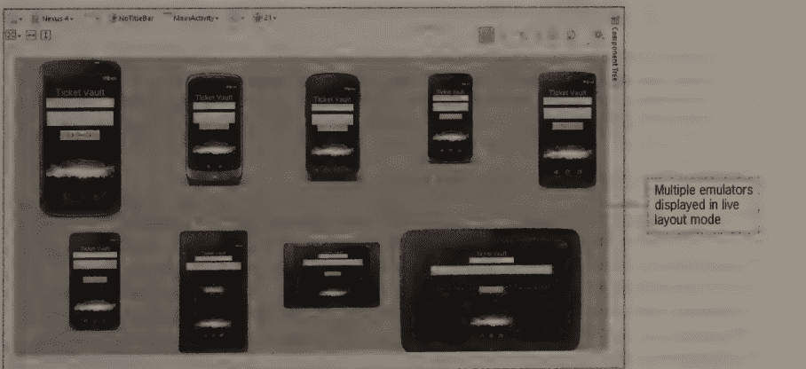

图 1-4 Android Studio 实时布局模式

第一个 Android 版本 1.0 发布于 2008 年 9 月。随后的每个版本都增加了新功能并修复了平台中的已知已知。Android 为每个版本采用了基于糖果和甜点的命名系统，如表 1-2 所示。从第一个版本开始，甜点名称按字母顺序分配。

| 版本名称 | 发布日期 |
| --- | --- |
| 1.0 第一版本 | 2008 年 9 月 |
| 1.5 Cupcake | 2009 年 4 月 |
| 1.6 Donut | 2009 年 9 月 |
| 2.0 Éclair | 2009 年 10 月 |
| 2.2 Froyo (Frozen Yogurt) | 2010 年 5 月 |
| 2.3 Gingerbread | 2010 年 12 月 |
| 3.0 Honeycomb | 2011 年 2 月 |
| 4.0 Ice Cream Sandwich | 2011 年 5 月 |
| 4.1 Jelly Bean | 2012 年 7 月 |
| 4.4 Kit Kat | 2013 年 10 月 |
| 5.0 Lollipop | 2014 年 11 月 |

**表 1-2** Android 版本历史

# 批判性

在创建应用时，我应该只针对最新的 Android 版本吗？

为了支持尽可能多的 Android 设备，你应该将最低开发版本设置为可用的最低版本，以允许你的应用提供其核心功能集。

# 了解市场部署

Android 平台由 Android OS 和用于 Android 应用程序的商店组成。在你编写并测试程序后，你将应用编译为名为 `.apk` 的 Android 程序包。为 Android 平台编写的程序通过一个名为 **Google Play**（`play.google.com`）的在线商店进行销售和部署，该商店提供注册服务并证明程序符合可靠、效率和性能标准。Google Play 要求你签署协议并付费。

### 首次进入 Android 世界

按照书中序言的指示安装 `Android Studio`（`developer.android.com/sdk`）后，下一步是创建你的第一个应用程序。按照编程传统，你的第一个程序被称为 Hello Android World。接下来的章节将向你介绍 `Android Studio` 的元素，并详细描述创建第一个应用的每个步骤。

## 打开 Android Studio 创建新项目

要创建一个新项目，你首先需要打开 `Android Studio`。可能会出现一条消息，提示 `Android Studio` 有可用更新。安装更新以确认你拥有最新版本的 `Android Studio`。在创建第一个项目时，你需要提供以下信息：

- 应用程序名称（Application name）——这是你的应用程序的可读标题，它将显示在 Android 设备上。
- 公司域名（Company domain）——这将在 Google Play 中唯一标识你的应用。开发者通常会使用公司的域名。例如，本书的域名是 `androidbootcamp.net`。
- 包名（Package name）——该包命名空间（namespace）是你的源代码将存放的地方。`Android Studio` 会通过反转输入的公司域名、插入句点、然后添加应用程序名称来创建包名。在发布到 Google Play 时，包名必须是唯一的。在示例中，包名将为 `net.androidbootcamp.HelloWorld`。
- 项目位置（Project location）——此位置指明你的硬盘或 USB 驱动器上存储与此 `Android Studio` 项目相关文件的目录。
- 外形态（Form factor）——此值反映了用于显示应用的外形态。外形态包括屏幕尺寸以及设备类型，如手机、平板电脑、电视、可穿戴设备（手表）和 Google Glass。
- 最小 SDK（Minimum SDK）——此值指定了应用程序所需的最低应用程序接口（API）级别。
- 向移动设备添加活动（Add an activity to mobile）——此选择决定了 Android 设备将使用的活动（activity）。活动类似于启动应用时打开的窗体或屏幕。创建活动是可选的，但活动几乎总是被用作应用程序的基础。
- 活动名称（Activity name）——使用插件生成的类名称。这将是 Android Activity 类的子类。活动是一个可以运行并执行任务的类，例如创建用户界面。

## 创建 Hello Android World 项目

在 `Android Studio` 中，一个项目等同于使用 Java 编写的单个程序或应用。请确保你的电脑上插好了一个空白的 USB（通用串行总线）驱动器，以便将项目存储在该 USB 驱动器上。要创建一个新项目，请按照以下步骤操作：

### 第 1 步

- 打开 `Android Studio` 程序。

`Android Studio` 对话框打开并显示欢迎来到 `Android Studio` 页面（图 1-6）。如果你已经打开了一个项目，点击菜单栏上的 **File**（文件），然后点击 **New Project**（新建项目）。

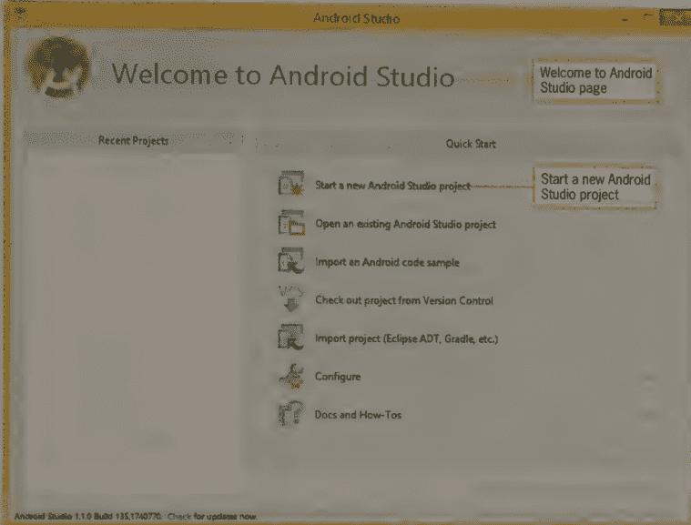

图 1-6 Android Studio 对话框

### 第 2 步

- 在“快速启动”（Quick Start）列表中，点击 **Start a new Android Studio project**（启动一个新的 `Android Studio` 项目）打开创建项目对话框。
- 在“配置新项目”（Configure your new project）页面上，**输入应用程序名称 Hello Android World**。
- 在 **Company**（公司）域名文本框中，**输入 `androidbootcamp.net`**。包名文本框会反向显示公司域名、一个句点以及你在应用程序名称文本框中输入的无空格文本。
- 在项目位置文本框中**输入** `D:\Workspace`。

名为 Hello Android World 的新应用被配置为保存在 `D:\Workspace` USB 驱动器上（图 1-7）。工作空间（workspace）是 `Android Studio` 存储你定义的项目的目录。当你指定工作空间目录名称时，`Android Studio` 会在该目录内创建文件来管理项目。

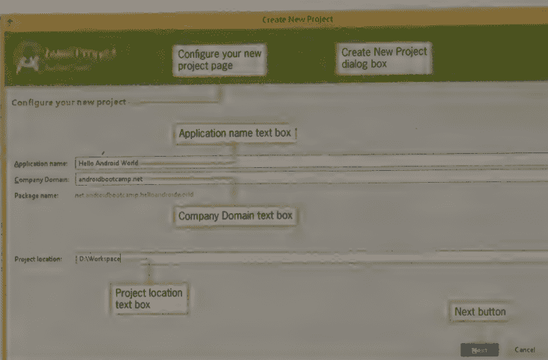

**图 1-7** 配置你的新项目

### GTK

在本书的其余部分，USB 驱动器被称为 D: 盘，尽管你应该选择电脑上代表你 USB 设备的驱动器。如果你使用的是 Mac，请输入 `Volumes\USB DRIVE NAME` 而不是 `D:\Workspace`。

### 第 3 步

- 点击“配置新项目”页面上的 **Next button**（下一步 按钮）。
- 如必要，勾选 Phone and Tablet（手机和平板电脑）复选框以选择运行你应用的外形态。
- 如必要，为 Minimum SDK 选择 API 15: Android 4.0.3 (IceCreamSandwich)。

已选择外形态和最小 SDK（图 1-8）。

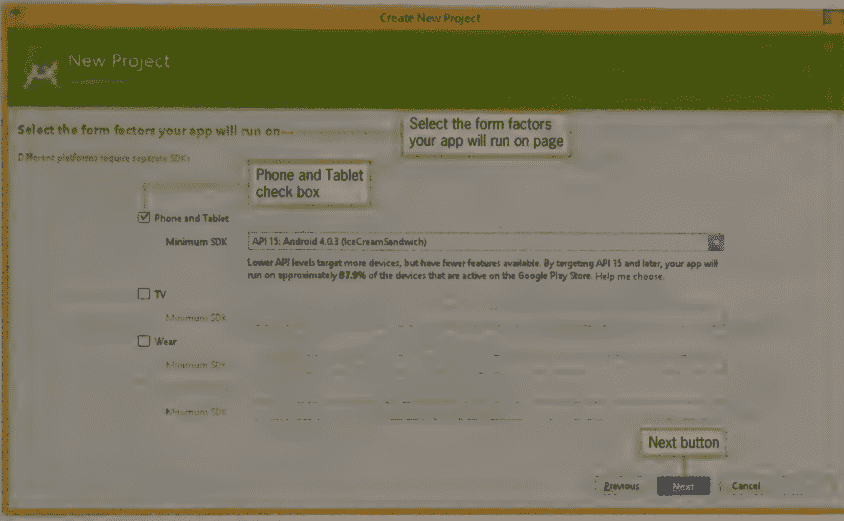

图 1-8 外形态

### 首次进入 Android 世界

### 第 4 步

- 在“选择你的应用运行的外形态”（Select form factors your app will run on）页面上点击 Next 按钮。
- 如必要，点击 Blank Activity（空活动）向新项目添加一个活动。

空活动已添加到 Android 应用程序项目之中（图 1-9）。

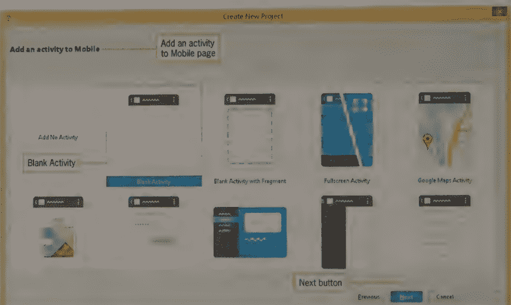

**图 1-9** 添加一个空活动

### 第 5 步

- 点击“向移动设备添加活动”（Add an activity to Mobile）页面上的 Next 按钮。

默认情况下，会创建一个名为 `MainActivity` 的新空活动，其布局为 `activity_main`（图 1-10）。

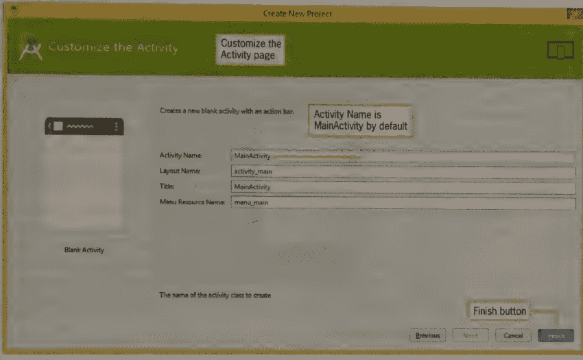

图 1-10 MainActivity

### 第 6 步

- 在“自定义活动”（Customize Activity）页面上，点击 **Finish**（完成）。

项目文件已创建在 USB 驱动器上。Hello Android World 出现了（图 1-11）。

## 构建用户界面

这个第一个应用将显示简单的消息“Hello World”。当前活动的 Android 项目或对象的属性和设置。属性（property）描述了对象可以做什么；例如，如果你更改了 `TextView` 的属性，更新后的文本将显示在模拟器中。后续章节将演示许多布局，每种布局都有独特的属性和特征。

### 浏览 Android 项目

左侧的 Android 项目视图包含关键文件夹。如图 11 所示，Android 项目包含以下内容：

- `manifests` 文件夹：包含 `AndroidManifest.xml` 文件，该文件包含了关于应用程序的所有信息。
- `java`：包含 Java 源代码。
- `res`：包含所有资源，例如应用程序可能需要的图像、音乐和视频文件。名为 `activity_main.xml` 的用户界面位于 `res` 下名为 `layout` 的子文件夹。

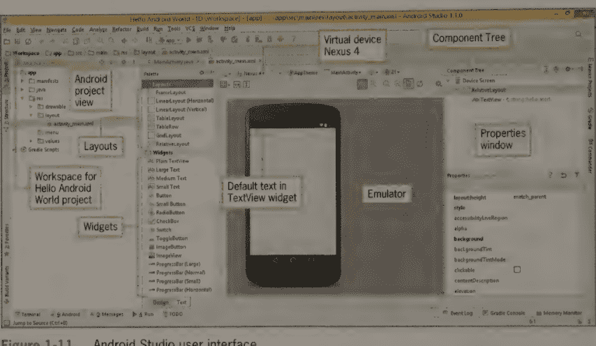

## 在虚拟设备中设计用户界面布局

为了帮助设计用户，Android SDK 包含了布局文件。你可以创建一个布局并向其中添加组件（widgets）。布局是一个可以包含许多组件的容器。组件是一个单一元素，也称为对象，例如 `TextView`、`Button` 或 `CheckBox`。默认情况下，`TextView` 组件在模拟器中显示 Hello World。模拟器的“属性”窗格（Properties pane）包含当前活动的 Android 项目或对象的属性和设置。

要更改虚拟设备并查看属性，请按照以下步骤操作：

- 点击虚拟设备以通过 `activity_main.xml` 表格直接右侧的模拟器按钮渲染布局，然后点击 Nexus 5 (5.0", 1080 x 1920, xhdpi)。只要安装了虚拟设备，你就可以使用任何手机和平板电脑模拟器测试你的应用，但在本文请选择 Nexus 5 模拟器。

Nexus 5 模拟器显示在 `activity_main.xml` 表格中。请注意，Android 在模拟器中放置了一个默认的 `TextView` 视图（图 1-12）。

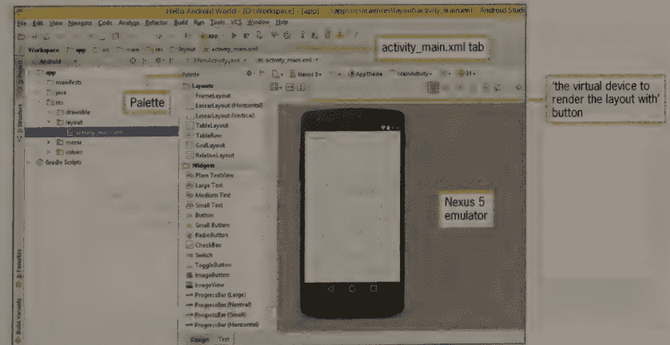

图 1-12 Nexus 5 Android 虚拟设备

搞定！来认识 Android

第 2 步

- 在模拟器中，选择默认的 `TextView` 控制，它显示为 Hello World!

默认的 `TextView` 控制被选中并用一个蓝色选择框显示（图 1-13）。


图 1-13 选中的 TextView 控制

第 3 步


向滚动属性面板（`Properties pane`）以显示文本属性（`text property`）。默认`TextView`控制的文本属性已显示（图 1-14）。组件树（`Component Tree`）显示`TextView`控制已被选中。组件树向你展示了模拟器布局的结构。


图 1-14 TextView 控制的文本属性

## 修改 TextView 控制中的文本

默认情况下，模拟器上放置了一个显示文本`Hello World!`的`TextView`。与其直接在文本属性中放置文本或硬编码文本，Android 建议将字符串等值以资源的形式存储在`res`文件夹中。更新文本最简单的方法是修改资源文件，而不是更改 XML 源代码。如果 Hello Android 应用是为西班牙语和中文等多种语言开发的，则资源文件可以包含翻译后的文本。

要更改模拟器上`TextView`小部件中的文本属性以显示适当的消息，图 1-14 显示的资源文件链接到`@string/hello_world`。`@string`部分引用了 Android 项目视图中`res`文件夹下`values`子文件夹中的`strings.xml`文件位置。`hello_world`部分是`strings.xml`文件中的一个默认变量，分配的值`Hello World`。当应用执行时，Android 会从项目的`res`文件夹加载文本和媒体资源，包括存储在`strings.xml`文件中的文本。要修改`strings.xml`文件中的文本，请遵循以下步骤：

### 第 1 步

- 在 Android 项目视图中，点击或点击`values`子文件夹的展开箭头以展开文件夹内容。

- 双击或双击`strings.xml`文件，在项目（`Project`）窗口中显示`strings.xml`标签页。

项目窗口中的`strings.xml`标签页显示了三个默认字符串文本值（图 1-15）。


图 1-15 strings.xml 默认值

### 第 2 步

- 点击或点击项目窗口右侧的`Open editor`（打开编辑器）链接，以显示翻译编辑器（`Translations Editor`）标签页。

- 点击或点击翻译编辑器中`hello_world`列右侧的`Default Value (Hello world!)`。

- 在翻译编辑器标签页的底部，在`Default Value`（默认值）文本框中输入`Hello World – My First Android App`。

翻译编辑器中的`hello_world`默认值已更改为`Hello World – My First Android App`（图 1-16）。


图 1-16 翻译编辑器

### 第 3 步

- 点击或点击翻译编辑器标签页上的`Close`（关闭）按钮关闭翻译窗口。

`strings.xml`中的`hello_world`文本已修改（图 1-17）。


图 1-17 修改后的 strings.xml

### 第 4 步

- 点击或点击其关闭按钮关闭`strings.xml`标签页。

`TextView`控制在模拟器中显示修改后的文本（图 1-18）。


图 1-18 带有 TextView 控制的模拟器

> **批判性思考**

我可以直接通过在`strings.xml`文件中输入来更改文本吗？

可以，你可以修改 XML 代码，但作为 Android 开发的初学者，使用翻译编辑器会更简单。

> **GTK**

要将应用部署到真实的 Android 设备而不是模拟器，请用 USB 线将设备连接到你的开发机。如果你使用的是 Windows 操作系统，可能需要为设备安装相应的 OEM USB 驱动程序。在 Android Studio 中，点击工具栏上的`Run`（运行）并选择`Run`。

## 在模拟器中测试应用程序

是时候查看结果了！请记住 Android 模拟器（虚拟设备）运行速度缓慢。在模拟器中显示你的完成结果可能需要超过一分钟。第一次运行应用时，模拟器会打开。第二次运行应用将将其发送到已打开的模拟器。即使模拟器处于空闲状态，它也会消耗大量的 CPU 时间，因此在测试完成后你应该关闭模拟器。要运行应用程序，请遵循以下步骤：

### 第 1 步

- 点击或点击工具栏上的`Run 'app'`按钮。

选择设备（`Choose Device`）对话框缓慢打开（图 1-19）。


图 1-19 选择设备框

### 第 2 步

- 点击或点击项目窗口右侧的`Open editor`链接，以显示翻译编辑器标签页。

- 点击或点击翻译编辑器中`hello_world`列右侧的`Default Value (Hello world!)`。

- 在翻译编辑器标签页的底部，在`Default Value`文本框中输入`Hello World – My First Android App`。

翻译编辑器中的`hello_world`默认值已更改为`Hello World – My First Android App`（图 1-16）。


图 1-16 翻译编辑器

### 第 3 步

- 点击或点击翻译编辑器标签页上的`Close`按钮关闭翻译窗口。

`strings.xml`中的`hello_world`文本已修改（图 1-17）。


图 1-17 修改后的 strings.xml

### 第 4 步

- 点击或点击其关闭按钮关闭`strings.xml`标签页。

`TextView`控制在模拟器中显示修改后的文本（图 1-18）。


图 1-18 带有 TextView 控制的模拟器

> **批判性思考**

我可以直接通过在`strings.xml`文件中输入来更改文本吗？

可以，你可以修改 XML 代码，但作为 Android 开发的初学者，使用翻译编辑器会更简单。

> **GTK**

要将应用部署到真实的 Android 设备而不是模拟器，请用 USB 线将设备连接到你的开发机。如果你使用的是 Windows 操作系统，可能需要为设备安装相应的 OEM USB 驱动程序。在 Android Studio 中，点击工具栏上的`Run`并选择`Run`。

## 核心术语

- **Android 项目视图**—Android Studio 程序窗口左侧的窗格，其中包含当前项目的文件夹。

- **Android Studio**—推荐用于编写 Java 程序，以及用于构建和集成 Android 应用开发工具及开源项目的 IDE。

- **Android 虚拟设备 (AVD)**—AVD 用于设计和布局目的，用于显示模拟器配置。

- **AndroidManifest.xml**—包含 Android 运行应用程序所需的所有信息的文件。

- **app**—移动应用程序。

- **组件树 (Component Tree)**—Android Studio 项目窗口中的一个窗格，用于显示模拟器布局的结构。

- **模拟器 (emulator)**—模拟应用程序在特定设备上外观和操作体验的软件。

- **Google Play**—销售为 Android 平台编写程序的在线商店。

- **Java**—一种由太阳微系统创立的面向对象的编程语言和平台。

- **java 文件夹**—包含项目 Java 源代码文件的文件夹。

- **layout**—一个可以包含组件（widgets）和其他图形元素的容器，帮助您为应用程序设计界面。

- **manifest 文件夹**—包含`AndroidManifest.xml`文件的文件夹，该文件包含了 Android 运行应用程序所需的所有关于该应用程序的信息。

- **面向对象编程语言**—一种允许良好的软件工程实践（如代码重用）的编程语言。

- **开放手机联盟 (Open Handset Alliance)**—一个由 80 家公司组成的开源业务联盟，负责为移动设备开发开放标准。

- **开源操作系统**—组织和开发者可以免费且不受版权限制地提取、修改和使用源代码。

- **属性窗格 (Properties pane)**—包含当前活动项目或对象的属性和设置的窗口。

- **属性 (property)**—项目或对象的特征，描述了它的功能。

- **res 文件夹**—项目文件夹，包含了应用程序可能的所有资源，如图像、音乐和视频文件。

- **软件开发工具包 (SDK)**—包含创建应用程序所需的开发工具的包。

- **组件 (widget)**—单个元素，例如`TextView`、`Button`或`CheckBox`控件，也被称为对象。

- **XML**—可扩展标记语言（Extensible Markup Language）的缩写，一种广泛用于定义数据格式的系统。XML 辅助 Android 模拟器的布局。

## 开发者常见问题解答

1. 描述 Android 版本的以"L"开头的甜点名称是什么？

2. Google Play 开发者账户的一次性费用是多少？

3. 当你在 Google Play 发布 Android 应用时，开发者可以保留应用价格的百分之几？

4. 亚马逊开发者账户的年费是多少钱？

5. Google Play 的网址地址是什么？

6. 在 Android Studio 中创建 Android 应用使用了哪两种语言？

7. `activity_main.xml`文件存储在哪个子文件夹中？

8. 列出本章中提到的三个组件。

9. Hello Android World 应用中使用的组件名称是什么？

10. 在 Android Studio 中按下哪两个组合键可以运行 Android 应用？

11. 哪个 Android 版本是 Kit Kat？

12. 使用字母顺序作为 Android 版本名称主题，列出未来 Android 设备操作系统后续版本的三个可能的名称。

13. XML 代表什么？

14. SDK 代表什么？

15. 音乐和图像文件保存在 Android 项目的哪个位置？

## 外拓展

搜索网络获取以下问题的答案，以进一步增加你的 Android 知识。

1. 研究一种流行的 Android 智能手机或平板设备的特定型号，并就该设备的特征、规格、价格和制造商写一段话。

2. 列出第一章"认识 Android"部分中未提到的五个 Android 移动设备功能。

3. Windows Store 开发者账户的当前年费是多少？尽管 Windows Store 的移动端规模微乎其微，为什么许多应用开发者仍要创建 Windows Store 应用？

4. 访问 Google Play 网站并为以下每个应用类别截图：教育、游戏、地图、旅游和个人爱好。将截图放在文字处理文档中，并对每个截图进行标记以便识别。

## 案例编程项目

完成以下或多个案例编程项目。使用本章教授的相同步骤和技术。将你创建的程序提交给老师。每个案例编程项目都注明了难度级别。

最简单：*

中等：**

挑战性：***

### 案例项目 1–1：技术名言应用

**需求文档**

- **应用标题：**Tech Quotes

- **目的：**在 Tech Quotes 应用中，显示你选择的一个技术名言。

- **算法：**启动屏幕显示当天的著名技术名言。在网上找一个名言。

- **条件：**你可以将名言改为你自己的（图 1-24）。

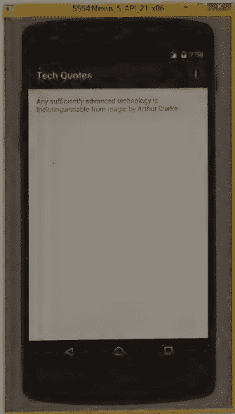

图 1-24 Tech Quotes 应用

### 案例项目 1–2：Android 甜点名称应用 **

**需求文档**

- **应用标题：**Dessert Names

- **目的：**在 Dessert Names 应用中，显示第一章中介绍的 Android 版本名称（甜点）。

- **算法：**启动屏幕显示本章列出的 Android 版本的甜点名称。

- **条件：**替换`strings.xml`文本（图 1-25）。

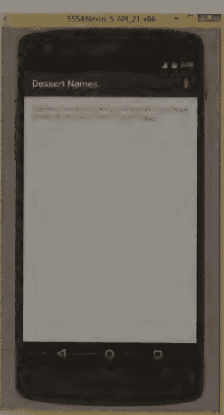

图 1-25 Dessert Names 应用

### 案例项目 1–3：大型科技公司 ★★★

**需求文档**

- **应用标题：**Large Companies

- **目的：**在 Large Companies 应用中，显示现有的五家科技公司。

- **算法：**启动屏幕显示世界上现有的五家科技公司。请研究此主题并根据其收入对它们进行排序。

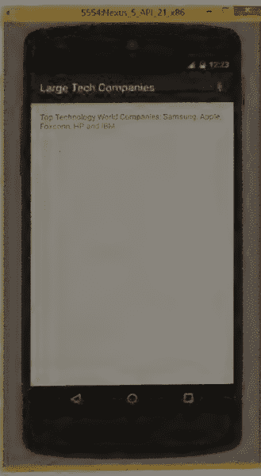

图 1-26 Large Companies 应用

## 简化！Android 用户界面

在本章中，你将学习到：

- 使用`TextView`、`ImageView`和`Button`控件开发用户界面

- 使用翻译编辑器在`strings.xml`中添加文本

- 创建一个包含`Button`事件的 Android 项目

- 为用户界面描述相对布局（`Relative layouts`）和线性布局（`Linear layouts`）

- 创建多个 Android Activity

- 在 Android Manifest 文件查看 Activity

- 添加 Java 类文件

- 为代码窗口添加行号

- 使用`onCreate`方法编写代码

- 使用`setContentView`命令显示内容

- 使用`Button`事件打开第二个屏幕

- 使用`OnClickListener`检测用户交互

- 使用`startActivity`方法启动第二个屏幕

- 正 Java 代码中的错误

- 在模拟器中运行完成的程序

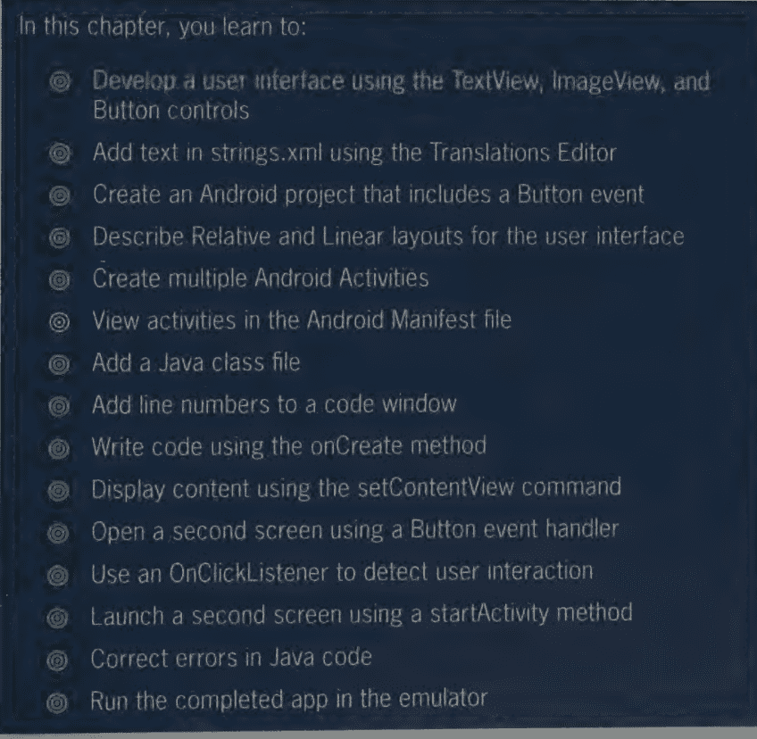

## 设计 Android 应用

在用 Java 编写移动应用之前，必须先对其进行设计。设计程序可以比作建造建筑。在浇筑混凝土板、放置钢梁和竖起墙壁之前，建筑师和工程师必须设计建筑，以确保它符合要求且安全可靠。计算机应用开发也是如此。一旦在用户界面中设计好程序，就可以通过使用可扩展标记语言（XML）和 Java 代码来实现。

为了说明设计和实现 Android 应用的过程，在本章中，你将设计并编写图 2-1 和图 2-2 所示的 Healthy Recipes（健康食谱）应用。


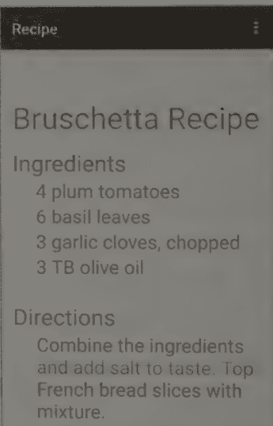

图 2-1 和图 2-2 中的 Android 应用可以作为更大规模应用的一部分。Healthy Recipes 应用首先显示食谱名称（即 Bruschetta Recipe）以及一张说明食材的图像。如果用户点击 VIEW RECIPE 按钮，将打开第二个窗口并显示完整的食谱，包括制作意式面包片的配方和方法。

## 战前准备

如果你拥有数据流量套餐的手机、平板电脑或平板板设备，请下载名为 Epicurious 的免费应用，以了解这个"健康食谱"（Healthy Recipes）应用如何在更大的应用程序中使用的。

## 整体概念

要创建"健康食谱"应用程序，你需要遵循一组步骤，并且在每次创建 Android 应用程序时都要重复这些步骤。

1. 为应用程序中的每个屏幕创建用户界面（也称为 XML 布局）。

2. 为应用程序中的每个屏幕创建一个 Java 类（也称为 Activity）。

3. 根据需要为每个 Java 类编写适当的对象和操作代码。

4. 在 Android 模拟器中测试应用程序。

## 使用 Android 用户界面

在为 Android 应用程序编写任何代码之前，你需要先设计用户界面来控制用户体验。Android 应用程序可以运行在各种外形态上，如智能手机、智能手表、平板电脑、可穿戴眼镜、电视、机器人、汽车以及许多其他设备。外形态指的是设备的屏幕尺寸、配置或物理布局。对于 Android 应用程序，用户界面是任何移动设备屏幕上的一个窗口，用户在其中与程序交互。用户界面存储在 Android 项目视图的`res/layout`文件夹中。用户界面的布局以 XML 代码的形式存储。特殊的 Android 格式 XML 代码非常紧凑，这意味着应用程序占用的空间更少，在设备上运行得更快。使用 XML 进行布局还可以节省你开发代码的时间；如果你开发的这个食谱应用是用于供八种人类语言使用的，你可以使用相同的 Java 代码配合八个唯一的 XML 布局文件（每种语言一个）。

若要打开"健康食谱"应用用户界面的布局并启动应用程序，请遵循以下步骤：

### 第 1 步

- 打开 Android Studio 程序。

- 在 Android Studio 对话框的"欢迎来到 Android Studio"页面，点击或选择"快速启动"（Quick Start）类别下的"启动一个新的 Android Studio 项目"（Start a new Android Studio project）。

- 在"创建项目"（Create Project）对话框中，输入应用程序名称`Healthy Recipes`。


在“公司域名”（Company Domain）框中，输入`androidbootcamp.net`。包名（Package name）将显示公司域名的反转顺序、一个句点，以及你为应用程序名称输入的文本（不带空格）。

在“项目位置”（Project location）框中，输入`D:\Workspace`（在 Mac 上为`Volumes\USB_DRIVE_NAME`）。

一个名为`Healthy Recipes`的新应用程序已配置保存到 USB 驱动器上（图 2-3）。

## 简化！Android 用户界面

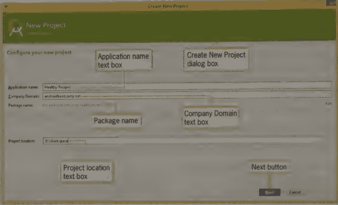

**图 2-3** 配置你的新项目

### 第 2 步

- 在“新建项目”（Create New）对话框的“配置你的新项目”页面上，点击或点击“下一步”（Next）按钮。
- 如必要，点击或点击“手机和平板”（Phone and Tablet）复选框以为你的应用选择外形态。
- 如必要，为“最小 SDK”选择`API 15: Android 4.0.3 (IceCreamSandwich)`。

已选了外形态和最小 SDK（图 2-4）。

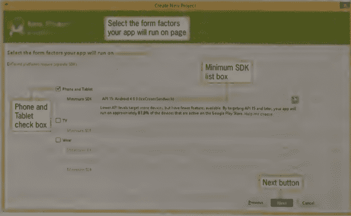

**图 2-4** 健康食谱应用的外形态

### 第 4 步

- 在“选择你的应用将运行的外形态”页面上，点击或点击“下一步”（Next）按钮。
- 如必要，点击或点击“空活动”（Blank Activity）以向新项目添加一个`Activity`。
- 在“向移动设备添加活动”页面上，点击或点击“下一步”（Next）按钮。

创建了一个名为`MainActivity`的新空白活动，其布局为`activity_main`（图 2-5）。

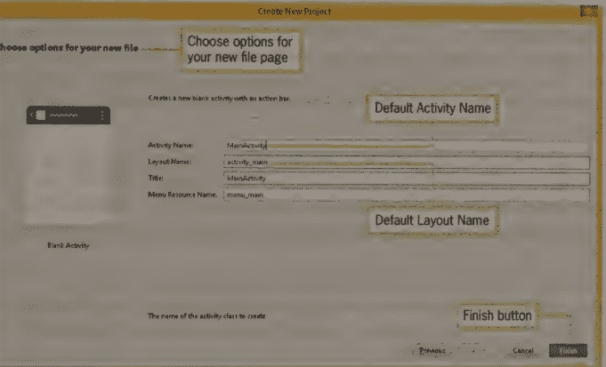

**图 2-5** 创建空白活动

### 第 6 步

- 在“为你的新文件选择选项”页面上，点击或点击“完成”（Finish）按钮。
- 在模拟器中点击或点击默认显示的`Hello world!` `TextView`控件并按`Delete`键。
- 在`activity_main.xml`标签页上，点击调色板（Palette）右侧的渲染布局按钮（模拟器按钮），然后点击或点击`Nexus 5 (5.0", 1080 x 1920, xhdpi)`。

`Android`健康食谱项目文件已创建在 USB 驱动器上。健康食谱的`Android`项目视图出现在左侧窗格中，`Hello world` `TextView`控件已被删除，并且选择了`Nexus 5`虚拟设备。

### 在翻译编辑器中使用字符串表

在第 1 章中，你通过更改`strings.xml`文件中的文本，使用翻译编辑器向`TextView`控件添加文本。与其直接在`TextView`控件的属性中添加文本，不如将其添加到`strings.xml`文件。在单个文件中输入文本具有显著优势。例如，假设你被聘编写一个应用，并在每个控件的文本属性中输入了文本。测试应用后，你的客户决定更改应用内的所有文本。现在你必须逐个文件（包括`xml`和`java`文件）检查你插入的所有文本控件，然后进行替换。作为一种节省时间的替代方案，`Android`在资源（Resources）文件夹内提供了了`strings.xml`文件。如果你的客户想要更改应用内的所有文本，你可以在单个文件中更改所有文本。

## 简化！Android 用户界面

`strings.xml`文件位于`res/values`文件夹中。`strings.xml`文件包含了应用程序中使用的所有文本。文件中的每个字符串由一个键（key）和一个值（value）组成。键用于在代码中引用字符串，值是显示给用户的实际文本。要更改应用程序中的文本，你只需要更改`strings.xml`文件中的值。这比更改每个单独活动文件中的文本简单得多。此外，使用`strings.xml`允许你对应用程序进行多语言本地化。你可以为种语言创建不同的`strings.xml`文件，`Android`将根据用户的设备自动加载正确的翻译。

若要为启动屏幕`strings.xml`文件中的`TextView`、`ImageView`和`Button`控件添加文本，请遵循以下步骤：

### 第 1 步

- 在`Android`项目视图中，展开`res`文件夹下的`values`文件夹。
- 双击`strings.xml`文件以显示字符串资源。

显示`strings.xml`标签页，其中显示了字符串资源。注意`strings.xml`文件已经包含了三个默认字符串（图 2-6）。

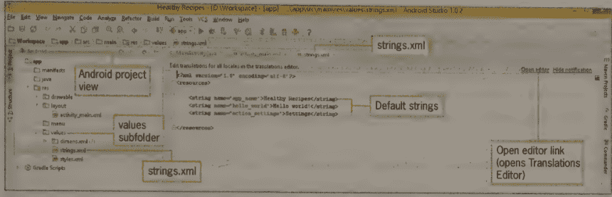

**图 2-6** 默认字符串资源

### 第 2 步

- 点击“打开编辑器”（Open editor）链接。
- 在翻译编辑器中点击“添加键”（Add Key，即加号按钮）按钮。
- 在“键”（Key）文本框中输入`txtTitle`为`TextView`控件命名。
- 在“默认值”（Default Value）文本框中输入`Bruschetta Recipe`以定义要显示的文本。

使用翻译编辑器对话框输入了`TextView`控件的键和默认值（图 2-7）。

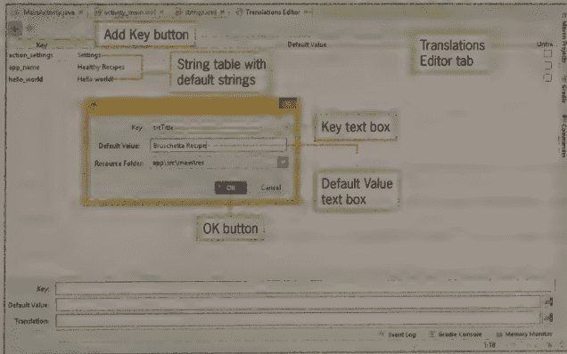

**图 2-7** 为`TextView`控件添加字符串

### 第 3 步

- 点击或触摸`OK`按钮将`txtTitle`添加到字符串表（String table）。
- 点击或触摸翻译编辑器（Translations Editor）中的“添加键”（加号）按钮。
- 在“键”（Key）文本框中，输入`description`以为`ImageView`控制的字符串命名。
- 在“默认值”（Default Value）文本框中，输入`Recipe Image`以说明将显示的图像。

`ImageView`控制的键名和默认值在对话框中输入（图 2-8）。

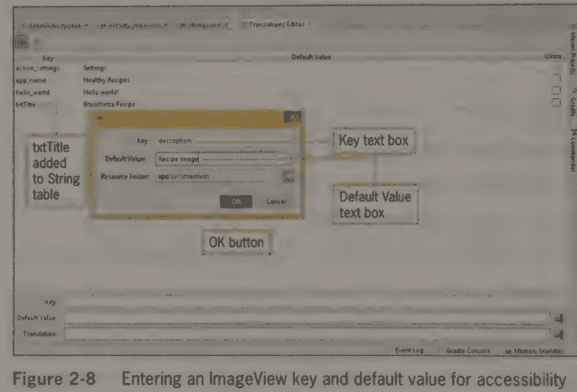

**图 2-8** 为`ImageView`控件添加字符串

### 第 4 步

- 点击或触摸`OK`按钮。
- 点击或触摸翻译编辑器中的“添加键”（加号）按钮。
- 在“键”（Key）文本框中，输入`btnRecipe`为`Button`控制命名字符串。
- 在“默认值”（Default Value）文本框中，输入`View Recipe`以定义文本。

`Button`控制的键名和默认值在对话框中输入（图 2-9）。

## 使用 Android 用户界面

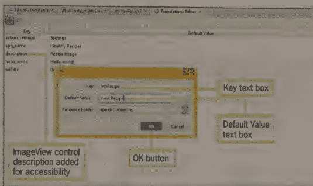

**图 2-9** 为`Button`控制添加字符串

`Healthy Recipes`（健康食谱）应用的第二个屏幕显示了制作意式烤面包（bruschetta）的配料和制作说明。注意图 2-1 和 2-2，两个屏幕都两次使用`txtTitle`字符串显示了相同的“Bruschetta Recipe”标题。要添加第二个用户界面上显示的文本，请按照以下步骤操作：

### 第 1 步

- 点击`OK`按钮将`Button`控制的字符串添加到字符串表，然后点击或触摸翻译编辑器中的“添加键”（加号）按钮。
- 在“键”（Key）文本框中，输入`txtIngredients`为用于显示在应用第二个屏幕上的`TextView`控制命名字符串。
- 在“默认值”（Default Value）文本框中，输入`ingredients`定义文本，然后点击或触摸`OK`按钮将字符串添加到表中。
- 使用本步中教授的技巧，将表 2-1 中的字符串添加到翻译编辑器的字符串表中。

| 键 | 默认值 |
|---|---|
| txtItem1 | 4 plum tomatoes |
| txtItem2 | 6 basil leaves |
| txtItem3 | 3 garlic cloves, chopped |
| txtItem4 | 3 TB olive oil |
| txtDirections | Directions |
| txtMix | Combine the ingredients and add salt to taste. Top French bread slices with mixture |

**表 2-1** `Healthy Recipes`应用第二个屏幕的字符串

第一个和第二个用户界面的第一个文本已添加到翻译编辑器中（图 2-10）。

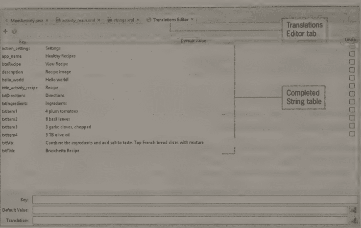

**图 2-10** 翻译编辑器标签页上完成的字符串表

### 第 2 步

- 关闭翻译编辑器标签页。
- 关闭`strings.xml`标签页。
- 点击或触摸“全部保存”（Save All）按钮保存`Android`项目。

## 相对布局（Relative Layouts）与线性布局（Linear Layouts）

`Android`用户界面包含一个布局资源设计器，用于组织出现在应用屏幕上的控件。`activity_main.xml`底部的 Design（设计）标签页显示默认用户界面，它默认使用定义为相对布局的资源文件。**相对布局**如图 2-11 所示，根据组件之间的相互关系来组织布局。与其他布局相比，它在定位控件方面提供了更大的灵活性。可以通过将控件拖放到屏幕上，从而将每个布局放置在模拟器上。如图 2-11 所示，可以将四个`ImageView`控制放置在开发者想要的任何位置。使用相对布局，可以将`ImageView`、`TextView`、`RadioButton`或`Button`放置另一个控件的左侧、右侧、上方或下方。布局资源以 XML 代码的形式存储在`Android`程序的`res/layout`资源目录下，对应点击`activity_main.xml`中的 Text（文本）标签页时显示的用户界面模板。

## 使用 Android 用户界面

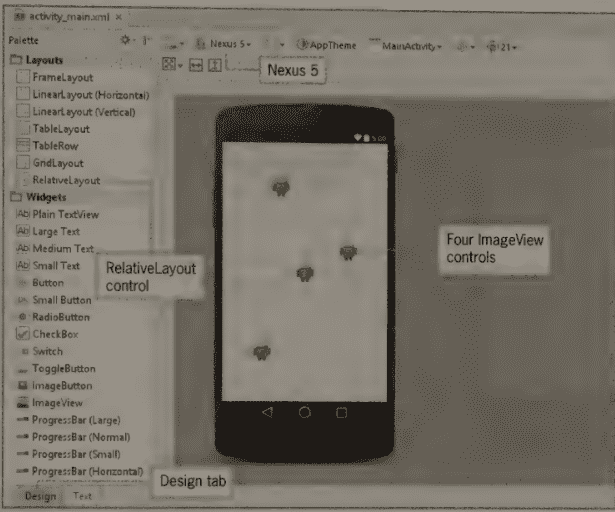

**图 2-11** 相对布局

另一种名为线性布局（Linear layout）的布局将布局组件按垂直列或水平行组织。在图 2-12 中，多个`ImageView`控制（`Android`图标）被拖到模拟器窗口中。线性布局（垂直）将每个控件放置在上一个控件的下方，形成一个垂直列。要将默认的相对布局更改线性布局，从调色板（Palette）中的 Layouts 分类将`LinearLayout (Vertical)`布局拖到模拟器。如果你选择垂直布局并将图像拖到模拟器，图像将以多行的垂直方式排列，如图 2-12 所示。线性布局常用于单行或单列显示控件的表单。

## 简化！Android 用户界面

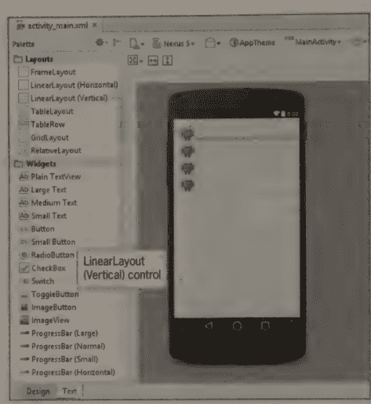

**图 2-12** 垂直对齐的四个`ImageView`控制

你可以包含框架布局（Frame layout）、表格布局（Table layout）、表格行布局（Table Row layout）和网格布局（Grid layout）。你还可以使用布局的组合，这意味着你可以将控件嵌套在其中。

## 设计 Healthy Recipes 启动界面

当`Healthy Recipes`应用打开时，初始屏幕如图 2-1 所示显示带有“Bruschetta Recipe”文本的`TextView`控制、一个带有意式烤面包配料图片的`ImageView`控制，以及一个带有“VIEW Recipe”文本的`Button`控制。注意，控件并不是线性布局，而是使用相对布局，因此它们可以自由放置在屏幕上。你可以使用属性面板（Properties pane）修改控件的属性。要更改控件的属性，先选择控件，然后在属性面板中更改相应的属性（例如文本或大小）。

## Android 文本属性

最常用的文本属性更改显示的文本、修改文本大小并更改文本对齐方式。`text`属性使用字符串资源的文本显示在控件中。`textSize`属性可以使用各种测量单位，如表 2-2 所示。首选测量单位是`sp`，代表缩放无关像素（scaled-independent pixels）。使用该单位的原因是，如果用户设置了`Android`手机，字体将根据用户的偏好进行缩放。

| 测量单位 | 缩写 | 示例 |
|---|---|---|
| 英寸 | in | 0.5in |
| 毫米 | mm | 20mm |
| 像素 | px | 100px |
| 密度无关像素 | dp or dip | 100dp or 100dip |
| 缩放无关像素 | sp | 10sp |

**表 2-2** 用于`textSize`的测量值

在`Healthy Recipes`应用的启动界面，标题的`TextView`、意式烤面包的`ImageView`以及`Button`控制都可以使用引导线（guide）在屏幕上居中，这是一种当控件拖到模拟器时出现的绿色虚线。相对布局允许控件放置在任何地方，但绿色虚线中心线可以让每个控件完美居中。

所有调色板控件（如`TextView`和`ImageView`）都使用名为`layout:margin-top`的属性。例如，如果在`layout:margin`属性右侧设置`50dp`，控件将距离屏幕顶部 50 像素，帮助你设计精确的布局。

用于表示标题的`TextView`控制名为`txtTitle`。要为`TextView`控制命名，使用`id`属性。前缀`txt`表示这是一个`TextView`控制。对象的前缀传达了控件含义的信息。要使用默认相对布局在模拟器上放置居中的`TextView`控制，请按照以下步骤操作：

### 第 1 步

- 在调色板的 Widgets 分类中，选择名为`Plain TextView`的控件。将`Plain TextView`控制拖到模拟器顶部。
- 要使`Plain TextView`控制居中，将其拖到模拟器中心，直到显示标识窗口中心的绿色虚线。

`Plain TextView`控制放置在模拟器上（图 2-13）。

**图 2-13** `Plain TextView`控件放置在模拟器上，并显示绿色虚线引导线

图 2-13 中`TextView`左侧的黄色灯泡表示该控件目前在`text`属性中硬编码了默认文本“New Text”。在字符串表中的文本与`TextView`控制关联后，该警告符号消失。

### 第 2 步

- 在`id`文本框中输入`txtTitle`为`TextView`控制命名。

打开文本和`id`编辑面板，以识别`TextView`控制的文本和`id`属性。

`id`属性指定`TextView`控制的名称为`txtTitle`（见图 2-14）。


**图 2-14** 文本和 ID 编辑面板

### 步骤 3

- 在 Projects（项目）选项卡中点击省略号按钮（三个点）以定位到`txtTitle`，然后点击`txtTitle`。
- 向下滚动 Projects 中的 Resources 列表以找到`txtTitle`，然后点击`txtTitle`。

选择了来自`strings.xml`文件的文本资源`txtTitle`，并显示了文本`Bruschetta Recipe`（图 2-15）。

## 简化！Android 用户界面


**图 2-15** 资源（Resources）对话框

### 步骤 4

- 点击`OK`按钮关闭 Resources 对话框并将`txtTitle`字符串添加到`txtTitle`控件中。
- 向下滚动窗口右侧的 Properties（属性）面板找到`textSize`属性。
- 点击`textSize`属性右侧，输入`40sp`表示缩放无关的像素大小，然后按回车。

`TextView`控件使用`40sp`的字体大小显示文本`Bruschetta Recipe`（图 2-16）。

## 使用 Android 用户界面


**图 2-16** 模拟器上显示的标题

- GTK：在整书中，请注意 Windows 电脑有`Enter`键，而 Mac 电脑使用`Return`键。
- GTK：顶部的免费`Android`应用是 Gmail、Chrome 浏览器、Angry Birds、Facebook、Skype 和 Twitter，按顺序排列。

## 向 Resources 文件夹添加文件

在`Healthy Recipes`应用中，`ImageView`控件显示了 bruschetta 的图片。Images 提供了一种视觉吸引力的方式来向用户传达信息，而无需显式说明。在向模拟器中插入`ImageView`控件之前，你必须将适当的图片文件放在资源文件夹中。在`Android`项目中，`res`（资源）文件夹中包含一个名为`drawable`的文件夹。应用程序使用的图形可以存储在此文件夹中。`Android`支持三种类型的图形格式：`.png`（首选）、`.jpg`（接受）和`.gif`（不建议）。

- 批判性思维：**我如何将 Android 的 camera.jpg 照片转换为首选的 .png 文件类型？**

在 PC 上，Windows 画画可以转换文件类型。在 Mac 上，Paintbrush 是一个类似的图像文件类型转换程序。


Android 使用两个通用属性对设备屏幕进行分类：尺寸和密度。你应该预计应用程序将安装在尺寸和密度都不同的设备上。当你将这些图像保存到`res/drawable`文件夹时，Android 会为其中任何一个图像创建一个 `Drawable` 资源。Android 项目有多个根据设备分辨率命名的 `drawable` 文件夹。五个 `drawable` 文件夹由表 2-3 显示的 dpi（每英寸点）密度标识。为了给不同尺寸的屏幕声明不同的布局和图像，你必须将这些替代资源放在单独的目录中，类似于处理不同语言字符串。Android 会自动缩放你的布局以适应屏幕。

开发人员可以创建为特定尺寸屏幕设计的图像，这些图像看起来清晰流畅，无需任何缩放或模糊。例如，可以专门为水平平板屏幕设计高分辨率图像并将其放在`xxdpi`文件夹中。通过使用适当图像，你可以在所有屏幕上获得最佳图形质量和性能。为了简洁起见，本文会将图像放在通用`drawable`文件夹中进行测试。

| 名称 | 说明 |
|---|---|
| `drawable` | 任何屏幕的通用资源 |
| `xxdpi` | 极高密度屏幕的资源 |
| `xhdpi` | 高密度屏幕的资源 |
| `hdpi` | 高密度屏幕的资源 |
| `mdpi` | 中密度屏幕的资源 |
| `ldpi` | 低密度屏幕的资源 |

将`bruschetta`图像放在`res/drawable`文件夹中供`ImageView`控件使用，该控件链接到资源图像。你应该已经有了老师给你的学生文件，或者你从本书的网页（`www.cengagebrain.com`）下载的文件。要将 USB 驱动器中的`bruschetta.png`图像复制到`res/drawable`文件夹中，请按照以下步骤操作：

### 步骤 1

- 如果必要，将学生文件拷贝到你的 USB 驱动器。打开包含学生文件的 USB 文件夹。
- 要拷贝`bruschetta.png`文件，点击 USB 驱动器上的`bruschetta.png`文件，然后按`Ctrl+C`。
- 要将图像文件粘贴到`drawable`文件夹，长按右键点击 Android 项目视图中的`drawable`文件夹。

打开一个快捷菜单（图 2-17）。


图 2-17 粘贴已拷贝文件的快捷菜单

### 步骤 2

- 点击快捷菜单上的 Paste（粘贴）。

`Copy`对话框确认了正在复制图像的名称和目录（图 2-18）。


图 2-18 Copy 对话框

## 第 2 章 简化！Android 用户界面

### 步骤 3

- 点击 `Copy` 对话框中的 OK 按钮。

`drawable`文件夹中出现了`bruschetta.png`文件的副本（图 2-19）。


## GTK

极高密度图形每英寸有 480 点（通常是平板电脑）。高密度图形每英寸有 320 点，高密度图形每英寸有 240 点，中密度图形有 160 点，低密度图形每英寸有 120 点。

## 添加 ImageView 控件

将图像放置在`drawable`资源文件夹后，你可以在模拟器中放置`ImageView`控件。`ImageView`控件可以在 Android 屏幕上显示图标或图形，如图片文件或形状。要从 Palette（调色板）的 `Widgets` 类别添加`ImageView`控件，请按照以下步骤操作：

### 步骤 1

- 在 Design（设计）选项卡的 Palette 的 `Widgets` 类别中点击 `ImageView`。
- 将`ImageView`控件拖动到模拟器中心，直到出现绿色虚线垂直线，表示控件已居中。释放鼠标按钮。

`ImageView`（小蓝方形占位符）在模拟器中居中（图 2-20）。


图 2-20 模拟器中居中的 ImageView 控件占位符

### 步骤 2

- 双击`ImageView`占位符以打开 src 和 id 的编辑面板。
- 在 id 文本框中输入`imgRecipe`以为`ImageView`控件命名。
- 点击`src`和`id`编辑面板中的省略号按钮。
- 向下滚动 `Resources` 列表，然后点击 `Drawable` 类别下的 `bruschetta` 以从`drawable`文件夹中选择图像。

在 `Resources` 对话框中选择了`bruschetta`图像（图 2-21）。

## 第 2 章：简化！Android 用户界面


**图 2-21** 将 bruschetta 图像分配给 ImageView 控件

### 步骤 3

- 点击 OK 按钮关闭 `Resources` 对话框。
- 向下滚动 `Properties` 面板显示 `contentDescription` 属性。
- 点击`contentDescription`属性右侧的省略号。
- 向下滚动 `Resources` 对话框中的 `Resources` 列表并点击 `description`。

## 使用 Android 用户界面

来自`strings.xml`的 `description` 字符串资源被分配给`contentDescription`属性，这将为了无障碍访问目的显示`imgResource` `ImageView`控件的描述（图 2-22）。


**图 2-22** 将 description strings 资源分配分配给 imageView 控件

### 步骤 4

- 点击 OK 按钮关闭 `Resources` 对话框。

模拟器中显示了`bruschetta`图像（图 2-23）。

## 第 2 章 简化！Android 用户界面


图 2-23 具有图像和 contentDescription 属性的 ImageView 控件

- 双击 `Button`（按钮）控件，并在文本和 ID 编辑器面板中的文本框中输入`btnRecipe`。
- 点击或点击省略号按钮并向下滚动资源（`Resources`）列表。
- 点击或点击`btnRecipe`，然后点击或点击 OK 按钮关闭资源对话框。
- 在属性（`Properties`）面板中，将`textSizeProperty`改为`36sp`并按回车键。

`Button`控件命名为`btnRecipe`，显示文本 `VIEW RECIPE`，字体大小为`36sp`（图 2-24）。

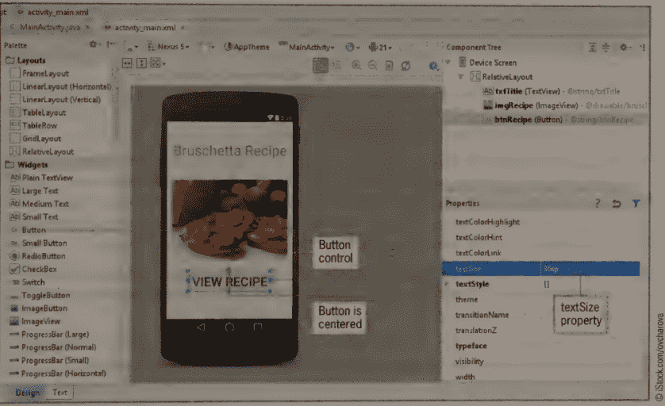

**图 2-24** Button 控件

### 创建 Activity

Healthy Recipes 应用显示两个屏幕，如图 2-1 和 2-2 所示。该应用的系统要求用户选择菜谱名称，然后点击按钮显示菜谱详情。Android 环境中的屏幕定义在布局文件中。图 2-24 显示了第一个屏幕的完成设计，它定义在`activity_main.xml`中。第二个屏幕必须在`activity_recipe.xml`布局文件中创建并设计。这两个屏幕中的每一个都被视为一个 `Activity`。`Activity`是 Android 应用的核心组件之一，是应用程序与用户接触的触点。例如，一个 `Activity` 可能会创建一个网站菜单、请求街道地址以显示地图、简化用户界面，甚至展示艺术博物馆的摄影展。`Activity`是 Android 应用生命周期中的重要组件。你可以使用 XML 布局文件和 Java 类来构建 `Activity`。

## 规划程序

当你掌握了设计 Android 用户界面所需的技能时，你就准备好学习程序开发生命周期了。程序开发生命周期是开发者在设计、创建和维护 Android 程序遵循的一系列阶段和步骤。以下是程序开发生命周期阶段：

- 收集并分析程序需求——开发者必须获取识别程序需求的信息，然后用需求文档记录这些需求。
- 设计用户界面——在开发者理解程序需求后，下一步是设计用户界面。用户界面为程序内发生的处理过程提供了框架。
- 设计程序处理对象——一个 Android 应用由一个或多个执行程序所需任务的处理对象组成。开发者必须确定需要哪些处理对象，然后确定每个对象的需求。你对用户界的设计在保持整个 Android 体验一致且愉快方面起着重要作用。
- 编写程序代码——处理对象设计完成后，必须在程序代码中实现该对象。程序代码由使用 XML 编写的指令和最终执行的 Java 代码组成。
- 测试程序——在编码过程中以及编码完成后，开发者应该测试程序代码以确保其运行正常。

## GTK

你可以使用注释来记录你的代码。Java 编译器会忽略注释。当你想要写单行注释时，输入两个正斜杠（`//`），然后输入你的注释。例如：

```
// 这是一个单行注释
```

另一种注释方法是使用块注释。例如：

```
/* 这是一个块注释 */
```

## 添加类文件

Android 项目视图中的`src`文件夹包含`MainActivity.java`文件。该文件包含`MainActivity`类，它打开`activity_main.xml`屏幕，该屏幕是为应用程序的用户界面设计的。在面向对象的术语中，类描述了一组对象，建立了对每个对象属性的介绍。类通过定义其属性来创建对象的蓝图或模板。类是

### 创建 Activity

Java 程序的根本构建块。类是类别，而对象是每个类别中的项目。对象是类的特定、具体的实例。当你创建一个对象时，你是在进行实例化。当实例化时，通过在类中定义对象的某个特定变体、赋予名称并将其定位在计算机内存中来创建对象的实例。每个类都定义了对象自己的拷贝。类决定了对象可以包含的内容以及在使用数据时的行为方式。例如，想象一组 Mini Cooper 汽车的设计方案，详细说明了如何作为类来制造它。接下来，如果你正在使用设计方案（类）订购你自己的 Mini Cooper 汽车（实例化你自己的拷贝），选择一个带有赛车条纹的苹果红。一个类可以被实例化无数次，但每次实例化都会创建一个新的独特的对象，就像宝马可以制造数千辆 Mini Cooper 汽车一样。

在本章中，`MainActivity`类中添加了 Java 代码，以识别点击 `Button` 控件以打开菜谱屏幕的操作。记住，每个 `Activity` 必须在文件夹内有一个匹配的 Java 类文件。名为`Recipe`的第二个 `Activity` 创建了一个名为`activity_recipe.xml`的 XML 文件，用于显示屏幕的布局。`activity_recipe.xml`布局文件可以像图 2-2 所示那样进行设计。Java 的标准是类名以大写字母开头，没有空格，并用每个新单词的首字母大写来强调。XML 布局文件名通常以小写字母开头，与类名相同。

### GTK

使用大写字母开头 Java 类名并让每个新单词以大写字母开头被称为帕斯卡命名命名法（Pascal case）。

### GTK

如果你使用的是 API 版本 22 或更高版本，任何 `Activity` 中的`ActionBarActivity`类名可能会显示为删除线文本。应用程序将完美运行，对于书中的任何应用，你都可以将`ActionBarActivity`替换为`AppCompatActivity`。

要向应用程序添加带有第二个 XML 布局页的 Java 类，请遵循以下步骤：

### 步骤 1

- 关闭`activity_main.xml`标签。
- 在 Android 项目视图中，展开`java`文件夹和第一个`next.androidbootcamp.healthyrecipes`包以查看`MainActivity` Java 类。
- 要创建第二个类，按住或右键点击`next.androidbootcamp.healthyrecipes`文件夹（包名），在快捷菜单上点击或点击`New`，然后点击或点击`Activity`。

显示 `Activity` 快捷菜单以添加第二个 `Activity`（图 2-25）。

## 简化！Android 用户界面

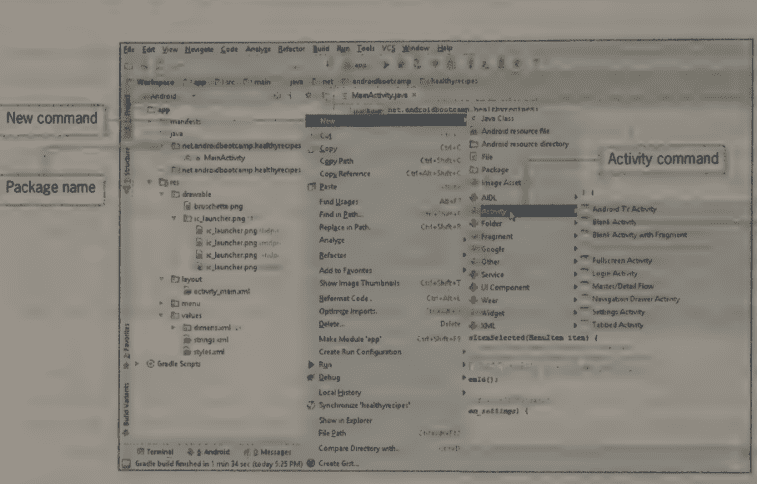

图 2-25 Activity 快捷菜单

### 步骤 2

- 点击或点击`Blank Activity`以创建第二个 `Activity` 类。
- 在`Activity Name`文本框中输入`Recipe`以创建第二个类。

名为`Recipe`的新类对应第二个布局`activity_recipe`（图 2-26）。

### 创建 Activity

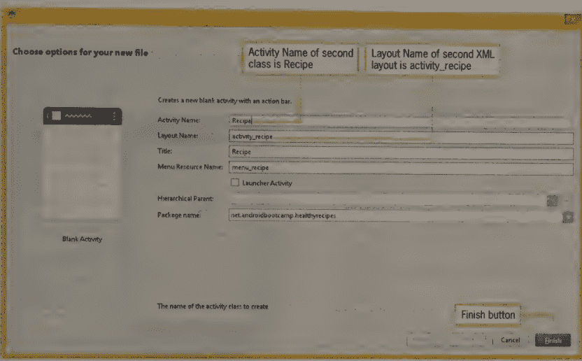

**图 2-26** 创建 Recipe 类

### 步骤 3

- 点击或点击`Finish`按钮完成`Recipe`类和第二个屏幕的 XML 布局的创建。
- 从`activity_recipe.xml`中删除默认的`Hello World!` `TextView`对象。
- 使用本章之前教授的技巧，创建第二个用户界面`activity_recipe.xml`，如图 2-27 所示，包含多个`TextView`控件。

第二个用户界面`activity_recipe.xml`设计完成（图 2-27）。

## 第 7 章 简化！Android 用户界面

Recipe 类

Plain TextView

`txtTitle2`,

`textSize40sp`

`activity_recipe.xml`

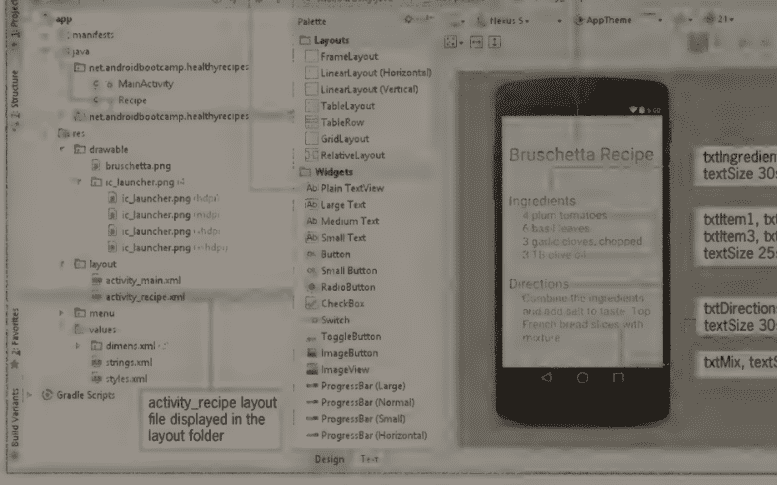

图 2-27 activity_recipe.xml 的用户界面

### 步骤 4

- 关闭`activity_recipe.xml`标签。
- 在`Recipe.java`代码窗口中点击或点击。
- 通过点击或点击菜单栏上的`View`然后点击或点击`Active Editor`在代码窗口中显示行号。
- 点击或点击`Show Line Numbers`。

`Recipe.java`类已创建并显示了行号（图 2-28）。

# Android 清单文件

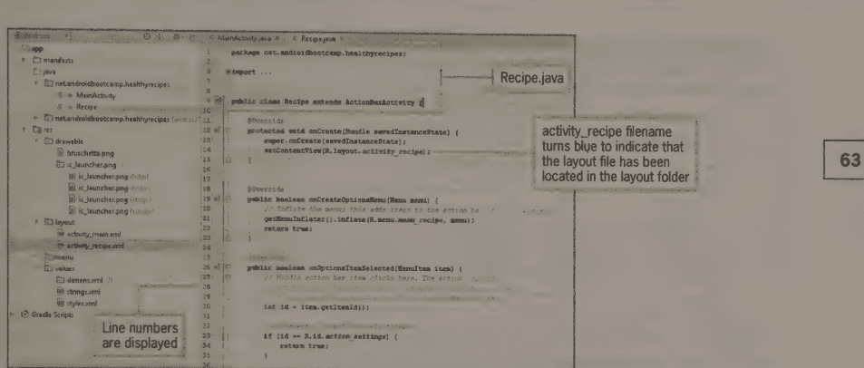

**图 2-28** Healthy Recipes 项目中的新类

# Android 清单文件

一个 Android 项目包含的内容远不止创建用户界面的 XML 布局文件。Android 项目的其他重要组件是 `Android Manifest` 文件和 Java 类中的 Java 代码。**Android Manifest** 文件在每个 Android 应用中都是必不可少的，且必须精确命名为`AndroidManifest.xml`。Android Manifest 为 Android 设备提供了所有必备信息，例如你的 Java 应用程序的名称、每个 `activity` 的列表、访问其他 Android 功能（如使用互联网）所需的权限、服务、广播接收器以及 Android API 的最低级别。该文件让 Android 系统知道包含了哪些组件，以及它们在什么条件下可以被启动。`AndroidManifest.xml`就像业务流程的项目经理，它决定了活动的调度、所需的权限以及完成任务所需的设备版本。

Android Studio 会将你创建的每个 `activity` 自动添加到 Android Manifest 文件。在 Healthy Recipes 应用中，Android Manifest 仅识别名为`MainActivity`的初始 `activity`。如果需要查看应用包含哪些 `activity`，可以在需要时展开 `manifests` 文件夹，然后在 Android 项目视图中双击或双击`AndroidManifest.xml`文件，如图 2-29 所示。注意第 11 行调用了一个名为`MainActivity`的 `activity`。第 13-17 行的意（intent）是启动启动屏幕。第 20 行调用了名为`Recipe`的第二个 `activity`。`AndroidManifest.xml`文件必须为每个 `activity` 包含一个条目。

## 第 2 章 简化！Android 用户界面

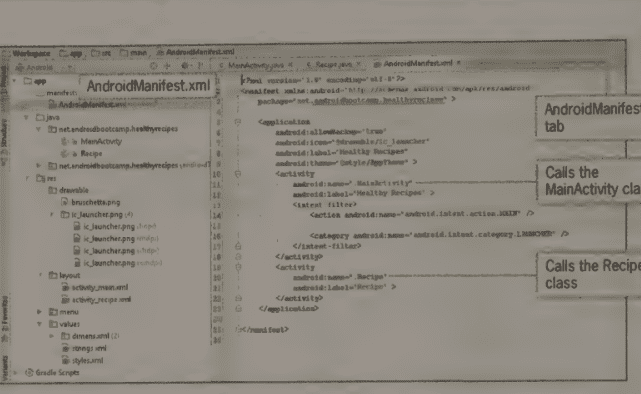

图 2-29 AndroidManifest.xml

# 编写 Java Activity

当用户在其 Android 手机或平板电脑上点击应用图标时，设备处理器会读取`MainActivity.java`代码。`Activity`类的入口是`onCreate()`事件处理程序，它被称为方法。方法是可以包含在 Java 类内部的 Java 语句集合。方法体包含一组定义了方法作用的语句。要初始化 `Activity`，想象你桌子上有一大叠纸。纸堆上面的那张纸就是你现在正在的。Android 也有一个 activity 栈。`onCreate`方法将这个新 `activity` 放在栈的顶部。

# 编写 onCreate 方法


在章节项目中，在`activity_main.xml`中设计的启动屏幕布局中显示的第一个 activity 是当前运行的 activity。当用户点击 VIEW RECIPE 按钮时，`activity_main.xml`屏幕关闭，一个显示实际食谱（`activity_recipe.xml`）的新 Activity 被放在栈的顶部并成为运行的 activity。`onCreate`方法的语法如下：

## 代码语法

```java
public void onCreate(Bundle savedInstanceState) {
    super.onCreate(savedInstanceState);
}
```

方法以`public void`开始，这些 Java 用来确定方法类型的特殊关键字。它们必须始终全小写字母。`void`被称为方法的返回类型。`void`返回类型意味着该方法不返回任何内容。在`public void`语句的结尾是一个左大括号。右括号出现在方法的末尾。括号内部是`onCreate`方法，在这里必须打开第一个用户界面。Activity 并不知道应该在屏幕上显示哪个用户界面。为了打开特定的用户界面，必须在`onCreate`方法内部添加代码，将该特定的 activity 放在栈上。显示特定屏幕内容的 Java 代码是`setContentView`，它具有以下语法：

### 代码语法

```java
setContentView(R.layout.activity_main);
```

在代码语法中，`R.layout.activity_main`代表`activity_main.xml`布局（启动屏幕）的用户界面，显示启动标题、意式面包图像和 VIEW RECIPE 按钮。`R`代表 Resource（资源）一词，就像`res`文件夹中的布局文件夹一样。

## 显示用户界面

`MainActivity.java`文件由 Android Studio 自动创建，已经包含了`onCreate`方法和`setContentView(R.layout.activity_main)`代码，如图 2-30 中的第 12 行和第 14 行所示。第 12 行开始方法，第 14 行在应用程序启动时显示`activity_main.xml`布局。当启动`Recipe.java`类时，Android Studio 会自动为`activity_recipe.xml`创建`onCreate`方法。

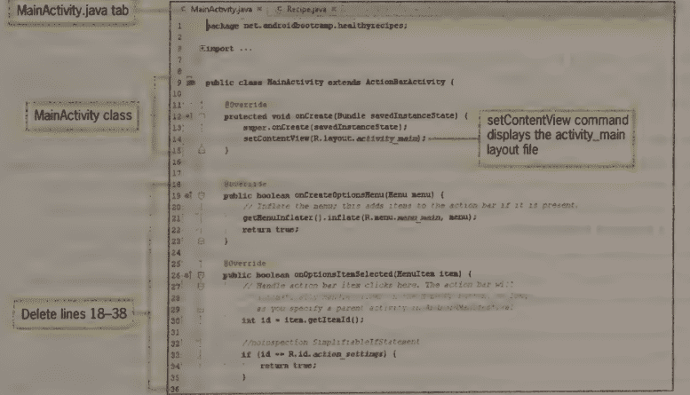

## 创建按钮处理器

Android 手机和平板电脑的触摸屏为用户交互创造了无限可能，允许用户点击、滑动和双指缩放来更改屏幕大小。当你使用这种事件驱动的语言进行编程时，用户通常会看到一个包含控件、按钮、菜单和其他图形元素的界面。显示界面后，程序会一直等待用户触摸设备。当用户做出反应时，应用会启动一个事件，并在**事件处理程序**中执行代码，处理程序是程序中用于响应特定事件的部分。在 Healthy Recipes 应用中，用户只有一个交互——你可以点击 Button 控件来开始意式面包食谱。当用户点击 Button 控件时，需要事件监听器的代码来开始 Android 上`activity_recipe.xml`文件的事件。这种点击在 Java 代码中实际上被称为点击事件（click event）。在 Healthy Recipes 应用中，`MainActivity.java`代码必须先找到以下部分：

- 用于持有 Button 对象引用的类属性
- 用于等待 Button 点击动作的`OnClickListener()`方法
- 用于响应点击事件的`onClick()`方法

Healthy Recipes 应用打开时，屏幕上有一个 Button 控件。要使用该按钮，需要在`MainActivity.java`文件中进行引用。要引用 Button 控件，使用以下语法创建一个 Button 属性：

```java
Button button = (Button)findViewById(R.id.btnRecipe);
```

Button 属性的语法包含了`findViewById()`方法，任何 Android Activity 都会使用该方法。该方法在设计用户界面时创建的 XML 文件中查找布局视图。代码中的变量名包含对 Button 控件的引用。

在引用了 Button 控件的代码后，你可以按 Alt+Enter 将 Button 类型作为 Android 小部件导入（Mac 上为 Option+Return）。当你将导入 Button 类型作为 Android 小部件时，你就可以在范围内可以使用 Android Button 包中的类。导入语句会自动放在代码顶部。导入语句是使 Java 函数可用的方式。为了限制代码的大小，Java 可以执行无限操作，并不是每个程序都需要做所有事情。

在`MainActivity.java`中引用 Button 属性后，需要一个`OnClickListener`方法来检测用户点击按钮。事件监听器等待用户交互，当用户在章节项目中点击按钮接收食谱时。当代码窗口中放置`OnClickListener`时，Java 会创建生成的存根（stub）。存根是实际上作为占位符的代码，它有足够的代码与程序的其余部分链接。监听按钮的`OnClickListener`方法需要以下语法：

### 代码语法

```java
button.setOnClickListener(new OnClickListener() {
  public void onClick(View v) {
    // TODO 自动方法
  }
});
```

代码最后一步是调用`startActivity()`方法，它打开显示`activity_recipe.xml`用户界面的 Activity。`startActivity()`方法创建一个启动另一个 Activity 的意。意需要两个部分：上下文和打开的 Activity 名称。Android 编码中的上下文意味着当你请求程序启动另一个 Activity 时，会将上下文发送到 Android 系统，以显示哪个初始化类正在请求。章节项目的上下文是`MainActivity.this`，它引用了`MainActivity.java`类。以下语法启动`Recipe`类：

### 代码语法

```java
startActivity(new Intent(MainActivity.this, Recipe.class));
```

## 编写按钮事件处理器

当`activity_main.xml`布局由`MainActivity.java`类初始启动时，需要编写 Button 控件如何与用户交互。当点击此 View 按钮时，`MainActivity.java`类必须包含启动`activity_recipe.xml`布局（activity）并启动第二个 Activity 类 Recipejava 的。要初始化 Button 控件并编写启动第二个 Activity 的按钮处理器，请按照以下步骤操作：

### 第一步

- 点击`MainActivity.java`标签以打开其代码窗口。
- 在代码窗口中点击并显示行号。
- 删除第 18–38 行以简化代码。
- 点击第 14 行`setContentView(R.layout.activity_main);`的右侧，然后按回车键。

## 简化！Android 用户界面

- 要通过 id 名称 btnRecipe 初始化并引用控件，请输入

  `Button button = (Button) findViewById(R.id.btnRecipe);`

- 在代码编辑器中引用 Button 控件后，指向第一个 Button 命令的红色文本。

MainActivity.java 中引用了名为 btnRecipe 的 Button 控件。通过指向 Button 命令，会显示错误消息（图 2-31）。注意 MainActivity.java 标签页名称下的红色波浪线，表示代码中存在错误。

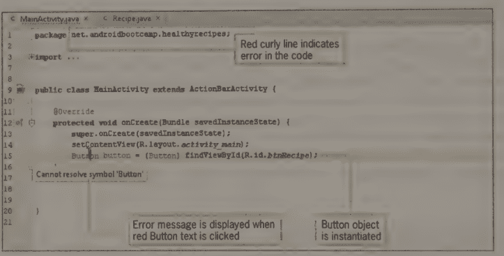

### 第 2 步

- 同时按下 Alt+Enter（Mac 上为 Option+Return）以解决语法错误并导入 Button 类。
- 点击或点击第 3 行中的展开图标（加号）以显示导入语句。
- 点击标准工具栏上的“全部保存”按钮以保存你的工作。

Button 库已导入到此项目中（图 2-32）。

## 编写 Java Activity

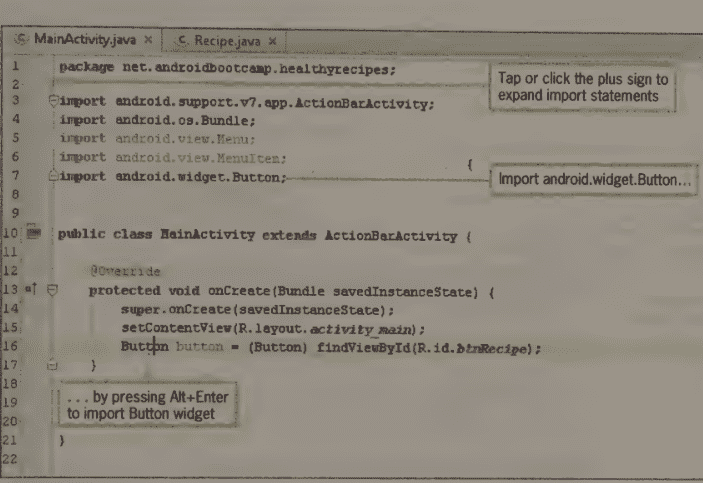

### 第 3 步

- 点击第 16 行末尾并按回车。
- 要编写等待用户交互的按钮监听器，输入`button.setOnClickListener`以显示自动补全列表，其中包含代码此处有效的所有项。
- 双击或双击第一个 OnClickListener 从自动补全列表中选择它。
- 在括号中输入`new On`（必须大写字母 'O'）以查看可能的自动补全选项。

显示 OnClickListener 的自动补全列表（图 2-33）。

简化！Android 用户界面

```java
MainActivity.java - C Recipes
package net.android.bootcamp.healthyrecipes;

import ...

public class MainActivity extends AppCompatActivity {
    @Override
    protected void onCreate(Bundle savedInstanceState) {
        super.onCreate(savedInstanceState);
        setContentView(R.layout.activity_main);
        Button button = (Button) findViewById(R.id.Recipe);
        button.setOnClickListener(new OnClickListener() {
            @Override
            public void onClick(View view) {
                // Auto-complete listing
                // awaits user interaction listing
            }
        });
    }
}
```

图 2-23 自动补全列表

### 第 4 步

- 双击或双击第一个选项，即 OnClickListener (android.view)。自动生成的代码添加了 onClick 方法。
- 如果必要，如果文本为红色，则点击或点击 View 然后按 Alt+Enter 导入 View。
- 点击将插入点置在第 21 行`public void onClick (View v)`大括号内部。

代码中出现了一个自动生成的 OnClickListener 存根（图 2-34）。

## 编写 Java Activity

```java
package net.android.bootcamp.healthyrecipes;

import android.view.*;

public class MainActivity extends AppCompatActivity {

    @Override
    protected void onCreate(Bundle savedInstanceState) {
        super.onCreate(savedInstanceState);
        setContentView(R.layout.activity_main);
        Button button = (Button) findViewById(R.id.buttonRecipe);
        button.setOnClickListener(new View.OnClickListener() {
            public void onClick(View v) {
                // This code was automatically generated
            }
        });
    }
}
```

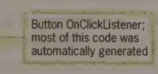

### 第 5 步

- 输入 **startA** 并从自动补全列表中选择`startActivity(Intent intent)`。
- 在括号中，通过输入 **new Int** 更改意文本，然后双击或双击自动补全列表中的 Intent (android.content)。
- 在下一组括号中，输入 **MainActivity.this, Recipe.class.**。
- 点击工具栏上的“全部保存”按钮。

startActivity 代码启动意图以打开 Recipe.class（图 2-35）。

```java
package net.android.bootcamp.healthyrecipes;

import android.content.Intent;

public class MainActivity extends AppCompatActivity {

    @Override
    protected void onCreate(Bundle savedInstanceState) {
        super.onCreate(savedInstanceState);
        setContentView(R.layout.activity_main);
        Button button = (Button) findViewById(R.id.buttonRecipe);
        button.setOnClickListener(new View.OnClickListener() {
            public void onClick(View v) {
                startActivity(new Intent(MainActivity.this, Recipe.class));
            }
        });
    }
}
```


## 在一线

在过去，软件开发者必须等待几个月才能发布他们的软件。在如今的移动市场中，应用商店已成为交付的主要渠道。当你的应用通过测试后，即可提供给消费者。

## 代码错误

使用自动补全列表可以减少输入代码时的错误。当发生错误时，会弹出一个对话框显示可能的修正方案。红色波浪线标识错误位置。当你运行应用时，错误会出现在底部，并带有如何修复它的建议。

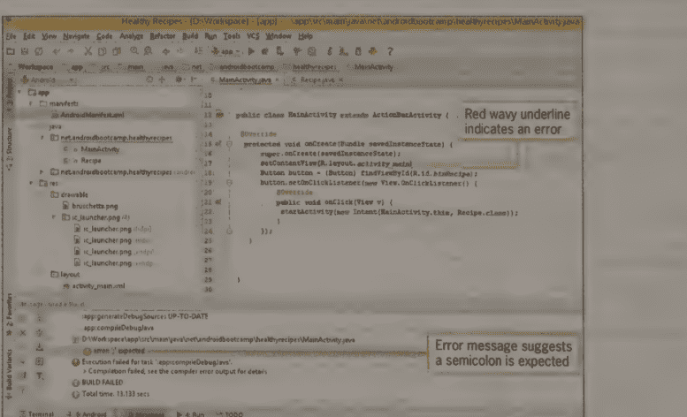

## 保存并运行应用程序

每次测试 Android 应用程序时，代码会自动保存。如果你启动项目，点击工具栏上的模拟器。会弹出一个对话框请求你想要启动哪个模拟器；选择 Nexus 5 API 21 并点击 OK。当模拟器主界面出现时，再次运行应用程序。应用程序将在模拟器窗口中打开，你可以点击 RECIPE 按钮。

## 总结——章节摘要

本章介绍了创建健康食谱程序用户界面的步骤。如你所见，许多步骤具有重复性；也就是说，反复使用相同的技术来完成相似的任务。当你掌握了这些技术以及用户界面设计原理时，你就能为各种程序设计用户界面了。

- 不是直接向控件的 text 属性添加文本，而是通过操作翻译编辑器中的字符串表将其添加到`strings.xml`文件中。
- 相对布局（Relative layouts）可以在屏幕上自由安排屏幕组件。线性布局（Linear layouts）将屏幕组件按垂直列或水平行排列。
- 控件常用的文本属性包括 text 属性（用于指定用于在控件中显示文本的字符串资源）和 textSize 属性（用于指定文本大小）。
- 要在 Android 应用中以图片和图标形式显示图形，你需要使用 ImageView 控件。在模拟器中放置 ImageView 控件之前，你必须在资源文件夹 (drawable) 中放置图形文件。
- Activity 是应用程序与用户接触的接触点，是 Android 应用程序的核心组件之一。本章有两个 Activity，分别对应每个屏幕。
- 每个屏幕代表一个 Activity，每个 Activity 必须有一个 Java 类文件。
- 每个 Android 应用程序都有一个 Android Manifest 文件（命名为 AndroidManifest.xml），它为 Android 设备提供基本信息，如你的 Java 应用程序的名称以及每个 Activity 的列表。Android Studio会自动将每个 Activity 添加到文件中。
- 方法是一组包含在 Java 类内部的 Java 语句。`onCreate`方法是初始化 Activity 的地方。你使用`setContentView`命令显示特定屏幕的内容。

## 简化！Android 用户界面


- 当用户点击 Android 应用中的 `Button`（按钮）控件时，事件监听器的代码将启动与 `Button` 控件相关的事件。诸如 `OnClickListener` 等事件监听器会在执行后续代码之前等待用户交互。
- 在包含多个 `Activity`（或屏幕）的 Android 应用中，你使用 `startActivity()` 方法来创建一个意图（intent）以启动另一个 `Activity`。该意图应包含两个参数：上下文（context）和要打开的 `Activity` 名称。上下文显示了是哪个初始化 `Activity` 类正在发出请求。
- 当你运行 Android 应用程序时，如果项目包含任何错误，会打开对话框。寻找红色错误图标和红色波浪线，它们标识了错误的位置。指向红色线段，可以让 Java 为代码中的语法错误提供修正建议。

## 关键术语

**Activity** — 一个代表带有用户界面的单个屏幕的 Android 组件。

**Android Manifest** — 名为 `AndroidManifest.xml` 的文件，每个 Android 应用都需要它。此文件为 Android 设备提供基本信息，例如 Java 应用程序名称以及每个 `Activity` 的列表。

**class** — 一组对象，建立了对每个对象属性的介绍。

**event handler** — 程序中用于响应特定事件的代码部分。

**ImageView control** — 一种显示来自图片文件的图标或图形的控件。

**import** — 使来自特定 Android 包的类在整个应用程序中可用。

**import statement** — 一种让 Java 函数对程序可用的语句。

**instantiate** — 创建特定类的对象。

**intent** — Android Manifest 文件中的代码，允许具有多个 `Activity` 的 Android 应用在各个 `Activity` 之间进行导航。

**Linear layout** — 一种将组件排列在垂直列或水平行中的布局。

**method** — 一组可以包含在 Java 类内部的 Java 语句。

**method body** — 方法中包含一组语句的语句，定义了方法的功能。

**object** — 类的特定、具体的实例。

**Pascal case** — 以大写字母开头并在每个新单词开头都使用大写字母的文本。

**Relative layout** — 一种根据组件相互关系排列组件的布局。相对布局是模拟器的默认布局。

**ContentView** — 显示特定屏幕内容所需的 Java 代码。

**sp** — 一种测量单位，代表缩放无关的像素（scaled-independent pixels）。

**stub** — 一段作为占位符用于声明的代码，仅包含足够链接到程序其他部分的代码。

**text property** — 一种引用字符串资源以便在控件内显示文本的属性。

**textSize property** — 一种设置控件中文本大小的属性。

## 开发者常见问题

1. `res` 文件夹中有多少个 `drawable` 文件夹？
2. 如果你要为许多不同的语言创建一个应用，是否需要为每种语言从头开始编写整个程序？程序的哪些部分保持不变？哪些部分会有不同？
3. XML 文件存储在 Android 项目视图的哪一个子文件夹中？
4. 章节项目使用了哪三个控件？
5. 线性布局（Linear layout）和相对布局（Relative layout）有什么区别？
6. Android 屏幕的默认布局是线性还是相对？
7. 文本大小最倾向于哪种测量单位？为什么？
8. `px` 代表什么？
9. `sp` 代表什么？
10. `dpi` 代表什么？
11. `ImageView` 控件接受哪些图片文件类型？
12. 偏好哪种图片文件类型？
13. 你可以在哪个属性中为屏幕阅读器（辅助功能）描述 `ImageView` 控件？
14. 章节项目中的 `Button` 控件更改了哪三个属性？
15. 定义 `Button` 控件名称的属性是什么？
16. 编写一行代码，从当前的 `MainActivity` 启动名为 `Wireless` 的第二个类。
17. 编写一行代码，声明一个变量名为 `button` 的 `Button` 控件，该变量引用 XML 布局中 ID 为 `btnStarWars` 的按钮。
18. 编写一行代码，打开名为 `lemon` 的 XML 布局。
19. 按哪两个键可以自动补全一行 Java 代码？
20. 大多数 Java 代码行末尾放置什么字符？

## 拓展阅读

搜索网络以获取以下问题的答案，进一步丰富你的 Android 知识。

1. 线性布局和相对布局并不是 Android 布局的唯一类型。列出其他三种布局并为每种类型写一段话。
2. 为什么 `.png` 文件是 Android 设备首选的图像资源类型？写一段包含至少三个理由的文字。
3. 平均 Android 开发者从其应用中获得多少利润？研究这个主题并根据你的发现写 150–200 字。
4. 研究目前 Google Play 上最昂贵的 Android 应用。列出三个昂贵的应用、它们的价格以及每个应用的用途。

## 案例编程项目

完成以下一个或多个案例编程项目。使用章节中教授的步骤和技术。将你创建的程序提交给教师。每个案例编程项目都标出了难度级别。

最简单：*

中等：**

有挑战性：***

### 案例项目 2–1：青年旅舍应用

#### 需求文档

**应用标题：** 青年旅舍应用（Youth Hostel App）

**目的：** 在青年旅舍预订应用中，选择一个旅舍并显示地址和其他信息。

**算法：**

1. 启动屏幕显示旅舍名称和图片。
2. 当选择一个旅舍时，显示地址和其他信息。

> 注：文本在 OCR 中略有碎片，根据上下文进行了重建。

## 案例编程项目

> 注：第 103–105 页的 OCR 文本包含了案例项目的重叠/碎片解构。以下是基于提供的源文本重建的逻辑流。

### 案例项目 2–5：你的联系人应用—通讯录 ***

#### 需求文档

**应用标题：** 你的联系人应用—通讯录

**目的：** 这个大型应用在通讯录中业务联系信息。为该应用创建两个屏幕。使用该应用选择特定的联系人，然后显示该人的信息。

**算法：**

1. 启动屏幕显示两个姓以字母 J 开头的联系人。每个联系人姓名下方有一个独立的 `Button` 控件。创建你自己的布局。
2. 第二屏幕显示联系人的姓名、地址、电话号码和图片。创建你自己的布局。

**条件：** 需要三个 Java 类和三个 XML 布局文件。

### 案例项目 2–6：最新音乐动态应用 ***

#### 需求文档

**应用标题：** 最新音乐动态

**目的：** 这一名为“最新音乐动态”的大型应用包含了最新的音乐新闻。为音乐新闻故事创建两个屏幕。使用该应用选择特定的音乐新闻故事标题，然后显示关于该音乐新闻的图片和段落。

**算法：**

1. 启动屏幕显示两个音乐新闻故事标题，你可以根据新闻中的音乐故事创建它们。每个音乐新闻故事的标题下方有一个独立的 `Button` 控件并显示一张小图片。创建你自己的布局。
2. 第二屏幕显示音乐故事的名称和详细介绍新闻的段落。创建你自己的布局。

**条件：** 需要三个 Java 类和三个 XML 布局文件。

## 参与！Android 用户输入、变量与操作

在本章中，你将学习：

- 使用 Android 主题
- 在 Android Manifest 文件中添加主题
- 在 String 表格中添加文本
- 在 `strings.xml` 中添加 XML 数组字符串
- 使用文本字段（Text Fields）开发用户界面
- 描述不同文本字段的作用
- 使用 `hint` 属性显示提示信息（hint）
- 使用 `Spinner`（下拉框）控件开发用户界面
- 为 `Spinner` 控件添加提示（prompt）
- 声明变量以存储数据
- 编写 `GetText()` 方法
- 理解算术运算
- 转换数值数据
- 格式化数值数据
- 编写 `SetText()` 方法
- 在模拟器中运行完成后的应用

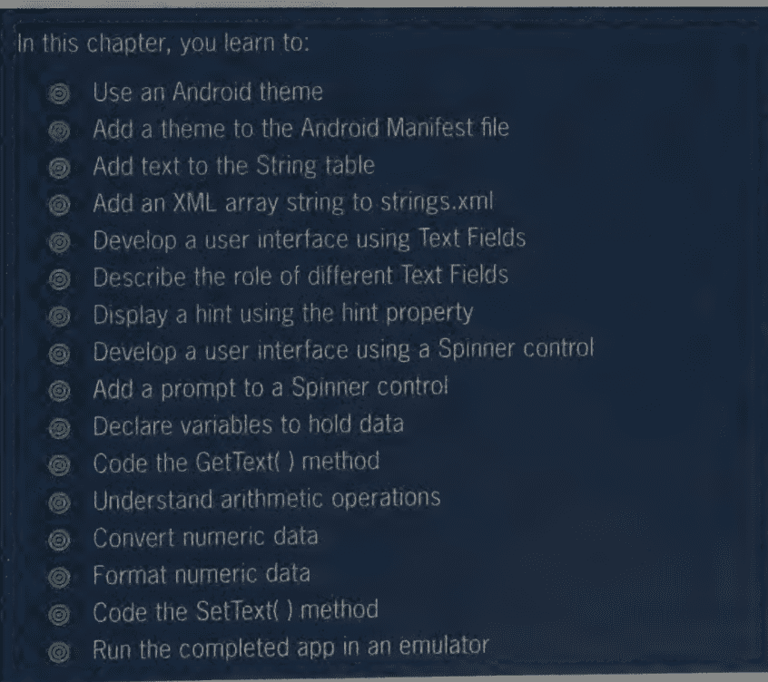

在第 2 章开发的健康食谱应用中，用户通过触摸或点击用户界面上的按钮来触发事件，而不是输入数据。在许多应用程序中，用户输入数据，程序在处理中使用这些数据。通过请求输入来引导用户可以自定义每次运行应用程序时的体验。当用户输入数据时，一个常见需求是对数据进行算术运算以生成用的输出信息。算术运算包括对数值进行加、减、乘、除。

为了演示用户数据输入和算术运算，本章的 Android 应用允许用户输入购买的音乐票数量。应用随后计算音乐票的总费用。图 3-1 显示名为 Ticket Vault Tickets 应用的用户界面，公司名称显示在屏幕顶部。

在图 3-2 中，用户输入 4 作为购买票的数量。当用户点击“FIND THE COST”按钮时，程序将 4 乘以音乐票价格（$79.99），然后将结果显示为音乐票的总费用，如图 3-2 所示。要创建此应用，开发者必须理解如何执行以下过程（但不限于此）：

1. 为 Android 屏幕设计应用主题。
2. 在 `styles.xml` 文件中更新主题。


图 3-1 音乐票 Android 应用

3. 使用翻译编辑器（Translations Editor）在 String 表格中定义所有显示的文本。
4. 在 `strings.xml` 文件中使用 XML 定义数组中显示的文本。
5. 定义一个数据输入的文本字段（Text Field）控件。对于此应用，输入的票数数量应该是数字。使用特定的正整数文本字段可以防止用户输入错误的值。
6. 定义一个 `Spinner` 控件允许用户选择表演团体。
7. 转换数据以用于算术运算。
8. 使用用户的数据执行算术运算。
9. 显示格式化后的结果。


图 3-2 购买了四张音乐票

## Android 主题

为了防止每个 Android 应用看起来太相似，Android SDK 包含了多个主题，为每个应用程序提供独特的格调。主题是应用于 `Activity` 或整个应用程序的样式。主题是 Android 为应用或 `Activity` 应用一致样式的机制。样式指定了构成用户界面的元素的视觉属性，如颜色、高度、内边和字体大小。某些主题会更改 `Activity` 的壁纸，而另一些则隐藏标题栏或显示操作栏（action bar）。某些主题根据移动设备的大小背景。你可以在模拟器的 `main.xml` 中预览主题。Nexus 5 的默认主题在运行应用时显示带有白色背景的显示应用名称标题栏。图 3-3 显示了运行应用时带有白色背景的显示应用名称标题栏。

## 第 3 章：Android 用户输入、变量与操作

### 预览主题

通过更改 `activity_main` 文件模拟器中的主题，你可以预览新主题的外观，但要在应用程序中永久更改它，必须在 `styles.xml` 文件中定义它。音乐票章节使用了预定义的系统主题 `NoActionBar`。要创建音乐票应用并预览主题，请遵循以下步骤：

#### 第 1 步

- 打开 Android Studio 程序。
- 在快速启动列表中点击“启动一个新项目”（Start a new project）。
- 在创建项目对话框的“配置项目”页面上，在应用程序名称框中输入 **Concert Tickets**。
- 在公司领域文本框中，如有必要输入 `androidbootcamp.net`。
- 在项目位置文本框中，如有必要输入 `D:\Workspace\ConcertTickets`。

#### 第 2 步

- 点击“配置项目”页面上的“下一步”（Next）按钮。
- 如果必要，点击“手机和平板电脑”（Phone and Tablet）复选框以选择运行应用的设备规格。
- 点击“选择要运行的因素”页面上的“下一步”（Next）按钮。
- 如果必要，点击“空活动”（Blank Activity）以向新项目添加 `Activity`。
- 点击“将 Activity 添加到移动设备”页面上的“下一步”（Next）按钮。
- 在“新文件选项”页面上，点击“完成”（Finish）按钮。
- 点击模拟器中默认显示的“Hello world!” `TextView` 并按 Delete 键。
- 点击 `activity_main.xml` 选项卡中调色板右侧的“用于渲染布局的虚拟设备”（模拟器按钮），然后点击 Nexus 5 (5.0", 1080 x 1920, xxdhdpi)。

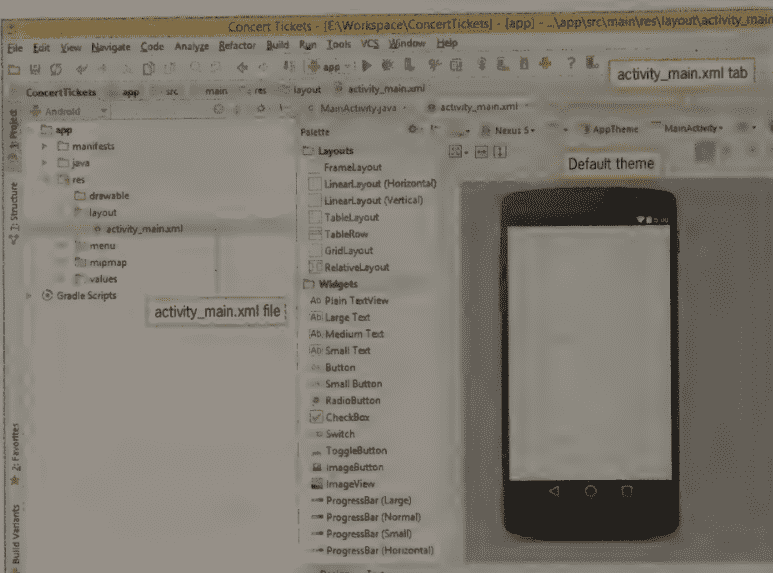

**图 3-7** 用于 Concert Tickets 项目的 `activity_main.xml`

#### 第 3 步

- 轻击或点击 `AppTheme` 按钮以显示内置主题列表。
- 在对话框中，选择并点击 `AppTheme`。
- 在 values 文件夹的 Android 项目中，轻击或点击 `AppTheme`。
- 在搜索对话框中输入 **black**。
- 在对话框中显示带有“black”的主题列表（图 3-8）。

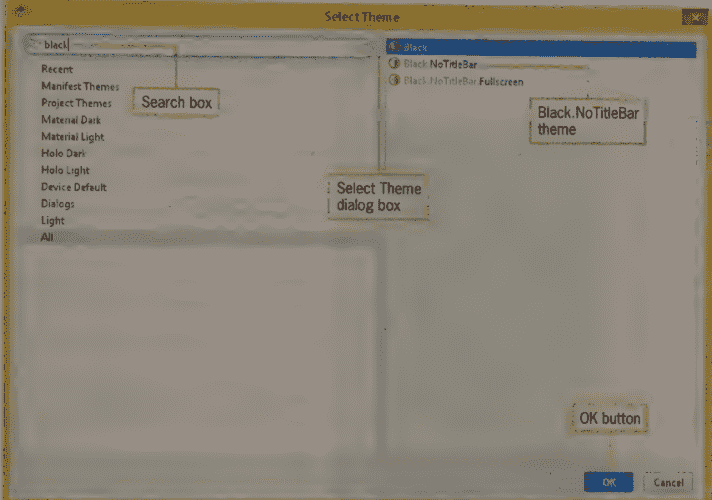

对话框

对话框

- 选择 `Black.NoActionBar` 并轻击或点击。
- 在模拟器上将主题更改为 `Black.NoActionBar`。

## 用户输入、变量

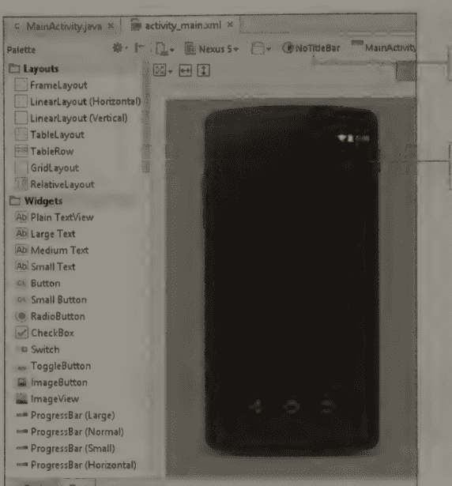

图 3-9

### 更新主题

在 `styles.xml` 文件中，为了更新主题，必须在 values 文件夹的 `styles.xml` 中显示。表 3-1 显示了主题的示例。

| 主题 | 描述 |
|---|---|
| `<style name="AppTheme" parent="Base.AppCompat">` | 黑色背景 |
| `<style name="AppTheme" parent="Base.AppCompat.Light">` | 灰色背景 |
| `<style name="AppTheme" parent="Base.AppCompat.Light.NoActionBar">` | 白色背景 |

**表 3-1** 主题

在 `styles.xml` 文件中添加新主题后，Android Studio 会更新 `AndroidManifest.xml`。要更新 `styles.xml`，请遵循以下步骤：

#### 第 1 步

- 在 Android 项目视图中，展开 values 子文件夹，然后双击 `styles.xml`。
- 在对话框中轻击或点击 `AppTheme`。
- 在对话框中输入 `Black.AppCompat` 以帮助正确拼写主题。

该主题在 `styles.xml` 中更新（图 3-10）。

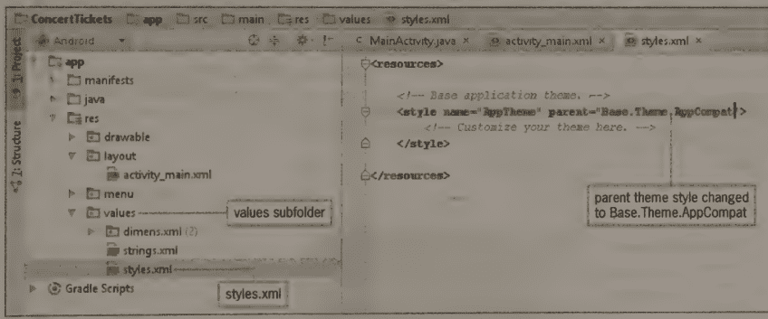

图 3-10

#### 第 2 步

- 关闭 `styles.xml` 标签页，并在工具栏上轻击或点击保存。

当应用程序运行时，`AndroidManifest.xml` 文件将包含主题。

### 简化用户输入

在 Android 手机上，用户可以通过多种方式输入文本：屏幕键盘、连接的物理键盘，甚至是大多数机型的语音转文字。屏幕键盘被称为软键盘，位于屏幕底部或应用程序窗口。触摸输入从点击屏幕到使用手势不等。手势是指使用多个手指进行移动、旋转或缩放。移动应用程序的主要挑战是为从几平方英寸到大得多的屏幕简化用户体验。为了应对这一挑战并最大化用户体验，您需要使用清晰的字体、简化输入并优化每个设备的功能。Android 组件（如 Text Fields 类）允许特定的数据类型，从而简化了数据输入。例如，数字字段仅接受屏幕键盘上的数字，限制了在小触摸屏上触错位置的意外输入。

**一线一线**

十年前，几乎每个手机都配备了数字键盘。今天，触摸屏 QWERTY 键盘允许用户输入信息、参与社交网络、访问互联网和查看多媒体。

## 使用 Android Text Fields

在图 3-1 所示的 Concert Tickets 应用程序中，用户输入想要参加音乐会的门票数量。最常见的移动输入类型是通过软键盘（屏幕键盘）或平板电脑使用的连接键盘输入的。应用程序可以通过 Android Studio Palette 中的 Text Fields 请求用户键盘输入（图 3-11）。使用 Text Fields 时，Android 设备可以通过屏幕键盘接收输入，或者用户可以在模拟器上使用物理键盘。选择 Text Field，软键盘会在 Android 设备底部打开。从键盘上选择字符/数字，并点击勾选以输入所选值。

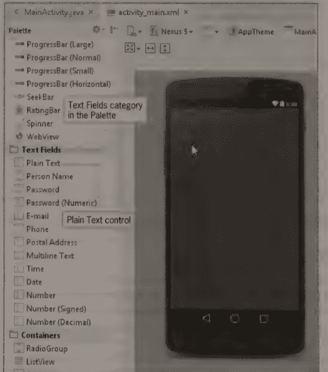

图 3-11 Text Fields

### 简化用户输入

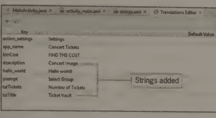

图 3-13 在翻译编辑器中添加的多个字符串

#### 第 3 步

- 关闭翻译编辑器标签页。

### 添加字符串数组

`TextView`、`Spinner`、`Button` 和 `ImageView` 控件分别引用在 `strings.xml` 文件中分配的单个文本字符串引用，但如果一个控件包含多个文本字符串，最好使用字符串数组（string array），这样可以在应用程序的字符串资源中引用它。字符串数组在 `strings.xml` 的中心位置定义了一组相关项的字符串资源。


在“音乐会门票”应用中，用户可以选择三个演出小组之一：Life Revealed（生命启示）、Spatial Sense（空间感官）和 Zig Zag（之字形）。这三个音乐会小组中的每一个都是字符串数组中的`项（item）`。一个项定义了字符串数组中的单个条目。你将代表演出小组的项放在`strings.xml`中，并将它们绑定在一个数组名称下的字符串数组资源中。你可以通过在`strings.xml`中添加代码，将字符串数组资源填充到`Spinner`控件中。

Android Studio 拥有大量关于 XML 语法和 Java 编程方法的内置知识，你可以利用它们来完成代码。当你输入字符串数组代码时，Android Studio 编辑器会在面板中提供建议以帮助完成该语句。图 3-14 显示了`strings.xml`窗口中数组语句的编辑器建议。选择图 3-14 中的第二个建议并按`Ctrl+period`，你就可以向语句中添加正确的语法。当你输入一行 XML 或 Java 代码行时，Android Studio 会在合适的地方进行精炼并添加建议。如果没有自动显示建议，你可以手动按`Ctrl+space`来调用可能的代码补全建议。所有 XML 代码都以小于号（`<`）开头并以大于号（`>`）结尾。按照以下步骤操作，使用代码补全功能向`strings.xml`文件中添加字符串数组以表示这三个音乐会小组。

## 参与进来！Android 输入、变量和操作

### 第 1 步

- 轻击或点击`strings.xml`窗口，通过按住或右键点击代码左侧的灰色边距来添加行号，然后点击或点击“显示行号”。
- 轻击或点击第 10 行，按回车，并输入`<s`查看自动补全建议。

自动补全建议显示在`strings.xml`代码窗口中（图 3-14）。

```text
MainActivity.java    activity_main.xml    strings.xml
在翻译编辑器中编辑所有语言的翻译。
strings.xml
<resources>
  <string name="app name">Concert Tickets</string>
行号
  <string name="hello world">Hello world!</string>
  <string name="action_settings">Settings</string>
  <string name="ttTitle">Ticket Vault</string>
  <string name="tickets">Number of Tickets</string>
  <string name="prompt">Select Group</string>
  <string name="description">Concert Image</string>
  <string name="btnCost">FIND THE COST</string>
  <s 在第 11 行输入
</string>
string-array    自动补全
style            针对 XML
代码的建议
declare-styleable
plurals
按 Ctrl+Period 选择选定的（或第一个）建议并在其后插入一个点 >>
```

图 3-14 XML 代码自动补全建议

### 第 2 步

- 轻击或点击`string-array`并按`Ctrl+period`添加建议的字符串数组 XML 代码。
- 轻击或点击第 11 行引号之间，通过输入`txtGroup`来命名持有这三个音乐会小组名称的文本数组。
- 轻击或点击结束引号后，输入`>`结束`string-array`命名语句，然后按回车。

添加了名为`txtGroup`的`string-array` XML 代码。Android Studio 编辑器会自动添加结束语句`</array>`（图 3-15）。

### 简化用户输入

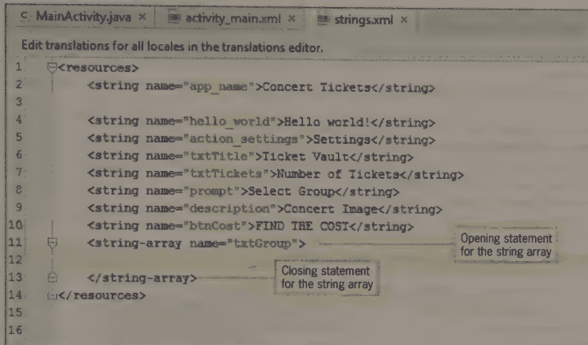

**图 3-15** 字符串数组的开启和关闭 XML 语句

### 第 3 步

- 输入`<item>`并让编辑器自动添加结束语句`</item>`。
- 如果需要，轻击或点击开启和结束 XML item 语句之间，输入`Life Revealed`作为`txtGroup`数组中第一个项的名称。
- 添加新行，输入`<item>Spatial Sense,`并让编辑器自动添加结束项 XML 代码。
- 在下一行，输入`<item>Zig Zag`并让编辑器自动添加结束项 XML 代码。

三个项被添加到`txtGroup`字符串数组中（图 3-16）。

参与：Android 用户输入、变量和操作

```xml
MainActivity.java   activity_main.xml   strings.xml
在翻译编辑器中编辑所有语言的翻译。
<resources>
  <string name="app_name">Concert Tickets</string>
  <string name="hello world">Hello World!</string>
  <string name="action_settings">Settings</string>
  <string name="txtTitle">Vault</string>
  <string name="txtTickets">Number of Tickets</string>
  <string name="prompt">Select Group</string>
  <string name="description">Concert Image</string>
  <string name="btnCost">FIND THE COST</string>
  <string-array name="txtGroup">
    <item>Life Revealed</item>
    <item>Spatial Sense</item>
    <item>Zig Zag</item>
  </string-array>
</resources>
```

图 3-16 XML 代码自动补全建议

要为文本框（Text Field）控件设置提示（hint）属性，请遵循以下步骤：

### 第 1 步

- 在模拟器上选中`txtTickets`文本框控件，滚动属性面板，然后点击或点击`hint`属性右侧。
- 点击或点击`hint`属性的省略号按钮。
- 向下滚动资源（Resources）对话框，点击或点击`txtTickets`以选择分配的字符串。

资源对话框中选了提示文本`txtTickets`（图 3-20）。

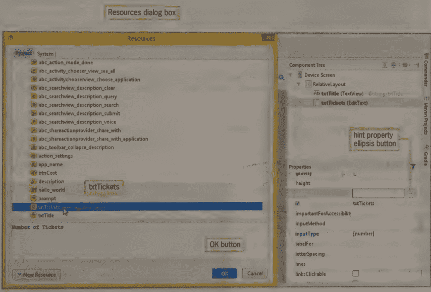

**图 3-20** 文本框控件提示属性的资源对话框

### 第 2 步

- 点击或点击 OK 按钮。

水印提示在文本框控件中请求票据数量作为输入（图 3-21）。

## 参与！Android 用户输入、变量与操作

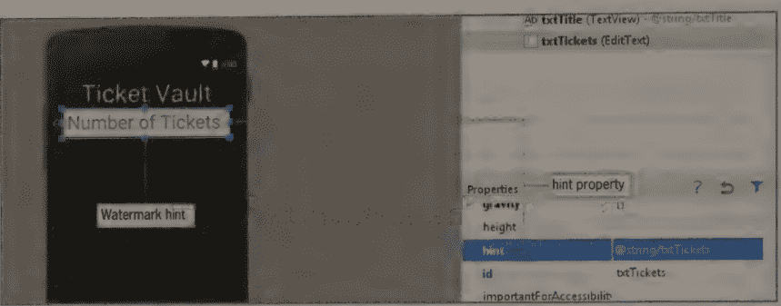

**图 3-21** 添加到文本框控件的提示

> GTK
>
> 如果您的`activity_main.xml`模拟器未更新，请尝试保存项目以更新模拟器。您也可以通过点击菜单栏上的 Build（构建），然后点击或点击 Clean Project（清理项目）来刷新 Android Studio 项目。

## 使用 Android Spinner（选择器）控件

用户输入票据数量后，下一步是选择参加哪场音乐会。下个月有三个音乐团体演出：Life Revealed、Spatial Sense 和 Zig Zag。由于屏幕上小键盘可能出现用户错误，让用户使用`Spinner`控件比实际输入团体名称要容易得多。**Spinner 控件**是一种类似于下拉列表的部件件，用于从固定列表中通过触摸来选择单个项目，如图 3-22 所示。Spinner 控件在弹出窗口中显示一个提示，该提示包含在 XML 字符串中分配的名为`items`的字符串列表，且在初始显示时不会占用多行。

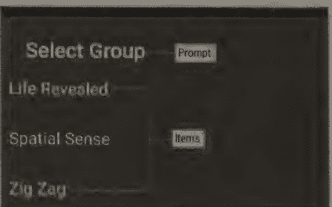

**图 3-22** Spinner 控件

在 Concert Tickets 应用中，需要一个名为`txtGroup`的用于`Spinner`控件的字符串数组，以便将三个团体名称作为独立的字符串资源存储在`strings.xml`中。字符串资源文件提供了一种更新整个项目中常用字符串的简单方法，而无需在代码和属性中搜索以更改应用程序内的字符串数组。例如，每个月音乐会策划者只需简单更改`strings.xml`文件中的文本即可反映他们新的音乐会活动。`prompt`（提示）可以用于显示。

### 简化用户输入

使用`prompt`属性在`Spinner`控件顶部显示指令，它也存储在`strings.xml`中并命名为`prompt`。

`Spinner`的`entries`属性将`strings.xml`中的字符串数组连接到`Spinner`控件，使其可以在应用程序中显示。`Spinner`控件位于调色板（Palette）的 Widgets（部件）分类。当您定义`Spinner`时，`SpinnerMode`属性设置 Spinner 使用的对话框模式：使用弹出对话框来选择 Spinner 项目。下拉模式（dropdown）在列表框中显示项目。以下步骤使用对话框模式将`Spinner`控件添加到 Android 应用程序中：

### 第 1 步

- 打开`activity_main.xml`标签页，滚动以查看调色板中的 Widgets 分类。
- 将`Spinner`控件拖放到文本框下方，并使其在水平方向居中。
- 双击或双击`Spinner`对象，并在`id`文本框中输入`txtGroup`。
- 点击或点击`SpinnerMode`箭头。

`SpinnerMode`显示了名为`txtGroup`的`Spinner`控件的选项（图 3-23）。

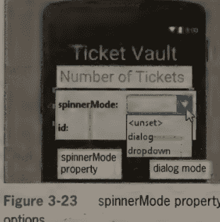

### 第 2 步

- 点击或点击 dialog mode（对话框模式）。
- 在属性面板中，点击或点击`prompt`属性右侧。
- 点击或点击省略号按钮显示资源对话框。
- 向下滚动并点击`prompt`，以便在用户触摸`Spinner`控件时显示指令。
- 点击或点击 OK 按钮。
- 在属性面板中，点击或点击`entries`属性右侧。
- 输入`@array/txtGroup`并按回车，以引用添加到`strings.xml`文件中的三个项目，以便在应用程序运行时在`Spinner`中显示字符串数组。

`prompt`属性连接到`@string/prompt`。`entries`属性连接到字符串数组`@array/txtGroup`的资源。在模拟器中执行应用程序时，实际团体将显示在`Spinner`中（图 3-24）。

## 参与！Android 用户输入、变量与操作

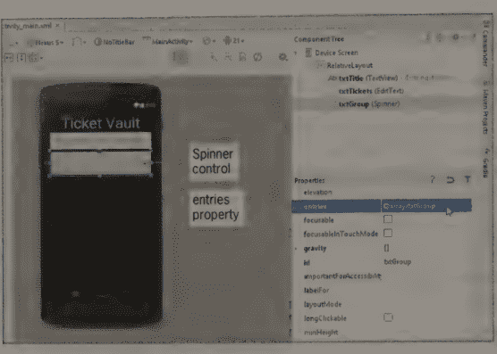

图 3-24 Spinner 控件的 prompt 和 entries 属性

## 添加按钮、TextView 和 ImageView 控件

用户输入票据数量和音乐会团体名称后，点击带有 Button 事件的 FIND COST 按钮。应用程序通过将票据数量乘以每张票据的费用（$79.99）来计算总成本，然后在`TextView`控件中显示团体名称和票据总费用。

显示在 Android 设备上的`ImageView`控件应该是所有人都可以访问的。应该为视力有限或无视力的人考虑辅助性，他们可能正在使用内置屏幕阅读器来协助使用应用程序。对于无法看到图像的人，`ImageView`控件应该有一个内容描述（content description）。例如，Concert Tickets 应用显示了一张音乐会的照片。通过将`ImageView`控件的`contentDescription`属性设置为字符串文本“Concert Image”，观众可以根据描述想象图像的样子。

名为`concert.png`的图像文件随您的学生文件提供，显示在 Concert Tickets 应用的`ImageView`控件中。您应该已经有了老师提供的此文本的学生文件，或者您从该书的网页（`www.cengage.com`）下载了它们。要添加按钮、`TextView`和`ImageView`控件，请遵循以下步骤：

### 第 1 步

- 在`activity_main.xml`标签页中，从调色板的 Widgets 分类中拖动按钮控件到模拟器，并使其在水平方向居中。

### 简化用户输入

- 双击或双击按钮，并在`id`文本框中输入`txtGroup`以便以后在代码中引用该控件。
- 点击`text`属性右侧的省略号。
- 向下滚动并点击`btnCost`以显示指令。
- 点击或点击 OK 按钮。
- 在属性面板中，点击或点击`entries`属性右侧。
- 输入`@array/txtGroup`并按回车，以引用添加到`strings.xml`文件中的三个项目，以便在应用程序运行时在`Spinner`中显示字符串数组。

按钮控件显示 FIND COST 文本，大小更改为`34sp`（图 3-25）。

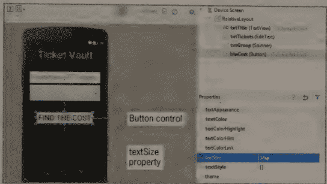

**图 3-25** 添加按钮

### 第 2 步

- 从调色板的 Widgets 分类中拖动`TextView`控件到模拟器，并使其在按钮下方居中。
- 双击或双击`TextView`对象，并在`id`属性右侧输入`txtResult`。
- 删除`text`属性中显示的文本。
- 在属性面板中，点击或点击`textSize`属性右侧，输入`22sp`，然后按回车。

`txtResult` `TextView`控件被添加到模拟器，其`text`属性为空（图 3-26）。

## 参与！Android 用户输入、变量与操作

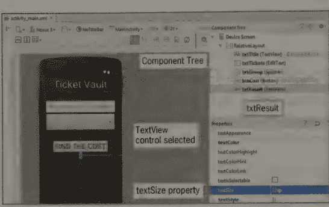

**图 3-26** 添加 TextView 显示结果

> 批判性思考
>
> Plain TextField 对象由于`text`属性没有文本而很难定位。
>
> 有没有更简单的方法找到它？
>
> 有的。点击组件树（Component Tree）中的`txtResult`对象。

### 第 3 步

- 要添加`ImageView`控件，首先将学生文件拷贝到您的 U 盘（如有）。
- 打开包含学生文件的 U 盘。
- 从 U 盘拷贝`concert.png`文件，按住或右键点击 Android 项目视图中的`drawable`文件夹。点击或点击粘贴。
- 点击拷贝对话框中的 OK 按钮。
- 在`activity_main.xml`标签页中，将`ImageView`控件拖放到模拟器，并使其在底部`TextView`控件下方居中。
- 在属性面板的`id`中，输入`imgConcert`为`ImageView`对象命名。
- 点击属性面板中`src`属性右侧的省略号按钮（三个点），向下滚动资源列表，点击或点击 Drawable 分类中的`concert`以从`drawable`文件夹中选择图像，然后点击或点击 OK 按钮。
- 选中图像后，点击属性面板中`contentDescription`属性右侧的省略号按钮。选择`description`，然后点击或点击 OK 按钮。

音乐会图像显示在模拟器底部，为了辅助性目的带有内容描述（图 3-27）。

### 简化用户输入

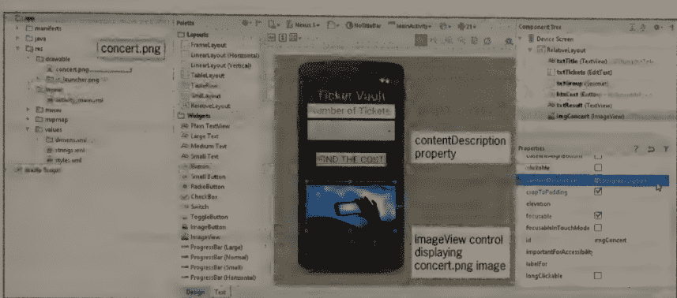

**图 3-27** 添加 ImageView 控件

## 为文本字段编写 EditText 类

为了处理用户在章节项目中的数字文本框（Text Field）控件中输入的输入，你将使用`EditText`类，它会提取文本并将其转换为可供 Java 代码使用的格式。必须将提取的文本赋值给变量。Java 程序使用变量来包含在程序执行期间发生变化的数据。在章节项目中，一个名为`tickets`的变量存储了在文本框中输入的票务数量文本。以下代码语法声明（或初始化）了`tickets`变量，它包含了从用户输入中提取的`EditText`类。注意代码语法以单词`final`开头，表示`tickets`是一个最终变量（final variable）。一个`final`变量只能初始化一次；任何重新赋值的尝试都会在应用程序运行时导致编译错误。

### 代码语法

```java
final EditText tickets = (EditText)findViewById(R.id.txtTickets);
```

> GTK
>
> 你可以在等号前后包含空格，也可以省略它们。Java 认为两种格式都是正确的。

回想一下，如果你要在 Java 代码中引用某个控件，可以在将控件添加到界面时，使用`id`属性为该控件命名。例如，文本框控件的`id`为`txtTickets`。你现在可以使用`findViewById()`方法在代码中访问该控件。在括号中，`R`代表应用可用的资源（例如布局控件），`Id`表示该资源通过`id`属性识别，而`txtTickets`是分配的`id`。

## 参与进来！Android 用户输入、变量与操作

接下来，将`txtTickets`文本框控件赋值给名为`tickets`的变量。为了收集用户输入的票务信息，请按照以下步骤为文本框编写`EditText`类：

### 步骤 1

- 在 Android 训练营项目中，展开`java`文件夹和第一个`net.androidbootcamp.concerttickets`包，然后双击或双击`MainActivity`以打开代码窗口。
- 如果必要，显示行号。
- 删除第 18-38 行以简化代码窗口。


点击行`setContentView(R.layout.activity_main);`的右侧。

按回车键插入一个空行。

要初始化并引用 Id 名为`txtTickets`的`EditText`类，输入`final EditText tickets = (EditText)findViewById(R.id.txtTickets);`。

点击或点击红色显示的第一个`EditText`，按`Alt+Enter`，并选择“Import Class”（导入类）以导入`EditText`控件的库。

`EditText`类从用户输入的票务数量中提取数值，并将该值赋值给名为`tickets`的变量。程序尚未使用的变量将以灰色文本显示。当在程序稍后分配一个值时，该颜色会消失（见图 3-28）。


图 3-28 为文本字段编写 EditText 类

## 编写 Spinner 控件

用户对音乐会分组的选择也必须赋值给文本变量并存储在计算机内存中。对于此应用程序，使用以下代码将从`Spinner`（`txtGroup`）选择赋值给名为`group`的变量：

### 代码语法

```
final Spinner group = (Spinner)findViewById(R.id.txtGroup);
```

为了收集用户分组选择的输入，请按照以下步骤编写`Spinner`控件：

**步骤 1**

- 在`EditText`行之后，按回车键创建一个新行。
- 要初始化并引用 Id 名为`txtGroup`的`Spinner`控件，输入`final Spinner group = (Spinner)findViewById(R.id.txtGroup);`
- 点击或点击红色文本，按`Alt+Enter`，然后选择“Import Class”（导入类）以导入`Spinner`控件。

`Spinner`控件将用户输入的值赋值给名为`group`的变量（图 3-29）。


**图 3-29** 编写 Spinner 控件

## 参与进来！Android 用户输入、变量与操作

### 实例化 Button 控件

在用户输入票数和音乐会分组名称后，`OnClickListener`在后台等待并监听用户点击“FIND COST”（查找费用）按钮的操作，以便在按钮事件中计算费用。按钮事件`OnClickHandler`会在被触碰时执行计算票价的代码部分。在应用程序通过将票数乘以每张票的价格（$79.99）计算出总费用后，分组名称和票务总费用将显示在`TextView`控件中。使用以下代码将`TextView`控件实例化为变量`result`：

### 代码语法

```
final TextView result = ((TextView)findViewById(R.id.txtResult));
```

要实例化 Button 控件、设置按钮监听器并启动 TextView 控件。要显示结果，请遵循以下步骤：

**步骤 1**

- 如果必要，点击将`Spinner`控件赋值给名为`group`的变量的代码行右侧，然后按回车键。
- 要使用 id`btnCost`初始化`Button`控件，输入`Button cost = (Button)findViewById(R.id.btnCost);`
- 点击`Button`（红色文本），按`Alt+Enter`，然后选择“Import Class”（导入类）将 Button 控件作为 Android 组件导入。在语句末尾按回车键。

`Button`控件已初始化并导入了`Button`类型（图 3-30）。

```
MainActivity.java  activity_main.xml
package net.android.bootcamp.concertettickets;

import ...

public class MainActivity extends ActionBarActivity {

    @Override
    protected void onCreate(Bundle savedInstanceState) {
        super.onCreate(savedInstanceState);
        setContentView(R.layout.activity_main);
        final EditText tickets = (EditText)findViewById(R.id.txtTickets);
        final Spinner group = (Spinner)findViewById(R.id.txtGroup);
        Button cost = (Button)findViewById(R.id.btnCost);

        // 实例化按钮控件
    }
```

图 3-30 控件

- 如果必要，点击将`Spinner`控件赋值给名为`group`的变量的代码行右侧，然后按回车键。
- 要使用 id`btnCost`初始化`Button`控件，输入`Button cost = (Button)findViewById(R.id.btnCost);`
- 点击`Button`（红色文本），按`Alt+Enter`，然后选择“Import Class”（导入类）将 Button 控件作为 Android 组件导入。在语句末尾按回车键。

图 3-30 实例化按钮

**步骤 2**

- 在以`setOnClickListener`开头的代码行之后，按回车键，输入`final TextView result = ((TextView)findViewById(R.id.txtResult));`
- 点击`TextView`并导入 TextView 组件。

`TextView`控件被赋值给名为`result`的变量（图 3-32）。

图 3-31 按钮类型

```
MainActivity.java  activity_main.xml
package net.android.bootcamp.concertettickets;

import ...

public class MainActivity extends ActionBarActivity {

    @Override
    protected void onCreate(Bundle savedInstanceState) {
        super.onCreate(savedInstanceState);
        setContentView(R.layout.activity_main);
        final EditText tickets = (EditText)findViewById(R.id.txtTickets);
        final Spinner group = (Spinner)findViewById(R.id.txtGroup);
        Button cost = (Button)findViewById(R.id.btnCost);

        cost.setOnClickListener(new View.OnClickListener() {
            @Override
            public void onClick(View v) {
            }
        });
    }
}
```

**步骤 3**

- 在以`setOnClickListener`开头的代码行之后，按回车键，输入`final TextView result = ((TextView)findViewById(R.id.txtResult));`
- 点击`TextView`并导入 TextView 组件。

`TextView`控件被赋值给名为`result`的变量（图 3-32）。

## 声明变量


```
package net.android.bootcamp.concerttickets;

import ...

public class MainActivity extends AppCompatActivity {

    @Override
    protected void onCreate(Bundle savedInstanceState) {
        super.onCreate(savedInstanceState);
        setContentView(R.layout.activity_main);
        final EditText tickets = (EditText)findViewById(R.id.txtTickets);
        final Spinner group = (Spinner)findViewById(R.id.txtGroup);
        Button cost = (Button)findViewById(R.id.btnCost);

        cost.setOnClickListener(new View.OnClickListener() {
            @Override
            public void onClick(View v) {
                TextView result = (TextView) findViewById(R.id.txtResult);
                result.setText("control to result variable");
            }
        });
    }
}
```

图 3-32 TextView 控件代码

> **批判思考**

如何将 Button 控件与 ImageView 控件结合以创建一个带有图片的按钮？

ImageButton 控件显示带有图像而不是文本的按钮，用户可以点击。将图像放置在 drawable 文件夹中并将其作为 ImageButton 的源。

> **GTK**

变量名对大小写敏感，当包含多个单词时应使用混合大小（驼峰命名），例如`costItem`。Java 变量不能以数字或特殊符号开头。变量名中的后续字符可以是字母、数字、美元符号或下划线。

正如你所看到的，用户可以使用文本框向程序输入数据。在音乐会应用中，一个数学方程将票数乘以票价以计算总费用。在编写程序时，使用变量非常方便。

## 参与 Android 用户输入、变量和操作

而不是使用实际数据，例如门票的价格（$79.99）。正如你在上一节中学习的样，使用变量需要两个步骤：

1. 声明变量。
2. 给变量赋值。

值的声明类型决定了允许进行哪些操作。Java 代码的核心是八种内建的原始（简单）数据类型。

## 原始数据类型

Java 要求所有变量都必须有一个数据类型。表 3-3 列出了所有计算机平台（包括 Android SDK）都支持的原始数据类型。

| 类型 | 含义 | 范围 | 默认值 |
|---|---|---|---|
| byte | 常与数组配合使用 | -128 到 127 | 0 |
| short | 常用于数组 | -32,768 到 32,767 | 0 |
| int | 最常用的数值 | -2,147,483,648 到 2,147,483,647 | 0 |
| long | 用于超过 int 的数字 | -9,223,372,036,854,775,808 到 9,223,372,036,854,775,807 | 0 |
| float | 单精度 32 位浮点数 | +/-3.40282347E+38 | 0 |
| double | 小数值最常用的类型 | +/-1.7976931348623157E+308 | 0 |
| char | 单个字符 | 字符 | 0 |
| boolean | 用于条件语句 | 真或假 | False |

表 3-3 Java 中的原始数据类型

在音乐会门票（Concert Tickets）程序中，每张票的价格为 $79.99。为了声明这一点，请使用`double`类型，它适用于小数值。语句应该像代码语法所示，声明变量并为`costPerTicket`赋值。请求的门票数量被赋值给名为`numberOfTickets`的变量，该变量代表一个整数。要将两个值相乘，这些值必须存储在一种数值数据类型中。当程序计算门票总费用时，它会将值分配给名为`totalCost`的变量，该变量也是`double`数据类型，如下所示：

### 代码语法

```
double costPerTicket = 79.99;
int numberOfTickets;
double totalCost;
```

## String 数据类型

除了原始数据类型外，Java 还有另一种用于处理文本的数据类型。`String`类型是一个类，而不是原始数据类型。你在 Java 语言中使用的大多数字符串都是`String`对象。字符串可以是一个字符、单词或短语。如果你将一个短语赋值给`String`变量，请将短语放在双引号之间。在音乐会门票应用中，用户从 Spinner（选择器）控件选择一个音乐组合后，程序会将该组合赋值给名为`groupChoice`的`String`变量，如下：

### 代码语法

```
String groupChoice;
```

> **GTK**

在定义变量时，良好的编程规范要求使用的使用的变量名反映要放入变量的实际值。这样，任何阅读程序代码的人都能轻松理解变量的用途。

> **批判性思维**

我应该将邮政编码赋值给数字变量还是`String`变量？

将邮政编码赋值给`String`变量。当你不计划在数学上使用这些数值时，将数字赋值给`String`变量。

## 声明变量

你通常在 Android 程序的 Activity 开始处声明变量。在应用程序中使用变量之前，必须声明该变量。要初始化或声明变量，请遵循此步骤：

### 步骤 1

- 在`MainActivity.java`的第 15 行（类内部），按下 Tab 键缩进文本，然后插入以下四行代码来初始化此活动中的变量：

```
double costPerTicket = 79.99;
int numberOfTickets;
double totalCost;
String groupChoice;
```

变量在活动开始时声明（图 3-33）。

## 参与！Android 用户输入、变量和操作

```
MainActivity.java  activity_main.xml
package net.android.bootcamp.concerttickets;

import ...

public class MainActivity extends AppCompatActivity {
    double costPerTicket=79.99;
    int numberOfTickets;                                     // 声明的变量
    double totalCost;
    String groupChoice;
    @Override
    protected void onCreate(Bundle savedInstanceState) {
        super.onCreate(savedInstanceState);
        setContentView(R.layout.activity_main);
        final EditText txtTickets = (EditText)findViewById(R.id.txtTickets);
        final Spinner group = (Spinner)findViewById(R.id.txtGroup);
        Button cost = (Button)findViewById(R.id.btnCost);
        cost.setOnClickListener(new View.OnClickListener() {
            final TextView result = (TextView)findViewById(R.id.txtResult);
            @Override
            public void onClick(View v) {

            }
        });
    }
}
```

**图 3-33** 为活动声明变量

## GetText() 方法

在应用程序开发的这一阶段，所有控件都分配了变量来存储它们的值。下一步是转换应用程序中的值。（注：原文此处存在大量重复句子，已处理）。

当程序计算门票总费用时，它会将值分配给名为`totalCost`的变量，该变量也是`double`数据类型，如下所示：

小数点后两位。Java 包含一个名为`DecimalFormat`的类，它提供了在 Android 设备上格式化数字的模式。例如，模式`"###,###.##"`建立以美元符号开头的数字，如果数字超过三位则显示逗号，并四舍五入到最分。如果使用模式`"###.##%"`，则会将其乘以 100 并四舍五入到小数点后第一位。如要为测试成本的结果建立货币小数格式，请使用以下代码语法将小数格式赋值给名为`currency`的变量，稍后将其应用于`totalCost`变量以显示货币值：

### 代码语法

```
DecimalFormat currency = new DecimalFormat("###,###.##");
```


要编写计算票务成本的计算并创建货币小数格式，请遵循以下步骤：

### 步骤 1

- 在`MainActivity.java`中，在最后一行结束后插入新行，输入`totalCost = costPerTicket * numberOfTickets;`然后按回车键。
- 要建立货币格式，输入`DecimalFormat currency = new DecimalFormat("###,###.##");`
- 如必要，导入`DecimalFormat`类。

该方程计算票务的总成本，`DecimalFormat`创建了显示总成本时使用的货币（图 3-35）。

```
| Button cost = (Button) findViewById(R.id.btnCost); |
| :--- |
| cost.setOnClickListener(new View.OnClickListener()) { |
| final TextView result = ((TextView)findViewById(R.id.txtResult)); |
| @Override  方程计算票务成本 |
| public void onClick(View v) { |
| numberOfTickets = Integer.parseInt(tickets.getText(v).toString()); |
| totalCost = costPerTicket * numberOfTickets; |
| DecimalFormat currency = new DecimalFormat("###,###.##"); |
| } |  模式将结果格式化为货币 |
| } |
```

图 3-35 计算并格式化票务成本

## 显示 Android 输出

在 Java 中，计算结果并不意味着显示结果。要显示包含组名和票务最终成本的结果，首先将组名赋值给一个`String`变量。

### GetSelectedItem() 方法

要获取用户在`Spinner`控制中选择的音乐组合的文本名称，你需要使用`GetSelectedItem()`方法。`GetSelectedItem()`方法返回当前选中的`Spinner`项的文本标签。例如，如果用户选择了 Zig Zag，`GetSelectedItem()`方法会将此组赋值给在活动开始处声明的`String`变量`groupChoice`，如下代码所示：

### 代码语法

```
groupChoice = group.getSelectedIndex() .toString();
```

### GTK

名为`GetSelectedIndex()`的方法可以与`Spinner`控制配合使用，以确定用户选择的是第一个、第二个还是随后的选项。例如，如果`GetSelectedIndex()`等于整数 0，则用户选择了第一个选项。

### SetText() 方法

在之前的 Android 项目中，`GetText()`方法从 Text 字段控件中提取文本。相反，`SetText()`方法在 TextView 控制中显示文本。`SetText()`接受一个用于显示的字符串数据。要连接变量名和文本，你可以用加号 (`+`) 拼接文本。在下面的示例中，变量`completeSentence`被赋值为 "Android is the best phone platform"。此句子显示在名为`result`的 TextView 对象中。

示例：

```
String mobile = "Android";
String completeSentence = mobile + " is the best phone platform";
result.setText(completeSentence);
```

`SetText()`方法的语法如下代码所示。在此示例中，结果显示在名为`result`的 TextView 控制中，并包含了使用拼接运算符加号的字符串，加号将变量连接到字符串文本。

### 代码语法

```
result.setText("Cost for " + groupChoice + " is " +
currency.format(totalCost));
```

代码中的`currency.format`部分带美元符号显示变量`totalCost`并四舍五入到最分。`result`的输出显示在图 3-2 中：Spatial Sense 的总成本为 $319.96。要编写`GetSelectedItem()`方法和`SetText()`方法，请按照以下步骤完成应用程序：

## 显示 Android 输出

步骤 1

- 在`MainActivity.java`中，在输入最后一行代码后，插入新行并输入`groupChoice = group.getSelectedItem().toString();`以将音乐组合赋值给`String`变量`Choice`。
- 插入新行，并输入`result.setText("Cost for " + groupChoice + " is " + currency.format(totalCost));`以显示输出。

`getSelectedItem()`方法识别选定的组，`setText()`显示选定的组以及票务的总成本（图 3-36）。


**图 3-36** 完成的代码

步骤 2

- 要查看完成的应用程序，点击或触摸标准工具栏上的“运行”按钮以在模拟器中测试应用程序。
- 如必要，选择 Nexus 5 或类似的模拟器并点击或触摸“确定”按钮。

## 活动！Android 用户输入、变量和操作

- 解锁模拟器。
- 再次运行应用将代码发送到模拟器。
- 当应用程序在模拟器中打开时，使用屏幕上键盘输入票务数量。

## 总结——回顾

在本章中，你学习了如何使用变量、显示文本和操作。你使用了`GetText()`和`SetText()`方法来处理输入输出。你还使用了`DecimalFormat`类来格式化数字。为了使用 Spinner 控制，你使用了`Get()`。

## 开发者常见问题

1. 什么是 Android 主题？
2. 默认主题的名称是什么？
3. 在一个应用程序中，假设你想使用带有灰色标题栏和白色背景的主题。在`styles.xml`文件中需要哪整行代码来支持此主题？
4. 什么是软键盘？请务必在答案中包含它的位置。
5. 章节项目使用了哪五个控件？
6. 哪种 Text Field（文本框）控件最适合输入包含透支支票账户余额的金额？
7. Spinner（下拉列表）控件的哪个属性可以在控件顶部添加文本（如说明文字）？
8. 存储应用程序中常用短语（文本数组）的文件名称是什么？
9. 字符串数组中的单条信息称为什么？
10. 你为 Spinner 创建的字符串数组分配了哪个属性？
11. 使用小驼峰命名法（camel case）编写以下变量：NUMBEROFDELAYS。
12. 使用最适合每个值的变量类型和变量名，为以下每个变量编写一个声明语句。如果有要求，请赋值。
    a. 用于你的年龄的最小数据类型
    b. 缅因州的人口
    c. 使用此类数字最常用的类型编写你的周薪
    d. 分配你名字的首字母
    e. 使用此类数字最常用的类型分配当前的最低工资
    f. 分配你居住的城市名称
    g. 分配一个关于“你的年龄是否超过 16 岁”的真/假问题的答案。
13. 写出两种可以包含小数的数值数据类型。
14. 以下每个算术表达式的解是什么？
    a. `3 + 4 * 2 + 9`
    b. `16 / 2 * 4 + 4`
    c. `40 - (6 + 2) / 8`
    d. `3 + 68 % 9`
15. 编写一个`GetText()`语句，将名为`deficit`的变量转换为 double 数据类型，并将该值赋值给名为`financeDeficit`的变量。
16. 将名为`careerName`的 Spinner 控件的用户选择的文本赋值给名为`topCares`的变量。
17. 如果变量`amount`被赋值为 57,199,226，这些语句在名为`price`的变量中会显示什么？
    ```
    DecimalFormat money = new DecimalFormat("####,###.##");
    price.setText("Salary = " + money.format(amount));
    ```
18. 编写一行 Java 代码，将`jellyBeans`赋值为六位数的数字格式，需要时包含逗号，但不要美元符号或小数。
19. 编写一行 Java 代码，使用拼接将短语 "Welcome to the "、`versionNumber`（一个 int 变量）以及 "th version" 合并到变量`combineStatement`。
20. 编写一行 Java 代码，将一个数字分配给变量`numberChoice`以表示用户的选择。如果用户选择第一组，则分配数字 0；如果选择第二组，则分配数字 1；如果选择第三组，则分配数字 2，使用与章节项目中相同的变量。

## 课外拓展

搜索网络获取以下问题的答案，以进一步丰富你的 Android 知识。

1. 列出你的 Android SDK 中使用的 10 个本章未提及的主题。
2. 搜索三个销售任何类型票的真实 Android 应用。列出这三个应用中每个应用的五个功能。
3. 一个优秀的 Android 开发者总是跟上市场。打开页面 `https://play.google.com`。找到本周的特色平板应用并对前五个进行介绍。为每个应用写一段关于其用途和成本，总共五段。
4. 打开搜索引擎 Bing.com，然后点击“新闻”（News）标签页。搜索一篇关于本周日期的 Android 设备的文章。在新文档的顶部插入 URL 链接。写一个包含 150–200 字你自己内容的摘要。

## 案例编程项目

完成以下一个或多个案例编程项目。使用章节中教授的步骤和技术。将你创建的程序提交给教师。每个案例编程项目都注明了难度级别。

简单：*
中等：**
有挑战性：***

### 案例项目 3–1：卡塔利纳岛船快线 App *

| 需求文档 | |
| :--- | :--- |
| 应用标题： | Catalina Island Boat Express App |
| 目的： | Catalina Express 在长沙滩和卡塔利纳岛之间每天有 30 次出发。创建一个简单的应用，确定用户需要多少船票以及票是前往卡塔利纳岛还是返回长沙滩。该应用显示单程票的总价。 |
| 算法： | 1. 应用显示一张图片以及一个 Text Field、Spinner 和 Button 控件（图 3-37）。Spinner 控件中的两个选项包括“前往卡塔利纳岛”和“前往长沙滩”。每张单程乘客票票价为 34 美元。<br>2. 当用户点击或点击按钮时，显示票务数量和票费总额（图 3-38）。 |
| 条件： | 使用黑色主题、Spinner 提示、字符串数组和 hint（提示）属性。 |

### 案例项目 3–2：铁三项注册 App *

| 需求文档 | |
| :--- | :--- |
| 应用标题： | Triathlon Registration App |
| 目的： | 一个优秀的 Android 开发者总是跟上市场。打开页面 `https://play.google.com`。找到本周的特色平板应用并对前五个进行介绍。为每个应用写一段关于其用途和成本，总共五段。 |
| 算法： | 1. 应用显示一张图片以及一个 Text Field、Spinner 和 Button 控件（图 3-37）。Spinner 控件中的两个选项包括“前往卡塔利纳岛”和“前往长沙滩”。每张单程乘客票票价为 34 美元。<br>2. 当用户点击或点击按钮时，显示票务数量和票费总额（图 3-38）。 |
| 条件： | 使用黑色主题、Spinner 提示、字符串数组和 hint（提示）属性。 |

### 案例项目 3–3：油漆计算器 App ★★

| 需求文档 | |
| :--- | :--- |
| 应用标题： | Paint Calculator App |
| 目的： | 油漆店想提供一个油漆计算器应用，用来计算粉漆房间所需的加仑数。显示所需的加仑数。 |
| 算法： | 1. 应用显示一张图片以及一个 Text Field、Spinner 和 Button 控件（图 3-37）。Spinner 控件中的两个选项包括“前往卡塔利纳岛”和“前往长沙滩”。每张单程乘客票票价为 34 美元。<br>2. 当用户点击或点击按钮时，显示票务数量和票费总额（图 3-38）。 |
| 条件： | 使用黑色主题、Spinner 提示、字符串数组和 hint（提示）属性。 |

### 案例项目 3–4：芝加哥出租车费 App **

| 需求文档 | |
| :--- | :--- |
| 应用标题： | Chicago Cab Fare App |
| 目的： | 创建一个估算芝加哥出租车费的应用。该应用计算行程费用并请求预订智能车、传统轿车或面包车。 |
| 算法： | 1. 应用请求出租车行程的英里数以及你对所请求出租车的偏好：智能车、传统轿车或面包车。出租车费有 3.00 美元的初始费用。还将收取每英里 3.25 美元的里程费。 |
| 条件： | 使用黑色主题、Spinner 提示、字符串数组和 hint（提示）属性。支持小数里程。 |

### 案例项目 3–5：分账 App ***

| 需求文档 | |
| :--- | :--- |
| 应用标题： | Split the Bill App |
| 目的： | 你和朋友在一家高档餐厅用餐。此应用在你的小组成员之间平摊账单（包括小费）。 |
| 算法： | 1. 欢迎界面显示标题、图片以及一个显示第二个屏幕的按钮。输入/输出界面请求餐厅账单和小组人数。Spinner 控件询问服务质量：优秀、中等或差。 |
| 条件： | 使用黑色主题、Spinner 提示、字符串数组和 hint（提示）属性。 |

## 项目 3–6：储钱罐儿童应用 ***

### 需求文档

应用标题：储钱罐儿童应用
目的：一个储钱罐应用允许儿童输入他们拥有的四分币、一角币、镍币和分币的数量。儿童可以选择储蓄这些钱还是花费。计算金额并显示儿童储蓄或花费的金额。创建两个屏幕：欢迎界面和一个输入/输出界面。

1. 欢迎界面显示标题、图像以及一个引导用户进入第二个屏幕的按钮。输入/输出界面请求四分币、一角币、镍币和分币的数量。使用 Spinner 控制显示是储蓄还是花费硬币。创建你自己的布局。
2. 结果显示儿童储蓄或花费了多少金额。

条件：使用主题（theme）、Spinner提示、字符串数组和提示属性（hint）。

## 探索！图标与决策控制

- 在本章中，你将学习：
- 创建带有自定义图标的 Android 项目
- 使用十六进制值更改控件中的文本颜色
- 使用 gravity 属性对控件进行对齐
- 使用 `layout:margin` 属性确定布局
- 在 Android 中放置 RadioGroup 和 RadioButtons
- 为 RadioGroup 控制编写代码
- 使用 If 语句进行决策
- 使用 If Else 语句进行决策
- 使用逻辑运算符进行决策
- 显示 Android toast 通知
- 测试 isChecked 属性
- 使用嵌套 If 语句进行决策

## 探索图标与决策控制

开发者可以编写 Android 应用，根据用户的输入或其他发生的特定条件来做出决策。在本章中，你将学习在 Java 中编写决策语句，这允许你测试条件并根据测试结果执行不同的操作。你可以测试条件为真或为假，并根据用户的输入更改程序的执行流。

本章中的示例程序设计用于在医院的 Android 手机或平板设备。医疗计算器（Medical Calculator）应用提供了一种移动方式，可以将患者的体重从磅转换为公斤，以及从公斤转换为磅。大多数药物剂量是根据患者的体重开的。大多数医院秤以磅为单位显示重量，但处方药通常是基于患者的公斤体重。出于安全考虑，必须在磅和公斤之间准确转换患者的重量。护士输入患者体重并选择单选按钮（如图 4-1 所示），以确定是将磅转换为公斤还是将公斤转换为磅。移动应用随后根据转换公式计算转换后的重量：转换公式为：公斤 = 磅 / 2.2，磅 = 公斤 * 2.2。为了验证输入的重量正确，如果从磅转换为公斤的值大于 500，或从公斤转换为磅的值大于 225，则要求用户输入有效值。如果用户输入的数字超出接受范围，屏幕上会出现一个名为 toast 消息的警告。当应用运行时，护士在体重值处输入 225，并选择图 4-1 所示的“磅转公斤”单选按钮。点击“转换重量”按钮后，应用程序以红色字体显示 102.3 公斤（四舍五入到一位），如图 4-2 所示。通过使用移动设备，护士可以随时随地在护理现场直接获取患者体重等信息，并减少因延迟在其他位置的传统计算机上输入而导致的错误。

## 探索图标与决策控制


**图 4-1**  医疗计算器的启动界面

**图 4-2**  医疗计算器的结果界面

要创建此应用，开发者必须理解如何执行以下过程：

1. 创建自定义的启动图标。
2. 使用代码添加图标显示在 ActionBar 中。
3. 定义一个用于输入患者体重数据的 TextField。
4. 定义一个 RadioGroup 以选择磅转公斤或公斤转磅。
5. 显示用于数据验证的 Toast 消息。
6. 转换数据以便用于算术运算。
7. 对用户输入进行算术运算。
8. 显示格式化结果。


> **一线动态** 医疗设备应用正在改变整个患者护理系统。现在医院使用的应用包括移动患者记录、药物处方参考、医学杂志、手术清单、剂量计算器、放射影像和疾病病理学。

## 使用启动图标

默认情况下，Android 使用标准的 Android 图标作为设备主屏幕和启动器窗口中的图形来代表你的应用。要查看主屏幕上称为启动图标的启动图标，当应用程序开始执行时，点击模拟器底部的应用列表图标，如图 4-3 所示。与其使用显示 Android 标志的默认图标，发布到 Google Play 的每个应用都应该有一个自定义图形（图 4-3），代表你的应用内容。启动图标构成了你的应用对 Google Play 潜在用户的第一印象。由于可用应用众多，高质量的启动图标可以影响用户。


**图 4-3** Android 主屏幕和启动图标

- GTK

  点击模拟器底部的小方块以查看 Android 屏幕。

图标是占据应用程序屏幕一小部分区域图形。在设计启动图标时，请考虑图标建立的是品牌身份。在医疗计算器应用中，图 4-4 所示的秤清晰地向 Google Play 传达了其用途。


**图 4-4** 医疗计算器的启动图标

Google Play 还规定了所有图标的大小和格式。启动图标应保存为 `.png` 格式。根据你的目标设备，表 4-1 规定了完成图标的大小。你可以使用 Microsoft Paint、Paintbrush 和 Adobe Photoshop 等程序将图标调整为正确的像素数。在章节项目中，高密度屏幕的图标维度为 48 × 48 像素，但 Android Studio 内的 Asset Studio 可以自动将图标调整为适用于设备平台的大小。

| 分辨率 | 每英寸像素 (dpi) | 大小 (px) |
|---|---|---|
| idpi (低密度屏幕) | 120 | 36 × 36 |
| mdpi (中密度屏幕) | 160 | 48 × 48 |
| hdpi (高密度屏幕) | 240 | 72 × 72 |
| xhdpi (超高密度屏幕)* | 320 | 96 × 96 |
| xxhdpi (极超高密度屏幕)* | 440 | 144 × 144 |

表 4-1 启动图标大小

* 用于某些平板电脑

当你向 Google Play 发布应用时，在上传程序时，必须在开发者控制台中提供一个 512 × 512 像素的高分辨率应用图标。此图标显示在 Google Play 网站上，不会替换你的启动图标。

Google Play 为启动图标建议了一种命名规范。通常，使用前缀 `ic_launcher` 来命名 Android 应用的启动图标。在医疗计算器应用中，启动图标被命名为 `ic_launcher_weight.png`。在项目内放置自定义图标后，Android 会将图标重命名为 `ic_launcher.png`。

## 探索图标与决策控制

GTK

矢量图形最适合用于图标设计，因为图像在缩放时不会丢失细节，并且易于调整大小。

### 自定义启动器图标

与其使用内置的通用 Android 图标，不如你可以在主屏幕上显示自定义的启动器图标。通过使用 Android Studio 内置向导添加图像资源，可以将自定义图标图像自动放置在 `res/mipmap` 文件夹中。Image Asset 向导会为不同的屏幕分辨率创建图标，并提供重调整大小后图标的实时预览。Image Asset 会上传并将名为 `ic_launcher.png` 的当前启动器图标替换为你选择的自定义图标。要执行以下步骤，你需要一个名为 `launcher.png` 的图像文件（在你的学生文件中提供），将其作为医疗计算器（Medical Calculator）应用的自定义启动器图标。你应该已经拥有老师给你的相关学生文件，或者从该书籍的网页（www.cengagebrain.com）下载了这些文件。按照以下步骤添加自定义启动器图标并选择主题，以开始章节项目：

#### 第 1 步

- 打开 Android Studio 程序。
- 在“新建项目”（Create New Project）对话框中，在“应用程序名称”（Application name）文本框中输入 `Medical Calculator`。
- 在“公司域”（Company Domain）文本框中，如有输入 `androidbootcamp.net`。
- 在“项目位置”（Project location）框中，输入 `D:\Workspace\MedicalCalculator`（如有输入识别 USB 盘的器驱动器号）以选择工作空间，然后点击 OK 按钮。
- 点击“新建项目”对话框中“配置你的新项目”页面上的“下一步”（Next）按钮。
- 必要时点击“手机和平电脑”（Phone and Tablet）复选框以选择应用的形状规格。
- 点击“选择应用运行的形状规格”页面上的“下一步”（Next）按钮。
- 必要时点击“空活动”（Blank Activity）以向新项目添加活动。
- 点击“向移动设备添加活动”页面上的“下一步”（Next）按钮。
- 点击“为新文件选择选项”页面上的“完成”（Finish）按钮。
- 在模拟器中点击（默认显示）`Hello world!` TextView 小部件并按 Delete 键。
- 点击虚拟设备，直接在 `activity_main.xml` 标签页上通过 ' ' 按钮渲染布局，然后点击 Nexus 5 (5.0", 1080 x 1920, xhdpi)。

Android 医疗计算器项目有一个带有 `MainActivity` 和 `activity_main.xml` 文件的应用程序名称（图 4-5）。


**图 4-5** 名为 Medical Calculator 的新 Android 应用

#### 第 2 步

- 在 Android 项目视图中，点击 `activity_main.xml` 文件。
- 点击菜单栏上的“文件”（File）并点击“新建”（New）。

新菜单在 Android Studio 中打开（图 4-6）。


**图 4-6** 新菜单

#### 第 3 步

- 点击“新建”菜单上的“图像资源”（Image Asset）。

Asset Studio 对话框打开，显示各种设备分辨率的默认启动器图标（图 4-7）。


**图 4-7** 默认启动器图标

#### 第 4 步

- 点击“图像文件”（Image file）文本框右侧的省略号按钮。
- 要添加自定义启动器图标，将学生文件复制到你的 USB 盘（如有）。打开包含学生文件的 USB 文件夹以找到并选择 `ic_launcher_weight.png` 文件。
- 在“选择路径”（Select Path）对话框中，导航到 `ic_launcher_weight.png` 文件的位置并选择该文件。
- 点击 OK 按钮添加自定义启动器图标。
- 在“形状”（Shape）类别中，点击圆形（Circle）单选按钮以从启动器图标中裁剪背景。

### 使用启动器图标

自定义的启动器图标会在 Asset Studio 对话框中以不同尺寸显示，并去除了图标背景（图 4-8）。Asset Studio 会自动将现有的 `ic_launcher` 图标替换为更新后的图标。


**图 4-8** 自定义启动器图标

#### 第 5 步

- 点击“下一步”（Next）按钮。

调整大小后的启动器图标将根据其尺寸和分辨率放置在相应的 `mipmap` 文件夹中（图 4-9）。


**图 4-9** 显示在 `res/mipmap` 文件夹中的自定义图标

#### 第 6 步

- 点击“完成”（Finish）按钮。注意，默认主题在“设计”（Design）标签页中显示的模拟器中不显示操作栏（Action bar）。
- 在 `activity_main.xml` 标签页中，点击“AppTheme”按钮以更改默认主题并打开“选择主题”（Select Theme）对话框。
- 点击“选择主题”对话框左侧的“全部”（All）并滚动找到 `Holo.Light` 主题（Light 主题）。
- 点击“选择主题”对话框右侧的 `Holo.Light`。

从“选择主题”对话框中选择了 `Holo.Light` 主题（图 4-10）。


**图 4-10** 为应用选择主题

#### 第 7 步

- 点击 OK 按钮。
- 要在完成的应用中更新主题，在 Android 项目视图中，展开 `values` 文件夹，然后点击或双击 `styles.xml`。
- 点击 `parent`（父级）右侧并将面板主题更改为 `"Theme.AppCompat.Light."`。

主题已在 `styles.xml` 中更新，以显示医疗计算器应用的启动器（图 4-11）。如果你运行该应用，启动器将出现在主屏幕上。


**图 4-11** 更新后的 `styles.xml` 主题

#### 第 8 步

- 关闭 `styles.xml` 并点击“全部保存”（Save All）。
- 模拟器在操作栏中显示启动器（图 4-12）。


**图 4-12** 操作栏中的启动器

### 使用代码显示操作图标

医疗计算器应用在操作栏中显示比例；如果没有代码，当你运行应用时图像将不会出现。如图 4-12 所示的操作图标传达了应用的目的和身份。要在完成的应用中显示操作栏，请按照以下步骤操作：

#### 第 1 步

- 在 Android 项目视图中，展开 `java` 文件夹和 `net.androidbootcamp` 文件夹，然后双击 `MainActivity` 打开代码窗口。
- 显示行号并删除第 18-38 行。
- 点击第 14 行（`setContentView`）末尾，按回车键，并输入以下在操作栏中显示图标的语句：

```
getSupportActionBar().setDisplayHomeEnabled(true);
getSupportActionBar().setLogo(R.mipmap.ic_launcher);
getSupportActionBar().setDisplayUseLogoEnabled(true);
```

`MainActivity.java` 有三个语句显示放置在 `mipmap` 文件夹中的 `ic_launcher` 图标（图 4-13）。


**用于在完成的应用中显示图标的代码**

GTK

Google 提供了 Android Asset Studio，允许你使用知识共享图像生成自己的自定义启动器图标并包含在应用中。图像可以在 http://romannurik.github.io/AndroidAssetStudio 获取。

### 字符串表

在医疗计算器应用中，字符串资源存储在资源层次结构的 `/res/values/strings.xml` 文件中，用于 `TextView`、`RadioButton`、`EditText` 和 `Button` 控件中显示的文本。你添加到 `strings.xml` 文件的任何字符串在应用程序中可用。在接后的步骤中，你将插入表 4-2 所示的字符串名称和值。

| 字符串名称 | 字符串值 |
|---|---|
| hint | 患者体重 |
| radLbToキロ | 将磅转换为公斤 |
| radKiloToLb | 将公斤转换为磅 |
| btnConvert | 转换体重 |

**表 4-2** 要添加的字符串名称和值**

要开始 Android 用户界面的设计并创建字符串表，请按照此步骤操作：

#### 第 1 步

- 在 Android 项目视图中，打开 `res\values` 文件夹下的 `strings.xml` 文件。
- 点击“打开编辑器”（Open editor）链接。
- 点击翻译编辑器中的“添加键”（Add Key，加号）按钮。
- 在 Text（文本）框中，输入 `txtTitle` 来为 `TextView` 控件的字符串命名。
- 在 Default Value（默认值）文本框中，输入 `Convert Patient Weight` 来定义显示的文本，然后点击或选择 OK 按钮。
- 再次点击或点击 Add（添加）键并重复相同的过程以添加表 4-2 列出的剩余项目。

`strings.xml` 文件填充了应用程序中使用的文本（图 4-14）。


### RadioButton 和 RadioGroup 控件

`RadioButton` 控件用于选择或取消选择选项。在章节项目项目中，用户可以选择需要哪种数学转换。当将 `RadioButton` 放置在模拟器上时，默认情况下它是垂直排列的。如果你希望 Radio 控件水平列表，可以将 `orientation`（方向）属性设置为 `horizontal`（水平）。每个 `RadioButton` 控件都有一个由 `Text` 属性定义的标签，以及一个用于设置 `true` 或 `false` 的 `Checked` 属性。`RadioButton` 控件通常用在 `RadioGroup` 容器中。包含一个单选按钮会取消组内其他单选按钮。换句话说，在一个 `RadioGroup` 容器中，每次只能选择一个 `RadioButton` 控件。当通过 Palette 中的 Category 容器将 `RadioGroup` 容器放置在模拟器窗口中时，组默认包含三个 `RadioButton` 控件。如果你需要额外的 `RadioButton`，请将 Frame 拖入该组。在 Medical Calculator（医疗计算器器）应用程序中，只需要两个单选按钮，因此删除了第三个单选按钮。

为了让用户的输入尽可能简单，请提供默认选择。例如，用户更经常将重量从磅转换为公斤，因此 `RadioButton` 选项应该最初被勾选。将此 `RadioButton` 控件的 `Checked` 属性设置为 `true` 以提供默认选择。

GTK

与 `RadioButton` 控件类似，`CheckBox` 允许你勾选或取消勾选列表。一组允许任意数量的复选框，包括零、一个或多个。换句话说，每个复选框都独立于列表中的所有其他复选框，因此勾选一个框不会取消其他框。单选按钮的形状是圆形的，复选框是正方形的。

### 修改 Android 控件的文本颜色

为止，本文中的每个应用程序都根据每个 Android 控件的主题使用黑色或白色默认颜色系统。Android 平台使用名为十六进制颜色代码系统来显示不同的颜色。十六进制颜色代码是三色的三元组。颜色首先由井号指定，后跟在最终颜色中红色（00 到 FF）、绿色（00 到 FF）和蓝色（00 到 FF）的量。例如，`#FF0000` 的十六进制代码是正红色。章节项目中显示的 `TextView` 和 `RadioGroup` 控件具有红色文本，你通过通过输入 `#FF0000` 作为 `textColor` 属性来指定它。要查找这些颜色代码，请在搜索引擎中搜索十六进制颜色代码，或参考 http://html-color-codes.com。如果你点击 `textColor` 属性上的省略号按钮，将图 4-15 中的 Resources 对话框。在 Color（颜色）选项卡上，你可以选择圆内的任何颜色，或输入 RGB（红、绿、蓝）或十六进制颜色值。


**图 4-15** Resources 对话框中的 Color 选项卡

批判性思考

我注意到 Color Resource 对话框有 RGB 文本框。我如何使用 RGB 编码定位颜色？

像 rgbchart.com 这样的网站可以提供 RGB 编码的所有可能的颜色代码列表。

### 修改边距

在用户界面上放置控件后，你可以通过调整控件的 `gravity`（重力）属性来更改对齐方式。为了在控制布局时具有更大的灵活性，使用 `layout:margin` 属性通过相等更改所有边距来更改每个对象周围的间距，或者单独更改左、上、右或下边距。Medical Calculator 中的每个控件都可以使用边距在它的四个边上添加以密度无关像素（dp）衡量的空白空间。与其在用户界面上通过“肉眼观察”控件进行对齐，不如 `layout:margin` 属性在控件周围创建均匀的间距。使用 `layout:margin` 属性有助于让你的用户界面更有组织，并最终更容易使用。例如，在图 4-1 中，15dp（像素）的边距间距在显示标题的所选 Plain View 控件顶部具有额外的 15 像素。在你设计用户界面时，在每个控件周围使用相同的指定边距以提供对称的布局。

### 修改布局重力（Layout Gravity）


`Medical Calculator` 应用程序使用 `Relative Layout`（相对布局）显示 `Palette` 中的控件。`Relative Layout` 是 Android 模拟器上的默认布局设置。有时，你可能会发现模拟器显示控件的位置与你将其在屏幕上放置的位置不同。可以使用名为 `gravity` 的属性为每个控件设置布局，以便水平居中并将其放置在……（注：原文此处有断句，根据上下文应为对齐位置）。`center_horizontal`, `fill_vertical`, `fill_horizontal`, `start`, `end`。


## 添加组

之前，你使用 `Relative Layout` 显示 `Palette` 中的控件。`Relative Layout` 是 Android 模拟器上的默认布局设置。……（注：原文此处逻辑似乎重复或断句，已按字面翻译）

### 第 1 步

- 为了添加 `TextView`，将 `Plain View` 控件拖放到模拟器的中心位置。

- 双击或双击 `Plain View` 控件，在 `id` 属性中输入 `txtTitle`。

- 点击或点击 `hint` 属性的属性。

- 在 `Resources` 对话框中选择分配的字符串，然后点击或选择 `OK` 按钮。

- 将 `textSize` 属性更改 `30sp`。

- 点击或点击 `textColor` 属性，输入 `#FF0000` 并按回车将文本颜色改为红色以匹配图标。

- 通过点击 `layout:margin` 属性前的箭头来展开它。

- 在 `top` 属性中输入 `15dp` 并按回车，在控件上方留出 15 像素的空间。

`layout:margin` 属性显示为 `15dp`。`Plain View` 控件已添加到表单中，并更改了文本、大小和颜色（图 4-17）。

### 第 2 步

- 为了添加 `Number Text Field`，滚动到 `Palette` 中的 `Text Fields` 类别。

- 将 `Number Text Field` 控件拖放到模拟器中 `TextView` 控件的下方。

- 双击或双击 `Number TextField` 控件，在 `id` 属性中输入 `txtWeight`。

- 点击或点击 `hint` 属性的属性面板。

- 在 `Resources` 对话框中选择分配的字符串，然后点击或选择 `OK` 按钮。

- 将 `textSize` 属性更改为 `25sp`。

- 展开 `gravity` 属性并选择 `center_horizontal` 使提示在控件内居中。

- 在 `layout:margin` 属性中，点击或点击 `top` 属性右侧，输入 `15dp` 并按回车，在 `Plain TextView` 和 `Number Text Field` 控件之间留出 15 像素的空间。

`Number Text Field` 控件已放置在模拟器上，并更改了 `id`、文本大小、文本提示、重力和边距（图 4-18）。


图 4-17 `Plain TextView` 控件和 `layout:margin` 属性


图 4-18 数字文本框控件

### 第 3 步

- 在调色板（`Palette`）中，向下滚动到容器（`Containers`）类别，选择名为 `RadioGroup` 的容器，然后将 `RadioGroup` 控件拖放到数字文本框正方的方的用户界面上。

- 此应用需要两个单选按钮，向上滚动到控件（`Widgets`）类别，点击或点击 `RadioButton` 控件，将两个单选按钮拖放到 `RadioGroup` 控件内部，并使用绿色虚线将它们居中。

- 双击或双击第一个 `RadioButton` 控件，将 `RadioButton` 控件的 `id` 属性更改为 `radLbToKilo`。

- 点击或点击勾选框，表示第一个单选按钮为默认选择。

- 点击或点击文本（`text`）属性中的省略号按钮，在资源（`Resources`）对话框中点击或点击 `radLbToKilo` 以选择分配的字符串，然后点击或点击 `OK` 按钮。

- 将 `textSize` 更改为 `20sp`。

- 如果必要，扩展 `layout:margin` 属性；在左（`left`）属性中输入 `10dp`，在顶（`top`）属性中输入 `15dp`。

- 双击或双击第二个 `RadioButton` 控件，并将 `id` 属性更改为 `radKiloToLb`。

- 点击或点击文本（`text`）属性中的省略号按钮，然后在资源（`Resources`）对话框中点击或点击 `radKiloToLb` 以选择分配的字符串。点击或点击 `OK` 按钮。

- 将 `textSize` 属性更改为 `20sp`。

- 如果必要，扩展 `layout:margins` 属性，在左（`left`）属性中输入 `10dp`，在顶（`top`）属性中输入 `5dp`，以便 `RadioGroup` 对象内的 `RadioButtons` 保持相互靠近。

`RadioGroup` 对象已放置在模拟器上，并修改了 `id`、`text`、`size` 和 `margin` 属性（图 4-19）。

## 探索！图标与决策控件


**图 4-19** 带有两个 `CompoundButton` 控件的 `RadioGroup` 控件

### 性思考

`EditText` 控件是否有以不同文本颜色显示提示（`hint`）的属性？

有的。`EditText` 属性面板中的 `HintColor` 属性允许您更改提示颜色。

## 完成用户界面

在设计 Android 界面时，拥有整洁的布局并有效利用整个屏幕非常重要。通过添加 `Button` 和 `TextView` 控件完成用户界面并对这些控件编码，请遵循以下步骤：

### 第 1 步

- 在 `activity_main.xml` 标签页中，从调色板将 `Button` 控件拖到 `RadioGroup` 下方的模拟器。

- 双击或双击 `Button`，将 `Button` 控件的 `id` 属性更改为 `btnConvert`。

- 点击或点击文本（`text`）属性中的省略号按钮，然后选择 `btnConvert` 以更改文本显示。点击资源对话框中的 `OK` 按钮。

- 将 `textSize` 属性更改为 `25sp`。

- 在 `gravity` 属性中，点击或点击 `center_horizontal` 使控件居中。

- 在 `layout:margin` 属性的顶（`top`）属性中输入 `15dp`，在控件上方留出 15 像素的空间。


**图 4-20** `Button` 控件

名为 `btnConvert` 的 `Button` 控件显示文本 `Convert Weight`，其 `id`、字体大小、力和边距已更改（图 4–20）。

## 完成用户界面

### 第 2 步

- 拖另一个另一个 `PlainTextView` 控件到 `Button` 下方的模拟器。

- 将 `TextView` 控件的 `id` 更改为 `txtResult`。

- 删除文本（`text`）属性中的内容。

- 将 `textSize` 属性更改为 `25sp`。

- 对于颜色（`Color`）属性，设置为 `#FF0000`（红色）。

- 在 `layout:margin` 的顶（`top`）属性中输入 `25dp`，在控件上方留出 25 像素的空间。

- 点击标准工具栏上的全部保存（`Save All`）按钮。


图 4-21 用于显示结果的 `Plain TextView` 控件

`TextView` 控件已放置在模拟器上，文本属性为空（图 4-21）。

## 为 `RadioButton` 控件编码

每个 `RadioButton` 控件都需要通过使用 `findViewById` 命令进行引用。在以下代码语法中，`lbsToKilo` 和 `kiloToLbs` 引用了医疗计算器部分中的两个 `RadioButton` 控件：

### 代码语法

```
final RadioButton lbsToKilo = (RadioButton) findViewById(R.id.radLbToKilo);
final RadioButton kiloToLbs = (RadioButton) findViewById(R.id.radKiloToLbs);
```

关键字 `final` 表示该变量只能赋值一次。在引用 `RadioButton` 控件后，下一个优先任务是确定两个两个单选按钮中的哪一个被选中。如果用户选择了“磅转公斤”单选按钮，则输入的重量将除以 2.2；但如果用户选择了“公斤转磅”单选按钮，则重量将乘以 2.2。

要创建用于引用控件的变量的 Java 代码，请遵循以下步骤：

### 第 1 步

- 显示 `MainActivity.java` 标签页。

- 点击第 10 行内的 `MainActivity` 类，并缩进该行。

## 探索！图标与决策控件

Java 代码中声明了三个变量（图 4-22）。

```
MainActivity.java | activity_main.xml
1 package net.android.bootcamp;
2
3 import ...
4
5 public class MainActivity extends AppCompatActivity {
6 double conversionRate = 2.2;
7 double weightEntered;
8 double convertedWeight;
9
10 @Override
11 protected void onCreate(Bundle savedInstanceState) {
12 super.onCreate(savedInstanceState);
13 setContentView(R.layout.activity_main);
14 getSupportActionBar().setDisplayHomeAsUpEnabled(true);
15 getSupportActionBar().setDisplayLogoEnabled(R.drawable.ic_launcher);
16 getSupportActionBar().setDisplayLogoEnabled(true);
17 }
18 }
```


图 4-22 声明的变量

### 第 2 步

- 在引用 `RadioButton` 控件的两行代码之后，输入新行并代码 `double conversionRate = 2.2;`。

- 要初始化并引用 `id` 为 `txtWeight` 的 `EditText` 类，输入 `final EditText weight = findViewById(R.id.txtWeight);`。

- 点击 `EditText`（显示为红色），按 `Alt+Enter`，导入 `EditText` 类。在结束分号后，按回车键。

- 要初始化并引用 `id` 为 `radLbToKilo` 的 `RadioButton` 类，输入 `final RadioButton radLbToKilo = findViewById(R.id.radLbToKilo);`。

- 如果必要，点击红色文本 `RadioButton`，按 `Alt+Enter` 导入 `RadioButton` 类。在结束分号后，按回车键。

- 要实例化并引用 `Id` 标识为 `radKiloToLb` 的第二个单选按钮的 `RadioButton`，输入 `(RadioButton) findViewById(R.id.radKiloToLb);`。

保存你的工作。

`EditText` 类从用户输入的患者重量中提取值，`RadioButton` 类从单选按钮中提取选中的值（图 4-23）。


图 4-23 `EditText` 和 `RadioButtons` 的引用

## 为 `Button` 控件编码

`Button` 控件使用事件监听器检测用户交互。以下步骤实例化第二个 `TextView` 控件、`Button` 控件以及 `OnClickListener`。

### 第 1 步

- 在引用 `RadioButton` 控件的两行代码之后，输入新行并代码 `final TextView result = (TextView) findViewById(R.id.txtResult);`。

- 导入 `TextView` 类。

`TextView` 控件已实例化到变量 `result`（图 4-24）。

## 第 2 章 探索图标与决策控制

```java
public class MainActivity extends AppCompatActivity {
    double conversionRate = 2.2;
    double weightEntered;
    double convertedWeight;

    @Override
    protected void onCreate(Bundle savedInstanceState) {
        super.onCreate(savedInstanceState);
        setContentView(R.layout.main);
        getSupportActionBar(this).setShowHomeEnabled(true);
        getSupportActionBar(this).setIcon(R.drawable.ic_launcher);
        getSupportActionBar(this).setDisplayMenuEnabled(true);
        final EditText convert = (EditText) findViewById(R.id.txtConvert);
        final RadioButton radKiloToLb = (RadioButton) findViewById(R.id.radKiloToLb);
        final RadioButton radLbToKilo = (RadioButton) findViewById(R.id.radLbToKilo);
        final EditText result = (EditText) findViewById(R.id.txtResult);
    }
}
```

**图 4-24** 引用的 `TextView`

### 第 2 步

- 要编写按钮，输入 `Button convert = (Button) findViewById(R.id.btnConvert);`

- 点击或点击按钮代码并导入 `Button` 类。

- 在结束分号后，双击 `Enter` 键将变量与其余代码分开。

- 要编写按钮监听器，输入 `convert.setOn` 并在必要时按 `Space` 键显示补全代码列表。

- 双击或点击显示补全列表中的 `onClickListener`。

- 在括号内，输入 `new On` 并双击或点击第一个匿名内部事件处理器。

**图 4-25** 按钮控制的 `OnClickListener`

使用条件语句进行决策

```java
public class MainActivity extends AppCompatActivity {
    double coversionRate = 2.2;
    double weightEntered;
    double convertedWeight;


    @Override
    protected void onCreate(Bundle savedInstanceState) {
        super.onCreate(savedInstanceState);
        setContentView(R.layout.activity_main);
        getSupportActionBar().setDisplayHomeEnabled(true);
        getSupportActionBar().setIcon(R.drawable.ic_launcher);
        getSupportActionBar().setDisplayNavigationEnabled(true);
        final EditText weight = (EditText) findViewById(R.id.txtWeight);
        final Button convertButton = (Button) findViewById(R.id.btnConvert);
        final RadioButton kiloToLb = (RadioButton) findViewById(R.id.kiloToLb);
        final TextView result = (TextView) findViewById(R.id.txtResult);

        convertButton.setOnClickListener(new View.OnClickListener() {
            @Override
            public void onClick(View v) {

            }
        });
    }
}
```

用于按钮控制

在医疗计算器项目中，将重量转换为磅或千克，用户选择两个 `RadioButton` 中的一个。然后，根据选择，应用程序将除以 2.2 或乘以 2.2。


Java 使用决策结构处理根据输入的值发生的不同情况。**决策结构** 是计算机编程中的基础控制结构。被称为条件语句的语句会检查选中了哪个 `RadioButton`。如果选择了第一个 `RadioButton`，重量将除以 `2.2`。在 Java 程序中测试条件时，结果为真或假。条件语句允许我们在决策后遵循某条路径。为了在条件为真时执行条件语句，Java 使用 `If` 语句及其多种格式。

## 使用 If 语句

在程序中，**If 语句** 用于确定选中了哪个 `RadioButton` 控制。简单的 `If` 语句形式如下所示：

### 代码语法

```java
if (condition) {
    // 如果为真则执行语句
}
```

## 探索图标与决策控制

开启和结束括号之间的语句在条件为真时执行。如果条件不为真，括号内的语句不执行，程序继续执行位于结束括号后面的语句。

## 使用 If Else 语句

在许多应用程序中，逻辑要求在条件为真时执行一组指令，在条件为假时执行另一组指令。例如，程序要求可能规定，如果学生的考试分为 `60` 分或以上，则显示“你通过了考试”，但如果分数低于 `60` 分，则显示“你未通过”。

要在条件为真时执行一组指令，在条件为假时执行另一组指令，可以使用所示的 `If Else` 语句：

### 代码语法

```java
if (condition) {
    // 如果条件为真则执行语句
} else {
    // 如果条件为假则执行语句
}
```

Java 会自动对条件为真或为假时执行的语句进行缩进，以表示这些代码行位于条件结构内部。

## 关系运算符

在 `If` 语句的条件部分语法中，会对条件进行测试以判断其真假。可以测试的条件有：

- 一个值是否等于另一个值？
- 一个值是否不等于另一个值？
- 一个值是否大于另一个值？
- 一个值是否小于另一个值？
- 一个值是否大于或等于另一个值？
- 一个值是否小于或等于另一个值？

为了测试这些条件，Java 提供了在条件语句内部用于表示数字关系的运算符。表 4-3 显示了这些运算符。

### 使用条件语句进行决策

| 关系运算符 | 含义 | 示例 | 结果条件 |
| :--- | :--- | :--- | :--- |
| `=` | 等于 | `6 = 6` | True |
| `!=` | 不等于 | `4 != 7` | False |
| `>` | 大于 | `3 > 2` | True |
| `<` | 小于 | `8 < 1` | False |
| `>=` | 大于等于 | `5 >= 5` | True |
| `<=` | 小于等于 | `9 <= 6` | False |

表 4-3 关系运算符

在项目项目中，`If` 语句用于判断输入的重量是否有效。在将磅转换为千克的转换中，输入的重量必须小于或等于 `500` 才被认为在有效范围内。如果输入的重量有效，则通过除以 `2.2` 的转换率来转换重量，如下所示：

### 代码语法

```java
if (weightEntered <= 500) {
    convertedWeight = weightEntered / conversionRate;
} else {
    // 如果条件为假则执行语句
}
```

## GTK

- 使用 `If` 语句时最常见的错误是使用单个等号来比较相等性。单个等号 (`=`) 用于给变量赋值，而不是用于比较。

除了数字外，字符串也可以在条件语句中进行比较。字符串值比较两个字符串中的每个字符，从每个字符串的第一个字符开始。字符串中的所有字符（包括字母、数字和特殊字符）都根据计算机内部编码字符的方式从低到高进行排序。表 4-3 中的关系运算符不能用于字符串。如果你在比较相等性，字符串字符不能与 `=` 运算符进行比较。Java 字符串使用 `String` 类的 `equals` 方法进行比较。

如果你在比较一个字符串是否在字母表中于另一个字符串，请使用`compareTo` 方法确定字符串的顺序。不要使用表 4-3 显示的小于或大于符号来比较字符串数据类型。如果第一个字符串在第二个字符串之前，`compareTo` 方法将返回负整数。比较是否相等。如果第一个字符串在第二个字符串之后，则返回一个正整数。表 4-4 显示了 `equals` 和 `compareTo` 方法的示例，使用了以下初始变量：

```java
String name1 = "Sara";
String name2 = "Shawna";
String name3 = "Ryan";
```

| If 语句 | 比较 | 结果条件 |
|---|---|---|
| `if (name1.equals(name2))` | 字符串不相等 | False |
| `if (name1.compareTo(name1) == 0)` | 字符串相等 | True |
| `if (name1.compareTo(name3) == 0)` | 字符串不相等 | False |
| `if (name1.compareTo(name2) > 0)` | 第一个字符串在第二个字符串之前；返回负数 | False |
| `if (name1.compareTo(name3) < 0)` | 第一个字符串在第三个字符串之后；返回负数 | True |
| `if (name3.compareTo(name2) > 0)` | 第一个字符串在第二个字符串之后；返回正整数 | True |
| `if (name3.compareTo(name2) > 0)` | 第一个字符串在第二个字符串之后；返回正整数 | True |

表 4-4 `equals` 和 `compareTo` 方法的示例

## 逻辑运算符

一个 `If` 语句可以在单个语句中测试多个条件。在许多情况下，必须有多个条件为真，或者多个条件中的某一个为真，大括号中的语句才能执行。当 `If` 语句中包含多个条件时，这些条件被称为复合条件。例如，考虑以下出差规则：“如果机票费用为 `$400.00` 且酒店每晚费用低于 `$120.00`，则批准出差。”在这种情况下，必须满足两个条件（机票低于 `$400.00` 且酒店每晚低于 `$120.00`）都为真，出差才会被批准。如果任一条件不成立，则不批准出差。

要创建一个处理该出差规则的 `If` 语句，必须使用逻辑运算符。最常用的逻辑运算符如表 4-5 所示。

| 逻辑运算符 | 含义 | 示例 |
|---|---|---|
| `&&` | 与-所有条件必须为真 | `if (flight < 400 && hotel < 120)` |
| `\|\|` | 或-至少有一个条件必须为真 | `if (stamp < 0.49 \|\| rate == 2)` |
| `!` | 非-反转条件的含义 | `if (! (grade > 70))` |

表 4-5 常见逻辑运算符

## 数据验证

在章节项目中，确认用户输入的数字不是拼写错误或其他类型的错误至关重要。如果在将磅转换为千克时输入大于 `500` 的值，或者将千克转换为磅时输入大于 `225` 的值，应通知用户并要求输入有效值。为了提醒用户输入了错误值，一个名为 toast 通知（或 toast 消息）的消息可以临时显示在屏幕上。

## Toast 通知

Toast 通知向用户传达消息。这些消息作为覆盖层在用户当前的屏幕上弹出，通常显示验证警告消息。例如，如果某个小镇正处于龙卷风警报中，天气应用程序可能会显示 toast 通知。即时消息应用可能会显示一条说明文本消息已发送的 toast 通知。在章节项目中，toast 通知显示一条警告用户输入了无效数字的消息。Toast 消息仅填充显示消息所需的空间，同时用户的当前活动保持可见且可交互。通知会自动在屏幕上淡入淡出。

toast 通知代码使用 `Toast` 对象和带有三个参数的 `MakeText()` 方法：上下文（activity 名称）、文本消息以及显示间隔的持续时间（`LENGTH_SHORT` 或 `LENGTH_LONG`）。要显示 toast 通知，使用 `show()` 方法显示 `Toast` 对象。

```java
Toast.makeText(context, text, duration).show();
```

Toast 消息最适用于短消息。如果用户在医疗计算器中输入了无效数字，警告 toast 通知将在屏幕上淡入然后淡出。注意语法中，文本通知消息显示为“磅必须小于 500”。

### 代码语法

```java
makeText(MainActivity.this, "Pounds must be less than 500", LENGTH_LONG).show();
```

## GTK

Google 的前微软员工被认为发明了“toast”（吐司）一词，它是一个向上滑动视图的小通知窗口，就像从吐司机弹出的吐司一样。

## 使用 RadioButton 控制的 isChecked() 方法

你会记得医疗计算器 Android 应用程序中的 `RadioButton` 允许用户选择一个转换选项。当用户选择第二个单按钮时，该单按钮中会显示一个阴影的小圆。当 `RadioButton` 被选中时，第二个 IconButton 控制的 `Checked` 属性会从 False（未选中）变为 True（已选中）。Java 代码必须检查每个 `RadioButton`，以确定 `RadioButton` 是否被用户选中。可以在 `If` 语句中使用 `isChecked()` 方法测试此 `Checked` 属性，以确定 `RadioButton` 对象是否被选中。

### 代码语法

```java
if (lbToKilo.isChecked()) {
    // 如果条件为真，执行这些语句
} else {
    // 如果条件为假，执行这些语句
}
```

如果用户选择 `lbToKilo` `RadioButton` 控制，则执行 `If` 部分的语句。如果用户选择 `kiloLb` `RadioButton`，则执行 `Else` 部分的语句。

## 嵌套的 If 语句

有时，必须做出多个决策来确定必须进行什么处理。例如，如果一个条件为真，可能需要测试第二个条件。为了在确定第一个条件为真（或为假）之后才测试第二个条件，你必须将一个 `If` 语句放在另一个 `If` 内部。当你这样做时，内部的 `If` 被称为嵌套。在章节应用中，如果用户勾选了第一个单按钮将磅转换为千克，且输入的重量为 `500` 或以下，则可以转换重量。如果重量超过 `500`，则会出现一个带有警告的 toast 通知。嵌套的 `If` 在最终代码中评估第二个单按钮是否被勾选，以及用户是否输入了 `225` 千克或少。

### 代码语法

```java
if (lbToKilo.isChecked()) {
    if (weightEntered <= 500) {
        convertedWeight = weightEntered / conversionRate;
    } else {
        Toast.makeText(MainActivity.this, "Pounds must be less than 500",
                Toast.LENGTH_LONG).show();
    }
}
```

## 编写按钮事件

在用户输入重量并选择所需的 `RadioButton` 后，按钮控件会被触摸或点击。`OnClickListener` 被触发，并对输入的重量进行转换。在 `onClick` 方法中，输入的重量必须转换为 `Double`。`Double.parseDouble` 将输入转换为 `Double` 类型，而 `Integer.parseInt` 将输入转换为 `Integer` 类型。`DecimalFormat` 需要将结果格式化为小数点后一位（`"#.#"`）。如果你想显示小数点后两位，请使用格式（`"#.##"`）。要将重量转换为 `Double` 类型并输出，请遵循以下步骤：

### 步骤 1

+ 在 `MainActivity.java` 代码的 `onClick` 方法存根第 35 行，输入 `weightEntered = Double.parseDouble(weight.getText().toString());` 将输入的重量转换为 `Double` 类型。

用户输入的重量被转换为 `Double` 类型（图 4-26）。


**图 4-26** 重量转换为 double 类型

### 步骤 2

+ 在结束分号后，按回车键。
- 为了创建一个小数布局，将重量转换为代码后续用于结果保留到小数点后一位的 `DecimalFormat`，输入 `DecimalFormat tenth = new DecimalFormat("#.#");`
- 触摸或点击 `DecimalFormat`，按 `Alt+Enter` 并导入 `DecimalFormat` 类。

`DecimalFormat` 将四舍五入到最邻的十分（图 4-27）。

## 编写嵌套 If 语句

在重量转换为 `Double` 数据类型并设置格式后，下一组代码将通过 `isChecked` 属性确定选择了哪个 `RadioButton`（单选按钮）。在每个 `RadioButton` `If` 中，只有当重量在有效范围内（`500` 磅或 `225` 公斤）时，重量才会转换为相应的重量单位并显示。如果重量不在有效范围内，会弹出一个 toast 通知（吐司提示），警告用户输入接受范围内的值。要编写一个嵌套 `If` 语句来显示结果，请遵循以下步骤：

### 第一步

- 在 `DecimalFormat` 代码行之后，为了确定第一个 `RadioButton` 控制是否被选中，插入新行，输入 `if (lbToKilo.isChecked()) {` 并按回车。Java 会自动添加闭括号。

一个 `If` 语句判断 `lbToKilo` `RadioButton` 控制是否被选中（图 4-28）。

```java
convert.setOnClickListener(new View.OnClickListener() {
    @Override
    public void onClick(View v) {
        weightEntered = Double.parseDouble(weight.getText().toString());
        DecimalFormat tenth = new DecimalFormat("#.##");
    }
});
```

图 4-27 `DecimalFormat`—保留一位小数

```java
convert.setOnClickListener(new View.OnClickListener() {
    @Override
    public void onClick(View v) {
        weightEntered = Double.parseDouble(weight.getText().toString());
        DecimalFormat tenth = new DecimalFormat("#.##");

        if (lbToKilo.isChecked()) {
            // If statement determines if the first RadioButton is checked
        }
    }
});
```

图 4-28 测试第一个单按钮是否被选中的 `If` 语句

### 第二步

- 在第一个 `If` 语句内部，创建一个嵌套的 `If Else` 语句，判断磅数是否小于或等于 `500`。输入 `if (weightEntered <= 500) {` 并按回车。Java 会自动添加闭括号。
- 在第 42 行，闭括号之后，输入 `else` 并按回车。Java 会自动添加闭括号。

嵌套的 `If Else` 语句判断输入的磅数是否有效（图 4-29）。


图 4-29 嵌套 `If Else` 语句

### 第三步

- 在验证磅数后，必须转换重量。为了将重量除以 `2.2` 的转换率，在嵌套 `If` 语句内部（第 41 行）`weightEntered <= 500)` 行之后，输入 `convertedWeight = weightEntered / conversionRate;` 并按回车。
- 为了显示保留一位小数的转换结果，输入 `result.setText(tenth.format(convertedWeight) + " kilograms");`

磅转换为公斤并显示在结果 `TextView` 控制中（图 4-30）。

## 探索图标与决策控件

```java
convert.setOnClickListener(new View.OnClickListener() {
    @Override
    public void onClick(View v) {
        double weightEntered = Double.parseDouble(weight.getText().toString());
        DecimalFormat tenth = new DecimalFormat("#.0");
        if (lbToKilo.isChecked()) {
            if (weightEntered < 500) {
                double convertedWeight = weightEntered / conversionRate;
                result.setText(tenth.format(convertedWeight) + " kilograms");
            }
        } else {
            // Con weight displayed
        }
    }
});
```

图 4-30 重量转换公式和显示结果

### 第四步

- 如果重量不在有效范围内，将显示一条请求用户输入有效重量的 toast 消息。点击或点击 `Else` 语句之后的行，输入 `Toast.makeText(MainActivity.this, "Pounds must be less than 500", Toast.LENGTH_LONG).show();`
- 点击 `Toast` 并导入 `Toast` 类。


`toast` 消息显示输入有效重量的提醒（图 4-31）。

```java
convert.setOnClickListener(new View.OnClickListener() {
    @Override
    public void onClick(View v) {
        double weightEntered = Double.parseDouble(weight.getText().toString());
        DecimalFormat tenth = new DecimalFormat("#.0");
        if (lbTToKilo.isChecked()) {
            if (weightEntered < 500) {
                double convertedWeight = weightEntered / conversionRate;
                result.setText(tenth.format(convertedWeight) + " kilograms");
            } else {
                Toast.makeText(MainActivity.this,"Pounds must be less than 500", Toast.LENGTH_LONG).show();
            }
        }
    }
});
```

图 4-31 `Toast` 消息

## 使用条件语句进行决策

## 第五步

- 对于用户选择“将公斤转换为磅”的 `RadioButton` 控制，从第 47 行的闭括号之后开始输入以下代码，并在每行后按回车，如图 4-32 所示：

```java
if (kiloTol.isChecked()) {
    if (weightEntered <= 225) {
        convertedWeight = weightEntered * conversionRate;
        result.setText(textField.format(convertedWeight) + "pounds");
    } else {
        Toast.makeText(MainActivity.this,"Pounds must be less than 500", Toast.LENGTH_LONG).show();
    }
}
```

磅转换为公斤并显示在结果 `TextView` 控制中（图 4-30）。


图 4-29 嵌套 `If Else` 语句

磅转换为公斤并显示在结果 `TextView` 控制中（图 4-30）。

十六进制颜色代码——由三个十六进制数字组成的颜色三元组，颜色首先用井号（`#`）指定，随后是最终颜色中红色（00 到 FF）、绿色（00 到 FF）和蓝色（00 到 FF）的含量。

`Else` 语句（`Else statement`）——如果指定的条件为真，则执行一组指令；如果条件为假，则执行另一组指令。

`If` 语句（`If statement`）——如果指定的条件为真，则执行一组指令；如果条件不成立，则不执行任何操作。

`isChecked()`——测试检查属性以确定 `RadioButton` 对象是否被选中的方法。

启动图标（`launcher icon`）——出现在主屏幕上用于代表应用程序的图标。

外边距（`margin`）——在控件的每个侧按特定密度的无关像素（`dp`）偏移的空白区域。

嵌套（`nest`）——将一个语句（如 `If` 语句）放在另一个语句内部。

`RadioGroup`——`RadioButton` 控件组；一次只能选择一个 `RadioButton` 控件。

吐通知（`toast notification`）——以覆盖层出现在用户屏幕上的消息，通常显示验证警告。

## 开发者常见问题（Developer FAQs）

1. 设备 Android 主屏幕上用于打开应用的图标叫什么名字？
2. 出现在应用启动屏幕（`Activity`）顶部栏左上角的图标叫什么名字？
3. 问题 1 中描述的图标，其文件名和扩展名的首选前缀是什么？
4. 要显示自定义图标，可以在 Android Studio 中使用哪个向导？
5. 更改哪个 Plain `TextView` 属性来识别控件的颜色？
6. 十六进制代码 `#00FF0` 代表哪种主色？
7. 用于将 `EditText` 控件提示（`hint`）水平居中的属性名称是什么？
8. 使用 `layout:margin` 属性，你应该在哪个文本框中输入 `18dp` 以使控件从模拟器上边缘向下移动 18 像素？
9. 当 `RadioGroup` 控件放置在模拟器上时，第一个 `RadioButton` 控件默认被选中。哪个属性默认设置为 `true`？
10. 编写一个 `If` 语句，测试变量 `age` 的值是否在 18 到 21 岁之间（包含边界），并留空大括号。
11. 编写一个 `If` 语句，测试名为 `gender` 的单选按钮是否被选中，并留空大括号。
12. 在不使用非（`Not operator`）的情况下重写以下代码，但保持逻辑处理：`if (! (height <= 60)) {`
13. 编写一个 `If` 语句，比较字符串变量 `company` 是否等于 AT&T，并留空大括号。
14. 修复此语句：`if (hours < 2 || hours > 8) {`
15. `RadioGroup` 控件中同时可以选择多少单选按钮？
16. 编写一个 `If` 语句，比较 `wage` 是否等于 7.25，并留空大括号。
17. 如果你比较两个字符串且结果为正数，这两个字符串的顺序是什么？
18. 使用关系运算符，编写一个 `If` 语句评估变量 `tipPercent` 是否不等于 .15，并留空大括号。
19. 编写一条警告消息，使用长间隔显示注释“允许的最大学分为 18”。
20. 编写一条快速提醒消息，使用短间隔显示注释“文件已保存”。

## 课外拓展（Beyond the Book）

在网上搜索以下关于音乐下载问题的答案，深化你的 Android 知识。

1. 你开发了一个关于音乐下载的应用程序。使用 Google Images 搜索一个合适的图标，并使用绘图表单调整图标大小以用于平板电脑应用启动器（`xhdpi`）。
2. 在 Google Play 中搜索一个流行的数独谜游戏应用。取一个数独谜游戏启动图标的截图，以及另一张用于应用描述的大尺寸图形的截图。
3. Android `toast` 消息也可以被编码为出现在屏幕上的精确位置。解释其工作原理并提供实现此功能的代码示例。
4. 研究单个付费应用程序的平均价格。关于 Android 和 iPhone 应用的平均售价，写一段 75–100 字的内容。

## 案例编程项目（Case Programming Projects）

完成以下一个或多个案例编程项目。使用章节教授的步骤和技术。将你创建的程序提交给教师。每个案例编程项目都标明了难度级别。

- 简单：*
- 中等：**
- 挑战性：***

### 案例项目 4–1：手机照片打印应用

| 应用标题 | Phone Photo Prints App |
| --- | --- |
| 目的 | 该应用确定从手机打印照片的成本。照片将直接送送到家中。 |
| 算法 | 1. 启动屏幕向手机用户索要打印的照片数量（图 4-33）。<br>2. 用户选择标记 4 × 6 打印（每张 19 美分）或 5 × 7 打印（每张 49 美分）以及 8 × 10 打印（每张 79 美分）的单选按钮，然后选择 ORDER PRINTS 按钮。<br>3. 显示打印数量成本（图 4-34）。 |
| 条件 | 1. 结果四舍五入到最近的一分。<br>2. 输入不要超过 50。<br>3. 使用自定义启动图标（`ic_photo.png`）。<br>4. 使用 `Theme.AppCompat.Light`。 |

### 案例项目 4–2：洗车应用

| 需求文档 |
| --- |
|  |
| 应用标题 | Car Wash App |
| 目的 | 大城市提供可以购买套餐的洗车应用。 |
| 算法 | 1. 启动屏幕请求你想要的洗车类型（图 4-35）。<br>2. 用户选择瓷砖是否为 12 或更多。外洗 8.99 美元或仅外洗 12.99 美元。<br>3. 选择 CALCULATE 按钮时，显示总价（图 4-36）。 |
| 条件 | 1. 使用自定义启动图标（`ic_carwash.png`）。<br>2. 显示一个 `ImageView` 控件。<br>3. 只能选择一个 `RadioButton`。<br>4. 当用户输入小于值时，应弹出 `toast` 消息。 |

### 案例项目 4–3：电动工具租赁应用

| 需求文档 |
| --- |
|  |
| 应用标题 | Power Tool Rental App |
| 目的 | 该应用确定高压清洗机或整地机的成本。 |
| 算法 | 1. 启动屏幕请求电动工具租赁的天数。<br>2. 用户选择标记为 Power Washer 或 Tiller 的单选按钮，然后选择 Compute Cost 按钮。<br>3. 显示对应天数的最终成本。 |
| 条件 | 1. 结果四舍五入到最近的一分。<br>2. 高压清洗机每天 55.99 美元，整地机每天 68.99 美元。<br>3. 输入不要超过七天。 |

### 案例项目 4–4：地板铺砖应用

| 需求文档 |
| --- |
|  |
| 应用标题 | Floor Tiling App |
| 目的 | 铺砖应用允许你计算覆盖矩形区域需要多少瓷砖。 |
| 算法 | 1. 启动屏幕请求以英尺为单位的房间长度和宽度。<br>2. 用户选择瓷砖是 12 英寸 × 12 英寸还是 18 英寸 × 18 英寸。<br>3. 显示覆盖平方英尺面积所需的瓷砖数量。 |

### 案例项目 4–5：货币转换应用 ***

#### 需求文档

**应用程序标题：** 货币转换应用

**目的：** 货币转换应用可将美国美元转换为欧元、墨西哥比索或加拿大加元。

- **算法：**
  1. 启动界面请求需要转换的美元金额。
  2. 用户选择欧元、墨西哥比索或加拿大加元。
  3. 显示美元到所选货币的转换结果。

- **条件：**
  1. 使用 `http://xe.com` 查找当前汇率。
  2. 程序仅转换低于 100,000 美元的数值。
  3. 使用自定义的启动器图标。

### 案例项目 4–6：各国平均所得税应用 ★★★

#### 需求文档

**应用程序标题：** 各国平均所得税应用

**目的：** 各国平均所得税应用允许用户输入去年赚得的应纳税收入。用户选择其居住国家，并显示年度所得税。

- **算法：**
  1. 启动界面请求两个整数值。
  2. 用户可以选择加法、减法或乘法。
  3. 显示整个数学题及其结果。

**条件：** 下表显示了年度所得税百分比。

| 国家 | 平均所得税 |
| --- | --- |
| 中国 | 25% |
| 德国 | 32% |
| 瑞典 | 34% |
| 美国 | 18% |

## 探索！Android 列表、数组和网络浏览器

在本章中，你将学习：

- 使用列表创建 Android 项目
- 开发使用 `ListView` 的用户界面
- 扩展 `ListActivity` 类
- 使用数组创建列表
- 编写 `setListAdapter` 以显示数组
- 使用 XML 代码设计自定义 `ListView` 布局
- 使用 `ListView` 控件显示图像
- 更改默认标题栏文本
- 为自定义布局编写自定义 `setListAdapter`
- 当列表项被选中时调用 `onItemClick` 方法
- 使用 `Switch` 决策结构编写代码
- 调用意图与外部应用程序交互
- 打开 Android 网络浏览器
- 使用 URI 配合 Android 浏览器启动网站
- 测试具有多个决策分支的应用程序

## 深入研究 Android 列表、数组和网络浏览器

显示列表是移动应用中最常用的设计模式之一。今天早上，你可能最近在手机或平板电脑上看到的新闻被设计成文章列表。你向下滚动新闻列表，并通过点击屏幕选择其中来显示包含文本、图像和超链接的完整故事。今天在你上课的路上，你可能在移动设备上滚动歌曲列表，并听了你喜爱的曲律。

从列表中，你可以打开文章、播放歌曲、打开网站，甚至启动视频。使用 `ListView` 控件创建的列表可能是最重要的 Android 设计元素之一，因为它们非常频繁。要选择列表项，需要一种设计结构来将你的请求路由到目标内容。

在第 4 章中，你学习了被称为 `If` 语句的决策结构，这是计算机编程中主要的控制结构之一。在本章中，你将学习另一种名为 `Switch` 语句的决策结构。

为了演示使用列表导航到不同内容的过程，你设计了一份伊利诺伊州芝加哥的旅游指南，重点介绍该城市提供的最佳景点。图 5-1 所示的 City Guide 应用程序提供了城市景点列表。大城市的指南可以在手机上的一个方便的地方轻松访问其所有的景点、活动和餐厅。


图 5-1 City Guide Android 应用程序

## 探索！Android 列表、数组和网络浏览器

图 5-1 中的 Android 应用程序可能是更大应用程序的一部分，用于显示城市地图、详细站点信息和餐厅推荐。此移动应用提供了有关芝加哥游客热门场所的信息。City Guide 应用提供了芝加哥景点。当用户点击其中一个景点时，会打开第二个窗口，显示图像或网站，提供有关该景点或活动的更多信息。列表上的前两个项链接到网站，如图 5-2 所示。浏览器将打开并显示芝加哥艺术学院或壮华华街的网站。如果用户选择威利斯大厦、海军码头或水塔，第二个屏幕上将出现一张图像，如图 5-3 所示。通过按下模拟器上的左侧硬件按钮，你可以返回景点列表。


图 5-2 芝加哥艺术学院和壮华华街网站

## 深入研究 Android 列表、数组和网络浏览器


图 5-3 芝加哥景点

## 探索！Android 列表、数组和网络浏览器

## 列表

为了创建列表，开发者必须理解以下内容：

1. 使用数组创建列表
2. 定义数组
3. 选择表单
4. 使用 `Switch` 结构
5. 处理列表
6. 打开 Android 浏览器
7. 添加 XML 文件

你通过打开 `MainActivity.java` 并更改 Activity 的类型开始创建列表。在之前的章节中，每个打开类语句（`public class Main extends Activity`）都扩展了基本的 `Activity` 类。如果一个类的主要目的是显示 `ListView`，请使用 `ListActivity`，这使得在应用内显示列表变得简单。

### 步骤 1

- 打开 Android Studio 程序。
- 在 Android Studio 对话框的 Welcome to Android Studio 页面上，点击或选择 Quick 类别下的 Start a new Android project（启动一个新的 Android 项目）。
- 在 Create New Project 对话框中，在 Application name 文本框中输入 City Guide。如有必要，输入 androidbootcamp.net。
- 在 Project location 文本框中，输入 `D:\Workspace\CityGuide`（如有必要，输入识别 USB 驱动器的不同驱动器号）以选择工作区，然后点击或选择 OK 按钮。
- 在 Create New Project 对话框的 Configure your new project 页面上点击或选择 Next 按钮。
- 如果必要，点击或选择 Phone and Tablet 复选框以选择应用程序的形状因子。
- 如果必要，选择 API 15: Android 4.0.3 (IceCreamSandwich) 作为最低 SDK。
- 在 Select the form your app will run on 页面上点击或选择 Next 按钮。
- 如果必要，点击或选择 Blank Activity 向新项目添加一个 Activity。
- 在 Add an Activity to Mobile 页面上点击或选择 Next 按钮。
- 在 Choose options for your new file 页面上点击或选择 Finish 按钮。
- 在模拟器中点击 Hello world! `TextView` 小部件（默认显示）并按 Delete 键。
- 点击 `activity_main.xml` 标签页中 Palette 右侧的 “virtual device to render the layout with”（模拟器）按钮，然后点击 Nexus 5 (5.0", 1080 x 1920, xxhdpi)。

新的 City Guide 项目包含一个 `MainActivity` 和 `activity_main.xml`（图 5-5）。

## 创建列表


名为 City Guide 的新 Android 应用

**图 5-5** 新 Android 项目的应用信息

### 第 2 步

- 打开 `MainActivity.java`，显示行号，并删除第 18–38 行。


点击或点击菜单栏上的`File`，然后点击或点击`New`打开New菜单。

在`New`菜单中点击或点击`Image Asset`。

要添加自定义启动图标，请将学生文件拷贝到你的USB驱动器（如有）。

点击或点击`Image file`旁边的省略号按钮，导航到包含学生文件的USB文件夹，定位并选择文件`ic_launcher_chicago.png`。

点击或点击`OK`按钮以添加自定义启动图标。

在`Shape`类别中，点击或点击`Circle`单选按钮以裁剪启动图标的背景。

*芝加哥天际线的自定义启动图标以不同的尺寸显示（图5-6）。*

# 研究Android列表、数组和网页浏览器


图5-6 Asset Studio对话框

第3步

- 点击或点击`Next`按钮查看输出目录，然后点击或点击`Finish`按钮更新启动图标。

- 点击或点击`public class MainActivity extends ActionBarActivity {`行的左侧，然后将`ActionBarActivity`改为`ListActivity`。

- 点击或点击红色的`ListActivity`，然后按`Alt+Enter`导入`ListActivity`。

- 删除`setContentView(R.layout.activity_main);`行，因为布局稍后将在XML代码窗口中手动编码。

`Main`继承自`ListActivity`，它包含了用于列表使用的预定义方法（图5-7）。

## 创建列表


**图5-7** MainActivity继承ListActivity

> 战地技巧

> 另一种类型的`ListView`控件是`ExpandableListView`，它提供了一个两级列表。例如，如果你正在租车，所有紧凑型汽车将列在手机上半部分的类别中，而经济型汽车位于底部的另一个类别中。`ExpandableListView`提供了两个独立的列表。

## 创建数组

在显示景点列表之前，必须声明景点名称的字符串序列。通过使用**数组变量**（它可以存储多个值），你可以避免为列表中的每个项目分配单独的变量。到目前为止，开发的每个应用程序都涉及有限数量的变量。专业的编程应用程序通常需要使用多个变量来处理大量的数据集。你已经学过数据类型变量一次只能存储一个值。如果你更改了变量的值，之前的值会被删除，因为典型的变量一次只能存储一个值。数组中每个包含值的单独项被称为**元素**。

数组通过使用数字索引（或下标）来识别数组中的每个元素并访问数据。使用数组，你可以存储一组具有相似数据类型的值。例如，你可以存储五个字符串值，而无需声明五个不同的变量。相反，每个值都存储在数组的各个元素中，你通过其在数组中的索引来引用每个元素。引用数组中第一个元素值的索引为零。随后的每个元素通过递增的索引值引用，如表5-1所示。

# 研究：Android列表、数组和网页浏览器

| Element | Value |
|---|---|
| `Attraction(0)` | 芝加哥艺术学院 |
| `Attraction(1)` | 千街 |
| `Attraction(2)` | 世界塔 |
| `Attraction(3)` | 海码 |
| `Attraction(4)` | 水塔 |

**表5-1** 带有索引值的`Attraction`数组

在表5-1中，名为`attraction`的数组包含五个景点。每个景点存储在数组元素中，每个元素都分配了一个唯一的索引。第一个字符串存储在索引为0的元素中，该元素由`Attraction[0]`标识。

## 声明数组

与其他类型的变量声明一样，数组声明包含两个部分：数组的数据类型和数组的名称。数组是一个包含固定数量值的容器对象。你可以按照以下示例声明包含数值的数组：

```
int[] age={18, 21, 38, 88};
double[] weather={72.3, 65.0, 25.7, 99.5};
char[] initials={'P','N','D'};
```

使用以下代码声明项目项目使用的`String`数组：

### 代码语法

```
String[] attraction={"芝加哥艺术学院", "千街", "世界塔", "海码", "水塔"};
```

数组中的`attraction`列表可以随时扩展包含更多项目。要为名为`attraction`的`String`类型数组分配景点列表，请遵循以下步骤：

第1步

- 在`MainActivity.java`的`super.onCreate(savedInstanceState);`之后插入新行。

- 输入`String[] attraction={"芝加哥艺术学院", "千街", "世界塔", "海码", "水塔"};`。

名为`attraction`的`String`数组分配了五个景点（图5-8）。

## 创建列表


**图5-8** 初始化带有景点的`String`数组

第2步

- 保存你的工作。

# GT

在声明数组时不分配实际，在括号中分配数组的大小以预留内存，如`int[] ages = new int[100];`。分配给`ages`数组的第一个数字放在`ages[0]`。该数组比最大索引多一个元素。可以分配实际数值。

## 使用ListAdapter

在City Guide应用中，一旦分配了数组，就可以使用适配器显示数组。适配器为列表提供数据并将数组数据转换为列表项。`ListView`和适配器协同工作显示列表。例如，如果你想在iPad屏幕上共享组，你需要一个适配器连接到大屏幕显示。同样，`ListAdapter`通过连接`ListView`对象将你的数据投影到设备屏幕列表上。`ListAdapter`包含了将屏幕列表与项目中的`attraction`数组连接的信息。在Java代码中调用`setAdapter`将数组元素绑定到`ListView`布局。在语句的下部分，名为`ArrayAdapter<String>`的`ListAdapter`为`ListView`提供数组数据。`ArrayAdapter`后的三个参数指的是`this`类、名为`simple_list_item_1`的通用布局以及名为`attraction`的数组。以下代码语法完成了语句：

```
setAdapter(new ArrayAdapter<String>(this, android.R.layout.simple_list_item_1, attraction));
```

# 研究：Android列表、数组和网页浏览器

章节后面，不再使用名为`simple_list_item`的通用布局，而是设计一个包含City Guide Logo的XML布局。完成后，你可以更改`setAdapter`以引用自定义布局。按照以下步骤添加显示数组列表的适配器并将主题更改为深色背景：

第1步

- 在初始化`String`数组的代码行之后，按回车。

- 输入`setAdapter(new ArrayAdapter<String>(this, android.R.layout.simple_list_item_1, attraction));`并按回车。

- 点击或点击红色的`ArrayAdapter`文字并按`Alt+Enter`导入`ArrayAdapter`。`setAdapter`在通用`ListView`中显示数组（图5-9）。

```java
public class MainActivity extends Activity {
    @Override
    protected void onCreate(Bundle savedInstanceState) {
        super.onCreate(savedInstanceState);
        String[] attraction = {"芝加哥艺术学院", "千街", "世界塔", "海码", "水塔"};
        setAdapter(new ArrayAdapter<>(this, android.R.layout.simple_list_item_1, attraction));
    }
}
```

**图5-9** `setAdapter`显示数组

第2步

- 要要在通用`ListView`布局显示景点列表，点击或点击工具栏上的`Run 'app'`并选择模拟器。点击`OK`按钮。

- 应用启动时解锁模拟器并运行应用以在模拟器中显示`ListView`菜单。

应用程序在模拟器窗口打开，显示带有芝加哥五个景点的`ListView`控件（图5-10）。


**图5-10** `ListView`内置布局

第3步

- 关闭模拟的应用程序窗口。

- 要要在完成的应用中将主题更改为深色背景，在Android项目视图中展开`res\values`文件夹，并双击或双击`styles.xml`。

- 点击`parent`右侧，并将父主题更改为`Theme.AppCompat*`。

主题在`styles.xml`中已更新，当执行应用程序时显示深灰色背景和黑色标题栏（图5-11）。

## 创建列表


**图5-11** 修改主题后的`styles.xml`

第4步

- 关闭`styles.xml`并点击或按“保存全部”（`Save All`）按钮。

> **GTK**

其他通用布局可以显示`ListView`对象的不同布局，你可能想要包含的`simple_list_item_2`、`simple_list_item_checked`（显示复选框）以及`simple_list_item_multiple_choice`。

## 将图像添加到资源文件夹

City Guide应用在整个应用中使用多张图像。一个名为`ic_launcher_chicago.png`的图标logo显示了芝加哥市的天际线，并在启动屏幕上多次使用。当用户从启动列表中选择这些项目时，会出现威利斯塔（Willis Tower）、海军码头（Navy Pier）和水塔（Water Tower）的图片。要将USB驱动器中的图像复制到`res/drawable`文件夹，请按照以下步骤操作：

第1步

- 如果必要，将学生文件复制到你的USB驱动器。打开包含学生文件的USB文件夹。

- 要将四个图像文件添加到`drawable`资源文件夹，在USB驱动器上选择四个图像`ic_launcher_chicago.png`、`pier.png`、`water.png`和`willis.png`，然后按`Ctrl+C`。

- 要将图像文件粘贴到`drawable`文件夹，在Android视图面板中长按或右键点击`drawable`文件夹。

- 释放鼠标键。点击或按复制对话框中的“确定”（`OK`）按钮，如果有必要，展开`drawable`文件夹。

`drawable`文件夹中会出现这四个文件的副本（图5-12）。

# 研究Android列表、数组和网络浏览器


图5-12 复制的图像

### 第2步

- 点击或按一下标准工具栏上的“保存全部”（`Save All`）按钮以保存你的工作。

> **一线一线（IN THE TRENCHES）**

发布应用时，你必须遵守与Android应用内使用的受版权保护图像相关的版权法律。版权是对已出版和未出版的原创艺术及知识作品的作者或所有者提供的法律保护，你必须寻求版权许可。版权持有者还可能因违反版权而寻求金钱或法定损害赔偿。然而，如果图像附有“本作品归属于公有领域”的声明，则该图像可以在你的应用中进行公平使用。

# 添加字符串表

要为三个`ImageView`控制描述添加三个字符串，请按照以下步骤操作：

### 第1步

- 在`res\values`文件夹中，双击或双击点击`strings.xml`文件。

- 点击或按`strings.xml`中的“打开编辑器”（`Open editor`）链接。

点击或按“添加键”（`Add Key`）按钮（加号符号），在`Key`文本框中输入`willis`，并在`Default Value`（默认值）文本框中输入`Willis Tower Image`。点击或按“确定”（`OK`）按钮。

再次点击或按“添加键”（`Add Key`）按钮，在`Key`文本框中输入`pier`，然后在`Default Value`（默认值）文本框中输入`Navy Pier Image`。点击或按“确定”（`OK`）按钮。

再次点击或按“添加键”（`Add Key`）按钮，在`Key`文本框中输入`water`，然后在`Default Value`（默认值）文本框中输入`Water Image`。点击或按“确定”（`OK`）按钮。

图像描述键在翻译编辑器（`Translations Editor`）中输入（图5-13）。


图5-13 字符串表

### 第2步

- 保存工作并关闭翻译编辑器和`strings.xml`标签页。

# 为ListView创建自定义XML布局

你可以使用Text标签页上的模拟器窗口设计布局，并从调色板（`Palette`）拖放控件，或者使用XML代码创建`activity_main.xml`文件。XML代码使用在你输入XML代码时出现的自动补全功能。一旦你开始输入XML命令或短语，XML代码编辑器就会显示一个包含你想要输入的可能单词或短语的列表，而不需要你完成它。此功能使得应用程序更容易使用并改进了用户体验。

对于简单布局，使用调色板更简单，但理解如何操作XML代码对应用设计非常有帮助。Android Studio提供了实时布局编辑模式，允许你直接在XML代码的右侧预览XML代码更改。图5所示的City Guide项目启动屏幕需要一个列表的自定义布局，其中包含芝加哥市logo和唯一的景点名称尺寸。在XML代码中，你必须添加一个id名为`travel`的`TextView`控件。`android:text="@id/travel"`的`text`属性用于Java代码（`MainActivity.java`）中的`setListAdapter`以及`array name display`对象的`object text name`实际项。接下来标识布局，将景点的`textSize`设置为`20sp`。为了在景点`TextView`对象前面显示`ic_launcher_ch`图像文件，输入了文件的位置源。`android:drawableLeft`命令将`drawable`图像绘制在文本左侧。其他命令

研究Android列表、数组和网络浏览器，例如`drawableTop`将图像置在文本上方。要为`activity_main.xml`创建自定义XML布局，请按照以下步骤操作：

### 第1步

- 点击或按`activity_main.xml`标签页。

- 点击或按窗口底部的`Text`标签页显示XML代码并显示行号。默认情况下，已设置了`RelativeLayout`。

- 点击结束语句`</RelativeLayout>`之方的第7行，并按回车。

- 输入`TextView`并按回车。

通过输入XML代码而不是从调色板将`TextView`控件拖动到模拟器中来添加`TextView`控件（图5-14）。


**图5-14** `activity_main.xml`中的`TextView` XML代码

### 第2步

- 尽可能使用自动补全输入以下代码：

```
android:layout_width="fill_parent"
android:layout_height="wrap_content"
android:id="@id/travel"
android:textSize="20sp"
android:text="@id/travel"
android:drawableLeft="@drawable/ic_launcher_ch" />
```

- 在关闭角括号后按回车并保存工作。

## 创建列表

在`activity_main.xml`文件中对`TextView`控件进行自定义，以便在数组的景点文本的左侧显示图像（图5-14）。注意窗口右侧，实时布局模拟器显示了`activity_main.xml`的路径。仍然需要代码在`ListAdapter`中设置图标以显示景点名称。

# 批判性思维

可以在`ListView`的每行文本的右侧放置图像吗？

可以。将最后的一系列步骤中的`android:drawableLeft` XML语句替换为`android:drawableRight`。

191


图5-15 `TextView` XML代码

## 使用自定义XML布局编写listAdapter

当早之前编写`listAdapter`并如图5-10所示，景点列表显示在名为`simple_list_item_1`的内置布局中，语句如下：


```
setListAdapter(new ArrayAdapter<String>(this, android.layout.simple_list_item_1, attraction));
```

在`listAdapter`中使用标准布局，图 5-15 中设计的`activity_main.xml`自定义布局更新了`TextView`属性。语法与默认值相比有两处显著变化：

1. 默认语句中的第二个参数（`android.layout.simple_list_item_1`）更改为`R.layout.activity_main`。因为没有使用`android`库，所以删除了`android`引用。相反，`R.layout.activity_main`引用了`TextView`控件的自定义布局。

2. 在数组引用之前添加了第三个参数，以引用`activity_main.xml`中创建的变量`travel`。该变量替换了景点数组中初始化的实际名称。

以下代码语法显示了自定义布局的代码：

### 代码语法

```
setAdapter(new ArrayAdapter<String>(this, R.layout.activity_main, R.id.travel, attraction));
```

要编辑`setListAdapter`使用自定义布局，请按照以下步骤操作：

**第 1 步**

- 关闭`activity_main.xml`窗口。
- 在`MainActivity.java`的`setListAdapter`语句中，点击`this`命令后的逗号处。
- 将`android.R.layout.simple_list_item_1,`更改为`R.layout.activity_main, R.id.travel,`，在逗号和`attraction`之前添加名为`activity_main`的自定义布局。

编辑了默认`setListAdapter`以包含`activity_main.xml`引用的自定义布局（图 5-16）。


**第 2 步**

- 保存并运行应用以查看`ListView`的自定义布局。

模拟器显示了带有自定义`ListView`的启动屏幕（图 5-17）。


*图 5-17 模拟器中的 ListView 自定义布局*

**第 3 步**

- 关闭模拟的应用程序窗口。

### 使用 `onItemClick` 方法

城市指南（City Guide）启动屏幕显示了图 5-17 所示的自定义列表。列表中显示的每个景点都可以通过点击移动设备上的景点名称来选择。当列表中的某项被选中时，会调用`onItemClick()`方法。`onItemListItemClick`方法类似于`Button OnClickListener`，它等待用户交互。当列表中的某个景点被选中时，该项的位置将从`onItemClick`传递，并使用决策结构进行评估，如下所示代码语法所示。如果用户选择第一个景点（芝加哥艺术学院），参数`position`将被赋值整数值 0。第二个项目被赋值位置 1，依此类推。数组的第一个位置或索引始终为 0。

### 代码语法

```java
protected void onItemClick(ListView l1, View v, int position, long id) {
}
```

# 探索：Android 列表、数组和网络浏览器

在`onItemClick`的代码语法中，参数`position`代表用户选择选择的位置编号。要编写代码`onItemClick`方法来响应用户选择的事件，请遵循以下步骤：

### 第 1 步

- 在`MainActivity.java`中，在第 20 行`onCreate`方法右大括号之后点击或点击以添加新行。
- 为了响应用户的选择，输入`protected void onItemClick(ListView l, View v, int position, long id)`来创建一个`onItemClick`方法，协助用户从`ListView`项目中进行选择。（务必在`ListView`之后使用小写字母`l`，而不是数字 1。）
- 在语句后输入左大括号`{`并按回车。代码中会自动放置一个右大括号。
- 在输入引用`ListView`和`View`的代码后，点击或点击红色的`ListView`文本，按 Alt+Enter 并导入类（Import Class），如有必要。
- 点击或点击红色的`View`文本并导入`View`。

`onItemClick`方法检测选择的位置（图 5-18）。

```java
C MainActivity.java
1 package net.android.bootcamp.cityguide;
2
3 import ...
4
5 public class MainActivity extends ListActivity {
6
7     @Override
8     protected void onCreate(Bundle savedState) {
9         super.onCreate(savedInstanceState);
10      List<String> attraction=new ArrayList<>(Arrays.asList("Chicago", "Magnificent Mile", "Willis Tower", "Navy Pier", "Water Tower"));
11      setAdapter(new ArrayAdapter<>(this, R.layout.activity_main, R.id.textView, attraction));
12  }
13
14     protected void onItemClick(ListView l, View v, int position, long id) {
15          
16          onItemClick method          Lowercase, l
17                               not.number 1
18  }
}
```

*图 5-18 onItemClick 方法*

### 第 2 步

- 保存你的工作。

## 决策结构——Switch 语句

列表中的每个项在选中时都会产生不同的结果，例如打开网络浏览器或在第二个屏幕上显示景点的图片。在第 4 章中，`If`语句评估了用户的选择，决策结构决定了结果。你可以使用另一个名为`Switch`语句的决策结构配合列表或菜单。`Switch`语句允许你根据整数或`char`（单个字符）输入从许多语句中进行选择。`switch`关键字后面跟着括号内的整数表达式，然后是各个`case`，所有内容都包含在大括号括号内，如下代码语法所示：

### 代码语法

```java
switch(position){
  case 0:
    //如果 position == 0 则执行的语句
    break;
  case 1:
    //如果 position == 1 则执行的语句
    break;
  default:
    //如果 position 不等于任何 case，则执行的语句
}
```

名为`position`的整数在`Switch`语句中被评估并执行相应的`case`。`case`关键字后面跟着一个值和一个冒号。通常`case`内部的语句以`break`语句结束，这扩展了`Switch`决策结构并继续执行下一个语句。注意不要省略`break`语句，否则后续的`case`语句也将执行。如果没有匹配的`case`值，则执行`default`语句。

# 批判性思维

我什么时候应该使用`If`语句而不是`Switch`语句？在城市指南应用中，五个景点组成了列表。要编写`Switch`结构，请遵循以下步骤：

### 第 1 步

- 在`MainActivity.java`中，在第 20 行`onCreate`方法右大括号之后点击或点击以添加新行。
- 为了响应用户的选择，输入`protected void onItemClick(ListView l, View v, int position, long id)`来创建一个`onItemClick`方法，协助用户从`ListView`项目中进行选择。（务必在`ListView`之后使用小写字母`l`，而不是数字 1。）
- 在语句后输入左大括号`{`并按回车。代码中会自动放置一个右大括号。
- 在输入引用`ListView`和`View`的代码后，点击或点击红色的`ListView`文本，按 Alt+Enter 并导入类（Import Class），如有必要。
- 点击或点击红色的`View`文本并导入`View`。

`onItemClick`方法检测选择的位置（图 5-18）。

```java
C MainActivity.java
1 package net.android.bootcamp.cityguide;
2
3 import ...
4
5 public class MainActivity extends ListActivity {
6
7     @Override
8     protected void onCreate(Bundle savedState) {
9         super.onCreate(savedInstanceState);
10      List<String> attraction=new ArrayList<>(Arrays.asList("Chicago", "Magnificent Mile", "Willis Tower", "Navy Pier", "Water Tower"));
11      setAdapter(new ArrayAdapter<>(this, R.layout.activity_main, R.id.textView, attraction));
12  }
13
14     protected void onItemClick(ListView l, View v, int position, long id) {
15          
16          onItemClick method          Lowercase, l
17                               not.number 1
18  }
}
```

*图 5-18 onItemClick 方法*

### 第 2 步

- 保存你的工作。

列表中的每个项在选中时都会产生不同的结果，例如打开网络浏览器或在第二个屏幕上显示景点的图片。在第 4 章中，`If`语句评估了用户的选择，决策结构决定了结果。你可以使用另一个名为`Switch`语句的决策结构配合列表或菜单。`Switch`语句允许你根据整数或`char`（单个字符）输入从许多语句中进行选择。`switch`关键字后面跟着括号内的整数表达式，然后是各个`case`，所有内容都包含在大括号括号内，如下代码语法：

```java
switch(position){
  case 0:
    //如果 position == 0 则执行的语句
    break;
  case 1:
    //如果 position == 1 则执行的语句
    break;
  default:
    //如果 position 不等于任何 case，则执行的语句
}
```

名为`position`的整数在`Switch`语句中被评估并执行相应的`case`。`case`关键字后面跟着一个值和一个冒号。通常`case`内部的语句以`break`语句结束，这扩展了`Switch`决策结构并继续执行下一个语句。注意不要省略`break`语句，否则后续的`case`语句也将执行。如果没有匹配的`case`值，则执行`default`语句。

# 批判性思维

我什么时候应该使用`If`语句而不是`Switch`语句？在城市指南应用中，五个景点组成了列表。要编写`Switch`结构，请遵循以下步骤：

### 第 1 步

- 在`MainActivity.java`中，在第 20 行`onCreate`方法右大括号之后点击或点击以添加新行。
- 为了响应用户的选择，输入`protected void onItemClick(ListView l, View v, int position, long id)`来创建一个`onItemClick`方法，协助用户从`ListView`项目中进行选择。（务必在`ListView`之后使用小写字母`l`，而不是数字 1。）
- 在语句后输入左大括号`{`并按回车。代码中会自动放置一个右大括号。
- 在输入引用`ListView`和`View`的代码后，点击或点击红色的`ListView`文本，按 Alt+Enter 并导入类（Import Class），如有必要。
- 点击或点击红色的`View`文本并导入`View`。

`onItemClick`方法检测选择的位置（图 5-18）。

```java
C MainActivity.java
1 package net.android.bootcamp.cityguide;
2
3 import ...
4
5 public class MainActivity extends ListActivity {
6
7     @Override
8     protected void onCreate(Bundle savedState) {
9         super.onCreate(savedInstanceState);
10      List<String> attraction=new ArrayList<>(Arrays.asList("Chicago", "Magnificent Mile", "Willis Tower", "Navy Pier", "Water Tower"));
11      setAdapter(new ArrayAdapter<>(this, R.layout.activity_main, R.id.textView, attraction));
12  }
13
14     protected void onItemClick(ListView l, View v, int position, long id) {
15          
16          onItemClick method          Lowercase, l
17                               not.number 1
18  }
}
```

# Android Intent

当用户选择项目中的前两个列表之一——芝加哥艺术学院或密华大道时，内置的 Android 浏览器会启动关于每个景点的网站。使用 Android 代码通过 intent 启动浏览器。Android Intent 用于发送和接收活动和服务，包括在浏览器中打开网页、拨打电话、在地图上定位 GPS 位置、将笔记发布到 Evernote 等笔记软件、打开联系人列表、发送照片，甚至发布到你的社交网络。在本书其余部分将探索更多的 Android Intent。

为了更好地理解意图（intent），请想象一个学生坐在教室里。为了提问或提出请求，学生会举起手。老师注意到这只手并对学生回应。意图的工作方式也是如此。你的应用程序举起手，其他应用程序声明它们已准备好处理你的请求。当章节项目发送一个意图时，浏览器应用程序会处理该请求并打开网站。

> **实战技巧：** Android 平台设备有许多支持的浏览器选项。受欢迎的 Android 浏览器包括 Chrome、Dolphin、Opera、Mozilla Firefox 和 UC Browser。

## 从 Android 设备启动浏览器

Android 手机内置了浏览器，并带有一个意图过滤器（intent filter），可以接收来自其他应用程序的请求。意图向浏览器发送一个 URI（统一资源标识符），这是一个标识 Web 资源的字符串。你可能已经熟悉 URL（统一资源定位符）这个术语，它的意思是网站地址。URI 是一个 URL，并附加了额外的信息，这些信息对于访问发布页面所需的资源是必不可少的。

根据 Android 设备上安装的浏览器，Android 会选择一个合适的浏览器（通常是用户偏好的浏览器），它会接受操作`ACTION_VIEW`（必须大写）并显示网站。`ACTION_VIEW`是在数据上执行的最常见操作。它是一个通用操作，你可以用它发送任何请求以获取最合理的执行。如下代码语法所示，`startActivity`语句通知当前 Activity 有一个新的 Activity 正在启动，浏览器将打开网站，在本例中为芝加哥艺术学院网站：

### 代码语法

```
startActivity(new Intent(Intent.ACTION_VIEW, Uri.parse("http://artic.edu")));
```

当用户从景点列表中选择芝加哥艺术学院项时，`Switch`语句的整数值 0 指向对应的`case`语句。`case 0`语句为真，因此程序执行`startActivity`语句，向浏览器发送一个包含 URI Web 地址的解析后字符串。浏览器应用程序随后启动芝加哥艺术学院网站。当你点击某些浏览器中的返回按钮或点击模拟器右侧菜单按钮左侧的左箭头时，将打开上一个 Activity。在章节项目中，景点的`ListView` Activity 将再次显示。要编写在 Android 浏览器中启动网站的代码，请遵循以下步骤：

### 第 1 步


在`MainActivity.java`中，点击或点击包含`case 0`的行的后面的空行：位于`Switch`决策结构内部。

输入`startActivity(new Intent(Intent.ACTION_VIEW, Uri.parse("http://artic.edu")));`

如果必要，点击或点击`Intent`并按`Alt+Enter`。

点击或点击`Uri`然后按`Alt+Enter`。

当用户选择第一个列表项时（图 5-21），`startActivity`代码会启动芝加哥艺术学院网站。某些网站是专为此类移动设备设计的，例如会显示`m.artic.edu`。字母`m`代表由于移动设备平台而自动启动的移动站点。

```
protected void onListItem(ListView view, View v, int position, long id) {
    switch(position) {
        case 0:
            startActivity(new Intent(Intent.ACTION_VIEW, Uri.parse("http://artic.edu")));
            break;
        case 1:
            // Opens web browser to display
            // Art Institute of Chicago site
            break;
    }
}
```

**图 5-21** 启动芝加哥艺术学院网站的代码

### 第 2 步

在`MainActivity.java`中，点击或点击包含`case 1:`的行的后面的空行。

输入`startActivity(new Intent(Intent.ACTION_VIEW, Uri.parse("http://magnificentmile.com")));`。

当用户选择第一个列表项时（图 5-22），`startActivity`代码会启动 Magnificent Mile 网站。

```
protected void onListItem(ListView view, View v, int position, long id) {
    switch(position) {
        case 0:
            startActivity(new Intent(Intent.ACTION_VIEW, Uri.parse("http://artic.edu")));
            break;
        case 1:
            startActivity(new Intent(Intent.ACTION_VIEW, Uri.parse("http://magnificentmile.com")));
            // Opens web browser to display
            // Magnificent Mile site
            break;
    }
}
```

**图 5-22** 启动 Magnificent Mile 网站的代码

### 第 3 步

为了在浏览器中显示芝加哥艺术学院网站，点击或点击菜单栏上的`Run`，然后选择`Run`。

如果必要，选择`Android Application`并点击或点击`OK`按钮。

如果必要，在下一个对话框中保存所有文件，并解锁模拟器。

选择芝加哥艺术学院列表项。

从模拟器中的列表中选择了第一项，Android 浏览器显示了芝加哥艺术学院网站。该网站在模拟器中加载较慢（图 5-23）。


图 5-23 模拟器中打开浏览器

### 第 2 步

关闭模拟的应用程序窗口。

> 实战技巧：请务必经常测试 Android 应用中的任何链接。如果你有成百个链接，验证 Web 链接在概念上很简单，但在实践中非常耗时。一个很好的起点是使用万维网联盟联盟的免费网站验证服务 (http://validator.w3.org)。

## 添加多个类文件

当用户在打开的`ListView`控件上选择威利斯塔（Willis Tower）、海军码头（Navy Pier）或水塔（Water Tower）时，需要多个类来在屏幕上显示图像。`OnCreate`方法请求用户界面打开以显示景点的图像。记住，每当你向应用程序添加一个类时，该类必须以大写字母开头，并会自动创建一个同名但小写的对应 XML 布局文件。要创建三个类文件和相应的 XML 布局文件，请遵循以下步骤：

### 第 1 步

在 Android 项目视图中，要创建第二个类，展开`java`文件夹并长按或右键点击第一个`net.androidbootcamp.cityguide`文件夹，在快捷菜单上上指向`New`，然后点击或点击`Activity`。接下来，点击或点击`Blank Activity`。

在`Activity`文本框中输入**Willis**以创建一个第二个类，该类将定义 Willis Activity 以及与类名`activity_willis`相关的布局。

在`Title`文本框中输入**Willis Tower**，它将显示在 Activity 顶部 Action bar 上。

New Activity 对话框中出现了一个名为`Willis.xml`的新类，标题为 Tower（图 5-24）。


图 5-24 创建 Willis.java 文件

### 第 2 步

点击或点击`Finish`按钮。注意 Activity 包含一个启动`activity_willis`的`onCreate`方法。

关闭`Willis.java`文件。

要创建第三个类，长按或右键点击`net.androidbootcamp.cityguide`文件夹，在快捷菜单上指向`New`，然后点击或点击`Activity`。接下来，点击或点击`Activity`。

探索！Android 列表、数组和浏览器- 在`Activity`文本框中输入`Pier`以创建一个第三个类，该类将定义 Pier Activity。

在`Title`文本框中输入`Navy Pier`。

点击或点击`Finish`按钮。

关闭`Pier.java`标签页。

要创建第四个类，长按或右键点击`net.androidbootcamp.city`文件夹，在快捷菜单上指向`New`并点击或点击`Activity`。接下来，点击或点击`Activity`。

在`Activity`文本框中输入`Water`以创建一个第四个类，该类将定义 Water Activity。

在`Title`文本框中输入`Water Tower`。

点击或点击`Finish`按钮并保存工作。

关闭`Water.java`标签页。


图 5-25 三个新的 Activity XML 文件

Android 项目视图中创建了三个新的 Activity java 文件以及三个 XML 布局文件（图 5-25）。

## 设计 XML 布局文件

最后三个语句打开第二个屏幕，显示所选景点的图片。必须设计三个 XML 布局文件以带有图像源文件的`ImageView`控件。要在三个 XML 布局文件中添加`ImageView`控件，请遵循以下步骤：

### 第 1 步

点击底部的`Design`。从模拟器中删除`Hello World!` TextView 视图。

在`Palette`的`Widgets`类别中，将`ImageView`控件拖到模拟器顶部。

双击或双击`ImageView`控件的占位符以打开`src`和`id`编辑面板。

在`id`文本框中输入`imgWill`为`ImageView`控件命名。

点击`src`文本框右侧的省略号按钮（三个点）。

在`Projects`标签页上的`Resources`列表中向下滚动找到`willis`并点击或点击`willis`。

# 添加多个类文件

点击或触摸`OK`按钮关闭资源（Resources）对话框。

在属性面板中，点击或触摸`contentDescription`属性的右侧，然后点击或触摸省略号按钮。

在资源对话框中进行选择，然后点击或触摸`OK`按钮。

wills XML 文件设计了一个威利斯塔的图像，并将无障碍文本设置为`contentDescription`属性（图 5-26）。


**图 5-26** activity_willis.xml 布局文件

### 第 2 步

关闭`activity_willis.xml`文件并保存您的工作。

点击或触摸`activity_pier.xml`文件名，如果有必要，点击或触摸`Design`选项卡打开模拟器窗口。

从模拟器中删除`Hello World!` TextView 控件。

在调板（Palette）的控件（Widgets）类别中，将`ImageView`控件拖到模拟器顶部。

双击或双击`ImageView`控件上的占位符以打开`src`和`id`编辑面板。

在`id`文本框中输入**imgPier**为海军码头`ImageView`控件命名。

点击或触摸`src`文本框右侧的省略号按钮（三个点）。

在项目（Projects）选项卡的资源列表中向下滚动找到`pier`，然后点击或触摸`pier`。

# 探索！Android 列表、数组和网络浏览器

点击或触摸`OK`按钮关闭资源对话框。

在属性面板中，点击或触摸`contentDescription`属性的右侧，然后点击或触摸省略号按钮。

在资源对话框中选择`pier`，然后点击或触摸`OK`按钮。

`activity_pier.xml`文件设计了芝加哥海军码头的图像（图 5-27）。


**图 5-27** activity_pier.xml 设计

### 第 3 步

关闭`activity_pier.xml`标签并保存您的工作。

点击或触摸`activity_pier_water.xml`标签，如果有必要，点击或触摸`Design`选项卡打开模拟器窗口。

从模拟器中删除`Hello World!` TextView 控件。

在调板（Palette）的控件（Widgets）类别中，将`ImageView`控件拖到模拟器顶部。

双击或双击`ImageView`控件上的占位符以打开`src`和编辑面板。

在`id`文本框中输入**imgWater**为水塔`ImageView`控件命名。

点击或触摸`src`文本框右侧的省略号按钮。

在项目（Projects）选项卡的资源列表中向下滚动找到`water`，然后点击或触摸`water`。

点击或触摸`OK`按钮关闭资源对话框。

# 添加多个类文件

在属性面板中，点击或触摸`contentDescription`属性的右侧并点击或触摸省略号按钮。

在资源对话框中选择`water`，然后点击或触摸`OK`按钮。

water XML 文件设计了芝加哥水塔的图像（图 5-28）。


**图 5-28** activity_water.xml 设计

# 打开类文件

芝加哥城市指南应用开发的最后一步是当用户从`ListView`控件中选择威利斯塔（案例 2）、海军码头（案例 3）或水塔（案例 4）时启动类文件。`startActivity`方法打开下一个活动，该活动转而启动相应的 XML 布局以显示景点的图像。若要在启动每个 Activity 的`Switch`决策结构中编写剩余案例，请按照以下步骤操作：

第 1 步

关闭`activity_water.xml`标签。

在`MainActivity.java`中，点击或触摸包含`case 2:`的语句下方的空行并输入`startActivity(new Intent(MainActivity.this, Willis.class));`

点击或触摸包含`case 3:`的语句下方的空行并输入`startActivity(new Intent(MainActivity.this, Pier.class));`

点击或触摸包含`case 4:`的语句下方的空行并输入`startActivity(new Intent(MainActivity.this, Water.class));`

`case 2`到`4`的语句通过`startActivity`代码来执行相应的类（图 5-29）。

# 第 6 章 探索！Android 列表、数组和网络浏览器

```java
MainActivity.java
15  public class MainActivity extends ListActivity {
16
17    protected void onCreate(Bundle savedInstanceState) {
18      super.onCreate(savedInstanceState);
19      String[] attractions = new String[] {"Institute of Chicago", "Magnificent Mile", "Willis Tower", "Heavy Pier", "Water Tower"};
20      setListAdapter(new ArrayAdapter<>(this, R.layout.activity_main, R.id.travel, attractions));
21
24  protected void onItemClick(ListView view, View v, int position, long id) {
25      switch(position) {
26          case 0:
27              startActivity(new Intent(Intent.ACTION_VIEW, Uri.parse("http://artic.edu/")));
28              break;
29          case 1:
30              startActivity(new Intent(Intent.ACTION_VIEW, Uri.parse("http://magnificentmile.com/")));
31              break;
32          case 2:
33              startActivity(new Intent(MainActivity.this, Willis.class));
34              break;
35          case 3:
36              startActivity(new Intent(MainActivity.this, Water.class));
37              break;
38      }
39  }
40 }
41}
```

**图 5-29** MainActivity.java 类的完整代码

第 2 步

将您的代码与图 5-29 进行比较，根据需要进行更改以匹配图中的代码并保存您的工作。

# 运行和测试应用程序

在保存芝加哥城市指南应用时，确保测试此应用的每个选项。在发布到 Google Play 之前，关键是要确保所有字段都能很好地处理 Android 应用中的任何触摸、点击或输入的任何值。点击菜单栏上的`Run`，然后选择`Run`在模拟器中保存并测试应用程序。应用程序首次执行时会弹出一个请求您如何运行应用程序的对话框。选择`Android Application`并点击`OK`按钮。在下一个对话框中保存所有文件（如有必要），并解锁模拟器。模拟器将在模拟器窗口中打开，您可以在其中测试芝加哥指南应用中的每个列表项，如图5-1、5-2 和 5-3 所示。

# 第一线

测试 Android 应用称为可用性测试。除了传统的导航和易用性外，第 508 条标准是需要测试的第三部分。康复法第 508 条的1998年修正规定了残障人士的无障碍要求。更多详情，请参阅 www.section508.gov。

## 总结——章节摘要

本章描述了在 City Guide 程序中使用`Switch`决策结构创建用户选择项目以启动网站和 XML 布局列表的步骤。将 intent 引入网络浏览器等外部服务开启了我们在书中其他部分使用的许多其他 intent 选项冒险。

- Java `View`类创建一个列表，如果它超过屏幕长度，则使其可以滚动。使用`ListView`控件包含列表项，它允许您选择列表中的每一行以执行后续操作，例如显示图像或网页。

- 当你想显示`ListView`控件时，不要通过使用`public class Main extends Activity`打开类语句来扩展`MainActivity.java`中的基本`Activity`类，而是使用语句`public class Main extends Activity`扩展`MainActivity.java`中的`Activity`类。

- 在指定列表中的项目之前，使用数组变量声明项目名称，该变量可以存储多个具有相似数据类型的值。例如，您可以在数组中存储五个字符串值，而无需声明五个变量。


数组使用数字索引来访问数据以识别数组中的每个元素。每个值都存储在数组的元素中，您通过其索引引用它。数组中第一个元素的索引为零。例如，`Attraction[0]` 是数组中的第一个元素。

要声明数组，请指定数组的数据类型和名称，然后是大括号中的值，如：

```
String [] attraction={"Art Institute of Chicago", "Magnificent Mile", "Willis Tower", "Navy Pier", "Water Tower"};
```

您可以使用适配器显示数组中的值，适配器为列表布局提供数据模型并将数组数据转换为列表项。`ListView` 控件是列表项的容器，而`ListAdapter`等适配器会将数组数据连接到 `ListView` 控件，以便将其显示在设备屏幕上。换句话说，在 Java 代码中调用 `setListAdapter` 会将数组元素绑定到 `ListView` 布局。

要设计简单布局，可以从调板（Palette）将控件拖到文本选项卡的模拟器上。要设计自定义布局，可以在应用程序的主 XML 文件中添加代码，例如 `activity_main.xml`。

使用自定义布局名称，例如 `R.layout.activity_main`，它引用了名为 `activity_main.xml` 的自定义布局。你还删除了 `android` 引用，因为你不再使用 Android 库的默认布局。

为了让应用程序在用户选择列表某一项时执行操作，你需要编写 `onItemClick` 方法来响应用户的选择。

你可以在列表或菜单中使用 `Switch` 决策结构。在 `Switch` 语句中，会评估一个整数或字符变量并执行相应的 `case`。每个 `case` 都使用 `case` 关键字后跟值和颜色来指定。例如，如果列表包含五个项目，`Switch` 语句将有五个 `case`，例如 `case 0`、`case 1`、`case 2`、`case 3` 和 `case 4`。每个 `end case` 都用 `break` 语句退出 `Switch` 决策结构并继续执行下一语句。

Android Intent（意图）发送和接收 Activity 和 Service，包括在浏览器中打开网页。Intent 可以 `ACTION_VIEW` 操作向内置浏览器发送 URI 并显示指定的网站。

在你开发应用程序时，必须测试每个选项和可能的用户操作，包括错误的值和选择。在发布到 Google Play 之前，彻底测试 Android 应用。

# 关键术语

**ACTION_VIEW**—一个你可以使用的通用操作，用于发送任何请求以获取最合理的操作。

**adapter**（适配器）—为列表布局提供数据模型，并将数组数据转换为列表项。

**array variable**（数组变量）—一个可以存储多个值的变量。

**ArrayAdapter\<String\>**—一种向 `ListView` 对象提供字符串数组数据的适配器。

**break**—用于结束 `Switch` 语句中某个 `case` 的语句，并继续执行 `Switch` 决策结构之后的语句。

**case**—用在 `Switch` 语句中的关键字，用于指示条件。在 `Switch` 语句中，`case` 关键字后跟一个值和一个冒号。

**element**（元素）—数组中包含某个值的单个项目。

**ListActivity**—一个在应用程序中显示项目列表的类。

**onListItemClick()**—当列表中的某项被选中时调用的方法。

**position**（位置）—项目在列表中的位置。当列表中的某项被选中时，该项目的位置将传递给 `onItemClick` 方法并通过决策结构进行评估。第一个项目被分配位置 0，第二个项目被分配位置 1，以此此类推。

**setAdapter**—一个命令，通过连接 `ListActivity` 的 `ListView` 对象到数组数据，将你的数据投影到设备上的屏幕列表。

**Switch**—一种决策语句，允许你根据整数或字符输入从许多语句中进行选择。

**URI**—Uniform Resource Identifier（统一资源标识符）的缩写，URI 是一个识别网络资源的字符串。与 URL 类似，URI 包含了访问发布页面所需资源的额外信息。

**URL**—Uniform Resource Locator（统一资源定位符）的缩写；URL 是网站地址。

# 开发者常见问题解答

1. 通常在 `MainActivity.java` 文件中，类继承 `ActionBarActivity`。当该类的主要目的是显示列表时，启动 `MainActivity` 类语句是什么？

2. 哪种 Android 控件显示垂直项目列表？

3. 滚动条何时出现在列表中？

4. 初始化一个名为 `temps` 的数组，包含整数 22, 56, 38, 30 和 57。

5. 针对以下初始化的数组回答问题：

```
String[]pizzaToppings = new String[10];
```

a. 给第一个数组位置分配蘑菇（mushrooms）的语句是什么？

b. 给数组第四个位置分配绿辣椒（green peppers）的语句是什么？

c. 该数组可以容多少配料？

d. 重写此语句仅初始化四个配料：额外奶酪、黑橄榄、蘑菇和培根。

6. 写一行代码，将 Samsung、HTC、Sony、Motorola 和 Asus 的值赋值给数组 `arrayBrands` 中的元素。

7. 修复此数组语句：

```
doubles { } driveSize = ["32.0", "64.0", "128.0"];
```

8. 写两行代码，为名为 `coding` 的数组分配 Java、C#、Python、Visual Basic 和 Ruby 项，并将此数组作为通用列表显示。

9. 哪些类型的图片可以免费使用而无版权问题？

10. URI 代表什么？

11. 写一条语句打开 Android 帮助站点：http://developer.android.com

12. 写单行 XML 代码，将 `TextView` 控件的文本大小更改为 39 缩放自无关的像素（sp）。

# 探索！Android 列表、数组和网络浏览器

13. 写一行 XML 代码，在控件中显示文本‘Win Instantly’。

14. 写一个 `Switch` 决策结构，测试整数变量 `teenAge` 的年龄，并按表 5-2 所示分配 `schoolYear`。

| 年龄 | 年级 |
|---|---|
| 14 | 高一 (Freshman) |
| 15 | 高二 (Sophomore) |
| 16 | 高三 (Junior) |
| 17 | 高四 (Senior) |
| 其他年龄 | 非高中生 |

**表 5-2** 用于 `Switch` 结构的数据

15. 修改以下 `If` 结构：

```
if (count == 3) {
  result = "Password";
} else {
  result = "other";
}
```

16. `default` 语句的作用是什么？

17. 写出两种决策结构。

18. 当网页在模拟器中打开时会发生什么？

19. `R.id` 代表什么？

20. 写一个名为 `Studio` 的 `startActivity`。

# 拓展

搜索网络回答以下问题：

1. 创建一个包含你喜好的五个项目的数组。

2. 比较四种浏览器。

3. 在设计 Android 应用时研究 508 标准。

4. 除了 508 标准，研究 Android 的易用性。

# 案例项目

完成以下案例项目之一。使用章节中的相同步骤和技术。将你创建的程序提交给教师。每个案例项目都标注了难度级别。

简单：*

中：**

挑战性：***

## 案例项目 5–1：海滩和山地自行车应用

### 需求文档

应用程序标题：海滩和山地自行车应用

目的：租赁商店想要一个显示其海滩和山地自行车租赁服务的应用程序。当选择每种自行车时，都会显示相应的自行车。

1. 屏幕显示自行车列表：海滩自行车、山地自行车和完整的自行车店网站（图 5-30）。

2. 当用户从列表中选择一项时，显示前两个自行车租赁的全屏图像（图 5-31）。第三选项打开网站 http://www.campusbikeshop.com。

# 算法

1. 两种自行车的图片随你的学生文件提供（`beach.png` 和 `mountain.png`）。

2. 使用内置布局 `simple_list_item_1`。

3. 使用 `Switch` 决策结构。

4. 使用 String 表用于图像描述。

## 案例项目 5–2：巧克力咖啡馆 App

### 需求文档

应用程序标题：巧克力咖啡馆 App

目的：一家名为 Chocolat 的专业经营巧克力甜点的咖啡馆想要一个能够列出每日特供的 App。当选择每个甜点特供时，会显示相应的图片。

算法：

1. 启动屏幕列出当日三种甜点特供，并带有自定义图标显示餐厅完整网站（图 5-32）。

2. 当用户选择三款特供之一（巧克力慕斯、巧克力蛋糕或巧克力马卡龙）时，将显示该特品的图片。如果请求完整网站，将打开 http://www.chocolathartem.com。

条件：

1. 甜点图标随你的学生文件提供，命名为 `ic_launcher_dessert.png`。三张特供图片命名为 `mousse.png`、`cake.png` 和 `macaron.png`。

2. 设计一个类似于图 5-33 的自定义布局。

3. 使用 `Switch` 决策结构。

4. 使用字符串表（String table）。

## 案例编程项目


图 5-32


图 5-33（续）

（续）


图 5-33

## 案例项目 5–3：租车 App **

### 需求文档

应用程序标题：租车 App

目的：一个租车租赁 App 提供了六家全国知名租车公司的列表。通过选择一家租车公司，将打开相应的租车网站。

算法：

1. 启动屏幕显示一张汽车图片和一个按钮。

2. 第二个屏幕显示六家租车公司的列表。此屏幕还包含一个自定义图标和布局。

3. 可以选择每个租车机构以查看对应公司的网站。

条件：

1. 选择你自己的图片。

2. 为列表创建一个自定义布局。

## 案例项目 5–4：咖啡查找器 App ★★

| 需求文档 | |
| --- | --- |
| 应用程序标题： | 咖啡查找器 App |
| 目的： | 这个咖啡查找器 App 在你所在的城镇或城市寻找四个可以喝到好咖啡的地方。 |
| 算法： | 1. 启动屏幕显示四家咖啡馆的名字。2. 当用户选择一家咖啡馆时，第二个屏幕将显示所选咖啡馆的名称、地址以及该咖啡馆的图片或 Logo。 |
| 条件： | 1. 选择你自己的图片。2. 为列表创建一个自定义布局。 |

## 案例项目 5–5：科技产品 App ★★★

| 需求文档 | |
| --- | --- |
| 应用程序标题： | 科技产品 App |
| 目的： | 科技产品 App 显示你愿望清单上排名前五个科技礼物。 |
| 算法： | 1. 启动屏幕显示你自选的五个科技产品名称。2. 如果用户选择任何一个产品，将打开第二个屏幕，其中有一个图片和一个按钮。如果用户点击按钮，将打开一个网页显示关于该科技产品的更多信息。 |
| 条件： | 1. 选择你自己的图片。2. 为列表创建一个自定义布局。 |

## 案例项目 5–6：创建你自己的 App ***

**需求文档**

应用程序标题：创建你自己的 App

目的：发挥创意！创建一个具有五到八个列表项的 App，带有自定义布局和自定义图标，这些图标可以链接到网页和其他 XML 布局屏幕。

算法：

1. 就你自选的主题创建一个 App。创建一个列表。

2. 在不同的列表项上显示 XML 布局页面以及网页。

条件：

1. 选择你自己的图片。

2. 使用自定义布局和图标。

# 实战！在 Android 应用中实现音频

在本章中，你将学习到：

- 使用启动屏幕（splash screen）创建 Android 项目

- 设计带有背景图片的 `TextView` 控制

- 使用计时器暂停 Activity 的执行

- 理解 Activity 生命周期

- 使用 `onCreate()` 开启 Activity

- 使用 `finish()` 结束 Activity

- 分配类变量

- 为音乐文件创建一个 `raw` 文件夹

- 使用 `MediaPlayer` 方法播放音乐

- 使用 `start()` 和 `pause()` 方法开始和恢复音乐播放

- 修改控件的 `Text` 属性

- 修改控件的可见性


在智能手机上播放音乐是移动设备的主要用途之一，尤其是当 MP3 播放器失去流行时。常见的手机活动包括发送短信、通话、游戏和播放音乐。通话和短信仍然是主流的通信渠道，但日益增长的用户正在利用手机上的应用、游戏和多媒体。购买智能手机时，首要规格通常是它的内存大小。消费者通常会购买内存更大的手机，以便存储音乐。

为了演示如何通过 Android 内置媒体播放器播放音乐，第 6 章的项目命名为“Aloha Music”，并以一张图片和“Sounds of Hawaii”文字打开。这个启动屏幕（图 6-1），也称为启动页，显示大约五秒，然后程序自动打开第二个窗口。Aloha Music 应用（图 6-2）播放两首具有不同乐器的歌曲：尤克里琴（Ukulele，一种源自夏威夷的小吉他）和鼓。如果用户选择第一个按钮，尤克里琴歌曲将一直播放，直到用户再次选择第一个按钮暂停尤克里琴歌曲。如果用户选择第二个按钮，鼓歌曲将播放，直到用户再次选择第二个按钮。仿真器通过你电脑的扬声器播放音乐。


图 6-1 Aloha Music Android 应用

图 6-2 在 Android 应用中播放的音乐

# 战前一线

Android 应用可以播放内存卡上的音乐，从音乐共享网站下载可购买或免费的音乐，收听基于互联网的流媒体电台，或连接存储在云服务中的音乐。

要创建此应用程序，开发者必须理解如何执行以下过程（其他限于）：

1. 创建带有计时器的启动屏幕。

2. 设计带有背景图片的 `TextView`。

3. 初始化 `TimerTask` 和 `timer`。

4. 启动第二个 Activity。

5. 设计第二个 XML 布局。

6. 将音乐文件添加到 `raw` 文件夹。

7. 初始化 `MediaPlayer` 类。

8. 使用按钮控件播放和暂停音乐。

# 创建启动屏幕

Aloha Music 应用在显示大约五秒的窗口后会自动打开第二个 Activity。与第 2 章的项目（健康食谱）需要点击按钮启动不同，该程序不需要用户交互。

## 批判性思考

> 在启动期间加载了哪些 Android 资源？

后台过程如加载移动数据库、图像或进行网络调用需要数秒时间。

在 Aloha Music 应用中，我们没有使用 Main 作为初始 Activity 的名称，图 6-4 所示的启动 Activity 被命名为 `SplashScreen`。之后会添加一个名为 `MainActivity.java` 的第二个文件。


图 6-4 设置启动 Activity（启动屏幕）

### 第 3 步

- 触摸或点击 Finish（完成）按钮以显示 Aloha Music 应用的 Android 项目视图。

# 向 TextView 组件中添加背景图像

在图 6-1 的启动屏幕上，显示了一张带有“Sounds of Hawaii”文本的图像。TextView 图像的文本、两个 ImageView 控件的图像描述以及按钮文本都存储在 `strings.xml` 文件中。启动时的图像不是一个 ImageView 控件，而是一个带有背景图像的 TextView。你使用名为 `background` 的 TextView 属性来指定图像。首先将图像放在 `drawable` 文件夹中，然后在 TextView 背景中引用它。TextView 背景可以显示图像或纯色填充，例如棕色的十六进制颜色 #964B00。`margins`（外边距）和 `gravity`（对齐）属性用于将文本放置在你选择的位置。要为此项目添加图像并创建一个包含背景图像的 TextView 组件的 `activity_splash.xml` 文件，请按照以下步骤操作：

### 第 1 步

- 打开包含学生文件的 USB 文件夹。

- 将三个图像文件添加到 `drawable` 资源文件夹，触摸或点击 `Hawaii.png`、`ukulele.png` 和 `drums.png`，然后按 Ctrl+C。

- 将图像文件粘贴到 `drawable` 文件夹，在 Android 项目视图面板中，长按或右键点击 `drawable` 文件夹。

- 触摸或点击快捷菜单上的 Paste（粘贴）。

- 点击复制对话框中的 OK（确定）按钮。

三个图像文件的副本将显示在 `drawable` 文件夹中（图 6-5）。


图 6-5 `drawable` 文件夹中的图像文件

# 第 6 章 在 Android 应用中实现音频

## 第 2 步

- 展开 `res\values` 文件夹，然后双击 `strings.xml` 文件。
- 触摸或点击 Open editor（打开编辑器）链接。
- 在 Translations Editor（翻译编辑器）中点击 Add Key（添加键，加号）按钮。
- 在 Key 文本框中输入 `txtSplash`，为纯文本 `TextView` 控件命名。
- 在 Default Value（默认值）文本框中输入 `Sounds of Hawaii` 以定义要显示的文本。
- 使用本步中教授的技术，将表 6-1 中的字符串添加到翻译编辑器的 String 表中。

| Key（键） | Default Value（默认值） |
|---|---|
| `ukulele` | Ukulele Image |
| `drums` | Drums Image |
| `btnUkulele` | Play Ukulele Song |
| `btnDrums` | Play Drums Song |

表 6-1 Aloha Music 应用的字符串

## 创建启动屏幕

翻译编辑器包含了此应用所需的字符串值（图 6-6）。


图 6-6 翻译编辑器

### 第 3 步

- 保存工作并关闭翻译编辑器和 `strings.xml` 标签页。
- 如果必要，打开 `activity_splash.xml` 布局文件，然后删除 `Hello world!` 占位符。
- 将虚拟设备更改为 Nexus 5。
- 在 Palette（调面板）的 Widgets 库中，将 Plain `TextView` 控件拖到模拟器的左上角。
- 双击或双击模拟器上的 `TextView` 控件以显示文本和 `id` 编辑面板，并在 `id` 文本框中输入 `txtTitle`。
- 触摸或点击省略号按钮，向下滚动 Projects 选项卡上的 Resources（资源）列表以找到 `txtSplash`，然后触摸或点击 `txtSplash`。
- 在 `textColor` 属性中输入 `#964B00` 以创建棕色字体颜色。
- 将 `textSize` 属性设置为 `38sp`。
- 展开 `TextStyle` 属性，然后勾选 bold（加粗）复选框。
- 展开 `gravity` 属性，选择 bottom（底部）和 center（居中）复选框，将文本放置在屏幕的底部中央。
- 在 `background` 属性中，触摸或点击省略号按钮。
- 在 Resources 对话框中，触摸或点击 `hawaii`。点击 OK 按钮。

`activity_splash.xml` 文件显示了一个带有背景图像的 Plain `TextView` 控件（图 6-7）。


图 6-7 `activity_splash.xml` 显示了一个带有背景图像的 `TextView` 控件

### 第 4 步

- 关闭 `activity_splash.xml` 标签页并保存工作。

## 创建定时器

当大多数 Android 应用启动时，会显示几秒钟的启动屏幕，在大型应用程序中，这通常会在后台预加载数据库文件和信息。在 Aloha Music 应用中，需要定时器在调用 Main Activity intent 之前显示大约五秒钟的 `splash.xml` 文件。定时器执行一次性任务，例如显示启动屏幕，或者执行持续过程，例如设置为定期间隔运行的晨间叫醒。

定时器可用于临时暂停动画，或用于时间相关或重复的活动，例如卡通应用中的动画。定时器对象使用毫秒作为时间单位。在 Android 设备上，1,000 毫秒约等于一秒。这种固定时间段由两个 Java 类支持，分别为 `TimerTask` 和 `Timer`。要创建一个定时器，第一步是创建一个 `TimerTask` 对象，如下语法所示：

### 代码语法

```java
TimerTask task = new TimerTask() { 
}
```

## 创建启动屏幕

每个定时器运行其任务，它在单线程中执行。线程（thread）是程序内部的顺序控制流。Java 允许应用程序有多个执行线程并发运行。你可以分配多个线程使它们同时发生，同时完成多个任务。例如，程序可以同时显示启动屏幕、下载应用程序所需的文件，甚至播放启动音效。

Timer 调用调调的定时器。定时器可能会让你想起一个叫捉迷藏的童年游戏。你还记得在蒙住眼睛数到 50，而你的朋友在你开始寻找大家之前找到了一个躲藏的地方吗？定时器可能只数五秒（5000 毫秒），但原理类似，当定时器计数到设定的时间限制时，应用程序会暂停。定时间隔完成后，程序恢复并继续执行下一个任务。

输入 `TimerTask` 代码后，触摸或点击 `TimerTask()` 下方的红色错误行以添加 `run()` 方法，如下代码语法所示。

`TimerTask` 必须实现一个 `run()` 方法，定时器在调度任务时调用该方法。要将 `TimerTask` 类添加到 `SplashActivity`，请按照以下步骤操作：

### 代码语法

```java
TimerTask task = new TimerTask() {
  @Override
  public void run() {
    // TODO Auto-generated stub
  }
}
```

### 第 1 步

- 在 Android 项目视图中，展开 `java` 文件夹，展开第一个 `net.androidbootcamp.alohamusic`，然后双击或双击 `SplashActivity.java` 打开代码窗口。
- 显示行号并删除第 17–38 行。
- 在 `setContentView(R.layout.activity_splash)` 语句之后，按回车键插入新行，输入 `TimerTask task = new TimerTask()` 添加 `TimerTask`，然后按回车键。
- 触摸或点击红色文本 `TimerTask()` 并按 Alt+Enter 导入 `TimerTask`。

初始化了 `TimerTask` 类，并在 `TimerTask` 下方出现红色波浪线（图 6-8）。


图 6-8 `setContentView` 和 `TimerTask` 语句

### 第 2 步

- 触摸或点击 `TimerTask()` 下方的波浪线，按 Alt+Enter 查看快速修复建议。
- 点击 Implement Methods（实现方法），并在 Select Methods 对话框中点击 OK 按钮以添加 `run()` 方法的自动生成占位符。
- 要完成占位符，触摸或点击第 23 行 `}` 的右侧，然后输入分号以关闭类。为为 `TimerTask` 自动创建了 `run()` 方法的占位符（图 6-9）。


图 6-9 `run()` 方法

## 战地技巧

计时器也可以通过显示倒计时来显示安装所需时间的更新，通过监控用户的操作，或者在 Activity 运行时执行其他例程。

## 调度计时器

在包含对 `TimerTask` 类的引用后，必须为启动屏显示的时间调度计时器。后续代码所示的 `Timer` 类在调用 `schedule` 方法时会创建一个计时器事件。使用 `Timer` 类以毫秒为单位调度延迟计时器。延迟调度只是在指定的时间触发一次事件。

### 代码语法

```java
Timer opening = new Timer();
opening.schedule(task, 5000);
```

在代码语法的第一行中，名为 `opening` 的对象初始化了 `Timer` 类的一个新实例。当在第二行中调用 `Timer` 类的 `schedule` 方法时，需要两个参数。第一个参数（`task`）是为 `Timer` 类初始化的变量名。第二个参数代表毫秒数（5,000 毫秒 约 5 秒）。按照以下步骤添加调度计时器：

### 第 1 步

- 在 `SplashActivity.java` 标签页的代码中，在 `TimerTask` 类的结束括号和分号（第 24 行）之后插入新行。
- 输入 `Timer opening = new Timer()`。
- 点击或点击 `Timer` 并按 Alt+Enter。点击或点击导入类（Import Class）。

创建了一个 `Timer` 类的实例（图 6-10）。

# 第 6 章 在 Android 应用中实现音频

```java
@override
protected void onCreate(Bundle savedInstanceState) {
    super.onCreate(savedInstanceState);
    setContentView(R.layout.activity_splash);
    TimerTask task = new TimerTask() {
        @override
        public void run() {
        }
    };
    Timer opening = new Timer();
}
```

**图 6-10** `Timer` 类

### 第 2 步

- 要使用 `Timer` 类的 `schedule` 方法调度计时器暂停五秒，请在行尾按 Enter 键。
- 输入 `opening.schedule(task, 5000);`

调度了名为 `opening` 的持续五秒的计时器（图 6-11）。

```java
@override
protected void onCreate(Bundle savedInstanceState) {
    super.onCreate(savedInstanceState);
    setContentView(R.layout.activity_splash);
    TimerTask task = new TimerTask() {
        @Override
        public void run() {
        }
    };
    Timer opening = new Timer();
    opening.schedule(task, 5000);
}
```

**图 6-11** 调度了 5 秒的计时器

> **战地技巧**
>
> 注意不要编写过长的计时器来浪费用户的时间。一个友好的程序应该运行流畅，没有长时间的延迟。

# Activity 的生死周期

在 Aloha Music 应用的第 15 行，如图 6-11 所示，`SplashActivity` 通过 `onCreate()` 方法在 Activity 周期中开始它的生命。每个 Activity 都有生命周期，即从 Activity 开始到结束的一系列动作。在生命周期期间发生的动作提供了管理用户如何与你的应用交互的方法。书中的每个 Activity 都从 `onCreate()` 方法开始。`onCreate()` 方法使用 XML 布局初始化用户界面；Activity 的生命由此开始。正如任何周期一样，出生的对立面是死亡。在这种情况下，`onDestroy()` 方法是 Activity 的结束。`onCreate()` 方法设置了执行 Activity 所的所有资源，而 `onDestroy()` 释放某些资源以释放移动设备上的内存。`SplashActivity` 的生命周期也从 `onCreate()` 开始并在 `onDestroy()` 结束。在 Activity 的生命期间还可以发生其他动作。例如，当调度计时器启动时（图 6-11 中的第 26 行），`SplashActivity` 会暂停。如果你在智能手机上打开多个应用并接到电话，你必须暂停或终止其他应用，以确保有足够的内存来响应来电。处理 `onCreate()` 和 `onDestroy()` 之间的生命周期，你需要使用如 `onStart()`、`onPause()` 和 `onStop()` 等方法。这些每个方法都会更改 Activity 的状态。Activity 的四种状态决定了 Activity 是活动、暂停、停止还是死亡。应用程序的死亡周期影响应用的工作以及不同部分之间的协调方式。表 6-2 显示了 Activity 在整个生命周期中的发展。

| 方法 | 说明 |
|---|---|
| `onCreate()` | `onCreate()` 方法启动每个 Activity。如果该 Activity 之前有冻结状态，此方法还会提供一个包含该状态的 `Bundle` |
| `onRestart()` | 如果 Activity 处于停止状态，`onRestart()` 重新启动 Activity。如果调用了此方法，表示你的 Activity 正在从停止状态重新播放给用户。`onRestart()` 方法之后总是紧跟 `onStart()` |
| `onStart()` | 如果 Activity 被隐藏，`onStart()` 使 Activity 可见 |
| `onResume()` | 当用户开始与 Activity 交互时，调用 `onResume()` 方法。`onResume()` 方法之后总是紧跟 `onPause()` |
| `onPause()` | 当 Activity 准备恢复时调用此方法 |
| `onStop()` | 此方法隐藏 Activity |
| `onDestroy()` | 此方法销毁 Activity。通常使用 `finish()` 方法（`onDestroy()` 的一部分）来清除该 Activity 已完成的状态；当调用下一个 Activity 时，它会释放来自第一个 Activity 的所有资源 |

表 6-2 Activity 生命周期周期中使用的方法

当使用 `onCreate()` 启动 Activity 时，应用会执行 Activity 中的动作。换句话说，Activity 变成了一叠纸中最顶层的一张。当在 `onCreate()` 和 `onDestroy()` 方法之间使用表 6-2 所示的方法时，它们会打乱那堆叠纸的顺序。当调用 `onDestroy()` 时，想象那堆纸被丢弃了。`finish()` 方法是 `onDestroy()` 方法的一部分，在 Activity 完成并应该关闭时被调用。通常，`finish()` 方法发生在另一个 Activity 启动之前。作为一名 Android 开发者，你应该熟悉 Activity 的生命周期，因为你发布在 Android 市场上的应用必须与移动设备上的所有其他应用“良好相处”。例如，当发生短信、电话或或其他事件时，你的 Android 应用必须暂停。

图 6-12 中的图表显示了 Activity 的生命周期。矩形表示你可以实现的方法，以便在 Activity 在状态之间移动时执行操作。彩色的椭圆是 Activity 可能的各种主要状态。


图 6-12 Android 生命周期

# 创建启动屏

Activity 生命周期的示例——设计用于使用内置相机拍照的原生 Android 应用会经历生命周期中的每个阶段。当用户启动相机应用时，相机 Activity 执行 `onCreate()` 方法来显示启动屏幕和通过相机镜头捕获的图像。用户点击 Button 控件拍照。拍照后调用 `onDestroy()` 方法来隐藏显示的实时图像。照片刚拍摄后，调用 `onRestart()` 方法显示刚刚拍摄的照片，以重启应用的其余部分。调用 `onStart()` 方法来显示刚刚拍摄的图像。如果用户点击屏幕将图像上传到 Facebook，则会调用 `onPause()` 方法在图像上传期间暂停相机应用的操作。图像上传后启动 `onResume()` 方法以重新激活相机。用户可以选择拍摄另一张图像（重复此过程），或者如果用户选择退出选项，`onDestroy()` 或 `finish()` 将释放设备临时内存中保存的资源并关闭相机应用。

在 Aloha Music 应用中，计时器临时暂停程序后，在启动第二个 Activity 之前应该通过 `onDestroy()` 销毁 `SplashActivity`。应用在由 `TimerTask` 调用的计时器任务的 `run()` 方法内部调用 `onDestroy()` 方法。这样做确保正在进行的任务是计时器执行的最后一个任务。要关闭 `SplashActivity`，请按照以下步骤操作：

### 第 1 步

- 在 `SplashActivity.java` 中，点击或点击第 22 行自动生成的 `run()` 方法内部内部。
- 输入 `finish();`

`finish()` 语句释放了为 `SplashActivity` 创建的资源并关闭了 Activity（图 6-13）。

```java
@override
protected void onCreate(Bundle savedInstanceState) {
    super.onCreate(savedInstanceState);
    setContentView(R.layout.activity_splash);
    TimerTask task = new TimerTask();
}

@Override
public void run() {
    finish();
}

Timer opening = new Timer();
opening.schedule(task,5000);
```

图 6-13 调用了 `finish()` 方法

### 第 2 步

- 保存你的工作。

# 启动下一个 Activity


在启动界面（splash screen）的 `Activity` 销毁后，必须通过 `intent` 请求启动下一个 `Activity`。名为 `main.xml` 的 XML 布局已作为默认布局存在。在代码启动此 Java 类之前，必须创建一个第二个类 `Main`。你必须更新 Android 清单文件以包含该 `Activity`。`Main Activity` 负责播放音乐。要创建第二个类并启动 `Main Activity`，请遵循以下步骤：

## 第 1

- 在 Android 项目视图中，按住或右键点击第一个 `net.android.bootcamp.alohamicous` 文件夹，或者在快捷菜单上点击 `New`（新建），然后点击或点击 `Activity`。接下来，点击或点击 `Blank Activity`（空白 Activity）。
- `Activity Name`（Activity 名称）框默认设置为 `MainActivity`，类名为 `activity_main`。
- 在 `Title`（标题）文本框中输入 `Play Music`。此文本将显示在 `Activity` 顶部的 `Action bar` 上。

创建一个名为 `MainActivity` 的第二个类和 `activity_main.xml`（图 6-14）。


图 6-14 第二个 Activity，名为 `MainActivity`

## 第 2

- 点击或点击 `Finish`（完成）按钮以完成 `MainActivity` 类的创建。
- 要从启动界面启动 `MainActivity` 类，打开 `SplashScreen.java` 标签页。
- 在 `run()` 自动生成的方法存根中 `finish();` 语句之后插入新行。

输入 `startActivity(new Intent(SplashActivity.this, MainActivity.class));` 来启动第二个 `Activity`。

如有必要，点击或点击红色文本 `Intent` 并按 `Alt+Enter` 导入 `Intent` 语句。保存你的工作。

使用 `Intent` 语句启动名为 `MainActivity` 的第二个类（图 6-15）。


图 6-15 在启动界面显示 5 秒后启动 `MainActivity`

# 设计 activity_main.xml 文件

在 Aloha Music 应用中，在显示启动界面的第一个 `Activity` 结束后并启动名为 `MainActivity` 的第二个 `Activity` 后，当在 `MainActivity.java` 文件中调用 `onCreate()` 方法时，会显示第二个 XML 布局文件。`MainActivity.java` 使用带有两个 `ImageView` 和 `Button` 控件的默认布局。要创建并设计 `activity_main.xml` 的 XML 布局，请遵循以下步骤：

## 第 1

- 关闭 `SplashActivity.java` 标签页。
- 打开 `activity_main.xml` 标签页。
- 删除 `Hello World!` `TextView` 控件。
- 从 `Widgets`（控件）类别中拖一个 `ImageView` 控件从 `Palette`（调色板）到模拟器窗口，并将占位符居于模拟器上三分之一的位置。
- 双击或双击 `ImageView` 控件的占位符以打开 `src` 和 `id` 编辑面板。
- 在 `id` 文本框中输入 `imgUkulele` 为 `ImageView` 控件命名。

# 在 Android 应用中实现音频

- 点击或点击 `src` 文本框右侧的省略号按钮（三个点）。
- 向下滚动 `Projects`（项目）标签上的 `Resources`（资源）列表找到 `ukulele`，然后点击或点击 `ukulele`。
- 点击或点击 `OK`（确定）按钮关闭 `Resources` 对话框。
- 点击 `Properties`（属性）面板中 `contentDescription` 属性右侧，然后点击或点击省略号按钮。
- 在 `Resources` 对话框中选择 `ukulele`，然后点击或点击 `OK` 按钮。
- 将 `layout:height` 改为 `150dp`，将 `layout:width` 改为 `320dp`。
- 展开 `layout:margin` 属性，并在顶部文本框中输入 `20dp`。

名为 `Ukulele` 的第一首歌图像放置在 `activity_main.xml` 中（图 6-16）。


**图 6-16** 第二个 XML 布局

## 第 2

- 从 `Palette` 的 `Widgets` 类别中拖入 `Button`，并将其居中放在图像下方。
- 双击或双击按钮，并在 `id` 属性右侧输入 `btnUukulele`。
- 点击或点击 `text` 属性的省略号按钮，选择 `btnUukulele`，然后点击或点击 `OK` 按钮。
- 将 `textSize` 属性设置为 `22sp`。
- 如有必要，展开 `layout:margin` 属性，并在顶部和底部文本框中输入 `10dp`。

# 设计 activity_main.xml 文件

选择第一首歌名为 `Ukulele` 的按钮放置在模拟器上（图 6-17）。


图 6-17 第二个 XML 布局，续

## 第 3

- 拖入另一个 `ImageView` 控件到模拟器并将其居中放在 `Button` 控件下方。
- 双击或双击图像占位符，并在 `id` 文本框中输入 `imgDrums` 为 `ImageView` 控件命名。
- 点击或点击 `src` 文本框右侧的省略号按钮，然后点击或点击 `drums`。
- 点击或点击 `OK` 按钮关闭 `Resources` 对话框。
- 点击 `Properties` 面板中 `contentDescription` 属性右侧，并点击或点击省略号按钮。
- 在 `Resources` 对话框中选择 `drums` 并点击或点击 `OK` 按钮。
- 将 `layout:height` 属性更改为 `150dp`，将 `layout:width` 更改为 `320dp`。
- 如有必要，展开 `layout:margin` 属性并在顶部文本框中输入 `20dp`。
- 拖入另一个 `Button` 到模拟器并将其居中放在 `drums` 图像下方。
- 双击或双击按钮，并在 `id` 属性右侧输入 `btnDrums`。
- 点击或点击 `text` 属性的省略号按钮，选择 `btnDrums`，然后点击或点击 `OK` 按钮。
- 将 `textSize` 属性设置为 `22sp`。
- 在 `layout:margin` 属性中，在顶部和底部文本框中输入 `10dp`。

名为 `Drums` 的第二个按钮放置在 `activity_main.xml` 中（图 6-18）。


图 6-18 `activity_main.xml`

# 类变量

在类代码示例中，在方法中的变量被称为局部变量。局部变量声明在方法内部，当方法执行结束时即不再存在。变量的作用范围是指变量在类中的可见性。对程序的限制部分（例如单个方法）可见的变量被称为局部作用范围。从类的任何地方访问的变量被称为全局作用范围。如果一个变量在多个方法中需要，它被称为类变量。在项目中，`Button`、`MediaPlayer`（用于播放声音）以及一个名为 `playing` 的整数变量位于 `onCreate()` 方法和 `onClick()` 方法中。为了在类中保持这些变量的值，它们被定义为类变量。

在 `MainActivity` 中定义变量后，`onCreate()` 方法打开 `activity_main.xml` 布局并定义两个 `Button` 控件。每个按钮都有一个 `setOnClickListener` 来等待用户的点击。当用户点击按钮时，`setOnClickListener` 方法实现 `Button`。`onClick` 方法响应用户的操作。例如，在章节中，响应是播放歌曲。`onClick` 方法是放置播放歌曲代码的地方。要编写类变量，显示 `activity_main.xml` 布局，引用两个 `Button` 控件并设置 `OnClickListener`，请遵循以下步骤：

## 第 1

- 关闭 `activity_main.xml` 窗口并保存工作。
- 打开 `MainActivity.java` 并显示行号。在 `public class Main extends ActionBarActivity` 语句之后，输入 `Button button1, button2;` 创建引用两个 `Button` 控件的类变量。完成后，按回车。
- 点击或点击红色文本并按 `Alt+Enter` 导入 `Button`。
- 在下一行，输入 `MediaPlayer mpUkulele, mpDrums;` 创建媒体播放器的类变量引用。
- 点击或点击 `MediaPlayer` 并按 `Alt+Enter` 导入 `MediaPlayer` 类。
- 插入新行输入 `int playing:` 创建名为 `playing` 的原始变量，用于跟踪歌曲是否正在播放。完成后，按回车键。

## 第 6 章 在 Android 应用中实现音频

### 步骤 2

- 两个 `Button` 引用都已作为类变量定义。要为每个 `Button` 控件创建实例，请在第 20 行（`setContentView` 语句）之后按回车键并输入 `button1 = (Button)findViewById(R.id.btnUkukele)`；
- 按回车键并输入 `button2 = (Button)findViewById(R.id.btnDrums);`。
- 在 `MainActivity.java` 中引用了名为 `button1` 和 `button2` 的 `Button` 控件（图 6-20）。

```java
MainActivity.java
package net.androidbootcamp.alohamusic;

import ...

public class MainActivity extends AppCompatActivity {
    Button button1, button2;
    MediaPlayer mpUkukele, mpDrums;
    int playing;

    @Override
    protected void onCreate(Bundle savedInstanceState) {
        super.onCreate(savedInstanceState);
        setContentView(R.layout.activity_main);
        button1 = (Button)findViewById(R.id.btnUkukele);
        button2 = (Button)findViewById(R.id.btnDrums);
    }
```

图 6-20 添加 `Button` 控件

### 步骤 3

- 为了创建一个 `setOnClickListener` 方法，以便让第一个 `Button` (`button1`) 等待用户点击，请按回车键并输入 `button1.setOnClickListener(`；
- 为了创建一个 `Button` `OnClickListener` 实例，在两个结束大括号之间（第 26 行）点击或单击，输入 `Button.OnClickListener bUkukele = new Button.OnClickListener()` 然后按回车键。
- 在第 30 行的新结束右大括号后放置一个分号。
- 此 `OnClickListener` 是为 `Button` 的类变量设计的。在 `Button.OnClickListener` 下方的红色错误行处点击或单击，按 `Alt+Enter`，选择 `Implement method`（实现方法）来添加快速修复，然后点击或单击 `OK` 按钮。

## 设计 activity_main.xml 文件

代码中为第一个按钮出现了一个自动生成的 `OnClickListener` 存根（图 6-21）。


图 6-21 插入第一个 `Button` `OnClickListener` 存根

### 步骤 4

- 为了创建一个 `setOnClickListener` 方法，以便让用于歌曲的第二个 `Button` (`button2`) 等待用户点击或点击，在 `button1.setOnClickListener(bUkulele);` 语句之后点击或单击，然后按回车键。
- 输入 `button2.setOnClickListener(bDrums);`
- 为了创建 `button2` `OnClickListener` 的实例，在第 31 行代码末尾带分号的大括号之后点击或单击，然后按回车键。
- 输入 `Button.OnClickListener bDrums = new Button.OnClickListener() {` 然后按回车键创建结束大括号。
- 在新的结束右大括号后放置一个分号。
- 在 `Button.OnClickListener` 下方的红色错误行处点击或单击，按 `Alt+Enter`，选择 `Implement Methods`（实现方法）来添加快速修复，然后点击或单击 `OK` 按钮。保存你的工作。

## 搞定！在 Android 应用中实现音频

代码中为第二个按钮出现了一个自动生成的 `OnClickListener` 存根（图 6-22）。

```java
MainActivity.java
11
12 public class MainActivity extends AppCompatActivity {
13     Button button1, button2;
14     MediaPlayer mediaPlayer;
15     int playing;
16
17     @Override
18     protected void onCreate(Bundle savedInstanceState) {
19         super.onCreate(savedInstanceState);
20         setContentView(R.layout.activity_main);
21         button1 = (Button) findViewById(R.id.button1);
22         button2 = (Button) findViewById(R.id.button2);
23         button1.setOnClickListener(new OnClickListener());
24         button2.setOnClickListener(new Button.OnClickListener() {
25
26
27
28
             @Override
29             public void onClick(View v) {
30                 // Second Button
31                 OnClickListener
32             }
33         });
34
35             Button.OnClickListener listener = new Button.OnClickListener() {
36             @Override
37             public void onClick(View v) {
38                 // Auto-generated stub for the
39                 ButtonOnClickListener
40             }
41             // Semicolon
42             added
43         });
44 }
```

图 6-22 插入第二个 `Button` `OnClickListener` 存根

## 播放音乐

每部 Android 手机和平板都包含一个内置音乐播放器，你可以在其中存储喜爱的音乐。你也可以编写提供音乐播放功能的应用程序。为了让 Aloha 音乐项目播放两个歌曲，Android 包含了一个 `MediaPlayer` 类，它可以播放音频和音乐文件。Android 允许你从多种数据源播放音频和视频。你可以从存储在应用程序资源（一个名为 `raw` 的文件夹）中的媒体文件、从设备 Android 文件系统中的独立文件、从手机自身的 SD（安全数字）内存卡，或通过互联网连接提供的数据流中播放音频或视频。`MediaPlayer` 类支持的音频播放最常见文件类型是 `.mp3`，但大多数 Android 硬件通常也支持 `.wav`、`.ogg` 和 `.midi` 等其他文件类型。Android 设备平台根据制造商在设备中包含的解码器支持多种媒体格式。解码器是一种用于压缩和解压缩音频视频文件的计算机技术。

## 在 Android 中

Android 平台提供了用于记录音频和视频的类，通过 `MediaPlayer` 播放音频或视频。

**批判性思考**

Android 目前支持哪些视频格式？MPEG-4、H.264 和 VP8。

## 为音乐创建 raw 文件夹

在 Android 项目中，音乐文件通常存储在名为 `raw` 的资源目录中。在放置音乐文件之前必须创建该资源目录。Aloha 的音乐文件是 `ukulele.mp3` 和 `drums.mp3`。要创建 `raw` 文件夹，遵循以下步骤：

### 步骤 1

- 在 Android 项目视图中，按住右键 `res` 文件夹。


- 点击菜单上的“New”（新建），然后点击“Android Resource Directory”（Android 资源目录）。点击类型右侧的箭头，从下拉选项中选择 `raw`。

使用 New Resource Directory 对话框创建一个名为 `raw` 的资源目录（图 6-23）。


**图 6-23** 为音频文件添加 `raw` 文件夹

### 步骤 2

- 点击 OK 按钮。
- 要将项目音乐文件添加到 `raw` 文件夹，打开包含学生文件的文件夹。
- 通过按 `Ctrl+C` 复制 `ukulele.mp3` 和 `drums.mp3`，然后按住右键 `raw` 文件夹并点击“Paste”（粘贴）。
- 点击复制对话框中的 OK 按钮。

`raw` 文件夹中出现了音乐文件的副本（图 6-24）。


图 6-24 `raw` 文件夹添加 MP3 文件

## 使用 `MediaPlayer` 类

`MediaPlayer` 类提供了在 Android 设备上控制音频播放的方法。在 `MainActivity.java` 代码开头声明了两个 `MediaPlayer` 类变量。声明变量后，为每个变量分配了一个 `MediaPlayer` 类实例。在以下代码语法中，`mpUkulele` 被分配了一个访问 `raw` 文件夹中 `ukulele` 音乐文件的实例。

### 代码语法

```java
MediaPlayer mpUkulele = MediaPlayer.create(this, R.raw.ukulele);
```

类变量 `mpUkulele` 和 `mpDrums` 分配了来自 `raw` 文件夹的音乐文件。要声明 `MediaPlayer` 类实例，请遵循此步骤：

### 步骤 1

- 在 `MainActivity.java` 中，在 `button2.setOnClickListener(bDrums);` 语句（第 24 行）之后按回车键创建一个新行。
- 输入 `mpUkulele = new MediaPlayer();` 创建一个新的 `MediaPlayer` 实例。
- 插入新行并输入 `mpUkulele = MediaPlayer.create(this, R.raw.ukulele);` 将第一首歌赋值给 `mpUkulele`。在分号结束后按回车键。
- 输入 `mpDrums = new MediaPlayer();` 为第二个 `MediaPlayer` 变量添加一个实例。
- 插入新行并输入 `mpDrums = MediaPlayer.create(this, R.raw.drums);` 将第二首歌赋值给 `mpDrums`。

这两个类都被分配了 `MediaPlayer` 类的实例（图 6-25）。


**图 6-25** `MediaPlayer` 实例语句

## GTK

音乐在 Android 应用中可以以多种方式使用。音乐可以提供音效来通知用户有新邮件，或者在你达到喜爱的游戏中的获胜关卡时给予赞扬。背景音乐通常用作冒险游戏主题的配乐。

## `MediaPlayer` 状态

Android 使用 `MediaPlayer` 类来控制音频文件的播放。决定音乐文件是否播放的是 `MediaPlayer` 的状态。音频的三种常见状态是：音乐开始、暂停和停止。音乐状态由 `MediaPlayer` 的临时行为确立。表 6-3 提供了常用 `MediaPlayer` 状态的示例。

## 即兴演奏！在 Android 应用中实现音频

| 方法 | 目的 |
| --- | --- |
| `start()` | 开始媒体播放 |
| `pause()` | 暂停媒体播放 |
| `stop()` | 停止媒体播放 |

**表 6-3** 常用 `MediaPlayer` 状态

在 Aloha Music 项目中，用户点击按钮开始播放音乐。使用 `start()` 方法开始播放选定的音乐文件。当用户再次点击同一个按钮时，应用通过调用 `pause()` 方法暂停音乐文件。要重启歌曲，必须调用 `start()` 方法。为了确定 `MediaPlayer` 的状态，代码必须评估用户是第一次点击按钮开始歌曲，还是再次点击同一个按钮来暂停歌曲。用户可以第三次点击按钮再次开始歌曲。此循环一直持续，直到用户退出项目。

在章节项目中，一个名为 `playing` 的整数变量初始设置为零。用户每点击一次按钮，`playing` 变量的值就会发生变化。用户第一次点击时，变量变为值 1，以帮助程序确定 `MediaPlayer` 的状态。如果用户再次点击同一个按钮暂停歌曲，变量将变为值 0。Android 没有用于确定当前音乐状态的方法。使用 `Switch` 决策结构利用名为 `playing` 的变量来跟踪音乐状态。通过使用这个简单的基本类型变量，你可以更改音乐状态。

每当用户选择按钮时，都会调用 `onClick()` 方法。要初始化确定 `MediaPlayer` 状态的变量并编写对应的 Switch 决策结构，请遵循以下步骤：

### 第一步

- 在 `MainActivity.java` 中，在 `mpDrums = MediaPlayer.create(this, R.raw.drums);` 语句（第 28 行）后按回车键创建一个新行。
- 输入 `playing = 0;` 将名为 `playing` 的变量初始化为值 0。当用户点击按钮时，`Switch` 语句将遵循 `case 0` 路径，开始某首歌的音频播放。

变量 `playing` 被初始化为值 0（图 6-26）。

## 使用 `MediaPlayer` 类

```java
public class MainActivity extends AppCompatActivity {
    Button button1, button2;
    MediaPlayer mpUkulele, mpMusic;
    int playing;

    @Override
    protected void onCreate(Bundle savedInstanceState) {
        super.onCreate(savedInstanceState);
        setContentView(R.layout.activity_main);
        button1 = (Button) findViewById(R.id.btnUkulele);
        button2 = (Button) findViewById(R.id.btnMusic);
        button1.setOnClickListener(new View.OnClickListener() {
            @Override
            public void onClick(View v) {
                mpUkulele = MediaPlayer.create(this, R.raw.ukulele);
                playing = 0;
            }
        });
        button2.setOnClickListener(new View.OnClickListener() {
            @Override
            public void onClick(View v) {
                mpMusic = MediaPlayer.create(this, R.raw.music);
                playing = 0;
            }
        });
    }

    @Override
    public void onClick(View v) {
        // 实现代码在此处
    }
}
```

图 6-26 名为 `playing` 的变量被设置为 0

### 第二步

- 在第一个 `onClick` 方法的大括号内，点击第 34 行的空行并输入以下 Switch 决策结构，它用于确定音乐状态：

```java
switch(playing) {
    case 0:
        mpUkulele.start();
        playing = 1;
        break;
    case 1:
        mpUkulele.pause();
        playing = 0;
        break;
}
```

确定音乐状态的 Switch 决策结构已在第一个 `onClick` 方法中编写（图 6-27）。

## 在 Android 应用中实现音频

```java
protected void onCreate(Bundle savedInstanceState) {
    super.onCreate(savedInstanceState);
    setContentView(R.layout.activity_main);
    // ... 初始化逻辑
}
```

确定音乐状态的 Switch 决策结构已在第一个 `onClick` 方法中编写（图 6-27）。

# 使用代码更改可见性属性

程序完成后，用户可以选择播放尤克里琴歌曲的按钮或鼓歌曲按钮。其中一个问题是，用户可以点击尤克里琴歌曲按钮，然后点击鼓歌曲按钮，导致两首歌曲同时播放。为了在用户已选择其中一首歌时解决这个问题，可以对另一个歌曲的按钮设置为隐藏，直到用户暂停当前正在播放的歌曲。

决定控件是否显示在模拟器上的 Java 属性是 Visibility（可见性）属性。默认情况下，Visibility 被设置为在程序运行运行时显示你放置在模拟器上的任何控件。要让控件不出现，你必须编写 `setVisibility` 属性来将视图设置为不可见（invisible）。要让控件的可见性重新出现，将 `setVisibility` 属性更改为可见（visible），代码语法所示：

### 代码语法

```java
隐藏控件：    btnUkulele.setVisibility(View.INVISIBLE);
显示控件：    btnUkulele.setVisibility(View.VISIBLE);
```

要为尤克里琴按钮控件设置 `setVisibility` 属性以将视图设置为不可见，并复制粘贴第一个 `onClick` 代码以为第二个按钮创建 Switch 决策结构，你可以完成以下步骤：


## 第一步

- 在 `MainActivity.java` 中，在类 0 选项的 `onClick()` 方法中，在语句 `button1.setText("Pause Ukulele Song");` 之后按下回车键。
- 输入 `button2.setVisibility(View.INVISIBLE);` 以在播放尤克里琴时隐藏鼓按钮。当音乐暂停时，鼓的按钮应该再次可见。
- 在 case 1 选项中，在语句 `button1.setText("Play Ukulele Song");` 之后按下回车键。
- 输入 `button2.setVisibility(View.VISIBLE);` 以更改鼓的可见性。

当音乐播放时隐藏鼓，音乐停止时显示鼓（图 6-30）。

```java
OnClickListener ukulele = new Button.OnClickListener() {
    @Override
    public void onClick(View v) {
        switch (playing) {
            case 0:
                mpUkulele.start();
                playing = 1;
                button1.setText("Pause Ukulele Song");
                button2.setVisibility(View.INVISIBLE);
                break;
            case 1:
                mpUkulele.pause();
                playing = 0;
                button1.setText("Play Ukulele Song");
                button2.setVisibility(View.VISIBLE);
                break;
        }
    }
}
OnClickListener drums = new Button.OnClickListener() {
    @Override
    public void onClick(View v) {
```

**图 6-30** `setVisibility()` 方法更改了鼓控件的可见性

## 第二步

- 要为鼓按钮编写 `onClick()` 方法，点击菜单栏上的 Edit 然后点击 Copy，选择并复制图 6-30 中的第 34–47 行。点击或点击第二个 `onClick()` 方法内部的第 54 行，点击菜单栏上的 Edit，然后点击 Paste。将每个 `mpUkulele` 的引用更改为 `mpDrums`。将每个 `button` 的引用更改为 `button2`，反之亦然。

第二个 `onClick()` 方法使用 Switch 决策结构编写（图 6-31）。`MainActivity.java` 的代码已完成。

## 太棒！在 Android 应用中实现音频


```java
package net.android.bootcamp.alohamus;

import ...

public class MainActivity extends AppCompat {
    Button button1, button2;
    MediaPlayer ukulele, mdrums;
    int playing;

    @Override
    protected void onCreate(Bundle savedInstanceState) {
        super.onCreate(savedInstanceState);
        setContentView(R.layout.activity_main);
        button1 = (Button) findViewById(R.id.ukulele);
        button2 = (Button) findViewById(R.id.drums);
        button1.setOnClickListener(new Button.OnClickListener() {
            @Override
            public void onClick(View v) {
                switch (playing) {
                    case 0:
                        ukulele.start();
                        playing = 1;
                        button1.setText("Pause Ukulele Song");
                        button2.setVisibility(View.INVISIBLE);
                        break;
                    case 1:
                        ukulele.pause();
                        playing = 0;
                        button1.setText("Play Ukulele Song");
                        button2.setVisibility(View.VISIBLE);
                        break;
                }
            }
        });

        mdrums.setOnClickListener(new Button.OnClickListener() {
            @Override
            public void onClick(View v) {
                switch (playing) {
                    case 0:
                        mdrums.start();
                        playing = 1;
                        button2.setText("Pause Drums Song");
                        button1.setVisibility(View.INVISIBLE);
                        break;
                    case 1:
                        mdrums.pause();
                        playing = 0;
                        button2.setText("Play Drums Song");
                        button1.setVisibility(View.VISIBLE);
                        break;
                }
            }
        });
    }
}
```

图 6-31 `MainActivity.java` 的完整代码

## 本章总结

> 批判性思考

> 如果在歌曲播放时按钮是可见的，会发生什么？两首歌曲将同时播放。

## 运行并测试应用程序

你在 Android 应用中处理媒体的首次体验完成。点击菜单栏上的 `Run` 以保存并测试应用程序。如有必要，选择 `Android Application` 并点击 `OK` 按钮。应用程序在模拟器中打开，如图 6-1 和 6-2 所示。启动屏打开五秒。`activity_layout` 屏幕打开，请求选择歌曲。

在本章中，Android 平台通过夏威夷音乐创造了难忘的多媒体体验。启动屏提供了加载额外文件的时间，并显示了品牌标志。`setText()` 和 `setVisibility()` 方法帮助了易于使用的 Android 应用。该应用使用 `MediaPlayer` 的 `start()` 和 `pause()` 方法让教室充满音乐。

局部变量通过方法内部的变量语句进行声明。当方法执行完成后，局部变量实际上不再存在了。

变量的作用范围指的是变量在类中的可见性。仅能被程序受限部分（例如单个方法）访问的变量具有局部作用域。然而，可以从类中的任何地方访问的变量具有全局作用域。如果类中的多个方法都需要使用某个变量，则在类的开始处分配全局变量，而不是在方法内部分配。这种全局作用域在 Java 中被称为类变量，可以被程序中的多个方法访问。

每部 Android 手机和平板电脑都内置了音乐播放器，你可以在其中存储音乐。你还可以编写提供音乐播放功能的应用程序。Android 设备支持的媒体类型由制造商在设备中包含的解码器决定。解码器是一种用于压缩和解压缩音频视频文件的计算机技术。

在 Android 项目中，音乐文件通常存储在 `res/raw` 子文件夹中。在较新版本的 Android 中，你必须在存储音乐文件之前创建 `raw` 子文件夹。

`MediaPlayer` 类提供了控制 Android 设备音频播放的方法。首先声明 `MediaPlayer` 类变量，并为每个变量分配一个 `MediaPlayer` 类实例。音乐文件是否正在播放是 `MediaPlayer` 的状态。音频文件的三种常见状态是音乐开始、音乐暂停和音乐停止。

决定控制控件是否显示在模拟器上的 Java 属性是 `Visibility`（可见性）。默认情况下，`Visibility` 属性被设置为在程序运行时显示你放置在模拟器上的任何控制控件。要使控制控件不出现，你必须在 Java 中编写 `setVisibility` 属性将视图设置为不可见。要更改按钮的可见性使其重新出现，请将可见性属性设置为可见。

## 关键术语

- **类变量**——一个具有全局作用域的变量；它可以被程序中的多个方法访问。

- **解码器 (codec)**——一种用于压缩和解压缩音频视频文件的计算机技术。

- **生命周期**——从 `Activity` 的开始（或诞生）到结束（或销毁）的一系列动作。

- **局部变量**——通过方法内部的变量语句声明的变量。

- **MediaPlayer 类**——提供控制 Android 设备音频播放方法的 Java 类。

- **onDestroy() 方法**——一个用于结束 `Activity` 的方法。当 `onCreate()` 方法设置所需的资源，而 `onDestroy()` 方法释放这些相同的资源以释放内存。

- **作用域 (scope)**——变量在类中可见性的引用。

- **状态 (state)**——`Activity` 生命周期中的一个阶段，决定 `Activity` 是处于活动、暂停、停止还是死亡状态。

- **线程 (thread)**——程序内部单一的顺序控制流。

- **Timer**——在调用 `schedule` 方法时创建定时事件的 Java 类。

- **timer**——一种执行一次性任务（如显示启动闪屏）或执行持续过程（如设置为按时间间隔运行的早晨闹钟）的工具。

- **TimerTask**——一个调用调度任务的 Java 类。

- **可见性属性 (Visibility property)**——决定控制控件是否显示在模拟器上的 Java 属性。

## 开发者常见问题解答

- 通常显示公司 Logo 几秒的初始窗口名称是什么？

- `TextView` 的哪个属性在文本背景处显示实色？

- `TextView` 的哪个属性在文本背景处显示图像？

- 编写一行代码，创建一个名为 `welcome` 的对象的 `TimerTask` 类实例。

- 编写一行代码，创建一个名为 `stopwatch` 的对象的 `Timer` 类实例。

- 编写一行代码，让初始启动屏持续四秒。`Timer` 对象名为 `stopwatch`，`TimerTask` 对象名为 `welcome`。

- 这条语句在执行中暂停了多久（识别单位）？`logo.schedule(task, 3000);`

- 编写一行代码，关闭现有 `Activity` 的资源。

- 通常，哪个方法开始一个 `Activity`？

- 通常，哪个方法释放 `Activity` 中使用的资源并结束 `Activity`？

- `Activity` 的四种状态是什么？

- 哪个方法在 `onPause()` 方法之后？

- 编写两条语句，初始化媒体播放器以创建一个存储在你 `raw` 文件夹中名为 `blues` 的文件实例。变量命名为 `mpJazz`。

- 14. 编写一条开始播放第 13 题中歌曲所需的语句。

- 15. 编写一条暂停第 14 题中歌曲所需的语句。

- 16. 编写一条语句，将名为 `btnJazz` 的按钮上的文本更改为 "Pause Unforgetable"。

- 17. 编写一条语句，隐藏第 16 题中的按钮。

- 18. Android 项目中通常持有媒体文件的文件夹名称是什么？

- 19. 为什么有时使用类变量而不是局部变量？

- 20. 在 Android 设备上播放的歌曲最常见的扩展名是什么？

## 扩展阅读

在网络上搜索以下问题的答案以扩展你的知识：

- 1. 研究在 Android 设备上播放的四种常见类型。

- 2. 以天气应用为例，描述 `Activity` 的生命周期。（提示：参见相机应用）

- 3. 在 Google Play 上搜索五种音乐应用。

- 4. `MediaPlayer` 类有一个名为 `seekTo()` 的方法。

## 编程项目

完成以下一个或多个编程项目。使用本章节教授的步骤和技术。提交你创建的程序。每个项目的难度如下：

简单：*

中等：**

挑战：***

**编程项目 6–1：Celtic Songs App**

### 要求文档

**应用程序标题**：Celtic Songs App

**目的**：一个音乐应用比较不同类型的音乐。

- **算法**：

  1. 启动屏显示一张农场图像和标题“Celtic Sounds”，持续四秒（图 6-32）。

  2. 第二屏幕显示两个带有图像的按钮，允许用户选择牛叫或猪叫。名为 `jig.mp3` 的爱尔兰节奏可以播放，同时显示爱尔兰舞者的图像（`jig.png`）。第二个音乐选择播放 `bagpipes.mp3`，同时显示吹风筒的人（图 6-33）。

- **条件**：

  1. 两种类型音乐（jig 和 bagpipe）的图片在学生文件中提供。

  2. 音乐应通过按钮控件进行播放和暂停。

  3. 当歌曲正在播放时，另一个按钮不应显示。

图 6-32 Celtic Songs 启动屏

图 6-33 两种类型的爱尔兰歌曲

**编程项目 6–2：Animal Voices Children’s App**

### 要求文档

**应用程序标题**：Animal Voices Children’s App

**目的**：Animal Voices 应用播放农场里牛和猪的声音。

- **算法**：

  1. 启动屏显示一张农场图像和标题“Animal Voices”，持续六秒（图 6-34）。

  2. 第二屏幕显示两个带有图像的按钮，允许用户选择牛叫或猪叫（图 6-35）。

- **条件**：

  1. `cows.png` 和 `pigs.png` 在学生文件中可用，音效命名为 `cows.mp3` 和 `pigs.mp3`。

  2. 当音效正在播放时，另一个按钮不应显示。每个音效可以根据用户的选择进行播放和暂停。

图 6-34 Animal Voices

图 6-35 两个按钮

## 案例项目 6–3：平静声音 App

### 需求文档

**应用标题：** Serenity Sounds App

**目的：** 一款放松应用提供歌曲，让你能够深呼吸和冥想。

- **算法：**

  1. 启动屏幕显示一张放松地点的图片。

  2. 第二个屏幕显示两个歌曲名称以及每首歌的描述。提供一个按钮，用于播放或暂停每首歌曲。

- **条件：**

  1. 从网络可用图片中为启动屏幕选择你自己的图片。

  2. 从在线免费网站选择你自己的歌曲。听每首歌，并为每首歌创建你自己的描述。

  3. 当歌曲正在播放时，不应显示另一个按钮。每首歌曲都可以根据用户的选择播放和暂停。

## 案例项目 6–4：吉他独奏 App

### 需求文档

**应用标题：** Guitar Solo App

**目的：** 一位吉他表演艺术家需要一个 Android 应用来展示她的才华。

- **算法：**

  1. 启动屏幕显示文本“Solo Guitar Demo”和一张吉他的图片。

  2. 第二个屏幕显示吉他图片和一个按钮。当用户选择“Play Guitar Solo”按钮时，播放吉他独奏。

- **条件：**

  1. 启动屏幕显示三秒。

  2. 歌曲可以被用户暂停并重启。

  3. 在免费网站上查找图片和音乐文件。

## 案例项目 6–5：铃声 App

### 需求文档

**应用标题：** Ring Tones App

**目的：** Ring Tones App 允许你使用 `RadioButton` 控件进行选择来听三种不同的铃声。

**算法：** 创建一个应用，打开时显示一张手机图片和一个标题，持续三秒。

- 1. 第二个屏幕显示三个 `RadioButton` 控件，显示不同的铃声标题和每种铃声的描述。

- 2. 通过搜索网络选择你自己的图片和免费铃声。

- 3. 当铃声正在播放时，不应显示其他按钮。每种铃声都可以根据用户的选择播放和暂停。

## 案例项目 6–6：你的个人播放列表 App

### 需求文档

**应用标题：** Your Personal Playlist App

**目的：** 发挥创意！在你的个人播放列表 App 上播放你最喜欢的三首歌曲。

**算法：** 创建一个应用，打开时显示你自己的图片和一个标题，持续六秒。

- 1. 第二个屏幕显示三个按钮，显示不同的歌曲标题以及艺术家或组合的图片。

- 2. 选择你自己的图片和音乐文件。

- 3. 当歌曲正在播放时，不应显示其他按钮。每首歌曲都可以根据用户的选择播放和暂停。

# 揭秘！在 GridView 中显示图片

在本章中，你将学习：

- 使用 `GridView` 控件创建 Android 项目

- 添加 `GridView` 以显示二维网格的图片

- 通过数组引用图片

- 创建一个 `ImageAdapter` 类

- 编写 `OnItemClickListener`

- 显示自定义 toast 消息

- 定义 `Context` 资源

- 从方法返回值

- 确定数组的长度

- 使用 `setImageResource` 分配 `ImageView` 控件

- 更改 `GridView` 的缩放和布局大小

在 Android 程序中使用多媒体可以为你的应用增添个性和视觉效果。图片是强大的营销工具，并能为任何 Android 应用增添视觉吸引力，但使用这些图片创建整洁、专业的效果至关重要。为了实现这一目标，Android 提供了一个名为 `GridView` 的布局工具，它在二维滚动网格中显示项目。

为了演示 `GridView` 控件的视觉吸引力，你将设计一个显示濒危物种列表动物的网格。图 7-1 显示的濒危物种应用允许用户选择他们想要象征收养的动物，并为保护这些标志性动物的支持小组捐赠资金。用户可以通过在横向排列的濒危动物缩略图列表上滑动来滚动图片网格。要查看更大的图片，用户可以点击缩略图，在网格下方显示全尺寸图片。


图 7-1 濒危物种 Android 应用

# 揭秘！在 GridView 中显示图片

图 7-1 中的 Android 应用比简单在平铺布局或网格视图中显示六种濒危物种图片的更具视觉吸引力。濒危物种应用还为捐赠者提供了一种方便的方法来选择象征性收养。该应用显示了濒危物种列表上的六种不同动物，或面临灭绝风险的动物。图片包括美洲鹰、亚洲象、大猩猩、大熊猫、豹和极地熊。例如，当用户在 `GridLayout` 控件中选择熊猫时，会显示一张较大的图片，并带有 toast 消息显示“Selected Species 4”，如图 7-2 所示。每当用户选择网格中的另一个缩略图时，都会显示不同的图片。


**图 7-2** 网格中选中的熊猫图片

# GTK

图片的 `GridView` 控件通常用于为 Android 设备背景选择壁纸图片。

要创建此应用，开发者必须理解如何执行以下过程（不仅限于）：

- 1. 向布局添加 `GridView` 控件和 `ImageView` 控件。

- 2. 更新未链接特定图片的 `ImageView` 控件的 XML 代码。

# 添加 GridView 控件

- 3. 在 `drawable` 文件夹中放置六张图片。

- 4. 定义一个数组来存放图片文件。


- 5. 实例化`GridLayout`和`ImageView`控件。
- 6. 创建一个`ImageAdapter`类。
- 7. 显示自定义`toast`消息。
- 8. 显示选中的图片。
- 9. 自定义`ImageAdapter`类。
- 10. 使用`getView()`方法定义布局。

濒危物种应用打开时会在名为`GridLayout`的`View`容器显示横向滚动动物图片列表，如图 7-1 所示。`View`容器是屏幕上的矩形区域，显示图像或文本对象。`View`容器可以包含`GridLayout`、`RadioGroup`、`ScrollView`和`ListView`等布局。在第 5 章中，你使用`ListView`创建了芝加哥景点的垂直列表。在濒危物种项目中，`GridLayout`包含一个横向对象列表，中间项目显示当前图片。当你想以网格布局显示数据来展示图片或图标时，`GridLayout`主要有用，例如。这种布局可以构建如图片查看器和音频或视频播放器之类的应用程序，以显示元素。如果图片多于屏幕显示的数量，可以通过滚动页面来移动网格。网格中的图片可以从小到缩略图，大到全屏图片。图片可以存储在`drawable`文件夹中、手机存储（SD 卡）中，甚至在网站上。

`GridLayout`控件是`Composite`类中的组件。每个`GridLayout`都可以使用表 7-1 所示的属性进行自定义。

| GridView 属性名称 | 描述 |
|---|---|
| `android:columnWidth` | 指定网格每列的固定宽度 |
| `android:numColumns` | 定义网格的列数 |
| `android:horizontalSpacing` | 定义列之间的默认水平间距 |
| `android:verticalSpacing` | 定义行之间的默认垂直间距 |

表 7-1 `GridLayout`控件属性

要在`activity_main.xml`中添加`GridView`控件，请按照以下步骤开始：

### 步骤 1

- 打开 Android Studio 程序。
- 点击 Quick Start 类别中的 Start a new project。
- 在 Create New Project 对话框中，在 Application name 框中输入 Endangered Species。
- 必要时，在 Company Domain 框中输入`androidbootcamp.net`，Project location 框中输入`D:\Workspace\EndangeredSpecies`。

新的 Endangered Species 项目有一个应用程序名称（图 7-3）。


**图 7-3** Endangered Species 项目的应用信息

### 步骤 2

- 点击 Create New Project 对话框 Configure new project 页面上的 Next 按钮。
- 必要时，点击或勾选 Phone and Tablet 复选框以选择应用程序的形态。
- 必要时，为 Minimum SDK 选择 API 15: Android 4.0.3 (IceCreamSandwich)。
- 在“选择应用运行的表单”页面上点击或点击 Next（下一步）按钮。
- 如果必要，点击或点击 Blank Activity（空白活动）以向新项目添加一个 Activity。
- 在“向手机添加 Activity”页面上点击或点击 Next（下一步）按钮。
- 在“为新文件选择选项”页面上点击或点击 Finish（完成）按钮。
- 在模拟器中，点击或点击默认显示的“Hello world!”`TextView`组件，并按 Delete（删除）键。
- 在`activity_main.xml`标签页中，点击 Palette（调色板）正右侧的“用于渲染布局的虚拟设备”按钮（模拟器），然后点击或点击 Nexus 5。
- 在调色板的 Containers（容器）类别中，将`GridView`拖动到`activity_main.xml`标签页中模拟器的上部中央。

模拟器中了带有`GridView`控制的`activity_main.xml`（图 7-4）。


**图 7-4** 濒危物种项目模拟器中的`GridView`控制

### 步骤 3

- 点击`activity_main.xml`底部的 Text 标签以显示 XML 代码，然后显示行号。
- 若要自定义布局，将代码的第一行和最后行从`RelativeLayout`改为`LinearLayout`。当你之后添加`ImageView`控制时，此布局会将`ImageView`控制与`GridView`控制垂直对齐。
- 删除从第 3 行到第 6 行末尾的`padding` XML 代码（`paddingLeft`、`paddingRight`、`paddingTop`和`paddingBottom`）。
- 在第 4 行，输入`android:orientation="vertical"`，使页面向下垂直显示控件。

模拟器中显示了带有`GridView`控制的`activity_main.xml`（图 7-5）。`GridView`控制以单列垂直列的形式显示。


图 7-5 显示`LinearLayout` XML 代码

### 步骤 4

- 若要自定义`GridView`控制，将第 8 行中的`layout_height`从`"wrap_content"`改为`"200dp"`。
- 删除第 10 行到第 12 行中的额外布局命令。
- 从第 10 行开始，在`GridView`结束标签之前输入以下 XML 代码：

```xml
android:numColumns="3"
android:columnWidth="160dp"
android:horizontalSpacing="5dp"
android:verticalSpacing="5dp" /
```

`GridView`控制被自定义为三列，每列宽度为`160dp`，各个网格项目之间的水平和垂直间距为`5dp`（图 7-6）。


## 添加`ImageView`控制和图像文件

在“濒危物种”章节项目中，`GridView`控制显示一个包含两行三列的网格，其中显示了存储在`drawable`文件夹中的缩略图大小动物照片。当用户点击这些图像之一时，全尺寸图像将出现在`GridView`控制下方的`ImageView`控制中，如图 7-2 所示。通常，你通过将控件拖到模拟器上来添加`ImageView`控制。对话框会自动打开，请求显示`drawable`文件夹中的哪个图像文件。在项目中，如果用户点击网格中的缩略图图像，`ImageView`中就会出现图像。否则，`ImageView`控制中不应出现图像。为了防止图像被分配到（并显示在）`ImageView`控制中，你必须在`activity_main.xml`文件中输入`ImageView`控制的 XML 代码。当用户选择特定动物时，控制中将显示`ImageView`源显示。源显示将在`MainActivity.java`文件中编码。若要为名为`imgLarge`的`ImageView`控制添加 XML 代码、添加 String 表格并将六个图像文件添加到`drawable`文件夹，请按照以下步骤操作：

### 步骤 1

- 在`GridView` XML 结束代码的下方，按 Enter 键插入两个空行，然后在第 15 行尽可能使用自动补全输入自定义的`ImageView` XML 代码：

```xml
<ImageView
    android:id="@id/imgLarge"
    android:layout_marginTop="10dp"
    android:layout_width="270dp"
    android:layout_height="300dp"
    android:layout_gravity="center_horizontal"
    android:contentDescription="@string/imgLarge" />
```

`ImageView`控制编码在`activity_main.xml`文件中（图 7-7）。`ImageView`控制包含`10dp`的顶部外边距，大小为 270 比 300 像素，并居中位于`GridView`布局下方。


**图 7-7** `ImageView` XML 代码

## 第 7 章揭秘！在`GridView`中显示图片

### 步骤 2

- 关闭并保存`activity_main.xml`标签页。
- 若要将内容描述添加到 String 表格，请在 Android 项目视图的`values`文件夹中打开`strings.xml`。
- 点击 Open editor（打开编辑器）链接。
- 在 Translations Editor（翻译编辑器）中点击 Add Key（添加键）按钮，在 Key（键）文本框中输入`imgLarge`，并在 Default Value（默认值）文本框中输入 Endangered Species Images。

`strings.xml`文件包含了此应用中所需的 String 值（图 7-8）。


图 7-8 String 表格

### 步骤 3

- 点击 OK（确定）按钮，然后关闭 Translations Editor 和`strings.xml`标签页。
- 若要将六个图像文件添加到`drawable`文件夹，如有必要，将学生文件复制到你的 USB 驱动器。
- 打开包含学生文件的 USB 文件夹。选择文件并按`Ctrl+C`复制图像。
- 若要将六个图像文件添加到`drawable`资源文件夹，按住或右键点击`drawable`文件夹，然后点击 Paste（粘贴）。
- 点击 Copy 对话框中的 OK 按钮。

六个图像副本显示在`drawable`文件夹中（图 7-9）。


图 7-9 复制复制

## 为图像创建数组

在图像在`GridView`控制中显示之前，必须在代码中引用`drawable`文件夹中的图像并将其分配给数组。通过使用数组变量，你可以避免为文件夹中的每个图像单独分配一个变量。你可以根据应用程序的需求，向`GridView`控制中添加几十张图像进行显示。例如，应用程序可以在网格中显示每张图像的三行，用以代表市场上销量最畅畅的 12 手机 Android 手机，然后用户可以滚动查看网格以选择他们喜爱的手机图像。如果网格中添加了更多图像，`GridView`控制将自动变为可滚动，允许用户查看网格中的每张图像。

数组使用数字索引（或下标）访问数据，以识别数组中的每个元素。在章节项目中，图像被分配给一个名为`Animals`的整数数组，每个图像都与一个整数值关联。例如，第一张老鹰图像分配给下标 0，如表 7-2 所示。通常使用数组来向具有多个项目的`GridView`控制分配值。

| 数组元素 | 图像文件 |
|---|---|
| `Animals[0]` | `eagle.png` |
| `Animals[1]` | `elephant.png` |
| `Animals[2]` | `gorilla.png` |
| `Animals[3]` | `panda.png` |
| `Animals[4]` | `panther.png` |
| `Animals[5]` | `polar.png` |

> 表 7-2 `Animals`数组

在`MainActivity.java`中，`Animals`数组和`ImageView`控制被声明为类变量，因为它们在应用程序的多个方法中被引用。记住，类变量可以在 Java 类的任何地方访问。数组在整个 Activity 中都可用。要在`MainActivity.java`中声明`Animals`数组和`ImageView`控制，请按照以下步骤操作：

### 步骤 1

- 如果必要，打开`MainActivity.java`标签页打开其代码窗口，然后显示行号。
- 删除第 16-38 行。
- 在`public class MainActivity extends AppCompat {`行尾点击，按 Enter 键，并尽可能使用自动补全输入以下代码作为类变量，创建一个可以被多个方法使用的`Animals`数组。

```java
在输入 Enter 后输入 Integer[] Animals = {R.drawable.eagle, R.drawable.elephant, R.drawable.gorilla, R.drawable.panda, R.drawable.panther, R.drawable.polar};
```

`animals`数组引用了存储在`drawable`文件夹中的图像（见图 7-10）。

```java
package net.androidbootcamp.endangeredspecies;

import ...

public class MainActivity extends AppCompatActivity {
    Integer[] animals = {R.drawable.eagle, R.drawable.elephant, R.drawable.gorilla,
R.drawable.panda, R.drawable.panda, R.drawable.panther, R.drawable.polar};
    @Override
    protected void onCreate(Bundle savedInstanceState) {
        super.onCreate(savedInstanceState);
        setContentView(R.layout.activity_main);
    }
}
```


图 7-10 声明的`animals`数组

### 步骤 2

- 按回车键。
- 要将`ImageView`声明为类变量，输入`ImageView pic`。
- 点击或点击`ImageView`（红色文本），然后按`Alt+Enter`导入`ImageView`控件。

`ImageView`被作为类变量引用（见图 7-11）。

```java
package net.androidbootcamp.endangeredspecies;

import ...

public class MainActivity extends AppCompatActivity {
    Integer[] animals = {R.drawable.eagle, R.drawable.elephant, R.drawable.gorilla,
R.drawable.panda, R.drawable.panda, R.drawable.panther, R.drawable.polar};
    ImageView pic;
    @Override
    protected void onCreate(Bundle savedInstanceState) {
        super.onCreate(savedInstanceState);
        setContentView(R.layout.activity_main);
    }
}
```


图 7-11 `ImageView`引用

## 实例化`GridView`和`ImageView`控件

`activity_main.xml`中的`GridView`和`ImageView`控件必须在`MainActivity.java`的`onCreate`方法中实例化。项目中的第一个`GridView`控件默认名为`grid1`。实例化`GridView`的代码将`activity_main.xml`中创建的控件命名为`gridView1`，如下代码语法所示：

### 代码语法

```java
GridView grid = (GridView)findViewById(R.id.gridview);
```

要实例化`GridView`和`ImageView`控件，请遵循以下步骤：

### 步骤 1

- 要实例化`GridView`，在`MainActivity.java`的`onCreate()`方法中，点击或点击`setContentView(R.layout.activity_main);`行的末尾，按回车键。
- 输入`GridView grid = (GridView)findViewById(R.id.gridview);`
- 如果需要，点击`GridView`，按`Alt+Enter`，然后点击或点击 Import Class（导入类）。

`GridView`已实例化（见图 7-12）。


图 7-12 `GridView`控件已实例化

### 步骤 2

- 插入新的一行。要实例化赋值为类变量的`ImageView`，输入`final ImageView pic = (ImageView)findViewById(R.id.imgLarge);`

`ImageView`控件已实例化（见图 7-13）。

## 揭秘！在`GridView`中显示图片


```java
package net.android.bootcamp.endangeredspecies;

import ...

public class MainActivity extends AppCompatActivity {
    Integer[] animals = {R.drawable.example, R.drawable.elephant, R.drawable.gorilla, R.drawable.panda, R.drawable.panther, R.drawable.polar};
    ImageView imageView;
    @Override
    protected void onCreate(Bundle savedInstanceState) {
        super.onCreate(savedInstanceState);
        setContentView(R.layout.activity_main);
        GridView gridView = (GridView) findViewById(R.id.gridView);
        final ImageView imageView = (ImageView) findViewById(R.id.imageLarge);
    }
}
```

**图 7-13** `ImageView` 控件已实例化

- **批判性**

**将 `ImageView` 变量 `pic` 设置为 `final` 是什么意思？**

关键字 `final` 表示引用的变量不能更改。如果你在代码后部分为此变量分配新值，将发生编译错误。

## 与 `ImageAdapter` 使用 `setAdapter`

在第 5 章中，使用适配器来显示 `ListView` 控件。同样，`setAdapter` 为 `GridView` 布局提供数据模型。`GridView` 数据模型在触摸模式下充当照片网格。以下代码语法显示了如何实例化一个名为 `ImageAdapter` 的自定义 `BaseAdapter` 类，并使用 `setAdapter(:)` 将其应用到 `GridView`：

### 代码语法

```java
grid.setAdapter(new ImageAdapter(this));
```

在实例化 `ImageAdapter` 后，必须添加 Android Java `ImageAdapter` 类以扩展自定义的 `BaseAdapter` 类。通过使用 `GridView`、`ListView` 和 `Spinner` 等控件，适配器绑定特定类型的数据并在特定的布局中显示它们。要为 `GridView` 控件实例化 `ImageAdapter` 类，请遵循以下步骤：

### 步骤 1

- 按回车键并输入 `grid.setAdapter(new ImageAdapter(this));`

- 注意红色的 `ImageAdapter` 文本。而不是自动创建类，将在下一步步骤中添加自定义的 `ImageAdapter` 类，现在不要导入该类。

为 `GridView` 控件编写了 `ImageAdapter` 代码。`ImageAdapter` 显示为红色文本（见图 7-14）。

```java
1 MainActivity.java
2 package net.android.bootcamp.endangeredspecies;
3
4 import ...
5
10 public class MainActivity extends AppCompatActivity {
11 Integer[] animals = {R.drawable.eagle, R.drawable.elephant, R.drawable.gorilla,
12 R.drawable.panda, R.drawable.panther, R.drawable.polar};
13 ImageAdapter adapter;
14 @Override
15 protected void onCreate(Bundle savedInstanceState) {
16 super.onCreate(savedInstanceState);
17 setContentView(R.layout.activity_main);
18 GridView grid = findViewById(R.id.gridView);
19 final ImageView imgPic = (ImageView) findViewById(R.id.imgLarge);
20 grid.setAdapter(new ImageAdapter(this));
21 }
22 }
```

**图 7-14** `imageAdapter` 类的实例

### 步骤 2

- 要添加 `ImageAdapter` 类，输入 `public class ImageAdapter extends BaseAdapter`。

- `GridView` 已实例化（见图 7-15）。


图 7-15 `ImageAdapter` 类

## 编写 `OnClickListener`

与之前章节使用的 `Button` 类似，`OnClickListener` 等待 `GridView` 内部的用户交互。这两个控件——`ListView` 和 `GridView`——使 Android 设备能够监控事件。以下代码语法显示了如何使用 `onItemClick`。

```java
grid.setOnItemClickListener(new OnClickListener() {
    @Override
    public void onClick(AdapterView<?> parent,
        View view, int position, long id) {
        // 在处处理点击事件
    }
});
```

| 参数 | 目的 |
|---|---|
| `AdapterView<?> parent` | `GridView` 在参数 `parent` 中记录用户实际触碰的“位置”。换句话说，如果应用程序有多个 `View` 控件，`AdapterView` 决定用户触碰的是这个 `GridView` 控件还是另一个。 |
| `View view` | `view` 参数是用户触摸的项目内的特定 `View`。这是由适配器提供的 `View`。 |
| `int position` | 这是此语句最重要的部分之一。`position` 参数是一个整数值，保存了 `View` 在适配器中的位置。例如，如果用户点击大象图片，则 `position` 中将存储整数值 1，因为大象是 `Animals` 数组中的第二张图片。 |
| `long id` | `GridView` 跨多行显示。参数 `id` 决定了用户所选项目的行 ID。这对于在布局中具有多行的 `GridView` 控件特别有用。 |

表 7-3 `onItemClick` 方法中的参数

# 揭秘！在 `GridView` 中显示图片

- 按回车键显示右大括号。

`OnItemClickListener` 下方出现了一个错误行。点击或单击 `OnItemClickListener`，按 `Alt+Enter`，然后选择“导入类”（Import Class）。点击或单击 `android.widget.AdapterView.OnItemClickListener`。

- 在第 28 行右大括号之后，在语句末尾输入右括号和分号。

`Grid` `OnItemClickListener` 允许用户交互。`AdapterView.OnItemClickListener` 下方出现了一条红色的错误行（图 7-16）。


**图 7-16** `GridView` `OnItemClickListener`

### 第 2 步

- 要要在 `OnItemClickListener` 内部添加 `onClick` 方法，点击或单击 `AdapterView.OnItemClickListener` 下方的红色错误行，按 `Alt+Enter`，并选择“实现方法”（Implement Methods）。点击或单击 OK 按钮并保存工作。

自动出现 `onClick` 方法存根（图 7-17）。

# 编写自定义 Toast 通知


**图 7-17** `onItemClick` 方法

灭危物种项目中的 Toast 通知提供了关于选择了哪种动物的反馈。当 Toast 消息显示给用户时，它悬浮在应用程序上方，因此永远不会焦点。在前面的章节中，你以这种形式输入了显示临时消息的 Toast 通知：

`Toast.makeText(MainActivity.this, "Typical Toast Message", Toast.LENGTH_SHORT).show();`

在灭危物种项目中，Toast 通知消息在 `onClick` 方法中有两个不同之处。首先，`GridView` 中的 toast 消息控制仅在用户进行选择时才执行的 `onItem` 方法。由于 `MainActivity` 中没有直接使用 toast 通知，toast 语句中对 `MainActivity.this` 的引用创建了错误。若要在 `onClick` 方法中使用 toast 消息（应被考虑使用 `AlertDialog` 类），你必须将 `MainActivity.this` 替换为名为 `getBaseContext()` 的类。在 Android 程序中，你可以将 `getBaseContext()` 放在另一个方法（例如 `onItemClick`）中，该方法仅在用户触摸 `GridView` 控件时触发。如果你这样做，`getBaseContext()` 方法将获取一个 `context` 实例。

第二个不同是 toast 消息包含一个变量。该变量指示在 `Animals` 数组中选择了哪张图片编号。图 7-18 显示了用户选择豹子时的消息。


**图 7-18** 用户选择豹子图像时显示的 Toast 消息

尽管豹子位于 `Animals[4]` 位置，但自定义 toast 消息显示“已选择物种 5”（Selected Species 5）。数组位置 4 是第五张图片，因为数组值从 0 开始。在以下代码语法中，整数位置值被加了 1 加到显示的 toast 消息中。`position` 参数是一个整数值，它持有适配器中 `View` 的位置号，该值是 `onItemClick()` 方法的参数。`position` 标识了图片在数组中的位置。

### 代码语法

```java
Toast.makeText(getContext(), "Selected Species" + (position + 1), Toast.LENGTH_SHORT).show();
```

# 显示选中的图片

要编写包含 `getBaseContext()` 方法和变量的自定义 toast 消息，请遵循以下步骤：

### 第 1 步

- 在 `MainActivity.java` 中，点击或单击第 30 行 `onItemClick` 语句之后的行以添加自定义 toast 消息。

- 使用自动完成输入 `Toast.makeText(getBaseContext(), "Selected Species " + (position + 1), Toast.LENGTH_SHORT).show();`

- 如果必要，点击或单击 `Toast` 并按 `Alt+Enter`。点击或单击 `Image` 类。

自定义 toast 消息为用户提供了从 `GridView` 中选择图片的反馈（图 7-19）。


**图 7-19** 自定义 toast 消息

当用户触摸 `GridView` 中的动物图片时，会出现一个带有 `ImageView` 控件的 Toast 消息，用于显示选中的图片。`ImageView` 控件之前在 `activity_main.xml` 中已编写，尽管尚未选择特定的图片。相反，`ImageView` 控件中的全尺寸图片应该动态地显示给用户。

`ImageView` 控件通过 XML 元素中的 `android:src` 属性定义，或者通过 `setImageResource(int)` 方法定义。`setImageResource` 方法指明了选择了哪张图片，如下代码语法所示：

### 代码语法

```java
pic.setImageResource(Animals[position]);
```

`Animals` 是数组的名称，`position` 代表数组的索引。参数 `position` 定义为所选图片在 `GridView` 中的位置。要为 `ImageView` 控件分配图片，请遵循以下步骤：

### 第 1 步

- 在 `MainActivity.java` 中，如有必要，点击或单击 Toast 语句的末尾并按回车键。

- 要显示选中的图片，输入 `pic.setImageResource(Animals[position]);`

使用 `setImageResource` 将 `GridView` 控件中选中的图片显示在 `ImageView` 控件中（图 7-20）。


图 20 使用 `setImageResource`

```java
20 void onItem(AdapterView<?> parent, View view, int position) {
31     Toast.makeText(getContext(), "Selected Species " + (position + 1), Toast.LENGTH_SHORT).show();
32     pic.setImageResource(Animals[position]);
33 }
```

# 自定义 Toast 消息

灭危物种项目中的 Toast 通知提供了关于选择了哪种动物的反馈。

在灭危物种项目中，Toast 通知消息在 `onClick` 方法中有两个不同之处。首先，`GridView` 中的 toast 消息控制仅在用户进行选择时才执行的 `onItem` 方法。由于 `MainActivity` 中没有直接使用 toast 通知，toast 语句中对 `MainActivity.this` 的引用创建了错误。若要在 `onClick` 方法中使用 toast 消息（应被考虑使用 `AlertDialog` 类），你必须将 `MainActivity.this` 替换为名为 `getBaseContext()` 的类。在 Android 程序中，你可以将 `getBaseContext()` 放在另一个方法（例如 `onItemClick`）中，该方法仅在用户触摸 `GridView` 控件时触发。如果你这样做，`getBaseContext()` 方法将获取一个 `context` 实例。

第二个不同是 toast 消息包含一个变量。该变量指示在 `Animals` 数组中选择了哪张图片编号。图 7-18 显示了用户选择豹子时的消息。

尽管豹子位于 `Animals[4]` 位置，但自定义 toast 消息显示“已选择物种 5”。数组位置 4 是第五张图片，因为数组值从 0 开始。在以下代码语法中，整数位置值被加了 1 加到显示的 toast 消息中。`position` 参数是一个整数值，它持有适配器中 `View` 的位置号，该值是 `onItemClick()` 方法的参数。`position` 标识了图片在数组中的位置。


在濒危物种项目中，`Toast` 通知消息在 `onClick` 方法中有两个不同之处。

首先，`GridView` 中的 `Toast` 消息控制仅在用户进行选择时才执行的 `onItem` 方法。由于 `MainActivity` 中没有直接使用 `Toast` 通知，`Toast` 语句中对 `MainActivity.this` 的引用会创建错误。若要在 `onClick` 方法中使用 `Toast` 消息（也应考虑使用 `AlertDialog` 类），必须将 `MainActivity.this` 替换为 `getBaseContext()`。

在 Android 程序中，可以将 `getBaseContext()` 放在另一个方法（例如 `onItemClick`）中，该方法仅在用户触摸 `GridView` 控件时触发。这样，`getBaseContext()` 方法将获取一个 `Context` 实例。

第二个不同是 `Toast` 消息包含一个变量。该变量指示在 `Animals` 数组中选择了哪张图片。图 7-18 显示了用户选择豹子时的消息。

尽管豹子位于 `Animals[4]` 位置，但自定义 `Toast` 消息显示“已选择物种 5”。数组位置 4 是第五张图片，因为数组值从 0 开始。在以下代码语法中，整数位置值被加了 1，再加入显示的 `Toast` 消息中。

`position` 参数是一个整数值，表示适配器中 `View` 的位置，该值是 `onItemClick()` 方法的参数。`position` 标识了图片在数组中的位置。

## 显示选中的图片

要编写包含 `getBaseContext()` 方法和变量的自定义 `Toast` 消息，请遵循以下步骤。

### 第 1 步

- 在 `MainActivity.java` 中，点击第 30 行 `onItem` 语句之后的行，以添加自定义 `Toast` 消息。
- 使用自动完成功能输入以下代码：

```java
Toast.makeText(getBaseContext(), "Selected Species " + (position + 1), Toast.LENGTH_SHORT).show();
```

- 如果必要，点击 `Toast` 并按 `Alt+Enter`，然后点击 `Image` 类。

自定义 `Toast` 消息为用户提供了从 `GridView` 中选择图片的反馈（图 7-19）。


**图 7-19** 自定义 `Toast` 消息

当用户触摸 `GridView` 中的动物图片时，会出现一个带有 `ImageView` 控件的 `Toast` 消息，用于显示选中的图片。`ImageView` 控件之前已在 `activity_main.xml` 中编写，尽管尚未选择特定的图片。相反，`ImageView` 控件中的全尺寸图片应该动态地显示给用户。

`ImageView` 控件可以通过 XML 元素中的 `android:src` 属性定义，也可以通过 `setImageResource(int)` 方法定义。`setImageResource` 方法指明了选择的图片，如下所示：

```java
pic.setImageResource(Animals[position]);
```

`Animals` 是数组的名称，`position` 代表数组的索引。参数 `position` 定义为所选图片在 `GridView` 中的位置。

要为 `ImageView` 控件分配图片，请遵循以下步骤。

### 第 1 步

- 在 `MainActivity.java` 中，如有必要，点击 `Toast` 语句的末尾并按回车键。
- 要显示选中的图片，输入以下代码：

```java
pic.setImageResource(Animals[position]);
```

使用 `setImageResource` 将 `GridView` 控件中选中的图片显示在 `ImageView` 控件中（图 7-20）。


## 计算数组的长度

Java 方法是执行某些重复任务的语句序列。在本章节项目中，该方法在 `ImageAdapter` 类中被调用。

`getCount()` 方法的作用是返回数组中元素的数量。你可以在方法声明中定义返回类型。在以下语法中，声明语句 `public int getCount()` 包含返回类型。数据类型表示返回的数据类型是一个整数。

在方法体内部，使用 `return` 语句返回值。任何 `void` 方法都不返回值，因此不需要 `return` 语句。任何未声明为 `void` 的方法都必须包含一个 `return` 语句以及相应的返回值，例如数组的长度。

```java
public int getCount() {
    return Animals.length;
}
```

要从 `getCount()` 方法返回数组的长度，请按照以下步骤操作。

### 步骤 1

- 在第 45 行 `public int getCount()` 的 `return` 语句中，将返回类型从 `0;` 改为以下语句：

```java
return Animals.length;
```

`getCount()` 方法返回 `Animals` 数组的长度（图 7-23）。


**图 7-23** `Animals` 数组的长度

### 思考

如果向 `Animals` 数组添加更多动物图片，`Animals.length` 命令会返回额外的图片数量吗？

是的。编写程序时，应使其易于扩展，以便能够处理更多信息并满足用户需求。

## 编写 `getView()` 方法

`ImageAdapter` 类中功能强大的方法是 `getView()` 方法。`getView()` 方法使用 `Context` 创建一个新的 `ImageView` 实例，临时保存显示在 `GridView` 中的每张图像。此外，`ImageView` 会被缩放以适应 `GridView` 控件，并设置自定义的高度和宽度。

以下代码显示了本章节项目如何使用 `getView()` 方法：

```java
public View getView(int position, View convertView, ViewGroup parent) {
    pic = new ImageView(context);
    pic.setImageResource(Animals[position]);
    pic.setScaleType(ImageView.FIT_XY);
    pic.setLayoutParams(new GridView.LayoutParams(330, 300));
    return pic;
}
```

在 `getView()` 方法中，注意返回类型为 `View`，并且参数中包含 `View convertView`。`View` 占据屏幕上的一个矩形区域，并负责绘制 `GridView` 组件。当方法结束时返回 `pic`，它包含一张经过缩放和调整大小的图像，准备在 `GridView` 控件中显示。

在 `getView()` 方法中，通过以下 Java 代码建立了一个名为 `pic` 的 `ImageView` 控件实例：

```java
pic = new ImageView(context);
```

下一行根据 `Animals` 数组中的位置，为 `pic` 分配要在 `GridView` 中显示的图像。随着每个位置传递给 `getView()` 方法，`ImageView` 控件会改变，以显示 `Animals` 数组引用的每张图像。

`setImageResource` 方法将 `drawable` 文件夹中的图像分配给 `ImageView` 控件。分配动物图片后，需要设置 `ImageView` 控件的布局。

在下一条语句中，`setScaleType` 将图像缩放到 `ImageView` 的边界，同时保持或更改 `ImageView` 控件内图像的宽高比。当图像被缩放时，宽高比可能会发生变化；例如，图片可能会水平拉伸，但不会垂直拉伸。

注意，`ScaleType` 被设置为 `FIT_XY` 选项。有多种 `ScaleType` 可用，但最常用的选项列在表 7-4 中。

| `ScaleType` 选项 | 含义 |
| --- | --- |
| `ImageView.ScaleType.CENTER` | 将图像在 `View` 类型内居中，但不改变宽高比，也不进行缩放。 |
| `ImageView.ScaleType.CENTER_CROP` | 将图像在 `View` 类型内居中并均匀缩放图像，同时保持相同的宽高比。 |
| `ImageView.ScaleType.FIT_XY` | 将图像缩放以适应 `View` 类型，宽高比会改变以适应控件。 |

**表 7-4** 常用的 `ScaleType` 选项

在加载图像后，`GridView` 会被调整大小以适应自定义布局。“濒危物种”应用需要缩略图大小的图像，因此使用了 `330 × 300` 的尺寸。第一个值 330 代表图像宽度的像素数，第二个值 300 决定图像高度为 300 像素。

如果想显示较大的 `GridView`，可以将布局尺寸改为更大的值。`getView()` 方法中的最后一个语句 `return pic;` 必须返回名为 `pic` 的 `ImageView` 控件实例，以便在 `GridView` 控件中显示。

## 在 `GridView` 中显示图片

### 步骤 1

- 滚动到以 `public View getView` 开始的语句。
- 在语句结束的大括号之后点击，并按回车键插入空行。
- 要创建一个保存 `GridView` 中显示图像的 `ImageView` 控件，输入以下代码：

```java
@Override
public View getView(int position, View convertView, ViewGroup parent) {
    pic = new ImageView(context);
    return null;
}
```

创建了一个名为 `pic` 的 `ImageView` 实例（图 7-24）。

```java
// 此语句中的 pic 是 ImageView 的一个实例
```

**图 7-24** `ImageView` 控件的代码

### 步骤 2

- 按回车键。
- 要分配 `Animals` 数组中引用的每张图像及其位置，输入以下代码：

```java
pic.setImageResource(Animals[position]);
```

`pic` 实例持有数组中的每张图像（图 7-25）。

```java
@Override
public View getView(int position, View convertView, ViewGroup parent) {
    pic = new ImageView(context);
    pic.setImageResource(Animals[position]);
    return pic;
}
```


**图 7-25** 将 `Animals` 数组中的图像分配给 `pic` `ImageView` 控件

### 步骤 3

- 按回车键。
- 要设置 `ImageView` 控件的缩放类型，输入以下代码：

```java
pic.setScaleType(ImageView.ScaleType.FIT_XY);
```

`ImageView` 的缩放类型设置为 `FIT_XY`（图 7-26）。

```java
@Override
public View getView(int position, View convertView, ViewGroup parent) {
    pic = new ImageView(context);
    pic.setImageResource(Animals[position]);
    pic.setScaleType(ImageView.ScaleType.FIT_XY);
    return null;
}
```


**图 7-26** 为 `ImageView` 控件设置缩放类型

### 步骤 4

- 按回车键。
- 要将 `GridView` 控件中显示的图像调整为 330 像素宽和 300 像素高，输入以下代码：

```java
pic.setLayoutParams(new LayoutParams(330, 300));
```

`GridView` 中显示的图像尺寸被设置为 330 像素宽、300 像素高（图 7-27）。

```java
@Override
public View getView(int position, View convertView, ViewGroup parent) {
    pic = new ImageView(context);
    pic.setImageResource(Animals[position]);
    pic.setScaleType(ImageView.ScaleType.FIT_XY);
    pic.setLayoutParams(new LayoutParams(330, 300));
    return null;
}
```


**图 7-27** 调整 `GridView` 的尺寸

### 步骤 5

- 要将 `pic` 返回给 `MainActivity`，将 `return null;` 语句改为：

```java
return pic;
```

将 `pic` 返回给 `MainActivity`（图 7-28）。


```java
MainActivity.java
package net.android.bootcamp.endangeredspecies;

import ...

public class MainActivity extends AppCompatActivity {
    private int[] animals = {R.drawable.elephant,R.drawable.gorilla,
        R.drawable.raiselle,R.drawable.rabbit,R.drawable.panther,R.drawable.polar};
    ImageView pic;

    @Override
    protected void onCreate(Bundle savedState) {
        super.onCreate(savedState);
        setContentView(R.layout.activity_main);
        GridView grid = (GridView) findViewById(R.id.grid);
        final ImageView imgPic = (ImageView) findViewById(R.id.imgLarge);
        grid.setOnItemClickListener(new GridView.OnItemClickListener() {
            @Override
            public void onItemClick(AdapterView<?> adapter, View view, int position, long id) {
                Toast.makeText(getContext(), "Selected Species " + (position + 1), Toast.LENGTH_SHORT).show();
                pic.setImageResource(animals[position]);
            }
        });
    }
    public class ImageAdapter extends BaseAdapter {
        private Context context;
        public ImageAdapter(Context c) { context=c; }

        @Override
        public int getCount() { return animals.length; }

        @Override
        public Object getItem(int position) {
            return null;
        }

        @Override
        public long getItemId(int position) {
            return 0;
        }

        @Override
        public View getView(int position, View convertView, ViewGroup parent) {
            if (pic == null) pic = new ImageView(context);
            pic.setImageResource(animals[position]);
            pic.setScaleType(ScaleType.FIT_XY);
            pic.setLayoutParams(new GridView.LayoutParams(330,300));
            return pic;
        }
    }
}
```

## GTK

宽高比是图像宽度与其高度之间的分数值关系。在高清电视中，最常见的两种宽高比是 4:3 和 16:9。保持宽高比意味着图像不会从其原始宽高比例发生失真。

## 运行和测试应用程序

是时候查看你的最终成果了。点击菜单栏上的“运行（Run）”，然后选择一个模拟器，并在模拟器中测试应用程序。如有必要，在下一个对话框中保存所有文件，并解锁模拟器。应用程序将在模拟器中打开，你可以触摸`GridLayout`来查看图像并选择图像，如图 7-1 和 7-2 所示。

## 本章总结——章节总结

许多 Android 应用程序显示`GridLayout`以方便地查看大量图片。在本章中创建一个`GridLayout`来动态显示来自数组的图像，这提供了使用第二个类、自定义 toast 方法（带返回变量）以及数组长度的经验。创建一个名为`ImageAdapter`的第二个类为`GridLayout`提供了自定义功能。

- View 容器（container）是屏幕上的矩形区域，用于显示图像或文本对象。它可以包含各种布局，包括`GridLayout`，`GridLayout`显示如图像、歌曲或文本等对象的网格。用户滚动`GridLayout`以选择照片等对象并将其作为`ImageView`控件显示在另一个控件中。

- 为了仅在用户在`GridLayout`中选择图像时才在`ImageView`控件中显示图像，你必须在`activity_main.xml`中为`ImageView`控件输入 XML 代码。

- 数组变量可以存储多个值。数组通过使用数字索引（或下标）识别数组中的每个元素来访问数据。例如，数组中的第一个元素被赋值给下标 0。数组可以为`GridLayout`控件分配多个图像，但最终只显示一张图像。

- 适配器（adapter）为`GridLayout`提供数据模型。通过`GridLayout`控件，适配器绑定特定类型的数据并在指定的布局中显示这些数据。

- 就像 Button 控件的`OnClickListener`一样，`OnClickListener`在`GridLayout`中等待用户交互。当用户在`GridLayout`中选择某项时，`OnClickListener`执行`onItemEvent`，该事件包含四个参数。`position`参数是一个整数值，包含 View 在适配器中的位置。例如，如果用户点击`GridLayout`中的第二张图像，整数值 2 将存储在`position`中。

- 通过在`onItem`方法中包含 toast 通知，你可以显示消息指示`GridLayout`中选择了哪张图像。消息可以包含一个变量来显示在`GridView`中选择的图像数量。toast 消息浮在其他控件之上，因此它永远不会获得焦点。

- 因为在`MainActivity`中没有直接使用 toast 通知，你必须将`onItemClick`方法中的`Main.this`替换为名为`getContext()`的 Context 类。在 Android 程序中，你使用`getContext()`来获取 Context 实例。该 Context 实例仅在用户触摸`GridView`控件时被触发。

- 为了在`ImageView`控件中显示`GridView`中选择的图像，你使用带有`int`参数的`setImageResource()`方法。`setImageResource`命令插入一个`ImageView`控件以及用于显示所选图像的`int`参数。如果你使用数组来识别图像，可以使用该索引作为`int`参数，因为它代表了所选图像在`GridView`中的位置。

- `ArrayAdapter`类必须提供设置`GridView`的信息，以便能够显示适当的图像。你使用 Context 类来加载和访问应用程序的资源。类变量可以在显示之前临时持有`GridView`中的每张图像。为了处理`GridView`所需的 Context，你使用适配器构造函数。构造函数可以初始化对象的实例变量。换句话说，它构造了类数据成员的值。你在`ArrayAdapter`类构造函数中为`ArrayAdapter`实例定义 Context。

- 本章项目使用`getCount()`方法来确定在`GridView`控件中显示多少图片。它通过引用指定`GridView`图像数组来实现。Java 提供了一个名为`length()`的方法来返回任何字符串或数组的整数值。数组的长度由其元素数量决定。`getCount()`方法使用`length()`返回`GridView`中的元素数量。

- 声明语句`int getCount()`表示返回数据类型 (int) 是整数。因为`getCount()`方法没有声明为`void`，它必须包含一个带有相应返回值（如数组长度）的`return`语句。

- 在章节项目中，`getView()`方法使用 Context 创建一个新的`ImageView`来临时持有在`GridView`中显示的每张图像。`getView()`方法还包含缩放`ImageView`以适应`GridLayout`控件以及指定的宽度和高度的语句。

## 关键术语

**constructor**——构造函数——Java 代码中用于初始化对象实例变量的部分。

**GridView**——一种显示行列对象网格的 View 容器。

**getContext()**——Android 程序中用于获取 Context 实例的 Context 类。在仅用户触摸`GridView`控件时触发的方法中使用`base getContext()`。

**method**——方法——在 Java 中，执行某些重复任务的一系列语句。

**onItemClick**——当用户触摸`GridView`显示布局时，`InputListener`处理的事件。`onItemClick`方法由`onItemClickListener`定义，并在代码行内的括号中发送多个参数。

**setAdapter**——为`GridView`布局提供数据模型的命令，类似于显示`ListView`控件的适配器。

**View**——一类用于显示绘图或文本对象的矩形容器。

## 开发者常见问题

1. 哪种 Android 控件显示图像的二维网格？

2. 在调色板（Palette）的哪一类中找到问题 #1 中提到的控件？

3. 列出 Android 环境中可以存储照片的三个位置。

4. 为什么在章节项目中在 XML 代码中编写`ImageView`控件，而不是将`ImageView`控件拖到模拟器上？

5. 写出五种 View 容器。

6. 写一行代码，在新的`ImageAdapter`类中使用`setAdapter()`使用名为`gridLayout`的`GridView`控件实例。

7. 写一行代码，为名为`legendofelda`、`candycrush`、`halo`和`titanfall`的图像创建一个引用数组`Games`。

8. 问题 7 中`halo`的数组名称和索引是什么？

9. 问题 7 中`Games`数组的长度是多少？

10. 写一行代码，确定问题 7 中`Games`数组的长度并将值赋值给`int`变量`numberOfGames`。

11. 写一行代码，将`dentalLength`赋值给字符串`dental`的长度。

12. 项目中参数`position`的目的是？

13. 在章节项目中，如果用户选择了`panda`，`position`的值是多少？

14. 写一个自定义 toast 消息，位于`onItemClick()`方法中，并在`position`为 4 时说明“你已选择政治照片中的第 4 张照片”。

15. 下述语句中的数字代表什么？`pic.setLayoutParams(new GridView.LayoutParams(300,325));`

16. 宽高比 3:2 是什么意思？

17. 在以下方法中，`int`（整数）代表什么？

```java
public int getCount() {

  return Soccer.length;

}
```

18. 如果`Soccer`数组的最大索引为 25，则问题 17 中的方法将返回什么？

19. 下述定义什么术语？构造类数据成员的值。

20. 写一个语句将名为`tower`的`ImageView`实例缩放类型设置为`CENTER`。

## 扩展阅读

搜索网络回答以下问题以扩展你的 Android 知识。

1. 找到三个显示图像的`GridView`的网站，并提供每个网站的 URL 和截图。

2. 列出五种本章未讨论的应用程序类型以及它们将如何使用`GridView`控件。

3. 一个提供 Android 世界最新信息的优秀网站可以在 http://android.alltop.com 找到。读一篇你感兴趣的文章并写出一篇至少 100 字的总结。

4. Android 世界的一个主要问题是当前运行在 Android 设备上的多个操作系统。关于升级 Android 设备到最新操作系统的问题，写一份报告。

## 案例编程项目

完成以下一个或多个案例项目。使用在本章教授的相同步骤和技术。将你创建的程序提交给教师。每个案例项目都标出了难度级别。

简单：*

中等：**

挑战性：***

## 案例项目 7–1：快速健康零食建议 App

### 需求文档

应用标题：快速健康零食建议 App

目的：在冰箱里备好快速健康的零食可以帮助你抵抗摄用损害饮食的食物。零食 App 显示了五种健康的零食选择。

算法：屏幕在`GridView`控制中显示五种零食，每行三个（图 7-29）。

- 1. 学生文件中提供了五种健康零食的图片，名为`snack1`到`snack5`。

- 2. 当用户选择健康零食的缩略图时，`GridView`下方会显示一张较大的图像（图 7-30）。

2. 在`GridView`中显示每张图像，布局高度为 400dp，两列，水平和垂直间距为 2dp，列宽为 150dp。


图 7-29 健康零食建议 App


图 7-30 选中零食的健康零食建议 App

## 案例项目 7–2：世界新七奇迹 App

### 需求文档

应用标题：世界新七奇迹（纪念碑）

目的：Wikipedia 希望你构建一个 App 来展示世界新七奇迹，并允许用户选择任何遗迹查看大图。

算法：

- 1. 启动屏幕应以网格显示代表世界新七奇迹的七张图像——长城、马丘比丘、佩拉、基督像、奇琴察察、罗马斗兽场和泰姬（图 7-31）。

- 2. 当用户在`GridView`控制中选择遗迹图像时，`GridView`下方会显示该图像的放大版本。`toast`消息通过数字说明用户选择了哪一个遗迹图像（图 7-32）。

条件：

- 1. 学生文件中提供了世界七奇迹的图片，名为`wonder1`到`wonder7`。

- 2. 在`GridView`控制中显示每张图像，每行四张，使用列宽 60dp、水平间距 3dp 和垂直间距 3dp。

295

### 七奇迹


图 7-31 七奇迹 App


图 7-32 选中遗迹的七奇迹 App

## 案例项目 7–3：S.P.C.A. 救助收容所 App

### 需求文档

应用标题：S.P.C.A. 救助收容所 App

目的：当地的 S.P.C.A. 需要一个 App 来显示需要家的狗的照片。

算法：

- 1. 屏幕在一个大型`GridView`控制中显示收容所的六只狗。

- 2. 当用户选择狗的缩略图时，`GridView`下方会显示全尺寸图像。

条件：

- 1. 在网上寻找六张符合收养条件的狗的照片。

- 2. 在`GridView`中显示每张图像，尺寸为 300x250。

## 案例项目 7–4：租车 App

### 需求文档

应用标题：租车 App

目的：租车公司希望在`GridView`中展示其租车选择。

算法：

- 1. 启动屏幕在`GridView`控制中显示六种租赁汽车的模型。

2. 当用户选择汽车缩略图时，`GridView`下方会显示全尺寸图像。使用`If`语句，`toast`消息说明每辆租车的类型和费用。

条件：

- 1. 在网上寻找六张租车图片。

2. 使用`CENTER`缩放类型创建一个布局。

## 案例项目 7–5：合集婚礼摄影 App

### 需求文档

应用标题：合集婚礼摄影 App

目的：合集婚礼摄影希望在`GridView`中展示其10张婚礼照片的作品样本。

算法：

- 1. 创建一个显示 10 张婚礼照片的`GridView`。

2. 当用户在`GridView`中选择特定的婚礼图像时，会出现一张大图，并带有自定义的`toast`消息，显示 *Anthology Wedding Photo* 和图像编号。

3. 屏幕底部出现一行文字：*请通过 anthology@web.com 与我们联系。*

条件：

- 1. 从网上选择婚礼照片。

2. 使用你喜的布局。

## 案例项目 7–6：个人照片 App

### 需求文档

应用标题：个人照片 App

目的：创建一个自己的照片 App，在`GridView`控制中显示八张你家人和朋友的照片。

- 1. 创建一个显示八张朋友和家人照片的`GridView`。

2. 当用户在`GridView`中选择特定的缩略图时，会出现一张大图，并带有自定义的`toast`消息，说明照片中人物的名。

条件：


1. 选择你自己的图片。
2. 使用你喜欢的布局。

# 设计！在平板电脑上使用 `DatePicker`

## 在本章，你将学习

- 在平板电脑上创建 Android 项目
- 理解平板电脑规格
- 遵循 Android 平板的设计原则
- 添加第二个 Android 虚拟设备
- 添加自定义启动器和平板电脑主题
- 理解 `Calendar` 类
- 使用日期、时间和时钟控件
- 确定系统日期
- 显示 `DatePicker` 控制
- 启动包含 `DatePicker` 控制的对话框
- 编写 `onDateSetListener` 方法以等待用户交互
- 确定在日历控件上输入的日期
- 在平板电脑模拟器上测试应用程序

# 设计：在平板电脑上使用 `DatePicker`

Android 市场的爆发不仅限于手机平台。Android 平板的销量也成功地与 Apple iPad 竞争，证明了消费者已经准备好使用平板电脑环境。现在比以往任何时候都更加，移动设计人员被要求为各种平板设备创建体验。

在当今后 PC 时代，平板电脑市场提供了用户在连接互联网、玩游戏、使用 Facebook、检查电子邮件等方面所需的移动性和简单性。更低的价格和庞大的应用市场驱动着平板电脑市场的增长。Android 平板电脑有各种尺寸，从几英寸不等。

由于原文中存在大量重复段落，此处保留核心内容及后续图表翻译。


图 8-1 航海之旅平板 App


图 8-2 对话框中的 `DatePicker` 日历控件


图 8-3 `TextView` 控制显示预订

## 设计平板电脑应用


**图 8-4** Android 平板

当你考虑创建一个 Android 平板电脑应用时，请记住平板电脑不仅仅是巨大的智能手机。每种设备的主要用途是不同的。

智能手机可能是在真正的移动模式下使用的，快速检查电子邮件、更新 Facebook 状态，或者在课程之间或在办事期间发送短信。平板电脑通常被用于较长时间的时段。这种在平板电脑上的长时间持续交互更加复杂，用户可能会坐在星巴克的桌子旁、坐在火车上，或者在放松时将平板放在大腿上看电影。

手机应用设计依赖于简单性，而平板电脑可以在较长的会话中处理更复杂的图形、更多文本和更多交互。

> **一线实践**
>
> 为你的平板电脑设计最佳实践获取灵感，请下载 YouTube、CNN、CNBC、Pulse、WeatherBug 和 Kindle 应用。

## 平板电脑的最佳实践

当你开始设计 Android 应用时，首先考虑用户最可能如何与你的应用交互。平板是放在他的大腿上、用双手握持（游戏通常需要这样），还是放在平板架上？用户会花费几秒、几分钟还是几小时使用你的应用？

传递内容的最佳方式是什么？在考虑每个问题的答案时，也请记住这些设计指南：

- 保持屏幕整洁，确保按钮和单选按钮等触摸控件的大小足够供用户交互。较大的控件更容易找到，并能为用户提供更简单的交互。
- 让应用专注于当前任务。保持设计简单。不要强迫用户花费过多的时间研究如何使用该应用程序。
- 不要用“酷炫”的交互填充大屏幕，这些交互会分散用户的注意力，却不会增加程序的质量。
- 使用灵活的维度值（如 `dp` 和 `sp`）代替 `px` 或 `pt`。
- 为屏幕密度（DPI）提供高分辨率资源，以确保你的应用在任何屏幕尺寸上看起来良好。
- 为手机和平板设计创建独特的体验。
- 使用比手机应用更大的字体。考虑打印你的用户界面设计以查看其效果。不要让用户双击或缩放你的内容才能看清。相反，请将字体大小增加到至少 `16dp`。

> **一线实践**
>
> 所有年龄的消费者都在花更多时间在平板电脑上玩游戏。这种趋势影响了基于主机的视频游戏和传统儿童玩具的零售市场销售。这种转变导致了销售来源的丢失，因为大多数数字内容是在不同的手机平台市场内分发的。

## 为平板添加 Android 虚拟设备

为了确保你的 Android 平板应用可以部署到从 Android Honeycomb 3.2 操作系统（API 13）开始的 Android 平台的任何设备（这是第一个专注于平板应用的 API），你可以在 Android Studio 中为目标设备和平台添加多个 Android 虚拟设备（AVD）。

Honeycomb 最初是为 Zoom（第一种推出的 Android 平板）设计的，但较新的 SDK 支持市场上所有的新型 Android 平板设备。

当你创建一个 Android 平板应用时，应将最低所需的 SDK 设置为 API 13: 3.2 (Honeycomb)，以覆盖第一代 Android 平板，而目标 API 将自动设为覆盖最新版本的 Android 平板。每个 Android 设备配置存储在 AVD 中。这种技术也可以用于更早的手机应用开发。

## 创建平板应用

为 Sailing Adventures 应用创建一个 Android 平板应用，请按照以下步骤开始应用并更改模拟器。

### 第 1 步

- 打开 Android Studio 程序。
- 在 Android Studio 对话框的 Welcome to Android Studio 页面，在 Quick Start 类别中点击或点击 Start a new Android Studio project。
- 在 Create New Project 对话框中，在 Application name 文本框中输入 Sailing Adventures。
- 如有必要，在 Company Domain 文本框中输入 `androidbootcamp.net`，并在 Project location 文本框中输入 `D:\Workspace\Sailing Adventures`。
- 在 Create New Project 对话框的 Configure your project 页面上，点击或点击 Next（下一步）按钮。
- 如有必要，点击或点击 Phone and Tablet 复选框以选择你应用的设备形状。
- 选择 API 13: Android 3.2 (Honeycomb) 作为 Minimum SDK，以便在旧款平板电脑上像在较新设备上一样显示。

新的 Android Sailing Adventures 项目具有应用名称、包名和 API 13 的最低 SDK，它支持平板电脑设计（图 8-5）。


**图 8-5** Create New Project 对话框

### 第 2 步

- 在 Select form factors your app will run on 页面上点击或点击 Next（下一步）按钮。
- 如有必要，点击或点击 Blank Activity 以向新项目添加一个 Activity。
- 在 Add an activity to Mobile 页面上点击或点击 Next（下一步）按钮。
- 点击或点击 Finish（完成）按钮。

# 设计！在平板上使用 `DatePicker`

- 在 `activity_main.xml` 的 Design 标签上，点击或点击模拟器中默认显示的 Hello world! `TextView` 并按 Delete 键。
- 要更改 `activity_main.xml` 的模拟器显示，点击虚拟设备以渲染带有按钮的布局（`emulator`），并选择 Nexus 10 (10.1", 2560 x 1600)。

`activity_main.xml` 文件在 Design 标签上以横向模式作为 Nexus 10 平板显示，并显示 Hello world! `TextView` 组件（图 8-6）。


**图 8-6** `activity_main.xml` 显示为平板布局

要使用最新的模拟器，你首先需要添加相应的 AVD 配置。Nexus 10 可以在具有高分辨率的新电脑上运行，但如果你在旧电脑上测试项目，请在后续步骤中选择横向模式的 WXGA 10.1" 平板。

为 Nexus 10 模拟器选择 Android 开发 Tools，请遵循以下步骤。

### 第 1 步

- 点击或点击 Run 'app' 按钮打开 Choose Device 对话框。
- 点击 Android 虚拟设备右侧的省略号按钮以添加平板模拟器。

打开 Android Virtual Device Manager 对话框（图 8-7）。


**图 8-7** 添加平板模拟器

### 第 2 步

- 点击或点击 Create Virtual Device 按钮添加平板模拟器。
- 在 Virtual Device Configuration 对话框中，在 Category 列中点击 Tablet。
- 在第二列中点击 Nexus 10 以选择硬件模拟器。（如果你在旧电脑上测试项目，请选择横向模式的 10.1" WGA 平板。）

Virtual Device Configuration 对话框中选择了 Nexus 10 平板（图 8-8）。


**图 8-8** 选择虚拟设备

### 第 3 步

- 点击或点击 Next 按钮打开 System Image 窗口。
- 如有必要，在 Release Name 列中选择 Lollipop，然后点击或点击 Next 按钮。

Virtual Device Configuration 框显示 AVD 设置（图 8-9）。


**图 8-9** Android Virtual Device 设置

### 第 4 步

- 点击或点击 Finish 按钮将 Nexus 10 平板添加到你的虚拟设备（模拟器）。
- 关闭 Android Virtual Device Manager 对话框。
- 点击或点击 OK 按钮启动平板模拟器。
- 平板模拟器运行后，关闭模拟器。

> **批判性思考**
>
> 在设计平板原生应用时，我应该复制公司现有的网站布局并仅仅缩小元素尺寸以适应较小的屏幕吗？
>
> 你应该从头开始，决定平板用户可能会以不同方式使用信息。让设计成为一种集成体验，其印象与现有网站和手机应用相似。

## 创建字符串表

章节项目包含四个文本字符串——图 8-1 所示的图像内容描述、第一个 `TextView` 对象的文本标题、关于航海之旅的描述以及 `Button`（按钮）控件。按照以下步骤将图像添加到 `drawable` 文件夹，并将文本值添加到 `strings.xml`。

### 步骤 1

- 在 Android 项目（视图）中，展开 `res` 文件夹下的 `values` 文件夹。
- 双击或点击 `strings.xml` 文件以显示其内容。
- 点击或点击“Add Key”（加号）按钮。
- 在 `Key` 文本框中，输入 `imgSail` 为该字符串命名。
- 在 `Default Value` 文本框中输入 `Sailing Image`，以定义将显示作为 `ImageView` 控件内容描述的文本。
- 点击或点击“OK”按钮。
- 点击或点击“Add Key”（加号）按钮。
- 在 `Key` 文本框中，输入 `txtTitle` 为该字符串命名。
- 在 `Default Value` 文本框中输入 `Sailing Adventures - Kona, Hawaii`，以定义将显示在第一个 `TextView` 控件中的文本。
- 点击或点击“OK”按钮。
- 点击或点击“Add Key”（加号）按钮。
- 在 `Key` 文本框中，输入 `txtDescription` 为该字符串命名。
- 在 `Default Value` 文本框中输入以下内容：

  `位于夏威夷大岛科纳港的冒险，拥有简单的航海哲学——我们创造冒险！我们对公海的经验、专业知识和知识为我们的客户提供了享受且高效的航海之旅的最佳机会。请为您的航海之旅选择日期。`

- 点击或点击“OK”按钮。
- 点击或点击“Add Key”（加号）按钮。
- 在 `Key` 文本框中，输入 `btnDate` 为该字符串命名。
- 在 `Value` 文本框中输入 `Select the Date for a Full-Day Sailing Trip`，以定义文本。
- 点击或点击“OK”并保存您的工作。

`ImageView`、`TextView` 和 `Button` 控件的键（Keys）和默认值（Default Values）已输入 `strings.xml` 文件（图 8-10）。

# 设计！在平板电脑上使用 `DatePicker`

`strings.xml` 标签页和 Translations Editor（翻译编辑器）标签页。


图 8-10 为 Sailing Adventures 应用添加的字符串

### 步骤 2

- 关闭 Translations Editor（翻译编辑器）和 `strings.xml` 标签页。
- 打开包含学生文件的 USB 文件夹。
- 从包含学生文件的 USB 文件夹中复制 `sail.png` 文件，并将其粘贴到 `drawable` 文件夹。
- 点击或点击复制对话框中的“OK”按钮。

`sail.png` 图像已放置在 `drawable` 文件夹中（图 8-11）。


图 8-11 添加到 `drawable` 文件夹的 `sail.png`

## 设计平板布局

Google 创建了一个 Android 设计网站（`http://developer.android.com/design`），以协助实施最佳实践并在各种 Android 平台上设置统一的外观和感受。

在 Sailing Adventures 应用中，两个布局在 `activity_main.xml` 中组合，以组织平板电脑用户界面控件。Linear layout（线性布局）和 Table layout（表格布局）在平板电脑上创建了一个包含行和列的简单、整洁的界面。

表 8-1 描述的左列使用线性布局显示 `sail.png` 图像。在表 8-1 的右侧，在 Table 布局中插入了四行，用于显示标题、描述、按钮和预订结果。（图 8-3 显示了带有所有设计元素的此布局。）

|  | 内容 |
| --- | --- |
| `sail.png` | 标题 |
|  | 日游描述 |
|  | 预订按钮 |
|  | 选择后显示预订日期 |


**表 8-1** 线性布局的表格

名为`TableLayout`的用户界面设计由`TableRow`控件组成——对应你`activity_main.xml`表中的每行一个控件。在表 8-1 中，该布局由四行一列。每个`TableRow`的内容是放入表格网格每个单元格的控件。后续代码所示的`TableLayout`在`LinearLayout`内包含四个`TableRow`控件，每行内都有一个`TextView`或`Button`控件：

### 代码语法

```xml
<?xml version="1.0" encoding="utf-8"?>
<LinearLayout xmlns:android="http://schemas.android.com/apk/res/android">
  <TableLayout>
    <TableRow>
      <TextView />
    </TableRow>
    <TableRow>
      <TextView />
    </TableRow>
    <TableRow>
      <Button />
    </TableRow>
    <TableRow>
      <TextView />
    </TableRow>
  </TableLayout>
</LinearLayout>
```

## 设计：在平板电脑上使用 DatePicker

要创建额外的列，向行中添加视图。在行中添加视图形成一个单元格，最大视图的宽度决定了列的宽度。

在 XML 布局文件中，使用 Android 属性`padding`（内边距）来扩展在平板电脑上显示的内容。`padding 属性`可以按特定的像素数偏移控件的内容。例如，如果你设置 20 像素的内边距，控件的内容将与其他控件距离 20 像素。另一个名为`typeface`（字体类型）的 Android 属性将文本样式设置为等宽字体、无衬线字体和衬线字体族。

Sailing Adventures 应用在水平`LinearLayout`内显示表格。默认情况下，Android 布局被设置为`RelativeLayout`，这允许你在模拟器上的任何位置放置控件。按照以下步骤将平板电脑的`activity_main.xml`布局更改为`LinearLayout`。

### 步骤 1

- 从调色板（Palette）的 Layout 类别将`LinearLayout (Horizontal)`小部件拖到模拟器中。

`LinearLayout (Horizontal)`显示在模拟器中（图 8-12）。


**图 8-12** 模拟器中的 LinearLayout (Horizontal)

## 创建平板电脑应用

### 步骤 2

- 点击或点击窗口底部的标签。
- 显示行号。
- 删除第 3–6 行中的`padding`属性设置，这些设置定义了相对布局（Relative layout）。

`activity_main.xml`显示`LinearLayout`代码，这将对齐模拟器上的元素，并删除了`padding`属性（图 8-13）。


**图 8-13** 代码中的 LinearLayout

布局完成后，可以按照以下步骤在`activity_main.xml`中编写带有四行的`ImageView`控件和表格：

### 步骤 1

- 在第 13 行的`</LinearLayout>`左侧，按回车键插入空行，然后输入`<ImageView`。
- 按回车键。
- 输入以下代码，尽可能使用自动补全添加`ImageView`：

```xml
android:id="@+id/Sail"
android:layout_width="220dp"
android:layout_height="72dp"
android:contentDescription="@string/imgSail"
android:src="@drawable/sail"
```

`ImageView`编写在`activity_main.xml`中（图 8-14）。

## 设计！在平板电脑上使用 DatePicker

```xml
<RelativeLayout xmlns:android="http://schemas.android.com/apk/res/android"
    xmlns:tools="http://schemas.android.com/tools"
    android:layout_width="match_parent"
    android:layout_height="match_parent">
    <LinearLayout
        android:id="@+id/linear1"
        android:layout_width="fill_parent"
        android:layout_height="fill_parent"
        android:orientation="vertical">
        <ImageView
            android:id="@+id/image1"
            android:layout_width="wrap_content"
            android:layout_height="70dp"
            android:src="@drawable/img1" />
        <TextView
            android:id="@+id/txt1"
            android:layout_width="wrap_content"
            android:layout_height="wrap_content"
            android:text="Description1" />
    </LinearLayout>
</RelativeLayout>
```


图 8-14 ImageView 控件

### 步骤 2

- 为了编写显示标题和描述`TextView`控件的前两行`TabLayout`，按回车键。
- 尽可能使用自动补全编写以下代码：

```xml
<TableLayout
    android:layout_width="fill_parent"
    android:layout_height="wrap_content">
    <TableRow android:layout_width="wrap_content">
        <View android:id="@+id/txtTitle"
            android:layout_width="wrap_content"
            android:background="#B0C4DE"
            android:gravity="fill_horizontal"
            android:padding="50dp"
            android:text="@string/txtTitle"
            android:textSize="50sp"
            android:typeface="serif" />
    </TableRow>
    <TableRow android:layout_height="60dp" />
    <TextView
        android:id="@+id/txtDescription"
        android:layout_width="wrap_content"
        android:layout_gravity="left" />
</TableLayout>
```

## 创建平板应用

```xml
android:padding="20dp"
android:text="@string/txtDescription"
android:textSize="30sp" />
</TableRow>
</TableRow>
```

表格的前两行显示了“航海冒险”的标题和描述（图 8-15）。


**图 8-15** 前两个`TableRow`的`TableLayout` XML

### 步骤 3

- 接下来，编写第三和第四行表格的 XML 代码，它们显示一个`Button`和`TextView`控件。在`</TableRow>`标签后按 Enter 键，然后尽可能使用自动补全输入以下代码：

```xml
<TableRow>
<View android:layout_height="50dp" />
<Button
android:id="@id/btnDate"
android:layout_width="wrap_content"
android:gravity="center_horizontal"
android:padding="20dp"
android:text="@string/btnDate"
android:textSize="36sp" />
</TableRow>
```

## 第 8 章：设计：在平板上使用 DatePicker

```xml
<TableRow>
  <View android:layout_height="60dp" />
  <TextView
    android:id="@id/txtReservation"
    android:layout_gravity="center"
    android:padding="20dp"
    android:textSize="36sp" />
</TableRow>
```

表格的最后两行显示了“航海冒险”的按钮和预约日期（图 8-16）。要完成设计，点击或点击窗口底部的 Design（设计）选项卡（图 8-17）。


图 8-16 最后两个`TableRow`的`TableLayout` XML 代码

## 日期、时间与时钟


图 8-17`activity_main.xml`中的平板布局

> **前线观察**
>
> 在应用发布后，开发者有责任监控 Google Play 上对该应用的评论和评分。考虑进行用户调查并进行进一步的可用性测试，以通过更新新版本创建一个受欢迎的应用程序。

## 日期、时间与时钟

一个常见的 Android 应用主题是管理日历和时间。无论你是学生还是商务人士，日程应用都可以帮助进行个人规划，提醒你即将到来的考试或支付该账单，而闹钟可以帮助你每天早上醒来。Android 提供了供用户选择时间或日期的控件，既可以使用现用的控件，也可以通过 Java 调用进行编码。在章节项目中，一个名为 Date 控制的日历工具显示在对话框中，用于确定用户全天钓鱼之旅的首选日期。在调色板（Palette）的 Time & Date 类别中，有很多日历控件可用：`TimePicker`、`DatePicker`、`CalendarView`、`Chronometer`和`AnalogClock`，如图 8-18 所示。每个选择器都提供了用于选择时间每个部分（小时、分钟、上午/下午）或日期每个部分（月、日、年）的控件。

# 设计！在平板上使用 DatePicker


图 8-18`TimePicker`、`DatePicker`、`CalendarView`、`Chronometer`和`AnalogClock`控件

所有 Android 设备都保留系统当前日期的数字表示。这些数字可以根据用户所在地的文化偏好以多种格式显示。例如，在美国，日期格式如下：March 17th, 2016 或 03/17/2016。在加拿大和欧洲，日期值通常在月份之前，例如：17 March 2016 或 17/03/2016。同样，某些国家使用 AM 和 PM，而另一些国家使用 24 小时制。开发者根据用户的偏好位置编写这些文化差异。

创建一个输入日期的控件至关重要，因为用户在文本框中输入日期可能会导致多种错误、错误的格式或类型。网站主要依靠某些日历控件进行输入，而“航海冒险”应用在请求预约时使用`DatePicker`控件来简化流程。最初，“航海冒险”并不显示`DatePicker`。用户点击或点击按钮启动一个包含显示今日日期的`DatePicker`控件的对话框。日期和时间控件通常在对话框中启动，以保持用户界面整洁。

## 实例化对象

在“航海冒险”应用中，`activity_main`布局打开并显示`btnDate`按钮。当用户与应用交互并点击`btnDate`按钮时，`DatePicker`框打开并在日历中显示今天的日期。用户使用日历选择所需的导航日期并点击日历底部的 OK 按钮后，预约日期显示在`txtReservation TextView`控件中。`txtReservation TextView`控件在多个方法中引用，因此此实例化必须声明为类变量。要实例化`TextView`控件、`Button`控件和`Button OnClickListener`，请遵循以下步骤。

### 步骤 1

- 保存工作并关闭`activity_main.xml`文件。
- 在 Android 项目视图中，展开 java 文件夹，展开`net.androidbootcamp.sailingadventures`，然后双击或双击`MainActivity`打开它。
- 在`MainActivity`中，在`public class MainActivity extends Activity {`语句之后点击或点击并按 Enter 键插入一个空行。
- 初始化类变量`private TextView reservation;`；
- 点击或点击`TextView`，按 Alt+Enter 并导入该类。

初始化了一个可以被程序其余部分访问的类变量（图 8-19）。

```java
package net.android.bootcamp.sailingadventures;

import android.os.Bundle;
import android.widget.TextView;

public class MainActivity extends AppCompatActivity {
    // 类变量
    private TextView reservation;

    @Override
    protected void onCreate(Bundle savedInstanceState) {
        super.onCreate(savedInstanceState);
        setContentView(R.layout.activity_main);
    }

    @Override
    public boolean onCreateOptionsMenu(Menu menu) {
        getMenuInflater().inflate(R.menu.main_menu, menu);
        return true;
    }
}
```

图 8-19 类变量

### 步骤 2

- 在`onCreate()`方法中，在`setContentView(R.layout.activity_main);`行之后点击或点击并按 Enter 键插入空行。
- 为了引用`txtReservation` id，输入`reservation = (TextView) findViewById(R.id.txtReservation);`；然后按 Enter 键。
- 为了创建 XML 布局中的`Button`控件实例，输入`button = (Button) findViewById(R.id.btnDate);`；然后按 Enter 键。
- 点击`Button`，按 Alt+Enter 并导入该类。

名为`btnDate`和`txtReservation`的控件控件在`MainActivity.java`中被引用（图 8-20）。

```java
package net.android.bootcamp.sailingadventures;

import ...

public class MainActivity extends AppCompatActivity {
    private TextView reservation;
    @Override
    protected void onCreate(Bundle savedInstanceState) {
        super.onCreate(savedInstanceState);
        setContentView(R.layout.activity_main);
        reservation = (TextView) findViewById(R.id.txtReservation);
        button = (Button) findViewById(R.id.btnDate);
    }

    @Override
    public boolean onCreateOptionsMenu(Menu menu) {
        getMenuInflater().inflate(R.menu.main_menu, menu);
        return true;
    }
}
```

图 8-20`Button`和`TextView`控件的类变量


### 步骤 3

- 为了创建按钮，输入`btDate.setOnClickListener(new View.OnClickListener()`或点击按钮，输入`btDate.setOnClickListener(new View.OnClickListener() {`；然后按 Enter 键插入关闭大括号。
- 此`OnClickListener`是为`Button`控件变量设计的。点击或点击`View`，按 Alt+Enter 并导入该类。
- 点击`View`下方的红色错误行。按 Alt+Enter，选择`Implement Methods`，然后点击或点击 OK 按钮添加快速修复。
- 在第 26 行末尾，输入右括号和分号以完成语句。

代码中出现了自动生成的`onClick`存根（图 8-21）。

# 在平板电脑上使用`DatePicker`设计

```java
import ...

public class MainActivity extends AppCompatActivity {
    private TextView reservation;

    protected void onCreate(Bundle savedInstanceState) {
        super.onCreate(savedInstanceState);
        setContentView(R.layout.activity_main);
        reservation = (TextView) findViewById(R.id.btnReservation);
        Button button = (Button) findViewById(R.id.btnDate);
        button.setOnClickListener(new View.OnClickListener() {
            @Override
            public void onClick(View v) {
            }
        });
    }

    @Override
    public boolean onCreateOptionsMenu(Menu menu) {
        getMenuInflater().inflate(R.menu.menu_main, menu);
        return true;
    }
```

图 8-21 按钮的`OnClickListener()`方法

## 使用`Calendar`类

可以使用 Java 的`Calendar`类访问 Android 系统日期，该类负责在`Date`对象和一组整数字段（如`YEAR`、`MONTH`和`DAY_OF_MONTH`）之间进行转换。通常，Android 移动设备连接到手机基站或无线网络，这会自动更新时区和日期。使用`Calendar`类时，该类的`getInstance`方法根据系统设置返回日历日期或时间。该类中的日期常量为`YEAR`、`MONTH`和`DAY_OF_MONTH`；它们分别获取系统的年份、月份和日的整数值。另一个`Calendar`常量包括`DAY_OF_YEAR`，它显示当前年份的第数，如下代码所示。例如，2 月 1 日将被识别为该年的第 32 天（32nd day）。

要从你的计算机请求本地日期，可以使用以下语法创建一个名为`c`的`Calendar`类实例。`Calendar`类是`java.util.Calendar`类的一部分。

### 代码语法

```java
Calendar c = Calendar.getInstance();
```

## 日期格式

Java 中的`DateFormat`类顾如其名，将日期格式化为字符串值，并是`java.text.DateFormat`类的一部分。默认情况下，`DateFormat`类将日期设置为你默认国家格式的默认长样式，例如在美国显示为`March 17, 2017`。如果你在法国，同一日期的默认格式和国家格式将是显示为`17 March 2017`，因为大多数国家将日期放在月份之前。

### 代码语法

```java
DateFormat fmtDate = DateFormat.getInstance();
```

## `DatePickerDialog`输入

Android 平台有多个对话框，允许不同类型的用户输入。每个输入对话框都有特定的用途，例如，`DatePickerDialog`允许你从`DatePicker`视图中选择日期，`TimePickerDialog`允许你从`TimePicker`视图中选择时间，而`ProgressDialog`在消息文本下方显示进度条，以告知你耗时操作需要多长时间。在“航海冒险”应用中，当用户点击`Button`选项时，会打开`DatePickerDialog`对话框。`DatePickerDialog`在`onClick`方法中启动，必须传递当前年、月份和日的值。为了让`DatePicker`显示今天的日期，必须设置当前日期的值。当`DatePickerDialog`打开时，需要一个`OnSetListener`来等待用户选择所需的预订日期。

在之前讨论的代码语法中，注意`c`是`Calendar`类的实例。语句`c.set(Calendar.YEAR,year)`代表设备的系统年份，`c.set(Calendar.MONTH,monthOfYear)`代表系统的月份，`c.set(Calendar.DAY_OF_MONTH,OfMonth)`代表系统日历上设置的哪一天。称为`get`的字段操作会访问系统日期或时间，而`set`则更改当前日期时间。

### 代码语法

```java
public void onClick(View v) {
    // TODO Auto-generated method stub
    new DatePickerDialog(MainActivity.this, d,
        c.get(Calendar.YEAR), c.get(Calendar.MONTH),
        c.get(Calendar.DAY_OF_MONTH)).show();
}
```

代码语法中的变量`d`在建立`OnSetListener`后在代码中被赋值为用户为航海预订选择的日期。就像等待用户交互的按钮监听器一样，需要第二个监听器来“监听”用户在对话框显示`DatePicker`控件后选择日期。要获取`Calendar`和`DateFormat`类的实例，并在`onClick`方法中从系统日历中获取当前日期，请遵循以下步骤：

### 步骤 1

- `MainActivity.java`中，在`onCreate`方法的结束括号右侧点击或点击，并按回车键。
- 要创建`Calendar`类的实例，输入`Calendar c = Calendar.getInstance();`
- 点击或点击`Calendar`，按 Alt+Enter 并导入该类。

创建了一个名为`c`的`Calendar`类实例（图 8-22）。

```java
MainActivity.java *
package net.androidboot.sailingadventures;

import ...

public class MainActivity extends ActionBarActivity {
    private TextView reservation;
    @Override
    protected void onCreate(Bundle savedInstanceState) {
        super.onCreate(savedInstanceState);
        setContentView(R.layout.activity_main);
        reservation = (TextView) findViewById(R.id.txtReservation);
        Button button = (Button) findViewById(R.id.btnDate);
        button.setOnClickListener(new View.OnClickListener() {
            @Override
            public void onClick(View v) {
                Calendar c = Calendar.getInstance();
                // Instance of Calendar
                // class named c is created
            }
        });
    }
...
```

图 8-22 `Calendar`类实例

### 步骤 2

- 按回车键并输入`DateFormat fmt = DateFormat.getInstance();`来设置日期的默认格式。
- 点击或点击`DateFormat`，按 Alt+Enter 并导入该类。

注意：导入`java.text.DateFormat`。

创建了一个名为`fmtDate`的`DateFormat`类实例（图 8-23）。

使用`Calendar`类

```java
public class MainActivity extends AppCompatActivity {
    private TextView reservation;
    @Override
    protected void onCreate(Bundle savedInstanceState) {
        super.onCreate(savedInstanceState);
        setContentView(R.layout.activity_main);
        reservation = (TextView) findViewById(R.id.btnReservation);
        Button button = (Button) findViewById(R.id.btnDate);
        button.setOnClickListener(new View.OnClickListener() {
            @Override
            public void onClick(View v) {

}
        });
    }
    Calendar c = Calendar.getInstance();
    DateFormat dateFormat = DateFormat.getInstance();
```


### 步骤 3

- 在用户选择`Button`对象后显示`DatePicker`对话框，请点击或点击`onClick(View)`方法（图 8-23 中的第 26 行；你的行号可能会不同）。
- 按回车键。
- 为了在`DatePicker`中显示设备的系统年、月、日，输入`new DatePicker(MainActivity.this, d, c.get(Calendar.YEAR), c.get(Calendar.MONTH), c.get(Calendar.DAY_OF_MONTH)).show();`
- 导入`DatePicker`类。

日历实例`c`被赋值为当前系统日期。变量`d`为红色。它将在后续步骤中被赋值为用户为航海预订选择的日期（图 8-24）。

```java
button.setOnClickListener(new View.OnClickListener() {
    @Override
    public void onClick(View v) {
        DatePickerDialog(MainActivity.this, d, c.get(Calendar.DAY_OF_MONTH), c.get(Calendar.MONTH), c.get(Calendar.YEAR)).show();
    }
});
Calendar c = Calendar.getInstance();
DateFormat dateFormat = DateFormat.getInstance();
```


## 从`DatePickerDialog`选择日期

当应用在点击`Button`控件后启动`DatePicker`控件时，最初会显示 Android 系统日期，使用户更容易选择日期，而无需从几十年前的日期向前移动日历。为了访问系统日期，初始化变量并显示当前的年、月、和

## 设计！在平板电脑上使用`DatePicker`

`DAY_OF_MONTH`。接下来，`DatePicker`控件必须通过编写一个`OnDateSetListener d`来等待用户交互，该监听器监听回调函数表示用户已完成预订日期的填写。

### 代码语法

```java
DatePickerDialog.OnDateSetListener d = new
DatePickerDialog.OnDateSetListener() {
}
```

## 添加`onDateSet()`方法

当用户从`DatePickerDialog`中选择日期时，`onDateSet()`方法会自动获取用户选择的日期。必须为新预订的年（`YEAR`）、月（`MONTH`）和日（`DAY_OF_MONTH`）设置日期的三个部分。Sailing Adventures 应用程序在响应用户点击`DatePickerDialog`底部 OK 按钮时会调用`onDateSet()`方法。注意在之前的代码中，该语句曾用于显示当前系统日期和设置，现在被用于持有所选日期。

### 代码语法

```java
public void onDateSet(DatePicker view, int year,
    int monthOfYear, int dayOfMonth) {
    c.set(Calendar.YEAR, year);
    c.set(Calendar.MONTH, monthOfYear);
    c.set(Calendar.DAY_OF_MONTH, dayOfMonth);
}
```

接下来的步骤编写了响应用户选择日期的`onDateSetListener`和`onDateSet`方法。

### 步骤 1

- 保存你的工作。
- 在`DateFormat`语句结束处（图 8-24 中的第 33 行），按 Enter 键并在新行输入以下代码：

`DatePickerDialog.OnDateSetListener d = new DatePickerDialog.OnDateSetListener() {`

- 按下 Enter 键显示右大括号。
- 在右大括号后输入分号以完成该语句。
- 轻击或点击`OnDateSetListener()`，按下 Alt+Enter 并实现方法。

显示了`onDateSet()`方法自动生成的存根（图 8-25）。

## 使用`Calendar`类

```java
super.onCreate(Bundle savedInstanceState) {
    super.onCreate(savedInstanceState);
    setContentView(R.layout.activity_main);
    reservation = (TextView) findViewById(R.id.reservation);
    buttonDate = (Button) findViewById(R.id.buttonDate);
    buttonDate.setOnClickListener(new View.OnClickListener() {
        @Override
        public void onClick(View v) {
            new DateDialog(MainActivity.this, this, c.get(Calendar.YEAR), c.get(Calendar.MONTH), c.get(Calendar.DAY_OF_MONTH));
        }
    });

Calendar c = Calendar.getInstance();
Date dateFormat = new Date();
    DatePickerDialog.setOnDateSetListener(new DatePickerDialog.OnDateSetListener() {
        @Override
        public void onDateSet(DatePicker view, int year, int month, int day) {
            c.set(Calendar.YEAR, year);
            c.set(Calendar.MONTH, month);
            c.set(Calendar.DAY_OF_MONTH, day);
        }
    });
}
// 添加了分号
```


### 步骤 2

- 轻击或点击`OnDateSet`方法存根内的空白行，缩进该行并输入以下语句以设置航行预订的日期：

```java
c.set(Calendar.YEAR, year);
c.set(Calendar.MONTH, monthOfYear);
c.set(Calendar.DAY_OF_MONTH, dayOfMonth);
```

日历器持有所选的预订日期，包含年、月、日（图 8-26）。


```java
Calendar c = Calendar.getInstance();
SimpleDateFormat dateFormat = new DateFormat("yyyy-MM-dd");
DatePickerDialog.setOnDateSetListener(new DatePickerDialog.OnDateSetListener() {
    @Override
    public void onDateSet(DatePicker view, int year, int monthOfYear, int dayOfMonth) {
        c.set(Calendar.YEAR, year);
        c.set(Calendar.MONTH, monthOfYear);
        c.set(Calendar.DAY_OF_MONTH, dayOfMonth);
        reservation.setText("Selected year, month, and day are " + dateFormat.format(c.getTime()));
    }
});
```


## 使用 getTime() 方法显示日期

用户选择日期后，最后一步是在名为 `reservation` 的 TextView 对象中显示日期。`reservation` 变量显示默认格式化 `Date` 中的航行日期。`getTime()` 方法返回 `Date` 对象中的时间值。Sailing Adventures 应用程序可能是较大应用程序的一部分。通常情况下，应用程序会在连接的数据库中验证预订日期。最后一步是在 `TextView` 对象中显示选定的日期。

### 步骤 1

- 按 Enter 并输入 `reservation.setText("Your reservation is set for " + fmtDate.format(c.getTime()));` 在设备的默认本地显示日期。

- 保存你的工作。

在 `TextView` 对象中显示日期（图 27）。

```java
package net.android.bootcamp.sailingadventures;

import ...

public class MainActivity extends ActionActivity {

    private TextView reservation;

    @Override
    protected void onCreate(Bundle savedState) {
        super.onCreate(savedState);
        setContentView(R.layout.activity_main);
        reservation = (TextView) findViewById(R.id.reservation);
        Button button = (Button) findViewById(R.id.button);
        button.setOnClickListener(new View.OnClickListener() {
            @Override
            public void onClick(View v) {
                Calendar c = Calendar.getInstance();
                SimpleDateFormat fmtDate = new SimpleDateFormat("MM/dd/yyyy");
                new DatePickerDialog(MainActivity.this, new DatePicker.OnDateSetListener() {
                    @Override
                    public void onDateSet(DatePicker view, int year, int month, int day) {
                        c.set(Calendar.YEAR, year);
                        c.set(Calendar.MONTH, month);
                        c.set(Calendar.DAY_OF_MONTH, day);
                        reservation.setText("Your reservation is set for " + fmtDate.format(c.getTime()));
                    }
                }, c.get(Calendar.YEAR), c.get(Calendar.MONTH), c.get(Calendar.DAY_OF_MONTH)).show();
            }
        });
    }

    @Override
    public boolean onCreateOptionsMenu(Menu menu) {
        // 如果向操作栏添加菜单项
        getMenuInflater().inflate(R.menu.menu_main, menu);
        return true;
    }

    @Override
    public boolean onOptionsItemSelected(MenuItem item) {
        // 在此处处理操作项点击
        int id = item.getItemId();
        if (id == R.id.action_settings) {
            return true;
        }
        return super.onOptionsItemSelected(item);
    }
}
```

**图 8-27** 完整代码

## 本章总结

此相同的程序可以配合 `TimePicker` 控件、`Calendar.HOUR_OF_DAY`、`Calendar.MINUTE` 和 `TimePickerDialog` 方法运行。

## 运行和测试应用程序

该使用 Sailing Adventures 应用程序进行一日预订了。在菜单栏上轻击或点击 Run，选择 Run 在平板电脑中保存并测试应用程序。选择平板 AVD，等待应用程序加载并解锁平板模拟器。如果应用程序没有加载，请再次运行。如有必要，轻击或点击应用图标并点击 Sailing Adventures。应用程序将在平板模拟器窗口中打开，你可以使用如图 8-1 和 8-2 所示的 `Button` 和 `DatePicker` 控件。

## 前沿

在 Windows 和 Mac 计算机平台上，最新的操作系统正在快速取代由应用程序启动的安装程序，这种程序允许充分利用 Windows Store 和 Apple App Store 等下载市场。台式主机箱的销量正在下降。大多数计算机设备现在都是移动和应用驱动的。

## 本章总结

本章描述了在更大的屏幕上创建平板应用程序的步骤。创建一个日历控件是许多 Android 应用程序的共同规范。相同的 `DatePicker` 应用程序可以在具有不同设计的窗口中工作，但代码原理是相同的。就像一个制作良好的工具一样，你的 Android 应用无论显示在手机还是平板电脑上，都应该努力结合美、简单和目的，为终端用户创造轻松的魔法体验。

- 为 Android 平板电脑设计应用时，请考虑用户的目标和设备的大小。

- 使用为平板电脑设计的 Android 模拟器，你首先添加适用于平板电脑的 AVD 配置。

- 你可以将线性布局和表格布局结合，创建一个利用平板电脑宽度的简单、整洁的布局。`TableLayout` 包含 `TableRow` 控件——与表格中的每行对应一个，在每个 `TableRow` 中，你可以插入如 `Button` 或 `TextView` 之类的视图控件。

## 设计！在平板电脑上使用 DatePicker

- 当 `DatePicker` 控件使用 `YEAR`、`MONTH` 和 `DAY_OF_MONTH` 变量访问系统日期时，显示当前系统日期。

- 要创建一个 `PickerDialog` 实例，你必须创建 `OnDateListener()` 以待等待交互。如果你包含一个控件（例如，按钮 `Button` 控件）来让用户通过点击它来显示日历，请使用 `setOnClickListener` 方法来实现该按钮。`onClick` 方法响应用户的操作，因此你将用于 DatePicker 对话框的代码放在 `onClick` 方法中。

- 当出现包含 `DatePicker` 的对话框时，用户可以选择一个日期并点击按钮控件。点击按钮会调用 `PickerDialog` 中的 `OnDateListener`，它会将代表年、月、日的整数从 `DatePicker` 传递给 `onDateSet`。然后可以使用 `setText` 方法结合 `getTime()` 方法在 `TextView` 控件中显示所选日期。

## 核心术语

**Calendar**——一个你可以用于访问 Android 系统日期的类。`Calendar` 类还负责在 `Date` 对象和一组整数字段（如 `YEAR`、`MONTH` 和 `DAY_OF_MONTH`）之间进行转换。

**DAY_OF_MONTH**——`Calendar` 类的一个日期常量，用于获取系统当前日的整数值。

**DAY_OF_YEAR**——`Calendar` 类的一个日期常量，用于以整数形式获取当年的日期。例如，2 月 1 日是当年的第 32 天。

**emulated application**——一种实时转换为网页等各种平台的应用程序，可以通过浏览器显示在各种屏幕尺寸上。

**getInstance**——访问系统日期或时间的字段操作方法。

**getTime() method**——`Calendar` 类的一个方法，返回 `Date` 对象中的时间值。

**MONTH**——`Calendar` 类的一个日期常量，用于获取系统当前月份的整数值。

**native application**——本地安装在特定平台（如手机或平板电脑）上的程序。

**onDateSet() method**——一个自动获取用户选择日期的方法。

**padding property**——你可以用于通过特定像素数偏移控件内容的属性。

**set**——用于更改系统日期或时间的字段操作方法。

**TableLayout**——一种用户界面设计布局，包含 `TableRow` 行以形成网格。

**typeface**——你可以用于设置文本颜色样式为字体族、等宽字体、无衬线字体和衬线字体的属性。

**YEAR**——`Calendar` 类的一个日期常量，用于获取系统年份的整数值。

## 开发者常见问题解答

1. 解释原生应用（native app）和网页之间的区别。

2. Android 平板电脑屏幕对角线测量范围是多少？

3. iPad 屏幕的对角线尺寸是多少？

4. 描述章节提到的用于 Android 手机的三种常见活动。

5. 问题 4 中的活动与你通常使用平板电脑的方式有何不同？

6. 哪个 Android AVD 是最早专门为平板电脑设计的？识别其名称和版本。它用于最低所需的 SDK。

7. 平板电脑底部三个按钮的作用是什么？

8. 在 XML 表格布局内部，每一行的 XML 代码名称是什么？

9. 正确或错误？`LinearLayout` 和 `TableLayout` 不能在同一个 XML 布局文件中使用。

10. 写出单行 XML 代码，将 `padding` 设置为 32 密度独立像素（dp）。

11. 写出单行 XML 代码，将文本字体族设置为无衬线字体（sans serif）。

12. 列举六种日历小部件。

13. 如果日期在美国显示为 9/30/2017，那么该日期在欧洲如何显示？

14. 为什么使用对话框作为 DatePicker 是最好的？

15. 哪个方法获取 DatePicker 的所选日期？

16. 列举对话框的三个用途。

17. 写一行代码，为名为 `cal` 的日历实例，将 `dueDate` 分配给日。

18. 在你所在区域的默认布局中写出 2017 年除夕的日期。

19. 写一行代码，为名为 `c` 的日历实例，将 `currentHour` 分配给一天中的小时。

20. 写一行代码，为名为 `c` 的日历实例，将 `currentMinute` 分配给一小时内的分钟。

## 拓展阅读

搜索网络获取以下问题的答案，以进一步深你的 Android 知识。

1. 研究 Android 平板电脑设计。找到章节中未提到的五个设计技巧，并使用完整的句子描述它们。

2. 研究 Google Play 中提供的五种流行的 Android 日历应用。为每个应用写一段话说明其用途。

3. 在信息技术（IT）领域，Gartner, Inc. 被认为是全球领先的 IT 研究和咨询公司之一。研究 Gartner 对平板电脑增长的观点。找到 Gartner 最近的一篇文章，并写一篇至少 150 字的平板趋势总结。

4. 线 http://developer.android.com/design 上的 Android 风格指南提供了 Android 最佳实践的基础。从该网站创建一个包含 15 项最佳实践的符号列表。

## 案例编程项目

完成以下或多个案例编程项目。使用章节中教授的步骤和技术。将你创建的程序提交给教师。每个案例编程项目都标明了难度程度。

最简单：*

中等：**

具有挑战性：***

## 案例项目 8–1：阿帕拉亚步节平板电脑应用

### 需求文档

应用程序标题：Appalachian Trail Festival Tablet App

目的：阿帕拉亚步节需要一个显示标题和活动描述的 Android 平板电脑应用。当用户点击按钮时，会显示一个用于预订节日门票的日历。然后显示该日期可预订。

- 算法：

1. 打开的平板电脑屏幕显示一张图片、一个标题、一个活动描述和一个用于预订节日某日的按钮（图 8-28）。

2. 当用户点击按钮时，在对话框中显示 DatePicker（图 8-29）。该对话框允许用户选择参加为期一年的节日日期。

- 条件：

1. 学生文件中提供了名为 `hike.png` 的图片。

2. 编写你自己对该节日的描述。

3. 研究红色的十六进制颜色。

4. 使用 `Theme.Black` 主题。

5. 在 `Linear` 布局中使用带有四行的 `Table` 布局。


## 第 8 章 设计！在平板电脑上使用 DatePicker


图 8-28 阿帕拉亚步节平板电脑应用


图 8-29 用于预订节日门票的日历

## 案例项目 8–2：雪橇体验平板电脑应用

### 需求文档

应用程序标题：Dog Sledding Experience Tablet App

目的：雪橇体验平板电脑应用提供一个预订按钮，以选择阿拉斯加的全天狗雪橇之旅。

- 算法：

1. 打开的屏幕显示一张图片、一个描述和一个启动 DatePicker 对话框的按钮（图 8-30）。

2. 当用户点击按钮时，在对话框中显示 DatePicker（图 8-31）。该对话框确认日期。

- 条件：

1. 学生文件中提供了名为 `sled.png` 的雪橇图片。

2. 编写你自己对雪橇体验的描述。

3. 选择自己的颜色和字体。

4. 使用 `Table` 布局。


图 8-30 雪橇体验平板电脑应用


图 8-31 对话框确认日期

## 案例项目 8–3：乡村小屋租赁应用 **

### 需求文档

应用程序标题：Country Cabin Rental Tablet App

目的：乡村小屋租赁机构提供供租赁的小屋。两间小屋可至少入住三晚。

- 算法：

1. 打开的屏幕显示一张图片、小屋描述、两个带有不同名称的单选按钮控件和一个启动 DatePicker 对话框的按钮。

2. 当用户点击按钮时，在对话框中显示 DatePicker。用户选择三晚预订的第一晚。对话框显示带有所选小屋名称的三晚预订日期范围。

- 条件：

1. 在网上找到一张合适的图片。

2. 编写你自己对小屋的描述。

3. 不要使用默认主题。

4. 一次只能选择一个单选按钮。

5. 使用 `Table` 布局。

## 案例项目 8–4：Final Touch 汽车美容平板板应用 **

需求文档

**应用程序标题：** Final Touch 汽车美容平板板应用

**目的：** Final Touch 汽车美容业务提供多种美容服务。公司希望开发一个应用程序，列出每项服务及其价格，并显示一个用于预约服务的日历。

- **算法：**

  1. 启动界面显示一张图片、服务描述、四个提供不同美容服务及不同价格的复选框，以及一个启动 DatePicker 对话框的按钮，用于进行全天汽车美容服务的预约。

  2. 当用户点击该按钮时，对话框中会显示一个 DatePicker 控件。用户选择预约日期。对话框将显示美容服务的日期和最终费用。

- **条件：**

  1. 选择你自己的图片。


# 自定义！在平板板上使用主/详情流活动（Master/Detail Flow Activity）导航

## 案例项目 8–5：Wild Ginger 晚餐外卖平板板应用

| 需求文档 |
| :--- |
| 应用程序标题：带有 TimePicker 的 Wild Ginger 晚餐外卖平板板应用 |
| 目的：Wild Ginger 晚餐外卖服务在晚上提供晚餐。该业务希望有一个客户可以使用来选择晚餐并预约送餐时间的应用程序。 |
| 算法：1. 启动界面显示一张图片、Wild Ginger 食物描述，以及一个启动 TimePicker 对话框的按钮，用于预约今晚的送餐。2. 当用户点击按钮时，对话框中会显示一个 TimePicker 控件。用户选择送餐时间，应用程序确认送餐时间，该时间仅在下午 5 点到晚上 11 点之间有效。 |
| 条件：1. 选择你自己的图片。2. 为 Wild Ginger 提供的精美食物编写你自己的描述。3. 不要使用默认主题。4. 使用 Table 布局（Table 布局）。 |

## 案例项目 8–6：创建你自己的平板板应用

| 需求文档 |
| :--- |
| 应用程序标题：创建你自己的平板板应用 |
| 目的：创建一个带有 DatePicker 和 TimePicker 的应用程序以创建预约。 |
| 算法：1. 就一个你选择的主题创建一个应用程序。2. 使用两个按钮。第一个按钮允许用户选择日期，第二个按钮允许用户选择时间。 |
| 条件：1. 选择你自己的图片。2. 使用自定义布局和图标。 |

## 理解响应式设计

当移动设备首次开发时，应用程序针对小屏幕显示简单的文本内容，但平板板和智能手机领域现在可以处理内容处理和完全访问。这种设计方法对于 Android 平台尤为如此。与其为多种尺寸的 Android 设备开发应用程序，不如针对广泛的显示器开发一次应用程序和网页。响应式设计是一种设计应用程序和网站的方法，旨在跨尽可能的设备提供最佳查看体验。为了协助响应式设计，在最近的 Android API 版本中，Android Studio 提供了响应式设计模板，这允许你构建一次应用，然后在多个设备上显示。你可以像图 9-5 所示，在手机模拟器上运行 Bike and Barge 应用，而无需更改任何代码。第一个屏幕显示项目列表。如果你选择"Web Site（网站）"，手机上会显示一个独立的 Activity，展示 Bike and Barge 网站。

在为平板板、手机和其他移动设备编写 Android 应用程序时，创建一个能够提供简单导航的吸引人的用户界面可能是具有挑战性的。幸运的是，Android 平台提供了一种灵活的方法，使用内置的 Android 模板来简化布局和导航。为了构建自动适应设备的应用程序，你需要设计元素，如流体网格和可以适应各种屏幕尺寸的灵活图像。与其创建针对某些预定义屏幕尺寸进行深度优化的僵化灰色 XML 布局，不如内置模板可以根据设备尺寸使用最佳呈现模式。类似于多窗口，多窗格布局（multipane layouts）可用于在直观界面的单个窗口内显示不同的主题。

在本章中，你将使用模板为一个 Android 应用程序创建一个多窗格界面，该程序旨在提供欧洲自行车和船游度假的信息。自行车和船游结合了探索欧洲的两种流行方式——骑行和河流巡游。在自行车和船游体验中，你白天都会沿着风景美丽的河流巡游，穿过阿姆斯特丹和布达佩斯等城市。图 9-1 所示的 Bike and Barge 包含一个包含照片（Photos）、之旅（Tour）和网站（Web site）项目的三项列表。当应用程序首次打开时，项目列表显示在左窗格中，右窗格为空。


**图 9-1** Bike and Barge 平板板应用的启动界面

此 Android 平板板应用提供了图片、文本和一个在浏览器中打开网页的链接。如果用户选择左窗格中的第一个项目"照片"（Photos），TableLayout 将右窗格中显示三张带有文本描述的图片，如图 9-2 所示。当用户点击左侧的第二个项目"之旅"（Tour）时，右窗格中的项目详情将更改为显示之旅信息，如图 9-3 所示。第三个列表项目"网站"（Web Site）链接到完整的 Bike and Barge 网站，包括旅行公司的联系信息，如图 9-4 所示。直观的项目列表消除了对额外导航指令的需求。


**图 9-2** 在左窗格中选择照片


**图 9-3** 在左窗格中选择之旅


**图 9-4** 在左窗格中选择网站

## 在实战一线


现有的自行车应用包括基于 GPS 的路线、个人骑行日志、山地、自行车维修、距离跟踪以及旅行中的自行车健身。为了创建此应用程序，开发者必须理解如何执行以下过程等：

1. 创建主/详情流（Master/Detail Flow）模板应用程序。
2. 将图片添加到 `drawable` 文件夹。
3. 将文本添加到 String 资源文件中。
4. 为第一个项目的详情窗格创建 `photos.xml` TableLayout XML 文件。
5. 为第二个项目的详情窗格创建 `tour.xml` 文件。
6. 将默认的 TextView 控件更改为 WebView 控件。
7. 更新 Android Manifest 以包含 Internet 权限。
8. 自定义 `DummyContent` 类显示项目列表。
9. 自定义 `DummyContent` 类连接网站。
10. 修改 `ItemDetailFragment.java` 类以：
    a. 在详情窗格中显示 `photos.xml`。
    b. 在详情窗格中显示 `tour.xml`。
    c. 在浏览器中显示网站。


**GTK**: 注意拉伸的外！在表格上，单窗格布局会导致尴尬的留白和过长的行宽。使用内边距缩小 UI 元素的宽度，并考虑使用多窗格布局。

- **GTK**: Adobe Dreamweaver Creative Cloud 是构建响应式设计网站最流行的工具。

## 使用应用模板

Android 软件开发工具包提供了工具，用于快速创建遵循 Android 设计和开发指南的 Android 应用，并包含可以根据你的应用确切需求进行自定义的代码。这些工具被称为应用模板；你使用它们来创建基础 Android 应用，这些应用可以在任何尺寸的 Android 设备上立即运行和测试。在创建新的 Android 项目时可以使用 Android 模板，如图 9-6 所示。在本文中，你选择了 Blank Activity（空白活动），但在本章的项目应用中，你使用的是 Master/Detail Flow（主/详情流）应用模板。


**图 9-6** Android 应用模板

## Master/Detail Flow 模板

Bike and Barge 平板应用的特点是有一个启动界面，左侧有三个列表项，如图 9-1 所示。列表项的功能与它们在带框的浏览器窗口中的功能相同。浏览器窗口左侧的列表项菜单在页面右侧显示网页内容，并在右侧提供直观的导航。你可以在列表中的项之间切换以显示新内容，而无需打开更多浏览器窗口。Master/Detail Flow 模板为一组列表项和相关的详细内容创建了自适应、响应式的布局。

主列表出现在屏幕左边缘的窄垂直窗格中。在不进行任何自定义的情况下，如图 9-7 所示的 Master/Detail Flow 模板可以显示在平板电脑或手机上。在平板电脑上，主项出现在屏幕左边缘的窄垂直窗格中。项目详情显示在平板屏幕右侧较宽的详情窗格中。这种安排被称为双窗格布局。Master/Detail Flow 模板被认为是一种响应式屏幕设计。在较小的设备上，当你选择一个列表项时，列表和详情显示在不同的屏幕上。


**图 9-7** 平板电脑和手机上的 Master/Detail Flow 模板

> **批判性思考**
> **Master/Detail Flow 模板左侧窗格还有哪些其他类型的列表项示例？**
> 列表可以包含其他项目，如新闻故事、歌曲、电影、宠物或待售。当选中列表项时，特定项目的详情将显示在右窗格中。

要在平板电脑上使用 Master/Detail Flow 模板启动应用，请按照以下步骤操作。

### 第 1 步

- 打开 Android Studio 程序。
- 在 Quick Start（快速启动）类别中，点击或选择 Start a new Android Studio project（新建 Android Studio 项目）。
- 在 Create New Project（新建项目）对话框中，在 Application name（应用名称）文本框输入 **Bike and Barge**。
- 如果需要，在 Company Domain（公司域名）文本框中输入 **androidbootcamp.net**，并在 Project location（项目位置）文本框中输入 **D:\Workspace\BikeandBarge**。
- 在 Create New Project 对话框的 Configure your new project 页面上点击 Next（下一步）按钮。
- 如果需要，点击或选择 Phone and Tablet（手机和平板）复选框以选择应用的形态。
- 将 Minimum SDK（最低 SDK）更改为 API 13：Android 3.2 (Honeycomb)，这是包含平板设计的第一个 API 版本。

新的 Bike and Barge 项目有一个应用名称和包名（图 9-8）。


**图 9-8** 创建 Bike and Barge Android 应用

### 第 2 步

- 点击或选择 Next（下一步）按钮。
- 在 Activities（活动）列表中选择 Master/Detail Flow 模板。

已选择 Master/Detail Flow 模板（图 9-9）。


### 第 3 步

- 点击或选择 Next（下一步）按钮。默认情况下，Object Kind（对象类型）和 Title（标题）设置为 Item，Object Kind Plural（对象类型复数）设置为 Items。

Master/Detail Flow 模板会自动将 Item 输入 Object Kind 和 Title 设置，并将 Items 设 Object Kind Plural 设置（图 9-10）。


**图 9-10** 输入对象设置

### 第 4 步

- 点击或选择 Finish（完成）按钮以根据 Master/Detail Flow 模板创建新应用。
- 点击点击屏幕尺寸箭头按钮，然后选择 Nexus 10 (10.1", 2560 × 1600: xhdpi)。

## 理解 Master/Detail Flow 模板的结构

当如图 9-11 所示创建 Bike and Barge 应用时，Android Studio 会自动添加许多 Java 和 XML 布局资源文件。


**图 9-11** java 文件夹中的模板代码文件

Master/Detail Flow 模板中的每个 Activity 和布局文件都有特定的用途，如下列表所示。在开发 Bike and Barge 应用期间，大部分这些文件不会被修改。

### Java 文件

- `ItemDetailActivity.java`：该类用于在手机上显示 `activity_item_detail.xml` 布局。
- `ItemDetailFragment.java`：该类用于在手机上显示 `activity_item_detail.xml` 布局。
- `ItemData.java`：该类用于处理数据。
- `ListItemFragment.java`：该类用于在手机上显示 `activity_item_detail.xml` 布局。
- `DummyContent.java`：该类用于提供模拟数据。

### 布局文件

- `activity_item_detail.xml`：该文件用于显示项目详情。
- `activity_list.xml`：该文件用于显示列表项。
- `activity_item_detail.xml`：该文件用于显示项目详情。

## 向 `drawable` 文件夹添加图像

在设计 XML 布局之前，先将图像放入 `drawable` 文件夹。

### 第 1 步

- 打开 `drawable` 文件夹。
- 要将图像添加到 `drawable` 文件夹，选择 `bike.png`、`barge.png` 和 `budapest.png`。

## 设计 XML TableLayout

在 Android Studio 中，可以使用 TableLayout 像在 Word 中一样排列图像。每行与一个单元格关联，单元格被划分为单元。在项目中，你如图 9-2 所示创建一个 TableLayout。

**批判性思考**

**如何创建一个更宽的 TableRow？**

每个 TableRow 的大小由放置在其内部的文本或图像的大小决定。如果你想让 TableRow 更宽，请更改文本或图像的大小。


## 设计 XML TableLayout

- 在 Key（键）文本框中，输入 `txtBudapest` 来命名该字符串。
- 在 Default Value（默认值）文本框中，输入宏伟的议会大厦位于匈牙利达佩斯特的中心。
- 点击或触摸 OK 按钮，然后点击或触摸 Add Key（添加键）。
- 在 Key 文本框中，输入 `txtTitle` 来命名该字符串。
- 在 Default Value 文本框中，输入 Summer - 欧洲自行车与驳船游之旅。
- 点击或触摸 OK 按钮，然后点击或触摸 Add Key（添加键）。
- 在 Key 文本框中，输入 `txtInfo` 来命名该字符串。
- 在 Default Value 文本框中，输入加入我们，开启一场梦幻假期，从阿姆斯特丹到达佩斯特，穿遍欧洲各大城市骑行。下一次旅行将于 6 月 2 日出发。
- 点击或触摸 OK 按钮，然后点击或触摸 Add Key（添加键）。
- 在 Key 文本框中，输入 `txtDescription` 来命名该字符串。
- 在 Default Value 文本框中，输入 自车与驳船图片。
- 点击或触摸 OK 按钮，然后保存你的工作。

TextView 控制的 Keys 和 Default Values 被输入到翻译编辑器（图 9-13）。


**图 9-13** 用于 Bike and Barge 应用的字符串表

### 步骤 2

- 关闭翻译编辑器和 `strings.xml` 标签页。
- 在 Android 项目视图中，收叠 `drawable` 和 `values` 文件夹。
- 长按或右键点击 `layout` 文件夹，在快捷菜单上点击 New（新建），然后点击 Layout resource file（布局资源文件）以打开 New Resource File 对话框。
- 在 File name（文件名）文本框中，输入 `photos.xml` 来命名文件。
- 在 Root element（根元素）文本框中，输入 `TableLayout`。
- 点击 OK 按钮创建一个名为 `photos.xml` 的 XML 布局文件。
- 点击标准工具栏上的 Go to next state（进入下一个状态）按钮，然后选择 Switch to Landscape（切换到横屏）以显示模拟横屏模式。
- 点击窗口底部 `photos.xml` 的标签页。设置为 `TableLayout`。显示 `photos.xml` 代码（图 9-14）。

XML 文件名为 `photos.xml`，布局设置为 `TableLayout`。显示 `photos.xml` 代码（图 9-14）。


**图 9-14** 已创建的 `photos.xml`

### 步骤 3

- 显示行号并从 `photos.xml` 的第 4 行开始，输入以下代码添加显示图像和文本的表格行：

```xml
<TableRow>
<ImageView
    android:id="@id/imgBike"
    android:contentDescription="@string/txtDescription"
    android:layout_width="wrap_content"
    android:layout_height="wrap_content"
    android:src="@drawable/bike"
    android:padding="15sp" />
<TextView
    android:layout_width="600dp"
    android:layout_height="wrap_content"
    android:text="@string/txtBike"
    android:textSize="30sp" />
</TableRow>
```

表格行在 `TableLayout` 中显示一个 `ImageView` 和 `TextView` 控件（图 9-15）。

## 设计 XML TableLayout


**图 9-15** `TableLayout` 的第一行

### 步骤 4

- 从步骤 3 复制 `TableRow` 命令，将它们在 `photos.xml` 代码中粘贴两次，并自定义这些新命令以匹配以下代码：

```xml
<TableRow>
  <ImageView
    android:id="@id/imgBarge"
    android:contentDescription="@string/txtDescription"
    android:layout_width="wrap_content"
    android:layout_height="wrap_content"
    android:src="@drawable/barge"
    android:padding="15sp" />
  <TextView
    android:layout_width="600dp"
    android:layout_height="wrap_content"
    android:text="@string/txtBarge"
    android:textSize="30sp" />
</TableRow>
<TableRow>
  <ImageView
    android:id="@id/imgBudapest"
    android:contentDescription="@string/txtDescription"
    android:layout_width="wrap_content"
    android:layout_height="wrap_content"
    android:src="@drawable/budapest"
    android:padding="15sp" />
  <TextView
    android:layout_width="600dp"
    android:layout_height="wrap_content"
    android:text="@string/txtBudapest"
    android:textSize="30sp" />
</TableRow>
```

## 自定义！在平板电脑上使用主详情流 Activity 进行导航

第二和第三表格行在 `TableLayout` 中显示了更多的 `ImageView` 和 `TextView` 控件（图 9-16）。


**图 9-16** `TableLayout` 的第二和第三行

## 步骤 5

- 点击窗口底部的 `Design` 标签页。设置为 `TableLayout`。

- 点击标准工具栏上的 `Save` 按钮。

模拟器中显示了 `photos.xml`。


**图 9-17** 用于 `photos.xml`

## 为第二个列表项创建 TextView 布局

对于 Bike and Barge 应用的第二个列表项，显示 `TextView` 控件。请按照以下步骤操作：

### 步骤 1

- 关闭翻译编辑器和 `strings.xml` 标签页。

- 在 Android 项目视图中，收叠 `drawable` 和 `values` 文件夹。

- 长按或右键点击 `layout` 文件夹，在快捷菜单上点击 New（新建），然后点击 Layout resource file（布局资源文件）以打开 New Resource File 对话框。

- 在 File name（文件名）文本框中，输入 `photos.xml` 来命名文件。

- 在 Root element（根元素）文本框中，输入 `TableLayout`。

- 点击 OK 按钮创建一个名为 `photos.xml` 的 XML 布局文件。

- 点击标准工具栏上的 `Go to next state`（进入下一个状态）按钮，然后选择 `Switch to Landscape`（切换到横屏）以显示模拟横屏模式。

- 点击窗口底部 `photos.xml` 的标签页。显示行号。

- 从 `photos.xml` 的第 5 行开始，输入以下代码添加第一个 `TextView` 控件：

```xml
<TextView
    android:id="@id/txtTitle"
    android:layout_width="wrap_content"
    android:layout_height="wrap_content"
    android:text="@string/txtTitle"
    android:textSize="30sp" />
```

`TableLayout` 在模拟器中显示（图 9-18）。

## 第 3 章：在平板电脑上使用主详情流 Activity 进行导航


**图 9-18** 用于 `tour.xml` 的 `LinearLayout`

### 步骤 2

- 按回车键，在 `photos.xml` 代码中输入以下代码添加一个表格行添加第二个 `TextView` 控件：

```xml
<TextView
    android:id="@id/txtInfo"
    android:layout_width="wrap_content"
    android:layout_height="wrap_content"
    android:text="@string/txtInfo"
    android:textSize="30sp" />
```

- 将其包裹在 `TableRow`。

- 相应地保存你的工作。

`tour.xml` 中显示了 `LinearLayout`（图 9-19）。


**图 9-19** 用于 `tour.xml` 的 `LinearLayout`

## 为第三个列表项创建 WebView 布局

最初，主详情流使用 `fragment_item.xml` 布局中的 `TextView` 对象显示每个列表项。在 Bike and Barge 应用中，如果用户选择第一个项，将显示 `photos.xml` 布局；如果用户选择第二个项，将显示 `tour.xml` 布局。Bike and Barge 应用中的第三个列表项使用默认的 `fragment_item.xml` 布局，但其 `TextView` 对象无法显示网页。相反，必须将 `TextView` 控件更改为 `WebView`（显示网页的控件）。`WebView` 对象允许你在 Activity 中放置网络浏览器或显示某些在线内容。`WebView` 使用内置的渲染引擎来显示网页。

```xml
<?xml version="1.0" encoding="utf-8"?>
<manifest>
  <uses-permission />
  <permission />
  <application>
    label
    theme
    <activity>
      <intent-filter>
        <action />
        <category />
        <data />
      </intent-filter>
      <meta-data />
    </activity>
  </application>
</manifest>
```

### 代码语法

以下是在 `AndroidManifest.xml` 文件中请求连接互联网权限的代码语法：

```xml
<uses-permission android:name="android.permission.INTERNET" />
```

要在 `fragment_item_detail.xml` 布局文件中将 `TextView` 控件更改为 `WebView` 控件，并添加应用内 `WebView` 组件使用互联网的权限，请按以下步骤操作：

### 步骤 1

- 关闭 `tour.xml` 标签页。

- 如果需要，展开 `layout` 文件夹并双击或双击 `fragment_item_detail.xml` 布局文件打开它。

- 轻击或点击 `Text` 标签显示默认的 `TextView` 控件代码。

- 显示行号。

- 在第 1 行，将 `TextView` 更改为 **WebView**。

`WebView` 控件替换了 `TextView` 控件，使得 `fragment_item_detail.xml` 布局显示网页（图 9-20）。


**图 9-20** `TextView` 更改为 `WebView` 控件

### 步骤 2

- 保存工作并关闭 `fragment_item_detail.xml` 标签页。

- 为了设置应用内 `WebView` 的权限，展开 Android 项目视图中的 `manifest` 文件夹。

- 双击或双击 `AndroidManifest.xml` 文件并显示行号。

- 轻击或点击第 4 行，输入 `<uses-permission android:name="android.permission.INTERNET" />` 为 `WebView` 控件添加互联网权限。

## 为第三个项目创建 WebView XML 布局

在 `AndroidManifest.xml` 文件中设置了连接互联网的权限（图 9-21）。


**图 9-21** 为 `WebView` 控件设置互联网权限

> 如果运行应用时没有互联网权限，当你轻击或点击列表项时，会发生错误：“无法加载网页：CACHE_MISS”。

## 自定义项目列表

主/详情流模板提供了名为 `net.androidbootcamp.bikebarge` 的 `DummyContent.java` 文件。该类的目的是在模板的用户界面中显示内容。该类可以从头创建或自定义。在 `DummyContent.java` 的第 27-30 行，添加了以下示例代码：

### 代码语法

```java
// 添加 3 个示例项目。
addItem(new DummyItem("1", "Photos"));
addItem(new DummyItem("2", "Tour"));
addItem(new DummyItem("3", "Web Site"));
```

`addItem` 命令在平板电脑左侧显示列表项。如果你的应用超过三个项目，可以添加更多 `addItem` 命令。在 Bike and Barge 应用中，列表项应该显示：照片（项目 1）、旅游（项目 2）和网页（项目 3）。第三个项目在平板电脑右侧显示 `bikebarge.com` 站点。

由于在详情页中显示网站，根据 Bike and Barge 应用在第 5 章的设计，`DummyContent.java` 文件默认在平板电脑的双窗格布局上显示 `TextView` 控件。为了显示网页，需要在 `fragment_item_detail.xml` 页面中指定 `WebView` 控件。在 `DummyContent.java` 文件中，通过 `addItem` 语句在平板电脑左侧的列表项添加代码。当添加第三个项目时，必须修改代码包含三个字符串对象：`id`、项目字符串和网站 URL。原始的 `DummyItem` 类必须更新以处理三个对象。

## 原始 DummyItem 类语法

```java
public static class DummyItem {
    public String id;
    public String content;
    public DummyItem(String id, String content) {
        this.id = id;
        this.content = content;
    }
```

## 修改后的 DummyItem 类语法，包含处理 URL 的构造函数

```java
public static class DummyItem {
    public String id;
    public String content;
    public String item_name;
    public String item_url;
    public DummyItem(String id, String content) {
        this.id = id;
        this.content = content;
    }
    public DummyItem(String id, String item_name, String item_url) {
        this.id = id;
        this.item_name = item_name;
        this.item_url = item_url;
        content = item_name;
    }
}
```

当添加构造函数时创建了自动生成的存根。构造函数用于对象的实例变量。`id` 是赋值给用户选择项的字符串值。`item_name` 是平板电脑左侧列表项中的字符串值。`item_url` 变量被赋值为详情页中显示的网站。要自定义模板中 `DummyContent.java` 文件的列表项，请按照以下步骤操作：

### 步骤 1

- 保存工作并关闭 `AndroidManifest.xml` 标签页。

- 如果需要，展开 Android 项目视图中的 `java` 文件夹和 `net.androidbootcamp.bikebarge` 文件夹。

- 展开 `dummy` 文件夹。

- 双击或双击 `DummyContent.java` 类并显示行号。

- 在第 28 行，将 `Item 1` 替换为 `Photos`。

- 在下一行，将 `Item 2` 替换为 `Tour`。

- 在下一行，将代码替换为语句：`addItem(new DummyItem("3", "Web Site", "http://bikebarge.com"));`

`DummyContent.java` 文件在平板电脑左侧的列表项中进行了自定义（图 9-22）。第三个列表项代码下方出现了一条红线。


**图 9-22** `DummyContent.java` 内容文件

## 第 2 章 自定义：在平板电脑上使用主/详情流 Activity 导航

### 步骤 2

- 为了处理显示三个字符串的 `addItem` 语句并修改 `DummyItem` 类，轻击或点击带有红色波浪线的第三个列表项代码，以查看行头的灯泡。

- 轻击或点击灯泡并选择“创建构造函数”（Create Constructor），以添加名为 `public DummyItem` 的构造函数作为自动生成的存根。

- 在第 50 行的自动生成存根中，将语句 `public DummyItem (String string2, String string3) {` 修改为 `public DummyItem(String id, String item_name, String item_url) {`。

添加 `Dummy` 构造函数以处理第三个列表项（图 9-23）。


**图 9-23** 自定义 `DummyItem` 类

### 步骤 3

- 为了在 `DummyItem` 类中声明 `item_name` 和 `item_url` 变量，在第 44 行的 `public String content` 语句下方添加声明语句：

```java
public String item_name;
public String item_url;
```

## 为第三个列表项创建 WebView XML 布局

- 轻击或点击第 52 行末尾并按回车。

- 从第 53 行的 Dummy 自动生成存根开始，为 `id`、`item_name` 和 `item_url` 分配以下变量：


```
this.id = id;
this.item_name = item_name;
this.item_url = item_url;
content = item_name;
```

`DummyContent`类被编码用于处理第三个列表项的网站请求（图 9-24）。


图 9-24 `DummyContent`类处理第三个项目以显示网站

## 在详情页中显示自定义布局

根据 Bike and Barge 应用的设计，如果用户选择第一个项目，详情页将显示`photos.xml`布局。如果用户选择第二个项目，详情页将显示`tour.xml`布局。如果用户选择第三个项目，模板中的`WebView`将显示网页。

## 在平板电脑上通过主/详情流 Activity自定义导航

`fragment_item_detail.xml`文件显示了 Bike and Barge 网站的首页。为了在右侧窗格显示正确的详情，`ItemDetailFragment.java`文件使用了一个带有`fragment`（碎片）的自定义 XML 布局，而碎片是应用程序用户界面或行为的一个部分，可以放置在 Activity 中。`fragment`本质上是托管在另一个 Activity 内部的子 Activity。通过将用户界面的组件分解并在碎片中显示，开发者可以更容易在各种 Activity 之间复用这些组件。例如，在章节项目中，右侧窗格显示了一个碎片，而左侧窗格保持不变。Android 在 Android 3.2（API 级别 13）中引入了碎片，主要是为了在大屏幕上支持更动态、更灵活的用户界面设计。

在`ItemDetailFragment.java`文件中，三个条件`if`语句是必要的。在`DummyContent.java`文件中，变量被设置为用户选择列表项的字符串值。要确定`String`对象是否完全匹配，你应该使用`equals`方法，而不是`==`运算符。`==`运算符比较两个对象以确定它们是否是同一个对象。两个字符串可能是不同的对象，但具有完全相同的字符。`.equals()`方法用于比较字符串的相等性。当你比较字符串的值时，Java 中需要使用以下语法：

### 代码语法

```java
if (mItem.id.equals("1")) {
}
```

在`ItemDetailFragment.java`文件中，以下代码在详情窗格中显示名为`photos.xml`的自定义 XML 布局文件：

### 代码语法

```java
View rootView = inflater.inflate(R.layout.photos, container, false);
```

`inflate`方法有三个参数：第一部分显示 XML 布局，第二部分将布局参数应用到容器（`container`），第三部分是`false`，这是一个布尔类型，声明布局已经传递给容器。

要在`WebView`小部件中通过名为`item_url`的变量显示网页 URL，需要使用以下语法：

### 代码语法

```java
((WebView)
rootView.findViewById(R.id.item_detail)).loadUrl(mItem.item_url);
```

要编写这三个条件`if`语句以便详情面板中显示 XML 布局和网页，请按照以下步骤操作：

### 步骤 1

- 保存工作并关闭`DummyContent.java`标签页。

- 如果必要，打开`ItemDetailFragment.java`文件（该文件在平板电脑右侧窗格显示详情列表布局文件），显示行号。

- 滚动并删除第 56-58 行，这些行原本在`TextView`小部件中显示详情列表。

- 从第 56 行开始，输入以下代码，如果选择了第一个列表项，则显示 XML 布局：

```java
if (mItem.id.equals("1")) {
    rootView = inflater.inflate(R.layout.photos, container, false);
}
```

从下一行开始，输入以下代码，如果选择了第二个列表项，则显示 XML 布局：

```java
if (mItem.id.equals("2")) {
    rootView = inflater.inflate(R.layout.tour, container, false);
}
```

第一个和第二个列表项将与其相应的 XML 布局显示在详情窗格中（图 2-25）。


**图 2-25** 为第一个和第二个项目自定义的`ItemDetailFragment.java`类

### 步骤 2

- 在下一行，输入以下代码，如果选择了第三个列表项，则显示 Bike and Barge 首页：

```java
if (mItem.id.equals("3")) {
    ((WebView)rootView.findViewById(R.id.item_detail)).loadUrl(mItem.item_url);
}
```

- 点击`WebView`并按 `Alt+Enter` 导入该类。

第三个列表项在`WebView`小部件中显示 Bike and Barge 的 URL（图 9-26）。


图 9-26 为第三个项目自定义的`ItemDetailFragment.java`类

### 步骤 3

- 滚动到`ItemDetailFragment.java`顶部，通过点击第 3 行的展开图标（加号）来展开导入列表。

- 删除`import android.widget.TextView`语句，因为不需要`TextView`库。

- 保存工作。

> **批判性思维**

> 如果平板电脑左侧窗格中的所有列表项都在右侧窗格中打开网站，情况会有何不同？

> 每个列表项将使用类似于本章节项目中列表项 3 的代码。

## 运行和测试应用程序

Android 主/详情流模板提供了易于使用的导航，可在平板电脑界面内显示多个窗口，或在智能手机设备上显示两个独立的 Activity。要测试 Bike and Barge Android 应用，点击标准工具栏上的“app”按钮，选择 Nexus 10 模拟器在模拟器中测试应用程序，然后点击 OK 按钮。解锁模拟器，然后再次运行应用程序以在平板模拟器中打开它，你可以在其中测试 Bike and Barge 应用中的列表项，如图 9-1、9-2、9-3 和 9-4 所示。你必须具备 Internet 连接以打开网页，并有足够的内存来处理应用程序与 Web 的连接。如果你在分辨率较低的旧电脑上使用 Nexus 10 模拟器遇到困难，请改用 10.1" WXGA 模拟器。

## GTK

由于平板电脑屏幕比智能手机大得多，它提供了更多空间来组合和交换用户组件。


## 总结——章节总结

使用响应式设计有助于应对为各种 Android 设备创建应用的挑战。平板电脑的宽屏允许使用左侧窗格的列表项进行轻松导航并在右侧窗格显示详情。本章提供了使用自定义主/详情流模板的步骤，创建了一个显示三个屏幕内容的简单结构。引入了`WebView`控制，通过 AndroidManifest Internet 权限直接在应用内打开 Internet 内容。

- 响应式设计是一种设计应用和网站的方法，旨在尽可能在设备上提供最佳查看体验。

- 在创建新的 Android 项目时可以使用 Android 模板。你使用它们来创建可以运行的基础 Android 应用程序。

- 平板电脑的宽屏允许使用左侧窗格的列表项进行轻松导航并在右侧窗格显示详情。本章提供了使用自定义主/详情流模板的步骤，创建了一个显示三个屏幕内容的简单结构。引入了`WebView`控制，通过 AndroidManifest Internet 权限直接在应用内打开 Internet 内容。

## 课外拓展

- 6. `photos.xml`文件使用了哪种布局？

- 7. 写一行以`additem`开头的代码，显示名为 "Hotel Location" 的第一个列表项。

- 8. 写一行以`additem`开头的代码，显示名为 "News Site" 且连接到 cnn.com 网站的第二个列表项。

- 9. 第 7 题和第 8 题的代码写在哪个文件中？

- 10. 当检测到智能手机时，应用使用哪个 XML 布局来显示`FirebaseAuth`实例？

- 11. 哪个 XML 代码在`TableLayout`中创建行？

- 12. 正确或错误？你不能向 Master/Detail Flow 模板中添加更多项目。

- 13. `WebView`小部件是否会在平板电脑上打开全屏浏览器？

- 14. 章节项目中的哪个 XML 文件从`TextView`小部件切换到了`WebView`小部件？

- 15. 举出本章提到的四个 Android 设备权限的例子。

- 16. 使用`WebView`小部件时需要什么种类型的权限？

- 17. 权限是在哪个文件中设置的？

- 18. `Fragment`让开发者更容易编写哪些代码？

- 19. 写一个`If`结构来比较`mitem`是否等于 4。值 4 已赋值给一个`Integer`类型。

- 20. 写一个`If`结构来比较`mitem`是否等于 5。值 5 已赋值给一个`String`类型。

## 课外拓展

搜索网络获取以下问题的答案，以进一步丰富你的 Android 知识。

- 1. 研究三种 Android 平板设备。关于这三个平板电脑的成本、用途、尺寸和发表的评论写一段话。

- 2. 使用 cnet.com（一个流行的评论网站）比较最新的 Android、iPad 和 Windows 平板电脑，并在一页纸报告中总结它们的建议。

- 3. 使用 developer.android.com 研究“权限”这一主题。在编写了许多 Android 项目后，Android 帮助文件现在应该更容易理解了。用你自己的话解释权限的作用（至少 100 字）。

- 4. 一个常见的用户抱怨是很难使用屏幕键盘输入长文档。讨论除使用传统的屏幕键盘布局以外的三种替代方案。为每个方案写一段话。

## 案例编程项目

完成以下一个或多个案例编程项目。使用章节中教授的步骤和技术。将你创建的程序提交给老师。每个案例编程项目都指示了难度级别。

简单：*

中等：**

挑战性：***

# 案例项目 9–1: Oasis Spa 平板应用 *

| 需求文档 | |
| --- | --- |
| 应用标题： | Oasis Spa Tablet App |
| 目的： | 该平板应用描述了名为 Oasis Spa 的全方位水疗中心的服务。 |
| 算法： | 1. 启动屏幕显示三个标题为 Spa Services、Spa Address 和 Full Web Site 的列表项。第一个列表项在表格布局（table layout）中显示两个表格行，每行都有一个图像（`spa1.png`和`spa2.png`），文本如图 9-27 所示。\n2. 第二个列表项显示 Oasis Spa 的地址和电话：1268 Andrew Lane, Pond, OK 43277, 555-332-3366。\n3. 第三个列表项在浏览器中打开 `http://www.theoasisispa.net/`（图 9-28）。 |
| 条件： | 1. 图片随你的学生文件一起提供。\n2. 使用 Master/Detail Flow 模板。 |

图 9-27 Oasis Spa 平板应用的启动屏幕

图 9-28 在左侧窗格中选择第三个列表项

# 案例项目 9–2: 现代艺术博物馆 *

### 需求文档

| 应用标题： | Modern Art Museums Tablet App |
| --- | --- |
| 目的： | 该应用显示了世界上最顶级的三个艺术博物馆网站。 |
| 算法： | 1. 启动屏幕显示三个列表项：Barnes Museum (`www.barnesfoundation.org`)、Tate Modern (`www.tate.org.uk`) 和 Van Gogh Museum (`www.vangoghmmuseum.nl/en`)（图 9-29）。\n2. 第一个列表项在详情窗格中显示 Barnes Museum 网站。\n3. 第二个列表项在详情窗格中显示 Tate Modern Museum。\n4. 第三个列表项在详情窗格中显示 Van Gogh Museum。 |

图 9-29 现代艺术博物馆平板应用的启动屏幕

# 案例项目 9–3: 著名运动员平板应用 **

### 需求文档

应用标题：Famous Athlete Tablet App

目的：为一个大型应用创建一个平板电脑屏幕，该屏幕将介绍有关世界著名运动员的信息。你可以选择你最喜欢的运动员进行介绍。

- 算法：

1. 第一个列表项使用`TableLayout`显示运动员的名字。第二行应该有该运动员的图像和关于该运动员的文字。

2. 第二个列表项显示运动员的出生日期、家乡和统计数据。请研究所需的信息。

3. 第三个列表项打开一个关于该运动员的链接。

# 案例项目 9–4: Snap Fitness 平板应用 **

### 需求文档

应用标题：Snap Fitness Tablet App

目的：你所在地区的当地健身房想要一个应用，提供有关健身房活动和会员资格的信息。

- 算法：

1. 列表项显示文本 Site、Info 和 Photos。第一个列表项链接到当地健身房的网站。

2. 第二个列表项显示健身房的费用：

- 青少年（14–17 岁）：$25

- 成人（18 岁及以上）：$50

- 家庭：$75

- 活跃老年人：$50

3. 第三个列表项在四行中显示四张照片，每张照片旁边都有健身房的信息。

# 案例项目 9–5: 热门平板应用 ***

### 需求文档

应用标题：Top Tablet Apps

目的：应用显示你最喜欢的六个技术网站。

- 算法：1. 启动屏幕显示六个技术网站的名称。\2. 每个项目打开相应的网站。

# 案例项目 9–6: Pick Your Tablet App ***

### 需求文档

应用标题：Pick Your Tablet App

目的：发挥创意！创建一个具有关于你主题主题的四个列表项的应用。

- 算法：1. 在启动屏幕上创建四个列表项。\2. 这四个列表项应该链接到一个包含三行、一个`TextView`布局和一个网页的`TableLayout`。

条件：选择你自己的图像。

# 第 10 章

# 移动动画

在本章中，你将学习：

- 创建一个带有帧动画（Frame animation）和补间动画（Tween animation）的 Android 应用

- 理解帧动画

- 理解补间动画

- 添加`animation-list`文件

- 代码`Drawable`对象

- 设置背景

- 调用`start()`和`stop()`方法

- 在应用中添加补间动画

- 创建旋转图像的 Tween XML 文件

- 确定 Tween 的旋转中心、持续时间和重复次数

- 在第二个 Activity 中加载启动动画

- 更改模拟器的方向

# 移动动画

计算机动画广泛应用于电视、视频游戏（如 Xbox、Vita 和 Wii）以及移动设备上的游戏。动画通过快速显示许多图像或对单张图像进行多次更改来创造运动的幻觉。动画是 Google Play 上最流行应用的重要组成部分，包括 Words with Friends、Angry Birds、Cut the Rope 和 Candy Crush。Android 开发者看到了使用 3D 图形创建更具视觉效果的应用和需求游戏的价值。

使用 Android 动画，案例项目 Northern Lights 展示了冰岛一个夜晚多张极光（也称为北光）的照片。该应用包含一个“启动动画”按钮，可以逐帧显示动画图像。当用户点击“停止帧动画”按钮时，帧动画停止，最后一张图像将通过补间动画旋转几次。运动补间指定对象的起始状态，然后使用均匀的过渡类型（如旋转预定次数或无限次）来处理对象。Northern Lights Animation Android 智能手机应用向用户展示在帧序列的不同时刻启动和停止冰岛极光的动画图像，然后启动第二个 Activity，播放最后一张图像在空中螺旋旋转六次的动画。

图 10-1 Android 应用中的动画显示了逐帧动画，其中每张照片之间的时间以 100 毫秒为间隔。点击或点击“开始帧动画”（Start Frame Animation）按钮将开始显示极光图像，点击或点击“开始补间动画”（Start Tween animation）按钮将停止连续动画并开始对最后一张极光图像进行旋转补间动画，如图 10-2 所示。补间动画让图像沿完美的圆旋转六次。图 10-2 中将模拟器的方向更改为横屏。


图 10-2 使用补间动画的极光动画应用

> GTK

> 专业的 Android 动画可以使用 Maya 或 Cinema 4D 等复杂程序创建。名为 Blender 的免费软件可以在游戏环境中开发 3D 动画内容。

要创建此应用程序，开发者必须理解如何执行以下过程：

- 1. 将四张图片添加到 drawable 文件夹。

- 2. 向项目添加帧动画 XML 文件。

- 3. 在`activity_main.xml`中为图像和按钮对象添加布局。

- 4. 设置逐帧动画中帧之间的间隔。

- 5. 声明并实例化`ImageView`、`Button`和`AnimationDrawable`控件。

- 6. 为`Button`控件编写`OnClickListener`代码。


7. 运行帧动画应用。

8. 添加补间动画 XML 文件以旋转最后一张图像。

9. 创建一个名为`Tween.java`的第二个 Activity，用于使用 XML 布局启动旋转补间动画。

10. 当应用程序执行时，更改模拟器的方向。

## Android 动画

Android 提供了两种动画：帧动画（Frame animation）和补间动画（Tween animation）。帧动画，也称为逐帧动画，通过分配一组照片以幻灯片形式播放，并在图像之间设置有预定义的间隔。逐帧动画通常用于显示过程中的步骤，例如如何飞鱼或播放像动画片那样的快节奏序列动作。为了产生运动的错觉，可以在屏幕上显示卡通图像，并反复替换为相似且在时间序列上略微领先的新图像。

补间动画不是使用一系列图像，而是通过对`View`对象的内容执行执行一系列变换（如位置、大小、旋转和透明度）来创建动画。你可以飞越整个屏幕，引擎图像可以旋转以显示不同的角度，或者图像的透明度可以从透明变为不透明。如所示，动画指令序列使用 XML 或 Android 代码来定义补间动画。在本章的项目中，应用程序首先显示逐帧动画。在同一个应用程序中添加了代码，以显示另一种名为“补间旋转效果”的类型动画。

## 为帧图像和按钮控件添加布局

本章项目的布局规范位于`activity_main.xml`文件中的`RelativeLayout`内部。名为`Lights`的单个`ImageView`控件以逐帧动画显示极光图像。名为`btnStart`和`btnStop`的两个`Button`控件分别启动和停止帧动画。在相对布局中，一个`ImageView`控件用于显示动画图像。将此控件及其属性插入`activity_main.xml`文件中，以指定控件的设置。在`ImageView`控件下方，添加了两个`Button`控件并在模拟器中居中显示。稍后，向应用程序中添加了补间动画，并在帧动画结束时启动。该应用程序的代码用于显示现代智能手机平台，如 Lollipop、Kit Kat、Jelly Bean 或 Ice Cream Sandwich。如图 10-3 所示，你创建了一个应用，一个名为“Help me choose”的链接，你选择一个表单来显示运行每个 Android 版本的活跃设备分布，该分布基于访问 Google Play Store 的功能数量。高 API 具有更多功能，但用户比低 API 版本较少。你需要平衡功能和用户。通常情况下，支持当前市场中约 90% 的活跃设备是最佳的。要启动应用程序、查看设备分布、使用 String 表格并编写`activity_main.xml`布局，请遵循以下步骤：

## 第一步

- 打开 Android Studio 程序。
- 在 Android Studio 对话框的“欢迎使用 Android Studio”页面，在“快速启动”（Quick Start）类别下点击或点击“新建 Android Studio 项目”（Start a new Android Studio project）。
- 在“创建项目”对话框中，输入应用程序名称“Northern Lights Animation”。
- 如果必要，在“公司域名”（Company Domain）文本框中输入`androidbootcamp.net`，并在“项目位置”（Project location）框中输入`D:\Workspace\NorthernLightsAnimation`。
- 在“创建项目”对话框的“配置你的新项目”页面点击或点击“下一步”（Next）按钮。
- 如果必要，点击或点击“API 15: Android 4.0.3 (IceCreamSandwich)”作为最低 SDK。
- 点击或点击“帮助”链接打开 API 版本分布列表，并注意 API 15 的累计分布。

新的 Android 极光项目有一个应用程序名称，并打开“Android 平台/API 版本分布”对话框（图 10-3）。


图 10-3 针对 Android 用户

## 图表 20 移动！创建动画

> 批判性思维
> 仅针对最新的 Android 平台投放应用有什么用处？
> 当一个新的 Android 平台出现时，起初很少设备会升级，但如果你是基于全新的功能构建应用，你就必须针对最新平台。

## 第二步

- 点击或点击“确定”按钮关闭 API 分布列表。
- 在“选择你的应用运行的表单因素”页面点击或点击“下一步”按钮。
- 如果必要，点击或点击“空活动”（Blank Activity）以向新项目添加 Activity。
- 在“手机”页面点击或点击“下一步”按钮。
- 点击或点击“完成”（Finish）按钮。
- 删除模拟器中的`hello world!` TextView 对象。
- 将虚拟设备更改为 Nexus 5。
- 在 Android 项目视图中，展开`res/values`文件夹，双击`strings.xml`文件显示其内容。
- 点击“打开编辑器”链接。
- 在翻译编辑器中点击或点击“添加键”（+号）按钮。
- 在“键”文本框中输入`imgDescription`以命名字符串。
- 在“默认值”文本框中输入`Northern Lights Image`以定义文本，然后点击或点击“确定”按钮。
- 点击或点击“添加键”按钮。
- 在“键”文本框中输入`btnStart`以命名字符串。
- 在“默认值”文本框中输入`Start Animation`以定义文本，然后点击或点击“确定”按钮。
- 点击或点击“添加键”按钮。
- 在“键”文本框中输入`btnStop`以命名字符串。
- 在“默认值”文本框中输入`Start Tween Animation`以定义文本，然后点击或点击“确定”按钮。

翻译编辑器包含图像描述和两个按钮文本字符串（图 10-4）。

## 为帧图像和按钮控件添加布局


图 10-4 翻译编辑器

## 第三步

- 保存你的工作。关闭翻译编辑器和`strings.xml`标签。
- 在`res/layout`文件夹中，双击或双击`activity_main.xml`显示图形布局。
- 如果必要，点击或点击窗口底部的“文本”标签。默认设置为`RelativeLayout`。
- 显示行号。
- 点击或点击第 7 行，按回车键，通过尽可能使用自动补全输入以下自定义 XML 代码在`RelativeLayout`中添加`ImageView`控件：

```xml
<ImageView
    android:id="@id/imgLights"
    android:layout_width="300dp"
    android:layout_height="300dp"
    android:layout_alignParentTop="true"
    android:layout_centerHorizontal="true"
    android:contentDescription="@string/imgDescription" />
```

`ImageView`控件在`activity_main.xml`中编写代码（图 10-5）。

## 第 7 章 创建动画

`activity_main.xml`标签页

```xml
<RelativeLayout xmlns:android="http://schemas.android.com/apk/res/android"
    xmlns:tools="http://schemas.android.com/tools" android:layout_width="match_parent"
    android:layout_height="match_parent" android:paddingLeft="16dp"
    android:paddingTop="16dp"
    android:paddingBottom="16dp" tools:context="MainActivity">

    <ImageView
        android:id="@id/img"
        android:layout_width="300dp"
        android:layout_height="300dp"
        android:layout_parentHorizontal="true"
        android:contentDescription="@string/imgDescription" />

</RelativeLayout>
```


图 10-5 ImageView XML 代码

### 第四步

- 按下回车键，并输入以下自定义 XML 代码将两个`Button`控制放置在同一行，在输入时尽可能使用自动补全功能：

```xml
<Button
    android:id="@id/btnStart"
    android:layout_width="wrap_content"
    android:layout_height="wrap_content"
    android:layout_centerHorizontal="true"
    android:layout_below="@id/imgLights"
    android:layout_marginTop="10dp"
    android:text="@string/btnStart"
    android:textSize="25sp" />

<Button
    android:id="@id/btnStop"
    android:layout_width="wrap_content"
    android:layout_height="wrap_content"
    android:text="@string/btnStop"
    android:textSize="25sp"
    android:layout_below="@id/btnStart"
    android:layout_alignLeft="true"
    android:layout_alignStart="true"
    android:layout_marginTop="10dp" />
```

这两个`Button`控制在`activity_main.xml`中代码实现（图 10-6）。


## 创建逐帧动画

在“极光”应用中，逐帧动画从`drawable`文件夹加载并显示一组极光图像。一个名为`animation.xml`的单 XML 文件列出了构成极光动画的各个帧。你可以在`res/drawable`文件夹中创建`animation.xml`。逐帧动画也称为 drawable 动画（drawable animations）。在 XML 代码中，根元素`animation-list`引用了存储在`drawable`文件夹中的四张极光图像。`animation-list`中的每个`item`指定了显示每个图像的毫秒数。在项目章节中，每张图像显示为 1/10 秒。动画代码包含了`oneshot`属性，该属性默认设置为`true`。通过如下代码所示将`animation-list`的`android:oneshot`属性设置为`false`，动画将重复播放，直到点击 Start Tween 按钮为止。如果`oneshot`属性设置为`true`，动画将播放一次并显示最后一帧。注意，`oneshot`属性被添加到起始`animation-list`标签的代码中。

### animation.xml 的代码语法

```xml
<?xml version="1.0" encoding="utf-8"?>
<animation-list xmlns="http://schemas.android.com/apk/res/android" android:oneshot="false">
  <item android:drawable="@drawable/lights1" android:duration="100"/>
  <item android:drawable="@drawable/lights2" android:duration="100"/>
  <item android:drawable="@drawable/lights3" android:duration="100"/>
  <item android:drawable="@drawable/lights4" android:duration="100"/>
</animation-list>
```

## 第 10 章 动起来！创建动画

将 XML 文件添加到 Android 项目中，选择 Android 资源类型并将`animation-list`指定为 XML 代码的根元素。`animation-list`按照首选顺序显示图像列表。将`animation.xml`文件存储在`drawable`文件夹中。要将图像复制到`drawable`文件夹并复制用于逐帧动画的`animation-list` XML 代码，请遵循以下步骤：

### 第一步

- 保存并复制`activity_main.xml`文件。
- 如果需要，将学生文件复制到你的 USB 驱动器。打开包含学生文件的 USB 文件夹。
- 要将四个图像文件添加到`drawable`资源文件夹，复制`lights1.png`、`lights2.png`、`lights3.png`和`lights4.png`文件（按 Ctrl+C）并将它们粘贴到`drawable`文件夹中。
- 点击复制对话框中的 OK 按钮。

这四个文件的副本将出现在`drawable`文件夹中（图 10-7）。


图 10-7 drawable 文件夹中的已复制图像

### 第二步

- 按住或右键点击`res`文件夹。
- 点击快捷菜单上的 New，然后点击 Android resource file 以打开新资源文件对话框。
- 在 File name 文本框中，输入`animation`。
- 在 Resource type 资源列表框中，选择 Animator。
- 在 Root element 文本框中，输入`animation-list`作为要添加到 XML 文件的元素类型。
- 在 Directory name 文本框中，输入`drawable`作为存储`animation.xml`的文件夹名称。

注意：对于动画，你无法选择`drawable`文件夹，因为在子文件夹级别无法使用全套资源。

在名为`drawable`的文件夹中创建名为`animation.xml`的文件，根元素为`animation-list`，资源类型为 Animator（图 10-8）。


**图 10-8** 创建 animation.xml 文件

### 第三步

- 点击 OK 按钮。当`animation.xml`文件带有已编写代码的`animation-list`元素打开时，显示行号。
- 点击`animation-list`源标签，点击第 2 行结束标签 (>) 之前，然后按空格键插入一个空格。
- 若要添加`oneshot`属性以创建连续循环动画，输入`android:oneshot="false"`。

在`animation.xml`中，`animation-list`代码中的`oneshot`属性设置为`false`，以便连续播放帧动画（图 10-9）。


**图 10-9** 设置 oneshot 属性

### 第四步

- 点击`animation-list`元素内的第 3 行，以添加逐帧动画中显示的四个列表项。输入以下四行来引用图像和毫秒持续时间：

```xml
<item android:drawable="@drawable/lights1" android:duration="100"/>
<item android:drawable="@drawable/lights2" android:duration="100"/>
<item android:drawable="@drawable/lights3" android:duration="100"/>
<item android:drawable="@drawable/lights4" android:duration="100"/>
```

在`animation.xml`中，动画的四帧作为`items`输入`animation-list`元素中，并指定了每帧应显示的毫秒时间（图 10-10）。


图 10-10 使用图像名称和持续时间输入 animation-list 项

Android 使用名为 OpenGL 的开放图形库支持高性能的 2D 和 3D 图形。OpenGL 是一种跨平台图形 API，为 3D 图形处理硬件提供标准软件接口，并使用坐标系将图像映射到屏幕。

### 编写 AnimationDrawable 对象


`AnimationDrawable` 类为 drawable 动画提供了方法，用于创建逐帧序列。在 Android 开发中，基于帧的动画和图像切换被定义为 drawable。`AnimationDrawable` 的实例被实例化为类变量，因为它在多个方法中使用。要在 `MainActivity.java` 中将 `AnimationDrawable` 实例化为类变量，请遵循此步骤：

### 第 1 步骤

- 保存你的工作并关闭 `animation.xml` 标签页。
- 如果需要，打开 `MainActivity.java` 标签页并显示行号。

## 创建逐帧动画

- 删除第 17-39 行。
- 在 `MainActivity` 类的第 10 行，输入 `AnimationDrawable lightsAnimation;` 以实例化对象。
- 点击 `AnimationDrawable` 并按 `Alt+Enter` 导入 `AnimationDrawable`，这将新代码移动到第 11 行。

名为 `lightsAnimation` 的 `AnimationDrawable` 实例在 `MainActivity.java` 中编写（行 10-11）。


10-11 实例化 `AnimationDrawable` 变量

### 设置背景资源

`MainActivity.java` 中定义的名为 `imgLights` 的 `ImageView` 控制将 drawable 资源绑定到 `Background` 属性。图像的 `Background` 属性可以设置为任何 drawable 资源，如 `.png` 文件、9-patch 图像或十六进制代码装饰的纯色（如 `#FF0000` 红色）。一种名为 9-patch image 的特殊图像具有预定义的拉伸区域，可以在不同屏幕尺寸上保持相同的外观。这些 9-patch 图形根据其独立缩放的区域进行命名。按钮在不同规格上被拉伸时可能会改变大小。

极光应用使用的图像是 `.png` 文件，在 `animation.xml` 中作为 `animation-list` 的项被引用。在以下代码中，将名为 `imgFrame` 的 `ImageView` 新实例分配给在 `activity_main.layout` 中定义的名为 `imgLights` 的 `ImageView` 控制。`animation-list` 中的 drawable 图像列表通过以下代码所示的 `setBackgroundResource` 方法放入逐帧幻灯片类型。`imgFrame` 实例是你想要动画化的图像，并将其设为其背景。

### 代码语法

```
ImageView imgFrame=(ImageView)findViewById(R.id.imgLights);
imgFrame.setBackgroundResource(R.drawable.animation);
lightsAnimation=(AnimationDrawable) imgFrame.getBackground();
```

在代码语法的第三行中，名为 `lightsAnimation` 的 `AnimationDrawable` 实例被赋值为用于显示动画的四张图片的背景。Android 在将其设置为背景之前会构建一个 `AnimationDrawable` Java 对象。此时，动画已准备好显示这四张图片，但必须等待你编写 `start()` 方法，该方法才会真正开始帧（Frame）动画中的动作。要实例化 `ImageView` 控件并将四张图片赋值给 `Background` 属性，请遵循以下步骤：

### 步骤 1

- 点击或点击 `ContentView(R.layout.activity_main);` 行的末尾，按 `Enter` 键，然后通过输入 `ImageView imgFrame=(ImageView)findViewById(R.id.imgLights)` 来实例化访问 XML 布局中 `imgLights` 的 `ImageView`。
- 点击或点击 `ImageView` 并按 `Alt+Enter` 导入 `ImageView` 控件。

显示帧动画的 `ImageView` 控件被实例化（图 10-12）。

```
MainActivity.java
1 package net.android.bootcamp.northernlightsanimation;
2 import ...
3 
4 
5 public class MainActivity extends AppCompatActivity {
6     AnimationDrawable lightsAnimation;
7     @Override
8     protected void onCreate(Bundle savedInstanceState) {
9         super.onCreate(savedInstanceState);
10        setContentView(R.layout.activity_main);
11        // ImageView instance
12
13        ImageView imgFrame=(ImageView)findViewById(R.id.imgLights);
14    }
15 }
```

图 10-12 实例化 `ImageView` 控件

### 步骤 2

- 按 `Enter` 键插入一个空行，然后通过输入 `imgFrame.setBackgroundResource(R.drawable.animation);` 为 `animation.xml` 中的动画列表（`ImageView` 控件的实例）设置背景资源图片。

`animation.xml` 中的动画列表被设置为 `imgFrame` `ImageView` 的 `Background` 属性（图 10-13）。

## 创建帧动画

```
package net.android.bootcamp.northernlightsanimation;

import ...

public class MainActivity extends AppCompatActivity {

    AnimationDrawable lightsAnimation;

    @Override

    protected void onCreate(Bundle savedInstanceState) {

        super.onCreate(savedInstanceState);

        setContentView(R.layout.activity_main);

        ImageView imgFrame = (ImageView) findViewById(R.id.imgLights);

        imgFrame.setBackgroundResource(R.drawable.animation);

    }

}
```


图 10-13 为 `ImageView` 控件设置 `setBackgroundResource`

### 步骤 4

- 接下来，通过“获取”视图对象来访问 `AnimationDrawable` 对象。按 `Enter` 键，然后输入 `lightsAnimation=(AnimationDrawable)imgFrame.getBackground();`。

`AnimationDrawable` 已准备好显示这四张图片（图 10-14）。

```
package net.android.bootcamp.northernlightsanimation;

import ...

public class MainActivity extends AppCompatActivity {

    AnimationDrawable lightsAnimation;

    @Override

    protected void onCreate(Bundle savedInstanceState) {

        super.onCreate(savedInstanceState);

        setContentView(R.layout.activity_main);

        ImageView imgFrame = (ImageView) findViewById(R.id.imgLights);

        imgFrame.setBackgroundResource(R.drawable.animation);

        lightsAnimation=(AnimationDrawable)imgFrame.getBackground();

    }

}
```


图 10-14 `getBackground` 准备 Animation drawable

> **实战技巧**：常见的帧动画包括旋转计时器、em 符号、活动图标、页面加载动画、卡通片、序列时间线以及实用的用户界面元素。

## 添加两个按钮控件

`Northern LightsAnimation` 项目中的 `Button` 控件用于开启和关闭帧动画。两个按钮都使用 `setOnClickListener` 来等待用户交互。要实例化两个 `Button` 控件并添加 `setOnClickListener`，请遵循以下步骤：

### 步骤 1

- 编写第一个按钮，按 `Enter` 键并输入 `Button button1 = (Button) findViewById(R.id.btnStart);`
- 点击或点击 `Button`，导入 `Button` 对象，并点击或点击该行的末尾。

启动动画的第一个 `Button` 控件被实例化（图 10-15）。


```
1 package net.android.bootcamp.northernlightsanimation;

2

3 import ...

4

10

12 public class MainActivity extends AppCompatActivity {

13 AnimationDrawable lightsAnimation;

14 @Override

15 protected void onCreate(Bundle savedInstanceState) {

16 super.onCreate(savedInstanceState);

17 setContentView(R.layout.activity_main);

18 ImageView imgFrame = (ImageView) findViewById(R.id.imgLights);

19 imgFrame.setBackgroundResource(R.drawable.animation);

20 lightsAnimation = (AnimationDrawable)imgFrame.getBackground();

21 Button button1 = (Button) findViewById(R.id.btnStart);

22 }

}
```

图 10-15 为帧动画编写按钮

### 步骤 2

- 编写第二个按钮，按 `Enter` 键并输入 `Button button2 = (Button) findViewById(R.id.btnStop);`

停止动画并开始补间动画（Tween animation）的第二个 `Button` 控件被实例化（图 10-16）。

## 创建帧动画

```
package net.android.bootcamp.northernlightsanimation;

import ...

public class MainActivity extends Activity {

    AnimationDrawable lightsAnimation;

    @Override

    protected void onCreate(Bundle savedInstanceState) {

        super.onCreate(savedInstanceState);

        setContentView(R.layout.activity_main);

        ImageView image = (ImageView)findViewById(R.id.image);

        FrameLayout frameLayout = (FrameLayout)findViewById(R.id.frameLayout);

        frameLayout.addView(image);

        imgFrames.background = frameLayout.setBackgroundResource(R.drawable.animation);

        lightsAnimation = (AnimationDrawable)frameLayout.getBackground();

        Button button = (Button)findViewById(R.id.btnstart);

        Button button = (Button)findViewById(R.id.btnstop);

    }

}
```

图 10-16 编写启动补间动画的按钮

### 步骤 3

- 编写第一个按钮监听器，按 `Enter` 键并在 `button1` 后输入一个点 `.` 以打开代码列表。
- 点击或点击自动补全列表中的 `setOnClickListener`。
- 在括号内，输入 `new` 然后按 `Ctrl+Space` 键显示自动补全列表。
- 点击或点击第一个选择，即 `View.OnClickListener`。
- 如果必要，在第 29 行或 30 行的右括号后插入右括号和分号，用于自动生成的 `onClickListener`。

第一个按钮 `OnClickListener` 等待 `button1` 的用户交互（图 10-17）。

## 移动！创建动画

```java
package net.android.bootcamp.northernanimation;

import ...

public class MainActivity extends AppCompatActivity {

    AnimationDrawable lightsShadow;

    @Override

    protected void onCreate(Bundle savedInstanceState) {

        super.onCreate(savedInstanceState);

        setContentView(R.layout.activity_main);

        ImageView imgFrame = (ImageView) findViewById(R.id.imgFrame);

        FrameLayout frameFrame = (FrameLayout) findViewById(R.id.drawable.animation);

        lightsShadow = new AnimationDrawable(imgFrame.getDrawable());

        Button button1 = (Button) findViewById(R.id.btnStart);

        Button button2 = (Button) findViewById(R.id.btnStop);

        button1.setOnClickListener(new View.OnClickListener() {

            @Override

            public void onClick(View v) {

                // 插入右括号和分号

            }

        });

    }
}
```


**图 10-17** 第一个按钮的 `OnClickListener`

### 步骤 4

- 在分号后按 Enter 键编写第二个按钮监听器。
- 输入 `button2` 后一个点 `.` 以打开代码列表。
- 点击或点击自动补全列表中的第一个 `setOnClickListener`。
- 在括号内，输入 `new` 然后按 Ctrl+Space 键显示自动补全列表。
- 向下滚动并点击或点击第一个选择，即带有匿名内部事件处理程序的 `View.OnClickListener`。

# 创建逐帧动画


**图 10-18** 第二个按钮的 `OnClickListener`

# 使用 Start 和 Stop 方法

在使用动画图片对 Drawable 进行动画并编写按钮代码后，你可以使用 drawable 的 `start()` 和 `stop()` 方法来控制帧动画。当用户点击“开始帧动画”按钮时，一旦 `outset` 被设置为 `false`，`start()` 方法就会开始连续地播放帧动画。只有当用户点击“停止动画”按钮时，帧动画才会停止，该操作会触发 `stop()` 方法并启动 `startActivity`，启动名为 `Tween.java` 的第二个 Activity。在以下代码中，`start()` 方法被放置在“开始动画”按钮的 `onClick()` 方法中，而 `stop()` 方法被放置在“停止动画”按钮的 `onClick()` 方法中：

### 代码语法

```java
lightsAnimation.start();

lightsAnimation.stop();
```

`start()` 方法启动动画列表项显示的 `lightsAnimation.xml` 文件，而 `stop()` 方法结束动画列表的显示。要添加 `start()` 和 `stop()` 方法，请遵循以下步骤：

### 第 1 步

- 点击第一个按钮的 `onClick` 方法内部的空行，并输入 `lightsAnimation.start();`

“开始帧动画”按钮被编码为启动 `lightsAnimation.xml`（图 10-19）。

```java
21 lightsAnimation=(AnimationDrawable)imgFrame.getBackground();

22 button1=(Button)findViewById(R.id.btnStart);

23 button2=(Button)findViewById(R.id.btnStop);

24

25 button1.setOnClickListener(new View.OnClickListener() {

26     @Override

27     public void onClick(View v) {

28         start( ) method for the

29         lightsAnimation.start();

30         the first button

31     }

32 });

33 button2.setOnClickListener(new View.OnClickListener() {

34     @Override

35     public void onClick(View v) {

36     }

37 });
```

图 10-19 进入 `start()` 方法

### 第 2 步

- 点击第二个按钮的第二个 `onClick` 方法内部的空行，然后输入 `lightsAnimation.stop();`

“开始 Tween 动画”按钮被编码为停止 `lightsAnimation.xml` 内部的帧动画，然后开始补间动画（Tween animation）（图 10-20）。

# 创建帧动画

```java
MainActivity.java

1  package net.android.bootcamp.northernlightsanimation;

2

3  import ...

12

13  public class MainActivity extends AppCompatActivity {

14    AnimationDrawable lightAnimation;

15    @Override

16    protected void onCreate(Bundle savedInstanceState) {

17        super.onCreate(savedInstanceState);

18        setContentView(R.layout.main);

19        ImageView imageView = (ImageView) findViewById(R.id.imageView);

20        lightAnimation = (AnimationDrawable) imageView.getDrawable(R.drawable.drawableable_animation);

21        lightAnimation.start();

22        Button startButton = (Button) findViewById(R.id.btnStart);

23        Button stopButton = (Button) findViewById(R.id.btnStop);

24        startButton.setOnClickListener(new View.OnClickListener() {

25            @Override

26            public void onClick(View v) {

27                lightAnimation.start();

28            }

29        });

30

31        stopButton.setOnClickListener(new View.OnClickListener() {

32            @Override

33            public void onClick(View v) {

34                lightAnimation.stop();

35            }

36        });

37    }

38  }

39}
```

图 10-20 进入 `stop()` 方法

### 第 3 步

- 要测试帧动画，点击标准工具栏上的“Run 'app'”按钮，然后选择 Nexus 5 模拟器来启动模拟器。解锁模拟器然后运行应用程序。
- 点击“START ANIMATION”按钮查看北极光。

模拟器显示逐帧动画（图 10-21）。


图 10-21 在模拟器中显示的逐帧动画

# 第 3 章 移动：创建动画

## 批判性思维

为了让对象跨屏幕移动，可以使用帧动画来重绘对象，也可以使用补间动画（Tween animation）来移动对象。哪种更容易？

使用补间动画来移动对象的位置、改变对象的大小或产生透明度变化，比像动画片那样手动反复重绘图像来显示移动要少费精力。

# 创建补间动画

与帧动画中按顺序渲染多幅图像不同，补间动画通过添加补间效果来操作 drawable。**补间效果**定义在 XML 文件中，是使对象从一个状态变为另一个状态的过渡。ImageView 或 TextView 对象可以移动、旋转、放大或缩小。如表 10-1 所示，补间动画包含一个内置的补间效果库。这些效果保存在位于 Android 项目 `res/anim/` 文件夹的动画 XML 文件中。通过补间动画，Android 游戏可以显示角色英雄向宝箱移动，改变宝箱的透明度以便看到内部，并旋转时钟表示时间的流逝。

| 补间效果 | 目的 |
|---|---|
| Alpha | 将对象从一个透明度水平过渡到另一个水平，其中 0.0 为透明，1.0 为不透明 |
| Rotate | 将对象从一个角度位置旋转到另一个位置。要完全旋转对象，从 0 度开始并旋转到 359 度（一整圈）。`pivotX` 和 `pivotY` 百分比显示了基于对象左边缘的轴心量 |
| Scale | 在 X/Y 比例尺上转换对象的大小（放大或缩小） |
| Translate | 相对于元素宽百分比垂直或水平移动对象（例如，`deltaX="100%"` 将图像移动一个图像宽的距离） |

**表 10-1** 补间动画效果

表 10-1 中的四个补间效果可以在 XML 文件中进行代码编写，并进行单独配置或嵌套在一起，以便在任何可能的方向或尺寸上制作动画。

# GTK

Android 要求动画图像保持在 View 对象的原始范围内。超出原始边界的旋转、移动和缩放变换会裁剪图像。

# 创建第二个 Activity 和 XML 布局以启动补间动画

当用户在北极光动画应用中点击“开始 Tween 动画”按钮时，`onClick()` 方法会触发两个动作。帧动画通过 `stop()` 方法结束，`startActivity` 启动名为 `Tween.java` 的第二个 Activity。要编写第二个 Activity 并启动 `startActivity`，请遵循以下步骤：

### 第 1 步

- 最小化模拟器。
- 要创建第二个类和 XML 布局文件，按住或右键点击 java 文件夹中的第一个 `net.androidbootcamp.northernlightsanimation` 文件夹，在快捷菜单上点击 `New`，然后点击 `Blank Activity`。
- 在 New Android Activity 对话框的 Activity Name 框中输入 `Tween`，创建一个定义补间动画的第二个类。
- 在 Title 框中输入 `Tween Animation`。

创建一个名为 `Tween.java` 的新类和第二个 XML 布局文件 `activity_tween`（图 10-22）。


图 10-22 创建 `Tween.java` 类和 `activity_tween` 布局

### 第 2 步

- 点击 `Finish` 按钮完成创建 Tween 类和关联的 XML 布局文件。
- 要从 `MainActivity.java` 类启动 Tween Activity 类，打开 `MainActivity.java`。如有必要，显示行号。
- 滚动到语句 `lightsAnimation.stop()`。
- 点击语句末尾并按 Enter 键。
- 要启动一个启动第二个 Activity 的 intent，输入 `startActivity (new Intent (MainActivity.this, Tween.class));`
- 点击红色的 `Intent` 文本然后按 Alt+Enter 导入以启动第二个类。

一个 `startActivity` 启动了 `Tween.java` 类（图 10-23）。


图 10-23 `startActivity` 启动 Tween 类

# 为 Tween 图像添加布局

当你点击 START TWEEN ANIMATION 按钮后，动画将结束并启动第二个 Activity。此第二个 Activity 命名为 `Tween.java`，它定义了一个名为 `activity_tween.xml` 的第二个布局，其中包含一个标识为 `imgTween` 的单个 ImageView 控件；该控件引用了将随 Tween 动画旋转的第四张图片 `lights4`。要编写 `activity_tween.xml` 文件以显示 ImageView 控件，请按照以下步骤操作：

### 步骤 1

- 打开 `activity_tween.xml` 标签页。如有必要，点击或触摸窗口底部的 Design（设计）标签页，然后删除 Hello World! TextView 对象。
- 点击或触摸 `activity_tween.xml` 文件底部的 Text（文本）标签页。显示行号。
- 触摸或点击第 8 行并按 Enter 键插入新空行。
- 通过输入以下从第 9 行开始的自定义 XML 代码来添加 ImageView 控件，尽可能使用自动补全功能：

```xml
<ImageView
    android:id="@+id/imgTween"
    android:layout_width="wrap_content"
    android:layout_height="wrap_content"
    android:layout_gravity="center"
    android:contentDescription="@string/imgDescription"
    android:src="@drawable/lights4" />
```

名为 `activity_tween` 的第二个 XML 布局显示了一个 ImageView 控件（图 10-24）。


图 10-24 在 `activity_tween.xml` 中定义的 ImageView 控件

# 编写旋转 XML 文件

在极光动画中，当用户点击或触摸 START TWEEN ANIMATION 按钮时，最后一张图片（`lights4.png`）会旋转。Android 使用支持 10 种资源类型的 XML 工具。默认资源类型是 Layout，但在项目中，你选择了 Tween 动画。输入旋转的 XML 文件名后，点击 `rotate` 根元素，将 `rotation.xml` 代码存储在 `/res/anim` 文件夹中用于 Tween 动画。请记住，Frame 动画的 XML 文件存储在 `/res/drawable` 文件夹中。`rotation.xml` 语句如以下代码所示：

### 代码语法

```xml
<?xml version="1.0" encoding="utf-8"?>

<rotate
  xmlns:android="http://schemas.android.com/apk/res/android"
  android:toDegrees="359"
  android:pivotX="50%"
  android:pivotY="50%"
  android:duration="2000"
  android:repeatCount="5">
```

`rotation.xml` 代码定义了 Tween 动画的属性。注意 tween 效果在 `rotate` 代码中设置。`FromDegrees` 和 `toDegrees` 将对象从 0 度旋转到 359 度，这等于 360 度（一整圈）。项目中的图片完成了多次顺时针旋转。`pivotX` 和 `pivotY` 属性通过设置轴点使对象绕其中心旋转，轴点可以是固定坐标或百分比。默认情况下，对象围绕 (0,0) 坐标（即对象的左上角）旋转。注意在代码示例中 `pivotX` 和 `pivotY` 被设置为 50%，这决定了轴点位置位于对象的中心。每次旋转的持续时间设置为 2,000 毫秒。你可以将 `repeatCount` 设置为整数或 `"infinite"`（无限），如果你不希望旋转停止。请记住，旋转次数始终比重复值大一，所以如果你将 `RepeatCount` 设置为 5，对象将旋转六次。它首先旋转，然后重复四次。通过创建 XML 文件，可以更容易进行简单更改以微调旋转。你可能想在 `rotation.xml` 文件中尝试不同的值以观察动画的变化。编写旋转图片的 Tween 动画，请遵循以下步骤：

### 步骤 1

- 保存并关闭 `activity_tween.xml` 布局文件。
- 要创建新的旋转 XML 文件，长按或右键点击 `res` 文件夹。
- 点击或触摸快捷菜单上的 `New`，然后点击或触摸 Android resource file。打开 New Resource File 对话框。

# 为 Tween 图像添加布局

- 在 File name 文本框中，输入 XML 文件名 `rotation`。
- 在 Resource type 列表框中，选择 Animator。
- 在 Root element 文本框中，选择 `rotate` 作为添加到 XML 文件的元素类型。
- 在 Directory name 文本框中，输入 `anim` 作为存储 tween 动画文件的文件夹名称。

打开 New XML File 对话框并指定了 File name、Resource type、Root element 和 Directory name 的设置（图 10-25）。


**图 10-25** 新 Android XML 对话框

### 步骤 2

- 点击或触摸 `OK` 按钮。
- 在 Android 项目视图中展开 `anim` 文件夹。打开 `rotation.xml` 文件，已编写了 `rotate` 元素。显示行号。
- 删除第 4 行的结束 `rotate` 代码和第 2 行的右尖括号 ( )。
- 点击或触摸第 3 行，在打开 `rotate` 根元素之后输入以下代码：

```xml
android:fromDegrees="0"
android:toDegrees="359"
android:pivotX="50%"
android:pivotY="50%"
android:duration="2000"
android:repeatCount="5" />
```


在`rotation.xml`中，编写了用于旋转图片的 Tween 动画属性（图 10-26）。


图 10-26 `rotation.xml`中的`rotate`属性

## 在主题中

要将图像从透明变为不透明，可以在 XML 文件中添加`alpha`语句，例如`<alpha xmlns:android="http://schemas.android.com/apk/res/android" fromAlpha="0.0" android:toAlpha="1.0" android:duration="1000">`。

# StartAnimation

现在布局、旋转 XML 文件和启动 Activity 已就绪，可以使用`StartAnimation`方法启动 Tween 动画。应用 Tween 动画时，`StartAnimation`方法通过调用`AnimationUtils`工具访问资源开始开始一个 View。编写`StartAnimation`方法以加载旋转，请遵循以下步骤：

### 步骤 1

- 保存并关闭`rotation.xml`。
- 从`net.android.bootcamp.northernanimation`文件夹打开`Tween.java`并显示行号。
- 删除第 17-39 行。确保代码以两个大括号结束。
- 点击或触摸第 14 行的末尾并按 Enter。为了实例化名为`imgTween`的 ImageView 控件，输入`ImageView imgRotate = (ImageView) findViewById(R.id.imgTween);`。
- 点击或触摸`ImageView`，按 Alt+Enter 在此类中导入该控件，然后点击行尾。

实例化了一个名为`imgRotate`的 ImageView 控件实例（图 10-27）。

# 为 Tween 图像添加布局

```java
package net.android.bootcamp.northernanimation;

import ...

public class Tween extends ActionBarActivity {

    @Override

    protected void onCreate(Bundle savedInstanceState) {

        super.onCreate(savedInstanceState);

        setContentView(R.layout.activity_tween);

        ImageView imgRotate = (ImageView) findViewById(R.id.imgRotate);

    }

}
```

**图 10-27** 实例化 ImageView

### 步骤 2

- 要开始 Tween 旋转动画，按 Enter 键并输入`imgRotate.startAnimation(AnimationUtils.loadAnimation(this, R.anim.rotation));`。
- 点击或触摸`AnimationUtils`并按 Alt+Enter 将动画工具导入应用程序中。

Tween 动画启动。第四张图片旋转六次并停止（图 10-28）。

```java
package net.android.bootcamp.northernanimation;

import ...

public class Tween extends ActionBarActivity {

    @Override

    protected void onCreate(Bundle savedInstanceState) {

        super.onCreate(savedInstanceState);

        setContentView(R.layout.activity_tween);

        ImageView imgRotate = (ImageView) findViewById(R.id.imgRotate);

        imgRotate.startAnimation(AnimationUtils.loadAnimation(this, R.anim.rotation));

    }
}
```


**图 10-28** 使用 Tween 动画旋转图片（`Tween.java` 的完整代码）

## 第 10 章 移动！创建动画

### 批判性思考

使用 `AnimationUtils` 的目的是什么？

`AnimationUtils` 类通过使用 `loadAnimation` 方法从 `anim` 文件夹启动动画文件。

## 将模拟器更改为横屏

当用户将手机和平板旋转 90 度时，Android 将显示从竖屏切换到横屏。在大多数章节中，模拟器一直以竖屏显示，因为当你安装 Android 模拟器时，默认屏幕布局是垂直的。要在 PC 上将模拟器切换到横屏，同时按下 `Fn+left+F12` 键（或在数字锁定关闭时按下数字键盘上的 7 键），模拟器在执行期间如图 10-2 所示。要将手机模拟器旋转回初始竖屏，Mac 用户也可以再次按下 `Fn+left+F12`。

## 运行和测试应用程序

有了这些令人兴奋的动画，现在是可以在 Android 模拟器中运行这两种动画了。点击标准工具栏上的“app”按钮并在 Nexus 5 模拟器中显示应用。点击或触摸 `START FRAME ANIMATION` 按钮开始四张极光图片的帧，如图 10-1 所示。要结束帧动画并开始图 10-2 所示的旋转，请点击或触摸 `START TWEEN ANIMATION` 按钮。Tween 动画旋转六次并结束。练习更改模拟器的方向。

## 章总结

Android 支持两种动画：帧动画和 Tween 动画，如本章中的极光动画应用所示。帧动画在窗口的 `View` 中绘制图像。第二个 Activity 显示了旋转图片的 Tween 动画。

- 帧动画将一组图片分配给幻灯片，并在图片之间指定间隔。Tween 动画对单张图片执行一系列变换，例如更改位置、大小、旋转和透明度。
- 要创建帧动画，你需要在 XML 文件中编写代码从 `drawable` 文件夹加载图片序列。在 XML 代码中，`animation-list` 根元素引用这些图片。`animation-list` 中的每个项目指定显示图片的毫秒数。

在 `animation-list` 代码中，你可以包含 `oneshot` 属性来决定动画播放的次数。`oneshot` 属性默认设置为 `true`，这意味着动画将播放一次后停止。将 `oneshot` 属性设置为 `false`，可以让动画循环播放到结束，然后从头开始重新播放。

当你将带有 `animation-list` 代码的 XML 文件添加到 Android 项目时，请选择资源类型为 `Drawable`，并选择 `animation-list` 作为根元素，这样 Android 就会将该 XML 文件存储在 `res/drawable` 文件夹中。

`AnimationDrawable` 类为 drawable 动画提供了方法，用于创建一系列逐帧动画。在 Android 开发中，帧动画和图像过渡被定义为 drawables。

你可以将图像的背景属性（`background` property）设置为任何 `Drawable` 资源（例如 `.png` 文件）。在 `MainActivity.java` 中，你必须指定包含动画图像的 `ImageView` 控件，这样你就可以将 `Drawable` 资源文件绑定到最初在 `activity_main.xml` 布局中定义的 `background` 属性。使用 `setBackgroundColor` 方法将 `animation-list` 中的图像连接到 `ImageView` 实例。

在 `MainActivity.java` 中，还要包含一个 `AnimationDrawable` 实例并将其分配给动画背景。Android 在将其设置为背景之前会构造一个 `AnimationDrawable` `Java` 对象。现在动画已准备好显示图像，但在触发 `start()` 方法之前，它不会实际开始播放。

你可以使用 drawable 对象的 `start()` 和 `stop()` 方法来控制帧动画（Frame Animation）。当用户点击按钮时，如果 `oneshot` 属性设置为 `false`，`start()` 方法将开始持续播放动画。只有当用户点击另一个按钮执行 `stop()` 方法时，动画才会停止。代码随后启动 `startActivity` 来启动另一个动画。

补间动画（Tween animation）通过添加补间事件来对 `Drawable` 图像进行动画处理，这些是预定义的过渡，可以将对象从一个状态更改到另一个状态。将效果保存在动画 XML 文件中。将此 XML 文件的资源类型指定为 `anim`，这样 Android 就会将文件存储在 Android 项目的 `res/anim/` 文件夹中。

Tween 动画的 XML 文件定义了旋转属性，例如旋转的角度数、轴点位置、旋转持续时间以及旋转重复次数。

要启动 Tween 动画，请使用 `startAnimation` 方法，它通过调用 `AnimationUtils` 类访问播放动画所需的资源来开始动画 `View`。

在 PC 上将模拟器切换到横向方向，请按 `Fn+left Ctrl+F12` 键。要将模拟器旋转回原始竖向位置，再次按 `Fn+left Ctrl+F12` 键。Mac 用户可以按 `Fn+Ctrl+F12` 更改方向。

## 核心术语

- **9-patch image** —— 一种具有预定义伸区域的特殊图像，可在不同屏幕尺寸上保持相同的外观。
- **android:oneshot** —— `animation-list` 的一个属性，决定动画是播放一次后停止，还是持续播放直到点击“停止动画”按钮。
- **AnimationDrawable class** —— 一个提供 `Drawable` 动画方法的类，用于创建序列逐帧展示的图像。
- **animation-list** —— 一种 XML 根元素，引用存储在 `drawable` 文件夹中的图像并用于动画。
- **Frame animation** —— 帧动画，一种动画类型，也称为逐帧动画，它像幻灯片一样按指定间隔播放图像序列。
- **motion tween** —— 运动补间，一种动画类型，它指定对象的起始状态，然后使用过渡按预定次数或无限次对对象进行动画。
- **setBackgroundResource** —— 一种方法，将图像放入动画的逐帧显示中，每帧都指向 XML 资源文件中引用的图像。
- **startAnimation** —— 一种方法，通过调用 `AnimationUtils` 类访问加载动画所需的资源，启动 `View` 对象的动画过程。
- **Tween animation** —— 补间动画，一种动画类型，它不是使用图像序列，而是通过对 `View` 对象的内容执行一系列变换（如位置、大小、旋转和透明度）来创建动画。
- **tween effect** —— 补间效果，一种将对象从一个状态更改到另一个状态的过渡，例如通过移动、旋转、放大或缩小。

## 开发者常见问题解答

1. Android 内置动画哪两种类型？
2. 哪种类型的动画显示幻灯片类型的演示？
3. 哪种类型的动画应用于单个图像？
4. XML 文件中帧动画的根元素是什么？
5. 编写代码设置一个属性，使帧动画一直播放到应用程序结束。
6. 编写代码设置一个属性，使帧动画播放三秒。
7. 在问题 6 中，`oneshot` 属性应设置为 `true` 还是 `false`？
8. 哪种 drawable 图像跨越不同的屏幕？
9. 列举三种可以作为背景 drawable 的 drawable 类型。

## 案例编程项目

10. 哪种方法启动帧动画？
11. 哪种方法结束帧动画？
12. 列出四种补间效果。
13. 哪种补间效果缩小图像？
14. 哪种补间效果改变图像的透明度？
15. 当你创建 Tween XML 文件时，文件会自动保存到哪个文件夹？
16. 如果你想让图像从 0 度开始旋转四分之一圈，请编写两行代码来实现该旋转。
17. 编写一个重复 10 次的旋转属性。
18. 当模拟器启动时，显示的是哪种方向类型？
19. PC 上哪些按键可以更改模拟器的方向？
20. 如果你将对象动画超出视口边缘，图像会发生什么？

## 拓展阅读

搜索网络以回答以下问题，以深化你的 Android 知识。

1. 研究智能手机动画游戏如何改变游戏行业中的主机游戏销量。就此主题编写至少 200 字。
2. 研究 OpenGL 图形开发。就此主题编写至少 150 字。
3. Windows 8 手机是移动平台一个较新的参与者。讨论为什么这款手机长期来看可能成功也可能失败。就此主题编写至少 150 字。
4. 在 Google Play 网站上，确定收入排名前四的应用。为每个应用写一段话。

## 案例编程项目

完成以下一个或多个案例编程项目。使用本书中教授的步骤和技术。将你创建的程序提交给你的老师。每个案例编程项目都标明了难度级别。

**最简单：**  
**中等：**  
**具有挑战性：**  

### 案例项目 10-1：面部表情应用

**需求文档**  
**应用程序标题：** 面部表情应用 (Facial Expressions App)  
**目的：** 一系列图像使用帧动画演示演员的七种面部表情。  
**算法：**  
**条件：**  
1. 启动屏幕显示一个带有快乐表情男人的第一张图像（图 10-29）。  
2. 当用户点击 `THE ACTOR` 按钮时，七种面部表情各显示两秒。每幅图像显示一次后，动画结束。  
1. 演员七种面部表情的图片已随学生文件提供，命名为 `face1` 到 `face7`。

### 案例项目 10-2：改进高尔夫挥杆应用

**需求文档**  
**应用程序标题：** 改进高尔夫挥杆应用 (Improve Your Golf Stroke App)  
**目的：** 一系列图像使用帧动画演示完美高尔夫挥杆的正确位置。  
**算法：**  
1. 屏幕显示六张图像，每张显示显示挥杆过程中的正确位置。以每幅图像 0.5 秒的帧动画显示图像。当用户点击 `THE YOUR SWING` 按钮时，每个图像应只显示一次（图 10-30）。  
2. 当用户点击 `ROTATE YOUR SWING` 按钮时，将第五张图像旋转 270 度九次，间隔为三秒。  
**条件：**  
1. 六张高尔夫手在挥杆不同时刻的图片已随学生文件提供，命名为 `golf1` 到 `golf6`。  
2. 以 `700, 1000` 的尺寸显示每幅图像。

### 案例项目 10–3：Android 旋转 App

**需求文档**  
**应用标题：** Android 旋转 App  
**目的：** 作为电视广告结束时的广告，手机 Android 手机会在完美的圆周旋转四次。  
**算法：**  
1. 启动屏幕在中心显示手机 Android 手机，并自动以 1.5 秒的间隔沿完美的圆周旋转四次。  
**条件：**  
1. 在网上找到一张 Android 手机图片。  
2. 以 `100, 170` 的尺寸显示图像。  
3. 编写一个没有标题栏的主题。

### 案例项目 10–4：卡通动画 App

**需求文档**  
**应用标题：** 卡通动画 App  
**目的：** 显示一系列卡通图像以产生运动感。  
**算法：**  
1. 启动屏幕显示四张表示有灵感的男人的卡通图像之一。当用户点击 `START CARTOON`（开始动画）按钮时，每张图像显示 0.15 秒。  
2. 当用户点击 `STOP CARTOON`（停止动画）按钮时，当前图像旋转一次并停止。  
**条件：**  
1. 在网上寻找卡通图片以创建移动动画。  
2. 以 `300, 400` 的尺寸显示每张图像。

### 案例项目 10–5：世界旗 App

**需求文档**  
**应用标题：** 世界旗 App  
**目的：** 应用启动时会出现一系列旗帜图像。  
**算法：**  
1. 启动屏幕显示七面世界旗图像。当用户点击 `START FLAGS`（开始旗帜）按钮时，帧动画（Frame animation）显示每面旗 0.75 秒，直到应用结束。  
2. 当用户点击 `STOP FLAGS`（停止旗帜）按钮时，帧动画停止。最后一个旗帜图像消失 10 秒直到不再可见。  
**条件：**  
1. 在网上找到七面世界旗的图片。  
2. 以 `170, 100` 的尺寸显示每张图像。  
3. 编写一个没有标题栏的主题。

### 案例项目 10–6：帧补间动画游戏 App

**需求文档**  
**应用标题：** 帧补间动画游戏 App  
**目的：** 显示你喜欢的游戏动作图像。  
**算法：**  
1. 找到至少四张你喜欢的游戏角色图像（例如《愤怒的小鸟》中的），并创建一个你自定义的帧动画。  
2. 使用其中一张图像创建一个补间动画（Tween animation），并使用至少两种效果。  
**条件：**  
1. 选择你自己的图像。  
2. 使用你喜欢的布局。

## 探索！持久化数据

在本章中，你将学习：

- 使用持久化数据创建 Android 项目
- 理解不同类型的持久化数据
- 理解 `SharedPreferences` 持久化数据
- 理解内部存储
- 理解外部存储
- 理解使用网络连接保存数据
- 理解保存到数据库连接
- 使用 `SharedPreferences` 对象写入数据
- 实例化 `SharedPreferences` 对象
- 使用 `getString( )` 方法写入数据
- 从 `SharedPreferences` 对象检索数据
- 使用 `putString( )` 方法读取数据
- 使用代码显示 `ImageView` 控件

Android 应用通常会在多个活动（Activities）中请求数据并修改这些数据以产生结果。为了演示跨类存储数据的使用，本章的“电动汽车融资”项目会请求贷款年限、电动汽车成本和利率。如果你批准了三年、四年或五年的汽车贷款，一项政府计划将提供起始利率为 1.9% 的补贴汽车贷款。启动屏幕（图 11-1a）提供了三个 `EditText` 控件来接收贷款年限（3、4 或 5 年）、电动汽车成本和利率。这三个变量存储在计算机的本地变量中（图 11-1b）。这些值在整个应用生命周期以及程序停止执行后仍然存在。当用户点击启动屏幕上的按钮后，会打开第二个活动（图 11-2），计算在第一个活动中输入的四年贷款的每月还款额。根据用户选择的是三年、四年还是五年贷款，在 `ImageView` 控件中显示一个独特的图像。


**图 11-1** 电动汽车融资 Android 应用


> 图像表示四期贷款

**图 11-2** 在第二个活动中使用持久化数据计算的汽车付款

**实战一线**  
持久化数据结构在每种编程语言中都以某种形式存在。

要创建此应用，开发者必须理解如何执行以下过程（但不限于）：

1. 向字符串表添加字符串。
2. 将图像添加到 `drawable` 文件夹。
3. 为第一个和第二个活动设计两个 XML 布局。
4. 在第一个活动中实例化 XML 控件。
5. 建立 `SharedPreferences` 对象以存储输入的数据。
6. 将数据写入 `SharedPreferences` 对象。
7. 启动第二个活动。
8. 在第二个活动中初始化 XML 控件。
9. 从 `SharedPreferences` 对象中检索数据。
10. 使用 `If` 结构计算每月还款额。
11. 在第二个活动中显示每月还款额。

## 理解持久化数据

电动汽车融资应用启动时会弹出一个请求用户输入的窗口。与第 2 章中的程序不同，此程序允许存储在设备内的输入。在你目前为止编写的程序中，你输入的值没有持久化，因为数据存储在 RAM（随机存存储器）中，当应用（或设备）停止运行时内存会被清除。Android 应用可以将数据保存到设备驱动器或其他存储介质（如内存卡或云服务），以便以后检索数据。持久化数据通过将信息放在文件中永久地存储值。

Android 提供了多种选项来保存持久化数据。根据应用的具体需求，持久化数据可以存储在变量或数据库中。某些应用可能需要私有存储，而另一些应用应该允许其他应用程序访问。持久化数据可以通过五种方式存储：

- Shared preferences —— 以键值对存储私有数据
- 内部存储 —— 在设备内存中存储私有数据
- 外部存储 —— 存储在共享外部存储上的其他应用可用
- SQLite 数据库 —— 在私有数据库中存储结构化数据
- 网络连接 —— 在网络服务器上存储数据

## 使用 Shared Preferences

`SharedPreferences` 类提供了保存和加载原始数据最简单的方法之一，无论你想保存用户名还是用户偏好的字体大小等设置。在“电动汽车融资”应用中，即使户关闭了应用程序，`SharedPreferences` 对象仍用于存储用户数据。Shared preferences 可以保存任何数据，包括用户偏好，例如用户选择的壁纸或在 `EditText` 控件中输入的个人值。

Shared preferences 可以保存任何原始数据：布尔值（`Boolean`）、浮点数（`float`）、整数（`int`）、长整数（`long`）和字符串（`string`）。在项目应用中，这包括电动汽车贷款的年限（`int`）、贷款金额（`float`）和利率（`float`）。在第一个活动中，这些值使用 shared preferences 保存，在第二个活动中，检索它们以决定使用三张图像中的哪一张显示贷款年限。当你的应用需要保存如键值对这样的小块状数据时，Shared preferences 是最佳选择。

## 理解持久化数据（续）

这两个部分的键值对为你想要保存的数据指定了一个名称和实际值。该键值对被保存到 XML 文件中，之后可以在应用程序中或在应用程序关闭后进行检索。在 `SharedPreferences` 文件中保存数据时，写入持久化数据必须必须完成以下步骤：

- 获取 `SharedPreferences` 文件的实例。
- 创建 `SharedPreferences.Editor` 对象。
- 使用 `putString()` 方法将值分配给 `SharedPreferences` 对象。
- 使用 `commit()` 方法将值保存到偏好文件中。

## 使用内部存储

保存持久化数据的另一种选项是将信息直接存储在设备的内部驱动器上。存储在设备上的文件仅对创建这些文件的应用程序可用。其他应用程序无法访问使用内部存储方法保存的文件。在存储内部文件时要加小心，因为内部存储空间不足会严重影响 Android 设备的运行和电池寿命。

## 使用外部存储

Android 应用可以将持久化数据保存到外部存储中，例如设备的 SD（安全数字）卡。所有应用程序都可以读写放置在外部存储上的文件，Android 手机或平板电脑的所有者可以删除它们。要使用外部存储，Android Manifest 文件中需要以下权限：

```xml
<uses-permission android:name="android.permission.WRITE_EXTERNAL_STORAGE" />
```


<uses-permission android:name="android.permission.WRITE_EXTERNAL_STORAGE"/>
<uses-permission android:name="android.permission.READ_EXTERNAL_STORAGE"/>

## 使用 SQLite 数据库

如果你有大量数据需要作为持久数据存储，数据库是完美的选择。Android 的默认数据库引擎是 SQLite。SQLite（SQL 代表结构化查询语言）是一种轻量级、预装移动数据库引擎，自 Android Cupcake 1.5 版本以来一直可用，且占用的磁盘内存较少。数据存储在 SQLite 数据库中，因此在应用程序重启后它仍然存在。与传统数据库相比，SQLite 嵌入在用户的程序或浏览器中。使用 SQLite 数据库，Android 应用在表格中对数据项建模，并在数据库内的实体之间建立可选的关系。可以使用 SQL 语句查询表格。

> **批判性思考**
> SQLite 是否在智能手机的托管界面中存储信息？
> 不，Android SQLite 是在内部创建的，通过创建一个类来处理数据库的所有操作，例如创建数据库、添加表和更新记录。

## 使用网络连接

如果你的设备连接到互联网，持久化数据可以在 Web 服务上进行存储和检索。在应用程序尝试连接网络连接之前，它应该检查是否有可用的 Internet 连接。设备可能处于 3G/4G 网络范围之外，或者用户可能禁用了 Wi-Fi 和移动数据访问。如果没有可用连接，用户将无法保存或检索持久化数据。

## 创建 XML 布局文件

电动汽车贷款（Electric Car Financing）应用程序从`activity_main.xml`布局开始，该布局显示了一个标题、三个`Number` `EditText`控件和一个`Button`控件。另一个名为`payment.xml`的 XML 布局显示了一个`ImageView`控件（其显示为贷款年限的相应图像）以及一个显示每月还款额的`TextView`控件。要通过添加图像、字符串表和第一个 XML 布局文件来启动电动汽车贷款应用程序，请完成以下步骤：

- 打开 Android Studio 程序。
- 在“Quick Start”类别下点击或选择“New Android Studio project”。
- 在“Create New Project”对话框中，在“Application name”框中输入“Electric Car Financing”。
- 如果必要，在“Company Domain”文本框中输入`androidbootcamp.net`，并在“Project location”文本框中输入`D:\Workspace\ElectricCarFinancing`。

新的 Android 电动汽车贷款项目有一个应用程序名称（图 11-3）。


图 11-3 设置电动汽车贷款项目

### 步骤 2

- 在“Create New Project”对话框的“Configure your new project”页面上点击或点击“Next”按钮。
- 如果必要，点击或点击“Phone and Tablet”复选框以选择应用程序的形态。
- 如果必要，选择 API 15: Android 4.0.3 (IceCreamSandwich) 作为最小 SDK。
- 在“Select the form factors your app will run on”页面上点击或点击“Next”按钮。
- 如果必要，点击或点击“Blank Activity”以向新项目添加一个 Activity。
- 在“Add an activity to Mobile”页面上点击或点击“Next”按钮。
- 在“Choose options for Mobile project”页面上点击或点击“Finish”按钮。

- 在“Create New Project”对话框的“Configure your new project”页面上点击或点击“Next”按钮。
- 如果必要，点击或点击“Phone and Tablet”复选框以选择应用程序的形态。
- 如果必要，选择 API 15: Android 4.0.3 (IceCreamSandwich) 作为最小 SDK。
- 在“Select the form factors your app will run on”页面上点击或点击“Next”按钮。
- 如果必要，点击或点击“Blank Activity”以向新项目添加一个 Activity。
- 在“Add an activity to Mobile”页面上点击或点击“Next”按钮。
- 在“Choose options for Mobile project”页面上点击或点击“Finish”按钮。

*(注：提供的第 450-452 页的 OCR 文本包含大量的重复噪声和乱码字符。我在保持源文件中可识别的指令步骤的同时，清理了逻辑流。）*

```xml
<EditText
    android:layout_width="wrap_content"
    android:layout_height="wrap_content"
    android:inputType="number"
    android:ems="10"
    android:id="@id/txtLoan"
    android:layout_below="@id/txtYears"
    android:layout_centerHorizontal="true"
    android:layout_marginTop="20dp"
    android:textSize="25sp"
    android:hint="@string/hint2"/>
```

```xml
<EditText
    android:layout_width="wrap_content"
    android:layout_height="wrap_content"
    android:inputType="numberDecimal"
    android:ems="10"
    android:id="@id/txtInterest"
    android:layout_below="@id/txtLoan"
    android:layout_centerHorizontal="true"
    android:layout_marginTop="15dp"
    android:textSize="25sp"
    android:hint="@string/hint3"/>
```

```xml
<Button
    android:layout_width="wrap_content"
    android:layout_height="wrap_content"
    android:text="@string/btnPayment"
    android:id="@id/btnPayment"
    android:layout_below="@id/txtInterest"
    android:layout_centerHorizontal="true"
    android:layout_marginTop="28dp"
    android:textSize="35sp" />
```

```xml
<ImageView
    android:layout_width="wrap_content"
    android:layout_height="wrap_content"
    android:id="@id/imgOpening"
    android:layout_below="@id/btnPayment"
    android:layout_centerHorizontal="true"
    android:contentDescription="@string/imgDescription"
    android:src="@drawable/opening"
    android:layout_marginTop="5dp" />
```

`activity_main.xml`文件包含了`TextView`、`EditText`、`Button`和`ImageView`控件（图 11-6）。

## 创建 XML 布局文件

```xml
<RelativeLayout xmlns:android="http://schemas.android.com/apk/res/android"
    android:layout_width="match_parent"
    android:layout_height="match_parent"
    android:padding="@dim/activity_horizontal_margin"
    android:paddingTop="@dim/activity_vertical_margin"
    android:paddingBottom="@dim/activity_vertical_margin"
    android:context="MainActivity">

    <TextView
        android:layout_width="wrap_content"
        android:layout_height="wrap_content"
        android:text="@string/title"
        android:id="@id/textView1"
        android:layout_centerHorizontal="true"
        android:textSize="30sp" />

    <EditText
        android:layout_width="wrap_content"
        android:layout_height="wrap_content"
        android:inputType="number"
        android:hint="@string/year"
        android:id="@id/editTextTitle"
        android:layout_below="@id/textView1"
        android:layout_centerHorizontal="true"
        android:textSize="25sp"
        android:hint="@string/hint1" />

    <EditText
        android:layout_width="wrap_content"
        android:layout_height="wrap_content"
        android:inputType="text"
        android:hint="@string/name"
        android:id="@id/editTextName"
        android:layout_below="@id/editTextTitle"
        android:layout_centerHorizontal="true"
        android:layout_marginTop="20dp"
        android:textSize="25sp"
        android:hint="@string/hint2" />

    <EditText
        android:layout_width="wrap_content"
        android:layout_height="wrap_content"
        android:inputType="numberdecimal"
        android:hint="@string/interest"
        android:id="@id/editTextInterest"
        android:layout_below="@id/editTextName"
        android:layout_centerHorizontal="true"
        android:layout_marginTop="15dp"
        android:textSize="25sp"
        android:hint="@string/hint3" />

    <Button
        android:layout_width="wrap_content"
        android:layout_height="wrap_content"
        android:text="@string/payment"
        android:id="@id/button"
        android:layout_below="@id/editTextInterest"
        android:layout_centerHorizontal="true"
        android:layout_marginTop="20dp"
        android:textSize="25sp" />

    <ImageView
        android:layout_width="wrap_content"
        android:layout_height="wrap_content"
        android:id="@id/imageView"
        android:layout_below="@id/button"
        android:layout_centerHorizontal="true"
        android:contentDescription="@string/imageDescription"
        android:src="@drawable/image"
        android:layout_marginTop="50dp" />
</RelativeLayout>
```


## 发现！持久化数据

步骤 5

- 关闭`activity_main.xml`。

## 创建第二个布局

当电动汽车应用启动时，`activity_main.xml`布局会打开，显示`TextView`标题，并要求用户输入贷款期限、贷款金额和小数利率。当用户点击按钮控件时，值将被赋值给`MainActivity`类中的变量。要在 Activity 中实例化 XML 控件，请按照以下步骤操作：

步骤 1

- 关闭`activity_payment.xml`标签。
- 打开`MainActivity.java`代码窗口。
- 显示行号并删除第 16-38 行。
- 在第 14 行后插入新行，输入`final EditText textYears = (EditText) findViewById(R.id.txtYears);`以实例化第一个`EditText`控件，然后按回车键。
- 点击`EditText`并按 Alt+Enter 导入该类。
- 输入`final EditText loan = (EditText)findViewById(R.id.txtLoan);`以实例化第二个`EditText`控件，然后按回车键。
- 输入`final EditText interest = (EditText)findViewById(R.id.txtInterest);`以实例化第三个`EditText`控件，然后按回车键。

## 创建 XML 布局文件

```java
MainActivity.java
```

```java
[MainActivity.java *x]  [Payment.java *x]

package net.android.bootcamp.electriccarfinancing;

import ...

public class MainActivity extends AppCompatActivity {

    protected void onCreate(Bundle savedInstanceState) {

        super.onCreate(savedInstanceState);

        setContentView(R.layout.activity_main);

        final EditText year = (EditText)findViewById(R.id.txtYear);

        final EditText loan = (EditText)findViewById(R.id.txtLoan);

        final EditText interest = (EditText)findViewById(R.id.txtInterest);
```


### 第 2 步

- 输入 `Button button = (Button)findViewById(R.id.btnPayment);` 来实例化 `Button` 控制，然后按 Enter 键。
- 轻或点击红色按钮文字并按 `Alt+Enter` 导入 `Button` 库。
- 轻或点击下一行（第 21 行）。要为等待用户点击或点击的 `Button` 控制创建一个 `setOnClickListener` 方法，请输入 `button.setOn` 并等待自动补全列表出现。
- 双击或双击 `setOnClickListener` 以从自动补全列表中选择它。
- 在括号中，输入 `new On` 并等待自动补全列表出现。
- 双击或双击第一个选项，该选项列出了 `View.OnClickListener`。

代码中会出现一个自动生成的 `OnClickListener` 存根（图 11-10）。

### 探索！持久化数据

```java
package net.android.bootcamp.electriccarfinancing;

import ...

public class MainActivity extends AppCompatActivity {

    @Override

    protected void onCreate(Bundle savedInstanceState) {

        super.onCreate(savedInstanceState);

        setContentView(R.layout.activity_main);

        EditText intYears = (EditText) findViewById(R.id.intYears);

        EditText intLoan = (EditText) findViewById(R.id.intLoan);

        EditText decInterest = (EditText) findViewById(R.id.intInterest);

        Button button = (Button) findViewById(R.id.btnPayment);

        button.setOnClickListener(new View.OnClickListener() {

            @Override

            public void onClick(View v) {

            }

        });

    }

}
```

**图 11-10** `OnClickListener` 存根

### 第 3 步

- 在第 13 行，通过输入 `int intYears;` 初始化变量，然后按 Enter。
- 在下一行输入 `int intLoan;`，然后按 Enter。
- 在下一行输入 `float decInterest;`，然后按 Enter。
- 轻或点击第 29 行 `onClick` 方法内部，通过输入 `intYears = Integer.parseInt(years.getText().toString());` 将贷款期限年数赋值给 `intYears`，然后按 Enter。
- 在下一行，通过输入 `intLoan = Integer.parseInt(loan.getText().toString());` 将请求的贷款金额赋值给整数值，然后按 Enter。
- 在下一行，通过输入 `decInterest = Float.parseFloat(interest.getText().toString());` 将请求的贷款金额赋值给浮点数值。

变量 `intYears`、`intLoan` 和 `intInterest` 被赋值为输入的年数、贷款金额和十进制利率（图 11-11）。

## 创建 XML 布局文件

```java
package com.android.bootcamp.electricrefinancing;

import ...

public class MainActivity extends AppCompat {

    int intYears;

    int intLoan;

    float decInterest; // 类变量

    @Override

    protected void onCreate(Bundle savedInstanceState) {

        super.onCreate(savedInstanceState);

        setContentView(R.layout.main);

        intYears = Integer.parseInt(editTextYears.getText().toString());

        intLoan = Integer.parseInt(editTextLoan.getText().toString());

        decInterest = Float.parseFloat(editTextInterest.getText().toString());

        buttonCalculate.setOnClickListener(new View.OnClickListener() {

            public void onClick(View v) {

                intYears = Integer.parseInt(editTextYears.getText().toString());

                intLoan = Integer.parseInt(editTextLoan.getText().toString());

                decInterest = Float.parseFloat(editTextInterest.getText().toString());

            }

        });

    }

}
```

`intYears` 被赋值为贷款的年数

`intLoan` 被赋值为正在融资的汽车贷款金额

`decInterest` 被赋值为电动汽车 1.9% 的低利率

图 11-11 变量 `intYears`、`intLoan` 和 `decInterest` 的赋值

> 战地技巧
> 当你使用 `SharedPreferences` 写数据时，可以使用 `SharedPreferences.Editor` 对数据进行更改。

## 使用 SharedPreferences 写入持久化数据

将简单的应用程序数据保存到 Android 设备的最有效方法之一是通过 `SharedPreferences` 对象。数据以键值对的形式保存到 XML 文件中。**键**（key）是一个如 `"key"` 的字符串，用于唯一标识偏好设置，**值**（value）是表示为 `string`、`int`、`long`、`float` 或 `boolean` 的数据。

`SharedPreferences` 可存储少量数据，例如用户设置或应用程序状态。它不用于存储大量数据或复杂对象。

要在 `MainActivity` 类中创建 `SharedPreferences` 实例（图 11-12），请使用以下语法：

```java
final SharedPreferences sharedPref = getSharedPreferences("prefs", 0);
```

要将值作为持久化数据保存，必须调用 `commit()` 方法才能将值写入 XML 文件：

```java
SharedPreferences.Editor editor = sharedPref.edit();

editor.putInt("key1", intYears);

editor.putInt("key2", intLoan);

editor.putFloat("key3", decInterest);

editor.commit();
```

`SharedPreferences.Editor` 支持以下方法：

| 方法 | 描述 |
| :--- | :--- |
| `putString(String key, String value)` | 存储字符串值 |
| `putInt(String key, int value)` | 存储整数值 |
| `putLong(String key, long value)` | 存储长类型值 |
| `putFloat(String key, float value)` | 存储浮点值 |
| `putBoolean(String key, boolean value)` | 存储布尔值 |
| `remove(String key)` | 删除指定键的条目 |
| `clear()` | 删除编辑器中的所有条目 |

在接下来的代码中，可以使用 `SharedPreferences` 来添加、修改或删除偏好设置：

```java
SharedPreferences.Editor editor = sharedPref.edit();

editor.putInt("key1", intYears);

editor.putInt("key2", intLoan);

editor.putFloat("key3", decInterest);

editor.commit();
```

`SharedPreferences` 支持以下方法：

- `putString()` — 字符串值
- `putInt()` — 整数值
- `putLong()` — 长类型值
- `putFloat()` — 浮点值
- `putBoolean()` — 布尔值

### 第 1 步

探索！持久化数据

三个值被保存到 `SharedPreferences` XML 数据文件中（图 11-13）。

## 创建 XML 布局文件

```java
package net.android.bootcamp.electriccarfinancing;

import ...

public class MainActivity extends AppCompatActivity {

    int intYears;

    int intLoan;

    float decInterest;

    @Override

    protected void onCreate(Bundle savedInstanceState) {

        super.onCreate(savedInstanceState);

        setContentView(R.layout.activity_main);

        final EditText editYears = (EditText)findViewById(R.id.txtYears);

        final EditText editLoan = (EditText)findViewById(R.id.txtLoan);

        final EditText editInterest = (EditText)findViewById(R.id.txtInterest);

        Button button = (Button)findViewById(R.id.btnPayment);

        final SharedPreferences sharedPreferences = getSharedPreferences("prefs", Context.MODE_PRIVATE);

        button.setOnClickListener(new View.OnClickListener() {

            @Override

            public void onClick(View v) {

                intYears = Integer.parseInt(editYears.getText().toString());

                intLoan = Integer.parseInt(editLoan.getText().toString());

                decInterest = Float.parseFloat(editInterest.getText().toString());

            }

        });

    }

}
```

### 第 11 章 发现！持久化数据

```java
MainActivity.java | Payment.java
```

```java
import ...

public class MainActivity extends AppCompatActivity {
    int years;
    int loan;
    float interest;

    @Override
    protected void onCreate(Bundle savedInstanceState) {
        super.onCreate(savedInstanceState);
        setContentView(R.layout.activity_main);
        EditText editYears = (EditText) findViewById(R.id.years);
        years = Integer.parseInt(editYears.getText().toString());
        EditText editLoan = (EditText) findViewById(R.id.loan);
        loan = Integer.parseInt(editLoan.getText().toString());
        Button btnCalculate = (Button) findViewById(R.id.calculate);
        btnCalculate.setOnClickListener(new View.OnClickListener() {
            @Override
            public void onClick(View v) {
                int years = Integer.parseInt(editYears.getText().toString());
                int loan = Integer.parseInt(editLoan.getText().toString());
                float interest = loan * years * 0.05f;
                editInterest.setText(String.valueOf(interest));
                editInterest.commit();
            }
        });
    }
}
```

图 11-13 写入 XML 数据文件的三个值（持久化数据）

## 实战技巧

创建不同共享偏好（`shared preferences`）的数量没有限制

## 启动第二个 Activity

将持久化数据保存到本地 XML 文件后，`MainActivity` 会启动名为 `Payment.java` 的第二个 Activity。第二个 Activity 负责获取持久化数据，并通过条件语句根据贷款年限确定付款金额。要启动第二个类，请遵循以下步骤：

### 第一步

- 要从第一个 Activity 启动 `Payment` 类，请在 `onClick(View v)` 自动生成方法的 `editor.commit();` 语句之后插入新行。

- 输入 `startActivity(new Intent(MainActivity.this, Payment.class));` 来启动第二个 Activity。

- 点击或点击 `Intent`，然后按 `Alt+Enter`。保存你的工作。

使用 `Intent` 语句启动名为 `Payment` 的第二个 Activity（图 11-14）。

## 创建 XML 布局文件

图 11-14 `startActivity` 启动 `Payment` 类（完整代码）

## 实例化第二个 Activity 控制

当第二个 Activity 启动时，将显示 `activity_payment.xml` 布局文件。接下来，`Payment` 类必须实例化显示汽车贷款每月付款的 `TextView` 控制，以及显示贷款年限对应图片的 `ImageView` 控制。要在第二个 Activity 中设置布局并实例化 `TextView` 和 `ImageView`，请遵循以下步骤：

### 第一步

- 关闭 `MainActivity.java` 标签页，显示 `Payment.java` 标签页上的行，并删除第 16–39 行。

- 在第 14 行末尾处点击并按 Enter。

- 要创建 `TextView` 控制的实例，输入 `TextView monthlyPayment = (TextView)findViewById(R.id.txtMonthlyPayment);` 并按 Enter。

- 点击 `TextView` 并按 `Alt+Enter` 以导入该类。

- 要创建 `ImageView` 控制的实例，在下一行输入 `ImageView image = (ImageView)findViewById(R.id.imgYears);` 导入 `ImageView` 类。


`Payment.java`中引用了名为`monthlyPayment`和`image`的`TextView`和`ImageView`控制（图 11-15）。

## 发现！持久化数据

```java
// Payment.java
package net.android.bootcamp.electriccarfinancing;

import ...

public class Payment extends AppCompatActivity {

    @Override
    protected void onCreate(Bundle savedInstanceState) {
        super.onCreate(savedInstanceState);
        setContentView(R.layout.payment);
        TextView textView = (TextView)findViewById(R.id.textViewPayment);
        ImageView imageView = (ImageView)findViewById(R.id.imageYear);
    }
}
```


图 11-15 在`Payment.java`中实例化`TextView`和`ImageView`控制

## 获取偏好

在处理`SharedPreferences`时，获取 Android 数据与保存数据一样简单。在第二个 Activity 中，通过实例化`SharedPreferences`对象开始加载保存在`SharedPreferences` XML 文件中的数据。你不需要编辑器来读取`SharedPreferences`中保存的数据。相反，获取`SharedPreferences`对象并使用适当的方法通过名称获取键的值：

- `getString()` — 获取字符串值

- `getInt()` — 获取整数值

- `getLong()` — 获取长型值

- `getFloat()` — 获取浮点值

- `getBoolean()` — 获取布尔值

这些方法每个有两个参数：偏好键字符串和在偏好未定义时返回的默认值。如果字符串值未定义，则用空引号表示。如果数值未定义，则给变量赋值零。如果未找到键，则响应提供的默认值。要创建`SharedPreferences`对象的实例并从持久化数据 XML 文件加载数据，请使用以下代码语法：

### 代码语法

```java
SharedPreferences sharedPref = 
PreferenceManager.getDefaultSharedPreferences(this);
int intYears = sharedPref.getInt("key1", 0);
int intLoan = sharedPref.getInt("key2", 0);
float decInterest = sharedPref.getFloat("key3", 0);
```

在此段代码中，`intYears`被赋值为贷款年限，贷款金额的值赋值给存储在 XML 持久化数据文件中的`intLoan`。变量`decInterest`被赋值为贷款利率的浮点值。要从`SharedPreferences`对象中检索数据，请遵循以下步骤：

### 第一步

- 在`Payment.java`中，在第 18 行末尾按 Enter 插入新行。

- 在新行，要在 Status 类中创建`SharedPreferences`对象实例，输入`SharedPreferences sharedPref = PreferenceManager.getDefaultSharedPreferences(this);`，然后按 Enter 键。

- 点击`SharedPreferences`并按 Alt+Enter，再次点击`PreferenceManager`并按 Alt+Enter 以导入两个库。

Payment 类中创建了一个名为`sharedPref`的`SharedPreferences`实例（图 11-16）。

```java
Payment.java
package net.android.bootstrap.electricfinancing;
import ...

public class Payment extends MainActivity {

    protected void onCreate(Bundle savedState) {
        super.onCreate(savedInstanceState);
        setContentView(R.layout.activity_payment);
        TextView payment = (TextView)findViewById(R.id.monthlyPayment);
        int intYears = sharedPref.getInt("key1", 0);
        SharedPreferences sharedPref = PreferenceManager.getDefaultSharedPreferences(this);
    }
}
```


**图 11-16** Payment 类中的`SharedPreferences`实例

### 第二步

- 要读取 XML 文件中写入的第一个值并将整数值赋值给`intYears`，输入`int intYears = sharedPref.getInt("key1", 0);`并按 Enter。

- 在下一行，读取作为持久化数据保存的值并将整数值赋值给`intLoan`，输入`int intLoan = sharedPref.getInt("key2", 0);`并按 Enter。

- 在下一行，从`SharedPreferences`对象中读取第三个值并将浮点值赋值给`float decInterest = sharedPref.getFloat("key3", 0);`。

- 保存你的工作。

这三个值从第一个 Activity 的`SharedPreferences`对象中检索（图 11-17）。

## 第8章 发现！持久化数据

```java
package net.android.bootcamp.electriccarfinancing;

import ...

public class PaymentJava extends AppCompatActivity {
    @Override
    protected void onCreate(Bundle savedState) {
        super.onCreate(savedState);
        setContentView(R.layout.activity_payment);
        TextView txtMonthlyPayment = findViewById(R.id.monthlyPayment);
        TextView txtInterest = findViewById(R.id.txtInterest);
        SharedPreferences sharedPref = getSharedPreferences("SharedPreferences", MODE_PRIVATE);
        int intYears = sharedPref.getInt("key",1);
        int interest = sharedPref.getInt("year",0);
        float decInterest = sharedPref.getFloat("key",0.0f);
    }
}
```

`intYears`获取贷款年限

`interest`获取贷款利率

图 11-17 `SharedPreferences`的值被检索

## 实战技巧

通过编码向`SharedPreferences`对象分配字面量文本：

```java
editor.putString("key", "literal text");
```

## 编写 ImageView 控制

在 Android 项目中，`ImageView`控制可以通过在 XML 布局文件中分配源路径（`android:src="drawable/filename"`）或在 Java 代码中动态分配图像来显示图像。

### 代码语法

```java
image.setImageResource(R.drawable.three);
```

显示并出现文本响应，说明用户未为此贷款选择合适的年限。要编写 Else If 决策结构并显示`TextView`结果和`ImageView`控件，请按照以下步骤操作：

## 步骤1

-   在第 24 行末尾，按回车键插入新行。要声明分配每月还款的变量，输入`float decMonthlyPayment;`

-   按两次回车键跳过一行。

-   要计算汽车贷款的每月还款，输入`decMonthlyPayment = (intLoan * (1 + decInterest * intYears)) / (12 * intYears);`并按回车。

-   要将月供格式化为货币并保留两位小数，使用`DecimalFormat currency = "#,###.##";`

-   点击或单击`DecimalFormat`并按 Alt+Enter 导入`DecimalFormat`。

月供是根据第一个 Activity 中输入的值计算的，并格式化为货币（图 11-18）。


## 步骤2

-   在第 30 行末尾，按回车键插入新行。要显示每月还款金额，输入`monthlyPayment.setText("Monthly Payment " + currency.format(decMonthlyPayment));`并按回车。

显示月供文本（图 11-19）。

## 发现！持久化数据

```java
decMonthlyPayment = (intLoan * (1 + (decInterest / intYears))) / (12 * intYears);
DecimalFormat currency = new DecimalFormat("$#,##0.00");
moneyMonthlyPayment.setText("Monthly Payment: " + currency.format(decMonthlyPayment));
```


图 11-19 在第二个 Activity 上显示月供

### 步骤 2 续

-   要判断汽车贷款是分 3、4还是 5 年还清并显示相应的图像，输入以下 If 结构：

```java
if (intYears == 3) {
    image.setImageResource(R.drawable.three);
}
```

> GTK

> 在 Java 中，两个等号用于比较对象的引用，而不是为变量赋值。

-   要显示适当的四期图像，在第 34 行的右大括号后，输入`else if (intYears == 4) {`并按回车键插入 Else 语句的右大括号。

-   要显示四.png 类型的图像：

```java
image.setImageResource(R.drawable.four);
```

-   要显示五年的图像，在第 36 行的右大括号后，输入`else if (intYears == 5) {`并按回车键插入 Else If 语句的右大括号。

-   要显示五.png 类型的图像：

```java
image.setImageResource(R.drawable.five);
```

相应的贷款年限会出现相应的图像（图 11-20）。

```java
import ...

public class Payment extends AppCompatActivity {

    @Override
    protected void onCreate(Bundle savedInstanceState) {
        super.onCreate(savedInstanceState);
        setContentView(R.layout.main);
        TextView textView = findViewById(R.id.txtPayment);
        ImageView imageView = (ImageView) findViewById(R.id.imageView);
        SharedPreferences sharedPrefs = getSharedPreferences("Preferences", MODE_PRIVATE);
        int years = sharedPrefs.getInt("years", 0);
        int interest = sharedPrefs.getInt("interest", 0);
        float loan = sharedPrefs.getFloat("loan", 0);
        float monthlyPayment = 0;

        if (years > 0) {
            monthlyPayment = (loan + (interest * years)) / (12 * years);
            DecimalFormat currency = new DecimalFormat("#,##0.00");
            textView.setText("Payment: " + currency.format(monthlyPayment));
        } else if (years == 3) {
            imageView.setImageResource(R.drawable.three);
        } else if (years == 4) {
            imageView.setImageResource(R.drawable.four);
        } else if (years == 5) {
            imageView.setImageResource(R.drawable.five);
        }
    }
}
```

图 11-20 用于四期和五年贷款的 Else If 结构

## 步骤3

-   如果根据可用的三期、四期或五年贷款，贷款年限无效，在第 38 行的右大括号后输入以下代码来显示消息：

```java
else {
    monthlyPayment.setText("Enter 3, 4 or 5 years");
}
```

如果用户没有输入合适的年限，结束 else 语句将显示一条消息（图 11-21）。

## 第 4 章：发现！持久化数据


图 11-21  else 语句

## 运行并测试应用程序

你对 Android 应用中持久化保存数据的首次体验已完成。点击标准工具栏上的“运行应用”按钮，并选择 Nexus 5 模拟器。应用程序将在模拟器窗口中打开，如图 11-1a、图 11-1b 和图 11-2 所示。第一个 Activity 获取贷款年限和利率，这些内容通过`SharedPreferences`保存到 XML 文件中。第二个 Activity 启动`Payment.java`文件，它检索你存储的数据并计算汽车的月供。显示月供，然后由决策结构决定应该显示哪幅图像。

## 总结——章节总结

在本章中，使用了 Android `SharedPreferences`对象来轻松存储应用程序持久化数据。应用程序偏好以键值对的形式存储，并可以是许多不同的数据类型，包括数字、字符串和布尔值。不同的偏好设置集可以存储在命名的偏好集中。使用 shared preferences 以持久的方式存储简单的原始数据，例如用户名或数字信息。

-   用户在 Android 应用中输入数据时，存储在 RAM 中，当应用或设备停止运行时，数据将会丢失。相反，持久化数据存储在设备的驱动器上（如内存卡或云服务），以便以后在应用内或程序终止后检索数据。

-   持久化数据可以使用 shared preferences、内部存储、外部存储、SQLite 数据库或网络连接进行存储。使用`SharedPreferences`对象保存任何原始数据：布尔、浮点、整数和字符串。

-   当使用`SharedPreferences`对象保存应用程序时，数据将以键值对的形式保存到 XML 文件中。键是像`"key1"`这样的字符串，用于唯一标识偏好，值表示为字符串、整数、浮点或布尔。

-   你可以在不同的 Activity 或另一个应用程序中使用存储在`SharedPreferences`中的键值对。

-   使用`put()`方法在`SharedPreferences`对象中存储数据，并使用`getData()`方法检索数据。

## 关键术语

**key**（键）——键值对中用于唯一标识偏好的字符串部分。

**persistent data**（持久化数据）——一种通过将值放在文件中来永久存储值的数据类型。

**SQLite**——一种轻量级的、内置的移动数据库引擎，自 Android 1.5 版本以来一直可用，占磁盘内存较小。

**value**（值）——代表成对的数据部分。

## 开发者常见问题

1. 使用 shared preferences 可以存储哪些持久化数据？

2. 列出五种存储数据的方法。

3. 何时最好使用 shared preferences 保存原始数据？


### 4. SharedPreferences 的每个部分代表什么？

解释每个部分。

### 5. 正或否

使用内部存储保存数据时，其他应用程序无法访问和使用该数据。

### 6. 为什么应用程序使用内部存储存储大量数据？

### 7. 外部存储与 SD 卡

你可以使用外部存储将数据保存到卡。SD 是什么意思？

### 8. SQL 是什么意思？

### 9. 使用网络连接保存应用程序数据的限制

如果你决定使用网络连接保存应用程序数据，限制是什么？

## 发现！持久化数据

### 10.

使用`SharedPreferences`将持久化数据存储在什么类型的文件中？

### 11.

使用什么方法存储字符串值？

### 12.

写一个语句将`key1`赋值给`ShoesSize`到`SharedPreferences`。

### 13.

偏好设置在执行哪个方法后才会被保存？

### 14.

`SharedPreferences`对象中可以保存多少个偏好？

### 15.

写一行 Java 代码显示图像。

### 16.

哪种方法检索整数值？

### 17.

如果从`SharedPreferences`中检索浮点数但该值不存在，将检索哪个值？

### 18.

写一行 Java 代码，检索由`key1`引用的整数值，并将其赋值给`intCount`。

### 19.

写一行 Java 代码，检索由`key3`引用的字符串值，并将其赋值给`strPolitician`。

### 20.

使用单行 Java 代码将`"App Developer"`字符串值分配给键值为`key5`的`SharedPreferences`。

## 拓展阅读

搜索网络以获取问题的答案，以扩展你的 Android 知识。

1. 研究适用于 Android 设备的 SD 卡。根据你的发现写 100 字。

2. 在 Google Play 商店中找到五个使用移动数据库保存应用中使用数据的应用程序。列出并描述需要数据库连接的原因。

3. Android 开发者使用 Google Maps 需要付费账户才能访问地图功能。写一个至少 100 字的总结，描述一些 Google 地图功能。

4. 研究关于保存到 SQLite 数据库的更多信息。写一段 200 字的段落，并显示向本地移动数据库保存信息的示例代码。

## 案例编程项目

完成以下一个或多个案例编程项目。使用在本章教授步骤和技术。将你创建的程序提交给你的教师。每个案例编程项目的难度如下：

- 最简单：*
- 中等：**
- 挑战性：***

## 案例项目 11–1：BMI 计算器应用 *

### 需求文档

**应用标题：** 体重指数 (BMI) 计算器应用

**目的：** 体重指数计算器应用通过公式计算您的 BMI。

### 算法

1. 第一个 Activity 启动后显示标题为“BMI 计算器”的`bmi1.png`图片。

2. 第一个屏幕请求您输入最接近整数磅的重量和最接近整数英寸的身高（图 11-22）。这些值使用`SharedPreferences`保存到持久化数据中。

3. 第二个 Activity 打开并检索已保存的值。

4. 需要的 BMI 公式为：

   `重量（磅）* 703 / 身高（英寸）²`

5. 体重指数显示到小数点后一位，并显示图片`bmi2.png`（图 11-23）。

**条件：** 两个图片文件随学生文件一同提供。


图 11-22 BMI 计算器应用的第一个 Activity

图 11-23 BMI 计算器应用的第二个 Activity

## 案例项目 11–2：房贷利息应用

### 需求文档

**应用标题：** 房贷利息应用

**目的：** 房贷利息应用计算住房贷款整个寿命内支付的总利息。

### 算法

1. 启动屏幕显示图片`mortgage.png`和标题“住房贷款利率 (Mortgage Loan Interest)”。

2. 用户输入每月房贷还金额、年限（10、20 或 30 年，必须转换为月份）以及贷款本金。使用`SharedPreferences`对象保存这些值（图 11-24）。

3. 在第二个 Activity 中，检索这三个值并使用以下公式计算贷款期间支付的总利息：

   `总利息 = (每月还款额 * 月数) - 初始本金`

4. 第二个屏幕显示支付利息的结果，并带有相应的图片（`ten.png`、`twenty.png`或`thirty.png`）对应 10 年、20 年或 30 年贷款（图 11-25）。

### 条件

1. 四张图片随学生文件一同提供。

2. 结果应以货币格式显示。


图 11-24 房贷利息应用的第一个 Activity


图 11-25 房贷利息应用的第二个 Activity

## 案例项目 11–3：搬家货车租赁应用 ★★

### 需求文档

**应用标题：** 搬家货车租赁应用

**目的：** 搬家货车租赁应用提供租赁货车的费用。

### 算法

1. 启动屏幕显示一张搬家货车的图片和一个标题。

2. 第一个 Activity 请求您是租赁 10 英尺货车（$19.95）、17 英尺货车（$29.95）还是 26 英尺货车（$39.95）。还会请求里程数（每英里 99 美分）。这些数据保存到`SharedPreferences`对象。

3. 第二个屏幕显示与您租赁尺寸相同的租赁货车图片，以及包含里程费的一天总费用。

### 条件

1. 在网上查找此应用所需的图片。

2. 搬家费用应以货币格式显示。

## 案例项目 11–4：马拉松比赛应用

### 需求文档

**应用标题：** 马拉松比赛应用

**目的：** 您的城市正在计划一场全程 26 英里的马拉松比赛。您的时间将排在跑步者的前三分、中间或后三分。

### 算法

1. 启动屏幕显示文本“马拉松比赛 (Marathon Race)”和一张马拉松图片。

2. 在两个`TextView`控件中请求完整个比赛的总时间，保存小时和分钟（例如 3 小时 27 分钟）。

3. 第二个屏幕显示跑步一英里的平均时间。

4. 如果您的每英里平均时间少于 11 分钟，显示前三分金牌图片。

5. 如果您的每英里平均时间少于 15 分钟，显示中间三分银牌图片。

6. 如果您的每英里平均时间等于或超过 15 分钟，显示完成铜牌图片。

### 条件

1. 马拉松完成时间不能超过 10 小时。

2. 输入的分钟不能超过 59 分。

3. 在网上查找此应用所需的图片。

## 案例项目 11–5：Amtrak 火车应用 ***

### 需求文档

**应用标题：** Amtrak 火车应用

**目的：** Amtrak 火车应用在输入上车时间和行程长度后确定您的到达时间。

### 算法

1. 创建一个启动时显示 Amtrak Logo 和标题的应用。此 Activity 应请求：

   a. 24 小时制分开输入小时和分钟的上车时间。

   b. 仅以分钟计算整个火车行程的长度。

   c. 使用`SharedPreferences`保存三个值。

2. 第二个屏幕按 24 小时制的小时和分钟显示到达时间。

3. 如果超过午夜，除了显示相应的图片外，显示消息“深夜到达 (Red-Eye Arrival)”。

### 条件

1. 在网上查找此应用所需的图片。

2. 上车时间的最大小时为 23，分钟为 59。

3. 输入的行程长度最大分钟数为 1500 分钟。

## 案例项目 11–6：你的个人五行诗应用 ***

### 需求文档

**应用标题：** 你的个人五行诗应用

**目的：** 发挥创意！请求一个城市、一个职业、一个数字和一个动作动词，并根据输入的文本创建一个幽默的五行诗。

### 算法

1. 创建一个启动时显示图片和标题的应用，并请求城市、职业、数字和动作动词。使用`SharedPreferences`将这四项保存到 XML 文件中。

2. 第二个屏幕应以诗的形式配合图片显示包含要求的四项要求的五行诗。

### 条件

1. 选择你自己的图片和五行诗。

## 结语！发布你的应用

### 在本章中，你将学习

- 理解 Google Play
- 目标设备配置和语言
- 为发布准备你的应用
- 通过导出创建 APK 软件包
- 准备促销材料
- 在 Google Play 上发布你的应用


**图 12-1** Google Play

## GTK

通过 Google Play，你可以使用云服务免费存储多达 20,000 首歌曲。

## 目标设备配置与语言

为了在 Google Play 市场上接触更广泛的观众，请考虑针对多个 Android 设备并将你的应用翻译成多种语言。Android 平台运行在具有不同屏幕尺寸和像素密度的各种设备上。拥有超过 100 种 Android 手持设备，使用适用于多种屏幕尺寸和分辨率的灵活设计布局，可以确保你的应用可以在更广泛的 Android 和平板电脑上运行。为不同的屏幕尺寸、像素密度、取向和分辨率创建自定义体验，可以确保每位用户都觉得该应用是专为他们的手机或平板电脑设计的。

Android 用户遍布全球每一个角落，说着数百种不同的语言。在设计 Android 应用时，你可以提供备用资源，例如将应用文本提供多种语言，并根据设备检测到的默认区域设置进行切换。例如，如果你的住在西班牙，那么你手机的方言选择区域很可能设置为西班牙语（西班牙）。如果你希望你的应用同时支持英语和西班牙语文本，可以使用翻译编辑器（Translations Editor）在`strings`目录（`strings.xml`文件）中创建两个资源目录。你可以编写一个识别许多本地语言的应用。在用英文创建应用时，请记住世界上大多数人并不说英语，并考虑将你的应用范围扩展到全球 Android 用户群体。

## 结语！发布你的 Android 应用

### GTK

要翻译应用中使用的语言，你可以使用 Google 翻译（`http://translate.google.com`），这是一个提供 70 种语言即时翻译的免费翻译服务。

### GTK

全球人口中只有 5.3% 的人英语英语母语。研究表明，要触及 90% 的互联网用户，应用开发者需要支持 21 种语言。

## 使用翻译编辑器添加本地化

Android Studio 内的翻译编辑器支持多种语言。根据设备的默认语言，你可以在开发应用时添加翻译后的文本，并在应用运行时让翻译编辑器显示相应的翻译字符串。**本地化**是将应用或网页适配到某种语言的过程，同时还要考虑文化差异，例如该语言是从左到右还是从右到左读取、日历布局、测量单位、货币、日期和时间的数字格式以及目标观众的传统。

例如，西班牙的语言和日期格式与美国不同。如果一个应用承诺在 8/10/2017 交付货物，西班牙用户预计这将是 2017 年 10 月 8 日，而美国用户将交付日期理解为 2017 年 8 月 10 日。在翻译编辑器中，球状的“添加区域”（Add Locale）本地化图标可以访问全球区域列表。要为另一个国家添加本地化，请按照以下步骤操作：

### 步骤 1

- 在 Android Studio 中创建一个名为`Locale`的空活动（Blank Activity）Android 项目。
- 在 Android 项目视图中，展开`values`文件夹，打开`strings.xml`，然后点击或选择“打开编辑器”（Open editor）链接。
- 在翻译编辑器中点击或选择“添加区域”（Add Locale）按钮。

将显示一个用于添加应用本地化的国家列表（图 12-2）。


图 12-2 翻译编辑器中的区域列表

### 步骤 2

- 向滚动并点击或选择西班牙语 (`es`)。
- 翻译编辑器中出现了一个用于西班牙语 (`es`)区域的新列（图 12-3）。


图 12-3 添加西班牙语 (`es`)作为另一个区域

### 步骤 3

- 点击或选择西班牙语 (`es`)列中的`hello_world`行。
- 在翻译编辑器窗口的底部，点击或选择“翻译”（Translation）文本框。
- 输入`Hola mundo!`（来自`translate.google.com`的 Hello world! 西班牙语翻译）。

Hello world! 的翻译已输入到翻译文本框中（图 12-4）。如果应用在设置为西班牙语区域的设备上运行，将显示 Hola mundo! 而不是 Hello world!

## 在 Android 设备上测试你的应用


图 12-4 Locale 应用文本的西班牙语翻译

> **GTK**
>
> 如果你的应用包含专有名词（如姓名），请在翻译编辑器中勾选“不可翻译”（Untranslatable），以便在其他语言中原样显示该词。

> **批判性思维**
>
> 我可以为应用添加多个区域吗？
>
> 可以的。重复图 12-2 所示的步骤，添加你所需的目标区域。

> **GTK**
>
> 像 Google 翻译这样的网站很有用，但在将应用发布到 Google Play 之前，请让目标语言的母语者检查翻译的准确性、正式性、文化提示和语法。

在完成并为你的 Android 应用添加区域后，你必须在发布之前在各种设备上测试应用。使用 Android Studio 内置的模拟器，你可以在多种设备上测试应用的设计和功能。你还可以使用 Android Studio 直接在 Android 手机上安装和测试，以查看你的开发应用在真实环境中的表现。使用带有 Android 系统的设备，你可以像在模拟器上一样开发和调试你的 Android 应用。

当你更改 Android 手机或平板电脑上的设置后，可以使用名为 Android 调试桥（ADB）的工具与连接的 Android 设备通信。要为测试应用设置设备，请按照以下步骤操作：

### 步骤 1

- 在 Android 设备的主屏幕，点击“设置”应用显示设备设置。
- 如果你的设备运行 Android 3.2 或更高版本，选择“应用程序”，然后选择“开发”。
- 如果你的设备运行 Android 4.0 或更高版本，选择“开发者选项”。开发者选项默认是隐藏的。要启用它，选择“设置”，选择“系统”类别下的“关于设备”（或关于手机），然后多次点击“编译次数”。会出现消息显示你现在是开发者了。
- 返回“设置”并点击“开发者选项”。勾选“USB 调试”，然后点击“确定”按钮。

Android 设备更改设置以启用 USB 调试。

### 步骤 2

- 要设置电脑以检测你的 Android 设备，请先按照`http://developer.android.com/sdk/oem-usb.html`中的步骤在电脑上安装 Android 调试桥的 USB 驱动程序。
- 每个 Android 手机品牌（如摩托罗拉和三星）都有自己的驱动程序需要下载并安装。如果你使用的是 Mac，不需要安装驱动程序。

USB 驱动程序已安装在电脑上。

### 步骤 3

- 将 Android 设备连接到 USB 线。
- 像往常一样从 Android Studio 运行你的应用程序（即使用`'app'`按钮）。
- 当“选择设备”对话框打开并列出可用模拟器和连接的设备时，选择你想要安装和运行应用的设备，然后点击“确定”按钮。

Android 应用在你的 Android 设备上通过了测试。

## 创建 APK 包

在测试和完善你的 Android 应用后，你必须创建一个用户可以安装和运行的发布就绪包。就绪包被称为`.apk`文件（应用程序包文件），它是类似于`.zip`文件的压缩存档，包含了应用程序、清单文件以及所有相关资源（如图像文件、音乐和其他所有需要的内容）。

Google 创建了`.apk`格式。使用 Android Studio 构建菜单，你可以创建一个使用你的私密钥签名并针对发布优化的就绪`.apk`文件。私密钥使用你的本地系统信息对应用进行数字签名。如图 12-5 所示，在 Google Play 商店分发之前，所有 Android 应用都必须通过证书进行数字签名。Android 系统使用证书作为识别应用作者并建立应用之间信任关系的方法。


要创建一个为本地系统生成私密钥的 APK 包，请按照以下步骤操作：

### 步骤 1

- 在 Android Studio 中打开一个已测试且运行良好的完成项目。
- 要创建签名`.apk`包，点击菜单栏上的“构建”（Build），然后点击“生成签名 APK”（Generate Signed APK）。

打开“生成签名 APK 向导”对话框（图 12-6）。

### 步骤 2

- 轻按或点击“新建”（Create new）按钮以创建一个签名密钥。
- 签名密钥文件可以放置在计算机或 USB 驱动器上的任何位置。输入与图 12-7 所示类似的路径，或向您的导师询问“密钥库路径”（Key store path）文本框的指定路径。
- 在“密码”（Password）文本框中输入一个您自行选择的密码。
- 在“确认密码”（Confirm）文本框中再次输入相同的密码。
- 在“别名”（Alias）文本框中输入`MyAndroidKey`。
- 在“密码”和“确认密码”文本框中再次输入您的密码。
- 在“有效期（年）”（Validity (years)）文本框中，输入 25 到 1000 年之间的有效数字。填充其余要求的文本框。如果您不属于任何组织，可以留空“组织”（Organization）文本框。

创建密钥所需的信息在“新建密钥库”（New Key Store）对话框中介绍（图 12-7）。


图 12-7 新建密钥库对话框

### 第 3 步

- 轻按或点击“确定”（OK）按钮。

“生成签名 APK 向导”（Generate Signed APK Wizard）显示创建签名密钥所需的信息（图 12-8）。


图 12-8 创建签名密钥

### 第 4 步

- 轻按或点击“下一步”（Next）按钮以打开主密码对话框。

- 如果必要，在“新密码”（New Password）和“确认新密码”（Confirm New Password）文本框中再次输入您的密码。

在“主密码”对话框中输入两次密码（图 12-9）。


图 12-9 设置主密码

### 第 5 步

- 轻按或点击“设置密码”（Set Password）按钮。

“生成签名 APK 向导”对话框显示 APK 目标文件夹（图 12-10）。您的文件夹路径将有所不同。


图 12-10 生成签名 APK 向导对话框

### 第 6 步

- 轻按或点击“完成”（Finish）按钮以生成签名 APK 文件。

签名 APK 文件保存在您的本地计算机或 USB 驱动器上（图 12-11）。要查看保存的 APK 文件的位置，轻按或点击“在资源管理器中显示”（Show in Explorer）按钮以查看文件位置。


图 12-11 生成的签名 APK

### 第 7 步

- 轻按或点击“关闭”（Close）按钮。

该 Android 应用现在已签名并准备保存到 Google Play。

## 第 8 章 结束！发布您的 Android 应用

GTK

`Android.apk` 文件可以直接安装并运行在 Android 设备上。您可以将 `.apk` 文件通过电子邮件发送给他人，他们就可以将文件附件直接安装到设备上。

战壕技巧

密钥创建了用于 Android 部署的私钥。最好将您的密钥备份在安全的文件位置。如果您丢失了密钥文件，将无法升级您的 Android Google Play 应用。

## 准备上传的宣传材料

当您在 Google Play 上发布应用时，您需要发布几张随应用一起图片以协助营销。商店中有成千上万的应用程序，您必须宣传您的应用，使其脱颖而出并被普通游客注意到。为了在 Google Play 商店中利用您的应用，您可以上传带有截图、视频链接、宣传图形和描述性文本的应用，如图 12-12 所示的 Google Play 上《愤怒鸟里约》（Angry Birds Rio）页面。


图 12-12 Google Play 上的《愤怒鸟里约 Android 应用

## 提供图片

在《愤怒鸟里约》Android 应用中，页面顶部显示高分辨率应用程序图标。应用程序图标并不取代启动器图标，但起到识别和品牌化应用的作用。应用程序图标的大小应为 512 × 512 像素并存储在 PNG 文件中。此外，Google Play 要求在 Google Play 页面应用详情部分至少显示两张应用截图。大图像（通常为 PNG 格式），例如《愤怒鸟里约》游戏（图 12-1）中的图像，按以下任意尺寸显示：480 × 320、800 × 480 或 854 × 480 像素。您可以为应用页面上传最多八张截图。截图出现在文字描述之前。您还可以显示视频来演示您的应用，尽管 Google Play 并不要求。作为替代方案，您可以上传应用视频链接以在 YouTube 上演示视频。短视频应突出您应用的最主要功能，时长在 30 秒到 2 分钟之间。记住，这些视觉元素是潜在用户对您应用的第一印象。高质量的媒体有助于提高应用的市场吸引力。


GTK

Google Play 有超过 150 万个已发布应用和超过1000 亿下载。

## 提供描述

除了宣传媒体项目，应用描述提供了应用用途及其功能的快速概述。为了吸引读者的兴趣，您可以包含应用提供的一些功能，并描述为什么您的应用与其他竞争对手相比是独特的（无需提及它们的名称）。描述需要向尽可能广泛的观众推销您的应用。图 12-13 中的《愤怒鸟里约》应用描述吸引了寻求新愤怒鸟体验的用户。注意，《愤怒鸟里约》的描述使用直接简洁的语言强调了应用的功能和益处。良好的描述将激励用户下载应用。在每次更新应用时都要修订描述，添加新功能和用户评论等信息。在图 12-13 中，请注意“评论”（Review）部分和评分。如果您向下滚动页面，还可以显示最后更新日期、当前版本、Android 平台要求、类别、大小、价格和内容分级。用户根据评分搜索最受欢迎的应用。潜在应用买家会阅读用户评论以确定您的应用是否值得他们投入时间和金钱。当访问者对您的应用写下好评时，您可以在您的描述中引用该评论。客户看重好评，如果您的应用有很多好评，他们更有可能下载它。

## 第 12 章 结束！发布您的 Android 应用


图 12-13 愤怒鸟 Android 应用描述页

Google Play 上的《愤怒鸟里约》游戏是免费的，但有可选的应用内购买。那么开发者是如何赚钱的呢？Google Play《愤怒鸟》底部是该开发者创建的其他产品列表。在掌握了免费游戏后，用户通常会有动力购买产品的完整版或购买额外功能（包括应用内购买，如额外生命或更多关卡）。在为您的应用定价时，请考虑有些用户永远不想为应用付费，但会为免费应用付费。在您的应用页面上添加 Facebook、Twitter 和其他社交网络链接，以便用户可以在他们的朋友网络中推广您的应用。

当您将应用上传到 Google Play 时，您需要选择表 12-1 所示的应用程序类别。如果您的应用属于多个类别，请确保包含每个类别以吸引访问者。

## 上传的宣传材料

| 类别 | 应用示例 |
|---|---|
| 漫画 | 漫画播放器、漫画书 |
| 通信 | 消息、聊天/IM、拨号、联系人、浏览器和通话管理 |
| 金融 | 银行、支付、ATM 查找、财经新闻、保险、税务和投资组合计算器 |
| 健康与健身 | 个人健身、运动跟踪和营养建议 |
| 生活方式 | 食谱和风格指南 |
| 媒体与视频 | 订阅电影服务、遥控器和媒体/视频播放器 |
| 音乐与音频 | 音乐服务、广播站和音乐播放器 |
| 摄影 | 相机、照片编辑工具以及照片管理和分享 |
| 新闻与杂志 | 报纸、新闻聚合器、杂志和博客 |
| 天气 | 天气预报 |
| 生产力 | 记事本、待办事项、键盘、打印、日历、备份、计算器和转换 |
| 业务 | 文档编辑器/阅读、包裹跟踪、远程桌面、电子邮件管理和职位搜索 |
| 书籍与参考 | 阅读、参考书、教科、字典、同义词和百科 |
| 购物 | 在线购物、拍卖、优惠券、价格比较、购物清单和产品评论 |
| 社交 | 社交网络、签到和博客 |
| 体育 | 体育新闻和评论、分数跟踪、幻想球队管理和赛事报道 |
| 个性化 | 壁纸、动态壁纸、主屏幕、锁屏和铃声 |
| 工具 | 系统实用工具 |
| 旅游与本地 | 城市指南、本地商家信息和行程管理工具 |
| 库 | 软件库 |
| 医疗 | 药物和临床参考、计算器、医疗工作人员手册以及医学期刊和新闻 |
| 教育 | 考试备考、学习辅助、词汇、教育类游戏和语言学习 |

**表 12-1** 类别

# 包含社交网络

在《愤怒的小鸟：里约之旅》页面上，描述中的“阅读更多”按钮提供了指向社交网络的链接。你可以在 Facebook 上成为愤怒小鸟的粉丝，或在 Twitter 上关注小鸟（图 12-14）。通过为你的应用创建社交网络影响力，你可以在具有共同兴趣、背景或爱好的客户之间建立社交关系。通过创建 Facebook 和 Twitter 页面，你可以以更具趣味的方式与粉丝交流。客户可能会对应用的未来版本提出建议。


图 12-14 愤怒小鸟 Twitter 页面

# 批判性思维

在 Facebook 或 Twitter 上为我的应用创建一个粉丝页费用是多少？

你可以免费在 Facebook 或 Twitter 上创建粉丝页。

# 注册 Google Play 账户

Google Play 是发布平台，帮助你将 Android 应用分发给全球用户。在通过 Google Play 发布应用之前，你必须使用 Gmail 账号用户名和密码在 `http://play.google.com/apps/` 注册为开发者。注册 Google Play 需要支付一次 25 美元的费用，这会将你注册为 Android 应用开发者并让你成为 Google 商户。Google 收取这笔性费用是为了鼓励 Google Play 上出现高质量的产品。要接收购买应用的付款，你必须先指定银行账户。银行账户信息不是在你的 Google Checkout 账户中添加或更新，而是在 Google Wallet 商户中心（Google Wallet Merchant Center）中。

# 准备上传推广材料

你可以允许无限数量的人访问你的 Google Play 账户。你仍然是账户的所有者，是唯一可以授予或撤销其他用户权限的人。

注册过程要求你拥有 Google 账户、同意法律条款并通过你的 Google 商户账户支付费用。如果你对应用收费，Google 商户将分配应用销售收入。如果你注册应用，还必须通过你的 Google Wallet 注册成为 Google 商户。作为开发者，你可以访问应用的评分、评论和下载次数。你将获得应用价格的 70%，剩余 30% 分给手机运营商。第一笔销售后的利润将在 24 小时后到达你的 Google 商户账户。在购买者购买并安装应用后，其信用卡将在 24 小时后扣款。如果用户在 24 小时内卸载应用，Google 将全额退还购买费用。要注册 Google Play Android 开发者，请遵循以下步骤：

### 第一步

- 要在 Google Play 注册，请打开浏览器并访问网站 `http://play.google.com/apps/publish`。

- 如必要，输入你的 Gmail 账户信息。输入你的 Gmail 账户的密码。

你的 Gmail 账户用户名和密码在 Google Play 开发者控制台中输入（图 12-15）。


图 12-15 登录 Google 开发者账户

### 第二步

- 点击或点击“登录”（Sign in）按钮，使用你的 Google 账户信息登录。

- 点击或点击复选框确认你已阅读《Google Play 开发者分发协议》，然后点击或点击“继续付款”（Continue to payment）按钮。

- 完成支付流程。

- 要完成账户详情并注册开发者 Google Play 账户，在“开发者名称”文本框中输入你的名字。电子邮件地址已根据你的 Google 账户添加。

- 在“电话号码”文本框中，输入你的手机号码。按照步骤完成注册。

在 Google Play 开发者控制中的开发者控制台页面上，输入开发者的名称和详情。

> **实战技巧：** 在 Google Play 中创建账户后，你的账户可能需要最多 48 小时才能获得发布 Android 应用的许可。

# 将应用上传到 Google Play

当你将应用上传到 Google Play 时，系统会提示你输入有关应用的信息。一旦你创建了账户，开发者控制台页面将引导你完成上传解锁的应用 `.apk` 文件和推广资源的步骤。Google Play 对 `.apk` 文件支持的最大文件大小为 50 MB。随着你的应用知名度提高，Google Play 会让你的应用在每周“热门”列表以及“免费应用”等收藏的推广位中获得更高的排名。如果你已经创建了 Google Play 开发者账户，请按照以下步骤将 Android 应用上传到 Google Play：

### 第一步

- 要将应用上传到 Google Play，点击或点击“所有应用”（All Applications）以打开开发者控制台。

“所有应用”页面打开并显示之前上传过的任何应用（如果有）列表（图 12-16）。


图 12-16 输入账户详情

### 第二步

- 点击或点击“添加新应用”（Add new application）按钮以上传 `.apk` 文件。

打开“添加新应用”对话框（图 12-17）。


图 12-17 添加新应用对话框

### 第三步

- 在“标题”（Title）文本框中输入应用应用名称。

- 点击或点击“上传 APK”（Upload APK）按钮。

窗口左侧的 APK 选项卡在浏览器中打开（图 12-18）。


**图 12-18** 显示之前上传的应用

### 第四步

- 要上传你的 `.apk` 文件，点击或点击“将第一个 APK 上传到投放”（Upload your first APK to Production）按钮。

- 点击或点击“浏览文件”（Browse files）按钮并找到你要发布的应用的 `.apk` 文件。

- 点击或点击“打开”（Open）按钮上传应用。

- 如必要，点击或点击左列中的“应用商店列表”（Store Listing）选项卡。

应用上传到 Google Play 商店并打开“应用商店列表产品详情”（Store Listing Product Details）页面（图 12-19）。


图 12-19 应用商店列表产品页

### 第五步

- 在“应用商店列表产品详情”页面中，你可以输入描述（Description）、推广文本（Promo text）、最近更改（Recent changes）、上传手机、7 英寸平板电脑、10 英寸平板电脑的截图、高清图标（High-res icon）、特色图形（Feature Graphic）、推广图（Promo Graphic）和电视横幅（TV Banner），并提供推广视频链接。

- 滚动页面以显示更多详情。

滚动页面后，将显示应用的分类（Categorization）、联系详情（Contact Details）和隐私政策（Privacy Policy）设置（图 12-20）。


图 12-20 发布选项

# 第 12 章 发布你的 Android 应用

| 应用商店列表 | |
|---|---|
| 分类 | 应用类型 |
| 应用程序 | |
| 类别 | 选择类别 |
| 内容分 | 选择内容分 |
| 你需要填写评分问卷并申请评分 | |
| 联系详情 | 输入联系详情 |
| `halangong@gmail.com` | |
| 电话 | |
| 隐私政策 | |
| 如果要提供隐私政策 URL，请在下方输入 | 隐私政策 URL |
| 此时不提交隐私政策 URL 意味着 | |

### 第六步

- 在“应用商店列表产品详情”页面中，在分类、联系详情和隐私政策部分输入请求的信息。

- 点击或点击左列中的“定价与分发”（Pricing & Distribution）选项卡。

显示应用的定价与分发页面（图 12-21）。

| APK | 定价与分发 |
|---|---|
| 应用为 |  |
| 要发布付费应用，你需要设置商户账户服务... | |
| 在以下国家分发 | |
| 你未选择任何国家 | |
| 选择所有国家 | |
| [ ] 阿尔尼亚 | |
| [ ] 安哥拉 | |
| [ ] 安提瓜和巴布达 | |

## 总结——章节摘要

第 7 步

- 在“定价与发行”页面，输入应用是“免费”还是“付费”，在“在以下国家发行”列表中选择合适的国家，并在“应用是否可以在 Android Wear、Android TV、Android Auto 上运行”、“为家庭设计”、“Google Play 教育版”、“营销许可退出”、“内容指南”以及“美国出口法”章节中输入信息。

> 批判性思维

> 我可以为不同设备的设备形态上传独立的应用 吗？

> 如果你无法用单个 APK 文件支持所有设备，可以使用同一个应用列表上传多个 APK 以针对不同的设备配置，每个文件的最大大小限制为 50 MB。

## 总结——章节摘要

在 Google Play 上发布应用程序之前，应用应该针对多种语言进行本地化处理，并在模拟器和多个 Android 设备上进行充分测试。为了给发布应用做准备，需要使用 Android Studio 导出 APK 包。成功的应用营销需要注意出现在 Google Play 上的宣传材料，例如图像、视频和对应用的清晰描述。发布应用涉及上传与 `.apk` 文件配随的宣传材料。

- Google Play 是 Android 设备和应用的商店，提供了访问 Android 应用、Google Music 和 Google 电子书的渠道。它包含一个免费和付费 Android 应用、音乐、电影和游戏的在线商店。Android 手机、平板电脑和 Google 电视可以使用 Google Play 服务。


为了在 Google Play 市场接触更大的观众，你应该针对多个 Android 设备，并使用翻译编辑器（`Translations Editor`）和本地化（`Locale`）功能将你的应用翻译成多种语言。为不同屏幕尺寸、像素密度、方向和分辨率的设备创建自定义体验，让每个用户都觉得应用是专为他们的手机或平板电脑设计的。

在设计 Android 应用时，你可以提供替代资源，即翻译成多种语言的文本字符串，这些字符串会根据设备检测到的默认位置而更改。

在发布 Android 应用之前，在各种设备上对其进行测试。使用 Android Studio 中不同的内置模拟器，你可以在广泛设备上测试应用程序的设计和功能，并查看你的开发应用在真实环境中的表现。使用 Android Studio 中的 Android 调试桥（`ADB`）工具，你可以在 Android 设备上开发和调试 Android。

测试 Android 应用后，你必须创建一个`.apk`文件（应用程序包文件），这是一个发布就绪的包，用户可以在他们的 Android 手机和平板电脑上安装并运行。`.apk`文件是一个压缩存档，包含了应用程序、清单文件（`manifest`）以及所有关联资源，如图像文件、音乐和其他所需内容。使用 Android Studio 签名 APK 向导，你可以构建一个使用你的私钥签名并针对发布优化的发布就绪`.apk`文件。

当你在 Google Play 上发布应用时，必须发布几张图像，包括应用图标和截图。你还可以发布一个可选的视频或视频链接，演示应用的用途和功能。最后，包含应用信息，如评分、Android 平台要求、类别和价格。

要通过 Google Play 发布应用，你必须使用 Gmail 账户用户名和密码在`https://play.google.com/apps/publish`注册成为开发者。注册过程要求你拥有一个 Google 账户，同意法律条款，并通过你的 Google Checkout 账户支付 25 美元的费用。

创建 Google 账户后，Google Play 网站上的开发者控制台（`Developer Console`）页面将引导你上传自己的应用`.apk`文件及其宣传资产。

## 核心术语

`.apk`文件（应用程序包文件）——Android 应用的发布就绪包，存储在类似于 Zip 文件的压缩存档中，包含了应用程序、清单文件以及所有关联资源，如图像文件、音乐和其他所需内容。

Android 调试桥（`ADB`）——你用于与连接的 Android 设备通信的 Android 工具。

Google Play——一个为 Android 市场服务的数字仓库，包含一个付费和免费 Android 应用，以及音乐、电影、书籍和游戏的在线商店。

## 开发者常见问题

1. Google Play 的 URL 是什么？

2. 大约有多少国家使用 Google Play？

3. 写出 Google Play 的四种服务。

4. Google Play 两个最大的竞争对手名称是什么？

5. 为了增加你在 Google Play 中的目标观众，你应该考虑哪两个因素？

6. 你如何将你的应用更改为多种语言？

7. 语言翻译的 Google 网站地址是什么？

8. ADB 代表什么？

9. APK 代表什么？

10. 你可以将应用部署到你的 Android 手机上吗？

11. 你必须在 Mac 电脑上安装 ADB 驱动程序吗？

12. 写出你可以在 Google Play 上随应用上传的四种宣传资产。

13. 你可以在 Google Play 上发布的应用运行状态截图最大数量是多少？

14. 你必须在哪里发布你的宣传视频？

15. 宣传视频的最小长度和最大长度是多少？

16. 你会在哪两个社交网站上建立营销阵地？

17. 在 Google Play 上，日历应用你会选择哪个类别？

18. 对于食谱应用，你会选择哪个类别？

19. 在 Google Play 上发布 Android 应用的注册费用是多少？

20. Google Play 上`.apk`文件的最大大小是多少？

## 拓展

为了回答以下问题，请为你你认为会在 Google Play 上畅销的应用创建一个构思。

1. 写大约 200 字来描述你的 Google Play 应用构思，以一个引人的应用标题开头。

2. 找到一个可以作为你的 Android 应用构思图标的图像链接。（如果你计划使用该图标，你自然需要按照版权指南正确获取此图像。）

3. 考虑销售应用的价格。在网上研究了 Android 应用的要点后，至少写 150 字解释你选择选择此价格的原因。

4. 创建一个短 YouTube 视频来营销你的应用构思，并将链接提供给你的导师。

# 词汇表

`.apk`文件（应用程序包文件）Android 应用的发布就绪包，存储在类似于 zip 文件的压缩存档中，包含了应用程序、清单文件以及所有关联资源，如图像文件、音乐和其他所需内容。

`AndroidManifest` 一个名为`AndroidManifest.xml`的文件，每个 Android 应用都需要该文件。该文件为 Android 设备提供了基本信息，例如 Java 应用程序的名称和每个 Activity 的列表。

`.equals`方法 一种用于比较字符串是否相等的方法。

Android 项目视图 Android Studio 程序窗口左侧的窗格，其中包含当前项目的文件夹。

9-patch 图像 一种具有预定义拉伸区域的特殊图像，可以在不同屏幕尺寸上保持外观外观。

Android Studio 推荐的编写 Java 程序并集成 Android 开发工具和开源项目的 IDE。

# A

Action bar 图标出现在 Activity Action bar 左上角的图标。

Android 虚拟设备（`AVD`） 一种用于设计和布局目的的模拟器配置。

`ACTION_VIEW` 你可以发送的一种通用操作，用于请求发生最合理的操作。

`oneshot` `animation-list`的属性决定动画是播放一次并停止，还是持续到用户点击指定的按钮（如停止动画按钮）。

Activity 一个表示具有用户界面的屏幕的 Android 组件。

`AndroidManifest.xml` 参见 Android Manifest。

adapter 一个为列表布局提供数据模型并从数组中获取数据到列表项的组件。

`AnimationDrawable` 一个提供 Drawable 动画方法的类，用于创建帧图像序列。

# 组件树

- `animation-list` 一个 XML 根元素，引用存储在 drawable 文件夹中的图像，并用于动画。

- Android Studio 项目窗口中的窗格，用于显示模拟器布局的结构。

- app 一个移动应用程序。

- compound condition 复合条件，If 语句中包含的多个条件。

- Application template 应用模板，你可以使用它来创建基础 Android 应用并对其进行自定义。

- constructor 构造函数，Java 代码的一部分，用于初始化对象的实例变量。

- array variable 数组变量，一种可以存储多个值的变量。

# D

- `ArrayAdapter<String>` 一个 ListAdapter，它为 ListView 对象提供数组数据。

- `DAY_OF_MONTH` Calendar 类的一个日期常量，用于获取系统当前日期的整数值。

# B

- `DAY_OF_YEAR` Calendar 类的一个日期常量，用于获取当前年份中的天数作为示例。例如，2 月 1 日是当年的第 32 天。

- break 语句，用于结束 Switch 语句中的某个 case，并继续执行 Switch 决策结构之后的语句。

- `DateFormat` 一个类，为程序输出中的数字格式化提供模式。

# C

- decision structure 决策结构，计算机编程中一种基础控制结构，处理根据应用程序输入的值而产生的不同条件。

- Calendar class Calendar 类，你可以使用它来访问 Android 系统日期。Calendar 类还负责在 Date 对象和一组整数字段（如 YEAR、MONTH 和 DAY_OF_MONTH）之间进行转换。

# E

- element 元素，数组中包含某个值的单个项目。

- case Switch 语句中的一个关键字，用于表示一个条件。在 Switch 语句中，case 关键字后跟着一个值和一个冒号。

- emulated application 模拟应用，一种实时转换为并在多种平台（如网页）运行的应用，可以通过浏览器显示在各种尺寸的屏幕上。

- class variable 类变量，具有全局作用域；可以被程序中的多个方法访问。

- emulator 模拟器，复制特定设备上应用 看起来和感受的软件。

- class 类，一组对象，建立了每个对象属性的介绍。

- entries Spinner 的属性，将字符串数组连接到 Spinner 控件以便显示。

- codec 编解码器，用于压缩和解压缩音频视频文件的计算机技术。

- equals method String 类的一个方法，Java 用它来比较字符串。

- Google Play 一个数字仓库，为 Android Market 提供服务，并包含一个付费和免费 Android 应用的在线商店，以及音乐、电影、书籍和游戏。

- event handler 事件处理器，程序的一部分，编码用于响应特定事件。

- Gravity 重力布局工具，用于更改控件的线性对齐方式，使其对齐到对象或屏幕的左、中、右、顶或底。

- final 一种变量，只能初始化一次；在执行时，任何重新赋值该值的尝试都会导致编译错误。

- GridView 一种 View 容器，以行和列显示对象网格。

- fragment 片段，应用程序界面或行为的一部分，可以放置在 Activity 中。

- hexadecimal color code 十进制颜色代码，使用十六进制数字的三个值的三元组，颜色首先由井号指定，后跟一个红色（00 到 FF）、绿色（00 到 FF）和蓝色（00 到 FF）的值。

- Frame animation 帧动画，一种动画，也称为逐帧动画，它播放一系列图像（如幻灯片），图像之间有指定的间隔时间。

- hint 提示，字段的简短描述，以浅色文本出现在 Text 字段中。

- get 字段操作方法，用于访问系统日期或时间。

- If Else statement If-Else 语句，如果指定条件为真则执行一组指令，如果条件为假则执行另一组指令。

- `getContext()` Android 程序中使用的 Context 类，用于获取 Context 实例。在仅当用户触摸 GridView 控件时触发的方法中使用`getContext()`。

- If statement If 语句，如果指定条件为真则执行一组指令，如果条件不为真则不采取操作。

- `getInstance` Calendar 类的一个方法，根据系统设置返回日历日期或时间。

- ImageView control ImageView 控件，显示来自图片文件的图标或图形的控件。

- `getSelectedItem()` Spinner 项目的一个方法，返回所选项的文本。

- import 导入，使特定 Android 包中的类在整个应用程序中可用。

- `getText()` 一个方法，用于读取 Edit Text 控件中存储的文本。

- import statement 导入语句，使程序可以使用更多 Java 函数。

- `getTime(Time)` method Calendar 类的一个方法，用于返回 Date 对象中的时间值。

- instantiate 实例化，创建特定类的对象。

- intent Android Manifest 文件中的代码，允许具有多个 Activity 的 Android 应用在 Activity 之间进行导航。

- `isChecked()` 一个方法，测试检查属性以确定 RadioButton 对象是否被选中。

- item Spinner 控件中的项，出现在列表中供用户选择的字符串。

- Java 一种由 Sun Microsystems 开发的面向对象的编程语言和平台。

- java folder 文件夹，包含项目 Java 代码源文件的文件夹。

- key 键值对中的字符串部分，用于唯一标识一个偏好。

- launcher icon 启动图标，出现在主屏幕上代表应用程序的图标。

- layout 布局，可以包含控件和其他图形元素的容器，帮助你为应用程序设计界面。

- life cycle 生命周期从 Activity 的开始（出生）到结束（销毁的一系列动作。

- Linear layout 线性布局，将组件排列在垂直列或水平行的布局。

- ListActivity 一个在应用内显示项目列表的类。

- local variable 局部变量，方法内部声明的变量。

- localization 本地化，使用 String 表格根据用户的语言语言更改文本。

# M

- manifest folder 包含`AndroidManifest.xml`文件的文件夹，该文件包含 Android 需要的所有应用程序信息。

- margin 边距，通过一定密密度无关像素（dp）偏移中心的空白区域。

- Master/Detail Flow template 主/详情流模板，用于创建具有自适应响应式布局的 Android 应用的模板；它在左侧显示列表，在右侧显示相关详情。

- MediaPlayer class 提供控制音频播放方法的 Java 类。

- method 方法，定义方法执行操作的语句集。

- body 方法体，方法的一部分。

- MONTH Calendar 类的一个常量，获取当前月份的整数值。

- motion tween 补间动画，一种指定对象的初始状态并通过过渡执行指定次数或无限次对象的动画。

# N

- native application 原生应用，安装在手机或平板等特定平台的程序。

- nest 嵌套，将一个语句（如 If 语句）放在另一个语句内部。

# O

- object 类的具体实例。

- object-oriented programming language 一种允许代码复用等良好软件工程实践的语言。

- `onDateSet()` 用于用户自动选择日期的方法。

- `onDestroy()` 用于结束活动的方法。`onCreate()`方法设置所需的资源，而`onDestroy()`方法释放这些资源以释放内存。

- onClick 事件，当用户触摸 GridView 布局时由 OnClickListener 处理。onClick 方法由 OnClickListener 定义，并在代码行中传递若干参数。

- `onItemClick()` 当列表中的项被选中时调用的方法。

- Open Handset Alliance 手机联盟，开发移动设备开放标准的开源业务联盟。

- open-source operating system 组织和开发者可以免费提取、修改和使用源代码的操作系统。

# P

- padding property 内边距属性，你可以使用它按特定像素数偏移控件的内容。

- Parse 一个类，将字符串转换为数字类型。

- Pascal case 大驼命名法，以大写字母开头并在每个单词开头使用大写的文本。

- permission 限制对代码部分或设备数据的访问权限。

- persistent data 持久数据，通过将信息存储在文件中永久存储值的数据类型。

- position 项目在列表的位置。当列表中的项被选中时，项的位置从`onItemClick`方法传递并由决策结构进行评估。第一个项目被分配位置 0，第二个项目分配位置 1，依此类推。

- prompt 提示，显示在 Spinner 控件顶部的说明文本。

- Properties pane 属性窗格，包含当前活动项目或对象的属性和设置的窗口。

- property 描述项目或对象可以做什么的特征。

# R

- RadioGroup RadioButton 控件组；一次只能选择一个 RadioButton 控件。

- Relative layout 相对布局，以相互关系排列组件的布局。相对布局是模拟器的默认布局。

- res 资源项目文件夹，包含应用程序可能需要的所有资源，如图像、音乐和视频文件。

- SQLite 一种轻量级预加载移动数据库引擎，自 Android Cupcake 1.5 版本起可用，占用磁盘内存小。

- responsive design 响应式设计一种设计应用和网站的方法，旨在为尽可能多的设备提供最佳的查看体验。

- startAnimation 一种方法，通过调用`AnimationUtils`类访问加载动画所需的资源，从而开始 View 的动画过程。

# S

- scope 变量在类中可见性的引用。

- setAdapter 一条命令，为 GridView 布局提供数据模型，类似于适配器（adapter），适配器用于显示 ListView 控件。

- state Activity 生命周期中的一个阶段，决定了 Activity 是处于活动、暂停、停止还是死亡状态。

- setBackgroundResource 一种方法，将图像逐帧放入动画中，每一帧都指向 XML 资源文件中引用的图像。

- string 一系列包含空格的字母数字字符。

- string array 两个或多个文本字符串。

- strings.xml 每个 Android 应用程序都包含的默认文件，存储应用程序中常用的字符串。

- setContentView 用于显示特定屏幕内容的 Java 代码。

- setListAdapter 一条命令，通过将 Activity 的 ListView 对象连接到数组数据，将你的数据投影到设备屏幕上的列表。

- stub 一段作为占位符的代码，用于声明自身，仅包含足够链接到程序其余部分的代码。

- set 更改系统日期或时间的字段操作方法。


- `Switch`：一种决策语句类型，允许你根据整数或字符输入从许多语句中进行选择。
- `soft keyboard`：位于应用程序窗口下方的屏幕软键盘。

# T

- `Software Development Kit (SDK)`：软件开发工具包，包含用于创建应用程序的开发工具包。
- `GridLayout`：一种用户界面设计布局，包含 `Table` 控件以形成网格。
- `sp`：测量单位，代表缩放无关像素（scaled-independent pixels）。
- `text property`：引用字符串资源以在控件内显示文本的属性。
- `textSize property`：设置控件内文本大小的属性。
- `Spinner control`：一种类似于下拉列表的控件，用于从固定列表中选择单个项目。
- `theme`：应用于 `Activity` 或整个应用程序的样式。
- `thread`：程序内部按顺序的控制流。
- `Timer`：一个类，在调用 `schedule` 方法时创建一个定时事件。
- `timer`：一种工具，用于执行一次性任务（如显示启动闪屏）或执行持续过程（如按固定间隔运行的晨间闹钟）。
- `TimerTask`：一个调用调度定时器的类。
- `toast notification`：吐司通知，以覆盖层形式显示在用户屏幕上的消息，通常显示验证警告。
- `Tween animation`：一种动画类型，它不是使用图像序列，而是通过对 `View` 对象的内容执行一系列变换（如位置、大小、旋转和透明度）来创建动画。
- `tween effect`：一种过渡效果，将对象从一个状态更改到另一个状态，例如通过移动、旋转、放大和缩小。
- `typeface`：你可以使用该属性将控件文本样式设置为字体族，包括等宽字体（`monospace`）、无衬线字体（`sans_serif`）和衬线字体（`serif`）。
- `URI`：统一资源标识符（Uniform Resource Identifier）的缩写，是一种识别网络资源的字符串。与 `URL` 类似，`URI` 包含了访问发布网页所需的所需的额外信息。
- `URL`：统一资源定位符（Uniform Resource Locator）的缩写；即网站地址。

# V

- `value`：键值对中的数据部分，代表字符串、`int`、`long`、`float` 或 `Boolean` 值。
- `variable`：Java 程序中使用的名称，用于存储程序执行期间更改的数据。
- `View`：显示绘图或文本对象的矩形容器。
- `Visibility property`：决定控件是否在模拟器上显示的 Java 属性。

# W

- `WebView`：显示网页的控件。
- `widget`：单个元素，例如 `TextView`、`Button` 或 `CheckBox` 控件，也被称为对象。

# X

- `XML`：可扩展标记语言（Extensible Markup Language）的缩写，一种广泛用于定义数据格式系统。`XML` 辅助 Android 模拟器的布局。

# Y

- `YEAR`：`Calendar` 类的一个日期常量，用于获取系统当前年份的整数值。

# Index

注意：粗体数字表示关键字定义的位置。

- `<`（角括号），190, 405, 421
- `*`（星号），58
- `:`（冒号），195
- `,`（逗号），116–117, 192, 441
- `{`（大括号），65, 105, 116, 196, 248, 442, 443
- `$`（美元符号），111, 116–118, 441
- `=`（等号），155, 442
- `//`（正斜杠），58
- `()`（圆括号），69, 71, 109, 116, 152, 195, 248, 278, 321, 395–396, 431
- `%`（百分号），116
- `.`（句号），10, 248, 395
- `+`（加号），116, 118, 189, 224, 309, 370, 384
- `#`（井号），117–118
- `;`（分号），72, 150, 152, 159, 228, 229, 240, 245, 278, 321, 326, 395–396
- `]`（中括号），185
- `_`（下划线），111

……（此处省略重复的符号页码列表）

- `Activity class`，10, 58, 450
- `activity_main.xml`，16–17, 37, 42, 64–65, 83–88, 96, 102, 104, 266, 267, 281, 311–317, 422–428
- `activities and`，57
- `animation and`，348
- `custom layouts`，173–191
- `DatePicker control and`，301, 317, 319, 323, 329
- `designing`，235–242
- `reinstating controls in`，273–274
- `launcher icon`，134–148
- `facing and`，45–46
- `Spinner control and`，101
- `table and`，306
- `text fields and`，91
- `themes and`，83, 84–88
- `adapters`，185。参见 `ListAdapter`
- `addition operator`，116
- `agreements`，8, 472
- `AlertDialog dialog box`，279
- `Aloha Music app`，220–224, 231, 235, 246
- `alpha code`，400
- `alphanumeric keypad`，90
- `Amazon Appstore`，9
- `Amtrak Train app`，453
- `AnalogClock control`，317–318
- `Android`。参见 `Android devices`
- `app(s)`，2, 3, 5–9, 26, 133, 165, 469
- `built-in media player`，220, 242
- `emulator`，5, 7, 21

# B

- 返回按钮，308
- 背景属性（`Background`），225, 391
- `BaseAdapter` 类，274–275
- 海滩与山地租赁 `app`，211–213
- 自行车与渡船 `app`，342–301
- `Blender`，381
- `BMI` 计算器 `app`，447–448
- `boolean` 数据类型，112
- `break` 语句，195, 196–197
- 浏览器(s)，198
- 连接的列表项，179
- 表格应用和，302–303
- 类型，198
- 上传应用和，266–467
- 名片 `app`，279
- 按钮(s)。参见按钮控件（`Button control`）
- 事件处理器，66, 67
- 导入，66
- 按钮控件（`Button control`），17, 38–45, 102–103, 108–111, 148, 233, 247–251, 257, 276–279, 425, 427
  - 添加，56–57, 240, 394–397
  - 修改其文本属性，248–249
  - 编码，151–152
  - 事件处理器和，66–67
  - 实例化，108–109, 240, 431–432
  - 布局用于，382–387
- 按钮属性（`Button property`），66
- 数据类型 `date`，112
- 案例编程项目，28–31, 76–80, 124–128, 168–174, 211–218, 256–260, 293–298, 332–339, 374–378, 411–415, 447–454
- 大写敏感，59, 111, 194
- `case` 语句，195–198, 205
- 卡塔利纳岛快速快轮 `app`，124
- 凯尔特歌曲 `app`，257
- `dara` 数据类型，112
- 复选框控件（`CheckBox control`），17
- 选中属性（`checked property`），147, 158
- 芝加哥咖啡馆 `app`，214–216
- 巧克力咖啡 `app`，214–216
- 计时器控件（`Chronometer control`），317–318
- 城市指南 `app`，176–206
- （类）。参见特有类（`specific classes`）
- 描述，58, 74
- 文件，58–63–206
- 名字，10, 63
- 变量，238–239, 242, 254
- 日历应用中的时，317–319
- 代码
  - 以及按钮事件处理器，67–71
  - 修正其中的错误，72
  - 以及 `ImageView` 错误，189–191, 282, 286, 269–270, 309–314, 385–386, 440–444
- 十进制(s)，242, 254
- 咖啡查找器 `app`，217
- 冒号（`:`），195
- 颜色编码，68, 143, 223, 225
- 列宽属性（`ColumnWidth property`），264, 268
- 逗号（`,`），116–117, 192, 441, `s`，58
- `compareTo` 方法，155–156
- 编译器，58
- 组件树（`Component Tree`），18, 26
- 复合条件，156, 165
- 连接运算符，118
- 音乐会票 `app`，82–89
- 条件状态，153–164
- 构造函数
  - 描述，283, 291
  - `ImageAdapter` 对话框和，283–284

# C

- 日历类（`Calendar class`），322, 323–328, 330
- 日历控件。参见日历视图控件（`CalendarView control`）；日选择器（`DatePicker`）
- 日历视图控件（`CalendarView control`），317–318
- 驼峰命名法（`camel case`），111
- 相机，前置和后置，6
- 租车 `app`，297
- 卡通动画 `app`，414
- 洗车 `app`，170
- `case` 关键字，195, 208
- 上下文（`Context`），286
- 类，279
  - 以及 `ImageAdapter` 类，283–284
  - 资源（`resource`），283
- 控件(s)。参见特有控件（`specific controls`）
  - 实例化，108–109, 273–274
  - 边距（`margin`），144
  - 命名，56
  - 放置，45–46
  - 文本颜色，143
- 复制框，51–102, 184, 227, 244, 270, 310, 353, 388, 423
- 版权法
- 国家小屋租赁平板 `app`，337
- `CPU`（中央处理单元），221
- 创建你自己的 `app`，218
- 创建你自己的平板 `app`，339
- 大括号（`{}`），65, 195, 227, 240, 247, 406, 442
- 货币转换 `app`，173

# E

- 数据
  - 持久化，418, 420, 221–444
  - 类型，112–15
  - 验证，131, 157
- `DateFormat` 类，323–324
- `DatePickerDialog` 输入，317–329
- `DatePickerDialog` 方法，319, 323, 226
- 日期，317–319。参见日选择器（`DatePicker`）
- 常量（`DAY_OF_MONTH`），322, 330
- 常量（`DAY_OF_YEAR`），322, 330
- 调试，461
- `DecimalFormat` 类，117, 159, 160
- 决策(s)
  - 制作，153–164
  - 概述，130
  - 结构，153, 166, 176, 195–196, 198, 205
- 甜点 `app`，330
- 开发者协议，472
- 狗狗体验平板 `app`，335–336
- 美元符号（`$`），111, 116–118, 441
- `Double` 数据类型，112, 158–160
- `dpi`（每英寸），50, 52, 153, 304。参见像素（`pixels`）
- `drawable` 文件夹
  - 放置图像，49, 50, 101, 144, 187–188, 223–224, 264, 268–272, 286–309, 310, 353, 357–389, 423
  - 类型，50
- `drawable` 资源，50, 52, 187, 391
- 驱动字母，134, 180
- `DummyContent` 类，352, 363–369

# E

- `Eclipse ADT`（Android 开发工具），6
- `EditText` 类，105–107, 114, 141, 144, 150, 151
- `EditText` 控件，141, 144, 145, 148, 418, 420, 225–427, 430–431
- 电力携带 `app`，418–440
- 元素(s)，183–184, 208
- 模拟选项，302, 330
- 模拟器(s)，7–19, 21–24, 66, 202–206
  - 创建列表并，17–190, 186, 189–191，描述，5
  - 音乐应用和，220, 222, 250
  - 方向修改，408
  - 概述，7
  - `Spinner` 控件和，101–102
  - 以及表格，304, 306–308
  - 测试应用在，21–24
  - 这些，84
  - 解锁，73, 186, 200
- 濒危物种 Android `app`，262–266, 287
- 属性，101, 102, 121
- 好奇 `app`，35
- 等号（`=`），155, 442
- `equals()` 方法，368–369, 370, 372
- 等方法，155, 165
- 错误，274, 278, 279
  - 在代码中，72
- 事件处理器，64, 66, 74
- 可扩展列表视图控件，183
- 外部存储，420–421

# F

- `Facebook`，49, 179, 300, 303, 468, 470
- 面部表情 `app`，412
- 面部识别，6
- 著名运动员平板 `app`，377
- `final`，作为关键字，105, 121, 149
- `Final Touch` 细节美容 `app`，338
- `final` 变量，105
- `findViewById()` 方法，66, 149–152
- `finish()` 方法，231–234
- `FIT_XY` 选项，286
- 世界旗 `app`，415
- `float` 数据类型，112, 114
- 地板铺砖 `app`，172
- 字体选择器和，304
- 形状因子，35, 36–37
- 正斜杠（`/`），58
- `Fragment(s)`，368, 372
- `Frame` 和 `Tween Game`，415
- 帧动画，382, 410
- 逐帧动画创建，387–399；概述，380–382
- `FirebaseAuth`，353

# G

- `getContext()` 方法，279, 281, 291
- `getCount()` 方法，284–285
- `getInstance` 方法，322, 324, 330
- `getMethod()`，322, 330
- `getItem()` 方法，118, 119, 121
- `getString()` 方法，438
- `getText()` 方法，114, 115, 118
- `getTime()` 方法，327, 330
- `getView()` 方法，286–289
- `Google Android`。参见 `Android`
- `Google Checkout`，470
- `Google` 电子书，456
- `Google Music`，456
- `Google Handset` 联盟，3
- `Google Play`，8, 26, 123–133, 206, 348, 350, 466–477
  - 账户，472
  - 描述，456, 478
  - 开发者协议，472
  - 上传应用，477
- 图形，背景，223–226
- 转换，49
- 版权法，188
- 格式，49
- 基于矢量的，134
- 间齐属性，146, 148, 227
- 间齐工具，144, 165
- `GridView` 容器，264, 291
- `Guitar Solo`

# H

- `HDTV`（高定义），290
- 健康食谱 `app`，34–38, 41, 44–45, 56–57, 63
- `Hello World` `app`，10–25, 37, 61, 85, 134, 180
- 十进制颜色代码，143, 166, 223
- 提示属性，98, 99–100
- `Holo Light`，83–84
- `Home` 按钮，308
- `Home Interest` `app`，449–450
- 蜂窝应用，304–305
- 图标，自定义，132–140。参见启动器
- `IDE`（集成开发环境），6–7
- `id` 属性，38, 45, 46, 91, 103–105, 145–149, 236–237


- If Else 语句, 154, 155, 161, 166
- If 语句, 155
- 描述, 153, 166
- 边缘的, 158–160
- 图像(s)，参见 drawable 文件夹
- 数组的用于, 创建, 271–274

# J

- 宽高比, 286, 287, 290
- 背景属性用于, 391
- 显示选择的, 281–282
- 文件, 268–270
- 9-patch, 391
- 边距, 312–313
- 促销材料和, 467
- 以及旋转, 381–382, 400–407
- `ImageAdapter` 类, 274–276
- `ImageButton` 控件, 56
- `ImageView` 控件, 38, 40, 400, 422, 426–430
- 添加, 49, 52–56, 102–105, 268–275
- 编码, 148–149
- 以及创建一个数组, 271–272
- 描述, 52, 74
- 实例化, 273–274, 437–438
- 以及布局, 42–45
- 比例类型选项, 287–288
- 以及字符串表格/数组, 91–93, 188–189, 309
- 以及代码, 189–191, 282, 286, 269–270, 309–314, 385–386, 444
- 以及 XML 布局, 202–204, 235–238, 356–358
- 导入, 66, 74
- 改进高尔夫杆法 app, 413
- 增运算符, 116
- 实例化, 59, 68–69, 74, 273–274
- 整数数据类型, 114
- 集成开发环境 (IDE), 6–7
- 意图 (intent), 63, 67, 74, 197–199
- 修改文本, 71
- 内部存储, 420, 421
- iOS, 2–3, 6
- 开源, 2–3, 6
- 概述, 3–5
- iPad (苹果), 5, 185, 300, 302
- iPhone (苹果), 2, 3, 5
- `isChecked()` 方法, 158, 160, 166
- 项目(s), 93, 100–101, 121–194
- 以及字符串数组, 95–96
- Store app, 9
- Java, 6, 26, 352, 430–440
  - `Activity` 编码, 64–73
  - 算术运算符和, 116
  - 城市指南 app和, 179, 180–181
  - 注释和, 58
  - 编译器, 58
  - 日选择器和, 317
  - `DateFormat` 类, 323
  - 描述, 6
  - 框架, 16
  - 导入语句和, 66
  - 医疗计算器 app和, 130, 133–145
  - 构建用户界面的方法, 16
  - 原生数据类型和, 112
  - 程序规划, 58
  - 关系运算符和, 154–155
  - 变量和, 111–112
- Java 方法, 285

重力 (gravity), 改变 (changing), 144
线性 (linear), 43, 44, 266–267, 311–313, 359, 360
相对 (relative), 42–45, 47
与 (the and), 48
XML, 35, 179–191, 202–205, 231, 234–238, 248–276, 282, 422–440
布局边距 (layoutmargin), 144, 145–149, 156
长度数组 (length array), 284–286
许可费用 (license fees), 3
生命周期 (life cycle), 的, 231, 232–254
线性布局 (linear layouts), 43, 74, 246–267, 311–313, 359, 360
链接 (links). 参见统一资源定位符 (Uniform Resource Locators)
列表 (lists) 创建, 179–193
概述 (overview), 176
`Activity` 类, 180, 181–183, 208
`ListView` 控件, 176, 179–180, 183, 186, 200, 205, 264, 276
本地化 (localization), 38, 121, 458
局部变量 (local variables), 238, 254
位置框 (Location box), 11
逻辑运算符 (logical operators), 156
长数据类型 (long data type), 112, 114
算术运算 (mathematical operations), 116. 参见算术 (arithmetic)
玛雅 (Maya), 381
媒体播放器 (media players), 220–253
`MediaPlayer` 类, 239, 242–245, 254
描述 (described), 244
`MediaPlayer` 状态 (states), 245–248
计算器应用 (Medical Calculator app), 130, 133–145
内存 (memory), 107, 248
方法体 (method body), 64, 74
方法 (methods), 使用, 64, 74. 参见特定的方法
Java 方法, 285
最小 SDK 值 (Minimum SDK value), 9, 36
现代艺术博物馆应用 (Modern Art Museums app), 376
常量 (constant), 322, 330
运动 (motion), 380, 410
乘法运算符 (multiplication operator), 116
音乐 (music), 220–260. 参见音频 (audio files)
原始文件夹 (raw folder for), 234–244
播放 (playing), 220, 242–245

# N

原生应用 (native applications), 302, 330
嵌套 If 语句 (nested If statements), 158, 160–163, 166
网络连接 (network connection), 420, 422
新 Android 对话框 (New Android dialog box), 201, 401, 428
新 XML 文件对话框 (New XML file dialog), 405
世界新奇迹应用 (New Wonders of the World app), 295–296
9 图像 (9-image), 291, 391, 410
极光动画应用 (Northern Lights Animation app), 380–408
数字 (numbers), 格式, 116–177. 参见算术运算 (mathematical operations)
数字文本控件 (Number Text Field control), 211, 97–98, 145
列数属性 (numColumns property), 264

# M

`MainActivity.java`, 64–168, 113, 115, 119, 180, 189, 206, 221, 235, 268–269, 324, 430–431
动画 (animation and), 390–391, 402
城市指南应用 (City guide app), 180–183, 193
医疗计算器应用 (Medical Calculator app and), 130, 133–145
音乐应用 (music apps and), 221, 244, 245–250–252
`MakeTest()` 方法, 157
Manifest 文件夹 (Manifests folder), 16, 26
马拉松比赛应用 (Marathon Race app), 452
边距 (margins), 144, 146, 148, 166, 223. 参见布局边距属性 (layoutmargin property)
部署 (deployment), 8–9
主从详情流模板 (Master/Detail Flow template), 347, 348–353, 372
Java 文件, 352
布局列表 (layout lists), 353
结构 (structure of), 351–353

# O

绿洲水疗平板电脑应用 (Oasis Spa Tablet app), 374–375
对象 (objects). 参见控件 (controls).
描述 (described), 59, 74
实例化 (instantiating), 59, 319–322
面向对象编程语言 (object-oriented programming language), 6, 26

# Office (微软 Office), 144

`OnMouseClicked` 事件, 158
`OnClickListener` 方法, 66–67, 108–110, 114–115, 151–152, 158, 193, 238–242, 282, 321–322, 394–397
`onclick()` 方法, 66, 70, 158–239, 246–248, 249–251, 322–325, 397–398, 401, 432, 435
`onCreate()` 方法, 64–65, 194–200–201, 231–233, 235, 273, 320, 324
`onSetListener` 方法, 323, 326, 327
`onDestroy()` 方法, 231, 232–254
`onItemClickListener` 方法, 276–279
`onMouseClicked` 方法, 276–277, 278–291
`onClickListener()` 方法, 193, 194, 195, 208
`onPause()` 方法, 231–233
`onResume()` 方法, 231–233
屏幕键盘 (screen keyboard), 523 参见键盘 (keyboards)
概述 (overview), 6
简化输入 (simplifying input), 89–90
`onStart()` 方法, 231–233
`onStop()` 方法, 231–233
透明设置 (opaque settings), 400, 406
开放手机联盟 (Open Handset Alliance), 3, 26
开源操作系统 (open-source operating system), 3, 26
方向设置 (orientation settings), 381, 408
输出 (output), 117–119

# P

包 (package) 文件, 概述, 8
名称 (names), 10–35–60, 222, 205, 349
包文件 (packages.apk file). 参见应用包文件 (application package file)
内边距属性 (padding property), 312, 313, 330
内边距设置 (padding settings), 345, 356–360
画笔应用 (paint app), 126
括号 (parentheses), 69, 71, 105, 109, 116, 152, 195, 248, 321, 395–396
解析 (Parse), 114, 121
Pascal 语言, 59, 74
密码 (passwords), 464–465
`pause()` 方法, 246
百分比符号 (%), 116
点 (.), 10, 248, 395, 396
权限 (permission), 361, 362–363, 372
持久数据 (persistent data), 418, 420, 433, 445
数据存储 (data storage), 421
概述 (overview), 420
个人手机应用 (Personal Phone app), 298
数字文本框应用 (Number Text Field app), 91
照片打印应用 (Photo Prints app), 168
选择主题应用 (Pick Your Topic App), 378
小猪儿童应用 (Piggy Children's app), 128
像素项目 (pixel items), 193, 194, 208
美元符号 ($), 117–118
电源管理 (power management), 6
电源工具应用 (Power Tool app), 172
基本数据类型 (primitive data types), 112–113, 420
程序 (programs), 参见算术运算 (arithmetic operations) 和变量 (variables), 111–113
设计 (designing), 34–35
开发生命周期 (development life cycle), 58
处理器 (handler), 66
和平板电脑, 302
项目 (projects), 参见案例编程 (case programming); 创建新的, 10–15, 84–87
文件夹 (folders), 16
名称 (names), 10
打开 (opening), 10
保存 (saving), 42
促销材料 (promotional materials (in apps)), 466–477
提示 (prompt), 92, 100, 101–102
属性面板 (Properties pane), 17, 26, 44, 49, 57, 91, 99, 101, 104, 144–146, 163, 203, 204, 237, 236
属性更改 (property changing), 44
描述 (described), 17, 26
事件处理器 (event handlers and), 66–67
概述 (overview), 45–49
选择 (selecting), 46–47
文本字段 (text fields and), 91
保护关键字 (protected keyword), 193–194
发布应用 (publishing apps), 455–478
`putString()` 方法, 421, 433

# Q

健康零食主应用 (Healthy Snack Ideas app), 294

# R

单选按钮控件 (`RadioButton` 控件), 142–149, 157–160
单选组控件 (`RadioGroup` 控件), 142, 143–168
`raw` 文件夹, 243–244
`Recipe` 类 (java class), 59–62
`recipe.xml`, 57–67
注册豆 (Registration beans), 8, 9
关系运算符 (relational operators), 154–155
相对布局 (relative layouts), 42–45, 47, 144. 参见布局 (layouts)
`RelativeLayout` 控件, 43, 190, 266, 312, 382, 385
搬家租赁应用 (Relocation Moving Rental app), 451
余数对象 (remainder object), 116
租车应用 (Rent a Car app), 216
`res` 文件夹 (resource), 16, 26, 38, 49, 65, 186, 187, 243, 309, 404
资源块 (`Resources` 块), 53–55
响应式设计 (responsive design), 345, 346, 372
返回类型 (return type), 64
铃声 (Ring Tones), 260
根元素 (root element), 387–389, 405
根元素框 (Root element text box), 355, 405
旋转效果 (rotate effect), 400
`run()` 方法, 227–228, 233

# S

帆冒险平板应用 (Sailing Adventures tablet app), 300–329
缩放效果 (scale effect), 400
范围 (scope), 238, 255
参见每英寸 (dots inch)
事件处理器 (event handlers and), 66
方向设置 (orientation settings), 381, 408
大小 (size), 50
启动页 (splash), 220–253
SDK (Software Development Kit), 7, 17, 26, 83, 112, 10, 36, 182, 222, 305, 305, 423
Segway 租赁应用 (Segway Rental app), 78
分号 (semicolon), 72, 150, 152, 228, 240, 241, 278, 321, 326, 395
宁静应用 (Serenity app), 323, 326, 330
`set` 方法, 274, 275–292
`setAdapter` 方法, 391, 392–393, 410
`setContentView` 方法, 65, 67, 74, 106, 140, 182, 227–228, 240, 320, 392
`setImageResource` 方法, 286
`setOnListAdapter` 方法, 185, 186–191, 192, 09
`setOnClickListener` 方法, 238, 240–341, 321, 394–396, 431
`setScaleType` 方法, 286, 288
`setText()` 方法, 118–119, 248, 249
`setVisibility` (visibility), 250–251


`SharedPreferences`持久数据 (persistent data), 433–436

获取数据 (retrieving data), 24

`show()`方法, 157

手机 (phones), 5

健身平板应用 (Snap Fitness Tablet app), 377

软键盘 (soft keyboards). 参见键盘 (keyboards), 89, 121

简化输入 (simplifying input), from, 89–99

`Software Development Kit`. 参见 `SDK`

# T

`TableLayout`, 17, 26, 44, 49, 57, 91, 99, 101, 103, 104, 144–146, 163, 203, 204, 237, 236

属性 (property), 44

描述 (described), 17, 26,

事件处理器 (event handlers and), 66–67

概述 (overview), 45–49

选择 (selecting), 46–47

文本字段 (text fields and), 91

保护关键字 (protected keyword), 193–194

发布应用 (publishing apps), 455–478

`putString()`421, 433

# U

`TextView`控件, 400, 427, 429–430

添加 (adding), 96–97, 102

更改 `WebView`控件 (changing to `WebView` control), 361–364

文本属性 (text property), 37, 45, 46, 97, 98, 103, 104, 145, 147–149, 189, 236–248–250

字体大小属性 (textSize property), 45, 49, 57, 62, 75, 98–103–104, 149–225

样式属性 (`TextStyle` property), 225

# V

`View`, 110, 140, 170, 190, 220, 250, 280, 310, 340, 370, 400, 420, 450

`ViewGroup`, 110, 140, 170, 190, 220, 250, 280, 310, 340, 370, 400, 420, 450

`ViewPager`, 110, 140, 170, 190, 220, 250, 280, 310, 340, 370, 400, 420, 450

`Widget`, 110, 140, 170, 190, 220, 250, 280, 310, 340, 370, 400, 420, 450

`WindowManager`, 110, 140, 170, 190, 220, 250, 280, 310, 340, 370, 400, 420, 450

# X

`XML`, 35, 179–191, 202–205, 231, 234–238, 248–276, 282, 422–440

# Y

`YouTube`, 110, 140, 170, 190, 220, 250, 280, 310, 340, 370, 400, 420, 450

# Z

`Zoom`, 110, 140, 170, 190, 220, 250, 280, 310, 340, 370, 400, 420, 450

- 编码, 148–149

- 以及颜色, 143–145

- 以及创建平板应用, 304–316

- 为...设计背景图, 223–226

- 使用...设计用户界面, 37–39, 41, 45–46, 48, 62

- 以及显示日期, 327–328

- 实例化, 108, 151–153, 319–321, 437–438

- 在...修改, 19

- 文本属性和, 17–21, 248–249

- 以及 `XML`代码, 181–199

- 以及 `XML`布局, 359–360

- `TextView`属性, 223

- 主题(theme)

    - 描述, 83, 121

    - 概述, 83–89

    - 在 `styles.xml`文件中更新, 84–85, 88–89

- 树(treeds), 227

- `TimePicker`控制, 317–318

- `TimePickerDialog`方法, 329

- `timer`类, 226, 230–250, 255

- 定计时器(timer), 226, 227–233, 255

- `timerTask`类, 226, 227–229, 233, 255

- 标题栏文本, 186

- `toast`通知, 130, 157, 158, 160, 166, 279–282

- `TODO`控制, 60, 67, 227

- `ToggleButton`控制, 56

- `Top Table`应用, 378

- 转换效果, 400

- 翻译编辑器 (Translations Editor), 37–42, 92–93, 141–142, 189–224–225, 210, 305, 384–385

- 透明度设置, 382, 400

- 三项铁锦注册应用, 125

- 补间动画 (tween animation), 382, 383–387, 400–408, 410

- 补间效果, 400, 404, 410

- `Twitter`, 19, 479, 460

- 字体属性, 312, 331

# U

- 下划线 (_), 111

- 测量单位, 45

- 加载应用, 472–477

- `URLs`(统一资源标识符), 198, 209

- `URLs`(统一资源定位符), 198, 209

- 用户界面, 231, 311, 319

- `Android`, 16–17, 34–73, 141, 144

    - 完整的, 148–149

    - 使用 `springer`控制开发, 100–102

    - 使用文本字段开发, 90–93

# V

- 值, 433, 441–445

- 变量(variable), 149, 150, 156, 183, 244–245, 271–273, 280

    - 按钮, 66

    - 类, 238, 239–242, 272, 283

    - `Context`, 283

    - 声明, 111–114, 149–151

    - 描述, 105, 121

    - 最终 (final), 105

    - `Java`, 111–112

    - 局部, 238

    - 概述, 105

    - 作用域, 238, 255

- 视频录制, 243

- 游戏媒体, 304

- `View`容器, 264, 292。另见 `GridView`

- 虚拟设备, 17, 21。另见 `Android`虚拟设备 (`AVDs`)

- 可见性属性, 250, 251, 255

- 语音识别, 66

# W

- 壁纸, 83, 361, 420

- `Web`浏览器。见 browsers

- 网站验证服务 (Web Site Validation Service), 200

- `WebView`, 361, 362–372

- 部件 (widgets), 17, 19, 27

- `TextView`, 223

- 部件分类, 45, 52, 56, 101–103, 147, 202–204, 225–236

- `Wi-Fi`网络热点, 6

- `Wild Dinner Delivery`外卖平板应用, 339

- `Windows`商店, 456

- 世界万网联盟 (World Wide Web Consortium), 200

- `WXGA`平板电脑模拟器, 306–307

# X

- `XML`(扩展标记语言), 19, 59

    - 动画和, 382–389, 391–392, 401–402

    - 控制, 实例化, 430–433

    - `DatePicker`控制和, 317, 319, 323

    - 描述, 7, 26

    - 布局, 16, 19–21, 35, 42, 58, 61, 63, 189–193, 231, 234, 235, 267–268, 422–438

    - 构建用户界面的方法, 16

- `TableLayout`, 311, 314–316, 331

- `styles.xml`中的主题代码, 88–89

- `WebView`, 361, 362–370

# Y

- `YEAR`常量, 322, 331

- 你的联系人应用, 78

- 你的个人五行诗, 454

- 你的个人播放列表应用, 260

- 你的学校应用, 79

- 青年旅舍应用, 76

# CENGAGEbrain.com

要注册或访问您的在线学习解决方案或购买课程材料，请访问 `www.cengagebrain.com`。

面向使用 `Java`开发者的 `Android`训练营:

# CENGAGE Learning®

欲了解更多关于 `Cengage Learning`的信息，请访问 `www.cengage.com`

在您当地的学院商店或优的在线商店 `www.cengagebrain.com`购买我们的任何产品。


