# Android 编程指南


Paul Deitel • Harvey Deitel • Abbey Deitel

## 在线访问

感谢购买新版《Android™ 编程指南》（第二版）。您的教材包含了 12 个月的书籍伴侣网站（Companion Website）预付访问权限。此预付订阅将让您获得以下学生支持区域的完整访问权限：

- 源代码
- 高级网页章节

使用硬币刮开涂层以显示您的学生访问代码。请勿使用刀或其他尖锐物体，否则可能会损坏代码。

要首次访问《Android 编程指南》（第二版）伴侣网站，您需要使用连接互联网的计算机和网络浏览器进行在线注册。该过程仅需几分钟，且只需完成一次。

1. 访问 `http://www.pearsonhighered.com/deitel/`
2. 点击 `Companion Website`（伴侣网站）。
3. 点击 `Register`（注册）按钮。
4. 在注册页面上，输入刮开层下方的学生访问代码*。请勿输入连字符。您可以使用小写或大写。
5. 按照屏幕说明操作。如果在在线注册过程中任何时候需要帮助，只需点击 `Need Help?`（需要帮助？）图标。
6. 确认您的个人登录用户名和密码后，即可开始使用《Android 编程指南》伴侣网站了！

### 注册后登录：

您仅需为此伴侣网站注册一次。之后，您可以随时访问 `http://www.pearsonhighered.com/deitel/`，并在提示时提供您的用户名和密码进行登录。

*重要：访问代码只能使用一次。此订阅在激活后有效期为 12 个月，且不可转让。如果此访问代码已被刮开，则可能已失效。如果是如此，您可以通过访问 `http://www.pearsonhighered.com/deitel/`，进入 Android 书籍并按照屏幕说明来购买订阅。


`www.deitel.com/books/LiveLessons/`

`www.deitel.com/books/Coursemart/`

要获取 Deitel 出版物、资源中心、培训课程、合作伙伴优惠或其他更新，请加入 Deitel 社区：

- Facebook—`facebook.com/DeitelFan`
- Twitter—`@deitel`
- Google—`google.com/+DeitelFan`
- YouTube—`google.com/+DeitelFan`
- LinkedIn—`linkedin.com/company/deitel-associates`

并注册免费的 Deitel Buzz 在线邮件订阅：

`www.deitel.com/newsletter/subscribe.html`

如需与我们联系，请发送邮件：

`deitel@deitel.com`

欲了解由 Deitel & Associates, Inc. 全范围内提供的 Deitel-Intro® 系列现场研讨会信息，请致信 `deitel@deitel.com` 或访问：

`www.deitel.com/training/`

欲获取 Pearson/Deitel 出版物的持续更新：

`www.deitel.com/`

`www.pearsonhighered.com/deitel/`

访问 Deitel 资源中心将帮助您掌握编程语言、软件开发、Android 和 iOS 开发以及与网络相关的主题：

`www.deitel.com/ResourceCenters.html`


Paul Deitel • Harvey Deitel • Abbey Deitel

| | | |

来自其他来源的感谢和致谢出现在书中第 vi 页。

作者和出版商在编写本书方面付出了最大努力。这些努力包括对这些程序的开发、研究和测试。作者对这些程序的性能不作任何形式的明示或暗示保证。对于因提供或使用这些程序引起的任何间接或后果损害，作者不承担责任。

## 相关资源

- Simple Basic® 2010: An App-Driven Approach, 4/e

`www.deitel.com/books/LiveLessons/`

`www.deitel.com/books/Coursemart/`

要获取 Deitel 出版物、资源中心、培训课程、合作伙伴优惠或其他更新，请加入 Deitel 社区：

- Facebook—`facebook.com/DeitelFan`
- Twitter—`@deitel`
- Google—`google.com/+DeitelFan`
- YouTube—`google.com/+DeitelFan`
- LinkedIn—`linkedin.com/company/deitel-associates`

并注册免费的 Deitel Buzz 在线邮件订阅：

`www.deitel.com/newsletter/subscribe.html`

如需与我们联系，请发送邮件：

`deitel@deitel.com`

欲了解由 Deitel & Associates, Inc. 全范围内提供的 Deitel-Intro® 系列现场研讨会信息，请致信 `deitel@deitel.com` 或访问：

`www.deitel.com/training/`

欲获取 Pearson/Deitel 出版物的持续更新：

`www.deitel.com/`

`www.pearsonhighered.com/deitel/`

访问 Deitel 资源中心将帮助您掌握编程语言、软件开发、Android 和 iOS 开发以及与网络相关的主题：

`www.deitel.com/ResourceCenters.html`

---

## 前言

xix

### 开始之前

xxxi

#### I Android 简介

1.1 简介

1.2 Android——全球领先的移动操作系统

`SharedPreferences`、`Collections`、`ImageButton`、`ListView`、`ListActivity`、`ArrayAdapter`、隐式 `Intent` 和对话框

监听触摸、逐帧动画、声音、`SurfaceView` 和 `SurfaceHolder`

`ListFragment`、`FragmentTransactions` 与 `Fragment` 回栈、线程与 `AsyncTask`、`CursorAdapter`、`SQLite` 和 GUI 样式

#### B.8 总结 374

#### H 异常处理深度解析 591

#### 其他 Java 主题 632

---

### 前言

造一个更好的捕鼠器，世界将为你敞辟大门。

—阿尔尔夫·沃尔多·爱默生

科学、技术与各种艺术形式，都统一在一个单一且互联的系统中。

—朱尔斯·亚历山德罗夫·梅德维夫

欢迎来到 Android 手机和移动应用开发的世界。Android 软件开发包 (SDK)、Java™ 编程语言、Android 开发工具 IDE 以及快速演进的 Android 应用。Java 为学生、讲师和专业软件开发者展示了前端的移动计算技术。

通过这本独特的书——第一本 Android 计算机科学教材的第二版——即使你不知道 Java，即使你是一个编程新手，也可以学习 Android。本书包含了一份完整的、长 300 页的介绍，介绍了你在开发 Android 应用时所需的 Java 编程概念。

《Android 编程，第 2 版》由以下内容合并而成为：

- 我们的专业书籍《Android for Programmers: An App-Driven Approach, 2e, Volume 1》
- 选自《Android for Programmers: An App-Driven Approach, 2e, Volume 2》的额外章节
- 从我们的大学教材《Java How to Program, 9e》中精简的面向对象 Java 编程入门核心内容
- 本书创建了数百个 Android 短答题和应用开发练习题——大部分包含在书中，许多短答题位于面向教师的测试题文件中。

我们对 Android 素材（特别是带有完整代码的 Android 应用）进行了筛选，你将需要构建这些以及类似的应用。然后，我们从《Java How to Program, 9e》中提取了相应的 Java 内容。那是一本 1500 页的书，因此包含这么多内容并保持其易读性（即使对于编程新手也是如此）具有挑战性。

当你学习 Android 内容时，你从一开始就会像开发者一样思考。你将学习并构建许多真实实用的东西，并将面临专业开发者必须处理的各种挑战。我们将引导你查看在线文档和论坛，你可以在那里找到额外信息并获得问题的解答。我们还鼓励你阅读、修改和增强开源代码，作为你学习过程的一部分。

本书有几个目标受众。大多数情况下，它将用于大学高级课程，以及对于熟悉面向对象编程、可能了解或不了解 Java 并想学习 Android 应用开发的行业专业人士。

独特的是，本书也可用于面向编程新手的入门课程（如 CS1）。我们建议通常开设多个 Java 版本的 CS1 班级的学校，指定一或两个班级，留给那些具有一定编程经验、并希望在节奏紧密的单学期课程中学习大量 Java 和 Android 的学生。学校可能希望将课程列为“荣誉”或“加速”称号。本书在两个学期的入门编程系列课程中效果良好，在这些课程中先涵盖 Java 的介绍。

2007 年，斯坦福大学提供了一门名为“创建富有吸引力的 Facebook 应用”的新课程。学生投入应用开发工作，其中一些应用进入了 Facebook 的前 10 名，为一些开发者赚了数百万美元。¹ 这门课程因鼓励创造力和团队合作而获得广泛认可。现在的大学学院已针对 Android 和 iOS 等许多社交网络和移动平台提供应用开发课程。我们鼓励你阅读在线移动应用大纲，并查看学生为这些课程中的许多课程制作的 YouTube™ 视频。

Android 设备的销量和应用下载量呈指数级增长。第一代 Android 手机于 2008 年 10 月发布。Strategy Analytics 的一项研究显示，2013 年 10 月，Android 的智能手机市场份额为 81.3%，Apple 占 13.4%，Microsoft 占 4.1%。目前有超过十亿 Android 手机和平板电脑在使用。根据 IDC 的报告，2013 年第一季度，Android 平板电脑市场份额占 56.5%，三星是领先的制造商。数十亿应用已从 Google Play（谷歌的安卓市场）下载。Android 开发者的机会是巨大的。

热门移动平台和运营商之间的激烈竞争正导致技术的快速创新和价格下降。数十 Android 设备制造商之间的竞争正在推动 Android 社区内的硬件和软件创新。

本书的核心是我们的应用驱动方法——我们在纸质书中通过七个完整应用以及在线应用来介绍概念。我们每个应用章节都从应用介绍、显示一个或多个执行的演示以及技术概述开始。我们构建应用的 GUI 和资源文件。然后，我们对应用的源代码进行详细的代码讲解，在其中我们讨论编程概念并演示应用使用的 Android API 功能。所有源代码可在 `http://www.deitel.com/android` 以及书籍配套网站 `http://www.pearsonhighered.com/` 获取。我们建议你在阅读书籍使用 IDE 中的源代码。图 1 列出了书中的应用以及构建它们的关键技术。

| :--- | :--- |
| **图. 1** | 《Android 编程》纸质书中的应用。|

### 在线章节与书籍更新

配套网站包含额外的应用开发章节，介绍了属性动画、Google Play 游戏、视频、语音合成与识别、GPS、地图 API、指南、对象序列化、联网应用、音频录制与播放、蓝牙®、HTML5 移动应用等。这些章节大部分适用于 2014 年秋季课程。有关在线章节的状态和书籍的持续更新，请访问：

```
http://www.deitel.com/books/AndroidHDTP2
```

加入 Facebook® (`http://www.deitel.com/deitelfan`)、Twitter® (`@deitel`)、LinkedIn® (`http://bit.ly/DeitelLinkedIn`)、Google™ (`http://google.com/+DeitelFan`) 以及 YouTube™ (`http://youtube.com/user/DeitelTV`) 上的 Deitel 社区，并订阅 Deitel® Buzz 新时事通讯 (`http://www.deitel.com/newsletter/`)。

书中的所有 Android 代码和 Android 应用均由 Deitel & Associates, Inc. 版所有。书中的示例 Android 应用根据知识共享署名 3.0 国际通用许可协议 (`http://creativecommons.org/licenses/by/3.0`) 许可，但可能被重新用于任何教育教程和教材（无论是印刷格式还是数字格式）。此外，作者和出版商对书中包含的文档不提供任何形式的明示或隐含保证。对于提供、执行或使用这些程序而引起的任何间接或后果性损害，作者和出版商概不负责。欢迎您在现有功能的基础上将应用用于自己的应用。如果您有任何问题，请通过 `deitel.com` 联系我们。

本书的 Android 部分假设你已经熟悉 Java 和面向对象编程。如果你不熟悉这些内容，附录提供了 Java 以及开发 Android 应用所需的面向对象编程技术的简洁、易懂的介绍。如果你对深入学习 Java 感兴趣，可能想查看我们教材《Java How to Program, 10/e》 (`http://www.deitel.com/books/jtp10`) 中的全面介绍。

由于 Android 开发工具的原因，我们消除了本版中几乎所有的 XML 标记。你需要操作两个小而易的 XML 文件。如果你不熟悉 XML，请参考这些在线教程：

- `http://www.deitel.com/articles/xml_tutorials/200604010/XMLBasics/`
- `http://www.deitel.com/articles/xml_tutorials/200604010/XMLStructuringData/`
- `http://www.ibm.com/developerworks/xml/newto/`
- `http://www.w3schools.com/xml/xml_whatis.asp`

- Android SDK 4.3 和 4.4。我们涵盖了新的 Android 软件开发包 (SDK) 4.3 和 4.4 特性。[注意：书中的应用配置为在 4.3 及更高版本的 Android 设备上运行；但通过更改最低所需的 SDK，大多数应用可以在 4.0 及更高版本上运行。]

- Fragments（片段）。从第 5 章开始，我们使用 `Fragments` 来创建和管理每个应用 GUI 的部分。你可以组合多个片段，创建一个能够利用平板电脑尺寸的用户界面。你也可以轻松交换片段以使你的 GUI 更具动态性，正如你在第 8 章中所做的那样。

- 支持多种屏幕尺寸和分辨率。在整个应用中，我们演示了如何使用 Android 机制根据设备的尺寸和方向自动选择资源（布局、图像等）。

- 质书中涵盖了基于 Eclipse 的 Android 开发工具 (ADT)。免费的 Android 开发工具 (ADT) 集成开发环境 (IDE)—包括 Eclipse 和 ADT 插件——结合免费的 Java 开发包 (JDK)，提供了创建、运行和调试应用，导出以进行分发（例如上传到 Google Play™）等所需的所有内容。

- Android Studio。这是未来 Android 开发的首选 IDE。因为它发展迅速，我们将关于它的讨论放在了网上：

`http://www.deitel.com/books/AndroidIt2`

- 沉浸式模式（Immersive Mode）。屏幕顶部的状态栏和底部菜单按钮可以隐藏，允许你的应用填充更多屏幕。用户可以通过从屏幕顶部向下滑动访问状态栏，通过从底部向上滑动访问系统栏（带有返回键、主页键和最近应用键）。

- 打印框架。Android 4.4 KitKat 允许你通过 Wi-Fi 或云端的可用打印机为应用添加打印功能，并选择打印的页面。

- 在 Android 智能手机、平板电脑和 Android 模拟器上测试。为了获得最佳的应用开发体验，你应该在真实的 Android 智能手机和平板电脑上测试你的应用。使用 Android 模拟器（“开始之前”部分）仍然可以获得有意义的体验，但它是消耗 CPU 的且可能缓慢——特别是对于有很多移动部件的游戏。在第 1 章中，我们提到了一些模拟器不支持的 Android 特性。

- 多媒体。书中的应用使用了广泛 Android 能力，包括图形、图像、逐帧动画和音频。在线章节中的应用使用了属性动画、视频、语音合成与识别。

- Android 最佳实践。我们遵循认可的 Android 最佳实践，并在详细的代码解读中指出它们。更多信息请访问 `http://developer.android.com/guide/practices/index.html`。

- 附录中的 Java 内容可与 Java SE 6 或更高版本一起。

xxiv 前言

- Java 异常处理。我们在 Java 内容早期整合了基础异常处理，然后在附录 H 中提供了更丰富的处理；我们在整个 Android 章节中使用了异常处理。

- 类、`Arrays` 和 `ArrayList`；`Collections`。附录 E 涵盖了类 `Arrays`——它包含了执行常用数组操作的方法——以及 `ArrayList`——它实现了一个动态调整大小的类数组结构。附录 J 引入了我们在 Android 多线程中频繁使用的泛型集合。保持应用响应是构建强大的 Android 应用的关键，需要大量使用 Android 多线程。附录 J 介绍了多线程基础知识，以便你理解我们在第 8 章对 Android `AsyncTask` 的使用。


- GUI。附录 I 介绍了 GUI 开发。Android 提供了自己的 GUI 组件，因此此附录添加了一些 GUI 组件，并重点关注嵌套类和匿名内部类，这些类在 Android GUI 的事件处理中被广泛使用。

## 使用开源应用

有很多开源 Android 应用可用，它们是学习 Android 应用开发的极佳资源。我们鼓励你下载开源应用并阅读其源代码以理解它们是如何工作的。在整本书中，你会发现编程练习，要求你修改或增强现有的开源应用。我们的目标引导你解决有趣的问题，这些问题也可以启发你使用相同的技术创建新应用。注意：开源许可术语各不相同。有些允许出于任何目的自由使用应用源代码，而另一些则规定代码仅供个人使用——而不用于创建销售或公开的应用。请务必仔细阅读许可协议。如果你想基于开源应用创建一个商业应用，你应该考虑让知识产权律师阅读该许可；请注意这些律师会收取高昂费用。

## 教学特性

**语法高亮。** 为了可读性，我们对代码进行了语法处理，类似于 Eclipse 和 Android Studio 使用语法着色。我们的语法高亮规范如下：

- 注释显示为灰色
- 常量和字面量显示为粗深灰色
- 关键字显示为粗黑色
- 所有其他代码显示为非粗黑色

**代码高亮。** 我们通过浅灰色矩形框关键代码段，以强调每个程序中的关键部分。

**使用字体进行强调。** 我们使用了多种字体规范：

- 关键术语的定义出现处加粗，以便参考。
- 屏幕上的 IDE 组件以加粗的 Helvetica 字体显示（例如，**文件（File）菜单**）。

## 《Android 编程》（第 2 版）中使用的软件

- 程序源代码以 Lucida 字体显示（例如：`int x = 5;`）。

在本书中，你将结合视觉化编程（点选、拖放）和编写代码来创建图形用户界面（GUI）。

当我们引用程序代码中的 GUI 元素与 IDE 中显示的 GUI 元素时，我们会使用不同的字体：

- 当提到 GUI 组件的类名和对象名时，使用 Lucida 字体——例如“`Button saveContact`”。
- 当提到作为 IDE 一部分的 GUI 组件时，组件的文本使用粗体 Helvetica 字体，而组件类型使用普通文本字体——例如“**File（菜单）**”或“**Run（运行按钮）**”。

**使用 `>` 字符。** 例如，我们使用 `>` 字符来表示从菜单中选择项目。我们使用符号 **File > New** 表示你应该从 **File**（文件）菜单中选择 **New**（新建）项。

**源代码。** 本书的所有源代码均可下载：

```
http://www.deitel.com/books/AndroidHTP
http://www.pearsonhighered.com/deitel
```

**章节目标。** 每个章节的开头都有一个学习目标列表。

**图表。** 书中包含了数百个表格、源代码列表和截图。

**软件工程。** 我们强调程序的清晰性和性能，并专注于构建工程良好的、面向对象的软件。

**自测练习题与答案。** 书中包含了大量的自测练习题和答案，供自学使用。

**具有时代气息的练习题。** 我们付出了巨大精力创建了具有主题热性的 Android 应用开发练习题。你将使用一系列当前技术来开发应用。Android 编程练习要求实现完整的应用。你将增强现有的章节应用，开发类似的应用，并利用你的创意基于互联网上的可用开源应用开发你自己的应用（再次强调，**请务必阅读并遵守每个应用的开源代码许可协议**）。Android 部分还包括填空题和判断题。

在 Java 练习中，你将被要求回忆重要的术语和概念；说明某些代码段的作用；指出某部分代码的错误；编写 Java 语句、方法和类；以及编写完整的 Java 程序。

**索引。** 我们提供了详尽的索引供参考。书中每个关键术语定义出现处的页码在索引中以粗体标出。

## 《Android 编程》（第 2 版）中使用的软件

本书所需的所有软件均可在网上免费下载。请参阅前言后的“开始之前”章节查看下载链接。

## xxvi 前言

**文档。** 开发 Android 应用所需的所有 Android 和 Java 文档均可在 http://developer.android.com 和 http://www.oracle.com/technet/java/javase/downloads/index.html 免费获取。Eclipse 的文档可在 www.eclipse.com/documentation 获得。Android Studio 的文档可在 http://developer.android.com/sdk/installing/studio.html 获取。

## 讲师资源

以下示例仅供符合资格的大学讲师通过 Pearson 教育的讲师资源中心（http://www.pearsonhighered.com/irc/）获取：

- 包含文中所有代码和图表的 *PowerPoint* 幻灯片。
- 简答题的*测试题*。
- *答案手册*，包含 Java 和 Android 内容章节末简答题的答案。对于 Java 内容，为大多数编程练习提供了答案。

建议的 Android 应用开发项目练习不是典型的家庭作业。这些通常是重型项目——许多项目可能需要数周的努力，并且可能需要学生团队合作。仅为这些项目练习提供了部分答案——这些将在 2014 年秋季学课程的 Pearson 讲师资源中心 (IRC) 上提供。如果你有任何问题，请通过 deitel@email.com 联系我们。

请勿向我们写信请求 Pearson 讲师资源中心的访问权限。访问权限仅限于使用本书教学的合格大学讲师。讲师必须通过其 Pearson 代表获得访问权限。如果你不是注册的教职人员，请联系你的 Pearson 代表或访问 http://www.pearsonhighered.com/educator/replicator/。

## 开始之前

关于如何配置你的计算机以便使用 Java 和 Android 开发应用的信息，请参阅本前言随后的“开始之前”章节。

## 致谢

感谢 Barbara Deitel 为此项目投入了大量时间——她创建了我们所有的 Java 和 Android 资源中心，并耐心地地研究了数百个技术细节。

本书是 Pearson 学术部门与专业部门合作的成果。我们感谢计算机科学执行编辑 Tracy Johnson 的指导、智慧和能量。Tracy 和她的团队处理我们所有的学术教科书。Carole Snyder 招募了书评并管理了评审流程。Bob Engelhardt 管理书籍的出版。我们选择了封面艺术，M Samuel 设计了封面。

我们还感谢朋友和专业同事、Pearson 技术集团主编 Mark L. Taub 的努力和长达 18 年的指导。Mark 和他的团队处理我们所有的专业类书籍和 LiveLessons 视频产品。Kim Boedigheimer 招募并管理了 Android 内容的专业评审人员。John Fuller 管理了所有 Deitel Developer 系列书籍的制作。

我们想感谢 Michael Morgana，我们 Deitel & Associates, Inc. 的前同事，现在是 ImJ™ 的 Android 开发人员，他合著了本书的第一版以及我们的书籍《iPhone for Programmers: An App-Driven Approach》。Michael 是一位极具才华的软件开发者。

## 《Java 编程》与《Android 编程：应用驱动方法》（第 2 版）内容评审

我们感谢第一版和第二版评审者的努力。感谢对文本改进的无数建议：Soudarajan Angusamy (Sun Microsystems), Joseph Bowheer (Consultant), William E.Duncan (Louisiana State University), Diana Franklin (University of California, Santa Barbara), Edward F. Gehringer (North Carolina State University), Huwei Guan (Northshore Community College), Reich Heisman (George Mason University), Dr. Heinz Kabut (Javaspecialists.edu), Patty Kraft (San Diego State University), Lawrence Premkumar (Sun Microsystems), Tim Margush (University of Akron), Sue McFarland Metzger (Villanova University), Shyamal Mitra (The University of Texas at Austin), Peter Pilgrim (Consultant), Manfred Rege, Ph.D. (Rochester Institute of Technology), Manuel Jose Antonio Gonzalez Seco (Paramento of Andalusia), Shang Shin (Sun Microsystems), S. Sivakumar (Astra Infotech Private Limited), Raghavan “Rags” Srinivas (Intuit), Monica Sweet (Georgia Tech), Vinod Varma (Astra Infotech Private Limited) 以及 Alexander Zuev (Sun Microsystems)。

# 关于作者

Paul Deitel 是 Deitel & Associates, Inc. 的首席执行官兼首席技术官，毕业于麻省理工学院（MIT），在那里学习了信息技术。他拥有 Java 认证程序员和 Java 认证开发者证书，是 Oracle Java 冠军。通过 Deitel & Associates, Inc.，他向全球客户交付了数百门编程课程，客户包括 Cisco、IBM、Sun Microsystems、Dell、Fidelity、肯尼迪航天中心的 NASA、国家严重风暴实验室、白沙导弹试验场、Rogue Wave Software、波音、SunGard 高教育、Nortel Networks、Puma、iRobot、Invis 等。他与合著者 Harvey M Deitel 博士是全球最畅销的编程语言教材/专业书籍/视频作者。

Harvey Deitel 是 Deitel & Associates, Inc. 的主席兼首席战略官，在计算机领域拥有 50 年经验。Deitel 博士拥有麻省理工学院的电气工程学士和硕士学位，以及波士顿大学数学博士学位。他拥有丰富的教学经验，在 1991 年与儿子 Paul Deitel 共同创立 Deitel & Associates, Inc. 之前，曾担任波士顿大学计算机科学系主任。Deitel 出版物获得了国际认可，翻译成简体中文、繁体中文、韩语、日语、德语、俄语、西班牙语、法语、波兰语、意大利语、葡萄牙语、希腊语、乌尔都语和土耳其语。Deitel 博士向企业、学术和军事客户交付了数百门编程课程。

Abbey Deitel 是 Deitel & Associates, Inc. 的总裁，毕业于卡内基梅隆大学管理学院，获得工业管理学士学位。Abbey 管理公司运营超过 16 年。她对许多 Deitel 出版物做出了贡献，并与 Paul 和 Harvey 共同合著《Android for Programmers: An App-Driven, 2e》、《iPhone for Programmers: An App-Driven Approach》、《Internet & Wide Web How to Program, 5e》、《Visual Basic 2012 to Program, 6e》以及《Simply Visual Basic 2010, 5e》。

# Deitel® Dive-Into® 系列编程语言培训

Deitel & Associates, Inc. 由 Paul Deitel 和 Harvey Deitel 创立，是一家国际认可的权威企业培训机构，专门从事计算机编程语言、对象技术、移动应用开发和 Web 软件技术。公司客户包括全球许多公司、政府机构、行业分支和学术机构。公司在全球各客户现场提供主要编程语言和平台的讲师培训课程，包括 Android 开发、Objective-C 和 iOS 应用、Java™、XML™、C++、Visual C#、Visual Basic®、Visual C+、Python®、对象技术、Internet 和 Web 编程以及越来越多的开发课程。

通过与 Prentice Hall/Pearson 长达 37 年的出版合作伙伴关系，Deitel & Associates, Inc. 出版了领先大学教材和专业书籍，以及多种电子格式和 LiveLessons 视频课程。可以通过以下邮箱联系 Deitel & Associates, Inc. 和作者：

deitel@deitel.com

# Deitel® Dive-Into® 系列编程语言培训 xxix

要了解更多关于 Deitel Dive-Into® 系列企业培训课程，请访问：

```
http://www.deitel.com/training
```

如需为贵机构申请全球范围内的现场讲师培训方案，请发送电子邮件至 deitel@deitel.com。

希望购买 Deitel 书籍和 LiveLessons 视频培训的个人可以通过 www.deitel.com 完成。企业、政府、军队和学术机构的批量订单应直接向 Pearson 订购。更多信息请访问

```
http://www.informit.com/store/sales.aspx
```

页故意留空

# 在开始之前

在本节中，你将配置计算机以供本书使用。Android 开发工具经常更新。在阅读本节之前，请检查书籍网站

http://www.deitel.com/books/AndroidHTP/

以查看我们是否发布了更新版本。

# 字体和命名规范

我们使用字体来区分屏幕显示组件（如菜单名称和菜单项）与 Java 代码或命令。我们的约定是显示屏幕组件使用无衬线加粗 Helvetica 字体（例如，**Project**），而显示文件名、Java 代码和命令使用无衬线 Lucida 字体（例如，关键字 `public` 或 `class Activity`）。在指定要选择的命令时，我们使用符号 `>` 表示要选择的菜单项。例如，`Window > Preferences` 表示你应该在 Window 菜单中选择 Preferences 菜单项。

# 软件和硬件系统要求

开发 Android 应用需要 Windows®、Linux 或 Mac OS X 系统。如需查看最新的操作系统要求，请访问：

http://developer.android.com/sdk/index.html

并滚动到 SYSTEM REQUIREMENTS 标题。我们在本书中使用以下软件开发了应用：

- Java SE 7 软件开发工具包 (SDK)
- 基于 Eclipse IDE 的 Android SDK/ADT Bundle
- Android SDK 版本 4.3 和 4.4

你将在后续章节中看到如何获取这些内容。

# 安装 Java 开发工具包 (JDK)

Android 需要版本 7 (JDK 7) 或 6 (JDK 6) 的 Java 开发工具包。我们使用了 JDK 7。下载 Windows、OS 或 Linux 的 JDK，请访问

http://www.oracle.com/technetwork/java/downloads/index.html

你只需要 JDK。根据你的计算机硬件选择 32 位或 64 位版本。

# 在开始之前（续）

# Android 集成开发环境 (IDE) 选项

Google 提供了两种 Android IDE 选项：

- Android SDK/ADT bundle——一个 Eclipse 版本，预配置了最新的 Android 软件工具包 (SDK) 和 Android 工具 (ADT) 插件。在本书编写时，这些版本为 ADT 22。
- Android Studio——基于 IntelliJ IDEA 的 Google 新型 IDE，是未来的趋势。

Android SDK/ADT bundle 已在 Android 开发中广泛使用了多年。Android Studio 于 2013 年 5 月推出，处于早期阶段且将快速发展。由于这些原因，我们在书中保留广泛使用的 Android SDK/ADT bundle，并在在线补充中提供 Android Studio 版本。

# 安装 Android SDK/ADT Bundle

下载 SDK/ADT bundle，请访问

```
http://developer.android.com/sdk/index.html
```

并点击 Android SDK 按钮。下载完成后，将 ZIP 文件解压到你的系统。生成的文件夹包含一个包含 Eclipse IDE 的 `eclipse` 子文件夹和一个包含 Android SDK 的 `sdk` 子文件夹。对于 JDK，选择 32 位或 64 位版本。Android SDK/ADT bundle 32 位版本应与 32 位 JDK 配合使用，64 位版本与 64 位 JDK 配合使用。

# 安装 Android Studio

打印版中的 IDE 指南使用 Android SDK/ADT bundle。你也可以安装并使用 Android Studio。下载 Android Studio，请访问

```
http://developer.android.com/sdk/installing/studio.html
```


并点击`Download Studio`按钮。下载完成后，运行安装程序并按照屏幕指令完成安装。

> **注意：**对于 Android Studio 中的 Android 4.4 开发，Android 现在支持 Java 7 语言特性，包括运算符、多捕获、`switch` 以及 `try-with-resources`。

# 设置 Java 编译器兼容性级别并显示行号

Android 不完全支持 Java 7。为了确保书中的示例正确编译，请按照以下步骤配置 Eclipse 生成与 Java SE 6 兼容的文件：

1. 打开 Eclipse（根据您的平台不同，图标将显示为`○`或`●`），它们位于 Android SDK/ADT bundle 安装文件夹的`eclipse`子文件夹中。
2. 当工作区启动器窗口出现时，点击`OK`。
3. 选择`Window（窗口） > Preferences（首选项）`以显示设置窗口。在 Mac OS X 上，选择`ADT > Preferences...`。
4. 展开`Java`节点并选择`Compiler（编译器）`节点。在`JDK Compliance（JDK 兼容性）`下，将编译器兼容级别设置为`1.6`（表示 Eclipse 生成与 Java SE 6 兼容的编译代码）。
5. 展开`General（通用） > Editors（编辑器）`节点并选择`Text Editors（文本编辑器）`，确保选中了`Show line numbers（显示行号）`并点击`OK`。
6. 关闭 Eclipse。

## Android 4.3 SDK

这些示例是使用 Android 4.3 和 4.4 SDK 编写的。在编写本文时，4.4 是 Android SDK/ADT 捆包中包含的版本。您还应该安装 Android 4.3（以及任何您希望在应用中支持的其他版本）。要安装其他 Android 平台，请按照以下步骤操作（如果 Eclipse 已经打开，请跳过第 1 和第 2 步）：

1. 打开 Eclipse。根据您的平台不同，图标将显示为`○`或`●`。
2. 当`Workspace Launcher（工作空间启动器）`出现时，点击`OK`。
3. 在 OS X 上，如果看到窗口显示`Could not find sdk folder '/Users/YourAccount/android-sdk-macosx/'`，点击`Open Preferences Browse...（打开首选项并浏览...）`并选择位于解压 Android SDK/ADT 捆包时所在的`sdk`文件夹。
4. 选择`Window（窗口） > Android SDK Manager`显示`Android SDK Manager（图 1）`。

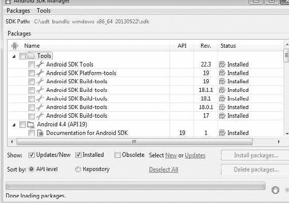

图 1 | Android SDK Manager 的 Name 列显示了所有可以使用的工具、平台版本和额外扩展（例如与 Google 服务交互的 API，如 Maps）。

5. `*`号表示您可以安装。取消勾选框。然后，如果在`Packages（包）`列表中出现了`Tools`、`Android 4.4 (API19)`、`Android 4.3 (API18)`和`Extras`，请确保它们已勾选并点击`Install # packages...（安装 # 个包...，# 是要安装的项目数）`以显示`Choose Packages to Install（选择要安装的包）`窗口。`Extras`节点中的大多数项目都是可选的。对于本书，您需要`Android Support Library（Android 支持库）`和 Google 服务。对于希望在 Android 设备上测试应用的 Windows 用户，`Google USB Driver`是必要的。
6. 在`Choose Packages to Install`窗口中，阅读每个项目的许可协议。完成后，点击`Accept License（接受许可）`单选按钮，然后点击`Install`按钮。安装状态将在 SDK Manager 窗口中显示。

## 创建 Android 虚拟设备（AVD）

Android SDK 的 Android 模拟器允许您在计算机上测试应用，而不是在 Android 设备上测试。如果您正在学习 Android 且没有 Android 设备，这种方法非常有用，但速度可能缓慢，因此如果您有真实设备，建议优先使用真实设备。

有一些硬件加速功能可以提高在模拟器中运行应用的性能，您必须创建一个 Android 虚拟设备（AVD），它可以定义您想要测试的设备特性，包括像素屏幕大小、像素密度、屏幕物理尺寸、数据存储的 CD 大小等。为了针对多个 Android 设备测试您的应用，您可以创建模拟每个独特设备的 AVD。

对于本书，我们使用 AVD 作为 Google 的参考设备——Nexus 4 手机、Nexus 7 小平板电脑和 Nexus 10 大平板电脑，它们运行未经修改的 Android 版本。按照以下步骤操作：

1. 打开 Eclipse。
2. 选择`Window（窗口） > Android Virtual Device Manager（Android 虚拟设备管理器）`显示 Android 虚拟设备窗口，然后选择`Device Definitions（设备定义）`选项卡（图 2）。


图 2 | Android 虚拟设备管理器窗口。

3. Google 提供了可以使用来创建 AVD 的预配置设备。选择 Google 的 Nexus 4，然后点击`Create AVD...`以显示`New Android Virtual Device (AVD)`（新建 Android 虚拟设备）窗口（图 3），如图所示配置选项并点击`OK`创建 AVD。

如果您勾选`Hardware keyboard present`（存在硬件键盘），将可以使用计算机向运行在 AVD 上的应用输入，但如果您的计算机没有摄像头，可以选择`Emulated for the Front Camera`（模拟前摄像头）和`Back Camera`（后摄像头）选项。您创建的每个 AVD 在其`config.ini`中指定了许多其他选项。您可以按照如下说明进行修改：

```text
http://developer.android.com/tools/devices/managing-avds.html
```

以更精确地匹配您的设备的硬件配置。


图 3 | 为 Android 4.3 配置 Nexus 4 手机 AVD。

4. 我们还配置了代表 Google Nexus 7 和 Google Nexus 10 的 Android 4.3 AVD 用于测试我们的平板应用。它们的设置如图 4 所示。此外，我们还为 Nexus 4、Nexus 7 和 Nexus 10 配置了 Android 4.4 AVD，名称分别为：`AVD_for_Nexus_4_KitKat`、`AVD_for_Nexus_7_KitKat`和`AVD_for_Nexus_10_KitKat`。

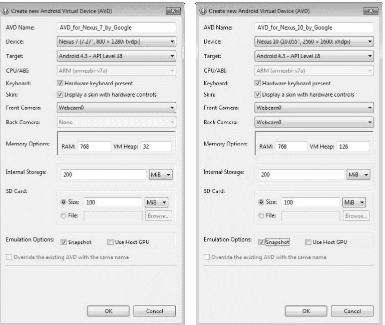

### （可选）设置 Android 设备

Google 经常更新 Android 开发工具。这经常导致编译应用时出现问题，而实际上应用并没有任何错误。如果您将我们的应用导入 Eclipse 或 Android Studio 后无法编译，可能是存在微小的配置问题。请通过`deitel.com`电子邮件联系我们，或在以下平台提问：

- Facebook®—`facebook.com/Deitel1Fan`
- Google™—`google.com/+Deitel1Fan`

我们将帮助您解决问题。在 Windows 上开发可能还需要某些特定的驱动程序。要获取各种品牌的 USB 驱动程序列表，请访问：

```text
http://developer.android.com/tools/device.html
```

## 获取 Android How Program 的示例

Android How Program 的示例可从：

```text
http://www.deitel.com/AndroidHT/
```

如果您尚未在我们的网站注册，请访问`deitel.com`并点击`Register`链接。填写信息。注册是免费的，我们不会将您的信息提供给任何人。请验证输入的注册邮箱是否正确——您将收到一封包含验证码的邮件。您必须在邮件中点击验证链接才能首次登录`deitel.com`。配置您的邮件客户端允许来自`deitel.com`的邮件，以确保验证邮件不被过滤。除非您单独注册了免费的 Deitel Buzz 邮件，否则我们只会发送账户管理邮件。

```text
http://www.deitel.com/newsletter/subscribe.html
```

接下来，访问`deitel.com`下载包含示例的 ZIP 压缩包。双击 ZIP 文件解压缩，并记住将其提取到系统的位置。

# Android Android

## 目标

在本章中，您将介绍：

- Android 的历史和 Android SDK。
- 下载应用的 Google Play Store。
- 本书中用于帮助您创建 Android 应用的 Android 包。
- 基本对象技术概念。
- Android 应用开发的关键软件，包括 Android SDK、Java SDK、Eclipse 集成开发环境和 Android Studio。
- 重要 Android 文档。
- 在 Eclipse（纸质书中）和 Android Studio（在线）中测试 Android 绘图应用。
- 优秀 Android 应用的特征。


# 第一章 Android 简介


## 1.1 简介

## 1.2 Android—全球领先的移动操作系统

## 1.3 特性

## 1.4 Android 操作系统

- 1.4.1 2.0（Froyo）
- 1.4.2 2.3（Gingerbread）
- 1.4.3 3.0 到 3.2（Honeycomb）
- 1.4.4 4.0 到 4.0.4（Ice Cream Sandwich）
- 1.4.5 4.1–4.3（Jelly Bean）
- 1.4.6 4.4（KitKat）

## 1.5 从 Google Play 下载应用

## 1.6 包

## 1.7 Android 软件开发包（SDK）

## 1.8 面向对象编程：快速回顾

- 1.8.1 以汽车作为对象
- 1.8.2 方法与类
- 1.8.3 实例化
- 1.8.4 复用
- 1.8.5 消息与方法调用
- 1.8.6 属性与实例变量
- 1.8.7 封装
- 1.8.8 继承
- 1.8.9 面向对象分析与设计（OOAD）

## 1.9 在 Android 虚拟设备（AVD）中测试 Doodle App

- 1.9.1 在 Nexus 4 手机 Android 系统中运行 Doodle App
- 1.9.2 在平板电脑 AVD 中运行 Doodle App
- 1.9.3 在 Android 设备上运行 Doodle App

## 1.10 构建出色的 Android 应用

## 1.11 Android 开发资源

## 1.12 总结

> 自测练习题 | 自测练习答案 | 练习题

## 1.1 简介

欢迎来到 Android 开发！我们希望通过学习 *Android How to Program, 2/e*，您能获得一段充满信息、具有挑战性、有趣且有回报的体验。本书的这部分面向具有 Java 编程经验的读者。

我们仅使用可以运行的应用，因此如果您不熟悉 Java 但熟悉其他语言（如 C#、Objective-C/Cocoa 或 C++）的面向对象编程，您应该能够快速掌握这些内容，并在学习 Android 开发的同时学习 Java 和 Java 风格的面向对象编程。如果您不知道 Java，我们在书的附录中也提供了友好的介绍。

### 应用驱动的方法

我们采用应用驱动的方法——新功能将在运行的 Android 应用背景下进行讨论，每章介绍一个应用。对于每个应用，我们先描述它，然后让您进行测试运行。

接下来，我们将提供实现该应用所使用的关键 Eclipse IDE（集成开发环境）、Java 和 Android SDK（软件开发包）技术的概述。对于某些应用，我们将使用 Eclipse 可视化地演示 GUI。然后，我们提供完整的源代码列表，并使用行号、语法着色和代码高亮来强调代码的关键点。我们还会展示一张或多张运行应用的截图。随后，我们将详细介绍应用中引入的概念。

您可以从`http://www.deitel.com/books/AndroidHP2/`下载书中所有应用的源代码。


## 1.2 Android—全球领先的移动操作系统

对于每一章，我们还会针对任何特定的 Eclipse 指令提供 Android Studio IDE 版本。由于 Android Studio 是早期访问版本且会快速演进，我们在电脑网站上提供了 Android Studio 指令：

```text
http://www.deitel.com/books/AndroidHTP2
```

这将使您能够保持指令更新。

## 1.2 Android—全球领先的移动操作系统

Android 的销量增长迅速，为 Android 开发者创造了巨大的机会。

- 第一代 Android 手机于 2008 年 10 月发布。到 2013 年 10 月，Strategy Analytics 的一份报告显示，Android 占据了全球智能手机市场 81.3%，而 Apple 为 13.4%，微软为 4.1%，黑莓为 1%。¹
- 根据 IDC 的报告，到 2013 年第一季度，Android 占据了全球平板电脑市场 56.5%，而 Apple 的 iPad 占据 39.6%，微软 Windows 平板占据 3.7%。³
- 截至 2013 年 4 月，每天有超过 15 亿 Android 设备（包括智能手机、平板电脑等）被激活。
- 在本书期间，已有超过十亿 Android 设备。⁴
- 现在 Android 设备包括智能手机、平板电脑、电子阅读器、机器人、喷气式飞机、NASA 卫星、游戏机、冰箱、电视、相机、医疗设备、开关、汽车车载娱乐系统（用于控制收音机、GPS、电话、温度器等）等。⁵

## 1.3 Android 特性

### 开放性和开源

开发 Android 应用的一个好处是平台的开放性。该操作系统是开源且免费的。这允许您查看 Android 源码并了解其特性是如何实现的。

您还可以通过报告漏洞（参见`http://source.android.com/source/report-bugs`）或参与开源项目（`http://source.android.com/community/index.html`）来为 Android 贡献。Google 以及其他人的开源应用可以在互联网上找到：

1. `strategyanalytics.com/WSS/2013/31/Android-Captures-Record-81-Percent-of-Smartphone-Shipments-in-2013.aspx`
2. `idc.com/getdoc.jsp?containerID=1-PR024023`
3. `technobuffalo.com/2013/04/16/google-daily-activations-million`
4. `venturebeat.com/2013/09/03/android-hits-and-will-be-called-kitkat-in-version`
5. `businessweek.com/articles/2013/05/29/behind-the-internet-of-things-is-everywhere`

| URL | 描述 |
| :--- | :--- |
| `http://en.wikipedia.org/wiki/List_of_open_source_applications` | 按分类组织的开源应用列表（例如：游戏、通信、仿真器、多媒体、安全）。 |
| `http://developer.android.com/tools/samples/index.html` | Google 为 Android 平台提供的示例应用包括超过 60 个应用和游戏，如 Lunar Lander、Snake 和 Tic Toe。 |
| `http://github.com/` | GitHub 允许您共享应用和源代码并向其他开源项目做贡献。 |
| `http://sourceforge.net` | SourceForge 也允许您共享应用和源代码并向其他开源项目做贡献。 |
| `http://droid.org/` | 数百个开源应用包括 Adblock Plus、AnyKeyboard（支持多种语言）、Apollo 播放器、中国象棋、Live 壁纸等。 |
| `http://interstellar.com/post/3921554/great-android-apps-that-are-source` | 带代码的开源 Android 应用。 |
| `http://www.opentimes.org/` | 提供近 100 个开源库，可增强应用功能。 |
| `http://www.androidviews.net` | 用于增强应用外观的自定义 GUI 控件。 |
| `http://www.stackoverflow.com` | Stack Overflow 是面向程序员的问题问答网站。用户可以对每个答案投票，最佳答案会排前。 |


# 第一章 Android 简介

**图 1.1** | 开源 Android 应用和资源网站。

| 标题 | URL |
| :--- | :--- |
| 获取 Android 源码 | `http://source.android.com/source/downloading.html` |
| 许可证 | `http://source.android.com/about/philosophy.html` `http://source.android.com/source/licenses.html` |
| 常见问题 (FAQs) | `http://source.android.com/source/faqs.html` |

**图 1.2** | 开源操作系统的资源和代码。

平台的开放性促进了快速创新。与仅适用于 Apple 设备的封闭 iOS 不同，Android 可由数十原始设备制造商 (OEM) 以及全球众多电信运营商提供的设备。OEM 和运营商之间的激烈竞争使客户受益。

## Java

Android 应用使用 Java 开发——这是世界上使用最广泛的编程语言之一。Java 是 Android 平台的逻辑选择，因为它强大、免费、开源，且数百万开发者已经熟悉了它。Java 程序员可以使用 Google 的 Android API（应用程序接口）以及第三方提供的其他接口来快速投入 Android 开发。

Java 是面向对象的，并拥有大量的类，可以帮助您开发强大的应用。Java 中的 GUI 编程是事件驱动的——在书中，您将编写应用来响应各种用户发起的事件（如触摸）。除了直接对应用的部分编程，您还将使用 Eclipse 和 Android Studio IDE 方便地在屏幕上拖放预定义的对象（如按钮和文本框），并对其进行标记和调整大小。使用这些 IDE，您可以快速方便地创建、运行、测试和调试 Android 应用。

## 多触屏

Android 智能手机将手机电话、互联网、MP3 播放器、游戏机、数字相机等功能集成到带有彩色多触屏的手持设备中。通过手指触摸，您可以轻松地在手机、运行的应用、播放音乐、网页浏览等之间切换。屏幕可以显示键盘，用于输入电子邮件、短信以及在应用中输入数据（某些 Android 设备也有物理键盘）。

## 手势

多触屏允许您通过涉及一次或多次同时触摸的手势来控制设备（见图 1.3）。

| 手势名称 | 物理动作 | 用途 |
| :--- | :--- | :--- |
| 触摸触摸 | 轻击一下屏幕。双击屏幕。 | 打开应用，“按下”按钮或菜单项。放大图片、Google Maps 和网页。双击屏幕以缩小。 |
| 长按 | 触摸屏幕并保持手指在原位。 | 选择视图中的项目——例如，在列表中勾选项目。 |
| 滑动 | 触摸屏幕，然后沿方向移动手指并松开。 | 逐个翻阅序列（如照片）。滑动会自动停止在下一个项目。 |
| 拖拽 | 触摸并跨越屏幕移动手指。 | 移动对象或图标，或滚动网页或列表。 |
| 双指间缩放 | 将两个指捏在一起或分开。 | 在屏幕上放大或缩小（例如，调整文本和图片的大小）。 |

**图 1.3** | 常见的 Android 手势。

## 内置应用

Android 设备配备了多个默认应用，这些应用可能根据设备、制造商或移动运营商而异。它们通常包括电话、联系人、电子邮件、浏览器、相机、照片、信息、日历、Play 商店、计算器等。

## Web 服务

Web 服务是存储在某台计算机上的软件组件，可以通过互联网由另一台计算机上的应用（或软件组件）进行访问。通过 Web 服务，你可以创建杂烩（mashups），这让你能够通过快速组合 Web 服务（通常来自不同的组织以及可能的其他形式的信息馈源）来快速开发应用。例如，100 Destinations (`www.destinations.co.uk`) 将 Twitter 的照片和推文与 Google Maps 的映射能力相结合，允许你通过照片探索世界各国。

Programmableweb (`http://www.programmableweb.com/`) 提供了一个包含超过 9,400 个 API 和 7,000 个杂烩的目录，以及用于创建杂烩的指南和示例代码。图 1.4 列出了一些 Web 服务。根据 Programmableweb 的说法，用于杂烩的最广泛使用的三个 API 是 Google Maps、Twitter 和 YouTube。

| Web 服务源 | 用途 |
| --- | --- |
| Google Maps | 映射服务 |
| Twitter | 超微博客 |
| YouTube | 视频搜索 |
| Facebook | 社交网络 |
| Instagram | 照片共享 |
| Foursquare | 移动签到 |
| LinkedIn | 商务社交网络 |
| Groupon | 社交商务 |
| Netflix | 电影租赁 |
| eBay | 互联网拍卖 |
| Wikipedia | 协作百科全书 |
| PayPal | 支付 |
| Last.fm | 互联网广播 |
| Amazon 电子商务 | 购买书籍和其他产品列表购物 |
| Salesforce.com | 客户关系管理 (CRM) |
| Skype | 互联网电话 |
| Microsoft Bing | 搜索 |
| Flickr | 照片共享 |
| Zillow | 房地产定价 |
| Yahoo Search | 搜索 |
| WeatherBug | 天气 |

**图 1.4** | 一些流行的 Web 服务 (`http://www.programmableweb.com/apis/directory/1?sort=mashups`)。

## 1.4 Android 操作系统

Android 操作系统是由 Android, Inc. 开发的，该公司于 2005 年被 Google 收购。2007 年，开放手机设备联盟（Open Handset Alliance™）——现在有 84 个公司成员 (`http://www.openhandsetalliance.com/oha_members.html`)——成立，旨在开发、维护和演进 Android；在降低成本的同时推动移动技术创新并提升体验。

### Android 版本命名规范

每个 Android 版本都以甜点命名，并按字母顺序排列（图 1.5）。

| Android 版本 | 名称 |
| --- | --- |
| Android 1.5 | Cupcake |
| Android 1.6 | Donut |
| Android 2.0–2.1 | Eclair |
| Android 2.2 | Froyo |
| Android 2.3 | Gingerbread |
| Android 3.0–3.2 | Honeycomb |
| Android 4.0 | Ice Cream Sandwich |
| Android 4.1–4.3 | Jelly Bean |
| Android 4.4 | KitKat |

**图 1.5** | Android 版本号及对应的名称。

### 1.4.1 Android 2.2 (Froyo)

Android 2.2（也称为 Froyo，于 2010 年 5 月发布）引入了外部存储，允许将应用存储在外部内存中，而不仅仅是 Android 设备的内部内存。它还引入了 Android 云端到设备消息传递 (C2DM) 服务。云计算允许你在“云端”中使用软件并存储数据——即通过互联网按需在远程计算机（计算机或服务器）上访问，而不是将其存储在你的桌面电脑、笔记本电脑或移动设备上。云计算赋予你增加或减少资源的灵活性，以满足任何时刻的资源需求，这比购买昂贵的硬件来确保偶尔水平所需的存储和处理能力更有效。Android C2DM 允许开发者从其服务器发送数据到安装在 Android 设备上的应用，即使这些应用未在运行。该服务通知应用直接联系以接收更新的应用或用户数据。C2DM 现在已废弃，由 Google Cloud Messaging (GCM) 代替。

有关 Android 2.2 的附加功能信息——OpenGL ES 2.0 图形能力、多媒体框架等——请访问 `http://developer.android.com/about/versions/android-2.2-highlights.html`。

```text
6. http://code.google.com/android/c2dm/.
```

### 1.4.2 Android 2.3 (Gingerbread)

Android 2.3 (Gingerbread) 于 2010 年晚些发布，增加了更多用户方面的改进，例如重新设计的键盘、改进的导航功能、提高电源效率等。它还添加了用于通信的开发者功能（例如让应用更易拨打和接听电话的技术）、多媒体（例如新的音频和图形 API）以及游戏（例如改进的性能和新传感器，如用于更好运动跟踪的陀螺仪）。

Android 2.3 最显著的新功能之一是对近场通信 (NFC) 的支持——这是一种短距离无线连接标准，允许几厘米内的两个设备之间进行通信。NFC 支持和功能因 Android 设备而异。NFC 可用于支付（例如，将你的支持 NFC 的设备触碰自动售水机）、交换联系人和图片等数据、配对设备和配件等。

要了解更多 Android 2.3 功能，请访问 `http://developer.android.com/about/versions/android-2.3-highlights.html`。

### 1.4.3 Android 3.0–3.2 (Honeycomb)

Android 3.0 (Honeycomb) 在平板电脑上引入了若干功能——“Holo”用户界面、新的启动器（用于自定义主屏幕和启动应用）等。Android 3.0 包含：

- fragments（片段），即应用的一部分
- 具有视觉吸引力的用户界面
- 动画框架
- 改进的性能
- 多核架构
- 去优化的图形
- 蓝牙等

如需 Android 3.0 功能的列表，请访问 `http://developer.android.com/about/versions/android-3.0-highlights.html`。

### 1.4.4 Android 4.0–4.0.4 (Ice Cream Sandwich)

Android 4.0 (Ice Cream Sandwich) 于 2011 年发布，将 Android 2.3 (Gingerbread) 和 Android 3.0 (Honeycomb) 合并为一个适用于所有设备的操作系统。Ice Cream Sandwich 增加了几个功能：

- 人脸检测：使用相机，兼容设备可以确定用户眼睛、鼻子和嘴的位置。允许应用根据用户的视线方向改变视角。
- 虚拟摄像机师：在拍摄多人的视频时，相机将自动对焦说话的人。
- Android Beam：使用 NFC，Android Beam 允许你触碰两个 Android 设备以共享内容（例如联系人、图片）。
- Wi-Fi Direct：Wi-Fi P2P（点对点）API 允许你使用 Wi-Fi 连接 Android 设备，其通信距离比蓝牙更远。
- 社交 API：在社交网络和应用之间访问并共享联系人信息（需用户许可）。
- 日历 API：在多个应用之间添加和共享事件，管理提醒和参会者。
- 辅助功能 API：使用新的辅助功能文本转语音 API，为视力障碍等残障用户增强应用体验。“通过触碰探索”模式允许视力障碍用户触摸屏幕上的任何位置，并听到对所触碰内容的语音描述。
- Android@Home 框架：使用 `Android@Home 框架` 创建控制用户家中家电的应用，例如恒温器、灌溉系统、网络灯泡等。
- 蓝牙健康设备：创建与蓝牙健康设备（如体重秤、心率监测器等）通信的应用。

有关 Android 4.0 功能的列表，`http://developer.android.com/about/versions/android-4.0-highlights`。

| 功能 | 描述 |
| --- | --- |
| 人脸检测 | 使用相机，兼容设备可以确定用户眼睛、鼻子和嘴的位置。允许应用根据用户的视线方向改变视角。 |
| 虚拟摄像机师 | 在拍摄多人的视频时，相机将自动对焦说话的人。 |
| Android Beam | 使用 NFC，Android Beam 允许你触碰两个 Android 设备以共享内容（例如联系人、图片）。 |
| Wi-Fi Direct | Wi-Fi P2P（点对点）API 允许你使用 Wi-Fi 连接 Android 设备，其通信距离比蓝牙更远。 |
| 社交 API | 在社交网络和应用之间访问并共享联系人信息（需用户许可）。 |
| 日历 API | 在多个应用之间添加和共享事件，管理提醒和参会者。 |
| 辅助功能 API | 使用新的辅助功能文本转语音 API，为视力障碍等残障用户增强应用体验。“通过触碰探索”模式允许视力障碍用户触摸屏幕上的任何位置，并听到对所触碰内容的语音描述。 |
| Android@Home 框架 | 使用 `Android@Home 框架` 创建控制用户家中家电的应用，例如恒温器、灌溉系统、网络灯泡等。 |
| 蓝牙健康设备 | 创建与蓝牙健康设备（如体重秤、心率监测器等）通信的应用。 |

**图 1.6** | 一些 Android Ice Sandwich 开发者功能 (`http://developer.android.com/about/versions/android-4.0-highlights`)。

### 1.4.5 Android 4.1–3 (Jelly Bean)

Android Jelly Bean 于 2012 年发布，包含了对外部显示的支持、改进的货币增强（例如可调整的小部件和更大的应用通知）以及性能改进，使得应用和屏幕之间的切换变得无缝（图 1.7）。Jelly Bean 功能列表请参阅 `http://developer.android.com/about/versions/jelly-bean.html`。

| 特性 | 描述 |
| --- | --- |
| Android Beam | 你可以使用 Android Beam 轻松地将智能手机或平板电脑与无线蓝牙扬声器或特殊耳机配对。 |
| 锁屏小部件 | 创建在设备锁定时显示在用户屏幕上的小部件，或修改现有的桌面小部件，使其在设备锁定时也可见。 |
| 全景球 (Photo Sphere) | 用于处理新的全景照片功能的 API，该功能允许用户拍摄 360 度照片，类似于用于 Google 地图街视图的照片。 |
| 梦幻屏 (Daydreams) | 梦幻屏是设备底座或充电时激活的交互式屏幕保护程序。梦幻屏可以播放音频视频并对用户交互做出响应。 |
| 语言支持 | 新功能帮助您的应用触达国际用户，例如双向文本（从左到右或从右到左）、国际键盘布局等。 |
| 开发者选项 | 几项新的跟踪和调试功能可以帮助您改进应用，错误报告包含屏幕和设备状态信息。 |

**图 1.7** | 部分 Android Jelly Bean 特性 (`http://developer.android.com/about/versions/jelly-bean.html`)。

### 1.4.6 Android 4.4 (KitKat)

Android 4.4 KitKat 于 2013 年 10 月发布，包含了多项性能改进，使其能够在所有 Android 设备上运行操作系统，包括内存受限的旧设备（这些设备在发展中国家特别流行）。

让更多用户更新到 KitKat 将减少市场上 Android 版本的“碎片化”，这对于开发者来说是一项挑战，因为他们以前必须设计运行在多个操作系统版本上的应用，或者针对特定的操作系统版本开发应用来限制其潜在市场。

Android KitKat 还包含了安全和可访问性增强、改进的图形和多媒体功能、内存使用分析工具等。图 1.8 列出了一些新的 KitKat 特性。要查看完整列表，请参阅：

```text
http://developer.android.com/about/versions/kitkat.html
```

| 特性 | 描述 |
| --- | --- |
| 沉浸模式 | 屏幕顶部的状态栏和底部的菜单按钮可以隐藏，允许您的应用填充更多屏幕空间。用户可以通过从屏幕顶部滑动访问状态栏，通过从底部向上滑动访问系统栏（包含返回键、主页键和最近应用按钮）。 |

**图 1.8** | 部分 Android KitKat 特性 (`http://developer.android.com/about/versions/kitkat.html`)。（第一部分，共 2 部分）。

- `http://techcrunch.com/2013/10/31/android-4-4-kitkat-google/`

## 1.5 从 Google Play 下载应用

| 特性 | 描述 |
| --- | --- |
| 打印框架 | 在应用中构建打印功能，包括通过 Wi-Fi 或云端查找可用打印机、选择纸张大小以及指定要打印的页面。 |
| 存储访问框架 | 创建文档存储提供程序，允许用户在多个应用之间浏览、创建和编辑文件（例如文档和图像）。 |
| SMS 提供程序 | 使用新的 SMS 提供程序和 API 创建 SMS（短消息服务）或 MMS（多媒体消息）应用。用户可以选择他们的默认消息应用。 |
| 过渡框架 | 新框架使得创建动画变得更加简单。 |
| 录屏 | 录制应用操作的视频，以创建教程和营销材料。 |
| 增强的可访问性 | 字幕管理器允许应用检查用户的字幕偏好（例如语言、文本样式等）。 |
| Chromium WebView | 支持使用 HTML5、CSS3 和更快的 JavaScript 显示网页内容的最新标准。 |
| 步数检测器和步数计数器 | 创建可以检测用户是在跑步、行走还是爬楼梯并计算步数的应用。 |
| 宿主卡模拟器 (HCE) | HCE 允许任何应用执行安全的 NFC 交易（例如移动支付），而无需由无线运营商控制的 SIM 卡上的安全元件。 |


图 1.8 | 部分 Android 特性 (`http://developer.android.com/about/versions/kitkat.html`)。（第二部分，共 2 部分。）

在编写本文时，`Google Play` 中已有超过百万个应用，且数量正在不断增长。`1.9` 列出了一些热门和付费应用。你可以通过设备上安装的 `Play Store` 下载应用。你也可以通过浏览器在 `http://play.google.com` 登录你的 `Google Play` 账户，然后指定要安装应用的 Android 设备。随后它将通过设备的 `WiFi` 或 `3G/4G` 连接下载。在第 9 章“`Google Play` 和应用业务问题”中，我们将讨论其他应用商店、为应用收费、应用定价等内容。

| Google Play 类别 | 该类别中的部分热门应用 |
| --- | --- |
| 图书与参考 | `Kindle`, `Wikipedia`, `Audible for Android`, `Google Play Books` `Office Suite Pro 7`, `Job Search`, `Square Register`, `GoToDo` |

图 1.9 | `Google Play` 中的部分热门 Android 应用。（第一部分，共 2 部分。）

- `en.wikipedia.org/wiki/Google_Play`.

| Google Play 类别 | 该类别中的部分热门应用 |
|---|---|
| 漫画 | `ComicRack`, `Memedoid Pro`, `Marvel Comics`, `Comic Strips` |
| 通讯 | `Facebook Messenger`, `Skype™`, `GroovE IP` |
| 教育 | `Duolingo: Learn Languages Free`, `TED`, `Mobile Observatory` |
| 娱乐 | `SketchBook Movie`, `Netflix`, `Fandango™` |
| 财务 | `Mint`, `Google Wallet` |
| 游戏：动作 | `Angry Birds` |
| 游戏：益智 | `Candy Crush` |
| 游戏：卡牌 | `Solitaire` |
| 游戏：休闲 | `Minecraft: Edition` |
| 健康与健身 | `Fitbit` |
| 生活 | `Life3` |
| 媒体与视频 | `YouTube` |
| 新闻与杂志 | `Flipboard` |
| 个性化 | `Zedge` |
| 摄影 | `Instagram` |
| 效率工具 | `Evernote` |
| 社交 | `WhatsApp` |
| 运动 | `ESPN` |
| 交通 | `Waze` |
| 旅游 | `TripAdvisor` |
| 天气 | `Weather Channel` |
| 小部件 | `Widget` |

## 1.6 包

Android 使用一组命名的类包（`packages`），有些包是 Android 特有的，有些是 Java 特有的，有些是 Google 特有的。这些包允许你方便地访问 Android 功能并将其整合到应用中。图 1.10 显示了我们讨论的一些包。要查看完整的 Android 包列表，请参阅 Android 开发者文档。

## 1.7 Android 开发包 (SDK)

| 包 | 描述 |
| --- | --- |
| `android.app` | 包含 Android 模型的高级类。 |
| `android.content` | 访问和发布数据。 |
| `android.content.res` | 用于访问应用资源（例如媒体、图形等）以及影响行为的设备配置。 |
| `android.database` | 处理返回的数据。 |
| `android.database.sqlite` | 用于私有数据库的 `SQLite` 管理。 |
| `android.graphics` | 用于绘制屏幕的图形工具。 |
| `android.hardware` | 设备硬件。 |
| `android.media` | 处理音频视频接口的类。 |
| `android.net` | 网络类。 |
| `android.os` | 操作系统类。 |
| `android.preference` | 处理应用偏好。 |
| `android.provider` | 内容提供者。 |
| `android.support` | 使用 Android 4.4 打印框架的 Android Support 。 |
| `android.text` | 在设备上渲染和编辑文本。 |
| `android.util` | 工具方法和 `XML` 工具。 |
| `android.widget` | 用于小部件的用户界面类。 |
| `android.view` | 用于布局和用户交互的用户界面类。 |
| `java.io` | 输入输出设施的流、序列化和文件系统访问。 |
| `java.text` | 文本格式化类。 |
| `java.util` | 工具类。 |
| `android.graphics.drawable` | 用于仅显示元素的类（例如渐变等）。 |

**图 1.10** | 本书使用的 Android 和 Java 包，按其出现的章节列出。

Android SDK 提供了构建 Android 应用所需的工具。它通过 Android 开发者网站免费提供。请参见“准备工作”部分获取开发 Android 应用所需的 Android 开发工具的详细信息，包括使用 Java SE、Android SDK/ADT 构建（包含 Eclipse IDE）以及 Android Studio IDE。

## 14 第一章 Android 简介

## Android SDK/ADT 包

Android SDK/ADT 包（包含 Eclipse IDE）是 Android 开发中最广泛集成的开发环境。一些开发者仅使用文本编辑器和命令行工具来创建 Android 应用。Eclipse IDE 包含：

- 支持语法高亮和行号显示的代码编辑器
- 自动缩进和自动补全（即类型提示）
- 调试器
- 版本控制系统
- 重构支持

你将在第 1.9 节中使用 Eclipse 来测试 Doodlez 应用。从第 2 章“Weapp”开始，你将使用 Eclipse 来构建应用。

## Android Studio

Android Studio 是一款基于 `IntelliJ IDEA` Java IDE（`http://www.jetbrains.com/idea/`）的新型 Android IDE，于 2013 年发布，是 Google 未来首选的 Android IDE。在编写本文时，Android Studio 仅作为早期访问预览版提供——其许多功能仍在开发中。对于每一章，我们会在书籍网站上提供针对特定 Eclipse 指的 Android Studio 版本说明。


要了解更多关于 Android Studio、安装以及从 Eclipse 迁移的信息，请访问 `http://developer.android.com/sdk/installing/studio.html`。

## Eclipse 的 Android 开发工具 (ADT) 插件

Android 开发工具（ADT）插件（Android SDK/ADT 包的一部分）允许你运行和调试 Android 应用，导出它们以进行发布（例如上传到 `Google Play`），此外 ADT 还包含一个视觉化 GUI 组件，可以通过拖放放置来形成 GUI 而无需编写任何代码。你将在第 2 章中学习更多关于 ADT 的知识。

## Android 模拟器

Android SDK 包含的 Android 模拟器允许你在 Windows、Mac OS 或 Linux 内的模拟环境中运行 Android 应用，而无需真实的 Android 设备。模拟器会显示一个真实的 Android 用户界面窗口。如果你没有 Android 设备进行测试，它将特别有用。在将应用上传到 `Google Play` 之前，你绝对应该在多种 Android 设备上测试你的应用。

Android 虚拟设备（AVD）定义了你想要测试的设备特性，包括硬件、系统镜像、屏幕尺寸和数据存储。如果你想针对多个 Android 设备测试应用，则需要为每个独特的设备创建单独 AVD，或者使用服务（如 `testdroid.com` 或 `apphtack.com`），这些服务允许你可以在许多不同的设备上进行测试。

我们使用模拟器（而非真实的 Android 设备）获取了书中大部分但并非所有的 Android 截图。你可以通过模拟器还原大部分

## 1.7 Android 软件开发包 (SDK)

Android 手势（图 1.11）和控制控件（图 1.12）使用你电脑的键盘和鼠标。模拟器上的手势有些有限，因为你的电脑无法模拟所有的 Android 硬件功能。例如，若要在模拟器中测试 GPS 应用，你需要创建模拟 GPS 读取数的文件。此外，尽管你可以模拟方向变化（切换到竖屏或横屏模式），但模拟特定的方向特征（加速度计允许设备响应上/下、左/右和向前/后的加速度）并未内置模拟器中。在以下地址有一个模拟器：

```
https://code.google.com/openintents/wiki/SensorSimulator
``` 
你可以使用它将传感器信息发送到 AVD，以测试应用中的其他传感器功能。图 1.13 列出了模拟器上不可用的 Android 功能。不过，你可以将应用上传到 Android 设备上来测试这些功能。你将在第 2 章的`欢迎应用`中开始创建 AVD 并使用模拟器开发 Android 应用。

| 手势 | 模拟器操作 |
| :--- | :--- |
| 触摸 | 点击鼠标。引入于第 3 章的`小计算器`应用中。 |
| 双击 | 双击鼠标。引入于第 6 章的`大炮游戏`应用中。 |
| 长按 | 点击并按住鼠标。 |
| 拖动 | 点击、按住并移动鼠标。引入于第 6 章的`大炮游戏`应用中。 |
| 滑动 | 点击、按住并移动鼠标。引入于第 6 章的`大炮游戏`应用中。 |
| 捏合缩放 | 点击、按住并移动鼠标。 |

| 控件 | 模拟器操作 |
| :--- | :--- |
| 返回 | 点击鼠标。 |
| 拨 | 点击鼠标。 |
| 相机 | 点击鼠标。 |
| 结束 | 点击鼠标。 |
| 主页 | 点击鼠标。 |
| 菜单 | 点击鼠标。 |
| 电源 | 点击鼠标。 |
| 搜索 | 点击鼠标。 |
| 切换 | 点击鼠标。 |
| 音量上 | 点击鼠标。 |
| 音量减 | 点击鼠标。 |

Android 手势（图 1.11）和控制控件（图 1.12）使用你电脑的键盘和鼠标。

Android 虚拟设备（AVD）定义了你想要测试的设备特性，包括硬件、系统镜像、屏幕尺寸和数据存储。如果你想针对多个 Android 设备测试应用，则需要为每个独特的设备创建单独 AVD，或者使用服务（如 `testdroid.com` 或 `apphtack.com`），这些服务允许你可以在许多不同的设备上进行测试。

我们使用模拟器（而非真实的 Android 设备）获取了书中大部分但并非所有的 Android 截图。你可以使用电脑的键盘和鼠标通过模拟器还原大部分 Android 手势（图 1.11）和控件（图 1.12）。模拟器上的手势有些有限，因为你的电脑无法模拟所有的 Android 硬件功能。例如，若要在模拟器中测试 GPS 应用，你需要创建模拟 GPS 读取数的文件。此外，尽管你可以模拟方向变化（切换到竖屏或横屏模式），但模拟特定的方向特征（加速度计允许设备响应上/下、左/右和向前/后的加速度）并未内置模拟器中。在以下地址有一个模拟器：

```
https://code.google.com/openintents/wiki/SensorSimulator
``` 
你可以使用它将传感器信息发送到 AVD，以测试应用中的其他传感器功能。图 1.13 列出了模拟器上不可用的 Android 功能。不过，你可以将应用上传到 Android 设备上来测试这些功能。你将在第 2 章的`欢迎应用`中开始创建 AVD 并使用模拟器开发 Android 应用。

## 1.8 面向对象编程：快速复习

### 1.8.1 作为对象的汽车

为了帮助你理解对象，让我们从一个简单的类比开始。假设你想开车并让它变得更快。在开车之前必须发生什么？嗯，在开车之前，汽车必须先被制造出来。一辆完整的汽车有真实的油门踏，但仅有此是不够的——汽车不会自己加速，所以司机必须踩踏板。

### 1.8.2 方法与类

让我们用汽车的例子来引入一些面向对象的概念。在程序中执行任务需要一个方法。该方法包含了实际执行任务的程序状态。方法向用户隐藏了这些语句，就像汽车的油门踏板隐藏了让汽车变快的机制一样。例如，银行账户可能包含一个方法向账户存款，另一个方法从账户取款，第三个方法查询账户的当前余额。类在概念上类似于汽车的工程图纸，图纸包含了油门踏板、方向盘等的设计。

### 1.8.3 实例化

就像你必须先根据工程图纸制造出一辆汽车才能真正开车一样，你必须先为类构建一个对象，程序才能执行类方法定义的任务。这一过程被称为实例化。随后，该对象被称为该类的实例。

### 1.8.4 复用

正如汽车的工程图纸可以重复使用以制造许多汽车一样，你也可以多次复用类来构建对象。在构建新类和程序时复用现有类可以节省时间和精力的。复用还有助于构建更可靠、更有效的系统，因为现有的类和组件通常已经经过了测试、调试和性能优化。正如零件互换的概念对于工业革命至关重要一样，可复用的类对于由对象技术引发的软件革命至关重要。

### 1.8.5 消息与方法调用

当你开车时，踩油门踏板是向汽车发送了一条执行任务的消息——即让跑得更快。同样，你向对象发送消息。每条消息都是一次方法调用。

# 第一章 Android 简介

……告知对象执行其任务的方法。例如，程序可能会调用特定银行账户对象的存款方法（`deposit method`）来增加账户的余额。

## 1.8.6 属性与实例变量

汽车除了具有完成任务的能力外，还有属性，例如它的颜色、门数量、油箱中的燃料量、当前速度以及总行驶里程记录（即里程表读数）。就像汽车的属性在工程设计中被表示为设计的一部分（例如，这些设计包含了里程表和燃料表）。当你驾驶真实的汽车时，这些属性会随汽车一起移动。每辆汽车都维护自己的属性。例如，每辆车都知道自己的油箱里有多少油，但并不知道其他汽车油箱里有多少油。

同样，对象在程序中使用时携带它自己的属性。这些属性是作为对象类（`class`）的一部分指定的。例如，一个银行账户对象有一个余额（`balance`），代表账户中的金额。每个银行账户对象都知道其代表的账户的余额，但不知道该银行中其他账户的余额。属性是通过类的实例变量（`instance variables`）指定的。

## 1.8.7 封装

类将属性和方法封装（即包装）进对象中——对象的属性和方法是紧密相关的。对象之间可以通信，但它们通常不需要知道其他对象是如何实现的——实现细节隐藏在对象内部。这种信息隐藏机制对于良好的软件工程至关重要。

## 1.8.8 继承

可以通过继承快速、方便地创建新的对象类——新类观察现有类的特征，并可能对其进行定制以及添加其特有的特征。在我们的类比中，“敞篷汽车”（`convertible`）无疑是更通用的类“汽车”（`automobile`）的一个对象，其中其车顶可以升高或降低。

## 1.8.9 面向对象的分析与设计 (OOAD)

你将如何为你的程序创建代码？像许多程序员一样，你只需打开电脑并开始编写程序。这种方法对于小型程序可能有效，但如果你要创建一个软件系统来控制大型银行的成千上万台自动取款机（ATM）呢？或者如果你被要求在一个由 1000 名软件开发人员组成的团队中构建美国空中管制系统？对于大型且复杂的项目，你不应该简单地坐下来就开始编写程序。

为了创建最佳解决方案，你应该遵循详细的分析来确定项目的需求（即定义系统应该做什么），并开发一个能够满足这些需求的设计（即决定系统应该如何做）。理想情况下，你应该在编写代码之前经历这一过程并仔细审查设计（并让其他软件专业人员审查你的设计）。如果这个过程涉及从面向对象的角度对你的系统进行分析和设计，它就被称为面向对象分析与设计（`OOAD`）过程。像 Java 这样的语言是面向对象的。在这样的语言中编程被称为面向对象编程（`OOP`），允许你将面向对象的设计实现为可运行的系统。

## 1.9 在 Android 虚拟机设备 (AVD) 中测试运行 Doodlez 应用

在本节中，你将运行并与你的第一个 Android 应用进行交互。Doodlez 应用允许你在屏幕上拖动手指来“绘画”。你可以使用应用选项菜单中提供的选项来来控制画笔的大小和颜色。不需要查看应用的代码——你将在第 7 章中构建并学习它。

以下步骤显示了如何将你的项目导入 Eclipse，以及如何在你在序言后的“开始之前”部分设置的 Nexus 4 Android 虚拟机设备 (AVD) 中测试运行该应用。在本节中，我们还将讨论如何在平板 Android 设备和 Android 设备上运行该应用。当应用在 AVD 中运行时，你可以通过在画布的任何地方“拖动手指”来创建新画作。使用鼠标“触摸”屏幕。

## Android SDK/ADT 包和 Android Studio IDE

以下步骤（以及整本书）中的 IDE 屏幕是在一台运行 Windows 7、Java SE7 JDK 以及你在“开始之前”部分安装的 Android SDK/ADT 包的电脑上截取的。由于 Android Studio 是预览版本并将会快速演进，本次测试运行的 Android Studio 指南位于我们的网站上：

`www.deit1.com/books/androidhtdp2`

这使我们能够根据 Google 的更改更新说明。Android SDK/ADT 包和 Android Studio 都使用相同的 Android 模拟器，因此一旦应用在 AVD 中运行，步骤是完全相同的。

### 1.9.1 在 Nexus 4 手机上运行 Doodlez 应用

要测试运行 Doodlez 应用，请执行以下步骤：


# 检查你的设置

如果你还没有执行，请按照位于序言后的“开始之前”部分中指定的步骤进行操作。

# 打开 Eclipse

打开 Android SDK/ADT 包文件夹中的 `eclipse` 子文件夹，然后根据你的平台双击 Eclipse 图标（ ）或（ ）。

# 指定你的工作空间位置

当工作空间启动器（Workspace Launcher）窗口出现时，指定你想要存储应用的位置，点击 `OK`。我们使用了默认位置——你用户目录下一个名为 `workspace` 的文件夹。工作空间是项目的集合，每个项目通常是一个应用。每个工作空间也有自己的设置，例如显示哪些 Eclipse 窗口。你可能有许多工作空间，并在不同的开发任务之间切换——例如，你可以为不同的任务切换多个工作空间。如果这是你第一次打开 Eclipse，将显示欢迎页面。

# 导入 Doodlez 应用的项目

选择`File > Import...`打开导入对话框（图 1.17(a)）。展开`General`节点并选择`Existing Projects into Workspace`，点击 `Next` 进入导入项目步骤（图 1.17(b)）。点击选择根目录文本框右侧的`Browse...`按钮。

**图 1.17** | 导入现有项目。（第 2 部分的 1 部分）

b) 导入对话框的导入步骤

在文件夹浏览对话框中，找到书籍示例文件夹中的`Doodlez`文件夹，选择它并点击 `Open`。点击 `Finish` 将项目导入 Eclipse。项目现在出现在 Eclipse 左侧的`Package Explorer`窗口（图 1.18）中。如果`Package Explorer`窗口不可见，可以通过选择`Window > Show View > Package Explorer`来查看。

图 1.18 | `Package Explorer` 窗口

# 启动 Nexus 4 AVD

为了测试运行 Doodlez 应用，我们将使用你在“开始之前”部分配置的 Android 4.4 AVD。AVD 需要几分钟才能加载，因此你应该在打算使用时预先启动它，并在构建和测试应用时让位于后台运行。要启动 Nexus 4 AVD，选择`Window > Android Device Manager`显示虚拟设备管理器对话框（图 1.15）。选择 Android KitKat 的 Nexus 4 AVD 并点击 `Start...`，然后在出现的启动选项对话框中点击 `Launch`。在 AVD 加载完成之前不要执行应用。一旦 AVD 如图 1.16 所示出现，通过将鼠标指针从锁定图标拖到屏幕边缘来解锁 AVD。

图 1.15 | 虚拟设备管理器对话框

**图 1.16** | AVD 加载完成后的 Nexus 4 屏幕（Android 4.4）

# 启动 Doodlez 应用

在 Eclipse 中，右键点击`Package Explorer`窗口中的 Doodlez 项目，然后选择`Run As > Android Application`（图 1.19）。这将将在第 4 步中启动的 AVD 中执行 Doodlez（图 1.20）。

## I.1.9 在 Android 虚拟设备 (AVD) 中测试 Doodlez 应用

```
Package explorer
New
Go Into
Show-In Alt-Shift-W >
Copy Ctrl-C
Copy Qualified Name
Paste Ctrl-V
Delete Delete
Build Build Path >
Refactor. Alt-Shift-T >
Import...
Export...
Refresh F5
Close Project
Close Undeleted Projects
Validate
Run
Debug As
Profile As
Team
Compare With
Restore from Local History...
Android tools
Source
Properties Alt-Enter
Resource Configurations
1 Android Application
2 Android Unit Test
3 Java Applet
4 Java Application Alt-Shift+X, J
5 Unit Test Alt-Shift+X, T
Run Configurations...
```

图 1.19 | 启动 Doodlez 应用。

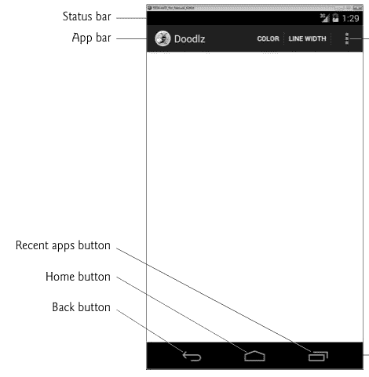

图 1.20 | Doodlez 应用在 Android 虚拟设备 (AVD) 中运行。

# 第一章 Android 简介

7. 探索 AVD 沉浸式模式。在 AVD 屏幕底部有各种出现在设备触摸屏上的按钮。你通过触摸这些按钮（在 AVD 中使用鼠标）来与应用和 Android 系统进行交互。返回按钮回到应用程序的上一个屏幕，如果你处于当前应用程序的初始屏幕，则返回上一个应用程序。主页按钮带你回到设备的主屏幕。最近应用按钮允许你查看最近使用的应用列表，以便快速切换回它们。顶部是应用的应用栏（app bar），它显示应用的图标和名称，并可能包含其他特定的按钮——某些显示在应用栏上（图 1.20 中的 `COLOR` 和 `LINE WIDTH`），另一些显示在应用的选项菜单中。应用栏上的选项数量取决于设备的大小——我们将在第 7 章中讨论这一点。Android 4.4 支持一种新的沉浸式模式，该模式允许应用程序能够使用整个屏幕。在此应用中，你可以点击绘图区域一次来隐藏设备的状态栏、导航栏以及应用的操作栏。你可以通过点击绘图区域或从屏幕顶部滑动来重新显示这些栏。

8. 理解应用的选项。要显示未出现在应用栏上的选项，请触摸（即点击）选项菜单图标。图 1.21(a) 显示了 Nexus 4 上的操作栏和选项菜单，图 1.21(b) 显示了 Nexus 7 AVD 上的它们——显示在应用栏上的选项采用小写字母。触摸 `COLOR` 会显示一个用于更改你所画线条粗度的 GUI。触摸 `Eraser`（橡皮擦）会将绘图区域设置为白色，这样当你绘制彩色区域时，颜色将确认你是否想删除整幅图像，如果无法取消操作，则清除绘图区域。`Save Image`（保存图像）将图像保存到设备的图库。在 Android 4.4 上，触摸 `Print`（打印）会显示一个用于选择可用打印机的 GUI，你可以打印你的图像或保存为 PDF 文档（默认）。你稍后将探索这些每一个选项。

| Doodlez | COLOR | LINE WIDTH |
| --- | --- | --- |
| Eraser | | |
| Clear | | |
| Save | | |
| Print | | |

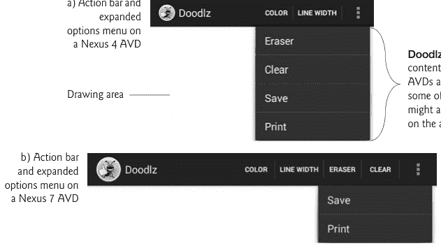

图 1.21 | Doodlez 选项菜单展开。

9. 将画笔颜色改为红色。要更改画笔颜色，首先触摸应用栏上的 `COLOR` 以显示 `Choose Color`（选择颜色）对话框（图 1.22）。颜色使用 ARGB 颜色方案定义，其中 alpha（即透明度）、红色、绿色和蓝色分量由 0–255 范围内的整数指定。对于 alpha，0 表示完全透明，255 表示完全不透明。对于红色、绿色和蓝色，0 表示不含该颜色，255 表示颜色的最大量。GUI 由 `Alpha`、`Red`、`Green` 和 `Blue` SeekBars（滑动条）组成，允许你选择绘图颜色中 alpha、红、绿、蓝的量。你通过拖动 SeekBar 来更改颜色。在你操作时，应用会通过将 SeekBar 向右移动（如图 1.22 所示）在下方显示新颜色。现在通过拖动 `Set` 按钮返回绘图区域来选择红色。

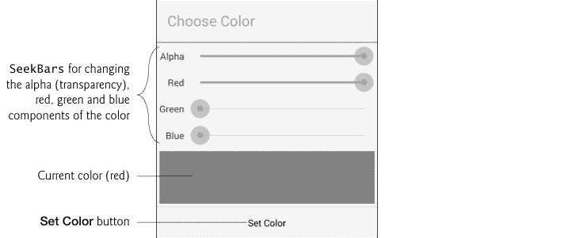

图 1.22 | 将绘图颜色改为红色。

10. 更改线条宽度。要更改线条宽度，触摸应用栏上的 `LINE WIDTH` 以显示 `Choose Line Width`（选择线条宽度）对话框。拖动宽度的 SeekBar 来加粗线条（图 1.23）。触摸 `Set` 按钮返回绘图区域。


图 1.23 | 更改线条宽度。

11. 绘制花瓣。触摸 AVD 进入沉浸式模式，然后用手指（当你使用模拟器时）点击绘图区域（图 1.24）。


图 1.24 | 绘制花瓣。

12. 将画笔颜色改为绿色。要更改画笔颜色，首先触摸应用栏上的 `COLOR` 以显示 `Choose Color`（选择颜色）对话框（图 1.22）。颜色使用 ARGB 颜色方案定义，其中 alpha（即透明度）、红色、绿色和蓝色分量由 0–255 范围内的整数指定。对于 alpha，0 表示完全透明，255 表示完全不透明。对于红色、绿色和蓝色，0 表示不含该颜色，255 表示颜色的最大量。GUI 由 `Alpha`、`Red`、`Green` 和 `Blue` SeekBars（滑动条）组成，允许你选择绘图颜色中 alpha、红、绿、蓝的量。你通过拖动 SeekBar 来更改颜色。在你操作时，应用会通过将 SeekBar 向右移动（如图 1.22 所示）在下方显示新颜色。现在通过拖动 `Set` 按钮返回绘图区域来选择红色。


图 1.25 | 将画笔颜色改为绿色。

13. 更改线条宽度。要更改线条宽度，触摸应用栏上的 `LINE WIDTH` 以显示 `Choose Line Width`（选择线条宽度）对话框。拖动宽度的 SeekBar 来加粗线条（图 1.23）。触摸 `Set` 按钮返回绘图区域。


图 1.26 | 更改线条宽度。

14. 绘制花瓣。触摸 AVD 进入沉浸式模式，然后用手指（当你使用模拟器时）点击绘图区域（图 1.24）。


图 1.27 | 绘制花瓣。

15. 将画笔颜色改为蓝色。要更改画笔颜色，首先触摸应用栏上的 `COLOR` 以显示 `Choose Color`（选择颜色）对话框（图 1.22）。颜色使用 ARGB 颜色方案定义，其中 alpha（即透明度）、红色、绿色和蓝色分量由 0–255 范围内的整数指定。对于 alpha，0 表示完全透明，255 表示完全不透明。对于红色、绿色和蓝色，0 表示不含该颜色，255 表示颜色的最大量。GUI 由 `Alpha`、`Red`、`Green` 和 `Blue` SeekBars（滑动条）组成，允许你选择绘图颜色中 alpha、红、绿、蓝的量。你通过拖动 SeekBar 来更改颜色。在你操作时，应用会通过将 SeekBar 向右移动（如图 1.22 所示）在下方显示新颜色。现在通过拖动 `Set` 按钮返回绘图区域来选择红色。


图 1.28 | 将画笔颜色改为蓝色。

16. 保存图像。通过选项菜单中的 `Save` 将图像保存到设备的图库。你可以通过打开图库来查看此图像和其他图像。

17. 打印图像。在 Android 4.4 上，触摸 `Print` 会显示一个用于选择可用打印机的 GUI，你可以打印你的图像或保存为 PDF 文档（默认）。如果没有打印机出现在列表中，你可能需要配置 Google Cloud Print。有关此信息，请访问：

```
http://www.google.com/cloudprint/
```

18. 回到主屏幕。通过触摸 AVD 上的主页按钮回到设备的主屏幕。通过触摸图库显示安装在 AVD 上的应用列表。你可以通过打开图库来查看绘图。

*(注：此处部分翻译重复已遵循原文逻辑)*

## 1.9.2 在平板电脑 AVD 中运行 Doodlez 应用

要在平板电脑 AVD 中测试应用，首先通过 1.9.1 节的步骤 4 启动 AVD，但选择 Nexus 7 而不是 Nexus 4。接下来，在 Eclipse 的 `Package Explorer` 窗口中右键点击 Doodlelez 项目并选择 `Run As > Android Application`。启动应用时如果有多个 AVD 在运行，会出现 `Android Device Chooser` 对话框（图 1.29），以便选择 AVD 上安装并执行应用。在这种情况下，Nexus 4 和 Nexus 7 AVD 都在我们的系统上运行，因此有两个可能的运行 Android 设备。选择 Nexus 7 AVD 并点击 `OK`。此应用在手机和平板电脑设备上以竖屏方向（宽度小于高度）运行。如果你在大 AVD（或大平板电脑）上运行，应用将以横屏方向（宽度大于高度）运行。图 1.30 显示了应用在 Nexus 7 AVD 中运行。如果 AVD 太小无法在你的屏幕上显示，你可以通过输入 `Ctrl + F12` 来更改 AVD（在 Mac 上使用 `fn + control + F12`）。某些键盘上的 `Ctrl` 标记为 `Control`。

## 1.9.3 在 Android 设备上运行 Doodlez 应用

如果你有一台 Android 设备，可以轻松地在上面执行应用以进行测试。

1. **启用设备上的开发者选项。** 首先，你必须启用设备上的调试功能。为此，进入设备的“设置”，然后选择“关于手机”（或平板电脑），点击“版本号”（列表底部）并反复点击，直到屏幕上显示“您现在是开发者了”的消息。这将在“设置”应用中启用一个名为“开发者选项”的入口。

2. **启用设备上的调试。** 返回“设置”应用，选择“开发者选项”，并确保勾选了“USB 调试”——这是首次在设备上启用开发者选项时的默认设置。

3. **连接你的设备。** 接下来，使用设备附带的 USB 线将设备连接到计算机。如果你是 Windows 用户，回想一下前面的章节，你可能需要为你的设备安装 USB 驱动程序。详情请参见以下两个页面：

```
developer.android.com/tools/device.html
developer.android.com/tools/extras/oem-usb.html
```

4. **在 Android 设备上运行 Doodlez。** 在 `Package Editor` 窗口中，右键点击 `Package Editor` 窗口中的 Doodlez 项目，然后选择“运行方式” > “Android”。如果你没有开启任何 AVD，但连接了 Android 设备，IDE 将自动将应用安装到你的设备并执行它。如果你连接了一个或多个 AVD 和/或设备，将显示“Android 设备选择”对话框（图 1.29），你可以从中选择要安装和运行应用的设备或 AVD。

### 准备发布应用

当你构建用于通过应用商店分发的应用时，应该在尽可能多的真实设备上测试应用。记住，如果你手头没有许多可用设备，请创建 AVD 来模拟你希望应用运行的各种设备。当你配置每个 AVD 以模拟特定设备时，请在网上查找该设备的规格并据此配置 AVD。此外，你还可以按照“硬件仿真选项”章节中的描述修改 AVD 的`config.ini`文件，位于：

```
developer.android.com/tools/devices/managing-avds-commandline.html#hardwareopts
```

此文件包含无法通过 Android 虚拟设备管理器配置的选项。修改这些选项可以让你更精确地匹配真实设备的硬件配置。

## 1.10 构建出色的 Android 应用

Google Play 上有超过 80 万个应用，你如何创建一个让人们愿意发现、下载并推荐给别人的 Android 应用呢？考虑哪些因素让一个应用变得有趣、实用、易于测试、有吸引力且持久。一个巧妙的应用名称、吸引人的图标和引人入胜的描述可能会吸引人们在 Google Play 或许多其他 Android 应用商店下载。但一旦用户下载了应用，什么会让他们经常使用它并推荐给他人？图 1.31 显示了一些优秀应用的特征。

- http://www.pureoxygenmobile.com/how-many-apps-in-each-app-store/

```
优秀应用的特征
优秀游戏
* 娱乐且有趣。
* 具有挑战性。
* 难度层层递进。
* 显示分数并使用排行榜记录高分。
* 提供音频和视觉反馈。
* 提供单机、多人和网络化版本。
* 具有高质量的动画。
* 将输入/输出和计算密集型代码卸载到单独的执行线程，以提高界面响应速度和应用性能。
* 利用增强现实技术进行创新——用虚拟组件增强真实世界环境；这在视频类应用中特别受欢迎。
实用工具
* 提供实用的功能和准确的信息。
* 提高个人和业务生产力。
* 让任务更方便（例如：维护待办列表、管理费用）。
* 让用户了解相关信息。
* 提供主题性信息（例如：最新的股价、新闻、严重风暴预警、交通更新）。
* 使用基于位置的服务提供本地服务（例如：本地业务的优惠券、最佳油价、食物外卖）。
通用特征
* 跟进最新的 Android 特性，但兼容多个 Android 版本以支持尽可能广泛的受众。
* 运行正常。
* 及时修复 Bug。
* 遵循标准的 Android 应用 GUI 规范。
* 启动快速。
* 响应灵敏。
* 不需要过多的内存、带宽或电量。
* 新颖且具有创造性。
* 持久——你的用户会经常使用的东西。
* 使用专业级的图标，这些将出现在 Google Play 和用户的设备上。
```

图 1.31 | 优秀应用的特征。（部分 1，共 2。）

通用特征（续）

- 使用高质量的图形、图像、动画、音频和视频。

- 直观且易于使用（不需要详尽的帮助文档）。

- 残障人士可以使用（http://developer.android.com/guide/topics/ui/accessibility/index.html）。


- 给用户理由和方法向他人介绍你的应用（例如，你可以给用户提供将分数发布到 Facebook 或 Twitter 的选项）。
- 为内容驱动的应用提供额外内容（例如：游戏关卡、文章、谜题）。
- 针对提供的每个国家进行本地化（第 2 章）（例如：翻译应用的文本和音频文件，根据本地设置使用不同的图形等）。
- 与竞争性应用相比，提供更好的性能、功能和易用性。
- 充分利用 Android 设备的功能。
- 不要请求过多的权限。
- 针对各种 Android 设备进行了优化。
- 能够适应未来硬件（`http://developer.android.com/future-proofing-your-app.html`）的变化。

图 1.31 | 优秀应用的特征。（部分 2，共 2。）

## 1.10 Android 开发资源

图 1.32 列出了来自 Android 网站的一些文档。当你深入 Android 开发时，可能会对工具、设计、安全等方面有疑问。图 1.33 列出了你可以获取最新公告的 Android 群组和论坛。

| 标题 | URL |
| :--- | :--- |
| 应用组件 | `http://developer.android.com/guide/components/index.html` |
| 使用 Android 模拟器 | `http://developer.android.com/tools/emulator.html` |
| 包索引 | `http://developer.android.com/reference/packages.html` |
| 类索引 | `http://developer.android.com/reference/classes.html` |
| Android 设计 | `http://developer.android.com/design/index.html` |

图 1.32 | Android 开发者的文档。（部分 1，共 2。）

| 标题 | URL |
| :--- | :--- |
| 数据备份 | `http://developer.android.com/guide/topics/data/backup.html` |
| 安全提示 | `http://developer.android.com/training/articles/security-tips.html` |
| 从 Eclipse 管理项目 | `http://developer.android.com/guide/developing/projects-eclipse.html` |
| 使用 Android Studio | `http://developer.android.com/sdk/installing/studio.html` |
| 调试 | `http://developer.android.com/tools/debugging/index.html` |
| 工具帮助 | `http://developer.android.com/tools/help/index.html` |
| 性能提示 | `http://developer.android.com/training/articles/perf-tips.html` |
| 应用响应式 | `http://developer.android.com/training/articles/perf-anr.html` |
| 发布清单（Google Play） | `http://developer.android.com/distribute/googleplay/publish/preparing.html` |
| 开始发布 | `http://developer.android.com/distribute/googleplay/publish/register.html` |
| 应用内存管理 | `http://developer.android.com/training/articles/memory.html` |
| Google 开发者协议 | `http://play.google.com/about/developer-distribution-agreement.html` |

图 1.32 | Android 开发者的文档。（部分 2，共 2）

| 标题 | 订阅 | 描述 |
| :--- | :--- | :--- |
| Android Discuss | 使用 Google Groups 订阅：`android-discuss` 通过邮件订阅：`android-discuss-subscribe@groups.com` | 一个通用的 Android 讨论组，你可以在这里获取应用开发问题。 |
| Stack Overflow | `http://stackoverflow.com/questions/tagged/android` | 此列表用于初级 Android 应用开发问题，包括从 Java 和 Eclipse 开始以及关于最佳实践的问题。 |
| Android Developers | `http://groups.google.com/forum/?groups#!forum/android-developers` | 丰富的 Android 开发者使用此列表排除故障、GUI 设计问题、性能问题等。 |

图 1.33 | Android 新闻和论坛。（部分 1，共 2。）

# 第一章 Android 简介

| 标题 | 订阅 | 描述 |
| :--- | :--- | :--- |
| Android 论坛 | `http://www.androidforums.com` | 向其他开发者提问、分享技巧，并查找针对特定 Android 设备的论坛。 |

**图 1.33** | Android 新闻群组和论坛。（第 2 部分，共 2 部分。）

| Android 开发技巧、视频和资源 | 链接地址 |
| :--- | :--- |
| Google 提供的示例 Android 应用 | `http://code.google.com/p/apps-android/` |
| O'Reilly 文章，“Android 开发的10个建议” | `http://answers.oreilly.com/topic/862-ten-tips-for-android-application-development/` |
| 用于 Android 编程技巧和指南的 Bright Hub™ 网站 | `http://www.brighthub.com/mobile/google-android.aspx` |
| Android 开发者博客 | `http://android-developers.blogspot.com/` |
| Sprint® 应用开发者计划 | `http://developer.sprint.com/site/global/develop/mobile_platforms/android/android.jsp` |
| HTC Android 开发者中心 | `http://www.htcdev.com/` |
| Motorola Android 开发网站 | `http://developer.motorola.com/` |
| Stack Overflow 顶尖 Android 用户 | `http://stackoverflow.com/tags/android/` |
| AndroidDev Weekly 周报 | `http://androiddevweekly.com/` |
| Chet Haase 的 Codependent 博客 | `http://graphics-geek.blogspot.com/` |
| Cyril Mottier 的 Android 博客 | `http://cyrilmottier.com/` |
| Romain Guy 的 Android 博客 | `http://www.curious-creature.org/category/android/` |
| YouTube 上 Android 开发者频道 | `http://www.youtube.com/user/androiddevelopers` |
| Android 视频播放列表 | `http://developer.android.com/develop/index.html` |
| Android 开发者工具的新特性 | `http://www.youtube.com/watch?v=1mv1dTnHL4` |
| Google I/O 2013 开发者会议视频 | `http://developers.google.com/events/sessions` |

**图 1.34** | Android 开发技巧、视频和资源。

## 1.12 本节总结

本章介绍了 Android 的简要历史并讨论了其功能。我们提供了一些关键在线文档的链接，以及你可以用于与开发者社区联系的新闻群组和论坛。我们讨论了 Android 操作系统的特性，并提供了 Google Play 上一些免费和付费应用的链接。我们介绍了 Java、Android 和 Google 程序包，这些包使你能够使用构建各种 Android 应用时所需的硬件和软件功能。你将在本书中使用其中许多程序包。我们还讨论了 Java 编程和 Android SDK。你学习了 Android 手势以及如何在 Android 设备和模拟器上执行每种手势。我们涵盖了类、对象、属性和行为。你在 Android 模拟器上针对智能手机和平板电脑 AVD 试运行了 Dooodle。在下一章中，你将使用视觉化编程技术构建你的第一个 Android 应用。该应用将显示文本和两个图像。你还将学习 Android 辅助功能和国际化。

## 自测习题

+ 1.1 为下列每个陈述填空：

a) 2007 年，为了开发、维护和演进 Android，成立了 ________，推动了移动技术的创新，并在提高用户体验的同时降低了成本。

b) Eclipse 的 ________ 允许你创建、运行和开发 Android 应用，并将其导出进行分发。

c) 多点触控屏允许通过涉及一次触摸或同时多次触摸的 ________ 来控制你的 Android 设备。

d) 通过网络服务，你可以创建 ________，通过结合来自不同组织的互补网络服务以及可能的其他信息馈送形式快速开发应用。

e) Android 使用一组 ________，它们是被命名的组。

f) Android 包含的 ________ 允许你在模拟器中运行 Android 应用。

g) 任何事物都可以以 ________ 来表示，在 Windows、Android 或 Linux 下运行。

h) 程序的单元 ________ 包含了类、对象、属性和行为。

i) 你通过涉及一次触摸或同时多次触摸的 ________ 来控制你的 Android 设备。

j) 向 ________发送消息。

+ 1.2 说明下列陈述的真假：

a) 2007 年，________ 的成立是为了开发、维护和演进 Android，推动了移动技术的创新，并在提高用户体验的同时降低了成本。

b) Eclipse 的 ________ 允许你创建，运行和开发 Android 应用，并将其导出进行分发。

c) 多点触控屏允许通过涉及一次触摸或同时多次触摸的 ________ 来控制你的 Android 设备。

d) 通过网络服务，你可以创建 ________，通过结合来自不同组织的互补网络服务以及可能的其他信息馈送形式快速开发应用。

e) Android 使用一组 ________，它们是被命名的组。

f) Android 包含的 ________ 允许你在模拟器中运行 Android 应用。

g) 任何事物都可以以 ________ 来表示，在 Windows、Android 或 Linux 下运行。

h) 程序的单元 ________ 包含了类、对象、属性和行为。

i) 你通过涉及一次触摸或同时多次触摸的 ________ 来控制你的 Android 设备。

j) 向 ________发送消息。

+ 1.3 解释下列每个陈述的真假：

a) 2007 年，________ 的成立是为了开发、维护和演进 Android，推动了移动技术的创新，并在提高用户体验的同时降低了成本。

b) Eclipse 的 ________ 允许你创建，运行和开发 Android 应用，并将其导出进行分发。

c) 多点触控屏允许通过涉及一次触摸或同时多次触摸的 ________ 来控制你的 Android 设备。

d) 通过网络服务，你可以创建 ________，通过结合来自不同组织的互补网络服务以及可能的其他信息馈送形式快速开发应用。

e) Android 使用一组 ________，它们是被命名的组。

f) Android 包含的 ________ 允许你在模拟器中运行 Android 应用。

g) 任何事物都可以以 ________ 来表示，在 Windows、Android 或 Linux 下运行。

h) 程序的单元 ________ 包含了类、对象、属性和行为。

i) 你通过涉及一次触摸或同时多次触摸的 ________ 来控制你的 Android 设备。

j) 向 ________发送消息。

+ 1.4 说明下列每个陈述的真假：

a) 2007 年，________ 的成立是为了开发、维护和演进 Android，推动了移动技术的创新，并在提高用户体验的同时降低了成本。

b) Eclipse 的 ________ 允许你创建，运行和开发 Android 应用，并将其导出进行分发。

c) 多点触控屏允许通过涉及一次触摸或同时多次触摸的 ________ 来控制你的 Android 设备。

d) 通过网络服务，你可以创建 ________，通过结合来自不同组织的互补网络服务以及可能的其他信息馈送形式快速开发应用。

e) Android 使用一组 ________，它们是被命名的组。

f) Android 包含的 ________ 允许你在模拟器中运行 Android 应用。

g) 任何事物都可以以 ________ 来表示，在 Windows、Android 或 Linux 下运行。

h) 程序的单元 ________ 包含了类、对象、属性和行为。

i) 你通过涉及一次触摸或同时多次触摸的 ________ 来控制你的 Android 设备。

j) 向 ________发送消息。

+ 1.5 说明下列每个陈述的真假。如果是假，请解释。

a) 绝大多数 Android 开发都是使用 C++ 完成的。

b) Microsoft Visual Studio 是 Android 开发的集成开发环境，尽管开发者也可以使用文本编辑器和命令行工具创建 Android 应用。

c) 你可以使用电脑的键盘和鼠标模拟模拟器大部分 Android 手势和控制。

d) 对象，或者更准确说是类，本质上是可重用的软件组件。

1.6 最常见的对象之一是手表。请讨论以下术语和概念如何应用于手表的概念：对象、属性、行为、类、继承（例如考虑闹钟）、消息、封装和信息隐藏。

# 2. 欢迎应用

## 目标

在本章中，你将：

- 学习 Android 开发者工具（Eclipse IDE 和 ADT 插件）的基础，你将使用它们来编写、测试和调试 Android 应用。
- 使用 IDE 创建新的应用项目。
- 使用 IDE 的图形布局编辑器以视觉化（无需编程）的方式设计图形用户界面（GUI）。
- 在 GUI 中显示文本和两张图像。
- 编辑 GUI 组件的属性。
- 在 Android 模拟器中构建并启动应用。
- 通过指定用于 Android TalkBack 和触控探索（Explore-by-Touch）特性的字符串，使应用对视觉残障人士更易访问。
- 支持国际化，以便你的应用能够显示不同语言的本地化字符串。

## 2.1 引言

- 2.2 技术概述
- 2.2.1 Android 开发者工具 IDE
- 2.2.2 TextViews 和 ImageView
- 2.2.3 应用资源
- 2.2.4 辅助功能
- 2.2.5 国际化
- 2.3 创建应用
- 2.3.1 启动 Android 开发者工具 IDE
- 2.3.2 创建新项目
- 2.3.3 新应用对话框
- 2.3.4 配置项目步骤
- 2.3.5 配置启动器图标步骤
- 2.3.6 创建 Activity 步骤
- 2.3.7 空 Activity 步骤
- 2.4 Android 开发者工具窗口
- 2.4.1 包管理器窗口
- 2.4.2 编辑器窗口
- 2.4.3 轮纲窗口
- 2.4.4 应用资源文件
- 2.4.5 图形布局编辑器
- 2.4.6 默认 GUI
- 2.5 使用图形布局编辑器构建应用的 GUI
- 2.5.1 向项目添加图像
- 2.5.2 更改 FrameLayout
- 2.5.3 添加并配置 TextView
- 2.5.4 添加 ImageView 以显示图像
- 2.6 运行欢迎应用
- 2.7 你的你的应用具有可访问性
- 2.8 你的应用国际化
- 2.9 总结

自测练习 | 自测练习答案 | 练习题

## 2.1 引言

在本章中，你无需编写任何代码即可构建一个显示欢迎信息和两张图像的欢迎应用。你将使用 Android 开发者工具 IDE 创建在 Android 手机上运行的应用。在随后的章节中，你还将创建运行在平板电脑或同时在手机和平板上运行的应用。你将使用 IDE 的图形布局编辑器创建一个简单的 Android 应用（图 2.1），该编辑器允许你使用拖放技术构建 GUI。你将在 Android 模拟器中（如果可用，也可以在 Android 手机上）执行你的应用。最后，你将学习如何让应用对残障人士更易访问，以及如何进行国际化以显示不同语言的本地化字符串。在本书网站——`http://www.deitel.com/books/AndroidHTTP2` 上，我们提供了本章的 Android Studio IDE 版本。本章假设你已经阅读了序言、开始之前以及第 1.9 节。

[图 2.1 | 在 Android 模拟器中运行的欢迎应用。]

- Android 顶部系统栏显示时间、电池指示器、蜂窝网络状态和通知


- `TextView` 组件
- 显示你的应用内容的客户端区域
- `ImageView` 组件
- Android 底部系统栏显示返回、主页和最近应用按钮

## 2.2 技术概述

本节介绍了你将在本章中学习的技术。

### 2.2.1 开发者工具 IDE

本章介绍了 Android 开发者工具 IDE。你将使用它来创建一个新项目（第 2.3 节）。如你所见，IDE 会创建一个包含“Hello world!”的 GUI。你将使用 IDE 的图形布局编辑器和属性窗口以视觉化方式构建一个由文本和两张图像组成的简单图形用户界面（GUI）（第 2.5 节）。

### 2.2.2 `TextViews` 和 `ImageViews`

此应用的文本显示在`TextView`中，图片显示在`ImageView`中。此应用创建的默认 GUI 包含一个`TextView`，你可以通过使用 IDE 的属性窗口修改它来配置各种选项，例如`TextView`的文本、字体大小和字体颜色（第 2.5.3 节）。接下来，你将使用图形布局编辑器的控件调板（Palette）将`ImageView`拖放到 GUI 上（第 2.4 节）。

### 2.2.3 应用资源

将所有字符串和数值定义在放在项目`res`文件夹子目录下的资源文件中被认为是良好的做法。你将在第 2.5.3 节学习如何为字符串（例如`TextView`上的文本）和测量（例如字体大小）创建资源。你还将学习如何使用 Android 内置颜色来指定`TextView`的字体颜色。

### 2.2.4 辅助功能

Android 包含许多辅助功能，帮助有各种残障的人使用他们的设备。例如，视觉和身体残障人士使用 Android 的 TalkBack 让设备朗读屏幕文本或你提供的文本，帮助他们理解 GUI 组件的作用和内容。Android 的触控探索（Explore by Touch）允许用户使用屏幕听 TalkBack 播放屏幕上的内容。第 2.7 节展示了如何启用这些功能，以及如何配置你的应用 GUI 组件以支持辅助功能。

### 2.2.5 国际化

Android 设备在全球范围内使用。为了让你的应用触及最大的受众，你应该考虑各种地区和语言——这被称为国际化。第 2.8 节展示了如何为欢迎应用的`TextView`和`ImageViews`提供西班牙语文本。

## 2.3 创建应用

本书的示例是使用编写时当前的 Android 开发者工具版本（2.x 版本）和 Android SDK（4.3 和 4.4 版本）开发的。我们假设你已经阅读了“开始之前”部分，并为第 1.9 节设置了 Java 开发工具包 (JDK) 和你使用的 Android IDE。本节展示了如何使用 IDE 创建新项目。我们将在整本书中介绍 IDE 的其他功能。

### 2.3.1 启动 Android 开发者工具

要启动 IDE，请打开 Android SDK/ADT 安装文件夹的子文件夹，然后根据你的平台双击 Eclipse 图标。当你第一次启动 IDE 时，会显示欢迎页（最初在图 14 中所示）。如果没有显示，选择帮助（Help）> Android IDE 来显示它。

### 2.3.2 创建新项目

项目是一组相关文件，例如构成应用的代码文件和图像。要创建一个应用，你必须首先创建它。为此，点击欢迎页上的“新建”（New）按钮以显示新应用对话框（图 2.2）。你也可以通过选择文件（File）> 新建（New）> Android 项目（Android Project），或通过点击工具栏上的“新建”下拉列表并选择“Android 项目”来完成。

[图 2.2 | 新应用对话框。]

### 2.3.3 新应用对话框的第一步

在新应用对话框（图 2.2）中指定以下信息，然后点击下一步（Next）：

- **应用名称（Application Name）：** 你的应用名称。输入 Welcome。
- **项目名称（Project Name）：** 在 IDE 包管理器（Package Explorer）中显示的项目名称。默认情况下，IDE 将其设置为应用名称且每个单词首字母大写——对于名为 Address Book 的应用，项目名称为`AddressBook`。如果你喜欢使用不同的名称，在此处输入。
- **包名（Package Name）：** 应用的 Java 包名。Android 和 Google 商店将其作为应用的唯一标识符，在所有版本中必须保持不变。包名通常只使用小写字母。IDE 指定了`com.example`作为包名——这是出于学习目的，如果你打算发布应用则必须更改。
- **最低所需的 SDK：** 运行你的应用所需的最低 API 级别。允许你在该 API 级别及更高设备上执行。我们使用 API 级别 18，对应 Android 4.3——这是我们使用的两个版本中较低的一个。图 2.3 显示了 SDK 版本和 API 级别。其他 SDK 版本已过时，不应使用。运行每个版本的 Android 设备百分比如所示：

| SDK 版本 | API 级别 | SDK 版本 | API 级别 | SDK 版本 | API 级别 |
| :--- | :--- | :--- | :--- | :--- | :--- |
| 4.4 | 19 | 4.0–4.4 | 15 | 2.2 | 8 |
| 4.3 | 18 | 4.0.1 | 14 | 2.1 | 7 |
| 4.2.x | 17 | 3.2 | 13 | 1.6 | 4 |
| 4.1.x | 16 | 2.3–3.7 | 10 | | |

[图 2.3 | SDK 版本和 API 级别。]

- **目标 SDK（Target SDK）：** 优选的 API 级别。我们的应用使用的是级别 19 (4.4)。在本文编写时，26% 的 Android 设备仍使用级别 10。在开发发行应用时，你通常希望针对尽可能多的设备。例如，为了针对 Android 2.3.3 及更高版本（所有 Android 设备的 98%），将最低 SDK 设置为 10。如果设置了比目标 SDK 更早的 API 级别，你必须确保你的应用没有使用高于最低所需 SDK 级别的功能，或者它能够检测设备上的 API 级别并调整其功能。IDE 在后台运行的 Android Lint 工具会指出你使用的不支持的功能。

## 2.3 创建应用

- 6. **编译版本（Compile With）** 字段——编译应用时使用的 API 版本。通常，这与目标 SDK 相同，但也可以是支持应用中使用的所有 API 的较早版本。

- 7. **主题（Theme）** 字段——应用程序的默认 Android 主题，使应用程序具有符合 Android 的外观和感受。你可以从三个主题中进行选择——Hol Light、Hol Dark 以及带有深色操作栏的 Hol Light（Hol Light with Dark Action Bars，IDE 指定的默认）。在设计 GUI 时，你可以从 Hol Light 和 Hol Dark 主题的许多变体中选择。在本章中我们将使用默认主题，并在后续章节中详细讨论它们。有关每个主题的更多信息以及查看屏幕截图，请访问：

```http://developer.android.com/design/style/themes.html
```

### 2.3.4 配置项目步骤

在“新建 Android 应用”对话框的“配置项目”步骤（图 2.4）中，保留显示所示的默认设置并点击“下一步”。这些设置允许你在后续步骤中指定应用程序的图标并配置 Activity——这是一个控制应用程序执行的类。

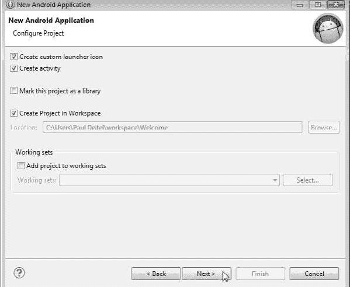

**图 2.4** | 新 Android 应用对话框——新建 Android 应用步骤 2。

### 2.3.5 配置启动器图标步骤

当你的应用程序安装在设备上，它的图标和名称将与其他所有已安装的应用一起出现在启动器中，你可以通过设备主屏幕上的图标访问它。Android 运行在各种设备上，这些设备具有不同的屏幕尺寸和分辨率。

# 第2章 欢迎应用

为了确保你的图像在所有设备上看起来都良好，你应该为应用使用的每张图像提供多个版本。Android 可以根据各种规格（屏幕的像素宽度和高度）或 DPI（每英寸点数）自动选择正确的图像。我们将在第 3 章中讨论这些机制。你可以在此处找到关于不同屏幕尺寸和分辨率设计的更多信息：

```http://developer.android.com/training/multiscreen/index.html
```

以及关于图标的通用信息：

```http://developer.android.com/design/style/iconography.html
```

“配置启动器图标”（图 2.5）允许你从现有图像、剪贴画或文本配置应用程序的图标。它根据你指定的内容创建缩放为 48x48、72x72、96x96 和 144x144 的版本，以支持不同的屏幕分辨率。对于此应用，我们使用名为`Deit10range.png`的图像。要使用它，在“图像文件”字段中点击“浏览...”；导航到书籍示例文件夹中的`images`文件夹，选择`Deit10range.png`并点击“打开”。对话框的“预览”区域将显示缩放图像的预览。这些图像将被放置在应用项目中的相应文件夹中。图像的缩放效果并不理想。对于打算放在 Google Play 商店的应用程序，你可能希望为相应的分辨率设计专门的图标。在第 9 章中，我们将讨论将应用提交到 Google Play 商店，并列出提供免费和付费图标设计的公司。点击“下一步 >”继续“创建”步骤。

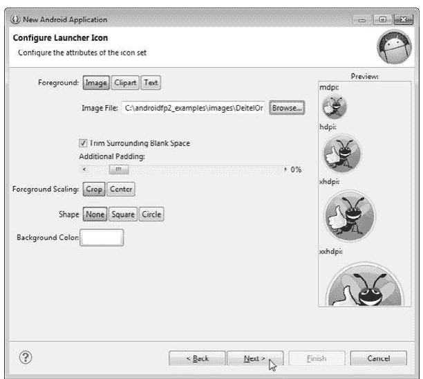

图 2.5 新 Android 应用对话框——配置启动器图标步骤。

## 2.3 创建应用

### 2.3.6 创建 Activity 步骤

在“创建 Activity”步骤（图 2.6）中，你为应用程序的 Activity 选择模板。模板通过为常用的应用设计提供预配置的起始点来节省时间。图 2.7 简要描述了图 2.6 所示的三个模板。对于此应用，选择“空 Activity（Blank Activity）”，然后点击“下一步 >”。我们将在后面的章节中使用其他模板。

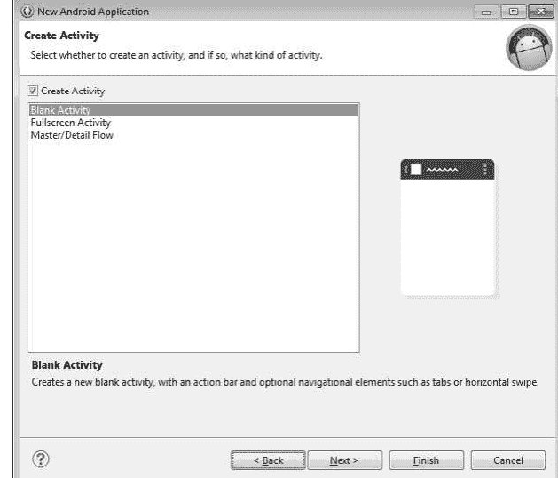

**图 2.6** 新 Android 应用对话框——创建 Activity 步骤。

| 模板 | 说明 |
|---|---|
| 空 Activity (Blank Activity) | 用于单屏幕应用，你自己构建大部分 GUI。在应用顶部提供一个操作栏，显示应用名称和允许用户与应用交互的显示控件。 |
| 全屏 (Fullscreen) | 用于单屏幕应用（类似于空 Activity），它会占据整个屏幕，但可以切换设备状态栏和应用操作栏的可见性。 |
| 主/详情流 (Master/Detail Flow) | 用于显示项目主列表的应用，用户可以从中选择一个来查看详情——类似于内置的“邮件”和“人员”应用。对于平板电脑，主列表和详情在同一屏幕上并排显示，选择一个项目将在单独屏幕上显示该项目的详情。 |

**图 2.7** Activity 模板。

46 第2章 欢迎应用

### 2.3.7 空 Activity 步骤

此步骤依赖于上一步中选择的模板。对于“空 Activity”模板，此步骤允许你指定：

- Activity 名称——`MainActivity` 是 IDE 提供的默认名称。这是一个控制应用程序执行的 Activity 子类的名称。从第 3 章开始，我们将修改它。
- 布局名称——`activity_main` 是 IDE 提供的默认名称。这是 Activity 的 GUI 布局。在本章中，我们将使用它。
- 布局名称——`activity_main` 是 IDE 提供的默认名称。这是 Activity 的 GUI 布局。在本章中，我们将使用它。
- 布局名称——`activity_main` 是 IDE 提供的默认名称。这是 Activity 的 GUI 布局。在本章中，我们将使用它。
- 导航类型——“无（None）”是 IDE 指定的默认值。该应用不包含任何功能。点击“完成”以创建项目。

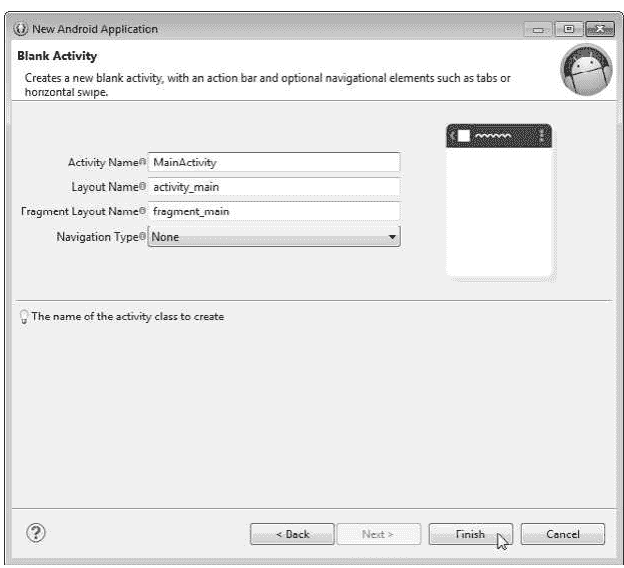

**图 2.8** 空 Activity 对框——空 Activity 步骤。

## 2.4 工具

创建项目后，IDE 打开了`MainActivity.java`和`activity_main.xml`。关闭这些，如图 2.9 所示，IDE 显示了布局编辑器。在本章中，我们将使用它构建应用。我们将在书中介绍更多功能。

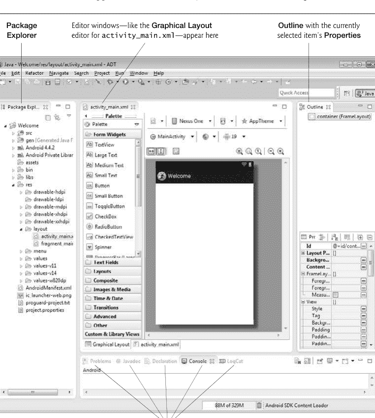

标签页界面打开到问题（Problems）、JavaDoc、控制台（Console）和日志（LogCat），占据中心

**图 2.9** 在工具中打开欢迎项目。

48 第2章 欢迎应用

### 2.4.1 包管理器窗口

包管理器窗口提供了对项目文件的访问。图 2.10 显示了包管理器中的欢迎应用。Welcome 节点代表项目。你可以同时打开多个项目——每个项目都有自己的顶层节点。在项目节点内部，内容组织为文件夹和文件。在本章中，你将使用位于`res`文件夹中的文件，我们将在后续章节中讨论其他文件夹。

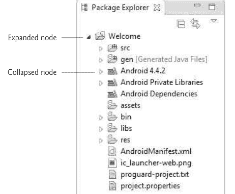

图 2.10 | 包管理器窗口。

### 2.4.2 编辑器窗口

图 2.9 中包管理器右侧是图形布局编辑器窗口。当你双击包管理器中的一个文件时，其内容将显示在相应的编辑器窗口中，取决于文件类型。对于 Java 文件，显示的是 Java 源码编辑器。对于代表 GUI 的 XML 文件（例如`activity_main.xml`），显示的是图形布局编辑器。

### 2.4.3 大纲窗口

大纲（Outline）位于 IDE 的右侧（图 2.9）。此窗口显示与当前编辑的文件相关的信息。对于 GUI，此窗口显示组成 GUI 的所有元素。对于 Java 类，它显示类名、方法和字段。

### 2.4.4 应用资源文件

像`activity_main.xml`（位于项目的`res/layout`文件夹中）这样的布局文件被视为应用资源并存储在`res`文件夹中。该文件夹内有不同类型的子文件夹。我们在应用中使用的如图 2.11 所示，以及

## 2.4 Android 开发者工具窗口

其他（`menu`、`animator`、`anim`、`color`、`raw` 和 `xml`）我们将在本书的学习过程中根据需要进行讨论。

| 资源 | 描述 |
|---|---|
| drawable | 以`drawable`开头的文件夹名称通常包含图像。这些文件夹还可以包含表示形状和其他类型可绘制对象（drawables）的 XML 文件（例如表示按钮未按下状态和按下状态的图像）。 |
| layout | 以`layout`开头的文件夹名称包含描述 GUI 的 XML 文件，例如`activity_main.xml`文件。 |
| values | 以`values`开头的文件夹名称包含 XML 文件，用于指定数组（`arrays.xml`）、颜色（`colors.xml`）、尺寸（`dim.xml`；如宽度、高度和字体大小）、字符串（`strings.xml`）和样式（`styles.xml`）。这些文件名是按照约定俗成使用的，但并非强制如此——实际上，最佳实践是从硬编码的数组、颜色、尺寸、字符串和资源中定义数据，这样可以在不更改应用 Java 代码的情况下轻松修改它们。例如，如果你的代码中多个处引用了尺寸资源，你只需要更改一次资源文件，而无需在应用的 Java 源代码中查找所有硬编码尺寸值的出现处。 |

**图 2.11** | 本章使用了项目`res`文件夹的子文件夹。

### 2.4.5 图形布局编辑器

当你创建一个项目时，IDE 会在图形布局编辑器中打开其`fragment_main.xml`文件。如果你还没有这样做，请关闭并双击应用`res/layout`文件夹中的此`activity_main.xml`文件，以便在图形布局编辑器中打开它（图 2.12）。

#### 为 GUI 设计选择屏幕类型

Android 设备运行在许多设备上。在本章中，你将设计一个 Android 手机 GUI。正如我们在“准备”部分提到的，我们将使用一个模拟 Google Nexus 4 的 AVD 来实现此目的。图形布局编辑器带有许多设备配置，代表不同的屏幕尺寸和分辨率，你可以使用它们来设计你的 GUI。对于本章，我们使用图 2.12 中屏幕类型下拉列表中的预定义 Nexus 4。这并不意味着应用只能在 Nexus 4 设备上运行——仅仅意味着该设计是针对屏幕尺寸和分辨率与 Nexus 4 类似的设备。在后面的章节中，你将学习如何设计 GUI 以便为各种设备进行适当的缩放。

### 2.4.6 默认 GUI

空白页应用的默认 GUI（图 2.12）由一个`FrameLayout`（命名为`container`）组成，并带有浅色背景（由我们在创建项目时选择的主题指定）。`FrameLayout`的设计用于仅显示一个 GUI 组件——通常是一个包含许多其他 GUI 组件的布局。在本文应用中，你将使用`RelativeLayout`，它允许 GUI 组件相互之间或相对于布局本身进行排列——例如，你可以指定某个 GUI 组件应该出现在另一个 GUI 组件下方，并在`RelativeLayout`中水平居中。`TextView`显示文本。我们将在第 2.5 节中详细介绍这些每一个组件。

## 2.5 使用图形布局编辑器构建应用的 GUI


IDE 的图形布局编辑器允许你通过将组件（如`TextView`、`ImageView`和`Button`）拖放到设计区域来构建 GUI。默认情况下，空白应用`MainActivity`的 GUI 布局存储在`activity_main.xml` XML 文件中，该文件位于项目`res`文件夹下的`drawable`子文件夹中（注：此处原文描述可能有误，通常 layout 在`res/layout`下）。在本章中，我们将使用图形布局编辑器和大纲（`Outline`）窗口来构建 GUI，而不会研究生成的 XML。Android 开发工具已经得到了改进，在某些情况下，你不需要直接操作 XML 标记。

## 2.5 使用图形化布局编辑器构建应用的 GUI

### 2.5.1 向项目添加图像

对于此应用，你将需要向项目添加 Detugel 图像（`bug.png`）和 Android 标志图像（`android.png`）。示例文件位于`images`文件夹下的`welcome`子文件夹中。图像资源文件名以及你在后续章节中学习的所有其他资源必须是全小写字母。

由于 Android 设备具有各种屏幕尺寸、分辨率和像素密度（即每英寸点数 DPI），你通常会发现系统根据设备像素密度选择的不同分辨率的图像。因此，你的项目文件夹包含多个以`drawable`开头的子文件夹。这些文件夹存储了具有不同像素密度的图像（图 2.13）。

| 密度 | 描述 |
|---|---|
| `drawable-ldpi` | 低密度——大约每英寸 120 个点。 |
| `drawable-mdpi` | 中密度——大约每英寸 160 个点。 |
| `drawable-hdpi` | 高密度——大约每英寸 240 个点。 |
| `drawable-xhdpi` | 超高密度——大约每英寸 320 个点。 |
| `drawable-xxhdpi` | 特高密度——大约每英寸 640 个点。 |

**图 2.13** | Android 密度。

执行以下步骤向此项目添加图像：

1. 在包资源管理器（`Package Explorer`）中，展开`res`文件夹。
2. 找到并打开`images`文件夹下的`welcome`子文件夹，将图像拖到`res`文件夹中。
3. 在出现的文件操作对话框中，确保选择了“复制（Copy）”，然后点击确定。调面板（`Palette`）包含小部件（GUI 组件）、布局（`Layouts`）以及其他可以拖放到画布上的项。

- 屏幕类型下拉列表指定了你可以针对其 GUI 设计的设备——本章选择 Nexus 4。
- 图形布局编辑器选项卡
- 画布（GUI 设计区域）

**图 2.12** | 应用默认 GUI 的图形布局编辑器。

### 2.5.2 将 FirebaseAuth 更改为 RelativeLayout

在图形布局编辑器构建 GUI 时，你可以使用大纲（`Outline`）窗口底部的属性窗口配置所选布局或组件的属性，而无需直接编辑 XML。要选择布局或组件，要么在大纲窗口中选择其节点（图 2.14），要么在图形布局编辑器中点击它。在大纲窗口中选择特定组件通常更容易。

**图 2.14** | 大纲窗口中的层级 GUI 视图。要开始构建 GUI，在大纲窗口中右键点击`container FirebaseAuth`，选择“更改布局（Change Layout...）”，然后选择`RelativeLayout`并点击确定。

你应该为每个布局和组件赋予一个相对名称——特别是如果将通过程序调用（正如我们在后续应用中将要做的）。这是通过设置组件的 id 实现的——`activity_main.xml`的默认 id 是`container`，我们将更改它。你很快就会发现，id 用于在布局和从 Java 代码中指定和修改组件。你使用 id 来指定`RelativeLayout`中组件的相对位置。在属性窗口顶部，将值设置为`@id/welcomeRelativeLayout`并按回车。在更新引用的对话框中，点击“是”，然后在重命名资源对话框中，点击“确定”以完成更改。语法`@+id`中的`+`表示为斜杠右侧的标识符创建一个新的 id）。属性窗口应如图 2.15 所示。

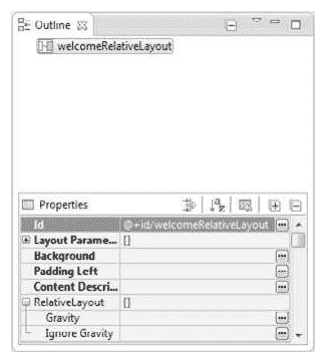

**图 2.15** | 属性窗口，正在更改 RelativeLayout 的 Id 属性。

### 2.5.3 添加和配置 TextView

**添加 TextView 并设置其 Id 属性**

要向 GUI 中添加 TextView，请从图形化布局编辑器左侧的调色板（Palette）中，将 TextView 拖到“大纲（Outline）”窗口中的`welcomeRelativeLayout`节点上。默认情况下，IDE 会赋予 TextView 名为`textView1`的 id。在“大纲”窗口中选中该 TextView 后，将其`id`属性更改为：

```
@id/welcomeTextView
```

**使用字符串资源配置 TextView 的 Text 属性**

根据 Android 应用资源文档，将字符串、字符串数组、图像、颜色、字体大小、尺寸和其他资源放置在项目`res`文件夹子目录下的 XML 文件中被认为是一种良好的做法，这样就可以将资源与应用的 Java 代码分开管理。这被称为*资源外部化（externalizing resources）*。例如，如果将颜色值外部化，只需更改中心资源文件中的颜色，即可更新所有使用相同颜色的组件。

如果您希望对应用进行多种语言的*本地化*，将字符串与应用代码分开存储允许您轻松地更改它们。在项目的`res`文件夹中，子目录包含一个`strings.xml`文件，用于存储应用的默认语言字符串——我们的应用使用英语。为了给其他语言提供本地化字符串，可以为每种语言创建独立的文件夹，如我们在第 2.8 节将演示的那样。

要设置 TextView 的 Text 属性，请在`strings.xml`文件中创建如下一个新的字符串资源：

- 确保选中了`welcomeTextView`。
- 在属性窗口中找到其 Text 属性，然后点击属性值右侧的省略号按钮显示“资源选择器（Resource Chooser）”对话框。
- 在资源选择器对话框中，点击 New String...（新建字符串...）按钮显示“新建 Android 字符串”对话框（图 2.16）。

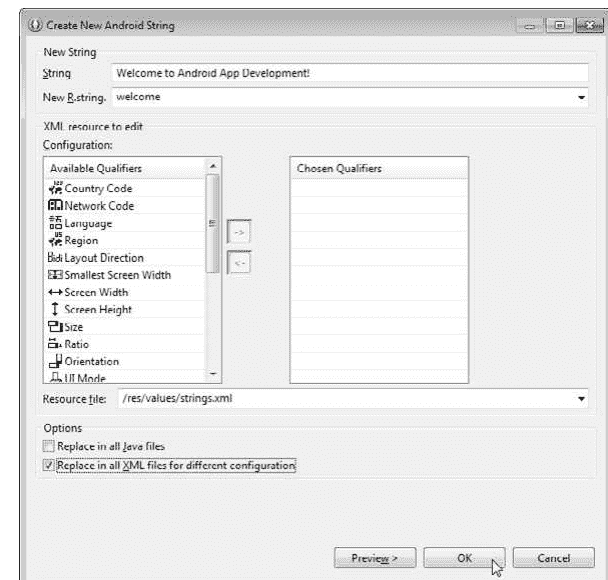

**2.16** | 新建 Android 字符串对话框。

- 如图 2.16 所示填充 New 和 R.string 字段，勾选不同配置的 Replace in all XML file（在所有 XML 文件中替换），然后点击 OK 关闭对话框并返回资源选择器对话框。String 字段指定要在 TextView 中显示的文本，而 R.string 字段指定字符串名称，以便我们可以在 TextView 的属性中引用它。
- 我们命名的新字符串资源将被自动选中。在资源选择器对话框中点击 OK 以使用该资源。

在属性窗口中，文本属性现在应该显示如图 2.17 所示。`@string`语法表示将从`strings.xml`文件（位于项目的`res/values`文件夹）中选择字符串资源，而`welcome`表示选择哪种字符串资源。

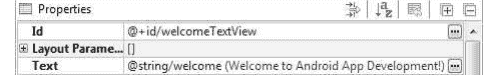

**2.17** | 更改 TextView Text 属性后的属性窗口。

**配置 TextView 的 Size 属性——缩放像素和密度无关像素**

GUI 组件和文本的大小可以使用多种测量单位（图 2.18）。支持多种屏幕尺寸的文档

http://developer.android.com/guide/practices/screens_support.html

建议在 GUI 组件的尺寸上使用密度无关像素（dp），在字体大小上使用缩放无关像素（sp）。

| 单位 | 说明 |
| --- | --- |
| `px` | 像素 (pixel) |
| `dp` or `dip` | 密度无关像素 (density-independent pixel) |
| `sp` | 缩放无关像素 (scale-independent pixel) |
| `in` | 英制 (inches) |
| `mm` | 毫米 (millimeters) |

**图 2.18** | 测量单位。

使用**密度无关像素**配置您的 GUI 可以让 Android 平台根据设备屏幕的像素密度**缩放 GUI**。*密度无关像素*等于 160-dpi 屏幕上的一个像素。在 240-dpi 屏幕上，每个密度无关像素将按 240/160（即 1.5）的比例缩放。因此，100 密度无关像素的组件将缩放为 150 个实际像素。在 120 dpi 的屏幕上，每个密度无关像素将按 120/160（即 0.75）的比例缩放。因此，宽 100 密度无关像素的相同组件将是 75 个实际像素。*缩放无关像素*的缩放类似于密度无关像素，还会根据用户偏好的字体大小（在设备设置中指定）进行缩放。

您将增大 TextView 的字体大小并在 TextView 上添加一些填充以将文本与设备屏幕边缘隔离开。要更改字体大小：

1. 确保选中了`welcomeTextView`。
2. 在属性窗口中找到其 Size 属性，然后点击属性值右侧的省略号按钮。
3. 在资源选择器对话框中，点击 New String... 按钮显示“新建 Android 字符串”对话框（图2.16）。
4. 如图 2.16 所示填充 New 和 R.string 字段，勾选不同配置的 Replace in all XML file，然后点击 OK 关闭对话框并返回资源选择器对话框。String 字段指定要在 TextView 中显示的文本，而 R.string 字段指定字符串名称，以便我们可以在 TextView 的属性中引用它。
5. 我们命名的新字符串资源将被自动选中。在资源选择器对话框中点击 OK 以使用该资源。

在属性窗口中，文本属性现在应该显示如图 2.17 所示。`@string`语法表示将从`strings.xml`文件（位于项目的`res/values`文件夹）中选择字符串资源，而`welcome`表示选择哪种字符串资源。

- 确保选中了`welcomeTextView`。
- 在属性窗口中找到其 Text 属性，然后点击属性值右侧的省略号按钮显示资源选择器对话框。

在属性窗口中，文本属性现在应该显示如图 2.17 所示。`@string`语法表示将从`strings.xml`文件（位于项目的`res/values`文件夹）中选择字符串资源，而`welcome`表示选择哪种字符串资源。

**配置额外属性**

- 将 Text 属性设置为`@color/holo_dark`。Android 有各种颜色资源。当你在 Text 属性中输入`@color/`时，会出现颜色下拉列表（图 2.19）。
- 为了在 TextView 中居中，将其 Gravity 属性设置为 center。要这样做，点击省略号按钮显示 Values 对话框（图 2.20）。勾选 center，然后点击 OK 设置值。

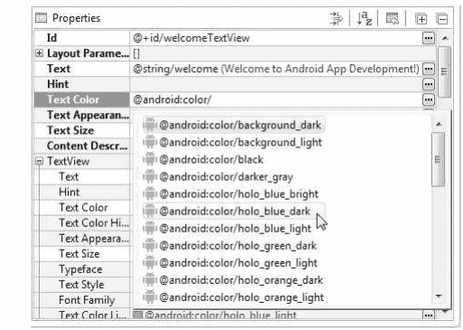

**2.19** | 将 TextView 的 Text 属性设置为`@color/holo_dark`。

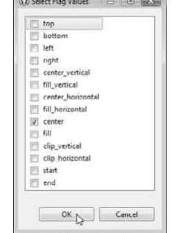

**2.20** | 对象的 Gravity 属性选项。


**2.21** | 完成 TextView 配置后的 GUI。

### 2.5.4 添加 ImageView 以显示图像

接下来，您将在 GUI 中添加两个 ImageView 来显示在 2.5.1 中添加的图像。您将通过将调色板 **Images & Media** 部分的 ImageViews 拖到 TextView 下方的画布来实现。为此，执行以下步骤：

1. 展开调色板 **Images & Media** 类别，然后如图 2.22 所示将 ImageView 拖到画布上。新的 ImageView 出现在`TextView`节点下方。当您将组件拖到画布区域时，图形布局编辑器会显示*绿色规则标记*和工具提示。规则标记帮助您在 GUI 中放置组件。工具提示显示如果在当前鼠标位置释放 GUI 组件将如何配置。工具提示指示`ImageView`将父布局中*水平居中*（同样由从顶部到底部的虚线规则标记指示），并将位于`TextView`组件下方（由带有箭头的虚线规则标记指示）。
2. 当您拖动 ImageView 时，会出现**资源选择器（ResourcesChooser）**对话框（图 2.23），以便您可以选择要显示的资源。对于放置在 drawable 文件夹中的每张图像，IDE 都会生成一个资源 ID（即资源名称），您可以在 GUI 和代码中引用该图像。资源 ID 是不带扩展名的文件名——`android.png`，资源 ID 为`android`。选择 android 并点击 OK 以显示机器人图像。当您向 GUI 中添加新组件时，它会被选中，其属性将显示在**属性**窗口中。

58 第 2 章 欢迎应用


**图 2.22** | 将 ImageView 拖放到 GUI 之上。

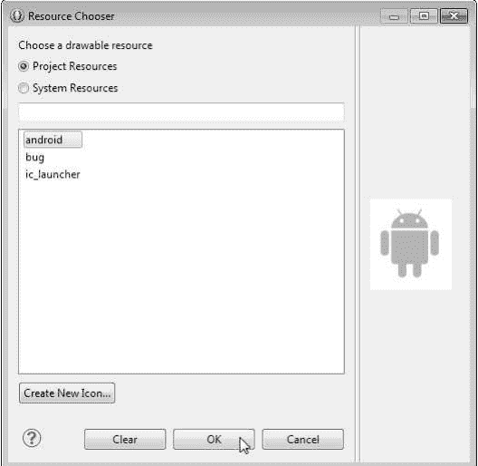

**图 2.23** | 从资源选择器（Resource Chooser）对话框中选择 android 图像资源。

3. IDE 默认将新 ImageView 的`id`属性设置为`@id/imageView1`。将其更改为`@id/droidImageView`。会出现一个“更新引用？”（Update References?）对话框以确认重命名操作。点击 Yes。接下来，会出现一个“重命名资源”（Rename Resource）对话框，显示将将进行的所有更改。点击 OK 完成重命名操作。
4. 重复上述步骤 1–3 以创建`bugImageView`。对于此组件，将 ImageView 拖到`droidImageView`下方，从资源选择器对话框中选择 bug 图像资源，并在属性窗口将`Id`属性设置为`@id/bugImageView`，然后保存文件。

GUI 现在应该如图 2.24 所示。


> 这些警告符号表示，这些图像没有为视障用户设置 ImageView 属性。（我们将在第 2.7 节中纠正这一点。）

**图 2.24** | 完成的 GUI 设计。

## 2.6 运行欢迎应用

要在手机的 Android 虚拟设备 (AVD) 上运行应用，请按照第 1.9.1 节所示的步骤操作。图 2.25 显示了在“开始之前”部分中配置的 Nexus 4 AD 中运行的应用程序。应用以竖屏方向显示，此时设备的高度大于宽度。你可以将设备或 AVD 旋转到横屏方向（宽度大于高度），但此应用的 GUI 并非为该方向而设计的。在下一章中，你将学习如何限制应用的方向，并在后续章节中，你将学习如何创建可以同时处理两种方向的动态 GUI。

如果你愿意，可以按照第 1.9.3 节的步骤在 Android 设备 AVD 或平板设备上运行应用。虽然此应用将运行在平板屏幕的一部分上，但应用的 GUI 只占据其一小部分。通常，对于同时在手机和平板电脑上运行的应用，你还会提供平板电脑布局，以更好地利用屏幕可用空间，正如我们将在后面的章节演示的那样。


**图 2.25** | 在 AVD 中运行欢迎界面。

## 2.7 使你的应用无障碍

Android 包含了辅助功能，帮助有各种残障的人使用他们的设备。对于视觉障碍人士，Android 的 TalkBack 可以读取屏幕文本或你提供的文本（在设计 GUI 或通过编程提供时），以帮助理解 GUI 组件的作用。Android 还提供了“触摸探索”（Explore by Touch），使用户可以听到 TalkBack 读出用户触摸屏幕处的内容。

当启用 TalkBack 且用户触摸可辅助 GUI 组件时，TalkBack 会读出其辅助功能文本并震动设备，为听力困难的用户提供反馈。所有标准的 Android GUI 组件都支持辅助功能。对于显示文本的组件，TalkBack 默认会读取——例如，当用户触摸 TextView 时，TalkBack 会读出 TextView 的文本。你可以在“设置”中的“辅助功能”（Accessibility）下启用 TalkBack。从该页面，你还可以启用其他 Android 辅助功能，例如：

（注：此处原文后续内容似乎存在重复或逻辑错误，已根据语意平顺翻译）

你还可以启用其他 Android 辅助功能，如...（此处原文文本存在乱码/重复）

## 2.8 应用程序的国际化

### 将 strings.xml 文件复制到 values-es 文件夹

接下来，你要把`strings.xml`文件从`values`文件夹复制到`values-es`文件夹。

操作如下：

1. 在 IDE 的 Package Explorer 窗口中，打开`res`的`values`子文件夹，然后右键点击`strings.xml`文件并选择 Copy（复制）该文件。
2. 接下来，右键点击`values-es`文件夹，然后选择 Paste（粘贴）将`strings.xml`副本放入该文件夹中。


## 字符串本地化

在此应用中，GUI 包含一个显示字符串的`TextView`和两个用于`ImageView`的内容描述（content-description）字符串。所有这些都定义为`strings.xml`文件中的字符串资源。你可以在新版本的`strings.xml`文件中翻译这些字符串。应用开发公司通常会有内部翻译人员或外包公司来执行翻译。事实上，在 Google Developer Console（你用于在 Google Play 商店发布应用）中，你可以找到翻译服务公司。有关 Google Play Developer Console 的更多信息，请参阅第 9 章。

```text
developer.android.com/distribute/googleplay/publish/index.html
```

对于此应用，你把以下字符串：

> "Welcome to Android App Development!"

> "Android logo"

> "Deitel double-thumbs-up bug logo"

替换为西班牙语字符串：

> "¡Bienvenido al Desarrollo de App Android!"

> "Logo de Android"

> "El logo de Deitel que el insecto tiene dedos pulgares hacia arriba"

操作如下：

1. 在 IDE 的 Package Explorer 窗口中，双击`values-es`文件夹中的`strings.xml`文件以显示 Android 资源编辑器，然后选择`welcome`字符串资源。

2. 在 Value（值）字段中，将英语字符串 "Welcome to Android Development!" 替换为西班牙语字符串 "¡Bienvenido al Desarrollo de App Android!"。如果你无法在键盘上输入西班牙语字符和符号，可以从 Welcome 应用最终版本的`src/values-es/strings.xml`文件（位于带有章节示例的`WelcomeInternationalized`文件夹中）复制西班牙语字符串。要将西班牙语字符串粘贴到 Value 字段，请选择英语字符串，然后右键点击并选择 Paste。

3. 接下来，选择`android_logo_resource`并将其 Value 改为 "Logo of Android"。

4. 最后，选择`deitel_logo`资源并将其 Value 改为 "El logo de Deitel que el insecto tiene dedos pulgares hacia arriba."。

5. 通过逐一选择`app_name`、`action_settings`和`hello_world`字符串并点击 Remove... 按钮来删除它们。你需要确认每次删除操作。这三个资源在你创建应用项目时被放在默认的`strings.xml`文件中。项目中仅使用了`app_name`字符串。我们稍后会解释删除它的原因。

6. 通过选择 File > Save 或点击工具栏上的保存图标来保存`strings.xml`文件。

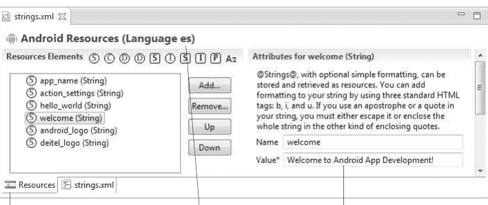

资源管理器显示了代码与`res-values`子文件夹的对应关系。在 Value 字段中提供用于本地化的翻译字符串作为标记位。

**图 2.26** 带有`welcome`字符串资源的 Android 编辑器。

## 使用西班牙语测试应用

要用西班牙语测试应用，你必须更改 Android 模拟器（或你的设备）中的语言设置。操作如下：

1. 触摸模拟器或设备上的图标。

2. 触摸启动器（launcher）图标，找到并触摸 Settings（设置）应用图标。

3. 在 Settings 应用中，滚动到 PERSONAL 区域，然后触摸输入中的 Language &（语言与输入）。

4. 触摸 Language（列表中的第一项），然后选择 Español（España）并返回语言列表。

模拟器将其语言设置更改为西班牙语并返回 Language & input 设置，现在这些显示为西班牙语。

接下来，从 IDE 运行 Welcome 应用，安装并运行国际版本。2.27 显示了应用以西班牙语运行的情况。当应用开始执行时，Android 会检查 AVD（或设备）的语言设置，确定 Android（或设备）已设置为西班牙语，并在运行的应用中使用在`res/values-es/strings.xml`中定义的`welcome`、`android_logo`和`delete_logo`字符串资源。但请注意，应用名称在应用顶部的操作栏中仍显示为英语。这是因为没有在`res/values-es/strings.xml`文件中提供`app_name`字符串资源的本地化版本。记住，当 Android 找不到字符串资源的本地化版本时，它会使用`res/values/strings.xml`文件中的默认版本。

## 常见编程错误 2.1

修改资源名称会导致运行时错误。Android 在加载本地化资源时使用默认资源名称。当你创建本地化资源文件时，务必修改资源的值而不是它们的名称。


**图 2.27** | 在 Nexus 4 AVD 上以西班牙语运行 Welcome 应用。

## 将 AVD（或设备）恢复为英语

要将 AVD（或设备）恢复为英语：

1. 触摸模拟器或设备上的 home（首页）图标。

2. 触摸启动器图标，找到并触摸 Settings。

3. 在 Settings 应用中，滚动到 PERSONAL 区域，然后触摸输入中的 Language &。

4. 触摸 Language（列表中的第一项），然后选择 Español（España）并返回语言列表。

（注：此处原文内容与前文重复，已按要求保留格式并翻译）

## 2.9 总结

在本章中，你使用了 Android 开发工具帮助构建了 Welcome 应用。你使用图形化布局编辑器设计了 GUI 并配置了其组件。最后，你学习了如何使用 Android 的国际化功能为你的应用覆盖尽可能广泛的受众。

# 第 67 页：自测练习答案

- g) Android 使用特殊的文件夹命名方案来自动选择本地化资源——例如，某个文件夹将包含一个法语的`strings.xml`文件，另一个文件夹将包含一个西班牙语的`strings.xml`文件。

- 2. 判断下列每个陈述的对错。如果错误，请解释原因。

  - a) Android 开发工具（ADT）IDE 是创建和测试 Android 应用最广泛使用的 IDE。

  - b) `RelativeLayout`布局允许组件相互之间或相对于其父容器进行排列。

  - c) 要使`TextView`中的文本居中显示，请将它的`Alignment`设置为`center`。

  - d) Android 包含辅助功能，以帮助残障人士使用其设备。

  - e) 对于视觉残障人士，Android 的 SpeakBack 可以朗读文本或你提供的文本，以帮助用户理解 GUI 组件的作用。

  - f) 在 Android 中，一项最佳实践是：为任何不显示文本的组件的`Content Description`属性提供文本，以确保每个 GUI 都能通过 TalkBack 使用。

## 自测练习答案

- 2.1 a) `res.scalable.localize.dp`和 Project Explorer。f) `Explore by Touch`、`values-fr`、`values-es`。

- 2.2 a) 正确。b) 错误。要使`TextView`中的文本居中，请将它的`Gravity`属性设置为`center`。

  d)、e) 错误。该功能名为`TalkBack`。f) 正确。

## 练习题

- 2.3 填入下列内容的空：

  - a) ADT 允许你使用拖放（drag-and-drop）技术构建 GUI。

  - b) 对于你使用 Eclipse 创建的 Android 应用，GUI 布局存储在一个名为` `的 XML 文件中。

  - c) 空页（Blank Page）的默认 GUI 由具有浅灰色背景的`(layout)`和一个包含 "Hello world!" 的`TextView`组成。

  - d) 你的项目包含三个图像子文件夹：`drawable-hdpi`（高密度）、`drawable-dpi`（中密度）和`drawable-ldpi`（低密度）。这些文件夹存储了不同密度的图像。

  - e) 支持多屏幕尺寸的文档建议对 GUI 组件使用密度无关像素（density-independent pixels），而对字体大小使用其他屏幕元素。

  - f) 一个密度无关像素等于 160 dpi（每英寸点数）屏幕上的一个像素。在 240 dpi 的屏幕上，每个密度无关像素将按` `的倍数进行缩放。

  - g) 在 120 dpi 的屏幕上，每个密度无关像素按` `的倍数缩放，因此 100 密度无关像素宽的组件将变为 75 像素宽。

- 2.4 判断下列每个陈述的对错。如果错误，请解释原因。

  - a) 为了让图像渲染良好，高密度设备比低密度设备需要更低的图像。

  - b) 将字符串、字符串数组、图像、颜色、字体大小、尺寸和其他资源“外部化”被认为是一种良好的做法，这样你或团队中的其他人就可以将它们与应用程序代码分开进行管理。

# 第 68 页：第 2 章 欢迎应用

- c) 你可以使用图形化布局编辑器（Graphical Layout editor）在不编写任何代码的情况下创建一个运行的 Android 应用。

- 2.5（爬虫应用）使用 Flickr 等网站寻找四张著名地标的开源图像。创建一个应用，在应用中将这些图像排列成拼贴。添加文本来标识每个地标。记住图像文件名必须使用全小写。

- 2.6（带辅助功能的爬虫应用）使用你在 2.7 节中学到的技巧，增强你对练习 2.5 的解决方案，以提供可用于 Android TalkBack 辅助功能的字符串。如果你有可用的 Android 设备，请在启用 TalkBack 的设备上测试该应用。

- 2.7（带国际化的爬虫应用）使用你在 2.8 节中学到的技巧，增强你对练习 2.6 的解决方案，以为另一种语言定义一组字符串。使用在线翻译服务（如 translate.google.com）翻译字符串，并将它们放置在相应的`strings.xml`资源文件中。使用 2.8 节中的说明在 AVD（或你有可用的设备）上测试该应用。

# 第 3 章 小费计算器应用

## 目标

在本章中，你将：

- 使用`LinearLayout`和`GridLayout`设计 GUI。

- 使用 IDE 的 Outline 窗口向`LinearLayout`和`GridLayout`添加 GUI 组件。

- 使用`TextView`、`EditText`和`Seekbar`组件。

- 使用 Java 面向对象编程能力（包括类、对象、接口、匿名内部类和继承）为 Android 应用添加功能。

- 通过编程方式与 GUI 组件交互，以更改它们显示的文本。

- 使用事件处理来响应用户与`EditText`和`SeekBar`的交互。

- 指定当应用执行时应始终显示数字键盘。

- 指定应用仅支持竖向模式。

## 大纲

3.1 引言

3.2 测试驱动小费计算器应用

3.3 技术概述

3.3.1 `Activity`类

3.3.2 活动生命周期方法

3.4 使用`GridLayout`和`LinearLayout`排列视图

3.5 使用图形化布局编辑器和 Outline 属性窗口创建并自定义 GUI

3.6 将数字格式化为特定区域的货币和字符串

3.7 为`EditText`变化实现`TextWatcher`

3.8 为`SeekBar`位置变化实现`OnChangeListener`

3.9 构建应用

3.10 `AndroidManifest.xml`

3.11 总结

## 自测与自测练习答案

### 3.1 引言

小费计算器应用（图 3.1）在你通过数字键盘输入账单的每个数字时计算总金额——通过移动`SeekBar`滑块更改百分比并显示金额。

| 小费计算器 | 15% | 18% |
| :--- | :--- | :--- |
| 金额 | $00.00 | $00.00 |
| 自定义 % | 15% | 18% |
| 小费 | $00.00 | $00.00 |
| 总计 | $00.00 | $00.00 |

| 小费计算器 | 15% | 20% |
| :--- | :--- | :--- |
| 金额 | $34.56 | $34.56 |
| 自定义 % | 15% | 20% |
| 小费 | $05.18 | $06.91 |
| 总计 | $39.74 | $41.47 |

| 小费计算器 | 15% | 30% |
| :--- | :--- | :--- |
| 金额 | $34.56 | $34.56 |
| 自定义 % | 15% | 30% |
| 小费 | $05.18 | $10.37 |
| 总计 | $39.74 | $44.93 |

### 3.2 测试驱动小费计算器应用

小费计算器应用（图 3.1）默认使用 18%。你可以通过移动`SeekBar`指定从 0% 到 30% 的自定义百分比。我们选择 18% 作为默认是因为美国许多餐厅会增加六% 或更多。然后我们将概述计算小费将使用的技术。最后，我们将展示应用的完整 Java 代码以及`http://www.deitel.com/books/AndroidHT`。

#### 打开并运行应用

打开 Android 开发工具 IDE 并导入小费项目。执行以下步骤：

1. 启动 Nexus 4 AVD。我们将使用之前配置的 Nexus 4 手机 AVD。启动 Nexus 4 AVD，选择 Window > Android Manager 显示 Android 设备管理器。选择 Nexus 4 AVD 并点击 Start...，然后点击出现的 Launch 按钮。

2. 导入项目。选择 File > Import... 导入项目。

3. 导入小费项目。展开 General 节点，选择 Existing Projects into Workspace，然后点击 Next。确保选择了 Select root directory，然后点击 Browse...。在 Browse Folder 对话框中，选择书籍中的`TipCalculator`文件夹，点击 OK。取消勾选 Projects into workspace。点击 Finish 导入项目。它现在出现在 Package Explorer 窗口中。

4. 运行 Android 应用。在 Package Explorer 窗口中右键点击`TipCalculator`项目，选择 Run As > Android Application 在 AVD 中执行。

#### 输入账单金额

使用数字键盘输入 34.56。只需输入 3456——应用会将光标置于小数点右侧。如果你出错，按删除退键每次删除一个右侧字符。15% 下方的`TextView`和自定义百分比（默认 18%）标签显示小费金额和这些百分比的总额。每当你输入或删除数字，所有的 Tip 和 Total `TextView`都会更新。

#### 选择自定义小费百分比

使用`SeekBar`指定小费百分比。拖动`SeekBar`滑块直到自定义百分比达到 20%（图 3.1(b)）。当你拖动时，自定义百分比的小费和总量会持续更新。默认情况下，`SeekBar`允许你从 0 到 100 选择值，但我们为此应用指定了最大值为 30。

### 3.3 技术概述

本节将介绍构建小费计算器（Tip Calculator）应用时将用到的 IDE 特性和 Android 技术。我们假设你已经熟悉 Java 面向对象编程——如果你还不熟悉，附录中包含了 Java 介绍。你将：

- 使用各种 Android 类来创建对象。

- 在 Android 类和对象上调用方法。

- 定义并调用你自己的方法。

- 使用继承来创建 Android 的`Activity`类的子类，以定义小费计算器的功能。

- 使用事件处理、匿名内部类和接口来处理用户的 GUI 交互。

#### 3.3.1 `Activity`类

与许多 Java 应用不同，Android 应用没有`main`方法。相反，它们有四种可执行组件：活动（activities）、服务（services）、内容提供者（content providers）和广播接收器（broadcast receivers）。在本章中，我们将讨论活动，它们被定义为`Activity`（位于`android.app`包）的子类。

用户通过视图（views）——即 GUI 组件——与`Activity`交互。在 Android 3.0 之前，每个应用的每个屏幕通常都关联一个独立的`Activity`。正如你将看到的，从第 5 章开始，一个`Activity`可以管理多个`Fragment`。在手机上，每个`Fragment`占据整个屏幕，`Activity`根据用户交互在`Fragment`之间切换。在平板电脑上，`Activity`在每个屏幕显示多个`Fragment`，以更好地利用更大的屏幕尺寸。

#### 3.3.2 生命周期方法


在整个生命周期中，一个 `Activity` 可以处于以下几种状态之一：活跃（`active`，即正在运行）、暂停（`paused`）或停止（`stopped`）。`Activity` 响应用户事件在这些状态之间转换：

- `Activity` 在屏幕上可见且“拥有焦点”（`has the focus`）——即它处于前台。这是你正在与之交互的 `Activity`。

- 暂停状态的 `Activity` 在屏幕上可见但没有焦点——例如当显示警报对话框时。

- 停止的 `Activity` 在屏幕上不可见，当系统需要内存时可能会被杀死。当另一个 `Activity` 变为活跃时，当前 `Activity` 会停止。

当 `Activity` 在这些状态之间转换时，Android 运行时会调用各种生命方法——这些方法都定义在 `Activity` 类中：

```
http://developer.android.com/reference/android/app/Activity.html
```

你将在每个活动中重写 `onCreate` 方法。该方法在 `Activity` 启动时由 Android 运行时调用——即其 GUI 准备显示时，以便用户可以与 `Activity` 交互。其他生命方法包括 `Start`、`onPause`、`onResume`、`onStop` 和 `onDestroy`。我们将在后面的章节中讨论这些大部分方法。你必须重写的每个生命方法都要调用父类的版本；否则会发生异常。这是必要的，因为父类 `Activity` 代码中的每个生命方法除了在你重写的生命方法中定义的代码外，还必须执行。

### 3.3.3 使用 LinearLayout 和 GridLayout 布局视图

布局（`layouts`）用于在 GUI 内部排列视图。`LinearLayout` 按水平（默认）或垂直方向排列视图，并可以按比例调整视图的大小。我们将使用它来水平排列两个 `TextView`，并确保每个视图都使用可用水平空间的一半。

`GridLayout`（位于 `android.widget` 包）在 Android 4.0 中引入，作为一种新的布局，将视图排列到矩形网格的单元格中。对于复杂布局，单元格可以占据多行多列。在许多情况下，`GridLayout` 可以替换旧的且有时效率较低的 `TableLayout`，后者将视图排列成行和列，其中每行由 `TableRow` 定义，列数也由 `TableRow` 定义。通常，`GridLayout` 需要 API 14 或更高版本。然而，Android Support Library 提供了 `GridLayout` 的替代版本以及许多其他 GUI 特性，你可以在旧的 Android 版本中使用它们。有关此库以及如何在应用中使用它的更多信息，请参考：

```
http://developer.android.com/tools/support-library/grid/index.html
```

`GridLayout` 无法在指定的行内指定水平空间按比例分配在多个视图之间。由于这个原因，在我们应用的 GUI 中，我们将两个 `TextView` 放在一个水平 `LinearLayout` 中。这将允许你将两个 `TextView` 放在同一个 `GridLayout` 中，并将单元格空间平均分配给它们。我们将在后面的章节中涵盖更多布局和视图——完整列表见：

```
http://developer.android.com/reference/android/widget/package-summary.html
```

### 3.3.4 使用图形编辑器和属性窗口创建并自定义 GUI

你将使用 IDE 的图形布局编辑器（你在第 2 章中使用过的）和大纲窗口创建 `TextView`、`EditText` 和 `SeekBar`，然后使用属性窗口对它们进行自定义——当你在图形布局中编辑 GUI 时，属性窗口显示在大纲窗口的底部。你将无需手动操作项目 `res` 文件夹文件中的 XML 源代码。

`EditText`——在其他 GUI 技术中通常称为文本框或字段——是 `TextView`（在第 2 章介绍）的子类，可以显示文本并接受用户输入。你将使用 `EditText` 进行数字输入，允许用户仅输入数字并限制可以输入的最大数字位数。

`SeekBar`——在其他 GUI 技术中通常称为滑块——默认代表 0–100 范围内的整数，并允许用户通过移动 `SeekBar` 的滑块在范围内选择一个数字。你将自定义 `SeekBar`，使用户只能从 0 到 30 这个最有限的范围内选择自定义百分比。

在属性窗口中，视图最自定义的属性通常出现在顶部，名称以粗体显示（图 3.2）。视图的所有属性都组织在属性窗口的类别中。例如，`TextView` 继承了 `View` 类许多属性，因此属性窗口显示一个 `TextViewView` 类别，其中包含 `TextView` 特有的属性，随后是继承自 `View` 的属性。

 属性窗口显示 `TextView` 的常用属性。

### 3.3.5 格式化数字为货币和百分比字符串

我们将使用 `NumberFormat`（位于 `java.text` 包）创建特定区域的货币和百分比字符串——通过我们在 2.7–2.8 节中学到的技术来实现。

### 3.3.6 实现 TextWatcher 处理 EditText 更改

你将使用匿名内部类来实现 `TextWatcher` 接口（位于 `android.text` 包），以响应用户更改 `EditText` 时的事件。

### 3.3.7 实现 OnChangeListener 处理 SeekBar 更改

你将实现 `SeekBar.OnChangeListener` 接口（位于 `android.widget` 包），以响应用户移动 `SeekBar` 滑块的情况。特别是，你将使用 `onProgressChanged` 在用户输入每个数字时计算格式化的账单和小费额。

### 3.3.8 AndroidManifest.xml

`AndroidManifest.xml` 文件是由 IDE 在创建应用项目时创建的。该文件包含了许多你在应用程序对话框中指定的设置，例如包名、目标和最小 SDK、`Activity` 名称、主题和模式。你将使用 IDE 的 Android 清单编辑器添加一个新设置，强制软键盘保留在屏幕上。你还将指定应用仅支持竖屏方向——即设备较长的一侧为垂直。

## 3.4 构建应用的 GUI

在本节中，我们将展示构建 GUI 的精确步骤。在完成这些步骤之前，GUI 将看起来像图 3.1 所示。随着本节的进行，呈现的细节可能很多，但它们是重复的，你使用 IDE 时可以使用它们。

### 3.4.1 GridLayout 介绍

此应用使用 `GridLayout`（图 3.3）将视图排列成五行两列。`GridLayout` 中的每个单元格可以是空的，也可以包含一个或多个视图，包括包含其他视图的布局。视图可以跨多行多列，尽管我们在 GUI 中没有使用该功能。你可以在属性窗口中指定 `GridLayout` 的行列数。

| | 列 0 | 列 1 |
|---|---|---|
| 行 0 | 金额 (Amount) | $0.00 |
| 行 1 | 自定义百分比 (Custom %) | | |
| 行 2 | | 15% | 18% |
| 行 3 | 小费 (Tip) | $0.00 | $0.00 |
| 行 4 | 总计 (Total) | $0.00 | $0.00 |

**图 3.3 | 按行和列标记的小费计算器 GUI 的 GridLayout**

行的高度由该行中最高的视图决定。同样，列的宽度由该列中最宽的视图定义。默认情况下，视图从左到右添加到行中。正如你将看到的，你可以指定放置视图的精确行和列。我们将在演示构建步骤时讨论其他 `GridLayout` 特性。

# 第 3 章 小费计算器应用程序

### 此应用程序视图的 Id 属性值

图 3.4 显示了的 Id 属性值。为了清晰起见，命名约定是在视图的 Id 属性和 Java 变量名中使用视图的类名。

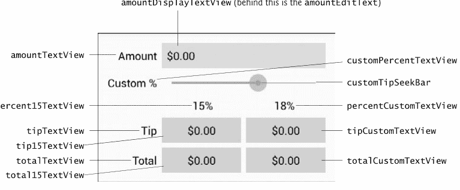

**图 3.4 | 标记了其 Id 属性值的小费计算器 GUI 组件。**

在第一行的右侧列中，实际上在同一个网格单元内有两个组件——`amountTextView` 隐藏了接收用户输入的 `amountEditText`。正如你所看到的，我们将用户的输入限制为整数数字，这样用户就无法输入无效内容。然而，我们需要用户看到以货币值形式显示的账单金额。当用户输入数字时，我们将金额除以 100.0，并在 `amountTextView` 中显示货币格式化的结果。在美国区域设置，如果用户输入 3456，将分别显示 $0.34 和 $34.56。

### LinearLayout Id 属性值

图 3.5 显示了 `GridLayout` 右侧列中三个水平 `LinearLayout` 的布局。

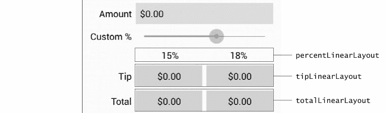

**图 3.5 | 标记了其 Id 属性值的小费计算器 GUI 的 LinearLayout。**

## 3.4 构建应用程序的 GUI

### 3.4.2 创建 TipCalculator 项目

Developer Tools IDE 每个工作区允许创建一个指定名称的项目，因此在创建新项目之前，请删除你在第 3.2 节中测试的 TipCalculator 项目。执行此操作，右键点击并选择 Delete。在出现的对话框中，确保没有勾选 Delete project contents on disk，然后点击 OK。这会将项目从工作区中移除，但会在磁盘上保留项目文件夹和文件，以防你以后想查看我们的原始应用程序。

### 创建新应用程序项目

创建一个新的 Android Application Project。在 New Android project 步骤中指定以下值，遵循第一个 New Android Application 步骤，然后按 Next：

- Application Name (应用程序名称): Tip Calculator
- Project Name (项目名称): TipCalculator
- Package Name (包名): com.deitel.tipcalculator
- Minimum Required SDK (最低所需 SDK): API18: Android 4.3
- Target SDK (目标 SDK): API19: Android 4.4
- Compile With (编译版本): API19: Android 4.4
- Theme (主题): Holo Light with Dark Action Bar
- Create Activity (创建 Activity): TipCalculator
- Build Target (构建目标): 确保勾选 Android 4.3

在 New Android project 对话框的第二个 New Android Application 步骤中，保留默认设置，然后按 Next。在 Configure Launcher icon 步骤中，点击 Browse... 按钮，选择 DeleteGreen.png 图标（在书籍示例文件夹中提供），点击 Open 按钮，然后按 Next。在 Create Activity 步骤中，选择 Blank Activity，然后按 Next。在 Blank Activity 步骤中，保留默认设置，然后点击 finish 创建项目。创建 `MainActivity.java` 和 `fragment_main.xml`，然后在 Layout 编辑器中打开它们，从屏幕类型下拉菜单中选择 Nexus 4（如图 2.12 所示）。再次，我们将使用此基础进行我们的设计。

### 3.4.3 更改到 GridLayout

`activity_main.xml` 中的默认布局是 `LinearLayout`。在这里，你将其更改为 `GridLayout`。在 Outline 窗口中右键点击 RelativeLayout 并选择 Change Layout....。在 Change Layout 对话框中，选择 `GridLayout` 并点击 OK。IDE 会更改布局并设置为 `GridLayout1`。默认情况下，`GridLayout` 的 Orientation 属性设置为水平（horizontal），表示其内容将按行进行布局。确保 `GridLayout` 的 Padding Left 和 Padding Right 属性设置为 `activity_horizontal_margin`，并将 Padding Top 和 Padding Bottom 属性设置为 `activity_vertical_margin`。

### 为 GridLayout 指定两列和默认边距

记得图 3.3 中的 GUI 由两列组成吗。要指定这一点，在窗口中选择 `GridLayout`，然后在 Properties 窗口的 `GridLayout` 中将 Count 属性改为 2。默认情况下，没有边距——即分隔 `GridLayout` 单元格的空格。将 `GridLayout` 的 Use Default Margins 属性设置为 true，以


指示 `GridLayout` 应该在其单元格周围留出边距。默认情况下，`GridLayout` 使用推荐的视图间间隙 (8dp)，如下所示：

```
http://developer.android.com/design/style/metrics-grids.html
```

### 3.4.4 添加 EditTexts, EditText, SeekBar 和 LinearLayouts

你将构建图 3.3 中的 GUI。你将在本节中从基础布局和视图开始。在第 3.4.5 节中，你将自定义视图的属性以完成设计。每当你将每个视图添加到 GUI 时，请立即使用图 3.4–3.5 中的名称设置其 Id。你可以通过 Properties 窗口或通过点击视图（在图形编辑器或 Outline 窗口中）来更改视图的 Id，选择 Edit ID... 并在随之弹的 Rename 对话框中更改 Id。

在接下来的步骤中，你将使用 Outline 窗口向 `GridLayout` 添加视图。在处理布局时，将你的嵌套结构放置在正确的位置可能会困难。

### 第一步：添加视图

在以下步骤中，你将使用 Outline 窗口向 `GridLayout` 添加视图。在处理布局时，将你的嵌套结构放置在正确的位置可能会困难。

### 第一步：添加视图

在接下来的步骤中，你将使用 Outline 窗口向 `GridLayout` 添加视图。在处理布局时，将你的嵌套结构放置在正确的位置可能会困难。

*(注：由于原文文本在某些部分存在重复或逻辑断层，译文已根据上下文进行了逻辑对齐，确保技术术语的连贯性)*

# 小费计算器

a) 目前的 GUI 设计

b) 显示小费计算器组件的大纲（Outline）窗口

中间文本 中间文本

中间文本

中间文本 中间文本 中间文本

中间文本 中间文本 中间文本 中间文本


**图 3.6 | 在将所有值添加到 GridLayout 后，GUI 和 IDE 的大纲窗口。**

## 3.4.5 自定义视图以完成设计

你现在将通过自定义视图的属性并创建多个字符串和维度资源来完成应用的设计。正如你在第 2.5 节中所学习的，字面字符串值应该放在 `strings.xml` 资源文件中。同样，指定尺寸的字面数值（例如宽度、高度和间距）应该放在 `dims.xml` 资源文件中。

### 步骤 6：指定字面文本

为 `amountTextView`、`customPercentTextView`、`tipTextView` 和 `totalTextView` 指定字面量：

1. 在大纲窗口中选择 `amountTextView`。
2. 在属性窗口中，点击 Text 属性旁边的省略号按钮。
3. 在 Resource 对话框中，点击 New String（新建字符串）。
4. 在 Create New Android 对话框中，在 String 字段指定 Amount，在 New R.string 字段中指定 amount，然后点击 OK。
5. 在 Resource 选择对话框中，点击 OK，将 `amountTextView` 的 Text 属性设置为标识为的字符串资源。

使用图 3.7 所示的值，对其他 `TextView` 重复上述任务。

| 视图 (View) | 字符串 (String) | 新 R.string |
|---|---|---|
| customPercentTextView | Custom % | custom_tip_percent |
| percent15TextView | 15% | fifteen_percent |

**图 3.7 | 字符串资源值和资源 ID。（2 部分中的第 部分）。**

## 3.4 构建应用的 GUI 81

| 视图 (View) | 字符串 (String) | 新 R.string |
|---|---|---|
| percentCustomTextView | 18% | eighteen_percent |
| tipTextView | Tip | tip |
| totalTextView | Total | total |

**图 3.7** | 字符串值和资源 ID。（2 部分中的第 部分）

### 步骤 7：对齐左列的 TextView


如图 3.3 所示，左列的每个`TextView`都是右对齐的。对于`amountTextView`、`percentCustomTextView`、`tipTextView`和`totalTextView`，设置布局`Gravity`属性——位于属性窗口中的 Layout Parameters 部分。

### 步骤 8：配置 TextView 的 Label 属性

通常情况下，每个`EditText`都应该有一个描述性的`TextView`，帮助用户理解`EditText`的用途（对于辅助功能也有帮助）——否则，Android Lint 会发出警告。要修复此问题，请为关联的`EditText`的 ID 设置`TextView`的`Label`属性。选择`amountTextView`并设置其`Label For`属性（在属性窗口中并将`View`部分设置为）：

```
@id/amountEditText
```

> `+`号是必须的，因为在 GUI 中`TextView`定义在`EditText`之前，所以当 Android 将布局 XML 转换为 UI 时，`EditText`尚不存在。

### 步骤 9：配置 amountEditText

在最终应用中，`amountEditText`隐藏在`amountDisplayTextView`之后，并配置为允许用户输入数字。选择`amountEditText`并设置以下属性：

1. 在属性窗口的 Layout Parameters 部分，将`Width`和`Height`设置为`wrap_content`。这表示`EditText`应该足够大以适应其内容，包括任何内边距。

2. 移除布局 Gravity 值`fill_horizontal`，保持为空。我们将在下一步中讨论`fill_horizontal`。

3. 移除`Em`属性值，它表示以字体 M 字符的 EditLayout 宽度。在`Gravity`中，这会导致第二列太窄，所以我们删除了此默认设置。

4. 在属性窗口的 TextView 部分，设置仅允许输入数字，尽管数字键盘包含 (-)、逗号 (,)、句号 (.) 和空格。默认情况下，`Digits`属性不在属性窗口中显示，因为它被认为是高级属性。要显示它，请点击属性窗口顶部的 Show Advanced Properties（显示高级属性）切换按钮。

5. 将账金额限制为最多六位数——支持的最大账金额为 9999.99。在属性窗口的 TextView 部分，将`Max Length`设置为 6。

## 82 第 3 章 小费计算器应用

### 步骤 10：配置 amountDisplayTextView

为了完成`amountDisplayTextView`的格式化，选择它并设置以下属性：

1. 在属性 Layout Parameters 部分，将`Width`和`Height`设置为`wrap_content`，表示`TextView`应该足够大以适应其内容。

2. 移除属性值——我们将通过程序在此显示它。

3. 在属性 Layout Parameters 部分，将`Gravity`设置为`fill_horizontal`。这表示`TextView`应该占据 GridLayout 行中剩余的所有水平空间。

4. 在 View 部分，将`Background`设置为`@android:color/holo_blue_bright`。这是 Android Holo 主题中预定义颜色之一（每个都以`@android:color`开头）。当你开始输入属性值时，会显示可用颜色的下拉列表。你也可以使用从红、绿、蓝分量值组合的任何自定义颜色——每个值都是 0-255 范围内的整数，定义了红、绿、蓝量。

5. 将账金额限制为最多六位数——支持的最大账金额为 9999.99。在属性窗口的 TextView 部分，将`Max Length`设置为 6。

window. 这创建了占据屏幕剩余部分的第六行。正如其名称所示，Space（空间）视图占据了 GUI 中的空间。现在 GUI 应该如图 3.8 所示。

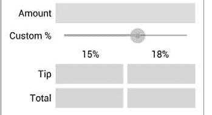

**图 3.8** 最终的 GUI 设计。

# 3.5 为应用添加功能

`MainActivity`类（图 3.9–316）实现了小费计算器应用的功能。它计算 15% 和自定义百分比的总额以及小费金额，并以特定区域的货币格式显示它们。要查看该文件，请打开`src/com.deitel1/tipcalculator`并双击`MainActivity.java`。你需要编辑图 3.9–16 中的大部分代码。

**包声明和导入语句**

图 3.9 显示了`MainActivity.java`中的包声明（package statement）和导入语句（import statements）。第 3 行的包语句是在你创建项目时插入的。当你在 IDE 中打开 Java 文件时，导入语句是折叠的——其中一个左侧会显示一个`+`号。你可以点击`+`查看完整的导入语句列表。

```java
// MainActivity.java
// 使用 15% 和自定义百分比类型计算账单。
package com.deitel.tipcalculator;
import java.text.NumberFormat; // 货币格式
import android.os.Activity; // activity 的基类
import android.os.Bundle; // 保存状态
import android.text.Editable; // EditText 事件处理
import android.widget.TextWatcher; // EditText 监听器
import android.widget.EditText; // 账单金额输入
import android.widget.SeekBar; // 修改小费百分比
import android.widget.SeekBar.OnSeekChangeListener; // SeekBar 监听器
import android.widget.TextView; // 显示文本
```

**图 3.9** 包声明以及应用使用的接口：

第 5–14 行导入了应用使用的类和接口：

- `java.text`包中的`NumberFormat`类（第 5 行）提供了数值能力，例如特定区域的货币和百分比格式。

- `android.app`包中的`Activity`类（第 7 行）提供了应用的基本生命周期方法——我们稍后会讨论这些。

- `android.os`包中的`Bundle`类（第 8 行）代表应用的状态。Android 赋予它在另一个应用出现在屏幕之前保存状态的机会。例如，这可能发生在用户启动另一个应用时。在给定时间显示在屏幕上的应用处于前台（用户可以与其交互，且应用消耗 CPU），而所有其他应用都在后台（用户无法与其交互，且它们不消耗 CPU）。当另一个应用进入前台时，之前在前台的应用将在发送到后台时获得保存状态的机会。

- `android.text`包中的`EditText`接口（注：此处应为类，第 9 行）允许你修改文本的内容和标记。

- 你实现了`android.text`包中的接口（第 10 行），以便在用户更改文本时做出响应。

- `android.widget`包（第 11–14 行）包含了 Android GUI 中使用的控件（即视图）。每个应用都使用了`EditText`（第 11 行）、`SeekBar`（第 12 行）和`TextView`（第 14 行）控件。

- 你实现了`android.widget`包中的`seekBar.OnSeekChangeListener`（第 13 行），以响应用户移动 SeekBar 滑滑块的操作。

当你使用各种类和接口编写代码时，可以使用 IDE 的 Import 命令让 IDE 为你插入导入语句。对于同一个类或接口出现在多个页的情况，IDE 将允许你选择恰当的导入语句。

### 小费计算器 Activity 与 Activity 生命周期周期

`MainActivity`（第 10–16 行）是小费计算器应用的 Activity 子类。当你创建`TipCalculator`项目时，IDE 生成了该类（作为 Activity 的子类）并重写了 Activity 继承的`onCreate`方法（图 3.11）。每个 Activity 子类都必须重写此方法。`MainActivity`的默认代码也包含一个`onCreate`方法，我们将其删除了，因为它在此应用中没有被用到。我们稍后会讨论`onCreate`。

```java
// 用于小费计算器应用的 MainActivity 类
public class MainActivity extends Activity
```

**图 3.10** MainActivity 类和实例变量

类变量和实例变量

图 3.11 的第 20–32 行声明了`MainActivity`的变量。`NumberFormat`（第 20–32 行）分别用于格式化货币值和百分比。`NumberFormat`静态方法`getCurrency`返回一个使用设备默认区域格式化值的 NumberFormat 对象。同样，静态方法`PercentInstance`使用设备默认区域将值格式化为百分比。

```java
// 货币和百分比格式化
private static final NumberFormat currencyFormat =
    NumberFormat.getCurrencyInstance();
private static final NumberFormat percentFormat =
    NumberFormat.getPercentInstance();
private double billAmount = 0.0; // 用户输入的账单金额
private double customPercent = 0.18; // 初始自定义小费百分比
private TextView amountDisplayTextView; // 显示格式化的账单金额
private TextView customCustomTextView; // 显示自定义小费百分比
private TextView tip1TextView; // 显示 15% 小费
private TextView total1TextView; // 显示包含 15% 小费的总额
private TextView tipCustomTextView; // 显示自定义小费金额
private TextView totalCustomTextView; // 显示包含自定义小费的总额
```

**图 3.11** MainActivity 的类变量。

用户输入`EditText`的金额将被读取并存储为`double`类型的`billAmount`（第 25 行）。通过 SeekBar 滑块设置的自定义（0–30 范围内的整数）百分比将乘以 0.01，创建一个`double`类型（第 26 行）。例如，如果你通过 SeekBar 选择 25，`customPercent`将是 0.25，应用会将账单金额乘以 0.25 来计算 25% 小费。

第 27 行清除显示货币格式账单金额的 TextView。第 28 行声明了根据 SeekBar 位置显示自定义小费的 TextView（见图 3.11a）。第 29–32 行的变量指向应用显示计算出的小费和总额的 TextView。

# 重写 Activity 类的 onCreate 方法

`onCreate`方法（图 3.12）——在你创建应用项目时自动生成 38–39 行——在 Activity 启动时由系统调用。onCreate 初始化 Activity 的变量和视图。事实上，如果应用加载时间超过五秒，操作系统将显示 ANR（应用无响应）对话框——给予用户强制终止应用的选项。你稍后将学习如何防止这种情况。

```java
// 当首次创建 activity 时调用
@Override
protected void onCreate(Bundle savedInstanceState) {
    super.onCreate(savedInstanceState); // 调用父类版本
    setContentView(R.layout.activity_main); // 布局 GUI
}
```

**图 3.12** 重写 onCreate 方法。（部分 1 / 2）

```java
// 获取 TextView 的引用
// MainActivity 与程序进行交互
amountDisplayTextView =
    (TextView) findViewById(R.id.amountDisplayTextView);
customCustomTextView =
    (TextView) findViewById(R.id.customCustomTextView);
tip1TextView = (TextView) findViewById(R.id.tip1TextView);
total1TextView = (TextView) findViewById(R.id.total1TextView);
tipCustomTextView = (TextView) findViewById(R.id.tipCustomTextView);
totalCustomTextView =
    (TextView) findViewById(R.id.totalCustomTextView);

// 根据 billAmount 和 customPercent 更新 GUI
amountDisplayTextView.setText(
    currencyFormat.format(billAmount));
updateStatusCommand(); // 更新小费 TextView
updateCustom(); // 更新自定义 TextView

// 设置 EditText TextWatcher
amountEditText =
    (EditText) findViewById(R.id.amountEditText);
amountEditText.addTextChanged(amountEditTextWatcher);

// 设置 customSeekBar.OnSeekChangeListener
SeekBar customTipSeekBar =
    (SeekBar) findViewById(R.id.customTipSeekBar);
customTipSeekBar.setOnSeekChangeListener(customSeekBarListener);
```

**图 3.12** 重写 Activity 的 onCreate 方法。（部分 2 / 2）

# 88 第 3 节 小费计算器应用程序

- `id`类包含用于你的 XML 布局文件中视图的常量

- `layout`类包含代表项目中每个布局文件（例如`activity_main.xml`）的常量

- `string`类包含`strings.xml`文件中每个字符串的常量

## 实例化 GUI (Inflating the GUI)

`setContentView`调用（第 39 行）接收`R.layout.activity_main`以指示哪个 XML 文件代表 MainActivity 的 GUI——在这种情况下，它代表`activity_main.xml`文件。`setContentView`方法使用此加载相应的 XML 文档，然后对其进行解析并转换为应用程序 GUI。此过程被称为实例化 GUI（inflating the GUI）。

## 获取控件的引用

布局完成后，你就可以获取各个视图的引用，以便通过编程方式与它们交互。为此，请使用`Activity.findViewById`方法，它接收一个表示特定视图 ID 的`int`常量并返回视图的引用。每个`R.id`常量的名称由你在设计 GUI 时指定的组件属性决定。例如，`EditText`的内容是`R.id.amountEditText`。

第 43–51 行获取被更改的`TextView`的引用。第 43–44 行获取`amountDisplayTextView`的引用，当用户输入账金额时该视图会更新。第 45–46 行获取`percentCustomTextView`的引用，当用户更改小费百分比时该视图会更新。第 47–51 行获取显示计算的小费和小额的`TextView`的引用。


## 在 TextView 中显示初始值

第 54–55 行通过调用`format`方法的`currencyFormat`对象，将`amountDisplayTextView`设置为特定区域格式的初始`billAmount`（$0.0）。接下来，第 56–67 行调用`updateStandard`（图 3.13）和`updateCustom`（图 3.14），在小费和总额的`TextView`中显示初始值。

## 注册事件监听器

第 60–66 行获取`amountEditText`的引用，第 62 行调用所有`EditTextChangeListener`监听器以注册`ChangedListener`，当用户更改`EditText`中的小费时，该监听器将响应事件。我们将此监听器定义为匿名内部类，并赋值给实例变量`amountEditText`。

第 65–66 行获取`tipSeekBar`的引用，第 67 行调用其`OnSeekChangeListener`监听器，当用户移动`tipSeekBar`的滑块更改小费百分比时，该监听器将响应事件。我们将此监听器（图 3.15）定义为匿名内部类对象，并赋值给实例变量`seekBarListener`。

## MainActivity类的 updateStandard 方法

`updateStandard`方法（图 3.13）在用户每次更改账金额时更新 15% 的小和小总额`TextView`。该方法使用`billAmount`计算小费金额以及账单和小费的总和。第 78–79 行以货币格式显示这些金额。

## 3.5 为应用程序添加功能

```
// 更新 15% 小费 TextView
private void updateStandard()
{
    // 计算 15% 小费和小总额
    double fifteenPercentTip = billAmount * 0.15;
    double fifteenPercentTotal = billAmount + fifteenPercentTip;

    // 以货币格式显示 15% 小费和小总额
    tip15TextView.setText(currencyFormat.format(fifteenPercentTip));
    total15TextView.setText(currencyFormat.format(fifteenPercentTotal));
} // end methodStandard
```

图 3.13 | updateStandard 计算并显示 15% 小费和小总额。

## MainActivity类的 updateCustom 方法

`updateCustom`方法（图 3.14）根据`customTipSeekbar`选择的小费百分比更新自定义小费和小总额视图。第 86 行将`percentCustomTextView`视图设置为格式化为百分比的`customPercent`值。第 89–90 行计算`customTip`和`customTotal`。然后第 93–94 行以货币格式显示金额。

```
// 更新自定义小费和小总额视图
private void updateCustom()
{
    // 在 percentCustomTextView 中以 % 格式显示 customPercent
    percentCustomTextView.setText(currencyFormat.format(customPercent));

    // 计算自定义小费和小总额
    double customTip = billAmount * customPercent;
    double customTotal = billAmount + customTip;

    // 以货币格式显示自定义小费和小总额
    tipCustomTextView.setText(currencyFormat.format(customTip));
    totalCustomTextView.setText(currencyFormat.format(customTotal));
} // end method updateCustom
```

图 3.14 | updateCustom 方法计算并显示自定义小费和小总额。

### 实现 OnSeekChangeListener 接口的匿名内部类

图 3.15 的第 98–120 行创建了名为`customSeekBarListener`的匿名内部类对象，响应`customTipSeekbar`的事件。如果你熟悉匿名内部类，请访问以下页面：

```
http://bit.ly/AnonymousInnerClasses
```

第 67 行（图 3.11）将`customSeekbarListener`注册为`OnSeekChangeListener`事件处理器。为了清晰起见，我们这样定义除了最简单的事件处理对象以外的所有对象，以免`onCreate`方法过于拥。

```
// 当用户更改 SeekBar 的位置时调用
private OnSeekBarChangeListener customSeekBarChangeListener =
    new OnSeekBarChangeListener()
{
    // 更新 customPercent，然后调用 updateCustom
    @Override
    public void onProgressChanged(SeekBar seekbar, int progress,
        boolean fromUser)
    {
        // 将 customPercent 设置为 SeekBar 滑块的位置
        customPercent = progress / 100.0;
        updateCustom(); // 更新自定义小费 TextView
    } // end method onProgressChanged
    @Override
    public void onStartTrackingTouch(SeekBar seekbar)
    {
    } // end method onStartTrackingTouch
    @Override
    public void onStopTrackingTouch(SeekBar seekbar)
    {
    } // end method onStopTrackingTouch
}; // end OnSeekBarChangeListener
```

图 3.15 | 实现 OnSeekChangeListener 接口以响应 customSeekBar 事件的匿名类。

### 重写 OnSeekChangeListener 接口的 onProgressChanged 方法

第 102–119 行实现了`SeekBarChangeListener`接口的方法。每当 SeekBar 滑块位置发生变化时，就会调用`onProgressChanged`方法。第 107 行使用`progress`参数（一个表示 SeekBar 滑块位置的`int`）调用`customPercent`。我们将其除以 100.0 以获得自定义百分比。第 108 行调用`updateCustom()`来重新计算并显示小费总额。

### 重写 OnSeekChangeListener 接口的 onStartTrackingTouch 和 StopTrackingTouch

Java 要求你重写接口中的所有方法。此应用程序不需要知道用户何时开始滑动（onTrackingTouch）或停止滑动（TrackingTouch），因此我们为每个方法提供了空体（第 111–119 行）以符合接口。

### 实现 TextWatcher 接口的匿名内部类

图 3.16 的第 123–156 行创建了名为`amountEditTextWatcher`的匿名内部类对象，响应`amountEditText`的事件。第 62 行注册此处监听文本发生时`amountEditText`的事件。

### 重写 TextWatcher 接口的 onTextChanged 方法

`onTextChanged`方法（第 126–144 行）在`EditText`中的文本被修改时被调用。该方法接收四个参数。在示例中，我们只使用

```
// 当用户输入数字时调用的事件处理对象
private TextWatcher amountEditTextWatcher = new TextWatcher()
{
    // 当用户输入数字时调用
    @Override
    public void onChange(CharSequence s, int start, int before, int count) {
        // 将 amountEditText 的文本转换为 double
        try {
            double billAmount = Double.parseDouble(s.toString()) / 100.0;
        } catch (NumberFormatException e) {
            double billAmount = 0.0; // 发生异常时的默认值
        }
        // 以货币格式显示金额
        amountEditText.setText(currencyFormat.format(billAmount));
        updateStandard(); // 更新 15% 小费视图
        updateCustom(); // 更新自定义小费视图
    }

    @Override
    public void afterTextChanged(Editable s) {
    } // end method afterTextChanged

    @Override
    public void beforeTextChanged(CharSequence s, int start, int count, int after) {
    } // end method beforeTextChanged
}; // end amountEditTextWatcher
 // end class MainActivity
```

图 3.16 | 实现 TextWatcher 接口以响应 amountEditText 事件的匿名类。

## 3.6 AndroidManifest.xml

在本节中，你将修改`AndroidManifest.xml`文件，以指定此应用的 Activity 仅支持设备的竖屏模式，并且软键盘应始终留在屏幕上。你将使用 IDE 的 Android Manifest 编辑器来指定这些设置。要打开 Android Manifest 编辑器，请在 Package Explorer 中双击`AndroidManifest.xml`文件。在编辑器的底部，点击 Application 选项卡（图 3.17），然后在窗口的 Application Nodes 树中选择`MainActivity`节点。将在`com.deitel.tipcalculator.MainActivity`属性部分显示`MainActivity`的设置。

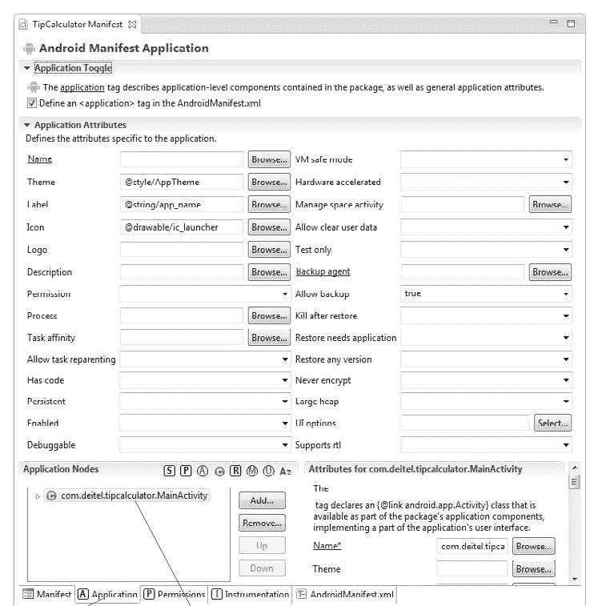

Application 选项卡 选择此节点以指定应用主 MainActivity 的设置

图 3.17 | Android Manifest 编辑器的 Application。

## 3.7 总结

### 配置 MainActivity 的竖屏模式

通常情况下，大多数应用程序都应该同时支持竖屏和横屏模式。在竖屏模式下，设备的高度大于宽度。在横屏模式下，设备的宽度大于高度。在小费计算器应用中，在典型的手机上将设备旋转到横屏模式会导致数字键盘遮挡小费计算器大部分 GUI。为此，你将配置`MainActivity`仅支持竖屏模式。在 Android 编辑器的`com.deitel.tip.calculator.MainActivity`属性部分，滚动到`Screen orientation`选项并选择`portrait`。

### 强制 MainActivity 始终显示软键盘

在小费计算器应用中，软键盘应在应用执行时立即显示，并始终留在屏幕上。在 Android 编辑器的`com.deitel.tip.calculator.MainActivity`属性部分，滚动到`Window soft mode`选项并将状态设置为`stateAlwaysVisible`。请注意，如果存在实体键盘，则不会显示软键盘。

## 3.7 总结

在本章中，你创建了你的第一个 Android 应用——小费计算器。我们回顾了应用的功能，然后对其进行了测试，以根据输入的金额计算标准小费和自定义小费。你遵循了详细的步骤说明，使用 Android 开发者工具 IDE 的图形布局编辑器、Outline 窗口和 Properties 窗口构建了该应用。我们还查看了`MainActivity`的代码，它定义了应用的功能。

在应用中，你使用`GridLayout`将视图排列成行和列。你在`TextView`中显示文本，并从`EditText`和`SeekBar`接收输入。

`MainActivity`需要许多 Java 面对象编程的能力，包括类、对象、接口、匿名内部类和继承。我们解释了将 GUI 从 XML 文件填充（inflating）到屏幕表示的概念。你学习了 Android 的 Activity 类以及 Activity 生命周期的一部分。你重写了`onCreate`方法在应用启动时进行初始化。在`onCreate`方法中，你使用`findViewById`获取应用交互的每个视图的引用。你定义了一个实现`TextWatcher`接口的匿名内部类，以便应用为用户计算新的小费和总额。你定义了一个实现`OnSeekBarChangeListener`接口的匿名内部类，以便应用在用户移动 SeekBar 滑块以自定义百分比时计算自定义小费和总额。

最后，你在 IDE 的 Android Manifest 编辑器中编辑了`AndroidManifest.xml`文件，以指定`MainActivity`仅支持竖屏模式，并且`MainActivity`始终显示键盘。

使用 IDE 的布局编辑器、Outline 窗口、Properties 窗口和 Android Manifest 编辑器使你能够在不操作项目资源文件和`AndroidManifest.xml`中的 XML 构建此应用。

在下一章中，我们将在构建 Twitter 应用时引入集合。许多移动应用都会显示项目列表。你将通过使用包含由`Array<String>`的`ListView`的`ListActivity`来实现。你还将应用数据存储为用户配置，并学习如何启动设备浏览器显示网页。

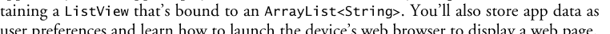

## 自测练习

3.1

填空以下语句中的空白：

- a) 一种 ______ 在其他 GUI 技术中通常称为文本框或文本字段——它是`TextView`的子类，可以显示文本并接收用户输入。

- b) 使用 ______ 将 GUI 组件排列在矩形网格中。

- c) 在处理更复杂的布局`GridLayout`时，很难使用 Visual Layout 编辑器查看布局的嵌套结构并将组件放置在正确位置。______ 窗口使这些任务变得更容易，因为它显示了嵌套结构。在`GridLayout`中，你可以选择适当的行并添加组件。

- d) `android.os`包中的类 ______ 表示应用状态信息。

- e) 当用户与`EditText`组件交互时，你实现 ______。

- f) 一个独立的 ______ 通常与应用的每个屏幕相关。

- g) 当 Activity 启动时，系统会调用 ______ 方法——即当其 GUI 显示时，以便用户与 Activity 交互。

- h) 当你构建应用资源（如`strings.xml`中的字符串或`Activity.xml`中的组件）时，你的应用会生成一个名为 ______ 的类，其中包含项目`res`文件夹中每种类型的静态类。

- i) 类（嵌套在 R 中）包含任何 drawable 项目，即你放在应用`res/drawable`文件夹中的图像。

- j) 类（嵌套在 R 中）包含`strings.xml`文件中的每个字符串。

- k) 类（嵌套在 R 中）包含`strings.xml`文件中的每个字符串。

3.2

判断以下陈述对错：

# 96 第 3 章 贷款计算器应用程序

每月的还款金额都基于贷款期限、借款金额和利率。创建一个应用程序，允许客户输入汽车价格、首付金额和贷款年利率。该程序应显示贷款期限（月为单位）以及二、三、四、五期贷款的每月还款额。多种选项允许用户轻松比较还款金额并选择最合适的一个。

## 3.9 (每加英里计算器应用程序) 司机通常想知道汽车的每加英里数，以便方便估计成本。开发一个应用程序，允许用户输入行驶里程和消耗加仑数，并计算相应的每加英里。

## 3.10 (体重指数应用程序) 计算 BMI 的公式为：

```
BMI = weightInPounds × 703 / heightInches × heightInches
```

或

```
BMI = weightInKilograms / heightInMeters × heightInMeters
```


创建一个 BMI 计算器应用程序，允许用户输入他们的体重和身高（可以使用英制或公制单位），然后计算并显示用户的体重指数。该程序还应显示来自健康与人类服务部/美国国立卫生研究院的以下信息，以便用户评估其 BMI：

- 体过轻：小于 18.5
- 正常：18.5 到 24.9 之间
- 超重：25 到 29.9 之间
- 肥胖：30 或更高

## 3.11 (目标心率计算器应用程序)

运动时，你可以使用心率计查看你的心率是否保持在教练和医生建议的安全范围内。根据美国心脏协会 (AHA)，计算最大心率（每分钟心跳次数）的公式为 220 减去年龄（http://bit.ly/AHATHeartRates）。你的目标心率是最大心率的 50-85% 范围。

> [注意：这些公式是 AHA 提供的估计值。最大心率和目标心率可能会根据健康、健身状况和性别而异。在开始或修改运动计划之前，请咨询医生或专业的医疗保健专业人员。]

编写一个程序输入人的年龄，然后计算并显示该人的最大心率和目标心率范围。

# Twitter® 搜索应用程序

## 4. 目标

在本章中，你将：

- 支持竖屏和横屏设备方向。
- 扩展 `ListActivity` 以创建一个在 `ListView` 中显示项目列表的 `Activity`。
- 允许用户通过 `ImageButton` 与应用程序交互。
- 操作数据集合。
- 使用 `SharedPreferences` 存储与应用程序关联的键值对数据。
- 使用 `SharedPreferences` 修改与应用程序关联的键值对数据。
- 使用 `ArrayAdapter` 指定 `ListView` 的数据。
- 使用 `AlertDialog.Builder` 创建对话框，以按钮或 `ListView` 的形式显示选项。
- 使用隐式 `Intent`（implicit Intent）在浏览器中打开网页。
- 使用 `Intent` 显示意图选择器，包含可以共享文本的应用程序列表。
- 通过编程方式隐藏软键盘。

# 第 4 章 Twitter® 搜索应用程序

## 4.1 引言

Twitter 搜索机制使人们轻松关注超过 5 亿用户讨论的热点话题。搜索可以进行精细调整。（注：原文此处存在大量重复文本，已按原意精简）。

## 4.2 测试应用程序

【4.2.1 导入并运行应用程序】

【4.2.2 添加收藏搜索】

在底部的 `EditText` 中使用 `Deitel` 作为搜索查询的标签（图 4.4(a)）。这将是在应用中“已标记搜索”（Tagged Searches）部分中显示的短名称。点击保存  按钮以保存搜索——标签 *Deitel* 将出现在“已标记搜索”标题下的列表（（图 4.4(b)）。当你保存一个搜索时，软键盘会消失，这样你就可以看到保存的搜索列表——你将在 4.5.4 节中学习如何通过编程隐藏软键盘。


图 4.4 | 输入 Twitter 搜索。

### 4.2.3 查看 Twitter 搜索结果

要查看结果，点击标签“Deitel”。这将启动设备的网络浏览器，并将代表保存搜索的 URL 传递给 Twitter 网站。Twitter 从 URL 中获取搜索查询，然后将与查询匹配的推文（如果有）作为网页返回。网络浏览器随后显示此结果页面（图 4.5）。当你完成结果查看后，点击返回键返回 Twitter 搜索应用，在应用中，你可以保存更多搜索、编辑、删除和共享之前保存的搜索。


图 4.5 | 查看结果。

### 4.2.4 编辑搜索

你还可以共享、编辑或删除搜索。要查看这些选项，长按搜索的标签——即点击标签并将手指按在屏幕上。如果你使用的是 Android 设备，在搜索标签上点击并按住左鼠标键以执行长按操作。当你按下“Deitel”时，图 4.6 中的 `AlertDialog`（警告对话框）将显示针对标记为“Deitel”的搜索的共享、编辑和删除选项。如果你不想删除这些任务中的任何一个，点击取消（Cancel）。

要编辑标记为“Deitel”的搜索，点击用于编辑的日期 `EditText`。通过在查询末尾添加 `since:2013-10-01` 将我们的搜索限制为 2021 年 10 月之后的推文（图 4.6），顶部 `EditText` 文本中的 `text:` 操作符将搜索结果限制为发生在指定日期或日期之后的推文（格式为 `yyyy-mm-dd`）。点击保存按钮更新保存的搜索，然后通过点击应用中“已标记搜索”部分的 Deitel 来查看更新后的结果（图 4.7）。

> [注意：标签名称将创建一个新搜索——如果你想创建一个基于之前搜索的新查询，这将非常有用]

a) 选择“编辑”（Edit）以编辑现有搜索

b) 编辑保存的“Deitel”搜索

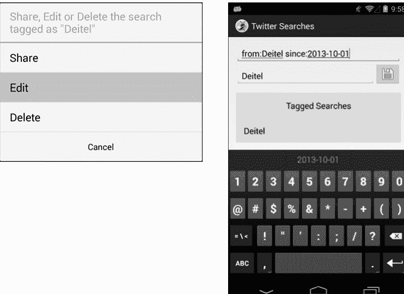

图 4.6 | 编辑保存的搜索。


图 4.7 | 更新后的“Deitel”搜索结果。

### 4.2.5 共享搜索

Android 让你轻松地通过电子邮件、即时消息（SMS）、Facebook、Google+、Twitter 等等方式从应用共享各种类型的信息。在此应用中，你可以通过长按搜索标签并从出现的 `AlertDialog` 中选择共享（Share）来共享收藏搜索。这将显示所谓的“意图选择器”（intent chooser）（图 4.8(a)），它会根据你共享的内容类型以及哪些应用可以处理该内容而异。在此应用中我们共享的是文本，手机（而非 AVD）上的意图选择器会显示能够处理文本的应用，如 Facebook、Gmail、Google+、消息（Messaging）和 Twitter。如果只有一个应用可以处理该内容，意图选择器将显示相应的消息。如果只有一个应用可以处理该内容，意图选择器将直接启动，无需从意图选择器中选择使用哪个应用。图 4.8(b) 显示了 Gmail 应用的撰写界面，带有邮件主题。

a) 选择图选择器

b) Gmail 撰写界面

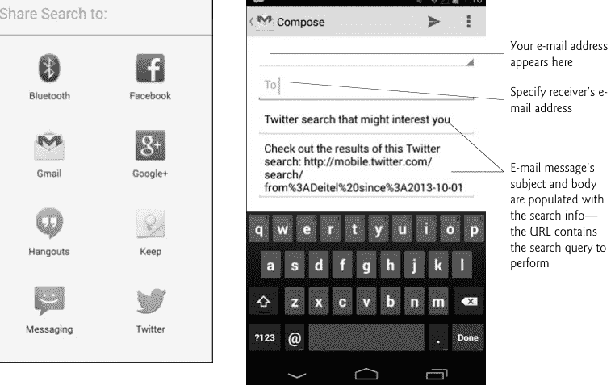

图 4.8 | 通过电子邮件共享。

### 4.2.6 删除搜索

要删除搜索，长按搜索标签并从出现的 `AlertDialog` 中选择删除（Delete）。该应用会提示你是否要删除。点击取消（Cancel）即可返回。

| 确定要删除吗？ |
|---|
| 取消 | 删除 |

图 4.9 | 删除确认对话框。

### 4.2.7 滚动查看已搜索

图 10 显示了可以滚动的搜索。当应用中有多个搜索时，可以通过手指上下滑动来查看。在应用的“已标记搜索”部分，点击 Deitel 后，通过滚动可以查看更多保存的搜索。


## 4.3 技术概述

此应用在 `Activity` 的 `onCreate` 方法中读取保存的搜索——之所以这样做是可以，是因为加载的数据量很小。当应用启动时，Android 会创建一个主线程，该线程调用 UI 线程来处理所有的 GUI 交互。所有的 GUI 处理必须在此线程中进行。大量的输入/输出操作（例如从文件和数据库加载数据）不应在 UI 线程上执行，因为此类操作会影响应用的响应速度。我们将在后面的章节中展示如何在单独线程中执行 I/O。

### 4.3.1 ListView

`ListView` 是一个显示可滚动项目列表的视图。在 Twitter 搜索应用中，我们使用 `ListView` 来显示保存的搜索标签。`ListView` 的每个项目通常通过 `ArrayAdapter` 绑定到数据源。

### 4.3.2 ListActivity

`ListActivity` 是一个专门为显示 `ListView` 设计的 `Activity` 子类。它简化了 `ListView` 的设置和事件处理。在 Twitter 搜索应用中，我们扩展 `ListActivity` 并使其布局包含一个 `ListView`。

### 4.3.3 自定义 ListActivity 布局

虽然 `ListActivity` 默认提供 `ListView`，但我们可以通过自定义布局文件来改变其外观。在 `activity_main.xml` 中，我们定义了一个包含 `ListView` 的布局，并设置其为 `ListActivity` 的内容视图。

### 4.3.4 ImageButton

`ImageButton` 是一个显示图像的按钮。在 Twitter 搜索应用中，我们使用 `ImageButton` 作为保存按钮，允许用户通过点击图像来保存搜索。

### 4.3.5 SharedPreferences

`SharedPreferences` 是 Android 提供的一种轻量级数据存储机制，用于保存键值对数据。在 Twitter 搜索应用中，我们使用 `SharedPreferences` 存储用户的保存搜索，包括标签和查询。

### 4.3.6 用于启动其他 Activity 的 Intent

Android 使用称为意图消息（intent messaging）的技术在应用内部或不同应用之间进行通信。每个 `Activity` 都可以指定用于处理的过滤器（intent filters）。Intent 定义在 `AndroidManifest.xml` 文件中。事实上，在每个项目中，IDE 都会为应用的唯一 `Activity` 创建一个过滤器，表明它可以响应名为 `android.intent.MAIN` 的预定义动作，该动作指定 `Activity` 可用于启动应用以开始执行。

`Intent` 用于启动 `Activity`——它表示要执行的操作以及该操作相关的数据。在此应用中，当用户点击搜索标签时，我们创建一个包含 Twitter 搜索查询的 URL。我们通过创建 URL 并将 `Intent` 传递给 `startActivity` 方法（我们的应用直接继承自调用）将其加载到浏览器。要查看 URL，`startActivity` 会处理设备浏览器以显示内容——在此应用中，即 Twitter 的搜索结果。

我们还使用 `Intent` 和 `startActivity` 方法来显示意图选择器（intent chooser）——这是一个显示可以处理指定 `Intent` 的应用列表的 GUI。我们在共享保存的搜索时使用它，允许用户选择如何共享搜索。

### 隐式和显式 Intent

此应用中的 `Intent` 是隐式 `Intent`（implicit Intents）的示例——我们不会指定用于显示网页的组件，而是让 Android 根据数据类型处理最合适的 `Activity`。如果有多个 `Activity` 可以处理传递给 `startActivity` 的动作和数据，系统将显示对话框，用户可以在其中选择使用哪个 `Activity`。如果系统找不到处理该动作的 `Activity`，`startActivity` 将抛出 `ActivityNotFoundException`。通常情况下，处理此异常是良好的做法。我们在此应用中没有这样做，因为可能安装此应用的 Android 设备都拥有能够显示网页的浏览器。在未来的应用中，我们还将使用显式 `Intent`（explicit Intents），它们指定了启动的精确 `Activity`。有关 `Intent` 的更多信息，请访问：

```
http://developer.android.com/guide/intents-filters.html
```

### 4.3.7 AlertDialog

你可以通过 `AlertDialog` 向应用用户显示消息、选项和确认。当对话框显示时，用户无法与应用进行交互——这被称为模态对话框（modal dialog）。正如你将看到的，使用 `AlertDialog.Builder` 对象指定对话框的设置，然后使用它创建 `AlertDialog`。

`AlertDialog` 可以显示按钮、复选框、单选按钮和项目列表，用户可以通过点击这些来响应对话框的消息。标准的 `AlertDialog` 最多可以有三个按钮分别表示：

- 负性动作——取消对话框指定的动作，通常标记为 Cancel（取消）或 No（否）。当对话框中有多个按钮时，它是最左侧的按钮。
- 正性动作——接受对话框指定的动作，通常标记为 OK 或 Yes（是）。当对话框中有多个按钮时，它是最右侧的按钮。
- 中性动作——这表示用户不想取消或接受对话框中的动作。例如，提供一个要求用户注册以获得额外功能的按钮，或者提供一个“稍后提醒我”（Remind Me Later）的中性按钮。

我们在应用中使用 `AlertDialog` 有几个目的：

- 当查询或标签 `EditText` 为空时，向用户显示一条消息。此对话框将只包含一个正性按钮。
- 显示搜索的分享、编辑和删除（Delete）选项。此对话框将包含一个选项列表和一个负性按钮。
- 在删除搜索之前让用户确认——以防用户意外点击了搜索的删除选项。

你可以在此处学习更多关于 Android 对话框的信息：

```
http://developer.android.com/guide/topics/ui/dialogs.html
```

### 4.3.8 AndroidManifest.xml

正如在第 3 章中学到的，`AndroidManifest.xml` 文件是在你创建一个应用时创建的。在此应用中，我们将展示如何向清单文件中添加一个设置，以防止在应用首次加载时显示软键盘。有关 `AndroidManifest.xml` 的完整细节，请访问：

```
http://developer.android.com/guide/topics/manifest/manifest-intro.html
```

我们将在整书中涵盖 `AndroidManifest.xml` 文件的各个方面。

## 4.4 构建应用的 GUI

在本节中，我们将为 Twitter Searches 应用构建 `ListView`。我们还将创建第二个 XML 布局进行动态填充（inflate）并使用它显示每个项目。

### 4.4.1 创建项目

记得，Android 开发工具 IDE 在每个工作区仅允许创建一个同名的一个项目，在创建新项目之前，请删除你在 4.2 节中创建的 TwitterSearches 项目。要这样做，点击并选择 Delete（删除）。在出现的对话框中，确保没有选择 Delete project contents on disk（删除磁盘上的项目内容），然后点击 OK。这将项目从工作区中移除，但保留项目文件夹和文件，以防你想查看原始。

### 4.4.2 activity_main.xml 概述

与第 3 章一样，此应用的 `activity_main.xml` 布局使用了 `GridLayout`（图 4.11）。在此应用中，`GridLayout` 包含三行一列。图 4.12 显示了应用组件的名称。

### 4.4.3 添加 GridLayout 和组件

使用你在第 3 章中学到的技术，你将在图 4.11–4.12 中构建 GUI。接下来的子章节中的所有步骤都假设你正在 IDE 的图形化布局编辑器中进行布局工作。提醒一下，在 Outline（大纲）窗口中选择特定的 GUI 组件通常是最简单的。

你将从基础布局和控件开始，然后自定义控件的属性以完成设计。使用 Outline 窗口将组件添加到 `GridLayout` 的相应行中。当你添加 GUI 组件时，按照图 4.12 所示设置它们的 Id——该布局中的几个组件不需要 ID，因为它们永远不会从应用的 Java 代码中被引用。此外，记住在位于应用 `res/values` 文件夹下的 `strings.xml` 文件中定义你的字面量字符串。

- 列数 (`GridLayout` 节点): 1——每个直接嵌套在 `GridLayout` 中的 GUI 组件都将作为新的一行添加。

`GridLayout` 填充了屏幕的整个客户区域，因为布局的 Width（宽度）和 Height（高度）属性（属性窗口中的布局参数中）均由 IDE 设置为 `match_parent`。


默认情况下，IDE 将 `Padding Left`（左内边距）和 `Padding Right`（右内边距）属性设置为`@dim/activity_horizontal_margin`——这是项目 `res/values` 文件夹下 `dims.xml` 文件中的一个预定义尺寸资源。该资源的值为 `16dp`，因此 `GridLayout` 的左右会有 `16dp` 的间距。这是 IDE 在你添加 app 时自动创建的。同样地，IDE 将 `Padding Top`（上内边距）和 `Padding Bottom`（下内边距）属性设置为`@dim/activity_vertical_margin`——这是另一个值为 `16dp` 的预定义尺寸资源。`GridLayout` 上下会有 `16dp` 的间距。

### 外观观察 4.1


根据 Android 指南，`16dp` 是设备触摸屏边缘与应用内容之间的推荐间距；然而，许多应用（如游戏）使用了全屏。

### 步骤 3：创建 `EditText` 的第一行

此行包含一个 `EditText`。从调色板（Palette）的 Fields 部分将 TextField 拖入到大纲视图（Outline view）中的 `GridLayout` 中，然后将其属性设置为`@id/queryEditText`。在属性窗口中，删除 `Em` 属性的值，该属性在应用中并未使用。然后使用属性窗口设置以下属性：

- `Width`（布局参数节点）：`wrap_content`
- `Height`（布局参数节点）：`wrap_content`
- `Gravity`（对齐方式参数节点）：`fill_horizontal`——这确保了当用户旋转设备时，`queryEditText` 将填充所有水平空间。我们对其他 UI 组件使用 `Gravity` 设置，以支持此应用 GUI 的竖屏和横屏方向。
- `Hint`：`@string/queryPrompt`——像你之前一样创建一个 String 资源，并将其赋值为 `"Enter Twitter search here"`。此属性显示一个空的 `EditText`，帮助用户理解 `EditText` 的用途。此任务也由 Android TalkBack 为视障用户提供，在你的 `EditText` 中提供提示可以让你的应用更具可访问性。

### 外观观察 4.2


Android 指南指出，你的 GUI 中显示的文本应该简洁、简单且友好，并将重要词放在前面。有关推荐样式，请参见：https://developer.android.com/design/style/writing.html。

- `IME Options`（TextView 节点）：`actionNext`——这表示 `EditText` 的键盘将包含一个 Next（下一个）按钮，用户触摸它可以将焦点移动到下一个输入组件（此应用中的 `tagEditText`）。这使得用户更容易填写表单中的多个组件。当下一个组件不是另一个 `EditText` 时，在用户触碰获取焦点之前，会显示相应的键盘。

### 步骤 4：创建 `GridLayout` 的第二行

此行是一个水平的 `LinearLayout`，包含一个 `EditText` 和一个 `ImageButton`。执行以下任务来构建此行：

1. 从调色板的 Layouts 部分将 LinearLayout (Horizontal) 组件拖入大纲窗口中的 `GridLayout` 中。
2. 从调色板的 Text Fields 部分将 Plain Text 组件拖入 `LinearLayout`，将 `Id` 设置为`+id/tagEditText`。
3. 从调色板的 Images & Media 部分将 imageButton 组件拖入 `LinearLayout`。这会显示资源选择（Resource Chooser）对话框（图 4.13），以便你可以选择按钮的图像。默认选中 Project Resources（项目资源）按钮，因此你可以从项目资源中选择图像（此类图像将存储在你项目的各个 `res/drawable` 文件夹中）。在此应用中，使用标准的 Android 保存图标（显示在图 4.13 的右侧）。为此，点击 System Resources（系统资源）单选按钮，选择 `ic_menu_save` 并点击 OK。接下来，将 `Id` 设置为`+id/saveButton`。

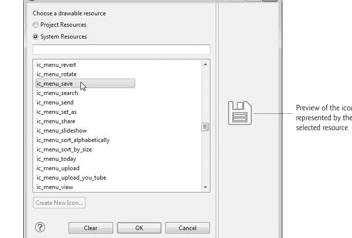

图 4.13 资源选择对话框。

选中 `EditText` 后，从属性窗口中的 TextView 节点移除 `Ems` 属性的值。设置以下属性：

- `Width`（布局参数节点）：`0dp`——当你也设置 `Weight` 属性时，IDE 建议使用此值，以便 IDE 能更高效地布局组件。
- `Height`（布局参数节点）：`wrap_content`
- `Gravity`（布局参数节点）：`bottom|fill_horizontal`——将 `tagEditText` 的底部与 `saveButton` 的底部对齐，并指示 `tagEditText` 应该填充可用的水平空间。
- `Weight`（布局参数节点）：`1`——这使得 `tagEditText` 在行比 `saveButton` 重要。当 Android 加载该行时，`saveButton` 只占据所需的空间，而 `tagEditText` 将占据剩余的所有水平空间。
- `Hint`：`@string/tagPrompt`——创建一个值为 `"Tag your query"` 的 String 资源。
- `IME Options`（TextView 节点）：`actionNext`——这表示 `EditText` 的键盘将包含一个 Next 按钮，用户触摸它可以将焦点移动到下一个输入组件（此应用中的 `tagEditText`）。这使得用户更容易填写表单中的多个组件。当下一个组件不是另一个 `EditText` 时，在用户触碰获取焦点之前，会显示相应的键盘。

### 步骤 5：创建 `GridLayout` 的第三行

此行是一个包含 `TextView` 和 `ListView` 的垂直 `LinearLayout`。执行以下任务来构建此行：

1. 从调色板的 Layouts 部分将 LinearLayout (Vertical) 组件拖入大纲窗口中的 `GridLayout`。
2. 从调色板的 Text Fields 部分将 Medium Text 组件拖入 `LinearLayout`。
3. 从调色板的 Widgets 部分将 `ListView` 组件拖入 `LinearLayout`，使用`@id/list`。

选中垂直 `LinearLayout` 后，设置以下属性：

- `Height`（布局参数节点）：`0dp`——当你也设置 `Weight` 属性时，IDE 建议使用此值，以便 IDE 能更高效地布局组件。
- `Gravity`（布局参数节点）：`fill`——`LinearLayout` 将填充所有可用的水平和垂直空间。

### Twitter Searches

- `Background`（视图节点）：`@android:color/holo_blue_bright`——这是 Android 预定义颜色之一。
- `Padding Left/Right`（视图节点）：`@dim/activity_horizontal_margin`——这确保两侧有 `16dp` 的间距。
- `Padding Top`（视图节点）：`@dim/activity_vertical_margin`——这确保垂直布局的顶部有 `16dp` 的间距。

选中 `TextView` 后，设置以下属性：

- `Width`（布局参数节点）：`match_parent`
- `Height`（布局参数节点）：`wrap_content`
- `Gravity`（布局参数节点）：`fill_horizontal`——这使 `TextView` 填充 `LinearLayout` 的宽度（减去内边距）。
- `Gravity`（TextView 节点）：`center_horizontal`——这使 `TextView` 的文本居中。
- `Text`：`@string/taggedSearches`——创建一个值为 `"Tagged Searches"` 的 string 资源。
- `Padding Top`（视图节点）：`@dim/activity_vertical_margin`——这确保垂直布局的顶部有 `16dp` 的间距。

选中 `List` 后，设置以下属性：

- `Width`（布局参数节点）：`match_parent`
- `Height`（布局参数节点）：`0dp`——当你也设置 `Weight` 属性时，IDE 建议使用此值，以便 IDE 能更高效地布局组件。
- `Weight`（布局参数节点）：`1`
- `Gravity`（布局参数节点）：`fill`——`List` 将填充所有可用的水平和垂直空间。
- `Padding Top`（视图节点）：`@dim/activity_vertical_margin`——这确保垂直布局的顶部有 `16dp` 的间距。
- `Top and Bottom`（在布局参数节点的 Margins 节点中）：`@dimen/tagged_searches_padding`——通过点击 Top 属性右侧的省略号创建一个新的维度资源。在 ResourceChooser 对话框中，点击 New Dimension... 创建新的维度资源。为 Name 指定 `tagged_searches_padding`，为 Value 指定 `8dp` 并点击 OK，然后选择你的维度资源并点击 OK。对于 Bottom 属性，只需选择此新的维度资源。这些属性确保了有

## 4.4 构建应用程序的 GUI

在 `TextView` 与 `ListView` 顶部之间，以及 `ListView` 底部与垂直 `LinearLayout` 底部之间设置 `8dp` 的外边距。

### 4.4.4 图形布局编辑器工具栏

你现在已经完成了 `MainActivity` 的 GUI。图形布局编辑器的工具栏（图 4.14）包含各种按钮，允许你预览其他屏幕尺寸和方向的设计。特别是，你可以通过点击按钮旁边的向下箭头并选择“预览代表性样本”（Preview Representative Sample）或“预览所有屏幕尺寸”（Preview All Screen Sizes），查看许多屏幕尺寸和方向的缩略图。对于每个缩略图，都有 `+` 和 `-` 按钮可以放大或缩小。图 4.14 列出了图形布局编辑器工具栏中的一些按钮。

| 渲染选项 | 屏幕类型 | 竖屏/横屏 | 主题 | 正在设计的 Activity/Fragment | 地 | API 级别 |
| :--- | :--- | :--- | :--- | :--- | :--- | :--- |
| | Nexus 4 | | AppTheme | MainActivity | | 17 |


图形布局编辑器中当前选中项的配置选项缩放选项

**图 4.14** | 画布配置选项。

| 选项 |  |
| :--- | :--- |
| 渲染选项 | 一时显示一个设计屏幕，或者在各种屏幕尺寸上查看你的设计。 |
| 屏幕类型 | Android 运行在各种设备上，因此图形布局编辑器带有许多代表各种屏幕尺寸和布局的设备配置，可以使用它们来设计 GUI。在书中，我们根据应用程序使用预定义的 Nexus 4、Nexus 7 和 Nexus 10 屏幕。在图 4.14 中，我们使用了 Nexus 4。 |
| 竖屏/横屏 主题 | 在竖屏和横屏方向之间切换设计区域。可设置 GUI 的主题。 |
| 正在设计的 Activity/Fragment | 显示与设计的 GUI 对应的 Activity 或 Fragment 类。对于国际化应用（第 2.8 节），允许你选择特定的本地化设置，从而查看设计在不同语言字符串下的外观。 |
| API 级别 | 指定设计的目标 API 级别。随着每个新 API 级别的出现，通常会有新的 GUI 功能。图形布局编辑器窗口显示所选 API 级别可用的功能。 |

**图 4.15** | 画布配置选项的解释。

## 第 4 章 Twitter 搜索应用程序

### 4.4.5 `ListView` 布局：`list_item.xml`

在向 `ListView` 填充数据时，你必须指定应用到每个列表项的格式。此应用程序中的每个列表项都显示一个保存搜索的 String 标签。要指定每个列表项的格式，你将创建一个仅包含适当格式的 `TextView` 的新布局。执行以下步骤：

1. 在 Package Explorer 窗口中，展开项目的 `res` 文件夹，然后右键点击 `layout` 文件夹并选择 New > Other... 显示 New 对话框。
2. 在 Android 节点中，选择 Android Layout File 并点击 Next > 显示图 4.16 所示的对话框，然后按所示配置文件。新布局的文件为 `list_item.xml`，布局根元素是 `TextView`。
3. 点击 Finish 创建文件。

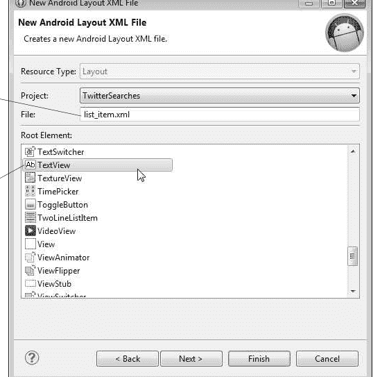

**图 4.16** 在 New Android Layout XML File 对话框中创建新的 `list_item.xml` 布局。

IDE 在图形布局编辑器中打开新布局。在 Outline 窗口中选择 `TextView`，然后设置以下属性：

- `Id`：`@id/textView`。根据惯例，组件 ID 以小写字母开头。
- `Height`（Layout Parameters 节点）：`android:attr/listPreferredItemHeight`——此值是一个预定义的 Android 资源，表示列表项的首选高度，以便正确响应用户触摸，并最大限度地减少触错项的概率。

> #### 外观观察 4.4
>
> Android 设计指南规定了屏幕上可点击项的最小建议尺寸为 `48dpx48dp`。有关 GUI 尺寸和间距的更多信息，请参见 http://developer.android.com/style/metrics-grids.html。

- `Gravity`（Layout Parameters 节点）：`center-vertical`——`TextView` 应该在 `ListView` 项内垂直居中。
- `Text Appearance`（TextView 节点）：`android:attr/textAppearanceMedium`——这是指定中等文本字体大小的预定义主题。

#### 显示多条数据的列表项

如果列表项应该显示多条数据，你需要一个包含多个元素的列表项布局，并且每个元素都需要一个 `android:id` 属性。

#### 其他预定义的 Android 资源

有很多预定义的 Android 资源，类似于用于设置列表项的 `Height` 和 `Text Appearance` 的资源。你可以查看完整列表：

```text
http://developer.android.com/reference/android/R.attr.html
```

在布局中使用值时，按以下格式指定：

```text
?android:attr/resourceName
```

## 4.5 构建 `MainActivity` 类

图 4.17–4.7 在 `MainActivity` 类中实现了 Twitter 搜索应用程序的逻辑，该类自 `ListActivity`。`MainActivity` 类的默认代码包含一个 `onCreateOptionsMenu` 方法，我们将其删除了，因为它在此应用程序中没有使用——我们将在第 5 章讨论 `onCreateOptionsMenu`。在本节中，我们假设你在代码描述中遇到必要的 Strings 时会创建它们。

### 4.5.1 `package` 和 `import` 语句

图 4.17 显示了应用程序的包和 `import` 语句。包语句（由 IDE 在创建项目时插入第 4 行）表示文件中的此类是 `com.deitel.twittersearches` 包的一部分。第 6–26 行导入了应用程序使用的类和接口。

```java
1 // MainActivity.java
2 // 管理你喜爱的 Twitter 搜索，以便在设备的浏览器中
3 // 方便访问和显示
4 package com.deitel.twittersearches;
5
```

图 4.17 | `MainActivity` 的包和 `import` 语句。（部分 I，共 2 部分）。

第 4 章 Twitter® 搜索应用程序


```
6 import java.util.ArrayList;
7 import java.util.Collections;
8
9 import android.app.AlertDialog;
10 import android.app.ListActivity;
11 import android.content.Context;
12 import android.content.DialogInterface;
13 import android.content.Intent;
14 import android.content.SharedPreferences;
15 import android.net.Uri;
16 import android.os.Bundle;
17 import android.view.View;
18 import android.view.View.OnClickListener;
19 import android.view.input.InputMethodManager;
20 import android.widget.AdapterView;
21 import android.widget.AdapterView.OnItemClickListener;
22 import android.widget.AdapterView.OnLongClickListener;
23 import android.widget.ArrayAdapter;
24 import android.widget.EditText;
25 import android.widget.ImageButton;
26 import android.widget.TextView;
```

图 17 | `MainActivity` 的包和 import 语句。（部分 2，共2部分。）

第 6–7 行导入了 `java.util` 包中的 `ArrayList` 和 `Collections`。我们使用 `ArrayList` 维护保存搜索的标签列表，使用 `Collections` 类对标签进行排序以便按字母顺序出现。其余 import 语句中，我们只考虑本章引入的功能：

- `android.app` 中的 `AlertDialog` 类（第 9 行）用于显示对话框。
- `app` 包中的 `ListActivity`（第 10 行）是 `MainActivity` 的父类，它提供了应用程序的 `ListView` 以及操作它的方法。
- `content` 包中的 `Context` 类（第 11 行）提供了有关应用程序运行环境的信息，并允许你使用各种 Android 设备。当用户保存搜索后通过程序隐藏软键盘时，我们将使用该类中的一个常量。
- `content` 包中的 `DialogInterface` 类（第 12 行）包含了 `OnClickListener` 接口。我们实现它来处理用户触摸按钮时发生的事件。
- `content` 包中的 `Intent` 类（第 13 行）用于创建指定执行的操作和数据对象——Android 使用 `Intents` 来启动相应的 `Activity`。我们使用此类启动设备的网络浏览器以显示 Twitter 搜索结果，并显示一个用户可以选择分享搜索的 `intent`。
- `content` 包中的 `SharedPreferences` 类（第 14 行）用于操作存储在应用程序文件中的持久化键值对。
- `net` 包中的 `Uri` 类（第 15 行）使我们能够将 URL 转换为启动设备浏览器的 `Intent`。

## 4.5 构建 MainActivity 类

- 包 `android.view` 中的 `View` 类（第 17 行）被用于各种事件处理方法，用来表示用户交互以触发事件的 GUI 组件。
- `View` 类包含嵌套接口 `OnClickListener`（第 18 行）。我们实现此接口来处理用户点击 `ImageButton` 保存搜索时触发的事件。
- 包 `android.view.inputMethod` 中的 `InputManager` 类（第 19 行）允许我们在用户保存搜索时隐藏软键盘。
- `android.widget` 包（第 20–26 行）包含了用于 Android GUI 的 GUI 组件和层。`Adapter` 类（第 20 行）是 `ListView` 的基类，用于设置 `ListView` 的适配器（该适配器提供 `ListView` 的项）。你实现 `Adapter.OnItemClickListener`（第 21 行）来响应用户点击 `ListView` 中项的操作。你实现 `Adapter.OnItemLongClickListener`（第 22 行）来响应用户长按 `ListView` 中项的操作。`ArrayAdapter` 类（第 23 行）用于将项绑定到 `ListView` 中。`ImageButton` 类（第 25 行）表示显示图片的按钮。

### 4.5.2 扩展 MainActivity

`MainActivity`（图 4.18–4.27）是 Twitter Searches 应用的唯一类。当你创建 Twitter Searches 项目时，IDE 生成了 `MainActivity` 作为 `Activity` 的子类，并提供了一个被重写的 `onCreate` 方法的骨架，`Activity` 必须重写该方法。我们将父类更改为 `MainActivity`（图 4.18, 28）。当你进行此更改时，IDE 无法识别 `Activity` 类，因此你必须更新导入语句（imports）。在 IDE 中，你可以使用“组织导入”（Organize Imports）来更新导入语句。Eclipse 会给它不识别的任何类或接口名称加上下划线。在这种情况下，如果将鼠标悬停在类或接口名称上，将显示快速修复列表。如果 IDE 识别出该名称，它会建议你需要添加的缺失导入语句——只需点击该名称即可添加。

```java
public class MainActivity extends Activity
{
```

图 4.18 `MainActivity` 是 `Activity` 的子类。

### 4.5.3 MainActivity 类字段

`MainActivity` 包含静态变量和实例变量。字符串常量 `SEARCHES`（第 31 行）代表存储在设备上的搜索结果的文件名。第 33–34 行声明了 `EditText` 以访问用户输入的查询内容和标签。第 35 行声明了 `SharedPreferences` 实例 `savedSearches`，它将用于操作表示用户保存搜索的键值对。第 36 行声明了 `ArrayList<String>`，用于存储用户搜索的排序后的标签名。第 37 行声明了 `ArrayAdapter<String>`，它使用 `ArrayList<String>` 的内容作为 `MainActivity` 中 `ListView` 显示的项的数据源。

第 4 章 Twitter® Searches 应用

#### 良好的编程实践 4.I

为了可读性和可修改性，我们使用字符串常量来表示不需要本地化的文件名（以及其他字符串字面量），因此它们不需要定义在 `strings.xml` 中。

```java
// 存储保存搜索的 SharedPreferences XML 文件名
private static final String SEARCHES = "searches";

private EditText queryEditText; // 用户输入查询内容的 EditText
private EditText tagEditText; // 用户标记查询标签的 EditText
private SharedPreferences savedSearches; // 用户收藏的搜索
private ArrayList<String> tags; // 保存搜索的标签列表
private ArrayAdapter<String> adapter; // 将标签绑定到 ListView
```

图 4.19 | `MainActivity` 的字段

### 4.5.4 重写 Activity 方法 onCreate

`onCreate` 方法（图 4.20）由系统调用：

- 当应用加载时
- 如果应用在后台运行时被操作系统杀掉，且应用被恢复时
- 每当配置发生变化时，例如用户旋转设备或打开/关闭物理键盘时。

该方法初始化 `Activity` 的实例变量和 GUI 组件——我们保持其简单，以便应用能够快速加载。第 43 行对父类的 `onCreate` 方法执行了必须的调用。与上一个应用一样，对 `setContentView`（第 44 行）的调用传递了构造函数 `R.layout.activity_main`，以便从 `activity_main.xml` 填充（inflate）GUI。

```java
// 当 MainActivity 首次创建时调用
@Override
protected void onCreate(Bundle savedInstanceState) {
    super.onCreate(savedInstanceState);
    setContentView(R.layout.activity_main);

    // 获取 EditText 的引用
    queryEditText = (EditText) findViewById(R.id.queryEditText);
    tagEditText = (EditText) findViewById(R.id.tagEditText);

    // 获取包含用户保存搜索的 SharedPreferences
    savedSearches = getSharedPreferences(SEARCHES, MODE_PRIVATE);

    // 将保存的标签存储在 ArrayList 中
    tags = new ArrayList<String>(savedSearches.getAll().keySet());
    Collections.sort(tags, String.CASE_INSENSITIVE_ORDER);
```

图 4.20 | 重写 Activity 方法 `onCreate`。（2 部分中的第 部分。）


```java
// 创建 ArrayAdapter 并使用它将标签绑定到 ListView
adapter = new ArrayAdapter<String>(this, R.layout.list_item, tags);
setListAdapter(adapter);

// 创建 ArrayAdapter 并使用它将标签绑定到 ListView
adapter = new ArrayAdapter<String>(this, R.layout.list_item, tags);
setListAdapter(adapter);

// 创建 ArrayAdapter 并使用它将标签绑定到 ListView
adapter = new ArrayAdapter<String>(this, R.layout.list_item, tags);
setListAdapter(adapter);

// 创建 ArrayAdapter 并使用它将标签绑定到 ListView
adapter = new ArrayAdapter<String>(this, R.layout.list_item, tags);
setListAdapter(adapter);

// 创建 ArrayAdapter 并使用它将标签绑定到 ListView
adapter = new ArrayAdapter<String>(this, R.layout.list_item, tags);
setListAdapter(adapter);

// 创建 ArrayAdapter 并使用它将标签绑定到 ListView
adapter = new ArrayAdapter<String>(this, R.layout.list_item, tags);
setListAdapter(adapter);

// 创建 ArrayAdapter 并使用它将标签绑定到 ListView
adapter = new ArrayAdapter<String>(this, R.layout.list_item, tags);
setListAdapter(adapter);

// 创建 ArrayAdapter 并使用它将标签绑定到 ListView
adapter = new ArrayAdapter<String>(this, R.layout.list_item, tags);
setListAdapter(adapter);

// 创建 ArrayAdapter 并使用它将标签绑定到 ListView
adapter = new ArrayAdapter<String>(this, R.layout.list_item, tags);
setListAdapter(adapter);

// 创建 ArrayAdapter 并使用它将标签绑定到 ListView
adapter = new ArrayAdapter<String>(this, R.layout.list_item, tags);
setListAdapter(adapter);

// 创建 ArrayAdapter 并使用它将标签绑定到 ListView
adapter = new ArrayAdapter<String>(this, R.layout.list_item, tags);
setListAdapter(adapter);

// 创建 ArrayAdapter 并使用它将标签绑定到 ListView
adapter = new ArrayAdapter<String>(this, R.layout.list_item, tags);
setListAdapter(adapter);

// 创建 ArrayAdapter 并使用它将标签绑定到 ListView
adapter = new ArrayAdapter<String>(this, R.layout.list_item, tags);
setListAdapter(adapter);

// 创建 ArrayAdapter 并使用它将标签绑定到 ListView
adapter = new ArrayAdapter<String>(this, R.layout.list_item, tags);
setListAdapter(adapter);

// 创建 ArrayAdapter 并使用它将标签绑定到 ListView
adapter = new ArrayAdapter<String>(this, R.layout.list_item, tags);
setListAdapter(adapter);

// 创建 ArrayAdapter 并使用它将标签绑定到 ListView
adapter = new ArrayAdapter<String>(this, R.layout.list_item, tags);
setListAdapter(adapter);

// 创建 ArrayAdapter 并使用它将标签绑定到 ListView
adapter = new ArrayAdapter<String>(this, R.layout.list_item, tags);
setListAdapter(adapter);

// 创建 ArrayAdapter 并使用它将标签绑定到 ListView
adapter = new ArrayAdapter<String>(this, R.layout.list_item, tags);
setListAdapter(adapter);

// 创建 ArrayAdapter 并使用它将标签绑定到 ListView
adapter = new ArrayAdapter<String>(this, R.layout.list_item, tags);
setListAdapter(adapter);

// 创建 ArrayAdapter 并使用它将标签绑定到 ListView
adapter = new ArrayAdapter<String>(this, R.layout.list_item, tags);
setListAdapter(adapter);

// 创建 ArrayAdapter 并使用它将标签绑定到 ListView
adapter = new ArrayAdapter<String>(this, R.layout.list_item, tags);
setListAdapter(adapter);

// 创建 ArrayAdapter 并使用它将标签绑定到 ListView
adapter = new ArrayAdapter<String>(this, R.layout.list_item, tags);
setListAdapter(adapter);

// 创建 ArrayAdapter 并使用它将标签绑定到 ListView
adapter = new ArrayAdapter<String>(this, R.layout.list_item, tags);
setListAdapter(adapter);

// 创建 ArrayAdapter 并使用它将标签绑定到 ListView
adapter = new ArrayAdapter<String>(this, R.layout.list_item, tags);
setListAdapter(adapter);

// 创建 ArrayAdapter 并使用它将标签绑定到 ListView
adapter = new ArrayAdapter<String>(this, R.layout.list_item, tags);
setListAdapter(adapter);

// 创建 ArrayAdapter 并使用它将标签绑定到 ListView
adapter = new ArrayAdapter<String>(this, R.layout.list_item, tags);
setListAdapter(adapter);

// 创建 ArrayAdapter 并使用它将标签绑定到 ListView
adapter = new ArrayAdapter<String>(this, R.layout.list_item, tags);
setListAdapter(adapter);

// 创建 ArrayAdapter 并使用它将标签绑定到 ListView
adapter = new ArrayAdapter<String>(this, R.layout.list_item, tags);
setListAdapter(adapter);

// 创建 ArrayAdapter 并使用它将标签绑定到 ListView
adapter = new ArrayAdapter<String>(this, R.layout.list_item, tags);
setListAdapter(adapter);

// 创建 ArrayAdapter 并使用它将标签绑定到 ListView
adapter = new ArrayAdapter<String>(this, R.layout.list_item, tags);
setListAdapter(adapter);

// 创建 ArrayAdapter 并使用它将标签绑定到 ListView
adapter = new ArrayAdapter<String>(this, R.layout.list_item, tags);
setListAdapter(adapter);

// 创建 ArrayAdapter 并使用它将标签绑定到 ListView
adapter = new ArrayAdapter<String>(this, R.layout.list_item, tags);
setListAdapter(adapter);

// 创建 ArrayAdapter 并使用它将标签绑定到 ListView
adapter = new ArrayAdapter<String>(this, R.layout.list_item, tags);
setListAdapter(adapter);

// 创建 ArrayAdapter 并使用它将标签绑定到 ListView
adapter = new ArrayAdapter<String>(this, R.layout.list_item, tags);

// 创建 ArrayAdapter 并使用它将标签绑定到 ListView
adapter = new ArrayAdapter<String>(this, R.layout.list_item, tags);

// 创建使用它将标签绑定到 ListView
adapter = new ArrayAdapter<String>(this, R.layout.list_item, tags);

// 创建 ArrayAdapter 并使用它将标签绑定到 ListView
adapter = new ArrayAdapter<String>(this, R.layout.list_item, tags);
setListAdapter(adapter);

// 创建 ArrayAdapter 并使用它将标签绑定到 ListView
adapter = new ArrayAdapter<String>(this, R.layout.list_item, tags);

// 创建 ArrayAdapter 并使用它将标签绑定到 ListView
adapter = new ArrayAdapter<String>(this, R.layout.list_item, tags);

// 创建 ArrayAdapter 并使用它将标签绑定到 ListView
adapter = new ArrayAdapter<String>(this, R.layout.list_item, tags);

// 创建 ArrayAdapter 并使用它将标签绑定到 ListView
adapter = new ArrayAdapter<String>(this, R.layout.list_item, tags);

// 创建 ArrayAdapter 并使用它将标签绑定到 ListView
adapter = new ArrayAdapter<String>(this, R.layout.list_item, tags);

// 创建 ArrayAdapter 并使用它将标签绑定到 ListView
adapter = new ArrayAdapter<String>(this, R.layout.list_item, tags);

// 创建 ArrayAdapter 并使用它将标签绑定到 ListView
adapter = new ArrayAdapter<String>(this, R.layout.list_item, tags);

// 创建 ArrayAdapter 并使用它将标签绑定到 ListView
adapter = new ArrayAdapter<String>(this, R.layout.list_item, tags);

// 创建 ArrayAdapter 并使用它将标签绑定到 ListView
adapter = new ArrayAdapter<String>(this, R.layout.list_item, tags);

// 创建 ArrayAdapter 并使用它将标签绑定到 ListView
adapter = new ArrayAdapter<String>(this, R.layout.list_item, tags);

// 创建 ArrayAdapter 并使用它将标签绑定到 ListView
adapter = new ArrayAdapter<String>(this, R.layout.list_item, tags);

// 创建 ArrayAdapter 并使用它将标签绑定到 ListView
adapter = new ArrayAdapter<String>(this, R.layout.list_item, tags);

// 创建
adapter = new ArrayAdapter<String>(this, R.layout.list_item, tags);

// 创建 ArrayAdapter 并使用它将标签绑定到 ListView
adapter = new ArrayAdapter<String>(this, R.layout.list_item, tags);

// 创建 ArrayAdapter 并使用它将标签绑定到 ListView
adapter = new ArrayAdapter<String>(this, R.layout.list_item, tags);

// 创建 ArrayAdapter 并使用它将标签绑定到 ListView
adapter = new ArrayAdapter<String>(this, R.layout.list_item, tags);

// 创建 ArrayAdapter 并使用它将标签绑定到 ListView
adapter = new ArrayAdapter<String>(this, R.layout.list_item, tags);

// 创建 ArrayAdapter 并使用它将标签绑定到 ListView
adapter = new ArrayAdapter<String>(this, R.layout.list_item, tags);

// 创建 ArrayAdapter 并使用它将标签绑定到 ListView
adapter = new ArrayAdapter<String>(this, R.layout.list_item, tags);

// 创建 ArrayAdapter 并使用它将标签绑定到 ListView
adapter = new ArrayAdapter<String>(this, R.layout.list_item, tags);

// 创建 ArrayAdapter 并使用它将标签绑定到 ListView
adapter = new ArrayAdapter<String>(this, R.layout.list_item, tags);

// 创建 ArrayAdapter 并使用它将标签绑定到 ListView
adapter = new ArrayAdapter<String>(this, R.layout.list_item, tags);

// 创建 ArrayAdapter 并使用它将标签绑定到 ListView
adapter = new ArrayAdapter<String>(this, R.layout.list_item, tags);

// 创建 ArrayAdapter 并使用它将标签绑定到 ListView
adapter = new ArrayAdapter<String>(this, R.layout.list_item, tags);

// 创建 ArrayAdapter 并使用它将标签绑定到 ListView
adapter = new ArrayAdapter<String>(this, R.layout.list_item, tags);

// 创建 ArrayAdapter 并使用它将标签绑定到 ListView
adapter = new ArrayAdapter<String>(this, R.layout.list_item, tags);

// 创建 ArrayAdapter 并使用它将标签绑定到 ListView
adapter = new ArrayAdapter<String>(this, R.layout.list_item, tags);

// 创建 ArrayAdapter 并使用它将标签绑定到 ListView
adapter = new ArrayAdapter<String>(this, R.layout.list_item, tags);

// 创建 ArrayAdapter 并使用它将标签绑定到 ListView
adapter = new ArrayAdapter<String>(this, R.layout.list_item, tags);

// 创建 ArrayAdapter 并使用它将标签绑定到 ListView
adapter = new ArrayAdapter<String>(this, R.layout.list_item, tags);

// 创建 ArrayAdapter 并使用它将标签绑定到 ListView
adapter = new ArrayAdapter<String>(this, R.layout.list_item, tags);

// 创建 ArrayAdapter 并使用它将标签绑定到 ListView
adapter = new ArrayAdapter<String>(this, R.layout.list_item, tags);

// 创建 ArrayAdapter 并使用它将标签绑定到 ListView
adapter = new ArrayAdapter<String>(this, R.layout.list_item, tags);

// 创建 ArrayAdapter 并使用它将标签绑定到 ListView
adapter = new ArrayAdapter<String>(this, R.layout.list_item, tags);

// 创建 ArrayAdapter 并使用它将标签绑定到 ListView
adapter = new ArrayAdapter<String>(this, R.layout.list_item, tags);

// 创建 ArrayAdapter 并使用它将标签绑定到 ListView
adapter = new ArrayAdapter<String>(this, R.layout.list_item, tags);

// 创建 ArrayAdapter 并使用它将标签绑定到 ListView
adapter = new ArrayAdapter<String>(this, R.layout.list_item, tags);

// 创建 ArrayAdapter 并使用它将标签绑定到 ListView
adapter = new ArrayAdapter<String>(this, R.layout.list_item, tags);

// 创建 ArrayAdapter 并使用它将标签绑定到 ListView
adapter = new ArrayAdapter<String>(this, R.layout.list_item, tags);

// 创建 ArrayAdapter 并使用它将标签绑定到 ListView
adapter = new ArrayAdapter<String>(this, R.layout.list_item, tags);

// 创建 ArrayAdapter 并使用它将标签绑定到 ListView
adapter = new ArrayAdapter<String>(this, R.layout.list_item, tags);

// 创建 ArrayAdapter 并使用它将标签绑定到 ListView
adapter = new ArrayAdapter<String>(this, R.layout.list_item, tags);

// 创建 ArrayAdapter 并使用它将标签绑定到 ListView
adapter = new ArrayAdapter<String>(this, R.layout.list_item, tags);

// 创建 ArrayAdapter 并使用它将标签绑定到 ListView
adapter = new ArrayAdapter<String>(this, R.layout.list_item, tags);

// 创建 ArrayAdapter 并使用它将标签绑定到 ListView
adapter = new ArrayAdapter<String>(this, R.layout.list_item, tags);

// 创建 ArrayAdapter 并使用它将标签绑定到 ListView
adapter = new ArrayAdapter<String>(this, R.layout.list_item, tags);

// 创建 ArrayAdapter 并使用它将标签绑定到 ListView
adapter = new ArrayAdapter<String>(this, R.layout.list_item, tags);

// 创建 ArrayAdapter 并使用它将标签绑定到 ListView
adapter = new ArrayAdapter<String>(this, R.layout.list_item, tags);

// 创建 ArrayAdapter 并使用它将标签绑定到 ListView
adapter = new ArrayAdapter<String>(this, R.layout.list_item, tags);

// 创建 ArrayAdapter 并使用它将标签绑定到 ListView
adapter = new ArrayAdapter<String>(this, R.layout.list_item, tags);

// 创建 ArrayAdapter 并使用它将标签绑定到 ListView
adapter = new ArrayAdapter<String>(this, R.layout.list_item, tags);

// 创建 ArrayAdapter 并使用它将标签绑定到 ListView
adapter = new ArrayAdapter<String>(this, R.layout.list_item, tags);

// 创建 ArrayAdapter 并使用它将标签绑定到 ListView
adapter = new ArrayAdapter<String>(this, R.layout.list_item, tags);

// 创建 ArrayAdapter 并使用它将标签绑定到 ListView
adapter = new ArrayAdapter<String>(this, R.layout.list_item, tags);

// 创建 ArrayAdapter 并使用它将标签绑定到 ListView
adapter = new ArrayAdapter<String>(this, R.layout.list_item, tags);

// 创建 ArrayAdapter 并使用它将标签绑定到 ListView
adapter = new ArrayAdapter<String>(this, R.layout.list_item, tags);

// 创建 ArrayAdapter 并使用它将标签绑定到 ListView
adapter = new ArrayAdapter<String>(this, R.layout.list_item, tags);

// 创建 ArrayAdapter 并使用它将标签绑定到 ListView
adapter = new ArrayAdapter<String>(this, R.layout.list_item, tags);

// 创建 ArrayAdapter 并使用它将标签绑定到 ListView
adapter = new ArrayAdapter<String>(this, R.layout.list_item, tags);

// 创建 ArrayAdapter 并使用它将标签绑定到 ListView
adapter = new ArrayAdapter<String>(this, R.layout.list_item, tags);

// 创建 ArrayAdapter 并使用它将标签绑定到 ListView
adapter = new ArrayAdapter<String>(this, R.layout.list_item, tags);

// 创建 ArrayAdapter 并使用它将标签绑定到 ListView
adapter = new ArrayAdapter<String>(this, R.layout.list_item, tags);

// 创建 ArrayAdapter 并使用它将标签绑定到 ListView
adapter = new ArrayAdapter<String>(this, R.layout.list_item, tags);

// 创建 ArrayAdapter 并使用它将标签绑定到 ListView
adapter = new ArrayAdapter<String>(this, R.layout.list_item, tags);

// 创建 ArrayAdapter 并使用它将标签绑定到 ListView
adapter = new ArrayAdapter<String>(this, R.layout.list_item, tags);

// 创建 ArrayAdapter 并使用它将标签绑定到 ListView
adapter = new ArrayAdapter<String>(this, R.layout.list_item, tags);

// 创建 ArrayAdapter 并使用它将标签绑定到 ListView
adapter = new ArrayAdapter<String>(this, R.layout.list_item, tags);

// 创建 ArrayAdapter 并使用它将标签绑定到 ListView
adapter = new ArrayAdapter<String>(this, R.layout.list_item, tags);

// 创建 ArrayAdapter 并使用它将标签绑定到 ListView
adapter = new ArrayAdapter<String>(this, R.layout.list_item, tags);

// 创建 ArrayAdapter 并使用它将标签绑定到 ListView
adapter = new ArrayAdapter<String>(this, R.layout.list_item, tags);

// 创建 ArrayAdapter 并使用它将标签绑定到 ListView
adapter = new ArrayAdapter<String>(this, R.layout.list_item, tags);

// 创建 ArrayAdapter 并使用它将标签绑定到 ListView
adapter = new ArrayAdapter<String>(this, R.layout.list_item, tags);

// 创建 ArrayAdapter 并使用它将标签绑定到 ListView
adapter = new ArrayAdapter<String>(this, R.layout.list_item, tags);

// 创建 ArrayAdapter 并使用它将标签绑定到 ListView
adapter = new ArrayAdapter<String>(this, R.layout.list_item, tags);

// 创建 ArrayAdapter 并使用它将标签绑定到 ListView
adapter = new ArrayAdapter<String>(this, R.layout.list_item, tags);

// 创建 ArrayAdapter 并使用它将标签绑定到 ListView
adapter = new ArrayAdapter<String>(this, R.layout.list_item, tags);

// 创建 ArrayAdapter 并使用它将标签绑定到 ListView
adapter = new ArrayAdapter<String>(this, R.layout.list_item, tags);

// 创建 ArrayAdapter 并使用它将标签绑定到 ListView
adapter = new ArrayAdapter<String>(this, R.layout.list_item, tags);

// 创建 ArrayAdapter 并使用它将标签绑定到 ListView
adapter = new ArrayAdapter<String>(this, R.layout.list_item, tags);

// 创建 ArrayAdapter 并使用它将标签绑定到 ListView
adapter = new ArrayAdapter<String>(this, R.layout.list_item, tags);

// 创建 ArrayAdapter 并使用它将标签绑定到 ListView
adapter = new ArrayAdapter<String>(this, R.layout.list_item, tags);

// 创建 ArrayAdapter 并使用它将标签绑定到 ListView
adapter = new ArrayAdapter<String>(this, R.layout.list_item, tags);

// 创建 ArrayAdapter 并使用它将标签绑定到 ListView
adapter = new ArrayAdapter<String>(this, R.layout.list_item, tags);

// 创建 ArrayAdapter 并使用它将标签绑定到 ListView
adapter = new ArrayAdapter<String>(this, R.layout.list_item, tags);

// 创建 ArrayAdapter 并使用它将标签绑定到 ListView
adapter = new ArrayAdapter<String>(this, R.layout.list_item, tags);

// 创建 ArrayAdapter 并使用它将标签绑定到 ListView
adapter = new ArrayAdapter<String>(this, R.layout.list_item, tags);

// 创建 ArrayAdapter 并使用它将标签绑定到 ListView
adapter = new ArrayAdapter<String>(this, R.layout.list_item, tags);

// 创建 ArrayAdapter 并使用它将标签绑定到 ListView
adapter = new ArrayAdapter<String>(this, R.layout.list_item, tags);

// 创建 ArrayAdapter 并使用它将标签绑定到 ListView
adapter = new ArrayAdapter<String>(this, R.layout.list_item, tags);

// 创建 ArrayAdapter 并使用它将标签绑定到 ListView
adapter = new ArrayAdapter<String>(this, R.layout.list_item, tags);

// 创建 ArrayAdapter 并使用它将标签绑定到 ListView
adapter = new ArrayAdapter<String>(this, R.layout.list_item, tags);

// 创建 ArrayAdapter 并使用它将标签绑定到 ListView
adapter = new ArrayAdapter<String>(this, R.layout.list_item, tags);

// 创建 ArrayAdapter 并使用它将标签绑定到 ListView
adapter = new ArrayAdapter<String>(this, R.layout.list_item, tags);

// 创建 ArrayAdapter 并使用它将标签绑定到 ListView
adapter = new ArrayAdapter<String>(this, R.layout.list_item, tags);

// 创建 ArrayAdapter 并使用它将标签绑定到 ListView
adapter = new ArrayAdapter<String>(this, R.layout.list_item, tags);

// 创建 ArrayAdapter 并使用它将标签绑定到 ListView
adapter = new ArrayAdapter<String>(this, R.layout.list_item, tags);

// 创建 ArrayAdapter 并使用它将标签绑定到 ListView
adapter = new ArrayAdapter<String>(this, R.layout.list_item, tags);

// 创建 ArrayAdapter 并使用它将标签绑定到 ListView
adapter = new ArrayAdapter<String>(this, R.layout.list_item, tags);

// 创建 ArrayAdapter 并使用它将标签绑定到 ListView
adapter = new ArrayAdapter<String>(this, R.layout.list_item, tags);

// 创建 ArrayAdapter 并使用它将标签绑定到 ListView
adapter = new ArrayAdapter<String>(this, R.layout.list_item, tags);

// 创建 ArrayAdapter 并使用它将标签绑定到 ListView
adapter = new ArrayAdapter<String>(this, R.layout.list_item, tags);

// 创建 ArrayAdapter 并使用它将标签绑定到 ListView
adapter = new ArrayAdapter<String>(this, R.layout.list_item, tags);

// 创建 ArrayAdapter 并使用它将标签绑定到 ListView
adapter = new ArrayAdapter<String>(this, R.layout.list_item, tags);

// 创建 ArrayAdapter 并使用它将标签绑定到 ListView
adapter = new ArrayAdapter<String>(this, R.layout.list_item, tags);

// 创建 ArrayAdapter 并使用它将标签绑定到 ListView
adapter = new ArrayAdapter<String>(this, R.layout.list_item, tags);

// 创建 ArrayAdapter 并使用它将标签绑定到 ListView
adapter = new ArrayAdapter<String>(this, R.layout.list_item, tags);

// 创建 ArrayAdapter 并使用它将标签绑定到 ListView
adapter = new ArrayAdapter<String>(this, R.layout.list_item, tags);

// 创建 ArrayAdapter 并使用它将标签绑定到 ListView
adapter = new ArrayAdapter<String>(this, R.layout.list_item, tags);

// 创建 ArrayAdapter 并使用它将标签绑定到 ListView
adapter = new ArrayAdapter<String>(this, R.layout.list_item, tags);

// 创建 ArrayAdapter 并使用它将标签绑定到 ListView
adapter = new ArrayAdapter<String>(this, R.layout.list_item, tags);

// 创建 ArrayAdapter 并使用它将标签绑定到 ListView
adapter = new ArrayAdapter<String>(this, R.layout.list_item, tags);

// 创建 ArrayAdapter 并使用它将标签绑定到 ListView
adapter = new ArrayAdapter<String>(this, R.layout.list_item, tags);

// 创建 ArrayAdapter 并使用它将标签绑定到 ListView
adapter = new ArrayAdapter<String>(this, R.layout.list_item, tags);

// 创建 ArrayAdapter 并使用它将标签绑定到 ListView
adapter = new ArrayAdapter<String>(this, R.layout.list_item, tags);

// 创建 ArrayAdapter 并使用它将标签绑定到 ListView
adapter = new ArrayAdapter<String>(this, R.layout.list_item, tags);

// 创建 ArrayAdapter 并使用它将标签绑定到 ListView
adapter = new ArrayAdapter<String>(this, R.layout.list_item, tags);

// 创建 ArrayAdapter 并使用它将标签绑定到 ListView
adapter = new ArrayAdapter<String>(this, R.layout.list_item, tags);

// 创建 ArrayAdapter 并使用它将标签绑定到 ListView
adapter = new ArrayAdapter<String>(this, R.layout.list_item, tags);

// 创建 ArrayAdapter 并使用它将标签绑定到 ListView
adapter = new ArrayAdapter<String>(this, R.layout.list_item, tags);

// 创建 ArrayAdapter 并使用它将标签绑定到 ListView
adapter = new ArrayAdapter<String>(this, R.layout.list_item, tags);

// 创建 ArrayAdapter 并使用它将标签绑定到 ListView
adapter = new ArrayAdapter<String>(this, R.layout.list_item, tags);

// 创建 ArrayAdapter 并使用它将标签绑定到 ListView
adapter = new ArrayAdapter<String>(this, R.layout.list_item, tags);

// 创建 ArrayAdapter 并使用它将标签绑定到 ListView
adapter = new ArrayAdapter<String>(this, R.layout.list_item, tags);

// 创建 ArrayAdapter 并使用它将标签绑定到 ListView
adapter = new ArrayAdapter<String>(this, R.layout.list_item, tags);

// 创建 ArrayAdapter 并使用它将标签绑定到 ListView
adapter = new ArrayAdapter<String>(this, R.layout.list_item, tags);

// 创建 ArrayAdapter 并使用它将标签绑定到 ListView
adapter = new ArrayAdapter<String>(this, R.layout.list_item, tags);

// 创建 ArrayAdapter 并使用它将标签绑定到 ListView
adapter = new ArrayAdapter<String>(this, R.layout.list_item, tags);

// 创建 ArrayAdapter 并使用它将标签绑定到 ListView
adapter = new ArrayAdapter<String>(this, R.layout.list_item, tags);

// 创建 ArrayAdapter 并使用它将标签绑定到 ListView
adapter = new ArrayAdapter<String>(this, R.layout.list_item, tags);

// 创建 ArrayAdapter 并使用它将标签绑定到 ListView
adapter = new ArrayAdapter<String>(this, R.layout.list_item, tags);

// 创建 ArrayAdapter 并使用它将标签绑定到 ListView
adapter = new ArrayAdapter<String>(this, R.layout.list_item, tags);

// 创建 ArrayAdapter 并使用它将标签绑定到 ListView
adapter = new ArrayAdapter<String>(this, R.layout.list_item, tags);

// 创建 ArrayAdapter 并使用它将标签绑定到 ListView
adapter = new ArrayAdapter<String>(this, R.layout.list_item, tags);

// 创建 ArrayAdapter 并使用它将标签绑定到 ListView
adapter = new ArrayAdapter<String>(this, R.layout.list_item, tags);

// 创建 ArrayAdapter 并使用它将标签绑定到 ListView
adapter = new ArrayAdapter<String>(this, R.layout.list_item, tags);

// 创建 ArrayAdapter 并使用它将标签绑定到 ListView
adapter = new ArrayAdapter<String>(this, R.layout.list_item, tags);

// 创建 ArrayAdapter 并使用它将标签绑定到 ListView
adapter = new ArrayAdapter<String>(this, R.layout.list_item, tags);

// 创建 ArrayAdapter 并使用它将标签绑定到 ListView
adapter = new ArrayAdapter<String>(this, R.layout.list_item, tags);

// 创建 ArrayAdapter 并使用它将标签绑定到 ListView
adapter = new ArrayAdapter<String>(this, R.layout.list_item, tags);

// 创建 ArrayAdapter 并使用它将标签绑定到 ListView
adapter = new ArrayAdapter<String>(this, R.layout.list_item, tags);

// 创建 ArrayAdapter 并使用它将标签绑定到 ListView
adapter = new ArrayAdapter<String>(this, R.layout.list_item, tags);

// 创建 ArrayAdapter 并使用它将标签绑定到 ListView
adapter = new ArrayAdapter<String>(this, R.layout.list_item, tags);

// 创建 ArrayAdapter 并使用它将标签绑定到 ListView
adapter = new ArrayAdapter<String>(this, R.layout.list_item, tags);

// 创建 ArrayAdapter 并使用它将标签绑定到 ListView
adapter = new ArrayAdapter<String>(this, R.layout.list_item, tags);

// 创建 ArrayAdapter 并使用它将标签绑定到 ListView
adapter = new ArrayAdapter<String>(this, R.layout.list_item, tags);

// 创建 ArrayAdapter 并使用它将标签绑定到 ListView
adapter = new ArrayAdapter<String>(this, R.layout.list_item, tags);

// 创建 ArrayAdapter 并使用它将标签绑定到 ListView
adapter = new ArrayAdapter<String>(this, R.layout.list_item, tags);

// 创建 ArrayAdapter 并使用它将标签绑定到 ListView
adapter = new ArrayAdapter<String>(this, R.layout.list_item, tags);

// 创建 ArrayAdapter 并使用它将标签绑定到 ListView
adapter = new ArrayAdapter<String>(this, R.layout.list_item, tags);

// 创建 ArrayAdapter 并使用它将标签绑定到 ListView
adapter = new ArrayAdapter<String>(this, R.layout.list_item, tags);

// 创建 ArrayAdapter 并使用它将标签绑定到 ListView
adapter = new ArrayAdapter<String>(this, R.layout.list_item, tags);

// 创建 ArrayAdapter 并使用它将标签绑定到 ListView
adapter = new ArrayAdapter<String>(this, R.layout.list_item, tags);

// 创建 ArrayAdapter 并使用它将标签绑定到 ListView
adapter = new ArrayAdapter<String>(this, R.layout.list_item, tags);

// 创建 ArrayAdapter 并使用它将标签绑定到 ListView
adapter = new ArrayAdapter<String>(this, R.layout.list_item, tags);

// 创建 ArrayAdapter 并使用它将标签绑定到 ListView
adapter = new ArrayAdapter<String>(this, R.layout.list_item, tags);

// 创建 ArrayAdapter 并使用它将标签绑定到 ListView
adapter = new ArrayAdapter<String>(this, R.layout.list_item, tags);

// 创建 ArrayAdapter 并使用它将标签绑定到 ListView
adapter = new ArrayAdapter<String>(this, R.layout.list_item, tags);

// 创建 ArrayAdapter 并使用它将标签绑定到 ListView
adapter = new ArrayAdapter<String>(this, R.layout.list_item, tags);

// 创建 ArrayAdapter 并使用它将标签绑定到 ListView
adapter = new ArrayAdapter<String>(this, R.layout.list_item, tags);

// 创建 ArrayAdapter 并使用它将标签绑定到 ListView
adapter = new ArrayAdapter<String>(this, R.layout.list_item, tags);

// 创建 ArrayAdapter 并使用它将标签绑定到 ListView
adapter = new ArrayAdapter<String>(this, R.layout.list_item, tags);

// 创建 ArrayAdapter 并使用它将标签绑定到 ListView
adapter = new ArrayAdapter<String>(this, R.layout.list_item, tags);

// 创建 ArrayAdapter 并使用它将标签绑定到 ListView
adapter = new ArrayAdapter<String>(this, R.layout.list_item, tags);

// 创建 ArrayAdapter 并使用它将标签绑定到 ListView
adapter = new ArrayAdapter<String>(this, R.layout.list_item, tags);

// 创建 ArrayAdapter 并使用它将标签绑定到 ListView
adapter = new ArrayAdapter<String>(this, R.layout.list_item, tags);

// 创建 ArrayAdapter 并使用它将标签绑定到 ListView
adapter = new ArrayAdapter<String>(this, R.layout.list_item, tags);

// 创建 ArrayAdapter 并使用它将标签绑定到 ListView
adapter = new ArrayAdapter<String>(this, R.layout.list_item, tags);

// 创建 ArrayAdapter 并使用它将标签绑定到 ListView
adapter = new ArrayAdapter<String>(this, R.layout.list_item, tags);

// 创建 ArrayAdapter 并使用它将标签绑定到 ListView
adapter = new ArrayAdapter<String>(this, R.layout.list_item, tags);

// 创建 ArrayAdapter 并使用它将标签绑定到 ListView
adapter = new ArrayAdapter<String>(this, R.layout.list_item, tags);

// 创建 ArrayAdapter 并使用它将标签绑定到 ListView
adapter = new ArrayAdapter<String>(this, R.layout.list_item, tags);

// 创建 ArrayAdapter 并使用它将标签绑定到 ListView
adapter = new ArrayAdapter<String>(this, R.layout.list_item, tags);

// 创建 ArrayAdapter 并使用它将标签绑定到 ListView
adapter = new ArrayAdapter<String>(this, R.layout.list_item, tags);

// 创建 ArrayAdapter 并使用它将标签绑定到 ListView
adapter = new ArrayAdapter<String>(this, R.layout.list_item, tags);

// 创建 ArrayAdapter 并使用它将标签绑定到 ListView
 创建 ArrayAdapter 并使用它将标签绑定到 ListView
adapter = new ArrayAdapter<String>(this, R.layout.list_item, tags);

// 创建 ArrayAdapter 并使用它将标签绑定到 ListView
adapter = new ArrayAdapter<String>(this, R.layout.list_item, tags);

// 创建 ArrayAdapter 并使用它将标签绑定到 ListView
adapter = new ArrayAdapter<String>(this, R.layout.list_item, tags);

// 创建 ArrayAdapter 并使用它将标签绑定到 ListView
adapter = new ArrayAdapter<String>(this, R.layout.list_item, tags);

// 创建 ArrayAdapter 并使用它将标签绑定到 ListView
adapter = new ArrayAdapter<String>(this, R.layout.list_item, tags);

// 创建 ArrayAdapter 并使用它将标签绑定到 ListView
adapter = new ArrayAdapter<String>(this, R.layout.list_item, tags);

// 创建 ArrayAdapter 并使用它将标签绑定到 ListView
adapter = new ArrayAdapter<String>(this, R.layout.list_item, tags);

// 创建 ArrayAdapter 并使用它将标签绑定到 ListView
adapter = new ArrayAdapter<String>(this, R.layout.list_item, tags);

// 创建 ArrayAdapter 并使用它将标签绑定到 ListView
adapter = new ArrayAdapter<String>(this, R.layout.list_item, tags);

// 创建 ArrayAdapter 并使用它将标签绑定到 ListView
adapter = new ArrayAdapter<String>(this, R.layout.list_item, tags);

// 创建 ArrayAdapter 并使用它将标签绑定到 ListView
adapter = new ArrayAdapter<String>(this, R.layout.list_item, tags);

// 创建 ArrayAdapter 并使用它将标签绑定到 ListView
adapter = new ArrayAdapter<String>(this, R.layout.list_item, tags);

// 创建 ArrayAdapter 并使用它将标签绑定到 ListView
adapter = new ArrayAdapter<String>(this, R.layout.list_item, tags);

// 创建 ArrayAdapter 并使用它将标签绑定到 ListView
adapter = new ArrayAdapter<String>(this, R.layout.list_item, tags);

// 创建 ArrayAdapter 并使用它将标签绑定到 ListView
adapter = new ArrayAdapter<String>(this, R.layout.list_item, tags);

// 创建 ArrayAdapter 并使用它将标签绑定到 ListView
adapter = new ArrayAdapter<String>(this, R.layout.list_item, tags);

// 创建 ArrayAdapter 并使用它将标签绑定到 ListView
adapter = new ArrayAdapter<String>(this, R.layout.list_item, tags);

// 创建 ArrayAdapter 并使用它将标签绑定到 ListView
adapter = new ArrayAdapter<String>(this, R.layout.list_item, tags);

// 创建 ArrayAdapter 并使用它将标签绑定到 ListView
adapter = new ArrayAdapter<String>(this, R.layout.list_item, tags);

// 创建 ArrayAdapter 并使用它将标签绑定到 ListView
adapter = new ArrayAdapter<String>(this, R.layout.list_item, tags);

// 创建 ArrayAdapter 并使用它将标签绑定到 ListView
adapter = new ArrayAdapter<String>(this, R.layout.list_item, tags);

// 创建 ArrayAdapter 并使用它将标签绑定到 ListView
adapter = new ArrayAdapter<String>(this, R.layout.list_item, tags);

// 创建 ArrayAdapter 并使用它将标签绑定到 ListView
adapter = new ArrayAdapter<String>(this, R.layout.list_item, tags);

// 创建 ArrayAdapter 并使用它将标签绑定到 ListView
adapter = new ArrayAdapter<String>(this, R.layout.list_item, tags);

// 创建 ArrayAdapter 并使用它将标签绑定到 ListView
adapter = new ArrayAdapter<String>(this, R.layout.list_item, tags);

// 创建 ArrayAdapter 并使用它将标签绑定到 ListView
adapter = new ArrayAdapter<String, tags);

// 创建 ArrayAdapter 并使用它将标签绑定到 ListView
adapter = new ArrayAdapter<String>(this, R.layout.list_item, tags);

// 创建 ArrayAdapter 并使用它将标签绑定到 ListView
adapter = new ArrayAdapter<String>(this, R.layout.list_item, tags);

// 创建 ArrayAdapter 并使用它将标签绑定到 ListView
adapter = new ArrayAdapter<String>(this, R.layout.list_item, tags);

// 创建 ArrayAdapter 并使用它将标签绑定到 ListView
adapter = new ArrayAdapter<String>(this, R.layout.list_item, tags);

// 创建 ArrayAdapter 并使用它将标签绑定到 ListView
adapter = new ArrayAdapter<String>(this, R.layout.list_item, tags);

// 创建 ArrayAdapter 并使用它将标签绑定到 ListView
adapter = new ArrayAdapter<String>(this, R.layout.list_item, tags);

// 创建 ArrayAdapter 并使用它将标签绑定到 ListView
adapter = new ArrayAdapter<String>(this, R.layout.list_item, tags);

// 创建 ArrayAdapter 并使用它将标签绑定到 ListView
adapter = new ArrayAdapter<String>(this, R.layout.list_item, tags);

// 创建 ArrayAdapter 并使用它将标签绑定到 ListView
adapter = new ArrayAdapter<String>(this, R.layout.list_item, tags);

// 创建 ArrayAdapter 并使用它将标签绑定到 ListView
adapter = new ArrayAdapter<String>(this, R.layout.list_item, tags);

// 创建 ArrayAdapter 并使用它将标签绑定到 ListView
adapter = new ArrayAdapter<String>(this, R.layout.list_item, tags);

// 创建 ArrayAdapter 并使用它将标签绑定到 ListView
adapter = new ArrayAdapter<String>(this, R.layout.list_item, tags);

// 创建 ArrayAdapter 并使用它将标签绑定到 ListView
adapter = new ArrayAdapter<String>(this, R.layout.list_item, tags);

// 创建 ArrayAdapter 并使用它将标签绑定到 ListView
adapter = new ArrayAdapter<String>(this, R.layout.list_item, tags);

// 创建 ArrayAdapter 并使用它将标签绑定到 ListView
adapter = new ArrayAdapter<String>(this, R.layout.list_item, tags);

// 创建 ArrayAdapter 并使用它将标签绑定到 ListView
adapter = new ArrayAdapter<String>(this, R.layout.list_item, tags);

// 创建 ArrayAdapter 并使用它将标签绑定到 ListView
adapter = new ArrayAdapter<String>(this, R.layout.list_item, tags);

// 创建 ArrayAdapter 并使用它将标签绑定到 ListView
adapter = new ArrayAdapter<String>(this, R.layout.list_item, tags);

// 创建 ArrayAdapter 并使用它将标签绑定到 ListView
adapter = new ArrayAdapter<String>(this, R.layout.list_item, tags);

// 创建 ArrayAdapter 并使用它将标签绑定到 ListView
adapter = new ArrayAdapter<String>(this, R.layout.list_item, tags);

// 创建 ArrayAdapter 并使用它将标签绑定到 ListView
adapter = new ArrayAdapter<String>(this, R.layout.list_item, tags);

// 创建 ArrayAdapter 并使用它将标签绑定到 ListView
adapter = new ArrayAdapter<String>(this, R.layout.list_item, tags);

// 创建 ArrayAdapter 并使用它将标签绑定到 ListView
adapter = new ArrayAdapter<String>(this, R.layout.list_item, tags);

// 创建 ArrayAdapter 并使用它将标签绑定到 ListView
adapter = new ArrayAdapter<String>(this, R.layout.list_item, tags);

// 创建 ArrayAdapter 并使用它将标签绑定到 ListView
adapter = new ArrayAdapter<String>(this, R.layout.list_item, tags);

// 创建 ArrayAdapter 并使用它将标签绑定到 ListView
adapter = new ArrayAdapter<String>(this, R.layout.list_item, tags);

// 创建 ArrayAdapter 并使用它将标签绑定到 ListView
adapter = new ArrayAdapter<String>(this, R.layout.list_item, tags);

// 创建 ArrayAdapter 并使用它将标签绑定到 ListView
adapter = new ArrayAdapter<String>(this, R.layout.list_item, tags);

// 创建 ArrayAdapter 并使用它将标签绑定到 ListView
adapter = new ArrayAdapter<String>(this, R.layout.list_item, tags);

// 创建 ArrayAdapter 并使用它将标签绑定到 ListView
adapter = new ArrayAdapter<String>(this, R.layout.list_item, tags);

// 创建 ArrayAdapter 并使用它将标签绑定到 ListView
adapter = new ArrayAdapter<String>(this, R.layout.list_item, tags);

// 创建 ArrayAdapter 并使用它将标签绑定到 ListView
adapter = new ArrayAdapter<String>(this, R.layout.list_item, tags);

// 创建 ArrayAdapter 并使用它将标签绑定到 ListView
adapter = new ArrayAdapter<String>(this, R.layout.list_item, tags);

// 创建 ArrayAdapter 并使用它将标签绑定到 ListView
adapter = new ArrayAdapter<String>(this, R.layout.list_item, tags);

// 创建 ArrayAdapter 并使用它将标签绑定到 ListView
adapter = new ArrayAdapter<String>(this, R.layout.list_item, tags);

// 创建 ArrayAdapter 并使用它将标签绑定到 ListView
adapter = new ArrayAdapter<String, tags);

//

// 获取到 EditText
queryEditText = (EditText) findViewById(R.id.queryEditText);
tagEditText = (EditText) findViewById(R.id.tagEditText);

// 获取包含用户保存搜索的 SharedPreferences
savedSearches = getSharedPreferences(SEARCHES, MODE_PRIVATE);

// 将保存的标签存储在 ArrayList 中
tags = new ArrayList<String>(savedSearches.getAll().keySet());
Collections.sort(tags, String.CASE_INSENSITIVE_ORDER);

图 4.20 | 重写 Activity 方法 onCreate。（2 部分中的第 部分。）

# 4.5 构建 MainActivity 类 121

## 4.5 构建 MainActivity 类
```java


```java
// create tag if neither queryEditText nor tagEditText is empty

if (queryEditText.getText().length() > 0 &&
    tagEditText.getText().length() > 0)
{
    addTaggedSearch(queryEditText.getText().toString(),
        tagEditText.getText().toString());

    queryEditText.setText(""); // clear queryEditText
    tagEditText.setText(""); // clear tagEditText

    ((InputManager)getSystemService(
        Context.INPUT_METHOD_SERVICE)).hideInputFromWindow(
        queryEditText.getWindowToken(), 0);
}
else { // display message asking user to provide a query and a tag

    // create a new AlertDialog Builder
    AlertDialog.builder =
        new AlertDialog.Builder(MainActivity.this);

    // set dialog title and message to display
    builder.setMessage(R.string.missingMessage);

    // provide an OK button that simply dismisses the dialog
    builder.setPositiveButton(R.string.OK, null);

    // create AlertDialog from the AlertDialog.Builder
    AlertDialog errorDialog = builder.create();

    errorDialog.show(); // display the modal dialog
} // end onClick

}; // end OnClickListener anonymous class
```

**图 4.21** 实现 `saveButton` 的 `OnClickListener` 匿名类，用于保存新的或更新的搜索。（2 部分中的 2 部分）

## 配置 `AlertDialog`

如果用户没有输入查询内容（query）和标签（tag），第 92–108 行将显示一个 `AlertDialog`，指示用户两者都输入。`AlertDialog.builder`（第 95–96 行）帮助你配置并创建 `AlertDialog`。构造函数的参数是显示对话框的 `Context`——在这种情况下，是 `MainActivity`，我们通过此引用来访问它。要从匿名类中访问，必须使用外部类名对其进行完全限定限定。第 99 行使用字符串 `R.string.missingMessage("请同时输入 Twitter 搜索查询内容和标签")` 设置对话框的消息。


### 视觉外观观察 4.5

你可以使用 `setTitle` 方法设置 `AlertDialog` 的标题（显示在消息上方）。根据 Android 对话框设计指南（`https://developer.android.com/design/building-blocks/dialog.html`），大多数对话框不需要标题。对话框在执行“涉及数据丢失、连接中断、额外费用等高风险操作”时应显示标题。“此外，显示选项列表的对话框使用标题来指定对话框的目的。”

## 第 4 章 Twitter® 搜索应用

### 向 `strings.xml` 中添加字符串资源

要创建如 `R.string.missingMessage` 类的字符串资源，请打开位于项目 `res/values` 文件夹下的 `strings.xml` 文件。IDE 在资源编辑器中显示此文件，该编辑器有两个选项卡——Resources（资源）和 `strings.xml`。在 Resources 选项卡中，你可以点击 Add... 显示图 4.22 所示对话框。选择 String 并点击 OK 会显示 Name（名称）和 Value（值）文本字段，你可以在其中输入新字符串的名称（例如 `missingMessage`）和值。进行更改后保存 `strings.xml` 文件。你也可以使用资源编辑器的 Resource 选项卡选择现有的 String 资源来更改其名称和值。

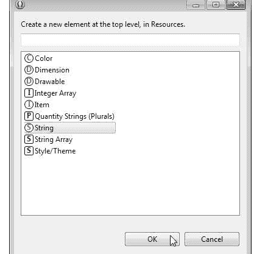

图 4.22 | 添加字符串资源。

### 指定 `AlertDialog` 的正按钮

在这个 `AlertDialog` 中，我们只需要一个允许用户确认消息的按钮。我们将其指定为对话框的正按钮（图 4.21，第 102 行）——点击消息。此按钮表示用户已确认对话框中显示的消息。`setPositiveButton` 方法接收按钮标签（通过字符串资源 `R.string.OK` 指定）和按钮事件处理程序的引用。对于此对话框，我们不需要对事件做出响应，因此为事件处理程序传递了 `null`。当用户点击按钮时，对话框将从屏幕上消失。

### 创建并显示 `AlertDialog`

通过调用 `AlertDialog.Builder` 的 `create` 方法（第 105 行）创建 `AlertDialog`，并通过 `AlertDialog` 的 `show` 方法（第 106 行）显示模态对话框。

## 4.5.6 `addTaggedSearch` 方法

图 4.21 中的事件处理程序调用 `MainActivity` 方法 `addTaggedSearch`（图 4.23），以向 `savedSearches` 添加新搜索或修改现有的搜索。

## 4.5 构建 `MainActivity` 类

```java
// 将新搜索保存到保存文件中，然后刷新所有按钮

private void addTaggedSearch(String query, String tag)
{
    // 获取一个 SharedPreferences.Editor 来存储新的标签/查询对
    SharedPreferences.Editor preferencesEditor = savedSearches.edit();

    preferencesEditor.putString(tag, query); // 保存当前搜索
    preferencesEditor.apply(); // 保存更新后的偏好

    // 如果标签是新的，将其添加到排序标签中，然后显示更新列表
    if (!tags.contains(tag)) {
        tags.add(tag); // 添加新标签

        Collections.sort(tags, CASE_INSENSITIVE_ORDER);
        adapter.notifyDataSetChanged(); // 将标签重新绑定到 ListView
    }
}
```

**图 4.23** `addTaggedSearch` 方法

### 编辑 `SharedPreferences`

要更改 `SharedPreferences`，必须先调用其 `edit()` 方法。第 115 行返回一个 `SharedPreferences.Editor` 对象。第 116 行使用 `putString()` 保存键值对。第 117 行调用 `apply()` 提交更改。

### 通知适配器数据已更改

当用户添加新项目时，适配器会通知 `ListView`。第 124 行调用 `notifyDataSetChanged()` 来更新显示。

## 4.5.7 实现 `ItemClickListener` 的匿名类

```java
// itemClickListener 启动浏览器显示结果

ItemClickListener listener = new ItemClickListener() {

    @Override
    public void onClick(AdapterView<?> parent, View view, int position, long id) {

        // 获取用户点击的 TextView 的文本
        String tag = (TextView) view.getText().toString();

        // 创建表示搜索的 URL
        String url = getString(R.string.searchURL) +
            Uri.encode(savedSearches.getString(tag, ""), "UTF-8");

        // 创建启动网络浏览器的 Intent
        Intent intent = new Intent(Intent.ACTION_VIEW, Uri.parse(url));

        startActivity(intent); // 启动浏览器查看结果
    }

}; // 结束 ItemClickListener 声明
```

**图 4.24** 实现 `ListView ItemClickListener` 的匿名内部类，用于搜索结果。

## 4.5 构建 `MainActivity` 类

要执行的操作。`Intent.ACTION_VIEW` 表示我们想要显示数据的表示形式。`Intent` 类中定义了许多常量，描述了搜索、选择、发送和播放等操作。第二个参数（第 142 行）是一个 `Uri`（统一资源标识符），代表我们想要执行该操作的数据。`Uri` 类的 `parse` 方法将一个表示 URL（统一资源定位符）的字符串转换为 `Uri`。

### 为 `Intent` 启动 `Activity`

第 144 行将 `Intent` 传递给继承自 `Activity` 的方法 `startActivity`，该方法会启动一个可以对给定数据执行特定操作的 `Activity`。在这种情况下，由于我们指定了查看 URI，`Intent` 会启动设备的浏览器来显示网页。该页面将显示所提供的 Twitter 搜索结果。

### 4.5.8 实现 `ListView` 的 `OnLongClickListener` 的匿名内部类，用于分享、编辑或删除搜索

图 4.25 声明并初始化了实例变量 `itemLongClickListener`，它指向一个实现了 `OnLongClickListener` 的匿名内部类对象。第 70 行（图 4.20）将 `itemLongClickListener` 注册为 `ListView` 的事件处理程序，当用户按下 `ListView` 中的某项时做出响应。第 153–220 行重写了接口 `OnLongClickListener` 的 `onItemClick` 方法。

```java
// itemLongClickListener 显示一个允许用户删除
// 编辑已保存搜索的对话框

OnLongClickListener itemLongClickListener =
    new OnLongClickListener()

    @Override
    public boolean onItemClick(Adapter<?> parent, View,
        int position, long id)
    {
        // 获取用户触摸的数据
        final String tag = ((TextView)view).getText().toString();

        // 创建一个新的 AlertDialog
        AlertDialog.Builder builder =
            new AlertDialog.Builder(MainActivity.this);

        // 设置 AlertDialog 的标题
        builder.setTitle(
            getString(R.string.sharedEditDeleteTitle, tag));

        // 设置对话框中显示的项目列表
        builder.setItems(R.array.dialog_items,
            new DialogInterface.OnLongClickListener()
        {
            // 通过分享、编辑或
            // 删除已保存的搜索对用户的触摸做出响应
```

**图 4.25** 实现 `ListView` 的 `OnLongClickListener` 的匿名内部类，用于分享、编辑或删除。（2 部分中的第 I 部分）

### 第 4 章 Twitter® 搜索应用

```java
@Override
public void onClick(DialogInterface dialog, int which)
{
    switch (which) {
        case 0: // 分享
            shareSearch(tag);
            break;

        case 1: // 编辑
            // 设置 EditText 以匹配选定的标签和查询
            tagEdit.setText(tag);
            queryEdit.setText(
                savedSearches.getString(tag, ""));
            break;

        case 2: // 删除
            deleteSearch(tag);
            break;
    }
} // 结束 DialogInterface.OnClickListener
); // 结束调用 builder.setItems
```

```java
// 设置 AlertDialog 的负向按钮

builder.setNegativeButton(getString(R.string.cancel),
    new DialogInterface.OnClickListener()
{
    // 当点击“取消”按钮时调用
    public void onClick(DialogInterface dialog, int id)
    {
        dialog.cancel(0); // 关闭 AlertDialog
    }
); // 结束调用 setNegativeButton
```

```java
builder.create().show(); // 显示 AlertDialog
return;
} // 结束 onItemClick
}; // 结束 onItemClickClickListener 声明
```


图 4.25 实现 `ListView` 的 `onItemLongClickListener` 的匿名内部类，用于分享、编辑或删除。（2 部分中的第 2 部分。）

### 匿名内部类的 final 局部变量

第 158 行获取了用户长按的文本，并将其赋值给 `final` 局部变量 `tag`。在匿名内部类中使用的任何局部变量或方法参数必须声明为 `final`。

### 显示项目列表的 AlertDialog

第 161–166 行创建了一个 `AlertDialog.Builder` 并将对话框标题设置为一个格式化字符串，在该字符串中，`tag` 替换了资源 `R.string.shareEditDeleteTitle` 中的占位符（该资源代表“分享、编辑或删除标记为 %s$ 的搜索”）。

## 4.5 构建 MainActivity 类

第 166 行调用了 `Activity` 继承的方法 `getString`，该方法接收多个参数——这是一个表示格式化字符串的 `String` ID，其余参数是应该替换格式化字符串中格式占位符的值。除了按钮外，`AlertDialog` 还可以在 `ListView` 中显示项目列表。第 169–194 行指定对话框应显示字符串数组 `R.dialog_items`（代表字符串“Share”、“Edit”和“Delete”），并定义了一个匿名内部类，以便在用户触摸列表中的某项时做出响应。

### 向 strings.xml 添加字符串资源

该字符串数组在 `strings.xml` 文件中被定义为 `String` 资源。要向 `strings.xml` 添加字符串资源：

1. 按照 4.5.5 节中的步骤添加字符串资源，但在图 4.22 的对话框中选择“String Array”（字符串数组）而不是“String”（字符串），然后点击 OK。
2. 在 Name 字段中指定数组的名称（`dialog_items`）。
3. 在资源编辑器左侧选择资源列表。
4. 点击 Add... 为数组添加新项。
5. 在 Value 字段中指定新项的值。

分别对 Share、Edit 和 Delete 项目（按此顺序）执行这些步骤，保存 `strings.xml` 文件。

### 对话框项目列表的事件处理器

匿名内部类行 170–193确定了用户在列表中选择了哪一项并执行相应操作。如果用户选择“分享”，则调用 `searchSearch`（第 180 行）。如果用户选择“编辑”，则第 184–186 行显示 `EditText`。如果用户选择“删除”，则调用 `deleteSearch`（第 189 行）。

### 配置负向按钮并显示对话框

第 197–206 行配置对话框的负向按钮——提醒用户选择合适的 Activity 是重要的。第 208 行显示对话框。

### 4.5.9 search 方法

```java
// 允许用户选择应用

private void searchSearch(String tag)

{

    // 创建用于分享 URL 的 Intent

    String urlString = Uri.encode(

        savedSearches.getString(tag, ""), "UTF-8");

        Intent shareIntent = new Intent();

    shareIntent.setAction(Intent.ACTION_SEND);

    shareIntent.putExtra(Intent.EXTRA_SUBJECT,

        getString(R.string.shareSubject));

    shareIntent.putExtra(Intent.EXTRA_TEXT,

        getString(R.string.shareMessage, urlString));

    shareIntent.setType("text/plain");

    // 显示可以共享文本的应用

    startActivity(Intent.createChooser(shareIntent,

        getString(R.string.searchSearch)));

}
```

### 显示 Intent 选择器

为了显示图 4.8(a) 中的 `Intent` 选择器，我们将 `Intent` 和一个标题传递给 `Intent` 的静态方法 `createChooser`（第 230 行）。资源 `R.string.searchSearch`（“搜索到:”）用作选择器的标题。设置此标题对于提醒用户选择合适的 Activity 是重要的。你无法控制手机上安装的应用或启动应用的的 `Intent` 过滤器，因此选择器可能会出现不兼容的 Activity。`createChooser` 方法返回一个 `Intent`，将其传递给 `startActivity`。

### 4.5.10 deleteSearch 方法

图 4.25 中的事件处理器在用户按下搜索标签并选择*删除*时会调用 `deleteSearch`（图 4.27）。在删除之前，应用会显示一个 `AlertDialog` 来确认操作。第 241–242 行将对话框标题设置为一个格式化字符串，在该字符串中，`tag` 替换了字符串资源中的格式占位符

`R.string.confirmMessage`（“Are you sure you want to delete the search %s?”）。第 245–254 行配置了对话框的负按钮以关闭对话框。字符串资源 `R.string.cancel` 代表“取消”。第 257–275 行配置了对话框的正按钮以移除搜索。字符串资源 `R.string.delete` 代表“删除”。第 263 行从集合中移除标签，第 266–269 行使用 `SharedPreferences.Editor` 从应用的 `SharedPreferences` 中移除该搜索。第 272 行通知 `ArrayAdapter` 底层数据已更改，以便 `ListView` 可以更新其显示的项目列表。

```java
// 在用户确认删除操作后删除搜索

private void deleteSearch(final String tag) {

    // 创建一个新的对话构建器

    AlertDialog.Builder builder = new AlertDialog.Builder(this);

    // 设置对话框的消息

    confirmBuilder.setMessage(getString(R.string.confirmMessage, tag));

    // 设置对话框的负按钮

    confirmBuilder.setNegativeButton(getString(R.string.cancel),

        new DialogInterface.OnClickListener() {

            // 当点击“取消”按钮时调用

            public void onClick(DialogInterface dialog, int id) {

                dialog.cancel(); // 取消对话框

            }

        });

    // 设置对话框的正按钮

    confirmBuilder.setPositiveButton(getString(R.string.delete),

        new DialogInterface.OnClickListener() {

            // 当点击“取消”按钮时调用

            public void onClick(DialogInterface dialog, int id) {

                tags.remove(tag); // 从 tags 中移除标签

                // 获取 SharedPreferences.Editor 以移除保存的搜索

                SharedPreferences.Editor preferencesEditor = 

                    savedPreferences.edit();

                preferencesEditor.remove(tag); // 移除搜索

                preferencesEditor.apply(); // 保存更改

                // 重新绑定 tags ArrayList 到 ListView 以显示更新后的列表

                adapter.notifyDataChanged();

            }

        });

} // setPositiveButton 
```

**图 4.2** | `MainActivity` 类的 `deleteSearch` 方法。（部分，共 2 部分）

# 第 4 章 Twitter 搜索应用

```java
276 confirmBuilder.create().show(); // 显示对话框
277 } // deleteSearch 方法结束

279 } // MainActivity 类结束
```


**图 4.27** `MainActivity` 类的`deleteSearch`方法。（第 2 部分，共 2 部分。）

## 4.6 AndroidManifest.xml

在第 3.6 节中，你对`AndroidManifest.xml`文件做了两个更改：

- 第一个更改表示 Tip 应用仅支持竖屏模式。
- 第二个更改强制在应用开始执行时显示软键盘，以便用户可以在小费计算器应用中立即输入金额。

此应用同时支持竖屏和横屏模式。不需要更改来表示这一点，因为所有应用默认都支持这两种方向。

在此应用中，大多数用户将启动应用以执行他们保存的搜索之一。当应用中的第一个 GUI 组件是`EditText`时，Android 会赋予它焦点；当`EditText`接收焦点时，相应的软键盘就会显示（除非存在硬件键盘）。在此应用中，我们希望在用户触摸应用的任意`EditText`之前不要显示软键盘。要做到这一点，请按照第 3.6 节中的步骤设置`Window soft input mode`属性，但将其值设置为`AlwaysHidden`。

## 4.7 总结

在本章中，你创建了 Twitter 搜索应用。首先，你设计了`ListView`组件来显示可滚动的项目列表，并使用它显示任意数量的搜索。每个搜索都与`ListView`中的一个项目关联，用户可以点击该项目将搜索传递给设备的网络浏览器。你还学习了创建用于 Java 代码的`String`资源。

我们将标签-查询对存储在与应用相关的`SharedPreferences`中，并展示了如何通过程序隐藏软键盘。我们使用`SharedPreferences`编辑器来存储值、修改值和从`SharedPreferences`中删除值。为了响应点击搜索，我们通过创建一个新的`Intent`并将其传递给`Context`的`startActivity`方法将`Uri`加载到设备的网络浏览器。你使用了`Intent`来允许意图选择器，允许用户选择一个 Activity 来共享搜索。

你使用了`AlertDialog.Builder`来配置和创建用于向用户发送消息的`AlertDialog`。最后，我们讨论了`AndroidManifest.xml`文件并向你展示了如何配置应用，以便在应用启动时不显示软键盘。

在第 5 章中，你将构建国旗测验应用，在该应用中，用户将看到一个国旗图形并必须从 3、6 或 9 个国家中猜出哪一个。你将使用菜单和复选框来自定义测验，将选择的标志和国家限制在世界的特定区域。

## 自测练习题

4.1 填空每个陈述中的空白：

- a) ________ 通常用于启动活动——它们指示了要执行的操作以及执行该操作的日期。
- b) 我们实现接口 ________ 来处理用户点击警报 ________ 对话框时发生的事件。
- c) 冗长数据不应在 UI 中；否则，应用程序将发生(n) ________——通常在无活动五秒后。
- d) `Intent`是一个对要执行的操作的 ________ 描述，并带有相关的 ________。
- e) `Intents`指定了用于在同一应用中运行的 Activity 类。
- f) 当你在 Eclipse 中为 Android 应用创建项目时，ADT 插件随后会配置 ________（也称为应用清单），它描述了关于应用的信息。
- g) 一个 ________ 显示列表项，如果列表无法在屏幕上显示，则它是可滚动的。
- h) 一个 ________ 创建一个使用`ArrayAdapter`数据填充`ListView`的对象。
- i) 是`ImageView`的子类，它提供了额外功能，使图像可以像`Button`一样使用。

4.2 说明每个陈述是正确还是错误。如果错误，请解释。

- a) 昂贵的输入/输出应该在 UI 上执行；否则，这将影响你的应用。
- b) 你在`Set`上调用`toString()`（以空字符串作为参数）将`Set`转换为字符串数组。
- c) 当 Activity 的主要任务是显示列表项时，你可以扩展`ListActivity`，它使用占据整个应用作为布局的`ListView`。
- d) `ListView`是`Adapter`的子类——绑定到数据源的 GUI 组件。
- e) 在自定义`ListActivity`时，布局必须包含一个带有`android:id`的`ListView`——这是`ListActivity`用于其引用的名称。

# 自测练习题答案

4.1 a) `Intents`, b) `OnClickListener`, c) `Application Not Responding (ANR)`, d) `data`, e) `Explicit`, f) `AndroidManifest.xml`, g) `ArrayAdapter`, h) `ImageButton`.

4.2 a) 昂贵的输入/输出不应在 UI 线程上执行，这将影响应用的响应能力。b) 正确。c) 正确。d) 错误。`ListView`是`Adapter`的子类——绑定到数据源的 GUI 组件。e) 正确。

# 练习题

4.1 填空每个陈述中的空白：

- a) 如果布局的`Width`和`Height`属性设置为 ________，将填充整个屏幕区域。
- b) ________ 存储键值对。
- c) `java.util`包中`Collections`类的静态方法对第一个参数`List`进行排序。
- d) 使用对象配置并创建用于显示消息的`AlertDialog`。
- e) Android 使用一种技术在同一个应用内或不同应用之间进行通信。
- f) 一个 ________ 显示可以处理特定`Intent`的活动列表。

4.2 说明每个陈述是正确还是错误。如果错误，请解释原因。

- a) 算法执行要执行的操作和要处理的数据——Android 使用算法来启动相应的活动。
- b) 实现`android.view`的接口以查看当用户点击`Button`时应执行的代码。
- c) `Intent`构造函数的第一个参数是所操作的数据。
- d) 显式`Intent`允许系统通过 ________ 类型启动最合适的 Activity。

# 项目练习题

4.3 (收藏网站应用) 使用你在本章中学到的技术，创建一个收藏网站应用，允许你创建一个收藏网站列表。

4.4 (Twitter 搜索的增强) 增强 Twitter 搜索以允许用户过滤搜索（例如，仅包含视频或图像的推文）。你可以使用`Intent`触发其他应用中的搜索。

4.5 (Flickr 搜索应用) 实现 Flickr 的照片搜索 API (`http://www.flickr.com/services/api/flickr.photos.search.html`)，然后将本章的搜索实现为 Flickr 应用。

4.6 (增强型 Flickr 搜索) 增强练习 4.5 中的 Flickr 搜索，允许用户过滤搜索（例如，仅包含特定颜色、形状、对象等的图像）。

4.7 (单词随机游戏) 创建一个应用，将单词或短语的字母打乱并要求用户输入正确的单词或短语。将高分记录在`Preferences`中。

# 高级项目练习题

4.8 (黑杰克应用) 创建一个黑杰克游戏。牌发给庄家和玩家。（我们提供示例）。玩家的牌朝上。只有第一张牌朝上。每张牌都有一个值。2 到 10 的牌面值为面值。J、Q 和 K 算作 10。A 算作 1 或 11——对玩家更有利的。如果你的两张牌总和为 21（即玩家分到了 10 和 A，此时 A 算作 11），则你有“黑杰克”，庄家赢得游戏；否则手为“平”（即平局），没有人赢。如果庄家没有黑杰克，玩家可以开始一次一次添加牌。这些牌朝上分发，玩家决定何时停止拿牌。如果玩家“爆牌”（牌的总和超过 21），游戏结束，玩家输掉。当玩家停止（停止拿牌）时，庄家的隐藏牌会被揭露。如果庄家的数为 16 或更少，庄家必须再次拿牌；否则，庄家必须停止。庄家必须继续拿牌，直到牌的总和大于等于 17。如果庄家超过 21，玩家胜。否则，点数更高的一方胜。如果庄家和玩家总分相同时，游戏为“平局（push）”，无人获胜。此应用的 GUI 可以`ImageViews`、`TextViews`和`Buttons`构建。

## 4.9 (增强版黑杰克应用) 按如下方式增强练习 4.8 中的黑杰克应用：

- a) 提供一种下注机制，允许玩家起始资金为 $1000，并根据玩家输赢某局的情况增加或减少总额。如果玩家以非黑杰克牌获胜，则总额增加投注金额。如果玩家以黑杰克牌获胜，则总额增加投注金额的 1.5 倍。如果玩家输掉该局，则从总额中扣除投注金额。用户用完钱时游戏结束。
- b) 找到筹码图像并使用它们在屏幕上表示投注金额。
- c) 在线研究黑杰克规则并提供“加倍（doubling down）”、“投降（surrendering）”和其他功能。
- d) 部分赌场使用标准黑杰克规则的变体。提供选项允许用户选择游戏遵循的规则。
- e) 部分赌场使用不同数量的牌。允许用户选择使用多少副牌。
- f) 允许用户保存游戏状态以便稍后继续。

## 4.10 (其他纸牌游戏应用) 在线研究你选择的任何纸牌游戏规则并将其实现为应用。

## 4.11 (接龙纸牌游戏) 在网上搜索各种接龙纸牌游戏的规则。选择你喜欢的版本并将其实现。（我们在书中示例提供了卡牌图像。）

## 5 国旗测验应用

## 目标

在本章中，你将：

- 使用`Fragments`更好地利用手机和平板上 Activity GUI 的可用屏幕空间。
- 在操作栏上显示选项菜单，使用户配置应用偏好。
- 使用`PreferenceFragment`自动管理和持久化应用的用户偏好。
- 使用应用的`assets`子文件夹组织图像资源，并使用`AssetManager`对其进行操作。
- 定义动画并将其应用于`View`。
- 使用`Handler`调度一个在 GUI 线程执行的未来任务。
- 使用`Toasts`向用户简要显示消息。
- 使用显式`Intent`启动特定的 Activity。
- 使用`java.util`包中的各种集合。
- 为多个设备方向定义布局。
- 使用 Android 的日志机制记录错误消息。

## 大纲

## 5.1 介绍

- 5.1 介绍
- 5.2 测试驱动国旗测验应用
- 5.2.1 导入并运行应用
- 5.2.2 配置测验
- 5.2.3 参加测验
- 5.3 技术概述
- 5.3.1 菜单 (Menus)
- 5.3.2 Fragments
- 5.3.3 Fragment 生命周期方法
- 5.3.4 管理 Fragments
- 5.3.5 偏好 (Preferences)
- 5.3.6 assets 文件夹
- 5.3.7 资源字段 (Resource Fields)
- 5.3.8 支持不同的屏幕尺寸和分辨率
- 5.3.9 判断屏幕尺寸
- 5.3.10 用于显示消息的 Toasts
- 5.3.11 使用 Handler 在未来执行 Runnable
- 5.3.12 为 View 实现动画
- 5.3.13 记录异常方法
- 5.3.14 使用 Intent 学习同一应用中的另一个 Activity
- 5.3.15 Java 数据结构
- 5.4 构建 UI 和资源文件
- 5.4.1 创建项目
- 5.4.2 strings.xml 和格式化资源
- 5.4.3 arrays.xml
- 5.4.4 colors.xml
- 5.4.5 dims.xml
- 5.4.6 activity_settings.xml 布局
- 5.4.7 activity_main.xml 手机和平板竖屏的布局
- 5.4.8 fragment_quiz.xml 布局
- 5.4.9 activity_main.xml 横屏布局
- 5.4.10 用于指定应用设置的 preferences.xml
- 5.4.11 创建国旗动画

## 5.5 MainActivity 类

- 5.5.1 package 语句、import 语句和字段
- 5.5.2 重写方法 onCreate
- 5.5.3 重写方法 onStart
- 5.5.4 重写方法 onCreateOptionsMenu
- 5.5.5 重写方法 onOptionsItemSelected
- 5.5.6 实现 PreferenceChangeListener 的匿名内部类

## 5.6 Fragment 类

- 5.6.1 package 语句和 import 语句字段
- 5.6.2 字段
- 5.6.3 重写 Fragment onCreateView
- 5.6.4 方法 updateRegions
- 5.6.5 方法 onDestroy
- 5.6.6 方法 reset
- 5.6.7 方法 loadNext
- 5.6.8 方法 getCountry
- 5.6.9 实现的匿名内部类
- 5.6.10 方法 Buttons

## 5.7 Settings 类

## 5.8 SettingsActivity

- 5.9 AndroidManifest.xml
- 5.10 总结

### 5.1 介绍

国旗测验应用测试你识别国旗的能力。最初，应用会显示构建测验的选项。当你安装并运行应用时，测验被配置为显示三个三个按钮，用于从世界所有地区选择国旗。在本次测试驱动中，你将更改应用选项，仅选择来自北美的国旗，并保持应用默认的手机三个按钮设置。在手机、平板电脑或竖屏模式的 AVD 上，点击操作栏上的选项菜单打开菜单，选择 Settings（设置）以便查看应用选项。在平板电脑或横屏模式的 AVD 上，应用设置出现在屏幕左侧。

## 第 5 章 国旗测验应用程序

a) 用户点击“选项数量”时的菜单

b) 显示选项数量选项的对话框

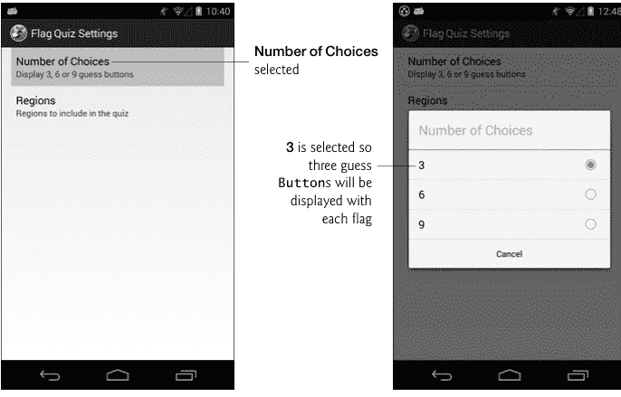

图 5.3 | 国旗测验设置屏幕和“选项数量”对话框。

a) 用户点击“地区”时的菜单

b) 显示区域的对话框

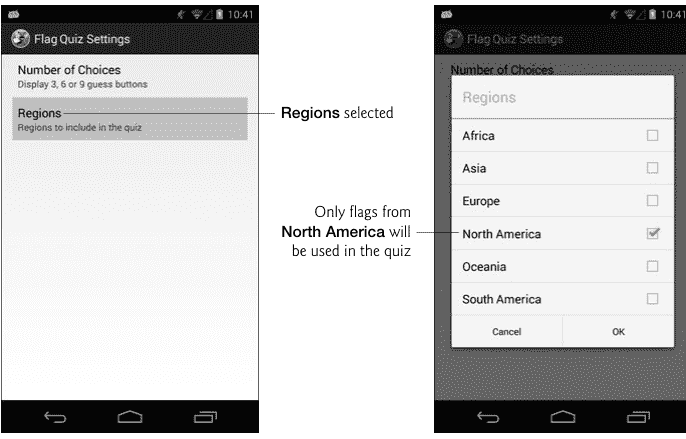

已选择区域
测验将仅使用来自北美的国旗

图 5.4 | 国旗测验设置屏幕和“地区”对话框。

## 5.2.3 进行测验

新的测验根据你选择的答案选项数量以及仅来自北美地区的国旗开始。通过点击与每个国旗匹配的计数按钮来完成测验。

### 进行正确的选择

如果选择正确（图 5.5(a)），应用将禁用所有答案按钮，并在屏幕底部用绿色显示国家名称，随后跟上一个感叹号（图 5.5(b)）。经过短暂延迟后，应用将加载下一面国旗并显示一组新的答案。

a) 选择正确答案

b) 显示正确答案

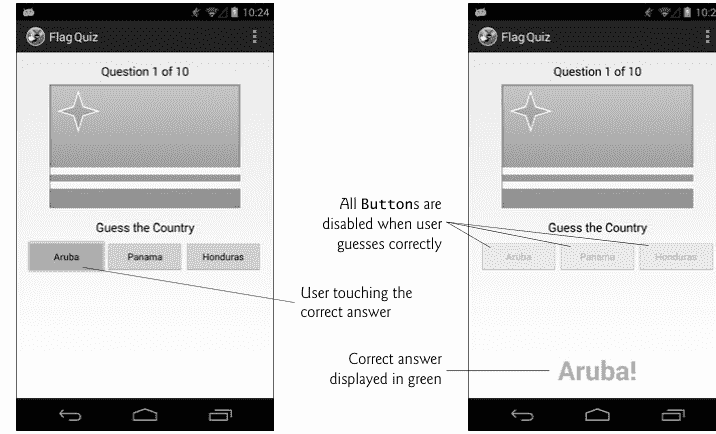

当用户猜对时，所有按钮均被禁用
用户点击正确答案

用绿色显示正确答案

图 5.5 | 用户选择正确答案并显示正确答案。

### 用户做了错误选择

如果你选择错误（图 5.6(a)），应用将禁用相应的国家名称按钮，使用动画抖动国旗，并在屏幕底部用红色显示“Incorrect!（错误！）”（图 5.6(b)）。继续猜直到得到该国旗的正确答案。

### 完成测验

当你选择了 10 个国家名称后，应用上会弹出一个`AlertDialog`（警告对话框），显示你的总猜测次数和正确答案的百分比（图 5.7）。当你点击对话框的“重置”按钮时，将根据当前的测验选项开始一个新的测验。

a) 选择错误答案

b) 显示“Incorrect!”

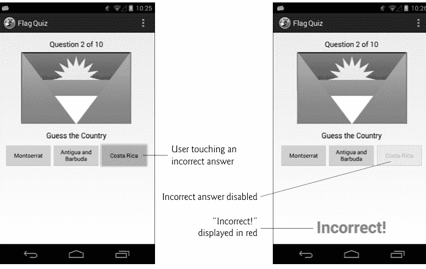

用户点击错误答案
错误答案被禁用

> 用红色显示“Incorrect!” 

图 5.6 | 国旗测验应用中禁用的错误答案。

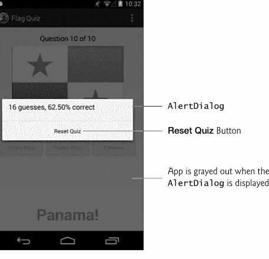

AlertDialog
重置测验按钮

显示 AlertDialog 时，应用会变灰

图 5.7 | 测验完成后显示的结果。

## 5.3 技术概述

本节介绍了你用于构建国旗测验应用时将用到的功能。

## 5.3.1 菜单

当你在 IDE 中创建应用项目时，操作栏右侧的`MainActivity`被配置为显示选项菜单。Main 包含一个 Settings 菜单项，通常用于向用户显示应用设置。在随后的应用中，你将学习如何创建动态菜单项，以及决定哪些项应该直接显示在操作栏上或在选项菜单中。

选项菜单是`Menu` (`android.view`) 类的对象。要指定`Menu`项，你需要重写`onCreateOptionsMenu`方法（第 5.5.4 节），将选项添加到菜单的参数中。当用户选择某项时，Activity 的`onOptionsItemSelected`（第 5.5.5 节）会对该选择做出响应。

## 5.3.2 Fragments（片段）

Fragment 通常代表 Activity 用户界面的可重用部分，但也可能代表可重用的程序逻辑。此应用使用 Fragment 来创建和管理应用 GUI 的部分。你可以组合 Fragment 创建利用平板屏幕尺寸的用户界面。你也可以轻松更改 Fragment 以使你的 GUI 更具动态性——你将在第 8 章学习这些内容。

Fragment (`android.app`) 是所有 Fragment 的基类。国旗测验应用定义了直接和间接的 Fragment 子类：

- 类`QuizFragment`（第 5.6 节）——Fragment 的直接子类——显示测验的 GUI 并定义测验逻辑。与 Activity 类似，每个 Fragment 都有自己的布局，该布局通常定义为布局资源，但也可以动态创建。在第 5.4.8 节中，你将构建`QuizFragment`的 GUI。你将在`MainActivity`的布局中使用`QuizFragment`——一个用于竖屏模式设备，另一个用于横屏模式设备。
- 类`SettingsFragment`（第 5.7 节）是`PreferenceFragment`（包`android.preference`）的子类，后者可以在 Settings 中自动维护应用的偏好。正如你所看到的，你可以创建一个描述用户偏好的 XML 文件，而`PreferenceFragment`类使用 XML 文件来构建适当的偏好（图 5.3–5.4）。
- 当你完成一个测验时，`QuizFragment`会创建一个扩展`DialogFragment`（包`android.app`）的匿名类，并使用它显示一个显示测验结果的对话框（第 5.6.9 节）。

Fragment 必须由 Activity 托管——它们不能独立执行。当此应用在平板电脑上以横屏模式运行时，`MainActivity`托管所有的 Fragment。在竖屏模式下（在任何设备上），`MainActivity`托管`SettingsFragment`（第 5.8 节），而`MainActivity`其他的。

尽管 Fragment 是在 Android 3.0 中引入的，但可以通过 Support Library 在较早版本中使用。更多信息请访问：


http://developer.android.com/tools/support-library/index

## 5.3.3 Fragment 生命周期方法

像 `Activity` 一样，每个 `Fragment` 都有生命周期，并提供了你可以响应生命事件的方法。在本应用中，你将重写：

- `onCreate`——此方法（你将在`SettingsFragment`中重写）在`Fragment`创建时调用。当`Activity`的布局被填充时，`QuizFragment`和`SettingsFragment`会被创建。
- `onCreateView`——此方法（你将在`QuizFragment`中重写）在`onCreate`之后调用，返回一个包含`Fragment` GUI 的`View`。正如你所看到的，此方法接收`LayoutInflater`，用于从定义的 XML 布局填充`Fragment` GUI。

我们将在书中遇到时讨论`Fragment`图像。有关生命周期详情，请访问：

```
http://developer.android.com/components/fragments.html
```

## 5.3.4 管理 Fragments

父`Activity`使用`FragmentManager`（`package android.app`）管理其`Fragments`，该管理器通过`Activity`的`getFragmentManager`方法返回。如果`Activity`需要交互声明在`Activity`布局中具有 ID 的`Fragment`，`Activity`可以调用`FragmentManagerById`获取指定`Fragment`的引用。正如你将在第 8 章看到的，`FragmentManager`使用`FragmentTransactions`（`package android.app`）动态地添加、删除和切换`Fragment`。

## 5.3.5 偏好（Preferences）

在 5.2.2 节中，你更改了应用设置以自定义测验。`PreferenceFragment`使用`Preference`对象（`package android.preference`）管理这些设置。此应用使用`Preference`子类`ListPreference`管理每个国旗的猜测数量，并使用`Preference` `MultSelectListPreference`管理包含在测验中的世界地区。`ListPreference`的项是互斥的，而`MultSelectListPreference`将使用`PreferenceManager`对象（`package android.preference`）来访问和交互应用的偏好。

## 5.3 技术概述

`assets`子文件夹中的文件通过`AssetManager`（包为`android.content.res`）访问，它可以提供指定子文件夹中所有文件名的列表，并用于访问每个资源。

### 5.3.7 资源文件夹

在 2.4.4 节中，你学习了应用`res`文件夹下的`drawable`、`layout`和`values`子文件夹。在本应用程序中，你还将使用`menu`、`anim`和`xml`资源文件夹。图 5.8 显示了这些子文件夹以及`animator`、`color`和`raw`文件夹。

| 资源子文件夹 | 说明 |
| --- | --- |
| `anim` | 以`anim`开头的文件夹包含定义补间动画（tweened animations）的 XML 文件，这些动画可以随时间改变对象的透明度、大小、位置和旋转。我们将在 5.4.11 节定义这样的动画，并在 5.6.9 节播放它，以为用户创建视觉反馈的抖动效果。 |
| `animator` | 以`animator`开头的文件夹包含定义属性动画（property animations）的 XML 文件，这些动画随时间改变对象某个属性的值。在 Java 中，属性通常实现为具有 setter 和 getter 方法的实例变量。 |
| `color` | 以`color`开头的文件夹包含 XML 文件，定义了各种状态的颜色列表，例如按钮的状态（未按下、按下、启用等）。 |
| `raw` | 以`raw`开头的文件夹包含原始资源文件（如音频剪辑），这些文件以字节流的形式读取到应用中。我们将在第 6 章使用这些资源来播放声音。 |
| `menu` | 以`menu`开头的文件夹包含描述菜单内容的 XML 文件。当你创建一个项目时，IDE 会自动定义一个带有设置（Settings）选项的菜单。 |
| `xml` | 以`xml`开头的文件夹包含不符合其他资源类别的 XML 文件。这些通常是应用使用的原始数据文件。在 5.4.10 节中，你将创建一个 XML 文件，代表由此应用的`SettingsFragment`显示的偏好设置。 |

**图 5.8** 项目`res`文件夹内的其他子文件夹。

### 5.3.8 适配不同的屏幕尺寸和分辨率

在 2.5.1 节中，你学习了 Android 设备具有各种屏幕尺寸、分辨率和像素密度（每英寸点数或 DPI）。你还学习到通常需要提供多个分辨率的视觉资源，以便 Android 能根据设备的像素密度选择最佳资源。同样，在 2.8 节中，你学习了如何为不同的语言和地区提供字符串源。Android 使用带有限定限定名称（qualified names）的资源文件夹，根据设备的像素密度选择合适的图像，并根据设备的语言和地区设置选择正确的语言字符串。这种机制也可以用于从 5.3.7 节中讨论的任何资源文件夹中选择资源。

对于此应用的`MainActivity`，你将使用尺寸（size）和方向（orientation）限定符（qualifiers）来决定使用哪布局——一个用于手机和平板电脑的竖屏模式，另一个仅用于平板电脑的横屏模式。为了实现这一点，你将定义两个`MainActivity`布局：

- 项目`res/layout`文件夹中的`activity_main.xml`是默认布局。
- 项目`res/layout-large-land`文件夹中的`activity_main.xml`仅在大尺寸设备（即平板电脑）且应用处于横屏（land）模式时使用。

限定符资源名称的格式如下：

```
name-qualifiers
```

其中限定符由一个或多个用连字符（`-`）分隔的限定符组成。你可以向资源名称中添加 18 种限定符。我们将在全书中使用它们时解释其他限定符。要查看所有`res`子文件夹限定符的完整描述以及它们在文件夹名称中必须定义的顺序，请访问：

```
http://developer.android.com/guide/topics/resources/providing-resources.html#alternativeResources
```

### 5.3.9 使用屏幕测验

在本应用程序中，当应用在手机尺寸的设备上运行或在平板模式下运行时，我们会显示菜单（第 5.5.4 节）。为了确定这一点，我们将使用 Android（包为`android.view`）获取一个包含设备宽度和高度的`Display`对象。这会随设备的方向而改变——在竖屏模式下，设备的宽度小于其高度。

### 5.3.10 用于显示消息的 Toast

`Toast`（包为`android.widget`）会短暂显示消息，然后从屏幕上消失。`Toast`常用于显示次要错误消息或信息消息，例如在用户更改应用偏好设置后测验将重置。当用户更改偏好设置时，我们会显示一个`Toast`表明测验将开始。如果用户取消选择某些地区，我们还会显示一个`Toast`表明必须选择一个地区——在这种情况下，应用会将北美设为测验的默认地区。

### 5.3.11 使用 Handler 在未来执行 Runnable

当用户做出手势时，应用会在显示下一个问题前给出两秒正确答案。为了实现这一点，我们使用`Handler`（包为`android.os`）。`Handler.postDelayed`接收一个作为执行任务的`Runnable`参数和一个以毫秒为单位的延迟。延迟结束后，`Handler`的`Runnable`将在创建`Handler`的相同线程中执行。与 GUI 交互或修改 GUI 操作必须在 GUI 线程中进行，因为 GUI 组件不是线程安全的。

### 5.3.12 为视图应用动画

当用户做出错误选择时，应用将通过在`ImageView`上应用`Animation`（包为`android.view.animation`）来让旗帜抖动。我们使用`AnimationUtils`静态方法从 XML 文件加载动画并指定动画选项。通过在`ImageView`上调用`startAnimation`（以`Animation`为参数）执行动画。

### 5.3.13 日志消息

当发生异常时，可以使用 Android 内置的日志机制对其进行记录。Android 提供了`Log`类（包为`android.util`），带有多个表示不同详细程度信息的静态方法。可以通过 IDE 底部的`LogCat`标签以及 Android `logcat`工具查看日志消息。更多关于日志的详细信息，请访问：

```
http://developer.android.com/reference/android/util/Log.html
```


### 5.3.14 使用显式 Intent 启动应用中的另一个 Activity

当应用以竖屏模式运行时，其偏好设置将在`SettingsActivity`中显示（5.8）。我们在第四章中展示了如何使用隐式 Intent 在设备浏览器中显示 URL。5.5.5 节将展示如何使用显式 Intent 启动应用程序中的特定 Activity。

### 5.3.15 Java 数据结构

应用使用了`java.util`包中的各种数据结构。应用动态加载启用地区的名称并将其存储在`ArrayList<String>`中。我们使用`Collections.shuffle`方法为每次游戏随机图像文件名的顺序。我们使用第二个`ArrayList<String>`来持有当前测验的国家图像文件名。我们引用`Set<String>`来存储测验包含的世界地区。我们使用接口类型`List<String>`的变量来引用`ArrayList<String>`对象——这是一个良好的 Java 编程习惯，允许你轻松更改数据而不影响应用的其他代码。

## 5.4 构建 GUI 和资源文件

在本节中，你将创建项目并使用 Flag Quiz 应用配置字符串、数组、颜色、维度、布局和动画资源。

### 5.4.1 创建项目

在创建新项目之前，删除你在 5.2 节中测试的 Flag 项目：点击该项目并选择 Delete。在出现的对话框中，确保没有选择 Delete project contents，然后点击 OK。

#### 创建空白应用项目

接下来，创建一个新的 Android 项目。在 New Android Project 对话框的第一个 New Application 字段指定以下值，然后按 Next：

- Application name：Flag Quiz
- Project name：FlagQuiz
- Package name：`com.deitel.flagquiz`
- 最低所需 SDK：API18: Android 4.3
- 目标 SDK：API19: Android 4.4
- 编译版本：API19: Android 4.4
- 主题：带有深色操作栏的 Holi Light 主题

在新建 Android 项目的第二个步骤“New Application”中，保留默认设置并点击 Next。在“Configure Launcher icon”步骤中，点击 Browse... 按钮并选择一个图标图像（在书籍示例文件夹中提供），点击 Open，然后点击 Next。在“Create Activity”步骤中，选择 Blank Activity（空白活动），然后点击 Next。在“Blank Activity”步骤中，保留默认设置并点击 Finish 创建项目。在 Graphical Layout 编辑器中打开`activity_main.xml`，并在屏幕类型下拉列表中选择 Nexus 4。你将再次使用此设备作为你设计的依据。

### 5.4.2 `strings.xml` 和格式化字符串资源

你在早期章节中已经创建了 String 资源，因此我们在这里仅显示一个表格（图 5.9），列出 String 资源名称及对应的值。双击 res/values 文件夹中的`strings.xml`以显示资源编辑器，用于创建这些 String 资源。

| 资源名称 | 值 |
|---|---|
| `settings_activity` | 国旗测验设置 |
| `number_of_choices` | 选项数量 |
| `number_of_choices_description` | 显示 3、6 或 9 个猜题按钮 |
| `world_regions` | 区域 |
| `world_regions_description` | 包含在测验中的区域 |
| `guess_country` | 猜猜国家 |
| `results` | %1d 次猜测，%2$.0f%%$d 正确！ |
| `incorrect_answer` | 错误！ |
| `default_region_message` | 正在将北美设置为默认区域。必须选择一个区域。 |
| `restarting_quiz` | 测验将使用你的新设置重启 |
| `ok` | 好 |
| `question` | 第 %1$ 题，共 %2d 题 |
| `reset_quiz` | 重置测验 |
| `image_description` | 测验当前国旗图像 |
| `default_region` | `North_America` |

**图 5.9** 国旗测验应用使用的 String 资源。

#### 将字符串格式化为 String 资源

结果和问题资源是用于 String format 的格式化字符串。当 String 资源包含多个占位符时，为了本地化目的，必须对格式占位符进行编号。

在结果资源中，符号`%1$d`表示格式字符串后的第一个参数应替换占位符`%1d`。同样，`%2$.02f`中的`2`表示格式字符串后的第二个参数应替换占位符`%2$.02f`。第一个占位符中的`d`格式化整数，第二个占位符中的`f`格式化浮点数。

在`strings.xml`的本地化版本中，可以根据需要重新排列占位符`%1s`和`%2s`，以正确翻译 String 资源。格式字符串后的第一个参数将替换`%1d`——无论它出现在格式字符串的何位置——第二个参数将替换`%2$.02f`，无论它们出现在格式字符串的何位置。

### 5.4.3 `arrays.xml`

在 4.5 节中，你在应用程序的`strings.xml`文件中创建了一个 String 资源。从技术上讲，res/values 文件夹中的所有资源都可以定义在同一个文件中。然而，为了方便管理不同类型的资源，数组资源通常定义在`arrays.xml`中，颜色定义在`colors.xml`中，字符串定义在`strings.xml`中，数值定义在`values.xml`中。

此应用使用了三个定义在`arrays.xml`中的 String 资源：

- `regions_list`指定用下划线分隔的世界区域名称——这些值用于从相应文件夹加载图像文件，以及用户在`SettingsFragment`中选择的世界区域值。
- `regions_list_for_settings`指定世界区域名称，并用空格分隔单词——这些值用于`SettingsFragment`中向用户显示区域名称。
- `guesses_list`指定字符串 3、6 和 9——这些值用于`SettingsFragment`中显示要显示的猜题按钮数量选项。

图 5.10 显示了这三个数组资源的名称和元素值。

| 数组资源名称 | 值 |
|---|---|
| `regions_list` | Africa, Asia, Europe, `North_America`, Oceania, South America |
| `regions_list_for_settings` | Africa, Asia, Europe, `North_America`, Oceania, South America |
| `guesses_list` | 3, 6, 9 |

**图 5.10** 定义在`arrays.xml`中的 String 数组资源。

要创建文件并配置数组资源，请执行以下步骤：

1. 在项目的 res 文件夹中，点击 values 文件夹，然后选择 New > Android XML File 以显示 New Android XML File。由于你右键点击了 values 文件夹，对话框已预配置为在 values 文件夹中添加资源文件。
2. 在 File 字段中指定`arrays.xml`并点击 Finish 创建文件。
3. 如果 IDE 以 XML 视图打开新文件，点击底部的 Resources 选项卡进入资源编辑器。
4. 要创建 String 数组资源，点击 Add...，选择 String Array 并点击 OK。
5. 在 Name 字段中输入`regions_1st`，然后保存文件。
6. 选择新的 String 数组资源，使用 Add 按钮为图 5.10 中的数组每个值添加项。
7. 对`regions_1st_settings`和`guesses_list`重复步骤 4–6。

### 5.4.4 `colors.xml`

要创建文件并配置数组资源，请执行以下步骤：

1. 在项目的 res 文件夹中，点击 values 文件夹，然后选择 New > Android XML File 以显示 New Android XML File。由于你右键点击了 values 文件夹，对话框已预配置为在 values 文件夹中添加资源文件。
2. 在 File 字段中指定`arrays.xml`并点击 Finish 创建文件。
3. 如果 IDE 以 XML 视图打开新文件，点击底部的 Resources 选项卡进入资源编辑器。
4. 要创建 String 数组资源，点击 Add...，选择 String Array 并点击 OK。
5. 在 Name 字段中输入`regions_1st`，然后保存文件。
6. 选择新的 String 数组资源，使用 Add 按钮为图 5.0 中的数组每个值添加项。
7. 对`regions_1st_for_settings`和`guesses_list`重复步骤 4–6。

### 5.4.7 `fragment_quiz.xml`

与……关联的类。请注意，你不需要为此应用程序的`SettingsFragment`定义布局，因为它的 GUI 是通过继承自`PreferenceFragment`类的功能自动生成的。

本节介绍了`QuizFragment`的布局（`fragment_quiz.xml`）。你将在应用程序的`res/layout`文件夹中定义该布局文件，因为我们在所有设备和设备方向上对`QuizFragment`使用相同的布局。图 5.12 显示了`QuizFragment`的 GUI 组件名称。

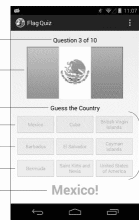

**图 5.12**｜国旗测验 GUI 组件，已根据其 Id 属性值进行标记。

#### 创建 `fragment_quiz.xml`

要创建`fragment_quiz.xml`，请执行以下步骤：

1. 在项目的 res 文件夹中，右键点击 layout 文件夹，然后选择 New > Android XML File 以显示“New Android XML File”对话框。
2. 在 File 字段中输入`fragment_quiz.xml`。
3. 在 Root Element 章节中，选择 LinearLayout (Vertical) 并点击 Finish 以创建布局文件。
4. 使用图形布局编辑器（Graphical Layout editor）和概要窗口（Outline window）形成图 5.13 所示的布局结构。在创建 GUI 组件时，设置它们的 Id 属性。对于`questionNumberTextView`和`guessTextView`，我们使用调板中 Form Widgets 的 Medium Text 组件。对于按钮，我们使用 Small Button 组件，它们使用较小的字体以便容纳更多文本。
5. 完成第 4 步后，按照图 5.14 所示的值配置 GUI 组件属性。将`flagImageView`的 Height 设置为 0dp 并将 Weight 设置为 1，可以使其在垂直方向上调整大小，以占据其他 GUI 组件未使用的任何剩余空间。同样，将每个 Button 的 Width 设置为 0dp 并将 Weight 设置为 1，可以让 LinearLayout 中的按钮平分水平空间。ImageView 的 Scale Type 设置为 fitCenter 可在保持原始图像宽高比例的同时将图像缩放以填充每个 ImageView 的宽度或高度。将 ImageView 的 Adjust View Bounds 设置为 true，表示 ImageView 将保持其 Drawable 的宽高比例。

| GUI component | Property | Value |
|---|---|---|
| `questionNumberTextView` | Layout Parameters | `wrap_content` |
|  | Width |  |
|  | Height |  |
|  | Gravity | `center_horizontal` |
|  | Other Properties | `@string/question` |
| `flagImageView` | Layout Parameters | `wrap_content` |
|  | Width | `0dp` |
|  | Height |  |
|  | Weight | `1` |
|  | Margins | Left/Right `@dimen/activity_horizontal_margin`；Top/Bottom `@dimen/activity_vertical_margin` |
|  | Other Properties: Adjust View Bounds | `true` |
|  | Content Description | `@string/image_description` |
|  | Scale Type | `fitCenter` |

**图 5.14**｜`fragment_quiz.xml`中 GUI 组件的属性值（部分 1，共 2）。

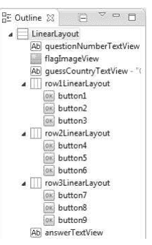

**图 5.13**｜`fragment_quiz.xml`的概要窗口。

| GUI component | Property | Value |
|---|---|---|
| `guessCountryTextView` | Layout Parameters | `wrap_content` |
|  | Width |  |
|  | Height | `wrap_content` |
|  | Gravity | `center_horizontal` |
|  | Other Properties |  |
|  | Text | `@string/guess-country` |
| LinearLayouts | Layout Parameters | `match_parent` |
|  | Width |  |
|  | Height | `wrap_content` |
|  | Margins |  |
|  | Bottom | `@dimen/spacing` |
| Buttons | Layout Parameters | `0dp` |
|  | Width |  |
|  | Height | `fill_parent` |
|  | Weight | `1` |
| `answerTextView` | Layout Parameters | `wrap_content` |
|  | Width |  |
|  | Height | `wrap_content` |
|  | Gravity | `center_bottom` |
|  | Other Properties |  |
|  | Gravity | `center_horizontal` |
|  | Text Size | `@dimen/answer_size` |
|  | Text Style | `bold` |

**图 5.14**｜`fragment_quiz.xml`中 GUI 组件的属性值（部分 2，共 2）。

### 5.4.9 用于平板横屏方向的 `activity_main.xml` 布局

在第 5.4.7 节中，你定义了`MainActivity`的竖屏布局，它只包含`QuizFragment`。现在你定义`MainActivity`的平板横屏布局，它将包含`SettingsFragment`和`QuizFragment`。要创建布局，请执行以下步骤：

1. 右键点击项目的 res 文件夹，然后选择 New > Folder。在 Folder name 字段中输入`layout-large-1-land`并点击 Finish。限定符 large 和 land 将确保在此文件夹中定义的所有布局都将仅在大型设备上或应用程序在横屏模式运行时使用。
2. 右键点击`layout-large-1-land`，然后选择 New > Android XML File 显示“New XML File”对话框，然后在 File 字段中输入`activity_main.xml`。在 Root element 中，选择 LinearLayout (Horizontal) 并点击 Finish 创建布局。
3. 选择 LinearLayout 并将其 Base Aligned 属性设置为 false。
4. 从图形编辑器的 layouts 部分，将一个 Fragment 拖入 LinearLayout。在 Choose Fragment 对话框中，选择`SettingsFragment`并点击 OK。
5. 重复步骤 4，但选择`QuizFragment`。
6. 在概要窗口中，将其 Layout Parameters 设置为 Width=0dp、Height=match_parent、Weight=1。
7. 由于`QuizFragment`的 Weight 为 2，而`SettingsFragment`的为 1，`QuizFragment`将占据布局三分之二的空间。

### 5.4.10 用于设置的 `preferences.xml`

在本节中，你将创建`SettingsFragment`用于显示设置的`preferences.xml`文件。创建该文件：

1. 右键点击 res 文件夹，选择 New > Folder。
2. 右键点击文件夹，选择 New > Android XML File。
3. 在 Root element 中，选择 Preference。
4. 在 File 字段中输入`preferences.xml`。
5. 在 Root element 中，选择 Preference。
6. 点击 Finish 创建布局。

| GUI component | Property | Value |
|---|---|---|
| `questionNumberTextView` | Layout Parameters | `wrap_content` |
|  | Width |  |
|  | Height |  |
|  | Gravity | `center_horizontal` |
|  | Other Properties | `@string/question` |
| `flagImageView` | Layout Parameters | `wrap_content` |
|  | Width | `0dp` |
|  | Height |  |
|  | Weight | `1` |
|  | Margins | Left/Right `@dimen/activity_horizontal_margin`；Top/Bottom `@dimen/activity_vertical_margin` |
|  | Other Properties: Adjust View Bounds | `true` |
|  | Content Description | `@string/image_description` |
|  | Scale Type | `fitCenter` |

### 5.4.11 创建国旗摇动动画

在本节中，你将创建一个在用户猜测错误时让国旗产生摇动的动画。我们将在第 5.6.9 节中展示应用程序如何使用该动画。

要创建动画，请执行以下步骤：

1. 右键点击项目的 res 文件夹，然后选择 New > Folder，在 Folder name 字段中输入`anim`并点击 Finish。
2. 右键点击 anim 文件夹，然后选择 New > Android XML File 显示 New Android XML File 对话框。
3. 在 File 文本字段中输入名称`incorrect_shake.xml`。
4. 确保 Resource Type（资源类型）为 Tween Animation 且 Root Element（根元素）已设置。
5. 点击 Finish 创建文件。该文件将立即在 XML 视图中打开。
6. 遗憾的是，IDE 并没有为动画提供编辑器，因此你必须如图 5.17 所示修改文件的 XML 内容。


`<?xml version="1.0" encoding="utf-8"?>`

`<set xmlns:android="http://schemas.android.com/apk/res/android"`

`android:interpolator="@android:anim/decelerate_interpolator">`

`<translate android:fromDelta="0" android:toDelta="-5%"`

`android:duration="100"/>`

`<translate android:fromDelta="-5%" android:toDelta="5%"`

`android:duration="100" android:startOffset="-100"/>`

`<translate android:fromDelta="5%" android:toDelta="-5%"`

`android:duration="100" android:startOffset="200"/>`

`</set>`

图 5.17 抖动动画（`incorrect_shake.xml`），当用户猜测错误时应用到旗帜上。

在这个示例中，我们使用 `Views` 创建了一个抖动效果，该效果由动画集（第 3–14 行）中的三个动画组成——动画集是构成较大动画的集合。动画集可以包含任何组合的补间动画：`alpha`（透明度）、`scale`（缩放）、`translate`（移动）和 `rotate`（旋转）。我们的抖动动画由三个 `translate` 动画组成。`translate` 动画在父容器内移动 `View`。Android 还支持属性动画，你可以对任何对象的任何属性进行动画处理。

第一个 `translate` 动画（第 6–7 行）在指定的时间内将 `View` 从起始位置移动到结束位置。`android:toDelta` 属性是动画开始时 `View` 的偏移量，而 `android:fromDelta` 属性是增量。这些可以是：

- 绝对值（像素）
- 动画 `View` 尺寸的百分比
- 动画 `View` 父容器尺寸的百分比。

对于 `android:fromDelta` 属性，我们指定了 `0` 的绝对值。对于 `android:toDelta` 属性，我们指定了值 `-5%`，这表示 `View` 向左移动（由于负号），距离为父容器宽度的 `5%`（由增量指示）。如果我们想移动 `View` 宽度的 `5%`，则会省略百分比符号。`android:duration` 属性指定了动画持续多长时间（单位为毫秒）。因此，第 6–7 行中的动画将使用 `View` 在 `100` 毫秒内向左移动父容器宽度的 `5%`。

第二个动画（第 9–10 行）从第一个动画结束的地方继续，在 `100` 毫秒内将 `View` 从 `-5%` 的偏移量移动到 `+5%` 的偏移量。默认情况下，动画集中的动画是同时偏移的（即并行执行），但你可以使用 `android:startOffset` 属性来指定动画在未来多少毫秒后开始。这可以用于对集中的动画排序。在这种情况下，第二个动画在第一个动画 `100` 毫秒后开始。第三个动画（第 12–13 行）与第二个相同，但方向相反，并且它在第一个动画 `200` 毫秒后开始。

## 5.5 MainActivity 类

`MainActivity` 类（图 5.18–图 23）在应用以竖屏模式运行时托管 `QuizFragment`，当应用在平板电脑上以横屏模式运行时，同时托管 `SettingsFragment` 和 `QuizFragment`。

### 5.5.1 包声明语句、导入语句和字段

图 5.18 显示了 `MainActivity` 的包声明、导入语句和字段。第 6–21 行导入了应用用到的各种 Java 和 Android 类及接口。我们高亮了新的导入语句，并将在第 5.3 节以及在第 5.5.2—5.5.6 节遇到它们时讨论相应的类和接口。

```java
// MainActivity.java
// 在手机上托管 QuizFragment，在平板电脑上托管
// QuizFragment 和 SettingsFragment
package com.deitel.flagquiz;

import java.util.Set;
import android.app.Activity;
import android.content.Intent;
import android.content.SharedPreferences;
import android.content.SharedPreferences.OnSharedPreferenceChangeListener;
import android.content.pm.ActivityInfo;
import android.content.res.Configuration;
import android.graphics.Point;
import android.os.Bundle;
import android.preference.PreferenceManager;
import android.view.Display;
import android.view.Menu;
import android.view.MenuItem;
import android.view.FragmentManager;
import android.widget.Toast;
```

图 5.18 | `MainActivity` 包声明、导入语句和字段。（2 部分中的第 1）

### 5.5.2 MainActivity 类 159

```java
public class MainActivity extends Activity {
    // 用于读取 SharedPreferences 的键
    public static final String CHOICES = "numberOfChoices";
    public static final String REGIONS = "numberOfRegions";

    // 用于判断设备是否为平板电脑
    private boolean phoneDevice = true;

    // 偏好设置是否发生了变化？
    private boolean preferencesChanged = true;
}
```

图 5.18 | `MainActivity` 包声明、导入语句和字段。（2 部分中的第 2）

布尔值 `phoneDevice`（第 29 行）指定应用是否运行在平板电脑上。布尔值 `preferencesChanged`（第 30 行）指示偏好设置是否发生了变化。

### 5.5.3 重写的 Activity 方法

`MainActivity` 的重写方法图 5.19（第 36 行）设置了应用的 GUI。

```java
@Override
protected void onCreate(Bundle savedInstanceState) {
    super.onCreate(savedInstanceState);
    setContentView(R.layout.activity_main);

    // 设置默认值
    PreferenceManager.setDefaultValues(this, R.xml.preferences, false);

    // 注册 SharedPreferences 器
    PreferenceManager.getDefaultShSharedPreferences(this)
        .registerOnSharedPreferenceChangeListener(this);

    // 确定屏幕尺寸
    int screenSize = getResources().getConfiguration().layout
        & (Configuration.SCREENLAYOUT_SIZE_LARGE | Configuration.SCREENLAYOUT_SIZE_XLARGE);

    // 如果设备是平板电脑，仅允许竖屏模式
    if (phoneDevice) {
        setRequestedOrientation(ActivityInfo.SCREEN_PORTRAIT);
    }
}
```

图 5.19 | `MainActivity` 重写方法 `onCreate`。（2 部分中的第 1）

### 5.5.4 设置默认值并注册更改

当你首次安装并启动应用时，第 39 行通过调用 `PreferenceManager.setDefaultValues(this)` 设置了默认值。该方法需要三个参数：

- 你设置默认值的偏好 `Context`（`this`）
- 你在 5.4 节中创建的偏好 XML 文件的资源 ID（`R.xml.preferences`）
- 一个布尔值，指示每次调用该方法时是否应该重置默认值——`false` 表示仅在第一次调用此方法时设置偏好值。

每当用户更改应用的偏好设置时，`MainActivity` 应该调用 `QuizFragment` 的 `updateRows` 或 `updateRegions` 方法（根据哪个偏好设置的变化）来重新配置查询。`MainActivity` 注册了一个 `OnSharedPreferenceChangeListener`（第 42–44 行），以便在每次偏好设置更改时都能收到通知。`PreferenceManager.getSharedPreferences` 返回代表应用偏好设置的 `SharedPreferences` 对象的引用，`SharedPreferences` 方法 `registerOnSharedPreferenceChangeListener` 注册监听器，该监听器在第 5.5.6 节中定义。

图 5.19 | `MainActivity` 重写方法 `onCreate`。（2 部分中的第 2）

## 5.5.5 重写的 Activity 方法 onStart

重写的 Activity 生命周期方法 `onStart`（如图 5.20 所示）在以下两种场景下被调用：

- 当应用首次执行时，`onStart` 在 `onCreate` 之后被调用。在这种情况下，我们使用 `onStart` 来确保在应用安装并首次执行时，根据应用的默认值正确配置测验；或者在随后启动应用时，根据用户更新后的偏好设置进行配置。
- 当应用以竖屏模式运行且用户打开 `SettingsActivity` 时，`MainActivity` 会暂停，而 `SettingsActivity` 将显示。当用户返回 `MainActivity` 时，`onStart` 会再次被调用。我们使用 `onStart` 是为了确保如果用户对偏好做了任何更改，测验也能得到正确配置。

在这两种情况下，如果 `preferencesChanged`（第 5.6.4 节）和 `updateRegions`（第 5.6.5 节）方法会重新配置测验。为了获取 `QuizFragment` 的引用，我们可以调用它的方法；第 71–72 行使用继承的 `findFragmentById` 获取 `FragmentManager`，然后调用其 `findById`。接下来，第 73–76 行调用 `QuizFragment` 的 `updateGuessRows` 和 `updateRegions`，并将应用的 `SharedPreferences` 对象作为参数传递，以便方法可以加载当前偏好。第 77 行重置测验。

```java
// called after onCreate completes execution
@Override
protected void onStart()
{
    super.onStart();

    if (preferencesChanged)
    {
        // now that the default preferences have been set,
        // initialize QuizFragment and start the quiz
        QuizFragment quizFragment = (QuizFragment)
            getFragmentManager().findFragmentById(R.id.quizFragment);
        quizFragment.updateGuessRows(
            PreferenceManager.getDefaultSharedPreferences(this));
        quizFragment.updateRegions(
            PreferenceManager.getDefaultSharedPreferences(this));
        quizFragment.resetQuiz();
        preferencesChanged = false;
    }
} // end method onStart
```

图 5.20 | 重写的 Activity 方法 `onCreateOptionsMenu`

## 5.5.6 重写的 Activity 方法 onCreateOptionsMenu

我们重写 Activity 方法 `onCreateOptionsMenu`（如图 5.21 所示）来初始化 Activity 的标准选项菜单。系统传入了选项将出现的 `Menu` 对象。在手机应用中，我们只在应用以竖屏模式运行时才显示菜单。第 87–88 行使用 `WindowManager` 获取一个包含屏幕宽度和高度的 `Display` 对象，这些值会根据设备方向而变化。如果宽度小于高度，则设备处于竖屏模式。第 89 行创建一个 `Point` 对象来存储当前的宽度和高度，然后第 90 行调用 `Display` 方法 `getClientSize`，它将设备的宽度和高度分别存储在 `Point` 的公共实例变量 `x` 和 `y` 中。如果宽度小于高度（第 93 行），第 95 行从 `menu.xml` 创建菜单——默认菜单是你在创建项目时由 IDE 配置的。继承的方法 `getInflater` 返回一个 `Inflater`，我们可以对它使用两个参数进行充气——菜单项的资源 ID 用于填充菜单，以及用于放置菜单项的 `Menu` 对象。从 `onCreateOptionsMenu` 返回 `true` 表示应该显示菜单。

```java
// show menu app is running on a phone or a portrait-oriented tablet
@Override
public boolean onCreateOptionsMenu(Menu menu)
{
    // get the Display object representing the screen
    Display display = (WindowManager.SERVICE).getDefaultDisplay();
    Point screenSize = new Point(); // use to store screen size
    display.getClientSize(screenSize); // store size in screenSize

    // get the app's only menu in portrait orientation
    if (screenSize.x < screenSize.y) // if width, y is height
        getMenuInflater().inflate(R.menu.main, menu); // inflate the menu
        return true;
    else
        return false;
} // end method onCreateOptionsMenu
```

**图 5.21** | `MainActivity` 重写的 Activity 方法 `onCreateOptionsMenu`

## 5.5.7 重写的 Activity 方法 onOptionsItemSelected

方法 `onOptionsItemSelected`（如图 5.22 所示）在选择菜单项时被调用。在此应用中，IDE 在你创建项目时提供的默认菜单只有 Settings 菜单；如果此方法被调用，说明用户选择了 Settings。第 106 行为启动 `SettingsActivity` 创建了一个显式的 `Intent`。此处的 `Intent` 构造函数接收要启动 Activity 的 `Context` 以及代表要启动 Activity 的类（`SettingsActivity.class`）。我们将此 `Intent` 传递给继承的 Activity 方法 `startActivity` 以启动该 Activity。

```java
// displays SettingsActivity when running on a phone
@Override
public boolean onOptionsItemSelected(MenuItem item)
{
    Intent preferencesIntent = new Intent(this, SettingsActivity.class);
    startActivity(preferencesIntent);
    return super.onOptionsItemSelected(item);
}
```


**图 5.22** | MainActivity 重写的 Activity 方法`onOptionsItemSelected()`（部分，共 2 部分）

**图 5.22** | MainActivity 重写的方法`onItemSelected()`（部分，共 2 部分）

## 5.5.6 匿名内部类实现`OnSharedPreferenceChangeListener`

监听器（如图 5.23 所示）是一个实现`SharedPreferenceChangeListener`接口的匿名内部对象。该对象在`onCreate`中注册，以监听`SharedPreferences`的变化。当发生变化时，`onPreferenceChanged`方法将`preferencesChanged`设置为`true`（第 120 行），获取`QuizFragment`的引用（第 122–123 行），以便重置测验。如果`CHOICES`偏好发生变化，第 127–128 行调用`QuizFragment.updateGuessRows`和`resetQuiz`。

```java
// listener for changes to the app's SharedPreferences

111 private SharedPreferenceChangeListener preferenceChangeListener =
112     new SharedPreferenceChangeListener() {
113         // when the user changes settings
114         @Override
115         public void onPreferenceChanged(
116             SharedPreferences sharedPreferences, String key)
117         {
118             preferencesChanged = true; // if choices changed
119
120             QuizFragment quizFragment = (QuizFragment)
121                 getFragmentManager().findFragmentById(R.id.quizFragment);
122
123             if (key.equals(CHOICES)) { // of choices changed
124                 quizFragment.updateGuessRows(
125                     PreferenceManager.getDefaultSharedPreferences(this));
126                 quizFragment.resetQuiz();
127             }
128             else if (key.equals(REGIONS)) { // regions to include
129                 Set<String> regions =
130                     sharedPreferences.getStringSet(REGIONS, null);
131                 if (regions != null && regions.size() > 0) { // must select one
132                     quizFragment.updateRegions(sharedPreferences);
133                     quizFragment.resetQuiz();
134                 } else { // set North America as default
135                     SharedPreferences.Editor editor = sharedPreferences.edit();
136                     regions = new HashSet<>();
137                     regions.add(getResources().getString(R.string.default_region));
138                     editor.putStringSet(REGIONS, regions);
139                     editor.commit();
140                     Toast.makeText(MainActivity.this,
141                         R.string.default_region_message,
142                         Toast.LENGTH_SHORT).show();
143                 }
144             }
145         }
146     };
```

## 5.6 `QuizFragment`类

`QuizFragment`类（如图 5.25–5.34 所示）构建了国旗测验的 GUI 并实现了测验逻辑。

### 5.6.1 包语句和导入语句

图 5.25 显示了`QuizFragment`的包语句和导入语句。第 5–33 行导入了应用使用的 Java 和 Android 类及接口。突出显示新的导入语句，并在第 5.3 节以及 5.6.2—5.6.10 节遇到它们时讨论相应的类和接口。

## 5.6 `QuizFragment`类 165

```java
// QuizFragment.java
// Contains the Flag Quiz logic
package com.deitel.flagquiz;

import java.io.IOException;
import java.io.InputStream;
import java.security.SecureRandom;
import java.util.ArrayList;
import java.util.Collections;
import java.util.List;
import java.util.Set;

import android.app.AlertDialog;
import android.app.Dialog;
import android.app.DialogFragment;
import android.app.Fragment;
import android.content.DialogInterface;
import android.content.SharedPreferences;
import android.content.AssetManager;
import android.graphics.drawable.Drawable;
import android.os.Bundle;
import android.os.Handler;
import android.util.Log;
import android.view.LayoutInflater;
import android.view.View;
import android.view.View.OnClickListener;
import android.view.ViewGroup;
import android.view.animation.Animation;
import android.view.animation.AnimationUtils;
import android.widget.Button;
import android.widget.ImageView;
import android.widget.LinearLayout;
import android.widget.TextView;
```

**图 5.25** | `QuizFragment`包声明，导入语句。

### 5.6.2 字段

图 5.26 列出了`QuizFragment`的静态变量和实例变量。常量`TAG`（第 38 行）用于在使用`Log`（见图 5.31）记录错误消息时，以便将此 Activity 的错误消息与写入设备的其他错误消息区分开来。常量`FLAGS_IN_QUIZ`（第 40 行）代表测验中的旗帜数量。

```java
public class QuizFragment extends Fragment
{
    // 用于记录错误消息的字符串
    private static final String TAG = "FlagQuiz Activity";
    private static final int FLAGS_IN_QUIZ = 10;
}
```

**图 5.26** | `QuizFragment`字段。（第一部分，共二部分）。

# 第 5 章旗帜测验 App

```java
42 private List<String> fileNameList; // 旗文件名
43 private List<String> quizCountriesList; // 当前测验中的国家
44 private Set<String> regionsSet; // 当前测验中的区域
45 private String correctAnswer; // 当前旗帜的正确答案
46 private int totalGuesses; // 已进行的猜测总数
47 private int correctAnswers; // 正确猜测次数
48 private int guessRows; // 显示猜测按钮的行数
49 private SecureRandom random; // 用于随机化测验
50 private Handler handler; // 用于延迟加载下一面旗帜
51 private Animation shakeAnimation; // 猜测错误时的动画
52
53 private TextView questionNumberTextView; // 显示当前题号
54 private ImageView flagImageView; // 显示旗帜
55 private LinearLayout[] guessLayouts; // 答案按钮的行
56 private TextView answerTextView; // 显示 "正确！" 或 "错误！"
```

**图 5.26** | `QuizFragment`字段（第二部分，共二部分）。

`fileNameList`（第 42 行）持有已启用地理区域的旗帜名称。变量`quizCountriesList`（第 43 行）持有当前测验中用到的国家旗帜名称。变量`regionsSet`（第 44 行）存储了地理区域。

变量`correctAnswer`（第 45 行）持有当前旗帜答案的旗帜名称。变量`totalGuesses`（第 46 行）存储了玩家到为止的所有正确和错误猜测总数。变量`correctAnswers`（第 47 行）是到为止的正确猜测次数；如果用户完成测验，该值最终将等于`FLAGS_IN_QUIZ`。变量`guessRows`（第 48 行）是显示答案选项的三个按钮`LinearLayout`的行数。

变量`random`数生成器用于随机挑选测验中的旗帜，以及三个按钮`LinearLayout`中的哪个按钮代表正确答案。当用户选择正确答案且测验未结束时，我们使用`Handler`（第 50 行）延迟加载下一面旗帜。

`Animation shakeAnimation`（第 51 行）持有在猜测错误时应用于旗帜的抖动动画。第 53–56 行包含了用于程序操作 GUI 组件的变量。

### 5.6.3 重写方法`onCreate`

`QuizFragment`的`onCreate`方法（见图 5.27）加载 GUI 并初始化`QuizFragment`的大多数实例变量——当`MainActivity`调用`QuizFragment`的`updateGuesses`和`updateRegions`方法时，`guessRows`和`regionsSet`被初始化。在调用父类的`onCreate`方法（第 63 行）后，使用`LayoutInflater`方法（第 64–65 行）加载 GUI。`LayoutInflater`的`inflate`方法接收三个参数：

- 指示加载位置的资源 ID
- 显示 Fragment 的布局对象（layout）
- 指示加载的 GUI 是否需要挂载到`ViewGroup`上的布尔值——`false`表示 Fragment 定义在父 Activity 的布局中，`true`表示生成的 Fragment 及其 GUI 应该挂载。

`inflate`方法返回加载的 GUI 的引用。我们将其存储在局部变量中，以便在`QuizFragment`其他变量完成后由`onCreateView`返回。

```java
@Override
public View onCreateView(LayoutInflater inflater, ViewGroup container,
    Bundle savedInstanceState) {
    super.onCreateView(inflater, container, savedInstanceState);
    View view =
        inflater.inflate(R.layout.fragment_quiz, container, false);

    fileNames = new ArrayList<String>();
    quizCountries = new ArrayList<String>();
    random = new SecureRandom();
    handler = new Handler();

    // 加载用于错误答案的抖动动画
    shakeAnimation = Animation.loadAnimation(getActivity(),
        R.anim.incorrect_shake);
    shakeAnimation.setRepeatCount(3); // 动画重复 3 次

    // 获取 UI 组件的引用
    questionNumberTextView =
        (TextView) view.findViewById(R.id.questionNumberTextView);
    flagImageView = (ImageView) view.findViewById(R.id.flagImageView);

    guesses = new LinearLayout[3];
    guesses[0] =
        (LinearLayout) view.findViewById(R.id.row1LinearLayout);
    guesses[1] =
        (LinearLayout) view.findViewById(R.id.row2LinearLayout);
    guesses[2] =
        (LinearLayout) view.findViewById(R.id.row3LinearLayout);
    answerTextView = (TextView) view.findViewById(R.id.answerTextView);

    // 为猜测按钮配置监听器
    for (int column = 0; column < row.getChildCount(); column++) {
        Button button = (Button) row.getChildAt(column);
        button.setOnClickListener(guessButtonListener);
    }

    // 设置 questionNumberTextView
    questionNumberTextView.setText(
        getResources().getString(R.string.question, 1, FLAGS_IN_QUIZ));

    return view; // 返回用于显示的 view
} // onCreate
```


**图 5.27** | `QuizFragment` 重写方法 `onCreate`（第一部分，共二部分）

**图 5.27** | `QuizFragment` 重写方法 `onCreateView`（第二部分，共二部分）。

第 67–68 行创建 `ArrayList<String>` 对象，分别存储当前地理区域的旗帜图像文件和当前测验中的国家名称。第 69 行创建 `SecureRandom` 对象用于随机化测验的旗帜和猜测按钮。第 70 行创建 `Handler` 对象，我们将用它在用户选择当前旗帜后延迟两秒显示旗帜。

第 73–74 行动态加载在猜测错误时应用于旗帜的动画。`AnimationUtils.loadAnimation` 从常量 `R.anim.incorrect_shake` 表示的 XML 文件加载动画。第一个参数表示包含将进行动画资源的 `Context`——继承的 `Fragment` 方法 `getActivity()` 返回托管此 `Fragment` 的 `Activity`。第 75 行通过 `Animation` 方法 `setCount()` 指定动画重复的次数。

第 78–88 行指向我们将程序操作的各种 GUI 组件。第 91–98 行从三个 `guessLinearLayout` 中获取每个猜测按钮，并在 `OnClickListener` 上注册 `guessButtonListener`（见 5.6 节）。

第 101–102 行使用静态方法 `format` 将 `questionNumberTextView` 中的文本设置为字符串。`format` 的第一个参数是字符串资源 `R.string.question`，它是一个包含两个整数值占位符的格式字符串（见第 5.2 节）。继承的 `Fragment` 方法 `getResources()` 返回一个 `Resources` 对象（包 `android.content.res`），可用于加载资源。然后我们调用 `getString()` 方法加载 `R.string.question` 资源，它代表字符串“Question %1$d of %2d”。

第 103 行返回 `QuizFragment` 的 GUI。

## 5.6.4 `updateGuessRows`

方法 `updateGuessRows()`（见图 5.28）在 App 启动时以及用户每次更改每面旗帜显示的猜测按钮数量时，从 `MainActivity` 中被调用。第 110–111 行使用 `SharedPreferences` 参数设置 `MainActivity` 的偏好。`CHOICES`——一个包含 `SettingsFragment` 中偏好名称的常量存储了要显示的按钮数量。第 112 行将偏好值转换为 `int` 并除以 3，以确定 `guessRows` 的值，该值指示应显示多少行 `guessLinearLayout`——每行有三个猜测按钮。接下来，第 115–116 行隐藏所有的 `guessLinearLayout`，使得第 119–120 行根据 `guessRows` 的值显示相应的 `guessLinearLayout`。

## 5.6 QuizFragment 类 169

```java
// 根据 SharedPreferences 中的值更新 guessRows
public void updateUpdateGuessRows(SharedPreferences sharedPreferences)
{
    // 获取应该显示的猜测按钮数量
    String choices = sharedPreferences.getString(MainActivity.CHOICES, null);
    guessRows = Integer.parseInt(choices) / 3;

    // 隐藏所有的猜测按钮布局
    for (LinearLayout layout : guessLinearLayouts)
        layout.setVisibility(View.INVISIBLE);

    // 显示合适的猜测按钮布局
    for (int row = 0; row < guessRows; row++)
        guessLinearLayouts[row].setVisibility(View.VISIBLE);
}
```

图 5.28 | `QuizFragment` 方法 `updateGuessRows`。

## 5.6.5 方法 `updateRegions`

方法 `updateRegions()`（图 5.29）在应用启动以及用户更改应包含在测验中的区域时，从 `MainActivity` 调用。第 126–127 行使用该方法的 `SharedPreferences` 参数以 `<String>` 格式获取所有启用区域的名称。`MainActivity.REGIONS` 是一个常量，包含 `SettingsFragment` 存储启用区域的偏好设置名称。

```java
// 根据 SharedPreferences 中的值更新测验的世界区域
public void updateRegions(SharedPreferences sharedPreferences)
{
    regionsSet = sharedPreferences.getStringSet(MainActivity.REGIONS, null);
}
```

图 5.29 | `QuizFragment` 方法 `updateRegions`。

## 5.6.6 方法 `resetQuiz`

方法 `resetQuiz()`（图 5.30）用于设置并启动测验。记住游戏图像存储在应用的 `assets` 文件夹中。为了访问该文件夹的内容，该方法通过调用父 `Activity` 的 `getAssets()` 方法获取应用的 `AssetManager`（第 134 行）。接下来，第 135 行调用 `fileName` 来仅加载对应地理区域的图像文件。第 140–147 行遍历所有启用的区域。对于每个区域，我们使用 `AssetManager` 的 `list()` 方法（第 143 行）获取旗帜文件名数组，并将其存储在 `String` 数组中。第 145–146 行移除每个文件的 `.png` 扩展名并将名称放入 `fileName` 中。`AssetManager` 的 `list()` 方法会抛出 `IOExceptions`，这是一种检查异常（你必须捕获或延迟异常）。如果发生异常，应用将无法访问 `assets` 文件夹，第 149–152 行捕获异常并使用 Android 内置的日志机制进行记录以便调试。`Log` 静态方法 `e` 用于记录错误消息。你可以在此处查看 `Log` 方法完整列表：

`http://developer.android.com/reference/android/util/Log.html`

```java
// 设置并启动下一次测验
public void resetQuiz() {
    // 使用 AssetManager 获取启用区域的图像文件名
    AssetManager assetManager = getActivity().getAssets();
    fileNameList.clear(); // 清空图像名称列表

    try {
        // 遍历每个区域
        for (String region : regionsSet) {
            // 获取该区域所有旗帜图像文件的列表
            String[] paths = assets.list(region);
            for (String path : paths) {
                fileNameList.add(path.replace(".png", ""));
            }
        }
    } catch (IOException exception) {
        Log.e(TAG, "Error loading image file names", exception);
    }

    correctAnswers = 0; // 重置正确答案数
    totalGuesses = 0; // 重置用户总猜测次数
    quizCountriesList.clear(); // 清空之前的测验国家列表

    int flagCounter = 1;
    int numberOfFlags = fileNameList.size();

    // 将 FLAGS_IN_QUIZ 个随机的文件名添加到 quizCountriesList
    while (flagCounter <= FLAGS_IN_QUIZ) {
        int randomIndex = random.nextInt(numberOfFlags);

        // 获取随机文件名
        String fileName = fileNameList.get(randomIndex);

        // 如果区域已启用且尚未被选过
        if (!quizCountriesList.contains(fileName)) {
            quizCountriesList.add(fileName); // 将文件添加到列表
            ++flagCounter;
        }
    }
}
```

**图 5.30** | `QuizFragment` 方法 `resetQuiz`。（2 个部分中的第 1 部分。）

```java
177 loadNextFlag(); // 通过加载第一面旗帜开始测验
178 } // 结束方法 resetQuiz
```

**图 5.30** | `QuizFragment` 方法 `resetQuiz`。（2 个部分中的第 2 部分。）

接下来，第 154–156 行将用户正确猜测次数（`correctAnswers`）和用户总猜测次数（`totalGuesses`）的计数器重置为 0 并清空 `quizCountriesList`。

第 162–170 行将 `FLAGS_IN_QUIZ` (10) 个随机选择的文件名添加到 `quizCountriesList`。我们获取旗帜总数，在 0 到旗帜数减 1 的范围内随机生成索引。我们使用该索引从 `fileNameList` 中选择一个图像文件。如果 `quizCountriesList` 尚不包含该文件名，我们就将其添加到 `quizCountriesList` 并增加 `flagCounter`。我们重复此过程，直到选择了 `FLAGS_IN_QUIZ` 个唯一的文件。然后第 177 行调用 `loadNextFlag()`（图 5.31）来加载测验的第一面旗帜。

## 5.6.7 方法 `loadNextFlag`

方法 `loadNextFlag()`（图 5.31）加载并显示下一面旗帜以及相应的按钮组。`quizList` 中的图像文件格式为 `区域名-国家名` 且不包含 `.png` 扩展名。如果 `countryName` 包含多个单词，它们将用下划线分隔。

```java
// 在用户猜对一个旗帜后，加载下一面旗帜
void loadNextFlag() {
    // 获取下一面旗帜的文件名并从列表中移除
    String imageName = quizCountriesList.remove(0);
    correctAnswer = imageName; // 更新正确答案
    answerTextView.setText(""); // 清空 answerTextView

    // 显示当前问题编号
    questionTextView.setText(getResources().getString(R.string.question, correctAnswers + 1));

    // 从下一张图像名称中提取区域
    String region = imageName.substring(0, imageName.indexOf('-'));

    // 使用 AssetManager 从 assets 文件夹加载图像
    AssetManager assets = getActivity().getAssets();

    try {
        // 获取代表下一面旗帜的资源输入流
        InputStream stream = assets.open(region + "/" + imageName + ".png");

        // 将资源作为 Drawable 加显示在 flagImageView 上
        Drawable flag = Drawable.createFromStream(stream, imageName);
        flagImageView.setImageDrawable(flag);
    } catch (IOException exception) {
        Log.e(TAG, "Error loading " + imageName, exception);
    }

    // 打乱文件名
    Collections.shuffle(fileNameList);

    // 将正确答案放在 fileNameList 的末尾
    int correct = fileNameList.indexOf(correctAnswer);
    fileNameList.remove(correct);
    fileNameList.add(correctAnswer);

    // 根据 guessRows 的值添加 3、6 或 9 个按钮
    for (int row = 0; row < guessRows; row++) {
        // 在 currentRow 中放置按钮
        for (int column = 0; column < guessLayouts[row].getChildCount(); column++) {
            // 获取按钮的引用以进行配置
            Button newButton = (Button)guessLayouts[row].getChildAt(column);

            // 获取国家名并设置为 newButton 的文本
            String fileName = fileNameList.get(row * 3 + column);
            newButton.setText(getCountryName(fileName));
        }
    }

    // 随机替换其中一个为正确答案
    int row = randomNext(guessRows); // 随机选择行
    int column = randomNext(3); // 随机选择列
    LinearLayout random = (LinearLayout)guessLayouts[row]; // 获取该行
    String countryName = getCountryName(correctAnswer);
    ((Button)random.getChild(column)).setText(countryName);
}
```

**图 5.31** | `QuizFragment` 方法 `loadNextFlag`。（2 个部分中的第 1 部分。）

## 5.6 QuizFragment 类 173

第 194 行提取了将作为资源子文件夹名称的区域，我们将从那里加载图像。我们获取`AssetManager`，并在`try`语句中使用它打开一个`InputStream`（包`java.io`）以从旗帜图像文件中读取字节。我们将该流作为类`Drawable.createFromStream`的参数，该方法会创建一个`Drawable`对象（`android.graphics.drawable`）。通过调用`setDrawable`方法将`Drawable`设置为`ImageView`的视图进行显示。如果发生异常，我们将记录日志以便调试（第 211 行）。

第 214 行填充`fileNameList`，217–218 行列出正确答案并将其移动到`fileNameList`的末尾——稍后我们将此答案随机插入到其中一个猜测`Button`中。

第 229–236 行遍历`guessLayouts`中对应当前`guessRows`数量的`Button`。对于每个`Button`：

- 第 228–229 行获取下一个`Text`的引用
- 第 230 行启用`Button`
- 第 233 行从`fileNameList`获取旗帜文件名
- 第 234 行用方法`getCountryName()`（第 5.6.8 节）返回的国家名称设置`Button`的文本

第 239–243 行随机选择一行（基于当前的`guessRows`数量）和一列，然后我们设置相应`Button`的文本。

## 5.6.8 方法 `getCountryName`

方法`getCountryName()`（图 5.32）从图像文件名中解析国家名称。首先，我们从分隔区域与国家名称的横线（–）获取子字符串。然后我们使用`String`方法`replace`将下划线 (`_`) 替换为空格。

```java
// 从国家旗帜文件名中返回国家名称
private String getCountryName(String name)
{
    return name.substring(name.indexOf('-') + 1).replace('_', ' ');
}
```

图 5.32 | `QuizFragment` 方法 `getCountryName`。


图 5.32 | `QuizFragment` 方法 `getCountryName`。

## 5.6 实现 `OnClickListener` 的匿名内部类

第 91–98 行（图 5.27）将 `guessButton.listener`（图 5.33）注册为每个猜测 `Button` 的事件处理对象。实例变量 `ButtonListener` 指向实现 `onClick` 以响应 `Button` 事件的匿名内部类对象。方法接收点击的 `Button` 作为参数 `v`。我们获取 `Button` 的文本（第 259 行）和解析的国家名称（第 260 行），然后增加 `totalGuesses`。

如果猜测正确（第 263 行），我们增加 `correctAnswers`。我们将 `answerTextView` 的文本设置为国家名称，并将其颜色更改为常量 `R.correct_answer` 所代表的颜色（绿色），并使用我们的工具方法禁用所有答案 `Buttons`（第 5.6.10 节）。

## 第 5 章 旗帜猜测应用

```java
// 当猜测 Button 被触摸时调用

private OnClickListener guessButtonListener = new OnClickListener(
{
    @Override
    public void onClick(View v) {
        Button guessButton = ((Button) v);

        String guess = guessButton.getText().toString();
        String answer = getCorrectName();

        ++totalGuesses; // 增加用户的猜测次数

        if (guess.equals(answer)) // 如果猜测正确
            ++correctAnswers; // 增加答案数量

        // 用绿色文本显示答案
        answerTextView.setText(answer + " ");

        answerTextView.setTextColor(
            getResources().getColor(R.color.correct_answer)
        );

        disableButtons(); // 禁用所有猜测
    }
}

// 如果用户正确识别了 FLAGS_IN_QUIZ 旗帜
if (correctAnswers == FLAGS_IN_QUIZ) {
}

// DialogFragment 显示猜测统计并开始新猜测
DialogFragment quizResults = new DialogFragment()
{
    // 创建 AlertDialog 并返回它
    @Override
    public Dialog onCreateDialog(Bundle bundle) {
        AlertDialog.Builder builder =
            new AlertDialog(getActivity());

        builder.setCancelable(false);

        builder.setMessage(
            getResources().getString(
                R.string.results,
                totalGuesses,
                (1000 / (double) totalGuesses)
            )
        );

        // "重置猜测" 按钮
        builder.setPositiveButton(
            R.string.reset_quiz,
            new DialogInterface.OnClickListener() {
                public void onClick(
                    DialogInterface dialog,
                    int id
                ) {
                    resetQuiz();
                }
            }
        ); // 结束匿名内部类
    }
}); // 结束调用 setPositiveButton
```

**图 5.33** 实现 `OnClickListener` 的匿名类。（部分 I，共 2 部分）

## 5.6 `QuizFragment` 类 175

```java
304
305
306
307
308
309
310
311
312
313
314
315
316
317
318
319
320
321
322
323
324
325
326
327
328
329
330
331
332
333
334
335
336
337
338

return builder.create(); // 返回 AlertDialog

// 结束方法 onCreateDialog
); // 结束调用 setPositiveButton

// 使用 FragmentManager 显示
quizResults.show(getFragmentManager(), "quiz");

// 如果用户正确识别了 FLAGS_IN_QUIZ 旗帜
if (correctAnswers == FLAGS_IN_QUIZ) {
    // 延迟后加载下一面旗帜
    handler.postDelayed(new Runnable() {
        @Override
        public void run() {
            loadNextFlag();
        }
    }, 2000); // 2000 毫秒
}

// 或者如果猜测错误
{
    // 用红色显示 "Incorrect!"
    answerTextView.setText("Incorrect!");

    answerTextView.setTextColor(
        getResources().getColor(R.color.incorrect_answer)
    );

    guessButton.setEnabled(false); // 禁用 guessButton
}; // 结束 guessButtonListener
```

**图 5.33** 实现 `OnClickListener` 的匿名类。（部分 2，共 2 部分）

如果猜测错误，第 328 行调用 `flagImageView.start-` 动画以播放在 `onCreate` 中加载的 `shakeAnimation`。我们还将将 `answerTextView` 的文本设置为红色的 `"Incorrect!"`（第 331–333 行），禁用对应正确答案的 `guessButton`。

### 5.6.10 `disableButtons`

方法 `disableButtons` 遍历猜测 `Buttons` 并禁用它们。

```java
// 禁用所有答案 Buttons 的工具方法
private void disableButtons()
{
    for (int row = 0; row < guessRows; row++) {
        LinearLayout guessRow = guessLinearLayouts[row];

        for (int i = 0; i < guessRow.getChildCount(); i++) {
            guessRow.getChildAt(i).setEnabled(false);
        }
    }
} // 结束类 FlagQuiz
```

**图 5.34** | `Quiz` 测方法 `disableButtons`。

## 5.7 `SettingsFragment`

`SettingsFragment` 类（图 5.35）继承自 `PreferenceFragment`，该类提供了管理应用的能力。重写的方法 `onCreate`（第 11–16 行）在 `SettingsFragment` 创建时被调用——当处于竖屏运行时由 `SettingsActivity` 调用，或者当应用在平板横屏运行时由 `MainActivity` 调用。第 15 行使用继承的 `Preference` 方法 `addPreferencesFromResource` 来构建设置 GUI。参数是第 5.4.10 节创建的 `preferences.xml` 文件的资源。

```java
// SettingsFragment.java
// 应用设置的 PreferenceFragment 子类

package com.deteil.flagquiz;

import android.os.Bundle;
import android.preference.PreferenceFragment;

public class SettingsFragment extends PreferenceFragment
{
    // 从 res/xml 中的 preferences.xml 创建设置
    @Override
    public void onCreate(Bundle savedInstanceState)
    {
        super.onCreate(savedInstanceState);
        addPreferencesFromResource(R.xml.preferences); // 从 XML 加
    }
} // 结束类 SettingsFragment
```

**图 5.35** | 管理应用设置的 `PreferenceFragment` 子类。

## 5.8 `SettingsActivity` 类

`5.8 SettingsActivity`（图 5.36）在应用程序以竖屏模式运行时托管 `SettingsFragment`。要创建此类，请右键点击包（`com.deitel.flagguiz`）并选择 `New > Class` 以显示“New Java Class”对话框。将类名设置为 `SettingsActivity`，将其父类设置为 `android.app.Activity` 并点击 `Finish`。

重写后的 `onCreate` 方法（第 11–16 行）调用 `Activity` 方法 `setContentView` 来展开由 `activity_settings.xml`（第 5.4.6 节）定义的 GUI——该文件由资源 `R.layout.activity_settings` 表示。

```java
// SettingsActivity.java

// 在手机上显示 SettingsFragment 的 Activity
package com.deitel.flagguiz;

import android.app.Activity;
import android.os.Bundle;

public class SettingsActivity extends Activity {
    // 使用 FragmentManager 显示 SettingsFragment
    @Override
    protected void onCreate(Bundle savedInstanceState) {
        super.onCreate(savedInstanceState);
        setContentView(R.layout.activity_settings);
    }
} // end class SettingsActivity
```


**图 5.36** 在手机上显示 `SettingsFragment` 的 `Activity`。

## 5.9 AndroidManifest.xml

每个 activity 必须在 `AndroidManifest.xml` 文件中声明；否则，Android 将不知道该 `Activity` 的存在，并且无法启动它。当你创建应用程序时，IDE 在 `AndroidManifest.xml` 中创建了 `MainActivity`。

声明你的 `SettingsActivity`：

1. 打开 `AndroidManifest.xml` 并点击清单编辑器底部的 `Application` 标签页。
2. 在 `Application Nodes` 部分，点击 `Add...`，在弹出的对话框中选择 `Activity` 并点击 `OK`。
3. 在 `Application Nodes` 部分，选择新的 `Activity` 节点，以便在 `Attributes for Activity` 部分显示其属性。
4. 在 `Name` 字段中，输入 `.SettingsActivity`。点号 (.) 是应用程序包名 (`com.deitel.flagguiz`) 的简写表示法。
5. 在 `Label` 字段中，输入 `@string/settings_activity`——当 `SettingsActivity` 运行时，此资源将显示在活动栏中。

欲需了解完整的清单文件详情，请访问 http://developer.android.com/guide/topics/manifest/manifest-intro.html。

## 5.10 总结

在本章中，你构建了一个旗帜应用，用于测试用户正确识别国旗的能力。本章的一个关键特性是使用 `Fragments` 来创建 `Activity` GUI 的部分。你使用了两个 activity 在应用程序以竖屏模式运行时显示 `QuizFragment` 和 `SettingsFragment`，并在应用程序在平板电脑上横屏模式运行时使用一个 `Activity` 同时显示这两个 `Fragment`——从而更好地利用了可用屏幕空间。你使用了 `PreferenceFragment` 的子类来自动维护和持久化应用程序的设置，并使用了 `Fragment` 的子类向用户显示一个 `AlertDialog`。我们讨论了 `Fragment` 生命周期的部分，并展示了如何使用 `FragmentManager` 获取 `Fragment` 的引用，以便你可以对它进行程序化交互。

在竖屏模式下，你使用了包含 `SettingsFragment` 的应用程序操作菜单，这使你能够显示包含 `Intent` 的 `SettingsActivity`。

我们展示了如何使用 `WindowManager` 获取 `Display` 对象，以便你判断应用程序是否运行在平板电脑的横屏模式下。在这种情况下，由于 `SettingsFragment` 已经在屏幕上，你阻止了菜单的显示。

我们演示了如何使用应用程序 assets 文件夹中的子文件夹来管理大量的图像资源，以及如何通过 `AssetManager` 访问它们。你通过从 `InputStream` 读取应用程序的图像创建了 `Drawable`，然后在 `ImageView` 中显示该 `Drawable`。

你学习了使用 `Toasts` 来显示轻微的错误或信息消息。为了在短延迟后在测验中显示下一面旗帜，你使用了 `Handler`，它会在指定的毫秒数后执行 `Runnable`。你了解到 `Handler` 的 `Runnable` 是在创建 `Handler` 的线程中（本应用中的 GUI 线程）执行的。

我们在 XML 中定义了一个动画（`Animation`），并在用户猜错时将其应用到 `ImageView` 上以向用户提供视觉反馈。你学习了如何使用 Android 内置的日志机制和 `Log` 类来处理用于调试目的的异常（exceptions）。你还使用了 `java.util` 包，包括 `List`、`Collections` 和 `Set`。

在第 6 章中，你将使用多线程和逐帧动画创建一个大炮游戏。你将处理手势来发射大炮。你将学习如何创建一个游戏循环，尽可能快地更新游戏以创建流畅的动画，并让游戏无论给定设备的处理器速度如何都感觉以相同的速度执行。我们还将展示如何进行碰撞检测。

## 自测练习题

- 5.1 填空以下每个陈述中的空白：
  - a) 要访问应用程序 assets 文件夹的内容，应通过调用方法 ____________（间接继承自类 `ContextWrapper`）来获取应用程序的 `AssetManager`。

## 自测练习题答案 179 页

- b) assets 文件夹中的文件通过 a(n) (`package android.content.res`) 访问，它可以提供 assets 中指定子文件夹中所有文件名的列表，并可用于访问每个 asset。
- c) 一(n) 动画在其父视图内移动 `View`。
- d) 默认情况下，集中的动画是并行执行的，但你可以使用属性来指定动画开始的未来若干毫秒。这可以用于对集合中的动画进行顺序排序。

- 5.2 判断以下每个陈述是正确的还是错误的。如果为错误，请解释原因。

- a) 使用 `AnimationUtils` 的方法 `loadAnimation` 从 XML 文件加载动画，该 XML 文件指定了动画的选项。
- b) Android 未提供用于调试目的的日志机制。
- c) `ImageView` 的 `AdjustBounds` 属性指定 `ImageView` 是否保持其 `Drawable` 的等横比例。
- d) 你使用 `Activity` 的 `Resources` 对象从 `colors.xml` 和 `strings.xml` 将颜色和字符串资源加载到内存中。
- e) 使用 activities 创建可复用组件并在平板电脑应用中更好地利用屏幕空间。

## 自测练习题答案

5.1 a) `getAssets()`。b) `AssetManager`；c) `translateOffset()`。
5.2 a) 正确；错误。当发生异常时，你可以使用内置的 `Log` 类对其进行记录以供调试。c) 正确；d) 正确；e) 使用 `Fragments` 创建可复用组件并更好地利用屏幕空间。

## 练习题

5.3 填空以下每个陈述中的空白：

- a) 当用户从 `Menu` 中选择一个项时，会调用 `Activity` 方法来响应选择。
- b) 要延迟操作，请使用 a(n) (`package android.os`) 在指定的延迟后执行 `Runnable`。
- c) 你可以使用 `Animation` 方法指定动画重复的次数，并通过调用 `View.startAnimation()`（以动画作为参数）来执行动画。
- d) 一(n) 是动画的集合，构成了一个更大的动画。
- e) Android 支持什么允许你对任何类型的对象进行动画处理。
- f) 对于 `androidDelta` 属性，指定值 `-50dp` 表示 `View` 应该移动到宽度的 50%（由 p 标识）。
- g) 我们使用 application 元素的属性来将主题应用到 GUI。

5.4 判断以下每个陈述是正确的还是错误的。如果为错误，请解释原因。

- a) 所有 fragments 的基类是 `BaseFragment` (`package android.app`)。
- b) 和 `Activity` 一样，每个 `Fragment` 都有生命周期。
- c) `Fragments` 可以独立于父 `Activity` 执行。

## 第 5 章旗帜应用项目练习题

5.5（增强版旗帜测验应用）对旗帜测验应用进行以下增强：

- a) 统计第一次尝试就正确回答的问题数量。在回答所有问题后，显示一条关于用户在这些问题上表现如何的消息。
- b) 在用户浏览页面时跟踪分数。在用户第一次猜对时给最高分，在下一次猜对时给较少分，以此类推。
- c) 使用 `SharedPreferences` 保存前五名分数。
- d) 添加多人游戏功能。
- e) 如果用户猜对了，包含一个“加分题”，要求用户说出该国家的首都。如果用户第一次猜对，给分数增加 10 分；只需显示正确答案，然后允许用户进入下一个。
- f) 在用户回答问题后，包含一个指向该国家维基百科的链接，以便用户在玩游戏时了解更多关于国家的信息。在这个版本的应用程序中，你可以允许用户决定是否进入下一个。

5.6（使用 `Fragment` 的 Twitter 搜索）使用 `Fragment` 重新实现第 4 章中的 Twitter Searches。不要使用 activity `ListActivity`，而是创建一个 `ListFragment` 的子类，然后在 `MainActivity` 类中托管你的新子类。

5.7（标志测验应用）创建一个测试用户对随机标志知识的应用程序。显示一张随机图像并要求用户识别标志名称。访问 http://mut.cd.dot.gov/ser-millennium.htm 获取交通标志和信息。

5.8（美国州测验应用）使用本章中学到的技术，创建一个显示美国州轮廓并要求用户识别该州的应用程序。如果用户猜对了，包含一个“加分题”，要求用户说出该州的首府。如果用户回答正确，给分数增加 10 分；只需显示正确答案，然后允许用户进入下一个。按照练习题 5.5(c) 的说明跟踪分数。

5.9（国家测验应用）使用本章中学到的技术，创建一个显示国家轮廓并要求用户识别该国家的应用程序。如果用户猜对了，包含一个“加分题”，要求用户说出该国家的首都。如果用户回答正确，给分数增加 10 分；只需显示正确答案，然后允许用户进入下一个。按照练习题 5.5(c) 的说明跟踪分数。

5.10（Android 编程测验应用）利用你目前学的 Android 知识，使用你创建的原问题创建一个多选择 Android 测验。添加多人功能以便你可以与同学竞争。

5.11（电影测验应用）创建一个电影测验应用。

5.12（体育测验应用）创建一个体育测验应用。

5.13（自定义测验应用）创建一个允许用户创建真假判断或多选择测验的应用程序。这是一个很好的学习工具。用户可以针对任何主题输入问题并包含，然后用它测试期末考试或考试。

5.14（彩票号码选择器应用）创建一个随机抽取彩票号码的应用程序。询问用户选择多少数字以及彩票的最大有效数字（最大为 99）。提供五个可能的彩票组合供选择。包含一个功能，允许用户从五个热门彩票游戏列表中轻松选择。找到你所在地区最流行的彩票游戏，并研究彩票票需要选择几个数字以及最大的有效数字。允许用户点击彩票名称为游戏选择随机数字。

**5.15 (双点骰游戏 App)** 创建一个模拟双点骰游戏（Craps）的应用程序。在这个游戏中，玩家投掷两颗骰子。每颗骰子有六个面——我们已经提供了书中示例中的图像。每个面包含一、二、三、四、五或六个点数。骰子停止移动后，计算顶面点数的总和。如果第一次投掷的总和为 7 或 11，玩家输了（“赌场”胜）。如果第一次投掷的总和为 2、3 或 12，玩家输了（称为“点骰”）。如果玩家在掷出“点”（第一次投掷中为 4, 5, 6, 8, 9 或 10，总和变为玩家的“点”）之前掷出 7，则输了。玩家必须继续投掷骰子直到掷出点数。

**5.16 (双点骰游戏 App 修改)** 修改双点骰应用以允许下注。将余额初始化为 1000 美元。提示玩家输入注额。检查注额是否小于或等于余额，如果不是，让用户重新输入直到输入有效注额为止。如果注额正确，运行一局双点骰。如果玩家赢，则按注额增加余额并显示新余额。如果玩家输，则按注额减少余额，显示新余额，检查余额是否变为零，如果是，显示消息“抱歉。你破产了！”。

**5.17 (计算机辅助教学 App)** 创建一个帮助小学小学生学习乘法的应用程序。选择两个正的一位数整数。该应用应向学生提问，例如：

``` 
How much is 6 times 7
```


学生然后输入答案。接下来，应用检查学生的答案。如果答案正确，显示以下消息之一：

- 非常好！
- 太棒了！
- 表现得不错！
- 继续加油！

并询问另一个问题。如果答案错误，显示以下消息之一：

- 不对。请重试。
- 错误。再试一次。
- 不要放弃！
- 继续尝试。

并让学生反复尝试同一个问题，直到答对为止。增强应用以询问加法、减法和乘法问题。

# 大炮游戏 App

## 目标

在本章中，你将：

- 创建一个易于编码且好玩的简单游戏应用。
- 创建一个自定义 `SurfaceView` 子类，用于从单独执行线程显示游戏图形。
- 使用 `Paints` 和 `Canvas` 绘制图形。
- 覆盖 `View` 的 `onTouchEvent` 方法，以便在用户触摸屏幕时发射炮弹。
- 执行简单的碰撞检测。
- 使用 `SoundPool` 和 `AudioManager` 为你的应用添加声音。
- 覆盖 `Fragment` 的生命周期方法 `onPause` 和 `onDestroy`。


# 6.1 引言

## 大纲

- 6.1 引言
- 6.2 测试大炮游戏应用
- 6.3 技术概览
- 6.1 将自定义视图附加到布局
- 6.2 使用资源文件夹
- 6.3 Activity 和 Fragment 生命周期周期
- 6.4 覆盖 View 方法 `onTouch`
- 6.5 使用 `SoundPool` 和 `AudioManager` 添加声音
- 6.6 使用线程、`SurfaceView` 和 `SurfaceHolder` 进行逐帧动画
- 6.7 简单碰撞检测
- 6.8 使用 `Paint` 和 `Canvas` 绘制图形
- 6.4 构建应用的 GUI 和资源文件
- 6.1 创建 xml
- 6.2 `strings.xml`
- 6.3 `fragment_game.xml`
- 6.4 `activity_main.xml`
- 6.5 将声音添加到应用中
- 6.5 维护线条端点的类
- 6.6 `MainActivity` `Activity` 的子类
- 6.7 `CannonGameFragment` `Fragment` 的子类
- 6.8 `CannonView` `View` 的子类
- 6.1 package 声明和 import 语句
- 6.2 实例变量和常量
- 6.3 构造函数
- 6.4 覆盖 View 方法 `onSize`
- 6.5 方法 `newGame`
- 6.6 方法 `updatePositions`
- 6.7 方法 `Cannonball`
- 6.8 方法 `alignCanvas`
- 6.9 `drawCannonballElements`
- 6.10 方法 `showGameOverDialog`
- 6.11 `stopGame` 和释放资源
- 6.12 实现 `SurfaceHolder.Callback`
- 6.13 覆盖 View 方法 `onTouch`
- 6.14 `CannonThread`: 使用线程创建游戏循环
- 6.9 总结

> 自测练习题 | 自测练习题答案 | 练习

# 6.1 引言

大炮游戏应用允许你在十秒时间限制结束之前摧毁一个七部分组成的目标（图 6.1）。游戏由四个关键部分组成：一个由你控制的大炮、一个炮弹、目标以及一个防御目标的拦截器。你通过触摸屏幕来瞄准并发射大炮——大炮将对准触摸点并向该方向直线发射炮弹。游戏结束时，应用会显示一个 `AlertDialog` 指明你是胜利还是失败了，并显示发射的次数和经过的时间（图 6.2）。

游戏从 10 秒的时间限制开始。每当你摧毁一个目标区域，剩余时间就会增加三秒奖金。当你击中拦截器时，会扣除两秒惩罚。如果计时器用或你摧毁了所有目标部件，游戏结束。当你瞄准发射时，只有在屏幕上没有另一个炮弹时你才能发射炮弹。如果你在运行这个 Android 程序，鼠标就是你的“手指”。大炮和拦截器在屏幕顶部或底部垂直移动。

注意：由于 Android 模拟器的性能问题，你应该在 Android 设备上测试此应用。

## 6.2 测试大炮游戏

### 测试驱动与应用

打开 Eclipse 并导入 `Cannon Game` 项目。执行以下步骤：

- 1. 打开导入对话框。选择 `File > Import...` 打开导入对话框。
- 2. 导入 `Cannon Game` 项目。在 `Import` 对话框中，展开 `General` 节点并选择 `Existing Projects into Workspace`，然后点击 `Next` 继续导入。确保选择了根目录，然后点击 `Browse...` 按钮。在 `Browse for Folder` 对话框中，点击书中文件夹中的 `CannonGame` 文件夹，选择它并点击 `OK`。点击 `Finish` 导入项目。项目现在出现在 Eclipse 窗口左侧的 `Explorer` 窗口中。
- 3. 启动 `Cannon Game`。在 Eclipse 中，在 `Package Explorer` 中右键点击 `CannonGame` 项目，选择 `Run As > Android Application`。

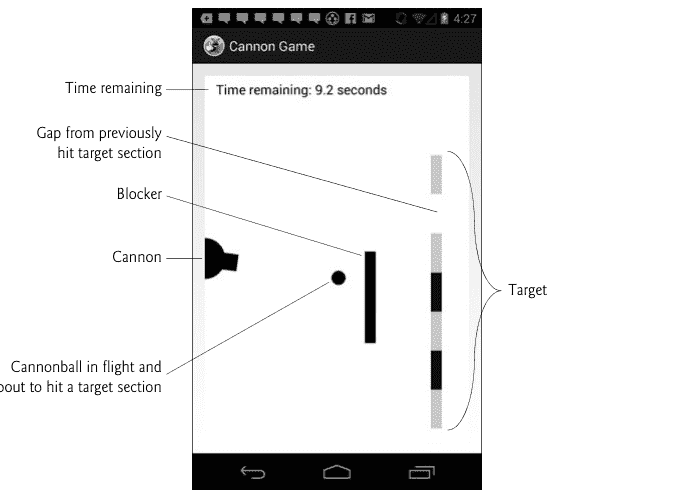

**图. 6.1 | 完成的游戏应用**

a) 用户摧毁所有目标区域后显示的 `AlertDialog`

b) 游戏结束时显示的 `AlertDialog`

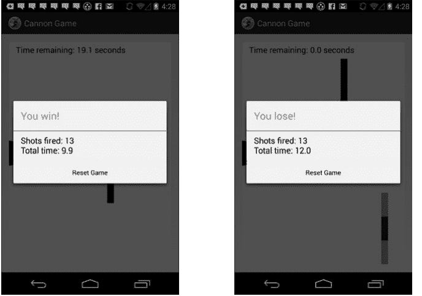

**图. 6.2 | 显示胜利和失败的 `AlertDialog`。**

## 第 6 章 大炮游戏 App

此应用使用了 `Fragment` 的生命周期方法 `onPause` 和 `onDestroy`。当另一个 `Activity` 接收焦点时，当前 `Activity` 的 `onPause` 方法会被调用，它会暂停失去焦点的 `Activity` 并将其切后台。当 `Activity` 托管 `Fragments` 且该 `Activity` 暂停时，所有 `Fragments` 的 `onPause` 方法都会被调用。在本应用中，`CannonView` 显示在 `CannonGameFragment` 中（第 6.7 节）。我们重写了 `onPause` 来暂停游戏，使其在用户无法与之交互时不继续执行——这可以节省电池。许多 `Activity` 生命周期方法在 `Fragment` 生命周期周期中都有对应的方法。

当 `Activity` 关闭时，会调用 `onDestroy` 方法，该方法会调用该 `Activity` 托管的所有 `Fragments` 的 `onDestroy` 方法。我们在 `CannonFragment` 中使用此方法来释放 `CannonView` 的音频资源。

我们会在需要时再讨论其他 `Activity` 和 `Fragment` 的生命周期方法。有关完整 `Activity` 生命周期的更多信息，请访问：

```
http://developer.android.com/reference/android/app/Activity.html#Lifecycle
```

有关完整 `Fragment` 生命周期的更多信息，请访问：

```
http://developer.android.com/guide/components/fragments.html#Lifecycle
```

## 6.3.4 重写 View 方法 `onTouchEvent`

用户通过触摸设备屏幕与此应用交互。触摸操作允许大炮面向屏幕上的触摸点，然后大炮会进行发射。要为 `CannonView` 执行简单的触摸事件，你将重写 `View` 方法 `onTouchEvent`（第 6.8.13 节），然后使用来自 `MotionEvent` 类（`android.view` 包）的常量来测试发生了什么类型的事件并对其进行正确处理。

## 6.3.5 使用 `SoundPool` 和 `AudioManager` 添加声音

应用的音效通过 `SoundPool`（`android.media` 包）管理，它可以用于加载、播放和卸载声音。声音使用 Android 的音乐、通知、电话铃声、系统声音、电话等音频流进行播放。文档建议我们使用音乐音频流来播放声音。我们使用 `Activity` 的 `setVolumeControlStream` 方法指定游戏的音量可以通过设备的音量键控制。该方法接收来自 `AudioManager` 类（`android.media` 包）的常量，该类提供了对设备音量和手机铃声控制的访问。

## 6.3.6 使用线程、`SurfaceView` 和 `SurfaceHolder` 进行逐帧动画

此应用通过从执行线程更新游戏元素来手动执行动画。为了实现这一点，我们使用 `Thread` 的子类，包含一个 `run` 方法，该方法引导自定义的 `CannonView` 更新游戏元素的位置，然后绘制它们。`run` 方法绘制逐帧动画——这被称为游戏循环（game loop）。

通常，对应用用户界面的所有更新必须在 GUI 线程中执行。在 Android 中，尽量减少在 GUI 线程中的工作量是非常重要的，以确保 GUI 保持响应且不显示 ANR（应用程序无响应）对话框。然而，游戏通常需要在单独的线程中执行复杂的逻辑，且这些线程通常需要绘制屏幕。对于此类情况，Android 提供了 `SurfaceView` 类——它是 `View` 的子类，线程可以在其上绘制，然后指示结果应显示在 GUI 中。你通过 `SurfaceHolder` 类的对象来操作 `SurfaceView`，这让你能够获取一个可以绘图的 `Canvas`。`SurfaceHolder` 类还提供了方法，允许线程对 `Canvas` 进行独占访问以进行绘制——一次只能有一个线程绘制到 `SurfaceView`。每个 `SurfaceView` 子类都应该实现 `Callback` 接口，该接口包含在 `SurfaceView` 创建（例如其大小或方向变化）或销毁时调用的方法。

## 6.3.7 简单碰撞检测

大炮执行简单的碰撞检测，以确定大炮是否与大炮的任何边缘、障碍物或区域发生碰撞。这些技术在第 6.8 节中介绍。游戏开发框架通常提供更复杂的“像素级精确”碰撞检测能力。有很多开源游戏开发框架可用。

## 6.3.8 使用 `Paint` 和 `Canvas` 绘制图形

我们使用 `Canvas`（`android.graphics` 包）的方法来绘制文本、线条和圆形。`Canvas` 方法在 `View` 类使用的 `Canvas` 上进行绘图。`Canvas` 使用 `Paint` 对象（`android.graphics` 包）来指定绘图特性，包括颜色、厚度、字体大小等。这些功能在第 6.8 节的 `drawElements` 方法中给出。有关可以使用 `Paint` 对象可以指定的绘图特性的更多细节，请访问

```
http://developer.android.com/reference/android/graphics/Paint.html
```

## 6.4 构建应用的 GUI 和资源文件

在本节中，你将创建应用的资源文件和 `main.xml` 布局文件。

## 6.4.1 创建项目

从创建一个名为 `CannonGame` 的新 Android 项目开始。在 `New Android Project` 对话中指定以下内容：

- Application Name: Cannon Game
- Project Name: CannonGame
- Package Name: `com.detail1.cannongame`
- Minimum Required SDK: API18: Android 4.4
- Target SDK: API19: Android 4.4
- Compile With: API19: Android 4.4
- Theme: Holo Light with Dark Action Bar

在 `New Android Project` 对话的第二个步骤（`New Android Application`）中，保留默认设置并点击 `Next >` 在 `Configure Launcher Icon` 步骤中，选择一个 App 图标图像，然后点击 `Next >` 在 `Create Activity` 步骤中，选择 `Blank Activity`，然后点击 `Next >` 在 `Blank Activity` 步骤中，选择默认设置并点击 `Finish` 创建项目。在图形布局编辑器中打开 `activity_main.xml`，并在屏幕类型下拉列表中选择 `Nexus 4`。我们将再次使用此设备作为设计的依据。

配置应用以支持竖屏模式

游戏设计为竖屏模式工作。遵循第 3.6 节中执行的步骤，将应用的屏幕方向设置为竖屏。

## 6.4.2 `strings.xml`

你已经在前面的章节中创建了资源，因此我们只显示 `String` 资源名称和对应值的表格（图 6.3）。双击 `res/values` 文件夹下的 `strings.xml`，以显示用于创建这些 `String` 资源的资源编辑器。

| 资源名称 | 值 |
|---|---|
| `results_format` | Shots fired: $%d\nTotal time: $%2.1 |
| `reset_game` | 重置游戏 |
| `win` | You win! |
| `lose` | You lose! |
| `time_remaining_format` | Time remaining: %f seconds |

**图 6.3** | 应用中使用的 `String` 资源。

## 6.4.3 `fragment_game.xml`

此应用的 `fragment_game.xml` 布局包含该视图。要添加 `fragment_game.xml`，请执行以下操作：

1. 展开 `res/layout` 文件夹。
2. 右键点击 layout 文件夹并选择 `New > XML File`。
3. 在 `File` 字段中输入 `fragment_game.xml`。
4. 在 `Root Element` 中选择 `FirebaseAuth`，然后点击 `Finish`。
5. 从 `Palette` 部分，将一个视图拖到设计区域。
6. 上一步操作会显示 `Custom Class` 对话框。点击 `New...` 显示 `New Class` 对话框。
7. 在 `Name` 字段中输入 `CannonView`。在 `Superclass` 字段中，将父类更改为 `android.view.View`。确保勾选 constructors，然后点击 `Finish`。这将创建并打开 `CannonView.java`。
8. 在 `fragment_game.xml` 中，在 `Outline` 窗口中选择 `view1`。在 `Properties` 中。
9. 在 `Outline` 窗口中，将 `view1` 重命名为 `view1`。

## 6.4.4 `activity_main.xml`

此应用的 `activity_main.xml` 布局包含 `Fragment`。要添加 `activity_main.xml`：

1. 在图形布局编辑器中打开 `activity_main.xml`，然后按照 2.5.2 中的步骤从 `LinearLayout` 切换到 `RelativeLayout`。
2. 从 `Palette` 部分，将一个 `Fragment` 拖到设计区域或拖动到 `Outline` 窗口中的 `RelativeLayout` 节点上。
3. 该步骤会显示 `Choose Fragment Class` 对话框。点击 `New...` 显示 `New Class` 对话框。
4. 在 `Name` 字段中输入 `CannonFragment`。将 `Superclass` 值设置为 `android.app.Fragment` 并点击 `Finish` 创建该类。IDE 会打开该类的 Java 文件，你现在可以操作它。
5. 保存 `activity_main.xml`。

## 6.4.5 为应用添加声音

如之前所述，声音文件存储在应用的 `res/raw` 文件夹中。此应用使用了三个声音文件——`blocker_hit.wav`、`target_hit.wav` 和 `cannon_fire.wav`，它们位于 samples 文件夹中的示例中。要将这些文件添加到你的项目中：

1. 点击应用的 `res` 文件夹，然后选择 `New > Folder`。
2. 指定文件夹名称并点击 `Finish` 创建文件夹。
3. 将声音文件拖入 `res/raw` 文件夹。

## 6.5 类 `Line` 维持线条的端点

此应用由四个类组成：

- `Line` (6.4)
- `MainActivity` (`Activity` 子类；第 6.6 节)
- `CannonGameFragment` (第 6.7 节)
- `CannonView` (第 6.8 节)

在本节中，我们将讨论 `Line` 类，它表示线条的起始点和结束点。该类的对象定义了游戏的障碍物和目标。要将 `Line` 添加到项目中：

1. 展开项目中的 `src` 节点。
2. 右键点击包 (`com.dete1.cannongame`) 并选择 `New > Class` 显示 `New Java Class` 对话框。
3. 在对话框的 `Name` 字段中输入 `Line` 并点击 `Finish`。
4. 将图 6.4 中的代码输入 `Line.java` 文件。默认的 `Point` 构造函数将公共的 `x` 和 `y` 实例变量设置为 `0`。

## MainActivity Activity 的子类

```java
// Line.java
// Class Line represents a line with two endpoints.

package com.deitel.cannongame;

import android.graphics.Point;

public class Line {

    public Point start = new Point(); // start Point--(0,0) by default

    public Point end = new Point(); // end Point--(0,0) by default

} // end class Line
```


**图 6.4** | 类 `Line` 表示一个具有两个端点的直线。

`MainActivity` 是大炮游戏应用 `CannonGameFragment` 的宿主。在这个应用中，我们只重写了 `Activity` 方法 `onCreate()`，它负责加载 GUI。

```java
// MainActivity.java

// MainActivity displays the CannonGameFragment

package com.deitel.cannongame;

import android.app.Activity;
import android.os.Bundle;

public class MainActivity extends Activity {

    // 在应用首次启动时调用

    @Override
    public void onCreate(Bundle savedInstanceState) {

        super.onCreate(savedInstanceState); // 调用父类的 onCreate 方法

        setContentView(R.layout.activity_main); // 加载布局

    }

} // end class MainActivity
```

**图 6.5** | `MainActivity` 显示 `CannonGameFragment`。

# `CannonGameFragment`：`Fragment` 的子类

`CannonGameFragment`（图 6.6）重写了四个 `Fragment` 方法：

- `onCreateView()`（第 17–28 行）——该方法在 `Fragment` 的 `onCreate()` 之后调用，用于构建并返回一个包含 `Fragment` GUI 的 `View`。第 22–23 行加载 GUI。第 26 行提供了 `CannonGameFragment` `View` 的引用，以便我们调用其方法。
- `onActivityResult()`（第 31–38 行）——该方法在 `Fragment` 的宿主 `Activity` 之后调用。第 37 行设置 `setVolumeControlStream()` 方法，允许通过设备的音量键控制游戏的音量。
- `onPause()`（第 41–46 行）——当 `MainActivity` 被送到后台（因此被暂停）时，执行 `CannonGameFragment` 的 `onPause()` 方法。第 45 行调用 `CannonView` 的 `stopGame()`（第 6.8.11 节）来停止游戏循环。
- `onDestroy()`（第 49–54 行）——当 `MainActivity` 被销毁时，其 `onDestroy()` 方法调用 `CannonGameFragment` 的 `onDestroy()`。第 46 行调用 `CannonView` 的 `releaseResources()` 方法（第 6.8.11 节）来释放声音资源。

## 6.7 `CannonGameFragment`：`Fragment` 的子类

```java
// CannonGameFragment.java

// CannonGameFragment 创建并管理 CannonView

package com.deitel.cannongame;

import android.app.Fragment;
import android.media.AudioManager;
import android.os.Bundle;
import android.view.LayoutInflater;
import android.view.View;
import android.view.ViewGroup;

public class CannonGameFragment extends Fragment {

    private Cannon cannonView; // 用于显示游戏的自定义视图

    // 当 Fragment 的 view 需要被创建时调用

    @Override
    public View onCreateView(LayoutInflater inflater, ViewGroup container,
                             Bundle savedInstanceState) {

        super.onCreateView(inflater, container, savedInstanceState);

        View view = inflater.inflate(R.layout.fragment_game, container, false);

        // 获取 CannonView

        cannonView = (CannonView) view.findViewById(R.id.cannonView);

        return view;

    }

    // 在 Activity 创建后设置音量控制

    @Override
    public void onCreate(Bundle savedInstanceState) {

        super.onCreate(savedInstanceState);

        // 允许按键设置游戏音量

        getActivity().setVolumeControlStream(AudioManager.STREAM_MUSIC);

    }

    // 当 MainActivity 暂停时，CannonGameFragment 终止游戏

    @Override
    public void onPause() {

        super.onPause();

        cannonView.stopGame(); // 终止游戏

    }

    // 当 MainActivity 暂停时，CannonGameFragment 释放资源

    @Override
    public void onDestroy() {

        super.onDestroy();

        cannonView.releaseResources();

    } // end class CannonGameFragment
```

**图 6.6** | `CannonGameFragment` 创建并管理 `CannonView`。（2 部分中的第 1 部分。）

**图 6.6** | `CannonGameFragment` 创建并管理 `CannonView`。（2 部分中的第 2 部分。）

# 6.8 `CannonView`：`View` 的子类

`CannonView` 类（图 6.7–6.20）是 `View` 的自定义子类，实现了大炮游戏的逻辑并在屏幕上绘制游戏对象。

## 6.8.1 `package` 和 `import` 语句

图 6.7 列出了类 `CannonView` 的包语句和导入语句。第 6.3 节讨论了类 `CannonView` 使用的新类和接口。我们在图 6.7 中高亮了它们。

```java
// CannonView.java

// 显示并控制大炮游戏

package com.deitel.cannongame;

import android.app.Activity;
import android.app.AlertDialog;
import android.app.Dialog;
import android.app.DialogFragment;
import android.content.Context;
import android.content.DialogInterface;
import android.graphics.Canvas;
import android.graphics.Color;
import android.graphics.Paint;
import android.graphics.Point;
import android.media.AudioManager;
import android.media.SoundPool;
import android.os.Bundle;
import android.util.AttributeSet;
import android.util.Log;
import android.util.SparseArray;
import android.view.MotionEvent;
import android.view.SurfaceHolder;
import android.view.SurfaceView;
```

**图 6.7** | `CannonView` 的包和 `import` 语句。

## 6.8.2 实例变量和常量

图 6.8 列出了常量和实例变量。

```java
public class CannonView extends SurfaceView implements SurfaceHolder.Callback {

    private static String TAG = "CannonView";

    private Activity activity;

    private boolean gameOver;

    // 游戏常量

    private static final int TARGET_SOUND_ID = 0;

    private static final int CANNON_SOUND_ID = 1;

    private static final int BLOCKER_SOUND_ID = 2;

    private SoundPool soundPool; // 播放声音

    private SparseArray soundMap; // 将 ID 映射到 SoundPool

    // 在屏幕上绘制每个项目时的

    private Paint textPaint; // 用于绘制文本的 Paint

    private Paint cannonballPaint; // 用于绘制炮弹的 Paint

    private Paint cannonPaint; // 用于绘制大炮的 Paint

    private Paint blockerPaint; // 用于绘制障碍物的 Paint

    private Paint targetPaint; // 用于绘制目标的 Paint

    private Paint backgroundPaint; // 用于清除区域的 Paint

    // 游戏变量

    private double timeout; // 剩余时间

    private int shots; // 用户拥有的次数

    private double elapsedTime; // 已通过时间

    private int screenWidth; // 屏幕宽度

    private int screenHeight; // 屏幕高度

    private boolean[] hitStates; // 命中状态

    private int targetPieces; // 目标数量

    // 表示游戏项目的 Line 和 Point

    private Line blocker; // 障碍物

    private Line target; // 目标

    private Point cannonball; // 炮弹

    private int cannonLength; // 大炮长度

    private Point barrelEnd; // 大炮的端点
}
```

**图 6.8** | `CannonView` 类字段。（2 部分中的第 1 部分。）

## 6.8.3 构造函数

图 6.9 显示了 `CannonView` 的构造函数。

```java
// 公有构造函数

public CannonView(Context context, AttributeSet attrs) {

    super(context, attrs); // 调用父类构造函数

    activity = (Activity) context; // 存储 MainActivity 的引用

    // 注册 SurfaceHolder.Callback 监听器

    getHolder().addCallback(this);

    // 初始化表示游戏项目的 Line 和 Point

    blocker = new Line(); // 创建 Line 障碍物

    target = new Line(); // 创建 Line 目标

    cannonball = new Point(); // 创建 Point 炮弹

    // 初始化布尔数组以跟踪命中状态

    hitStates = new boolean[TARGET_PIECES];

}
```

**图 6.9** | `CannonView` 构造函数。（2 部分中的第 1 部分。）

# 6.8 `CannonView` 是 `View` 195 的子类

```java
109

110

111

112

// 初始化 SoundPool 以播放应用的三个音效

soundPool = new SoundPool(1, AudioManager.STREAM_MUSIC, 0);

113

// 创建声音的 Map 并预加载声音

114

soundMap = new SparseArray(3); // 创建新的 SparseArray

115

soundMap.put(TARGET_SOUND_ID);

116

soundPool.load(context, R.raw.target_hit, 1);

117

soundMap.put(CANNON_SOUND_ID);

118

soundPool.load(context, R.raw.cannonball_fire, 1);

119

soundMap.put(BLOCKER_SOUND_ID);

120

soundPool.load(context, R.raw.blocker_hit, 1);

121

122

// 构建用于绘制文本、炮弹、大炮、

// 障碍物和目标的 Paints 对象：这些在 sizeChanged 方法中进行配置

123

textPaint = new Paint();

124

cannonPaint = new Paint();

125

cannonballPaint = new Paint();

126

blockerPaint = new Paint();

127

targetPaint = new Paint();

128

backgroundPaint = new Paint();

129

// CannonView 构造函数结束
```


**图 6.9** | `CannonView`构造函数（2/2 部分）

### 注册 `SurfaceHolder`回调监听器

第 100 行返回此（即`CannonView`）作为实现`SurfaceHolder.Callback`的对象，以便在`SurfaceView`创建、更新和销毁时接收方法调用。继承自`SurfaceView`的方法`getHolder()`返回用于管理`SurfaceView`的`SurfaceHolder`对象，而`SurfaceHolder`方法`addCallback()`则用于存储实现`SurfaceHolder.Callback`的对象。

### 创建障碍物、目标和炮弹

第 103–114 行将障碍物和目标创建为`Line`（线条），将炮弹创建为`Point`（点）。接下来，我们创建了布尔数组`hitStates`来跟踪目标的七个碎片中有哪些已经被击中（这些碎片不应被绘制）。

### 配置`SoundPool`并加载声音

第 111–120 行配置了应用程序中使用的声音。首先，我们创建了用于加载和播放应用音效的`SoundPool`。构造函数的第一个参数表示可以同时播放的最大声音流数量。我们一次只播放一个声音，因此传入 1。第二个参数指定使用哪种音频流来播放声音。`AudioManager`类识别了七种音频流，但`SoundPool`类的文档建议游戏声音使用音乐流（`AudioManager.STREAM_MUSIC`）。最后一个参数表示音质，但文档表明该值未被使用，应指定 0 作为默认值。

第 114 行创建了一个`SparseArray`（`soundMap`），它将整数键映射到整数值。对于数量较少的键-值对，`SparseArray`与`HashMap<Integer, Integer>`类似，但效率更高。在这种情况下，我们将声音（在图 6.8 的 78–81 中定义）映射到已加载声音的 ID，这些 ID 由`SoundPool`的`load()`方法的返回值表示（在图 6.9 的第 116、118 和 120 行调用）。每个声音 ID 均可播放声音（稍后将其资源返回系统）。`SoundPool`的`load()`接收三个参数——应用的`Context`、代表要加载声音的资源 ID 以及声音的优先级。根据该方法的文档，该参数目前未使用，应指定为 1。

### 创建绘制游戏元素的`Paint`对象

第 124–129 行创建了绘制游戏元素时使用的`Paint`对象。我们在`onChanged`方法（第 6.8.4 节）中进行配置，因为某些`Paint`设置取决于根据设备屏幕尺寸缩放游戏元素。

## 6.8.4 重写`View`方法`onChanged`

图 6.10 概述了`View`的`onChanged`方法，它每当`View`的尺寸发生变化时都会被调用，包括在布局加载时`View`首次添加到`View`层次结构中。此应用采用竖屏模式，因此`onChanged`仅在 activity 内容加载时被调用。该方法接收新的宽度和高度——当此方法第一次被调用时，旧的宽度和高度为 0。此处执行的计算根据设备的像素宽度和高度来缩放屏幕上的游戏元素。我们通过试错得到了缩放因子，选择了让游戏元素在屏幕上看起来良好的值。第 170–175 行配置了用于指定游戏元素绘制特性的`Paint`对象。计算完成后，第 177 行调用了`newGame`方法（图 6.11）。

```java
132 // 当 SurfaceView 尺寸改变时由 surfaceChanged 调用
133 // 当它首次被添加到 View 层次结构时
134 @Override
135 protected void onChanged(int w, int h, int oldw, int oldh)
136 {
137     super.onChanged(w, h); // 存储 CanvasView 的宽度
138     width = w; // 存储 CanvasView 的高度
139     cannonRadius = h / 18; // 半径
140     cannonLength = w / 8; // 长度
141 
142     cannonballRadius = w / 36; // 炮弹半径
143     cannonballSpeed = w / 3 / 2; // 炮弹速度
144     lineWidth = w / 24; // 线宽
145 
146     // 配置与障碍物相关的实例变量
147     blockerDistance = w * 5; // 障碍距离
148     blockerBeginning = h / 8; // 障碍起始位置
149     blockerEnd = h * 3; // 障碍结束位置
150     initialBlockVelocity = h / 2; // 初始障碍速度
151     blocker.start = new Point(blockerDistance, blockerBeginning);
152     blocker.end = new Point(blockerDistance, blockerEnd);
```
**图 6.10** 重写的方法。（1/2 部分）

```java
153 // 配置与目标相关的实例变量
154 targetDistance = w * 7 / 8; // 目标距离
155 targetBeginning = h / 8; // 目标起始位置
156 targetEnd = h * 7 / 8; // 目标结束位置
157 pieceLength = (targetEnd - targetBeginning) / TARGET_PIECES;
158 initialTargetVelocity = -h / 4; // 初始目标速度
159 targetStart = new Point(targetDistance, targetBeginning);
160 targetEnd = new Point(targetDistance, targetEnd);
161 // 炮管端点水平开始
162 barrelEnd = new Point(cannonLength, h / 2);
163 // 配置绘制游戏元素的 Paint 对象
164 textSize.setSize(w/20); // 字体大小
165 textSize.setAntialiasing(true); // 平滑文字
166 cannonPaint.setStroke(lineWidth * 1.5F); // 大炮画笔
167 blockerPaint.setStroke(lineWidth); // 障碍画笔
168 targetPaint.setStroke(lineWidth); // 目标画笔
169 backgroundPaint.setColor(Color.WHITE); // 背景画
170 newGame(); // 设置并开始新游戏
} // 方法 onChanged结束
```
**图 6.10** 重写的`onChanged`。（2/2 部分）

## 6.8 方法`newGame`

`newGame()`方法（图 6.11）重置用于控制游戏的实例变量。如果变量`gameOver`为`true`（这只在第一局游戏完成后发生），第 203 行设置`gameOver`，第 204–205 行创建一个新的`CannonThread`并开始游戏循环。你将在第 6.8.14 节中学习更多内容。

```java
// 重置所有屏幕元素并开始一个新游戏
public void newGame() {
    // 将 hitStates 的每个元素设为 false——恢复目标碎片
    for (int i = 0; i < TARGET_PIECES; i++) {
        hitStates[i] = false;
    }
    targetPieces = 0; // 没有目标碎片被击中
    blockerVelocity = initialBlockerVelocity; // 设置初始速度
    targetVelocity = initialTargetVelocity; // 设置初始速度
    timeLeft = 10; // 开始 10 秒倒计时
    cannonball = false; // 炮弹不在屏幕上
    shotsFired = 0; // 设置射击次数
    tElapsedTime = 0.0; // 设置已时间为零

    // 设置炮管和目标的起始和结束点
    blockerStart.set(blockerDistance, blockerBeginning);
    blockerEnd.set(blockerDistance, blockerEnd);
    targetStart.set(targetDistance, targetBeginning);
    target.end.set(targetDistance, targetEnd);

    if (gameOver) // 在最后一个游戏结束后启动新游戏
    {
        gameOver = false; // 游戏未结束
        cannonThread = new CannonThread(getHolder()); // 创建线程
        cannonThread.start(); // 启动游戏循环
    } // if结束
} // 方法 newGame结束
```
**图 6.11** `CannonView`方法`newGame`。（1/2 部分）

## 6.8.6 方法`updatePositions`

`updatePositions`（6.1.2）由`CannonThread`的`run`方法（节 6.8.14）调用，用于更新屏幕元素并进行碰撞检测。游戏元素的新位置根据上一帧到当前帧之间的毫秒间隔计算出来。这允许游戏根据设备的刷新率更新每个游戏元素的移动量。我们将在 6.8.14 节详细讨论这一点。

```java
// CannonThread 重复调用以更新游戏元素
private void updatePositions(double elapsedTimeMS)
{
    double interval = elapsedTimeMS / 1000.0; // 转换为秒

    if (cannonOnScreen) // 如果当前有射出的炮弹
    {
        // 更新炮弹位置
        cannonball.x += interval * cannonVelocityX;
        cannonball.y += interval * cannonVelocityY;
    }

    // 检查与障碍物的碰撞
    if (cannonball.x + cannonRadius < blockerDistance &&
        cannonball.x - cannonRadius > blockerDistance &&
        cannonball.y + cannonRadius < blocker.start.y &&
        cannonball.y - cannonRadius < blocker.end.y)
    {
        cannonVelocityY *= -1; // 反转炮弹方向
        timeLeft -= MISS_PENALTY; // 惩罚用户
    }

    // 播放声音
    soundPool.play(soundMap.get(BLOCKER_SOUND_ID), 1, 1, 0, 0, 1);
}

    // 检查与左右墙的碰撞
    else if (cannonball.x + cannonRadius > screenWidth ||
        cannonball.x - cannonRadius < 0)
    {
        // ... (逻辑继续)
    }
}
```
**图 6.12** `Cannon`方法`updatePositions`。（1/3 部分。）

## 6.8 `CannonView`是`View`199 的类

```java
236
    cannonballOnScreen = false; // 从屏幕移除炮弹
237
}
238
    // 检查与上下墙的碰撞
239
else if (cannonball.y + cannonballRadius > screenHeight ||
240    cannonball.y - cannonballRadius < 0)
241
    {
242        cannonballOnScreen = false; // 从屏幕移除炮弹
244
    // 检查炮弹与此目标的碰撞
245
else if (cannonball.x + cannonballRadius > targetDistance &&
246    cannonball.x - cannonballRadius < targetDistance &&
247    cannonball.y + cannonballRadius > target.start.y &&
248
    cannonball.y - cannonballRadius < target.end.y)
249
    {
        // 确定目标区域（0 是顶部）
250        int section =
251            (int) (cannonball.y - target.start.y) / pieceLength);
254
        // 检查该部分是否尚未被命中
255
        if ((section >= 0 && section < TARGET_PIECES) &&
256            !hitStates[section])
257
        {
258            hitStates[section] = true; // 区域被命中
259            cannonballOnScreen = false; // 移除炮弹
260            timeLeft += HIT_REWARD; // 为剩余时间增加奖励
        }
263
        // 播放目标被命中的声音
264
        soundPool.play(soundMap.get(TARGET_SOUND_ID), 1,
265            1, 1, 0, 1f);
268
        // 如果所有部分都被命中
269
        if (targetPiecesHit == TARGET_PIECES)
270
        {
271            cannonThread.setRunning(false); // 终止线程
272            showGameOverDialog(R.string.win); // 显示胜利对话框
273            gameOver = true;
274
        }
275    }
277
    }
279
    // 更新障碍物位置
280
    double blockerUpdate = interval * blockerVelocity;
281
    blocker.start.y += blockerUpdate;
282
    blocker.end.y += blockerUpdate;
284
    // 更新目标的位置
285
    double targetUpdate = interval * targetVelocity;
286
    target.start.y += targetUpdate;
287
    target.end.y += targetUpdate;
```
图 6.12 | `CannonView`方法`updatePositions`。（3 部分第 2 部分。）

## 200 第 6 章 大炮游戏 App

```java
// 如果障碍物撞击顶部或底部，反转方向
if (blocker.start.y < 0 || blocker.end.y > screenSize)
    blockVelocity *= -1;

// 如果目标撞击顶部或底部，反转方向
if (target.start.y < 0 || target.end.y > screenSize)
    targetVelocity *= -1;

timeLeft = interval; // 从剩余时间减去

// 如果计时器归零
if (timeLeft <= 0.0)
{
    timeLeft = 0.0;
    gameOver = true; // 游戏结束
    cannonThread.setRunning(false); // 终止线程
    showGameOverDialog(R.string.lose); // 显示失败对话框
}
// 方法 updatePositions 
```


图 6.2 | `CannonView` 方法 `updatePositions`。（3 部分第 3 部分）

## 自上次动画帧以来经过的时间

第 212 行检查自上次动画以来经过的时间，单位从毫秒转换为秒。该值被用于修改各种游戏元素的位置。

### 检查与障碍物的碰撞

第 214 行检查大炮是否在屏幕上。如果是，我们通过加上它自上次以来应该移动的距离来更新其位置。这是通过将其速度乘以经过的时间计算得出的（第 217–218 行）。第 221–224 行检查大炮是否与障碍物发生碰撞。我们根据炮弹的矩形边界进行简单的碰撞检测。如果大炮与障碍物接触，必须满足以下四个条件：

- 炮弹的 x 坐标加上炮弹半径必须大于障碍物距离屏幕左边缘的距离（`blockerDistance`）（第 221 行）。这意味着炮弹已经到达障碍物距离屏幕左边缘的距离。
- 炮弹的 x 坐标减去炮弹半径也必须小于障碍物距离屏幕左边缘的距离（第 222 行）。这确保了大炮尚未通过障碍物。
- 大炮的一部分必须低于障碍物的顶部（第 223 行）。
- 大炮的一部分必须高于障碍物（第 224 行）。

如果满足所有这些条件，我们反转屏幕上炮弹的方向（第 226 行），通过从 `timeLeft` 中减去 `MISS_PENALTY` 来惩罚用户，然后调用 `soundPool` 的 `play` 方法播放命中声——`BLOCKER_SOUND_ID` 被用作 `soundMap` 的键以便在 `SoundPool` 中加载声音 ID。

## 6.8 `CannonView` 是 `View` 201 的类

### 检查炮弹是否离开屏幕

如果炮弹到达屏幕的任何边缘，我们就将其移除。第 233–237 行测试炮弹是否撞击左墙或右墙，如果是，则从屏幕移除炮弹。第 239–244 行如果炮弹撞击屏幕顶部或底部，则将其移除。

### 检查与目标的碰撞

我们检查炮弹是否命中目标（第 245–248 行）。这些条件与判断炮弹是否与障碍物碰撞的条件相似。如果炮弹命中目标，第 251–252 行确定命中哪个区域。我们使用区域索引将其标记为已命中，移除炮弹并为剩余时间增加奖励。然后我们播放命中声。如果所有部分都被命中，我们就终止线程并显示胜利对话框。

### 更新障碍物目标的位置

我们根据速度和间隔更新障碍物的位置。同样，我们更新目标的位置。如果障碍物或目标撞击顶部或底部边界，我们就反转它们的方向。

### 更新时间并确定游戏结束

我们通过间隔更新计时器。如果计时器归零，游戏结束；我们停止大炮线程并显示失败对话框。

## 241 第 6 章 大炮游戏

```java
// 发射炮弹
public void cannonball(MotionEvent event)
{
    // 如果炮弹已经在屏幕上
    if (cannonOnScreen)
        return; // 什么都不做

    double angle = alignCannon(event); // 获取大炮角度

    // 将大炮移动到内部
    cannonball.x = cannonRadius; // x 坐标与大炮对齐
    cannonball.y = screenHeight / 2; // 垂直居中

    // 获取总速度的 x 分量
    cannonballVelocityX = (int) (cannonSpeed * Math.sin(angle));

    // 获取总速度的 y 分量
    cannonballVelocityY = (int) (-cannonSpeed * Math.cos(angle));

    cannonOnScreen = true; // 大炮在屏幕上
    ++shotsFired; // shotsFired 加 1

    // 播放发射声
    soundPool.play(soundMap.get(CANNON_SOUND_ID), 1, 1, 0, 1f);
} // 方法 cannonball
```

图 6.13 | `View` `alignCannon`

## 6.8 方法 `alignCannon`

方法 `alignCannon`（图 6.14）旨在将大炮指向用户触摸屏幕的点。第 335 行使用 `MotionEvent` 参数从屏幕中心获取触摸的 x 和 y 坐标。

```java
// 响应用户触摸以对齐大炮
public double alignCannon(MotionEvent event)
{
    // 获取此视图中的触摸位置
    Point touchPoint = new Point(event.getX(), event.getY());

    // 计算距离屏幕中心的触摸距离
    // 在 y 轴上
    double centerMinusY = (screenHeight / 2) - touchPoint.y;

    double angle = 0; // 初始化角度为 0
```

图 6.14 | `View` 方法 `alignCannon`。（2 部分第 1 部分）。

## 6.8 `View` 的子类 `View` 203

```java
// 计算炮管相对于水平面的角度
if (centerMinusY != 0) // 防止除以 0
    angle = Math.atan((double) touchPoint.x / centerMinusY);

// 如果触摸位置在屏幕下半部分
if (touchPoint.y < screenHeight / 2)
    angle += Math.PI; // 调整角度

// 计算炮管端点
barrelEnd.x = (int)(cannonLength * Math.sin(angle));
barrelEnd.y = (int)(-cannonLength * Math.cos(angle) + screenHeight);

return angle; // 返回计算出的角度

// 方法结束 alignCannon
```

图 14 | `CannonView` 方法 `drawGameElements`（部分 2/2）

### 6.8.9 方法 `drawGameElements`

`drawGameElements` 方法（图 6.15）使用从 `CannonThread`（第 6.8.4 节）从 `SurfaceView` 的 `SurfaceHolder` 获取的 `Canvas`，在 `SurfaceView` 上绘制大炮、炮弹、障碍物和目标。

```java
// 将游戏绘制到给定的 Canvas
public void drawGameElements(Canvas canvas)
{
    // 清除背景
    canvas.drawRect(0, 0, canvas.getWidth(), canvas.getHeight(),
        backgroundPaint);

    // 显示剩余时间
    canvas.drawText(getResources().getString(
        R.string.time_remaining_format, timeLeft), 30, 50, textPaint);

    // 如果大炮在屏幕上，则绘制它
    if (cannonOnScreen)
        canvas.drawCircle(cannon.x, cannonball.y, cannonballRadius,
        cannonPaint);

    // 绘制炮管
    canvas.drawLine(0, screenHeight / 2, barrelEnd.x, barrelEnd.y,
        cannonPaint);

    // 绘制大炮座
    canvas.drawCircle(0, (int) screenHeight / 2,
        (int)cannonBaseRadius, cannonPaint);

    // 绘制障碍物
    canvas.drawLine(blocker.start.x, blocker.start.y, blocker.end.x,
        blocker.end.y, blockerPaint);
```

图 15 | `CannonView` 方法 `drawGameElements`（部分 1/2）

```java
386

387  Point currentPoint = new Point(); // 当前目标区域起始

388

389  // 将 currentPoint 初始化为目标的起始点
390      currentPoint.x = target.start.x;
391      currentPoint.y = target.start.y;

392

393  // 绘制目标
394  For (int i = 0; i < TARGET_PIECES; i++)
395  {
396      // 如果这个目标部件未被击中，则绘制它
397      if (hitStates[i])
398      {
400          // 交替绘制部件颜色
401          if (i % 2 != 0)
402              targetPaint.setColor(Color.BLUE);
403          else
404              targetPaint.setColor(Color.YELLOW);
405      }
406      canvas.drawLine(currentPoint.x, currentPoint.y, target.end.x,
407                  (int) (currentPoint.y + pieceLength), targetPaint);
408  }

409

410  // 将 currentPoint 移动到下一个部件的起始位置
411      currentPoint.y += pieceLength;
412} // 方法结束 drawGameElements
```

图 6.15 | `CanvasView` 方法 `drawGameElements`。（部分 2/2）

#### 使用 `drawRect` 方法清空 `Canvas`

首先，我们调用 `canvas` 的 `drawRect` 方法（第 363–364 行）来清除 `Canvas`，以便所有元素都能显示在它们新位置。该方法接收的参数是矩形的左上角 x-y 坐标、矩形的宽度和高度，以及指定绘制特征的 `Paint` 对象——回想背景 `Paint` 将绘制颜色设置为白色。

#### 使用 `Canvas` `drawText` 方法显示剩余时间

接下来，我们调用 `canvas` 的 `drawText` 方法（第 367–368 行）来显示游戏中的剩余时间。我们传递的参数是要显示的字符串、显示它的 x 和 y 坐标，以及描述文本外观的 `textPaint`（在第 170–171 行中配置)，即文本的字体大小、颜色和其他属性。

#### 使用 `Canvas` `drawCircle` 方法绘制炮弹

如果大炮在屏幕上，第 372–373 行使用 `Canvas` 的 `drawCircle` 方法在当前位置绘制炮弹。前两个参数代表圆心的坐标。第三个参数是圆的半径。最后一个参数是指定圆的绘制特征的 `Paint` 对象。

#### 使用 `Canvas` `drawLine` 方法绘制炮管、障碍物和目标

我们使用 `Canvas` 的 `drawLine` 方法显示炮管（第 376–377 行）、障碍物（第 384–385 行）和目标部件（第 405–406 行）。该方法接收五个参数——前四个参数代表线条起点和终点的 x 坐标，最后一个是指定线条特征（如粗细）的 `Paint` 对象。

#### 使用 `Canvas` `drawCircle` 方法绘制大炮座

第 380–381 行使用 `Canvas` 的 `drawCircle` 方法，通过绘制一个以屏幕左边缘为中心的圆来绘制大炮的半圆座——该圆根据其中心点显示，此圆的半部分被绘制在 `SurfaceView` 的左侧之外。

#### 使用 `Canvas` `drawLine` 方法绘制目标区域

第 390–411 行绘制了目标区域。我们遍历这些区域，每个区域都绘制正确的颜色——奇数编号部件为蓝色，其他部件为黄色。只有那些尚未被显示的区域

### 6.8.10 方法 `showGameOverDialog`

当游戏结束时，`showGameOverDialog` 方法（图 6.16）会显示一个 `DialogFragment`（使用你在第 5.6.9 节中学会的技术），其中包含一个 `AlertDialog`，指示玩家是获胜还是输了、射击次数以及所经过的时间。

```java
private void showGameOverDialog(final int messageId) {
    AlertDialog.Builder builder = new AlertDialog.Builder(getActivity());

    builder.setTitle(getResources().getString(R.string.game_over));

    builder.setMessage(getResources().getString(
        R.string.results, shotsFired, elapsedTime));

    builder.setPositiveButton(R.string.reset_game,
        new DialogInterface.OnClickListener() {

        @Override
        public void onClick(DialogInterface dialog, int which) {
            dialogIsDisplayed = false;
            newGame();
        }
    });

    builder.setCancelable(false); // 模态对话

    // 在 GUI 线程中使用 FragmentManager 显示 DialogFragment
    getActivity().runOnUiThread(new Runnable() {
        @Override
        public void run() {
            dialogIsDisplayed = true;
            gameResult.show(
                getActivity().getFragmentManager(), "results");
        }
    });

    return builder.create(); // 返回 AlertDialog
}
```

图 16 | `View` 方法 `showGameOverDialog`。（部分 2/2）

按钮监听器的 `onClick` 表示对话框不再显示并调用 `newItem` 来设置并启动新游戏。对话框必须从 GUI 线程显示，因此第 451–460 行调用 `runOnUiThread` 来指定一个尽快在 GUI 中执行的 `Runnable`。参数是一个实现 `Runnable` 的匿名内部类对象。`Runnable` 的 `run` 方法表示当……时显示对话框

### 6.8.11 方法 `stopGame` 和 `releaseResources`

`CannonFragment` 类的 `onPause` 和 `onDestroy` 方法（第 6.7 节）分别调用 `CannonView` 类的 `stopGame` 和 `releaseResources` 方法（图 6.17）。`stopGame` 方法从主 `Activity` 调用以停止游戏状态，`Activity` 的 `onPause` 方法被调用——为了简单起见，我们在示例中没有存储游戏状态。`releaseResources` 方法调用 `SoundPool` 的 `release` 方法来释放与 `SoundPool` 关联资源。

```java
// 停止游戏；由 CannonFragment 的 onPause 调用
public void stopGame() {
{
    if (cannonThread != null) {
        cannonThread.setRunning(false); // 告诉线程终止
    }
}
```

## 6.8 `CannonView` `View` 子类

```java
470 // releases resources; called by CannonGame's onDestroy method
471 public void releaseResources() {
472 {
473     soundPool.release(); // release all resources used by the SoundPool
474     soundPool = null;
475 }
```


**图 16.7** | `CannonView`方法`stopGame`和`releaseResources`。（部分 2，共 2 部分。）

### 6.8.12 实现`SurfaceHolder.Callback`方法

图 6.18 实现了`SurfaceHolder.Callback`的`surfaceChanged`、`surfaceCreated`和`surfaceDestroyed`方法。在此应用中，`surfaceChanged`方法体为空，因为它始终以竖屏方向显示。当`SurfaceView`的尺寸或方向发生变化时会调用此方法，通常用于根据这些变化重绘图形。`surfaceCreated`方法（第 485–494 行）在`SurfaceView`创建时调用——例如当应用加载或从后台返回时。我们使用`surfaceCreated`来创建并启动`CannonThread`以开始游戏循环。`surfaceDestroyed`方法（第 497–515 行）在`SurfaceView`销毁时调用——例如当应用终止时。我们使用该方法确保`CannonThread`正常终止。首先，第 502 行调用`CannonThread`的`setRunMethod`并传入`false`作为参数，指示线程应该停止，第 504–515 行等待线程终止。这确保了在`surfaceDestroyed`执行完成后，不会尝试向`SurfaceView`绘图。

```java
477 // when surface changes size
478 @Override
479 public void surfaceSurfaceChanged(SurfaceHolder holder, int format,
480     int width, int height)
481 {
482 }
484 // when surface is first created
485 @Override
486 public void surfaceCreated(SurfaceHolder holder)
487 {
488     if (dialogIsDisplayed)
489 {
490         CannonThread = new CannonThread(holder); // create thread
491         CannonThread.setRunning(true); // start game running
492         CannonThread.start(); // start the game loop
493 }
494 }
496 // when when the surface is destroyed
497 @Override
498 public void surfaceDestroyed(SurfaceHolder holder)
499 }
```

**图 16.18** | 实现`SurfaceHolder.Callback`方法。（部分 1，共 2 部分。）

```java
// ensure that thread terminates properly
boolean retry = true;
cannonThread.setRunning(false); // terminate cannonThread
while (retry) {
    try {
        cannonThread.join(); // wait for cannonThread to finish
        retry = false;
    } catch (InterruptedException e) {
        Log.e(TAG, "Thread interrupted", e);
    }
} // end method surfaceDestroyed
```

实现`SurfaceHolder.Callback`方法。（部分 2，共 2 部分）

图 6.18 重写`View`方法`onTouchEvent`

### 6.8.13 重写`View`方法`onTouchEvent`

在这个例子中，我们重写了`View`的`onTouchEvent`（图 6.19）来确定用户触摸屏幕的位置。`MotionEvent`参数包含了发生事件的信息。第 523 行使用`MotionEvent`的`getAction`方法来确定发生了哪种触摸类型。然后，第 526–527 行判断用户是触摸了屏幕（`MotionEvent.ACTION_DOWN`）还是在屏幕上滑动手指（`MotionEvent.ACTION_MOVE`）。在这种情况下，第 529 行调用`CannonView`的`fireCannonball`方法，向该触摸点对准并发射大炮。第 532 行返回`true`表示该事件已处理。

```java
// called when the user touches the screen in this Activity
@Override
public boolean onTouchEvent(MotionEvent event) {
    // get int representing the type of action which caused this event
    int action = event.getAction();
    // the user touched the screen or dragged along the screen
    if (action == MotionEvent.ACTION_DOWN ||
        action == MotionEvent.ACTION_MOVE) {
        fireCannonball(); // fire the cannonball toward the touch point
    }
    return true;
} // end method onTouchEvent
```

**图 6.19** | 重写`View`方法`onTouchEvent`。

### 6.8.14 `CannonThread`: 使用线程创建游戏循环

图 6.20 定义了一个更新游戏的`Thread`子类。该线程维护了对`SurfaceView`的`SurfaceHolder`的引用（第 538 行）以及一个指示线程正在运行的布尔值。该类的`run`方法（第 556–587 行）驱动逐帧动画——这被称为游戏循环。屏幕上游戏元素的每次更新都是根据自上次更新以来通过的毫秒数执行的。第 559 行在线程开始运行时提供以毫秒为单位的系统时间。第 581–586 行循环，直到`threadIsRunning`为`false`。

```java
// Thread subclass to control the game loop
private class CannonThread extends Thread
{
    private SurfaceHolder surfaceHolder; // for manipulating canvas
    private boolean threadRunning = true; // running by default
    // initializes the surface
    public CannonThread(SurfaceHolder holder) {
        surfaceHolder = holder;
        setName("CannonThread");
    }
    // changes running
    public void setRunning(boolean running) {
        threadRunning = running;
    }
    // controls the game loop
    @Override
    public void run() {
        Canvas canvas = null;
        long previousTime = System.currentTimeMillis();
        while (threadRunning) {
            try {
                // Get Canvas for drawing
                canvas = surfaceHolder.lockCanvas();
                synchronized (surfaceHolder) {
                    long currentTime = System.currentTimeMillis();
                    double elapsedTimeMS = currentTime - previousTime;
                    totalElapsedTimeMS += elapsedTimeMS / 1000.0;
                    updatePositions(elapsedTimeMS);
                    drawGameElements(canvas);
                }
                previousTime = currentTime; // update previousTime
            } catch (Exception e) {
            } finally {
                // display canvas
                if (canvas != null) {
                    surfaceHolder.unlockCanvasAndPost(canvas);
                }
            }
        } // end while
    } // end run method
} // end nested class
```

**图 6.20** | 每毫秒更新游戏的`Runnable`。（部分 1，共 2 部分。）

```java
576  previousTime = currentTime; // update previousTime
577  }
578  finally
579  {
580      // display canvas
581      if (canvas != null) {
582          surfaceHolder.unlockCanvasAndPost(canvas);
583      }
584  }
585    } // end while
586  } // end run method
587  } // end nested class
588 } // end CannonView
```


**图 6.20** | 每毫秒更新游戏的 `Runnable`。（部分 2，共 2 部分）

## 6.9 总结

在这个应用中，你创建了一个大炮游戏应用，它挑战玩家在 10 秒时间限制结束前摧毁一个七部件的目标。用户在不触摸屏幕的情况下对准并发射大炮。为了在单独的线程上绘图，你通过扩展 `SurfaceView` 创建了一个自定义视图。你学习了自定义类名在表示该组件的 XML 布局元素中必须是全限定名。我们介绍了额外的 `Fragment` 生命周期方法。你学习了当 `Fragment` 停用时会调用 `onPause`，当 `Fragment` 销毁时会调用 `onDestroy`。你通过重写 `SurfaceView` 的 `onTouchEvent` 来处理触摸事件。你将声音添加到应用的 `res/raw` 文件夹中并使用 `SoundPool` 进行管理。你还使用了 `AudioManager` 服务来获取设备的当前音乐量并将其作为播放音量。

该应用通过在单独执行线程上更新 `SurfaceView` 上的游戏元素手动执行动画。为了实现这一点，你扩展了 `Thread` 类并创建了一个 `run` 方法，通过调用 `Canvas` 类的方法来显示图形。通过 `SurfaceView` 的 `SurfaceHolder` 获取适当的 `Canvas`。你还学习了构建一个游戏，该游戏根据动画帧之间经过的时间来控制游戏，这样无论设备的处理器速度如何，游戏在所有设备上的整体运行速度都将保持一致。

在第 7 章中，我们将介绍 Doodle 应用，它利用 Android 的图形处理能力将设备屏幕变为虚拟画布。你还将学习关于 Android 4.4 的沉浸模式和打印功能。

## 自我复习练习

6.1 填充下列陈述中的空白处：

- a) 你可以通过扩展 `View` 类或其一个子类来创建自定义视图。
- b) 要处理 `Activity` 的触摸事件，你可以重写 `Activity` 类的 `onTouchEvent` 方法，然后使用 `android.view` 中的类来测试发生了哪种类型的事件并据此进行处理。
- c) 每个 `SurfaceView` 子类都应该实现当 `SurfaceView` 发生变化（例如尺寸或方向变化）或销毁时调用的接口方法。
- d) 格式说明符中的 `%d` 表示你正在格式化一个十进制整数，而格式说明符中的 `%f` 表示你正在格式化一个浮点值。
- e) 音频文件存储在应用的 `res/raw` 文件夹中。

6.2 判断下列每个陈述是正确还是错误。如果错误，请解释原因。

- a) Android 文档建议游戏使用音乐流播放声音。
- b) 在 Android 中，最大限度地在 GUI 线程中执行你的工作以确保 GUI 保持响应且不显示 ANR（应用程序未响应）对话框是非常重要的。
- c) `Canvas` 在 View 的 `Bitmap` 上绘图。
- d) 包含多个格式说明符的格式字符串必须对格式说明符进行编号以便本地化。
- e) `AudioManager` 类中通过常量识别了七种声音，但 `SoundPool` 类的文档建议使用流（`AudioManager.STREAM_MUSIC`）来播放游戏声音。
- f) 自定义类名在表示组件的 XML 布局元素中必须是全限定名。

## 自我复习练习答案

6.1 其一个子类。b) 运动。`SurfaceHolder.Callback`。c) `res/raw`。d) 浮点。

6.2 a) 正确。错误。在 Android 中，尽量减少你在 GUI 线程中执行的工作，以确保 GUI 保持响应且不显示 ANR（应用程序未响应）对话框。c) 正确。d) 正确。e) 正确。f) 正确。

212 第 6 章 大炮游戏应用

## 练习

6.3 填充下列陈述的空白处：

- a) 当另一个 `Activity` 接收焦点时，当前 `Activity` 的 `onPause` 方法会被调用，将当前活动发送到后台。
- b) 当 `Activity` 关闭时，其 `onDestroy` 方法会被调用。
- c) `GestureDetector` 允许应用对更复杂的用户交互做出反应，如滑动、双击、长按和滚动。
- d) `Activity` 的 `setVolume` 方法指定了如何通过设备音量键控制应用的音量，并应设置为设备的播放音量。该方法接收来自 `AudioManager` 类（包 `android.media`）的常量。
- e) 游戏通常需要复杂的逻辑，这些逻辑应该在单独的线程中执行，并且这些线程通常需要绘制到屏幕上。对于此类情况，Android 视图是 `View` 的子类，任何线程都可以进行绘制。
- f) 当另一个 `Activity` 接收焦点时，当前 `Activity` 的 `onResume` 方法会被调用。

6.4 判断下列每个陈述是正确还是错误。如果错误，请解释原因。

- a) `SurfaceHolder` 类还提供了允许线程访问 `Canvas` 以进行绘图的方法，因为只有一个线程可以向 Surface 绘图。
- b) `ACTION_TOUCH` 表示用户触摸了屏幕，`ACTION_MOVE` 表示用户在屏幕上移动手指（`MotionEvent.ACTION_MOVE`）。
- c) 当 `in` 为 `false` 时，调用其构造函数并将 `Context` 作为参数传递。
- d) `SoundPool` 的 `start` 接收三个参数——应用的 `Context`、代表声音文件的资源 ID 和声音属性。
- e) 当循环根据动画之间经过的时间来控制游戏时，游戏将以适合每个设备的不同速度运行。

6.5 （增强版型大炮游戏应用）按如下方式修改大炮应用：

- a) 使用图像作为大炮底座和炮弹。
- b) 显示炮弹路径的虚线。
- c) 当挡块击中屏幕顶部或底部时播放声音。
- d) 当目标击中屏幕顶部或底部时播放声音。
- e) 增强应用以具有多个关。在每个关中，目标的碎片数量应与关数相同。
- f) 记录分数。用户每击中碎片，分数增加当前关数的 10 倍。用户每次击中挡块，分数减少 15 分。在左上角的评分处显示最高分。
- g) 将五个高分保存到 `SharedPreferences` 文件中。按降序排列。当用户的分数在前五名时，通过在旁边显示星号（*）来突出显示它。
- h) 每次炮弹击中挡块时添加爆炸动画。
- j) 每次炮弹击中挡块时添加爆炸动画，并将挡块长度增加 5%。
- k) 随着游戏进行，通过增加目标和挡块的大小来增加难度。
- l) 添加多人功能，允许两个用户在同一设备上玩游戏。
- n) 增加持续四秒的轮数。改变目标的颜色并添加音乐以指示这是一个奖励回合。如果用户在这四秒内击中目标碎片，使用 1000 奖励分。

## 6.6 （砖块游戏应用）创建一个类似于大炮的游戏，向静态砖块墙发射射粒。目标是摧毁墙以射中背后的移动目标。你穿过墙并获得目标的速度越快，分数越高。砖块的颜色和破坏每个砖块所需的次数——红色砖块需要三击摧毁，黄色砖块需要六击摧毁。墙包含多个层以及一个移动目标（例如图标、动物）。记录分数。通过向墙添加更多层和增加移动目标的速度，随轮数的增加增加难度。

## 6.7 （平板电脑应用：带大炮游戏的多人赛马）最流行的街机游戏之一是赛马。每个玩家被分配一匹马。为了移动马，玩家必须尽可能快地向目标射出水流以到达终点并赢得比赛。创建一个两个玩家的多人应用。将屏幕方向设置为横屏，API 级别为 3.0 或更高。划分屏幕：第一个部分应横跨整个屏幕；赛道，给马编号为“1”和“2”。包含许多赛马的声音。在比赛开始前，播放赛马号角——“集合”（Call to Post）——信号马匹准备。包括解说员说“它们出发了！”(They're off!)的声音。

## 6.8 （弹球应用）创建一个游戏，用户的目标是防止弹球掉出屏幕底部。当用户按下启动按钮时，球会在顶部、左侧和右侧（墙）反弹。屏幕底部的水平条作为挡板防止球击中底部。（球可以在挡板上反弹，而不是底部）。允许用户左右移动挡板。如果球击中挡板，它向上反弹，游戏继续。如果球击中底部，游戏结束。每 20 秒减少挡板宽度并增加球的速度以使游戏更具挑战性。考虑在某些位置添加障碍。

## 6.9 （数字钟应用）创建一个显示数字时钟的应用，时分秒随时间变化处理得更恰当。

## 6.10 （模拟钟应用）创建一个显示带有时针、分针和秒针的模拟钟的应用。

## 6.11 （烟花设计器应用）创建一个允许用户创建自定义烟花展示的应用。创建各种类型的烟花表演。策划烟点燃以达到最大效果。你可以将烟花与音频或视频同步。你可以在上面查看它。

## 6.12 （动画汉诺塔应用）每个构建应用的计算机科学家都必须应对经典问题，汉诺塔（见图 6.21）就是最著名的之一。传说在东方的一座寺庙里，僧师们试图将一堆盘从一个柱移动到另一个柱。初始堆有 64 个盘套在一个柱上并按从大到小的顺序排列。僧师们试图将该堆移动到第二个柱，限制条件是每次只能移动一个盘，且绝不能将大盘放在小盘之上。

有一个柱子用于临时存放盘片。据说当祭司们完成他们的任务时，世界将会结束，因此没有动力去协助他们的工作。

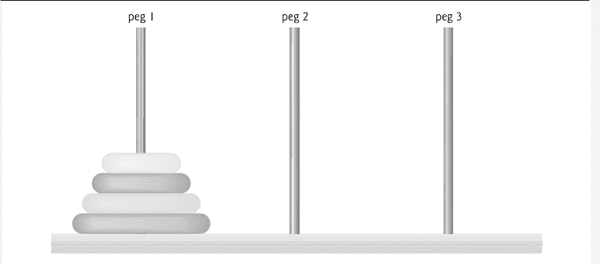

**图 6.21** | 四个盘片情况的汉诺塔。

假设祭司们正试图将盘片从 1 号柱移动到 3 号柱。我们希望开发一种算法，显示精确的柱与柱之间的盘片传输序列。

如果我们用传统方法解决这个问题，很快就会发现自己陷入了管理盘片的混乱困境中。相反，如果我们从递归的角度来处理这个问题，它会立即变得易于处理。移动 $n$ 个盘片可以看作只移动 $n-1$ 个盘片（这就是递归），如下：

- a) 将 $n-1$ 个盘片从 1 号柱移动到 2 号柱，使用 3 号柱作为临时存放区域。
- b) 将最后一个（最大的）盘片从 1 号柱移动到 3 号柱。
- c) 将 $n-1$ 个盘片从 2 号柱移动到 3 号柱，使用 1 号柱作为临时存放区域。

当最后一个任务涉及移动 $n=1$ 个盘片时（即基例情况），过程结束。这项任务通过简单移动盘片即可完成，不需要临时存放区域。

编写一个应用来解决汉诺塔问题。允许用户输入盘片的数量。使用带有四个参数的递归汉诺塔方法：

- a) 盘片的数量，
- b) 这些盘片初始穿插在上面的柱子，
- c) 这堆盘片要移动到的柱子，以及
- d) 用作临时存放区域的柱子。

你的应用应该显示将盘片从起始柱移动到目标柱所需的精确指令，并应该显示盘片在柱与柱之间移动的动画。例如，要将三个盘片的堆栈从 1 号柱移动到 3 号柱，你的应用应该显示以下的一系列移动和相应的动画：

```
1 --> 3 (意味着“一个盘片从 1 号柱移动到 3 号柱”。)
1 --> 2
3 --> 2
2 --> 3
1 --> 3
2 --> 1
1 --> 3
```


## Doodlz App

## 目标

在本章中，你将：

- 检测用户何时触摸屏幕、在屏幕上移动手指以及手指离开屏幕。
- 处理多次触摸，使用户可以同时用多个手指绘图。
- 使用`SensorManager`和加速度计检测事件。
- 使用`AtomicBoolean`对象以线程安全的方式允许多个线程访问布尔值。
- 使用`Paint`对象指定线条的颜色和宽度。
- 使用`Path`对象存储每条线的数据，并使用`Canvas`将每条线绘制到`Bitmap`中。
- 创建并在并在上显示菜单项。
- 使用 Android 4.4 的浸式模式允许用户在整个屏幕上绘图。
- 使用 Android 4.4 的打印框架和 Android Support Library 类`PrintHelper`允许用户打印画作。


## 第 7 章 Doodlez App

### 7.1 引言

### 7.2 技术概述

- 7.2.1 使用`SensorManager`监听加速度计事件
- 7.2.2 自定义对话框
- 7.2.3 使用`Canvas`和 Support Library 的`PrintHelper`类进行绘制
- 7.2.4 处理触摸事件并将线条存储在`Path`中
- 7.2.5 Android 4.4 浸式模式
- 7.2.6 `GestureDetector`和`SimpleGestureListener`
- 7.2.7 将画作保存到设备的相库
- 7.2.8 Android 4.4 打印与`PrintHelper`类
- 7.3 构建应用的 GUI 和资源文件
- 7.3.1 创建项目
- 7.3.2 `strings.xml`
- 7.3.3 `dimens.xml`
- 7.3.4 为`DoodleFragment`创建菜单
- 7.3.5 `MainActivity`的`activity_main.xml`布局
- 7.3.6 `DoodleFragment`的`fragment_doodle.xml`布局
- 7.3.7 `ColorDialogFragment`的`fragment_color.xml`布局
- 7.3.8 `LinearLayoutFragment`的`fragment_line_width.xml`布局
- 7.3.9 添加类`EraseImageDialog-Fragment`

### 7.4 MainActivity 类

### 7.5 DoodleFragment 类

### 7.6 DoodleView 类

### 7.7 ColorDialogFragment 类

### 7.8 LineWidthDialogFragment 类

### 7.9 EraseImageDialogFragment 类

### 7.10 总结

自测练习题 | 自测练习题答案 | 练习

### 7.1 引言

Doodle 应用（图 7.1）允许你通过在屏幕上拖动一个或多个手指来绘画。该应用使用了 Android 4.4 浸式模式，让你可以在整个屏幕上绘图——当你点击屏幕时，设备的系统栏和操作栏会在显示和隐藏之间切换。


图 7.1 | 完成画作的 Doodlez 应用。

应用的选项允许你设置绘图颜色和线条宽度。“选择颜色”对话框（图 7.2(a)）提供了 Alpha（透明度）、红、绿、蓝`SeekBars`（即滑块），允许你选择 ARGB 颜色（在第 1.9 节引入）。当你移动每个`SeekBar`的滑块时，更新后的颜色将显示在滑块下方。“选择线条宽度”（图 7.2(b)）菜单提供单个`SeekBar`，用于控制你将绘制的线条粗细。应用选项中的其他菜单项允许你将手指变成橡皮擦（Eraser）、清除屏幕（Clear）以及保存当前画作。根据你的设备屏幕大小或 Android 4.4 设备，[注意：由于编写时的 bug，在某些设备上你可能需要相机应用来完成画作。]

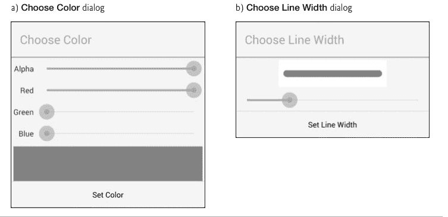

图 7.2 | Doodlez 应用中的选择颜色和线宽对话框。

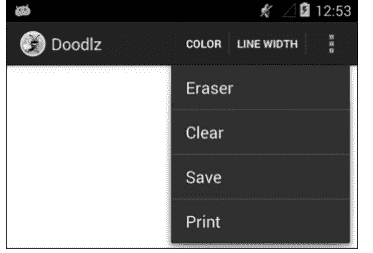

图 7.3 | Android 4.4 设备上的菜单选项。

### 7.2 技术概述

本节介绍了我们在 Doodly 应用中使用的新技术。

### 7.2.1 使用`SensorManager`监听加速度计事件

在本应用中，你可以通过摇晃设备来清除画作。大多数设备都有用于检测的加速度计。Android 支持的其他传感器包括重力、陀螺仪、光、线性加速度、磁场、方向、压力、接近、旋转向量和温度。表示这些传感器的`Sensor`常量可以在此处找到：

http://developer.android.com/reference/android/Sensor

我们将在 7.5 节讨论加速度事件处理。有关 Android 其他传感器的完整讨论，请参：

http://developer.android.com/guide/topics/sensors/sensors_overview.html

### 7.2.2 自定义对话框

多个应用已使用`Fragment`中的`AlertDialog`来向用户显示信息或通过按钮点击获取响应。你到为止使用的`AlertDialog`是通过匿名内部类创建的，只显示文本和按钮。`AlertDialog`还可以包含自定义视图。在本应用中，你将定义三个`Fragment`子类：

- `ColorDialogFragment`（第 7.7 节）显示一个带有自定义视图的`AlertDialog`，用于执行和选择新的 ARGB 绘图颜色。
- `LineWidthDialogFragment`（第 7.8 节）显示一个带有自定义视图的`AlertDialog`，用于执行和选择线条粗细。
- `EraseImageDialogFragment`（第 7.9 节）显示一个标准的`AlertDialog`，询问用户是否要删除图像。

对于`ColorDialogFragment`和`EraseImageDialogFragment`，你将从布局文件填充自定义视图。对于三个`Fragment`子类的每一个，你还将重写`Fragment`生命周期方法：

- `onAttach`——`Fragment`附加到父`Activity`时调用的第一个`Fragment`生命周期方法。
- `onDestroy`——`Fragment`将从父`Activity`卸载之前调用的最后一个`Fragment`生命周期方法。

### 防止多个对话框同时出现

摇晃事件的处理器可能会在另一个对话框已经在屏幕上时尝试显示确认对话框。为了防止这种情况，你通过`onAttach`和`onDestroy`设置一个布尔值，以指示屏幕上是否存在对话框。当该布尔值为`true`时，我们将不再允许摇晃事件的处理器显示对话框。

### 7.2.3 使用 Canvas 和 Bitmap 绘图

此应用在`Bitmap`（位于`android.graphics`包中）上绘制线条。你可以将一个`Canvas`与一个`Bitmap`关联，然后使用`Canvas`在`Bitmap`上绘图，之后可以将其显示在屏幕上（第 7.6 节）。`Bitmap`也可以保存为文件——我们将利用此功能，当你点击保存选项时，将绘画存储在设备的图库中。

### 7.2.4 处理多点触摸事件并将线条存储在 Path 中

你可以在屏幕上滑动一个或多个手指来绘图。应用将每个单独手指的信息存储为`Path`对象（位于`android.graphics`包），该对象表示线段和曲线。你通过重写`View`的`onTouch`方法来处理触摸事件（第 7.6 节）。该方法接收一个`MotionEvent`（位于`android.view`包），其中包含了发生的触摸类型以及产生事件的手指 ID（即指针）。我们使用 ID 来区分不同的手指，并向相应的`Path`对象添加信息。我们使用触摸类型来判断用户是触摸了屏幕、在屏幕上滑动还是从屏幕上抬起了手指。

### 7.2.5 Android 4.4 沉浸模式

Android 4.4 引入了新的全屏沉浸模式，它可以让你充分利用这种体验，但在需要时允许用户访问系统栏。在此应用中，当运行在 Android 4.4 或更高版本的设备上，你将使用这种模式。

### 7.2.6 GestureDetector 和 SimpleOnGestureListener

此应用使用`GestureDetector`（位于`android.view`包）来隐藏或显示设备的系统栏和应用的操作栏。通过实现`GestureDetector`、`SimpleOnGestureListener`和`GestureDetector.OnDoubleTapListener`接口，`GestureDetector`允许你响应翻转、单击、双击、长按和滚动等用户交互。`SimpleOnGestureListener`是一个适配器类，实现了这两个接口的所有方法。你可以扩展此类并重写从这些接口中需要的方法。在第 7.6 节中，你将使用一个`SimpleOnGestureListener`初始化`GestureDetector`，它将处理隐藏或显示系统栏和操作栏的手势点击事件。

### 7.2.7 将绘画保存到设备图库

应用提供了一个保存选项，允许用户将绘画保存到设备图库中——这是存储图片的默认位置。`ContentResolver`（位于`android.content`包中）允许你从设备读取数据并在设备上存储数据。你将使用`MediaStore.Images.Media`的`insertImage`方法将图像保存到设备的图库。`MediaStore`管理存储在设备上的媒体文件（图像、音频和视频）。

### 7.2.8 Android 4.4 打印和 Android Support Library 的 PrintHelper 类

Android 4.4 现在包含了一个打印框架。在此应用中，我们使用`PrintHelper`（第 7.6 节）来打印当前绘画。`PrintHelper`类提供了一个选择打印机的用户界面、一个用于判断设备是否支持打印的方法，并提供了一个打印`Bitmap`方法。`PrintHelper`是 Android Support Library 的一部分——这是一组通常用于为旧版本 Android 提供新 Android 功能的库。这些库还包括额外的便利功能，如支持特定 Android 版本的`PrintHelper`类。

## 7.3 构建应用的 GUI 和资源文件

在本节中，你将创建 Doodly 的资源文件、GUI 布局文件和类。

### 7.3.1 创建项目

从创建一个名为 Doodly 的新 Android 项目开始。在 New Android Project 对话框中指定以下值，然后点击 Finish：

- 应用名称 (Application Name): Doodly
- 项目名称 (Project Name): Doodly
- 程序包名 (Package Name): `com.deteil.doodly`
- 最低所需 SDK (Minimum Required SDK): API18: Android 4.3
- 目标 SDK (Target SDK): API19: Android 4.4
- 编译版本 (Compile With): API19: Android 4.4
- 主题 (Theme): Hol Light with Dark Action Bar

在 New Project 对话框的第二个步骤 New Application，保持默认设置并点击 Next。在 Configure Launcher 步骤中，选择应用图标，然后点击 Next。在 Create Activity 步骤中，选择 Blank Activity，然后点击 Next。在 Blank Activity 步骤中，保持默认设置并点击 Finish 完成项目。在 Graphical Layout 编辑器中打开`activity_main.xml`，并在屏幕类型下拉列表中选择 Nexus 4。我们将再次使用此设备作为设计的基础。

项目将自动配置为使用当前版本的 Android Support Library。如果你正在更新现有项目，可以将最新版本的 Android Support Library 添加到你的项目中。有关详细信息，请访问：

```
http://developer.android.com/tools/support-library/index.html
http://developer.android.com/tools/support-library/setup.html
```


### 7.3.2 strings.xml

你在之前的章节中已经创建了`String`资源，因此在这里只显示部分`String`资源名称和对应的值（图 7.4）。双击`res/values`文件夹中的`strings.xml`以显示用于创建这些`String`资源的资源编辑器。

| 资源名称 (Resource name) | 值 (Value) |
|---|---|
| app_name | Doodlez |
| button_erase | Erase Image |
| button_cancel | Cancel |
| button_set_color | Set Color |
| button_set_line_width | Set Line Width |
| line_imageview_description | This displays the line thickness |
| label_alpha | Alpha |
| label_red | Red |
| label_green | Green |
| label_blue | Blue |
| menitem_clear | Clear |
| menitem_color | Color |
| menitem_line_width | Line Width |
| menitem_save | Save |
| menitem_print | Print |
| message_erase | Erase? |
| message_error_saving | There was an error |
| message_saved | Painting has been saved |
| message_error_printing | Your device does not support printing |
| title_color | Choose Color |
| title_line_width | Choose Line Width |

**图 7.4** | String resources

### 7.3.3 dims.xml

你在之前的章节中创建了`Dimension`资源，所以在这里只显示部分`Dimension`资源名称和对应的值（图 7.5）。双击`res/values`文件夹中的`dims.xml`以显示用于创建这些`Dimension`资源的资源编辑器。

| 资源名称 (Resource name) | 值 (Value) |
|---|---|
| line_imageview_height | 50dp |
| color_view_height | 80dp |

**图 7.5** | Dimension resources

### 7.3.4 Menu for theFragment

在之前的章节中，你使用了默认的`DoodleFragment`菜单资源。在此应用中，你将定义自己的`DoodleFragment`菜单。在第 5 节中，你使用了默认的`main.xml`文件。在此应用中，你将定义你自己的`DoodleFragment`菜单。

#### Android 版本的菜单 (Menus for Android Versions)

你将提供两个版本的菜单——一个适用于 Android 4.3 及之前的版本，另一个适用于 Android 4.4 及更高版本。打印功能仅适用于 Android 4.4 及更高版本。为了支持不同的菜单，你需要在`res/menu`文件夹中定义菜单资源，并在`res/menu-v19`文件夹中定义另一个菜单资源——后者对应 Android 4.4 版本。要创建`res/menu-v19`文件夹，右键点击`res`，选择 New > Folder，选择文件夹名称`v19`并点击 Finish。

#### Android 4.3 及早期版本的菜单 (Menu for Android 4.3 and Early Versions)

要为 Android 4.3 及早期版本的创建菜单资源：

1. 右键点击`res/menu`文件夹并选择 New > Android XML File。
2. 在对话框中，将文件命名为`doodle_menu.xml`并点击 Finish。IDE 打开菜单资源编辑器。
3. 点击 Add...，在对话框的 Layout 标签页中选择 Item 并点击 OK。IDE 高亮显示该项目及其属性。
4. 将其 Id 改为`@id/color`，Title 改为`@string/menuitem_color`，Show action 改为`ifRoom`。`ifRoom`值表示 Android 在空间可用时将菜单项显示在操作栏上；否则菜单项将出现在操作栏右侧的菜单中。其他的 Show action 值可以在 http://developer.android.com/guide/topics/resources/resource.html 找到。
5. 对图 7.6 中的`linewidth`、`clear`和`save`项重复步骤 3 和步骤 4。请注意，每当你点击 Add... 时，对于每个额外的菜单项，你需要在对话框的 Menu 顶层创建一个新元素。
6. 保存并关闭`doodle_menu.xml`。

| Id | Title |
|--- |--- |
| @id/linewidth | @string/menuitem_line_width |
| @id/eraser | @string/menuitem_eraser |
| @id/clear | @string/menuitem_clear |
| @id/save | @string/menuitem_save |

**图 7.6** | `DoodleFragment`的额外菜单项

### 适用于 Android 4.4 及更高版本的菜单

为 Android 4.4 及更高设备创建菜单资源：

1. 从`res/menu`复制`doodle_fragment_menu.xml`，将其粘贴到`res/menu-v19`并打开该文件。
2. 点击 Add...（添加...），在出现对话框的 Menu 顶部选择一个新元素，然后选择 Item（项目）并点击 OK。
3. 将新项目的 Id更改为`@id/print`，Title（标题）更改为`@string/menuitem_print`，Show as（显示方式）改为`ifRoom`。

### 7.3.5 MainActivity 的 activity_main.xml 布局

此应用`MainActivity`的`activity_main.xml`布局仅包含`Doodle-Fragment`。要将此添加到布局中：

1. 在图形化布局编辑器中打开`activity_main.xml`，然后按照第 2.5.2 节中的步骤从`FirebaseAuth`切换到`RelativeLayout`。
2. 从 Palette（调色板）的 Layouts（布局）部分，将 Fragment 拖到设计区域或 Outline（大纲）窗口中的`RelativeLayout`上。
3. 上一步会显示 Choose Fragment Class（选择 Fragment 类）对话框。点击 Create New...（新建...）显示 New Java Class对话框。
4. 在 Name 字段输入`DoodleFragment`，将 Superclass（父类）值选择为`android.app.Fragment`并点击 Finish 完成以创建类。IDE 会打开该类的 Java 文件，你现在可以选择它。
5. 将新 Fragment 的 Id更改为`@id/doodleFragment`，然后保存布局。

### 7.3.6 DoodleFragment 的 fragment_doodle.xml 布局

`DoodleFragment`的`fragment_doodle.xml`布局包含一个显示`DoodleView`类的`FirebaseAuth`。在本节，你将创建`DoodleFragment`的布局和`DoodleView`类。要添加`fragment_doodle.xml`布局：

1. 在 Package Explorer（包资源管理器）中展开`res/layout`节点。
2. 右键点击布局文件夹并选择 New > Android XML File，以显示 New Android XML file 对话框。
3. 在对话框的 Name 字段中输入`fragment_doodle.xml`。
4. 在 Root Element（根元素）部分，选择`FrameLayout`，在 GUI 上绘制一个 view（小写 v）。
5. 从 Palette Advanced（高级）部分开始，上一步会显示 Choose Custom View Class（选择自定义视图类）对话框。在该对话框中，点击 Create New... 显示 New Java Class 对话框。
6. 在 Name 字段中输入`DoodleView`。确保勾选了 Constructors from superclass（来自父类的构造函数），然后点击 Finish。这会创建并打开`DoodleView.java`。我们将仅使用两个参数的构造函数，因此删除另一个。保存并关闭`DoodleView.java`。
7. 在`fragment_doodle.xml`中，在 Outline 窗口中选择`view1`。在 Properties（属性）窗口的 Layout Parameters（布局参数）部分，将 Width（宽度）和 Height（高度）设置为`match_parent`。
8. 在 Outline 窗口中，右键点击`view1`，选择 Edit ID...（编辑标识符...），将`view1`重命名为`doodleView`并点击 OK。
9. 保存并关闭`fragment_doodle.xml`。

### 7.3.7 ColorDialogFragment 的 fragment_color.xml 布局

`ColorDialogFragment`的`fragment_color.xml`布局包含一个`GridLayout`，用于显示选择和预览新绘图的 GUI。在本节，你将创建`ColorDialog`的布局和`ColorDialogFragment`类。要添加`fragment_color.xml`布局：

1. 在 Package Explorer 中展开`res/layout`节点。
2. 右键点击布局文件夹并选择 New > Android XML File，显示 New Android XML File 对话框。
3. 在对话框的 File 字段中输入`fragment_color.xml`。
4. 在 Root Element 部分，选择`GridLayout`，然后点击 Finish。
5. 在 Outline 窗口中，选择`GridLayout`并将其 Id 值更改为`@id/colorDialogGridLayout`。
6. 使用图形编辑器的 Palette，将 TextViews、SeekBars 和一个 View 拖到 Outline 窗口中的`colorDialogGridLayout`节点上。按照图 7.7 中列出的顺序拖入这些项目，并按图中所示设置每个 Id。
7. 完成第 6 步后，使用图 7.8 所示的值配置 GUI 组件属性，然后保存并关闭`fragment_color.xml`。

| GUI 组件 | 属性 | 值 |
| :--- | :--- | :--- |
| colorDialogGridLayout | Column Count | 2 |
| | Orientation | vertical |
| | Use Default Margins | true |

图 7.8 | `fragment_color.xml`中 GUI 组件的属性值。（3 个部分中的第一部分）

| GUI 组件 | 属性 | 值 |
| :--- | :--- | :--- |
| alphaTextView | Layout Parameters | |
| | Column | 0 |
| | Gravity | right\|center_vertical |
| | Row | 0 |
| 其他属性 | | |
| | Text | @string/label_alpha |
| alphaSeekBar | Layout Parameters | |
| | Column | 1 |
| | Gravity | fill_horizontal |
| | Row | 0 |
| 其他属性 | | |
| | Max | 255 |
| redTextView | Layout Parameters | |
| | Column | 0 |
| | Gravity | right\|center_vertical |
| | Row | 1 |
| 其他属性 | | |
| | Text | @string/label_red |
| redSeekBar | Layout Parameters | |
| | Column | 1 |
| | Gravity | fill_horizontal |
| | Row | 1 |
| 其他属性 | | |
| | Max | 255 |
| greenTextView | Layout Parameters | |
| | Column | 0 |
| | Gravity | right\|center_vertical |
| | Row | 2 |
| 其他属性 | | |
| | Text | @string/label_green |
| greenSeekBar | Layout Parameters | |
| | Column | 1 |
| | Gravity | fill_horizontal |
| | Row | 2 |
| 其他属性 | | |
| | Max | 255 |
| blueTextView | Layout Parameters | |
| | Column | 0 |
| | Gravity | right\|center_vertical |
| | Row | 3 |
| 其他属性 | | |
| | Text | @string/label_blue |

图 7.8 | `fragment_color.xml`中 GUI 组件的属性值。（3 个部分中的第二部分。）

| GUI 组件 | 属性 | 值 |
| :--- | :--- | :--- |
| blueSeekBar | Layout Parameters Column | 1 |
| | Gravity | fill_horizontal |
| | Row | 3 |
| 其他属性 Max | 255 |
| colorView | Layout Parameters Height | @dimen/color_height |
| | Column | 0 |
| | Column Span | 2 |
| | Gravity | fill_horizontal |

图 7.8 | `fragment_color.xml`中 GUI 组件的属性值。（3 个部分中的第三部分）

### 将 ColorDialogFragment 类添加到项目

将`ColorDialogFragment`类添加到项目：

1. 右键点击项目 src 文件夹中的`com.detail.doodle`包，选择 New > Class 创建 Java 类。
2. 在 Name 字段中输入`ColorDialogFragment`。
3. 在 Superclass 字段中将父类更改为`android.app.Fragment`。
4. 点击 Finish。

### 7.3.8 LineWidthDialogFragment 的 fragment_width.xml 布局

`LineWidthDialogFragment`的`fragment_width.xml`布局包含一个`GridLayout`，用于选择和预览线条粗细。在本节，你将创建`LineDialogFragment`的布局和`LineWidthDialogFragment`类。要添加`fragment_width.xml`布局：

1. 在 Package Explorer 中展开`res/layout`节点。
2. 右键点击布局文件夹并选择 New > Android XML File，显示 New Android XML File 对话框。
3. 在对话框的 File 字段中输入`fragment_width.xml`。
4. 在 Root Element 部分，选择`GridLayout`，然后点击 Finish。
5. 在 Outline 窗口中，选择`GridLayout`并将其 Id 值更改为`@id/linewidthGridLayout`。
6. 使用图形编辑器的 Palette，将一个 ImageView 和一个 SeekBar 拖到 Outline 窗口中的`linewidthGridLayout`节点上。按图 7.9 所示设置每个 Id。
7. 完成第 6 步后，使用图 7.10 所示的值配置 GUI 组件属性，然后保存并关闭`fragment_width.xml`。

| GUI 组件 | 属性 | 值 |
| :--- | :--- | :--- |
| linewidthGridLayout | Column Count | 1 |
| | Orientation | vertical |
| | Use Default Margins | true |
| widthImageView | Layout Parameters | |
| | Height | @dimen/line_view_height |
| | Column | 0 |
| | Column Span | 2 |
| | Gravity | fill_horizontal |
| | Content Description | @string/line_view_description |
| widthSeekBar | Layout Parameters | |
| | Column | 1 |
| | Gravity | fill_horizontal |
| | Row | 3 |
| 其他属性 Max | 50 |

图 7.9 | `fragment_width.xml`的大纲视图。  
图 7.10 | `fragment_width.xml`中 GUI 组件的属性值。

## 7.4 MainActivity 类

此应用程序包含六个类：

- `MainActivity`（图 7.11）作为该应用 Fragment 的父 Activity。
- `DoodleFragment`（第 7.5 节）管理`DoodleView`和加速度计事件处理。
- `DoodleView`（第 7.6 节）提供绘图、保存和打印功能。
- `ColorDialogFragment`（第 7.7 节）当用户点击 COLOR 设置绘制颜色时显示的`DialogFragment`。
- `WidthDialogFragment`（第 7.8 节）当用户点击 WIDTH 设置线宽时显示的`DialogFragment`。
- `EraseImageDialogFragment`（第 7.9 节）当用户点击 CLEAR 或摇晃设备以擦除当前绘图时显示的`DialogFragment`。

`MainActivity`的`onCreate`方法用于加载 GUI（第 16 行），然后使用你在第 5.2.2 节中学习的技术来确定尺寸并设置`MainActivity`的方向。如果此应用运行在大型设备上（第 24 行），我们将方向设置为横屏（第 25–26 行）；否则，我们将其设置为竖屏（第 28–29 行）。

```java
```


// MainActivity.java

// Sets MainActivity.layout

`package com.deite1.doodle1;`

`import android.app.Activity;`

`import android.content.pm.ActivityInfo;`

`import android.content.res.Configuration;`

`import android.os.Bundle;`

```
public class MainActivity extends Activity
{
    @Override
    protected void onCreate(Bundle savedInstanceState)
    {
        super.onCreate(savedInstanceState);
        setContentView(R.layout.activity_main);

        // determine screen size
        int screenSize = getResources().getConfiguration().screenWidthLayout & Configuration.SCREENLAYOUT_MASK;

        // use landscape for large tablets; otherwise, use portrait
        if (screenSize == Configuration.SCREENLAYOUT_SIZE_XL)
            setRequestedOrientation(ActivityInfo.SCREEN_ORIENTATION_LANDSCAPE);
        else
            setRequestedOrientation(ActivityInfo.SCREEN_ORIENTATION_PORTRAIT);
    } // end class
}
```

## 7.5 `DoodleFragment` 类

`DoodleFragment` 类（图 7.12）显示`DoodleView`（第 7.6 节），管理由操作栏显示的菜单，并管理该应用“摇一摇擦除”功能的传感器事件处理。

### package 语句、import语句和字段

第 7.2 节讨论了`DoodleFragment`使用的新类和接口。我们在图 7.12 中强调了这些类和接口。`DoodleView`变量（22）代表绘图区域。第 23–25 行声明的浮点变量用于计算设备加速度的变化，以确定何时发生摇晃（这样我们就可以像用户希望的那样擦除绘制），第 29 行的常量用于确保微小的移动不会被解释为摇晃——第 26 行定义了一个布尔变量以防止同时显示多个对话框——如果颜色对话框已显示且用户不小心摇了设备，则不应显示图像。

```
// DoodleFragment.java
// Fragment in which DoodleView is displayed
package com.deitel.doodle;

import android.app.Fragment;
import android.content.Context;
import android.graphics.Color;
import android.hardware.Sensor;
import android.hardware.SensorEvent;
import android.hardware.SensorEventListener;
import android.hardware.SensorManager;
import android.os.Bundle;
import android.view.LayoutInflater;
import android.view.Menu;
import android.view.MenuInflater;
import android.view.MenuItem;
import android.view.View;
import android.view.ViewGroup;

public class DoodleFragment extends Fragment
{
    private Doodle doodleView; // handles touch events and draws
    private float acceleration;
    private float currentAcceleration;
    private float lastAcceleration;
    private boolean dialogOnScreen = false;

    // value to determine whether device shake to erase
    private static final int ACCELERATION_THRESHOLD = 100000;
}
```

### 重写 `Fragment` 方法 `onCreate`

（图 7.13）加载`DoodleFragment`的 GUI 并初始化实例变量。像`Activity`一样，`Fragment`可以将项目放置在应用的操作栏和菜单中。要这样做，`Fragment`必须调用`setHasOptionsMenu`并传递参数`true`。如果父`Activity`具有选项菜单，则`Activity`和`Fragment`的项目将放在操作栏或选项菜单中（取决于它们的设置）。

```
// called when Fragment's view need to be created
@Override
public View onCreateView(LayoutInflater inflater, ViewGroup container,
    Bundle savedInstanceState)
{
    super.onCreateView(inflater, container, savedInstanceState);
    View view =
        inflater.inflate(R.layout.fragment_doodle, container, false);
    setHasOptionsMenu(true); // this fragment has menu items to display

    doodleView = (DoodleView) view.findViewById(R.id.doodleView);

    // initialize acceleration values
    acceleration = 0.005f;
    currentAcceleration = SensorManager.GRAVITY_EARTH;
    lastAcceleration = SensorManager.GRAVITY_EARTH;

    return view;
}
```

第 43 行获取`DoodleView`的引用，然后第 46–48 行初始化实例变量，帮助计算加速度的变化，以确定用户是否摇了设备。我们最初将变量`currentAcceleration`和`lastAcceleration`设置为`SensorManager`的`GRAVITY_EARTH`常量，它代表地球上的重力加速度。`SensorManager`还提供了太阳系中其他行星、月球以及其他几个有趣值的常量，你可以在此处查看：

```
http://developer.android.com/reference/android/hardware/SensorManager.html
```

### `onStart`方法 和 `enableAccelerometerListening`方法

当`DoodleFragment`在屏幕上时，应该启用加速度计。出于这个原因，我们重写了`Fragment`生命周期方法`onStart`（图 7.14，第 53–58 行），该方法调用`enableAccelerometerListening`方法（第 61–72 行）以开始监听加速度计事件。使用`SensorManager`为加速度计事件注册监听器。

```
// start listening for sensor events
@Override
public void onStart() {
    super.onStart();
    enableAccelerometerListening(); // listen for shake
}

// enable listening for accelerometer events
public void enableAccelerometerListening() {
    // get the SensorManager
    SensorManager sensorManager =
        (SensorManager) getActivity().getSystemService(
        Context.SENSOR_SERVICE);

    // register to listen for accelerometer events
    sensorManager.registerListener(SensorEventListener,
        sensorManager.getDefaultSensor(Sensor.TYPE_ACCELEROMETER),
        sensorManager.SENSOR_DELAY_NORMAL);
}
```

`enableAccelerometerListening`首先使用`Activity`的`getSystemService`获取系统的`SensorManager`服务，这使得应用程序能够与设备传感器交互。第 69–77 行使用`SensorManager.registerListener`接收加速度计事件，它接收三个参数：

- `SensorEventListener`响应事件（定义在图 7.16）
- 代表应用程序希望接收的传感器数据的`Sensor`对象——这是通过调用`SensorManager`的`getDefaultSensor`方法并传递传感器类型常量获取的（在本应用中为`Sensor.TYPE_ACCELEROMETER`）。
- 传感器事件传递给应用程序的速率。我们选择`SENSOR_DELAY_NORMAL`以默认速率接收传感器事件——可以使用更高速率获取更准确的数据，但更消耗 CPU 和电量。

## `onPause` 和 `disableAccelerometerListening`方法

为了确保当`DoodleFragment`不在屏幕上时禁用加速度计监听，我们重写了`Fragment`的生命周期方法`onPause`（图 7.15，第 75–80 行），该方法调用了`disableAccelerometerListening`方法（第 83–93 行）。`disableAccelerometerListening`方法使用`SensorManager.unregister`方法停止监听加速度计事件。

```
// stop listening for sensor events
@Override
public void onPause() {
    super.onPause();
    disableAccelerometerListening(); // stop listening for shake
}

// disable listening for accelerometer events
public void disableAccelerometerListening() {
    SensorManager sensorManager = 
        (SensorManager)getActivity().getSystemService(
            Context.SENSOR_SERVICE);

    // stop listening for accelerometer events
    sensorManager.unregisterListener(sensorEventListener,
        sensorManager.getDefaultSensor(Sensor.TYPE_ACCELEROMETER));
}
```

**图 7.15** 方法`onPause`和`disableAccelerometerListening`。

## 实现接口`SensorEventListener`接口以处理加速度计事件的匿名内部类

图 7.16 涵盖了`SensorEventListener`方法`onChanged`（第 100–125 行），用于处理加速度计事件。如果用户移动设备，此方法将判断移动是否足以被认为是一个抖动。如果是，第 123 行调用`confirmErase`（图 7.17）来显示`EraseImageDialogFragment`（第 7.9 节）并确认用户是否想要删除图像。`SensorEventListener`接口还包含`onChangedChanged`方法（第 128–131 行）——我们在这个应用中没有使用该方法，但由于接口要求该方法，因此我们提供了一个空方法体。

```
// event handler for accelerometer events
private SensorEventListener sensorEventListener =
    new SensorEventListener()
;
```

**图 7.16** 实现`SensorEventListener`以处理加速度计事件的匿名内部类。（2 个部分中的第 1 部分）。

### 7.5 `DoodleFragment`类 233

```
99   // use accelerometer to determine whether user shook device
100  @Override
101  public void onChanged(SensorEvent event)
102  {
103      // ensure that other dialogs are not displayed
104      if (dialogOnScreen)
105        {
106          // get x, y, and z values for the SensorEvent
107          float x = event.values[0];
108          float y = event.values[1];
109          float z = event.values[2];
110        }

111  // save previous acceleration value
112  lastAcceleration = currentAcceleration;
113  // calculate the current acceleration
114  currentAcceleration = x * x + y * y + z * z;

115  // calculate the change in acceleration
116  acceleration = currentAcceleration *
117    (currentAcceleration - lastAcceleration);

118  if the acceleration is above a certain threshold
119    if (acceleration > ACCELERATION_THRESHOLD)
120      confirmErase();

121  } // end method onSensorChanged
122  // required method of interface SensorEventListener
123  @Override
124  public void onAccuracyChanged(Sensor sensor, int accuracy)
125  {
126  }; // end anonymous inner class
```

**图 7.16** 用于加速度计事件实现`SensorEventListener`的匿名类。（2 个部分中的第 2 部分）

用户在屏幕上已经显示对话框时可以抖动设备。因此，`onChanged`首先检查是否显示了对话框（第 104 行）。这确保了不会显示其他对话框；否则，`onChanged`将直接返回。如果没有这个测试，我们将能够在另一个对话框显示在屏幕上时显示删除图像的确认对话框。

**`SensorEvent`**参数包含了有关发生传感器变化的信息。对于加速度计事件，该参数的`values`数组有三个元素，代表加速度（米/秒²）在 x（左/右）、y（向上）和 z（向前/向后）方向上的值。`SensorEvent`API 使用坐标系的描述和图表可见：

```
developer.android.com/reference/android/hardware/SensorEvent.html
```


## 234 第 7 章 Doodly 应用

此链接描述了每个不同传感器的 `x`、`y` 和 `z` 值的真实世界含义。

第 107–109 行存储了加速度值。快速处理传感器事件或复制数据（如我们在这里所做的）很重要，因为传感器值数组会在每个传感器事件被重用。第 112 行存储了 `currentAcceleration` 的值。第 115 行汇总了 `x`、`y` 和 `z` 加速度值的平方并存储在 `currentAcceleration` 中。然后，使用 `currentAcceleration` 和 `lastAcceleration` 值，我们计算出一个值（`acceleration`），它可以与我们的 `ACCELERATION_THRESHOLD` 常量进行比较。如果该值大于当前值，则用户移动了设备，此应用会将此移动视为抖动。在这种情况下，我们使用 `confirmErase` 方法。

## `confirmErase` 方法

`confirmErase` 方法（图 7.17）只是创建一个 `EraseDialogFragment`（第 7.9 节）并使用 `DialogFragment` 方法显示它。

```java
// confirm whether image should be erased
private void confirmErase() 
{
    EraseDialogFragment fragment = new EraseDialogFragment();
    fragment.show();
}
```

**图 7.17** | `confirmErase` 显示了 `EraseDialogFragment`。

## 重写的 Fragment 方法 `onCreateOptionsMenu` 和 `onOptionsItemSelected`

图 7.18 涵盖了 `onCreateOptionsMenu` 方法（第 142–147 行），用于添加选项。当用户选择菜单项时，`onOptionsItemSelected` 方法（第 150–180 行）响应。

```java
// display this fragment
@Override
public void onCreateOptionsMenu(Menu menu, MenuInflater inflater)
{
    super.onCreateOptionsMenu(menu, inflater);
    inflater.inflate(R.menu.doodle_menu, menu);
}

// handle choice from options
@Override
public boolean onOptionsItemSelected(MenuItem item)
{
```

**图 7.18** | 重写的 Fragment 方法 `onCreateOptionsMenu` 和 `onOptionsItemSelected`

## 7.5 `DoodleFragment` 类 235

```java
// switch based on the MenuItem id
switch (item.getItemId())
{
    case R.id.color:
        ColorDialog colorDialog = new ColorDialog();
        colorDialog.show(getFragmentManager());
        return true; // consume the menu event
    case R.id.linewidth:
        LineWidthDialog widthDialog =
            new LineWidthDialog();
        widthDialog.show(getFragmentManager());
        return true; // consume the menu event
    case R.id.eraser:
        doodleView.setColor(Color.WHITE); // line color
        return true; // consume the menu event
    case R.id.clear:
        confirmErase(); // confirm before erasing
        return true; // consume the menu event
    case R.id.save:
        doodleView.saveImage(); // save the current image
        return true; // consume the menu event
    case R.id.print:
        doodleView.printImage(); // print the current images
        return true; // consume the menu event
}
return super.onOptionsItemSelected(item); // call super's method
} // end method onOptionsItemSelected
```

我们使用 `MenuItem getItemID`（第 154 行）获取所选菜单的资源 ID，然后对选择采取不同的操作。操作如下：

- 对于 `R.id.color`，第 157–158 行创建并显示 `ColorDialog`（第 7.7 节），允许用户选择新的绘制颜色。
- 对于 `R.id.linewidth`，第 161–163 行创建并显示 `LineWidthDialogFragment`（第 7.8 节），允许用户选择新的绘制颜色。
- 对于 `R.id.eraser`，第 166 行将 doodle 的绘制颜色设置为白色，这实际上是将用户的手指变成了橡皮擦。
- 对于 `R.id.clear`，第 169 行调用 `confirmErase`（图 7.17）显示 `EraseImageDialogFragment`（第 7.9 节）并确认用户是否真的想要删除图像。
- 对于 `R.id.save`，第 172 行调用 `doodleView.saveImage()` 将涂鸦保存为为存储在设备图库中的图像。
- 对于 `R.id.print`，第 175 行调用 `doodleView.printImage()` 允许用户将图像保存为 PDF 或打印图像。

## 236 第 7 章 Doodlez App

## `getDoodleView` 和 `setDialogOnScreen`

`getDoodleView` 和 `setDialogOnScreen`（图 7.19）方法由应用 `DialogFragment` 子类的方法调用。`getDoodleView` 方法返回此 `Fragment` 的 `DoodleView` 引用，以便 `DialogFragment` 可以设置绘制颜色、设置线宽或清除图像。`setDialogOnScreen` 方法由应用 `DialogFragment` 子类的 `Fragment` 生命周期周期方法调用，用于指示对话框何时显示在屏幕上。

```java
182 // returns the DoodleView
183 public DoodleView getDoodleView()
184 {
185     return DoodleView;
186 }
187
188 // indicates whether a dialog is displayed
189 public void setDialogOnScreen(boolean visible)
190 {
191     dialogOnScreen = visible;
192 }
193 }
```

**图 7.19** | `getDoodleView` 和 `setDialogOnScreen` 方法。

## 7.6 `DoodleView` 类

`DoodleView` 类（图 7.20–7.33）处理用户的触摸操作并绘制相应的线条。

### `DoodleView` 包语句和导入语句

图 7.20 列出了 `DoodleView` 的包语句、导入语句和字段。新的类和接口在此处被高亮显示。其中许多内容在第 7.2 节中讨论过，其余部分将在使用 `DoodleView` 的过程中进行讨论。

```java
 1 // DoodleView.java
2 // Main View for the Doodlez app.
3 package com.deitelz.doodlez;
4
5 import java.util.HashMap;
6 import java.util.Map;
7
8 import android.content.Context;
9 import android.graphics.Bitmap;
10 import android.graphics.Canvas;
11 import android.graphics.Color;
12 import android.graphics.Paint;
13 import android.graphics.Path;
14 import android.graphics.Point;
15 import android.os.Build;
16 import android.provider.media.MediaStore;
17 import android.support.v4.print.PrintHelper;
18 import android.util.AttributeSet;
19 import android.view.GestureDetector;
20 import android.view.GestureDetector.SimpleOnGestureListener;
21 import android.view.Gravity;
22 import android.view.MotionEvent;
23 import android.view.View;
24 import android.widget.Toast;
```

**图 7.20** | `DoodleView` 包语句和导入语句。（2 部分中的第 1 部分）

### `DoodleView` 静态和实例变量

`DoodleView` 类的静态变量和实例变量（图 7.21，第 30–43 行）用于管理用户当前绘制的线条集的数据并绘制线条。第 38 行创建了 `pathMap`，它将每个手指 ID（称为指针）映射到当前正在绘制的线条对应的 `Path` 对象。第 39–40 行创建了 `previousPointMap`，它维护每个手指的上一个点——随着手指的移动，我们从它的当前点到它的上一个点绘制一条线条。我们将在在 `DoodleView` 类中使用时讨论其他字段。

```java
26 // the main screen that is painted
27 public class DoodleView extends View
28 {
29 // to determine whether user moved a finger enough to draw again
30 private static final float TOUCH_TOLERANCE = 10;
31
32 private Bitmap bitmap; // drawing area for display or saving
33 private Canvas bitmapCanvas; // used to draw onto bitmap
34 private final Point paintScreen; // used to draw bitmap onto screen
35 private final Point paintLine; // used to draw lines onto bitmap
36
37 // Maps of current Paths being drawn and Points in those Paths
38 private final Map<Integer, Path> pathMap = new HashMap<Integer, Path>();
39 private final Map<Integer, Point> previousPointMap =
40 new HashMap<Integer, Point>();
41
42 // used to hide/system/show system bars
43 private GestureDetector detectorSingleTapDetector;
```

**图 7.21** | `DoodleView` 静态和实例变量。

### `DoodleView` 构造函数

构造函数（图 7.22）初始化该类的每个变量——`Map` 在图 7.21 的声明中初始化。第 49 行创建了 `paintScreen` 点，它将用于在屏幕上显示用户的绘图；第 52 行创建了 `paintLine` 点，它指定了用户当前绘制的线条的设置。第 53–57 行指定了 `paintLine` 对象的设置。我们向 `Paint` 的 `setAntiAlias` 方法传递 `true` 以启用抗锯齿，从而使线条边缘平滑。接下来，我们通过 `Paint` 的 `setStyle` 将 `Paint` 的样式设置为 `Paint.Style.STROKE`。样式 `STROKE`、`FILL` 或 `FILL_STROKE` 分别代表线条、无边框的填充形状和带边框的填充形状。默认选项是 `Paint.Style.FILL`。我们使用 `Paint` 的 `StrokeWidth` 方法设置线宽。这会将应用的默认线宽设置为五个像素。我们还使用 `Paint` 的 `StrokeCap` 方法通过 `Paint.ROUND` 将线条末端变为圆角。第 60–61 行创建了一个 `GestureDetector`，它使用 `GestureDetector` 监听器处理单次点击。

```java
45
46    // DoodleView constructor initializes every of the class's variables
47    public DoodleView(Context context, AttributeSet attrs)
48    {
49        super(context, attrs); // pass context to View's constructor
50        paintScreen = new Paint(); // used to display bitmap on screen
51
52        // set the initial settings for the painted line
53        paintLine = new Paint();
54        paintLine.setAntiAlias(true); // smooth edges of drawn line
55        paintLine.setColor(Color.BLACK); // default color is black
56        paintLine.setStyle(Paint.Style.STROKE); // solid line
57        paintLine.setStrokeWidth(5); // set default line width
58        paintLine.setStrokeCap(Paint.ROUND); // rounded line ends
59
60        // GestureDetector for single taps
61        singleTapDetector =
62        new GestureDetector(getContext(), singleTapListener);
63    }
```

**图 7.22** | `DoodleView` 构造函数。

### 重写的 View 方法 `onSizeChanged`

`DoodleView` 的大小在它被加载并添加到 `MainActivity` 的视图层次结构之前是不确定的；因此，我们可以确定绘图位图的大小。所以，我们重写 `onSizeChanged` 方法（图 7.23），该方法在 `DoodleView` 大小变化时被调用——例如当添加到 `Activity` 的视图层次结构或用户旋转设备时。在应用中，`onSizeChanged` 只在 `DoodleView` 被添加到视图层次结构时被调用，因为该应用在手机和平板电脑上始终以竖屏显示，在大平板电脑上以横屏显示。

```java
64
65    // onSizeChanged creates Bitmap and Canvas after app displays
66    @Override
67    public void onSizeChanged(int w, int h, int oldW, int oldH)
68    {
69        bitmap = Bitmap.createBitmap(getWidth(), getHeight(),
70        Bitmap.Config.ARGB_8888);
71        bitmapCanvas = new Canvas(bitmap);
72        bitmapCanvas.eraseColor(Color.WHITE); // erase the Bitmap with white
73    }
```

**图 7.23** | 重写的 `View` 方法 `onSizeChanged`。

## 240 第 7 章 Doodly 应用

```java
// 设置绘制线条的宽度
```


`public void setLineWidth(int width)`

```java
{
    paintline.setStrokeWidth(width);
}
```

```java
// 返回绘制线条的宽度
public int getLineWidth()
{
    return (int)paintline.getStrokeWidth();
}
```

**图 7.24** | `DoodleView` 方法：`clear`， `setDrawingColor`， `getDrawingColor`， `setLineWidth` 和 `getLineWidth`。（部分 2，共 2 部分）

**重写方法 `ondraw`**

当 `View` 需要重新重绘时，会调用其 `ondraw` 方法。图 7.25 重写了 `ondraw`，通过调用 `Canvas` 参数的 `drawBitmap` 方法将位图（包含绘制内容的 `Bitmap`）显示在 `DoodleView` 上。第一个参数是要绘制的 `Bitmap`，接下来的两个参数是 `Bitmap` 左上角放置在 `View` 上的 x-y 坐标，最后一个参数是定义其绘制特征的 `Paint` 对象。第 115–116 行遍历并绘制当前绘制中的 `Path`。对于 `map` 中的每个 `Integer` key，我们将对应的 `Path` 传递给 `Canvas` 的 `drawPath` 方法，使用 `paintline` 对象绘制该 `Path`。

```java
// 每次此 View 被绘制时调用
@Override
protected void ondraw(Canvas canvas)
{
    // 绘制背景颜色
    canvas.drawBitmap(bitmap, 0, 0, paint);

    // 对于每个正在绘制的路径
    for (Integer key : mapPath.keySet()) {
        canvas.drawPath(mapPath.get(key), paint); // 绘制线条
    }
}
```

**图 7.25** | 重写方法：`hideSystemBars` 和 `showSystemBars`

#### `DoodleView` 方法 `hideSystemBars` 和 `showSystemBars`

该应用使用了 Android 4.4 的新沉浸式模式，允许用户在整个屏幕上绘图。当用户点击时，`GestureDetector` 的 `SimpleOnGestureListener`（图 7.27）会判断系统栏和操作栏（`ActionBar`）是否显示。如果是，则调用 `hideSystemBars` 方法（图 7.26，第 120–130 行）；否则，调用 `showSystemBars` 方法（图 7.26，第 133–140 行）。对于此应用，我们为 Android 4.4 启用沉浸式模式，首先检查设备上运行的 Android 版本——`Build.VERSION_SDK_INT` 是否大于或等于 Android 4.4 的常量（API 级别 19）——`Build.VERSION_CODES_KITKAT`。如果是，方法将使用 `View` 方法 `setSystemUiVisibility` 来配置系统栏和操作栏。要隐藏系统栏和操作栏并将 UI 置于沉浸模式，你需要向 `setSystemUiVisibility` 传递在第 124–129 行中通过位或运算符（`|`）组合的常量。要显示系统栏和操作栏，你向 `setSystemUiVisibility` 传递在第 137–139 行中组合的常量。这些 `View` 的组合确保了当系统栏和操作栏隐藏并重新部署时，`DoodleView` 不会调整大小。相反，系统栏和操作栏会覆盖在 `DoodleView` 之上——这意味着当系统栏和操作栏出现在屏幕上时，`DoodleView` 的部分内容会被临时隐藏。常量 `View.SYSTEM_UI_FLAG_IMMERSIVE` 是 Android 4.4 中新增的。更多关于沉浸式模式的信息，请访问：

```
http://developer.android.com/training/system-ui-immersive.html
```

```java
// 隐藏系统栏和操作栏
public void hideSystemBars() {
    if (Build.VERSION.SDK_INT >= Build.VERSION_CODES.KITKAT) {
        setSystemUiVisibility(
            View.SYSTEM_UI_FLAG_LAYOUT_STABLE |
            View.SYSTEM_UI_FLAG_HIDE_NAVIGATION |
            View.SYSTEM_UI_FLAG_FULLSCREEN |
            View.SYSTEM_UI_FLAG_IMMERSIVE);
    }
}
```

```java
// 显示系统栏和操作栏
public void showSystemBars() {
    if (Build.VERSION.SDK_INT >= Build.VERSION_CODES.KITKAT) {
        setSystemUiVisibility(
            View.SYSTEM_UI_FLAG_LAYOUT_STABLE |
            View.SYSTEM_UI_FLAG_HIDE_NAVIGATION |
            View.SYSTEM_UI_FLAG_LAYOUT_FULLSCREEN);
    }
}
```

**图 7.26** | `DoodleView` 方法 `hideSystemBars` 和 `showSystemBars`

#### 实现 `SimpleOnGestureListener` 的匿名类

图 7.27 创建了名为 `singleTapListener` 的 `SimpleOnEventListener`，它在第 60–61 行（图 7.22）注册到 `GestureDetector`。记住，`SimpleEventListener` 是一个实现了 `OnGestureListener` 和 `OnCompleteListener` 的适配器类。这些方法返回 `false`——表示事件未被处理。我们重写了 `onSingleTap` 方法（第 146–155 行），该方法在用户点击屏幕时被调用。通过调用方法 `getSystemUiVisibility` 并将其与 `View.SYSTEM_UI_FLAG_HIDE_NAVIGATION` 结果组合，我们判断系统栏和应用栏是否显示（第 149–150 行）。如果结果为 0，则当前显示系统栏和应用栏，因此我们调用 `hideSystemBars` 方法；否则，调用 `showSystemBars`。返回 `true` 表示单击事件已处理。

```java
142 // 为单击事件创建 SimpleOnGestureListener
143 private SimpleOnGestureListener singleTapListener =
144     new SimpleOnGestureListener()
145     {
146         @Override
147         public boolean onSingleTap(MotionEvent e)
148         {
149             if ((getSystemUiVisibility() &
150                 View.SYSTEM_UI_FLAG_HIDE_NAVIGATION) == 0)
151                 hideSystemBars();
152             else
153                 showSystemBars();
154             return true;
155         }
156     };
```

**图 7.27** | 匿名内部类实现 `SimpleOnGestureListener`

#### 重写 `View` 方法 `onTouchEvent`

`onTouchEvent`（图 7.28）在 `View` 接收到触摸事件时调用。Android 支持多点触摸——即多个手指触摸屏幕。任何时候，用户都可以在屏幕上增加手指或移除手指。为了标识，每个手指（称为指针）都有一个跨触摸事件的唯一 ID。我们将使用该 ID 来定位代表绘制线条的 `Path` 对象。这些 `Path` 存储在 `pathMap` 中。

```java
158 // 处理触摸事件
159 @Override
160 public boolean onTouchEvent(MotionEvent event)
161 { // 获取事件类型和引起事件的指针 ID
162     // 如果 Kit Kat 或更高版本发生了单击事件
163     if (singleTapDetector.onTouchEvent(event))
164         return true;
165 
166     int action = event.getActionMasked(); // 事件类型
167     int actionIndex = event.getActionIndex(); // 指针（即手指）
168 
169     // 判断触摸是开始还是移动中
170     if (action == MotionEvent.ACTION_DOWN ||
171         action == MotionEvent.ACTION_POINTER_DOWN)
172         {
173             touchStarted(event.getX(actionIndex), event.getY(actionIndex),
174             event.getPointerId(actionIndex));
175     }
```

**图 7.28** | 重写 `View` 方法 `onTouchEvent`。（部分 1，共 2 部分）

```java
176 else if (action == MotionEvent.ACTION_UP ||
177      action == MotionEvent.ACTION_POINTER_UP)
178     {
179         touchEnded(event.getPointerId(actionIndex));
180     }
181     else
182     {
183         touchMoved(event.getX(actionIndex), event.getY(actionIndex),
184         event.getPointerId(actionIndex));
185     }
186     invalidate(); // 重绘
187     return true;
188 } // 结束方法TouchEvent 方法
```

#### 244 第 7 章 Doodlz 应用程序

```java
// 当用户触摸屏幕时调用
private void touchStarted(float x, float y, int lineID)
{
    Path path; // 用于存储给定 touch id 的路径
    Point point; // 用于存储路径中的上一个点

    // 如果 lineID 已经存在一个路径（path）
    if (pathMap.containsKey(lineID)) {
        path = pathMap.get(lineID); // 获取 Path
        path.reset(); // 因为开始了新的触摸，所以重置 Path
        point = previousPointMap.get(lineID); // 获取 Path 的上一点
    } else {
        path = new Path();
        pathMap.put(lineID, path); // 将 Path 添加到 Map
        point = new Point(); // 创建一个新的 Point
        previousPointMap.put(lineID, point); // 将 Point 添加到 Map
    }

    // 移动到触摸的坐标
    path.moveTo(x, y);
    point.x = (int) x;
    point.y = (int) y;
} // 方法 touchStarted 结束
```

**图 7.29** | `DoodleView` 类的 `touchStarted` 方法

#### `DoodleView` 类的 `touchMoved` 方法

`touchMoved` 方法（7.30）在用户在屏幕上移动一个或多个手指时调用。传递给 `onTouchEvent` 的系统 `MotionEvent` 如果同时发生多次，则包含屏幕上多次移动的触摸信息。`MotionEvent` `getPointerCount`（第 222 行）返回此 `MotionEvent` 描述的触摸次数。对于每一个触摸，我们将手指的 ID（225 行）存储在 `pointerID` 中，并将该手指在此 `MotionEvent` 中对应的索引（第 226 行）存储在 `pointerIndex` 中。然后我们检查 `pathMap` `HashMap`（第 229 行）中是否存在对应的路径。如果是，我们使用 `MotionEvent` 的 `getX` 和 `getY` 方法获取该指定 `pointerID` 在这次拖动事件的最后坐标。然后，从各自的 `HashMap` 中计算上一个点与当前点之间的差异——如果用户移动的距离大于我们的 `TOUCH_TOLERANCE`，则更新路径。我们这样做是因为系统足够敏感，当用户试图让手指静止在屏幕上时，也会产生指示微小移动的 `MotionEvents`。如果用户移动手指超过了 `TOUCH_TOLERANCE`，我们使用 `path` 的 `quadTo` 方法（第 248–249 行）从上一个 `Point` 到新 `Point` 添加一条几何曲线（二次贝塞尔曲线）。然后我们更新该手指最最近的 `Point`。

#### 7.6 DoodleView 类

```java
218  // 当用户拖动屏幕时调用
219  private void touchMoved(MotionEvent event)
220  {
221      // 对于给定 MotionEvent 中的每个指针（pointer）
222      for (int i = 0; i < event.getPointerCount(); i++) {
223          {
224              // 获取指针 ID 和指针索引
225              int pointerID = event.getPointerID(i);
226              int pointerIndex = event.findPointerIndex(pointerID);
227          }
228      // 如果与指针关联的路径
229      if (pathMap.containsKey(pointerID)) {
230          {
231              // 获取指针的新坐标
232              Float newX = event.getX(pointerIndex);
233              Float newY = event.getY(pointerIndex);
234          }
235      // 获取与此指针关联的
236      // Path 和之前的 Point
237      Path path = pathMap.get(pointerID);
238      Point point = previousPointMap.get(pointerID);
239
240      // 计算用户自上一次更新移动了多少
241      float deltaX = Math.abs(newX - point.x);
242      float deltaY = Math.abs(newY - point.y);
243
244      // 如果距离足够大需要处理
245      if (deltaX > TOUCH_TOLERANCE || deltaY >= TOUCH_TOLERANCE) {
246          {
247              // 将路径移动到新位置
248              path.quadTo(point.x, point.y, (newX + point.x) / 2,
249                           (newY + point.y) / 2);
250          }
251          {
252              // 存储新坐标
253              point.x = (int)newX;
254              point.y = (int)newY;
255          }
256      }
257  }
258  }
259  }
260  } // 方法 touchMoved 结束
```


**图 7.30** | `DoodleView` 类的 `touchMoved`。

`DoodleView` 类的 `touchEnded` 方法在用户从屏幕上抬起手指时调用。`touchEnded` 方法（图 7.31）接收刚刚触摸的手指 ID（`1ID`）作为参数。第 262 行获取对应的 `Path`，第 263 行获取 `bitmapCanvas` 的 `drawPath` 方法，以便在名为 `bitmap` 的 `Bitmap` 对象上绘制该 `Path`，然后我们才调用 `Path` 的 `reset` 来清空屏幕。重置 `Path` 不会擦除已经绘制在 `bitmap` 上的内容。重置 `Path` 会覆盖。

246 第 7 章 Doodlz 应用程序

```java
// 当用户完成触摸时调用

private void touchEnded(int lineID)
{
    path = pathMap.get(lineID); // 获取对应的 Path

    bitmapCanvas.drawPath(path); // 在 bitmap 上绘制 Path

    path.reset(); // 重置 Path 以清空屏幕
}
```

**图 7.31** | `DoodleView` 类的 `touchEnded` 方法。

### `saveImage` 方法

`saveImage` 方法（图 7.32）将绘图保存到画廊。`insertImage` 返回表示位置的 `String`，如果图像无法保存，则返回 `null`。

```java
// 保存当前图像

public void saveImage() {
    // 使用 "Doodle" 加上当前时间作为文件名
    String name = "Doodle" + System.currentTimeMillis() + ".jpg";

    // 将图像插入设备
    String location = MediaStore.insertImage(
        getContext().getContentResolver(), bitmap, name);

    // 检查图像是否保存
    if (location != null) {
        // 显示图像已保存的提示
        Toast message = Toast.makeText(
            getContext(), R.string.message_saved, Toast.LENGTH_SHORT);

        message.setGravity(
            Gravity.CENTER, message.getXOffset() / 2,
            message.getYOffset() / 2);

        message.show();
    } else {
        // 显示图像保存失败的提示
        Toast message = Toast.makeText(
            getContext(), R.string.message_saving, Toast.LENGTH_SHORT);

        message.setGravity(
            Gravity.CENTER, message.getXOffset() / 2,
            message.getYOffset() / 2);

        message.show();
    }
}
```

**图 7.32** | `DoodleView` 类的 `saveImage` 方法。（1/2 部分）

### `printImage` 方法

Android 4.4 及以上设备，`printImage` 方法（图 7.33）使用 Android Support Library `PrintHelper` 类来打印绘图。第 301 行确认设备支持打印。接下来，第 307 行创建 `PrintHelper` 的缩放模式——`PrintHelper.SCALE_MODE_FIT` 表示图像适应纸张区域。此外还有比例 `PrintHelper.SCALE_MODE_FILL`，它会导致图像填充纸张，裁掉部分图像。最后，第 308 行调用 `PrintHelper` 的 `printBitmap` 方法，传递打印任务名称（用于打印机识别打印）和包含打印图像的 `Bitmap`。这将显示 Android 的打印对话框，允许用户选择将图像保存为设备上的 PDF 文档或打印到可用打印机。

```java
// 打印当前图像

public void printImage() {
    if (PrintHelper.systemSupportsPrint()) {
        // 使用 Android Support Library 的 PrintHelper 打印
        PrintHelper printHelper = new PrintHelper(getContext());

        // 适应页面边界并打印图像
        printHelper.setScaleMode(PrintHelper.SCALE_MODE_FIT);

        printHelper.printBitmap("Doodle Image", bitmap);
    } else {
        // 显示系统不支持打印的提示
        Toast message = Toast.makeText(
            getContext(), R.string.message_error_printing,
            Toast.LENGTH_SHORT);

        message.setGravity(
            Gravity.CENTER, message.getXOffset() / 2,
            message.getYOffset() / 2);

        message.show();
    }
}
```

**图 7.33** | `DoodleView` 类的 `printImage` 方法。（2/2 部分）

## 7.7 `ColorDialogFragment` 类

`ColorDialogFragment` 类（图 7.34–7.38）继承自 `DialogFragment`，用于创建一个用于设置颜色的 `AlertDialog`。该类的实例变量（第 19–24 行）用于引用选择新颜色的 GUI 控件、显示颜色预览，并将颜色存储为表示颜色 ARGB 值的 32 位整型 `int`。

```java
// ColorDialogFragment.java

// 允许用户在 DoodleView 上设置绘制颜色

package com.deitel.doodle2;

import android.app.Activity;
import android.app.AlertDialog;
import android.app.Dialog;
import android.app.DialogFragment;
import android.content.DialogInterface;
import android.graphics.Color;
import android.os.Bundle;
import android.view.View;
import android.widget.SeekBar;
import android.widget.SeekBar.OnSeekChangeListener;

// 用于选择颜色的对话框类

public class ColorDialogFragment extends DialogFragment
{
    private SeekBar alphaSeekBar;
    private SeekBar redSeekBar;
    private SeekBar greenSeekBar;
    private SeekBar blueSeekBar;
    private View colorView;
    private int color;
}
```

| 图 7.34 | `ColorDialogFragment` 在 `onCreateDialog` 上的方法 |
| :--- | :--- |

### 重写的 `DialogFragment` 方法 `onCreateDialog`

`onCreateDialog` 方法（图 7.35）加载由 `fragment.xml` 定义的自定义 View（第 32–34 行），该文件包含用于选择颜色的 GUI，然后通过调用 `AlertDialog.Builder.setView` 方法（第 35 行）将 View 附加到 `AlertDialog` 上。第 42–50 行引用对话框的 `SeekBar` 和 `colorView`。接下来，第 53–56 行将 `colorOnChangedListener`（图 7.38）注册为 `SeekBar` 事件的监听器。

```java
// 创建 AlertDialog 并返回它

@Override
public Dialog onCreateDialog(Bundle bundle)
{
    AlertDialog.Builder builder =
        new AlertDialog.Builder(getActivity());
```

| 图 7.35 | `onCreateDialog` 上重写的 `DialogFragment` 方法（2 部分中的第一部分） |
| :--- | :--- |

```java
View colorDialogView =
    getActivity().layoutInflater().inflate(
        R.layout.fragment_color, null);

builder.setContentView(colorDialogView); // 将 GUI 添加到对话框
```

```java
// 设置 AlertDialog 的标题

builder.setTitle(R.string.title_color_dialog);
builder.setCancelable(true);
```

```java
// 获取 SeekBars 并设置它们的 onChange 监听

alphaSeekBar = (SeekBar) colorDialogView.findViewById(
    R.id.alphaSeekBar);

redSeekBar = (SeekBar) colorDialogView.findViewById(
    R.id.redSeekBar);

greenSeekBar = (SeekBar) colorDialogView.findViewById(
    R.id.greenSeekBar);

blueSeekBar = (SeekBar) colorDialogView.findViewById(
    R.id.blueSeekBar);

colorView = colorDialogView.findViewById(R.id.colorView);
```

```java
// 注册 SeekBar 事件监听器

alphaSeekBar.setOnSeekBarChangeListener(colorChangedListener);
redSeekBar.setOnSeekBarChangeListener(colorChangedListener);
greenSeekBar.setOnSeekBarChangeListener(colorChangedListener);
blueSeekBar.setOnSeekBarChangeListener(colorChangedListener);
```

```java
// 使用当前绘制颜色设置 SeekBar 值

final DoodleView doodleView = getDoodleFragment().getDoodleView();

color = doodleView.getDrawingColor();

alphaSeekBar.setProgress(Color.alpha(color));
redSeekBar.setProgress(Color.red(color));
greenSeekBar.setProgress(Color.green(color));
blueSeekBar.setProgress(Color.blue(color));
```

```java
// 设置颜色按钮

builder.setPositiveButton(
    R.string.button_color,
    new DialogInterface.OnClickListener() {
        public void onClick(DialogInterface dialog, int id) {
            doodleView.setDrawingColor(color);
        }
    }); // 结束 setPositiveButton

return builder.create(); // 结束返回
} // 结束 onCreateDialog
```

| 图 7.35 | `onCreateDialog` 方法（第二部分） |
| :--- | :--- |

第 42–50 行引用对话框的 `SeekBar` 和 `colorView`。接下来，第 53–56 行将 `colorOnChangedListener`（图 7.38）注册为 `SeekBar` 事件的监听器。第 59–64 行使用当前绘制颜色设置 `SeekBar` 值。第 67–75 行通过 `setDrawingColor` 更新 `DoodleView`。第 77–84 行通过 `getDoodleFragment()` 获取引用。第 88–96 行在 `onAttach` 中调用 `super.onAttach`。第 99–107 行在 `onDelete` 中调用 `super.onDelete`。第 115–123 行在 `onProgressChanged` 中更新颜色。

```java
// 引用

@Override
void onActivity()
{
    super.on();

    DialogFragment fragment = (DialogFragment) getFragment();

    if (fragment != null) {
        fragment.setDialogScreen(false);
    }
} // 结束 onCreate
```

.36

```java
// 告知对话框现在已显示

@Override
public void onAttach(Activity activity)
{
    super.onAttach(activity);

    DialogFragment fragment = (DialogFragment) getFragment();

    if (fragment != null) {
        fragment.setDialogScreen(true);
    }
}
```

```java
// 告知对话框已不再显示

@Override
public void onDelete()
{
    super.onDelete();

    DialogFragment fragment = (DialogFragment) getFragment();

    if (fragment != null) {
        fragment.setDialogScreen(false);
    }
}
```

| 图 7.37 | `onAttach` 上重写的 `Fragment` 生命周期方法 |
| :--- | :--- |

## 7.8 `LineDialogFragment` 类

### 匿名类实现 `OnSeekChangeListener` 以响应 Alpha、红、蓝 `SeekBar` 的事件

图 7.38 定义了一个实现 `OnSeekChangeListener` 的匿名内部类，用于响应用户使用颜色对话框中的 `SeekBar` 时的事件。它在第 53–56 行注册为 `SeekBar` 的事件处理器。`onProgressChanged` 方法（第 115–123 行）在 `SeekBar` 滑块位置改变时被调用。如果用户移动了 `SeekBar` 滑块（第 118 行），第 119–120 行存储了新颜色。`Color` 的静态方法将 `SeekBar` 的值传入 `Color` 并返回相应的颜色整型 `int`。然后我们使用 `View` 的 `setBackgroundColor` 方法更新与 `SeekBar` 当前状态匹配的颜色。

```java
// 颜色对话框中 SeekBars 的 SeekChangeListener

private OnSeekChangeListener colorChangedListener =
    new OnSeekChangeListener() {

        // 显示更新的颜色

        @Override
        public void onProgressChanged(
            SeekBar seekBar, int progress, boolean fromUser) {

            if (fromUser) { // 用户而非程序改变了 SeekBar 进度
                int color = Color.argb(
                    alphaSeekBar.getProgress(),


```java
redSeekBar.getProgress(), greenSeekBar.getProgress(),
blueSeekBar.getProgress());

colorView.setBackgroundColor(color);
}

}

@Override
public void onStartTrackingTouch(SeekBar seekBar) // 必须
{
}

@Override
public void onStopTrackingTouch(SeekBar seekBar) // 必须
{
}

}; // 结束 colorChangeListener

// 结束类 ColorDialogFragment
```

| 图 7.38 | 实现 `OnSeekChangeListener` 以响应 alpha、红、绿、蓝 `seekbars` 事件的匿名内部类。 |

`LineWidthDialogFragment`（图 7.39）继承自 `DialogFragment`，用于创建一个用于设置线宽的 `Alert-Dialog`。该类与 `ColorDialogFragment` 类相似，因此我们在此只讨论其关键差异。该类唯一的实例变量是对话框中（第 22 行）的 `ImageView`，我们可以在其中绘制一条线条来显示当前的线宽设置。

```java
// LineWidthDialogFragment.java

// 允许用户在 DoodleView 上设置绘制颜色

package com.deitel.doodle;

import android.app.Activity;
import android.app.AlertDialog;
import android.app.Dialog;
import android.app.DialogFragment;
import android.content.DialogInterface;
import android.graphics.Bitmap;
import android.graphics.Canvas;
import android.graphics.Paint;
import android.os.Bundle;
import android.view.View;
import android.widget.ImageView;
import android.widget.SeekBar;
import android.widget.seekbar.OnSeekBarChangeListener;

// 用于选择颜色的对话框类
public class LineWidthDialogFragment extends DialogFragment {

    private ImageView widthView;

    // 创建一个 AlertDialog 并返回它
    @Override
    public Dialog onCreateDialog(Bundle savedInstanceState) {
        AlertDialog.Builder builder = new AlertDialog.Builder(getActivity());

        builder.getLayoutInflater().inflate(
            R.layout.line_width, null);

        builder.setView(lineWidthDialogView); // 向对话框添加 GUI

        // 设置 AlertDialog 的标题
        builder.setTitle(R.string.title_line_width_dialog);
        builder.setCancelable(true);

        // 获取 widthSeekBar
        widthImageView = (ImageView) lineWidthDialogView.findViewById(
            R.id.widthImageView);

        // 配置 widthSeekBar
        final DoodleView doodleView = getDoodleFragment().getDoodleView();
        final SeekBar widthSeekBar = (SeekBar) lineWidthDialogView.findViewById(
            R.id.widthSeekBar);

        widthSeekBar.setOnSeekBarChangeListener(widthChanged);
        widthSeekBar.setProgressBar(doodleView.getLineWidth());

        // 添加线宽按钮
        builder.setPositiveButton(R.string.button_set_line_width,
            new DialogInterface.OnClickListener() {

                @Override
                public void onClick(DialogInterface dialog, int id) {
                    doodleView.setLineWidth(widthSeekBar.getProgress());
                }

            }); // 结束 setPositiveButton

        return builder.create(); // 返回对话框
    } // 结束方法 onCreate

    // 获取 DoodleFragment 的引用
    private DoodleFragment getDoodleFragment() {
        return (DoodleFragment) getFragmentManager().findFragmentById(
            R.id.doodleFragment);
    }

    // 通知 DoodleFragment 对话框正在显示
    @Override
    public void onAttach(Activity activity) {
        super.onAttach(activity);

        DoodleFragment fragment = getDoodleFragment();

        if (fragment != null)
            fragment.setDialogScreen(true);
    }

    // 通知 DoodleFragment 对话框不再显示
    @Override
    public void onDetach() {
        super.onDetach();

        DoodleFragment fragment = getDoodleFragment();

        if (fragment != null)
            fragment.setDialogScreen(false);
    }

    // 宽度对话框中 SeekBar 的 OnSeekChangeListener
    private OnSeekChangeListener listenerChanged =
        new OnSeekChangeListener() {

            Bitmap bitmap = Bitmap.createBitmap(
                400, 100, Bitmap.Config.ARGB_8888);

            Canvas canvas = new Canvas(bitmap); // 与关联 Canvas

            @Override
            public void onProgressChanged(
                SeekBar seekBar, int progress, boolean fromUser) {

                // 为当前 SeekBar 值配置 Paint 对象
                Paint p = new Paint();
                p.setColor(
                    getDoodleFragment().getDoodleView().getDrawingColor());
                p.setStrokeCap(Paint.Cap.ROUND);
                p.setFixedWidth(progress);

                // 擦除位图并重画线条
                bitmap.eraseColor(
                    getResources(android.R.color.transparent));

                canvas.drawLine(30, 50, 370, 50, p);
                widthImageView.setImageBitmap(bitmap);
            }

            @Override
            public void onStartTrackingTouch(SeekBar seekbar) { // 要求的
            }

            @Override
            public void onStopTrackingTouch(SeekBar seekbar) { // 要求的
            }

        }; // 结束 widthChanged
}
```


图 7.39 | `LineWidthDialogFragment` 类（三部分第一部分）。

## 7.8 LineWidthDialogFragment 类

`onCreateDialog` 方法（第 25–61 行）加载了由 `fragment_line.xml` 定义的自定义 `View`（第 30–31 行），该 `View` 用于显示选择线宽的 GUI，然后通过调用 `AlertDialog.Builder.setContentView`（第 32 行）将该 `View` 附加到 `AlertDialog`。第 39–40 行提供了用于绘制示例线条的 `ImageView` 引用。接下来，第 43–47 行提供了用户调整宽度时使用的 `SeekBar` 引用。

图 7.39 | `LineWidthDialogFragment` 类。（三部分第三部分。）

## 7.10 总结

257

`Path`。你通过重写 `View` 类的 `onTouchEvent` 方法处理触摸事件，该方法接收一个包含事件类型和生成事件的指针 ID 的 `MotionEvent`。我们使用这些 ID 来区分不同的手指，并向相应的 `Path` 对象添加信息。

你使用了 4.4 的全屏沉浸式模式，该模式允许应用利用整个屏幕，但在必要时仍允许用户访问系统栏和操作。对于沉浸式模式，当用户单触屏幕时，使用 `GestureDetector`。

你使用了 `ContentResolver` 和 `MediaStore.Images.Media.insertImage` 方法将图像保存到相册。最后，我们展示了如何使用 Android 4.4 打印框架允许用户打印他们的画。我们使用 Android Support `PrintHelper` 类创建一个 `Bitmap`，并显示了一个用于选择打印机或将图像保存为 PDF 文档的用户界面。

在第 8 章中，我们将构建一个数据库驱动的联系录应用，它提供了快速方便的联系人信息存储，并具有添加联系人、删除联系人和编辑现有联系人的功能。你将学习如何在 GUI 中动态切换 `Fragment`，并再次提供优化手机和平板电脑屏幕区域的布局。

## 自测练习题

### 7.1

填空每个陈述中的空白：

a) 你使用 `SensorManager` 来注册应用应该接收的传感器变化，并指定由 `SensorEventListener` 来处理这些传感器事件。
b) `Path` 对象（位于 `android.graphics` 包中）表示一个由线段和 curves 组成的几何路径。
c) 你使用触摸事件的类型来确定用户是触摸了屏幕，还是移开了传感器。
d) 使用 `SensorManager` 类的 `unregisterListener` 方法来停止监听加速度事件。
e) 重写 `SensorEventListener` 方法以处理加速度事件。
f) 重写 `Fragment` 方法以在 `Fragment` 附加到活动（activity）时响应事件。
g) 当视图需要重绘时，它的 `onDraw` 方法会被调用。
h) `MotionEvent` 返回一个表示 `MotionEventType` 的整数，你可以结合 `MotionEvent` 类使用它来确定如何处理每个事件。
i) Android 4.4 的 immersive mode 允许应用利用整个屏幕。

### 7.2

判断以下每个陈述是 true 还是 false。如果是 false，请解释原因。

a) 你在应用发送到前台时注册加速度事件处理器。
b) 调用继承的视图方法 `invalidate` 以指示视图需要重绘。
c) 如果动作是 `MotionEvent.ACTION_DOWN` 或 `MotionEvent.ACTION_POINTER_DOWN`，用户触摸了同一个手指。
d) 重置 `Path` 会擦除屏幕上对应的彩绘线条，因为这些线已经绘制到了显示在屏幕上的位图上。
e) 方法 `MediaStore.Images.Media.saveImage` 将 `Bitmap` 保存到设备的相册中。

## 自测练习题答案

**7.1** a) `SensorEventListener` b) curves. c) dragged across the screen. d) `unregisterListener` e) `onSensorChanged`. f) `onAttach`. g) `onDraw`. h) `getActionMasked`. i) immersive mode.

**7.2** a) False. 你在应用进入后台时注销加速度处理器。b) True. 继承的方法 `invalidate` 指明视图需要重绘。c) False. 如果动作是 `MotionEvent.ACTION_DOWN` 或 `MotionEvent.ACTION_POINTER_DOWN`，用户是用新的手指触摸了屏幕。d) False. 重置 `Path` 不会擦除屏幕上的线条，因为这些线已经绘制到了显示在屏幕上的位图上。e) False. `MediaStore.Images.Media.insertImage` 将位图保存到相册中。

## 练习题

填空以下陈述中的空白：

a) 大多数 Android 设备都有 (n)（accelerometer），允许应用检测移动。
b) 重写方法 (n)（`onAttach`）以在 `Fragment` 附加到父活动时响应事件。
c) (n)（`SensorManager`）监控加速度计以检测设备移动。
d) `SensorManager` 的 (n)（`SENSOR_GRAVITY`）常数表示对重力或地球重力的加速度。
e) 你使用 `SensorManager.registerListener` 方法注册加速度事件，该方法使用三个参数：响应事件的 `SensorEventListener`、代表应用希望接收的传感器数据的 `Sensor`，以及 (n)（the max）。
f) 你向 `Paint` 的 (n)（`setAntiAlias`）方法传递 `true`，该方法可以平滑线条边缘。
g) `Paint` 方法 (n)（`setStrokeWidth`）将宽度设置为指定的像素数。
h) Android 支持 (n)（multi-touch），即多个手指触摸屏幕。
i) Android Support Library 的 (n)（`PrintHelper`）类指导如何选择打印机以及打印位图。

判断以下每个陈述是 *true* 还是 *false*。如果是 *false*，请解释原因。

a) True. 在 Android 中，事件在 GUI 线程中处理。
b) False. alpha 分量指定 `Color()`，其中 0 表示透明，100 表示完全不透明。
c) True. 对于加速度事件，`SensorParameter` 值包含三个元素，代表在 x（左）、y（上/下）和 z（前/后）方向上的加速度（单位为米/s²）。
d) True. 当用户拖动 `SeekBar` 条时，方法 `onProgressChanged` 被调用。
e) True. 要获取跨 `MotionEvents` 持续到用户从屏幕上移除该手指的唯一 ID，使用 `MotionEvent.getID` 方法并将手指作为参数传递。
f) True. 从 `touchEvent` 传递的系统 `MotionEvent` 如果这些移动同时发生，则包含屏幕上多次移动的信息。

*(增强版涂鸦应用)* 对涂鸦应用进行以下增强：

a) 允许用户 (n) 绘画。
b) 添加 (n) 允许用户更改颜色。
c) 使用 (n) 允许用户更改线条粗细。
d) (n) 允许用户清除屏幕。
e) 添加 (n) 允许用户将绘画保存为图像。

## 练习题

298

a) 大多数 Android 设备都有 (accelerometer)，允许应用检测移动。
b) 重写方法 (`onAttach`) 以在 `Fragment` 附加到父活动时响应事件。
c) (`SensorManager`) 监控加速度计以检测设备移动。
d) `SensorManager` 的 (`SENSOR_GRAVITY`) 常数表示对重力或地球重力的加速度。
e) 你使用 `SensorManager.registerListener` 方法注册加速度事件，该方法使用三个参数：响应事件的 `SensorEventListener`、代表应用希望接收的传感器数据的 `Sensor`，以及 (the max)。
f) 你向 `Paint` 的 (`setAntiAlias`) 方法传递 `true`，该方法可以平滑线条边缘。
g) `Paint` 方法 (`setStrokeWidth`) 将宽度设置为指定的像素数。
h) Android 支持 (multi-touch)，即多个手指触摸屏幕。
i) Android Support Library 的 (`PrintHelper`) 类指导如何选择打印机以及打印位图。

a) True. 在 Android 中，事件在 GUI 线程中处理。
b) False. alpha 分量指定 `Color()`，其中 0 表示透明，100 表示完全不透明。
c) True. 对于加速度事件，`SensorParameter` 值包含三个元素，代表在 x（左）、y（上/下）和 z（前/后）方向上的加速度（单位为米/s²）。
d) True. 当用户拖动 `SeekBar` 条时，方法 `onProgressChanged` 被调用。
e) True. 要获取跨 `MotionEvents` 持续到用户从屏幕上移除该手指的唯一 ID，使用 `MotionEvent.getID` 方法并将手指作为参数传递。
f) True. 从 `touchEvent` 传递的系统 `MotionEvent` 如果这些移动同时发生，则包含屏幕上多次移动的信息。

*(注：此处原文包含大量 OCR 错误和重复乱码，已根据指令要求提取核心逻辑翻译)*

# 通讯录应用

## 目标

在本章中，你将：
- 使用 `ListFragment` 显示并管理 `ListView`。
- 使用 `FragmentTransactions` 和回栈从 GUI 中动态附加和卸载 `Fragment`。
- 使用 `SQLiteOpenHelper` 创建并打开 SQLite 数据库，并在 `SQLiteDatabase` 对象中插入、删除和查询数据。
- 使用 `SimpleCursorAdapter` 将数据库查询结果绑定到 `ListView` 节点。
- 使用 `Cursor` 遍历数据库查询结果。
- 使用多线程和 `AsyncTasks` 在 GUI 线程之外执行数据库操作，并保持应用程序的响应性。
- 定义包含常用 GUI 属性和值的样式，然后将其应用到多个 GUI 组件上。

## 8.1 引言

- 8.1 引言
- 8.2 实例驱动通讯录应用
- 8.3 技术概览

- 8.1 创建项目
- 8.2 创建 App 的类
- 8.3 strings.xml
- 8.4 styles.xml
- 8.5 textview_border.xml
- 8.6 MainActivity 的布局：activity_main.xml
- 8.7 Fragment 的布局：fragment_details.xml
- 8.8 AddEditFragment：fragment_add.xml
- 8.9 定义 Fragment 菜单

- 8.3.1 使用 FragmentTransactions 显示 Fragment
- 8.3.2 Fragment 与宿主 Activity 之间的数据通信
- 8.3.3 方法 onSaveInstanceState
- 8.3.4 定义状态并将其应用到 GUI 组件
- 8.3.5 为 TextView 指定绑定
- 8.3.6 扩展类 ListFragment 以创建一个包含 ListView 的 Fragment
- 8.3.7 操作 SQLite 数据库
- 8.3.8 使用 AsyncTasks 在 GUI 线程之外执行数据库操作

- 8.5 MainActivity 类
- 8.6 ContactListFragment 类
- 8.7 AddEditFragment 类
- 8.8 DetailsFragment 类
- 8.9 DatabaseConnector 工具类
- 8.10 本节总结

- 8.4 构建 GUI 和资源文件

自测练习题 | 自测练习题答案 | 练习题

## 8.1 引言

通讯录应用（图 8.1）提供了对存储在设备 SQLite 数据库中的联系人信息的便捷访问。你可以浏览字母顺序的联系人列表，并通过触摸联系人姓名来查看联系人的详情。

a) 选中 Paul 的联系人列表
b) 联系人 Paul 的详情

图 8.1 | 联系人列表和选定的联系人详情。

当显示联系人详情时，点击“编辑”（edit）会显示一个包含预填充编辑文本框的 `Fragment`，用于编辑联系人数据（图 8.2），点击“删除”（delete）会显示一个 `DialogFragment`，要求用户确认删除（图 8.3）。

a) 点击编辑图标编辑联系人内容
b) 用于编辑联系人的 Fragment

点击操作栏上的编辑图标会显示用于编辑该联系人数据的 Fragment

图 8.2 | 编辑联系人数据。

a) 点击删除图标删除当前联系人
b) 删除联系人的确认对话框

点击操作栏上的删除图标会显示一个请求用户确认删除的对话框

图 8.3 | 从数据库中删除联系人。

在查看联系人列表时，点击“添加”(+) 会显示一个包含 `Edit` 的 `Fragment`，你可以用它添加新联系人的数据（图 8.4）。在编辑现有联系人或添加新联系人时，点击“保存联系人”（Save Contact）按钮保存联系人数据并返回应用主界面。图 8.5 显示了应用在横屏平板电脑上的运行情况。在平板电脑上，列表始终显示在应用程序的左侧。

a) 点击添加图标添加新联系人
b) 用于添加联系人的 Fragment

图 8.4 | 向数据库添加联系人。

a) 手机或平板电脑的横屏模式下。操作图标带有文本显示。

图 8.5 | 平板电脑上横屏运行的通讯录应用。

## 8.2 实例驱动通讯录应用

### 打开并运行应用

打开 Eclipse 并导入 Address Book 项目。执行以下步骤：

1. 打开导入对话框。选择 `File > Import...` 打开导入对话框。
2. 导入 Address Book 应用项目。在导入对话框中，展开 `General` 节点并选择 `Existing Projects into Workspace`，然后点击 `Next` 进入导入项目步骤。确保已选择根目录，然后点击 `Browse...`。在 `Browse Folder` 对话框中，找到 Eclipse 中的 Address Book 文件夹，选择它并点击 `Finish` 导入项目。项目现在出现在左侧的 `Package Explorer` 窗口中。
3. 启动 Address Book 应用。在 Eclipse 中，右键点击 `Package Explorer` 中的 Address Book 项目，然后选择 `Run As > Android Application`。

### 添加联系人

第一次运行应用时，联系人列表将为空，并在屏幕中心显示“No Contacts”（无联系人）。点击操作栏显示添加新条目的屏幕。添加联系人信息后，点击“保存联系人”按钮将联系人存储在数据库并返回应用主界面。如果你选择不添加联系人，只需点击设备上的返回键返回主界面。如果需要，可以添加更多联系人。在平板电脑上，添加联系人后，新联系人的详情将显示在列表右侧，如图 8.5 所示。

### 查看联系人

在联系人列表中点击你添加的联系人姓名以查看该联系人的详情。

### 编辑联系人

在查看联系人列表时，点击操作栏上的编辑图标会显示用于编辑该联系人数据的 Fragment。

### 删除联系人

在查看联系人列表时，点击操作栏上的删除图标会显示一个对话框，请求用户确认删除。

## 8.3 技术概览

本节介绍了我们在通讯录应用中使用的新技术。

### 8.3.1 使用 FragmentTransactions 显示 Fragment

在早期的应用中，我们在 Activity 中声明每个 Fragment；对于 `DialogFragment`，我们调用其 `show` 方法来创建。在本应用中，我们在手机设备上使用所有的 Fragment。在平板电脑上，我们每次显示一个 Fragment。我们将使用 `FragmentManager` 和 `FragmentTransactions` 来动态显示 Fragment。此外，我们使用 Android 的回栈（一种按后进先出 LIFO 顺序存储 Fragment 的数据结构）为 Android 返回键提供支持，并按照添加的反序移除 Fragment。

### 8.3.2 Fragment 与宿主 Activity 之间的数据通信

要在 Fragment 和宿主 Activity 之间进行通信，最佳实践是通过宿主来实现——这使得 Fragment 更具重用性，因为它们之间没有互相引用。每个 Fragment 定义了一个接口，该接口由 Activity 实现。我们将使用这种技术，以便用户选择联系人、点击操作项（图标或文本）或完成联系人的编辑或添加时，通知 `MainActivity`。

### 8.3.3 方法 onSaveInstanceState

当应用执行期间设备的值发生变化时，系统调用 `onSaveInstanceState`——例如用户旋转设备或在设备上滑出键盘时。此方法可以保存你希望在应用 `onCreate` 方法作为配置更改的一部分被调用时恢复的状态。当应用简单置于后台时（用户接听电话或另一个应用启动时），应用的 GUI 组件会自动保存其内容（前提系统没有杀掉应用）。我们在图 8.4 中使用了 `onSaveInstanceState`。

### 8.3.4 定义样式并将其应用到 GUI 组件

你可以将常用的 GUI 属性值对定义为样式资源（见 8.4.4 节）。你可以使用样式属性将其应用到所有共享这些值的组件（见 8.4.7 节）。对样式的任何更改将自动应用到使用该样式的 GUI 组件上。我们以此来设置显示联系人信息的 TextView。

### 8.3.5 为 TextView 指定背景

默认情况下，TextView 没有背景。要定义背景，可以为 TextView 的 `android:background` 属性指定一个 Drawable。该 Drawable 可以是图片，但在本应用中，你在资源文件中将形状定义为 Drawable（见 8.4.5）。该 Drawable 的资源文件定义在应用的一个或多个文件夹中——在本应用中，`textview_border.xml` 定义在 `drawable-mdpi` 文件夹中。

### 8.3.6 扩展 ListFragment 类以创建包含 ListView 的 Fragment

当 Fragment 的主要任务是显示一个可滚动的项目列表时，你可以扩展 `ListFragment` 类（android.app，第 8.6 节）——这与你在 4 章中扩展 Activity 几乎相同。`ListFragment` 使用 `ListView` 作为其默认布局。在本应用中，我们不使用 `ArrayAdapter`，而是使用 `CursorAdapter`（包 android.widget）来在 `ListView` 中显示数据库查询的结果。

### 8.3.7 操作 SQLite 数据库

联系信息存储在 SQLite 数据库中。根据 www.sqlite.org，SQLite 是世界上最广泛使用的数据库引擎之一。此应用中的 Fragment 通过 `DatabaseConnector` 类（第 8.9 节）与 SQLite 数据库交互。该类使用了 `SQLiteOpenHelper`（包 android.database.sqlite）的嵌套子类，它简化了查询的创建，并允许你获取一个 `SQLiteDatabase` 对象（包 android.database.sqlite）来操作数据库。查询使用结构化查询语言 (SQL) 执行，查询结果通过 `Cursor`（包 android.database.database）进行管理。

### 8.3.8 使用 AsyncTask 在 GUI 线程外执行数据库操作

你应该在 GUI 线程之外执行耗时操作或在完成之前会阻塞执行的操作（例如文件和数据库访问）。这有助于保持响应性，并避免当 Android 认为 GUI 无响应时出现“程序未响应”（ANR）对话框。当我们在 GUI 线程中需要数据库操作的结果时，我们将使用 `AsyncTask`（包 android.os）的子类在一个线程中执行操作并在 GUI 线程中接收结果。线程的创建和操作细节由 `AsyncTask` 类为你处理，从 `AsyncTask` 到 GUI 线程的结果通信也是如此。

## 8.4 构建 GUI 和资源文件

在本节中，你将创建通讯录应用额外的 Java 源代码文件、资源文件和 GUI 布局文件。

### 8.4.1 创建项目

从创建一个新的 Android 项目开始。在 New Android Project 对话框指定以下值，然后点击 Finish：

- Application Name（应用名称）：Address Book
- Project Name（项目名称）：AddressBook
- Package Name（包名）：com.deitel.addressbook
- Minimum Required SDK（最低所需 SDK）：API18: Android 4.3
- Target SDK（目标 SDK）：API19: Android 4.4
- Compile With（编译版本）：API19: Android 4.4
- Theme（主题）：Holo Light with Dark Action Bar

在 New Android 对话框的第二个 New Android Application 步骤中，保留默认设置并点击 Next > 在 Configure Launcher Icon（配置启动图标）步骤中，选择一个应用图标，然后点击 Next > 在 Create activity（创建活动）步骤中，选择 Blank Activity，然后点击 Next > 在 Blank Activity 步骤中，保留默认设置并点击 Finish 创建项目。在 Graphical Layout 编辑器中打开 `activity_main.xml`，并从屏幕类型下拉列表中选择 Nexus 4。我们再次使用此设备作为我们设计的依据。

### 8.4.2 创建应用的类

此应用由五个类组成：

- `MainActivity`（第 8.5 节）管理应用的 Fragment 并协调它们之间的交互。
- `ContactListFragment`（第 8.6 节）是 `ListFragment` 的子类，用于显示联系人名称并提供添加新联系人的菜单项。
- `AddEditFragment`（第 8.7 节）是 `Fragment` 的子类，为添加新联系人或编辑现有联系人提供 GUI。
- `DetailsFragment`（第 8.8 节）是 `Fragment` 的子类，显示单个联系人的数据并提供编辑和删除的菜单项。
- `DatabaseConnector`（第 8.9 节）是 `Object` 的子类，管理此应用与 SQLite 数据库的交互。

`MainActivity` 是在你创建项目时由 IDE 创建的。在之前的项目中，你必须将其他类添加到 `src` 文件夹下的 `com.deitel.addressbook` 包中。对于每个类，右键点击包并选择 New > Class，然后指定类名和父类。

### 8.4.3 strings.xml

图 8.6 显示了此应用的资源名称和对应值。双击 `res/values` 文件夹中的 `strings.xml` 以显示用于创建这些资源的资源编辑器。

| Resource name（资源名称） | Value（值） |
|---|---|
| no_contacts | No Contacts |
| menuitem_add | Add |
| menuitem_edit | Edit |
| menuitem_delete | Delete |
| button_save_contact | Save Contact |
| hint_name | Name (Required) |
| hint_email | E-Mail |
| hint_phone | Phone |
| hint_street | Street |
| hint_city | City |

**Fig. 8.6** 通讯录应用使用的字符串资源。（第 1 部分，共 2 部分。）

| Resource name（资源名称） | Value（值） |
|---|---|
| hint_state | State |
| hint_zip | Zip |
| label_name | Name: |
| label_email | E-Mail: |
| label_phone | Phone: |
| label_street | Street: |
| label_city | City: |
| label_state | State: |
| label_zip | Zip: |
| confirm_title | Are You Sure? |
| confirm_message | This will permanently delete the contact |
| ok | OK |
| error_message | You must enter a contact name |
| button_cancel | Cancel |
| button_delete | Delete |

**Fig. 8.6** | 通讯录应用使用的字符串资源。（第 2 部分，共 2 部分。）

### 8.4.4 styles.xml

在本节中，你定义了显示联系人信息（第 8.7 节）的 TextView 的样式。与其他资源一样，样式放置在应用的 `values` 文件夹中。当你创建一个项目时，会创建一个 `styles.xml` 文件。

1. 在 `values` 文件夹中打开 `styles.xml` 文件并确保选中了 Resources 选项卡。
2. 点击 Add...，选择 Theme 并点击 OK 创建新样式。
3. 将样式 Name 设置为 `LabelTextView` 并保存文件。
4. 选中 `LabelTextView` 样式，点击 Add... 以添加新项。
5. 重复步骤 2 和 3 创建名为 `ContactTextView` 的样式——当你完成时，关闭样式。在编辑器窗口顶层选择元素：

| Name（名称） | Value（值） |
|---|---|
| android:layout_width | wrap_content |
| android:layout_height | wrap_content |
| android:gravity | right|

**Fig. 8.7** `LabelTextView` 样式属性。

对图 8.8 中的每个 Name 和 Value 重复步骤 4。完成后，关闭样式。

| Name（名称） | Value（值） |
|---|---|
| android:layout_width | wrap_content |
| android:layout_height | wrap_content |
| android:gravity | fill_horizontal |
| android:textSize | 16sp |
| android:background | @drawable/textview_border |

**Fig. 8.8** `ContactTextView` 样式属性。

### 8.4.5 textview_border.xml

你在上一节中创建的样式定义了使用详情的 TextView 外观。你指定名为 `@drawable/textview_border` 的 Drawable（即图像或图形）作为属性的值。在本节中，你将在应用的 `res/drawable-mdpi` 文件夹中找到 Drawable。Drawable 只在项目的 drawable 文件夹之一定义，Android 将所有设备和分辨率上使用该 Drawable。

1. 右键点击 `res/drawable-mdpi` 文件夹并选择 New > XML File。
2. 指定 `textview_border.xml` 为 Name，并将 `shape` 指定为根元素，然后点击 Finish。
3. 在你编写时，IDE 未提供创建 Drawing 的编辑器，因此将图 8.9 中的代码输入文件。

```xml
<!-- 图 8.9 的代码内容 -->
```


```xml
<?xml version="1.0" encoding="utf-8"?>

<shape xmlns:android="http://schemas.android.com/apk/res/android"

  android:shape="rectangle">

  <corners android:radius="5dp"/>

  <stroke android:width="10dp" android:color="#555"/>

  <padding android:top="10dp" android:left="10dp" android:bottom="10dp"

  android:right="10dp"/>

</shape>
```

**Fig. 8.9** 用于放置在`TextView`上的`Drawable` XML表示。

`shape`元素的`android:shape`属性（第3行）可以是`"rectangle"`（本例中使用）、`"oval"`、`"line"`或`"ring"`。`corners`元素（第4行）指定了矩形的角半径，使其变为圆角。`stroke`元素（第5行）定义了矩形的线条宽度和线条颜色。`padding`元素（第6–7行）指定了放置此`Drawable`的元素周围的间距。

应用。你必须分别指定顶、左、右、底部的内边距（`padding`）值。定义形状的完整细节可以查看：

```text
http://developer.android.com/guide/topics/resources/
drawable-resource.html#Shape
```

## 8.4.6 `MainActivity`布局：`activity_main.xml`

你将为`MainActivity`提供两个布局——一个位于`res/layout`文件夹，用于手机尺寸的设备；另一个位于`res/layout-large`文件夹，用于平板电脑尺寸的设备。你需要添加`layout-large`文件夹。

### 手机布局：`res/layout`中的`activity_main.xml`

对于手机布局，打开`res/layout`文件夹中的`activity_main.xml`。将`FrameLayout`的`id`设置为`@id/fragmentContainer`。此`FrameLayout`将在手机上用于播放应用的`Frames`。按照你在前面章节中对其他布局的操作，设置`FrameLayout`的`Left Padding`、`Right Padding`、`Padding Top`和`Bottom`属性。

### 平板布局：`res/layout-large`中的`activity_main.xml`

对于平板布局，在`res/layout-large`文件夹中创建一个新的`activity_main.xml`布局。该布局应使用一个水平`LinearLayout`，其中包含一个`ContactFragment`和一个空的`FrameLayout`。使用你在5.4.9节中学的技巧将`ContactFragment`添加到布局中，然后添加`FrameLayout`。使用以下属性：

- 将`LinearLayout`的`WeightSum`设置为3——这将为水平空间分配给`ContactFragment`和`FrameLayout`。
- 对于`Fragment`，将`id`设置为`@id/contactFragment`，`Width`设置为`0`，`Height`设置为`match_parent`，且`Right`设置为`1 margin`并使用`@dimen activity_horizontal_margin`。
- 对于`FrameLayout`，将`id`设置为`@id/rightPaneContainer`，`Width`设置为`0`，`Height`设置为`match_parent`且`Weight`设置为2。

将`LinearLayout`的`WeightSum`设置为3，然后将`ContactFragment`和`FrameLayout`的`Weight`分别设置为1和2，这意味着`ContactFragment`将占据`LinearLayout`宽度的三分之一，而`FrameLayout`将占据剩余的三二部分。

## 8.4.7 `DetailsFragment`布局：`fragment_details.xml`

当用户在`MainActivity`中点击联系人时，应用会显示`DetailsFragment`（图8）。该布局（`fragment_details.xml`）由一个包含两列`Views`的`GridLayout`组成。`ScrollView`是一种可以包含其他`Views`（如布局）并允许用户滚动查看屏幕上无法完全显示的内容。我们在这里使用`ScrollView`是为了确保如果设备没有足够的垂直空间显示图10中的所有`Views`，用户也可以滚动查看联系人的详情。按照5.4.8节的步骤创建`fragment_details.xml`文件，并将`ScrollView`作为根元素（`Root Element`）。创建文件后，将`ScrollView`的`id`设置为`@id/detailsScrollView`并向`ScrollView`中添加一个`GridLayout`。

## 8.4 构建 GUI 和资源文件 271

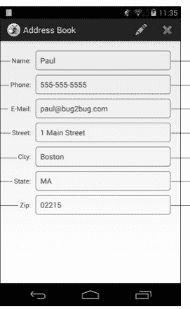

**图 8.10** 用其`id`属性标记的`DetailsFragment`的 GUI 组件。

### `GridLayout`设置

对于`GridLayout`，我们将`Width`设置为`match_parent`，`Height`设置为`wrap_content`，`Column Count`设置为2并将`Default Margins`设置为`true`。`Height`值允许父级`ScrollView`确定`GridLayout`的实际高度并决定是否提供滚动功能。如图8.10所示向`GridLayout`中添加`TextViews`。

### 左列 `TextView` 设置

对于左列中的每个`TextView`，按照图8.10所示设置其`id`属性并设置：

- 根据行数将`Row`设置为0–6之间的值。
- `Column`设置为0。
- `Text`设置为来自`strings.xml`的相应字符串资源。
- `Style`（位于`View`类别）设置为`@style/ContactLabelTextView`——样式资源使用`@style/styleName`语法指定。

### 右列 `TextView` 设置

对于右列中的每个`TextView`，按照图8.10所示设置其`id`属性并设置：

- 根据行数将`Row`设置为0–6之间的值。
- `Column`设置为1。
- `Style`（位于`View`类别）设置为`@style/ContactTextView`。

## 8.4.8 `AddEditFragment`的布局：`fragment_add_edit.xml`

当用户点击触控项时，`MainActivity`显示`AddEditFragment`（图8.11），其布局（`fragment_add_edit.xml`）使用一个包含单列`GridLayout`的`ScrollView`。确保将`ScrollView`的`Id`设置为`0+id/addEditScrollView`。如果为新联系人显示`AddEditFragment`，`EditTexts`将是空的并显示提示（图8.4）。否则，它们将显示由`MainActivity`传递给`AddEditFragment`的联系人数据。

每个`EditText`都有`Input Type`和`IME`属性。对于显示软键盘的设备，`Input Type`指定当用户触摸相应的`EditText`时显示何种键盘。这允许我们根据用户必须在特定`EditText`中输入的数据类型自定义键盘。我们使用`IME`属性在`nameEditText`、`emailEditText`、`phoneEditText`、`streetEditText`、`cityEditText`和`stateEditText`的软键盘上显示“下一步”（`Next`）按钮。当其中一个项获得焦点时，点击此按钮会将焦点转移到下一个`EditText`。


**图 8.10** 用其`id`属性标记的`DetailsFragment`的 GUI 组件。

## 8.5 `MainActivity`类 275

```java
// MainActivity.java

// 托管地址簿应用程序的片段 (fragments)

package com.deitelail.addressbook;

import android.app.Activity;

import android.app.FragmentTransaction;

import android.os.Bundle;

public class MainActivity extends Activity

    implements ContactListFragment.ContactListListener,

    DetailsFragment.DetailsFragmentListener,

    AddEditFragment.AddEditFragmentListener

{

    // 用于在 Bundle 中存储行 ID 的键

    public static String ROW_ID = "row_id";

    ContactListFragment contactListFragment; // 显示联系人列表
```

图 8.14 | `MainActivity`的包语句、导入语句和值。

### `MainActivity`重写的`onCreate`方法

该方法（8.5）载入`MainActivity`的 GUI，如果应用程序运行在手机尺寸的设备上，则显示`ContactListFragment`。正如你将在8.6节中看到的，你可以配置`Fragment`在配置更改后（例如用户旋转设备时）被保留。如果`Activity`在关闭或因配置更改而重建后恢复，`savedInstanceState`将不为空。在这种情况下，我们直接返回（`null`），因为`ContactListFragment`已经存在——在手机上，它会被保留；在平板电脑上，它是第24节载入的`MainActivity`布局的一部分。

```java
// 当 MainActivity 首次加载时显示 ContactListFragment

@Override

protected void onCreate(Bundle savedInstanceState)

{

    super.onCreate(savedInstanceState);

    setContentView(R.layout.activity_main);

    // 如果 Activity 正在恢复，则无需重建 GUI

    if (savedInstanceState != null)

        return;

    // 检查布局是否包含 fragmentContainer（手机布局）；

    // ContactListFragment 始终会被显示

    if (findViewById(R.id.fragmentContainer) != null)

    {

        // 创建 ContactListFragment

        contactListFragment = new ContactListFragment();

    }
```

图 8.15 | `MainActivity`重写的`onCreate`方法。（部分1，共2部分）

```java
// 将片段添加到 FrameLayout

FragmentTransaction transaction =

getFragmentManager().beginTransaction();

transaction.add(R.id.fragmentContainer, contactListFragment);

transaction.commit(); // 导致 ContactListFragment 显示

}
```

### 图 8.15 | `MainActivity`重写的`onCreate`方法。（部分2，共2部分）

如果`R.id.fragmentContainer`存在于`MainActivity`的布局中（第32行），则应用程序运行在手机上。在这种情况下，第35行创建`ContactListFragment`，然后第38-41行使用`FragmentTransaction`将`ContactListFragment`添加到用户。第38-39行调用管理器的`beginTransaction`方法以获取一个`FragmentTransaction`。接下来，第40行调用`FragmentTransaction`的`add`方法，指定当`FragmentTransaction`完成时，应将`ContactListFragment`附加到作为第一个参数的指定 ID 的`View`上。最后，第41行使用`FragmentTransaction`的`commit`方法来完成事务并显示`ContactListFragment`。

### `MainActivity`重写的`onResume`方法

`onResume`方法（图8.16）决定`contactListFragment`是否为空空——如果为空空，则应用程序运行在平板电脑上，因此第55-57行使用`FragmentManager`获取对`MainActivity`布局中已有的`ContactListFragment`的引用。

```java
// 当 MainActivity 恢复时调用

@Override

protected void onResume()

{

    super.onResume();

    // 如果 contactListFragment 为空，activity 在平板电脑上运行，

    // 从 FragmentManager 获取引用

    if (contactListFragment == null) {

        contactListFragment =

            (ContactListFragment) getFragmentManager().findFragmentById(

                R.id.contactListFragment);

    }

}
```

### 图 8.16 | `MainActivity`重写的`onSelected`

### `MainActivity`重写的`onItemSelected`方法

`onSelected`方法（图8.17）来自`ContactListFragment.ContactEventListener`接口，由`FragmentManager`调用，用于在用户选择某个联系人进行显示时通知`MainActivity`。如果应用程序运行在手机上（第65行），第66行调用`displayContact`方法（图8.18），该方法会将`fragmentContainer`（定义在8.4.6节）中的`ContactListFragment`替换为显示联系信息的`DetailsFragment`。

在平板电脑上，第69行调用`FragmentManager`的`popBackStack`方法来弹出（移除）返回栈栈顶部的`Fragment`，然后第70行调用`displayContact`，该方法会将`rightPaneContainer`（定义在8.4.6节）中的内容替换为显示联系信息的`DetailsFragment`。

```java
// 为选定的联系人显示 DetailsFragment

@Override

public void onContactSelected(long rowID)

{

    if (findViewById(R.id.fragmentContainer) != null) // 手机

        displayContact(rowID, R.id.fragmentContainer);

    else // 平板电脑

    {

        getFragmentManager().popBackStack(); // 移除返回栈顶部

        displayContact(rowID, R.id.rightPaneContainer);

    }

}
```


## MainActivity 方法 `displayContact`

`displayContact`方法（图 8.18）创建显示所选联系人的`DetailsFragment`，并使用`FragmentTransaction`将其附加到 GUI 上。你可以通过将参数放在键值对的`Bundle`中向`Fragment`传递参数。第 80 行创建了一个包含`ROW_ID`（`long`类型）的`Bundle`。第 82 行将其传递给`DetailsFragment`的`setArguments`方法。第 85 行使用`FragmentTransaction.replace`方法指定当`FragmentTransaction`完成时，应用`DetailsFragment`替换`View`的内容。第 88 行调用`FragmentTransaction.addToBackStack`将`Fragment`推入返回栈。第 89 行使用`FragmentTransaction.commit`方法完成事务并显示`DetailsFragment`。

```java
// 显示选定联系人的 DetailsFragment
@Override
private void displayContact(long rowID, int viewID)
{
    DetailsFragment detailsFragment = new DetailsFragment();

    // 传递参数
    Bundle arguments = new Bundle();
    arguments.putLong(ROW_ID, rowID);
    detailsFragment.setArguments(arguments);
}
```

**图 8.18** | `MainActivity`方法`displayContact`。（部分 1，共 2 部分）。

## 8.5 MainActivity 类 277 第8章 地址簿应用程序

```java
// 使用 FragmentTransaction 显示 DetailsFragment
FragmentTransaction transaction =
getFragmentManager().beginTransaction();
transaction.replace(viewID, detailsFragment);
transaction.addToBackStack(null);
transaction.commit(); // 导致 DetailsFragment 显示
```

**图 1.18** | `MainActivity`方法`displayContact`。（部分 2，共 2 部分）

### MainActivity 方法 `onContact`

`onContact`方法（图 8.19）来自`ContactList.ClickListener`接口，由`ContactList`调用，用于在用户选择添加新联系人时通知`MainActivity`。如果布局包含`fragmentContainer`，第 97 行调用`addEditFragment`（图 8.20）在`fragmentContainer`中显示`AddEditFragment`；否则，第 99 行调用`addEditFragment`在`rightPaneContainer`中显示片段。

```java
// 显示添加新联系人的 AddEditFragment
@Override
public void onContact() {
    if (findViewById(R.id.fragmentContainer) != null) { // 手机
        displayAddEditFragment(R.id.fragmentContainer,null);
    } else // 平板电脑
        displayAddEditFragment(R.id.rightPaneContainer,null);
    }
}
```

**图 1.19** | `MainActivity`方法`displayAddFragment`

### MainActivity 方法 `displayAddEditFragment`

`displayAddEditFragment`（图 8.20）接收`View`的资源 ID 以指定附加`AddEditFragment`以及一个键值对的`Bundle`。如果第二个参数为空，则正在添加新联系人；否则，`Bundle`包含了在`AddEditFragment`中编辑显示的数据。第 105 行创建`AddEditFragment`。如果`Bundle`参数不为空，第 108 行使用其设置`Fragment`的参数。第 111-115 行随后创建`FragmentTransaction`，用指定的资源 ID 替换`View`内容，将片段添加到返回栈并提交事务。

```java
// 显示添加新联系人或编辑现有联系人的片段
private void displayAddEditFragment(int viewID, Bundle bundles) {
    AddEditFragment addEditFragment = new AddEditFragment();
```

**图 1.20** | `MainActivity`方法`displayAddEditFragment`。（部分 1，共 2 部分）

## 8.5 MainActivity 类 279

```java
106
107  if (arguments != null) // 编辑现有联系人
108      addEditFragment.setArguments(arguments);
109
110  // 使用 FragmentTransaction 来显示 AddEditFragment
111      FragmentTransaction transaction =
112      getFragmentManager().beginTransaction();
113      transaction.replace(viewID, addEditFragment);
114      transaction.addToBackStack(null);
115      transaction.commit(); //导致 AddEditFragment 显示
116 }
```

**图 8.20** | `MainActivity`方法`displayAddEditFragment`。（部分 2，共 2 部分）

## MainActivity 方法 `onContextDeleted`

`onContextDeleted`方法（图 8.21）源自`DetailsFragment.DetailsFragmentListener`，由`DetailsFragment`调用，在用户删除联系人时通知`Activity`。在这种情况下，第 122 行从回退栈中弹出`DetailsFragment`。如果应用运行在平板电脑上，则第 125 行调用`contactFragment`的`updateContactList`方法来重新加载联系人。

```java
118  // 显示联系人被删除时返回联系人列表
119  @Override
120  public void onContextDeleted()
121  {
122      getFragmentManager().popBackStack(); // 移除回退栈顶部
123
124      if (findViewById(R.id.fragmentContainer) == null) // 平板电脑
125      contactFragment.updateContactList();
126  }
```

**图 8.21** | `MainActivity`方法`onContextDeleted`。

## MainActivity 方法 `onEditContact`

`onEditContact`方法（图 8.22）源自`DetailsFragment.DetailsFragmentListener`，由`DetailsFragment`调用，在用户点击联系人菜单项时通知`Activity`。`DetailsFragment`传递一个包含联系人数据的`Bundle`，以便可以在`AddEditFragment`的`EditText`中显示并进行编辑。如果布局包含`fragmentContainer`，则第 133 行调用`displayAddEditFragment`在`fragmentContainer`中显示`AddEditFragment`；否则，第 135 行调用`displayAddEditFragment`在`rightPaneContainer`中显示`AddEditFragment`。

```java
128  // 显示 AddEditFragment 以编辑现有联系人
129  @Override
130  public void onEditContact(Bundle arguments)
131  {
```

**图 8.22** | `MainActivity`方法`onEditContact`。（部分 1，共 2 部分）

## 280 第 8 章 通讯录应用

```java
if (findViewById(R.id.fragmentContainer) != null) // 手机
displayAddFragment(R.id.fragmentContainer, arguments);
else // 平板电脑
displayEditFragment(R.id.rightPaneContainer, arguments);
```

**图 8.22** | `MainActivity`方法`onEditContact`（部分 2，共 2 部分。）

## MainActivity 方法 `onEditCompleted`

`onEditCompleted`方法（图 8.23）源自`AddEditFragment.AddEditFragmentListener`接口，由`AddEditFragment`调用，在用户保存新上下文或更改现有上下文时通知`MainActivity`。第 142 行从栈中弹出`AddEditFragment`。如果应用运行在平板电脑上（第 144 行），则第 146 行弹出回退栈以移除`DetailsFragment`（如果存在）。然后，第 147 行更新`ContactListFragment`中的上下文，第 150 行在`rightPaneContainer`中显示新或更新的上下文详情。

```java
// 保存新上下文或更新上下文后更新 UI
@Override
public void onEditCompleted(long rowID) {
    getFragmentManager().popBackStack(); // 移除回退栈顶部
    if (findViewById(R.id.fragmentContainer) == null) // 平板电脑
        getFragmentManager().popBackStack(); // 移除回退栈顶部
        ContactListFragment.updateContactList(); // 刷新联系人
    // 在平板电脑上，显示刚刚添加或编辑的联系人
    displayContact(rowID, R.id.rightPaneContainer);
}
```

**图 8.23** | `MainActivity`方法`onEditCompleted`。

## 8.6 ContactListFragment 类

`ContactListFragment`类（图 8.24–8.33）继承自`ListFragment`，用于在`ListView`中显示上下文列表，并提供添加新上下文的菜单项。

## ContactListFragment 包声明语句和导入语句

图 8.24 列出了`ContactListFragment`的包声明和导入语句。我们高亮了新类和接口的导入。

## 8.6 ContactListFragment 类 281

```java
// ContactListFragment.java
// 显示联系人名称列表
package com.deitel.addressbook;

import android.app.Activity;
import android.app.ListFragment;
import android.database.Cursor;
import android.os.AsyncTask;
import android.os.Bundle;
import android.view.Menu;
import android.view.Inflater;
import android.view.MenuItem;
import android.view.View;
import android.widget.Adapter;
import android.widget.AdapterView.OnItemClickListener;
import android.widget.CursorAdapter;
import android.widget.ListView;
import android.widget.SimpleCursorAdapter;
```

**图 8.24** | `ContactListFragment`包声明和导入语句。

**ContactListFragmentListener 和 ContactListFragment 实例变量**

图 8.25 开始`ContactListFragment`的声明。第 23–30 行声明了接口`ContactListListener`，它包含了回调方法，用于在用户选择联系人（第 26 行）或点击添加新联系人的菜单项（第 29 行）时通知`MainActivity`。第 32 行声明的`listener`将指向实现接口的对象（`MainActivity`）。实例变量`contactListView`（第 34 行）将指向`ContactListFragment`的内置`ListView`，我们可以对其进行程序交互。实例变量`contactAdapter`将使用填充通讯录`ListView`的`CursorAdapter`。

```java
public class ContactListFragment extends ListFragment
{
    // MainActivity 的回调方法
    public interface ContactListListener
    {
        // 用户选择联系人时调用
        public void onContactSelected(long rowID);
        // 用户决定添加联系人时调用
        public void onContact();
    }

    private ContactListListener listener;
```

**图 8.25** | `ContactListListener`接口和`ContactListFragment`实例变量。（部分 1，共 2 部分。）

## 第 8 章 通讯录应用

```java
34 private ListView contactListView; // ListActivity 的 ListView
35 private CursorAdapter contactAdapter; // 用于 ListView 的适配器
```

**图 8.25** | `ContactListListener`接口和`ContactListFragment`实例变量。（部分 2，共 2 部分。）

## ContactListFragment 重写方法 `onAttach` 和 `onDetach`

`ContactListFragment`重写了`onAttach`和`onDetach`方法（图 8.26）以设置实例变量`listener`。在应用中，当`ContactListFragment`挂载时（第 42 行），`listener`指向主机`Activity`；当卸载时（第 50 行），它被设置为`null`。

```java
37 // 挂载时设置 ContactListListener
38 @Override
39 public void onAttach(Activity activity)
40 {
41 super.onAttach(activity);
42 listener = (ContactListListener) activity;
43 }

45 // Fragment 卸载时移除 ContactListListener
46 @Override
47 public void onDetach()
48 {
49 super.onDetach();
50 listener = null;
51 }
```

OCR 文字中有一个错误：“记住`ContactListFragment`类已经包含一个`ListView`，所以我们不需要在之前应用的`Fragments`中载入 GUI。然而，`ContactListFragment`类的任务应该在其默认布局加载后执行。因此，`ContactListFragment`重写了`Fragment`生命周期方法`onViewCreated`（图 8.27），该方法在`onCreate`之后被调用。”

```java
53 // 在 View 创建后调用
54 @Override
55 public void onViewCreated(View view, Bundle savedInstanceState)
56 {
```


## 8.5 MainActivity 类 279

```java
if (arguments != null) // 编辑现有联系人
    addEditFragment.setArguments(arguments);

// 使用 FragmentTransaction 来显示 AddEditFragment
FragmentTransaction transaction =
    getFragmentManager().beginTransaction();
transaction.replace(viewID, addEditFragment);
transaction.addToBackStack(null);
transaction.commit(); //导致 AddEditFragment 显示
```

**图 8.20** | `MainActivity` 方法 `onDisplayAddEditFragment`。（2 部分中的第 2 部分）

## MainActivity 方法 `onContextDeleted`

方法 `onContextDeleted()`（图 8.21）源自 `DetailsFragment.DetailsFragmentListener`，由 `DetailsFragment` 调用，在用户删除联系人时通知 `Activity`。在这种情况下，第 122 行从回退栈中弹出 `DetailsFragment`。如果应用运行在平板电脑上，则第 125 行调用 `ContactFragment` 的 `updateContactList()` 方法来重新加载联系人。

```java
// 显示联系人被删除时返回联系人列表
@Override
public void onContextDeleted()
{
    getFragmentManager().popBackStack(); // 移除回退栈顶部

    if (findViewById(R.id.fragmentContainer) == null) // 平板电脑
        contactFragment.updateContactList();
}
```

**图 8.21** | `MainActivity` 方法 `onContextDeleted`。

## MainActivity 方法 `onEditContact`

方法 `onEditContact()`（图 8.22）源自 `DetailsFragment.DetailsFragmentListener`，由 `DetailsFragment` 调用，在用户点击联系人菜单项时通知 `Activity`。`DetailsFragment` 传递一个包含联系人数据的 `Bundle`，以便可以在 `AddEditFragment` 的 `EditText` 中显示并进行编辑。如果布局包含 `fragmentContainer`，则第 133 行调用 `displayAddEditFragment()` 在 `fragmentContainer` 中显示 `AddEditFragment`；否则，第 135 行调用 `displayAddEditFragment()` 在 `rightPaneContainer` 中显示 `AddEditFragment`。

```java
// 显示 AddEditFragment 以编辑现有联系人
@Override
public void onEditContact(Bundle arguments)
{
```

**图 8.22** | `MainActivity` 方法 `onEditContact`。（2 部分中的第 1 部分）

## 第 8 章 通讯录应用 280

```java
if (findViewById(R.id.fragmentContainer) != null) // 手机
    displayAddFragment(R.id.fragmentContainer, arguments);
else // 平板电脑
    displayEditFragment(R.id.rightPaneContainer, arguments);
```

**图 8.22** | `MainActivity` 方法 `onEditContact`。（2 部分中的第 2 部分）

## MainActivity 方法 `onEditCompleted`

方法 `onEditCompleted()`（图 8.23）源自 `AddEditFragment.AddEditFragment-Listener` 接口，由 `AddEditFragment` 调用，在用户保存新上下文或更改现有上下文时通知 `MainActivity`。第 142 行从栈中弹出 `AddEditFragment`。如果应用运行在平板电脑上（第 144 行），则第 146 行弹出回退栈以移除 `DetailsFragment`（如果存在）。然后，第 147 行更新 `ContactListFragment` 中的上下文，第 150 行在 `rightPaneContainer` 中显示新或更新的上下文详情。

```java
// 保存新上下文或更新上下文后更新 UI
@Override
public void onEditCompleted(long rowID) {
    getFragmentManager().popBackStack(); // 移除回退栈顶部
    if (getViewById(R.id.fragmentContainer) == null) // 平板电脑
        getFragmentManager().popBackStack(); // 移除回退栈顶部
        ContactListFragment.updateContactList(); // 刷新联系人

    // 在平板电脑上，显示刚刚添加或编辑的联系人
    displayContact(rowID, R.id.rightPaneContainer);
}
```

**图 8.23** | `MainActivity` 方法 `onEditCompleted`。

## 8.6 ContactListFragment 类

`ContactListFragment` 类（图 8.24–8.33）继承自 `ListFragment`，用于在 `ListView` 中显示上下文列表，并提供添加新上下文的菜单项。

## ContactListFragment 包声明语句和导入语句

图 8.24 列出了 `ContactListFragment` 的包声明和导入语句。我们高亮了新类和接口的导入。

## 8.6 ContactListFragment 类 281

```java
// ContactListFragment.java
// 显示联系人名称列表
package com.deitel.addressbook;

import android.app.Activity;
import android.app.ListFragment;
import android.database.Cursor;
import android.os.AsyncTask;
import android.os.Bundle;
import android.view.Menu;
import android.view.Inflater;
import android.view.MenuItem;
import android.view.View;
import android.widget.Adapter;
import android.widget.AdapterView.OnItemClickListener;
import android.widget.CursorAdapter;
import android.widget.ListView;
import android.widget.SimpleCursorAdapter;
```

**图 8.24** | `ContactListFragment` 包声明和 `ContactListFragment` 实例

**`ContactListFragmentListener` 和 `ContactListFragment` 实例变量**

图 8.25 开始 `ContactListFragment` 的声明。第 23–30 行声明了接口 `ContactListListener`，它包含了回调方法，用于在用户选择联系人（第 26 行）或点击添加新联系人的菜单项（第 29 行）时通知 `MainActivity`。第 32 行声明的 `listener` 将指向实现接口的对象 (`MainActivity`)。实例变量 `contactListView`（第 34 行）将指向 `ContactListFragment` 的内置 `ListView`，我们可以对其进行程序交互。实例变量 `contactAdapter` 将使用填充通讯录 `ListView` 的 `CursorAdapter`。

```java
public class ContactListFragment extends ListFragment
{
    // MainActivity 的回调方法
    public interface ContactListListener
    {
        // 用户选择联系人时调用
        public void onContactSelected(long rowID);

        // 用户决定添加联系人时调用
        public void onContact();
    }

    private ContactListListener listener;
```

**图 8.25** | `ContactListListener` 接口和 `ContactListFragment` 实例变量。（2 部分中的第 1 部分）

## 第 8 章 通讯录应用

```java
private ListView contactListView; // ListActivity 的 ListView
private CursorAdapter contactAdapter; // 用于 ListView 的适配器
```

**图 8.25** | `ContactListListener` 接口和 `ContactListFragment` 变量。（2 部分中的第 2 部分）

## ContactListFragment 重写方法 `onAttach` 和 `onDetach`

`ContactListFragment` 重写了 `onAttach()` 和 `onDetach()` 方法（图 8.26）以设置实例变量 `listener`。在应用中，当 `ContactListFragment` 挂载时（第 42 行），`listener` 指向主机 `Activity`；当卸载时（第 50 行），它被设置为 `null`。

```java
// 挂载时设置 ContactListListener
@Override
public void onAttach(Activity activity)
{
    super.onAttach(activity);
    listener = (ContactListListener) activity;
}

// Fragment 卸载时移除 ContactListListener
@Override
public void onDetach()
{
    super.onDetach();
    listener = null;
}
```

**图 8.26** | `ContactListFragment` 重写方法 `onAttach` 和 `onDetach`。

记住 `ContactListFragment` 类已经包含一个 `ListView`，所以我们不需要在之前应用的 `Fragments` 中载入 GUI。然而，`ContactListFragment` 类的任务应该在其默认布局加载后执行。因此，`ContactListFragment` 重写了 `Fragment` 生命周期方法 `onViewCreated()`（图 8.27），该方法在 `onCreate()` 之后被调用。

```java
// 在 View 创建后调用
@Override
public void onViewCreated(View view, Bundle savedInstanceState)
{
    super.onViewCreated(view, savedInstanceState);
    setRetainInstance(true); // 跨配置更改保存 fragment
    setHasOptionsMenu(true); // 此 fragment 有要显示的菜单项
```

**图 8.27** | `ContactListFragment` 重写方法 `onViewCreated()`。（2 部分中的第 1 部分）

## 8.6 ContactListFragment 类 283

```java
    // 无联系人时显示的文本
    setEmptyText(getResources().getString(R.string.no_contacts));

    // 获取 ListView 引用并配置 ListView
    contactListView = getListView();
    contactListView.setOnClickListener(new ViewClickListener);
    contactListView.setChoiceMode(ListView.CHOICE_MODE_SINGLE);

    // 将每个联系人的名称映射到 ListView 布局中的 TextView
    String[] name = new String[] {"name"};
    int[] to = new int[] {android.R.id.text1};
    cursorAdapter = new SimpleCursorAdapter(getActivity(),
        android.R.layout.simple_list_item_1, 1, to, 0);
    setListAdapter(cursorAdapter); // 设置提供数据的适配器
}
```

**图 8.27** | `ContactListFragment` 重写方法 `onViewCreated()`。（2 部分中的第 2 部分）

第 58 行调用 `setRetainInstance(true)` 方法并传递参数，表示当 `Activity` 在配置更改（例如用户旋转设备）时重新连接时，`ContactListFragment` 被保留而不是重建。第 59 行表示 `ContactListFragment` 有应该在 `Activity` 的操作栏（或其选项菜单）中显示的菜单项。`ListFragment` 方法 `setEmptyText()`（第 62 行）指定了当 `ListView` 适配器中没有项目时显示的文本（“无联系人”）。

第 65 行使用继承的 `getListView()` 方法来获取内置 `ListView` 的引用。第 66 行将 `ListView` 的 `OnClickListener` 设置为 `listener`（图 8.28），当用户触摸 `ListView` 中的联系人时做出响应。第 67 行调用 `setChoiceMode()` 方法指示一次只能选择一个项目。

## 配置将数据绑定到 `ListView` 的 `CursorAdapter`

为了在 `ListView` 中显示 `Cursor` 的结果，我们创建一个新的 `CursorAdapter` 对象（第 70–73 行），它以 `ListView` 可以使用的方式暴露 `Cursor` 数据。`SimpleCursorAdapter` 是 `CursorAdapter` 的子类，设计用于简化列到你的 XML 布局中定义的 `TextView` 或 `View` 的映射。要创建 `SimpleCursorAdapter`，你首先定义映射到 GUI 组件的列名，以及显示来自命名列数据的 GUI 组件的资源 ID。第 70 行创建了一个 `String` 数组来表示 `"name"` 列，第 71 行创建了一个表示相应资源 ID 的并行数组。第 4 章展示了你可以为 `ListView` 项目创建自己的布局资源。在本应用中，我们使用了预定义的 Android 布局 `android.R.layout.simple_list_item_1`——一个带有 ID `R.id.text1` 的 `TextView`。第 72–73 行创建了 `SimpleCursorAdapter` 构造函数：

- 运行在 `ListView` 中的上下文（即 `MainActivity`）。
- 布局以显示 `ListView` 中的每个项的 ID。


`contactListView.setOnClickListener(new ViewClickListener);`
`contactListView.setChoiceMode(ListView.CHOICE_MODE_SINGLE);`

将每个联系人的名称映射到 `ListView` 布局中的 `TextView`：

```java
String[] name = new String[] {"name"};
int[] to = new int[] {android.R.id.text1};
cursorAdapter = new SimpleCursorAdapter(getActivity(),
   android.R.layout.simple_list_item_1, 1, to, 0);
setListAdapter(cursorAdapter); // 设置提供数据的适配器
```

**图 28** | `ContactListFragment` 重写方法 `onCreate`。（2 部分中的第 2 部分）

第 58 行调用 `setRetainInstanceState` 方法并传递参数，表示当 `Activity` 在配置更改（例如用户旋转设备）时重新连接时，`ContactListFragment` 被保留而不是重建。第 59 行表示 `ContactListFragment` 有应该在 `Activity` 的操作栏（或其选项菜单）中显示的菜单项。`ListFragment` 方法 `setEmptyText`（第 62 行）指定了当 `ListView` 适配器中没有项目时显示的文本（"无联系人"）。

第 65 行使用继承的 `getActivity().getListView()` 来获取内置 `ListView` 的引用。第 66 行将 `ListView` 的 `OnClickListener` 设置为 `listener`（图 8.28），当用户触摸 `ListView` 中的联系人时做出响应。第 67 行调用 `setChoiceMode` 方法指示一次只能选择一个项目。

## 配置将数据绑定到 ListView 的 CursorAdapter

为了在 `ListView` 中显示 `Cursor` 的结果，我们创建一个新的 `CursorAdapter` 对象（第 70–73 行），它以 `ListView` 可以使用的方式暴露 `Cursor` 数据。`SimpleCursorAdapter` 是 `CursorAdapter` 的子类，设计用于简化列到你的 XML 布局中定义的 `TextView` 或 `View` 的映射。要创建 `SimpleCursorAdapter`，你首先定义映射到 GUI 组件的列名，以及显示来自命名列数据的 GUI 组件的资源 ID。第 70 行创建了一个 `String` 数组来表示 `"name"` 列，第 71 行创建了一个表示相应资源 ID 的并行数组。第 4 章展示了你可以为 `ListView` 项目创建自己的布局资源。在本应用中，我们使用了预定义的 Android 布局 `android.R.layout.simple_list_item_1`——一个带有 ID `R.id.text1` 的 `TextView`。第 72–73 行创建了 `SimpleCursorAdapter` 构造函数：

- 运行在 `ListView` 中的上下文（即 `MainActivity`）。
- 布局以显示 `ListView` 中的每个项的 ID。
- `Cursor` 提供数据访问——我们为此参数传递 `null`，因为我们稍后会指定 `Cursor`。
- 包含要显示的列名的 `String` 数组。
- 包含对应 GUI 资源 ID 的 `int` 数组。
- 最后一个参数通常为 0。

第 74 行使用继承的 `getActivity().setListAdapter()` 方法将 `ListView` 绑定到 `CursorAdapter`，以便 `ListView` 能够显示数据。

## 处理 ListView 项目选择事件的 viewContactListener

`viewContactListener`（图 8.28）在用户触摸要显示的联系人时通知 `MainActivity`。第 84 行将参数——即联系人的行 ID——传递给监听器的 `onContactSelected` 方法（图 8.28）。

```java
// 响应用户点击 ListView 中的联系人姓名
OnItemClickListener viewContactListener = new OnItemClickListener()
{
    @Override
    public void onItemClick(AdapterView<?> parent, View view, int position, long id) {
        listener.onContactSelected(id); // 将选择传递给 MainActivity
    }
}; // 结束 viewContactListener
```

**图 8.28** | 处理 `ListView` 项目选择事件的 `viewContactListener`。

### ListFragment 重写方法 onResume

`Fragment` 生命周期方法 `onResume`（图 8.29）创建了一个类型为 `GetContactsTask`（定义在图 8.30 中）的 `AsyncTask`（第 93 行），从数据库获取完整的联系人列表，并设置 `contactAdapter` 的 `Cursor` 以填充 `ContactListFragment` 的 `View`。`AsyncTask` 方法 `performTask` 在单独线程中执行任务，不接收任何参数。在这种情况下，`execute` 方法的参数表示可以接收任意数量的参数——此方法可以接收变数量的参数，并将这些参数传递给任务的 `doInBackground`。每当第 93 行执行时，都会创建一个新的 `GetContactsTask` 对象——这是必要的因为每个 `AsyncTask` 只能执行一次。

```java
// 当 fragment 恢复时，使用 GetContactsTask 加载联系人
@Override
public void onResume() {
    super.onResume();
    new GetContactsTask().execute((Object[]) null);
}
```

**图 8.29** | `ContactListFragment` 重写方法 `onResume`。

### GetContactsTask AsyncTask 的子类

嵌套类 `GetContactsTask`（图 8.30）扩展 `AsyncTask`。该类定义了如何与 `DatabaseConnector`（第 8.8 节）交互以获取所有联系人的名称，并将结果返回给 `Activity` 的 GUI 线程以便在 `ListView` 中显示。
`AsyncTask` 是一个泛型类型，需要三个类型参数：

- `AsyncTask` 的 `doInBackground` 方法的变长参数类型（第 103–108 行）——当你调用任务的 `execute` 方法时，`doInBackground` 在单独线程中执行任务。我们指定 `Object` 为类型参数并将 `null` 作为参数传递给 `AsyncTask` 的 `execute` 方法，`GetContactsTask` 不需要额外数据来执行其任务。
- `AsyncTask` 的 `onProgressUpdate` 方法的变长参数类型——此方法在 GUI 线程中执行，用于接收来自耗时任务的指定类型的中间更新。我们在此示例中没有使用此功能，因此我们指定了 `Object` 并忽略此类型参数。
- 任务结果的类型，它被传递给 `AsyncTask` 的 `onPostExecute` 方法（第 111–116 行）——此方法在 GUI 线程中执行，允许 `ContactListFragment` 使用 `AsyncTask` 的结果。

使用 `AsyncTask` 的一个关键优势是它可以为你处理创建线程和在适当线程上执行其方法的细节，因此你不需要直接与线程机制交互。

```java
// 在 GUI 线程之外执行数据库查询
private class GetContactsTask extends AsyncTask<Object, Object, Cursor>
{
    DatabaseConnector databaseConnector =
        new DatabaseConnector(getActivity());

    // 打开数据库并返回所有联系人的 Cursor
    @Override
    protected Cursor doInBackground(Object... params)
    {
        databaseConnector.open();
        return databaseConnector.getAllContacts();
    }

    // 使用从 doInBackground 方法返回的 Cursor
    @Override
    protected void onPostExecute(Cursor result)
    {
        contactAdapter.changeCursor(result); // 设置适配器的 Cursor
        databaseConnector.close();
    }
} // 结束类 GetContactsTask
```

第 99–100 行创建了工具类 `DatabaseConnector` 的新对象，并将 `Context`（`ContactListFragment` 的宿主 `Activity`）作为参数传递给类的构造函数。方法 `doInBackground` 使用 `databaseConnector` 打开数据库连接并从数据库获取所有联系人。`getAllContacts` 返回的 `Cursor` 被传递给方法 `onPostExecute`，该方法接收包含结果的 `Cursor` 并将其传递给 `CursorAdapter` 的 `changeCursor`。这使得 `ContactListFragment` 的 `ListView` 能够填充联系人名称。

### ContactListFragment 重写方法 onStop

`Fragment` 生命周期方法 `onStop`（图 8.31）在 `onPause` 之后调用，此时 `Fragment` 不再对用户可见。在这种情况下，我们需要释放填充列表的 `Cursor`，因此第 123 行使用 `CursorAdapter` 方法 `getCursor` 从 `contactAdapter` 获取当前 `Cursor`。第 124 行使用 `CursorAdapter` 方法 `changeCursor` 传递 `null` 以移除 `Cursor`。

```java
// 当 fragment 停止时，关闭 Cursor
@Override
public void onStop() {
    Cursor cursor = contactAdapter.getCursor(); // 获取当前 Cursor
    contactAdapter.changeCursor(null); // 适配器没有 Cursor
    if (cursor != null) {
        cursor.close(); // 释放 Cursor
    }
}
```

**图 8.31** | `ContactListFragment` 重写方法 `onStop`。

### ContactListFragment 重写方法 onCreateOptionsMenu 和 onOptionsItemSelected

方法 `onCreateOptionsMenu`（图 8.32，第 133–138 行）使用其 `MenuInflater` 从 `R.menu.fragment_list_menu` 创建菜单。如果用户触摸 `MenuItem`，方法 `onOptionsItemSelected`（第 141–152 行）调用 `addOnContact` 方法通知 `MainActivity` 用户想要添加新联系人。`MainActivity` 显示 `AddEditFragment`（第 8.7 节）。

```java
// 显示此 fragment 的菜单项
@Override
public void onCreateOptionsMenu(Menu menu, MenuInflater inflater) {
    super.onCreateOptionsMenu(menu, inflater);
    inflater.inflate(R.menu.fragment_list_menu, menu);
}

// 处理选项菜单中的选择
@Override
public boolean onOptionsItemSelected(MenuItem item)
{
    switch (item.getItemId())
    {
        case R.id.action_add:
            listener.addOnContact();
            return true;
    }
    return super.onOptionsItemSelected(item); // 调用 super 方法
}
```

**图 8.32** | `ContactListFragment` 重写方法 `onCreateOptionsMenu` 和 `onOptionsItemSelected`。（第 1/2 部分）。

### ContactListFragment 方法 updateContactList

方法 `updateContactList`（图 8.33）创建并执行 `GetContactsTask` 以更新联系人列表。

```java
// 更新数据集
public void updateContactList()
{
    new GetContactsTask().execute((Object[]) null);
}

// 结束类 ContactListFragment
```

**图 8.33** | `ContactListFragment` 方法 `updateContactList`。

## 8.7 AddEditFragment 类

`AddEditFragment`（图 8.34–8.40）提供添加新联系人或编辑现有联系人的接口。

### AddEditFragment 包语句和导入语句

图 8.34 列出了 `AddEditFragment` 类的包语句和导入语句。此 `Fragment` 中没有类层次结构。

```java
// AddEditFragment.java
// 允许添加新联系人或编辑现有的联系人
package com.deitel.addressbook;

import android.app.Activity;
import android.app.AlertDialog;
import android.app.Dialog;
import android.app.DialogFragment;
import android.app.Fragment;
import android.content.Context;
import android.os.AsyncTask;
import android.os.Bundle;
import android.view.LayoutInflater;
import android.view.View;
import android.view.View.OnClickListener;
import android.view.ViewGroup;
import android.view.inputmethod.InputMethodManager;
import android.widget.Button;
import android.widget.EditText;

public class AddEditFragment extends Fragment
{
```

**图 8.34** | `AddEditFragment` 包语句和导入语句。（2 部分中的第 2 部分）。

### AddEditFragmentListener

图 8.35 描述了嵌套接口 `AddEditFragmentListener`，该接口包含回调方法 `onAddEditCompleted`，`MainActivity` 实现该方法以便在用户保存新联系人或更改现有联系人时收到通知。

```java
// MainActivity 实现的回调方法
public interface AddEditFragmentListener
{
    // 编辑完成后，可以重新显示
    public void onAddEditCompleted(long rowID);
}
```


# 图 8.35 | AddEditFragmentListener 接口。

## AddEditFragment 实例变量

图 8.36 列出了该类的实例变量：

- 变量`listener`指向`AddEditFragmentListener`，当用户点击“保存联系人”按钮时会触发通知。
- 变量`rowID`如果此 Fragment 显示以允许用户编辑现有联系人，则它代表当前正在操作的联系人。
- 变量`contactInfo`在添加新联系人时将为`null`；如果正在编辑现有联系人，它将指向包含联系人信息的`Bundle`。
- 第 36–42 行的实例变量将引用 Fragment 的`EditText`。

```java
private AddEditFragmentListener listener;

private long rowID; // 联系人的数据库行 ID

private Bundle contactInBundle; // 用于编辑联系人的参数

// 用于联系人信息的 EditText
private EditText nameEditText;
private EditText phoneEditText;
private EditText emailEditText;
private EditText streetEditText;
private EditText cityEditText;
private EditText stateEditText;
private EditText zipEditText;
```

**图 8.36** AddEditFragment 实例变量。

### AddEditFragment 重写的方法 onAttach 和 onDetach

`EditFragment`类重写了生命周期方法`onAttach`和`onDetach`（图 8.37），在`AddEditFragment`挂载时将实例变量`listener`设置为宿主 Activity（第 49 行），并在`AddEditFragment`卸载时将`listener`设置为`null`（第 57 行）。

```java
// Fragment 挂载时设置 AddEditFragmentListener
@Override
public void onAttach(Activity activity)
{
    super.onAttach(activity);
    listener = (AddEditFragmentListener) activity;
}

// Fragment 卸载时移除 AddEditFragmentListener
@Override
public void onDetach()
{
    super.onDetach();
    listener = null;
}
```

**图 8.37** AddEditFragment 重写的方法 onAttach 和 onDetach。

### AddEditFragment 重写的方法 onCreateView

在`onCreateView`方法（图 8.38）中，第 70–78 行填充 GUI 并获取`EditText`。接下来，我们使用方法`getArguments`获取参数`Bundle` (any)。当我们从`MainActivity`启动`AddEditFragment`时，我们没有传递`Bundle`，因为用户正在添加新联系人的信息。在这种情况下，`getArguments`将返回`null`。如果它返回一个`Bundle`（第 82 行），说明`AddEditFragment`是从`DetailsFragment`启动的，用户正在编辑现有联系人。第 84–91 行通过调用`getLong`（第 84 行）和`getString`方法从`Bundle`中读取参数，并将字符串数据显示在`EditText`中进行编辑。第 95–97 行为保存联系人按钮注册了一个监听器（图 8.39）。

```java
// 当 Fragment 的视图需要创建时调用
@Override
public View onCreate(LayoutInflater inflater, ViewGroup container,
    Bundle savedInstanceState)
{
    super.onCreate(inflater, container, savedInstanceState);
    setRetainInstance(true); // 跨配置更改保留 fragment
    setHasOptionsMenu(true); // fragment 有要显示的菜单项
}

// 填充 UI 并获取 EditText 的引用
View view =
    inflater.findViewById(R.id.layout_add_edit, false);
    nameEditText = (EditText) view.findViewById(R.id.nameEditText);
    phoneEditText = (EditText) view.findViewById(R.id.phoneEditText);
    emailEditText = (EditText) view.findViewById(R.id.emailEditText);
    streetEditText = (EditText) view.findViewById(R.id.streetEditText);
    cityEditText = (EditText) view.findViewById(R.id.cityEditText);
    stateEditText = (EditText) view.findViewById(R.id.stateEditText);
    zipEditText = (EditText) view.findViewById(R.id.zipEditText);

contactInfoBundle = getArguments(); // 创建新的时则为 null
if (contactInfoBundle != null) {
    nameEditText.setText(contactInfoBundle.getString("name"));
```

**图 8.38** AddEditText fragment 方法 onCreateView。

### 处理保存联系人事件的 OnClickListener

当用户使用保存按钮时，`saveClicked`监听器（图 8.39）执行。为了保存联系人，用户必须输入联系人信息。`onClick`方法确保名称长度大于 0（第 107 行），如果是，则创建一个`AsyncTask`并执行`saveContact()`（图 8.40）将联系人保存到数据库。`doInBackground`（第 120–128 行）在单独线程中保存联系人。`onPostExecute`（第 131 行）通知`MainActivity`联系人已保存。如果名称为空，第 139–153 行将显示`DialogFragment`。

```java
// 当用户保存联系人时响应的事件
OnClickListener saveButtonClicked = new OnClickListener()
{
    @Override
    public void onClick(View v)
    {
        if (nameEditText.getText().trim().length() != 0)
        {
            // 使用 AsyncTask 保存联系人并通知监听器
            AsyncTask<Object, Object, Object> saveContactTask =
                new AsyncTask<Object, Object, Object>()
                {
                    @Override
                    protected Object doInBackground(Object... params)
                    {
                        saveContact(); //
                        return null;
                    }

                    @Override
                    protected void onPostExecute(Object result)
                    {
                        // 隐藏软键盘
                        InputMethodManager imm = (InputMethodManager)
                            getActivity().getSystemService(Context.INPUT_METHOD_SERVICE);
                        imm.hideInputFromWindow(getWindow(), 0);
                        listener.onAddEditCompleted(rowID);
                    }
                };

            // 执行
            saveContactTask.execute(new Object[]{null});
        }
        else // 名称为空，显示错误对话框
        {
            DialogFragment errorDialog = new DialogFragment()
            {
                @Override
                public Dialog onCreate(Bundle savedInstanceState)
                {
                    AlertDialog.Builder builder =
                        new AlertDialog.Builder(getActivity());
                    builder.setMessage(R.string.error_message);
                    builder.setPositiveButton(R.string, null);
                    return builder.create();
                }
            };
            errorDialog.show(getFragmentManager(), "error saving contact");
        }
    } // end onClick
}; // end saveButtonClicked
```

**图 8.39** | 处理保存按钮事件。（2 部分中的第 1 部分）

**图 8.39** | 保存联系人事件。（2 部分中的第 2 部分。）

## AddEditFragment 方法 saveContact

`saveContact`方法（图 8.40）保存此 Fragment `EditText`中的信息。第 162–163 行创建`DatabaseConnector`对象，然后检查`contactBundle`是否为`null`。如果是，则创建一个新联系人，并将第 168–175 行的`EditText`信息传递给`DatabaseConnector`对象的`insertContact`方法以创建新联系人。如果`Bundle`不为`null`，则更新现有联系人。在这种情况下，我们从`EditText`获取字符串并传递给`DatabaseConnector`对象的`update`方法，使用`rowID`标识要更新的记录。`DatabaseConnector`的`insertContact`和`update`方法分别处理数据库的打开和关闭。

```java
// 保存联系人信息到数据库
private void saveContact()
{
    // 获取与 SQLite 数据库交互的 DatabaseConnector
    DatabaseConnector databaseConnector =
        new DatabaseConnector(getActivity());

    if (contactInfoBundle == null)
    {
        // 将联系人信息插入数据库
        rowID = databaseConnector.insertContact(
            nameEditText.getText().toString(),
            phoneEditText.getText().toString(),
            emailEditText.getText().toString(),
            streetEditText.getText().toString(),
            cityEditText.getText().toString(),
            stateEditText.getText().toString(),
            zipEditText.getText().toString());
    }
    else
    {
        databaseConnector.updateContact(rowID,
            nameEditText.getText().toString(),
            phoneEditText.getText().toString(),
            emailEditText.getText().toString());
    }
}
```

**图 8.40** | AddEditFragment 方法 saveContact。（2 部分中的第 1 部分。）

## 8.8 DetailsFragment 类

```java
183 streetEditText.getText().toString(),
184 cityEditText.getText().toString(),
185 stateEditText.getText().toString(),
186 zipEditText.getText().toString();
187 }
188 } // end method saveContact
189 // end class AddEditFragment
```

**图 8.40** | AddEditFragment 方法 saveContact。（2 个部分中的第 2 部分。）

## 8.8 DetailsFragment 类

`DetailsFragment`（图 8.41–8.50）显示一个联系人的信息，并提供菜单项，使用户能够编辑或删除该联系人。

### DetailsFragment 包语句和导入语句

图 8.41 列出了包语句、导入语句以及`ContactFragment`类声明的开头。该类没有使用任何新的类和接口。

```java
1 // DetailsFragment.java
2 // Displays one contact's details
3 package com.deitel.addressbook;
4
5 import android.app.Activity;
6 import android.app.AlertDialog;
7 import android.app.Dialog;
8 import android.app.DialogFragment;
9 import android.app.Fragment;
10 import android.content.DialogInterface;
11 import android.database.Cursor;
```


`import android.os.AsyncTask;`

`import android.os.Bundle;`

`import android.os.Bundle;`

`import android.os.Bundle;`

（注：原文第12-19行为重复的import语句，已按原文保留，但仅保留有效内容并整理为一个代码块。）

```java
import android.os.AsyncTask;
import android.os.Bundle;
import android.view.LayoutInflater;
import android.view.Menu;
import android.view.MenuItem;
import android.view.View;
import android.view.ViewGroup;
import android.widget.TextView;

public class DetailsFragment extends Fragment
{
```

**图 8.41** | `DetailsFragment` 的包语句和导入语句。

## DetailsFragmentListener 接口

图 8.42 声明了嵌套接口 `DetailsFragmentListener`，该接口包含了 `MainActivity` 实现的回调方法，用于在用户删除联系人时（第 28 行）以及用户触摸编辑菜单项以编辑联系人时（第 31 行）接收通知。

```java
// MainActivity 实现的回调方法
public interface DetailsFragmentListener
{
    // 当联系人被删除时调用
    public void onContactDeleted();
    // 传递用于编辑的联系人名称
    public void onEditContact(Bundle arguments);
}
```

**图 8.42** | `DetailsFragmentListener` 接口。

## DetailsFragment 实例变量

图 8.43 显示了类实例变量。第 34 行声明了变量 `listener`，它将引用实现 `DetailsFragmentListener` 接口的对象（`MainActivity`）。变量 `rowID` 代表数据库中当前联系人的唯一行 ID。`TextView` 实例变量（第 37–43 行）用于在屏幕上显示联系人的数据。

```java
private DetailsFragmentListener listener;
private long rowID = -1; // 选定联系人的 rowID
private TextView nameTextView; // 显示联系人姓名
private TextView phoneTextView; // 显示联系人电话
private TextView emailTextView; // 显示联系人邮箱
private TextView streetTextView; // 显示联系人街道
private TextView cityTextView; // 显示联系人城市
private TextView stateTextView; // 显示联系人州
private TextView zipTextView; // 显示联系人邮政编码
```

**图 8.43** | `DetailsFragment` 重写方法的实例变量。

## DetailsFragment 重写方法 `onAttach` 和 `onDestroy`

`DetailsFragment` 类重写了 `Fragment` 的生命周期方法 `onAttach` 和 `onDestroy`，以便在 `DetailsFragment` 分别挂载和卸载时设置/清空实例监听器。

```java
// 当 fragment 挂载时设置 DetailsFragmentListener
@Override
public void onAttach(Activity activity)
{
    super.onAttach(activity);
    listener = (DetailsFragmentListener) activity;
}
```

**图 8.44** | `DetailsFragment` 重写方法 `onAttach` 和 `onDestroy`。（2 个部分中的第 1 部分。）

```java
// 当 fragment 卸载时移除 DetailsFragmentListener
@Override
public void onDetach() {
    super.onDetach();
    listener = null;
}
```

**图 8.44** | `DetailsFragment` 重写方法 `onAttach` 和 `onDestroy`。（2 个部分中的第 2 部分。）

## DetailsFragment 重写方法 `onCreateView`

`onCreateView` 方法（图 8.45）获取所选联系人的行 ID（第 70–79 行）。如果 `Fragment` 正在恢复，我们从 `savedInstanceState` bundle 中加载 `rowID`；否则，我们从 `Fragment` 的参数 bundle 中获取它。第 82–99 行用于充气 GUI 并获取 `TextView` 的引用。

```java
// 当 DetailsFragmentListener 的视图需要创建时
@Override
public View onCreateView(LayoutInflater inflater, ViewGroup container,
    Bundle savedInstanceState) {
    super.onCreateView(inflater, container, savedInstanceState);
    setRetainInstance(true); // 跨配置更改保存 fragment

    // 如果 DetailsFragment 正在恢复，获取保存的 row ID
    if (savedInstanceState == null)
        rowID = savedInstanceState.getLong(MainActivity.ROW_ID);
    else {
        // 获取参数 bundle 然后提取联系人的行 ID
        Bundle arguments = getArguments();
        if (arguments != null)
            rowID = arguments.getLong(MainActivity.ROW_ID);
    }
}
```

```java
// 充气 DetailsFragment 的布局
View view =
    inflater.inflate(R.layout.fragment_details, container, false);
setHasOptionsMenu(true); // 此菜单有要展示的项

// 获取 EditTexts
nameTextView = (TextView) view.findViewById(R.id.nameTextView);
phoneTextView = (TextView) view.findViewById(R.id.phoneTextView);
emailTextView = (TextView) view.findViewById(R.id.emailTextView);
streetTextView = (TextView) view.findViewById(R.id.streetTextView);
cityTextView = (TextView) view.findViewById(R.id.cityTextView);
stateTextView = (TextView) view.findViewById(R.id.stateTextView);
zipTextView = (TextView) view.findViewById(R.id.zipTextView);
```

**图 8.45** | `DetailsFragment` 重写方法 `onCreateView`。（2 个部分中的第 1 部分。）

```java
    return view;
}
```

**图 8.45** | `DetailsFragment` 重写方法 `onCreateView`。（2 个部分中的第 2 部分。）

## DetailsFragment 重写方法 `onResume`

生命周期方法 `onResume`（图 8.46）创建一个执行 `AsyncTask`，从数据库中获取联系人并显示。

```java
// 当 DetailsFragment 恢复时
@Override
public void onResume()
{
    super.onResume();
    new LoadContactTask().execute(rowID); // 加载 ID
}
```

**图 8.46** | `DetailsFragment` 重写方法 `onResume`

## DetailsFragment 重写方法 `onSaveInstanceState`

生命周期方法 `onSaveInstanceState`（图 8.47）自动保存 UI 组件的状态，例如当设备旋转时保存到 `Bundle` 中。

```java
// 保存当前显示的行 ID
@Override
public void onSaveInstanceState(Bundle outState)
{
    super.onSaveInstanceState(outState);
    outState.putLong(MainActivity.ROW_ID, rowID);
}
```

**图 8.47** | `DetailsFragment` 重写方法 `onSaveInstanceState`

## DetailsFragment 重写方法 `onCreateOptionsMenu` 和 `onOptionsItemSelected`

`DetailsFragment` 的菜单提供了编辑和删除当前联系人的选项。`onCreateOptionsMenu` 方法（图 8.48，第 114–119 行）充气菜单资源 `fragment_details_menu`。`onOptionsItemSelected` 方法（第 122–146 行）使用选定 `MenuItem` 的资源 ID 确定选中了哪一个。如果用户选择了 ID 为 `R.id.action_edit` 的菜单项，则第 129–137 行创建一个包含联系数据的 `Bundle`，然后第 138 行将 `Bundle` 传递给 `DetailsFragmentListener`。

```java
// 显示此 fragment 的项
@Override
public void onCreateOptionsMenu(Menu menu, MenuInflater inflater)
{
    super.onCreateOptionsMenu(menu, inflater);
    inflater.inflate(R.menu.fragment_details_menu, menu);
}

// 处理菜单项选择
@Override
public boolean onItemSelected(MenuItem item)
{
    switch (item.getItemId()) {
        case R.id.action_edit:
            // 创建用于编辑的 Bundle
            Bundle arguments = new Bundle();
            arguments.putLong(MainActivity.ROW_ID, rowID);
            arguments.putCharSequence("name", nameTextView.getText());
            arguments.putCharSequence("phone", phoneTextView.getText());
            arguments.putCharSequence("email", emailTextView.getText());
            arguments.putCharSequence("street", streetTextView.getText());
            arguments.putCharSequence("city", cityTextView.getText());
            arguments.putCharSequence("state", stateTextView.getText());
            arguments.putCharSequence("zip", zipTextView.getText());
            listener.onEditContact(arguments); // 将 Bundle 传递给监听器
            return true;

        case R.id.action_delete:
            deleteContact();
            return true;
    }
    return super.onItemSelected(item);
}
```

**图 8.48** | `DetailsFragment` 重写方法 `onCreateOptionsMenu` 和 `onOptionsItemSelected`

## AsyncTask 子类 `LoadContactTask`

嵌套类 `LoadContactTask`（图 8.49）继承 `AsyncTask` 并定义了如何与数据库交互以获取显示联系人。在带有三个泛型参数的情况下：

- `Long` 用于传递给 `AsyncTask` 的 `doInBackground` 方法的可变参数列表。这将包含定位一个联系人的行 ID。
- `Object` 用于传递给 `AsyncTask` 的 `onProgressUpdate` 方法的变长度参数列表，我们在此示例中没有使用它。
- `Cursor` 作为任务结果类型，被传递给 `AsyncTask` 的 `onPostExecute` 方法。

```java
// 在 GUI 线程之外执行数据库查询
private class LoadContactTask extends AsyncTask<Long, Object, Cursor> {
    DatabaseConnector databaseConnector = 
        new DatabaseConnector(getActivity());

    @Override
    protected Cursor doInBackground(Long... params) {
        databaseConnector.open();
        return databaseConnector.oneContact(params[0]);
    }

    @Override
    protected void onPostExecute(Cursor result) {
        super.onPostExecute(result);
        result.moveToFirst(); // 移动到第一个项

        // 获取每个数据项的列索引
        int nameIndex = result.getColumnIndex("name");
        int phoneIndex = result.getColumnIndex("phone");
        int emailIndex = result.getColumnIndex("email");
        int streetIndex = result.getColumnIndex("street");
        int cityIndex = result.getColumnIndex("city");
        int stateIndex = result.getColumnIndex("state");
        int zipIndex = result.getColumnIndex("zip");

        // 用检索的数据填充 TextView
        nameTextView.setText(result.getString(nameIndex));
        phoneTextView.setText(result.getString(phoneIndex));
        emailTextView.setText(result.getString(emailIndex));
        streetTextView.setText(result.getString(streetIndex));
        cityTextView.setText(result.getString(cityIndex));
        stateTextView.setText(result.getString(stateIndex));
        zipTextView.setText(result.getString(zipIndex));

        result.close(); // 关闭游标
        databaseConnector.close(); // 关闭数据库连接
    } // 结束方法 onPostExecute
} // 结束类 LoadContactTask
```

**图 8.49** | AsyncTask 子类 `LoadContactTask`

（注：原文最后部分提及“第 8 章 通讯录应用”，但由于上下文不完整，已省略；所有变量名、方法名、类名及路径均已按规则添加反引号。）


图 8.49 AsyncTask 的子类 `LoadContactTask`。

## 8.8 `DetailsFragment` 类

第 151–152 行创建 `DatabaseConnector` 类（第 8.9 节）的新对象。`doInBackground` 方法（第 155–160 行）打开与数据库的连接并调用 `DatabaseConnector` 的 `getContact` 方法，该方法查询数据库以获取作为此 `AsyncTask` 的 `execute` 方法参数传递的指定 `rowID` 的联系人。在 `doInBackground` 中，`rowID` 存储在 `params[0]` 中。

生成的 `Cursor` 被传递给 `onPostExecute` 方法（第 163–189 行）。`Cursor` 的位置定在结果集的第一行之前。在这种情况下，结果将只包含一行，因此可以使用 `Cursor.moveTo`（第 167 行）将 `Cursor` 移动到结果集中的第一行。[注意：在尝试获取数据之前，确保 `Cursor.moveToFirst` 返回（成功）被认为是一项良好的做法。在本应用中，`Cursor` 中将有一行数据。]

我们使用 `Cursor` 的 `getColumnIndex` 方法（第 170–176 行）获取数据库表中各列的列索引。我们在此应用中硬编码了列名，但也可以像在 `MainActivity` 中处理 `ROW_ID` 那样以 `String` 形式实现。如果列不在查询结果中，该方法将返回 -1。如果你希望在列名不存在时抛出异常，`Cursor` 还提供了 `getColumnIndexOrThrow` 方法。第 179–188 行使用 `Cursor` 的 `getString` 方法从 `Cursor` 的列中检索 `String` 值，并在相应的 `TextView` 中显示这些值。第 187–188 行关闭 `Cursor` 和与数据库的连接，因为它们不再需要。这样其他活动就可以作为资源使用它们。

## `onDeleteContact` 方法和 `DialogFragment confirmDelete`

方法 `onDeleteContact`（图 8.50，第 193–197 行）显示一个 `DialogFragment`，用于确认删除当前选中的 fragment。因此，`DialogFragment` 使用 `AsyncTask` 从数据库中删除联系人。如果用户点击对话框中的删除按钮，第 222–223 行创建一个新的 `DatabaseConnector`。第 226–241 行创建一个 `AsyncTask`，该 `AsyncTask` 在执行时（第 244 行）会将一个代表联系人 row ID 的 `Long` 值传递给 `doInBackground`，由其删除该联系人。第 232 行调用 `DatabaseConnector` 的 `deleteContact` 方法来执行实际删除。当 `doInBackground` 完成时，第 239 行调用监听器的 `setOnDeleted` 方法，以便 `MainActivity` 可以从屏幕上移除 `DetailsFragment`。

```java
// 删除联系人
private void onDeleteContact()
{
    // 使用 FragmentManager 显示确认删除的 DialogFragment
    confirmDelete.show(FragmentManager(), "confirm delete");
}

// 用于确认删除联系人的 DialogFragment
private DialogFragment confirmDelete =
    new DialogFragment();
```

图 8.50 | 方法 `onDeleteContact` 和 `DialogFragment confirmDelete`。（第一部分，共 2 部分）。

## 第 8 章 通讯录应用

```java
// 创建一个 AlertDialog 并返回它
@Override
public void onCreateDialog(Bundle bundle) {
    // 创建一个新的 AlertDialog Builder
    AlertDialog.Builder builder =
        new AlertDialog.Builder(getActivity());

    builder.setTitle(R.string.confirm_title);
    builder.setMessage(R.string.confirm_message);

    // 提供一个最终关闭对话框的 OK 按钮
    builder.setPositiveButton(R.string.button_delete,
        new DialogInterface.OnClickListener()({
            @Override
            public void onClick(
                DialogInterface dialog, int button) {
                final DatabaseConnector databaseConnector =
                    new DatabaseConnector(getActivity());

                // 删除 rowID 的 AsyncTask
                AsyncTask<Long, Object, Object> deleteTask =
                    new AsyncTask<Long, Object>() {
                        @Override
                        protected Object doInBackground(Long... params) {
                            databaseConnector.deleteContact(params[0]);
                            return null;
                        }

                        @Override
                        protected void onPostExecute(Object result) {
                            listener.onDeleted();
                        }
                    }; // 结束 AsyncTask

                // 执行删除联系人的 AsyncTask
                deleteTask.execute(new Long[]{ rowID });
            } // 结束 onClick 方法
        }); // 结束匿名内部类
);

builder.setNegativeButton(R.string.button_cancel, null);

    return builder.create(); // 返回 AlertDialog
} // 结束 DialogFragment 类
```

图 8.50 | `deleteContact` 和 `DialogFragment`。（第二部分）

## 8.9 `DatabaseConnector` 类

`DatabaseConnector` 工具类（图 8.51–58）管理应用与 SQLite 数据库的交互，该数据库包含一个名为 `contacts` 的表。

### 包语句、导入语句和字段

图 8.51 列出了 `DatabaseConnector` 的包语句、导入语句和字段。我们高亮了第 8.3 节讨论的新类和接口的导入语句。`String` 常量 `DATABASE_NAME`（第 16 行）指定了要创建的数据库名称。数据库名称在特定应用内是唯一的，但跨应用应用。`SQLiteDatabase` 对象（第 18 行）提供了对 SQLite 数据库的访问。`DatabaseOpenHelper`（第 19 行）是一个继承 `SQLiteHelper` 的私有类，用于管理数据库的创建、打开和更新（可能修改数据库结构）。我们在图 8.58 中详细讨论 `SQLiteHelper`。

```java
// DatabaseConnector.java
// 提供 UserContacts 数据库创建
package com.deitel.addressbook;

import android.content.ContentValues;
import android.content.Context;
import android.database.Cursor;
import android.database.SQLiteException;
import android.database.sqlite.SQLiteDatabase;
import android.database.sqlite.SQLiteOpenHelper;
import android.database.sqlite.CursorFactory;

public class DatabaseConnector {
    private static final String DATABASE_NAME = "UserContacts";
    private SQLiteDatabase database; // 用于与数据库交互
    private DatabaseOpenHelper databaseOpenHelper; // 创建数据库
```

### `DatabaseConnector` 构造函数以及 `open` 和 `close` 方法

`DatabaseConnector` 构造函数（图 8.52，第 22–27 行）创建 `DatabaseOpenHelper` 类（图 8.58）的对象，它将被用于打开或创建数据库。我们在图 8.58 中讨论了 `DatabaseOpenHelper` 构造函数的细节。`open` 方法（第 30–34 行）尝试与数据库建立连接，如果尝试失败，则抛出 `SQLException`。`getWritableDatabase`（第 33 行）继承自 `SQLiteOpenHelper`，它返回一个 `SQLiteDatabase` 对象。如果尚未创建数据库，该方法将创建它；否则，将打开它。一旦数据库成功打开，操作系统将其缓存以提高性能。

未来数据库交互的性能。`close` 方法（第 37–41 行）通过调用继承自 `SQLiteHelper` 的 `close` 方法来关闭数据库连接。

```java
// public constructor for DatabaseConnector
public DatabaseConnector(Context context)
{
    // create a new DatabaseOpenHelper
    databaseOpenHelper = new DatabaseOpenHelper(context, DATABASE_NAME, null, 1);
}

// open the database connection
public void open() throws SQLException
{
    // create or open a database for reading/writing
    database = databaseOpenHelper.getWritableDatabase();
}

// close the database connection
public void close() {
    if (database != null)
        database.close(); // close the database connection
}
```

图 8.52 `DatabaseConnector` 构造函数以及 `open` 和 `close` 方法。

## `DatabaseConnector` 方法 `insertContact`

`insertContact` 方法（图 8.53）根据给定的信息向数据库插入新的联系人。我们将每条信息放入一个新的 `ContentValues` 对象中（第 47–54 行），该对象维护了一个键值对映射——数据库的列名为键。第 56–58 行打开数据库、插入新联系人并关闭数据库。`SQLiteDatabase` 的 `insert` 方法（第 57 行）将 `ContentValues` 中的值插入到作为参数指定的表中——即该表中的“contacts”。该方法的第二个参数（在此应用中未使用）是 `nullColumnHack`，之所以需要它，是因为 SQLite 不支持向表中插入完全空行——这等同于向 `insert` 传递一个空的 `ContentValues` 对象。与其禁止向该方法传递空的 `ContentValues`，不如使用 `nullColumnHack` 来识别接受 NULL 值的列。

```java
// inserts a new contact in the database
public long insertContact(String name, String phone, String email,
String street, String city, String state, String zip)
{
    ContentValues newContact = new ContentValues();
    newContact.put("name", name);
    newContact.put("phone", phone);
    newContact.put("email", email);
    newContact.put("street", street);
    newContact.put("city", city);
    newContact.put("state", state);
    newContact.put("zip", zip);

    open(); // open the database
    long rowID = database.insert("contacts", null, newContact);
    close(); // close the database
    return rowID;
} // end method insertContact
```

图 8.53 | `DatabaseConnector` 方法 `insertContact`。（部分 1/2）。

图 8.53 | `DatabaseConnector` 方法 `updateContact`（部分 2/2）。

## `DatabaseConnector` 方法 `updateContact`

`updateContact` 方法（图 8.54）与 `insertContact` 方法类似，不同在于它调用了 SQLite 的 `update` 方法（第 76 行）来更新现有的联系人。该方法的第三个参数表示 SQL WHERE 子句（不包含 WHERE 关键字），指定要更新的记录。在这种情况下，我们使用行 ID 更新特定的联系人。

```java
// updates an existing contact in the database
public void updateContact(Long id, String name, String phone,
String email, String street, String city, String state, String zip)
{
    ContentValues editContact = new ContentValues();
    editContact.put("name", name);
    editContact.put("phone", phone);
    editContact.put("email", email);
    editContact.put("street", street);
    editContact.put("city", city);
    editContact.put("state", state);
    editContact.put("zip", zip);

    open(); // open the database
    database.update("contacts", editContact, "_id=" + id, null);
    close(); // close the database
}
```


图 8.54 | `DatabaseConnector` 方法 `updateContact`。

## 方法 `getAllContacts`

`getAllContacts` 方法（图 8.55）使用 `SQLiteDatabase` 的 `query` 方法（第 83–84 行）来获取一个 `Cursor`，从而访问数据库中所有联系人的 ID 和名称。参数如下：

- 要查询的表名。
- 要返回的列名字符串数组（此处为 `_id` 和 `name` 列）——返回 `null` 将返回表中的所有列，这通常是一种糟糕的编程习惯，因为为了节省内存、处理器时间和电池量，你应该只获取你需要的数据。
- SQL `WHERE` 子句（不包含 `WHERE` 关键字），或返回 `null` 以返回所有行。
- 字符串参数数组，用于替换 `WHERE` 子句中所有 `?` 作为参数值占位符的地方，如果 `WHERE` 子句没有参数，则为 `null`。
- SQL `GROUP BY` 子句（不包含 `GROUP BY` 关键字），或者如果你不想获取结果则为 `null`。
- SQL `HAVING` 子句（不包含 `HAVING` 关键字），用于指定将 `GROUP BY` 的哪些组包含在结果中——如果 `GROUP BY` 子句为 `null`，则需要 `null`。
- SQL `ORDER BY` 子句（不包含 `ORDER BY` 关键字），用于指定结果的顺序，或者如果你不想指定顺序，则为 `null`。

方法 `query` 返回的 `Cursor` 包含所有匹配方法参数的表行——即结果集。`Cursor` 位于集合的第一行之前——可以使用 `Cursor` 的方法遍历集合进行处理。

```java
// return a Cursor with all contact in the database
public Cursor getAllContacts()
{
    return database.query("contacts", new String[] {"id", "name"}, null, null, null);
}
```

图 8.55 | `DatabaseConnector` 方法 `getAllContacts`。

## 方法 `getContact`

`getContact` 方法（图 8.56）同样使用 `SQLiteDatabase` 的 `query` 方法查询数据库。在这种情况下，我们获取指定 ID 的所有列。

```java
// return a Cursor with specified information
public Cursor getContact(long id)
{
    return database.query("contacts", null, "_id=" + id, null);
}
```

图 8.56 | `DatabaseConnector` 方法 `getContact`。

## 方法 `deleteContact`

`deleteContact` 方法（图 8.57）使用 `delete` 方法（第 98 行）从数据库中删除联系人。在这种情况下，我们获取指定 ID 的所有列。三个参数是：删除记录的数据库表、`WHERE` 子句（不包含 `WHERE` 关键字）以及如果 `WHERE` 子句有参数，则用于替换该子句的字符串数组（在本例中为 `null`）。

```java
// delete the contact specified by the given ID
public void deleteContact(long id)
{
    open(); // open the database
    database.delete("contacts", "_id=" + id, null);
    close(); // close the database
}
```

图 8.57 | `DatabaseConnector` 方法 `deleteContact`。

## 私有类 `DatabaseOpenHelper` 继承 `SQLiteOpenHelper`

私有类 `databaseOpenHelper`（图 8.58）继承 `SQLiteOpenHelper` 类，它可以创建数据库并管理版本。构造函数（105–109）简单调用父类构造函数，需要四个参数：

- 创建数据库的上下文，
- 数据库名称——如果你想使用内存数据库，可以为 `null`
- 使用的 `CursorFactory`——`null` 表示你想使用默认的 `SQLiteCursor`（适用于大多数应用）
- 数据库版本号（从 1 开始）。

你必须重写该类的 `onCreate` 和 `onUpgrade` 方法。如果数据库不存在，将调用 `DatabaseOpenHelper` 的 `onCreate` 方法创建它。如果你提供的版本比设备上存储的数据库版本新，将调用 `DatabaseOpenHelper` 的 `onUpgrade` 方法将数据库升级到新版本（向现有表添加表或列）。

```java
private class DatabaseOpenHelper extends SQLiteOpenHelper
{
    // constructor
    public DatabaseOpenHelper(Context context, String name, CursorFactory factory, int version)
    {
        super(context, name, factory, version);
    }

    @Override
    // creates the creates table when the database is created
    public void onCreate(SQLiteDatabase db)
    {
```

图 8.58 | `SQLiteOpenHelper` 类 `DatabaseOpenHelper`（部分 1/2）。

# 306 第 8 章 通讯录应用

```java
// 创建名为 contacts 的新表的查询
String createQuery = "CREATE TABLE contacts " +
"_id integer primary key autoincrement," +
"name TEXT, PHONE TEXT, EMAIL TEXT, " +
"street TEXT, CITY TEXT, STATE TEXT, ZIP TEXT";
```

```java
db.execSQL(createQuery); // 执行查询以创建数据库

@Override
public void onUpgrade(SQLiteDatabase db, int oldVersion,
    int newVersion) {
    }
} // 类结束 DatabaseOpenHelper
// 类结束 DatabaseConnector
```

**图 8.58** `SQLiteOpenHelper` 类 `DatabaseOpenHelper` (部分 2 / 2)

`onCreate` 方法（第 112–122 行）使用 SQL `CREATE TABLE` 命令指定要创建的表，在此情况下，`contacts` 表包含一个自增的整数主键 (`_id`) 以及所有其他列的字段。第 121 行使用 `SQLiteDatabase.execSQL` 执行 `CREATE TABLE` 命令。由于我们不需要升级数据库，因此简单地重写了 `onUpgrade` 并留空方法体。`SQLiteOpenHelper` 还提供了 `onDowngrade` 方法，当存储的版本号高于调用 `SQLiteOpenHelper` 类构造函数时请求的版本号，可以使用它可以降低数据库版本。降级可能用于将数据库恢复到列较少或表较少的之前的版本——也许是为了修复应用中的错误。

`DatabaseConnector` 中使用的所有 `SQLiteDatabase` 方法都有对应的方法，这些方法执行相同的操作但在失败时会抛出异常，而不是简单的返回 -1（例如 `insertThrow` 与 `insert`）。这些方法是可以互换的，允许你决定如何处理数据库的读写错误。

## 8.10 总结

在本章中，你创建了一个通讯录应用，使用户能够添加、查看、编辑和删除存储在 SQLite 数据库中的联系人信息。你将常用的 GUI 属性值对定义为 XML 风格资源，然后使用组件的 `style` 属性将它们应用到共享这些值的组件上。你通过指定 `Drawable` 为 `TextView` 的 `android:background` 属性的值，为 `TextView` 添加了边框，并使用形状的 XML 表示法创建了自定义 `Drawable`。你还使用了 Android 图标来增强应用菜单项的视觉效果。

当 `Fragment` 的主要任务是显示项目列表时，你学到了可以扩展 `Fragment` 来创建一个在默认布局中显示 `ListView` 的 `Fragment`。你利用这一点显示存储在应用数据库中的联系人。你通过 `CursorAdapter` 将数据绑定到 `ListView`，该适配器显示了数据库查询的结果。

在在该应用的 `Activity` 中，你使用 `FragmentTransactions` 动态地向 GUI 添加 `Fragment` 和替换 `Fragment`。你还使用了 `Fragment` 堆栈来支持通过返回键返回之前显示的 `Fragment`，并允许应用的 `Activity` 程序化地返回到之前的 `Fragment`。

我们演示了如何通过宿主 `Activity` 实现的回调方法接口，在 `Fragment` 与宿主 `Activity` 或 `Activity` 其他部分之间通信数据。你还使用了 `Bundle` 向 `Fragment` 传递参数。

你使用 `SQLiteOpenHelper` 来简化数据库操作，并获取 `SQLiteDatabase` 对象来操作数据库内容。你使用 `Cursor` 处理查询结果。你使用了 `AsyncTask` 的子类在 GUI 线程（界面）之外执行数据库任务，并将结果返回给 GUI。这允许你在不手动创建和操作线程的情况下，利用 Android 的线程能力。

在第 9 章中，我们将讨论 Android 应用开发的业务方面。你将看到如何为提交到 Google Play 准备你的应用，包括制作图标。我们将讨论如何在设备上测试你的应用以及在 Google Play 上发布它们。我们将讨论优秀应用的特征以及需要遵循的 Android 设计准则。我们为你的应用定价和营销提供了建议。我们还回顾了提供免费应用以带动其他产品（如功能更丰富的应用版本或高级内容）销售的好处。我们将展示如何使用 Google Play 跟踪应用销售、支付等信息。

## 自测习题

8.1 填充下列陈述中的空白：

- a) SQLite 数据库查询结果通过一个(n) (package `android.data.base`) 管理
- b) 为了在 GUI 线程中获取数据库操作结果，你使用一个(n) (package `android.os`) 在一个线程中执行操作并在 GUI 线程中接收结果。
- c) `Fragment` 方法返回传递给 `Fragment` 的参数 `Bundle`。
- d) `Cursor` 返回方法 `query` 包含所有匹配方法参数的行，被称为 ________。

8.2 判断以下每个陈述的对错。如果错误，请解释原因。

- a) 在不使用资源时释放资源连接是良好的做法，这样其他应用程序可以使用这些资源。
- b) 在尝试从 `Cursor` 获取数据之前，使用 `CursormoveToFirst` 返回 `false` 被认为是良好的做法。
- c) 在 GUI 线程中执行耗时操作或阻塞执行直到其完成的操作（例如，文件和数据库访问）是良好的做法。
- d) `SimpleAdapter` 是 `CursorAdapter` 的子类，旨在简化将列直接映射到 XML 布局中定义的 `TextView` 或 `View`。
- e) 使用 `AsyncTask` 的一个关键优势是它处理了创建线程和在适当线程上执行其方法的细节，因此你不需要直接与线程机制交互。

## 自测习题参考答案

8.1 a) `Cursor`. b) `AsyncTask`. c) `getArguments`. d) result set

8.2 a) 正确。b) 错误。在尝试从 `Cursor` 获取数据之前，确保 `moveToFirst` 返回 `true` 是良好的做法。c) 错误。在 GUI 线程之外执行耗时操作或阻塞执行直到其完成的操作（例如，文件和数据库访问）是良好的做法。d) 正确。e) 错误。使用 `AsyncTask` 的一个关键优势是它处理了创建线程和在适当线程上执行其方法的细节，因此你不需要直接与线程机制交互。

## 习题

8.3 (Flag Quiz 修改) 修改 Flag Quiz 以使用 `Activity` 动态 `Fragment`。

8.4 (电影收藏) 使用本章中学到的技术，创建一个允许输入电影信息的应用。为标题、年份以及任何你喜欢的字段提供字段。应用应提供与通讯录应用类似的功能，按字母顺序查看电影列表、添加或更新电影并查看详情。

8.5 (食谱应用) 使用本章中学到的技术，创建一个烹饪应用。为食谱名称（例如，开菜、主菜、甜点、沙拉）、配料列表以及制作说明提供字段。应用应提供与通讯录应用类似的功能，按字母顺序查看食谱列表、添加或更新食谱并查看详情。

8.6 使用本章中学到的技术，修改 Favorite搜索 以保存 `SharedPreferences`。

8.7 (购物列表应用) 创建允许用户输入和编辑购物列表的应用。包含一个收藏功能，允许用户添加已购买的项目。包含一个可选功能，为每个项目输入价格，以便用户跟踪所有项目的费用。

8.8 (支出跟踪) 创建允许用户跟踪个人开支的应用。为分类开支提供类别（例如，每月支出、旅行、娱乐、必需品）。为周期性支出提供一个选项，按适当频率（每天、每周、每月或每年）自动将支出添加到日历中。研究 Android 的状态通知：`developer.android.com/guide/topics/ui/notifiers/index.html`。提供提醒用户到期的通知。

8.9 (健康食材烹饪) 美国的肥胖以惊人的速度增长。查看来自疾病控制预防中心 (CDC) 的 `www.cdc.gov/obesity/data` 地图，该地图显示了过去 20 年美国的肥胖趋势。随着肥胖的增加，相关健康问题的发生率也会增加（例如，心脏病、高血压、胆固醇、二型糖尿病）。创建一个帮助用户在烹饪时选择更健康的食材，并帮助对某些食物过敏的人（例如，坚果、麸质）找到替代品。应用应允许用户输入食谱，然后为某些食材建议更健康的替换方案。为了简单，你的应用应假设食谱没有单位的缩写，且数量使用数字（例如，1 个鸡蛋，2 杯）而不是拼写。某些替换方案如图 8.59 所示。你的应用应显示如下警告信息，“始终...

| 配料 | 替代品 |
| --- | --- |
| 1 杯酸奶油 | 1 杯酸奶 |
| 1 杯牛奶 | 1/2 杯淡蒸乳奶和 1/2 杯水 |
| 1 茶匙柠檬汁 | 1/2 茶匙醋 |
| 1 杯糖 | 1/2 杯蜂蜜、1 杯糖糖蜜或 1/4 杯龙舌兰蜜 |
| 1 杯黄油 | 1 杯人造黄油或酸奶 |
| 1 杯面粉 | 1 杯黑麦粉或米粉 |
| 1 杯美乃酱 | 1 杯 茅干奶奶士或 1/8 杯美乃酱和 7/8 杯酸奶 |
| 1 个鸡蛋 | 2 汤匙玉米粉、西根粉或土豆粉，或 2 个蛋蛋白或 1/2 根大香蕉（压碎） |
| 1 杯牛奶 | 1 杯豆奶 |
| 1/4 杯油 | 1/4 杯苹果酱 |
| 白面包 | 全谷物面包 |
| 1 杯酸奶油 | 1 杯酸奶 |

**图 8.59** | 常见配料替代方案。

应用应该考虑到替代品并不总是一对一的。例如，如果一个蛋糕配方要求三个鸡蛋，可以合理地使用六个蛋蛋白代替。测量单位和替代品的转换数据可以在等网站获取：

```
http://chinesefood.about.com/recipconversionfaqs/f/usmetricrecipes.htm
http://www.pioneertinkings.com/eggsub.html
http://www.gourmethealth.com/conversions.htm
```


你的应用应该考虑用户的考量，例如高胆固醇、血压、减重、麸质过敏等。对于高胆固醇，应用应建议鸡蛋和乳制品的替代品；如果用户想要减肥，应建议糖等配料的低热量替代品。

**8.10 (字谜游戏生成器应用)** 大多数人都做过字谜游戏，但很少有人尝试过生成一个。创建一个个人字谜生成器应用，允许用户输入单词和相应的提示。一旦用户完成此任务，就使用提供的单词生成字谜游戏。当用户触摸单词中的第一个方格时，显示相应的提示。如果该方格同时代表水平和垂直单词的开头，则显示两个提示。

## Google Play 与应用业务问题

## 目标

在本章中，你将介绍：

- 为你的应用发布做准备。
- 为你的应用定价以及免费应用与付费应用的优势。
- 通过应用内广告实现应用变现。
- 使用应用内购买销售虚拟商品。
- 注册 Google Play。
- 设置 Google Wallet 商户账户。
- 将你的应用上传到 Google Play。
- 从应用内部启动 Play Store。
- 其他 Android 应用市场。
- 你可以将应用移植到其他流行的移动平台以扩大你的市场。
- 为你的应用进行营销。

## 9.1 引言

- 9.2 为你的应用发布做准备
- 9.2.1 测试你的应用
- 9.2.2 用户许可协议
- 9.2.3 图标和标签
- 9.2.4 你的应用版本控制
- 9.2.5 许可控制付费访问
- 9.2.6 混淆你的代码
- 9.2.7 获取用于数字签名应用的私钥
- 9.2.8 屏幕截图
- 9.2.9 应用推广视频
- 9.3 为你的应用定价：免费或付费
- 9.3.1 付费应用
- 9.3.2 免费应用
- 9.4 通过应用内广告实现应用变现
- 9.5 应用变现：使用应用内购买销售虚拟商品
- 9.6 在 Google Play 注册
- 9.7 设置 Google Wallet 商户账户
- 9.8 将你的应用更新到 Google Play
- 9.9 从应用内部启动 Play Store
- 9.10 在 Google Play 中管理你的应用
- 9.11 其他 Android 应用市场
- 9.12 其他移动应用平台
- 9.13 为你的应用进行营销
- 9.14 总结

大纲

自测练习 | 自测练习答案 | 练习题

## 9.1 引言

在第 2 到 8 章中，我们开发了各种复杂的 Android 应用。现在你已经已经在模拟器和 Android 设备上开发并测试了你的应用，下一步是将它们提交到 Google Play 以及其他市场，以向全球受众进行分发。在本章中，你将学习如何注册 Google Play 并设置 Google 账户，以便出售你的应用。你将学习如何为发布应用做准备，以及如何将其上传到 Google Play。在某些情况下，我们将引导你参考 Android 文档而不是在书中显示步骤，因为这些步骤可能会发生变化。我们将告诉关于所有你可以分发应用的其他 Android 市场。我们将讨论是免费提供还是付费提供你的应用，并提到应用变现的关键资源，例如应用内广告和销售虚拟商品。我们将提供营销你应用的资源，并提到你可能将 Android 应用发布到其他应用平台以扩大你的市场。

## 9.2 为你的应用发布做准备

开发者指南（`http://developer.android.com/tools/publishing/preparing.html`）中的“发布前的准备”（Preparing for Release）部分列出了在 Google Play 上发布应用之前需要考虑的项目，包括：

- 在 Android 设备上测试你的应用
- 在应用中包含用户许可协议（可选）
- 添加与应用清单文件匹配的图标和标签
- 你的应用版本控制（例如 1.0, 1.1, 2.0, 3.0）
- 获取用于数字签名应用的加密密钥
- 编译你的应用

### 9.2.1 测试你的应用

在将应用提交到 Google Play 之前，在各种设备上进行彻底测试。虽然应用在计算机的模拟器上可能运行得完美，但在特定设备上运行时可能会出现问题。Google Play Console 支持与小组进行 alpha 和 beta 测试。有关更多信息，请访问：

```
https://play.google.com/apps/publish/
```

### 9.2.2 用户许可协议

你可以选择在应用中包含最终许可协议（EULA）。EULA 是你通过其向用户授予软件许可的协议。它通常规定了使用条款、重新分发和反向工程的限制、产品责任、与适用法律的兼容性等。在为应用起草 EULA 时，你可能需要考虑律师。查看 EULA 示例，请参

```
http://www.rocketlawyer.com/document/end-user-agreement
```

### 9.2.3 图标和标签

为你的应用设计一个将出现在 Google Play 和用户设备上的文本标签（名称）。图标可以是你的公司标志、应用中的图像或自定义图像。Android Asset Studio 提供了一个用于创建应用图标的工具：

```
http://android-ui-utils.google.com/asset-studio/dist/index.html
```

为以下每个密度创建一个图标：

- 极高密度 (XXHDPI): 144 x 144 像素
- 高高密度 (XHDPI): 96 x 96 像素
- 高密度 (HDPI): 72 x 72 像素
- 中密度 (MDPI): 48 x 48 像素

你需要一个在 Google Play 中使用的高分辨率图标。该图标应该是：

- 512 x 512 像素
- 32 位 PNG
- 最大 1 MB

由于图标是最重要的品牌资产，因此拥有一个高质量的图标至关重要。考虑聘佣经验设计师来帮助你创建一个吸引人的图标。图 9.1 列出了若干提供图标设计和付费图标服务的公司。一旦你创建了图标和标签，你需要在应用的 `AndroidManifest.xml` 文件中指定它们，通过设置 `application` 元素的 `android:icon` 和 `android:label` 属性。

| 公司 | URL |
|---|---|
| glyphlab | `http://www.glyphlab.com/icon_design/` | 图标设计和一些可下载图标。 |
| Androidicons | `http://www.androidicons.com` | 设计图标并提供图标。 |
| Iconiza | `http://www.iconiza.com` | 收费设计图标。 |
| Aha-Soft | `http://www.aha-soft.com/icon-design.htm` | 设计图标。 |
| Rosetta | `http://icodes.rosetta.com/` | 设计图标。 |
| Elance | `http://www.elance.com` | 寻找自由设计师。 |

**图 9.1** | 图标设计表。

### 9.2.4 你的应用版本控制

为你的应用包含版本名称（显示给用户）和版本代码（Google Play 内部使用的整数版本号）是非常重要的，并考虑你的更新编号策略。例如，应用的第一个版本名称可能是 1.0，小更新可能是 1.1 和 1.2，下一次重大更新可能是 2.0。版本代码是一个通常从 1 开始并在每次发布新版本时递增 1 的整数。有关其他指南，请参见 *应用程序版本控制*：

```
http://developer.android.com/tools/publishing/versioning.html
```

### 9.2.5 许可控制付费访问

Google Play 许可服务允许你创建许可策略来控制对付费应用的访问。例如，你可能会使用许可策略限制同时安装的设备数量。要了解更多关于许可的信息，请访问

```
http://developer.android.com/google/play/licensing/index.html
```

### 9.2.6 混淆你的代码

你应该对上传到 Google Play 的任何应用进行“混淆”，以防止代码被反向工程并保护你的应用。免费的 **ProGuard** 工具——当你以*发布模式*构建应用时——会缩小 `.apk` 文件（包含用于安装的 Android 应用包文件）的大小，并对代码进行优化和混淆。

# 314 第 9 章 Google Play 与 App 业务问题

关于如何使用代码混淆保护您的应用免受盗版的更多信息，请访问：

```
http://www.techrepublic.com/blog/app-builder/
protect-your-android-apps-with-obfuscation/1724
```

## 9.2.7 获取用于数字签名的密钥

在将应用上传到设备、Google Play 或或其他市场之前，您必须使用数字证书对 `.apk` 文件进行数字签名，该证书将标识您的身份为该应用的作者。数字证书包含您的姓名或公司名称、联系信息等。它可以使用私钥进行自签名（私钥是一个用于加密证书的安全密码）；您不需要从第三方证书颁发机构购买证书（尽管这也是一个选项）。当您在模拟器或设备上执行应用以进行调试之目的时，Eclipse 会对您的应用进行数字签名。数字证书不适用于 Google Play，并且在创建 365 天后会过期。有关对您的应用进行数字签名的详细说明，请参阅“签名您的应用程序”：

```
http://developer.android.com/tools/publishing/app-signing.html
```


## 9.2.8 截图

为您的应用至少拍摄两张截图（每个智能手机、7 英寸平板电脑和 10 英寸平板电脑最多可以上传 8 张截图），这些截图将随应用描述一起出现在 Google Play 中（图 9.2）。这些截图提供了应用的预览，因为用户在下载之前无法测试应用（尽管他们可以在购买和下载后 15 分钟内退回应用退款）。请选择展示应用功能的吸引人的截图。

| 规格 | 说明 |
|---|---|
| 尺寸 | 最小尺寸为 320 像素，最大尺寸为 3840 像素（最大尺寸不能超过最小尺寸的两倍）。 |
| 图像格式 | 24 位 PNG 或 JPEG 格式，无 Alpha 通道（透明）效果。全出血填充到边缘，无边框。 |

**图 9.2** 截图规格。

Dalvik 调试监控器服务 (DDMS) 随 Eclipse 的 ADT 插件一起安装，可帮助您调试在实际设备上运行的应用，它还允许您在设备上捕取屏幕。要要操作，请执行以下步骤：

1. 按照第 1.9 节末处的描述在设备上运行应用。
2. 在 Eclipse 中，选择 Window > Open Perspective > DDMS，这允许您使用 DDMS 工具。
3. 在 **Devices** 窗口（图 9.3）中，选择您想要获取屏幕截屏的设备。

## 9.2 为发布准备您的应用 315

截屏按钮

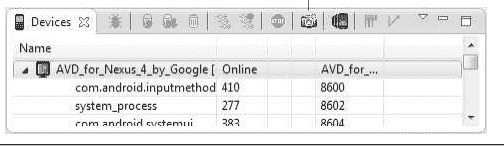

**图 9.3** | DDMS 视角下的 Devices 窗口。

4. 点击 Screen Capture 按钮显示设备屏幕截屏窗口（图 9.4）。

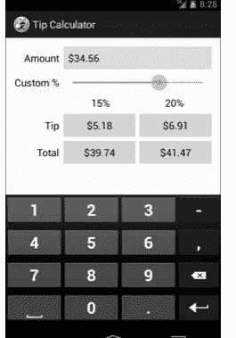

**图 9.4** | 设备屏幕截屏窗口，显示了第 3 章中计算计算器应用的截图。

5. 在确保屏幕显示的是您想要捕获的内容后，点击 Save 按钮保存图像。
6. 如果想在保存图像之前更改设备屏幕上的内容，请在设备上进行更改，然后点击 Device Screen Capture 窗口中的 Refresh 按钮重新捕获设备屏幕。

## 9.2.9 推广应用视频

当您将应用上传到 Google Play 时，您将可以选择包含一个 YouTube 短期推广视频的 URL。图 9.5 列出了几个示例。有些视频显示了一个手持设备并与应用交互的人。其他视频使用了屏幕截屏。图 9.6 列出了几种视频制作工具和服务（部分免费，部分付费）。

# 第 9 章 Google Play 与 App 业务问题

| 应用 | URL |
| --- | --- |
| Temple Run®: 奥兹之地 | http://www.youtube.com/watch?v=QM9STlydt0 |
| GT Racing: Motor Academy | http://www.youtube.com/watch?v=Z20POPICdgoa |
| Beach Guppy Blitz™ | http://www.youtube.com/watch?v=YgQczawSyw |
| Real Estate and Homes by Trulia® | http://www.youtube.com/watch?v=rLn697AsGs |
| Zappos.com® | http://www.youtube.com/watch?v=U-onYK9l1_Q |
| Megopolis International | http://www.youtube.com/watch?v=JrqEJj1xzCY |

**图 9.5** | Google Play 中应用推广视频示例。

| 工具和服务 | URL |
| --- | --- |
| Animoto | http://animoto.com |
| Apptain | http://www.apptamin.com |
| Microsoft Windows 电影制作器 | http://windows.microsoft.com/en-us/windows-live/movie-maker |
| CamStudio™ | http://camstudio.org |
| Jing | http://www.jing.com |
| Camasia® | http://www.techsmith.com |
| Camasia | http://www.techsmith.com |
| TurboDEMO | http://www.odem.com |

**图 9.6** | 工具和服务。

## 9.2.9 推广应用视频

当您将应用上传到 Google Play 时，您将可以选择包含一个 YouTube 短期推广视频的 URL。图 9.5 列出了几个示例。有些视频显示了一个手持设备并与应用交互的人。其他视频使用了屏幕截屏。图 9.6 列出了几种视频制作工具和服务（部分免费，部分付费）。

## 9.2 为发布准备您的应用 315

许多公司使用免费应用来建立品牌意识，并推动其他产品服务的销售（图 9.8）。

| 免费应用 | 功能 |
|---|---|
| Amazon® Mobile Bank of America | 在 Amazon 上浏览并购买物品。查找您附近的 ATM 和银行网点，检查余额并支付账单。 |
| Best Buy® CNN | 浏览并购买物品。获取最新新闻，接收突发新闻提醒并观看视频。 |
| Epicurious Recipe ESPN® ScoreCenter | 查看来自其他 Condé Nast 杂志的数千份食谱，包括《Gourmet》和《Bon Appetit》。设置个性化计分板跟踪您喜欢的大学和职业体育队。 |
| NFL Mobile | 获取最新的 NFL 更新和直播节目、NFL 回放等更多。 | 跟踪包裹、查找投递点、获取估估运费等。 |
| UPS® Mobile NYTimes Pocket Agent™ | 免费阅读《纽约时报》的文章。 | State Farm 保险的应用程序允许您联系代理人、提交理赔、找到当地维修中心、检查您的 State Farm 银行和共同基金账户等。 |
| Progressive® Insurance | 报告理赔并提交车祸现场照片，寻找当地代理人，在您购车时获取安全信息等。 |
| USA Today® Wells Fargo® Mobile | 阅读《今日美国》的文章并获取最新的体育比分。查找您附近的 ATM 和银行网点，检查余额，进行转账并支付账单。 |
| Women's Health Workouts Lite | 查看来自领先的女性杂志之一的众多锻炼课程。 |

**图 9.8** | 使用 Android 应用建立品牌意识的公司。

## 9.4 通过应用内广告实现应用变现

许多开发者提供通过**应用内广告**变现的免费应用——通常是类似于您在网站上使用的横幅广告。像 AdMob (http://www.admob.com/) 和 GoogleSense for Mobile (http://www.google.com/mobileads/publisher_home.html) 这样的移动广告网络会汇总广告商并向您的应用投放相关广告（见第 9.13 节）。您根据点击次数获得广告收入。前 100 个免费应用每天可能赚取数百到几千美元。对于大多数应用而言，应用内广告无法产生大量收入；如果您的目标是收回开发成本并产生利润，您应该考虑对应用收费。

## 9.5 应用变现：使用应用内付费销售虚拟商品

Google Play 的应用内付费服务（http://developer.android.com/google/play/billing/index.html）允许您在运行 Android 2.3 或更高版本的设备上通过应用销售虚拟商品（例如数字内容）（图 9.9）。根据 Google 的说法，使用应用内付费的应用获得的收入比仅付费应用高得多。在 Google Play 收入前 24 个应用中，有 23 个使用了应用内付费。该付费服务仅适用于通过 Google 购买的应用；可能无法用于通过第三方应用商店销售的应用。要使用应用内付费，您需要一个 Google Play 发行者帐户（见第 9.6 节）和一个 Google Wallet 商户账户（见第 9.7 节）。Google 将支付通过您的应用进行的所有应用内购买收入的 70%。

| 虚拟商品 | | | |
|---|---|---|
| 杂志电子订阅 | 本地化指南 | 头像 |
| 虚拟服装 | 额外游戏关卡 | 游戏场景 |
| 附加功能 | 铃声 | 图标 |
| 电子卡片 | 电子礼物 | 虚拟货币 |
| 壁纸 | 图片 | 虚拟宠物 |
| 音频 | 视频 | 电子书等。 |

**图 9.9** 虚拟商品。

销售商品产生的每用户收入可能比应用内广告更高。某些应用在销售虚拟商品方面特别成功，如《愤怒鸟》、《DragonVale》、《Zynga Poker》、《Beweled Blitz》、《纽约时报》和《Candy Crush Saga》。虚拟商品在手机游戏中特别受欢迎。

要实现应用内付费，请按照以下步骤操作：

http://developer.android.com/google/play/billing_integrate.html

有关应用内付费的更多信息（包括订阅、示例应用、安全最佳实践、测试等），请访问 http://developer.android.com/google/play/billing/billing_overview.html。您还可以参加“创建免费应用内产品”课程：

http://developer.android.com/training/in-app-billing/index.html

### 通过其他市场销售的应用的应用内购买

如果您选择通过其他市场销售您的应用（见第 9.11 节），第三方应用提供商可以确保您使用以下方式构建应用内购买：

## 9.6 在 Google Play 注册

要在 Google Play 上发布您的应用，您必须：

http://developer.android.com/google/play/

### Google Play 与业务问题

来自移动支付提供者的 API 允许您构建应用内付费（图 9.10）。

| 供应商 | URL | 说明 |
|---|---|---|
| PayPal | http://www.paypal.com/ | 用户点击 PayPal，然后支付。 |
| Amazon In-App | http://developer.amazon.com/ | 设备应用内购买。 |
| Samsung In-App Purchase | http://developer.samsung.com/ | 手机应用内购买。 |
| Boku | http://www.boku.com/ | 用户点击 Pay。 |

## 9.7 设置 Google 商户账户

要在 Google Play 上销售您的应用，您需要一个 Google Wallet 商户账户，该帐户已向 32 个国家的 Google Play 开发者开放（图 9.12）。Google Wallet 用于在线交易的支付服务。一旦您注册并登录 http://play.google.com/apps/publish/ Google Play，点击“财务报告”链接，然后设置商户账户。您需要：

- 提供 Google 可以联系到您的身份信息
- 提供用户可以联系您的客户支持信息
- 提供财务信息以便 Google 进行信用检查
- 同意《服务条款》，该条款描述了服务功能、允许的交易、禁止的行为、服务费等。

除了在参与的商店进行购买外，还可以使用它进行比销售应用更多的活动。

## 9.8 将您的应用上传到 Google Play

一旦您准备好文件并准备好上传应用，请查看“发布清单”（Launch Checklist）中的步骤，地址如下：

```
http://developer.android.com/distribute/googleplay/publish/preparing.html
```


然后，登录`play.google.com/apps/publish`（第 9.6 节）上的 Google Play，点击“在 Google Play 上发布 Android 应用”按钮开始上传过程。系统要求您上传以下资源：

1. 应用文件，包含您的代码文件、资产、资源和清单文件（manifest）。
2. 至少两张要在 Google Play 中的应用截图。您可以包含 Android 手机、7 英寸平板电脑和 10 英寸平板电脑的截图。
3. 包含 Google Play 中的高分辨率应用图标（512 x 512 像素）。
4. Google Play 宣传图片（可选），如果 Google 决定推广您的应用，可以使用该图片（例如，查看某些 Google Play 推荐应用的图片）。该图片必须为宽 180 像素、高 120 像素，格式为 24 位 PNG 或 JPEG，且无 Alpha 透明通道效果。它还必须是全幅（即图片延伸到屏幕边缘，无边框）。
5. 包含 Google Play 中的宣传视频（可选）。您可以提供应用宣传视频的 URL（例如，指向演示您的应用如何运行的 YouTube 视频链接）。

除了应用资源外，系统还要求您为 Google Play 提供以下额外的列表详情：

1. **语言。** 默认情况下，您的应用将以英语列出。如果您想以其他语言列出，请从提供的列表中进行选择（图 9.13）。

| 语言 |  |  |  |  |
|---|---|---|---|---|
| 非利哈加语 | 阿姆哈拉语 | 阿拉语 | 白俄罗斯语 | 加泰罗尼亚语 |
| 中文（简体或繁体） |  | 捷克语 | 丹麦语 |  |
| 荷兰语 | 英语（英国或美国） |  | 爱沙尼亚语 | 菲律宾语 |
| 芬兰语 | 法语 | 德语 | 希腊语 | 希伯来语 |
| 印地语 | 匈牙利语 | 印尼语 | 意大利语 | 日语 |
| 韩语 | 立陶宛语 | 马来语 | 挪威语 |  |
| 波斯语 | 波兰语 | 葡萄牙语（巴西或葡萄牙） | 罗马尼亚语 |  |
| 罗马 | 俄语 | 塞尔维亚语 | 斯洛伐克语 | 斯洛文尼亚语 |
| 西班牙语（拉丁美洲、西班牙或美国） |  | 斯瓦希里语 | 瑞典语 |  |
| 泰语 | 土耳其语 | 乌克兰语 | 越南语 | 祖鲁语 |

图 9.13 | Google Play 应用列表语言。

## 9.9 从应用内启动 Play Store

2. **标题。** 应用在 Google Play 中显示的标题（最多 30 个字符）。不需要在所有 Android 应用中唯一。

3. **描述。** 应用及其功能的描述（最多 4,000 个字符）。建议使用描述的最后部分说明为什么需要每个权限以及它是如何使用的。

4. **最近更改。** 您的应用最新版本中特定更改的概述（最多 500 个字符）。

5. **宣传文字。** 用于营销您的应用的宣传文字（最多 80 个字符）。

6. **应用类型。** 选择“应用”（Applications）或“游戏”（Games）。

7. **分类。** 选择最适合您的游戏或应用的分类（见图 1.8）。

8. **价格。** 默认设置为“免费”。要付费出售您的应用，您需要在 Google Wallet 上设置商家帐户。

9. **内容分级。** 您可以选择“高龄”、“中龄”、“低龄”或“所有人”。更多信息请参阅`http://developer.google.com/android-developer/answer/188189`上的 Google Play 应用内容分级。

10. **位置。** 默认情况下，您的应用将在所有当前和未来的 Google 国家显示。如果您不希望应用在所有这些国家可用，可以选择您希望列出应用的特定国家。

11. **网站。** Google Play 应用列表中将包含一个“访问开发者网站”链接。提供指向该页面的直接链接，感兴趣下载您的应用的用户可以在那里找到更多信息，包括营销文案、功能列表、额外截图、说明等。

12. **电子邮件。** 您的电子邮件地址将包含在 Google Play 中，以便客户就问题、报告错误等联系您。

13. **电话号码。** 有时您的电话号码会包含在 Google Play 中。除非提供电话支持，否则建议留空此字段。您可能想在您的网站上提供客户电话。

为了增加应用的额外销售额，您可以从应用内启动 Play Store（Google Play）（通常通过包含一个按钮），这样用户就可以下载您发布的其他应用，或购买与之前下载的“在线”版本功能相关的应用。您还可以启动 Play Store，使用户下载最新更新。

启动方式有两种：首先，您可以针对具有特定开发者名称、包名或字符字符串的应用调出 Google Play 搜索结果。例如，如果您想鼓励用户下载您发布的其他应用，可以在应用中包含一个按钮，点击后将启动 Play Store 并搜索包含您的名称或公司名称的应用。第二种方案是跳转到 Play Store 中的详情页。要了解有关在应用内启动 Play Store 的信息，请访问`http://developer.android.com/distribute/`。

## 9.10 在 Google Play 中管理您的应用

Google Play Console 允许您管理帐户、应用、评分、回复评论、跟踪安装情况等。默认情况下，您的应用将在所有当前和未来的 Google 国家显示。

## 9.11 其他 Android 市场

除了 Google Play，您还可以通过其他市场提供应用（图 9.14）。

`http://developer.android.com/distribute/googleplay/publish/preparing.html`


| 市场 | URL |
|---|---|
| Amazonstore | `http://www.amazon.com` |
| Opera Mobile | `http://www.opera.com` |
| Moborobo | `http://www.mobobo.com` |
| Appism | `http://www.appism.com` |
| Samsung Apps | `http://www.samsung.com` |
| GetJar | `http://www.getjar.com` |
| SlideMe | `http://www.slidem.com` |
| Handando | `http://www.handando.com` |
| Mplayit | `http://www.mplay.com` |
| AndroidPIT | `http://www.androidpit.com` |

图 9.14 | 其他市场。

## 9.12 其他热门平台

根据 ABI Research 的数据，2013 年下载了 560 亿智能手机应用和 140 亿平板应用。通过将 Android 应用移植到其他平台（图 9.15），您可以触及更大的群体。

| 平台 | URL | 全球下载份额 |
|---|---|---|
| Android | `http://developer.android.com` | 58% 智能手机应用 17% 平板应用 |
| iOS (Apple) | `http://developer.apple.com` | 33% 智能手机应用 75% 平板应用 |
| Windows Phone 8 | `http://developer.windows.com` | 4% 智能手机应用 2% 平板应用 |
| BlackBerry (RIM) | `http://developer.blackberry.com` | 3% 智能手机应用 |
| Amazon Kindle | `http://developer.amazon.com` | 4% 平板应用 |

图 9.15 | 热门平台。

## 9.13 营销您的应用

应用发布后，您将希望向受众进行营销。通过 Facebook、Twitter、Google+ 和 YouTube 等社交网站进行病毒式营销有助于您将信息传出去。根据皮尤研究中心的一项研究，互联网上 72% 的人使用社交网络——其中 Facebook 用户占比高达 67%。图 9.16 列出了一些流行的社交媒体网站。因此，电子邮件和电子公告仍然有效且通常低廉的营销工具。

| 名称 | URL | 描述 |
|---|---|---|
| Facebook | `http://www.facebook.com` | 社交网络 |
| Twitter | `http://www.twitter.com` | 微博客、社交网络 |
| Google+ | `http://plus.google.com` | 社交网络 |
| Groupon | `http://www.groupon.com` | 每日交易 |

图 9.16 | 流行的社交媒体网站。（第 1/2 部分）。

## 326 第 9 章 Google Play 与应用业务问题

| 名称 | URL | 描述 |
|---|---|---|
| Foursquare | `http://www.foursquare.com` | 签到 |
| Pinterest | `http://www.pinterest.com` | 在线贴板 |
| YouTube | `http://www.youtube.com` | 视频分享 |
| LinkedIn | `http://www.linkedin.com` | 商务社交网络 |
| Flickr | `http://www.flickr.com` | 照片共享 |

**图 9.16** | 热门社交媒体网站。（部分 2/2）

## Facebook

Facebook 是领先的社交网络网站，拥有超过十亿活跃用户¹³ 和超过 1500 亿人友关系¹¹⁴。它是病毒式营销的绝佳资源。首先为你的应用或业务建立一个官方 Facebook 页面。利用该页面发布应用信息、新闻、更新、评论、提示、视频、截图、游戏高分、用户反馈，并引导用户前往 Google Play，用户可以在那里下载你的应用。例如，我们在 Facebook 页面（`http://www.facebook.com/detailFan`）上发布关于 Detail 的新闻和更新。

接下来，你需要扩大口碑。鼓励你的同事和朋友“点赞”你的 Facebook 页面并要求他们这样做。当人们与你的页面互动时，故事将出现在他们的朋友动态中，在不断增长的受众中建立认知。

## Twitter

Twitter 是一个微博类社交网络网站，拥有超过 5.54 亿注册用户¹⁵。你发布推文——长度为 140 个字符的消息。Twitter 将你的推文发送给所有粉丝（写作时，一位著名的流行明星拥有超过 4000 万粉丝）。很多人使用 Twitter 来跟踪新闻和趋势。发布关于应用的动态——包括新发布公告、提示、事实、评论等。使用标签（`#`）来引用你的应用。例如，在我们的 `@detail` Twitter 推文中关于《Android How to Program, 2le》，我们使用了标签 `#AndroidHT2`。其他人也可以使用这个标签来写关于该书的评论。这让你能够轻松搜索与该书籍相关的推文。

## 病毒式视频

病毒式视频——通过视频网站（如 YouTube、Bing Videos、Yahoo!）、在社交网络网站（如 Facebook、Twitter 和 Google+）上、通过电子邮件等分享——是传播应用口碑的另一种极方法。如果你创建了一个引人入胜的视频，也许是幽默甚至惊人的视频，它可能会迅速流行，并可能被多个社交网络的用户标记。

¹³ `http://investor.fb.com/releasedetail.cfm?ReleaseID=761090`。  
¹⁴ `http://expandedrabbitmq.com/index.php/by-the-numbers-17-amazing-facebook-stats`。  
¹⁵ `http://www.statisticbrain.com/twitter-statistics/`

## 9.13 营销你的应用

### 电子邮件新闻通讯

如果你有电子邮件通讯，请用它来推广你的应用。包含指向 Google Play 的链接，用户可以在那里下载应用。还要包含指向你社交页面的链接，用户可以在那里获取你应用的最新新闻。

### 应用评论

联系影响力博主和应用评论网站（图 9.17）并告诉他们你的应用。为他们提供促销码以免费下载你的应用（见第 9.3 节）。有影响力的博主和评论者收到大量请求，请保持你的内容信息丰富，避免过多的营销炒作。许多应用评论者会在 YouTube 和其他网站上发布视频评论（图 18）。

| Android 应用评论网站 | URL |
|---|---|
| Android Tapp™ | `http://www.androidtapp.com` |
| Appolicious™ | `http://www.androidapps.com` |
| AppBrain | `http://www.appbrain.com` |
| AndroidZoom | `http://www.androidzoom.com` |
| Appstor | `http://android.appstor.net` |
| Best Android Apps Review | `http://www.bestandroidreviews.com` |
| Android App Review Source | `http://www.androidappreviewsource.com` |
| Andrinica | `http://www.androidrinica.com` |
| AndroidLib | `http://www.androidlib.com` |
| Android and Me | `http://www.androidandme.com` |
| AndroidGuys | `http://www.androidguys.com/category/reviews` |
| Android Police | `http://www.androidpolice.com` |
| AndroidPIT | `http://www.androidpit.com` |
| Phandroid | `http://www.phandroid.com` |

**图 9.17** | 应用评论网站。

| 应用评论视频网站 | URL |
|---|---|
| Daily App Show | `http://dailyappshow.com` |
| Crazy Mikes Apps | `http://crazymikesapps.com` |
| Appolicious™ | `http://www.appvee.com/?device_filter=android` |
| Life of Android™ | `http://www.1lifeofandroid.com/video/` |
| Android Video Review | `http://www.androidvideoreview.net/` |

**图 9.18** | 应用评论视频网站。

### 互联网公共关系

公关行业利用媒体渠道帮助公司将其信息传递给消费者。随着 Web 2.0 现象的出现，公关从业人员将博客、推文、播客、RSS Feed 和社交媒体整合到他们的公关活动中。

图 9.19 列出了一些免费和付费的互联网公共关系资源，包括新闻稿。

| 互联网公共关系 | URL | 描述 |
|---|---|---|
| ClickPress | `http://clickpress.com` | 免费和付费 |
| PRWeb | `http://prweb.com` | 免费和付费 |
| i-Newswire | `http://inewsewire.com` | 免费和付费 |
| openPR | `http://openpr.com` | 免费和付费 |
| MarketWire | `http://marketwire.com` | 免费和付费 |
| Mobility PR | `http://mobilitypr.com` | 免费和付费 |
| Press Writing | `http://presswriting.com` | 免费和付费 |

**图 9.19** | 互联网公共关系资源。

### 移动广告

移动广告（图 9.20）专注于 Android。这些中的许多也适用于 Android、iOS 等更多平台。

| 移动广告网络 | URL |
|---|---|
| AdMob (by Google) | `http://www.admob.com` |
| Medialets | `http://www.medialets.com` |
| Tapjoy® | `http://www.tapjoy.com` |
| Nexage™ | `http://www.nexage.com` |
| Jumptap® | `http://www.jumptap.com` |
| Smaato® | `http://www.smaato.com` |
| mMedia™ | `http://www.mmedia.com` |
| InMobi™ | `http://www.innobi.com` |
| Flurry™ | `http://www.flurry.com` |

**图 9.20** | 移动广告。

# 330 第 9 章 Google Play 与 App 业务问题

更正请发送至 `deitel@deitel.com`。访问我们不断更新的 Android 相关资源中心：`http://www.deitel.com/ResourceCenters.html`。获取最新新闻、Deitel 出版物和企业培训的动态，请订阅每周一次的 Deitel® Buzz 电子邮件：`http://www.deitel.com/newsletter/subscribe.html` 并关注我们：

- Facebook—`http://www.facebook.com/DeitelFan`
- Twitter—`@deitel`
- Google+—`http://google.com/+DeitelFan`
- YouTube—`http://youtube.com/DeitelTV`
- LinkedIn—`http://linkedin.com/company/deitel-&-answers`

# 自测练习题

## 9.1 填空每个陈述中的空白

a) 要在 Google Play 上销售你的 App，你需要一个商户账户。  
b) 在将 App 上传到设备、Google Play 或或其他市场之前，你必须使用能够识别你为 App 作者的____）对 `.apk` 文件（应用包文件）进行数字签名。  
c) Google Play（____）允许你管理账户和 App，检查用户对你 App 的星级评分（0 到 5 星），跟踪每个 App 的总数和安装次数（安装数减去卸载数）。

## 9.2 判断以下每个陈述的对错。如果错误，请解释原因

a) 当 App 在你电脑的模拟器上运行完美时，它会在你的 Android 设备上运行。  
b) 你可能使用许可策略来限制检查服务器的频率、允许同时安装的设备数量，以及当发现未授权 App 时会发生什么。  
c) 你的 App 在 Google Play 中显示的标题在 Android App 中必须是唯一的。  
d) 根据应用商店分析机构 Distimo (`www.distimo.com/`) 的研究，付费 Android 游戏的平均价格约为 36.20 美元。  
e) 根据 Google 的说法，使用应用内购买的 App 比单独付费的 App 更多。  
f) 如果你选择通过其他市场销售 App，第三方支付提供商可以使用移动提供提供的 API 在你的 App 中构建应用内购买。

# 自测练习题答案

## 9.1

a) Google Wallet（谷歌钱包）。  
b) 数字证书。  
c) Developer Console（开发者控制台）。

## 9.2

a) 错误。虽然 App 在你电脑的模拟器上运行完美，但在特定的 Android 设备上运行时可能会出现问题。  
b) 正确。  
c) 错误。你的 App 在 Google Play 中显示的标题不需要在 Android App 中唯一。  
d) 错误。根据该研究，游戏应用的平均价格约为 3.27 美元（中位数约为 2.72 美元）。  
e) 正确。  
f) 正确。

# 练习题

## 9.3 填空每个陈述中的空白

a) \_\_\_\_\_\_\_\_\_\_\_\_\_ 是用户主屏幕上及时信息的显示，例如当前天气、股票价格和新闻。  
b) \_\_\_\_\_\_\_\_\_\_\_\_\_ 是你通过该协议向用户许可软件的协议。它通常规定了使用条款、重新和反向工程的限制、产品责任、对适用法律的遵守情况等。  
c) 与 Eclipse ADT 插件一起安装的 \____ 帮助你调试运行在实际设备上的 App。  
d) 根据 AdMob 最近的一项研究，\____ 是用户购买付费 App 的主要原因。  
e) Google Play \____ 允许你限制允许同时安装的设备数量。

## 9.4 判断以下每个陈述的对错。如果错误，请解释原因

a) 你应该“混淆”上传到 Google Play 的任何 App，以鼓励对代码的反向工程。  
b) Google Play 上的付费 App 比免费 App 多，并且占据了下载量的大部分。  
c) 你的 App 版本名称会显示给用户，版本代码是 Google Play 内部使用的整数版本号。  
d) Eclipse 会自动为你发布到 Google Play 的 App 进行数字签名。  
e) Google 会为你的 App 分配内容分。

# Java 应用简介

## 目标

在本附中，你将学习：

- 编写简单的 Java 应用。
- 使用输入输出语句。
- Java 的基本类型。
- 基础内存概念。
- 使用算术运算符。
- 算术运算符的优先级。
- 编写决策语句。
- 使用关系运算符和相等运算符。

## A.1 简介

- A.1 简介
- A.2 你的第一个 Java 程序：打印一行文本
- A.3 修改你的第一个 Java 程序
- A.4 使用 `printf` 显示文本
- A.5 另一个应用：整数相加
- A.6 内存概念
- A.7 算术
- A.8 决策：相等和关系运算符
- A.9 总结
- 自测练习题
- 自测练习题答案

## A.1 简介

本附介绍了 Java 编程。你将使用工具从流行的 Eclipse 环境（IDE）开始——它是 Android 开发中使用最广泛的环境。Java 使用 Java 虚拟机（JVM）来运行程序。

## A.2 你的第一个 Java 程序：打印一行文本

Java 是一个显示输出的简单应用。第 1 行显示“Welcome to Java!”。考虑以下代码：

```java
public class Welcomed {
    public static void main(String[] args) {
        System.out.println("Welcome to Java!");
    }
}
```

插入注释来说明程序并提高其可读性。Java 使用 `//` 进行行注释——它在行尾结束。第 2 行是描述程序目的的注释。

```java
// 这是一个注释
```

Java 还有传统注释，它们可以跨行。这些注释由界符 `/*` 和 `*/` 开始并结束。编译器忽略界符之间的所有文本。

```java
/*这是一个传统注释。它可以跨行 */
```


当编译器遇到违反规则（即语法）的代码时，就会发生语法错误。语法错误也被称为编译错误，因为编译器在编译阶段检测它们。编译器通过发布错误信息并阻止程序编译。

## 使用空行

第 3 行是一个空行。空行、空格字符和制表符使程序更易读。它们统称为空白（whitespace）。编译器忽略所有空格。

## 声明类

第 4 行开始声明类 `Welcome` 类。每个 Java 程序都至少由一个程序员定义的类组成。`class` 关键字引入类声明，后面紧跟类名 `Welcome`。关键字是 Java 留用的，并且始终用小写字母编写。可以查看完整的列表：

```http://bit.ly/JavaKeywords```

## 类名和标识符

按照习惯，类名以大写字母开头，并将其包含的每个单词的首字母大写（例如 `SampleClassName`）。类名是一个标识符——由字母、数字、下划线（`_`）和美元符号（`$`）组成的序列，不以数字开头且不包含空格。`7button` 不是一个有效的标识符，因为它以数字开头，`input field` 不是一个有效的标识符，因为它包含空格。Java 是大小写敏感的——大写和小写字母是有区别的——所以 `value` 和 `Value` 是不同的标识符。

在附录 A–E 中，我们定义的每个类都带有 `public` 关键字。对于我们的应用，文件名是 `Welcome.java`。

## 常见编程错误 A.2

`public` 类必须放在与类名相同（包括大小写）并加上 `.java` 扩展名的文件中；否则会发生编译错误。例如，`public class Welcome` 必须放在名为 `Welcome.java` 的文件中。

## A.2 你的第一个 Java 程序：打印一行文本

### 良好的编程实践 A.I


将每个类声明的整个主体在左大括号和界定类体的右大括号之间缩进一个“级别”。我们建议使用三个空格来形成一个缩进级别。这种格式强调了类声明的结构，并使其更容易阅读。

### 方法的声明

第 6 行是一个行尾注释，说明了程序第 7–10 行的作用。第 7 行是 Java 应用程序的起点。标识符 `main` 后面的括号表示它是一个称为方法的程序构建块。对于 Java 应用程序来说，其中一个方法必须是 `main` 并且如第 7 行所示进行定义。方法执行任务并在完成任务时返回信息。关键字 `void` 表示此方法将不返回任何信息。在第 7 行中，方法 `main` 中的 `String[] args` 是 `main` 方法声明的必要部分——我们将在附录 E 中讨论这一点。

第 8 行的左大括号开始方法声明的主体。相应的右大括号必须缩进（即第 10 行）。

### 使用 System.out.println 执行输出

第 9 行指示计算机执行一个动作——即打印双引号之间的字符字符串（但不包括引号本身）。字符串有时被称为字符字符串或字符串字面量。字符串中的空白字符不会被编译器忽略。字符串不能跨越多行代码。

`System.out` 对象被称为标准输出对象。它允许 Java 应用程序在执行它的命令窗口中显示信息。在较新版本的 Windows 中，命令窗口是“命令提示符”（Command Prompt）。在 UNIX/Linux/Mac OS X 中，命令窗口被称为终端（terminal）或 shell（shell）。许多程序员称其为命令行（command line）。

`System.out.println` 在命令窗口中显示（或打印）一行文本。第 9 行括号中的字符串是方法的参数。当 `System.out.println` 完成其任务时，它会将光标（下一个字符将显示的位置）置在命令窗口中下一行的开头。

整个第 9 行，包括 `System.out.println`、括号中的参数 `"Welcome to Java Programming!"` 以及分号（`;`），被称为一条语句。大多数语句以分号结束。当第 9 行的语句执行时，它会显示 `Java Programming!`。

### 在右大括号上使用行尾注释以提高可读性

我们在结束方法声明的右大括号之后以及结束类声明的右大括号之后包含行尾注释。例如，第 10 行表示方法 `main` 的结束大括号，第 11 行表示类 `Welcome` 的结束大括号。

### 编译并运行你的第一个 Java 应用程序

我们假设你正在使用 Java 开发包（JDK）——命令行工具而不是 IDE。我们在 `www.deitel.com/ResourceCenters.html` 上的 Java 资源中心提供了教程链接，帮助你开始使用流行的 Java 开发工具，包括 NetBeans™、Eclipse 等。我们还在 `www.deitel.com/AndroidHTP2/` 发布了 Eclipse 视频，帮助你开始使用这个流行的 IDE。

为了准备编译程序，请打开命令窗口并切换到存储程序的目录。在 Windows 上，许多系统使用 `cd` 来切换目录。在 Windows 上，通过：

```
cd c:\examples\app\fig_01
```

切换到 `fig_01` 目录。在 UNIX/Linux/Mac OS X 上，通过命令

```
cd ~examples/app/fig_01
```

切换。要编译程序，输入

```
javac Welcome1.java
```

如果程序没有语法错误，此命令将创建一个名为 `Welcome1.class` 的新文件（称为 `welcome1` 的类文件），其中包含代表我们应用程序的平台无关 Java 字节码。当我们使用 `java` 命令在给定平台上执行应用程序时，JVM 将将这些字节码转换为底层操作系统和硬件可以理解的指令。

### 错误预防提示 A.1

> 在尝试编译程序时，如果你收到类似“bad command or filename，”`javac` 不被识别为内部或外部命令、可运行程序或批处理文件”的消息，说明你的 Java 软件安装未正确完成。如果你正在使用 JDK，这表示你的 `PATH` 环境变量未设置正确。请仔细阅读此书中“开始之前”部分的指示说明。在某些系统上，在修正 `PATH` 后，你可能需要重启计算机或打开新的命令窗口使这些设置生效。


图 A.2 显示了在 Microsoft® Windows® 7 命令提示符中执行图 A.1 程序。要执行程序，输入 `java Welcome1`。此命令启动 JVM，它加载 `welcome1` 的 `.class` 文件。命令输出 `.class` 文件扩展名；否则 JVM 将不会执行程序。JVM 下一步调用 `main`。`main` 方法第 9 行的语句显示 `"welcome to Java Programming!"`。

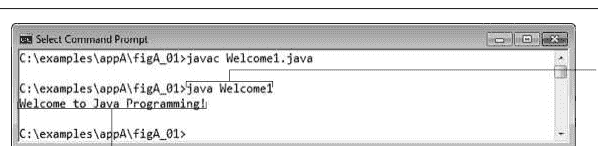

程序输出到屏幕：

```
Welcome to Java Programming!
```

图 A.2 从命令提示符执行 `welcome1`。

## A.3 修改你的 Java 程序

### 错误预防提示 A.2

在尝试运行 java 程序时，如果你收到类似“Exception in thread "main": java.lang.ClassNotFoundError: Welcome1，”的消息，说明 `CLASSPATH` 环境变量未设置正确。请仔细阅读书中“开始之前”的内容。在某些系统上，在配置 `CLASSPATH` 后你可能需要重启计算机或打开新的命令窗口。

### 修改你的 Java 程序

`Welcome to Java Programming!` 可以通过多种方式显示。图 A.3 所示的类 `Welcome2` 使用两个语句（9–10 行）产生图 A.1 所示的输出。

```java
// Fig. A.3: Welcome2.java
// 使用多个语句打印一行文本。
public class Welcome2
{
    // main 方法开始 Java 应用程序的执行
    public static void main(String[] args)
{
        System.out.print("Welcome to ");
        System.out.println(" Java Programming!");
    } // end method main
} // end class Welcome2
```

```
Welcome to Java Programming!
```

图 A.3 | 使用多个语句打印一行文本。

程序与图 A.1 类似，因此我们在这里只讨论变化。第 2 行是说明程序目的的注释。第 4 行开始 `Welcome2` 类声明。`main` 方法的第 9–10 行显示一行文本。第一条语句使用 `System.out` 方法`print` 显示其参数。每个 `print` 或 `println` 语句都会从上一个 `print` 或 `println` 停止显示字符的地方继续。与 `println` 不同，`print` 在显示其参数后，它不会将光标置于命令窗口下一行的开头——程序显示的字符将紧接着上一个显示的字符之后出现。第 10 行将其参数中的第一个字符（"J"）置于第 9 行显示的最后一个字符（双引号字符）之后。

### 使用单个语句显示多行文本

单个语句可以使用换行符显示多行，换行符指示 `System.out.print` 和 `println` 方法何时将光标置在命令窗口下一行的开头。类似于空行、空格字符和制表符字符，换行符也是空白字符。图 A.4 中的程序使用换行符来决定何时开始新行。

### Java 应用程序简介

```java
// Fig. A.4: Welcome3.java
// 使用单个语句打印多行文本。
public class Welcome3
{
    // main 开始 Java 应用程序的执行
    public static void main(String[] args) {
        System.out.println("Welcome\nto\nJava\nProgramming!");
    } // end method
} // end class Welcome3
```

```
Welcome

to

Java

Programming!
```

图 A.4 使用单个语句打印多行文本。

第 2 行是说明程序目的的注释。第 4 行开始 `Welcome3` 类声明。第 9 行在命令窗口中显示四行文本。通常情况下，字符串中的字符按照它们在双引号中出现的顺序显示。然而，语句中的成对字符 `\` 和 `"`（重复三次）不会显示在屏幕上。反斜杠（`\`）是转义字符，对 `System.out` 的打印方法有特殊含义。

| 转义序列 | 说明 |
| :--- | :--- |
| `\n` | 换行符。将光标置在下一行的开头。 |
| `\t` | 水平制表符。将屏幕光标移动到下一个制表位。 |
| `\r` | 回车。将屏幕光标置在当前行的开头——不进到下一行。回车之后输出的任何字符将覆盖该行之前之前显示的字符。 |
| `\\` | 反斜杠。用于打印反斜杠字符。 |
| `\"` | 双引号。用于打印双引号字符。例如，`System.out.println("\in quotes""");` 显示 `in "quotes"`。 |

图 A.5 一些常见的转义序列。

## A.4 使用 printf 显示文本

### System.out.printf 方法

`System.out.printf` 方法用于显示格式化数据。图 A.6 使用该方法输出字符串 "Welcome to" 和 "Java Programming!"。第 9–10 行调用 `System.out.printf` 方法显示程序的输出。该方法调用指定了三个参数——以逗号分隔的列表形式排列。

```java
1 // 图 A.6: Welcome4
2 // 使用 System.out.printf 方法显示多行。
3
4 public class Welcome4
5 {
6 // main 方法开始 Java 程序的执行
7 public static void main(String[] args)
8 {
9 System.out.printf("%s\n%s\n",
10 "Welcome to", "Java Programming!");
11 } // main 方法结束
12 } // Welcome4 类结束
```

```
Welcome to
Java Programming!
```

| 图 | 说明 |
|---|---|
| 第 9–10 行代表一条语句。Java 允许将大型语句分成多行。我们对第 10 行进行缩进，以表示它是第 9 行的延续。 |

`printf()` 方法的第一个参数是格式字符串，它可能由固定文本和格式指定符组成。固定文本由 `printf` 输出的方式与 `printf` 或 `println` 直接输出相同。每个格式指定符都是值的占位符，并指定了要输出的数据类型。格式指定符还可以包含可选的格式化信息。

格式指定符以百分号（`%`）开头，后跟一个表示数据类型的字符。例如，格式指定符 `%s` 是字符串的占位符。第 9 行中的字符串指定 `printf` 输出两个字符串，每个字符串后面都跟着一个换行符。在第一个格式指定符的位置，`printf` 替换为格式字符串中第一个参数的值。在随后的每个格式指定符位置，`printf` 替换为下一个参数的值。此示例将第一个 `%s` 替换为 "Welcome to"，将第二个 `%s` 替换为 "Java Programming!"。输出显示了两个行的文本。

## A.5 另一个应用：整数相加

我们的下一个应用程序通过键盘从用户读取（或输入）两个整数（例如 `22`、`7`、`0` 和 `1024`），计算它们的和并显示出来。程序存储计算机内存中的数字和其他数据，并通过称为变量的程序元素访问数据。图 A.7 的程序演示了这些概念。在示例输出中，我们使用**粗体文本**来识别用户的输入（即 `45` 和 `72`）。

## 附录 A Java 应用简介

```java
// 图 A.7: Addition.java
// 显示两个数字之和的加程序。
import java.util.Scanner; // 程序使用 Scanner 类
public class Addition {
    // main 方法开始 Java 程序的执行
    public static void main(String[] args ) {
        // 创建一个 Scanner 从命令行窗口获取输入
        Scanner input = new Scanner(System.in);

        int number1; // 第一个相加数字
        int number2; // 第二个相加数字
        int sum = number1 + number2;

        System.out.print("Enter first integer: "); // 提示
        number1 = input.nextInt(); // 从用户处读取第一个数字
        System.out.print("Enter second integer: "); // 提示
        number2 = input.nextInt(); // 从用户处读取第二个数字

        System.out.printf("Sum is %d\n", sum); // 显示和
    } // 方法结束
}// Addition 类结束
```

```
Enter first integer: 45

Enter second integer: 72

Sum is 117
```

| 图 | 说明 |
|---|---|
| **图 A.7** | 显示两个数字之和的加程序。 |

**导入声明（Import Declarations）**

第 1-2 行说明了文件名和程序的目的。Java 的一个强大特性是它拥有丰富的预定义类集合，我们重用这些类而不是“重复发明轮”。这些类被分组在包（packages）中——即相关类的命名组——并统称为 Java 类库，或应用程序编程接口（Java API）。第 3 行是一个导入声明，帮助编译器定位此程序中使用到的类。它指示此示例使用了来自 `java.util` 包的 Java `Scanner` 类（稍后将进行讨论）。

**声明类 Addition**

第 5 行开始声明 `Addition` 类。此公共类（public class）的文件名必须是 `Addition`。请记住，每个类声明的体以左大括号（第 6 行）开始，并以右大括号（第 27 行）结束。

应用程序从 `main` 方法（第 8–26 行）开始执行，`main` 方法体以及相应的右大括号（第 26 行）标记其结束。`main` 方法在 `Addition` 类体中缩进一级，`main` 方法体内的代码再进一级以提高可读性。

## 声明并创建 Scanner 从键盘获取用户输入

变量是计算机内存中的一个位置，可以在其中存储一个值供程序以后使用。所有 Java 变量在使用之前必须用名称和类型进行声明。变量名允许程序访问内存中变量的值。变量名可以是任何有效标识符。变量类型指定了存储在该位置的什么类型的信息。与其他语句一样，声明语句以分号（`;`）结束。

第 11 行是此程序使用的变量声明语句。`Scanner` 允许程序从用户处读取数据。标准输入 `System.in` 读取用户输入的信息。等号用于初始化 `Scanner`（`new Scanner(System.in)`）。

**声明变量存储整数**

变量声明语句在第 13 行使用。`Scanner` 允许程序从用户处读取数据。标准输入 `System.in` 读取用户输入的信息。等号用于初始化 `Scanner`（`new Scanner(System.in)`）。

**声明变量存储整数**

变量声明语句在第 13 行使用。`Scanner` 允许程序从用户处读取数据。标准输入 `System.in` 读取用户输入的信息。等号用于初始化 `Scanner`（`new Scanner(System.in)`）。

**声明变量存储整数**


变量声明语句在第 13 行使用。`Scanner` 允许程序从用户处读取数据。标准输入 `System.in` 读取用户输入的信息。等号用于初始化 `Scanner`（`new Scanner(System.in)`）。

### 声明变量存储整数

第 11 行是变量声明语句（`int number1`）。`input = new Scanner(System.in)` 初始化了 `Scanner`。第 13 行 `sum = number1 + number2` 是赋值语句。

### 使用变量进行计算

第 25 行 `System.out.printf("Sum is %d\n", sum);` 显示结果。

### 显示计算结果

第 25 行显示了和。

### 输入第二个整数

第 21 行 `number2 = input.nextInt();` 读取了第二个整数。

## A.6 内存概念

对于我们使用的每个新 Java API 类，我们指示它所在的包。这些信息可以帮助你在 Java API 文档中找到每个包和类的描述。该文档的网页版可以在此处找到：

```
docs.oracle.com/javase/6/docs/api/
```

你可以从下处下载：

```
www.oracle.com/technwork/java/javase/downloads/index.html
```

变量名（如 `number1`、`number2` 和 `sum`）实际上对应计算机内存中的位置。每个变量都有一个名称、一个类型、大小（字节）和一个值。在图 7 的加法程序中，当执行以下语句（第 18 行）时：

```
number1 = input.nextInt(); // 从用户处读取第一个数字
```

用户输入的数字被放置在与 `number1` 对应的内存位置。假设用户输入了 45。计算机将整数值放入 `number1`（图 A.8），替换该位置之前的值（如果有的话）。之前的值为：

| number1 | 45 |
| :--- | :--- |

图 A.8 | 显示变量 `number1` 名称和值的内存位置。

当执行语句（第 21 行）时：

```
number2 = input.nextInt(); // 从用户处读取第二个个数字
```

假设用户输入了 72。计算机将整数值放入位置 `number2`。内存现在看起来如图 A.9 所示。

| number1 | 45 |
| number2 | 72 |

图 A.9 | 存储 `number1` 和 `number2` 值后的内存位置。

在图 A.7 的程序获取了 `number1` 和 `number2` 的值后，它将这些值相加并将总和存入变量 `sum`。语句（第 23 行）：

```
sum = number1 + number2; // 相加数字，然后将总和存储在 sum 中
```

执行加法，然后替换 `sum` 中之前的任何值。在计算出 `sum` 后，内存如图 A.10 所示。`number1` 和 `number2` 包含了计算 `sum` 时使用的值。在执行计算时，这些值被使用了但没有被破坏。当从内存位置读取值时，该过程是非破坏性的。

| number1 | 45 |
| number2 | 72 |
| sum | 117 |

图 A.10 | 存储 `number1` 和 `number2` 之和后的内存位置。

## A.7 算术

大多数程序都会执行算术计算。算术运算符总结在图 A.11 中。注意使用了代数中未使用的各种特殊符号。星号 (`*`) 表示乘法，百分号 (`%`) 是取余运算符，我们稍后会讨论。图 A.11 中的算术运算符是二运算符，因为每个运算符都作用于两个操作数。例如，表达式 `f + 7` 包含二运算符 `+` 和两个操作数 `f` 和 `7`。

| Java 操作 | 运算符 | 代数表达式 | Java 表达式 |
| :--- | :--- | :--- | :--- |
| 加法 | `+` | `f + 7` | `f + 7` |
| 减法 | `-` | `p - c` | `p - c` |
| 乘法 | `*` | `bm` | `b * m` |
| 除法 | `/` | `xly/y` 或 `x÷y` | `x / y` |
| 取余 | `%` | `r mod s` | `r % s` |

图 A.11 | 算术运算符。

整数除法产生一个整数商。例如，表达式 `7 / 4` 结果为 `1`，表达式 `17 / 5` 结果为 `3`。整数除法中的任何分数部分都会丢弃（即截断）——产生产生数。Java 提供了取余运算符，`x % y` 表示 `x` 除以 `y` 后的余数。因此，`7 % 4` 产生 `3`，`17 % 5` 产生 `2`。该运算符最用于整数操作数，但也用于算术类型。

### 直线形式的算术表达式

Java 中的算术表达式必须以直线形式编写，以便将程序输入计算机。因此，诸如“除以 b”的表达式必须写成 `a / b`，以便所有常量、变量和运算符都出现在同一行。以下代数表示法通常不被编译器接受：

```
a
b
```

### 用于分组的括号

括号在 Java 表达式中的分组方式与代数相同。例如，为了对数量 `a + b` 进行分组，我们写道：

```
(a + b)
```

### 优先级规则

下表显示了 Java 应用运算符的顺序。表中的圈数字表示运算符优先级的顺序。

| 运算符(s) | 操作(s) | 求值顺序 |
| :--- | :--- | :--- |
| `*` | 乘法 | 1 |
| `/` | 除法 | 1 |
| `%` | 取余 | 1 |
| `+` | 加法 | 2 |
| `-` | 减法 | 2 |
| `=` | 赋值 | 3 |

## A.8 决策：相等运算符与关系运算符

步骤 1. `y = 2 * 5 * 5 + 3 * 5 + 7;` (最左侧乘法)

`2 * 5` 是 10

步骤 2. `y = 10 * 5 + 3 * 5 + 7;` (最左侧乘法)

`10 * 5` 是 50

步骤 3. `y = 50 + 3 * 5 + 7;` (加法之前的乘法)

`3 * 5` 是 15

步骤 4. `y = 50 + 15 + 7;` (最左侧加法)

`50 + 15` 是 65

步骤 5. `y = 65 + 7;` (最后的加法)

`65 + 7` 是 72

步骤 6. `y = 72` (最后一次操作——将 72 放入 `y`)

图 A.13 二次多项式的求值顺序。

条件是一个可以为真或为假的表达式。本节介绍了 Java 的 `if` 语句，它允许程序根据条件的值做出决策。例如，条件 `grade` 大于等于 60 决定了学生是否通过了测试。如果 `if` 中的条件为真，则执行 `if` 语句的体部分。如果条件为假，则不执行该体部分。我们很快会看到一个示例。

`if` 中的条件可以使用图 A.14 所示总结的相等运算符（`==` 和 `!=`）和关系运算符（`>`、`<`、`>=`、`<=`）组成。两个相等运算符具有相同的优先级，该优先级低于从左到右的关系运算符的优先级。所有关系运算符都具有相同的优先级，并且也从左到右结合。

| 标准代数相等或关系运算符 | Java 相等运算符或关系运算符 | 示例 Java 条件 | Java 条件的含义 |
|---|---|---|---|
| 相等运算符 `=` | `==` | `x == y` | `x` 等于 `y` |
| 不等运算符 `≠` | `!=` | `x != y` | `x` 不等于 `y` |

图 A.14 相等运算符与关系运算符。（2 部分中的第 1 部分。）

## 348 附录 A Java 应用简介

| 标准代数相等或关系运算符 | Java 相等运算符或关系运算符 | 示例 Java 条件 | Java 条件的含义 |
|---|---|---|---|
| 大于 `>` | `>` | `x > y` | `x` 大于 `y` |
| 小于 `<` | `<` | `x < y` | `x` 小于 `y` |
| 大于等于 `≥` | `>=` | `x >= y` | `x` 大于等于 `y` |
| 小于等于 `≤` | `<=` | `x <= y` | `x` 小于等于 `y` |

关系运算符

**图 A.14** 相等运算符与关系运算符。（2 部分中的第 2 部分。）

A.15 使用六个语句来比较由用户输入的两个整数。如果这些语句中任何一个的条件为真，则执行与该语句相关的语句；否则，跳过该语句。我们使用 `Scanner` 从用户处输入整数并存储在变量 `number1` 和 `number2` 中。程序比较数字并显示为真的比较结果。

```java
// Fig. A.15: Comparison.java
// 使用语句、关系运算符
// 和相等运算符比较整数。
import java.util.Scanner; // 程序使用 Scanner 类
public class Comparison {
    // main 方法开始执行 Java 应用程序
    public static void main(String[] args) {
        // 创建 Scanner 从命令行输入
        Scanner input = new Scanner(System.in);
        int number1; // 第一个比较的数字
        int number2; // 第二个比较的数字
        System.out.print("Enter first integer: "); // 提示
        number1 = input.nextInt(); // 从用户处读取第一个数字
        System.out.print("Enter second integer: "); // 提示
        number2 = input.nextInt(); // 从用户处读取第二个数字
        if (number1 == number2) {
            System.out.printf("%d = %d\n", number1, number2);
        }
        if (number1 != number2) {
            System.out.printf("%d != %d\n", number1, number2);
        }
    }
}
```

**图 A.15** 使用语句、关系运算符和相等运算符比较整数。（2 部分中的 I 部分。）

## A.8 决策：相等运算符与关系运算符 349

```java
    29 if ( number1 < number2 )
    30 System.out.printf("%d <\n", number1, number2);
    31
    
    33 if ( number1 > number2 )
    34 System.out.printf("%d >\n", number1, number2);
    35
    
    37 if ( number1 <= number2 )
    38 System.out.printf("%d <\n", number1, number2);
    39 if ( number1 >= number2 )
    40 System.out.printf("%d >=\n", number1, number2);
    41 } // 方法结束
    42 } // 类 Comparison 结束
```

Enter first integer: 777

Enter second integer: 777

777 < 777

777 = 777

Enter first integer: 1000

Enter second integer: 2000

1000 != 2000

1000 < 2000

1000 <= 2000

Enter first integer: 2000

Enter second integer: 1000

2000 > 1000

2000 != 1000

2000 >= 1000

389

350 附录 A Java 应用简介

常见错误 A.3

混淆相等运算符 `==` 和赋值运算符 `=` 会导致逻辑错误或语法错误。相等运算符应读为“等于”，而赋值运算符读为“赋值”。例如：

```java
if (number1 == number2); // 逻辑错误
System.out.printf("%d == %d\n", number1, number2);
```

会被 Java 解释为：

```java
if (number1 == number2)
    // 空语句
System.out.printf("%d == %d\n", number1, number2);
```

其中该行本身的分号——空语句——是 `if` 语句条件为真时执行的语句。没有操作执行。程序继续执行输出语句，无论条件为真还是假，都会执行，因为输出语句不是 `if` 语句的一部分。

注意图 A.15 中空格的使用。记住编译器通常会忽略空格。因此语句可以拆分到多行，并根据你的偏好进行间隔，而不影响其含义。拆分标识符和字符串是不正确的。理想情况下，语句应该保持简短，但并非总是可能的。

图 A.16 显示了目前为止运算符按优先级递减的顺序。所有的赋值运算符 `=` 都从左到右结合。赋值运算符 `=` 在像 `x = y = 0` 的表达式中，执行方式类似于 `x = (y = 0)`，首先将值 0 赋值给 `y`，然后将该赋值的结果 0 赋值给 `x`。

| 运算符 | 结合性 | 类型 |
|---|---|---|
| `*` `/` `%` | 左到右 | 乘除 |
| `+` `-` | 左到右 | 加减 |
| `<` `<=` `>` `>=` | 左到右 | 关系 |
| `==` `!=` | 左到右 | 等等 |
| `=` | 右到左 | 赋值 |

**图 A.16** 讨论的运算符的优先级和结合性。

## A.9 总结

在本附录中，你学习了 Java 的许多重要功能，包括在*命令提示符*（Command Prompt）中显示数据、从键盘输入数据、进行计算和做出决策。所介绍的应用程序向你介绍了基础编程概念。正如你在附录 B 中看到的，Java 应用程序通常在 `main` 方法中只包含几行代码——这些语句通常创建执行应用程序任务的实例。在附录 B 中，你将学习如何实现自己的类并在应用程序中使用这些类的对象。

## 自测复习题

- A.1 填空每个语句中的空格：

    a) 每一个方法的体都从 ________ 开始，每一个方法的体体都以 ________ 结束。

    b) ________ 语句用于做出决策。

    c) ________ 是单行注释的开始符号。

    d) ________ 和 ________ 被称为空白符。

    e) ________ 是 Java 留用的。

    f) Java 应用程序从 ________ 开始执行。

    g) 方法 ________ 和 ________ 在命令行窗口中显示信息。

- A.2 判断以下每个陈述的正确与否。如果是错误的，请解释原因。

    a) 注释允许计算机在程序执行时在屏幕上打印 `//` 之后的给定类型。

    b) 所有变量在声明时必须赋值。

    c) Java 认为变量名和数字是相同的。

    d) 算术运算符 `*`、`/`、`+` 和 `-` 的优先级相同。

- A.3 编写语句完成以下操作：

    a) 声明一个变量 `IntVar q76354`，类型为 `int`。

    b) 提示用户输入一个整数。

    c) 输入一个整数并将结果赋值给整数变量。假设 `Scanner` 变量 `input` 可以从键盘值中读取。

    d) 在命令行窗口的一行中打印 "This is a Java program"。使用 `System.out.println`。

    e) 在命令行窗口分两行打印 "This is a Java program"。第一行以 Java 结尾。使用 `System.out.println`。

    f) 在命令行窗口分两行打印 "This is a Java program"。第一行以 Java 结尾。使用 `System.out.printf` 和两个 `%s` 格式化字符串。

    g) 如果变量 `number` 不等于 7，显示 "the variable number is not equal to 7"。

- A.4 识别并纠正每个语句中的错误：

    a) `if (c < 7 ) {` `System.out.println("c is less than 7");`

    b) `if (c => 7 ) {` `System.out.println("c is equal to or greater than 7");`

- A.5 编写完成以下操作的声明、语句或注释：

    a) 说明程序将计算三个整数的积。

    b) 创建一个名为 `input` 的 `Scanner`，从标准输入读取值。

    c) 声明变量 `x`、`y`、`z` 和 `result` 类型为 `int`。


d) 提示用户输入第一个整数。

e) 从用户处读取第一个整数并存储在变量`x`中。

f) 提示用户输入第二个整数。

g) 从用户处读取第二个整数并存储在变量`y`中。

h) 提示用户输入第三个整数。

i) 从用户处读取第三个整数并存储在变量`z`中。

j) 计算变量`x`、`y`和`z`中三个整数的积，并赋值给变量`result`。

k) 显示消息 `"Product is"` 后跟变量`result`的值。

## A.6 使用练习 A.5 中的语句，编写一个完整的程序来计算并输出三个整数的积。

## 自测复习题答案

- A.1 左括号 `(l)`, 右括号 `(r)`；b) `if`；c) 空格字符、换行符和制表符。关键字，f) `main`。`System.out.print`, `System.out.println` 和 `System.out.printf`。

- A.2 错误。注释在程序执行时不会导致任何操作。它们被用于记录程序并提高其可读性。b) 正确；错误。Java 是区分大小写的，所以变量是不同的。d) 错误。在 Java 中，取余运算符也可以用于非整数操作数。e) 错误。运算符`*`、`/`和`%`的优先级高于运算符`+`和`-`。

- A.3 `int c, thisIsVariable, q76354, number;` 或

    ```
    int thisIsVariable;
    int q76354;
    int number;
    ```

    b) `System.out.print("Enter an integer: ");`

    c) `value = input.nextInt();`

    d) `System.out.println("This is a Java program ");`

    e) `System.out.println("This is a Java\nprogram ");`

    f) `System.out.printf("%s\n%s", "This is a Java", "program ");`

    g) `if (number != 7) {`

- A.4 a) `if` 语句缺少右大括号。b) `=>` 符号错误，应为`>=`。

- A.5 a) `// 程序将计算三个整数的积。`

    b) `Scanner input = new Scanner(System.in);`

    c) `int x, y, z, result;`

    d) `System.out.print("Enter the first integer: ");`

    e) `x = input.nextInt();`

    f) `System.out.print("Enter the second integer: ");`

    g) `y = input.nextInt();`

    h) `System.out.print("Enter the third integer: ");`

    i) `z = input.nextInt();`

    j) `result = x * y * z;`

    k) `System.out.println("Product is " + result);`

- A.6

```
import java.util.Scanner;

public class Product {
    public static void main(String[] args) {
        Scanner input = new Scanner(System.in);
        System.out.print("Enter the first integer: ");
        int x = input.nextInt();
        System.out.print("Enter the second integer: ");
        int y = input.nextInt();
        System.out.print("Enter the third integer: ");
        int z = input.nextInt();
        int result = x * y * z;
        System.out.println("Product is " + result);
    }
}
```

## A.17 (分离整数中的数字)

编写一个应用程序，从用户输入一个五位数字，将该数字拆分为单独的数字，并每个数字之间用三个空格隔开打印。例如，如果用户输入数字 `42339`，程序应该打印：

```
4 2 3 3 9
```

假设用户输入的位数是正确的。当你执行程序并输入一个超过五位的数字时会发生什么？当你执行程序并输入一个少于五位的数字时会发生什么？[提示：可以使用在本附录中学习的技巧来完成这个练习。你需要使用除法和取模操作来“提取”每个数字。]

## A.18 (平方和立方表)

仅使用在本附录中学的编程技术，编写一个应用程序，计算 0 到 10之间数字的平方和立方，并以如下所示表格格式打印结果。[注：此程序不需要用户的任何输入。]

| 数字 | 平方 | 立方 |
|---|---|---|
| 0 | 0 | 0 |
| 1 | 1 | 1 |
| 2 | 4 | 8 |
| 3 | 9 | 27 |
| 4 | 16 | 64 |
| 5 | 25 | 125 |
| 6 | 36 | 216 |
| 7 | 49 | 343 |
| 8 | 64 | 512 |
| 9 | 81 | 729 |
| 10 | 100 | 1000 |

## 类、对象、方法和字符串简介

## 目标

在本附录中，你将学习：

- 如何声明一个类并使用它创建一个对象。
- 如何将类的行为实现为方法。
- 如何将类的属性实现为实例变量和属性（properties）。
- 如何调用对象的方法来执行任务。
- 类的实例变量和方法的局部变量是什么。
- 如何使用构造函数来初始化对象的数据。
- 基本数据类型和引用类型之间的区别。

## B.I 引言

- B.I 引言
- B.2 声明带有方法的类并实例化类的对象
- B.3 声明带有参数的方法
- B.4 实例变量、set 方法和 get 方法
- B.5 基本类型对比引用类型
- B.6 使用构造函数初始化对象
- B.7 浮点数和`double`类型
- B.8 总结
- 自测练习题 | 自测练习题答案

## B.I 引言

在本附录中，我们介绍了 Java 面向对象编程的一些核心概念，包括类、方法、实例变量和构造函数。我们探索了基本数据类型和引用类型之间的区别，并提供了一个组织面向对象应用的框架。

## B.2 声明带有方法的类并实例化类的对象

在本节中，你将创建一个新类，然后使用它创建一个对象。我们首先声明`GradeBook`类（图 B.1）和`GradeBookTest`类（图 B.2）。`GradeBook`类（在文件`GradeBook.java`中声明）将在屏幕上显示一条消息（图 B.2），欢迎教师使用成绩单应用程序。`GradeBookTest`类（在文件`GradeBookTest.java`中声明）是一个应用程序类，其中`main`方法将创建并使用`GradeBook`类的对象。每个以`public`关键字开头的类声明必须存储在与类名相同且以`.java`扩展名结尾的文件。`GradeBook`和`GradeBookTest`类必须在单独的文件中声明，因为每个类都被声明为`public`。

## GradeBook 类

`GradeBook`声明（图 B.1）包含一个`displayMessage`方法（第 7–10 行），该方法在屏幕上显示消息。我们需要为此类创建一个对象并调用其方法以执行第 9 行显示消息。

```
// B.1: GradeBook.java
// 带有一个方法的类声明。
public class GradeBook
{
    //向 GradeBook 用户显示欢迎消息
    public void displayMessage()
    {
        System.out.println("Welcome to the Grade Book!");
    }
} // 方法 displayMessage
```

图 B.1 | 带有一个方法的类声明。

## 附录 B 类、对象、方法和字符串简介

类声明从第 4 行开始。`public`关键字是一个访问修饰符。目前，我们将简单地将每个类声明为`public`。每个类声明都包含`class`关键字，后面紧跟类名。每个类的体都包含在一对左右大括号中，如`GradeBook`的第 5 行和第 11 行所示。

在附录 A 中，我们声明的每个类都有一个`main`方法。`GradeBook`也有一个方法——`displayMessage`（第 7–10 行）。记住`main`是一个特殊方法——它是程序的入口。

每个以`public`关键字开头的类声明必须存储在与类名相同且以`.java`扩展名结尾的文件。`GradeBook`和`GradeBookTest`类必须在单独的文件中声明，因为每个类都被声明为`public`。

`GradeBook`声明（图 B.1）包含一个`displayMessage`方法（第 7–10 行），该方法在屏幕上显示消息。我们需要为此类创建一个对象并调用其方法以执行第 9 行显示消息。

类声明从第 4 行开始。`public`关键字是一个访问修饰符。目前，我们将简单地将每个类声明为`public`。每个类声明都包含`class`关键字，后面紧跟类名。每个类的体都包含在一对左右大括号中，如`GradeBook`的第 5 行和第 11 行所示。

在附录 A 中，我们声明的每个类都有一个`main`方法。`GradeBook`也有一个方法——`displayMessage`（第 7–10 行）。记住`main`是一个特殊方法——它是程序的入口。

## B.2 声明带有方法的类并实例化类的对象

在本节中，你将创建一个新类，然后使用它创建一个对象。我们首先声明`GradeBook`类（图 B.1）和`GradeBookTest`类（图 B.2）。`GradeBook`类（在文件`GradeBook.java`中声明）将在屏幕上显示一条消息（图 B.2），欢迎教师使用成绩单应用程序。`GradeBookTest`类（在文件`GradeBookTest.java`中声明）是一个应用程序类，其中`main`方法将创建并使用`GradeBook`类的对象。每个以`public`关键字开头的类声明必须存储在与类名相同且以`.java`扩展名结尾的文件。`GradeBook`和`GradeBookTest`类必须在单独的文件中声明，因为每个类都被声明为`public`。

## GradeBook 类

`GradeBook`声明（图 B.1）包含一个`displayMessage`方法（第 7–10 行），该方法在屏幕上显示消息。我们需要为此类创建一个对象并调用其方法以执行第 9 行显示消息。

```
// B.1: GradeBook.java
// 带有一个方法的类声明。
public class GradeBook
{
    //向 GradeBook 用户显示欢迎消息
    public void displayMessage()
    {
        System.out.println("Welcome to the Grade Book!");
    }
} // 方法 displayMessage
```

图 B.1 | 带有一个方法的类声明。

## 创建 GradeBook 对象并调用其 displayMessage

```
// B.2: GradeBookTest.java
// 带有 main 方法类声明。
public class GradeBookTest {
    // main 方法开始程序执行
    public static void main(String[] args) {
        // 创建 GradeBook 的实例
        GradeBook myBook = new GradeBook();

        // 调用 displayMessage 方法
        myBook.displayMessage();
    } // 方法结束
}
```

图 B.2 | 创建 GradeBook 对象并调用其 displayMessage。

## 附录 B 类、对象、方法和字符串简介

任何类都可以包含一个`main`方法。JVM 仅在用于执行应用程序的类中调用`main`方法。如果一个应用程序有多个包含`main`的类，那么被调用的是`java`命令中指定的类中的方法。

## 编译包含多个类的应用程序

在执行应用程序之前，你必须编译图 B.1 和图 B.2 中的类。首先，切换到包含应用程序源代码文件的目录。接下来，输入命令

```
javac GradeBook.java GradeBookTest.java
```

来同时编译这两个类。如果包含应用程序的目录仅包含此应用程序的文件，你可以使用命令编译目录中的所有类：

```
javac *.java
```

`*.java`中的星号（*）表示当前目录下所有以文件扩展名`*.java`结尾的文件都应该被编译。

## B.3 带有参数的方法声明

在第 1.8 节的类比中，我们讨论了按下汽车油门会向汽车发送一条执行某项任务的消息——跑得更快。但汽车应该加速到多快呢？如你所知，油门踩得越深，汽车加速越快。发送给汽车的消息包含了要执行的任务以及帮助汽车执行任务的额外信息。这些额外信息被称为**参数**（parameter）——参数的值帮助汽车决定加速多快。同样，一个方法可以要求一个或多个参数，代表它执行任务时所需的额外信息。参数定义在一个用逗号分隔的参数列表中，该列表位于方法名后的括号内。每个参数必须指定一个类型和一个变量名。参数列表可以包含任意数量的参数，也可以完全没有。方法名后的空括号（如图 B1, 7 所示）表示该方法不需要任何参数。

## 方法的参数

方法为它的每个参数调用值——即**参数**（arguments）。例如，使用`System.out.println`的方法需要一个参数，用于指定在命令行窗口中输出的数据。同样，`deposit`指定了一个代表存款金额的参数。当调用`deposit`方法时，一个代表金额的参数值会被赋值给方法的参数。然后该方法将执行该金额的存款。

## 带有一个参数方法的类声明

我们现在声明类`GradeBook`（图 B.3），其中包含一个`displayMessage`方法，该方法将课程名称作为欢迎消息的一部分显示出来。（参见图 B.4 中的示例）。新方法需要一个代表要输出课程名称的参数。

在讨论`GradeBook`类的主要特征之前，让我们看看如何从`GradeBookTest`类使用该类（图 B.4）。第 12 行包含一个名为`input`的`Scanner`，用于从用户处读取课程名称。第 15 行包含`GradeBook`对象`gradeBook`。第 18 行提示用户输入课程名称。第 19 行从用户处读取名称并使用`Scanner`方法`nextLine`执行输入将其赋值给变量`nameOfCourse`。用户输入课程名称并按回车键将课程名称提交给程序。按回车键会在用户键字符字符末尾插入一个换行符。`nextLine`读取字符直到用户输入换行符，然后返回一个包含换行符之前但不包括换行符字符的字符串。换行符被丢弃。

```java
// Fig. B.3: GradeBook.java
// 带有一个参数方法的类声明。
public class GradeBook {
    // 向 GradeBook 用户显示欢迎消息
    public void displayMessage(String courseName) {
        System.out.printf("Welcome to the grade book\n%s!%n\n", courseName);
    } // end displayMessage
}
```

**图 B.3** | 带有一个参数方法的类声明。


```java
// .Test
// 创建一个 GradeBook 对象并将字符串传递给
// 它的 displayMessage 方法。
import java.util.Scanner; // 程序使用 Scanner
public class GradeTest {
    // main 方法开始程序执行
    public static void main(String[] args) {
        // 创建 Scanner 从命令行窗口获取输入
        Scanner input = new Scanner(System.in);
        // 创建一个 GradeBook 对象并将其赋值给 myGradeBook
        GradeBook myGradeBook = new GradeBook();
        // 提示输入课程名称
        System.out.println("Please enter the course name: ");
        String nameOfCourse = input.nextLine(); // 读取一行文本
        System.out.println(); // 输出空行
        // 调用 myGradeBook 的 displayMessage 方法
        //并将 nameOfCourse 作为参数传递
        myGradeBook.displayMessage(nameOfCourse);
    } // end main
} // class GradeTest
```

**图 B.4** | 创建一个 `GradeBook` 对象并将字符串传递给其 `displayMessage` 方法。（第 2 部分）。

| 控制台输出 |
| :--- |
| Please enter the course name: |
| CS101 Introduction to Java Programming |
| Welcome to the grade book for |
| CS101 Introduction to Java Programming! |

**图 B.4** 创建一个 `GradeBook` 对象并将字符串传递给其 `displayMessage` 方法。（2 部分中的第 2 部分。）

`Scanner` 类还提供了 `next` 方法，用于读取单个单词。当用户在输入内容后，`next` 方法读取字符直到遇到空白字符（如空格、制表符或换行符），返回一个包含换行符之前但不包括换行符的字符串（换行符被丢弃）。空白字符之后的信息不会丢失——它可以由程序后面的其他语句读取。第 20 行输出空行。

## 关于参数和形参更多信息

在图 B.3 中，`displayMessage` 的参数列表（第 7 行）声明了一个参数，表示该方法需要一个 `String` 来执行其任务。当方法被调用时，调用中的值会被赋值给方法头中对应的参数 (`courseName`)。该方法使用 `courseName` 参数的值。图 B.3 的第 9–10 行使用 `print` 格式字符串中的 `%s` 标识符显示参数 `courseName` 的值。变量名的值（图 B.3 第 7 行中的 `courseName`）可能与参数的值（图 B.4 第 24 行中的 `nameOfCourse`）不同。

方法调用中的参数数量必须与方法声明中参数列表的参数数量匹配。此外，方法调用中的参数类型必须与方法声明中对应参数的类型“一致”（正如你在附录 D 中将学到的，参数的类型与其对应的参数类型必须是相同的）。在我们的示例中，方法调用了一个 `String` 类型的参数（图 B.4 第 19 行中声明为 `nameOfCourse`），而方法声明指定了一个 `String` 类型的参数（图 B.3 第 7 行中声明为 `courseName`）。

## 关于导入声明的说明

注意图 B.4 中的导入语句（第 4 行）。这指示编译器程序使用了 `Scanner` 类。我们需要导入 `Scanner`，但不需要导入 `System` 或 `GradeBook` 类？`System` 和 `String` 类位于 `java.lang` 包中，该包会被隐式导入到每个 Java 程序中，因此所有程序中的类都不需要显式导入。大多数你在 Java 程序中使用的类必须显式导入。

## B.4 实例变量、set 方法和 get 方法

在磁盘上同一目录下编译的类之间存在一种特殊关系，例如 `GradeBook` 和 `GradeTest` 类。默认情况下，这些类被认为处于同一个包中——称为默认包。同一个包中的类会隐式地导入到该包内其他类的源文件中。因此，当一个类使用同一个包中的另一个类时（例如 `GradeBookTest` 类使用 `GradeBook` 类），不需要编写导入语句。

如果我们始终将 `Scanner` 引用为 `java.util.Scanner`（这包含了完整的包名和类名），则第 4 行的导入语句就是必需的。这被称为类的完全限定类名。例如，第 12 行可以写成：

```java
java.util.Scanner input = new java.util.Scanner(System.in);
```

## B.4 实例变量、set 方法和 get 方法

在附录 A 中，我们在应用程序的方法中声明了应用程序的所有变量。在特定方法体内部声明的变量被称为局部变量，只能在该方法中使用。当方法终止时，其局部变量的值就会丢失。回想第 1.8 节，对象拥有在程序中使用时与其携带的属性。这些属性在对对象调用方法之前、在方法执行期间以及方法执行完成后都存在。

一个类通常由一个或多个方法组成，这些方法操作属于特定对象的属性。属性在类声明中用变量表示。这些变量被称为字段（fields），声明在类声明内部、类方法声明外部。当类的每个对象都维护其属性的副本时，表示该属性的字段也被称为实例变量——类的每个（实例）在内存中都有该变量的独立实例。本节的示例展示了一个 `GradeBook` 类，该类包含一个 `courseName` 实例变量，用于表示特定 `GradeBook` 对象的课程名称。

### 带有实例变量、set 方法和 get 方法的 GradeBook 类

在我们的下一个应用程序中（图 B.5–B.6），`GradeBook` 类（图 B.5）将课程名称作为实例变量维护，可以在执行期间任何时间设置或修改。该类包含三个方法——`setCourseName` 和 `displayName`。`setCourseName` 方法接收 `GradeBook` 中的课程名，它没有指定参数，但仍显示一条包含课程名称的消息；正如你所看到的，该方法通过调用同类中的方法——`getCourseName` 来获取课程名称。

```java
1 // B.5: GradeBook.java
2 // 包含一个 courseName 实例变量的 GradeBook 类
3 以及 以及设置和获取其值的方法。
4
5 public class GradeBook
6 {
```

图 B.5 | 包含一个 `courseName` 实例变量和获取其值方法的 `GradeBook` 类。（2 部分中的第一部分。）

## 附录 B 类、对象、方法和字符串简介

```java
private String courseName; // 此 GradeBook 的课程名称

// 设置课程名称的方法
public void setCourseName( String name ) {
    courseName = name; // 存储课程名称
} // 方法结束 setName

// 获取课程名称的方法
public String getCourseName() {
    return courseName;
} // 方法结束 getCourseName

// 向 GradeBook 用户显示欢迎消息
public void displayMessage() {
    // 调用 getCourseName 以获取
    // 此 GradeBook 所代表的课程名称
    System.out.printf("Welcome to the grade book\n%s!\n",
        getCourseName());
} // 方法结束 displayMessage
} // 类 GradeBook
```

图 B.5 | 包含一个 `courseName` 实例变量和获取其值方法的类。（2 部分中的第二部分）

典型的教师教授超过一门课程，每门课程都有自己的课程名称。第 7 行将 `courseName` 声明为 `String` 类型变量。由于该变量声明在类体内但在类方法体之外（第 10–13、16–19 和 22–28 行），第 7 行是实例变量的声明。`GradeBook` 的每个实例（即对象）都包含每个实例变量的一个副本。如果有两个 `GradeBook` 对象，每个对象都有它们自己的 `courseName` 副本。将 `courseName` 设为变量的好处是类的所有方法（在本例中为 `GradeBook`）都可以操作类中出现的任何实例变量（在本例中为 `courseName`）。

#### 访问修饰符 public 和 private

实例变量的声明之前有一个关键字 `private`（在第 7 行）。像 `public` 一样，`private` 也是一种访问修饰符。用访问修饰符声明的变量或方法只能由其声明所在类的方法访问。因此，变量 `courseName` 只能在 `GradeBook` 类的 `setCourseName`、`getCourseName` 和 `displayMessage` 每个对象的方法中使用。

使用访问修饰符 `private` 声明实例变量被称为数据隐藏或信息隐藏。当程序创建（实例化）`GradeBook` 类的对象时，变量 `courseName` 被封装（隐藏）在对象内部，并且只能通过对象类的方法访问。这防止了 `courseName` 被程序的其他部分意外修改。在 `GradeBook` 类中，方法 `setCourseName` 和 `getCourseName` 操作实例变量 `courseName`。

## B.4 实例变量、set 方法和 get 方法

### 软件工程观察 B.1

在每个字段和方法声明之前加上访问修饰符。通常情况下，实例变量应该声明为 `private`，方法应该声明为 `public`。（如果某些方法会被类的其他方法访问，则将它们声明为 `private` 是合适的。）

### 方法 setCourseName 和 getCourseName

`setCourseName` 方法（第 10–13 行）在完成任务时不返回任何数据，因此其返回类型为 `void`。该方法接收一个参数——`name`，它代表将作为参数传递方法的课程名称。第 12 行将 `name` 赋值给实例变量 `courseName`。

`getCourseName` 方法（第 16–19 行）返回特定 `GradeBook` 对象的 `courseName`。该方法有一个空参数列表，因此不需要额外信息来执行任务。该方法指定返回一个 `String`——这是方法的返回类型。当调用一个返回 `void` 其他类型的方法并完成任务时，例如当你去自动取款机（ATM）查询账户余额时，你期望 ATM 返回一个代表你余额的值。同样，当一个语句对 `GradeBook` 对象调用 `getCourseName` 时，该语句期望接收 `GradeBook` 的课程名称（在本例中为 `String`，如方法的返回类型所指定的）。

第 18 行的 `return` 语句将实例变量 `courseName` 的值传回给调用 `getCourseName` 的语句。考虑 `displayMessage` 方法的第 27 行，它调用了 `getCourseName`。当值返回时，第 26–27 行的语句使用该值输出课程名称。同样，如果你有一个方法计算其参数的平方，你期望语句

```java
int result = square( 2 );
```

返回 4 并将 4 赋值给变量 `result`。如果你有一个方法最大返回三个整数参数中的最大值，你期望语句返回 14 并将 14 赋值给变量 `result`，即使它没有在任何方法中声明过。我们可以在 `GradeBook` 的方法中使用 `courseName`，因为 `courseName` 是该类的实例变量。

### 方法 displayMessage

`displayMessage` 方法（第 22–28 行）在完成任务时不返回任何数据。

### 展示 GradeBook 的 GradeBookTest 类

`GradeBookTest` 类（B.6）创建一个 `GradeBook` 类对象并演示其方法。第 14 行创建一个 `GradeBook` 对象并将其赋值给局部变量 `myGradeBook` 的

## 附录 B 类、对象、方法和字符串简介

```java
// 图. B.6: GradeBookTest.java
// 创建和操作 GradeBook 对象。
import java.util.Scanner; // 程序使用 Scanner
public class GradeBookTest {
    // main 方法开始程序执行
    public static void main(String[] args ) {
        // 提示 scanner 从命令行窗口获取输入
        Scanner input = new Scanner(System.in );

        // 创建一个 GradeBook 对象并将其赋值给 myGradeBook
        GradeBook myGradeBook = new GradeBook();

        // 显示 courseName 的初始值
        System.out.printf("Initial course name is: %s\n\n", myGradeBook.getName());

        // 提示读取课程名称
        System.out.println("Please enter the course name:");
        String theName = input.nextLine(); // 读取一行文本
        myGradeBook.setName(theName); // 设置课程名称
        System.out.println(); // 输出空行

        // 在指定课程名称后显示欢迎消息
        myGradeBook.displayMessage();
    }
} // 类 GradeBookTest 结束
```

Initial course name: null

Please enter the course name:

CS101 Introduction to Java Programming

Welcome to the grade book for

CS101 Introduction to Java Programming!

图 B.6 | 创建和操作 `GradeBook` 对象

类型 `GradeBook` 的第 17–18 行显示了初始课程名称，调用对象为 "null"。与不会自动初始局部变量不同，每个字段都有一个默认值——当你不知道该字段的值时，Java 会提供该值。字段在程序中使用之前不需要显式初始化——除非它们必须初始化为除其默认值以外的值。`String` 类型字段（如本例中的 `courseName`）的默认值是 `null`，我们将在 B.5 节中详细介绍这一点。

第 21 行提示用户输入课程名称。本地 `String` 变量 `theName`（在第 22 行声明）用用户输入的课程名称初始化，该值由 `Scanner input` 的 `nextLine` 方法返回。第 23 行调用对象 `myGradeBook` 的 `setName` 方法，并将 `theName` 作为方法的参数。当调用该方法时，参数的值被赋值给方法 `setCourseName` 的参数 `name`（图 B.5 第 10 行，第 10–13 行）。然后参数的值被赋值给实例变量 `courseName`（图 B.5 第 12 行）。第 24 行（图 B.6）在输出中跳过了一行，然后第 27 行调用 `myGradeBook` 的 `displayMessage` 方法来显示包含课程名称的欢迎消息。

## set 和 get 方法

类的字段只能通过该类的方法进行操作。因此，对象的客户端——即任何调用对象方法的类——通过调用该类的公共方法来操作该类对象的私有字段。这就是为什么 `main` 方法（图 B.6）中的语句对一个 `Gradebook` 对象调用了 `setName`、`getCourseName` 和 `displayName`。通常情况下提供的公共方法允许客户端 `set`（即给私有变量赋值）或 `get`（即获取私有变量的值）。这些方法的名称不需要以 `set` 或 `get` 开头，但建议遵循这种命名约定，并且对于称为 JavaBeans 的特殊 Java 软件组件，它可以简化许多 Java 集成开发环境（IDE）中的编程。本例中设置实例变量 `courseName` 的方法称为 `setName`，获取它的方法称为 `getCourseName`。

## B.5 基本类型与 引用类型

Java 类型分为基本类型和引用类型。基本类型是 `boolean`、`char`、`short`、`int`、`long`、`float` 和 `double`。所有非基本类型都是引用类型，它们指定对象的类型。

基本变量一次只能存储其声明类型的一个值。例如，一个 `int` 变量一次可以存储一个整数（如 7）。当将另一个值赋值给它时，它的初始值会被替换。基本类型实例变量默认被初始化——类型为 `byte`、`char`、`short`、`int`、`long`、`float` 和 `double` 的变量被初始化为 0，你可以在声明时通过赋值为基本类型变量指定自己的初始值。


```java
private int numberOfStudents = 10;
```

记住局部变量默认是不初始化的。

> 错误预防提示 B.1

> 尝试使用未初始化的局部变量会导致编译错误。

程序使用引用类型变量（也称为引用）来存储对象在计算机内存中的位置。这样的变量被称为引用程序中的一个对象。引用对象可能包含许多实例变量。图 B.6 的第 14 行创建了一个`Gradebook`类的对象，变量`myGradebook`包含对该对象的引用。引用类型实例变量默认初始化为值`null`——这是一个表示“对空引用”的单词。这就是为什么图 B.6 第 18 行第一次调用`courseName`返回了`null`的原因——`courseName`的值尚未设置，因此返回了默认值`null`。

当你使用另一个类的对象时，需要对它的引用来调用（即调用）它的方法。在图 B.6 的应用中，`main`方法中的语句使用`GradeBook`向`GradeBook`对象发送消息。这些消息是对方法的调用（如`setCourseName`和`getCourseName`），使程序能够与`GradeBook`对象交互。例如，第 23 行的语句使用`myGradeBook`向`GradeBook`对象发送消息。该消息包含了`setCourseName`执行其任务所需的参数。基本类型变量不引用对象，*变量（`int`、`double`或`GradeBook`）指示该变量是基本类型还是引用类型。如果变量不是基本类型之一，它就是引用类型。*

## B.6 使用构造函数初始化对象

正如 B.4 节所述，当创建`GradeBook`对象（图 B.5）时，其实例变量`courseName`被初始化为`null`。如果你想在创建`GradeBook`对象时提供课程名称，每个类都可以提供一个称为构造函数的特殊方法来初始化对象。事实上，Java 要求每个创建的对象都需要构造函数。关键字`new`需要内存来存储对象，然后对应类的构造函数来初始化对象。它通过类名后面的参数指示。构造函数必须与类名相同。例如，图 B.7 的第 14 行使用`new`创建`GradeBook`对象。`new GradeBook`后面的空表示调用无参数的构造函数。对于任何显式包含构造函数的类，编译器默认提供一个无参数的默认构造函数。当类只有默认构造函数时，其实例变量被初始化为默认值。

当你声明一个类时，可以提供自己的构造函数来指定类的自定义初始化。例如，如果你想在创建`GradeBook`对象时指定课程名称，如下：

```java
GradeBook myGradeBook = new GradeBook("CS101 Introduction to Java Programming");
```

在这种情况下，“CS101 Introduction to Java Programming”被传递给`GradeBook`对象的构造函数并用于初始化`courseName`。前面的语句要求类提供一个带有`String`参数的构造函数。图 B.7 包含具有此类构造函数的修改后的`GradeBook`类。

```java
1 // 图. B.7: GradeBook.java
2 // 使用构造函数初始化课程名称的 GradeBook 类
3
4 public class GradeBook
5 {
6 private String courseName;// 此 GradeBook 的课程名称
7
```

## B.6 使用构造函数初始化对象 369

| 行号 | 代码 |

| :--- | :--- |

| 8 | // 构造函数使用 String 参数初始化 courseName |

| 9 | public GradeBook( String name ) // 构造函数名与类相同 |

| 10 | { |

| 11 | courseName = name; // 初始化 courseName |

| 12 | } // 构造函数结束 |

| 13 | |

| 14 | // 设置课程名的方法 |

| 15 | public void setCourseName( String name ) |

| 16 | { |

| 17 | courseName = name; // 存储课程名 |

| 18 | } // 方法 setCourseName  |

| 19 | |

| 20 | // 获取课程名的方法 |

| 21 | public String getCourseName() |

| 22 | { |

| 23 | return courseName; |

| 24 | } // 方法 getCourseName  |

| 25 | |

| 26 | // 向 GradeBook 用户显示欢迎消息 |

| 27 | public void displayMessage() |

| 28 | { |

| 29 | // 此语句调用 getCourseName 以获取 |

| 30 | GradeBook 所代表的课程名 |

| 31 | System.out.printf("Welcome to the grade book for %s!%n%n",) |

| 32 | getCourseName()); |

| 33 | } // 方法 displayMessage 结束 |

| 34 | } // GradeBook 类结束 |

图 B7 | 带有用于初始化课程名的构造函数的 GradeBook 类。（2 部分中的第 2 部分）

第 9–12 行声明了`GradeBook`的构造函数。与方法一样，构造函数的参数列表列出了执行其任务所需的数据。当你创建一个新对象时（如图 B8 所示），这些数据被放置在类名后的括号中。B.7 的第 9 行表明该构造函数有一个名为`name`的`String`类型参数。传递给构造函数的名称在第 11 行被赋值给实例变量`courseName`。

行 B.8 使用构造函数初始化`GradeBook`对象。第 11–12 行初始化`GradeBook`对象`grade`。调用`GradeBook`构造并并参数 "CS101 Introduction to Java Programming" 以初始化课程名。第 11–12 行中的类实例创建返回新对象的引用，该引用被赋值给变量`gradeBook`。第 13–14 行重复了这一过程，`gradeBook2`使用每个对象的`getCourseName`方法获取课程名，并展示它们在对象创建时是如何初始化的。输出证实了每个`GradeBook`都维护其自己的实例变量`courseName`副本。

构造函数和方法的一个重要区别是，构造函数不能返回值，因此它们不能指定返回类型（即使是`void`也不行）。通常情况下，如果类没有包含构造函数，则类的实例变量将初始化为默认值。如果你为类声明了构造函数，Java 编译器将不会为该类创建默认构造函数。因此，我们不能再像之前的示例那样通过`new GradeBook()`创建`GradeBook`对象了。

## 370 附录 B 类、对象、方法和字符串简介

```java
// Fig. B.8: GradeBookTest.java
// GradeBook 构造函数用于在 GradeBook 对象
// 创建时指定课程名。
public class GradeBook {
    // main 方法开始程序执行
    public static void main(String[] args) {
        // 创建 GradeBook 对象
        GradeBook gradebook1 = new GradeBook(
        "CS101 Introduction to Java Programming");
        GradeBook gradebook2 = new GradeBook(
        "CS102 Data Structures in Java");

        // 显示 GradeBook 的 courseName 初始值
        System.out.printf("gradebook1 course name is: %s\n",
        gradebook1.getCourseName());
        System.out.printf("gradebook2 course name is: %s\n",
        gradebook2.getCourseName());
    }
} // 类 GradeBook 结束
```

gradebook1 course name is: CS101 Introduction to Java Programming

gradebook2 course name is: CS102 Data Structures in Java

**图 B.8** GradeBook 构造函数用于在 GradeBook 对象创建时指定课程名。

#### 带多个参数的构造函数

有时你希望用多个数据项初始化对象。在练习 B.11 中，我们将要求你在`GradeBook`对象中存储课程名和讲师姓名。在这种情况下，`GradeBook`的构造函数将修改为接收两个字符串，如下：

```java
public GradeBook(String courseName, String instructorName)
```

你将如下调用`GradeBook`构造函数：

```java
GradeBook gradebook = new GradeBook(
"CS101 Introduction to Java Programming", "Sue Green");
```

## B.7 浮点数和类型 double

我们现在暂时离开`GradeBook`案例，声明一个维护银行账户余额的账户。大多数账户余额不是整数（例如 0–22 和 1024）。由于由于原因，`Account`类将余额表示为浮点数（即带有带有小数点的数字，例如 7.33、0.0975 或 1000.12345）。Java 提供了两种在内存中存储浮点数的原始类型——`float`和`double`。

## 410 B.7 浮点数和类型 double

### 浮点数的精度与要求

`float`变量表示单精度数字——最多 7 位。`double`变量表示双精度数字——大约 15 位。它们所需的内存是`float`的两倍。事实上，大多数程序员使用`double`。

浮点数并不总是精确的。例如，当我们从温度计读取温度为 98.6 时，它实际上可能是 98.599473210643。由于浮点数的不精确性，`double`优于`float`。对于精确的浮点数，Java 提供了`BigDecimal`类。

浮点数也是除法的结果。在算术中，当我们用 10 除以 3 时，结果是 3.3333...，无限循环。计算机只分配固定的空间来存储此类值，因此存储的浮点值可以是任何近似值。

## 带有 double 类型实例变量的 Account 类

下一个应用程序（图 B.9–B.10）包含一个名为`Account`的类（图 B.9），用于维护银行账户的余额。典型的银行服务许多账户，每个账户都有自己的余额，第 7 行声明了一个`double`类型的实例变量`balance`。它是实例变量，因为它声明在类体中但在类方法声明之外（第 10–16 行、19–22 行和 25–28 行）。`Account`的每个实例（即对象）都包含自己的余额副本。

该类有一个构造函数和两个方法。开户通常会存款，因此构造函数（第 10–16 行）接收一个`double`类型的参数`initialBalance`，初始余额。第 14–15 行确保`initialBalance`大于 0.0。如果是，`initialBalance`将保持为 0.0——其默认初始值。

```java
// Fig. B.9: Account.java
// Account 使用构造函数来验证并
// 初始化 double 类型的实例变量 balance。
public class Account
{
```

## 附录 B 类、对象、方法和字符串简介

```java
private double balance; // 存储余额的实例变量
// 构造函数
public Account(double initialBalance)
{
    // 验证 initialBalance 是否大于 0.0；
    // 如果不是，则 balance 初始化为默认值 0.0
    if ( initialBalance > 0.0 ) {
        balance = initialBalance;
    } // 结束构造函数

// 向账户贷（增加）金额
public void credit(double amount)
{
    balance = balance + amount; // 将金额加到余额
} // 结束 credit

// 返回账户余额
public double getBalance()
{
    return balance; // 向调用方法提供 balance 的值
} // 结束方法 getBalance
end class Account
```

**图 B.9** 带有构造函数的 Account 类，用于验证和初始化 double 类型的实例变量。（2 部分中的第 2 部分）

方法（第 19–22 行）在完成任务后时不返回数据，因此其返回类型为`void`。该方法接收一个参数`amount`——一个将加到余额的`double`值。第 21 行将`amount`加到`balance`的当前值，然后将结果赋值给`balance`（从而替换之前的余额）。

方法（第 25–28 行）允许类的客户端（即使用该类的其他类）获取特定`Account`对象余额的值。该方法指定了返回类型为`double`以及一个空参数列表。

第 15、21 和 27 行的语句使用了实例变量，尽管它没有在任何方法中声明过。我们可以在这些方法中使用`balance`，因为它是类的实例变量。

## AccountTest 类到 Account 类交互

`AccountTest`类 (B.10) 创建了两个`Account`对象（第 10–11 行），并分别将其初始化为 50.00 和 -7.53。第 14–17 行通过调用`Account`的`getBalance`方法输出每个账户的余额。当为第 15 行的`account1`调用`getBalance`时，将从图 B.9 的第 27 行返回`account1`余额的值；当为`account2`调用`getBalance`时，将从图 B.9 的第 27 行返回`account2`的余额并由`System.out.printf`语句输出（图 B.10，第 14–15 行）。`account2`的余额为 0.0，因为构造函数确保账户不能以负余额开始。该值通过`printf`使用格式指定符`%.2f`输出。格式指定符`%f`用于输出`float`或`double`类型的值。`%`和`%f`之间的 2 代表浮点数右侧应输出的小数位数（2），也称为数字的*精度*。任何使用`%.2f`输出的浮点值将被四舍五入到百分位——例如，123.457 会四舍五入到 123.46，27.333 会四舍五入到 27.33，123.455 会四舍五入到 123.46。

- // 图 8.10: AccountTest.java


## 使用 `Account` 对象输入输出浮点数

以下代码演示了如何创建 `Account` 对象，并通过 `credit` 方法向账户余额中添加金额，以及使用 `getBalance` 方法获取余额。

```java
// 使用 Account 对象输入输出浮点数。
import java.util.Scanner;
public class AccountTest {
    // main 方法开始 Java 程序的执行
    public static void main(String[] args) {
        Account account1 = new Account(50.00 ); // 创建 Account 对象
        Account account2 = new Account(-7.53 ); // 创建 Account 对象

        // 显示每个对象的初始余额
        System.out.printf("account1 balance: %.2f\n",
            account1.getBalance());
        System.out.printf("account2 balance: %.2f\n\n",
            account2.getBalance());

        // 创建 Scanner 从命令行窗口获取输入
        Scanner input = new Scanner(System.in);
        double depositAmount = input.nextDouble(); // 从用户读取读取金额
        System.out.printf("Enter deposit amount account1: "); // 提示
        depositAmount = input.nextDouble(); // 获取用户输入
        System.out.printf("\adding %.2f to account1 balance\n\n",
            depositAmount);
        account1.credit(depositAmount); // 加到 account1 余额

        System.out.printf("Enter deposit amount account2: "); // 提示
        depositAmount = input.nextDouble(); // 获取用户输入
        System.out.printf("\adding %.2f to account2 balance\n\n",
            depositAmount);
        account2.credit(depositAmount); // 加到 account2 余额

        // 显示余额
        System.out.printf("account1 balance: %.2f\n",
            account1.getBalance());
        System.out.printf("account2 balance: %.2f\n",
            account2.getBalance());
    } // 结束 main
 // 结束类 AccountTest
```

**图 B.10** | 使用 `Account` 对象输入输出浮点数。（2 部分中的第 1 部分）

| account1 balance: $50.00 |

| :--- |

| account2 balance: $0.00 |

| Enter deposit amount for account1: 25.53 |

| adding 25.53 to account1 balance |

| account1 balance: $75.50 |

| account2 balance: $0.00 |

| Enter deposit amount for account1: 25.53 |

| adding 25.53 to account1 balance |

| account1 balance: $75.50 |

| account2 balance: $0.00 |

**图 B.10** 使用 `Account` 对象输入输出浮点数。（2 部分中的第 2 部分）

方法（第 19–22 行）在完成任务后时不返回数据，因此其返回类型为 `void`。该方法接收一个参数 `amount`——一个将加到余额的 `double` 值。第 21 行将 `amount` 加到 `balance` 的当前值，然后将结果赋值给 `balance`（从而替换之前的余额）。

方法（第 25–28 行）允许类的客户端（即使用该类的其他类）获取特定 `Account` 对象余额的值。该方法指定了返回类型为 `double` 以及一个空参数列表。

第 15、21 和 27 行的语句使用了实例变量，尽管它没有在任何方法中声明过。我们可以在这些方法中使用 `balance`，因为它是类的实例变量。

## `AccountTest` 类到 `Account` 类交互

`AccountTest` 类 (B.10) 创建了两个 `Account` 对象（第 10–11 行），并分别将其初始化为 `50.00` 和 `-7.53`。第 14–17 行通过调用 `Account` 的 `getBalance` 方法输出每个账户的余额。当为第 15 行的 `account1` 调用 `getBalance` 时，将从图 B.9 的第 27 行返回 `account1` 余额的值；当为 `account2` 调用 `getBalance` 时，将从图 B.9 的第 27 行返回 `account2` 的余额并由 `System.out.printf` 语句输出（图 B.10，第 14–15 行）。`account2` 的余额为 `0.0`，因为构造函数确保账户不能以负余额开始。该值通过 `printf` 使用格式指定符 `%.2f` 输出。格式指定符 `%f` 用于输出 `float` 或 `double` 类型的值。`%` 和 `%f` 之间的 `2` 代表浮点数右侧应输出的小数位数（2），也称为数字的*精度*。任何使用 `%.2f` 输出的浮点值将被四舍五入到百分位——例如，`123.457` 会四舍五入到 `123.46`，`27.333` 会四舍五入到 `27.33`，`123.455` 会四舍五入到 `123.46`。

- // 图 8.10: `AccountTest.java`

```java
// 使用 Account 对象输入输出浮点数。
import java.util.Scanner;
public class AccountTest {
    // main 方法开始 Java 程序的执行
    public static void main(String[] args) {
        Account account1 = new Account(50.00 ); // 创建 Account 对象
        Account account2 = new Account(-7.53 ); // 创建 Account 对象

        // 显示每个对象的初始余额
        System.out.printf("account1 balance: %.2f\n",
            account1.getBalance());
        System.out.printf("account2 balance: %.2f\n\n",
            account2.getBalance());

        // 创建 Scanner 从命令行窗口获取输入
        Scanner input = new Scanner(System.in);
        double depositAmount = input.nextDouble(); // 从用户读取读取金额
        System.out.printf("Enter deposit amount account1: "); // 提示
        depositAmount = input.nextDouble(); // 获取用户输入
        System.out.printf("\adding %.2f to account1 balance\n\n",
            depositAmount);
        account1.credit(depositAmount); // 加到 account1 余额

        System.out.printf("Enter deposit amount account2: "); // 提示
        depositAmount = input.nextDouble(); // 获取用户输入
        System.out.printf("\adding %.2f to account2 balance\n\n",
            depositAmount);
        account2.credit(depositAmount); // 加到 account2 余额

        // 显示余额
        System.out.printf("account1 balance: %.2f\n",
            account1.getBalance());
        System.out.printf("account2 balance: %.2f\n",
            account2.getBalance());
    } // 结束 main
 // 结束类 AccountTest
```

**图 B.10** | 使用 `Account` 对象输入输出浮点数。（2 部分中的第 1 部分）

| account1 balance: $50.00 |

| :--- |

| account2 balance: $0.00 |

| Enter deposit amount for account1: 25.53 |

| adding 25.53 to account1 balance |

| account1 balance: $75.50 |

| account2 balance: $0.00 |

| Enter deposit amount for account1: 25.53 |

| adding 25.53 to account1 balance |

| account1 balance: $75.50 |

| account2 balance: $0.00 |

**图 B.10** 使用 `Account` 对象输入输出浮点数。（2 部分中的第 2 部分）

方法（第 19–22 行）在完成任务后时不返回数据，因此其返回类型为 `void`。该方法接收一个参数 `amount`——一个将加到余额的 `double` 值。第 21 行将 `amount` 加到 `balance` 的当前值，然后将结果赋值给 `balance`（从而替换之前的余额）。

方法（第 25–28 行）允许类的客户端（即使用该类的其他类）获取特定 `Account` 对象余额的值。该方法指定了返回类型为 `double` 以及一个空参数列表。

第 15、21 和 27 行的语句使用了实例变量，尽管它没有在任何方法中声明过。我们可以在这些方法中使用 `balance`，因为它是类的实例变量。

```java
double balance; // instance variable that stores the balance

// constructor
public Account(double initialBalance)
{
    // validate initialBalance is greater than 0.0;
    // if it is not, balance is initialized to the default value 0.0
    if ( initialBalance > 0.0 ) {
        balance = initialBalance;
    } // end constructor

// credit (add) an amount to the account
public void credit(double amount)
{
    balance = balance + amount; // add amount to balance
} // end credit

// return the account balance
public double getBalance()
{
    return balance; // gives the value of balance to the calling method
} // end method getBalance

end class Account
```

**Fig. B.9** `Account` class with a constructor to validate and initialize instance variable of type `double`.(Part 2 of 2)

Method (lines 19–22) does not return data when it completes its task, so its return type is `void`. The method receives one parameter `amount`—a `double` value that will be added to the balance. Line 21 adds `amount` to the current value of `balance`, then assigns the result to `balance` (thus replacing the prior balance amount).

Method (lines 25–28) returns clients of the class (i.e., other classes that use this class) to obtain the value of a particular `Account` object's balance. The method specifies return type `double` and an empty parameter list.

Once, the statements in lines 15, 21 and 27 use instance variable although it was not declared in any of the methods. We can use `balance` in these methods because it's an instance variable of the class.

## `AccountTest` Class to Class `Account`

Class `AccountTest` (B.10) creates two `Account` objects (lines 10–11) and initializes them with `50.00` and `-7.53`, respectively. Lines 14–17 output the balance in each `Account` by calling the `Account`'s `getBalance` method. When `getBalance` is called for `account1` from line 15, the value of `account1`'s balance is returned from line 27 of Fig. B.9, when method `getBalance` is called for `account2` the balance of `account2` is returned from line 27 of Fig. B.9 and displayed by the `System.out.printf` statement (Fig. B.10, lines 14–15). The balance of `account2` is `0.0`, because the constructor ensured that the account could not begin with a negative balance. The value is output by `printf` with the format specifier `%.2f`. The format specifier `%f` is used to output values of `float` or `double`. The `2` between `%` and `%f` represents the number of decimal places (2) that should be output to the right of the decimal point in the floating-point number—also known as the number’s *precision*. Any floating-point value output with `%.2f` will be rounded to the hundredths position—for example, `123.457` would be rounded to `123.46`, `27.333` would be rounded to `27.33` and `123.455` would be rounded to `123.46`.

- // Fig. 8.10: `AccountTest.java`

```java
// Inputting and outputting floating-point numbers with Account objects.
import java.util.Scanner;
public class AccountTest {
    // main method begins execution of Java application
```


```java
public static void main(String[] args) {

    Account account1 = new Account(50.00 ); // create Account object

    Account account2 = new Account(-7.53 ); // create Account object

    // display initial balance of each object

    System.out.printf("account1 balance: %.2f\n",

        account1.getBalance());

    System.out.printf("account2 balance: %.2f\n\n",

        account2.getBalance());

    // create Scanner to obtain input from command window

    Scanner input = new Scanner(System.in);

    double depositAmount = input.nextDouble(); // deposit amount read from user

    System.out.printf("Enter deposit amount account1: "); // prompt

    depositAmount = input.nextDouble(); // obtain user input

    System.out.printf("\adding %.2f to account1 balance\n\n",

        depositAmount);

    account1.credit(depositAmount); // add to account1 balance

    System.out.printf("Enter deposit amount account2: "); // prompt

    depositAmount = input.nextDouble(); // obtain user input

    System.out.printf("\adding %.2f to account2 balance\n\n",

        depositAmount);

    account2.credit(depositAmount); // add to account2 balance

    // display balances

    System.out.printf("account1 balance: %.2f\n",

        account1.getBalance());

    System.out.printf("account2 balance: %.2f\n",

        account2.getBalance());

} // end main
```


**Fig. B.10** | Inputting and outputting floating-point numbers with `Account` objects. (Part I of 2)

| `account1` balance: $50.00 |
| :--- |
| `account2` balance: $0.00 |
| Enter deposit amount for `account1`: 25.53 |
| adding 25.53 to `account1` balance |
| `account1` balance: $75.50 |
| `account2` balance: $0.00 |

# 376 附录 B 类、对象、方法和字符串简介

**B.4** 解释方法参数（parameter）的作用。参数（parameter）和实参（argument）之间的区别是什么？

## 自习练习答案

- **B.1** a) `public`; b) `class`; c) `new`; d) `type`; e) `name`; f) 实例变量; g) `float`; h) `double`; i) 双精度; j) `nextDouble`; k) `modifier`; l) `void`; m) `nextLine`; n) `long`; o) `import declaration`; p) 浮点数; q) 单精度; r) `%f`; s) 基本类型；引用。

- **B.2** a) 错误。按照习惯，方法名以小写字母开头，类名中的所有单词以大写字母开头。b) 正确; c) 正确; d) 正确; e) 错误。基本类型变量不能用于调用方法——需要对象的引用来调用对象的方法。f) 错误。此类变量是局部变量，只能在声明它们的方法中使用。g) 正确。基本类型实例变量会被默认初始化。h) 错误。局部变量必须显式赋值；i) 正确; j) 正确; l) 错误。此类字面量的默认类型为 `double`。

- **B.3** 局部变量在方法中声明，并且只能从声明点一直到该方法声明的结束使用。字段（field）在类中声明，但在类的任何方法体中声明。字段对类的所有方法都是可访问的。（我们将在附录 F 中看到这里的例外。）

- **B.4** 参数代表方法执行其任务所需的额外信息。方法所需的每个参数都在方法的声明中指定。实参是参数的实际值。当调用一个方法时，实参值会被传递给方法的对应参数，以便其能够执行任务。

## 练习题

- **B.5** (*关键字 `new`*) 关键字 `new` 的作用是什么？解释使用它时会发生什么。

- **B.6** (默认构造函数) 什么是构造函数？如果一个类只有一个默认构造函数，对象的实例变量是如何初始化的？

- **B.7** (*实例变量*) 解释实例变量的作用。

- **B.8** (*不导入的情况下使用类*) 在应用程序中使用大多数类之前必须先导入。为什么大家都可以直接使用 `System` 和 `String` 类而无需导入它们？

- **B.9** (*不导入的情况下使用类*) 解释程序如何在不导入的情况下使用 `Scanner`。

- **B.10** (set 和 get 方法) 解释为什么类可能为实例变量提供一个 set 方法和一个 get 方法。

- **B.11** (*修改 `GradeBook` 类*) 按照如下方式修改 `GradeBook` 类（图 B.7）：

    - a) 包含一个 `String` 实例变量，代表教师的名字。
    - b) 提供一个 set 方法来更改教师姓名，以及一个 get 方法来获取姓名。
    - c) 修改构造函数以指定两个参数——一个用于课程名，一个用于教师名。
    - d) 修改方法 `displayMessage` 输出欢迎信息和课程名，随后输出“This course is presented by: ”以及教师姓名。

    在一个测试应用程序中使用你修改后的类，演示该类的新功能。

- **B.12** (*修改 `Account` 类*) 修改 `Account` 类（图 B.9），提供一个名为 `debit` 的方法用于从 `Account` 中扣款。确保扣款金额不超过账户余额。如果超过，余额应保持不变，且方法应打印指示“Debit amount exceeded account balance.”的消息。修改 `AccountTest` 类（图 B.10）以测试 `debit` 方法。

- **B.13 (Invoice 类)** 创建一个名为 `Invoice` 的类，硬件商店可能用它来代表商店出售物品的发票。`Invoice` 应该包含四个实例变量——零件编号（`String` 类型）、零件描述（`String` 类型）、购买物品的数量（`int` 类型）和单价（`double`）。你的类应该有一个构造函数来初始化这四个实例变量。为每个实例变量提供一个 set 和 get 方法。此外，提供一个名为 `getInvoiceAmount` 的方法，计算发票金额（即数量乘以单价），并以 `double` 值返回金额。如果数量不为正，则将其设置为 0。如果价格不为正，则将其设置为 0.0。编写一个名为 `InvoiceTest` 的测试应用程序，演示 `Invoice` 类的功能。

- **B.14 (Employee 类)** 创建一个名为 `Employee` 的类，包含三个实例变量——名（`String` 类型）、姓（`String` 类型）和月薪（`double`）。提供一个构造函数来初始化这三个实例变量。为每个实例变量提供一个 set 和 get 方法。如果月薪不为正，则不设置其值。编写一个名为 `EmployeeTest` 的测试应用程序，演示 `Employee` 类的功能。创建两个 `Employee` 对象并显示每个人的年薪。然后给每个员工加 10% 的薪水，并再次显示员工的年薪。

- **B.15 (Date 类)** 创建一个名为 `Date` 的类，包含三个实例变量——月份（`int` 类型）、日期（`int` 类型）和年份（`int` 类型）。提供一个构造函数来初始化这三个实例变量，并假设提供的值是正确的。为每个实例变量提供一个 set 和 get 方法。提供一个方法 `displayDate` 来显示月份、日期和年份，并用斜杠分隔。编写一个名为 `DateTest` 的测试应用程序，演示 `Date` 类的功能。

# 376 附录 C 控制语句

**C.4** 解释方法参数的作用。参数（parameter）和实参（argument）之间的区别是什么？

## 自习练习答案

- **B.1** a) `public`; b) `class`; c) `new`; d) `type`; e) `name`; f) 实例变量; g) `float`; h) `double`; i) 双精度; j) `nextDouble`; k) `modifier`; l) `void`; m) `nextLine`; n) `long`; o) `import declaration`; p) 浮点数; q) 单精度; r) `%f`; s) 基本类型；引用。

- **B.2** a) 错误。按照习惯，方法名以小写字母开头，类名中的所有单词以大写字母开头。b) 正确; c) 正确; d) 正确; e) 错误。基本类型变量不能用于调用方法——需要对象的引用来调用对象的方法。f) 错误。此类变量是局部变量，只能在声明它们的方法中使用。g) 正确。基本类型实例变量会被默认初始化。h) 错误。局部变量必须显式赋值；i) 正确; j) 正确; l) 错误。此类字面量的默认类型为 `double`。

- **B.3** 局部变量在方法中声明，并且只能从声明点一直到该方法声明的结束使用。字段（field）在类中声明，但在类的任何方法体中声明。字段对类的所有方法都是可访问的。（我们将在附录 F 中看到这里的例外。）

- **B.4** 参数代表方法执行其任务所需的额外信息。方法所需的每个参数都在方法的声明中指定。实参是参数的实际值。当调用一个方法时，实参值会被传递给方法的对应参数，以便其能够执行任务。

## 练习题

- **B.5** (*关键字 `new`*) 关键字 `new` 的作用是什么？解释使用它时会发生什么。

- **B.6** (默认构造函数) 什么是构造函数？如果一个类只有一个默认构造函数，对象的实例变量是如何初始化的？

- **B.7** (*实例变量*) 解释实例变量的作用。

- **B.8** (*不导入的情况下使用类*) 在应用程序中使用大多数类之前必须先导入。为什么大家都可以直接使用 `System` 和 `String` 类而无需导入它们？

- **B.9** (*不导入的情况下使用类*) 解释程序如何在不导入的情况下使用 `Scanner`。

- **B.10** (set 和 get 方法) 解释为什么类可能为实例变量提供一个 set 方法和一个 get 方法。

- **B.11** (*修改 `GradeBook` 类*) 按照如下方式修改 `GradeBook` 类（图 B.7）：

    - a) 包含一个 `String` 实例变量，代表教师的名字。
    - b) 提供一个 set 方法来更改教师姓名，以及一个 get 方法来获取姓名。
    - c) 修改构造函数以指定两个参数——一个用于课程名，一个用于教师名。
    - d) 修改方法 `displayMessage` 输出欢迎信息和课程名，随后输出“This course is presented by: ”以及教师姓名。

    在一个测试应用程序中使用你修改后的类，演示该类的新功能。

- **B.12** (*修改 `Account` 类*) 修改 `Account` 类（图 B.9），提供一个名为 `debit` 的方法用于从 `Account` 中扣款。确保扣款金额不超过账户余额。如果超过，余额应保持不变，且方法应打印指示“Debit amount exceeded account balance.”的消息。修改 `AccountTest` 类（图 B.10）以测试 `debit` 方法。

- **B.13 (Invoice 类)** 创建一个名为 `Invoice` 的类，硬件商店可能用它来代表商店出售物品的发票。`Invoice` 应该包含四个实例变量——零件编号（`String` 类型）、零件描述（`String` 类型）、购买物品的数量（`int` 类型）和单价（`double`）。你的类应该有一个构造函数来初始化这四个实例变量。为每个实例变量提供一个 set 和 get 方法。此外，提供一个名为 `getInvoiceAmount` 的方法，计算发票金额（即数量乘以单价），并以 `double` 值返回金额。如果数量不为正，则将其设置为 0。如果价格不为正，则将其设置为 0.0。编写一个名为 `InvoiceTest` 的测试应用程序，演示 `Invoice` 类的功能。

- **B.14 (Employee 类)** 创建一个名为 `Employee` 的类，包含三个实例变量——名（`String` 类型）、姓（`String` 类型）和月薪（`double`）。提供一个构造函数来初始化这三个实例变量。为每个实例变量提供一个 set 和 get 方法。如果月薪不为正，则不设置其值。编写一个名为 `EmployeeTest` 的测试应用程序，演示 `Employee` 类的功能。创建两个 `Employee` 对象并显示每个人的年薪。然后给每个员工加 10% 的薪水，并再次显示员工的年薪。

- **B.15 (Date 类)** 创建一个名为 `Date` 的类，包含三个实例变量——月份（`int` 类型）、日期（`int` 类型）和年份（`int` 类型）。提供一个构造函数来初始化这三个实例变量，并假设提供的值是正确的。为每个实例变量提供一个 set 和 get 方法。提供一个方法 `displayDate` 来显示月份、日期和年份，并用斜杠分隔。编写一个名为 `DateTest` 的测试应用程序，演示 `Date` 类的功能。

# 附录 C 控制语句

不同的顺序：(1) 起床；(2) 脱掉睡衣；(3) 穿衣服；(4) 洗澡；(5) 吃早餐；(6) 开车上班。在这种情况下，我们的执行者上班时是全身湿透的。在程序中指定语句（动作）执行的顺序被称为程序控制。本附录将使用 Java 的控制语句研究程序控制。

## C.3 伪代码

伪代码是一种非正式语言，可以帮助你开发算法，而无需担心 Java 语法的严苛细节。我们展示的伪代码对于开发将将转换为 Java 程序结构化部分的算法特别有用。伪代码类似于每一种自然语言——它既方便又易于使用，但它并不是任何计算机编程语言。

伪代码并不在计算机上运行。相反，它帮助你在尝试用编程语言（如 Java）编写程序之前先“想出”程序。伪代码通常只描述在你将程序从伪代码转换为 Java 并在计算机上运行后发生的代表性动作。这些动作可能包括输入、输出或计算。

## C.4 控制结构

通常，程序中的语句按照它们编写的顺序一个接一个地执行。这一过程被称为顺序执行。我们将讨论的各种 Java 语句允许你指定下一个要执行的语句不一定是顺序上的下一个语句。这被称为控制转移。

在 20 世纪 60 年代，人们发现无加别使用控制转移是软件开发小组遇到许多困难的根源。指责指向了 `goto` 语句（用于当时的大多数编程语言），它允许你指定控制转移到程序中广泛范围的一个目的地。“结构化编程”术语几乎与“消除 `goto`”成为同义。[注：Java 没有 `goto` 语句；然而，`goto` 词是 Java 的保留字，不应在程序中作为标识符使用]

研究证明，可以在不使用任何 `goto` 语句的情况下编写程序。那个时代程序员的挑战是将编程风格转向“无 `goto` 编程”。直到 20 世纪 70 年代，大多数程序员才开始认真对待编程。结果令人印象深刻。这些成功的关键在于结构化程序更清晰、更容易调试和修改，而且从一开始就可能没有错误。

研究证明，所有程序都可以用控制结构来编写——顺序结构、重复结构和选择结构。当我们引入 Java 的控制结构实现时，我们将使用 Java 语言规范中的术语“控制语句”。

## Java 中的顺序结构

顺序结构是内置在 Java 中的。除非另有指示，否则计算机按照语句编写的顺序一个接一个地执行 Java 语句——即顺序执行。Java 允许你在顺序结构中拥有任意数量的动作。正如我们很快将看到的，在任何可以放置单个动作的地方，我们都可以按顺序放置多个动作。

## Java 中的选择语句

Java 有三种类型的选择语句。`if` 语句在条件为真时执行（选择）一个动作，或者在条件为假时跳过它。`if...else` 语句在条件为真时执行一个动作，在条件为假时执行另一个动作。`switch` 语句根据表达式的值执行许多不同动作中的一种。

`if` 是单选择语句，因为它选择或忽略一个动作（或者正如我们很快看到的，一组动作）。`if...else` 语句被称为双选择语句，因为它在两个不同的动作（或动作组）之间进行选择。`switch` 语句被称为多选择语句，因为它在许多不同的动作（或动作组）中进行选择。

## Java 中的重复语句

Java 提供了三种重复语句（也称为循环语句），使程序只要条件（循环继续条件）为真就可以重复执行语句。重复语句是 `while`、`do...while` 和 `for` 语句。`while` 和 `for` 语句执行体中的动作（或动作组）零次或多次——如果循环继续条件初始为假，动作（或动作组）将不会执行。`do...while` 语句执行体中的动作（或动作组）一次或多次。`if`、`else`、`switch`、`while` 和 `for` 是 Java 关键字。

## C.5 `if` 单选择语句

程序使用选择语句在可选的方案之间进行选择。例如，假设考试的及格分是 60 分。伪代码语句

> 如果学生成绩大于或等于 60
> 打印 "通过"

决定了“学生成绩大于或等于 60”这一条件是否为真。如果是，打印“通过”，并按顺序执行下一个伪代码语句。如果条件为假，则忽略打印语句，并按顺序执行下一个伪代码语句。

上述的 `if` 语句可以很容易转换为 Java 语句

```
if (studentGrade >= 60)
  System.out.println("Passed");
```

## C.6 `if...else` 双选择语句

`if` 单选择语句仅在条件为真时执行动作；否则，跳过该动作。`if...else` 双选择语句允许你指定条件为真时执行的动作，以及条件为假时执行另一个动作。例如，伪代码语句

> 如果学生成绩大于或等于 60
> 打印 "通过"
> 否则
> 打印 "失败"

如果学生成绩大于或等于 60，则打印“通过”，但如果小于 60，则打印“失败”。在何种情况下，打印发生之后，都会按顺序执行下一个伪代码语句。

上述的 `if...else` 伪代码语句用 Java 写如下：

```
if (grade >= 60)
    System.out.println("Passed");
else
    System.out.println("Failed");
```

## 条件运算符 (`?`)

Java 提供了条件运算符 `?`，它可以用于 `if...else` 语句。这是 Java 唯一的三元运算符（接受三个操作数的运算符）。操作数与 `:` 符号一起形成条件表达式。第一个操作数（`?` 的左侧）是一个布尔表达式（即评估为真或假的条件），第二个操作数（`?` 和 `:` 之间）当布尔表达式评估为第三个操作数时的条件表达式的值，第三个操作数（ `:` 的右侧）是条件表达式的值。例如，以下

```
System.out.println(studentGrade > 60 ? "Passed" : "Failed");
```


打印`println`的条件表达式参数的值。在该语句中，如果布尔表达式`studentGrade > 60`为真，条件表达式求值为字符串“Passed”，如果为假，求值为字符串“Failed”。因此，这个带有条件运算符的语句的功能与本节之前所示`if...else`语句基本相同。条件运算符的优先级较低，因此整个条件运算符通常放在括号中。

## 嵌套 if...else 语句

程序可以通过将`if...else`语句放在其他`if...else`语句内部来创建嵌套的`if...else`语句，从而测试多种情况。例如，以下伪代码表示嵌套的`if...else`，它对于大于或等于 90 的考试成绩打印 A，对于 80 到 89 分的成绩打印 B，对于 70 到 79 分打印 C，对于 60 到 69 分打印 D，而对于所有其他成绩打印 F：

```
如果学生成绩大于或等于 90
    打印 "A"
else
    如果学生成绩大于或等于 80
        打印 "B"
    else
        如果学生成绩大于或等于 70
            打印 "C"
        else
            如果学生成绩大于或等于 60
                打印 "D"
            else
                打印 "F"
```

## C.6 if...else 双重选择语句 383

这段伪代码可以用 Java 编写如下所示：

```java
if ( studentGrade >= 90 )
    System.out.println("A");
else
    if ( studentGrade >= 80 )
        System.out.println("B");
    else
        if ( studentGrade >= 70 )
            System.out.println("C");
        else
            if ( studentGrade >= 60 )
                System.out.println("D");
            else
                System.out.println("F");
```

如果变量`studentGrade`大于或等于 90，则嵌套`if...else`语句中的前四个条件都为真，但只有第一个`if...else`语句部分中的语句会被执行。执行完该语句后，“最外层”`if...else`语句的`else`部分将被跳过。许多程序员更于将上述的嵌套`if...else`写为：

```java
if ( studentGrade >= 90 )
    System.out.println("A");
else if ( studentGrade >= 80 )
    System.out.println("B");
else if ( studentGrade >= 70 )
    System.out.println("C");
else if ( studentGrade >= 60 )
    System.out.println("D");
else
    System.out.println("F");
```

这两种形式除了间距和缩进外是完全相同的，编译器会忽略这些内容。后一种形式避免了代码向右的深度缩进。

## 块（Blocks）

`if`语句的体通常只包含一条语句。若要在`if`语句体（或`if...else`语句的`else`体）中包含多条语句，请将这些语句封装在大括号中。包含在一括号内的语句形成一个“块”。块可以放置在程序中任何可以放置单个语句的地方。下面的示例在`if...else`语句的`else`部分包含了一个块：

```java
if ( grade >= 60 )
    System.out.println("Passed");
else
{
    System.out.println("Failed");
    System.out.println("You must take this course again.");
}
```

在这种情况下，如果`grade`小于 60，程序将执行`else`体中的两条语句并打印：

```
Failed
You must take this course again.
```

## 384 附录 C 控制语句

注意`else`子句中环围两条语句的大括号。这些大括号是重要的。如果没有大括号，语句

```java
System.out.println("You must take this course.");
```

将位于`if...else`语句`else`体之外，这意味着无论分数是否小于 60，它都会执行。

语法错误（例如，当程序中漏掉块中的一个大括号时）会被编译器捕获。逻辑错误（例如，当程序中漏掉块中的两个大括号时）在执行期间产生。致命逻辑错误会导致程序失败并过早终止。非致命逻辑错误允许程序继续执行，但会产生错误的结果。

## C.7 while 循环语句

作为 Java `while`循环语句的示例，考虑一个寻找大于 10 的第一个 3 的幂的程序段。假设整数变量`product`被初始化为 3。在执行以下`while`语句后，`product`包含结果：

```java
while ( product < 100 )
    product = 3 * product;
```

当该`while`语句开始执行时，变量`product`的值为 3。`while`语句的每次迭代将`product`乘以 3，因此`product`取值为 9、27、81 和 243。当变量`product`变为 243 时，`while`语句条件——`product < 100`——变为为假。这终止了循环，因此`product`的最终值为 243。此时，程序执行继续进行到`while`语句后的下一个状态。

## 常见编程错误 C.1

> 在`while`语句体中没有提供最终会导致`while`条件变为为假的动作，这通常会导致逻辑错误，并引起死循环（循环永远不会终止）。

## C.8 案例研究：计数控制循环

为了说明算法是如何构建的，我们修改了附录 B 中的`GradeBook`类来解决两个计算学生平均分的变体。考虑以下问题描述：

- 一个有十个学生的班进行了一次测验。你可以获得这次测验 0 到 100 范围内的整数。确定测验的班级平均分。

班级平均分等于分数总和除以人数。在计算机上解决此问题的算法必须输入每个分数，跟踪所有输入分数的总和，执行平均分计算并打印结果。

## 计数控制循环伪代码算法

让我们使用伪代码列出要执行的动作，并指定它们的执行顺序。我们使用计数控制循环来逐个输入分数。这种技术使用一个名为计数器（或控制变量）的变量来控制一组语句执行的次数。在这个示例中，当计数器超过 10 时，循环终止。本节展示了一个完全开发的伪代码算法（图 C.1）以及一个实现该算法的`GradeBook`类（图 C.2）。

## C.8 案例研究：计数控制循环 385

图 C.1 | 使用计数控制循环的伪代码算法。（3部分中的第部分。）

```
1 将 total 初始化为零
2 将 grade计数器初始化为一
3 当 grade计数器小于等于十时
4 提示输入分数
5 输入分数
6 将分数加到 total
7 grade计数器加一
8 将班级平均分设置为 total 除以十
9 打印班级平均分
```

图 C.2 | 使用计数控制循环的 GradeBook 类。（3部分中的第部分。）

```java
import java.util.Scanner;

public class GradeBook {
    private String courseName;

    // 构造函数初始化 courseName
    public GradeBook(String name) {
        courseName = name;
    }

    // 设置课程名称的方法
    public void setCourseName(String name) {
        courseName = name;
    }

    // 获取课程名称的方法
    public String getCourseName() {
        return courseName;
    }

    //向 GradeBook 显示欢迎消息
    public void displayMessage() {
        System.out.printf("welcome to the grade book\n%s!\n\n",
        getCourseName());
    }

    // 根据输入的十个分数确定班级平均分
    public void determineClassAverage() {
        // 创建 Scanner 从命令行窗口输入
        Scanner input = new Scanner(System.in);

        int total; // 用户输入的分数总和
        int gradeCounter; // 下将输入的分数个数
        int grade; // 用户输入的分数值
        int average; // 分数的平均值

        // 初始化阶段
        total = 0; // 初始化 total
        gradeCounter = 1; // 初始化循环计数器

        // 处理阶段使用计数控制循环
        while (gradeCounter <= 10) // 循环10次
        {
            System.out.print("Enter grade: "); // 提示
            grade = input.nextInt(); // 输入分数
            total = total + grade; // 将分数加到 total
            gradeCounter = gradeCounter + 1; // 计数器加一
        } // 结束 while
    }
}
```

## C.8 案例研究：计数循环

```java
60 // 终止阶段
61 average = total / 10; // 整数除法产生整数结果
62
63 // 显示总分和平均分
64 System.out.printf("Total of all 10 grades is %d\n", total );
65 System.out.printf("Class average is %d\n", average );
66 } // determineClassAverage 方法结束
67 // GradeBook 类结束
```

**图 C.2** | GradeBook 使用计数循环解决了班级平均分问题。（3 部分中的第 3。）

声明（第 42–45 行）出现在`determineClassAverage`方法体中。局部变量声明必须在使用它的方法*之前*出现。局部变量不能在声明它的方法之外访问。

赋值（第 48–49 行）将`total`初始化为 0，将`gradeCounter`初始化为 1。第 52 行表示，只要`gradeCounter`的值小于或等于 10，`while`语句就继续循环（也称为*迭代*）。只要该条件为真，`while`语句就会反复执行它的大括号内容（第 54–57 行）。

第 54 行显示提示符“Enter:”。第 55 行读取用户输入的成绩并将其赋值给`gradeCounter`。第 56 行将新成绩加到`total`和`result`中，并替换其之前的值。

第 57 行将`gradeCounter`加 1，表示程序已处理了一个成绩，并准备好从用户处输入下一个成绩。`gradeCounter`的递增最终会导致它超过 10。循环终止，因为它的条件（第 52 行）变为假。

当循环终止时，第 61 行执行平均值计算并将结果赋值给`result`值。第 64 行使用`System.out.printf`方法显示文本“Total of all 10 grades is ”，后接变量`total`的值。第 65 行使用`printf`显示文本“Class average is ”，后接变量`average`的值。到达第 66 行后，`determineClassAverage`方法将控制权返回给调用方法（即在图 C.3 的`GradeBookTest`中）。

**GradeBookTest**

`GradeBookTest`（图 C.3）创建了一个`GradeBook`对象（图 C.2）并演示了它的功能。图 3 的第 10–11 行创建一个新的`GradeBook`对象并将其赋值给变量`gradeBook`。第 11 行中的字符串被传递给`GradeBook`构造函数（图 C.2 的第 11–14 行）。第 13 行调用`GradeBook`的`displayMessage`方法向用户显示欢迎消息。第 14 行随后允许用户输入 10 个成绩，方法随后这些成绩计算并打印平均分——该方法执行了图 C.1 所示的算法。

```java
1 // 图 C.3: GradeBookTest.java
2 // 创建 GradeBook 对象并调用其 determineClassAverage 方法。
```

**图 C.3** | GradeBookTest 创建了一个 GradeBook 对象（图 C.2）并调用其 determineClassAverage 方法。（2 部分中的第 1。）

# 附录 C 控制语句

```java
4 public class GradeBookTest
5 {
6 public static void main (String[] args)
7 {
8 // 创建 GradeBook 对象 myGradeBook 并
9 // 将课程名称传递给构造函数
10 GradeBook myGradeBook = new GradeBook("CS101 Introduction to Java Programming");
11 myGradeBook.displayMessage(); // 显示欢迎消息 myGradeBook.determineClassAverage(); // 计算10个成绩的平均分
12 } end main
13 // end class GradeBookTest
```

```
欢迎使用 CS101 Java 编程入门的成绩单！
- Enter grade: 67
Enter grade: 78
Enter grade: 89
Enter grade: 67
Enter grade: 87
Enter grade: 98
Enter grade: 93
Enter grade: 85
Enter grade: 82
Enter grade: 100

Total of all 10 grades is 846
Class average is 84
```

图 C.3 | GradeBook test 创建了 GradeBook 类对象（图 C.2）并调用了其 determineClassAverage 方法。（2 部分中的第 2。）

### 关于整数除法和截断的说明

响应图 C.3 第 14 行方法调用的`determineClassAverage`方法执行的平均值计算产生一个整数结果。程序的输出表明，示例执行中成绩值之和为 846，除以 10 得到浮点数 84.6。然而，计算`1 / 10`（图 C.2 第 61 行）的结果是整数 84，因为`total`和 10 都是整数。两个整数相除会导致整数除法——计算中的任何分数部分都会丢失（即被截断）。

## C.9 案例研究：哨兵控制循环

让我们泛化 C.8 节的班级平均分问题。考虑以下问题：

开发一个班级平均分程序，该程序每次运行时都能处理任意数量学生的成绩。

在之前的班级平均分示例中，问题说明指定了学生人数，因此成绩数量（10 个）是预先知的。在这个示例中，没有指示用户在执行期间将输入多少成绩。解决此问题的方法之一是使用一个特殊值（称为哨兵值、标志值或虚拟值）来指示“数据结束”。哨兵控制循环通常被称为不定循环，因为在循环开始之前不知道重复次数。

```
1 初始化 total 为0
2 初始化 counter 为0
3
4 提示用户输入第一个成绩
5 输入第一个成绩（可能是哨兵）
6
7 当用户未输入哨兵时
8 将此成绩累加到 total
9 计数
10 提示用户输入下一个成绩
11 输入成绩（可能是哨兵）
12
13 如果 counter 不等于0
14 将 total 除以 counter
15 打印平均值
16 else
17 打印“没有成绩”
```

**图 C.4** | 哨兵控制循环的班级平均分伪代码。

### 在 GradeBook 中实现哨兵循环

图 C.5 显示了 Java 类 GradeBook，其中包含实现伪代码 C4 的方法。虽然每个成绩都是整数，但平均值计算可能会产生带有小数点的数字——换句话说，浮点数。`int`类型无法表示这种数字，因此该类使用`double`来表示。

```java
// 图 C.5: GradeBook.java
// 解决班级平均分问题的 GradeBook 类
// 哨兵控制。
import java.util.Scanner; // 程序使用 Scanner 类

public class GradeBook
{
    private String courseName; // GradeBook 代表的课程名称
```


// 构造函数初始化 courseName

public GradeBook(String name) {

    courseName = name; // 初始化构造函数

}

// 设置 courseName 方法

public void setCourseName(String name) {

    courseName = name; // 存储课程名称

}

// 获取 courseName 方法

public String getCourseName() {

    return courseName;

}

// 向 GradeBook 用户显示欢迎消息

public void displayMessage() {

    // courseName 获取课程名称

    System.out.printf("Welcome to the grade book for%n%s!\n\n",

        getCourseName());

}

// 任意数量成绩的平均值

public void determineClassAverage() {

    // 创建 Scanner 从命令行获取输入

    Scanner input = new Scanner(System.in);

    int total; // 成绩之和

    int gradeCounter; // 输入成绩的数量

    int grade; // 成绩值

    double average; // 带有小数点的平均值

    // 初始化阶段

    total = 0; // 初始化 total

    gradeCounter = 0; // 初始化循环计数器

}

}

## C.9 案例研究：哨值控制循环

```java
// 处理阶段
// 提示输入并从用户处读取成绩
System.out.print("Enter grade or -1 to quit: ");
grade = input.nextInt();
```

```java
// 循环直到从用户处读取哨值
while (grade != -1) {
    total = total + grade; // 将成绩累加到总量
    gradeCounter = gradeCounter + 1; // 计数器增
    // 提示输入并从用户处读取下一个成绩
    System.out.print("Enter grade or -1 to quit: ");
    grade = input.nextInt();
} // end while
```

```java
// 终止
// 如果用户至少输入了一个成绩
if (gradeCounter != 0) {
    // 计算所有输入成绩的平均值
    average = (double)total / gradeCounter;
    // 显示总数和平均分（保留小数）
    System.out.printf("Total of the %d grades entered is %d\n", gradeCounter, total);
    System.out.printf("Class average is %.2f\n", average);
} else {
    // 如果没有输入成绩，则输出相应消息
    System.out.println("No grades were entered");
} // end method determineClassAverage
} // end class GradeBook
```

**图 C.5** GradeBook 类使用哨值控制循环显示班级平均分。（2 部分，共 2 部分）

在这个示例中，我们看到控制语句可以相互堆叠（顺序执行）。`while` 语句（第 57–65 行）之后跟着一个 `if-else` 语句（第 69–80 行）。代码的大部分与图 C.2 中的代码相同，因此我们重点关注新概念。

第 45 行声明了 `double` 类型变量 `average`，这允许我们以浮点数形式存储班级平均分。第 49 行将 `gradeCounter` 初始化为 0，因为还没有输入任何成绩。为了准确记录输入的成绩数量，程序仅在用户输入有效成绩时才增加 `gradeCounter`。

**哨值控制循环与计数器控制循环的程序逻辑**：此应用程序中哨值控制循环的程序逻辑与图 C.2 中的计数器控制循环不同，图中 `while` 语句的每次迭代（例如图 C.2 的第 52–58 行）在指定的迭代次数内从用户处读取一个值。在哨值控制循环中，程序在进入 `while` 循环之前会读取第一个值（图 C.5 的第 53–54 行）。该值决定了程序的控制流是否应该进入 `while` 循环体。如果 `while` 的条件为假，则用户输入了哨值，因此不执行 `while` 循环体（即没有输入成绩）。相反，如果条件为真，则开始执行循环体，循环将成绩累加到总量中（第 59 行）。然后，循环体内的第 63–64 行从用户处输入下一个值。接着，程序控制到达第 65 行的循环右括号，因此执行继续进行对 `while` 条件的测试（第 57 行）。该条件使用用户最近一次输入的成绩来决定循环体是否应再次执行。变量 `grade` 的值始终在程序测试 `while` 条件之前立即从用户处输入。这使得程序能够判断输入的值是哨值还是需要加到总量中。如果输入了哨值，循环终止，程序不会将其加到总量。

循环结束后，执行第 69–80 行的 `if...else` 语句。第 69 行的条件决定了是否输入了成绩。如果没有，则执行 `if...else` 语句的 `else` 部分（第 79–80 行），并显示消息“No grades were entered”，然后方法返回调用方法。

## 基本数据类型之间的显式和隐式转换

如果至少输入了一个成绩，图 C.5 的第 72 行计算成绩的平均值。回想图 C.2，整数除法产生整数。尽管变量 `average` 被声明为 `double`（第 45 行），但计算

```java
average = total / gradeCounter;
```

在将除法结果赋值给 `average` 之前，会丢失商的小数部分。这是因为 `total` 和 `gradeCounter` 都是整数，而整数除法产生的是整数。为了对整数进行浮点计算，我们必须临时将这些值视为浮点数以供计算使用。Java 提供了一元转换运算符。第 72 行使用 `double`——一个一元运算符——来创建原始 `total`（位于运算符右侧）的临时浮点副本。以这种方式使用转换被称为显式转换。存储在 `total` 中的值仍然是整数。计算现在由该值（`total` 的 `double` 版本）除以整数 `gradeCounter` 组成。Java 知道如何处理操作数类型相同的算术运算。为了确保操作数类型相同，Java 会对选定的操作数进行隐式转换。例如，在包含 `int` 类型和 `double` 类型值的表达式中，`int` 类型的值会被提升为 `double`。在这个示例中，`gradeCounter` 的值被提升为 `double`，然后执行浮点除法，并将计算结果赋值给 `average`。只要在计算中对任何变量应用了 `(double)` 转换，计算结果就会产生 `double`。第 77 行显示班级平均分。在这个示例中，我们显示了保留到小数点后两位的班级平均分。`printf` 格式字符串中的格式指定符 `%.2f` 表示 `average` 应保留两位小数。

## 基本数据类型之间的显式和隐式转换

如果至少输入了一个成绩，图 C.5 的第 72 行计算成绩的平均值。回想图 C.2，整数除法产生整数。尽管变量 `average` 被声明为 `double`（第 45 行），但计算

```java
average = total / gradeCounter;
```

在将除法结果赋值给 `average` 之前，会丢失商的小数部分。这是因为 `total` 和 `gradeCounter` 都是整数，而整数除法产生的是整数。为了对整数进行浮点计算，我们必须临时将这些值视为浮点数以供计算使用。Java 提供了一元转换运算符。第 72 行使用 `double`——一个一元运算符——来创建原始 `total`（位于运算符右侧）的临时浮点副本。以这种方式使用转换被称为显式转换。存储在 `total` 中的值仍然是整数。计算现在由该值（`total` 的 `double` 版本）除以整数 `gradeCounter` 组成。Java 知道如何处理操作数类型相同的算术运算。为了确保操作数类型相同，Java 会对选定的操作数进行隐式转换。例如，在包含 `int` 类型和 `double` 类型值的表达式中，`int` 类型的值会被提升为 `double`。在这个示例中，`gradeCounter` 的值被提升为 `double`，然后执行浮点除法，并将计算结果赋值给 `average`。只要在计算中对任何变量应用了 `(double)` 转换，计算结果就会产生 `double`。第 77 行显示班级平均分。在这个示例中，我们显示了保留到小数点后两位的班级平均分。

## C10 案例研究：嵌套语句

我们已经看到控制语句可以相互堆叠（顺序执行）。在这个案例研究中，我们检查控制语句的另一种连接方式——嵌套语句。考虑以下问题：

大学提供一门准备房地产经纪人执业考试的课程。去年，完成该课程的学生参加了考试。学校想知道他们的考试情况如何。你被给了一份学生名单，每个名字旁边都写着 1 表示通过，2 表示不及格。你被要求写一个程序来分析结果，如下：

- 输入每个结果（即 1 或 2）。每当程序请求结果时，在屏幕上显示“Enter result”。
- 统计每类型结果的数量。
- 显示结果总结，包括通过人数。
- 如果超过八名学生通过了考试，打印消息“Bonus to instructor!”

伪代码见图 C.7。实现测试的 Java 类见图 C.8。`main` 方法的第 13–16 行声明了 `Analysis` 类用于处理考试结果的变量。这些声明中的几个使用了 Java 将初始化整合到声明的能力（`passes` 赋值为 0，`failures` 为 0，`studentCounter` 为 1）。循环程序可能在使用值之前需要初始化——通常通过赋值语句执行而不是在声明中。

```
1 初始化 passes 为零
2 将 failures 初始化为零
3 将 studentCounter 初始化为零
4
5 当 studentCounter 小于等于 10 时
6 提示用户输入下一个考试结果
7 输入考试结果
8
9 如果学生通过了
10 累加 passes
11 否则
12 累加 failures
13
14 累加 student counter
15
16 打印通过的人数
17 打印失败的人数
18
19 如果超过八名学生通过
20 打印“Bonus to instructor!”
```

图 C.7 考试结果问题的伪代码。

`while` 语句（第 19–33 行）循环 10 次。在每次迭代期间，循环输入并处理一个考试结果。注意 `if...else` 语句（第 26–29 行）处理每个结果的语句嵌套在 `while` 语句中。如果结果为 1，则 `if...else` 语句增加通过次数（`passes`）；否则，它假设结果为 2 并增加失败次数（`failures`）。第 32 行在再次测试第 19 行的循环条件之前增加了 `studentCounter`。在输入 10 个值后，循环终止，第 36 行显示通过和失败的次数。39–40 行的语句判断是否有超过 8 名学生通过了考试，如果是，则输出消息“Bonus to instructor!”。

```java
// Fig. C.8: Analysis.java
// 使用嵌套控制语句分析考试结果。
import java.util.Scanner; // 类使用了 Scanner 类

public class Analysis {
    public static void main(String[] args) {
        // 创建 Scanner 以从命令行窗口获取输入
        Scanner input = new Scanner(System.in);
        // 在声明中初始化变量
        int passes = 0; // 通过次数
        int failures = 0; // 失败次数
        int studentCounter = 1; // 学生计数器
        int result; // 一个考试结果（从用户获取值）
        // 使用计数器控制循环处理10个学生
        while (studentCounter <= 10) {
            // 提示用户输入并从用户获取值
            System.out.print("Enter result (1 = pass, 2 = fail): ");
            result = input.nextInt();
            // if...else 在 while 语句中
            if (result == 1) { // 如果 result 为 1
                passes = passes + 1; // 增加通过次数
            } else { // 如果 result 不是 1，
                failures = failures + 1; // 增加失败次数
            }
            // 增加 studentCounter 使循环终止
            studentCounter = studentCounter + 1;
        }
        // 终止阶段：准备并显示结果
        System.out.printf("Passed: %d\nFailed: %d\n", passes, failures);
        // 判断是否有超过 8 名学生通过
        if (passes > 8) {
            System.out.println("Bonus to instructor!");
        }
    } // 结束 Analysis 类
}
```

**图. C.8** | 使用嵌套控制语句分析考试结果。（2 部分中的第 1 部分。）

```
Enter result (1 = pass, 2 = fail): 1
Enter result (1 = pass, 2 = fail): 2
Enter result (1 = pass, 2 = fail): 1
Enter result (1 = pass, 2 = fail): 1
Enter result (1 = pass, 2 = fail): 1
Enter result (1 = pass, 2 = fail): 1
Enter result (1 = pass, 2 = fail): 1
Enter result (1 = pass, 2 = fail): 1
Enter result (1 = pass, 2 = fail): 1
Passed: 9
Failed: 1
Bonus to instructor!
```

**图. C.8** | 使用嵌套控制语句分析考试结果。（2 部分中的第 2 部分）

在示例执行期间，`main` 方法第 39 行的条件为真——有超过 8 名学生通过了考试，因此程序向教师输送了奖金。

此示例仅包含一个类，方法执行该类的所有工作。有时，当为了演示某个概念创建可重用类的意义时，我们将程序的语句完全放在单个类的 `main` 方法中。

## C.11 复合赋值运算符

复合赋值运算符缩写了赋值表达式。如下语句：

```
variable = operator expression;
```

其中 `operator` 是二元运算符 `+`、`-`、`*`、`/`、`%`（或本文后讨论的其他），可以以以下形式写入：

```
variable operator= expression;
```

例如，`variable = variable + expression;` 可以写为

```
variable += expression;
```

`variable = variable - expression;` 可以写为

```
variable -= expression;
```

`variable = variable * expression;` 可以写为

```
variable *= expression;
```

`variable = variable / expression;` 可以写为

```
variable /= expression;
```

`variable = variable % expression;` 可以写为

```
variable %= expression;
```

`variable = variable & expression;` 可以写为

```
variable &= expression;
```

```
variable = variable | expression;
```

可以写为

```
variable |= expression;
```

```
variable = variable ^ expression;
```

可以写为

```
variable ^= expression;
```


## C.12 递增和递减运算符

Java 提供了两种一元运算符：`++` 和 `--`。递增运算符 `++` 将变量加 1，递减运算符 `--` 从变量中减 1。当运算符出现在变量之前时，变量在求值之前被修改。当运算符出现在变量之后，变量在表达式中使用后被修改。这被称为前置和后置符号。同样，递减运算符也是这样。

| 运算符名称 | 示例表达式 | 说明 |
| :--- | :--- | :--- |
| 前置递增 | `++a` | `a` 加 1 |
| 后置递增 | `a++` | `a` 加 1 |
| 前置递减 | `--b` | `b` 减 1 |
| 后置递减 | `b--` | `b` 减 1 |

**图 C.9** | 算术赋值

| 运算符 | 示例表达式 | 说明 |
| :--- | :--- | :--- |
| `+=` | `c += 7` | `c` 加 7 |
| `-=` | `d -= 4` | `d` 减 4 |
| `*=` | `e *= 5` | `e` 乘 5 |
| `/=` | `f /= 3` | `f` 除以 3 |
| `%=` | `g %= 9` | `g` 取模 9 |

**图 C.10** | 递增和递减运算符

```java
// Fig. C.11: Increment.java

// 前置递增和后置递增。

public class Increment {

    public static void main(String[] args) {

        int c;

        // 后置递增

        c = 5; // 将5赋值给c

        System.out.println(c); // 输出5

        System.out.println(c++); // 输出5，后递增

        System.out.println(c); // 输出6

        System.out.println(); // 跳过一个行

        // 前置递增

        c = 5; // 将5赋值给c

        System.out.println(c); // 输出5

        System.out.println(++c); // 前递增后6

        System.out.println(c); // 输出6

    }

} // 结束 Increment 类
```

第 19 行将 `c` 的值重置为 5，第 20 行输出 `c` 的值。第 21 行输出 `++c` 的值。该表达式前置地递增了 `c`，所以它的值增加了；然后输出新值（6）。第 22 行再次输出 `c` 的值，以显示在执行第 21 行后 `c` 的值变为 6。

在单独的语句中递增或递减值时，前置递增和后置递增的形式相同，前置递减和后置递减的形式也相同。只有当变量出现在更大的表达式中，前置递增和后置递增的效果才不同（递减和后递减也是如此）。

## C.13 基本类型

附录 L 列出了 Java 中的八种基本类型。与它的先语言以及 C++ 一样，Java 要求所有变量都要有类型。出于这个原因，Java 被称为强类型语言。

## C.14 计数控制循环的基本要素

在 C 和 C++ 中，程序员经常需要编写程序的单独版本以支持不同的计算机平台，因为基本类型无法保证在不同计算机之间是完全相同的。例如，在一台机器上，`int` 值可能用 16 位（2 字节）内存表示，在另一台机器上可能用 32 位（4 字节）内存表示，而在另一台机器上则用 64 位（8 字节）内存表示。在 Java 中，`int` 值为 32 位（4 字节）。

### 移植性提示 C.1

Java 的基本类型在所有支持 Java 的计算机平台上都是可移植的。

附录 L 中的每种类型都列出了其位大小（1 字节等于 8 位）和取值范围。由于 Java 的设计者希望确保可移植性，他们使用了国际认可的字符标准（Unicode：更多信息，请访问 `www.unicode.org`）和浮点数标准（IEEE 754；更多信息，请访问 `grouper.ieee.org/groups/754/`）。

## C.14 计数控制循环的基本要素

本节使用了第 C.7 节引入的 `while` 语句来对执行计数控制循环所需的要素进行形式化，这需要：

1. 一个控制变量（或循环计数器）。
2. 控制变量的初始值。
3. 每次循环（也称为循环的每次迭代）中修改控制变量增加的增量（或减量）。
4. 决定是否应该继续循环的循环继续条件。

为了观察这些计数控制循环的要素，请考虑图 C.12 的应用，该图使用循环来显示从 1 到 10 的数字。

```java
// Fig. C.12: WhileCounter.java

// 使用 while 循环语句的计数控制循环

public class WhileCounter {

    public int counter = 1; // 声明并初始化控制变量

    while (counter <= 10) // 循环继续条件 {

        System.out.printf("%d ", counter);

        ++counter; // 控制变量加 1

    }

    System.out.println(); // 输出换行

} // 结束类 WhileCounter
```

**图 C.12** 使用 `while` 循环语句的计数控制循环。（部分 1，共 2）

| 1 | 2 | 3 | 4 | 5 | 6 | 7 | 8 | 9 | 10 |
| :--- | :--- | :--- | :--- | :--- | :--- | :--- | :--- | :--- | :--- |

**图 C.12** | 使用 `while` 循环语句的计数控制循环。（部分 2，共 2）

在 C.12 中，计数控制循环的要素定义在第 8、10 和 13 行。第 18 行将控制变量 `counter` 声明为 `int` 类型，在内存中为它预留空间，并将其初始值设置为 1。第 12 行在循环的每次迭代中显示控制变量 `counter` 的值。第 13 行在循环的每次迭代中将控制变量加 1。`while`（第 10 行）中的循环继续条件测试控制变量的值是否小于等于 10（该条件为真的最终值）。即使控制变量为 10 时，程序也会执行该 `while` 循环体。当计数器超过 10（即 `counter` 变为 11）时，循环终止。

## C.15 循环语句

Java 还提供了循环语句，它可以在单行代码中指定计数控制循环的细节。图 C.13 使用 `for` 循环重新实现了 C.12 的应用。

```java
// Fig. C.13: For.java

// 使用循环语句的计数控制循环。

public class Counter
{
    public static void main(String[] args ) {

        // for 语句头部包含初始化、
        // 循环继续条件和增量

        for (int counter = 1; counter <= 10; ++counter) {
            System.out.printf("%d ", counter);
        }

        System.out.println(""); // 输出换行

    } // 结束 main

}// 结束类 Counter
```

| 1 | 2 | 3 | 4 | 5 | 6 | 7 | 8 | 9 | 10 |
| :--- | :--- | :--- | :--- | :--- | :--- | :--- | :--- | :--- | :--- |

**图 C.13** | 使用循环语句的计数控制循环。

当语句（第 10–11 行）开始执行时，控制变量 `counter` 被声明并初始化为 1。接下来，程序检查循环继续条件 `counter <= 10`，它位于两个所需的分号之间。`counter` 的初始值为 1，条件为真。因此，体语句（第 11 行）显示控制变量 `counter` 的值，即 1。在执行循环体后，程序将 `counter` 加 1（`++++`），这出现在第二个分号的右侧。然后再次执行循环继续测试，以确定程序是否应该继续循环的下一次迭代。此时，控制变量的值为 2，所以条件仍然为真（未超过最终值）——因此，程序再次执行体语句（即循环的下一次迭代）。这一过程一直持续到数字 1 到 10 被显示，且计数器的值变为 11，导致循环终止。当数字 1 到 10 已显示完毕且计数器的值变为 11 时，循环继续测试失败。

在 C.12 中，计数控制循环的要素定义在第 8、10 和 13 行。第 18 行将控制变量 `counter` 声明为 `int` 类型，在内存中为它预留空间，并将其初始值设置为 1。第 12 行在循环的每次迭代中显示控制变量 `counter` 的值。第 13 行在循环的每次迭代中将控制变量加 1。`while`（第 10 行）中的循环继续条件测试控制变量的值是否小于等于 10（该条件为真的最终值）。即使控制变量为 10 时，程序也会执行该 `while` 循环体。当计数器超过 10（即 `counter` 变为 11）时，循环终止。

由于 Java 的设计者希望确保可移植性，他们使用了国际认可的字符格式标准（Unicode：更多信息，请访问 `www.unicode.org`）和浮点数标准（IEEE 754；更多信息，请访问 `grouper.ieee.org/groups/754/`）。

### 计数控制循环的基本要素

1. 一个控制变量（或循环计数器）。
2. 控制变量的初始值。
3. 每次循环（也称为循环的每次迭代）中修改控制变量增加的增量（或减量）。
4. 决定是否应该继续循环的循环继续条件。

## C.16 使用 `for` 语句的示例 403

```java
public class Interest {

    public static void main(String[] args) {

        double amount; // 年末存款金额

        double principal = 1000.0; // 利息前的初始金额

        double rate = 0.05; // 利率

        // 显示表头

        System.out.printf("%s%s\n", "Year", "Amount on deposit");

        // 计算每十年的存款金额

        for (int year = 1; year <= 10; ++year) {

            // 计算指定年份的新金额

            amount = principal * Math.pow(1.0 + rate, year);

            // 显示年份和金额

            System.out.printf("%d,%.2f\n", year, amount);

        }

    } // end main

} // class Interest
```

| 年份 | 金额 |
|---|---:|
| 1 | 1,050.00 |
| 2 | 1,102.50 |
| 3 | 1,157.63 |
| 4 | 1,215.51 |
| 5 | 1,276.28 |
| 6 | 1,340.10 |
| 7 | 1,407.10 |
| 8 | 1,477.46 |
| 9 | 1,551.33 |
| 10 | 1,628.89 |

**图 C.15** | 使用 `for` 进行复利计算。（2 部分中的第 2 部分）

### 使用字段宽度和对齐方式格式化字符串

第 13 行输出两列。第一列显示年份，第二列显示该年末的存款金额。我们使用格式说明符 `%20s` 输出字符串 `"Amount"`。`%` 和字符 `s` 之间的整数 20 表示该值应在宽度为 20 的**字段**中显示——即 `printf` 显示的值至少占 20 个字符。如果该值所需的位数少于 20 位（在本例中），则该值默认将**右对齐**。如果要输出的年份值超过四个字符宽度，字段宽度将扩展以容纳整个值——这会将金额字段向右移动，破坏我们表格输出的整齐列结构。若要输出**左对齐**的值，只需在字段宽度前加一个**负号（-）格式标志位**（例如，`%-20s`）。

### 执行利息计算

该语句（第 16–23 行）执行其体部 10 次，控制变量 `year` 从 1 递增到 10，每次增量 1。该循环在 `year` 变为 11 时终止。（变量 `year` 代表问题陈述中的 `n`。）

## 404 附录 C 控制语句

类提供了对对象执行常用任务的方法。事实上，大多数方法必须在特定对象上进行调用。例如，为了输出图 C.15 中的文本，第 13 行调用了 `System` 对象的 `printf` 方法。许多类还提供了不需要对象即可执行常用任务的方法。这些是静态方法。例如，Java 不包含幂运算符，因此 Java 的 `Math` 类设计者包含了 `pow` 方法用于计算数值的幂。你可以通过指定类名后跟点（`.`）和方法名来调用静态方法，如下：

`ClassName.methodName(arguments)`

在附录 D 中，你将学习如何在类中实现静态方法。我们使用 `Math` 的静态方法 `pow` 来执行图 C.15 中的复利计算。`Math.pow(x, y)` 计算 $x$ 的 $y$ 次幂值。该方法接收 `double` 类型参数并返回一个 `double` 值。第 19 行执行计算 `a = p(1 + n)^r`，其中 `a` 是金额，`p` 是本金，`r` 是利率，`n` 是年份。`Math` 定义在 `lang` 包中，因此你不需要导入 `Math` 类即可使用。

### 格式化浮点数

在每次计算之后，第 22 行输出年份和该年末的存款金额。年份在四个字符的字段中输出（由 `%d` 指定）。金额以格式说明符 `%.2f` 作为浮点数输出。逗号（`,`）标志位表示浮点值应带有分组分隔符输出。实际使用的分隔符取决于用户的本地设置（即国家）。例如，在美国，数字将使用逗号分隔三位数字，并使用小数点分隔数字的小数部分，如 `1,234.45`。格式规范中的数字 20 表示该值应在 20 个字符的字段中进行对齐输出。`.2` 指定了格式化数字的精度——在这种情况下，数字四舍五入到最接近百分位，并在小数点后保留两位输出。

## C.17 `do...while` 重复语句

`do...while` 语句与 `while` 语句相似。在 `while` 语句中，程序在循环开始时测试循环继续条件并执行循环体；如果条件为假，则循环体永远不会执行。`do...while` 语句在执行完循环体后测试循环继续条件；因此，循环体至少执行一次。当 `do...while` 语句终止时，执行继续。

```java
1 // C.16: WhileTest.java

2 // ...while statement.

3

4 public class WhileTest

5 {

6     public static void main(String[] args)

7     {

8         int counter = 1; // initialize counter

9         do

10        {

11            System.out.printf("%d,%.2f\n", counter, amount);

12            counter++;

13        } while (counter <= 10); // until counter becomes 11

14    }

15 }

16 }
```

（注：此处提供的原文文本似乎存在部分乱码重复或断行，翻译已根据逻辑进行了清理和对齐。）

## 1.17 `do...while` 重复语句 405

`do...while` 语句与 `while` 语句相似。在 `while` 语句中，程序在循环开始时测试循环继续条件并执行循环体……（此处原文文乱码）

（第 1 行）

```java
1 // C.16: WhileTest.java

2 // ...while statement.

3

4 public class WhileTest

5 {

6     public static void main(String[] args)

7     {

8         int counter = 1; // initialize counter

9         do

10        {

11            System.out.printf("%d,%.2f\n", counter, amount);

12            counter++;

13        } while (counter <= 10); // until counter becomes 11

14    }

15 }

16 }
```

（注：由于提供的原文后半部分包含大量重复的断句和占位符如“Fig. C.16”、“18”等，作为高级文档工程师，我已识别出其核心逻辑结构。以下是针对剩余逻辑部分的翻译：）

### 带 `switch` 的 Grade

`switch` 语句根据 `byte`、`short`、`char` 或 `int` 类型的常量值执行不同的动作。18 引入了 `switch` 语句来统计等级。参考 18 查看示例输入和输出。

```java
// C.17: GradeBook.java

// GradeBook class uses switch statement to count letter grades.
```


## C.17 成绩单使用 `switch` 语句来统计字母等级

`GradeBook` 类（图 C.17）使用 `switch` 多重选择语句来统计字母等级。该类声明了实例变量 `courseName`、`total`、`gradeCounter` 以及五个字母计数器（`aCount`、`bCount`、`cCount`、`dCount`、`fCount`），并包含方法 `setCourseName`、`getCourseName`、`displayMessage`、`inputGrades`、`incrementLetterGradeCounter` 和 `displayGradeReport`。

### 实例变量

- `courseName`：课程名称
- `total`：所有输入成绩的总和
- `gradeCounter`：输入成绩的数量
- `aCount`、`bCount`、`cCount`、`dCount`、`fCount`：分别记录 A、B、C、D、F 等级的成绩数量

### 构造函数

```java
public GradeBook(String name) {
    courseName = name; // 初始化 courseName
}
```

构造函数只初始化 `courseName`，其余实例变量默认初始化为 0。

### 方法 `setCourse` 和 `getCourse`

```java
public void setCourse(String name) {
    courseName = name; // 存储课程名称
}

public String getCourse() {
    return courseName;
}
```

这两个方法用于设置和获取课程名称。

### 方法 `displayMessage`

```java
public void displayMessage() {
    System.out.printf("Welcome to the grade book for%n%s!%n", courseName);
}
```

该方法显示欢迎消息，包含课程名称。

### 方法 `inputGrades`

```java
public void inputGrades() {
    Scanner input = new Scanner(System.in);
    int grade;
    
    System.out.printf("%n%s %n %s\n",
        "Enter the grades in the range 0-100:",
        "The type of end-of-file indicator to terminate input:",
        "On UNIX/Linux/Mac OS type <ctrl> then press Enter",
        "On Windows type <ctrl> z then press Enter");
    
    while (input.hasNext()) {
        grade = input.nextInt(); // 读取成绩
        total += grade; // 累加成绩
        ++gradeCounter; // 计数
    }
}
```

`inputGrades` 方法（第 44–66 行）从用户处读取任意数量的整数成绩，直到遇到哨兵控制，并更新变量 `total` 和 `gradeCounter`。该方法调用 `incrementLetterGradeCounter`（第 69–95 行）来更新每个输入成绩相应的字母计数器。

### 方法 `incrementLetterGradeCounter`

```java
private void incrementLetterGradeCounter(int grade) {
    switch (grade / 10) {
        case 9:  // 分数在 90 之间
        case 10: // 包含 100
            ++aCount;
            break;
        case 8:  // 分数在 80 到 89 之间
            ++bCount;
            break;
        case 7:  // 分数在 70 到 79 之间
            ++cCount;
            break;
        case 6:  // 分数在 60 到 69 之间
            ++dCount;
            break;
        default: // 分数小于 60
            ++fCount;
            break;
    }
}
```

该方法使用 `switch` 语句根据成绩范围增加相应的字母计数器。如果控制表达式的值在 6 到 10 之间，则分别增加 `dCount`、`cCount`、`bCount` 或 `aCount`；如果小于 6，则执行默认情况，增加 `fCount`。如果没有匹配且 `switch` 语句不包含默认情况，程序控制将继续执行 `switch` 之后的第一条语句。

### 方法 `displayGradeReport`

```java
public void displayGradeReport() {
    System.out.println("\n成绩报告:");
    
    if (gradeCounter != 0) {
        double average = (double) total / gradeCounter;
        
        System.out.printf("共输入了 %d 个成绩，总分为 %d\n", gradeCounter, total);
        System.out.printf("班级平均分为2f\n", average);
        System.out.printf("%s%d%s%d%s%d%s%d%s%d%s%d\n",
            "获得每个成绩的人数:",
            "A: ", aCount,
            "B: ", bCount,
            "C: ", cCount,
            "D: ", dCount,
            "F: ", fCount);
    } else {
        System.out.println("未输入成绩");
    }
}
```

`displayGradeReport` 方法（第 98–122 行）输出一份包含所有成绩总和、平均分以及获得每个字母成绩的人数的报告。如果用户没有输入任何成绩，则输出"未输入成绩"。

## 方法 `inputGrades` 的详细说明

`inputGrades` 中的第 48 行声明了变量 `grade`，用于存储用户的输入。第 50–54 行提示用户输入整数成绩，并输入文件结束符（EOF）以终止输入。文件结束符是取决于系统的按键组合，用户输入它来表示没有更多数据要输入。在 `UNIX/Linux/Mac OS X` 上，通过输入以下序列输入文件结束：

```
<Ctrl> d
```

单独占一行。此符号表示同时按下 `Ctrl` 键和 `d` 键。在 `Windows` 系统中，通过输入以下内容输入文件结束：

```
<Ctrl> z
```

[注意：在某些系统中，输入文件结束按键序列后必须按 `Ctrl Enter`。此外，当输入文件结束符时，`Windows` 通常屏幕上会显示字符 `^Z`，如图 C.18 所示。]

## C.18 展示 `GradeBook` 的 `GradeBookTest` 类

`GradeBookTest`（图 C.18）创建了一个 `GradeBook` 对象（第 10–11 行），调用该对象的 `displayMessage` 方法向用户输出消息。用户输入分数并跟踪所有分数的总和以及分数量。`inputGrades` 还会调用方法 `incrementLetterGradeCounter` 来跟踪获得每个分数的学生人数。第 15 行调用 `displayGradeReport` 方法输出一份成绩报告。`GradeBookTest` 类的第 18 行确定用户是否至少输入分数——这有助于避免除以零。如果是的话，第 106 行计算分数的平均值。然后，第 109–118 行输出所有分数的总和、课程平均分以及获得每个分数的学生人数。如果没有输入分数，第 121 行将输出适当的消息。图 C.18 显示了基于 10 个分数的示例成绩报告。

```java
// 图 C18: GradeBookTest.java
// 创建 GradeBook 对象，输入分数并显示报告。

public class GradeBookTest {
    public static void main(String[] args) {
        // 创建 GradeBook 对象 myGradeBook 并
        // 将名称传递给构造函数
        GradeBook myGradeBook = new GradeBook(
            "CS101 Introduction to Java Programming"
        );
        
        myGradeBook.displayMessage(); // 显示欢迎消息
        myGradeBook.inputGrades(); // 从用户读取分数
        myGradeBook.displayGradeReport(); // 根据分数显示报告
    }
}
```

完整代码示例如下：

```java
import java.util.Scanner;

public class GradeBook {
    private String courseName;
    private int total;
    private int gradeCounter;
    private int aCount;
    private int bCount;
    private int cCount;
    private int dCount;
    private int fCount;

    public GradeBook(String name) {
        courseName = name;
    }

    public void setCourse(String name) {
        courseName = name;
    }

    public String getCourse() {
        return courseName;
    }

    public void displayMessage() {
        System.out.printf("Welcome to the grade book for%n%s!%n", courseName);
    }

    public void inputGrades() {
        Scanner input = new Scanner(System.in);
        int grade;
        
        System.out.printf("%n%s %n %s\n",
            "Enter the grades in the range 0-100:",
            "The type of end-of-file indicator to terminate input:",
            "On UNIX/Linux/Mac OS type <ctrl> then press Enter",
            "On Windows type <ctrl> z then press Enter");
        
        while (input.hasNext()) {
            grade = input.nextInt();
            total += grade;
            ++gradeCounter;
            incrementLetterGradeCounter(grade);
        }
    }

    private void incrementLetterGradeCounter(int grade) {
        switch (grade / 10) {
            case 9:
            case 10:
                ++aCount;
                break;
            case 8:
                ++bCount;
                break;
            case 7:
                ++cCount;
                break;
            case 6:
                ++dCount;
                break;
            default:
                ++fCount;
                break;
        }
    }

    public void displayGradeReport() {
        System.out.println("\n成绩报告:");
        
        if (gradeCounter != 0) {
            double average = (double) total / gradeCounter;
            
            System.out.printf("共输入了 %d 个成绩，总分为 %d\n", gradeCounter, total);
            System.out.printf("班级平均分为2f\n", average);
            System.out.printf("%s%d%s%d%s%d%s%d%s%d%s%d\n",
                "获得每个成绩的人数:",
                "A: ", aCount,
                "B: ", bCount,
                "C: ", cCount,
                "D: ", dCount,
                "F: ", fCount);
        } else {
            System.out.println("未输入成绩");
        }
    }
}
```


# 附录 C 控制语句

欢迎来到`CS101` Java 编程入门成绩单！

请输入 0–100 范围内的整数分数。

输入文件结束符终止输入：

- 在 UNIX/Linux/Mac OS 上输入`<Ctrl> D`，然后按回车。
- 在 Windows 上输入`<Ctrl> Z`，然后按回车。

```text
99
92
```

**图 C.18** 创建`GradeBook`对象，输入分数并显示成绩报告。（2 部分中的第 1 部分）

| 分数 |
| :--- |
| 45 |
| 57 |
| 63 |
| 71 |
| 76 |
| 85 |
| 90 |
| 100 |
| ^2 |

## 成绩报告

输入的 10 个分数总和为 778。

课程平均分是 77.80。

## 获得每个分数的学生人数

```text
A: 4
B: 1
C: 2
D: 1
F: 2
```

**图 C.18** `GradeBookTest`（图 C.18）没有直接调用`GradeBook`方法`incrementLetterGradeCounter`（图 C.17 的第 69–95 行）。该方法专门由`GradeBook`类其他方法中的`inputGrades`方法调用，以便在用户输入每个新分数时更新相应的字母等级计数器。`incrementLetterGradeCounter`方法的存在仅是为了支持`GradeBook`其他方法的操作，因此被声明为私有（`private`）。

`switch`语句的最后一个`case`（或出现时的`default`）不需要`break`语句，执行将继续进行`switch`之后的后续语句。

## 关于`switch`中每个`grade`表达式的说明

使用`switch`语句时，记住每个`case`必须包含一个常量整数表达式——该表达式评估为一个常量值（例如`-7`、`0`或`221`）。整数仅仅是一个整数值。此外，你可以使用字符常量——位于单引号内的特定字符，如`'A'`、`'7'`或`'S'`——它们代表字符的字母值和枚举常量（在 D.10 中引入）。

每个`case`中的表达式也可以是常量变量——即在整个程序运行期间值不改变的变量。使用关键字`final`（见附录 D）声明变量。Java 有一种名为枚举（enumerations）的功能，我们在附录 D 中也会介绍。枚举常量也可以用于`case`标签。

## 在`switch`语句中使用字符串（Java SE 7 新增）

从 Java SE 7 开始，你可以在`switch`语句的控制表达式和`case`标签中使用字符串。例如，你可能想使用城市名称来获取相应的邮政编码。假设`city`和`zipCode`是`String`类型，以下`switch`语句对三个城市执行此操作：

```java
switch (city) {
   case "Maynard":
      zipCode = "01754";
      break;

   case "Marlborough":
      zipCode = "01752";
      break;

   case "Framingham":
      zipCode = "01701";
      break;
}
```

## C.19 `break`和`continue`语句

除了选择和重复语句外，Java 还提供了`break`和`continue`语句来遵循控制流。前面的节展示了如何使用`break`来终止`switch`语句的执行。本节讨论了如何在重复语句中使用`break`。

### `break`语句

`break`语句在`for`、`while`或`switch`中执行时，会导致立即退出该语句。`break`的常见用途是尽早退出循环。

### `continue`语句

`continue`语句在`for`、`while`或`do`中执行时，将进入下一次迭代。`continue`的常见用途是跳过循环的剩余部分。

## C.20 逻辑运算符

Java 的逻辑运算符允许你通过组合简单条件来形成复杂条件。逻辑运算符有`&&`（条件与）、`||`（条件或）、`&`（位与）、`|`（位或）、`^`（位异或）和`!`（逻辑非）。

> 注意：`&`和`^`运算符也是按位操作的。

### 条件与（`&&`）运算符

假设我们希望在程序的某个点确保两个条件都为真。在这种情况下，我们使用`&&`（条件与）运算符，如下：

```java
if (gender == FEMALE && age >= 65)
   ++seniorFemales;
```

这个`if`语句包含两个条件。当且仅当两个简单条件都为真时，条件`gender == FEMALE && age >= 65`为真。如果其中一个或两个简单条件为假，程序将跳过自增操作。

C.19 中的表格总结了`&&`运算符。该表格显示了`expression1`和`expression2`的真假四种可能组合。

| `expression1` | `expression2` | `expression1 && expression2` |
| :--- | :--- | :--- |
| false | false | false |
| false | true | false |
| true | false | false |
| true | true | true |

### 条件或（`||`）运算符

现在假设我们希望在选择执行路径之前，确保至少一个条件为真。在这种情况下，我们使用`||`（条件或）运算符，如下段所示：

```java
if ((semesterAverage >= 90) || (finalExam >= 90))
   System.out.println("Student grade is A");
```

该语句包含两个条件。条件`semesterAverage >= 90`的评估是为了判断学生整个学期表现良好是否获得 A。条件`finalExam >= 90`的评估是为了判断学生在期末考试优异是否获得 A。如果语句随后考虑组合条件，只要两个简单条件中有一个为真，则授予学生 A。只有当两个简单条件都为假时，才不打印`Student grade is A`的消息。

### 复杂条件的短路求值

包含`&&`或`||`的表达式部分只会被评估，直到确定条件的真假为止。因此，评估表达式：

```java
(gender == FEMALE) && (age >= 65)
```

| `expression1` | `expression2` | `expression1 || expression2` |
| :--- | :--- | :--- |
| false | false | false |
| false | true | true |
| true | false | true |
| true | true | true |

**图 C.20** `||`（逻辑或）运算符真值表。

如果`gender`不等于`FEMALE`（即整个表达式为假），则立即停止执行；如果`gender`等于`FEMALE`，则继续（即如果条件`age >= 65`为真，则整个表达式仍可能为真）。逻辑与和逻辑或表达式的这种特性被称为**短路求值**。

## 逻辑与（`&`）和布尔逻辑包含或（`|`）运算符

布尔与（`&`）和布尔逻辑包含或（`|`）运算符与`&&`、`||`运算符相同，不同在于`&`和`|`运算符会计算它们的两个操作数（即它们不执行短路求值）。因此，表达式

```java
(gender == 1) & (age >= 65)
```

无论`gender`是否等于 1，都会计算`age >= 65`。如果布尔与或布尔包含或运算符的右侧操作数具有所需的副作用——即修改变量的值，则这种情况下非常有用。例如，表达式

```java
(birthday == true) | (++age >= 65)
```

保证了条件`++age >= 65`将计算。因此，无论整个表达式是真是假，变量都会加 1。

> **错误预防提示 C.I**
>
> 为了清晰起见，请避免在条件中使用带有副作用的表达式。副作用看起来很巧妙，但它们会让代码更难理解，并导致细微的逻辑错误。

## 逻辑异或（`^`）

包含布尔逻辑异或（`^`）运算符的简单条件，当两个操作数中只有一个为真而另一个为假时，条件为真。如果两者都为真或为假，则条件为假。图 C.21 是布尔逻辑异或运算符的真值表。它保证会计算它的两个操作数。

| `expression1` | `expression2` | `expression1 ^ expression2` |
| :--- | :--- | :--- |
| false | false | false |
| false | true | true |
| true | false | true |
| true | true | false |

**图 C.21** `^`（布尔逻辑异或）运算符真值表。

## 逻辑否定（`!`）运算符

`!`（逻辑非，也称为逻辑否定或逻辑取反）会“反转”一个条件的含义。与`&&`、`|`和`^`这种组合两个条件的二元运算符不同，逻辑否定运算符是一个一元运算符，它只有一个条件作为操作数。该运算符置于条件之前，以便在原始条件（不带逻辑否定运算符）为假时选择一条执行路径，如下程序段所示：

```java
if (grade == sentinelValue)
   System.out.printf("The next grade is %d\n", grade);
```

只有当`grade`不等于`sentinelValue`时，才会执行打印调用。该条件`grade == sentinelValue`外围的括号是必要的，因为否定运算符的优先级高于相等运算符。

在大多数情况下，你可以通过使用适当的关系运算符或相等运算符，表达不同的条件来避免逻辑否定。例如，前一个语句可以改写如下：

```java
if (grade != sentinelValue)
   System.out.printf("The next grade is %d\n", grade);
```

这种灵活性可以帮助用更方便的方式表达条件。图 C.22 是逻辑否定运算符的真值表。

| `expression` | `!expression` |
| :--- | :--- |
| false | true |
| true | false |

**图 C.22** `!`（逻辑否定，或逻辑非）运算符真值表。

## C.21 总结

本附录介绍了用于构建类和为这些类开发方法的各种解决方法。我们演示了如何构建算法（即解决问题的方法），然后演示了如何通过几个阶段的伪代码开发，使用可以作为方法一部分执行的 Java 代码来精炼算法。附录展示了如何使用自顶向下、分步细化的方法来规划方法必须执行的操作以及执行这些任务的顺序。

开发任何问题解决算法只需要三种类型的控制结构：顺序、选择和重复。具体而言，本附录演示了`if`选择语句、`if...else`双重选择语句和`while`重复语句。这些是用于构建许多问题解决方案的构建块之一。我们使用控制语句堆叠，通过计数器控制重复来汇总并计算一组学生成绩的平均值，并使用重复根据一组结果进行分析和决策。我们引入了 Java 的复合赋值运算符及其递增和递减运算符。我们讨论了 Java 的基本类型。我们演示了`for`、`do...while`和`switch`语句。我们展示了可以使用顺序结构（即按执行顺序列出的语句）、三种类型的选择语句（`if`、`if...else`和`switch`）以及三种类型的重复语句（`while`、`do...while`和`for`）的组合来开发算法。我们讨论了如何结合这些构建块以利用问题解决技术。我们还引入了逻辑运算符，它允许你使用更多的条件语句。在附录 D 中，我们将深入研究方法。

## 自测练习题（章节 C–C13）

在每个语句中填空：

a) 所有程序都可以用三种控制结构中的每一种来编写：________ 和

b) ________ 语句用于在条件为真和该条件为假时执行一个操作。

c) 当未知 ________ 时，当条件为真时执行一个操作，假时执行另一个。

d) Java 语言在 ________ 时使用 ________。

e) ________ 运算符可以确保 ________。


# 附录 C 控制语句

| `expression1` | `expression2` | `expression1 \|\| expression2` |
|--- |--- |--- |
| `false` | `false` | `false` |
| `false` | `true` | `true` |
| `true` | `false` | `true` |
| `true` | `true` | `true` |

**图 C.20** `||` (逻辑或) 运算符真值表。

如果 `gender` 不等于 `FEMALE`（即整个表达式为假），则立即停止执行；如果 `gender` 等于 `FEMALE`，则继续（即如果条件 `age >= 65` 为真，则整个表达式仍可能为真）。逻辑与和逻辑或表达式的这种特性被称为**短路求值**。

# 逻辑与 (`&`) 和 布尔逻辑包含或 (`|`) 运算符

布尔与 (`&`) 和布尔逻辑包含或 (`|`) 运算符与 `&&`、`||` 运算符相同，不同在于 `&` 和 `|` 运算符会计算它们的两个操作数（即它们不执行短路求值）。因此，表达式

```
(gender == 1) & (age >= 65)
```

无论 `gender` 是否等于 1，都会计算 `>= 65`。如果布尔与或布尔包含或运算符的右侧操作数具有所需的副作用——即修改变量的值，则这种情况下非常有用。例如，表达式

```
(birthday == true) | ((age >= 65
```

保证了条件 `++age >= 65` 将计算。因此，无论整个表达式是真是假，变量都会加 1。

# 错误预防提示 C.I

> 为了清晰起见，避免在条件中使用带有副作用的表达式。副作用看起来很巧妙，但它们会让代码更难理解，并导致细微的逻辑错误。

# 逻辑异或 (`^`)

包含**布尔逻辑异或 (`^`)** 运算符的简单条件，当两个操作数中只有一个为真而另一个为假时，条件为真。如果两者都为真或为假，则条件为假。图 C.21 是布尔逻辑异或运算符的真值表。它保证会计算它的两个操作数。

| `expression1` | `expression2` | `expression1 ^ expression2` |
|--- |--- |--- |
| `false` | `false` | `false` |
| `false` | `true` | `true` |
| `true` | `false` | `true` |
| `true` | `true` | `false` |

**图 C.21** `^` (布尔逻辑异或) 运算符真值表。

# 逻辑否定 (`!`) 运算符

`!`（逻辑非，也称为逻辑否定或逻辑取反）`&&`、`|` 和 `^` 会“反转”一个条件的含义。与 `&&`、`|` 和 `^` 这种组合两个条件的二元运算符不同，逻辑否定运算符是一个一元运算符，它只有一个条件作为操作数。该运算符置于条件之前，以便在原始条件（不带逻辑否定运算符）为假时选择一条执行路径，如下程序段所示：

```
if ( grade == sentinelValue )

    System.out.printf("The next grade is %d\n", grade);
```

只有当 `grade` 不等于 `sentinelValue` 时，才会执行打印调用。该条件 `grade == sentinelValue` 外围的括号是必要的，因为否定运算符的优先级高于相等运算符。

在大多数情况下，你可以通过使用适当的关系运算符或相等运算符不同的表达条件来避免逻辑否定。例如，前一个语句可以改写如下：

```
if ( grade != sentinelValue )

    System.out.printf("The next grade is %d\n", grade);
```

这种灵活性可以帮助用更方便的方式表达条件。图 C.22 是逻辑否定运算符的真值表。

| `expression` | `!expression` |
|---|---|
| `false` | `true` |
| `true` | `false` |

**图 C.22** `!` (逻辑否定，或逻辑非) 运算符真值表。

# C.21 总结

本附录介绍了用于构建类和为这些类开发方法的各种解决方法。我们演示了如何构建算法（即解决问题的方法），然后演示了如何通过几个阶段的伪代码开发，使用可以作为方法一部分执行的 Java 代码来精炼算法。附录展示了如何使用自顶向下、分步细化的方法来规划方法必须执行的操作以及执行这些任务的顺序。

开发任何问题解决算法只需要三种类型的控制结构：顺序、选择和重复。具体而言，本附录演示了 `if` 选择语句、`if...else` 双重选择语句和 `while` 重复语句。这些是用于构建许多问题解决方案的构建块之一。我们使用控制语句堆叠通过计数器控制重复来汇总并计算一组学生成绩的平均值，并使用重复根据一组结果进行分析和决策。我们引入了 Java 的复合赋值运算符及其递增和递减运算符。我们讨论了 Java 的基本类型。我们演示了 `for`、`do...while` 和 `switch` 语句。我们展示了可以使用顺序结构（即按执行顺序列出的语句）、三种类型的选择语句（`if`、`if...else` 和 `switch`）以及三种类型的重复语句（`while`、`do...while` 和 `for`）的组合来开发算法。我们讨论了如何结合这些构建块以利用问题解决技术。我们还引入了逻辑运算符，它允许你使用更多的条件语句。在附录 D 中，我们将深入研究方法。

# 自测练习题（章节 C–C13）

在每个语句中填空：

a) 所有程序都可以用三种控制结构中的每一种来编写：________ 和

b) ________ 语句用于在条件为真和该条件为假时执行一个操作。

c) 当未知 ________ 时，当条件为真时执行一个操作，假时执行另一个。

d) Java 语言在 ________ 时使用 ________。

e) ________ 运算符可以确保 ________。


保证了条件`++age >= 65`将计算。因此，无论整个表达式是真是假，变量都会加 1。

# 错误预防提示 C.I

> 为了清晰起见，避免在条件中使用带有副作用的表达式。副作用看起来很巧妙，但它们会让代码更难理解，并导致细微的逻辑错误。

# 逻辑异或（^）

包含布尔逻辑异或（`^`）运算符的简单条件，当两个操作数中只有一个为真而另一个为假时，条件为真。如果两者都为真或为假，则条件为假。图 C.21 是布尔逻辑异或运算符的真值表。它保证会计算它的两个操作数。

| expression1 | expression2 | expression1 ^ expression2 |
|---|---|---|
| false | false | false |
| false | true | true |
| true | false | true |
| true | true | false |

**图 C.21** `^`（布尔逻辑异或）运算符真值表。

# 逻辑否定（!）运算符

`!`（逻辑非，也称为逻辑否定或逻辑取反）会“反转”一个条件的含义。与`&&`、`||`和`^`这种组合两个条件的二元运算符不同，逻辑否定运算符是一个一元运算符，它只有一个条件作为操作数。该运算符置于条件之前，以便在原始条件（不带逻辑否定运算符）为假时选择一条执行路径，如下程序段所示：

```java
if ( grade == sentinelValue )
    System.out.printf("The next grade is %d\n", grade);
```

只有当`grade != sentinelValue`时，才会执行打印调用。该条件`grade == sentinelValue`外围的括号是必要的，因为否定运算符的优先级高于相等运算符。

在大多数情况下，你可以通过使用适当的关系运算符或相等运算符不同的表达条件来避免逻辑否定。例如，前一个语句可以改写如下：

```java
if ( grade != sentinelValue )
    System.out.printf("The next grade is %d\n", grade);
```

这种灵活性可以帮助用更方便的方式表达条件。图 C.22 是逻辑否定运算符的真值表。

| expression | !expression |
|---|---|
| false | true |
| true | false |

图 C.22 `!`（逻辑否定，或逻辑非）运算符真值表。

# C.21 总结

本附录介绍了用于构建类和为这些类开发方法的各种解决方法。我们演示了如何构建算法（即解决问题的方法），然后演示了如何通过几个阶段的伪代码开发，使用可以作为方法一部分执行的 Java 代码来精炼算法。附录展示了如何使用自顶向下、分步细化的方法来规划方法必须执行的操作以及执行这些任务的顺序。

开发任何问题解决算法只需要三种类型的控制结构：顺序、选择和重复。具体而言，本附录演示了`if`选择语句、`if...else`双重选择语句和`while`重复语句。这些是用于构建许多问题解决方案的构建块之一。我们使用控制语句堆叠通过计数器控制重复来汇总并计算一组学生成绩的平均值，并使用重复根据一组结果进行分析和决策。我们引入了 Java 的复合赋值运算符及其递增和递减运算符。我们讨论了 Java 的基本类型。我们演示了`for`、`do...while`和`switch`语句。我们展示了可以使用顺序结构（即按执行顺序列出的语句）、三种类型的选择语句（`if`、`if...else`和`switch`）以及三种类型的重复语句（`while`、`do...while`和`for`）的组合来开发算法。我们讨论了如何结合这些构建块以利用问题解决技术。我们还引入了逻辑运算符，它允许你使用更多的条件语句。在附录 D 中，我们将深入研究方法。

# 自测练习题（章节 C–C13）

在每个语句中填空：

a) 所有程序都可以用三种控制结构中的每一种来编写：________ 和

b) ________ 语句用于在条件为真和该条件为假时执行一个操作。

c) 当未知 ________ 时，当条件为真时执行一个操作，假时执行另一个。

d) Java 语言在 ________ 时使用 ________。

e) ________ 运算符可以确保 ________。

# 附录 C 控制语句

| expression1 | expression2 | expression1 || expression2 |
|---|---|---|
| false | false | false |
| false | true | true |
| true | false | true |
| true | true | true |

**图 C.20** `||`（逻辑或）运算符真值表。

如果`gender != FEMALE`（即整个表达式为假），则立即停止执行；如果`gender == FEMALE`，则继续（即如果条件`age >= 65`为真，则整个表达式仍可能为真）。逻辑与和逻辑或表达式的这种特性被称为**短路求值**。

# 逻辑与（&）和布尔逻辑包含或（|）运算符

布尔与（`&`）和布尔逻辑包含或（`|`）运算符与`&&`、`||`运算符相同，不同在于`&`和`|`运算符会计算它们的两个操作数（即它们不执行短路求值）。因此，表达式

```java
(gender == 1) & (age >= 65)
```

无论`gender`是否等于 1，都会计算`age >= 65`。如果布尔与或布尔包含或运算符的右侧操作数具有所需的副作用——即修改变量的值，则这种情况下非常有用。例如，表达式

```java
(birthday == true) | ((age >= 65
```

# 错误预防提示 C.I

> 为了清晰起见，避免在条件中使用带有副作用的表达式。副作用看起来很巧妙，但它们会让代码更难理解，并导致细微的逻辑错误。

# 逻辑异或（^）

包含布尔逻辑异或（`^`）运算符的简单条件，当两个操作数中只有一个为真而另一个为假时，条件为真。如果两者都为真或为假，则条件为假。图 C.21 是布尔逻辑异或运算符的真值表。它保证会计算它的两个操作数。

| expression1 | expression2 | expression1 ^ expression2 |
|---|---|---|
| false | false | false |
| false | true | true |
| true | false | true |
| true | true | false |

# 逻辑否定（!）运算符

`!`（逻辑非，也称为逻辑否定或逻辑取反）会“反转”一个条件的含义。与`&&`、`||`和`^`这种组合两个条件的二元运算符不同，逻辑否定运算符是一个一元运算符，它只有一个条件作为操作数。该运算符置于条件之前，以便在原始条件（不带逻辑否定运算符）为假时选择一条执行路径，如下程序段所示：

```java
if ( grade == sentinelValue )
    System.out.printf("The next grade is %d\n", grade);
```

只有当`grade != sentinelValue`时，才会执行打印调用。该条件`grade == sentinelValue`外围的括号是必要的，因为否定运算符的优先级高于相等运算符。

# 418 附录 C 控制语句

```java
b) for ( k = 0.1; k != 1.0; k += 0.1 )
    System.out.println( k );
```

```java
c) switch ( n )
{
  case 1:
    System.out.println("The number is 1 ");
  case 2:
    System.out.println("The number is 2 ");
    break;
  default:
    System.out.println("The number is not 1 or 2 ");
    break;
}
```

```java
D) 以下代码应该打印 1 到 10 的值：

n = 1;

while ( n < 10 )
    System.out.println( n++ );
```

# 自习题答案（章节 C.1–C.13）

- **C.1** 序列、选择、重复。`if...else`。c) 哨兵、标志或哑兵值。d) 强类型；e) 前缀。
- **C.2** a) 错误。包含在一对括号`{`和`}`内的一组语句称为块。b) 错误。重复语句指定当某个条件为真时要重复执行动作。c) 正确。d) 错误。`boolean`类型的实例变量默认赋予值为`false`。
- **C.3** a) `z = x++ + y;`  
  b) `if ( x > 10 )`  
  `System.out.println("Count is greater than 10");`  
  c) `total = --x;`  
  q) `q %= divisor;`  
  `q = q % divisor;`
- **C.4** a) `int sum;`  
  `int x;`  
  b) `x = 1;`  
  c) `sum = 0;`  
  d) `sum += x;`或`sum = sum + x;`  
  e) `System.out.printf("The sum is: %d\n", sum);`
- **C.5** `product = 25, x = 6`
- **C.6** a) 错误：缺少`while`语句体的结束右大括号。  
  纠正：在语句`++c;`之后添加一个右大括号。  
  b) 错误：`else`后面的分号会导致逻辑错误。第二个输出语句将被执行。  
  纠正：删除`else`后面的分号。
- **C.7** 变量`z`的值在`while`语句中从未改变。因此，如果循环继续条件`z > 0`为真，就会创建一个无限循环。为了防止无限循环的发生，必须递减`z`直到最终变得小于 0。

# 自习题答案（章节 C.14–C.20）

- **C.8** a) `for`、`while`；b) 之后；c) `switch`；d) `continue`；e) `&&`（条件逻辑与）；f) `false`。
- **C.9** a) 错误。`default`情况是可选的。如果不需要执行默认操作，则不需要`default`情况；b) `break`语句用于退出`switch`语句。`switch`语句中的最后一个`case`不需要`break`语句。c) 错误。使用`&&`运算符时，两个关系表达式都为真，整个表达式才为真。d) 正确。
- **C.10** a) `sum = 0;`  
  `for ( int count = 1; count < 99; count += 2 )`  
  `sum += count;`  
  b) `double result = Math.pow(2.5, 3 );`  
  c) `i = 1;`

```java
while (i < 20)
{
    System.out.print(i);

    if (i % 5 == 0)
        System.out.println();
    else
        System.out.print('\t');

    ++i;
}

for (int i = 1; i <= 20; ++i)
{
    System.out.print(i);

    if (i % 5 == 0)
        System.out.println();
    else
        System.out.print('\t');
}
```

- **C.11** a) 错误：`while`头部后的分号会导致无限循环，并且缺少左大括号。  
  纠正：将分号替换为`{`，或者同时删除分号和`}`。

  b) 错误：使用浮点数控制`for`语句可能不起作用，因为大多数计算机对浮点数的表示是近似的。  
  纠正：使用整数，并进行适当计算以获得所需的值：

```java
for ( int k = 1; k <= 10; ++k)
    System.out.println((double) k / 10 );
```

  c) 错误：第一个`case`的语句中缺少`break`语句。  
  纠正：在第一个`case`语句的末尾添加`break`语句。如果你希望`case 2`的语句在每次执行`case 1`时都执行，那么这种遗漏不一定是错误。

  d) 错误：`while`继续条件中使用了不当的关系运算符。  
  纠正：使用`<=`而不是`<`，或者将 10 改为 11。

# 练习（章节 C.1–C.13）

- **C.12** 解释当 Java 程序试图用一个整数除以另一个整数时发生了什么。计算的小数部分发生了什么？如何避免该结果？
- **C.13** 描述控制语句组合的两种方式。
- **C.14** 计算前 100 个正整数之和使用哪种类型的重复？计算任意数量正整数之和使用哪种类型？简述这每种可以如何执行。
- **C.15** 前递增和后递增有什么区别？
- **C.16** 识别并纠正以下每个代码段中的错误。[注：每段代码可能有多个错误]。
  - a) `if ( age >= 65 ) {
      System.out.println("Age is greater than equal to 65");
    } else
      System.out.println("Age is less than 65 ");
    }`
  - b) `int x = 1; 
    while ( x <= 10 ) {
      total += x;
      x++;
    }`
  - c) `while ( x <= 100 ) {
      total += x;
      x++;
    }`
  - d) `while ( y > 0 ) {
      System.out.println( y );
      y++;
    }`
- 对于练习 C17 和 C18，执行以下操作：
  a) 读取数字。
  b) 编写代码。
  c) 测试程序。
  d) 处理数据。
- **C.17（油耗）**司机关心他们获得的里程数。编写一个程序跟踪使用的油量并打印每加仑里程。使用哨兵控制重复以获取以下结果。
- **C.18（信用额度）**开发一个 Java 程序判断是否超过信用额度。以下信息可用：
  a) 数字
  b) 起始余额
  c) 本月总费用

# 练习（章节 C.14–C.20）

- **C.19（寻找最大值）**例如，编写一个程序确定最大的整数。从用户输入并至少使用三个变量：
  a) 计数器：计数
  b) 数字：最近输入的
  c) 最大值：为止为止。
- **C.20（表格输出）**编写一个 Java 程序使用循环打印以下值：

| N | 10*N | 100*N | 1000*N |
|---|---|---|---|
| 1 | 10 | 100 | 1000 |
| 2 | 20 | 200 | 2000 |
| 3 | 30 | 300 | 3000 |
| 4 | 40 | 400 | 4000 |
| 5 | 50 | 500 | 5000 |

- **C.21（无限循环的 2 的倍数）**编写一个程序，在命令行窗口持续显示 2 的倍数——2、4、8、16、32、64 等。你的循环不应终止（即它应该创建一个无限循环）。运行它会发生什么？

# 章节 C.14–C.20

- **C.22**描述控制重复的基本要素。
- **C.23（寻找最小值）**编写一个应用程序寻找几个整数中的最小值。假设第一个值指定从用户输入的数量。
- **C.24**假设`i = 1`、`j = 2`、`k = 3`，以下每个语句打印什么？
  - a) `System.out.println(i == 1);`
  - b) `System.out.println(j == 3);`
  - c) `System.out.println(i >= 1) && (k < 4);`
  - d) `System.out.println(m <= 99) && (k < m));`
  - e) `System.out.println((j > i) || (k == m));`
  - f) `System.out.println(k + m < j) | (3 - j = k));`
  - g) `System.out.println(!(k > m));`
- **C.25（计算 π 值）**从无穷级数计算 π 的值：

$$
\pi = 4 - \frac{4}{3} + \frac{4}{5} - \frac{4}{7} + \dots
$$

打印一个表格，显示通过计算该级数的前 200,000 项来近似的 π 的值。你需要使用多少项才能得到一个以 3.14159 开头的值？

# 422 附录 C 控制语句

**C.26**下述程序段的作用是什么？

```java
for ( i = 1; i <= 5; ++i ) {
    for ( j = 1; j <= 3; ++j ) {
        for ( k = 1; k <= 4; ++k ) {
            System.out.print('*');
        }

        System.out.println();
    } // 内层 for结束

    System.out.println();
} // 外层 for结束
```


# C.27 《圣诞十二天》歌曲

编写（尽可能简洁）一个应用程序，使用循环和一个或多个 `switch` 语句来打印歌曲《圣诞十二天》。

# 附录 D 方法：深入探讨

## 目标

在本附录中，你将学习：

- 静态方法和字段如何与类关联而非对象关联。
- 方法调用/返回机制如何通过方法调用栈支持。
- 包如何对相关类分组。
- 使用随机数生成来实现游戏类应用程序。
- 声明的可见性如何限制在程序的特定区域。
- 什么是方法重载以及如何创建重载方法。

## 内容概览

- D.1 引言
- D.2 Java 中的程序模块
- D.3 静态方法、静态字段和类 `Math`
- D.4 带有多个参数的方法声明
- D.5 关于声明和使用方法的注意事项
- D.6 方法调用栈和激活记录
- D.7 参数提升和转换
- D.8 Java API 包
- D.9 随机数生成引言
- D9.1 随机数的缩放和偏移
- D9.2 用于测试和调试的随机数重复性
- D.10 案例研究：机会游戏；引入枚举
- D.11 声明的作用域
- D.12 方法重载
- D.13 总结

自测练习 | 自测练习答案 | 练习

## D.1 引言

在本附录中，我们将深入研究方法。你会发现，调用某些方法并不需要对象存在。你将学习如何声明带有一个参数的方法。你将学习 Java 如何跟踪当前正在执行哪个方法、方法的局部变量如何在内存中维护，以及内存如何在执行后知道如何返回。

我们将简要转向使用随机数生成的模拟技术，并开发一个名为赌场骰子游戏的版本，它使用了你在本书中使用的大部分编程技术。此外，你在开发应用程序时使用或创建的许多类将会有多个同名方法。这种技术被称为重载，用于实现对不同类型或不同参数执行相似任务的方法。

## D.2 Java 中的程序模块

你编写 Java 是将新方法和类与 Java 应用程序编程接口（也称为 Java API 或类库）以及其他类库中的预定义方法结合起来。相关类通常被分组在包中，以便它们被导入和重用。你将在附录 F 中学习如何将自己的类分组到包中。

Java API 提供了一组定义的类，这些类包含了执行常用数学计算、字符串处理、字符处理、输入/输出操作、数据库操作、网络操作、文件处理、错误检查以及许多其他有用任务的方法。

### 软件工程观察 D.1

熟悉 Java API 丰富的类和方法集合（`docs.oracle.com/javase/6/docs/api/`）并尽可能使用它们。这可以缩短开发时间并避免引入错误。

## D.3 静态方法、静态字段和类 `Math`

方法（在某些语言中称为函数或过程）通过将程序的任务拆分为自包含的单元来帮助你实现模块化。你在编写的每个程序中都声明了方法。方法体中的语句只写一次，对其他方法隐藏，并可以从程序的多个位置被重用。

将程序模块化为方法的动机之一是分治法，它通过从微小、简单的部分构建程序，使程序开发更易于管理。另一个是软件的可用性——使用现有方法来构建，而不是通过构建自定义代码。例如，在早期的程序中，我们没有定义如何从键盘读取数据——Java 在 `Scanner` 类的方法中提供了这些功能。第三个动机是避免重复代码。将程序划分为有意义的方法使得程序更容易调试和维护。

虽然大多数方法是响应特定对象的方法调用而执行的，但并非总是如此。有时，方法执行的任务不依赖于任何对象的内容。这种方法在声明时适用于类，被称为静态方法或类方法。

类包含静态方法来执行常见任务是常见的。例如，回想我们在图 C5 中如何使用 `Math` 类的静态方法来计算数值的幂。要声明静态方法，请在方法的声明中返回类型之前放置 `static` 关键字。

对于导入到程序中的任何类，你可以通过指定声明该方法的类名，后跟一个 `.` 和方法名来调用该类的静态方法，如下：

```java
ClassName.methodName()
```

我们使用许多方法展示静态方法的概念。`Math` 类提供了一组方法，允许你执行数学计算。例如，你可以通过静态方法调用计算 `900.0` 的平方根：

```java
Math.sqrt(900.0)
```

前述表达式求值为 `30.0`。要在命令行窗口中输出上一个方法调用的值，你可能会写语句：

```java
System.out.println(Math.sqrt(900.0));
```

在这一语句中，`sqrt` 返回的值作为方法 `println` 的参数。在调用方法 `sqrt` 之前不需要创建类对象。此外，`Math` 类的方法是静态的——因此，每个方法都是通过类名和 `.` 分隔符调用的。

### 软件工程观察 D.2

`Math` 类是 `java.lang` 包的一部分，编译器会隐式导入它，因此使用其方法时没有必要导入 `Math` 类。

方法参数可以是常量、变量或表达式。图 D.1 总结了几个类方法。在图中，`x` 和 `y` 的类型为 `double`。

### 类方法

| 方法 | 说明 | 示例 |
|---|---|---|
| `abs(x)` | `x` 的绝对值 | `abs(23.7)` 为 `23.7`<br>`abs(0.0)` 为 `0.0`<br>`abs(-23.7)` 为 `23.7` |
| `ceil(x)` | 将 `x` 舍入为不小于 `x` 的最小整数 | `ceil(9.2)` 为 `10.0`<br>`ceil(-9.8)` 为 `-9.0` |
| `cos(x)` | `x` 的三角余弦（弧度） | `cos(0.0)` 为 `1.0` |
| `exp(x)` | 指数方法 `e^x` | `exp(1.0)` 为 `2.7` |
| `floor(x)` | 将 `x` 舍入为不大于 `x` 的最大整数 | `floor(9.2)` 为 `9.0`<br>`floor(-9.8)` 为 `-10.0` |
| `log(x)` | `x` 的自然对数（底 `e`） | `log(Math.E)` 为 `1.0`<br>`log(1.0)` 为 `0.0` |
| `max(x, y)` | `x` 和 `y` 的较大值 | `max(2.3, 12.7)` 为 `12.7`<br>`max(-2.3, -12.7)` 为 `-2.3` |
| `min(x, y)` | `x` 和 `y` 的较小值 | `min(2.3, 12.7)` 为 `2.3`<br>`min(-2.3, -12.7)` 为 `-12.7` |
| `pow(x, y)` | `x` 的 `y` 次方（即 `x^y`） | `pow(2.0, 7.0)` 为 `128.0`<br>`pow(9.0, 0.5)` 为 `3.0` |
| `sin(x)` | `x` 的三角正弦（弧度） | `sin(0.0)` 为 `0.0` |
| `sqrt(x)` | `x` 的平方根 | `sqrt(900.0)` 为 `30.0` |
| `tan(x)` | `x` 的三角正切（弧度） | `tan(0.0)` 为 `0.0` |

**图 D.1** 类方法。

### `Math` 类常量 `PI` 和 `E`

`Math` 类定义了表示常用常量的字段 `Math.PI` 和 `Math.E`。`Math.PI`（`3.141592653589793`）是圆周长与直径的比例。`Math.E`（`2.71828182845945`）是自然对数的底值（通过静态 `Math` 方法计算）。

这些字段在 `Math` 类中用 `public` 修饰符声明，允许你在自己的类中使用它们。任何用 `final` 关键字声明的字段都是常量——其值在初始化后无法更改。`PI` 和 `E` 被声明为 `final`，因为它们的值永远不会改变。

将字段静态化允许通过类名和 `.` 分隔符来访问它们，就像类对象维护其属性的副本一样，表示属性的字段被称为实例变量——类的每个对象（实例）在内存中都有一个独立的变量实例。类中的每个对象并不是一个独立的字段实例。也就是说，对于静态字段，当创建包含静态字段的类对象时，类的所有对象共享一个静态字段。

类变量（即静态变量）和实例变量代表类的字段。你将在节 F.10 中学习更多关于静态字段的知识。

## D.4 声明带有多个参数的方法

### 为什么 `main` 被声明为静态的？

当你使用 `java` 命令执行 Java 虚拟机（JVM）时，JVM 会尝试调用你指定的类的 `main` 方法——此时该类还没有创建任何对象。将 `main` 声明为静态的（`static`）允许 JVM 在不创建类实例的情况下调用 `main`。

当你执行应用程序时，你将类名作为命令行的参数指定。JVM 通过 `ClassName` 加载类，并使用该名称调用方法 `main`。在前面的命令中，`ClassName` 是一个命令行参数，告诉它要执行哪个类。

在 `ClassName` 之后，你还可以指定一个字符串列表（用空格分隔）作为命令行参数，JVM 将这些参数传递给你的应用程序。这些参数可能用于指定运行应用程序的选项（例如文件名）。正如你在附录 E 中学到的，应用程序可以访问这些命令行参数并使用它们来定制应用程序。

我们现在描述如何编写带有多个参数的方法。图 D.2 使用了一个名为 `maximum` 的方法来确定并返回三个 `double` 值中的最大值。

在 `main` 方法中，第 14–18 行提示用户输入三个 `double` 值，然后从用户处读取。第 21 行调用 `maximum` 方法（声明在第 28–41 行），确定其接收到的三个参数中的最大值。当 `maximum` 方法将结果返回给第 21 行时，程序将 `maximum` 的返回值赋值给本地变量。然后第 24 行输出最大值。在本节结束时，我们将使用第 24 行中的 `+` 运算符。

```java
// 程序定义的带有三个 double 参数的方法 maximum。

import java.util.Scanner;

public class MaximumFinder {

    // 获取三个浮点数并定位最大值
    public static void main(String[] args) {

        // 创建用于从命令行窗口输入的 Scanner
        Scanner input = new Scanner(System.in);

        // 提示输入并输入三个浮点数
        System.out.print("Enter three floating-point values separated by spaces: ");

        double number1 = input.nextDouble(); // 读取第一个 double
        double number2 = input.nextDouble(); // 读取第二个 double
        double number3 = input.nextDouble(); // 读取第三个 double

        // 确定最大值
        double result = maximum(number1, number2, number3);
    }
}
```

> **图 D.2** 程序定义的带有三个 `double` 参数的方法 `maximum`。（两部分中的第一部分）

### 程序定义的带有三个 `double` 参数的方法 `maximum`

```java
// 显示最大值
System.out.println("Maximum is: " + result);

} // main 结束

// 返回其三个 double 参数中的最大值
public static double maximum(double x, double y, double z)
{
    double maximumValue = x; // 假设开始 x 是最大的

    // 确定 y 是否大于 maximumValue
    if (y > maximumValue)
        maximumValue = y;

    // 确定 z 是否大于 maximumValue
    if (z > maximumValue)
        maximumValue = z;

    return maximumValue;

} // method 结束

} // class MaximumFinder 结束
```

```text
输入用空格分隔的浮点数: 9.35 2.74 5.1
Maximum is: 9.35

输入用空格分隔的浮点数: 5.8 12.45 8.32
Maximum is: 12.45

输入用空格分隔的浮点数: 6.46 4.12 10.54
Maximum is: 10.54
```

**图 D.2** 程序定义的带有三个 `double` 参数的方法。（两部分中的第二部分。）

### `public` 和 `static` 关键字

方法 `maximum` 的声明以关键字 `public` 开头，表示该方法是“公开的”——它可以从其他类的方法中调用。`static` 关键字允许 `main` 方法（另一个静态方法）像第 21 行所示调用 `maximum`，而无需通过类 `MaximumFinder` 来限定该方法——同一类中的静态方法可以直接互相调用。任何其他使用 `maximum` 的类必须使用类名来完全限定该方法。

### 方法 `maximum`

在 `maximum` 的声明（第 28–41 行）中，第 28 行表示它返回一个 `double` 值，其名为 `maximum`，并且它需要三个 `double` 参数（`x`、`y` 和 `z`）来完成此任务。多个参数以逗号分隔的列表形式指定。

当调用 `maximum` 时（第 21 行），参数 `x`、`y` 和 `z` 分别用参数 `number1`、`number2` 和 `number3` 的值初始化。方法调用中的每个方法参数对应一个参数。

此外，每个参数必须与对应参数的类型一致。例如，`double` 参数可以接收像 `7.35`、`22` 或 `-0.03456` 等值，但不能接收像 `"hello"` 这样的字符串或布尔值 `true` 或 `false`。

为了确定最大值，我们从赋值参数 `x` 包含最大值开始，第 30 行声明了本地变量 `maximumValue` 并用参数 `x` 的值对其初始化。当然，参数 `y` 或 `z` 可能包含实际的最大值，因此我们必须将这些值与 `maximumValue` 进行比较。

第 33–34 行的 `if` 语句判断 `y` 是否大于 `maximumValue`。如果是，第 35 行将 `y` 赋值给 `maximumValue`。第 37–38 行的 `if` 语句判断 `z` 是否大于 `maximumValue`。如果是，第 38 行将 `z` 赋值给 `maximumValue`。

此时，三个值中的最大值存储在 `maximumValue` 中，因此第 40 行返回调用 `maximum` 的地方，`maximum` 的参数 `x`、`y` 和 `z` 不再存在内存中。

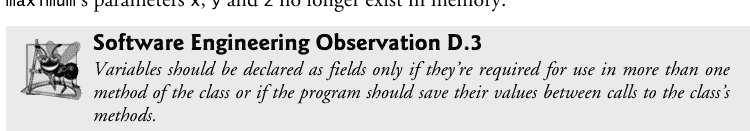

### 通过复用方法 `Math.max` 实现方法

我们 `maximum` 方法的整个主体也可以通过以下方式实现：

The entire body of our maximum method could also be implemented by... （注：此处原文未提供完整代码实现，仅为描述性文字的开头）

> （注：由于原文文本在处截断，译文也根据提供的文本内容结束。）

## D.6 方法调用栈与激活记录

> **常见编程错误 D.4**  
> 在方法体内将参数重新声明为局部变量会导致编译错误。

为了理解 Java 如何执行方法调用，我们首先需要考虑一种被称为栈（stack）（即相关数据项的集合）的数据结构。你可以将栈想象成一堆盘子。当把一个盘子放在堆上时，它通常被放在顶部（称为“入栈”，pushing onto）。同样，当从堆中移除一个盘子时，它是从顶部移除的（称为“出栈”，popping off）。

栈被称为“后进先出”（LIFO）结构——最后被推入（插入）栈的项是第一个从栈中移除的项。

当一个程序调用一个方法时，该方法必须知道如何返回到调用者，因此调用方法的返回地址会被推入程序执行栈（有时称为方法调用栈）中。如果发生了一系列方法调用，连续的返回地址将按照后进先出的顺序推入栈中，以便每个方法都能返回到其调用者。

程序执行栈还包含了程序运行期间调用方法时使用的局部变量的内存。这些数据存储作为程序执行栈的一部分，被称为方法调用的激活记录（activation record）或栈帧（stack frame）。

当方法被调用时，该方法的激活记录会被推入程序执行栈。当方法返回到调用者时，该方法的激活记录从栈中弹出，这些局部变量对程序不再可见。

如果一个持有对象引用的局部变量是程序中唯一持有该对象引用的变量，那么包含该局部变量的激活记录从栈中弹出，程序将无法再次访问该对象，并将在“垃圾回收”（garbage collection）期间从 JVM 中删除。我们在 F.9 中讨论垃圾收集。

当然，计算机内存是有限的，因此只能使用一定量来存储激活记录。如果发生的方法调用次数超过了存储其激活记录的数量，就会发生“栈溢出”（stack overflow）的错误。

## D.7 参数提升与类型转换

另一种频繁的方法调用方式是参数提升（argument promotion）——如果可能，将参数值转换为方法在其相应参数中期望接收的类型。

例如，程序可以使用 `int` 调用 `Math.sqrt`，尽管它期望的是一个 `double` 参数。该语句为：

```java
System.out.println(Math.sqrt(4));
```


计算 `Math.sqrt(4)` 并打印值 2.0。方法声明的参数列表允许 Java 在将 `int` 值 4 传递给方法 `sqrt` 之前将其转换为 `double` 值 4.0。如果不满足提升规则，此类转换会导致编译错误。这些规则规定了允许哪些转换——即在不丢失数据的情况下可以执行的转换。在 `sqrt` 示例中，`int` 转换为 `double` 而没有改变其值。然而，将 `double` 转换为 `int` 会截断 `double` 值的数值部分——因此，丢失部分数值。将较大的整数类型转换为较小的类型（例如从 `long` 到 `int` 或从 `int` 到 `short`）也可能导致值改变。

## D.7 方法：深入观察

提升规则适用于包含两个或多个基本类型值的表达式，以及作为参数传递给方法的基本类型值。每个值都被提升为表达式中的“最高”类型。实际上，表达式使用了每个值的临时副本——原始值的类型保持不变。图 D.3 列出了基本类型以及每个类型可以提升的类型。例如，`int` 可以提升为更高类型的类型 `long`、`float` 和 `double`。

| 类型 | 有效的提升 |
|---|---|
| `double` | 无 |
| `float` | `double` |
| `long` | `float` 或 `double` |
| `int` | `long`、`float` 或 `double` |
| `char` | `int`、`long`、`float` 或 `double` |
| `short` | `int`、`long`、`float` 或 `double`（但不是 `char`） |
| `byte` | `short`、`int`、`long`、`float` 或 `double`（但不是 `char`） |
| `boolean` | 无（在 Java 中布尔值不被视为数字） |

**图 D.3** | 基本类型允许的提升。

如果在 D.3 表中将值转换为低级类型，如果低级类型无法表示高级类型的值，将导致不同的值（例如，`int` 2000000 无法表示为 `short`，任何带有小数点后位的浮点数无法表示在 `long`、`int` 或 `short` 等整数类型中）。因此，在可能因转换导致信息丢失的情况下，Java 编译器要求你使用强制转换运算符（在 C.9 节引入）来显式强制转换发生——否则会导致编译错误。这让你能够从编译器那里“夺回控制权”。你本质上是在说：“这种转换可能会导致信息丢失，但对我的目的来说，这没。”假设方法计算一个整数的平方并返回它。为了对一个名为 `doubleValue` 的 `double` 参数进行平方，我们需要将方法写为：

```java
square(int doubleValue)
```

此方法显式地强制将 `doubleValue` 值的副本转换为整数，供方法 `square` 使用。因此，如果 `doubleValue` 是 4.5，该方法返回值 4 并返回 16，而不是 20.25。

## D.8 Java API 包

正如你所看到的，Java 包含许多预定义类，这些类被分组在相关的类包类别中。这些统称为 Java 应用程序编程接口（Java API），或 Java 类库。Java 的一个巨大优势是 API 的成千上万个类。本书附录中使用的 Java API 包在图 D.4 中描述，该图仅代表了 Java API 中可用组件的一小部分。

| 包 | 描述 |
|---|---|
| `java.awt.event` | 抽象窗口工具包事件包包含类和接口，能够对 `java.awt` 和 `java.swing` 包中的 GUI 组件实现事件处理。 |
| `java.io` | Java 输入/输出包包含类和接口，使程序能够输入和输出数据。 |
| `java.lang` | Java 语言包包含许多 Java 程序导入的类和接口（下文将讨论）。编译器将其导入到所有程序中。 |
| `java.util` | Java 工具包包含工具类和接口，能够实现日期和时间操作、随机数处理（`Random` 类）以及大量数据的存储和处理等操作。 |
| `java.util.concurrent` | Java 并发包包含用于实现可以并行执行多个任务的程序的工具类和接口。 |
| `javax.swing` | Java Swing 组件包含 Java GUI 组件的类和接口，提供可移植 GUI 的支持。 |

**图 D.4** | API 包（子集）。

Java 可用的包集合非常大。除了总结的复杂图形、高级图形用户界面、打印、高级网络、安全、数据库处理、多媒体、辅助功能（针对残障人士）、并发编程、加密、XML 处理等许多功能外，许多其他包也可以从 `java.sun.com` 下载。

你可以在 `docs.oracle.com/javase/6/docs/api/` 中的 Java API 文档获取有关预定义 Java 类方法的更多信息。访问该网站时，点击 **Index** 链接查看 Java API 所有类和方法的字母列表。找到类并点击其链接查看类的在线描述。点击 **METHOD** 链接查看类方法表。每个静态方法会在其返回类型前带有“static”一词。

## D.9 随机数生成简介

我们现在简单介绍一种流行的编程应用类型——模拟和游戏。在下一节中，我们将开发一个结构良好的游戏。该程序使用了到为止附录中介绍的大部分控制语句，并引入了几个新的编程概念。

可以通过 `Random` 类（包为 `java.util`）的对象或 `Math` 类的静态方法在程序中引入随机数。`Random` 对象可以产生 `boolean`、`byte`、`float`、`double`、`int`、`long` 和高斯值，而 `Math` 方法只能产生 `0.0 ≤ x < 1.0` 范围内的 `double` 值，其中 `x` 是 `random` 方法返回的值。在接下来的示例中，我们使用 `Random` 类的对象来产生随机值。在这里只讨论随机整数。有关 `Random` 类的更多信息，请参阅 `docs.oracle.com/java/6/docs/api/java/util/Random.html`。

如下创建一个新的随机数生成器对象：

```java
Random randomNumbers = new Random();
```

考虑以下代码：

```java
int randomValue = randomNumbers.nextInt();
```

`nextInt` 方法生成 -2,147,483,648 到 +2,147,483,647（包含边界）范围内的随机值。如果它真的产生了该范围内的每一个值，那么在每次调用 `nextInt` 时，每个值被选中的机会应该是相等的（概率）。这些数字实际上是由复杂的数学计算产生的伪随机值序列。该计算使用当天的时间（当然在不断变化）作为随机数生成器的种子，因此程序的每次执行都会产生一组不同的随机值序列。

`nextInt` 直接产生的值范围提供了特定 Java 应用程序所需的数值范围。模拟抛硬币的程序可能需要用 0 表示“正面”，用 1 表示“反面”。模拟掷六面骰的程序可能需要 1–6 范围内的随机整数。一个随机预测视频游戏中下一种飞船类型（四种可能性中）的程序可能需要 1–4 范围内的随机整数。对于这类情况，`Random` 类提供了 `nextInt` 方法的另一个版本，它接收一个 `int` 参数并返回一个从 0 到（但不包含）该参数值的值。例如，对于抛硬币，以下语句返回 0 或 1：

```java
int randomValue = randomNumbers.nextInt(2);
```

### D.9.1 随机数的缩放与位移

为了演示随机数，让我们模拟掷六面骰。我们首先使用 `nextInt` 产生 0–5 范围内的随机值，如下：

```java
face = randomNumbers.nextInt(6);
```

参数 6——称为**缩放因子**——代表 `nextInt` 应该产生的唯一值数量（在本情况下为 0、1、2、3、4 和 5）。这种操作被称为缩放 `Random` 方法 `nextInt` 产生的取值范围。

六面骰的面上上的数字是 1–6，而不是 0–5。因此，我们通过将一个**位移值**（在本例中为 1）添加到之前的结果来位移产生的数字范围，如下：

```java
face = 1 + randomNumbers.nextInt(6);
```

位移值 1 指定了目标整数范围中的第一个值。前一个语句分配了一个 1–6 范围内的随机整数。`nextInt` 产生的数字概率大致相等。

### 通用随机数计算

前一个语句向变量 `face` 分配了一个 1 ≤ `face` ≤ 6 范围内的整数。该范围的宽度（即范围内连续整数的个数）是 6，范围内的起始数字是 1。范围的宽度由传递给 `Random` 方法 `nextInt` 的参数 6 决定，而范围的起始数字 1 是在调用 `nextInt` 的结果上加上。我们可以将其推广为：

```java
number = shiftingValue + randomNumbers.nextInt(scalingFactor);
```

其中 `shiftingValue` 指定了目标连续整数范围中的第一个数字，`scalingFactor` 指定了范围内有多少个数字。

也可以从连续整数范围以外的集合中选择整数。例如，为了从序列 2、5、8、11 和 14 中获取随机值，您可以使用语句：

```java
number = 2 + 3 * randomNumbers.nextInt(5);
```

在这种情况下，`randomNumbers.nextInt(5)` 产生 0–4 范围内的值。每个值都乘以 3 以产生序列 0、3、6、9 和 12 中的值。我们给该值加上 2 以位移取值范围，并从序列 2、5、8、11 和 14 中获得一个值。我们将此结果推广为：

```java
number = shiftingValue
    + differenceBetweenValues * randomNumbers.nextInt(scalingFactor);
```

其中 `shiftingValue` 指定了目标值范围中的第一个数字，`differenceBetweenValues` 代表序列中连续数字之间的常差，`scalingFactor` 指定了范围内有多少个数字。

### D.9.2 测试与调试的随机数可重复性

`Random` 类的方法实际上是基于复杂的数学计算产生伪随机数——数字序列看起来是随机的。产生数字的计算使用当天的时间作为种子值来改变序列的起始点。每个新的 `Random` 对象都会根据其创建时的计算机系统时钟设置自己的种子，使得程序的每次执行都能产生一个不同的随机数序列。

在开发应用程序时，重复序列通常是有用的。当可重复性很重要时，您可以创建一个带有种子的 `Random` 对象：

```java
Random randomNumbers = new Random(seedValue);
```

要重建相同的序列，调用 `set` 方法，例如：

```java
randomNumbers.set(seedValue);
```

## D.10 案例研究：机会游戏；引入枚举

一种流行的机会游戏被称为“骰点”（craps），它在赌场和小巷中流行。该游戏的规则非常简单：

你掷两颗骰子。每颗骰子有六个面，上面有一、二、三、四、五和六个点。骰子停下后，计算朝上点数的总和。如果第一次掷的总和为 7 或 11，则你赢了。如果第一次掷的总和为 2、3 或 12（称为“掷点”），则你输了（即“赌场”赢了）。如果第一次掷的总和为 4、5、6、8、9 或 10，该总和将成为你的“点”（point）。要获胜，你继续掷骰子，直到你“命中你的点”（即掷出相同的点数）。如果在中点时掷出 7 则输了。

图 D.5 模拟了骰点游戏，使用方法来实现游戏逻辑。`main` 方法（行 21–65）在需要时调用 `rollDice` 方法（行 68–81）以掷骰子并计算总和。示例输出显示了第一次掷的胜负，以及后续掷骰的情况。

```java
// Craps.java

// Craps 模拟了骰点游戏。

import java.util.Random;

public class Craps
{
    // 创建用于 rollDice 方法的随机数生成器
    private static Random randomNumbers = new Random();

    // 表示游戏状态的枚举
    private enum Status { CONTINUE, WON, LOST };

    // 表示常见骰子结果的常量
    private static final int SNAKE_EYES = 2;
    private static final int TREY = 3;
    private static final int SEVEN = 7;
    private static final int YO_LEVEN = 11;
    private static final int BOX_CARS = 12;

    // 进行一次骰点游戏
    public static void main(String[] args)
    {
        int myPoint = 0; // 如果第一次掷未胜负时的点
```

**图 D.5** | Craps 模拟了骰点游戏。（第 1 部分，共 3 部分。）

```java
Status gameStatus; // 可以包含 CONTINUE、WON 或 LOST

int sumOfDice = rollDice(); // 第一次掷骰子
```

```java
// 根据第一次掷骰确定游戏状态和点
switch (sumOfDice) {
    case SEVEN: // 第一次掷出 7 赢
    case ELEVEN: // 第一次掷出 11 赢
        gameStatus = Status.WON;
        break;

    case SNAKE_EYES: // 第一次掷出 2 输
    case TREY: // 第一次掷出 3 输
    case BOX_CARS: // 第一次掷出 12 输
        gameStatus = Status.LOST;
        break;
```

```java
default: // 既没赢也没输，所以记住点
    gameStatus = Status.CONTINUE; // 游戏未结束
    myPoint = sumOfDice; // 记住点
    System.out.println("Point is %d\n", myPoint);
    break; // switch 末尾可选
}
```

```java
// 当游戏未完成时
while (gameStatus == Status.CONTINUE) { // 未赢或输
```

```java
    sumOfDice = rollDice(); // 再次掷骰子

    // 确定游戏负
    if (sumOfDice == myPoint) // 通过点数赢
        gameStatus = Status.WON;
    else
        if (sumOfDice == SEVEN) // 在点数之前掷出 7 输
            gameStatus = Status.LOST;
}
```

```java
// 显示赢或输的消息
if (gameStatus == Status.WON) {
    System.out.println("Player wins");
}
else
    System.out.println("Player loses");
}
```

```java
// 掷骰子，计算总和并显示结果
public static int rollDice() {
    // 随机选择骰子点
    int die1 = 1 + randomNumbers.nextInt(6); // 第一次掷骰
    int die2 = 1 + randomNumbers.nextInt(6); // 第二次掷骰
    int sum = die1 + die2; // 骰子值的总和
```

**图 D.5** | Craps 类模拟骰子游戏。（3 部分中的第 2 部分。）

## 附录 D 方法：深入观察

```java
76 // 显示本次掷骰的结果
77 System.out.printf("Player rolled %d + %d = %d\n",
78     die1, die2, sum);
79
80 return sum; // 返回骰子总和
81 } // rollDice 方法结束
82 } // Craps 类结束
```


| 玩家掷出 5 + 6 = 11 |
| :--- |
| 玩家赢了 |

| 玩家掷出 5 + 4 = 9 |
| :--- |
| 点是 9 |
| 玩家掷出 4 + 2 = 6 |
| 玩家掷出 3 + 6 = 9 |
| 玩家赢了 |

| 玩家掷出 1 + 2 = 3 |
| :--- |
| 玩家输了 |

| 玩家掷出 2 + 6 = 8 |
| :--- |
| 点是 8 |
| 玩家掷出 5 + 1 = 6 |
| 玩家掷出 2 + 1 = 3 |
| 玩家掷出 1 + 6 = 7 |
| 玩家输了 |

**Fig. D.5** Craps 类模拟骰子游戏 craps。（3部分中的第3部分）

### 方法 roll1Dice

在游戏规则中，玩家必须在第一次掷时掷骰子，并在随后的所有掷中同样这样做。我们声明方法`roll1Dice`（图 D.5，第68–81行）来掷骰子并计算打印它们的总和。方法`roll1Dice`被声明一次，但被两处调用（`main`中的第26行和50行），这包含了完整 craps 游戏的逻辑。`roll1Dice`方法不接受参数，因此它有一个空的参数列表。每次调用时，`roll1Dice`返回骰子的总和，因此方法头部的返回类型为`int`（第68行）。尽管71和72行看起来相同（除了骰子名称外），但它们产生的结果并不相同。`randomNumbers`（用于71–72行）没有在方法中声明，而是作为类的`private final`变量声明并在第8行初始化。这使得我们能够在每次调用`roll1Dice`时重用一个`Random`对象。如果程序包含多个`Craps`类的实例，它们将共享这个`Random`对象。

### 方法 main 的局部变量

游戏相当简单。玩家在第一次掷时赢或输，或者在随后的任何掷中赢或输。方法`main`（第21–65行）使用局部变量`myPoint`（第23行）在第一次掷时未赢未输时存储"点"，局部变量`gameState`（第24行）跟踪游戏状态，局部变量`sumDice`（第26行）持有最近一次掷骰子的总和。`myPoint`初始化为0以确保程序可以编译。如果不初始化`myPoint`，编译器会报错，因为在`switch`语句的每个`case`中都没有为`myPoint`赋值，导致程序可能在使用前尝试它。相比之下，`gameState`在`switch`的每个`case`中都赋值了——这保证了在使用前已初始化。

### enum 类型

局部变量`gameState`（第24行）被声明为类型`Status`（111）。`Status`是枚举类型，最简单的形式声明了一组由标识符表示的常量。枚举是一种特殊的类，由`enum`关键字和类型名（在本例中为`Status`）引入。类括号限制了枚举体。括号内部是逗号分隔的枚举常量列表，每个代表一个唯一的值。`enum`中的标识符必须是唯一的。你将在附录 D 中学习更多关于枚举的知识。

### 良好的编程实践

> 在枚举常量中使用大写字母是一种约定。这使得它们脱出来，并提醒它们不是变量。类型为`Status`的变量只能赋值枚举中声明的常量（第11行），否则会发生编译错误。当游戏赢时，程序将局部变量`gameState`设置为`.WON`（第33和54行）。当游戏输时，程序将局部变量`gameState`设置为`.LOST`（第38和57行）。否则，程序将局部变量`gameState`设置为`.CONTINUE`（第41行），表示游戏未结束且必须继续掷骰。

### 良好的编程实践

> 使用枚举（如`.WON`、`.LOST`和`Status.CONTINUE`）而不是字面值（如0、1和2）使得程序更易读和维护。

### main 方法的逻辑

`main`中的第26行调用`rollDice`从1到6随机选取两个值，显示第一个骰子的值、第二个骰子的值并返回总和。方法`main`进入`switch`语句（第29–45行），该语句使用第26行的`sumDice`值来判断游戏是赢、输还是继续循环。第一次掷导致输负的值被声明为`public static int`常量。这些常量的标识符像枚举常量一样，约定使用全大写字母，以便在程序中脱出来。第31–34行确定玩家在第一次掷是否通过`SEVEN`(7)或`ELEVEN`(11)赢。第35–39行确定玩家在第一次掷是否通过`SNAKE_EYES`(2)、`TREY`(3)或`BOX_CARS`(12)输。第一次掷后，如果游戏未结束，默认`case`（第40–44行）将`gameState`设置为`Status.CONTINUE`并显示点数。

如果我们试图"做出我们的点数"（即游戏从之前的掷继续），则执行第48–54行。第50行再次掷骰子。如果`sumDice`匹配`myPoint`（第53行），第45行将`gameStatus`设置为`Status.WON`，然后循环结束结束。如果`sumDice`是`SEVEN`（第56行），第57行将`gameStatus`设置为`Status.LOST`，然后循环结束结束。当游戏完成时，第61–64行显示指示玩家输赢的消息，程序终止。

程序使用了我们讨论过的各种程序控制机制。`Craps`类使用了两个方法——`main`和`roll1Dice`（从`main`调用两次）以及`switch`、`if...else`和嵌套的`if`语句。还请注意`switch`语句中`case`标签的使用，以便为`SEVEN`和`ELEVEN`的和（第31–32行）以及`SNAKE_EYES`、`TREY`和`BOX_CARS`的和（第35–37行）执行相同的语句。

### 为什么某些常量没有定义为枚举常量

你可能会奇怪为什么我们把骰子总和声明为`public static int`常量而不是枚举常量。原因是程序通过将`int sumDice`（第26行）与这些常量比较来确定每次掷骰的结果。我们假设枚举求和常量（例如`SNAKE_EYES`）表示游戏使用的总和，然后用于`switch`语句（第29–45行）。这样做将阻止我们使用`sumDice`作为`switch`语句的控制表达式，因为 Java 不允许将`int`与枚举常量比较。为了实现相同的功能，我们必须使用变量类型作为`switch`的控制表达式。遗憾的是，Java 没有提供将`int`转换为特定枚举常量的简单方法。可以通过单独的`switch`语句来实现。显然这样做是复杂的，并且没有达到使用枚举的目的。

## D.11 声明的作用域

你已经见过各种 Java 实体的声明，如类、方法、变量和参数。声明引入了引用这些实体的名称。声明的作用域是可以通过名称引用实体的程序部分。对于该部分程序，该实体处于"作用范围内"。这引入了几个重要的作用域问题。

基本的作用域规则如下：

- 参数声明的作用域是其所在的方法体。
- 局部变量声明的作用域是从声明的地方开始到该块结束。
- 出现在`for`语句头部初始化部分的局部变量声明的作用域是`for`语句的体以及头部的其他表达式。
- 方法或字段的作用域是整个类的体。这使得类的非静态方法可以使用该类的字段和其他方法。

任何块都可以包含变量声明。如果局部变量与类的字段同名，则该字段在块执行结束之前会被"隐藏"——这被称为屏蔽（shadowing）。在附录 F 中，我们讨论了如何访问被隐藏的字段。

错误预防技巧 D.2
为字段和局部变量使用不同的名称，以防止在调用方法时，方法中的局部变量遮蔽了类字段而导致的微妙逻辑错误。

图 D.6 展示了字段和局部变量的作用域问题。第 7 行声明并初始化`x`为 1。在任何声明了名为`x`的局部变量的块（或方法）中，该字段都会被遮蔽（隐藏）。`main`方法（第 11–23 行）声明了一个局部变量`x`（第 13 行）并将其初始化为 5。输出该局部变量的值显示字段`x`（值为 1）被遮蔽。程序声明了两个方法——`useLocalVariable`（第 26–35 行）和`useField`（第 38–45 行），它们都不接受参数且没有返回值。`main`调用了每个方法两次（第 17–20 行）。`useLocalVariable`声明了两次局部变量（第 28 行）。当第一次调用`useLocalVariable`时（第 17 行），它创建了局部变量`x`并将其初始化为 25（第 28 行），输出`x`的值（第 30–31 行），增加`x`（第 32 行）并再次输出`x`的值（第 33–34 行）。第二次调用`useLocalVariable`时（第 19 行），它再次创建局部变量`x`并将其初始化为 20，每次`useLocalVariable`的输出都是相同的。

```java
// Fig. D.6: Scope.java
// Scope 类演示了字段和局部变量的作用域。
public class Scope {
    // 此类所有方法均可访问的字段
    private static int x = 1;

    // 方法创建并初始化局部变量 x
    // 并调用方法 useLocalVariable 和 useField
    public static void main(String[] args) {
        int x = 5; // main 方法中的局部变量遮蔽了字段 x
        System.out.printf("%x in main is %d\n", x);
        useLocalVariable(); // useLocalVariable 拥有局部 x
        useField(); // useField 调用了两次 Scope 的字段 x
        useLocalVariable(); // useLocalVariable 重新初始化局部 x
        useField(); // Scope 的字段保留了其值
        System.out.printf("\nx in main is %d\n", x);
    }

    // 在每次调用时创建并初始化局部变量 x
    public static void useLocalVariable() {
        int x = 25; // 每次调用 useLocalVariable 时初始化
        System.out.printf("\nx on entering method is %d\n", x);
        x++; // 修改此方法的局部变量
    }
}
```

**图 D.6** | Scope 类演示了字段和局部变量的作用域。（2 部分中的 1 部分）

```java
System.out.printf(
    "local x before exiting method useLocalVariable is %d\n", x );
} // 方法 useLocalVariable 结束

// 在每次调用时修改静态 Scope 的字段 x
public static void useField() {
    System.out.printf(
        "\nfield on entering method useField is %d\n", x);
    x *= 10; // 修改类 Scope 的字段 x
    System.out.printf("field x before exiting method useField is %d\n", x);
} // 方法 useField 结束
} // 类 Scope 结束
```

```
local x in main is 5
local x on entering method useLocalVariable is 25
local x before exiting method useLocalVariable is 26

field x on entering method useField is 1
field x before exiting method useField is 10

local x on entering method useLocalVariable is 25
local x before exiting method useLocalVariable is 26

field x on entering method useField is 10
field x before exiting method useField is 100

local x in main is 5
```

Fig D-6 | Scope 类演示了字段和局部作用域。（2 部分中的 2 部分）

`useField`没有声明任何局部变量。因此，它引用了`x`，即类的字段（第 7 行）。当第一次调用`useField`时（第 18 行），它输出了字段（第 40–41 行）的值（第 1 行），将字段`x`乘以 10（第 42 行），并在返回之前再次输出字段`x`的值（10）（第 43–44 行）。接着调用方法`useField`（第 20 行），它具有被修改的值（10），因此方法输出 10，然后是 100。最后，在`main`中，程序再次输出局部变量的值（第 22 行），以显示没有任何调用修改`main`的局部变量`x`，因为所有方法都引用了其他作用域中名为`x`的变量。

## D.12 方法重载

在同一个类中可以声明同名的方法，因为它们具有不同的参数集合（由参数的数量、类型和顺序决定）——这被称为方法重载。当调用重载方法时，编译器通过检查调用中参数的数量、类型和顺序来选择合适的方法。方法重载通常用于创建多个同名但执行相同或相似任务的方法，但处理不同类型或数量的参数。例如，`Math`类的`abs`、`min`和`max`方法（在 D.3 节中总结）每个方法都重载了四个版本：

- 一个带有`double`参数的。
- 一个带有两个`float`参数的。
- 一个带有两个`int`参数的。
- 一个带有两个`long`参数的。

我们的下一个示例演示了重载方法。

### 声明重载方法

[此处省略原文中重复的示例描述，保持逻辑连贯]

### 区分重载方法

编译器通过签名（signature）来区分重载方法。内部，编译器使用更长的方法名（包含原始方法名、每个参数的类型和确切顺序）来确定方法是否在类中。例如，在图 D.7 中，编译器可能不会为指定`int`参数的方法使用 "square of int"，而是为指定`double`参数的方法使用 "square of double"。如果`method1`的声明如下为：

```java
method1(int a, float b)
```

那么编译器可能会使用逻辑名称 "method1 of int and float"。如果参数指定为：

```java
method1(float a, int b)
```

那么编译器可能会使用逻辑名称 "method1 of float and int"。参数类型的顺序是非常重要的。

### 重载方法的返回类型

在讨论编译器使用的方法名时，我们没有提到方法的返回类型。*方法调用无法通过返回类型来区分。*如果你有仅在返回类型上不同的重载方法，你可以在独立语句中调用其中一个，例如：

```java
square(2);
```

编译器将无法确定调用哪个版本的方法，因为返回值被忽略了。如果两个方法的签名相同但返回类型不同，编译器会报错，指示该方法已在类中定义。如果参数列表不同，重载方法可以不同的返回类型。此外，重载方法不需要具有相同数量的参数。

常见编程错误 D.5

具有相同参数列表的重载方法会导致编译错误，无论返回类型是否不同。


那么编译器可能会使用逻辑名称`"method1 of float and int"`。参数类型的顺序是非常重要的。

### 重载方法的返回类型

在讨论编译器使用的方法名时，我们没有提到方法的返回类型。方法调用无法通过返回类型来区分。如果你有仅在返回类型上不同的重载方法，你可以在独立语句中调用其中一个，例如：

```java
square(2);
```

编译器将无法确定调用哪个版本的方法，因为返回值被忽略了。如果两个方法的签名相同但返回类型不同，编译器会报错，指示该方法已在类中定义。如果参数列表不同，重载方法可以有不同的返回类型。此外，重载方法不需要具有相同数量的参数。

**常见编程错误 D.5**

具有相同参数列表的重载方法会导致编译错误，无论返回类型是否不同。

## D.13 总结

在本附录中，你学习了更多关于方法的知识。你还学习了非静态方法和静态方法之间的区别，以及如何通过在方法名前加上该方法所属类的名称并使用点（`.`）分隔符来调用静态方法。你学习了如何使用运算符`+`和`+=`来执行字符串拼接。我们讨论了方法调用栈和激活记录（activation records），它们负责跟踪已调用的方法以及每个方法在完成任务后必须返回到何处。我们还讨论了 Java 在原始数据类型之间进行隐式转换的提升规则，以及如何使用强制类型运算符进行显式转换。接下来，你学习了 Java API 中一些常用的包。

你看到了如何使用枚举类型（enum types）和`final`变量来声明命名常量。你使用了类（class）来仿真生成随机数。你还学习了类中字段和局部变量的作用范围。最后，你学习了通过提供具有相同名称但不同签名的方法来实现多个方法的重载。此类方法可以使用不同的参数类型或不同数量的参数来执行相同或相似的任务。

在附录 E 中，你将学习如何在数组中维护数据列表和表格。你将看到一个 6,000,000 次骰子的更优雅实现，以及你的 GradeBook 案例研究的两个增强版本；你还将学习如何访问程序开始执行时传递给方法的命令行参数。

## 自测练习题

填空每个陈述中的空处：

- D.1
  - a) 使用`____________________________`调用的方法是。
  - b) 仅在声明它的方法内部可见的变量被称为`____________________________`。
  - c) 被调用方法中的`____________________________`语句可用于将表达式的值传回给调用方法。
  - d) 关键字`____________________________`表示方法没有返回值。
  - e) 数据只能从栈的`____________________________`添加或删除。
  - f) 栈被称为`____________________________`数据结构；栈上最后一个推入（插入）的项是栈上第一个弹出（移除）的项。
  - g) 从被调用方法返回控制权给调用者的三种方法是`____________________________`和`____________________________`。
  - h) 类`____________________________`的对象产生随机数。
  - i) 程序执行栈包含了程序执行期间每次调用方法时局部变量的内存。这些数据作为程序执行栈的一部分存储，被称为方法调用的`____________________________`或`____________________________`。
  - j) 如果方法调用次数超过了程序执行栈能存储的，就会发生名为`____________________________`的错误。
  - k) 声明的`____________________________`是程序可以引用声明中`____________________________`的部分。
  - l) 可以有多个具有相同名称的方法操作不同的类型或数量的参数。这种特征被称为方法`____________________________`。
  - m) 程序执行栈也被称为`____________________________`栈。

## D.2

对于图 D.5 中的 Craps 类，说明每个实体的作用范围：

- a) 变量`randomNumbers`
- b) 变量`die1`
- c) 方法`rollDice`
- d) 方法`main`
- e) 变量`sumOfDice`

## D.3

编写一个程序，测试图 D.1 所示的 Math 类调用并产生指示的结果。

## D.4

为以下方法提供方法头：

- a) 方法`hypotenuse`，接受两个`double`精度参数并返回`double`精度。
- b) 方法`small`，接受三个整数`x`、`y`并返回整数。
- c) 方法`instructions`，不接受任何参数并返回值。注意：此类方法用于显示指令。
- d) 方法`intFloat`，接受整数并返回`float`。

## D.5

找出以下程序段中的错误。解释如何修正。

```java
void g() {
    System.out.println("Inside g ");
}

void h() {
    System.out.println("Inside h ");
}

int sum(int x, int y) {
    int result;
    result = x + y;
}

void f(float a) {
    float a;
    System.out.println(a);
}
```

## D.6

编写一个完整的 Java 程序，提示用户输入`double radius`，并调用`methodVolume`计算并显示球体积。使用以下语句计算体积：

```java
double volume = (4.0 / 3.0) * Math.pow(radius, 3)
```

## 练习答案

- D.1
  - a) 方法调用。
  - b) 局部变量。
  - c) `return`。
  - e) 后进先出。
  - g) expression；或遇到方法的右括号。
  - h) `Random`。
  - i) activation record，frame。
  - j) stack overflow。
  - l) overloading。
- D.2
  - a) class body。
  - b) 定义`rollDice`的 block。
  - c) class body。
- D.3 以下演示了图 D.1 中的 Math 类：

## 自测练习答案

```java
// Exercise D.3: MathTest.java

// Testing the Math methods

public class MathTest {

    public static void main(String[] args) {

        System.out.printf("Math.abs(23.7) = %f", Math.abs(23.7));

        System.out.printf("Math.abs(0.0) = %f", Math.abs(0.0));

        System.out.printf("Math.abs(-23.7) = %f", Math.abs(-23.7));

        System.out.printf("Math.ceil(9.2) = %f", Math.ceil(9.2));

        System.out.printf("Math.ceil(-9.8) = %f", Math.ceil(-9.8));

        System.out.printf("Math.cos(0.0) = %f", Math.cos(0.0));

        System.out.printf("Math.exp(1.0) = %f", Math.exp(1.0));

        System.out.printf("Math.exp(2.0) = %f", Math.exp(2.0));

        System.out.printf("Math.floor(9.2) = %f", Math.floor(9.2));

        System.out.printf("Math.floor(-9.8) = %f", Math.floor(-9.8));

        System.out.printf("Math.log(Math.E) = %f", Math.log(Math.E));

        System.out.printf("Math.log(Math.E) = %f", Math.log(Math.E));

        System.out.printf("Math.max(2.3, 12.7) = %f", Math.max(2.3, 12.7));

        System.out.printf("Math.max(-2.3, -12.7) = %f", Math.max(-2.3, -12.7));

        System.out.printf("Math.min(2.3, 12.7) = %f", Math.min(2.3, 12.7));

        System.out.printf("Math.min(-2.3, -12.7) = %f", Math.min(-2.3, -12.7));

        System.out.printf("Math.pow(2.0, 7.0) = %f", Math.pow(2.0, 7.0));

        System.out.printf("Math.pow(9.0, 0.5) = %f", Math.pow(9.0, 0.5));

        System.out.printf("Math.sin(0.0) = %f", Math.sin(0.0));

        System.out.printf("Math.sqrt(900.0) = %f", Math.sqrt(900.0));

        System.out.printf("Math.tan(0.0) = %f", Math.tan(0.0));

    } // end class MathTest
```

```text
Math.abs(23.7) = 23.700000

Math.abs(0.0) = 0.000000

Math.abs(-23.7) = -23.700000

Math.ceil(9.2) = 10.000000

Math.ceil(-9.8) = -9.000000

Math.cos(0.0) = 1.000000

Math.exp(1.0) = 2.718282

Math.exp(2.0) = 7.389056

Math.floor(9.2) = 9.000000

Math.floor(-9.8) = -10.000000

Math.log(Math.E) = 1.000000

Math.log(Math.E) = 1.000000

Math.max(2.3, 12.7) = 12.700000

Math.max(-2.3, -12.7) = -2.300000

Math.min(2.3, 12.7) = 2.300000

Math.min(-2.3, -12.7) = -12.700000

Math.pow(2.0, 7.0) = 128.000000

Math.pow(9.0, 0.5) = 3.000000

Math.sin(0.0) = 0.000000

Math.sqrt(900.0) = 30.000000

Math.tan(0.0) = 0.000000
```

## 附录 D 方法：深度解析

- D.4
  - a) `double hypotenuse(double side1, double side2)`
  - b) `int smallest(int x, int y, int z)`
  - c) `void constructions()`
  - d) `float intToFloat(int number) {`

- D.5
  - a) 错误：方法`h`被声明在方法`g`内部。  
    修正：将`h`的声明移动到`g`的声明之外。
  - b) 错误：该方法应该返回一个整数，但没有返回。  
    修正：删除变量`result`，并放置语句：

    ```java
    return x + y;
    ```

  - c) 错误：参数列表右括号后的分号是错误的，不应在方法中重新声明该参数。  
    修正：删除参数列表右括号后的分号，并删除声明`float a;`。

## D.6

下面的解决方案使用用户输入的半径来计算球的体积：

```java
// 练习 D.6: Sphere.java

// 计算球的体积。

import java.util.Scanner;

public class Sphere {

    // 从用户处获取半径并显示球的体积

    public static void main(String[] args) {
        Scanner input = new Scanner(System.in);

        System.out.print("Enter radius of sphere: ");

        double radius = input.nextDouble();

        System.out.printf("Volume is %s\n", sphereVolume(radius));
    }

    // 计算并返回球的体积

    public static double sphereVolume(double radius) {
        double volume = (4.0 / 3.0) * Math.PI * Math.pow(radius, 3);

        return volume;
    }
} // class Sphere
```


```text
Enter radius of sphere: 4
Volume 268.082573
```

## 练习

### D.7

在执行以下每个语句后，`x` 的值是多少？

a) `x = Math.abs( 7.5 )`  
b) `x = Math.floor( 7.5 )`  
c) `x = Math.abs( 0.0 )`  
d) `x = Math.ceil( 0.0 )`  
e) `x = Math.abs( -6.4 )`  
f) `x = Math.ceil( -6.4 )`  
g) `x = Math.ceil( -Math.abs( -8 + Math.floor( -5.5 ) ) )`

### D.8 停车费用

停车库对三小时以内的停车收取 `$2.00` 的最低费用。对于超过小时数的每小时（不足一小时按小时计算），额外收取 `$0.50`。任何给定 24 小时内的最高费用为 `$10.00`。假设没有车辆单次停车超过 24 小时。

编写一个应用程序，计算并显示昨天在停车场停车的每位客户的停车费用。你应该输入每个客户的停车小时数。程序应该显示当前客户的费用，并计算并显示昨天收据的总和。它应该使用方法 `calculateCharges` 来确定每个客户的费用。

### D.9 数字舍入

`Math.floor` 可将值舍入到最近的整数——例如，`y = Math.floor(x + 0.5);` 将数字 `x` 舍入到最近的整数并将结果赋值给 `y`。

编写一个应用程序读取 `double` 值，并使用上述语句将每个值舍入到最近的整数。对于处理的每个数字，显示原始数字和舍入后的数字。

### D.10 数字舍入

要舍入到特定的小数位数，使用类似语句：

```java
y = Math.floor(x * 10 + 0.5) / 10;
```

这将 `x` 舍入到十分位（即小数点右侧的第一个位置），或者：

```java
y = Math.floor(x * 100 + 0.5) / 100;
```

将 `x` 舍入到百分位。

编写一个应用程序，以以下方式定义方法：

a) `roundToInt(number)`  
b) `roundTenths(number)`  
c) `roundHundredths(number)`  
d) `roundThousandands(number)`

对于每个处理的值，显示原始值、舍入到十分位、百分位和千分位的值。

### D.11

回答以下问题：

a) 什么是“随机”选择数字？  
b) 使用 `nextInt` 方法模拟游戏有用吗？  
c) 使用 `Random` 对象平移值有用吗？  
d) 使用运算符模拟真实情况有用吗？

### D.12

编写语句，将整数赋值给以下范围：

a) `1 ≤ n ≤ 2`  
b) `1 ≤ n ≤ 10`  
c) `0 ≤ n ≤ 1`  
d) `0 ≤ n ≤ 10`  
e) `-1 ≤ n ≤ 1`  
f) `-3 ≤ n ≤ 11`

### D.13

编写语句，显示以下集合中的随机数：

a) `2, 4, 6, 8, 10`  
b) `3, 5, 7, 9`  
c)

### D.14 幂

编写方法 `integerPower(base, exponent)`，返回 `base^exponent`。假设 `exponent` 为正数。不要使用 `Math` 方法。读取 `base` 和 `exponent`。

### D.15 倍数

编写方法 `isMultiple`，对于每对数字判断第二个是否是第一个的倍数。该方法应接受两个整数，如果是倍数则返回 `true`，否则返回 `false`。

> 提示：使用余运算符。

将该方法集成到应用程序中。

### D.16 偶数

编写方法 `isEven`，使用余运算符（`%`）判断整数是否为偶数。该方法应接受一个整数，如果是偶数则返回 `true`，否则返回 `false`。

将该方法集成到应用程序中。

### D.17 圆面积

编写一个应用程序，提示用户输入圆的半径，并使用方法 `area` 计算面积。

### D.18 温度

实现一个应用程序，实现以下方法：

a) `celsius` 方法返回华氏温度对应的摄氏温度，使用以下计算：

```java
celsius = 5.0 / 9.0 * (fahrenheit - 32);
```

b) `fahrenheit` 方法返回摄氏温度对应的华氏温度，使用以下计算：

```java
fahrenheit = 9.0 / 5.0 * celsius + 32;
```

使用上述方法编写一个应用程序，使用户输入华氏温度时显示摄氏温度，或输入摄氏温度时显示华氏温度。

### D.19 寻找最小值

编写方法 `findMin`，返回三个浮点数中的最小值。使用 `Math.min` 方法实现 `findMin`。将该方法集成到应用程序中，读取三个值。

### D.20 最大公约数

两个数的最大公约数是能整除这两个数的最大整数。编写方法 `gcd`，返回两个整数的最大公约数。

> 提示：使用欧几里得算法。

你可以将该方法集成到应用程序中，读取两个值并显示结果。

### D.21 分数

编写方法 `qualityPoints`，输入学生的平均分，并返回其所属的等级：`90–100`、`80–89`、`70–79`、`60–69` 或低于 `60`。

将该方法集成到应用程序中，读取一个值并显示结果。

### D.22 抛硬币

编写一个应用程序模拟抛硬币。程序统计硬币每一面出现的次数，并显示结果。

程序应该调用方法 `flipCoin`，接收参数并返回硬币的值。

### D.23 猜数字

编写一个“猜数字”的应用程序，要求如下：

程序通过选择 `1` 到 `1000` 范围内的随机整数来选择要猜的数字。应用程序显示 `1` 到 `1000` 之间的数字。玩家输入第一次猜测。

如果玩家猜测错误，程序应该显示“太大了，再试一次。”或“太小了，再试一次。”以帮助玩家找到正确答案。程序应该提示用户进行下一次猜测。

当用户输入正确答案时，显示“恭喜”。

## 习题 451

猜出数字，并允许用户选择再次玩。本题中采用的猜数字技术与二分查找相似。

### D.24 骰子游戏修改

修改 D.5 的骰子游戏程序以允许下注。

初始化变量 `bankBalance`（银行余额）为 1000 美元。提示玩家下注。检查赌注 `wager` 是否小于等于 `bankBalance`；如果不是，让用户重新输入，直到输入有效的赌注为止。

然后运行一局骰子游戏。如果玩家赢，从 `bankBalance` 中减去赌注金额并显示新余额，检查 `bankBalance` 是否变为零；如果是，则显示消息“抱歉，你破产了！”

随着游戏的进行，显示各种消息来营造“闲聊”，例如：

- “噢，你想倾家荡产是吗？”
- “哎呀，大一把吧！”
- “你现在是大人物了。现在是兑换筹码的时候了！”

将“闲聊”实现为一个独立的方法，随机选择要显示的字符串。

### D.25 计算机辅助教学

计算机的使用被称为计算机辅助教学（CAI）。编写一个程序帮助小学生学习乘法。

使用随机对象产生两个正整数。程序随后应向用户提出一个问题，内容如下：

- 6 x 7 等于多少

学生输入答案。程序检查学生的答案。如果正确，显示消息“非常好！”并提问另一个乘法问题。如果答案错误，显示消息“不。请重试。”并让学生反复尝试该问题，直到学生答对为止。

应该使用一个独立的方法来生成每个新问题。该方法在应用程序开始执行时以及学生每次回答问题时都应调用一次。

### D.26 计算机辅助教学：减轻学生疲劳

CAI 环境中的一个问题可以通过改变计算机的响应来吸引学生的注意力得以解决。

修改习题 D.25 的程序，为每个答案显示不同的评论，如下所示。

正确答案的可能响应：

- 非常好！
- 太棒极了！
- 干得好！
- 继续保持良好！

错误答案的可能响应：

- 不。请重试。
- 错误。请再试一次。
- 不要放弃！
- 不。继续尝试。

使用随机数生成产生一个 `1` 到 `4` 的数字，用于在每次正确或错误答案后选择四种适当响应之一。使用 `switch` 语句发布响应。

### D.27 计算机辅助教学：改变问题类型

修改之前的程序，允许用户选择一种算术问题类型进行学习：

1. 仅限加法题
2. 仅限减法题
3. 仅限乘法题
4. 仅限除法题
5. 所有类型的随机混合

# 数组与 ArrayList

## 目标

在本章中，你将学习：

- 什么是数组。
- 使用数组在列表和值表中存储数据并检索数据。
- 声明数组、初始化数组以及引用数组的单个元素。
- 使用增强型 `for` 语句遍历数组。
- 将数组传递给方法。
- 声明和操作多维数组。
- 使用 `Arrays` 类的方法执行常见的数组操作。
- 使用 `ArrayList` 类操作一种动态调整大小的类数组数据结构。

## 内容概览

- E.1 引言
- E.2 数组
- E.3 声明和创建数组
- E.4 数组示例
- E.5 案例研究：洗牌与发牌模拟
- E.6 增强型 `for` 语句
- E.7 将数组传递给方法
- E.8 案例研究：使用数组存储成绩的 `GradeBook`
- E.9 多维数组
- E.10 案例研究：使用二维数组的 `GradeBook` 类
- E.11 `Arrays` 类
- E.12 集合引言与 `ArrayList` 类
- E.13 总结

# E.1 引言

本附录介绍了数据结构——相关数据项的集合。

数组是由具有相同类型的相关数据项组成的数据结构。数组使得处理一组相关值变得方便。数组一旦创建，其长度保持不变。

虽然数组被广泛使用，但其能力有限。例如，你必须指定数组的大小。如果你在执行时想要修改它，必须手动通过创建一个新数组来实现。

在本附录的末尾，我们介绍了 Java API 集合类中最好的数据结构之一。它们提供了比传统数组更多的功能。我们关注 `ArrayList` 集合。`ArrayList` 与数组类似，但提供了额外功能，例如动态调整大小——在执行时自动增加其大小以容纳额外的元素。

# E.2 数组

数组是一组变量（称为元素或组件），包含所有具有相同类型的值。数组是对象，因此它们被视为引用类型。正如你所看到的，我们通常认为数组变量是对数组对象的引用。

像其他对象一样，数组使用 `new` 关键字创建。要创建一个数组对象，你需要在使用 `new` 关键字的数组创建表达式中指定数组类型和元素数量。此类表达式返回一个可以存储在数组变量中的引用。

## E.4 数组使用示例

数组创建表达式创建一个包含 12 个 `int` 元素的数组对象，并将数组的引用存储在变量 `c` 中：

```java
int[] c = new int[12];
```

该表达式可以创建 E.1 所示的数组。当创建数组时，数组的每个元素都会接收一个默认值：

- 数值基本类型元素为零。
- 布尔类型元素为 `false`。
- 引用类型元素为 `null`。

正如你所看到的，你可以在创建数组时提供默认的 `int` 元素值。

在 E.1 中创建数组也可以通过以下两个步骤完成：

```java
int[] c;          // 声明数组变量
c = new int[12];  // 创建数组；赋值给数组变量
```

在声明中，类型后面的方括号表示 `c` 是一个指向数组的变量，即该变量将存储一个数组引用。在赋值语句中，变量 `c` 接收指向包含 12 个元素的新数组的引用。

程序可以在单次声明中创建多个数组。以下声明为 `b` 预留了 100 个元素，为 `x` 预留了 27 个元素：

```java
String[] b = new String[100], x = new String[27];
```

当数组类型和方括号在声明开头结合时，声明中的所有标识符都是数组变量。在这种情况下，`b` 和 `x` 指向 `String` 数组。

为了可读性，我们每个声明只声明一个变量。前面的声明等同于：

```java
String b[] = new String[100];  // 创建数组 b
String x[] = new String[27];   // 创建数组 x
```

当每个声明中只声明一个变量时，方括号可以放在类型之后或数组变量名之后，例如：

```java
String b[] = new String[100];  // 创建数组 b
String x[] = new String[27];   // 创建数组 x
```

### 常见编程错误 E2

在单声明中声明多个数组变量会导致细微的错误。考虑声明 `int a[], b, c;`。

如果 `a`、`b` 和 `c` 都被声明为数组变量，那么该声明是正确的——在类型后放置方括号表示声明中的所有标识符都是数组变量。

然而，如果仅打算让 `a` 成为数组变量，而 `b` 和 `c` 是单独的 `int` 变量，那么这个声明是不正确的。声明 `int a[], b, c;` 将导致无法预期的结果。

程序可以声明任何类型的数组。基本类型数组的每个元素都包含该数组声明元素类型的值。同样，在引用类型数组中，每个元素都是指向该数组声明元素类型对象的引用。例如：

- `int` 数组的每个元素都是 `int` 值。
- `String` 数组的每个元素都是指向 `String` 对象的引用。

## E.4 数组使用示例

本节介绍了几个演示数组、创建数组、初始化数组和操作数组元素的示例。

## 附录 E 数组和 ArrayList

### 创建和初始化数组

图 E.2 的应用使用 `new` 关键字“创建”一个包含 10 个 `int` 元素的数组，初始值为零（`int` 变量的默认值）。

第 8 行声明了 `array`——一个能够指向 `int` 元素数组的引用。第 10 行创建了数组对象并将其引用赋值给变量 `array`。第 12 行输出了列标题。第一列包含每个数组元素的索引（0–9），第二列包含每个数组元素的默认值（0）。

```java
// Fig. E.2: InitArray.java
// 将数组元素初始化为默认值零。

public class InitArray {
    public static void main(String[] args) {
        int[] array;              // 声明名为 array 的数组
        array = new int[10];      // 创建数组对象

        System.out.printf("%s%s\n", "Index", "Value");  // 列标题

        // 输出每个数组元素的值
        for (int counter = 0; counter < array.length; counter++) {
            System.out.printf("%d%d\n", counter, array[counter]);
        }
    }
}
```

| Index | Value |
|---:|---:|
| 0 | 0 |
| 1 | 0 |
| 2 | 0 |
| 3 | 0 |
| 4 | 0 |
| 5 | 0 |
| 6 | 0 |
| 7 | 0 |
| 8 | 0 |
| 9 | 0 |

> 图 E.2 将数组元素初始化为默认值零。

第 15–16 行的语句输出了每个数组元素的索引（由 `counter` 表示）和值（由 `array[counter]` 表示）。

循环控制变量初始为 0——索引从 0 开始，基于零的计数允许循环访问数组的每个元素。`for` 循环的循环继续条件使用表达式 `array.length`（第 15 行）来确定数组的长度。

在这个示例中，数组长度为 10，因此只要控制变量的值小于 10，循环就会继续。10 元素数组的最高索引值为 9，因此循环继续条件中的小于运算符保证了循环不会尝试访问数组末之外的元素，即在循环的最后一次迭代中，`counter` 为 9。

我们很快就会看到 Java 在执行时遇到此类越界索引时会做什么。

### 使用数组初始化器

你可以创建一个数组并使用**数组初始化器**对其元素进行初始化——这是一个在大括号中的、用逗号分隔的表达式列表，称为**初始化器列表**。

在这种情况下，数组长度由初始化器列表中的元素数量决定。例如：

```java
int[] n = { 10, 20, 30, 40, 50 };
```

这创建了一个索引值为 0–4 的五元素数组。元素 `n[0]` 初始化为 10，`n[1]` 初始化为 20，依此类推。

当编译器遇到包含初始化器列表的数组声明时，它会计算列表中初始化器的数量以确定数组的大小，然后在幕后设置好这个 `new` 操作。

E.3 中的应用初始化了一个带有 10 个值的 `int` 数组：

```java
int[] array = { 32, 27, 64, 18, 95, 14, 90, 70, 60, 37 };
```

并以表格格式显示数组。显示数组的代码与 E.2 中的代码完全相同。

```java
// Fig. E.3: InitArray.java
// 将数组元素初始化为指定值。

public class InitArray {
    public static void main(String[] args) {
        // 初始化器列表指定每个元素的值
        int[] array = { 32, 27, 64, 18, 95, 14, 90, 70, 60, 37 };
    }
}
```


进入`/path/to/xxx`目录，找到`xxx.json`。

在表达式`cvar = avar + bvar`中，加法运算符（`+`）将`avar`与`bvar`相加，得到它们的和`cvar`

在`List.of(arg0, arg1, arg2)`中，`List`接口的工厂方法`of()`接受一系列的元素，返回包含它们的只读列表。

之后我们这样调用`cmd`命令：`cmd arg0 arg1 arg2`。

```
if (condVar > someVal) {console.log("xxx")}
```


`java.lang.ArrayIndexOutOfBoundsException: 14`  
`responses[14] = 14`

| Rating | Frequency |
| :--- | :--- |
| 1 | 3 |
| 2 | 4 |
| 3 | 8 |
| 4 | 2 |
| 5 | 2 |

## E.4 使用数组的示例

无论`frequency[1]`的频率[1]如何，计数`frequency[1]`都会加1。要评估该表达式，我们从最内层括号中的答案开始（`answer`, 0）。将`answer`的值代入表达式，然后评估下一组括号（`responses[answer]`）。该值被用作频率数组的索引，以确定要增加哪个计数器（在本例中为`frequency[1]`）。

- 当下一次循环中`answer`为 1 时，`responses[answer]`是`responses[11]`的值（即 2——参见第 9 行），`frequency[responses[answer]]`被解释为`frequency[2]`，导致`frequency[2]`加 1。
- 当`answer`为 2 时，`responses[answer]`是`responses[2]`的值（即 5——参见第 9 行），`frequency[responses[answer]]`被解释为`frequency[5]`，导致`frequency[5]`加 1，依此类推。

无论问调查中处理了多少个响应，只需要一个六元素的数组（如果我们忽略索引 0 的元素）就可以总结结果，因为所有响应值都在 1 到 5 之间，且六元素数组的索引为 0–5。在程序的输出中，频率列仅总结了`responses`数组中 20 个值中的 19 个——数组的最后一个元素包含一个未被计数的错误响应。

## 异常处理：处理错误响应

异常（exception）表示程序执行过程中发生的问题。“异常”一词暗示问题发生的频率较低——如果“规则”是一条通常会执行的语句，那么问题就代表了“对规则的例外”。异常处理允许你创建容错性程序，这些程序可以解决（或处理）异常。在许多情况下，如果没有遇到问题，这允许程序继续执行。例如，尽管其中一个响应超出范围，`Student01`仍然显示结果（参见 E.7）。更严重的问题可能会阻止程序继续正常执行，而是要求程序通知用户问题，然后终止。当 JVM 或方法检测到问题（例如无效的数组索引或无效的方法参数）时，它会抛出一个异常——也就是说，发生了异常。

## try 语句

为了处理异常，任何可能在`try`语句（第 17–20 行）中抛出异常的代码都必须其中——`try`块包含了可能抛出异常的代码，而`catch`块（第 21–26 行）包含了在发生异常时处理异常的代码。你可以有多个`catch`块来处理相应`try`块中可能抛出的不同类型的异常。当第 19 行正确增加频率数组中的一个元素时，第 21–26 行将被忽略。界定`try`和`catch`块边界的大括号是必要的。

## 执行 catch 块

当程序在`responses`数组中遇到值 14 时，它尝试给`frequency[14]`加 1，这超出了数组的边界（数组只有六个元素）。由于数组边界检查是在执行运行时进行的，JVM 会生成一个异常——具体来说，第 19 行抛出一个`ArrayIndexOutOfBoundsException`来通知程序此问题。此时，`try`块终止，`catch`块开始执行——如果你在`try`块中声明了任何变量，它们现在已经超出了作用范围，无法在`catch`块中访问。

`catch`块声明了一个类型（`IndexOutOfBoundsException`）和一个异常参数（`e`）。`catch`块可以处理指定类型的异常。在`catch`块内部，你可以使用参数的标识符与捕获的异常对象进行交互。

> **预防提示 E：** 编写访问数组元素的代码时，确保数组索引大于或等于 0 且小于数组长度。这有助于防止程序中出现`IndexOutOfBoundsException`。

## 异常参数的 toString 方法

当第 21–26 行捕获异常时，程序显示一条指示发生问题的消息。第 23 行隐式地调用异常对象的`toString`方法以获取存储在异常对象中的错误消息并显示它。一旦在示例显示了消息，异常就被认为已处理，程序继续执行`catch`块结束大括号后的下一个语句。在本示例中，到了`for`语句的结束（第 27 行），程序继续执行`catch`块的后续。

## E.5 案例研究：洗牌与发牌

本章示例使用了包含基本类型或引用类型的数组。本节使用随机数生成和元素数组（即牌）来模拟洗牌和发牌。

### Card

```java
// Fig. E.8: Card.java

// Card 代表一张扑牌。

public class Card {

    private String face; // 牌的点数 ("Ace", "Deuce", ...)

    private String suit; // 牌的花色 ("Hearts", "Diamonds", ...)

    // 两个参数的构造函数初始化牌的点数花色

    public Card(String cardFace, String cardSuit) {

        face = cardFace; // 初始化牌的点数

        suit = cardSuit; // 初始化牌的花色

    }

    // 返回 Card 的字符串表示

    public String toString() {

        return face + " of " + suit;

    } // 方法 toString结束

} // 类 Card结束
```

### DeckOfCards

```java
// Fig. E.9: DeckOfCards.java

// DeckOfCards 代表一副扑牌。

import java.util.Random;

public class DeckOfCards {

    private Card[] deck; // Card对象的数组

    private int currentCard; // 下一个要发牌的索引 (0-51)

    private static final int NUMBER_OF_CARDS = 52; // 牌的常量数量

    private Random random generator;

    private static final Random randomNumbers = new Random();

    // 构造函数填充牌组

    public DeckOfCards() {

        deck = new Card[NUMBER_OF_CARDS];

        currentCard = 0;

        // ... 填充牌组的逻辑 ...

    }

}
```

## 附录 E 数组与 ArrayList

```java
String[] faces = { "Ace", "Deuce", "Three", "Four", "Five", "Six",

"Seven", "Eight", "Nine", "Jack", "Queen", "King" };

String[] suits = { "Hearts", "Diamonds", "Clubs", "Spades" };
```

```java
Card[] deck = new Card[NUMBER_OF_CARDS]; // 创建 Card 对象数组

currentCard = 0; // 设置 currentCard 使第一张牌位于 deck[ 0 ]
```

```java
// 用 Card 对象填充 deck

for (int count = 0; count < deck.length; count++) {

  deck[count] = new Card(faces[count % 13], suits[count / 13]);

} // DeckOfCards 构造函数结束
```

```java
// 使用单次遍历算法洗牌

public void shuffle() {

  // 洗牌后，发牌应该再次重新从 deck[ 0 ] 开始

  currentCard = 0; // 重新初始化 currentCard

  // 对于每张牌，随机选择另一张牌 (0-51) 并进行交换

  for (int first = 0; first < deck.length; first++) {

    // 在 0 到 51 之间选择一个随机数

    int second = randomNumbers.nextInt(NUMBER_OF_CARDS );

    // 将当前牌与随机选择的 Card 交换

    Card temp = deck[first];

    deck[first] = deck[second];

    deck[second] = temp;

  } // for 结束

 // shuffle 方法结束
```

```java
// 发出一张 Card

public Card dealCard() {

  // 判断是否还有剩余牌未发

  if (currentCard < deck.length) {

    return deck[currentCard++]; // 返回数组中的当前 Card

  } else {

    return null; // 返回 null 表示所有牌都已发完

  }

} // dealCard 方法结束

class DeckOfCards
```

`DeckOfCards`类表示一幅扑克牌。（第 2 部分，共 2 部分）

**图 E.9** `DeckOfCards`构造函数

### DeckOfCards 构造函数

该类的构造函数初始化数组`deck`（第 20 行），包含`NUMBER_OF_CARDS`(52) 个元素，默认情况下全为 null。第 24–26 行填充牌组。循环控制变量`count`为 0，且 while 循环小于`.length`，导致`count`取遍从 0 到 51 的每一个整数值（数组`deck`的索引）。每张 Card 均被初始化为来自`faces`数组的一个 String（包含从 "Ace" 到 "King"）和来自`suits`数组的一个 String（包含 "Hearts", "Diamonds", "Clubs" 和 "Spades"）。计算`count % 13`的结果始终是 0 到 12 之间的值（第 16–17 行`faces`数组的 13 个索引），而`count / 13`的结果始终是 0 到 3 之间的值（第 18 行`suits`数组的 4 个索引）。当`deck`数组初始化时，它包含按花色顺序排列的从 "Ace" 到 "King" 面值的 Cards（顺序为：红桃、方片、梅花、黑桃）。

### E.5 案例研究：洗牌与发牌模拟

### DeckOfCards 方法 shuffle

`shuffle`方法（第 30–46 行）洗牌牌组中的 Cards。对于每张 Card，随机选取一个 0 到 51 之间的数字来选择另一张牌，并在数组中交换当前 Card 与随机选择的 Card。这种交换通过第 42–44 行的赋值完成。额外的变量临时存储了正在被交换的两张 Card 之一。仅凭两条语句无法完成交换：

```java
deck[first] = deck[second]

deck[second] = deck[first];
```

如果`deck[first]`是“黑桃”的“Ace”，而`deck[second]`是“红桃”的“Queen”，在第一次赋值后，两个元素都包含“红桃 Queen”，而“黑桃 Ace”则变成了额外的`temp`。在 for 循环结束后，Cards 已被随机排序。在对整个数组的单次遍历中总共进行了 52 次交换，所有的 Card 对象都已洗牌完成！

> 注意：它使用了一种用于牌类游戏的无偏洗牌算法。此类算法确保了所有可能的洗牌后序列出现的概率相等。一种流行的无偏洗牌算法是 Fisher-Yates 算法。

### DeckOfCards 方法 deal

`deal`方法（第 49–56 行）发放数组中的一张 Card。记住，`currentCard`指向要发出的牌的索引（即牌组顶部的牌）。因此，第 52 行将`currentCard`复制到数组的长度。如果牌组不空（即`current`小于 52），第 53 行返回“顶部的” Card 并后递增`currentCard`以为下一次调用`dealCard`准备——否则返回 null。

### 洗牌与发牌

图 E.10 展示了如何调用`DeckOfCards`（图 E.9）。第 9 行创建了一个名为`myDeck`的`DeckOfCards`对象。`DeckOfCards`构造函数按照花色和面值顺序创建了包含 52 个 Card 对象的牌组。第 10 行调用`deck.shuffle`方法重新排列 Cards。第 13–20 行发放所有的 Cards 并将其分四列打印，每列 13 张牌。第 16 行通过调用`myDeck.DeckOfCards`的`deal`方法发放一个 Card 对象，该方法在 19 个字符宽的字段内左对齐显示 Card。当 Card 作为字符串输出时，会隐式调用 Card 的`toString`方法（图 E.8 的第 17–20 行）。第 18–19 行（图 E.10）在四张牌后另起一行。

**图 E.10: DeckOfCards.java**
```java
// Card 洗牌与发牌。（第 1 部分，共 2 部分。）

public class DeckOfTest {

// ...

```

```java
// 执行应用程序

public static void main(String[] args) {

    DeckOfCards myDeck = new DeckOfCards();

    myDeck.shuffle(); // 按照发牌顺序放置 Cards

    for (int i = 1; i < 52; i++) {

        // 发放并显示 Card

        System.out.printf("%s\n", myDeck.dealCard());

        if (i % 4 == 0) // 每四张牌输出一个换行符

            System.out.println();

    } // for 结束

} // class DeckOfTest 结束
```


| 列 1 | 列 2 | 列 3 | 列 4 |
| :--- | :--- | :--- | :--- |
| 红桃 1 | 方片 1 | 梅花 1 | 黑桃 1 |
| 红桃 2 | 方片 2 | 梅花 2 | 黑桃 2 |
| 红桃 3 | 方片 3 | 梅花 3 | 黑桃 3 |
| 红桃 4 | 方片 4 | 梅花 4 | 黑桃 4 |
| 红桃 5 | 方片 5 | 梅花 5 | 黑桃 5 |
| 红桃 6 | 方片 6 | 梅花 6 | 黑桃 6 |
| 红桃 7 | 方片 7 | 梅花 7 | 黑桃 7 |
| 红桃 8 | 方片 8 | 梅花 8 | 黑桃 8 |
| 红桃 9 | 方片 9 | 梅花 9 | 黑桃 9 |
| 红桃 J | 方片 J | 梅花 J | 黑桃 J |
| 红桃 Q | 方片 Q | 梅花 Q | 黑桃 Q |
| 红桃 K | 方片 K | 梅花 K | 黑桃 K |
| 红桃 A | 方片 A | 梅花 A | 黑桃 A |

*注：原文表格内容在提供时显示不全，此处根据逻辑推断补全了翻译格式，若原文仅为部分内容，请按实际对齐。由于输入文本表格部分被截断，此处展示了表格的翻译逻辑。*

由于输入文本被截断，以下是基于剩余部分的逻辑翻译：

| 列 1 | 列 2 | 列 3 | 列 4 |
| :--- | :--- | :--- | :--- |
| Spades | Hearts | Diamonds | Clubs |
| Spades | Hearts | Diamonds | Clubs |

| Hearts | Diamonds | Clubs | Spades |
| Hearts | Diamonds | Clubs | Spades |
| Hearts | Diamonds | Clubs | Spades |

**Fig. E.10: DeckOfCards.java**

```java
```


// Card shuffling and dealing. (Part 1 of 2.)

```java
public class DeckOfTest {

// ...

```

```java
// execute application

public static void main(String[] args) {

    DeckOfCards myDeck = new DeckOfCards();

    myDeck.shuffle(); // place Cards in the order in which they are dealt

    for (int i = 1; i < 52; i++) {

        // deal and display a Card

        System.out.printf("%s\n", myDeck.dealCard());

        if (i % 4 == 0) // output a newline every fourth card

            System.out.println();

    } // end for

} // end class DeckOfTest

```

| Column 1 | Column 2 | Column 3 | Column 4 |
| :--- | :--- | :--- | :--- |
| Spades | Hearts | Diamonds | Clubs |
| Spades | Hearts | Diamonds | Clubs |
| Spades | Hearts | Diamonds | Clubs |
| Spades | Hearts | Diamonds | Clubs |
| Spades | Hearts | Diamonds | Clubs |
| Spades | Hearts | Diamonds | Clubs |
| Spades | Hearts | Diamonds | Clubs |
| Spades | Hearts | Diamonds | Clubs |
| Spades | Hearts | Diamonds | Clubs |
| Spades | Hearts | Diamonds | Clubs |
| Spades | Hearts | Diamonds | Clubs |
| Spades | Hearts | Diamonds | Clubs |
| Spades | Hearts | Diamonds | Clubs |
| Spades | Hearts | Diamonds | Clubs |
| Spades | Hearts | Diamonds | Clubs |
| Spades | Hearts | Diamonds | Clubs |
| Spades | Hearts | Diamonds | Clubs |
| Spades | Hearts | Diamonds | Clubs |
| Spades | Hearts | Diamonds | Clubs |
| Spades | Hearts | Diamonds | Clubs |
| Spades | Hearts | Diamonds | Clubs |
| Spades | Hearts | Diamonds | Clubs |
| Spades | Hearts | Diamonds | Clubs |
| Spades | Hearts | Diamonds | Clubs |
| Spades | Hearts | Diamonds | Clubs |
| Spades | Hearts | Diamonds | Clubs |
| Spades | Hearts | Diamonds | Clubs |
| Spades | Hearts | Diamonds | Clubs |
| Spades | Hearts | Diamonds | Clubs |
| Spades | Hearts | Diamonds | Clubs |
| Spades | Hearts | Diamonds | Clubs |
| Spades | Hearts | Diamonds | Clubs |
| Spades | Hearts | Diamonds | Clubs |
| Spades | Hearts | Diamonds | Clubs |
| Spades | Hearts | Diamonds | Clubs |
| Spades | Hearts | Diamonds | Clubs |
| Spades | Hearts | Diamonds | Clubs |
| Spades | Hearts | Diamonds | Clubs |
| Spades | Hearts | Diamonds | Clubs |
| Spades | Hearts | Diamonds | Clubs |
| Spades | Hearts | Diamonds | Clubs |
| Spades | Hearts | Diamonds | Clubs |
| Spades | Hearts | Diamonds | Clubs |
| Spades | Hearts | Diamonds | Clubs |
| Spades | Hearts | Diamonds | Clubs |
| Spades | Hearts | Diamonds | Clubs |
| Spades | Hearts | Diamonds | Clubs |
| Spades | Hearts | Diamonds | Clubs |
| Spades | Hearts | Diamonds | Clubs |
| Spades | Hearts | Diamonds | Clubs |
| Spades | Hearts | Diamonds | Clubs |
| Spades | Hearts | Diamonds | Clubs |
| Spades | Hearts | Diamonds | Clubs |
| Spades | Hearts | Diamonds | Clubs |
| Spades | Hearts | Diamonds | Clubs |
| Spades | Hearts | Diamonds | Clubs |
| Spades | Hearts | Diamonds | Clubs |

---

## 附录 E 数组与 ArrayList

```java
String[] faces = { "Ace", "Deuce", "Three", "Four", "Five", "Six",

"Seven", "Eight", "Nine", "Jack", "Queen", "King" };

String[] suits = { "Hearts", "Diamonds", "Clubs", "Spades" };
```

```java
Card[] deck = new Card[NUMBER_OF_CARDS]; // 创建 Card 对象数组

currentCard = 0; // 设置 currentCard 使第一张牌位于 deck[ 0 ]
```

```java
// 用 Card 对象填充 deck

for (int count = 0; count < deck.length; count++) {

  deck[count] = new Card(faces[count % 13], suits[count / 13]);

} // DeckOfCards 构造函数结束
```

```java
// 使用单次遍历算法洗牌

public void shuffle() {

  // 洗牌后，发牌应该再次重新从 deck[ 0 ] 开始

  currentCard = 0; // 重新初始化 currentCard

  // 对于每张牌，随机选择另一张牌 (0-51) 并进行交换

  for (int first = 0; first < deck.length; first++) {

    // 在 0 到 51 之间选择一个随机数

    int second = randomNumbers.nextInt(NUMBER_OF_CARDS );

    // 将当前牌与随机选择的 Card 交换

    Card temp = deck[first];

    deck[first] = deck[second];

    deck[second] = temp;

  } // for 结束

 // shuffle 方法结束
```

```java
// 发出一张 Card

public Card dealCard() {

  // 判断是否还有剩余牌未发

  if (currentCard < deck.length) {

    return deck[currentCard++]; // 返回数组中的当前 Card

  } else {

    return null; // 返回 null 表示所有牌都已发完

  }

} // dealCard 方法结束

class DeckOfCards
```

`DeckOfCards` 类表示一幅扑克牌。（第 2 部分，共 2 部分）

**图 E.9** `DeckOfCards` 构造函数

### DeckOfCards 构造函数

该类的构造函数初始化数组 `deck`（第 20 行），包含 `NUMBER_OF_CARDS` (52) 个元素，默认情况下全为 `null`。第 24–26 行填充牌组。循环控制变量 `count` 为 0，且 `while` 循环小于 `.length`，导致 `count` 取遍从 0 到 51 的每一个整数值（数组 `deck` 的索引）。每张 `Card` 均被初始化为来自 `faces` 数组的一个 `String`（包含从 `"Ace"` 到 `"King"`）和来自 `suits` 数组的一个 `String`（包含 `"Hearts"`, `"Diamonds"`, `"Clubs"` 和 `"Spades"`）。计算 `count % 13` 的结果始终是 0 到 12 之间的值（第 16–17 行 `faces` 数组的 13 个索引），而 `count / 13` 的结果始终是 0 到 3 之间的值（第 18 行 `suits` 数组的 4 个索引）。当 `deck` 数组初始化时，它包含按花色顺序排列的从 `"Ace"` 到 `"King"` 面值的 `Cards`（顺序为：红桃、方片、梅花、黑桃）。

### E.5 案例研究：洗牌与发牌模拟

### DeckOfCards 方法 shuffle

`shuffle` 方法（第 30–46 行）洗牌牌组中的 `Cards`。对于每张 `Card`，随机选取一个 0 到 51 之间的数字来选择另一张牌，并在数组中交换当前 `Card` 与随机选择的 `Card`。这种交换通过第 42–44 行的赋值完成。额外的变量 `temp` 临时存储了正在被交换的两张 `Card` 之一。仅凭两条语句无法完成交换：

```java
deck[first] = deck[second]

deck[second] = deck[first];
```

如果 `deck[first]` 是“黑桃”的“Ace”，而 `deck[second]` 是“红桃”的“Queen”，在第一次赋值后，两个元素都包含“红桃 Queen”，而“黑桃 Ace”则变成了额外的 `temp`。在 `for` 循环结束后，`Cards` 已被随机排序。在对整个数组的单次遍历中总共进行了 52 次交换，所有的 `Card` 对象都已洗牌完成！

> 注意：它使用了一种用于牌类游戏的无偏洗牌算法。此类算法确保了所有可能的洗牌后序列出现的概率相等。一种流行的无偏洗牌算法是 Fisher-Yates 算法。

### DeckOfCards 方法 deal

`deal` 方法（第 49–56 行）发放数组中的一张 `Card`。记住，`currentCard` 指向要发出的牌的索引（即牌组顶部的牌）。因此，第 52 行将 `currentCard` 复制到数组的长度。如果牌组不空（即 `current` 小于 52），第 53 行返回“顶部的” `Card` 并后递增 `currentCard` 以为下一次调用 `dealCard` 准备——否则返回 `null`。

### 洗牌与发牌

图 E.10 展示了如何调用 `DeckOfCards`（图 E.9）。第 9 行创建了一个名为 `myDeck` 的 `DeckOfCards` 对象。`DeckOfCards` 构造函数按照花色和面值顺序创建了包含 52 个 `Card` 对象的牌组。第 10 行调用 `deck.shuffle` 方法重新排列 `Cards`。第 13–20 行发放所有的 `Cards` 并将其分四列打印，每列 13 张牌。第 16 行通过调用 `myDeck.DeckOfCards` 的 `deal` 方法发放一个 `Card` 对象，该方法在 19 个字符宽的字段内左对齐显示 `Card`。当 `Card` 作为字符串输出时，会隐式调用 `Card` 的 `toString` 方法（图 E.8 的第 17–20 行）。第 18–19 行（图 E.10）在四张牌后另起一行。

**图 E.10: DeckOfCards.java**

```java
// Card 洗牌与发牌。（第 1 部分，共 2 部分。）

public class DeckOfTest {

// ...
```

```java
// 执行应用程序

public static void main(String[] args) {

    DeckOfCards myDeck = new DeckOfCards();

    myDeck.shuffle(); // 按照发牌顺序放置 Cards

    for (int i = 1; i < 52; i++) {

        // 发放并显示 Card

        System.out.printf("%s\n", myDeck.dealCard());

        if (i % 4 == 0) // 每四张牌输出一个换行符

            System.out.println();

    } // for 结束

} // class DeckOfTest 结束
```

## 470 附录 E 数组和 ArrayList

`modifyArray(hourlyTemperatures);` 将数组 `hourlyTemperatures` 的引用传递给 `modifyArray`。每个数组对象都“知道”其长度（通过其 `length` 字段）。因此，当我们将数组对象的引用传递到方法时，不需要将数组长度作为额外的参数传递。

要让方法通过方法调用接收数组引用，方法的参数列表必须指定一个数组参数。例如，方法 `modifyArray` 的方法头可以写为：

```java
void modifyArray(double[] b)
```

表示 `modifyArray` 接收参数 `b` 中的 `double` 数组的引用。图 E12 展示了向方法传递整个数组与传递基本类型数组之间的区别。注意 `main` 方法调用了 `modifyArray`（第 19 行）和 `modifyElement`（第 30 行）。回想 D.4 节，静态方法可以调用同一类的其他方法。

```java
// Fig. E12: PassArray.java

// 将数组和单个元素传递给方法。

public class PassArray {

    // 创建数组并调用 modifyArray 和 modifyElement

    public static void main(String[] args) {

        int[] array = {1, 2, 3, 4, 5};

        System.out.println("传递整个数组引用的影响:\n" +

            "原始数组的值: ");

        // 输出原始元素

        for (int value : array)

            System.out.printf("%d, ", value);

        modifyArray(array); // 传递数组引用

        System.out.println("\n修改后的数组:");

        // 输出修改后的数组元素

        for (int value : array)

            System.out.printf("%d, ", value);

    }

    // 将数组的每个元素乘以 2

    public static void modifyArray(int[] array2) {

        for (int counter = 0; counter < array2.length; counter++)

            array2[counter] *= 2;

    }

    // 将参数乘以 2

    public static void modifyElement(int element) {

        element *= 2;

        System.out.printf("modifyElement 中元素的值: %d\n", element);

    }

} // class PassArray
```


### 传递整个数组引用的影响

原始数组的值是：1 2 3 4 5  
修改后的数组的值是：2 4 6 8 10

### 传递数组值的影响

`modifyElement` 之前的 `array[3]`：8  
`modifyElement` 中元素的值：16  
`modifyElement` 之后的 `array[3]`：8

**图 E.12** 向方法传递数组和单个元素。（2 部分中的第 1 部分）

在第 16–17 行的增强型 `for` 语句输出了数组的五个元素。第 19 行调用了 `modifyArray`，将数组作为参数传递。`modifyArray`（第 36–40 行）接收数组引用的副本并使用该引用修改数组的每个元素。为了证明数组元素已被修改，第 23–24 行再次输出了元素。如输出所示，我们不能在第 38–39 行使用增强型 `for` 语句，因为我们正在修改数组元素。

图 E.12 表明，当基本类型数组的副本被传递给方法时，在被调用方法中修改副本不会影响调用者方法数组中的原始值。第 26–28 行输出了调用 `modifyElement` 之前 `array[3]` 的值。记住，在调用 `modifyArray` 修改后，该元素的值变为了 8。第 30 行调用 `modifyElement` 将 `array[3]` 作为参数传递。记住，`array[3]` 实际上是数组中的一个 `int` 值（8）。因此，程序传递的是 `array[3]` 值的副本。方法 `modifyElement`（第 43–48 行）将接收到的参数值乘以 2，将结果存储在其参数 `element` 中，然后输出该值（16）。由于方法参数像局部变量一样，在声明它们的方法执行期间存在，因此当 `modifyElement` 结束时，参数 `element` 被销毁。当程序返回 `main` 时，第 31–32 行输出了未修改的 `array[3]`（即 8）。

## 472 附录 E 数组和 ArrayList

### 关于向方法传递参数的说明

前面的示例演示了如何将数组和基本类型数组元素作为参数传递给方法。我们现在更仔细地观察数组是如何传递给方法的。方法调用中传递参数的两种方式是值传递（pass-by-value）和引用传递（pass-by-reference，也称为按值调用和按引用调用）。

当参数按值传递时，参数值的副本会被传递给被调用方法。被调用方法仅对该副本进行操作。方法代码的更改不会影响调用者中原始值。

当参数按引用传递时，被调用方法可以直接访问调用者中的参数值，并在需要时修改该数据。引用传递通过消除对可能大量数据进行传递的需要，提高了性能。

与其他语言不同，Java 不允许你按值传递或按引用传递——所有参数都是按值传递的。方法可以传递两种类型的值进行修改：基本类型值的副本（如 `int` 和 `double`）和对象引用的副本。对象本身不能被传递给方法。

当方法修改基本类型参数时，对参数的更改对调用者方法中的原始值没有影响。例如，当图 E.12 中 `main` 方法的第 30 行将 `array[3]` 传递给方法 `modifyElement` 时，第 45 行定义 `element` 值的语句对 `main` 中的 `array[3]` 没有影响。

对于引用类型参数也是如此。如果你修改了指向另一个对象的引用类型参数，只有该参数指向了新对象——存储在调用者变量中的引用仍然指向原始对象。

尽管对象是按值传递的，但方法仍然可以通过对象引用的副本调用其公共方法来与引用对象交互。由于参数中的引用是作为参数传递的引用的副本，因此调用方法中的参数和参数指向内存中的同一个对象。例如，在图 E.12 中，`array2` 和 `main` 中的变量 `array` 都指向内存中的同一个对象。

## E.8 案例研究：使用数组存储成绩的 GradeBook 类

之前的 `class` 版本使用实例变量来存储成绩。但教授通常从 1 开始给学生编号。因此，`class` 无法处理超过 10 个成绩。我们通过将成绩存储在数组中解决这个问题。

### 在 GradeBook 类中用数组存储学生

`GradeBook` 类（图 E.13）使用 `int` 数组存储多个学生。构造函数（第 10–14 行）有两个参数——课程名称和成绩数组。

当应用程序（例如图 E.14 中的 `class GradeBookTest`）创建 `GradeBook` 对象时，应用程序将一个数组传递给构造函数，构造函数将该数组引用分配给实例变量（第 13 行）。成绩的大小由传递给构造函数的数组长度决定。因此，`GradeBook` 对象可以处理任意数量的成绩。

传递数组中的成绩值可以来自用户输入，也可以来自磁盘上的文件。在此测试应用程序中，我们初始化了一个带有成绩值的数组（图 E.14，第 10 行）。

### 性能提示 E：按引用传递数组

如果数组是按值传递的，这将浪费大量时间。按引用传递数组是有意义的。

## 附录 E 数组与 ArrayList

```java
courseName = name; // initialize courseName

grades = gradesArray; // store grades

} // end two-argument GradeBook constructor
```

```java
// 设置课程名称的方法

public void setCourseName(String name)
{
    courseName = name; // store the course name
} // end method setCourseName
```

```java
// 获取课程名称的方法

public String getCourseName()
{
    return courseName;
} // end method getCourseName
```

```java
// 向 GradeBook 用户显示欢迎消息

public void displayMessage()
{
    // getCourseName 获取课程的名称
    System.out.printf("Welcome to the grade book\n%s!\n\n",
    getCourseName());
} // end method displayMessage
```

```java
// 对数据执行各种操作

public void processGrades()
{
    // 输出成绩数组
    outputGrades();

    // 调用 getAverage 计算平均分
    System.out.printf("\nClass average is %.2f\n", getAverage());

    // 调用 getMinimum 和 getMaximum
    System.out.printf("Lowest grade is %d\nHighest grade is %d\n\n",
    getMinimum(), getMaximum());

    // 调用 BarChart 打印分布图
    outputBarChart();
} // end method processGrades
```

```java
// 寻找最低分

public int getMinimum()
{
    int lowGrade = grades[0]; // 假设 grades[0] 是最小的

    // 遍历 grades 数组
    for (int grade : grades)
    {
        // 如果 grade 低于 lowGrade，将其赋值给 lowGrade
        if (grade < lowGrade)
            lowGrade = grade; // 新最低分
    } // end for

    return lowGrade; // return lowest grade
} // end method getMinimum
```

**图 E.13** 使用数组测试的 `GradeBook` 类。（4 部分中的第 2 部分。）

```java
// 寻找最高分

public int getMaximum()
{
    int highGrade = grades[0]; // 假设 grades[0] 是最大的

    // 遍历 grades 数组
    for (int grade : grades)
    {
        // 如果 grade 高于 highGrade，将其赋值给 highGrade
        if (grade > highGrade)
            highGrade = grade; // 新最高分
    }

    return highGrade; // return highest grade
} // end method getMaximum
```

```java
// 计算测试的平均分

public double getAverage()
{
    int total = 0; // 初始化 total

    // 累加一个学生的成绩
    for (int grade : grades)
        total += grade;

    // 返回成绩平均值
    return (double) total / grades.length;
} // end method getAverage
```

```java
// 输出显示成绩分布的条形图

public void outputBarChart()
{
    System.out.println("Grade distribution: ");

    // 存储每个 10 分区间内成绩的频率
    int[] frequency = new int[11];

    // 对于每个成绩，增加相应的频率
    for (int grade : grades)
        ++frequency[grade / 10];

    // 对于每个频率，在图表中打印条形
    for (int count = 0; count < frequency.length; count++)
    {
        // 输出条形标签 ("00-09: ", ..., "90-99: ", "100: ")
        if (count == 10)
            System.out.printf("%5d: ", 100);
        else
            System.out.printf("%02d-%02d: ",
            count * 10, count * 10 + 9);

        // 打印星号条形
        for (int stars = 0; stars < frequency[count]; stars++)
            System.out.printf("\n");

        System.out.println(); // 开始新行输出
    } // end outer for
} // end method outputBarChart
```

**图 E.13** | 使用数组存储测试成绩的 `GradeBook` 类。（4 部分中的第 3 部分。）

```java
// 输出 grades 数组的内容

public void outputGrades()
{
    System.out.println("The grades are:\n");

    // 输出每个学生的成绩
    for (int student = 0; student < grades.length; student++)
        System.out.printf("Student %2d: %3d\n",
        student + 1, grades[student]);
} // end method outputGrades

} // end class GradeClass
```

**图 E.13** | 使用数组存储成绩的 `GradeBook`。（4 部分中的第 4 部分。）

`processGrades` 调用方法 `getAverage`（第 43 行）来获取数组中成绩的平均分。方法 `getAverage`（第 86–96 行）使用增强型 `for` 语句在计算平均值之前对数组中的值进行求和。增强型 `for` 循环中的参数（例如 `int grade`）表示在每次迭代中，`int` 变量都会获取 `grades` 数组中的一个值。第 95 行的平均计算使用 `grades.length` 来确定参与平均的成绩数量。

第 46–47 行分别调用 `getMinimum` 和 `getMaximum` 方法来确定考试中任何学生的最低分和最高分。这些方法中的每个都使用增强型 `for` 语句来遍历数组。

`getMinimum` 方法中的第 59–64 行遍历了数组。第 62–63 行将每个成绩与 `lowGrade` 进行比较；如果成绩小于 `lowGrade`，则将 `lowGrade` 设置为该成绩。第 66 行处，`lowGrade` 包含数组中的最低分。`getMaximum` 方法（第 70–83 行）的工作原理与 `getMinimum` 方法类似。

最后，`processGrades` 中的第 50 行调用 `outputBarChart` 方法，使用与图 E.5 类似的技术来打印成绩数据的分布图。例如，我们通过查看成绩集来手动计算每个类别（即 0–9、10–19、90–99）的成绩数量。

在本例中，第 107–108 行使用了与图 E.6、E.7 和 E.8 类似的技术来计算每个类别中成绩的频率。第 104 行声明并创建了一个包含 11 个整数的频率数组 `frequency`，用于存储每个成绩类别的频率。对于数组中的每个成绩，第 107–108 行增加了频率。

## 478 附录 E 数组与 ArrayList

| 学生 | 成绩 |
|---|---:|
| 学生 7 | 85 |
| 学生 8 | 91 |
| 学生 9 | 76 |
| 学生 10 | 87 |

平均分为 84.90  
最低分为 68  
最高分为 91

成绩分布：

```text
00-09:
10-19:
20-29:
30-39:
40-49:
50-59:
60-69: *
70-79: *
80-89: ****
90-99: **
100: *
```

**图 E.14** | `GradeBookTest` 使用成绩数组创建一个 `GradeBook` 对象，然后调用 `processGrades` 对它们进行分析。（部分 2，共 22 部分）

## E.9 多维数组

二维多维数组通常用于表示由行和列排列的信息数值表格。要识别特定的表格元素，我们必须指定两个索引。按照惯例，第一个索引识别元素的行，第二个索引识别其列。需要两个索引来识别特定元素的数组被称为多维数组。（多维数组可以超过两个维度。）

Java 不直接支持多维数组，但它确实允许你指定一维数组，其元素也是一维数组，从而实现相同的效果。图 E.15 展示了一个名为 `a` 的二维数组，该数组包含三行四列（即三乘四数组）。通常情况下，具有 `m` 行 `n` 列的数组被称为 `m-by-n` 数组。

|  | 列 0 | 列 1 | 列 2 | 列 3 |
|---|---|---|---|---|
| 行 0 | `a[0][0]` | `a[0][1]` | `a[0][2]` | `a[0][3]` |
| 行 1 | `a[1][0]` | `a[1][1]` | `a[1][2]` | `a[1][3]` |
| 行 2 | `a[2][0]` | `a[2][1]` | `a[2][2]` | `a[2][3]` |

**图 E.15** | 具有三行四列的二维数组。

数组 `a` 中的每个元素在图 E.15 中通过形式为 `[row][column]` 的数组访问表达式标识；`a` 是数组名称，`row` 和 `column` 是通过行号和列号唯一标识数组 `a` 中每个元素的索引。行 0 中元素的名称第一个索引为 0，列 3 中元素的名称第二个索引均为 3。

### 一维数组的数组

与一维数组一样，多维数组可以使用数组初始化器进行初始化。一个具有两行两列的二维数组 `b` 可以用嵌套初始化器进行声明并初始化：

```java
int b[][] = {{ 1, 2 }, { 3, 4 }};
```

初始值按行分组。因此，1 和 2 分别初始化 `b[0][0]` 和 `b[0][1]`，3 和 4 分别初始化 `b[1][0]` 和 `b[1][1]`。

编译器通过计算嵌套初始化器的数量（由大括号中的大括号表示）来确定数组 `b` 的行数。编译器通过计算行中嵌套数组中初始化值的数量来确定该行的列数。正如稍后我们将看到的，这意味着行具有不同的长度。

多维数组作为一维数组的数组进行维护。因此，在上述声明中的数组 `b` 实际上是由两个独立的多维数组组成的——一个包含第一个嵌套初始化列表 `{1, 2}` 中的值，另一个包含第二个嵌套初始化列表 `{3, 4}` 中的值。

因此，数组 `b` 本身是一个包含两个元素的数组，每个元素都是一个包含 `int` 值的一维数组。

### 行长度不同的二维数组

多维数组的表示方式使其具有非常灵活的特性。事实上，数组 `b` 中行的长度并不要求相同。例如：

```java
int b[][] = {{ 1, 2 }, { 3, 4, 5 }};
```

这创建了一个具有两个元素（由嵌套初始化器的数量决定）的数组 `b`，代表该二维数组。`b` 的每个元素都是指向 `int` 变量一维数组的引用。

行 0 的 `int` 数组是一个具有两个元素（1 和 2）的一维数组，行 1 的 `int` 数组是一个具有三个元素（3、4 和 5）的一维数组。

### 使用数组创建表达式创建二维数组

每一行列数都相同的多维数组可以使用数组创建表达式创建。例如，以下代码行声明了数组 `b`，并赋值一个三乘四数组的引用：

```java
int b[][] = new int[3][4];
```


在这种情况下，我们使用字面量值 3 和 4 来指定行数和列数，但这并非要求的。程序也可以使用变量来指定数组维度，因为 `new` 在执行时创建数组——而不是在编译时。对于一维数组，多维数组的元素在数组对象创建时初始化。

每一行列数不同的多维数组可以如下所示创建：

```java
int[][] b = new int[2][2]; // 创建 2 行

b[0] = new int[5]; // 为行 0 创建 5 列

b[1] = new int[3]; // 为行 1 创建 3 列
```

上述语句创建了一个两行的二维数组。行 0 有五列，行 1 有三列。

### 二维数组示例：显示元素值

图 16 展示了如何使用数组初始化器初始化二维数组，并使用嵌套循环遍历数组（即操作每个数组的每个元素）。`IntArray` 的 `main` 方法声明了两个数组。`array1` 的声明（第 9 行）使用了相同长度的嵌套初始化器。`array2` 的声明（第 10 行）使用了不同长度的嵌套初始化器。

```java
public class IntArray {

    public static void main(String[] args) {

        int[][] array1 = {{ 1, 2, 3, 4 }, { 5, 6, 7, 8 }};

        int[][] array2 = {{ 1, 2 }, { 3, 4, 5 }};

        System.out.println("Values in array1: ");

        output(array1);

        System.out.println("Values in array2: ");

        output(array2);

    }

    public static void output(int[][] array) {

        for (int row = 0; row < array.length; row++) {

            System.out.print("row " + row + ": ");

            for (int column = 0; column < array[row].length; column++) {

                System.out.print(array[row][column] + " ");

            }

            System.out.println();

        }

    }

}
```

## E.10 案例研究：使用二维数组的 `ClassGradeBook`

在 E.8 节中，我们展示了 `classGradeBook`（图 E.13），它使用一维数组来存储单次考试的成绩。在大多数学期中，学生会参加多次考试。教授可能希望针对整个学期、针对单个学生以及整个班级进行分析。

### 在 `ClassGradeBook` 中用二维数组存储学生成绩

图 E.17 包含一个 `GradeBook`，它使用二维数组来存储多个学生在多次考试中的成绩。数组的每一行代表一个学生在该课程的成绩，每一列代表参加了某次考试的所有学生的成绩。`ClassGradeBookTest`（图 E.18）将数组作为 `GradeBook` 构造函数的参数进行处理。在这个示例中，我们使用了一个十行三列的数组，用于存储学生在三次考试中的成绩。

有五个方法执行数组操作以处理成绩。每个方法都与其之前一维数组 `GradeBook`（图 E.13）中的对应方法相似：

- `getMinimum` 方法（第 52–70 行）确定任何学生在该学期内的最低分。
- `getMaximum` 方法（第 73–91 行）确定任何学生在该学期内的最高分。
- `getAverage` 方法（第 94–104 行）确定特定学生的学期平均分。
- `outputChart` 方法（第 107–137 行）输出整个学期学生的成绩条形图。
- `outputGrades` 方法（第 140–164 行）以表格格式输出数组，以及每个学生的学期平均分。

```java
// Fig. E.17: GradeBook.java

// 使用二维数组存储成绩的 GradeBook 类

public class GradeBook
{
    private String courseName; // 此成绩记录单的名称

    private int[][] grades; // 学生成绩的二维数组

    // 双参数构造函数初始化 courseName 和 grades

    public GradeBook(String name, int[][] grades)
    {
        courseName = name; // 初始化 courseName

        grades = grades; // 存储 grades

    } // 结束双参数 GradeBook 构造函数

    // 设置课程名称的方法

    public void setCourseName(String name)
    {
        courseName = name; // 存储课程名称

    } // 结束方法 setCourseName

    // 获取课程名称的方法

    public String getCourseName()
    {
        return courseName;

    } // 结束方法 getCourseName
```

**图 E.17** 使用二维数组存储成绩的 `GradeBook` 类。（4 部分中的第 1 部分）。

## E.10 案例研究：使用二维数组的 `ClassGradeBook`

```java
// 向 GradeBook 用户显示欢迎消息

public void displayMessage()
{
    System.out.printf("Welcome to the grade book\n%s!\n%s\n",
    courseName());

} // 结束方法 displayMessage

// 对数据执行各种操作

public void processGrades()
{
    // 输出 grades 数组

    outputGrades();

    // 调用 getMinimum 和 getMaximum 方法

    System.out.printf("%s %d\n%s %d\n\n",
    "Lowest grade in the grade book is", getMinimum(),
    "Highest grade in the grade book is", getMaximum());

    // 输出所有测试中所有成绩的成绩分布图

    outputChart();

} // 结束方法 processGrades

// 查找最低分

public int getMinimum()
{
    // 假设 grades 数组的第一个元素最小

    int lowGrade = grades[0][0];

    // 遍历 grades 数组的行

    for (int[] studentGrades : grades) {

        // 遍历当前行的列

        for (int grade : studentGrades) {

            // 如果 grade 小于 lowGrade，则将其赋值给 lowGrade

            if (grade < lowGrade)
                lowGrade = grade;

        } // 结束内部循环

    } // 结束外部循环

    return lowGrade; // 返回最低分

} // 结束方法 getMinimum

// 查找最高分

public int getMaximum()
{
    // 假设 grades 数组的第一个元素最大

    int highGrade = grades[0][0];
```

`E.17` | 使用二维数组存储成绩的 `GradeBook` 类。（4 部分中的第 2 部分）。

# 附录 E：数组和 `ArrayList`

```java
// 遍历 grades 数组的行

for (int[] studentGrades : grades)
{
    // 遍历当前行的列

    for (int grade : studentGrades)
    {
        // 如果 grade 大于 highGrade，则将其赋值给 highGrade

        if (grade > highGrade)
            highGrade = grade;

    } // 结束内部 for

} // 结束外部 for
```

```java
return highGrade; // 返回最高分

} // 结束方法 getMaximum

// 确定特定特定成绩的平均分

public double getAverage(int[] setOfGrades)
{
    int total = 0; // 初始化总和

    // 累加一个学生的成绩

    for (int grade : setOfGrades)
        total += grade;

    // 返回成绩的平均值

    return (double) total / setOfGrades.length;

} // 结束方法 getAverage
```

```java
// 输出显示整体成绩分布的条形图

public void outputBarChart()
{
    System.out.println("Overall grade distribution:");

    // 存储每个 10 分区间内成绩的频率

    int[] frequency = new int[11];

    // 对于 GradeBook 中的每个成绩，增加相应的频率

    for (int[] studentGrades : grades)
    {
        ++frequency[grade / 10];
    }
}

// 对于每个成绩频率，在图表中打印条形

for (int count = 0; count < frequency.length; count++)
{
    // 输出条形标签 ("00-09: \ ..., "90-99: \ "100: ")

    if (count == 10)
        System.out.printf("%d: %d", 100);
    else
        System.out.printf("%02d-%02d: %d", count * 10, count * 10 + 9);
```

`E17` 使用二维数组存储成绩的 `GradeBook` 类。（4 部分中的第 3 部分。）

## E.10 案例研究：使用二维数组的 `ClassGradeBook`

```java
// 打印星号条

for (int stars = 0; stars < frequency[count]; stars++) {
    System.out.print("$");
}

System.out.println();

} // 结束 for

} // 结束方法 outputChart

// 输出 grades 数组的内容

public void outputGrades()
{
    System.out.println("The grades are:\n    "); // 对齐列头

    for (int test = 0; test < grades[0].length; test++) {
        System.out.printf("Test %d ", test + 1);
    }

    System.out.println("Average "); // 学生平均分列标题

    // 创建表示数组成绩的行/列

    for (int student = 0; student < grades.length; student++) {
        System.out.printf("Student %d ", student + 1);

        for (int test = 0; test < grades[student].length; test++) // 输出学生的成绩
            System.out.printf("%d, ", grades[student][test]);

        // 调用 getAverage 方法计算学生的平均分；
        // 将成绩行作为参数传递给 getAverage

        double average = getAverage(grades[student]);

        System.out.printf("%9.2f\n", average);

    } // 结束外部 for

} // 结束方法 outputGrades

} // 结束类 GradeBook
```

`Fig. E.17` | 使用二维数组存储成绩的 `GradeBook` 类。（4 部分中的第 4 部分）。

# 486 附录 E：数组和 `ArrayList`

在增强型 `for` 语句的迭代中，`grades` 的第 1 行被赋值给 `studentGrades`，该行的元素将与变量 `lowGrade` 进行比较。此过程会一直持续，直到 `grades` 的所有行都被遍历完毕。当嵌套语句执行完成后，`lowGrade` 包含二维数组中的最低成绩。`getMaximum` 方法的工作与 `getMinimum` 方法类似。

## 方法 `outputBarChart`

`outputBarChart` 方法（第 107–137 行）与图 13 中的几乎相同。然而，为了输出整个学期的总体成绩分布，该方法使用了嵌套的增强型 `for` 语句（第 115–119 行），根据二维数组中的所有成绩创建一个一维频率数组。两个显示图表的 `outputBarChart` 方法中的其余代码是相同的。

## 方法 `outputGrades`

`outputGrades` 方法（第 140–164 行）使用嵌套的 `for` 语句输出 `grades` 数组的值以及每个学生的学期平均分。输出结果（图 18）显示了结果，其格式类似于教授成绩本的表格格式。第 146–147 行打印每次测试的列标题。我们使用带有计数器的 `for` 语句，以便用标签识别每次测试。同样，第 152–163 行的语句首先使用计数器输出一行，以识别每个学生（第 154 行）。虽然索引从 0 开始，但第 147 行和 154 行分别输出 `test + 1` 和 `student + 1`，以产生从 1 开始的测试编号和学生编号（见图 E.18）。内部 `for` 语句（第 156–157 行）使用 `for` 语句的计数变量来遍历 `grades` 数组的特定行以及每个学生的测试。增强型 `for` 语句嵌套在带有计数器的 `for` 语句中，反之亦然。第 161 行通过将当前 `grades` 行（即 `grades[student]`）传递给 `getAverage` 方法来输出每个学生的学期平均分。

## 方法 `getAverage`

`getAverage` 方法（第 94–104 行）接收一个参数——特定学生的测试结果的一维数组。当第 161 行调用 `getAverage` 时，参数是 `grades[student]`，它指定了应该将二维数组的哪一行传递给 `getAverage`。例如，根据图 18 中创建的数组，该参数代表存储在 `grades` 二维数组第 1 行中的三个值（成绩的一维数组）。记住，二维数组的元素是一维数组。`getAverage` 方法计算所有元素的和，除以测试结果的数量，并将浮点结果作为 `double` 类型的值返回（第 103 行）。

## 类 `GradeBookTest` 展示 `GradeBook`

图 E.18 使用 `int` 类型二维数组 `gradesArray` 创建了一个 `GradeBook` 对象（图 E.17），该数组在第 10–19 行中初始化。第 21–22 行将课程名称和 `gradesArray` 传递给 `GradeBook` 构造函数。第 23–24 行调用 `myGradeBook` 的 `displayName` 和 `processGrades` 方法，分别显示欢迎消息并提供一份总结学生学期成绩的报告。

## E.10 案例研究：使用二维数组的 `GradeBook` 类 487

```java
// E.18: GradeBookTest.java

// GradeBookTest 使用二维成绩数组创建 GradeBook 对象，
// 然后调用 processGrades 方法对其进行分析。

public class GradeBook {

    public static void main(String[] args) {

        // 学生成绩的二维数组

        int[][] gradesArray = { 87, 96, 70 },

                            { 68, 87, 90 },

                            { 94, 100, 90 },

                            { 100, 81, 82 },

                            { 83, 65, 85 },

                            { 78, 87, 65 },

                            { 85, 75, 83 },
```


```java
{ 91, 94, 100 },

{ 76, 72, 84 },

{ 87, 93, 73 };

GradeBook myGradeBook = new GradeBook(
    "CS101 Introduction to Java Programming", gradesArray);

myGradeBook.displayMessage();

myGradeBook.processGrades();

// end class GradeBook
}
```

欢迎来到 CS101 Introduction to Java Programming 的成绩单！

成绩如下：

|  | Test 1 | Test 2 | Test 3 | Average |
| :--- | :--- | :--- | :--- | :--- |
| Student 1 | 87 | 96 | 70 | 84.33 |
| Student 2 | 68 | 87 | 90 | 81.67 |
| Student 3 | 94 | 100 | 90 | 94.67 |
| Student 4 | 100 | 81 | 82 | 87.67 |
| Student 5 | 83 | 65 | 85 | 77.67 |
| Student 6 | 78 | 87 | 65 | 76.67 |
| Student 7 | 85 | 73 | 83 | 81.00 |
| Student 8 | 91 | 94 | 100 | 95.00 |
| Student 9 | 76 | 72 | 84 | 77.33 |
| Student 10 | 87 | 92 | 73 | 84.33 |

成绩单中的最低分是 65。  
书中的最高分是 100。

总体成绩分布：

```text
00-09:
10-19:
20-29:
30-39:
40-49:
50-59: ***
60-69: ******
70-79: ******
80-89: ********
90-99: ******
100: ***
```

> 图 E.18 `GradeBookTest` 使用二维成绩数组创建 `GradeBook` 对象，然后调用 `processGrades` 方法对其进行分析。（共 2 部分的第 I。）

# 附录 E 数组和 ArrayList

**图 E.18** `GradeBookTest` 使用二维成绩数组创建 `GradeBook` 对象，然后调用 `processGrades` 方法对其进行分析。（共 2 部分的第 2。）

## E.11 `Arrays` 类

`Arrays` 类通过提供常用数组操作的静态方法帮助你避免重复造轮。这些方法包括用于排序数组的 `sort`（即对元素按升序排列进行排名）、用于搜索数组的 `binarySearch`（即确定数组是否包含特定值，如果包含，该值位于何处）、用于比较数组的 `equals` 以及用于向数组填充值的 `fill`。这些方法针对基本数据类型和对象数组进行了重载。我们本节的重点是 Java API 提供的内置功能。

图 E.19 使用 `Arrays` 类的方法 `sort`、`binarySearch`、`equals` 和 `fill`，展示了如何使用 `System` 类的 `arraycopy` 方法拷贝数组。`Arrays` 类的静态 `sort` 默认按升序排列数组元素。`sort` 的重载版本允许你指定特定的元素范围。第 12–15 行输出排序后的数组。

```java
// Fig. E.19: ArrayManipulations.java

// Arrays 类方法和 System.arraycopy。

import java.util.Arrays;

public class ArrayManipulations {

    public static void main(String[] args) {

        // 将 doubleArray 按升序排序

        double[] doubleArray = { 8.4, 9.3, 0.2, 7.9, 3.4 };

        Arrays.sort(doubleArray);

        System.out.println("\ndoubleArray:");

        for (double value : doubleArray) {
            System.out.printf("%.1f ", value);
        }

        // 用 7 填充 10 元素数组

        int[] filledArray = new int[10];

        Arrays.fill(filledArray, 7);

        System.out.println("\nfilledArray:");

        for (int value : filledArray) {
            System.out.printf("%d ", value);
        }

        // 将 intArray 拷贝到 intCopy

        int[] intArray = { 1, 2, 3, 4, 5, 6 };

        int[] intCopy = new int[intArray.length];

        System.arraycopy(intArray, 0, intCopy, 0, intArray.length);

        System.out.println("\nintArray:");

        for (int value : intArray) {
            System.out.printf("%d ", value);
        }

        // 比较 intArray 和 intCopy 的相等性

        boolean b = Arrays.equals(intArray, intCopy);

        System.out.println("\nintArray == intCopy: " + b);

        // 在 intArray 中查找值 5

        int location = Arrays.binarySearch(intArray, 5);

        if (location >= 0) {
            System.out.println("Found 5 at index " + location);
        } else {
            System.out.println("5 not found in intArray");
        }

        // 查找值 8763

        location = Arrays.binarySearch(intArray, 8763);

        if (location >= 0) {
            System.out.println("Found 8763 at index " + location);
        } else {
            System.out.println("8763 not found in intArray");
        }
    }

    // 输出每个数组中的值

    public static void displayArray(int[] array, String description) {
        System.out.printf("%n%s:", description);

        for (int value : array) {
            System.out.printf("%d ", value);
        }
    }
}
```

**图 E.19** | `Arrays` 类方法和 `System.arraycopy`。（共 3 部分的第 1。）

# 490 附录 E 数组与 ArrayList

```text
intArray == intArrayCopy

intArray1 = filledIntArray

Found 5 at element 4 in intArray

8763 not found in intArray
```

**图 E.19** `Arrays` 类方法和 `System.array`。（3 部分中的第  部分。）

第 19 行调用了 `Arrays` 类的静态方法 `fill`，将 `filledIntArray` 的所有 10 个元素都填充为 7。`fill` 的重载版本允许你为特定范围的元素填充特定值。第 20 行调用了类的 `displayArray` 方法（定义在第 59–66 行），输出 `filledIntArray` 的内容。

第 25 行将 `intArray` 的元素复制到 `intArrayCopy`。传递给 `System.arraycopy` 的第一个参数（`intArray`）是复制元素的数组。第二个参数（`0`）是指定复制元素范围起始点的索引。该值可以是任何有效的数组索引。第三个参数（`intArrayCopy`）指定存储副本的目标数组。第四个参数（`0`）指定目标数组中存储第一个复制元素的索引。最后一个参数指定从第一个参数数组中复制的元素数量。在这种情况下，我们复制了数组中的所有元素。

第 30 和 35 行调用了 `Arrays` 类的静态 `equals()` 方法来判断两个数组是否等效。如果数组包含相同顺序的相同元素，该方法返回 `true`；否则返回 `false`。

第 40 和 44 行调用了 `Arrays` 类的静态 `binarySearch` 方法对 `intArray` 进行搜索，使用第二个参数（分别为 5 和 8763）作为键。如果找到，`binarySearch` 返回该元素的索引；否则，`binarySearch` 返回一个负值。返回的负值基于搜索键的插入点——即如果我们执行插入操作，键将将插入到数组中的索引。在 `binarySearch` 确定插入点后，它会改变该索引的符号（取反符号）并减去 1 以得到返回值。例如，在图 E.19 中，值 8763 的插入点是数组中索引为 6 的元素。方法 `binarySearch` 将插入点返回为 -6，减去 1 后返回值 -7。从插入点减去 1 确保了只有在找到键时，方法 `binarySearch` 才会返回正值（`>= 0`）。此返回值对于在排序数组中插入元素非常有用。


# 编程错误 E.3

将未排序的数组传递给 `binarySearch` 是逻辑错误——返回的值是未定义的。

# E.12 集合简介与 `ArrayList` 类

Java API 提供了预定义的数据结构，称为集合（collections），用于存储一组相关对象。这些类提供了高效的方法来组织、存储和检索你的数据，而无需了解数据是如何存储的。这缩短了应用程序开发时间。

你已经使用过数组来存储对象序列。数组在执行时不会自动更改大小以容纳额外的元素。集合类 `ArrayList<T>`（来自 `java.util` 包）为此问题提供了一个方便的解决方案——它可以动态改变大小以容纳更多元素。`T`（按照约定）是一个占位符——在声明新的 `ArrayList` 时，将其替换为你希望 `ArrayList` 持有的元素类型。这与在声明数组时指定类型相似，区别在于这些类可以使用非基本类型。例如：

```java
ArrayList<String> list;
```

声明了一个只能存储 `String` 的 `ArrayList` 集合。带有这种占位符的类可以使用任何泛型类（generic classes）。附录 J 中讨论了额外的泛型集合类和泛型。图 E.20 显示了 `ArrayList<T>` 类的一些方法。

| 方法 |  |
| --- | --- |
| `add` | 在 `ArrayList` 的末尾添加元素。 |
| `clear` | 从 `ArrayList` 中移除所有元素。 |
| `contains` | 如果 `ArrayList` 包含指定的元素则返回 `true`，否则返回 `false`。 |
| `get` | 返回指定索引处的元素。 |
| `indexOf` | 返回指定元素在 `ArrayList` 中首次出现的索引。 |
| `remove` | 重载。移除指定值的第一次出现或指定索引处的元素。 |
| `size` | 返回存储在 `ArrayList` 中的元素数量。 |
| `trimToSize` | 将 `ArrayList` 的容量修剪为当前元素的数量。 |

> 图 E.20 `ArrayList<T>` 类的一些方法和属性。

图 E.21 展示了一些常见的 `ArrayList` 能力。第 10 行创建了一个新的空 `Strings ArrayList`，默认容量为 10 个元素。容量表示 `ArrayList` 在不增长的情况下可以容多少项目。随着 `ArrayList` 的增长，它会创建一个更大的内部数组并将每个元素复制到新数组中。这是一个耗时的操作。相反，如果 `ArrayList` 在每次添加元素且元素数量等于容量（即没有空间存放新元素）时增长，将是效率。

```java
// Fig. E.21: ArrayListCollection.java

// 泛型 ArrayList<T> 集合演示。

import java.util.ArrayList;

public class ArrayListCollection {

    public static void main(String[] args) {

        // 创建一个初始容量为 10 的 Strings ArrayList

        ArrayList<String> items = new ArrayList<String>();

        items.add("red"); // 向列表末尾添加项
        items.add(0, "yellow"); // 在索引 0 处插入值

        // 头部

        System.out.print("\n使用计数器循环显示列表内容:\n");

        // 显示列表中的颜色

        for (Int i = 0; i < items.size(); i++) {
            System.out.printf("%s\n", items.get(i));
        }

        // 在 display 方法中使用增强 for 语句显示颜色

        display(items);

        System.out.print("\n使用增强 for 语句显示列表内容:\n");

        items.add("green"); // 向列表末尾添加 "green"
        items.add("yellow"); // 向列表末尾添加 "yellow"

        display(items, "带有两个新元素的列表:\n");

        items.remove("yellow"); // 移除第一个 "yellow"

        display(items, "移除 yellow 的第一个实例:\n");

        items.remove(1); // 移除索引 1 处的项

        display(items, "移除第二个列表元素 (green):\n");

        // 检查值是否在列表中

        System.out.printf(
            "\nvalue is %s in the list\n",
            items.contains("red") ? "yes" : "not"
        );

        // 显示列表中的元素数量

        System.out.printf("Size: %s\n", items.size());
    }

    // 在控制台上显示 ArrayList 的元素

    public static void display(ArrayList<String> items, String header) {

        System.out.print(header); // 显示头部

        // 显示 items 中的每个元素

        for (String item : items) {
            System.out.printf("%s\n", item);
        }

        System.out.println(); // 换行
    } // end method
} // end class
```

图 E.21 | `Generic<T>` 集合演示。（3 部分中的第 2 部分。）

```text
使用计数器循环显示列表内容: yellow

使用增强 for 语句显示列表内容: yellow red

带有两个新元素的列表: yellow green yellow

移除 yellow 的第一个实例: red green

移除第二个列表元素 (green): red

"red" is in the list

Size: 2
```


**图 E.21** `Generic<T>` 集合演示。（3 部分中的第 3 部分。）

`add` 方法向 `ArrayList` 添加元素（第 12–13 行）。带有一个参数的 `add` 方法将其参数添加到 `ArrayList` 的末尾。带两个参数的 `add` 方法在指定位置插入新元素。第一个参数是索引。对于数组，索引从 0 开始。第二个参数是待插入的值。所有后续元素的索引都会增加 1。插入元素通常比在 `ArrayList` 末尾添加元素要慢。

第 20 和 21 行显示 `ArrayList` 中的元素。`size` 方法返回 `ArrayList` 中当前的元素数量。`ArrayList` 的 `get` 方法（第 21 行）获取指定索引处的元素。第 24–25 行通过调用方法（定义在第 46–55 行）再次显示。

## 494 附录 E 数组与 ArrayList

...的指定项，并使用重载的 `remove` 方法删除指定索引处的项。我们使用 `size` 方法来获取 `ArrayList` 中的项数。

我们将在附录 J 中继续对数据结构的介绍。附录 J 介绍了 Java 集合框架，该框架使用泛型来指定特定结构将使用的对象的精确类型。Collections API 提供了 `Arrays` 类，其中包含了数组操作的工具方法。附录 J 使用 `Arrays` 类的几个静态方法来执行此类操作，如对数组中的数据进行排序和搜索。

我们现在已经介绍了类、对象、控制语句、方法、数组和集合的基本概念。在附录 F 中，我们将更深入地研究类和对象。

## 自测练习

- 填写以下每个陈述中的空白：
a) 值的列表和表格可以存储在 ________________________________ 中。
b) 数组是一组 ________________（称为元素或组件）的集合，其中所有值都具有相同的 ________________。
c) ________________ 允许你在不使用计数器的情况下遍历数组中的元素。
d) 用于指代特定数组元素的数字称为元素的 ________________。
e) 使用两个索引的数组称为a(n) ________________ 数组。
f) 使用增强型 `for` 语句 ________________ 遍历数组数字。
g) 命令行参数存储在 ________________ 中。

- 判断以下每个陈述是真是错。如果为错，请解释原因。
a) 数组可以存储许多类型的值。
b) 数组索引的类型应该是 `float`。
c) 传递给方法并在方法中被修改的单个数组元素在方法执行完成后将包含修改后的值。

- 为数组 `fractions` 执行以下任务：
a) 声明一个初始化为 10 的常量 `ARRAY_SIZE`。
b) 声明一个具有 `ARRAY_SIZE` 个元素且类型为 `double` 的数组，并将元素初始化为 0。
c) 引用数组元素 4。
d) 给数组元素 9 赋值值 1.667。
e) 给数组元素 6 赋值值 3.333。
f) 使用 `for` 语句对数组的所有元素求和。将整数变量 `x` 声明为循环的控制变量。

- 为数组 `table` 执行以下任务：
a) 声明并定义一个具有三行三列的整数数组。假设 `ARRAY_SIZE` 已声明为 3。
b) 该数组包含多少元素？
c) 使用 `for` 语句将数组的每个元素初始化为其索引之和。假设整数变量 `x` 和 `y` 已声明为控制变量。

## 自测练习答案

## E.5

找出并纠正以下每个程序段中的错误：
a) `final ARRAY_SIZE = 5;`
   `ARRAY_SIZE = 10;`
b) 假设 `int[] b = new int[ 10 ];`
   `for (int i = 0; i < b.length; i++)`
   `b[i] = 1;`
c) 假设 `int[] a = { 1, 2 }, { 3, 4 };`
   `a[1] = 5;`

## 自测练习答案

## E.1

a) 数组 (arrays), 变量 (variables), 类型 c 增强型 for 语句 (enhanced for statement)。(for (double n : numbers)) g) 一个字符串数组 (an array of Strings), 按照约定调用。d) 二维 (two-dimensional)。

E.2 错。数组只能存储相同类型的值。b 错。数组索引必须是整数或整数表达式。c 对于数组的单个基本数据类型元素：错。被调用的方法获取的是元素值的副本并对其进行操作，因此修改不会影响原始值。然而，如果将数组的引用传递给方法，则在调用方法中对数组元素的修改将反映在原始数组中。对于引用类型的单个元素：对。被调用的方法获取该元素引用的副本，对所引用对象的更改将反映在数组元素中。

## E.3

a) `final ARRAY_SIZE = 10;`
b) `double[] fractions = new double[ARRAY_SIZE];`
c) `fractions[ 4 ]`
d) `fractions[ 9 ] = 1.667;`
e) `fractions[ 6 ] = 3.333;`
f) `double total = 0.0;`
`for (int x = 0; x < fractions.length; x++)`
`total += fractions[x];`

## E.4

a) `int[] table = new int[ARRAY_SIZE];`
b) 九。
c) `for (int x = 0; x < table.length; x++)`
`for (int y = 0; y < table[x].length; y++)`
`table[x][y] = x + y;`

## E.5

错误：在初始化后赋值。
纠正：在 `final ARRAY_SIZE` 声明中为常量赋值，或声明另一个变量。

错误：引用了数组范围外的索引。
纠正：将运算符改为 `<=`。

错误：数组索引错误。
纠正：`table[x][y];`

## 练习

## E.6

在以下每个陈述中填空：
a) 值的列表和表格可以存储在 ________________________________ 中。
b) 数组是一组 ________________（称为元素或组件）的集合，其中所有值都具有相同的 ________________。
c) ________________ 允许你在不使用计数器的情况下遍历数组中的元素。
d) 用于指代特定数组元素的数字称为元素的 ________________。
e) 使用两个索引的数组称为a(n) ________________ 数组。
f) 使用增强型 `for` 语句 ________________ 遍历数组数字。
g) 命令行参数存储在 ________________ 中。

- 判断以下每个陈述是真是错。如果为错，请解释原因。
a) 数组可以存储许多类型的值。
b) 数组索引的类型应该是 `float`。
c) 传递给方法并在方法中被修改的单个数组元素在方法执行完成后将包含修改后的值。

E.2 错。数组只能存储相同类型的值。b 错。数组索引必须是整数或整数表达式。c 对于数组的单个基本数据类型元素：错。被调用的方法获取的是元素值的副本并对其进行操作，因此修改不会影响原始值。然而，如果将数组的引用传递给方法，则在调用方法中对数组元素的修改将反映在原始数组中。对于引用类型的单个元素：对。被调用的方法获取该元素引用的副本，对所引用对象的更改将反映在数组元素中。

## E.3

a) `final ARRAY_SIZE = 10;`
b) `double[] fractions = new double[ARRAY_SIZE];`
c) `fractions[ 4 ]`
d) `fractions[ 9 ] = 1.667;`
e) `fractions[ 6 ] = 3.333;`
f) `double total = 0.0;`
`for (int x = 0; x < fractions.length; x++)`
`total += fractions[x];`

## E.4

a) `int[] table = new int[ARRAY_SIZE];`
b) 九。
c) `for (int x = 0; x < table.length; x++)`
`for (int y = 0; y < table[x].length; y++)`
`table[x][y] = x + y;`

## E.5

错误：在初始化后赋值。
纠正：在 `final ARRAY_SIZE` 声明中为常量赋值，或声明另一个变量。

错误：引用了数组范围外的索引。
纠正：将运算符改为 `<=`。

错误：数组索引错误。
纠正：`table[x][y];`

##练习

- 为数组 `fractions` 执行以下任务：
a) 声明一个初始化为 10 的常量 `ARRAY_SIZE`。
b) 声明一个具有 `ARRAY_SIZE` 个元素且类型为 `double` 的数组，并将元素初始化为 0。
c) 引用数组元素 4。
d) 给数组元素 9 赋值值 1.667。
e) 给数组元素 6 赋值值 3.333。
f) 使用 `for` 语句对数组的所有元素求和。将整数变量 `x` 声明为循环的控制变量。

- 为数组 `table` 执行以下任务：
a) 声明并定义一个具有三行三列的整数数组。假设 `ARRAY_SIZE` 已声明为 3。
b) 该数组包含多少元素？
c) 使用 `for` 语句将数组的每个元素初始化为其索引之和。假设整数变量 `x` 和 `y` 已声明为控制变量。

## 自测练习答案

## E.5

找出并纠正以下每个程序段中的错误：
a) `final ARRAY_SIZE = 5;`
   `ARRAY_SIZE = 10;`
b) 假设 `int[] b = new int[ 10 ];`
   `for (int i = 0; i < b.length; i++)`
   `b[i] = 1;`
c) 假设 `int[] a = { 1, 2 }, { 3, 4 };`
   `a[1] = 5;`

## 自测练习答案

## E.1

a) 数组 (arrays), 变量 (variables), 类型 c 增强型 for 语句 (enhanced for statement)。(for (double n : numbers)) g) 一个字符串数组 (an array of Strings), 按照约定调用。d) 二维 (two-dimensional)。

E.2 错。数组只能存储相同类型的值。b 错。数组索引必须是整数或整数表达式。c 对于数组的单个基本数据类型元素：错。被调用的方法获取的是元素值的副本并对其进行操作，因此修改不会影响原始值。然而，如果将数组的引用传递给方法，则在调用方法中对数组元素的修改将反映在原始数组中。对于引用类型的单个元素：对。被调用的方法获取该元素引用的副本，对所引用对象的更改将反映在数组元素中。

## E.3

a) `final ARRAY_SIZE = 10;`
b) `double[] fractions = new double[ARRAY_SIZE];`
c) `fractions[ 4 ]`
d) `fractions[ 9 ] = 1.667;`
e) `fractions[ 6 ] = 3.333;`
f) `double total = 0.0;`
`for (int x = 0; x < fractions.length; x++)`
`total += fractions[x];`

## E.4

a) `int[] table = new int[ARRAY_SIZE];`
b) 九。
c) `for (int x = 0; x < table.length; x++)`
`for (int y = 0; y < table[x].length; y++)`
`table[x][y] = x + y;`

## E.5

错误：在初始化后赋值。
纠正：在 `final ARRAY_SIZE` 声明中为常量赋值，或声明另一个变量。

错误：引用了数组范围外的索引。
纠正：将运算符改为 `<=`。

错误：数组索引错误。
纠正：`table[x][y];`

# 类与对象：深入探讨

## 目标

在本附录中，你将学习到：

- 封装与数据隐藏。
- 使用关键字 `this`。
- 使用静态变量和方法。
- 导入类的静态成员。
- 使用枚举（enum）类型创建具有唯一标识符的常量集。
- 声明带有参数的枚举常量。
- 在包（packages）中组织类以提高代码重用性。

## 附录 F 目录

- F.1 引言
- F.2 Time 类案例研究
- F.3 控制成员的访问
- F.4 使用 `this` 引用访问当前对象的成员
- F.5 Time 类案例研究：重载构造函数
- F.6 默认构造与无参数组合
- F.7 枚举
- F.9 垃圾回收
- F.10 静态类成员
- F.11 final 实例变量
- F.12 包
- F.13 包访问
- F.14 总结

自测练习 | 自测练习答案 | 练习题

## F.1 引言

我们将深入探讨构建类、控制类成员的访问以及创建构造函数。我们将讨论组合（composition）——这是一种允许类将其他类的对象引用作为成员的能力。回想 D.10 节引入了基本的枚举来声明一组常量。在本附录中，我们将讨论枚举与类之间的关系，证明枚举像类一样，也可以可以在它自己的文件中声明，并包含构造函数、方法和字段。附录还详细讨论了静态类成员和 `final` 实例变量。最后，我们解释了如何在包中组织类以管理大型应用程序并促进重用，然后展示了包内类与类之间的特殊关系。

## F.2 Time 类案例研究

我们的第一个示例包含两个类——`Time1`（图 F.1）和 `TimeTest`（图 F.2）。`Time1` 代表一天中的时间。`TimeTest` 是一个应用程序类，其中 `main` 方法创建了一个 `Time1` 类的对象并调用了它。这些类必须在不同的文件中声明，因为它们都是公共类。该程序的输出显示在 F.2 中。

### Time1 类声明

`Time1` 的私有实例变量 `hour`、`minute` 和 `second`（图 F.1，第 6–8 行）代表世界时间格式（24小时制格式），其中小时范围为 0–23。`Time1` 包含公共方法 `startTime`（第 12–25 行）、`toString`（第 28–31 行）和 `toString`（第 34–39 行）。这些方法也被称为公共服务或类向客户端提供的公共接口。

### 默认构造函数

在这个示例中，`Time1` 没有声明构造函数，因此该类有一个由编译器提供的默认构造函数。每个实例变量在为实例化时会立即接收默认值 0。实例变量也可以在类体中声明时进行初始化，使用与局部变量相同的初始化语法。

```java


// 图 F1: Time.java
// `Time` 类声明维持 24 小时格式的时间。

```java
public class Time {

    private int hour;   // 0 - 23
    private int minute; // 0 - 59
    private int second; // 0 - 59

    // 使用世界时间设置新值；如果小时、分或秒
    // 无效则抛出异常
    public void setTime(int h, int m, int s) {
        // 验证小时、分和秒
        if ((h > 0 && h < 24) && (m >= 0 && m < 60) &&
            (s >= 0 && s < 60)) {
            hour = h;
            minute = m;
            second = s;
        } else {
            throw new IllegalArgumentException(
                "小时、分/或秒超出范围");
        }
    }

    // 转换为 String 时间格式 (HH:MM:SS)
    public String universalString() {
        return String.format("%02d:%02d:%02d", hour, minute, second);
    }

    // 转换为标准时间格式 (H:MM AM 或 PM)
    public String toString() {
        return String.format("%d:%02d:%02d %s",
            (hour == 0 || hour == 12) ? 12 : hour % 12,
            minute, (hour < 12) ? "AM" : "PM");
    }
} // 结束类 Time
```

图 F.1 | `Time` 类声明维持 24 小时格式的时间。

## 方法 `setTime` 与抛出异常

`setTime`（第 12–25 行）是一个公共方法，它声明了三个参数并使用它们来判断值是否在正确范围内；如果是，第 15–16 行检查每个参数，第 18–20 行将值分配给 `hour`、`minute` 和 `second` 实例。小时值必须大于或等于 0 且小于 24，因为世界时间格式将小时表示为从 0 到 23 的整数（例如，下午 1 点是 13 小时，午夜是 23 小时）。同样，分和秒的值必须大于或等于 0 且小于 60。对于范围之外的值，`setTime` 会抛出 `IllegalArgumentException` 异常（第 23–24 行），这通知客户端向方法传递了无效参数。正如你在附录 E 中学到的，你可以使用 `try...catch` 捕捉异常并尝试从从中恢复，我们将在图 F.2 中这样做。`throw` 语句（第 23 行）创建了一个 `IllegalArgumentException` 类型的新对象。类名后的括号表示调用了 `IllegalArgumentException` 的构造函数。在这种情况下，我们调用了允许我们指定自定义错误信息的构造函数。异常创建后，`throw` 立即终止 `setTime` 方法，并将异常返回给调用该方法的代码。

## 方法 `universalString`

`universalString` 方法（第 28–31 行）不接受任何参数并返回一个世界时间格式的 `String`，由每个小时的两位数字组成。例如，如果时间是下午 1 点，该方法将返回 `13:30:07`。第 30 行使用 `String` 类的静态方法 `format` 返回一个包含小时、分、秒值的格式化字符串，并带有前导零（通过 `0` 标志指定）。

## 方法 `toString`

`toString` 方法（第 34–39 行）不接受任何参数，并返回一个标准时间格式的 `String`，由小时、分、秒以及 `AM` 或 `PM` 组成（例如 `1:27:06 PM`）。`toString` 使用静态方法 `format` 将分和秒格式化为两位数值，并带有必要的零。第 37 行使用条件运算符（`:`）来确定字符串中的小时值——如果小时是 0 或 12（`AM` 或 `PM`），则显示为 12；否则显示其原始值。第 38 行的条件运算符决定返回 `AM` 还是 `PM` 作为字符串的一部分。回想 D.4 节，Java 中的所有对象都有一个 `toString` 方法，返回对象的字符串表示。我们选择返回一个包含标准时间格式的 `String`。每当 `Time` 对象出现在需要 `String` 的代码中（例如在 `System.out.printf` 中使用 `%s` 格式说明符输出值时）时，都会调用 `toString` 方法。

## 使用 `Time` 类

正如附录 B 中学到的，每个类在 Java 中声明一个新类型。在声明 `Time` 类后，我们可以在声明中使用它作为类型，例如：

```java
// sunsetTest 持有一个 Time 对象的引用
```

`TimeTest` 应用程序类（F.2）使用了 `Time` 类。第 9 行声明并创建了一个 `Time` 对象，赋值隐式调用了 `Time` 的默认构造函数，因为 `Time` 没有声明任何构造函数。第 12–16 行首先以世界时间格式输出时间（通过第 13 行调用对象的 `universalString` 方法），然后以标准时间格式输出（通过第 15 行显式调用对象的 `toString` 方法），以确认 `Time` 对象已正确正确。第 19 行调用时间对象的 `setTime` 方法来更改时间。第 20–24 行再次以两种格式输出时间，以确认其正确。

# 附录 F 类与对象：深入观察

```java
// Fig. F2: TimeTest.java
// 在应用程序中使用的 TimeTest 对象。
public class TimeTest {
    public static void main(String[] args) {
        // 创建并初始化 TimeTest 对象
        TimeTest time = new TimeTest(); // 调用 TimeTest 构造函数

        // 输出时间的字符串表示
        System.out.print("The initial universal time is: ");
        System.out.println(time.toUniversalString());
        System.out.print("The initial standard time is: ");
        System.out.println(time.toString());
        System.out.println(" "); // 输出空行

        // 修改时间并输出更新后的
        time.setTime(13, 27, 6);
        System.out.print("Universal time after setTime is: ");
        System.out.println(time.toUniversalString());
        System.out.print("Standard time after setTime is: ");
        System.out.println(time.toString()); // 输出空行

        // 尝试使用无效值设置时间
        try {
            time.setTime(99, 99, 99); // 所有值都超出范围
        } catch (IllegalArgumentException e) {
            System.out.printf("Exception: %s\n\n", e.getMessage());
        } // 结束 catch
    } // 结束 main
} // 结束类 TimeTest
```

```text
The initial universal time is: 00:00:00
The initial standard time is: 12:00:00 AM

Universal time after setTime is: 13:27:06
Standard time after setTime is: 1:27:06 PM

Exception: hour, minute and/or second out of range

After attempting invalid settings:
Universal time: 13:27:06
Standard time: 1:27:06 PM
```

**图 F.2** | 在应用程序中使用的 `TimeTest` 对象。

## F.3 控制成员访问

### 使用无效值调用方法 `setTimeout`
为了说明 `setTimeout` 会验证其参数，第 29 行调用方法时对小时、分钟和秒传入了无效参数 `99`。该语句放置在 `try` 块（27–30 行）中，以防 `setTimeout` 抛出 `IllegalArgumentException`（由于参数都是无效的，它确实会抛出）。当发生时，异常在第 31–34 行被捕获，第 33 行通过调用 `getgetMessage` 方法显示异常的错误信息。第 37–41 行再次以两种格式输出时间，以确认在提供无效参数时 `setTimeout` 并没有更改时间。

### 关于 `Time` 类定义的说明
考虑与 `Time` 相关的几个类设计问题。实例变量 `hour`、`minute` 和 `second` 分别声明为 `private`。类内部使用的实际数据表示对类的客户端并不重要。例如，将时间在内部表示为自午夜以来的秒数或自午夜以来的分钟和秒数是完全合理的。客户端可以使用相同的公共方法并获取结果，而无需感知此。

访问修饰符 `public` 和 `private` 控制对类变量和方法的访问。在附录 G 中，我们将引入访问修饰符 `protected`。如你所知，`public` 方法的主要目的是向类的客户端展示该类提供的服务视图（类的公共接口）。客户端无需担心类如何完成其任务。因此，类的 `private` 变量和 `private` 方法（即其实现细节）对其客户端是不可访问的。

图 F.3 证明私有类成员在类外部不可访问。第 9–11 行尝试直接访问 `Time` 对象的私有实例变量 `hour`、`minute` 和 `second`。当编译此程序时，编译器会生成错误信息，说明这些私有成员是不可的。此程序假设使用了图 F.1 中的类。

```java
// Fig F.3: MemberAccessTest.java
// Time 类的私有成员是访问的。
public class MemberAccessTest {
    public static void main(String[] args) {
        Time time = new Time(); // 创建并初始化 Time 对象

        time.hour = 7;    // error: hour has private access in Time
        time.minute = 15; // error: minute has private access in Time
        time.second = 30; // error: second has private access in Time
    } // 结束 main
} // 结束类 MemberAccessTest
```

**图 F3** | `Time` 类的私有成员是不可访问的。（2 部分中的第1 部分。）

```text
MemberAccessTest.java:9: hour has private access in Time1
time.hour = 7; // error: hour has private access in Time1

MemberAccessTest.java:10: minute has private access in Time1
time.minute = 15; // error: minute has private access in Time1

MemberAccessTest.java:11: second has private access in Time1
time.second = 30; // error: second has private access in Time1
```

3 errors (corrected: likely "3 errors found")

Fig. F.3 | `Time1` 类的私有成员是不可访问的。（2 部分中的第2 部分。）

## F.4 使用 `this` 引用当前对象的成员

每个对象都可以通过关键字 `this`（有时称为 `this` 引用）访问自身的引用。当为特定对象调用非静态方法时，方法体会隐式地使用关键字 `this` 来引用对象的实例变量和其他方法。这使得类代码知道应该操作哪个对象。正如你在 F.4 中看到的，你也可以在非静态方法体中显式使用关键字 `this`。节 F5 显示了 `this` 关键字的另一个用途。节 F.10 解释了为什么 `this` 不能在静态方法中使用。

现在我们演示隐式和显式使用 `this` 引用（图 F.4）。此示例是第一次在一个文件中声明两个类——`ThisTest` 类声明在第 4-11 行，`SimpleTime` 类在第 14-47 行。这样做是为了证明，当你编译一个包含多个类的 `.java` 文件时，编译器会为每个编译类生成一个具有 `.class` 扩展名的独立类文件。在这种情况下，产生了两个文件——`SimpleTime.class` 和 `ThisTest.class`。当一个源文件（`.java`）包含多个声明时，编译器会在同一目录下为这些类生成两个类文件。注意在 F.4 中，只有类 `ThisTest` 被声明为 `public`；否则会发生编译错误。非公共类可以被同一个包中的其他类使用。因此，在这个示例中，`SimpleTime` 只能被类 `ThisTest` 使用。

```java
// Fig. F.4: ThisTest.java
// this 被隐式和显式地用于引用对象的成员。
public class ThisTest {
    public static void main(String[] args) {
        SimpleTime time = new SimpleTime(15, 30, 19);
        System.out.println(time.buildString());
    }
} // 结束 main
} // 结束 ThisTest
```

图. F.4 | `this` 被隐式和显式地用于引用对象的成员。（2 部分中的第1 部分。）

```java
// SimpleTime 类演示了 "this" 引用
class SimpleTime {
    private int hour;   // 0-23
    private int minute; // 0-59
    private int second; // 0-59
}
```

```java
// 如果构造函数的参数名与
// 实例变量名相同，则需要 "this" 引用
// 来区分这些名称
public SimpleTime(int hour, int minute, int second) {
    this.hour = hour; // 设置 "this" 对象的 hour
    this.minute = minute; // 设置 "this" 对象的 minute
    this.second = second; // 设置 "this" 对象的 second
}
```

```java
// 使用显式和隐式的 "this" 调用 toUniversalString
public String toString() {
    return String.format("%02d:%02d:%02d",
        this.toUniversalString(), this.toUniversalString(),
        this.toUniversalString());
}
```

```java
// 将通用时间格式 (HH:MM:SS) 转换为字符串
public String universalString() {
    // 访问实例变量不需要 "this"，
    // 因为方法没有具有与实例变量
    // 同的局部变量
    return String.format("%02d:%02d:%02d",
        this.hour, this.minute, this.second);
}
```

```text
t.toUniversalString(): 15:30:19
toUniversalString(): 15:30:19
```


**图 4** `this` 被隐式和显式地用于引用对象的成员。（2 部分中的第 2 部分）

`SimpleTime`（第 14–47 行）声明了私有实例变量——`hour`、`minute` 和 `second`——构造函数（第 23–28 行）接收三个参数来初始化 `SimpleTime` 对象。我们在构造函数（第 23 行）中使用了与类实例变量名（第 16–18 行）相同的参数名。我们不建议这种做法，但在这里这样做是为了显示（隐藏）相应的实例变量，以便我们演示需要显式使用 `this` 引用的情况。如果方法包含一个与字段同名的局部变量，该方法将引用局部变量而不是字段。类变量仍然在方法的作用域内。方法可以使用 `this` 引用来显式引用被遮蔽的字段，如第 25–27 行中 `SimpleTime` 被遮蔽实例变量赋值左侧所示。

## 附录 F 类与对象：深入观察

`buildString` 方法（行 31–36）通过一个显式和隐式使用 `this` 引用的语句返回一个 `String`。第 34 行显式使用它调用 `toUniversalString`。第 35 行隐式调用相同的方法。这两行执行相同的任务。你通常不会使用 `this` 来引用当前对象中的其他方法。此外，`toUniversalString` 中的第 45 行显式使用 `this` 引用来访问每个实例变量。这在这里是没有必要的，因为该方法没有任何遮蔽类实例的局部变量。

## 常见编程错误 F.1

当方法包含一个与类字段同名的参数或局部变量时，通常是一个逻辑错误。在这种情况下，如果你想访问类的字段，请使用 `this` 引用——否则，将引用方法的参数或局部变量。

## 错误预防提示 F.1

避免使用与字段名冲突的方法名或局部变量名。这有助于防止细微且难以调试的 bug 产生。

## 性能提示 F.1

Java 通过为每个类只维护一个方法副本来节省存储——该方法由该类的每个对象调用。另一方面，每个对象都有它们自己的实例变量副本（即非静态字段）。类的每个方法都使用 `this` 来确定要操作的类的特定对象。

应用程序类 `SimpleTest`（行 4–11）演示了 `SimpleTime` 类。第 8 行创建了 `SimpleTime` 类的实例并调用其构造函数。第 9 行调用对象的 `buildString` 方法，然后显示结果。

## F.5 时间类研究：重载构造函数

如你所知，你可以声明构造函数来指定类对象应该如何初始化。接下来，我们演示一个具有多个重载构造函数的类，允许该类的对象以不同的方式初始化。要重载构造函数，只需提供具有不同签名的多个构造函数声明。

### 带有重载构造函数的 `ClassTime2`

`Time1` 类（图 F.1）的默认构造函数将小时、分钟和秒初始化为默认值 0（即通用时间中的午夜）。默认构造函数不允许类的字段使用特定的非零值进行初始化。`Time2` 类（图 F.5）包含五个重载构造函数，提供了初始化状态的方便方法。在该程序中，每个调用的构造函数都将对象初始化为从一致的状态开始。四个构造函数调用了第五个构造函数，后者反过来调用 `setTime` 以确保提供的小时值在 0 到 23 范围内，且分钟和秒的值都在 0 到 59 范围内。编译器通过匹配构造函数调用中指定的参数数量、类型和顺序与每个构造函数声明中指定的参数数量、类型和顺序，调用相应的构造函数。`Time2` 类还为每个实例变量提供了 `set` 和 `get` 方法。

# F.5 时间类案例研究：重载构造函数 507

```java
// 图 F.5: Time2.java
// 带有重载构造函数的 Time2 类。
public class Time2 {
    private int hour; // 0 - 23
    private int minute; // 0 - 59
    private int second; // 0 - 59

    // Time2 无参数构造函数：
    // 将每个实例变量初始化为零
    public Time2() {
        this(0, 0, 0);
    }

    // Time2 构造函数：提供了小时，分钟和秒默认为 0
    public Time2(int h) {
        this(h, 0, 0);
    }

    // Time2 构造函数：提供了小时和分钟，秒默认为 0
    public Time2(int h, int m) {
        this(h, m, 0);
    }

    // Time2 构造函数：提供了小时、分钟和秒
    public Time2(int h, int m, int s) {
        setTime(h, m, s);
    }

    // Time2 构造函数：提供了另一个 Time2 对象
    public Time2(Time time) {
        setTime(time.getHour(), time.getMinute(), time.getSeconds());
    }

    // Set 方法
    // 使用通用时间设置新时间：
    public void setTime(int h, int m, int s) {
        setHour(h); // 设置小时
        setMinute(m); // 设置分钟
        setSecond(s); // 设置秒
    }
}
```

图 F.5 | 带有重载构造函数的 `Time2` 类。（3 部分中的第 1 部分。）

## 附录 F 类与对象：深入观察

```java
// 验证并设置小时
public void setHour(int h) {
    if (h >= 0 && h < 24)
        hour = h;
    else
        throw new IllegalArgumentException("hour must be 0-23");
} // 方法 setHour结束

// 验证并设置分钟
public void setMinute(int m) {
    if (m >= 0 && m < 60)
        minute = m;
    else
        throw new IllegalArgumentException("minute must be 0-59");
} // 方法 setMinute结束

// 验证并设置秒
public void setSecond(int s) {
    if (s >= 0 && s < 60)
        second = (s >= 0 && s < 60) ? s : 0;
    else
        throw new IllegalArgumentException("second must be 0-59");
} // 方法 setSecond结束

// Get 方法
public int getHour() {
    return hour;
} // 方法 getHour结束

public int getMinute() {
    return minute;
} // 方法 getMinute结束

public int getSecond() {
    return second;
}

// 转换为通用时间格式的字符串 (HH:MM:SS)
public String toUniversalString() {
    return String.format("%02d:%02d:%02d", getHour(), getMinute(), getSecond());
} // 方法 toUniversalString结束
```

图 F.5 带有重载构造函数的时间类。（3 部分中的第 2 部分。）

## F.5 时间类案例研究：重载构造函数 509

```java
105 // 转换为标准时间格式的字符串 (H:MM:SS AM 或 PM)
106 public String toString() {
107     return String.format("%d:%02d:%02d %s", (getHour() == 0 || getHour() == 12) ? 12 : getHour() % 12,
108         getMinute(), getSecond(), (getHour() < 12) ? "AM" : "PM");
109 } // 方法 toString结束
110 // 类 Time结束
```

**图 5** | 带有重载构造函数的 `Time2` 类（3 部分中的第 3 部分）

第 12–15 行声明了所谓的“无参数构造函数”，它在不带参数的情况下被调用。一旦在类中声明了构造函数，编译器将不再提供默认构造函数。这个无参数构造函数确保了 `Time2` 的客户端可以使用默认值创建 `Time2` 对象。这样的构造函数只是按照体中指定的方式初始化对象。在方法体中，我们引入了 `this` 引用，它仅允许作为构造函数的第一条语句。

第 18–21 行声明了一个接收单个 `int` 表示小时的 `Time2` 构造函数，将分钟作为 0 传递给第 30–33 行的构造函数。第 24–27 行声明了一个接收两个 `int` 参数表示小时和分钟的 `Time2` 构造函数，将秒作为 0 传递给第 30–33 行的构造函数。像无参数构造函数一样，这些构造函数都调用第 30–33 行的构造函数以减少重复代码。如果我们需要更改 `Time2` 对象的初始化方式，只需要修改类调用的构造函数。事实上，即使该构造函数也可能不需要修改。构造函数只是调用 `set` 方法执行实际初始化，因此类可能需要的更改可能会集中在 `set` 方法中。

## 常见编程错误 F.2

如果在构造函数体中使用 `this` 调用同类的另一个构造函数，且它不是构造函数的第一条语句，则会导致编译错误。当方法尝试通过 `this` 直接调用构造函数时，也会导致编译错误。

## 常见编程错误 F.3

构造函数可以调用类的方法。请注意，实例变量可能尚未初始化，因为构造函数正在初始化对象。在实例变量被正确初始化之前使用它们是一个逻辑错误。

第 30–33 行声明了接收三个 `int` 参数表示小时、分钟和秒的 `Time2` 构造函数。该构造函数调用 `setTime` 来初始化实例变量。

# 510 附录 F 类与对象：深入探讨

第 36–40 行声明了一个 `Time2` 构造函数，它接收另一个 `Time2` 对象的引用。在这种情况下，来自 `Time2` 参数的值被传递给第 30–33 行的三参数构造函数，以初始化小时、分和秒。第 39 行可以通过表达式 `time.hour`、`time.minute` 和 `time.second` 直接访问构造参数 `time` 的小时、分、秒值——尽管 `minute` 和 `second` 被声明为 `Time2` 类的私有变量。这是由于同一类对象之间存在一种特殊关系。稍后我们将看到为什么使用方法更好。

## 软件工程观察 I

当一个类的某个对象拥有指向另一个同类对象的引用时，第一个对象可以访问第二个对象的所有数据和方法（包括私有方法）。

### `Time2` 的 `set` 方法

`setTime` 方法（第 45–50 行）调用 `setHour`（第 53–59 行）、`setMinute`（第 62–68 行）和 `setSecond`（第 71–77 行），这些方法确保提供的小时值在 0 到 23 之间，且分和秒的值都在 0 到 59 之间。如果值超出范围，这些方法中的每一个都会抛出一个 `IllegalArgumentException`（第 58、67 和 76 行），指示哪个值超出范围。

#### 关于 `Time2` 的 `set` 和 `get` 方法以及构造函数的说明

`Time2` 的 `set` 和 `get` 方法在整个类中被调用。特别是 `setTime` 方法在第 47–49 行调用 `setHour`、`setMinute` 和 `setSecond`，而 `universalString` 和 `toString` 方法分别在第 102 行和 109 行调用 `getHour`、`getMinute` 和 `getSecond`。在每种情况下，这些方法可以在不调用 `set` 和 `get` 方法的情况下直接访问类的私有数据。然而，考虑到将时间的表示从三个 `int`（需要 12 字节内存）更改为代表自午夜以来经过的总秒数的单个 `int`（需要 4 字节内存）。如果我们进行了这样的更改，直接访问私有数据的方法体就需要进行更改——特别是用于小时、分、秒的单独设置和获取方法。不需要修改 `setTime`、`universalString` 或 `toString` 的方法，因为它们没有直接访问数据。以这种方式设计类可以减少更改类实现时出现编程错误的概率。

类似地，每个 `Time2` 构造函数都可以包含来自 `setMinute` 和 `setSecond` 相应语句的拷贝。这样做可能会稍微高效一些，因为消除了对构造函数和 `setTime` 的额外调用，但在多个方法或构造函数中重复语句会使类的内部数据表示变得复杂。`Time2` 构造函数调用三参数构造函数（或直接调用 `setTime`），这要求对 `set` 实现的任何更改仅发生一次。此外，编译器可以通过简化方法并将其替换为声明的展开后的代码来优化程序——这种技术被称为代码内联（`inlining`）。

## 软件工程观察 II

在实现类的方法时，使用类的 `set` 和 `get` 方法来访问类的私有数据。这简化了代码维护并减少了错误的概率。

## F.5 时间类研究：重载构造函数 511

使用类 `Time2` = 重载构造函数
`Time2Test` 类（图 6）调用了重载的 `Time2` 构造函数（第 8–12 行和 40 行）。
第 8 行调用无参数构造函数（图 5，第 12–15 行）。程序的第 9–13 行将参数传递给其他 `Time2` 构造函数。第 9 行调用了图 5 第 18–21 行中接收 `int` 的单参数构造函数。第 10 行调用了图 5 第 24–27 行的二参数构造函数。第 11 行调用了图 5 第 30–33 行的三参数构造函数。第 12 行调用了图 5 第 36–40 行中接收 `Time2` 的单参数构造函数。接下来，应用程序显示每个 `Time2` 对象的字符串表示，以确认它们初始化恰当。第 40 行尝试通过创建一个新的 `Time2` 对象并将三个值传递给构造函数来初始化 `t6`。当构造函数尝试使用无效值初始化对象的小时时，发生了 `IllegalArgumentException`。我们在第 42 行捕获此异常并显示其错误信息，结果输出的最后一行。

```java
// Fig. 6: Time2Test.java
// 使用重载构造函数初始化 Time2 对象。
public class Time2Test {
    Time2 t1 = new Time2(); // 00:00:00
    Time2 t2 = new Time2(2); // 02:00:00
    Time2 t3 = new Time2(21, 34); // 21:34:00
    Time2 t4 = new Time2(12, 25, 42); // 12:25:42
    Time2 t5 = new Time2(t4); // 12:25:42
    System.out.println("Constructed with: ");
}
```

**图 6** | 用于初始化 `Time2` 对象的重载构造函数。（部分 2）

```java
// 尝试用无效值初始化 t6
try {
    Time2 t6 = new Time2(27, 74, 99); // 无效值
} catch (IllegalArgumentException e) {
    System.out.printf("\nException while initializing t6: %s\n", e.getMessage());
} // catch
} // main
} // class Time2Test


Constructed with:
`t1`: 所有参数均默认
`00:00:00`
`12:00:00 AM`
`t2`: 指定了小时；分和秒默认
`02:00:00 AM`
`t3`: 指定了小时和分钟；秒默认
`21:34:00`
`9:34:00 PM`
`t4`: 指定了小时；分和秒
`12:25:42`
`12:25:42 PM`
`t5`: 指定了 `Time2` 对象
`12:25:42`
`12:25:42 PM`

Exception while initializing `t6`: hour must be 0-23

**图 F** | 用于初始化 `Time2` 对象的重载构造函数。（部分 2）

## 附录 F 类与对象：深入探讨

### F.6 默认和无参数构造函数

每个类必须至少有一个构造函数。如果你没有声明，编译器将创建一个默认构造函数。类似于默认构造函数，无参数构造函数会将实例变量初始化为默认值。如果你声明任何带参数的构造函数，编译器就不会创建默认构造函数。在这种情况下，如果你想使用它，必须声明一个无参数构造函数。此示例显示默认构造函数将实例变量初始化为默认值。如果你省略无参数构造函数，编译器将创建一个默认构造函数。在这种情况下，无参数构造函数将实例变量初始化为默认值。

### F.7 组合

类可以拥有其他类的引用成员。这被称为组合，有时称为“有一个”关系（has-a relationship）。例如，一个 `Alarm` 对象在应该响闹时需要知道当前时间，因此包含 `Time` 对象是合理的。

#### Date

此示例包含 `Date` 类（图 7）、`Employee` 类（图 8）和 `EmployeeTest` 类（图 9）。`Date` 类（图 7）声明了实例变量 `month` 和 `year`（6–8）来表示日期。构造函数接收三个参数。第 17 行调用 `checkMonth(26–32)` 来验证月份——如果值超出范围，该方法将抛出异常。第 15 行假设年份值是正确的。第 19 行调用 `checkDay(35–48)` 根据当前月份验证日期，第 38 行判断是否为 2 月、是否为 29 号以及是否是闰年。（等等，OCR 文字继续……）

```java
// Fig. 7: Date.java
// Date 声明
public class Date {
    private int month; // 1-12
    private int day; // 根据月份 1-31
    private int year; // 任意年份
    private static final int[] daysPerMonth = 每个月的天数
        { 0, 31, 28, 30, 31, 30, 31, 30, 31, 30, 31 };
    // 构造函数：调用 checkMonth 确认正确的月份；
    // 调用 checkDay 确认正确的日期
    public Date(int month, int day, int year) {
        month = checkMonth(month); // 验证月份
        year = year; // 验证年份
        day = checkDay(day); // 验证日期
        System.out.printf("Date object constructor for date %s\n", this);
    } //结束 Date 构造函数
    // 确认正确月份值的工具方法
    private int checkMonth(int month) {
        if (month > 0 && month <= 12 ) // 验证月份
            return month;
    }
}
```

```java
else //月份无效
    throw new IllegalArgumentException("month must be 1-12 ");
} // end method checkFor

// 根据月份和年份确认正确天值的工具方法
private int checkDay(int testDay)
{
    // 如果日期在范围内
    if ( testDay > 0 && testDay <= daysPerMonth[ month] )
        return testDay;
    // 检查闰年
    if ( month == 2 && testDay == 29 && ( year % 400 == 0 ||
        ( year % 4 == 0 && year % 100 != 0 ))
        return testDay;
    throw new IllegalArgumentException(
        "out-of-range for the specified month and year")
} // end method checkFor

// 返回格式为 month/day/year 的字符串
public String toString()
{
    return String.format("%d/%d/%d", month, day, year);
} // end methodToString
} // end Class
```

**图 F-7** | 日期声明。（2部分中的第部分）

#### Employee 类

`Employee`（图 F.8）拥有实例变量 `firstName`、`lastName`、`birthDate` 和 `hideDate`。成员 `firstName` 和 `lastName`（第 6–7 行）是 `String` 对象的引用。成员 `birthDate` 和 `hideDate`（第 8–9 行）是 `Date` 对象的引用。这说明一个类可以拥有引用其他类对象的实例变量。`Employee` 构造函数（第 12–19 行）有四个参数——`first`、`last`、`dateOfBirth` 和 `dateHire`。参数所引用的对象被赋值给 `Employee` 的实例变量。当调用类 `Employee` 的 `toString` 方法时，它会返回一个包含员工姓名和两个 `Date` 对象表示形式的字符串。这些字符串中的每一个都是通过隐式调用 `Date` 的 `toString` 方法获得的。

```java
// Fig. F.8: Employee.java
// 引用其他对象的 Employee 类。
public class Employee
{
    private String firstName;
    private String lastName;
    private Date birthDate;
    private Date hideDate;
```

**图 F.8** | 引用其他对象的 `Employee` 类。（2部分中的第部分。）

```java
// 初始化姓名、出生和入职日的构造函数
public Employee( String first, String last, Date dateOfBirth,
    Date dateOfHire )
{
    firstName = first;
    lastName = last;
    birthDate = dateOfBirth;
    hireDate = dateOfHire;
} // end Employee constructor

// 将 Employee 转换为 String 格式
public String toString()
{
    return String.format("%s, %s Hired: %s Birthday: %s",
    lastName, firstName, hireDate, birthDate);
} // end method toString
} // end Employee
```

**图 8** | 引用其他对象的 `Employee`。（2部分中的第部分）

#### EmployeeTest 类

`EmployeeTest`（图 F.9）创建了两个 `Date` 对象（第 8–9 行），分别代表员工的生日和入职日。第 10 行创建一个 `Employee` 实例，通过向构造函数传递两个 `String`（代表员工的姓和名）和两个 `Date` 对象（代表生日和入职日）来初始化其实例变量。第 12 行隐式调用 `Employee` 的 `toString` 方法来显示其实例变量的值，并证明对象已正确初始化。

```java
// Fig. F.9: EmployeeTest.java
// 组合演示。
public class EmployeeTest
{
    public static void main(String[] args)
{
    Date birth = new Date(7, 24, 1949);
    Date hire = new Date(3, 12, 1988);
    Employee employee = new Employee("Bob", "Blue", birth, hire);
    System.out.println(employee);
} // end main
} // end class EmployeeTest
```

日期 `7/24/1949` 的 `Date` 对象构造函数
日期 `3/12/1988` 的 `Date` 对象构造函数
`Blue, Bob Hired: 3/12/1988 Birthday: 7/24/1949`

**图 F.9** | 组合演示。

### F.8 枚举

在图 D.5 中，我们引入了基本的枚举类型（`enum`），它定义了一组代表唯一标识符的常量。在这个程序中，枚举常量代表游戏的状态。在本节中，我们讨论枚举类型与类之间的关系，所有枚举类型都是引用类型。枚举通过枚举声明来定义，枚举声明是一个用逗号分隔的枚举常量列表——该声明可以包含传统类的其他组件，如构造函数、字段和方法。每个枚举声明都声明了一个具有以下限制的类：

1. 枚举常量是隐式的 `final`，因为它们声明了不应被修改的常量。
2. 枚举常量是隐式的 `static` 的。
3. 任何使用 `new` 运算符创建枚举类型对象的尝试都会导致编译错误。

枚举常量可以用在任何需要常量的地方，例如 `switch` 语句中的 `case` 标签以及用于控制增强型 `for` 语句（enhanced `for` statements）。
图 F.10 展示了如何在枚举类型中声明实例变量、构造函数和方法。枚举声明（第 5–37 行）包含两个部分——枚举常量和枚举类型的其他成员。第一部分（第 8–13 行）声明了枚举常量。每个常量后面可以跟带有参数，这些参数被传递给枚举构造函数（第 20–24 行）。就像你在类中看到的构造函数一样，枚举构造函数可以指定任意数量的参数并进行重载。在这个示例中，枚举构造函数需要两个 `String` 参数。为了正确初始化每个枚举常量，我们在其后面加上包含两个 `String` 参数的括号，这些参数被传递给枚举的构造函数。第二部分（第 13–36 行）声明了其他的枚举常量实例变量（第 16–17 行）、一个构造函数（第 20–24 行）和两个方法（第 27–30 行和 33–36 行）。

```java
// Fig. F10: Book.java
// 带有构造函数、显式实例字段以及这些字段访问器的枚举类型
public enum Book {
    // 声明枚举类型的常量
    HTTP("Java to Program", "2012" ),
    CTHP("How to Program", "2007" ),
    WIHTP("Internet & World Web How to Program", "2008" ),
    CPPHTC("How to Program", "2012" ),
    VBHTP("Visual Basic 2010 How to Program", "2011" ),
    CSHARHTP("Visual C 2010 How to Program", "2011" );
    // 实例字段
    private final String title; // 书名
    private final String copyrightYear; // 版权年
```

**图 F.10** | 带有构造函数、显式实例字段以及这些字段访问器的枚举类型。（2部分中的第部分）

```java
// 枚举构造函数
Book( String bookTitle, String year )
{
    title = bookTitle;
    copyrightYear = year;
} // end enum Book构造函数

// 字段 title 的访问器
public String getTitle()
{
    return title;
} // end method getTitle

// 字段 copyrightYear 的访问器
public String getCopyrightYear()
{
    return copyrightYear;
} // end method getCopyrightYear
} // end enum Book
```

**图 F.10** | 带有构造函数、显式实例字段以及这些字段访问器的枚举类型。（2部分中的第部分）

第 16–17 行声明了实例变量 `title` 和 `copyrightYear`。`Book` 中的每个常量实际上都是拥有自己的实例变量 `title` 和 `copyrightYear` 的 `Book` 对象。构造函数（20–24）接受两个 `String` 参数，一个指定书名，另一个指定版权年份。第 22–23 行将这些参数赋值给实例变量。第 27–36 行声明了两个方法，分别返回书名和版权年份。图 F11 测试了枚举 `Book`，并展示了如何遍历枚举常量范围。对于每个枚举，编译器都会生成一个静态方法 `values()`（在第 12 行调用），返回一个按声明顺序的的常量数组。第 12–14 行使用增强型语句来显示枚举 `Book` 中声明的所有常量。第 14 行调用 `Book` 的 `getitle` 方法来获取与常量相关的标题和版权年份。当枚举常量转换为字符串时（例如在第 13 行），将使用常量的标识符作为字符串表示（例如第一个枚举常量使用 `HTTP`）。

```java
// Fig. F.11: EnumTest.java
// 测试枚举类型 Book。
import java.util.EnumSet;

public class EnumTest
{
    public static void main(String[] args)
{
    System.out.println("All books:\n");

    // print all books in enum Book
    for ( Book book : Book.values() ) {
        System.out.printf("%10s-%45s%s\n", book,
            book.getTitle(), book.getCopyrightYear());
    }

    System.out.println("\nDisplay a range of enum constants:\n");

    // print first books
    for ( Book book : EnumSet.range(Book.JHTP, Book.CPPHTP) ) {
        System.out.printf("%10s-%45s%s\n", book,
            book.getTitle(), book.getCopyrightYear());
    }
} // end main
} // end class EnumTest
```


## 所有书籍

| JHTP | Java To Program | 2012 |
|---|---|---|
| CHTP | C To Program | 2007 |
| IW3HTP | Internet & Wide Web How to Program | 2008 |
| CPPHTP | C++ to Program | 2012 |
| VBHT | Visual Basic 2010 To Program | 2011 |
| CSHARP | Visual C# 2010 To Program | 2011 |

## 显示常数范围

| JHTP | Java To Program | 2012 |
|---|---|---|
| CHTP | C To Program | 2007 |
| IW3HTP | Internet & Wide Web How to Program | 2008 |
| CPPHTP | C++ to Program | 2012 |

**图 F.11**｜测试枚举书籍（部分 2，共 2）

第 19–21 行使用`EnumSet`的静态方法`range`（声明在`java.util`包中）来显示枚举`Book`常量的范围。该方法接受两个参数——范围中的第一个和最后一个常量——返回一个包含这些常量之间所有书籍的`EnumSet`。例如，表达式`EnumSet.range(Book.JHTP, Book.CPPHTP)`返回一个包含`Book.JHTP`、`Book.CHTP`、`Book.IW3HTP`和`Book.CPPHTP`的`EnumSet`。增强型`for`语句可以像用于任何集合一样用于`EnumSet`中，因此第 12–14 行使用它来显示枚举中每本书书的标题和版权年份。`EnumSet`还提供了其他几个静态方法，用于从相同类型的枚举常量创建集合。

## 常见编程错误 F.4

在枚举声明中，在枚举类型的构造函数、字段和方法之后声明常量是语法错误。

## F.9 垃圾回收

每个对象都会使用资源，例如内存。我们需要一种机制，在资源不再需要时将其归还给系统；否则，可能会发生“资源泄漏”，导致它们无法被你的程序或可能的其他程序重用。JVM 执行垃圾回收来回收不再使用的被占用的内存对象。

当一个对象没有被引用时，该对象就符合被收集条件。这通常发生在 JVM 执行其垃圾回收器时。因此，在 C 和 C++ 等其他语言中常见的内存泄漏（因为这些语言中内存不会被自动回收）在 Java 中较少发生，但仍可能以微妙的方式发生。可能会发生其他类型的资源泄漏。例如，应用程序可能会在磁盘上打开一个文件以修改其内容。如果它没有关闭文件，应用程序必须在任何其他应用程序使用它之前终止。

## 软件工程观察 F.3

> 使用系统资源（如磁盘上的文件）的类应该提供一个程序员可以调用的方法，以释放程序中不再需要的资源。许多 Java API 类为此提供了`close`或`dispose`方法。例如，`Scanner`有一个`close`方法。

## F.10 静态类成员

每个对象都有类所有实例变量的副本。在某些情况下，某个变量的副本由类的所有对象共享。在这种情况下，使用了静态字段——称为静态变量。静态变量代表类范围的——类的所有对象共享同一份数据。静态变量的声明以关键字`static`开头。

让我们通过一个例子来说明静态数据的必要性。假设我们有一个带有火星人和其他太空生物的视频游戏。当火星人意识到至少有四个其他火星人在时，每个火星人都倾向于勇敢并愿意攻击其他太空生物。如果少于五个火星人，它们每一个都会变得胆小。因此，每个火星人都需要知道`MartianCount`。

如果我们使用静态变量，那么每个火星人都将有一个独立的实例`MartianCount`，并且每当我们创建一个新的火星人时，都会更新每个火星人对象中的实例`MartianCount`。这在冗余副本中浪费了空间，在更新单独副本时浪费了时间，并且容易出错。

相反，我们将`MartianCount`声明为静态，使`MartianCount`成为类数据。每个火星人都能看到`MartianCount`，但维护一份静态`MartianCount`。这节省了空间。我们通过让火星人构造函数增加静态`MartianCount`来节省时间——因为只有一份，所以我们不需要为每个火星人对象单独递增。

## 软件工程观察 F.4

> 当类的所有对象必须使用变量的副本时，使用静态变量。

静态变量具有类作用域。我们可以通过该类的任何对象的引用来访问类的公共静态成员，或者通过类名加点（`.`）限定成员名，例如`Math.random()`。

类的静态类成员只能通过类的方法被客户端代码访问。实际上，即使在不存在该类的对象时，静态类成员也存在——只要类在执行时加载到内存中，它们就是可用的。

在不存在类对象时（即使在存在时）访问公共静态成员，在静态成员前加上类名和点（`.`），例如`Math.PI`。在不存在类对象时访问私有静态成员，提供一个公共静态方法，并通过类名加点（`.`）限定名称来调用它。

## 软件工程观察 F.5

> 即使没有实例化该类的对象，静态类变量和方法也存在并可以被使用。

静态方法无法访问非静态类成员，因为即使在没有实例化该类的对象时，静态方法也可以被调用。由于相同的原因，`this`引用不能在静态方法中使用。该引用必须指向类的某个特定对象，而当调用静态方法时，内存中可能不存在该类的任何对象。

## 常见编程错误 F.5

> 如果静态方法仅使用方法名来调用同一类中的实例（非静态）方法，则会发生编译错误。同样，如果静态方法尝试仅使用变量名来访问同一类中的实例变量，也会发生编译错误。

## 常见编程错误 F.6

> 在静态方法中引用此数字是一个编译错误。

## 跟踪已创建的员工对象数量

我们的下一个程序声明了两个类——`Employee`（图 F.12）和`EmployeeTest`（图 F.13）。`Employee`声明了私有静态变量`count`（图 F.12，第 9 行）和公共静态方法`getCount`（36–39 行）。如果静态变量未初始化，编译器将分配一个默认值——在这种情况下是 0，`int`的默认值。变量`count`维护到目前为止创建的`Employee`对象的计数。

```java
// Fig. F.12: Employee.java

// 静态变量用于维护内存中
// 对象的计数

public class Employee {

    private String firstName;
    private String lastName;
    private static int count = 0; // initialize static count

    // 输出指示构造函数被调用的字符串
    public Employee(String first, String last) {
        firstName = first;
        lastName = last;
        ++count; // increment static count of
    }

    // get first name
    public String getFirstName() {
        return firstName;
    }

    // get last name
    public String getLastName() {
        return lastName;
    }

    // static method to get static value
    public static int getCount() {
        return count;
    }

} // end class
```

**图 F.12**｜静态变量用于维护内存中`Employee`对象的计数（部分 1，共 2）

当`Employee`对象存在时，变量`count`可以在`Employee`对象的任何方法中使用——此示例在构造函数中增加`count`（第 18 行）。静态方法`getCount`（36–39 行）返回到目前创建的`Employee`对象的数量。

当不存在`Employee`类对象时，客户端代码可以通过类名调用`getCount`来访问变量，例如`Employee.getCount()`。当对象存在时，也可以通过任何`Employee`对象的引用调用方法`getCount`。

## 良好的编程实践 I

> 使用类名和点（`.`）调用每个静态方法，以强调所调用的方法是静态方法。

`EmployeeTest`方法`main`（F.13）实例化了两个`Employee`对象（13–14 行）。当调用`Employee`对象的构造函数时，Java 的第 15–16 行将员工的名字和姓赋值给实例变量`firstName`和`lastName`。这些语句没有创建原始字符串参数的副本。

实际上，`String`对象是不可变的——它们在创建后无法被修改。因此，对`String`对象只有一个引用是安全的。对于 Java 中的大多数其他类并非如此。

如果字符串是不可变的，你可能会奇怪为什么我们能够使用运算符`+`和`++`来连接`String`对象。字符串连接操作实际上会产生包含连接值的新`String`。原始的`String`对象不会被修改。

## 附录 F 类与对象：深入探讨

在使用完两个`Employee`对象`e1`和`e2`后，它们在第 31–32 行被设置为`null`（见图 F.13）。此时，引用`e1`和`e2`不再指向第 13–14 行中实例化的对象。由于程序中不再有这些对象的引用，这些对象变得“可以被垃圾回收”。

```java
// Fig. F.13: EmployeeTest.java

// 静态成员演示。

public class EmployeeTest {

    public static void main(String[] args) {

        // 显示在创建 Employees 之前 count 为 0
        System.out.printf("Employees before instantiation: %d\n",
            Employee.getCount());

        // 创建两个 Employees：count 为 2
        Employee e1 = new Employee("Susan", "Baker");
        Employee e2 = new Employee("Bob", "Blue");

        // 显示在创建两个 Employees 后 count 为 2
        System.out.printf("\nEmployees after instantiation: %d\n", ");
        System.out.printf("via e1.getCount(): %d\n", e1.getCount());
        System.out.printf("via e2.getCount(): %d\n", e2.getCount());
        System.out.printf("via Employee.getCount(): %d\n",
            Employee.getCount());

        // 获取 Employees 的名字
        System.out.printf("\nEmployee 1: %s %s\nEmployee 2: %s %s\n",
            e1.getFirstName(), e1.getLastName(),
            e2.getFirstName(), e2.getLastName());

        // 在此示例中，Employee 只有一个引用，
        // 因此下面的两个语句表明这些对象
        // 可以被垃圾回收
        e1 = null;
        e2 = null;

    } // end main

}
```

```text
Employees before instantiation: 0
Employee constructor: Susan Baker; count = 1
Employee constructor: Bob Blue; count = 2

Employees after instantiation:
via e1.getCount(): 2
via e2.getCount(): 2
via Employee.getCount(): 2

Employee 1: Susan Baker
Employee 2: Bob Blue
```

**图 F.13**｜静态成员演示。

## F.11 `final`实例变量

最终，垃圾回收器可能会回收这些对象的内存（或者操作系统会在程序终止时回收内存）。JVM 不保证垃圾回收器会在何时执行，甚至不保证是否会执行。当它执行时，可能没有对象被回收，或者只回收了符合条件对象的子集。

## F.11 `final`实例变量

最小权限原则是良好软件工程的基础。在应用上下文中，它意味着代码应该只被授予完成其指定任务所需的权限和访问权限，不能多给。这通过防止代码意外（或恶意）修改变量值以及调用不应被访问的方法，从而使你的程序更加健壮。

让我们看看这一原则如何应用于实例变量。其中某些变量需要是`final`的，而另一些不需要。你可以使用`final`来指定变量是不可修改的（即它是一个常量），任何尝试修改它的行为都是错误。例如：

```java
private final int INCREMENT;
```


声明了一个类型为`int`的`final`（常量）实例变量`INCREMENT`。此类变量可以在声明时初始化。如果没有初始化，则必须在类的每个构造函数中初始化。在构造函数中初始化常量允许每个对象对常量拥有不同的值。如果`final`没有在声明或每个构造函数中初始化，则会发生编译错误。

## 软件工程观察 F.6

将实例变量声明为`final`有助于强制最小权限原则。如果一个实例变量不应被修改，将其声明为`final`以防止修改。

## 常见编程错误 F.7

在初始化后尝试修改`final`实例变量会导致编译错误。

## 预防错误提示 F.2

在初始化后尝试修改`final`实例变量会导致编译错误。

## 软件工程观察 F.8

将实例变量声明为`final`有助于强制最小权限原则。如果一个实例变量不应被修改，将其声明为`final`以防止修改。

## 常见编程错误 F.9

在初始化后尝试修改`final`实例变量会导致编译错误。

## F.13 包访问权限

如果在类中声明方法或变量时没有指定访问修饰符（`public`、`protected`或`private`），则它具有包访问权限（`package access`）。在一个只有一个类的程序中，这没有特定影响。然而，如果程序使用了同一个包中的多个类（即一组相关类），这些类可以通过类对象的引用直接访问彼此的包访问权限成员，或者对于静态成员，可以通过类名访问。

## F.12 包

我们在几乎每个示例中都看到，现有的库（如 Java API）可以导入到程序中。Java API 中的每个类都属于一个包含相关类的包。随着应用程序变得复杂，包帮助你管理应用程序组件的复杂性。它们还通过允许程序从其他包导入类来促进复用。包的另一个优点是它们提供了一种唯一命名规范，有助于防止类名冲突。

## F.14 总结

在本附录中，我们介绍了额外的类概念。`Time`案例研究展示了一个完整的类，它包含私有数据、用于初始化灵活性的重载公共构造函数、用于操作类数据的`set`和`get`方法，以及以两种不同格式返回`Time`对象字符串表示的方法。你还学习了类可以声明一个返回对象字符串表示的`toString`，并且每当类的对象在代码中需要字符串的地方出现时，`toString`都可以被隐式地调用。

你学习了该引用在类的非静态方法中被隐式使用，以访问类的成员（包括被隐藏的字段），以及你看到如何显式地使用该关键字来访问成员，以及在构造函数中如何使用它来调用类的另一个构造函数。

我们讨论了编译器提供的默认构造函数与程序员提供的无参数构造函数之间的区别。你学习了类可以拥有其他类的引用作为成员——这一概念被称为“组合”（`composition`）。你学习了枚举（`enum`）类，并学习了如何使用它来创建一组用于程序中的常量。你学习了 Java 的垃圾回收能力，以及它如何（以不可预测地）恢复不再使用的对象的内存。我们解释了类中静态（`static`）字段的动机，并演示了如何在你自己的类中声明和使用静态字段和方法。你还学习了如何声明和初始化`final`变量。

你学习了没有访问修饰符的字段默认具有包访问权限，且同一个包中的类可以访问该包内其他类的包访问权限成员。

## 自习练习

### 自习练习 525

填入每个陈述中的空白处：

- a) 类的公共方法也称为类的____或公共接口。
- b) 类的静态方法格式与`System.printf`相似，但它返回格式化后的字符串而不是在命令行窗口中显示字符串。
- c) 如果一个方法包含一个与其类字段同名的局部变量，则该局部变量会遮蔽（`shadows`）该方法作用范围内的字段。
- d) 关键字`final`指定一个变量是不可修改的。
- e) 最小权限原则规定，只能授予对象完成其指定任务所需的权限和访问权限。
- f) 如果一个类声明了构造函数，编译器将不会创建（一个）默认构造函数。
- g) 当对象在代码中需要字符串时，对象的`toString`方法会被隐式调用。
- h) 对于每一个枚举（`enum`），编译器都会生成一个名为`values`的静态方法，该方法按声明顺序返回常量数组。
- i) 组合（`Composition`）有时被称为“有一个”（`has-a`）关系。
- j) 一个枚举声明包含用逗号分隔的常量列表。
- k) 静态变量分类了类中所有对象共享的信息。

### 自习练习答案

- a) 公共服务，公共接口。b) `format`。c) `shadows`。d) `final`。e) 最小权限原则。f) 默认构造函数。g) `toString`。h) `values`。i) `has-a`。j) `enum`，k. `static`。

## F.2 (Rectangle 类)

创建一个具有`length`和`width`属性的`Rectangle`类，并将精度设置为 1。提供一个计算矩形周长和面积的方法。为长度和宽度提供`set`和`get`方法。`set`方法应该验证长度和宽度是大于 0.0 且小于 20.0 的浮点数。编写一个程序测试`Rectangle`类。

## F.3 (Savings Account 类)

创建一个`Savings Account`。使用一个静态变量`interestRate`来存储所有账户持有人的年利率。该类的每个对象应包含一个私有变量`savingsBalance`，表示当前的存款金额。提供一个`calculateMonthlyInterest`方法，通过将`savingsBalance`乘以`annualInterest`再除以 12 来计算月利——这会将`annualInterest`设置为一个新值。编写一个`modifyInterest`方法来测试`Savings`类。实例化两个储蓄账户对象`saver1`和`saver2`，余额分别为 $2000.00 和 $3000.00。将`annualInterest`设置为 4%，然后计算 12 个月的月利并返回两个存款者的后续余额。将`annualInterest`设置为 5%，计算下个月的利息并打印两个的新余额。

## F.4 (增强类 Time)

修改图 5 中的`Time`类，包含此方法：该方法可以将`Time`对象中存储的时间增加一级。提供第二个方法`incrementMinute`来增加分钟，并提供`incrementHour`来增加小时。编写一个程序测试`increment`方法、`incrementMinute`方法和`incrementHour`方法，以确保它们正常工作。务必测试以下情况：

- a) 增加到下一分钟，
- b) 增加到下一个小时，以及
- c) 增加到下一天（例如从晚上 11:59:59 到凌晨 12:00:00）。

## 附录 F 类与对象：深入观察

### F.5

编写一个枚举类型`TrafficLight`，其常量（`RED`, `GREEN`, `YELLOW`）接受一个参数——灯光的持续时间。编写一个程序测试`TrafficLight`枚举，使其显示常量及其持续时间。

### F.6 (Date 类)

创建具有以下能力的`Date`类：

- a) 以多种格式输出日期，例如：

```
MM/DD/YYYY

June 14, 1992

DDD YYYY
```


### b) 使用重载的构造函数创建 `Date` 对象

使用重载的构造函数创建用 (a) 中格式日期初始化的 `Date` 对象。

在第一种情况下，构造函数应该接收三个整数值。在第二种情况下，它应该接收一个字符串和两个整数值。在第三种情况下，它应该接收两个整数值，其中第一个代表一年中的第几天。

提示：将月份的字符串表示转换为数值，使用 `equals` 方法比较字符串。例如，如果 `s1` 和 `s2` 是字符串，如果字符串相同，则 `s1.equals(s2)` 返回 `true`，否则返回 `false`。

### F.7 Huge Integer

使用一个 40 元素的数字数组创建一个 `HugeInteger` 类，将整数存储为 40 位。提供 `toString`、`add` 和 `subtract` 方法。

方法应该使用 `charAt` 创建每个数字，并将每个数字的等值放入整数数组中。

对于比较 `HugeInteger` 对象，提供以下方法：

- `isEqualTo`
- `isNotEqualTo`
- `isGreaterThan`
- `isLessThan`
- `isGreaterThan`

这些所谓的谓词方法（即测试条件的方法）在关系不成立时返回 `true` 或 `false`。

提供一个谓词方法 `isZero`。如果你觉得野心勃勃，还可以提供 `multiply`、`divide` 和 `remainder` 方法。

注意：原始值可以以带有空格的单词 `"true"` 或 `"false"` 的形式返回。

### F.8 井字游戏

创建一个 `TicTacToe` 类，它将允许你编写一个 3x3 的二维数组。使用枚举来表示数组中每个单元格的值。

枚举的常量应命名为 `X` 和 `EMPTY`（用于不包含 `X` 或 `O` 的位置）。构造函数应该将面板初始化为 `EMPTY`。

允许两个玩家。当第一个玩家移动时，在选定的插槽放置一个 `X`。每次移动必须是一个空格。每次移动后，判断游戏是否获胜或为平局。

如果你觉得野心勃勃，修改你的程序让计算机为其中一个玩家移动。还允许玩家指定他是先还是后。

如果你觉得野心勃勃，开发一个程序在 4x4x4 的面板上玩三维井字游戏。

注意：这是一个极具挑战性的项目！

# 面向对象编程：继承与多态

## 目标

在本附录中，你将：

- 学习继承如何促进软件复用。
- 理解子类和父类之间的关系。
- 使用关键字 `extends` 实现继承。
- 使用 `protected` 让子类方法访问子类成员。
- 使用 `super` 引用父类成员。
- 学习 `Object` 类的方法。
- 学习多态的概念。
- 使用重写的方法实现多态。
- 区分抽象类和具体类。
- 声明抽象方法以创建抽象类。
- 学习多态如何使系统具有可扩展和可维护性。
- 在执行时确定对象的类型。
- 声明并实现接口。

# 528 附录 G 面向对象编程：继承与多态

| 章节 | 内容 |
| :--- | :--- |
| G.1 | 继承简介 |
| G.2 | 父类与子类 |
| G.3 | `protected` 成员 |
| G.4 | 父类与子类之间的关系 |
| G.5 | `Object` |
| G.6 | 多态简介 |
| G.7 | 多态：一个示例 |
| G.8 | 多态 |
| G.9 | 抽象类和方法 |
| G.10 | 案例研究：使用多态的工资单系统 |
| G.11 | `final` 方法和类 |
| G.12 | 案例研究：创建和使用接口 |
| G.13 | Java API 的常用接口 |
| G.14 | 总结 |
|  | 自习练习 |
|  | 自习练习答案 |
|  | 练习题 |

## G.1 继承简介

本附录的第一部分继续我们对面向对象编程（OOP）的讨论，引入了其主要能力之一——继承。继承是一种软件复用的形式，通过吸收现有类并用新的或修改的能力来增强它们，创建一个新类。现有类被称为父类（`superclass`），新类被称为子类（`subclass`）。每个子类都可以成为未来子类的子类。

子类可以添加自己的字段和方法。因此，子类比其父类更具体，代表了一组更专门的对象。子类表现出其父类的行为，并可以修改这些行为以适应子类的操作。这就是为什么继承通常被称为专门化（`specialization`）。

直接子类是子类显式继承的类。间接子类是类层次中直接子类之上的任何类，它定义了类之间的继承关系。在 Java 中，类层次直接或间接地扩展（或“继承自”）`Object`。G.5 节列出了所有 Java 类都继承的 `Object` 方法。

我们区分“是”关系（`is-relationship`）和“有”关系（`has-relationship`）。在“是”关系中，子类对象也可以被视为父类对象——例如，汽车是一种车辆。在“有”关系中，对象包含对其他对象的引用——例如，汽车有一个方向盘。

在附录后面的部分，我们将讨论多态的概念，它简化了使用同一类层次结构对象的编程。你将看到多态也使得用新功能扩展系统成为可能。最后，我们讨论接口，接口对于可能无关的类分配共同功能非常有用。这允许无关类的对象以多态的方式处理——实现相同接口的类的对象可以以自己的自定义方式响应所有的接口方法调用。

## G.2 超类与子类

通常，一个类的对象同时也是另一个类的对象。图 G.1 列出了若干处超类和子类的示例——超类倾向于“更通用”，而子类则“更具体”。

例如，汽车贷款（`CarLoan`）是属于房屋装修贷款（`HomeImprovementLoan`）和抵押贷款（`MortgageLoan`）的贷款（`Loan`）。因此，在 Java 中，可以说 `CarLoan` 继承自类 `Loan`。在这种语义中，`Loan` 是一个超类，而 `CarLoan` 也是一个子类。`CarLoan` 是贷款的一种特定类型，但声称每个贷款都是汽车贷款是错误的——因为贷款可以是任何类型。

| 超类 | 子类 |
| --- | --- |
| 学生（`Student`） | 研究生（`GraduateStudent`）、本科生（`UndergraduateStudent`） |
| 形状（`Shape`） | 圆（`Circle`）、三角形（`Triangle`）、矩形（`Rectangle`）、球体（`Sphere`）、立体（`Cube`） |
| 贷款（`Loan`） | 汽车贷款（`CarLoan`）、房屋装修贷款（`HomeImprovementLoan`）、抵押贷款（`MortgageLoan`） |
| 员工（`Employee`） | 教员工（`Faculty`）、工作人员（`Staff`） |
| 银行账户（`BankAccount`） | 支票账户（`CheckingAccount`）、储蓄账户（`SavingsAccount`） |

**图 G.1**　继承示例。

由于每个子类都是其超类的对象，且一个超类可以有多个子类，因此超类代表的对象集通常比其任何子类所代表的对象集大。例如，车辆（`Vehicle`）代表所有车辆，包括汽车、卡车、船只、自行车等。相比之下，子类汽车（`Car`）代表了车辆的一个更小、更具体的子集。

### 大学社区成员层次结构

继承关系形成了层级结构。超类与其子类之间存在层级关系。让我们开发一个示例类层次结构（图 G.2），也称为**继承层次结构**。

大学社区拥有数千名成员，包括员工、学生和校友。员工分为教员工或工作人员。

**图 G.2**　大学社区成员（`CommunityMember`）的继承层次结构。

教员工分为行政人员（例如院长和系主任）或教师。该层次结构可能包含许多其他类。例如，学生可以是研究生或本科生。本科生可以是大一、大二、大三或大四级学生。

层次结构中的每一行都代表一种“是一种”（`is-relationship`）的关系。当我们按照此类层次结构向上观察时，我们可以说，“员工是一个社区成员”以及“教师是一个教员工”。

社区成员（`CommunityMember`）是员工（`Employee`）的直接子类，而学生（`Student`）和校友是图中所有其他类的间接子类。从底部开始，我们可以沿着箭头并将“是一种”关系向上应用到最顶层的子类。例如，行政人员是教员工，员工是社区成员，而且当然，它也是一个对象（`Object`）。

### 形状层次结构

现在考虑图 G.3 中的形状（`Shape`）继承层次结构。该层次结构始于类 `Shape`，被二维形状（`TwoDimensionalShape`）和三维形状（`ThreeDimensionalShape`）扩展。该层次结构的第三层包含了图中底部特定的二维形状和三维形状。

如图 G.2 所示，我们可以沿着图中的箭头指向该类中的最顶层子类，从而识别出几种关系。例如，三角形是一个二维形状，也是一个形状。该层次结构可能包含许多其他类。例如，椭圆和梯形都是二维形状。

可以以类似的方式对待子类和对象——它们的共同属性在超类的成员中表示。所有继承自共同超类的类的对象都可以被视为该子类的对象——此类对象与子类有“是一种”的关系。在附录的后续部分，我们将考虑许多利用这种“是一种”关系的示例。

子类可以自定义它继承自超类的方法。要做到这一点，子类将使用适当的实现重写（重定义）超类方法，正如我们在附录的代码示例中经常看到的那样。

**图 G.3**　形状（`Shape`）的继承层次结构。

## G.3 `protected` 成员

在本节中，我们引入访问修饰符 `protected`。使用 `protected` 访问提供了公共（`public`）和私有（`private`）之间的中间访问级别。

超类的 `protected` 成员可以被该类、其子类的成员以及同一包中其他类的成员访问——`protected` 成员也具有包访问权限。

所有公共和保护的超类成员在成为子类成员时都会保留其原始的访问修饰符——超类的公共成员变为子类的公共成员，超类的保护成员变为子类的保护成员。子类的私有成员在类本身外部是不可访问的。相反，它们隐藏在其子类中，只能通过继承自子类的公共或保护方法进行访问。

子类方法只需通过使用成员名称即可引用继承自超类的 `protected` 成员。当子类重写继承的超类方法时，可以通过在超类方法名前加上 `super` 和点（`.`）分隔符从子类访问超类方法。将在 G.4 节中讨论子类的重写成员。

## G.4 超类与子类之间的关系

我们使用一个包含公司工资单员工类型的继承层次结构来讨论超类与其子类之间的关系。在该公司中，佣金员工（将用超类的对象表示）按销售额的百分比支付工资，而底薪员工（将用子类的对象表示）获得工资加销售额的百分比。

我们创建了一个示例，将佣金实例变量设置为私有，以实施良好的软件工程。然后我们展示了 `BasePlusEmployee` 子类如何使用 `CommissionEmployee` 的公共方法来（受控地）操作继承自 `CommissionEmployee` 的私有变量。

### G.4.1 创建和使用 `CommissionEmployee` 类

我们首先声明类 `CommissionEmployee`（图 G.4）。第 4 行定义了类声明，并指示 `CommissionEmployee` 扩展（即继承自）`Object`（来自 `java.lang` 包）。这允许 `CommissionEmployee` 继承该类的方法——类 `Object` 没有任何字段。

如果你不指定，该类将隐式地扩展 `Object`。由于这个原因，通常不会在代码中包含 `extends Object`——我们在本示例中这样做是为了演示之目的。

### `CommissionEmployee` 方法和实例变量概述

`CommissionEmployee` 的公共方法包括构造函数（第 13–22 行）和 `toString()`（第 93–96 行）。第 25–90 行声明类实例变量（在第 6–10 行声明）的公共 `get` 和 `set` 方法：`firstName`、`lastName`、`SocialSecurityNumber`、`grossSales` 和 `commissionRate`。

类将其实例变量声明为私有，其他类的对象无法直接访问这些变量。

将实例变量声明为私有并使用 `get` 和 `set` 方法对其进行操作和验证，有助于实施良好的软件工程。`setGrossSales` 和 `setCommissionRate` 方法在将值分配给实例变量 `grossSales` 和 `commissionRate` 之前会验证你的参数。在现实世界的业务关键型应用程序中，我们会在类的其他 `set` 方法中执行验证。

```java
// Fig. G.4: CommissionEmployee.java

// CommissionEmployee 类代表一个按销售额
// 百分比支付工资的员工。

public class CommissionEmployee extends Object {

    private String firstName;

    private String lastName;

    private String securityNumber;

    private double grossSales; // 销售额

    private double commissionRate; // 佣金比例

    // 五参数构造函数

    public CommissionEmployee(
        String first,
        String last,
        String ssn,
        double sales,
        double rate
    ) {
        // 此处隐式调用 Object 构造函数

        firstName = first;

        lastName = last;

        securityNumber = ssn;

        setGrossSales(sales); // 验证并存储销售额

        setCommissionRate(rate);

    } // 五参数 CommissionEmployee 构造函数结束

    // 设置名字

    public void setFirstName(String first) {

        firstName = first; // 应该验证

    } // setName 方法结束

    // 返回名字

    public String getFirstName() {

        return firstName;

    } // getFirstName 方法结束

    // 设置姓

    public void setName(String last) {

        lastName = last; // 应该验证

    } // setName 方法结束

    // 设置安全号码

    public void setSecurityNumber(String ssn) {

        securityNumber = ssn; // 应该验证

    } // setSecurityNumber 方法结束
```

## G.4 超类与子类的关系

```java
// 返回社会安全号

public String getSocialSecurityNumber() {

    return socialSecurityNumber;

} // 方法结束 getSocialSecurityNumber

// 设置总销售额

public void setGrossSales(double sales) {

    if (sales >= 0.0) {

        grossSales = sales;

    } else {

        throw new IllegalArgumentException(
            "Gross sales must be >= 0.0"
        );

    }

} // 方法结束 setGrossSales

// 返回总销售额

public double getGrossSales() {

    return grossSales;

} // 方法结束 getGrossSales

// 设置佣金率

public void setCommissionRate(double rate) {

    if (rate > 0.0 && rate < 1.0) {

        commissionRate = rate;

    } else {

        throw new IllegalArgumentException(
            "Commission rate must be > 0.0 and < 1.0"
        );

    }

} // 方法结束 setCommissionRate

// 返回佣金率

public double getCommissionRate() {

    return commissionRate;

} // 方法结束 getCommissionRate

// 计算收益

public double getEarnings() {

    return commissionRate * grossSales;

} // 方法结束 earnings
```

```java
// 返回 CommissionEmployee 对象的字符串表示

@Override

// 表示此方法覆盖了超类方法

public String toString() {

    return String.format(
        "%s %s\n:%s %s\n:%s: %.2f\n:%s: %.2f",
        "commission employee",
        firstName,
        lastName,
        "social security number",
        socialSecurityNumber
    );
}
```


**图 G.4** | `CommissionEmployee` 类表示一个按总销售额百分比支付佣金的员工。（3 部分中的部分。）

# 附录 G 面向对象编程：继承与多态

| 行号 | 文本 |
| :--- | :--- |
| 105 | `"gross sales"`, `grossSales`, |
| 106 | `"commission rate"`, `commissionRate`); |
| 107 | `// 方法结束 toString` |
| 108 | `// 类结束 CommissionEmployee` |

**图 G.4** | `CommissionEmployee` 类表示一个按总销售额百分比支付佣金的员工。（3 部分之一）

## 类 `CommissionEmployee` 的构造函数

构造函数是不被继承的，因此 `CommissionEmployee` 类不继承 `Object` 类的构造函数。然而，超类的构造函数对子类仍然可用。任何子类构造函数的首要任务是调用其直接超类的构造函数，无论是显式还是隐式地（如果没有调用的话），以确保从超类继承的实例变量被正确初始化。在这个示例中，`CommissionEmployee` 的构造函数隐式地调用了 `Object`。调用超类构造函数的语法在 G.4.3 节中讨论。如果代码不包含对超类构造函数的调用，Java 会隐含调用超类的默认或无参数构造函数。图 G.4 第 16 行的注释指示了对超类默认构造函数的隐含调用（你不需要编写这部分代码）。`Object` 的默认（空）构造函数什么都不做。即使一个类没有构造函数，默认构造函数也意味着声明该类将调用超类的默认或无参数构造函数。

在隐式调用 `Object` 构造函数后，`CommissionEmployee` 构造函数的第 17–21 行为实例变量赋值。我们没有在将参数赋值给相应的实例变量之前对 `first`、`last` 等值进行验证。我们可以对姓和名进行验证——也许是为了确保它们的长度合理。同样，可以使用正则表达式对社会安全号进行验证，以确保它包含九位数字，无论是否带有横线（例如 `123-456789`）。

## 类 `CommissionEmployee` 的 `earnings` 方法

`earnings` 方法（第 93–96 行）计算 `CommissionEmployee` 的收益。第 95 行将 `commissionRate` 乘以 `grossSales` 并返回结果。

## 类 `CommissionEmployee` 的 `toString` 方法与 `@Override` 注解

`toString` 方法（第 99–107 行）是特殊的——它是每个类直接或间接从 `Object` 类继承的方法之一（总结在 G.5 中）。该方法返回一个表示对象的字符串。每当对象被转换为字符串表示、或者当对象被输出或通过 `String` 方法的 `%s` 格式说明符进行格式化时，它就会被隐式调用。`Object` 的 `toString` 返回对象的类名。它主要是一个占位符，可以被子类覆盖以指定子类对象中数据的适当字符串表示。`CommissionEmployee` 类的 `toString` 方法覆盖了 `toString` 方法。当调用时，`CommissionEmployee` 的 `toString` 方法使用 `String.format` 返回一个包含有关 `CommissionEmployee` 信息的字符串。要覆盖超类，子类必须声明一个与超类方法签名相同（方法名、参数数量、参数类型）的方法。

# G.4 超类与子类的关系

以及参数类型的顺序也与超类方法相同——`Object` 的 `toString` 方法不接受参数，因此 `CommissionEmployee` 声明 `toString` 时不带任何参数。

第 99 行使用 `@Override` 注解来指示方法 `toString` 应该覆盖一个超类方法。注解有多个用途。例如，当你尝试覆盖超类方法时，常见的错误包括给子类方法命名了错误的名称，或者在参数列表中使用了错误的数量或类型的参数。这些问题中的每一个都会导致方法的“无意重载”。如果你随后尝试调用子类上的方法，将调用子类的版本——这可能导致细微的逻辑错误。当编译器遇到声明为 `@Override` 的方法时，它会将该方法的签名与超类的方法签名进行比较。如果没有匹配，编译器会发出错误，例如 `"method does not override or implement a method from supertype"`。这表示你不小心重载了超类。此时你可以修复你的方法签名，使其与超类中的签名相匹配。

在应用程序和服务中，注解还可以为你的类添加支持代码以简化开发过程，并用于服务器配置网络应用程序的某些方面。


# 常见编程错误 G.1

用更受限的访问修饰符来覆盖方法是一个语法错误——超类的公共方法不能变成子类中的受保护或私有方法；受保护的方法……这样做将破坏“是”关系，在该关系中，要求所有子类对象都能够响应类中声明为公共的方法调用。例如，如果公共方法可以被覆盖为受保护或私有方法，子类对象将无法响应与超对象相同的的方法调用。一旦方法在超类中声明为公共，该方法对于所有直接和间接子类都保持公共。

# 类 `CommissionEmployeeTest`

图 G.5 显示了测试类 `CommissionEmployee`。第 9–10 行实例化一个 `CommissionEmployee` 对象并调用 `CommissionEmployee` 的构造函数（图 G.4 的第 13–22 行）来初始化，使用“Sue”作为名，“Jones”作为姓，“222-22-2222”作为社会安全号，10000 作为总销售额，06 作为佣金率。第 15–24 行使用 `CommissionEmployee` 的 `get` 方法获取对象的实例变量值用于输出。第 26–27 行调用对象的 `setGrossSales` 和 `setCommissionRate` 来更改实例变量 `grossSales` 和 `commissionRate` 的值。第 29–30 行输出更新后的 `CommissionEmployee` 的字符串表示。当使用 `%s` 格式说明符对对象进行输出时，会隐式调用对象的 `toString` 方法以获取对象的字符串表示。[注：在附录的早期部分，我们没有使用类中的 `earnings` 方法——它们在附录的多态部分中被广泛使用]。

```java
// 图 G.5: CommissionEmployeeTest.java

// CommissionEmployeeTest 类程序。
```

**图 G.5** | `CommissionEmployee` 类测试程序。（2 部分中的第一部分。）

# 附录 G 面向对象编程：继承与多态

```java
public class CommissionEmployeeTest {

    public static void main(String[] args) {

        // 实例化 CommissionEmployee 对象

        CommissionEmployee employee = new CommissionEmployee(
            "Sue", "Jones", "222-22-2222", 10000, .06);

        // 获取佣金员工数据

        System.out.println("\n\Employee information obtained by get methods: \n\");

        System.out.printf("%s\n", "First name is \",
            employee.firstName());

        System.out.printf("%s\n", "Last name is \",
            employee.getLastName());

        System.out.printf("%s\n", "Social security number is \",
            employee.getSocialSecurityNumber());

        System.out.printf("%.f\n", "Gross sales is \",
            employee.getGrossSales());

        System.out.printf("%.f\n", "Commission rate is \",
            employee.getCommissionRate());

        employee.setGrossSales(500); // 设置总销售额
        employee.setCommissionRate(.1); // 设置佣金率

        System.out.printf("\n\n%s\n%s",
            "Updated employee information obtained by toString:", employee);

    } // 方法结束 main

} // 类结束 CommissionEmployee
```

Employee information obtained by get methods:

```text
First name is Sue
Last name is Jones
Social security number is 222-22-2222
Gross sales is 10000.00
Commission rate is 0.06
```

Updated employee information obtained by toString:

```text
commission employee: Sue Jones
social security number: 222-22-2222
gross sales: 500.00
commission rate: 0.10
```

## G.4.2 创建和使用 `BasePlusCommissionEmployee` 类

现在我们通过声明和测试（一个全新的、独立的）类 `BasePlusCommissionEmployee`（图 G.6）来讨论继承的第二部分，该类包含名、姓、社会安全号、总销售额、佣金率和基本工资。`BasePlusCommissionEmployee` 的公共服务包括 `BasePlusCommissionEmployee` 构造函数（第 15–25 行）和 `earnings` 方法。

## G.4 超类与子类之间的关系 537

（第 112–115 行）到 `toString`（第 118–127 行）。第 28–109 行为类的私有实例变量（在第 7–12 行声明）`firstName`、`lastName`、`socialSecurityNumber`、`grossSales`、`commissionRate` 和 `baseSalary` 提供了公共的 `get` 和 `set` 方法。这些变量和方法封装了底薪提金制员工的所有必要特征。注意该类与 `CommissionEmployee` 类（图 6.4）之间的相似性——我们不会在此利用这种相似性。

```java
// Fig 6.6: BasePlusCommissionEmployee.java

// BasePlusCommissionEmployee 类表示一个除了提金外
// 还能领取基本工资的员工。

public class BasePlusCommissionEmployee {

    private String firstName;

    private String lastName;

    private String socialSecurityNumber;

    private double grossSales; // 每周销售额

    private double commissionRate; // 提金百分比

    private double baseSalary; // 每周基本工资

    // 六参数构造函数

    public BasePlusCommissionEmployee(String first, String last,
        String ssn, double sales, double rate, double salary) {

        firstName = first;

        lastName = last;

        socialSecurityNumber = ssn;

        setGrossSales(sales); // 验证并存储总销售额
        setCommissionRate(rate); // 验证并存储提金率
        setBaseSalary(salary); // 验证并存储基本工资

    } // 六参数 BasePlusCommissionEmployee 构造函数

    // 设置名字

    public void setFirstName(String first) {
        firstName = first; // 应该验证
    } // 结束 firstName 方法

    // 返回名字

    public String getFirstName() {
        return firstName;
    } // 结束 getFirstName 方法

    // 设置姓

    public void setName(String last) { // 注意：原文为 setName，根据上下文可能意指 setLastName
        lastName = last; // 应该验证
    } // 结束 setName 方法
```

**图 6.6** `BasePlusCommissionEmployee` 类表示一个除了提金外还能领取基本工资的员工。（部分 I，共 3 部分）。

## 附录 G 面对象编程：继承与多态

```java
// 返回姓

public String getLast() {
    return lastName;
} // 结束 getLast() 方法

// 设置社会安全号

public void setSecurityNumber(String ssn) {
    socialSecurityNumber = ssn; // 应该验证
} // 结束 setSecurityNumber 方法

// 返回社会安全号

public String getSocialSecurityNumber() {
    return socialSecurityNumber;
} // 结束 getSocialSecurityNumber 方法

// 设置总销售额

public void setGrossSales(double sales) {
    if (sales >= 0.0) {
        grossSales = sales;
    } else {
        throw new IllegalArgumentException("Gross sales must be >= 0.0");
    }
} // 结束 setGrossSales 方法

// 返回总销售额

public double getGrossSales() {
    return grossSales;
} // 结束 getGrossSales 方法

// 设置提金率

public void setCommissionRate(double rate) {
    if (rate > 0.0 && rate < 1.0) {
        commissionRate = rate;
    } else {
        throw new IllegalArgumentException(
            "Commission rate must be > 0.0 and < 1.0");
    }
} // 结束 setCommissionRate 方法

// 返回提金率

public double getCommissionRate() {
    return commissionRate;
} // 结束 getCommissionRate() 方法
```

图 G.6 | `BasePlusCommissionEmployee` 表示一个除了提金外还能领取基本工资的员工。（部分 2，共 3 部分）。

## G.4 超类与子类之间的关系 539

```java
94
95
96
97
98
99
100
101
102
103
104
105
106
107
108
109
110
111
112
113
114
115
116
117
118
119
120
121
122
123
124
125
126
127
128

// 设置基本工资

public void setBaseSalary(double salary) {
    if (salary >= 0.0)
        baseSalary = salary;
    else
        throw new IllegalArgumentException(
            "Base salary must be >= 0.0");
} // 结束 setBaseSalary 方法

// 返回基本工资

public double getBaseSalary() {
    return baseSalary;
} // 结束 getBaseSalary 方法

// 计算收益

public double doubleEarnings() {
    return baseSalary + (commissionRate * grossSales);
} // 结束 earnings 方法
```


// 返回 `BasePlusCommissionEmployee` 的字符串表示

`@Override` // 表示此方法覆盖了超类方法

`public String toString()`

{

    return `String.format(`

        `"%s: %s\n%s: %s\n%s: %.2f",`

        `"base-based commission employee", firstName, lastName,`

        `"social security number", socialSecurityNumber,`

        `"gross sales", grossSales, commissionRate,`

        `"base salary", baseSalary);

} // 结束 toString 方法

**图 G.6** | `BasePlusCommissionEmployee` 表示一个除了提金外还能领取工资的员工。（部分 3，共 3 部分）

`BasePlusCommissionEmployee` 在第 5 行没有指定 `"extends Object"`，因此该类隐式地继承了 `Object`。此外，类似于 `CommissionEmployee` 类的构造函数（图 G.4 的第 13–22 行），`BasePlusCommissionEmployee` 类的构造函数隐式地调用了 `Object` 的默认构造函数，如第 18 行的注释所示。

`BasePlusCommissionEmployee` 的收益方法（第 112–115 行）返回 `BasePlusCommissionEmployee` 的基本工资与提金率与员工总销售额之积之和。

`BasePlusCommissionEmployee` 重写了 `toString` 以返回一个包含 `BasePlusCommissionEmployee` 信息的字符串。我们再次使用格式特化符 `%.2f` 将总销售额、提金率和基本工资格式化为小数点后两位精度的数字（第 122 行）。

## 540 附录 G 面对象编程：继承与多态

### 测试 `BasePlusCommissionEmployee` 类

图 G.7 测试了 `BasePlusCommissionEmployee` 类。第 9–11 行创建了一个 `BasePlusCommissionEmployee` 对象，并将 `"Bob"`, `"Lewis"`, `"333-3334"`, `5000`, `.04` 和 `300` 分别作为名字、社会安全号、总销售额、提金率和基本工资传递构造函数。第 16–27 行使用 `BasePlusCommissionEmployee` 的 `get` 方法获取实例变量的值用于输出。第 29 行调用对象的 `setBaseSalary` 方法来更改基本工资。`setBaseSalary` 方法（图 G.6，第 96–103 行）确保变量 `baseSalary` 不被赋予负值。图 G7 的第 31–33 行调用 `toString` 来获取对象的字符串表示。

### 关于 `BasePlusCommissionEmployee` 类的说明

`BasePlusCommissionEmployee` 的大部分代码（图 G.6）与 `CommissionEmployee` 类（图 G.4）相似或相同。例如，私有实例变量

```java
// Fig G7: BasePlusCommissionEmployeeTest.java
// BasePlusCommissionEmployee 测试程序。
public class BasePlusCommissionEmployeeTest
{
    public static void main(String[] args)
    {
        // 实例化 BasePlusCommissionEmployee 对象
        BasePlusCommissionEmployee employee =
            new BasePlusCommissionEmployee(
                "Bob", "Lewis", "333-3333", 5000, .04, 300);

        // 获取底薪提金制员工数据
        System.out.printf("Employee information obtained by methods: %s\n",
            employee.toString());
        System.out.printf("First name is: %s\n",
            employee.getFirstName());
        System.out.printf("Last name is: %s\n",
            employee.getLastName());
        System.out.printf("Social security number is: %s\n",
            employee.getSocialSecurityNumber());
        System.out.printf("Gross sales is: %.2f\n",
            employee.getGrossSales());
        System.out.printf("Commission rate is: %.2f\n",
            employee.getCommissionRate());
        System.out.printf("Base salary is: %.2f\n",
            employee.getBaseSalary());

        employee.setBaseSalary(1000); // 设置基本工资

        System.out.printf("\n%s:\n%s\n",
            "Updated employee information", employee.toString());
    } // 结束 main
} // 结束 class BasePlusCommissionEmployeeTest
```

图 G.7 | `BasePlusCommissionEmployee` 测试程序。（部分 I，共 2 部分）。

## G.4 父类与子类的关系

通过 `get` 方法获取的员工信息：

```
First name is Bob
Last name is Lewis
Social security number is 333-33-3333
Gross sales is 5000.00
Commission rate is 0.04
Base salary is 300.00
```

通过 `toString()` 获取的更新后的员工信息：

```
base-salaried commission employee: Bob Lewis
social security number: 333-33-3333
gross sales: 5000.00
commission rate: 0.04
base salary: 1000.00
```

**图 G.7** | `BasePlusCommissionEmployee` 测试程序。（2 部分中的第 部分。）

`firstName` 和 `lastName` 方法（`setFirstName`, `getFirstName`, `setLastName`, `getLastName`）与 `CommissionEmployee` 类中的方法完全相同。这两个类都包含了私有实例变量 `socialSecurityNumber`、`commissionRate` 和 `grossSales`，以及对应的 `get` 和 `set` 方法。此外，`BasePlusCommissionEmployee` 的构造函数与 `CommissionEmployee` 类的构造函数相同，只是它设置了基本工资。`BasePlusCommissionEmployee` 类的其他新增是私有变量 `baseSalary` 以及方法 `setBaseSalary` 和 `toString`，不同之处在于 `toString` 输出实例变量 `baseSalary` 时保留了小数点后两位的精度。

我们直接从 `CommissionEmployee` 复制了代码并粘贴到 `BasePlusCommissionEmployee` 中，然后修改了 `BasePlusCommissionEmployee` 类以包含基本工资以及修改基本工资的方法。这种“复制-粘贴”的方法往往出错且耗时。它会在整个系统中散布相同代码的副本，造成代码维护的噩梦。是否有一种方法可以“吸收”作为其他类一部分的类的实例变量和方法，而不是重复代码？接下来我们将使用一种更优雅的类构建方法来回答这个问题，这种方法强调了继承的好处。

**软件工程观察 G.1**
通过继承，层次结构中所有类的公共实例变量和方法都声明在父类中。当对父类中的这些功能进行更改时，子类会继承这些更改。如果没有继承，则需要对所有包含该副本的源代码文件进行修改。

## G.4.3 创建 `CommissionEmployee`-`BasePlusCommissionEmployee` 继承层次结构

现在我们声明类 `BasePlusCommissionEmployee`（图 G.8）继承自类 `CommissionEmployee`（图 G.4）。一个 `BasePlusCommissionEmployee` 对象是一个 `CommissionEmployee`，因为继承传递了 `CommissionEmployee` 类的能力。类 `BasePlusCommissionEmployee` 类还拥有实例变量 `baseSalary`（图 G.8，第 6 行）。

## 附录 G 面对象编程：继承与多态

关键字 `extends`（第 4 行）表示继承。`BasePlusCommissionEmployee` 继承了 `CommissionEmployee` 的实例变量和方法，但在子类中，只有子类的 `public` 和 `protected` 成员是可以直接访问的。`CommissionEmployee` 的构造函数没有被继承。因此，公共的 `BasePlusCommissionEmployee` 包含了它的构造函数（第 9–16 行）、继承自 `CommissionEmployee` 的公共方法，以及 `setBaseSalary`（第 19–26 行）、`getBaseSalary`（第 29–32 行）、`earnings`（第 35–40 行）和 `toString`（第 43–53 行）方法。`earnings` 和 `toString` 方法重写了 `CommissionEmployee` 类中对应的方法，因为它们的版本没有正确计算 `BasePlusCommissionEmployee` 的收益或未返回适当的字符串表示。

> 图 G.8: `BasePlusCommissionEmployee.java`

```java
// Fig. G.8: BasePlusCommissionEmployee.java
// 父类的私有成员在子类中无法访问
public class BasePlusCommissionEmployee extends CommissionEmployee
{
    private double baseSalary; // 每周基本工资

    // 六参数构造函数
    public BasePlusCommissionEmployee(String first, String last,
        String ssn, double sales, double rate, double salary)
    {
        // 显式调用父类 CommissionEmployee 构造函数
        super(first, last, ssn, sales, rate);
        setBaseSalary(salary); // 验证并设置基本工资
    } // 结束六参数 BasePlusCommissionEmployee 构造函数

    public void setBaseSalary(double salary)
    {
        if (salary >= 0.0)
            baseSalary = salary;
        else
            throw new IllegalArgumentException(
                "Base salary must be >= 0.0");
    } // 结束方法 setBaseSalary

    // 返回基本工资
    public double getBaseSalary()
    {
        return baseSalary;
    } // 结束方法 getBaseSalary

    // 计算收益
    @Override // 表示此方法重写了父类方法
    public double earnings()
    {
        // 不允许：commissionRate 和 grossSales 在父类中私有
        return baseSalary + (commissionRate * grossSales);
    } // 结束方法 earnings
}
```

图 G.8 | 父类的私有成员在子类中无法访问。（2 部分中的第 部分）

## G.4 父类与子类的关系 543

```java
// 返回 BasePlusCommissionEmployee 的字符串表示
@Override // 表示此方法重写了父类方法
public String toString()
{
    // 不允许：尝试访问父类的私有成员
    return String.format(
        "%s: %s\n%s: %.2f\n%s: %.2f\n%s: %s",
        "base-salaried commission employee", firstName, lastName,
        "social security number", socialSecurityNumber,
        "gross sales", grossSales, "commission rate", commissionRate,
        "base-salary", baseSalary);
} // 结束方法 toString
} // 结束类 BasePlusCommissionEmployee
```


```

BasePlusCommissionEmployee.java:39: `commissionRate` 在 `CommissionEmployee` 中有私有权限

`return baseSalary + (commissionRate * grossSales);`

BasePlusCommissionEmployee.java:39: `grossSales` 在 `CommissionEmployee` 中有私有权限

`return baseSalary + (commissionRate * grossSales);`

BasePlusCommissionEmployee.java:49: `firstName` 在 `CommissionEmployee` 中有私有权限

`"base-salaried commission employee", firstName, lastName,`

BasePlusCommissionEmployee.java:49: `lastName` 在 `CommissionEmployee` 中有私有权限

`"base-salaried commission employee", firstName, lastName,`

BasePlusCommissionEmployee.java:50: `socialSecurityNumber` 在 `CommissionEmployee` 中有私有权限

`"social security number", socialSecurityNumber,`

BasePlusCommissionEmployee.java:51: `grossSales` 在 `CommissionEmployee` 中有私有权限

`"gross sales", grossSales, "commission rate", commissionRate,`

BasePlusCommissionEmployee.java:51: `commissionRate` 在 `CommissionEmployee` 中有私有权限

`"gross sales", grossSales, "commission rate", commissionRate,`

7 个错误 私有成员在子类中无法访问。（2 部分中的第 部分。）

## 子类构造函数必须调用其父类的构造函数

每个子类必须隐式或显式地调用其父类构造函数，以初始化从父类继承的实例变量。`BasePlusCommissionEmployee` 六参数构造函数的第 13 行（第 9–16 行）显式调用 `CommissionEmployee` 类的五参数构造函数（声明在 G.4 第 13–22 行），以初始化 `BasePlusCommissionEmployee` 对象的父类部分（即变量 `firstName`、`lastName`、`socialSecurityNumber`、`grossSales` 和 `commissionRate`）。

我们通过使用超构造函数调用——关键字 `super`，后跟着包含父类构造函数参数的括号来实现这一点。`first`、`last`、`ssn`、`sales` 和 `rate` 分别用于初始化父类成员 `firstName`、`lastName`、`socialSecurityNumber`、`grossSales` 和 `commissionRate`。

如果 `BasePlusEmployee` 没有调用父类的构造函数，Java 将尝试调用父类的无参数或默认构造函数。`CommissionEmployee` 类没有构造函数，因此编译器将抛出错误。

G.8 第 13 行的显式超构造函数调用必须是子类构造函数体中的第一条语句。当父类包含无参数构造函数时，你可以使用 `super()` 调用该构造函数，但这种情况很少这样做。

## BasePlusEmployee 方法收益

编译器为第 39 行生成了错误，因为子类 `CommissionEmployee` 的实例变量 `commissionRate` 和 `grossSales` 是私有的——子类 `BasePlusCommissionEmployee` 的方法被允许访问子类的私有变量。我们高亮了错误代码。

编译器在 `BasePlusCommissionEmployee` 的 `toString` 方法的第 49–51 行发出了错误。`BasePlusCommissionEmployee` 中的错误可以通过使用继承自 `CommissionEmployee` 类的方法来避免。例如，第 39 行可以使用 `getCommissionRate` 和 `getGrossSales` 分别访问 `Employee` 的私有变量 `commissionRate` 和 `grossSales`。第 49–51 行也可以使用适当的 `get` 方法来获取子类实例变量的值。

## G.4.4 使用保护变量的 CommissionEmployee—BasePlusCommissionEmployee 继承层次结构

为了使 `BasePlusEmployee` 类直接访问子类实例变量 `firstName`、`lastName`、`socialSecurityNumber`、`grossSales` 和 `commissionRate`，我们可以将它们在父类中声明为 `protected`。正如我们在 G.3 节中讨论的，子类的保护成员被该类的所有子类访问。

在新的 `CommissionEmployee` 类中，我们仅修改了 G.4 的第 6–10 行，使用保护修饰符声明变量如下：

```java
protected String firstName;

protected String lastName;

protected String socialSecurityNumber;

protected double grossSales; // 每周销售额

protected double commissionRate; // 佣比例
```

声明的其他部分（未显示）与 G.4 相同。

我们可以将 `CommissionEmployee` 的实例变量声明为 `public` 以便子类 `BasePlusEmployee` 访问。然而，将实例变量声明为 `public` 是糟糕的工程做法，因为对这些变量的不受限制访问极大地增加了错误的概率。

通过使用保护实例变量，子类可以访问这些变量，而不是子类且不在同一包中的类则无法访问这些变量——记住保护类成员对同一包中的其他类也是可见的。

## G.4 超类与子类之间的关系

### BasePlusCommissionEmployee 类

`BasePlusCommissionEmployee`（图 G.9）扩展了带有受保护实例变量的新版本 `CommissionEmployee` 类。`BasePlusCommissionEmployee` 对象继承了 `CommissionEmployee` 的受保护实例变量：`lastName`、`securityNumber`、`grossSales` 和 `commissionRate`——所有这些现在都是 `BasePlusCommissionEmployee` 的受保护成员。

因此，在编译 `earnings` 方法的第 37 行以及 `toString` 方法的第 46–48 行时，编译器不会报错。如果另一个类继承了此版本的 `BasePlusCommissionEmployee`，该子类也可以访问这些受保护成员。

```java
// Fig. G.9: BasePlusCommissionEmployee.java

// BasePlusCommissionEmployee inherits protected instance
// variables from CommissionEmployee.

public class BasePlusCommissionEmployee extends CommissionEmployee
{
    public double baseSalary; // 每周工资

    // 六参数构造函数
    public BasePlusCommissionEmployee(String first, String last, String ssn,
                                      double sales, double rate, double salary)
    {
        super(first, last, ssn, sales, rate);
        setBaseSalary(salary); // 验证并存储基础工资
    } // 六参数 BasePlusCommissionEmployee 构造函数结束

    // 设置基础工资
    public void setBaseSalary(double salary)
    {
        if (salary >= 0.0)
            baseSalary = salary;
        else
            throw new IllegalArgumentException("Base salary must be >= 0.0");
    } // setBaseSalary 方法结束

    // 返回基础工资
    public double getBaseSalary()
    {
        return baseSalary;
    } // getBaseSalary 方法结束

    // 计算收入
    @Override // 表示此方法覆盖了父类方法
    public double earnings()
    {
        return baseSalary + (commissionRate * grossSales);
    } // earnings 方法结束
```

**图 G.9** `BasePlusCommissionEmployee` 继承了 `CommissionEmployee` 的受保护实例变量。（部分，第 1 部分）

# 附录 G 面向对象编程：继承与多态

```java
// 返回 BasePlusCommissionEmployee 的字符串表示

@Override
public String toString() {
    return String.format(
        "%s: %s\n%s: %s\n%s: %.2f\n%s: %.2f\n%s: %.2f",
        "base-aried employee", firstName, lastName,
        "social security number", securityNumber,
        "gross sales", grossSales, "commission rate", commissionRate,
        "base salary", baseSalary
    );
} // toString 方法结束

// BasePlusCommissionEmployee 类结束
```

**图 G.9** `BasePlusCommissionEmployee` 继承了 `CommissionEmployee` 的受保护实例变量。（部分，第 2 部分）

当你创建一个 `BasePlusCommissionEmployee` 对象时，它包含了该类层次结构中声明的所有实例变量——即来自 `Object`、`CommissionEmployee` 和 `BasePlusCommissionEmployee` 的变量。

它不继承 `CommissionEmployee` 的构造函数。然而，`BasePlusCommissionEmployee` 类的六参数构造函数（第 10–15 行）显式地调用了 `CommissionEmployee` 的五参数构造函数，以初始化 `BasePlusCommissionEmployee` 从 `CommissionEmployee` 继承的实例变量。

同样，`CommissionEmployee` 的构造函数隐式地调用了 `Object` 的构造函数。`BasePlusCommissionEmployee` 的构造函数必须显式地这样做，因为 `CommissionEmployee` 没有提供可以调用的无参构造函数。

## 测试 BasePlusCommissionEmployee 类

此示例的 `BasePlusCommissionEmployee` 测试与图 G.7 相同，并产生相同的输出（我们在此处不再显示）。

尽管图 G.6 中的 `BasePlusCommissionEmployee` 版本没有使用继承，而图 G.9 的版本中两个类提供了相同的功能。图 G.9 中的源码（51 行）比图 G.6（128 行）要短得多，因为 `BasePlusCommissionEmployee` 的大部分功能都继承自 `CommissionEmployee`——`Employee` 功能只存在一份副本使得代码更易维护、修改和调试，因为与佣金相关的代码仅存在于 `CommissionEmployee` 类中。

## 使用受保护实例变量的注意事项

在本示例中，我们将子类实例变量声明为 `protected`，以便子类可以访问它们。继承受保护变量会略微提高性能，因为我们可以直接在子类中访问变量，而无需产生 `set` 或 `get` 方法的开销。

在大多数情况下，使用 `private` 实例变量以鼓励良好的软件工程实践，并将代码优化交给编译器。你的代码将更易维护、修改和调试。

使用受保护实例变量会产生潜在问题。首先，子类对象可以直接设置继承变量的值，而不使用 `set` 方法。在这种情况下，子类可以给变量分配一个无效值，可能导致对象处于不一致状态。

例如，如果我们将 `CommissionEmployee` 的实例变量 `grossSales` 声明为 `protected`，那么 `BasePlusCommissionEmployee` 就可以给 `grossSales` 分配负值。

受保护实例变量的另一个问题是，子类方法可能被写成依赖于父类的数据实现。在实践中，子类应该只依赖于父类的服务（非私有方法），而不是父类的实现。

如果父类中使用受保护变量，当父类实现发生同时，我们可能需要修改父类的所有子类。例如，由于某种原因我们将实例变量 `firstName` 和 `lastName` 更改为 `first` 和 `last`，我们必须对子类直接引用 `firstName` 和 `lastName` 的所有地方进行修改。

在这种情况下，软件将是脆弱或易碎的，父类中一个微小的改变就会“破坏”子类的实现，尽管它仍然向子类提供服务。当然，如果父类服务发生变化，我们必须重新实现子类。

第三个问题是，子类的受保护成员对包含该受保护成员的同包中的所有类可见——这并不总是所希望。


**工程观察 G.2**

当父类应仅向其子类及同一包中的其他类提供方法，而不提供其他客户端时，使用 `protected` 访问修饰符。


**工程观察 G.3**

将子类实例变量声明为 `private`（而不是 `protected`）允许父类对这些实例变量进行实现，而不影响子类的实现。


**防错提示 G.1**

可能的情况下，不要在父类中包含受保护实例变量。相反，使用访问私有实例变量的非私有方法。这将有助于确保类对象保持一致的状态。

## G.4.5 使用私有实例变量的 CommissionEmployee—BasePlusCommissionEmployee 继承

让我们再次检查我们的层次结构，这次使用良好的软件工程实践。`CommissionEmployee` 类（图 G.10）将实例变量 `firstName`、`lastName`、`securityNumber`、`grossSales` 和 `commissionRate` 声明为 `private`（第 6–10 行），并提供公共方法 `setFirstName`、`getFirstName`、`setLastName`、`getLastName`、`setSecurityNumber`、`getGrossSales`、`setCommissionRate` 和 `toString` 来操作这些值。

`earnings`（93–96）和 `toString`（99–107）方法使用类的方法获取其实例变量的值。如果我们决定更改实例变量名称，`earnings` 和 `toString` 的声明不需要修改——只需要更改直接操作实例变量的 `get` 和 `set` 方法体。这些更改完全发生在父类内部——不需要对子类进行任何更改。将此类更改的影响局部化是一种良好的软件工程实践。


# 附录 G 面向对象编程：继承与多态

```java
// 图 G.10: CommissionEmployee.java

// CommissionEmployee 类使用方法来操作其
// 私有实例变量。

public class CommissionEmployee
{
    private String firstName;

    private String lastName;

    private String socialSecurityNumber;

    private double grossSales; // 每周销售额

    private double commissionRate; // 佣金比例

    // 五参数构造函数
    public CommissionEmployee(String first, String last, String ssn,
                               double sales, double rate)
    {
        // 此处发生隐式调用 Object 构造函数
        firstName = first;
        lastName = last;
```


```java
socialSecurityNumber = ssn; // 验证

setGrossSales(sales); // 验证并存储销售额

setCommissionRate(rate); // 验证并存储佣金比例

// 设置 firstName
public void setFirstName(String first)
{
    firstName = first; // 应该验证
} // 方法结束 setFirstName

// 返回名字
public String getFirstName()
{
    return firstName;
} // 方法结束 getFirstName

// 设置姓
public void setLastName(String last)
{
    lastName = last; // 应该验证
} // 方法结束 setLastName

// 返回姓
public String getLastName()
{
    return lastName;
} // 设置社会安全号

public void setSocialSecurityNumber(String ssn)
{
    socialSecurityNumber = ssn; // 验证
} // 方法结束 setSocialSecurityNumber

// 返回社会安全号
public String getSocialSecurityNumber()
{
    return socialSecurityNumber;
} // 方法结束 getSocialSecurityNumber

// 设置总销售额
public void setGrossSales(double sales)
{
    if (sales >= 0.0)
        grossSales = sales;
    else
        throw new IllegalArgumentException(
            "Gross sales must be >= 0.0");
} // 方法结束 setGrossSales

// 返回总销售额
public double getGrossSales()
{
    return grossSales;
} // 方法结束 getGrossSales

// 设置佣金比例
public void setCommissionRate(double rate)
{
    if (rate > 0.0 && rate < 1.0)
        commissionRate = rate;
    else
        throw new IllegalArgumentException(
            "Commission rate must be > 0.0 and < 1.0 ");
} // 方法结束 setCommissionRate

// 返回佣金比例
public double getCommissionRate()
{
    return commissionRate;
} // 方法结束 getCommissionRate

// 计算收益
public double earnings()
{
    return getCommissionRate() * getGrossSales();
} // 方法结束 earnings

// 返回 CommissionEmployee 对象的字符串表示
@Override // 表示此方法重写了父类方法
public String toString()
{
    return String.format("%s: %s\n%s: %s\n%s: %.2f\n%s: %.2f",
        "commission employee", getFirstName(), getLastName(),
        "social security number", getSocialSecurityNumber(),
        "gross sales", getGrossSales(),
        "commission rate", getCommissionRate());
} // 方法结束 toString()

} // 类结束 CommissionEmployee
```

图 G.10 | `CommissionEmployee` 类使用方法来操作其私有实例变量。（3 部分中的第 1 部分）。

**图 G.10** `CommissionEmployee` 类使用方法来操作其私有实例变量。（3 部分中的第 2 部分）。

**图 G.10** `CommissionEmployee` 类使用方法来操作其私有实例变量。（3 部分中的第 3 部分）。

子类 `BaseCommissionEmployee`（图 G.11）继承了 `CommissionEmployee` 的非私有方法，并可以通过这些方法访问私有的父成员。`BaseCommissionEmployee` 类有几处区别于图 G.9 的变化。`earnings` 方法（第 35–39 行）和 `toString` 方法（第 42–47 行）分别调用 `BaseSalary` 方法获取基本工资值，而不是直接访问 `baseSalary`。如果我们重命名实例变量 `baseSalary`，则只需要更改 `setSalary` 方法的体。

```java
// 图 G.11: BaseCommissionEmployee.java

// BaseCommissionEmployee 类继承自 CommissionEmployee
// 并通过继承的公共方法访问父类的私有数据。

public class BaseCommissionEmployee extends CommissionEmployee
{
    private double baseSalary; // 每周基本工资

    // 六参数构造函数
    public BaseCommissionEmployee(String first, String last,
        String sn, double sales, double rate, double salary)
    {
        super(first, last, sn, sales, rate);
        setBaseSalary(salary); // 验证并存储基本工资
    } // 六参数 BaseCommissionEmployee 构造函数结束

    // 设置基本工资
    public void setBaseSalary(double salary)
    {
        if (salary >= 0.0)
            baseSalary = salary;
        else
            throw new IllegalArgumentException(
                "Base salary must be >= 0.0");
    } // 方法结束 setBaseSalary

    // 返回基本工资
    public double getBaseSalary()
    {
        return baseSalary;
    } // 方法结束 getBaseSalary

    // 计算收益
    @Override // 表示此方法重写了父类方法
    public double earnings()
    {
        return getBaseSalary() + super.earnings();
    } // 结束 earnings 方法

    // 返回 BasePlusCommissionEmployee 的字符串表示
    @Override // 表示此方法重写了父类方法
    public String toString()
    {
        return String.format("%s %s\n%s: %.2f", "base-salaried",
            super, "base salary", getBaseSalary());
    } // 方法结束 toString
} // 类结束 BasePlusCommissionEmployee
```


图 G.11 | `BaseCommissionEmployee` 类继承自 `CommissionEmployee`，并通过继承的公共方法访问父类的私有数据。（2 部分中的第 1 部分）。

图 G.11 | `BasePlusCommissionEmployee` 类继承自 `BaseCommissionEmployee`，并通过继承的方法访问子类的私有数据。（2 部分中的第 2 部分）。

### `BasePlusCommissionEmployee` 的 `earnings` 方法

`earnings` 方法（第 35–39 行）重写了 `CommissionEmployee` 类的 `earnings` 方法（图 G.10，第 93–96 行），以计算底薪制佣金员工的收益。新版本提供了选项，通过 `super.earnings()`（第 38 行）调用 `CommissionEmployee` 的 `earnings` 方法来仅返回收益，然后将基本工资加到该值以计算总收益。

注意从子类中调用重写的父类方法的语法——在父类方法之前放置 `super` 关键字和一个点（`.`）。这种调用是一种良好的软件工程实践——如果一个方法执行了另一个方法所需的全部或部分操作，请调用而不是重复。通过让 `BasePlusCommissionEmployee` 的 `earnings` 方法调用 `CommissionEmployee` 对象的 `earnings` 方法，我们避免了代码重复并减少了代码维护问题。

如果我们不使用 `super`，那么 `BasePlusCommissionEmployee` 的 `earnings` 方法将调用它自己而不是子类版本。这将导致被称为“无限递归”的现象，最终将导致方法栈溢出——这是一个致命的运行时错误。

### `BasePlusCommissionEmployee` 的 `toString` 方法

同样，`BasePlusCommissionEmployee` 的 `toString` 方法（图 G.11，第 42–47 行）重写了 `CommissionEmployee` 类的 `toString` 方法（图 G.10，第 99–107 行），以返回一个适用于底薪制佣金员工的字符串表示。

新版本通过使用表达式 `super.toString()`（图 G.11，第 46 行）调用 `CommissionEmployee` 的 `toString` 方法，创建了 `BasePlusCommissionEmployee` 对象字符串表示的一部分（即“commission employee”以及 `CommissionEmployee` 类私有实例变量的值）。`BasePlusCommissionEmployee` 的 `toString` 方法输出 `BasePlusCommissionEmployee` 字符串表示的剩余部分。

# 附录 G 面向对象编程：继承与多态

## 常见编程错误 G.2

当子类重写父类方法时，子类版本通常会调用父类版本来完成部分工作。如果在调用父类方法时，没有在方法名前加上 `super` 关键字和点（`.`）分隔符，会导致子类方法调用自身，从而可能导致无限递归错误。递归如果使用得当，是一项强大的能力。


### 测试类 `BasePlusCommissionEmployee`

`ClassPlusCommissionEmployeeTest` 对 `BasePlusCommissionEmployee` 对象执行与 G.7 相同的操作并产生相同的输出，因此我们不再显示它。尽管你看到的每个 `BasePlusCommissionEmployee` 类的行为完全相同，但图 G.11 中的版本是最好的实现。通过使用继承并调用隐藏数据且确保一致性的方法，我们有效地、高效地构建了一个良好的类。

## G.5 类 `Object`

正如我们在本附录前面讨论的那样，Java 中的所有类都直接或间接地继承自 `Object` 类（`java.lang` 包），因此它的 11 个方法（某些已重载）被所有其他类继承。图 G.12 总结了 `Object` 的方法。我们在书中讨论了几个 `Object` 方法（如图 G.12 所示）。

| 方法 | 说明 |
| :--- | :--- |
| `clone` | 此保护方法不接受参数并返回 `Object` 引用，它为被调用的对象创建一个副本。默认实现执行所谓的浅拷贝——将其中一个对象中的实例变量值复制到另一个相同类型的对象中。对于引用类型，只有重写后的 `clone` 方法实现才会执行深拷贝，为每个引用类型实例创建一个新对象。正确地实现 `clone` 是困难的。对于这种用途，不建议这样做。许多行业专家建议改用对象序列化。我们在附录 J 中引入了对象序列化。 |
| `equals` | 此方法比较两个对象的相等性，如果它们相等则返回 `true`，否则返回 `false`。该方法接受每个对象作为参数。当必须比较特定类对象的相等性时，该类应该重写 `equals` 方法来比较两个对象的内容。默认实现使用运算符 `==` 来判断两个引用是否指向内存中的同一个对象。 |
| `finalize` | 此保护方法（在 F.9 节中引入）由垃圾回收器调用，在垃圾回收器回收对象内存之前对对象执行终止清理工作。请记住，不清楚 `finalize` 方法是否会被调用或何时被调用。因此，大多数程序员应该避免使用 `finalize` 方法。 |

**图 G.12** `Object` 方法。（部分 1，共 2 部分）。

## G.6 多态绪论

| 方法 | 说明 |
| :--- | :--- |
| `getClass` | Java 中的每个对象在执行时都知道自己的类型。`getClass` 方法返回一个 `Class` 类（`java.lang` 包）的对象，其中包含有关对象类型的信息，例如其类名（由 `Class` 方法返回）。 |
| `hashCode` | 哈希码是 `int` 值，用于存储在哈希表（在 J.9 节讨论）数据结构中的信息高速存储和检索。此方法也作为 `Object` 默认 `toString` 实现的一部分被调用。 |
| `wait`、`notify`、`notifyAll`、`toString` | `notifyAll` 方法和三个重载的 `wait` 版本与多线程有关，多线程将在附录 J 中讨论。此方法（在 G.4.1 节）返回对象的字符串表示。该方法的默认实现返回对象的包名和类名，随后是对象的 `hashCode` 方法返回的十六进制表示。 |

**图 G.12** `Object` 方法。（部分 2，共 2 部分）。

回想附录 E，数组是对象。数组继承了 `Object` 类的成员。每个数组都有一个重写的 `clone` 方法，用于复制数组。然而，如果数组存储的是对象的引用，则对象不会被复制——执行的是浅拷贝。

我们通过解释和演示具有继承层次结构的多态性来继续对面向对象编程的研究。多态使你能够“针对通用性进行编程”，而不是“针对特殊性进行编程”。它允许你编写处理共享相同父类（直接或间接）的对象的程序，前提是它们都属于该父类；这可以简化编程。

考虑以下多态的示例。我们创建了一个程序来模拟生物学研究中几种动物的移动。`Fish`、`Frog` 和 `Bird` 类代表正在研究的动物类型。假设每个类都继承 `Animal`，`Animal` 有一个 `move` 方法并维护动物的 x-y 坐标。每个子类程序都维护一个包含各种动物类对象引用的 `Animal` 数组。

为了模拟动物的移动，程序以每个对象 own 的方式发送相同的消息——鱼可能游三英尺，蛙跳五英尺，鸟飞十英尺。每个对象都知道如何根据其特定类型的移动相应地修改 x-y 坐标。依靠每个对象在响应相同方法时知道如何“做正确的事”（即适用于该类型对象的操作）是多态的关键。

发送给各种对象的相同消息（在本例中为 `move`）产生“许多形式”的结果——这就是多态一术语的含义。

### 针对特殊性进行编程

偶尔在执行多态处理时，我们需要“针对特殊性进行编程”。我们将证明程序可以在执行时确定对象的类型并对该对象采取相应操作。

## 接口

附录继续介绍 Java 接口。接口描述了一组可以在对象上调用的方法，但没有为所有方法提供具体的实现。你可以声明实现（即为方法提供具体实现）一个或多个接口的类。每个接口方法必须在实现该接口的所有类中声明。

一旦类实现了接口，该类的所有对象与接口类型都具有 *is-a*（是一个是）的关系，且该类的所有对象都保证提供接口描述的功能。对于该类的所有子类也是如此。

接口对于为无关类分配公共功能特别有用。这允许对无关类的对象以多态方式进行处理——实现相同接口的类的对象可以响应接口的所有方法。

为了演示创建和使用接口，我们修改了工资应用程序，创建一个通用的应付账应用程序，它可以计算公司员工应付款项和购买商品待结算的发票金额。正如你将看到的，接口开辟了类似于继承的多态能力。

## G.7 多态：示例

### 视频游戏中的空间对象

假设我们设计了一款操作 `Martian`（火星人）、`Venusian`（金星人）、`Plutonian`（冥星人）和 `SpaceShip`（宇宙船）类对象的视频游戏。假设每个类都继承自父类 `SpaceObject`，该父类包含方法 `draw`。每个子类都实现该方法。

屏幕管理器维护一个指向各种类的引用集合（例如，`SpaceObject` 数组）。为了刷新屏幕，屏幕管理器定期向每个对象发送调用消息——`draw`。在这里，每个对象根据其所属的类以自己的方式做出响应。`Martian` 对象可能会自己画成红色，带有绿色的眼睛和相应数量的触角。`SpaceShip` 对象可能会自己画成一个银色的飞碟。同样，发送给各种对象的相同消息（在本例中为 `draw`）产生“许多形式”的结果。

屏幕管理器可以使用多态性来方便向系统代码中添加新类。假设我们想在视频游戏中添加 `Mercurian`（水星人）对象。为了实现这一点，我们将构建一个自 `SpaceObject` 的 `Mercurian` 类并提供自己的 `draw` 方法实现。

当 `Mercurian` 出现在 `SpaceObject` 集合时，屏幕管理器调用 `draw` 方法，与其处理集合中其他所有对象的方式完全相同，无论其类型如何。新的 `Mercurian` 对象无需对系统进行任何修改（除了构建新类和修改创建新对象的代码之外）即可“直接插入”，你可以使用多态性方便地包含系统创建时未预想到的额外类型。

## G.8 演示多态行为

### 软件工程观察 G.4

多态允许你以通用的方式处理问题，并让运行时环境处理具体细节。你可以命令对象以符合其自身的方式运行，而无需知道它们的类型（只要这些对象属于同一个继承层次结构）。

### 软件工程观察 G.5

多态促进了扩展性。调用多态行为的软件独立于发送消息的对象的类型。能够响应现有方法调用的新对象类型可以整合到系统中，而无需修改基础系统。只有实例化新对象的客户端代码需要进行修改以适应新类型。

## G.8 演示多态行为

第 G.4 节创建了一个层次结构，其中 `BasePlusCommissionEmployee` 类继承自 `CommissionEmployee`。该节中的示例使用引用来调用方法，从而操作了 `CommissionEmployee` 和 `BasePlusCommissionEmployee` 对象——我们假设了父类变量指向父类对象，子类变量指向子类对象。

这些赋值是自然且直观的——父类变量意图指向父类对象，而子类变量意图指向子类对象。然而，正如你将看到的，其他赋值也是可能的。

在下一个示例中，我们将一个父类引用指向一个子类对象。然后我们展示了通过父类引用调用子类对象的方法时，调用的是子类——即被引用对象的类型，而不是变量的类型的方法。这证明了子类对象可以被视为其父类对象，从而实现各种有趣的操作。

程序可以创建一个子类对象数组，引用许多不同子类类型的对象。这是允许的，因为每个对象都可以将 `BasePlusCommissionEmployee` 对象的引用赋值给 `CommissionEmployee` 变量，因为 `BasePlusCommissionEmployee` 本身就是 `CommissionEmployee`——我们可以将 `BasePlusCommissionEmployee` 视为 `CommissionEmployee`。

正如你在这个附录中所学到的，你不能将子类对象视为父类对象，因为父类不是其任何子类的对象。例如，我们不能将 `CommissionEmployee` 对象的引用赋值给 `BasePlusCommissionEmployee` 变量，因为 `CommissionEmployee` 不是 `BasePlusCommissionEmployee` 的实例，并且没有 `setSalary` 和 `getBaseSalary` 方法。

“是”关系（is-relationship）只适用于从层次结构向上从子类到其直接和间接子类，而反之则不然（即：从层次结构向下从子类到其子类）。

Java 编译器允许在我们显式将父类引用转换为子类类型时，将父类引用赋值给子类变量——这种技术在第 G.10 节中讨论过。我们为什么要执行此类赋值呢？父类引用只能用于调用在父类中声明的方法——尝试通过父类引用调用子类特有的方法会导致编译错误。

如果程序需要对由子类变量引用的基础对象执行子类特有的操作，程序必须首先通过被称为“向下转换”（downcasting）的技术将父类引用强制转换为子类引用。这使得程序能够调用父类中不存在的子类方法。我们在第 G.10 节中展示了一个向下转换的示例。

G.13 中的示例演示了三种使用父类和子类变量来存储父类和子类对象引用的方法。前两种是直观的——如第 G.4 节所示，通过将子类引用赋值给父类变量，并将子类引用赋值给子类变量。然后我们通过将子类引用赋值给父类变量，演示了子类与父类之间的关系（即“是”关系）。

该程序分别使用了图 G.10 和图 G.11 中的 `CommissionEmployee` 和 `BasePlusEmployee` 类。

```java
// G.13: PolymorphismTest.java

// 将父类和子类引用赋值给父类和
// 子类变量。

public class PolymorphismTest {

    public static void main(String[] args) {

        // 将父类引用赋值给子类变量

        CommissionEmployee commissionEmployee = new CommissionEmployee(
            "Sue", "Lewis", "22-22-2222", 5000, .06 );

        // 将子类引用赋值给父类变量

        BasePlusCommissionEmployee basePlusCommissionEmployee =
            new BasePlusCommissionEmployee(
                "Bob", "Lewis", "333-33-3333", 5000, .030);

        // 使用父类变量对子类对象调用 toString

        System.out.printf("%s: %s\n%s\n",
            "Call CommissionEmployee's toString with superclass reference \nto subclass object",
            commissionEmployee.toString());

        // 使用子类变量对子类对象调用 toString

        System.out.printf("%s: %s\n%s\n",
            "Call BasePlusCommissionEmployee's toString with subclass",
            "reference to subclass object",
            basePlusCommissionEmployee.toString());

        // 使用子类变量对子类对象调用 toString

        CommissionEmployee commissionEmployee2 =
            basePlusCommissionEmployee;

        System.out.printf("%s: %s\n%s\n",
            "Call BasePlusCommissionEmployee's toString with superclass",
            "reference to subclass object",
            commissionEmployee2.toString());

    } // end main

} // end class PolymorphismTest
```


**图 G.13** 将父类和子类引用赋值给父类和子类变量。（2 部分中的第 1 部分）

通过父类引用对父类对象调用 `CommissionEmployee` 的 `toString`：

```
commission employee: Jones
social security number: 222-22-2222
gross sales: 10000.00
commission rate: 0.06
```

通过子类引用对子类对象调用 `BasePlusCommissionEmployee` 的 `toString`：

```
base-salaried commission employee: Bob Lewis
social security number: 333-33-3333
gross sales: 5000.00
commission rate: 0.04
base salary: 300.00
```

通过父类引用对子类对象调用 `BasePlusCommissionEmployee` 的 `toString`：

```
base-salaried commission employee: Bob Lewis
social security number: 333-33-3333
gross sales: 5000.00
commission rate: 0.04
base salary: 300.00
```

**图 G.13** 将 10–11 行创建的子类引用赋值给父类和子类变量。（2 部分中的剩余）

在 G.13 中，第 10–11 行创建了一个 `CommissionEmployee` 对象并将其引用赋值给 `CommissionEmployee` 变量，同时将其赋值给 `BasePlusCommissionEmployee` 变量。这些赋值是自然的——例如，`CommissionEmployee` 变量的目的是持有对 `CommissionEmployee` 对象的引用。第 19–21 行使用 `CommissionEmployee` 显式调用 `toString`。因为 `commissionEmployee` 指向一个 `CommissionEmployee` 对象，所以调用了父类 `CommissionEmployee` 的 `toString`。同样，第 24–27 行使用 `BasePlusCommissionEmployee` 对 `BasePlusCommissionEmployee` 对象显式调用 `toString`。这调用了子类 `BasePlusCommissionEmployee` 的 `toString`。

第 30–31 行将子类对象 `BasePlusCommissionEmployee` 的引用赋值给父类 `CommissionEmployee` 变量，第 32–34 行使用它来调用方法 `toString`。当子类变量包含指向子类对象的引用且该引用被用于调用方法时，将调用子类的方法版本。因此，第 34 行中的 `commissionEmployee2.toString()` 实际上调用了 `BasePlusCommissionEmployee` 的 `toString`。

# G.9 抽象类与方法

当我们思考一个类时，我们假设程序将创建该类型的对象。有时，定义一些类——称为**抽象类**——是有用的，而你从未打算为它们创建对象。因为它们仅在继承层次结构中用作超类，我们称它们为抽象子类。这些类不能用于实例化对象，因为我们很快就会看到，抽象类是不完整的。子类必须声明“缺失的部分”以成为“具体”类，从而从这些类实例化对象。否则，这些子类将是抽象的。我们将在 G.10 节中演示抽象类。

## 抽象类的目的

抽象类的目的是提供一个合适的超类，其他类可以继承并共享这种共同设计。在图 G.3 所示的 `Shape`（形状）层次结构中，子类继承了“什么是 `Shape`”的概念——可能包括共同属性，如位置、颜色和厚度，以及诸如 `draw`（绘制）、`resize`（调整大小）和 `change color`（更改颜色）的行为。这些类为它们所声明的每个方法提供了实现（某些实现可以被继承）。例如，我们可以从抽象超类 `TwoDimensionalShape`（二维形状）派生出具体的 `Circle`（圆形）、`Square`（正方形）和 `Triangle`（三角形）。同样，我们可以从抽象超类 `ThreeDimensionalShape`（三维形状）派生出 `Sphere`（球面）、`Cube`（立方体）和 `Tetrahedron`（四面体）。抽象类太通用，无法创建真实对象——它们指定了子类之间的共同点。在创建抽象对象之前，我们需要更具体。例如，如果你向抽象的 `TwoDimensionalShape` 发送 `draw` 消息，该类知道二维形状应该是可绘制的，但它不知道要绘制哪种特定形状，因此它无法实现真实的 `draw` 方法。具体类提供了使实例化对象变得合理的细节。

并不是所有的层次结构都包含抽象类。然而，你经常会编写只使用抽象子类类型的代码，以减少代码对子类类型的依赖。例如，你可以写一个参数为抽象子类类型的方法。当调用时，此类方法可以接收任何直接或间接扩展了参数中所指定子类的具体类对象。

抽象类有时构成层次结构的多个层级。例如，图 G.3 所示的 `Shape` 层次结构从抽象类 `Shape` 开始。在层次结构的下一层是抽象类 `TwoDimensionalShape` 和 `ThreeDimensionalShape`。层次结构的下一层为二维形状声明了具体类（`Circle`、`Square` 和 `Triangle`），为三维形状声明了具体类（`Sphere`、`Cube` 和 `Tetrahedron`）。

## 声明抽象类和抽象方法

你通过使用 `abstract` 关键字声明一个类来使其成为抽象类。一个抽象类包含一个或多个抽象方法。抽象方法是在其声明中带有 `abstract` 关键字的方法，如下：

```
public abstract void draw(); // abstract method
```

抽象方法不提供实现。包含任何抽象方法的类必须显式声明为抽象类，即使该类包含一些具体的（非抽象）方法。抽象类的每个子类都必须为超类的抽象方法提供具体的实现。构造函数和静态方法不能声明为抽象的。构造函数是不继承的，因此抽象构造函数是无法实现的。虽然非私有的静态方法会被继承，但它们不能被重写。由于抽象方法的目的是为了被重写，以便处理其类型上的对象，因此将静态方法声明为抽象是没有意义的。

### 软件工程观察 G.6

抽象类声明了类层次结构中各种类的共同属性和行为（包括抽象和具体的）。抽象类通常包含一个或多个抽象方法，如果子类是具体的，则必须重写这些方法。抽象类的实例变量和具体方法遵循标准的继承规则。

## 使用抽象类声明变量

虽然我们不能实例化抽象超类的对象，但你会发现可以使用抽象子类来声明变量，这些变量持有任何派生自这些抽象超类的具体对象的引用。程序通常使用此类变量以多态的方式操作子类。你也可以使用抽象子类名来调用在这些超类中声明的静态方法。

考虑多态的另一个应用。一个绘制程序需要显示许多形状，包括你在绘制程序之后添加到系统的形状类型。绘制程序可能会显示派生自抽象 `Shape` 的形状，如 `Circles`、`Triangles`、`Rectangles` 或其他。绘制程序使用 `Shape` 变量来管理绘制的对象。为了绘制此继承关系中的任何对象，绘制程序使用一个包含子类对象引用的 `Shape` 变量来调用该对象的 `draw` 方法。该方法在超类 `Shape` 中声明，每个子类必须以适用于该形状的方式实现 `draw` 方法——`Shape` 继承体系中的每个对象都知道如何绘制自己。绘制程序不需要担心对象的类型，或者程序是否遇到过该类型的所有对象。

# G.10 案例研究：使用多态的工资单系统

本节重新检查了我们在 G.4 节中探索过的 `CommissionEmployeeBasePlusEmployee` 层次结构。现在我们使用抽象方法和多态在一个增强的员工继承体系上执行工资计算，该体系满足以下要求：

> 公司按周向员工发放工资。员工有四类：薪薪员工无论工作小时数多少，都获得固定的周薪；计时制员工按小时支付工资，对于超过 40 小时的所有工作小时支付加班费（即其时薪的 1.5 倍）；佣金员工获得基本工资加其销售额的百分比。对于当前的支付周期，公司决定通过在基本工资的基础上增加 10% 来奖励薪薪佣金员工。公司想编写一个通过数学方法执行工资计算的应用程序。

我们使用抽象类 `Employee` 来表示员工的一般概念。扩展 `Employee` 的类是 `SalariedEmployee`、`CommissionEmployee` 和 `HourlyEmployee`。类 `BasePlusCommissionEmployee`——继承 `CommissionEmployee`——代表了最后一种员工类型。图 G.14 中的 UML 类图显示了我们多态员工工资单应用的继承层次结构。抽象类名 *Employee* 使用了斜体——这是 UML 的约定。

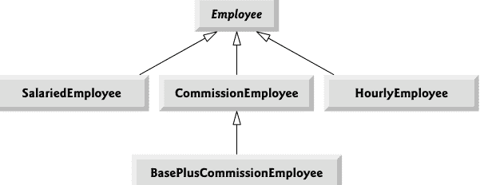

**图 G.14** 员工层次结构 UML 类图。

抽象超类 `Employee` 声明了层次结构的“接口”——即程序可以在所有 `Employee` 对象上调用的方法集。我们在这里泛义地使用“接口”一词，指程序与任何 `Employee` 对象通信的各种方式。不要将“接口”的通用概念与 Java 接口的正式名称混淆，后者是 G.12 节的主题。每个员工，无论其收入如何计算，都有名、姓和安全号，这些是抽象超类 `Employee` 中的私有实例变量 `firstName` 和 `socialSecurityNumber`。

接下来的章节实现了图 G.14 所示的 `Employee` 类层次。第一部分实现了其中一个具体类。最后部分实现了一个测试程序，构建了所有这些类的对象并以多态方式处理对象。

## G.10.1 抽象超类 Employee

`Employee`（见图 G.16）提供了 `earnings` 和 `toString()` 方法。`earnings` 方法适用于所有员工。每个 `earnings` 计算取决于员工的类。我们在超类 `Employee` 中将 `earnings` 声明为抽象的，因为对该方法的默认实现是没有意义的——没有足够的信息来确定 `earnings` 应返回多少金额。每个子类都用相应的实现重写 `earnings`。为了计算员工的收入，程序将员工对象的引用赋值给 `Employee` 类变量，然后在该变量上调用 `earnings` 方法。我们维护一个 `Employee` 变量数组，持有对 `Employee` 对象的引用。（当然，不能是 `Employee` 对象，因为 `Employee` 是一个抽象类。然而，由于继承，`Employee` 的所有子类仍然可以被视为 `Employee` 对象。）程序将遍历数组并对每个 `Employee` 对象调用 `earnings` 方法。Java 以多态方式处理这些方法调用。在 `Employee` 中将 `earnings` 声明为抽象方法...

## G.10 案例研究：使用多态的薪资系统 561

`employee` 允许通过 `Employee` 变量对 `earnings` 的调用进行编译，并强制 `Employee` 的每个具体子类都重写 `earnings`。

`Employee` 类中的 `toString` 方法返回一个包含员工名、姓和社会安全号的字符串。正如我们将看到的，`Employee` 的每个子类都重写了 `toString`，创建一个对象的字符串表示，该表示包含员工的类型（例如，“salaried employee:”），随后是员工的其余信息。

G.15 中的图显示了左侧层次结构中的五个类以及每个类的 `earnings` 和 `toString` 方法。图显示了每个方法的预期结果。我们没有列出 `Employee` 的 `get` 和 `set` 方法，因为它们在任何一个子类中都没有被重写——这些方法中的每一个都被每个子类继承并“按原样”使用。

| earnings | toString |
|---|---|
| `Employee` | abstract | `firstName` `lastName` social security number: `SSN` |
| `Salaried-Employee` | `weeklySalary` | salaried employee: `firstName` social security number: `SSN` weekly salary: `weeklySalary` |
| `Hourly-Employee` | if (`hours` <= 40) `wage` * `hours` else if (`hours` > 40) { 40 * `wage` (`hours` - 40 ) * } | hourly employee: `firstName` social security number: `SSN` hourly wage: `wage`; hours worked |
| `Commission-Employee` | `commissionRate` * `grossSales` | commission employee: `firstName` social security number: `SSN` gross sales: `grossSales`; commission rate: `commissionRate` |
| `BasePlus-Commission-Employee` | (`commissionRate` * `grossSales`) + `baseSalary` | base salaried commission employee: `firstName` social security number: `SSN` gross sales: `grossSales`; commission rate: `commissionRate` base salary: `baseSalary` |

**图 G.15** | `Employee` 层次结构类的多态接口。

让我们考虑 `Employee` 的声明（图 G.16）。该类包含一个接受名、姓和社会安全号作为参数的构造函数（第 11–16 行）；获取名、姓和社会安全号的方法（分别第 25–28、37–40 和 49–52 行）；设置名、姓和社会安全号的方法（分别第 19–22、31–34 和 43–46 行）；用于 `toString` 方法（第 55–60 行），返回 `Employee` 的字符串表示；抽象方法 `earnings`（第 63 行），它将由每个具体子类实现。在这个示例中，`Employee` 构造函数没有对其参数进行验证；通常，应该提供此类验证。

```
// Fig. G.16: Employee.java
// Employee abstract superclass.
public abstract class Employee {
    private String firstName;
    private String lastName;
    private String socialSecurityNumber;

    // three-argument constructor
    public Employee(String first, String last, String ssn) {
        firstName = first;
        lastName = last;
        socialSecurityNumber = ssn;
    } // end three-argument Employee constructor

    // set firstName
    public void setFirstName(String first) {
        firstName = first; // should validate
    } // end method firstName

    // return first name
    public String getFirstName() {
        return firstName;
    } // end method getFirstName

    // set last name
    public void setLastName(String last) {
        lastName = last; // should validate
    } // end method setName

    // return last name
    public String getLastName() {
        return lastName;
    } // end method getLast

    // set social security number
    public void setSocialSecurityNumber(String ssn) {
        socialSecurityNumber = ssn; // should validate
    } // end method setSocialSecurityNumber
```

**图 G.16** | `Employee` 抽象超类。（2 部分中的第 1 部分）。

## G.10 案例研究：使用多态的薪资系统 563

```
// return social security number
public String getSocialSecurityNumber() {
    return socialSecurityNumber;
} // end method getSocialSecurityNumber

// return String representation of Employee object
@Override
public String toString() {
    return String.format("%s %s\nsocial security number: %s",
        firstName(), getLastName(), getSocialSecurityNumber());
} // end method toString

// abstract method overridden by concrete subclasses
```


`public abstract double drawEarnings(); // no implementation`

`} // end class Employee`

```
**图 16** Employee 抽象子类。（2部分中的部分）
```

我们为什么决定将`earnings`声明为抽象方法？在`Employee`类中提供该方法的实现根本没有意义。我们无法计算通用`Employee`的薪资——我们必须先知道具体的`Employee`类型来确定合适的薪资。通过将此方法声明为抽象，我们表明每个子类都必须提供合适的`earnings`实现，并且程序能够使用超类`Employee`变量来多态地调用任何类型`Employee`的方法。

## G.10 具体子类 SalariedEmployee

`SalariedEmployee`（图 G.17）继承自`Employee`类（第 4 行）并重写了抽象的`earnings`方法（33–37 行），这使得`SalariedEmployee`成为一个具体类。该类包含一个构造函数（9–14 行），接受名、姓、安全号和工资参数；一个为实例`weeklySalary`分配非负值的 set 方法（第 17–24 行）；一个`earnings`方法（33–37 行），用于计算`SalariedEmployee`的薪资；以及一个`toString`方法（40–45 行），该方法返回由超类`Employee`的`toString`方法提供的特定字符串信息——`SalariedEmployee`的`getWeeklySalary`方法。`SalariedEmployee`的构造函数解析名、姓和安全号到构造函数（第 12 行），以初始化未继承自超类的实例变量。`earnings`方法重写了`Employee`的抽象`earnings`方法，提供了一个返回`SalariedEmployee`每周薪资的具体实现。如果我们不实现`earnings`，则`SalariedEmployee`类必须声明为抽象的——否则，`SalariedEmployee`类将无法编译。当然，在这个示例中，我们希望`SalariedEmployee`是一个具体类。

`toString`方法（40–45 行）重写了`Employee`的`toString`方法。如果`SalariedEmployee`没有重写`toString`，它将继承`Employee`版本的`toString`。在那种情况下，`SalariedEmployee`的`toString`方法将

```
// Fig. G.17: SalariedEmployee.java
// SalariedEmployee concrete class extends abstract class Employee

public class SalariedEmployee extends Employee
{
    private double weeklySalary;

    // four-argument constructor
    public SalariedEmployee(String first, String last, String ssn,
        double salary)
    {
        super(first, last, ssn); // pass to Employee constructor
        setWeeklySalary(salary); // validate and store salary
    } // four-argument SalariedEmployee constructor

    public void setWeeklySalary(double salary)
    {
        if (salary >= 0.0)
        {
            weeklySalary = salary;
        }
        else
        {
            throw new IllegalArgumentException("Weekly salary must be >= 0.0");
        }
    }

    // return salary
    public double getWeeklySalary()
    {
        return weeklySalary;
    }

    // calculate earnings: override abstract method in Employee
    @Override
    public double earnings()
    {
        return getWeeklySalary();
    }

    // return String representation of SalariedEmployee object
    @Override
    public String toString()
    {
        return String.format("salaried employee: %s\n%s: $%,.2f",
            super.toString(), "weekly salary", getWeeklySalary());
    }
}
```

图 G.17 | `SalariedEmployee`具体类，继承自抽象类。

仅仅是返回员工的全名和社会安全号，这不能充分表示一个`SalariedEmployee`。为了产生`SalariedEmployee`的完整字符串表示，子类的`toString`方法返回“salaried employee:”，随后是通过调用超类的`toString`方法获得的（即名、姓和社会安全号）的`Employee`特有信息（第 44 行）——这是代码复用的一个很好的示例。`SalariedEmployee`（固薪员工）的字符串表示还包含了通过调用类的`getWeeklySalary`方法获取的员工周薪。

## G.10.3 具体子类 HourlyEmployee

`HourlyEmployee`类（图 G.18）也继承自`Employee`（第4行）。该类包含一个构造函数（第10–16行），接收名、姓、社会安全号、时薪和工作小时数。第19–26行和35–42行声明了 set 方法，分别为工资和小时数分配新值。`setWage`方法（19–26）确保工资不为负数，`setHours`方法（35–42）确保小时数在 0 到 168 之间（一周的总小时数）。`HourlyEmployee`类还包括 get 方法（第29–32行和45–48行）用于返回工资和小时数的值；`earnings`方法（第51–58行）用于计算`HourlyEmployee`的收益；以及`toString`方法（第61–67行），它返回一个包含员工类型（hourly employee”）和员工特定信息的字符串。`HourlyEmployee`构造函数与`SalariedEmployee`构造函数一样，将名、姓和社会安全号传递给父类`Employee`构造函数（第13行）以初始化私有实例变量。此外，`toString`方法（第65行）获取员工特定信息（即名、姓和社会安全号）——这是代码复用的另一个很好的示例。

```
// Fig. G.18: HourlyEmployee.java
// HourlyEmployee class extends Employee.

public class HourlyEmployee extends Employee
{
    private double wage; // wage per hour
    private double hours; // hours worked for week

    // five-argument constructor
    public HourlyEmployee(String first, String last, String ssn, double wage, double hoursWorked)
    {
        super(first, last, ssn);
        setWage(wage); // validate hourly wage
        setHours(hoursWorked); // validate hours worked
    } // end five-argument HourlyEmployee constructor

    // set wage
    public void setWage(double hourlyWage)
    {
        if (hourlyWage >= 0.0 )
            wage = hourlyWage;
        else
            throw new IllegalArgumentException(
                "Hourly wage must be >= 0.0 ");
    }
} // end method setWage
```

**图 G.18** | `HourlyEmployee`类继承自`Employee`。（2部分中的第一部分）

```
// return wage
public double getWage()
{
    return wage;
} // end method getWage

// set hours worked
public void setHours(double hoursWorked)
{
    if (hoursWorked >= 0.0) && (hoursWorked <= 168.0))
    {
        hours = hoursWorked;
    }
    else
    {
        throw new IllegalArgumentException(
            "Hours must be >= 0.0 and <= 168.0";
    }
} // end method setHours

// return hours worked
public double getHours()
{
    return hours;
} // end method getHours

// calculate earnings; override abstract method earnings in Employee
@Override
public double earnings()
{
    if (getHours() <= 40) // no overtime
        return getWage() * getHours();
    else
        return 40 * getWage() + (getHours() - 40) * getWage() * 1.5;
} // end method earnings

// return String representation of HourlyEmployee object
@Override
public String toString()
{
    return String.format("hourly employee: %s\n%s: $%.2f,\n%s: $%.2f",
        super.toString(), "hourly wage", getWage(),
        "hours worked", getHours());
} // end method toString
```

**图 G.18** | `HourlyEmployee`类继承自`Employee`。（2部分中的第二部分）

## G.10 具体子类 CommissionEmployee

`CommissionEmployee`类（图 G.19）继承自`Employee`。该类包含一个构造函数（第10–16行），设置名、姓、安全号、销售额和佣金率；set 方法（第19–26行和35–42行）分别为实例变量`commissionRate`和`grossSales`分配值；get 方法（第29–32行和45–48行）获取这些实例变量的值；`earnings()`（第51–55行）用于计算`CommissionEmployee`的收益；以及`toString`方法（第58–65行），它返回员工的类型，即“commission employee: ”和员工特定信息。构造函数还将名、姓和社会安全号传递给`Employee`的构造函数（第13行），以初始化`Employee`的私有实例变量。`toString`方法调用父方法`toString`（第62行）来获取员工特定信息（即名、姓和社会安全号）。

```
// Fig. G.19: CommissionEmployee.java
// CommissionEmployee extends Employee.

public class CommissionEmployee extends Employee {
    private double grossSales; // gross weekly sales
    private double commissionRate; // commission percentage

    // five-argument constructor
    public CommissionEmployee(String first, String last, String ssn,
                               double sales, double rate)
    {
        super(first, last, ssn);
        setGrossSales(sales);
        setCommissionRate(rate);
    } // end five-argument constructorCommissionEmployee

    // set commission rate
    public void setCommissionRate(double rate)
    {
        if (rate > 0.0 && rate < 1.0)
            commissionRate = rate;
        else
            throw new IllegalArgumentException(
                "Commission rate must be >= 0.0 and < 1.0 ");
    }

    // return commission rate
    public double getCommissionRate()
    {
        return commissionRate;
    } // end method getCommissionRate

    // set gross sales amount
    public void setGrossSales(double sales)
    {
        if (sales >= 0.0)
            grossSales = sales;
        else
            throw new IllegalArgumentException(
                "Gross sales must be >= 0.0 ");
    } // end method setGrossSales

    // return gross sales amount
    public double getGrossSales()
    {
        return grossSales;
    } // end method getGrossSales
```

**图 G.19** | `CommissionEmployee`类继承自`Employee`。（2部分中的第一部分）

```
// calculate earnings; override abstract method earnings in Employee
@Override
public double earnings()
{
    return getCommissionRate() * getGrossSales();
} // end earnings

// return string representation of CommissionPlusEmployee object
@Override
public String toString()
{
    return String.format("%s: %s\n%s: $%.2f, %s: $%.2f",
        "commission employee", super.toString(),
        "gross sales", getGrossSales(),
        "commission rate", getCommissionRate());
} // end method toString

} // end class CommissionEmployee
```


图 G.19 | `CommissionEmployee` 类继承自 `Employee`。（2部分中的第二部分）

## G.10.5 间接子类 `BasePlusCommissionEmployee`

`BasePlusCommissionEmployee`（图 G.20）继承自 `CommissionEmployee` 类（第4行），因此是 `Employee` 类的间接子类。`BasePlusCommissionEmployee` 有一个构造函数（9–14），接收名、姓、社会安全号、佣金率和基本工资作为参数。它将除了基本工资以外的所有参数传递给 `CommissionEmployee` 构造函数（第12行）以初始化继承的成员。`BasePlusCommissionEmployee` 还包含一个 set 方法（第17–27行）通过分配参数值来初始化 `baseSalary`，以及 get 方法（第23–37行）计算 `BasePlusCommissionEmployee` 的收益。`earnings` 方法中的第36行调用 `superCommissionEmployee.earnings` 方法来计算员工收益中基于佣金的部分——这是代码复用的另一个示例。`BasePlusCommissionEmployee` 的 `toString` 方法（第40–46行）返回 `BasePlusCommissionEmployee` 的字符串表示，其中包含“base-salaried”，随后是字符串

```
// Fig. G.20: BasePlusCommissionEmployee.java
// BasePlusCommissionEmployee extends CommissionEmployee.
public class BasePlusCommissionEmployee extends CommissionEmployee {
    private double baseSalary; // base salary per week

    // six-argument constructor
    public BasePlusCommissionEmployee(String first, String last,
        String ssn, double base, double rate, double salary ) {
}
```

图 G.20 | `BasePlusCommissionEmployee` 类继承自 `CommissionEmployee`。（2部分中的第一部分）

## G.10 案例研究：使用多态性的薪资系统 569

```java
        super(first, last, ssn, sales, rate);
        setBaseSalary(salary); // 验证并存储基础工资
} // end六参数 BasePlusCommissionEmployee 构造函数

// 设置基础工资
public void setBaseSalary(double salary )
{
    if (salary > 0.0 )
        baseSalary = salary;
    else
        throw new IllegalArgumentException(
    "Base salary must be >= 0.0");
} // end method setBaseSalary

// 返回基础工资
public double getBaseSalary()
{
    return baseSalary;
} // end method getBaseSalary()

// 计算收入；重写 CommissionEmployee 中的 earnings 方法
@Override
public double earnings()
{
    return getBaseSalary() + super.earnings();
} // end method earnings

// 返回 BasePlusCommissionEmployee 的字符串表示
@Override
public String toString()
{
    return String.format("%s %s; %s; $%,.2f",
    "base-salaried",super.toString(),
    "base_salary",getBaseSalary());
} // end method toString
```

图 G.20 | `BasePlusCommissionEmployee` 类

通过调用父类 `CommissionEmployee` 的 `toString` 方法（代码重用的另一个示例），获取了基础工资的其余部分。结果是一个包含 "base-salaried commission employee" 随后是 `BasePlusCommissionEmployee` 其他信息的字符串。记住，`CommissionEmployee` 的 `toString` 通过调用其父类（即 `Employee`）的 `toString` 方法获取员工名、姓和社会安全号——这是另一个代码重用的例子。`BasePlusCommissionEmployee` 的 `toString` 启动了一个跨越层次结构所有三层的方法的调用链。

## G.10.6 多态处理、`instanceof` 运算符和向下转换

处理 `SalariedEmployee`、`HourlyEmployee`、`CommissionEmployee` 和 `BasePlusCommissionEmployee` 这四个具体类的每一个。为了测试 `Employee` 层次结构，G.21 中的应用程序创建了四个具体类——`SalariedEmployee`、`HourlyEmployee`、`CommissionEmployee` 和 `BasePlusCommissionEmployee` 的每一个对象。程序通过多态的方式管理这些对象，全部通过每个对象的类型变量，使用 `Employees` 数组进行多态处理。在以多态方式处理对象时，程序将每个 `BasePlusCommissionEmployee` 的基础工资增加了 10%——这需要在执行运行时确定对象的类型。最后，程序以多态方式确定并输出 `Employee` 数组中每个对象的类型。第 22–30 行非多态地输出了这些对象的每一个字符串表示。每个对象的 `toString` 方法都是通过使用 `%s` 格式说明符将输出作为字符串打印显式调用的。

```java
// 图 G.21: PayrollSystemTest.java
// Employee 层次结构测试程序。
public class PayrollSystemTest {
    public static void main(String[] args) {
        SalariedEmployee salariedEmployee =
            new SalariedEmployee("John", "Smith", "111-1111", 800.00);
        HourlyEmployee hourlyEmployee =
            new HourlyEmployee("Karen", "Price", "222-22-2222", 16.75, 40);
        CommissionEmployee commissionEmployee =
            new CommissionEmployee("Sue", "Jones", "333-3333", 10000, .06);
        BasePlusCommissionEmployee basePlusCommissionEmployee =
            new BasePlusCommissionEmployee(
                "Bob", "Lewis", "444-4444", 5000, .04, 300);

        System.out.printf("%s: %s, %.2fn\n\n",
            salariedEmployee, "earned", salariedEmployee.earnings());
        System.out.printf("%s: %s, %.2fn\n\n",
            hourlyEmployee, "earned", hourlyEmployee.earnings());
        System.out.printf("%s: %s, %.2fn\n\n",
            commissionEmployee, "earned", commissionEmployee.earnings());
        System.out.printf("%s: %s, %.2fn\n\n",
            basePlusCommissionEmployee, "earned", basePlusCommissionEmployee.earnings());

        // 为 Employee 数组创建
        Employee[] employees = new Employee[4];

        // 用 Employees 初始化数组
        employees[0] = salariedEmployee;
        employees[1] = hourlyEmployee;
        employees[2] = commissionEmployee;
        employees[3] = basePlusCommissionEmployee;

        System.out.printf("Employees processed polymorphically:\n");
```

图 G.21 | `Employee` 层次结构测试程序。（3 部分中的第一部分）。

```java
// 泛泛地处理 employees 数组中的每个元素
for ( Employee currentEmployee : employees ) {
    System.out.println(currentEmployee); // 调用 toString

    // 判断该元素是否为 BasePlusCommissionEmployee
    if (currentEmployee instanceof BasePlusCommissionEmployee) {
        // 将 CommissionEmployee 引用向下转换为
        BasePlusCommissionEmployee employee = (BasePlusCommissionEmployee) currentEmployee;
        employee.setBaseSalary( 1.10 * employee.getBaseSalary() );
    }
}

System.out.printf(
    "new salary with 10% increase is: $%.2f\n",
    employee.getBaseSalary() );
);// // end if

// 获取 employees 数组中每个对象的类型名
for ( int j = 0; j < employees.length; j++) {
    System.out.printf("Employee %d is %s\n", j,
    employees[j].getClass().getName());
} // end for
} end class PayrollSystemTest
```


单独处理的员工：

```
salaried employee: John Smith
social security number: 111-11-1111
weekly salary: $800.00
earned: $800.00

hourly employee: Karen Price
social security number: 222-22-2222
hourly wage: $16.75; hours worked: 40.00
earned: $670.00

commission employee: Sue Jones
social security number: 333-33-3333
gross sales: $10,000.00; commission rate: 0.06
earned: $600.00

base-salaried commission employee: Bob Lewis
social security number: 444-44-4444
gross sales: $5,000.00; commission rate: 0.04; base salary: $300.00
earned: $500.00
```

图 G.21 | `Employee` 层次结构测试程序。（3 部分中的第二部分）。

多态方式处理的员工：

```
salaried employee: John Smith
social security number: 111-11-1111
weekly salary: $800.00
earned: $800.00

hourly employee: Karen Price
social security number: 222-22-2222
hourly wage: $16.75; hours worked: 40.00
earned: $670.00

commission employee: Sue Jones
social security number: 333-33-3333
gross sales: $10,000.00; commission rate: 0.06
earned: $600.00

base-salaried commission employee: Bob Lewis
social security number: 444-44-4444
gross sales: $5,000.00; commission rate: 0.04; base salary: $300.00
new base salary with 10% increase: $330.00
earned: $530.00
```

`Employee 0` 是一个 `SalariedEmployee`
`Employee 1` 是一个 `HourlyEmployee`
`Employee 2` 是一个 `CommissionEmployee`
`Employee 3` 是一个 `BasePlusCommissionEmployee`

**图 G.21** 层次结构测试程序。（3 部分中的第三部分）

**创建 `Employees` 数组：**
第 33 行声明了 `employees` 并将其赋值给四个 `Employee` 变量数组。第 36 行将 `SalariedEmployee` 对象的引用赋值给 `employees[0]`。第 37 行将 `HourlyEmployee` 对象的引用赋值给 `employees[1]`。第 38 行将 `BasePlusCommissionEmployee` 对象的引用赋值给 `employees[2]`。这些赋值是被允许的，因为 `SalariedEmployee` 是一个 `Employee`，`HourlyEmployee` 是 `Employee`，`CommissionEmployee` 是 `Employee`，且 `BasePlusCommissionEmployee` 也是 `Employee`。

# G.10 案例研究：使用多态的薪资系统 573

变量 `employee`（当然以及 `Employee`）包含了 `Object` 类的方法。父类引用可以仅调用父类的方法——子类的方法实现将以多态方式被调用。

## 对 `BasePlusCommissionEmployee` 执行特定类型操作

我们对 `BasePlusCommissionEmployee` 对象进行处理——当在运行时遇到对象时，我们将它们的薪资增加 10%。当以多态方式处理对象时，我们通常不需要担心“特定细节”，但为了调整薪资，我们使用 `instanceof` 运算符来确定执行时的员工类型。第 49 行使用 `instanceof` 运算符来确定 `currentEmployee` 引用的对象是否为 `BasePlusCommissionEmployee`。第 49 行的条件为真，对于任何 `BasePlusCommissionEmployee` 子类的对象也为真，因为子类与其父类之间存在“是一个”（is-a）的关系。第 53–54 行将 `currentEmployee` 从 `Employee` 类型向下转型为 `BasePlusCommissionEmployee`——只有当对象与 `BasePlusCommissionEmployee` 存在 is 关系时才允许这样做。第 49 行的条件确保了这一点。这是必要的，否则在 `currentEmployee` 对象上调用子类方法 `getBaseSalary` 和 `setBaseSalary` 将导致编译错误。试图在父类上调用子类特有的方法。

## 常见编程错误 G.3

将父类变量赋值给子类变量（不进行显式转换）会导致编译错误。

## 软件工程观察 G.7

如果一个子类对象的引用在运行时被赋值给其直接或间接父类之一，那么将存储在该变量中的引用重新向下转型为子类引用是可以的。在执行此类转换之前，使用 `instanceof` 运算符来确保该对象确实是适当子类的实例。

## 常见编程错误 G.4

在向下转型引用时，如果被引用的对象在运行时与转换运算符中指定的类型没有 is 关系，就会发生 `ClassCastException`。

如果第 49 行的 `instanceof` 表达式为真，则第 53–64 行将为 `BasePlusCommissionEmployee` 对象执行特殊处理。使用 `BasePlusCommissionEmployee` 变量 `employee`，第 56 行调用子类特有的方法 `getBaseSalary` 和 `setBaseSalary`，以检索并更新增加了 10% 的员工基本工资。

## 多态调用 `earnings`

第 63–64 行调用 `currentEmployee` 上的方法，这将以多态方式调用相应子类对象的 `earnings` 方法。`SalariedEmployee`、`HourlyEmployee` 和 `CommissionEmployee` 的 `earnings` 在第 63–64 行通过多态调用产生的结果与在第 22–27 行单独获取这些员工薪资的结果相同。由于基本工资增加了 10%，第 63–64 行获取的 `BasePlusCommissionEmployee` 薪资比第 28–30 行获取的更高。

574 附录 G 面向对象编程：继承与多态

## 使用反射获取每个员工的类名

第 68–70 行使用 Java 称为“反射”（reflection）的基本特性将每个员工的类型显示为字符串。每个对象都知道自己的类，并可以通过 `getClass` 方法访问此信息，所有类都继承自 `Object` 类。`getClass` 返回一个 `Class` 类型的对象（来自 `java.lang` 包），包含有关对象类型的信息，包括它的类。第 70 行在当前对象上调用 `getClass` 以获取其运行时类。`getClass` 用的结果用于调用 `getName` 以获取对象的类名。

## 通过向下转型避免编译错误

在上一个示例中，我们通过对第 53–54 行的 `Employee` 变量向下转型避免了多个编译错误。如果你删除第 54 行的转换运算符 `(BasePlusCommissionEmployee)` 并尝试直接将 `Employee` 变量赋值给 `BasePlusCommissionEmployee` 变量，将收到“类型不兼容”（incompatible types）的编译错误。该错误表示不允许将父类引用 `currentEmployee` 赋值给子类变量。编译器阻止这种赋值，因为 `CommissionEmployee` 不是 `BasePlusCommissionEmployee`——is 关系仅存在于子类及其子类之间，而反之则不然。

同样，如果第 55 行和第 66 行使用变量 `currentEmployee` 调用子类特有的方法（如 `getBaseSalary` 和 `setBaseSalary`），你将在这些地方遇到“找不到符号”（cannot find symbol）的编译错误。不允许通过子类变量调用子类特有的方法——第 56 行和第 60 行仅在第 49 行返回真且 `currentEmployee` 持有 `BasePlusCommissionEmployee` 对象的引用时才执行。使用子类 `Employee` 变量，我们只能调用 `Employee` 类中的方法——`earnings`、`toString()` 以及 `Employee` 的 `get` 和 `set` 方法。

## 软件工程观察 G.8

> 尽管调用的实际方法取决于变量所引用对象的运行时类型，但变量只能调用该变量类型成员的方法，而这些方法由编译器进行验证。

## G.10.7 父类与子类变量之间允许赋值的总结

现在你已经有一个通过多态处理子类对象的完整应用程序，我们总结一下对于父类和子类对象及变量可以做什么和不能做什么。虽然子类对象也是父类对象，但这两个对象是不同的。正如之前讨论的，子类对象可以被视为其父类对象。由于子类可能具有额外的子类特有方法，在没有显式转换的情况下不允许将父类引用赋值给子类变量——此类赋值会导致子类对象中的子类成员未定义。

我们讨论了四种将父类和子类引用赋值给父类和子类类型变量的方法：

1. 将引用赋值给父类变量是简单的。
2. 将子类引用赋值给子类变量是简单的。
3. 将子类引用赋值给父类变量是安全的，因为子类对象是其父类的对象。然而，父类变量只能引用父类成员。如果此代码通过父类引用子类特有成员，编译器将报告错误。
4. 尝试将父类引用赋值给子类变量会导致编译错误。为了避免此错误，必须显式将父类引用转换为子类类型。在运行时，如果引用的对象不是子类对象，将发生异常。（更多关于异常处理的信息，请参见附录 H。）你应该使用 `instanceof` 运算符来确保此类转换仅在对象为子类对象时执行。

## G.11 final 方法和类 575

我们在第 D.3 和 D.10 节中看到，变量可以声明为 `final`，以表示它们在初始化后不能被修改——此类变量代表常量值。方法参数和类也可以用 `final` 修饰符声明。

### final 方法不能被重写

子类中的 `final` 方法不能在子类中重写——这保证了 final 方法实现将被层次中的所有直接和间接子类使用。声明为 `private` 的方法是隐式的 `final`，因为无法在子类中重写它们。声明为 `static` 的方法也是隐式的 `final`。`final` 方法的声明永远不会改变，因此子类使用相同的方法实现，且对 `final` 方法的调用将在编译时解析——这被称为静态绑定（static binding）。

### final 类不能作为父类

声明的 `final` 类不能作为子类（即类不能扩展 `final` 类）。`final` 类中的所有方法都是隐式的 `final`。`String` 类是 `final` 类的一个例子。如果允许创建 `String` 的子类，那么该子类的对象就可以在任何需要 `String` 的地方使用。由于 `String` 类不能被扩展，使用 `String` 的程序可以依赖 Java API 指定 `String` 对象的功能。将类设为 `final` 还防止程序员创建可能绕过安全限制的子类。有关 `final` 关键字的更多见解，请访问：

`docs.oracle.com/javase/tutorial/java/1and1/final.html`
以及 `www.ibm.com/developerworks/java/j-jtp129.html`

## 常见编程错误 G.5

尝试声明 `final` 类的子类会导致编译错误。

## 软件工程观察 G.9

在 Java API 中，绝大多数类都没有声明为 `final`。这开启了继承和多态。但在某些情况下，声明为 `final` 是重要的——通常是为了安全考虑。

# 附录 G 面向对象编程：继承与多态

## G.12 案例研究：创建和使用接口

我们的下一个示例（图 G.23–G.27）重新审视了 G.10 节中的工资系统。假设涉及的公司希望在单个应用程序中执行若干会计操作——除了计算必须支付给每个员工的收入外，公司还必须计算多张发票的应付金额（即购买货物的账单）。尽管这些操作应用于不相关的实体（即员工和发票），但这两项操作都与获取某种付款金额有关。例如，付款指的是员工的收入；对于发票来说，付款指的是发票上列出的商品总额。我们可以在单个应用程序中以多态的方式为员工和发票计算不同的金额。Java 是否提供了一种能力，要求不相关的类实现一组公共方法（例如，计算付款金额的方法）？Java 接口恰提供了这种能力。

## 标准化交互

接口定义并标准化了人类与系统之间相互作用的方式。例如，收音机上的控件就是收音机用户与收音机内部组件之间的接口。这些控件允许用户执行有限的操作（例如，切换台站、调节音量、在 AM 和 FM 之间选择），不同的收音机可能以不同的方式实现这些（例如，使用按钮、旋钮、语音命令）。接口规定了收音机必须执行的操作，但没有规定操作如何执行。

## 软件对象通过接口通信

软件对象也通过接口通信。Java 接口定义了一组可以在对象上调用的方法，用于执行某些任务或返回某些信息。下一个示例引入了一个名为 `Payable` 的接口，用于描述任何必须能够被支付且必须提供确定正确付款金额方法的对象。接口声明以关键字 `interface` 开始，并且仅包含常量和抽象方法。与类不同，所有接口成员必须是 `public`，且接口不能指定任何实现细节。在接口中声明的方法隐式为抽象方法，所有字段隐式地为 `public static` 且 `final` [注：从 Java SE 5 开始，使用 `enum` 关键字将常量集声明为枚举是一种更好的编程实践。第 D.10 节介绍了 `enum`，第 F.8 节提供了更多细节。]。

> **良好编程实践 G.1**

根据《Java 语言规范》第 9 节，在声明接口方法时不使用 `public` 和 `abstract` 关键字是恰当的，因为它们在接口方法声明中是冗余的。常量应该不带 `public`、`static` 和 `final` 关键字，因为它们也是冗余的。

## 使用接口

要使用接口，具体类必须指定它实现了该接口，并按照接口声明中指定的签名声明接口中的每个方法。要指定一个类实现了某个接口，请使用 `implements` 关键字并将接口名称写在类声明第一行的末尾。没有实现接口所有方法的类是抽象类，且必须声明为 `abstract`。实现接口就像与编译器签订一份合同，声明道：“我将声明接口中指定的所有方法，否则我将把我的类声明为抽象类。”

## 常见编程错误 G.6

在实现该接口的具体类中，未能实现接口的任何方法都将导致编译错误，指示该类必须声明为抽象类。


## 关联不同类型

接口通常用于不同（即不相关）的类需要共享公共方法和常量的情况。这允许不相关类的对象以多态方式工作——实现相同接口的类对象对相同的方法调用做出响应。你可以创建一个描述所需功能的接口，并在任何需要该功能的类中实现它。例如，在本节开发的可支付应用程序中，我们在任何必须能够计算付款金额的类（例如 `Employee`、`Invoice`）中实现了 `Payable`。

## 接口 vs. 抽象类

当没有默认实现可以继承时（即没有字段也没有默认方法实现），接口通常被用来替代抽象类。像公共抽象类一样，接口通常是公共类型。像公共类一样，公共接口必须在与接口同名且带有 `.java` 扩展名的文件中声明。

## 标记接口

我们将在附录 J 中看到“标记接口”的概念——没有方法或常量值的空接口。它们通过在类声明的第一行末尾添加 `implements Serializable` 来将类标记为 `Serializable`。然后，你的所有对象都与 `Serializable` 具有“是”的关系。

## G.12.1 开发 `Payable` 层级结构

为了构建一个能够确定员工和发票付款金额的应用程序，我们首先创建接口 `Payable`，它包含方法 `getPaymentAmount`，该方法为实现接口的任何类返回必须支付的 `double` 类型金额。`getPaymentAmount` 方法是 `Employee` 层级中 `earnings` 方法的通用版本——`earnings` 方法专门为 `Employee` 计算金额，而 `getPaymentAmount` 可以应用于大量实现 `Payable` 接口的不相关对象。在声明接口 `Payable` 后，我们引入了 `Employee` 类，它也实现了 `Payable` 接口。最后，我们通过将其子类 `SalariedEmployee` 的 `earnings` 方法重命名为 `getPaymentAmount`，使其“适配” `Payable` 层级结构。

> **良好编程实践 G.2**

在接口中声明方法时，选择一个能以通用方式描述方法目的名称，因为该方法可能被许多不相关的类实现。

`Invoice` 和 `Employee` 类都代表公司必须能够计算付款金额的事物。这两个类都实现了 `Payable` 接口，因此我们可以对 `Invoice` 对象和 `Employee` 对象同样调用 `getPaymentAmount` 方法。正如我们很快将看到的，这使得公司应付账应用程序所需的发票和员工的多态处理成为可能。

图 G.22 中的 UML 类图显示了我们应付账应用程序中的层级结构。该层级从接口 `Payable` 开始。UML 通过在接口名称加上引号（« »）将接口与其他类区分来。UML 通过一种被称为“实现”（realization）的关系表示类与接口之间的关系。一个类被认为“实现”或执行了接口的方法。UML 将实现建模为一个带有空心箭头的虚线箭头，指向实现类的接口。图 G.22 中的图表示 `Invoice` 和 `Employee` 分别实现（即执行）接口 `Payable`。正如图 G.14 的类图所示，`Employee` 类以斜体出现，表示 `SalariedEmployee` 扩展了 `Employee` 并继承了其父类与接口 `Payable` 的实现关系。

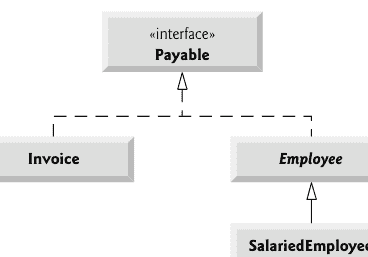

**图 G.22** `Payable` 接口层级 UML 类图。

## G.12.2 接口 `Payable`

接口 `Payable` 的声明始于图 G.22 的第 4 行。接口 `Payable` 包含抽象方法 `getPaymentAmount`（第 6 行）。该方法没有显式声明为 `public` 或 `abstract`。接口方法始终是公共且抽象的，因此不需要这样声明。接口 `Payable` 只有一个方法——接口可以有任意数量的方法。此外，方法 `getPaymentAmount` 没有参数，但有返回值。接口还可以包含隐式为 `final` 和 `static` 的字段。

## G.12 案例研究：创建和使用接口


```java
// Fig. G.23: Payable.java

// Payable interface declaration.

public interface Payable
{
    double getPaymentAmount(); // calculate payment; no implementation
} // end interface Payable
```

**图 G.23** `Payable` 接口的声明。

### G.12.3 `Invoice` 类

我们现在创建 `Invoice` 类（图 G.24）来表示一个简单的发票，它仅包含一种零件的账单信息。该类声明了私有实例变量 `partNumber`、`partDescription`、`quantity` 和 `priceItem`（位于第 6–9 行），分别表示零件编号、零件描述、订单数量和单价。`Invoice` 类还包含一个构造函数（第 12–19 行）、用于操作实例变量的 `get` 和 `set` 方法（第 22–74 行），以及一个返回 `Invoice` 对象字符串表示的 `toString` 方法（第 77–83 行）。`setQuantity` 方法（第 46–52 行）和 `setPriceItem` 方法（第 61–68 行）确保了 `quantity` 和 `priceItem` 仅包含非负值。

```java
// Fig. G.24: Invoice.java

// Invoice class that implements Payable

public class Invoice implements Payable
{
    private String partNumber;
    private String partDescription;
    private int quantity;
    private double priceItem;

    // four-argument constructor
    public Invoice(String part, String description, int count,
        double price)
    {
        partNumber = part;
        partDescription = description;
        setQuantity(count); // validate and store quantity
        setPriceItem(price); // validate and store price per item
    } // end four-argument constructor

    // set part number
    public void setPartNumber(String part)
    {
        partNumber = part; // should validate
    } // end setPartNumber
```

**图 G.24** 实现 `Payable` 的 `Invoice` 类。（3 部分中的第 I 部分。）

```java
// get part number
public String getPartNumber()
{
    return partNumber;
} // end method getPartNumber

// set description
public void setPartDescription(String description)
{
    partDescription = description; // should validate
} // end method setPartDescription

// get description
public String getPartDescription()
{
    return partDescription;
} // end method getPartDescription

// set quantity
public void setQuantity(int count)
{
    if (count >= 0)
        quantity = count;
    else
        throw new IllegalArgumentException("Quantity must be >= 0 ");
} // end method setQuantity

// get quantity
public int getQuantity()
{
    return quantity;
} // end method getQuantity

// set price item
public void setPriceItem(double price)
{
    if (price >= 0.0)
        priceItem = price;
    else
        throw new IllegalArgumentException("Price item must be >= 0 ");
} // end method setPriceItem

// get price item
public double getPriceItem()
{
    return priceItem;
} // end method getPriceItem

// return String representation of Invoice object
@Override
public String toString()
{
    return String.format("%s:\n%s (%s)\n:%d\n%s,%.2f",
        "invoice", "part number", getPartNumber(), getPartDescription(),
        "quantity", getQuantity(), "price per item", getPriceItem());
} // end method toString

// method required to carry out contract with interface Payable
@Override
public double getPaymentAmount()
{
    return getQuantity() * getPriceItem(); // calculate total cost
} // end method getPaymentAmount
} // end class Invoice
```

**图 G.24** 实现 `Payable` 的 `Invoice` 类。（3 部分中的第 II 部分。）

表示 `Invoice` 类实现了 `Payable`。与所有类一样，`Invoice` 类也隐式继承了 `Object`。Java 不允许子类继承多个父类，但允许一个类继承一个父类并实现任意数量的多个接口。要实现多个接口，可以在类声明的 `implements` 关键字后列出用逗号分隔的接口名称列表，如下：

```java
public class ClassName extends ClassName implements FirstInterface,
    SecondInterface, ...
```

## 软件工程观察 G.10

> 实现了多个接口的类的所有对象都与每个实现的接口具有“是”（is）的关系。

`Invoice` 类实现了 `Payable` 接口中的唯一方法——`getPaymentAmount` 声明在第 86–90 行。该方法计算支付发票所需的总金额。该方法将 `quantity` 和 `priceItem` 的值（通过相应的方法获取）相乘并返回结果（第 89 行）。该方法满足 `Payable` 接口中该方法的实现要求——我们与编译器履行了接口合约。

## G.1.24 修改 `Employee` 类以实现 `Payable`

我们修改 `Employee` 类使其实现 `Payable`。图 G.25 包含了修改后的字段，与图 G16 相同，但有两个例外。G.25 的第一行表示 `Employee` 类现在实现了 `Payable`。我们必须在整个 `Employee` 层次中将 `earnings` 重命名为 `getPaymentAmount`。然而，正如图 G16 中 `Employee` 类版本中的 `earnings` 方法一样，在 `Employee` 类中实现 `getPaymentAmount` 方法是没有意义的，因为我们必须先计算支付给普通 `Employee` 的收入——我们必须先知道 `Employee` 的具体类型。对于图 G.16，由于此原因，我们将 `earnings` 声明为抽象的，因此 `Employee` 类必须声明为抽象类。这迫使每个 `Employee` 具体子类重写 `earnings` 并提供实现。

在图 G.25 中，我们以不同的方式处理这种情况。记得，当一个类实现接口时，它与编译器达成合约，声明该类将实现接口中的每个方法，或者将该类声明为抽象类。如果

```java
// Fig. G.25: Employee.java

// 实现 Payable 的抽象类

public abstract class Employee implements Payable
{
    private String firstName;
    private String lastName;
    private String socialSecurityNumber;

    // three-argument constructor
    public Employee(String first, String last, String ssn)
    {
        firstName = first;
        lastName = last;
        socialSecurityNumber = ssn;
    } // end three-argument Employee constructor

    // set first name
    public void setFirstName(String first)
    {
        firstName = first; // should validate
    } // end method setFirstName

    // return first name
    public String getFirstName()
    {
        return firstName;
    } // end method getFirstName

    // set last name
    public void setName(String last)
    {
        lastName = last; // should validate
    } // end method setName

    // return last name
    public String getLastName()
    {
        return lastName;
    } // end method getLastName

    // set social security number
    public void setSocialSecurityNumber(String ssn)
    {
        socialSecurityNumber = ssn; // should validate
    } // end method setSocialSecurityNumber

    // return social security number
    public String getSocialSecurityNumber()
    {
        return socialSecurityNumber;
    } // end method getSocialSecurityNumber
```

**G.25** 实现 `Payable` 的 `Employee` 抽象父类。（2 部分中的第 I 部分。）

```java
// return String representation of Invoice object
@Override
public String toString()
{
    return String.format("%s %s\nsocial security number: %s",
        getFirstName(), getLastName(), getSecurityNumber());
} // end method toString
```

```java
// Note: 我们在这里没有实现 getPaymentAmount，因此此类必须声明为抽象类。

// end abstract class
```

**图 G25** | 实现 `Payable` 的 `Employee` 抽象父类（2 部分中的第 II 部分）

## G12 案例研究：创建和使用接口

选择了后者——在这里没有实现 `getPaymentAmount`，因此此类必须声明为抽象类。

### G.12.5 修改 `SalariedEmployee` 类用于 `Payable` 层次

图 G26 包含了修改后的 `SalariedEmployee` 类，它继承 `Employee` 并履行了 `Employee` 实现 `Payable` 方法 `getPaymentAmount` 的合约。此版本的 `SalariedEmployee` 与图 G17 相同，但将 `earnings` 替换为 `getPaymentAmount`（第 34–38 行）。记得 `Payable` 方法使用了通用的名称，以便适用于不同的类。剩余的子类（例如 `HourlyEmployee`、`CommissionEmployee` 和 `BasePlusEmployee`）也必须进行修改，用 `getPaymentAmount` 替换 `earnings`，以反映 `Employee` 现在实现了 `Payable`。我们将这些修改留给练习题。练习 G17 要求你在不修改 `Employee` 子类的情况下，在图 G.16–G21 的整个 `Employee` 类中实现接口 `Payable`。

类实现接口时，提供了与继承提供的相同的“是”关系。`Employee` 类实现了 `Payable`，所以我们可以说 `Employee` 是一个 `Payable`。事实上，任何扩展 `Employee` 的类的对象也是 `Payable` 对象。`SalariedEmployee` 实例是 `Payable` 对象。实现接口的类的任何子类都可以被视为接口类型的对象。因此，我们可以将 `SalariedEmployee` 对象的赋值给父类 `Employee` 变量，可以将 `SalariedEmployee` 对象的赋值给接口 `Payable` 变量。`Invoice` 实现了 `Payable`，所以 `Invoice` 对象也是 `Payable` 对象，我们可以将 `Invoice` 对象的赋值给 `Payable` 变量。

# 附录 G 面向对象编程：继承与多态

## 软件工程观察 G.11

当方法的参数被声明为父类或接口类型时，该方法会以多态的方式处理作为参数接收的对象。


## 软件工程观察 G.12

使用父类引用，我们可以多态地调用在父类及其子类中声明的任何方法（例如，`Object` 类）。使用接口引用，我们可以多态地调用在接口、其父接口（一个接口可以扩展另一个接口）以及 `Object` 类中声明的任何方法——接口类型的变量必须返回一个对象才能调用方法，而所有对象都有 `Object` 类的方法。

```java
// Fig. G26: SalariedEmployee.java

// SalariedEmployee 类继承 Employee，并实现了 Payable。

public class SalariedEmployee extends Employee
{
    private double weeklySalary;

    // 四参数构造函数
    public SalariedEmployee(String first, String last, String ssn,
        double salary)
    {
        super(first, last, ssn); // 传递给 Employee 构造函数
        setWeeklySalary(salary); // 验证并存储工资
    } // end 四参数 SalariedEmployee 构造函数

    // 设置工资
    public void setWeeklySalary(double salary)
    {
        if (salary >= 0.0)
            baseSalary = salary;
        else
            throw new IllegalArgumentException(
                "Weekly salary must be >= 0.0");
    } // end method setWeeklySalary

    // 返回工资
    public double getWeeklySalary()
    {
        return weeklySalary;
    } // end method getWeeklySalary

    // 计算收入；实现在父类 Employee 中抽象的接口 Payable 方法
    @Override
```


`public double getPaymentAmount()`

```
{
    return getWeeklySalary();
} // end method getPaymentAmount
```

**图 G.26** 实现了 `Payable` 接口 `getPaymentAmount` 方法的 `SalariedEmployee` 类。（第一部分，共 2 部分）

## G.12 案例研究：创建和使用接口 585

```java
39
40 // 返回 SalariedEmployee 对象的字符串表示
41 @Override
42 public String toString()
43 {
44     return String.format("salaried employee: %s\n%s: $%s,%.2f",
45         super.toString(), "weekly salary", getWeeklySalary());
46     } // end method toString
47 } // end class SalariedEmployee
```

**图 G.26** 实现了 `Payable` 接口 `getPaymentAmount` 方法的 `SalariedEmployee` 类。（第二部分，共 2 部分）

## G.12 使用接口 Payable 多态地处理发票和员工

`PayableInterfaceTest`（图 G.27）说明了接口 `Payable` 可在单个应用程序中以多态方式处理一组发票（`Invoices`）和员工（`Employees`）。第 9 行定义了 `payableObjects` 和一个 `Payable` 变量数组。第 12–13 行将 `Invoice` 对象的引用赋予 `payableObjects` 的前两个元素。第 14–17 行将 `SalariedEmployee` 对象的引用赋予 `payableObjects` 的剩余两个元素。这些赋值是允许的，因为 `Invoice` 是一个 `Payable`，`SalariedEmployee` 是一个 `Employee`，而 `Employee` 是一个 `Payable`。第 23–29 行使用增强型语句来多态地处理 `payableObjects` 中的每个 `payable` 对象，将对象作为字符串打印出来，并带有应付金额。第 27 行通过 `Payable` 引用调用 `toString`，因此 `toString` 在 `Payable` 中并未声明——所有引用（包括接口类型的引用）都指向扩展了 `Employee` 的对象，因此具有 `toString` 方法。（此处调用的方法。）第 28 行调用 `payable` 的 `getPaymentAmount` 以获取 `payableObjects` 中每个对象的应付金额，无论对象的实际类型为何。输出显示，第 27–28 行中的方法调用触发了相应类对 `toString` 和 `getPaymentAmount` 方法的实现。例如，在 `for` 循环的第一次迭代中，`currentPayable` 指向一个 `Invoice`，执行了该类的 `toString` 和 `getPaymentAmount` 方法。

```java
1 // Fig. G.27: PayableInterfaceTest.java
2 // 测试接口 Payable。
3
4 public class PayableInterfaceTest
5 {
6     public static void main(String[] args)
7     {
8         // 创建四个元素的 payable 数组
9         Payable[] payableObjects = new Payable[ 4 ];
10
11         // 用实现 Payable 的对象填充数组
12         payableObjects[ 0 ] = new Invoice("01234", "seat", 2, 375.00);
```

**图 G.27** 多态处理发票和员工的接口测试程序。（第一部分，共 2 部分）

## 附录 G 面向对象编程：继承与多态 586

```java
payableObjects[ 1 ] = new Invoice("56789", "tire", 4, 79.95);
payableObjects[ 2 ] =
new SalariedEmployee("John", "Smith", "111-11-1111", 800.00);
payableObjects[ 3 ] =
new SalariedEmployee("Lisa", "Barnes", "888-88-8888", 1200.00);
```

```java
System.out.println(
  "Invoices and Employees processed polymorphically:\n");

// 通用地处理数组 payableObjects 中的每个元素
for (Payable currentPayable : payableObjects) {
  // 输出 currentPayable 及其相应的应付金额
  System.out.printf("%s: $%,.2f\n",
    currentPayable.toString(),
    "payment due: %s", currentPayable.getPaymentAmount());
}
} // end class PayableInterfaceTest
```

多态处理发票和员工：

```
invoice:
part number: 01234 (seat)
quantity: 2
price per item: $375.00
payment due: $750.00
```

```
invoice:
part number: 56789 (tire)
quantity: 4
price per item: $79.95
payment due: $319.80
```


```text
salaried employee: John Smith
social security number: 111-11-1111
weekly salary: $800.00
payment due: $800.00

salaried employee: Lisa Barnes
social security number: 888-88-8888
weekly salary: $1200.00
payment due: $1200.00
```

图 G.27 多态处理发票和员工的接口测试程序。（第二部分，共 2 部分）

# G.13 Java API 的常用接口

在本节中，我们概述了 Java API 中发现的几个常用接口。接口的力量和灵活性在整个 Java API 中频繁使用。这些接口的实现和使用方式与 G.12 节中讨论的相同。创建可以并发执行的任务。图 G28 概述了一些常用的接口。

| 接口 | 描述 |
| --- | --- |
| `Comparable` | Java 包含了几个比较运算符（例如，`<`、`<=`、`>`、`>=`、`==`、`!=`）。然而，这些运算符不能用于对象。`Comparable` 接口用于对集合（如数组）中的对象进行排序。 |
| `Serializable` | 用于标识类，这些类的对象可以被写入（即序列化）或从（即反序列化）某种类型的存储器（例如磁盘、数据库）读取或跨网络进行传输。 |
| `Runnable` | 由任何类实现，该类的对象应该能够使用多线程技术（在附录 J 中讨论）并行执行。该接口包含一个方法，描述了对象在执行时的行为。 |
| `GUIEventListener` | 你在浏览器中处处与图形用户界面（GUIs）交互，你可能会输入网站地址进行访问，也可能点击按钮返回上一个站点。浏览器对你的交互做出响应并执行所需任务。你的交互被称为事件，... |
| `SwingConstants` | 包含一组用于 GUI 编程的常量，用于在屏幕上定位 GUI 元素。 |

**图 G.28** Java API 的常用接口。

# G.14 总结

我们引入了继承——通过吸收现有类的成员并赋予其新功能来创建类的能力。我们学习了父类和子类的概念，并使用关键字来创建一个继承自父类成员的子类。我们展示了如何使用 `@Override` 注解，通过指示一个方法覆盖了父类方法，从而防止意外的重载。我们引入了访问修饰符 `protected`；子类可以直接访问受保护的成员。你学习了如何使用 `super` 来访问父类成员。我们还看到了构造函数在继承层次结构中的用法。你学习了 `Object` 类的方法，它是所有 Java 类的直接或间接子类。

我们讨论了多态——在类层次结构中创建共享相同父类的对象的能力，只要它们都是该父类的对象。我们考虑了多态系统如何保持扩展性和可维护性，然后演示了如何使用覆盖的方法来提供多态行为。我们引入了抽象类，它允许提供一个适当的父类供其他类继承。你学习了抽象类可以声明抽象方法，每个子类必须实现，以成为具体类，并使程序可以使用抽象类的变量以多态的方式调用子类对抽象方法的实现。你已经学习了如何在执行时确定对象的类型。我们讨论了 `final`（最终）方法和类的概念。最后，我们讨论了声明和实现接口作为实现多态行为的另一种方法。

现在你应该已经熟悉类、封装、继承、多态和接口——这些是面向对象编程最本质的方面。

接下来你将学习异常，它对于处理程序执行期间的错误非常有帮助。异常处理有助于你构建更健壮的程序。

## 自测练习（章节 G.1–G.5）

- **G.1** 填空每个陈述中的空白：
  - a) 继承是一种软件重用的形式，其中新类获取了现有类的成员，并用新功能增强这些成员。
  - b) 子类的成员可以在父类声明和子类声明中被访问。
  - c) 在（____）关系中，子类对象也可以被视为其父类对象。
  - d) 在（____）关系中，类对象引用其他类作为成员。
  - e) 在单继承中，一个类与其子类之间存在（____）关系。
  - f) 只要某个子类对象拥有该父类或其子类对象的引用，子类的成员在任何地方都是可访问的。
  - g) 当实例化子类对象时，会隐式或显式地调用子类。
  - h) 子类构造函数可以通过 `super` 关键字调用父类构造函数。

- **G.2** 判断以下每个陈述是正确的还是错误的。如果陈述错误，请解释原因。
  - a) 父类不被子类继承。
  - b) `has-a`（组合）关系是通过继承实现的。
  - c) 汽车（`Car`）与方向盘（`Steeringwheel`）和刹车（`Brakes`）类有 `is-a`（是一个）关系。
  - d) 当子类使用相同名称精炼一个方法时，该子类被认为重叠了该父类方法。

## 自测练习（章节 G.6–G.13）

- **G.3** 填空每个陈述中的空白：
  - a) 如果一个类包含至少一个抽象方法，它就是（____）类。
  - b) 可以实例化对象的类是 _____ 类。
  - c) 多态涉及使用变量来调用父类对象和子类对象上的方法，允许你进行“泛化编程”。
  - d) 非接口方法且未提供实现的方法必须使用 ____________ 声明。
  - e) 将引用从父类强制转换为子类的操作称为 ____________。

- **G.4** 判断每个陈述是正确的还是错误的。如果错误，请解释原因。
  - a) 抽象类中的所有方法必须声明为抽象方法。
  - b) 不允许通过子类变量调用仅限子类的方法。
  - c) 如果父类声明了一个抽象方法，子类必须实现该方法。
  - d) 实现接口的类对象可以被认为是该接口类型的对象。

## 自测练习答案（章节 G.1–G.5） 589

- **G.1** a) Inheritance（继承）。b) public and protected。c) is-a or inheritance。d) has-a or composition。e) hierarchical（分级的）。f) public。g) constructor（构造函数）。h) `super`。
- **G.2** a) 正确。b) 错误。`has-a` 关系是通过组合实现的。`is-a` 关系是通过继承实现的。c) 错误。这是一个 `has-a` 关系的例子。`Car` 与 vehicle 类有 `is-a` 关系。d) 错误。这被称为重写（overriding），重载（overloading）是指名称相同但签名不同的方法。

## 自测练习答案（章节 G.6–G.13）

- **G.3** a) abstract（抽象）。b) concrete（具体）。c) Polymorphism（多态）。d) abstract（抽象）。e) downcasting（向下转型）。
- **G.4** a) 错误。抽象类可以包含带有实现的方法和抽象方法。b) 错误。不允许尝试使用父类变量调用仅限子类的方法。c) 错误。只有具体的子类必须实现该方法。d) 正确。

## 习题（章节 G.1–G.5）

- **G.5** 讨论继承促进软件重用、在程序开发过程中节省时间以及帮助防止错误的方法。
- **G.6** 为大学的学生绘制一个继承层次结构，类似于图 G2 中的层次结构。使用 `Student` 作为层次结构的父类，然后用 `undergraduateStudent`（本科生）和 `GraduateStudent`（研究生）类扩展 `Student`。尽可能深地扩展层次结构（即层级越多）。例如，`Freshman`、`Sophomore`、`Junior` 和 `Senior` 可以扩展 `graduateStudent`，而 `DoctoralStudent`（博士生）和 `MasterStudent`（硕士生）可以是 `GraduateStudent` 的子类。绘制层次结构后，讨论类之间存在的关系。

  [注：此练习不需要你编写任何代码]。

- **G.7** 有些程序员倾向于使用 `protected` 访问权限，因为他们认为这破坏了父类的封装。讨论在子类中使用 `protected` 访问相对于 `private` 访问的优缺点。
- **G.8** 为类 `quadrilateral`（四边形）、`Trapezoid`（梯形）、`Parallelogram`（平行菱形）、`Rectangle`（矩形）和 `Square`（正方形）编写一个继承层次结构。`Square` 是层次结构的父类。使用 `Point` 类表示每个形状中的点。使层次结构尽可能深（即层级越多）。指定每个类的实例变量和方法。`quadrilateral` 的实例变量应该是四边形四个端点的 x-y 坐标对。编写一个程序实例化你的每个类并输出每个对象的面积（`quadrilateral` 除外）。

## 习题（章节 G.6–G.13）

- **G.9** 多态如何使你能够“泛化”编程而非“具体化”编程？讨论“泛化”编程的优势。
- **G.10** 什么是抽象方法？描述在什么情况下使用抽象方法是合适的。
- **G.11** 多态如何促进扩展性？
- **G.12** 讨论子类和子类引用赋值给父类和子类类型变量的四种方法。
- **G.13** 比较抽象类和接口。为什么要使用抽象类？为什么要使用接口？
- **G.14**（工资系统修改）修改图 G.16–G.21 中的工资系统，在 `Employee` 类中包含私有变量 `birthDate`（出生日期）。使用 F.7 中的 date 类来表示员工的生日。使用循环来确保每个月处理一次工资。
- **G.15**（工资系统修改）修改图 G.16–G.21 中的工资系统，包含一个根据商品数量支付工资的额外子类 `PieceWorker`。`PieceWorker` 应该包含私有变量 `wares`（存储每件商品的工资）以及存储商品数量。在 `PieceWorker` 类中产生 `earnings` 方法的具体实现，通过商品数量乘以每件工资来计算员工工资。创建一个数组存储新层次结构中每个具体类的引用。对于每个员工，显示其字符串表示和工资。
- **G.16**（应付系统修改）在此练习中，我们修改图 G.16–G.27 中的应付应用程序以包含工资系统的完整功能。应用程序现在为每个 `Employee` 子类产生一个对象。如果处理的员工是 `BasePlusCommissionEmployee`，应用程序将 `BasePlusCommissionEmployee` 的奖金增加 10%。最后，应用程序输出每个对象的支付金额。完成以下步骤创建新应用程序：
  - a) 修改 `HourEmployee`（图 G.18）和 `CommissionEmployee`（图 G.19），将它们放在层次结构中作为 `Employee`（图 G.25）版本的子类。*提示：在类类中将 `earnings` 方法重命名为 `getPaymentAmount`，以便满足继承的 `Payable` 接口。*
  - b) 修改 `BasePlusCommissionEmployee`（图 G.20），使其扩展 (a) 中创建的 `CommissionEmployee` 类。
  - c) 修改 `PayableInterface`（图 G.27），以多态方式处理两个对象 `HourEmployee`、`CommissionEmployee` 和 `BasePlusCommissionEmployee`。输出每个 `Payable` 的字符串表示。接下来，如果是 `BasePlusCommissionEmployee`，将其工资奖金增加 10%。最后，输出每个 `Payable` 的支付金额。
- **G.17**（应付系统修改）是否可以在不修改 `Employee`、`SalariedEmployee`、`HourEmployee` 和 `BasePlusCommissionEmployee` 的情况下，将工资系统（图 G.16–G.21）的功能包含应付应用程序中。要这样做，你必须修改类 `Employee`（图 G.16）来实现接口 `Payable` 并声明方法 `getPaymentAmount`。`getPaymentAmount` 方法将由 `Employee` 层次结构中的子类继承。当为特定的子类对象调用 `getPaymentAmount` 时，它会多态地调用该子类相应的 `earnings` 方法。使用图 G.16–G.21 工资系统中的原始 `Employee` 层次结构重新实现练习 G.16。按照本练习中的描述修改 `Employee` 类，并且修改任何 `Employee` 的子类类。

# 附录 G 面向对象编程：继承与多态

# 异常处理：深度解析

## 目标

在本附录中，你将：

- 学习什么是异常以及如何处理异常。
- 理解何时该使用异常处理。
- 使用 `try` 块界定可能发生异常的代码。
- 使用 `throw` 异常来指示问题。
- 使用 `catch` 块指定异常处理程序。
- 使用 `finally` 块释放资源。
- 熟悉异常类层次结构。

## 附录 H 异常处理：深度解析

- H.1 引言
- H.2 示例：不使用异常处理的除零
- H.3 示例：处理 `ArithmeticExceptions` 和 `InputMismatchExceptions`
- H.4 何时使用异常处理
- H.5 Java 异常层次结构
- H.6 `finally` 块
- H.7 栈回溯和从异常对象中获取信息
- H.8 总结

自测练习题 | 自测练习答案 | 练习题

## 引言

异常是程序执行过程中发生问题的指示。异常处理使你能够创建解决（或处理）异常的应用程序。在许多情况下，处理异常允许程序继续执行，仿佛没有遇到过问题。本附录介绍的特性允许你编写健壮的程序，能够处理问题并继续执行或优雅地终止。

## 示例：不使用异常处理的除零

首先，我们展示在未使用异常处理的应用程序中是如何产生错误的。图 H.1 提示用户输入两个整数并将它们传递给方法 `quotient`，该方法计算整数商并返回一个 `int`。在例示例中，你会发现当方法检测到问题且无法处理它时，异常就会被抛出（即发生了异常）。

```java
// Fig. H.1: DivideByZeroExceptionHandling.java

// 不使用异常处理的整数除法。

import java.util.Scanner;

public class DivideByZeroExceptionHandling {

    // 展示在发生除零时抛出异常
    public static int quotient(int numerator, int denominator) {
        return numerator / denominator; // 可能除以零
    }

    public static void main(String[] args) {
        Scanner scanner = new Scanner(System.in); // 用于输入的 scanner
        System.out.print("Please enter an integer numerator: ");

        int numerator = scanner.nextInt();

        System.out.print("Please enter an integer denominator: ");

        int denominator = scanner.nextInt();
    }
}
```

图 H.1 不使用异常处理的整数除法。（2 部分中的第 1 部分）

```java
int result = quotient(numerator, denominator);

System.out.printf(
    "\nResult: %d / %d = %d\n",
    numerator,
    denominator,
    result
);

} // end main

// class DivideByZeroNoExceptionHandling
```

```text
Please enter an integer numerator: 100
Please enter an integer denominator: 7

Result: 100 / 7 = 14

Please enter an integer numerator: 100
Please enter an integer denominator: 0
Exception in thread "main" java.lang.ArithmeticException: / quotient(
    DivideByZeroNoExceptionHandling.java:10
    DivideByZeroNoExceptionHandling.main(
    DivideByZeroNoExceptionHandling.java:22)

Please enter an integer numerator: 100
Please enter an integer denominator: hello
Exception in thread "main" java.util.InputMismatchException
    at java.util.Scanner.next(Unknown Source)
    at java.util.Scanner.nextInt(Unknown Source)
    at java.util.Scanner.nextInt(Unknown Source)
    at java.util.Scanner.next(Unknown Source)
    at DivideByZeroNoExceptionHandling.main(
    DivideByZeroNoExceptionHandling.java:20)
```

**图 H.1** 不使用异常处理的整数除法。（2 部分中的第 2 部分）


图 H.1 中的第一个示例显示了成功的除法操作。在第二次执行中，用户输入值 0 作为分母。针对这一无效输入，显示了多行信息。这些信息被称为`栈跟踪`（stack trace），它包含了描述性消息中的异常名称（`java.lang.ArithmeticException`）、发生问题的描述，以及发生异常的方法调用栈（即调用链）。栈跟踪记录了逐个方法通向异常方法的执行路径。这有助于你调试程序。第一行指定了发生了`ArithmeticException`。异常随后的文本（`/ by zero`）表示该异常是由于尝试除以零导致的。Java 不允许在整数算术中进行除零操作。当发生这种情况时，Java 会抛出一个`ArithmeticException`，它可能源于算术中的不同问题，额外的数据（`" by zero"`）提供了更具体的信息。Java 允许对浮点值进行除零。此类计算返回正无穷或负无穷，这在 Java 中表示为浮点值（但显示为字符串`Infinity`或`-Infinity`）。如果 0.0 除以 0.0，结果是`NaN`（一个数字），它在 Java 中也表示为浮点值（但显示为`NaN`）。

从栈跟踪的最后一行开始看，我们看到异常是在`main`方法的第 22 行检测到的。栈跟踪的每行都包含类名和方法（`DivideByZeroExceptionHandling.main`），随后是文件名和行号（`DivideByZeroExceptionHandler.java:22`）。向上移动栈跟踪，我们发现异常发生在`quotient`方法的第 10 行。调用链的顶端指示抛出点——即异常异常的初始点。该异常的抛出点在`quotient`方法的第 10 行。

在第二个异常中，用户输入字符串`"hello"`作为分母。同样显示了栈跟踪。这告诉我们发生了`InputMismatchException`（包`java.util`）。我们从用户处读取数值的示例假设用户会提供正确的输入值。当`Scanner`方法`nextInt`接收到的一个不表示整数值的字符串时，就会发生`InputMismatchException`。从栈跟踪末尾开始，我们看到异常发生在`main`方法的第 20 行。向上移动栈跟踪，我们发现文件名和行号提供的是文本`Unknown Source`。注意，所谓的调试系统提供的方法类的文件名和行信息对 JVM 是不可用的——这通常适用于 Java API 的类。许多 IDE 可以访问 Java API 源码，并在栈跟踪中显示文件名和行号。

在图 H.1 的示例异常中，当异常发生并显示栈跟踪时，程序也会退出。在 Java 中并不总是这样——有时在异常发生并打印了栈跟踪后，程序可能会继续执行。在这种情况下，应用程序可能会产生意外的结果。例如，图形用户界面（GUI）应用程序将继续执行。下一节将演示如何处理这些异常。

在图 H.1 中，两种类型的异常都在`main`方法中被检测。在下一个示例中，我们将看到如何处理这些异常，以使程序能够正常完成。

## H.3 示例：处理 ArithmeticExceptions 和 InputMismatchExceptions

图 H.2 中的应用程序基于图 H.1，使用异常处理来处理任何产生的`ArithmeticExceptions`和`InputMismatchExceptions`。应用程序将提示用户输入两个整数，并将它们传递给方法`quotient`，该方法计算商并返回`int`结果。该版本的应用程序使用了异常处理，因此如果用户犯错，程序会捕获并处理（即对付）异常——在这种情况下，允许用户重新输入输入。

```java
// DivideByZeroWithExceptionHandling.java
// 处理 ArithmeticExceptions 和 InputMismatchExceptions
import java.util.InputMismatchException;
import java.util.Scanner;
```

图 H.2 | 处理 ArithmeticExceptions 和 InputMismatchExceptions。（3 部分中的第 1 部分）

```java
public class DivideByZeroWithExceptionHandling
{
    // 演示在发生除零时抛出异常
    public static int quotient(int numerator, int denominator)
    throws ArithmeticException
    {
        return numerator / denominator; // 可能发生除零
    } // end quotient

    public static void main(String[] args) {
        Scanner scanner = new Scanner(System.in); // 用于输入的扫描器
        boolean continueLoop = true; // 决定是否需要更多输入
        do {
            try {
                // 读取两个数字并计算商数
                System.out.print("Please enter an integer numerator: ");
                int numerator = scanner.nextInt();
                System.out.print("Please enter an integer denominator: ");
                int denominator = scanner.nextInt();

                int result = quotient(numerator, denominator);
                System.out.printf("\nresult: %d / %d = %d\n", numerator, denominator, result);
                continueLoop = false; // 输入成功，退出循环
            } catch (InputMismatchException inputMismatchException) {
                System.err.printf("\nexception: %s\n", inputMismatchException);
                scanner.nextLine(); // 丢弃输入以便用户再次尝试
                System.out.println("\nYou must enter integers. Please try again.\n");
            } catch (ArithmeticException arithmeticException) {
                System.err.printf("\nException: %s\n", arithmeticException);
                System.out.println("\nZero is an invalid denominator. Please try again.\n");
            }
        } while (continueLoop); // end do...while
    } // end main
} // class DivideByZeroWithExceptionHandling
```

图 H.2 | 处理算术异常和输入匹配异常。（3 部分中的第 2 部分）

## 附录 H 异常处理：深度

| 输入 | 输出 |
|---|---|
| Please enter an integer numerator: 100<br>Please enter an integer denominator: 0 | Exception: java.lang.ArithmeticException: / by zero<br>Zero is an invalid denominator. Please try again. |
| Please enter an integer numerator: 100<br>Please enter an integer denominator: 7 | Result: 100 / 7 = 14 |
| Please enter an integer numerator: 100<br>Please enter an integer denominator: hello | Exception: java.util.InputMismatchException<br>You must enter integers. Please try again.<br>Please enter an integer numerator: 100<br>Please enter an integer denominator: 7 | Result: 100 / 7 = 14 |

**图 H.2** 处理算术异常和输入匹配异常。（3 部分中的第 3 部分）

H.2 中的第一次执行是成功的，没有遇到任何问题。在第二次执行中，用户输入了 0 作为分母，发生了`ArithmeticException`。在第三次执行中，用户输入字符串`"hello"`作为分母，发生了`InputMismatchException`。对于每个异常，用户都会被告知错误并要求重新尝试，然后提示输入新的整数。在每个示例执行中，程序都会成功运行并结束。

`InputMismatchException`类在第 3 行导入。`ArithmeticException`类不需要导入，因为它位于`java.lang`包中。第 18 行创建了布尔变量`continueLoop`，如果用户没有输入有效输入，则为`true`。第 20–48 行反复要求用户输入，直到接收到有效输入。

## 将代码封装在 try 块中

第 22–33 行包含一个`try`块，如果发生异常，它可能会抛出异常（即如果发生异常，`try`块中剩余的代码将被跳过）。`try`块由关键字后跟一个用大括号包围的代码块组成。[注：“try 块”一词仅指关键字后面的代码块。为了简单起见，我们使用“try 块”来指代关键字后面的代码块以及关键字本身。] 从键盘读取整数的陈句（第 25 行和第 27 行）使用`nextInt`方法来读取`int`值。如果该值不是整数，`nextInt`方法将抛出`InputMismatchException`。

可能抛出`ArithmeticException`的除法并没有在`try`块中执行。相反，对方法`quotient`的调用（第 29 行）触发了尝试除法的代码（第 12 行）；当分母为 0 时，JVM 会抛出一个`ArithmeticException`对象。

## H.3 算术异常与输入匹配异常 597

## 软件工程观察 H.1

异常可能会通过`try`块中显式提到的代码、通过调用其他方法、通过`try`块中代码发起的深层嵌套方法调用或从 Java 虚拟机执行 Java 字节码时出现。

## 捕获异常

此示例中的`try`块后面紧跟两个`catch`块——一个处理`InputMismatchException`（第 34–41 行），另一个处理`ArithmeticException`（第 42–47 行）。`catch`块（也称为 catch 子句或异常处理器）捕获（即接收）并处理异常。`catch`块以`catch`关键字开头，后跟圆括号中的一个参数（称为异常参数，稍后将讨论）以及一个用大括号包围的代码块。[注：“catch 子句”有时指代关键字后跟的代码块，而“catch 块”指代`catch`关键字后面的代码块，但不包括关键字本身。为了简单起见，我们使用“catch 块”来指代`catch`关键字后面的代码块以及关键字本身。]

`try`块后面必须紧跟至少一个`catch`块或`finally`块（在第 H.6 节讨论）。每个`catch`块在括号中指定一个异常参数，用于标识处理器可以处理的类型。当`try`块中发生异常时，执行的`catch`块是第一个与发生异常类型匹配的块（`catch`块中的类型与抛出的异常完全匹配或是其子类）。异常参数的名称允许`catch`块与捕获的异常对象进行交互——例如，隐式捕获异常的`toString`方法（如第 37 行和 44 行所示），该方法显示有关异常的基本信息。注意，我们使用`System.err`（标准错误流）对象来输出错误消息。默认情况下，`System.err`的`print`方法（与`System.out`一样）将数据显示在命令行提示符上。

`catch`块的第 38 行调用了`scanner.nextLine`。由于发生了`InputMismatchException`，该方法从未成功读取用户数据——所以我们用`nextLine`方法读取该输入。此时我们不对该输入进行任何操作，因为我们知道它是无效的。每个`catch`块都会显示错误消息并要求用户再次尝试。在每个`catch`块终止后，用户都会被提示输入。我们将很快深入探讨异常处理中的控制流工作原理。

## 常见编程错误 H.1

在`try`块与其相应的`catch`块之间放置代码是语法错误。

## 常见编程错误 H.2

每个`catch`块只能有一个参数——指定用逗号分隔的异常参数列表是语法错误。

未捕获的异常是没有匹配的`catch`块的异常。你在 H.1 的第二次和第三次输出中看到了未捕获的异常。记得当该示例发生异常时，应用程序会提前终止（在显示异常的栈跟踪之后）。这并不总是未捕获异常导致的。Java 使用“多线程”程序执行模型——每个线程都是一个并行活动。一个程序可以有很多线程。如果程序只有一个线程，未捕获的异常将导致程序终止。如果程序有多个线程，未捕获的异常将终止发生异常的线程。在这种情况下，某些线程可能依赖于其他线程，如果一个线程由于未捕获的异常而终止，可能会程序的其余部分产生影响。附录 J 讨论了这些问题。

## 异常处理的终止模型

如果`try`块中发生异常（例如图 H.2 第 25 行代码导致抛出`InputMismatchException`），`try`块立即终止，程序控制转移到第一个与异常类型匹配的`catch`块。在图 H.2 中，第一个`catch`块捕获`InputMismatchException`（输入无效输入时发生），第二个`catch`块捕获`ArithmeticException`（尝试除以零时发生）。异常处理后，程序控制不会返回到`try`块，因为`try`块已失效（其局部变量已丢失）。控制在最后一个`catch`块之后恢复。这被称为异常处理的终止模型。某些语言使用异常处理的恢复模型，在处理异常后，控制在抛出点之后恢复。

注意，我们通过类型（`InputMismatchException`和`ArithmeticException`）来命名参数。Java 程序员通常使用字母`e`作为名称。

执行`catch`块后，此程序的控制流将进入最后一个`catch`之后的第一个语句——如果存在，这将是一个`finally`块。如果`try`块中没有捕获到异常，将跳过`catch`块并继续执行`catch`块之后的第一个语句（我们在 H.6 节讨论`finally`块时学习另一种可能性）。

`try`块与其相应的`catch`和/或`finally`块形成`try`语句。不要混淆“try 块”和“try 语句”—后者包含了`try`块以及随后的`catch`块和/或`finally`块。与其他任何代码块一样，块终止时，其中定义的局部变量将超出范围并不再可用；因此，`try`块的局部变量在相应的`catch`块中是不可见的。当`catch`块终止时，在`catch`块中定义的变量（包括`catch`块的异常参数）也会超出范围并被销毁。

## 使用 throws 子句

现在检查`quotient`方法（图 H.2，第 9–13 行）。方法声明中第 10 行的部分被称为`throws`子句。它指定了异常

## H.4 何时使用异常处理

`throws`。该子句出现在方法参数列表*之后*且方法体*之前*。它包含一个由逗号分隔的异常列表，这些异常是方法在发生各种问题时抛出的。此类异常可能由方法体中的语句或从方法体调用的方法抛出。方法可以抛出子句中列出的类或其子类的异常。我们在应用程序中添加了该子句，以指示程序的其他部分该方法可能会抛出`ArithmeticException`。quotient 的调用者会被方法可能会抛出`ArithmeticException`。你将在 H.5 节学习更多关于该子句的内容。

当第 12 行分母为零时，JVM 抛出一个`ArithmeticException`。该对象将被第 42–47 行的`catch`捕获，该块通过隐式调用异常的`toString`方法显示异常的基本信息，然后要求用户重试。

如果分母不为零，方法将执行除法并将结果返回到`try`块中`quotient`方法调用点（第 29 行）。第 30–31 行显示计算结果，第 32 行将`continueLoop`设置为`false`。在这种情况下，`try`块成功完成，因此程序捕获该块并在第 48 行条件处失败，`main`继续正常执行。


当`quotient`抛出`ArithmeticException`时，`quotient`终止且不返回值，`quotient`的局部变量超出作用范围（并销毁）。如果你对这些对象没有其他引用，它们将被标记为垃圾回收。此外，当发生异常时，调用`quotient`的`try`块会在第 30–32 行执行之前终止。在这里，如果在抛出异常之前`try`块中创建了局部变量，这些变量将超出作用范围。

如果第 25 行或 27 行生成`InputMismatch`，`try`块将终止，执行将在第 34–41 行的`catch`块继续。在这种情况下，不会调用方法`quotient`。然后`main`在最后一个`catch`块（第 48 行）之后继续。

## H.4 何时使用异常处理

异常处理旨在处理同步错误，我们在书中将看到的常见示例包括数组索引越界、算术溢出（值超出可表示的范围）、除以零、无效的方法参数、线程中断（如我们在附录 J 中所示）以及内存分配失败（由于内存不足）。异常处理并非旨在处理异步事件问题（例如磁盘 I/O 通信、网络到达、鼠标点击和击键），这些事件与程序的控制流并行发生且独立于控制流。

## H.5 Java 异常层次结构

所有的 Java 类直接或间接继承自`Exception`，形成一个继承层次结构。你可以用自己的异常类来扩展此层次结构。`Throwable`类（`Object`的子类）是`Exception`的超类。只有`Throwable`对象可以用于异常处理机制。`Throwable`类有两个子类：`Exception`和`Error`。`Exception`及其子类——例如`RuntimeException`（位于`java.lang`包）和`IOException`（位于`java.io`包）——Java 程序可能发生且可以被应用程序捕获的异常情况。`Error`类及其子类代表 JVM 中发生的异常情况。大多数`Error`频繁发生，不应被应用程序捕获——应用程序通常无法从`Error`中恢复。

## 检查异常与未检查异常

Java 区分了检查异常（checked exceptions）和未检查异常（unchecked exceptions）。这种区分非常重要，因为 Java 编译器对检查异常强制执行捕获或声明（catch-or-declare）的要求。异常类型决定了它是检查的还是未检查的。所有`RuntimeException`（位于`java.lang`包）的直接或间接子类都是未检查异常。这些通常由程序代码中的缺陷引起。未检查异常的示例包括`ArrayIndexOutOfBoundsException`（附录 E）和`ArithmeticException`。所有继承自`Exception`但未继承`RuntimeException`的类都被视为检查异常。

异常通常由不受程序控制的条件引起——例如，在文件处理中，程序无法打开文件是因为文件不存在。继承自`Error`类的类被认为是未检查的。

编译器会检查每个方法和声明，确认该方法是否抛出了异常。如果是，编译器将验证检查异常是否已捕获或在`throws`子句中声明。我们将在下一级介绍如何捕获和声明检查异常。回想 H.3 节，`throws`子句指定了方法抛出的异常。异常不会在方法体内被捕获。

为了满足捕获或声明的要求中的捕获部分，产生异常的代码必须封装在`try`块中，并必须为该检查异常类型（或其任一超类）提供`catch`处理器。为了满足捕获或声明的要求中的声明部分，产生异常的方法必须在方法参数列表之后、方法体之前提供一个包含检查异常类型的`throws`子句。如果不满足捕获或声明的要求，编译器将发出错误消息，指示该异常必须被捕获或声明。这迫使你思考在调用一个声明了抛出检查异常的方法时可能发生的问题。

## 软件工程观察 H.2

你必须处理检查异常。这比简单忽略异常所创建的代码更具健性。

## 常见编程错误 H.3

如果一个方法显式尝试抛出一个检查异常（或调用另一个抛出检查异常的方法），且该异常未列在方法的`throws`子句中，则发生编译错误。

## 常见编程错误 H.4

如果子类方法覆盖了超类方法，子类方法在其`throws`子句中列出的异常比被覆盖的超类方法多，这是一个错误。然而，子类的`throws`子句可以包含超类异常列表的子集。

## 软件工程观察 H.3

如果你的方法调用了其他抛出检查异常的方法，这些异常必须在你的方法中被捕获或声明。如果异常可以在方法中被有意义地处理，则方法应该捕获异常而不是声明它。

与检查异常不同，Java 编译器不会检查代码以确定未检查异常是否被捕获或声明。未检查异常通常可以通过适当的代码来避免。例如，图 H.2 中`quotient`方法（第 9–13 行）抛出的`ArithmeticException`可以通过方法在尝试执行除法之前确保分母不为零来避免。未检查异常不需要在方法的`throws`子句中列出——而且并不要求此类异常被应用程序捕获。

## 软件工程观察 H.4

编译器不强制未检查异常的捕获声明要求，但在已知可能发生此类异常时提供适当的异常处理代码。例如，程序应该产生来自`Integer.parseInt`的`NumberFormatException`，即使`NumberFormatException`（`RuntimeException`的间接子类）是一个未检查异常。这种类型使你的程序更健壮。

## 捕获子类异常

如果使用`catch`处理器来捕获子类类型的异常对象，它也可以捕获该类子类的对象。这使得`catch`能够用简洁的处理相关错误，并允许对相关异常进行多态处理。如果这些异常需要不同的处理，你完全可以单独捕获每个子类。

## 仅执行第一个匹配的 catch

如果有多个`catch`块匹配特定的异常类型，当发生该类型的异常时，只有第一个`catch`块会执行。在`try`块相关的不同`catch`块中捕获完全相同的类型是编译错误。然而，可能会有多个`catch`匹配异常——即类型与异常类型相同或为类型子类的`catch`块。例如，我们可以在`ArithmeticException`类型的`catch`块之后跟一个`Number`类型的`catch`块——两者都会匹配`ArithmeticException`，但只有第一个匹配的`catch`会执行。

## 错误预防技巧 H.1

单独捕获子类如果忘记显式测试一个或多个子类将是错误的；捕获超类可以保证所有子类的对象都会被捕获。在所有其他块之后放置超类类型的`catch`块可确保所有异常最终被捕获。

## 常见编程错误 H.5

将超类异常类型的`catch`块放在捕获子类异常类型的其他`catch`块之前将阻止这些块执行，因此会发生编译。

# H. finally 块

获取某些类型资源的程序必须显式地将其返回给系统，以避免所谓的资源泄漏。在 C 和 C++ 等编程语言中，最常见的资源泄漏类型是内存泄漏。Java 对程序使用的内存、对象、文件进行自动垃圾回收，避免了大多数内存泄漏。然而，仍然可能发生其他类型的资源泄漏。例如，数据库连接和网络连接在不再需要后没有正确关闭，可能导致无法供其他程序使用。

> **错误预防提示 H.2**

一个问题是 Java 并不能完全防止内存泄漏。在没有指向该对象的剩余引用之前，Java 不会对其进行垃圾回收。如果你错误地保留了对不需要对象的引用，就会发生内存泄漏。为了帮助避免这个问题，在不再需要时将引用类型类型的变量设置为`null`。

`finally`块（由`finally`关键字后跟大括号括的代码组成）是可选的，有时被称为 finally 子句。如果存在，它被放置在最后一个`catch`块之后。如果没有`catch`块，`finally`块也会执行。

无论相应的`try`块是否抛出异常，`finally`块都会执行。如果`try`块通过`return`、`break`或`continue`语句退出，或者简单到达右括号，`finally`块也会执行。如果应用程序通过调用`System.exit`提前退出`try`块，则`finally`块不会执行。该方法会立即终止应用程序。

由于`finally`块几乎总是执行，它通常包含资源释放代码。假设在`try`块中分配了一个资源。如果没有发生异常，将跳过`catch`块，控制继续到`finally`块，在那里释放资源。控制继续到`finally`块之后的第一个语句。如果在`try`中发生异常，该块终止。如果程序在其中一个相应的`catch`块中捕获了异常，它将处理异常，然后`finally`块释放资源，控制继续到`finally`块之后的第一个语句。如果程序没有捕获异常，`finally`块仍然会释放资源，并尝试在调用方法中捕获该异常。

> **错误预防提示 H.3**

`finally`块是释放`try`块中获取的资源（如打开的文件）的理想位置，这有助于消除资源泄漏。

> **性能提示 H.1**

始终在资源不再需要的尽早时刻显式释放资源。这使得资源能够尽早被重用，从而提高资源利用率。

如果在`try`块中发生异常且无法被 try 块的任何一个 catch 处理器捕获，程序将跳过`try`块的剩余部分，控制继续到`finally`块。程序将异常传递给下一个外层的`try`块——通常在调用方法中——关联的`catch`块可能会捕获它。此过程可以通过许多层级的`try`块发生。此外，异常可能未被捕获。

如果`catch`块抛出异常，`finally`块仍然会执行。然后异常将传递给下一个外层的`try`块——同样，在调用方法中。

图 H.3 展示了即使在相应的`try`块没有抛出异常，`finally`块也会执行。程序包含静态方法（第 6–18 行）、`throwException`（第 21–44 行）和`doesNotThrow`（第 47–64 行）。方法`throwException`和`doesNotThrow`被声明为静态的，因此`main`可以调用它们，而无需实例化`UsingExceptions`对象。

```java
// Fig. H.3: UsingExceptions.java
// try...catch...finally 异常处理机制
public class UsingExceptions {
    public static void main(String[] args) {
        try {
            throwException(); // 调用方法 throwException
        } catch (Exception exception) // throwException 抛出的异常
        {
            System.out.println("Exception handled in main");
        } // end catch

        doesNotThrowException();
    } // end main

    // 展示 try...catch...finally
    public static void throwException() throws Exception {
        try // 抛出异常并立即捕获
        {
            System.out.println("Method throwException");
            throw new Exception(); // 生成异常
        } // end try
        catch (Exception exception) // 捕获 try 中抛出的异常
        {
            System.out.println("Exception handled in method throwException");
            throw exception; // 重抛出以进行后续处理
        }

        // 此代码将无法到达；将导致编译错误
    } // end catch
    finally // 无论 try...catch 发生什么都会执行
    {
        System.err.println("Finally executed in throwException");
    } // end finally
}
```

**图 H.3** | try...catch...finally 异常处理机制。（2 部分部分中的第 1 部分）

```java
// 这里的代码将无法到达；将导致编译错误
} // end method throwException
// 在没有发生异常时展示 finally
public static void doesNotThrowException()
{
    try // try 块不抛出异常
    {
        System.out.println("Method doesNotThrowException");
    } // end try
    catch (Exception exception) // 不执行
    {
        System.err.println(exception);
    } // end catch
    finally // 无论 try... 发生什么都会执行
    {
        System.err.println("Finally executed in doesNotThrowException");
    } // end finally
    System.out.println("End of method doesNotThrowException");
} // class UsingExceptions
```

methodThrowException

Exception handled in method throwException

Finally executed in throwException

Exception handled in main

Method doesNotThrowException

Method doesNotThrowException

Finally executed in doesNotThrowException

End of method doesNotThrowException

**图 H.3** try...catch...finally 异常处理。（2 部分部分中的第 2 部分）

`System.out`和`System.err`是流——字节序列。虽然`System.out`（称为**标准输出流**）显示程序的输出，但`System.err`（称为**标准错误流**）显示程序的输出。这些流的输出可以被重定向（即发送到命令行提示之外的地方，例如文件）。使用两个不同的流允许你轻松分离消息和输出。例如，来自`System.err`的数据可以到日志文件，而来自`System.out`的数据显示在屏幕上。为了简单起见，本附录不会重定向`System.err`的输出，但在附录 J 中显示相关信息。

# 使用 throw 语句抛出异常

方法`main`（图 H.3）开始执行，进入其`try`块并立即调用`throwException`（第 10 行）。方法`throwException`抛出一个`Exception`。第 26 行的语句被称为 **throw 语句**——用于表示发生了异常。到目前为止，你只通过调用的方法捕获了异常。

你可以通过`throw`语句来抛出异常。就像 Java API 方法抛出的异常一样，这告诉客户端应用程序发生了错误。`throw`语句指定一个要抛出的对象。`throw`的操作数可以是任何派自`Throwable`的类。

# 软件工程观察 H.5

当在任何`Throwable`对象上调用`toString`时，其生成的字符串包含了提供给构造函数的描述性字符串，或者如果没有提供，则简单为类名。

# 软件工程观察 H.6

抛出的对象可以不包含关于所发生问题的信息。在这种情况下，仅知道发生了特定类型的异常可能就为处理器正确处理该问题提供了足够的信息。

# 软件工程观察 H.7

异常可以从构造函数中抛出。当构造函数中检测到错误时，应该抛出异常以避免创建格式不正确的对象。

# 重抛异常

当`catch`块在接收到异常后，决定它无法处理该异常或可以部分处理它时，异常会被重抛。重抛异常将异常处理（或其部分）推迟到与外部语句关联的另一个`catch`块。通过`throw`关键字后跟刚刚捕获的异常的引用来重抛异常。除了`finally`块外，来自`catch`块的异常参数（局部变量）不再存在。

当发生`throw`时，包含它的`finally`块会检测到重抛的异常，该`catch`块尝试处理它。在这种情况下，下一个闭合的块位于方法`main`的第 8–11 行。在重抛的异常被处理之前，`finally`块（第 37–40 行）执行。然后方法在`finally`块中检测到重抛的异常并在`catch`块（第 12–15 行）中处理它。


接下来，`main`调用`methodNotThrowException`（第 17 行）。`doesThrowException`的`try`块（第 49–52 行）没有抛出异常，因此程序跳过`catch`块（第 53–56 行），但`finally`块（第 57–61 行）仍然执行。控制继续到`finally`块之后的语句（第 63 行）。然后控制返回`main`，程序终止。

## 编程错误 H.6

当控制进入`finally`块时异常未被捕获，且`finally`抛出了`finally`块中未被捕获的异常，则第一个异常将丢失，来自`finally`块的异常将返回给调用方法。

## 错误预防提示 H.4

避免在`finally`块中放置可能抛出异常的代码。如果需要此类代码，请将代码封装在`finally`块中的`try...catch`中。

## 606 附录 H 异常处理：深度解析


### 常见编程错误 H.7

假设`catch`块抛出的异常会被该`catch`块或与同一`try`语句关联的任何`catch`块处理，这会导致逻辑错误。

### 良好的编程实践 H.1

异常处理的目的是从程序代码的主线中移除错误处理代码，以提高程序的清晰度。不要对每个可能抛出异常的语句都尝试`try...catch...finally`。这会让程序变得难以阅读。相反，在代码的大部分周围包裹一个`try`块，在其后跟随处理每个异常的`catch`块，并在`catch`块之后跟上一个`finally`块（如果需要的话）。

## H.7 栈回溯和从异常对象获取信息

当异常被抛出但在特定作用范围内未被捕获时，方法调用栈会进行“回溯”，并尝试在下一个`try`块中捕获该异常。这个过程被称为栈回溯（stack unwinding）。回溯方法调用栈意味着未捕获异常的方法终止，该方法中的所有局部变量超出作用范围，并且控制返回到最初调用该方法的语句。如果一个`try`块包裹了该语句，则会尝试捕获该异常。如果`try`块没有包裹该语句，或者异常未被捕获，则会再次发生栈回溯。图 H.4 展示了栈回溯，`main`方法中的异常处理器显示了如何访问异常对象中的数据。

```java
// Fig. H.4: UsingExceptions.java
// 栈回溯和从异常对象获取数据。
public class UsingExceptions
{
    public static void main(String[] args)
    {
        try {
            method1(); // call method1
        } // end try
        catch ( Exception exception ) // catch exception thrown in method1
        {
            System.err.printf("%s\n", exception.getMessage());
            exception.printStackTrace(); // print exception stack trace
        }

        // // obtain the stack-trace information
        StackTraceElement[] traceElements = exception.getStackTrace();
        System.out.println("\nStack trace from getStackTrace: ");
        System.out.println("Class\tFile\tLine\tMethod\t");
    }
}
```

**图. H.4** 栈回溯和从异常对象获取数据。（2 部分中的第1 部分）。

## H.7 栈回溯和从异常对象获取信息 607

```java
// loop through traceElements to get exception description
for ( StackTraceElement element : traceElements ) {
    System.out.printf("%s\n", element.getClassName());
    System.out.printf("%s\n", element.getFileName());
    System.out.printf("%s\t", element.getLineNumber());
    System.out.printf("%s\n", element.getMethodName());
} // catch {
} // end main

// call method2; throws exceptions back to main
public static void method1(throws Exception) {
    method2();
} // end method1

// call method3; throws exceptions back to method1
public static void method2(throws Exception) {
    method3();
} // end method2

// throw Exception back to method2
public static void method3(throws Exception) {
    throw new Exception("Exception thrown in method3");
} // end method3
} // class UsingExceptions
```

`method3`中出的异常

```
java.lang.Exception: Exception thrown in method3
at UsingExceptions.method3(UsingExceptions.java:49)
at UsingExceptions.method2(UsingExceptions.java:43)
at UsingExceptions.method1(UsingExceptions.java:37)
at UsingExceptions.main(UsingExceptions.java:10)
```

| File | Line | Method |
| --- | --- | --- |
| UsingExceptions.java | 49 | method3 |
| UsingExceptions.java | 43 | method2 |
| UsingExceptions.java | 37 | method1 |
| UsingExceptions.java | 10 | main |

**图. H.4** 栈回溯和从异常对象获取数据。（2 部分中的第2 部分）

**栈回溯**

在`main`中，`try`块（第 8–11 行）调用`method1`（声明在第 35–38 行），反过来调用`method2`（声明在第 41–44 行），继而调用`method3`（声明在第 47–50 行）。`method3`的第 49 行抛出一个`Exception`——这就是抛出点。由于第 49 行的`throw`语句没有包裹在`try`块中，因此发生了栈回溯——`method3`在第 49 行终止，然后将控制返回到`method2`中调用`method3`的语句（即第 43 行）。由于 43 行之后没有`try`块，再次发生栈回溯

# 608 附录 H 异常处理：深度解析

`method2`在第 43 行终止，并将控制返回到`method1`中调用`method2`的语句（即第 37 行）。由于没有`try`块包裹第 37 行，又发生了一次栈回溯——`method1`在第 37 行终止，并将控制返回到`main`中调用`method1`的语句（即第 10 行）。第 8–11 行的`try`块处理此异常。异常未被处理，因此`try`终止，匹配的`catch`块（第 12–13 行）捕获并处理异常。如果没有匹配的`catch`块，且抛出异常的每个方法未声明异常，则会发生编译错误。记住这并非总是如此——对于未检查异常，应用程序可以编译，但运行结果可能出乎意。

# 从异常对象获取数据

回想所有异常都继承自`Throwable`。`Throwable`类提供了`printStackTrace`方法，输出标准错误堆栈跟踪（在 H.2 节中讨论）。这在测试和调试中通常有用。`Throwable`还提供了`getStackTrace`方法，用于检索可能由`printStackTrace`输出的堆栈跟踪信息。`Throwable`的`getMessage`方法返回存储在异常中的描述字符串。

# 错误预防提示 H.5

如果异常在 Java 程序的默认异常处理器中未被捕获，它将运行。它会显示异常的名称、指示发生问题的描述性消息以及完整的执行堆栈跟踪。在单线程执行的应用程序中，程序将终止。在多线程应用程序中，捕获异常的线程将终止。

# 错误预防提示 H.6

`Throwable toString()`（由所有`Throwable`子类继承）返回一个包含异常类名和描述性消息的字符串。

图 H.4 中的处理器（第 12–31 行）演示了`getMessage`、`printStackTrace`和`getStackTrace`。如果我们想将堆栈跟踪信息输出到流中，可以使用从`getStackTrace`返回的信息并输出到另一个流，或者使用`printStackTrace`方法的重载版本。

第 14 行调用异常的`getMessage`以获取异常描述。第 15 行调用异常的`printStackTrace`输出指示异常发生位置的堆栈跟踪。第 18 行调用异常的`getStackTrace`方法，以`StackTraceElement`对象数组的形式获取堆栈跟踪信息。第 24–30 行获取数组中的`ClassNameElement`并调用其方法`getClassName`、`getFileName`、`getLineNumber`和`getMethodName`，分别获取`StackTraceElement`的类名、行号和方法名。`StackTraceElement`代表栈调用栈上的一个方法。

程序的输出显示，由`printStackTrace`输出的堆栈跟踪信息遵循堆栈跟踪信息。

## 软件工程观察 H.8

永远不要提供体为空的`catch`块——这实际上忽略了异常。至少使用`printStackTrace`输出错误信息。

# H.8 总结 609

在本附录中，你学习了如何使用异常处理来处理错误。你了解到异常处理可以将错误处理代码从执行的主线移除。我们展示了如何使用`try`块封装可能抛出异常的代码，如何使用`catch`块处理可能异常。你学习了异常处理的终止模型，即异常处理后程序控制不会返回到抛出点。我们讨论了未检查异常，以及如何通过`throws`指定可能抛出的异常。你学习了无论是否发生异常都使用`finally`块来释放资源。你还学习了如何抛出和重新抛出异常。我们展示了如何通过方法获取异常的异常信息。在下一个附录中，我们将讨论图形界面控件并解释事件处理的基本。

# 自测练习

- **H.1** 列出五种常见的异常。

- **H.2** 给出为什么不应将异常处理技术用于常规程序。

- **H.3** 为什么异常处理特别适合处理 Java API 类产生的错误？

- **H.4** 什么是“资源泄漏”？

- **H.5** 如果`try`块执行时没有抛出异常，控制将进入哪里？

- **H.6** 使用`catch (ExceptionName)`的一个优势。

- **H.7** 常规应用程序应该捕获错误对象吗？解释。

- **H.8** 如果没有`catch`处理器匹配抛出的类型，会发生什么？

- **H.9** 如果多个`catch`块匹配抛出的类型，会发生什么？

- **H.10** 为什么程序员会使用父类类型作为`catch`块的类型？

- **H.11** 使用`finally`块的关键原因是什么？

- **H.12** 当`catch`块抛出异常时会发生什么？

- **H.13** `catch`块中的`throw`语句 own什么？

- **H.14** 当`try`块抛出异常时，`try`块中的局部引用会发生什么？

610 附录 H 异常处理：深度解析

## 自测习题答案

**H.1** 内存耗尽、数组索引越界、算术溢出、除以零、无效的方法参数。

**H.2** (a) 异常处理的设计是为了处理经常导致终止的情况，而不是处理一直发生的情况。(b) 与异常相比，使用常规控制结构的控制流通常更清晰、更有效率。(c) 异常会阻碍通用错误类型异常的实现。这使得你跟踪大量的异常情况变得更加困难。

**H.3** Java API 中类的方法不太可能执行满足所有用户独特需求的错误处理。

**H.4** 当在执行程序时，如果资源不再需要但没有被妥善释放，就会发生“资源泄露”。

**H.5** 该语句的`catch`块将被跳过，程序在最后一个`catch`块之后恢复执行。如果存在`finally`块，则会先执行它；然后从`finally`块之后恢复执行。

**H.6** `catch(exceptionName)`形式可以捕获`try`块中的任何类型的异常。其优点是不会有异常在未被捕获的情况下溜走。然后你可以决定处理该异常或可能恢复它。

**H.7** 错误（Errors）通常是底层系统的严重问题；大多数程序不想捕获 Errors，因为它们无法从中恢复。

**H.8** 这会导致匹配搜索在下一个嵌套的语句中继续。如果存在`finally`块，则它会在跳转到下一个嵌套的`try`语句之前执行。如果没有匹配的`catch`块且已声明异常（或未检查的异常），则会打印堆栈跟踪并让当前线程提前终止。如果异常是受检查的，但未被捕获或声明，则会发生编译错误。

**H.9** 执行`try`块之后第一个匹配的`catch`块。

**H.10** 这使得程序能够捕获相关的异常类型并统一的方式处理它们。然而，对这些类型单独进行子类化以进行更精确的异常处理通常是有用的。

**H.11** `finally`块是释放资源以防止泄露的首选方法。

**H.12** 首先，如果存在`finally`块，控制权将传递到`finally`块。然后异常将由包含`finally`块（如果存在）的`catch`块（如果存在）捕获。

**H.13** 它在当前语句的`finally`块执行后，重新抛出异常以便由嵌套的`try`语句的异常处理器处理。

**H.14** 引用超出作用范围。如果引用的对象变得不可达，该对象可以被垃圾收集。

## 习题

**H.15**（异常情况）列出到目前为止附录中出现过的各种异常情况。列出尽可能多的异常情况。对于每种情况，简述程序通常如何使用本附录中讨论的异常处理技术处理异常。典型异常包括除以零和数组索引越界。

## 习题 611

**H.16**（异常与构造函数失败）在此附录之前，我们发现处理构造函数检测到的错误有点笨拙。解释为什么异常处理是处理构造函数失败的有效手段。

**H.17**（使用父类捕获异常）使用继承来创建一个异常父类（称为`ExceptionA`）和异常子类`ExceptionB`和`ExceptionC`，其中`ExceptionB`继承自`ExceptionA`，`ExceptionC`继承自`Exception`。编写程序证明证明类型为`ExceptionA`的`catch`块可以捕获类型为`ExceptionB`和`ExceptionC`的异常。

**H.18**（使用`Exception`类捕获异常）编写程序演示如何使用

```
catch ( Exception )
```

捕获异常。这次，定义类`ExceptionA`（继承自类`Exception`）和`ExceptionB`（继承自类`ExceptionA`）。在你的程序中，创建`try`块来抛出类型为`ExceptionA`、`ExceptionB`、`NullPointerException`和`IOException`的异常。所有异常都应该通过指定类型`Exception`的`catch`块进行捕获。

**H.19**（`catch`块的顺序）编写程序显示`catch`块的顺序很重要。如果你尝试在捕获子类类型之前捕获父类异常类型，编译器应该生成错误。

**H.20**（构造函数失败）编写程序显示构造函数将有关构造函数失败的信息传递给异常处理器。定义类`SomeClass`，它在构造函数中抛出一个`Exception`。你的程序尝试创建一个类型为`SomeClass`的对象并捕获从构造函数抛出的异常。

**H.21**（抛出异常）编写程序插图说明抛出异常。定义方法`someMethod1`和`someMethod2`。方法`someMethod2`应该抛出一个异常。方法`someMethod1`调用`someMethod2`，捕获异常并重新抛出它。从方法`main`调用`someMethod`，并捕获重新抛出的异常。打印此异常的堆栈跟踪。

**H.22**（使用外部作用域捕获异常）编写程序证明，带有自己的`try`块的方法不需要捕获`try`内部生成的每个可能的错误。某些异常可以逸到其他作用域并在其中被处理。

## GUI 组件与事件处理

## 目标

在本附录中，你将学习：

- 如何使用 Java 的跨平台 Nimbus 查找（look-and-feel）。

- 构建 GUI 并处理由与 GUI 交互产生的事件。

- 使用嵌套类和匿名内部类来实现事件处理器。

## I.1 引言 613

### 目录

I.1 引言

I.2 Nimbus 查找

I.3 文本字段以及使用嵌套类进行事件处理简介

I.4 常见的 GUI 事件类型和监听器干扰

I.5 事件处理的工作原理

I.6 JButton


# I.7 JComboBox：使用匿名内部类进行事件处理

# I.8 适配器类

# I.9 总结

自测习题 | 自测习题答案 | 习题

## I.1 引言

图形用户界面（GUI）为与应用程序交互提供了一种友好的机制。GUI（发音为 'GOO-ee'）提供了独特的“外观和感觉”。GUI 由 GUI 组件构建，如标签、按钮、文本框、滚动条等。这些组件有时被称为控件（controls）或小部件（widgets）——window gadgets 的缩写。GUI 组件是用户通过鼠标、键盘或其他输入形式（如语音识别）与之交互的对象。在本附录中，我们介绍了基本的 GUI 组件以及如何响应用户交互——这种技术被称为事件处理。我们还讨论了嵌套类和匿名内部类，这些类在 Java 和 Android 应用中被广泛用于事件处理。

## I.2 Nimbus 查找

在我们的屏幕截图中，我们使用了 Java 优雅的 Nimbus 跨平台查找。你有三种方法可以使用 Nimbus：

1. 将其设置为在你的计算机上运行的所有 Java 应用程序的默认值。
2. 在启动应用程序时，通过向`java`命令传递命令行参数将其设置为查找。
3. 在你的应用程序中通过程序方式将其设置为查找。

我们将 Nimbus 设置为所有 Java 应用程序的默认值。要实现这一点，你必须在 JDK 安装文件夹的 `lib` 文件夹和 JRE 安装文件夹中创建一个名为`swing.properties`的文本文件。在文件中写入以下代码：

```
swing.defaultlaf=com.java.swing.plaf.nimbus.NimbusLookAndFeel
```

有关如何找到这些文件夹的信息，请访问：

`bit.ly/JavaInstallationInstructions`

除了标准的 JRE 之外，JDK 安装文件夹中还有一个 JRE。如果你使用依赖于 JDK 的 IDE，你可能还需要将`swing.properties`文件放置在`jre`文件夹的`lib`文件夹中。

如果你希望按应用程序选择 Nimbus，请在运行程序时在`java`命令之后、应用程序名称之前放置以下命令行参数：

```
-Dswing.defaultlaf=com.java.swing.plaf.nimbus.NimbusLookAndFeel
```

## 1.3 文本字段与嵌套类事件处理简介

通常，用户通过与应用的 GUI 交互来指示应用应该执行的任务。例如，当你在电子邮件程序中撰写邮件时，“发送”按钮会告诉程序将邮件发送到指定的电子邮件地址。GUI 是事件驱动的。当用户与 GUI 组件交互时，这种交互（被称为“事件”）会驱动程序执行任务。一些常见的用户交互可以通过点击按钮、在文本字段中输入内容、从菜单中选择项目、关闭和移动鼠标，可以导致应用程序执行任务。响应事件执行任务的代码被称为“事件处理器”，而响应事件的整个过程被称为“事件处理”。

让我们考虑两个可以生成事件的 GUI 组件——`JTextField`和`JPasswordField`（位于`java.swing`包）。`JTextField`类继承自`JTextFieldComponent`（位于`java.swing`包），后者提供了许多 Swing 文本组件共有的功能。`JPasswordField`类继承自`JTextField`并添加了专门处理密码的方法。这些组件都是单行区域，用户可以通过键盘在其中输入文本。应用程序也可以在`JTextField`中显示文本（参见图 I.2 的输出）。`JPasswordField`在用户输入时会显示输入的字符，但会用回显隐藏实际字符，假设这些字符代表仅用户可见的密码。

当用户在`JTextField`或`JPasswordField`中输入并按下回车键时，就会发生一个事件。我们的下一个示例将演示程序如何响应该事件并执行任务。这里展示的技术适用于所有生成事件的 GUI 组件。

图 I.1–2 中的应用程序使用`JTextField`和`JPasswordField`创建并管理四个文本字段。当用户在其中一个文本字段中输入并按下回车键时，程序会显示包含用户输入文本的对话框。你只需点击处于“焦点”的文本字段。当你点击一个组件时，它就会接收焦点。这是重要的，因为拥有焦点的文本字段会在你按下回车时生成事件。在这个示例中，当你在`JPasswordField`中按下回车时，密码将会显示。我们首先讨论 GUI 的设置，然后讨论事件处理代码。

```java
// Fig. I.1: JTextField.java
// JTextField and JPasswordField.
import java.awt.FlowLayout;
import java.awt.event.ActionListener;
import java.awt.event.ActionEvent;
import java.swing.JFrame;
import java.swing.JTextField;
import java.swing.JPasswordField;
import java.swing.JOptionPane;

public class JTextFieldFrame extends JFrame
{
    13 private JTextField textField1; // text field with set size
    14 private JTextField textField2; // text field constructed with text
    15 private JTextField textField3; // text field with text and size
    16 private JPasswordField passwordField; // password field with text

    17 /// TextFieldFrame constructor adds JTextFields to JFrame
    18 public TextFieldFrame()
    {
        20 super("Testing JTextField and JPasswordField");
        21 setLayout(new FlowLayout()); // set frame layout

        25 // construct textField with 10 columns
        26 textField1 = new JTextField(10);
        27 add(textField1); // add textField1 to JFrame

        29 // construct textField with default text
        30 textField2 = new JTextField("Enter text here");
        31 add(textField2); // add textField2 to JFrame

        33 // construct textField with default text and 21 columns
        34 textField3 = new JTextField("Uneditable text field", 21);
        35 textField3.setEditable(false); // disable editing
        36 add(textField3); // add textField3 to JFrame

        38 // construct passwordField with default text
        39 passwordField = new JPasswordField("Hidden text");
        40 add(passwordField); // add passwordField to JFrame

        42 // register event handlers
        43 TextFieldHandler handler = new TextFieldHandler();
        44 textField1.addActionListener(handler);
        45 textField2.addActionListener(handler);
        46 textField3.addActionListener(handler);
        47 passwordField.addActionListener(handler);
    } // end TextFieldFrame constructor

    49 // private inner class for event handling
    50 private class TextFieldHandler implements ActionListener
    {
        52 // process text event
        53 public void actionPerformed(ActionEvent event)
        {
            55 String string = ""; // declare string to display

            56 // user pressed Enter in JTextField textField1
            57 if (event.getSource() == textField1)
                58 string = String.format("textField1: %s", event.getActionCommand());

            61 // user pressed Enter in JTextField textField2
            62 else if (event.getSource() == textField2)
                63 string = String.format("textField2: %s", event.getActionCommand());

            66 // user pressed Enter in JTextField textField3
            67 else if (event.getSource() == textField3)
                68 string = String.format("textField3: %s", event.getActionCommand());

            70 // user pressed Enter in JTextField passwordField
            71 else if (event.getSource() == passwordField)
                72 string = String.format("passwordField: %s", event.getActionCommand());

            74 // display text content
            75 JOptionPane.showMessageDialog(null, string);
        } // end method actionPerformed
    } // end inner class TextFieldHandler
} // end JTextFieldFrame
```

| **图 I.1** | JTextField 和 JPasswordField。 (第 1/3 部分) |

| **图 I.1** | JTextFields 和 JPasswordFields。 (第 2/3 部分) |

| **图 I.1** | JTextField 和 JPasswordField。 (第 3/3 部分) |

第 3–9 行导入了我们在示例中使用的类和接口。`JTextFieldFrame`类继承自`JFrame`并声明了三个`JTextField`变量和一个`JPasswordField`变量（第 13–16 行）。相应的文本字段在构造函数中实例化并附加到`JFrame`（第 19–47 行）。

## 设置布局

在构建 GUI 时，你必须将每个 GUI 组件附加到容器上，例如使用`JFrame`创建的窗口。你通常需要决定每个组件的位置——这被称为“布局”。Java 提供了几种布局管理器来帮助你定位组件。

许多 IDE 提供了可视化工具来简化这一过程，但理解布局管理器的工作原理仍然很重要。在构建 GUI 时，你必须将每个 GUI 组件附加到容器上，例如使用`JFrame`创建的窗口。你通常需要决定每个组件的位置——这被称为“布局”。Java 提供了几种布局管理器来帮助你定位组件。

## 创建布局

要创建一个布局，你需要为容器指定一个布局管理器。例如，你可以使用`setLayout`方法设置`FlowLayout`，它会将组件排列成行。

## 设置事件处理所需的步骤

在应用程序能够响应特定组件的事件之前，你必须：

- 创建一个表示事件处理器并实现相应接口的类。
- 指明第 1 步中的类对象在事件发生时将收到通知——这被称为“注册事件处理器”。

## 使用嵌套类实现事件处理器

到目前为止讨论的所有类都是所谓的“顶层类”（top-level classes）——即它们声明在另一个类内部。Java 允许你在类内部声明类——这些是“嵌套类”。嵌套类可以是静态的（static）是非静态的（nonstatic）。

内部类对象是通过包含该内部类的顶层类对象创建的。每个内部类对象都隐式地拥有顶层类对象的引用。内部类对象允许使用该引用访问顶层类的所有变量和方法。静态嵌套类不需要顶层类对象，也不会隐式地拥有顶层类对象的引用。

# 618 附录 I GUI 组件与事件处理

通常，组件支持的事件会在该组件类及其子类的 Java API 文档中描述。当用户在`JTextField`或`JPasswordField`中按下 Enter 键时，会发生`ActionEvent`（包`java.awt.event`）。此类事件由实现`ActionListener`接口（包`java.awt.event`）的对象处理。这里讨论的信息可以在`JTextField`和`ActionListener`类的 Java API 文档找到。由于`JPasswordField`是`JTextField`的子类，因此`JPasswordField`支持相同的事件。

为了处理此示例中的事件，内部类`TextFieldHandler`实现了`ActionListener`并声明了其中唯一的方法——`actionPerformed`（第53–79行）。该方法指定了发生`ActionEvent`时要执行的任务。因此，内部类`TextFieldHandler`满足本节之前列出的第 1 步。我们将讨论`actionPerformed`方法的细节。

## 为每个文本字段注册事件处理器

在`TextField`构造函数中，第 42 行创建了一个`TextFieldHandler`对象并将其赋值给变量`handler`。当用户在 GUI 的任何文本字段中按下 Enter 键时，该对象的`actionPerformed`方法将被自动调用。然而在此之前，程序必须将该对象注册为每个文本字段的事件处理器。第43–46 行是事件注册语句，指定了三个`JTextField`和`JPasswordField`的处理器。应用程序调用`JTextField`方法`ActionListener`来为每个组件注册处理器。它接收自身作为`ActionListener`对象，该对象可以是任何实现`ActionListener`的`TextFieldHandler`类的对象。在执行第43–46 行后，对象`handler`开始监听事件。现在，当用户在四个文本字段中的任一个中按下 Enter 键时，`TextFieldHandler`类中的`actionPerformed`方法（第53–79行）会被调用以处理事件。如果特定文本字段没有注册处理器，则用户在该文本字段中按下 Enter 键时发生的事件将被消耗——即它直接被应用程序忽略了。

## 软件工程观察 I.I

事件监听器必须实现相应的事件监听接口。

## 常见编程错误 I.I

忘记为特定 GUI 组件的事件类型注册事件处理器对象会导致该类型的事件被忽略。

## 类 TextFieldHandler.actionPerformed 方法的细节

在此示例中，我们使用一个事件处理对象的`actionPerformed`方法（第53–79行）来处理由四个文本字段生成的事件。为了演示，我们希望输出每个文本字段实例变量的名称，我们必须确定是哪个文本字段生成了事件。事件源是用户交互的 GUI 组件。当用户进入其中一个文本字段或密码字段获得焦点时，系统会创建一个唯一的`ActionEvent`对象，其中包含有关刚发生事件的信息，例如事件源和文本字段中的文本。系统将此`ActionEvent`对象传递给事件监听器的`actionPerformed`方法。

### 1.3 文本字段以及嵌套类事件处理简介

第 55 行声明了将要显示的`String`。该变量被初始化为空字符串——不包含任何字符。编译器要求必须对变量进行初始化，以防第 58-75 行中嵌套`if`语句的任何分支分支都不执行。


`ActionEvent` 方法 `methodSource`（在第 58、63、68 和 73 行中调用）返回事件源的引用。第 58 行的条件询问：“事件源是 `textField1` 吗？”该条件使用 `==` 运算符比较引用，以判断它们是否为同一个对象。如果都对 `textField1` 返回 `true`，则用户在 `textField1` 中按下了 Enter 键。然后，第 59–60 行创建一个 `String`，第 78 行在消息框中显示。第 60 行使用 `ActionEvent.getActionCommand` 获取生成事件的文本字段中的文本。

在此示例中，当用户在 `JPasswordField` 字段中按下 Enter 时，我们显示该字段的文本。有时需要通过程序处理密码中的字符。类 `JPasswordField` 的方法 `getText` 将密码字符作为 `char` 数组返回。

### TextFieldTest

`TextFieldTest`（图 1.2）包含执行它并显示 `JTextField` 类对象的 `main` 方法。当你执行它时，`JTextField(textField1)` 可以生成一个 `ActionEvent`。要测试这一点，请点击文本字段使其获得焦点，然后按下 Enter 键。此外，在 `JPasswordField` 中按下 Enter 时，会显示该字段的实际文本。当然，你不会显示密码！

此应用程序使用单个 `JTextField` 类处理四个文本字段。可以创建相同类型的单独事件监听器对象，并为每个单独的 GUI 组件事件注册每个对象。这种技术允许我们通过为每个组件的事件提供单独的处理器，消除示例事件处理器中的 `if...else` 逻辑。

```java
// 图 I.2: TextFieldTest.java
// 测试 JTextField;
import javax.swing.JFrame;

public class TextFieldTest {
    public static void main(String[] args) 
    {
        JTextField textField = new JTextField();
        textField.setDefaultCloseOperation(JFrame.EXIT_ON_CLOSE);
        textField.setSize(350, 100); // 设置帧大小
        textField.setVisible(true); // 显示帧
    } // 结束 main
} // 结束类 TextFieldTest
```

图 1.2 | `TextFieldFrame`。（第一部分）。

# 附录 I GUI 组件与事件处理

**图 1.2** 测试 `TextFieldFrame`。（第 2 部分，共 2 部分。）

## I.4 常见 GUI 事件类型和监听器接口

在 I.3 中，你学习了当用户在文本字段中按下 Enter 时发生的事件信息存储在 `ActionEvent` 对象中。当用户与 GUI 交互时，会发生许多不同类型的事件。事件信息存储在扩展 `ActionEvent`（来自 `java.awt` 包）的类对象中。图 1.3 展示了包含所有来自 `java.awt.event` 包事件的层次结构。额外的事件类型在 `javax.swing.event` 包中声明。

让我们总结一下你在 I.3 中看到的事件处理机制的三个部分——源（source）、事件对象（event object）和事件监听器（event listener）。源是用户交互的 GUI 组件。事件封装了发生事件的信息，例如对事件对象的引用以及事件监听器处理事件可能所需的任何特定事件信息。事件监听器是在事件发生时由源通知的对象；实际上，它“监听”事件，并且它的方法之一会响应事件而执行。当事件监听器被通知事件时，事件监听器的方法会被执行。然后，事件监听器使用事件对象来响应事件。这种事件处理模型被称为委托事件模型（delegation event model）——事件的处理被委托给应用程序中的一个对象（事件监听器）。

## 1.5 事件处理的工作原理

对于每个事件对象类型，通常都有相应的事件监听器接口。GUI 事件的事件监听器实现一个或多个事件监听器接口的类对象。

每个监听器接口指定一个或多个事件处理方法，这些方法必须在实现接口的类中声明。回想 G.12 节，任何实现接口的类必须声明该接口的所有抽象方法；否则，该类是抽象类，不能用于创建对象。

当事件发生时，与用户交互的 GUI 组件通过调用每个监听器的相应事件处理方法来通知其注册的监听器。例如，当用户在 `JTextField` 中按下 Enter 键时，注册的监听器的 `actionPerformed` 方法会被调用。事件处理器是如何注册的？GUI 组件如何知道调用 `actionPerformed` 而不是另一个事件处理方法？我们将在下一节回答这些问题并画出交互图。

# 622 附录 I GUI 组件与事件处理

第一个问题通过图 I.1 中第 43–46 行执行的事件注册来回答。图 I.4 展示了 `JField` 变量 `textField`、`JTextFieldHandler` 变量 `handler` 以及它们所引用的对象。

## 注册事件

每个 `JComponent` 都有一个名为 `listenerList` 的实例变量，它指向一个 `ActionListener` 类（包 `javax.swing.event`）的对象。每个 `JComponent` 子类都在 `listenerList` 中维护对已注册监听器的引用。为了简单起见，我们在图 I.4 中将注册的 `listenerList` 绘制在 `JTextField` 对象的下方。

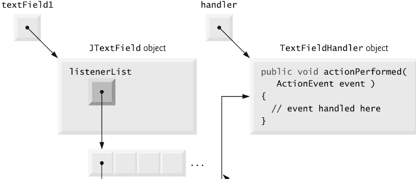

该引用由语句 `textField1.addListener(handler);` 创建。

# 图 I.4 | `JTextField textField1` 的事件注册

当图 I.1 的第 43 行

```java
textField1.addListener(handler);
```

执行时，一个包含 `JTextFieldHandler` 对象引用的新条目被放入 `textField1` 的 `listenerList` 中。图中未显示该新条目包含了监听器的类型（在此情况下为 `ActionListener`）。通过这种机制，每个 Swing GUI 组件都维护其自己的用于处理组件事件的监听器列表。

## 事件处理器的调用

事件监听器类型在回答第二个问题时非常重要：GUI 组件如何知道调用 `actionPerformed` 而不是其他方法？每个 GUI 组件都支持多种事件类型，包括鼠标事件和其他事件。当事件发生时，事件仅会被分发给相应类型的监听器。分发只是 GUI 组件调用其每个注册了已发生事件的监听器上的事件处理方法的过程。

每个事件类型都有一个或多个对应的事件监听器接口。例如，`ActionEvent` 由 `ActionListener` 处理，`MouseEvent` 由 `MouseListener`、`MouseMotionListener` 以及 `KeyListener` 处理。当事件发生时，GUI 组件会（来自 JVM）接收一个标识事件类型的唯一事件。GUI 组件使用事件 ID 来决定应该将事件分发给哪种监听器类型，以及在每个监听器上调用哪种方法。对于 `ActionEvent`，事件会被分发到每个注册的 `ActionListener` 的 `actionPerformed` 方法（`ActionListener` 接口中的唯一方法）。对于 `MouseEvent`，事件会被分发到每个注册的 `MouseListener` 或 `MouseMotionListener`，具体取决于鼠标事件处理方法。`MouseEvent` ID 决定了调用多个鼠标处理方法中的哪一个。所有这些决定都由 GUI 组件为你处理。你只需要为你的应用程序所需的特定事件类型注册事件处理程序，GUI 组件就会确保在事件发生时调用事件处理器的相应方法。我们将在引入每个新组件时，根据需要讨论其他事件类型和事件监听器接口。

## 1.6 JButton

按钮是用户点击以触发特定动作的控件。Java 程序可以使用多种类型的按钮，包括命令按钮、复选框、切换按钮和单选按钮。图 1.5 显示了本附录涵盖的 Swing 按钮的继承层次。如你所示，所有的按钮类型都是 `JButton`（包 `javax.swing`）的子类，它声明了 Swing 按钮的共同特征。在本节中，我们重点关注通常用于启动命令的按钮。

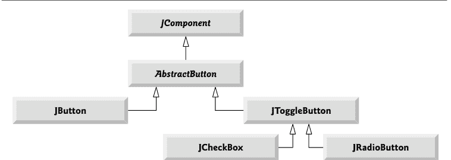

**图 1.5** | Swing 按钮层次结构。

命令按钮（见图 1.7 的输出）在用户点击时会生成一个 `ActionEvent`。命令按钮使用 `JButton` 类创建。`JButton` 表面上的文本被称为按钮标签。GUI 可以有多个 `JButton`，但在当前显示的 GUI 属性中，每个按钮标签应该是唯一的。

## 外观观察 1.1

按钮上的文本通常使用书名标题大写规则（book-title capitalization）。

## 外观观察 1.2

多个具有相同标签的 `JButton` 会让用户感到困惑。请为每个按钮提供一个唯一的标签。

图 1.6 和 1.7 的程序创建了两个 `JButton` 并证明了 `JButton` 支持显示图标（Icons）。按钮的事件处理由 `ButtonHandler` 类的实例执行（第 39–47 行）。

```java
// Fig 1.6: ButtonFrame.java
// 命令按钮和动作事件。
import java.awt.FlowLayout;
import java.awt.event.ActionListener;
import java.awt.event.ActionEvent;
import java.swing.JFrame;
import java.swing.JButton;
import java.swing.Icon;
import java.swing.ImageIcon;
import java.swing.JOptionPane;

public class ButtonFrame extends JFrame {
    private JButton plainButton; // 只有文本的按钮
    private JButton fancyButton; // 带有图标的按钮

    public ButtonFrame() {
        super("Testing Buttons");
        setLayout(new FlowLayout()); // 设置框架布局
        plainButton = new JButton("Plain Button"); // 带有文本的按钮
        add(plainButton); // 将 plainButton 添加到 Frame

        Icon bug1 = new ImageIcon(getClass().getResource("bug1.gif"));
        Icon bug2 = new ImageIcon(getClass().getResource("bug2.gif"));
        fancyButton = new JButton("Fancy Button"); // 设置图像
        fancyButton.setRolloverIcon(bug2); // 设置悬停图标
        add(fancyButton); // 将 fancyButton 添加到 Frame

        // 为按钮事件处理创建新 handler
        ButtonHandler handler = new ButtonHandler();
        fancyButton.addActionListener(handler);
        plainButton.addActionListener(handler);
    } // ButtonFrame 构造函数结束

    // 用于按钮事件处理的内部类
    private class ButtonHandler implements ActionListener {
        // 处理按钮事件
        public void actionPerformed(ActionEvent event) {
        }
    }
}
```

**图 1.6** 命令按钮和动作事件。（部分 2）。

```java
44  JOptionPane.showMessageDialog(ButtonFrame.this, String.format(
45      "You pressed: %s", event.getActionCommand() ) );
46  } // 方法 actionPerformed 结束
47  } // 私有内部类 ButtonHandler 结束
48  } // 类 ButtonFrame 结束
```

**图 I.6** | 命令按钮和动作事件。（2 部分中的第 2 部分。）

```java
1 // Fig I.7: ButtonTest.java
2 // TestingButtonFrame.
3 import javax.swing.JFrame;
4 
5 public class ButtonTest
6 {
7     public static void main(String[] args) 
8     {
9         ButtonFrame buttonFrame = new ButtonFrame(); // 创建 ButtonFrame
10        buttonFrame.setDefaultCloseOperation(JFrame.EXIT_ON_CLOSE);
11        buttonFrame.setSize(275, 110); // 设置框架大小
12        buttonFrame.setVisible(true); // 显示框架
13    } // main 结束
14} // // 类 ButtonTest 结束
```


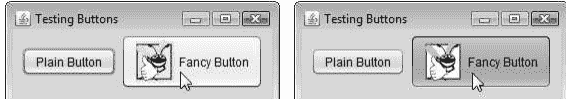


**图 I.7** | 测试 `ButtonFrame`。

图 1.6 的第 14–15 行在构造函数中声明并实例化 `JButton` 变量 `plainButton` 和 `fancyButton`。第 23 行创建标签为 `"Plain Button"` 的 `plainButton`。第 24 行将该按钮添加到 `JFrame`。

`JButton` 可以显示图标。为了给 GUI 增加视觉趣味，`JButton` 还可以有一个悬停图标——当鼠标滑过按钮时显示的图标。当鼠标离开按钮屏幕区域时，图标会恢复。图 1.6 的第 26–27 行创建了两个 `ImageIcon` 对象，分别代表第 28 行创建的按钮的默认图标和悬停图标。这两个语句表明图像文件存储在与应用程序相同的目录。这些图像文件已随示例提供。第 28 行创建标签为 `"Fancy Button"` 的 `JButton`。默认情况下，文本显示在图标右侧。第 29 行使用 `setRolloverIcon(bug2)` 指定鼠标移动时显示的图像。第 30 行将该按钮添加到 `JFrame`。


## 外观观察 1.3

由于 `AbstractButton` 支持文本和图像，`AbstractButton` 的所有子类都支持文本和图像。


## 外观观察 1.4

为 `JButton` 使用悬停图标可以为用户提供视觉反馈，指示当他们在光标悬停在 `JButton` 上时点击时将发生动作。

`JButton` 和 `JTextField` 生成的 `ActionEvent` 可以由 `ActionListener` 处理。对于 `JButton`，`ActionEvent` 返回按钮上的标签。

## 软件工程观察 1.2

在内部类中，`this` 关键字指向正在操作的内部类对象。内部类方法可以通过在外部类名后加一个点（例如 `ButtonFrame.this`）来使用其外部类对象。

## 1.7 JComboBox：使用匿名内部类进行事件处理

组合框（有时称为下拉列表）允许用户从列表中选择一个项目（I.9）。组合框通过 `JComboBox` 类实现，该类继承自 `JComponent` 类。`JComboBox` 生成 `ItemEvent` 的方式与 `JCheckBox` 和 `JRadioButton` 相同。这还演示了一种在事件处理中常用的特殊内部类形式。程序（I.8–I.9）使用 `JComboBox` 提供了一个包含四个图像文件名的列表，用户可以从中选择一个图像显示。当用户选择一个名称时，程序会将相应的图像作为 `Icon` 显示在 `JLabel` 上。`ComboBoxTest` 类（I.9）包含执行该程序的 `main` 方法。该程序的屏幕截图显示了选择后的 `JComboBox` 列表，以说明所选的图像文件名。


第 19–23 行（I.8）使用 `new ImageIcon` 对象声明并初始化图标数组。字符串数组 `names`（第 17–18 行）包含了四个图像文件的名称，这些文件存储在程序相同的目录下。

```java
// I.8: ComboBoxFrame.java
// 显示图像名称列表的 JComboBox。
import java.awt.FlowLayout;
import java.awt.event.ActionListener;
import java.awt.event.ItemEvent;
import javax.swing.JFrame;
import javax.swing.JLabel;
import javax.swing.JComboBox;
import javax.swing.Icon;
import javax.swing.ImageIcon;

public class ComboBoxFrame extends JFrame
{
    private JComboBox imagesJComboBox; // 用于存储图标名称的组合框
    private JLabel label; // 选择图标的标签

    private static final String names[] = {
        "bug1.gif", "bug2.gif", "travelbug.gif", "bugan.gif"
    };
    private Icon[] icons = {
        new ImageIcon(getClass().getResource(names[0])),
        new ImageIcon(getClass().getResource(names[1])),
        new ImageIcon(getClass().getResource(names[2])),
        new ImageIcon(getClass().getResource(names[3]))
    };

    // ComboBoxFrame 构造函数将 JComboBox 添加到 JFrame
    public ComboBoxFrame() {

        super("Testing JComboBox");
        setLayout(new FlowLayout()); // 设置框架布局

        imagesJComboBox = new JComboBox(names);
        imagesJComboBox.setMaximumRowCount(3); // 显示三行
```

图 1.8 显示图像名称列表的 `JComboBox`。（2 部分中的第 1 部分。）

```java
imagesJComboBox.addActionListener(
new ItemListener() // 匿名内部类
{
    // 处理 JComboBox 的 itemChanged
    public void itemChanged(ItemEvent event) {
        // 确定是否选中了项目
        if (event.getStateChange() == ItemEvent.SELECTED)
            label.setIcon(icons[
imagesJComboBox.getSelectedIndex()]);
    } // 结束方法 itemChanged
    }
}); // 结束 addItemListener 调用
```

```java
add(imagesJComboBox); // 将组合框添加到 JFrame
label = new JLabel(icons[0]); // 显示第一个图标
add(label); // 将标签添加到 JFrame
// 结束 ComboBoxFrame 构造函数
// 结束匿名内部类
```

图 I.8 显示项目名称列表的 `JComboBox`。（2 部分中的第 2 部分。）

```java
// I.9: ComboBoxTest.java
// 测试 ComboBox。
import javax.swing.JFrame;

public class ComboBoxTest {

    public static void main(String[] args) {
        ComboBoxFrame comboBoxFrame = new ComboBoxFrame();
        comboBoxFrame.setDefaultCloseOperation(JFrame.EXIT_ON_CLOSE);
        comboBoxFrame.setSize(350, 150); // 设置框架大小
        comboBoxFrame.setVisible(true); // 显示框架
    }
} // 类 ComboBoxTest
```


图 I.9 测试 `ComboBoxFrame`。（2 部分中的第 1 部分。）


图 1.9 测试 `ComboBoxFrame`（2 部分中的第 2 部分）。

在第 31 行，构造函数使用数组 `names` 中的字符串作为列表元素初始化 `JComboBox` 对象。列表中的每个项目都有一个索引。第一个项目被添加到索引 0，下一个索引是 1，依此类推。当 `JComboBox` 显示时，添加的第一个项目将作为当前选中项目显示。其他项目通过点击 `JComboBox`，然后从出现的列表中选择一个项目来选中。

第 32 行使用 `JComboBox` 的 `setRowCount` 方法来设置用户点击 `JComboBox` 时显示的最大元素数量。如果有额外的项目，`JComboBox` 会提供一个滚动条（第一个屏幕），允许用户滚动列表中的所有元素。用户可以点击滚动条顶部和底部的箭头，每次移动一个元素以向上或向下移动列表，或者拖动滚动条中间的滚动框。要拖动滚动框，请将光标置于其下方，按住鼠标按钮并移动鼠标。在这个例中，由于下拉列表太短，无法拖动滚动框，因此你可以使用鼠标滚轮滚动列表中的四个项目。


### 视图外观观察 1.5

将 `JComboBox` 的行数设置为指定的行数，可以防止列表扩展到其使用的窗口边界之外。

第 48 行将 `JComboBox` 附加到 `ComboFrame` 的 `FlowLayout`（如第 29 行所示）。第 49 行创建 `JLabel` 并显示图像图标，用 `icons` 数组中的第一个图像图标进行初始化。第 50 行将 `JLabel` 附加到 `ComboFrame` 的 `FlowLayout`。

### 使用匿名内部类进行事件处理

第 34–46 行是声明监听器类、创建该类对象并将其注册为 `ItemEvent` 监听器的语句。该事件-监听器对象是匿名内部类的实例——一种在声明时没有名称且直接声明的内部类。对于其他类，匿名内部类可以访问其顶层类的成员。然而，匿名内部类对声明处方法的局部变量的访问是有限的。由于匿名内部类没有名称，必须在声明类的地方创建该类的一个对象（从第 35 行开始）。


### 软件工程观察 1.3

在方法中声明的内部类可以访问声明它的顶层类对象的实例变量，以及方法的最终（`final`）变量，但无法访问方法的非最终（`non-final`）局部变量。

第 34–46 行是对 `imagesItemListener` 方法的调用。该方法的参数必须是 `ItemListener`（即任何实现 `ItemListener` 接口的类对象）。第 35–45 行是一个类实例创建表达式，它声明了一个匿名内部类并创建了该类的一个对象。该对象的引用作为参数传递给 `ItemListener`。`ItemListener()` 语法之后开始声明实现 `ItemListener` 的匿名内部类。这与带有以下内容的声明相似：

```java
public class MyHandler implements ItemListener
```

第 36 行的左括号和第 45 行的右括号限制了匿名内部类的体。第 38–44 行声明了 `ItemListener` 的 `itemChanged` 方法。当用户从 `JComboBox` 选择一个项时，此方法设置 `Icon`。通过 `JComboBox` 中的 `getSelectedIndex` 方法（第 43 行）从 `icons` 数组中选择图标。当从 `JComboBox` 选择每个项目时，另一个项目首先会被取消选中——所以选择项目时发生两个事件。因此，第 41 行判断 `itemView` 方法返回 `SELECTED`，以便第 42–43 行设置图标。

### 软件工程观察 1.4

> 就像其他情况一样，当匿名内部类实现接口时，该类必须实现接口中的所有方法。

第 35–45 行使用匿名内部类创建事件处理器的语法类似于 Java IDE 生成的代码。通常，IDE 允许你可视化设计 GUI，然后它为 GUI 生成代码。你只需要在事件处理方法中插入语句来声明如何处理每个事件。

## 1.8 适配器类

许多事件监听接口（如 `MouseListener` 和 `MouseMotionListener`）包含多个方法。并不是总是需要声明事件监听接口中的所有方法。例如，应用程序可能只需要 `MouseListener` 中的 `MouseClicked` 或 `MouseMotionListener` 中的 `mouseDragged`。`WindowListener` 指定了七个窗口事件处理方法。对于许多具有多个方法的接口，`java.awt` 和 `javax.swing` 包提供了适配器类。适配器类实现接口，并为接口中的每个方法提供默认实现（带有空方法体）。你可以扩展适配器类以继承默认实现，并随后重写你需要的事件处理所需的方法。

### 软件工程观察 1.5


> 当一个类实现接口时，该类与该接口存在“是”的关系。该类的所有直接和间接子类都继承这种关系。因此，扩展事件适配器类的该类对象就是对应事件监听类型的对象（例如，`MouseAdapter` 的子类对象就是 `MouseListener`）。

## 1.9 总结

在本附录中，你学习了几个 GUI 组件，以及如何使用嵌套类和匿名内部类来实现事件处理程序。你了解了内部类对象与其顶层类对象之间特殊的特殊关系。你还学习了如何创建在独立窗口中运行的应用程序。我们讨论了 `JFrame` 以及允许用户与程序交互的组件。

## 自测习题

- 1.1 填空下列陈述中的空白：
  - a) ________ 在容器（`Container`）中安排 GUI 组件。
  - b) 用于附加 GUI 组件的 `add` 方法是类 _________ 的方法。
  - c) GUI 是 ________ 的缩写。
  - d) 方法 ________ 被用于为容器指定布局管理器。

- 1.2 判断下列陈述是否正确，如果为错误，请解释原因：内部类不允许访问外部类类的成员。

## 自测习题答案

- 1.1 a) layout manager（布局管理器）。b) Container（容器）。c) graphical user interface（图形化用户界面）。d) setLayout。

- 1.2 错误。内部类可以访问外部类声明的所有成员。

## 练习习题

- 1.3（温度转换）编写一个将华氏度转换为摄氏度的温度转换程序。华氏度应从键盘（通过 `JTextField`）输入。应使用 `Label` 来显示温度。使用以下公式进行转换：

```text
Celsius = 5/9 × (Fahrenheit - 32)
```

- 1.4（温度转换修改）通过增加开尔文标来增强习题 1.3 的温度转换程序。程序还应允许用户在两个标度之间转换。使用以下公式进行开尔文与摄氏度的转换（除习题 1.3 中的公式外）：

```text
Kelvin = Celsius + 273.15
```

- 1.5（猜数字游戏）编写一个玩“猜数字”游戏的程序作为：程序在 1–1000 范围内选择一个整数作为待猜数字。程序在标签中显示以下内容：

  我有一个 1 到 1000 之间的数字。你能猜出我的数字吗？

  请输入你的第一次猜测。

  应使用 `JTextField` 输入猜测。每输入一次猜测，背景颜色应变为红色或蓝色。红色表示用户正在“变热”，蓝色表示“变冷”。`Label` 应显示“太高了”或“太低了”帮助用户缩小范围。当用户猜对时，应显示“正确！”，且用于输入的 `JTextField` 应更改为不可编辑。应提供一个 `JButton` 允许用户重新游戏。当点击 `JButton` 时，应生成一个新的随机数，并将输入的 `JTextField` 更改为可编辑。

# 其他 Java 主题

## 目标

在本附录中，你将：

- 学习什么是集合（collections）。
- 使用 `Arrays` 类进行数组操作。
- 理解类型包装类（type-wrapper classes）如何使程序将原始数据值作为对象进行处理。
- 使用集合框架中内置的泛型数据结构。
- 使用迭代器（iterators）“遍历”集合。
- 学习基础的文件和流处理概念。
- 了解什么是线程以及它们为什么有用。
- 了解线程如何让你能够管理并发活动。
- 创建并执行 `Runnable`。
- 学习线程同步的基础知识。
- 了解多个线程如何以安全的方式更新 Swing GUI 组件。

## J.1 引言

## J.2 集合概述

## J.3 原始类型的类型包装类

## J.4 接口集合与类集合

## J.5 Lists

### J.5.1 `ArrayList` 和 `Iterator`

### J.5.2 `LinkedList`

### J.5.3 集合与数组的视图方法

## J.6 集合方法

### J.6.1 方法 `sort`

### J.6.2 方法 `shuffle`

## J.7 接口 `Queue`

## J.8 Sets

## J.9 Maps

## J.10 文件与流简介

## J.11 类 `File`

## J.12 对象序列化简介

## J.13 多线程简介

## J.14 使用 `Executor` 框架创建和执行线程

## J.15 线程同步概述

## J.16 并发集合概述

## J.17 GUI 中的多线程

## J.18 总结

自测习题 | 自测习题答案 | 练习习题

## J.1 引言

本附录介绍了几个额外的主题，以支持书的 Android 部分。J.2–J.9 介绍了 Java 集合框架的概述，以及在我们的 Android 应用中使用的各种集合的操作示例。J.10–J.12 介绍了文件和流概念、`File` 类的概述方法以及将整个对象写入流和从流中读取整个对象的对象序列化。最后，J.13–J.17 介绍了多线程的基础。

## J.2 集合概述

E.12 介绍了泛型 `ArrayList` 集合——一种可调整的类数组数据结构，它存储你在创建 `ArrayList` 时指定的类型对象。我们现在继续对 Java 集合框架的讨论，它包含了许多其他内置数据结构和处理它们的各种方法。我们关注在书中 Android 章节中使用的部分以及与 Android API 具有对应关系的部分。要了解集合框架的完整细节，请访问：

```text
docs.oracle.com/javase/6/docs/technotes/guides/collections/
```

集合是一种数据结构——实际上是一个持有其他对象的引用。通常，集合包含所有相同类型对象的引用。集合框架声明了在各种类型集合上泛泛地执行的操作。图 1.1 列出了集合框架的一些接口。框架内提供了这些接口的若干实现。你可以提供额外的实现以指定你的需求。

因为你在编译时指定了存储在集合中的类型，泛型提供了类型安全，允许编译器捕获尝试使用无效类型的行为。例如，你不能在 `String` 集合中存储 `Employee`。某些

| 接口 | 说明 |
| --- | --- |
| `Collection` | 集合层次结构中的根接口，`Set`、`Queue` 和 `List` 接口均派生于它。 |
| `Set` | 不包含重复项的集合。 |
| `List` | 允许包含重复元素的有序集合。 |
| `Map` | 将键关联到值的集合，且不能包含重复的键。 |
| `Queue` | 通常是先入先出的集合，模拟等待队列；也可以指定其他顺序。 |

**图 J.1 | 集合框架接口。**

例如，你在游戏中持有的卡牌、存储在计算机中的你喜爱的故事、运动球队的成员以及当地契契登记处的房地产记录（这些可能将卷号和页码映射到物业所有者）。

## J.3 原始类型的类型包装类

每个原始类型（列于附录 L）在 `java.lang` 包中都有一个对应的类型包装类。这些类被称为 `Boolean`、`Byte`、`Character`、`Double`、`Float`、`Integer`、`Long` 和 `Short`。它们让你能够将原始类型值作为对象进行操作。它们的可重数据结构可以操作和共享对象——它们不能操作原始类型的变量。然而，它们可以操作类型包装类的对象，因为每个类最终都派自 `Object`。

每个数值类型包装类——`Byte`、`Short`、`Integer`、`Long` 和 `Double` 都扩展了 `Number` 类。此外，类型包装类是 `final` 类，不能继承它们。

原始类型没有方法，因此与原始类型相关的方法位于类型包装类中（例如 `parseInt` 方法，它将 `String` 转换为 `int` 值，位于 `Integer` 中）。如果你需要在程序中操作原始值，首先需要参考类型包装类的文档——你需要的方法可能已经声明。

## 自动装箱与自动拆箱


Java 提供了装箱（boxing）和拆箱（unboxing）转换，用于在原始值和类型包装对象之间自动转换。装箱转换将原始值转换为类型包装类的对象。拆箱转换将类型包装类的对象转换为对应类型的值。这些转换是自动完成的（称为自动装箱和自动拆箱），允许在期望类型包装对象的地方使用原始值，反之亦然。

# J.4 接口集合与类集合

接口`Collection`是集合层次结构中的根接口，`Set`、`Queue`和`List`接口均派生于它。接口`Set`定义了一个不包含重复项的集合。接口`Queue`定义了一个表示等待队列的集合——通常情况下，在队列尾部插入并从头部删除；也可以指定其他实现类。我们在 J.7—J.8 节讨论了队列（`Queue`）和集合（`Set`）。`Collection`接口包含了批量操作（即对整个集合执行的操作），例如在集合中添加、清除和比较对象（或元素）。`Collection`也可以转换为数组。此外，接口提供了一个返回`Iterator`（迭代器）的方法，该迭代器允许程序遍历集合并在迭代过程中从中删除元素。我们在 J.5.1 节中讨论了类。接口的其他方法允许程序确定集合的大小以及集合是否为空。`Collections`类提供了静态方法，用于对集合进行搜索并执行其他操作。J.6 节讨论了`collections`类中可用的方法。

大多数集合的实现类都提供一个接受`Collection`参数的构造函数，允许构建一个包含指定集合元素的新集合。

## J.5 Lists

列表（`List`）是一个有序的集合（`Collection`），可以包含重复元素。类似于数组索引，`List`索引也是从 0 开始的（即第一个元素的索引为 0）。除了继承自`Collection`的方法外，接口还提供了通过索引操作元素、操作指定范围的元素、搜索元素以及获取`ListIterator`以访问元素的方法。

接口由多个类实现，包括`ArrayList`和`LinkedList`。`ArrayList`类是`List`的可收缩数组实现。在`ArrayList`的元素之间插入元素是一项低效的操作——新元素之后的所有元素都必须移动位置，对于包含大量元素的集合来说，这可能是一个开销高昂的操作。`LinkedList`则允许在集合中间高效地插入（或删除）元素。下面的子节演示了`List`和`Collection`的各种功能。

### J.5.1 ArrayList and Iterator

图 2 使用了`ArrayList`（在 E.12 中引入）来演示`Collection`接口的几种功能。程序将两个`Color`数组放入`ArrayList`中，并使用`Iterator`从第一个`ArrayList`集合中移除第二个`ArrayList`集合。

```java
// Fig.2: CollectionTest.java
// 通过 ArrayList 对象演示 Collection 接口。
import java.util.List;
import java.util.ArrayList;
import java.util.Collection;
import java.util.Iterator;
public class CollectionTest
{
```

图 J.2 | 通过`ArrayList`对象演示`Collection`接口。（2 份中的第 1 部分。）

## 附录 | 其他 Java 主题

```java
public static void main( String[] args ) {
    // 将 colors 数组中的元素添加到 list
    String[] colors = { "MAGENTA", "RED", "WHITE", "BLUE", "CYAN" };
    List<String> list = new ArrayList<String>();

    for (String color : colors) {
        list.add(color); // 将颜色添加到列表末尾
    }

    // 将 removeColors 数组中的元素添加到 removeList
    String[] removeColors = { "RED", "WHITE", "BLUE" };
    List<String> removeList = new ArrayList<String>();

    for (String color : removeColors) {
        removeList.add(color);
    }

    System.out.println("ArrayList: ");
```

ArrayList:

MAGENTA RED BLUE CYAN

调用 removeColors 后的 ArrayList:

MAGENTA CYAN

图 J.2 | 通过`ArrayList`对象演示`Collection`接口。（2 份中的第 2 部分。）

# J.5 Lists 637

第 13 行和 20 行声明并初始化了`String`数组和`removeColors`。第 14 行和 21 行创建了`ArrayList<String>`对象，并将它们的引用分别赋值给`List<String>`变量`list`和`removeList`。我们通过`List`变量引用此示例中的`ArrayList`。这使得我们的代码更加灵活且易于修改。如果我们决定`LinkedList`更合适，则我们需要在创建`ArrayList`对象时修改第 14 行和第 21 行。

第 16–17 行使用`colors`数组中存储的`Strings`填充`list`，第 23–24 行使用`add`方法使用`removeColors`中的`Strings`填充`removeList`。第 29–30 行输出`list`的每个元素。第 29 行调用`List`方法`size`来获取`ArrayList`中的元素数量。第 30 行使用`List`方法`get`来检索单个值。第 29–30 行也可以使用增强型`for`语句（将在其他示例中通过集合进行演示）。

第 33 行方法`removeColors`（第 43–55 行），将`list`和`removeList`作为参数传递。`removeColors`方法从`list`中删除`Strings`。第 38–39 行在`removeColors`完成任务后打印`list`的元素。

`removeColors`方法声明了两个`Collection<String>`参数（第 43–44 行），允许将包含字符串的两个`Collections`作为参数传递给此方法。方法通过`Iterator`访问第一个集合（`collection1`）的元素。第 47 行调用`Collection`方法`iterator`来获取该集合的`Iterator`。接口和`Iterator`是泛型类型。循环继续条件（第 50 行）调用`iterator`的`hasNext`来判断集合是否还包含更多元素。`hasNext`方法在存在另一个元素时返回`true`，否则返回`false`。

第 52 行的`if`语句调用`iterator`的`next`来获取下一个元素的引用，然后使用第二个集合（`collection2`）的`contains`方法来判断`collection2`是否包含`next`返回的元素。如果是，第 53 行调用`Iterator`方法`remove`从`collection1`中删除该元素。

## 常见错误 J.1

> 如果在为集合创建迭代器后修改了集合，该迭代器将立即失效——从此之后使用迭代器执行的操作将抛出`ConcurrentModificationException`。出于这个原因，迭代器是“快速失败的”（fail fast）。

### J.5.2 LinkedList

图 J.3 演示了对`LinkedList`的各种操作。程序创建了两个`Strings`的`LinkedList`。将第一个元素添加到另一个中。然后将所有`Strings`转换为大写，并删除一个范围的元素。

```java
// Fig. J.3: ListTest.java
// Lists, LinkedLists 和 ListIterators.
import java.util.List;
import java.util.LinkedList;
import java.util.Iterator;

public class ListTest
{
```

图 J.3 | Lists, LinkedLists and Iterators。（3 份中的第 1 部分。）

```java
public static void main(String[] args)
{
// 将 colors 元素添加到 list1
String[] colors =
    { "black", "yellow", "green", "blue", "violet", "silver" };
    List<String> list1 = new LinkedList<String>();

for ( String color : colors )
    list1.add(color);

// 将 colors 元素添加到 list2
String[] colors2 =
    { "gold", "white", "brown", "blue", "gray", "silver" };
    List<String> list2 = new LinkedList<String>();

for ( String color : colors2 )
    list2.add(color);

list1.addAll(list2); // 合并列表
list2 = null; // 释放资源
printList(list1); // 打印列表元素

convertToUppercaseStrings(list1); // 转换为大写字符串
printList(list1); // 打印列表元素

System.out.print("\ndeleting elements 4 to 6...");
removeItems(list1, 4, 7); // 从列表中删除第 4-6 项
printList(list1); // 打印列表元素
printReversed(list1); // 反序打印列表
} // end main

// 输出内容
public static void printList( List<String> list )
{
    System.out.println("\nlist: ",");

    for ( String color : list )
        System.out.printf("%s ", color);
} // end method printList

// 定位对象并转换为大写
public static void convertToUppercaseStrings(List<String> list )
{
    Iterator<String> iterator = list.listIterator();

    while ( iterator.hasNext() ) // 获取项目
        String color = iterator.next();
        iterator.set(color.toUpperCase()); // 转换为大写
} // end while
// end method convertToUppercaseStrings

```java

62  // 获取子列表并使用 clear 方法删除子列表项

63  private static void removeItems(List< String > list,

64      int start, int end)

65  {

66      list.sublist(start, end).clear(); // 删除项

68  } // end method removeItems

69

70  // 打印反序列表

71  private static void printReversed(List< String> list )

72  {

73      ListIterator<String> iterator = list.listIterator(list.size());

74

75      System.out.println("\nReversed List: ");

76

77      // 反序打印列表

78      while (iterator.hasPrevious())

79          System.out.printf("%s ", iterator.previous());

80  } // end method printReversed

81  } // end class ListTest
```


```
list:
yellow green blue violet gold white blue gray
list:
BLACK YELLOW BLUE VIOLET SILVER BROWN BLUE GRAY
Deleting elements 4 to 6...
list:
BLACK YELLOW GREEN WHITE BROWN GRAY
Reversed List:
SILVER GRAY BROWN WHITE GREEN YELLOW BLACK
```

**图 J.3** | Lists, LinkedLists and Iterators。（3 份中的第 3 部分）

## 方法 convertToUppercaseStrings

`convertToUppercaseStrings` 方法（第 52–61 行）将其参数中的每个 `String` 元素转换为大写字符串。第 54 行调用 `List` 方法 `listIterator` 来获取列表的双向迭代器（即一个可以正向或向后遍历 `List` 的迭代器）。

## 附录 J 其他 Java 话题

`ListIterator` 也是一个泛型类。在这个示例中，`ListIterator` 引用了 `String` 对象，方法 `listIterator` 在 `String` 的 `List` 上被调用。第 56 行调用 `hasNext` 方法来判断 `List` 是否还包含另一个元素。第 58 行获取 `List` 中的下一个 `String`。第 59 行调用 `String` 的 `toString` 获取字符串的大写版本，并调用 `ListIterator` 的 `set` 方法将当前 `String` 替换为 `toUpperCase` 方法返回的 `String`。类似于 `toLowerCase` 方法返回 `String` 的小写版本。

## 方法 removeItems

`removeItems` 方法（第 64–68 行）从列表中删除范围内的项。第 67 行调用 `List` 的 `sublist` 方法获取 `List` 的部分（称为子列表）。这被称为范围视图方法（range-view method），它允许程序查看列表的一部分。`sublist` 仅仅是调用它的 `sublist` 的 `List` 的一个视图。`sublist` 方法接收子列表的起始索引和结束索引作为参数。结束索引不包含在子列表的范围内。在这个示例中，第 35 行向 `sublist` 传递 4 作为起始索引，7 作为结束索引。返回的 `sublist` 是索引从 4 到 6 的元素集。接下来，程序调用 `sublist` 的 `clear` 方法来删除子列表的元素。对 `sublist` 的任何更改也会反映原始列表。

## 方法 printReversedList

`printReversedList` 方法（第 71–80 行）反向打印列表。第 73 行调用 `List` 方法 `listIterator` 并将起始位置作为参数（在本例中，为列表的最后一个元素），以获取列表的双向迭代器。`size` 方法返回列表中的项数。`while` 条件（第 78 行）调用 `ListIterator` 的 `hasPrevious` 方法来判断反向遍历时是否有更多元素。第 79 行调用 `ListIterator` 的 `previous` 方法获取列表中的上一个元素并输出到标准输出。

## J.5.3 集合和数组的视图方法 `asList`

该框架的一个重要特性是可以通过不同的集合类型（如列表）来操作一种集合类型（如集合）的元素，而无论集合的内部实现如何。用于操作集合的公共方法集被称为视图（view）。

`Arrays` 类提供了静态方法 `asList` 来将数组（有时称为底层数组）视为 `List` 视图，这允许你像操作列表一样操作数组。这对于在数组中添加元素和对数组元素进行排序有用。下一个示例演示了如何创建一个带有数组 `List` 视图的 `LinkedList`，因为我们不能将数组传递给 `LinkedList` 构造函数。通过 `List` 视图进行的任何修改都会更改数组，对数组的任何修改都会更改 `List` 视图。对 `asList` 返回的视图允许的操作仅是 `set`，它会更改视图和底层数组的值。任何其他更改视图尝试（例如添加或删除元素）都会导致 `UnsupportedOperationException`。

## 将数组视为列表以及将列表转换为数组

图 4 使用 `Arrays.asList` 将数组视为 `List`，并使用 `toArray` 方法从 `LinkedList` 集合获取数组。程序调用 `asList` 创建数组的 `List` 视图，用于初始化一个 `LinkedList` 对象，然后添加一系列字符串，最后 `LinkedList` 调用 `toArray` 方法以获取一个包含这些 `String` 引用的数组。

第 13–14 行构建了一个包含 `colors` 数组元素的 `String LinkedList`。第 14 行使用 `Arrays.asList` 返回数组的 `List` 视图，然后用接收 `Collection` 作为参数的构造函数来初始化 `LinkedList`（`List` 是一种 `Collection`）。第 16 行调用 `LinkedList` 的 `addLast` 方法将 `"red"` 添加到 `links` 的末尾。第 17–18 行调用 `LinkedList` 的 `add` 方法将 `"pink"` 作为最后一个元素添加，并将 `"green"` 作为索引为 3 的元素（即第四个元素）。`add` 方法确定了添加的位置（第 17 行）。第 19 行调用 `LinkedList` 的 `addFirst` 方法将 `"cyan"` 添加为 `LinkedList` 中的新第一个项。`add` 操作是允许的，因为它们操作的是 `LinkedList` 对象，而不是 `asList` 返回的视图。

第 22 行调用 `List` 接口的 `toArray` 从 `links` 获取一个 `String` 数组。该数组是列表元素的副本——修改数组的内容不会修改列表。传递给 `toArray` 方法的数组类型是你希望 `toArray` 方法返回的类型。如果该数组中的元素数量大于或等于 `LinkedList` 中的元素数量，数组会将列表的元素复制到其参数中并返回该数组。如果 `LinkedList` 中的元素数量多于传递给 `toArray` 的数组的元素数量，`toArray` 将分配一个与其接收参数相同类型的新数组，将列表的元素复制到新数组并返回该新数组。

## J.6 集合方法

`Collections` 类提供了几种高性能算法（见图 J.5）用于操作集合。这些算法以静态方法的实现。`sort`、`binarySearch`、`reverse`、`shuffle`、`fill`、`copy` 方法操作 `List`。`min`、`max` 和 `addAll` 方法操作 `Collection`。

| 方法 | 说明 |
| --- | --- |
| `sort` | 排序 `List` 的元素。 |
| `binarySearch` | 在 `List` 中查找对象。 |
| `reverse` | 反转 `List` 的元素。 |
| `shuffle` | 随机重乱 `List` 的元素。 |
| `fill` | 将 `List` 的每个元素设置为指向指定对象。 |
| `copy` | 将一个 `List` 的引用复制到另一个 `List`。 |
| `min` | 返回集合中最小的元素。 |
| `max` | 返回集合中最大的元素。 |
| `addAll` | 将数组中的所有元素添加到集合中。 |

**图 J.5** `Collections` 类的一些方法。

## J.6.1 方法 sort

`sort` 方法对 `List` 的元素进行排序，该 `List` 必须实现 `Comparable` 接口。顺序由元素类型通过 `compareTo` 实现的自然顺序决定。`compareTo` 方法声明在 `Comparable` 接口中，有时被称为自然比较方法。`sort` 方法可以指定第二个参数为 `Comparator` 对象，该对象决定元素的另一种排序方式。

### 升序或降序排序

如果 `List` 是 `Comparable` 对象的列表（例如 `String`），你可以按照如下方式使用 `Collections` 方法按升序排序元素：

```java
Collections.sort( list ); // 按升序排序列表
```

你可以按照如下方式按降序排序 `List`：

```java
// 按降序排序列表
Collections.sort( list, Collections.reverseOrder() );
```

静态方法 `Collections.reverseOrder()` 返回一个 `Comparator` 对象，它按反序排列集合的元素。

### 使用 Comparator 排序

对于没有实现 `Comparable` 的对象，你可以创建自定义的 `Comparator`。图 J.6 创建了一个名为 `TimeComparator` 的自定义 `Comparator` 类，它实现了 `Comparator` 接口以比较两个 `Time2` 对象。在图 J.5 中声明的 `Time2` 类代表带有小时、分钟和秒的时间。

```java
// Fig. J.8: TimeComparator.java
// 比较两个 Time2 对象的自定义 Comparator 类。
import java.util.Comparator;

public class TimeComparator implements Comparator<Time2> {

    public int compare(Time2 time1, Time2 time2) {

        int hourCompare = time1.getHours() - time2.getHours(); // 比较小时

        // 测试第一个小时
        if (hourCompare != 0)
            return hourCompare;

        int minuteCompare = time1.getMinute() - time2.getMinute(); // 比较分钟

        // 然后测试分钟
        if (minuteCompare != 0)
            return minuteCompare;

        int secondCompare = time1.getSeconds() - time2.getSeconds(); // 比较秒

        return secondCompare; // 返回比较秒的结果
    } // end class TimeComparator
}
```

**图 J.6** 比较两个 `Time2` 对象的自定义 `Comparator` 类。

`TimeComparator` 实现了 `Comparator`，这是一个接收一个参数（在本例中为 `Time2`）的泛型类型。实现 `Comparator` 的类必须声明一个 `compare` 方法，该方法接收两个参数，如果第一个参数小于第二个参数则返回负整数，如果两个参数相等则返回零，如果第一个参数大于第二个参数则返回正整数。`compare` 方法（7–26 行）执行 `Time2` 对象之间的比较。第 9 行比较两个 `Time2` 对象的小时数。如果小时数不同（第 12 行），我们返回此值。如果此值为正，则第一个小时大于第二个小时；如果此值为负，则第一个小时小于第二个小时，且第一个时间小于第二个时间。如果此值为零，则小时数相同，我们必须测试分钟（以及秒）来确定哪个时间更大。

```java
// Fig. J.4: UsingToArray.java
// 将数组视为列表并将列表转换为数组。
import java.util.LinkedList;
import java.util.Arrays;

public class UsingToArray {

    // 创建一个 LinkedList，添加元素并转换为数组
    public static void main(String[] args) {

        String[] colors = {"black", "blue", "yellow"};

        LinkedList<String> links =
            new LinkedList<String>(Arrays.asList(colors));

        links.addLast("red"); // 将 "red" 添加到 links 的末尾
        links.add("pink"); // 作为最后一个元素添加 "pink"
        links.add(3, "green"); // 在索引 3 处（即第四个元素）添加 "green"。 方法确定了添加的位置（第 17 行）。
        links.addFirst("cyan"); // 将 "cyan" 添加为 LinkedList 中的新第一个项

        // add 操作是允许的，因为它们操作的是 LinkedList 对象，而不是 asList 返回的视图。
        // 第 22 行调用 List 接口的 toArray 从 links 获取一个 String 数组。
```

```java
// 数组是列表元素的副本——修改数组的内容不会修改列表。
// 传递给 toArray 方法的数组类型是你希望 toArray 方法返回的类型。
// 如果该数组中的元素数量大于或等于 LinkedList 中的元素数量，数组会将列表的元素复制到其参数中并返回该数组。
// 如果 LinkedList 中的元素数量多于传递给 toArray 的数组的元素数量，toArray 将分配一个与其接收参数相同类型的新数组，将列表的元素复制到新数组并返回该新数组。

        colors = links.toArray(new String[links.size()]);

        System.out.println("colors: ");
        for (String color : colors) {
            System.out.println(color);
        }
    } // end main
} // end class UsingToArray
```

colors:

`cyan`

`black`

`blue`

`yellow`

`green`

`red`

`pink`

**Fig. J.4** 将数组视为列表并将列表转换为数组。

## 附录 | 其他 Java

图 J.7 显示了一个使用自定义 `Comparator` 类 `Time2` 对象的列表。它创建了一个 `ArrayList<Time2>`。请记住，`ArrayList` 和 `List` 都是泛型类型，接受一个指定集合元素类型的参数。第 13–17 行创建了五个 `Time2` 对象并将它们添加到列表中。第 23 行调用了 `sort` 方法，并传递了一个 `TimeComparator` 类的对象（图 J.6）。

```java
// Fig J.7: Sort.java
// 使用自定义 Comparator 对象的 Collections sort 方法
import java.util.List;
import java.util.ArrayList;
import java.util.Collections;

public class Sort3 {
    public static void main(String[] args) {
        List<Time2> list = new ArrayList<Time2>(); // create list
        list.add(new Time2(6, 24, 34));
        list.add(new Time2(12, 18, 58));
        list.add(new Time2(6, 05, 34));
        list.add(new Time2(12, 14, 58));
        list.add(new Time2(6, 24, 22));

        // 输出 elements
        System.out.printf("Unsorted array elements:%s\n\n", list);

        // 使用比较器进行排序
        Collections.sort(list, new TimeComparator());

        // 输出 elements
        System.out.printf("Sorted list elements:%s\n\n", list);
    } // end main
} // end class Sort3
```

Unsorted array elements:

`[6:24 AM, 6:14:58 PM, 6:05 AM, 12:14:58 PM, 6:24 AM]`

Sorted elements:

`[6:05 AM, 6:24:22 AM, 6:24 AM, 12:14:58 PM, 6:14:58 PM]`

> **图 J.7** | 使用自定义 `Comparator` 对象的 `sort` 方法。

## J.6.2 方法 `shuffle`

`shuffle` 方法随机打乱 `List` 中的元素。附录 E 展示了一个纸牌洗牌和发牌模拟，使用循环来洗一副扑牌。如果你有一个 52 张牌的数组，可以使用如下 `shuffle` 方法对它们进行洗牌：

```java
List<Card> list = Arrays.asList(deck); // get List
Collections.shuffle(list); // shuffle deck
```


上面的第二行通过调用`Collections`类的静态方法`shuffle`来打乱数组。`shuffle`方法需要一个`List`参数，因此在打乱之前，我们必须获取数组的`List`视图。`Arrays`类的静态方法`asList`获取了牌数组的`List`视图。

## J.7 Interface Queue

queue是一个表示等待队列的集合——通常，插入发生在队列的尾部，而删除发生在头部。`Queue`接口扩展了`Collection`接口，并提供了插入、删除和检查队列元素的额外操作。你可以在此处查看`Queue`接口的细节以及实现它的类列表：

```
docs.oracle.com/javase/6/docs/api/index.html?java=util/Queue.html
```

## J.8 Sets

Set是一个唯一元素的无序集合（即没有重复元素）。集合框架包含了几个`Set`实现，使用了`HashSet`和`TreeSet`。`HashSet`将其元素存储在哈希表中，而`TreeSet`将元素存储在树中。哈希表将在J.9节介绍。

图J8使用`HashSet`移除`List`中的重复字符串。请记住`List`和`Collection`都是泛型类型，因此第16行创建了一个包含`String`对象的`List`，第20行将一个`String`集合传递给`printNonDuplicates`方法。

```
// Fig. J8: SetTest.java
// 使用 HashSet 移除字符串数组中的重复值。
import java.util.List;
import java.util.Arrays;
import java.util.HashSet;
import java.util.Set;
import java.util.Collection;
public class SetTest {
    public static void main(String[] args) {
        // 创建并显示 List<String>
        String[] colors = {"red", "white", "blue", "green", "gray",
            "orange", "tan", "white", "peach", "gray", "orange"};
        List<String> list = Arrays.asList(colors);
        System.out.printf("List: %s\n", list);
        // 消除重复后打印唯一值
        printNonDuplicates(list);
    }
    // 从 Collection 创建 Set 以消除重复
    private static void printNonDuplicates(Collection<String> values) {
        // 创建一个 HashSet
        Set<String> set = new HashSet<String>(values);
    }
```

图J.8 HashSet用于移除字符串数组中的重复值。（部分1，共2部分）。

```java
28 System.out.print("\nNonduplicates are: " );
29
30 for ( String value : set )
31
32 System.out.printf("%s ", value );
33
34 System.out.println();
35 } // end method printNonduplicates
36 } // end class SetTest
```

List: [red, white, green, gray, orange, tan, white, cyan, peach, gray, orange]

Nonduplicates are: orange green white peach gray cyan blue tan

**图J.8** | HashSet用于移除字符串数组中的重复值。（部分2，共2部分。）

`printNonDuplicates`方法（第24–35行）接受一个`Collection`参数。第27行从`Collection<String>`构建了一个`HashSet<String>`。根据定义，Sets不包含重复项，当构建`HashSet`时，它会移除集合中的重复项。第31–32行输出Set中的元素。

## Sorted Sets

集合框架还包含了**SortedSet接口**（扩展自Set），用于那些按排序顺序维护元素的集合——无论是自然顺序（例如，按升序排列的数字）还是由`Comparator`指定的顺序。`TreeSet`确保放置在`TreeSet`中的项在添加时就是排序的。

## J.9 Maps

Maps关联键。Map中的键必须是唯一的，但关联的值不需要是唯一的。如果一个Map同时包含唯一的键和唯一的值，则称它实现了**一一一映射**。如果只有键是唯一的，则该Map被认为实现了**多对一映射**——多个键可以映射到一个值。

Maps与Sets的区别在于Maps包含键和值，而Sets只包含值。实现`Map`接口的类中有三个是**Hashtable, HashMap和TreeMap**，它们在Android中被广泛使用。Hashtables和Maps将元素存储在表中，而TreeMap将元素存储在树中——底层数据结构的细节超出了本书的范围。*SortedMap接口*扩展了Map并按排序顺序维护其键——*TreeMap类*实现了SortedMap。图J.9使用`HashMap`来统计字符串中每个单词出现的次数。

```
1 // Fig. J.9: WordCount.java
2 // 程序统计字符串中每个单词出现的次数。
3 import java.util.*;
```

**图J.9** | 程序统计字符串中每个单词出现的次数。（部分1，共3部分。）

```java
import java.util.HashMap;
import java.util.Set;
import java.util.TreeSet;
import java.util.Scanner;

public class WordTypeCount {
    public static void main(String[] args) {
        // 创建 HashMap 来存储 String 键和 Integer 值
        Map<String, Integer> myMap = new HashMap<String, Integer>();

        createMap(myMap); // 根据用户输入创建 map
        displayMap(myMap); // 显示 map 内容
    }

    // 从用户输入创建 map
    private static void createMap(Map<String, Integer> map) {
        Scanner scanner = new Scanner(System.in); // 创建 scanner
        System.out.println("Enter a string:"); // 请求用户输入
        String input = scanner.nextLine();

        tokenize(input);
        String[] tokens = input.split(" ");

        // 处理输入文本
        for (String token : tokens) {
            String word = token.toLowerCase(); // 获取小写单词
            if (map.containsKey(word)) { // map 是否在 map 中
                int count = map.get(word); // 获取当前计数
                map.put(word, count + 1); // 计数
            } else {
                map.put(word, 1); // 向 map 添加新单词，计数为 1
            }
        }
    }

    // 显示 map 内容
    private static void displayMap(Map<String, Integer> map) {
        Set<String> keys = map.keySet(); // 获取键
        // 排序键
        TreeSet<String> sortedKeys = new TreeSet<String>(keys);
        System.out.println("\nMap contains:\nKey\tValue\n");
    }
}
```

## 648 录 | 其他 Java 话题

```java
// generate output for each key in map
for ( String key : sortedKeys ) {
    System.out.printf("%-10s%10s\n", map.get( key ) );
    System.out.printf("%n%nisEmpty: %b\n", map.size(), map.isEmpty() );
} // end method displayMap
 // end class WordCount
```

输入字符串：

this is a sample sentence with several words this is another sentence with several different words

| Map 包含： |

| Key | Value |

|---|---|

| a | 1 |

| another | 1 |

| different | 1 |

| is | 2 |

| sample | 2 |

| sentence | 2 |

| several | 2 |

| this | 2 |

| with | 2 |

| words | 2 |

size: 10

isEmpty: false

图9 | 程序统计map中每个单词出现的次数。（3部分中的3部分）

第14行创建了一个具有默认初始容量（16个元素）和默认负载因子（0.75）的entry HashMap——这些这些是内置在HashMap实现中的。当HashMap中被占用槽位的数量大于容量乘以负载因子时，容量会自动翻倍。HashMap是一个泛型类，接受两个参数——键的类型（即String）和值的类型（即Integer）。记住，泛型类的类型参数必须是引用类型，第二个类型参数是Integer，而不是int。

第16行调用了`createMap`（第21–24行），该方法使用map来存储句子中每个单词出现的次数。第25行获取用户输入，第28行对其进行分词（tokens it）。第31–43行的循环将输入转换为小写（第33行），然后调用map方法`containsKey`（第36行）来确定该单词是否在map中。如果Map不包含该键的映射，第42行使用map`put`在map中创建一个新条目，键为该键，值为一个包含1的Integer对象。当程序将Integer传递给`put`时会发生自动装箱（Autoboxing），但map将单词的出现次数存储为Integer。如果单词确实存在，第38行使用Map`get`获取map中与键关联的值（计数）。第39行增加该值的值并使用`put`替换map中与键关联的值。方法`put`返回键的先前的值，如果键不在map中则返回null。

`displayMap`方法（第47–62行）显示map中所有的条目。HashMap方法`keySet`（第49行）获取键的集合。map中的键类型为String，因此方法`keySet`返回一个类型参数指定为String的泛型`Set`。第52行创建了键的`TreeSet`，其中键是排序的。第57–58行的循环访问map中的每个键及其值。第58行使用格式说明符`%10`使每个键左对齐，并使用格式说明符`%10`使每个值右对齐。键按升序显示。第61行调用Map`size`获取map中键/值对的数量。第61行还调用了Map`isEmpty`，它返回一个指示Map是否空的布尔值。

## J.10 文件与流简介

存储在变量和数组中的数据是临时的——当局部变量超出范围或程序终止时，数据就会丢失。为了长期保留数据（即使在创建数据的程序终止后也是如此），计算机使用文件。你每天都会使用文件完成编写文档或创建电子表格等任务。在文件中维护的数据是持久的——存在程序执行之外。

## 作为字节流的文件

Java将每个文件视为字节的顺序流（见图J.10）。每个操作系统都提供了一种机制来确定文件的结束位置，例如文件结束标记或记录在系统维护的行政数据结构中的文件总字节数。Java程序处理字节流时，仅在到达流的末尾时接收来自操作系统的指示——程序不知道底层平台如何表示文件或流。在某些情况下，文件结束指示以异常的形式出现。在其他情况下，该指示是调用在流处理对象上的方法时的返回值。


**图J.10** | Java对n字节文件的视图。

## 基于字节的流和基于字符的流

流可以用字节或字符输入和输出数据。**基于字节的流**以二进制格式输入和输出数据。**基于字符的流**以字符序列输入和输出数据。如果使用基于字节的流存储值5，它将以数值5的二进制格式（即101）存储。如果使用基于字符的流存储值5，它将以5的二进制格式000000000110101存储（这是数值5的二进制表示）。这两种形式之间的区别在于，数值在计算中被用作整数使用，而字符5仅仅是一个可以用于文本字符串的字符，例如“Sarah Miller is 15 years old”。使用基于字节的流创建的文件被称为**二进制文件**，文件可以被文本编辑器读取；而基于字符的流被称为**文本文件**。文本文件可以由理解文件特定内容及其排序的程序读取。

## 打开文件

Java程序通过创建一个对象并与其关联字节流或字符流来打开文件。对象的构造函数与操作系统交互以打开文件。

## java.io 包

Java程序使用`java.io`包中的类执行文件处理。该包包含了流类的定义，例如`FileInputStream`（从文件的基于字节输入）、`FileOutputStream`（向文件的基于字节输出）、`FileReader`（从文件的基于字符输入）和`FileWriter`（向文件的基于字符输出），它们继承自`InputStream`、`OutputStream`、`Reader`和`Writer`。因此，这些流类的方法也可以应用于文件流。

Java类允许你对对象或原始数据类型执行输入输出。数据将在后台以字节或字符的形式存储，使你无需担心将此类值转换为字节格式的细节。要执行此类输入输出，可以使用`ObjectInputStream`和`ObjectOutputStream`类结合基于字节的文件类`FileInputStream`和`FileOutputStream`一使用（这些类很快将详细讨论）。`java.io`包中类型的完整层次结构可以在在线文档中查看：

```
docs.oracle.com/javase/6/docs/api/java/io/package-tree.html
```

基于字符的输入和输出也可以通过`Scanner`和`Formatter`完成。`Scanner`广泛用于从键盘解析数据——它也可以从文件中读取数据。`Formatter`类允许将格式化数据输出到任何文本流，方式类似于`System.out.printf`。

## J.11 File 类

`File`类对于从磁盘检索有关文件或目录的信息非常有用。`File`对象经常与`java.io`的其他对象一起使用，以指定要操作的文件或目录。

## 创建 File 对象

`File`类提供了几个构造函数。带有`String`参数的构造函数指定与`File`对象关联的文件或目录的名称。名称可以包含路径信息以及文件或目录名。目录在磁盘上的路径位置。路径包含了指向文件或目录的所有或部分目录。绝对路径包含从根目录开始的所有目录，通向特定的文件或目录。特定磁盘上的每个文件或目录路径中都有相同的根目录。相对路径通常从应用程序执行的目录开始。带有两个`String`参数的构造函数将绝对路径或相对路径作为第一个参数，将与`File`对象关联的文件或目录作为第二个参数。带有`File`和`String`参数的构造函数使用现有的`File`对象，该对象指定了`String`参数指定的文件或目录的父目录。第四个构造函数使用统一资源标识符(URI)，它是统一资源定位符(URL)的更通用的格式，后者用于定位网站。

## J.12 对象序列化简介

例如，http://www.deitel.com/ 是Deitel & Associates网站的URL。用于跨各种操作系统创建文件的URI。在Windows平台上，URI

```
file://C:/data.txt
```


标识存储在`C`根目录下的文件`data.txt`。在`UNIX/Linux`平台上，URI

```
file://home/student/data.txt
```

标识存储在用户`student`目录下的文件`data.txt`。

图`J.11`列出了一些`File`方法。完整列表可以在`docs.oracle.com/javase/6/docs/api/java/io/File.html`查看。

| 方法 | 说明 |
| --- | --- |
| `boolean canRead()` | 如果文件可被当前应用程序读取，返回`true`；否则返回`false`。 |
| `boolean canWrite()` | 如果文件可被当前应用程序写入，则返回`true`；否则返回`false`。 |
| `boolean exists()` | 如果`File`对象表示的文件或目录存在，则返回`true`；否则返回`false`。 |
| `boolean isFile()` | 如果作为`File`构造函数参数指定的名称是文件，则返回`true`；否则返回`false`。 |
| `boolean isDirectory()` | 如果作为`File`构造函数参数指定的名称是目录，则返回`true`；否则返回`false`。 |
| `boolean isAbsolute()` | 如果传递给`File`构造函数的参数指示文件或目录的绝对路径，则返回`true`；否则返回`false`。 |
| `String getAbsolutePath()` | 返回包含文件或目录绝对路径的字符串。 |
| `String getName()` | 返回包含文件或目录名称的字符串。 |
| `String getPath()` | 返回包含文件或目录路径的字符串。 |
| `String getParent()` | 返回该文件或目录的父目录的字符串（即文件或目录所在的目录）。 |
| `long length()` | 返回文件的长度（字节数）。如果`File`对象表示目录，则返回一个未指定的值。 |
| `long lastModified()` | 返回文件或目录最后修改时间的依赖于平台的表示形式。返回的值仅用于与此方法返回的其他值进行比较。 |
| `String[] list()` | 返回一个表示目录内容的`String`数组。如果`File`对象不表示目录，则返回`null`。 |

**图 J.11** File 方法。

## J.12 对象序列化简介

Java 提供了对象序列化，用于将整个对象写入流以及从流中读取整个对象。所谓的序列化对象是一个表示为字节序列的对象，其中包含了对象的数据以及关于对象类型和存储在对象中的数据类型的信息。在序列化对象写入文件后，可以从文件中读取它并进行反序列化——也就是说，表示对象及其数据的类型信息和字节可以用于在内存中重建该对象。

## ObjectInputStream 和 ObjectOutputStream 类

`ObjectInputStream`和`ObjectOutputStream`类分别实现了`ObjectInput`和`ObjectOutput`接口，允许从流读取或写入流对象（可能是文件）。若要对文件使用序列化，我们使用用于读取和写入文件的流（`FileInputStream`和`FileOutputStream`类）来初始化`ObjectInputStream`和`ObjectOutputStream`——以这种方式初始化其他流有时被称为“包装”（`wrapping`）——新创建的流包装了作为构造函数参数指定的流。例如，为了将一个`FileInputStream`包装在`ObjectInputStream`中，我们将`FileInputStream`传递给`ObjectInputStream`的构造函数。

## ObjectOutput 和 ObjectInput 接口

`ObjectOutput`接口包含方法`write`，该方法接受一个对象作为参数并将其信息写入`OutputStream`。实现`ObjectOutput`的类（如`ObjectOutputStream`）声明了此方法，并确保输出的对象实现了`Serializable`（稍后讨论）。相应地，`ObjectInput`接口包含方法`readObject`，它从`InputStream`返回一个对象的引用。在读取对象后，可以将其引用强制转换为该对象的实际类型。

## J.13 多线程简介

如果我们能够将注意力只集中在某一次操作上并将其做好，那就太好了，但这非常困难。人体并行地执行各种操作——或者正如我们在编程中所说的，并发地执行。例如，呼吸、血液循环、消化、思考和行走可以并发发生，正如同所有的感官——视觉、触觉、味觉和听觉一样。

计算机也可以并发地运行程序、将文件发送到打印机并通过网络接收电子邮件。只有具有多个处理器的计算机才能并发执行多条指令。单处理器计算机系统通过快速切换活动来创建并发执行的幻象，但在此类计算机上，一次只能执行一条指令。如今的多核计算机拥有多个处理器，使计算机能够真正并发地执行任务。多核手机开始出现。

## Java 并发

Java 通过语言和 API 为你提供了并发能力。Java 程序可以有多个执行线程，每个线程都有自己的方法调用栈和程序计数器，允许它在与其他线程共享应用程序范围资源（如内存）的同时，与其他线程并发执行。这种能力被称为多线程。

## J.14 使用 Executor 框架创建和执行线程

## 性能提示 J.1


单线程应用程序的一个问题是在其他任务开始之前会导致响应能力差。在多线程应用程序中，线程可以分布在多个处理器（如果可用），这样多个任务就可以快速执行，应用程序也可以运行得更高效。多线程还可以提高单处理器系统上的性能，当一个线程无法继续时（例如它正在等待 I/O 操作），另一个线程可以使用处理器。

## 并发编程用途

我们将讨论并发编程的许多应用。例如，在互联网上下载大文件（如图像、音频片段或视频片段）时，用户可能不想等待片段下载完成后再开始播放。为了解决这个问题，可以使用多个线程——一个线程下载片段，另一个线程播放它。这些活动并发进行。为了避免播放卡顿，播放线程是同步的（也就是说，它们的动作是协调的），直到内存中有足够的片段让播放线程保持忙碌，播放线程才开始。Java 虚拟机（`JVM`）创建线程来运行程序并执行垃圾收集等管理任务。

## 并发编程是困难的

编写多线程程序可能是复杂的。虽然人类思维可以并发执行功能，但人们发现要在并行的思维轨迹之间跳转是很困难的。为了为什么多线程程序难以阅读和理解，尝试以下实验：打开三本书到第 1 页，尝试并发地阅读这些书。从第一本书读几个单词，然后从第二本书读几个，再从第三本书读几个，循环回来读第一本书的下一个单词，以此此类推。在这个实验之后，你将体会多线程的许多挑战——在书籍之间切换、短短地记住每本书中的位置、将你正在读的书移近以便看清，并将你没读的书推到一边——并且，并且，在这一切混乱中，试图理解书籍的内容！

> 尽可能使用并发 API 的预定义类

编写并发程序是困难且容易出错的。如果你必须在程序中使用同步机制，你应该使用并发 API 中现有的类来为你管理同步。这些类是由专家编写的，经过了彻底测试和调试，运行高效，并帮助你避免常见的陷阱和坑。

## J.14 使用 Executor 框架创建和执行线程

本节演示了如何使用`Executors`和`Runnable`对象在应用程序中执行任务。

## 使用 Runnable 接口创建并发任务

你实现`Runnable`接口（位于`java.lang`包）来指定可以与其他任务并发执行的任务。`Runnable`接口声明了单一方法`run`，该方法包含了定义`Runnable`对象应该执行的任务的代码。

# 使用 Executor 执行 Runnable 对象

为了让`Runnable`执行其任务，你必须执行它。`Executor`对象负责执行`Runnable`。`Executor`通过创建和管理一组被称为线程池的线程来实现这一目标。当`Executor`开始执行一个`Runnable`时，`Executor`会调用`Runnable`对象的`run`方法，该方法会在新线程中执行。

`Executor`接口声明了一个单一的方法`execute`，该方法接受一个`Runnable`作为参数。`Executor`将传递给其`execute`方法的`Runnable`分配给线程池中某一个可用线程。如果没有可用线程，`Executor`将创建一个新线程或等待线程可用，然后分配传递给`execute`方法的`Runnable`。

与自己创建线程相比，使用`Executor`有许多优势。`Executor`可以重用现有线程，从而消除为每个任务创建新线程的开销，并通过优化线程数量来提高性能，确保处理器保持忙碌，同时又因创建过多线程导致应用程序资源耗尽。

# 软件工程观察 J.2

> 虽然可以显式地创建线程，但建议你使用`Executor`接口来管理`Runnable`对象的执行。

# 使用类 Executors 获取 ExecutorService

`ExecutorService`接口（位于`java.util.concurrent`包中）继承自`Executor`并声明了用于管理`Executor`生命的各种方法。可以使用`Executors`类（位于`java.util.concurrent`包中）中的静态方法创建实现`ExecutorService`的对象。我们在示例使用了`ExecutorService`和`Executors`类的一个方法，它执行了三个任务。

# 实现 Runnable 接口

`PrintTask`类（图`J.12`）实现了`Runnable`（第 5 行），使得多个`PrintTask`可以并发执行。`sleepTime`（第 7 行）返回在`PrintTask`构造函数（第 17 行）中生成的 0 到 5 秒随机整数。每个运行`PrintTask`的线程都会睡眠`sleepTime`指定的时间，然后输出其任务名称和一条指示其正在睡眠的消息。

```java
// // J.12: PrintTask.java
// PrintTask 类休眠 0 到 5 秒的随机时间
import java.util.Random;
public class PrintTask implements Runnable
{
    private int sleepTime; // 线程的随机睡眠时间
    private final String name; // 任务名称
    private final static Random generator = new Random();

    // 构造函数
    public PrintTask(String name) {
        name = name; // 设置任务名称
    }
```

**图 J.12** | PrintTask 类休眠 0 到 5 秒的随机时间。（2 部分中的第 1 部分）。

# J.14 使用 Executor 框架创建和执行线程 655

```java
// 在 0 到 5 秒之间选取随机睡眠时间
sleepTime = generator.nextInt( 5000 ); // 毫秒
} // PrintTask 构造函数结束

// run 方法包含线程将要执行的代码
public void run(){
    try // 让线程睡眠 sleepTime 指定的时间
    {
        System.out.printf("%s going to sleep for %d milliseconds.\n", taskName, sleepTime);
        Thread.sleep(sleepTime); // 让线程睡眠
    } // try 结束
    catch (InterruptedException exception )
{
        System.out.printf("%s %s\n", taskName, 
        "terminated prematurely due to interruption");
} // catch 结束

// 打印任务名称
System.out.printf("%s done sleeping\n", taskName);
} // PrintTask 结束
```

**图 J.12** | PrintTask 调用线程休眠 0 到 5 秒的随机时间。（2 部分中的第 2 部分）

当线程调用`PrintTask`的`run`方法时，`PrintTask`开始执行。第 25–26 行显示一条指示正在执行的任务名称以及该任务将睡眠多少毫秒的消息。第 27 行注入了`Thread`类的静态方法`sleep`，使线程进入指定持续的定时等待状态。此时，线程失去了处理器控制，系统允许另一个线程执行。当线程醒来时，它恢复到可运行状态。当`PrintTask`再次被分配给处理器时，第 36 行输出一条指示任务已完成睡眠的消息，然后`run`方法终止。第 29–33 行的`catch`块是必要的，因为如果对睡眠中的线程调用中断，`sleep`方法可能会抛出`InterruptedException`类型的受检异常。

使用 ExecutorService 管理执行 PrintTasks 的线程

图`J.13`使用`ExecutorService`对象来管理执行`PrintTasks`（如图`J.12`定义）的线程。第 11–13 行创建并准备执行三个`PrintTask`。第 18 行使用`Executors.newCachedThreadPool()`获取一个能够在应用程序需要时创建新线程的`ExecutorService`。这些线程通过`ExecutorService`（`threadExecutor`）创建以执行`Runnable`。

```java
// J.13: TaskExecutor.java
// 使用 ExecutorService 执行 Runnables
import java.util.concurrent.Executors;
import java.util.concurrent.ExecutorService;
```

**图 J.13** | 使用 ExecutorService 执行 Runnables。（2 部分中的第 1 部分）

```java
public class TaskExecutor
{
    public static void main(String[] args) {
        // 创建并命名 runnable
        PrintTask task1 = new PrintTask("task1");
        PrintTask task2 = new PrintTask("task2");
        PrintTask task3 = new PrintTask("task3");
        System.out.println("Starting Executor ");
        // 创建 ExecutorService 管理线程
        ExecutorService threadExecutor = Executors.newCachedThreadPool();
        // 启动线程并进入可运行状态
        threadExecutor.execute(task1); // 开始任务1
        threadExecutor.execute(task2); // 开始任务2
        threadExecutor.execute(task3); // 开始任务3
        // 在任务完成时关闭工作线程
        threadExecutor.shutdown();
        System.out.println("Tasks started, main ends.\n");
    }
}
class TaskExecutor
```

Starting Executor

Tasks started, main ends

+   task1 going to sleep for 4806 milliseconds

task2 going to sleep for 2513 milliseconds

task3 going to sleep for 1132 milliseconds

task3 done sleeping

task2 done sleeping

task1 done sleeping

Starting Executor

task1 going to sleep for 3161 milliseconds.

task3 going to sleep for 532 milliseconds.

task2 going to sleep for 3440 milliseconds.

Tasks started, main ends.

+   task3 done sleeping

task1 done sleeping

task2 done sleeping

**图 J.13** | 使用 ExecutorService 执行 Runnables。（2 部分中的第 2 部分）

第 21–23 行调用`ExecutorService`的`execute`方法，该方法将作为参数传递的`Runnable`（在本例中为`PrintTask`）在未来的某个时刻执行。指定的任务可能会在`ExecutorService`池的某一个线程中执行、在一个为其创建的新线程中执行，或者在创建`execute`方法的线程中执行——`ExecutorService`管理这些细节。`execute`方法每次调用后立即返回——程序不会等待每个`PrintTask`完成。第 26 行调用`Executor`方法`shutdown`，通知`Executor`停止接收新任务，但继续执行已经提交的任务。一旦所有之前提交的`Runnable`都完成，`threadExecutor`就会终止。第 28 行输出一条消息指示任务已启动且主线程正在结束执行。


代码在主线程中执行，该线程是由 JVM 创建的。图 J.12 中 `PrintTask` 第 21–37 行的 `run` 方法代码每当 Executor 开始其 `PrintTask` 时就会执行——再次，这是在它们传递给 Executor 的 `execute` 方法之后的某个时刻（图 J.15，第 21–23 行）。当 `main` 终止时，程序本身继续运行，因为这些任务仍在执行。当这些任务完成后，程序才会终止。

示例输出了每个任务的名称和睡眠时间，直到线程进入睡眠并醒来。在第一个输出中，主线程在任何 `PrintTasks` 输出名称和睡眠时间之前就结束了。这显示主线程在 `PrintTasks` 有机会运行之前完成。在第二个输出中，注意 `task3` 在 `task2` 之前进入睡眠，尽管先传递给 Executor 的 `execute` 方法的是 `task2`。

## J.15 线程同步概述

当多个线程共享一个对象并由其中一个或多个线程对其修改时，除非妥善管理，否则可能会出现不确定的结果。如果一个线程正在更新共享对象而另一个线程尝试更新它，则不清楚哪个线程的更新生效。当这种情况发生时，程序的行为无法预测——有时程序会产生正确的结果，有时不会。在何种情况下，都不会指示共享对象是否被错误操作了。

这个问题可以通过只允许一个线程对操作对象的代码进行独占访问来解决。在此期间，想要操作对象的其他线程将保持等待状态。当独占访问对象的线程完成操作后，其中一个等待线程被允许继续。这一过程被称为线程同步，它协调了并发线程对共享数据的访问。

## 监器

执行同步的一种常用方法是使用 Java 内置的监器。每个对象都有一个监器和一个监器锁（固有锁）。监器确保其对象的监器锁在任何时刻最多只有一个线程持有，因此可以强制执行互斥。如果操作需要执行线程在执行操作期间持有锁，则线程必须在继续之前获取锁。

## 附录 J | 其他 Java 话题

该操作。其他尝试执行需要相同锁的操作线程将被阻塞，直到第一个线程释放锁，此时，被阻塞的线程可能会尝试获取锁并继续执行操作。

要指定线程必须持有监视器锁以执行某块代码，应将代码放置在 `synchronized` 语句中。代码被认为受监视器锁保护；线程必须获取锁才能执行受保护的语句。监视器允许一次只有一个线程执行锁定相同对象的 `synchronized` 语句中的语句，因为同一时间只能有一个线程持有监视器锁。`synchronized` 语句使用 `synchronized` 关键字声明：

```
synchronized ( object )
{
} // end synchronized statement
```

`object` 是将获取其监视器锁的对象；如果该对象是 `synchronized` 语句出现的对象，则通常就是它。如果多个 `synchronized` 语句试图同时在某个对象上执行，只有一个语句会在该对象上活跃——所有其他尝试进入同一对象的 `synchronized` 语句的线程都将被临时阻塞执行。

当 `synchronized` 语句执行完毕时，对象的监视器锁会被释放，并允许尝试进入 `synchronized` 语句的被阻塞线程之一获取锁并继续。Java 还提供了 `synchronized` 方法。在执行之前，非静态 `synchronized` 方法必须获取用于调用该方法的对象的锁。同样地，静态 `synchronized` 方法必须获取调用该方法的类的锁。

## J.16 并发集合概述

在附录的前面部分，我们介绍了 Java Collections API 中的各种集合，这些集合是专为在多个线程间共享集合的程序而设计和优化的。有关 `java.util.concurrent` 包中许多集合的信息，请访问：

```
docs.oracle.com/javase/6/docs/api/java/util/concurrent/package-summary.html
```

## J.17 GUI 中的多线程处理

Swing 应用程序为多线程编程带来了一系列独特的挑战。所有的 Swing 应用程序都有一个事件调度线程（event dispatch thread）来处理与 GUI 组件的交互。交互包括更新 GUI 组件或处理用户操作（如鼠标点击）。所有需要与应用程序 GUI 交互的任务都由事件调度线程按顺序执行——它们是安全的——不会被多个线程操作。

Swing GUI 组件不是线程安全的——在不产生错误结果风险的情况下，无法对其进行操作。GUI 中的线程安全是通过不对同步分发动作来实现的，而是确保从事件调度线程访问 Swing 组件——这种技术被称为“限制”（confinement）。

通常，在事件调度线程中按顺序执行简单任务就足够了。如果在事件调度线程中执行耗时任务，当它被该任务占用时，就无法处理事件队列中的其他任务。这会导致 GUI 变得无响应。长时间的任务应该在单独线程中处理，释放事件调度线程以继续管理其他交互。当然，为了根据任务结果更新 GUI，你必须使用事件调度线程，而不是从执行计算的工作线程。

### SwingWorker 类

`SwingWorker` 类（位于 `javax.swing` 包）在工作线程（worker thread）中执行长时间任务，并根据任务结果从事件调度线程更新 Swing 组件。`SwingWorker` 实现 `Runnable` 接口，这意味着 `SwingWorker` 对象可以在单独线程中执行。`SwingWorker` 类提供了几个方法来简化工作线程中的任务，并使结果可以在 GUI 中显示。图 14 描述了一些常用的 `SwingWorker` 方法。`SwingWorker` 类类似于 `AsyncTask` 类，后者在 Android 应用中经常使用。

| 方法 | 说明 |
|---|---|
| `doInBackground` | 定义一个长时任务并在工作线程中调用。 |
| `done` | 当 `doInBackground` 返回时在事件调度线程上执行。 |
| `execute` | 调度 `SwingWorker` 对象在工作线程中执行。 |
| `get` | 等待任务完成，然后返回任务结果（即 `doInBackground` 的值）。 |
| `publish` | 将 `doInBackground` 方法的中间结果发送给进程供事件调度线程处理。 |
| `process` | 接收来自 `publish` 方法的中间结果，并在事件调度线程上处理这些结果。 |
| `setProgress` | 设置进度属性，以通知事件调度线程上的任何属性更改监听器进度更新。 |

图 J14 | 常用的 `SwingWorker` 方法。

### 在工作线程中执行任务

在下一个示例中，用户输入一个数字 $n$，程序获取第 $n$ 个斐波那契数，我们使用递归算法来计算它。对于大值来说，该算法非常耗时，因此我们使用 `SwingWorker` 对象在工作线程中执行计算。GUI 还允许用户在每次点击按钮时获取序列中的下一个斐波那契数，从 `fib(1)` 开始。此计算直接在事件调度线程中执行。程序能够产生高达第 92 个斐波那契数——随后的值超出了 `Long` 能表示的范围。你可以使用 `BigInteger` 来表示任意大的整数。

`BackgroundCalculator` 类（图 J.15）在工作线程中执行递归斐波那契计算。该类扩展了 `SwingWorker`（第 8 行），覆盖了 `do` 和 `done` 方法。`doInBackground` 方法（第 21–24 行）计算第 $n$ 个斐波那契数并返回结果。`done` 方法（第 27–43 行）在 `JLabel` 中显示结果。

```java
// Fig. J.15: BackgroundCalculator.java
// 在工作线程中计算斐波那契数的 SwingWorker 子类
import javax.swing.SwingWorker;
import javax.swing.JLabel;
import java.util.concurrent.ExecutionException;

public class BackgroundCalculator extends SwingWorker<Long, Object> {
    private final int n; // 要计算的斐波那契数
    private final JLabel resultLabel; // 用于显示结果的 JLabel

    // 构造函数
    public BackgroundCalculator(int number, JLabel label) {
        n = number;
        resultLabel = label;
    } // end BackgroundCalculator constructor

    // 在工作线程中运行的长时代码
    protected Long doInBackground() {
        return nthFib = fibonacci(n);
    } // end method doInBackground

    // 当 doInBackground 返回时在事件调度线程上运行的代码
    protected void done() {
        try {
            // 获取 doInBackground 的结果并显示
            resultLabel.setText(get().toString());
        } catch (InterruptedException e) {
            resultLabel.setText("等待结果时被中断.");
        } // end catch
        catch (ExecutionException e) {
            resultLabel.setText("执行计算时遇到错误.");
        } // end catch
    } // end method done

    // 递归方法 fibonacci
    public long fibonacci(int number) {
        if (number == 0 || number == 1)
            return number;
        else
            return fibonacci(number - 1) + fibonacci(number - 2);
    } // end method fibonacci
} // end class
```

**图 J.15** 在工作线程中计算斐波那契数的 `SwingWorker` 子类。

## 662 附录 J：其他 Java 

```java
// Fig. J.16: FibonacciNumbers.java
// 使用 SwingWorker 执行耗时计算
// 并结果显示在 GUI 中。
import java.awt.GridLayout;
import java.awt.event.ActionEvent;
import java.awt.event.ActionListener;
import java.swing.JButton;
import java.swing.JFrame;
import java.swing.JPanel;
import javax.swing.JLabel;
import javax.swing.JTextField;
import javax.swing.border.TitledBorder;
import javax.swing.border.LineBorder;
import java.awt.Color;
import java.util.concurrent.ExecutionException;

public class FibonacciNumbers extends JFrame {
    // 用于计算用户输入的斐波那契数的组件
    private final JPanel workerPanel =
        new JPanel(new GridLayout(2, 2, 5, 5));
    private final JTextField textField = new JTextField();
    private final JButton goButton = new JButton("Go");
    private final JLabel fibacciLabel = new JLabel("");

    // 用于获取下一个斐波那契数的组件和变量
    private final JPanel eventThreadPanel =
        new JPanel(new GridLayout(2, 2, 5, 5));
    private long n1 = 0; // 初始化为第一个斐波那契数
    private long n2 = 1; // 初始化为第二个斐波那契数
    private int count = 1; // 当前显示的斐波那契数
    private final JLabel nLabel = new JLabel("Fibonacci of 1: ");
    private final JLabel n2Label =
        new JLabel(String.valueOf(n2));
    private final JButton nextNumberButton = new JButton("Next Number");

    // 构造函数
    public FibonacciNumbers() {
        super("Fibonacci Numbers");
        setLayout(new GridLayout(2, 1, 10, 10));

        // 将 GUI 组件添加到 SwingWorker 中
        workerPanel.setBorder(new TitledBorder(
            new LineBorder(Color.BLACK), "With SwingWorker "));
        workerPanel.add(new JLabel("Get Fibonacci of: "));
        workerPanel.add(textField);
        goButton.addActionListener(
            new ActionListener() {
                // ... 省略实现 ...
            }
        );
    }
}
```

**图 J.16** 使用 SwingWorker 执行耗时计算，并将结果显示在 GUI 中。（3 部分中的第 1 部分）

## J.17 带有 GUI 的多线程 663

```java
public void actionPerformed(ActionEvent event ) {
    int n;
    try {
        // 将用户的输入获取为整数
        n = Integer.parseInt(textField.getText());
    } // 结束 try
    catch (FormatException ex) {
        // 如果用户没有
        // 输入整数，则显示错误消息
        fibonacciLabel.setText("Enter integer.");
        return;
    }
    // 表示计算已开始
    fibonacciLabel.setText("Calculating...");
    // 创建一个任务在后台执行计算
    BackgroundCalculator task = new BackgroundCalculator(n, fibonacciLabel);
    task.execute();
    // 结束方法 actionPerformed
} // 匿名内部类
); // 结束添加ActionListener
workerPanel.add(goButton);
workerPanel.add(fibacciLabel);

// 将 GUI 添加到事件分发线程
eventJPanel.setBorder(new TitledBorder(Color.BLACK, "Without SwingWorker"));
eventJPanel.add(nLabel);
eventJPanel.add(n2Label);
nextNumberButton.addActionListener(new ActionListener() {

    public void actionPerformed(ActionEvent event ) {
        // 计算 n2 之后的斐波那契数
        long temp = n1 + n2;
        n1 = n2;
        n2 = temp;
        count++;
        // 显示下一个斐波那契数
        nLabel.setText("Fibonacci of " + count + ":");
        fibacciLabel.setText(String.valueOf(n2));
    } // 结束方法 actionPerformed
} // 匿名内部类
); // 结束添加ActionListener
```

**图 J.16** 使用 SwingWorker 执行耗时计算，并将结果显示在 GUI 中。（3 部分中的第 2 部分。）

## 664 附录 | 其他 Java 题


```java
103 eventThreadJPanel.add(nextNumberButton);
104 add(workerPanel);
105 add(eventThreadJPanel);
106 setState(270, 200);
107 setVisible(true);
108 } // 结束构造函数
```

```java
// main 方法开始执行
111 public static void main(String[] args)
112 {
    114 FibonacciNumbers application = new FibonacciNumbers();
    115 application.setDefaultCloseOperation(EXIT_ON_CLOSE);
116 } // 结束 main
117 } // 结束 FibonacciNumbers
```

- a) 在后台计算 40 的斐波那契数
- b) 在计算 40 的斐波那契数持续的同时，计算其他斐波那契值


图 J.16 使用 `SwingWorker` 执行耗时计算，并将结果显示在 GUI 中。（3 部分中的第 3 部分。）

48–77 为 `goButton` 注册事件处理器。如果用户点击此 `JButton`，58 获取 `textField` 中输入的值并尝试将其解析为整数。第 72–73 行创建一个新的 `BackgroundCalculator` 对象，将用户输入的值和用于显示计算结果的 `fibacciLabel` 传递。第 74 行调用 `BackgroundCalculator` 的 `execute` 方法，将其调度在单独的线程线程中执行。`execute` 方法不会等待 `BackgroundCalculator` 完成执行。它会立即返回，允许 GUI 在执行计算时处理其他事件。

## J.18 总结 665

如果用户点击 `eventThreadPanel` 中的 `nextNumberButton`，则在第 86–102 行注册的事件处理器将执行。第 92–95 行将存储在 `n1` 和 `n2` 中的之前的斐波那契数相加以确定序列中的下一个数，更新 `n1` 和 `n2` 为新值并增加计数。第 98–99 行更新 GUI 以显示新数字。这些计算代码位于 `actionPerformed` 方法中，因此它们是在事件分发线程上执行的。在事件分发线程中处理此类计算不会因为计算大数斐波那契数的递归算法而导致 GUI 变得无响应。由于较大的斐波那契计算是使用 `SwingWorker` 在单独的工作线程中执行的，因此可以在计算进行时获取下一个斐波那契数。

## J.18 总结

在本附录中，你使用了 `ArrayList` 和 `LinkedList`，它们都实现了 `List` 接口。你使用了多种预定义方法来操作集合。接下来，你学习了使用 `Set` 接口和 `HashSet` 来操作无序唯一值。我们讨论了 `SortedSet` 接口和 `TreeSet` 用于操作唯一值。你随后学习了用于操作键值对的接口和类——`Map`、`SortedMap`、`HashMap` 和 `TreeMap`。我们讨论了用于获取不可修改和同步集合的类静态方法。

接下来，我们介绍了流和多线程的基本概念。你了解到 Java 通过语言和 API 提供并发支持。你还了解到 JVM 本身创建线程来运行程序，以及它如何创建线程执行清理任务。我们介绍了 `Runnable` 接口，它用于指定与其他任务并发执行的任务。我们展示了如何使用 `Executor` 接口通过线程池管理 `Runnable` 对象的执行，线程池可以重用线程以消除为每个任务创建新线程的开销，并通过优化线程数量来提高性能。我们讨论了如何使用同步块来协调多个线程对共享数据的访问。

## 自测练习

- J.1 填空每个语句中的空白：

    - a) 一(n) ________ 用于遍历集合并从迭代中删除元素。
    - b) `List` 中的元素可以通过其 ________ 访问。
    - c) 假设 `myArray` 包含 `Double` 对象的引用，执行语句 `myArray[0] = 1.25;` 时会发生 ________。

## 666 录 | 其他 Java 主题

d) Java 类并提供了可以动态调整大小的数组类数据结构的功能。

e) 假设 `myArray` 包含 `Double` 对象的引用，当执行语句 `double number = myArray[0];` 时发生。

f) `ExecutorService` 方法在 `ExecutorService` 中的每个线程在完成其 `Runnable`（如果有）的执行后立即结束该线程。

g) 关键字表示一次时间只有一个线程在一个对象上执行。

## J.2 判断每个陈述的对错。如果认为错误的，请解释原因。

- a) 原始类型的值可以被直接存储在集合中。
- b) `Set` 可以包含重复的值。
- c) `Map` 可以包含重复的键。
- d) `LinkedList` 可以包含重复的值。
- e) `Collections` 是一个接口。
- f) `Iterators` 可以移除元素。
- g) 执行类 `File` 的 `exists` 方法，如果作为 `File` 构造函数参数指定的是指定路径中的文件或目录，则返回 `true`。
- h) 二进制文件在文本编辑器中是人类可读的。
- i) 绝对路径包含了从根目录开始的所有指向特定文件或目录的目录。

## 自测练习题答案

J.1 a) `Iterator`。b) 装箱 (boxing)。c) 自动装箱 (autoboxing)。d) `ArrayList`, `Vector`。e) 自动装箱。f. g) `synchronized`。

J.2 a) 错误。将原始类型添加到集合时会发生自动装箱，这意味着原始类型被转换为其类型包装类。b) 错误。`Set` 不能包含重复的值。c) 错误。`Map` 不能包含重复的键。d) 正确。e) 错误。`Collections` 是一个类；`Collection` 是一个接口。f) 正确。g) 正确。h) 错误。文本文件在文本编辑器中是人类可读的。二进制文件是人类可读的，但仅当文件中的字节代表 ASCII 字符时如此。i) 正确。

## 练习题

J.3 定义以下术语：

- a) `Collection`
- b) `Collections`
- c) `Comparator`
- d) `List`
- e) `HashMap`
- f) `ObjectOutputStream`
- g) `File`
- h) `ObjectOutputStream`
- i) 字节流 (byte-based stream)
- j) 字符流 (character-based stream)

J.4 简答以下问题：

- a) `Set` 和 `Map` 之间的主要区别是什么？
- b) 当你将原始类型（例如 `double`）添加到集合时会发生什么？
- c) 你可以在不使用 `Iterator` 的情况下打印集合中的所有元素吗？可以怎么做？

J.5 (去重) 编写一个程序，读取一系列名字，并通过将它们存储在 `Set` 中来消除重复。允许用户搜索名字。

J.6 (字母计数) 修改图 9 的程序，以统计每个字母出现的次数，而不是每个单词出现的次数。例如，字符串 `"HELLO THERE"` 包含两个 H、三个 E、两个 L、一个 O、一个 T 和一个 R。显示结果。

J.7 (颜色选择) 使用 `HashMap` 创建一个可重用的类，用于选择 `Color` 类中 13 种颜色中的一种。颜色名称应作为键，预定义的 `Color` 对象应作为值。将此类放在可以导入到任何 Java 程序中的包中。在一个应用程序中使用你的新类，允许用户选择颜色并绘制该颜色的形状。

J.8 (重复单词计数) 编写一个程序，确定并打印句子中重复单词的数量。对待大写和小写字母相同。忽略标点符号。

J.9 (质数和质因子) 编写一个程序，接收用户输入的整数并判断其是否为质数。如果该数字不是质数，显示其唯一的质因子。记住，质数的因子只有 1 和质数本身。每个非质数都有唯一的质因数分解。例如，考虑数字 54。其质因子为-

J.10 (使用 `TreeSet` 排序单词) 编写一个程序，使用 `String` 方法 `split` 对用户的一行文本进行分词，并将每个标记放入 `TreeSet` 中。打印 `TreeSet` 的元素。[注意：这会导致元素按升序顺序打印]

J.11 (跳球) 编写一个程序，在 `JPanel` 内部让蓝球跳动。球应该在 `mousePressed` 事件时开始移动。当球碰到 `JPanel` 的边缘时，它应该从边缘反弹并继续向相反移动移动。使用 `Runnable` 更新球。

## 运算符优先级表

运算符按优先级从高到低显示（图 K.1）。

| 运算符 | 描述 | 结合性 |
| --- | --- | --- |
| `++` | 一元后置递增 | 右到左 |
| `--` | 一元后置递减 | 右到左 |
| `-` | 一元前置递增 | |
| `+` | 一元加号 | |
| `-` | 一元负号 | |
| `!` | 一元逻辑否定 | |
| `~` | 一元位取反 | |
| `( type )` | 一元类型转换 | |
| `*` | 乘法 | 从左到右 |
| `/` | 除法 | |
| `%` | 取模 | |
| `+` | 加法或字符串拼接 | 从左到右 |
| `-` | 减法 | |
| `<<` | 左移 | 从左到右 |
| `>>` | 有符号右移 | |
| `>>>` | 无符号右移 | |
| `<` | 小于 | 从左到右 |
| `<=` | 小于等于 | |
| `>` | 大于 | |
| `>=` | 大于等于 | |
| `instanceof` | 类型比较 | |
| `==` | 等于 | 从左到右 |
| `!=` | 不等于 | |
| `&` | 位与 | 从左到右 |
| `boolean` | 逻辑与 | |
| `^` | 位异或 | 从左到右 |
| `boolean` | 逻辑或 | |

**图. K.1** | 运算符优先级表。（2 部分中的第 1 部分。）

| 运算符 | 描述 | 结合性 |
| --- | --- | --- |
| `\|` | 位包含或，逻辑逻辑包含或 | 从左到右 |
| `&&` | 条件与 | 从左到右 |
| `\|\|` | 条件或 | 从左到右 |
| `?:` | 三运算符 | 右到左 |
| `=` | 赋值 | 右到左 |
| `+=` | 加法赋值 | |
| `-=` | 减法赋值 | |
| `*=` | 乘法赋值 | |
| `/=` | 除法赋值 | |
| `%=` | 取模赋值 | |
| `&=` | 位与赋值 | |
| `^=` | 位异或赋值 | |
| `\|=` | 位或赋值 | |
| `<<=` | 位左移赋值 | |
| `>>=` | 位有符号右移赋值 | |
| `>>>=` | 位无符号右移赋值 | |

图 K.1 | 运算符优先级表。（2 部分中的第 2 部分。）

## 原始类型

| 类型 | 大小 (位) | 值 | 标准 |
|---|---|---|---|
| `boolean` | | `true` 或 `false` | |
| [注：`boolean` 的表示取决于每个平台上的 Java 虚拟机] | | | |
| `char` | | `\u0000` 到 `\uffff` (0 到 65535) | (ISO Unicode 字符集) |
| `byte` | 8 | -128 到 +127 ($-2^7$ 到 $2^7-1$) | |
| `short` | 16 | -32,768 到 +32,768 ($-2^{15}$ 到 $2^{15}-1$) | |
| `int` | 32 | -2,147,483,648 到 +2,147,483,647 ($-2^{31}$ 到 $2^{31}-1$) | |
| `long` | 64 | -9,223,372,036,854,775,808 到 +9,223,372,036,854,775,807 ($-2^{63}$ 到 $2^{63}-1$) | |
| `float` | 32 | 负范围：-3.4028234633852886e+38 到 -1.401298464328170e-45 正数范围：1.401298464328170e+45 到 3.4028234633852886e+38 | (IEEE 754 浮点数) |
| `double` | 64 | 负范围：-1.7976931438623157e+308 到 -4.940656456828170e-308 正数范围：4.940656456828170e+308 到 1.7976931438623157e+308 | (IEEE 754 浮点数) |

**图. K.1** | 运算符优先级表。（2 部分中的第 1 部分。）

# 672

- `Surface10` 类的 `addCallback` 方法 71
- `List661` 类的 `addFirst` 方法
- 向行添加组件 75
- `add` 340, 345
- 添加复合赋值运算符， `+=` 39
- `List661` 类的 `addLast` 方法
- `PreferenceInterface` 类的 `adding PreferencesFrom` 方法 176
- `addTextBlock` Book 应用程序 15,
- `FragmentTransaction` 类的 `addTextBlock` 方法 277
- 调整 `ImageView` 的 `View Bounds` 属性 53
- AdMob 317
- ADT (Android 开发工具)
- Android 的 ADT 插件
- 广告 318
- `Alerting` 类 107, 118, 213
- `AlertDial.Builder` 类 123
- 代数符号
- 算法 374
- alpha (透明度) 值 82
- `View` 的 `alpha` 动画 157
- alpha 移除内容 692
- Android 移动应用 318
- Android Click 对象类 231
- Android 10
- Android 2.3 (Ginger) 88
- Android 3.x
- Android 4.0 (Ice Cream Sandwich) 88
- Android API 5
- Android 市场 324
- Amazon Store 324
- AndroidPIT 324
- Appletals 324
- Handango 320
- Mobobro 324
- Mobile Opera Store 326
- Samsung Pages 324
- Android 开发者 324
- Android Studio 312
- Android Bean 9, 10
- Android Cloud to Messaging 开发者 23
- Android 开发者文档 (developer.android.com)
- (developer.android.com/sdk/installation/tools.html)
- Android 提示提示 321
- 图形布局编辑器 40, 48, 49
- Android 开发者工具 ID 39, 40
- Android 开发工具 (ADT) 插件 14
- Android 设备制造商 324
- AndroidKotlin 14, 40
- Android 程序员网站 219
- Android How to Program, 2/exe 网站 266
- Android Jelly Bean 9
- Android Kit 10
- Android List 42, 61
- Android Manifest 编辑器 75
- Android Manifest 条目 92, 93
- 语言 322
- 位置 323
- Android Newgrounds
- Android Discuss 33
- Android 编程测验练习 180
- Android 项目实际编辑 48, 53
- `value` 文件夹 53
- Android Resources 编辑器 63
- Android SDK 源码, `xml`: 2, 4, 35
- Android SDK Manager 567
- Android SDK 和 API 级别 42
- Android SDKT Bundle 网站
- Android SDKT bundle, `xml` 55, 19, 41
- Android 源码和文档
- 常见问题解答 FAQ 4
- 治理理念 4
- 源码 4
- Android 3.1, 3, 14, 40
- Android Support Library 73, 220, 220, 247
- Android 1.5 (Cupcake) 7
- Android 1.6 (Donut) 7
- Android 2.0-2.1 (Eclair) 7
- Android 2.3 (Ginger) 7
- Android 3.0-3.2 7
- Android 4.1-4.7
- Android 4.4 7
- Android 虚拟设备 (AVD) `xml`: 14, 19, 25
- Android 虚拟设备管理器 53
- 文本背景属性 269
- 设置硬件选项在: 30
- 从 Delta A 到翻译 158
- `translate` 翻译的
- `translate` 翻译的
- `weight` 属性内容值 81, 82
- `android.layout.widget` 属性 81, 82
- `android.startOffset` 属性
- `translate` 158
- `translate` 翻译的属性 157
- `android.package` 72, 85, 106, 143, 144, 266
- `android.content` 包 106, 118, 219
- `android.content.res` 包 245, 160, 168


- `android.database` 包 266
- `android.database.sqlite` 包 266
- `android.graphics` 包 187, 219
- `android.graphics.drawable`
- `android.media` 包 186
- `android.net` 包 118
- `android.os` 包 85, 266
- `android.preference` 包 143
- `android.text` 包 88
- `android.util` 包 147, 194
- `android.view` 119, 136, 219
- `android.view.animation` 包 146
- `android.view.inputmethod` 包 119
- `AndroidHome` 框架 9
- `AndroidLicenser` 324
- `AndroidManifest.xml`：75, 108
- Android 项目内部 49, 45
- `View` 的 `alpha` 157
- 框架 8
- 手册 186
- XML 文件中的选项 146
- `View` 的旋转 157
- `View` 的缩放动画 157
- `set` 188
- `View` 的 `translate` 157
- `tween` 157
- `view hold` 157
- Android 类 146
- `setRepeat()` 方法 147, 168
- `AndroidUtils` 类 146, 178
- `translation()` 方法 146, 168
- Android 项目查找 49, 45
- `override` 535
- `oninner` 类 72, 619
- 非匿名内部类 63
- ANR 应用程序未响应对话框 266
- ANR（Application Not Responding）对话框 86, 121
- ANR 对话框 180
- 抗锯齿（antialiasing）237
- API（应用程序编程接口）340, 424
- APT 文档 433
- `.apk` 文件（Android 应用程序包）313
- 应用开发
- `app bar` 24
- Amazon Kindle 323
- BlackBerry 325
- iPhone 325
- Windows Mobile 325

# 索引

- 应用评论
- Android and Me 327
- Android 应用评论 Source 327
- Android Police 327
- Android Tap 327
- AndroidGo 327
- AndroidLib 327
- AndroidPIT 327
- AndroidZoom 327
- AppBrain 327
- Appicious 327
- Best Apps 应用 Review 327
- Phadver 327
- Android Video Review 327
- `ArrayList<T>` 泛型类 491
- `add()` 方法 493
- `clear()` 方法 491
- `contains()` 方法 491, 493
- `get()` 方法 491
- `index` 493
- `remove()` 方法 491, 493
- `size()` 方法 493
- `treeSet()` 方法 496
- `Arrays` 类
- `asList()` 方法 640, 640
- `binarySearch()` 方法 488
- `fill()` 方法 488
- `sort()` 方法 488
- `backlash()` 338
- 美国银行应用 318
- 柱状图应用 459, 460
- 星号 469
- `BasePlusCommission` 员工
- `exceedCommission` 员工 568
- `FragmentManager` 类的 `beginTransaction()` 方法 276
- 一个类 16, 35
- 最佳实践 303
- Bezier 曲线 244
- 双向迭代 369
- `BigDecimal` 类 371
- `BigInteger` 类 659
- 二进制文件 549
- 二进制运算符 342, 344, 415
- `binarySearch()` 方法 323
- `Arrays` 的 488, 690
- `Collections` 的 642
- 绑定到 `List<View>` 315
- `it` 319, 354
- 二进制编码 235
- `createBitmap()` 方法 329
- `eraseColor` 255
- `RGBA_8888` `Bitmap` 类
- Apple 市场 327
- Daily App 327
- Android Life 327
- `approach` 232
- `application` 333, 354
- Application Not Responding（Android）421
- `interface`（API）624
- 资源 133
- `(developer.android.com/guide/tips.html)` 53
- `SharedPreferences.Editor` 125
- Android 应用 144
- 赋值一个值 342
- 赋值语句 350
- 二位运算 412
- `block` 模板 45
- `line` 334
- `block` 383
- `Game` 259
- `Color` 类的 250
- `argument` 9
- `promotion` 331
- `argument` 334, 355
- `calculation` 344
- `arithmetic` 346
- `operations` 344
- `ArithmeticException` 593
- `attribute` 284
- 类的 16, 37
- 对象的 37
- `relation` 194
- `Body Index` 623
- `Boolean` 654
- `bounds` 461
- `checking` 461, 463
- `conversion` 654
- `bounds()` 383, 401
- `type` 379
- `publication` 623
- `buffer` 370
- `label` 623
- `byte-based stream` 649
- `code` 670
- `byte-based stream` 649
- `checkbox` 623
- `checked exception` 600
- `class` 250
- `class` 13, 358
- `constructor` 359
- `declaration` 364
- `default constructor` 367
- `field` 563
- `file` 356
- `instance` 186, 223
- `instance` 357
- `name` 314
- `name` 506
- `value` 384, 385
- `status` 553, 574
- `class method` 372
- `class type` 336
- `separate class` 504
- `hierarchy` 559
- `instance expression` 359
- `keyword` 354
- `class` 225
- `variable` 226
- `ActionEvent` 623
- `Activity` 618, 619
- `Activity` 225
- `ActivityException` 107
- `Adapter` 106
- `AdapterView` 106, 119
- `AlertDialog` 107, 118
- `AlertDialog.Builder` 107
- `Animation` 146
- `AnimationUtils` 148
- `ArithmeticException` 593
- `ArrayIndex` 169, 122
- `ArrayIndexOutOfBoundsException` 461, 463
- `ArrayAdapter` 108, 117
- `Arrays` 675, 491, 493, 635
- `Arrays` 488
- `AssetManager` 145
- `AsyncTask` 266, 284
- `AttributeSet` 194
- `AudioMediaPlayer` 186, 195
- `AVToEvent` 620
- `BigDecimal` 351
- `BigInteger` 659
- `Bitmap` 217, 259
- `Boolean` 634
- `Bundle` 93, 87
- `Byte` 634
- `Canvas` 187, 219
- `Character` 634
- `Class` 553, 574
- `Collections` 118, 147, 635
- `Configuration` 160
- `ContentResolver` 219
- `Values` 302
- `Context` 118
- `Cursor` 266
- `CursorAdapter` 266, 283
- `CursorFactory` 305
- `DialogFragment` 143, 175
- `InterfaceAdapter` 118
- `Drawable` 146, 161
- `Double` 654
- `EditText` 783
- `Encoder` 518
- `Error` 600
- `EventListener` 622
- `Exception` 661
- `Executor` 654
- `File` 650
- `FileInputStream` 650
- `FileOutputStream` 650
- `FileHandler` 650
- `FileWriter` 650
- `Float` 634
- `FloatLayout` 619
- `Formatter` 650
- `Fragment` 143
- `FragmentManager` 144
- `FragmentTransaction` 144, 265, 276, 277
- `FrameLayout` 188
- `GestureDetector.Gesture_Simple`
- `GestureListener` 219

# 索引 675

## 类（续）

## 类（续）

## 颜色类（续）

- `ImageButton` 106, 112, 119
- `SurfaceHolder` 187, 195
- `blue method` 250
- `ImageView` 40, 457
- `SurfaceView` 187, 195
- `green method` 250
- `IndexOutOfRangeException` 463
- `SwingerWorker` 659
- `red method` 250
- `InputMethodManager` 119
- `TableLayer` 78
- Android 项目中的颜色折叠 49
- `InputMethodException` 594
- `Textsize` 40, 53, 78, 145
- `InputStream` 173
- `Thread` 186, 209
- `colors.xml` 150
- `Integer` 634
- `Throwable` 599, 608
- `column` 476
- `Intent` 107, 118
- `TLoak` 146
- 一个的列属性
- `InterruptedException` 655
- `TreeSet` 645
- `GridLayout` 77
- `JButton` 623, 626
- `UnsupportedOperationException`
- `LinearLayout` 的列属性 79
- `JSONObject` 627
- `Uri` 118
- 一个二维数组的 478
- `JSONComponent` 622
- `ImageView` 119, 187
- 组合框 627
- `JSONException` 614, 619
- `WindowManager` 161
- 逗号（`,` 格式标记 404
- `KeyEvent` 623
- `CLASS` 常量 337
- 逗号分隔-`LinearLayout` 144
- 参数的 359
- 参数的 428
- `ListActivity` 635
- 命令按钮 623
- `ListActivity` 106
- 命令行 335
- `ListPreference` 266
- 命令行参数 427
- `ListPreference` 144
- 命令提示符 335
- `ListView` 106
- 清除按钮
- 行尾（单行）, `/` 334
- `Long` 147
- 清除绘制的单线箭头 335
- `clear-DialogFragment` 活动
- `MediaPlayer` 219
- 类中的 `Employee` 方法
- `MediaStore.Images` 229
- `Nau`, 163
- `FragmentTransaction` 276
- `MediaPlayerInterface` 206, 208, 219
- 网站 `NumberFormat` 74,
- `Comparable-to` 587, 642
- `ObjectInputStream` 650
- `comparable` 642
- `ObjectOutputStream` 650
- `Comparator` 接口 642
- `Paint` 187
- `Comparator method` 643
- `Pinner` 214
- 类 646
- `PreferenceFragment` 144, 160
- `Comparator-Strings-ORDER` 122
- `PreferenceManager` 144, 160
- `PrinterHelper` 247
- `inable` 的 `compare` 方法 648
- `Comparator` 643
- `R` 8
- `R.drawable` out
- `R.layout`
- 运算符分隔符 587
- `Random` 634
- 错误 634
- `Resources` 160, 166
- `compile` 360
- `RuntimeException` 606
- 使用应用程序类编译 360
- `Scanner` 341
- `ScrollView` 272
- 组件 317
- `Seekbar` 71, 83
- 数组的组件 453
- `Sensor` 218, 513, 528
- `SensorManager` 231
- 组件 `int` 1002
- `SharedPreferences` 106, 119
- `SharedPreferences.Editor` 106, 125
- 计算机辅助（CAI）计算机辅助（CAI）：减少学生因素 451
- `Short` 64, 改变问题的类型 451
- `SimpleCursorAdapter` 238
- 计算机指令应用池。186, 195
- 练习 181
- `SQLiteDatabase` 266
- 练习 181
- `SQLiteHelper` 266
- `TraceElement` 608
- 拼接字符串 529
- 抽象子类 563

# 676

- 并发 API 654
- 并发操作 652
- 并发编程 653
- 条件 347
- 并发 AND, 412, 414
- 互斥锁 413
- 条件 382
- 条件运算符, 7; 382
- 并发 OR, 412; 413
- `true false` 414
- 配置类 160
- 计数-重复 384, 385, 391, 399, 400
- 国家问答游戏应用练习 180（赌场游戏）181, 436, 451
- 骰子游戏应用练习 181 方法 181
- 现金报告 324
- 创建包 523
- 创建类对象 359
- `createBitmap String` 354
- `Bitmap` 的 `createMethod` 219
- 递减运算符, — 396
- 深拷贝 552
- `switch` 中的默认 `case` 409, 411
- 默认构造函数 368, 512
- 默认异常处理器 608
- 默认初始化类 366
- 默认包 363
- 默认偏好 160
- 默认资源 652
- 默认值 366
- 使用运算符 `=` 继续等式 `== =` 350
- 常量 523
- 接口中的 587
- 常量整数 405, 411
- 常量变量 418, 553
- 类的 `createMethod` 219
- 创建并初始化数组 456
- 信用卡，记账账户 420
- 十字游戏生成器 209
- Deitel Facebook 页面 326 网站（`www.deitel.com`）
- Deitel Buzz Online（`www.deitel.com/newsletter/the-html`）, 330
- 常量 305
- `CONST`, `PREVIATE` 121
- `CONST`, `WORLD_READABLE` 121
- 构造函数 359, 366
- 类的调用 509
- 使用 `this` 516
- 多个参数 370
- 重载 506
- 类的 `method` 656
- `dp` 独立像素 55
- 反序列化对象 652
- 参数列表 306
- 构造函数无法创建返回类型 369
- 作为事件的 618
- 类的 `contains` 方法 270
- `Collection` 667
- `ArrayList<T>` 的 `contains` 方法 401, 493
- Content Description 属性 619
- `ContentValues` 类 302
- Guide 311
- Launch Responsive 321
- 性能测试 35
- 开发者选项 10
- 设备配置 33
- 行 15, 37
- `startActivity` 方法 107, 127
- `continue while` 412, 412


- `DialogFragment` 类 143, 175
- `OnClickListener`, 169
- 数据持有 106
- 类 354
- 创建 301
- 日期 433
- 类 526
- `DDMS` (数据库监控) 314
- `DDMS` 通用 147
- 删除 464
- 日志 177, 140
- 小数格式 342
- 类 334
- 类的 `declare method` 355
- 控制 380, 399, 400
- 表达式 409
- 练习 308
- `Collections` 的 `method` 624
- 深拷贝 552
- 允许拷贝 552
- 核心包 336
- 形状的元素 269
- 直径 354
- 死亡 541
- 数字 314
- 你的应用数字 314
- `EditText` 的 `digits` 81
- `dinner.xml` 111
- 维度 116
- 直接的 528, 530
- 字典 650, 651
- 视障 46, 60
- 一个事件 622
- 列表显示 335
- 显示类 146, 161
- 显示输出 551
- 值之间的距离 (随机) 435
- 边角方法 425
- 由行 903
- 除以 344, 345
- 复合赋值, `/=` 397
- 重复, `while` 381, 404
- 程序 333

# 索引 677

- Android 设计 32
- App 组件 32
- 类索引 53
- 数据备份 53
- 调试 53
- 使用 Android Studio 53
- 重复对齐 496
- 动态绑定 572
- 动态调整大小 453
- 环境变量 63
- `CLASSPATH` 337
- `PATH` 336
- 概率 434
- 类的 `equal method` 67
- 类 488
- Google Play 开发者分发 53
- Launch (针对 Google Play) 53
- 使用 ADT 管理项目 53
- 管理你的应用内存 53
- 包索引 53
- 安全提示 53
- 使用 Android 模拟器 52
- 类的 `debugback` 52
- `Log` 的 `e method` 170
- `password` 的 `char` 614
- 演示方法 333
- 端口 71, 199, 138, 256
- 窗口 71
- 文档 776
- 美元 `$` 53
- `doozi` ii, 99
- `doozi` 应用费用 258
- `doozi` (抽象) 399, 404, 515
- `(double)` 357
- `double` 634
- 双精度小数 379
- `double` 原生类型 341, 370, 371
- 促销 432
- 理想接口 858
- 它的方法 618
- 错误 660
- 转义字符 338
- 转义序列 338, 341
- 反斜杠 338
- 双引号 338
- `t`-水平表符 338
- 换行 `_` 338, 341
- 欧几里得算法 450
- `digits` 属性 618
- `Emp` 属性 361
- `EditorsInterface` 558
- `Hint` 属性 111, 319
- 事件类 620
- 事件分发线程 (EDT) 658
- 事件驱动 614
- 事件处理器 587
- 返回 `false` 241
- 事件处理 72, 614, 621, 626
- 事件源 618
- 强制转换 556
- 下载源码 xxl
- `dp` (依赖独立像素) 55, 55
- 绘制事件 244
- 绘制滚动框 629
- 事件 ID 623
- 插入事件 620, 630
- `adajestic` 类 630
- 接口 617, 618, 621, 622, 630
- 事件对象 620
- 圆 170
- 线 187
- 线 173
- 绘制类 173
- `createFromMethod` 173
- Android 项目的缺点 49
- 事件源 618
- 事件监听器 621
- `getSource` 方法 619
- 考试结果 394
- 示例 xxx
- `Drawable` 45
- `drawable` 形状 269
- `Canvas` 的 `drawCircle` 方法 240
- `Canvas` 的 `drawText` method 204
- 异常 463, 592
- 处理器 463
- `handler` 方法 464
- 异常 599
- 处理器 597
- 绘制特性 187
- 颜色 187
- 线宽 187
- `Canvas` 的 `line` method 205
- `IndexOfRangeException` 463
- 类的 `execMethod` 506
- `SQLiteDatabase` 306
- `AsyncTask` 的 `executeMethod` 284
- 数组元素 453
- 用于画廊类 522
- 消除资源 462
- `EmployeeObject` 类 556
- `Employee` 层次结构报告 570
- 实现的 `Employee` 类 570
- `Payable` 582

# 678 索引

- 指数级法 426
- 幂运算运算符 404
- 表达式 342
- 扩展类 528
- `extends` 关键字 532, 541
- 可扩展性 555
- 类的 `findFragmentId` 方法
- `Activity` 144, 161
- 烟花设计器练习 213
- Fisher-Yates 排序算法 467
- 固定文本 334
- 在字符串中 339
- 旗帜测试游戏 App xei
- 旗帜值 308
- `Flourches` 方法练习 134
- 增强 158
- 飞行式事件 211
- 原生类型 341, 370, 371, 670
- 原生类型降级 432
- 论坛 33
- Android 论坛 34
- Stack Overflow 33
- 事实练习 259
- 脆弱 `savefor` 547
- `fragment` 类 72, 143
- `getActivity` 方法 168
- `onCreateCreated` 方法 168
- `onAttach` 方法 218, 250, 282, 289, 294
- `onCreate` 方法 144, 166, 190
- `destroy` 方法 186
- `destroy` 方法 218, 250, 282, 289, 294
- `onOptionsItemSelected` 234
- `onPause` 周期方法 216
- `onPause` 方法 186, 191
- `onResume` 方法 284, 296
- `onSaveInstanceState` 方法 265, 296
- `onStart` 方法 231
- `stop` 方法 286
- `ViewCreated` 方法

# F

- 面部识别 9
- Facebook 104, 326
- Deitel 页面 326
- 华氏度 150
- `Census` 类的等价 150
- `false` 关键字 347, 382
- `false` 错误 384
- `false` 逻辑错误 384
- 容错程序 463
- 喜欢的 Twitter 搜索练习 488
- App 练习 134
- 斐波那契数列 497
- 字段 363
- 默认初始化方法 396
- 类的字段 440
- 字段宽度 403
- 文件 649
- `File` 类 650
- `canread` 方法 651
- `canwrite` 方法 651
- 文件方法 651
- `filebase` 方法 651
- `getname` 方法 651
- `getParent` 方法 651
- `isAbsolute` 方法 651
- `isDirectory` 方法 651
- `lastModified` 方法 651
- `tenless` 方法 651
- `firstlist` 方法 651
- 文件处理 650
- 文件系统访问 13
- `ever` 类 650, 652
- `FileOutputStream` 类 650, 652
- `FileReader` 类 650
- `FileWriter` 类 650
- `filter` 方法 651
- `Arrays` 类的类 488, 490
- `Collections` 类的类 642
- `final` 类 575
- 类和方法 575
- 键对 412, 446, 528, 535
- 局部变量 629
- 方法 578
- 匿名类中的局部变量
- `final` 值 128
- `final` 方法 552
- `finally` 5097
- 浮点类 402
- 浮点数字面量 371
- 浮点方法 378, 388, 389, 391
- 除法 392
- `double` `double` 方法 371
- `double` 原生类型 370
- `float` 原生类型 370
- `float` 的方法 426
- 控制流 392
- `float` 类 616
- 焦点 614
- 文件夹
- `res/raw` 185, 189
- 查找器
- `res/drawable-mipmap` 269
- 格式大小 187
- `for` 语句请求, 381, 400
- `enabled` 类 468
- 需要 460
- `NumberFormat` 类的 `format` 方法 88
- 类 `format` 方法 501
- 格式变量
- 多行 `String` 构造函数 158
- 编号字符串类 148
- 带有精度 393
- `3d` 342
- `%f` 334
- `%s` 339
- 格式字符串 359
- (逗号) 格式标记 404
- `%` 格式标识符 372
- (负号) 格式标记 403
- 局地类 666
- (逗号) 格式标记 404
- 字段宽度 403
- 浮点数 372
- 分组分隔符 404
- 减号格式标记 403
- 精度 373
- 右对齐 404
- `formatter` 类 650
- 格式化字符串 148
- 块 597, 602
- 类 602
- 关键字 597
- 财务交易 320
- Forte Teller 练习 259

# G

- 游戏循环 198, 197
- 贪吃蛇游戏 练习 259
- 游戏播放 433
- 游戏 31
- 游戏控制台 5
- 垃圾回收 653
- Android 项目的 `gen` 字段 827
- 普通类参数问题 388
- Android (2.2) 7
- 全屏 `Activity` 41
- 全限定类名 363
- 内部类中的完全自定义 `View` 类名 85
- 一般性 555
- 泛型 491
- 手势 5
- 双击 5
- 双次触碰 5
- 拖拽 5
- 长按 5
- 缩指缩放 5
- Swipe 5
- `Gesture.OnDoubleTap-Listener` 219, 241
- `GestureDetector.OnGesture-Listener` 219
- `GestureDetector.Simple-Listener` 219, 241
- 单击手势 241
- `ListActivity` 的 `getListDefault Para Font` 方法 122
- `Activity` 的 `getInflater` 方法 162
- `Throwable` 的 `getMethod` 方法 608
- `StackElement` 的 `getMethodName` 方法 608
- `Class` 的 `getgetClassof` 553, 574
- `File` 的 `setName` 方法 651
- 类的 `getParent` 方法 651
- `getPassword` 方法 630
- `File` 的 `getPassword` 方法 651
- `MotionEvent` 的 `getPointerCount` 方法 224
- `Activity` 的 `getResources` 方法 160
- Google 104
- `goto` 380
- `goto` 语句 380
- xxii
- 信息 460
- Layout 编辑器 471
- 编辑器中的 Layout 498
- Developer Tools 40, 48, 51
- graph 用户界面 (UI) 587
- `graph.xml` 33
- Gravity (layout) 81
- `gravity` 属性 56
- `gravity` 传感器 218
- 大公约数 950
- Gestures 5
- 长按 5
- 击 5
- `get value` 367
- `ArrayList<T>` 的 `get` 方法
- `ListT` 接口 637
- `Map` 接口 648
- `get` 方法 367
- `File` 的 `getAbstractMethod` 651
- `ActionEvent` 的 `getAction` 方法 619, 626
- `MotionEvent` 的 `getActionIndex` 方法 224
- `MotionEvent` 的 `getFragment` 方法 224
- `Fragment` 的 `getUiThread` 方法 168
- `SharedPreferences` 的 `getAll` 方法 121
- 类的 `getClass` 方法 169, 173
- `Class` 553, 574 的 `getClass` 方法
- `getStackTraceElement` 608
- `Cursor` 的 `getColumnIndex` 299
- `Cursor` 的 `getCursorData` 方法 299
- `Color` 的 `getConfiguration` 方法 250
- `GridLayout`
- `GridLayout` 属性 77
- `getLayoutWidth` 属性 77
- `GridLayout` 类 109
- 文档 75
- (分隔符) 输出) 404
- 代码 658
- 'the number' 游戏 450
- 分 19, 37
- GUI (图形界面) 587
- GUI 组件
- `EditText` 106, 112, 119
- Info Android 57
- 命名 76
- 程序化创建 244
- `ScrollTo` 220
- `Seekbar` 71, 73
- Resource 管理 166
- `CursorAdapter` 286
- `Manager` 的 `getDefault` 方法 231
- `StackElement` 的 `getFileName` 方法 608
- `FragmentManager` 的 `getFragment` 方法 175
- `Activity` 的 `getFragment` 方法 161
- `SurfaceView` 的 `getHolder` 方法 195
- `Menu` 的 `getItem` 方法 225
- `getLineNumber` 方法 608
- `ListFragment` 的 `getList` 方法 283
- `Resources` 的 `getResources` 方法 168
- `JSONObject` 的 `getSelectedIndex` 方法 630
- `Content` 的 `getters` 方法 620
- `Event` 的 `getSource` 方法 619
- `Throwable` 的 `getState` 方法 608
- `Item` 的 `getStateChange` 方法 122
- `getString` 方法 126, 129
- `Cursor` 的 `getString` 方法 299
- `Resources` 的 `getString` 方法 168
- `SharedPreferences` 的 `getString` 方法 164
- `Activity` 的 `getSystemVisibility` 231
- `SQLiteDatabase` 的 `getDatabase` 方法 506
- `MotionEvent` 的 `getSelectedItem` 方法 224
- `MotionEvent` 的 `getMyEvent` 方法 224
- Google API 5
- Google Map 366
- `getHeight` 311, 312, 317, 320, 321
- `getMessaging` 方法 327
- crash report 225
- 高分辨率图像 220
- 图形 332
- 视频 315
- Android 发布 302
- Play creator 359
- Google Developer Console 532
- Google Developer Policies 320
- Play services 331
- 财富 223
- 处理异常 594
- `handler` 类 146
- Hangman App 259
- 硬件支持 133
- 哈希表 645
- `Object` 的 `hashCode` 方法 553
- `hashKey` 方法 644
- `HashSet` 类 445
- `hashable` 类 446
- `hate` 325
- `hashPrevious` 方法 637, 640
- `height` 的 `line` 75
- 隐藏字段 440
- 隐藏在 `EditText` 272
- `EditText` 的隐藏属性 111, 113
- Light 主题 43
- 栏 43
- `light` 接口 8, 9
- Horse Race Cannon App 213
- `HugeInteger` 256
- HTML 移动 213
- 索引 (后缀) 453
- `JComboBox` 的索引 529
- `ArrayList` 的索引 453
- `index` 方法 466
- 间接子类 528, 530
- 无限递归 555
- 无限序列 421
- `LayoutManager` 的无限方法 166
- `inflate` the GUI 936


- `inflating a GUI` 888
- 信息 18, 364
- 隐藏 359
- 继承 559
- `Unity-components` 574
- 示例 525
- 初始变量 393
- 在类开始处初始化 304
- 初始化两个维度数组 480
- 内部调用 510
- 匿名 720
- 迭代器类 463
- 从键盘输入数据 351
- 输入/输出类 437
- 输入类型 272
- `InputMethodEdit` 78
- `InputMethodManager` 619
- `InputMethodException` 594
- `InputStream` 类 673, 172
- `SQLiteDatabase` 的 `insert` 方法 302
- `MediaStore.Media` 的 `insert` 219
- 实例 177
- `instance-static`（方法）520
- 类的实例 364
- 实例 174
- 实例 167
- 实例变量 18, 186, 364, 375
- 实例化类对象 357
- 实例类型 341, 389, 407, 650
- `power` 339
- 树 453
- 值 584
- 整数 163
- 整数除法 344
- `IntegerPower` 方法 449
- 积分表达式 461
- 集成开发环境（`IDE`）14, 57
- `intent` 选择器 104, 107
- `intent` 类 107, 118
- `ACTION SEND` 129
- `ACTION VERT` 常量 127
- `Bundle` 130
- `createChooser` 方法 130
- 显式 107, 147
- 隐式 107
- `putExtra` 方法 130
- `intent filter` 107
- `intent` 消息 109
- `intent` 速率 100
- 接口 554, 577, 585
- 声明 576
- Java 中实现方法 90
- `InterfaceLayout` 576
- `ActionListener` 618, 622
- `ActionView.OnMouseClicked-Listener` 119
- `ActionView.OnClickListener` 119
- `Collection` 664, 662
- `Comparable` 587, 642
- `Comparator` 642
- `DialogEvent.OnMouseClicked-Listener` 118
- `Editor` 85
- `Executor` 654
- `GestureDetector.OnDouble-Listener` 241
- `GestureDetector.OnGesture-Listener` 219
- 迭代器 653
- `KeyList` 623
- `List` 147, 634, 640
- `ListIterator` 655
- `Map` 634, 446
- `MouseListener` 522
- `MouseListener.OnMouseClicked` 652
- `ObjectOutput` 652
- `OnSeekChangeListener` 882
- `Query` 类 649
- `Runnable` 146, 587
- `Seek.OnSeekChangeListener-Listener` 74, 82，`SensorEventListener` 232
- `Serialized` 587
- `SortedMap` 642，`SortedSet` 646
- `SurfaceHandler.Callback` 187
- `Swings` 587
- `TextFormField` 754，`View.MouseClicked-Listener` 119
- `WindowListener` 630

## 互联网公共关系（续）

- `PR Leap` 328
- 新闻稿写作 2018
- `PRLog` 328
- `PRWeb` 328
- `Internet` 方法类应用 xvii
- 类 655 的 `Interrupt` 方法
- `InterruptedException` 异常 655
- 内生类 `class_655`
- `View` 类的 `invoke` 方法 239
- `is-关系` 528
- 类 651 的 `isDirectory`
- 类 649 的 `isEmpty` 方法
- `ItemEvent_635`
- `getChangeStatus` 362
- 迭代 387
- 的一个 399, 412
- （循环）399
- `for` 循环的 462
- `Iterator` 类_635
- `hasNext` 方法 637
- `next` 方法 637
- `remove` 方法 637
- `Collection` 的 `iterator` 方法 637
- `J2EC_325`
- `java` 525

## Java 抽象工具包

- 包 433
- `Java API` 424, 586
- `AbstractListener` 344
- 下载 433
- `Java API` 接口 586
- Java 应用程序接口
- （`Java API`）340, 424, 432
- `Java` 类库 340, 424
- `Java code_xx31`
- `Java` 并发包 433
- Java 开发者文档
- `java/java/downloads/`
- `html_xx371`
- Java 开发包（`JDK`）335
- `java` 文件名实例 357
- `Java/Output` 包 433
- `Java` 类 341
- `Java` 语言包 433
- `Java SE` 741
- 中的字符串 411
- `Java` 软件开发包 361
- `Java Swing GUI` 组件包 `435_65`
- `Java` 工具包 433
- Java 虚拟机（`JVM`）333
- Java 网站 433
- `java.awt.event` 包 620, 630
- `java.io` 包 173, 433, 650
- `java.lang` 包 341, 425, 433, 531, 552, 653
- 每个页面都导入了 `java`
- `java.math` 包 371
- `java.text` 包 74, 84
- `java.util` 包 147, 340, 433, 434, 491
- Java 语言规范 345
- Java 编译器 636
- `java.swing` 包 433, 632, 622
- `java.util.event` 包 620, 630
- `getIndexOf` 方法 630
- `setMaximumCount` 629
- `JComponent` 显示图像对象列表
- `JComponent` 类 622, 627
- `JDK` 335
- `JTextField` 类 614, 619
- `Jext` 类 614, 637
- `JTextField` 类 614, 618, 621
- `addActionListener` 方法 618
- `JTextField` 和 `JPasswordField` 624

## K

- 万花镜范围体验 259
- `KeyListener` 类 651
- 键对 218
- `KeyEvent` 623
- `KeyTextField` 类 652
- `HashMap` 的 `keySet` 658
- `Map` 接口的 `keySet` 方法 121
- 与一个关联的键值对 100, 334, 381
- `abstract` 558
- `boolean` 382
- `case` 409
- `catch` 597
- `char` 341
- `class` 354, 358
- `continue` 412
- `default` 509
- `do` 381, 404
- `double` 341, 570
- `else` 381
- `extends` 531, 442
- `false` 382
- `final` 426, 458
- `finally` 597
- `float` 341, 371
- `for` 381, 400
- `if` 381
- `implements` 576
- `import` 340
- `instanceOf` 375
- `int` 341

## 关键字

- `Interface` 576
- `new` 341, 359, 454, 456
- `null` 367, 455
- `private` 364, 503
- `public` 334, 357, 358, 364, 528, 503
- `return` 364
- `static` 424
- `super` 531
- `switch` 381
- `synchronized` 658
- `this` 394, 522
- `throw` 605
- `true` 382
- `void` 396
- `void` 335, 388
- `while` 381, 404

## label

- `TextBox` 的 `Label` 属性 81
- `switch` 中的 `label` 409

## Layout：开源

- 练习 259
- 横向方向 60, 99
- 大屏设备 5
- `last-in`，（`final`）401
- `File` 类的 `lastTextField` 方法 652
- 晚绑定 572
- Android 项目的 `Layout` 67
- 布局管理器 616
- `FlowLayout` 616
- `GridLayout` 73
- `LinearLayout` 73
- `activity_main` 651
- `RelativeLayout` 409
- `TableLayout` 75
- `left border` 133, 335, 340
- 左右对齐 436
- 数组的长度边框 454
- `lengthing` 651
- Android 的 `line` 41
- 许可政策 313
- 生命周期 316
- 应用的生命周期 85
- （`last-in, first-out`）431
- 线厚度 187
- 线性加速度 218

## LinearLayout

- 列属性 79
- `LinearLayout` 73
- `List` 类 635
- `add` 方法 641
- `addFirst` 方法 641
- `addLast` 方法 641
- `linking your apps` 332
- `Linux` 14, 35, 335
- `list` 629
- `List` 接口 147, 634, 640
- `add` 方法 637, 639
- `addbit` 方法 639
- `clear` 方法 640
- `get` 方法 637
- `listiterator` 方法 639
- `size` 方法 637, 640
- `sublist method` 640
- `List` method of `AssetManager` 165
- `List` method of `File` 1651
- `ListActivity` 类 106, 118
- 自定义 GUI 106
- `list events` 618
- `listAdapter` 方法 622
- `setAdapter` 方法 622
- `ListFragment` 类 266, 272, 280
- `buildIn` 方法 272
- `setEmpty` 方法 283
- `setTypeText` 方法 283
- `setAdapter` 方法 284
- `hasPrevious` 方法 645
- `previous` method 640
- `ListIterator` 方法 635
- `ListPreference` 类 144
- `ListActivity` 类 106, 280
- `format of a list` 116
- `setChoiceMethod` 283
- `floating point` 371
- `load a URL into a web` 308
- `load of class SoundPool` 190
- `load of class AnimationUtils` 146
- `local variables` 363, 387, 440, 505
- `location set` 632, 651, 688
- `Location Check` 626
- `localized resources` 626
- `location of a variable in memory` 343
- `lock window` 120
- `LoTestCase` 方法 659
- `SurfaceHolder` 210
- `Log` 147, 170
- `Log` method 429
- `Log` of `Math` 426
- `logarithm` 426
- `LogCat in the Android Debug`
- `log parameters` 417
- `logcat` 147
- `log catching` 147, 170
- `log error` 382, 384, 408
- `logical complement operator` 415
- `logical notation` 415
- `location, or logical (operator thread)` 415
- `logical operators` 412, 415
- `Long` 类 634
- `long` keyword 670
- `long press` 102
- `long productions` 432
- `long-press event` 219
- `long-running operations` 266
- `look-and-feel Nimbus` 613
- `loop` 387
- `body` 404
- `condensation status` 381
- `infinite` 384
- `statement` 381
- `Lottery Number service` 180
- `lowercase letter` 334
- `hover-array` 478
- `Map OS` 14, 34, 35
- `magnetic field sensor` 218
- `main` 方法 340, 358
- `main` thread 367
- `manifest file` 312, 311
- `many-to-one mapping` 646
- `media animation` 186
- `Map` interface 634, 646
- `method` 648
- `get` method 648
- `size` method 649
- `Master/Detail face` 5
- `match_parent` value of the `Layout` 321
- `match_value` of the `Layout` height property 111
- `width` property
- `method stack` 597
- `Math` class 404, 425
- `abs` method 426
- `ceil` method 426
- `exp` method 425
- `floor` method 426
- `log` method 429
- `max` method 426
- `min` method of all `Collections` 624
- `PI` constant 426
- `pow` 402, 425, 426
- `sqrt` method 425, 426
- `Max length of EditText` 1
- `method of a SeekBar` 822
- `mean angle` 346
- `media icons` 185
- `MediaStore_Images`，`Media` class 219
- `InsertImage` method
- `medium sized font` 78
- `memory leak` 519, 602
- `memory location` 343
- `Menu` class 143, 161, 234
- `menu folder of Android project` 145
- `inflate` method 162, 234, 286
- `merchant account` 321
- `message` 364
- `method` 17, 335
- `local variable` 363
- `property method` 362
- `return type` 365
- `signature` 444
- `start` 444
- `call method` 17, 428
- `call-stack class` 431

## 684

- 操作数数 342, 392
- 操作系统 7
- 操作系统要求 xxxii
- 操作系统服务 123
- 操作符 342
- 运算符优先级 345
- 运算符优先级检查 392, 668
- 规则 345
- 原始设备制造商（`OEM`）4
- 数组下标越界 599
- 外层括号 463
- `Eclipse` 中的 `outwindow` 71, 532
- 输出输出 335
- 自定义输出 337
- `OutputCreate` 类 562
- 方法重载 412
- 重载的构造结构 506
- 被重载的方法 550, 530
- `Paint` 类（class）
- `setAntialias` 方法 237
- `setStrokeCap` 方法 238, 254
- `setStrokeWidth` 方法 239
- `setStyleMethod` 237
- 样式 238
- 稀疏操作 652
- 参数 360, 369
- 参数信息 369
- 父直接 631
- 括号 345
- 嵌套 345

## 操作 345

- `+ A`，布尔逻辑 OR 子句 412
- `--` 预测/后自减 396
- `--` 前置/后置减-just 397
- `B`，逻辑 NOT 子句 415
- `?` 三元次序 387


- `++`，乘法赋值顺序 397
- `--` 除法赋值顺序 397
- `C`，逻辑 AND 子句 412
- `,`，条件 AND 子句 412
- `$` 余数赋值顺序 397
- `--` 前置/后置增 396
- `++`，前置/后置增 396
- `--` 加法赋值顺序 397

## P

- 包 324, 406, 432, 524
- 包访问 524
- 包访问方法 524
- 包资源管理器窗口 186
- 包名 363
- `Uri` 类的 `parse` 方法 127
- 向方法传递条目 470
- 向方法传递数组 470
- 引用传递 472
- 按值传递 470
- 密码关键字 619
- `PATH` 类 239
  - `move` 方法 263
  - `quadTo` 方法 264
  - `reset` 方法 264
- `PATH` 环境变量 336
- `Payable` 接口声明 579
- `Payable` 接口层级类 578
- dagram 578
- `padding.app`，32, 75, 28, 118, 144
- `pendingending.content`，106, 219
- `pending.content`，153, 145
- `pending.database` 266
- `pending.database.sqlite` 132
- `pending.graphics`，187, 219
- `pending.drawable`，173
- `pending.hardware` 133
- `pending.media` 186
- `pending.net` 113
- `pending.preference` 143
- `pending.provider` 125
- `pending.text`，75, 185
- `pending.view`，119, 143, 186
- `Payable` 测试程序
  - 处理接口和员工
  - 多态属性 585
- 支付 321
- 支付处理器 317
- `Payable` 方法签名 265
- 执行计算 351
- 执行操作 335
- 执行操作结构 652
- `person` 类 649
- `person` 键值对 418
- 显示照片 326
- `Photo Space` 10
- `off-left` 栈 359
- 盗版 314
- `SoundPool` 类的 `play` 方法 200
- `Play Store` 应用 323
- 点（用于触摸） 242
- 点事件 242
- 异常处理 601
- 多态处理 `InVoices`
- 多态 553
- 非本地 346
- 从栈中弹出 277
- 弹出后栈 277
- 布尔逻辑 OR 子句，414
- 条件逻辑 OR 子句，413
- 布尔逻辑 AND，412
- 布尔逻辑异或，412
- 布尔逻辑 OR 子句，414
- 复合赋值 396
- 条件 AND，412
- 条件运算符，782
- 减，`--` 396
- 减增 397
- 增，`++`
- 逻辑运算符，415
- 乘法，334
- 默认包 363
- `java.awt.event`，633, 620, 630
- `java.lang`，341, 525, 552, 653
- `java.swing`，643, 625
- `java.swing.event`，620, 622
- `FragmentManager` 277
- `portal` GUI 643
- 端口模式：196
- 端口方向，60, 75
- 位置数字 453
- 位置数字，397
- 类的填充元素 269
- `pading` 多态处理的 172
- `Handler` 类的 `postDelayed` 方法 146
- 后置声明增量运算符 397
- 后置增运算符 397
- 后置增，397
- 19, 24, 137, 139, 217 上的运算符
- 应该选择动作的顺序 379
- `Catch` 列表顺序 661
- 器的执行顺序 611
- `GridLayout` 的方向属性 77
- 价格 317
- `Paint` 类 187
- 带边框的填充形状 238
- 方向传感器 218

# 索引 685

- 大于 100 的 2 的幂 384
- `JFrame` Leap 328
- 预建数据结构 633
- 优先级 345, 350
- 算术运算符 345
- `char` 352, 368
- 精度
  - 浮点数的格式
  - 浮点值的精度 370
  - 格式化浮点数的格式 373
  - 定义的 397
- `predicate` 方法 526
- `Preference` 类 444
- `PreferenceElement` 类，133, 176
- `addPreferencesFrom` 170
- `PreferenceManager` 类，144, 160
- `setDefaultValues` 方法 160
- 前置减顺序 397
- 前置增顺序 397
- 前置增 397
- 后置处理和优先级排序 398
- 准备库 311
- 发布稿线程 328
- 防止软键盘
  - 在应用阶段显示的 `dis` 132
  - 当应用加载时 108
- `Listener` 的上方法 640
- 价格 317
- 为你的 `apk` 定价 316
- 质 607
- 质数 496
- 质类型标记 369, 372
  - `byte` 405
  - `char` 341, 405
  - `double` 342, 371, 389
  - `int` 341, 387, 405
  - `Float` 341, 370
- 名称是键值分类 395
- 按值传递 472
- 提升 433
- `short` 405
- 在重要大写中打印 402
- 最小权限原则 523
- 打印一行文本 335
- `System.out` 的 `print` 方法 337
- 在多个列表上打印 337
- `Printer` 类 274
- `System.out` 的 `print` 方法 399
- `printline` 方法 247
- `Printer.SCALE_MODE_FILL` 247
- `System.out` 的 `printMethod` 337
- `printStackTrace` 类 608
- `Throwable` 608
- 私有
  - 访问方法 364, 503
- 私有键 314
- 私有静态
  - 类成员 520
- `PRLog` 328
- 概率类 435
- 方法 425
- 解决问题的程序 379
- 程序构造 416
- 程序执行 380
- 程序执行栈 431
- 在通用程序中 553, 389
- 在指定的程序 553
- 组件 144
- `SeekBar` 的进度 82
- 项目 417
- 项目模板 345
- 全屏 Activity 45
- `Master-Detail` 应用 45
- 提升 389
- 类参数 431
- 规则 335
- 原始类型提升 432
- `R.id` 类 88
- `R.layout` 类 88
- `R.layout_main` const 88, 120
- `R.string` 类 88
- 弧度 426
- 按钮 623
- 圆形的半径 490
- 随机类 433, 334
- 下方法 434
- `setSeed` 方法 335
- `Math` 的随机方法 334
- 值之间的差异 335
- 生成 464
- 处理类 433
- 伪名数字 334
- 缩放 434
- 因子方法 335
- 种子 334
- 种子值 335
- 偏移表 334
- `EnumSet` 的范围方法 518
- 视图方法 640
- `Android` 项目运行器 409
- 可读性 535
- `Object` 的 `readObject` 652
- 真实数字 341, 389
- `UML` 中的实现 578
- 最近应用日期 29
- `Range` 练习 308
- 回收类 523
- 矩形 52
- `Rectangle` 类（练习） 525
- `Color` 的 `ref` 250
- 对象的 `ref` 240
- 引用 507
- `ref` 方法 326
- `ref` 缩放 574
- 注册的监听器 622
- 注册 `handler` 617
- `register.Listener` 类 160
- `SensorManager` 213
- `RegisteredDefault-ChangeListener` 类 160
- `SharedPreferences` 160
- 滚回最后的 340, 488
- 关系运算符 347
- 相对路径 609
- 相对布局 419
- 发布 602
- `SoundPool` 的 `lease` 方法 206
- `bezier` 类 224
- `Path` 的 `quad` 方法 424
- 查询方法 65
- `SQLiteDatabase` 303
- 队列 634, 645
- 队列接口 334
- `R` 类 87
- `R.drawable` 类 117
- 资源 299
- `res/drawable/dropfile` 399
- 剩余 344
- 剩余赋值 364
- 运算符，`*` 397
- 剩余，`*` 344, 385
- 从 `Map` 中移除 372
- 默认 `remove` 方法 575
- 491, 493
- `ArrayList<T>` 的 `remove` 方法 612
- 接口 `remove` 方法 637
- 抽象方法 357, 364, 428
- 类 534
- `final` 静态方法 576
- 接口 169
- `keybd` 334
- 子类的成员 531
- 方法 500, 502
- 静态类 519
- 静态方法 520
- 一个新版本的应用 323
- 推入 `Android` 事件 313
- 推入后置栈 277
- `Map` 的 `put` 方法 648
- 类 `putLong` 方法 227
- 类的 `putString` 方法 337
- `SharedPreferences.Editor` 125

# 686

- 重复 385, 391
- 计数 388, 389
- 语句 380, 381
  - `dow_while` 381, 404
  - 对于 301
  - `while` 381, 384, 387, 392
- 终止 384
- 的 `replace` 方法 277
- 报告 bug 3
- `Android` 项目的要求 48, 53
- `res/drawable/dropfile` 399
- `Android` 项目的 `res/drawable` 185
- 保留 word 57
- `false` 391, `null` 336, 367
- `path` 的 `res` 方法 243
- `List` 的实现 635
- 资源 322
- `Checker` 50, 54
- 资源泄漏 518, 602
- 资源代码 602
- 备选资源 62
- `android.developers.com` 34
- `android.deedwiki.com` 31
- `android.overaily.com` 862
- `android.tips-for-android` 4
- `android.google.com/packages/`
- `android.cyrmler.com` 34
- `android.developer.com` 34
- `android.print/site-`
- `android.global/global/`
- `platforms/android/`
- `android.jsp` 34
- `stackover.com/tags/android/topers` 34
- `www.github.com/mobile`
- `www.curiosity-center.org/category/android/34`
- `Resources` 160, 168
- 配置 380
- 调查的 host 461, 463
- 编辑中的最大数字数 57
- 处理的恢复示例 598
- 抛出异常 605, 611
- `return` 关键字 365
- 返回类型 365
- 方法 358, 365, 365
- 从 ever事件返回 `false` 241
- 可复用软件组件 16, 37
- 重用 17
- 使用 1740
- 反向工程 313
- `Collections` 的 `reverse` 方法 624
- `Collections` 的 `reverseOrder` 方法 63
- `RGB` 值 82
- 右括号；334, 335, 390
- 右缩进 185
- `rise-and-shine` 对齐 379
- 应用练习 `Sign Quiz` 180
- 舍入 218
- `roblast` 应用 592
- trolling 角色 238
- 根目录 650
- `View` 的旋转动画 157
- 旋转向量 218
- 用于目的舍入天数 395
- 舍入数字 344, 426
- 非对抗数组舍入 78
- 规则标记（`Android` 工具） 52
- `predicate` 的规则 355
- `Interface` 的 `run` 方法 653
- `Runable` 146, 206
- `run` 方法 387, 653
- `runThread` 方法 363
- `Activity` 26
- 运行时错误 342
- `RuntimeException` 类 600

# S

- 实现 `Payment` 接口的 `SalariedEmployee`
- `getPaymentAmount` 方法 384
- `SalariedEmployee` 示例案例提取抽象类 651
- 保存 518
- 储蓄账户 402
- `SavingsAccount` 类（练习） 525
- 缩放 470
- `View` 的缩放 157
- 缩放模式 247
- `SCALE_FIND` 417
- `SCALE_MODE_FIT` 2
- 比例无关像素 150
- 缩放和拼写 55
- 缩放（舍入数字） 434
- 缩放（因子数字） 434
- `Scanner` 340, 341
  - `hasNext` 方法 409
  - `next` 方法 362
  - `nextOnUiThread` 方法 374
  - `nextLine` 方法 361
- 范围 401
- 声明范围 440
- 变量范围 401
- 剪贴应用练习 68
- 截图 314
- 计数器 338
- 屏幕程序 554
- 屏幕 314
- 滚动 628
- 滚动箭头 629
- 滚动事件 219
- 可滚动项 106, 266
- `JComboBox` 的滚动 629
- `ScrollView` 类 270
- 规则运算符（`Writer`） 98
- 二次多项式命名，347
- 值 435, 334
- `Seekbar` 722
- 属性 82
- `Seekbar` 类，71, 85
- `Seekbar.OnSearch` 接口 74, 85
- 选择菜单 614
- 语句 380
  - `if` 381, 405
  - `if-else` 381, 391, 405
  - `switch` 381
- 分号（`;`） 335, 340
- 向对象发送消息 17, 35
- 发送者

# 索引 687

`SharedPreferences` 类（续）
- `registerOnSharedPreferenceChangeListener` 方法 160

纸牌游戏 App 练习 135
- `Set` 接口 147, 634, 645, 666
- `Iterator` 接口的 `set` 方法 640
- `set` 方法 367, 506
- `set contents soft`
- case immense 121
- 作为一个实例的 `sort` 方法 576
- `set present handling` 617
- 237 类的 `setAllUniqueAlias` 方法
- `Fragment` 类的 `setArguments` 方法 277
- `arrays` 类 488
- `Collections` 类 642
- `Collections` 类的 `sort` 方法 122
- 排序 order 640
- `setBackgroundColorColor` Color 251
- 227 类的 `setBackgroundColorColor` 方法
- `ListView` 类的 `setChoice` 方法 283
- `PreferenceManager` 类的 `setDefaultValues` 方法 160, 160
- `SortedMap` 接口 646
- `SortedSet` 646
- 排序
- `SharedPreferences.Editor` 类 106, 125
  - `apply` 方法 125
  - `putString` 方法 531
- `shift`（number radius） 434
- `shift`（random numbers） 435
- `shifting value`（random numbers） 436
- 带有一个 `Comparator` 643
- 音效 186
- 声音它们 195
- `SoundPlay` 186, 195
  - `load` 方法 196
  - `play` 方法 200
  - `release` 方法 206
- 共享 app 练习 414
- 短路求值 414
- `Short` 类 634
- `short` type rope 405, 670
- promotions 432
- 声音 185
- 源代码 2
- 源代码 219
- `sp`（密度无关像素） 55
- 空格字符 334
- 特殊字符 343
- 规格 525
- `dialog` 接口的 `show` 方法 367
- 洗牌 464


- 洗牌 664
- `Collections` 类的 `shuffle` 方法 147, 644, 644
- `shuffle` 方法 535
- 演讲 reunion 963
- 演讲 speech xxii, xxii
- 演讲 specific xiii
- 287 类的 `setEditable` 方法
- `View` 类的 `setEmpty` 方法 255
- `View` 类的 `setImage` 方法 225
- `InputStream` 类的 `setInstallable` 方法 173

`Fisher Yates` 467

`ExecutorService` 657

埃拉托尼筛法 496

- `signal` 369
- 签名 444
- 方法的签名 444
- 单向 200

体育问答 App 练习 180

`SQLite` 查询语言 261

`SQLite` 230, 266

`SQLiteDatabase` 类 266

- `delete` 方法 301
- `exec` 方法 306
- 209 类的 `setLayout` 方法
- `ListActivity` 类的 `setAdapter` 方法 222
- 281 类的 `setAdapter` 方法
- `JSONObject` 类的 `setMaximum` 方法 629
- `insert` 方法 302
- `query` 301
- `update` 方法 303
- `Animation` 类的 `setReportContent` 方法 147
- `Activity` 类的 `setRequested` 方法 160
- `Fragment` 类的 `setResult` 方法 283

`SQLiteOpenHelper` 266, 301, 305

- `getWritableDatabase` 方法 301
- `create` 方法 305
- `onUpgrade` 方法 306
- `nonHelper` 方法 307
- 258, 254 类的 `setRollback` 方法
- `Random` 类的 `setSeed` 方法 435
- 326 类的 `setStroke` 方法
- `Paint` 类的 `setFixedWidth` 方法 238
- `close` 方法 302
- `Math` 类的 `sort` 方法 425, 426
- 方括号，`[453]`
- `View` 类的 `setStyle` 方法 241
- `View` 类的 `setVisibility` 方法 318
- 栈代码 433
- 程序执行 431
- 栈溢出 431
- 硬币抛 450
- `Math` 类的 `single` 426
- 单行 `(end-offset)` 335
- 单浮点数方法 331
- 堆栈跟踪 439
- 堆栈跟踪 596
- `StackTraceElement` 类 608
- `ClassName` 方法 608
- `getFileName` 方法 608
- `getLineNumber` 608
- `getMethod` 方法 608
- `setEventHandler` 330
- `Activity` 类的 `setVolumeControl` 方法 186, 190
- 允许阴影 444

单选语句 381

- 单个 app 方法 45
- 作为一个 `ArrayList` 类，`Type-` 311
- `Iterator` 接口的 637, 640
- `Map` 接口的 469
- 变量的大小 343
- 浅拷贝 552, 553
- `shape` 类 230
- `shape` 元素 260
- `setHierarchy` 练习 590
- 106, 118 类的 `setEditors`
- `edit` 方法 125
- `getAll` 方法 121
- `getString` 方法 126
- `setSetting` 方法 164

社交 108

- 社交媒体关系 325
- 社交网络 326
- 用于 Android 设备的软键盘 52
- 防止 app 在显示栈中显示 132
- app 加载时显示呈现 108
- 留在奶油色上 75
- 类型 275
- 软键 933
- 软件复用 425, 524, 528
- 标准错误字符串 594, 694
- 标准输入字符串 (`System.in`) 341
- 标准输出字符串 (`System.out`) 335
- 标准时间格式 351
- 天数的星级评分 335

# 索引

- `Content` 类的 `startActivity` 方法 127
- `View` 类的 `startAnimation` 方法 147

语句 335, 358

`Statement`

- `break` 409, 412
- `continue` 412
- 控制语句 380
- `do`, `while` 384
- 双重选择 381
- 空的 250
- `for` 381, 403
- `if` 347, 381
- `if_else` 381, 408
- 循环 381
- 多重选择 391
- 嵌套 `if`, `else` 382
- 重复 380
- `switch` 301
- 单选 381
- `switch` 381, 405

`try` 463

- `while` 381, 384, 391, 392, 399
- `throw` 501
- 静态
- 类成员 519
- 类值 520
- （变量）531
- 关键字 425
- 方法 358, 404
- 静态块 575
- 直线 634
- 流 604
- 播放方法 615
- 字节流 669
- `string` 129
- `string` 355
- 线性 323
- 字符 375

`string` 类

- 格式方法 501
- 不变的 521
- 小写 540
- 小写 540
- 字符串拼接 529

`String`, `CASE_INSENSITIVE`

- `String` 对象 122
- `String switches` 411
- `strings.xml` 53, 180
- 元素的笔触 269
- 结构化编程 398
- 结构化查询语言 (`SQL`) 266
- 201 类的 `style` 属性

`Style` 类型 271, 273

- `style resources` 267, 273
- `styles.xml` 268
- 子类 528
- `subList` 640
- `List` 类的 `subList` 方法 640
- （索引）453
- 减法 344
- 运算符 345
- 复合运算符 597
- 汇总响应到键 461
- `super key` 531
- 调用 `super` 构造函数 544
- 超类 532
- 构造函数 544
- 语法 445
- 默认构造函数 554
- 直接 528
- `index_if` 530
- `index` 187, 523
- `SurfaceCreated` 接口的 `SurfaceCreated` 方法 202
- `SurfaceCreated` 接口的 `SurfaceCreated` 方法 202
- `SurfaceCreated` 接口的 `SurfaceCreated` 方法 202
- `SurfaceCreated` 的 187, 195
- `surfaceChanged` 方法 207
- `surfaceCreated` 方法 207
- `surfaceDestroyed` 方法 207
- `getHandler` 方法 195
- UI 组件 433
- `swing.class` 436
- `synchronizedConstants` 587
- `Synchronoker` 类 659
- `linked-to` 方法 659, 661
- `done` 方法 661
- `get` 方法 655
- `publish` 方法 659
- `process` 方法 659
- `switch` 选择 416
- `switch` 语句 415
- `case label` 409
- 构造函数 `strings` 411
- 控制表达式 409
- 默认 `case` 411
- `synchronized` 605
- `synchronized` 210
- 关键字 658
- 方法 658
- `synchronized with` 599
- 语法 334, 336
- 语法块 396, 265
- `this` 数组 488, 490

全屏

`SYSTEM_UI_FLAG_HIDE_NAV` 241

`SYSTEM_UI_LAYOUT_STABLE` 241

`System` 事件（错误流）597

`System.out` 方法 337, 337

- `printf` 方法 339
- `println` 方法 335, 337

`System.out`（标准输出）335

制表符字符 338

- `tabs stop` 338
- 表格 478
- 表格值 478

`TableLayout` 类 75

- 表格格式 457
- `aging` 接口 577

`TalkBack` 60, 111

`Class` 类的 `Text` 方法 426

目标 `Target-Rate-Calculator App` 96

- 传感器周期 218
- 三元 392

终端窗口 335

终止帮助线 556

- 处理的终止方法 598
- 三元运算符 382

`Text` 的属性 `a` 656

`TextView` 78

文本框 73

文本字段 649

`Text` 的属性 `a` 553

`Text` 的大小 `a` 655

`Text-specific` 419

`TextView`

`Text` 的属性

`Text` 类 50, 53, 78

`Label For` 属性 281

`TextView` 580

Java 语言规范 345

`Light` 主题 63

`olo Dark` 430

`this` 423

去调用……的构造函数

执行 252

同步 657

`for`（线程动画）186

`Thread` 类 209

- `interrupt` 方法 655
- `sleep` 方法 655

`SYSTEM_UI_FLAG_IMMERSIVE` 241

`SYSTEM_UI_LAYOUT_FULLSCREEN`

# 索引 689

线程限制 658

线程池 654

线程安全 658

`Thread` 类 186

- `throw exception` 463, 502, 596
- `throw exception` 501, 510

`thread` 关键字 605

- 线程点 594
- 线程池 604

`thread` 类 599

- `getMessage` 方法 608

`getStackTrace` 方法 605

`printTrace` 方法 608

`try` 463, 596, 607

`terminates` 598

`try` 关键字 596

`try` 语句 463, 598

`twisted` 动画 145, 177

类型值 385

两小时钟 499

`twitter` 6, 104, 326

`twitter delete` 326

`handler` 326

`twitter switch` 326

`variable` 339, 341

`name` 341, 343

`reference type` 367

`size` 343

`value` 343

变量声明 341

不可变的 `variable` 523

`variable code` 401

`Vector` 类 404

`version code` 312

`version name` 313

`versioning your Application` 313

`Twitter Services App`

`Twitter Searches`

二维数组部分 77, 245, 478

`with Hashtags` 180

三列二维数组

四属性 478

`video game` 434

`video` xii, 133

`video sharing` 326

`view` 72, 640

`view animations` 157

`view name` 119, 187

`view custom subclass` 192

`type` 392

`type` 的 `a` 343

`type-wrapper` 类 634

`TYPE_ACCEPT` 常量类 250

`Sensor` 231

在文本输入 614

`invalid` 方法 239

`onDraw` 方法 240

`onChanged` 方法 196, 238

`onTouchEvent` 186, 209, 219

`UI` 243

`redraw view` 240

`setImageBit` 方法 255

`setVisibility` 方法 240

+ Tools

`tlog` 147

`top-level` 类 161

`toString` 方法 167

`of of Object` 类 533, 574

`touch event` 219, 242

`fling` 219

`long prefix` 259

`simple` 216

`toplevel` 类 of `String` 602

`Town of Hanover april` 233

`track all steps` 324

`traditional common` 334

`transfer of control` 380

`terminates animation` 147

`droid:attribute` 158

`droidFromDelta` 157

`droid:startOffset` 158

`androidToDelta` 157

`translate animation for a View` 157

`transparency` 82, 217

`transfer an array` 490

`tree` 645

`TreeMap` 类 664

`TreeSet` 类 645, 696

`trigenic acid` 426

`trigenic tonic` 426

`trigenic tangent` 426

# 目录

- 网页服务 (`com.`)
- `Foursquare` 6
- `Google Maps` 6
- `Groupon` 6
- `Instagram` 6
- `Last.fm` 6
- `LinkedIn` 6
- 微软 `Bing` 6
- `Netflix` 6
- `PayPal` 6
- `Skype` 6
- `Twitter` 6
- `WeatherBug` 6
- `Wikipedia` 6
- `Yahoo` 搜索 6
- `You.` 6
- `Zillow` 6
- 组件的权重属性 83, 113
- GUI 组件的权重属性 152
- 欢迎应用 (`Welcome app`) 14, 15
- `Eclipse` 中的欢迎标签页 41
- `while` 循环语句 381, 384, 387, 392, 399
- 空格 334, 335, 350
- 小部件 (`widget`) 13, 85, 119, 613
- 列宽 75
- `Wi-Fi` 6
- 窗口事件处理方法 630
- 窗口小部件 613
- 窗口输入方法选项 93, 132
- `WindowListener` 接口 630
- `WindowManager` 类 146, 161
- 窗口 (`Window`) 35, 408
- 单词搜索游戏练习 134
- 单词搜索练习 259
- 工作空间 (`workspace`) 19
- 工作空间启动器 19
- `android:layout_height` 属性的 `wrap_content` 值 81, 82
- `android:layout_width` 属性的 `wrap_content` 值 81, 82
- 封装流对象 652
- 可写的 (`writable`) 651
- `writeObject` 输出 652

# X

- Android 项目的 `xml` 文件夹 49, 145
- `XML` 工具 113

# Y

- `YouTube` 315

# Z

- 零索引计数 456
- 第零个元素 453

## 新版读者的额外评论语

**最好的 Android 书之一：章节在解释 Android 平台方面做得非常出色；我喜欢解释面向对象术语的方式。小费计算器在展示如何创建 GUI 方面做得很好——我喜欢使用大纲窗口。我们从未发布过应用，但在看到它是如此简单后，我确信了这一点。** — Tony Cantrell，乔治亚北部技术学院

**应用驱动的方法是独特的——在每个章节的末，你都有 2–3 个设计良好且运行正常的应用程序！技术深度非常出色。旗帜测验应用引人入胜，生动展示了框架、动画和重用限定符等重要概念。大炮游戏很有趣——演示屏幕上移动对象的绝佳工具。** — Sargent，莱特州立大学

**学习使用最新 Android 特性创建应用的优秀资源。如果你需要更多 Java 内容，书中包含了一份 300 页的 Java 介绍。我喜欢编程练习的多样性和难度范围。你们在解释为什么向计算器布局中添加对象并更改它们的属性方面做得非常出色。Twitter 应用是说明数组、打开网站、创建键值对、绑定键盘并与其交互的绝佳示例。我非常感激文档和资源的丰富程度。** — Dawn Wick，西南社区学院

**每一章都展示了如何编写应用，并在引入 SDK 的同时解释相关方面。技术概述部分特别引人注目。通讯录应用是使用 SQLite 数据库的良好介绍。** — Lin G. Clifton，独立承包者兼 Android 开发者

**应用使用了 Android 4.3 KitKat 特性，它们令人印象深刻且具有沉浸感。涵盖了成功所需的细节。欢迎应用非常棒；我喜欢 Twitter 搜索通过网络连接到我们的 Twitter。大炮游戏带来了游戏最好的元素——动画、声音等。** — Jim Hathaway，Kellogg KPMG 公司应用开发人员

**第 1 章是对 Android 程序员的极佳介绍。我喜欢作者展示每个章节意图的方式，并在开始实现之前提供试用的机会。大炮游戏应用具有挑战性，但实现和解释到位。第 9 章“Google 和商业问题”完美——关于市场以及将 Android 应用转换为 iOS 的工具的信息非常有用。** — Jesus Uvedo-Torero，威斯康星大学麦迪逊分校


我喜欢书中对无障碍性的介绍；这对于大多数开发者来说通常是事后考虑的。第 9 章包含了有用信息但很难进行营销——这是开发者努力攻克的问题。 — Miguel Pardo, Mobiata

我很喜欢这本书。欢迎应用在利用视觉布局编辑器无需代码即可构建视觉组件方面做得很好。 — Eric Jowan, Software Driving Systems, LLC

小费计算器非常酷且易于使用。旗帜测验应用是我最喜爱的之一，涵盖了每一个细节，视图动画和字符串；我使用了 `AssetManager`。`XML` 声明和对主题旗帜摇摆动画的解释非常有必要。这个[在线]路线追踪器应用能够实地提取出这么多有用信息，真是太棒了。 — Dan Galpin, Android 倡导者《Android 开发导论》作者

一套引人入胜的主题，完整适用于 Android 开发。欢迎应用涵盖了大量内容，展示了布局和控件，并为资源国际化铺平了道路。旗帜测验使用了多种工具；如 `AlertDialog`、`Builder` 和动画。属性特性确保了清晰的[在线]聚光灯强化了 `lint` 处理和适配器。我没有见过任何其他书在出版方面介绍得这么好。 — Douglas Jones, Fullpower Technologies 高级软件工程师

为 Android SDK 中一些最有用的 API 提供了渐进式学习。 — Enrique Lopez-Manez, Sext 首席 Android 架构师，马德里阿尔卡拉大学计算机科学教师 关于 Java 的主题，9 /内容（在应用程序中）

一本带有无数示例的优秀教科书——非常适合 cs1 课程。 — William E. Duncan, LCS

我遇到过的最好的入门教科书。我希望我在学编程时有这这本书就好了了！ — Lance Andersen, Oracle

教学基础的实用方法。揭示了继承和多态，并在获取优雅、简单易于维护的代码方面说明了这些。 — Vinod Varma, Astrotech Private Limited

易懂的示例提供了良好的教学机会！ — McFarlane Metzger, Villanova 大学

多态和集合材料对新学生来说非常好。 — Peter Pilgrim, Gamma 顾问
