# Java Android 编程：从应用开始；使用 Android Studio 3

# 前言

Android 编程是一项极具吸引力的事务。Android 用户多于任何其他智能手机或平板设备，而且价格相对便宜，这使得它非常适合小规模项目。最后，你需要的工具都是免费下载和使用的，你不需要任何人的许可即可开始。唯一的困难在于 Android 是一个难以掌握的系统。入门其实很容易，因为 Android Studio 可以在几分钟内为你构建好一个“Hello World”应用，但接下来的工作要困难得多。通过简单地从其他程序中复制和粘贴大致实现你所需代码，你可以在 Android 编程中取得意想不到的长远进展，但结果通常是不可靠的。要创建一个出色的应用，理解系统如何运作并体会其局限性是不可替代的。本书的目标不仅是展示如何在 Android 中完成常见任务，而且要确保你理解为什么以特定的方式完成它们。这意味着不仅涵盖了“是什么”，还涵盖了“为什么”。Android 具有重复的模式和处理问题的方法，一旦你见过某个运行中的示例，它就可以推广到你遇到过的组件上。本书属于入门级别。事实上，示例被精简到了最基本的程度，以避免出现无关且重复的代码行，从而让你了解本质内容。此外，任何一本涵盖 Android 开发各个方面的书籍都会大到难以随身携带。相反，它专注于你编写简单应用所需要的内容。它侧重于创建用户界面（UI），因为即使应用本身很复杂，你大部分时间也花在了 UI 上。创建任何应用的 90% 精力都花在构建和完善 UI 上，这是入门的关键。在本书中，你将发现如何构建一个包含单个 Activity 和 UI 的应用。如果你掌握了这一水平的技巧，你会发现进入未知领域要容易得多。你已经熟悉了通用工作方式。

- 总结..................................................................................................221

# 第 13 章

## Activity 的生命周期

- 寿命与状态.......................................................................................245

- 应用的生命周期...............................................................................................246

- 简单方法..................................................................................................247

- 生命周期探索器（Lifecycle Explorer）.....................................................................248

- 尝试使用...............................................................................................249

- 保留状态 – Bundle.....................................................................................250

- 保存额外的 UI 数据...........................................................................................252

- 复杂的 UI 元素.....................................................................................253

- 高级状态管理...........................................................................................254

- 总结......................................................................................................................255

# 第 14 章

## 进度器（Spinners）

- Spinner 与设计器..................................................................................257

- 引入 ArrayAdapter...............................................................................257

- 处理选择..................................................................................................261

- 从资源创建 ArrayAdapter...............................................................................265

- 更改列表.........................................................................................................265

- 总结......................................................................................................................267

# 第 15 章

## 选择器（Pickers）

- 使用选择器................................................................................269

- 引入 ArrayAdapter...............................................................................270

- 代码中的日期和时间................................................................................271

- 更新时间.......................................................................272

- DatePicker（日期选择器）...............................................................................273

- Number Picker（数字选择器）............................................................277

- 输入（Input）...............................................................................281

- 总结................................................................................................285

# 第 16 章

## ListView

- 理解适配器（Adapter）...........................................................287

- 扩展类...............................................................................288

- 使用 ArrayAdapter..................................................................289

- 处理数据................................................................................291

- 自定义布局................................................................................294

- 一个 ArrayAdapter..................................................................297

- 通用布局.......................................................................301

- 自定义适配器...........................................................................304

- 总结......................................................................................306

# 入门 Android

随着 Android Studio 的发布，你现在可以选择使用 Java 或 Kotlin 进行编程。Java 的优势在于它是一门广为人知且支持良好的语言。在 Android Studio 中，你还可以使用 Java 的特性进行编程，包括 lambda 函数。这极大地简化了如事件处理等任务，我们将检查如何在不使用 lambda 函数的情况下进行事件处理，而使用它们将成为常态。

由于整个 Android 库都是用 Java 编写的，你实际上无法避免它。替代方案 Kotlin 非常容易，并且与 Java 向后兼容。使用它的风险很小，但了解足够的 Java 以进行工作也是很有帮助的。

总之，Kotlin 是一种更易使用的语言，但了解并使用 Java 有其优势。

## 你需要了解的知识

为了充分利用这本书，你需要学习一种现代面向对象的语言。如果你已经熟悉了一些 Java，你将领先一步；但 C++、C# 或任何类似的语言在精神上都能让你能够应付。你可能需要查找有关 Java 特性的知识，但大多数情况下它们应该是显而易见的，或者在几行注释的帮助下变得显而易见。

不需要成为专家级程序员，因为对于很多 Android 编程来说，你只是在使用提供的功能和设施。也就是说，很多 Android 编程只是遵循规则的问题。

然而，如果你希望创作独特且实用的东西，你将在某个时刻添加你自己的东西——这时就需要创造力和技能了。所以你可能不需要成为专家级程序员就可以开始，但在创建你惊人的应用之前，你需要成为一名专家。经常练习是最好的老师，学会充分利用 Android Studio 实际上会对学习有所帮助。

## 开始之旅

我不会花大量时间通过逐步步骤解释如何安装 Android Studio，因为 Android 网站做得很好，而且可能更及时。回顾一下基本原理是值得的。从 Android Studio 主页下载 Android Studio 包：

```
https://developer.android.com/studio/
```

安装 Android Studio，它还将安装你所需的所有 Android SDK 和工具。

### Windows:

1. 启动下载的 EXE 文件，`android-studio-bundle-<version>.exe`

2. 按照安装向导安装 Android Studio。

### Mac OS X:

1. 打开下载的 DMG 文件，`android-studio-bundle-<version>.dmg`

2. 将 Android Studio 拖放到 Applications（应用程序）文件夹中。

### Linux:

1. 将下载的 ZIP 文件 `android-studio-bundle-<version>.tgz` 解压到适用于应用程序的目录。

2. 要启动 Android Studio，请在终端中导航到 `android-studio/bin/` 目录并执行 `studio.sh`。你可能希望将 `android-studio/bin/` 添加到你的 `PATH` 环境变量中，这样你就可以从任何目录启动 Android Studio。

接受安装程序提供的任何默认设置——除非你有充分的理由不这样做。它不仅安装 Android Studio，还会安装 SDK 以及允许你测试应用程序的虚拟设备系统。在大多数情况下，Android Studio 会无问题地安装。

现在你应该可以运行 Android Studio 了。如果不能，最可能的原因是 JDK，因此重新安装是最佳选择。

## 你的第一个程序

你可以选择在安装后启动 Android Studio。第一次启动时，你可能不会直接进入 Android Studio，因为它正在下载自身以及 Android SDK 的更新。你只需要耐心等待。当它终于运行起来，你将看到 Android Studio 的欢迎界面：

如果你已经创建了一些程序，你可能会在“Recent projects”（最近项目）列表中看到它们。

## 假设这是你的第一个项目，请选择选项：

“Start a new Android Studio project”（新建 Android Studio 项目）

你可以暂时忽略新项目的详细信息。你需要做的只是为你的应用程序提供一个名称——在这种情况下为 `HelloWorld`。确保你取消勾选 `Include Kotlin support`（包含 Kotlin 支持）选项，因为你想使用 Java。接受 Android Studio 为你填写的其他默认设置。

当你点击“Next”（下一步）时，你将有机会选择目标设备。同样，只需接受默认设置即可：

大多数情况下，你希望创建一个运行在覆盖最大市场的 Android 版本上的应用，但如果这不是担心的问题，那么选择较新的 Android 版本可能会更好。

下一页你为项目选择一个模板。在这种情况下，将选择更改为“Basic Activity”（基础活动）。这为你提供一些额外的生成的代码，使得创建一个外观正确的应用程序变得更容易。每个 Android 应用程序至少包含一个 Activity，此模板将生成一个带有单个 Activity 的项目供你自定义：

在下一页中，你可以为模板生成的项目的各种组件分配自定义名称。对于真实项目，你会分配有意义的名称，但在这种情况下，你可以接受默认值：

最后，你可以点击“Finish”（完成）按钮并等待 Android Studio 创建你需要的所有文件。即使是一个简单的 Android 项目也有很多文件，因此这再次需要时间。

## 初次查看

当一切准备就绪后，你将第一次看到 Android Studio。只要你所做的一切最终完成，需要三分钟或更长时间才能在 Designer（设计器）中看到你新项目的视图。点击“Design”（设计）标签页查看初始用户界面：

## 问题？

如果你收到任何错误消息，很可能是你的项目尚未完成处理。再等一会儿让活动停止。如果你查看窗口底部的状态栏，当 Android Studio 完成你的新项目时，你会看到一条显示“Gradle Finished”（Gradle 完成）的消息。

如果你仍然遇到问题，值得尝试 `File, Invalidate Caches/Restart`（文件，清除缓存/重启）命令。这通常可以解决“Missing styles”（缺少样式）和类似的错误。

## IDE

尽管 Android Studio 用户界面看起来有很多需要掌握的内容，但大部分内容你只会偶尔访问。需要注意的关键点是，从左到右你有：

- Project window（项目窗口）

- tool Palette（工具面板）和 Component Tree window（组件树窗口）

- Designer 或 Layout Editor（设计器或布局编辑器）

- Attributes window（属性窗口）

大多数时候你将使用 Project 窗口和 Attributes 窗口。你还将根据选择的文件类型看到不同的编辑器。在这种情况下，你拥有默认的布局文件 `content_main.xml`，因此你在中间有一个布局编辑器。

在我们进入布局之前（这是本书的主题之一），重要的是：

## 基础项目结构

当一切准备就绪后，你将第一次看到 Android Studio。只要你所做的一切最终完成，需要三分钟或更长时间才能在 Designer 中看到你新项目的视图。点击“Design”标签页查看初始用户界面：

如果你收到任何错误消息，很可能是你的项目尚未完成处理。再等一会儿让活动停止。如果你查看窗口底部的状态栏，当 Android Studio 完成你的新项目时，你会看到一条显示“Gradle Finished”（Gradle 完成）的消息。

如果你仍然遇到问题，值得尝试 `File, Invalidate Caches/Restart`（文件，清除缓存/重启）命令。这通常可以解决“Missing styles”（缺少样式）和类似的错误。

## IDE

尽管 Android Studio 用户界面看起来有很多需要掌握的内容，但大部分内容你只会偶尔访问。需要注意的关键点是，从左到右你有：

- Project window（项目窗口）

- tool Palette（工具面板）和 Component Tree window（组件树窗口）

- Designer 或 Layout Editor（设计器或布局编辑器）

- Attributes window（属性窗口）


大多数时候你将使用`Project`窗口和`Attributes`窗口。你还将根据选择的文件类型看到不同的编辑器。在这种情况下，你拥有默认的布局文件`content_main.xml`，因此你在中间有一个布局编辑器。

在我们进入布局之前（这是本书的主题之一），重要的是：

## Activity 的构造

一个 Android 应用由一个或多个`Activity`类组成。你可以将`Activity`认为类似于网页。它定义了应用程序首次运行时屏幕布局。

## Hello Designer

让我们看看为初始 Hello World 生成的两个文件，从 XML 布局开始。双击`Project`标签中的`content_main.xml`文件，文件将打开（如果尚未打开的话）。如果它已经打开，你可以选择编辑器区域上方对应的标签。

刚看到设计器（Designer）时，它看起来可能有些复杂，但你很快就会适应。左侧是调面板（Palette），包含了所有的组件或控件——按钮、文本框、复选框等——你可以将它们放置在设计表面上：

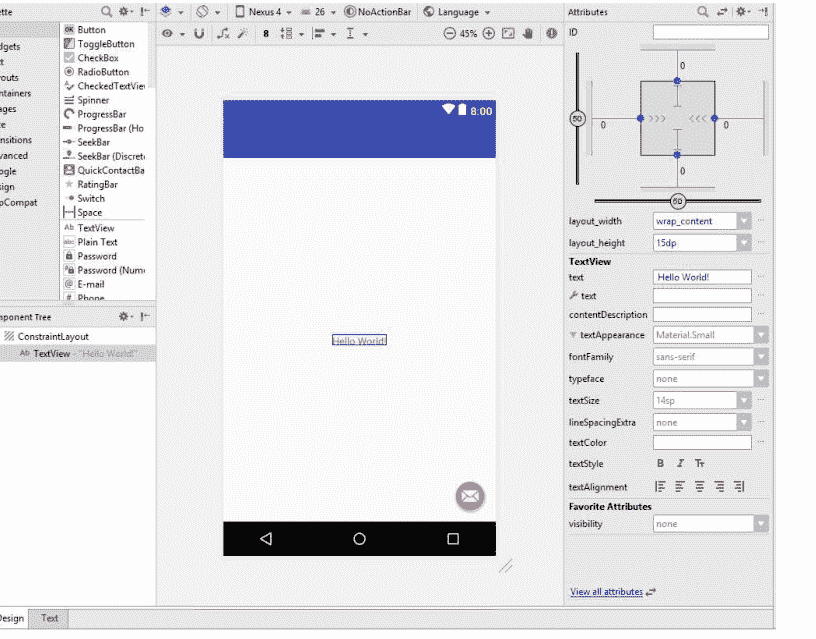

中间是设计表面，默认是 Nexus 5 的屏幕尺寸和外观。你可以选择其他设备进行工作。

事实上，布局有两种视图可以使用：设计视图（design view）和蓝图视图（blueprint）。默认情况下，你看到的是设计视图，但你可以使用设计区域左上角的菜单显示任何一种视图。

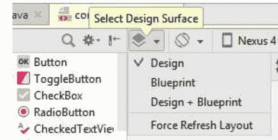

你可以同时显示这两种视图，但在大多数情况下，可用屏幕区域是主要问题，因此只显示一种是最佳选择。设计视图向你展示的布局接近它在真实设备上的显示效果。蓝图视图并不尝试真实地渲染 UI，但它确实为你提供了更多布局信息，帮助你定位和调整元素大小。使用你觉得最方便的一种。

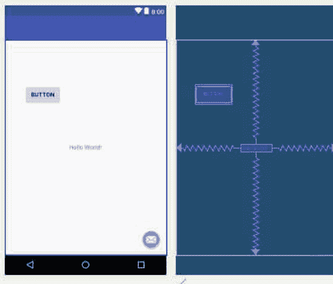

在左侧，面板下方是组件树（Component Tree），它显示了你的布局结构，即不同的 UI 组件是如何包含在其他组件中的。它以更易用的形式显示了 XML 文件的结构。你可以通过点击名称通过组件树轻松选择单个 UI 组件。你也可以将 UI 组件拖到组件树上，以便在层次结构中精确定位它们。

在右侧是属性窗口（Attributes window），用于设置布局中任何组件的属性，例如宽度、高度、颜色等。如果你用过任何拖放式设计器，这看起来会很熟悉；如果你曾苦恼于使用标记语言（无论是 HTML、XAML 还是 XML）进行详细布局，你会发现设计器让构建和测试 UI 变得多么简单。

在我们示例程序中，唯一的组件是一个已经包含“Hello World”文本的单个`TextView`。当我们只想显示一些静态文本时，`TextView`是标准组件。

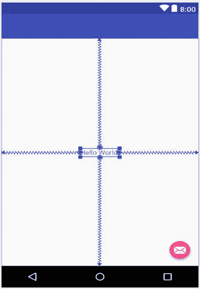

如果你愿意，可以修改问候文本。在 Nexus 上或组件树中选择`TextView`组件，使用属性窗口找到它的`Text`属性。将其更改为“Hello Android World!”：

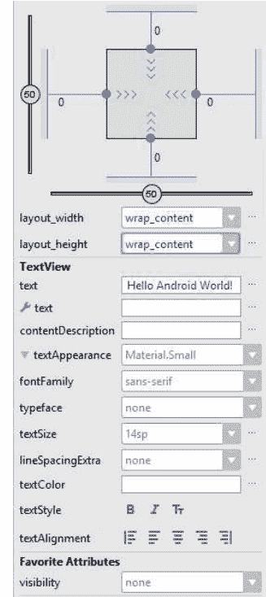

使用不带扳手图标的文本字段。带有扳手图标的属性用于设置仅在设计器中显示的值。在这种情况下，不带扳手图标的文本字段控制运行时在 App 中显示的内容。

你可以使用设计器创建任何你需要的 UI，真的不需要干涉与布局对应的 XML —— 除非出现问题，或者你需要进行某些设计器不支持的复杂操作。

## 检查 XML

设计器将自动为你生成创建布局所需的 XML，并在你更改布局时对其进行修改。如果你真的想看 XML，只需点击设计器窗口底部的`Text`标签页：

```xml
<?xml version="1.0" encoding="utf-8"?>
<android.support.ConstraintLayout
    xmlns:android="http://schemas.android.com/apk/res/android"
    xmlns:app="http://schemas.android.com/apk/res/auto"
    xmlns:tools="http://schemas.android.com/tools"
    android:layout_width="match_parent"
    android:layout_height="match_parent"
    app:layout_behavior="@string/scrolling_view_behavior"
    tools:context="example.mike.helloworld1.MainActivity"
    tools:showIn="@layout/activity_main">

<TextView
    android:layout_width="wrap_content"
    android:layout_height="wrap_content"
    android:text="Hello World!"
    app:layout_constraintBottom_toBottomOf="parent"
    app:layout_constraintLeftToLeftOf="parent"
    app:layout_constraintRightToRightOf="parent"
    app:layout_constraintTop_toTopOf="parent" />
</android.support.ConstraintLayout>
```

你应该发现它很容易理解——例如读取`<TextView>`标签——但请让设计器来创建和修改它。以`@`开头的数值都是对资源文件中定义的其他内容的引用，更多内容请参见第 11 章。

我们稍后会再次回到设计器以及它生成的 XML。

## Java 代码

如果你双击`MainActivity.java`文件，或只需选择`MainActivity.java`标签页，你将看到它包含的代码。部分代码可能被隐藏，但如果你想查看，可以点击`+`展开它。

代码中重要的部分是：

```java
public class MainActivity extends AppCompatActivity {
    @Override
    protected void onCreate(Bundle savedInstanceState) {
        super.onCreate(savedInstanceState);
        setContentView(R.layout.activity_main);
    }
}
```

你可以忽略`setContentView`函数之后的指令，因为它们设置了每个 Android 应用支持的标准“额外功能”——`ActionBar`。

在`onCreate`之下还有两个函数，但目前请先忽略它们。

在刚开始学习时，`onCreate`是唯一重要的部分。这个函数在 App 运行时被调用，它负责创建`Activity`内容。

## 开始使用模拟器

使用 Android Studio 运行 App 有两种不同的方法。你可以使用模拟器或真实的 Android 设备。最终你将不得不学会如何在真实的 Android 设备上运行 App，因为模拟器只能测试部分功能且速度较慢。但目前，在模拟器上运行第一个 App 就足够了。

你只需点击工具栏上的绿色运行图标——或使用`Run“app”`菜单项。第一次这样做时，编译需要一段时间。由于 Android Studio 引入的优化，后续运行会快得多。

当 App 准备好编译时，你会看到一个对话框允许你选择正在运行的模拟器或启动一个新的：

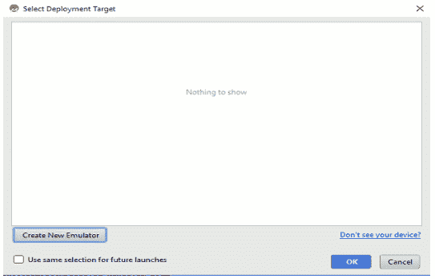

如果没有列出模拟器，你需要创建一个。选择`Create New Emulator`按钮。这将弹出一个对话框，你可以在其中选择要测试的设备。

默认是运行 API 25 Android 的 Nexus 5，对于首次测试你可能会使用它。如果你需要其他设备，可以使用 AVD（Android 虚拟设备）管理器来定义它们。

如果你在屏幕右侧看到“HAXM is not installed”的消息，点击下方的`Install Haxm`链接是个好主意。HAXM 是一种在 Intel 机器上使用的加速器，让 Android 模拟器运行得更快。你不需要它，但它确实可以加速：

## 虚拟设备配置

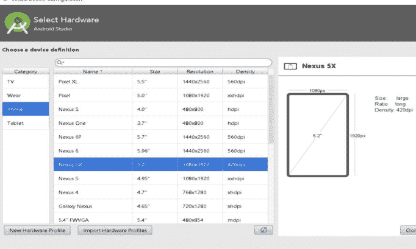

选择设备定义

| 类别 | 名称 | 尺寸 | 分辨率 | 密度 |
|---|---|---|---|---|
| 电视 | Pixel 5 | 5.5" | 1440x2560 | 560dpi |
| 可穿设备 | Pixel 6 | 5.0" | 1080x1920 | xhdpi |
| 手机 | Nexus S | 4.0" | 480x800 | xhdpi |
| 平板电脑 | Nexus One | 3.7" | 1440x2560 | xhdpi |
| | Nexus 6P | 5.7" | 1080x1920 | xhdpi |
| | Nexus 5 | 5.9" | 1440x2560 | xhdpi |
| | Nexus 4 | 4.7" | 720x1280 | xhdpi |
| | Galaxy Nexus | 4.65" | 480x800 | mdpi |

新硬件配置 导入硬件配置

上一个 下一个 取消 完成 帮助

在第一次首次运行时，你可以接受所有默认设置。你可以在 Android Studio 底部自动出现的`Run`窗口中监控模拟器的加载情况。你可能会看到一些警告出现——这些大部分可以忽略。

第一次执行整个过程需要一些时间。之后，模拟器已经在运行，即时运行（instant run）功能会尝试用最少的更改重新运行你的应用：

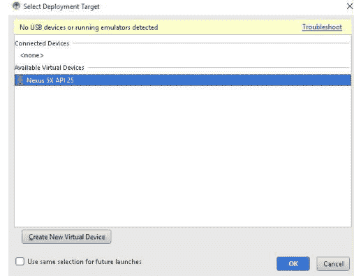

| 选择部署目标 | X |
|---|---|
| 故障 | |
| 未检测到 USB 设备或正在运行的模拟器 | |
| 连接的设备: | |
| <name> | |
| 私有虚拟设备 | |
| Nexus S API 25 | |

创建新虚拟设备 确定 取消

后续启动时使用相同的选择

请记住，在 Android 操作系统加载并看到熟悉的主界面之前，不要开始怀疑你的应用在哪里。即使它已经加载完成，给它几秒钟让 Android Studio 注意到它并上传你的应用也是一个好主意：

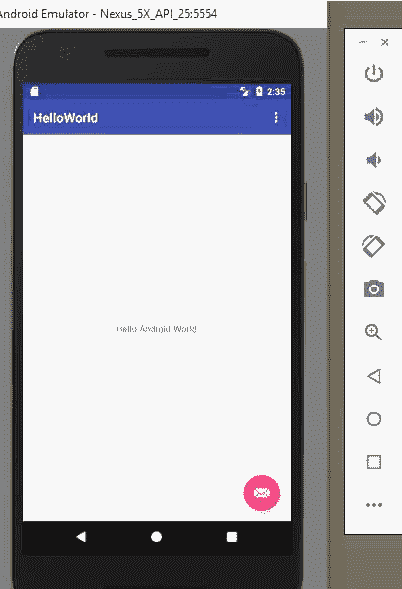

在我们的案例中，这没什么特别的——只是“Hello Android World!”这句话——但当你考虑到走过的这段历程，它确实应该令人印象深刻。

从现在起，你可以修改代码或布局并再次运行应用以查看更改效果。如果发生任何错误导致你陷入一团糟，只需删除项目并从头开始创建即可。

关于如何扩展应用并使其变得有用，你还有许多东西需要发现，但冒险已经开始了。

## 总结

- Android Studio 让创建 Android 应用比其他方法简单得多，而且它目前是完成这项工作的唯一官方途径。

- 一个应用至少有一个`Activity`，它定义了一个屏幕布局（View）和行为。`Activity`不一定得有 UI，但在大多数情况下它是有的。

- 要创建一个简单的应用程序，请使用未选择额外选项的`Basic Activity`模板。

- 屏幕布局由存储在`res`目录下的 XML 标记文件`Main_Activity.xml`控制。还有一个`content_main.xml`，我们在这里放置自定义 UI 控件。

- Android Studio 提供了一个拖拽式设计器，允许你创建 UI 而无需直接处理 XML。

- 应用的行为由 Java 文件`MainActivity.java`控制，在我们的情况下存储在`java`文件中。你可以在 Android Studio 中直接编辑 Java 文件来加载并显示布局。

- 运行应用你需要一个基于模拟器的 AVD 或连接的设备。

- 当你运行应用时，可以选择 AVD 或任何连接的设备。首次启动时使用默认的 Nexus 5。你可以修改并重新运行应用，无需重启 AVD 或任何连接的设备。

# 第 2 章

## Activity 与用户界面

你已经知道如何创建 Android 应用，但你真的知道它是如何工作的吗？在本章中，我们将查看如何创建用户界面（UI）以及将其连接到代码。在第 1 章中，我们发现了如何使用 Android Studio 构建最简单的应用。我们发现 Android 应用由两个部分组成——`Activity`和`View`。`Activity`是执行某些操作的代码，`View`提供用户界面（UI）。你可以将这种二元性视为 HTML 和背后的代码。

核心思想是`Activity`是与`View`定义的代码。这种说法并不完全准确，因为`Activity`可以更改它的视图。然而，每个`View`使用一个`Activity`有其优势，例如返回按钮如何导航你的应用——复杂应用几乎由多个`Activity`组成，但简单应用可以用一个`Activity`管理。没有硬性规定应用必须有多少个`Activity`，但它必须至少有一个。

如果你在想`Activity`是否可以在没有`View`的情况下存在，答案是可以，但没有意义，因为这会让用户没有方法与你的应用交互。当`View`呈现给用户时，`Activity`处于激活状态。将`Activity`视为带有用户界面的单个屏幕是一个非常好的简化。如果你想在没有 UI 的情况下运行，那超出了本书的范围。

在早期阶段还值得明确，`Activity`只有一个执行线程——UI 线程，你需要注意不要执行耗时任务，因为这会阻塞 UI 并导致应用无响应。`Activity`一次只能做一件事，这包括与用户交互。如果你使用单个`Activity`编写程序并在用户点击按钮时执行复杂的计算，那么在计算完成之前，activity 将无法响应任何操作。

大多数情况下，关联 UI 的目的是维护 UI。创建额外的`Activity`不会创建新线程。在我们详细考虑`Activity`生命周期时，只有一个`Activity`是激活的。我们将关注单屏幕`Activity`，因为它是你遇到的最常见的构建块，也是大多数复杂应用启动的地方。

## MainActivity

每个项目中都有一个`Activity`被指定为应用启动时运行的。如果你使用 Android Studio 创建名为`SimpleActivity`的新`Basic Activity`并接受所有默认设置，启动的`Activity`默认名为`MainActivity`。你可以通过更改`AndroidManifest`中的某行来更改启动的`Activity`。

`Manifest`是我们之前没有讨论过的项目文件，如果你使用 Android Studio，可以忽略它并让 Studio 为你构建和维护，但了解它的存在及其作用会更好。`Manifest`存储在`manifest`目录下，名为`AndroidManifest.xml`。它是一个 XML 文件，告诉 Android 系统关于你的应用的所有信息，包括它在设备上运行所需的权限。特别是，它列出了所有的`Activity`以及哪一个是启动应用的。

如果你通过双击打开生成的`Manifest`，你会看到文件中的代码：

```xml
<activity
  android:name=".MainActivity"
  android:label="SimpleActivity" >
```

这定义了系统为你创建的`Activity`，紧随下方的行将其定义为启动`Activity`：

```xml
<intent-filter>
  <action android:name="android.intent.action.MAIN" />
  <category android:name="android.intent.category.LAUNCHER" />
</intent-filter>
</activity>
```

注意，启动应用的`Activity`的选择与你如何命名它无关，即仅仅调用`MainActivity`是不够的。目前，你可以依赖 Android Studio 为你维护`Manifest`。在大多数情况下，只有当你需要修正错误或添加高级功能时才需要直接编辑它。

## Activity 内部

生成的`Activity`有一个类`MainActivity`，它包含了你应用的所有方法和属性。它还有三个生成的方法：

- `onCreate`

- `onCreateOptionsMenu`

- `onOptionsItemSelected`

后两个显然与`OptionsMenu`的工作有关，这是一个重要主题但暂时可以忽略。并不是所有的`Activity`都需要`OptionsMenu`，如果你不想支持，甚至可以删除这些方法。

这三个方法都是事件处理器。也就是说，当它们所命名的事件发生时它们会被调用。整个 Android 应用都是事件处理器及其函数的集合。

Android Studio 生成的最重要方法是`onCreate`。这是一个事件处理器，在你的应用创建时被调用，我们在这里对整个应用进行初始化和设置。它通常也是显示应用主 UI 屏幕的地方。让我们再次查看`onCreate`生成的代码几行，它们是最重要的：

```java
protected void onCreate(Bundle savedInstanceState) {
  super.onCreate(savedInstanceState);
  ContentView(R.layout.activity_main);
}
```


`onCreate` 事件处理器传递了一个名为 `savedInstanceState` 的 `Bundle`。这旨在在应用调用之间保留状态信息，我们稍后会看到如何使用它。在这种情况下，没有保存任何数据，因此 `savedInstanceState` 为空——但你仍然需要传递给继承的 `onCreate` 方法。你将在第 13 章学习大量关于 `Bundle` 的知识。

最后一条指令调用`setContentView`，该方法有多种重载。在这种我们传递了一个整数，指示用于视图的布局 XML 文件。`setContentView` 方法使用该整数创建 XML 中定义的所有 UI 组件。也就是说，这就是布局与代码之间的连接。

你使用 Designer 创建的以及在设备屏幕上显示的布局。

值得仔细观察一下布局文件的指定方式，因为这是 Android 让你访问资源的一种通用方法。后面会有专门的章节来介绍资源，但现在仍然值得进行简要介绍。

`R` 对象由系统构建，允许你访问放置在资源目录中的资源。例如，在 `onCreate` 中，使用 `R.layout_main` 会返回一个整数值（即它的 ID），这允许 `setContentView` 方法找到 `activity_main` XML 布局文件。通常情况下，所有资源都是通过 `R` 对象找到的，它是一个资源的索引。

## View 和 ViewGroup

到目前为止一切顺利，但重要的是要意识到如果 XML 文件被渲染为一组 `View` 对象，接下来会发生什么。也就是说，它们是全部都是 `View` 对象的子类的 Java 对象。UI 和图形系统实现为派自 `View` 类的组件层次级结构。如果你使用过任何 GUI 框架（如 AWT、Swing、SAML 等），这对你来说并不陌生。例如，按钮是一个派自 `View` 的类，要创建一个按钮，你只需要创建一个 `Button` 类的实例。当然，你可以通过创建更多实例来根据需要创建许多按钮。

这就留下了一个问题：按钮出现在布局的什么位置？

答案存在 `ViewGroup` 对象，它们作为其他 `View` 对象的容器。你可以设置子 `View` 对象的位置，或者让它们受各种布局规则的控制（稍后介绍）。你可以选择通过创建和操作 `View` 实例来创建整个 UI，这将在第 7 章中演示。

所以为了 100% 明确，所有的 UI 对象都定义在代码中，并且每个 UI 对象（如按钮）都有一个名称类似的 Java 类让你能够创建 UI。事实上，这是创建 UI 的唯一方法，但还有其他指定它的方法。与其编写代码在 XML 文件中指定你想要的内容，然后使用代码显示它，这正是 `setContentView` 所做的——它读取你指定的 XML 文件并创建实现 UI 的 Java 对象。

这意味着你可以通过手动编写一个 XML 文件来定义视图对象以及它们相互嵌套的方式，并依赖系统为你创建视图对象层次级结构。虽然这是可行的，但使用 Designer 创建 XML 文件，然后让系统从生成的 XML 文件为你创建对象要简单得多。

也就是说，你可以将按钮拖放到到 Designer 中，它将自动生成创建它所需的 XML，并指定它的位置以及你设置的所有其他细节。

也就是说，在表面层，创建 UI 有三种方法：

- 1. 你可以编写 Java 代码来生成必要的 Java 对象
- 2. 你可以编写 XML 标签并使用系统将 XML 转换为相同的 Java 对象。
- 3. 你可以使用 Designer 交互式地创建 UI 并生成 XML 文件，然后将其转换为 Java 对象。

你可以将其设想为：

```
drag-and-drop layout -> XML -> Java View objects
```

能够在交互式编辑器中处理 UI 是使用 Android Studio 的巨大优势之一，即使你知道如何直接编辑 XML 布局文件，它也不应该是一个你不应该忽略的功能。将布局编辑器作为第一步，并在必要时对 XML 文件进行任何调整，几乎一直是一个好主意。

## 创建我们的第一个 UI

为了看到这一切是如何结合在一起的，让我们添加一个按钮和一个 `textView` 对象。你可能已经知道按钮是用于点击的，你可以猜到 `textView` 是用来显示用户文本的。

首先，删除创建新的空白 Activity 时自动生成的 "Hello World" 文本。通过项目视图打开并加载 `content_main.xml` 文件。

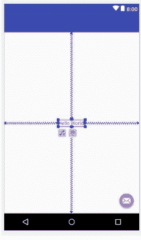

`content_main.xml` 是你创建所有 UI 的地方。另一个布局文件，但正如第 1 章解释过的，它仅提供了 UI 中的标准元素，如 `AppBar`。注意，由于由于，你可以在 Designer 中看到无法编辑的 UI 组件——它们属于另一个布局文件。

要删除 "Hello World"，你只需要选中它并按删除键：

注意，如果不小心删除了内容，有一个撤销命令 Ctrl-Z。

接下来，在调色板（Palette）的 Widgets 部分点击按钮并将其拖动到设计表面上：

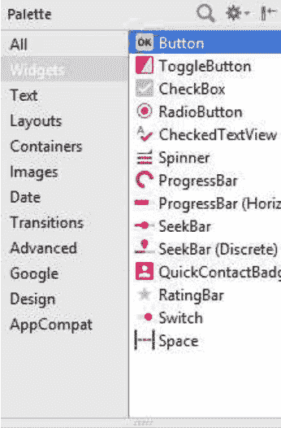

如果你现在将光标悬停在设计区域上，你会发现随着它的移动，会有各种线条指示出不同的对齐方式：

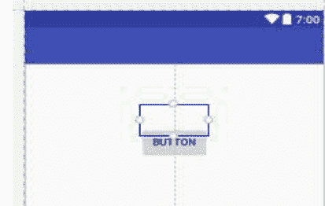

要放置按钮，只需点击一下，一个完整的按钮（带有默认标题 "Button"）就会出现。

然而，仅仅将按钮丢在设计表面上是不够的。如果你只是这样做，按钮将在没有任何定位约束的情况下定位。如果你尝试运行程序，你会发现按钮有时会在模拟器或真实设备上消失。原因是由于没有应用对其定位的约束，它会移动到屏幕顶部并隐藏在其他控件后面。

这种行为是 `ConstraintLayout` 的特征，稍后会详细介绍。目前我们只需要为按钮应用一些约束。

简单的解决方案是点击推断约束（Infer Constraints），让 Android Studio 计算如何放置按钮：

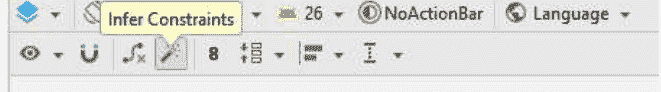

当你点击此按钮，会根据按钮的位置添加约束。目前，具体应用什么约束并不重要，重要的是产生了一些约束。

在屏幕下方，按钮被约束在距离顶部和右侧的固定距离。注意，你可以放置按钮，然后点击推断约束来设置按钮的位置：

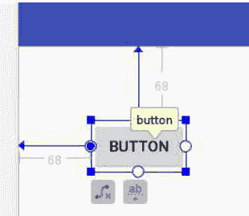

现在你有了一个可以使用的按钮，让我们以相同的方式添加 `TextView` Widget——在调色板中点击它的图标，在 Designer 中放置，然后点击设置位置。注意 Android Studio 提供了 UI 信息。再次你需要点击推断约束来放置 `TextView`。最简单的方法是将 `TextView` 放在你想的地方，然后点击推断约束来设置该位置的约束：

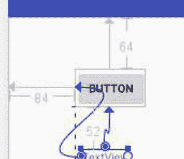

注意 Android Studio 提供了对齐 UI 信息。创建布局的最简单方法是将组件放置在你想的地方，然后点击推断图标来固定它们的位置。在实践中，这些约束可能不是你完全需要的，但它提供了一个起点。

大概就是这样，创建一个复杂的 UI 也是如此，只需从调色板中选择组件并将它们放置在设计表面。

如果你现在运行程序，点击绿色的运行图标（如果你不知道如何操作，请回看第 1 章），你将看到你的新 UI：

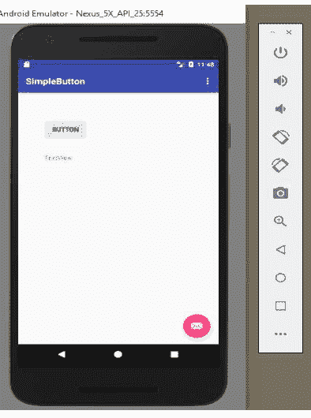

当然，它什么都不做，即使你可以点击调色板按钮。按钮确实点击了，但没有连接到按钮点击事件的代码来说明应该发生什么，我们很快就会处理这个问题。

## 属性

我们的下一个任务是更改按钮上的标题。记住对象具有属性和方法。像标题文本、背景颜色等 UI 小部件被表示为属性。你可以在代码中更改属性，或者在设计时你可以使用屏幕右侧的属性（Attributes）窗口。

如果你选中该按钮并查看右侧的属性（Attributes）窗口，你会发现按钮的文本（text）属性。它目前包含值 'Button'。如果你将其更改为 'Click Me!' 并重新运行程序，你会看到按钮的标题（caption）发生了变化：

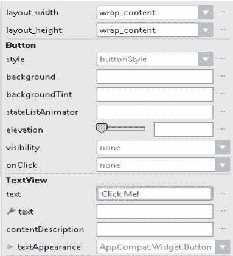

你可以选择放置在 UI 中的任何小组件的初始属性。属性非常多，我们需要花一些时间来看它们。然而，目前重要的是让你看到使用属性窗口更改属性是多么简单。

正如你可能猜到的那样，你更改的属性会导致定义布局的 XML 文件发生变化。请记住，通用原则是：Designer 创建了 XML 文件，而你完全可以在没有 Designer 帮助的情况下手动创建该文件。从这个意义上说，除了 除了过程变得简单许多，并没有为这个过程添加任何东西。

## 事件

我们希望在按钮被点击时执行某些操作。Android 支持完整的事件驱动 UI。因此，我们需要定义一个在按钮被点击时被调用的方法或函数。

如果你熟悉其他语言，可能会发现 Java 处理事件的方式既奇异又复杂。它确实如此，我们以后将回来发现事件如何实现的完整故事。好消息是，Java 事件在 Java 8 中已经变得简单得多，而且现在 Android Studio 也支持了这一点。虽然你需要了解创建事件处理程序的原始方法，但使用 Java 8（特别是 lambda 函数）总是要容易得多。关于如何创建事件处理程序将在第 4 章中详细讨论。

有多种不同的方法来指定事件处理程序，但简单的方法是使用 Designer 生成系统所需的 XML，以便将处理器挂载到事件上。这不是一种可以一直使用的方法。它只适用于点击事件，但它可以帮助你入门。

如果你用过类似 Visual Studio 的工具，那么也值得指出，Android Studio 不会自动为你创建事件处理程序。在 Android Studio 的情况下，你必须创建一个函数并将其分配给 `onClick` 处理器。这种看似毫无用处的方法之所以是，Java 事件比 .NET 或 JavaScript 事件复杂得多。

使用 Designer 方法，方法点击事件处理程序仅仅是当前 Activity 的公共方法，其签名如下：

```
void method(View v)
```

以防你漏掉或忘记什么是函数签名：

函数签名是它接受的参数的数量和类型。

同名但签名不同的函数被认为是不同的函数。在这种情况下，该函数接收单个参数（即一个 `View`），并返回 `void`（即什么都没有）。

你可以给该方法起任何喜欢的名称，但在大多数情况下，准确指定它处理的事件是有帮助的。在这种情况下，我们想要处理按钮的 `onClick` 事件——当用户用鼠标点击按钮，或者更有可能使用触摸设备点击按钮时就会发生该事件。

将 `MainActivity.java` 文件加载到代码编辑器并添加以下方法：

```java
public void buttonOnClick(View v) {
  // 当按钮被点击时执行某些操作
}
```

这需要直接添加在 `onCreate` 方法之后，以及任何可以使其成为 `MainActivity` 类方法的地方。

处理完这些代码后，现在切换回 Designer，选中按钮，在属性窗口中找到 `onClick` 属性输入或选择 `buttonOnClick`：

| visibility | none |
| --- | --- |
| onClick | buttonOnClick |
| TextView | none |
| text | buttonOnClick |
| | buttonOnClick [MainActivity] |
| contentDescription | |

有时 IDE 无法立即注意到存在合适的方法，你必须手动输入方法名称。注意，你不需要输入参数。

就是这样。使用正确的签名和返回类型定义事件处理程序，并在属性窗口中设置相应的 `onClick` 属性。

对于其他类型的事件，你必须在代码中完成——XML/Designer 方法仅适用于 `onClick`。

## 将 Activity 连接到 UI

现在我们将一个事件处理程序挂载到了按钮点击事件，我们通常希望执行某些影响 UI 的操作。

假设当按钮被点击时，我们想要将 TextView 组件显示的文本更改为“I've Been Clicked!”

我们可以通过更改 TextView 组件的属性来实现。唯一的问题是，如何在代码中找到这个 TextView 组件呢？

当你使用标记语言来定义组件或其他 UI 对象时，这是一个相当标准的问题，代码必须有一种与这些 UI 对象连接的方法。例如，在 JavaScript 中，你使用 `getElementById` 方法获取与特定 HTML 元素对应的 DOM 对象。

在 Android 中，我们执行类似的操作。

首先，确保你遵循这样一个观点：Designer 生成的所有 XML 被转换为一组 Java 对象，对应于设计界面上的每个组件或 View。这些对象具有与属性窗口中看到的相同范围的属性，并具有完成其他任务的方法。你只需要找到一种引用其中一个对象的方法。

对于触发事件的 View 对象，这非常简单，因为它是作为调用的唯一参数传递给事件处理程序的。所以，如果事件处理程序是：

```java
public void onClick(View v) {
```

且该事件处理程序只挂载到按钮上，那么当事件发生时，你可以百分之百确定 `v` 就是按钮对象。如果你想

当你将鼠标悬停在修正后的 Button 类名上时，你还会看到一个灯泡图标：

```
public void buttonOnClick(View v) {
    Button button=(Button) v;
}
```

在没有错误的情况下，Android Studio 会提供改进代码的提示——请留意灯泡图标。如果你点击这个灯泡，它会建议将声明和赋值分开，认为这是更好的风格。Android Studio 处处都是提示，每一步都提供改进代码的建议——但你不必接受它们。

目前，让我们先保持单行写法：

`Button=(Button) v;`

现在我们有了按钮对象，我们可以在调用它的 `setText` 方法时看到按钮标题的改变：

`button.setText("I've Been Clicked!");`

完整的事件处理器是：

```java
public void buttonOnClick(View v) {
    Button button=(Button) v;
    button.setText("I've Been Clicked!");
}
```

如果你运行程序，你会看到在点击按钮时，按钮的标题会改变。

这是让 UI 运行的一种常见模式——事件处理器通过更改 View 对象的属性来修改 UI。请注意，这种方法只有在你知道触发事件的对象类型以及事件处理器时才有效。如果你的事件处理器只连接到单个组件，那么你确实知道触发事件的对象类型。如果不是这样，或者你想修改一个并非事件主体的 View 对象的属性，那么你就必须找到它。这正是我们接下来要做的。

## 查找 View 对象

现在假设我们想对 View 中的其他组件之一进行某些操作。在这种情况下，我们必须在没有事件处理器参数帮助的情况下找到代表组件的对象。例如，我们如何找到放置在按钮下方的 TextView 呢？

在事件处理器中，Button 是触发事件发生的对象，所以它已经被找到了，但你如何找到布局中的另一个组件呢？

这是从 Activity 操作 View 对象时的一种非常标准的模式。首先，你利用 `R` 对象来查找组件的 id。在这种情况下，TextView 默认被赋予了 id `textView`，所以我们可以使用：

```
R.id.textView
```

这会返回一个标识该组件的唯一整数。

接下来，我们使用 Activity 的

```
findViewById(int)
```

方法，它接收该整数并返回与 id 对应的 Java 对象。

当然，它以 `View` 对象的形式返回，因为 `findViewById` 不再更准确地知道它返回的对象类型。因此，我们必须使用 TextView 对象。

将这些结合起来：

`myTextView=(TextView) findViewById(R.id.textView);`

再次，Android Studio 会对 TextView 报错，如果你按下 Alt+Enter，它会为你在程序开头添加该类：

`import android.widget.TextView;`

现在你有了 TextView 对象，就可以使用 `setText` 方法来更改它的显示内容：

`myTextView.setText("You Clicked My Button!");`

完整的事件处理器是：

```java
public void buttonOnClick(View v) {
    Button button=(Button) v;
    button.setText("I've Been Clicked!");
    TextView myTextView=(TextView) findViewById(R.id.textView);
    myTextView.setText("You Clicked My Button!");
}
```

如果你现在运行程序，你会发现自己被告知了两次这个重要的按钮已被点击：

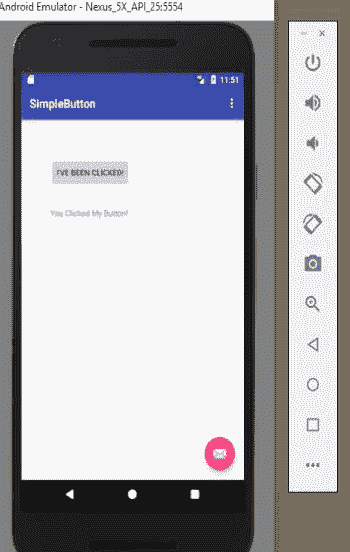

你可能认为这些都是非常微小的细节，不像真正的应用，但这就是 Android 中构建 UI 的工作方式。

你现在已经知道如何使用 Designer 工具箱中可用的控件设计一个单屏应用，以及如何将它们连接起来以处理点击事件、代表它们的 Java 对象是什么，以及如何调用修改它们的方法。

除了每个控件（单选按钮、复选框等）工作原理的细微细节外，你现在已经有了构建单屏应用的通用大纲。

## 总结


- `Activity` 是 Android 应用程序的单元，它大致对应于一个屏幕的用户界面加上使其运行的代码。
- 在大多数情况下，你为你想要展示给用户看到的每个 UI 屏幕创建一个 `Activity`。
- 在任何时刻，你的应用程序只运行一个 `Activity`。
- `Activity` 是单线程的，并运行在 UI 线程上。
- 你可以在 `Manifest` 中设置由哪个 `Activity` 启动应用。Android Studio 默认将其设置为 `MainActivity`。
- `Activity` 具有与其生命周期中不同阶段对应的事件。`onCreate` 事件在应用首次启动时被调用，这是你执行所有初始化的地方。
- 你还可以从之前的运行点恢复应用状态。
- `Activity` 随后加载一个 `View` 或 `ViewGroup` 对象来创建其用户界面。
- 你可以通过三种可能的方式创建 `View`/`ViewGroup` 对象：在代码中、使用 XML 或使用 Designer 生成 XML。
- Designer 是创建 UI 最简单的方法。
- 通过打开 XML 文件，你可以使用 Designer 在设计表面上放置与 `View` 对象对应的控件。
- 你可以使用 Attributes 来设置每个控件的属性。
- Designer 创建的 XML 文件被 `Activity` 通过创建与使用 Designer 放置的每个 `View` 对象对应的 Java 对象来设置其 UI。
- 当你引用文件中未定义的类（即大多数类）时，你需要在代码开头添加 `import` 语句。
- 如果你的事件处理器只连接到单个组件，那么你确实知道触发事件的对象类型。如果不是这样，或者你想修改一个并非事件主体的 `View` 对象的属性，那么你就必须找到它。

使用 Designer 是最简单且最高效的方法，让我们继续专注于创建 UI 的方法。本章主要关于如何使用默认布局以及创建 UI 的挑战。

## 面板中有什么

启动 Android Studio 并创建一个名为 `UnitTest` 的简单 activity 项目。这将是我们本章的 UI 实验场。在选择 Basic Activity 后，打开 `app/res/layout` 文件夹下的 `content_main.xml` 文件，然后 Designer 就会打开，你将看到布局的渲染：


面板的前四个包含最重要的 UI 组件，后面的五个部分是更特殊的组件。

1. Widgets（控件）包含最常用的组件——按钮（Buttons）、复选框（Checkboxes）等。这是你首先需要学习的组件集。
2. Text（文本）提供一组组件，它们的工作方式大相同。
3. Layouts（布局）是其他组件的容器，提供了不同的布局规则。
4. Containers（容器）类似于布局，你通常将其他组件放在它们内部，容器负责“外观”。
5. Images（图像）为特定资源提供容器，如图像和视频：


6. Date（日期）具有与日期输入显示相关的控件。
7. Transitions（过渡）在不同组件之间执行的动画。
8. Advanced（高级）可以在这里找到更大复杂的组件，如数字选择器（number picker）。
9. Google 用于 Google 提供的服务，包括 `View` 和 `AdView`。
10. Design（设计）提供更高级的控件，如标签页（tagged pages）。
11. AppCompat 为旧版本的 Android 提供更新的控件。

## Hello World 示例

我们应该从哪里开始呢——UI 构建的“Hello World”。如果你知道如何使用布局，你已经在理解所有可能组件的道路上了。好消息是，我们在之前的章节已经用过 Layout 并发现了如何操作它。然而，仍然有很多东西需要发现。通常对于任何组件，你需要发现三点：

1. 如何让它初始看起来像你想要的那样。这是使用 Designer 中提供的属性进行发现和设置的问题。
2. 如何修改组件在运行时的样式。这是发现如何在代码中操作属性的问题。
3. 如何连接组件生成的事件。

设置属性听起来很容易，但有不同类型的属性，它们有不同的交互方式。你首先必须发现的是如何定位组件。

## 定位：`ConstraintLayout`

在继续项目之前，请选择默认的“hello world”——这会让事情变得更容易。正如提到的，布局有两种视图你可以选择——设计视图（design）和蓝图（blueprint）。设计视图看起来像你的 UI 在真实设备上运行时的样子。它对于获取 UI 真实的整体印象很有帮助。蓝图视图以骨架形式显示 UI。这使得定位工作变得更快、更简单。你可以同时查看两者，但这主要是浪费空间。有些用户偏于蓝图视图，因为它看起来很轻量。另一些人则偏于设计视图，因为它是完整的。使用你觉得可行的即可，但无疑蓝图视图在尝试定位组件时速度更快，且卡顿更少。

接下来，点击面板上的 Layout 并将其拖到布局中。注意布局信息随着你的移动而变化的方式：


要意识到，这些定位信息仅用于帮助你相对于现有布局定位组件。在 `ConstraintLayout` 中，你在哪里释放组件对程序运行时它将显示的位置没有影响。事实上，如果简单地将一个 UI 组件拖到设计面上，它会漂移到右上角。情况稍微复杂一点，因为有一个功能会在你释放组件时自动添加你释放时刻所示的对齐约束。然而，正如我们看到的，这是可以关闭的。关键是要意识到这些定位信息只是为了帮助你定位。使用 `ConstraintLayout`，影响组件显示位置的是你应用的约束。

那么如何应用约束？你可以让 Designer 自动为你建议，也可以手动应用。有两种方法让编辑器应用约束：

1. Auto（自动模式）
2. Infer Constraints（推约束）

它们的工作略有不同。Auto 模式看起来很有用，但在实践中可能会出错。要开启 Auto，只需点击 Designer 顶部的 Auto 图标：


使用 Auto，当你在设计面上放置组件时，编辑器会根据你放置的位置尝试推导出合适的约束。如果它未能应用任何约束，当你将组件拖到另一个位置时它会再次尝试。它只会对指示的对齐应用约束。如果你在屏幕的任意位置放置组件而没有指示，则不会应用约束。

一旦 Auto 应用了约束，当你修改组件时这些约束不会改变。Infer Constraints 选项实际上更容易使用且相当有效。你只需要将所有组件放置在你想要的位置上，然后点击 Infer Constraints 按钮：


当你这样做时，约束将根据每个组件的位置计算。这为你提供了更多时间来放置组件，而且你可以随时删除所有约束并再次点击 Infer Constraints 来重新计算。只有固定组件位置所需的约束会被添加——现有的约束不会被修改。

这意味着你可以使用 Infer Constraints 来确保你的布局有足够的约束来使其工作——如果没有添加，说明没问题。此外注意，一旦 Infer Constraints 添加了约束，即使你拖动组件，约束的类型也不会改变。

一个策略是关闭 Auto 并在每次在设计面上放置新组件时都使用 Infer Constraints。这允许你一次构建一个组件布局，并检查每组新约束。然后你可以修改新添加的约束，并处理下一个组件。

值得知道，实际的定位是通过设置按钮的边距（margin）属性为 36 和 33 实现的。`ConstraintLayout` 可能是布局组件中最复杂的，但它使用自 Android 早期一直使用的属性来定位其他组件。

如果你在界面上放置第二个按钮并将其移动到靠近第一个按钮的地方，你就会发现相对于屏幕边缘进行定位其实并不那么简单。现在，如果你点击“推断约束”（Infer Constraints）按钮，所应用的约束是相对于第一个按钮的：

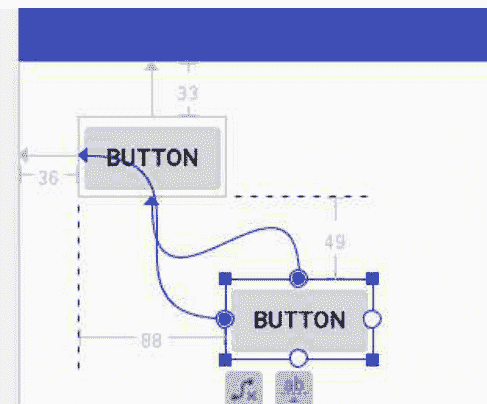

你可以看到，在这种情况下，第二个按钮相对于第一个按钮的左边缘偏移了 88 像素，下方偏移了 49 像素。无论显示 UI 的物理屏幕有多大或小，这些约束将被遵守。这意味着，如果你移动第一个按钮，第二个按钮将保持其相对于第一个按钮的位置。事实上，如果你点击并拖动第一个按钮，第二个按钮会随之移动。

如果你在设计器（Designer）中尝试定位操作，很快就能掌握这种思路。推断约束的一个大问题是系统有时会出错。与其让设计器错误地推断约束，不如手动放置它们。你只需要从组件上的约束圆圈处拖出一条线，连接到你想要作为参考点的边缘即可。

例如，要将按钮相对于屏幕右侧定位，只需将按钮右侧的圆圈拖到屏幕右侧，然后将按钮移动到你想要的位置：

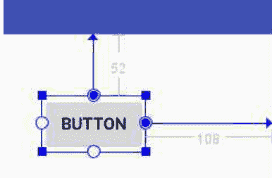

有许多不同类型的约束可以应用，我们将在第 6 章和第 7 章中详细介绍这些内容，在那里我们将深入研究布局。目前，这些就是你需要了解的。

- 约束可以自动或手动应用，它们通常设置了从组件上的某点到另一个组件上某点的点的距离。
- 例如，如果你想将一个组件相对于另一个组件放置，只需将第一个组件上的约束点拖到第二个组件的边缘即可。

在下方所示的情况下，应用了手动约束，因为约束推断会将约束设置在屏幕的左边缘：

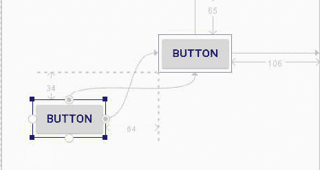

在早期阶段也值得知道，属性（Attributes）窗口可以通过多种方式帮助你查看。第一是它有一个显示当前应用约束的图表，并允许你修改它们并精确设置距离：

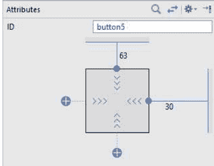

如果你点击其中一条约束线，就可以输入距离值。你也可以点击圆点完全删除约束，或者点击“+”添加约束。

正如你可能猜到的那样，有些属性允许你使用属性窗口设置每个位置的位置和边距。

要查看所有属性，必须点击属性窗口右上角的“查看所有属性”（View all properties）图标——即双向箭头。

窗口中列出的属性并不是为了实现相同结果而可能设置的属性的简单表示。它们经过了组织和简化，使得使用设计器更加容易。

例如，如果你查看完全展开的属性窗口，你会看到：

### `Layout`

`MarginTop`

这提供了距离顶部边缘的距离，以及：

### `Constraints`

`top_toTopOf`

这指定了定位所相对于的对象。

如果你查看 XML 文件，你会看到：

```xml
app:layout_constraintTop_TopOf="parent"
android:layout_marginTop="348dp"
```

所有布局属性都以 `layout_name` 开头，其中名称表示受影响的定位。从属性窗口到 XML 属性的映射非常直观。

值得理解的是，通过允许你只需将组件拖动到想要的位置来设置其位置，设计器正在计算如何正确设置多个属性。在上面的示例中，它设置了 `top_toTopOf` 和 `MarginTop` 属性。你可以手动这样做以获得相同的效果，但设计器只需根据你放置组件的位置就完成了操作。

（注：原文后续存在大量重复段落，已根据指令要求进行去重处理。）

## 组件树（Component Tree）

如果你查看 Android Studio 设计模式的左下角，你会看到一个名为“组件树”（Component Tree）的窗口。这几乎是不言自喻的，除了提醒你注意它之外，不需要额外解释。注意，你可以看到从 Layout 容器开始的布局树结构。你可以看到默认布局是 `ConstraintLayout`，并且可以看到所有其他组件都正确地嵌套在它们的父容器中：


注意，你可以直接在树中选择并删除布局元素。当你有一个复杂的布局且由于出错导致你难以可靠地选择组件时，这非常有用。你还可以在树中移动元素来改变它们的嵌套方式。

## 简单的按钮示例：基线对齐（Baseline Alignment）

作为一个简单的演示，让我们先在设计器上放置一个按钮 `Button`，并使用“推断约束”（Infer Constraints）应用一些约束。如果你发现很难获得大致位置然后输入精确的边距，请记住，你可以将其移动到“属性”（Attributes）窗口并直接输入它们。

接下来，在设计器上放置一个 `TextView` 小部件。在这种情况下，你希望文本与按钮中的文本处于同一行上。这是一种基线对齐（baseline alignment），是较复杂的对齐方式之一，但如果你将设计器缩放到可以看到整个屏幕区域，很可能你所能做的只是对齐到按钮的顶部或底部。

如果你查看设计器中 `TextView` 的表示，你会发现它下方有两个小图标。第一个图标会移除该组件的所有约束，第二个图标则会使文本基线（一个微小的椭圆框）显示在组件内部：


这代表 `TextView` 中的文本，你可以用它来设置基线约束。你只需要选择 `TextView` 并将光标悬停在椭圆框上，直到它被高亮。从椭圆框新拖动到按钮中文字的基线，或者任何你想要对齐基线的组件上：


这就是你需要做的所有。之后，按钮中的文本和 `TextView` 中的文本将共享共同的基线。如果你移动按钮，`TextView` 也会随之移动。如果你想移除基线对齐，你只需要选择 `TextView`，悬停在椭圆框上，并在出现“移除基线约束”时点击即可。

## 方向与分辨率（Orientation and Resolution）

创建 Android 应用面临的最大挑战之一是允许各种屏幕尺寸和方向。由于需要处理不同的屏幕尺寸，移动应用开发与桌面开发有显著不同。即使你的应用运行在固定设备上，用户仍然可以瞬间将其旋转 90 度并改变屏幕尺寸，然后再次转回来。因此，你的应用必须响应这些变化。幸运的是，Android 通过提供专门处理分辨率和方向变化的设施来让你的工作变得更容易，但你需要在 Android 编程的过程中尽早接受这种情况。

Android Studio 拥有许多工具来帮助解决变量布局问题。例如，它让你可以在一系列设备、方向和分辨率下查看你的布局。这使得事情变得简单得多。

我们只需通过选择“横向”（Landscape）选项即可在横向模式下测试布局：


你在竖向（portrait）模式下设置的相对位置会在横向模式下不修改地应用，因此对它们进行规范至关重要，以确保 UI 在任何方向下看起来良好。如果这不可行，你可以为每个方向提供单独的布局。

你还可以通过点击“编辑器中的设备”（Device in Editor）按钮时出现的设备列表，查看你的 UI 在各种支持的屏幕尺寸上的外观：


对于简单布局，这可能足够了，但 Android 还有更多手段来帮助你处理不同尺寸的屏幕。特别是，你可以利用“片段”（fragments）并为每个屏幕方向和分辨率创建一个单独的布局。片段是高级内容，是一本独立书籍《Android 编程：精通片段与对话框》的主题。另一方面，为每个方向和分辨率使用不同的布局是 Android UI 设计的基础，你在这个早期阶段至少需要知道它的存在。

这个想法非常简单——为你想要支持的每个方向和分辨率提供一个布局资源。当应用在真实设备上运行时，系统会自动选择所需的资源布局。

这种工作原理虽然简单，但 Android Studio 具有一些实用的功能，可以让你免受底层实现的影响。了解它是如何工作的，然后研究 Android Studio 如何为你完成这些工作，是一个好主意。

如果你创建一个名为 `activity_main.xml` 的新布局文件，即与你已经在 `layout-land` 文件夹中创建的竖向布局文件完全相同，那么当用户将设备旋转到横向模式时，它将被自动使用。也就是说，在任何情况下使用的布局文件都由其存储的文件夹名称决定。通过这个仅适用于横向的新布局，你可以创建一个专门针对该方向的布局。

现在，如果你使用模拟器运行应用，最初你会看到竖屏界面，但如果你通过右侧菜单将模拟器旋转到横屏模式，你会发现在竖屏布局可见时会停顿，然后它将切换到横屏布局。

如果你在一系列设备上查看应用，可以旋转到横屏模式并看到你自定义的横屏布局。

总的来说，最好的计划是创建一个完整的竖屏布局，并在开发尽可能晚的时候生成横屏布局，这样你就不需要重复进行 UI 调整。

此外，请注意布局的自动切换存在着一个潜在问题。当布局切换时，你的应用会重启，这意味着它可能会丢失状态。这就像用户刚刚启动你的应用了一样。为了解决这个问题，我们需要研究应用的生命周期并发现如何保存该状态，这将在第 13 章中介绍。

你也可以使用相同的方法来支持不同的屏幕分辨率。这种方法的思路为每个分辨率提供多个 XML 文件，系统会自动选择其中一个使用。这比处理方向要稍微复杂一些，因为你可能需要提供不同分辨率的图像来让布局看起来良好。关于这一点，在我们学习资源和资源管理之后。

这是我们第一次查看 Android 开发的一个特定方面，它使得 Android 开发比为固定屏幕尺寸开发更复杂，而且事实证明它并没有最初看起来那么困难。

## 第一个应用：简单计算器

作为一个使用 `ConstraintLayout` 和 Designer 构建简单应用的示例，让我们构建一个计算器应用。这个应用中一些技术稍微超出了我们目前涵盖的内容，但你应该能够跟上，现在是时候展示比单按钮应用更复杂的应用样子了。


这是一个非常简单的计算器——它所做的只是计算总和。它只有数字按钮和一个显示器。它设置每个按钮的值并将它们加到运行总和中。它没有加、减或清除之类的运算符按钮，但你可以添加它们来扩展其功能。

启动一个名为 `ICalc` 或任何你喜欢的名称的新型 Basic Activity 项目。接受所有默认设置。

操作原理是我们将设置一个包含十个按钮的网格。将每个按钮的文本标签设置为 0 到 9。然后我们将为每个按钮分配相同的 `onClick` 处理器。它所做的只是获取按钮上显示的文本说明，将其转换为整数，加到运行总和，然后在转换回字符串后将其存回 `TextView` 中。

简单来说，当按钮被点击时，会调用事件处理器，该处理器获取按钮的标签作为数字并将其加到运行总和中。

## 代码

所以代码相当简单。

我们需要一个私有字段来保存运行总和：

```java
private int total = 0;
```

接下来，我们需要一个 `onCreate` 函数，将用于处理所有按钮的 `onClick` 事件。如果你不知道简单的事件处理，请回看第 2 章。

用户点击的按钮作为 `View` 对象作为唯一参数传递给函数，我们可以用它来获取文本说明：

```java
public void onClick(View v) {
    Button button = (Button) v;
    String btext = button.getText().toString();
```

现在我们有了按钮的文本说明（0、1、2 等），我们可以将其转换为整数并加到运行总和中：

```java
    int value = Integer.parseInt(btext);
    total += value;
```

最后，我们通过其 ID（参见第 2 章）获取 `TextView`，并将它的文本设置为转换为字符串的总和：

```java
TextView myTextView = (TextView) findViewById(R.id.textView);
myTextView.setText(Integer.toString(total));
}
```

完整的事件处理器是：

```java
private int total = 0;

public void onClick(View v) {
    Button button = (Button) v;
    String btext = button.getText().toString();
    int value = Integer.parseInt(btext);
    total += value;
    TextView myTextView = (TextView) findViewById(R.id.textView);
    myTextView.setText(Integer.toString(total));
}
```

将此代码放在 `MainActivity` 类中作为其方法之一，例如放在最后的一个闭合大括号 `}` 之前。

当你输入这段代码时，你会看到许多类和方法显示红色：

```java
return super.onOptionsItemSelected(item);

private int total = 0;

public void onClick(View v) {
    Button Button = (Button) v;
    String bText = Button.getText().toString();
    int value = Integer.parseInt(bText);

    total += value;
    TextView myTextView = (TextView)
        findViewById(R.id.textView);
    myTextView.setText(Integer.toString(total));
}
```

这是因为它们需要被项目导入。你可以手动通过在文件开头添加必要的 `import` 语句来完成，但将光标置于每个符号中要简单得多。通过点击每个红色符号并按 `Alt+Enter`，必要时选择 Import Class。这现在应该变成你的本能了。

注意 `R.id.textView` 标记的错误无法清除——这是一个真实的错误。在我们定义 UI 之前，`textView` 并不存在。暂时忽略这个错误。

## 布局

现在我们将注意力转向布局。打开布局文件，删除默认内容，并在屏幕的右上角放置单个按钮。将其设置约束到屏幕的顶部和左侧。该行中的第二个按钮可以设置约束将其放置在第一个按钮的右侧。该行的第三个按钮具有与左侧按钮相同的约束。

设置约束有很多方法，但能够使用左上角的按钮来定位整个按钮数组是很方便的。要创建一个按钮网格，你需要重复九次。你可以通过将每个按钮拖到设计表面并手动设置相对于已放置按钮的约束来这样做。然而，我们可以使用已经创建的 `Button` 通过复制和粘贴来制作剩余部分。

在组件树中选择按钮并使用复制命令，在设计表面上粘贴两个。复制的内容将放置在第一个按钮上方，因此拖动它们形成一个由三个按钮组成的粗略线条。暂时不要担心精确位置，我们只需要在约束设置好之后再这样做。将每个按钮的文本属性分别更改为读取 7、8 和 9。

如果你尝试使用 Infer Constraints（推断约束），你会发现它起作用，但应用的约束并不一定如你所愿。在这种情况下，约束是合理的，但注意行的垂直位置是由中间按钮设置的，而水平位置是由第一个按钮设置的。

现在也是准确放置按钮的好时机，无论是拖动还是使用属性窗口。按照这种模式继续下一行，不要尝试复制和粘贴整行，因为约束会变得复杂。复制并粘贴三个按钮。像第一行一样应用约束，但在这种情况下，将该行的第一个按钮相对于左上角的按钮进行定位。

将按钮中的文本更改为所示的 4、5 和 6。

最后一行与之相同，但第一个按钮的位置是相对于第二行第一个按钮的。最后，添加孤立的“0”按钮，并将其放置在相对于第三行第一个按钮的区域：

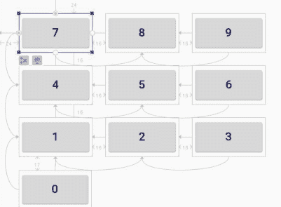

确保你已将最后四个按钮的文本分别更改为 1、2、3 和 0。

请仔细检查约束条件，因为这很容易出错。原理是：每行的第一个按钮是通过上方的按钮进行垂直定位的，而行中的其他按钮是相对于第一个按钮进行定位的。

这工作量很大！现在我们需要让网格更加规整。依次选择每个按钮，确保其标题正确并且已设置了 `onclick` 事件处理程序。然后，对于每个按钮，使用“属性”（Attributes）窗口设置水平边距为水平方向 16，垂直方向 0。唯一的例外是每行的第一个按钮，它需要水平方向 0，垂直方向 16。如果你仔细考虑，这在逻辑上是合理的且相当简单的：

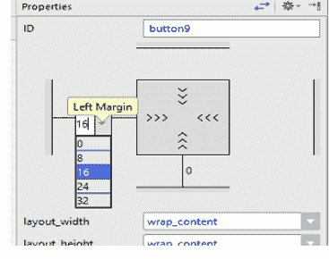

现在你有了一个位置完全正确的按钮网格。

尝试确保你添加的每个 `Button` 都相对于其他 `Button` 之一，并确保你已为它们设置了相同的 `onClick` 处理程序。你可以通过拖动其中一个 `Button` 来检查它们是否都跟随移动！如果有一两个没有，请尝试相对于另一个 `Button` 重新定位。如果你发现任何定位都很困难，请放大。

如果你陷入了一团糟，删除所有约束并重新开始。

为了让它看起来更像键盘，删除 0 键并调整大小使其占据双倍宽度。

最后，在顶部添加一个 `TextView`。你可以将其相对于第一行和 7 键进行定位，并调整其大小使其跨越整组按钮。要做到这一点，你必须删除 7 键上的约束，并将其顶部相对于 `TextView` 的底部，并将其左侧与 `TextView` 的左侧对齐。不要忘记将 `TextView` 相对于屏幕顶部进行定位：

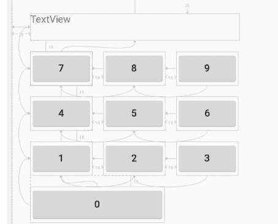

现在当你将 `TextView` 移动到新位置时，你应该能够移动整个区块。

知道可以使用 `Ctrl-Z` 撤销操作是很好的。如果你发现使用 Designer 创建这种布局太难了（而且这确实很难），你可能更倾向于使用“属性”窗口设置布局属性。

选择 `TextView` 并使用“属性”窗口将字体大小改为 18p 或更大——你可以在 `textAppearance` 字段下找到它。

最后，按通常方式运行程序，你会惊喜地发现你的第一个应用确实可以进行计算！

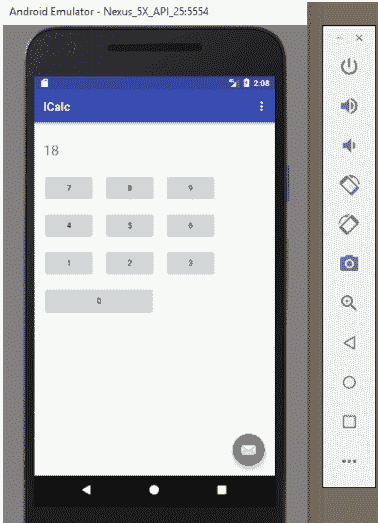

尝试旋转模拟器看看它在横屏模式下的样子。

不错，但正如预期的那样，随着应用的重启，你会丢失之前正在进行的任何计算，因为在方向改变时应用会重启。

如果可以，尝试在真实的 Android 设备上运行。这能让你发现真实的感受。同时也查看布局在不同屏幕和方向下的显示。

这算不上是一个计算器，但你可以把它变成一个非常棒的计算器。

- 右对齐显示器中的文本
- 添加 `+` 和 `–` 按钮并实现功能
- 允许用户输入多位数
- 添加小数点键
- 添加 `*` 和 `/` 键
- 添加清空键

还有更好的实现布局的方法，你将在后面的章节中发现。

## 总结

- 你可以手动创建 XML 布局文件，但使用 Designer 更简单。
- 了解 XML 文件如何工作仍然很有用，这样当 Designer 在某些方面让你失望时，你可以编辑它。
- Designer 通过更改组件属性来修改组件在 Layout 模式下的外观。
- 如何定位组件取决于你正在使用的 Layout。
- `RelativeLayout` 允许你相对于其他组件或容器来定位组件。
- Designer 可能会更改多个属性以将组件放置在你想要的位置。
- 使用“组件树”（Component Tree）选择难以选择的组件。
- 你可以使用“属性”窗口选择并直接设置任何属性。
- 如果在 Designer 中发现定位或缩放困难，请尝试放大。
- 你可以使用 Android Studio 查看应用在各种屏幕尺寸和方向下的样子。
- 可以通过创建具有相同名称的额外布局文件来适应不同的方向和分辨率。系统将在运行时选择使用哪一个。
- 你可以在 Designer 中复制和粘贴组件来快速构建重复的 UI 设计。
- 单个事件处理程序可以附加到许多组件上。

# 第 4 章：Android 事件

使用 Android Studio 工作通过交互式编辑器让构建 UI 变得简单，但你仍然需要找到如何处理它非常擅长的事情。我们现在需要找到如何处理任何事件，而不只是 `onClick`。尽管大多数控件仅使用 `onClick` 事件就可以非常成功地使用，但还有其他类型的事件无法简单地通过在“属性”窗口中设置 `onEvent` 属性来处理。在本章中，我们将深入研究事件处理。重点将放在使用 Android Studio 和 Designer 来完成尽可能多的工作。

这是一个中等高级的主题，许多 Android 程序员并不热于完全理解事件，而是倾向于直接遵循示例中给出的样板代码。你可以这样做，但理解通常会更好。让我们从如何在 Java 中编写事件处理程序的问题开始。

## Lambda 方法

如果你用过 Java 以外的语言，你可能认为事件处理程序只是传递给 UI 控件以将其注册为事件监听器的函数。你可能使用过会自动为你添加事件处理器的 IDE。Android 目前并没有这样做——你需要添加代码来处理事件。

Java 中的事件要稍微复杂一些，因为在 Java 中一切都是对象，函数唯一的存在方式是方法。Java 8 通过引入 lambda 改变了这一切。lambda 是不属于对象的函数，它可以作为参数传递。这就是让事件处理变得非常简单的关键属性——而不只是 `onClick`。使用 Java 8 特性的缺点是它们默认未启用，且某些仅在 Nougat（API 24）或更高版本可用。然而，让事件处理变得如此简单的 lambda 适用于所有 Android 版本，并且非常值得使用。

对于新项目，你只需要在“项目结构”对话框中选择源和目标兼容性 1.8。

### 项目结构

| 属性 | 签名 | 变体 | 构建类型 | 依赖 |
|---|---|---|---|---|
| SDK 位置 | 编译 SDK 版本 | API 26: Android 8.0 (Oreo) | | |
| 项目 | 构建工具版本 | | | |
| 开发者服务 | 库仓库 | | | |
| 广告 | 资源忽略模式 | | | |
| 身份验证 | | | | |
| 通知 | 增量 Dex | | | |
| 模块 | 源兼容性 1.8 | | | |
| app | 目标兼容性 1.8 | | | |

注意的是，目前的 Java 8 实现取代了 Jack 编译器的支持。如果你有一个 Jack 及相关工具的旧项目，请查看文档如何移除它并使用默认的 Java 8 实现。

只要你启用了 Java 8，你就可以利用 lambda 函数来编写事件处理程序，也可以用于更通用的场景。

首先，什么是 lambda？

lambda 是你可以使用特殊表示法定义的函数。该函数没有名称，它是一个匿名函数。lambda 可以存储在变量中并传递给函数。

你通过提供带有参数的头部和代码体来定义 lambda：

```
(parameter list) -> {
  code...
  return something;
}
```

例如：

```
(a,b)->{
  return a+b;
}
```

如果你是一个资深的 Java 程序员，最令你惊讶的是在这个声明中没有类型说明符。不要担心，一个 lambda 表达式是强类型的，但编译器会根据上下文推断参数类型和返回类型。关键在于，lambda 表达式总是作为参数传递或赋值给变量，而参数或变量的类型决定了 lambda 中使用的类型。

包含参数的数据类型并不是错误，但它总是没有必要的。

lambda 记法有几处简化。如果只有一个参数，你可以省略圆括号。

例如：

```
n -> {
    return -n;
}
```

如果体是一个单一表达式，你可以省略括号，并且表达式的结果将自动返回。

例如：

```
n -> -n;
```

这定义了与上面相同的函数。如果你使用 `return`，则需要括号。这通常被称为表达式 lambda（expression lambda）。

这些规则可能会让表达式在你的代码中看起来非常奇怪，这可能会增加阅读难度。不要追求最短和最紧凑的表达式；确保你的代码易于理解。

## Lambda 类型

你实际上无法使用上一节中提供的 lambda，因为它们没有目标类型，导致编译器无法推断出它们的参数等类型。问题在于 Java 中没有函数类型。取而代之的是，我们创建了通常被称为 SAM——单抽象方法（Single Abstract Method）的对象。定义了一个单一方法的接口就是 SAM，你可以将其视为定义了一个函数的类型，即它所定义的单个抽象方法。

例如：

```java
public interface Sum {
    int sum(int a, int b);
}
```

这是一个接收两个 `int` 并返回一个 `int` 的函数的 SAM。lambda 表达式只是创建此 SAM 实例的一种方式，而无需先创建一个类再创建一个实例。例如：

```java
Sum adder = (a,b) -> {
    return a+b;
}
```

lambda 表达式的类型是从目标 SAM 中的类型推断出来的。也就是说，`a` 和 `b` 是 `int`，返回类型是 `int`。lambda 与 SAM 之间的联系更为深层。lambda 实际上创建了一个 `Sum` 类型的对象，其抽象方法由 lambda 的体定义。这意味着如果你想调用由 lambda 定义的函数，必须写成：

`int ans=adder.sum(1,2);`

这看起来很困惑，但 Java 并没有放弃使用 SAM；它只是添加了 lambda 作为一种更简单、更直接的方法来创建 SAM 的实例。

大多数情况下，你可以忽略 lambda 所实现的 SAM，因为它通常是为你预先定义的。现有的库都是使用 SAM 来将函数传递给其他函数的。在 Java 8 之前，你必须编写大量代码来创建 SAM 实例并将其传递给函数。现在你只需要使用正确类型的 lambda 即可。

## 使用 Lambda 创建事件处理器

任何可以生成事件的对象都会有一个 `setEventListener` 方法，该方法可以将 `OnEventListener` 对象附加到事件处理器列表中。方法名称和对象名称包含了事件的名称。

因此，有一个 `setOnClickListener` 方法，它接受一个 `OnClickListener` 对象作为唯一参数。

注意，这种命名系统完全是惯例，而不是 Java 语言的一部分。

`OnEventListener` 对象都派自于同名的接口，该接口定义了一个作为事件处理器的单一抽象方法。

接口类似于类，但它只是定义了类必须支持的函数。如果一个类继承或实现一个接口，你就必须为接口中定义的每个函数编写代码。你可以将接口视为一份规范，列出了实现该接口必须编写的函数列表。

例如，`ClickListener` 是一个接口，定义了单一方法 `OnClickListener(View v)`。要将其用作事件处理器，你必须创建一个 `implements onClick` 的实例，然后将其添加到事件处理器列表 `setOnClickListener` 中。这是一个简单但乏味的过程，涉及大量的模板代码——有关如何操作的细节请参考后续内容。

好消息是，`OnEventListener` 是一个 SAM——单抽象方法——我们可以使用 lambda 来创建实例并避免大量的编码工作。

例如，在不使用设计器的情况下为按钮添加点击事件处理器：

`View.OnClickListener eventHandler=(view) -> {`

```java
((Button)view).setText("I've been clicked");
};
```

并将其应用到按钮：


```java
Button b=(Button) findViewById(R.id.button);
b.setOnClickListener( eventHandler );
```

## 闭包（Closure）

闭包是听起来很难的话之一。`lambda` 表达式与大多数函数不同之处在于，它们可以访问声明所在的所有变量。`lambda` 不能在它存在的地方声明一个变量。

例如：

```java
Button b=(Button) findViewById(R.id.button);
b.setOnClickListener(view -> {
    Button b=(Button) view;
    b.setText("I've been clicked");
});
```

这看起来似乎是可以运行的，因为我们所做的只是修改了上一个例子，让变量是一个`Button`。然而，如果你尝试这样做，你会发现编译器无法声明变量`b`，因为已经存在了。`lambda` 可以访问闭层方法中设置的`b`，不能创建一个同名的遮蔽变量。

`lambda` 可以访问闭层方法中的变量这一事实导致了一个奇怪的后果，你可以这样写事件处理器：

```java
Button b=(Button) findViewById(R.id.button);
b.setOnClickListener(view -> {
    b.setText("I've been clicked");
});
```

这看起来可能很奇怪，但它确实可以工作。如果你觉得这并不奇怪，说明你没有注意到事件处理器（即`lambda`）会在按钮被点击时执行，而这很可能是在闭层方法结束且所有变量都不再存在之后——然而`lambda`仍然可以使用`b`。系统会保留`b`的值，以便`lambda`访问它。这就是闭包的本质——保留已经超出作用范围的变量，以便`lambda`可以访问它们。

你可以使用`final`修饰符来明确一个变量满足该条件，编译器会检查它是否为真。

例如，你可以这样写之前的事件处理器：

```java
final b=(Button) findViewById(R.id.button);
b.setOnClickListener(view->{
    b.setText("I've been clicked");
});
```

`final`修饰符会强制编译器检查`b`是否只初始化了一次。实际上，你不需要`final`修饰符，因为在`lambda`表达式中使用`b`会导致编译器检查它是否为“有效 final”（effectively final）。

在上述代码中，很清楚`b`只初始化了一次，因此它看起来显然是`final`的，但情况要微妙得多。假设闭包方法被调用了第二次呢？这显然会改变`b`的值，因此它不是`final`了。由于`b`是局部变量，会被初始化一个新的`b`实例，并创建一个新的`lambda`实例。由于原始的`b`没有被重新初始化，它仍然是`final`。有时要判断一个变量是否为`final`可能非常困难，编译器会为你完成这项工作。

## 使用类创建事件处理器

创建事件处理器的最原始方法是为每一个处理器创建一个完整的类。这是代码量最多的方法，但也是最基础的方法。

例如，要为`onClick`事件创建一个事件处理器，你需要执行以下操作：

1. 创建一个实现`OnClickListener`接口的新类。
2. 在类中定义你的自定义事件处理器。
3. 在`Activity`中创建该新类的实例。
4. 使用按钮的`setOnClickListener`方法将第 3 步创建的监听器对象添加到事件中。

这是你在实现任何事件处理器时必须遵循的通用模式。唯一变化的是你必须实现的接口以及它定义的事件处理函数。

这既是给 Java 初学者的练习，也是对事件处理的解释。如果你对 Java 掌握得很好，可以随时跳过。如果你不确定如何最好使用 Android Studio 创建类，请继续往下看。

创建一个名为`ClassEvent`的新项目，并使用 Designer 添加一个按钮。

为了为`onClick`事件实现事件处理器，我们首先需要向项目中添加一个新类。右键点击`Java`文件夹下方的文件夹，选择`New` -> `Java Class`。会出现一个对话框。输入类名为`MyOnClickListener`。你可以使用`Interface(s)`字段输入你想要实现的任何接口的名称。在这种情况下，我们想要实现`OnClickListener`，你可以通过输入时出现的下拉列表来输入它。开始输入`OnClickListener`，一旦出现就选择`View.OnClickListener`接口行。确保你选择的是为通用`View`类定义的接口。

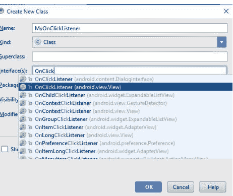

这在目录下创建了新文件`MyOnClickListener.java`。

注意：对于其他语言的用户，值得指出 Java 有一个几乎不可打破的约定，每个类都存储在自己同名的文件中。

当你在编辑器中查看新文件时，你会看到它有一些红色下划线，表示存在错误：

```java
package com.example.mikejames.application;
import android.view.View;

public class MyOnClickListener implements View.OnClickListener {
}
```

产生错误消息的原因是你必须实现`OnClickListener`接口中定义的方法。表示你将要实现一个接口这并不被视为错误——即使你还没有时间去完成它！唯一的替代方案是将该类声明为`abstract`（抽象），这意味着它没有定义任何方法，仅供其他类继承用。

为了消除红色下划线，我们必须定义接口中的所有方法。

幸运的是，Android Studio 会帮我们完成部分工作。将光标放在该行上并按`Alt+Enter`查看修复它的建议：

```java
public class MyOnClickListener implements View.OnClickListener {
    @Override
    public void onClick(View view) {
        // Safe delete 'com.example.mikegames.myapplication.MyOnClickListener'
        // Create Test
        // Create subclass
        // Add Javadoc
        // Make package-local
    }
}
```

点击`Implement methods`并从出现的对话框中选择你想要实现的方法。

在这种情况下，只有一个`onClick`方法，Android Studio 会为你生成一个占位符供填充：

```java
import android.view.View;

public class MyOnClickListener implements View.OnClickListener {
    @Override
    public void onClick(View view) {
    }
}
```

注意，我们现在创建了一个包含单个方法的类，这就是我们的事件处理器。在实际情况下，你会在事件处理器中编写几行代码，但对于这个简单的示例，我们只需更改按钮的标题文本：

```java
public class MyOnClickListener implements View.OnClickListener {
    @Override
    public void onClick(View view) {
        Button b=(Button) view;
        b.setText("you clicked me");
    }
}
```

记得使用`Alt+Enter`添加任何所需的`import`语句。

我们现在完成了第一步。接下来移动到`Activity`并在设计面上放置一个按钮。在`onCreate`方法的末尾，我们首先获取`Button`对象：

```java
Button button=(Button)findViewById(R.id.button);
```

记得使用`Alt+Enter`添加任何所需的`import`语句。

接下来我们创建事件监听器的实例：

```java
MyOnClickListener listener= new MyOnClickListener();
```

最后，我们使用按钮的`setOnClickListener`方法连接我们的监听器：

```java
button.setOnClickListener(listener);
```

将代码整合在一起：

```java
@Override
protected void onCreate(Bundle savedInstanceState) {
    super.onCreate(savedInstanceState);
    setContentView(R.layout.activity_main);
    Button button=(Button)findViewById(R.id.button);
    MyOnClickListener listener= new MyOnClickListener();
    button.setOnClickListener(listener);
}
```

现在如果你运行程序，你会发现监听器被调用了。

## 使用断点

检查事件处理器是否被调用的简单方法是在代码行设置断点。断点是一项基础调试工具，你必须尽早使用它们。

要放置断点，只需点击代码旁边的“边距”，会出现一个红色的圆点：

```java
package com.example.mikejames.application;
import android.view.View;

public class MyOnClickListener implements View.OnClickListener {
    @Override
    public void onClick(View view) {
    }
}
```

现在当你使用调试图标或`Run, Debug`命令运行程序时，程序会在任何设置了断点的代码行停止。

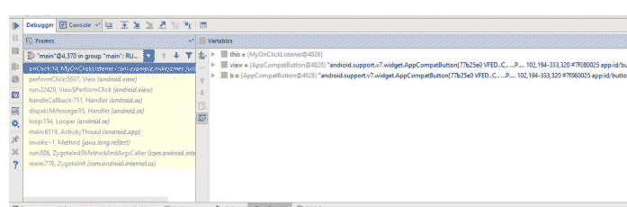

一旦程序暂停，你就可以看到它运行到了哪里，并检查所有变量中的值。你还可以重启程序或单步执行——查看调试窗口顶部的图标。在执行过程中，你会看到变量的值发生变化。任何都会出现在你预期发现的地方以及你实际发现的地方。关于调试有很多内容要学，但目前这个小介绍是为了为你节省大量时间。

## 处理事件的替代方法

从理论上讲，创建一个类的实例是创建事件处理器的很好的方法。事实上，它是“一切皆对象”编程方法的体现，但它并不实用，因为对于你想处理的每个事件都需要创建一个新类。此外，这些类只包含一个方法且只实例化一次。

这导致了大量的标准“样板”代码，而你经常需要这样做。此外还有命名问题。你必须为处理按钮点击事件的类命名，为处理文本框相同事件的类另一个命名，因此你还需要为创建的每个实例命名。

这就是为什么 Java 8 引入了`lambda`的原因，但在`lambda`出现之前，还有其他方法可以减少样板代码量和名称数量：

1. 在`activity`或更通用的托管生成事件对象的类中实现接口。
2. 使用匿名类。

第一种是某种“巧妙的修复”，它依赖于这样一个事实：包括你的`Activity`在内的任何类都可以实现接口，从而成为事件处理器。

第二种基于 Java 引入的一种语言特性，该特性专门用于帮助在无需实际创建类文件或提供类名的情况下创建类的实例。

你将在现有的 Android 代码中看到这两种方法的用法，特别是匿名类方法，Android Studio 甚至可以帮助你完成。让我们逐一检查。和之前一样，如果你对 Java 感到满意，或者认为你永远不会需要使用`lambda`表达式，可以随时跳过，如果以后有需要再返回这里。

## 在 Activity 中实现接口

其中一种几乎像“作弊”的处理方法，是直接使用`MainActivity`类来实现事件监听器接口。毕竟，只要该类实现了正确的接口，你就可以指定任何类作为事件处理器。对于事件机制来说，该类还实现了许多与事件无关的方法，这并不重要。

当你第一次看到它时，这看起来有点奇怪，但它是最接近其他语言处理此类任务的方法。

例如，为了处理`onClick`事件，我们需要为 Activity 添加接口的`implements`关键字：

```java
public class MainActivity extends AppCompatActivity implements View.OnClickListener {
```

现在，唯一缺少的是 Activity 类必须实现`onClick`事件处理器。不要担心该行有红色下划线表示错误——错误的原因在于，你必须实现该方法。只需将光标置在该处，并使用`Alt+Enter`显示包含方法的选项菜单：

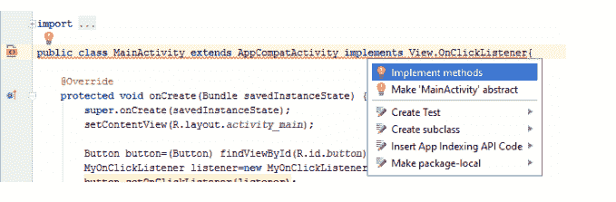

如果你选择了这一项，就可以选择你想要实现的方法，Android Studio 会将它们添加到你的代码中。在这种情况下，我们只需要实现`onClick`，并且可以使用我们通常的测试代码，即更改按钮的标题：

```java
@Override
public void onClick(View view) {
    Button b=(Button) view;
    b.setText("you clicked me");
}
```

剩下的工作是使用`setOnClickListener`添加事件监听器。但提供事件处理器的类实例是什么呢？如果你还记得，发生的是系统创建一个`MainActivity`类的实例来运行你的应用，而类的当前实例总是`this`。因此，我们需要在`onCreate`方法中添加：

```java
Button button=(Button)findViewById(R.id.button);
button.setOnClickListener(this);
```

使用`this`意味着 Activity 类的当前实例将用于处理事件，即我们刚刚在 Activity 类中定义的`onClick`方法。

在很多方面，这种方法是最简单的。它的优点是你的事件处理函数是 Activity 的一部分，你不需要另一个类或文件来存储它。它的缺点是，对于你要处理的每个事件都必须在类声明中添加一个`implements`，但这可能是一个优势，因为它能让你看到 Activity 中使用了哪些事件。

另外请注意，使用这种方法时，你可以使用如下指令来设置所有事件处理器：`somecontrol.setSomeEvent(this);`

这同时也意味着无论是由哪个控件生成的，你都将为该事件使用同一个事件处理器。

也就是说，你将写一个`onClick`函数，它将被用于你所有调用了`setOnClickListener(this)`的控件。你的事件处理器的工作首先是找出是哪个控件生成的事件，并对其进行适当处理。

如果你想使用多个事件处理器，那么你需要使用另一种方法。

## 匿名类

匿名类的引入是为了避免在单独的文件中用另一个名称显式地创建一个类。在`lambda`表达式引入之前，它是实现事件处理器的最佳方法，有时它仍然是完成此任务的唯一良好方法。

它让你有效地创建一个对象（即类的实例），而无需显式地创建一个类，提供了一种创建事件对象的直接方法。

与其：

事件类 -> 事件对象 -> 设置监听器

我们直接进行：

事件对象 -> 设置监听器

匿名类的唯一缺点是你不能创建该类的第二个实例。它只作为创建一个对象实例的快捷方式。

你创建匿名类的方法是编写与创建现有类实例相同的代码，但在其后添加一个代码块来定义你正在创建的新类的新方法。结果是新类的一个实例。例如，假设你有一个显示问候信息的`Hello`类，你想要一个对象既能执行`Hello`的所有功能，又增加一个`goodbye`方法。

通常，你会创建一个继承自`Hello`的`Leave`类并定义新方法，然后创建`Leave`的实例。相反，你可以写：

```java
Hello leave = new Hello(){
    void goodbye() {
        display message;
    }
};
```

这创建了一个`Hello`的实例，它拥有所有的`Hello`方法加上新的`goodbye`方法。注意，`leave`是一个对象而不是类，你可以直接调用方法。注意可以立即调用`leave.goodbye()`。你避免了为了创建一个实例而专门创建一个新类。如果你要扩展的类构造函数需要参数，只需按通常方式调用构造函数，并紧随之后添加扩展类的代码。

所以，要基于现有类创建匿名类的实例，你只需从创建一个新类开始。

似乎没有什么理由使用完整的“实现一个新类”方法。唯一的可能理由是你需要实例化多个事件处理器的副本，而这通常并不常见。

将事件处理器作为生成事件的类的一部分来实现，仍然具有某些优势，但你无法为控件的不同实例上的同一个事件提供多个事件处理器。

简而言之——如果你可以使用`lambda`表达式，且无法使用匿名类，就使用它。以下所有的示例都将采用这样做。

## 总结

- 在 Java 中，你不能传递一个函数来设置事件处理器；你必须传递一个包含该函数（作为方法）的对象。
- 事件通常由单抽象方法（SAM）接口处理。SAM 中声明的方法就是执行事件处理的函数。
- 对于每个事件以及每个可以生成该事件的控件，都有一个形式如`onEventListener`的 SAM 接口，并且该对象有一个`setOnClickListener`方法，可用于绑定事件处理器。


Java 8 引入了 lambda 表达式，看起来就像你正在传递一个函数。lambda 是创建 SAM 实例的简便方式，其中自定义代码在 lambda 中定义。

lambda 是创建事件处理器最紧凑、最易理解的方式。

创建事件处理器最直接、最原始的方法是创建一个实现 SAM 的新类，然后创建该类的实例来处理事件。

为了避免为每个事件处理器都要创建一个新类的问题，Java 引入了匿名类。你可以使用匿名类来实现 SAM 并一次性完成实例创建。

你并不总是可以使用 lambda 表达式，因为某些事件将多个事件处理函数组合在一个类中。在这种情况下，最好的替代方案是使用匿名类。

或者，你也可以使用 Activity 来实现该接口。

# 第 5 章

## 基础控件

我们在之前的章节中已经使用了一些 UI 控件，但现在我们已经发现了事件是如何运作的，是时候检查它们的工作原理，以及你如何改变它们的外观。

## 基础输入控件

“control”（控件）一词源于用户使用它们来“控制”你的程序的想法。“Widget”（小部件）或“component”（组件）也是相同含义的术语。Android 社区对术语的使用似乎非常随意。

基础输入控件包括：

- 按钮（Buttons）
- 文本框（Text Fields）
- 复选框（Checkboxes）
- 单选按钮（Radio Buttons）
- 切换按钮（Toggle Buttons）
- 开关（Switches）

如果你使用过其他 UI 框架，你可能已经熟悉其中许多项，并且可能可以直接跳到你感兴趣的部分。

`TextView` 也必须包含在基础控件的完整列表中，但与文本框不同，它不能被用户修改，即它只是一个输出控件。

从头开始，让我们更详细地回顾一下按钮（Button）。

## 按钮样式和属性

按钮有两种基本类型：`Button` 和 `IconButton`。`IconButton` 与 `Button` 非常相似，但它有一个 `src`（源）属性，该属性可以设置为显示为按钮图标的图像，并且不显示任何文本。

在处理按钮时，涉及的主要属性是 `background`（背景）等，它可以被设置为颜色或图形。你可以花费很长时间改变按钮的外观，但主要来说，按钮最重要的属性是它的 `onClick` 处理器。按钮出现在你的 UI 中是为了被点击的。

如果你在设计表面上放置一个 `Button`，可以使用属性（Attributes）窗口对其进行自定义。改变控件外观有两种明显的方法：你可以设置样式（style）或修改属性（property）。

设置样式会将一组属性修改为给定的标准值。你可以设置一个样式，然后修改单个属性对其进行微调。通常当你刚开始制作 UI 时，稍后会设置单个属性，以形成一种应用到整个 UI 的连贯样式。

点击属性右侧的省略号，将按钮的背景设置为深灰色：


出现的资源（Resources）窗口允许你访问程序可以使用的所有资源。资源是 Android 编程的很大组成部分，我们将在后的章节中详细介绍。

你可以通过指定 RGB 值和可选的 Alpha 值（透明度）直接为背景输入颜色。然而，使用资源意味着如果你以后更改了资源值，所有的 UI 组件都会随之更新。

有多种类型的资源可以使用，如果你查看文档中任何使用按钮的示例，或者查看较旧的代码，你可能会发现某些无法通过 Android Studio 访问的属性。这是因为属性窗口只显示最常用的属性。要查看所有属性，需要点击窗口顶部或底部的双箭头图标。


这种方法的最大问题在于，你会从一个非常小的子集变成一个令人崩溃的列表。

处理这种问题的最佳方法是明确你想更改什么，并找到执行该任务的属性的精确名称。在很多情况下，这说比做的容易。例如，假设你想在一个标准文本按钮内设置图标，使其显示在包含文本的左侧。如果你仅限于初始属性窗口中呈现的属性，这似乎是不可能的。

如果你查找 `Button` 继承的属性的详情，你会发现：

- `drawableLeft`
- `drawableRight`
- `drawableStart`
- `drawableEnd`
- `drawableBottom`
- `drawableTop`

这些属性不在属性窗口中。它们允许你在相对于文本指定的范围内显示可绘制资源（drawable，即图形或图标）。

一旦你知道了属性的名称，就可以在所有属性列表中找到它：

| | |
|---|---|
| digits | |
| drawableBottom | |
| drawableEnd | |
| drawableLeft | @android:drawable/btn_star |
| drawablePadding | |
| drawableRight | |
| drawableStart | |
| drawableTint | |

点击其旁边的省略号按钮，并选择一个你喜欢的 drawable 资源以在文本左侧显示图形：

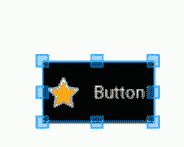

## 文本字段 (Text Fields)

文本字段是你让用户输入文本供你处理的方式，正如你所猜想的，它们构成了 UI 的重要部分。

工具箱（Toolbox）中提供了许多文本字段，但它们的工作方式都是相同的，区别在于它们期望用户输入的类型不同。在开发应用程序的过程中，你迟早会遇到它们，但你确实需要知道如何使用其中一个，以理解它们是如何整体运作的。

如果你使用过任何 UI 框架，那么你以前遇到过某种形式的文本字段。Android 控件略有不同之处在于它通常为用户提供一个自定义的虚拟键盘，称为 IME（输入法编辑器）。你可以构建自己的 IME，但目前只需使用系统提供的即可。

如果你想让 Android 模拟器使用真实 Android 设备会那样的 IME，那么在创建 AVD（Android 虚拟设备）时，你需要取消勾选“硬件键盘存在”（Hardware Keyboard Present）选项。如果模拟器使用宿主机的键盘，你将完全看不到 IME。

首先需要澄清的一点是，尽管工具箱中似乎有很多不同类型的文本字段控件，但它们都是 `EditText` 控件的示例，只是其 `inputType` 被设置为了特定值。当你将它放置在设计表面时，你会发现它是 `EditText` 类型，如果你滚动到它的 `inputType` 属性，你就可以更改文本字段将处理的输入类型。

当你使用特定的 `inputType` 时，用户将看到一个适合输入特定内容的虚拟键盘：

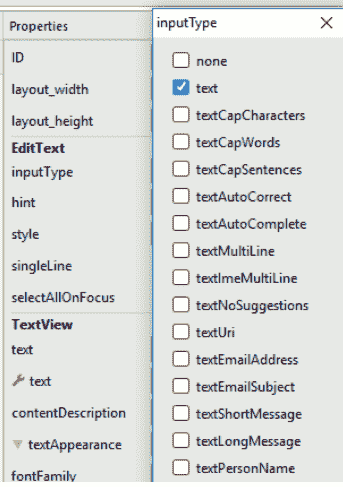

例如，如果你选择数字类型，你将向用户展示一个只显示数字键的简化 IME：

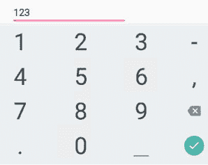

你还会在键盘右下角获得一个操作键，用户可以按下它来完成操作 - 例如发送短信时的“发送”。

要为特定键盘选择操作按钮，你需要使用“所有属性”（All Properties）视图并为 `imeOptions` 属性选择设置：

| 属性 | |
|---|---|
| ActionLabel | |
| imeOptions | [actionSend] |
| normal | [] |
| actionUnspecified | [] |
| actionNone | [] |
| actionGo | [] |
| actionSearch | [] |
| actionSend | [x] |
| actionNext | [] |

例如，将其设置为 `actionSend` 会强制显示发送按钮（绿色的飞箭按钮）：

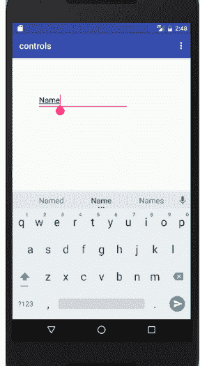

还有许多其他属性可以让你来定制文本字段，但有一个标准任务值得详细解释——为 `onEditorAction` 事件编写处理程序（handler）。

## onEditorAction 事件

回到 `EditText` 控件，让我们为发送按钮添加一个处理程序。这为添加事件处理程序的通用过程示例提供了另一个机会。

首先，在设计表面放置一个用于电子邮件的 `EditText`，并按照上一节描述的属性窗口（Attributes window）在输入文本时弹出的 IME 中添加一个发送按钮，即找到 `imeOptions` 并选择 `actionSend`。

在处理任何新事件之前，你必须发现事件监听器接口的名称以及该事件的 `setOn` 方法。对于 `EditorAction` 事件，监听器接口名为 `OnEditorActionListener`，`setOn` 方法为 `setOnEditorActionListener`。

你可以在文档中查询 `OnEditorActionListener` 中定义的事件处理器的细节。参数如下：

```
@override
public boolean onEditorAction(
    TextView textView,
    int i,
    KeyEvent keyEvent)
```

在这种情况下，`textView` 是与事件关联的控件，`i` 是操作 ID，这是一个指示哪个键盘操作导致了事件的代码，而 `keyEvent` 除非使用了回车键，否则即为 `null`。

如果操作已被“消费”（即已处理），程序应返回 `true`，并且其他处理程序将没有机会处理它。通常情况下，Java 事件可以传递给包含该事件源控件的其他控件。

有了这些信息，我们可以继续，并使用 lambda 表达式来实现事件处理程序。在这种情况下，我们不妨在 `setOnEditorActionListener` 内部完成工作，因为该处理程序只需要此控件：

```
EditText email = (EditText) findViewById(R.id.editText);
email.setOnEditorActionListener((actionID, event) -> {
    process the event
    return true;
});
```

要确定哪个按钮被选中，对于 CheckBox（复选框），可以使用 `isChecked` 方法。事实上，处理一组 RadioButtons（单选按钮）的方法与处理一组 CheckBoxes 完全相同，唯一的区别在于使用了 RadioGroup（单选按钮组）以及在任何时刻只能选中一个按钮。

你可以使用 `onClick` 事件来检测任何按钮何时被修改，并使用 `setChecked` 或 `toggle` 方法来修改按钮的状态。

## 总结

- 构成大多数简单 Android UI 的基本控件有：
  - 按钮 (Button)
  - 文本框 (TextField)
  - 复选框 (CheckBox)
  - 单选按钮 (Radio Button)
  - 切换按钮 (Toggle Button)
  - 开关 (Switches)

- 每个控件都通过其属性和事件处理器进行自定义。

- 除非你选择“所有属性”（All Properties）按钮，否则 Android Studio 会隐藏某些属性。

# 第 6 章

## 使用布局 (Working With Layouts)

布局（Layout）的选择对于 Android UI 至关重要。布局允许定位并通常用于安排其他组件。深入了解每个可用布局中包含的内容，从程序员和用户的角度来看，都能让 UI 的易用性产生质的差异。当你想要支持一系列设备时，情况尤为如此。

构成 Android UI 的所有类和对象都继承自同一个基类：View。也就是说，Button 是一个 View，布局类也是如此。然而，布局的行为似乎与简单的 Button 有不同，这引出了一个问题：布局究竟是什么？

## 理解布局

布局是其他派自 View 对象的容器。当布局被要求渲染其自身时，它会渲染其包含的所有 View 对象，并将它们排列在它所占据的显示器区域内。

Android Studio 默认使用的布局是 ConstraintLayout，我们在之前的章节中已经介绍过它的使用方法，但它并不是你在 Designer（设计器）中可以使用唯一布局。

目前支持六种布局：

- ConstraintLayout（约束布局）
- GridLayout（网格布局）
- FrameLayout（帧布局）
- LinearLayout（线性布局）
- RelativeLayout（相对布局）
- TableLayout（表格布局）

ConstraintLayout 是 Android Studio 2.2 中引入的新型布局。它目前是推荐使用的布局，也是 Android Studio 3.0 中的默认布局。它可以被看作是 RelativeLayout（相对布局）的进化版。原则上，它可以用于创建任何通过组合其他布局来实现的布局。据称，基于 ConstraintLayout 的 UI 更容易构建且速度更快，因为它们是“扁平”的，即没有在一个布局内部嵌套多个布局。

Android 并不希望你使用 ConstraintLayout 以外的任何布局作为初始容器，因此它不允许你删除默认布局。它会将现有项目中的 RelativeLayout 替换为 ConstraintLayout，但你不能将其删除或替换为其他布局。其由于用一种布局替换另一种布局是困难的，因为所有支持的属性都发生了变化。

你可以直接编辑 XML 文件来用一种布局替换另一种，但你必须重新编辑所有的布局属性。你可以通过编辑 XML 文件将一个空布局替换为另一个，这目前是完成此工作的唯一方法。

尽管 ConstraintLayout 是推荐使用的布局，但仍有许多 Android 项目在使用原始布局，而且有些程序员单纯地不喜欢 ConstraintLayout。因此，了解更简单布局的工作原理是值得的。

在查看这些替代方案以及如何使用它们之前，值得掌握布局的基本概念和它们共同拥有的原则。然后我们将查看 Frame、Linear 和 Relative 布局，因为它们仍然很重要。然而，ConstraintLayout 如此重要，因为它是未来的首选布局类型，以至于它单独占据了一个章节。

## 布局属性

大多数情况下，你需要认为与控件相关的属性属于该控件，但布局可以通过许多方式完成其工作，并要求控件具有许多特定的属性来确定其定位方式。换句话说，控件与布局工作所需的属性取决于所选的布局，这使得这些事情变得难以组织。

实现这种方法最简单但最不利的方法是坚持让每个控件实现每个布局所使用的每个属性，即使是目前未使用的属性。这显然是低效的。

实际使用的解决方案是：每个布局都定义了一个派自 `LayoutParams` 的嵌套类，该类包含了它需要控件定义的所有属性。要放置在布局中的控件会创建相应 `LayoutParams` 类的实例，并根据它所处的布局容器来改变它所访问的参数。

也就是说，与其定义任何布局可能需要的每个可能的属性，不如放在布局中的 UI 组件使用适当的 `LayoutParams` 类来“导入”它在所在布局中所需的属性。这意味着控件有两种类型的属性——它自身的属性以及从 `LayoutParams` 获取的属性。

因此，在 Designer 和 Attributes（属性）窗口中，控件的属性分两组显示：

- 属于控件的属性。
- 布局要求的属性。

你可以在 Attributes 窗口中以布局对象的形式看到它们：

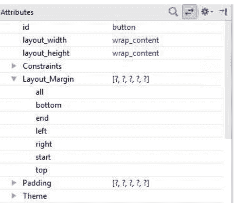

在大多数情况下，`layout_margin` 属性由 ConstraintLayout 提供，但 `Padding`（内边距）属性是控件支持的。换句话说，布局属性取决于，但总是列出来。在这个阶段值得注意的是，Designer 经常呈现一组简化的属性，将其映射到更大更复杂的集合中。

## 宽度和高度

你看到的精确布局属性取决于你使用的布局。但是，有两个是所有布局都的：

- `layout_width`
- `layout_height`

你可能认为控件的宽度和高度应该是属于控件的属性，但这里的情况更为微妙。控件并不一定有固定的大小。例如，它请求布局提供尽可能多的空间，在这种情况下由布局设置尺寸。这就是为什么控件拥有 `layout_width` 和 `layout_height` 而不是 `width` 和 `height` 的原因。

你可以将你的属性设置为三个可能的值之一：

- 固定大小，例如 `24px`
- `wrap_content`，设置尺寸以适应控件的内容而不被裁剪
- `match_parent`，让控件变得与父容器允许的一样

如果你在 Designer 中使用鼠标拖动控件的框架，发生的情况取决于控件和布局。

在大多数情况下，Designer 默认设置为 `wrap_content`，它会忽略你任何交互式调整控件大小的尝试。事实上，在大多数情况下，尝试交互式调整大小不会改变 `layout_width` 或 `layout_height` 属性。然而，取决于你使用的布局，可能会改变控件的大小。点在于，`layout_width` 和 `layout_height` 并不是控制最终显示尺寸的唯一属性。

特定的屏幕尺寸和分辨率。如果你希望你的应用在屏幕分辨率变化时看起来大致相同，这并不是一个好主意。为了实现这一点，你需要使用密度无关单位 `dp`，因为它会根据屏幕分辨率进行调整。如果设备的屏幕每英寸有 160 个像素，那么 1dp 等于 1px。如果每英寸像素数发生变化，1dp 到 px 的变化比例也随之。例如，在每英寸 320 像素处，1dp 等于 2px。

- 使用密度无关单位，你可以随着分辨率的变化来控制大小。

请注意，这并不能补偿屏幕尺寸。如果你保持像素数不变并将分辨率翻倍，尺寸就会减半。在屏幕上用 `px` 指定的控件将显示为其原始大小的一半。用 `dp` 指定的控件将按其原始大小显示，但会占据双倍的屏幕空间。

- 使用 `dp` 可以防止屏幕分辨率及其物理尺寸变化对布局的影响。


如果你在`dp`中指定，那么无论设备如何，你的布局看起来都像在 7 英寸平板电脑上。

除了基于像素的测量外，还有三种真实世界的单位：

- 毫米
- 英寸
- 点（1/72 英寸）

这三者都与屏幕尺寸有关，而控件使用的像素数与屏幕分辨率有关。如果屏幕每英寸有 160 个像素，那么 1/160=1px，以此类推。再次注意，这些单位可以防止分辨率变化，但不能防止实际屏幕尺寸的变化。你的按钮在所有设备上可能都是 1 英寸宽，但它使用了多少屏幕取决于设备的尺寸。使用真实世界单位的危险在于，你可能会指定一个分数像素，最终导致显示看起来不整洁。

最后一个单位也与像素有关，但它与设备的尺寸偏好绑定：

- `sp` – 缩放无关像素

它的工作方式与`dp`单位类似，会随着设备的分辨率进行缩放，此外如果用户设置了更大的字体大小偏好，所有的`sp`值都会被放大以匹配。

**你应该使用哪种单位？** 简单的答案是，除非你有充分理由不使用，否则你应该使用`dp`，因为这意味着如果你在尺寸为 x 的设备上测试了 UI，那么无论分辨率如何，它在所有尺寸为 x 的设备上都应该正常工作。

在 Android Studio 中，每当你输入不带单位的值，或者当你交互式调整或移动控件时，它默认以`dp`模式工作。

## 控件仅仅是一个框

对于布局（Layout）来说，控件仅仅是一个矩形。它的尺寸由`layout_width`和`layout_height`决定，这些可以由控件设置，或者更常见由布局设置。一旦布局知道了控件的大小，它就可以根据你使用布局属性建立的规则对它进行定位。

如果你想知道控件被分配到的位置，可以使用它的`getTop`和`getLeft`属性。这会给你提供控件矩形左上角的位置。你可以通过`getWidth`和`getHeight`计算出其他角的位置，但为了方便起见，还有`getRight`和`getBottom`。请注意，矩形左上角的位置始终相对于它所所属的布局。也就是说，该位置不是绝对的屏幕位置。

同样值得知道，控件还支持内边距（padding），即控件内部的空白区域。这个空间留在外边缘和内容之间。此外，某些但不是所有布局都支持外边距（margins），即控件外部的空白区域，用于在控件之间添加间距：

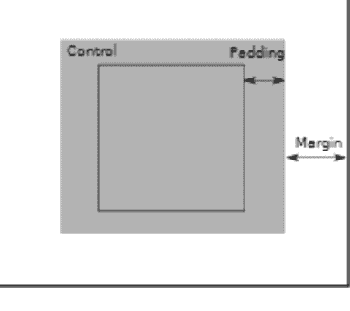

注意，padding 是布局的一个属性。你可以单独设置左、右、上、下的每个外边距或内边距，也可以指定一个单一值应用于所有。

理论上，padding 用于在控件内容周围留出空间，但它也可以简单地在控件尺寸需要时让控件变大。例如，当尺寸设置为包裹内容时，控件的 padding 为

将控件放入`FrameLayout`中，并使用`Visible`属性选择其中一个可见。

更常见的情况下，`FrameLayout`仅被用作布局组件的占位符，该组件在稍后的某个时候才会指定。例如，如果你使用基础教程以及伴侣书籍《Android Programming: Mastering Fragments & Dialogs》来创建 UI 的部分或读取要显示的列表，那么你通常需要一个容器来让新组件出现在你的静态布局中。`FrameLayout`可以非常高效地完成这项工作。

- 当你需要一个最简单的布局来容纳一个或少量组件，且不需要复杂的定位或尺寸调整时，请使用`FrameLayout`。

## LinearLayout

我们接下来需要考虑的是`LinearLayout`。这是一种简单的布局，可以用于组织 UI 的大量基础工作。事实上，一旦你开始使用`LinearLayout`，你往往会频繁地考虑到它。你可以将`LinearLayout`作为基础布局，替换 Android Studio 提供的默认`ConstraintLayout`，或者在`ConstraintLayout`内部放置一个`LinearLayout`。

在 Android Studio 中，`LinearLayout`现在垂直和水平两种形式。然而，区别仅在于将`orientation`属性设置为水平（horizontal）或垂直（vertical）。换句话说，你可以通过简单的属性更改来切换水平和垂直布局。

水平的`LinearLayout`充当行容器，垂直的`LinearLayout`充当列容器。你可以使用嵌套布局来构建看起来像表格的内容，但如果这变得复杂，最好使用`ConstraintLayout`。这种嵌套布局也是低效的，因为渲染引擎必须多次计算布局才能得到正确结果。建议是使用`ConstraintLayout`并避免嵌套。

如果你在`ConstraintLayout`上放置一个`LinearLayout`，你就可以像对其他其他控件一样对其进行定位。如果你在它内部放置其他控件，它们将水平或垂直堆叠以形成一列。

这听起来很简单，但使用`LinearLayout`的方法有很多种。

例如，如果你在`ConstraintLayout`中放置一个水平和一个垂直的`LinearLayout`，那么它们的行为取决于你将`layout_width`和`layout_height`设置为什么。如果你将其设置为`wrap_content`，那么这两个布局就像是水平和垂直的控件面板，即你可以作为一个整体移动所有控件：

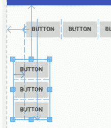

在设计器（Designer）中确定你正在拖动什么可能非常困难，因为很容易选中其中一个`Button`而不是布局。利用组件树（Component Tree）来选择布局，并确保按钮位于你认为的布局中。

将一个`LinearLayout`嵌套另一个内部创建表格时，情况变得更有趣。例如，你可以通过在一个垂直`LinearLayout`内部嵌套三个水平`LinearLayout`来创建一个计算器风格的键盘。也就是说，在屏幕上放置一个垂直的`LinearLayout`，然后在内部放置三个水平`LinearLayout`。在每个水平`LinearLayout`中放置三个按钮。如果你在这样做上有困难，请使用组件树来确保组件正确嵌套。确保你将`layout_width`和`layout_height`设置为`wrap_content`，否则`LinearLayout`将重叠：

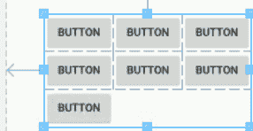

使用`ConstraintLayout`安排会更容易。最后一个`Button`只需要放在垂直的`LinearLayout`中，它就形成了自己的独立的一行。

- 每当你需要一行或一列控件时，`LinearLayout`是一个非常有用的分组设备。

## Layout_weight

关于`LinearLayout`还有一个待讨论的问题是`layout_weight`，这是一个只有`LinearLayout`支持的布局属性。如果你为`LinearLayout`中的任何控件分配`layout_weight`，则控件将调整尺寸，按其权重比例填充任何未使用的空间。

该描述中真正重要的部分是“未使用的空间”。发生的情况是 Android 首先在忽略任何权重分配的情况下计算布局。这意味着控件被设置为指定的尺寸。接下来，系统确定容器`LinearLayout`中剩余多少未使用的空间。然后这些空间将按照权重的比例分配给`layout_weight`为非零值的控件。例如，假设我们有一个水平的`LinearLayout`，其三个`Button`均设置为`wrap_content`。屏幕已旋转，为该示例提供了大量的未使用的空间：

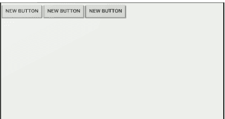

你可以看到右侧有很多未使用的空间。如果我们现在将第一个`Button`的`layout_weight`设置为 1，它将分配所有这些未使用的空间：

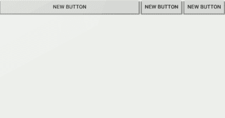

如果你现在将第二个`Button`的`layout_weight`设置为 1，那么分配的未使用的空间将平均分配在前两个按钮之间：

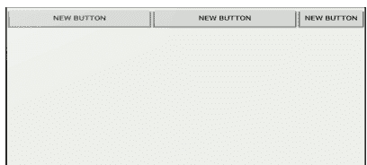

你可以猜测如果我们现在将第三个`Button`的`layout_weight`设置为 1 会发生什么，空间将平均分配，三个按钮将彼此相同。然而，如果给第一个按钮赋予权重 2，那么未使用的空间将按 2:1:1 的比例分配，依此类推。

更有趣的是，你认为如果你为第三个`Button`设置固定宽度会发生什么？答案是简单的。如果第三个按钮的`layout_weight`为 0，它将获得指定的宽度，而其他两个将获得未使用的空间。例如，将第三个按钮设置为 350dp：

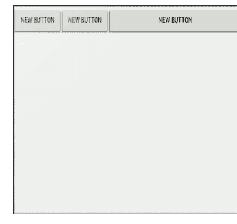

然而，如果第三个按钮设置了`layout_weight`，它可能会改变宽度，因为它获得了未使用的空间，就像其他按钮一样。这导致了“测量尺寸”和“实际尺寸”的概念。对于第三个按钮，测量尺寸是350dp，但如果它的权重非零，它在屏幕上的实际尺寸将会不同——它将获得部分未使用的空间。

当你在代码中使用控件时，`getWidth()`和`getHeight()`提供控件的实际宽度和高度。测量属性将提供在执行任何布局调整之前的测量宽度和高度。

最后，值得注意的是，如果你想确保三个按钮的大小相同，可以将它们的宽度设置为 0dp并将权重设置为 1（或相同的值）。为什么这是必要的？当你将宽度设置为零时，所有空间都是未使用的，系统将将其平均分配给每一个。你也可以将宽度设置为某个常量值，然后让权重来分配未使用的空间。

## RelativeLayout

`RelativeLayout`在过去被使用，它仍然值得了解，你会在现有应用中遇到它，如果`ConstraintLayout`不符合你的需求，你可能不得不使用它。在`ConstraintLayout`引入之前，它是 Android Studio 的青睐。这是一个复杂的布局组件，你可能认为应该尽可能优先考虑更简单的替代方案。例如，你通常可以使用多个`LinearLayout`来完成单个`RelativeLayout`的工作。最常引用的规则是，你应该尝试使用最少的布局来设计 UI。特别是布局的深度嵌套（在一个布局内部嵌套布局）会降低速度，因为系统必须深入布局的每一层，这可能需要大量工作。规则是：

- 优先使用浅层的复杂布局，而不是嵌套的简单布局。

你通常可以将一组嵌套的`LinearLayout`替换为`RelativeLayout`或`ConstraintLayout`。

对于这样一个强大的布局，`RelativeLayout`只有几个布局属性。它们分为两类：

- 关于相对于父容器定位控件的属性
- 关于相对于另一个控件定位的属性。

布局中至少有一个控件必须相对于父容器进行定位，以给布局的其他部分提供位置。然而，如果符合你尝试实现的目标，任何数量的控件都可以相对于父容器进行定位。

## 边缘对齐

该原理是你可以指定任何一对边缘的对齐，其中一个在父容器中，另一个在子容器中。这将移动控件，使其边缘与父边缘对齐，例如，顶边缘对齐顶边缘。如果你指定了两对边缘，则可以更改控件的大小并调整其位置。例如，顶对顶和底对底会使子控件的高度与父控件相同。

## 相对于父容器的布局

基础的父布局属性有：

- `layoutAlignParentTop`
- `layoutAlignParentLeft`
- `layoutAlignParentBottom`
- `layoutAlignParentRight`

这些属性将控件相应的边缘与父容器的边缘对齐。

例如：设置`layout_alignParentLeft`将控件的左侧移动到父容器的左侧：

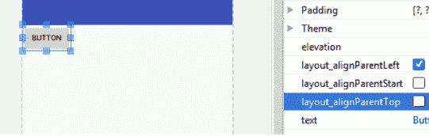

这在不调整控件大小的情况下即可。如果你选择了两个相对的对齐方式（顶部和底部或左侧和右侧），则两个边缘都会移动，控件会调整大小。例如，设置`layout_alignParentLeft`和`layout_alignParentRight`会产生：

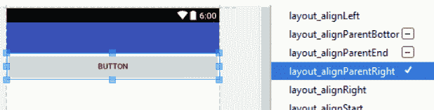

你也可以通过以下属性对齐到父容器的居中：

- `layoutCenterInParent`
- `layoutcenterVertical`
- `layoutcenterHorizontal`

## 相对于另一个组件的布局

设计器曾使用一组令人混乱的 XML 属性来将组件相对于另一个组件进行定位。最新版本不再进行这种简化。相反，你既允许设计器计算如何设置相对于另一个组件的位置，也可以在“属性（Attributes）”窗口中使用原始属性。

所有相对于另一个组件的定位属性的基本原理是，你只需向相关属性提供另一个组件的名称：

- `layout_alignTop`
- `layout_alignLeft`
- `layout_alignBottom`
- `layout_alignRight`

例如：

```
layout_alignRight= button1
```

将控件的右边缘与`button1`的右边缘对齐。一如既往，对齐两个边缘（顶/底和左/右）会改变控件的大小。以下属性：

- `layout_above`
- `layout_below`

将控件的底部与引用控件的顶部对齐。同样的以下属性：

- `layout_lineToOf`
- `layout_toRight`

将控件的左/右侧与引用控件的右/左侧对齐。最后是属性：

- `layout_baseline`

对齐父容器和子控件中的文本。在 API 17 中增加了一个新功能以考虑布局内的文本方向，这适用于阿拉伯语等语言，从右侧向左侧。默认情况下，`Layout_Direction`是从左到右，`start`边缘与左侧相同，`end`边缘与右侧相同。如果`Layout_Direction`设置为从右到左，则`start`与右侧相同，`end`与左侧相同。所有属性都有 start/end。

## 边距偏移

到目前，我们只能对齐边缘对。如何相对于另一个控件或父容器指定精确位置？答案是使用控件的边距模式。如果你对齐顶部并设置 10dp 的顶部边距，那么控件的顶部将比父容器低 10dp：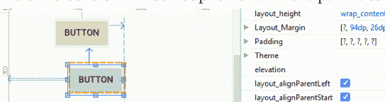

因此，对齐用于指定一个控件到另一个的距离，而边距提供精确偏移。

## RelativeLayout 和设计器

通过以上内容你理解了设计器如何让你生成`RelativeLayout`。当你在设计器表面移动控件时，最近的控件或父容器会被选为父容器，最近的边缘用于对齐，而边距是父子之间的距离。这种效果良好，但有时很难让设计器选择控件或父容器。你始终可以使用属性窗口手动设置。此外，将一个控件的边缘拖到另一个控件的边缘，会导致该边缘对齐并改变控件的大小。例如，如果你将控件的右侧拖到布局的右侧，控件的宽度会改变。这种行为可能会困扰初学者，因为它可以通过移动边缘来调整大小，但大多数情况下，释放后控件会回到原始大小。

必须说，设计器不再像以前版本那样容易使用`RelativeLayout`。例如它不再提供像素偏移反馈，不再使用映射到真实 XML 属性的简化布局属性系统。这些内容在未来版本中可能会发生变化，但由于对`ConstraintLayout`的强调，这种可能性较低。

## 总结

- 你可以使用不同的布局容器创建 UI。每个布局都有其子控件定位和调整大小的设施。
- Android Studio 3 的默认是`ConstraintLayout`。
- 最重要的替代方案是`FrameLayout`、`LinearLayout`和`RelativeLayout`。
- 每个布局都有自己的布局属性集来控制控件的定位和大小。子控件具有属性类的实例，告诉布局如何定位和调整它们的大小。所有布局都支持`layout_width`和高宽。
- 你可以使用多种不同的单位指定定位，但在大多数情况下使用`dp`（密度无关像素），因为它在相同大小但不同分辨率的屏幕上工作相同。
- 对于布局而言，控件只是一个宽和高的矩形，使用顶部和左侧进行定位。
- 所有控件都有 padding（内边距）属性，指定控件周围的额外空间。
- 某些布局提供了`layout_margin`外边距）属性，设置控件外部的额外空间。
- Gravity（重力对）设置对象的简单定位——上、下、右、左。每个控件都有一个 gravity 属性来设置其内容的定位，例如按钮中的文本。某些布局具有`layout_gravity`属性，设置控件的定位方式。
- `FrameLayout`是所有布局中最简单的，具有用于定位的`layout_gravity`。大多数情况下它包含单个控件，最常用作占位符。
- `LinearLayout`可将控件组织成行或列。除了 gravity 之外，`LinearLayout`还支持指定控件的权重（weight）。在布局确定每个控件的测量尺寸后，剩余的未使用空间将按照其权重比例分配给控件。
- 可以通过相互嵌套布局创建复杂布局，产生行列或列行。这导致了`LinearLayout`使用得最频繁。
- 通用原则是尝试选择一个导致布局容器嵌套最小的布局。因此，使用单个`RelativeLayout`或`ConstraintLayout`比使用深度嵌套的布局更好。

# 第 7 章

## ConstraintLayout


`ConstraintLayout` 是 Android Studio 2.2 中引入的新功能，它利用了在调色板（Palette）中选择它时添加的额外库。支持库兼容所有 Android Gingerbread（2.3）版本和 API 级别 9，因此除非你的目标是运行比 Gingerbread 更早的设备，否则你可以使用 `ConstraintLayout`。

引入 `ConstraintLayout` 是为了让布局对屏幕大小变化更有响应。它本质上是改进了以避免嵌套布局的 `RelativeLayout`。如果你读过关于 `GridLayout` 的章节，接下来的大部分内容看起来会很熟悉。设计器已经过调整，以便良好配合 `ConstraintLayout`，代价是让其他布局变得更难处理。随着 Android Studio 的持续开发，这种变化强调了 `ConstraintLayout` 是所有看似日益不可能解决的问题的方案。

过去，`ConstraintLayout` 尚不完善，在所有情况下工作都不理想。在 Android Studio 3 中，支持库和设计器都得到了改进。现在将所有的未来应用建立在 `ConstraintLayout` 上是合理的。

编写此时 `ConstraintLayout` 的默认版本是 1.0.2。它支持包括链（chains）和引导线（guidelines）在内的所有功能，但不支持障碍（barriers）和组（groups）。目前的文档建议，如果你使用默认版本的 `ConstraintLayout`，它们将不会出现在右键菜单中。

如果你想使用这些功能，请确保你的项目使用 1.1.0 或更高版本。这目前处于测试阶段，但在下一个 Android Studio 版本发布之前可能会达到正式版本。要使用它，你需要编辑 `build.gradle` 文件如下：

```gradle
dependencies {
    implementation fileTree(dir: 'libs', include: ['*.*.jar'])
    implementation 'com.android.support:appcompat-v7:26.1.0'
    implementation 'com.android.support.constraint:
        constraint-layout:1.1.0-beta3'
}
```

只需要修改最后一行，即从 1.0.2 改为 1.1.0-beta3。你需要同步项目，然后你将在右键上下文菜单中看到组（group）和屏障（barriers）。

如果你有一个现有的 Layout，可以让 Android Studio 将其转换为 `ConstraintLayout`。你只需要在组件树（Component Tree）中右键点击 Layout，并选择`Convert to ConstraintLayout`（转换为 ConstraintLayout）。这可以用来将布局简化为单个“扁平”的 `ConstraintLayout`，但请注意，在实践中它往往会非常错误。通常，对转换后的布局最好的评价就是它为重新实现提供了一个起点。

让我们比之前的章节更详细地查看 `ConstraintLayout` 在设计器（Designer）中是如何工作的。

使用 `ConstraintLayout` 意味着影响组件位置的唯一因素就是你应用的约束。那么，如何应用约束呢？有两种方法，我们在前面的章节中都简要介绍过。你可以让设计器自动为你提供建议，也可以手动应用它们。

## 自动约束

我们在第 3 章中遇到的自动约束旨在让事情变得简单。有两种方法可以让编辑器动态应用约束：

- `Autoconnect mode`（自动连接模式）——针对单个组件
- `Infer Constraints`（推断约束）——针对整个布局

它们的作用不同，你需要学习如何将它们结合使用。

要开启 `Autoconnect`，只需点击设计器顶部的图标：

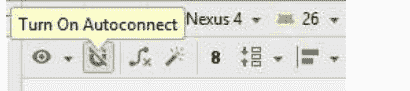

正如第 3 章所解释的，`Autoconnect` 将约束应用到你首次放置在设计表面上的单个组件上，或者应用到你拖到新位置但尚未应用任何约束的组件上。当添加约束时，如果你将组件移动到一个可能有更合适约束的新位置，`Autoconnect` 不会尝试更改它。另一个提到的点是，`Autoconnect` 不会添加显而易见的约束。它会添加居中和靠近边缘的约束，但不会添加任何相对于另一个组件的约束或通用的定位组件的约束。

目前，`Autoconnect` 是一个相当弱的功能，在大多数情况下不值得开启。

`Infer Constraints` 选项在许多方面比 `Autoconnect` 更容易使用且更强大。你只需要将组件放置在你想要的位置，然后点击 `Infer Constraints`，以确保你的布局有足够的约束来使其正常工作。如果没有添加，说明是没问题的。这意味着如果你再次点击 `Constraints`，即使你移动了组件，也不会发生任何变化。要获得一组新的约束，你必须删除想要重新计算的约束，然后点击 `Infer Constraints`。


只有固定组件位置所必需的约束会被添加——现有的约束不会被修改。这意味着你可以使用 `Constraints` 来确保你的布局有足够的约束来使其正常工作。如果没有添加，说明是没问题的。这意味着如果你再次点击 `Constraints`，即使你移动了组件，也不会发生任何变化。要获得一组新的约束，你必须删除想要重新计算的约束，然后点击 `Infer Constraints`。

可以使用`Clear All Constraints`（清除所有约束）按钮删除布局中的所有约束：


你可以通过选中特定组件并点击下方出现的红色交叉图标来清除该组件的所有约束：

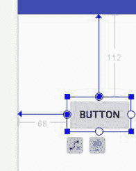

要清除单个约束，只需将鼠标悬停在标记约束位置的圆圈上，直到它变成红色，然后点击它：

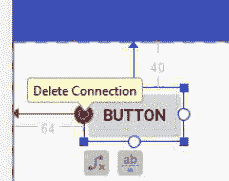

通过这种方式，你可以选择性删除约束并重新应用 `Infer Constraints` 操作，或者手动应用更合适的约束。

`Infer Constraints` 的工作方式非常简单。它根据组件离哪个物体最近对它们应用约束。这种方法得到的布局可以运行，但对于未来的修改来说可能不是最有逻辑的。

一个良好的策略是关闭 `Autoconnect`，并在每次在设计表面放置新组件时都使用 `Infer Constraints` 选项。这允许你一次构建一个布局，并检查每一组新约束。然后你可以修改新添加的约束并继续下一个组件。

情况变得困难的时候是当你拥有多组件布局并需要进行彻底更改时。在这种情况下，通常删除所有约束并重新开始更容易。

只要有合适的约束，`ConstraintLayout` 的工作方式就像 `RelativeLayout` 一样。对于放置在顶部和左侧的组件，只要有约束，它就会像之前一样工作：

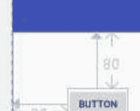

一旦设置了约束，无论屏幕大小如何，它将相对于左侧 80dp、相对于顶部 80dp。值得注意的是，正如 `RelativeLayout`，通过设置按钮的属性为 80dp 来实现。当你移动按钮到右边缘时，约束不会改变其相对于右边缘的类型。一旦设置了约束，除非你删除它，否则将保持不变。

同样值得注意的是，属性（Attributes）窗口显示了当前应用的约束，并允许你修改它们以设置精确距离：

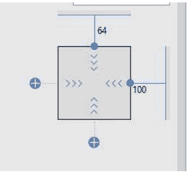

如果你点击其中一条约束线，可以输入值。你也可以点击出现的 X 来删除约束。

你还可以通过菜单中的默认边缘图标设置用于新约束的默认边缘：

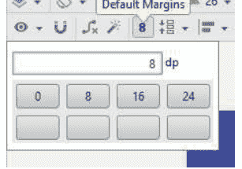

就像 `RelativeLayout` 一样，你可以相对于父容器或其他控件设置约束。尝试在表面上放置第二个按钮并将其靠近第一个。如果你点击 `Infer Constraints` 按钮，应用的约束是相对于第一个按钮：


你可以看到，在这种情况下，第二个按钮距离第一个按钮的左边缘 114dp，下方 57dp。

再次，无论显示屏幕有多大，这些约束都会被遵守。更重要的是，如果你移动第一个按钮，第二个按钮将保持相对于第一个按钮的位置。这与 `RelativeLayout` 完全一致，只要你设置了正确的约束，`RelativeLayout` 能做到的任何操作 `ConstraintLayout` 也能做到。

在设计器中你会很快理解这个思路。设计器自动应用约束的大问题是它经常出错。推断一个控件如何相对于另一个控件固定确实需要一些智能，而目前设计器并不具备这种智能。

## 手动约束

你可以手动放置位置约束。你只需要从组件上的约束圆圈拖出线条到你想作为参考点的边缘即可。例如，要相对于屏幕右侧来定位按钮，只需将按钮右侧的圆圈拖到屏幕右侧，然后将按钮移动到你想要的位置：


你可以混合使用约束的自动和手动设置，这通常是最好的工作方式。通常情况下，你指定的约束是相对于某个组件上的某一点到另一个其他组件上的某一点的距离。

例如，如果你想相对于另一个组件放置一个组件，只需将第一个组件的约束点拖动到第二个组件的边缘即可。在下方所示的情况下，我们应用了手动约束，因为约束推断（constraint inference）会将约束放在屏幕的左侧边缘：


此时，有必要非常明确一个小小但重要的点。虽然你可以在 `RelativeLayout` 中手动设置负边距，但在 `ConstraintLayout` 中你无法使用它们。你无法拖动组件使其产生负偏移量——设计器（Designer）会在零处停止你的拖动。如果你在边距属性中设置了负边距，它会显示为负值，但会被视为零。

这在实践中意味着，如果你将一个组件的左侧对齐另一个组件的左侧，你唯一可以移动第二个按钮向右移动的约束类型。如果你尝试将其向左移动，那么产生的负边距就会被忽略。要理解这一点，请在设计器中尝试，你会发现你无法将上一个截图中的下方按钮拖出上方按钮的左侧。同样，你无法将下方按钮拖到上方按钮底部的上方。这有其逻辑，但也具有限制性，因为它意味着你无法设置一个将组件的顶部连接到其下方组件顶部的约束。

你可以使用“左对左”约束来实现组件的左对齐，使用“右对右”约束来实现组件的右对齐，依此类推。为了帮助你完成这一点，有一个对齐工具面板：


要使用它，选择所有你想要对齐的组件，然后点击所需的对齐工具。重要的是，使用这些对齐工具仅仅是应用了相应的约束。你可以通过手动应用约束来实现相同的结果。

除了能够对齐控件的不同边之外，你还可以设置基线约束（baseline constraint）使文本对齐。这在第 3 章中详细解释过，但简单来说——如果你点击选择组件时出现的第二个图标，就会出现一个椭圆形框：


将光标悬停在椭圆形框上直到它高亮，然后从椭圆形框拖动到你想要对齐的组件的文本基线上：


## 偏移约束（Bias Constraints）

到目前为止，`ConstraintLayout` 并没有提供任何新奇的功能，但它确实拥有一种更复杂的约束，这在 `RelativeLayout` 中没有对应的项。这种约束被称为“偏移”（bias），它按比例方式工作，以百分比的形式表示并以锯齿线显示：


要使用它，你必须创建两个相互“竞争”的约束。例如，如果你将一个约束拖向左侧，将其对应的约束拖向右侧，结果就是水平偏移，用于将控件放置在布局大小的理想比例上。你可以通过拖动顶部和底部的约束来实现垂直偏移。

当你在屏幕上拖动控件时，分数或百分比会在“属性”（Attributes）窗口中更新。你可以使用出现的滑动条来设置百分比：


这里变得稍微复杂一点的地方在于，你还可以指定一个边距，这为偏移约束提供了一个相对组件。如果你检查上方所示属性窗口中的显示，你可以看到约束旁边显示着一个值为 8 的值。这是在你创建约束时分配的默认边距。当你在屏幕上移动组件时，你无法比该方向上设置的边距更靠近边缘。例如，如果你将左边距编辑为 100，该约束将获得 100 个单位的一部分。如果你现在尝试将按钮向左移动，你会发现无法比 100 个单位更近。注意，是指定边距之间的距离被偏移量除的。如果你想使用整个屏幕，请将边距设置为零：


## 链（Chains）

最近引入的一个功能是可以在组件之间以及相对于父布局设置偏移约束。也就是说，你可以在组件之间设置成对的约束，这些约束的工作方式与偏移约束相同。通过这种方式，你创建了所谓的组件“链”（chain）。引入链的原因是为了让 `ConstraintLayout` 更容易地创建具有等比例间距的行或列。

创建链是一个略显神秘的过程。如果你想创建一个包含三个组件的水平链，第一个任务是将它们大致排列成一条线：


如果它们不在合理的直线上，约束将分别应用到每个组件。通过拖动选择全部三个组件，然后在三个组件都被选中的情况下点击右键，使用“链（Chain），创建水平链（Create Horizontal Chain）”：


要创建垂直链，将组件排列成垂直列，选择所有组件，点击右键并使用“链（Chain），创建垂直链（Create Vertical Chain）”命令。所有工作原理相同，只是旋转了 90 度。

如果一切进展顺利，且组件被识别为潜在的链，将应用特殊的约束，你会在组件之间看到一个链图标：


请注意，链的默认布局是“散布”（Spread），它会考虑边距。有三种可选布局模式，可以通过点击选择组件时出现的链图标来选择：


如果你点击它，布局将变为“内部散布”（Spread Inside），它会将第一个和最后一个组件放在边缘，并均匀分配空间：


如果你再次点击，布局将变为“紧凑”（Packed），它会将每个组件尽可能靠拢（考虑边距），然后在容器中居中显示。你可以通过链中第一个组件的偏移设置来定位该组。注意，偏移设置在其他链模式下无效：


你可以使用`layout_constraintHorizontalWeight`和`layout_constraintVerticalWeight`设置权重。在散布或内部分布模式下，这种方式模拟了 `LinearLayout` 的工作。

## 链式键盘（A Chained Keypad）

为了展示链的用性，让我们实现一个第 3 章末尾用过的键盘。

首先，在设计面上放置九个按钮形成一个大致的 3×3 网格：


依次选择每一行并使用“链（Chain），创建水平链（Create Horizontal Chain）”命令将每一行转换为三个按钮的链：


然后选择这三个链（即所有九个按钮），并使用“链（Chain），创建垂直链（Create Vertical Chain）”命令创建网格：


如果你想将布局更改为紧凑，只需选择每行的第一个按钮并点击链图标，直到获得紧凑的行：


要获得紧凑的列更为困难，因为链图标只控制组件所属的第一个链。在编写期间，设置列紧凑唯一的方法是编辑 XML 文件。

链样式是由链中的第一个组件控制的。如果你查看第一行第一个按钮的 XML，你会看到：

```xml
app:layout_constraintHorizontal_chainStyle="packed"
```

这负责设置第一行的紧凑布局。要设置第一列为紧凑，你必须将 XML 修改为：

```xml
app:layout_constraintHorizontal_chainStyle="packed"
app:layout_constraintVertical_chainStyle="packed"
```

如果你这样做，你将看到紧凑（packed）格式下的第一列：


你必须更改第二行顶部和第一行按钮的 XML，使其读取：


`app:layout_constraintVertical_chainStyle="packed"`

如果你正确地更改了第一行按钮的 XML，你应该能看到一个紧凑的按钮数组：


现在的大问题是，为了定位按钮网格，你必须调整每行第一个按钮的偏置（bias）设置（这设置了该行的水平偏置），以及每列第一个按钮的设置（这设置了垂直偏置）。没有单一的设置可以定位整个网格，这让定位变得并不简单。

添加第10个按钮又如何？它本可以添加到第一列，但现在添加它同样容易，只需从第一列最后一个按钮的底部以及按钮的左侧和右侧设置约束即可：


## 指南线 (Guidelines)

你可以使用的终极定位工具是指南线。你现在可以在设计表面上拖放水平或垂直指南线，并使用它来定位其他组件。关于指南线最重要的的一点是，它们在最终布局中并不以 View 对象或任何其他形式存在。指南线是 Designer 中的一个对象，你使用它设置的任何约束都会被转换为定位方式，在应用运行时不会引用该指南线。

要添加指南线，你只需使用指南线工具：


一旦添加了指南线，你就可以将其拖到所需位置，然后像它本身是一个组件一样，相对于它对组件进行定位。你可以设置任何与组件同相同的约束，包括偏置。注意，如果你移动指南线，任何约束在它上的 UI 组件也会随之移动——这非常有用。

你可以通过选中并按下 delete 来删除指南线。目前指南线的大问题是，虽然 Designer 在你拖动时显示位置，但没有方法输入值来对其精确定位：


虽然指南线是另一种定位工具，而且越多越好，但任何没有指南线也能完成的操作，指南线也能做到。此外，考虑到指南线是在屏幕上绝对定位的，它们无法提供随屏幕尺寸变化而调整布局的功能。

## 组 (Groups)

*注意，这在 ConstraintLayout 1.1.0 或更高版本中可用 - 请参见章节开头获取更多信息。*

`Group` 赋予你创建组件组的能力。目前这仅提供了一种更改一组组件可见性的简单方法。你可以使用 Add Group 菜单命令在设计表面放置一个组。

在组件树（Component Tree）中使用 `Group` 最简单。你可以拖动任意数量的组件并释放到 `Group` 上。注意，从某种意义上说，这些组件并不是 `Group` 的子级，它并不是一个容器。`Group` 只是维护了一个它所控制可见性的组件列表：

| 组件树 |
| --- |
| ▼ ConstraintLayout |
| \| \| OK button - "Button" ❗ |
| \| \| OK button2 - "Button" ❗ |
| ▼ Group |
| \| button |
| \| button2 |

在上面的示例中，`Group` 控制 `button` 和 `button2` 的可见性。如果 `Group` 的可见性属性被设置为 `invisible`（不可见），则 `button` 和 `button2` 将不再显示在 UI 中，但它们仍然占据布局空间。如果你将可见性设置为 `gone`（完全隐藏），则它们将是不可见的且不占用 UI 空间。

`Group` 功能是一项小便利，因为你可以通过编写代码设置每个组件的可见性来实现相同的结果。然而，作为一种组织复杂 UI 的方法它可能有用，可以通过单个命令让不同的组件集变为显示或隐藏。

## 尺寸 (Sizing)

与定位相比，调整组件尺寸几乎是轻而易事的，但也有一些有趣的细节。你可以在属性（Attributes）窗口中查看组件是如何调整尺寸的。内部显示的线条类型表示组件的大小及其与其内容的关系。直线表示固定尺寸：


这种自动调整尺寸的行为是由 `layout_width` 和 `layout_height` 属性设置的。你可以通过在属性旁的值框中输入精确尺寸（例如 `100dp`）来修改。

固定尺寸组件的替代方案是允许它们自动调整大小以适应或包裹其内容。要设置此，你只需点击内部的直线（它们会变为 `<<`）并允许组件更改大小：


例如，如果你在设计面上放置一个 Button（按钮）并将其宽度设置为 `Wrap Content`（包裹内容），然后将高度设置为 `Match Constraint`（匹配约束），那么左上角会出现一个小三角形：


如果你点击该三角形，你将为宽高比例设置默认值 `1:1`。


如果你输入例如 `1:2` 的值，高度将被设置为宽度的两倍，而宽度又由内容决定：


你可以使用约束设置其中一个维度。例如，如果你手动在 Button 上设置左、右约束，然后将其水平尺寸设置为 `Match Constraints`，该 Button 的宽度将与屏幕一样宽。如果你现在将高度也设置为 `Match Constraints` 并将比例设置为 `2:1`，你将获得一个与屏幕同宽但高度为一半的 Button。


## Barriers (障碍)

注意，这仅在 `ConstraintLayout 1.1.0` 或更高版本中可用——更多信息请参见本章节开头。

`Barrier` 解决了许多其他难以处理的 ConstraintLayout 问题，但它们并不是你每天都会使用的功能。

`Barrier` 是一种智能引导线（Guideline）。你在设计面上放置一个 `Barrier`，然后将任意数量的组件放到它上面——在组件树（Component Tree）中操作最为方便。这种工作方式与 `Group` 组件相同，`Barrier` 本身并不是任何形式的容器，只是维护了一个它将处理的组件列表。`Barrier` 还具有一个方向，并会与其列表中在该方向上最极端的组件对齐。如果将 `Barrier` 设置为右侧（`right`），它将位于列表中最靠右的组件的右边缘。如果你将 `Barrier` 列表中的组件组想象成被包含它们的框（即边界框）包围，那么另一种思考方式是：`Barrier` 将自己定位在边界框的边缘之一——在我们的示例中就是右边缘。

就像 Guideline 一样，你可以通过对其设置约束来相对于它定位其他组件。你可以看到，这允许你将组件放置在组的最右侧、最左侧、顶部或底部。

例如，使用 `Add Vertical barrier`（添加垂直障碍）菜单选项在设计面上放置一个垂直 `Barrier`。在此阶段你将无法看到它，因为它的默认方向是左侧，并且占据了尽可能靠左的位置。


接下来，在设计面上放置两个 Button，并使用组件树将它们拖到 `Barrier` 上：


`Barrier` 的默认方向是左侧，因此它现在将自己定位在最靠左的 Button 的左边缘。你可以看到下中的 `Barrier` 是一个灰色阴影条：


如果你移动这两个 Button，你会发现 `Barrier` 始终锚定在组中最左侧的边缘。你可以通过在组件树中选择 `Barrier`，然后使用属性窗口（Attributes window）将 `barrierDirection` 改为右侧（`right`），例如：


通过此更改，`Barrier` 将自己定位在列表中最靠右的组件的右边缘。如果你将 `Barrier` 列表中的组件组想象成被包含它们的框（即边界框）包围，那么另一种思考方式是：`Barrier` 将自己定位在边界框的边缘之一——在我们的示例中就是右边缘。


## 摘要

- `ConstraintLayout` 是未来的布局方式，新的设计器是为了与它完美配合而创建的。

- 有两种自动约束工具 —— 自动连接（`Autoconnect`）用于为单个组件计算约束，以及推断约束（`Infer Constraints`）用于为整个布局计算任何缺失的约束。目前这两种工具都不特别好用。

- 你可以清除布局中的所有约束，也可以一次只清除单个组件或某一个约束。

- 约束可以从组件应用到父容器，其作用类似于绝对定位。

- 你可以设置默认边距，使组件的定位更加规则化。

- 组件可以相对于另一个组件进行定位。

- 你无法设置负的边距。

- 你可以对齐文本基线。

- 偏置约束（Bias constraints）允许你按照指定的比例划分可用空间。

- 链（Chains）提供了 `LinearLayout` 的部分功能。例如，你可以使用链将组件分布在可用空间中。

- 布局中可以添加辅助线（Guidelines），组件可以相对于它们进行定位，尽管它们不会出现在最终的布局中。

- 可以创建组（Groups），允许你一次性设置所有组件的可见性。

- 你可以绝对设置组件的大小，或由内容决定大小。此外，你还可以允许一对约束来决定大小。

- 宽高比约束（Aspect Ratio Constraint）可以将其中一个维度设置为另一个维度的比例。

- 屏障（Barrier）是一种智能辅助线，它可以跟踪指定的组件组，并位于该组在指定方向上的最极端边缘。你可以相对于屏障定位其他组件。

# 第 8 章

## 编写 UI

如果你想成为一名真正优秀的 Android 程序员，不仅需要知道如何创建 UI，还需要知道 UI 是如何创建的。为了对你所做的事情充满信心，你需要理解 Android 图形系统的一些内部工作机制。如果你想在代码中修改 UI 并处理菜单，这也是至关重要的。

## UI 库

对于 Java 和其他语言，有很多不同的 UI 构建工具包，如 AWT、Swing、Qt、MFC、WPF 等，你可能会认为精通所有这些是一项艰巨的任务，甚至是不可能的。事实上，它比你想象的要简单；大多数 UI 库都使用通用的通用方法，而 Android UI 库（它似乎没有特定的名字）也无不同。让我们仔细观察它的工作原理。

`Activity` 是与其关联的窗口，这通常是它运行的设备上的整个图形屏幕。换句话说，一个 `Activity` 可以允许其他 Java 类在设备的屏幕上绘图。然而，它并不是简单地提供对图形硬件的直接访问，而是有一系列类，使得构建 UI 和执行图形操作变得更容易。

在查看通用图形之前，我们首先需要找到 UI 是构建的。

## View

所有 UI 组件和通用 2D 图形的基础是 `View` 类。这是一个通用类，拥有许多方法和属性，决定了它将如何显示组件或它所代表的其他图形实体。它还参与了事件处理系统，这意味着 `View` 可以响应事件。存在某些 `View` 类实现了你在 Android Studio 设计器中制作的所有标准组件，例如 `Button`、`TextView` 等。

每个 `View` 对象都有一个 `onDraw` 方法，它可以将其代表的内容的图形表示绘制到 `Canvas` 对象上，`Canvas` 本质上是一个带有绘制方法的位图。发生的情况是，当 `Activity` 需要更新 UI 时，它调用 `View` 的 `onDraw` 方法并传递一个它渲染到屏幕的 `Canvas` 对象 —— 你不需要担心这一层 `Canvas` 是如何渲染到屏幕的。你可以将其认为：“每个 `View` 都知道如何绘制自己”。

总结：

- 一个 `Activity` 可以与一个 `View` 对象关联。

- 当 `Activity` 需要绘制其 UI 时，它调用 `View` 对象的 `onDraw` 方法，例如 `view.onDraw(Canvas)`。

- `View` 对象在 `Canvas` 上绘制它需要的任何内容，一个按钮、文本或其他东西。

- `Activity` 在屏幕上显示 `Canvas` 对象。

一个 `Activity` 只能与一个 `View` 对象关联，这决定了在屏幕上绘制的内容。这看起来可能有些局限，但正如你将看到的，它远非局限，因为 `View` 对象可以相互嵌套。

## setContentView

你如何设置一个 `View` 对象在 `Activity` 窗口中显示？

答案是使用使用 `Activity` 的 `setContentView` 方法，这就是我们一直以来在做的事情。

为了查看效果，请启动一个新的 Basic Activity 项目并将 `onCreate` 修改为：

```java
@Override
protected void onCreate(Bundle savedInstanceState) {
    super.onCreate(savedInstanceState);
    Button b = new Button(this);
    setContentView(b);
}
```

不要忘记使用 Alt+Enter 添加所需的 import 语句以便你使用 `Button` 类，并且不要在 `onCreate` 中留下任何使用其他 `View` 对象（如菜单）的代码。

第一条指令创建了一个 `Button` 对象（它是 `View` 的子类），第二条指令将其设置为 `Activity` 的 `View`。如果你运行此程序，你将看到一个填充整个屏幕的灰色区域：


是的，这就是按钮！你甚至可以点击它，尽管在没有事件处理程序的情况下，什么都不会发生。

为了让这个按钮变得稍微有点意思，我们可以通过设置属性来定制它。例如：

```java
Button b = new Button(this);
b.setText("Hello Button");
setContentView(b);
```

如果你运行此程序，你将看到一个填充整个屏幕的灰色区域：


是的，这就是按钮！你甚至可以点击它，尽管没有事件处理程序，什么都不会发生。

## ViewGroup

如果 `Activity` 只能与一个 `View` 对象关联，这决定了在屏幕上绘制的内容，我们如何能创建一个包含多个组件的复杂 UI 呢？答案正如你猜的，是存在可以托管其他 `View` 对象的 `ViewGroup`。

`ViewGroup` 可以显示多个对象。在大多数情况下，与 `Activity` 关联的 `View` 是 `ViewGroup`。当 `Activity` 请求布局渲染自身时，它调用每个 `View` 的 `onDraw` 方法并将它们组合在一起。所以布局做了两件事：

- 组织其他 `View`

- 执行布局操作

为了查看效果：

```java
@Override
protected void onCreate(Bundle savedInstanceState) {
    super.onCreate(savedInstanceState);
    LinearLayout layout = new LinearLayout(this);
    Button b = new Button(this);
    b.setText("Hello Button");
    layout.addView(b);
    setContentView(layout);
}
```

所有的布局都有一个 `addView` 方法，可以添加多个对象。你可以添加更多按钮来查看默认 `LinearLayout` 的工作方式：

```java
protected void onCreate(Bundle savedInstanceState) { 
    super.onCreate(savedInstanceState);
    LinearLayout linLayout = new LinearLayout(this);

    Button b1 = new Button(this); 
    b1.setText("Hello Button 1");
    linLayout.addView(b1);

    Button b2 = new Button(this);
    b2.setText("Hello Button 2");
    linLayout.addView(b2);

    Button b3 = new Button(this);
    b3.setText("Hello Button 3");
    linLayout.addView(b3);

    setContentView(linLayout);
}
```


## 编写布局属性

目前，我们依赖于创建的 `View` 对象的属性（特别是布局属性）的默认设置。然而在实践中，你可以花费时间和代码行来设置创建任何你需要的用户界面和布局所需的所有属性。

你现在已经知道如何在代码中完全创建 UI。你所做的就是创建所有需要的对象，设置它们的属性并将它们添加到合适的布局中。这比你想象的要复杂一点，因为每个布局类型都有不同的布局属性。

正如在前一章中所解释的，每个类型的 Layout 都有一个派生自 `LayoutParams` 的关联类，其中 layout 是 Layout 类的名称。例如，`LinearLayout` 拥有 `LinearLayout.LayoutParams` 类，用于定义 `View` 对象在被添加到 `LinearLayout` 对象时可以使用的所有布局属性。


你可能已经猜出如何使用`LayoutParams`类了。你只需要创建一个正确初始化的、适当的`LayoutParams`类的实例，并对任何你想要自定义的`View`对象上调用`setLayoutParams`即可。

例如，为了在`LayoutParams`对象中设置高度和宽度，我们可以使用：

```
LinearLayout.LayoutParams LP=new LinearLayout.LayoutParams(100, 100);
```

所有的`LayoutParams`类都有一个构造函数，可以只接受宽度和高度属性作为参数。一旦你有了一个`LayoutParams`对象，就可以通过设置`View`的`LayoutParams`属性来将其赋值给任何`View`对象：

```
b3.setLayoutParams(LP);
lin.addView(b3)
```

通过此更改，我们之前布局中的第三个按钮将将恰好为 100 像素。

注意，该构造函数是以像素（px）为单位，而不是设备无关像素（dp）。你也可以使用`MATCH_PARENT`和`WRAP_CONTENT`常量。例如：

```
LinearLayout.LayoutParams LP=
LinearLayout.LayoutParams(WRAP_CONTENT,WRAP_CONTENT);
```

还有一个构造函数允许你设置权重（weight）。其他布局属性必须在构造函数完成工作后通过`setProperty`方法设置。例如：

```
LP.setMargins(20,20,20,20);
```

这将相应地设置左、上、底部的边距：


更复杂的`Layout`对象对应也有更多的`LayoutParams`需要你花时间设置。

所以明确一下——像`Text`这样的属性是你直接在`View`对象上设置的，但也有布局属性需要在适当的`LayoutParams`对象上设置，然后将其设置为`View`的`LayoutParam`属性。

## View 层级结构 (View Hierarchy)

同样注意，`Layout`可以包含其他`Layout`，因此组成 UI 的`View`对象集合形成了一个树形结构，即 View 层级结构。当屏幕重绘时，每个`View`对象都会被要求绘制自己，并且会从上到下对层级结构中的所有`View`对象执行。

通常，View 层级结构在 Activity 加载时只绘制一次。如果屏幕区域由于某种原因被另一个图形遮挡，重绘机制足够智能，不会绘制整个 View 层级结构。它只会重绘与屏幕失效区域交叉的`View`对象。View 层级结构还参与了对象之间的事件传递以及确定哪个组件拥有焦点。

## XML 布局

所以图形系统的原理足够简单。每个控件或组件都对应一个`View`对象，你可以通过在代码中创建`View`对象并将其添加到`Layout`中来构建 UI。你使用`LayoutParams`对象或通过直接设置属性来控制`View`对象的排列方式。Activity 在需要时将其 View 层级结构绘制到屏幕上。好了，这是在代码中创建 UI 的方法，但到为止我们一直使用 Designer（设计器）构建 UI。

这与 View 层级结构有什么关系？

Designer 会创建一个 XML 文件，描述你想要创建的 View 层级结构。其工作原理显而易见。XML 文件中的每个标签对应于你想要创建实例的`View`对象。

```
<LinearLayout>
</LinearLayout>
```

这会创建一个`LinearLayout`对象的实例。

在布局中嵌套标签表示创建的对象需要作为子`View`添加到布局中。例如：

```
<LinearLayout>
<Button />
</LinearLayout>
```

这会创建一个`LinearLayout`对象和一个`Button`对象，然后使用其`addView`方法将`Button`对象添加到`LinearLayout`中。你可以看到 XML 完美地捕捉了 View 层级结构的概念。

要设置对象属性，你只需要使用 XML 中对应的属性即可。例如设置按钮的文本：

```
<Button
  android:text="New Button"
/>
```

布局参数使用带有`layout_property`前缀的属性设置。例如：

```
<Button
  android:layout_width="wrap_content"
  android:layout_height="wrap_content"
/>
```

其实就此了。XML 定义了对象的层级结构及其属性，系统会读取它们并创建对象。这种将 XML 作为对象实例化系统的方法并不罕见。当然，Designer 创建的 XML 看起来比上面的示例要复杂得多，但这主要是因为它定义的属性数量很多。基本思想仍然是相同的。

## 膨胀理论 (Inflation Theory)

需要回答的最后一个大问题是：XML 如何转换为真实的对象层级结构？答案是使用“膨胀器”（inflater）。

“膨胀”（inflate）布局是 Android 术语，指加载由 XML 文件定义的对象。你通常不需要调用膨胀器，因为系统会在后台为你完成工作，但如果你想做，也可以调用。例如，要膨胀布局，你会使用`LayoutInflater`的实例。通常你不需要新的实例。相反，你只需要使用系统膨胀器提供的现有实例即可。一旦你有了`LayoutInflater`，就可以使用它的许多`inflate`方法来创建由 XML 指定的 View 层级结构。使用哪种方法取决于 XML 存储的位置。你可以为包含在`res`目录下的 XML 文件提供资源 ID。例如，要膨胀常用的`activity_main.xml`布局，可以使用：

```
LayoutInflater inflater = getLayoutInflater();
View mView = inflater.inflate(R.layout.activity_main,null);
setContentView(mView);
```

`inflate`的第二个参数可以提供一个`View`对象作为膨胀`View`的根。根据布局规则，容器仅作为父容器。手动膨胀 XML 布局的唯一原因是你想执行一些巧妙的操作，例如将一个布局与其他组合或以某种方式操作 View 层级结构。注意还有其他类型的膨胀器，例如菜单膨胀器，它们执行将 XML 转换为对象的相同工作。我们将在下一章查看菜单时再次回到这些特殊的膨胀器。

`inflate`方法还有一个版本：

```
inflate(int resource, ViewGroup root);
```

如果设置了最后一个参数，它将使用该容器来膨胀 XML 资源。

## 查找 View 对象

如果你想处理膨胀器创建的 View 层级结构，我们需要解决的一个问题是在层级结构中查找`View`对象。在我们在代码中构建 View 层级结构的示例中，通过保留创建时的引用可以轻松跟踪按钮或`textView`。

膨胀器返回 View 层级结构，但没有简单的方法获取特定对象（例如按钮）。解决此问题的方法之一“遍历” View 树。`ViewGroup`对象（例如`Layout`）不仅有`addView`方法，还有系列允许你访问它包含的对象的方法。每个子对象都被分配了一个整数索引——想象成数组。方法：

```
getChildAt(i)
```

将返回索引 i 的子对象。你也可以使用：

```
getChildCount()
```

来查找容器中存储了多少子对象。

使用这些方法，你可以在层级结构中搜索你需要的`View`对象，但你如何知道是哪一个？答案是所有`View`对象都有一个`id`属性，它应该唯一标识它们。有`getId`和`setId`方法，但通常`id`属性是作为 XML 文件的一部分设置的。

为了避免计算 id 值，设置 id 的标准方法是在 XML 文件中定义资源：

```
android:id="@id/my_button"
```

当 XML 文件被加载时，`@+`符号被解释为“创建资源”。系统会使用`generateViewId`方法生成一个整数 ID，并用于在 R 对象的 id 属性中创建 id 属性并添加一个`my_button`属性。唯一的微小复杂之处在于，当你使用 Designer 设置 id 时，它也会为你生成`@+id/id`。因此，在属性（Attributes）窗口中你会看到`my_button @+id/my_button`。这很有帮助，但可能会让人困惑。

关于资源有很多要说的，但目前足够理解正在发生什么。资源应该单独占据一个章节，我们在查看菜单后就会学它。

这一切的意义在于，你不仅获得了一个自动生成的 id 值，还获得了一种将此值引入运行代码的方法。你可以使用`getChildAt`方法遍历层级中的所有`View`对象，但使用下面的方法要简单得多：

```
findViewById(R.id.my_button);
```

它可以在一条指令中返回该对象。

通用方法是加载 XML，将其设置为`View`的内容，然后使用`findViewById`定位你任何想要用代码处理的`View`对象。

值得提到的是，任何处理`View`对象的新方法（数据绑定）正在引入 Android Studio。它在未来将使`findViewById`变得多余，并让 UI 变得更容易处理。然而，了解 Android UI 构建的基础是非常重要的，目前最好使用经过测试且可靠的方法。

## 如何构建 UI？

你有两种不同的不同的方法来构建 UI。你可以在代码中完成整个工作，也可以创建一个 XML 布局。在实践中，通常使用 Designer 为你生成 XML 文件更简单。不过，你可以混合这两种方法并随时更改“状态”。例如，你可以通过隐式加载或加载 XML 文件来加载 UI，并编写代码来创建、添加其他组件或从布局中移除`View`对象。要移除`View`对象，只需使用`ViewGroup`对象的`removeView`或`removeAt`方法。

还有其他 Designer 不支持的 UI 组件，例如菜单。在这种情况下，你可能需要处理 XML 或在代码中创建 UI。这意味着尽管 Designer 是创建 UI 最简单的方法，你仍然需要了解 View 层级的内部原理。

## 总结

- 所有的 UI 组件都派自`View`类。

- Activity 可以托管并显示由其某个`ContentView`方法设置的`View`类单实例。

- 你可以在代码中创建`View`对象实例，并设置它们由 Activity 显示。

- `Layout`或`ViewGroup`对象是一个可以包含许多`View`对象的`View`对象，从而创建一个 Activity 可以显示的复杂布局。

- 每个`Layout`都有关联的`LayoutParams`类，每个`View`对象使用该类来控制它在布局中的位置。

- 你通常需要创建一个`LayoutParams`类的实例，设置你指定的参数，然后通过`setLayout`方法将该实例设置为每个需要使用它的`View`对象的`LayoutParams`。

- 使用`Layout`容器会导致 View 层级，即由 Activity 显示的`View`对象层级结构。

- 你也可以使用 XML 编写 View 层级。每个 XML 标签对应一个`View`对象，并通过嵌套来定义层级结构。对象的属性在 XML 中作为属性设置。布局属性以相同的方式处理，但带有`layout_`前缀。

- 当需要将 View 层级分配给 Activity 时，会通过使用`inflater`方法将 XML 文件转换为一组嵌套的`View`对象。这简单地读取 XML 并并将每个标签转换为对象，同时设置对象的属性。

- 为了在加载的层级中找到特定的`View`对象，通常的方法是分配一个 id 并使用`findViewByIdById`方法。

## 第9章

## 菜单 - 工具栏

UI 不仅由按钮和其他控件组成。Activity 可以托管并显示一个由其某个`ContentView`方法设置的`View`类单实例。

菜单是一个层级结构。顶级菜单呈现一组选项。如果任何项本身是菜单（即子菜单），它可以包含更多项。

Android 菜单使用三种对象，因此对应三个 XML 标签：

- `<menu>`

- `<item>`

- `<group>`

在顶层级，`<menu>`标签展开为菜单项和组元素的容器。`<item>`标签展开为单个选项。它也可以包含`<menu>`标签，进而包含`<item>`标签来创建子菜单。`<group>`标签并没有展开为对象。相反它设置所有项的组 ID。你可以一次设置一组项目的属性，即它们作为一个组。

## 创建菜单资源

菜单通常由 XML 文件定义，用于创建菜单。

![image_2738bcc65dd974f057097a6b6174.png]

你可以忽略这些布局。你可以根据布局创建`View`。你需要知道的三个属性是：

- `id`：你用于标识菜单项的整数

- `title`：决定菜单项显示内容的字符串

- `icon`：当菜单项可以作为图标显示时使用的绘制图像

在解释了这些之后，让我们定义菜单。在 11 章中会有关于此的更多介绍。当你点击按钮时，它会根据布局显示。你可以使用拖拽和拖放（drag-and-drop）来放置菜单。

![image_02738bcc65dd974f057097a6b6174.png]

你可以布局布局：

![image_02738bcc65dd974f057097a6b6175.png]

你可以通过菜单编辑器或直接使用 XML。

## 菜单树

菜单是选项的层级结构。顶级菜单呈现一组选项。如果任何项本身是菜单（即子菜单），它可以包含更多项。

Android 菜单使用三种对象，因此对应三个 XML 标签：

- `<menu>`

- `<item>`

- `<group>`


在顶层级，`<menu>` 标签展开为菜单项和组元素的容器。`<item>` 标签展开为单个选项。它也可以包含`<menu>`标签，进而包含`<item>`标签来创建子菜单。`<group>` 标签并没有展开为对象。相反它设置所有项的组 ID。你可以一次设置一组项目的属性，即它们作为一个组。

`<item>` 标签包含另一个`<menu>`标签，该标签又包含两个项目，分别对应“新建”（New）和“打开”（Open）文件菜单选项。你可以在组件树（Component Tree）中查看该结构：


组件树也可以通过拖放操作对菜单进行某些有限的编辑，以修改项目的嵌套方式。

这个简单菜单的具体外观取决于它的显示方式，但它定义了一个带有单一顶层“文件”（File）选项的菜单，选中后会显示包含另外两个选项（“新建”和“打开”）的子菜单。

## 显示菜单

你有四种不同的方式可以显示菜单：

- 操作栏（Action bar），例如 App Bar
- 文键菜单（Context menu）
- 上下文操作栏（CAB）
- 弹出菜单（Popup）

操作栏或 App bar 是在 Android 3 中引入的，用于取代原始的选项菜单，并成为应用的标准主菜单。在 Android 5 中，引入了一种实现它的新方式，即 Toolbar，它是一个可以使用设计器（Designer）编辑的标准控件。这使得它更容易被集成和使用。如果你想在早期版本的 Android 中使用操作栏，你需要利用支持库（Support Library）——该库在 Android 为你创建项目时会自动包含。

文键菜单是一种在长按 UI 组件时响应而出现的弹出菜单。

上下文操作栏（Contextual Action Bar）在用户长按 UI 元素时出现在屏幕顶部，旨在为提供与所选项目恰当的操作。它同样需要支持库来适配旧版本的 Android。

弹出菜单可以对几乎任何你想要使用的用户操作响应并显示。它出现在触发其显示的 View 对象旁边。例如，你可以设置一个按钮在点击时显示弹出菜单，或者当用户在文本字段中输入内容时显示弹出菜单。很难准确判断何时该使用弹出菜单。

从逻辑上讲，下一步应该是使用我们刚刚创建的 XML 文件来显示 CAB 或弹出菜单，但从默认项目开始更好，因为它生成了实现操作栏、Toolbar 所需的代码和菜单资源，并且被用于大多数应用程序。剩余的菜单类型是下一章的主题。

## 使用 Toolbar

如果你启动一个名为 MenuSample 的新基础活动（Basic Activity），你会发现它会自动创建一个`main_menu`资源文件以及将其显示为 Toolbar 所需的代码。

基础活动模板使用支持库使得在早期版本的 Android 中成为可能。这就是为什么你项目中的`MainActivity`必须继承自`AppCompatActivity`而不是基础`Activity`类：

```java
public class MainActivity extends AppCompatActivity {
```

并且我们需要导入包：

```java
import android.support.v7.app.AppCompatActivity;
import android.support.v7.widget.Toolbar;
```

Toolbar 在`activity_main.xml`中定义为一个自定义控件：

```xml
<android.support.design.widget.AppBarLayout
    android:layout_width="match_parent"
    android:layout_height="wrap_content"
    android:theme="@style/AppTheme.Overlay">
```

```xml
<android.support.v7.widget.Toolbar
    android:id="@id/toolbar"
    android:layout_width="match_parent"
    android:layout_height="@attr/actionBarSize"
    android:background="@attr/colorPrimary"
    app:popupTheme="@style/AppTheme.PopupOverlay"
    style="@style/AppTheme" />
```

```xml
<android.support.design.widget.AppBarLayout>
```

```xml
<include layout="@layout/content_main" />
```

...

注意 Toolbar 的样式被设置为`AppTheme`。这很重要，因为所选的样式会改变 Toolbar 的显示方式，并可能使其完全不显示。

同样注意此标签：

```xml
<include layout="@layout/content_main" />
```

这加载了你在`content_main.xml`中设计的布局。如前面的章节所述，布局文件被分为两个部分：`activity_main.xml`定义了适用于所有 Android 应用的通用布局，而`content_main.xml`用于你特定应用程序的布局。当`activity_main.xml`加载时，这两个文件会自动合并在一起。

当 Activity 加载时，`onCreate`会膨胀（inflate）`activity_main.xml`布局。这对于 Toolbar 显示已经足够，但为了让系统将其作为操作栏使用，我们需要添加：

```java
Toolbar toolbar = (Toolbar) findViewById(R.id.toolbar);
setSupportActionBar(toolbar);
```

所有这些代码都是为你生成的，你会在`MainActivity.java`文件的`onCreate`中找到它们：

```java
@Override
protected void onCreate(Bundle savedInstanceState) {
    super.onCreate(savedInstanceState);
    setContentView(R.layout.activity_main);
    Toolbar toolbar = (Toolbar) findViewById(R.id.toolbar);
    setSupportActionBar(toolbar);
```

现在如果你运行应用，你将看到熟悉的 Hello world 消息和默认的 App bar：


事实上，这个 Toolbar 是如此熟悉，以至于你可能没有意识到它是一个菜单。左侧是应用名称，右侧是一个三点图标。

如果你点击三点图标，就会出现设置（Settings）项：


如果你查看`menu_main.xml`，你可以看到：

```xml
<menu xmlns:android="http://schemas.android.com/apk/res/android"
    xmlns:app="http://schemas.android.com/apk/res-auto"
    xmlns:tools="http://schemas.android.com/tools"
    tools:context="com.example.MainActivity">
    <item
        android:id="@+id/settings"
        android:order="0"
        android:title="Settings"
        app:showAsAction="never" />
</menu>
```

注意 Toolbar 的样式被设置为`AppTheme`。这很重要，因为所选样式改变了 Toolbar 的显示方式并可能使其完全不显示。

注意标签：

```xml
<include layout="@layout/content_main" />
```

这加载了你在`content_main.xml`中设计的布局。正如前面的章节所述，布局文件分为两个部分：`activity_main.xml`定义所有 Android 应用通布局，`content_main.xml`用于应用特定的布局。当`activity_main.xml`加载时，这两个文件会自动合并。

当 Activity 加载时，`onCreate`膨胀`activity_main.xml`布局。这对于 Toolbar 显示已经足够，但为了让系统将其作为操作栏使用，我们需要添加：

```java
Toolbar toolbar = (Toolbar) findViewById(R.id.toolbar);
setSupportActionBar(toolbar);
```

这些代码都是为你生成的，你会在`MainActivity.java`文件的`onCreate`中找到它们：

```java
@Override
protected void onCreate(Bundle savedInstanceState) {
    super.onCreate(savedInstanceState);
    setContentView(R.layout.activity_main);
    Toolbar toolbar = (Toolbar) findViewById(R.id.toolbar);
    setSupportActionBar(toolbar);
```

现在如果你运行应用，你将看到熟悉的 Hello world 消息和默认的 App bar：


事实上，这个 Toolbar 是如此熟悉，你可能没有意识到它是一个菜单。左侧是应用名称，右侧是一个三点图标。

如果你选择三点图标，就会出现设置（Settings）项：


如果你查看`menu_main.xml`，你可以看到：

```xml
<menu xmlns:android="http://schemas.android.com/apk/res/android"
    xmlns:app="http://schemas.android.com/apk/res-auto"
    xmlns:tools="http://schemas.android.com/tools"
    tools:context="com.example.MainActivity">
    <item
        android:id="@+id/settings"
        android:order="0"
        android:title="Settings"
        app:showAsAction="never" />
</menu>
```

为了看到运行效果，让我们在`menu_main.xml`文件的最后一个`</menu>`标签之前添加另一个项目，即“发送”（Send）：

```xml
<item android:id="@+id/action_send" android:title="Send" app:showAsAction="ifRoom" />
```

你可以使用菜单编辑器（Menu Editor）执行相同的工作。只需从调色板（Palette）将一个菜单项（Menu Item）拖放到组件树中，并使用属性窗口对其进行自定义：


无论你如何操作，结果都是：


现在如果你运行应用，你将看到：


只要有空间，新的“发送”项就会显示。如果没有空间，它会在用户选择三点图标时出现。

通常以图标显示菜单项，因此将标签修改为：

```xml
<item android:id="@+id/action_send"
android:title="Send"
app:showAsAction="ifRoom"
android:icon="@drawable/ic_menu_send"/>
```

这指定了提供的图标之一。你也可以使用属性窗口在资源（Resources）窗口中选择`ic_menu_send`：


你可以继续向 Toolbar 中添加菜单项，并根据不同的屏幕宽度自定义它们的显示方式。所有菜单的基本思路都是相同的。

## 创建 App Bar

到目前为止，我们只是查看了`menu_main.xml`文件和操作栏菜单的 XML 规范。还有一些代码用于实际创建在 App bar 中显示的菜单。当 Activity 准备好显示 App bar 时，将触发一个`CreateOptionsMenu`事件。

`onCreateOptionsMenu`事件处理器需要做的的就是膨胀定义菜单的 XML 文件：

```java
@Override
public boolean onCreateOptionsMenu(Menu menu) {
    getMenuInflater().inflate(R.menu.menu_main, menu);
    return true;
}
```

`onCreateOptionsMenu`在 Activity 时被调用一次。在 Android 3 之前，它每次每次显示在屏幕上时都会被调用，但现在 App bar 始终显示。有关如何更改 toolbar 将稍后讨论。

所有事件处理器都必须使用适当的填充器（inflater）从资源文件中创建菜单。菜单和项目对象的新 View 层次结构会被添加到传递给事件处理器的`menu`对象中。这很重要，因为这意味着你的新项目被添加到了任何就绪的地方。这允许其他 Activity 和 Fragment 向公共工具栏添加项目。

## 我的工具栏在哪了？

如果你尝试了上述的任何方法，可能会出现你明明一切都做对了，但 Toolbar 仍然不显示的情况。

这种情况只有两个常见原因：

1. 你针对目标并使用不支持 action bar 的早期 Android 版本。这不太可能，特别是当你使用 Support Library 时。
2. 更常见的情况是你使用的主题不支持你正在使用的 action bar 类型。

解决方案很简单。对于 Android 5 或更高版本，在使用 Support Library 时，如果你想利用随 Android 5 引入的新新功能，请选择一个`AppCompat`主题。如既往一样，Android Studio 会为适用于 Toolbar 的样式生成正确的 XML。

## 响应菜单事件

你可以按照通常的方法为菜单中的各种项目绑定点击事件处理器。这通常被忽视了，因为有更简单、更标准的方法来完成这项工作。然而，这种直接的方法值得一看，仅仅是为了让你信服：菜单只是你的应用程序显示的 View 层次结构中的另一个部分。如果你不熟悉如何向 View 对象绑定点击事件处理器，请参阅第 4 章和第 5 章。

在`onCreateOptionsMenu`中膨胀菜单资源时，发生的是膨胀 XML 时创建的 View 层次结构被添加到当前菜单中。它通过`menu`参数传递给`onCreateOptionsMenu`事件处理器：

`public boolean onCreateOptionsMenu(Menu menu)`

接下来你获取填充器并膨胀资源：

`getInflater().inflate(R.menu.menu_main, menu);`

此之后，`menu`包含了 View 层次结构，即到目前为止的整个菜单。

如果你想为其中一个菜单项目附加事件处理器，你可能会认为此操作的标准方法是使用`findViewByIdById`并使用`ClickListener`属性来设置处理器，就像你处理一组 View 对象一样。你不能对菜单这样做，因为它还没有被添加到完整的 View 层次结构中。它只有在`onCreateOptionsMenu`事件处理器完成后才会添加到 View 层次结构。

也就是说，菜单的 View 层次结构是在`menu`中构建的，只有当`onCreateOptionsMenu`完成时，它才添加到应用的完整 View 层次结构中。

为了在`onCreateOptionsMenu`中查找菜单项目，`menu`对象有自己的`findItem`方法。因此，要查找`action_send`对应的`MenuItem`，你会使用：

`MenuItem mItem=menu.findItem(R.id.action_send);`

现在你已经有了对应发送项目的`MenuItem`对象，可以添加点击事件处理器了：

```java
mItem.setOnMenuItemClickListener(
    (item) -> {
        ...
        process event
        return false;
    });
```

或使用匿名类


`mItem.setOnMenuItemClickListener(new MenuItem.OnMenuItemClickListener() { @Override public boolean onMenuItemClick(MenuItem item) { ... process event return false; } });`

现在，当用户选择发送菜单项时，事件处理器会被调用。如果事件处理器消耗了事件，应返回`true`；如果它想传递给其他处理器，则返回`false`。

`public boolean onCreateOptionsMenu(Menu menu) { getInflater().inflate(R.menu.menu_main, menu); MenuItem mitem=menu.findItem(R.id.action_send); mitem.setOnMenuItemClickListener( (item) -> { process event return false; }); return true; }`

你还可以在 XML 资源中使用`android:onClick`属性为菜单添加事件处理器。该处理器的签名必须与上面演示的相同，即它必须返回布尔值并有一个`MenuItem`参数。例如：

`public boolean myOnClick(MenuItem item) { return true; }`

`<item android:id="@id/action_send" android:title="Send" app:showAsAction="ifRoom" android:icon="@android:drawable/ic_menu_send" android:onClick="myOnClick" />`

你可以使用这种方法为每个菜单项目连接你所需的多个独立事件处理器。

这通常不是它的用法。将事件处理器附加到每个菜单项的点击事件通常不是一个好主意。

相反，Activity 有一个`onOptionsSelected`事件处理器，当菜单中的任何项目被选中时就会会被调用。显然，这节省了大量精力，因为你只需要实现一个事件处理器——你甚至不需要将其挂接到菜单上。

Android Studio 会自动为你生成一个可供使用的事件处理器：

`@Override public boolean onOptionsItemSelected(MenuItem item) { int id = item.getItemId(); if (id == R.id.action_settings) { return true; } return super.onOptionsItemSelected(item); }`

这仅仅处理了自动生成的设置菜单选项，但你可以看到通用原理。传递给事件处理器的是被选中的菜单项 - 是实际对象而不仅仅是它的 ID。然后可以使用菜单项的`getItemId`来获取 ID，并将其与你在资源文件中分配的 ID 进行对比。

因此，在我们包含设置项和发送项的简单示例中，我们可能重写生成的事件处理器：

`public boolean onOptionsItemSelected(MenuItem item) { switch (item.getItemId()) { case R.id.send: //perform send return true; case R.id.action_settings: //perform settings return true; default: return super.onOptionsItemSelected(item); } }`

你可以看到通用的想法——对于每个`case`子句，如果你处理了该项目，就返回`true`。

## 在代码中更改菜单

菜单只是一个 View 层次结构，你可以像处理 View 层次结构一样通过添加和自定义对它进行更改。然而，菜单有一些额外的考虑因素，因为它们的显示方式略有不同。问题在于，菜单项并不总是 View 层次结构的一部分。它们在菜单显示时才被创建。这意味着你可能会在它们出现之前尝试修改它们，从而导致崩溃。

动态修改菜单的关键是`onPrepareOptionsMenu`事件处理器。它在菜单显示之前的被调用，此时菜单对象已包含 View 层次结构中。`onCreateOptionsMenu`只在菜单创建时触发，但`onPrepareOptionsMenu`在每次菜单重绘时都会被调用。因此，你可以用它对菜单进行修改。

正如我们将发现的，寻找它的简单示例是很的，所以让我们通过`onPrepareOptionsMenu`添加一个新项目。在类中选择一个合适的位置并右键点击，选择 Generate and Override method。你可以从列表中选择`onPrepareOptionsMenu`，Android Studio 将为你创建一个存根：

`@Override public boolean onPrepareOptionsMenu(Menu menu) { return super.onPrepareOptionsMenu(menu); }`

现在我们所做的就是使用`add`方法添加一个新项目。`add`有多个重载版本，允许你详细指定项目。最简单的是`add(CharSequence)`，它添加一个带有指定标题的项目：

`@Override public boolean onPrepareOptionsMenu(Menu menu) { menu.add("New Item"); return super.onPrepareOptionsMenu(menu); }`

现在，如果你运行程序，你会发现每次你选择设置菜单时，菜单中都会被添加两个 New Item。

发生了什么？答案是，每次绘制菜单时`onPrepareOptionsMenu`都会被调用。例如，如果你导致设置菜单显示，这会覆盖菜单显示，因此它必须重绘，并调用`onPrepareOptionsMenu`。

如果你想以此方式修改菜单，你需要检查它是否已经创建。换句话说，你需要检查菜单的状态，以查看你想要添加的项是否已经存在。

一个稍微现实一点的例子是根据复选框的设置添加或删除菜单项。添加一个复选框并使菜单刷新：

`@Override public boolean onPrepareOptionsMenu(Menu menu) { CheckBox cb=(Checkbox) findViewById(R.id.checkbox); if (cb.isChecked()) { menu.add(Menu.NONE,10,Menu.NONE, "New Item"); }else{ menu.removeItem(10); } return super.onPrepareOptionsMenu(menu); }`

注意，所有添加的项都被赋予了 id 10 —— 可能存在多个具有相同 id 的菜单项。如果复选框未勾选，则 id 为 10 的菜单项会被移除。如果没有 id 为 10 的菜单项，则什么都不会发生；如果有多个，则只移除第一个。通过这种方法，你可以添加多个“New Item”，并通过简单查看设置（这将使菜单显示失效）来删除它们。

在更实际的应用中，你不会等待用户操作来使菜单失效。当你想要调用`onPrepareOptionsMenu`时，应该调用`invalidateOptionsMenu()`。因此，一个更好的例子是添加一个按钮来调用`onPrepareOptionsMenu`以更新 action bar：

`public void onClickRemove(View v) { supportInvalidateOptionsMenu(); }`

并让`onPrepareOptionsMenu`只在项不在菜单中时添加该项：

`@Override public boolean onPrepareOptionsMenu(Menu menu) { CheckBox cb = (Check) if (cb.isChecked()) { if (menu.getItem(10)==null) MenuItem menuItem = menu.add(Menu.NONE,10,Menu.NONE, "New Item"); } else { menu.removeItem(10); } return super.onPrepareOptionsMenu(menu); }`

最后，如何设置你添加的 MenuItem 的其他属性？答案是 add 返回了所创建的 MenuItem。因此，要让新项在菜单栏中显示，你可以使用如下代码：

`MenuItem item=menu.add(Menu.NONE, 10, Menu.NONE, "New Item"); item.setShowAsAction(item.SHOW_AS_ACTION, ALWAYS);`

动态修改菜单的关键在于跟踪当前状态而不是直接修改它。

## 控制 Toolbar

还有几个问题有待解决。你可以看到如何添加项、子菜单并通用地控制 Toolbar 显示的内容，但控制它的显示时机或外观又是怎样的呢？这些问题的答案基于对 ActionBar 对象的操作，正如你所预期的，这并不是适用于所有菜单的通用功能。ActionBar 许多许多以不同方式显示菜单的功能，要完全涵盖它将占用过多空间。然而，了解你所应用的一些基础自定义是值得的。

你可以在 Activity 中使用`getSupportActionBar`或`getActionBar`获取 ActionBar 对象。一旦获取了 ActionBar 对象，你就可以使用它的`show()`和`hide()`方法根据需要显示/隐藏它：

`ActionBar actionBar=getSupportActionBar(); actionBar.hide();`

同样，你可以更改 action bar 中显示的标题和副标题：

`ActionBar actionBar=getSupportActionBar(); actionBar.setTitle("My Action Bar"); actionBar.setSubtitle("My Subtitle");`


还有许多其他可以使用的属性和方法来修改 action bar 的外观和行为。

值得查看的内容有：使用拆分式 Toolbar；向上导航（Up Navigation）；Action Views；可折叠 Action Views；Action providers 以及导航标签（Navigation tabs）。

## 总结

- Menu 是 View 对象的层次结构，就像任何 UI 元素一样。
- 你可以在代码中创建菜单，但使用菜单 XML 资源文件是完成此任务最常见的方法。
- 存在 Menu 对象和标签作为 Item 对象和标签的容器。
- 通过在其他 Menu 中嵌套 Menu 对象可以创建子菜单。
- 菜单项可以有标题、图标以及许多其他属性，这些属性决定了它们的显示方式。
- 显示菜单有四种：App bar/Toolbar；上下文菜单（context menu）；上下文操作模式（contextual action mode）；弹出菜单（popup）。
- 为了在 Android 早期版本中使用 App bar/Toolbar 和上下文操作模式，你需要使用`AppCompatActivity`和其他支持类。
- 要显示 Toolbar，你只需要使用`onOptionsCreate`事件处理器来创建菜单，通常是通过加载（inflating）一个菜单资源。
- 通常情况下，你可以处理每个菜单项的点击事件，或者更常见的是，可以使用系统提供的项的点击事件处理器来响应对任何一个项的点击。
- 对于 Toolbar 项的点击事件处理器，它在 Activity 中定义为`onItemSelected(MenuItem item)`。

# 第 10 章

## 菜单 - 上下文与弹出菜单

除了作为应用主菜单的通用 Toolbar 外，还有三种其他常见的菜单——上下文菜单（context menu）、上下文操作菜单（contextual action menu）和弹出菜单（popup menu）。它们共享 Android 菜单的基本处理方法，同时具有不同的特性。上下文菜单是以被点击的项为对象的悬浮菜单。例如，选择一行可能会弹出一个允许删除或移动该项的菜单。上下文菜单很容易理解且实现简单，但上下文操作模式（Contextual Action mode）的引入带来了一些困惑，它支持 Android 3 及以上版本。

# 上下文菜单

既然我们已经理解了菜单构建的原理，扩展到其他类型的菜单就很简单。一旦你了解了基本机制，创建上下文菜单非常容易。

你可以在 UI 中注册任何 View 对象来响应长按，Activity 的`onCreateContextMenu`事件处理器会被调用。这就是创建要显示的菜单的地方。

所以配方是：

1. 创建一个 XML 菜单
2. 使用`registerContextMenu`注册你想触发上下文菜单的所有 View 对象
3. 重写`onCreateContextMenu`事件处理器并使用解析器创建菜单

为了简单演示，创建一个资源，在`res/menu`目录下右键点击并选择新资源文件。命名为`mycontext.xml`并输入以下内容：

`<?xml version="1.0" encoding="utf-8"?> <menu xmlns:android="http://schemas.android.com/apk/res/android"> <item android:title="MyItem1" android:id="@id/myitem1" /> <item android:title="MyItem2" android:id="@id/myitem2" /> </menu>`

接下来，在`onCreate`方法的 UI 中放置一个按钮和一个复选框，如下所示添加代码：

`@Override protected void onCreate(Bundle savedInstanceState) { super.onCreate(savedInstanceState); setContentView(R.layout.activity_main); Button btn = (Button)findViewById(R.id.button); registerForContextMenu(btn); Checkbox cb = (Checkbox)findViewById(R.id.checkbox); registerForContextMenu(cb); }`

你可以看到发生了什么。在这里找到 Button 和 CheckBox 对象并使用`registerForContextMenu`注册它们。在任何 UI 组件上长按都会触发`onCreateContextMenu`事件。

我们需要为此事件添加一个处理器，我们最好让 Android Studio 为 Activity 生成代码。在 Java 代码的合适位置右键点击，选择菜单中的“Override Methods”（重写方法）选项，你将看到可以重写的方法列表：


选择`onCreateContextMenu`，Android Studio 将为你生成一个存根。你可以通过逐字输入名称并让 Android Studio 在列表中显示匹配项来找到你要找的方法。一旦看到所需的项，尽快选择它。

在这个存根中，你需要做的只是展开菜单资源文件或在代码中创建菜单对象：

`@Override public void onCreateContextMenu( ContextMenu menu, View v, ContextMenu.ContextMenu menuInfo) { super.onCreateContextMenu(menu, v, menuInfo); getInflater().inflate(R.menu.mycontextmenu, menu); }`


如果你现在运行程序，你会发现当长按`Button`或`CheckBox`时，都会出现相同的上下文菜单：


当然，如果你真的想让它成为一个上下文菜单，那么你需要测试传递到`onCreateContextMenu`事件处理器的`View`对象，并加载与该`View`对象对应的相应菜单资源。你如何处理上下文菜单项的选择呢？方法与`Toolbar`的方式大体相同。

当上下文菜单中的任何项被选中时，`Activity`的`onContextSelectedItem`事件处理器就会被调用。因此，你只需要重写此方法并使用项的ID来控制应该发生什么。

示例：

```java
@Override
public boolean onContextSelectedItem(MenuItem item) {
    switch (item.getItemId()) {
    case R.id.item1:
        // do item1 action
        return true;
    case R.id.item2:
        // do item2 action
        return true;
    default:
        return super.onContextSelectedItem(item);
    }
}
```

唯一的额外细节是`ContextMenuInfo`对象的可用性，它是被传递给`onCreateContextMenu`处理器的，并且可以使用`item.getMenuInfo()`从事件中的项获取。它包含了额外信息，例如点击了列表中的哪一行。包含哪些信息取决于生成事件的`View`对象。

如果你想看到上下文菜单的实际运行，请在UI中添加一个`TextView`并尝试：

```java
@Override
public boolean onContextSelectedItem(MenuItem item) {
    TextView tv = (TextView) findViewById(R.id.textView2);
    switch (item.getItemId()) {
    case R.id.item1:
        tv.setText("item1");
        return true;
    case R.id.item2:
        tv.setText("item2");
        return true;
    default:
        return super.onContextSelectedItem(item);
    }
}
```

## 上下操作栏 (Contextual Action Bar)

上下文菜单很容易使用，但在Android 3之后，更倾向于使用上下文操作栏菜单，因为它扩展了操作栏的行为，接管了屏幕顶部的位置。然而，它是独立于`App bar`运行并实现的。当用户点击`View`对象时，上下文操作栏 (CAB) 会出现在屏幕顶部，而不是像上下文菜单那样出现在`View`对象旁边，并赋予用户执行多个操作的机会。这可能是处理问题的方法，但它更复杂，因为它要求你实现更多的代码。在早版本的Android中，可以通过`Support Library`使用上下文操作模式，Android已经为你包含了它。与上下文菜单不同，你不仅仅是注册UI组件来触发上下文操作模式，这意味着你必须编写点击处理器。注意，什么操作触发上下文操作模式取决于你，但几乎总是长按。

创建上下文操作栏的步骤：

- 创建`ActionMode.Callback`实例，它包含菜单生命周期不同阶段的方法。
- 你必须重写`onCreateActionMode`并调用`inflater`生成菜单。
- 为了处理菜单上的事件，还需要重写`itemClicked`。
- 为了让菜单出现，必须调用`startActionMode`并传递之前创建的`ActionMode.Callback`实例。

例如，如果你有一个长按事件来触发菜单，你需要在`Activity`中这样写：

```java
Button btn=(Button) findViewById(R.id.button);
btn.setOnOnClickListener(
  (v) -> {
    return false;
  });
```

或者使用匿名类：

```java
Button btn=(Button) findViewById(R.id.button);
btn.setOnOnClickListener(
  new View.OnClickListener() {
    @Override
    public boolean onClick(View v) {
      return false;
    }
});
```

像之前一样，你可以输入`new View.OnClickListener`然后右键点击`Implement Interface`来让`Android Studio`生成此存根。到为止，我们只实现了一个按钮的空点击处理器。要让点击事件显示菜单，首先需要`ActionMode.Callback`接口的实例。再次只需要输入`new ActionMode.Callback()`然后使用生成的代码实现接口：

```java
private ActionMode.Callback mActionMode= new ActionMode.Callback(){
    @Override
    public boolean onCreateActionMode(ActionMode mode, Menu menu) {
        return false;
    }

    @Override
    public boolean onPrepareActionMode(ActionMode mode, Menu menu) {
        return false;
    }

    @Override
    public boolean onActionClicked(ActionMode mode, MenuItem item) {
        return false;
    }

    @Override
    public void onDestroyActionMode(ActionMode mode) {
    }
};
```

`Callback`对象有四个方法，每个方法作为菜单生命周期的一部分被调用。正如你可能猜到的，为了让菜单出现，你需要填写`onCreateActionMode`方法的细节：

```java
@Override
public boolean onCreateActionMode(ActionMode mode, Menu menu) {
    mode.getMenuInflater().inflate(R.menu.mycontext);
    return true;
}
```

我们做的只是展开菜单并添加到菜单。你也可以填写其他方法的细节——你可能想添加`onActionModeClicked`，但这不涉及任何新内容。最后，我们需要在按钮的`onLongClick`事件处理器中激活上下文菜单：

```java
@Override
public boolean onLongClick(View v) {
    startSupportActionMode(mActionModeCallback);
    return true;
}
```

现在当你长按按钮时，通常`App bar`上方会出现一个新的操作栏菜单：


注意它的不同之处，菜单会留在屏幕上直到用户点击角落的箭头按钮。你可以允许用户进行多次选择，或者在用户选择一个选项后关闭菜单。从这个意义上说，上下文操作栏比简单的上下文菜单更复杂、更灵活。

让上下文操作栏出现的完整代码：

```java
@Override
protected void onCreate(Bundle savedInstanceState) {
  super.onCreate(savedInstanceState);
  setContentView(R.layout.activity_main);
  Button btn=(Button)findViewById(R.id.button);
  btn.setOnClickListener(
    (v) -> {
      startSupportActionMode(mActionMode);
      return true;
    }
  );
}
```

## 弹出菜单 (Popup Menu)

与其相比，最后一种菜单非常简单，几乎没有必要解释如何实现它！这段介绍仅仅触了皮角。更难的是说明什么时候该使用它。它显然不应该用作影响"附着"内容的上下文菜单的替代品。对于弹出菜单，它的常见用途是通过提供修改的参数来完善操作选择。

要显示弹出菜单，你只需要实例化`PopupMenu`对象，设置它的`onMenuItem`事件处理器，通过展开资源文件创建菜单，最后调用它的方法。弹出出现在屏幕上的位置取决于创建实例时传递的`View`。

步骤是：

- 创建`PopupMenu`实例并传递你想使用的`View`对象来定位菜单。
- 如果你想处理项选择，重写`onMenuItem`方法。
- 使用实例的`inflate`方法创建菜单。
- 使用实例的`show`方法显示菜单。

弹出菜单通常响应某些操作而显示，因此我们需要一个事件处理器来创建弹出框。

```java
Button button=(Button) findViewById(R.id.button);
button.setOnClickListener((v) -> {
    PopupMenu popup=new PopupMenu(v.getContext(),v);
    popup.inflate(R.menu.mycontext);
    popup.show();
});
```

当按钮被点击时，`onClickPopup`被调用。

`PopupMenu`构造函数接受`context`和它将要显示的`View`。通常是用户点击或交互的`View`对象，即本例中的按钮。接下来，我们使用弹出框自身的加载器像往常一样展开菜单并添加到弹出框中。最后我们调用`Show`来显示弹出框。

如果用户点击项目或屏幕的任何其他部分，菜单将立即消失。

当然，如果你真的在使用弹出菜单，你还需要处理条目的点击事件：

```java
popup.setOnMenuItemClickListener(
  (item) -> {
    TextView tv=(TextView) findViewById(R.id.textView);
    tv.setText(item.getTitle());
    return false;
  });
```

或者使用匿名类：

```java
popup.setOnMenuItemClickListener(
  new PopupMenu.OnMenuItemClickListener() {
    @Override
    public boolean onMenuItemClick(MenuItem item) {
      TextView tv=(TextView) findViewById(R.id.textView);
      tv.setText(item.getTitle());
      return false;
    }
});
```

同样，你可以使用`Code.Generate`命令让`Android Studio`生成存根代码。像之前一样，你会使用`Select`来发现用户选择了哪个条目，并对该选择执行操作。

完整的代码如下：

```java
Button button=(Button) findViewById(R.id.button);
button.setOnClickListener(
(View v) {
    PopupMenu popup = new PopupMenu(v.getContext(),v);
    popup.inflate(R.menu.mycontext);
    popup.setOnMenuItemClickListener(
        (item) -> {
            TextView tv=(TextView) findViewById(R.id.textView2);
            tv.setText(item.getTitle());
            return false;
        });
    popup.show();
});
```


## 总结

- 对于 UI 中所有使用 `registerForContextMenu(View)` 注册的 View 对象，都会调用上下文菜单。
- 当用户长按任何注册对象时，会调用 `onCreateContextMenu`，你可以用它来显示菜单。当用户选择菜单中的任何条目时，系统会调用 `onContextItemSelected` 事件处理器。
- 上下文操作栏菜单（contextual action bar menu）实现是最复杂的。你需要创建一个 `ActionMode.Callback` 对象，并包含创建菜单和处理其条目事件的方法。
- 要显示菜单，你需要调用 `startSupportActionMode(Callback)` 并指定要使用的 Callback 对象。
- 如果你想在较旧 Android 版本上使用上下文操作菜单模式，必须使用 Support Library 类。
- 弹出菜单（popup menu）最容易实现。只需创建一个 `PopupMenu` 对象，加载菜单资源，并使用其 `show` 方法显示菜单即可。

# 第 11 章

## 资源

到此为止我们忽略了资源，但现在不能再忽视它了。资源在 Android 中起着至关重要的作用。它们不仅让本地化变得更容易，它们是创建适应运行设备的应用的关键。

## 为什么要使用资源？

你的应用程序使用的任何小规模数据——字符串、常量、图形、布局文件——都应该作为资源包含，而不是硬编码在程序中。因为到目前为止，我们直接将 UI 需要的任何文本作为字符串属性值输入。对于按钮来说，这种方法意味着通过输入诸如 `"Hello World"` 的字符串来设置 `Text` 属性。Android Studio 能最好地为你节省这些精力。如果你点击设计器中的红色图标运行警告和错误“代码检查器（linter）”，那么对于你在属性窗口中以字面量形式输入的任何字符串，你都会看到一个警告：

| 警告 1 错误 | 在预览上显示问题 X |
|---|---|
| ConstraintLayout 中缺少约束 | 正确性 | `button11 <Button>` |
| 硬编码文本 | 国际化 | `button11 <Button>` |

虽然你不应该对代码检查器显示的每个警告都恐慌，但这个警告是一个好主意，因为资源可以在程序的其他部分重用，并且在不深入代码的情况下轻松更改。更大的优势是你可以提供备用资源，应用程序会根据条件自动选择它们。例如，在这种情况下，你可以提供另一种语言的字符串，它们将根据应用程序运行的区域（locale）自动使用。这是创建在世界上任何地方和任何设备上运行的自定义应用的强大方式。

那么，我们如何创建资源呢？

这取决于资源的类型，但在 Android Studio 中有两种创建字符串资源的方法。

第一种是点击属性输入框右侧的 `"..."`，这会弹出资源（Resources）对话框：

这列出了由系统、项目和主题定义的现有资源。你也可以使用“添加新资源（Add New Resource）”下拉菜单创建额外的资源。在这种情况下，对于字符串资源：

你只需要输入资源名称和它的值——其余条目可以保持默认值，随着你的进行，它们的含义将变得清晰。

（注：此处后续文本包含大量关于 OCR 的重复和乱码描述，已根据要求进行清理和整合。）

会自动为你创建 `drawable/` 目录，你只需要将位图文件复制进去即可——如何操作呢？

首先要说的是，drawable 资源文件名只能包含小写字母和数字。如果原始文件名不符合此模式，你可以在将其复制到目录后对其重命名。有两种非常简单的方法：

- 你可以在常规的文件目录结构中找到文件，并使用复制和粘贴将其粘贴到 Android Studio 显示的目录中。
- 或者，你可以在 Android Studio 中右键点击 drawable 文件夹，并选择“在资源管理器中显示（Show in Explorer）”，这会将文件夹作为标准文件夹打开，你可以以你喜欢的任何方式拷贝位图文件，例如拖放。


一旦你将文件（在此例中为 `dsc0208.jpg`）放入 `drawable/` 目录，你就可以使用它了。使用设计师在 UI 上放置一个 `ImageView` 控件。资源（Resources）窗口会自动打开，让你选择想要使用的 drawable。

如果你稍后想更改 drawable，可以在属性（Attributes）窗口中找到它的 `src` 属性并点击右侧的 `...` 按钮，资源窗口就会打开。

选择项目（Project）选项卡并向下滚动，直到看到刚刚复制到 drawable 文件夹的文件名并选择它：


你会看到 `@drawable/dsc0208.jpg` 已被输入为 `src` 属性的值——你可以在没有资源窗口帮助的情况下直接输入此字符串。你还会在 `ImageView` 控件中看到该图像：


关于 `drawable/` 资源几乎就是这些了，但关于你可以存储在那里的不同 drawable 类型，还有更多内容需要学习。这最好在我们下一章泛介绍图形时进行讨论。

## Values（值）

最容易使用的资源文件夹可能是 `values/`，但它往往也是最少被使用的。`strings.xml` 文件经常被采用，但其他文件被利用不足。原因在于系统倾向于提示你将字符串作为资源输入，而且字符串资源有一个明显的优势，即它们允许易地进行本地化。然而，将所有类型的常量放在资源中是一个好主意。

尽管文档只提到了字符串、数组、颜色、尺寸和样式，但你可以在 XML 文件中包含更广泛的数据类型：

- `<bool name="resourcename">true</bool>`
- `<integer name="resourcename">1234</integer>`
- `<string name="resourcename">A String/</string>`

还有一个字符串编辑器，你可以用它管理字符串集合，包括到其他语言的翻译。它的用法非常显而易见：

| Key | 资源路径... | 不可翻译 | 默认值 |
|---|---|---|---|
| `app_name` | `app\src\main` |  | My Application |
| `action_settings` | `app\src\main` |  | Settings |
| `Greetings` | `app\src\main` |  | Hello World |

还有两种数组类型：

- `<integer name="resourcename"><item>123</item><item>456</item></integer-array>`
- `<array name="resourcename"><item>resource</item><item>resource</item></array>`

尺寸（Dimension）也是易理解的值资源：

- 尺寸简单来说就是一个带有单位标识符的整数值。例如：`<dimen name="resourcename">10px</dimen>`

显然，你可以使用任何标准的 Android 比例单位——`pt`、`mm`、`in` 等。在任何需要指定特定单位集的大小或位置的地方，你使用尺寸。

最后，颜色（Color）让你为应用程序中使用的颜色提供简单的名称：

- 为十六进制代码提供了简单的名称。例如：`<color name="resourcename">#f00</color>` 定义了红色。你可以使用任何一种格式指定颜色：`#RGB`、`#ARGB`、`#RRGGBB` 或 `#AARRGGBB`，每个字母代表一个字符，其中 R=红、G=绿、B=蓝、A=Alpha（透明度）。

## IDs（标识）

Ids 是值资源，可以像任何其他值资源一样设置。例如，如果你想为按钮设置一个 id，可能可以使用：`<item type="id" name="resourcename" />`

注意，这与其他资源略有不同，因为你不需要提供值。这是因为系统为每个 id 提供了一个唯一的整数值。你不需要在 XML 文件中定义 id，所有的 id 都可以在其他 XML 文件中动态创建。在资源 id 前加上 `+` 可以创建资源，而无需显式地执行此工作。对于你的示例：

```xml
<Button
    android:text="@string/Greeting"
    android:id="@id/button2"
```

创建了 `button2` 资源。对于你的示例：

```xml
<Button
    android:text="@string/Greeting"
    android:id="@id/button2"
```

创建了 `button2` 资源。对于你的示例：

```xml
<Button
    android:text="@string/Greeting"
    android:id="@id/button2"
```

创建了 `button2` 资源。对于你的示例：

```xml
<Button
    android:text="@string/Greeting"
    android:id="@id/button2"
```

创建了 `button2` 资源。

## 在代码中访问资源

## 条件资源

到目前为止，资源只是将数据引入应用程序的一种方式。你可能认为有其他方法可以完成这项工作，而且可能同样好。然而，Android 资源是定制应用程序的核心，使其能够适应各种设备类型，而 Android 应用程序必须应对这些。明确的部分是，你可以利用条件资源为当前设备提供定制的资源集。

思路很简单。首先提供一个默认资源文件。它位于相应的目录 `/res/values`，但现在你将限定符作为目录的一部分。

你可以看到这提供了一种确保你的应用程序以本地语言呈现 UI 的简单方法，但除了区域（locale）之外还有更多限定符，这些限定符允许你针对设备的其他特征来定制应用程序。你甚至可以将限定符叠加作为文件夹名称的一部分，以实现更精确的定位。例如，如果语言是西班牙语且屏幕类似于低密度 QVGA 屏幕，将使用 `values-small` 目录。唯一需要注意的是，限定符是按照它们在文档中列出的顺序使用的。

区域（locale）、屏幕密度、尺寸和方向、设备类型、夜间模式、屏幕类型、键盘可用性以及平台版本（API 级别）都有相应的限定符。你可以在文档中找到所有列表项，但在大多数情况下这是必要的，因为 Android Studio 会帮助你创建带限定符的资源。

如果你选择一个资源目录（例如 `values`）并右键点击，你会在键菜单中看到“新建，Values 文件”（New, Values file）。选择此选项将打开“新建资源文件”（New Resource File）对话框。你可以用它创建一个资源文件——只需输入其名称——你可以通过从左侧可用限定符列表中选择任何你想要的限定符来应用它们：


如果你选择“区域”（Locale），你将被允许输入限定符的任何细节。在“区域”的情况下，你可以从列表中选择你想要应用的语言和区域：


“新建资源文件”对话框为你节省了大量查找限定符以及语言/区域代码的时间。这比手动编码创建目录和 XML 文件要简单得多。然而，你需要注意 Android Studio 如何在项目浏览器中展示带限定符的资源。例如，如果你在 `values` 目录中创建一个新的 `strings` 文件，并选择语言为“区域”（Locale）以及针对“任何区域”（Any Region）的西班牙语（es），这将创建一个 `res/values-es/` 目录及其其中的 `strings.xml` 文件。现在你有了：

`values/strings.xml`

以及：

`values-es-es/strings.xml`

这并不是 Android 视图下项目浏览器默认显示的内容。它会将新文件显示在 `values` 目录另一个名为 `strings.xml` 的文件夹内。项目浏览器试图向你展示资源文件，并将所有相似的文件（即 `strings`）都分组在单个目录中，但在右侧显示限定符。在“区域”的情况下，它甚至会将国旗作为图标显示：


这是一种组织内容的概念方法，可以说它让处理多个资源文件变得更容易。在这种情况下，你可以看到两个 `strings.xml` 文件显示为 `strings.xml` 的变体。

你可以通过从左角的下拉菜单中选择“项目文件”（Project Files）查看实际的文件结构。


选择 Android 视图以返回熟悉的项目视图。

在使用 Android Studio 时，大多数情况下，你可以忽略实际的文件和目录结构，简单地使用“新建资源文件”对话框添加额外的资源文件，或者使用下一节描述的“翻译编辑器”（Translation Editor）添加位置。然而，你你会需要找到允许修改与资源文件相关的限定符的命令。最简单的解决方案是删除文件并在必要时重新创建。同样值得注意的是，你可以以相同的方式创建自定义布局文件，而且设计器（Designer）也有功能允许你将现有的竖屏布局克隆为横屏布局，例如。

## 应用本地化

由于我们已经创建了西班牙语的 `strings.xml` 文件，为字符串提供西班牙语版本是轻而易举的。你只需要编辑 `strings.xml` 如下：

```xml
<?xml version="1.0" encoding="utf-8"?>
<resources>
    <string name="Greeting">Hola Mundo</string>
</resources>
```

现在你需要做的是运行应用程序并更改模拟器或真实 Android 设备的区域。更改区域简单的方法是使用“自定义区域”（Custom Locale）应用：


当你运行它时，你可以看到当前的区域并选择一个新的：


当你在模拟器中运行应用程序时，你会看到从西班牙语 `strings.xml` 文件获取的资源：


注意，虽然按钮文本发生了变化，但默认的 `strings.xml` 用于应用程序中的其他字符串。

确保你使用的所有资源都有默认值是非常重要的。如果你在默认文件中漏掉了某个资源，应用程序将无法运行。

## Android Studio 翻译工具

Android Studio 还有一些允许你预览本地化资源的工具。显示的地球图标让你选择：

| ActionBar | 语言 | 属性 |
|---|---|---|
| 否 | 西班牙语 | `layout` |
| 编辑 | `es` | `layout` |

如果你想本地化你的应用程序，请利用 Android Studio 翻译编辑器。那里甚至有一个指向 Google 翻译订购服务的链接。

# 第 12 章

## 位图图形（Bitmap Graphics）

Android 图形是一个巨大的课题，但你必须从某个地方开始。在本章中，我们将查看简单的 2D 位图图形（这通常就是你所需要的），并发现 Android 图形的基本原理。

## Android 图形

Android 的图形支持非常广泛——从简单的图像和 2D 图形显示到动画，再到全 3D 渲染。涵盖所有内容需要专门的一本书，即使如此仍会有未被触及的内容。本章介绍了关于 Android 中 2D 位图图形你需要了解的最少知识。这并不是完成工作所需的全部知识，但已经足够你开始许多常见的图形任务了。有了这些基础，你也将能够去寻找完成不常用任务时所需的额外信息。

这种对 Android 图形的描述与其他文档中常见的方法之间的主要区别在于，它侧重于原理以及“如何操作”。在本章结束时，你应该对不同的 Android 图形类的作用有一个清晰的认识。

## 位图（The Bitmap）

你可以说位图是任何 Android 图形应用的基础。这是因为无论图形是如何指定或创建的，最终在屏幕上创建并显示的都是一个位图。

创建或获取位图有很多方法。我们已经看到位图文件（`.jpg`、`.gif` 或 `.png`）如何包含在 `drawable/` 资源目录并在 `ImageView` 中显示。在许多情况下，位图可以通过加载文件、读取字节集合，甚至使用 Android 相机拍照来获取。

在例子中，我们将直接创建一个 `Bitmap`：

```java
Bitmap b = Bitmap.createBitmap(100, 100, Bitmap.Config.ARGB_8888);
```


位图简单来说就是像素的矩形。每个像素都可以设置为指定的颜色，但具体是什么颜色取决于像素的类型。前两个参数给出以像素为单位的宽度和高度。第三个参数指定你想使用的像素类型。在这里事情可能会变得复杂。`ARGB_8888` 创建具有四个通道（ARGB-Alpha、红、绿、蓝）的像素，并为每个通道分配八位存储。由于 4 乘以 8 等于 32，这就是 32 位图形。alpha 通道允许设置透明度。

你可以选择许多不同的像素格式，在分辨率和位图占据的空间之间总是存在权衡。然而，`ARGB_8888` 是非常常用的选择。

现在你有了一个位图，你可以用它做什么？

答案是非常多！

`Bitmap` 对象的大部分方法涉及改变整个图像的内容。例如：`b.eraseColor(Color.RED);` 将所有像素设置为指定的颜色（在本例中为红色）。使用 `setPixel` 和 `getPixel` 方法可以访问任何所需的像素并执行几乎任何感兴趣的图形操作。你还可以从位级别处理像素数据。

## ImageView 控件

如何看到你创建的位图呢？简单的答案是使用 `ImageView` 控件。然而，这并不是流行的方法，因为它不如重写 `onDraw` 事件处理器等替代方案灵活。尽管如此，`ImageView` 控件非常易使用，并且对于许多任务。

启动一个新项目并将 `ImageView` 放入 UI，接受默认设置。设计器不会在设计表面放置一个空的 `ImageView`，因此请选择任何 drawable 资源作为临时填充。

为了演示如何使用 `ImageView` 显示位图，请将 `onCreate` 事件处理器更改为：

```java
@Override
protected void onCreate(Bundle savedInstanceState) {
    super.onCreate(savedInstanceState);
    setContentView(R.layout.main);
    Bitmap b = Bitmap.createBitmap(500, 500, Bitmap.Config.ARGB_8888);
    b.eraseColor(Color.RED);
    ImageView imageView = (ImageView) findViewById(R.id.imageView);
    imageView.setImageBitmap(b);
}
```

如果你运行程序，将看到在放置 `ImageView` 控件的地方出现了一个较大的红色正方形：


注意 `ImageView` 控件已自动调整大小以显示位图。

`ImageView` 控件有一系列类似于 `setBitmap` 的方法，使其对于显示不同类型的图形非常有用。

## 画布 (Canvas)

你可以使用 `Bitmap` 并处理单个像素，但这并不是创建图形的“高级”方法。我们需要的是一些较大规模的方法，用于绘制如线、矩形、圆形等有用的内容。

`Bitmap` 对象没有这种方法，但 `Canvas` 对象有，你可以使用它在任何 `Bitmap` 上绘图。也就是说，你创建一个 `Canvas` 对象，将其与一个 `Bitmap` 关联，然后可以使用 `Canvas` 对象的方法在 `Bitmap` 上绘图。有很多不同的 `Canvas` 绘图方法，甚至还有将基本坐标系转换为任何你感兴趣内容的机制，但我们必须从哪里开始，先从简单的示例开始。

你可以通过一个操作创建 `Canvas` 并将其附加到位图：

```java
Canvas c = new Canvas(b);
```

现在，当你使用 `Canvas` 的绘图方法时，它们会在 `Bitmap` b 上绘图。在许多情况下，控件或对象会提供一个附加的 `Canvas` 对象。

前两个参数给出以像素为单位的宽度和高度。第三个参数指定你想使用的像素类型。在这里事情可能会变得复杂。`ARGB_8888` 创建具有四个通道（ARGB-Alpha、红、绿、蓝）的像素，并为每个通道分配八位存储。由于 4 乘以 8 等于 32，这就是 32 位图形。alpha 通道允许设置透明度。

你可以选择许多不同的像素格式，在分辨率和位图占据的空间之间总是存在权衡。然而，`ARGB_8888` 是非常常用的选择。

## 第一个图形 (First Graphic)

我们有一个 `Paint` 对象可以绘制：

```java
c.drawLine(0F, 0F, 500F, 500F, paint);
```

这从 0,0 到 500,500 绘制了一条线，由于 `Bitmap` 是 500 比 500，因此这在整个位图上绘制了一条对角线。再次，所有的数值值都以 F 结尾，原因将变得更加清晰：


创建此内容的完整代码如下：

```java
@Override
protected void onCreate(Bundle savedInstanceState) {
    super.onCreate(savedInstanceState);
    setContentView(R.layout.activity_main);
    Bitmap b = Bitmap.createBitmap(500, 500, Bitmap.Config.ARGB_8888);
    b.erase(Color.RED);
    Canvas c = new Canvas(b);
    Paint paint = new Paint();
    paint.setAntiAlias(true);
    paint.setStrokeWidth(6f);
    paint.setColor(Color.BLUE);
    paint.setStyle(Paint.Style.STROKE);
    c.drawLine(0.0F, 0.0F, 500.0F, 500.0F, paint);
    paint.setStyle(Paint.Style.FILL);
    paint.setColor(Color.YELLOW);
    c.drawCircle(400F, 200F, 50F, paint);
    paint.setColor(Color.GREEN);
    c.drawRect(20F, 300F, 180F, 400F, paint);
    paint.setColor(Color.BLACK);
    paint.setTextSize(50F);
    c.drawText("Hello Graphics", 0, 14, 90, 80, paint);
    ImageView imageView = (ImageView) findViewById(R.id.imageView);
    imageView.setImageBitmap(b);
}
```

你可以用此来尝试其他的 `Canvas` 方法。

值得指出的是，有一组 `drawBitmap` 方法，你可以使用它们将现有的 `Bitmap` 绘制到与 `Canvas` 关联的 `Bitmap` 上。这看起来像是一个奇怪的操作，但它是最有用的绘制操作之一，因为你可以用来实现简单的精灵动画。

## 变换 (Transformations)

现在我们来看 `Canvas` 提供的较为复杂的选项。在绘制任何内容之前，你提供的坐标都会经过一个变换矩阵的处理。默认情况下，它设置为单位矩阵，使坐标保持不变。然而，以下方法会修改变换矩阵：

- `rotate(float degrees)`：绕原点旋转指定的度数
- `rotate(float degrees, float px, float py)`：绕点 px,py 旋转指定的度数
- `scale(float sx, float sy)`：绕原点按 sx 和 sy 进行缩放
- `scale(float sx, float sy, float px, float py)`：绕点 px,py 按 sx 和 sy 进行缩放
- `skew(float sx, sy)`：按 sx 和 sy 进行倾斜
- `translate(float dx, float dy)`：按 dx 和 dy 进行平移

还有一些方法允许你直接与变换矩阵交互：

- `setMatrix(Matrix matrix)`：将变换设置为提供的矩阵
- `concat(Matrix matrix)`：将变换矩阵与提供的矩阵相乘
- `getMatrix(Matrix m)`：获取 m 中的变换矩阵
- `getMatrix()`：返回变换矩阵的副本

如果你已经了解矩阵和变换矩阵是如何运作的，那么这将非常直观。如果不是，会有很多陷阱等着让你被绊倒。最主要的、起初困扰所有的问题是执行操作的顺序。先变换后旋转，并不等同于先旋转后平移。如果你不信，可以尝试。另一个点是，这些变换会改变坐标系，而不会影响你已经绘制的任何内容。它们只会影响在应用变换后绘制内容时所发生的情况。

## 变换的逻辑方法 (A Logical Approach to Transforms)

跟踪变换的一种方法是将所有内容以原点为中心绘制，然后将其平移、缩放并旋转到目标位置。例如，要绘制矩形：

```java
c.drawRect(20F, 300F, 180F, 400F, paint);
```

你首先绘制一个以原点为中心的单位正方形：

```java
c.drawRect(-0.5F, -0.5F, 0.5F, 0.5F, paint);
```

然后将其缩放到所需的尺寸：

```java
c.scale(160, 100);
```

并将其旋转：

```java
c.rotate(45F);
```

最后你将其移动到正确的位置：

```java
c.translate(100F, 350F);
```

如果你尝试这些步骤，你会发现得到并不是你预期的结果。原因是我们一直在变换对象：绘制正方形、缩放正方形、旋转并移动到所需位置。然而，`Canvas` 的变换并不是变换图形对象，而是变换坐标系。你可以立即看出，这意味着你应该在执行所有变换后，最后才绘制正方形。

事实上，这就是规则：**在改变坐标系时，以反序执行你原本会对几何形状所执行的所有操作。**

因此，正确的变换序列是：

```java
c.save();
c.translate(100F, 350F);
c.rotate(45F);
c.scale(160, 100);
c.drawRect(-0.5F, -0.5F, 0.5F, 0.5F, paint);
c.restore();
```

你始终可以通过考虑图形对象、计算将其更改为所需所需的变换，并按反序应用它们来推导出变换序列。

## 设置你自己的坐标 (Setting Your Own Coordinates)

当你第一次将 `Canvas` 附加到 `Bitmap` 时，坐标系是基于 `Bitmap` 中的像素数量的。然而，通常你可能想要使用不同的坐标系。例如，你可能希望原点在中间，且 x 和 y 坐标范围从 -1 到 +1。

你可以通过适当的变换设置任何你可以使用的坐标系。如果你的坐标系从 xmin 到 xmax 以及从 ymin 到 ymax，你可以使用以下代码将其应用到画布：

```java
c.scale(width/(xmax-xmin), height/(ymax-ymin))
c.translate(-xmin, -ymin);
```

其中 width 和 height 是位图像素像素。使用这种公式，y 坐标沿屏幕向下增加，与原始像素坐标一样。

如果你希望 y 坐标沿屏幕向上增加，则使用变换：

```java
c.scale(width/(xmax-xmin), -height/(ymax-ymin))
c.translate(-xmin, -ymin);
```

注意第二行中 y 的变化。

例如，如果你想使用从左下角 0,0 到右上角 10,10 之间的坐标来绘制图表（即坐标向上增加），你将使用：

```java
c.save()
float xmax = 10
float xmin = 0
float ymax = 10
float ymin = 0
float width = 500
float height = 500;
```

```java
c.scale(width / (xmax - xmin), -height / (ymax - ymin))
c.translate(-xmin, -ymin);
```

```java
paint.setStrokeWidth(.4f)
c.drawLine(0F, 0F, 10F, 0F, paint)
c.drawLine(0F, 0F, 0F, 10F, paint)
c.drawLine(0F, 0F, 10F, 10F, paint)
c.restore();
```

这部分绘制了坐标轴和一条 45 度的线：


注意，当你更改坐标系时，所有其他测量值也会随之改变。因此，描边宽度必须设置为 0.4，因为它不再是以像素为单位的。

## 简单动画

为了在本章画上句号，我们将制作一个球在 `Canvas`（或者取决于你的视角，也可以看作 `Bitmap`）中弹跳的动画。这看起来像是一个奇怪的话题，尤其是因为我们并不打算按照大多数 Android 程序员的方式来完成工作。事实上，Android 拥有一系列不同的动画机制——View 动画、数值动画等。然而，没有哪一种方法能展示动态图形工作的基本原理。在您继续学习更复杂的动画创建方法之前，了解事物在底层是如何运作的是一个好主意。

这个示例不仅教了你关于动画的知识，还教了在 Android UI 中创建任何类型的动态图形时遇到的问题。警告——不要假设这就是 Android 动画的全部，或者这就是处理问题的最佳方法。

要以最简单最直接的方式让物体运动，你必须绘制形状、改变形状、擦除旧图形并再次绘制它。在大多数系统中，这通常在底层通过使用定时器调用更新函数来实现，该函数擦除形状，对形状进行更新，然后将其绘制在新位置。你可以将这种方法应用于 Android，但由于各种原因，这不是通常的做法。必须承认，这确实存在一些小困难，但克服它们并不困难，而且非常有启发性。

为了看到这一切是如何运作的，让我们让一个“球”在屏幕上弹跳。这多程度上是简单基于 2D 精灵图形的“Hello World”。

所以，创建一个新的 Android Studio 项目，并在设计面上放置一个 `ImageView`。这只是我们创建的 UI 元素。

在 `onCreate` 方法中，在 UI 扩展后，我们只需要再多设置一点：

```java
Bitmap b = Bitmap.createBitmap(800, 800, Bitmap.Config.ARGB_8888);
c = new Canvas(b);
c.drawColor(Color.WHITE);
```

首先我们创建一个 `Bitmap`，将其与 `Canvas` 关联，然后将整个 `Bitmap` 设置为白色。注意到程序的其他部分需要访问 `width`、`height` 和 `c`，因此它们是全局变量：

```java
private int width = 800, height = 800;
private Canvas c;
```

我们还将定义全局变量来记录球的位置、半径和速度。为了简单起见，我们可能直接使用默认像素坐标：

```java
private float x = 463, y = 743, vx = 1, vy = 1, r = 30;
```

其他函数还需要访问 `ImageView`，因此它是全局变量，以避免每次需要时浪费时间查找：

```java
private ImageView imageView;
```

同样的原因，全局 `Paint` 对象可以节省

```java
private Paint paint;
```

现在我们有了这些定义的变量，可以继续 `onCreate` 函数并设置 `Paint` 对象：

```java
paint = new Paint();
paint.setAntiAlias(false);
paint.setStyle(Paint.Style.FILL);
```

你可能疑惑为什么将 `AntiAlias` 设置为 `false`（即关闭）。原因是它的抖动算法使得很难通过重绘背景颜色来移除图形。在最终程序中将其改为 `true` 看看问题出在哪里。

我们还需要获取 `ImageView` 对象并设置我们在显示器上绘制的：

```java
imageView = (ImageView) findViewById(R.id.imageView);
imageView.setImageBitmap(b);
```

## 定时器与线程

现在进入动画的内部机制。我们需要一个 `Timer` 对象来每隔几毫秒运行一次函数：

```java
Timer timer = new Timer();
```

`timer` 对象有一系列 `schedule` 函数，用于在不同时间运行函数（实际上是 `TimerTask`）。我们需要的是：

```java
timer.schedule(TimerTask, delay, repeat);
```

它在延迟 `delay` 毫秒后运行 `TimerTask`，并在之后每隔 `repeat` 毫秒运行一次。计时是不准确的，`TimerTask` 的执行时间可能比指定的要长。

`TimerTask` 对象有一个 `run` 方法。创建 UI 最简单的方法是使用匿名类：

```java
timer.schedule(new TimerTask() {
    @Override
    public void run() {
        update();
    }
}, 0, repeat);
```

（抽象方法）我们可以使用 lambda 来简化代码，但让我们先使用另一个匿名类：


`runOnUiThread(new Runnable() { @Override public void run() { update(); } });`

这确保了 `update` 方法在 UI 线程上运行。

将以上内容整合在一起后如下：

```
timer.schedule(
  new TimerTask(){
    @Override
    public void run() {
      runOnUiThread(
        new Runnable() {
          @Override
          public void run() {
            update();
          }
        }
      );
    }
  }, 0, 10 );
```

这看起来像是一团嵌套和花括号的混乱，但你应该能够跟上逻辑。如果你想让代码看起来更简单，我们可以对`Runnable`的 SAM 使用 lambda：

```
timer.schedule(
  new TimerTask() {
    @Override
    public void run() {
      runOnUiThread(() -> update());
    }
  }, 0, 10);
```

由于 lambda 是一个返回结果的函数，它可以被写为表达式 lambda，而你不需要括号。

现在当你运行程序时，你会看到红球在屏幕上缓慢且平滑地弹动。动画的好坏取决于你在上面运行的是什么。在模拟器上可能会很慢且不规则；在真实设备上应该是没问题的：


动画完成，带有一条轨迹显示球的移动方式

现在你至少知道了一种允许非 UI 线程与 UI 交互的方法。实现动画的方法有很多种，这只是许多起点之一，但理解了这一个方法后，其他方法将变得更容易。如果你想使用这种方法，这个演示程序的结构可以进一步改进。例如，球真的应该是一个`Ball`类，包含完善的位置属性、速度属性以及它的`update`方法。这样，你就获得了面向对象优化的用处，并且只需极少的额外努力就可以在屏幕上动画很多球。

## 代码列表

动画程序的完整代码列表如下：

```
package com.example.mikejames.myapplication;

import android.graphics.Bitmap;

import android.graphics.Canvas;

import android.graphics.Color;

import android.graphics.Paint;

import android.os.Bundle;

import android.support.v7.app.AppCompatActivity;

import android.widget.ImageView;

import java.util.Timer;

import java.util.TimerTask;

public class MainActivity extends AppCompatActivity {

    private int width = 800, height = 800;

    private float x = 463, y = 743, vx = 1, vy = 1, r = 30;

    private Canvas c;

    private Paint paint;

    private ImageView imageView;

    @Override

    protected void onCreate(Bundle savedInstanceState) {

        super.onCreate(savedInstanceState);

        setContentView(R.layout.activity_main);

        Bitmap b = Bitmap.createBitmap(width, height, Bitmap.Config.ARGB_8888);

        c = new Canvas(b);

        c.drawColor(Color.WHITE);

        paint = new Paint();

        paint.setAntiAlias(true);

        paint.setStyle(Paint.Style.FILL);

        imageView = (ImageView) findViewById(R.id.imageView);

        imageView.setImageBitmap(b);

        Timer timer = new Timer();

        timer.schedule(

            new TimerTask() {

                @Override

                public void run() {

                    runOnUiThread(() -> update());

                }

            },

            0, 10);

    }

void update() {

    paint.setColor(Color.WHITE);

    c.drawCircle(x, y, r, paint);

    x = x + vx;

    y = y + vy;

    if (x + r >= width) vx = -vx;

    if (x - r <= 0) vx = -vx;

    if (y + r >= height) vy = -vy;

    if (y - r <= 0) vy = -vy;

    paint.setColor(Color.RED);

    c.drawCircle(x, y, r, paint);

    imageView.invalidate();

}

}
```

关于图形的知识非常多，很难挑选出你需要知道的内容。如果你想了解更多关于标准 UI 如何工作的信息，你需要研究`OnDraw`事件以及如何创建渲染图形的自定义`View`对象。你需要了解使用`shapes`和`path`的 Android 矢量图形。你需要知道可用的不同类型的动画，最终你还需要学习 OpenGL 及其对硬件加速 2D 和 3D 图形的支持。

## 总结

- Android 图形的主题非常大，处理任何任务通常都不止一种方法。这一章是对你可以称为基于 UI 的图形的初步接触。
- `Bitmap`是基础图形对象。它由一个可以设置为任何颜色的像素矩形组成。
- `ImageView`是一个通用 UI 组件，可以显示包括`Bitmap`在内的一系列图形对象。
- 你可以使用`Canvas`对象在`Bitmap`上绘图，它具有许多不同的绘制方法。
- 许多`Canvas`方法使用的颜色和绘制样式是由`Paint`对象的属性决定的。
- `Canvas`对象还支持变换，这些变换可以用于各种操作。

`onStart`和`onStop`的主要用途是让应用有机会在不与用户交互的情况下，监控可能影响它的变化。为了让问题变得更加复杂，还有一个`onRestart`事件，它发生在`onStart`事件之前，但只有当该 Activity 不是第一次触发`onStart`时才会发生——也就是说这是一个真正的重启。

- **onResume 和 onPause** 围定了 Activity 处于前台并与用户交互的期间。

同样，这对事件对在整个生命周期中可能会发生多次。`onResume`事件在 Activity 返回前台并执行其常规工作时发生。`onPause`事件在用户切换到另一个应用（例如）时发生。

## 简单方法

此时，你完全有理由对如此多的状态变化以及对每种变化做出响应感到困惑。主要需要担心的是应用程序的完全重启，这会触发`onDestroy`和`onCreate`。只有这一个会销毁应用的当前状态，其他的都是应用减少系统负载或以防万一而保存某些用户数据的机会。由于`onDestroy`通常只是清理资源以避免内存泄漏的机会，因此大多数简单的应用程序真的需要处理`onCreate`事件。

人们很容易认为，启动和停止就像桌面应用被终止，然后用户决定再次使用它，让应用像第一次运行一样启动。但在 Android 应用这种情况下，这完全不是用户所预期的。你的应用可以在用户完全不知情的情况下被系统终止。当用户尝试重新访问应用时，通常会期望它能从他们离开的地方继续。对你来说，这可能是一个完全重启，但用户只是切换到了另一个应用几分钟，并期望发现你的应用和离开时一样。

这意味着你不能把`onCreate`视为应用程序的构造函数。当`onCreate`被创建时，它可能是你的程序第一次运行，也可能是某种重启，并且你在之前的状态中创建的一些内容仍然存在。对于简单的应用程序，你可以只需像应用第一次运行那样重新创建一切，在某些情况下，你需要测试`savedInstanceState`来查看你是否真的在重启。

还要注意，这些事件也倾向于按顺序发生。例如，一个刚刚接收到`onPause`的应用可能会接收`onDestroy`事件，因为系统将移除它以释放内存。试图过度思考事件的序列并询问哪一个应该执行任何初始化或清理是错误的。只需思考你的应用正在进入的状态，并将必要的代码放入事件处理器中即可。

## 生命周期探索器

没有更好的方法可以让你熟悉生命周期及其事件了，编写一个短的演示程序来展示它们何时发生。启动一个新的 Android Basic Activity 项目，接受所有默认设置，将其命名为`Lifecycle`，然后接受所有默认设置以快速开始。在 Designer 中删除 "Hello World" 字符串，并在设计表面上放置一个`TextView`。调整它的大小使其填充大部分区域，并删除它的默认文本输入：


我们需要的代码相当简单，唯一的诀窍在于记住调用你所覆盖的每个系统提供的事件处理器。如果你没有这样做，这个应用在运行时就会简单地终止了。`onCreate`事件处理器仍然必须构建 UI，但现在我们将代表`TextView`的 Java 对象的引用获取到一个全局变量中，以便事件处理器可以访问它：

```
private TextView textView;

@Override

protected void onCreate(Bundle savedInstanceState) {

  super.onCreate(savedInstanceState);

  setContentView(R.layout.activity_main);

  textView = (TextView) findViewById(R.id.textView);

  textView.append("Create\n");

}
```

程序的其余部分只是依次覆盖每个事件处理器。调用原始事件处理器，然后向`textView`添加一条文本消息：

```
@Override

protected void onStart() {

    super.onStart();

    textView.append("Start\n");

}
```

```
@Override

protected void onPause() {

    super.onPause();

    textView.append("Pause\n");

}
```

```
@Override

protected void onResume() {

    super.onResume();

    textView.append("Resume\n");

}
```

```
@Override

protected void onStop() {

    super.onStop();

    textView.append("Stop\n");

}
```

```
@Override

protected void onRestart() {

    super.onRestart();

    textView.append("Restart\n");

}
```

```
@Override

protected void onDestroy() {

    super.onDestroy();

    textView.append("Destroy\n");

}
```

一种非常简单且乏味的程序。

## 尝试一下

如果你现在运行这个程序，你可以用它来发现生命事件何时发生。你可能会惊讶地发现，当你第一次运行程序时：


如果你仔细想一下，这是合理的，因为应用正在加载、变得可见并处于前台，因此相应的事件会按顺序触发。

初学者通常假设生命周期事件会以某种方式相互覆盖。也就是说，如果一个`onCreate`已经触发，那么这就是...

## 存储额外的 UI 数据

系统将保存并恢复用户可以更改的 UI 元素，但不会存储你的任何代码更改。它也不会自动保存和恢复用户或你的代码可能生成的任何不在 UI 内部的其他数据。在这些情况下，你必须编写一些代码来保存这些值并恢复它们。

有许多方法可以保存应用程序在系统启动和停止时的状态。最简单的方法之一是使用系统使用的`Bundle`对象。

当系统准备好向`Bundle`中添加数据并保存它时，会触发`onSaveInstanceState`。如果你想保存一些额外的数据，你必须做的是重写默认的事件处理器。

例如，假设你想保存并恢复`TextView`中的状态。首先，你必须保存数据：

```
@override

protected void onSaveInstanceState(Bundle savedInstanceState) {

    savedInstanceState.putCharSequence("myText", textView.getText());

    super.onSaveInstanceState(savedInstanceState);

}
```

注意，我们将`TextView`对象的内容作为值保存，并使用键名 "myText"。在大多数情况下，为键名创建一个字符串常量更好。键名可以是任何你想要使用的标识符，但它在`Bundle`内部必须是唯一的，因为它是为了从`Bundle`中检索你存储的数据。

现在，为了检索数据并放入`TextView`，我们需要更改`onCreate`处理器：

```
@override

protected void onCreate(Bundle savedInstanceState) {

    super.onCreate(savedInstanceState);

    setContentView(R.layout.activity_main);

    textView = (TextView) findViewById(R.id.textView);

    if (savedInstanceState != null) {

        textView.setText(savedInstanceState.getCharSequence("myText"));

    }

    textView.append("onCreate");

}
```

这是通常的方法的开始，但我们需要检查`savedInstanceState`是否包含任何数据。如果我们使用键名 "myText" 检索存储的文本。

没有理由不以这种方式使用`onCreate`事件处理器，但系统在准备好为你执行它自己的“自动”恢复 UI 时，也会触发`onRestoreInstanceState`。如果你想将恢复应用程序状态的代码保持在`onCreate`事件处理器之外，你可以重写这个事件处理器。

例如，你可以这样写：

```
@Override

protected void onRestoreInstanceState(Bundle savedInstanceState) {

    super.onRestoreInstanceState(savedInstanceState);

    if (savedInstanceState != null) {

        textView.setText(savedInstanceState.getCharSequence("myText"));

    }

}
```


记住，如果你想让系统以通常的方式恢复其余 UI，请调用`super.onRestoreInstanceState`。对于一系列标准数据类型，都有`put`和`get`方法。所有简单类型（`byte`、`integer`等）都受支持，还包括字符串、数组和其他简单数据结构。你可以通过实现`Parcelable`接口来创建可以存储在`Bundle`中的自定义类。注意，你可以保存任意数据，而不仅仅是布局中的数据。你还可以创建自己的`Bundle`并利用它进行存储、持久化以及将数据传输到程序的其他部分。`Bundle`不支持许多标准类。在这些情况下，你必须自己安排以将数据保存到存储器中。

通常，你确保你的应用程序在重启之间保持状态的一种方法是使用`savedInstanceState` `Bundle`对象。这种方法还将生命周期管理的大部分实用性简化为实现`onSaveInstanceState`和`onRestoreInstanceState`事件处理器。这比担心所有不同的生命周期事件要简单得多。

作为一个练习，你现在可以回到第 3 章的 iCalc 示例，让它的显示和当前值在旋转时保持持久。

## 复杂的 UI 元素

等待你的陷阱之一是究竟什么会被自动保存和恢复的问题。例如，在本章开始时，我们听过一个应用程序在旋转时丢失用户数据的故事。根据我们对用户可修改 UI 元素自动保存和恢复的了解，你可能会好奇这是如何发生的？

答案是，应用程序的程序员可能已经习惯了 UI 状态的自动持久化，没有检查旋转是否产生了影响。它确实产生了影响，因为表单是从网站加载并在`WebView`控件中显示的。`WebView`控件由系统持久化，但它在恢复时会重新加载页面。这意味着在旋转时，表单作为空白重新加载，用户数据丢失了。

- 你始终必须检查运行情况是否符合你的预期。始终测试在旋转时你的 UI 发生什么。

## 高级状态管理

为了完整起见，值得注意的是，还有更多方法可以维护状态。稍后你将需要发现如何在本地存储大量用户数据以进行更长时间的持久化，这通常足以通过配置更改来实现状态管理了。

当你开始使用`Fragment`时，还有更高级的状态管理问题，这是**Android Programming: Mastering Fragments & Dialogs**的主题。在这种情况下，你可以使用`setRetainedInstance`请求系统不要销毁整个`Fragment`。这意味着即使`Activity`可能被从内存中移除，存储在`Fragment`中的所有数据也会被保留。这使得将`Fragment`作为状态存储库成为可能。

确保事情按照你想要发生的终极方法是自己处理配置更改。你可以通过更改 manifest 来实现。这比担心所有不同的生命周期事件要简单得多。在这些情况下，你必须自己安排以将数据保存到存储器中。

- 通常，你确保你的应用程序在重启之间保持状态的一种方法是使用`savedInstanceState` `Bundle`对象。这种方法还将生命周期管理的大部分实用性简化为实现`onSaveInstanceState`和`onRestoreInstanceState`事件处理器。这比担心所有不同的生命周期事件要简单得多。

- 作为一个练习，你现在可以回到第 3 章的 iCalc 示例，让它的显示和当前值在旋转时保持持久。

## 总结

- 你始终必须检查运行情况是否符合你的预期。始终测试在旋转时你的 UI 发生什么。

- 系统将保存并恢复用户可以更改的 UI 元素，但不会存储你的任何代码更改。它也不会自动保存和恢复用户或你的代码可能生成的不在 UI 内部的其他数据。在这些情况下，你必须编写一些代码来保存这些值并恢复它们。

- 有许多方法可以保存应用程序在系统启动和停止时的状态。最简单的方法之一是使用系统使用的`Bundle`对象。

- 系统在准备好向`Bundle`中添加数据并保存它时，会触发`onSaveInstanceState`。如果你想保存一些额外的数据，你必须做的是重写默认的事件处理器。

- 例如，假设你想保存并恢复`TextView`中的状态。首先，你必须保存数据：

- 注意，我们将`TextView`对象的内容作为值保存，并使用键名 "myText"。在大多数情况下，为键名创建一个字符串常量更好。键名可以是任何你想要使用的标识符，但它在`Bundle`内部必须是唯一的，因为它是为了从`Bundle`中检索你存储的数据。

- 现在，为了检索数据并放入`TextView`，我们需要更改`onCreate`处理器：

- 这是通常的方法的开始，但我们需要检查`savedInstanceState`是否包含任何数据。如果我们使用键名 "myText" 检索存储的文本。

- 没有理由不以这种方式使用`onCreate`事件处理器，但系统在准备好为你执行它自己的“自动”恢复 UI 时，也会触发`onRestoreInstanceState`。如果你想将恢复应用程序状态的代码保持在`onCreate`事件处理器之外，你可以重写这个事件处理器。

- 例如，你可以这样写：

- 记住，如果你想让系统以通常的方式恢复其余 UI，请调用`super.onRestoreInstanceState`。对于一系列标准数据类型，都有`put`和`get`方法。所有简单类型（`byte`、`integer`等）都受支持，还包括字符串、数组和其他简单数据结构。你可以通过实现`Parcelable`接口来创建可以存储在`Bundle`中的自定义类。注意，你可以保存任意数据，而不仅仅是布局中的数据。你还可以创建自己的`Bundle`并利用它进行存储、持久化以及将数据传输到程序的其他部分。`Bundle`不支持许多标准类。在这些情况下，你必须自己安排以将数据保存到存储器中。

- 通常，你确保你的应用程序在重启之间保持状态的一种方法是使用`savedInstanceState` `Bundle`对象。这种方法还将生命周期管理的大部分实用性简化为实现`onSaveInstanceState`和`onRestoreInstanceState`事件处理器。这比担心所有不同的生命周期事件要简单得多。

- 作为一个练习，你现在可以回到第 3 章的 iCalc 示例，让它的显示和当前值在旋转时保持持久。

- 等待你的陷阱之一是究竟什么会被自动保存和恢复的问题。例如，在本章开始时，我们听过一个应用程序在旋转时丢失用户数据的故事。根据我们对用户可修改 UI 元素自动保存和恢复的了解，你可能会好奇这是如何发生的？

- 答案是，应用程序的程序员可能已经习惯了 UI 状态的自动持久化，没有检查旋转是否产生了影响。它确实产生了影响，因为表单是从网站加载并在`WebView`控件中显示的。`WebView`控件由系统持久化，但它在恢复时会重新加载页面。这意味着在旋转时，表单作为空白重新加载，用户数据丢失了。

- 为了完整起见，值得注意的是，还有更多方法可以维护状态。稍后你将需要发现如何在本地存储大量用户数据以进行更长时间的持久化，这通常足以通过配置更改来实现状态管理了。

- 当你开始使用`Fragment`时，还有更高级的状态管理问题，这是**Android Programming: Mastering Fragments & Dialogs**的主题。在这种情况下，你可以使用`setRetainedInstance`请求系统不要销毁整个`Fragment`。这意味着即使`Activity`可能被从内存中移除，存储在`Fragment`中的所有数据也会被保留。这使得将`Fragment`作为状态存储库成为可能。

- 确保事情按照你想要发生的终极方法是自己处理配置更改。你可以通过更改 manifest 来实现。这比担心所有不同的生命周期事件要简单得多。在这些情况下，你必须自己安排以将数据保存到存储器中。

# 第 14 章
## 旋转器 (Spinner)

使用 Android Studio 通过交互式编辑器 Designer 使得构建 UI 变得简单，但你仍然需要发现如何处理它并不那么好的部分。在探索 Android 的接下来两个章节中，我们将查看旋转器和选择器，这是按钮和文本控件的下一步。

旋转器在 UI 中通常被称为下拉列表或类似物。选择器（主题见第 15 章）也允许用户选择项目，在这种情况下，项目被严格定义为日期、时间或数字。

## 旋转器与 Designer

- 旋转器向用户提供一组备选项并让他们选择其一。

将 Spinner 放入你的项目就像使用 Designer 中的工具 Palette 一样简单，但你无法离开一些 Java 来让这一切正常工作。特别是，你需要定义旋转器在用户激活它时显示的项目列表。

当你在设计曲面上放置一个 Spinner 时，你得到的只是一个带有下拉箭头的空白控件，它目前什么都不做：

指定 String 数组，因为在这种情况下系统将完成加载数据所需的所有操作。

在代码中使用 String 数组设置 Spinner 的内容是观察 Spinner 如何工作的一种良好方法，这也是我们接下来要做的，但它并不是通常的操作方式。

Android 提供了一套完整的资源系统——字符串、图像以及大量的 XML 文件。其理念是你可以通过更改资源文件来生成应用程序的自定义版本，即无需修改代码。有关使用资源的详细信息，请参阅第 11 章。

对于 Spinner 来说，你可以设置一个 String 数组形式的资源，该资源提供了要显示的项目列表。如果你想为外国市场创建一个应用版本，可以获取翻译后的列表，并在新语言中创建一个资源。

资源是一个非常棒的主意，你应该对所有的固定字符串和一般的固定数据使用它们。到目前为止，示例倾向于为了简化操作而避免使用资源，但对于 Spinner，你需要知道如何编写一个 String 数组资源并使用它。

Android Studio 确实提供了一些良好的资源支持，但在某些方面仍然有所欠缺。例如，在理想的世界里，系统应该帮助你创建 String 或 String 数组资源，但目前它只为简单的字符串值提供帮助。它可以帮助你创建 String 资源，但对 String 数组不提供任何协助，我们只能通过 XML 文件配合。

在`res/values`目录中找到`strings.xml`并打开该文件。向此 String 数组定义中添加以下内容：

```
<string-array name="">

<item>Canada</item>

<item>Mexico</item>

<item>USA</item>

</string-array>
```

XML 的含义显而易见，这就是人类可读标记语言的优势。

如果你通过 Resources 窗口（在 Attributes 窗口中选择三个点选项时出现）探索过资源，可能会担心这个新资源（即 SpinnerList）没有出现。它在编辑 XML 文件时可以选择的 Resource 编辑器也没有出现。

原因是目前 Android Studio 不支持除手动以外的 String 数组赋值、编辑或创建。然而，创建新资源相当简单。资源的 ID 是`@array/country`，必须将其输入 Attributes 窗口的`entries`属性中，因为资源选择器目前不支持数组：

| Spinner | |
|---|---|
| spinnerMode | dropdown |
| entries | @array/country |
| background | background_material |
| nextBackgroundColor | background_material |

当你正确输入 ID 后，你会在编辑器中的 Spinner 中看到第一个项目。当你运行应用时，下拉列表将看到所有的条目：


对于可以在设计时指定的简单选项列表，你只需要知道如何将项目列表加载到 Spinner 中即可了。在实践中，Spinner 通常必须在运行时加载列表，这时你需要了解`ArrayAdapter`。

## 介绍 ArrayAdapter

对于显示项目列表的 UI 小部件，Android 拥有一套更通用的机制来处理你可能显示的不同类型的内容。显示项目列表的小部件通常通过“适配器”（adapter）的示例来工作。有关关于通用适配器的更多信息，请参阅第 15 章。

适配器基本上接收一个对象列表并将其转换为可以在小部件中显示的内容。通常，你可以创建自定义的适配器来对你自己的对象列表进行巧妙处理，以便它们恰当地显示。但在大多数情况下，仅使用提供的内置适配器就足够了。

对于 spinner 来说，最常见的选择是`ArrayAdapter`。它接收任何类型的对象数组，并通过调用它们的`toString()`方法使其适用于显示。只要`toString()`方法产生的是你希望在 Spinner 中看到的内容，一切就都能正常工作。

对于 String 数组，对每个数组元素调用`toString()`方法似乎是大材小用，但这是我们为了构建能够处理更复杂情况的机制而付出的代价。

所以行动计划是创建一个包含想要显示的项目的 String 数组，使用它来初始化`ArrayAdapter`，然后将`ArrayAdapter`绑定到 Spinner 上。

创建数组如下：

```
String[] country = {"Canada", "Mexico", "USA"};
```

`ArrayAdapter`的构造函数似乎很复杂。由于`ArrayAdapter`使用泛型让你指定数组中每个元素的类型，它看起来更复杂了。

如果你以前没有用过泛型，你只需要知道通常来说，泛型是创建有用类的方法，通常是可以使用你指定的类型的对象集合。当你知道自己正在处理泛型时，必须使用`<type>`来指定它的类型。

因此，而不是为每种类型的数组创建一个特殊的`ArrayAdapter`（如`IntArrayAdapter`、`StringArrayAdapter`等），你只需要在使用泛型时指定类型，例如`<int>`或`<String>`。

例如，为 String 数组创建一个`ArrayAdapter`，你会使用：`ArrayAdapter<String> stringArrayAdapter = new ArrayAdapter<>(constructor parameters);`

Android Studio 将生成：

```java
AdapterView.OnItemClickListener onSpinner =

    new AdapterView.OnItemClickListener() {

    @Override

    public void onItemSelected(

        AdapterView<?> parent,

        View view,

        int position,

        long id) {

    @Override

    public void nothingSelected(

    AdapterView<?> parent) {}

};
```

它还添加了对 AdapterView 的导入，但你仍然需要添加必要的最后的分号。如果你不使用自动补全，就必须手动输入所有内容，包括导入语句。

你可以立即看到你必须实现两个事件处理器：

- `onItemSelected` – 当用户选择一个项目时触发
- `nothingSelected` – 当 Spinner 没有项目或用户取消选择所有项目时触发

你可能会对生成的代码中出现两次`<?>`感到惊讶。这两个事件都是泛型的（generic），并且正如前面解释的那样，它们可以与多种不同类型配合。`<?>`是一个类型通配符，本质上允许使用任何类型。例如`List<?>`是一个任意类型的列表。当然，实际类型在运行时之前是未知的，列表的每个元素都被视为 Object 类型，由你将其转换为更具体的类型。

让我们详细查看一下`onItemSelected`事件处理器：

```java
public void onItemSelected(

AdapterView<?> parent,

View view,

int position,

long id) {
```

这个突然出现在代码中的`ArrayAdapter`是什么？在前面的章节中解释过，UI 的所有可见组件都对应于某种 View 对象。ArrayAdapter 是对应于 Spinner 中显示的项目之一的 View 对象。例如，你可以使用传递给事件处理器的 ArrayAdapter 来修改显示项目的外观。

`view`参数只是被实际点击的 AdapterView 的子项。注意，一个项目可以由多个 View 项目组成。

最后，`int position`参数和`long id`提供了被点击视图在适配器中的位置，以及被选中的项目的行 ID。

你可以从数据库填充 Spinner。在这种情况下，`id`给出的是数据库的行号，这并不一定与其在 Spinner 中的位置相同。对于简单的 ArrayAdapter，`position`和`id`是相同的。在大多数情况下，你感兴趣的唯一参数是`int position`，它提供了你所使用的项目。例如，在设计表面上放置一个 TextView，并将`onItemSelected`处理器更改为读取：

```java
@Override

public void onItemSelected(

AdapterView<?> parent,

View view,

int position,

long id) {

    TextView myTextView = (TextView) findViewById(R.id.textView);

    myTextView.setText(Integer.toString(position));

}
```


发生的一切只是`position`参数显示在`TextView`中。最后，为了将事件处理器对象连接到`Spinner`，我们需要使用它的`setOnItemSelectListener`来添加它：
`spinner.setOnItemSelectedListener(onSpinner);`

将所有这些整合在一起，得到了新的`onCreate`：

```java
@Override
protected void onCreate(Bundle savedInstanceState) {
    super.onCreate(savedInstanceState);
    AdapterView.OnItemSelectedListener onSpinner =
    new AdapterView.OnItemSelectedListener() {
        @Override
        public void onItemSelected(
        AdapterView<?> parent,
        View view,
        int position,
        long id) {
            TextView myTextView = (TextView) findViewById(R.id.textView);
            myTextView.setText(Integer.toString(position));
        }
        @Override
        public void onNothingSelected(
        Adapter<?> parent) {
        }
    };
    setContentView(R.layout.activity_main);
    String[] country = {"Canada", "Mexico", "USA"};
    ArrayAdapter<String> stringArrayAdapter = new ArrayAdapter<String>(this,
        android.R.layout.simple_spinner_dropdown_item,
        country);
    Spinner spinner = (Spinner) findViewById(R.id.spinner);
    spinner.setAdapter(stringArrayAdapter);
    spinner.setOnItemSelectedListener(onSpinner);
}
```

如果你现在运行程序，你将看到类似的内容：


显示的数字对应于数组中选中的元素，当然是从零开始计算的。

大多数时候，拥有项目的索引号就足够了，但`ArrayAdapter`对象有几个方法可以让你获取被选中的项目。如果你想查看选中的项目，可以使用`position`来索引原始的`ArrayAdapter`，甚至是原始的`String`数组，但这些通常对事件处理器是不可用的。要检索项目，你会使用`getItemAtPosition`方法。例如，要显示国家名称，你会将`setText(String)`调用修改为：
`myTextView.setText((String) parent.getItemAtPosition(position));`

注意，选中的项目是以对象类型返回的，你必须在对其进行任何操作之前进行强制转换。

还有其他方法可以用于检索信息或操作选中的元素，但对于大多数简单的应用程序，`getItemAtPosition`就是你真正需要的所有。

## 从资源创建 ArrayAdapter

从资源创建`ArrayAdapter`需要使用`ArrayAdapter`类的静态方法`createFromResource`。这只需要你指定上下文、资源 ID 和`Spinner`布局。你只需要替换`stringArrayAdapter`的创建部分：

```java
ArrayAdapter<CharSequence> stringArrayAdapter =
ArrayAdapter.createFromResource(this,
    R.array.country,
    android.R.layout.simple_spinner_dropdown_item);
```

通过此更改，一切都如以前一样工作，但现在要更改出现在`Spinner`中的项项目，你只需编辑 XML 文件。你可以使用`getResources`对象来检索`String`数组，然后像`String`数组在`R.array.spinner`中定义的那样继续。

## 更改列表

你可以对`Spinner`做很多其他事情，但在构建自定义体验时并不会遇到这些。

经常发生的是需要动态更改列表。这有许多细微的变，但本质上你做的是更改`String`数组，然后调用适配器的`notifyChanged`。例如，如果你想将墨西哥（即元素一）更改为格陵兰，你会使用：

`country[1]="Greenland"; stringArrayAdapter.notifyChanged();`

`ArrayAdapter`还提供了添加、删除和插入方法，可以使用它们来修改底层数据，但要使之工作，持有数据的对象必须是可变的。

你不能通过这种方式修改`String`数组。你需要的是`ArrayList`。如果你将`country`的声明改为：

```java
ArrayList<String> country = new ArrayList<>(Arrays.asList("Canada", "Mexico", "USA"));
```

你就可以以下方式向项目末尾添加格陵兰：
`stringArrayAdapter.add("Greenland");`

> 1 有人指出格陵兰不是一个国家，而是丹麦王国的一个组成部分国家。从编程角度角度考虑，它是。

你始终可以使用`getCount`方法来确定有多少个项目。

如何修改使用资源创建的项目列表？这是一个棘手的问题，因为`ArrayAdapter`创建了一个`String`数组来持有数据，这意味着你不能使用修改列表的方法。有几种解决这个问题的方法，但简单的方法直接从资源构造你自己的`ArrayList`：

```java
Resources res = getResources();
ArrayList<String> country = new ArrayList<>(Arrays.asList(res.getStringArray(R.array.spinner)));
ArrayAdapter<String> stringArrayAdapter = new ArrayAdapter<String>(
this,
    android.R.layout.simple_spinner_dropdown_item,
    country);
```

使用这个版本的`ArrayAdapter`，你就可以再次使用`add`以及其他方法来修改项目列表。

## 摘要

- Spinner（旋转选择器）是一种向用户提供可选择选项列表的方式。
- Spinner 在布局和显示内容方面可能很复杂，但简单的示例是处理一个字符串数组（Strings）。
- 字符串数组可以在代码中创建，也可以在资源文件中创建。
- 字符串数组必须转换为`ArrayAdapter`对象才能与 Spinner 使用。
- `ArrayAdapter`为 Spinner 中显示的每个项目提供一个`View`对象。
- 至少有两种方法可以将字符串数组资源加载到`ArrayAdapter`中——使用其`createFromResource`方法，或者将资源加载为字符串数组然后按之前的方法操作。
- 加载字符串数组的优势在于你可以将其转换为`ArrayList`，从而在代码中通过添加或删除元素进行修改。你无法更改字符串数组的长度。
- 要判断用户是否选择了某项，只需使用`onItemSelected`事件处理器即可。
- 要获取用户选择的项，请使用`getItemAtPosition(position)`方法。

Android 目前支持三种用于日期、时间和通用数字的 Picker（选择器），它们是获取用户输入的重要方式。然而，由于经历了多次修订，它们缺乏关于如何使用的简单文档或指南。让我们来消除这些困惑。

## 使用 Picker

- Picker 是一个“拨盘”，你可以用它来选择预设值集合中的一个。

在这方面，它与上一节介绍的 Spinner 非常相似，且选择范围是限制的。

有两种方法可以使用 Picker：将其作为小部件（widget）或作为对话框。你可以在调色板（Palette）的日期与时间部分找到`TimePicker`和`DatePicker`，它们准备好放在设计面上。然而，`NumberPicker`位于靠下的高级（Advanced）部分：


在某些情况下，你可能想要创建一个对话框，并需要使用一个复杂的`DialogFragment`来封装对话框并管理其生命周期；而在许多情况下，使用原始小部件就能很好完成工作。**Android Programming: Mastering Fragments & Dialogs.**

## TimePicker

使用`TimePicker`是非常容易的。如果你创建一个名为`TimeAndTime`的新 Android 项目并接受所有默认设置，你就可以像放置其他小部件一样，将位于调色板日期与时间部分顶部的`TimePicker`放置在设计面上，并按需要调整大小和位置。在默认配置下，它使用`android:timePickerStyle`样式在设计器中显示，具有模拟时钟和一个输入区域，可以通过拖动表盘上的指针来设置时间：


Picker 是复杂的小部件，拥有多个组件，每个组件的外观都可以根据样式以及你针对的 Android 版本而改变。虽然你可以从一系列主题中选择，但它们并不是所有的 SDK/API 都能工作，并且可能在未来的某个时候被移除。例如，API 14 使用了这种主题：

> TimeAndDate


API 14 采用了 Holo 主题，Picker 看起来像这样：


以下是你直接接受默认设置后得到的结果。然而，重要的是准确地意识到用户取决于你所使用的 Android 版本。例如，运行在最新 Android 上的最新应用可能看起来像时钟版的`TimePicker`，但如果你运行在 Lollipop 之前的 API（如 Jelly Bean，API 18）上，你将看到像上面的 Holo 主题版本。如果你想支持旧版本，记住使用它们很重要。如果你想在所有版本上都使用看起来像 Holo 主题的版本，你必须在属性（Attributes）窗口中找到`timePickerMode`，并使用下拉列表根据需要选择 picker 类型。

为了方便的向后兼容，请使用兼容性库`v7 appcompat`（Android Studio 会自动将其包含在项目中），并坚持使用 AppCompat 主。

## 代码中的 TimePicker

要与`TimePicker`交互，你只需要用于小时和分钟的 get/set 方法。你还可以通过程序更改 12/24 小时模式。注意，无论小部件的模式如何，返回的时间始终是 24 小时制。

尽管`get/getCurrentMinute`和`set/setCurrentHour`方法已弃用，但功能完全相同的替代方法`get/setMinute`和`set/getHour`在较早的 Android 版本上无法工作。目前，似乎使用已弃的方法并忽略警告更为理想。例如，设置`TimePicker`你会使用：

```java
TimePicker tp= (TimePicker) findViewById(R.id.timePicker);
tp.setIs24HourView(true);
tp.setCurrentMinute(10);
tp.setCurrentHour(13);
```

代码中的 TimePicker...（注意：提供的 OCR 文本在后几页似乎是碎片或乱码，我已处理了提供的可读片段）。

要查看 DatePicker 的运行情况，只需启动一个名为 Date 的新项目并接受所有默认设置。将一个 DatePicker 放置在设计界面的左上角。随着 Material Design 的引入，DatePicker 经历了与 TimePicker 相同的变化。只要你使用最新版本的 API 和默认布局，它将将以日历格式显示：


与 TimePicker 类似，如果你在旧的非 Lollipop 版本的 Android 版本上运行应用，你将看到 Holo 主题的选择器（spinner）版本：


你可以通过将`datePickerMode`设置为`spinner`来在所有 Android 版本中显示 Holo 选择器版本。作为替代，你也可以通过将`CalendarSearchView`设置为`true`在选择器模式下同时显示完整的日历。

通过将`SpinnerShown`属性设置为`false`也可以移除选择器：


除了调整 DatePicker 的外观外，你还可以使用以下属性设置和获取日期的所有部分：

- DayOfMonth
- Year

你还可以使用属性设置和获取组件将显示的最大日期和最小日期。

在与组件进行交互时，你可以设置一个按钮允许用户通过 TimePicker 设置日期，或者使用`OnChanged`事件来跟踪值。这样做的步骤与`TimeChanged`事件相同，但有一个细微的差别——它没有`setOnChangeChangeListener`方法。相反，有一个`init`方法可以用于设置日期和事件处理程序。

例如，如果你在设计界面的底部添加一个`TextView`并添加以下事件处理程序的代码，就可以在用户每次做出更改时看到日期：

```java
DatePicker.OnChangedListener onDateChanged=
new DatePicker.OnChangedListener(){
    @Override
    public void onChanged(
        DatePicker view,
        int year,
        int monthOfYear,
        int dayOfMonth) {
        TextView tv = (TextView)findViewById(R.id.tv);
        tv.setText(Integer.toString(monthOfYear) + 
            ""+Integer.toString(dayOfMonth) + 
            ""+Integer.toString(year));
    }
};
```

要设置 DatePicker，你需要在`OnCreate`事件处理程序的末尾添加：

```java
DatePicker dp = (DatePicker)findViewById(R.id.datePicker)
dp.init(2015, 20, 2, onDateChanged);
```

这设置了年、月、日以及事件处理程序。

你也可以使用 lambda 表达式作为事件处理程序：

```java
DatePicker dp = (DatePicker)findViewById(R.id.datePicker)
dp.init(2015, 20, 2,
  (view, monthOfYear, dayOfMonth) -> {
    TextView tv = (TextView)findViewById(R.id.textView);
    tv.setText(Integer.toString(monthOfYear) + 
      "/" + Integer.toString(dayOfMonth) + 
      "/" + Integer.toString(year));
  });
```

如果你运行应用，你将看到：


这会立即告诉你，选中了 2 月且日期为 2015/1/20，并且月份是从 0 开始编号的，而不是 1。

解决方案是对月份进行设置：

```java
import android.os.Bundle;
import android.support.v7.app.AppCompatActivity;
import android.widget.DatePicker;
import android.widget.TextView;

public class MainActivity extends AppCompatActivity {
  @Override
  protected void onCreate(Bundle savedInstanceState) {
```


```java
super.onCreate(savedInstanceState);

setContentView(R.layout.activity_main);

DatePicker dp = (DatePicker) findViewById(R.id.datepicker);

dp.init(2015, 20, 2);

// 此处添加监听器逻辑

}

}
```

## 数字选择器（Number Picker）

当你发现 `NumberPicker` 位于工具箱的高级部分时，你可能会担心它会带来麻烦。实际上它非常易用，你只需要选择并将其放置在设计界面上。要尝试它，请启动一个名为 `Number` 的新项目并接受所有默认设置。如果在 `NumberPicker` 的渲染上出现任何问题，只需忽略错误并构建项目即可。错误随后消失。

运行应用将看到最新 API 设计的 `NumberPicker`，在这种情况下看起来很奇怪，因为选择器中没有任何内容：


这是因为 `NumberPicker` 比其他选择器稍微复杂，因为它允许你设置显示的内容。

有两种不同的方法可以设置显示范围：作为一对最大值/最小值，或存储在数组中的值。

例如，如果你只想让 `NumberPicker` 显示 0 到 9，你可以使用：

```java
NumberPicker np = (NumberPicker) findViewById(R.id.numberPicker);

np.setMaxValue(9);

np.setMinValue(0);
```


如果你不希望选择器循环滚动，可以使用：

```java
np.setWrapSelectorWheel(false);
```

如果你想让用户选择 0、10、20 等直到 90，你首先必须初始化字符串数组。

现在，当你运行程序时，只要发生任何更改，`TextView` 就会更新：


`NumberPicker` 的基本用法就到这里了。

## 多位数输入

如果你想创建一个多位数输入——例如百位、十位、个位——只需使用三个 `NumberPicker` 即可。如果你想动态跟踪跨多个 `NumberPicker` 的当前值，这比初看起来要复杂得多。例如，要构建一个三位数输入，你首先需要在设计界面上放置三个 ID 为 `numberPicker1`、`numberPicker2` 和 `numberPicker3` 的 `NumberPicker`。此外，在方便的地方添加一个 `TextView`：


你可以依次初始化每个 `NumberPicker`，但使用 `NumberPicker` 数组来完成这项工作更具启发性：

```java
NumberPicker[] nps = new NumberPicker[3];

nps[0] = (NumberPicker) findViewById(R.id.numberPicker1);

nps[1] = (NumberPicker) findViewById(R.id.numberPicker2);

nps[2] = (NumberPicker) findViewById(R.id.numberPicker3);
```

现在我们有了一个 `NumberPicker` 对象数组，可以使用循环以相同的方式初始化所有对象，但首先我们需要一个值数组：

```java
String[] values = new String[10];

for (int i = 0; i < values.length; i++) {
    values[i] = Integer.toString(i);
}
```

由于我们使用的是 0 到 9，这可以使用数组作为索引，但这样会让示例更具通用性。现在有了值数组，我们可以初始化 `NumberPicker` 了。

注意，所有的 `NumberPicker` 都使用了同一个事件处理器。在某些情况下这种做法是行的，但在其他情况下，为每个组件设置一个事件处理器会更好。下一个小问题是在其中一个 `NumberPicker` 的值改变时，更新 `TextView` 中显示的值。同样，对于示例来说，最简单的解决方案是使用循环从每个 `NumberPicker` 获取值：

```java
NumberPicker.OnChangeListener onValueChanged = new NumberPicker.OnChangeListener() {

    @Override
    public void onValueChanged(NumberPicker picker, int oldVal, int newVal) {

        NumberPicker[] nps = new NumberPicker[3];

        nps[0] = (NumberPicker) findViewById(R.id.numberPicker1);

        nps[1] = (NumberPicker) findViewById(R.id.numberPicker2);

        nps[2] = (NumberPicker) findViewById(R.id.numberPicker3);

        String temp = "";

        for (int i = 0; i < 3; i++) {

            String[] values = nps[i].getDisplayedValues();

            temp = values[nps[i].getValue()] + temp;
        }

        TextView tv = (TextView) findViewById(R.id.textView);

        tv.setText(temp);
    }
};
```

如果你想避免重复编写三次代码，可以使用 lambda 表达式完成相同的工作，但你仍然需要将 lambda 存储在变量中：

```java
NumberPicker.OnChangeChangeListener onChanged =
    (picker, oldVal, newVal) -> {

        NumberPicker[] nps = new NumberPicker[3];

        nps[0] = (NumberPicker) findViewById(R.id.numberPicker1);

        nps[1] = (NumberPicker) findViewById(R.id.numberPicker2);

        nps[2] = (NumberPicker) findViewById(R.id.numberPicker3);

        String temp = "";

        for (int i = 0; i < 3; i++) {

            String[] values = nps[i].getDisplayedValues();

            temp = nps[i].getValue() + temp;
        }

        TextView tv = (TextView) findViewById(R.id.textView);

        tv.setText(temp);
    };
```

我们没有使用任何参数，只是找到了这三个 `NumberPicker`，然后获取它们的 `DisplayedValues` 作为 `String` 数组，最后通过 `getValue` 返回的索引获取每个的当前值。

唯一巧妙的地方在于构建用于在 `temp` 中显示的数字字符串。如果你不确定发生了什么，尝试将设置 `temp` 的那行改为：`temp = temp + values[nps[i].getValue()]`

在数学术语中，字符串拼接不符合交换律，但在编程术语中，将新字符串附加在哪一侧是很重要的。

当然，由于三个 `NumberPicker` 共享同一组值，我们实际上只需要获取一次 `getDisplayedValues`，但这样更通用。此外，显而易见代码部分是重复的，最好重构以创建一个函数来获取这三个 `NumberPicker`。

如果你运行程序，你应该能够以一种合理的三位数方式更改 `TextView` 中显示的内容：


完整的程序如下：

```java
import android.os.Bundle;

import android.support.v7.app.AppCompat;

import android.widget.NumberPicker;

import android.widget.TextView;

public class MainActivity extends AppCompat {

    @Override
    protected void onCreate(Bundle savedInstanceState) {

        super.onCreate(savedInstanceState);

        setContentView(R.layout.activity_main);

        NumberPicker.OnChangeChangeListener onChanged =
            (picker, oldVal, newVal) -> {

                NumberPicker[] nps = new NumberPicker[3];

                nps[0] = (NumberPicker) findViewById(R.id.numberPicker1);

                nps[1] = (NumberPicker) findViewById(R.id.numberPicker2);

                nps[2] = (NumberPicker) findViewById(R.id.numberPicker3);

                String temp = "";

                for (int i = 0; i < 3; i++) {

                    String[] values = nps[i].getDisplayedValues();

                    temp = nps[i].getValue() + temp;
                }

                TextView tv = (TextView) findViewById(R.id.textView);

                tv.setText(temp);
            };

        NumberPicker[] nps = new NumberPicker[3];

        nps[0] = (NumberPicker) findViewById(R.id.numberPicker1);

        nps[1] = (NumberPicker) findViewById(R.id.numberPicker2);

        nps[2] = (NumberPicker) findViewById(R.id.numberPicker3);

        String[] values = new String[10];

        for (int i = 0; i < values.length; i++) {

            values[i] = Integer.toString(i);
        }

        for (int i = 0; i < 3; i++) {

            nps[i].setValues(values);

            nps[i].setOnChangedChangeListener(onChanged);
        }
    }
}
```

关于 Picker 以及如何自定义，还有很多内容可以说的。

显示字符串。如果你想显示图像列表（例如），那么你可能需要一个理解图片的 `ListView` 等。

为容器提供一组准备好的 `View` 对象要灵活得多，因为这样容器只需要显示该 `View` 对象，而无需执行任何转换。

所有派自 `ArrayAdapter` 类的容器都使用适配器（adapters）以 `View` 对象的形式提供它们显示的内容。除了 `ListView` 和 `GridView`，它们还包括 `Spinner`、`Gallery` 和 `StackView`。

我们已经看过了 `Spinner` 及其关联适配器的用法，现在轮到更高级的 UI 元素——`ListView` 及其适配器了。

这种优点是你可以为容器提供一个完整布局的 `View` 对象，即它本身就是一个包含许多 `View` 对象的容器。例如，你可以为 `ListView` 提供一个包含图像和 `TextView` 的 `View` 对象，从而创建一个包含图片和文本的多媒体列表。

当然，容器并没有执行从数据对象到 `View` 对象的转换——你必须自己完成。这正是适配器大显身场。`ListView` 和 `GridView` 容器都使用 `ListAdapter` 类作为它们的适配器。

## 扩展 ArrayAdapter 类

通常情况下，你必须获取 `ListAdapter` 类并扩展它，以创建你自定义的适配器，该适配器会为容器的每个槽位生成一个自定义的 `View` 对象。容器请求用于显示项目 `i` 的 `View` 对象，或者使用任何适合特定容器的索引方式。适配器返回 `View` 对象，容器对其进行显示——而无需担心它是什么或对应于什么。这听起来可能复杂，但在实践中被证明非常简单。

然而，为了让事情更简单，还有一种 `ArrayAdapter`，它可以让你为任意对象数组的每个元素显示一个简单的文本项。如果数组中的对象可以是任何内容，这怎么可能行得通呢？只要你在创建 `ArrayAdapter` 实例时指定类型，你就可以接受任何类型的数组（此处原文有重复- 逻辑错误）。第二个要注意的点是，`ArrayAdapter` 会调用每个项的 `toString` 方法来获取要在容器中显示的文本，这非常简单但也有局限性。事实上，修改 `ArrayAdapter` 显示的内容非常容易，这使其比你预期的更具通用性，非常值得了解。

在继续之前，快速的总结会有帮助：

- 像 `ListView` 和 `GridView` 这样的容器以特定的排列方式显示对象——在这两种情况下分别作为垂直列表或 2D 网格显示。
- 适配器将要在每个槽位中显示的数据转换为合适的 `View`。
- 对于复杂的数据和显示，你需要创建一个自定义的适配器。
- 在许多情况下，`ArrayAdapter` 是一种预定义的自定义适配器，用于将数组转换为 `TextView` 对象。
- 在最基础的情况下，`ArrayAdapter` 可以通过调用对象的 `toString` 方法，从任何类型的数组向容器提供 `TextView` 对象。

## ArrayAdapter

与其从一个完全通用的示例开始，不如查看 `ArrayAdapter` 如何与 `ListView` 结合使用。

启动一个基于 `Basic Activity` 的名为 `ListViewExample` 的 Android Studio 项目，并接受所有默认设置。对于一个简单的示例，我们将在 `ListView` 中显示一个名称列表。

首先删除通常的“Hello World”文本。在 Designer 中向下滚动调面板（Palette）直到看到 Containers（容器），并将 `ListView` 放置在设计面上。此时 `ListView` 还没有被自动分配 id。如果是这种情况，请在 Attributes（属性）窗口中输入 `ListView`。如果你这样做，将为你生成一个占位内容：


你会发现，为了方便你操作布局，Designer 显示了填充了某些双项文本对象的 `ListView`。

我们的适配器将比这个占位显示更简单，只有一行文本。

如果你在这个早期阶段运行程序，你不会在 `ListView` 中看到任何东西——它是空白的。你在 Designer 中看到的文本只是帮助你视觉化 UI——`ListView` 没有关联任何适配器，当你运行它时没有可显示的内容。

我们的下一个任务是创建一个 `ArrayAdapter` 对象，为 `ListView` 提供要显示的内容。但是，首先需要一个 `String` 数组来存放我们将要显示的文本。为了简单起见，我们完全可以将代码添加到 `MainActivity.java` 的 `onCreate` 方法中。

要创建一个简单的 `String` 数组，可以使用字面量：

```java
String[] myStringArray = {"A", "B", "C"};
```

尽管想一些比 A、B、C 更有创意的内容。在现实世界中，这些字符串可能来自文件或数据库等。

现在我们可以创建 `ArrayAdapter` 了。为此，构造函数通常需要 context（上下文）以及一个用于显示每个 `String` 和 `String` 数组的布局：

```java
ArrayAdapter<String> myAdapter = new ArrayAdapter<String>(
    this,
    android.R.layout.simple_list_item_1,
    myStringArray
);
```

注意数组的类型被指定为 `<String>`。如果你不熟悉泛型（generics），你需要查找它是如何工作的。还要注意使用了系统提供的标准布局 `simple_list_item_1`。你可以创建自己的布局，我们稍后会看到如何实现这一点。

最后，我们将适配器与 `ListView` 关联：

```java


```java
ListView myList = (ListView) findViewById(R.id.listView);

myList.setAdapter(myAdapter);
```

## 完整的 `onCreate` 方法

```java
protected void onCreate(Bundle savedInstanceState) {
    super.onCreate(savedInstanceState);

    setContentView(R.layout.activity_main);

    String[] myStringArray = {"A", "B", "C"};

    ArrayAdapter<String> myAdapter = new ArrayAdapter<String>(
        this,
        android.R.layout.simple_list_item_1,
        myStringArray
    );

    ListView myList = (ListView) findViewById(R.id.listView);

    myList.setAdapter(myAdapter);
}
```

## 修改数据

使用适配器时，稍微让人困惑的一点是显示的内容与底层数据结构之间的关系。你可以更改数据，但如果你想在容器中看到变化，就必须使用适配器的通知方法来告诉适配器数据已经发生变化。

例如，如果你更改了数组中的一个元素：

```java
myStringArray[0] = "new data";
```

那么在使用以下代码之前，什么都不会显示出来：

```java
ListView myList = (ListView) findViewById(R.id.listView);
ArrayAdapter myAdapter = (ArrayAdapter) myList.getAdapter();
myAdapter.notifyDataSetChanged();
```

注意，你必须对从 `getAdapter()` 返回的 `ArrayAdapter` 调用通知方法。

使用 `ArrayAdapter` 本身更改数据的另一种方法是使用它提供的方法。这些方法可以添加、插入、清空、删除甚至排序适配器中的数据。大问题在于，如果你使用了这些方法，与适配器相关的底层数据结构必须支持这些操作。

例如，适配器方法 `add()` 将对象添加到数据结构的末尾。但按照目前的程序设置，如果你尝试：

```java
myAdapter.add("new data");
```

结果将导致运行时崩溃。这是因为在 Java 中，数组的大小是固定的，`add()` 方法尝试将项添加到数组的末尾，这是不可能的。

如果你想向类数组的数据结构末尾添加项，你需要增加它的大小。不仅仅是简单的数组，`ArrayList` 也可以增加和减少自身的大小。例如，我们可以从现有的 `String` 数组创建一个 `ArrayList`：

```java
ArrayList<String> myList = new ArrayList<String>();
```

你可以将这个新的 `ArrayList` 与适配器关联，而不是使用 `String` 数组：

```java
ArrayAdapter<String> myAdapter = new ArrayAdapter<String>(
    this,
    android.R.layout.simple_list_item_1,
    myList
);
```

之后你可以使用：

```java
myAdapter.add("new data");
```

你将在显示的列表末尾看到新数据。你可能需要滚动屏幕才能看到。

只要你使用的是 `ArrayList`，就可以安全地使用所有的适配器数据修改方法：

```java
add(item);

addAll(item1, item2, item3...);

clear(); // 删除所有数据

insert(item, position);

remove(item);
```

你还可以使用：

```java
getCount(); // 获取元素数量

getItem(position); // 获取项

getItemId(position); // 获取项 ID

getPosition(item);
```

## 自定义布局

到目前为止，我们只是使用了系统提供的行布局。创建你自己的布局文件并设置其用于渲染每行是非常容易的，但你需要记住，每行中显示的唯一不同数据是源自项的 `toString()` 方法。

最简单的自定义布局必须是单个 `TextView` 控件，用于每一行。事实上，这简单到它与系统提供的布局相比没有任何优势，所以这实际上只是为了展示它是如何运作的。

使用 Android Studio 在标准布局目录中创建一个新布局，并命名为 `mylayout.xml`。使用 Designer 或文本编辑器创建一个仅包含单个 `TextView` 对象的布局。创建一个新布局并接受初始文件的任何布局。你可以在设计表面上放置一个 `TextView`。然而，你无法删除该布局，编辑器将不允许你这样做。你需要切换到 `TextView` 并编辑文件以移除布局：

```xml
<?xml version="1.0" encoding="utf-8"?>

<TextView
    xmlns:android="http://schemas.android.com/apk/res/android"
    android:text="TextView"
    android:layout_width="match_parent"
    android:layout_height="wrap_content"
    android:id="@id/TextView" />
```

注意，你需要 `xmlns` 属性来确保 `android` 命名空间已定义。

要使用该布局，只需在 `ArrayAdapter` 构造函数中提供其资源 ID：

```java
ArrayAdapter<String> myAdapter = new ArrayAdapter<String>(
    this,
    R.layout.mylayout,
    myStringArray
);
```

如果你尝试这样做，你将发现这与你使用系统的 `android.R.layout.simple_list_item_1` 之间没有任何巨大差异。

更高级一点的做法是使用包含多个 `TextView` 的布局。这种情况下唯一的复杂之处在于，你不仅需要提供布局的 ID，还需要提供你想要用于数据的布局中 `TextView` 的 ID。

例如，创建一个带有水平 `LinearLayout` 的布局，并放置一个 `CheckBox` 和两个 `TextView`：


你可以通过如下方式创建 `ArrayAdapter` 来使用此布局：

```java
ArrayAdapter<String> myAdapter = new ArrayAdapter<String>(
    this,
    R.layout.mylayout,
    R.id.textview,
    myStringArray
);
```

假设你希望数据出现的 `TextView` 是 `textView2`。得到的 `ListView` 示例比上一个例子更令人印象深刻：


注意，布局中的每个 `View` 对象都会为每行产生一个不同的实例。也就是说，你的布局可能只有一个 `CheckBox`，但 `ListView` 的每一行都有一个。这意味着当用户选择时，每一行中的 `CheckBox` 都是独立的。

## 自定义适配器

如果你只想在每行中显示一个字符串，你可以使用 `ArrayAdapter` 和对象的 `toString()` 方法。你甚至可以自定义对象的 `toString()` 方法来显示与默认不同的内容，但它仍然只是字符串。

如果你有一组通用对象，并想显示每个对象的多个项，或者不是字符串的项，那么你需要创建一个自定义适配器。这并不困难，尽管有一两个高级点需要注意。

对于我们的第一个例子，让我们保持尽可能简单。首先，我们需要一些对象来保存要显示的数据——一个记录类型，比如包含一个名称字段和一个库存数量字段。你也可以添加项目的照片，但出于保持简单的考虑，一个字符串和一个数字就足够了。

如果你了解其他语言，你可能会认为我们需要结构体或类似的东西。在 Java 中没有结构体。如果你想创建一个记录，可以创建一个具有必要属性的对象。

启动名为 `CustomList` 的新项目并接受所有默认设置。导航到 `java` 文件夹，右键并选择 **New Class**。将类命名为 `MyData` 并输入：

```java
public class MyData {
    public String title;
    public int myNum;

    public MyData() {
        super();
    }

    public MyData(String title, int myNum) {
        this.title = title;
        this.myNum = myNum;
    }
}
```

新类有两个公共字段 `myTitle` 和 `myNum`，以及一个允许我们初始化这些字段的自定义构造函数。添加此初始化使得创建该新类的数组变得简单。

例如，在 `onCreate()` 方法中你可以添加：

```java
MyData[] myData = new MyData[] {
    new MyData("item1", 10),
    new MyData("item2", 20),
    new MyData("item3", 30)
};
```

当你尝试正确显示 `ListView` 时，你可能需要添加更多数据进行显示。

现在再次右键点击 `java` 文件夹并创建一个名为 `MyAdapter` 的新类，它必须继承自 `ArrayAdapter`：

```java
public class MyAdapter extends ArrayAdapter<MyData> {
}
```

注意，我们希望泛型 `ArrayAdapter` 与 `MyData` 对象一起工作。`ArrayAdapter` 的大部分方法在数组上都能完美运行。

接下来，我们需要根据 `ArrayAdapter` 拥有的构造函数添加一个合适的构造函数。Android Studio 可以帮助你。在类声明处右键点击并选择 **Generate**，然后选择 **Constructor**。你会看到一个可能的构造函数列表。我们想要使用的构造函数如下：

```java


```java
public MyAdapter(Context context, int resource, MyData[] objects) {
    super(context, resource, objects);

    this.context = context;
    this.resource = resource;
    this.objects = objects;
}
```

注意，通过这个构造函数，我们的适配器使用方式与之前的示例相同，我们提供了`context`、`resource`和数组数据。

现在我们自定义的关键部分：覆盖适配器的方法。每当`ListView`需要显示新行时，它都会调用适配器的方法并期望返回一个它可以显示的`View`对象。要重写该方法，你可以使用 Android Studio 生成代码。在适配器类中右键点击并选择`Generate`、`Override method`，然后选择`getView`。生成的代码并没有特别有用，但至少确保了方法签名是正确的：

```java
@Override
public View getView(int position, View convertView, ViewGroup parent) {
    return super.getView(position, convertView);
}
```

无论`getView`生成返回什么样的`View`对象，工作最常见的方法是加载（inflate）一个布局文件。为了给`inflater`提供可以操作的内容，右键点击`res/layout`文件夹并选择`New Layout file`。将`LinearLayout`改为水平方向（horizontal），并添加两个 ID 为`title`和`number`的`TextView`。可以更改布局以使其美观——这不会改变你需要编写的代码。

我们的第一个任务是获取一个`inflater`并加载布局文件：

```java
LayoutInflater inflater = ((Activity) context).getLayoutInflater();
View row = inflater.inflate(resource, parent, false);
```

注意，当我们使用传递给`getView`方法的`parent` View 对象时，利用了在构造函数中存储的资源 ID。`parent` View 对象的唯一作用是允许系统在已知容器中布局资源。`false`参数告诉`inflater`不要将资源对象添加到父容器中——这是`ListView`的工作，即我们必须将数据放入`View`对象中。

为了做到这一点，我们需要找到放置在布局中的两个`TextView`对象，这只需要使用熟悉的`findViewById`模式：

```java
TextView title = (TextView) row.findViewById(R.id.title);
TextView number = (TextView) row.findViewById(R.id.number);
```

一旦你有了需要更改的`View`对象，就可以使用`position`从构造函数设置的对象数组中获取数据：

```java
title.setText((CharSequence) objects[position].myTitle);
number.setText(Integer.toString(objects[position].myNum));
```

我们现在需要做的就是返回行`View`：

```java
return row;
```

完整的`MyAdapter`类如下：

```java
public class MyAdapter extends ArrayAdapter<MyData> {

    private Context context;
    private int resource;
    private MyData[] objects;

    public MyAdapter(Context context, int resource, MyData[] objects) {
        super(context, resource, objects);

        this.context = context;
        this.resource = resource;
        this.objects = objects;
    }

    @Override
    public View getView(int position, View convertView, ViewGroup parent) {
        LayoutInflater inflater = ((Activity) context).getLayoutInflater();

        View row = inflater.inflate(resource, parent, false);

        TextView title = (TextView) row.findViewById(R.id.title);
        TextView number = (TextView) row.findViewById(R.id.number);

        title.setText((CharSequence) objects[position].myTitle);
        number.setText(Integer.toString(objects[position].myNum));

        return row;
    }
}
```

现在我们所需要的是一些使用新类的代码，这正是使用标准`ListView`的代码：

```java
MyAdapter myAdapter = new MyAdapter(this, R.layout, myDataArray);

ListView myList = (ListView) findViewById(R.id.listView);

myList.setAdapter(myAdapter);
```

不要忘记在主布局上放置一个`ListView`组件：

| 项目 | 数值 |
|---|---:|
| item1 | 10 |
| item2 | 20 |
| item3 | 30 |

如果你运行程序，现在你将看到一个由项目组成的列表。

## 复用、缓存布局

我们必须避免创建大量的`View`对象。在实践中，`ListView`提供了回收已显示`View`对象的机会。`getView`方法中的`convertView`参数正是如此。如果它是`null`，你必须加载并创建一个新的`View`对象。如果不为空，它是一个可以直接使用的`View`。

```java
View row;

if (convertView == null) {
    LayoutInflater inflater = ((Activity) context).getLayoutInflater();
    row = inflater.inflate(resource, parent, false);
} else {
    row = convertView;
}
```

这很容易，但我们每次想更改数据时仍然在查找子`View`对象：

```java
TextView title = (TextView) row.findViewById(R.id.title);
TextView number = (TextView) row.findViewById(R.id.number);
```

这非常浪费，可以通过保存引用的`ViewHolder`模式来避免。我们需要做的是保存在对象中，并存储在父容器的`tag`属性中。下次看到父容器时，我们不需要查找要找子元素——它们作为`ViewHolder`存储在父容器的`tag`中。

首先需要创建一个`ViewHolder`对象：

```java
private static class ViewHolder {
    TextView title;
    TextView number;
}
```

注意，它拥有持有我们两个`TextView`对象的字段。`getView`方法的逻辑现在是，如果我们没有回收`View`对象，则创建并存储一个`ViewHolder`对象：

```java
View row;
ViewHolder viewHolder;

if (convertView == null) {
    viewHolder = new ViewHolder();

    LayoutInflater inflater = ((Activity) context).getLayoutInflater();
    row = inflater.inflate(resource, parent, false);

    viewHolder.title = (TextView) row.findViewById(R.id.title);
    viewHolder.number = (TextView) row.findViewById(R.id.number);

    row.setTag(viewHolder);
} else {
    viewHolder = (ViewHolder) convertView.getTag();
    row = convertView;
}

viewHolder.title.setText((CharSequence) objects[position].myTitle);
viewHolder.number.setText(Integer.toString(objects[position].myNum));

return row;
```

如果我们有一个可复用的`View`对象，我们需要获取`viewHolder`对象：

```java
} else {
    row = convertView;
    viewHolder = (ViewHolder) convertView.getTag();
}
```

最后，无论`viewHolder`对象来自何处，我们直接使用它即可：

```java
viewHolder.title.setText((CharSequence) objects[position].myTitle);
viewHolder.number.setText(Integer.toString(objects[position].myNum));
return row;
```

通过这种更改，我们避免了每次都创建一个`View`对象，并且避免了每次都查找子对象，这在时间和资源上是非常实用的节省。

最后还有一个美化处理需要应用。目前，`row`的布局包含了设置标题和数字的`TextView`对象的 ID。最好让用户在构造函数中设置这些内容：

```java
public MyAdapter(
        Context context,
        int resource,
        int resTitle,
        int resNumber,
        MyData[] objects) {

    super(context, objects);

    this.context = context;
    this.resource = resource;
    this.textRes1 = resTitle;
    this.resNumber = resNumber;
    this.objects = objects;
}
```

此构造函数有两个额外参数，用于指定布局中两个`TextView`对象的 ID 数字。这些被存储在私有变量中供以后使用，我们需要声明这些私有变量：

```java
private int resTitle;
private int resNumber;
```

只要设置了`resTitle`和`resNumber`，仍然可以使用原始构造函数：

```java
public MyAdapter(
        Context context,
        int resource,
        MyData[] objects) {

    super(context, objects);

    this.context = context;
    this.resource = resource;
    this.objects = objects;

    this.resTitle = R.id.title;
    this.resNumber = R.id.number;
}
```

最后，我们需要更改`getView`方法以使用这两个新的私有变量：

```java
viewHolder.title = (TextView) row.findViewByIdById(resTitle);
viewHolder.number = (TextView) row.findViewByIdById(resNumber);
```

通过这些更改，适配器可以这样使用：

```java
MyAdapter myadapter = new MyAdapter(
        this,
        R.layout.mylayout,
        R.id.title,
        R.id.number,
        myDataArray);
```

用户可以自由地为布局使用任何 ID，因为布局有两个`TextView`。

`ListView`还有一些方面尚未涵盖。特别是，如果你的数据结构不是数组该怎么办？`ArrayAdapter`通过简单重写适当的构造函数来处理列表。对于更复杂的情况，你必须创建一个自定义适配器。但在大多数情况下，这是必要的，因为大多数数据结构都可以映射到数组。

还有一系列格式主题未涵盖，例如头部和分隔符，但这些相对简单。更复杂的是多选选项以及任何自定义列表显示，例如带有多列的列表或弹出详情窗口。

## 自定义适配器

将目前介绍的所有代码组合在一起：

```java
public class MyAdapter extends ArrayAdapter<MyData> {

    private Context context;
    private int resource;
    private MyData[] objects;
    private int resTitle;
    private int resNumber;
}
```

```java
public MyAdapter(
        Context context,
        int resource,
        MyData[] objects) {

    super(context, resource, objects);

    this.context = context;
    this.resource = resource;
    this.objects = objects;

    this.resTitle = R.id.title;
    this.resNumber = R.id.number;
}
```

```java
public MyAdapter(
        Context context,
        int resource,
        int resTitle,
        int resNumber,
        MyData[] objects) {

    super(context, resource, objects);

    this.context = context;
    this.resource = resource;
    this.resTitle = resTitle;
    this.resNumber = resNumber;
    this.objects = objects;
}
```

```java
private static class ViewHolder {
    TextView title;
    TextView number;
}
```

```java
@Override
public View getView(
        int position,
        View convertView,
        ViewGroup parent) {

    View row;
    ViewHolder viewHolder;

    if (convertView == null) {
        viewHolder = new ViewHolder();

        LayoutInflater inflater = ((Activity) context).getLayoutInflater();
        row = inflater.inflate(parent, false);

        viewHolder.title = (TextView) row.findViewByIdById(resTitle);
        viewHolder.number = (TextView) row.findViewByIdById(resNumber);

        row.setTag(viewHolder);
    } else {
        convertView = convertView;
        viewHolder = (ViewHolder) convertView.getTag();
    }

    viewHolder.title.setText((CharSequence) objects[position].myTitle);
    viewHolder.number.setText(Integer.toString(objects[position].myNum));

    return row;
}
```


## 总结

- 像`ListView`这样的容器与适配器配合使用显示数据。
- 适配器接受数据结构（通常是数组或列表），并将任何数据项转换为代表该数据的`View`对象。
- 你可以处理选择事件以确定用户选择了什么。
- `View`对象可以很复杂，包含一个外部容器和任意数量的子对象。
- 基础`ArrayAdapter`使用每个对象的`toString`方法来为`TextView`对象提供要显示的数据。
- 如果你想显示调用`toString`结果以外的内容，你需要实现一个自定义`ArrayAdapter`。要做到这一点，你必须重写继承的`getView`方法。
- `ListView`足够聪明，可以提供`View`对象供你复用——尽管如果你不想也可以这样做。
- `ViewHolder`模式可以让你对嵌套`View`对象的使用更高效。

# 索引

`@`......................................................................................................................................26, 172, 177  
`action bar`...............................................................................................................................175, 178  
`ActionBar`..................................................................................................................................190  
`Activity`................................................................................................................................16, 53, 163  
`AdapterView`...............................................................................................................................288  
`Add New Resource`................................................................................................................206  
`addView`................................................................................................................166, 169, 171  
`alpha channel`.......................................................................................................................224  
`Alt+Enter`............................................................................................................................164, 261  
`android namespace`................................................................................................................294  
`Android Studio`................................................................................................................19  
`anonymous class`...............................................................................................................93, 95, 236  
`AntiAlias`...............................................................................................................................235  
`AppCompat`...............................................................................................................55, 271  
`AppCompatActivity`.............................................................................................................179  
`ArrayAdapter`........................................................................................................259-261, 265, 290, 295  
`ArrayList`...............................................................................................................293  
`Aspect Ratio Constraint`................................................................................................155  
`Attributes`................................................................................................................41  
`Attributes window`...........................................................................................................19, 24-25, 42-45, 132-133, 160-161, 205-209, 258-259  
`auto-sizing`.........................................................................................................152  
`autocomplete`................................................................................................................261  
`Autoconnect`...............................................................................................................57-58, 136  
`autogenerated id value`......................................................................................................172  
`backward compatibility`...............................................................................................271  
`Barrier`................................................................................................................................157  
`Basic Activity`...............................................................................................................164, 179  
`bias`..................................................................................................................................143  
`Bitmap`...............................................................................................................223-225  
`blocksDescendants`..............................................................................................................296  
`blueprint`................................................................................................................................56  
`Bounce ball example`...........................................................................................................235  
`breakpoint`................................................................................................................................92  
`Bundle`...............................................................................................................................35, 251  
`Button`...............................................................................................................55 - 56, 101  

`计算器示例`................................................................................................73  
`CalendarViewShown`.....................................................................................274  
`回调对象 (Callback object)`..............................................................................198  
`画布 (Canvas)`.................................................................................163, 164, 225, 226  
`转换 (cast)`....................................................................................................45, 48, 262, 264  
`链 (chains)`................................................................................................145-146, 155  
`复选框 (Checkboxes)`...........................................................................................55, 101  
`子对象 (child object)`..........................................................................................171  
`裁剪 (clipping)`...............................................................................................88, 111  
`闭包 (closure)`...............................................................................................98  
`代码，生成 (code, Generate)`................................................................................201  
`组件树 (Component Tree)`.................................................................19, 24-25, 66, 81, 127, 136, 158, 178  
`组件树窗口 (Component Tree window)`...................................................................19  
`条件资源 (conditional resources)`......................................................................214, 221  
`约束 (constraint)`...........................................................................................57  
`约束线 (constraint lines)`...............................................................................139  
`约束属性 (Constraint Properties)`......................................................................160  
`约束布局 (ConstraintLayout)`...............................................................57, 64, 73, 117-118, 126, 134-135, 145, 160  
`消耗 (consumed)`...............................................................................................110  
`容器 (Containers)`...........................................................................................55, 287-289  
`content_main.xml`..................................................................................................19, 20  
`Context.getResources`.....................................................................................214  
`上下文菜单信息 (ContextMenuInfo)`.....................................................................196  
`convertView 参数 (convertView parameter)`..........................................................302  
`坐标系 (coordinate system)`......................................................................226, 233  
`从资源创建 (createFromResource)`.....................................................................265  
`花括号 (curly braces)`.......................................................................................96  
`自定义适配器示例 (Custom ArrayAdapter example)`......................................................297  
`自定义本地化应用示例 (Custom Locale app example)`..............................................218  
`自定义列表 (CustomList)`.......................................................................................297  
`数据绑定 (data binding)`...................................................................................172  
`日期 (Date)`...............................................................................................55  
`日期选择器 (DatePicker)`......................................................................273  
`日期选择器示例 (DatePicker example)`............................................................274  
`设计 (Design)`...............................................................................................21, 55  
`设计表面 (design surface)`...............................................................................22, 41  
`设计标签页 (design tab)`............................................................................................21  
`设计视图 (design view)`...................................................................................21, 56  
`设计器 (Designer)`............................................................18-19, 21, 36, 81, 118, 160, 172, 248, 257, 289  
- `详情视图 (details view)`.......................................................................................287  
`编辑器中的设备 (Device In Editor)`....................................................................69  
`显示的值 (DisplayedValues)`.............................................................................283  
`dp – 密度无关像素 (density-independent pixel)`...............................................120  
`可绘制资源 (Drawables)`.................................................................104, 208-209, 221  
`绘制位图方法 (drawBitmap methods)`................................................228  
- `编辑翻译 (Edit Translations)`..........................................................................220  
`EditorInfo 静态类 (EditorInfo static class)`......................................................111  
`EditText 控件 (EditText control)`.....................................................................108  
`事件处理 (event handling)`...............................................................................35, 43-44, 47, 53, 88-89  
- `最终 (final)`...................................................................................................88  
`findItem 方法 (findItem method)`...............................................................................185  
`findViewById`..............................................................................................172, 297  
`findViewById 模式 (findViewById pattern)`.........................................................300  
`For`....................................................................................................................253  
`片段 (Fragment)`...........................................................................................126  
`片段 (fragments)`......................................................................................69  
`FrameLayout`..............................................................................................118, 134  
`FrameLayout`..................................................................................................126  
`全类事件示例 (FullClassEvent example)`.............................................................89  
- `泛型 (generics)`...............................................................................260, 262, 288, 290  
`getChildAt`..................................................................................................171  
`getChildCount`..............................................................................................171  
`getCount`..................................................................................................266  
`getHeight`..................................................................................................130  
`getId`...............................................................................................................171  
`getItemId`...............................................................................................187  
`getLayoutInflater`..............................................................................................170  
`getMeasuredHeight`............................................................................130  
`getMeasuredWidth`................................................................................130  
`getResources`..............................................................................................265  
`gettype(resource_id) 方法`..................................................................213  
`getWidth`..................................................................................................130  
`Google Play`..................................................................................................11  
`对齐方式 (Gravity)`......................................................................134  
`网格布局 (GridLayout)`...............................................................................118  
`网格视图 (GridView)`...............................................................................287  
`组 (Group)`........................................................................................151  
`辅助线工具 (Guidelines tool)`...................................................................150  

`硬件键盘存在` ................................................................107  
`Holo 主题`...............................................................................................270  
`水平偏移`...............................................................................................................143  

`Java 8`.............................................................................................83  
`java 文件夹`...........................................................................................20  

`lambda`.........................................................................................83, 87, 98, 105, 239, 271, 276  
`横向选项 (Landscape option)`...................................................................68  
`布局容器 (Layout containers)`...............................................................134  
`布局编辑器 (Layout Editor)`....................................................................19, 21  
`布局模式`......................................................................................81  
`layout_height`..................................................................................152  
`layout_margin 属性`...............................................................134  
`layout_weight`...............................................................................128  
`layout_width`...............................................................................152  
`layout_land`.......................................................................................70  
`LayoutInflater`...............................................................................170  

`LayoutParams`...............................................................................................118, 167-169  
`布局 (Layouts)`............................................................................................................55, 117  
`生命周期 (life cycle)`...............................................................................................................246  
`生命周期事件 (life cycle events)`.................................................................................250, 253  
`生命周期探索示例 (Lifecycle Explorer example)`.................................................................248-252  
`LinearLayout`................................................................................118, 126-127, 145, 167  
`LinearLayout 对象`.......................................................................................................166  
`ListAdapter 类`............................................................................................................................288  
`ListView`................................................................................................................................287, 288  
`ListView 示例`..........................................................................................................289, 295  
`区域语言 (locale)`.....................................................................................................215, 216, 219  
`本地化 (localization)`.................................................................................................215-219  
`长按 (long click)`................................................................................................................193  

`MainActivity`..................................................................................................................35  
`MainActivity.java`.........................................................................................................20  
`清单文件 (manifest)`...........................................................................................................34, 254  
`手动约束 (Manual Constraints)`................................................................................140  
`外边距 (margins)`............................................................................................................122  
`匹配约束 (Match Constraints)`................................................................................153-155  
`match_parent`................................................................................................................120  
`菜单资源文件 (menu resource file)`...........................................................................................175  
`Inflater`...............................................................................................175  
`菜单树 (Menu Tree)`.................................................................................................................176  
`menu_main.xml`.............................................................................................................183  
`MenuItem 对象`...............................................................................................177, 185  
`菜单 (Menus)`..............................................................................................................175  
`MenuSample 示例 (MenuSample example)`...................................................................................179  
`方法 (methods)`............................................................................................................41  
`多重重力选项 (multiple gravity options)`.......................................................................123  
`my_button 属性`..............................................................................................172  
`myAdapter`...............................................................................................................300  

`嵌套布局 (nested Layouts)`...................................................................................126  
`嵌套 (nesting)`...................................................................................................................134  
`新资源文件 (New Resource File)`................................................................................215-217, 221  
`notifyDataSetChange`..................................................................................................265  
`NumberPicker 示例 (NumberPicker example)`...................................................................................277  

`对象实例化 (object instantiation)`......................................................................170  
`点击监听器 (OnClickListener)`................................................................................................90, 97  
`点击时弹出框 (onClickPopup)`...................................................................................................200  

`onConfigurationChanged`..............................................................................254  
`onContextItemSelected`...........................................................................................196  
`onCreate`......................................................................................27, 35, 246-247, 250, 252  
`onCreateContextMenu`................................................................................................193  
`onCreateOptionsMenu`..................................................................................185  
`onDateChanged`...............................................................................................275  
`destroy`.........................................................................................................247  
`onEventListener`...............................................................................................86  
`onPause`......................................................................................................247  
`onPrepareOptionsMenu`........................................................................................187  
`onRestoreInstanceState`.............................................................................................252  
`onRestart`......................................................................................................247  
`onResume`......................................................................................................247, 250  
`SaveInstanceState`...............................................................................................252  
`onStart`......................................................................................................246  
`onStop`.......................................................................................................246  
`onTimeChanged`...............................................................................................272  
`透明度 (opacity)`......................................................................................224  
`方向 (orientation)`.................................................................................68-70  

`排列 (Packed)`..........................................................................146, 148  
`内边距 (padding)`........................................................................122, 134  
`绘制 (Paint)`...................................................................................226  
`调色板 (Palette)`................................................................................22, 38, 54, 257  
`parcelable 接口`.........................................................................................253  
`持久化数据 (persisting data)`................................................................................245  
`基于像素的单位 (pixel-based units)`.............................................................................120  
`私有变量 (private variables)`..............................................................................303  
`项目视图 (project view)`.................................................................................70  
`项目窗口 (Project window)`................................................................................19, 72  
`属性 (properties)`.....................................................................41, 101  

`限定符 (qualifiers)`..........................................................................221  
`R 对象`...............................................................................................36, 48, 213, 221  
`R.id`................................................................................................172  
`R.layout.activity_main`.....................................................................36  
`单选按钮 (Radio Buttons)`...................................................................101  
`屏幕尺寸范围 (range of screen sizes)`...........................................................................68  
`相对布局 (RelativeLayout)`...........................................................118, 130, 134  
`移除视图 (removeView)`......................................................................172  
`分辨率 (resolution)`......................................................................68, 70  

- `resource`...........................................................................................................258, 265  
- `resource (res) 文件夹`...............................................................................20, 36  
- `资源编辑器 (Resource editor)`............................................................................258  
- `资源 ID (resource id)`.................................................................................................295  
- `资源布局 (resource layout)`..............................................................................70  
- `Resources 对象 (Resources object)`.......................................................................221  
- `Resources 窗口 (Resources window)`................................................................102, 104, 258  
- `运行图标 (Run icon)`......................................................................................41  
- `可运行实体 (Runnable)`......................................................................................238  
- `runOnUiThreadThread`..................................................................................238  
- `SAM (单抽象方法)`................................................................85, 87, 238  
- `savedInstanceState（保存实例状态）`.......................................................................................251  
- `屏幕尺寸 (screen sizes)`...................................................................................68  
- `setAdapter`................................................................................................261  
- `setContentView`................................................................................27, 36, 164  
- `setOnListener`..................................................................................86  
- `setId`...........................................................................................................171  
- `属性方法 (Property methods)`................................................................................168  
- `showAsAction 属性`.......................................................................144  
- `引导器 (liders)`........................................................................................121  
- `sp（缩放无关像素）`..........................................................................  
- `Spinner（旋转器）`..................................................................................257, 288  
- `扩散 (Spread)`........................................................................................146  
- `基于精灵的图形 (sprite-based graphics)`................................................................235  
- `src（源）属性`..........................................................................101, 104  
- `state（状态）`......................................................................................................245, 251  
- `字符串数组 (String array)`..............................................................................................290  
- `字符串数组资源 (String array resource)`................................................................................258  
- `描边 (stroke)`........................................................................................................226  
- `super.onRestoreInstanceState`..................................................................253  
- `开关 (Switches)`................................................................................................101, 112  
- `TableLayout（表格布局）`................................................................................................118  
- `tag 字段 (tag field)`......................................................................................302  
- `文本 (Text)`...................................................................................................55  
- `文本框 (Text Field)`.................................................................101, 107  
- `文本标签页 (Text tab)`........................................................................................21  
- `TextView`..................................................................24, 101, 294  
- `View 组件 (View component)`...................................................................24  
- `this`...............................................................................................................260  
- `多线程 (threading)`...................................................................237  
- `三点图标 (three-dot icon)`................................................................................180-181, 258  
- `TimePicker（时间选择器）`...............................................................................................270-271  
- `定时器 (Timer)`...........................................................................................236  
- `切换按钮 (Toggle button)`.................................................................................101, 112  
- `Toolbar（工具栏）`...............................................................................175, 178-180  
- `toString()`...................................................................................................260  
- `变换矩阵 (transformation matrix)`..............................................................................229  
- `变换序列 (transformation sequence)`................................................................................232  
- `过渡 (Transitions)`.................................................................................55  
- `翻译编辑器 (Translation Editor)`................................................................219, 221  
- `类型 (type)`.............................................................................................260  
- `UI 框架 (UI framework)`...................................................................53  
- `撤销命令 (undo command), Ctrl-Z`.......................................................38  
- `单位 (units)`............................................................................................120  
- `垂直偏置 (vertical bias)`...............................................................................143  
- `View`...............................................................................................20, 117, 163  
- `View 层级结构 (View hierarchy)`.................................................................169, 187  
- `View 对象 (View objects)`...................................................................36, 47, 53, 288  
- `ViewGroup（视图组）`................................................................................166, 171, 172  
- `ViewHolder 模式 (ViewHolder pattern)`..............................................................................302  
- `可见性 (visibility)`...................................................................................152  
- `控件 (Widgets)`............................................................................55  
- `包裹内容 (Wrap Content)`................................................................120, 152, 155  
- `XML 布局文件 (XML layout file)`...................................................................81  
- `XML 标签 (XML tags)`................................................................................37, 176  
- `XML 视图 (XML view)`...................................................................................21  
- `xmlns 属性`......................................................................294  

