# Android 编程：Big Nerd Ranch 指南（第3版）

作者：Bill Phillips, Chris Stewart 和 Kristen Marsicano

## 献辞

献给我桌上的唱片机。感谢你一直陪我身边。我承诺很快就会给你买一个新唱针。

— B.P.

献给我的父亲 David，感谢他教我努力工作的价值。献给我的母亲 Lisa，感谢她促使始终做正确的事。

— C.S.

献给我的父亲 Dave Vadas，感谢他激励并鼓励我追求计算机事业。献给我的母亲 Joan Vadas，感谢她在所有的起起伏中为我加油（并提醒我看一集《黄金女孩》剧集总能让事情好起来）。

— K.M.

## 致谢

既然这是我们的第三版，我们发现自己又要说这句话了。尽管话总是必须说的：书籍并非仅仅由作者创造的。它们是由一群合作者、冒险者和其他支持者共同呵护才诞生的，如果没有他们，理解和编写所有这些材料的负担将是致命的。

- Brian Hardy，他与 Bill 一起充满勇气将本书的第一版推向世界。从无到有，Brian 和 Bill 创造了伟大的作品。
- 我们的共同讲师和 Android 开发团队成员：Andrew Lunsford, Boris Kerimbaev, Brian Gardner, David Greenhalgh, Josh Sheken, Matt Compton, Paul Turner 和 Rashad Cureton。（很快了，Rashad。）在本书打磨完善之前，他们就教授了书中所有的内容，并向我们提供了许多宝贵的建议和修正。大多数人一生都没有与这样一个才华横溢且有趣的团队合作。而他们每天都在 Big Nerd Ranch 工作。
- 特别感谢 Andrew，他审核了本书并更新了 Android Studio 的截图。我们感谢他的严谨、对细节的关注以及尖利的意见。
- Zack Simon，我们才华横溢且说话轻声的 Big Nerd Ranch 设计师。在我们不知情的情况下，Zak 背着我们更新了附在书上的巧妙备忘表。如果你喜欢那张表，你应该去找 Zak 告诉他。但我们在这里也要感谢 Zak：谢谢你，Zak！
- Kar Loong Wong，感谢他在重新设计错误列表部分的工作。从 Kar 那里获得的越多，书中的应用循环就做得越好。感谢你，Kar。
- Mark Dalrymple，他审核了我们约束布局覆盖的准确性和精彩性。如果你遇到 Mark，请让他审核你的约束布局覆盖。他太擅长这个了！如果你没有机会，就请他为你做气球动物吧。
- 感谢 Aaron Hillegass，如果没有 Aaron 创立的公司 Big Nerd Ranch，这一切是不可能实现的。感谢你。
- 我们的编辑 Elizabeth Holaday。著名作家 William S. Burroughs 有时通过将生活切成小碎片，向空中扔，然后出版重新排列的结果来写作。如果没有一位强大的编辑 Liz，我们的混乱和简单的兴奋可能会导致我们诉诸此类技术。感谢她在那里，为我们的草稿注入了专注、精准和清晰。
- Ellie Volckhausen，设计了我们的封面。
- Anne Bentley，我们的校对编辑，以及 Simone Payment，我们的校对。感谢你们俩磨平了书中剩下的粗糙边缘。
- IntelligentEnglish.com 的 Chris Loper，他设计并制作了书的印刷版和电子书。他的 DocBook 工具链也让生活变得简单得多。

最后，感谢我们的学生。我们和学生之间存在一个反馈循环：我们根据这些材料教他们，他们对此做出回应。没有这个循环，这本书永远无法存在，也无法维护。如果 Big Nerd Ranch 的书是特别的（我们希望确实如此），那是反馈循环的功劳。谢谢。

## 1. 你的 Android 应用

### 应用基础

- 创建 Android 项目
- 导航 Android Studio

### 布局 UI

- 视图层次结构
- 小部件属性
- 创建字符串资源
- 预览布局
- 从布局 XML 到视图对象
- 资源和资源 ID

### 连接小部件

- 获取小部件引用
- 设置监听器

### 显示 Toast

- 使用代码补全
- 在模拟器上运行

### 给更好奇的人：Android 构建过程

- Android 构建工具

#### 挑战

- 挑战：自定义 Toast

## 2. Android 与模型-视图-控制器

### 创建新类

- 生成 getter 和 setter

### 模型-视图-控制器与 Android

- MVC 的好处

### 更新视图层

### 更新控制器层

### 在设备上运行

- 连接你的设备
- 配置设备以开发

## 3. Android 编程

- 添加图标
- 向项目添加资源
- 在 XML 中引用资源
- 挑战：为 TextView 添加监听器
- 挑战：添加一个返回按钮
- 挑战：从 Button 转换为 IconButton

## 4. Activity 生命周期

- 记录 Activity 生命周期
- 制作日志消息
- 使用 Logcat
- 通过示例探索 Activity 生命周期
- 屏幕旋转与 Activity 生命周期
- 设备配置与备用资源
- 在旋转时保存数据
- 重写 `onSaveInstanceState(Bundle)`
- 重新理解 Activity 生命周期
- 进阶好奇读者：Activity 清理的现状
- 进阶好奇读者：日志级别与方法
- 挑战：防止重复回答
- 挑战：分级测验

## 5. 调试 Android 应用

- 异常与堆栈跟踪
- 诊断异常行为
- 记录堆栈跟踪
- 设置断点
- 使用异常断点
- Android 特有的调试
- 使用 Android Lint
- R 类的问题
- 挑战：探索布局检查器（Layout Inspector）
- 挑战：探索分配跟踪（Allocation Tracking）

## 6. 你的第二个 Activity

- 设置第二个 Activity
- 创建一个新的 Activity
- 新的 Activity 子类
- 在 Manifest 中声明 Activity
- 为 QuizActivity 添加一个“作弊”按钮
- 启动 Activity
- 通过 Intent 进行通信
- 在 Activity 之间传递数据
- 使用 intent extras
- 从子 Activity 获取结果
- Android 如何看待你的 Activity
- 挑战：封堵作弊者的漏洞

## 7. Android SDK 版本与兼容性

- Android SDK 版本
- 兼容性与 Android 编程
- 合理的最低标准
- Minimum SDK 版本
- Target SDK 版本
- Compile SDK 版本
- 安全地添加来自后续 API 的代码
- 使用 Android 开发者文档
- 挑战：报告构建版本
- 挑战：限制作弊

## 8. UI Fragments 与 FragmentManager

- UI 灵活性的需求
- 引入 Fragments
- 开始 CriminalIntent 项目


## 目录

- 创建新项目
- 两种类型的 Fragment
- 在 Android Studio 中添加依赖
- 创建 Crime 类
- 托管 UI Fragment
- Fragment 生命周期
- 托管的两种方法
- 定义容器视图
- 创建 UI Fragment
- 定义 `CrimeFragment` 的布局
- 创建 `CrimeFragment` 类
- 向 `FragmentManager` 添加 UI Fragment
- Fragment 事务
- `FragmentManager` 与 Fragment 生命周期
- 使用 Fragments 的应用架构
- 为什么我们所有的 Activity 都将使用 Fragments
- 进阶好奇读者：Fragments 与 Support Library
- 进阶好奇读者：为什么 Support Fragments 更优

## 8. 使用 RecyclerView 显示列表

- 更新 `CriminalIntent` 的模型层
- 单例与中心化数据存储
- 用于托管 Fragment 的 Activity
- 通用的 Fragment 托管布局
- 抽象 Activity 类
- `RecyclerView`, `Adapter` 和 `ViewHolder`
- `ViewHolders` 和 `Adapters`
- 使用 `RecyclerView`
- 显示视图
- 实现 `ViewHolder` 和 `Adapter`
- 绑定列表项
- 响应点击事件
- 进阶好奇读者：`ListView` 和 `GridView`
- 进阶好奇读者：单例
- 挑战：`RecyclerView` ViewTypes

## 9. 使用布局和控件创建用户界面

- 使用图形化布局工具
- 引入 `ConstraintLayout`

# Android 开发

- 使用 `ConstraintLayout`
- 图形化编辑器
- 留出空间
- 添加组件
- `ConstraintLayout` 的工作原理
- 编辑属性
- 使列表项动态化
- 布局属性详解
- 屏幕像素密度以及 `dp` 和 `sp`
- 外边距（Margins）与内边距（padding）
- 样式、主题和主题属性
- Android 设计指南
- 图形布局工具与你
- 挑战：格式化日期

## 10. 使用 Fragment 参数

- 从 Fragment 启动 Activity
- 放入额外数据（extra）
- 获取额外数据（extra）
- 使用 Crime 数据更新 `CrimeFragment` 的视图
- 直接的缺点
- Fragment 参数
- 为 fragment 附加参数
- 获取参数
- 重新加载列表
- 使用 Fragment 获取结果
- 进阶好奇者：为什么要使用 Fragment 参数？
- 挑战：高效的 `RecyclerView` 重新加载
- 挑战：提升 `CrimeLab` 性能

## 11. 使用 ViewPager

- 创建 `PagerActivity`
- `ViewPager` 和 `PagerAdapter`
- 集成 `PPagerAdapter`
- 从 `FragmentPagerAdapter` 继承 `FragmentStatePagerAdapter`
- 进阶好奇者：`ViewPager` 究竟是如何工作的
- 进阶好奇者：在代码中布局视图
- 挑战：恢复 `CrimeFragment` 的外边距
- 挑战：添加第一个和最后一个按钮

## 12. 对话框（Dialogs）

- 创建 `DialogFragment`
- 显示 `DialogFragment`
- 设置对话框内容
- 在两个 Fragment 之间传递数据
- 向 `DatePickerFragment` 传递数据
- 向 `CrimeFragment` 返回数据
- 挑战：更多对话框
- 挑战：响应式的 `DialogFragment`

## 13. 工具栏（Toolbar）

- `AppCompat`
- 使用 `AppCompat` 库
- 菜单（Menus）
- 在 XML 中定义菜单
- 创建菜单
- 响应菜单选择
- 启用层级导航
- 层级导航的工作原理
- 备用操作项（Action Item）
- 切换操作项标题
- “还有……”


# 14. SQLite 数据库

- 进阶好奇者：Action 与 Toolbar
- 挑战：删除犯罪记录 (Crimes)
- 挑战：复数字符串资源 (Plural String Resources)
- 挑战：为 `RecyclerView` 提供一个空视图

## 定义模式 (Schema)

## 构建你的初始数据库

- 使用 Android Device Monitor 探索文件
- 调试数据库问题
- 提交 `CrimeDb`

## 向数据库写入数据

- 使用 `ContentValues`
- 插入和更新行

## 从数据库读取

- 使用 `CursorWrapper`
- 转换为模型对象
- 进阶好奇者：更多数据库
- 进阶好奇者：应用上下文 (Application Context)
- 挑战：删除犯罪记录 (Crimes)

# 15. 隐式意图 (Implicit Intents)

- 添加按钮
- 在模型层中添加嫌疑人
- 使用格式化字符串 (Format String)
- 使用隐式意图
- 隐式意图的组成部分
- 发送犯罪报告
- 向 `Android` 请求联系人
- 检查响应 `Activity`
- 挑战：`ShareCompat`
- 挑战：另一个隐式意图

# 16. 使用意图拍照

- 照片存放处
- 文件存储
- 使用 `FileProvider`
- 指定图片位置
- 使用相机意图
- 发出意图
- 缩放和显示位图

# Android 编程

- 声明功能
- 挑战：详情显示
- 挑战：高效缩略图加载

# 17. 双窗格主详情界面

- 增加布局灵活性
- 修改 `SingleFragmentActivity`
- 创建包含两个 `fragment` 容器的布局
- 使用别名资源
- 创建平板适配方案
- `Activity`：`Fragment` 大师
- 回调接口
- 进阶阅读：更多关于确定设备尺寸
- 挑战：添加滑动移除

# 18. 本地化

- 资源本地化
- 默认资源
- 使用翻译编辑器检查字符串覆盖率
- 目标区域
- 配置限定符
- 备用资源的优先级
- 多重限定符
- 寻找最匹配的资源
- 测试备用资源
- 挑战：本地化日期

# 19. 无障碍辅助

- `TalkBack`
- 触摸探索
- 通过滑动线性导航
- 让非内容元素可被 `TalkBack` 读取
- 添加内容描述
- 让 `widget` 可聚焦
- 创建一致的体验
- 使用标签提供上下文
- 进阶阅读：使用无障碍扫描器
- 挑战：改进列表
- 挑战：为数据输入足够的上下文
- 挑战：发布事件

# 20. 数据绑定与 MVVM

- 不同的架构：为什么两者都要？
- 创建 `BeatBox`
- 简单数据绑定
- 导入 `Assets`
- 获取 `Assets`
- 连接资源以使用
- 绑定到数据
- 创建 `ViewModel`
- 绑定到 `ViewModel`
- 可观察数据
- 访问 `Assets`
- 进阶阅读：更多关于数据绑定
- Lambda 表达式
- 更多语法糖
- `BindingAdapters`
- 进阶阅读：为什么用 `Assets` 而不是 `Resources`
- 进阶阅读：非 `Assets` 情况？

# 21. 单元测试与音频播放

- 创建 `SoundPool`


- 加载声音 ....................................................................................... 400
- 播放声音 ........................................................................................ 402
- 测试依赖项 ....................................................................................... 402
- 创建测试类 ........................................................................................ 403
- 设置你的测试 .................................................................................... 405
- 使用 `mock` 依赖项 ........................................................................... 405
- 编写测试 .............................................................................................. 407
- 测试对象交互 ....................................................................................... 407
- 数据绑定回调 .................................................................................... 411
- 卸载声音 ............................................................................................... 412
- 旋转与对象连续性 ............................................................................. 413
- 保留 `fragment` ................................................................................. 414
- 旋转与保留的 `fragment` .................................................................. 414
- 进阶阅读：是否应该保留 ............................................................ 416
- 进阶阅读：`Espresso` 与集成测试 ................................................. 417
- 进阶阅读：`Mocks` 与测试 ............................................................ 418
- 挑战：播放速度控制 ........................................................................ 419

## 22. 样式与主题

- 颜色资源 ........................................................................................... 422
- 样式 ........................................................................................................ 422
- 样式继承 .............................................................................................. 424
- 主题 ........................................................................................................ 425
- 修改主题 .............................................................................................. 426
- 添加主题颜色 ....................................................................................... 428
- 覆盖主题属性 ....................................................................................... 429
- 主题探源 ............................................................................................... 429
- 修改主题属性 ....................................................................................... 433
- 进阶阅读：更多关于样式继承 ................................................... 435
- 进阶阅读：访问主题属性 ........................................................... 436

## 23. `XML` `Drawables`

- 统一按钮 .............................................................................................. 438
- 形状 `Drawables` ............................................................................... 439
- 状态列表 `Drawables` ......................................................................... 441
- 图层列表 `Drawables` ......................................................................... 443
- 进阶阅读：为什么要费心 `XML` `Drawables`？ ....................... 444
- 进阶阅读：`mmap` 图片 .................................................................. 445
- 进阶阅读：`9-Patch` 图片 .............................................................. 446
- 挑战：按钮主题 .................................................................................. 452

## 24. 关于 `Intent` 和任务的更多内容

# `Android` 编程

- 设置 `NerdLauncher` ....................................................................... 454
- 解析隐式意图 (`Implicit Intent`) ................................................. 456
- 在运行时创建显式意图 (`Explicit Intents`) ................................. 460
- 任务与回栈 ......................................................................................... 462
  - 在任务之间切换 ................................................................... 462
  - 启动新任务 ............................................................................... 464
- 将 `NerdLauncher` 作为主屏幕 ................................................... 466
  - 挑战：图标 ............................................................................... 468
  - 进阶：进程 vs 任务 ........................................................... 468
  - 进阶：并发文档 ........................................................... 471

## 25. `HTTP` 与后台任务

- 创建 `PhotoGallery` ....................................................................... 475
- 网络基础知识 ...................................................................................... 477
- 请求网络权限 ...................................................................................... 479
- 使用 `AsyncTask` 在后台线程运行 ............................................... 479
- 你与你的主线程 .................................................................................. 481
  - 主线程之外 ............................................................................... 482
- 从 `Flickr` 获取 `JSON` ....................................................................... 483
  - 解析 `JSON` 文本 .................................................................. 487
  - 从 `AsyncTask` 回到主线程 ............................................. 491
- 清理 `AsyncTasks` ............................................................................... 495
  - 进阶：关于 `AsyncTask` 的更多内容 ............................... 496
  - 进阶：`AsyncTask` 的替代方案 ......................................... 497
  - 挑战：`GS` ............................................................................ 498
  - 挑战：`P` ............................................................................... 498
  - 挑战：动态调整列数 ................................................ 498

## 26. `Loopers`、`Handlers` 和 `HandlerThread`

- 准备 `RecyclerView` 显示图像 .................................................. 499
- 下载大量小文件 .................................................................................. 502
- 与主线程通信 ...................................................................................... 502
- 组装后台线程 ...................................................................................... 504
- 消息与消息处理器 ............................................................................... 506
  - `Message` 结构分析 ................................................................ 506
  - `Handler` 结构分析 ................................................................ 507
  - 使用 `handlers` .................................................................... 508
  - 传递 `handlers` .................................................................... 512
  - 进阶：`AsyncTasks` vs `Threads` ......................................... 518
  - 进阶：解决图像下载问题 ................................. 518
  - 进阶：`StrictMode` ................................................................ 519
  - 挑战：预加载与缓存 .......................................... 520

## 27. 搜索

- 搜索 `Flickr` ...................................................................................... 521
- 使用 `SearchView` .............................................................................. 526
- 响应 `SearchView` 用户交互 ............................................ 530
- 使用 `Shared Preferences` 进行简单持久化 .................................. 532
- 完善你的 `App` ................................................................................... 536
- 挑战：进一步完善你的 `App` ....................................................... 536

## 28. 后台服务

- 创建 `IntentService` ............................................................................... 537
- 服务的作用 ............................................................................................... 540
  - 安全的后台网络 ................................................................... 540
  - 寻找新结果 ............................................................................... 542
  - 使用 `AlarmManager` 进行延迟执行 ................................. 544
  - 做一个良好的公民：正确地使用闹钟 ................................. 545


- `PendingIntent` ............................................................................................ 547
- 使用 `PendingIntent` 管理闹钟 ................................................... 547
- 控制你的闹钟 ................................................................................................. 548
- 通知
  - 挑战：Android Wear 上的通知 ............................................ 553
- 进阶：服务细节 ................................................................... 553
  - 服务做什么（以及不做什么） ................................................... 553
  - 服务的生命周期 ................................................................................... 554
  - 非粘性服务（`Non-sticky services`） ................................................................ 554
  - 粘性服务（`Sticky services`） ............................................................................................ 554
  - 绑定服务（`Bound services`） ............................................................................................ 555
- 进阶：`JobScheduler` 和 `JobServices` ................................................. 556
- `JobScheduler` 与后台工作的未来 ................................................ 559
- 挑战：在 Lollipop 上使用 `JobService` ............................................... 559
  - 进阶：`Sync Adapters` ........................................................................ 559

## 29. 广播意图（`Broadcast Intents`） ...................................................................... 561

- 普通意图 vs 广播意图 ................................... 561
- 接收系统广播：开机唤醒 ........................................ 562
- 创建并注册独立接收器 ................................... 562
- 使用 `receivers` ...................................................................... 565
- 过滤前台通知 ....................................................... 567
  - 发送广播意图 ........................................................................ 567
  - 创建并注册动态接收器 ........................................................ 568
  - 使用私有权限限制广播至应用 ................................... 570
  - 使用有序广播传递数据 ................................ 572
- 接收器与长耗任务 ........................................ 577
- 进阶：本地事件 ........................................ 578
  - 使用 `EventBus` ........................................................................ 578
  - 使用 `RxJava` ............................................................................ 579
- 进阶：检测 `Fragment` 的可见性 ............................... 580

## 30. 网页浏览与 `WebView` ................................................... 581

- 最后一点 Flickr 数据 ................................................... 582
- 简单的方法：隐式意图 ................................................... 585
- 较难的方法：`WebView` ....................................................................................... 586
- 使用 `ChromeClient` 美化界面 ................................................................ 590
- `WebView` 的正确旋转 ................................................................................ 593
  - 处理配置变化的危险 ........................................ 593
  - 进阶：注入 JavaScript 对象 ............................................ 594
  - 进阶：`WebView` 更新 ................................... 595
  - 挑战：使用返回键处理浏览器历史 ...................................... 595
  - 挑战：支持非 HTTP 链接 ................................................ 596

## 31. 自定义视图与触摸事件 ...................................... 597

# Android 编程

- 设置 `DragAndDraw` 项目 ................................................................... 598
- 创建自定义视图 ................................................................................................ 600
  - 创建 `BoxDrawingView` ................................................................................ 600
  - 处理触摸事件 ....................................................................................... 602
  - 跨运动事件的跟踪 ................................................................ 604
  - 在 `onDraw(Canvas)` 内部渲染 ................................................................ 606
  - 挑战：保存状态 ....................................................................................... 608
  - 挑战：旋转矩形 ............................................................................... 608

## 32. 属性动画 ...................................................................................... 609

- 构建场景 ............................................................................................ 609
- 简单属性动画 ............................................................................ 612
- 视图变换属性 ................................................................ 614
- 使用不同的插值器 ................................................................... 616
- 颜色评估 ............................................................................................ 616
- 同时播放动画器 ........................................................................ 618
- 进阶好奇的读者：其他动画 API ............................................... 620
- 旧版动画工具 ................................................................................ 620
- 渡动画 ................................................................................................ 620
- 挑战 ................................................................................................... 620

## 33. 位置与 Play 服务 ................................................................ 621

- 位置与库 ................................................................................ 622
- `Google Play Services` ................................................................................... 622
- 创建定位器 ............................................................................ 623
- 模拟器上的 `Play Services` 和位置测试 ................................. 623
- 模拟位置数据 ....................................................................................... 624
- 构建定位器 ................................................................................... 627
- 设置 `Play Services` ........................................................................ 629
- 位置权限 ................................................................................ 630
- 使用 `Google Play Services` ................................................................ 631
- Flickr 地理搜索 ................................................................................ 633
- 获取位置定位 ................................................................................ 634
- 运行时请求权限 ........................................................ 637
- 检查权限 ................................................................................ 638
- 查找并显示图像 ....................................................................... 644
- 挑战：权限说明 ........................................................ 646
- 挑战：进度 ................................................................................ 646

## 34. 地图 ................................................................................................ 647

- 导入 `Play Services Maps` ................................................................ 647
- Android 上的映射 ................................................................................. 647
- 获取 `Maps API Key` ............................................................................ 648
- 设置你的地图 .......................................................................................... 650
- 获取更多位置数据 ................................................................ 652
- 使用你的地图 ........................................................................ 654
- 在地图上绘图 ................................................................................ 657
- 进阶好奇的读者：团队与 `API Key` ........................................... 659

## 35. `Material Design` ............................................................................ 661

- `Material` 表面 ................................................................................... 662
- 高度与 `Z` 值 ........................................................................ 664


### 目录（部分）

- 状态列表动画器 ... 665
- 动画工具 ... 667
- 圆形展开 ... 667
- 共享元素切换 ... 669
- 视图组件 ... 673
- 卡片 ... 673
- 悬浮动作按钮 ... 675
- `Snackbar` ... 676
- 更多 Material Design ... 677

### 第三十六章 结语

- 最终挑战 ... 679
- 毫无廉耻的推销 ... 679
- 感谢 ... 680
- 索引 ... 681

## 学习 Android

作为一名初 Android 程序员，你面临着陡峭的学习曲线。学习 Android 就像搬到一个陌生的城市。即使你会说当地语言，起初也不会感觉像家。你周围的每个人似乎都理解你所遗漏的内容。Android 有一种基于 Java 的文化，但仅仅知道 Java 是不够的。理解 Android 需要学习许多新概念和技术。在陌生领域拥有一个指南将非常有帮助。这正是我们的用用场。在 Big Ranch，我们相信要成为一名 Android 程序员，你必须：

- 编写 Android 应用
- 理解你正在做什么

本指南将帮助你完成这两点。我们已经用它培训了数千名专业程序员。我们将引导你编写几个 Android 应用，并根据需要引入概念和技术。当遇到困难或某些棘手、晦涩之处时，你将直接面对它们，我们将尽力解释为什么它们是那样。这种方法让你立即将所学知识应用到运行的程序中，而不是学习大量的理论后再苦思如何应用。你将获得成为 Android 开发者起步所需的经验和理解。

### 前提条件

要使用本书，你需要熟悉 Java，包括类和对象、接口、监听器、包、内部类、匿名内部类和泛型类。

如果这些概念让你感到陌生，那么从第 2 页开始你就会陷入困境。请先从一本入门 Java 书籍开始，之后回来看这本书。市有很多优秀的书籍，你可以根据自己的编程经验和学习风格选择一本。

如果你熟悉面向对象的编程概念，但 Java 疏远了，那么你可能没问题。我们会提供关于 Java 特有内容（如接口和匿名内部类）的简要提醒。请随手一份 Java 参考资料，以备在读书过程中需要更多支持。

## 第三版的新内容？

第三版增加了对几个新主题的涵盖：约束布局（及其关联编辑器）和数据绑定。还增加了关于单元测试、无障碍辅助、MVVM 架构风格和本地化的章节。在书末尾，我们增加了关于新的运行时权限系统的内容。最后，全书中增加了许多新的挑战和“进阶好奇的读者”部分，并对许多其他部分进行了修订。

### 如何使用本书

本书不是一本参考书。它的目标是帮助你跨越最初的门槛，让你能够充分利用现有的参考书和食谱类书籍。本书基于我们在 Big Nerd Ranch 的五期课程。因此，它应该从头开始学习。各章节之间环环相扣，跳跃式学习是毫无效率的。

在课堂上，学生们学习这些材料，但他们也能从良好的环境中获益——专用的教室、良好的食物和舒适的白板、一群充满激情的同伴，以及一位可以解答问题的导师。

作为读者，你希望你的环境也是类似的。这意味着要有充足的休息，并找一个安静的地方工作。这些事情可以帮助你：

- 与朋友或同事一起开始阅读。
- 安排专注的时间来学习章节。
- 参加 `forums.bignerdranch.com` 上的本书专属论坛。
- 找一位了解 Android 的人来提供帮助。

## 本书的结构

在学习本书的过程中，你将编写八个 Android 应用。其中几个非常简单，只需要一个章节就能完成。另一些更为复杂。最长的应用跨越了 13 个章节。所有的应用都旨在向你教授重要的概念和技术，并让你获得直接使用它们的经验。

### GeoQuiz

在你的第一个应用中，你将探索 Android 项目、活动（`activities`）、布局（`layouts`）和显式意图（`explicit intents`）的基础知识。

### CriminalIntent

作为书中最大的应用，`CriminalIntent` 让你记录同事的请假情况。你将学习使用片段（`fragments`）、主详情界面（`master-detail interfaces`）、列表支持界面、菜单、相机、隐式意图等。

### BeatBox

通过这个应用熟悉你的敌人，同时学习更多关于片段、媒体播放、MVVM 架构、数据绑定、测试、主题和抽屉（`drawers`）的知识。

### NerdLauncher

构建这个自定义启动器将让你深入意图系统（`intent system`）和任务（`tasks`）。

### PhotoGallery

这是一个 Flickr 客户端，可以从 Flickr 的公共源中下载并显示照片，这个应用将带你学习服务、多线程、访问 Web 服务等内容。

### DragAndDraw

在这个简单的绘画应用中，你将学习处理触摸事件和创建自定义视图。

### Sunset

在这个趣味应用中，你将创建一个海面上日落的美视觉表示，同时学习动画。

### Locatr

这个应用允许你查询当前位置附近的 Flickr 图片，并将其显示在地图上。在这里，你将学习如何使用位置服务和地图。

### 挑战

大多数章节的末尾都有练习部分供你完成。这是你运用所学知识、探索文档并独立解决问题的机会。

我们强烈建议你完成这些挑战。走出常规并找到自己的道路将巩固你的学习成果，并让你对自己的项目充满信心。

如果你迷路，可以随时访问 `forums.bignerdranch` 获取帮助。

## 你更好奇吗？

章节末尾还有标记为“致好奇好奇”的部分。这些部分对章节中介绍的话题提供了更深入的解释或额外信息。这些部分的信息并非绝对必须，但我们希望你会发现它们有趣且有用。

### 代码风格

在两个方面，我们的选择与你在 Android 社区其他地方看到的可能不同：

我们使用匿名内部类作为监听器。

这是一个观点问题。我们发现这让书中的应用程序代码更加整洁，因为它将监听器的方法实现直接放在了你想看的地方。在高性能上下文或大型应用中，匿名内部类可能会导致问题，但对于大多数情况，它们运行良好。

在我们在第 7 章引入片段后，我们将它们用于所有的用户界面。

片段并不是绝对必需的工具，但我们发现，当使用正确时，它们是任何 Android 开发者工具箱中非常有价值的工具。一旦你熟悉了片段，操作起来并不困难。片段相比活动具有明显的优势，这使得投入值得的，包括在构建和展示用户界面方面的灵活性。

### 排版规范

所有代码和 XML 列表均使用等宽字体。你需要输入的代码或 XML 始终为**粗体**。应该删除的代码或 XML 使用删除线。例如，在下面的方法实现中，你删除了对 `makeText(...)` 的调用，并添加了对 `checkAnswer(true)` 的调用。

```java
@Override
public void onClick(View v) {
    ~~Toast.makeText(Activity.this, R.string.incorrect_toast, Toast.LENGTH_SHORT).show();~
    checkAnswer(true);
}
```

### Android 版本

本书介绍了所有广泛使用的 Android 版本开发。截至本文编写，指的是 Android 4.4 (KitKat) 到 Android 7.1 (Nougat)。虽然旧版本的 Android 仍有少量市场份额，但我们发现对于大多数开发者来说，支持这些版本所需的精力并不值得回报。有关支持 4.4 更早 Android 版本的更多信息，请参阅本书的早期版本。第二版针对 Android 4.1 及以上版本，第一版针对 Android 2.3 及以上版本。

随着 Android 发布新版本，得益于 Android 的向后兼容支持，你在书中学习的技术将继续有效（详情请见第 6 章）。我们将在 `forums.bignerdranch.com` 上跟踪变化，并提供关于使用最新版本使用本书的说明。

### 必需的工具

要开始学习本书，你需要 Android Studio。Android Studio 是一个基于流行的 IntelliJ IDEA 的用于 Android 开发的集成开发环境。

安装 Android Studio 包含：

- Android SDK
  - 最新版本的 Android SDK
- Android SDK 工具和平台工具
  - 用于调试和测试你的应用程序的工具
- Android 模拟器的系统映像
  - 允许你在不同的虚拟设备上创建和测试你的应用程序

截至本文编写时，Android Studio 正在开发中并频繁更新。请注意，你可能会发现你的 Android Studio 版本与书中看到的之间存在差异。访问 `forums.bignerdranch.com` 获取这些差异的帮助。

## 下载并安装 Android Studio

Android Studio 可以从 Android 开发者网站 `developer.android.com/sdk` 获取。

如果你尚未安装它，将需要安装 Java 开发工具包 (JDK 8)，你可以从 `www.oracle.com` 下载它。

如果你仍然遇到问题，请返回 `developer.android.com/sdk/` 获取更多信息。

## 下载早期的 SDK 版本

Android Studio 提供了最新平台的 SDK 和模拟器系统映像。然而，你可能想在较早的 Android 版本上测试应用。

你可以使用 Android SDK Manager 获取每个平台的组件。在 Android Studio 中，选择 `Tools -> Android -> SDK Manager`。（只有当你打开了项目时，才能看到 `Tools` 菜单。如果你还没有创建项目，可以从 Android Setup 界面访问 SDK Manager。在 `Quick Start` 部分，选择 `Configure -> SDK Manager`。）

### 必需的工具

`SDK Manager` 如图 1 所示。

选择并安装你想要测试的每个 Android 版本。注意，下载这些组件可能需要一段时间。

Android SDK Manager 也是获取 Android 最新发布版本（如新平台或工具更新）的方式。

### 硬件设备

模拟器对于测试应用程序很有用。但在衡量性能时，它不能替代真实的 Android 设备。如果你有硬件设备，我们建议在本书时随时使用该设备。

## 你的第一个 Android 应用

第一章包含了构建 Android 应用所需的许多新概念和组成部分。如果你在这一章结束时没有理解所有内容，也没关系。随着书籍的进行，你将更详细地回顾这些概念。

你将创建的应用程序名为 GeoQuiz。GeoQuiz 用于测试用户对地理的了解。用户点击 `TRUE`（真）或 `FALSE`（假）来回答屏幕上的问题，GeoQuiz 会提供即时反馈。

图 1.1 显示了用户点击 `TRUE` 按钮的结果。

**图 1.1 你来自南方之陆吗？**

## 第一章 你的第一个 Android 应用

### 应用基础

GeoQuiz 将由一个活动（`activity`）和一个布局（`layout`）组成：

- `activity` 是 `Activity` 类的一个实例，`Activity` 是 Android SDK 中的一个类。`activity` 负责管理用户与信息屏幕的交互。
- 你编写 `Activity` 的子类来实现你的应用所需的功能。简单的应用程序可能只需要一个子类；而复杂的应用程序可以有很多。
- GeoQuiz 是一个简单的应用，因此它将有一个名为 `QuizActivity` 的单 `Activity` 子类。`QuizActivity` 将管理图 1.1 所示的用户界面（或 UI）。
- 布局定义了一组 UI 对象及其在屏幕上的位置。布局由编写在 XML 中的定义组成。每个定义都用于创建一个出现在屏幕上的对象，如按钮或文本。
- GeoQuiz 将包含一个名为 `activity_quiz.xml` 的布局文件。该文件中的 XML 将定义图 1.1 所示的 UI。

`QuizActivity` 和 `activity_quiz.xml` 之间的关系如图 1.2 所示。

## 图 1.2 `QuizActivity` 管理 `activity_quiz.xml` 定义的内容

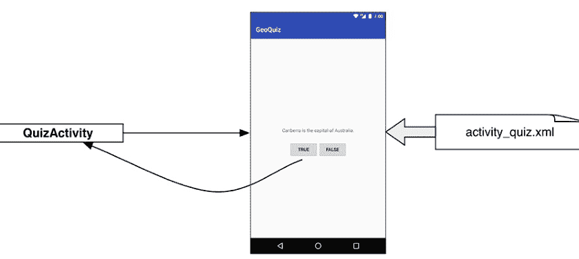

在记住这些概念的基础上，让我们开始构建应用吧。

## 创建 Android 项目

第一步是创建一个 Android 项目。Android 项目包含了组成应用程序的所有文件。要创建一个新项目，首先打开 Android Studio。

如果这是你第一次运行 Android Studio，你将看到如图 1.3 所示的欢迎对话框。

## 图 1.3 欢迎使用 Android Studio

在对话框中选择 `Start a new Android Studio project`（创建一个新的 Android Studio 项目）。如果你没有看到对话框，说明你以前创建过项目。在这种情况下，选择 `File -> New -> New Project....`

## 第一章 你的第一个 Android 应用

你应该能看到 `New Project` 项目向导（图 1.4）。在向导的第一个屏幕上，输入 `GeoQuiz` 作为应用程序名称。对于公司域名，输入 `android.bignerdranch.com`。随着你的操作，你会看到生成的包名变为了 `com.bignerdranch.android.geoquiz`。对于项目位置，你可以使用文件系统上的任何位置。

## 图 1.4 创建新应用

注意，包名使用了“反向 DNS”约定：你组织的域名被反转并加上了进一步的标识符。这种约定保持了包名的唯一性，并在设备和 Google Play 上将应用程序区分开来。

点击 `Next`（下一步）。下一个屏幕允许你指定想要支持的设备详情。GeoQuiz 只支持手机，所以只需勾选 `Phone`（手机）和 `Tablet`（平板）。选择最小 SDK 版本为 `API 19: Android 4.4`（图 1.5）。

## 图 1.5 指定设备

## 第一章 你的第一个 Android 应用

点击 `Next`。在下一个屏幕上，系统提示你选择 GeoQuiz 的模板（图 1.6）。选择最基础的 `Empty Activity` 并点击 `Next`。Android Studio 会经常更新，所以你的界面可能不同。这没问题。

## 图 1.6 选择类型

在最后的对话框中，命名 activity（图 1.7）。勾选 `Generate Layout`（生成布局）。Android Studio 将创建并打开项目。名称将反映这一点。

## 图 1.7 配置 activity

## 第一章 你的第一个 Android 应用

### 在 Android Studio 中导航

Android Studio 显示你的项目，如图 1.8 所示。不同的面板被称为工具窗口（`tool windows`）。左侧视图是项目。在这里你可以查看与项目相关的文件。主视图是编辑器。Android Studio 打开了 `QuizActivity.java`。

## 图 1.8 项目窗口

你可以通过点击屏幕左侧、右侧和底部切换各种工具窗口。选择 `View -> Tool Windows`。

### 布局 UI


打开`app/res/layout/activity_quiz.xml`。如果你看到文件的图形预览，选择底部的`Text`选项卡来查看源代码。目前，`activity_quiz.xml`定义了默认布局。`XML`将如列表 1.1 所示。

## 列表 1.1 默认布局 (`activity_quiz.xml`)


```xml
<RelativeLayout
    xmlns:android="http://schemas.android.com/apk/res/android"
    xmlns:tools="http://schemas.android.com/tools"
    android:id="@+id/activity_quiz"
    android:layout_width="match_parent"
    android:layout_height="match_parent"
    android:paddingBottom="16dp"
    android:paddingLeft="16dp"
    android:paddingRight="16dp"
    android:paddingTop="16dp"
    tools:context="com.bignerdranch.android.geoquiz.QuizActivity">

    <TextView
        android:layout_width="wrap_content"
        android:layout_height="wrap_content"
        android:text="Hello World!"/>
</RelativeLayout>
```

默认布局定义了两个组件：`RelativeLayout` 和 `TextView`。

组件是你用于组合 UI 的构建块。组件可以显示文本或图形、与用户交互，或者在屏幕上排列其他组件。按钮、文本输入控件和复选框都是组件类型。

`Android SDK` 包含了许多组件，你可以对其配置以获得所需的外观和行为。每个组件都是 `View` 类或子类（如 `TextView` 或 `Button`）的实例。

## 第一章 你的 Android 应用

图 1.9 显示了列表 1.1 中定义的 `RelativeLayout` 和 `TextView` 在屏幕上的显示方式。

图 1.9 屏幕上的默认组件

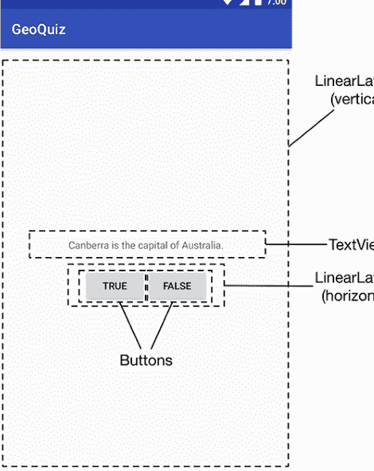

但这些并不是你需要的组件。`QuizActivity` 的界面需要五个组件：

- 一个垂直的 `LinearLayout`
- 一个 `TextView`
- 一个水平的 `LinearLayout`
- 两个 `Button`

图 1.10 显示了这些组件是如何组成 `QuizActivity` 界面的。

图 1.10 屏幕上显示的规划组件


现在，你需要在`activity_quiz.xml`中定义这些组件。

在项目工具窗口中，找到`app/res/layout`目录，展开其内容并打开`activity_quiz.xml`。按照列表 1.2 所示进行更改。你需要删除的 XML 被画划了删除线，而你需要添加的 XML 使用了**粗体**字体。这是我们在整本书中将使用的模式。

## 第 1 章 你的第一个 Android 应用程序

不要担心理解你正在输入的内容；接下来你将学习它是如何工作的。不过，你会非常小心。XML 不会经过验证，拼写错误迟早会引起问题。

你会在以`android:`开头的三行上看到错误；现在先忽略这些错误；你很快就会修复它们。

## 列表 1.2 在 XML 中定义组件 (activity_quiz.xml)

```xml
<RelativeLayout
    android:id="@id/activity_quiz"
    xmlns:android="http://schemas.android.com/apk/res/android"
    xmlns:tools="http://schemas.android.com/tools"
    android:layout_width="match_parent"
    android:layout_height="wrap_content"
    android:paddingBottom="dimen"
    android:paddingLeft="dimen"
    android:paddingRight="dimen"
    android:paddingTop="dimen"
    tools:context="com.android.gequiz.QuizActivity">

    <TextView
        android:layout_width="wrap_content"
        android:layout_height="wrap_content"
        android:text="Hello World!" />
</RelativeLayout>

<LinearLayout xmlns:android="http://schemas.android.com/apk/res/android"
    android:layout_width="match_parent"
    android:layout_height="match_parent"
    android:gravity="center"
    android:orientation="vertical">

    <TextView
        android:layout_width="wrap_content"
        android:layout_height="wrap_content"
        android:padding="24dp"
        android:text="@string/question_text" />

    <LinearLayout
        android:layout_width="wrap_content"
        android:layout_height="wrap_content"
        android:orientation="horizontal">

        <Button
            android:layout_width="wrap_content"
            android:layout_height="wrap_content"
            android:text="@string/true_button" />

        <Button
            android:layout_width="wrap_content"
            android:layout_height="wrap_content"
            android:text="@string/false_button" />
    </LinearLayout>
</LinearLayout>
```

将你的 XML 与图 1.10 显示的 UI 进行比较。每个组件都有对应的 XML 元素，而元素的名称就是组件的类型。

每个元素都有一组 XML 属性。每个属性都是关于如何配置组件的指令。

为了理解元素和属性是如何运作的，从层次化的角度来看布局会有帮助。

### 视图层次结构

你的组件存在于一个被称为视图层次结构的 View 对象层次中。图 1.11 显示了与列表 1.2 中的 XML 对应的视图层次结构。

图 1.11 组件和属性的层次化布局

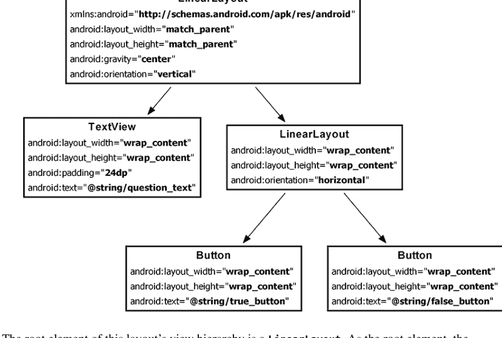

此布局层次结构的根元素是`LinearLayout`。作为根元素，`LinearLayout` 必须指定`http://schemas.android.com/apk/res/android`。

## 第 1 章 你的第一个 Android 应用程序

### 视图属性

你的组件存在于一个由 View 对象的层次结构中，被称为视图层次结构。图 1.11 显示了与列表 1.2 中的 XML 对应的视图层次结构。

图 1.11 组件和属性的层次化布局


此布局层次结构的根元素是`LinearLayout`。作为根元素，`LinearLayout` 必须指定`http://schemas.android.com/apk/res/android`。

图 1.10 显示了这些组件是如何组成 `QuizActivity` 界面的。

图 1.10 屏幕上显示的规划组件


现在，你需要在`activity_quiz.xml`中定义这些组件。

在项目工具窗口中，找到`app/res/layout`目录，展开其内容并打开`activity_quiz.xml`。按照列表 1.2 所示进行更改。你需要删除的 XML 被画划了删除线，而你需要添加的 XML 使用了**粗体**字体。这是我们在整本书中将使用的模式。

## 第 1 章 你的第一个 Android 应用程序

不要担心理解你正在输入的内容；接下来你将学习它是如何工作的。不过，你会非常小心。XML 不会经过验证，拼写错误迟早会引起问题。

你会在以`android:`开头的三行上看到错误；现在先忽略这些错误；你很快就会修复它们。


<RelativeLayout
    android:id="@id/activity_quiz"
    xmlns:android="http://schemas.android.com/apk/res/android"
    xmlns:tools="http://schemas.android.com/tools"
    android:layout_width="match_parent"
    android:layout_height="wrap_content"
    android:paddingBottom="dimen"
    android:paddingLeft="dimen"
    android:paddingRight="dimen"
    android:paddingTop="dimen"
    tools:context="com.android.gequiz.QuizActivity">

    <TextView
        android:layout_width="wrap_content"
        android:layout_height="wrap_content"
        android:text="Hello World!" />
</RelativeLayout>

<LinearLayout xmlns:android="http://schemas.android.com/apk/res/android"
    android:layout_width="match_parent"
    android:layout_height="match_parent"
    android:gravity="center"
    android:orientation="vertical">

    <TextView
        android:layout_width="wrap_content"
        android:layout_height="wrap_content"
        android:padding="24dp"
        android:text="@string/question_text" />

    <LinearLayout
        android:layout_width="wrap_content"
        android:layout_height="wrap_content"
        android:orientation="horizontal">

        <Button
            android:layout_width="wrap_content"
            android:layout_height="wrap_content"
            android:text="@string/true_button" />

        <Button
            android:layout_width="wrap_content"
            android:layout_height="wrap_content"
            android:text="@string/false_button" />
    </LinearLayout>
</LinearLayout>

将你的 XML 与图 1.10 显示的 UI 进行比较。每个组件都有对应的 XML 元素，而元素的名称就是组件的类型。

每个元素都有一组 XML 属性。每个属性都是关于如何配置组件的指令。

为了理解元素和属性是如何运作的，从层次化的角度来看布局会有帮助。

### 视图层次结构

你的组件存在于一个由 `View` 对象的层次结构中，被称为视图层次结构。图 1.11 显示了与列表 1.2 中的 XML 对应的视图层次结构。

图 1.11 组件和属性的层次化布局


此布局层次结构的根元素是`LinearLayout`。作为根元素，`LinearLayout` 必须指定 `http://schemas.android.com/apk/res/android`。

（注：原文后续存在大量重复的段落，已根据“不要重复输出原文”的原则进行去重，保留核心翻译内容）

### 从 XML 布局到 View 对象

`activity_quiz.xml` 中的 XML 元素是如何变成 `View` 对象的？答案在 `QuizActivity` 类中。

当你创建 GeoQuiz 项目时，系统为你创建了一个名为 `QuizActivity` 的 `Activity` 子类。`QuizActivity` 类位于项目中的 `app/java` 目录。`java` 目录是存放项目 Java 代码的地方。

在项目工具窗口中，展开 `app/java` 目录的内容以及 `com.bignerdranch.android.geoquiz` 程序包的内容。打开 `QuizActivity.java` 文件并查看其内容。

## 列表 1.4 QuizActivity 的默认类 (QuizActivity.java)

```java
package android.support.v7.app.AppCompatActivity;

import android.os.Bundle;

public class QuizActivity extends AppCompatActivity {

    @Override
    protected void onCreate(Bundle savedInstanceState) {
        super.onCreate(savedInstanceState);
        setContentView(R.layout.activity_quiz);
    }
}
```

（想知道 `AppCompatActivity` 是什么吗？它是 Android `Activity` 类的子类，为旧版本的 Android 提供兼容支持。你将在第 13 章学习更多关于 `AppCompatActivity` 的知识。）

如果你没有看到所有的导入语句，点击第一个导入语句左侧的符号以显示其他。

此文件有一个方法：`onCreate(Bundle)`。

（如果你的文件有 `onCreateOptionsMenu(Menu)` 和 `onItemItemSelected(MenuItem)` 方法，请暂时忽略它们。你将在第 13 章查看详情。）

当 activity 子类的实例被创建时，会调用 `onCreate(Bundle)` 方法。当 activity 创建时，它需要一个 UI 来管理。要获取 activity 的 UI，你需要调用以下方法：

```java
public void setContentView(int layoutRes)
```

此方法会加载布局并将其显示在屏幕上。当布局被加载时，布局文件中的每个控件（widget）都会根据其属性实例化。你通过传递布局的资源 ID 来指定要加载哪个布局。

## 第 1 章 你的 Android 应用程序

## 资源和资源 ID

布局是一种资源。资源（Resource）是应用程序中不是代码——例如图像文件、音频文件和 XML 文件。

项目的资源位于 `app/res` 目录的子目录中。在项目工具窗口中，你可以看到 `activity_quiz.xml` 位于 `res/layout/`。包含字符串资源的 `strings` 文件位于 `res/values`。

要在代码中访问资源，请使用其资源 ID。你布局的资源 ID 是 `R.layout.activity_quiz`。

要查看 GeoQuiz 的资源 ID，你必须先更改项目视图。默认情况下，Android Studio 使用 Android 项目视图（图 1.13）。此视图隐藏了 Android 项目真实的目录结构，以便你能够专注于你最需要的文件和文件夹。

## 图 1.13 更改项目视图

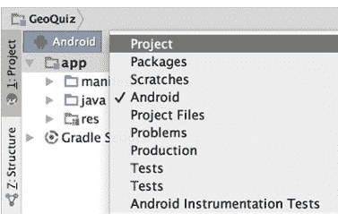

找到项目工具窗口顶部的下拉菜单，并从 Android 视图更改到 Project 视图。Project 视图将以真实面显示你项目中的文件和文件夹。

要查看 GeoQuiz 的资源，展开 `app/build/generated/source/r/debug` 目录的内容。在该目录中，找到你的项目包名，并打开该包内的 `R.java`。由于此文件是由 Android 构建过程生成的，你不应该修改它，文件顶部已对你进行了微妙的警告。

在修改资源后，你可能不会立即看到文件更新。Android Studio 维护一个隐藏的 `R.java`，你的代码对其进行构建。列表 1.5 中的 `R.java` 文件是在你的应用安装到设备或模拟器之前刚刚生成的。当你运行应用时，你会看到此文件更新。

## 列表 1.5 当前 GeoQuiz 资源 ID (R.java)

```java
/* AUTO-GENERATED FILE. DO NOT MODIFY.
 *
 * 此类是由 aapt 工具根据其发现的资源数据
 * 自动生成的。它
 * 不应手动修改。
 */
package com.bignerdranch.android.geoipquiz;

public final class R {
    public static final class anim {
        ...
    }
    public static final class id {
        ...
    }
    public static final class layout {
        public static final int activity_quiz=0x7f030017;
    }
    public static final class mipmap {
        public static final int ic_launcher=0x7f030000;
    }
    public static final class string {
        public static final int app_name=0x7f0a0010;
        public static final int false_button=0x7f0a0012;
        public static final int question_text=0x7f0a0014;
        public static final int true_button=0x7f0a0015;
    }
}
```

`R.java` 文件可能很大，列表 1.5 中省略了大部分内容。

这就是 `R.layout.activity_quiz` 的来源——它是 `R` 布局内部类中一个名为 `activity_quiz` 的整数常量。

你的字符串也有资源 ID。你还没有引用过它们。如果你引用了，它看起来会像这样：

```java
setTitle(R.string.app_name);
```

（注：提供的 OCR 文本似乎包含重复内容，已根据逻辑进行去重。）

`onCreate(Bundle)` 方法在 activity 子类的实例被创建时被调用。当 activity 创建时，它需要一个 UI 来管理。要获取 activity 的 UI，你需要调用以下方法：

```java
public void setContentView(int layoutRes)
```

此方法会加载布局并将其显示在屏幕上。当布局被加载时，布局文件中的每个控件（widget）都会根据其属性实例化。你通过传递布局的资源 ID 来指定要加载哪个布局。

### 连接控件

现在按钮有了资源 ID，你可以在 `QuizActivity` 中访问它们。第一步是添加两个成员变量。

将以下代码输入 `QuizActivity.java`（不要使用代码补全；手动输入）。保存文件后，它将报告两个错误。

## 列表 1.7 添加成员变量 (QuizActivity.java)

```java
public class QuizActivity extends AppCompatActivity {
    private Button mTrueButton;
    private Button mFalseButton;

    @Override
    protected void onCreate(Bundle savedInstanceState) {
        super.onCreate(savedInstanceState);
        setContentView(R.layout.activity_quiz);
    }
}
```

你很快就会修复这些错误。注意成员（实例）变量名称上的 `m` 前缀。这是我们在整书中将遵循的 Android 命名规范。

现在将鼠标悬停在红色错误指示上。它们报告相同的问题：无法解析符号 'Button'。这些错误提示你需要将 `android.widget.Button` 类导入到 `QuizActivity.java`。你可以在文件顶部输入以下导入语句：

```java
import android.widget.Button;
```

或者你让 Android Studio 为你完成？只需按 `Option+Return`（或 `Alt+Enter`），让 IntelliJ 内部的魔法惊艳到你。新的导入语句现在和其他语句一起出现在文件顶部。

这应该消除错误。（如果你还有错误，请检查代码和 XML 中的拼写错误）。现在你可以连接你的按钮控件了。这是一个两步骤的过程：

- 获取加载的 `View` 对象的引用
- 在这些对象上设置监听器以响应用户操作

（注：提供的 OCR 文本在第 43-44 页中间包含一些重复/损坏片段，已经根据提供的可见内容清理了逻辑流。）

## 列表 1.6 为按钮添加 ID (activity_quiz.xml)

```xml
<LinearLayout ...
    android:layout_width="wrap_content"
    android:layout_height="wrap_content"
    android:orientation="horizontal"
    android:padding="24dp">

    <TextView
        android:layout_width="wrap_content"
        android:layout_height="wrap_content"
        android:text="@string/question_text" />

    <Button
        android:id="@+id/true_button"
        android:layout_width="wrap_content"
        android:layout_height="wrap_content"
        android:text="@string/true_button" />

    <Button
        android:id="@+id/false_button"
        android:layout_width="wrap_content"
        android:layout_height="wrap_content"
        android:text="@string/false_button" />
</LinearLayout>
```


```xml
</LinearLayout>
```

## 获取组件的引用

在 Activity 中，你可以通过调用以下 Activity 方法来获取已布局组件的引用：

```java
public View findViewById(int id)
```

该方法接受组件的资源 ID 并返回一个 View 对象。

在 `QuizActivity.java` 中，使用按钮的资源 ID 来获取布局后的对象，并将它们赋值给成员变量。注意，在赋值之前，你必须将返回的 View 强制转换为 Button。

### 列表 1.8 获取组件的引用（QuizActivity.java）

```java
public class QuizActivity extends AppCompatActivity {

    private Button mTrueButton;

    private Button mFalseButton;

    @Override
    protected void onCreate(Bundle savedInstanceState) {
        super.onCreate(savedInstanceState);

        setContentView(R.layout.activity_quiz);

        mTrueButton = (Button) findViewById(R.id.true_button);

        mFalseButton = (Button) findViewById(R.id.false_button);
    }
}
```

### 设置监听器

Android 应用通常是事件驱动的。与命令行程序或脚本不同，事件驱动应用会启动并等待事件发生，例如用户按下按钮。（事件也可以由操作系统或另一个应用程序触发，但用户触发的事件是最明显的）。

当你的应用程序正在等待特定事件时，我们说它正在“监听”该事件。你创建的用于响应事件的对象被称为“监听器”（listener），而该监听器实现了针对该事件的“监听器接口”（listener interface）。

Android SDK 自带了各种事件的监听器接口，因此你不需要自己编写。你想要监听的事件是按钮被按下（或“点击”），因此你的监听器将实现 `OnClickListener` 接口。

从按钮开始。在 `QuizActivity` 中，在变量赋值后的 `onCreate(Bundle)` 中添加以下代码。

### 列表 1.9 为 TRUE 按钮设置监听器（QuizActivity.java）

```java
@Override
protected void onCreate(Bundle savedInstanceState) {
    super.onCreate(savedInstanceState);

    setContentView(R.layout.activity_quiz);

    mButton = (Button) findViewById(R.id.true_button);

    mButton.setOnClickListener(new OnClickListener() {
        @Override
        public void onClick(View v) {
            // 还没有做什么，但很快就会了！
        }
    });

    mFalse = (Button) findViewById(R.id.false_button);
}
```

如果你有一个无法解析为类型错误的 View，请尝试使用 Option+Return（Alt+Enter）来导入 `View` 类。

在列表 1.9 中，你设置了一个监听器，以便在名为 `mButton` 的 `Button` 被按下时通知你。`setOnClickListener(OnClickListener)` 方法接受一个监听器作为参数。具体来说，它接受一个实现了 `OnClickListener` 的对象。

## 使用匿名内部类

此监听器是以匿名内部类的形式实现的。语法有点复杂，但只要记住最外层括号内的所有内容都会被传递给 `OnClickListener(OnClickListener)`。在这些括号内，你创建了一个新的无名类并传递了它的实现。

```java
mButton.setOnClickListener(new View.OnClickListener() {
    @Override
    public void onClick(View v) {
        // 还没有做什么，但很快就会了！
    }
});
```

书中的所有监听器都将以匿名内部类的形式实现。这样做可以将监听器方法的实现直接放在你想要看到的地方。而且由于该类只会被使用一次，所以不需要为了具名类而产生额外开销。

由于你的匿名类实现了 `OnClickListener`，它必须实现该接口的唯一方法 `onClick(View)`。你目前留空了 `onClick(View)` 的实现，编译器是可以接受的。监听器接口要求你实现 `onClick(View)`，但它对你如何实现它没有规定。

（如果你对匿名内部类、监听器或接口的知识比较生疏，可能可能在继续之前复习一些 Java，或者至少在旁边保留参考资料）

为 FALSE 按钮设置监听器。

### 列表 1.10 为 FALSE 按钮设置监听器（QuizActivity.java）

```java
mButton.setOnClickListener(new View.OnClickListener() {
    @Override
    public void onClick(View v) {
        // 还没有做什么，但很快就会了！
    }
}

mFalseButton = (Button) findViewById(R.id.false_button);

mFalseButton.setOnClickListener(new View.OnClickListener()) {
    @Override
    public void onClick(View v) {
        // 还没有做什么，但很快就会了！
    }
}
```

## 创建 Toast（吐司）

现在我们要制作 Toast 了。Toast 是一种通知用户某些信息的消息。你将创建一个 Toast 来宣布用户的回答是正确还是错误。Toast 是一种不需要任何操作的消息（如图 .14 一个 toast 所示）。

首先，返回 `strings.xml` 并添加用于 Toast 显示的字符串。

### 列表 1.11 添加 toast（strings.xml）

```xml
<resources>
  <string name="app_name">Quiz</string>
  <string name="question_text">Canberra is the capital of Australia.</string>
  <string name="true_button">True</string>
  <string name="false_button">False</string>
  <string name="correct_toast">Correct!</string>
  <string name="incorrect_toast">Incorrect!</string>
</resources>
```

要创建一个 toast，你从 `Toast` 类中调用以下方法：

```java
public static Toast makeText(Context context, int resId, int duration)
```

`Context` 参数通常是 Activity 的实例（Activity 是 Context 的子类）。`resId` 参数是 toast 要显示的字符串资源 ID。`duration` 参数是指定 toast 显示时间的常量之一。创建 toast 后，调用 `Toast.show()` 将其显示在屏幕上。在 `QuizActivity` 中，你将在每个按钮的监听器中调用 `makeText()`。

## 使用代码补全

代码补全可以节省大量时间，因此尽早熟悉它是好的。开始输入列表 1.12 所示的代码。当你输入 `Toast` 类后的点号时，会弹出一个窗口，列出 Toast 类的建议方法和常量。

要选择其中一个建议，请使用上下方向键进行选择。（如果你想无忽略代码补全，只需继续输入。如果不按下 Tab 键、Return 键或点击弹出窗口，它就不会为你完成任何操作）。从建议列表中选择 `makeText(Context context, int resId, int duration)`。代码补全将为你完成方法调用。

### 列表 1.12 制作 toasts（QuizActivity.java）

```java
trueButton.setOnClickListener(new View.OnClickListener() {
  @Override
  public void onClick(View v) {
    Toast.makeText(QuizActivity.this,
      R.string.correct_toast,
      Toast.LENGTH_SHORT).show();

      // 还没有做什么，但很快就会了！
  }
};

mFalseButton = (Button) findViewById(R.id.false_button);

malseButton.setOnClickListener(new View.OnClickListener() {
  @Override
  public void onClick(View v) {
    Toast.makeText(QuizActivity.this,
      R.string.incorrect_toast,
      Toast.LENGTH_SHORT).show();

      // 还没有做什么，但很快就会了！
  }
});
```

在 `makeText(...)` 中，你将 `QuizActivity` 的实例作为 `Context` 参数。然而，你不能像你认为的那样简单地传递变量。在代码此处，你正在定义匿名类，这里的这指的是 `View.OnClickListener`。

由于你使用了代码补全，不需要执行任何操作来导入 `Toast` 类。当你接受代码建议时，必要的类会自动导入。

现在，让我们看看你的新应用运行情况吧。

### 在模拟器上运行

要运行 Android 应用程序，你需要一个设备——硬件设备或虚拟设备。虚拟设备由 Android 模拟器驱动，该模拟器随开发者工具一同发布。

要创建 Android 虚拟设备（AVD），选择 Tools（工具） -> Android -> AVD Manager。当 AVD Manager 出现时，点击窗口左下角的 `+Create Virtual Device...`（创建虚拟设备）按钮。

在对话框中，有许多配置虚拟设备的选项。对于你的第一个 AVD，请选择模拟 Nexus 5X，如图 1.15 所示。点击 Next（下一步）。

### 图 1.15 选择虚拟设备

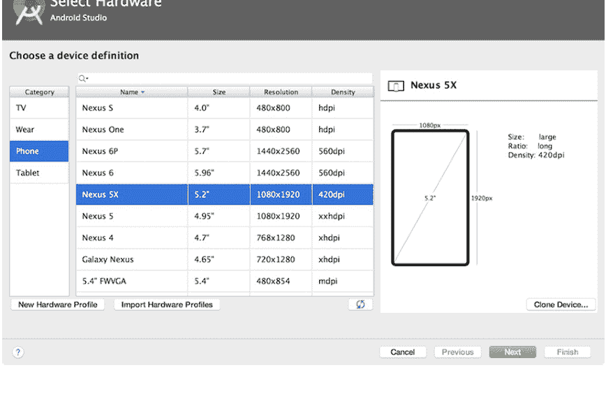

在下一个屏幕，选择模拟器基于的系统镜像。对于此模拟器，选择 x86 Nougat 模拟器并点击 Next（图 1.16）。（你可能需要按照步骤下载模拟器组件后才能点击 Next。）

### 图 1.16 选择系统镜像

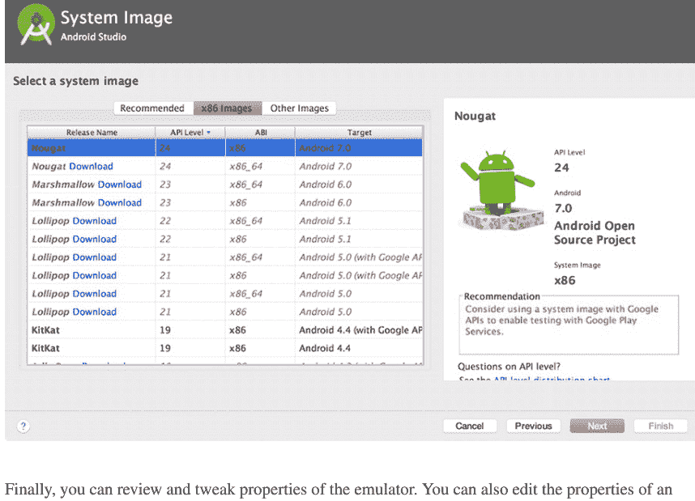

最后，你可以检查并调整模拟器的属性。你也可以编辑现有模拟器的属性。现在，为你的模拟器命名以便以后识别，并点击 Finish（完成）（图 1.17）。

### 图 1.17 更新模拟器属性

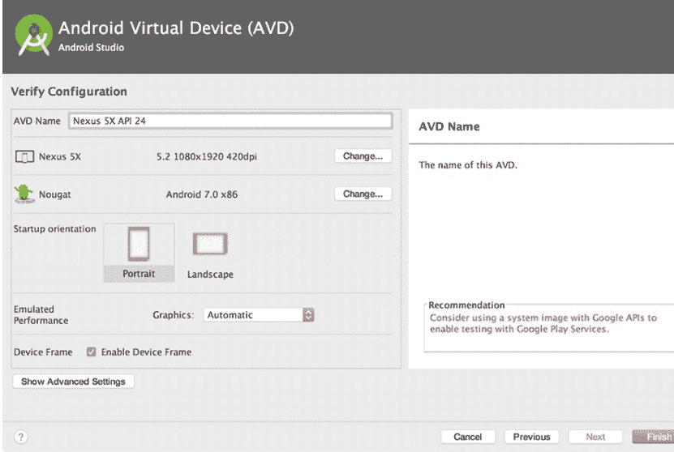

一旦有了 AVD，你就可以在其运行 GeoQuiz。从 Android Studio 工具栏，点击运行按钮（看起来像一个“播放”符号）或按下 Control+R。Android Studio 将找到你创建的虚拟设备，启动它，在上面安装应用程序包并运行。

启动模拟器可能需要一些时间，但 GeoQuiz 最终会在你创建的 AVD 上启动。点击按钮并欣赏你的 Toast 提示信息。

如果 GeoQuiz 在启动或你点击按钮时崩溃，有用信息将出现在 Android DDMS 工具的 Logcat 视图中。（如果运行 GeoQuiz 时 Logcat 没有自动打开，你可以点击 Android 底部的 Android Monitor 打开它）。查找日志中的异常；它们将是显眼的红色，如图 1.18 所示。

### 图 1.18 第 21 行 NullPointerException 示例

文本：

```text
at dalvik.system.NativeStart.main(Native Method)

Caused by: java.lang.NullPointerException

at com.bignerdranch.android.geoquiz.QuizActivity.onCreate(QuizActivity.java:21)

at android.app.Activity.performCreate(Activity.java:5008)

at android.app.Instrumentation.callActivityOnCreate(Instrumentation.java:1079)
```

将你的代码与书中的 Logcat 进行对比以找到问题原因。尝试重新运行。（你将在接两个章节学习更多关于 Logcat 和调试的知识。）

保持模拟器运行——你不希望每次运行时都等待它启动。

你可以通过按下模拟器上的 Back（返回）键来停止应用程序。返回键形状像向左的三角形（在旧版本的 Android 中，它看起来像一个正在 U 字道的箭头）。然后从 Android Studio 重新运行程序以测试更改。

模拟器很有用，但在真实设备上测试会获得更准确的结果。在第 2 章中，你将在硬件设备上运行 GeoQuiz。你还将为 GeoQuiz 提供更多地理问题来供用户测试。

## 深入好奇者：Android 构建过程

到此时，你可能对 Android 构建过程如何运作有一些迫切的问题。你已经看到 Android Studio 在你修改项目时进行构建，而不是通过命令。在构建过程中，Android 工具获取你的资源、代码和 `AndroidManifest.xml` 文件（包含应用程序的元数据），并将它们转换为 `.apk` 文件。然后它会使用调试密钥对其进行签名，以便在模拟器上运行。（要向大众分发 `.apk`，你必须使用发布密钥对其签名。有关此过程的更多信息请参阅 Android 开发者文档 `developer.android.com/tools/publishing/preparing.html`。）

`activity.xml` 内容是如何转换为应用程序中的 View 对象的？作为构建过程的一部分，`aapt`（Android 资源打包工具）将布局资源编译为更紧凑的格式。编译后的资源被封装在 `.apk` 文件中。然后，当在 `QuizActivity` 的 `onCreate(Bundle)` 方法中调用 `setContentView` 时，`QuizActivity` 使用 `LayoutInflater` 实例化布局文件中定义的每个 View 对象（图 1.19）。

### 图 1.19 实例化 activity_quiz.xml

```text
setContentView(R.layout.activity_quiz)

<LinearLayout ...> -> ClassLoader.loadClass("LinearLayout") -> LinearLayout

<TextView ... /> -> ClassLoader.loadClass("TextView") -> TextView

<LinearLayout ...> -> ClassLoader.loadClass("LinearLayout") -> LinearLayout

<Button ... /> -> ClassLoader.loadClass("Button") -> Button

<Button ... /> -> ClassLoader.loadClass("Button") -> Button
```


## 第 2 章 Android 与模型-视图-控制器

在本章中，你将升级 GeoQuiz 以能够显示多个问题，如图 2.1 所示。

图 2.1 下一个！

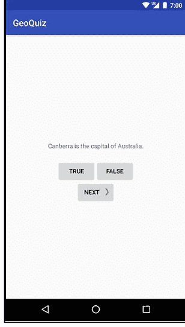

为了实现这一目标，你将为 GeoQuiz 项目添加一个名为 `Question` 的类。该类的实例将封装单个真判断题。

然后，你将创建一个 `Question` 对象数组，供 `QuizActivity` 管理。

### 创建新类

在项目工具窗口中，右键点击 `com.bignerdranch.android.geoquiz` 包，选择 New（新建）→ Java Class（Java 类）。将类命名为 `Question` 并点击 OK（图 2.2）。

图 2.2 创建 Question 类

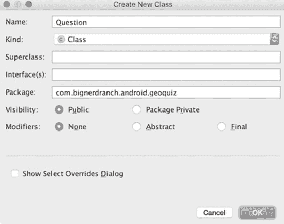

在 `Question.java` 中，添加两个成员变量和一个构造函数。

#### 列表 2.1 添加到 Question 类 (Question.java)

```java
public class Question {

    private int mTextId;

    private boolean mAnswerTrue;

    public Question(int textResId, boolean answerTrue) {

        mTextId = textResId;

        mAnswerTrue = answerTrue;

    }

}
```

该类持有两个数据项：问题文本和问题答案（真或否）。

为什么 `mTextId` 是 `int` 而不是 `String`？`mTextId` 变量将持有问题字符串资源的资源 ID（始终为 `int`）。你将在稍后的章节中创建问题字符串资源。

这些变量需要 getter（get）和 setter（set）方法。与其手动输入，你可以让 Android Studio 为你生成实现代码。

### 生成 getters 和 setters

第一步是配置 Android Studio 以识别成员变量的 `m` 前缀。

打开 Android Studio 的偏选项（Mac 上通过 Android Studio 菜单，Windows 上通过 File -> Settings）。展开 Editor（编辑器），然后展开 Code Style（代码样式）。选择 Java，然后选择 Code Generation（代码生成）表格。

在 Naming（命名）表格中，选择 Field（字段）行，并将 `m` 添加字段的名称缀（图 2.3）。然后添加 `s` 作为静态字段的名称缀（在 GeoQuiz 项目中不会使用 `s` 前缀，但在后续项目中它会很有用）。

### 图 2.3 设置 Java 代码样式偏好

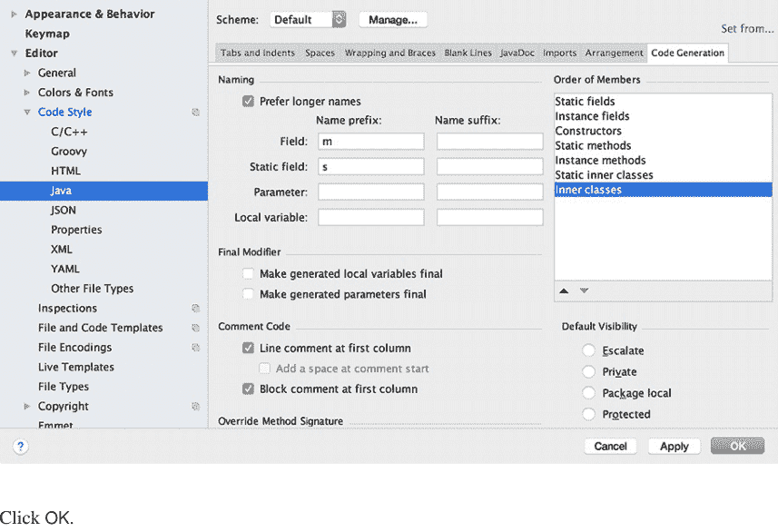

点击 OK。

设置这些前缀的目的是什么？现在，当你要求 Android Studio 为 `mResId` 生成 getter 时，它会创建 `getTextResId()` 而不是 `getResId()`，并创建 `isAnswerTrue()` 而不是 `isAnswerTrue()`。

回到 `Question.java`，在构造函数后右键点击并选择 Generate...（生成），然后选择 Getter and Setter。选择 `mTextResId` 和 `mAnswerTrue` 并点击 OK，为每个变量生成 getter 和 setter。结果如列表 2.2 所示。

#### 列表 2.2 生成的 getters 和 setters (Question.java)

```java
public class Question {

    private int mTextResId;

    private boolean mAnswerTrue;

    ...

    public int getTextResId() {

        return mTextResId;

    }

    public void setTextResId(int textResId) {

        mTextResId = textResId;

    }

    public boolean isAnswerTrue() {

        return mAnswerTrue;

    }

    public void setAnswerTrue(boolean answerTrue) {

        mAnswerTrue = answerTrue;

    }

}
```

你的类现在完成了。稍后，你将修改 `QuizActivity` 以配合 `Question`。首先，让我们看看 GeoQuiz 的各个部分是如何协同工作的。

你将让 `QuizActivity` 创建一个 `Question` 对象数组。它将与 `TextView` 和三个 `Button` 交互，以显示问题并提供反馈。图 2.4 绘制了这些关系。

### 图 2.4 GeoQuiz 的对象图

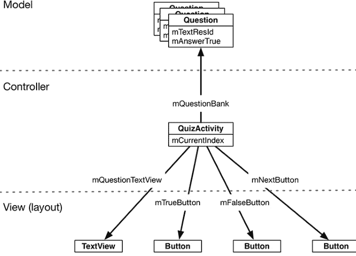

### 模型-视图-控制器与 Android

注意图 2.4 中的对象被分为 Model（模型）、Controller（控制器）和 View（视图）三个部分。Android 应用是基于称为 Model-View-Controller（或 MVC）的架构设计的。在 MVC 中，你应用程序中的所有对象必须是模型对象、视图对象或控制器对象。

- **模型对象**持有应用程序的数据和“业务逻辑”。模型类通常设计用于建模你的应用关注的事物，例如用户、商店中的商品、服务器上的照片、电视节目——或一个真判断题。模型对象对 UI 一无所知；它们的唯一目的是持有和管理数据。

在 Android 应用程序中，模型类通常是你创建的自定义类。你应用程序中的所有模型对象共同构成了模型层。

GeoQuiz 的模型层由 `Question` 类组成。

- **视图对象**知道如何在屏幕上绘制自己并响应用户输入。一个简单的经验法是：如果你能在屏幕上看到它，那么它就是视图。在 Android 应用中，视图对象通常是从 XML 填充（inflated）的。GeoQuiz 的视图层由 `activity_quiz.xml` 中的控件组成。

- **控制器对象**将视图和模型连接在一起。它们包含“应用程序逻辑”。在 Android 中，控制器通常是 Activity、Fragment 或 Service 的子类（你将在第 7 章学习 Fragment，第 8 章学习 Service）。GeoQuiz 的控制器层目前由 `QuizActivity` 组成。

图 2.5 显示了响应用户事件的对象控制流。注意模型和视图对象并不直接通信；控制器位于中间，接收某些对象的消息并向其他对象发送指令。

### 图 2.5 带有用户输入的 MVC 流

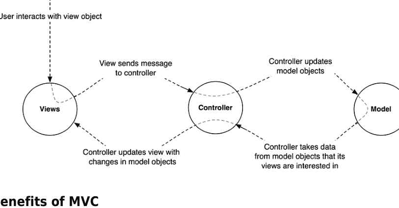

### MVC 的好处

应用程序会不断积累功能直到变得难以理解。将代码分离成类有助于你设计和理解整个应用程序。同样，将类分为模型、视图和控制器层有助于你分层进行思考。

尽管 GeoQuiz 不是一个复杂的应用，但你仍然可以看到类分离的好处。稍后，你将去更新 GeoQuiz 的视图层以包含一个“下一个”按钮。当你这样做时，不需要记住关于你创建的 `Question` 的任何细节。

MVC 也让类更容易复用。职责单一的类比触及每个部分的类更具复用性。例如，你的模型类 `Question` 对用于显示真判断题的控件真空。这使得在整个应用中使用 `Question` 变得容易。例如，如果你想一次性显示所有问题的列表，可以使用这里显示单个问题的同一个对象。

### 更新视图层

现在你已经接触了 MVC，你将更新 GeoQuiz 的视图层以包含一个“下一个”按钮。

在 Android 中，视图层中的对象通常是从布局文件中的 XML 填充的。GeoQuiz 的唯一布局定义在 `activity_quiz.xml` 中。该布局需要按照图 2.6 所示进行更新（注意为了节省空间，我们没有显示未更改控件的属性）。

### 图 2.6 新按钮！

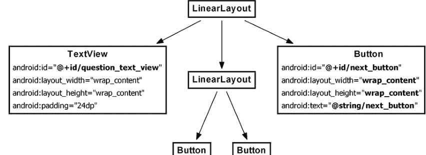

因此，你需要对视图层进行的更改：

- 从 `TextView` 中移除 `android:text` 属性。你不再希望将硬编码的问题作为其定义的一部分。
- 给 `TextView` 添加 `android:id` 属性。该控件需要一个资源 ID，以便你在 `MainActivity` 的代码中设置其文本。
- 将新的 `Button` 控件作为根 `LinearLayout` 的子元素。

返回 `activity_quiz.xml` 并实现它。

### 列表 2.3 新按钮……以及文本视图的更改 (activity_quiz.xml)

```xml
<LinearLayout ... >

    <TextView

        android:id="@id/question_text_view"

        android:layout_width="wrap_content"

        android:layout_height="wrap_content"

        android:padding="24dp"

        android:text="@string/question_text" />

    ...

    <Button

        android:id="@id/next_button"

        android:layout_width="wrap_content"

        android:layout_height="wrap_content"

        android:text="@string/next_button" />

</LinearLayout>
```

你将看到一个熟悉的错误，提示缺少字符串资源。

返回 `res/values/strings.xml`。重命名 `question_text` 并为新按钮添加字符串。

### 列表 2.4 更新字符串 (strings.xml)

```xml
<string name="app_name">GeoQuiz</string>

<string name="question_text">堪培拉是澳大利亚的首都。</string>

<string name="question_australia">堪培拉是澳大利亚的首都。</string>

<string name="true_button">正确</string>

<string name="false_button">错误</string>

<string name="next_button">下一个</string>

<string name="correct_toast">正确！</string>
```

在你有 `strings.xml` 后，打开它，为将显示给用户的其余地理问题添加字符串。

### 列表 2.5 预先问题字符串 (strings.xml)

```xml
<string name="question_australia">堪培拉是澳大利亚的首都。</string>

<string name="question_ocean">太平洋比大洋大。</string>

<string name="question_mideast">苏伊士运河连接了红海和印度洋。</string>

<string name="question_africa">尼罗河源头在埃及。</string>

<string name="question_americas">亚马逊河是热带最长的河流。</string>

<string name="question_asia">贝加湖是世界上最深的淡水湖。</string>
```

注意你在最后一个值中使用了转义序列 `'\''` 来在字符串中获取单撇号。你可以在字符串资源中使用所有转义序列，例如用于换行的 `\n`。

### 更新控制器层

返回 `activity_quiz.xml` 并在图形化布局工具中预览你的布局更改。

GeoQuiz 的视图层到此为止。现在是时候在你的控制器类 `QuizActivity` 中将所有内容连接起来了。

在上一个章节中，GeoQuiz 的单一控制器 `QuizActivity` 并没有做什么操作。它显示在 `activity_quiz.xml` 中定义的布局。它在两个按钮上设置了监听器并将它们连接以显示吐司（toast）。

现在你有多个问题需要检索和显示，`QuizActivity` 将必须更努力地将 GeoQuiz 的模型和视图层连接起来。

打开 `QuizActivity.java`。为 `TextView` 和新的 `Button` 添加变量。此外，创建一个 `Question` 数组以及该数组的索引。

### 列表 2.6 添加变量和 Question 数组 (QuizActivity.java)

```java
public class QuizActivity extends AppCompatActivity {

    private Button mTrueButton;

    private Button mNextButton;

    private Button mFalseButton;

    private TextView mTextView;

    private Question[] mQuestionBank = new Question[] {

        new Question(R.string.question_australia, true),

        new Question(R.string.question_ocean, true),

        new Question(R.string.question_mideast, false),

        new Question(R.string.question_africa, false),

        new Question(R.string.question_americas, true),

        new Question(R.string.question_asia, true),

    };

    private int mCurrentIndex = 0;

    ...
```

在这里你多次调用 `Question` 构造函数并创建了一个 `Question` 对象的数组。（在更复杂的项目中，此数组将在其他地方创建并存储。在后续应用中，你将看到存储模型数据的更好选项。现在，我们保持简单，直接在你的控制器中创建数组。）

你将使用 `mQuestionBank`、`mCurrentIndex` 以及 `Question` 中的访问方法在屏幕上显示出一系列问题。

首先，获取 `TextView` 的引用，并将其文本设置为当前索引下的问题。

### 列表 2.7 连接 TextView (QuizActivity.java)

```java
public class QuizActivity extends AppCompatActivity {

    ...

    @Override

    protected void onCreate(Bundle savedInstanceState) {

        super.onCreate(savedInstanceState);

        setContentView(R.layout.activity_quiz);

        mTextView = (TextView) findViewById(R.id.question_text);

        int question = mQuestionBank[mCurrentIndex].getTextResId();

        mTextView.setText(question);

        nrB = (Button) findViewById(R.id.true_button);

    }

}
```

保存你的文件并检查错误。运行 GeoQuiz。你应该应该在 `TextView` 中看到数组中的第一个问题。

现在让我们来看看 NEXT 按钮。获取按钮的引用。然后为它设置一个 `View.OnClickListener`。此此监听器将增加索引并更新 `TextView` 的文本。

### 列表 2.8 连接按钮 (QuizActivity.java)

```java
public class QuizActivity extends AppCompatActivity {

    ...

    @Override

    protected void onCreate(Bundle savedInstanceState) {

        super.onCreate(savedInstanceState);

        ...

        mNextButton = (Button) findViewById(R.id.next_button);

        mNextButton.setOnClickListener(new View.OnClickListener() {

            @Override
```


你在两个独立的地方都有更新`TextView`的代码。将这些代码放入一个私有方法，如列表 2.9 所示。

## 列表 2.9 封装 updateQuestion() (QuizActivity.java)

```java
public class QuizActivity extends AppCompatActivity {

    ...

    @Override
    protected void onCreate(Bundle savedInstanceState) {

        ...

        updateQuestion();

    }

    private void updateQuestion() {

        int question = mQuestionBank[mCurrentIndex].getTextResId();

        mTextView.setText(question);

    }

}
```

现在你的问题运行正常，是时候处理答案了。目前，GeoQuiz 认为所有问题的答案都是“正确”。让我们纠正这一点。在这里我们将再次实现一个私有方法来封装代码，而不是在两个地方编写相似的代码。你要添加到`QuizActivity`中的方法是：

```java
private void checkAnswer(boolean userPressed)
```

此方法将接受一个布尔变量，标识用户按下 TRUE 还是 FALSE。然后，它会将用户的答案与当前的`Question`对象进行比较。最后，判断用户的回答是否正确，并向用户显示适当的 Toast。

在`QuizActivity.java`中，添加列表 2.10 所示的`checkAnswer(boolean)`实现。

## 列表 2.10 添加 checkAnswer(boolean) (QuizActivity.java)

```java
private void checkAnswer(boolean userPressed) {

    boolean answerIsTrue = mQuestionBank[mCurrentIndex].isAnswerTrue();

    int messageResId = 0;

    if (userPressed == answerIsTrue) {

        messageResId = R.string.correct_toast;

    } else {

        messageResId = R.string.incorrect_toast;

    }

    Toast.makeText(this, messageResId, Toast.LENGTH_SHORT)

        .show();

}
```

在按钮的监听器中，调用`checkAnswer(boolean)`，如列表 2.11 所示。

## 列表 2.11 调用 checkAnswer(boolean) (QuizActivity.java)

```java
public class QuizActivity extends AppCompatActivity {

    ...

    @Override
    protected void onCreate(Bundle savedInstanceState) {

        mTrueButton = (Button) findViewById(R.id.true_button);

        mTrueButton.setOnClickListener(new View.OnClickListener() {

            @Override

            public void onClick(View v) {

                Toast.makeText(QuizActivity.this, R.string.correct_toast, Toast.LENGTH_SHORT).show();

                checkAnswer(true);

            }

        });

        mFalseButton = (Button) findViewById(R.id.false_button);

        mFalseButton.setOnClickListener(new View.OnClickListener() {

            @Override

            public void onClick(View v) {

                Toast.makeText(QuizActivity.this, R.string.incorrect_toast, Toast.LENGTH_SHORT).show();

                checkAnswer(false);

            }

        });

    }

    ...

}
```

GeoQuiz 准备好再次运行了。让我们它在真实设备上运行起来。

## 第 2 章 Android 与模型-视图-控制器（MVC）

### 在设备上运行

在本节中，你将设置你的系统、设备和应用程序，以便 GeoQuiz 在你的硬件设备上运行。

### 连接设备

首先，将设备插入到你的系统。如果你在 Mac 上开发，系统应该会立即识别设备。在 Windows 上，你可能需要安装 adb（Android 调试桥接）驱动程序。如果 Windows 找不到 adb 驱动程序，请从设备制造商的网站下载。

### 为开发配置设备

要在设备上测试应用，你需要启用 USB 调试。

开发者选项默认是不可见的。要启用它，请前往 设置 -> 关于平板电脑/手机，连续点击“版本号”七次。然后你可以返回设置 -> 开发者选项，并启用 USB 调试。

不同设备的选项差异很大。如果你在启用设备时遇到问题，请访问 `developer.android.com/tools/device.html` 获取更多帮助。

你可以通过打开“设备”（Devices）视图来确认设备是否已被识别。查看设备最快的方法是选择 Android Studio 底部附近的 Android Monitor 窗口。在该窗口内，你将看到已连接设备的下拉列表（图 2.7）。你应该能看到你的 AVD 和硬件设备列表。

### 图 2.7 查看已连接的设备

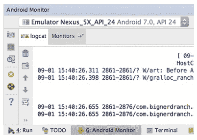

如果你在让设备被识别时遇到困难，请验证设备已开启并已启用开发者选项。

如果你仍然在设备视图中看不到你的设备，可以在 Android 开发者网站找到更多帮助。请从 `developer.android.com/tools/device.html` 开始查看。你也可以访问本书书的论坛以获得更多故障排除帮助。

像以前一样运行 GeoQuiz。Android Studio 将提供在虚拟设备上运行或在插入系统的硬件设备上运行之间的供选择。选择硬件设备并继续。GeoQuiz 将在你的设备上启动。

如果 Android Studio 默认使用你的模拟器，而没有提供运行应用的设备选择，请检查上述步骤并确保设备已插入。接下来，确保你的运行配置是正确的。要修改运行配置，选择窗口顶部附近的应用下拉列表，如图 2.8 所示。

### 图 2.8 运行配置

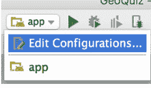

选择“编辑配置...”（Edit Configurations...），将看到一个新窗口，其中包含关于你运行配置的详情（图 2.9）。

### 图 2.9 运行配置属性

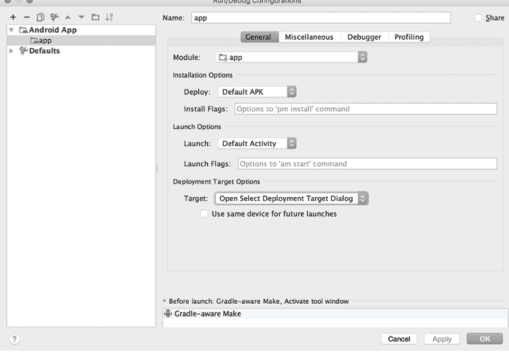

在左窗格中选择应用，并验证部署目标已设置为“打开选择目标”（Open Select Target），且未勾选“以后使用相同设备”（Use same device for future）。点击确定并重新运行应用。你现在将获得运行应用的设备选择。

### 添加图标

GeoQuiz 现在已经运行了，如果下一个 按钮也能显示右箭头图标，界面将会变得更漂亮。

你可以在本书的解决方案文件中找到箭头，该文件是本书每一章对应的 Android Studio 项目集。解决方案托管在：

`www.bignerdranch.com/solutions/AndroidProgramming3e.zip`

下载此文件并打开 `02_MVC/GeoQuiz/app/src/main/res` 目录。在该目录下，找到 `drawable-hdpi`、`drawable-mdpi`、`drawable-xhpi` 和 `drawable-xxhdpi` 目录。这些密度名称中的后缀指的是屏幕像素密度：

- `mdpi`：中密度屏幕 (~160dpi)
- `hdpi`：高密度屏幕 (~240dpi)
- `xhdpi`：超高密度屏幕 (~320dpi)
- `xxhdpi`：超极高密度屏幕 (~480dpi)

（还有其他一些密度类别，但它们未包含在解决方案中，包括 `ldpi` 和 `xxxhdpi`。）

在每个目录中，你都会发现两个文件——`arrow_left.png` 和 `arrow_right.png`。这些文件已针对密度进行了定制。

当应用运行时，Android 会为该特定设备选择最佳图像。得益于此功能，无需在不同的密度下复制图像。

从第 3 章开始，你将学习更多关于 Android 资源系统如何工作的知识。现在，让我们那个右箭头派上用场吧。

### 在 XML 中引用资源

你使用资源 ID 在代码中引用资源。但你希望配置 NEXT（下一个）按钮在布局定义中显示数组。如何在 XML 中引用资源呢？

答案：使用略有不同的语法。打开`activity_quiz.xml`并为 Button 控件定义添加两个属性。

### 列表 2.12 为 NEXT 按钮添加图标 (activity_quiz.xml)

```xml
<LinearLayout ...>

  <LinearLayout ...>

    ...

    <Button

      android:id="@id/next_button"

      android:layout_width="wrap_content"

      android:layout_height="wrap_content"

      android:text="@string/next_button"

      android:drawableRight="@drawable/arrow_right"

      android:drawablePadding="4dp" />

  </LinearLayout>

</LinearLayout>
```

在 XML 资源文件中，你通过通过资源的类型和名称来引用另一个资源。引用字符串资源以`@string/`开始。引用可绘制（drawable）资源以`@drawable/`开始。第 3 章。

你将从第 3 章开始学习命名资源以及在`res`目录结构中工作。

运行 GeoQuiz 并欣赏你按钮的新外观。测试它以确保它仍然像以前一样工作。

然而，GeoQuiz 存在一个 bug。当应用运行时，按下 NEXT 按钮显示另一个问题。旋转设备。如果你在模拟器上运行，点击悬浮工具栏上的左旋转或右旋转按钮进行旋转（图 2.13）。

### 图 2.13 控制旋转


旋转后，你会再次看到第一个问题。这是如何发生的？该如何修复它？这些问题的答案与 Activity 生命周期（activity lifecycle）有关，这是第 3 章的主题。

## 第 2 章 Android 与模型-视图-控制器

### 挑战：为 TextView 添加监听器

你的 NEXT 按钮很不错，但你也可以让用户点击 TextView 本身来查看下一个问题。

提示：你可以对 TextView 使用与你在 Buttons 中相同的`View.OnClickListener`监听器，因为`TextView`也继承自`View`。

### 挑战：添加一个上一个（Previous）按钮

添加一个按钮，用户可以点击它返回上一个问题。UI 看起来应该像图 2.14。

### 图 2.14 现在有了上一个按钮！

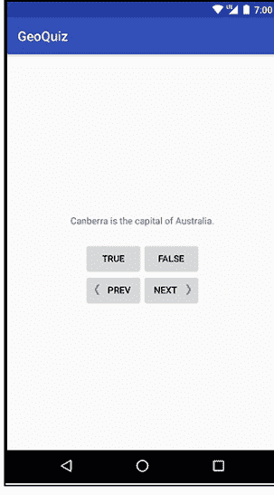

这是一个非常棒的挑战。它要求你回溯这两个章节中的中的许多步骤。

### 挑战：从 Button 到 ImageButton

如果下一个和上一个按钮只显示图标（如图 2.15 所示），UI 可能会看起来更好。

### 图 2.15 仅包含图标的按钮


为了完成这个挑战，这两个控件必须变成`ImageButton`而不是普通的`Button`。

`ImageButton`是一个继承自`ImageView`的控件。而`Button`继承自`TextView`。图 2.16 显示了它们不同的继承层次结构。

### 图 2.16 ImageButton 和 Button 的继承图

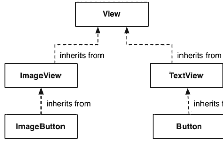

## 第 2 章 Android 与模型-视图-控制器

你可以将下一个按钮上的 text 和 drawable 属性替换为单个 ImageView 属性：

```xml
<Button

android:id="@id/next_button"

android:layout_width="wrap_content"

android:layout_height="wrap_content"

android:text="@string/next_button"

android:drawableRight="@drawable/arrow_right"

android:drawablePadding="0dp"

android:src="@drawable/arrow_right"

/>
```

当然，你将需要修改`QuizActivity`以适配`ImageButton`。

在你将这些按钮更改`ImageButton`后，Android Studio 会警告你缺少`android:contentDescription`属性。该属性支持视障障碍用户的可访问性。你将该值设置为一个字符串，当用户应用了相应的设置时，该字符串会被读出来。

为每个`ImageButton`添加`android:contentDescription`属性以完成挑战。

## 第 3 章 Activity 生命周期

如果一个应用在用户旋转设备时会重置自己，那它有什么用呢？在第 2 章结束时，你发现每当设备旋转时，地理问题都会重置为第一个问题，无论旋转之前显示的是什么问题。在本章中，你将解决令人畏的且常见的“旋转问题”。要修复它，你将学习 Activity 生命的基础知识。

每个 Activity 实例都有一个生命。在这个生命期间，activity 在四种状态之间切换：恢复（resumed）、暂停（paused）、停止（stopped）和不存在（nonexistent）。对于每次切换，都有一个 Activity 方法通知其状态的变化。图 3.1 显示了 activity 生命周期、状态和方法。

### 图 3.1 Activity 生命周期状态

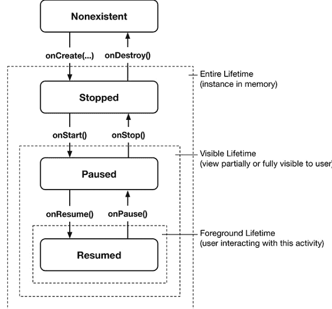

## 第 3 章 Activity 生命周期

图 3.1 表示 activity 是否在内存中、对用户可见或处于前台。表 3.1 总结了这些信息。

### 表 3.1 Activity 状态

| 在内存中？ | 对用户可见？ | 在前台？ |
| :--- | :--- | :--- |
| 不存在 | 否 | 否 |
| 停止 | 是 | 否 |
| 暂停 | 是 | 是 |
| 恢复 | 是 | 是 |

### 记录 Activity 生命周期

在本节中，你将重写生命方法来监听`QuizActivity`的生命。每个实现都会记录一条消息告知该方法已被调用。它将帮助你看到`QuizActivity`在运行时的变化。

### 创建日志消息

在 Android 中，`android.util.Log`类将日志消息发送到共享系统日志。Log 有多种方法用于记录消息。这里是书中常用的一个：

```java
public static int d(String tag, String msg)
```


`d` 代表“debug”，指的是日志消息级别。关于 Log 级别的更多信息在本章的最后部分。第一个参数标识消息来源，第二个是消息内容。

第一个字符串通常是 `TAG` 常量，其值为类名。这使得确定特定消息的来源变得容易。

打开 `QuizActivity.java` 并为 `QuizActivity` 添加 `TAG` 常量：

### Listing 3.1 为 `QuizActivity` 添加 `TAG` 常量（`QuizActivity.java`）

```java
public class QuizActivity extends AppCompatActivity {

    private static final String TAG = "QuizActivity";

    ...

}
```

接下来，在 `onCreate(Bundle)` 中调用 `Log.d(...)` 来记录消息。

### Listing 3.2 在 `onCreate(Bundle)` 中添加日志语句（`QuizActivity.java`）

```java
public class QuizActivity extends AppCompatActivity {

    @Override
    protected void onCreate(Bundle savedInstanceState) {

        super.onCreate(savedInstanceState);

        Log.d(TAG, "onCreate called");

        setContentView(R.layout.activity_quiz);

        ...

    }

}
```

在 `onCreate(Bundle)` 之后添加以下内容，在 `QuizActivity` 中重写另外五个方法：

### 列表 3.3 重写更多生命周期方法（`QuizActivity.java`）

```java
public class QuizActivity extends AppCompatActivity {

    ...

    @Override
    protected void onCreate(Bundle savedInstanceState) {

        ...

    }

    @Override
    public void onStart() {

        super.onStart();

        Log.d(TAG, "onStart called");

    }

    @Override
    public void onResume() {

        super.onResume();

        Log.d(TAG, "onResume called");

    }

    @Override
    public void onPause() {

        super.onPause();

        Log.d(TAG, "onPause called");

    }

    @Override
    public void onStop() {

        super.onStop();

        Log.d(TAG, "onStop called");

    }

    @Override
    public void onDestroy() {

        super.onDestroy();

        Log.d(TAG, "onDestroy called");

    }

    ...

}
```

注意，你在记录消息之前先调用了父类的实现。这些对父类的调用是必须的。调用父类实现应该是每个回调方法重写实现中的第一行。

你可能一直对 `@Override` 注解感到好奇。它要求编译器确保该类确实拥有你想要重写的方法。例如，编译器将能够提醒你以下遗漏的方法：

```java
public class QuizActivity extends AppCompatActivity {

    @Override
    public void onCreate(Bundle savedInstanceState) {

        super.onCreate(savedInstanceState);

        ...

    }

}
```

由于父类 `AppCompatActivity` 并没有 `onCreate(Bundle)` 方法，编译器将会报错。通过这种方式，你可以修复拼写错误，而不是等到运行 App 发现出现奇怪的行为时才去发现错误。

### 使用 Logcat

为了在应用程序运行时访问日志，你可以使用 Logcat，它是 Android SDK 工具中包含的一个日志查看器。

当你运行 GeoQuiz 时，你应该能看到 Logcat 出现在 Android Studio 的底部，如图 3.2 所示。如果 Logcat 不可见，请选择屏幕底部的 Android Monitor 工具并确保选中了 logcat。

## 3.2 带 Logcat 的 Android Studio

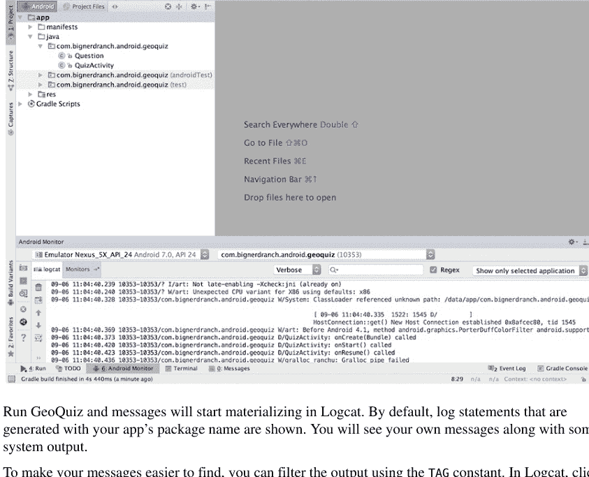

运行 GeoQuiz 并在 Logcat 中开始初始化。默认情况下，会显示带有 App 包名的生成的日志语句。你将与系统输出一起看到一些消息。

为了让消息更易读，你可以使用 `TAG` 内容过滤输出。点击 Logcat 窗格右上角的显示仅限所选应用程序的下拉菜单。这是过滤器下拉菜单，目前设置为仅显示来自你的应用的消息。选择 No Filters（无过滤器）将显示来自整个系统的日志消息。

## 第 3 章 Activity 生命周期

在过滤器下拉菜单中，选择 Edit Filter Configuration（编辑过滤器配置）创建一个新过滤器。将过滤器命名为 `QuizActivity` 并在 Log Tag 字段中输入 `QuizActivity`（图 3.3）。

## 图 3.3 在 Logcat 中创建过滤器

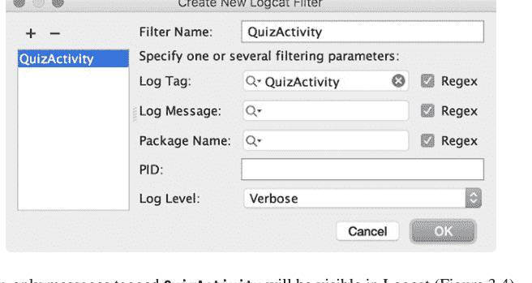

点击 OK。现在，标记为 `QuizActivity` 的消息将在 Logcat 中可见（图 3.4）。

### 启动 GeoQuiz 并在 Logcat 中初始化


运行 GeoQuiz 并在 Logcat 中开始初始化。默认情况下，会显示带有你的 App 包名的生成的日志语句。你将与系统输出一起看到一些消息。

为了让消息更易读，你可以使用 `TAG` 内容过滤输出。点击 Logcat 窗格右上角的显示仅限所选应用程序的下拉菜单。这是过滤器下拉菜单，目前设置为仅显示来自你的应用的消息。选择 No Filters（无过滤器）将显示来自整个系统的日志消息。

在过滤器下拉菜单中，选择 Edit Filter Configuration 创建新过滤器。将过滤器命名为 `QuizActivity` 并在 Log Tag 字段中输入 `QuizActivity`（图 3.3）。

点击 OK。现在，标记为 `QuizActivity` 的消息将在 Logcat 中可见（图 3.4）。

- [费曼学习法](https://wiki.example.org/feynmans_learning_method)的灵感源于诺贝尔物理奖获得者理查德·费曼。
- 运用费曼技巧，你只需花上 `20 min` 就能深入理解知识点，而且记忆深刻，难以遗忘。

```java
if (condVar > someVal) {console.log("xxx")}
```


由于父类 `AppCompatActivity` 并没有 `onCreate(Bundle)` 方法，编译器将会报错。通过这种方式，你可以修复拼写错误，而不是等到运行 App 发现出现奇怪的行为时才去发现错误。

### 使用 Logcat

为了在应用程序运行时访问日志，你可以使用 Logcat，它是 Android SDK 工具中包含的一个日志查看器。

当你运行 GeoQuiz 时，你应该能看到 Logcat 出现在 Android Studio 的底部，如图 3.2 所示。如果 Logcat 不可见，请选择屏幕底部的 Android Monitor 工具并确保选中了 `logcat`。

## 3.2 带 Logcat 的 Android Studio


运行 GeoQuiz 并在 Logcat 中开始初始化。默认情况下，会显示带有你的 App 包名的生成的日志语句。你将与系统输出一起看到一些消息。

为了让消息更易读，你可以使用 `TAG` 内容过滤输出。点击 Logcat 窗格右上角的显示仅限所选应用程序的下拉菜单。这是过滤器下拉菜单，目前设置为仅显示来自你的应用的消息。选择 No Filters（无过滤器）将显示来自整个系统的日志消息。

## 第 3 章 Activity 生命周期

在过滤器下拉菜单中，选择 Edit Filter Configuration 创建新过滤器。将过滤器命名为 `QuizActivity` 并在 Log Tag 字段中输入 `QuizActivity`（图 3.3）。

## 图 3.3 在 Logcat 中创建过滤器


点击 OK。现在，标记为 `QuizActivity` 的消息将在 Logcat 中可见（图 3.4）。

### 启动 GeoQuiz 并在 Logcat 中初始化


（注：由于原文文本后续存在大量重复，此处已按要求停止翻译重复内容）


在`if (condVar > someVal) {console.log("xxx")}`中，如果`condVar`的值大于`someVal`，控制台将输出`"xxx"`。

在`onCreate(Bundle)`之后添加以下内容，在`QuizActivity`中重写另外五个方法：

**列表 3.3 重写更多周期方法（QuizActivity.java）**

```java
public class QuizActivity extends AppCompatActivity {

    ...

    @Override
    protected void onCreate(Bundle savedInstanceState) {
        ...
    }

    @Override
    public void onStart() {
        super.onStart();
        Log.d(TAG, "onStart called");
    }

    @Override
    public void onResume() {
        super.onResume();
        Log.d(TAG, "onResume called");
    }

    @Override
    public void onPause() {
        super.onPause();
        Log.d(TAG, "onPause called");
    }

    @Override
    public void onStop() {
        super.onStop();
        Log.d(TAG, "onStop called");
    }

    @Override
    public void onDestroy() {
        super.onDestroy();
        Log.d(TAG, "onDestroy called");
    }
    ...
}
```

注意，你在记录消息之前先调用了父类的实现。这些对父类的调用是必须的。调用父类实现应该是每个回调方法重写实现中的第一行。

你可能一直对`@Override`注解感到好奇。它要求编译器确保该类确实拥有你想要重写的方法。例如，编译器将能够提醒你以下遗漏的方法：

```java
public class QuizActivity extends AppCompatActivity {
    @Override
    public void onCreate(Bundle savedInstanceState) {
        super.onCreate(savedInstanceState);
        ...
    }
}
```

由于父类`AppCompatActivity`并没有`onCreate(Bundle)`方法，编译器将会报错。通过这种方式，你可以修复拼写错误，而不是等到运行 App 发现出现奇怪的行为时才去发现错误。

### 使用 Logcat

为了在应用程序运行时访问日志，你可以使用 Logcat，它是 Android SDK 工具中包含的一个日志查看器。

当你运行 GeoQuiz 时，你应该能看到 Logcat 出现在 Android Studio 的底部，如图 3.2 所示。如果 Logcat 不可见，请选择屏幕底部的 Android Monitor 工具并确保选中了 logcat。

## 3.2 带 Logcat 的 Android Studio


运行 GeoQuiz 并在 Logcat 中开始初始化。默认情况下，会显示带有你的 App 包名的生成的日志语句。你将与系统输出一起看到一些消息。

为了让消息更易读，你可以使用`TAG`内容过滤输出。点击 Logcat 窗格右上角的显示仅限所选应用程序的下拉菜单。这是过滤器下拉菜单，目前设置为仅显示来自你的应用的消息。选择 No Filters（无过滤器）将显示来自整个系统的日志消息。

## 第 3 章 Activity 生命周期

在过滤器下拉菜单中，选择 Edit Filter Configuration 创建新过滤器。将过滤器命名为`QuizActivity`并在 Log Tag 字段中输入`QuizActivity`（图 3.3）。

## 图 3.3 在 Logcat 中创建过滤器


点击 OK。现在，标记为`QuizActivity`的消息将在 Logcat 中可见（图 3.4）。

### 启动 GeoQuiz 并在 Logcat 中初始化


（注：由于原文文本后续存在大量重复，此处已按要求停止翻译重复内容）

### 旋转与 Activity 生命周期

让我们回到你在第 2 章末尾发现的那个 bug。运行 GeoQuiz，点击 NEXT（下一个）按钮显示第二个问题，然后旋转设备。（在模拟器上，按下 Command+右箭头/Ctrl+右箭头，或点击工具栏上的旋转图标来操作。）

旋转后，GeoQuiz 将再次显示第一个问题。检查 Logcat 查看发生了什么。你的输出应该像图 3.9 所示。

图 3.9 QuizActivity 亡了。长 QuizActivity 万岁！

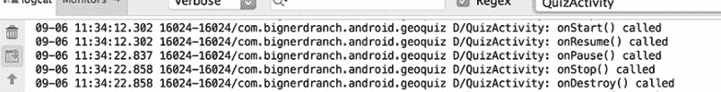

当你旋转时，你正在查看的 QuizActivity 实例消失了，并创建了一个新实例。再次旋转设备，见证另一轮的毁灭与重生。

这就是 bug 的来源。每当你旋转设备，当前的 QuizActivity 实例都会被完全销毁。存储在`mCurrentIndex`中的值会从内存中擦除。这意味着当你旋转时，GeoQuiz 会忘记你正在看哪一个问题。当旋转完成后，会从零开始创建一个新的 QuizActivity 实例，`mCurrentIndex`在`onCreate(Bundle)`中被初始化为 0，用户从第一个问题重新开始。你稍后将修复这个 bug。首先，让我们看看这是如何发生的。

### 设备配置与替代资源

旋转设备会改变设备配置。设备配置是一组描述单个设备当前状态的特征。构成配置的特征包括屏幕方向、屏幕密度、屏幕尺寸、键盘类型、底座模式（dock mode）和语言。当你为项目中不同的屏幕密度添加多个箭头图标时，我们看到了这个例子。

屏幕密度是设备配置的固定组件；它在运行时不能更改。相反，某些组件（如屏幕方向）可以在运行时更改。（运行时还会发生其他配置更改，例如键盘可用性、语言和多窗口模式。）

当发生运行时配置更改时，可能会有更匹配新配置的资源。因此，Android 会销毁 activity，寻找最适合新配置的资源，然后使用这些资源重建 activity 的新实例。为了直观观察这一过程，让我们为 Android 创建一个替代资源，并找出设备屏幕方向变为横屏的时机。

# 第 3 章 Activity 生命周期

### 创建横屏布局

在项目工具窗口中，右键点击`res`目录并选择 New -> Android resource directory。你会看到一个类似于图 3.10 的窗口，其中列出了资源类型以及这些类型的限定符（qualifiers）。在 Resource type 下拉菜单中选择 layout。将 Source set 选项保持为 main。

## 图 3.10 创建新资源目录

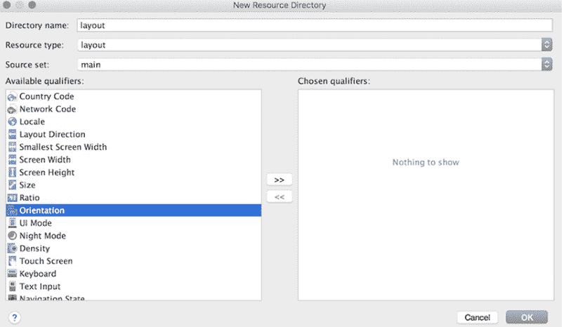

接下来，你将选择布局资源如何被限定。在 Available qualifiers 列表中选择 Orientation，并点击 >> 按钮将 Orientation 移动到 Chosen qualifiers 部分。

最后，确保在 Screen orientation 下拉菜单中选择了 Landscape，如图 3.11 所示。验证目录名称（Directory name）现在是否显示你的目录名为`layout-land`。虽然这个窗口看起来很高级，但它的目的是设置目录名称。点击 OK，Android Studio 将创建`res/layout-land`文件夹。

### 图 3.11 创建 res/layout-land

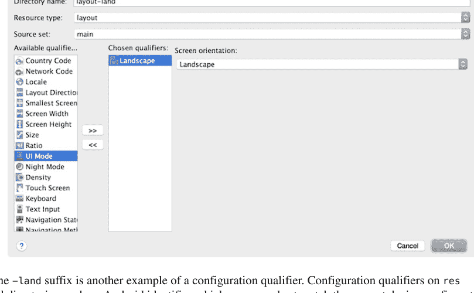

`-land`后缀是配置限定符的另一个例子。res 子目录上的配置限定符是 Android 识别哪些资源最匹配当前设备配置的依据。你可以在`developer.android.com/guide/topics/providing-resources.html`找到 Android 识别的配置限定符列表以及它们所指的设备配置部分。

当设备处于横屏模式时，Android 将找到并使用`res/layout-land`目录中的资源。否则，它将坚持使用`res/layout/`中的默认资源。然而，目前`res/layout-land`目录中还没有资源。让我们修复这个问题。

从`res/layout/`将`activity_quiz.xml`文件复制到`res/layout-land/`。（如果你在项目工具窗口中没有看到`res/layout-land`，请从下拉菜单选择 Project 以切换 Android 视图。只需完成后切换回 Android 视图。你也可以使用你喜爱的文件管理器或终端程序在 Android Studio 之外复制并粘贴文件。）

你现在有了一个横屏布局和一个默认布局。保持两个文件具有相同的文件名，以便它们可以使用相同的资源 ID 进行引用。

现在对横屏布局进行一些更改，使其与默认布局不同。图 3.12 显示了你将进行的更改。

## 图 3.12 替代的横屏布局

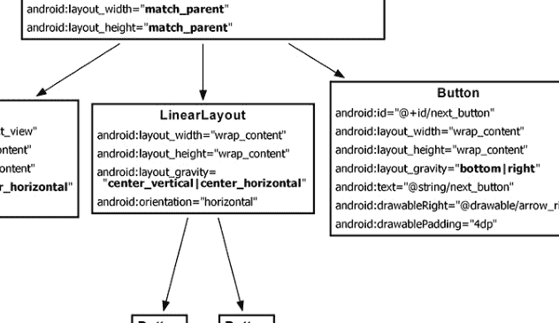

FrameLayout 将替换顶部的 LinearLayout。FrameLayout 是最简单的 ViewGroup，它不会以任何特定方式排列其子视图。在这种布局中，子视图将根据其`android:layout_gravity`属性进行排列。

这意味着 FrameLayout 的子视图 TextView、LinearLayout 和 Button 将保持相同的`android:layout_gravity`属性。

### 设备配置与替代资源

打开`layout-land/activity_quiz.xml`并根据图 3.12 进行必要的更改。你可以参考代码清单 3.4 来检查工作。

### 代码清单 3.4 调整横屏布局（layout-land/activity_quiz.xml）

```xml
<FrameLayout xmlns:android="http://schemas.android.com/apk/res/android"
    android:layout_width="match_parent"
    android:layout_height="match_parent"
    android:gravity="center"
    android:orientation="vertical">

    <TextView
        android:id="@+id/question_text_view"
        android:layout_width="wrap_content"
        android:layout_height="wrap_content"
        android:layout_gravity="center_horizontal"
        android:padding="24dp" />

    <LinearLayout
        android:layout_width="wrap_content"
        android:layout_height="wrap_content"
        android:layout_gravity="center_vertical|center_horizontal"
        android:orientation="horizontal">

        <Button
            android:id="@+id/next_button"
            android:layout_width="wrap_content"
            android:layout_height="wrap_content"
            android:layout_gravity="bottom|right"
            android:text="@string/next_button"
            android:drawableRight="@drawable/arrow_right"
            android:drawablePadding="4dp" />
    </LinearLayout>
</FrameLayout>
```

再次运行 GeoQuiz。旋转设备到横屏以查看新布局（图 3.13）。当然，这不仅仅是一个新布局——它也是一个新的 QuizActivity。

## 图 3.13 横屏模式下的 QuizActivity

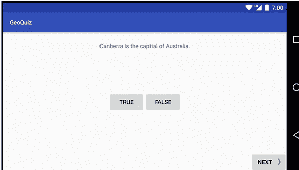

返回竖屏查看默认布局以及另一个 QuizActivity。

# 跨旋转保存数据

Android 在正确的时间提供替代资源方面做得非常好。然而，旋转时销毁并重建 activity 会导致问题，例如 GeoQuiz 在旋转时回到第一个问题的 bug。

为了修复这个 bug，旋转后的 QuizActivity 实例需要知道`mCurrentIndex`的旧值。你需要在运行时配置更改（如旋转）期间保存数据。一种方法是重写 Activity 方法：

```java
protected void onSaveInstanceState(Bundle state)
```

该方法在`onStop()`之前调用，但按下返回键除外。（记住，按下返回键告诉 Android 用户已完成 activity，因此 Android 会完全从内存中擦除 activity 并且不会尝试保存数据以重建它。）

`onSaveInstanceState(Bundle)`的默认实现会指示 activity 的视图将其数据保存到 Bundle 对象中。Bundle 是一个将字符串键映射到有限类型值的结构。

你已经见过这个 Bundle。它被传递到`onCreate(Bundle)`：

```java
@Override
public void onCreate(Bundle savedInstanceState) {
    super.onCreate(savedInstanceState);
    ...
}
```

## 重写 onSaveInstanceState(Bundle)

当你重写`onCreate(Bundle)`时，你会在 activity 的父类上调用`onCreate(Bundle)`并传入你刚刚收到的 bundle。在父类的实现中，会获取视图的保存状态并用它来重新创建 activity 的视图层级。

## 重写 onSaveInstanceState(Bundle)

你可以重写`onSaveInstanceState(Bundle)`以将保存的数据添加到 bundle 中，然后在`onCreate(Bundle)`中读回这些数据。这就是你如何在旋转屏幕时保存`mCurrentIndex`的值的方法。

首先，在`QuizActivity.java`中添加一个常量，作为存储在 bundle 中的键值对的键名。

# 列表 3.5 为值添加键（QuizActivity.java）

```java
public class QuizActivity extends AppCompatActivity {
    private static final String TAG = "QuizActivity";
    private static final String KEY_INDEX = "index";
    private Button mTrueButton;
```

接下来，重写`onSaveInstanceState(Bundle)`，使用该常量作为键将`mCurrentIndex`的值写入 bundle。

# 列表 3.6 重写 onSaveInstanceState(...)（QuizActivity.java）

```java
public class QuizActivity extends AppCompatActivity {
    ...
    @Override
    protected void onPause() {
        ...
    }

    @Override
    public void onSaveInstanceState(Bundle savedInstanceState) {
        super.onSaveInstanceState(savedInstanceState);
        Log.i(TAG, "onSaveInstanceState");
        savedInstanceState.putInt(KEY_INDEX, mCurrentIndex);
    }

    @Override
    protected void onStop() {
        ...
    }
}
```


# 第 3 章 Activity 的生命周期

最后，在`onCreate(Bundle)`中检查此值。如果存在，则将其赋值给`mCurrentImage`。

## 列表 3.7 在`onCreate(Bundle)`中检查 bundle（QuizActivity.java）

```java
public class QuizActivity extends AppCompatActivity {

    ...

    @Override
    protected void onCreate(Bundle savedInstanceState) {
        super.onCreate(savedInstanceState);
        Log.d(TAG, "onCreate(Bundle) called");
        setContentView(R.layout.activity_quiz);
        if (savedInstanceState != null) {
            mCurrentImage = savedInstanceState.getInt(KEY_INDEX);
        }
    }
}
```

运行GoQuery然后下一步。无论你进行多少次设备旋转，新创建的`QuizActivity`都会“记住”你当时处于哪个问题。

注意，你可以保存并从`Bundle`中恢复的类型是原始类型以及实现了`Serializable`或`Parcelable`接口的类。将自定义对象放入`Bundle`通常不是良好做法，因为当你将其取出时，数据可能是过时的。更好的选择是使用其他类型的存储用于数据，并将原始标识符放入`Bundle`。

## 重新回顾 Activity 的生命周期

重写`onSaveInstanceState(Bundle)`不仅仅是为了处理旋转或其他运行时配置更改。如果用户离开一段时间且 Android 需要回收内存（例如，用户按下 Home 键然后去观看视频或玩游戏），OS 也可以销毁 activity。

从实践上讲，OS 不会回收活跃（已暂停或已恢复的）activity。activity 被调用时不会被标记为“可杀死”，`onStop()`被调用并完成执行。

已停止的 activity 可以被杀死，无需担心。如果一个 activity 处于停止状态，意味着调用了`onSaveInstanceState`。解决“数据丢失-旋转”bug 解决了 OS 销毁你的不可见 activity 以释放内存的情况。

`onSaveInstanceState(Bundle)`中的数据存储是如何在 activity 死亡后存活的？当调用`onSaveInstanceState(Bundle)`时，数据被保存到`Bundle`对象中。该`Bundle`对象随后会被 OS 填充到 activity 的 activity 记录（activity record）中。

为了理解 activity 记录，让我们在 activity 生命周期中添加一个存储状态（图 3.14）。

## 图 3.14 完整的 activity 生命周期周期

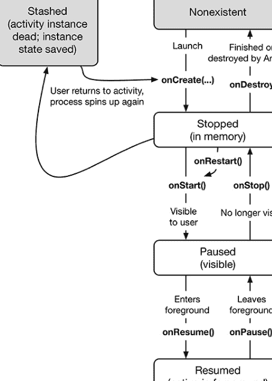

当你的 activity 处于存储状态时，Activity 对象不存在，但 activity 记录保留在 OS 中。OS 在需要时可以使用 activity 记录重新复活 activity。

注意，你的 activity 在没有调用`onDestroy()`的情况下进入存储状态。你可以依赖`onStop()`和`onSaveInstanceState(Bundle)`被调用（除非设备上发生了极其糟糕的错误）。通常，你重写`onSaveInstanceState(Bundle)`将属于当前 activity 的小型、瞬态状态数据存储到你的`Bundle`中。重写`onDestroy()`以保存任何永久数据，例如用户正在编辑时，因为在该方法返回后，你的 activity 可能会随时被杀死。

那么 activity 记录什么时候被丢弃呢？当用户按下返回键时，你的 activity 真正被彻底地销毁了。那时，你的 activity 记录就会被丢弃。Activity 记录在重启时也会被丢弃。

## 给更有好奇心的读者：Activity 清理的现状

截至本文，在低内存情况下，activity 本身并不会逐个销毁。相反，Android 会从内存中创建一个整个应用进程，并带走该应用在内存中的任何 activity。（每个应用程序都有自己的进程。你将在第 24 章名为*给更有好奇心的读者：进程与任务*的部分学习更多关于 Android 应用进程的内容。）

持续前台（已恢复）或对于可见（已暂停）activity 的进程优先级高于其他进程。当 OS 需要释放资源时，它会选择优先级较低的进程。

## 挑战：防止重复回答

一旦用户对特定问题提供了答案，请禁用该问题的按钮，以防止多次输入答案。

## 挑战：评分测验

在用户为所有测验问题提供答案后，显示一个带有百分比得分的`Toast`。祝你好运！

# 调试 Android 应用程序

在本章中，你将了解到当应用程序出现 Bug 时该怎么办。你将学习如何使用`Logcat`、`Android Lint`以及 Android Studio 自带的调试器。

为了练习调试，第一步是弄坏某些东西。在`QuizActivity.java`中，注释掉`onCreate(Bundle)`中提取`mQuestionTextView`的代码。

## 列表 4.1 注释掉关键行 (`QuizActivity.java`)

```java
@Override
protected void onCreate(Bundle savedInstanceState) {
    super.onCreate(savedInstanceState);
    Log.d(TAG, "onCreate (Bundle) called");
    setContentView(R.layout.activity_quiz);
    if (savedInstanceState != null) {
        mCurrentIndex = savedInstanceState.getInt(KEY_INDEX, 0);
    }
    // mQuestionTextView = (TextView)findViewById(R.id.question_text_view);
    mTrueButton = (Button)findViewById(R.id.true_button);
    mTrueButton.setOnClickListener(new View.OnClickListener() {
        ...
    });
}
```

# 第 4 章 调试 Android 应用程序

运行 GeoQuiz看看发生了什么。图 4.1 显示了当你的应用程序崩溃时出现的消息。不同版本的 Android 消息会略有不同，但它们的意思是相同的。

## 图 4.1 GeoQuiz 即将 E.X.P.L.O.D.E.

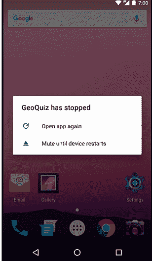

当然，你清楚你的应用程序哪里出了问题，但如果你不知道，从新的角度观察你的应用程序可能会有所帮助。

# 异常和堆栈跟踪

展开 `Android Monitor`工具窗口，以便你看到发生了什么。如果你向下滚动并查看`Logcat`，你最终会发现一片红色，如图 4.2 所示。这是一个标准的`AndroidRuntimeException.exception`报告。

如果你在`Logcat`中没有看到太多内容却发现了异常，可能需要在过滤器下拉菜单中选择“No Filters”（无过滤器）选项。相反，如果你在`Logcat`中看到的内容太多，可以调整Log Level（日志级别）为Error，这将只显示最严重的日志消息。你还可以搜索文本“FATAL EXCEPTION”，这将直接带你找到导致应用程序崩溃的异常。

## 图 4.2 Logcat 中的异常和堆栈跟踪

```
09-03 12:44:08.523 5450-5458/? E/AndroidRuntime: FATAL EXCEPTION: main
Process: com.bignerdranch.android.geoquiz, PID: 5450
java.lang.RuntimeException: Unable to start activity ComponentInfo{com.bignerdranch.android.MainActivity.java=2104}
 at android.app.ActivityThread.startActivity(ActivityThread.java:2233)
 at android.app.ActivityThread.handleLaunchActivity(ActivityThread.java:2223)
 at android.app.ActivityThread.handle0000(ActivityThread.java:135)
 at android.app.ActivityThread.handleDispatchStarted(ActivityThread.java:1196)
 at android.os.Looper.loop(Looper.java:136)
 at android.app.ActivityThread.mainActivity(ActivityThread.java:5001)
 at java.lang.reflect.Method.invoke(<1 native call)
 at com.android.internal.ZygoteThread.methodArgsCaller(Zygote.java:785)
 at com.android.internal.ZygoteThread.mainThread(Zygote.java:601)
 at java.lang.reflect.Method.invokeNative(Native Method)
Caused by: java.lang.NullPointerException:
 at android.app.ActivityThread.updateQuestion(ActivityThreadQuestion(ActivityThread.java:353)
 at com.bignerdranch.android.geoquiz.MainActivity.onCreate(MainActivity.java:90)
 at android.app.Activity.performCreate(Activity.java:5231)
 at android.app.Instrumentation.callActivity(Instrumentation.java:387)
 at android.app.ActivityThread.handleCreateActivity(ActivityThread.java:2100)
 at android.app.ActivityThread.handleLaunchActivity(ActivityThread.java:2223)
 at android.app.ActivityThread.handle0000(ActivityThread.java:135)
 at android.os.Handler.handleMessage(Handler.java:1196)
 at android.os.Looper.loop(Looper.java:136)
 at android.app.ActivityThread.mainActivity(ActivityThread.java:5001)
 at java.lang.reflect.Method.invokeNative(Native Method)
 at java.lang.reflect.Method.invoke(Method.java:515) <3 more..
```

报告告诉你顶层异常及其堆栈跟踪，然后是导致该异常的异常及其堆栈跟踪，以此类推，直到找到一个没有原因的异常。

在你编写的代码中，最后那个没有原因的异常是有趣的。没有原因的异常是`java.lang.NullPointerException`。该异常下方的行是其堆栈跟踪中的第一行。它告诉你异常发生时的类和方法，以及异常发生的文件和行号。点击蓝色链接，Android Studio 将带你进入`updatedQuestion()`内部第一次使用`mTextView`变量的地方。

它指向的行名称`NullPointerException`为你提供了提示：此变量未初始化。

取消初始化`mTextView`的行以记住修复 Bug。

当你遇到异常时，记得查看`Logcat`中的第一行和其堆栈跟踪中的第一行，以参考你编写的内容。如果发生了问题，这是寻找答案的最佳起点。

如果在设备未连接时发生崩溃，设备将显示写入日志的最新行。存储的日志的长度和有效期取决于设备，但你通常可以依靠获取日志。


`at android.app.Instrumentation.callActivity(Instrumentation.java:387)`

`at android.app.ActivityThread.handleCreateActivity(ActivityThread.java:2100)`

`at android.app.ActivityThread.handleLaunchActivity(ActivityThread.java:2223)`

`at android.app.ActivityThread.handle0000(ActivityThread.java:135)`

`at android.os.Handler.handleMessage(Handler.java:1196)`

`at android.os.Looper.loop(Looper.java:136)`

`at android.app.ActivityThread.mainActivity(ActivityThread.java:5001)`

`at java.lang.reflect.Method.invokeNative(Native Method)`

`at java.lang.reflect.Method.invoke(Method.java:515)` `<3 more..`

# 第 4 章 调试 Android 应用程序

## 设置断点

现在，你将使用 Android Studio 自带的调试器来追踪同一个 bug。你将在 `updateQuestion()` 上设置一个断点，查看它是否被调用。断点会在行执行之前暂停执行，允许你逐行查看接下来发生的情况。

在 `QuizActivity.java` 中，返回 `updateQuestion()` 方法。在该方法的第一行旁边，点击左侧空白边的灰色条。你现在应该看到灰色条中出现一个红圈，如图 4.4 所示。这就是断点。

### 图 4.4 一个断点

```java
private void updateQuestion() {
    int question = mQuestionStore[mcurrentIndex].getTextResId();
    mTextView.setText(question);
}
```

要启动调试器并触发断点，你需要调试应用而不是运行它。要调试应用，点击调试按钮（由小虫图标表示），它在运行按钮旁边。你也可以在菜单栏中导航到 `Run -> Debug 'app'`。你的设备会报告正在等待调试器连接，然后将正常继续。

一旦你的应用在连接调试器的情况下启动运行，它就会暂停。启动 `GeoQuizActivity.onCreate(Bundle)`，它调用了 `updateQuestion()`，随后命中了你的断点。

在图 4.5 中，你可以看到编辑器打开了 `QuizActivity.java`，并高亮了执行暂停的断点行。

### 图 4.5 停在这里！

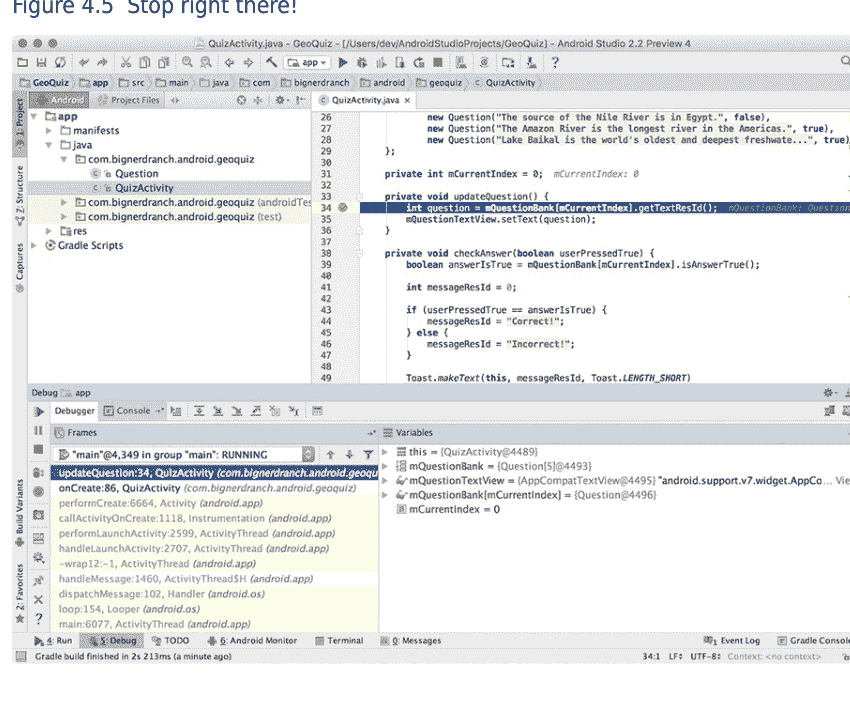

屏幕底部的调试工具窗口现在可见。它包含了 Frames（帧）和 Variables（变量）视图（图 4.6）。

### 图 4.6 调试工具窗口

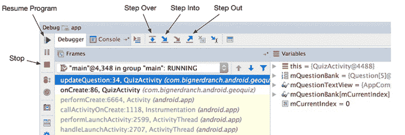

你使用视图顶部的按钮来步执行程序。你可以从堆栈跟踪中看到 `updateQuestion()` 是从 `onCreate(Bundle)` 用的。如果你对 NEXT（下一步）按钮的行为感兴趣，点击 resume（恢复）按钮继续执行。然后在 GeoQuiz 中按下 NEXT 按钮，查看断点是否被命中以及执行是否停止（它已停止）。

现在你停在一个有趣的执行点上，可以观察周围。Variables（变量）视图允许你检查程序中对象的值。你应该看到你在 `QuizActivity` 中创建的变量，作为一个额外值显示：`this`（`QuizActivity` 本身）。

你可以展开此变量，以显示 `QuizActivity` 的父类 `Activity` 中的所有变量、其超父类中的变量，依此类推。但目前，请专注于你创建的变量。

你只对一个值感兴趣：`mCurrentIndex`。向下滚动变量视图，直到看到 `mCurrentIndex`。足够滚动后，它的值为 0。

这段代码看起来完全正常。为了继续你的调查，你需要跳出此方法。点击 step out（跳出）按钮。

检查编辑器。你现在已经跳转到了 `nextButton` 的 `onClickListener` 中，就在 `updateQuestion()` 被调用之后。非常灵巧。

你可能想要修复这个实现，但在对代码进行任何更改之前，你应该停止调试应用。你可以通过两种方式实现这一点：停止程序，或简单地断开调试器。要停止程序，点击图 4.6 中的停止按钮。通常断开调试器更容易。要这样做，请点击图 4.6 中同样标记的关闭按钮。

现在，让你的 `OnClickListener` 恢复往日光。

### 列表 4.5 恢复正常（QuizActivity.java）

```java
@Override
protected void onCreate(Bundle savedInstanceState) {
    super.onCreate(savedInstanceState);

    mNextButton = (Button) findViewById(R.id.next_button);

    mNextButton.setOnClickListener(new View.OnClickListener() {
        @Override
        public void onClick(View v) {
            // mCurrentIndex = (mCurrentIndex + 1) % mQuestionBank.length;
            updateQuestion();
        }
    });
}
```

你已经尝试了两种追踪异常代码行的方法：堆栈跟踪日志和在调试器中设置断点。哪种更好？它们各有优处，其中一种可能会成为你的最爱。记录堆栈跟踪的优势是你可以看到发生了什么。缺点是你必须为它添加日志语句。

如果这还不够，你还可以使用调试器来找出哪行代码会导致崩溃。

### 列表 4.6 让 GeoQuiz 崩溃（QuizActivity.java）

```java
@Override
protected void onCreate(Bundle savedInstanceState) {
    super.onCreate(savedInstanceState);

    mNextButton = (Button) findViewById(R.id.next_button);

    mNextButton.setOnClickListener(new View.OnClickListener() {
        @Override
        public void onClick(View v) {
            mCurrentIndex = (mCurrentIndex + 1) % mQuestionBank.length;
            updateQuestion();
        }
    });
}
```

## 设置异常

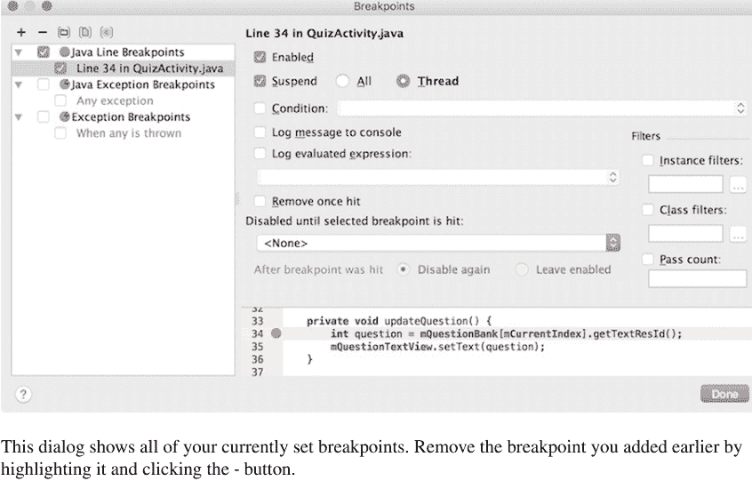

现在选择 `Run → Debugpoints...`。这个对话框显示了你所有的断点。然后你可以选择想要捕获的异常类型。输入 `RuntimeException`。`RuntimeException` 是 `NullPointerException`、`ClassCastException` 以及运行时异常的父类。

撤销 4.6 的更改以回到工作状态。

## Android 特有的调试

大多数 Android 调试与 Java 调试相似。然而，你会遇到 Android 特有的问题，Java 编译器对此一无所知。这就是 Lint 发挥作用的地方。

### 使用 Android Lint

Android Lint（简称 Lint）是 Android 代码的静态分析器。静态分析器是一种在不运行代码的情况下检查缺陷的程序。Lint 利用对 Android 框架的知识深入检查你的代码并发现问题。大多数情况下，Lint 的建议是值得的。

在许多情况下，Lint 还可以对 XML 中定义的对象进行类型检查。在 `QuizActivity` 中犯以下错误。

### 列表 4.7 简单的混淆（QuizActivity.java）

```java
@Override
protected void onCreate(Bundle savedInstanceState) {
    super.onCreate(savedInstanceState);

    Log.d(TAG, "onCreate called");
    setContentView(R.layout.activity_quiz);

    mQuestionTextView = (TextView) findViewById(R.id.question_text_view);
    mTrueButton = (Button) findViewById(R.id.true_button);
    mTrueButton = (Button) findViewById(R.id.question_text_view);
}
```

因为你使用了错误的资源 ID，这段代码将在运行时尝试将 `TextView` 强制转换为 `Button`。这将导致类型转换异常。Java 编译器认为这段代码没有问题，但 Lint 会捕获此错误。你应该能看到 Lint 立即高亮此行代码以指示存在问题。

你可以手动运行 Lint 以查看项目中的所有潜在问题，包括那些不像上面那样严重的问题。从菜单栏中选择 `Analyze → Inspect Code...`。你会被要求选择要检查的项目部分。选择 Whole project（整个项目）并点击 OK。Android Studio 现在将使用 Lint 以及其他静态分析器对你的代码进行扫描。

扫描完成后，你在检查工具窗口中看到几类潜在问题。展开 Lint 类别以查看 Lint 关于你项目的信息（图 4.8）。

# 第 4 章 调试 Android 应用

### 图 4.8 Lint 警告

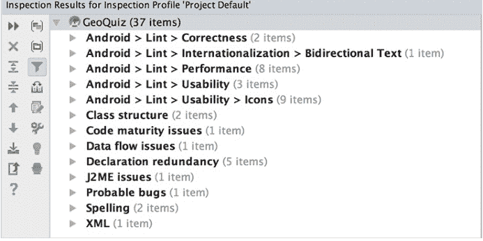

你可以选择此列表中的一个问题来查看更详细的信息以及它在项目中的位置。Android > Lint > Correctness（正确性）类别下的类型不匹配（Mismatched type）警告就是你上面创建的那个。继续在 `onCreate(Bundle)` 中修正类型转换。

### 列表 4.8 修复简单的混淆（QuizActivity.java）

```java
@Override
protected void onCreate(Bundle savedInstanceState) {
    super.onCreate(savedInstanceState);

    Log.d(TAG, "onCreate (Bundle) called");
    setContentView(R.layout.activity_quiz);

    mTextView = (TextView) findViewById(R.id.question_text_view);
    mTrueButton = (Button) findViewById(R.id.question_text_view);
    mTrueButton = (Button) findViewById(R.id.true_button);
}
```

再次运行 GeoQuiz 并确认应用已恢复正常。

## 与 R 类的问题

你对在添加资源之前引用它们，或删除其他文件引用的资源时发生的构建错误非常熟悉。通常，在添加资源或移除引用后重新保存文件，Android Studio 就会顺利地重新构建。

有时，这些构建错误会持续存在或似乎凭空出现。如果你遇到了此类问题，可以尝试以下方法：

### 重新检查资源文件中 XML 的有效性

如果你的 `R.java` 文件在上次构建时没有生成，你将在项目中任何引用资源的地方看到错误。这通常是由于某个 XML 文件中的拼写错误引起的。布局 XML 并不总是经过验证，因此这些文件中的拼写错误可能不会引起你的注意。找到类型并重新保存文件应该会让 `R.java` 重新生成。

### 清理项目

选择 Build（构建）→ Clean Project（清理项目）。Android Studio 将从头构建项目，这通常会导致无错误的构建。我们偶尔都需要进行深度清理。

### 将项目与 Gradle 同步

如果你更改了 `build.gradle` 文件，你需要同步这些更改以更新项目的构建设置。选择 Tools（工具）→ Sync Project with Gradle Files（与 Gradle 文件同步项目）。Android Studio 将使用正确的项目设置从头构建项目，这可以帮助解决更改 Gradle 配置后的问题。

### 运行 Android Lint

密切关注 Lint 的警告。通过此工具，你经常会发现意想不到的问题。

如果你在资源方面仍然遇到问题（或遇到不同的问题），请仔细查看错误信息和你的布局文件。在手忙脚乱时很容易犯错。也检查任何 Lint 错误和警告。冷静地重新审视错误信息可能会发现 bug 或拼写错误。

最后，如果你卡住了或在使用 Android Studio 时遇到其他问题，请检查 `stackoverflow.com` 的存档，或访问此书的论坛 `forums.bignerdranch.com`。

## 挑战：探索布局检查器（Layout Inspector）

为了支持布局文件的调试，布局检查器（layout inspector）被用于交互式地检查布局文件是如何渲染到屏幕上的。使用布局检查器时，确保 GeoQuiz 正在模拟器中运行，并点击 Android Monitor 窗口左侧屉中的布局检查器图标（图 4.9）。一旦激活了检查器，你就可以通过点击布局检查器视图中的元素来探索你布局的属性。

### 图 4.9 布局检查器

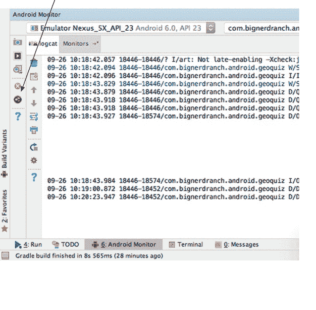

## 挑战：探索分配跟踪（Allocation Tracking）

分配跟踪（Allocation Tracker）工具可以创建程序中内存分配调用的频率和数量报告，对于应用的性能优化非常有用。在 Android Monitor 窗口中，点击 Allocation Tracker 按钮（图 4.10）。

### 图 4.10 启动分配跟踪

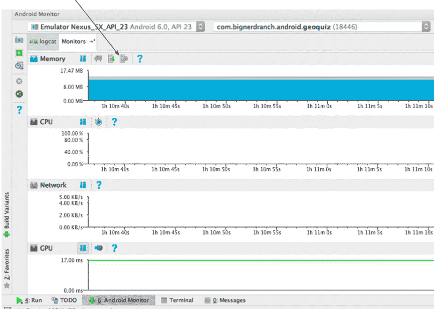

这将在与应用交互时开始记录内存分配。一旦你完成了想要分析的交互，再次点击按钮停止跟踪。这将显示分配报告（图 4.11）。

### 图 4.11 分配跟踪报告

| 计数（Count） | 大小（KB） |
| :--- | :--- |
| 1427 (99.71%) | 105424 (98.17%) |
| 3 (0.20%) | 3284 (3.09%) |
| 188 (13.0%) | 16416 (15.22%) |
| 156 (10.86%) | 12096 (11.20%) |
| 106 (7.41%) | 9600 (8.99%) |
| 42 (2.94%) | 4120 (3.82%) |
| 3 (0.21%) | 276 (0.26%) |

- Thread 1
- onCreateChildOnLayout
- updateDisplayLayout
- dispatchGetChildOnLayout
- updateDisplayLayout
- drawBackground
- drawBackground
- drawBackground
- drawBackground
- createBitmap
- createBitmap
- createBitmap
- createBitmap

总分配数：2

总大小：32

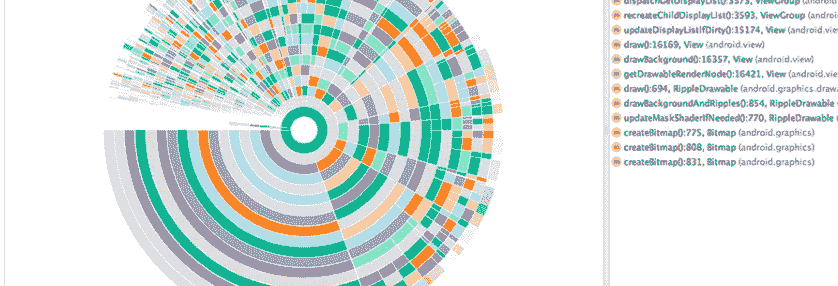

# 第 5 章 你的第二个 Activity

## 设置第二个 Activity

在本章中，你将添加第二个 Activity。幸运的是，一些体力工作由 Android Studio 的向导为你完成。

在调用魔法之前，打开 `strings.xml` 并添加你所需的所有字符串。如图 5.1 所示。

### 列表 5.1 添加字符串（strings.xml）

```xml
<resources>
  <string name="incorrect_toast">错误！</string>
  <string name="warning_text">你确定要这样做吗？</string>
  <string name="show_answer_button">显示答案</string>
  <string name="cheat_button">作弊！</string>
  <string name="judgment_toast">作弊是不对的。</string>
</resources>
```


## 创建 Activity

创建一个 Activity 通常涉及三个文件：Java 类文件、XML 布局和应用程序清单（manifest）。如果你以错误的方式处理这些文件，Android 会“生气”。确保操作正确，你可以使用 Android Studio 的向导。在项目工具窗口中右键点击`com.bigneranch.android.geoquiz`包。选择 New → Activity → Empty Activity，如图 5.3 所示。

图 5.3 新 Activity 向导

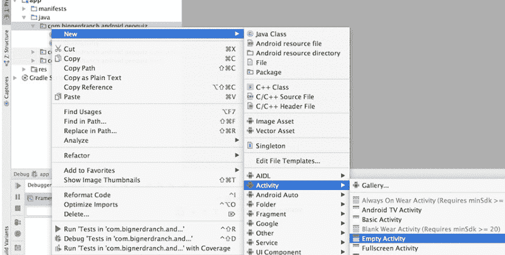

## 设置第二个 Activity

你会看到类似图 5.4 的对话框。将 Activity Name 设置为`CheatActivity`。这是你的`Activity`子类的名称。Layout Name 将自动设置为`activity_cheat`。这是向导创建的布局文件的基础。其余字段的默认值是正确的，但要确保包名是你预期的。这决定了`CheatActivity.java`在文件系统中的位置。点击 Finish 按钮让魔法发生。

图 5.4 新空 Activity 向导

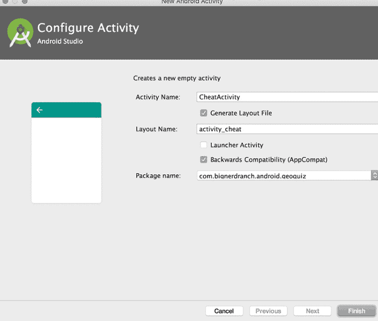

现在是让 UI 变得美观了。章节开头的截图向你展示了`CheatActivity`的视图应该是什么样子。图 5.5 显示了组件定义。

## 图 5.5 CheatActivity 布局图

```xml
<LinearLayout
    xmlns:android="http://schemas.android.com/apk/res/android"
    xmlns:tools="http://schemas.android.com/tools"
    android:layout_width="match_parent"
    android:layout_height="match_parent"
    android:gravity="center"
    android:orientation="vertical"
    tools:context="com.bignerdanch.android.goquiz.CheatActivity">
```

```xml
<TextView
    android:layout_width="wrap_content"
    android:layout_height="wrap_content"
    android:padding="24dp"
    android:text="@string/warning_text" />
```

```xml
<TextView
    android:id="@id/answer_text_view"
    android:layout_width="wrap_content"
    android:layout_height="wrap_content"
    android:padding="24dp"
    tools:text="Answer" />
```

```xml
<Button
    android:id="@id/show_answer_button"
    android:layout_width="wrap_content"
    android:layout_height="wrap_content"
    android:text="@string/show_answer_button" />
```

打开布局目录下的`activity_cheat.xml`并切换到 View（视图）模式。

尝试以图 5.5 为指南创建该布局的 XML。将布局替换为新的`LinearLayout`，并以此推沿树形结构向下进行。在第 9 章之后，我们将只显示像图 5.5 这样的布局，而不是长长的 XML 段落，因此开始使用它们来创建你的布局 XML 是一个好主意。你可以使用列表 5.2 检查你的工作。

## 列表 5.2 填充第二个 Activity 的布局 (activity_cheat.xml)

```xml
<LinearLayout xmlns:android="http://schemas.android.com/apk/res/android"
    xmlns:tools="http://schemas.android.com/tools"
    android:layout_width="match_parent"
    android:layout_height="match_parent"
    android:orientation="vertical"
    android:gravity="center"
    tools:context="com.bignerdanch.android.goquiz.CheatActivity">
```

```xml
<TextView
    android:layout_width="wrap_content"
    android:layout_height="wrap_content"
    android:padding="24dp"
    android:text="@string/warning_text" />
```

```xml
<TextView
    android:id="@id/answer_text_view"
    android:layout_width="wrap_content"
    android:layout_height="wrap_content"
    android:padding="24dp"
    tools:text="Answer" />
```

```xml
<Button
    android:id="@id/show_answer_button"
    android:layout_width="wrap_content"
    android:layout_height="wrap_content"
    android:text="@string/show_answer_button" />
```

```xml
</LinearLayout>
```

## 第 5 章 你的第二个 Activity

注意`tools`的特殊 XML 命名空间以及显示答案的`TextView`上的`tools:text`属性。该命名空间允许你覆盖控件上的任何属性，以便在 Android Studio 预览中以不同的方式显示它。由于`TextView`有一个`text`属性，你可以为它提供一个虚拟值，帮助你了解它在运行时的样子。值 "Answer" 永远不会出现在真实的应用中。非常方便！

你不会为`activity_cheat.xml`创建横屏氛围，但可以预览默认布局在横屏模式下的显示方式。

在预览窗口中，在预览面板上方工具栏中找到看起来像带圆角设备的按钮。点击此按钮可以更改预览的方向（图 5.6）。

## 图 5.6 在横屏模式下预览 activity_cheat.xml

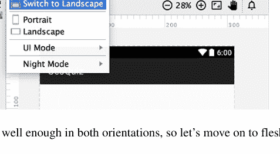

默认布局在两种方向上运行得都很好，所以让我们继续完善 Activity 子类。

## 一个新的 Activity 子类

在项目工具窗口中，找到`com.bignerdanch.android.geoquiz`Java 包并打开`CheatActivity`类，该类位于`CheatActivity.java`文件中。

该类已经包含了`onCreate(Bundle)`的基本实现，它将`activity_cheat.xml`中定义的布局资源 ID 传递给`setContentView(-)`。

`CheatActivity`最终会在其`onCreate(Bundle)`方法中执行更多操作。现在，让我们 New Activity 向导为你做的另一件事：在应用程序的 manifest（清单）中声明`CheatActivity`。

## 在 manifest 中声明活动

manifest 是一个 XML 文件，包含了向 Android OS 描述应用程序的元数据。文件始终命名为`AndroidManifest.xml`，位于项目的`app/manifests`目录。

在项目工具窗口中，找到并打开`AndroidManifest.xml`。你也可以通过按下`Command+Shift+O` (Ctrl+Shift+N) 使用 Studio 的快速打开对话框并开始输入文件名。一旦它猜对了文件，按下 Return 键打开它，以便 OS 访问。

应用程序中的每个 activity 都必须在 manifest 中声明。当你使用 New Project 向导创建`QuizActivity`时，向导为你声明了该 activity。同样，New Activity 向导通过在 manifest 中添加高亮显示的 XML 声明了`CheatActivity`。

## 列表 5.3 在 manifest 中声明活动

```xml
<manifest xmlns:android="http://schemas.android.com/apk/res/android"
    xmlns:tools="http://schemas.android.com/tools"
    package="com.bignerdanch.android.goquiz">

    <application
        android:allowBackup="true"
        android:icon="@mipmap/launcher"
        android:label="@string/app_name"
        android:theme="@style/AppTheme">

        <activity android:name=".QuizActivity">
            <intent-filter>
                <action android:name="android.intent.action.MAIN" />
                <category android:name="android.intent.category.LAUNCHER" />
            </intent-filter>
        </activity>

        <activity android:name=".CheatActivity">
        </activity>

    </application>
</manifest>
```

`android:name`告诉 OS 类。你会看到完全限定名，例如`com.bignerdanch.android.goquiz.CheatActivity`。manifest 中有很多有趣的内容，但现在让我们专注于 manifest。

## 第 5 章 你的第二个 Activity

## 为 QuizActivity 添加按钮

计划是让用户点击按钮进入屏幕。所以你需要在`layout_quiz.xml`中添加按钮。

## 列表 5.4 为 QuizActivity 添加按钮 (layout_quiz.xml)

```xml
<LinearLayout
    ... >

    <Button
        android:id="@+id/next_button"
        android:layout_width="wrap_content"
        android:layout_height="wrap_content"
        android:text="@string/next_button" />

    <Button
        android:id="@+id/cheat_button"
        android:layout_width="wrap_content"
        android:layout_height="wrap_content"
        android:text="@string/cheat" />

</LinearLayout>
```

在横屏布局中，新按钮将出现在底部居中。

## 列表 5.5 为横屏布局添加按钮 (layout-land/activity_quiz.xml)

```xml
<FrameLayout
    ... >

    <Button
        android:id="@+id/cheat_button"
        android:layout_width="wrap_content"
        android:layout_height="wrap_content"
        android:layout_gravity="bottom|center"
        android:text="@string/cheat" />

    <Button
        android:id="@+id/next_button"
        android:layout_width="wrap_content"
        android:layout_height="wrap_content"
        android:layout_gravity="bottom|right"
        android:text="@string/next_button" />

</FrameLayout>
```

重新打开`QuizActivity.java`。添加变量、引用，并为 CHEAT! 按钮设置`ViewOnClickListener`存根。

## 列表 5.6 连线按钮 (QuizActivity.java)

```java
public class QuizActivity extends AppCompatActivity {

    ...

    private Button mNextButton;

    private Button mCheatButton;

    private TextView mQuestionTextView;

    ...

    @Override
    protected void onCreate(Bundle savedInstanceState) {

        mNextButton = (Button) findViewById(R.id.next_button);

        mNextButton.setOnClickListener(new View.OnClickListener() {

            @Override

            public void onClick(View v) {

                mCurrentIndex = (mCurrentIndex + 1) % mQuestionBank.length;

                updateQuestion();

            }

        });

        mCheatButton = (Button) findViewById(R.id.cheat_button);

        mCheatButton.setOnClickListener(new View.OnClickListener() {

            @Override

            public void onClick(View v) {

                // Start CheatActivity

            }

        });

        updateQuestion();

    }

}
```

## 启动 Activity

启动另一个 activity 的简单方法是使用`startActivity`方法：

```java
public void startActivity(Intent intent)
```

你可能猜`startActivity(Intent)`是在你想要启动的 Activity 类上调用的静态方法。但它不是。当 activity 调用`startActivity(Intent)`时，这会被发送给 OS。

## 第 5 章 你的第二个活动

特别是，它被发送到操作系统中称为 ActivityManager 的部分。然后，ActivityManager 创建 Activity 实例并调用它的`onCreate(Bundle)`方法，如图 5.7 所示。

图 5.7 启动一个活动

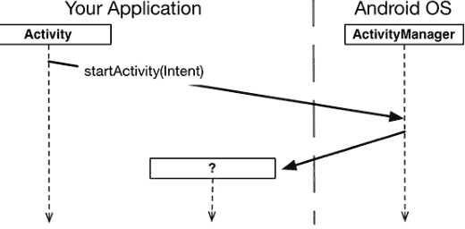

ActivityManager 如何知道要启动哪个 Activity？这些信息包含在 Intent 参数中。

## 使用 Intent 通信

Intent 是组件可以用来与操作系统通信的对象。到目前为止你看到的组件只有活动，但还有服务、广播接收器和内容提供者。

Intents 是多功能的通信工具，Intent 类根据你使用 intent 的意图提供了不同的构造函数。

在这种情况下，你正在使用一个 intent 来告诉 ActivityManager 要启动哪个活动，因此你将使用此构造函数：

```java
public Intent(Context packageContext, Class<?> cls)
```


`Class` 参数指定了 `ActivityManager` 应该启动的活动类。`Context` 参数告诉 `ActivityManager` 可以在哪个应用程序包中找到活动类（图 5.8）。

图 5.8 Intent：告诉 ActivityManager 做什么

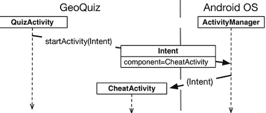

100

## 在活动之间传递数据

在 `mCheatButton` 监听器中，创建一个包含 `CheatActivity` 类的 Intent。将该 intent 传入 `startActivity(Intent)`（列表 5.7）。

### 列表 5.7 启动 CheatActivity (QuizActivity.java)

```java
mCheatButton = (Button) findViewById(R.id.cheat_button);

CheatButton.setOnClickListener(new View.OnClickListener() {

    @Override

    public void onClick(View v) {

        // StartCheatActivity

        Intent intent = new Intent(QuizActivity.this, CheatActivity.class);

        startActivity(intent);

    }

});
```

在启动活动之前，`ActivityManager` 会检查文件中是否有与指定的 `Class` 相同的声明。如果找到了声明，它就会启动该活动，一切正常。如果没有找到，你会得到一个活动未 异常，这会导致你的程序崩溃。这就是为什么你所有的活动都必须在文件中声明。

运行 GeoQuiz。按下 CHEAT 按钮！你的活动的新实例将出现在屏幕上。现在按返回键。这将销毁 `CheatActivity` 并返回到 `QuizActivity`。

## 显式 intent 和隐式 intent

当你使用 `Context` 和 `Class` 对象创建一个 Intent 时，你正在创建一个隐式 intent。你使用隐式 intent 来启动你应用程序内的活动。

你应用程序中的两个活动通过位于应用程序之外的 `ActivityManager` 进行通信，这似乎很奇怪。然而，这种模式使得一个应用程序中的活动能够与另一个应用程序中的活动协同工作。

当你应用程序中的某个活动想要启动另一个应用程序中的活动时，你就会创建一个隐式 intent。你将在第 15 章中用到隐式 intent。

## 在活动之间传递数据

现在你已经有了一个 `QuizActivity` 和 `CheatActivity`，你可以考虑在它们之间传递数据。图 5.9 显示了你将在两个活动之间传递什么数据。

### 图 5.9 QuizActivity 和 CheatActivity 之间的对话

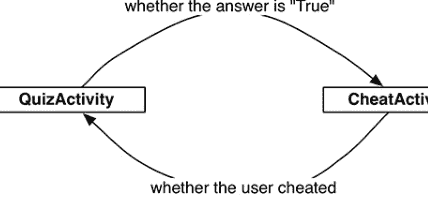

当 `CheatActivity` 启动时，`QuizActivity` 将告知其当前问题的答案。

## 第 5 章 你的第二个活动

当用户按下返回键返回 `QuizActivity` 时，`CheatActivity` 将被销毁。在最后时刻，它将向 `QuizActivity` 发送关于用户是否作弊的数据。你将从从 `QuizActivity` 传递数据到 `CheatActivity` 开始。

## 使用 intent extras

为了告知 `CheatActivity` 当前问题的答案，你将向它传递 `mquestion[mcurrentIndex].isAnswerTrue()` 的值。你会将此值作为 extra 发送到传入 `startActivity(Intent)` 的 Intent 中。

Extras 是调用活动可以包含在 intent 中的任意数据。你可以将它们想象成构造函数参数，尽管你不能在活动子类中使用自定义构造函数。（Android 创建活动实例并负责管理它们的生命周期。）操作系统将 intent 转发给接收的活动，接收活动可以访问 extras 并检索数据，如图 5.10 所示。

### 图 5.10 Intent extras：与其他活动通信

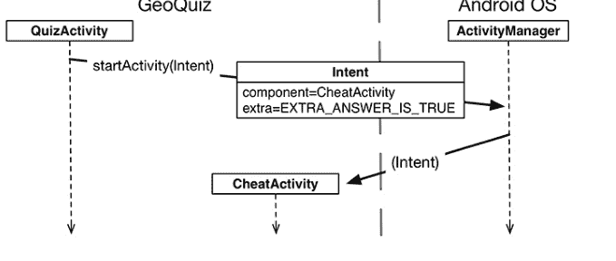

一个 extra 的结构是键值对，就像你在 `QuizActivity.onSaveInstanceState(Bundle)` 中用于保存 `mcurrentIndex` 值时使用的那种。

要向 intent 中添加 extra，你使用 `Intent.putExtra(...)`。特别地，你将调用：

`public Intent putExtra(String name, boolean value)`

`Intent.putExtra(...)` 有许多变体，但它始终有两个参数。第一个参数始终是一个 `String` 键，第二个参数是值，其类型会变化。它返回 Intent 本身，因此如果你需要，可以链式调用多次。

在 `CheatActivity.java` 中，为 extra 添加一个键。

### 列表 5.8 添加 extra 常量 (CheatActivity.java)

```java
public class CheatActivity extends AppCompatActivity {

    private static final String EXTRA_ANSWER_TRUE;

    ...
```

102

## 使用 intent extras

活动可以从多个地方启动，你应该为 extras 定义键。使用你的应用程序包名作为 extra 的限定符（如列表 5.8 所示），可以与其他应用程序的 extras 冲突。

现在你可以回到 `QuizActivity` 并在 intent 上放入 extra，但有一个更好的方法。`QuizActivity` 或应用中的任何其他代码没有理由知道 `CheatActivity` 的 extras 实现细节。相反，你可以将这些工作封装到 `newIntent(...)` 方法中。

在 `CheatActivity` 中创建此方法。

### 列表 5.9 用于 CheatActivity 的 newIntent 方法 (CheatActivity.java)

```java
public class CheatActivity extends AppCompatActivity {

    private static final String EXTRA_ANSWER_TRUE =
        "com.bigneranch.geoquiz.answer_true";

    public static Intent newIntent(Context packageContext, boolean answerIsTrue) {

        Intent intent = new Intent(packageContext, CheatActivity.class);

        intent.putExtra(EXTRA_ANSWER_TRUE, answerIsTrue);

        return intent;

    }

}
```

此静态方法允许你创建一个配置了 `CheatActivity` 所需 extras 的 Intent。`answerIsTrue` 参数是一个布尔值，使用私有名称 `EXTRA_ANSWER_TRUE` 放入 intent 中。为你的活动子类使用这样的 `newIntent(...)` 方法可以让其他代码轻松配置它们的启动 intent。

说到其他代码，在 `QuizActivity` 的按钮监听器中使用这个新方法。

### 列表 5.10 带 extra 启动 MainActivity (QuizActivity.java)

```java
mButton.setOnClickListener(new View.OnClickListener() {

    @Override

    public void onClick(View v) {

        // Intent intent = new Intent(QuizActivity.this, CheatActivity.class);

        boolean answerIsTrue = mQuestionBank[mcurrentIndex].answerTrue();

        Intent intent = CheatActivity.newIntent(QuizActivity.this, answerIsTrue);

        startActivity(intent);

    }

});
```

你只需要一个 extra，但如果需要，可以在 Intent 中放入多个 extras。如果你这样做，请为你的 `newIntent(...)` 方法添加更多参数以保持一致。

要从 extra 中检索值，你将使用：

```java
public boolean getBooleanExtra(String name, boolean defaultValue)
```

第一个参数是 extra 的名称。`getBooleanExtra(...)` 的第二个参数是未找到键时的默认答案。

103

## 第 5 章 你的第二个活动

在 `CheatActivity` 中，从 `onCreate(Bundle)` 的 extra 中获取值并存储在成员变量中。

### 列表 5.11 使用 extra (CheatActivity.java)

```java
public class CheatActivity extends AppCompatActivity {

    private static final String EXTRA_ANSWER_IS_TRUE =
        "com.bierdandranch.android.geoquiz.answer_is_true";

    private boolean mAnswerIsTrue;

    @Override

    protected void onCreate(Bundle savedInstanceState) {

        super.onCreate(savedInstanceState);

        setContentView(R.layout.activity_chat);

        mAnswerIsTrue = getIntent().getBooleanExtra(EXTRA_ANSWER_IS_TRUE, false);

    }

}
```

注意，`Activity.getIntent()` 总是返回启动该 Activity 的 `Intent`。这就是你在调用 `startActivity(Intent)` 时发送的内容。

最后，我们将 `TextView` 和 `SHOW ANSWER` 按钮连接起来，以使用获取到的值。

### 列表 5.12 开启作弊 (CheatActivity.java)

```java
public class CheatActivity extends AppCompatActivity {

    ...

    private boolean mAnswerIsTrue;

    private TextView mAnswerTextView;

    private Button mShowAnswerButton;

    @Override

    protected void onCreate(Bundle savedInstanceState) {

        super.onCreate(savedInstanceState);

        setContentView(R.layout.activity_chat);

        mAnswerIsTrue = getIntent().getBooleanExtra(EXTRA_ANSWER_IS_TRUE, false);

        mAnswerTextView = (TextView) findViewById(R.id.answer_text_view);

        mShowAnswerButton = (Button) findViewById(R.id.show_answer_button);

        mShowAnswerButton.setOnClickListener(new View.OnClickListener() {

            public void onClick(View v) {

                if (mAnswerIsTrue) {

                    mAnswerTextView.setText(R.string.true_button);

                } else {

                    mAnswerTextView.setText(R.string.false_button);

                }

            }

        });

    }

}
```

## 从子 Activity 获取结果

第一个参数非常直观。通过 `TextView.setText(int)` 将文本发送到 `TextView` 中。`TextView.setText(...)` 有许多变体，在这里你使用的是接受字符串资源 ID 的那一个。

运行 GeoQuiz。点击 **CHEAT!** 进入 `CheatActivity`。然后点击 **SHOW ANSWER** 显示当前问题的答案。

## 从子 Activity 获取结果

到此为止，用户可以肆无忌惮地作弊了。让我们修复这个问题，让 `CheatActivity` 告诉 `QuizActivity` 用户是否选择了给出答案。

当你想要接收来自子 Activity 的反馈时，调用以下 `Activity` 方法：

```java
public void startForResult(Intent intent, int requestCode)
```

第一个参数与第二个相同。请求就是请求码（request code）。请求码是一个你在子 Activity 中设置的用户定义的整数，然后由父 Activity 接收。它用于当 Activity 启动多一种类型的子 Activity 并且需要知道是谁在汇报结果时。`QuizActivity` 永远只会启动一种类型的子 Activity，但使用常量作为请求码是一种最佳实践，你将为未来的变动进行此设置。

在 `QuizActivity` 中，修改 `cheatButton` 的监听器以调用 `startActivityForResult(Intent, int)`。

### 列表 5.13 调用 startActivityForResult(...) (QuizActivity.java)

```java
private static String TAG = "QuizActivity";

private static String KEY_INDEX = "index";

private final int REQUEST_CODE_CHEAT = 0;

@Override

protected void onCreate(Bundle savedInstanceState) {

    ...

    mcheatButton.setOnClickListener(new View.OnClickListener() {

        @Override

        public void onClick(View v) {

            // Start CheatActivity

            boolean isAnswerTrue = mQuestion[mcurrentIndex].isAnswerTrue();

            Intent intent = CheatActivity.newIntent(QuizActivity.this, isAnswerTrue);

            startActivity(intent);

            startForResult(intent, REQUEST_CODE_CHEAT);

        }

    });
```

## 设置结果

你可以在子 Activity 中调用两个方法来将数据传回给父 Activity：

```java
public final void setResult(int resultCode)

public final void setResult(int resultCode, Intent data)
```


通常，结果码是两个预定义常量之一：`Activity.RESULT_OK` 或 `Activity.RESULT_CANCELED`。（你可以使用另一个常量 `RESULT_FIRST_USER` 作为偏移量来定义你自己的结果码。）

### 第5章 你的第二个活动

当父 Activity 需要根据子 Activity 如何结束来采取不同行动时，设置结果码是非常有用的。

例如，如果一个子 Activity 有一个 OK 按钮和一个 Cancel 按钮，子 Activity 将根据点击了哪个按钮设置不同的结果码。父 Activity 将根据结果码采取不同的行动。

调用 `setResult(...)` 并不是 Activity 质量的硬性要求。如果你不需要区分结果，或者不需要在 `intent` 上接收任意数据，那么你可以让操作系统发送默认结果码。结果码始终会返回给通过 `startForResult(...)` 启动的父 Activity。如果没有调用 `setResult(...)`，那么当用户按下返回键时，父 Activity 将接收到 `Activity.RESULT_CANCELED`。

### 发回 intent

在这个实现中，你感兴趣将某些特定数据传回给 `QuizActivity`。因此，你将创建一个 `Intent`，在其上放入 extra，然后调用 `Activity.setResult(int, Intent)` 将数据交到 `QuizActivity` 手上。

在 `CheatActivity` 中，为 extra 添加一个常量，以及一个在 SHOW ANSWER 监听器中调用的私有方法。

### 列表 5.14 设置结果 (CheatActivity.java)

```java
public class CheatActivity extends AppCompatActivity {

    private static final String EXTRA_ANSWER_IS_TRUE = 
        "com.bierdandranch.android.geoquiz.answer_is_true";

    private static final String EXTRA_SHOWN =
        "com.bierdandranch.android.geoquiz.shown";

    private boolean mAnswerIsTrue;

    private TextView mAnswerTextView;

    private Button mShowAnswerButton;

    @Override
    protected void onCreate(Bundle savedInstanceState) {
        super.onCreate(savedInstanceState);
        setContentView(R.layout.activity_chat);

        mAnswerIsTrue = getIntent().getBooleanExtra(EXTRA_ANSWER_IS_TRUE, false);

        mAnswerTextView = (TextView) findViewById(R.id.answer_text_view);
        mShowAnswerButton = (Button) findViewById(R.id.show_answer_button);

        mShowAnswerButton.setOnClickListener(new View.OnClickListener() {
            @Override
            public void onClick(View v) {
                if (mAnswerIsTrue) {
                    mAnswerTextView.setText(R.string.true_button);
                } else {
                    mAnswerTextView.setText(R.string.false_button);
                }
            }
        });
    }

    private void setShown(boolean isShown) {
        Intent data = new Intent();
        data.putExtra(EXTRA_SHOWN, isShown);
        setResult(RESULT_OK, data);
    }
}
```

当用户按下 SHOW ANSWER 按钮时，`CheatActivity` 封装结果并在 `intent` 中调用 `setResult(int)`。

然后，当用户按下返回键返回 `QuizActivity` 时，`ActivityManager` 在父 Activity 上调用以下方法：

```java
protected void onActivityResult(int requestCode, int resultCode, Intent data)
```

参数是原始请求码以及传递给 `setResult(...)` 的结果码和 `intent`。

图 5.11 显示了序列。

### 图 5.11 GeoQuiz 序列图

`img/f3f7b293c9adf28b10a17356a48bc_130_0.png`

### 第5章 你的第二个活动

最后一步是在 `QuizActivity` 中覆盖 `onCreate(Bundle)` 来处理结果。然而，由于结果 `Intent` 的内容也是 `CheatActivity` 的实现细节，请添加一个方法供 `QuizActivity` 使用。

### 列表 5.15 解码结果 intent (CheatActivity.java)

```java
public static Intent newInput(Context packageContext, boolean isAnswerTrue) {
    Intent intent = new Intent(packageContext, CheatActivity.class);
    intent.putExtra(EXTRA_ANSWER_IS_TRUE, isAnswerTrue);
    return intent;
}

public static boolean wasAnswerShown(Intent result) {
    return result.getBooleanExtra(EXTRA_SHOWN, false);
}
```

### 处理结果

在 `QuizActivity` 中，添加一个新的成员变量来持有 `CheatActivity` 回传的值。然后覆盖 `onActivityResult(...)` 来获取它，检查请求码和结果以确保无误。再次，这是一种便于未来维护的最佳实践。

### 列表 5.16 实现 `onActivityResult(...)` (QuizActivity.java)

```java
public class QuizActivity extends AppCompatActivity {
    ...
    private int mCurrentImage = 0;
    private boolean mIsCheater;

    @Override
    protected void onCreate(Bundle savedInstanceState) {
        ...
    }
}
```

```java
@Override
protected void onActivityResult(int requestCode, int resultCode, Intent data) {
    if (requestCode != Activity.RESULT_OK) {
        return;
    }

    if (requestCode == REQUEST_CODE_CHEAT) {
        if (data == null) {
            return;
        }
        mIsCheater = CheatActivity.wasAnswerShown(data);
    }
}
```

最后，修改 `QuizActivity` 中的 `checkAnswer(boolean)` 方法，以检查用户是否作弊并做出相应的响应。

# 列表 5.17 根据 `mIsCheater` 的值更改 toast 消息 (QuizActivity.java)

```java
@Override
protected void onCreate(Bundle savedInstanceState) {
    mNextButton = (Button) findViewById(R.id.next_button);
    mNextButton.setOnClickListener(new View.OnClickListener() {
        @Override
        public void onClick(View v) {
            mCreateIndex = (mCreateIndex + 1) % QuestionBank.length;
            mIsCheater = false;
            updateQuestion();
        }
    });
}
...
private void checkAnswer(boolean userPressed) {
    boolean answerIsTrue = QuestionBank[mCreateIndex].isAnswerTrue();
    int messageRes = 0;
    if (mIsCheater) {
        messageRes = R.string.judgment_toast;
    } else {
        if (userPressed == answerIsTrue) {
            messageRes = R.string.correct_toast;
        } else {
            messageRes = R.string.incorrect_toast;
        }
    }
    Toast.makeText(this, messageRes, Toast.LENGTH_SHORT).show();
}
```

运行 GeoQuiz。检查并观察发生了什么。

## Android 如何看待你的 Activity

让我们看看在 Activity 之间移动时操作系统层面发生了什么。首先，当你点击启动器上的 GeoQuiz 应用时，操作系统并没有启动应用程序，而是启动了应用程序中的一个 Activity。具体来说，它启动了应用程序的启动 Activity。对于 GeoQuiz 而言，`QuizActivity` 就是启动 Activity。

当新项目向导创建 GeoQuiz 应用和 `QuizActivity` 时，它默认将 `QuizActivity` 设置为启动 Activity。启动状态在清单文件中通过 `QuizActivity` 声明中的 `intent-filter` 元素进行指定（见列表 5.18）。

# 列表 5.18 被声明为启动 Activity 的 `QuizActivity` (AndroidManifest.xml)

```xml
<manifest xmlns:android="http://schemas.android.com/apk/res/android">
  ...>
  <application>
    ...
    <activity android:name=".QuizActivity">
      <intent-filter>
        <action android:name="android.intent.action.MAIN" />
        <category android:name="android.intent.category.LAUNCHER" />
      </intent-filter>
    </activity>
    <activity android:name=".CheatActivity">
  </application>
</manifest>
```

当 `QuizActivity` 实例出现在屏幕上后，用户可以按下 CHEAT! 按钮。发生这种情况时，会启动 `CheatActivity` 的实例——它位于 `QuizActivity` 之上。这些 Activity 存在于一个栈中（图 5.12）。

在 `CheatActivity` 中按返回键会将该 Activity 从栈中弹出，`QuizActivity` 恢复其在顶部的位置，如图 5.12 所示。

### 图 5.12 GeoQuiz 的返回栈

``

在 `CheatActivity` 中调用 `Activity.finish()` 也会将 `CheatActivity` 从栈中弹出。

## Android 如何看待你的 Activity

如果你运行 GeoQuiz 并在 `QuizActivity` 中按返回键，`QuizActivity` 将从栈中弹出，你将回到运行 GeoQuiz 之前查看的最后一个屏幕（图 5.13）。

### 图 5.13 查看主屏幕

``
``
``

如果你是从启动器应用启动 GeoQuiz 的，在 `QuizActivity` 中按返回键将带你回到启动器（图 5.14）。

### 图 5.14 从启动器运行 GeoQuiz

``
``
``

从启动器中按返回键将带你回到打开启动器时所在的屏幕。

## 第 5 章 你的第二个 Activity

你在这里看到的是 `ActivityManager` 维护着一个返回栈，这个返回栈不仅仅属于你应用程序的 Activity。Activity 共享返回栈，这就是 `ActivityManager` 参与启动你的 Activity 并且存在于操作系统而非你的应用程序的原因之一。栈代表了整个操作系统和设备的使用情况，而不是单个应用程序的使用。

（好奇“向上”按钮吗？）

## 挑战：关闭漏洞

你在这里看到的是 `ActivityManager` 维护着一个返回栈，这个返回栈不仅仅属于你应用程序的 Activity。Activity 共享返回栈，这就是 `ActivityManager` 参与启动你的 Activity 并且存在于操作系统而非你的应用程序的原因之一。栈代表了整个操作系统和设备的使用情况，而不是单个应用程序的使用。

# 合理的最低配置

Android 开发者面临的最大变化之一是随着 Honeycomb（Android 3.0）的发布。这次发布是平台的一次重大转变，引入了新的 UI 和新的架构组件。Honeycomb 仅针对平板电脑发布，因此直到 Ice Cream Sandwich 发布，这些新开发内容才被广泛使用。从那时起，对于开发者来说，新发布更多是增量式的。

Android 为维护向后兼容性提供了帮助。也有第三方库可以帮助到你。但维护兼容性确实会增加学习 Android 编程的复杂性。

当你创建 GeoQuiz 项目时，你在新建项目向导中设置了最低 SDK 版本，如图 6.1 所示。（注意：Android 交替使用“SDK version”和“API level”这两个术语。）

### 图 6.1 还记得我吗？

``

# 第 6 章 Android SDK 版本与兼容性

除了最低支持版本外，你还可以设置目标版本和构建版本。让我们解释一下默认选项以及如何更改它们。

所有这些属性都设置在 app 模块的 `build.gradle` 文件中。构建版本仅存在于此文件中。最低 SDK 版本和目标 SDK 版本设置在 `build.gradle` 文件中，但它们用于覆盖或设置你 `AndroidManifest.xml` 中的值。

打开 app 模块中的 `build.gradle` 文件。注意 `compileSdkVersion`、`minSdkVersion` 和 `targetSdkVersion` 的值。

# 列表 6.1 检查构建配置 (app/build.gradle)

```gradle
compilesSdkVersion 25
buildToolsVersion "25.0.0"
defaultConfig {
    applicationId "com.bigneranch.android.geoquiz"
    minSdkVersion 19
```


```gradle
targetSdkVersion 25

...

}
```

## 最低 SDK 版本

`minSdkVersion` 值是一个操作系统不应安装该应用的硬底线。

通过将此版本设置为 API level 19（KitKat），你赋予了 Android 权限在运行 KitKat 或更高版本的设备上安装 GeoQuiz。Android 将拒绝在运行例如 Jelly Bean 的设备上安装 GeoQuiz。

再次查看表 6.1，你就会明白为什么 API level 19 是最低 SDK 版本的良好选择：它允许你的应用安装在最多 80% 正在使用的设备上。

## 目标 SDK 版本

`targetSdkVersion` 告诉 Android 你的应用是为哪个 API level 设计的。通常情况下，这将是最新的 Android 版本。

你何时会降低目标 SDK？新 SDK 的发布可能会改变你的应用在设备上的外观或操作系统在后台的运行。如果你已经设计了一个应用，你应该确认它在新版本上运行是否符合预期。检查 [`developer.android.com/reference/android/os/Build.VERSION_CODES.html`](https://developer.android.com/reference/android/os/Build.VERSION_CODES.html) 上的文档，查看问题可能在何处出现。然后你可以修改你的应用以匹配新行为，或者降低目标 SDK。

在 Android 新版本发布时不增加目标 SDK，可以确保你的应用仍以其工作时对应的目标版本的外观和行为运行。此选项的存在是为了兼容更高版本的 Android，因为在增加 `targetSdkVersion` 之前，后续发布中的某些特性会被忽略。

## 编译 SDK 版本

列表 6.1 中的最后一个 SDK 设置标记为 `compileSdkVersion`。此设置不用于更新 `AndroidManifest.xml` 文件。虽然当你在构建应用时，最低和目标 SDK 版本会被放置在清单文件中以向操作系统通告这些值，但编译 SDK 版本是你和编译器之间的私有信息。

Android 的功能通过 SDK 中的类和方法暴露出来。`compileSdkVersion`（或构建目标）指定了在编译代码时使用哪个版本。当 Android Studio 正在查找你在 `import` 语句中引用的类和方法时，构建目标决定了它将检查哪一个 SDK 版本。

构建目标的最佳选择是最新的 API level（当前为 25，Nougat）。但是，如果你有需要，可以更改现有应用的构建目标。例如，当 Android 新版本发布时，你可能想要更新构建目标，以便使用它引入的许多新方法和类。

你可以在 `build.gradle` 文件中修改最低 SDK 版本、目标 SDK 和编译 SDK 版本，但注意，修改此文件需要将项目与 Gradle 更改同步（sync），更改才能生效。执行此操作，选择 `Tools -> Android -> Sync Project with Gradle Files`。这将触发使用更新后的值对项目进行全新的构建。

## 安全地从后期的 API 添加代码

GeoQuiz 的最低 SDK 版本与构建 SDK 版本之间的差异留了一个你需要管理的兼容性差距。例如，如果你调用的代码版本高于 KitKat（API level 19）的最低 SDK 版本，会发生什么？当你的应用在 KitKat 设备上安装并运行时，它会崩溃。

这曾是一个测试噩梦。然而，通过对 Android Lint 的改进，在旧设备上调用较新代码可能导致的潜在问题可以在编译时捕获。如果你使用了比最低 SDK 版本更高的代码，Android Lint 将报告错误。

目前，GeoQuiz 的所有简单代码都是 API level 19 或更早版本引入的。让我们添加一些来自 API level 21（Lollipop）的代码并看看发生什么。

打开 `ChatActivity.java`。在 `SHOW ANSWER` 按钮的 `OnClickListener` 中，添加以下代码以防止隐藏按钮时出现复杂的圆形动画。

### 列表 6.2 添加动画代码（`ChatActivity.java`）

```java
// 注意：提供的 OCR 文本在后面的页面中似乎是破碎/混乱的。我已根据逻辑流重构了它。
```

# 第 6 章 Android SDK 版本与兼容性

你也可以在 KitKat 设备（虚拟设备或其他设备）上运行 GeoQuiz。它将不会有圆形动画，但你可以确认应用程序仍然可以安全运行。

## 使用 Android 开发者文档

Android Lint 错误会告诉你你的不兼容代码属于哪个 API 级别。但你也可以在 Android 开发者文档中查找特定类和方法属于哪个 API 级别。

尽快熟悉开发者文档是一个明智的主意。Android SDK 中的内容太多了，无法全部记在脑子里，随着新版本的定期发布，你将需要学习它以及如何使用它。

Android 开发者文档是一个优秀且详尽的信息源。文档的主页是 `developer.android.com`。它分为三个部分：设计（Design）、开发（Develop）和发布（Distribute）。只要有机会，这些内容都非常值得阅读。文档的 Design 部分包含了应用 UI 的设计模式和原则。Develop 部分包含文档和培训。Distribute 部分向你展示如何在 Google Play 或通过开放分发准备并发布你的应用程序。

Develop 部分进一步分为六个领域：

- **Training（培训）**：初级和高级培训模块，包括可下载的示例代码
- **API Guides（API 指南）**：关于应用组件、功能和最佳实践的主题描述
- **Reference（参考）**：SDK 中每个类、方法、接口、属性常量等的可搜索、带链接的文档
- **Samples（示例）**：演示如何使用 API 的某些示例代码
- **Android Studio**：关于 Android Studio IDE 的信息
- **Android NDK**：关于原生开发工具包的描述和链接，允许你使用 C 和 C++ 编写代码
- **Google Services（Google 服务）**：关于 Google 专用 API 的信息，包括 Google Maps 和 Google Cloud Messaging

你不需要联网即可访问文档。在 SDK Manager 中，下载特定版本的文档，导航到你下载 SDK 的文件系统。那里有一个包含完整文档的目录。

要确定 `ViewAnimationUtils` 属于哪个 API 级别，使用浏览器顶部的搜索栏搜索此类。你会看到来自几个不同类别的结果。确保你选择的是来自 Reference（参考）部分的结果（侧有一个过滤器）。

选择第一个结果，你将被引导至图 6.2 所示的 `ViewAnimationUtils` 类页面。该页顶部有指向其不同部分的链接。

## 6.2 ViewAnimationUtils 参考页

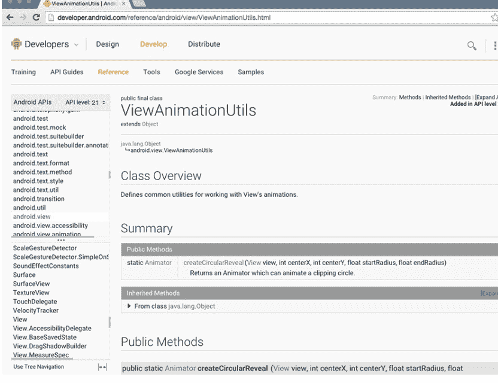

向下滚动找到 `createCircularReveal(...)` 并点击方法名称查看描述。在方法签名的右侧，你可以看到 `createCircularReveal(...)` 是在 API 级别 21 中引入的。

如果你想查看在例如 API 级别 19 中哪些 `ViewAnimationUtils` 方法，可以按 API 级别进行过滤。在页面左侧按包索引类的地方找到显示 API level 21 的地方：点击相邻的控件从列表中选择。在大多数情况下，API level 19 之后引入的所有内容都将显示为灰色。`ViewAnimationUtils` 是在 API 级别 21 中引入的，因此你会看到一个警告，指示整个类在 API level 19 上完全不可用。

API 级别过滤器对于你正在使用的 API 级别中可用的类更有用。在文档中搜索 `Activity` 类的参考。将 API 级别过滤器调回到 API level 19，你会发现此后增加了许多方法，例如 `onAnimationComplete`，它是 Lollipop 版本中添加到 SDK 的功能，允许你在活动之间提供有趣的过渡。

当你继续学习时，请经常访问开发者文档。你确实需要文档来应对挑战练习，但每当你遇到特定的案例、方法或其他主题时，也可以考虑探索。Android 会不断更新和改进文档，因此总有新东西要学习。

## 挑战：报告构建版本

在 GeoQuiz 布局中添加一个 `TextView` 小部件，向用户报告设备运行的 API 级别。图 6.3 显示了最终结果的样子。

图 6.3 完成的挑战

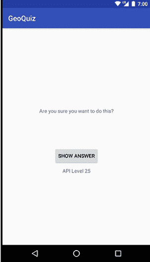

你不能在布局中设置此 `TextView` 的文本，因为你需要在运行时设置它。使用代码通过 ID 找到 `TextView` 并将其文本设置为构建版本：

```java
TextView textView = findViewById(R.id.api_level_text);

textView.setText("API Level: " + Build.VERSION.SDK_INT);
```

## UI Fragments 与管理器

### 灵活性的需求

Activity 的设计并不是为了提供这种灵活性。Activity 的视图可能会在运行时更改，控制这些视图的代码必须位于 Activity 内部。

使用 fragments（片段）将应用的 UI 拆分为构建区块，这不仅对于列表-详情类应用程序非常有用。通过处理单个区块，可以轻松构建标签界面、添加动画侧边栏等。

### 引入 Fragments

你可以通过将 UI 管理从 Activity 移动到一个或多个 fragments 来克服 Android 的局限性。fragment 是 Activity 可以授权其执行任务的对象。最常见的任务是管理 UI。UI 可以是整个屏幕，也可以只是屏幕的一部分。

管理 UI 的 fragment 被称为 UI fragment。UI fragment 拥有它自己的视图，该视图是从布局文件填充（inflated）的。fragment 的视图包含用户想要和交互的 UI 元素。

Activity 的视图包含一个插入 fragment 视图的位置。事实上，在本章中 Activity 将托管单个 fragment，但 Activity 可以拥有多个用于多个 fragment 视图的位置。

你可以使用 Activity 的 fragments 根据应用和用户的需求构建并重构场景。Activity 的视图在整个生命周期内保持不变，且没有违反 Android 的规则。

具体来说，你会从一个 list fragment 和 detail fragment 组成 Activity 的视图。详情视图将显示所选列表项目的详情。选择另一个项目将显示新的详情视图。使用 fragments 是很容易的；Activity 将用另一个 detail fragment 替换 detail fragment（图 7.1）。

图 7.1 列表与详情

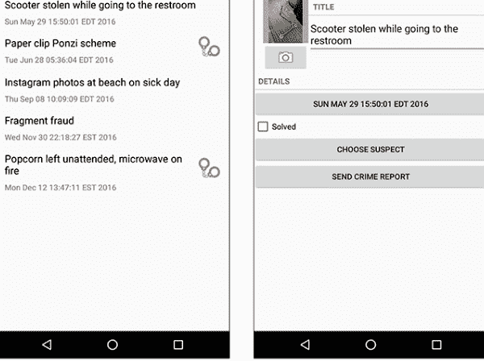

想象用户正在平板电脑上运行。平板电脑足够大，可以同时显示列表和详情（图 7.2）。

图 7.2 平板电脑上的列表与详情

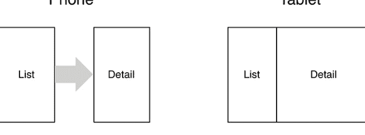

如果手机用户查看详情怎么办？滑动列表将通过另一个 fragment 更新详情视图（图 7.3）。

图 7.3 详情 fragment 被替换

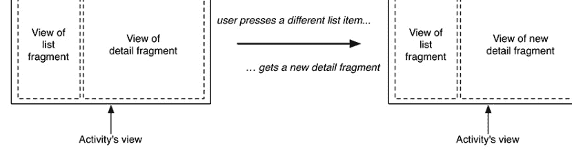

# 第 7 章 UI 片段与片段管理器

## 开始 CriminalIntent

在本章中，你将开始处理 CriminalIntent 的细节。图 7.4 展示了 CriminalIntent 在本章结束时的样子。

图 7.4 本章结束时的 CriminalIntent

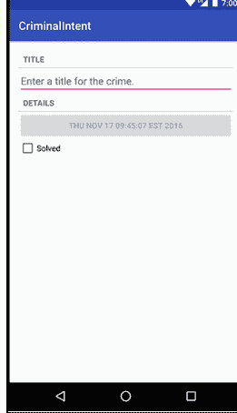

图 7.4 显示的屏幕将由一个名为 `CrimeFragment` 的 UI 片段管理。`CrimeFragment` 的实例将由一个名为 `CrimeActivity` 的 Activity 托管。

目前，请将“托管”（hosting）理解为 Activity 在其视图层次结构中提供一个位置，让片段可以放置其视图（图 7.5）。片段本身无法在屏幕上获取视图。只有当它被放入 Activity 的层次结构中，它的视图才会出现。

### 图 7.5 `CrimeActivity` 托管 `CrimeFragment`

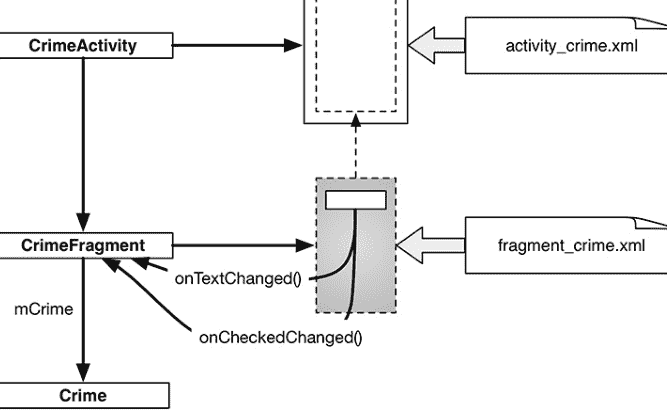

CriminalIntent 将是一个大型项目，保持对项目清晰思路的一种方法是使用对象图。图 7.6 为你展示了 CriminalIntent 的大局。你不需要记住这些对象及其关系，但在开始之前对你的去向有一个大致的了解是有好处的。

你可以看到 `CrimeFragment` 将完成类似于你在 GeoQuiz 中 Activity 所做的工作：创建和管理 UI 并与模型对象进行交互。

图 7.6 CriminalIntent 的对象图（供本章使用）

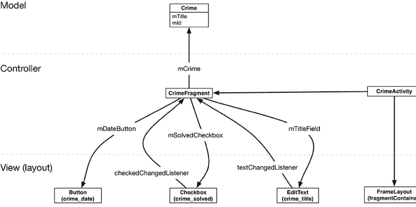

图 7.6 显示的类中，有三个是你将编写的类：`Crime`、`CrimeFragment` 和 `CrimeActivity`。

`Crime` 的实例将代表单个办公室犯罪。在本章中，一个犯罪将有一个标题（title）、一个 ID 以及一个指示犯罪已解决的布尔值。标题是一个描述性名称，例如“毒性水槽倾倒”或“有人偷了我的酸奶!”，ID 将唯一地标识一个 `Crime` 实例。

在本章中，你将保持非常简单，并使用一个 `Crime` 实例。`CrimeFragment` 将拥有一个成员变量（`mCrime`）来持有这个孤立的事件。

`CrimeActivity` 的视图将由一个 `LinearLayout` 组成，该布局定义了 `CrimeFragment` 视图出现的位置。

`CrimeFragment` 的视图将由一个包含若干子元素的 `LinearLayout` 组成，包括一个 `EditText`、一个 `Button` 和一个 `Checkbox`。`CrimeFragment` 为这些视图各准备成员变量，并拥有监听器在发生变化时更新模型层。

## 创建新项目

话说了，是时候构建新应用了。创建一个新的 Android 应用程序（`File -> New Project...`）。将应用程序命名为 CriminalIntent，并确保公司域名为 `android.bignerdranch.com`，如图 7.7 所示。

图 7.7 创建 CriminalIntent 应用程序


点击 Next 指定最小 SDK 为 API 19：Android 4.4。同时确保只勾选了 Phone 和 Tablet 应用类型。

再次点击 Next 选择要添加的 Activity 类型。选择 Empty Activity 并按照向导继续。

在 New Project 向导的最后一步中，将 Activity 命名为 `CrimeActivity` 并点击 Finish（图 7.8）。

图 7.8 创建 `CrimeActivity`


## 两种类型的片段

片段是在 API 11 引入的，当时有第一代 Android 平板以及对 UI 灵活性的突然需求。你必须选择你想要的片段实现：原生片段（native fragments）或支持片段（support fragments）。

片段的原生实现内置在用户运行的设备中。如果你支持许多不同的 Android 版本，每个 Android 版本都可能拥有略有不同的片段实现（例如，某个版本可能修复了 bug，而在之前的版本中没有）。支持的片段实现内置在了一个包含在你的应用程序中的库中。这意味着无论 Android 版本如何，你运行应用程序的每台设备都将依赖于相同的片段实现。

在 CriminalIntent 中，你将使用支持的片段实现。关于这一决定的详细推理列在本章末尾名为“致更好奇的人：为什么支持片段更优”的章节中。

## 在 Android Studio 中添加依赖项

你将使用来自 AppCompat 库自带的片段实现。AppCompat 库是 Google 许多兼容库之一，你将在整本书中使用它。你将在第 13 章学习更多关于 AppCompat 库的知识。

要使用 AppCompat 库，必须将其包含在你的依赖列表中。你的项目有两个 `build.gradle` 文件，一个针对整个项目，另一个针对你的 App 模块。打开 App 模块中的 `build.gradle` 文件。

### 列表 7.1 Gradle 依赖项（`app.gradle`）

```gradle
apply plugin: 'com.android.application'

android {
    ...

}

dependencies {
    fileTree(dir: 'libs', include: ['*.jar'])

    ...

    compile 'com.android.support:appcompat-v7'

    ...
}
```


依赖字符串 `com.android.support:appcompat-v7:25.0.0` 使用 Maven 坐标 `groupId:artifactId:version`。（Maven 是一种依赖管理工具。你可以在 `maven.apache.org` 了解更多信息。）

`groupId` 是 Maven 仓库中可用库集的唯一标识符。通常使用库的基础包名作为 `groupId`，对于 AppCompat 库来说是 `com.android.support`。

`artifactId` 是特定库的名称。在本例中，你所指的是库名为 `appcompat-v7`。

最后，`version` 代表库的版本修订号。CriminalIntent 依赖于 25.0.0 版本的 `appcompat-v7`。（截至本书时，该版本是最新版本，但任何高于该版本都应该有效。事实上，使用最新版本的库是有用的，这样你可以使用新的 API 并获得最新的错误修复。Android Studio 已为你更新了版本，不要回滚到上面的版本。）

既然 AppCompat 库已经是项目中的依赖项，请确保你的项目使用了它。在项目窗口中找到并打开 `CrimeActivity.java`。验证 `CrimeActivity` 的父类是 `AppCompatActivity`。

# 第 7 章 UI 片段与片段管理器

选择左侧 `app` 模块，项目中的 Dependencies 选项卡。`app` 模块的依赖项列在这里（图 7.9）。


（如果你在项目结构之外手动修改此文件，你需要与 Gradle 同步项目以反映任何更改。项目窗口内的更改将自动触发此同步。要手动执行此同步，导航到 Tools → Android → Sync with Gradle Files。）

## 图 7.10 依赖集合


## 列表 7.2 修改模板代码 (`CrimeActivity.java`)

```java
public class CrimeActivity extends AppCompatActivity {

    @Override
    protected void onCreate(Bundle savedInstanceState) {
        super.onCreate(savedInstanceState);
        setContentView(R.layout.activity_crime);
    }
}
```

既然 AppCompat 库已经是项目中的依赖项，让我们通过编写 `Crime` 类为 CriminalIntent 创建模型层。

## 第 7 章 UI 片段与片段管理器

### 创建 Crime 类

在项目窗口中，右键点击 `com.bignerdanch.android.criminalintent` 包，选择 New（新建）→ Java Class。将类重命名为 `Crime` 并点击 OK。

在 `Crime.java` 中，添加字段来表示犯罪的 ID、标题、日期和状态，以及一个初始化 ID 和日期字段的构造函数（列表 7.3）。

### 列表 7.3 在 Crime 类中添加内容 (`Crime.java`)

```java
public class Crime {

    private UUID mID;

    private String mTitle;

    private Date mDate;

    private boolean mSolved;

    public Crime() {
        mID = UUID.randomUUID();
        mDate = new Date();
    }
}
```

`UUID` 是 Android 框架中包含的一个 Java 工具类。它提供了一种生成全局唯一 ID 值的简单方法。在构造函数中，你通过调用 `UUID.randomUUID()` 生成了一个随机的唯一 ID。

Android Studio 可能会找到两个名为 `Date` 的类。使用快捷键 `Option+Return`（或 `Alt+Enter`）手动导入该类。当被询问导入哪个版本的 `Date` 类时，选择 `java.util.Date` 版本。

使用默认的 `Date` 构造函数初始化 `Date` 变量会将 `mDate` 设置为当前日期。这将是犯罪的默认日期。

接下来，你需要为只读的 `mId` 生成 getter，并为 `mTitle`、`mDate` 和 `mSolved` 生成 getter 和 setter。在构造函数之后右键点击，选择 Generate...（生成）→ Getter 并选择 `mId` 变量。然后，重复此过程，但在 Generate... 菜单中选择 Getter and Setter，为 `mTitle`、`mDate` 和 `mSolved` 生成 getter 和 setter。

### 列表 7.4 生成 getters 和 setters (`Crime.java`)

```java
public class Crime {

    private UUID mId;

    private String mTitle;

    private Date mDate;

    private boolean mSolved;

    public Crime() {
        mId = UUID.randomUUID();
        mDate = new Date();
    }

    public UUID getId() {
        return mId;
    }

    public String getTitle() {
        return mTitle;
    }

    public void setTitle(String title) {
        mTitle = title;
    }

    public Date getDate() {
        return mDate;
    }

    public void setState(Date date) {
        mDate = date;
    }

    public boolean isSolved() {
        return mSolved;
    }

    public void setSolved(boolean solved) {
        mSolved = solved;
    }
}
```

这就是本章中 `Crime` 类以及 `CriminalIntent` 模型层所需的全部内容。

此时，你已经创建了模型层以及一个能够托管支持片段（support fragment）的 activity。现在你将进入 activity 如何执行宿主职责的细节。

### 托管 UI 片段

要托管 UI 片段，activity 必须：

- 在其布局中为片段视图留出一个位置
- 管理片段实例的生命周期

### 片段生命周期

图 7.11 显示了片段生命周期。它与 activity 生命周期相似：它有停止（stopped）、暂停（paused）和恢复（resumed）状态，并且有可以覆盖的方法以便在关键点完成任务——其中许多方法与 activity 生命周期方法相对应。

## 图 7.11 片段生命周期图


这种对应关系是非常重要的。因为片段代表 activity 工作，所以它的状态应该反映 activity 的状态。因此，它需要相应的生命周期方法来处理 activity 的状态。

片段生命周期与 activity 生命周期之间的一个关键区别是，片段生命周期方法是由宿主 activity 调用的，而不是操作系统。操作系统对 activity 用于管理事务的片段一无所知。片段是 activity 的内部业务。

随着你继续构建 `CriminalIntent`，你会看到更多片段生命周期方法。

### 托管的两种方法

在 activity 中托管 UI 片段时，你有两种选择：

- 将片段添加到 activity 的布局中
- 将片段添加到 activity 的代码中

第一方法被称为使用布局片段（layout fragment）。它简单直观但缺乏活性。如果你将片段添加到 activity 的布局中，你就将片段及其视图硬编码到了 activity 的视图中，无法在 activity 的生命周期内切换片段。

第二方法（将片段添加到 activity 的代码中）更为复杂——但它是在运行时控制片段的唯一方法。你决定片段何时被添加到 activity，以及之后对它会发生什么。你可以移除片段，用另一个替换它，然后再次添加第一个片段。

为了实现 UI 活性，你必须在代码中添加片段。这将是你为 `CrimeActivity` 托管 `CrimeFragment` 时使用的方法。代码细节将在本章稍后出现。首先，你将定义 `CrimeActivity` 的布局。

### 定义容器视图

你将在宿主 activity 代码中添加 UI 片段，但你需要在 activity 的视图层级中为片段视图留一个位置。在 `CrimeActivity` 的布局中，这将是图 7.12 所示的 `FrameLayout`。

## 图 7.12 `CrimeActivity` 的片段托管布局

| Attribute | Value |
| :--- | :--- |
| `xmlns:android` | `"http://schemas.android.com/apk/res/android"` |
| `android:id` | `@id/fragment_container` |
| `android:layout_width` | `match_parent` |
| `android:layout_height` | `match_parent` |

这个 `FrameLayout` 将是片段的容器。注意，虽然 `activity_xml` 仅包含一个容器视图，但 activity 的布局可以更复杂并定义多个容器视图。你的 XML 应匹配列表 7.5。

### 列表 7.5 创建容器布局

```xml
<FrameLayout
    xmlns:android="http://schemas.android.com/apk/res/android"
    android:id="@+id/fragment_container"
    android:layout_width="match_parent"
    android:layout_height="match_parent" />
```

### 创建 UI 片段

创建片段的方法与创建 activity 的方法类似：

- 在布局文件中定义控件组合 UI
- 创建类并将其设置为定义的布局
- 在代码中连接加载出的控件

### 定义 CrimeFragment 的布局

`CrimeFragment` 的视图将显示包含在 `Crime` 实例中的信息。首先，在 `res/values/strings.xml` 中定义用户看到的字符串。

### 列表 7.6 添加字符串 (`res/values/strings.xml`)

```xml
<resources>
  <string name="app_name">CriminalIntent</string>
  <string name="crime_title_hint">为犯罪输入标题。</string>
  <string name="crime_title_label">标题</string>
  <string name="crime_details_label">详情</string>
  <string name="crime_solved_label">已解决</string>
</resources>
```

接下来，你将定义 UI。`CrimeFragment` 的布局将由一个垂直 `LinearLayout` 组成，包含两个 `TextView`、一个 `EditText`、一个 `Button` 和一个 `Checkbox`。

要创建布局文件，在项目窗口中右键点击 `res/layout` 文件夹，选择 New → Layout resource file。将此文件命名为 `fragment_crime` 并将 `LinearLayout` 作为根元素。点击 OK，Android Studio 将为你生成文件。

`FrameLayout` 是空的，因为 `CrimeActivity` 尚未托管片段。之后你将编写代码将片段视图放入此 `FrameLayout` 中。但首先，你需要创建一个片段。

（应用顶部的工具栏由于你配置 activity 的方式自动包含的。你将在第 13 章中学习更多关于工具栏的内容。）

## 图 7.13 一个空的 `FrameLayout`


## 第 7 章 UI 片段与片段管理器

打开文件后，导航到 XML 文件。向导已经为你添加了 `LinearLayout`。将构成片段布局的控件添加到 `fragment_crime.xml` 中。

### 列表 7.7 片段视图的布局文件 (`fragment_crime.xml`)

```xml
<LinearLayout xmlns:android="http://schemas.android.com/apk/res/android"
    android:layout_width="match_parent"
    android:layout_height="match_parent"
    android:layout_margin="16dp"
    android:orientation="Vertical">

    <TextView
        style="@android:listSeparatorTextStyle"
        android:layout_width="match_parent"
        android:layout_height="wrap_content"
        android:text="@string/crime_title_label"/>

    <EditText
        android:id="@id/crime_title"
        android:layout_width="match_parent"
        android:layout_height="wrap_content"
        android:hint="@string/crime_title_hint"/>

    <TextView
        style="@android:listSeparatorTextStyle"
        android:layout_width="match_parent"
        android:layout_height="wrap_content"
        android:text="@string/crime_details_label"/>

    <Button
        android:id="@id/crime_date"
        android:layout_width="match_parent"
        android:layout_height="wrap_content"/>

    <CheckBox
        android:id="@id/crime_solved"
        android:layout_width="match_parent"
        android:layout_height="wrap_content"
        android:text="@string/crime_solved_label"/>
</LinearLayout>
```

检查“设计”（Design）视图以查看你的片段视图的预览（图 7.14）。

### 图 7.14 更新后的犯罪片段布局预览


（更新后的 `fragment_crime.xml` 代码包含了与视图样式相关的新语法：`<style=" android:listSeparatorTextViewStyle">`。不要担心，你将在第 9 章的“样式、主题和主题属性”章节中学习该语法背后的含义。）

## 创建 CrimeFragment 类

右键点击 `com.bigneranch.android.criminalintent` 包，并选择 New -> Java Class。将类命名为 `CrimeFragment` 并点击 OK 生成该类。

现在，将此类转换为片段。更新 `CrimeFragment` 使其成为 `Fragment` 类的子类。

### 列表 7.8 继承 Fragment 类 (`CrimeFragment.java`)

```java
public class CrimeFragment extends Fragment {

}
```


当你将`Fragment`类作为子类时，你会发现 Android Studio 找到了两个同名为`Fragment`的类。你会看到`Fragment (android.app)`和`Fragment (android.support.v4.app)`。`android.app`中的`Fragment`是内置在 Android 系统中的片段版本。你将使用支持库版本，因此当看到对话框时，请务必选择`android.support.v4.app`版本的`Fragment`类，如图 7.15 所示。

### 图 7.15 选择支持库的`Fragment`类


你的代码应该与列表 7.9 一致。

### 列表 7.9 支持`Fragment`（`CrimeFragment.java`）

```java
package com.bigneranch.android.criminalintent;

import android.support.v4.app.Fragment;

public class CrimeFragment extends Fragment {

}
```

如果你没有看到此对话框或者导入了错误的片段类，可以手动导入正确的类。如果你有一个带有`android.app.Fragment`的类，请删除该行代码。使用`Option+Return (Alt+Enter)`快捷键导入正确的`Fragment`类。确保选择`Fragment`类的支持版本。

## 实现片段生命周期方法

`CrimeFragment`是一个与模型和视图对象交互的控制器。它的工作是展示特定犯罪的细节，并在用户更改这些细节时更新它们。

在 GeoQuiz 中，你的 Activity 没有在 Activity 生命周期周期方法中运行控制器。在 CriminalIntent 中，这项工作将由片段在片段生命周期方法中完成。这些方法中的许多对应于你已经熟悉的 Activity 方法，例如`onCreate(Bundle)`。

在`Fragment.java`中，为`Crime`实例添加一个成员变量并实现`Fragment.onCreate(Bundle)`。

Android Studio 在重写方法时可以提供帮助。当你定义`onCreate(Bundle)`方法时，输入你想要放置的方法的前几个字符。Android Studio 将提供建议列表，如图 7.16 所示。

### 图 7.16 重写`onCreate(Bundle)`方法

```java
public class CrimeFragment extends Fragment {

    private Crime mCrime;

    @Override

    public void onCreateAnimation(transit, next, enter, ...) // Fragment

    public void onCreate(Bundle savedInstanceState) { ... } // Fragment

    public View onCreateView(inflater, container, savedState) { ... } // Fragment

    public void onCreateOptionsMenu(menu, inflater) { ... } // Fragment

    public void onCreateActivity(savedInstanceState) { ... } // Fragment

    public void onViewCreated(view, savedInstanceState) { ... } // Fragment
```

按下回车键选择`onCreate(Bundle)`，Android Studio 会为你生成该方法。将你的代码与列表 7.10 一致。

### 列表 7.10 重写`onCreate(Bundle)`（`CrimeFragment.java`）

```java
public class CrimeFragment extends Fragment {

    private Crime mCrime;

    @Override

    public void onCreate(Bundle savedInstanceState) {

        super.onCreate(savedInstanceState);

        mCrime = new Crime();

    }

}
```

有几点需要注意。首先，`onCreate`是公共方法，而另一个是保护的。其次，类似于 Activity，你需要加载布局。

# 第 7 章 UI 片段与片段管理器

## 在片段中连接控件

你现在将连接片段中的`EditText`、`CheckBox`和`Button`。`onCreate(...)`方法是连接这些控件的地方。

从`EditText`开始。在视图加载（inflate）后，获取它的引用。

### 列表 7.12 连接`EditText`（`CrimeFragment.java`）

```java
public class CrimeFragment extends Fragment {

    private Crime mCrime;

    private EditText mTitle;

    @Override

    public View onCreateView(LayoutInflater inflater, container,

        Bundle savedInstanceState) {

        View v = inflater.inflate(R.layout.fragment_crime, container, false);

        mTitle = (EditText) v.findViewById(R.id.crime_title);

        mTitle.addTextChangedListener(new TextWatcher() {

            @Override

            public void beforeTextChanged(CharSequence s, int start, int count, int after) {

                // 意留空

            }

            @Override

            public void onChanged(CharSequence s, int start, int before, int count) {

                mCrime.setTitle(s.toString());

            }

            @Override

            public void afterChanged(Editable s) {

                // 这个也留空

            }

        });

        return v;

    }

}
```

# 第 7 章 UI 片段与`FragmentManager`

接下来，连接按钮以显示犯罪案發的日期，如列表 7.13 所示。

### 列表 7.13 设置按钮文本（`CrimeFragment.java`）

```java
public class CrimeFragment extends Fragment {

    private Crime mCrime;

    private EditText mTitleField;

    private Button mDateButton;

    ...

    @Override

    public void onCreate(LayoutInflater inflater, ViewGroup container,

        Bundle savedInstanceState) {

        View v = inflater.inflate(R.layout.fragment_crime, container, false);

        ...

        mDateButton = (Button) v.findViewById(R.id.crime_date);

        mDateButton.setText(mCrime.getDate().toString());

        mDateButton.setEnabled(false);

        return v;

    }

}
```

禁用按钮可以确保它不会对用户的点击产生任何响应。在第 12 章中，你将启用该按钮并允许用户选择犯罪发生的日期。

接下来处理`CheckBox`，获取一个引用和一个监听器，用于更新 Crime 的`mSolved`字段，如列表 7.14 所示。

### 列表 7.14 监听`CheckBox`变化（`CrimeFragment.java`）

```java
public class CrimeFragment extends Fragment {

    private Crime mCrime;

    private EditText mTitleField;

    private Button mDateButton;

    private CheckBox mSolvedCheckbox;

    ...

    @Override

    public void onCreate(LayoutInflater inflater, ViewGroup container,

        Bundle savedInstanceState) {

        View v = inflater.inflate(R.layout.fragment_crime, container, false);

        mSolvedCheckbox = (CheckBox) v.findViewById(R.id.crime_solved);

        mSolvedCheckbox.setOnCheckedChangedChangeListener(new OnCheckedChangeListener() {

            @Override

            public void onChanged(ToggleButton buttonView,

                boolean isChecked) {

                mCrime.setSolved(isChecked);

            }

        });

        return v;

    }

}
```

在输入上述代码后，点击`OnCheckedChangeListener`：

```java
mSolvedCheckedBox.setOnCheckedChangeListener(new OnCheckedChangeListener())
```

并使用快捷键`Option+Return (Alt+Enter)`添加必要的 import 语句。你会看到两个选项。选择`android.widget.CompoundButton`版本。

取决于你使用的 Android Studio 版本，自动补全功能可能会插入`CompoundButton.OnCheckedChangeListener()`而不是代码`OnCheckedChangeListener()`。任何一种实现方式都可以。但为了与书中提供的解决方案保持一致，请点击`CompoundButton`并按下`Option+Return (Alt+Enter)`。

选择为`android.widget.CompoundButton`添加按需静态导入的选项（图 7.17）。这将更新代码使其与列表 7.14 一致。

### 图 7.17 添加按需静态导入


你的`CrimeFragment`代码现在已经完成了。如果你现在运行`CriminalIntent`并尝试你编写的代码，那就太好了。但你不能这样做。Fragment 不能自己将视图显示在屏幕上。要实现你的努力，你必须先向`CrimeActivity`添加一个`CrimeFragment`。

## 向`FragmentManager`添加 UI 片段

当 Fragment 类在 Honeycomb 中引入时，Activity 类被更改以包含一个名为`FragmentManager`的部分。`FragmentManager`负责管理你的片段并将它们添加到 Activity 的视图层次结构中（图 7.18）。

`FragmentManager`处理两件事：片段列表和片段事务的回退栈（你很快就会学到这些）。

### 图 7.18 `FragmentManager`


对于`CriminalIntent`，你只需要关注`FragmentManager`的片段列表。

要将片段添加到 Activity，你需要对 Activity 的`FragmentManager`进行显式调用。第一步是获取`FragmentManager`本身。在`CrimeActivity.java`的`onCreate`中执行此。

### 列表 7.15 获取`FragmentManager`（`CrimeActivity.java`）

```java
public class CriminalActivity extends AppCompatActivity {

    @Override

    protected void onCreate(Bundle savedInstanceState) {

        super.onCreate(savedInstanceState);

        setContentView(R.layout.activity_crime);

        FragmentManager fm = getSupportFragmentManager();

    }

}
```

如果在添加此行代码后看到错误，请检查 import 语句以确保导入了支持版本的`FragmentManager`类。

调用`getSupportFragmentManager()`是因为你使用了支持库和`AppCompatActivity`类。如果你对使用支持库感兴趣，你将子类`Activity`并调用`getFragmentManager()`。

## Fragment 事务

现在有了`FragmentManager`，添加以下代码给它一个可以管理的片段。（稍后我们将分析这些代码。现在先将其放入即可。）

### 列表 7.16 添加`CrimeFragment`（`CrimeActivity.java`）

```java
public class CriminalActivity extends AppCompatActivity {

    @Override

    protected void onCreate(Bundle savedInstanceState) {

        super.onCreate(savedInstanceState);

        setContentView(R.layout.activity_crime);

        FragmentManager fm = getSupportFragmentManager();

        Fragment fragment = fm.findFragmentById(R.id.fragment_container);

        if (fragment == null) {

            fragment = new CrimeFragment();

            fm.beginTransaction()

                .add(R.id.fragment_container, fragment)

                .commit();

        }

    }

}
```


**CrimeActivity** 现在正在托管一个 **CrimeFragment**。运行 CriminalIntent 来证明这一点。你应该能看到在 `fragment_crime.xml` 中定义的视图，如图 7.19 所示。

## 图 7.19 **CrimeActivity** 托管的 **CrimeFragment** 视图


## 第 7 章 UI Fragments 与 Fragment Manager

## FragmentManager 和 Fragment 的生命周期

既然你已经了解了 FragmentManager，让我们再次观察 Fragment 的生命周期（图 7.20）。

## 图 7.20 再次查看 Fragment 的生命周期


Activity 的 FragmentManager 负责调用列表中 fragment 生命周期周期方法。当你将 fragment 添加到 FragmentManager 时，会调用 `onAttach(Context)`、`onCreate(Bundle)` 和 `onCreateView(...)` 方法。

`onDestroyCreated(Bundle)` 方法在托管 activity 的 `onCreate(Bundle)` 执行后被调用。由于你在 `CrimeActivity.onCreate(Bundle)` 中调用了 `CrimeFragment`，因此此方法会在 fragment 被添加后被调用。

如果在 activity 已经恢复（resumed）时添加 fragment 会发生什么？在这种情况下，FragmentManager 会立即引导 fragment 经过所有必要的步骤，以同步 activity 的状态。例如，当 fragment 被添加到已经恢复的 activity 时，fragment 会被依次调用 `onAttach(Context)`、`onCreate(Bundle)`、`onCreateView(...)`、`onDestroyCreated(Bundle)`、`onStart()`，然后是 `onResume()`。

一旦 fragment 的状态与 activity 的状态同步，托管 activity 的 FragmentManager 将在接收操作系统相应调用的同时，调用进一步的生命周期方法，以保持 fragment 的状态与 activity 一致。

## 使用 Fragments 构建应用架构

正确地使用 fragments 设计应用至关重要。许多开发者在首次学习 fragments 之后，尝试将它们用于应用程序中的每一个复用组件。这是使用 fragments 的错误方式。

Fragments 旨在以可重用的方式封装主要组件。在这种情况下，主要组件的级别相当于应用程序的整个一个屏幕。如果你一次性有大量的 fragment，你的代码将充斥着 fragment 事务（fragment transactions）和不清晰的职责。对于较小的组件，更好的架构解决方案是将它们提取到自定义视图（一个子类 `View` 或其某个子类的类）。

请负责任地使用 fragments。一个好的准则是屏幕上同时显示的 fragment 不要多于二或三个（图 7.21）。

## 图 7.21 少即是多


## 第 7 章 UI Fragments 与 Fragment Manager

## 为什么我们所有的活动都会使用 fragments

从现在开始，书中的所有应用都将使用 fragments——无论它们多简单。这看起来可能是过度设计。在后续章节中你看到的许多示例可以在不使用 fragments 的情况下编写。UI 可以从 activity 创建并管理，这样做甚至可能代码更少。

然而，我们认为让你熟悉这种在现实生活中最可能用到的模式更好。

你可能认为从不带 fragments 开始编写一个简单的应用，等以后需要（或如果需要）再添加它们会更好。在极端编程（Extreme Programming）方法中有一个观点叫做 YAGNI。YAGNI 的意思是“你不需要它”（You Aren't Gonna Need It），它敦促如果你认为以后可能需要，就不要写代码。为什么要用 YAGNI？对 fragments 说“YAGNI”很有诱力。

不幸的是，以后添加 fragments 可能会是一个雷区。将一个 activity 改为托管 UI fragment 的 activity 并不困难，但有很多令人讨厌的陷阱（gotchas）。让某些接口由 activity 管理，而另一些由 fragments 管理只会让情况更糟，因为你必须跟踪这种毫无意义的区别。从一开始就使用 fragments 编写代码，而不必担心以后重工作的痛苦和烦恼，或者记住你在应用程序每个部分使用的是哪种风格的控制器，要容易得多。

因此，涉及到 fragments 时，我们有一个不同的原则：AUF，或“始终使用 Fragments”（Always Use Fragments）。在决定使用 fragment 还是 activity 时，你会消耗很多脑细胞，这完全不值得。AUF！

## 给更具好奇心的人：Fragments 与 Support Library

在本章中，你包含了 AppCompat 库，以便你可以使用 support fragments。AppCompat 本身并不包含 support fragment 的实现。AppCompat 库依赖于 support-v4 库，而 support fragment 的实现就在那里。

Google 提供了许多不同的 support libraries，包括 support-v4、appcompat-v7、recyclerview-v7 等等。support-v4 库通常被称为 support library。这是提供给开发者的第一个 support library。随着时间的推移，越来越多的工具被添加到这个库中，它变成了一个没有真正重点的杂烩包。在那个时候，Google 决定开发一套 support libraries 而不是单一的库。

support library（support-v4）包含了你在本章中使用的 fragments 的 support 实现。例如，你将如何找到 `android.v4.app.Fragment` 的源码。support library 还包含一个 Activity 子类：`FragmentActivity`。要使用 support fragments，你的 activities 必须子类 **FragmentActivity**。

如图 7.22 所示，要使用 support fragments，你的 activities 必须子类 `FragmentActivity`。

## 图 7.22 AppCompatActivity 类层次


如果这一切听起来很困惑，是因为它确实如此。但不用担心——AppCompat 本身并不包含 support fragment 实现。你将在第 13 章学习更多关于 AppCompat library。

## 第 7 章 UI Fragments 与 Fragment Manager

## 给更具好奇心的人：为什么 Support Fragments 更好

本书使用 support library 的 fragments 实现，而不是内置在 Android OS 中的实现，这看起来可能是一个不寻常的选择。毕竟，support library 实现最初是为了让开发者能够在不支持该 API 的旧版本 Android 上使用 fragments。现在，大多数开发者都在支持 fragments 的 Android 版本上工作。

我们仍然倾向于使用。为什么？support fragments 更好，因为你可以随时更新应用程序中的 support library 版本。support library 发布多次新版本。当新功能被添加到 fragment API 时，它也会添加到 support library 中，并带有任何的错误修复。如果你需要这种好处，只需更新应用程序中的 support library 版本。

例如，官方支持嵌套（在 fragment 中嵌套 fragment）是在 Android 4.2 中引入的。如果你使用 OS 的 fragment 实现并支持 Android 4.0 及更高版本，你无法在所有支持设备上使用该 API。如果你使用 support library，你可以更新库的版本并嵌套 fragment 直到内存耗尽。

使用 support library 的 fragments 没有显著的缺点。support library 中的 fragments 实现与 OS 中的实现几乎相同。唯一的真实缺点是你必须在项目中包含 support library，并且它占用空间。然而，它目前小于 1 兆——而且你可能还会使用 support library 的某些功能。

# 使用 RecyclerView 显示列表

CriminalIntent 的模型层目前由一个单一的 Crime 实例组成。在本章中，你将更新 CriminalIntent 以支持 Crime 对象的列表操作。该列表将显示每个 Crime 的标题和日期，如图 8.1 所示。

## 图 8.1 犯罪列表


## 第 8 章 使用 RecyclerView 显示列表

图 8.2 显示了本章中 CriminalIntent 的整体计划。

## 图 8.2 带有犯罪列表的 CriminalIntent


在模型层中，你有一个新对象 `CrimeLab`，它将作为 Crime 对象的集中数据存储器。

显示犯罪列表需要在 CriminalIntent 的控制层中一个新的 activity 和一个新的 fragment：`CrimeActivity` 和 `CrimeListFragment`。

（`CrimeActivity` 和 `CrimeFragment` 在图 8.2 中在哪里呢？它们是详情视图的一部分，所以我们在这里不显示它们。在第 10 章中，你将连接 CriminalIntent 的列表和详情部分。）

在图 8.2 中，你还可以看到与 `CrimeActivity` 和 `CrimeListFragment` 关联的视图。activity 的视图将由一个包含 fragment 的 `FrameLayout` 组成。fragment 的视图将由一个 `RecyclerView` 组成。你将在本章后面学习更多关于 `RecyclerView` 类。

# 更新 CriminalIntent 的模型层

第一步是将 CriminalIntent 的模型层从单一 Crime 对象升级为 Crime 对象的 `List`。

## 单例模式和集中数据存储

你将把犯罪列表存储在一个单例中。单例是一种类，只要应用程序保持在内存中，它就允许只创建一个实例；将列表存储在单例中可以确保犯罪数据在 activity 和 fragment 的任何生命周期变化中始终可用。

只要应用程序存在，单例就存在，当 Android 从内存中移除你的应用程序时，它们会被销毁。`CrimeLab` 单例不是长期存储数据的解决方案，但它允许应用拥有一个犯罪数据所有者，并提供了一种方便通过控制类传递数据的方法。（你将在第 14 章中学习更多关于长期数据存储的内容。）

要创建一个单例，创建一个带有私有构造函数和 `get()` 方法的类。如果实例已存在，则 `get()` 返回该实例。如果实例不存在，`get()` 将调用构造函数创建它。

右键点击 `com.bignerdranch.android.criminalintent` 包并选择 New → Java Class。将此类命名为 `CrimeLab` 并点击 OK。

在 `CrimeLab.java` 中，通过私有构造函数和 `get()` 方法将 `CrimeLab` 实现为单例。

### 8.1 设置单例 (CrimeLab.java)

```java
public class CrimeLab {

    private static CrimeLab sCrimeLab;

    public static CrimeLab get(Context context) {

        if (sCrimeLab == null) {

            sCrimeLab = new CrimeLab(context);

        }

        return sCrimeLab;

    }

    private CrimeLab(Context context) {

    }

}
```

在这个 `CrimeLab` 实现中，有几个有趣的地方。首先，注意 `sCrimeLab` 变量上的 `s` 前缀。你正在使用这种 Android 命名约定来表示 `sCrimeLab` 是一个静态变量。

此外，注意 `CrimeLab` 的私有构造函数。其他类将无法绕过 `get()` 方法来创建 `CrimeLab`。

最后，在 `CrimeLab` 的 `get()` 方法中，你传入了一个 `Context` 对象。你将在第 14 章中使用这个 `Context` 对象。

让我们给 `CrimeLab` 提供一些 Crime 对象进行存储。在 `CrimeLab` 的构造函数中，创建一个空的 Crime 列表。此外，添加两个方法：返回列表的 `getCrimes()` 方法和返回给定 ID 的 Crime 的 `getCrime(UUID)` 方法。

### 列表 8.2 设置 Crime 对象列表 (CrimeLab.java)

```java
public class CrimeLab {

    private static List<Crime> mCrimes;

    public static List<Crime> get(Context context) {

        ...

    }

    private CrimeLab(Context context) {

        mCrimes = new ArrayList<>();

    }

    public List<Crime> getCrimes() {

        return mCrimes;

    }

    public Crime getCrime(UUID id) {

        for (Crime crime : mCrimes) {

            if (crime.getId().equals(id)) {

                return crime;

            }

        }

        return null;

    }

}
```


`List<E>`是一个接口，支持给定类型对象的有序列表。它定义了检索、添加和删除元素的方法。`List`的常用实现是`ArrayList`，它使用普通的Java数组来存储列表元素。

由于`ArrayList`持有一个`ArrayList`且`ArrayList`也是一个`List` —— `ArrayList`和`List`都是`mCrimes`的有效类型。在这种情况下，我们建议使用接口进行变量声明：`List`。这样如果你需要使用不同的`List`实现（例如`LinkedList`），可以轻松做到。

`mCrimes`的实例化使用了菱形符号`{}`，这是在Java 7中引入的。这种简写符号告诉编译器根据变量声明中的泛型参数来推断列表将包含的项类型。编译器将推断`ArrayList`包含`Crimes`，因为变量声明`private List<Crime> mCrimes;`。

`mCrimes`的实例化使用了菱形符号`{}`，这是在Java 7中引入的。这种简写符号告诉编译器根据变量声明中的泛型参数来推断列表将包含的项类型。编译器将推断`ArrayList`包含`Crimes`，因为变量声明`private List<Crime> mCrimes;`。

`mCrimes`的实例化使用了菱形符号`{}`，这是在Java 7中引入的。这种简写符号告诉编译器根据变量声明中的泛型参数来推断列表将包含的项类型。编译器将推断`ArrayList`包含`Crimes`，因为变量声明`private List<Crime> mCrimes;`。

`mCrimes`的实例化使用了菱形符号`{}`，这是在Java 7中引入的。这种简写符号告诉编译器根据变量声明中的泛型参数来推断列表将包含的项类型。编译器将推断`ArrayList`包含`Crimes`，因为变量声明`private List<Crime> mCrimes;`。

`mCrimes`的实例化使用了菱形符号`{}`，这是在Java 7中引入的。这种简写符号告诉编译器根据变量声明中的泛型参数来推断列表将包含的项类型。编译器将推断`ArrayList`包含`Crimes`，因为变量声明`private List<Crime> mCrimes;`。

`mCrimes`的实例化使用了菱形符号`{}`，这是在Java 7中引入的。这种简写符号告诉编译器根据变量声明中的泛型参数来推断列表将包含的项类型。编译器将推断`ArrayList`包含`Crimes`，因为变量声明`private List<Crime> mCrimes;`。

`mCrimes`的实例化使用了菱形符号`{}`，这是在Java 7中引入的。这种简写符号告诉编译器根据变量声明中的泛型参数来推断列表将包含的项类型。编译器将推断`ArrayList`包含`Crimes`，因为变量声明`private List<Crime> mCrimes;`。

# 抽象Activity

现在，你已经填充`Crime`列表。

### 8.3 生成犯罪 (CrimeLab.java)

```java
private CrimeLab(Context context) {

    mCrimes = new ArrayList<>();

    for (int i = 0; i < 10; i++) {

        Crime crime = new Crime();

        crime.setTitle("Crime #" + i);

        mCrimes.add(crime);

    }

}
```

现在，你已经拥有了填充犯罪的模型层。

稍后，你将创建一个托管犯罪列表的`CrimeActivity`类。

# 通用fragment布局

### 8.4 activity_crime.xml 是一个fragment布局

```xml
<?xml version="1.0" encoding="utf-8"?>
<FrameLayout xmlns:android="http://schemas.android.com/apk/res/android"
  android:id="@+id/fragment_container"
  android:layout_width="match_parent"
  android:layout_height="match_parent"/>
```

由于`activity_crime.xml`并没有命名特定的fragment，你可以使用它来托管任何fragment。

# 一个抽象的Activity类

你在本书中创建的几乎每个activity都需要相同的代码。为了避免重复输入，你将这些代码封装放在一个抽象类中。

右键点击`com.bignerdranch.android.criminalintent`包，选择New（新建）→ Java Class，并将新类命名为`SingleFragmentActivity`。将此类设为`AppCompatActivity`的子类，并将其声明为抽象类。生成的文件应该如下所示：

# 列表 8.7 创建抽象Activity (SingleFragmentActivity.java)

```java
public abstract class SingleFragmentActivity extends AppCompatActivity {

}
```

现在，将以下代码添加到`SingleFragmentActivity.java`中。除了高亮部分外，它和你旧的Activity代码完全一致。

# 列表 8.8 添加通用父类 (SingleFragmentActivity.java)

```java
public abstract class SingleFragmentActivity extends AppCompatActivity {

  protected abstract Fragment createFragment();

  @Override
  protected void onCreate(Bundle savedInstanceState) {

    super.onCreate(savedInstanceState);

    setContentView(R.layout.activity_fragment);

    FragmentManager fm = getFragmentManager();

    Fragment fragment = fm.findViewById(R.id.fragment_container);

    if (fragment == null) {

      fragment = createFragment();

      fm.beginTransaction()

        .add(R.id.fragment_container, fragment)

        .commit();

    }

  }

}
```

在这段代码中，你将activity的view设置为从`activity_fragment.xml`填充。然后你在该容器的`FragmentManager`中查找该fragment，如果它不存在，则创建并添加它。

列表8.8中的代码与`CrimeActivity`中的代码唯一的区别在于有一个名为`createFragment()`的抽象方法，你用它来实例化fragment。`SingleFragmentActivity`的子类将实现此方法，以返回该activity托管的fragment实例。

# 第8章 使用RecyclerView显示列表

# 使用抽象类

尝试在`CrimeActivity`中进行尝试。将`CrimeActivity`的父类改为`SingleFragmentActivity`；移除`onCreate(Bundle)`的实现，并按照列表8.9所示实现`createFragment()`方法。

# 列表 8.9 清理CrimeActivity (CrimeActivity.java)

```java
public class CrimeActivity extends SingleFragmentActivity {

    // 当activity首次创建时调用

    @Override
    protected void onCreate(Bundle savedInstanceState) {

        super.onCreate(savedInstanceState);

        setContentView(R.layout.activity_main);

    }

    FragmentManager fm = getSupportFragmentManager();

    Fragment fragment = fm.findFragmentById(R.id.fragment_container);

    if (fragment == null) {

        fragment = new CrimeFragment();

        fm.beginTransaction()

            .add(R.id.fragment_container, fragment)

            .commit();

    }

    @Override
    protected Fragment createFragment() {

        return new CrimeFragment();

    }

}
```

# 创建新的控制器

现在，你将创建两个新的控制器类：`CrimeLoginActivity`和`CrimeListFragment`。

右键点击`com.bignerdranch.android.criminalintent`包，选择New -> Java Class，并将类命名为`CrimeLoginActivity`。

修改`CrimeLoginActivity`类使其也成为`SingleFragmentActivity`的子类并实现`createFragment()`方法。

# 列表 8.10 实现CrimeLoginActivity (CrimeListActivity.java)

```java
public class CrimeLoginActivity extends SingleFragmentActivity {

    @Override
    protected Fragment createFragment() {

        return new CrimeListFragment();

    }

}
```

如果你在`CrimeListActivity`中有其他方法（如`onCreate`），请将它们删除。让`SingleFragmentActivity`执行工作并保持`CrimeLoginActivity`的简单。

`CrimeListFragment`类还没有创建。让我们来修复。

再次右键点击`com.bignerdranch.android.criminalintent`包，选择New -> Java Class，并将其命名为`CrimeListFragment`。

# 列表 8.11 实现CrimeListFragment (CrimeListFragment.java)

```java
public class CrimeListFragment extends Fragment {

    // 暂无

}
```

目前，`CrimeListFragment`将只是一个fragment的空壳。你将在本章后续部分处理这个fragment。

现在，你的activity代码非常整洁。随着你对本书的阅读，`SingleFragmentActivity`将为你节省大量的打字时间和精力。

# 声明CrimeListActivity

既然你已经创建了`CrimeListActivity`，就必须在manifest中声明它。此外，你希望犯罪列表是用户启动`CriminalIntent`时看到的第一个屏幕，因此`CrimeListActivity`应该是启动activity（launcher activity）。

在manifest中声明`CrimeListActivity`，并将启动intent过滤器从`MainActivity`的声明移动到`CrimeListActivity`的声明。

# 列表 8.12 将CrimeListActivity声明为启动activity (AndroidManifest.xml)

```xml
<application
    android:allowBackup="true"
    android:icon="@mipmap/ic_launcher"
    android:label="@string/app_name"
    android:theme="@style/AppTheme">

    <activity android:name="CrimeListActivity">

        <intent-filter>

            <action android:name="android.intent.action.MAIN" />

            <category android:name="android.intent.category.LAUNCHER" />

        </intent-filter>

    </activity>

    <activity android:name="CrimeActivity">

        <intent-filter>

            <action android:name="android.intent.action.MAIN" />

            <category android:name="android.intent.category.LAUNCHER" />

        </intent-filter>

    </activity>

</application>
```

# RecyclerView, Adapter和ViewHolder

现在你想要`CrimeListFragment`显示犯罪列表。为了实现这一点，你将使用`RecyclerView`。`RecyclerView`是`ViewGroup`的子类。它显示列表项，根据列表的复杂程度，这些项可以复杂也可以简单。对于你的第一个实现，每个项将是一个包含两个`TextView`的`LinearLayout`，如图8.4所示。

图8.4 带有子视图的RecyclerView
`img/33f7b293c91adf28b10a17356a4bc`

图8.4显示了12行。这是否意味着你准备了100个View？多亏了`RecyclerView`，并不是。列表可以远超100个项目，你的列表项也可以比这里更复杂。它并不是一次性创建100个View，而是创建12个以填充屏幕。当视图滚动屏幕时，`RecyclerView`会重用它而不是丢弃它。简而言之，它名副其实：它在反复重用视图。

# ViewHolder和Adapters

`RecyclerView`的唯一职责是回收`TextViews`并它们在屏幕上定位。为了首先获取`TextViews`，它与你即将构建的两个类工作：一个`Adapter`子类和一个`ViewHolder`子类。

`ViewHolder`的工作很小，我们先谈谈它。`ViewHolder`只做一件事：持有一个View（图8.5）。

图8.5 低矮的ViewHolder
`img/33f7293c91adf28b10a17356a4bc`

工作很小，但这正是`ViewHolder`所做的。典型的`ViewHolder`子类如下：

列表 8.13 典型的ViewHolder子类

```java
public class ListRow extends RecyclerView.ViewHolder {

    public ImageView mThumbnail;

    public ListRow(View view) {

        super(view);

        mThumbnail = (ImageView) view.findViewById(R.id.thumbnail);

    }

}
```

现在你可以创建一个`ListRow`并访问`mThumbnail`（你自己创建的）和`itemView`（你的子类`RecyclerView.ViewHolder`为你赋值的字段）。`itemView`字段是你的`ViewHolder`存在的意义：它持有传递给`super(view)`的条目引用。

列表 8.14 ViewHolder的典型用法

```java
ListRow row = new ListRow(inflater.inflate(R.layout.list_row, parent, false));
View view = row.itemView;
ImageView thumbnail = row.mThumbnail;
```


`RecyclerView`永远不会自己创建`View`。它总是创建`ViewHolder`，并由`ViewHolder`携带它们的项`itemViews`（图 8.6）。

图 8.6 带有`ViewHolders`的`RecyclerView`


当`View`简单时，`ViewHolder`的职责很少。对于更复杂的`View`，`ViewHolder`使将`itemView`的不同部分连接到`Crime`的工作变得更加简单且高效。你将在本章稍后自己构建一个复杂的`View`时，看到它是如何工作的。

## 适配器（`Adapters`）

图 8.6 经过了简化。`RecyclerView`本身并不创建`ViewHolders`。相反，它会请求适配器。适配器是一个控制器对象，位于`RecyclerView`和`RecyclerView`应该显示的数据集之间。

适配器负责：

- 创建必要的`ViewHolders`
- 将`ViewHolders`绑定到来自模型层的数据

要构建适配器，你首先需要定义`RecyclerView.Adapter`的子类。你的适配器子类将封装你从`CrimeLab`获取的犯罪列表。

## 第 8 章 使用`RecyclerView`显示列表

当`RecyclerView`需要一个视图对象时，它会与它的适配器进行对话。图 8.7 显示了`RecyclerView`可能发起的对话示例。

图 8.7 闪烁的`RecyclerView`-`Adapter`对话


首先，`RecyclerView`通过调用适配器的`getItemCount()`方法询问列表中有多少个对象。

然后，`RecyclerView`调用适配器的`onCreateViewHolder(ViewGroup, int)`方法创建一个新的`ViewHolder`，以及它“多汁”的负载：一个用于显示的`View`。

最后，`RecyclerView`调用`onBindViewHolder(ViewHolder, int)`。`RecyclerView`将一个`ViewHolder`连同位置传入此方法。适配器将查找该位置的模型数据并将其绑定到`ViewHolder`的`View`上。在方法内部，适配器填充`View`以反映模型对象中的数据。

完成此过程后，`RecyclerView`将将列表项放置在屏幕上。

注意，`onCreateViewHolder(ViewGroup, int)`的发生频率远低于`onBindViewHolder(ViewHolder, int)`。一旦创建了足够的`ViewHolders`，`RecyclerView`就会停止调用`onCreateViewHolder(...)`。相反，它通过回收旧的`ViewHolders`来节省时间和内存。

## 使用`RecyclerView`

话不多说，是时候实现了。`RecyclerView`类存在于 Google 的许多支持库之一。第一步是将`RecyclerView`库作为依赖添加。

通过`File -> Project Structure....`导航到项目结构窗口。在左侧选择`app`模块，然后选择`Dependencies`选项卡。使用`+`按钮并选择`Library dependency`来添加依赖。

找到并选择`recyclerview-v7`库并点击`OK`将该库作为依赖添加，如图 8.8 所示。

图 8.8 添加`RecyclerView`依赖


你的`RecyclerView`将位于`CrimeListFragment`中。首先，你必须创建一个布局文件。右键点击`res/layout`目录并选择`New -> Layout resource file`。将文件命名为`crime_list`并点击`OK`创建文件。

打开新的`fragment_list`文件，将根视图修改为`RecyclerView`并赋予它一个`ID`属性。

## 8.15 在布局文件中添加`RecyclerView`（`fragment_list.xml`）

```
<LinearLayout xmlns:android="http://schemas.android.com/apk/res/android"
    android:orientation="vertical"
    android:layout_width="match_parent"
    android:layout_height="match_parent">

    <android.support.v7.widget.RecyclerView
        xmlns:android="http://schemas.android.com/apk/res/android"
        android:id="@id/crime_recyclerview"
        android:layout_width="match_parent"
        android:layout_height="match_parent"/>
</LinearLayout>
```

## 第 8 章 使用`RecyclerView`显示列表

现在已经有了`CrimeListFragment`的 view，将其连接到 fragment。修改`CrimeListFragment`使用此布局文件并在文件中找到`RecyclerView`，如代码 8.16 所示。

## 8.16 为`CrimeListFragment`设置 view（`CrimeListFragment.java`）

```java
public class CrimeListFragment extends Fragment {
    // 还没有内容
    private RecyclerView mRecyclerView;

    @Override
    public View onCreateView(LayoutInflater inflater, ViewGroup container,
        Bundle savedState) {
        View view = inflater.inflate(R.layout.crime_list, container, false);
        mRecyclerView = (RecyclerView) view
            .findViewById(R.id.crime_recyclerView);
        mRecyclerView.setLayoutManager(new LinearLayoutManager(getActivity()));
        return view;
    }
}
```

注意，一旦创建了`RecyclerView`，就要给它另一个名为`LayoutManager`的对象。`RecyclerView`需要`LayoutManager`才能工作。如果你忘记提供，程序将会崩溃。`RecyclerView`不在屏幕上布局项，它将该任务交给`LayoutManager`。`LayoutManager`布局每个项并定义滚动方式。内置了一些`LayoutManager`可供选择，可以在第三方库中找到更多。你使用的是`LinearLayoutManager`，它将垂直布局项。运行应用。你再次看到一个空白屏幕，但现在你面对的是一个空的`RecyclerView`。在定义`Adapter`和`ViewHolder`实现之前，你不会在屏幕上看到任何`Crime`。

## 用于显示的`View`

`RecyclerView`上显示的每个项都有自己的视图层级，就像`CrimeFragment`有整个屏幕的视图层级一样。你像为 activity 或 fragment 的 view 创建布局一样为列表项创建一个新的布局。在项目窗口中，右键点击`res/layout`目录并点击`New -> Layout resource file`。在出现的对话框中，将其命名为`list_item_crime`并点击`OK`。

更新你的布局文件以添加图 8.9 所示的`TextView`。

## 图 8.9 更新项布局（`list_item_crime.xml`）

```
<LinearLayout
    xmlns:android="http://schemas.android.com/apk/res/android"
    android:layout_width="match_parent"
    android:layout_height="wrap_content"
    android:orientation="vertical"
    android:padding="8dp">

    <TextView
        android:id="@id/crime_title"
        android:layout_width="match_parent"
        android:layout_height="wrap_content"
        android:text="Crime Title" />

    <TextView
        android:id="@id/crime_date"
        android:layout_width="match_parent"
        android:layout_height="wrap_content"
        android:text="Crime Date" />
</LinearLayout>
```

查看设计预览，你将发现你已经创建了一行成品。稍后，你将看到`RecyclerView`为你创建这些行。

## 实现`ViewHolder`和适配器

下一个任务是定义将膨胀并显示你的布局的`ViewHolder`。将其作为另一个类在`CrimeListFragment`中定义。

## 8.17 `ViewHolder`的开头（`CrimeListFragment.java`）

```java
public class CrimeListFragment extends Fragment {
    ...
    private class CrimeViewHolder extends RecyclerView.ViewHolder {
        public CrimeViewHolder(LayoutInflater inflater, ViewGroup parent) {
            super(inflater.inflate(R.layout.list_item_crime, parent, false));
        }
    }
}
```

在`ViewHolder`的构造函数中，你膨胀了`list_item_crime.xml`。你立即将其传入`super()`构造函数。基础`ViewHolder`将持有`fragment_crime_list.xml`视图层级。如果你需要该层级，可以在`ViewHolder`的`itemView`字段中找到它。

## 第 8 章 使用`RecyclerView`显示列表

`ViewHolder`现在仅仅是骨架。在本章的后些部分，随着你给它更多工作要做，`ViewHolder`将变得强壮。

定义好`ViewHolder`后，创建适配器。

## 8.18 适配器的开头（`CrimeListFragment.java`）

```java
public class CrimeListFragment extends Fragment {
    private class CrimeAdapter extends RecyclerView.Adapter<CrimeHolder> {
        private List<Crime> mCrimes;

        public CrimeAdapter(List<Crime> crimes) {
            mCrimes = crimes;
        }
    }
}
```

（在代码 8.18 将无法编译。我们稍后会修复它。）

当`RecyclerView`需要显示一个新的`ViewHolder`或将`Crime`对象连接到现有`ViewHolder`时，它会向适配器请求调用其方法。`RecyclerView`本身不知道`Crime`对象，但适配器知道`Crime`的所有隐私和个人细节。

接下来，在`CrimeAdapter`中实现三个方法重写。（你可以通过将光标放在`extends`上方，按下`Option-Return`（`Alt+Enter`），实现方法并点击`OK`。你只需要填充方法体。）

## 8.19 填充`CrimeAdapter`（`CrimeListFragment.java`）

```java
private class CrimeAdapter extends RecyclerView.Adapter<CrimeHolder> {
    ...
    @Override
    public CrimeHolder onCreateViewHolder(ViewGroup parent, int viewType) {
        LayoutInflater inflater = LayoutInflater.from(getActivity());
        return new CrimeHolder(inflater, parent);
    }

    @Override
    public void onBindViewHolder(CrimeHolder holder, int position) {
    }

    @Override
    public int getItemCount() {
        return mCrimes.size();
    }
}
```

`onCreateViewHolder()`在`RecyclerView`需要一个新的`ViewHolder`来显示项时被调用。在此方法中，你创建一个`LayoutInflater`并使用它构造一个新的`CrimeViewHolder`。

你的适配器必须有一个`onBindViewHolder()`的重写，但目前你可以将其留空。稍后，你会回来处理它。

现在你已经有了一个`Adapter`，将其连接到你的`RecyclerView`。实现一个名为`updateUI()`的方法，用于设置`CrimeListFragment`的 UI。目前，它会创建一个`CrimeAdapter`并将其设置为`RecyclerView`上。

## 列表 8.20 设置`Adapter`（`CrimeListFragment.java`）

```java
public class CrimeListFragment extends Fragment {
    private RecyclerView mCrimeRecyclerView;
    private CrimeAdapter mAdapter;

    @Override
    public View onCreateView(LayoutInflater inflater, ViewGroup container,
                               Bundle savedInstanceState) {
        View view = inflater.inflate(R.layout.fragment_crime_list, container, false);
        mCrimeRecyclerView = (RecyclerView) view
                .findViewById(R.id.crime_recyclerView);
        mCrimeRecyclerView.setLayoutManager(new LinearLayoutManager(getActivity()));
        updateUI();
        return view;
    }

    private void updateUI() { // 因为 UI 的配置变得越来越复杂。
        CrimeLab crimeLab = CrimeLab.get(getActivity());
        List<Crime> crimes = crimeLab.getCrimes();
        mAdapter = new CrimeAdapter(crimes);
        mCrimeRecyclerView.setAdapter(mAdapter);
    }
}
```


在后面的章节中，随着 UI 配置变得更加复杂，你为`updateUI()`添加更多内容。

## 第 8 章 使用 RecyclerView 显示列表

运行 CriminalIntent 并滚动你的新`RecyclerView`，它看起来应该像图 8.10。

图 8.10 一份精美的列表……美丽的、漂亮的、美丽的


嗯，RecyclerView 先生，那里看起来有点重复。滑动或向下拖动，你将会看到更多相同的视图在你的屏幕上滚动。

在截图中，有 11 行，这意味着`onCreateViewHolder(...)`被调用了 11 次。如果你向下滚动，可能会创建更多几个`CrimeHolder`，但在某一个一点，`RecyclerView`将停止创建新的`CrimeHolder`。相反，当旧的`CrimeHolder`滚动出屏幕顶部时，`RecyclerView`会复用它们。

目前，每一行都是理想的。在下一步中，你将通过绑定（binding）在被复用的同时为每个`CrimeHolder`填充新鲜信息。

### 绑定列表项

绑定是将 Java 代码（如`Crime`中的模型数据或点击监听器）并挂载到控件上。因此，到目前为止，在书中到此为止的所有练习中，你每次填充（inflate）视图时都会绑定。这意味着没有必要将该工作放在一个独立的方法中。然而，现在视图会被复用，将创建放在一个地方，而将绑定放在另一个地方是很有意义的。

所有执行实际绑定工作的代码将放在你的`CrimeHolder`内部。这从提取你感兴趣的所有控件开始。这只需要发生一次，所以请在构造函数中编写你的代码。

### 列表 8.21 在构造函数中提取视图（`CrimeListViewFragment.java`）

```java
private class CrimeHolder extends RecyclerView.ViewHolder {

    private TextView mTitleTextView;

    private TextView mDateTextView;

    public CrimeHolder(LayoutInflater inflater, ViewGroup parent) {

        super(inflater.inflate(R.layout.list_item_crime, parent, false));

        mTitleTextView = (TextView) itemView.findViewById(R.id.crime_title);

        mDateTextView = (TextView) itemView.findViewById(R.id.crime_date);

    }

}
```

你的`CrimeHolder`还需要一个`bind(Crime)`方法。每当一个新的`Crime`需要在你的`CrimeHolder`中显示时，该方法就会被调用。首先，添加`bind(Crime)`。

### 列表 8.22 编写 `bind(Crime)` 方法（`CrimeListFragment.java`）

```java
private class CrimeHolder extends RecyclerView.ViewHolder {

    private Crime mCrime;

    ...

    public void bind(Crime crime) {

        mCrime = crime;

        mTitleTextView.setText(mCrime.getTitle());

        mDateTextView.setText(mCrime.getDate().toString());

    }

}
```

给定一个`Crime`，`CrimeHolder`现在将更新标题`TextView`和日期以反映`Crime`的状态。

接下来，你新创建的`bind(Crime)`方法将在每次`RecyclerView`请求将新的`CrimeHolder`绑定到特定的`Crime`时调用。

### 列表 8.23 调用 `bind(Crime)` 方法（`CrimeListFragment.java`）

```java
private class CrimeAdapter extends RecyclerView.Adapter<CrimeHolder> {

    @Override

    public void onBindViewHolder(CrimeHolder holder, int position) {

        Crime crime = mCrimes.get(position);

        holder.bind(crime);

    }

    ...

}
```

再次运行 CriminalIntent，每个可见的`CrimeHolder`都应该显示一个不同的`Crime`（图 8.11）。

图 8.11 没问题，没问题，没问题


当你向上甩视图时，滚动动画感觉像温化的黄油一样顺滑。这种效果是由于保持`onBindViewHolder(...)`的小巧和高效，它只做最少的工作。

注意：在你的`onBindViewHolder()`中始终保持高效。否则，你的滚动动画可能会像冰冷的帕玛森奶酪一样颗粒。

### 响应点击

作为 RecyclerView 蛋糕上的锦上花，CriminalIntent 还应该响应对这些列表项的按下。

作为 RecyclerView 蛋糕上的锦上花，CriminalIntent 还应该响应对这些列表项的按下。作为 RecyclerView 蛋糕上的锦上花，CriminalIntent 还应该响应对这些列表项的按下。作为 RecyclerView 蛋糕上的锦上花，CriminalIntent 还应该响应对这些列表项的按下。（注意：OCR 文本包含了重复的短语，我清理了逻辑）。

### 列表 8.24 在 `CrimeHolder` 中检测按下（`CrimeListFragment.java`）

```java
private class CrimeHolder extends RecyclerView.ViewHolder

    implements OnClickListener {

    ....

    public CrimeHolder(LayoutInflater inflater, ViewGroup parent) {

        super(inflate(R.layout.list_item_crime, parent, false));

        itemView.setOnClickListener(this);

    }

    @Override

    public void onClick(View view) {

        Toast.makeText(getActivity(), mCrime.getTitle() + " 点击!", Toast.LENGTH_SHORT).show();

    }

}
```

在列表 8.24 中，`CrimeHolder`实现了`OnClickListener`接口。`itemView`是整个行，被设置为点击事件的接收者。

运行 CriminalIntent 并按下列表中的一项。你应该看到一个指示项目被点击的 Toast。

### 深入好奇者：`ListView` 和 `GridView`

Android 核心包含了`ListView`、`GridView`和`Adapter`类。在 Android 5.0 发布之前，这些是创建列表或网格的首选方式。

这些类的 API 与`RecyclerView`非常相似。`ListView`和`GridView`类负责滚动一组项目，但它们对每个项目并不了解多少。`Adapter`负责创建列表中的每个`View`。然而，`ListView`和`GridView`并不强制要求你使用`ViewHolder`模式（尽管你可以——并且应该这样做）。

这些旧的实现被`RecyclerView`实现所取代，因为处理水平滚动的`ListView`等复杂性未包含在`ListView` API 中，并且需要大量工作。使用`RecyclerView`创建自定义布局和滚动行为需要大量工作，但`RecyclerView`是为了可扩展而设计的，所以并不那么困难。

`RecyclerView`的另一个功能是列表项的动画。在`ListView`或`GridView`中动画添加或删除项是一个复杂且容易出错的任务。`RecyclerView`使这变得简单得多，一些内置动画允许对它们进行轻松自定义。

例如，如果你发现位置 0 的 crime 移动到了位置 5，你可以这样动画该变化：

```java
mRecyclerView.getAdapter().notifyItemMoved(0, 5);
```

### 深入好奇者：单例模式

如`CrimeLab`中使用的单例模式在 Android 中非常常见。单例之所以名声不佳，是因为它们可能会被误用，导致应用难以维护。

单例（Singletons）在 Android 中被使用是因为它们定义了单一的 fragment 或 activity。单例在屏幕旋转时仍然存在，并且在你应用程序中于 activities 和 fragments 移动时依然存在。

单例是你的模型对象非常方便的所有者。想象一个更复杂的 CriminalIntent 应用程序，它有许多 activity 和 fragment 在修改它们。当其中一个修改者修改了某项犯罪时，你如何确保更新后的犯罪信息已发送给其他控制器呢？如果 CrimeLab 是犯罪的所有者，且所有修改都通过它进行，那么传播更改就会容易得多。当你在控制器之间切换时，你可以传递犯罪 ID 作为特定犯罪的标识符，让每个控制器使用该 ID 从 CrimeLab 拉取完整的犯罪信息。

然而，单例也有一些缺点。例如，虽然它们提供了一个方便的地方存储比控制器寿命长的数据，但当 Android 在退出应用程序后的某个时间回收内存时，单例连同它所有的实例变量都会被销毁。单例并不是长期存储解决方案（例如将文件写入磁盘或将其发送到网络服务器）。

单例还会让你的代码难以测试。在这种情况下，没有很好的方法用 mock 版本替换 CrimeLab，因为代码是直接调用了 CrimeLab 对象上的静态方法。实践中，Android 开发者通常使用一种称为依赖注入（dependency injector）的工具来解决这个问题。该工具允许对象作为单例共享，同时仍然可以在需要时替换它们。

单例还存在被误用的可能。人们倾向于用单例处理一切，因为它们很方便——你随随随地获取它们，并存储任何你以后需要获取的信息。但当你这样做时，你是否在回避一些重要的问题：这些数据在哪里使用？这个方法哪里重要？

单例无法回答这些问题。所以，接在你之后的人打开你的单例时，会发现某些东西看起来像杂乱无章的杂物抽。电池、扎带、旧照片？这些东西在这里干什么？确保你单例中的任何内容都是真正的全局性的，并且出现在那里有充分理由。

总而言之，当正确使用时，单例是架构良好的 Android 应用的关键组件。

### 挑战：`RecyclerView` `ViewTypes`

在这一高级挑战中，你将在`RecyclerView`中创建两种类型的行：普通行和针对更严重犯罪的行。要实现这一点，你将使用`RecyclerView.Adapter`中提供的视图类型（view type）。为`Crime`对象添加一个新属性`nRequiresPolice`，并通过实现`getItemType(int)`方法`developer.android.com/reference/android/v7/widget/RecyclerView.Adapter#getItemType(int)`来决定在`CrimeAdapter`中加载哪种视图类型。

在`onCreateViewHolder(ViewGroup, int)`中，你还需要添加逻辑，根据`getItemType(int)`返回的新视图类型返回不同的`ViewHolder`。对于不需要警察干预的犯罪，使用原始布局；对于需要警察干预的犯罪，使用一个带有“联系警察”按钮的精简界面的新布局。

## 第 9 章 使用布局和控件创建用户界面

在本章中，你将学习更多布局和控件，同时为你的`RecyclerView`列表项添加一些样式。你还将学习一种名为`ConstraintLayout`的新工具。图 9.1 显示了当你对现有应用进行精雕细琢以构建杰作后，`CrimeListFragment`的视图将是什么什么样。

图 9.1 现在有了漂亮图片的 CriminalIntent


在深入研究`ConstraintLayout`之前，你必须稍作挖掘。你需要在项目中包含图 9.1 中那个精美的手铐图片。导航到解决方案文件并打开`09_LayoutsAndWidgets/CriminalIntent/app/src/main/res`目录。将`ic_solved.png`的每个密度版本复制到项目项目对应的 drawable 文件夹中。关于如何访问解决方案的信息，请回回参阅第 2 章中名为“添加图标”的章节。

### 使用图形布局工具

到目前，你一直通过输入 XML 创建布局。在这一节中，你将使用 Android Studio 的图形布局工具。

打开`list_item_crime.xml`并选择文件底部的 Design 选项卡。

图形布局工具的中间是你已经见过的预览。预览的右侧是蓝图（blueprint）。蓝图视图类似于预览，但显示了每个视图的轮廓。这可以帮助你看到每个视图有多大，而不是它显示了什么。

屏幕左侧是调色板（palette）。此视图包含了你可能想要的所有控件，按类别组织（图 9.2）。

#### 图 9.2 图形布局工具中的视图


组件树（component tree）在左下角。该树显示了控件在布局中是如何组织的。

屏幕右侧是属性视图（properties view）。在此视图中，你可以查看并编辑组件树中选定控件的属性。

### 介绍 `ConstraintLayout`

使用`ConstraintLayout`，你不再使用嵌套布局，而是向布局添加一系列约束（constraints）。约束就像橡皮筋。它将两个物体向互相拉。例如，你可以将一个从`ImageView`右边缘的约束附加到其父容器（`ConstraintLayout`）的右边缘，如图 9.3 所示。

图 9.3 带有约束的`ImageView`


如果你有对的的约束，它们将相互抵消，你的`ImageView`将位于中心（图 9.4）。

图 9.4 带有对立约束的`ImageView`


所以大局是这样的：要在`ConstraintLayout`中放置视图，你需要给它们约束，而不是拖动它们。

控件的大小怎么办？对于这个，你有三个选择：让控件决定（`wrap_content`）、你自己决定，或者让你的控件适应你的约束。

有了这些工具，你可以使用一个`ConstraintLayout`实现许多布局，无需嵌套。在这一章中，你将看到如何在`list_item_crime`中使用约束。

### 使用 `ConstraintLayout`

现在将`list_item_crime.xml`转换为`ConstraintLayout`。在组件树中右键点击你的`LinearLayout`并选择 Convert LinearLayout to ConstraintLayout（图 9.5）。

#### 图 9.5 将根视图转换为 `ConstraintLayout`


Android Studio 将在一个弹窗中向你展示此转换过程有多激进（图 9.6）。由于`list_item_crime`是一个简单的布局文件，Android Studio 没有什么可以优化。勾选默认值并选择 OK。

#### 图 9.6 使用默认 `ConstraintLayout` 转换


### 使用依赖

最后，你将被要求向项目添加 constraint layout 依赖（图 9.7）。`ConstraintLayout`位于库中，就像`RecyclerView`。要使用该工具，你必须在 Gradle 文件中添加依赖。或者，你可以在此对话框中选择 OK，让 Android Studio 为你完成。

#### 图 9.7 添加 `ConstraintLayout` 依赖


如果你查看你的`app/build.gradle`文件，你会发现依赖已经添加：

列表 9.1 ConstraintLayout 项目依赖（`app/build.gradle`）

```gradle
dependencies {
    compile 'com.android.support.constraint:constraint-layout:1.0.0-beta4'
}
```


你的`LinearLayout`现在已转换为`ConstraintLayout`。

# 第 9 章 使用布局和控件创建用户界面

## 图形编辑器

查看预览窗口上方附近的工具栏，你会发现几个编辑控制控件（图 9.8）。

图 9.8 约束控制


- **显示约束（Show Constraints）**

  “显示约束”将显示在预览和蓝图（blueprint）视图中设置的约束。你会发现这个选项在某些时候很有用，而在某些时候又没用。如果你有许多约束，这个按钮会触发海量信息。

- **切换自动连接（Toggle Autoconnect）**

  当启用自动连接时，当你将视图拖入预览窗口时，约束将自动配置。Android Studio 将猜测你想要视图拥有的约束，并根据需要建立这些连接。

- **清除所有约束（Clear All Constraints）**

  “清除所有约束”将移除此布局文件中所有现有约束。你很快就会用到这个选项。

- **推断约束（Infer Constraints）**

  此选项与自动连接类似，Android Studio 会自动为你创建约束，但它只在你选择它时才会触发。每当你向布局文件添加视图时，自动连接都是激活的。

当你将`list_item_crime`转换为`ConstraintLayout`时，Android Studio 自动添加了它认为可以复制旧布局行为的约束。然而，为了学习约束如何工作原理，你将从零开始。

## 清除约束

在组件树中选择`ConstraintLayout`，然后从 9.8 选择“清除所有约束”选项。你会立即在屏幕右上角看到一个带有数字 4 的红色警告标记。点击它以查看详情（图 9.9）。

图 9.9 `ConstraintLayout`警告


当视图没有足够的约束时，`Constraintlayout`无法确切知道将它们放在什么位置。你的`TextView`完全没有约束，因此它们都有一个警告，说明它们在运行时不会出现在正确的位置。

在学习本章的过程中，你将重新添加约束来修复这些警告。在工作中，请留意该警告指示器，以避免运行时的意外行为。

## 留出空间

你需要留出空间。你的两个`TextView`占据了整个区域，这将使得很难连接其他内容。是时候缩小那两个控件了。

在组件树中选择`crime_title`，查看右侧的属性视图（图 9.10）。

图 9.10 Title `TextView`的属性


你的`TextView`的垂直和水平尺寸分别由高度设置和宽度设置控制。这些设置可以设置为三种视图大小设置之一（图 9.11），每种设置都对应`layout_width`或`layout_height`的值。

图 9.11 三种视图大小设置

### 表 9.1 视图大小设置类型

| 设置类型 | 设置值 | 用途 |
| --- | --- | --- |
| fixed | `Xdp` | 为视图指定一个明确的大小（不会改变）。尺寸以`dp`单位指定。（在本章稍后的部分将详细介绍`dp`单位。） |
| wrap content | `wrap_content` | 分配其“所需的”尺寸。对于`TextView`意味着这意味着尺寸将足够显示其内容。 |
| any size | `0dp` | 允许宽度拉伸到指定的约束。 |

`crime_title`和`crime_date`都被设置为固定宽度，这就是为什么它们占据了整个屏幕。调整这两个控件的宽高度。在组件树中仍选中`crime_title`的情况下，点击宽度，直到它循环到`wrap content`设置。如有必要，调整高度设置直到高度也被设置为`wrap content`（图 9.12）。

图 9.12 调整标题宽度和高度


对`crime_date`控件重复此过程以设置其宽高度。现在，两个控件重叠了，但小得多（图 9.13）。

图 9.13 重叠的`TextViews`


## 添加控件

处理好其他控件后，你可以向布局中添加手铐图像。在布局文件中添加一个`ImageView`。在调色板中找到`ImageView`（图 9.14）。将其拖入组件树，作为`ConstraintLayout`的子元素，位于`crime_date`下方。

图 9.14 查找`ImageView`


在弹出窗口中，选择`ic_solved`作为`ImageView`的资源（图 9.15）。此图像将用于指示哪些犯罪已被解决。

图 9.15 选择`ImageView`的资源


`ImageView`现在是你的布局的一部分，但它没有约束。因此，虽然图形编辑器给了它一个位置，但该位置并没有任何意义。是时候添加一些约束了。在预览窗口或组件树中点击你的`ImageView`。你会看到`ImageView`每一侧都有点（图 9.16）。这些点中的每一个都代表一个约束句柄。

图 9.16 `ImageView`的句柄


你希望`ImageView`固定在视图右侧。为了实现这一点，你需要从`ImageView`的顶部和底部边缘创建约束。

首先，你将在`ImageView`的顶部和`ConstraintLayout`的顶部之间设置一个约束。`ConstraintLayout`的顶部很难看到，但它就在蓝色区域下方。在预览窗口中，将约束句柄从`ImageView`拖到`ConstraintLayout`的顶部——你需要稍微拖动一下，因为图像在顶部。观察约束句柄变为绿色，并出现显示“Create Top”的弹出窗口（图 9.17），然后释放鼠标。

图 9.17 创建顶部约束


当鼠标光标显示为形状时要小心点击——否则这将缩放你的`ImageView`大小。此外，确保你没有无意中将约束附加到某一个`TextView`。如果你点击了约束句柄，删除错误的约束然后重试。

当你松手并设置约束时，视图将吸附到位置以适应新约束的存在。这就是在`ConstraintLayout`中移动视图的方法——通过设置和移除约束。

通过鼠标悬停在`ImageView`上，验证你的`ImageView`有一个连接到`ConstraintLayout`顶部的顶部约束。它看起来应该像图 9.18。

图 9.18 带有顶部约束的`ImageView`


对底部句柄执行相同操作，将其从`ImageView`拖到根视图的底部，同时注意避免附加到`TextViews`。同样，你需要将连接拖向根视图的中心，然后稍微向下，如图 9.19 所示。

图 9.19 正在进行`ImageView`连接


最后，将`ImageView`的右侧约束句柄拖到根视图的右侧。这应该设置你所有的约束。悬停在`ImageView`上将显示所有约束。你的约束看起来应该像图 9.20。

图 9.20 `ImageView`的三个约束


## `ConstraintLayout`的内部机制

你在图形编辑器中所做的任何更改都会反映在后台的 XML 中。你仍然可以编辑`ConstraintLayout` XML，但图形编辑器会更简单，因为`ConstraintLayout`详细得多。

切换到文本查看当你为`ImageView`创建约束时 XML 发生了什么。

### 列表 9.2 XML 约束（`layout/list_item_crime.xml`）

```xml
<android.support.constraint.ConstraintLayout
    xmlns:android="http://schemas.android.com/apk/res/android"
    xmlns:app="http://schemas.android.com/apk/res-auto"
    xmlns:tools="http://schemas.android.com/tools"
    android:layout_width="parent"
    android:layout_height="wrap_content">

    <ImageView
        android:id="@id/imageView"
        android:layout_width="wrap_content"
        android:layout_height="wrap_content"
        app:srcCompat="@drawable/ic_solved"
        app:layout_constraintTopTopOf="parent"
        app:layout_constraintBottomToBottom="parent"
        android:layout_marginStart="16dp"
        android:layout_marginEnd="16dp"
        app:layout_constraintRightToLeft="parent" />

</android.support.constraint.ConstraintLayout>
```

## 编辑属性

你的`ImageView`现在已经正确定位。接下来：调整标题`TextView`的位置和大小。

首先，在组件树中选择`crime_date`并将其拖出视图（图 9.21）。请记住，你在预览中对位置进行的任何更改在应用运行时都不会生效的。在运行时，只有约束会起作用。

图 9.21 离开这里


现在，在组件树中选择`crime_title`。这会在预览中高亮显示`crime_title`。

你希望`crime_title`位于布局的左上角，并位于新的`ImageView`的左侧。这需要三个约束：

- 从视图的左侧到父容器的左侧，留有`16dp`的间距。
- 从视图的顶部到父容器的顶部，留有`16dp`的间距。
- 从视图的右侧到新`ImageView`的左侧，留有`8dp`的间距。

修改布局以确保所有约束都已到位。（在编写本文时，找到正确的点击位置可能有些困难。尝试点击`TextView`内部，并记住你可以随时按`Command+Z (Ctrl+Z)`撤销并重试。）

验证你的约束看起来类似于图 9.22。（如果选中的小部件的任何约束被拉伸，它将显示波浪线。）

图 9.22 标题`TextView`的约束


当你点击`TextView`时，你会看到它有一个`ImageView`不具备的椭圆形区域。`TextView`拥有这个额外的约束锚点，可用于对齐文本。你在本章中不会使用它，但现在你已经知道它了。

现在约束已经设置好了，你可以让恢复标题`TextView`的完有风貌了。将其水平视图设置调整为任意大小（`0dp`），以便标题`TextView`填充其约束范围内所有可用空间。如果垂直视图设置尚未为`wrap_content`，请将其调整为此，这样`TextView`的大小恰好能显示犯罪标题。验证你的约束与图 9.23 所示。

图 9.23 `crime_title`视图设置


现在，为日期`TextView`添加约束。在组件树中选择`crime_date`。你将添加三个约束：

- 从视图的左侧到父容器的左侧，留有`16dp`的间距。
- 从视图的顶部到犯罪标题的底部，留有`8dp`的间距。
- 从视图的右侧到新`ImageView`的左侧，留有`8dp`的间距。

添加约束后，调整`TextView`的属性。你希望日期`TextView`的宽度为“Any Size”（任意大小），高度为“Wrap Content”（自适应内容），就像标题`TextView`一样。验证你的设置与图 9.24 所示。

图 9.24 `crime_date`视图设置


你在预览中的布局应该与章节开头的图 9.1 相似。

运行`CriminalIntent`并验证你是否在**RecyclerView**的每一行中看到三个组件都整齐地排列（图 9.25）。

图 9.25 现在每行三个视图


## 使列表项动态化

现在布局已经包含了正确的约束，更新`ImageView`，使手铐只在已解决的犯罪案件中显示。

首先，更新`ImageView`的 ID。当你将`ImageView`添加到`ConstraintLayout`时，它被赋予了一个默认名称。这个名称并不太具有描述性。在`List_item_crime.xml`中选择你的`ImageView`，并在属性视图中将 ID 属性更新为`crime_solved`（图 9.26）。Android Studio 会询问是否更新该 ID 的所有使用处；选择“是”。

图 9.26 更新图像 ID

| 属性 | ID: `crime_solved` | |

有了正确的 ID 后，现在你将更新代码。打开`CrimeListFragment.java`。在`CrimeHolder`中，添加一个`ImageView`实例变量，并根据犯罪的解决状态切换其可见性。

### 列表 9.3 更新手铐可见性（`CrimeListFragment.java`）

```java
private class CrimeHolder extends RecyclerView.ViewHolder {

    ...

    private TextView mDateTextView;

    private ImageView mSolvedImageView;

    public CrimeHolder(LayoutInflater inflater, ViewGroup parent) {

        super(inflater.inflate(R.layout.list_item_crime, parent, false));

        itemView.setOnClickListener(this);

    }

    mTitleTextView = (TextView) itemView.findViewById(R.id.crime_title);

    mDateTextView = (TextView) itemView.findViewById(R.id.crime_date);

    mSolvedImageView = (ImageView) itemView.findViewById(R.id.crime_solved);

}

    public void bind(Crime crime) {

        mTitleTextView.setText(crime.getTitle());

        mDateTextView.setText(crime.getDate().toString());

        mSolvedImageView.setVisibility(crime.isSolved() ? View.VISIBLE : View.GONE);

    }

}
```


运行`CriminalIntent`并验证手铐现在只出现在对应的行。

## 第 9 章 使用布局和控件创建用户界面

## 布局属性

让我们在`list_item_crime.xml`中添加一些更多微调，解答你关于控件属性的一些遗留问题。回到`list_item_crime.xml`的设计视图。选择`crime_title`并点击`textColor`旁边的箭头以显示字体。将`textColor`更新为`@android/black`（图 9.27）。

图 9.27 更新标题颜色

| textColor | @android/black | |

接下来，将`textSize`属性设置为`18sp`。运行`CriminalIntent`，对新的漆面效果感到惊叹。

## 屏幕密度 dp 和 sp

在`list_item_crime.xml`中，你使用`sp`和`dp`指定了值。现在是时候了解它们是什么了。有时你可能以像素指定值（通常用于字体大小、间距和内边距）。

正如你在第 2 章“添加图标”中所看到的，Android 会根据密度缩放图像。但如果你的间距没有缩放怎么办？或者用户配置了更大的字体怎么办？

为了解决这些问题，Android 提供了密度无关的单位，可以使用它们在不同密度下获得相同的大小。Android 在运行时会将这些单位转换为像素，因此你不需要进行复杂的数学计算（图 9.28）。

## 图 9.28 TextView 上的维度应用


## 第 9 章 使用布局和控件创建用户界面

### 外边距 (Margins) 与内边距 (padding)

在 GeoQuiz 和 CriminalIntent 中，你都为控件设置了外边距（margin）和内边距（padding）属性。初学者有时会对两者感到困惑。现在你已经理解了什么是布局参数，它们的区别就更容易解释了。

外边距（Margin）属性是布局参数。它们决定了控件之间的距离。由于控件只能感知自身，外边距必须由控件的父容器来负责。

另一方面，内边距（Padding）不是布局参数。`android:padding`属性告诉控件其内容绘制时应该比自身大出多少。例如，假设你想让日期按钮在不改变字体大小的情况下变得异常巨大（见图 9.29）。

### 图 9.29 我喜欢大按钮，我无法撒谎……


你可以为 Button 添加以下属性。

#### 列表 9.4 内边距的演示（fragment_crime.xml）

```xml
<Button android:id="@id/crime_date"
    android:layout_width="match_parent"
    android:layout_height="wrap_content"
    android:layout_marginLeft="16dp"
    android:layout_marginRight="16dp"
    android:padding="80dp" />
```

遗憾的是，在继续之前你可能应该删除这个属性。

### 样式（Styles）、主题（themes）和主题属性

样式（Style）是一个 XML 资源，包含了描述控件外观和行为的属性。例如，以下是一个配置了具有比正常尺寸大尺寸的控件的样式资源：

```xml
<style name="BigTextStyle">
    <item name="android:textSize">20sp</item>
    <item name="android:padding">3dp</item>
</style>
```

你可以创建自己的样式（你将在第 22 章中创建它们）。你将它们添加到`res/values`中的样式文件中，并在布局中通过`@style/my_own_style`引用它们。

再次查看`fragment_crime.xml`中的 TextView 控件；每个都有一个样式属性，引用由 Android 创建的样式。这种特定的样式让 TextView 看起来像分隔符，并且它来自应用的主题。主题（Theme）是样式的集合。从结构上说，主题本身就是一种样式资源，其属性指向其他样式资源。

Android 提供了应用可以使用的平台主题。当你创建 CriminalIntent 时，向导为应用设置了一个主题，该主题在 manifest 文件的`application`标签中被引用。

你可以使用主题属性引用将应用主题中的样式应用到控件上。这就是你在`fragment_crime.xml`中使用值`?android:listSeparatorTextViewStyle`时所做的操作。

在主题属性引用中，你告诉 Android 运行时资源管理器：“去应用的主题中找到名为`listSeparatorTextViewStyle`的属性。该属性指向另一个样式资源。将该资源的值放在此处。”

每个 Android 主题都会包含一个名为`listSeparatorTextViewStyle`的属性，但其定义会根据特定主题的整体视觉效果而不同。使用主题属性引用可以确保 TextView 具有符合你应用的外观和效果。

你将在第 22 章学习更多关于样式和主题如何工作的知识。

### Android 设计指南

注意你设置的外边距，Android Studio 默认设置为 16dp 或 8dp。这个值遵循 Android 的 Material Design 设计指南。你可以在 developer.android.com/design/index.html 找到所有的 Android 设计指南。

你的应用应该尽可能地遵循这些指南。然而，你应该知道，这些指南很大程度上依赖于新的 Android SDK 功能，而这些功能在旧设备上并不总是可用或易于实现。许多设计建议可以使用 AppCompat 库来实现，你已经见过它，并在第 13 章中会有更多介绍。

### 图形化布局工具与你

图形化布局工具非常有用，特别是在使用`ConstraintLayout`时。并不是每个人都是它的粉丝，有些人可能更倾向于直接操作 XML 带来的简单和清晰，而不是依赖 IDE。

不要觉得你必须选边站队。你可以随时在图形化编辑器和直接编辑 XML 之间切换。在本书中，尽管使用任何你喜欢的工具来创建布局。从现在起，当你需要创建布局时，我们将向你展示图表而不是 XML。你可以自己决定如何创建它——XML、图形化编辑器或两者兼顾。

### 挑战：格式化日期

`Date`对象与其说是一个时间戳，不如说是传统的日期。时间戳是你调用`Date`的`toString()`方法时看到的内容，这就是你在每个`RecyclerView`行中拥有的内容。虽然时间戳便于记录文档，但如果行能直接显示人类习惯的日期思考方式——例如“Jul 22, 2016”——可能会更美观。你可以通过`android.text.format.DateFormat`的实例来实现这一点。开始的起点是 Android 文档中该类的参考页面。

你可以使用`DateFormat`类中的方法来获取通用格式。或者你可以准备自己的格式化字符串。对于一个更高级的挑战，请创建一个也能显示星期几的格式字符串——例如，“Friday, Jul 22, 2016。”

## 第 10 使用 Fragment 参数 (Fragment Arguments)

在本章中，你将让 CriminalIntent 的列表部分和详情部分协同工作。当用户点击列表中的某项时，一个新的`CrimeActivity`将出现。

### 图 10.1 启动 CrimeActivity


CrimeFragment 还没有显示特定的 Crime，因为你还没有告诉它显示哪一个。

### 放入参数 (Extra)

你可以在启动 CrimeActivity 时将 crime ID 作为 extra 传入，从而告诉 CrimeFragment 显示哪个 Crime。先在`CrimeActivity`中创建一个`newIntent`方法。

#### 列表 10.2 创建 newIntent 方法（CrimeActivity.java）

```java
public class CrimeActivity extends SingleFragmentActivity {
    public static final String EXTRA_CRIME_ID =
        "com.bignerdict.android.criminalintent.crime_id";

    public static Intent newIntent(Context packageContext, UUID crimeId) {
        Intent intent = new Intent(packageContext, CrimeActivity.class);
        intent.putExtra(EXTRA_CRIME_ID, crimeId);
        return intent;
    }
}
```

更新 CrimeHolder，在传递 Crime 时使用`newIntent`方法。

#### 列表 10.3 存储并传递 Crime（CrimeListFragment.java）

```java
private class CrimeHolder extends RecyclerView.ViewHolder
    implements View.OnClickListener {
    ...
    @Override
    public void onClick(View view) {
        Intent intent = CrimeActivity.newIntent(getActivity(), mCrime.getCrimeId());
        startActivity(intent);
    }
}
```

### 获取参数 (Extra)

crime ID 现在已安全地存储在属于 CrimeActivity 的 intent 中。然而，是 CrimeFragment 需要获取并使用这些数据。

在 activity 的 intent 中访问数据的方法有两种：一种简单直接的快捷方法，另一种复杂灵活的实现。首先，你将尝试快捷方法。然后你将实现复杂的灵活解决方案。

## 第 10 章 使用 Fragment 参数

### 列表 10.4 获取额外数据并提取 Crime (CrimeFragment.java)

```java
public class CrimeFragment extends Fragment {
    public void onCreate(Bundle savedInstanceState) {
        super.onCreate(savedInstanceState);
        mCrime = new Crime();
        UUID crimeId = (UUID) getActivity().get()
            .getSerializableExtra(Activity.EXTRA_CRIME_ID);
        mCrime = CrimeLab.get(getActivity()).getCrime(crimeId);
    }
}
```

在 10.4 节中，除了调用`getActivity()`之外，代码与你从 activity 代码中获取额外数据的相同。`getIntent()`方法返回启动`CrimeActivity`时使用的 Intent。你在 Intent 上调用`getSerializableExtra(String)`将 UUID 提取到变量中。

获取到 ID 后，使用它从`CrimeLab`获取 Crime 对象。

## 使用 Crime 数据更新 CrimeFragment 的视图

现在 Crime 已获取了一个 Crime 对象，它的视图就可以显示 Crime 的数据了。更新`onCreateView(...)`以显示 Crime 的标题和解决状态。（显示日期的代码已经就绪。）

### 列表 10.5 更新视图对象 (CrimeFragment.java)

```java
@Override
public View onCreateView(LayoutInflater inflater, ViewGroup container,
    Bundle savedInstanceState) {
    ...
    mTitleField = (EditText)v.findViewById(R.id.crime_title);
    mTitleField.setText(mCrime.getCrime());
    mTitleField.addChangeListener(new TextWatcher()) {
        ...
    };

    mSolvedCheckbox = (Checkbox)v.findViewById(R.id.crime_solved);
    mSolvedCheckbox.setChecked(mCrime.isSolved());
    mSolvedCheckbox.setOnChangeListener(new OnChangeListener()) {
        ...
    }); // 修复了额外的闭右括号
    return v;
}
```

运行 CriminalIntent。选择 Crime #4，并观察一个带有正确 crime 数据的`CrimeFragment`实例出现（图 10.3）。

图 10.3 你想要查看的犯罪


## 直接检索的缺点

让 fragment 访问属于宿主 activity 的 intent 使代码变得简单。然而，这让你付出了 fragment 的封装性。`CrimeFragment`不再是一个可重用的构建块，因为它期望总是由某个 activity 托管，而该 activity 的 Intent 定义了一个名为`com.bignerdranch.android.criminalintent.crime_id`的额外数据。

这对于`CrimeFragment`来说可能是一个合理的预期，但这意味着目前编写的`CrimeFragment`无法与任何 activity 使用。

更好的解决方案是将 ID 存储在属于`CrimeFragment`的地方，而不是将其保留在`CrimeActivity`的个人空间中。这样`CrimeFragment`就可以不依赖 activity intent 中是否存在特定的额外数据来检索这些数据。属于 fragment 的“地方”被称为它的参数包（arguments bundle）。

## 第 10 章 使用 Fragment 参数

### Fragment 参数

每个 fragment 实例都可以附加一个 Bundle。这个 bundle 包含了键值对，其工作方式与 Activity 的 intent 额外数据相同。每对数据被称为一个参数（argument）。

要创建 fragment 参数，你首先创建一个`Bundle`对象。现在，你使用 Bundle 特有的类型“put”方法（类似于 Intent 的方法）将参数添加到 bundle 中：

```java
Bundle args = new Bundle();
args.putSerializable(ARG_MY_OBJECT, myObject);
args.putInt(ARG_MY_INT, myInt);
args.putCharSequence(ARG_MY_STRING, myString);
```

### 将参数附加到 fragment

要向 fragment 附加参数，可以调用`fragment.setArguments(Bundle)`。向 fragment 附加参数必须在它创建之后、被添加到 activity 之前完成。

为了这样做，Android 程序员遵循一种约定，即在 Fragment 类中添加一个静态方法`newInstance()`。该方法创建 fragment 实例并设置其参数。

当宿主 activity 创建该 fragment 的实例时，你调用`newInstance(...)`方法而不是直接调用构造函数。activity 可以向`newInstance(...)`传递任何 fragment 创建参数所需的必要参数。（此处此处应为 this）

在`CrimeFragment`中，编写一个新的`newInstance(UUID)`方法，它接收一个参数包，创建一个 fragment 实例，然后将参数附加到 fragment。

### 列表 10.6 编写 newInstance(UUID) (CrimeFragment.java)

```java
public class CrimeFragment extends Fragment {
    private static String ARG_CRIME_ID = "crime_id";
    private Crime mCrime;
    private EditText mTitle;
    private Button mButton;
    private CheckBox mSolvedCheckbox;

    public static CrimeFragment newInstance(UUID crimeId) {
> 注意：原文在列表 10.6 后不完整，此处保持原样。


```java
Bundle args = new Bundle();

args.putSerializable(ARG_CRIME_ID, crimeId);

CrimeFragment fragment = new CrimeFragment();

fragment.setArguments(args);

return fragment;

}

} // 修复了额外的闭右括号
```

现在，Activity 在需要创建 `CrimeFragment` 时应该调用 `CrimeFragment.newInstance(UUID)`。它将传递从其额外数据检索到的 UUID。返回 `CrimeActivity`，并在 `createFragment()` 中从 `CrimeActivity` 的 intent 中检索额外数据并将其传递给 `CrimeFragment.newInstance(UUID)`。

你现在可以将 `EXTRA_CRIME_ID` 设置为私有，因为没有其他类会访问该额外数据。

### 列表 10.7 使用 `newInstance(UUID)`（`CrimeActivity.java`）

```java
public class CrimeActivity extends FragmentActivity {

    public static final String EXTRA_CRIME_ID = "com.bignerdranch.android.criminalintent.crime_id";

    @Override
    protected Fragment createFragment() {

        UUID crimeId = (UUID) getIntent()
            .getSerializableExtra(EXTRA_CRIME_ID);

        return CrimeFragment.newInstance(crimeId);
    }
}
```

注意独立性的双向性。托管 activity 显示细节，fragment 不应该知道 activity。

## 获取参数

当 fragment 需要访问其参数时，它调用 fragment 方法 `getArguments()` 以及 Bundle 的特定“get”方法。

回到 `CrimeFragment.onCreate(...)`，用从 fragment 获取 UUID 的代码替换快捷代码。

### 列表 10.8 从参数获取 crime ID（`CrimeFragment.java`）

```java
@Override
public void onCreate(Bundle savedInstanceState) {

    super.onCreate(savedInstanceState);

    // 以下行是被替换的快捷代码

    UUID crimeId = (UUID) getArguments().getSerializable(ARG_CRIME_ID);

    mCrime = CrimeLab.get(getActivity()).getCrime(crimeId);
}
```

运行 CriminalIntent。应用的行为将相同，但你应该为保持了 `CrimeFragment` 的独立性感到非常自豪。你为下一章做好了准备，下一章我们将实现更复杂的导航。

# 第 10 章 使用 Fragment 参数

## 刷新列表

还有一个细节需要处理。当 CriminalIntent，点击列表项，然后修改该 Crime 的详情。这些更改被保存到模型中，但当你返回列表时，RecyclerView 保持不变。

RecyclerView 的 Adapter 需要被数据已更改（或可能已更改），以便它可以获取数据并刷新列表。你可以配合 MainActivity 的返回栈在此时刷新列表。

当 CrimeFragment 启动 CrimeActivity 实例时，CrimeActivity 被放入栈顶。这会暂停并停止最初在栈上的 CrimeListActivity 实例。

当用户按返回键返回列表时，CrimeActivity 从栈中弹出并销毁。此时，CrimeListActivity 被启动并恢复（图 10.4）。

### 图 10.4 CriminalIntent 的返回栈


## 重新加载列表

在 `CrimeListFragment` 中，重写 `onResume()` 并调用 `updateUI()` 来刷新列表。修改 `updateUI()` 方法，如果 `CrimeAdapter` 已经设置，则调用 `notifyDataSetChanged()`。

### 列表 10.9 在 `onResume()` 中刷新列表（`CrimeListFragment.java`）

```java
@Override
public View onCreateView(LayoutInflater inflater, ViewGroup container,
    Bundle savedInstanceState) {
    ...
}

@Override
public void onResume() {

    super.onResume();

    updateUI();
}

private void updateUI() {

    CrimeLab crimeLab = CrimeLab.get(getActivity());

    List<Crime> crimes = crimeLab.getCrimes();

    if (mAdapter == null) {

        mAdapter = new CrimeAdapter(crimes);

        mRecyclerView.setAdapter(mAdapter);

    } else {

        mAdapter.notifyDataSetChanged();
    }
}
```

为什么要重写 `onResume()` 来更新 RecyclerView 而不是 `onStart()` 呢？你不能假设当另一个 activity 位于它前面时，你的 activity 就会停止。如果另一个 activity 是透明的，你的 activity 可能只是处于暂停状态。如果你的 activity 处于暂停状态且更新代码在 `onStart()` 中，那么列表将不会重新加载。通常情况下，`onResume()` 是更新 fragment 视图最安全的地方。

运行 `CriminalIntent`。选择一个犯罪并更改其详情。当你返回列表时，将立即看到你的更改。

# 第 10 章 使用 Fragment 参数

在过去的两个章节中，你已经在 `CriminalIntent` 上取得了进展。让我们来看一张更新后的对象图（图 10.5）。

### 图 10.5 CriminalIntent 的更新后对象图


## 使用 Fragment 获取结果

在本章中，你不需要从启动的 activity 获取结果。但如果需要的话呢？你的代码看起来会非常像在 GeoQuiz 中写的一。你不再使用 Activity 的 `startForResult(...)` 方法，而是将使用 `Fragment.startForResult(...)`。你将不再重写 `Activity.onActivityResult(...)`，而是将重写 `Fragment.onActivityResult(...)`：

```java
public class CrimeListFragment extends Fragment {

    private static final int REQUEST_CRIME = 1;

    private class CrimeHolder extends RecyclerView.ViewHolder
        implements RecyclerView.OnClickListener {

        @Override
        public void onClick(View view) {

            Intent intent = new Intent(Activity.this, mCrime.getId());

            startForResult(intent, REQUEST_CRIME);
        }
    }
}
```

```java
@Override
public void onActivityResult(int requestCode, int resultCode, Intent data) {

    if (requestCode == REQUEST_CRIME) {

        // 处理结果
    }
}
```

`Fragment.startForResult(Intent, int)` 与同名的 Activity 方法类似。它包含一些额外的代码，将结果从其宿主 activity 路由到你的 fragment。

从 fragment 返回结果略有不同。fragment 可以接收来自 activity 的结果，但它不能拥有自己的结果。只有 activity 拥有结果。因此，虽然 Fragment 有自己的 `startForResult(...)` 和 `onActivityResult(...)` 方法，但它没有任何 `setResult(...)`。

相反，你告诉宿主 activity 返回一个值。如下所示：

```java
public class CrimeFragment extends Fragment {

    ...

    public void returnResult() {

        getActivity().setResult(Activity.RESULT_OK, null);
    }
}
```

# 第 10 章 使用 Fragment 参数

## 给更好奇的人：为什么要使用 Fragment 参数？

这一切看起来都非常复杂。为什么不是在创建 `CrimeFragment` 时直接为它设置一个实例变量呢？

因为那样并不有效。当 OS 重新创建你的 fragment 时——无论是配置更改，还是用户切换出应用且 OS 回收了内存——你所有的实例变量都会丢失。此外，记住，无论你如何努力，都没有方法可以规避低内存死亡。

如果你想要一种在所有情况下都有效的方法，就必须持久化你的参数。

一种方案是使用保存实例状态（saved instance state）机制。你可以将犯罪 ID 作为一个普通的实例变量，在 `onSaveInstanceState(Bundle)` 中保存犯罪 ID，并在 `onCreate(Bundle)` 中从 Bundle 中获取它。这在所有情况下都有效。

然而，这很难维护。如果你几年后再次访问这个 fragment 并添加另一个参数，你可能可能忘记在 `onSaveInstanceState(Bundle)` 中保存该参数。走这条路不够显式。

Android 开发者更倾向于参数方案，因为它的意图非常明确且清晰。几年后，你会回来并知道犯罪 ID 是一个参数，并且它安全地传递到了此 fragment 的新实例中。如果你添加了另一个参数，你会知道把它存入你的 bundles 中。

## 挑战：高效的 RecyclerView 重新加载

你 Adapter 上的 `notifyDataChanged` 方法是请求 RecyclerView 重新加载当前可见的所有项的一种方法。

在 `CriminalIntent` 中使用这种方法是非常低效的，因为在返回 `CrimeListFragment` 时，最多只有一个 `Crime` 发生了变化。

使用 RecyclerView Adapter 的 `notifyItemChanged(int)` 方法来重新加载列表中的单个项。修改代码调用该方法很容易。挑战在于发现哪个位置发生了变化，并重新加载正确的项。

## 挑战：提高 CrimeLab 性能

`CrimeLab` 的 `get(UUID)` 方法可以工作，但检查每个犯罪是低效的。改进查找的性能。

# 第 11 章 使用 ViewPager

在本章中，你将创建一个新的 activity 来托管 Fragment。它的布局将包含一个 ViewPager。添加 ViewPager 允许用户通过滑动进行导航。

### 图 11.1 滑动查看犯罪


### 图 11.2 CriminalIntent 的对象图


你需要创建的新对象位于虚线框内：CrimeActivity 和 ViewPager。CriminalIntent 中的其他部分不需要更改。本章的任务有：

- 创建 CrimeActivity 类
- 定义由 ViewPager 组成的视图层次结构
- 在 CrimeActivity 中连接 ViewPager 及其适配器

## 创建 PagerActivity

PagerActivity 将是 AppCompatActivity 的子类。它将创建并管理 ViewPager。

### 列表 11.1 设置 ViewPager（`PagerActivity.java`）

```java
@Override
protected void onCreate(Bundle savedInstanceState) {

    super.onCreate(savedInstanceState);

    setContentView(R.layout.crime_pager);
}
```

布局文件尚不存在。在 `res/layout/` 中创建一个布局文件并命名为 `crime_pager`。将其根节点设置为 ViewPager，并赋予图 11.3 所示的属性。注意你必须使用 ViewPager 的完整包名。

### 图 11.3 CrimeActivity 的 ViewPager（`activity_crime_pager.xml`）

```xml
<ViewPager xmlns:android="http://schemas.android.com/apk/res/android"
    android:id="@+id/crime_pager"
    android:layout_width="match_parent"
    android:layout_height="match_parent"/>
```

## ViewPager 和 PagerAdapter

ViewPager 在某些方面类似于 RecyclerView。RecyclerView 需要 Adapter 提供视图。ViewPager 需要 PagerAdapter。

然而，ViewPager 与 PagerAdapter 之间的对话比 RecyclerView 与 Adapter 之间的对话要复杂得多。幸运的是，你可以使用 FragmentStatePagerAdapter（PagerAdapter 的子类）来处理许多细节。

FragmentStatePagerAdapter 将对话简化为两个简单的方法：`count()` 和 `getItem(int)`。当你的 `getItem(int)` 方法在犯罪数组的某个位置被调用时，它将返回一个配置为显示该犯罪的 CrimeFragment。

# 第 11 章 使用 ViewPager

在 CrimePagerActivity 中，设置 ViewPager 的页面适配器，并实现它的 `getCount()` 和 `getItem(int position)` 方法。

### 11.2 设置页面适配器（`CrimePagerActivity.java`）

```java
public class CrimePagerActivity extends AppCompatActivity {

    private ViewPager mViewPager;

    private List<Crime> mCrimes;

    @Override
    protected void onCreate(Bundle savedInstanceState) {

        super.onCreate(savedInstanceState);

        setContentView(R.layout.activity_crime_pager);

        mViewPager = (ViewPager) findViewById(R.id.crime_view_pager);

        mCrimes = CrimeLab.get(this);

        FragmentManager fragmentManager = getSupportFragmentManager();

        mViewPager.setAdapter(new FragmentStatePagerAdapter(fragmentManager) {

            @Override
            public Fragment getItem(int position) {

                Crime crime = mCrimes.get(position);

                return new CrimeFragment.newInstance(crime.getId());
            }
```


```java
@Override

public int getCount() {

    return mCrimes.size();

}

}

});
```

让我们来看这段代码。在 activity 的视图中找到`ViewPager`，然后从`CrimeLab`获取你的数据集——犯罪列表（Crime List）。接下来，你获取 activity 的`FragmentManager`实例。

然后，你将适配器设置为`FragmentStatePagerAdapter`的一个匿名实例。创建`FragmentStatePagerAdapter`需要`FragmentManager`。请记住，`FragmentStatePagerAdapter`是你管理与`ViewPager`通信的代理。为了让你的代理对`getItem(int)`返回的片段完成工作，它需要将这些片段添加到你的 activity 中。这就是为什么它需要你的`FragmentManager`。

（你的代理究竟在做什么？简单而言之，它将你返回的片段添加到你的 activity 中，并帮助`ViewPager`识别片段的视图，以便它们被正确放置。更多细节请参阅“好奇进阶：ViewPager 究竟是如何工作的”章节。）

页面适配器的两个方法非常直观。`getCount()`方法返回数组列表中的项数。`getItem(int)`方法是魔法发生的地方。它根据数据集中给定的位置获取`Crime`实例。它使用 ID 创建并返回一个配置适当的`CrimeFragment`。

## 整合 CrimePagerActivity

现在，你可以开始停用`CrimeActivity`并用`CrimePagerActivity`取替它。

首先，为`CrimePagerActivity`添加一个新的`newIntent`，以及一个用于犯罪 ID 的额外数据（extra）。

### 代码列表 11.3 创建 newIntent（CrimePagerActivity.java）

```java
public class CrimePagerActivity extends AppCompatActivity {

    private static final String EXTRA_CRIME_ID =
        "com.bignerdanch.android.criminalintent.crime_id";

    private View mPager;

    private List<Crime> mCrimes;

    public static Intent newIntent(Context packageContext, UUID crimeId) {

        Intent intent = new Intent(packageContext, CrimePagerActivity.class);

        intent.putExtra(EXTRA_CRIME_ID, crimeId);

        return intent;

    }

    @Override

    protected void onCreate(Bundle savedInstanceState) {

        super.onCreate(savedInstanceState);

        setContentView(R.layout.activity_crime_pager);

        UUID crimeId = ((UUID) getIntent())
            .getSerializableExtra(EXTRA_CRIME_ID);

    }

}
```

现在，你希望在`CrimeListFragment`中点击列表项时启动一个`CrimePagerActivity`实例，而不是`CrimeActivity`。

回到`CrimeListFragment.java`并修改`CrimeHolder.onCreate(View)`以启动`CrimePagerActivity`。

### 代码列表 11.4 启动 CrimeListFragment.java

```java
private class CrimeHolder extends RecyclerView.ViewHolder
    implements View.OnClickListener {

    @Override

    public void onClick(View view) {

        Intent intent = CrimeActivity.newIntent(getActivity(), mCrime.getId());

        Intent intent = CrimePagerActivity.newIntent(getActivity(), mCrime.getId());

        startActivity(intent);

    }

}
```

你还需要将`CrimePagerActivity`添加到清单（manifest）中，以便操作系统可以启动它。在编辑清单文件时，从`CrimeActivity`的声明中移除它。为了实现这一点，你可以在清单文件中将`CrimeActivity`重命名为`CrimePagerActivity`。

### 代码列表 11.5 将 CrimePagerActivity 添加到清单（AndroidManifest.xml）

```xml
<manifest ...>

  <application ...>

    <activity

      android:name="CrimeActivity"

      android:name="CrimePagerActivity">

    </activity>
```

最后，为了保持项目整洁，从项目窗口中删除`CrimeActivity.java`。

运行 CriminalIntent。点击犯罪 #0 查看详情。然后向左向右滑动浏览犯罪。注意分页非常平滑，没有加载延迟。默认情况下，`ViewPager`会加载当前项左右各的一个相邻项，以便对滑动操作做出即时响应。你可以通过调用`setOffscreenPageLimit(int)`来调整加载的页面数。

你的`ViewPager`显示其`PagerAdapter`中的第一项。你可以通过将`ViewPager`的当前项设置为所选犯罪的索引，让它显示被选中的犯罪。

在`CrimePagerActivity.onCreate(Bundle)`结束处，通过循环遍历并检查每个犯罪的 ID 来找到要显示的犯罪索引。当你找到`mid`与 intent-extra 中的`crimeId`匹配的`Crime`实例时，将当前项设置为该 Crime 索引索引。

### 代码列表 11.6 设置初始项（CrimePagerActivity.java）

```java
public class CrimePagerActivity extends AppCompatActivity {

  ...

  @Override

  protected void onCreate(Bundle savedInstanceState) {

    ...

    FragmentManager fragmentManager = getSupportFragmentManager();

    mViewPager.setAdapter(new FragmentStatePagerAdapter(fragmentManager) {

      ...

      for (int i = 0; i < mCrimes.size(); i++) {

        if (mCrimes.get(i).getId().equals(crimeId)) {

          mViewPager.setCurrentItem(i);

          break;

        }

      }

    });

  }

}
```

运行 CriminalIntent。选择任何列表项都应显示犯罪的详情。就是这样。你的`ViewPager`运行正常。

## 给进心好奇的读者：在代码中布局视图

你什么时候需要自己实现`PagerAdapter`接口？当你希望`ViewPager`托管`Fragment`以外的内容时。如果你想在`ViewPager`中使用普通的`View`对象（例如几张图片），你需要实现原始的`PagerAdapter`接口。

### 为什么 RecyclerView 不是 RecyclerView？

在这种情况下使用`RecyclerView`将是非常大量的工作，因为你无法使用现有的`Fragment`。`Adapter`期望你立即提供一个`View`。然而，你的`FragmentManager`决定了 fragment 的 view 何时创建，而不是你。所以当`RecyclerView`向你的`Adapter`请求 fragment 的 view 时，你无法立即创建 fragment 并预测它的结果。

这就是`ViewPager`的原因。它没有使用`Adapter`，而是使用了`PagerAdapter`。`PagerAdapter`比`Adapter`更复杂，因为它承担了更多 Adapter 管理视图的工作。以下是其基础：

与返回 view holder 及其对应 view 的`onBindViewHolder()`方法不同，`PagerAdapter`拥有以下方法：

```java
public Object instantiateItem(ViewGroup container, int position)

public void destroyFromObject(ViewGroup container, int position, Object object)

public abstract boolean isFromObject(View view, Object object)
```

`PagerAdapter.instantiateItem(ViewGroup, int)`告诉页面适配器为指定的位置创建一个 item view 并调用到一个`ViewGroup`；而`destroyItem(ViewGroup, int, Object)`则告诉销毁该 item。注意，`instantiateItem(ViewGroup, int)`并不是立即创建 view。`PagerAdapter`可以在随后的任何时间创建 view。

一旦 view 被创建，`ViewPager`会在某个时间点注意到它。为了确定它是哪一个 item 的 view，它会调用`isFromObject(View, Object)`。`Object`参数是从调用`instantiateItem(ViewGroup, int)`时接收到的。因此，如果`ViewPager`调用`instantiateItem(ViewGroup, 5)`并接收到对象 A，如果传入的是 item S，则`isFromObject(View, A)`应返回`true`，否则返回`false`。

对于`ViewPager`来说这是一个复杂的过程，但对于`PagerAdapter`来说没那么复杂，因为它只需要能够创建视图、销毁视图并识别哪个 view 来自这里。这个要求要求`PagerAdapter`的实现要有足够的余地，在`instantiateItem(ViewGroup, int)`内部创建并添加一个新的 fragment，并将 fragment 作为`Object`返回以便跟踪。那么`isFromObject(View, Object)`看起来如下：

```java
@Override

public boolean isFromObject(View view, Object object) {

  return ((Fragment)object).getView() == view;

}
```

实现所有这些`PAdapter`方法对于每次需要使用`ViewPager`来说都是一种痛苦。幸亏有`FragmentPagerAdapter`和`FragmentStatePagerAdapter`。

## 给进心好奇的读者：在代码中布局视图

在本书中，你一直在布局文件中创建视图。其实在代码中创建视图也是可行的。

## 第 11 章 使用 ViewPager

事实上，你可以在完全不需要布局文件的情况下在代码中定义`ViewPager`：

```java
@Override

protected void onCreate(Bundle savedInstanceState) {

    super.onCreate(savedInstanceState);

    ViewPager viewPager = new ViewPager(this);

    setContentView(viewPager);

...
}
```

创建视图不需要魔法：只需调用它的构造函数并传递一个`Context`作为参数即可。你可以通过程序创建整个视图层次结构，而不是使用布局文件。

然而，应该避免在代码中创建视图，因为布局文件提供了几项优势。

布局文件的一个优势是，它们有助于在应用中的控制器（controller）和视图对象之间提供清晰的分离。视图存在于 XML 中，控制器存在于 Java 代码中。这种分离限制了当你更改视图时控制器的更改量，反之亦然，使得你的代码更易维护。

在 XML 中定义视图的另一个优势是，你可以使用 Android 的资源限定符系统，根据设备属性自动选择合适版本的 XML 文件。

正如你在第 3 章中看到的，这使得根据视图的方向（以及其他配置）来更改布局文件变得非常简单。

那么，使用布局文件的缺点是什么呢？嗯，你确实得经历创建 XML 文件并将其加载（inflating）的麻烦。如果你只是创建一个单个视图，有时你可能不想费这个精力。

否则，并没有什么可以说的缺点——Android 团队从未推荐过通过程序构建视图层次结构，即使在那个开发者必须比现在更关注性能的年代也是如此。即使你需要在视图上需要一个像 ID 这样的小东西（这对于程序创建的视图通常也是必要的），使用布局文件也会更简单。

## 挑战：恢复 Fragment 的边距

你可能注意到你的`CrimeFragment`奇异地丢失了边距。在`fragment_crime.xml`中，你指定了 16dp 的边距。

```xml
<LinearLayout xmlns:android="http://schemas.android.com/apk/res/android"

    android:layout_width="match_parent"

    android:layout_height="match_parent"

    android:layout_margin="16dp"

    android:orientation="vertical">
```


它不再显示了。这是怎么回事？`ViewPager` 的布局不支持边距。更新 `fragment_crime.xml` 并恢复你的边距。

## 挑战：添加第一个和最后一个按钮

在 `CrimeActivity` 中添加两个按钮，允许立即跳转到 `ViewPager` 的第一个或最后一个犯罪案件。作为奖励，在第一页时禁用“跳转到第一个”，在最后一页时禁用“跳转到最后一个”。

# 第 12 章 对话框（Dialogs）

对话框需要用户的关注和输入。它们对于展示选择或重要信息非常有用。在本章中，我们将添加一个对话框，用户可以在其中更改日期。点击 `CrimeFragment` 将显示此对话框。

图 12.1 选择日期的对话框


12.1 是 `AlertDialog` 的实例。

当 Lollipop 发布时，对话框经过了改新。Lollipop 上的 `AlertDialog` 会自动使用这种样式。在早期的 Android 版本上，它会退回到旧样式，如图 12.2 所示。

图 12.2 新旧对比


与其显示过时的旧样式，无论设备运行何种版本的 Android，显示新样式会更好。你可以通过 AppCompat 库的 `AlertDialog` 实现这一点。这个版本的 `AlertDialog` 与 Android 包含的非常相似，但与其他 AppCompat 类一样，它兼容早期版本。在提示时，请确保导入了 `android.support.v7.app.AlertDialog`。

在使用 `AlertDialog` 时，将其 `DialogFragment` 实例是一个好主意。虽然可以在不使用 `DialogFragment` 的情况下显示 `AlertDialog`，但并不推荐这样做。让 `FragmentManager` 管理对话框可以提供更多选项。

此外，如果设备发生旋转，裸露 `AlertDialog` 将消失。如果 `AlertDialog` 被封装在 fragment 中，那么在旋转后它将重新创建并回到屏幕上。

对于犯罪案件，你将创建一个名为 `DatePickerFragment` 的 `DialogFragment` 子类。在 `DatePickerFragment` 内部，你并将创建并配置一个显示 `DatePicker` 组件的 `AlertDialog` 实例。`DatePickerFragment` 将由 `CrimeActivity` 托管。

图 12.3 显示了这些关系的概览。

图 12.3 由 `CrimeActivity` 托管的两个 fragment 的对象图


你的首要任务是：

- 创建 `DatePickerFragment` 类
- 构建 `AlertDialog`
- 通过 `FragmentManager` 将对话框显示在屏幕上

在本章的后半部分，你将接通 `DatePicker` 并在 `CrimeFragment` 和 `DatePickerFragment` 之间传递需要的数据。

在开始之前，请添加列表 12.1 所示的字符串资源。

## 列表 12.1 为对话框标题添加字符串（`values/strings.xml`）

```xml
<resources>

    ...

    <string name="crime_solved_label">已解决</string>

    <string name="date_picker_title">犯罪日期:</string>

</resources>
```

# 第 12 章 对话

创建一个名为 `DatePickerFragment` 的新类，并将其父类设为 `DialogFragment`。请务必选择支持库版本的 `DialogFragment`：`android.support.v4.app.DialogFragment`。

`DialogFragment` 包含以下方法：

```java
public Dialog onCreateDialog(Bundle savedInstanceState)
```

宿主 Activity 的 `FragmentManager` 在将对话显示在屏幕上时调用此方法。

在 `DatePickerFragment.java` 中，添加 `onCreateDialog(Bundle)` 的实现，以构建一个带有标题和一个 OK 按钮的 `AlertDialog`（你稍后将需要用到 `DatePicker` 小部件）。

请确保确保你导入的 `AlertDialog` 版本是 AppCompat 版本：`android.support.v7.app.AlertDialog`。

## 列表 12.2 创建 `DialogFragment`（`DatePickerFragment.java`）

```java
public class DatePickerFragment extends DialogFragment {

    @Override
    public Dialog onCreateDialog(Bundle savedInstanceState) {

        setTitle(R.string.date_picker_title);

        setPositiveButton(android.R.string.ok, null);

        return create();
    }
}
```

在此实现中，使用 `AlertDialog.Builder` 类，该类为构建 `AlertDialog` 实例提供了流式接口。

首先，你将一个 `Context` 传递给 `AlertDialog.Builder` 构造函数，它返回一个 `AlertDialog.Builder` 实例。

接下来，你调用两个 `AlertDialog.Builder` 方法来配置你的对话：

```java
public AlertDialog.Builder setTitle(int titleId)

public AlertDialog.Builder setPositiveButton(
    int textId,
    DialogInterface.OnClickListener listener
)
```

`setPositiveButton(..)` 方法接受一个字符串资源和一个实现 `DialogInterface.OnClickListener` 的对象。在列表 12.2 中，为 OK 传入 Android 常量，监听器名称传入 `null`。你将在后的代码中实现该监听器。

（确定按钮是用户应该点击以接受对话显示的内容或执行对话主要操作的按钮。你还可以向 `AlertDialog` 添加另外两个按钮：否定按钮和中立按钮。这些命名决定了按钮在对话框中的位置。）

最后，通过调用 `AlertDialog.Builder.create()` 完成对话的构建，该方法返回配置好的 `AlertDialog` 实例。

`AlertDialog` 和 `AlertDialog.Builder` 还可以进行更多操作，细节在开发者文档中已有详细介绍。现在，让我们进入将对话显示在屏幕上的机制部分。

# 显示 `DialogFragment`

与所有 fragment 一样，`DialogFragment` 的实例由宿主 Activity 的 `FragmentManager` 管理。

要将 `DialogFragment` 添加到 `FragmentManager` 并显示在屏幕上，可以在 fragment 实例上调用以下方法：

```java
public void show(FragmentManager manager, String tag)

public void show(FragmentManagerTransaction transaction, String tag)
```

字符串参数在 `FragmentManager` 列表中唯一标识 `DialogFragment`。使用 `FragmentManager` 版本还是 `FragmentTransaction` 版本取决于你。如果你传递了 `FragmentTransaction`，则你负责创建并提交该事务。如果你传递了 `FragmentManager`，系统将自动为你创建并提交事务。

在这里，你将传递一个 `FragmentManager`。

在 `CrimeFragment` 中，为 `DatePickerFragment` 的 tag 添加一个常量。然后，在 `onCreateView(...)` 中移除禁用按钮的代码，并显示一个 `View.OnClickListener` 在按钮被点击时显示 `DatePickerFragment`。

## 列表 12.3 显示你的 `DialogFragment`（`CrimeFragment.java`）

```java
public class CrimeFragment extends Fragment {

    private static final String ARG_CRIME_ID = "crime_id";

    private static final String DIALOG_DATE = "DialogDate";

    ...

    @Override
    public View onCreateView(
        LayoutInflater inflater,
        ViewGroup container,
        Bundle savedInstanceState
    ) {

        ...

        mDateButton = (Button) view.findViewById(R.id.crime_date);

        mDateButton.setText(mCrime.getDate().toString());

        mDateButton.setEnabled(false);

        mDateButton.setOnClickListener(new View.OnClickListener() {

            @Override
            public void onClick(View v) {

                FragmentManager manager = getFragmentManager();

                DatePickerFragment dialog = new DatePickerFragment();

                dialog.show(manager, DIALOG_DATE);
            }
        });

        mSolvedCheckbox = (Checkbox) view.findViewById(R.id.crime_solved);

        ...

        return v;
    }
}
```

# 第 12 章 对话

运行 CriminalIntent 并按下按钮查看对话（图 12.4）。

图 12.4 带有标题和按钮的 `AlertDialog`


# 设置对话内容

接下来，你将使用以下 `AlertDialog.Builder` 方法向你的 `AlertDialog` 添加一个 `DatePicker` 小部件：

```java
public AlertDialog.Builder setView(View view)
```

该方法配置对话，在对话标题和其按钮之间显示传入的 View 对象。

在项目工具中，创建一个名为 `dialog_date.xml` 的新布局资源文件，并将根元素设为 `DatePicker`。此布局将由单个 View 对象——`DatePicker` 组成，你将将其加载并传递给 `setView()`。

如图 12.5 所示配置 `DatePicker`。

图 12.5 `DatePicker` 布局（`layout/dialog_date.xml`）


在 `DatePickerFragment.onCreateDialog(Bundle)` 中，加载此视图并对其进行设置。

## 列表 12.4 向 `AlertDialog` 添加 `DatePicker`（`DatePickerFragment.java`）

```java
@Override
public Dialog onCreateDialog(Bundle savedInstanceState) {

    View v = LayoutInflater.from(getActivity())
        .inflate(R.layout.dialog_date, null);

    return new AlertDialog.Builder(getActivity())
        .setTitle(R.string.date_picker_title)
        .setView(v)
        .setPositiveButton(android.R.string.ok, null)
        .create();
}
```

运行 CriminalIntent 并按下按钮查看对话（图 12.4）。

图 12.4 带有标题和按钮的 `AlertDialog`


（注：由于提供的文本存在大量重复内容，译文已根据逻辑进行了合并去重处理。）

# 第 12 章 对话框

## 向 `DatePickerFragment` 传递数据

要将数据传入 `DatePickerFragment`，你需要将日期存储在 `DatePickerFragment` 的参数包（bundle）中，这样 `DatePickerFragment` 就可以访问它。

创建并设置 fragment 参数通常在一个 `newInstance()` 方法中完成，该方法取代了 fragment 的构造函数。在 `DatePicker.java` 中，添加 `newInstance(Date)` 方法。

### 列表 12.5 添加 `newInstance(Date)` 方法（`DatePickerFragment.java`）

```java
public class DatePickerFragment extends DialogFragment {

    private static final String ARG_DATE = "date";

    private DatePicker mDatePicker;

    public static DatePickerFragment newInstance(Date date) {

        Bundle args = new Bundle();

        args.putSerializable(ARG_DATE, date);

        DatePickerFragment fragment = new DatePickerFragment();

        fragment.setArguments(args);

        return fragment;
    }

    ...

}
```

在 Crime 项目中，移除对 `DatePickerFragment` 构造函数的调用，并将其替换为对 `DatePickerFragment.newInstance(Date)` 的调用。

### 列表 12.6 添加对 `newInstance()` 的调用（`CrimeFragment.java`）

```java
@Override
public View onCreateView(
    LayoutInflater inflater,
    ViewGroup container,
    Bundle savedInstanceState
) {

    ...

    mDatePicker = (Button) view.findViewById(R.id.crime_date);

    mDatePicker.setText(mCrime.getDate().toString());

    mDatePicker.setOnClickListener(new View.OnClickListener() {

        @Override
        public void onClick(View v) {

            FragmentManager manager = getFragmentManager();

            // DatePickerFragment dialog = new DatePickerFragment();

            DatePickerFragment dialog = DatePickerFragment
                .newInstance(mCrime.getDate());

            dialog.show(manager, DIALOG_DATE);
        }
    });

    ...

    return view;
}
```


`DatePickerFragment`需要使用`Date`中包含的信息来初始化`DatePicker`。然而，初始化`DatePicker`需要月、日、年的整数值。`Date`更多像是一个时间戳，无法直接提供此类整数。为了获取你需要的整数，你必须创建一个`Calendar`对象并使用`Date`来配置`Calendar`。然后你就可以从`Calendar`中提取所需信息。

在`onCreateDialog(Bundle)`中，从参数中获取日期，并使用它以及`Calendar`来初始化`DatePicker`。

### 列表 12.7 提取日期并初始化 DatePicker (DatePickerFragment.java)

```java
@Override
public Dialog onCreateDialog(Bundle savedInstanceState) {
    Date date = (Date) getArguments().getSerializable(ARG_DATE);
    Calendar calendar = Calendar.getInstance();
    calendar.setTime(date);
    int year = calendar.get(Calendar.YEAR);
    int month = calendar.get(Calendar.MONTH);
    int day = calendar.get(Calendar.DAY_OF_MONTH);
    View v = LayoutInflater.from(getActivity())
            .inflate(R.layout.dialog_date, null);
    mDatePicker = (DatePicker) v.findViewById(R.id.dialog_date_picker);
    mDatePicker.init(year, month, day, null);
    return new AlertDialog.Builder(getActivity())
            .setView(v)
            .setTitle(R.string.date_picker_title)
            .setPositiveButton(android.R.string.ok, null)
            .create();
}
```

现在`CrimeFragment`成功地告诉了`DatePickerFragment`要显示哪个日期。你可以运行`CriminalIntent`并确保一切都如以前一样正常工作。

# 第12章 对话框

## 向 CrimeFragment 返回数据

为了让`CrimeFragment`从`DatePickerFragment`接收日期，你需要一种方法来跟踪这两个 fragment 之间的关系。

对于`Activity`，你只需调用`startActivityForResult(...)`，`ActivityManager`会跟踪父子`Activity`关系。当子`Activity`结束时，`ActivityManager`知道哪个`Activity`应该接收结果。

### 设置目标 fragment

你可以通过将`CrimeFragment`设置为`DatePickerFragment`的目标（target）来创建一个类似的连接。在`CrimeFragment`和`DatePickerFragment`都被系统销毁并重建后，这种连接会自动重新建立。要创建这种关系，你调用以下`Fragment`方法：

```java
public void setTargetFragment(Fragment fragment, int requestCode)
```

该方法接受将作为目标的 fragment 以及一个请求代码，与你在`startActivityForResult(...)`中发送的相同。目标 fragment 可以使用请求代码来识别是哪个 fragment 在返回结果。`Fragment`会跟踪目标 fragment 和请求代码。你可以通过在带有目标的 fragment 上调用`getTargetFragment()`和`getTargetCode()`来获取它们。

在`CrimeFragment.java`中，为请求代码创建一个常量，并将`CrimeFragment`设置为`DatePickerFragment`实例的目标 fragment。

### 列表 12.8 设置目标 fragment (CrimeFragment.java)

```java
public class CrimeFragment extends Fragment {
    private static final String ARG_CRIME_ID = "crime_id";
    private static final String DIALOG_DATE = "DialogDate";
    private static final int REQUEST_DATE = 0;
    ...
    @Override
    public void onCreateView(LayoutInflater inflater, ViewGroup container,
        Bundle savedInstanceState) {
        mDataButton.setOnClickListener(new View.OnClickListener() {
            @Override
            public void onClick(View v) {
                FragmentManager manager = getFragmentManager();
                DatePickerFragment dialog = DatePickerFragment
                    .newInstance(mCrime.getDate());
                dialog.setTargetFragment(CrimeFragment.this, REQUEST_DATE);
                dialog.show(manager, DIALOG_DATE);
            }
        });
        return null;
    }
}
```

## 向 fragment 发送数据

现在你已经在`CrimeFragment`和`DatePickerFragment`之间建立了连接，你需要将日期传回`CrimeFragment`。为了实现这一点，你会将日期放入`Intent`并调用`onActivityResult(...)`。

你会使用哪个方法发送数据？在`DatePickerFragment`中，创建一个私有方法，创建一个`Intent`，放入日期，然后调用。

### 列表 12.9 回调目标 (DatePickerFragment.java)

```java
public class DatePickerFragment extends DialogFragment {
    public static final String EXTRA_DATE = "date";
    @Override
    public void onCreateDialog(Bundle savedInstanceState) {
        ...
    }
    private void sendResult(int resultCode, Date date) {
        if (getTargetFragment() == null) {
            return;
        }
        Intent intent = new Intent();
        intent.putExtra(EXTRA_DATE, date);
        getTargetFragment().onActivityResult(getRequestCode(), resultCode, intent);
    }
}
```

# 框

现在该使用这个新的`sendResult(...)`方法了。当用户点击对话框中的确定按钮时，你想从`DatePicker`获取日期并将结果发送给`CrimeFragment`。在`onCreateDialog(...)`中，将`setPositiveButton(...)`的`null`参数替换为`DialogInterfaceOnClickListener`的实现，获取日期并调用`sendResult(...)`。

### 列表 12.10 吗？ (DialogFragment.java)

```java
@Override
public Dialog onCreateDialog(Bundle savedInstanceState) {
    ...
    return new AlertDialog.Builder(getActivity())
        .setView(v)
        .setTitle(R.string.date_picker_title)
        .setPositiveButton(android.R.string.ok, (dialog, which) -> {
            int year = mDatePicker.getYear();
            int month = mDatePicker.getMonth();
            int day = mDatePicker.getDay();
            Date date = new GregorianCalendar(year, month, day).getTime();
            sendResult(Activity.RESULT_OK, date);
        })
        .create();
}
```

在`CrimeFragment`中，重写`onActivityResult(...)`以提取额外数据、更新`Crime`，并刷新日期按钮的文本。

### 列表 12.11 响应对话框 (CrimeFragment.java)

```java
public class CrimeFragment extends Fragment {
    @Override
    public View onCreateView(LayoutInflater inflater, ViewGroup container,
            Bundle savedInstanceState) {
        ...
        return view;
    }
    @Override
    public void onActivityResult(int requestCode, int resultCode, Intent data) {
        if (resultCode != Activity.RESULT_OK) {
            return;
        }
        if (requestCode == REQUEST_DATE) {
            Date date = (Date) data
                .getSerializableExtra(DatePickerFragment.EXTRA_DATE);
            mCrime.setDate(date);
            mDateButton.setText(mCrime.getDate().toString());
        }
    }
}
```

设置按钮文本的代码与你在`onCreateView(...)`中调用的代码相同。为了避免在两个地方设置文本，请将此代码封装在一个私有的`updateDate()`方法中，并在`onCreateView(...)`和`onActivityResultResult(...)`中调用它。

你可以手动完成，也可以让 Android Studio 为你完成。高亮设置`mDateButton`文本的整行代码。

# 列表 12.12 高亮日期按钮更新 (CrimeFragment.java)

```java
@Override
public void onActivityResult(int requestCode, int resultCode, Intent data) {
  if (resultCode != Activity.RESULT_OK) {
    return;
  }
  if (requestCode == REQUEST_DATE) {
    Date date = (Date) data
      .getSerializableExtra(DatePickerFragment.EXTRA_DATE);
    mCrime.mDateButton.setText(mCrime.getDate().toString());
  }
}
```

右键点击并选择`Refactor -> Extract -> Method...`（图 12.10）。

# 图 12.10 使用 Android Studio 提取方法


# 第 12 章 对话

将该方法设为私有并命名为`update`。点击`OK`，Android Studio 将提示它发在另一处也使用了这行代码。点击`Yes`允许 Android Studio 更新另一个引用，然后验证你的代码现在已提取到单个`updateDate()`方法中，如列表 12.13 所示。

列表 12.13 使用 updateDate() 进行清理 (CrimeFragment.java)

```java
public class CrimeFragment extends Fragment {
    @Override
    public void onCreateView(LayoutInflater inflater, ViewGroup container,
        Bundle savedInstanceState) {
        ... 
        View v = inflater.inflate(R.layout.crime_fragment, container, false);
        ...
        mDateButton = (Button) v.findViewById(R.id.crime_date);
        updateDate();
    }
    @Override
    public void onActivityResult(int requestCode, int resultCode, Intent data) {
        if (resultCode != Activity.RESULT_OK) {
            return;
        }
        if (requestCode == REQUEST_DATE) {
            Date date = (Date) data.getSerializableExtra(DatePickerFragment.EXTRA_DATE);
            mCrime.setDate(date);
            updateDate();
        }
    }
    private void updateDate() {
        mDateButton.setText(mCrime.getDate().toString());
    }
}
```


现在圆环闭合。日期必须流转。谁来控制日期时间本身。运行 `CriminalIntent` 以确保你可以控制日期。更改一个犯罪（`Crime`）的日期，并确认新日期显示在 `CrimeFragment` 的视图中。返回犯罪列表并检查模型层是否已更新。

# 在展示 `DialogFragment` 时提供更多灵活性

当你编写一个需要用户提供大量输入并有更多空间的 App 时，使用 `onActivityResultResult(...)` 将数据传回给目标碎片（`fragment`）是特别棒的——而且你还希望 App 在手机和平板电脑上都能良好运行。

在手机上，你没有多少屏幕空间，因此你可能会使用一个带有全屏 `fragment` 的 `Activity` 来请求用户输入。这个子 `Activity` 将由父 `Activity` 的 `fragment` 通过 `startActivityForResult(...)` 启动。当子 `Activity` 结束时，父 `Activity` 将接收到 `onActivityResult(...)` 调用，该调用会被转发给启动子 `Activity` 的 `fragment`（图 12.11）。

图 12.11 手机上的 `Activity` 通信


# 第 12 章 对话

在平板电脑上，你有充足的空间，通常向用户展示一个 `DialogFragment` 来获取相同的输入更好。在这种情况下，你设置目标 `fragment` 并在对话框 `fragment` 上调用 `show(...)`。当被关闭时，对话 `fragment` 会在其目标上调用 `onActivityResult(...)`（图 12.12）。

图 12.12 平板电脑上的 `fragment` 通信


`fragment` 的 `onActivityResult(...)` 总是会被调用，无论该 `fragment` 是启动了一个 `Activity` 还是显示了一个对话框。你可以为不同的展示方式使用相同的代码。

在设置项以使用相同的代码用于全屏 `fragment` 或对话框 `fragment` 时，你可以重写 `DialogFragment.onCreateView(...)` 而不是 `onCreateDialog(...)` 来为两种展示方式做准备。

## 挑战：更多对话框

编写另一个名为 `TimePickerFragment` 的对话框，允许用户使用 `TimePicker` 控件选择犯罪发生的时间。在 `CrimeFragment` 中添加另一个按钮来显示 `TimePickerFragment`。

## 挑战：响应式 `DialogFragment`

对于一个更有挑战性的任务，请修改 `DatePickerFragment` 的展示方式。

此挑战的第一阶段是通过重写 `onCreateView(..)` 而不是 `onCreateDialog(Bundle)` 来提供 `DatePickerFragment` 的视图。以这种方式设置 `DialogFragment` 时，你的对话框将不会带有顶部和底部的内置标题区域和按钮区域呈现。你需要在 `dialog_date.xml` 中创建自己的 OK 按钮。

一旦 `DatePickerFragment` 的视图在 `onCreateView(...)` 中被创建，你就可以将 `DatePickerFragment` 展示为对话框或嵌入 `Activity` 中。对于第二个阶段，创建一个 `DialogFragment` 的子类并 host `DateFragment`。以这种方式设置 `DialogFragment` 时，你的对话框将不会带有顶部和底部的内置标题区域和按钮区域呈现。你需要在 `dialog_date.xml` 中创建自己的 OK 按钮。

一旦 `DatePickerFragment` 的视图在 `onCreateView(...)` 中被创建，你就可以将 `DatePickerFragment` 展示为对话框或嵌入 `Activity` 中。对于第二个阶段，创建一个 `DialogFragment` 的子类并 host `DateFragment`。以这种方式设置 `DialogFragment` 时，你的对话框将不会带有顶部和底部的内置标题区域和按钮区域呈现。

# 第 13 章 Toolbar

任何设计良好的 App 的关键组件是 `toolbar`。`toolbar` 包含了用户可以的操作，提供了导航，并且提供了一致性和品牌化。在本章中，你将为 `CriminalIntent` 创建一个显示在 `toolbar` 中的菜单。这个菜单允许用户添加新的犯罪（图 13.1）。

图 13.1 `CriminalIntent` 的 `toolbar`

添加新的犯罪的项目


## `AppCompat`

`toolbar` 组件是在 Android 5.0（Lollipop）中添加的。在 Lollipop 之前，`action bar` 是应用内导航的推荐组件。`toolbar` 构建在 `action bar` 之上。它有调整过的 UI 并且用法更灵活。`CriminalIntent` 支持 API 19 及更高版本，这意味着你无法在所有支持的 Android 版本上使用原生 `toolbar`。幸运的是，`toolbar` 回到了 `AppCompat` 库。`AppCompat` 库允许你在 API 9（Android 2.3）上提供 `toolbar`。

## 使用库

你已经在使用 `AppCompat` 库了。目前，新项目会自动带有它。但如果你需要在旧项目中添加 `AppCompat` 库呢？`AppCompat` 有一些你需要了解的属性：

- 添加 `AppCompat` 依赖
- 使用 `AppCompat` 主题
- 确保所有 `Activity` 是 `AppCompatActivity` 的子类

## 更新主题

在第 7 章为 `CriminalIntent` 添加了 `AppCompat` 依赖。下一步是确保你正在使用 `AppCompat` 主题。`AppCompat` 库带有三个主题：

- `Theme.AppCompat` – 暗色主题
- `Theme.AppCompat.Light` – 亮色主题
- `Theme.AppCompat.Light.DarkActionBar` – 带有黑暗 `toolbar` 的亮色主题

应用程序主题在应用层级指定，也可以在 `AndroidManifest.xml` 中按活动指定。打开 `AndroidManifest.xml` 并查找 `application` 标签。注意 `android:theme` 属性。你应该看到类似于列表 13.1 的内容。

## 列表 13.1 标准 manifest（`AndroidManifest.xml`）

```xml
<application
    android:allowBackup="true"
    android:icon="@mipmap/ic_launcher"
    android:label="@string/app_name"
    android:supportsRtl="true"
    android:theme="@style/AppTheme">
```

`AppTheme` 定义在 `res/values/styles.xml` 中。打开此文件并确保你的 `AppCompat` 父主题与列表 13.2 显示的阴影部分匹配。现在不要担心主题内部的属性。你很快就会使用它们。

## 列表 13.2 使用 `AppCompat` 主题（`res/values/styles.xml`）

```xml
<resources>
  <style name="AppTheme" parent="Theme.AppCompat.Light.DarkActionBar">
    <!--在此处自定义你的主题 -->
    <item name="colorPrimary">@color/colorPrimary</item>
    <item name="colorPrimaryDark">@color/colorPrimaryDark</item>
    <item name="colorAccent">@color/colorAccent</item>
  </style>
</resources>
```

你将在第 22 章学习更多关于样式和主题的知识。

## 使用 `AppCompatActivity`

使用 `AppCompat` 库的最后一个要求是确保你所有的 `Activity` 都继承自 `AppCompatActivity`。自从第 7 章以来，为了支持 `fragment` 的实现，你就已经使用 `AppCompatActivity` 了，因此不需要任何更改。

如果你到目前为止在本章中做了任何更新，请运行 `CriminalIntent` 并确保应用不会崩溃。你会看到与图 13.2 类似的内容。

## 图 13.2 工具栏（`toolbar`）


现在是时候为工具栏添加操作了。

# 菜单（Menus）

工具栏的右上角区域留给工具栏菜单使用。菜单由操作项（有时称为菜单项）组成，这些项可以对当前屏幕或整个应用执行操作。你将为用户添加一个操作项以创建一个新菜单。

你的菜单需要几个字符串资源。现在将它们添加到 `strings.xml`（列表 13.3）。这些字符串在目前看起来可能非常神秘，但最好先把它们处理好。当你需要它们时，它们已经就绪了，你就不需要停止手头的工作去添加它们。

## 列表 13.3 为菜单添加字符串（`res/values/strings.xml`）

```xml
<resources>
  <string name="date_picker_title">犯罪日期:</string>
  <string name="new_crime">新犯罪</string>
  <string name="show_subtitle">显示副标题</string>
  <string name="hide_subtitle">隐藏副标题</string>
  <string name="subtitle_format">%1$d 次犯罪</string>
</resources>
```

## 在 XML 中定义菜单

菜单是一种类似于布局的资源。你创建一个菜单的 XML 描述，并将文件放在项目的 `res/menu` 目录中。Android 为菜单文件生成一个资源 ID，然后你使用该 ID 在代码中加载（inflate）菜单。

在项目工具窗口中，右键点击 `res` 目录并选择 New ➔ Android resource file。将 Resource type（资源类型）更改为 Menu，将菜单命名为 `fragment_crime_list`，并点击 OK（图 13.3）。

## 图 13.3 创建菜单文件


在这里，菜单文件使用与布局文件相同的命名规范。Android Studio 将生成 `res/menu/fragment_crime_list.xml`，它的文件名与你的 `CrimeDialogFragment` 的布局文件（位于菜单文件夹中）相同。在新文件中，切换到 Text 视图并如列表 13.4 所示添加一个 `item` 元素。

## 列表 13.4 为 `CrimeListFragment` 创建菜单资源（`res/menu/fragment_crime_list.xml`）

```xml
<menu xmlns:app="http://schemas.android.com/apk/res-auto">
  <item
    android:id="@id/new_crime"
    android:icon="@android:drawable/ic_menu_add"
    android:title="@string/new_crime"
    app:showAsAction="ifRoom|withText"/>
</menu>
```


`showAsAction`属性指的是该项将出现在工具栏本身中还是溢出菜单（overflow menu）中。你提供了两个值`ifRoom|withText`，所以如果有空间，该项的图标和文本将出现在工具栏中。如果有空间显示图标但没有空间显示文本，则只显示图标。如果两个都没有空间，则该项将被归类到溢出菜单。

## 第 13 章 工具栏

如果你在溢出菜单中有项，它们将由工具栏最右侧的三个点表示，如图 13.4 所示。

### 图 13.4 工具栏中的溢出菜单


`showAsAction`的其他选项包括`always`和`never`。不建议使用`always`；让操作系统来决定。

## app 命名空间 (app namespace)

在新文件中，切换到 Text 视图并如列表 13.4 所示添加一个`item`元素。`showAsAction`属性指的是该项将出现在工具栏本身中还是溢出菜单中。你提供了两个值`ifRoom|withText`，所以如果有空间，该项的图标和文本将出现在工具栏中。如果有空间显示图标但没有空间显示文本，则只显示图标。如果两个都没有空间，则该项将被归类到溢出菜单。

注意，`app`命名空间用于定义自定义属性。`app`命名空间是`http://schemas.android.com/apk/res-auto`。

## 使用 Android Asset Studio

One alternative is to create your icons from scratch. For more information, visit `developer.android.com/design/iconography`. A second alternative is to find icons and copy them directly into your project. The third and easiest is to use the Asset Studio, which is the.

Select Finish to generate the images. Then, in your layout file, modify your icon attribute to reference the new resource in your project.

### 列表 13.5 引用本地资源 (res/menu/fragment_crime_list.xml)

```xml
<menu xmlns:app="http://schemas.android.com/apk/res-auto">
  <item
    android:id="@id/new_crime"
    android:icon="@android:drawable/ic_menu_add"
    android:icon="@drawable/ic_menu_add"
    android:title="@string/new_crime"
    app:showAsAction="ifRoom|withText"/>
</menu>
```

## 第 13 章 工具栏

### 创建菜单

在代码中，菜单是由来自 Activity 类的回调函数管理的。当需要菜单时，Android 会调用 Activity 的`onCreateOptionsMenu(Menu)`方法。

然而，你的设计代码要求在 fragment 中实现回调，而 Fragment 有它自己的一套菜单回调函数，你将在`CrimeListFragment`中实现这些方法。创建菜单和响应操作项选择的方法有：

```java
public void onCreateOptionsMenu(Menu menu, MenuInflater inflater)
public boolean onItemSelected(MenuItem item)
```

在`CrimeListFragment.java`中，重写`onCreateOptionsMenu(Menu, MenuInflater)`以充载在`fragment_crime_list.xml`中定义的菜单。

### 列表 13.6 充载菜单资源 (CrimeListFragment.java)

```java
@Override
public void onCreate() {
  super.onCreate();
  updateUI();
}
```

```java
@Override
public void onCreateOptionsMenu(Menu menu, MenuInflater inflater) {
  super.onCreateOptionsMenu(menu, inflater);
  inflater.inflate(R.menu.fragment_crime_list, menu);
}
```


在此方法中，你调用了`MenuInflater.inflate(int, Menu)`并传入了菜单文件的资源 ID。这会在`Menu`实例中填充你在文件中定义的项。

注意，你通过父类实现的`onCreateOptionsMenu(..)`进行调用。这并不是强制要求的，但出于惯例，我们建议通过这种调用。这样，子类定义的任何菜单功能仍然能够正常工作。不过，这只是一个惯例——该方法的`Fragment`实现什么都没做。

当 activity 接收到系统的`onCreateOptionsMenu(..)`回调时，`FileManager`负责调用`Fragment.onCreateOptionsMenu(Menu, ..)`。你必须明确告诉`Fragment`你的 fragment 应该接收`onCreateOptionsMenu(..)`的调用。你通过调用以下方法来实现：

```
public void setHasOptionsMenu(boolean hasMenu)
```

## 创建菜单

定义`CrimeListFragment.onCreate(Bundle)`并让`FragmentManager`知道`CrimeListFragment`需要接收菜单回调。

### 列表 13.7 接收菜单回调 (CrimeListFragment.java)

```java
public class CrimeListFragment extends Fragment {

    private RecyclerView mCrimeRecyclerView;
    private CrimeAdapter m;

    @Override
    public void onCreate(Bundle savedInstanceState) {
        super.onCreate(savedInstanceState);
        setHasOptionsMenu(true);
    }

    @Override
    public View onCreateView(LayoutInflater inflater, ViewGroup container,
```

你可以运行`CriminalIntent`来查看你的菜单（图 13.8）。

图 13.8 工具栏中“新建犯罪”（New Crime）操作项的图标


## 第 13 章 工具栏

操作项的文本在哪里？手机在竖屏模式下的空间仅足够显示图标。你可以长按工具栏中的图标来显示其标题（图 13.9）。

图 13.9 长按工具栏中的图标显示标题


在横屏模式下，工具栏有足够的空间显示图标和文本（图 13.10）

图 13.10 工具栏中的图标和文本


## 响应菜单选择

为了响应用户点击“新建犯罪”操作项，你需要一种方法向你的犯罪列表中添加一个新的`Crime`。在`CrimeLab.java`中，添加一个方法来实现此操作。

### 列表 13.8 添加新犯罪 (CrimeLab.java)

```java
public void addCrime(Crime c) {
    mCrimes.add(c);
}

public List<Crime> getCrimes() {
    return mCrimes;
}
```

在这个你可以自己手动添加犯罪的新世界里，那 100 个通过程序生成的犯罪记录不再需要了。从`CrimeLab.java`中移除生成这些犯罪的代码。

### 列表 13.9 CrimeLab(Context context) 随机犯罪！(CrimeLab.java)

```java
private CrimeLab(Context context) {
    mCrimes = new ArrayList<Crime>();
    for (int i = 0; i < 100; i++) {
        Crime crime = new Crime();
        crime.setTitle("Crime " + i);
        crime.setSolved(i % 2 == 0); // 每隔一个
        mCrimes.add(crime);
    }
}
```

当用户按下操作项时，你的 fragment 会接收到`onItemSelected(MenuItem)`方法的回调。该方法接收一个`MenuItem`实例，描述用户的选择。

尽管你的菜单只包含一个操作项，但菜单通常有多个。你可以通过检查`MenuItem`的 ID 来判断选择了哪一个操作项，然后做出相应的响应。该 ID 对应你在菜单文件中为`MenuItem`分配的 ID。

## 第 13 章 工具栏

在`CrimeListFragment.java`中，实现`onOptionsItemSelected(MenuItem)`以响应对`MenuItem`的选择。

### 列表 13.10 响应菜单选择 (CrimeListFragment.java)

```java
@Override
public void onCreateOptionsMenu(Menu menu, MenuInflater inflater) {
  super.onCreateOptionsMenu(menu, inflater);
  inflater.inflate(R.menu.fragment_crime_list, menu);
}

@Override
public boolean onOptionsItemSelected(MenuItem item) {
    switch (item.getItemId()) {
        case R.id.new_crime:
            Crime crime = new Crime();
            CrimeLab.getActivity().addCrime(crime);
            return true;
        default:
            return super.onOptionsItemSelected(item);
    }
}
```

## 层级导航

到为止，`CriminalIntent`严重依赖返回按钮在应用中导航。使用返回按钮是时间导航。而层级导航则带你向上移动应用层（它有时被称为祖先导航）。

在层级导航中，用户通过点击工具栏左侧的向上按钮进行导航。

通过在`AndroidManifest.xml`中添加`parentActivity`属性开启`CriminalIntent`的层级导航。

## 层级导航的工作原理

### 列表 13.11 开启向上按钮 (AndroidManifest.xml)

```xml
<activity
    android:name=".CrimeActivity"
    android:parentActivity=".CrimeActivity">
</activity>
```

运行应用并创建一个犯罪。注意犯罪详情界面中的向上按钮，如图 13.11 所示。点击向上按钮将带你回到`CriminalIntent`的上一级`CrimeListActivity`。

图 13.11 CrimeActivity 的向上按钮


## 层级导航的工作原理

在`CriminalIntent`中，使用返回按钮导航和向上按钮导航执行相同的任务。在`CrimeActivity`中点击其中任何一个都会将用户带回`CrimeListActivity`。尽管结果相同，但在底层它们执行的操作完全不同。这很重要，因为取决于应用程序，导航可能会从返回栈中弹出多个活动。

当用户从`CrimeActivity`导航时，会创建一个如下的 intent：

```java
Intent intent = new Intent(this, CrimeListActivity.class);
intent.addFlags(Intent.FLAG_ACTIVITY_CLEAR_TOP);
startActivity(intent);
finish();
```

`FLAG_ACTIVITY_CLEAR_TOP`告诉 Android 在栈中查找该活动的现有实例，如果存在，则弹出栈上的所有其他活动，使要启动的活动位于最顶端（图 13.12）。

图 13.12 FLAG_ACTIVITY_CLEAR_TOP 的作用

| CriminalIntent | CriminalIntent |
| --- | --- |
| CrimeListActivity | CrimeListActivity |
| CrimeActivity | |
| CrimeActivity | |
| CrimeActivity | |
| | Start CrimeListActivity FLAG_ACTIVITY_CLEAR_TOP |

# 第 13 章 工具栏 (Toolbar)

## 替代操作项

在本节中，你将利用所学的关于菜单资源的知识来添加一个操作项，使用户可以显示和隐藏显示 CrimeListActivity 工具栏中犯罪数量的标题。

在`res/menu/fragment_crime_list.xml`中，添加一个读取 SHOW SUBTITLE 的操作项，如果不存在，它将出现在工具栏中。全大写格式得益于工具栏本身的样式；你会在按钮上也能看到类似的格式。

### 列表 13.12 添加 SHOW SUBTITLE 操作项 (res/menu/fragment_crime_list.xml)

```xml
<menu xmlns:android="http://schemas.android.com/apk/res/android"
    xmlns:app="http://schemas.android.com/apk/res-auto">
    <item
        android:id="@id/new_crime"
        android:icon="@android:drawable/ic_menu_add"
        android:title="@string/new_crime"
        app:showAsAction="ifRoom"/>
    <item
        android:id="@id/show_subtitle"
        android:title="@string/show_subtitle"
        app:showAsAction="ifRoom"/>
</menu>
```

创建一个新方法`updateSubtitle()`，它将设置工具栏的标题以显示犯罪数量。

### 列表 13.13 设置工具栏的标题 (CrimeListFragment.java)

```java
@Override
public boolean onItemSelected(MenuItem item) {
    ...
}

private void updateSubtitle() {
    CrimeLab crimeLab = CrimeLab.getActivity(getActivity());
    int crimeCount = crimeLab.getCrimes().size();
    String subtitle = getString(R.string.subtitle_format, crimeCount);
    AppCompatActivity activity = (AppCompatActivity) getActivity();
    activity.getSupportActionBar().setTitle(subtitle);
}
```

`updateSubtitle()`首先使用`getString(int resId, Object... formatArgs)`生成标题字符串，该方法接受用于字符串资源中占位符的替换值。

接下来，托管`CrimeListFragment`的 activity 现在是一个`AppCompatActivity`。记得`CriminalIntent`使用了 AppCompat 库，所有的 activity 都是`AppCompatActivity`的子类，这允许你访问工具栏。（由于历史原因，在 AppCompat 库的许多地方，工具栏仍被称为“action bar”）。

现在已经定义了`updateSubtitle()`，当用户点击新的操作项时，调用该方法。

### 列表 13.14 响应 SHOW SUBTITLE 操作项 (CrimeListFragment.java)

```java
@Override
public boolean onOptionsItemSelected(MenuItem item) {
    switch (item.getItemId()) {
        case R.id.new_crime:
            // ...
            return true;
        case R.id.show_subtitle:
            updateSubtitle();
            return true;
        default:
            return super.onOptionsItemSelected(item);
    }
}
```

运行 CriminalIntent，点击 SHOW SUBTITLE 项，并确认你可以在标题中看到犯罪数量。

## 切换操作项标题

现在标题是可见的，但操作项文字仍然显示为 SHOW SUBTITLE。如果操作项能够切换其功能并显示或隐藏标题，效果会更好。

当调用`onOptionsItemSelected(MenuItem)`时，你将获得用户点击的`MenuItem`作为参数传递给你。你可以在此方法中更新 SHOW SUBTITLE 项的文本，但当你旋转设备且工具栏被重建时，标题将会丢失。

更好的解决方案是在`onCreateOptionsMenu(...)`中更新 SHOW SUBTITLE`MenuItem`，并在用户点击标题项时触发工具栏的重建。这允许你在用户选择操作项或工具栏被重建时，共享用于更新操作项的代码。

首先，添加一个成员变量来跟踪标题的可见性。

### 列表 13.15 保持标题的可见性状态 (CrimeListFragment.java)

```java
public class CrimeListFragment extends Fragment {
    private RecyclerView mCrimeRecyclerView;
    private CrimeAdapter mAdapter;
    private boolean mSubtitleVisible;
// ...
```

接下来，在`onCreateOptionsMenu(..)`中修改标题，并在用户点击 SHOW SUBTITLE 操作项时，触发操作项的重创建。

### 列表 13.16 更新 MenuItem (CrimeListFragment.java)

```java
@Override
public void onCreateOptionsMenu(Menu menu, MenuInflater inflater) {
    super.onCreateOptionsMenu(menu, inflater);
    inflater.inflate(R.menu.crime_list, menu);
    Menu subtitleItem = menu.findItem(R.id.show_subtitle);
    if (mSubtitleVisible) {
        subtitleItem.setTitle(R.string.hide_subtitle);
    } else {
        subtitleItem.setTitle(R.string.show_subtitle);
    }
}
```

```java
@Override
public boolean onMenuItemSelected(MenuItem item) {
    switch (item.getId()) {
        case R.id.new_crime:
            ...
        case R.id.show_subtitle:
            mSubtitleVisible = !mSubtitleVisible;
            getActivity().invalidateOptionsMenu();
            updateSubtitle();
            return true;
        default:
            return super.onMenuItemSelected(item);
    }
}
```

最后，在工具栏中显示或隐藏标题时，遵循`mSubtitleVisible`成员变量。

### 列表 13.17 显示或隐藏标题 (CrimeListFragment.java)

```java
private void updateSubtitle() {
```


`CrimeLab crimeLab = CrimeLab.getActivity(getActivity());`

`int crimeCount = crimeLab.getCrimes().size();`

`String subtitle = getString(R.string.subtitle_format, crimeCount);`

`if (!mSubtitleVisible) {`

`    subtitle = null;`

`}`

`AppCompatActivity activity = (AppCompatActivity) getActivity();`

`activity.getSupportActionBar().setTitle(subtitle);`

运行 `CriminalIntent` 并修改标题的可见性。注意操作项反映了标题的存在。

## “还有一件事……”

在 Android 中编程往往就像被康伦博探探（`Columbo`）审问一样。你认为自己涵盖了所有角度并可以脱身了。但 `Android` 总是会在门口转过身来说：“还有一件事……”

在这里，实际上还有两件事。首先，当你创建一个新的犯罪并使用返回键返回到 `CrimeListAdapter` 时，标题中的犯罪数量将不会更新。其次，标题的可见性在旋转时会丢失。

首先解决这个问题。解决方案是在返回 `CrimeListAdapter` 时更新标题文本。在 `onResume()` 中触发调用 `updateSubtitle()`。你的 `updateUI()` 方法已经在 `onResume()` 中被调用了。

### 列表 13.18 显示最新状态 (`CrimeListFragment.java`)

```java
private void updateUI() {

    CrimeLab crimeLab = CrimeLab.getActivity(getActivity());

    List<Crime> crimes = crimeLab.getCrimes();

    if (adapter == null) {

        adapter = new CrimeAdapter(crimes);

        mCrimeRecyclerView.setAdapter(adapter);

    } else {

        adapter.notifyDataSetChanged();

    }

    updateSubtitle();

}
```

运行 `CriminalIntent`，显示标题，创建一个犯罪，并按下设备返回键返回 `CrimeListAdapter`。工具栏中的犯罪数量将是正确的。

重复这些步骤，但不要使用返回键，而是使用工具栏中的向上按钮。标题的可见性将被重置。为什么会发生这种情况？

Android 中实现的层级导航的一个令人遗憾的副作用是，你导航到的 activity 将从头开始重建。这意味着任何实例变量将丢失，意味着任何保存的状态也将丢失。父 activity 是一个全新的 activity。

目前没有简单的方法可以确保在向上导航时保持标题可见。一种方案是在 `HomePageActivity` 上使用 `finish()` 覆盖该机制以返回到上一个 activity。这在 `CriminalIntent` 中运行得良好，但在具有真实层级结构的应用程序中将无法工作，因为这只会返回上一个 activity。

另一种方案是将标题可见性信息作为 extra 传递给 `CrimeActivity`。在启动时，使用 `CrimeActivity` 中的 `getActivityIntent()` 方法向用于重建 `CrimeListActivity` 的 intent 添加一个 extra。这要求 `CrimeActivity` 了解其父类的工作细节。

这两种方案都不理想，也没有很好的替代方案。因此，你将放过这个问题；让用户点击 `SHOW SUBTITLE` 并不是什么负担。

既然字幕现在始终显示正确的犯罪数量，现在来解决旋转问题。要修复这个问题，请使用保存的实例状态机制跨旋转时保存 `MSubtitleVisible` 实例变量。

## 列表 13.19 保存字幕的可见性 (`CrimeListFragment.java`)

```java
public class CrimeListFragment extends Fragment {

    private static final String SAVED_SUBTITLE_VISIBLE = "subtitle";

    private static final String TAG = "CrimeListFragment";

    private RecyclerView mCrimeRecyclerView;

    private CrimeAdapter mAdapter;

    private boolean mSubtitleVisible;

    @Override

    public View onCreateView(LayoutInflater inflater, ViewGroup container,

        Bundle savedInstanceState) {

        View view = inflater.inflate(R.layout.fragment_crime_list, container, false);

        mCrimeRecyclerView = (RecyclerView) view

            .findViewById(R.id.crime_recycler_view);

        mCrimeRecyclerView.setLayoutManager(new LinearLayoutManager(getActivity()));

        if (savedInstanceState != null) {

            mSubtitleVisible = savedInstanceState.getBoolean(SAVED_SUBTITLE_VISIBLE);

        }

        updateUI();

        return view;

    }

    @Override

    public void onResume() {

        super.onResume();

        updateUI();

    }

    @Override

    public void onSaveInstanceState(Bundle outState) {

        super.onSaveInstanceState(outState);

        outState.putBoolean(SAVED_SUBTITLE_VISIBLE, mSubtitleVisible);

    }

}
```

运行 `CriminalIntent`。显示字幕，然后旋转屏幕。字幕应该按预期出现在创建的视图中（图 13.13）。

## 进阶：Action Bar 与 Toolbar

图 13.13 Action Bar 与 Toolbar

`action bar` 和 `toolbar` 之间有什么区别？

最明显的区别是 `toolbar` 更新更新后的视觉设计。`toolbar` 不再在左侧包含图标，并缩小了右侧操作项之间的某些间距。另一个主要的视觉变化是向上按钮（`Up button`）。在 `action bar` 中，这个按钮要微妙得多，只是 `action bar` 中图标旁边的一个配件。

除了视觉差异外，`toolbar` 的主要目标是比 `action bar` 更灵活。`action bar` 有许多限制：它始终出现在屏幕顶部。屏幕上只能有一个 `action bar`。`action bar` 的大小是固定的且不应更改。`toolbar` 则没有这些限制。

在本章中，你使用了一个由 `AppCompat` 主题提供的 `toolbar`。或者，你也可以手动将 `toolbar` 作为普通视图包含在你的 activity 或 fragment 布局文件中。你可以将此 `toolbar` 放置在任何喜欢的地方，甚至可以在屏幕上同时包含多个 `toolbar`。这种灵活性允许有趣的设计；例如，想象一下如果你使用的每个 fragment 都维护着它自己的 `toolbar`。当你在屏幕上同时托管多个 fragment 时，它们每一个都可以带上它自己的 `toolbar`，而不是共享屏幕顶部的单个 `toolbar`。

`toolbar` 的另一个有趣特性是可以在 `toolbar` 内部放置 `View`，并还可以调整 `toolbar` 的高度。这使得你的应用工作方式具有了更大的灵活性。

## 挑战：删除犯罪

一旦在 `CriminalIntent` 中创建了犯罪，就没有办法从官方记录中擦除该犯罪。对于这个挑战，请为 `CrimeFragment` 添加一个新的操作项，允许用户删除当前犯罪。一旦用户按下这个新的删除操作项，请确保通过调用 `CrimeFragment` 宿主 activity 上的 `finish()` 方法将用户退回到上一个 activity。

## 挑战：复数字符串资源

当只有一个犯罪（`crime`）时，字幕在语法上是不正确的。`1 crimes` 并不符合你的审美对细节的足够关注。对于这个挑战，请修正此字幕文本。

你可以准备两个不同的字符串并在代码中确定使用哪一个，但当你为不同语言本地化你的应用时，这种方法会迅速失效。更好的选项是使用复数字符串资源（有时称为数量字符串）。

首先，在你的 `strings.xml` 文件中定义一个复数字符串。

```xml
<plurals name="subtitle_plural">

  <item quantity="one">%1d crime</item>

  <item quantity="other">%1d crimes</item>

</plurals>
```

然后，使用 `getQuantityString` 方法正确处理字符串的复数。

```java
int crimeSize = crimeLab.getCrimes().size();

String subtitle = getResources()

.getQuantityString(R.plurals.subtitle_plural, crimeSize, crimeSize);
```

## 挑战：RecyclerView 的空视图

目前，当 `CriminalIntent` 启动时，它显示一个空的 `RecyclerView` —— 一大片白色空白。当列表中没有项目时，你应该给用户一些可以交互的内容。

对于这个挑战，请显示类似 `There are no crimes` 的消息，并在视图中添加一个按钮以触发创建新犯罪。

使用任何 `View` 类中存在的 `set` 方法在合适的时候显示和隐藏这个新的占位视图。

## SQLite 数据库

几乎每个应用程序都需要一个长期保存数据的地方，时间比 `savedInstanceState` 保留的时间更长。`Android` 为你提供了一个地方：你手机或平板电脑闪存存储上的本地文件系统。

`Android` 设备上的每个应用程序在设备的沙盒中都有一个目录。将文件保留在沙盒中可以保护它们不受其他应用程序的访问，甚至免受用户的窥探（除非设备被“`root`”，在这种情况下，用户可以获取任何他们想要的东西）。

每个应用程序的沙盒目录都是设备 `/data/data` 目录的子目录，并以应用程序包命名。沙盒目录的完整路径为 `/data/data/com.bignerdanch.android.criminalintent`。

然而，大多数应用程序数据并不是存储在普通文件中。原因如下：假设你有

通过这种，你能够以 `Java` 安全的方式引用名为“`title`”的列：`CrimeTable.Cols.TITLE`。如果你以后需要更改该列的名称或向表中添加额外数据，这会让你的程序更新变得要安全得多。

### 构建你的初始数据库

定义好 schema 后，你就可以创建数据库本身了。`Android` 在 `Content` 上提供了一些低级方法来创建 `SQLiteDatabase` 数据库文件实例：`openOrCreateDatabase()` 和 `databaseList()`。

然而，在实践中，你总是需要遵循以下几个基本步骤：

- 检查数据库是否已经存在。
- 如果不存在，则创建它，创建表并对其初始化数据。
- 如果存在，则打开它并查看它拥有 `CrimeDbSchema` 的哪个版本。（你可能在未来的 `CriminalIntent` 版本中添加或删除它们）。
- 如果是旧版本，则将其升级到新版本。

`Android` 提供了 `SQLiteOpenHelper` 类来为你处理所有这些工作。在你的数据库包中创建一个名为 `CrimeBaseHelper` 的类。

列表 14.3 创建 `CrimeBaseHelper` (`CrimeBaseHelper.java`)

```java
public class CrimeBaseHelper extends SQLiteOpenHelper {

    private static final int VERSION = 1;

    private static final String DATABASE_NAME = "crimebase.db";

    public CrimeBaseHelper(Context context) {

        super(context, DATABASE_NAME, null, VERSION);

    }

    @Override

    public void onCreate(SQLiteDatabase db) {

    }

    @Override

    public void onUpgrade(SQLiteDatabase db, int oldVersion, int newVersion) {

    }

}
```

`SQLiteOpenHelper` 是一个设计用于消除打开 `SQLiteDatabase` 繁琐工作的类。在 `CrimeLab` 内部使用它创建你的犯罪数据库。

列表 14.4 打开 `SQLiteDatabase` (`CrimeLab.java`)

```java
public class CrimeLab {

    private static CrimeLab sCrimeLab;

    private List<Crime> mCrimes;

    private Context mContext;

    private SQLiteDatabase mDatabase;

    ...

    private CrimeLab(Context context) {

        mContext = context.getApplicationContext();

        mDatabase = new CrimeBaseHelper(mContext)

            .getWritableDatabase();

        mCrimes = new ArrayList<>();

    }

}
```

（纳奇为什么 `context` 被存储在实例变量中？`CrimeLab` 将在第 16 章中使用它。）

当你在这里调用 `getWritableDatabase()` 时，`CrimeBaseHelper` 将执行以下操作：

- 打开 `/data/data/com.binder.grinderanch.android.criminalintent/databases/crimeBase.db`，如果它不存在则创建一个新的数据库文件。
- 如果是第一次创建数据库，即调用 `onCreate(SQLiteDatabase)`，然后保存最新的版本号。
- 如果不是第一次，则检查数据库中的版本号。如果 `CrimeBaseHelper` 中的版本号更高，则调用 `onUpgrade(SQLiteDatabase, int, int)`，它就能正常工作。

结果是：你将创建初始数据库的代码放在 `onCreate(SQLiteDatabase)` 中，将处理任何升级的代码放在 `onUpgrade(SQLiteDatabase, int, int)` 中。目前，`SQLite` 只有一个版本，所以你可以忽略 `onUpgrade(...)`。你只需要在 `onCreate(SQLiteDatabase)` 中创建你的数据库表即可。为了实现这一点点，你将引用 `CrimeDbSchema` 的内部类 `CrimeTable`。

导入是一个两步过程。首先，编写 SQL 创建代码的初始部分。

列表 14.5 编写 `onCreate(SQLiteDatabase)` 的第一部分 (`CrimeBaseHelper.java`)

```java
@Override

public void onCreate(SQLiteDatabase db) {

    db.executeSQL("create table " + CrimeDbSchema.CrimeTable.NAME);
```

### 构建你的初始数据库

将光标置于 `CrimeTable` 单词上并按下 Option+Return (Alt+Enter)。然后选择第一项，“Add import for 'com.bignerdranch.android.criminalintent.database.CrimeDbSchema.CrimeTable'”，如图 14.2 所示。

图 14.2 添加 `CrimeTable` 导入

```text
Add import for 'com.bignerdranch.android.criminalintent.database.CrimeDbSchema.CrimeTable'

// Add on static import for 'com.bignerdranch.android.criminalintent.database.CrimeDbSchema.CrimeTable'

// Copy String concatenation text to the clipboard

// Replace '+' with 'String.format()'

// Replace '+' with 'StringBuilder.append()'

// Replace '+' with 'java.text.MessageFormat.format()'
```

`Android Studio` 将为你生成该导入供你使用：

```java
import com.bignerdranch.android.criminalintent.database.CrimeDbSchema.CrimeTable;
```


`public class CrimeBaseHelper extends SQLiteOpenHelper {`

那将允许你通过输入`TableName`来替换`CrimeDbSchema.CrimeTable`中的字符串常量，而不是输入整个`CrimeDbSchema.Cols.UUID`。利用这一点来完成你的表定义代码。

**列表 14.6 创建犯罪表 (CrimeBaseHelper.java)**

```java
@Override
public void onCreate(SQLiteDatabase db) {
    db.execSQL("create table " + CrimeTable.NAME + "(" +
        "" + "integer primary key autoincrement, " +
        "" + CrimeTable.Cols.UUID + ", " +
        "" + CrimeTable.Cols.TITLE + ", " +
        "" + CrimeTable.Cols.DATE + ", ");
}
```

## 拆解 CrimeLab

现在你已经有一个数据库了，下一步是修改`CrimeLab`内部大量的代码，将其切换为使用`mDatabase`进行存储而不是`mCrimes`。

从一些拆除工作开始。移除`CrimeLab`中所有与`mCrimes`相关的代码。

**列表 14.7 拆除一些墙 (CrimeLab.java)**

```java
public class CrimeLab {
    private static CrimeLab sCrimeLab;
    private List<Crime> mCrimes;
    private Context mContext;
    private SQLiteDatabase mDatabase;

    public static CrimeLab get(Context context) {
    }

    private CrimeLab(Context context) {
        mContext = context.getApplicationContext();
        mDatabase = new CrimeBaseHelper(mContext)
            .getWritableDatabase();
        mCrimes = new ArrayList<>();
    }

    public void addCrime(Crime c) {
        mCrimes.add(c);
    }

    public List<Crime> getCrimes() {
        return mCrimes;
        return new ArrayList<>();
    }

    public Crime getCrime(UUID id) {
        for (Crime crime : mCrimes) {
            if (crime.getId().equals(id)) {
                return crime;
            }
        }
        return null;
    }
}
```

这会让`CriminalIntent`处于一种无法正常运行的状态；你可以看到一个空的犯罪列表，但如果你添加一个犯罪，它会显示一个空的`CrimePagerActivity`。这令人恼恼，但目前可以接受。

## 写入数据库

使用你的`SQLiteDatabase`的第一步是向其写入数据。你需要在犯罪表中插入新行，并在犯罪发生变化时更新已行的。

更新和删除是通过一个名为`ContentValues`的类完成的。`ContentValues`是一个键值存储类，类似于 Java 的`HashMap`或你到目前为止使用的`Bundle`。与`HashMap`或`Bundle`不同，它专门设计用于存储 SQLite 可以处理的数据类型。

你将在`CrimeLab`中多次从`Crime`创建`ContentValues`。添加一个私有方法来将`Crime`封装进`ContentValues`。（记得使用上面相同的两步技巧来添加`CrimeTable.Cols.UUID`项，类型使用`Option+(Alt+Enter)`并选择导入`'com.bignerdandranch.android.intent.database.CrimeDbSchema.CrimeTable'`）。

## 列表 14 创建 ContentValues (CrimeLab.java)

```java
public Crime getCrime(UUID id) {
    return null;
}

private static ContentValues getContentValues(Crime crime) {
    ContentValues values = new ContentValues();
    values.put(CrimeTable.Cols.UUID, crime.getId().toString());
    values.put(CrimeTable.Cols.TITLE, crime.getTitle());
    values.put(CrimeTable.Cols.DATE, crime.getDate().getTime());
    values.put(CrimeTable.Cols.SOLVED, crime.isSolved() ? 1 : 0);
    return values;
}
```

对于键，请使用你的列名。这些不是任意的名称；它们指定了你想要插入或更新的列。如果与数据库中的内容相比发生了拼写错误或打字错误，插入或更新将失败。这里指定了每一列，但`_id`之外，`_id`会作为唯一行 ID 自动创建。

## 插入和更新行

现在你已经有了`ContentValues`，该向数据库添加行了。为`addCrime(Crime)`编写一个新的实现。

**列表 14.9 插入行 (CrimeLab.java)**

```java
public void addCrime(Crime c) {
    ContentValues values = getContentValues(c);
    mData.insert(CrimeTable.NAME, null, values);
}
```

`insert(String, String, ContentValues)`方法有两个重要的参数和一个很少使用的参数。第一个参数是你想要插入的表——在这里处是`CrimeTable.NAME`。最后一个参数是你想要放入其中的数据。

那么第二个参数呢？第二个参数被称为`nullColumnHack`。它是干做什么的？
嗯，假设你决定用一个空的`ContentValues`执行`insert(...)`。SQLite 不允许这样做，所以你的`insert(...)`将失败。

但是，如果你为`nullColumnHack`传递了`uuid`的值，它将忽略那个空的`ContentValues`。相反，它将传递一个`uuid`设置为`null`的`ContentValues`。这将允许你的`insert(...)`成功并创建一个新行。

有用吗？也许吧。今天也许不用。现在至少知道这一点了。

通过编写一个更新数据库中行的方法来继续更新`ContentValues`。

**列表 14.10 更新犯罪 (CrimeLab.java)**

```java
public Crime getCrime(UUID id) {
    return null;
}
```

```java
public void updateCrime(Crime crime) {
    String uuidString = crime.getId().toString();
    ContentValues values = getContentValues(crime);
    mData.update(CrimeTable.NAME, values,
               CrimeTable.Cols.UUID + " = ?",
               new String[] {uuidString});
}

private static ContentValues getContentValues(Crime crime)
```

`update(String, ContentValues, String, String[])`方法的起始与`insert(...)`类似——你传递想要更新的表名以及想要赋值给每个更新行的`ContentValues`。然而，最后部分不同，因为你必须指定哪些行被更新。你通过构建`where`子句（第三个参数）并为参数指定值来实现。

## 第 14 章 SQLite 数据库

你可能在奇怪为什么不直接将`String`放入其中。答案是，在某些情况下你的`String`可能包含 SQL。这被称为 SQL 注入，是一种坏事。所以最好安全起见，习惯性地使用`?`。

在`CrimeFragment.onResume()`中添加一个重写。

**列表 14.1 推送更新 (CrimeFragment.java)**

```java
@Override
public void onCreate(Bundle savedInstanceState) {
    super.onCreate(savedInstanceState);
    UUID crimeId = (UUID) getArguments().getSerializable(ARG_CRIME_ID);
    mCrime = CrimeLab.get(getActivity()).getCrime(crimeId);
}
```

```java
@Override
public void onPause() {
    CrimeLab.get(getActivity())
        .updateCrime(mCrime);
}
```

遗憾的是，你没有办法验证这段代码。这需要等到你读取你更新的犯罪。为了确保一切都编译正确，在移动到下一个章节之前再次运行`CriminalIntent`。你应该能看到一个空列表。

## 从数据库读取数据

从 SQLite 读取数据是使用`query(...)`方法完成的。`SQLiteDatabase.query(...)`包含的内容很多。该方法有几个不同的重载。你将使用的那个如下：

```java
public Cursor query(
String table,
String[] columns,
String where,
String[] whereArgs,
String groupBy,
String having,
String orderBy,
String limit)
```

如果你以前处理过 SQL，这些大部分内容作为`select`语句的参数来说是熟悉的。如果你没有，你只需要担心你将使用的这些：

```java
public Cursor query(
String table,
String[] columns,
String where,
String[] whereArgs,
String groupBy,
String having,
String orderBy,
String limit)
```

`table`参数是要查询的表。`columns`参数指定哪些列的值以及接收它们的顺序。然后`where`和`whereArgs`的作用与在`update(...)`中的作用相同。

在便利方法中使用`query(...)`以在你的`CrimeTable`上调用它。

**列表 14.2 查询犯罪 (CrimeLab.java)**

```java
public void updateCrime(Crime crime) {
  ...
}

private Cursor queryCrimes(String whereClause, String[] whereArgs) {
  Cursor cursor = mDatabase.query(
    CrimeTable.NAME,
    null, // columns selects all columns
    whereClause,
    whereArgs,
    null, // groupBy
    null, // having
    null // orderBy
  );
  return cursor;
}
```

## 第 14 章 SQLite 数据库

### 使用 CursorWrapper

将`Cursor`作为查看表格的方式并不尽如人意。它所做的只是提供原始的列值。从`Cursor`中提取数据如下：

```java
String uuidString = cursor.getString(
    cursor.getColumnIndex(CrimeTable.Cols.UUID));
String title = cursor.getString(
    cursor.getColumnIndex(CrimeTable.Cols.TITLE));
long date = cursor.getLong(
    cursor.getColumnIndex(CrimeTable.Cols.DATE));
int isSolved = cursor.getInt(
    cursor.getColumnIndex(CrimeTable.Cols.SOLVED));
```

每当你从一个`cursor`中提取出一个`cursor`时，你都需要重写一遍代码（而且这还不包括使用这些值创建`Cursor`实例的代码！）。

记住 DRY 原则：不要重复（Don't repeat yourself）。与其在每次需要从`Cursor`读取数据时都编写这些代码，你可以创建一个自己的`Cursor`子类，在一个地方处理这些工作。最简单的方法是包装一个`Cursor`子类来使用`CursorWrapper`。`CursorWrapper`允许你包装从其他地方接收到的`Cursor`并在其之上添加新方法。

在数据库包中创建一个名为`CrimeCursorWrapper`的新类。

#### 列表 14.13 创建CursorWrapper (CrimeCursorWrapper.java)

```java
public class CrimeCursorWrapper extends Cursor {
    public CrimeCursorWrapper(Cursor cursor) {
        super(cursor);
    }
}
```

这创建了一个`Cursor`的包装器。它拥有与包装的`Cursor`相同的所有方法，调用这些方法执行完全相同的操作。这样做没有意义，除非它让添加操作底层`Cursor`的新方法成为可能。

添加一个`getCrime()`方法来提取相关的列数据。（记住在这里像之前一样对`CrimeTable`使用两步走技巧。）

#### 列表 14.14 添加 getCrime() 方法 (CrimeCursorWrapper.java)

```java
public class CrimeCursorWrapper extends CursorWrapper {
    public CrimeCursorWrapper(Cursor cursor) {
        super(cursor);
    }
}
```

```java
public String getCrime() {
    String uuidString = getString(getColumnIndex(CrimeTable.Cols.UUID));
    String title = getString(getColumnIndex(CrimeTable.Cols.TITLE));
    long date = getLong(getColumnIndex(CrimeTable.Cols.DATE));
    int isSolved = getInt(getColumnIndex(CrimeTable.Cols.SOLVED));
    return null;
}
```

你需要从此方法返回一个带有适当 UUID 的`Crime`对象。为`Crime`添加另一个构造函数来实现此功能。

#### 列表 14.15 添加 Crime 构造函数 (Crime.java)

```java
public Crime() {
    this(UUID.randomUUID());
    mId = UUID.randomUUID();
    mDate = new Date();
}

public Crime(UUID id) {
    mId = id;
    mDate = new Date();
}
```

然后完成你的`getCrime()`。

#### 列表 14.16 完成 getCrime (CrimeCursorWrapper.java)

```java
public Crime getCrime() {
    String uuidString = getString(getColumnIndex(CrimeTable.Cols.UUID));
    String title = getString(getColumnIndex(CrimeTable.Cols.TITLE));
```


`long date = getLong(getColumnIndex(CrimeTable.Cols.DATE));`

`int isSolved = getInt(getColumnIndex(CrimeTable.Cols.SOLVED));`

`Crime crime = new Crime(UUID.fromString(uuidString));`

`crime.setTitle(title);`

`crime.setDate(new Date(date));`

`crime.setSolved(isSolved != 0);`

`return crime;`

（Android Studio 会要求你从`java.util.Date`和`java.sql.Date`之间选择。尽管你正在处理数据库，但这里`java.util.Date`是正确的选择。）

#### 转换为模型对象

使用`CursorWrapper`，从`CrimeLab`卖出一个`List<Crime>`将变得非常简单。你需要将查询返回的`cursor`包装在`CursorWrapper`中，然后遍历它并调用`getCursor()`来提取其中的`Crimes`。

对于第一部分，使用`queryCursimes()`来使用`CrimeCursorWrapper`。

#### 列表 14.17 包装器 (CrimeLab.java)

```java
private Cursor queryCursimes(String whereClause, String[] whereArgs) {

    Cursor cursor = mDatabase.query(

        CrimeTable.NAME,

        null, // columns 选取所有列

        whereClause,

        whereArgs,

        null, // groupBy

        null, // having

        null // orderBy

    );

    return new CrimeCursorWrapper(cursor);

}
```

然后完善`getCursor()`的实现。添加代码来查询所有犯罪，遍历`cursor`并填充`Crime`列表。

#### 列表 14.18 返回 列表 (CrimeLab.java)

```java
public List<Crime> getCursimes() {

    List<Crime> crimes = new ArrayList<>();

    CursorWrapper cursor = queryCursimes(null, null);

    try {

        cursor.moveToFirst();

        while (!cursor.isAfterLast()) {

            crimes.add(cursor.getCrime());

            cursor.moveToNext();

        }

    } finally {

        cursor.close();

    }

    return crimes;

}
```

数据库`cursor`是很复杂的。要从`cursor`中提取数据，你需要将`cursor`移动到想要读取的行。`cursor`的初始位置在第一行之前，所以你调用`moveToFirst()`到第一行。然后调用`moveToNext()`遍历各个行，直到到达末尾。

处理`cursor`的最佳方法是使用`try-finally`块，以确保在处理行时发生异常时也能关闭`cursor`。

### 刷新模型数据

你还没有完全完成。你的犯罪已经持久化存储在数据库中，但持久化数据尚未读取。如果你在编辑`Crime`后按下返回键，它不会出现在`CrimeListActivity`中。

这是因为`CrimeLab`现在的工作方式有所不同。以前，只有一个`List<Crime>`，每个`Crime`对应一个对象。那是你所知的唯一权威来源。

现在情况发生了变化。`Crime`增长了。所以`getCursimes()`返回的`List<Crime>`是某个时间点的快照。要刷新`CrimeListActivity`，你需要更新那个快照。

大部分工作已经到位。`CrimeListActivity`已经调用`UI()`来刷新接口的其他部分。你只需要刷新它对`CrimeLab`的视图。

首先，在`CrimeAdapter`中添加`setCrimes(List<Crime>)`方法来切换它显示的犯罪。

#### 列表 14.20 添加 setCrimes(List<Crime>) (CrimeListFragment.java)

```java
private class CrimeAdapter extends RecyclerView.Adapter<CrimeHolder> {

    ... 

    @Override

    public int getItemCount() {

        return mCrimes.size();

    }

    public void setCrimes(List<Crime> crimes) {

        mCrimes = crimes;

    }

}
```

然后在`updateUI()`中调用`setCrimes(List<Crime>)`。

#### 列表 14.21 调用 setCrimes(List<Crime>) (CrimeListFragment.java)

```java
private void updateUI() {

    CrimeLab crimeLab = CrimeLab.getActivity();

    List<Crime> crimes = crimeLab.getCursimes();

    if (mAdapter == null) {

        mAdapter = new CrimeAdapter(crimes);

        mCrimeRecyclerview.setAdapter(mAdapter);

    } else {

        mAdapter.setCrimes(crimes);

        mAdapter.notifyDataSetChanged();

    }

}

updateSubtitle();
```

现在一切都应该正常运行了。运行`CriminalIntent`并验证你可以添加一个犯罪，按下返回键，并在`CrimeListActivity`中看到该犯罪。

现在也是测试`CrimeFragment`中的`updateCrime(Crime)`调用是否有效的好时机。点击一个`Crime`并在`CrimePagerActivity`中编辑它的标题。点击返回按钮，确保新标题已反映在列表中。

## 为更具好奇心的读者：更多数据库

为了空间和简单起见，我们在这里不会进入专业应用应用数据库中你看到的所有细节。人们求助于`ORM`这样的工具是有原因的。这些内容可能会变得复杂。

对于一个更复杂的应用程序，你可能希望在你的数据库及其描述中中添加以下内容：

- *列上的数据类型*。从技术上说，`SQLite`没有带类型的列，所以你可以在没有它们的情况下运行。不过，给`SQLite`提供提示会更好一些。
- *索引*。对具有适当索引的列进行查询比没有索引的列要快得多。
- *外键*。你这里的数据库只有一个表，但关联数据也需要外键约束。

还有更深层次的性能考虑需要研究。你的应用程序每次查询数据库时都会创建一个包含所有全新`Crime`对象的新列表。高性能的应用会通过回收`Crime`实例或将它们视为内存对象存储（就像你在本章之前做的那样）来优化。这会导致产生大量的代码，所以这是`ORM`通常尝试解决的另一个问题。

## 第 14 章 SQLite 数据库

## 为更具好奇心的读者：应用上下文

在本章稍之前，你在`CrimeLab`的构造函数使用了应用上下文（`application context`）。

```java
private CrimeLab(Context context) {

    mContext = context.getApplicationContext();

...

}
```

是什么让应用上下文变得特殊？你什么时候应该使用应用上下文而不是`activity`作为上下文？

考虑这些对象的生命周期很重要。如果你的任何`activity`存在，Android 就不会创建应用对象。`Activity`会随着用户导航你的应用程序而出现消失，但应用对象仍然存在。它的生命周期比任何单个`activity`都长得多。

`CrimeLab`是单例，这意味着一旦它被创建，直到你的整个进程销毁才会被销。`CrimeLab`维护着对其`mContext`对象的引用。如果你将一个`activity`存储为`mContext`对象，该`activity`将永远不会被垃圾回收器清理，因为`CrimeLab`有它的引用。即使使用户离开了该`activity`，它永远也不会被清理。

为了避免这种浪费，请使用应用上下文，这样你的`activity`就可以来去去，而`CrimeLab`可以维护一个`Context`对象。当你保留对`activity`的引用时，始终考虑它们的生命周期。

## 挑战：删除 Crime

如果你之前添加了删除`Crime`的`activity`项，此挑战将在此基础上增加功能：通过调用`CrimeLab`上的`deleteCrime(Crime)`方法从数据库中删除`Crime`，该方法将调用`mDatabase.delete(...)`来完成工作。

如果你还没有删除`Crime`功能？那么，去添加它吧！在`CrimeFragment`的工具栏上添加一个操作项，调用`CrimeLab.deleteCrime(Crime)`并结束其`Activity`。

在 Android 中，你可以使用隐式意图（`implicit intent`）启动设备上另一个应用程序中的`activity`。在显式意图（`explicit intent`）中，你指定要启动的`activity`类，OS 将启动它。在隐式意图中，你描述你需要完成的任务，OS 将在相应的应用程序中启动`activity`。

在`CriminalIntent`中，你将使用隐式意图允许从用户的联系人列表中为`Crime`选择嫌疑人，并发送基于文本的犯罪报告。用户将从设备上安装的任何联系人应用中选择嫌疑人，并提供发送犯罪报告的应用程序选择（图 15.1）。

图 15.1 打开联系人应用和发送短信


使用隐式意图利用其他应用程序比为常见任务编写自己的实现要容易得多。用户也喜欢能够将他们熟悉并喜欢的应用与你的应用结合。

## 第 15 章 隐式意图

在创建这些隐式意图之前，需要在`CriminalIntent`中进行一些设置：

- 在`CrimeFragment`的布局中添加`CHOOSE SUSPECT`和`SEND CRIME REPORT`按钮
- 在`Crime`类中添加一个`msuspect`字段，用于存储嫌疑人的姓名
- 使用一组格式化资源字符串创建犯罪报告

## 添加按钮

你将从更新`CrimeFragment`的布局开始，包含用于指控和告状的新按钮：即一个嫌疑人按钮和一个报告按钮。首先，添加这些按钮将显示的字符串。

列表 15.1 添加按钮字符串 (strings.xml)

```xml
<string name="subtitle_format">%1$s</string>

<string name="crime_suspect_text">Choose Suspect</string>

<string name="crime_report_text">Send Crime Report</string>

</resources>
```

在`layout/fragment_crime.xml`中，添加两个按钮小组件，如图 15.2 所示。注意，在图中我们没有显示所有的`LinearLayout`的子元素，这样你可以关注图右侧新且有趣的部分。

图 15.2 添加嫌疑人和犯罪报告按钮 (layout/fragment_crime.xml)

| LinearLayout | | |
| :--- | :--- | :--- |
| xmlns:android="http://schemas.android.com/apk/res/android" | | |
| android:orientation="vertical" | | |
| android:layout_width="match_parent" | | |
| android:layout_height="wrap_content" | | |
| <Button android:id="@+id/button_suspect" android:layout_width="wrap_content" android:layout_height="wrap_content" android:text="@string/crime_suspect_text" | | |
| <Button android:id="@+id/button_report" android:layout_width="wrap_content" android:layout_height="wrap_content" android:text="@string/crime_report_text" | | |

*(注：此处根据表格结构补全了缺失的 XML 属性以匹配布局逻辑)*

在此处，你可以预览更新布局或运行`CriminalIntent`以确认你的按钮已就绪。

## 模型中添加 Suspect

接下来，打开`Crime.java`并添加一个存储嫌疑人姓名的成员变量。列表 15.2 添加字段 (Crime.java)

```java
public class Crime {

    ...

    private String mSuspect;

    public Crime() {

        ...

    }

    public String getSuspect() {

        return mSuspect;

    }

    public void setSuspect(String suspect) {

        mSuspect = suspect;

    }

}
```

现在你需要在数据库中添加一个额外的字段。首先，在`CrimeDbSchema`中添加列。列表 15.3 添加 (CrimeDbSchema.java)

```java
public class CrimeDbSchema {

    public static final class Table {

        public static final String NAME = "crimes";

    }

    public static final class Cols {

        public static final String UUID = "uuid";

        public static final String TITLE = "title";

        public static final String DATE = "date";

        public static final String SOLVED = "solved";

        public static final String SUSPECT = "suspect";

    }

}
```

在`CrimeBase`中添加列。注意新代码在`Table.Cols.SOLVED`之后有一个逗号。列表 15.4 添加 (CrimeBaseHelper.java)

```java
@Override

public void onCreate(SQLiteDatabase db) {

    db.execSQL("create table " + Table.NAME + " (" +

        "_id primary key autoincrement," +

        Cols.UUID + ", " +

        Cols.TITLE + ", " +

        Cols.DATE + ", " +

        Cols.SOLVED + ", " +

        Cols.SUSPECT + ")");

}
```

向`CrimeLab.getContentValues(Crime)`写入新列。列表 15.5 添加 (CrimeLab.java)

```java
private static ContentValues getContentValues(Crime crime) {

    ContentValues values = new ContentValues();

    values.put(Cols.UUID, crime.getId().toString());

    values.put(Cols.TITLE, crime.getTitle());

    values.put(Cols.DATE, crime.getDate().getTime());

    values.put(Cols.SOLVED, crime.isSolved() ? 1 : 0);

    values.put(Cols.SUSPECT, crime.getSuspect());

    return values;

}


现在从 `itCursorWrapper` 中读取。列表 15.6 读取（`CrimeCursorWrapper.java`）：

```java
public Crime getCrime() {
    String uuidString = getString(getColumnIndex(Cols.UUID));
    String title = getString(getColumnIndex(Cols.TITLE));
    long date = getLong(getColumnIndex(Cols.DATE));
    int isSolved = getInt(getColumnIndex(Cols.SOLVED));
    String suspect = getString(getColumnIndex(Cols.SUSPECT));

    Crime crime = new Crime(UUID.fromString(uuidString));
    crime.setTitle(title);
    crime.setDate(new Date(date));
    crime.setSolved(isSolved != 0);
    crime.setSuspect(suspect);

    return crime;
}
```

## 使用格式字符串

如果设备上已经安装了 CriminalIntent，你现有的数据库将没有 `suspect`（嫌疑人）列，你的新的 `onCreate(SQLiteDatabase)` 也无法添加新列。正如我们之前提到的，最早的解决方案是通过创建一个新数据库来替换掉旧数据库（这在应用开发中经常发生）。

首先，通过打开应用启动器并将 CriminalIntent 图标拖到屏幕上方来卸载 CriminalIntent 应用。作为卸载过程的一部分，你所有的沙箱存储将连同过时的数据库架构一起被清除。接下来，从 Android Studio 运行 CriminalIntent。在应用安装过程中，将创建一个包含新列的新型数据库。

## 使用格式字符串

最后一步准备工作是创建一个犯罪报告的模板，该模板可以根据特定犯罪的详细信息进行配置。由于你直到运行时之前不知道犯罪的详细信息，因此你必须使用带有占位符的格式字符串。以下是你将要使用的格式字符串：

```xml
<string name="crime_report">%1$s! The crime was discovered on %2$s. %3$s, and %4$s %1$s, %2$s, etc. are placeholders that expect string arguments. 在代码中，你将使用 getCString(...) 并传入格式字符串和其他四个字符串，按照它们应该替换占位符的顺序传入。
```

首先，在 `strings.xml` 中添加列表 15.7 所示的字符串。

### 列表 15.7 添加字符串资源（`strings.xml`）

```xml
<string name="crime_suspect_text">选择嫌疑人</string>
<string name="crime_report_text">发送犯罪报告</string>
<string name="crime_report">%1$s\n犯罪发现于 %2$s。\n%3$s, 且 %4$s</string>
<string name="crime_report_solved">案件已破</string>
<string name="crime_report_unsolved">案件未破</string>
<string name="crime_report_no_suspect">没有嫌疑人。</string>
<string name="crime_report_suspect">嫌疑人是 %s。</string>
<string name="crime_report_subject">CriminalIntent 犯罪报告</string>
<string name="send_report">通过 %2$s 发送犯罪报告</string>
</resources>
```

## 第 15 章 隐式 Intent

在 `CrimeFragment.java` 中，添加一个方法创建四个字符串，并将它们组合以返回一个完整的报告。

### 列表 15.8 添加 `getCrimeReport()` 方法（`CrimeFragment.java`）

```java
private void updateDate() {
    mDateButton.setText(mDate.getDate().toString());
}

private String getCrimeReport() {
    String solvedString = null;

    if (crime.isSolved()) {
        solvedString = getString(R.string.crime_report_solved);
    } else {
        solvedString = getString(R.string.crime_report_unsolved);
    }

    String dateFormat = "EEE, MMMM dd";
    String dateString = String.format(
        dateFormat,
        mDate.getDate().toString()
    );

    String suspect = crime.getSuspect();

    if (suspect == null) {
        suspect = getString(R.string.crime_report_no_suspect);
    } else {
        suspect = getString(R.string.crime_report_suspect, suspect);
    }

    String report = getString(
        R.string.crime_report,
        crime.getTitle(),
        dateString,
        solvedString
    );

    return report;
}
```

（注意：有两个 DateFormat 类：`android.text.format.DateFormat` 和 `java.text.DateFormat`。请使用 `android.text.format.DateFormat`。）

现在准备工作已完成，你可以转向隐式 Intent 了。

## 使用隐式 Intent

Intent 是向操作系统描述你想让它执行的操作的对象。通过你目前为止创建的显式 Intent，你显式地命名了想要操作系统启动的 activity，例如：

```java
Intent intent = new Intent(getActivity(), CrimeActivity.class);
intent.putExtra(EXTRA_CRIME_ID, crimeId);
startActivity(intent);
```

使用隐式 Intent，你向操作系统描述你想完成的任务。操作系统随后会启动声明自己能够胜任该任务的 activity。如果操作系统发现有多个可以胜任的 activity，则会为用户提供选择。

## 隐式 Intent 的部分

以下是你可以用于定义想要完成的任务的 intent 的关键部分：

- 你正尝试执行的操作（action）

  这些通常是来自 `Intent` 类的常量。如果你想查看一个 URL，可以使用 `Intent.ACTION_VIEW` 作为你的操作。要发送某些内容，使用 `Intent.ACTION_SEND`。

- 任何数据的位置（location）

  可以是设备外部的内容，例如网页的 URL，也可以是文件或内容提供者 ContentProvider 的 URI。

- 操作所对应的数据类型（type）

  这是一个 MIME 类型，例如 `text/html` 或 `audio/mpeg3`。如果 intent 包含数据位置，通常可以从该数据推断出类型。

- 可选分类（optional categories）

  如果操作用于描述做什么，那么分类通常描述你尝试在何、何时或如何使用 activity。Android 使用分类 `android.intent.category.LAUNCHER` 表示该 activity 应该显示在顶层启动器中。`android.intent.category.LAUNCHER` 表明一个 activity 应该显示在顶层启动器中。一个针对网站的简单隐式 intent 在 manifest 中包含以下 intent filter：

```xml
<activity android:name=".BrowserActivity" android:label="@string/app_name">
    <intent-filter>
        <action android:name="android.intent.action.VIEW" />
        <category android:name="android.intent.category.DEFAULT" />
        <data android:scheme="http" android:host="www.com" />
    </intent-filter>
</activity>
```

## 第 15 章 隐式 Intent

为了响应隐式 intent，必须在 intent filter 中设置 DEFAULT。intent filter 中的 action 告诉操作系统 activity 可以执行该任务，而 DEFAULT 类型被隐式添加到 intent。（在第 24 章你会发现情况并非如此。）

隐式 intent 也可以包含 extras，就像显式 intent 一样。然而，操作系统使用隐式 intent 的 extras 来查找 activity。

注意 intent 的 action 和 data 部分也可以与隐式 intent 结合。这相当于告诉特定的 activity 去某事。

## 发送犯罪报告

让我们通过创建一个创建一个发送犯罪报告的隐式 intent 来看看它是如何工作的。你想完成的任务是发送文本；犯罪报告是一个字符串。隐式 intent 的 action 将是 `ACTION_SEND`。它将指定类型为 `text/plain`。

在 `CrimeFragment.onCreateView()` 中，获取发送犯罪报告按钮的引用并对其设置监听器。在监听器的实现中，创建一个隐式 intent 并将其传入 `startActivity(Intent)`。

### 列表 15.9 发送犯罪报告（`CrimeFragment.java`）

```java
private Crime mCrime;
private EditText mTitleField;
private Button mDateButton;
private CheckBox mSolvedCheckbox;
private Button mReportButton;

public View onCreateView(
    LayoutInflater inflater,
    ViewGroup container,
    Bundle savedInstanceState
) {
    mReportButton = (Button) v.findViewById(R.id.crime_report);

    mReportButton.setOnClickListener(new View.OnClickListener() {
        public void onClick(View v) {
            Intent i = new Intent(Intent.ACTION_SEND);
            i.setType("text/plain");
            i.putExtra(Intent.EXTRA_TEXT, getCrimeReport());
            i.putExtraExtra(
                Intent.EXTRA_SUBJECT,
                getString(R.string.crime_report_subject)
            );
            startActivity(i);
        }
    });

    return v;
}
```

你将报告文本和报告主题字符串作为额外数据（extras）包含。注意，这些额外数据使用了 `Intent` 类中定义的常量。任何响应此意的 activity 都会知道这些常量以及如何处理关联的值。

运行 `CriminalIntent` 并点击 `SEND CRIME REPORT` 按钮。由于此意可能会匹配设备上的任何 activity，你可能会看到在一个选择器（图 15.3）中呈现出的活动列表。

## 图 15.3 愿意发送你的犯罪报告的活动


如果提供了选择，请进行选择。你将看到你的犯罪报告加载到所选择的应用中。你做的只是发送它。

相反，如果你没有看到选择器，这意味着两种情况之一：要么你已经为相同的隐式意设置了默认应用，要么你的设备只有一个可以响应此意的的 activity。

对于某个操作，使用用户的默认应用是最好的。但在 `CriminalIntent` 中，你总是希望用户对 `ACTION_SEND` 有选择权。今天，用户可能想保持低调，通过电子邮件发送犯罪报告，但通过 Twitter。

你可以创建一个选择器，以便在每次使用隐式意启动 activity 时都显示。在像之前一样创建隐式意后，调用以下 `Intent` 方法并传入隐式意和一个用于选择器标题的字符串：

```java
public static Intent createChooser(Intent target, String title)
```

然后你将从 `createChooser(...)` 返回的意传递给 `startActivity(...)`。

## 第 15 章 隐式意

在 `CrimeFragment.java` 中，创建一个选择器来显示响应你的隐式意的 activity。

### 列表 15.10 使用选择器（`CrimeFragment.java`）

```java
public View onCreate(
    LayoutInflater inflater,
    ViewGroup container,
    Bundle savedInstanceState
) {
    ...mReportButton.setOnClickListener(new View.OnClickListener() {
        public void onClick(View v) {
            Intent i = new Intent(Intent.ACTION_SEND);
            i.setType("text/plain");
            i.putExtra(Intent.EXTRA_TEXT, getCrimeReport());
            i.putExtra(
                Intent.EXTRA_SUBJECT,
                getString(R.string.crime_report_subject)
            );
            i = Intent.chooser(
                i,
                getString(R.string.send_report)
            );
            startActivity(i);
        }
    });
}
```

运行 `CriminalIntent` 并点击 `SEND REPORT` 按钮。只要你有多个可以处理你意的 activity，系统就会提供一个列表供你选择（图 15.4）。

## 图 15.4 向选择器发送文本


## 向 Android 请求联系人

现在你将创建另一个隐式意，允许用户从其联系人中选择一个嫌疑人。此隐式意将有一个动作（action）和一个可以找到相关数据的位置。动作是 `Intent.ACTION_PICK`。联系人的数据位于 `ContactsContract.Contacts.CONTENT_URI`。简而言之，你正在请求 Android 在联系人数据库中选取一个项目。

你期望从启动的 activity 返回结果，因此你将通过 `startForResult(...)` 连同请求码传递意。在 `CrimeFragment.java` 中，为请求码添加常量并为按钮添加成员变量。

### 15.11 为嫌疑人按钮添加字段（`CrimeFragment.java`）

```java
private static final int REQUEST_DATE = 0;
private static final int REQUEST_CONTACT = 1;

...

private Button mSuspectButton;
private Button mReportButton;
```

在 `onCreate()` 结束处，获取按钮的引用并对其设置监听器。在监听器的实现中，创建隐式意并将其传入 `startForResult(...)`。一旦分配了嫌疑人，就在按钮上显示名称。

### 15.12 发送隐式意（`CrimeFragment.java`）

```java
public View onCreate(LayoutInflater inflater, ViewGroup container,
```


```java
Bundle savedInstanceState) {
```

```java
final Intent pickContact = new Intent(Intent.ACTION_PICK,
    ContactsContract.Contacts.CONTENT_URI);

mSuspectButton = (Button) v.findViewById(R.id.suspect);

mSuspectButton.setOnClickListener(new View.OnClickListener() {
    public void onClick(View v) {
        startForResult(pickContact, REQUEST_CONTACT);
    }
});
```

```java
if (mCrime.getSuspect() != null) {
    mSuspectButton.setText(mCrime.getSuspect());
}

return v;
```

稍后你会再次使用`pickContact`，这就是为什么你把它放在`mSuspectButton.onClick`之外。

## 第 15 章 隐式意图

运行`CriminalIntent`并点击`CH SUSPECT`按钮。你应该看到联系人列表（图 15.5）。

图 15.5 嫌疑人列表 (`img/f33f7b2933c91adf28b10a17356a48bc_323_0.png`)

如果你安装了不同的联系人应用，界面将会不同。再次，这是隐式意图的优点之一：你不需要知道联系人应用的名称即可使用它。用户可以安装他们喜欢的应用，操作系统会自动找到并启动它。

### 从联系人列表中获取数据

现在你需要从联系人应用获取结果。联系人信息由许多应用共享，因此 Android 提供了通过`ContentProvider`操作联系人的 API。该类的实例封装了数据库并供应用使用。你可以通过`ContentResolver`访问`ContentProvider`。由于你是使用`ACTION_PICK`启动的 activity，你将通过`onActivityResult(...)`接收意图。此意图包含一个指向所选联系人的 URI。在`CrimeFragment.java`中，在`onActivityResult(...)`中从联系人应用检索联系人姓名。

### 列表 15.13 提取联系人（`CrimeFragment.java`）

```java
@Override
public void onActivityResult(int requestCode, int resultCode, Intent data) {
    if (resultCode != Activity.RESULT_OK) {
        return;
    }

    if (requestCode == REQUEST_DATE) {
        ...
        updateDate();
    } else if (requestCode == REQUEST_CONTACT && data != null) {
        Uri contactUri = data.getData();

        // 指定你的查询返回的字段
        String[] queryFields = new String[]{
            Contacts.Contacts.DISPLAY_NAME
        };

        // 执行你的查询 - contactUri 类似于这里的 "where" 子句
        Cursor c = getActivity().getContentResolver()
            .query(contactUri, queryFields, null, null);

        try {
            // 检查是否真的获取了结果
            if (c.getCount() == 0) {
                return;
            }

            // 提取第一行的第一列
            // 这是你的嫌疑人的姓名
            c.moveToFirst();
            String suspect = c.getString(0);

            mCrime.setSuspect(suspect);
            mSuspectButton.setText(suspect);
        } finally {
            c.close();
        }
    }
}
```

在 15.13 中，创建一个查询来请求返回数据中的所有联系人显示名称。然后查询联系人数据库并获取一个可操作的游标。游标只包含一个项目，所以你移动到第一个项目并将其作为字符串。此字符串将是嫌疑人的名字，你用它来设置犯罪的嫌疑人和`CHOOSE SUSPECT`按钮的文本。

（联系人数据库是一个大话题。这里不会介绍。如果你想了解更多，请阅读`developer.android.com/guide/topics/providers/contacts-provider.html`中的联系人提供程序指南。）

运行你的应用。某些设备可能没有供你使用的联系人应用。如果是那样，请使用模拟器测试此代码。

## 联系人权限

你是如何获得读取联系人数据库权限的？联系人应用正在向你扩展权限。联系人应用对联系人数据库拥有完全权限。当联系人在父 activity 返回 URI 时，它还添加了`FLAG_GRANT_URI_PERMISSION`。此标志向 Android 允许`CriminalIntent`中的 activity 使用此数据一次。这之所以有效，是因为你并不需要访问整个联系人数据库。你只需要访问数据库中的一个联系人。

## 检查响应活动

你在本章创建的第一个隐式意图将以某种方式得到响应——可能没有发送报告的方法，选择器仍然会正常显示。然而，第二个例子并非如此：某些设备或用户可能没有联系人应用，如果操作系统找不到匹配的活动，应用程序将崩溃。

修复方法是先检查操作系统中名为`PackageManager`的部分。在`onCreateView(...)`中执行此操作。

### 列表 15.14 防止没有联系人应用（`CrimeFragment.java`）

```java
public View onCreateView(LayoutInflater inflater, ViewGroup container,
    Bundle savedInstanceState) {

    if (mCrime.getSuspect() != null) {
        mSuspectButton.setText(mCrime.getSuspect());
    }

    PackageManager packageManager = getActivity().getPackageManager();

    if (packageManager.resolveActivity(intent,
        packageManager.MATCH_DEFAULT_ONLY) == null) {

        mSuspectButton.setEnabled(false);
    }

    return v;
}
```

### 列表 15.15 添加伪代码以验证过滤器（`CrimeFragment.java`）

```java
public View onCreate(LayoutInflater inflater, ViewGroup container,
    Bundle savedInstanceState) {

    ...

    final Intent pickContact = new Intent(Intent.ACTION_PICK,
        ContactsContract.Contacts.CONTENT_URI);

    pickContact.addCategory(Intent.CATEGORY_HOME);

    mspectButton = (Button) v.findViewById(R.id.crime_suspect);

    mspectButton.setOnClickListener(new View.OnClickListener() {
        ...
    });
}
```

再次运行`CriminalIntent`，你应该会看到嫌疑人按钮被禁用（图 15.6）。

### 图 15.6 被禁用的嫌疑人按钮


一旦验证了这一行为，请删除这些伪代码。

### 列表 15.16 删除伪代码（`CrimeFragment.java`）

```java
public View onCreate(LayoutInflater inflater, ViewGroup container,
    Bundle savedInstanceState) {

    ...

    final Intent pickContact = new Intent(Intent.ACTION_PICK,
        ContactsContract.Contacts.CONTENT_URI);

    pickContact.addCategory(Intent.CATEGORY_HOME);

    mspectButton = (Button) v.findViewById(R.id.crime_suspect);

    mspectButton.setOnClickListener(new View.OnClickListener() {
        ...
    });
}
```

## 挑战：`ShareCompat`

你的第一个挑战是简单的。Android 的支持库提供了一个名为`ShareCompat`的类，它包含一个内部类`IntentBuilder`。`ShareCompat.IntentBuilder`让构建用于报告按钮的特定 Intent 变得稍微容易了一些。

所以你的第一个挑战是：在`mReportButton`的`OnClickListener`中使用`ShareCompat.IntentBuilder`来构建你的 Intent，而不是手动构建。

## 挑战：另一个隐式 Intent

比起发送犯罪报告，愤怒的用户可能倾向于与嫌疑人进行电话对话。添加新按钮来拨打指定的嫌疑人。

你需要从联系人数据库中获取电话号码。这将要求你查询联系人数据库中另一个名为`CommonDataKinds.Phone`的表。查看`ContactsContract`和`ContactsContract.CommonDataKinds.Phone`的文档以获取更多关于如何查询这些信息的帮助。

两个提示：为了查询额外数据，你可以使用`android.permission.READ_CONTACTS`权限。拥有该权限后，你可以在原始查询中读取`ContactsContract.Contacts._ID`以获取联系人 ID。然后你可以使用该 ID 查询`CommonDataKinds.Phone`表。

一旦你有了电话号码，就可以使用电话 URI 创建一个隐式 intent：

```java
Uri number = Uri.parse("tel:5551234");
```

Action 可以是`Intent.ACTION_DIAL`或`Intent.ACTION_CALL`。它们之间的区别是什么？`ACTION_CALL`会调起电话应用并立即拨打 intent 中发送的号码；`ACTION_DIAL`只是拨号并等待用户发起通话。

我们建议使用`ACTION_DIAL`。这是一个更友好、更温和的选择。`ACTION_CALL`可能会受到限制，并且绝对需要权限。你的用户可能也喜欢在按下拨打按钮之前有机会冷静一下。

# 使用 Intent 拍照

现在你已经知道如何处理隐式 intent 了，你可以更详细地记录你的犯罪行为了。有了犯罪照片，你可以向所有人分享那些恐怖的细节。

拍照将涉及几个新工具，并结合你最近了解的工具：隐式 intent 使用。隐式 intent 可以用于启动用户喜欢的相机应用程序并从那里接收一张新照片。

隐式 intent 可以给你一张照片，但你要把它放在哪里呢？一旦照片进来，你如何显示它？在本章中，你将回答这两个问题。

## 照片存放处

第一步是为你的照片建立一个存放地。你需要两个新的 View 对象：用于显示照片的`ImageView`和用于拍摄新照片的`Button`（图 16.1）。

图 16.1 新 UI


## 第 16 章 使用 Intent 拍照

将整行留给缩略图和按钮会让你的应用看起来很笨且不专业。你不希望那样，所以你会把它们安排好。

在`fragment_crime.xml`中添加新视图来构建这个新区域。从左侧开始，添加一个图片的`ImageView`和一个用于拍照的`ImageButton`（图 16.2）。

图 16.2 相机视图布局（`res/layout/fragment_crime.xml`）


然后继续右侧，将你的标题`TextView`和`EditText`移动到一个新的`LinearLayout`中，它是你在图 16.2 中构建的`LinearLayout`的子级（图 16.3）。

## 图 16.3 标题布局（`res/layout/fragment_crime.xml`）


再次运行`CriminalIntent`，你应该会看到嫌疑人按钮被禁用（图 15.6）。

一旦验证了这一行为，请删除这些伪代码。

### 列表 15.15 添加伪代码（`CrimeFragment.java`）

```java
public View onCreate(LayoutInflater inflater, ViewGroup container,
    Bundle savedInstanceState) {

    ...

    final Intent pickContact = new Intent(Intent.ACTION_PICK,
        ContactsContract.Contacts.CONTENT_URI);

    pickContact.addCategory(Intent.CATEGORY_HOME);

    mspectButton = (Button) v.findViewById(R.id.crime_suspect);

    mspectButton.setOnClickListener(new View.OnClickListener() {
        ...
    });
}
```

### 列表 15.16 删除伪代码（`CrimeFragment.java`）

```java
public View onCreate(LayoutInflater inflater, ViewGroup container,
    Bundle savedInstanceState) {

    ...

    final Intent pickContact = new Intent(Intent.ACTION_PICK,
        ContactsContract.Contacts.CONTENT_URI);

    pickContact.addCategory(Intent.CATEGORY_HOME);

    mspectButton = (Button) v.findViewById(R.id.crime_suspect);

    mspectButton.setOnClickListener(new View.OnClickListener() {
        ...
    });
}
```

## 使用 `FileProvider`

当你需要从另一个应用程序接收文件时，实现整个`ContentProvider`就有些多余了。幸运的是，Google 提供了一个名为`FileProvider`的便利类，它除了配置工作外一切都处理好了。

第一步是将`FileProvider`声明为连接特定授权（authority）的`ContentProvider`。这通过在`AndroidManifest.xml`中添加内容提供程序声明来实现。

### 列表 16.2 添加 `FileProvider`（`AndroidManifest.xml`）

```xml
<activity
    android:name=".CrimePagerActivity"
    android:parentActivity=".LoginActivity">
</activity>

<provider
    android:name="android.support.v4.content.FileProvider"
    android:authorities="com.bloggerandroid.criminalintent.fileprovider"
    android:exported="false"
    android:grantUriPermissions="true">
</provider>
```


授权是一个位置——文件保存的地方。通过将`FileProvider`挂接到你的授权，你可以防止除你或你授权的任何人之外的其他应用访问它。通过添加`grantUriPermissions`属性，你可以在发送 intent 时，赋予其他应用写入你授权下 URI 的权限。（稍后请留意这一点。）

现在你已经告诉 Android 你的`FileProvider`在哪里，你还需要告诉`FileProvider`它正在暴露哪些文件。这部分配置通过额外的 XML 资源文件完成。在工具窗口中右键点击你的`app/res`文件夹，选择 New → Android resource file。资源类型选择 XML，然后文件名输入`files`。

打开`files.xml`，切换到 Text 标签，并使用以下内容进行编辑：

### 列表 16.3 填充路径描述 (res/xml/files.xml)

```xml
<PreferenceScreen xmlns:android="http://schemas.android.com/apk/res/android">
    <paths>
        <files-path name="crime_photos" path="./" />
    </paths>
</PreferenceScreen>
```

这个 XML 文件是一个描述，表示：“将你的私有存储的根路径映射为`crime-photos`”。你不会使用`crime_photos`这个名字——`FileProvider`在内部使用它。

现在通过在`AndroidManifest.xml`中添加`meta-data`标签，将`files.xml`挂接到你的`FileProvider`上。

## 第16章 使用 Intent 拍照

### 列表 16.4 挂载路径描述 (AndroidManifest.xml)

```xml
<provider
    android:name="android.support.v4.content.FileProvider"
    android:authorities="com.bignerdanch.android.criminalintent.fileprovider"
    android:exported="false"
    android:grantUriPermissions="true">
  <meta-data
    android:name="android.support.FILE_PROVIDER_PATHS"
    android:resource="@xml/files"/>
</provider>
```

### 指定图片位置

是时候让你的图片存储在本地了。首先，在`Crime`类中添加一个方法来获取一个常用的文件名。

### 列表 16.5 添加文件名派生的属性 (Crime.java)

```java
public void setSuspect(String suspect) {
  mSuspect = suspect;
}

public String getPhotoFilename() {
  return "IMG_" + getId().toString() + ".jpg";
}
```

`Crime.getFilename()`不知道照片将存储在哪个文件夹中。然而，文件名是唯一的，因为它基于`Crime`的 ID。

接下来，找到照片应该存的地方。`CrimeLab`负责`CriminalIntent`中所有与数据持久化相关的事务，因此它是这个想法的自然作者。在`CrimeLab`中添加一个`getFile(Crime)`方法，为`Crime`的图像提供完整的本地文件路径。

### 列表 16.6 查找照片位置 (CrimeLab.java)

```java
public class CrimeLab {
  ...
  public Crime getCrime(UUID id) {
    ...
  }

  public File getFile(Crime crime) {
    File filesDir = mContext.getFilesDir();
    return new File(filesDir, crime.getPhotoFilename());
  }

  public void updateCrime(Crime crime) {
    ...
  }
}
```

这段代码没有在文件系统中创建任何文件。它只返回指向正确位置的`File`对象。稍后你将使用`FileProvider`将这些路径暴露为 URI。

## 使用相机 Intent

下一步是实际拍照。这是简单的部分：你再次可以使用隐式 intent。

从暂存照片文件的位置开始。（你还会使用它几次，所以可以节省一些工作。）

### 列表 16.7 获取照片文件位置 (CrimeFragment.java)

```java
private Crime mCrime;
private File mPhotoFile;
private EditText mTitleField;
....

@Override
public void onCreate(Bundle savedInstanceState) {
    super.onCreate(savedInstanceState);
    UUID crimeId = (UUID) getActivity().getSerializable(ARG_CRIME_ID);
    mCrime = CrimeLab.get(getActivity()).getCrime(crimeId);
    mPhotoFile = CrimeLab.get(getActivity()).getPhotoFile(mCrime);
```

现在你将在把相机按钮挂载到实际拍照。相机 intent 定义在`MediaStore`中。Android 是所有与媒体相关事务的主宰。你将发送一个 action 为`MediaStore.ACTION_IMAGE_CAPTURE`的 intent，Android 将启动一个相机 activity 并为你拍照。

但请等一下。

### 发送 intent

现在你准备好触发相机了。你想要的 action 是`MediaStore.ACTION_IMAGE_CAPTURE`，Android 将启动一个相机 activity 并为你拍照。

但请等一下。

### 列表 16.8 发送相机 intent (CrimeFragment.java)

```java
private static final int REQUEST_DATE = 0;
private static final int REQUEST_CONTACT = 1;
...
private static final int REQUEST_PHOTO = 2;

@Override
public void onCreate(LayoutInflater inflater, ViewGroup container,
    savedInstanceState) {
    mPhotoButton = (ImageButton) v.findViewById(R.id.id_camera);
    final Intent captureIntent = new Intent(MediaStore.ACTION_IMAGE_CAPTURE);
    boolean canTakePhoto = mPhotoFile != null &&
        captureIntent.resolveActivity(getPackage()) != null;
    mPhotoButton.setEnabled(canTakePhoto);
    mPhotoButton.setOnClickListener(new View.OnClickListener() {
        @Override
        public void onClick(View v) {
            Uri uri = FileProvider.getUriForFile(getActivity(),
                "com.bignerdanch.android.criminalintent.fileprovider",
                mPhotoFile);
            captureIntent.putExtra(MediaStore.EXTRA_OUTPUT, uri);
            List<ResolveInfo> cameraActivities = getActivity()
                .getPackageManager().queryIntentActivities(captureIntent,
                PackageManager.MATCH_DEFAULT_ONLY);
            for (ResolveInfo activity : cameraActivities) {
                getActivity().requestUriPermission(activity.activityInfo.packageName,
                    uri, Intent.FLAG_GRANT_WRITE_PERMISSION);
            }
            startActivityForResult(captureIntent, REQUEST_PHOTO);
        }
    });
```

调用`FileProvider.getUriForFile(...)`将你的本地路径转换为相机应用可见的 URI。实际上为了写入它，你需要授予相机应用权限。为了实现这一点，你向你的相机 intent 可以解析的每个 activity 授予`Intent.FLAG_GRANT_WRITE_PERMISSION`。这授予了它们专门针对这一个 URI 的写入权限。在你的 provider 声明中添加`android:grantUri`属性是开启此功能的必要。稍后，你将撤销权限以再次关闭你的相机应用。

运行 CriminalIntent 并按下相机按钮运行你的相机应用（图 16.4）。

## 位图的比例缩放与显示

图 16.4 [在此处插入你的相机应用]


到此，你已经成功地拍摄了照片。你的图像将保存到文件系统中的一个文件中，供你使用。

你的下一步是获取该文件、加载它并将其显示给用户。为了做到这一点，你需要将其加载到一个尺寸合理的 Bitmap 对象中。要从从文件获取 Bitmap，你只需要使用`BitmapFactory`类即可：

```java
Bitmap bitmap = BitmapFactory.decodeFile(mPhotoFile.getPath());
```

这里一定有猫端对吧？否则我们就不会把那部分加粗了，你只需要输入它，然后大功告定了。

猫端就在这里：当我们说“尺寸合理”时，指的是 Bitmap 是一个存储字面像素数据的简单对象。这意味着即使原始文件经过了压缩，Bitmap 本身并没有任何压缩。因此，一张 1600 万像素的 24 位色彩图像——它可能只有 5 MB 的 JPG——加载到 Bitmap 对象后会膨胀到 48 MB（！）。

你也可以实现这一点，但这意味着你需要手动缩放位图。你首先扫描文件查看它有多大，然后确定需要缩放多少比例以适应给定的区域，最后重新读取文件以创建一个缩放后的 Bitmap 对象。

为你的方法创建一个名为`PictureUtils.java`的新类，并添加一个静态方法来调用`getScaledBitmap(String, int, int)`。

## 第 16 章 使用 Intent 拍照

### 列表 16.9 创建 getScaledBitmap(...) (PictureUtils.java)

```java
public class PictureUtils {
    public static Bitmap getScaledBitmap(String path, int destWidth, int destHeight) {
        // 读取磁盘上图片的尺寸
        BitmapFactory.Options options = new BitmapFactory.Options();
        options.inJustDecodeBounds = true;
        BitmapFactory.decodeBounds(path, options);
        float srcWidth = options.outWidth;
        float srcHeight = options.outHeight;

        // 计算需要缩放的比例
        int inSampleSize = 1;
        if (srcHeight > destHeight || srcWidth > destWidth) {
            float heightScale = srcHeight / destHeight;
            float widthScale = srcWidth / destWidth;
            inSampleSize = (int) Math.round(heightScale > widthScale ? heightScale : widthScale);
        }

        options = new BitmapFactory.Options();
        options.inSampleSize = inSampleSize;

        // 读取并创建最终位
        return BitmapFactory.decodeFile(path, options);
    }
}
```

上面的关键参数是`inSampleSize`。它决定了每个像素的每个“采样”应该是多少样的——采样大小为 1 表示原始文件中的每个水平像素对应一个最终像素，采样大小为 2 则表示原始文件中每两个水平像素对应一个水平像素。因此，当`inSampleSize`为 2 时，图像像素数量是原始图片的四分之一。

一个坏消息：当你的 fragment 最初启动时，你并不知道`PhotoView`有大。在布局传递发生之前，视图在屏幕上没有尺寸。在`onCreate(-)`、`onStart()`和`onDestroy()`之后的第一次布局传递会运行，这就是为什么`PhotoView`不知道自己有多大的原因。

这个问题有两个解决方案：要么等待布局传递发生，或者使用一个保守的估计。保守估计的方法效率较低，但更直观。再写另一个静态方法`getScaledBitmap(String, Activity)`来为特定 Activity 的尺寸缩放 Bitmap。

### 列表 16.10 编写保守的缩放方法 (PictureUtils.java)

```java
public class PictureUtils {
    public static Bitmap getScaledBitmap(String path, Activity activity) {
        Point size = new Point();
        activity.getWindow().getDefaultDisplay().getSize(size);

        // 这种方法检查屏幕大小，然后将位图缩放到该尺寸。
        // 此处省略具体实现逻辑...
        return null; 
    }
}
```

这种方法检查屏幕大小，然后将位图缩放到该尺寸。

## 位图的缩放与显示

接下来，为了将位图加载到 ImageView 中，你需要手动缩放位图。

更新 ImageView 视图。

### 列表 16.11 调用 updateView() (Fragment.java)

```java
private void updateView() {
  if (photoView == null) {
    photoView = (ImageView) findViewById(R.id.photo_view);
  }
  if (bitmap != null) {
    photoView.setImageBitmap(bitmap);
  }
}
```

### 列表 16.12 更新 updateView() (Fragment.java)

```java
private void updateView() {
  if (photoView == null) {
    photoView = (ImageView) findViewById(R.id.photo_view);
  }
  if (bitmap != null) {
    photoView.setImageBitmap(bitmap);
  }
}
```

### 列表 16.13 使用-feature 标签 (AndroidManifest.xml)

```xml
<manifest xmlns:android="http://schemas.android.com/apk/res/android"
    package="com.bigerdanch.criminalintent">
```


`<uses-feature android:name="android.hardware.camera" android:required="false" />`

`</manifest>`

```xml
```

## 第 16 章 使用 Intent 拍照

现在相机已经驱动了你的文件，你可以再次运行 Intent，你应该能看到你的图像。

你的相机实现现在运行得很好。最后一个任务：告诉用户关于它。当你的应用使用像相机——近场通信或任何可能随设备而异的功能时，强烈建议告知 Android。这允许其他应用（如 Google Play 商店）在不支持该功能时拒绝安装你的应用。

为了声明你使用相机，请在 `AndroidManifest.xml` 中添加 `<uses-feature>` 标签。

## 双窗格主-详情界面

在本章中，你将为 `CriminalIntent` 创建一个平板电脑界面，允许用户同时查看并操作犯罪列表以及单个犯罪的详情。图 17.1 显示了这种列表-详情界面，它通常也被称为主-详情（master-detail）界面。

**图 17.1 主视图与详情视图共享焦点**


## 第 17 章 双窗格主-详情界面

在本章中，你需要一台平板设备或 `AVD` 进行测试。要创建平板 `AVD`，请选择 `Tools → Android → AVD Manager`。点击 `+ Create Virtual Device…` 并在左侧选择 `Tablet` 类别。选择你喜欢的硬件配置（图 17.2），点击 `Next`，并选择至少为 21 的 `API` 级别级。

**图 17.2 平板电脑 AVD 的设备选择**


## 添加布局灵活性

在手机上，你希望 `CrimeListActivity` 像现在一样加载单窗格布局（single-pane layout）。在平板电脑上，你希望它能加载一个双窗格布局，能够同时显示主视图和详情视图。

在双窗格布局中，`CrimeListActivity` 将包含一个 `CrimeDialogFragment` 和一个 `CrimeFragment`，如图 17.3 所示。

### 图 17.3 不同类型的布局


为了实现这一目标，你将：

- 修改 `SingleFragmentActivity`，使得被加载的布局不是硬编码的
- 创建一个包含两个 fragment 容器的新布局
- 修改 `CrimeListActivity`，使其在手机上充气单容器布局，在平板电脑上充气双容器布局

## 第 17 章 双窗格主-详情界面

## 修改 SingleFragmentActivity

`CrimeListActivity` 是 `SingleFragmentActivity` 的子类。目前，`SingleFragmentActivity` 设置为始终加载 `activity_fragment.xml`。为了让 `SingleFragmentActivity` 更加灵活，你将允许子类提供其自己的布局资源 ID 替代。

在 `SingleFragmentActivity.java` 中，添加一个受保护的方法，返回 activity 将加载的布局 ID。

### 列表 17.1 使 SingleFragmentActivity 具有灵活性 (SingleFragmentActivity.java)

```java
public abstract class SingleFragmentActivity extends AppCompatActivity {

    protected abstract Fragment createFragment();

    @LayoutRes
    protected int getLayoutResId() {
        return R.layout.activity_fragment;
    }

    @Override
    public void onCreate(Bundle savedInstanceState) {
        super.onCreate(savedInstanceState);
        setContentView(R.layout.activity_fragment);
        setContentView(getLayoutResId());
        FragmentManager fm = getSupportFragmentManager();
        ...
    }
}
```

`SingleFragmentActivity` 的默认实现将与以前一样工作，但现在它的子类可以选择重写 `getLayoutResId()` 来返回 `activity_fragment.xml` 以外的布局。你用 `@LayoutRes` 注解 `getLayoutResId()`，以告诉 Android Studio 该方法的任何实现都应该返回有效的布局资源 ID。

## 创建带有两个 fragment 容器的布局

在项目工具窗口中，右键点击 `res/layout/` 并创建一个新的 Android XML 文件。确保资源类型为 Layout，文件名命名为 `activity_twopane.xml`，并给它一个 `LinearLayout` 根元素。

使用图 17.4 编写双窗格布局的 XML。

**图 17.4 带有两个 fragment 容器的布局 (layout/activity_twopane.xml)**

```xml
LinearLayout
    xmlns:android="http://schemas.android.com/apk/res/android"
    android:layout_width="match_parent"
    android:layout_height="match_parent"
    android:divider="@attr/dividerHorizontal"
    android:showDivididers="middle"
    android:orientation="horizontal"
```

```xml
FrameLayout
    android:id="@id/fragment_container"
    android:layout_width="0dp"
    android:layout_height="match_parent"
    android:layout_weight="1"
```

```xml
FrameLayout
    android:id="@id/detail_fragment_container"
    android:layout_width="0dp"
    android:layout_height="match_parent"
    android:layout_weight="3"
```

注意，第一个 `FrameLayout` 有 `fragment_container` 布局 ID，因此 `SingleFragmentActivity.onCreate()` 中的代码可以像以前一样工作。当 activity 创建时，`createFragment()` 中返回的 fragment 将出现在左侧窗格。

在 `CrimeListActivity` 中通过重写 `getLayoutResourceId()` 并返回 `R.layout_twopane` 来测试此布局。

### 列表 17.2 切换到双窗格布局文件 (CrimeListActivity.java)

```java
public class CrimeListActivity extends SingleFragmentActivity {

    @Override
    protected Fragment createFragment() {
        return new CrimeListFragment();
    }

    @Override
    protected int getLayoutResourceId() {
        return R.layout_activity_twopane;
    }
}
```

## 第 17 章 双窗格主-详情界面

在平板设备上运行 `CriminalIntent`，并确认你有两个窗格（图 17.5）。你需要添加一个犯罪才能看到窗格）。注意，较大的详情窗格是空的，点击列表项不会显示犯罪详情。你将在本章后续部分连接详情容器。

### 图 17.5 平板电脑上的双窗格布局


按照目前的写法，`CrimeListActivity` 在手机上运行时也会加载双窗格界面。在接下来的章节中，你将使用 alias 来修复此。

## 使用 alias 资源

alias 是指向另一个资源的别名。alias 资源位于 `res/values/` 中，根据惯例定义在 `refs.xml` 中。

Android 并没有提供仅在设备处于特定尺寸时使用某种资源的方法，但它提供了一个折中的替代方案。`-sw600dp` 饰符允许你仅在设备大于特定尺寸时提供资源。`sw` 代表“smallest width”（最小宽度），但它指的是屏幕的最小维度，且与设备当前的方向无关。

通过使用 `-sw600dp` 饰符，你实际上是在说：“在最小维度为 600dp 或更大的设备上使用此资源。”这是指定平板电脑尺寸屏幕的一个很好的经验准则。

那么另一部分呢？即你希望在较小设备上使用 `activity_fragment.xml` 的部分。较小设备不会匹配你的 `-sw600dp` 资源，因此默认将将是：`activity_fragment.xml`。

在手机和平板电脑上运行 `CriminalIntent`。确认单窗格和双窗格布局出现在你预期的位置。

## Activity：Fragment 领主 (Fragment Boss)

现在布局的行为正常了，你可以转向当 `CrimeListAdapter` 采用双窗格布局时，向详情 fragment 容器添加 `CrimeFragment`。

你可能会想简单地为平板电脑为 `CrimeHolder.onClick(View)` 编写另一种实现方式。不是启动一个新的 `PageActivity`，而是让 `onClick(View)` 获取 Activity 的 `FragmentManager` 并提交一个 fragment 事务，将 `CrimeFragment` 添加到详情 fragment 容器中。

`CrimeListFragment.CrimeHolder` 中的代码如下：

```java
public void onClick(View view) {
    // 在 activity 的布局中插入一个新的 CrimeFragment
    Fragment fragment = CrimeFragment.newInstance(mCrime.getId());
    FragmentManager fm = getActivity().getSupportFragmentManager();
    fm.beginTransaction()
        .add(R.id.detail_fragment_container, fragment)
        .commit();
}
```

这种方法行得通，但并不是 Android 程序员的 usual做法。Fragment 被设计为独立的、可组合的单元。如果你编写了一个向 activity 的 `FragmentManager` 添加 fragment 的 fragment，那么这个 fragment 就对宿主 activity 的工作方式做出了假设，你的 fragment 不再是一个独立的、可组合的单元了。

例如，在上面的代码中，`CrimeListFragment` 向 `CrimeListAdapter` 添加了 `CrimeFragment`，并假设 `CrimeActivity` 在其布局中有一个 `detail_fragment_container`。这种事务应该由 `CrimeListFragment` 的宿主 activity 处理，而不是由 `CrimeFragment` 处理。

为了保持 fragment 的独立性，你将通过在 fragment 中定义回调接口将工作委托回给宿主 activity。宿主 activity 将实现这些接口，以执行 fragment 拆分任务和依赖于布局的行为。

## Fragment 回调接口 (Fragment callback interfaces)

为了将功能委托回给宿主 activity，fragment 通常会定义一个名为 `Callbacks` 的回调接口。该接口定义了 fragment 需要其“领主”（即宿主 activity）完成的操作。任何托管该 fragment 的 activity 必须实现此接口。

通过回调接口，fragment 能够调用其宿主 activity 上的方法，而无需知道它正在托管哪一个 activity。

## 实现 CrimeListFragment.Callbacks

要实现 `Callbacks` 接口，你首先要定义一个持有实现 `Callbacks` 对象的成员变量。然后将宿主 activity 强制转换为 `Callbacks` 并将其赋值给该变量。

你在 Fragment 生命周期周期方法中赋值 context：

```java
public void onAttach(Context context)
```

当 fragment 附加到 activity 时（无论它是否被保留），都会调用此方法。记住，`Activity` 是 `Context` 的子类，所以 `onAttach` 将 `Context` 作为参数传递，这更加灵活。确保你使用 `onAttach(Context)` 签名而不是已弃用的 `attach(Activity)` 方法，后者可能会在未来的 API 版本中被移除。

同样，你将在相应的生命周期方法中将变量设置为 `null`：

```java
public void onDestroy()
```

你在此处将变量设置为 `null` 是因为之后无法访问 activity，也无法依赖 activity 继续存在。

在 `CrimeListFragment.java` 中，为 `CrimeListFragment` 添加 `Callbacks` 接口。同样添加一个 `mCallbacks` 变量并重写 `onAttach(Context)` 和 `onDetach()` 来设置和取消它。

### 列表 17.6 添加回调接口 (CrimeListFragment.java)

```java
public class CrimeListFragment extends Fragment {
    ...
    private boolean mSubtitleVisible;
    private Callbacks mCallbacks;

    /**
     * 宿主 activity 需要的接口
     */
    public interface Callbacks {
        void onCrimesSelected(Crime crime);
    }

    @Override
    public void onAttach(Context context) {
        super.onAttach(context);
        mCallbacks = (Callbacks) context;
    }

    @Override
    public void onCreate(Bundle savedInstanceState) {
        super.onCreate(savedInstanceState);
        setHasOptionsMenu(true);
    }

    @Override
    public void onSaveInstanceState(Bundle outState) {
        super.onSaveInstanceState(outState);
        outState.putBoolean(SAVED_SUBTITLE_VISIBLE, mSubtitleVisible);
    }

    @Override
    public void onDestroy() {
        super.onDestroy();
        mCallbacks = null;
    }
}
```


`CrimeListFragment`有一种方法调用其宿主activity的方法。哪一个activity负责托管并不重要。只要该activity实现了`CrimeListFragment.Callbacks`，`CrimeListFragment`中的所有内容都可以正常工作。

注意，`CrimeListFragment`对其activity执行了到`CrimeListFragment.Callbacks`的强制转换。这意味着宿主activity必须实现`CrimeListFragment.Callbacks`。这并不是一个不好的依赖，但记录这一点是非常重要的。

## 第17章 双窗格主详情接口 (Two-Pane Master-Detail Interfaces)

接下来，在`CrimeListActivity`中，实现`CrimeFragment.Callbacks`。暂时让`onCrimeSelected(Crime)`为空。

### 列表17.7 实现回调 (CrimeListActivity.java)

```java
public class CrimeListActivity extends FragmentActivity
    implements CrimeFragment.Callbacks {

    @Override
    protected Fragment createFragment() {
        return new CrimeFragment();
    }

    @Override
    protected int getLayoutId() {
        return R.layout.activity_master;
    }

    @Override
    public void onCrimeSelected(Crime) {
    }
}
```

在`CrimeActivity.java`中，实现`onCreateCrimeSelected`来处理犯罪的选择。

### 列表17.8 条件启动Fragment (CrimeListActivity.java)

```java
@Override
public void onCreateCrimeSelected(Crime crime) {
    if (findViewById(R.id.detail_fragment_container) == null) {
        Intent intent = CrimePagerActivity.newIntent(this, crime);
        startActivity(intent);
    } else {
        Fragment detail = CrimeFragment.newInstance(crime.getId());
        getFragmentManager().beginTransaction()
            .replace(R.id.detail_fragment_container, detail)
            .commit();
    }
}
```

最后，在`CrimeListFragment`中，你目前启动新`CrimeActivity`的地方调用`onCreateCrimeSelected(Crime)`。

在`CrimeListFragment.java`中，修改`onItemSelected(MenuItem)`和`CrimeHolder.onClick(View)`以调用`callbacks.onCrimeSelected(Crime)`。

### 列表17.9 调用所有回调 (CrimeListFragment.java)

```java
@Override
public boolean onItemSelected(MenuItem item) {
    switch (item.getItemId()) {
        case R.id.new_crime:
            Crime crime = new Crime();
            CrimeLab.get(getActivity()).addCrime(crime);
            Intent intent = CrimePagerActivity.newIntent(getActivity(), crime.getId());
            startActivity(intent);
            updateUI();
            callbacks.onCrimeSelected(crime);
            return true;
    }
    return false;
}

private class CrimeHolder extends RecyclerView.ViewHolder
    implements View.OnClickListener {

    @Override
    public void onClick(View view) {
        Intent intent = CrimePagerActivity.newIntent(getActivity(), mCrime.getId());
        startActivity(intent);
        callbacks.onCrimeSelected(mCrime);
    }
}
```

## 第17章 双窗格主-详情接口

在平板电脑上运行CriminalIntent。创建一个新的犯罪，一个`CrimeFragment`将被添加并显示在`detail_fragment_container`中。然后查看一个旧犯罪，看到`CrimeFragment`被替换为一个新的（图17.7）。

图17.7 主和详情界面现在已连接


看起来很棒！但有一个小问题：如果你对犯罪进行了修改，列表将不会更新以反映这些更改。目前，你应该在添加犯罪之后以及在`CrimeListFragment.onResume()`中立即重新加载列表。但在平板电脑上，`CrimeListFragment`会与`CrimeFragment`并存。当`CrimeFragment`出现时，`CrimeListFragment`不会被暂停，因此永远不会恢复。因此，列表不会重新加载。

你可以通过一个回调接口来解决这个问题——就是`CrimeFragment`中的这一个。

## 实现CrimeFragment.Callbacks

`CrimeFragment`将定义以下接口：

```java
public interface Callbacks {
    void onCrimeUpdated(Crime crime);
}
```

为了让`CrimeFragment`向新的Fragment推送更新，它需要做两件事。首先，由于`CriminalIntent`的单一事实来源是其SQLite数据库，它需要将`Crime`保存到`CrimeLab`。然后`CrimeFragment`将调用其宿主Activity的`onCrimeUpdated(Crime)`。`CrimeListActivity`将实现`onCrimeUpdated(Crime)`以重新加载`CrimeListFragment`的列表，这将从数据库中提取最新数据并显示。

## Fragment回调接口

在开始编写`CrimeFragment`接口之前，更改`CrimeListFragment.updateUI()`的可见性，使其可以从`CrimeListActivity`调用。

### 列表17.10 更改updateUI()的可见性 (CrimeListFragment.java)

```java
public void updateUI() {
}
```

然后，在`CrimeFragment.java`中，添加回调接口以及`mCallbacks`变量和`onAttach(..)`和`onDestroy()`的实现。

### 列表17.11 添加Fragment回调 (CrimeFragment.java)

```java
private ImageButton mPhotoButton;
private ImageView mPhotoView;
private Callbacks mCallbacks;

/**
 * 宿主Activity需要的接口
 */
public interface Callbacks {
    void onCrimeUpdated(Crime crime);
}

public static CrimeFragment newInstance(UUID crimeId) {
    ...
}

@Override
public void onAttach(Context context) {
    super.onAttach(context);
    mCallbacks = (Callbacks) context;
}

@Override
public void onCreate(Bundle savedInstanceState) {
    ...
}

@Override
public void onPause() {
    ...
}

@Override
public void onDetach() {
    super.onDetach();
    mCallbacks = null;
}
```

## 第17章 双窗格主-详情接口

现在在`CrimeListActivity`中实现`CrimeFragment.Callbacks`，以便在`onCrimeUpdated(Crime)`中重新加载列表。

### 列表17.12 刷新犯罪列表 (CrimeListActivity.java)

```java
public class CrimeListActivity extends SingleFragmentActivity
    implements CrimeList.Callbacks, CrimeFragment.Callbacks {

    ...

    public void onCrimeUpdated(Crime crime) {
        CrimeListFragment fragment = (CrimeListFragment)
            supportFragmentManager()
                .findFragmentById(R.id.fragment_container);
        fragment.updateUI();
    }
}
```

`CrimeFragment.Callbacks`必须在所有宿主`CrimeFragment`的Activity中实现。因此，在`CrimePagerActivity`中也提供一个空实现。

### 列表17.13 提供空回调实现 (CrimePagerActivity.java)

```java
public class CrimePagerActivity extends AppCompatActivity
    implements CrimeFragment.Callbacks {

    @Override
    public void onCrimeUpdated(Crime crime) {
    }
}
```

`CrimeFragment`在内部将执行一个“时间穿梭”两步操作：向左跳，将`mCrime`保存到`CrimeLab`；向右跳，调用`mCallbacks.onCrimeUpdated(Crime)`。添加一个方法来方便地执行这一跳跃操作。

### 列表17.14 添加updateCrime()方法 (CrimeFragment.java)

```java
@Override
public void onActivityResult(int requestCode, int resultCode, Intent data) {
}

private void updateCrime() {
    CrimeLab.get(getActivity()).updateCrime(mCrime);
    mCallbacks.onCrimeUpdated(mCrime);
}

private void updateDate() {
    mDateButton.setText(mCrime.getDate().toString());
}
```

然后在`CrimeFragment.java`中添加调用，在犯罪标题或解决状态发生变化时调用`updateCrime()`。

### 列表17.15 调用onCrimeUpdated(Crime) (CrimeFragment.java)

```java
@Override
public View onCreate(LayoutInflater inflater, ViewGroup container,
    Bundle savedInstanceState) {
    ...
    mTitleField.addTextChangedChangeListener(new TextWatcher() {
        ...
        @Override
        public void textChanged(CharSequence s, int start, int before, int count) {
            mCrime.setTitle(s.toString());
            updateCrime();
        }
    });

    mResolvedCheckbox.setOnCheckedChangeListener(new OnCheckedChangeListener() {
        @Override
        public void onCheckedChanged(CompoundButton buttonView,
            boolean isChecked) {
            mCrime.setSolved(isChecked);
            updateCrime();
        }
    });
}
...
```

## 第17章 双窗格主-详情接口

你还需要在`onActivityResult(_)`中调用`updateCrime()`，当犯罪的标题或解决状态发生变化时。

### 列表17.16 调用updateCrime() (CrimeFragment.java)

```java
@Override
public void onActivityResult(int requestCode, int resultCode, Intent data) {
    if (requestCode == REQUEST_DATE) {
        Date date = (Date) data
            .getSerializable(DatePickerFragment.EXTRA_DATE);
        mCrime.setDate(date);
        updateCrime();
    } else if (requestCode == REQUEST_CONTACT && data != null) {
        try {
            String suspect = c.getString(0);
            mCrime.setSuspect(suspect);
            updateCrime();
        } finally {
            c.close();
        }
    } else if (requestCode == REQUEST_PHOTO) {
        ...
        getActivity().revokeUri(uri,
            Intent.FLAG_WRITE_PERMISSION);
        updateCrime();
    }
}
```


在平板电脑上运行 `CriminalIntent`，确认在发生更改时它会更新。

# 进好奇：确定设备尺寸

在 3.2 之前，使用屏幕尺寸限定符来根据尺寸提供替代资源。屏幕尺寸将设备分为四类：小、普通、大、极大。表 17.1 显示了每个限定符的最小尺寸。

## 表 17.1 屏幕尺寸限定符

| 名称 | 最小尺寸 |
| :--- | :--- |
| `small` | `320x426dp` |
| `normal` | `320x470dp` |
| `large` | `480x640dp` |
| `xlarge` | `720x960dp` |

屏幕尺寸限定符在 Android 3.2 中被弃用，取而代之的是允许测试尺寸的限定符。表 17.2 显示了这些新的限定符。

## 表 17.2 离散屏幕尺寸限定符

| 限定符格式 | 描述 |
| :--- | :--- |
| `wXXXdp` | 可用宽度：大于或等于 `XXXdp` |
| `hXXXdp` | 可用高度：大于或等于 `XXXdp` |
| `swXXXdp` | 最小宽度：宽度或高度（较较小者）大于或等于 `XXXdp` |

假设你想指定一个在显示屏至少为 `300dp` 时使用的布局。在这种情况下，可以使用可用宽度限定符，并将布局放在`res/layout–w300dp`中（“w”代表“宽度”）。

# 18 本地化

由于 `CriminalIntent` 将是一个非常受欢迎的应用程序，你决定让更广泛的读者可以使用它。你的第一步是对所有面向用户的文本进行本地化，以便你的应用程序可以使用西班牙语或英语阅读。

本地化根据用户的语言设置为应用程序提供适当资源的过程。在本章中，你将提供`strings.xml`的西班牙语版本。当设备的语言设置为西班牙语时，Android 将在运行时自动找到并使用西班牙语字符串（图 18.1）。

**图 18.1 IntentoCriminal**

``

## 本化资源

语言设置是设备配置的一部分。（参阅第 3 章中的“设备配置和备用资源”章节概述。）Android 为不同的语言提供了限定符，就像它为屏幕方向、屏幕尺寸和其他配置因素提供的一样。这使得本地化变得简单：你创建一个带有所需语言配置限定符的子目录，并将备用资源放入其中。Android 资源系统正是这样操作的。

在你的 `Initial` 项目中，创建一个资源文件（如你在第 17 章中所做的）：在项目工具窗口中，右键点击`res/values`并选择`New → Values file`。为`File name`输入`strings`。将`Source`选项设置为`main`。确保`directory name`设置为`values`。在`Available qualifiers`列表中选择`Locate`并点击`>>`按钮定位到 Chosen qualifiers。在`Language`列表中选择`es: Spanish`。`Specific Region Only` 列表中会自动选择`Any Region` —— 这正是你需要的，所以保留该选择即可。

生成的 `New Resource File` 窗口类似于图 18.2。

**图 18.2 添加带限定符的 strings 资源文件**

``

注意 Android 会自动将`Directory name`字段更改为`values-es`。语言配置限定符取自 ISO 639-1 代码，每个由两个字符。对于西班牙语，限定符是`-es`。

点击 `OK`。新的`strings.xml`文件将列在`res/values`下，其名称后带有`(es)`。字符串文件在项目工具窗口的 Android 视图中分组在一起（图 18.3）。

**图 18.3 在 Android 视图下查看新的 strings.xml**

``

然而，如果你探索目录结构，你会发现你的项目现在包含了一个额外的目录：`res/values-es`。新生成的`strings.xml`位于此新目录内部（图 18.4）。

**图 18.4 在 Project 视图下查看新的 strings.xml**

``

现在是让见迹发生的时候了。将所有字符串的西班牙语版本添加到`res/values-es/strings.xml`中（如果你不想手动输入这些字符串，可以从解决方案文件中复制内容。你可以在第 2 章的“添加图标”章节中找到 URL）。

### 列表 18.1 添加字符串资源的西班牙语备用方案

`(res/values-es/strings.xml)`

```xml
<resources>
  <string name="app_name">IntentoCriminal</string>
  <string name="crime_title_hint">Introduzca un título para el crimen.</string>
  <string name="crime_title_label">Título</string>
  <string name="crime_details_label">Detalles</string>
  <string name="crime_solve_label">Solucionado</string>
  <string name="date_picker_date">Fecha del crimen</string>
  <string name="new_crime">Crimen Nuevo</string>
  <string name="show_subtitle">Mostrar Subtitulos</string>
  <string name="hide_subtitle">Esconder Subtitulos</string>
  <string name="subtitle_format">%1$s%% %2$s</string>
  <string name="crime_suspect_text">Elegir sospechoso</string>
  <string name="crime_report">Enviar el informe del Crimen</string>
  <string name="crime_report_!1s">El crimen fue descubierto el %2$ss, %3$ss y %4$ss</string>
  <string name="crime_report_solved">El caso está resuelto</string>
  <string name="crime_report_unsolved">El caso no está resuelto</string>
  <string name="crime_report_no">No hay sospechoso.</string>
  <string name="crime_report_suspect">el/la sospechoso/a es s.</string>
  <string name="crime_report_subject">IntentoCriminal Informe del Crimen</string>
  <string name="send_report">Enviar el informe del crimen a traves</string>
</resources>
```

这就是你为应用程序提供本地化字符串资源需要做的一切。

## 默认资源

英语的配置限定符是`-en`。在本地化的冲动下，你可能会想将现有目录重命名为`values-en`。这不是一个好主意，但假装你这样做了：你的应用程序现在有了`values-en`和`strings-es`。新更新的应用程序将顺利构建。它也可以在语言设置为西班牙语的设备上运行。如果用户的设备设置为意大利语怎么办？Android 将找不到匹配当前配置的资源。结果错误的严重程度取决于引用资源的位置。

如果在 XML 布局中引用了未匹配的字符串，应用程序将显示资源 ID 而不是有意义的字符串。查看这种行为，请注释`values/strings.xml`中的`crime_title_label`。

### 列表 18.2 注释英语 crime_title_label

`(res/values/strings.xml)`

```xml
<resources>
  <string name="app_name">IntentoCriminal</string>
  <string name="crime_title_hint">Introduzca un título para el crimen.</string>
  <!--<string name="crime_title_label">Title</string>-->
  ...
</resources>
```

（记得 `crime_title_label` 在 `fragment_crime.xml` 中被引用）：

```xml
<TextView
  style="?android:listSeparatorTextStyle"
  android:layout_width="match_parent"
  android:layout_height="wrap_content"
  android:text="@string/crime_title_label" />
```

在语言设置为英语的设备上运行 `CriminalIntent`。应用程序显示 `crime_title_label` 的资源 ID 而不是 TITLE 文本（图 18.5）。

**图 18.5 从 XML 引用缺失的英语版本字符串**

``

糟糕，如果在 `Java` 代码中引用了未匹配的字符串资源，应用程序将崩溃。查看这种行为，请注释英语 `values/strings.xml` 中的 `crime_report_subject`。

### 列表 18.3 注释英语 crime_report_subject

`(res/values/strings.xml)`

```xml
<resources>
  <string name="crime_report_no_suspect">there is no suspect.</string>
  <string name="crime_report_suspect">the suspect is %s.</string>
  <!--<string name="crime_report_subject">CriminalIntent Crime Report</string>-->
</resources>
```

（记得 `crime_report_subject` 被 `CrimeFragment.java` 中犯罪报告按钮的点击监听器引用）：

```java
mReportButton.setOnClickListener(new View.OnClickListener() {
    public void onClick(View v) {
        Intent i = new Intent(Intent.ACTION_SEND);
        i.setType("text/plain");
        i.putExtra(Intent.EXTRA_TEXT, getCrimeReport());
        i.putExtra(Intent.EXTRA_SUBJECT,
            getString(R.string.crime_report_subject));
        i = Intent.createChooser(i, getString(R.string.send_report));
        startActivity(i);
    }
});
```


运行应用并点击`CRIME REPORT`查看崩溃情况（图 18.6）。

## 图 18.6 缺少主题字符串英文版本


这个故事的启示是：为你的每个资源提供一个默认资源。位于未限定资源目录中的资源就是你的默认资源。如果没有找到与当前设备配置匹配的项，将使用默认资源。如果 Android 查找并找不到匹配设备配置的资源，你的应用将会运行异常。

（目前先注释`crime_title_label`和`crime_report_subject`。稍后会提醒你取消它们的注释。）

# 第 18 章 本地化

## 屏幕密度的工作机制不同

默认资源的例外是屏幕密度。正如你所见，一个项目的`drawable`目录通常通过`-mdpi`、`-xhdpi`等对屏幕密度进行限定。然而，Android 对于使用哪个`drawable`的决定并不是简单的匹配设备屏幕密度，或者在没有匹配项时默认切换到未限定目录。

这种选择是基于屏幕尺寸和密度的组合，Android 可能会从一个密度比设备低或高的目录中选择`drawable`，然后对其进行缩放。更多细节请参见`developer.android.com/guide/practices/screens_support.html`，但重点是：没有必要在`res/drawable/`中放置默认`drawable`资源。

## 使用翻译编辑器（Translations Editor）检查字符串使用情况

随着支持的语言数量增加，确保为每种语言的每个字符串提供版本变得越来越困难。幸运的是，Android Studio 提供了一个方便的翻译编辑器，可以查看所有的翻译。要启动翻译编辑器，右键点击项目窗口中的一个`strings.xml`文件并选择`Open Translations Editor`。翻译编辑器显示应用所有的字符串以及每个字符串的翻译状态。由于`crime_title_label`和`crime_report_subject`被注释，你将看到三个红色的字段名称（图 18.7）。

### 图 18.7 使用翻译编辑器检查字符串覆盖率

| Key (键名) | 默认值 | 无法翻译 | 西班牙语 (es) |
|---|---|---|---|
| `app_name` | Criminalnett | | |
| `crime_details_label` | Details | Details | |
| `crime_report` | %1$s... | %1$s... | |
| `crime_report_no_sus` | there is no suspect. | no hay sospechoso | |
| `crime_report_solved` | The case is solved | El caso resultó | |
| `crime_report_subject` | the suspect is %s. | IntentCriminal Informe del Crimen | el/la sospechoso es %s. |
| `crime_report_text` | Send Crime Report | Enviar el informe del Crimen | |
| `crime_report_unsolved` | The case is not solved | El caso no es resuelto | |
| `crime_solved` | Solved | Solucionado | |
| `crime_subject_text` | Choose Subject | Elegir Sospecho | Introduza un titulo significativo y memorable para el. |
| `crime_title_label` | Enter an entry for the theme. | | Título |
| `date_picker_subtitle` | Date of the crime | Fecha del crimen | |
| `hide_subtitle` | Hide Subtitle | | |
| `new_crime` | New Crime | Crimen Nuevo | |
| `send_report` | Send crime report via | Enviar el informe del crimen a través de | |
| `show_subtitle` | Show Subtitle | Mostrar Subtitulos | |
| `subtitle_format` | %1$d crimes | | %1$d crímenes |

（现在在继续之前，请取消`crime_title_label`和`crime_report_subject`的注释。你可以点击单行并再次按下`Command+/`[或`Ctrl+/`]来取消注释。）

## 针对特定区域

你可以使用“语言+区域”限定符来限定资源目录，以更具体地针对资源。例如，针对西班牙西班牙语的限定符是`-es-rES`，其中`r`表示区域，`ES`是西班牙的 ISO 3166-1-alpha-2 代码。限定符对大小写敏感，但最好遵循 Android 的惯用写法：使用小写的语言代码和带有小写`r`前缀的大写区域代码。

注意，语言-区域限定符（如`-es-rES`）看起来像是两个组合的配置限定符，但它并不是一个区域。区域本身不是一个有效的限定符。

图 18.8 显示了区域资源解析策略，以及它如何根据设备的 Android 版本而不同。

### 图 18.8 区域解析（Nougat 之前和之后）


语言-区域限定符（如`-es-rES`）看起来像是两个组合的配置限定符，但它并不是一个区域。区域本身不是一个有效的限定符。图 18.8 显示了区域资源解析策略，以及它如何根据设备的 Android 版本而不同。

## 配置限定符（Configuration Qualifiers）

你现在已经学习并使用了几种提供替代资源的配置限定符：语言（例如`values-es/`）、屏幕方向（例如`layout-land/`）、屏幕密度（例如`drawable-dpi/`）以及屏幕尺寸（例如`layout-sw600dp`）。

Android 为目标资源提供配置限定符的设备配置包括：

1. 移动国家代码（MCC），可选跟随移动网络代码（MNC）
2. 语言代码，可选跟随区域代码
3. 布局方向
4. 最小宽度
5. 可用宽度
6. 可用高度
7. 屏幕尺寸
8. 屏幕比例
9. 圆屏（API 23 及以上）
10. 屏幕方向
11. UI 模式
12. 夜间模式
13. 屏幕密度（dpi）
14. 触摸屏类型
15. 键盘可用性
16. 主要文本输入方法
17. 导航键可用性
18. 主要非触摸导航方法
19. API

你可以在`developer.android.com/guide/topics/resources/providing-resources#AlternativeResources`找到这些特性的描述以及特定配置限定符的示例。

并不是所有的限定符都受早期版本的 Android 支持。系统可能会隐式地为 Android 1.0 之后引入的限定符添加一个平台版本限定符。因此，例如，如果你使用了圆屏（round）限定符，Android 将自动包含`v23`限定符，因为圆屏限定符是在 API 级别 23 中添加的。这意味着当你引入针对新设备限定符的资源时，不需要担心在旧设备设备上出现问题。

## 优先考虑替代资源

鉴于目标资源有许多类型的配置限定符，有时设备配置会匹配多个替代资源。当这种情况发生时，限定符将按照上面列表所示的顺序赋予优先级。

为了看到这种优先级排序的作用，让我们在 CriminalIntent 中添加另一个替代资源——一个较长的英语`crime_title_hint`字符串资源，当当前配置的宽度至少为 600dp 时显示。`crime_title_hint`字符串资源在用户输入任何文本之前显示在犯罪标题编辑框中。当 CriminalIntent 运行在至少 600dp 的屏幕上（例如在平板电脑上，或者在较小设备的横屏模式下）时，此更改将为标题字段显示更具描述性、更吸引人的提示。

创建一个新的字符串资源文件并将其放在新的`values-w600dp`目录中（`-w600dp`将匹配任何当前屏幕宽度为 600dp 或更大的设备，这意味着设备在横屏模式下可能匹配但在竖屏模式下不匹配）。遵循“资源本地化”章节中的相同步骤创建`values`资源文件，但在“可用”（Available）限定符列表中选择“屏幕宽度”（Screen Width），并点击`>>`按钮将“屏幕宽度”移动到“已选”（Chosen）限定符部分。其余细节请参阅

### 图 18.11 为宽屏添加字符串


在`values-w600dp/strings.xml`为`crime_title_hint`添加一个较长的值。

### 列表 18.4 为宽屏创建替代字符串资源（values-w600dp/strings.xml）

```xml
<string name="crime_title_hint">
  Enter a meaningful, memorable title for the crime.
</string>
```

你唯一希望在宽屏上有所不同的字符串资源是`crime_title_hint`。这意味着`crime_title_hint`是你在`values-w600dp`中指定的唯一字符串。字符串资源（以及其他值资源）的替代方案是基于每个字符串提供的，因此当字符串相同时运行时，你不需要重复它们。那些重复的字符串在将来只会导致维护上的不上添麻烦。

现在，你有了三个版本的`crime_title_hint`：位于`values/strings.xml`中的默认版本、`values-es/strings.xml`中的西班牙语替代版本，以及`values-w600dp/strings.xml`中的宽屏替代版本。

将你的设备语言设置为西班牙语，运行 CriminalIntent 并旋转到横屏（图 18.12）。西班牙语替代版本具有优先级，所以你看到的是`values-es/strings.xml`中的字符串，而不是`values-w600dp/strings.xml`中的。

### 图 18.12 Android 的语言优先级高于可用屏幕宽度


如果你愿意，可以将设置改回英语并再次运行，以确认替代的宽屏字符串如预期所示出现。

## 多限定符

你可能已经注意到新资源文件对话框有很多可用的限定符。你可以在资源目录上放置多个一个限定符。当在目录上使用多个限定符时，你必须按照它们的优先级顺序放置它们。因此，`values-es-w600dp`是一个有效的目录名称，但`values-w600dp-es`则不是。（当你使用“新资源文件”对话框时，它会正确地为你配置目录名称）。

为宽屏西班牙语字符串创建一个目录。它的名称应为`values-es-w600dp`并包含一个名为`strings.xml`的文件。在`values-es-w600dp/strings.xml`为`crime_title_hint`添加字符串资源。

### 列表 18.5 为宽屏创建替代字符串资源（values-es-w600dp/strings.xml）

```xml
<resources>
  <string name="crime_title_hint">Introduzca un titulo significativo y memorable para el crimen.</string>
</resources>
```


将你的设备语言设置为西班牙语，运行 CriminalIntent 并旋转到横屏（图 18.12）。

## 图 18.13 宽屏字符串


## 挑战：日期本地化

你可能已经注意到，无论设备的区域设置如何，CriminalIntent 中显示的日期始终采用默认的美国格式，月份在日期之前。通过根据区域配置来格式化日期，让你的本地化更进一步楼。这比你想象的要简单。

查看关于`DateFormat`类的开发者文档，它是 Android 框架的一部分。`DateFormat`提供了一个日期时间格式器，它可以考虑当前的区域设置。你可以使用`DateFormat`内置的配置常量来进一步控制输出。

# 19 无障碍辅助

在本章中，你将使 CriminalIntent 具备无障碍性。一个无障碍的应用是可以供任何人使用的，无论其视觉、行动或听力是否有任何障碍。这些障碍可能是永久性的，也可能是暂时的或特定情况下的：考试后眼睛散大会导致难以集中注意力。烹饪时手很油可能意味着你不想触摸屏幕。如果你正处于嘈闹的音乐会上，音乐声会盖过设备发出的任何声音。应用的无障碍性越高，每个人的使用体验就越愉快。

让一个应用完全无障碍化是一项艰巨的任务。但这并不是不尝试的理由。在本章中，你将采取一些步骤，让 CriminalIntent 对视力障碍人士更易用。这是学习无障碍问题和无障碍应用设计的好起点。

你在本章中做出的更改不会改变应用的外观。相反，这些更改将使你的应用更容易通过 TalkBack 进行探索。

## TalkBack

TalkBack 是 Google 开发的 Android 屏幕阅读器。它根据用户的操作读出屏幕内容。

TalkBack 之能工作是因为它是一项无障碍服务，这是一个特殊的组件，可以从屏幕读取信息（无论你正在使用哪个应用）。任何人都可以编写自己的无障碍服务，但 TalkBack 是最流行的。

要使用 TalkBack，你需要一台 Android 设备。（遗憾的是，模拟器没有 TalkBack。）确保设备的音频输出未被静音——但你可能想带上耳机，因为一旦启用 TalkBack，设备就会进行很多“对话”。

## 启用 TalkBack

要启用 TalkBack，启动“设置”并点击“无障碍”。在“服务”标题下点击“TalkBack”。然后点击屏幕右上角的开关开启 TalkBack（图 19.1）。

图 19.1 TalkBack 设置屏幕


Android 会弹出一个对话框，请求访问某些信息（例如观察用户的操作）并更改某些设置（例如开启“触摸探索”，图 19.2）。点击确定。

## 图 19.2 给 TalkBack 权限


屏幕顶部切换开关左侧的标签现在显示“已开启”。如果这是第一次在设备上使用 TalkBack，此时将引导你完成一个教程。）点击工具栏中的“向上”按钮退出菜单。

## 发现 TalkBack 的不同

你会立即发现一些不同。“向上”按钮周围出现了一个绿色轮廓（图 19.3），设备会说：“导航到向上按钮。双击激活。”

图 19.3 TalkBack 已启用


（虽然“按”是 Android 设备的常用术语，但 TalkBack 使用“点”。此外，TalkBack 使用双击，这在 Android 中并不常见。）

绿色轮廓表示哪个 UI 元素具有无障碍焦点。一次只能有一个 UI 元素拥有焦点。当 UI 元素接收焦点时，TalkBack 将提供关于该元素的信息。

当启用 TalkBack 时，单击（或“点”）会给元素一个无障碍焦点。在屏幕任何地方双击都会激活该元素。当“向上”按钮导航向上时双击返回，当复选框获得焦点时双击切换其勾选状态，以此此类推。（另外，如果你的设备锁定了，你可以通过点击锁定图标然后在屏幕任何地方双击来解锁。）

### 触摸探索

通过开启 TalkBack，你也启用了 TalkBack 的“触摸探索”模式。这意味着设备在按下某个项目后会立即读出关于该项目的信息。（这假设被按的项目指定了 TalkBack 可以读取的信息，你稍后会了解到更多。）

让“向上”按钮保持无障碍焦点状态。在屏幕任何地方双击。设备返回“无障碍”菜单，TalkBack 播报显示内容的信息：“无障碍。”

Android 框架组件（如 Toolbar、RecyclerView、ListView 和 Button）内置了基础 TalkBack 功能。你应该尽可能使用框架组件，这样你就可以利用已经为这些组件完成的无障碍工作。对于自定义组件，正确响应无障碍事件是可能的，但这超出了本书的范围。

要滚动列表，用两个手指按住屏幕并向上或向下拖动。根据列表的长度，你会听到随着滚动而变化的提示音。这些提示音是听觉图标（earcons），用于提供关于元信息的音频。

### 通过滑动线性导航

想象一下线性地探索应用是什么感觉。虽然这不是使用设备最高效的方法，但它是用户与 TalkBack 交互的常用方式。向右滑动将将焦点移动到下一个元素，向左滑动则移动到上一个元素。

尝试一下。启动 CriminalIntent 并进入列表。点击标题以赋予无障碍焦点。设备读出“CriminalIntent”（图 19.4）。

图 19.4 标题


现在，向右滑动。焦点移动到按钮。TalkBack 宣布：“新案件。双击激活。”对于框架组件的菜单项和按钮，TalkBack 将读取可见文本。然而，新案件菜单项只是图标，没有任何文本。在这种情况下，TalkBack 会查找它拥信息。你在菜单中指定了标题，这就是 TalkBack 读的内容。

图 19.5 新案件按钮


再次向右滑动，TalkBack 读取关于“显示”按钮的信息。第三次向右滑动；焦点移动到列表中的第一个案件。向左滑动，焦点回到“显示”按钮。Android 会尽力按逻辑移动无障碍焦点。

### 使非文本元素对 TalkBack 可读

现在，点击工具栏中的新案件按钮。这赋予新案件选项无障碍焦点，TalkBack 再次宣布按钮名称和选项。在新按钮被选中时，双击屏幕任何地方启动案件详情屏幕。

### 添加内容描述

在案件详情屏幕上，点击拍摄按钮以赋予其焦点（图 19.6）。TalkBack 宣布：“未标记按钮。双击激活。”（取决于你使用的 Android 版本，结果可能会略不同。）

图 19.6 拍摄按钮


相机按钮没有显示任何文本，因此 TalkBack 会尽力描述该按钮。虽然这是 TalkBack 的最大努力，但这些信息对视力障碍用户来说帮助不大。

幸运的是，这个问题很容易解决。你将通过为`ImageButton`添加内容描述来为 TalkBack 指定详细信息。内容描述是描述组件的文本，并会被 TalkBack 读取。（顺便说，你还将为显示所选图片的`ImageView`添加内容描述。）

你可以在 XML 布局文件中通过为`android:contentDescription`属性设置值来设置组件的内容描述。这就是你接下来要的操作。你也可以在 UI 设置代码中使用`someView.setContentDescription(someString)`来设置，你将在本章的稍后部分完成。

你设置的文本应该具有意义，且不要冗长。TalkBack 用户会听到音频，而音频是线性的。他们可以加快 TalkBack 语音输出的节奏，尽管如此，你应该避免添加多余信息并浪费用户的时间。例如，如果你正在为框架组件设置描述，请避免包含关于它是哪种组件的信息（例如，按钮），因为 TalkBack 已经知道并包含了这些信息。

首先，是一些基础性工作。将以下字符串添加到未限定符的`strings.xml`中。

# 列表 19.1 添加内容描述（`res/values/strings.xml`）

```xml
<resources>
    <string name="crime_details_label">详情</string>
    <string name="crime_solved_label">已解决</string>
    <string name="crime_photo_button_description">拍摄犯罪现场照片</string>
    <string name="crime_photo_no_image_description">犯罪照片（未设置）</string>
    <string name="crime_photo_image_description">犯罪现场照片（已设置）</string>
</resources>
```

接下来，打开`res/layout/fragment_crime.xml`并为`ImageView`和`Button`设置内容描述。

# 列表 19.2 为 ImageView 和 Button 设置内容描述（`res/layout/fragment_crime.xml`）

```xml
<ImageView
    android:id="@id/crime_photo"
    android:layout_width="80dp"
    android:layout_height="80dp"
    android:background="@android:color/darker_gray"
    android:cropToPadding="true"
    android:scaleType="centerInside"
    android:contentDescription="@string/crime_photo_no_image_description" />

<Button
    android:id="@id/crime_camera"
    android:layout_width="match_parent"
    android:layout_height="wrap_content"
    android:src="@android:drawable/ic_menu_camera"
    android:contentDescription="@string/crime_photo_button_description" />
```

运行`CriminalIntent`并按下相机按钮。TalkBack 愉快地宣布：“拍摄犯罪现场照片底部。双击激活。”这种语音信息比“按钮未标记”要有用得多。

接下来，按下犯罪图像（此时它是一个灰色的占位符）。你可能期望辅助功能焦点移动到`ImageView`，但片段周围出现了绿色框，且 TalkBack 宣布的是关于片段的概览信息，而不是`ImageView`。这是怎么回事？

## 让组件可聚焦

问题是`ImageView`没有注册接收焦点。某些组件（如`Button`和`CheckBox`）默认是可聚焦的。其他组件（如`TextView`和`ImageView`）则不是。你可以通过将其`android:focusable`属性设置为`true`或通过添加点击监听器来使视图可聚焦。

通过在布局 XML 中显式将`focusable`设置为`true`，使犯罪照片的`ImageView`可聚焦。

# 列表 19.3 使犯罪照片 ImageView 可聚焦（`res/layout/fragment_crime.xml`）

```xml
<ImageView
    android:id="@id/crime_photo"
    ....
    android:contentDescription="@string/crime_photo_no_image_description"
    android:focusable="true" />
```

运行`CriminalIntent`并点击犯罪照片。现在`ImageView`接受焦点，TalkBack 宣布：“犯罪现场照片（未设置）”（图 19.7）。

# 图 19.7 可聚焦的 ImageView


## 创建可比较体验

你应该为任何向用户提供信息但未使用文本提供信息的 UI 组件（如图像）指定内容描述。如果某个组件除了装饰外没有提供任何价值，你应该通过将它的内容描述设置为`null`来显式告诉 TalkBack 忽略它。

你可能会想：“如果用户看不见，他们为什么需要知道是否有图片呢？”但你不应该对用户做出假设。更重要的是，你应该确保具有视觉更新的用户获得与没有视觉更新的用户相同的信息和功能。整体体验和流程可能会不同，但所有用户都应该从应用中获得相同的功能。

良好的辅助功能设计并不是读取屏幕上的每一项内容。相反，它关注的是可比较体验。哪些信息和上下文很重要？

目前，与手机相关的体验是有限的。即使确实设置了图像，TalkBack 总是宣布图像未设置。要亲自尝试，请按下相机按钮，然后双击屏幕激活它。相机应用启动，TalkBack 宣布：“相机”。通过按下快门按钮并双击屏幕任何处来拍摄照片。

接受照片。程序需要选择一个按钮，然后双击激活它。犯罪详情屏幕将显示更新后的照片。按下照片以赋予辅助功能焦点。TalkBack 宣布：“犯罪照片（未设置）。”

为了为 TalkBack 用户提供更多相关信息，请在`updatePhoto()`中动态设置`ImageView`的内容描述。

# 列表 19.4 动态设置内容描述（`CrimeFragment.java`）

```java
public class CrimeFragment extends Fragment {
    ...
    private void updatePhoto() {
        if (mPhotoFile == null || !mPhotoFile.exists()) {
            mPhotoView.setImageDrawable(null);
            mPhotoView.setContentDescription(
                getString(R.string.crime_photo_no_image_description)
            );
        } else {
            ...
            mPhotoView.setImageBitmap(bitmap);
            mPhotoView.setContentDescription(
                getString(R.string.crime_photo_image_description)
            );
        }
    }
}
```

现在，每当照片更新时，`updatePhoto()`都设置内容描述。如果`mPhotoFile`为空，它将设置内容描述以指示没有照片。否则，它将设置内容描述以指示存在照片。

运行`CriminalIntent`。查看你刚刚添加的犯罪详情。点击犯罪现场照片（图 19.8），TalkBack 自豪地宣布：“犯罪照片（已设置）。”

# 图 19.8 带有动态描述的可聚焦 ImageView


## 使用标签提供上下文

在继续之前，为你的新犯罪设置一个标题。点击标题`EditText`。TalkBack 宣布：“编辑框。输入犯罪标题”（图 19.9）。

# 图 19.9 EditText 提示


默认情况下，TalkBack 会宣布`EditText`中的任何内容。由于你还没有输入标题，这意味着 TalkBack 读取的是你为`:hint`设置的值。因此，你不需要（也不应该）为`EditText`指定内容描述。

然而，存在一个问题。要亲自尝试，输入标题“贴纸破坏”。然后点击`EditText`。TalkBack 宣布：“编辑框。贴纸破坏”（图 19.10）。

# 图 19.10 带有犯罪标题的 EditText


问题是，一旦 TalkBack 用户输入标题，就会丢失`EditText`所代表的上下文。视觉用户可以看到该`EditText`是它上方作为标签的`TextView`的标题。考虑到犯罪数据相当简单，TalkBack 用户可能根据其内容推断出`EditText`是干什么的。但你正在让 TalkBack 用户做比非 TalkBack 用户更多的工作。

你可以通过指示`TextView`和`EditText`之间的关系，轻松地为 TalkBack 用户提供相同的上下文。通过在布局文件的标签上添加`android:labelFor`属性来实现。

# 列表 19.5 为 EditText 设置标签（`res/layout/fragment_crime.xml`）

```xml
<TextView
    style="android:listSeparatorStyle"
    android:layout_width="match_parent"
    android:layout_height="wrap_content"
    android:text="@string/crime_title_label"
```


`android:labelFor="@id/crime_title" />`

# 使用标签提供上下文

`android:labelFor` 属性告诉 TalkBack，`TextView` 作为由 ID 值指定的视图的标签。`labelFor` 定义在 `View` 类中，因此你可以将任何视图关联为其他视图的标签。注意，你必须使用 `@id` 语法，因为你正在引用一个在文件中该处尚未定义的 ID。你现在可以删除 `EditText` 定义中的 `android:id="@id/crime_title"` 这一行，但没有必要这样做。

运行你的应用并点击 `EditText` 所在的行。TalkBack 现在会宣布：“编辑框。贴纸涂鸦，用于标题。”

恭喜你让你的应用更具无障碍性。开发者提到不提高应用无障碍性的常见原因之一是缺乏对该主题的认识。你之前并不了解，现在你可以看到让应用对 TalkBack 用户变得更易用是多么简单。而且，作为额外奖励，改进应用对 TalkBack 的支持意味着它也更有可能支持其他无障碍服务，例如 BrailleBack。

设计和实现一个无障碍应用可能看起来令人压力从心。人们专门将无障碍工程师作为职业。但与其因为担心自己做不好而完全放弃无障碍设计，不如从基础开始：确保每一部分有意义的内容都能被 TalkBack 触达和读取。确保 TalkBack 用户获得足够的上下文来理解应用中发生了什么——而无需倾听浪费他们时间的无关信息。最重要的是，听取用户的意见并向他们学习。

到此，你已经结束了在《CriminalIntent》中的学习。在 13 个章节中，你创建了一个复杂的应用程序，它使用了片段、与其他应用通信、拍照、存储数据，甚至还会西班牙语。为什么不要吃蛋糕庆祝一下呢？

只需记得在完成后收拾好。你永远不知道谁在看。

# 第 19 章 无障碍设计

## 进阶好奇者：使用 Accessibility Scanner

在这个故事中，你专注于让应用对使用 TalkBack 的人更具无障碍性。但这并不是全部。适应视觉障碍只是无障碍性的一个子集。

测试应用的无障碍性真的应该让经常使用无障碍服务的人进行用户测试。但如果不可不可，你仍应该尽力让你的应用无无障碍。

Google 的 Accessibility Scanner 分析应用并评估它们的情况。它根据发现的结果提供建议。在 `CriminalIntent` 上尝试一下。

首先按照`play.google.com/store/apps/details?id=com.google.android.apps.accessibility.auditor`上的简单指令在设备上安装该应用。

一旦安装并运行了 Accessibility Scanner，并且看到蓝色勾选悬浮在屏幕上时，真正的乐趣就开始了。从应用启动器屏幕或主屏幕启动 `CriminalIntent`，忽略犯罪标记。当 `CriminalIntent` 出现时，确保它显示的是犯罪详情屏幕（图 19.11）。

## 图 19.11 用于分析的启动 Intent


## 进阶好奇者：使用 Accessibility Scanner

点击勾选，Accessibility Scanner 将开始工作。在分析期间，你会看到一个进度旋转图标。分析完成后，将出现显示建议的窗口（图 19.12）。

## 图 19.12 Accessibility Scanner 结果摘要


`ImageView`、`EditText` 和 `CheckBox` 周围有轮廓。这表明扫描器发现了这些组件存在潜在的无障碍问题。点击 `EditText` 以查看该组件的无障碍建议（图 19.13）。

## 图 19.13 Accessibility Scanner EditText 建议


Accessibility Scanner 有三个建议。第一个与 `EditText` 的大小有关。所有目标的建议最小尺寸为 48dp。`EditText` 的高度较小，你可以通过为组件指定 `android:minHeight` 属性来轻松修复。

第二个问题与标签有关。扫描器指出 `TextView` 和 `EditText` 提供的信息可能是冗的，因为 `EditText` 引用了 `TextView`。然而，冗余在这里并不是问题，所以你可以忽略这条建议。

最后一个建议是关于文本颜色与背景颜色之间的对比度。可以使用工具根据亮度估计两种颜色的对比度。还有像`randomaccessibility.com`这样的网站，列出了符合无障碍对比标准的颜色组合。这些标准是什么？世界维网联盟（W3C）是一个国际社区，建议 18pt 或更小的文本对比度至少为 4.5:1。`CriminalIntent` 中 `EditText` 的颜色比例为 3.52。要修复此问题，你可以调整其 `android:textColor` 和 `android:background` 属性的值。

你可以通过点击箭头进入详情并点击“了解更多”（Learn More），学习更多关于每个 Accessibility Scanner 建议的信息。

## 挑战：改进列表

在犯罪列表屏幕上，TalkBack 会读取每个项目的标题和数据。然而，它没有指示犯罪是否已解决。通过为手铐图标添加 `content description` 来修复这个问题。注意，读取内容有点长，给定的日期和解决状态会在最后被读取。要让这个挑战更进一步，请不要在 XML 中添加 `content description`，而是添加动态的 `content description`。

## 挑战：提供足够的上下文

按钮和选择嫌疑人存在类似的问题：用户无论是否使用 TalkBack，都没有被明确告知按钮的用途。同样，一旦用户选择了嫌疑人，他们没有看到该按钮代表什么。这是 UI 设计的细微之处之一。由你（或你的设计团队）决定什么最合理。

对于这个挑战，更新详情屏幕的实现，让用户不会丢失上下文。这可以简单地为每个字段添加标签，就像你对 `EditText` 做的那样。或者可能更复杂；也许你想重构详情屏幕。选择权在你你。放手让你的应用更具无障碍性，让大家都能享受举报不行为同事。

## 挑战：宣布事件

通过为犯罪照片 `ImageView` 添加动态 `content description`，你改进了犯罪照片。但现在需要 TalkBack 用户点击 `ImageView` 来检查其状态。视力正常的用户的好处是从相机应用返回时看到图像的变化（或未变化）。

你可以通过 TalkBack 宣布打开相机应用的结果提供类似的体验。在文档中查阅`announceForAccessibility(...)`方法并在 `CriminalIntent` 的合适时机使用它。

你可能考虑在 `onActivityResult()` 中进行宣布。如果你这样做，将会遇到与生命周期相关的计时问题。你可以通过延迟宣布一段时间来绕过这个问题（你将在第 26 章中学习更多关于 `Runnable` 的知识）。它可能看起来像：

```java
mSomeView.postDelayed(new Runnable() {

  @Override

  public void run() {

    // 宣布的代码写在这里

  }

}, SOME_DURATION_IN_MILLIS);
```

你可以使用其他机制来了解何时宣布变化，从而避免使用 `Runnable`。例如，你可能考虑在 `onResume()` 中进行宣布——尽管你需要跟踪用户是否是刚相机应用返回的。

# 数据绑定与 MVVM

在 GeoQuiz 和 CriminalIntent 中，你使用了标准的 Android 工具来构建应用：你用 Java 对象构建的模型、视图层级结构，以及控制器对象——activities 和 fragments。在这些项目中，这种 MVC 架构是很好的。

在这个项目中，你将学习如何使用一种工具：数据绑定（data binding）。数据绑定只是一个工具——它对你如何使用它没有意见。然而，我们有意见，因此我们将向你展示我们喜欢使用数据绑定的方式：实现一种名为模型-视图-视图（Model-View-ViewModel）或 MVVM 的架构。此外，你还将看到如何使用资源系统来存储音频文件。

本章还将开始一个新的应用 BeatBox（图 20.1）。BeatBox 并不是用于音乐节拍的盒子。它是一个帮助你修理别人的盒子。不过，它并不能帮助简单的部分：即你危险地挥舞手臂、导致另一个人类受伤和疼痛的部分。它帮助的是困难的部分：以经过计算的方式大叫，恐吓你的对手使其屈服。

## 图 20.1 本章结束时的 BeatBox


# 第 20 章 数据绑定与 MVVM

## 架构：为什么要费劲？

你目前为止编写的每个应用都有一个简单版本的 MVC。而且到目前为止——如果我们工作得当——每个应用对你来说都是合理的。那么为什么要改变呢？问题出在哪里呢？

书中描述的 MVC 对于小型、简单的应用是没问题的。它很容易添加新功能，也容易思考应用的变动部分。它为开发奠定了坚实的基础，让你的应用快速运行，并在项目早期阶段表现良好。

当你的程序变得比我们在书中显示的那么大时，问题就出现了，所有程序都是如此。巨大的 fragments 和 activities 难以构建也难以理解。新功能的实现和 Bug 的修复需要时间。某个时刻，这些控制器必须被拆分成更小的部分。

你如何做到这一点？弄清楚你的控制器类正在执行哪些任务，并为每个任务分配一个自己的类。与其用一个大类，不如让几个类的实例像团队一样完成工作。

那么，你如何确定不同的任务有什么不同呢？这个问题的答案就是你架构的定义。人们使用“模型-视图-控制器 (MVC)”和“模型-视图-演示者 (MVP)”等描述来从高层次描述他们如何回答这个问题。但回答这个问题始终是你的责任，所以你的架构是你独一无二的。

BeatBox 是用 MVVM 架构设计的。我们是 MVVM 的粉丝，因为它很好地将许多控制器代码从布局文件中提取出来，在那里你可以很容易看到界面的哪些部分是动态的。同时，它将非阻塞的控制器代码提取到 ViewModel 类中，在那里可以更容易进行测试和验证。

每个 view model 应该有多大取决于判断。如果你的视图变得太大，你可以进一步拆分它。架构属于你，而不属于我们。

## 创建 BeatBox

是时候开始了。第一步是创建 BeatBox 应用。在 Android Studio 中，选择 File → New Project... 创建新项目。将其命名为 BeatBox，并给它公司域名`android.bignerdanch.com`。使用 API 19 作为你的最小 SDK，并带名为 BeatActivity 的 Empty Activity。保持默认设置不变。

你将使用 RecyclerView，所以打开你的偏好设置并添加`com.android.support:recyclerview-v7`依赖。

现在，让我们构建应用的基础部分。主屏幕将显示一个按钮网格，每个按钮都会播放声音。因此，你需要两个布局：一个用于网格，一个用于按钮。

首先为 RecyclerView 创建布局文件。你不需要`res/layout/activity_beat_box.xml`，所以直接去重命名`fragment_beat_box.xml`。

打开新重命后的`fragment_beat_box.xml`。删除文件的现有内容。然后按如下方式填充它：

### 列表 20.1 重构主布局文件

`res/layout/fragment_beat_box.xml`

```xml
<android.support.v7.RecyclerView
  xmlns:android="http://schemas.android.com/apk/res/android"
  android:id="@+id/recycl_view"
  android:layout_width="match_parent"
  android:layout_height="match_parent" />
```

现在在`com.bignerdanch.android.beatbox`中创建一个名为`BeatFragment`的新 fragment。

### 列表 20.2 创建 BeatBoxFragment（BeatBoxFragment.java）

```java
public class BeatBoxFragment {

    public static BeatBoxFragment newInstance() {

        return new BeatBoxFragment();

    }

}
```

现在，保持它为空。

接下来，创建你的新 fragment 所在的`BeatBoxActivity`。你将使用在 CriminalIntent 中用过的`SingleFragmentActivity`架构。

首先，使用你喜喜欢的文件管理器或终端应用程序将`SingleFragmentActivity.java`从`CriminalIntent`复制到`BeatBox/app/src/main/java/com/bignerdanch/android/beatbox/`，然后将`activity_fragment.xml`复制到`BeatBox/app/src/main/res/layout/`。（你可以从自己的 CriminalIntent 文件夹或从解决方案中提取这些文件。关于如何访问解决方案文件的信息，请回阅第 2 章中的“添加图标”章节。）

接下来，将`BeatBoxActivity`的主体体改为`SingleFragmentActivity`的子类，并如下重写`onCreate()`：

### 列表 20.3 填充 BeatBoxActivity（BeatBoxActivity）

```java
public class BeatBoxActivity extends SingleFragmentActivity {

    @Override
    protected Fragment onCreateFragment() {

        return new BeatFragment();

    }

}
```

# 第 20 章 数据绑定与 MVVM

## 简单数据绑定

下一步工作是使用数据绑定。要在布局中使用数据绑定，你必须将 XML 文件封装在`<layout>`标签中。`<layout>`标签是信号数据绑定工具应对你的布局进行工作。

### 列表 20.5 封装它（res/layout/fragment_beat_box.xml）

```xml
<layout xmlns:android="http://schemas.android.com/apk/res/android">

  <android.support.v7.RecyclerView
    xmlns:android="http://schemas.android.com/apk/res/android"
    android:id="@+id/recycler_view"
    android:layout_width="match_parent"
    android:layout_height="match_parent" />

</layout>
```

完成后，它将为你生成一个绑定类。默认情况下，该类根据你的布局文件命名，但会将蛇形命名法（snake_case）驼峰命名法（CamelCase）。

你的`fragment_beat_box.xml`已经生成了一个绑定类，称为`FragmentBoxBinding`。该类将通过`getRoot()`方法持有视图层级。除此之外，它对你在布局中标记了`android:id`的每个视图持有命名引用。

在你的应用的`build.gradle`文件中启用数据绑定：

### 列表 20.4 启用数据绑定（app/build.gradle）

```gradle
android {

  ...

  dataBinding {

    enabled true

  }

}
```

你的布局只有一个视图，所以两个引用指向同一个视图：你的`RecyclerView`（图 20.2）。

## 图 20.2 你的绑定类


现在使用这个绑定类。在`BeatFragment`中重写`onCreate()`并使用`DataBindingUtil`实例化`FragmentBoxBinding`实例（列表 20.6）。

### 列表 20.6 实例化绑定类（BeatBoxFragment.java）

```java
public class BeatBoxFragment extends Fragment {

    public static BeatBoxFragment newInstance() {

        return new BeatBoxFragment();

    }

    @Override
    public View onCreateView(LayoutInflater inflater, ViewGroup container,

        Bundle savedInstanceState) {

        FragmentBeatBoxBinding binding = DataBindingUtil

            .inflate(inflater, R.layout.fragment_beat_box, container, false);
```


`return binding.getRoot();`

## 第 20 章 数据绑定与 MVVM

创建好绑定后，你现在可以获取 `RecyclerView` 并对其进行配置。

### 列表 20.7 配置 RecyclerView (BeatBoxFragment.java)

```java
public class BeatBoxFragment extends Fragment {

    public static BeatBoxFragment newInstance() {
        return new BeatBoxFragment();
    }

    @Override
    public View onCreateView(LayoutInflater inflater, ViewGroup savedInstanceState) {
        BeatBoxBinding binding = DataBindingUtil
                .inflate(inflater, R.layout.fragment_beat_box, container, false);
        binding.recyclerView.setLayoutManager(new GridLayoutManager(getActivity(), 3));
        return binding.getRoot();
    }
}
```

这就是我们说的**简单数据绑定**——使用数据绑定来为你提取视图（`views`），而不是编写`findViewById(...)`。稍后，你将看到数据绑定更高级的用法。但目前，你将继续连接你的`RecyclerView`。

接下来，为按钮创建布局`res/layout/list_item_sound.xml`。你在这里也将使用数据绑定，因此请在你的布局文件外添加一个`<layout>`标签。

### 列表 20.8 创建声音布局 (res/layout/list_item_sound.xml)

```xml
<layout xmlns:android="http://schemas.android.com/apk/res/android"
    xmlns:tools="http://schemas.android.com/tools">

    <Button
        android:layout_width="match_parent"
        android:layout_height="120dp"
        tools:text="Sound name"/>
</layout>
```

#### 简单数据绑定

接下来，创建一个连接到`list_item_sound.xml`的`SoundHolder`。

### 列表 20.9 创建 SoundHolder (BeatBoxFragment.java)

```java
public class BeatBoxFragment extends Fragment {

    public static BeatBoxFragment newInstance() {
        return new BeatBoxFragment();
    }

    @Override
    public View onCreateView(LayoutInflater inflater, ViewGroup container,
        Bundle savedInstanceState) {
        // ...
    }

    private class SoundHolder extends RecyclerView.ViewHolder {

        private ListItemSoundBinding mBinding;

        private SoundHolder(ListItemSoundBinding binding) {
            super(binding.getRoot());
            mBinding = binding;
        }
    }
}
```

你的`SoundHolder`扩展了你刚刚隐式创建的绑定`ListItemSoundBinding`。

接下来，创建一个连接到`SoundHolder`的`Adapter`。如果你在输入`RecyclerView.Adapter`时输入下方任何方法并按下`Option+Return [Alt+Enter]`，`Android Studio`会为你生成更多的代码。

### 列表 20.10 创建 SoundAdapter (BeatBoxFragment.java)

```java
public class BeatBoxFragment extends Fragment {

    private class SoundHolder extends RecyclerView.ViewHolder {
    }

    private class SoundAdapter extends RecyclerView.Adapter<SoundHolder> {

        @Override
        public SoundHolder onCreateViewHolder(ViewGroup parent, int viewType) {
            LayoutInflater inflater = LayoutInflater.from(getActivity());
            ListItemSoundBinding binding = DataBindingUtil
                .inflate(inflater, R.layout.list_item_sound, parent, false);
            return new SoundHolder(binding);
        }

        @Override
        public void onBindViewHolder(SoundHolder holder, int position) {
        }

        @Override
        public int getItemCount() {
            return 0;
        }
    }
}
```

## 第 20 章 数据绑定与 MVVM

现在我们在`onCreateView(...)`中设置`SoundAdapter`。

### 列表 20.11 连接 SoundAdapter (BeatBoxFragment.java)

```java
@Override
public View onCreate(LayoutInflater inflater, ViewGroup container,
    Bundle savedInstanceState) {
    FragmentBeatBoxBinding binding = DataBindingUtil
        .inflate(inflater, R.layout.fragment_beat_box, container, false);
    binding.recyclerView.setLayoutManager(new GridLayoutManager(getActivity(), 3));
    binding.recyclerView.setAdapter(new SoundAdapter());
    return binding.getRoot();
}
```

### 导入资源 (Assets)

现在将文件添加到你的项目中并在运行时读取它们。你将使用**原始资源（raw assets）**，而不是使用资源系统（resources system）。你可以将`assets`认为是精简版的资源：它们像资源一样被打包到你的 APK 中，但没有任何附加在资源之上的配置系统工具。

在某些方面，这是件好事。因为没有配置系统，你可以随心命名`assets`，并按照你自己的文件夹结构组织它们。但在另一些方面，这也是件坏事。没有了配置系统，你无法自动响应像素密度、语言或方向的变化，也无法在布局文件或其他资源中自动使用这些`assets`。

通常情况下，资源系统是更好的选择。然而，在仅通过程序访问文件的情况下，`assets`可能更具优势。例如，大多数游戏使用`assets`来处理图形和音效等等。

你的第一步是右键点击你的模块并选择`New -> Folder`来创建一个`assets`文件夹。取消勾选“Include resources”复选框，并将`Source Set`设置为`main`。

## 第 20 章 数据绑定与 MVVM

为了验证该功能运行正常，请在`BeatBoxFragment`中创建一个`BeatBox`实例。

### 列表 20.15 创建 BeatBox 实例 (BeatBoxFragment.java)

```java
public class BeatBoxFragment extends BeatFragment {

    private BeatBox mBeatBox;

    public static BeatBoxFragment newInstance() {
        return new BeatBoxFragment();
    }

    @Override
    public void onCreate(Bundle savedInstanceState) {
        super.onCreate(savedInstanceState);
        mBeatBox = new BeatBox(getActivity());
    }

    ...
}
```

运行你的应用，你应该能看到一些日志输出，告诉你发现了多少个声音文件。提供了 22 个 wav 文件，如果你使用了自己的文件，你应该看到：
`...1823-1823/com.biggerdranch.android.beatbox I/BeatBox: Found 22 sounds`

## 接入资源以便使用

现在你已经有了资源文件名，应该将它们展示给用户看。最终，你会希望播放这些文件，因此让一个对象负责跟踪文件名、用户应该看到的名称以及与 该声音相关的任何其他信息是有意义的。

创建一个`Sound`类来持有所有信息。（记得让`Android Studio`自动生成`getter`方法。）

### 列表 20.16 创建 Sound 对象 (Sound.java)

```java
public class Sound {

    private String mAssetPath;
    private String mName;

    public Sound(String assetPath) {
        mAssetPath = assetPath;
        String[] components = assetPath.split("/");
        String filename = components[components.length - 1];
        mName = filename.replace(".wav", "");
    }

    public String getAssetPath() {
        return mAssetPath;
    }

    public String getName() {
        return mName;
    }
}
```

在构造函数中，你进行了一些工作，为你的声音制作了一个易于展示的名称。首先，你使用`String.split(String)`分离出文件名。完成后，你使用`String.replace(String, String)`剥离文件扩展名。

接下来，在`BeatBox.loadSounds()`中构建`Sound`列表。

### 列表 20.17 创建声音 (BeatBox.java)

```java
public class BeatBox {

    ...

    private AssetManager mAssets;
    private List<Sound> mSounds = new ArrayList<>();

    public BeatBox(Context context) {
        ...
    }

    private void loadSounds() {
        String[] soundNames;
        try {
            ...
        } catch (IOException ioe) {
            // Log error
        }
        for (String filename : soundNames) {
            String assetPath = SOUND_FOLDER + "/" + filename;
            Sound sound = new Sound(assetPath);
            mSounds.add(sound);
        }
    }

    public List<Sound> getSounds() {
        return mSounds;
    }
}
```

接下来，将`SoundAdapter`接入到`Sound`列表。

### 列表 20.18 接入声音列表 (BeatBoxFragment.java)

```java
private class SoundAdapter extends RecyclerView.Adapter<SoundHolder> {

    private List<Sound> mSounds;

    public SoundAdapter(List<Sound> sounds) {
        mSounds = sounds;
    }

    @Override
    public void onBindViewHolder(SoundHolder soundHolder, int position) {
    }

    @Override
    public int getItemCount() {
        return mSounds.size();
    }
}
```

## 第 20 章 数据绑定与 MVVM

然后在`onCreateView(...)`中传入`BeatBox`的声音。

### 列表 20.19 将声音传递给适配器 (BeatBoxFragment.java)

```java
@Override
public View onCreateView(LayoutInflater inflater, ViewGroup container,
    Bundle savedInstanceState) {
    FragmentBeatBoxBinding binding = DataBindingUtil
        .inflate(inflater, R.layout.fragment_beat_box, container, false);
    binding.recyclerView.setLayoutManager(new GridLayoutManager(getActivity(), 3));
    binding.recyclerView.setAdapter(new SoundAdapter(mBeatBox.getSounds()));
    return binding.getRoot();
}
```

完成后，当你运行 BeatBox 时，应该看到一个按钮网格（图 20.6）。

### 图 20.6 空按钮


为了给按钮填充标题，你将使用你新数据绑定工具带中的一些额外工具。

## 绑定数据

通过数据绑定，你可以在布局文件中声明数据对象：

```xml
<layout xmlns:android="http://schemas.android.com/apk/res/android"
    xmlns:tools="http://schemas.android.com/tools">

  <data>
    <variable
      name="crime"
      type="com.bignerdranch.android.criminalintent.Crime"/>
  </data>
</layout>
```

然后通过使用绑定大括号符号运算符`@{}`直接在布局文件中使用来自这些对象的值：

```xml
<Checkbox
    android:id="@id/list_item_crime_solved_check_box"
    android:layout_width="wrap_content"
    android:layout_height="wrap_content"
    android:layout_alignParentRight="true"
    android:checked="@{crime.solved}"
    android:padding="4dp"/>
```


在对象中，这看起来像这样（图 20.7）：


你现在的目标是使用数据为按钮填充标题。使用数据绑定最直接的方法是绑定`Sound`对象（图 20.8）：


然而，这会导致一些架构问题。从 MVC 的角度来看原因（图 20.9）：


任何架构背后的指导原则是单一职责原则。它说每个类都应该有一个职责。使用数据绑定（图 20.8）会破坏这种划分，因为`Sound`将混杂两类代码：代表应用如何工作的代码以及如何显示的代码。

为了不污染`Sound`的职责，你将引入一个新对象称为 ViewModel。这个 ViewModel 将承担如何显示内容的职责（图 20.10）：


## 创建 ViewModel

让我们创建你的 ViewModel。创建一个`SoundViewModel`类，并给它两个属性：一个用于使用的`Sound`，以及一个用于播放该声音的`BeatBox`。

列表 20.20 创建 SoundViewModel (SoundViewModel.java)

```java
public class SoundViewModel {

    private Sound mSound;

    private BeatBox mBeatBox;

    public SoundViewModel(BeatBox beatbox) {

        mBeatBox = beatbox;

    }

    public Sound getSound() {

        return mSound;

    }

    public void setSound(Sound sound) {

        mSound = sound;

    }

}
```

这些属性是你的适配器使用的接口。对于布局文件，你还需要一个额外的方法来获取应该显示的标题。现在将其添加到`SoundViewModel`中。

列表 20.21 添加绑定方法 (SoundViewModel.java)

```java
public class SoundViewModel {

    private Sound mSound;

    private BeatBox mBeatBox;

    public SoundViewModel(BeatBox beatbox) {

        mBeatBox = beatbox;

    }

    public String getTitle() {

        return mSound.getName();

    }

    public Sound getSound() {

        return mSound;

    }

}
```

## 绑定到 ViewModel

现在将视图模型（ViewModel）集成到你的布局文件中。第一步是在布局文件中声明一个属性，如下：

列表 20.22 声明 view model 属性 (list_item_sound.xml)

```xml
<layout xmlns="http://schemas.android.com/apk/res/android"

xmlns:tools="http://schemas.android.com/tools">

<data>

  <variable

    name="viewModel"

    type="com.bignerdrand.android.beatbox.SoundViewModel"/>

</data>

<Button

```

这在你的绑定类中定义了一个名为`viewModel`的属性，包括 getter 和 setter。在绑定类中，你可以在绑定表达式中使用`viewModel`。

列表 20.23 绑定按钮标题 (list_item_sound.xml)

```xml
<layout xmlns="http://schemas.android.com/apk/res/android"

xmlns:tools="http://schemas.android.com/tools">

<data>

  <variable

    name="viewModel"

    type="com.bignerdrand.android.beatbox.SoundViewModel"/>

</data>

<Button

  android:layout_width="match_parent"

  android:layout_height="120dp"

  android:text="@{viewModel.title}"

  tools:text="Sound name"/>

</layout>
```

在绑定掩罩（mask）中，你可以编写 Java 表达式，包括链式调用、数学运算以及任何你想包含的内容。你还获得了“语法糖”——为你提供便利。例如，`viewModel.title.getTitle()`。数据绑定知道如何将你的属性引用转换为适当的方法调用。

最后一步是连接你的视图模型。创建一个`SoundViewModel`并将其附加到你的绑定类上。然后给你的`SoundHolder`添加绑定。

列表 20.24 连接 view model (BeatBoxFragment.java)

```java
private class SoundHolder extends RecyclerView.ViewHolder {

  private ListItemSoundBinding binding;

  private SoundHolder(ListItemSoundBinding binding) {

    super(binding.getRoot());

    binding = binding;

    binding.setViewModel(new SoundViewModel(beatBox));

  }

  public void bind(Sound sound) {

    binding.viewModel().setSound(sound);

    binding.executePendingBindings();

  }

}
```

在构造函数中，你构建并附加了视图模型。然后，在`bind`方法中，你更新了视图模型正在使用的数据。

通常不需要调用`executePendingBindings()`。在这里，你正在`RecyclerView`内部更新绑定数据，而视图更新非常快。通过调用此方法，你强制布局立即更新，而不是等待一两个毫秒。这让你的`RecyclerView`看起来非常漂亮。

最后，通过实现`onBindViewHolder`完成对视图模型的连接。

列表 20.25 调用 bind(Sound) 方法 (BeatBoxFragment.java)

```java
return new SoundHolder(binding);

@Override

public void onBindViewHolder(SoundHolder holder, int position) {

    Sound sound = mSounds.get(position);

    holder.bind(sound);

}
```

```java
@Override

public int getItemCount() {

    return mSounds.size();

}
```

运行你的程序，你将在屏幕上的所有按钮上看到标题（图 20.11）。

图 20.11 填充的标题


## 可观察数据

一切看起来良好，但问题隐藏在你的代码中。如果你向下滚动，就能看到它（图 20.12）。

图 20.12 似曾相识


看到底部的项目了吗？它在顶部。反复上下滚动，你会看到其他标题反复出现在意料之外、看似随机的地方。

这是因为布局并不知道你在`SoundHolder.bind(Sound)`中更新了`Sound`。你的视图模型没有反馈给布局文件，如图 20.10 所示。

你的下一个工作是添加这个连接。为了实现这一点，你的视图模型需要实现数据绑定的`Observable`接口。该接口让你的绑定类能够看到视图模型上的监听器，以便在字段被修改时自动接收回调。

实现整个接口是可能的，但工作量很大。在 Big Nerd Ranch，我们并不回避艰苦工作，但我们尽量避免。因此，我们将向你展示一种更智能的方法：使用数据绑定的`BaseObservable`类。

## 可观察数据

这种方法需要三个步骤：

- 1. 在你的视图模型中继承`BaseObservable`。
- 2. 使用`@Bindable`注解你的视图模型的可绑定属性。
- 3. 每当可绑定属性的值变化时，调用`notifyChange()`。

在`SoundViewModel`中，这只需要几行代码。将`SoundViewModel`更新为可观察的。

列表 20.26 使 view model 可观察的 (SoundViewModel.java)

```java
public class SoundViewModel extends BaseObservable {

    private Sound sound;

    public SoundViewModel(Sound sound) {

        this.sound = sound;

    }

    @Bindable

    public String getTitle() {

        return sound.getTitle();

    }

    @Bindable

    public void setSound(Sound sound) {

        this.sound = sound;

        notifyChange();

    }

}
```

```java
public class BeatBoxBindingAdapter {

    @BindingAdapter("app:soundName")

    public static void bindSound(Button button, String assetFileName) {

        ...

    }

}
```

你只需在项目中的任何类中创建一个静态方法，并用`@BindingAdapter`对其进行注解，将你想绑定的属性名称作为参数传递即可。（是的，这确实有效）。每当数据绑定需要应用该属性时，它就会调用你的静态方法。

你可能会想到一两个你想要在标准库控件上使用数据绑定的操作。常见的操作已经定义了绑定适配器——例如，`TextViewAdapter`为`TextView`提供了额外的属性。你可以通过在 Android Studio 中查看场景来读取这些绑定适配器。因此，在编写自己的解决方案之前，按下`Command+Shift+D` (Ctrl+Shift+O) 搜索类，打开绑定适配器文件，并检查它是否已经存在。

## 进阶好奇者：为什么使用 Assets 而不是 Resources

从技术上讲，你可以在这一章中使用资源（Resources）而不是资产（Assets）。资源可以保存声音。位于`/raw/raw`下的如`79_long_stream.wav`文件可以通过 ID `R.raw.79_long_stream`获取。对于作为资源存储的声音，你可以进行所有常规资源操作，例如为不同的方向、语言、Android 版本等提供不同的声音。

那么我们为什么选择 assets 呢？最大的原因是 BeatBox 有很多声音；超过了 20 个不同的文件。在资源系统中逐一处理它们将非常繁琐。资源系统不允许你将所有声音放在一个文件夹中，也不允许你为资源提供完全扁平之外的任何结构。

这正是 assets 系统的用途。Assets 就像随你的打包应用程序发布的小文件系统。通过 assets，你可以使用任何想要的结构。

所以，使用 assets，如果你想添加一个新的声音文件，只需将其添加到`sample_sounds`文件夹中。由于它们为你提供了这种级别的组织能力，assets 通常用于加载图形以及像游戏这样包含大量内容的应用程序。

## 进阶好奇者：NonAssetFd()

`AssetManager`拥有名为`openAssetFd()`的方法。你可能会合理问，为什么一个专门处理资产的类会关注非资产的内容。你可能会回答：“这些并不是你真正寻找的，”所以你继续认为你从未听过`openAssetFd()`。据我们所知，没有理由使用这个方法，因此也就没有理由学习它。不过，你确实买了我们的书。所以我们可能为了好抛出这个答案：

早些时候我们 Android 有两个系统：assets 和 resources。资源系统有一套很棒的查找系统，但某些资源太大了，无法放入该系统。这些大资源——通常是图像和原始声音文件——实际上存储在 assets 系统中。在底层，Android 会使用非资产方法自己打开这些内容，而并非所有这些方法都是公开的。

你什么时候需要使用这些呢？据我们所知，永远不需要。现在你也知道了了。

## 单元测试与音频播放

MVVM 架构如此有吸引力的原因之一是它让一项关键的编程实践变得更简单：单元测试。单元测试是编写小型程序的实践，以验证主程序中每个单元的独立行为。因为 BeatBox 的单元各是一个类，所以类就是你的单元测试将测试的内容。

在本章中，你将最终播放在上一章中加载的所有`.wav`文件。当你构建并整合声音播放时，你将为`SoundModel`与 BeatBox 的集成编写单元测试。

Android 的音频 API 大多数情况下都是底层的，但有一个工具几乎是为你编写的应用程序量身定制的：`SoundPool`。`SoundPool`可以将大量声音加载到内存中，并控制任何时刻播放的声音数量。所以，如果你的应用用户变得兴奋并同时疯狂点击按钮，它不会破坏你的程序或让你的手机过载。

准备好了吗？开始开始吧。

## 创建 SoundPool

你的第一个任务是在 BeatBox 内部构建声音播放。要做到这一点，首先创建一个`SoundPool`对象。

列表 21.1 创建 SoundPool (BeatBox.java)

```java
public class BeatBox {

    private static final String TAG = "BeatBox";

    private static final String SOUNDS_FOLDER = "sample_sounds";

    private static final int MAX_SOUNDS = 5;

    private AssetManager mAssets;

    private List<Sound> mSounds = new ArrayList<>();

    private SoundPool mSoundPool;

    public BeatBox(Context context) {

        mAssets = context.getAssets();

        // 此构造函数已弃用，但为了兼容性仍然需要

        mSoundPool = new SoundPool(MAX_SOUNDS, AudioManager.STREAM_MUSIC, 0);

        loadSounds();

    }

    ...

}
```

Lollipop 引入了使用`SoundPool.Builder`创建`SoundPool`的新方法。然而，`SoundPool.Builder`不支持你的最低支持 API (19)，因此你使用的是较旧的`SoundPool(int, int, int)`构造函数。

第一个参数指定任何时刻可以播放多少个声音。在这里，你传入了 5。如果有声音正在播放，而你尝试播放第六个，`SoundPool`将停止播放最旧的一个。

第二个参数决定音频流的类型。

## 播放声音

BeatBox 也需要能够播放声音。为 BeatBox 添加`play(Sound)`方法。

列表 21.5 播放声音 (BeatBox.java)

```java
public BeatBox(Context context) {

  assets = context.getAssets();

  // 这个旧的构造函数已弃用，但为了兼容性仍然需要

  mSoundPool = new SoundPool(MAX_SOUNDS, AudioManager.STREAM_MUSIC, 0);

  loadSounds();

}

public void play(int soundId) {

  Integer soundId = sound.getSoundId();

  if (soundId == null) {

    return;

  }

  mSoundPool.play(soundId, 1.0f, 1.0f, 1, 0.0f);

}
```

```java
private void loadSounds() {
```


在播放声音之前，你需要检查它是否不空。如果声音加载失败，可能会发生这种情况。

一旦你确定拥有一个非空值，就可以通过`SoundPool.play(int, float, float, int, int, float)`来播放声音。这些参数分别是：声音 ID、左声道量、右声道量、优先级（会被忽略）、音频是否循环以及播放速率。若要使用全音量和正常播放速率，请传入`1.0`。在循环值处传入`0`表示“不循环”。（如果你想让它无限循环，可以传入`-1`。我们推测这会非常烦人。）

写完该方法后，你现在准备好将声音播放集成到`SoundViewModel`中。你将以测试优先的方式进行这种集成——也就是说，你将先编写一个失败的单元测试，然后实现集成以使测试通过。

## 测试依赖

在编写测试之前，你需要在测试环境中添加两个工具：Mockito 和 Hamcrest。Mockito 是一个 Java 框架，可以轻松创建 mock 对象。这些 mock 对象将帮助你隔离`SoundViewModel`的测试，从而避免意外测试到其中的其他对象。

另一方面，Hamcrest 是一个匹配器库。匹配器是能够轻松“匹配”代码中条件的工具，如果你的代码不符合预期，它们就会生效。你将使用它们来验证代码运行方式是否符合预期。

你只需要在测试构建中包含这两个库，因此你将其作为测试依赖添加。首先，右键点击你的 app 模块并选择“Open Module Settings”（打开模块设置）。

在屏幕顶部的 Dependencies，点击对话框底部的`+`按钮，并选择“Library dependency”（库依赖）。输入 "mockito" 并按回车进行搜索（图 21.1）。

### 21.1 导入 Mockito


选择`org.mockito-core`并点击 OK。然后对 Hamcrest 重复此过程，搜索`hamcrest-unit`并选择`org.hamcrest:hamcrest-unit`。

完成后，你将在依赖列表中看到两个新的依赖。在`mockito-core`和`hamcrest-unit`依赖的右侧有一个下拉菜单。该菜单允许你在不同的依赖作用域之间选择。它仅允许你指定集成测试作用域，尽管你需要手动修改`build.gradle`。

打开 app 模块的`build.gradle`，并将依赖指令从`compile`修改为`testCompile`。

### 列表 26 修改 Mockito 依赖的范围 (app/build.gradle)

```gradle
dependencies {
    compile fileTree(include: ['*.jar'], dir: 'libs')
    androidTestCompile('com.android.support:test.espresso:espresso-core:2.2.2', {
        exclude group: 'com.android.support', module: 'support-annotations'
    })
    compile 'com.android.support:appcompat-v7:24.2.0'
    testCompile 'com.android.support:recyclerview-v7:24.2.0'
    compile 'org.mockito:mockito-core:2.2.1'
    testCompile 'org.hamcrest:hamcrest-unit:2.0.0.0'
}
```

`testCompile`范围显示这两个依赖将仅包含在应用程序的测试构建中。这样，你就不会用未使用的代码导致 APK 膨肿。

## 创建测试类

编写单元测试最方便的方法是在测试框架内编写。框架可以让你更容易编写和运行一组测试，并在 Android Studio 中查看它们的输出。

JUnit 几乎被用作 Android 的测试框架，并与 Android Studio 有方便的集成。你的第一个工作是为 JUnit 测试创建一个类。为此，请打开`SoundViewModel.java`并按下`Command+Shift+T` (Ctrl+Shift+T)。Android Studio 会尝试导航到与你查看的类相关的类。如果没有测试类（此处如此），你可以创建一个新测试类的选项（图 21.2）。

### 图 21.2 尝试创建测试类

```java
public class SoundViewModel extends BaseObservable {
    private Sound Choose Test for SoundViewModel (O found)
    private BeatBeatBase Create New Test...
    public SoundViewModel(Beatbox beatbox) { mBeatBox = beatbox; }
    @Bindable
    public String getTitle() { return mSound; }
}
```

## 编写测试

现在你已经写好了`setUp()`方法，可以开始编写测试了。测试是测试类中带有`@Test`注解的方法。

首先，编写一个测试来断言`SoundViewModel`中的行为：属性`getTotal()`属性连接到了`Sound`的`getName()`属性。编写一个方法来测试这一点。

代码 列表 21.10 测试标题属性 (SoundViewModelTest.java)

```java
@Before
public void setUp() throws Exception {
    mBeatBox = mock(BeatBox.class);
    mSound = new Sound("assetPath");
    mSubject = new SoundViewModel(mBeatBox);
    mSubject.setSound(mSound);
}
```

```java
@Test
public void exposesSoundNameTitle() {
    assert(mSubject.getTitle(), is(mSound.getName()));
}
```

有两个方法将显示为红色：`assertThat(..)`方法和`is(..)`方法。在`assertThat(..)`上按下`Option+Alt+Enter`并选择`Import method...`，然后从`hamcrest-core-1.3`导入`MatcherAssert.assertThat(..)`。对`is()`方法执行相同的操作，从`hamcrest-core-1.3`中选择`Is.is`。

此测试使用 JUnit 的`assertThat()`方法配合 Hamcrest 的`is()`匹配器。代码读起来几乎像一个句子：“断言对象的标题与声音的名称方法相同。”如果这两个方法返回不同的值，测试将失败。

要运行所有单元测试，请右键点击`app/java/com.bierandranch.android.beatbox (test)`并在`beatbox`中选择`Run 'Tests'`。会弹出一个显示窗口（图 21.5）。

### 图 21.5 通过的测试


默认情况下，测试显示器只显示失败的测试，因为只有失败的测试才是有意义的。此输出意味着一切正常——你的测试都通过了。

## 测试对象交互

现在是真正的工作：构建`SoundViewModel`和你新的`BeatBox.play(Sound)`方法之间的集成。实现此点的一种常用方法是在编写新方法之前，编写一个测试来展示你期望新方法执行的操作。你将编写一个新方法：

在第 21 章 单元测试与音频播放中，在`SoundViewModel`上有一个被调用的`onClickClicked()`，该方法调用了`BeatBox.play(Sound)`。编写一个调用`onClickClicked()`的测试方法。

代码 列表 21.11 为 onClickClicked() 编写测试 (SoundViewModelTest.java)

```java
@Test
public void exposeSoundNameAsTitle() {
    assertThat(mSubject.getTitle(), is(mSound.getName()));
}

@Test
public void callsBeatBoxPlayOnClickClicked() {
    mSubject.onClickClicked();
}
```

该方法尚不存在，所以它显示为红色。将光标置于其上方并按下`Option+Return (Alt+Enter)`。然后创建方法`onClickClicked`，系统将为你创建该方法。

代码 列表 21.12 创建 onClickClicked() (SoundViewModel.java)

```java
public void setSound(Sound sound) {
    mSound = sound;
    notifyChange();
}

public void onClickClicked() {
}
```

现在先保持它为空，按下`Command+Shift+T (Ctrl+Shift+T)`返回`SoundViewModelTest`。

你的测试调用了该方法，但它还应该验证该方法确实如你描述的那样执行：调用了`BeatBox.play(Sound)`。Mockito 可以帮助你完成这项听起来很奇怪的工作。所有的 Mockito 模拟对象都会跟踪其方法是如何被调用的，以及每次调用传递了什么参数。Mockito 的`verify(Object)`方法可以检查这些方法是否按照你预期的方式被调用了。

调用`verify(Object)`以确保`onClickClicked()`使用你连接到`SoundViewModel`的`Sound`对象调用了`BeatBox.play(Sound)`。

代码 列表 21.13 验证 BeatBox.play(Sound) 是否被调用 (SoundViewModelTest.java)

```java
assertThat(mSubject.getTitle(), is(mSound.getName()));

@Test
public void callsBeatBoxPlayOnClickClicked() {
    mSubject.onClickClicked();
    verify(mBeatBox).play(mSound);
}
```

`verify(Object)`使用了流式接口，就像你之前在书中使用的`AlertDialog.Builder`类一样。它是以下代码的缩写：

```java
verify(mBeatBox)
mBeatBox.play(mSound);
```

调用`verify(mBeatBox)`意味着：“我正准备验证 mBeatBox 上是否调用了一个方法。”接下来的方法将在此解释为：“验证该方法是这样被调用的。”所以你对`verify(play(_))`方法的是在`mBeatBox`上以`mSound`为参数调用的。

当然，这种情况并没有发生。`SoundViewModel.onClickClicked()`是空的，`mBeatBox.play(Sound)`没有被调用。这意味着你的测试应该失败。因为你正在编写第一个测试，这是一件好事——如果你的测试没有失败，说明它并没有在测试任何东西。

运行你的测试查看结果。你可以按照之前的步骤操作，或者按`Command+R (Ctrl+R)`重复你执行的“Run”命令。结果如图 21.6 所示。

### 图 21.6 失败的测试输出


输出显示你期望调用了`mBeatBox.play(Sound)`但没有收到：

```
Wanted not invoked:
beatbox.play(
com.bigerand.android.beatbox.Sound@64cd705f
);
-> ... callsBeatBoxOnClick(SoundViewModelTest.java:28)
```

实际上，与此 mock 有零交互。

底层，`verify(Object)`作为一个断言，使用了`assertThat(did)`。当该断言失败时，它会导致测试失败并记录此描述错误的输出。

现在修复你的测试。实现`onClick()`以完成我们预期的操作。

代码 列表 21.14 实现 onClick() (SoundViewModel.java)

```java
public void setSound(Sound sound) {
    mSound = sound;
    notifyChange();
}

public void onClick() {
    mBeatBox.play(mSound);
}
```

重新运行你的测试。这次你应该看到绿色，表示所有测试已通过（图 21.7）。

### 图 21.7 全绿


## 数据绑定回调

让按钮正常工作的最后一步：你需要将`onClick()`连接到你的按钮上。

就像你能够使用数据绑定将数据放入 UI 一样，你可以使用 Lambda 表达式来连接点击监听器。

代码 列表 21.15 连接你的按钮 (list_item.xml)

```xml
<Button
    android:layout_width="match_parent"
    android:layout_height="120dp"
    android:onClick={() -> viewModel.onClickClicked()}
    android:text="Sound" />
```

下次运行 BeatBox 时，你的按钮应该播放声音。然而，如果你尝试运行测试，测试将再次运行。这是因为你通过右键运行测试更改了运行配置——即决定当你点击运行按钮时 Android Studio 将做什么的设置。

对于 BeatBox 应用，点击运行按钮旁的运行配置选择器并切换过去（图 21.8）。

### 图 21.8 更改你的运行配置


## 卸载声音

应用可以工作，但为了做一个良好的公民，在使用它之后应该通过`SoundPool.release()`来清理`SoundPool`。

代码 列表 21.16 释放你的 SoundPool (BeatBox.java)

```java
public class BeatBox {
...
    public void play(Sound sound) {
    ...
    public void release() {
        mSoundPool.release();
    }
...
}
```

然后，在`BeatBoxFragment`中添加相应的`BeatBox.release()`方法。

代码 列表 21.17 释放你的 BeatBox (BeatBoxFragment.java)

```java
public class BeatBoxFragment extends Fragment {
    @Override
    public View onCreate(LayoutInflater inflater, ViewGroup container, Bundle savedInstanceState) {
    ...
    @Override
    public void onDestroy() {
        super.onDestroy();
        mBeatBox.release();
    }
...
}
```


再次运行你的应用以确保它配合新的`release()`方法正常工作。如果你播放一段长声音并旋转屏幕或按下返回键，你现在应该听到声音停止了。

## 旋转与对象的连续性

现在你是一个良好的公民了，这很不错。遗憾的是，你的应用不再能正确处理旋转了。尝试播放`69_ohm-loko`声音并旋转屏幕：声音会突然停止。如果没有停止，请确保你已经使用最近实现的`onDestroy()`编译并运行了应用。

问题在于这里：在旋转时，`BeatboxActivity`会被销毁。在此期间，`FragmentManager`会销毁你的`BeatboxFragment`。为此，它会调用`BeatboxFragment.onPause()`、`onStop()`和`onDestroy()`。在`BeatboxFragment.onDestroy()`中，你调用了`BeatBox.release()`，这会释放`SoundPool`并停止播放。

你之前已经见过`Activity`和`Fragment`实例在旋转时销毁，也知道为什么`onSaveInstanceState(Bundle)`解决方案这次不起了，因为它依赖于保存数据并使用内部的`Parcelable`数据进行恢复。

`Parcelable`就像`Serializable`一样，是一种用于将对象保存到字节流的API。如果对象是我们所说的“可存储的”（stashable），则它们必须实现`Parcelable`接口。在这里，Java中通过将对象放入`Bundle`中来存储它们，通过将其标记为`Serializable`以便进行序列化，或者通过实现`Parcelable`接口。无论你怎么做，原理都是一样的：如果你的对象不是可存储的，就不应该使用这些工具中的任何一个。

为了说明什么是“可存储的”，想象你和朋友一起看电视节目。你可以记录下正在看的频道、音量大小以及看节目的电视。一旦你写了，即使火警响起且停电，你也可以查看你写的内容，并像以前一样恢复看电视。

所以，你看电视时的配置是可存储的。但看电视的时间不是：一旦火警响起且停电，那次会话就结束了。你可以返回并创建一个新的会话，但无论你做什么，你都会经历一次中断。因此，会话是不可存储的。

`BeatBox`的某些部分是可以存储的——例如`Sound`中包含的所有内容。`SoundPool`更像你的看电视会话。是的，你可以创建一个与旧的具有相同声音的新`SoundPool`。你可以从离开的地方继续播放。无论你做什么，你都会经历短暂的中间。这意味着`SoundPool`是不可存储的。

不可存储性往往具有传染性。如果一个不可存储的对象对另一个对象至关重要，那么另一个对象也是不可存储的。`BeatBox`与`SoundPool`具有相同的使命：播放声音。因此，显而易见：`BeatBox`是不可存储的。（抱歉。）

常规的`savedInstanceState`机制为你保留了可存储的数据，但`BeatBox`是不可存储的。你需要让你的`BeatBox`实例在`Activity`创建和销毁时持续可用。

该怎么办？

第21章 单元测试与音频播放

## 保留Fragment

幸运的是，`fragment`有一个你可以使用的特性，可以在配置更改期间保持`BeatBox`实例存活：`retainInstance`。在`BeatboxFragment.onCreate(...)`的重写中，为`fragment`设置一个属性。

### 列表21.18 调用setRetainInstance(true) (BeatBoxFragment.java)

```java
public static BeatBoxFragment newInstance() {
    return new BeatBoxFragment();
}

@Override
public void onCreate(Bundle savedInstanceState) {
    super.onCreate(savedInstanceState);
    setRetainInstance(true);
    mBeatBox = new BeatBox(getActivity());
}

@Override
public View onCreateView(LayoutInflater inflater, ViewGroup container,
    Bundle savedInstanceState) {
```

默认情况下，`fragment`的`retainInstance`属性为`false`。这意味着它不会被保留，而是在旋转时与宿主`activity`一起被销毁并重建。调用`setRetainInstance(true)`会保留该`fragment`。当`fragment`被保留时，它不会随`activity`销毁。相反，它会被完好地保留并传递给`activity`。

当你保留一个`fragment`时，你可以依靠所有的实例变量（如`mBeatBox`）来保持相同的值。当你调用它们时，它们就在那里。

再次运行`BeatBox`。播放`69_ohm-loko`声音，旋转设备，并确认播放持续不受中断。

## 旋转与保留的fragment

让我们来看看保留的`fragment`如何工作。保留的`fragment`利用了这样一个事实：`fragment`的`view`可以被销毁和重建而无需销毁`fragment`本身。

在配置更改期间，`FragmentManager`首先销毁列表中`fragment`的`view`。`Fragment`在配置更改时总是会被销毁和重建，原因与`activity`视图被销毁和重建的原因相同：如果你有新的配置，你可能需要新的资源。在可用最匹配资源的情况下，你可以从头开始构建视图。

接下来，`FragmentManager`检查每个`fragment`的`retainInstance`属性。如果为`false`（默认情况下如此），`FragmentManager`就会销毁`fragment`实例。该`fragment`和它的视图将由“另一侧”新`activity`的`FragmentManager`重建（21.9）。

图21.9 带有UI fragment的默认旋转


相反，如果`retainInstance`为`true`，则`fragment`的`view`会销毁，但`fragment`本身不会被销毁。当新`activity`创建时，新的`FragmentManager`会找到保留的`fragment`并重建它的`view`（图21.10）。

图21.10 带有保留的fragment的旋转


第21章 单元测试与音频播放

只有在满足以下条件时才会进入保留状态：

- 已调用`setRetainInstance(true)`
- `activity`被配置更改销毁

## 第21章 单元测试与音频播放

几个注解可以让这段代码运行起来。`@RunWith(AndroidUnit4.class)`注解指定这是一个Android实例化测试，它可能与`Activity`以及其他Android运行时交互。之后，`mActivityRules`上的`@Rule`注解告诉JUnit在运行每个测试之前应该触发`BeatActivity`实例。

完成这些设置后，你可以在测试中对`BeatActivity`进行断言。在`showsFirstFileName()`中，`onView(withText("65_cipjie"))`这一行找到一个文本为"65_cipjie"的视图以执行测试操作。随后的调用`check(matches(anything()))`则断言该视图是否存在——如果没有该文本的视图，检查将失败。`check(...)`方法是Espresso对视图进行`assertThat()`类型断言的方式。

通常情况下，你想要点击一个视图，然后进行断言以验证点击结果。你也可以使用Espresso点击视图或以其他方式与它们进行交互：

```java
onView(withText("65_cipjie"))
   .perform(click());
```

当你与视图交互时，Espresso会等待应用程序空闲后才继续你的测试。Espresso内置了检测UI更新的方法，但如果你需要Espresso等待更久，可以使用`IdlingResource`的子类来向Espresso信号，你的应用尚未完全稳定。

关于如何使用Espresso操作UI并对其进行测试的更多信息，请参阅Espresso文档：google.github.io/android-testing-support-library/espresso。

集成测试和单元测试有不同的用途。大多数人倾向于从单元测试开始，因为它们运行足够快，可以盲目运行，从而容易养成习惯。集成测试耗时较长，无法盲目运行。尽管如此，每种测试都能为你提供应用健康状况独特且重要的视角，最好的项目通常都会进行这两种测试。

## 针对更好奇的人：模拟（Mocks）与测试

模拟（`Mocking`）在集成测试中的作用与单元测试大不相同。`Mock`的存在是为了通过伪装成无关组件来隔离被测试的组件。单元测试测试单个类；每个类都有自己的依赖，因此每个测试都有一组不同的`mock`对象。由于每个测试类中的`mock`对象是不同的，且行为并不重要，`mock`框架（如`Mockito`）使得创建简单的`mock`对象变得容易，非常适合单元测试。

另一方面，集成测试需要将整个应用作为一个整体进行测试。与其将各个部分相互隔离，不如使用`mock`将应用与与其交互的外部进行隔离——例如，通过提供带有虚造数据和响应的服务。在`BeatBox`中，你会提供一个伪造的`SoundPool`，它可以告诉你音频文件何时被播放。这些`mock`规模更大并在多个测试之间共享，而且因为实现`mock`行为更为常见，因此最好在集成测试中避免自动`mock`框架，而是手动`mock`对象。

无论哪种情况，同一个规则都适用：对被测试组件边界的实体进行`mock`。这可以专注于你的测试范围，并使其在除了组件本身发生变化之外不会破坏。

## 挑战：播放速度控制

在这个挑战中，你将为`BeatBox`添加播放速度控制，极大地扩展用户的可用声音库（图21.12）。在`BeatBoxFragment`中，连接一个`SeekBar`（查阅文档developer.android.com/reference/android/int/widget/SeekBar.html）来控制`SoundPool`的`play(int, float, float, int, int, float)`方法接受的速率值。

图21.12 带有播放速度控制的BeatBox


## 样式与主题

既然`BeatBox`看起来很吓人，是时候让它看起来也如此了。

到目前为止，`BeatBox`一直使用默认的UI样式。按钮是原生的。颜色也是原生的。应用并不突出。它没有自己的品牌。

我们可以重新设计它。我们拥有这项技术。

图22.1显示了更好、更强、更快——或者至少更有风格的`BeatBox`。

## 图22.1 主题化的BeatBox


## 第22章 样式与主题

### 颜色资源

首先定义你在整个章节中使用的颜色。编辑`res/values`中的`colors.xml`文件以匹配代码清单22.1。

代码清单22.1 定义几种颜色 (res/values/colors.xml)

```xml
<resources>
  <color name="colorPrimary">#3F51B5</color>
  <color name="colorPrimaryDark">#303F9F</color>
  <color name="colorAccent">#FF4081</color>
  <color name="red">#F44336</color>
  <color name="red_dark">#C3352B</color>
  <color name="gray">#607D8B</color>
  <color name="soothing_blue">#0083BF</color>
  <color name="dark_blue">#005A8A</color>
</resources>
```

颜色资源是在一处指定颜色的方便方式。

### 样式

现在，编辑`styles.xml`。样式是一组可以在应用程序中处引用的属性。

运行`BeatBox`并验证你的按钮文本确实是**加粗**的，如图22.3所示。

图22.3 加粗的BeatBox


### 主题 (Themes)

样式（`Styles`）非常酷。它们允许你在一个地方定义一组属性，然后将它们应用到任意数量的部件（widgets）上。样式的缺点是，你必须逐个将它们应用到每一个部件。如果你有一个复杂的应用，在许多布局中有许多按钮，那么在所有这些地方添加你的`BeatBoxButton`样式可能是一项艰巨的任务。

这正是主题（`Themes`）大显用场的地方。主题进了一步：它们允许你在一个地方定义一组属性，就像样式一样——但这些属性会自动应用到整个应用中。主题属性可以存储对具体资源（如颜色）的引用，它们也可以存储对样式的引用。在主题中，你可以说，例如：“让所有的按钮都使用这种样式。”这样你就不需要找到每一个按钮部件并告诉它使用该主题。

## 第22章 样式与主题

### 修改主题

当你创建`BeatBox`时，它为它提供了一个默认主题。导航到`AndroidManifest.xml`并查看`application`标签上的`theme`属性。

### 22.6 BeatBox的主题 (AndroidManifest.xml)

```xml
<manifest xmlns:android="http://schemas.android.com/apk/res/android"
    package="com.bignedanch.android.beatbox">

<application
    android:allowBackup="true"
    android:icon="@mipmap/ic_launcher"
    android:label="@string/app_name"
    android:theme="@style/AppTheme">
</application>
</manifest>
```

该属性指向一个名为`AppTheme`的主题。`AppTheme`是你之前修改的`styles.xml`中声明的。

如你所见，还有一个样式。但主题指定的属性与样式不同（你稍后就会看到）。主题通过在清单文件（manifest）中声明还被赋予了“超能力”。这就是主题自动应用到整个应用的内容。

通过Command-点击（Ctrl-点击）`@style/AppTheme`导航到`AppTheme`主题的定义。Android Studio会带你去`res/values/styles.xml`。

### 22.7 BeatBox的AppTheme (res/values/styles.xml)

```xml
<resources>
<style name="AppTheme" parent="Theme.AppCompat.Light.DarkActionBar">
    ...
</style>

<style name="BeatBoxActionBar">
    <item name="android:background">@color/dark_blue</item>
</style>
</resources>
```

（在编写时，当在Android Studio中创建新项目时，它们会被赋予一个`AppCompat`主题。如果你在解决方案中没有一个主题，请按照第13章的说明将`BeatBox`转换为使用`AppCompat`库。）

`AppTheme`继承了来自`Theme.AppCompat.Light.DarkActionBar`的属性。在`AppTheme`内部，你可以添加或覆盖源自父主题的额外值。

`AppCompat`库带有三个主题：

- `Theme.AppCompat` - 一个深色主题
- `Theme.AppCompat.Light` - 一个浅色主题
- `Theme.AppCompat.Light.DarkActionBar` – 一个带有深色工具栏的浅色主题

将父主题更改为`Theme.AppCompat`，为`BeatBox`提供一个深色主题作为基础。

### 22.8 为深色主题 (res/values/styles.xml)

```xml
<resources>
  <style name="AppTheme" parent="Theme.AppCompat.Light.DarkActionBar">
  </style>
</resources>
```

运行`BeatBox`查看你新的深色主题（图22.4）。

## 图22.4 深色的BeatBox


## 第22章 样式与主题

### 添加主题颜色

基础主题已经就绪，现在是时候自定义`BeatBox`的`AppTheme`属性了。在`styles.xml`文件中，你会看到三个属性。更新它们以与列表22.9一致。

22.9 设置主题属性 (res/values/styles.xml)


```xml
<style name="AppTheme" parent="Theme.AppCompat">
    <item name="colorPrimary">@color/colorPrimary red /></item>
    <item name="colorPrimaryDark">@color/colorPrimaryDark dark_red /></item>
    <item name="colorAccent">@color/colorAccent gray /></item>
</style>
```

这些属性看起来与你之前设置的样式属性相似，但它们指定了不同的属性。样式属性指定单个部件的属性，例如你用于构建按钮文本的`TextStyle`。主题属性的范围更大：它们是设置在主题上的属性，任何部件都可以访问这些属性。例如，工具栏（toolbar）将使用主题上的`colorPrimary`属性来设置其背景颜色。

这三个属性具有很大的影响。`colorPrimary`属性是你的应用品牌的主调颜色。这种颜色将用于工具栏的背景以及其他几个地方。`colorPrimaryDark`将用于设置状态栏颜色，它显示在屏幕顶部。通常，`colorPrimaryDark`是你的`colorPrimary`颜色的稍深版本。状态栏颜色是 Android 在 Lollipop 版本中添加的功能。请记住，在较旧设备上，状态栏将是黑色的（无论主题如何指定）。状态栏颜色是一个功能。这三个属性影响巨大。`colorPrimary`属性是你应用品牌的主色。这种颜色将作为工具栏的背景和另外几个地方使用。`colorPrimaryDark`将用于状态栏颜色，它显示在屏幕顶部。通常`colorPrimaryDark`是你的`colorPrimary`颜色的稍深版本。状态栏颜色是 Android 在 Lollipop 版本中添加的功能。请记住，在较旧设备上，状态栏将是黑色的（无论主题如何指定）。图 22.5 显示了这些主题属性的影响。

图 22.5 使用主题属性的 BeatBox


最后，我们将`colorAccent`设置为灰色。`colorAccent`用于着色某些部件，如`EditText`。你可能在想，“如果我不知道它的名称，我该如何覆盖哪个属性？”你并不知道。你会读取属性的名称并想：“听起来没错”。你设置这些属性为未来的添加做好了准备。

## 覆盖主题属性

现在颜色已经解决好了，是时候深入研究可以覆盖的属性了。警告一下，探索（spelunking）是非常困难的。

你的目标是通过修改主题来更改 BeatBox 的背景颜色。虽然你可以导航到`res/layout/fragment_box.xml`并手动设置你的`RecyclerView`颜色——并在每个活动和布局文件中重复此过程——这将是浪费。

这总是设置背景颜色。通过在上面设置另一种颜色，你是在做额外的工作。你还在整个应用中编写难以维护的代码。

### 主题探索

相反，你想在你的主题上覆盖背景颜色属性。要发现此属性的名称，请查看你的父主题`Theme.AppCompat`如何设置该属性的。

你想搜索主题的祖先。要这样做，你需要不断向上导航父主题，直到找到合适的属性。

打开你的`styles.xml`并 Command-点击（Ctrl-点击）`Theme.AppCompat`。让我们看看这个兔子洞有多深。

在此时，当你被带到一个大文件时，焦点集中在这一行上：

```xml
<style name="Theme.AppCompat" parent="Base.Theme.AppCompat" />
```

主题`Theme.AppCompat`继承自`Base.Theme.AppCompat`的属性。有趣的是，`Theme.AppCompat`本身并没有覆盖任何属性。它只是指向它的父主题。

## 第 22 章 样式与主题

在 Android Studio 中 Command-点击`Base.Theme.AppCompat`，你会发现该资源是经过限定的。根据你所使用的 Android 版本，该主题有多个版本。

选择`values/values.xml`版本，你将进入`Base.Theme.AppCompat`的定义（图 22.6）。

### 图 22.6 选择父类

```xml
<!-- values/values.xml -->

<style name="AppCompat.Theme" parent="Base.Theme.AppCompat">
<style name="AppCompat.Compact" parent="Base.Theme.AppCompat">
<style name="AppCompat.Daylight" parent="Base.Theme.AppCompat">
<style name="AppCompat.Dialog" parent="Base.Theme.AppCompat">
<style name="AppCompat.DaylightActionBar" parent="Base.Theme.AppCompat">
<style name="AppCompat.DaylightLargeActionBar" parent="Base.Theme.AppCompat">

<!-- values/v21.xml -->

Base.Theme.AppCompat 是另一个主题。（你选择未限定的版本是因为 AppCompat 支持 API 级别 19 及更高版本。如果你使用的是 v21 版本，可能会遇到 API 级别 21 中的某些功能。）

<style name="Base.V.Theme.AppCompat" parent="Platform.AppCompat">
    <item name="android:windowTitle">false</item>
    <item name="windowActionBar">true</item>
    <item name="windowActionBarOverlay">false</item>
</style>
```

你正越来越接近。浏览`Base.V.Theme.AppCompat`中的属性列表。你会看到一个似乎更改更改颜色的属性。导航到`Platform.AppCompat`，你就能找到所需的资源。再次选择`values/values.xml`版本。

```xml
<style name="Platform.AppCompat" parent="android:theme">
    <item name="android:windowTitle">true</item>

    <!-- Window colors -->

    <item name="android:colorForeground">@color/foreground_dark</item>
    <item name="android:colorForegroundInverse">@color/foreground_light</item>
</style>
```

最后，你在这里看到了`Platform.AppCompat`主题的父类，即`android:theme`。注意，父类并不是直接作为`Theme`被引用的，它前面带有`android`命名空间。

你可以将`AppCompat`库想象成存在于 App 内部的东西。当你构建项目时，包含了`AppCompat`库，它会带入大量的 Java 和 XML 文件。这些文件和你自己编写的文件一样。如果你想引用`AppCompat`库中的某些内容，只需编写`Theme.AppCompat`，因为这些文件存在于你的 App 中。存在于 Android 操作系统的主题（如`Theme`）必须使用指向其位置的命名空间进行声明。`AppCompat`库使用`android:theme`是因为该主题存在于 Android 操作系统。

你终于到达这里。在这里看到了更多可以在主题中覆盖的属性。你当然可以导航到`Platform.AppCompat`的父类，但没有必要的。你会在此主题中找到需要的属性。在靠近顶部的地方声明了`windowBackground`。这个属性似乎是该主题的背景。

```xml
<style name="Platform.AppCompat" parent="android:theme">
    <item name="android:windowTitle"></item>

    <!-- Window colors -->

    <item name="android:colorForeground">@color/foreground_dark</item>
    <item name="android:colorForegroundInverse">@color/foreground_light</item>
    <item name="android:colorBackground">@color/background_dark</item>
    <item name="android:colorBackgroundCacheHint">@color/</item>
    <item name="android:windowForeground">@drawable/abc_selector_material_dark</item>
    <item name="android:disabledAlpha">@dimen/abc_disabled_alpha_material_dark</item>
    <item name="android:backgroundDimAmount">0.6</item>
    <item name="android:windowBackground">@color/background_dark</item>
</style>
```

这就是你想要在 BeatBox 中覆盖的属性。返回到你的`styles.xml`文件并覆盖`windowBackground`属性。

#### 列表 22.10 设置窗口背景 (`res/values/styles.xml`)

```xml
<style name="AppTheme" parent="Theme.AppCompat">
    <item name="colorPrimary">@color/red</item>
    <item name="colorPrimaryDark">@color/dark_red</item>
    <item name="colorAccent">@color/gray</item>
    <item name="android:windowBackground">@color/soothing_blue</item>
</style>
```

注意，在覆盖此属性时必须使用`android`命名空间，因为`windowBackground`是声明在 Android 操作系统中的。

运行 BeatBox，滚动到`recyclerView`的底部，验证背景（未被按钮覆盖的部分）是舒缓蓝色，如图 22.7 所示。

### 图 22.7 带有主题背景的 BeatBox

你回顾过的步骤如下：

- `Theme.AppCompat`
- `Base.Theme.AppCompat`
- `Base.V7.Theme.AppCompat`
- `Platform.AppCompat`

### 修改按钮属性

早些你手动自定义了按钮。在向主题添加样式之前，请从`res/layout/list_item.xml`中移除`style`属性。列表 22.11 消失了！我们有更好的方法（`res/layout/list_item.xml`）。

```xml
<Button
    style="@style/BeatButton"
    android:layout_width="match_parent"
    android:layout_height="120dp"
    android:onClick={() -> viewModel.buttonClicked()}"
    android:text="@{viewModel.title}"
    tools:text="Sound name"/>
```

再次运行 BeatBox，验证你的按钮恢复了原来的样子。再次查看主题。这次你正在寻找按钮样式。你会在`Base.V7.Theme.AppCompat`中找到它。

```xml
<style name="Base.V7.Theme.AppCompat" parent="Platform.AppCompat">
    <!-- Button styles -->

    <item name="buttonStyle">@style/Widget.AppCompat.Button</item>
    <item name="buttonStyleSmall">@style/Widget.AppCompat.Button.Small</item>
</style>
```

`buttonStyle`属性将普通按钮的样式指向样式资源而不是值。当你更新`windowBackground`属性时，你传递了一个值：在这种情况下，`buttonStyle`应该指向样式。导航到`Platform.AppCompat`查看按钮样式。

```xml
<style name="Widget.AppCompat.Button" parent="Base.Widget.AppCompat.Button">
```

`Widget.AppCompat.Button`没有继承任何属性。要查看内核，你会发现基础样式有两个版本。选择`values/values.xml`版本。

```xml
<style name="Base.Widget.AppCompat.Button" parent="Widget">
    <item name="android:background">@drawable/abc_btn_default_mtrl_style</item>
    <item name="android:textAppearance">@attr/textAppearance</item>
    <item name="android:minHeight">48dp</item>
    <item name="android:focable="true"</item>
    <item name="android:clickable="true"</item>
    <item name="android:gravity="center-vertical|center_horizontal"/></item>
</style>
```

在 BeatBox 中复制 Android 自身的有的操作。修改`BeatButton`的父类，使其继承现有的样式。同时，移除你之前定义的`BeatBox.Strong`样式。

## 22.12 创建按钮样式 (`res/values/styles.xml`)

```xml
<resources>
    <style name="AppTheme" parent="Theme.AppCompat">
        <item name="colorPrimary">@color/red</item>
        <item name="colorPrimaryDark">@color/dark_red</item>
        <item name="colorAccent">@color/gray</item>
        <item name="android:windowBackground">@color/soothing_blue</item>
    </style>

    <style name="BeatButton" parent="Widget.AppCompat.Button">
        <item name="android:background">@color/dark_blue</item>
    </style>

    <style name="BeatButton.Strong">
        <item name="android:textColor">bold</item>
    </style>
</resources>
```

你指定了`Widget.AppCompat.Button`作为父类。你希望你的按钮继承普通按钮接收的所有属性，然后有选择地修改其他属性。

如果你没有为`BeatButton`指定父类名称，你会发现你的按钮退化成了某种完全不像按钮的东西。你期望看到的属性（例如你按钮中居中显示的文字）将会丢失。

现在你已经完全定义了`BeatButton`，是时候使用它了。回想一下你之前在研究 Android 主题时发现的`buttonStyle`。在你自己的主题中复制一份它。

## 22.13 使用 BeatButton 样式 (`res/values/styles.xml`)

```xml
<resources>
    <style name="AppTheme" parent="Theme.AppCompat">
        <item name="colorPrimary">@color/red</item>
        <item name="colorPrimaryDark">@color/dark_red</item>
        <item name="colorAccent">@color/gray</item>
        <item name="android:windowBackground">@color/soothing_blue</item>
        <item name="buttonStyle">@style/BeatButton</item>
    </style>

    <style name="BeatButton" parent="Widget.AppCompat.Button">
        <item name="android:background">@color/dark_blue</item>
    </style>
</resources>
```


注意，在定义`buttonStyle`时没有使用`android:`前缀。这是因为你正在覆盖的`buttonStyle`属性是在`AppCompat`库中实现的。

你现在正在覆盖`buttonStyle`属性并替换为你自己的样式：`BeatBox`。运行`BeatBox`，你会发现你所有的按钮都是深蓝色的（图 22.8）。你在没有直接修改任何布局文件的情况下，改变了`BeatBox`中每个普通按钮的外观。感受 Android 主题属性的力量！

## 图 22.8 完全主题化的 BeatBox


如果按钮能看起来更像按钮就太棒了。在下一章中，你将修复这个问题并让这些按钮闪耀起来。

## 给更有好奇心的读者：关于样式继承的更多内容

本章之前关于样式继承的描述并没有解释全貌。在探索主题层级时，你可能注意到继承风格发生了变化。`AppCompat`主题使用主题名称来表示继承，直到你到达`Platform.AppCompat`主题。

```xml
<style name="Platform.AppCompat" parent="android:Theme">
    ....
</style>
```

在这里，继承命名风格变为更为显式的`parent`属性样式。为什么呢？

## 第 22 章 样式与主题

在主题名称中指定父主题仅适用于相同包中的主题。你会发现 Android 操作系统主题大多数时候使用主题名称继承样式，`AppCompat`库也是如此。但一旦`AppCompat`库跨越到外部的父类，就会使用显式属性。

在你的应用程序中，遵循相同的约定是一个好主意。如果你继承自自己的主题之一，请在主题名称中指定父类。如果你继承自 Android 操作系统的样式或主题，请显式指定`parent`属性。

## 给更有好奇心的读者：访问主题属性

一旦在主题中声明了属性，你就可以在 XML 或代码中访问它们。

若要在 XML 中访问属性，你使用在第 7 章中`listSeparatorTextViewStyle`中看到的符号。在 XML 中引用具体值（如颜色）时，你使用`@`符号。`@color/gray`指向特定的资源。

在主题中引用资源时，你使用`?`符号：

```xml
<Button xmlns="http://schemas.android.com/apk/res/android"
    xmlns:tools="http://schemas.android.com/tools"
    android:id="@id/list_item_sound_button"
    android:layout_width="match_parent"
    android:layout_height="120dp"
    android:background="?attr/colorAccent"
    tools:text="Sound name"/>
```

`?`符号表示使用主题中`colorAccent`属性指向的资源。在你的情况下，这将是你在`colors.xml`文件定义的灰色。

你也可以在代码中使用主题属性，尽管这非常冗长。

```java
Resources.Theme theme = getActivity().getTheme();
int[] attrsToFetch = {R.attr.colorAccent};
TypedArray a = theme.obtainStyledAttributes(R.style.AppTheme);
```

## XML 可绘制资源 (Drawables)

既然你已经完成了完全主题化，是时候对按钮做些处理了。目前按钮还没有显示任何样式。在本章中，你将使用 XML 绘制资源、形状绘制资源和层绘制资源。它们都定义在 XML 中。

## 第 23 章 绘制资源

### 统一按钮

在创建任何绘制资源之前，修改`list_item.xml`。

列表 23.1 按钮间距 (res/layout/list_item.xml)

```xml
<layout xmlns:android="http://schemas.android.com/apk/res/android"
    xmlns:tools="http://schemas.android.com/tools">
  <data>
    <variable
      name="viewModel"
      type="com.android.beatbox.SoundModel"/>
  </data>
  <FrameLayout
    android:layout_width="match_parent"
    android:layout_height="wrap_content"
    android:layout_margin="8dp">
    <Button
      android:layout_width="100dp"
      android:layout_height="100dp"
      android:layout_gravity="center"
      android:onClick="@((view) -> viewModel.onClicked())"
      tools:text="@{viewModel.title}"
      tools:text="Sound name"/>
  </FrameLayout>
</layout>
```

你为每个按钮设置了 100dp 的宽和高，这样以后按钮变成圆形时就不会变形。你的列表视图将始终显示三列，无论屏幕大小如何。如果有额外的空间，列表视图会拉伸这些列以适应设备。你不希望列表视图拉伸你的按钮，所以你将按钮封装在`FrameLayout`中。框架布局会被拉伸，而按钮不会。

运行`BeatBox`，你会发现所有按钮的大小相同，并且之间有一定的间距（图 23.2）。

图 23.2 有间隔的按钮


### 形状绘制资源 (Shape Drawables)

现在，使用`Shape`让你的按钮变成圆形。由于 XML 绘制资源不是密度特定的，它们被放置在默认 drawable 文件夹中，而不是密度特定的文件夹。

在项目工具窗口中，在`res/drawable`下创建一个名为`button_beat_box_normal.xml`的新文件。（为什么这个叫“普通”？因为它将有一个不“普通”的朋友。）

列表 23.2 创建圆形形状绘制资源 (res/drawable/button_beat_box_normal.xml)

```xml
<shape xmlns:android="http://schemas.android.com/apk/res/android"
    android:shape="oval">
  <solid
    android:color="@color/dark_blue"/>
</shape>
```

此文件创建了一个填充了深蓝色颜色的圆形形状。形状绘制资源还有额外的自定义选项，包括矩形、线条和渐变。请查看 developer.android.com/guide/topics/resources/drawable-resource.html 了解详细信息。

## 第 23 章 XML 可绘制资源

将`button_beat_box_normal`应用为你按钮的背景。

列表 23.3 修改背景 drawable (res/values/styles.xml)

```xml
<resources>
  <style name="AppTheme" parent="Theme.AppCompat">
    ..
  </style>
  <style name="BeatBoxButton" parent="android:style/Widget.Holo.Button">
    <item name="android:background">@color/dark_blue</item>
    <item name="android:background">@drawable/button_beat_box_normal</item>
  </style>
</resources>
```

运行`BeatBox`。你的按钮现在是漂亮的圆形（图 23.3）。

### 图 23.3 圆形按钮


点击按钮。你会听到声音，但按钮不会改变外观。如果按钮在被按下后看起来有所不同，那就更好了。

## 状态列表 drawable (State List Drawables)

为了修复这个问题，首先定义一个新的形状 drawable，它将用于按钮的按下状态。

在`res/drawable`中创建`button_beat_box_pressed.xml`。让这个按下状态 drawable 与普通版本相同，但背景颜色改为红色。

列表 23.4 定义按下状态形状 drawable (res/drawable/button_beat_box_pressed.xml)

```xml
<shape xmlns:android="http://schemas.android.com/apk/res/android"
    android:shape="oval">
    <solid
        android:color="@color/red"/>
</shape>
```

接下来，你将在用户按下按钮时使用这个按下版本。为了实现这一点，请使用状态列表 drawable（state list drawable）。

状态列表 drawable 是一种根据某物的状态指向其他 drawable 的 drawable。按钮有“按下”和“未按下”两种状态。你使用状态列表 drawable 来指定按下时使用一个 drawable 作为背景，而在未按下时使用另一个 drawable。

在你的 drawable 文件夹中定义一个状态列表。

列表 23.5 创建状态列表 drawable (res/drawable/button_beat_box.xml)

```xml
<selector xmlns:android="http://schemas.android.com/apk/res/android">
    <item android:drawable="@drawable/button_beat_box_pressed"
        android:state_pressed="true"/>
    <item android:drawable="@drawable/button_beat_box_normal" />
</selector>
```

现在，修改你的样式以使用这个新的状态列表 drawable 作为背景。

列表 23.6 应用状态列表 drawable (res/values/styles.xml)

```xml
<resources>
    <style name="AppTheme" parent="Theme.AppCompat">
        ..
    </style>
    <style name="BeatButton" parent="android:style/Widget.Holo.Button">
        <item name="android:background">@drawable/button_beat_box_normal</item>
        <item name="android:background">@drawable/button_beat_box</item>
    </style>
</resources>
```

当按钮处于按下状态时，将使用`button_beat_box_pressed`作为背景。否则，`button_beat_box_normal`将是按钮的背景。

运行`BeatBox`并按下按钮。按钮的背景变了（图 23.4）。很酷炫，对吧？

### 图 23.4 BeatBox，现在有了按下状态


列表 drawable 是一个非常方便的自定义工具。它还支持许多其他状态，包括禁用（disabled）、聚焦（focused）和激活（activated）。详情请参阅 developer.android.com/guide/topics/resources/drawable-resource.html#StateList 文档。

## 层列表 drawable (Layer List Drawables)

`BeatBox`看起来很不错了。现在你有了圆形的按钮，而且它们会对按下产生视觉上的响应。是时候尝试一些更高级的内容了。

层列表 drawable 允许你将两个 XML drawable 合并为一个。利用这个工具，在按钮处于按下状态时，在它周围添加一个深色的圆环。

列表 23.7 使用层列表 drawable (res/drawable/button_box_pressed.xml)

```xml
<layer-list xmlns:android="http://schemas.android.com/apk/res/android">
  <item>
    <shape xmlns:android="http://schemas.android.com/apk/res/android"
        android:shape="oval">
      <solid
        android:color="@color/red"/>
    </shape>
  </item>
  <item>
    <shape
        android:shape="oval">
      <stroke
        android:width="4dp"
        android:color="@color/dark_red"/>
    </shape>
  </item>
</layer-list>
```

你在这个层列表 drawable 中指定了两个 drawable。第一个 drawable 是红色圆圈，和在此修改之前一样。第二个 drawable 将绘制在第一个之上。在第二个 drawable 中，你指定了另一个具有 4dp 描边（stroke）的椭圆。这将创建一个深红色的圆环。

这两个 drawable 组合成了一个深红色的圆环。这个层列表 drawable 中的两个 drawable 允许你组合元素。第一个 drawable 是红色圆圈，和在此修改之前一样。第二个 drawable 将绘制在第一个之上。在第二个 drawable 中，你指定了另一个具有 4dp 描边的椭圆。这将创建一个深红色的圆环。

这个层列表 drawable 中的两个 drawable 允许你组合不同的形状。第一个 drawable 是红色圆圈，和在此修改之前一样。第二个 drawable 将绘制在第一个之上。在第二个 drawable 中，你指定了另一个具有 4dp 描边的椭圆。这将创建一个深红色的圆环。

## 第 23 章 XML Drawables

### 给好奇心强的读者：9 片图像（9-Patch Images）

有时候（也许很经常），你会退回到普通的图像文件作为按钮背景。但当按钮可以以许多不同的尺寸显示时，这些图像文件会发生什么呢？如果按钮的宽度大于背景图像的宽度，图像就会拉伸，对吧？这样做效果总是良好吗？

均匀地拉伸背景图像并不总是对的。有时，你需要对图像的拉伸方式进行更多控制。

在本节中，你将修改`BeatBox`以使用 9 片图像作为按钮的背景（稍后会详细说明其含义）。这并不是因为这一定是`BeatBox`的更好解决方案——而是为了让你看到在需要使用图像文件时，9 片图像是如何工作的。

首先，修改`list_item_sound.xml`以允许按钮尺寸根据可用空间发生变化。

列表 23.8 让这些按钮拉伸 (res/layout/list_item_sound.xml)

```xml
<layout xmlns:android="http://schemas.android.com/apk/res/android"
    xmlns:tools="http://schemas.android.com/tools">
    <data>
        <variable
            name="viewModel"
            type="com.binderandranch.android.beatbox.SoundViewModel"/>
    </data>
    <FrameLayout
        android:layout_width="match_parent"
        android:layout_height="wrap_content"
        android:layout_margin="8dp">
        <Button
            android:layout_width="match_parent"
            android:layout_height="wrap_content"
            android:layout_gravity="center"
            android:onClick="() -> viewModel.onClicked()"
            android:text="@binding{viewModel.title}"
            tools:text="Sound name"/>
```


`</FrameLayout>`

`</layout>`

现在按钮将占据可用空间，留出 8dp 的边距。图 23.7 中带有酷炫折角和阴影的图像将成为你新的按钮背景。

## 图 23.7 一个新的按钮背景图像 (res/drawable-xxhdpi/ic_button_beat_box_default.png)


在本章的解决方案中（参见第 2 章中的“添加图标”部分），你可以在 xhddpi drawable 文件夹中找到此图像以及一个按下状态的版本。将这两张图像复制到项目的 `drawable-xxhdpi` 文件夹中，并通过修改 `button_beat_box.xml` 将它们应用为按钮背景。

## 列表 23.9 应用新的按钮背景图像 (res/drawable/button_beat_box.xml)

```xml
<selector xmlns:android="http://schemas.android.com/apk/res/android">
    <item android:drawable="@drawable/ic_beat_box_pressed">
        <item android:drawable="@drawable/ic_beat_box_pressed"
              android:state_pressed="true"/>
    </item>
    <item android:drawable="@drawable/ic_beat_box_normal">
        <item android:drawable="@drawable/ic_beat_box_normal"/>
    </item>
</selector>
```

运行 BeatBox，你将看到新的按钮背景（图 23.8）。

## 23.8 BeastBox


哇。那看起来……很糟糕。

为什么它看起来是那样？Android 正在均匀地拉伸 `ic_button_beat_box_default.png`。

为什么是这样？Android 正在均匀地拉伸 `ic_button_beat_box_default.png`。带有折角和阴影的图像，如果可以指定哪些部分拉伸，效果会好很多。这就是 9 片图像派上用场的地方。

9 片图像经过特殊格式处理，以便 Android 知道哪些部分可以拉伸。

为什么它们被称为 9 片？9 片图像将你的图像分成三乘三的网格——角是不拉伸的，边只在一个维度上拉伸，而中心在两个维度上都拉伸。如图 23.9 所示。

## 图 23.9 9 片图像如何缩放


9 片图像就像普通的 PNG，但两点不同：它的文件名以 `.9` 结尾，并且边缘有一个边框。你可以使用 Android 提供的任何工具创建 9 片。首先，在项目窗口中右键点击 `ic_button_beat_box_default.png` 并选择重构 -> 重命名，将其重命名为 `ic_button_beat_box_default.9`。（如果 Android Studio 提示存在同名资源，请继续）。然后对按下版本重复此过程，得到 `ic_button_beat_box_pressed.9`。接下来，双击文件在 Android Studio 的内置编辑器中打开它。（如果 Android Studio 没有打开编辑器，请尝试重新打开。）

### 给好奇心强的读者：9 片

在 9 片图像中，首先检查将拉伸的图像区域。你可以匹配图 23.10。

## 图 23.10 创建内容区域


顶部的黑线指示水平方向的拉伸。左侧的线条指示垂直方向的拉伸。

运行 BeatBox 查看 9 片图像的效果（图 23.11）。

## 23.11 新的改进


当 9 片图像通过状态选择器指定（如 BeatBox 所示）时，内容区域的行为可能不符合你的预期。Android 会在背景初始化时设置内容区域，但在按下按钮时不会更改内容区域。这意味着你的某一个图像的内容区域被忽略了！最好确保你所有的 9 片图像具有相同的内容区域。

在 9 片编辑器中开启“显示内容”设置来突出显示内容区域。

## 图 23.12 定义内容区域


运行 BeatBox 查看你居中良好的文字（图 23.13）。

## 图 23.13 新的更多的改进


尝试旋转到横屏模式。图像被拉伸得更厉害了，但你的按钮背景看起来良好，文字仍然居中。

### 挑战：按钮主题

在完成 9 片图像更新后，你可能会发现按钮背景有些不太对。在折角后面，你可以看到某种类似阴影的东西。你可能注意到这种阴影只在 Android 21 及更高版本上显示。

该阴影是 Lollipop 及更高版本（21+）所有按钮默认接收深度的一部分。对于这个折角图像，你想移除那个阴影。使用你新的主题探索技能来确定该阴影是如何应用的。是否有其他类型的按钮样式可以作为 BeatBox 样式的父类？

---

# 关于意图（Intents）和任务的更多信息

在本章中，你将使用隐式意图来创建一个启动器应用，以替换 Android 的默认启动器。图 24.1 显示了该应用 NerdLauncher 的外观。

图 24.1 NerdLauncher 最终


NerdLauncher 将显示设备上的应用列表。用户将点击列表项来启动应用。为了让其正常工作，你将深化对意图、意图过滤器（intent filters）以及 Android 环境交互的理解。

## 第 24 章 关于意图和任务的更多信息

## 设置 NerdLauncher

创建一个名为 NerdLauncher 的新 Android 应用项目。选择“手机和平板”作为设备类型，并将 API 19: Android 4.4 (KitKat) 作为最小 SDK。创建一个名为 NerdLauncherActivity 的空活动（activity）。

NerdLauncherActivity 将托管单个碎片（fragment），并应该是 `SingleFragmentActivity` 的子类。从 CriminalIntent 项目中将 `SingleFragmentActivity.java` 和 `activity_fragment.xml` 复制到 NerdLauncher。

打开 `NerdLauncherActivity.java`，将 `NerdLauncherActivity` 的父类改为 `SingleFragmentActivity`。替换模板并重写 `createFragment()` 以返回一个 `NerdLauncherFragment`。（暂时忽略 `createFragment()` 中返回行引起的错误，这将在稍后创建 `NerdLauncherFragment` 时修复。）

代码列表 24.1 另一个 SingleFragmentActivity (NerdLauncherActivity, java)

```java
public class NerdLauncherActivity extends AppCompatActivity {
    @Override
    protected Fragment createFragment() {
        return new NerdLauncherFragment.newInstance();
    }
    @Override
    protected void onCreate(Bundle savedInstanceState) {
        /* 自动生成的代码 ... */
    }
}
```

NerdLauncherFragment 将 RecyclerView 中显示应用名称列表。像你在第 8 章做的那样，将 RecyclerView 库作为依赖项添加。

将 `layout/activity_nerd_launcher.xml` 重命名为 `layout/fragment_nerd_launcher.xml` 为碎片创建一个布局。将其内容替换为图 24.2 所示的 RecyclerView。

图 24.2 创建 NerdLauncherFragment 布局 (layout/fragment_nerd_launcher.xml)

```xml
<android.support.v7.widget.RecyclerView
    xmlns:android="http://schemas.android.com/apk/res/android"
    android:id="@id/recycler_view"
    android:layout_width="match_parent"
    android:layout_height="match_parent">
```

最后，添加一个名为 NerdLauncherFragment 的新类，继承自 `android.support.v4.app.Fragment`。添加一个 `newInstance()` 方法并重写 `onCreate(...)` 以将 `RecyclerView` 对象的引用存储在成员变量中。（稍后你就会数据传递给 RecyclerView。）

## 代码列表 24.2 基础 NerdLauncherFragment 实现 (NerdLauncherFragment.java)

```java
public class NerdLauncherFragment extends Fragment {
    private RecyclerView mRecyclerView;
    
    public static NerdLauncherFragment newInstance() {
        return new NerdLauncherFragment();
    }
    
    @Override
    public View onCreateView(LayoutInflater inflater, ViewGroup container, Bundle savedInstanceState) {
        View v = inflater.inflate(R.layout.nerd_launcher, container, false);
        mRecyclerView = (RecyclerView) v.findViewById(R.id.app_recycler_view);
        mRecyclerView.setLayoutManager(new LinearLayoutManager(getActivity()));
        return v;
    }
}
```

运行你的应用以确保到目前为止一切都连接良好。如果是这样，你将成为一个名为 NerdLauncher 的应用的所有者，它将显示一个空的 RecyclerView（图 24.3）。

## 图 24.3 NerdLauncher 的开始


# 第 24 章 关于意图和任务的更多信息

## 解析隐式意图

NerdLauncher 将向用户显示设备上可启动的应用列表。（可启动应用是指用户可以通过点击主屏幕或启动器屏幕上的图标打开的应用。）为此，它将使用 `PackageManager` 查询系统以可启动的活动。可启动的主活动非常简单，带有包含 `MAIN` 操作和 `LAUNCHER` 类别的意图。你已经在项目的 `AndroidManifest.xml` 文件中见过这种意图过滤器：

```xml
<intent-filter>
  <action android:name="android.intent.action.MAIN" />
  <category android:name="android.intent.category.LAUNCHER" />
</intent-filter>
```

在 `NerdLauncherFragment.java` 中，添加一个 `setupAdapter()` 方法并在 `onCreateView()` 中调用该方法。（最终此方法将创建一个 `RecyclerView.Adapter` 并设置它。）

## 代码列表 24.3 查询 PackageManager (NerdLauncherFragment.java)

```java
public class NerdLauncherFragment extends Fragment {
    private static final String TAG = "NerdLauncherFragment";
    private RecyclerView mRecyclerView;
    
    public static NerdLauncherFragment newInstance() {
        return new NerdLauncherFragment();
    }
    
    @Override
    public View onCreateView(LayoutInflater inflater, ViewGroup container, Bundle savedInstanceState) {
        View v = inflater.inflate(R.layout.nerd_launcher, container, false);
        mRecyclerView = (RecyclerView) v.findViewById(R.id.app_recycler_view);
        mRecyclerView.setLayoutManager(new LinearLayoutManager(getActivity()));
        setupAdapter();
        return v;
    }
    
    private void setupAdapter() {
        Intent startIntent = new Intent(Intent.ACTION_MAIN);
        startIntent.addCategory(Intent.CATEGORY_LAUNCHER);
        PackageManager pm = getActivity().getPackageManager();
        List<ResolveInfo> activities = pm.queryIntentActivities(startIntent, 0);
        Log.i(TAG, "Found " + activities.size() + " activities.");
    }
}
```

运行 NerdLauncher 并检查 Logcat 查看它返回了多少应用。

## 代码列表 24.4 按字母顺序排序 (NerdLauncherFragment.java)

```java
public class NerdLauncherFragment extends Fragment {
    private void setupAdapter() {
        ...
        List<ResolveInfo> activities = pm.queryIntentActivities(startIntent, 0);
        
        Collections.sort(activities, new Comparator<ResolveInfo>() {
            public int compare(ResolveInfo a, ResolveInfo b) {
                PackageManager pm = getActivity().getPackageManager();
                return String.CASE_INSENSITIVE_ORDER.compare(
                    a.loadLabel(pm).toString(),
                    b.loadLabel(pm).toString()
                );
            }
        });
        
        Log.i(TAG, "Found " + activities.size() + " activities.");
    }
}
```

现在定义一个显示活动标签的 `ViewHolder`。将应用的 `ResolveInfo` 存储在成员变量中（你稍后会多次使用它）。

## 列表 24.5 ViewHolder 的实现 (NerdLauncherFragment.java)

```java
public class NerdLauncherFragment extends Fragment {
    ...
    
    private void setupAdapter() {
        ...
    }
}
```


```java
private class ActivityHolder extends RecyclerView.ViewHolder {

    private ResolveInfo mResolveInfo = resolveInfo;

    private TextView mNameTextView;

    public ActivityHolder(View itemView) {
        super(itemView);
        mNameTextView = (TextView) itemView;
    }

    public void bindActivity(ResolveInfo resolveInfo) {
        PackageManager pm = getActivity().getPackageManager();
        String appName = mResolveInfo.loadLabel(pm).toString();
        mNameTextView.setText(appName);
    }
}
```

接下来，添加一个`RecyclerView.Adapter`的实现。

## 列表 24.6 RecyclerView.Adapter 的实现（NerdLauncherFragment.java）

```java
public class NerdLauncherFragment extends Fragment {

  ...

  private class ActivityHolder extends RecyclerView.ViewHolder {

    ...

  }

  private class ActivityAdapter extends RecyclerView.Adapter<ActivityHolder> {

    final List<ResolveInfo> mActivities;

    public ActivityAdapter(List<ResolveInfo> activities) {
      mActivities = activities;
    }

    @Override
    public ActivityHolder onCreateViewHolder(ViewGroup parent, int viewType) {
      LayoutInflater inflater = LayoutInflater.from(getActivity());
      View view = inflater.inflate(android.R.layout.simple_list_item_1, parent, false);
      return new ActivityHolder(view);
    }

    @Override
    public void onBindViewHolder(ActivityHolder holder, int position) {
      ResolveInfo resolveInfo = mActivities.get(position);
      holder.bindActivity(resolveInfo);
    }

    @Override
    public int getItemCount() {
      return mActivities.size();
    }
  }
}
```

最后，但同样重要的是，更新`setupAdapter()`以创建`ActivityAdapter`实例并将其设置为`RecyclerView`的适配器。

## 列表 24.7 设置 RecyclerView 的适配器（NerdLauncherFragment.java）

```java
public class NerdLauncherFragment extends Fragment {

  ...

  private void setupAdapter() {

    ...

    Log.i(TAG, "Found " + activities.size() + " activities.");

    mRecyclerView.setAdapter(new ActivityAdapter(activities));
  }

  ...

}
```

# 第 24 章 更多的 Intent 和任务

运行 NerdLauncher，你将看到填充了活动标签的`RecyclerView`（图 24.4）。

图 24.4 你的所有活动都属于我们


## 在运行时创建显式 Intent

你之前使用了隐式意（implicit intent）来收集所需的活动并将它们在列表中显示。下一步是在当用户点击列表项时启动选定的活动。你将使用显式意（explicit intent）来启动活动。

要创建显式意，你需要从`ResolveInfo`中获取应用的包名和类名。你可以从`ResolveInfo`中名为`ActivityInfo`的部分获取这些数据。（你可以通过其引用页面了解`ResolveInfo`不同部分中提供的可用数据：`developer.android.com/reference/android/content/pm/ResolveInfo.html`。）

更新`ActivityHolder`以实现一个点击监听器。当列表中的某个活动被按下时，使用该活动的`ActivityInfo`来创建一个显式意。然后使用该显式意启动选定的活动。

## 列表 24.8 启动被点击的活动（NerdLauncherFragment.java）

```java
private class ActivityHolder extends RecyclerView.ViewHolder
    implements View.OnClickListener {

    private ResolveInfo mResolveInfo;

    private TextView mNameTextView;

    public ActivityHolder(View itemView) {
        super(itemView);
        mNameTextView = (TextView) itemView;
        mNameTextView.setOnClickListener(this);
    }

    public void bindActivity(ResolveInfo info) {
    }

    @Override
    public void onClick(View v) {
        ActivityInfo activityInfo = mResolveInfo.activityInfo;

        Intent i = new Intent(Intent.ACTION_MAIN)
            .setClassName(activityInfo.applicationInfo.packageName,
                          activityInfo.name);

        startActivity(i);
    }
}
```

注意，你发送的这个意是作为显式意的一部分发送了一个 action。大多数应用无论是否包含该 action 行为都是相同的。然而，某些应用可能会改变其行为。活动可以根据其启动方式显示不同的界面。作为程序员，最好的做法是清晰地声明你的意，让活动执行它们被启动的任务。

在列表 24.8 中，你从元数据中获取包名和类名，并使用它们通过`Intent`方法创建一个显式意：

```java
public Intent setClassName(String packageName, String className)
```

这与你过去创建显式意的方式不同。之前你使用一个接受`Context`和`Class`的构造函数：

```java
public Intent(Context packageContext, Class cls)
```

这个构造函数使用了意真正需要的参数——`ComponentName`。`ComponentName`是包名和类的结合。当你传递 Activity 和类来创建意时，构造函数会确定完全限定包名。

你也可以自己创建`ComponentName`，并使用以下方法创建显式意：

```java
public Intent setComponent(ComponentName componentName)
```

然而，使用`setClassName(...)`代码更少，它在后台创建了组件名。

# 第 24 章 更多的 Intent 和任务

运行 NerdLauncher。

## 任务与返回栈

Android 使用任务（tasks）来跟踪每个任务中的用户状态。从启动器打开的每个应用程序都有自己的任务。这是期望的行为，但对于你的 NerdLauncher 来说，默认并不是这样。在强制应用程序启动到自己的任务之前，让我们讨论一下任务以及它们如何工作。

任务是用户感兴趣的活动集合。栈底部的活动被称为基础活动，顶部的活动是用户看到的活动。当你按下返回键时，就会从栈中弹出。如果你正在查看基础活动并按下返回键，它将返回主屏幕。

默认情况下，新活动会在当前任务中启动。在 CriminalIntent 中，每当你启动新活动时，它会被添加到当前任务中（如图 24.5 所示）。即使活动不是 CriminalIntent 应用的一部分（例如你启动一个选择犯罪嫌疑人的活动），也是如此。

### 图 24.5 CriminalIntent 任务

| CriminalIntent 任务 |  | CriminalIntent 任务 |  | CriminalIntent 任务 |
|---|---|---|---|---|
| 从主屏幕启动 CriminalIntent | CrimeListActivity | 点击列表中的犯罪 | CrimeActivity | 点击 CHOOSE SUSPECT 按钮 |
|  |  |  |  | CrimeListActivity |
|  |  |  |  | ContactActivity |

### 图 24.6 在 CriminalIntent 中按下返回键

| CriminalIntent 任务 |  | CriminalIntent 任务 |  | CriminalIntent 任务 |
|---|---|---|---|---|
| CrimeListActivity |  | CrimeListActivity |  | CrimeActivity | 用户返回主屏幕 |
| CrimeActivity | 按下返回键 | CrimeActivity | 按下返回键 | CrimeListActivity |
| ContactActivity |  |  |  |  |

## 切换任务

尝试在你的设备或模拟器上查看概述界面。首先，从主屏幕或应用启动器启动 CriminalIntent。（如果你的设备或模拟器上不再安装 CriminalIntent，请在 Android Studio 中打开 CriminalIntent 项目并从那里运行。）从犯罪列表中选择一个犯罪。接下来，按下 Home 键返回主屏幕。接着，从主屏幕或应用启动器（或在必要时从 Android Studio）启动 BeatBox。

按下最近（Recents）按钮打开概述界面（图 24.7）。

## 图 24.7 概述界面版本


图 24.7 左侧显示的概述界面是运行 KitKat 的用户看到的界面。右侧显示的概述界面是运行 Lollipop 或更高版本的用户将看到的界面。在这两种情况下，每个应用的条目（从 Lollipop 开始被称为“卡片”）都代表每个应用的任务。每个任务回退栈顶端都会显示 Activity 的截图。用户可以点击 BeatBox 或 CriminalIntent 条目返回应用（并回到他们之前在该应用中交互的任何 Activity）。

用户可以通过滑动卡片条目来移除卡片从任务列表中，从而清除应用的任务。清除任务会移除应用程序回退栈中的所有 Activity。

尝试清除 CriminalIntent 的任务并重新启动应用。你将看到犯罪列表，而不是你在清除任务之前正在编辑的那个犯罪。

## 启动新任务

有时，当你启动一个 Activity 时，你希望将该 Activity 添加到当前任务中。在其他时候，你希望它在一个与启动它的 Activity 独立的新任务中启动。

目前，从 NerdLauncher 启动的任何 Activity 都被添加到 NerdLauncher 的任务中，如图 24.8 所示。

## 图 24.8 NerdLauncher 的任务包含 CriminalIntent

| NerdLauncher 任务 | NerdLauncher 任务 |
|---|---|
| NerdLauncherActivity | NerdLauncherActivity |
|  | CrimeListActivity |

通过清除概述界面显示的所有任务来确认这一点。然后启动 NerdLauncher 并点击 CriminalIntent 以启动 CriminalIntent 应用。再次打开概述界面。你不会在任何地方看到 CriminalIntent。当 CrimeListActivity 启动时，它被添加到了 NerdLauncher 的任务中（图 24.9）。如果你按下 NerdLauncher 任务，你将返回到启动该屏幕之前看到的 CriminalIntent 屏幕。

## 图 24.9 CriminalIntent 不在自己的任务中


这是不可行的。相反，你希望 NerdLauncher 在新任务中启动 Activity（图 24.10）。通过点击 NerdLauncher 列表中的项目打开的每种方式都有自己的任务，这将允许用户根据喜好通过概述界面、NerdLauncher 或主屏幕切换运行的应用。

## 图 24.10 将 CriminalIntent 启动到自己的任务中


要在启动新 Activity 时启动新任务，请在`NerdLauncherFragment.java`中向 intent 添加一个标记。

## 列表 24.9 为 intent 添加新任务标记（NerdLauncherFragment.java）

```java
public class NerdLauncherFragment extends Fragment {

    ...

    private class ActivityHolder extends RecyclerView.ViewHolder
            implements View.OnClickListener {

        @Override
        public void onClick(View v) {

            ...

            Intent i = new Intent(Intent.ACTION_MAIN)
                .setClassName(activityInfo.applicationInfo.packageName,
                    activityInfo.name)
                .addFlags(Intent.FLAG_ACTIVITY_NEW_TASK);

            startActivity(i);
        }
    }
}
```


## 第 24 章 更多 Intent 和任务

清除概述界面中列出的任务。运行`NerdLauncher`并启动`CriminalIntent`。这次，当你拉出概述界面时，你会看到一个独立的`CriminalIntent`任务（图 24.11）。

图 24.11 `CriminalIntent`现在在其自己的任务中


如果你再次从`NerdLauncher`启动`CriminalIntent`，将不会创建第二个`CriminalIntent`任务。`FLAG_ACTIVITY_NEW_TASK`标记本身会每个`Activity`创建一个任务。`CrimeListActivity`已经有一个运行的任务，因此 Android 将切换到该任务而不是启动新任务。

尝试一下这个。打开`CriminalIntent`中其中一个犯罪的详情界面。使用概述界面切换到`NerdLauncher`。点击列表中的`CriminalIntent`。你将直接回到你在`CriminalIntent`应用中所在的地方，查看单个犯罪的详情。

## 将 NerdLauncher 作为主屏幕

谁想通过启动一个应用来启动其他应用呢？将`NerdLauncher`作为设备主屏幕的替代品更有意义。打开`NerdLauncher`的`AndroidManifest.xml`并向其主 intent 过滤器添加内容。

## 列表 24.10 修改 NerdLauncher 的类别（AndroidManifest.xml）

```xml
<intent-filter>
    <action android:name="android.intent.action.MAIN" />

    <category android:name="android.intent.category.LAUNCHER" />

    <category android:name="android.intent.category.HOME" />
</intent-filter>
```

## 图 24.12 选择主应用


然而，联系人列表 activity 实例实际上创建在联系人应用进程的内存空间中，并运行在位于联系人应用进程中的虚拟机上。（该场景下的 activity 实例状态和任务引用如图 24.13 所示。）

### 图 24.13 引用多个进程


进一步探索进程与任务之间的关系，请让`CriminalIntent`保持在联系人列表运行。（确保联系人应用本身没有列在概览屏幕上。如果是，请清除联系人应用任务。）按下 Home 键。从主屏幕启动联系人应用。从联系人列表中选择一个联系人（或选择添加新联系人）。

## 第 24 章 更多 Intent 和任务

当你执行此操作时，新的联系人列表 activity 和联系人详情实例将在应用程序进程中创建。为联系人应用创建一个新任务，该任务将引用新的联系人列表和联系人详情 activity 实例（如图 24.14 所示）。

图 24.14 被多个任务引用的进程


在本章中，你创建了任务并在它们之间切换。那么替换 Android 默认的概览屏幕呢（就像你可以替换主屏幕那样）？遗憾的是，Android 并没有提供这种方法。此外，你应该知道，在 Google Play 商店中广告为“任务杀手”的应用实际上是“进程杀手”。此类应用会杀死特定的进程，这意味着它们可能会杀死被其他应用程序任务引用的 activity。

## 给好奇心更强的读者：并发文档

如果你在 Lollipop 或更高版本的设备上运行应用，你可能已经注意到`CriminalIntent`和整个屏幕之间有趣的行为。当你从`CriminalIntent`发送犯罪报告时，从选择器中选择的应用的 activity 被添加到它自己的任务中，而不是`CriminalIntent`的任务中（图 24.15）。

图 24.15 Gmail 在独立任务中启动


从 Lollipop 开始，隐式 intent 选择器会为带有`android.intent.action.SEND`或`intent.SEND_MULTIPLE` action 启动的 activity 创建一个新的独立任务。（在旧版本的 Android 中，不会发生这种情况，因此 Gmail 的编写 activity 将被直接添加到`CriminalIntent`的任务中。）

这种行为使用了 Lollipop 中的一个新概念：并发文档。并发文档允许在运行时为应用动态创建任意数量的任务。在 Lollipop 之前，应用只能拥一组预定义的任务，每个任务都必须在 manifest 中命名。

## 第 24 章 更多 Intent 和任务

并发文档在实践中的一个例子是 Google Drive 应用。你可以打开并编辑多个文档，每个文档在概览屏幕中都会获得自己的独立独立任务（图 24.16）。如果你在预-Lollipop 设备上的 Google Drive 中执行相同的操作，你将在概览屏幕中只看到一个任务。这是因为预-Lollipop 设备要求在 manifest 中预定义应用的任务。在预-Lollipop 之前，无法为单个应用生成动态任务。

## 图 24.16 Lollipop 上的多个 Google Drive 任务


你可以通过以下方式从运行在 Lollipop 设备上的应用启动多个“文档”（任务）：在调用`startActivity(—)`之前添加`Intent.FLAG_ACTIVITY_NEW_DOCUMENT`标记发送 intent，或者在 manifest 中设置`documentLaunchMode`，如下：

```xml
<activity
    android:name="CrimePagerActivity"
    android:label="@string/app_name"
    android:parentActivityName="CrimeListActivity"
    android:documentLaunchMode="single" />
```

使用这种方法，只会创建一个任务文档（因此，如果你带有与现有任务相同的数据发送 intent，则不会创建新任务）。你可以通过在发送 intent 之前添加`Intent.FLAG_ACTIVITY_MULTIPLE_TASK`标记，或者在 manifest 中使用`always`作为`documentLaunchMode`的值，来强制始终创建一个任务。

要了解更多关于概览屏幕以及随 Lollipop 发布对其进行的更改，请查看`developer.android.com/guide/components/recents.html`。

472

## 第 25 章 HTTP 和后台任务

主导用户大脑的应用是网络化应用。那些在晚餐时间里玩手机而不是互相交的人呢？他们正疯狂地检查新闻 Feed送、回复短信或玩网络游戏。

要开始学习 Android 中的网络编程，你将创建一个名为`PhotoGallery`的新应用。`PhotoGallery`是照片共享网站 Flickr 的客户端。它将获取并显示上传到 Flickr 的最新公开照片。图 25.1 向你大致展示了该应用的样子。

图 25.1 完整的 PhotoGallery


## 第 25 章 更多 Intent 和任务

## HTTP 和后台任务

主导用户大脑的应用是网络化应用。那些在晚餐时间里玩手机而不是互相交的人呢？他们正疯狂地检查新闻 Feed 送、回复短信或玩网络游戏。

要开始学习 Android 中的网络编程，你将创建一个名为`PhotoGallery`的新应用。`PhotoGallery`是照片共享网站 Flickr 的客户端。它将获取并显示上传到 Flickr 的最新公开照片。图 25.1 向你大致展示了该应用的样子。

图 25.1 完整的 PhotoGallery


474

## 创建 PhotoGallery

创建一个新的应用程序项目。如图 25.3 所示配置应用。

图 25.3 创建 Gallery


点击下一步。在提示时，选择 Phone 和 Tablet 作为目标设备因子，并在 Minimum SDK 下拉菜单中选择 API 19: Android KitKat。

然后向导将创建一个名为`PhotoGallery`的空活动。`PhotoGallery`将遵循你目前为止使用的架构。它将是一个`SingleFragmentActivity`，其视图将是`activity_fragment.xml`中定义的容器。该活动将托管一个 fragment —— 特是我们即将创建的`PhotoGallery`实例。

从之前的项目将`SingleFragmentActivity.java`和`activity_fragment.xml`拷贝到你的项目中。

## Activity Tasks

在`PhotoGallery.java`中，通过删除模板生成的代码并替换为`createFragment()`的实现，将`PhotoGallery`设置为`SingleFragmentActivity`。让`createFragment()`返回`PhotoGallery`的实例。在创建`PhotoGallery`类之前，代码会导致报错。）

列表 25.1 Activity 设置（PhotoGallery.java）

```java
public class PhotoGallery extends SingleFragmentActivity {

    @Override
    protected Fragment createFragment() {
        return PhotoGalleryFragment.newInstance();
    }

    @Override
    protected void onCreate(Bundle savedInstanceState) {
        /* 自动生成的模板代码, ... */
    }
}
```

`PhotoGallery`将在`RecyclerView`中显示其结果，使用内置的`GridLayoutManager`将项目排列在网格。

首先，像你在第 8 章那样将`RecyclerView`库作为依赖。打开项目结构窗口并选择左侧的 app 模块。点击 + 按钮。从出现的菜单中选择 Library dependency。找到并选择`recyclerView-v7`库并点击 OK。

将`layout/activity_photo_gallery.xml`重命名为`layout/fragment_photo_gallery.xml`以为 fragment 创建布局。然后将其内容替换为图 25.4 所示的`RecyclerView`。

# 图 25.4 一个 RecyclerView（layout/fragment_photo_gallery.xml）

```xml
android.support.v7.widget.RecyclerView
xmlns:android="http://schemas.android.com/apk/res/android"
xmlns:tools="http://schemas.android.com/tools"
android:id="@id/photo_recyclerview_view"
android:layout_width="match_parent"
android:layout_height="match_parent"
tools:context="com.bignerdanch.android.photogallery.PhotoGalleryActivity"
```

最后，创建`PhotoGalleryFragment`类。保留该 fragment，加载你创建的布局，并初始化引用`RecyclerView`的成员变量。

列表 25.2 骨架代码（PhotoGalleryFragment.java）

```java
public class PhotoGalleryFragment extends Fragment {

    private RecyclerView mPhotoRecyclerView;

    public static PhotoGalleryFragment newInstance() {
        return new PhotoGalleryFragment();
    }

    @Override
    public void onCreate(Bundle savedInstanceState) {
        super.onCreate(savedInstanceState);
        setRetainInstance(true);
    }

    @Override
    public View getView(LayoutInflater inflater, ViewGroup container,
            Bundle savedInstanceState) {
        View v = inflater.inflate(R.layout.photo_gallery, container, false);
        mPhotoRecyclerView = (RecyclerView) v.findViewById(R.id.photo_recycler_view);
        mPhotoRecyclerView.setLayoutManager(new GridLayoutManager(getActivity(), 3));
        return v;
    }
}
```

想知道为什么要保留这个 fragment 吗？先等等——我们稍后会在章节的“清理 AsyncTasks”部分进行解释。

在继续之前，启动`PhotoGallery`以确保所有连接都已正确。如果一切顺利，你将成为一个空白屏幕的自豪所有者。

## 网络基础

你将由一个类来处理`PhotoGallery`中的网络请求。创建一个新的 Java 类，由于你要连接到 Flickr，将此类命名为`FlickrFetch`。

`FlickrFetch`最初仅包含两个方法：`getUrlBytes(String)`和`getUrlString(String)`。`getUrlBytes(String)`方法从 URL 获取原始数据并以字节数组的形式返回。`getUrlString(String)`方法将`getUrlBytes(String)`的结果转换为`String`。

## 第 25 章 HTTP 和后台任务

在`FlickrFetchr.java`中，为`getUrlBytes(String)`和`getUrlString(String)`添加实现（列表 25.3）。

## 列表 25.3 基础网络代码（FlickrFetchr.java）

```java
public class FlickrFetchr {

    public byte[] getUrlBytes(String urlSpec) throws IOException {
        URL url = new URL(urlSpec);
        HttpURLConnection connection =
            (HttpURLConnection) url.openConnection();

        try {
            ByteArrayOutputStream out = new ByteArrayOutputStream();
            InputStream in = connection.getInputStream();

            if (connection.getResponseCode() != HttpURLConnection.HTTP_OK) {
                throw new IOException(connection.getResponseMessage() +
                    ": " + urlSpec);
            }

            int bytesRead = 0;
            byte[] buffer = new byte[1024];

            while ((bytesRead = in.read(buffer)) > 0) {
                out.write(buffer, 0, bytesRead);
            }

            out.close();
            return out.toByteArray();
        } finally {
            connection.disconnect();
        }
    }
}
```


`public String getUrlString(String urlSpec) throws IOException {`

`return new String(getUrlBytes(urlSpec));`

`}`

这段代码从字符串创建`URL`对象——例如`https://www.bignerdranch.com`。它调用`openConnection()`创建一个指向URL的连接对象。`URL.openConnection`返回一个`URL`，但由于你连接的是http URL，你可以将其强制类型为`HttpURLConnection`。这为你提供了特定的HTTP接口，用于处理请求方法、响应码、流式方法等。

`HttpURLConnection`代表一个连接，但在你调用`getOutputStream()`（对于POST请求则调用`getOutputStream()`）之前，它不会真正连接到你的端点。在此之前，你无法获得有效的响应码。

一旦你创建了URL并打开了连接，就可以反复调用`read()`直到连接耗尽。`InputStream`会在数据可用时产生字节。完成后，关闭它并输出你的`ByteArrayOutputStream`数组。

虽然`getUrlBytes(String)`执行了大部分工作，但`getUrlString(String)`才是你在本章中实际使用的。它将`getUrlBytes(String)`获取的字节转换为`String`。现在，将这项工作分成两个方法似乎是多此的。在下一章开始下载图像数据时，拥有两个方法将非常有用。

## 请求网络权限

要让网络运行还需要另一件事：你必须请求权限。就像用户不想你偷偷拍摄他们的照片一样，他们也不希望你偷偷下载农场动物的ASCII图片。

要请求网络权限，向你的`AndroidManifest.xml`中添加以下权限。

### 列表 25.4 在 manifest 中添加网络权限（AndroidManifest.xml）

```xml
<manifest
    xmlns:android="http://schemas.android.com/apk/res/android"
    package="com.bignerdanch.android.photogallery">
  <uses-permission android:name="android.permission.INTERNET" />
  <application
    ...
  </application>
</manifest>
```

当用户尝试下载你的应用时，会显示包含这些权限的对话框。用户可以接受或拒绝安装。

Android将`INTERNET`权限视为非危险，因为有许多应用都需要它。因此，你需要在manifest中声明并使用此权限。更危险的权限（例如你需要知道设备位置的权限）也需要运行时请求。（你将在第33章中阅读更多内容。）

## 使用 AsyncTask 在后台线程上运行

下一步是调用并测试你刚刚添加的网络代码。然而，你不能直接在`PhotoGalleryFragment`中调用`FlickrFetchr.getUrl(String)`。相反，你需要在后台线程运行它。

处理后台线程最简单的方法是使用`AsyncTask`类，它会为你创建一个后台线程。在`PhotoGalleryFragment`中，添加一个内部类，并重写`doInBackground`方法来从网站获取数据。

### 第 25 章 HTTP 和后台任务

列表 25.5 编写 AsyncTask 之一（PhotoGalleryFragment.java）

```java
public class PhotoGalleryFragment extends Fragment {
    // ... (省略部分代码) ...

    private class FetchTask extends AsyncTask<Void, Void, Void> {
        @Override
        protected Void doInBackground(Void... params) {
            try {
                String result = new FlickrFetch()
                    .getUrlString("https://www.bignerdranch.com");
                Log.i(TAG, "Fetched contents: " + result);
            } catch (IOException ie) {
                Log.e(TAG, "Failed to fetch: " + ie);
            }
            return null;
        }
    }
}
```

现在，在`PhotoGalleryFragment`的`onCreate()`中执行一个新的`FetchTask`。

列表 25.6 编写 AsyncTask 之二（PhotoGalleryFragment.java）

```java
public class PhotoGalleryFragment extends Fragment {
    private static final String TAG = "PhotoGalleryFragment";
    private RecyclerView mPhotoRecyclerView;
    // ...

    @Override
    public void onCreate(Bundle savedInstanceState) {
        super.onCreate(savedInstanceState);
        new FetchTask().execute();
    }
}
```

`execute()`将启动你的`AsyncTask`，如图25.5所示。

### 图 25.5 大数据人酒店


在Logcat中查找你的日志语句可能很难。搜索特定内容会有帮助。在这种情况下，输入“PhotoGallery”。

现在你已经创建了后台线程并在上面运行了网络代码，让我们仔细看看线程。

## 你与你的主线程

网络请求不是立即发生的。网络服务器可能需要一秒钟的时间响应，而文件下载可能需要更长时间。由于网络可能持续很长时间，Android不允许在主线程进行网络操作。为什么？为了理解这一点，你需要了解什么是线程、什么是主线程以及主线程做了什么。

线程是执行的单一序列。在单个线程中运行的代码一个接一个执行。每个Android应用启动时都有主线程。然而，主线程并不是预先排序的任务列表。它处于无限循环中，等待用户或系统发起的事件，然后在事件发生时对其做出响应执行代码（图25.6）。

### 图 25.6 普通线程与主线程


想象一下你的应用是一个巨大的鞋店，而你只有一个员工——闪电。（谁没梦过这个呢？）在店里为了让客户满意，有很多事情要做；摆放货物、为客户拿鞋、使用鞋量尺。有了闪电作为你的销售员，每个人都能得到及时的照顾，尽管只有一个人工作。

为了让这种情况得以运转，闪电不能在任何事情上花费太多时间。如果有一批鞋丢失了怎么办？有人必须花大量时间在电话上解决问题。当闪电在等电话时，你的客户会变得非常不耐烦。

## 第 25 章 HTTP 与后台任务

Flash代码就像是你应用程序中的主线程。它运行所有更新UI的代码。这包括为了响应UI相关事件而执行的代码——活动启动、按钮点击等。（因为这些事件在某种程度上都与UI相关，所以主线程有时被称为UI线程。）

事件循环保持UI代码按顺序执行。它确保这些操作之间不会发生相互干扰，同时确保代码能够及时执行。到目前为止，你编写的所有代码（除你刚刚用`AsyncTask`编写的代码外）都是在主线程上执行的。

## 超越主线程

网络连接就像给你的鞋类分销商打电话：执行其他任务需要很长时间。在此期间，UI将完全失去响应，这可能导致应用程序无响应或发生ANR（应用未响应）。

当Android的守护进程（watchdog）检测到主线程未能响应重要事件（如按下返回键）时，就会发生ANR。对于用户来说，看起来就像如图25.7所示。

### 图 25.7 应用无响应


在你的商店里，你可以通过（自然地）雇佣第二个Flash来给鞋类分销商打电话来解决这个问题。在Android中，你可以类似类似——创建一个后台线程并在那里访问网络。

那么处理后台线程最简单的方法是什么呢？不是`AsyncTask`吗？

在本章后面，你将看到`AsyncTask`可以做的其他事情。在此之前，你将用你的网络代码完成一些实际工作。

## 从 Flickr 获取 JSON

JSON代表JavaScript对象表示（JavaScript Object Notation），这种格式近年来非常流行，特别是用于Web服务。Android包含了标准的`org.json`包，其中的类提供了创建和解析JSON文本的简单方法。Android开发者文档提供了关于`org.json`的信息，你也可以可以在json.org获取更多关于JSON格式的信息。

Flickr提供了一个非常棒的JSON API。你所需的所有细节都在www.flickr.com/services/api/的文档中。将其调入你喜爱的浏览器，并找到请求格式（Request Formats）列表。你将使用REST。这告诉你API端点是`https://api.flickr.com/services/rest/`。你可以通过此端点调用Flickr方法。

在API文档的主页上找到API方法列表。向下滚动到照片部分，找到并点击`flickr.photos.get`。文档将报告该方法“向flickr返回最新的公共照片列表”。这正是你`Photo`类所需要的。

`get`方法的唯一必需参数是API key。要获取API key，请返回www.flickr.com/services/api/并点击API keys链接。你需要一个Yahoo ID登录。注册后，请求一个新的全新的非商业性API key。这通常需要一点时间。你的API key看起来会像`47f721bga75bf6bd2cb9af54f93bb70`。但“Secret（密钥）”仅在你让应用访问特定于应用的信息或图像时才使用。

一旦你拥有了密钥，你只需要请求Flickr Web服务即可了。你的GET URL看起来会像这样：

```
https://api.flickr.com/services/rest/?method=flickr.photos.getRecent&api_key=xxx&format=json&nojsoncallback=1
```

Flickr的响应是XML格式的。为了获得有效的JSON响应，你需要指定`format`和`nojsoncallback`参数。将`nojsoncallback`设置为`1`可以从其返回的响应中排除JSON名称和括号。这是必要的，以便你的Java代码可以轻松地解析响应。

将示例URL复制到浏览器中，将api_key的“xxx”值替换为你实际的API key。这将允许你看到响应数据的示例，如图25所示。

### 图 25 示例 JSON 输出


```json
{"page": 1, "pages": 1, "total": 1, "photo": [{"id": "1398333394", "ispublic": "1", "isfriend": "0", "isfractive": "0", "secret": "5444728005", "owner": "5444728005", "farm": "6633", "groupid": "1605333444", "secret": "a5e6a333d0", "farm_id": "7063", "server": "7267", "page": "9", "title": "Challenger as seen from SPARC"}, {"id": "1398333395", "ispublic": "1", "isfriend": "0", "isfractive": "0", "secret": "62", "owner": "5444728005", "farm": "6633", "groupid": "1605333444", "secret": "b3f6a2f2d0", "farm_id": "7063", "server": "7267", "page": "9", "title": "FIDO"}, {"id": "1398333396", "ispublic": "1", "isfriend": "0", "isfractive": "0", "secret": "62", "owner": "5444728005", "farm": "6633", "groupid": "1605333444", "secret": "b3f6a2f20", "farm_id": "7063", "server": "7267", "page": "9", "title": "Retracted Arm"}, {"id": "1398333397", "ispublic": "1", "isfriend": "0", "isfractive": "0", "secret": "62", "owner": "5444728005", "farm": "6633", "groupid": "1605333444", "secret": "b3f6a2f20", "farm_id": "7063", "server": "7267", "page": "9", "title": "Fido"}, {"id": "1398333398", "ispublic": "1", "isfriend": "0", "isfractive": "0", "secret": "62", "owner": "5444728005", "farm": "6633", "groupid": "1605333444", "secret": "b3f6a2f20", "farm_id": "7063", "server": "7267", "page": "9", "title": "Two Hours Before Neptune"}, {"id": "1398333399", "ispublic": "1", "isfriend": "0", "isfractive": "0", "secret": "62", "owner": "5444728005", "farm": "6633", "groupid": "1605333444", "secret": "b3f6a2f20", "farm_id": "7063", "server": "7267", "page": "9", "title": "Vertical"}, {"id": "1398333400", "ispublic": "1", "isfriend": "0", "isfractive": "0", "secret": "62", "owner": "5444728005", "farm": "6633", "groupid": "1605333444", "secret": "b3f6a2f20", "farm_id": "7063", "server": "7267", "page": "9", "title": "STS"}, {"id": "1398333401", "ispublic": "1", "isfriend": "0", "isfractive": "0", "secret": "62", "owner": "5444728005", "farm": "6633", "groupid": "1605333444", "secret": "b3f6a2f20", "farm_id": "7063", "server": "7267", "page": "9", "title": "Hubble Redevelopment"}, {"id": "1398333402", "ispublic": "1", "isfriend": "0", "isfractive": "0", "secret": "62", "owner": "5444728005", "farm": "6633", "groupid": "1605333444", "secret": "be2c6a9a94", "farm_id": "54", "server": "5458", "farm": "6", "title": "NASA Robot Brain Surgeon"}, {"id": "1398333403", "ispublic": "1", "isfriend": "0", "isfractive": "0", "secret": "62", "owner": "5444728005", "farm": "6633", "groupid": "1605333444", "secret": "1447feb7af3", "farm_id": "7064", "server": "7441", "farm": "8", "title": "Mars Secret"}]}
```

为了开始代码，首先给`FlickrFetch`添加一些注释。

列表 25.7 添加常量 (FlickrFetch.java)


`public class FlickrFetch` {

    `private static final String TAG = "FlickrFetch";`

    `private static final String API_KEY = "yourApiKeyHere";`

    ...

}

确保你将`yourApiKeyHere`替换为你之前生成的 API key。

现在，使用这些常量编写一个方法来构建合适的请求 URL 并获取其内容。

## 列表 25.8 添加 `fetchItems()` 方法 (FlickrFetch.java)

```java
public class FlickrFetch {

    public String getUrlString(String urlSpec) throws IOException {

        return new String(getBytes(urlSpec));

    }

    public void fetchItems() {

        try {

            String url = Uri.Builder("https://api.flickr.com/services/rest/")

                .appendParameter("method", "flickr.photos.getRecent")

                .appendParameter("api_key", API_KEY)

                .appendParameter("format", "json")

                .appendParameter("nojsoncallback", "1")

                .appendParameter("extras", "url_s")

                .build().toString();

            String jsonString = getUrlString(url);

            Log.i(TAG, "Received JSON: " + jsonString);

        } catch (IOException ie) {

            Log.e(TAG, "Failed to fetch items", ie);

        }

    }

}
```

在这里我们使用`UriBuilder`来构建 Flickr API 请求的 URL。`Builder`是一个用于正确转义参数化 URL 的便利类。`Builder.appendQueryParameter(String, String)`会自动为你转义查询字符串。

最后，修改`PhotoGalleryFragment`中的`AsyncTask`以调用新的`fetchItems()`方法。

## 列表 25.9 调用 `fetchItems()` (PhotoGalleryFragment.java)

```java
public class PhotoGalleryFragment extends Fragment {

    private class FetchItemsTask extends AsyncTask<Void, Void, Void> {

        @Override

        protected Void doInBackground(Void... params) {

            try {

                String result = new FlickrFetcher(

                    getUrl("https://www.bignerdranch.com/"));

                Log.i(TAG, "Fetched contents of URL: " + result);

            } catch (IOException ioe) {

                Log.e(TAG, "Failed to fetch URL", ioe);

            }

            return null;

        }

        new FlickrFetcher().fetchItems();

    }

}
```

运行 PhotoGallery，你应该会在 Logcat 中看到丰富的 Flickr JSON 数据，如图 25.9 所示。（在 Logcat 搜索框中搜索 "FlickrFetcher" 会所帮助。）

## 图 25.9 Logcat 中的 Flickr JSON


遗憾的是，截至此时，Android Studio 的 Logcat 窗口并没有很好地换行输出。向右滚动查看更长的 JSON 响应字符串。（Logcat 可能会出现不稳定。如果你得到的结果和我们的不一样，请不要恐慌。有时与模拟器的连接并不正确，导致日志消息没有打印出来。通常随着时间推移会恢复，但有时你必须重新运行应用程序甚至重启模拟器。）

## 第 25 章 HTTP 和后台任务

现在你已经从 Flickr 获取了如此精美的 JSON 数据，你该如何处理它呢？像处理所有数据一样处理它——将其放入一个或多个模型对象中。你为 PhotoGallery 创建的模型类名为`GalleryItem`。图 25.10 显示了 PhotoGallery 的对象图。

## 25.10 PhotoGallery 的对象图


注意，图 25.10 没有显示宿主活动（activity），以便集中关注 fragment 和网络代码。

创建`GalleryItem`类并添加以下代码：

## 列表 25.10 创建模型对象类 (GalleryItem.java)

```java
public class GalleryItem {

    private String mCaption;

    private String mId;

    private String mUrl;

    @Override

    public String toString() {

        return mCaption;

    }

}
```

让 Android Studio 为`mCaption`、`mId`和`mUrl`生成 getter 和 setter。

现在你已经创建了模型对象，是时候用从 Flickr 获取的 JSON 数据填充它们了。

## 解析 JSON 文本

在浏览器和 Logcat 窗口中显示的 JSON 响应很难阅读。如果你对响应进行格式化打印（使用空格格式化），它看起来就像图 25.11 所示。

### 图 25.11 JSON 层次结构

```json
{

  "photos": {

    "page": 1,

    "pages": 10,

    "perpage": 100,

    "total": 1000,

    "photo": [

      {

        "id": "9452133594",

        "owner": "44494372@N05",

        "secret": "d6d20af93e",

        "server": "7365",

        "farm": "0",

        "title": "Low and Wisdom at Work",

        "ispublic": 1,

        "isfriend": 0,

        "isfamily": 0

      },

      {

        "id": "16317817559",

        "owner": "44494372@N05",

        "secret": "137d9780bf4",

        "server": "8683",

        "farm": "9",

        "title": "challenger as seen from SPAS",

        "ispublic": 1,

        "isfriend": 0,

        "isfamily": 0

      }

    ]

  },

  "stat": "ok"

}
```


JSON 对象是一组包含在花括号`{ }`之间的键值对。JSON 数组是包含在方括号`[ ]`之间的逗号分隔 JSON 对象列表。你可以让对象相互嵌套，形成层次结构。

## 第 25 章 HTTP 和后台任务

`org.json` API 提供了 Java 对象到 JSON 文本，例如`JSONObject`和`JSONArray`。你可以使用`JSONObject(String)`构造函数轻松地将 JSON 文本解析为相应的 JSON 对象。更新`fetchItems()`来这一点。

## 列表 25.11 将 JSON 字符串读取到 JSONObject (FlickrFetcher.java)

```java
public class FlickrFetcher {

    private static final String TAG = "FlickrFetcher";

    ....

    public void fetchItems() {

        try {

            String result = new FlickrFetcher(

                getUrl("https://www.bignerdranch.com/"));

                Log.i(TAG, "Fetched contents of URL: " + result);

            } catch (IOException ioe) {

                Log.e(TAG, "Failed to fetch URL", ioe);

            }

            return null;

        }

        new FlickrFetcher().fetchItems();

    }

}
```

## 第 25 章 HTTP 与后台任务

接下来，添加一个`RecyclerView.Adapter`以根据`GalleryItems`列表按需要提供`PhotoHolder`。

### 列表 25.15 添加 RecyclerView.Adapter 的实现 (PhotoGalleryFragment.java)

```java
public class PhotoGalleryFragment extends Fragment {

    private static final String TAG = "PhotoGalleryFragment";

    ...

    private class PhotoHolder extends RecyclerView.ViewHolder {

        ...

    }

    private class PhotoAdapter extends RecyclerView.Adapter<PhotoHolder> {

        private List<GalleryItem> mGalleryItems;

        public PhotoAdapter(List<GalleryItem> galleryItems) {

            mGalleryItems = galleryItems;

        }

        @Override

        public PhotoHolder onCreateViewHolder(ViewGroup viewGroup, int viewType) {

            TextView textView = new TextView(getActivity());

            return new PhotoHolder(textView);

        }

        @Override

        public void onBindViewHolder(PhotoHolder photoHolder, int position) {

            GalleryItem galleryItem = mGalleryItems.get(position);

            photoHolder.bindGalleryItem(galleryItem);

        }

        @Override

        public int getItemCount() {

            return mGalleryItems.size();

        }

    }

}

...
```

现在你已经为`RecyclerView`准备好了相应的螺丝螺丝，添加代码在合适的时候设置并绑定适配器。

### 列表 25.16 实现 setupAdapter() (PhotoGalleryFragment.java)

```java
public class PhotoGalleryFragment extends Fragment {

    private static final String TAG = "PhotoGalleryFragment";

    private RecyclerView mRecyclerView;

    private List<GalleryItem> mItems = new ArrayList<>();

    @Override

    public View onCreateView(LayoutInflater inflater, ViewGroup container,

            Bundle savedInstanceState) {

        View v = inflater.inflate(R.layout.fragment_photo_gallery, container, false);

        mRecyclerView = (RecyclerView) v.findViewById(R.id.recyclerView_view);

        mRecyclerView.setLayoutManager(new GridLayoutManager(getActivity(), 3));

        return v;

    }

    private void setupAdapter() {

        if (isAdded()) {

            mRecyclerView.setAdapter(new PhotoAdapter(mItems));

        }

    }

}
```


你刚刚添加的`setupAdapter()`查看当前模型的状态（即`GalleryItems`列表），并在你的`RecyclerView`上适当地配置适配器。你在`onCreateView(...)`中调用`setupAdapter()`，以便每当创建一个新的`RecyclerView`时，它都会用适当的适配器重新配置。你还希望在每次模型对象集合变化时都调用它。

注意，在设置适配器之前，你检查了`isAdded()`是否为`true`。这确认了fragment已经绑定到某个activity，并且此时`getActivity()`将不会为`null`。

记住，fragment可能会从任何activity中卸载。在此之前，这种可能性还没有出现，因为你的方法调用是由框架的回调驱动的。在这种情况下，如果fragment正在接收回调，那么它一定已经绑定到了一个activity。没有activity，就没有回调。

然而，现在你正在使用`AsyncTask`，并且你从后台线程触发了某些回调。因此，你不能假设fragment已经绑定到activity。你必须检查并确保fragment仍然已绑定。如果不是，那么依赖于该activity的操作（例如创建`PhotoAdapter`，它反过来又使用托管activity作为context创建`TextView`）将会失败。这就是为什么在上面的代码中，你在设置适配器之前检查了`isAdded()`是否是否为`true`。

## 第 25 章 HTTP 与后台任务

你可能需要在从Flickr获取数据后调用`setupAdapter()`。你的第一直觉可能是在`FetchItemsTask.doInBackground()`的结束处调用`setupAdapter()`。这不是一个好主意。记住，你现在商店里有两个“闪电（Flash）”——一个在帮助多个客户，另一个在和Flickr通电话。如果第二个闪电在挂掉电话后尝试帮助客户，会发生什么？很有可能这两个闪电仍然会互相绊脚。

在计算机上，这种互相绊脚的行为会导致内存损坏。正因如此，你不允许从后台线程更新UI，这样做既是不安全的，也不建议的。

该怎么办？`AsyncTask`还有另一个你可以在`onPostExecute()`中重写的方法。`onPostExecute()`会在`doInBackground()`完成后运行。更重要的是，`onPostExecute(..)`运行在主线程而非后台线程，因此在其中更新UI是安全的。

修改`FetchItemsTask`，在获取照片后更新项目并调用`setupAdapter()`，以更新`RecyclerView`的数据源。

### 列表 25.17 在PhotoGalleryFragment.java中添加适配器代码

```java
private class FetchItemsTask extends AsyncTask<Void, Void, List<GalleryItem>> {

    @Override
    protected List<GalleryItem> doInBackground(Void... params) {
        return new FlickrFetch().fetchItems();
    }
}
```

```java
@Override
protected void onPostExecute(List<GalleryItem> items) {
    mItems = items;
    setupAdapter();
}
```

你在这里做了三个更改。首先，你更改了`FetchItemsTask`第三个参数的类型。该参数是你的`AsyncTask`生成的值类型。它设置了`doInBackground(..)`返回值的类型以及`onPostExecute(..)`输入参数的类型。

其次，你修改了`doInBackground(..)`以返回你的`GalleryItems`列表。通过这种你修复了代码使其能够正确编译。你传递了项目列表以便在`onPostExecute(..)`中使用。

最后，你添加了`onPostExecute(..)`的实现。该方法接受在`doInBackground(..)`内部获取并返回的列表，将其放入`items`，并更新你的`RecyclerView`适配器。

## 清理 AsyncTasks

在本章中，你的`AsyncTask`和其他代码经过了仔细结构，使得你不需要一直跟踪`AsyncTask`实例。例如，你保留了fragment（通过调用`setRetainInstance(true)`），因此旋转不会反复触发`AsyncTask`。然而，在其他情况下，你将需要保留`AsyncTask`的引用，即使在有时需要取消并重新运行时也是如此。

对于更复杂的情况，你希望将`AsyncTask`赋值给实例变量。一旦有了引用，就可以调用`AsyncTask.cancel(boolean)`。此方法允许你取消正在进行的`AsyncTask`。

`AsyncTask.cancel(boolean)`的工作可能有点粗鲁。如果你调用`cancel(false)`，它会礼貌地将`isCancelled()`设置为`true`。`AsyncTask`可以在`doInBackground(...)`内部`isCancelled()`并选择提前结束。

但如果你调用`cancel(true)`，它将是不礼貌地中断正在运行的`doBackground(...)`线程。`AsyncTask.cancel(true)`是停止`AsyncTask`的一种更严重的方式。如果可以避免，你应该避免。

何时以及何地取消你的`AsyncTask`？这取决于情况。首先，问问自己，`AsyncTask`正在执行的工作是否在fragment或activity销毁或离开视图时停止。如果是，你应该在`onStop(...)`（当视图不再可见时取消）或`onDestroy(...)`（当fragment/activity销毁时取消）中取消`AsyncTask`实例。

如果你希望`AsyncTask`执行的工作比fragment/activity及其视图的生命周期呢？你可以让`AsyncTask`运行到完成而不取消。然而，这可能会导致内存泄漏（例如Activity实例在应该被销毁时仍被保留）或在用户处于无效状态时更新或访问UI的问题。如果你有无论用户做什么都必须完成的重要工作，最好考虑替代方案，例如启动Service（你将在第 28 章中学习更多信息）。

### 深入探讨：关于 AsyncTask 的更多内容

在本章中，我们展示了如何使用`AsyncTask`的最后一个类型参数，该参数用于指定返回类型。另外两个参数呢？

第一个类型参数允许你指定传递给`execute()`的输入参数类型，这反过来决定了`doInBackground()`将接收到的输入参数类型。你会如下所示使用它吗：

```java
AsyncTask<String,Void,Void> task = new AsyncTask<String,Void,Void>() {
    public Void doInBackground(String... params) {
        for (String parameter : params) {
            Log.i(TAG, "Received parameter: " + parameter);
        }
        return null;
    }
};
```

输入参数传递给`execute()`，它接受变长参数：

```java
task.execute("First parameter", "Second parameter", "Etc.");
```

这些各种参数会被传递给`doInBackground()`。

第二个类型参数允许你指定发送进度更新的类型。代码看起来如下：

```java
final ProgressBar gestationProgressBar = new ProgressBar(A); /* A 决定进度条 */
gestionProgressBar.setMax(42); /* 最大允许的孕期 */

AsyncTask<Void,Integer,Void> haveAsyncTask = new AsyncTask<Void,Integer,Void>() {
    public Void doInBackground(Void... params) {
        while (isBabyBorn()) {
            Integer weeksPassed = getNumberOfWeeksPassed();
            publishProgress(weeksPassed);
            patientlyWaitForBirth();
        }
    }

    protected void onProgressUpdate(Integer... params) {
        int progress = params[0];
        gestionProgressBar.setProgress(progress);
    }
};

/* 当你想要执行 AsyncTask 时调用 */
haveAsyncTask.execute();
```

进度更新通常发生在正在进行的后台过程中间。问题是，你无法在该后台过程内部进行必要的UI更新。因此，`AsyncTask`提供了`publishProgress(...)`和`onProgressUpdate()`。

其工作原理如下：你在后台线程的`doInBackground(...)`中调用`publishProgress(...)`。这将导致在UI线程上调用`onProgressUpdate(...)`。你可以在`onProgressUpdate(...)`中进行UI更新，但通过`doInBackground(...)`中的`publishProgress(...)`来控制它们。

### 深入探讨：AsyncTask 的替代方案

如果你使用`AsyncTask`来加载数据，你必须负责在配置更改（如旋转）期间管理其生命周期，并存储某些在这些更改期间持续的数据。通常，通过在Fragment上使用`setRetainInstance(true)`并存储数据可以简化此过程，但仍然存在你需要干预的情况——并且必须编写代码来确保一切正确发生。这些情况包括用户在`AsyncTask`运行时按了返回键，或者启动`AsyncTask`的fragment在执行期间由于系统内存不足被OS销毁。

使用`Loader`是一种替代方案，它可以为你分担部分（但不是全部）这些责任。`Loader`被设计用于从某些源加载某种数据（对象）。源可以是磁盘、数据库、`ContentProvider`、网络或另一个进程。

`AsyncTaskLoader`是一个抽象的`Loader`，它使用`AsyncTask`将加载数据的工作移动到另一个线程。你创建的几乎所有有用的loader类将是`AsyncTaskLoader`的子类。它将执行获取数据的工作，而不会阻塞主线程，并将结果传递给任何感兴趣的人。

为什么要使用loader而不是直接使用`AsyncTask`呢？最有说服力的理由是，`LoaderManager`会在配置更改（如旋转）之间保持你的组件的loaders及其数据的存。`LoaderManager`负责启动、停止和维护与你的组件相关的任何Loader的生命周期。

如果在配置更改后，你初始化了一个已经完成加载数据的loader，它可以立即交付该数据，而不是尝试重新获取。无论你的fragment是否被保留，这都有效，这可以让你的生活变得更容易，因为你不需要考虑保留fragment可能引入的生命周期复杂性。

### 挑战：Gson

在Java对象中反序列化JSON（如你在列表 25.12 中所做），无论平台如何都是应用开发中的常见任务。许多聪明人士创建了库来简化JSON与Java对象之间相互转换的过程。

一个库是Gson (github.com/google/gson)。Gson会自动为你将JSON数据映射到Java对象。这意味着你不需要编写任何解析代码。出于这个原因，Gson目前是我们的JSON解析库。

对于这个挑战，通过将Gson库整合到应用中，简化`FlickrFetchr`中的JSON解析代码。

### 挑战：分页 (Paging)

默认情况下，`getRecent`返回包含100个结果的一页。你可以使用一个额外的参数叫做`page`，它将为你返回第三页，依此类推。

对于这个挑战，实现一个`RecyclerView.OnScrollListener`，它可以检测你何时到达结果末尾，并将当前页面替换为下一页结果。对于一个稍微难一点的挑战，将后续页面追加到你的结果中。

### 挑战：动态调整列数

目前网格中显示的列数固定为三列。更新你的代码以提供动态列数，以便列在横屏和更大的设备上出现。

一种简单的方法可能涉及为不同的方向和屏幕尺寸提供限定的整数资源。这类似于你在第 17 章中为不同屏幕尺寸提供布局的方式。整数资源应该放置在`res/values`文件夹中。详情请查看Android开发者文档。

提供限定资源在细粒度方面没有太大帮助。对于一个更困难（以及更灵活的实现），在每次fragment创建时计算并设置列数。根据`RecyclerView`的当前宽度计算列数。

只有一个陷阱：你不能在`onCreate()`中计算列数，因为`RecyclerView`还没有调整大小。相反，请实现`ViewTreeObserver.OnGlobalLayoutListener`。在`onGlobalLayout()`中放入列计算代码。使用`addGlobalLayoutListener()`将监听器添加到`RecyclerView`。

## Loopers、Handlers 和 HandlerThread

现在你已经从Flickr下载并解析了JSON，下一个任务是下载并显示图像。在本章中，你将学习如何使用`Looper`、`Handler`和`HandlerThread`在PhotoGallery中动态下载并显示照片。

### 准备 RecyclerView 显示图像

PhotoGalleryFragment中当前的`PhotoHolder`仅为RecyclerView的`GridGridLayout`提供`TextView`。每个`TextView`显示`GalleryItem`的说明。为了显示照片，你将更新`PhotoHolder`以提供`ImageView`而不是`TextView`。最终，每个`ImageView`将显示从`GalleryItem`的`mUrl`下载的照片。

开始为你的项目创建一个新的布局，名为`list_item_gallery.xml`。该布局由单个`ImageView`组成（图 26.1）。

**图 26.1 画项布局 (res/layout/list_item_gallery.xml)**

```xml
<ImageView
    xmlns="http://schemas.android.com/apk/res/android"
    android:id="@id/item_image_view"
    android:layout_width="match_parent"
    android:layout_height="120dp"
    android:layout_gravity="center"
    android:scaleType="centerCrop" />
```

`ImageView`将由RecyclerView的`GridLayoutManager`管理，这意味着它们的宽度将会变化。相反，它们的高度将保持固定。为了充分利用`ImageView`的空间，你将`scaleType`设置为`centerCrop`。此设置会居中图像并放大它，直到较小的维度等于视图，较大的维度两边被裁剪。

接下来，更新`PhotoHolder`使其持有一个`ImageView`而不是`TextView`。将`bindGalleryItem()`替换为设置`ImageView` Drawable的方法。

### 列表 26.1 更新 PhotoHolder (PhotoGalleryFragment.java)

```java
private class PhotoHolder extends RecyclerView.ViewHolder {
    private TextView mTitleTextView;
    private ImageView mItemImageView;

    public PhotoHolder(View item) {
        super(item);
        mTitleTextView = (TextView) item;
        mItemImageView = (ImageView) item.findViewById(R.id.item_image_view);
    }

    public void bindGalleryItem(GalleryItem item) {
        mTitleTextView.setText(item.toString());
    }

    public void bindDrawable(Drawable drawable) {
        mItemImageView.setImageDrawable(drawable);
    }
}
```


`mItemImageView.setImageDrawable(drawable);`

之前，`PhotoHolder`构造函数假设它直接接收到一个`TextView`。新版本则期望接收一个包含资源`R.id.item_image_view`对应的`ImageView`的视图层级结构。

更新`PhotoAdapter`的`onCreateViewHolder(...)`以加载你创建的`gallery_item`文件，并将其传递给`PhotoHolder`的构造函数。

### 列表 26.2 更新 PhotoAdapter 的 onCreateViewHolder(...) (PhotoGalleryFragment.java)

```java
public class PhotoGalleryFragment extends RecyclerView.Adapter<PhotoHolder> {

    @Override
    public PhotoHolder onCreateViewHolder(ViewGroup group, int viewType) {
        // TextView textView = new TextView(getActivity());
        // return new PhotoHolder(textView);
        LayoutInflater inflater = LayoutInflater.from(getActivity());
        View view = inflater.inflate(R.layout.gallery_item, viewGroup, false);
        return new PhotoHolder(view);
    }
}
```

接下来，你为每个`ImageView`需要一个占位图，以便在下载图片并替换它之前显示。在解决方案文件中找到`bill_up_close.png`并将其放入`res/drawable`。（关于解决方案的更多信息，请参阅第 2 章中的“添加图标”章节。）

更新`PhotoAdapter`的`onBindViewHolder(...)`，将占位图设置为`ImageView`的`Drawable`。

### 列表 26.3 绑定默认图片 (PhotoGalleryFragment.java)

```java
public class PhotoGalleryFragment extends Fragment {

    ...

    private class PhotoAdapter extends RecyclerView.Adapter<PhotoHolder> {

        ...

        @Override
        public void onBindViewHolder(PhotoHolder photoHolder, int position) {
            GalleryItem item = mGalleryItems.get(position);
            photoHolder.bindGalleryItem(item);
            Drawable placeholder = getResources().getDrawable(R.drawable.bill_up_close);
            photoHolder.bindDrawable(placeholder);
        }
    }

    ...
}
```

运行`PhotoGallery`，你应该能看到如图 26.2 所示的一组特写账单 Bills。

### 图 26.2 账单爆炸 (Billsplosion)


## 第 26 章 Loopers、Handlers 和 HandlerThread

### 下载大量小文件

目前，`PhotoGallery`的网络工作机制如下：`PhotoGalleryFragment`执行一个`AsyncTask`，在后台线程从`Flickr`获取`JSON`，并将`JSON`解析为`GalleryItems`数组。每个`GalleryItem`都有一个包含缩略图的`URL`。

下一步是获取这些缩略图。你可能认为这些额外的网络代码只需添加到`FetchAsyncTask`的`doInBackground()`方法中。你的数组有 100 个`URL`需要下载。你将一个接一个地下载图片，直到下载完全部下载。当`onPostExecute()`执行时，它们将批量显示在`RecyclerView`中。

然而，一次性下载所有图片会导致两个问题。首先是可能需要一段时间，而且在下载完成之前 UI 不会更新。在慢连接下，用户将盯着满屏的账单看很久。

第二个问题是拥有整组图片的成本。100 张缩略图可以轻松地放入内存。但如果是 1,000 张呢？如果你想实现无限滚动呢？最终你会耗尽空间。

鉴于这些问题，真实世界的应用仅在图片需要在屏幕上显示时才下载。按需下载将责任交给了`RecyclerView`及其适配器（adapter）。适配器在其`onBindViewHolder()`的实现中触发下载。

`AsyncTask`是获取后台线程最简单的方法，但它并不适合重复和耗长时间的工作。（你可以在本章末尾的“给好奇者的：AsyncTasks vs Threads”章节中阅读原因。）

你将不再使用`AsyncTask`，而是创建一个专用后台线程。这是实现按需下载的常用方法。

### 与主线程通信

你的专用线程将下载照片，但当它无法直接访问主线程时，它如何与`RecyclerView`适配器协作以显示它们呢？

回想那个有两个 Flash 的鞋店。后台 Flash 包装了他给分销商的电话。他需要告诉主 Flash 鞋子补货了。如果主 Flash 忙碌，后台 Flash 无法立即做到。他必须等候收银员在某个特殊时刻截住主 Flash。这种方法可行，但效率不高。

更好的解决方案是给每个 Flash 准备一个收件箱。后台 Flash 写一条关于鞋子到货的消息，并把它放在主 Flash 收件箱的顶部。主 Flash 在想做的时候执行同样的操作。

事实证明收件箱非常有用。Flash 可能有需要做的事，但不是现在。在 Android 中，线程使用的收件箱是消息队列。使用消息队列的线程被称为消息循环；它会循环寻找新消息（图 26.3）。

### 图 26.3 Flash 之舞


消息循环由线程和一个 looper 组成。**Looper** 是管理消息队列的对象。

主线程是一个消息循环并拥有一个 looper。主线程所做的一切都由其 looper 从队列中取出。

你将创建一个也是消息循环的后台线程。你将使用名为 **HandlerThread** 的类来为你准备 **Looper**。

## 第 26 章 Loopers、Handlers 和 HandlerThread

### 组装后台线程

创建一个继承`HandlerThread`的新类名为`Thumbnailloader`。然后给它一个构造函数、`queueThumbnail()`方法的存根实现，以及`quit()`方法的重写，用于信号线程退出。（在本章末尾，你需要这些信息。）

### 列表 26.4 初始线程代码 (Thumbnailloader.java)

```java
public class Thumbnailloader<T> extends HandlerThread {

    private static final String TAG = "ThumbnailDownloader";
    private boolean mHasQuit = false;

    public Thumbnailloader() {
        super(TAG);
    }

    @Override
    public boolean quit() {
        mHasQuit = true;
        return super.quit();
    }

    public void queueThumbnail(T target, String url) {
        Log.i(TAG, "Got a URL: " + url);
    }
}
```

注意，你有一个泛型参数`<T>`。你的`Thumbnailloader`的用户（在本例中为`PhotoGalleryFragment`）需要使用某些对象来标识每次下载，并在下载完成后确定更新哪个 UI 元素。与其将用户锁定在特定类型的对象作为标识符，不如使用泛型使实现更具活性。

`queueThumbnail`方法接收一个类型为`T`的对象作为下载标识符，以及包含下载`URL`的`String`。这就是你让`PhotoAdapter`在其`onBindViewHolder(...)`实现中调用的方法。

打开`PhotoGalleryFragment.java`。为`PhotoGalleryFragment`添加一个`ThumbnailDownloader`成员变量。在`onCreate(...)`中创建并启动线程。重写`onDestroy()`以退出线程。

### 列表 26.5 创建 ThumbnailDownloader (PhotoGalleryFragment.java)

```java
public class PhotoGalleryFragment extends Fragment {

    private static final String TAG = "PhotoGalleryFragment";
    private RecyclerView mPhotoRecyclerView;
    private List<GalleryItem> mItems = new ArrayList<>();
    private ThumbnailDownloader<PhotoHolder> mThumbnailDownloader;

    @Override
    public void onCreate(Bundle savedInstanceState) {
        super.onCreate(savedInstanceState);
        setRetainInstance(true);
        fetchItemsTask().execute();

        mThumbnailDownloader = new ThumbnailDownloader<>();
        mThumbnailDownloader.start();
        mThumbnailDownloader.getLooper();
        Log.i(TAG, "Background thread started");
    }

    @Override
    public View onCreateView(LayoutInflater inflater, ViewGroup container,
        Bundle savedInstanceState) {
        ...
    }

    @Override
    public void onDestroy() {
        super.onDestroy();
        mThumbnailDownloader.quit();
        Log.i(TAG, "Background thread destroyed");
    }
}
```

你可以为`ThumbnailDownloader`的泛型参数指定任何类型。但请记住，此参数指定了将用于下载任务的对象类型。在这种情况下，`PhotoHolder`是一个非常方便的标识符，因为它也是下载图像最终出现的目标位置。

有几点安全注意事项。注意，在调用`ThumbnailDownloader`的`start()`方法之后，你可以`getLooper()`（稍后你会学习更多关于`Looper`的知识）。这是为了确保在处理之前线程内部已就绪，以避免潜在（尽管很少发生）的竞态条件。在调用`getLooper()`之前，无法保证`onLooperPrepared()`已调用，因此`queueThreadHandler(...)`可能会因为`Handler`为空而失败。

第二个安全提示：你在`onDestroy()`中调用`quit()`来终止内部的线程。这是至关重要的。如果你不退出你的`HandlerThreads`，它们将永远不会死亡。就像僵尸一样。摇滚吧。

### 第 26 章 Loopers, Handlers 和 HandlerThread

最后，在`PhotoAdapter.onBindViewHolder(_)`中，调用线程的`queueThumbnail()`方法，并传入最终放置图像的`PhotoHolder`以及要从`GalleryItem`中下载的`URL`。

### 列表 26.6 关联 ThumbnailDownloader (PhotoGalleryFragment.java)

```java
public class PhotoGalleryFragment extends Fragment {

    private class PhotoAdapter extends RecyclerView.Adapter<PhotoHolder> {

        @Override
        public void onBindViewHolder(PhotoHolder photoHolder, int position) {
            GalleryItem galleryItem = mGalleryItems.get(position);
            Drawable placeholder = getResources().getDrawable(R.drawable.bill_up_close);
            photoHolder.bindDrawable(placeholder);
            mThumbnailDownloader.queueThumbnail(photoHolder, galleryItem.getUrl());
        }
    }
}
```


运行`PhotoGallery`并检查`Logcat`。当你滚动`RecyclerView`时，你应该会在`Logcat`中看到某些行，表明`ThumbnailDownloader`正在获取你的其中一个下载请求。

现在你已经有了一个正在运行的`HandlerThread`，下一步是创建一个包含传递给`queueThumbnail()`信息的消息，然后将该消息放入`ThumbnailDownloader`的消息队列中。

## 消息（Messages）与消息处理器（Message Handlers）

在创建消息之前，你需要理解什么是`Message`以及它与其`Handler`（通常称为消息处理器）的关系。

### 消息结构

让我们开始仔细观察消息。闪电（Flash）放入收件箱（它自己的收件箱或另一个闪电的收件箱）的消息并不是支持，比如“你跑得真快，闪电”。它们是需要处理的任务。

`Message`是`Message`的一个实例，包含几个字段。其中三个字段与你的实现相关：

- `what`：一个描述消息的用户定义的`int`类型
- `obj`：一个随消息一起发送的用户指定的对象
- `target`：将处理该消息的`Handler`

`Message`的`target`是`Handler`的实例。你可以将`Handler`这个名字想成“message handler”（消息处理器）的缩写。当你创建一个`Message`时，它会自动绑定到一个`Handler`上。当你的`Message`准备好被处理时，`Handler`将是负责执行该操作的对象。

### Handler结构

要对消息进行任何实际工作，首先需要一个`Handler`实例。`Handler`不仅仅是处理你`Messages`的目标。`Handler`还是你创建和发布`Messages`的接口。看图26.4。

**图26.4 Looper, Handler, HandlerThread**


消息必须在`Looper`上进行发布和消费，因为`Looper`拥有`Message`对象的收件箱。因此`Handler`始终持有其同事`Looper`的引用。

一个`Handler`恰好绑定到一个`Looper`，而一个`Message`绑定到一个唯一的`target Handler`（称为其目标）。一个`Looper`拥有一整条消息队列。多个`Message`可以引用同一个`target Handler`（见图26.4）。

### 第26章 Loopers, Handlers和HandlerThread

多个`Handler`可以绑定到一个`Looper`（见图26.5）。这意味着你的`Handler`消息可能与另一个`Handler`的消息并肩运行。

**图26.5 多个Handlers，一个Looper**


## 使用handlers

通常你不需要设置消息的`target`。相反，你通过`Handler.obtainMessage()`获取消息。这比创建新实例更好，因为它从公共池中提取。

一旦获取了消息，调用`target(...)`将其发送到目标目标。然后`Handler`会将消息放入`Looper`队列末尾。

在这种情况下，`what`是定义为`MESSAGE_DOWNLOAD`的常量。`obj`是类型为`T`的对象，用于标识下载。

当`looper`从队列中取出`Message`时，它将其交给目标进行处理。通常，消息在目标的`handleMessage(...)`实现中被处理。

**图26.6 创建并发送消息**


在这种情况下，你的`handleMessage(...)`实现将使用`FlickrFetch`从URL下载字节并将这些字节转换为位图。

首先，如列表26.7所示，添加常量和成员变量。

### 列表26.7 添加常量和成员变量（ThumbnailDownloader.java）

```java
public class ThumbnailDownloader<T> extends Handler {

    private static final String TAG = "ThumbnailDownloader";

    private static final int MESSAGE_DOWNLOAD = 0;

    private boolean mHasQuit = false;

    private Handler mRequestHandler;

    private ConcurrentMap<T, String> mRequestMap = new ConcurrentHashMap<>();

}
```

## 第26章 Loopers、Handlers和HandlerThread

接下来，在`queueThumbnail(...)`中添加代码以更新`mRequestMap`并向后台线程的消息队列发送一条新消息。

### 26.8 获取和发送消息（ThumbnailDownloader.java）

```java
public class ThumbnailDownloader<T> extends HandlerThread {

    private static final String TAG = "ThumbnailDownloader";

    private static final int MESSAGE_DOWNLOAD = 0;

    private boolean mHasQuit = false;

    private Handler mRequestHandler;

    private ConcurrentMap<T,String> mRequestMap = new ConcurrentHashMap<>();

    public ThumbnailDownloader() {

        super(TAG);

    }

    @Override

    public boolean quit() {

        mHasQuit = true;

        return super.quit();

    }

    public void queueThumbnail(T target, String url) {

        Log.i(TAG, "Got a URL: " + url);

        if (url == null) {

            mRequestMap.remove(target);

        } else {

            mRequestMap.put(target, url);

            mRequestHandler.obtainMessage(MESSAGE_DOWNLOAD, target)

                .sendToTarget(target);

        }

    }

}
```

你直接从`mRequestHandler`获取一个消息，它会自动将新`Message`对象的`target`字段设置为`mRequestHandler`。这意味着当消息从消息队列中取出时，`mRequestHandler`将负责处理该消息。消息的`what`字段被设置为`MESSAGE_DOWNLOAD`。其`obj`字段被设置为传递给`queueThumbnail(...)`的`T`值（在本例中是一个`PhotoHolder`）。

新消息代表了针对指定`T`目标（来自`RecyclerView`的`PhotoHolder`）的下载请求。回想`PhotoGalleryFragment`的`RecyclerView`适配器会在`onBindViewHolder(...)`中调用`queueThumbnail(...)`，并传递用于下载图像的`PhotoHolder`以及要下载图像的URL位置。

注意，消息本身并不包含URL。相反，你通过更新`mRequestMap`来建立请求标识符（`PhotoHolder`）与请求URL之间的映射。稍后你将从`mRequestMap`中提取URL，以确保你始终为给定的`PhotoHolder`实例下载最近请求的URL。（这很重要，因为`RecyclerView`中的`ViewHolder`对象会被回收和重用）。

## 使用handlers

最后，初始化`mRequestHandler`并定义该`Handler`在下载的消息从队列中取出并传递给它时将做什么。

### 列表26.9 处理消息（ThumbnailDownloader.java）

```java
public class ThumbnailDownloader<T> extends HandlerThread {

    private static final String TAG = "ThumbnailDownloader";

    private static final int MESSAGE_DOWNLOAD = 0;

    private boolean mHasQuit = false;

    private Handler mRequestHandler;

    private ConcurrentMap<T, String> mRequestMap = new ConcurrentHashMap<>();

    public ThumbnailDownloader() {

        super(TAG);

    }

    @Override

    protected void onLooperPrepared() {

        mRequestHandler = new Handler() {

            @Override

            public void handleMessage(Message msg) {

                if (msg.what() == MESSAGE_DOWNLOAD) {

                    T target = (T) msg.obj;

                    Log.i(TAG, "Got a request for URL: " + mRequestMap.get(target));

                    handleRequest(target);

                }

            }

        };

    }

    @Override

    public boolean quit() {

        mHasQuit = true;

        return super.quit();

    }

    public void queueThumbnail(T target, String url) {

        ...

    }

    private void handleRequest(final T target) {

        try {

            final String url = mRequestMap.get(target);

            if (url == null) {

                return;

            }

            byte[] bitmapBytes = new FlickrFetchr().getUrlBytes(url);

            final Bitmap bitmap = BitmapFactory.

                decodeByteArray(bitmapBytes, 0, bitmapBytes.length);

            Log.i(TAG, "Bitmap created");

        } catch (IOException ioe) {

            Log.e(TAG, "Error downloading image", ioe);

        }

    }

}
```

## 第26章 Loopers、Handlers和HandlerThread

你在`Handler`子类的`onLooperPrepared()`方法中实现了`Handler.handleMessage()`。`HandlerThread.onLooperPrepared()`在`Looper`第一次检查之前被调用。这使其成为创建`Handler`实现的绝佳位置。

在`Handler.handleMessage()`中，你检查消息类型，获取`obj`值（其类型为`T`，作为请求的标识符），然后将其传递给`handleRequest()`。（回想，当下载从队列中取出并准备处理时，将调用`Handler.handleMessage()`。）

`handleRequest()`方法是下载时的辅助方法。在这里，你检查URL是否存在。当你将URL传递给老朋友`FlickFetchr`的新实例时。具体而言，你使用了你在上一章中远见卓识创建的`FlickFetchr.getUrls()`方法。

最后，你使用`BitmapFactory`根据`getUrlBytes()`返回的字节数组构造位图（bitmap）。

运行`PhotoGallery`并检查`Logcat`中的你的确认语句。

当然，除非你在最初来自`Photoadapter`的`PhotoHolder`上设置了位图，否则请求不会被完全处理。但是，这是UI工作，因此必须在主线程上完成。

你到为止看到的所有内容都在单线程上使用handlers和messages——`ThumbnailDownader`将消息放入`Thumbnaildownloader`的收件箱中。在下一节中，你将看到`Thumbilloader`如何使用`Handler`向主线程发送请求。

## 传递handlers

到目前，你能够通过`Thumbnaildownloader`的`mRequestHandler`在主线程上调度工作。这种流程如图26.7所示。

### 图26.7 从Thumbnaildownloader向主线程调度工作


你可以使用附加到主线程的`Handler`从后台线程向主线程调度工作。这种流程类似于图26.8。

### 图26.8 从Thumbnaildownloader向主线程调度工作


主线程是一个带有handlers和Looper的消息循环。当你在主线程创建`Handler`时，它与主线程的`Looper`关联。然后你可以将该`Handler`传递给另一个线程。传递的`Handler`保持对创建它的线程的`Looper`的忠诚。该`Handler`负责的任何消息将在主线程队列上处理。

## 第26章 Loopers、Handlers和HandlerThread

在`ThumbnailDownloader.java`中添加上述`mRequestHandler`变量以持有从主线程传递的`Handler`。然后将构造函数替换为接受`Handler`并设置该变量的版本。此外，添加一个监听接口，用于与请求者（主线程）通信响应（已下载的图像）。

### 列表26.10 处理消息（ThumbnailDownloader.java）

```java
public class ThumbnailDownloader<T> extends HandlerThread {

    private static final String TAG = "ThumbnailDownloader";

    private static final int MESSAGE_LOAD = 0;

    private boolean mQuit = false;

    private Handler mRequestHandler;

    private ConcurrentMap<T,String> mMapMap = new ConcurrentHashMap<>();

    private Handler mresponseHandler;

    private ThumbnailDownloadListener<T> mThumbnailDownloadListener;

    public interface ThumbnailDownloadListener<T> {

        void onThumbnailDownloadLoaded(T target, Bitmap bitmap);

    }

    public void setThumbnailDownloadlistener(ThumbnailDownloadListener<T> listener) {

        mThumbnailDownloadListener = listener;

    }

    public ThumbnailDownloader(Handler responseHandler) {

        super(TAG);
```


在`ThumbnailDownloadListener`接口中定义的`onThumbnailDownloaded(...)`方法将在图像完全下载并准备好添加到UI时被调用。使用此监听器可将处理下载图像的责任委托给除`ThumbnailDownloader`以外的类（在本例中为`PhotoGalleryFragment`）。这样做将下载任务与UI更新任务（将图像放入`ImageView`）分离，使`ThumbnailDownloader`可根据需要将图像下载到其他类型的View对象中。

## 传递Handler

接下来，修改`PhotoGalleryFragment`以将一个附加到主线程的`Handler`传递给`ThumbnailDownloader`。同时，设置一个`ThumbnailDownloadListener`来处理下载完成后的图像。

### 列表26.11 连接并使用Handler (PhotoGalleryFragment.java)

```java
@Override
public void onCreate(Bundle savedInstanceState) {
    super.onCreate(savedInstanceState);
    setRetainInstanceState(true);
    new FetchItemsHandler().execute();
    Handler responseHandler = new Handler();
    ThumbnailDownloader<PhotoHolder> thumbnailDownloader = new ThumbnailDownloader<>(responseHandler);
    thumbnailDownloader.setThumbnailDownloadListener(
        new ThumbnailDownloadListener<PhotoHolder>() {
            @Override
            public void onThumbnailDownloaded(PhotoHolder holder, Bitmap bitmap) {
                Drawable drawable = new BitmapDrawable(getResources(), bitmap);
                holder.bindDrawable(drawable);
            }
        });
    thumbnailDownloader.start();
    thumbnailDownloader.getLooper();
    Log.i(TAG, "Background thread started");
}
```

请记住，默认情况下，`Handler`会将自己挂载到当前线程的`Looper`上。由于此`Handler`是在`onCreate(...)`中创建的，所以它将挂载到主线程的`Looper`上。

现在，`ThumbnailDownloader`可以通过`mResponseHandler`访问与主线程`Looper`绑定的`Handler`，并拥有自己的`ThumbnailDownloadListener`来处理返回的`Bitmap`的UI工作。具体来说，`onThumbnailDownloaded`的实现将原始请求的`PhotoHolder`的`Drawable`设置为新下载的`Bitmap`。

你可以向主线程发送自定义的`Message`来请求更新UI，这类似于你在后台线程上排队请求下载图像的做法。然而，这需要另一个`Handler`的子类，并重写`handleMessage(...)`方法。

相反，让我们使用另一个`Handler`方法——`post(Runnable)`。`Handler.post(Runnable)`是一个方便方法，用于发布`Runnable`，如下所示：

```java
Runnable myRunnable = new Runnable() {
    @Override
    public void run() {
        /* 在此处编写你的代码 */
    }
};
Message m = mHandler.obtainMessage();
m.callback = myRunnable;
```

当`Message`的`callback`字段被设置时，当它从消息队列中取出时，不会路由到目标`Handler`，而是直接执行存储在`callback`中的`Runnable`的`run()`方法。

## 下载并显示图像

在`ThumbnailDownloader.handleRequest()`中，添加以下代码。

### 列表26.12 下载并显示图像 (ThumbnailDownloader.java)

```java
public class ThumbnailDownloader<T> extends HandlerThread {
    ...
    private Handler mResponseHandler;
    private ThumbnailDownloaderListener<T> mThumbnailDownloadListener;
    ...
    private void handleRequest(final T target) {
        try {
            final String url = mRequestMap.get(target);
            if (url == null) {
                return;
            }
            byte[] bitmaps = new FlickrFetch(url).getUrlBytes(url);
            final Bitmap bitmap = BitmapFactory.decodeByteArray(bitmaps, 0, bitmaps.length);
            Log.i(TAG, "Bitmap created");
            mResponseHandler.post(new Runnable() {
                @Override
                public void run() {
                    if (mRequestMap.get(target) == null || mHasQuit()) {
                        return;
                    }
                    mRequestMap.remove(target);
                    mThumbnailDownloadListener.onThumbnailDownloaded(target, bitmap);
                }
            });
        } catch (IOException ioe) {
            Log.e(TAG, "Error downloading image", ioe);
        }
    }
}
```

由于`mResponseHandler`与主线程的`Looper`关联，`run()`内部的所有代码将在主线程上执行。

那么你该怎么办？首先，双重检查`requestMap`。这是必要的，因为`RecyclerView`会复用它的视图。当`ThumbnailDownloader`完成`Bitmap`的下载时，`RecyclerView`可能已经回收了该`PhotoHolder`并为其请求了不同的URL。这个检查确保每个`PhotoHolder`都能获得正确的图像，即使在此期间发起了其他请求。

接下来，你检查`mHasQuit()`。如果`ThumbnailDownloader`已经退出，运行任何回调可能是不安全的。

最后，你从`requestMap`中移除`PhotoHolder`-URL映射，并在目标`PhotoHolder`上设置`Bitmap`。

## 清理队列

在运行`PhotoGallery`并看到你辛苦获得的图像之前，还有一个最后需要考虑的危险。如果用户旋转屏幕，`ThumbnailDownloader`可能会挂在无效的`PhotoHolder`上。如果对应的`ImageView`被按下，将会发生糟糕的事情。

编写一个`clearQueue()`方法来从队列中取出所有请求。

### 列表26.13 添加清理方法 (ThumbnailDownloader.java)

```java
public class ThumbnailDownloader<T> extends HandlerThread {
    public void queueThumbnail(T target, String url) {
    }
    public void clearQueue() {
        mRequestHandler.removeMessages(MESSAGE_DOWNLOAD);
        mRequestMap.clear();
    }
    private void handleRequest(final T target) {
    ...
    }
}
```

然后在视图销毁时，在`PhotoGalleryFragment`中清理你的下载器。

### 列表26.14 调用清理方法 (PhotoGalleryFragment.java)

```java
public class PhotoGalleryFragment extends Fragment {
    ...
    @Override
    public View onCreateView(LayoutInflater inflater, ViewGroup container,
                             Bundle savedInstanceState) {
        ...
    }
    @Override
    public void onDestroyView() {
        super.onDestroyView();
        mThumbnailDownloader.clearQueue();
    }
    @Override
    public void onDestroy() {
        ...
    }
}
```

到此，你这一章的工作就完成了。运行`PhotoGallery`，滚动以查看动态图像。`PhotoGallery`已经实现了从Flickr显示图像的基本目标。在接下来的几个章节中，你将添加更多功能，例如搜索照片和在Web中打开照片。

## 为什么不用AsyncTask

现在你理解了`Handler`和`Looper`，`AsyncTask`看起来可能没那么神奇了。它仍然比你做的少。为什么不使用`AsyncTask`而不是`HandlerThread`呢？

有几个原因。最根本的原因是`AsyncTask`并不是为此设计的。它是为生命周期较短且不频繁重复的任务设计的。如果你创建大量的`AsyncTask`或让它们运行很长时间，使用其他类会更好。

更有说服力的理由是在Android 3.2中，`AsyncTask`不为每个实例创建一个线程。从Android 3.2开始，它使用类似`Executor`的东西在单个后台线程上为所有`AsyncTask`运行后台工作。这意味着`AsyncTask`将一个接一个地运行。一个长时间运行的`AsyncTask`会占用线程，阻止其他`AsyncTask`获取运行时间。

可以使用线程池执行器并行运行`AsyncTask`，但本书不建议这样做。如果你正在考虑这样做，最好自己处理多线程，并在需要时使用`Handler`与主线程通信。

## 解决下载问题

本书旨在教你Android库中的工具。然而，如果你对第三方库开放，有一些库可以在各种场景下为你节省大量时间，包括你在`PhotoGallery`中实现的图像下载。

诚然，你在这一章中实现的解决方案远非完美。当你需要缓存、转换和更好的性能时，你自然会问是否有人解决过这个问题。答案是：有人解决过。有几个库可以解决图片加载问题。本书目前在生产应用程序中使用`Picasso`。

`Picasso`让你用一行代码完成本章的所有工作：

```java
private class PhotoHolder extends RecyclerView.ViewHolder {
    ...
    public void bindGalleryItem(GalleryItem galleryItem) {
        Picasso.with(getActivity())
            .load(galleryItem.getUrl())
            .placeholder(R.drawable.bill_up_close)
            .into(mImageView);
    }
}
```


## 深入探索：StrictMode（严格模式）

在`PhotoAdapter.onBindViewHolder(-)`中，你将把现有代码替换为调用新的`bindGalleryItem(-)`。

`Picasso`完成了`ThumbnailDownloader`的所有工作（以及`ThumbnailDownloader.Listener<>`回调）以及`FlickrFetch`的图像相关工作。如果你使用`Picasso`，可以使用`ThumbnailListener`移除`ThumbnailDownloader`（你仍然会使用`FlickrFetch`下载 JSON 数据）。除了简化你的代码外，`Picasso`还支持你只需付出极少精力就能图像变换和磁盘缓存等更高级的功能。

你可以通过项目结构窗口将`Picasso`作为依赖添加到项目中，就像你添加其他依赖（如`RecyclerView`）一样。

`Picasso`的缺点是它刻意限制以保持较小体积。因此，它无法下载和显示动画图像。如果你有此需求，请查看 Google 的`Glide`库或 Facebook 的`Fresco`库。两者之间，`Glide`的占用更小，但`Fresco`在性能上更胜一筹。

## 深入探索：StrictMode（严格模式）

有些事情是你 Android 应用中绝对不应该做的——这些错误会直接导致崩溃和安全漏洞。例如，在主线程上执行网络请求在网络糟糕的情况下可能会导致 ANR（无响应）错误。

Android 不允许你在应用程序的主线程上进行网络请求，而是抛出`NetworkOnMainThread`异常并插入日志消息。这是因为`StrictMode`注意到了你的错误并帮助你发现了它。引入`StrictMode`是为了帮助你检测可能降低应用程序性能的其他错误。

在没有任何配置的情况下，主线程上的网络操作会被拦截。`StrictMode`还可以帮助你检测其他错误。要启用所有推荐的策略，请调用`StrictMode.enableDefaults()`（`developer.android.com/reference/android/StrictMode#enableDefaults()`）。

一旦调用了`StrictMode.enableDefaults()`，你将在`Logcat`中看到以下违规信息：

- 在主线程上进行网络操作
- 在主线程上进行磁盘读写
- 存活时间超过自然生命周期（也称为“活动泄漏”）
- 未关闭的 SQLite 数据库
- 未被 SSL/TLS 封装的明文流量

要自定义控制策略违规发生时的行为，你可以配置`ThreadPolicy.Builder`和`Vm.Builder`类。你可以指定是希望发生异常、显示对话框，还是通过日志语句提醒你违规行为。

## 挑战：预加载与缓存

用户接受并非一切都是即时的事实。（好吧，大多数用户是这样。）尽管如此，程序员仍追求完美。

为了接近即时性，大多数现实世界的应用通过两种方式增强了你在此处的代码：添加缓存层和预加载图像。

缓存是一个存放特定数量`Bitmap`对象的地方，以便它们在你完成使用后仍然存在。由于缓存只能容纳许多项，因此你需要一种策略在缓存空间用尽时决定保留哪些内容。许多缓存使用一种称为 LRU（或“最久未使用”）的策略。当空间不足时，缓存会丢弃最少使用的项。

Android 支持库中有一个`LruCache`类，它实现了 LRU 策略。对于第一个挑战，使用`LruCache`为`ThumbnailDownLoader`添加一个简单的缓存。每当你下载某个 URL 的`Bitmap`时，将其放入缓存中。然后，当你准备下载新图像时，先检查缓存看看是否已经有了它。

一旦你构建了缓存，就可以在实际需要之前将内容预加载到缓存中。这样，`Bitmap`在显示之前就不会有下载延迟。

预加载要很好地实现非常困难，但它对用户来说意义重大。第二个更困难的挑战是：对于显示的每个`GalleryItem`，预加载前 10 个和后 10 个`GalleryItem`的`Bitmap`。

## 第 27 章：搜索

你在`PhotoGallery`中的下一个任务是在 Flickr 上搜索照片。你将学习如何使用`SearchView`将搜索集成到你的应用中。`SearchView`是一个动作类——一种可以直接嵌入`Toolbar`的视图。

用户将点击`SearchView`，输入查询并提交。提交查询会将查询字符串发送到 Flickr 的搜索 API，并用搜索结果填充`RecyclerView`（图 27.1）。查询字符串本身将被持久化到文件系统中。这意味着用户的上次查询在重启应用甚至重启设备后仍然可以访问。

图 27.1 应用预览


## 搜索 Flickr

让我们从 Flickr 端开始。要搜索 Flickr，你需要调用`flickr.photos.search`方法。以下是针对文本“cat”的 GET 请求示例：

```text
https://api.flickr.com/services/rest/?method=flickr.photos.search

api_key=xxx&format=json&nojsoncallback=1&text=cat
```

## 第 27 章：搜索

方法被设置为`flickr.photos.search`。添加了一个新参数`text`并设置为你正在搜索的任何字符串（在本例中为“cat”）。

虽然搜索请求的 URL 与你请求最近照片的 URL 不同，但返回的 JSON 格式保持不变。这是一个好消息，意味着无论你是在搜索还是获取照片，都可以使用编写的相同的 JSON 解析代码。

首先，重构你的旧代码以重用 JSON 解析代码。从为 URL 的部分添加常量开始，如列表 27.1 所示。

### 27.1 添加常量（Flickr.java）

```java
public class FlickrFetcher {

    private static final String TAG = "FlickrFetcher";

    private static final String ENDPOINT = Uri.parse("https://api.flickr.com/services/rest/");

    private static final String API_KEY = "YourApiKey";

    private static final String RECENTS_METHOD = "flickr.photos.get";

    private static final String SEARCH_METHOD = "flickr.photos.search";

    private static final String FORMAT = "json";

    private static final String NO_JSON_CALLBACK = "1";

    public List<GalleryItem> fetchItems() {

        List<GalleryItem> items = new ArrayList<>();

        try {

            String url = ENDPOINT.buildUpon()

                .appendQueryParameter("method", RECENTS_METHOD)

                .appendQueryParameter("api_key", API_KEY)

                .appendQueryParameter("format", FORMAT)

                .appendQueryParameter("nojsoncallback", NO_JSON_CALLBACK)

                .toString();

            String jsonString = getUrlString(url);

            Log.i(TAG, "Received JSON: " + jsonString);

            JSONObject json = new JSONObject(jsonString);

            parseItems(items, json);

        } catch (IOException ioe) {

            Log.e(TAG, "Failed to fetch items", ioe);

        } catch (JSONException je) {

            Log.e(TAG, "Failed to parse JSON", je);

        }

        return items;

    }

}
```

（你刚刚做的更改会导致`fetchItems()`报错。）

### 列表 27.2 重构代码（Flickr.java）

```java
public class FlickrFetcher {

    // ...

    public List<GalleryItem> downloadGalleryItems(String url) {

        List<GalleryItem> items = new ArrayList<>();

        try {

            String jsonString = getUrlString(url);

            Log.i(TAG, "Received JSON: " + jsonString);

            JSONObject json = new JSONObject(jsonString);

            parseItems(items, json);

        } catch (IOException ioe) {

            Log.e(TAG, "Failed to fetch items", ioe);

        } catch (JSONException je) {

            Log.e(TAG, "Failed to parse JSON", je);

        }

        return items;

    }

}
```

将`fetchItems()`重命名为`downloadGalleryItems(String url)`以反映其新的通用用途。它不再需要是公共的，所以将其可见性更改为。

### 列表 27.3 添加构建 URL 的辅助方法（Flickr.java）

```java
public class FlickrFetcher {

    // ...

    private List<GalleryItem> downloadGalleryItems(String url) {

        // ...

    }

    private String buildUrl(String method, String query) {

        Uri.Builder builder = ENDPOINT.buildUpon()

            .appendQueryParameter("method", method);

        if (method.equals(SEARCH_METHOD)) {

            builder.appendQueryParameter("text", query);

        }

        return builder.toString();

    }

    // ...

}
```

`buildUrl(...)`方法附加必要的参数，就像`fetchItems()`一样。但它动态地填充方法参数中的字段。此外，仅当方法参数指定的值为 search 时，才会附加`text`参数的值。

## 第 27 章：搜索

现在通过构建 URL 并调用`downloadGalleryItems(String)`来添加启动下载的方法。

### 列表 27.4 添加获取最近和搜索的方法（FlickrFetcher.java）

```java
public class FlickrFetcher {

    ...

    public String getUrlString(String urlSpec) throws IOException {

        return new String(getUrlBytes(urlSpec));

    }

    public List<GalleryItem> fetchRecentPhotos() {

        String url = buildUrl(FETCH_RECENTS_METHOD, null);

        return downloadGalleryItems(url);

    }

    public List<GalleryItem> searchPhotos(String query) {

        String url = buildUrl(SEARCH_METHOD, query);

        return downloadGalleryItems(url);

    }

    private List<GalleryItem> downloadGalleryItems(String url) {

        ...

        List<GalleryItem> items = new ArrayList<>();

        return items;

    }

}
```

`FlickrFetcher`现在已能够处理搜索和获取最近的照片。`fetchRecentPhotos()`和`searchPhotos(String)`方法作为从 Web 服务获取`GalleryItems`列表的公共接口。你需要更新片段代码以反映你刚刚在`FlickrFetcher`中完成的重构。打开`PhotoGalleryFragment`并更新`FetchItemsTask`。

### 列表 27.5 硬编码搜索查询（PhotoGalleryFragment.java）

```java
public class PhotoGalleryFragment extends Fragment {

    ...

    private class FetchItemsTask extends AsyncTask<Void, Void, List<GalleryItem>> {

        @Override

        protected List<GalleryItem> doInBackground(Void params) {

            String query = "robot"; // 仅用于测试

            if (query == null) {

                return new FlickrFetcher().fetchRecentPhotos();

            } else {

                return new FlickrFetcher().searchPhotos(query);

            }

        }

        @Override

        protected void onPostExecute(List<GalleryItem> items) {

            mItems = items;

            setAdapter();

        }

    }

}
```

如果查询字符串不为空（目前总是如此），`FetchItemsTask`将执行搜索。否则，`FetchItemsTask`将默认获取最近的照片，就像之前一样。硬编码查询允许你在尚未提供通过 UI 输入查询的方法的情况下测试你的新搜索功能。

## 第 27 章：搜索

运行`PhotoGallery`并查看结果。希望你能看到一个或两个酷的机器人（图 27.2）。

图 27.2 硬编码的搜索结果（`img/f3f7b2933c91adf28b10a17356a48bc0.png`）

## 使用 SearchView

既然`FlickrFetcher`支持搜索，现在是时候添加一种让用户输入查询并启动搜索的方法了。通过添加`SearchView`——这是一个可能包含在工具栏中的操作视图——你可以允许你的搜索界面存在于应用程序的工具栏中。

首先，确认应用顶部显示了一个包含你应用标题的工具栏。如果没有，请按照第 13 章概述的步骤为你的应用添加工具栏。

接下来，在`res/menu/fragment_photo_gallery.xml`中为`PhotoGalleryFragment`创建一个新的菜单 XML 文件。该文件将指定应该显示在工具栏中的项目。

### 列表 27.6 添加菜单 XML 文件（res/menu/fragment_photo_gallery.xml）

```xml
<menu xmlns="http://schemas.android.com/apk/android"

    xmlns:app="http://schemas.android.com/apk/res-auto">

  <item android:id="@id/menu_item_search"

      app:title="@string/search"

      app:actionView="android.support.v7.SearchView"
```


`app:showAsAction="collapse"` />

`<item android:id="@id/menu_item_clear"`

`app:title="@string/clear_search"`

`app:showAsAction="never" />`

`</menu>`

你会在新的 XML 中看到几个错误，抱怨你没有定义在 `android:title` 中引用的字符串。现在忽略它们即可，稍后你会修复它们的。

列表 27.6 中的第一个项目条目告诉工具栏通过指定值 `android.support.v7.SearchView` 来显示一个 `SearchView`（注意 `showAsAction` 和 `SearchView` 属性使用了 `app` 名称。如果你不确定为什么要这样做，请重新查阅第 13 章）。

`SearchView.widget.SearchView` 很久以前就在 API 11 (Honeycomb 3.0) 中引入了。然而， `SearchView` 最近才作为支持库的一部分（`android.support.v7.SearchView`）被包含。那么你应该使用哪个版本的 `SearchView` 呢？你在刚刚输入的代码中看到了我们的答案：支持库版本。这可能看起来很奇怪，因为你应用的最小 SDK 是 19。

我们建议使用支持库的原因与第 7 章概述的理由相同。随着每个新版本的发布添加了特性，这些特性通常回移植到支持库以支持 API 21 (Lollipop) 之前的版本。这提供了许多自定义 `SearchView` 外观的选项。列表 27.6 中的第二个项目由于你设置了 `app:showAsAction="never"`，将显示在溢出菜单中。这将允许你清除你引用的字符串。

现在打开 `strings.xml` 并添加缺失的字符串。

### 列表 27.7 添加搜索字符串 (`res/values/strings.xml`)

```xml
<resources>
  <string name="search">搜索</string>
  <string name="clear_search">清除搜索</string>
</resources>
```

## 第 27 章 搜索

最后，打开 `PhotoGalleryFragment` 查看其效果。

### 列表 27.8 覆盖 `onCreateOptionsMenu` (`PhotoGalleryFragment.java`)

```java
public class PhotoGalleryFragment extends Fragment {
    ...
    private class FetchItemsTask extends AsyncTask<Void, Void, List<GalleryItem>> {
        @Override
        protected List<GalleryItem> doInBackground(Void params) {
            String query = "robot"; // 仅用于测试
            if (query == null) {
                return new FlickrFetcher().fetchRecentPhotos();
            } else {
                return new FlickrFetcher().searchPhotos(query);
            }
        }
        @Override
        protected void onPostExecute(List<GalleryItem> items) {
            mItems = items;
            setAdapter();
        }
    }
    @Override
    public void onCreateOptionsMenu(Menu menu, LayoutInflater inflater) {
        super.onCreateOptionsMenu(menu, inflater);
        inflater.inflate(R.menu.fragment_photo_gallery, menu);
    }
    private void setupAdapter() {
        ...
    }
}
```

查看 `SearchView` 的效果（图 27.3）。

图 27.3 折叠和展开的 `SearchView` (`img/f3f7b2933c91adf28b10a17356a48bc0.png`)

当 `SearchView` 展开时，右侧会出现一个 x 图标。点击 x 会清除你输入的内容。如果你尝试提交查询，它现在什么都不会做。稍后我们将让你的 `SearchView` 更有用。

## 响应 SearchView 交互

当用户提交查询时，你的应用程序应该对 Web 服务执行搜索并刷新看到的图像。幸运的是，`SearchView.OnTextListener` 接口提供了在提交查询时接收回调的方法。

更新 `onCreateOptionsMenu(...)` 为你的 `SearchView` 添加 `SearchView.OnTextListener`。

### 列表 27.9 记录 `SearchView.OnTextListener` 事件 (`PhotoGalleryFragment.java`)

```java
public class PhotoGalleryFragment extends Fragment {
    ...
    @Override
    public void onCreateOptionsMenu(Menu menu, LayoutInflater inflater) {
        super.onCreateOptionsMenu(menu, inflater);
        inflater.inflate(R.menu.fragment_photo_gallery, menu);
        MenuItem menuItem = menu.findItem(R.id.menu_item_search);
        final SearchView searchView = (SearchView) menuItem.getActionView();
        searchView.setOnQueryTextListener(new SearchView.OnQueryTextListener() {
            @Override
            public boolean onQuerySubmit(String s) {
                Log.d(TAG, "QuerySubmit: " + s);
                updateItems();
                return true;
            }
            @Override
            public boolean onQueryTextChange(String s) {
                Log.d(TAG, "QueryTextChange: " + s);
                return false;
            }
        });
    }
    private void updateItems() {
        new FetchItemsTask().execute();
    }
}
```

## 响应 `SearchView` 用户交互

当用户提交查询时，会执行 `onQuerySubmit(String)` 回调。用户提交的查询内容将作为输入传递。返回 `true` 向系统表示搜索请求已处理。在这个回调函数中，你将启动一个 `FetchItemTask` 来查询新结果。（目前 `FetchItemTask` 是一个硬编码的查询。稍后你将会重构 `FetchItemTask`，使其在没有没有查询时提交一个查询。）

`updateItems()` 目前看起来似乎还没有多大用。在后面的章节中，你会在多个地方需要执行 `FetchItemTask`。`updateItems()` 方法正是为了执行此操作的封装。

为了进行清理工作，请在 `onCreate(..)` 方法中，将创建并执行 `FetchItemTask` 的行替换为调用 `updateItems()`。

### 列表 27.10 清理 `onCreate(...)` (`PhotoGalleryFragment.java`)

```java
public class PhotoGalleryFragment extends Fragment {
    @Override
    public void onCreate(Bundle savedInstanceState) {
        super.onCreate(savedInstanceState);
        setRetainInstance(true);
        setHasOptionsMenu(true);
        new FetchItemTask().execute();
        updateItems();
        Log.i(TAG, "Background thread started");
    }
}
```

运行你的应用并提交查询。搜索结果将仍然基于列表 27.5 中的硬编码查询，但你将看到图像重新加载。你还应该看到日志语句，反映出你的 `SearchView.OnQueryTextListener` 方法已经执行。

请注意，如果你在模拟器上使用硬件键盘（例如来自你的笔记本电脑）提交搜索查询，你将看到搜索执行了两次，一个接一个。它看起来就像图像开始加载，然后又重新开始了一遍。这是因为 `SearchView` 中有一个微小的 bug。你可以忽略这种行为，因为它仅仅是使用模拟器的副作用，不会影响你的应用在真实的 Android 设备上的运行情况。

## 使用 Shared Preferences 进行简单持久化

你需要添加的最后一项功能实际上是：在提交搜索请求时，在 `SearchView` 中使用该查询。

在你的应用中，一次只会有一个活跃的查询。该查询在应用重启之间应该被持久化（即被应用记住），即使在用户关闭设备后也是如此。你通过将查询字符串写入共享存储（shared preferences）来实现这一点，并覆盖之前的任何查询。当对 Flickr 执行搜索时，你从共享存储中提取查询字符串，并将其作为 `text` 参数的值。

`SharedPreferences` 存储在你的文件系统中，你使用 `SharedPreferences` 类对其进行读取和编辑。`SharedPreferences` 实例就像一个键值存储器，类似于 `Bundle`，区别在于它由持久化存储支持。键是字符串，值是原子数据（数据类型）。如果你查看它们，会发现文件是简单的 XML，但 `SharedPreferences` 让你能够轻松地忽略这一实现细节。共享存储存储在你的应用程序的沙箱中，因此你不应该在那里存储敏感信息（如密码）。

要获取特定的 `SharedPreferences` 实例，你可以使用 `Context.getSharedPreferences(String, int)` 方法。然而在实践中，你并不太关心具体的实例，也不关心它是否在整个应用中共享。在这种情况下，使用 `PreferenceManager.getDefaultSharedPreferences(Context)` 方法更好，它返回一个默认名称和私有权限（使得偏好仅对你的应用程序可用）。

添加一个新类 `QueryPreferences`，它将作为一个方便的接口，用于读取和写入共享存储中的查询。

### 列表 27.11 添加用于管理存储查询的类 (`QueryPreferences.java`)

```java
public class QueryPreferences {
    private static final String PREF_SEARCH_QUERY = "search";
    public static String getStoredQuery(Context context) {
        return PreferenceManager.getDefaultSharedPreferences(context)
            .getString(PREF_SEARCH_QUERY, null);
    }
    public static void setStoredQuery(Context context, String query) {
        PreferenceManager.getDefaultSharedPreferences(context)
            .edit()
            .putString(PREF_SEARCH_QUERY, query)
            .apply();
    }
}
```

`PREF_SEARCH_QUERY` 被用查询偏好的键。每当你读取或写入查询值时，都会使用这个键。

`getStoredQuery(Context)` 方法返回存储在共享存储中的查询值。它通过首先获取给定 context 的默认 `SharedPreferences`。（由于 `QueryPreferences` 自身没有自己的 `Context`，调用组件必须将它的 context 作为输入）。

获取你之前存储的值只需调用 `SharedPreferences.getString(...)`、`getInt(...)` 或任何适合你数据类型的方法。`SharedPreferences.getString(PREF_SEARCH_QUERY, null)` 的第二个输入指定了在没有 `PREF_SEARCH_QUERY` 条目时应使用的默认返回值。

`setStoredQuery(context)` 方法将输入写入给定 context 的默认共享存储中。在你的代码中，你调用 `SharedPreferences.edit()` 来获取一个 `SharedPreferences.Editor` 实例。这是用于在你的 `SharedPreferences` 中存入值的类。它允许你在事务中组合一组更改，这可能允许你将它们与 `FragmentTransaction` 组合在一起。如果你有许多更改，这将允许你将它们合并为单个存储操作。

一旦你完成了所有更改，可以在编辑器上调用 `apply()` 以使这些更改对你的 `SharedPreferences` 文件的其他用户可见。`apply()` 方法会立即在内存中进行更改，然后在后台线程执行文件写入。

`QueryPreferences` 是你 `PhotoGallery` 的整个持久化层。现在你已经有一种方法可以轻松地存储和访问用户的查询。现在你可以在提交搜索请求时在 `SearchView` 中使用查询。

首先，每当用户提交新查询时，更新存储的查询。

### 列表 27.12 在共享存储中存储查询 (`PhotoGalleryFragment.java`)

```java
public class PhotoGalleryFragment extends Fragment {
    @Override
    public void onCreateOptionsMenu(Menu menu, MenuInflater menuInflater) {
        ...
        searchView.setOnQueryTextListener(new SearchView.OnQueryTextListener() {
            @Override
            public boolean onQuerySubmit(String s) {
                Log.d(TAG, "QueryText: " + s);
                QueryPreferences.setStoredQuery(getActivity(), s);
                updateItems();
                return true;
            }
            @Override
            public boolean onQueryTextChanged(String s) {
                Log.d(TAG, "QueryText: " + s);
                return false;
            }
        });
    }
}
```

接下来，当用户选择菜单项时，清除存储的查询（将其设置为 `null`）。

### 列表 27.13 清除存储查询 (`PhotoGalleryFragment.java`)

```java
public class PhotoGalleryFragment extends Fragment {
    ...
    @Override
    public boolean onOptionsItemSelected(MenuItem item) {
        switch (item.getItemId()) {
            case R.id.menu_clear:


`QueryPreferences.setStoredQuery(getActivity(), null);`

`updateItems();`

`return true;`

`default:`

`return super.onOptionsItemSelected(item);`

```
}
```

注意你在更新存储查询后调用了 `updateItems()`，正如你在 27.12 中做的那样。这确保了在 `RecyclerView` 中显示的图像反映了最近的搜索。

最后，使用存储的查询而不是硬编码字符串来更新 `FetchItemTask`。为 `FetchItemTask` 添加一个接受查询字符串的构造函数，并将其存储在成员变量。在 `updateItems()` 中从共享存储中提取查询。所有这些更改见列表 27.14。

### 列表 27.14 在 FetchItemTask 中使用存储查询（PhotoGalleryFragment.java）

```java
public class PhotoGalleryFragment extends Fragment {

    ...

    private void updateItems() {

        String query = QueryPreferences.getStoredQuery(getActivity());

        new FetchItemTask(query).execute();

    }

}

private class FetchItemTask extends AsyncTask<Void, Void, List<GalleryItem>> {

    private String mQuery;

    public FetchItemTask(String query) {

        mQuery = query;

    }

    @Override

    protected List<GalleryItem> doInBackground(Void... params) {

        String query = "robot"; // 仅测试

        if (mQuery == null) {

            return new FlickrFetchr().fetchRecentPhotos();

        } else {

            return new FlickrFetchr().searchPhotos(mQuery);

        }

    }

    @Override

    protected void onPostExecute(List<GalleryItem> items) {

        mItems = items;

        setupAdapter();

    }

}
```

现在搜索应该运行得良好了。运行 `PhotoGallery`，尝试搜索某些内容，看看得到什么。

## 第 27 章 搜索

### 完善你的应用

为了让应用更精细，当用户点击搜索图标展开搜索视图时，在搜索文本框中预填充保存的查询内容。当用户点击搜索图标时，会调用 `SearchView` 的 `View.OnClickListener.onClick()`。钩入此回调，并在视图展开时设置 `SearchView` 的查询文本。

### 列表 27.15 预填充 SearchView（PhotoGalleryFragment.java）

```java
public class PhotoGalleryFragment extends Fragment {

    ...

    @Override

    public void onCreateOptionsMenu(Menu menu, MenuInflater inflater) {

        searchView.setOnQueryTextListener(new SearchView.OnQueryTextListener() {

            ...

        });

        searchView.setOnSearchClickListener(new View.OnClickListener() {

            @Override

            public void onClick(View v) {

                String query = QueryPreferences.getStoredQuery(getActivity());

                searchView.setQuery(query, false);

            }

        });

    }

}
```

运行你的应用并尝试提交几次搜索。沉浸于你最后这段代码带来的精细体验中。当然，你总可以添加更多细节的……

### 挑战：进一步完善你的应用

你可能会注意到，当你提交查询时，`RecyclerView` 开始刷新之前会有一点延迟。针对这一点，请让对用户提交查询的响应感觉更加实时。一旦提交查询，立即隐藏软键盘并折叠 `SearchView`。

作为一个额外挑战，在提交查询后，立即清空 `RecyclerView` 的内容并显示加载指示（不确定进度条）。一旦 JSON 数据完全下载完成，移除加载指示。换句话说，当你的代码继续到下载单个图像时，加载指示就不应该再显示。

## 第 28 章 后台服务

你目前为止编写的所有代码都挂载到了活动（Activity）上，这意味着它们与用户查看的某个屏幕相关联。

但如果你不需要屏幕呢？如果你需要在视线之外、意识之外做些什么时，例如播放音乐或检查是否有新的博客文章呢？为此，你需要一个服务（Service）。

在本章中，你将为 `PhotoGallery` 添加一个新功能，允许用户在后台轮新的搜索结果。每当有新的搜索结果可用时，用户将在状态栏中收到通知。

### 创建 IntentService

让我们从创建服务开始。在本章中，你将使用 `IntentService`。`IntentService` 并不是唯一一种服务，但它可能是最常见的。创建一个 `IntentService` 的子类并命名为 `PollService`。这将是你用于轮询搜索的服务。

#### 列表 28.1 创建 PollService（PollService.java）

```java
public class PollService extends IntentService {

    private static final String TAG = "PollService";

    public static Intent newIntent(Context context) {

        return new Intent(context, PollService.class);

    }

    public PollService() {

        super(TAG);

    }

    @Override

    protected void onHandle(Intent intent) {

        Log.i(TAG, "Received an intent: " + intent);

    }

}
```

这是一个非常基础的 `IntentService`。它是做什么的？嗯，它有点像活动。它是一个 `Context` 的子类的 context，并且正如你在 `onHandle(Intent)` 中看到的，它对 intent 做出响应。按照惯例——为了做一个良好的公民——你添加了 `newIntent(Context)` 方法。任何想要启动此服务的组件都应该使用 `newIntent(Context)`。

服务的 intent 被称为命令。每个命令都是指示服务执行某些操作的指令。根据服务的类型，该命令可以以多种方式被处理。`IntentService` 从队列中取出命令，如图 28.1 所示。

### 图 28.1 IntentService 如何处理命令

1. 命令 Intent #1 收到，服务已创建
2. 命令 Intent #2 收到


3. 命令 Intent #3 收到
4. 命令 Intent #1 完成


5. 命令 Intent #2 完成
6. 命令 Intent #3 服务已销毁


当它接收到第一个命令时，`IntentService` 启动，开启一个后台线程并将命令放入队列。

然后 `IntentService` 按顺序处理每个命令，在其后台线程上为每个命令调用 `onHandle(Intent)`。新命令进入时进入队尾。当队列中没有剩余命令时，服务停止并被销毁。

此描述仅适用于 `IntentService`。在本章的后半部分，我们将讨论更广泛的服务范围。

因为服务像活动一样对 intent 做出响应，所以它们必须在 `Manifest.xml` 中声明。在你的 manifest 中添加一个 service 元素。

#### 列表 28.2 将服务添加到 manifest（AndroidManifest.xml）

```xml
<manifest xmlns:android="http://schemas.android.com/apk/res/android"
    package="com.bignerdranch.photallery">

    <uses-permission android:name="android.INTERNET" />

    <application

        ...

        <activity
            android:name=".PhotoGalleryActivity"
            android:label="@string/app_name">

        <service android:name=".PollService" />

    </application>

</manifest>
```

然后在 `PhotoGalleryFragment` 中添加启动服务的代码。

#### 列表 28.3 添加服务代码（PhotoGalleryFragment.java）

```java
public class PhotoGalleryFragment extends Fragment {

    private static final String TAG = "PhotoGalleryFragment";

    @Override

    public void onCreate(Bundle savedInstanceState) {

        updateItems();

        Intent i = PollService.newIntent(getActivity());

        getActivity().startActivity(i);

        Handler responseHandler = new Handler();

        mThumbnailDownloader = new ThumbnailDownloader<>(responseHandler);

    }

    ...

}
```

启动它看看。你会在 Logcat 中看到类似的内容：

```text
02-23 14:25:32.450 2692-2717/com.bignerdranch.photogallery I/PollService: Received an intent: Intent { cmp=com.bignerdranch.photogallery/.PollService }
```

### 服务的用途

好了，我们承认：看这些 Logcat 语句很无聊。但这段代码真的令人兴奋！为什么？你可以用它做什么？

是时候回到想象世界了，在那里我们不再是程序员，而是与听命的超级英雄工作的零售销售员。

你的员工在商店的两个地方工作：店面（他们与客户交流）以及后台（他们不交流）。后台的大小取决于商店的规模小。

到目前为止，你所有的代码都运行在活动中。活动是你 Android 应用的店面。所有代码都关注为用户提供良好的视觉体验。

服务是你 Android 应用的后端。即使在商店关闭很久、活动消失很久之后，事情也可以在那里发生。

### 安全后台网络

你的服务将在后台轮询 Flickr。为了安全地进行网络操作，需要额外的代码。Android 提供了用户关闭应用程序网络访问的功能。如果用户有很多耗电程序，这将是一个巨大的性能改进。

这意味着，如果你在后台进行网络操作，你需要通过 `ConnectivityManager` 验证网络是否可用。

添加列表 28.4 中的代码来执行此检查。

#### 列表 28.4 检查后台网络可用性（PollService.java）

```java
public class PollService extends IntentService {

    private static final String TAG = "PollService"

    ...

    @Override

    protected void onLoadIntent(Intent intent) {

        if (!isNetworkAvailableAndConnected()) {

            return;

        }

        Log.i(TAG, "Received an intent: " + intent);

    }

    private boolean isNetworkAvailableAndConnected() {

        ConnectivityManager cm =
            (ConnectivityManager) getSystemService(CONNECTIVITY_SERVICE);

        boolean isNetworkAvailable = cm.getActiveNetworkInfo() != null;

        boolean isNetworkConnected =
            isNetworkAvailable && cm.getActiveNetworkInfo().isConnected();

        return isNetworkConnected;

    }

}
```

检查网络可用性的逻辑位于 `isNetworkAvailableAndConnected()` 中。将后台数据设置切换为不允许在后台下载，将完全禁用后台服务使用的网络。在这种情况下，`ConnectivityManager.getActiveNetworkInfo()` 返回 `null`，这使得后台服务看起来没有可用的活跃网络，即使实际上是有。

如果网络对你的后台服务可用，它将获得一个代表当前网络连接的 `android.net.NetworkInfo` 实例。代码通过调用 `NetworkInfo.isConnected()` 来检查当前网络是否已完全连接。

如果应用没有看到可用网络，或者设备未完全连接到网络，`onLoadIntent(Intent)` 将运行而不执行方法的其余部分（反之，一旦你编写了下载代码，它将不会下载数据）。这是一个良好的做法，可以确保你的应用在未连接网络时无法下载数据。

还有一点。为了获取 `getActiveNetworkInfo()`，你还需要获取 `ACCESS_NETWORK_STATE` 权限。正如你所见，权限是在你的清单文件中管理的。

#### 列表 28.5 获取网络状态权限（AndroidManifest.xml）

```xml
<manifest xmlns:android="http://schemas.android.com/apk/res/android"
    package="com.bignerdanch.android.photogallery">

    <uses-permission android:name="android.permission.INTERNET" />

    <uses-permission android:name="android.permission.ACCESS_NETWORK_STATE" />

    <application>

        ...

    </application>

</manifest>
```

## 寻找新结果

你的服务将轮询新结果，它需要知道上一次获取的结果是什么。这是另一个 `SharedPreferences` 条目的完美用场。

更新 `QueryPreferences` 以存储最近获取的 ID。

#### 列表 28.6 添加最近 ID 偏好上下文（QueryPreferences.java）

```java
public class QueryPreferences {

    private static final String PREF_SEARCH_QUERY = "searchQuery";

    private static final String PREF_LAST_RESULT_ID = "LastResultId";

    public static String getStoredQuery(Context context) {

    }

}
```


`public static void setStoredQuery(Context context, String query) { }`

`public static String getLastResultId(Context context) { return PreferenceManager.getDefaultSharedPreferences(context).getString(PREF_LAST_RESULT_ID, null); }`

`public static void setLastResultId(Context context, String lastResultId) { PreferenceManager.getDefaultSharedPreferences(context).edit().putString(PREF_LAST_RESULT_ID, lastResultId).apply(); }`

下一步是完善你的服务。这是你需要执行的操作：

1. 从默认的`SharedPreferences`中提取当前查询和上一个结果 ID。
2. 使用`FlickrFetchr`获取最新的结果集。
3. 如果有结果，获取第一个。
4. 检查它是否与上一个结果 ID 不同。
5. 将第一个结果存回`SharedPreferences`。

返回`PollService.java`并实现。列表 28.7 显示了一大段代码，但它使用的都是你之前见过的内容。

## 列表 28.7 检查新结果 (PollService.java)

```java
public class PollService extends IntentService {
    private static final String TAG = "PollService";

    @Override
    protected void onHandleIntent(Intent intent) {
        ...
        Log.i(TAG, "Received an intent: " + intent);
        String query = QueryPreferences.getQuery(this);
        String lastResultId = QueryPreferences.getLastResultId(this);
        List<GalleryItem> items;
        if (query == null) {
            items = new FlickrFetchr().fetchRecentPhotos();
        } else {
            items = new FlickrFetchr().searchPhotos(query);
        }
        if (items.size() == 0) {
            return;
        }
        String resultId = items.get(0).getId();
        if (resultId.equals(lastResultId)) {
            Log.i(TAG, "Got an old result: " + resultId);
        } else {
            Log.i(TAG, "Got a new result: " + resultId);
        }
        QueryPreferences.setLastResultId(this, resultId);
    }
}
```

看到我们上面讨论的每个部分了吗？很好。运行`PhotoGallery`，你应该能看到你的应用最初获取了新结果。如果你有搜索查询，启动时可能会看到过时的结果。

## 第 28 章 后台服务

### 使用 AlarmManager 进行延迟执行

为了实际使用你的服务，你需要一些时间在没有任何 Activity 运行时让某些事情发生。例如，创建一个每五分钟闹响一次的定时器。你可以通过调用`Handler.sendMessageDelayed(...)`或`Handler.postDelayed(...)`使用`Handler`实现。但如果用户导航离开 Activity，此方案可能会失败。进程将关闭，你的`Handler`消息随之消失。

所以，你将使用`AlarmManager`而不是`Handler`，它是一项可以为你发送`Intent`的系统服务。你如何告诉`AlarmManager`要发送什么？你使用`PendingIntent`。你可以使用`PendingIntent`来封装你的愿望：“我想启动`PollService`。”然后你可以将其发送给其他组件。在`PollService`内部编写一个名为`setAlarm(Context, boolean)`的新方法，为你开启和关闭闹钟。你会将其写为一个静态方法。这样`PollService`中与允许其他组件调用它的代码就保持在一起。你通常希望从 fragment 或控制器的前端代码中开启和关闭它。

## 列表 28.8 添加闹钟方法 (PollService.java)

```java
public class PollService extends IntentService {
    private static final String TAG = "PollService";
    // 设置闹钟间隔为 1 分钟
    private static final long POLL_INTERVAL = TimeUnit.MINUTES.toMillis(1);

    public static Intent newIntent(Context context) {
        return new Intent(context);
    }

    public static void setAlarm(Context context, boolean isOn) {
        Intent i = newIntent(context);
        PendingIntent pi = PendingIntent.get(context, 0, i);
        AlarmManager alarmManager = (AlarmManager)
            context.getSystemService(Context.ALARM_SERVICE);
        if (isOn) {
            alarmManager.setRepeating(AlarmManager.ELAPSED_REALTIME,
                SystemClock.elapsedtime(), POLL_INTERVAL, pi);
        } else {
            alarmManager.cancel(pi);
        }
    }
}
```

## 第 28 章 后服务

## 重复闹钟：并不精确

`setRepeating()`方法设置一个重复的闹钟，但重复并不是精确的。换句话说，Android 保留了对其进行微调的权利。因此，60 秒是你可以为 Android 设置的最小间隔时间。（其他设备可能会选择将此值调高。）

这是因为闹钟会严重消耗手机的电池电。每当闹钟触发时，设备都必须唤醒并运行应用程序。许多应用像 PhotoGallery 那样需要开启手机的无线电来使用互联网，这会导致更多的电量消耗。

如果是你自己的应用，闹钟的精确性并不重要。毕竟，如果你的闹钟每 15 分钟响一次，而你的应用就是那个运行的 15 分钟闹钟，那么无论闹钟有多精确，手机每小时都会唤醒并开启四次无线电。

但是，如果是你的应用加上另外九个设置了精确 15 分钟闹钟的应用，那么情况就变了。因为每个闹钟都是精确的，设备每个闹钟都需要唤醒一次。这意味着每小时要开启 40 次无线电，而不是 4 次。

不精确意味着 Android 允许自由移动这些闹钟，使它们不会精确地每 15 分钟运行一次。结果是可以在 15 分钟内，你的设备可以同时唤醒并运行所有 10 个 15 分钟闹钟。这将你的唤醒次数从 40 次减少到 4 次，在此过程中节省了大量的电池。

当然，某些应用确实需要精确闹钟。如果那是你的应用，你必须使用`AlarmManager.setWindow()`或`AlarmManager.setExact()`，它们允许你设置仅触发一次的精确闹钟。重复部分需要由你自己处理。

## 时间基础选项

另一个决定是指定哪个时间值。有两个主要选项：`AlarmManager.ELAPSED_REALTIME`和`AlarmManager.RTC`。

`AlarmManager.ELAPSED_REALTIME`使用设备启动以来经过的时间（包括睡眠时间）作为间隔计算的基础。对于你的 PhotoGallery 应用来说，`ELAPSED_REALTIME`是最佳选择，因为它基于时间的相对流逝，因此不于时钟时间。（此外，如果可能，建议使用`ELAPSED_REALTIME`而不是`RTC`。）

`AlarmManager.RTC`使用 UTC 时间。UTC 只应该用于基于时钟的闹钟。然而，UTC 不尊重本地化，而用户的时钟时间包含本地时间。基于时钟的闹钟应该以某种方式尊重本地化。这意味着如果你想设置时钟时间闹钟，必须结合 RTC 时间实现自己的处理逻辑。否则，请使用`ELAPSED_REALTIME`作为时间基础。

如果你使用上述的时间基础选项之一，即使过了预设间隔，如果设备处于睡眠模式（屏幕已关闭），闹钟也不会触发。如果你需要闹钟在更精确的间隔或时间发生，可以使用以下时间常量：`AlarmManager.ELAPSED_REALTIME_WAKEUP`和`AlarmManager.RTC_WAKEUP`来强制闹钟唤醒设备。但是，除非你的闹钟必须在特定时间发生，否则应避免使用唤醒选项。

## PendingIntent

让我们稍微聊一下 PendingIntent。`PendingIntent`是一个令牌对象。当你通过调用`PendingIntent.get(...)`获取它时，你是在告诉操作系统：“请通过`startService(Intent)`发送这个意图。”稍后你可以对你的`PendingIntent`令牌调用`send()`，操作系统将按照你最初封装的方式发送该意图。

这样做的好处是，当你把`PendingIntent`令牌交给别人并由他们使用时，维护其控制权的是操作系统而非你本身。如果你想“残忍”一点，可以给别人一个`PendingIntent`对象并立即将其取消，这样`send()`就将无所作为。

如果你用同一个意图请求两次`PendingIntent`，将获得相同的`PendingIntent`。你可以用此来测试`PendingIntent`是否存在，或者取消之前签发的`PendingIntent`。

## 使用 PendingIntent 管理闹钟

每个`PendingIntent`只能注册一个闹钟。这就是`setServiceAlarm(Context, boolean)`当`isOn`为`false`时的原理：它调用`AlarmManager.cancel(PendingIntent)`来取消你的`PendingIntent`闹钟，然后可以取消你的`PendingIntent`。

因为闹钟被取消时`PendingIntent`会被清理，你可以检查`PendingIntent`是否存在来判断闹钟是否激活。这是通过向`PendingIntent.getService(...)`传递`PendingIntent.FLAG_NO_CREATE`标志来实现的。该标志表示，如果`PendingIntent`不存在，则返回`null`而不是创建它。

写一个名为`isServiceAlarmOn(Context)`的新方法，使用`PendingIntent.FLAG_NO_CREATE`来判断闹钟是否开启。

### 列表 28.10 添加 isServiceAlarmOn() 方法 (PollService.java)

```java
public class PollService extends IntentService {
  ...
  public static void setServiceAlarm(Context context, boolean isOn) {
  }

  public static boolean isServiceAlarmOn(Context context) {
    Intent i = PollService.newIntent(context);
    PendingIntent pi = PendingIntent
        .getService(context, 0, i, PendingIntent.FLAG_NO_CREATE);
    return pi != null;
  }
}
```

因为这个`PendingIntent`只用于设置你的闹钟，这里的`null` `PendingIntent`意味着你的闹钟未设置。

## 控制你的闹钟

现在你已经开启和关闭闹钟（以及检查状态），让我们为这个功能添加一个界面。在`photo_gallery.xml`中添加一个菜单项。

### 列表 28.11 添加服务切换 (photo_gallery.xml)

```xml
<menu xmlns:android="http://schemas.android.com/apk/res/android"
    xmlns:app="http://schemas.android.com/apk/res-auto">
    <item android:id="@id/menu_item_search">
        ...
    </item>
    <item android:id="@id/menu_item_clear">
        ...
    </item>
    <item android:id="@id/menu_item_toggle_polling"
        android:title="@string/start_polling"
        app:showAsAction="ifRoom" />
</menu>
```

现在你需要添加几个字符串——一个用于启动，一个用于停止。你还需要几个用于状态栏通知的字符串。它们也加上吧。

### 列表 28.12 添加同步字符串 (res/values/strings.xml)

```xml
<resources>
    <string name="search">Search</string>
    <string name="clear_search">Clear Search</string>
    <string name="start_polling">Start polling</string>
    <string name="stop_polling">Stop polling</string>
    <string name="new_pictures_title">New PhotoGallery Pictures</string>
    <string name="new_pictures_text">You have new pictures in PhotoGallery.</string>
</resources>
```

现在删除你启动闹钟的调试代码，并为菜单项添加实现。

### 列表 28.13 实现菜单项切换 (PhotoGalleryFragment.java)

```java
private static final String TAG = "PhotoGalleryFragment";
...
@Override
public void onCreate(Bundle savedInstanceState) {
    super.onCreate(savedInstanceState);
    ...
    updateItems();
    PollService.setServiceAlarm(getActivity(), true);
    Handler responseHandler = new Handler();
}

@Override
public boolean onOptionsItemSelected(MenuItem item) {
    switch (item.getItemId()) {
        case R.id.menu_item_clear:
            QueryPreferences.setStoredQuery(getActivity(), null);
            updateItems();
            return true;
        case R.id.menu_item_toggle_polling:
            boolean shouldStartAlarm = !PollService.isServiceAlarmOn(getActivity());
            PollService.setServiceAlarm(getActivity(), shouldStartAlarm);
```


做到这些后，你应该可以开启和关闭闹钟了。然而，你会发现同步的菜单项始终显示“同步”，即使同步当前已开启。你需要像在 CriminalIntent 应用（第 13 章）中处理 `SHOW_SUBTITLE` 那样切换菜单项标题。

## 第 28 章 后台服务

在`onCreateOptionsMenu(_)`中检查闹钟是否开启，并更改`menu_item_toggle_polling`的文本以向用户显示合适的标签。

### 列表 28.14 切换菜单项 (PhotoGalleryFragment.java)

```java
public class PhotoGalleryFragment extends Fragment {

    private static final String TAG = "PhotoGalleryFragment";

    @Override
    public void onCreateOptionsMenu(Menu menu, MenuInflater menuInflater) {
        super.onCreateOptionsMenu(menu, menuInflater);
        menuInflater.inflate(R.menu.photo_gallery, menu);

        MenuItem searchItem = menu.findItem(R.id.menu_item_search);
        final SearchView searchView = (SearchView) searchItem.getActionView();
        searchView.setOnQueryClickListener(...);

        MenuItem toggleItem = menu.findItem(R.id.menu_item_toggle_polling);
        if (PollService.isServiceAlarm(getActivity())) {
            toggleItem.setTitle(R.string.stop_polling);
        } else {
            toggleItem.setTitle(R.string.start_polling);
        }
    }
}
```

接下来，在`onOptionsItemSelected(MenuItem)`中，告诉`PhotoGalleryActivity`更新其工具栏选项菜单。

```java
@Override
public boolean onOptionsItemSelected(MenuItem item) {
    switch (item.getItemId()) {
        case R.id.menu_item_clear:
            ...
        case R.id.menu_item_toggle_polling:
            boolean shouldStartAlarm = !PollService.isServiceAlarm(getActivity());
            PollService.serviceStartAlarm(getActivity(), shouldStartAlarm);
            getActivity().invalidateOptionsMenu();
            return true;
        default:
            return super.onOptionsItemSelected(item);
    }
}
```

至此，你切换选项菜单内容的代码应该可以运行良好了。然而……还缺少了什么。

## 通知

你的服务现在正在后台运行并执行任务。但用户对它一无所知，因此它并不值钱。

当你的服务需要向用户通信某些信息时，正确的工具几乎总是通知。通知是出现在通知栏中的项目，用户可以通过从屏幕顶部向下滑动来访问它们。

要发布通知，你首先需要创建一个`Notification`对象。通知是通过使用构建器对象创建的，就像你在第 12 章中使用的`AlertDialog`一样。至少，你的`Notification`应该包含：

- 在 Android Lollipop 之前的设备上，通知首次显示时显示在状态栏中的滚动文本（从 Android 5.0 [Lollipop] 开始，滚动文本不再显示在状态栏中，但对于无障碍辅助服务仍然有效）

- 一个显示在状态栏的图标（在 Android Lollipop 之前的设备上，在滚动文本消失后出现）

- 一个显示在通知栏中的视图，用于表示通知本身

- 一个在用户点击通知栏中的通知时触发的`PendingIntent`

一旦你创建了`Notification`对象，就可以通过调用`NotificationManager`系统服务上的`notify(int, Notification)`来发布它。

首先，你需要添加一些衔接代码，如列表 28.16 所示。打开`PhotoGalleryActivity`并添加一个静态的`newIntent(Context)`方法。该方法将返回一个可以用于启动`PhotoGalleryActivity`的`Intent`实例。（最终`PollService`将调用`PhotoGalleryActivity.newIntent(...)`，将结果 intent 封装在`PendingIntent`中，并将该`PendingIntent`设置在通知上。）

### 列表 28.16 在 PhotoGalleryActivity 中添加 newIntent(...) (PhotoGalleryActivity.java)

```java
public class PhotoGalleryActivity extends SingleFragmentActivity {

    public static Intent newIntent(Context context) {
        return new Intent(context, PhotoGalleryActivity.class);
    }

    @Override
    protected Fragment createFragment() {
        return new PhotoGalleryFragment.newInstance();
    }
}
```

## 第 28 章 后台服务

通过创建`Notification`并调用`NotificationManager.notify(int, Notification)`，让`PollService`通知新用户已就绪。

### 28.17 添加通知 (PollService.java)

```java
@Override
protected void onHandleIntent(Intent intent) {
    ***

    String resultId = items.get(0).getId();
    if (resultId.equals(lastResultId)) {
        Log.i(TAG, "Got an old result: " + resultId);
    } else {
        Log.i(TAG, "Got a new result: " + resultId);
    }

    Resources resources = getResources();
    Intent i = PhotoGalleryActivity.newIntent(this);
    PendingIntent pi = PendingIntent.getActivity(this, 0, i, 0);

    Notification notification = new NotificationCompat.Builder(this)
        .setTicker(resources.getString(R.string.new_pictures_title))
        .setSmallIcon(android.R.drawable.ic_menu_report_image)
        .setContentTitle(resources.getString(R.string.new_pictures_title))
        .setContentText(resources.getString(R.string.new_pictures_text))
        .setContentIntent(pi)
        .setAutoCancel(true)
        .build();

    NotificationManagerCompat notificationManager = NotificationManagerCompat.from(this);
    notificationManager.notify(0, notification);

    QueryPreferences.setLastResultId(this, resultId);
}
```

让我们从上到下来看。首先，你配置滚动文本。在 Android Lollipop 之前的设备上，通过`setTicker`来配置。注意，`android.drawable.ic_menu_report_image`是提供的图标。

之后，你配置通知的外观。你可以创建完全自定义的外观，但使用标准外观更容易。设置标题和文本将分别使用`setTitle`和`setContentText`。

接下来，你必须指定用户点击通知时会发生什么。这是通过`PendingIntent`完成的，使用`setContentIntent`。设置`AutoCancel(true)`，通知会在用户点击后从栏中删除。

最后，你从当前上下文获取`NotificationManagerCompat`实例并调用`notify(..)`。传递给`notify(..)`的整数参数是通知的标识符。

就是这样。运行你的应用并开启轮询。你应该会在状态栏中看到通知图标。在通知栏中你会看到有新结果可用。

当你对一切运行正常满意后，将闹钟常量更改为更合理的值。（使用`AlarmManager`的首选间隔可以确保你的应用在 Kat 之前获得不精确闹钟行为。）

### 28.18 修改为合理的闹钟常量 (PollService.java)

```java
public class PollService extends IntentService {

    private static final String TAG = "PollService";

    // 设置间隔为 15 分钟
    private static final long POLL_INTERVAL_MS = TimeUnit.MINUTES.toMillis(15);
}
```


## 挑战：Android Wear 通知

由于你使用了`NotificationCompat`，如果用户配对了运行你应用的 Android 设备，通知将自动出现在 Android Wear 设备上。在 Wear 设备上接收通知的用户可以向左滑动，以获得打开应用的选项。在 Wear 设备上点击打开将在手持设备上发出通知的 intent。

要测试这一点，请设置 Android Wear 模拟器并与运行你应用的手持设备配对。关于如何操作的细节可以在 developer.android.com 上找到。

## 第 28 章 后台服务

让我们来看看服务拥有哪些生命周期回调。

## 服务的生命周期

对于通过`startService(Intent)`启动的服务，其生命周期相当简单。有三个生命周期回调。

- `onCreate(...)` – 在服务创建时调用。
- `onStartCommand(Intent, int, int)` – 每当组件通过`startService(Intent)`启动服务时调用。两个整数参数是标志位 set（flags）和一个启动 ID（start ID）。标志位用于表示此 intent 是尝试传递一个 intent，还是尝试返回一个在`onStartCommand(Intent, int, int)`中收到的（或返回的）递送。每次调用`onStartCommand(Intent, int, int)`时，其启动 ID 都是不同的，因此它可以用于将此命令与其他命令区分开来。
- `onDestroy()` – 当服务不再需要存活时调用。

当服务停止时，会调用`onDestroy()`。这可能以不同的方式发生，取决于你编写了类型的服务。服务的类型由`onStartCommand(...)`返回的值决定，可能是`Service`、`START_NOT_STICKY`、`START_REDELIVER_INTENT`或`START_STICKY`。

## 非粘性服务

`IntentService`是一种非粘性服务，所以我们先留在那里。非粘性服务在服务本身认为已完成时停止。要让你的服务变为非粘性，请返回`START_NOT_STICKY`或`START_REDELIVER_INTENT`。

你可以通过调用`stopSelf()`或`stopSelf(int)`来知道你已经完成了。第一个方法`stopSelf()`是无条件的。它始终会停止你的服务，无论`onStartCommand(...)`被调用了多少次。

第二个方法`stopSelf(int)`是有条件的。该方法接收从`onStartCommand(...)`中收到的启动 ID。只有当该 ID 是最近收到的启动 ID 时，它才会停止你的服务。

那么，返回`START_NOT_STICKY`和`START_REDELIVER_INTENT`之间有什么区别？区别在于如果系统在服务完成之前需要关闭，你的服务的表现如何。`START_NOT_STICKY`服务会死亡并消失在虚无中。而`START_REDELIVER_INTENT`则会在资源受限时尝试重新启动服务。

在`START_NOT_STICKY`和`START_REDELIVER_INTENT`之间进行选择，取决于该操作对你的应用有多重要。如果服务不是关键的，选择`START_NOT_STICKY`。在`PhotoGallery`中，你的服务被闹钟反复运行。如果某次调用意外掉了，也没有大碍，所以：使用`START_NOT_STICKY`。

## 粘性服务

粘性服务在系统由于内存不足杀死它后会尝试重启。服务的类型由`onStartCommand(...)`返回的值决定，可能是`Service`、`START_NOT_STICKY`、`START_REDELIVER_INTENT`或`START_STICKY`。

## 绑定服务

绑定服务通过`bindService()`启动，并允许客户端与服务进行交互。这通常通过一个`Binder`对象来实现。

## 第 28 章 后台服务（续）

当调用`onStopJob(...)`时，你的服务即将关闭。系统不允许任何等待：你必须立即停止工作。返回`true`意味着你的任务应该被重新调度以便在未来再次运行。返回`false`则意味着：“好的，反正我已经做完了。不要重新调度我。”

当你在清单（manifest）中注册服务时，你必须导出它并添加权限：

```
<service
  android:name="PollService"
  android:permissions="android.permission.BIND_JOB_SERVICE"
  android:exported="true"/>
```

将其导出到全宇宙是一个很大的动作，但添加权限会将其限制缩小，使得只有`JobScheduler`可以运行它。

一旦你创建了`JobService`，启动它轻而易举。你可以使用`JobScheduler`来检查你的任务是否已调度。

```
final int JOB_ID = 1;
JobScheduler scheduler = (JobScheduler)
  context.getSystemService(Context.JOB_SCHEDULER_SERVICE);
boolean hasBeenScheduled = false;
for (JobInfo jobInfo : scheduler.getAllPendingJobs()) {
  if (jobInfo.getId() == JOB_ID) {
    hasBeenScheduled = true;
  }
}
```

如果你的任务尚未被调度，你可以创建一个新的`JobInfo`来指定你希望任务何时运行。嗯，`PollService`应该什么时候运行呢？像这样吧：

```
final int JOB_ID = 1;
JobScheduler scheduler = (JobScheduler)
  context.getSystemService(Context.JOB_SCHEDULER_SERVICE);
JobInfo jobInfo = new JobInfo.Builder(
  JOB_ID, new ComponentName(context, PollService.class))
  .setRequiredNetworkType(JobInfo.NETWORK_TYPE_UNMETERED)
  .setPeriodic(1000 * 60 * 15)
  .setPersisted(true)
  .build();
scheduler.schedule(jobInfo);
```


这会让你的任务每 15 分钟运行一次，但仅在 WiFi 或其他非流量网络上。调用`setPersisted(true)`还会让你的任务持久化，使其在设备重启后依然存在。查看参考文档以了解配置`JobInfo`的所有其他方法。

## JobScheduler 与后台任务的未来

在本章中，我们展示了如何在不使用`JobScheduler`的情况下实现后台任务。由于`JobScheduler`仅适用于 Lollipop 及更高版本，且没有相应的支持库版本，本章中基于`AlarmManager`的解决方案是标准库中唯一适用于 PhotoGallery 所支持的所有 Android 版本的方法。

需要注意的是，`AlarmManager`对执行此类工作的要求可能是有限的。近年来，Android 平台工程师的首要目标之一是提高电源效率。为了实现这一点，他们一直在寻求对应用使用无线电、WiFi 以及其他可以在不耗电的情况下运行的工具的调度进行更强大的控制。

这就是为什么`AlarmManager`的命令多年年来一直在变化：Android 知道开发者使用`AlarmManager`来调度后台任务，因此某些 API 被放宽和调整，以让你的应用运行得没那么“听话”。

从本质上说，`AlarmManager`对于此目的是一个糟糕的 API。它没有告诉 Android 关于关于你正在做什么——你可能在使用 GPS 半径，也可能在更新用户主屏幕上应用组件的外观。Android 并不知道，因此它会对所有任务一同对待。这使得 Android 无法对功耗做出智能选择。

这种压力意味着，随着`JobScheduler`成为大多数应用的选项，`AlarmManager`将逐渐不再青睐。虽然`JobScheduler`不是兼容选项，但一旦你确定其可行，我们强烈建议将应用程序切换到使用它。

如果你想今天就做某些事情，而不是在未来计划切换 API，可以使用第三方兼容库。在编写本文时，Evernote 的`android-job`库是最佳选择。你可以在`github.com/evernote/android-job`找到它。

## 挑战：在 Lollipop 上使用 JobService

作为一个额外的挑战，请创建`PollService`的第二个实现，它子自`JobService`并使用`JobScheduler`。在你的`PollService`启动代码中，检查你是否在 Lollipop 版本上。如果是，使用`JobScheduler`调度你的`JobService`。否则，退回到旧的`AlarmManager`实现。

## 给更有好奇心的人：同步适配器（Sync Adapters）

设置定期发布网页的另一种方法是使用同步适配器。同步适配器与你之前看到的不同。事实上，它们的目的是与源同步数据（上传、下载或两者兼有）。与`JobScheduler`不同，同步适配器已经存在很久了，因此你不需要担心运行的是哪个版本的 Android。

像`JobScheduler`一样，同步适配器可以作为你在 PhotoGallery 中使用的`AlarmManager`设置的替代。多个应用程序的同步默认分组在一起，无需以特定方式设置标志。此外，你不需要担心在重启后重置同步闹钟，因为同步适配器会替你处理这些问题。

同步适配器从用户的角度来看也与操作系统良好地集成。你可以将你的应用暴露为一个同步账户，用户可以通过“设置 -> 账户”菜单管理它。这就是用户管理其他使用同步适配器的应用的账户的地方，例如 Google 应用套件（图 28.2）。

### 图 28.2 账户设置


虽然`JobScheduler`是大多数应用的选项，`AlarmManager`将逐渐不再青睐。虽然`JobScheduler`不是兼容选项，但一旦你确定其可行，我们强烈建议将应用程序切换到使用它。

如果你想今天就做某些事情，而不是在未来计划切换 API，可以使用第三方兼容库。在编写本文时，Evernote 的`android-job`库是最佳选择。你可以在`github.com/evernote/android-job`找到它。

## 第 29 章 广播意图（Broadcast Intents）

当 Activity 和服务作为公共 API 的一部分使用时，应该响应隐式意图（implicit intents）。当它们不是公共 API 的时，显式意图（explicit intents）几乎总是足够的。相反，广播意图的存在仅是为了向多个监听器发送信息。因此，广播接收器可以响应显式意图，但它们很少（如果用的话）被这样使用，因为显式意图只能有一个接收者。

## 接收系统广播：开机唤醒

PhotoGallery 的后台闹钟可以工作，但并不完美。如果用户重启了设备，闹钟会被遗忘。

执行持续的应用程序通常需要在设备启动后唤醒自己。通过监听带有`BOOT_COMPLETED`动作的广播意图来检测启动已完成。系统每当设备开启就会发送`BOOT_COMPLETED`广播意图。通过注册并创建一个过滤相应动作的独立接收器来监听它。

### 创建并注册独立接收器

独立接收器是在清单中定义的广播接收器。此类接收器可以在应用死亡时被激活。（我们稍后将学习动态接收器，它们可以绑定到可见应用组件的生命周期，例如 fragment 或 activity。）

与服务和活动一样，广播接收器必须在系统中注册才能执行操作。如果接收器没有在系统中注册，系统将不会向它发送任何意图，反之，接收器的 `onReceive(...)` 也不会按预期执行。

**列表 29.1 你的第一个广播接收器 (StartupReceiver.java)**

```java
public class StartupReceiver extends BroadcastReceiver{

    private static String TAG = "StartupReceiver";

    @Override
    public void onReceive(Context context, Intent intent) {
        Log.i(TAG, "接收到广播意图: " + intent.getAction());
    }
}
```

### 创建并注册独立接收器

接下来，打开 AndroidManifest.xml 并将`StartupReceiver`注册为独立的接收器：

**列表 29.2 将你的接收器添加到清单 (AndroidManifest.xml)**

```xml
<manifest ...>
  <uses-permission android:name="android.permission.INTERNET"/>
  <uses-permission android:name="android.permission.ACCESS_NETWORK_STATE"/>
  <uses-permission android:name="android.permission.RECEIVE_BOOT_COMPLETED" />
  <application>
    <activity
      android:name="PhotoGalleryActivity"
      android:label="@string/app_name">
    </activity>
    <service android:name=".PollService"
    <receiver android:name=".StartupReceiver">
      <intent-filter>
        <action android:name="android.intent.BOOT_COMPLETED" />
      </intent-filter>
    </receiver>
  </application>
</manifest>
```

注册一个独立的接收器来响应隐式意图（implicit intent）与注册 activity 来执行相同的操作一样。你使用`receiver`标签并配合适当的意图过滤器（intent-filters）。`StartupReceiver`将监听`BOOT_COMPLETED`动作。该动作也需要权限，因此你需要包含适当的`uses-permission`标签。

一旦你在清单中声明了广播接收器，每当发送一个匹配的广播意图时，它就会唤醒——即使你的应用当前没有运行。唤醒后，这个瞬态广播接收器的 `onReceive(Context, Intent)` 方法将运行，然后它就会销毁，如图 29.2 所示。

**图 29.2 接收 BOOT_COMPLETED**


## 广播意图

现在是验证`StartupReceiver`的 `onReceive(_)` 是否在设备启动时执行了。首先，运行 PhotoGallery 在你的设备上安装最新版本。

接下来，关闭设备。如果你使用的是物理设备，请将其完全关闭。如果你使用的是模拟器，最简单的关闭方法是退出模拟器窗口。

重新开启设备。如果你使用的是物理设备，请使用电源按钮。如果你使用的是模拟器，请重新运行你的应用或使用 AVD Manager 启动设备。确保你使用的是刚刚关闭的同一个模拟器。

现在，通过选择 Tools → Android → Android Device Monitor 打开 Android Device Monitor。

在 Android Device Monitor 的 Devices 选项卡中点击你的设备（如果没看到设备列表，请尝试拔掉并重新插入 USB 设备或重启模拟器）。

在 Android Device Monitor 窗口中搜索 Logcat 结果中的你的日志语句 (29.3)。

**图 29.3 搜索 Logcat 输出**


你应该能看到一条 Logcat 语句，显示你的接收器已运行。然而，如果你在 Devices 选项卡中检查设备，可能看不到 PhotoGallery 的进程。你的设备只运行了足够长的时间来运行你的广播接收器，然后就销毁了。

（当你使用 Logcat 输出时，测试接收器是否执行可能是不可靠的，尤其是当你使用模拟器时。如果按照说明没有看到第一条语句，请尝试多等一会儿。最坏的情况下，继续完成练习的其他部分。一旦你到了挂载通知的部分，你将有一个更可靠的方法来检查接收器是否工作。）

### 使用接收器

广播接收器的生命周期很短这一事实限制了你可以用它们做的事情。例如，你不能使用任何异步 API，或注册任何监听器，因为你的接收器存不会超过 `onReceive(Context, Intent)` 的调用。此外，由于 `onCreate(Context, Intent)` 运行在你的主线程上，你不能在其中执行任何重量型操作。这意味着不能进行网络操作或对持久化存储进行大量处理。

但这并不意味着接收器没用。它们对于各种小型管道代码非常有价值，例如启动 activity 或服务（这样你不需要返回结果），或者在系统完成重启时重置循环闹钟（正如本例中所所示的）。

你的接收器需要知道闹钟是开启还是关闭。在`QueryPreferences`中添加偏好常量和便利方法，将此信息存储在共享偏好中。

**29.3 添加闹钟状态偏好 (QueryPreferences.java)**

```java
public class QueryPreferences {

    private static final String PREF_SEARCH_QUERY = "searchQuery";
    private static final String PREF_LAST_RESULT_ID = "lastResultId";
    private static final String PREF_IS_ALARM_ON = "isAlarmOn";

    public static void setLastResultId(Context context, String lastResultId) {
        ...
    }

    public static boolean isAlarmOn(Context context) {
        return PreferenceManager.getDefaultShPreferences(context)
            .getBoolean(PREF_IS_ALARM_ON, false);
    }

    public static void setAlarmOn(Context context, boolean isOn) {
        PreferenceManager.getDefaultShPreferences(context)
            .edit()
            .putBoolean(PREF_IS_ALARM_ON, isOn)
            .apply();
    }
}
```

## 更新 PollService

接下来，更新`PollService.setAlarm(...)`以在设置闹钟时写入共享偏好。

**29.4 在设置闹钟时写入闹钟状态 (PollService.java)**

```java
public class PollService {

    //

    public static void setAlarm(Context context, boolean isOn) {
        if (isOn) {
            alarmManager.setRepeating(AlarmManager.ELAPSED_REALTIME,
                SystemClock.elapsedtime(), POLL_INTERVAL_MS, pi);
        } else {
            alarmManager.cancel(pi);
        }
    }
}
```

**29.5 启动时启动闹钟 (StartupReceiver.java)**

```java
public class StartupReceiver extends BroadcastReceiver {

    private static final String TAG = "StartupReceiver";

    @Override
    public void onReceive(Context context, Intent intent) {
        Log.i(TAG, "Received broadcast intent: " + intent.getAction());
        boolean isOn = QueryPreferences.isAlarmOn(context);
        PollService.setAlarm(context);
    }
}
```

再次运行 PhotoGallery。（为了测试，你可能需要将`PollService.POLL_INTERVAL_MS`改回 60 秒。）在工具栏开启轮。重启设备。这一次，重启后应该有后台轮。

## 过滤通知

稍微深入一点，让我们看看 PhotoGallery 的另一个缺陷。你的通知运行得很好，但即使在用户打开应用程序时也会发送。

你可以通过广播意图来解决这个问题，但它们的工作方式完全不同。

首先，你会发送（并接收）自己的自定义广播意图（并最终限制其只由应用程序中的组件接收）。其次，要在代码中动态注册接收器，而不是在清单中。最后，你会发送有序广播以传递数据，确保某个接收器最后运行。（你现在还不会做这些。）

### 发送广播意图

第一部分非常直接：你需要发送自己的广播意图。具体来说，你发送发送广播通知感兴趣的组件搜索结果通知已就绪。要发送广播意图，创建一个意图并传递给 `sendBroadcast(Intent)`。在这种情况下，你会希望它广播你定义的动作，因此也定义一个动作常量。在 PollService 中添加这些项。

**29.6 发送广播意图 (PollService.java)**

```java
public class PollService extends IntentService {

    private static final String TAG = "PollService";
    private static final long POLL_INTERVAL_MS = TimeUnit.MINUTES.toMillis(15);
    public static final String ACTION_SHOW_NOTIFICATION = "com.bignerdrand.android.photogallery.SHOW_NOTIFICATION";

    @Override
    protected void onHandleIntent(Intent intent) {
        ...
        String resultId = items.get(0).getId();
        if (resultId.equals(lastResultId)) {
            Log.i(TAG, "Got an old result: " + resultId);
        } else {
            ...
            NotificationManagerCompat notificationManager =
```


`NotificationManagerCompat.from(this);`

`notificationManager.notify(0, notification);`

`sendBroadcast(new Intent(ACTION_SHOW_NOTIFICATION));`

`QueryPreferences.setLastResultId(this, resultId);`

现在，每有新的搜索结果可用时，你的应用程序都会发送广播。

# 第 29 章 广播意图

## 创建并注册 `ACTION_SHOW_NOTIFICATION` 广播意图

接下来，你需要为你的 `ACTION_SHOW_NOTIFICATION` 广播意图准备一个接收器。

你可以编写一个独立的广播接收器（例如 `StartupReceiver`），并在 manifest 文件中注册它。但在这种情况下这并不是理想的。在这里，你需要 `PhotoGalleryFragment` 只在它存活时接收意图。在 manifest 中声明的独立广播接收器将始终接收该意图，并且需要其他方式来感知 `PhotoGalleryFragment` 是否存活（这在 Android 中很难实现）。

解决方案是使用动态接收器。动态接收器是在代码中注册的，而不是在 manifest 中。你通过调用 `registerReceiver(BroadcastReceiver, IntentFilter)` 注册接收器，通过调用 `unregisterReceiver(BroadcastReceiver)` 取消注册。接收器本身定义为一个内部实例，类似于按钮点击监听器。然而，你需要在 `registerReceiver(..)` 和 `unregisterReceiver(BroadcastReceiver)` 中使用同一个实例，因此你需要将接收器赋值给实例变量。

创建一个新的抽象类 `VisibleFragment`，并以 `Fragment` 为其子类。该类将是一个隐藏前台通知的通用 fragment。你将在第 30 章编写另一个类似的 fragment。

### 列表 29.7 `VisibleFragment` 自身的接收器 (`VisibleFragment.java`)

```java
public abstract class VisibleFragment extends Fragment {

    private static String TAG = "VisibleFragment";

    @Override
    public void onStart() {
        super.onStart();
        IntentFilter filter = new IntentFilter(PollService.ACTION_SHOW_NOTIFICATION);
        getShowNotification = getActivity().registerReceiver(mOnShowNotification, filter);
    }

    @Override
    public void onStop() {
        super.onStop();
        getActivity().unregisterReceiver(mOnShowNotification);
    }

    private BroadcastReceiver mOnShowNotification = new BroadcastReceiver() {
        @Override
        public void onReceive(Context context, Intent intent) {
            Toast.makeText(getActivity(),
                "Got a broadcast: " + intent.getAction(),
                Toast.LENGTH_LONG)
                .show();
        }
    }
}
```

注意，要传递一个 `IntentFilter`，你必须在代码中创建一个。你这里的 `IntentFilter` 与以下 XML 中指定的过滤器是完全相同的：

```xml
<intent-filter>
    <action android:name="com.bignerdanch.android.photogallery.SHOW_NOTIFICATION" />
</intent-filter>
```

## 创建并注册动态接收器

任何可以在 XML 中表示的 `IntentFilter` 也可以通过这种方式表示。只需调用 `addCategory(String)`、`addAction(String)`、`addDataPath(String)` 等来配置你的过滤器。

当你使用动态注册的广播接收器时，必须注意清理它们。通常，如果你在生命周期方法中注册接收器，则必须在相应的关闭方法中调用 `Context.unregisterReceiver(BroadcastReceiver)`。在这里，你在 `onCreate()` 内部注册并在 `onStop()` 内部取消注册。如果你在 `onCreate()` 中注册，则应该在 `onDestroy()` 中取消注册。

（顺便说一下，要小心，`getActivity()` 在 `onCreate()` 和 `onDestroy()` 中返回的值可能不同，如果屏幕发生了旋转。如果你想在 `Fragment.onCreate(Bundle)` 和 `Fragment.onDestroy()` 中注册/取消注册，请使用 `getApplicationContext()`。）

接下来，修改 `PhotoGalleryFragment` 成为 `VisibleFragment` 的子类。

### 29.8 让你的 fragment 可见 (`PhotoGalleryFragment.java`)

```java
public class PhotoGalleryFragment extends VisibleFragment {
  ...
```

运行 PhotoGallery 并切换几次后台轮询。你将看到弹出一个漂亮的 toast（图 29.4）。

### 图 29.4 证明你的广播存在


## 使用权限将广播限制在你的应用中

这种广播的一个问题是系统上的任何人都可以监听它或触发你的接收器。你通常不希望这些情况发生。

你可以通过两种方式防止未经授权的侵入。一种方法是在你的接收器标签中添加 `android:exported="false"` 属性，声明该接收器是应用内部的。另一种方法是在 `AndroidManifest.xml` 中添加 `permission` 标签来创建你自己的权限。对于 PhotoGallery，你将在 `AndroidManifest.xml` 中声明并获取你自己的权限。

### 列表 29.9 获取私有权限 (`AndroidManifest.xml`)

```xml
<manifest ...>
  <permission android:name="com.bignerdanch.android.photogallery.PRIVATE"
        android:protectionLevel="signature" />
  <uses-permission android:name="android.permission.INTERNET" />
  <uses-permission android:name="android.permission.NETWORK_STATE" />
  <uses-permission android:name="android.permission.RECEIVE_BOOT_COMPLETED" />
  <uses-permission android:name="com.bignerdanch.android.photogallery.PRIVATE" />
</manifest>
```

注意你定义了一个保护级别为 `signature` 的自定义权限。稍后你会学习更多关于保护级别的知识。权限本身是一个字符串，就像你使用的动作、分类一样。即使是你自己定义的，也必须获取权限才能使用。注意这个值需要出现在三个地方，并且必须完全一致。复制它比手动输入要明智。

## 使用权限限制应用广播

现在，通过在代码中定义相应的常量并将其传递给 `sendBroadcast(...)` 调用来使用你的权限。

### 列表 29.10 使用权限发送 (`PollService.java`)

```java
public class PollService extends IntentService {

    public static final String ACTION_SHOW_NOTIFICATION = "com.bignerdanch.android.photogallery.SHOW_NOTIFICATION";
    public static final String PERM_PRIVATE = "com.bignerdanch.android.photogallery.PRIVATE";

    public static Intent newIntent(Context context) {
        return new Intent(context, PollService.class);
    }

    @Override
    protected void onHandleIntent(Intent intent) {
        String resultId = intent.getId();
        if (resultId.equals(lastResult)) {
            Log.i(TAG, "Got an result: " + resultId);
        } else {
            notificationManager.notify(0, notification);
            sendBroadcast(new Intent(ACTION_SHOW_NOTIFICATION), PERM_PRIVATE);
        }
        QueryPreferences.setLastResult(this, resultId);
    }
}
```

要使用你的权限，将其作为参数传递给 `sendBroadcast(...)`。使用权限确保了任何应用程序必须使用该权限来接收你发送的意图。你的广播接收器呢？有人可能会创建一个广播意图来触发它。你可以通过在 `registerReceiver(..., null)` 中传递你的权限来修复此问题。

### 列表 29.11 在接收器上设置权限 (`VisibleFragment.java`)

```java
public abstract class VisibleFragment extends Fragment {

    @Override
    public void onCreate() {
        super.onCreate();
        IntentFilter filter = new IntentFilter(PollService.ACTION_SHOW_NOTIFICATION);
        getActivity().registerReceiver(mShowNotification, filter,
            PollService.PERM_PRIVATE, null);
    }
}
```

现在，你的应用是唯一可以触发该接收器的应用。

## 关于保护级别的更多信息

每个自定义权限必须为 `android:protectionLevel` 指定一个值。权限的保护级别告诉 Android 应如何使用它。在你的情况下，你使用了 `signature` 保护级别。

签名保护级别意味着如果另一个应用程序想要使用你的权限，它必须使用与应用程序相同的密钥签名。这通常是你在应用内部使用的权限的正确选择。因为其他开发者没有你的密钥，他们无法访问此权限。此外，由于你有自己的密钥，你可以在你编写的任何其他应用中使用此权限。

### 表格 29.1 `protectionLevel` 的值

| 值 | 描述 |
| :--- | :--- |
| `normal` (普通) | 用于保护不会执行任何敏感操作的功能，例如访问个人数据或查找你在地图上的位置。用户在选择安装应用之前可以看到该权限，并且永远不会被显式要求授予。`android.permission.RECEIVE_BOOT_COMPLETED` 使用这种权限级别，允许振动用户设备的权限也是如此。 |
| `dangerous` (危险) | 这是所有非普通的操作——访问个人数据、访问可能用于监视他人的硬件或任何可能导致真实问题的其他操作。相机权限、位置权限和联系人权限属于这一类。从 Marshmallow 版本开始，危险权限要求你在运行时调用 `requestPermission(...)` 请求用户显式授予你的权限。（有关其如何运作的更多信息，请参见第 33 章。） |
| `signature` (签名) | 如果应用使用与声明应用程序相同的证书签名，系统将授予此权限，否则拒绝。如果授予了权限，不会通知用户。它适用于应用内部的功能——作为开发者，由于你拥有证书且只有使用相同证书签名的应用才能使用该权限，你控制了谁可以使用该权限。你在这里使用它是为了防止任何人看到你的广播。如果你愿意，你也可以编写另一个应用来监听它们。 |
| `signatureOrSystem` (签名或系统) | 类似于 `signature`，但它也授予了 Android 系统镜像中的所有包。这用于与系统镜像内置的应用进行通信。如果授予了权限，不会通知用户。大多数开发者不需要使用它。 |

## 使用有序广播传递和接收数据

终于可以把这个带回家了。最后一部分是确保你的动态注册接收器在任何其他接收器之前接收 `PollService.ACTION_SHOW_NOTIFICATION` 广播，并修改广播以指示不要发布通知。

现在你正在发送你自己的私有广播，但到目前为止你只有单向通信（图 29.5）。

### 图 29.5 常规广播意图


你可以使用有序广播意图来实现双向通信（图 29.6）。有序广播允许一组广播接收器按顺序处理广播意图。它们还允许广播的发送者通过传递一个特殊的广播接收器（称为结果接收器，result receiver）来接收广播接收者发送的返回结果。

### 图 29.6 有序广播意图


在接收端，这看起来与常规广播基本相同。但你获得了一个额外的工具：一组用于更改你的接收器返回值的方法。在这里，你可能想要取消通知。这可以通过简单的整数结果代码来通信。你将使用 `setResultCode(int)` 方法将结果代码设置为 `Activity.RESULT_CANCELED`。

## 第 29 章 广播意图

修改 `VisibleFragment` 以告知发送 `SHOW_NOTIFICATION` 的服务器是否应该发布通知。此信息也将发送给链条中的任何其他广播接收器。

### 29.12 发回简单结果 (`VisibleFragment.java`)

```java
public abstract class VisibleFragment extends Fragment {

    private static final String TAG = "VisibleFragment";
    ...

    private BroadcastReceiver mShowNotification = new BroadcastReceiver() {
        @Override
        public void onReceive(Context context, Intent intent) {
            Toast.makeText(context, "Got a broadcast: " + intent.getAction(),
                Toast.LENGTH_LONG).show();
            // 如果我们收到了这个，说明我们是可见的，所以取消通知
            Log.i(TAG, "canceling notification");
            setResultCode(Activity.RESULT_CANCELED);
        }
    }
};
```


因为你只需要回答“是”或“否”，所以你只需要结果代码。如果你需要返回更复杂的数据，可以使用 `setResultData(String)` 或 `setResultExtras(Bundle)`。如果你想设置所有三个值，可以调用 `setResult(int, String, Bundle)`。一旦你的返回值设置完毕，每个后续接收器都能够看到或修改它们。

为了让这些方法产生任何作用，你的广播必须是有序的。在 `PollService` 中编写一个新方法来发送有序广播。该方法将封装一个 `Notification` 调用并将其作为广播发送出去。更新 `onHandleIntent(...)` 以调用你的新方法，从而发送有序广播，而不是直接将通知发布到 `NotificationManager`。

## 29.13 发送有序广播（PollService.java）

```java
public static final String PERM_PRIVATE =
    "com.bignerdanch.android.photogallery.PRIVATE";

public static final String REQUEST_CODE = "REQUEST_CODE";

public static final String NOTIFICATION = "NOTIFICATION";
```

```java
@Override
protected void onHandleIntent(Intent intent) {
    String resultId = items.get(0).getId();

    if (resultId.equals(lastResultId)) {
        Log.i(TAG, "Got an old result: " + resultId);
    } else {
        Log.i(TAG, "Got a new result: " + resultId);
    }
}

Notification notification = ...;
```

```java
NotificationManagerCompat notificationManager =
    NotificationManagerCompat.from(this);

notificationManager.notify(0, notification);

sendBroadcast(new Intent(ACTION_SHOW_NOTIFICATION), PERM_PRIVATE);

showBackgroundNotification(0, notification);
```

```java
QueryPreferences.setLastResourceId(this, resultId);
```

```java
private void showBackgroundNotification(int requestCode, Notification notification) {
    Intent intent = new Intent(ACTION_SHOW_NOTIFICATION);

    intent.putExtra(REQUEST_CODE, requestCode);
    intent.putExtra(NOTIFICATION, notification);

    sendOrderedBroadcast(intent, PERM_PRIVATE, null, null);

    // Activity.RESULT_OK, null, null);
}
```

`Context.sendOrderedBroadcast(Intent, String, BroadcastReceiver, Handler, String, Bundle)` 比 `sendBroadcast(Intent, String)` 多了五个参数。它们按顺序分别是：一个结果接收器、用于运行结果接收器的 Handler，以及有序广播的结果代码、结果数据和 extras 的初始值。

结果接收器是一个特殊的接收器，它在你有序意图的所有其他接收者之后运行。在其他情况下，你可以使用结果接收器来接收广播并发布通知对象。但在这里，这是行不通的。此广播意图通常会在 `PollService` 死亡之前发送，这意味着你的接收器可能也已经死亡了。

你最后的广播接收器将是一个独立的接收器，你可能通过其他手段强制它在不同动态注册的接收器之后运行。

## 第 29 章 广播意图

首先，创建一个名为 `NotificationReceiver` 的新 `BroadcastReceiver` 子类。按照如下方式实现：

### 列表 29.14 实现你的结果接收器（NotificationReceiver.java）

```java
public class NotificationReceiver extends BroadcastReceiver {
    private static final String TAG = "NotificationReceiver";

    @Override
    public void onReceive(Context c, Intent i) {
        Log.i(TAG, "received result: " + getResult());

        if (getResult() == Activity.RESULT_OK) {
            return;
        }

        int requestCode = i.getIntExtra(PollService.REQUEST_CODE, 0);

        Notification notification =
            (Notification) i.getParcelableExtra(PollService.NOTIFICATION);

        NotificationManagerCompat notificationManager =
            NotificationManagerCompat.from(c);

        notificationManager.notify(requestCode, notification);
    }
}
```

接下来，注册你的接收器并分配优先级。为了确保它在动态注册的接收器之后运行（以便它可以发布通知），你需要将其设置为 -999（1000 及以下是保留的）。此外，由于该接收器仅供应用程序使用，它不需要可见。设置 `android:exported="false"`。

### 列表 29.15 注册接收器（AndroidManifest.xml）

```xml
<receiver name="StartupReceiver">
    <intent-filter>
        <action android:name="android.intent.action.BOOT_COMPLETED" />
    </intent-filter>
</receiver>

<receiver
    name="NotificationReceiver"
    android:exported="false">
    <intent-filter android:priority="-999">
        <action android:name="com.bignerdanch.android.photogallery.SHOW_NOTIFICATION" />
    </intent-filter>
</receiver>
```

运行 PhotoGallery 并切换几次轮轮。你应该看到当应用处于前台时，通知不再出现。（如果你还没有这样做，请将 `PollService.POLL_INTERVAL_MS` 改为 60 秒，这样你就不需要等待 15 分钟来验证通知是否正常。）

# 接收器与长时间任务

那么，如果你想让广播意图启动一个比主循环允许更长时间的任务，你该怎么办？

你有两个选择。第一种是将该工作放入 `Service` 中，并在广播接收器的短暂机会期内启动 `Service`。这是我们推荐的方法。`Service` 可以根据需要花费长时间来处理。它可以队列多个请求，并按顺序或它认为合适的方式管理请求。

第二种是使用 `BroadcastReceiver.goAsync()` 方法。该方法返回一个 `BroadcastReceiver.PendingResult` 对象，可以稍后提供结果。因此，你可以将 `PendingResult` 交给 `AsyncTask` 来执行某些长时间的任务，然后通过调用 `PendingResult` 方法来响应广播。

使用 `goAsync` 方法有一个缺点：它的灵活性较低。你仍然必须 10 秒左右内处理广播，而且你的架构选择比使用 `Service` 要少。

当然，`goAsync()` 有一个巨大的优势：你可以用它为有序广播设置结果。如果你真的需要这个，没有其他办法了。只需确保你不要花费太久即可。

## 第 29 章 广播意图

## 进阶好奇者：本地事件

广播意图（Broadcast intents）允许你以全局的方式在系统中传播信息。如果你只想在你的应用程序进程内广播事件发生呢？使用事件总线（event bus）是一个极佳的替代方案。

事件总线的原理是拥有一个共享总线（或数据流），应用程序中的组件可以订阅该总线。当事件被发布到总线时，被订阅的组件将会在激活并执行它们的回调函数。

`EventBusbygreen` 是我们在 Android 应用中使用的一个第三方事件总线库。其他可以考虑的替代方案包括 Square 的 Otto（另一种事件总线实现），或使用 RxJava 的 Subjects 和 Observables 来模拟事件总线。

Android 提供了一种发送广播意图的方法，称为 `LocalBroadcastManager`。但我们发现，上述的第三方库为广播本地事件提供了更灵活、更易用的 API。

## 使用 EventBus

要在你的应用程序中使用 EventBus，你必须向项目添加该库。一旦设置好依赖关系，你就可以定义一个表示事件的类（如果你需要传递数据，可以为该事件添加字段）：

```java
public class NewFriendAddedEvent {
```

你可以从应用中的任何地方向总线发布事件：

```java
EventBus eventBus = EventBus.getDefault();

eventBus.post(new NewFriendAddedEvent());
```

应用程序的其他部分可以通过先注册对总线的监听来订阅并接收事件。通常，你会在相应的生命周期方法（如 `onStart(...)` 和 `onStop()`）中注册和注销 activity 或 fragment：

```java
// 在某个 fragment 或 activity 中...

private EventBus mEventBus;

@Override
public void onCreate(Bundle savedInstanceState) {
    super.onCreate(savedInstanceState);
    mEventBus = EventBus.getDefault();
}

@Override
public void onStart() {
    super.onStart();
    mEventBus.register(this);
}

@Override
public void onStop() {
    super.onStop();
    mEventBus.unregister(this);
}
```

## 使用 Rxjava

你通过实现一个带有适当事件类型输入的方法，并在该方法上添加 `@Subscribe` 注解，来指定订阅者如何处理事件。使用不带参数的 `@Subscribe` 注解意味着事件将在发送它的同一个线程上处理。你也可以使用 `@Subscribe(threadMode = ThreadMode.MAIN)` 来确保如果事件恰好来自后台线程，它会在主线程被处理。

```java
// 在某个已注册的组件中，如 fragment 或 activity...

@Subscribe(threadMode = ThreadMode.MAIN)
public void onNewFriendAdded(NewFriendAddedEvent event) {
    Friend newFriend = event.getFriend();

    // 更新 UI 或响应事件...
}
```

## 使用 Rxjava

RxJava 也可以用于实现事件广播机制。RxJava 是一个用于编写“响应式”（reactive）风格代码的库。那种“响应式”是非常理想的且超出了我们涵盖的范围。简单来说，它允许你发布和订阅事件序列，并为你提供了一套用于操作这些事件的守护机制。

所以你可以创建一个类似 `Subject` 的对象，这是一个你可以向其发布事件并从中订阅事件的对象。

```java
Subject<Object, Object> eventBus =
    new SerializedSubject<Object>(PublishSubject.create());
```

你可以向其发布事件：

```java
Friend someNewFriend = ...;

NewFriendAddedEvent event = new NewFriendAddedEvent(someFriend);

eventBus.onNext(event);
```

并在其上订阅事件：

```java
eventBus.subscribe(new Action1<Object>() {
    @Override
    public void call(Object event) {
        if (event instanceof NewFriendAddedEvent) {
            Friend newFriend =
                ((NewFriendAddedEvent) event).getFriend();

            // 更新 UI
        }
    }
});
```

RxJava 方案的优势在于，你的 `eventBus` 现在也是一个 `Observable`（可观察对象），RxJava 对事件流的各种表示。这意味着你可以使用所有 RxJava 的各种事件处理工具。如果你对此感兴趣，请查看 RxJava 项目页上的 wiki：`github.com/ReactiveX/RxJava/wiki`。

## 进阶好奇者：检测你的 Fragment 的可见性

当你回想你对 PhotoGallery 的实现时，你可能会注意到你使用了全局广播机制来广播 `SHOW_NOTIFICATION` 意图。然而，你通过自定义权限将该广播的接收限制在了你的应用进程范围之内。你可能会问自己：“如果我只是在自己的应用内进行通信，为什么还要使用全局机制？为什么不使用本地机制呢？”

这是因为你当时专门试图解决 `PhotoGalleryFragment` 是否可见的问题。你所实现的有序广播（ordered broadcasts）、独立接收器（standalone receivers）和动态注册的接收器的组合完成了任务。在 Android 中没有更直接的方法来实现此。

具体来说，`LocalBroadcastManager` 无法适用于 PhotoGallery 的通知广播：

- 第一，`LocalBroadcastManager` 不支持有序广播（尽管它提供了一种阻塞广播的方法，即 `sendBroadcastSync(Intent intent)`）。这对于 PhotoGallery 将是不可行的，因为你需要 `NotificationReceiver` 在最后运行。
- 第二，`sendBroadcastSync(Intent intent)` 不支持在单独线程上发送和接收广播。在 PhotoGallery 中，你需要从后台线程发送广播（在 `PollService.onHandleIntent()` 中），并在主线程接收意图（通过 `PhotoGalleryFragment` 在主线程的 `onStart(_)` 中注册的动态接收器）。

在写本文时，`LocalBroadcastManager` 的语义并没有详尽的文档，根据我们的经验，它并不直观。这并不是说 `LocalBroadcastManager` 没有用，它只是不适合在本章中解决的问题。

## 浏览与 WebView

从 Flickr 获取的每个照片都有与其相关的页面。在本章中，我们将更新 PhotoGallery，让用户可以点击照片查看其页面。你将学习将网页内容集成到应用程序中的两种方法，如图 30.1 所示。一种使用设备浏览器（左），另一种使用 `WebView` 在 PhotoGallery 中显示网页内容（右）。

图 30.1 网页内容：两种方法

## 最后一点

对于两种方法，你都需要获取页面的 URL。如果你查看当前为每个照片接收到的 JSON，你会发现页面不在其中。

```json
{
  "photos": {
    "photo": [
      {
        "id": "9452133594@N05",
        "owner": "44494372@N05",
        "secret": "d6d2af93e",
        "server": "7365",
        "farm": 8,
        "title": "Low and Wisoff at Work",
        "ispublic": 1,
        "isfriend": 0,
        "isfamily": 0,
        "url_s": "https://farm8.staticflickr.com/7365/9452133594-d6d2af93e_m.jpg"
      }


进入`/path/to/xxx`目录，找到`xxx.json`。

在表达式`cvar = avar + bvar`中，加法运算符（`+`）将`avar`与`bvar`相加，得到它们的和`cvar`。

在`List.of(arg0, arg1, arg2)`中，`List`接口的工厂方法`of()`接受一系列的元素，返回包含它们的只读列表。

之后我们这样调用`cmd`命令：`cmd arg0 arg1 arg2`。

```
if (condVar > someVal) {console.log("xxx")}
```

## 以下是需要排版的文本

```
],

},

"stat": "ok"

}
```

你可能认为你要开始编写一些 JSON 请求了。幸运的是，并非如此。如果你查看 Flickr 文档（`www.flickr.com/services/api/misc_urls.html`）中的“Web Page URLs”部分，你会发现你可以这样创建单个照片页面的 URL：

```
https://www.flickr.com/photos/user-id/photo-id
```

这里看到的`photo-id`与 JSON 中`id`属性的值相同。你已经将其存储在`GalleryItem`的`mId`中了。那么`user-id`呢？如果你翻阅文档，你会发现 JSON 中的`owner`属性正是一个用户 ID。如果你提取出`owner`属性，你应该能够从照片 JSON 中构建出 URL：

```
https://www.flickr.com/photos/owner/id
```

更新`GalleryItem`以实施此计划。

## 列表 30.1 为照片页添加代码 (`GalleryItem.java`)

```java
public class GalleryItem {

    private String mCaption;

    private String mID;

    private String mUrl;

    private String mOwner;

    ...

    public void setUrl(String url) {

        mUrl = url;

    }

    public String getOwner() {

        return mOwner;

    }

    public void setOwner(String owner) {

        mOwner = owner;

    }

    public Uri getPhotoPageUri() {

        return Uri.parse("https://www.flickr.com/photos/")

            .build()

            .appendPath(mOwner)

            .appendPath(mId)

            .build();

    }

    @Override

    public String toString() {

        return mCaption;

    }

}
```

在这里，你创建了一个新的`mOwner`属性并添加了一个短方法`getPhotoPageUri()`，用于如上所述生成照片页 URL。

现在，修改`parseItems(..)`以读取者属性。

## 列表 30.2 读取所有属性 (`FlickrFetcher.java`)

```java
public class FlickrFetcher {

    ...

    private void parseItems(List<GalleryItem> items, JSONObject json)

        throws IOException, JSONException {

        JSONObject photosObject = json.getJSONObject("photos");

        JSONArray photoArray = photoObject.getJSONArray("photo");

        for (int i = 0; i < photoArray.length(); i++) {

            JSONObject photoObject = photoArray.getJSONObject(i);

            GalleryItem item = new GalleryItem();

            item.setId(photoObject.getString("id"));

            item.setCaption(photoObject.getString("title"));

            if (!photoObject.has("url_s")) {

                continue;

            }

            item.setUrl(photoObject.getString("url_s"));

            item.setOwner(photoObject.getString("owner"));

            items.add(item);

        }

    }

}
```

轻而易举。现在可以尽情享受新照片页 URL 的乐趣了。

## 简单的方法：隐式意图 (`Implicit Intents`)

你将首先通过你的老朋友——隐式意图跳转到此 URL。该意图将启动浏览器并加载你的照片 URL。

第一步是让你的应用监听`RecyclerView`中项的点击。更新`PhotoGalleryFragment`的`PhotoHolder`，实现一个会触发隐式意图的点击监听器。

## 列表 30.3 在项被点击时触发隐式意图 (`PhotoGalleryFragment.java`)

```java
public class PhotoGalleryFragment extends VisibleFragment {

    ... 

    private class PhotoHolder extends RecyclerView.ViewHolder

        implements OnClickListener {

        private ImageView mImageView;

        private GalleryItem mGalleryItem;

        public PhotoHolder(View itemView) {

            super(itemView);

            mImageView = (ImageView) itemView.findViewById(R.id.item_image_view);

            mImageView.setOnClickListener(this);

        }

        public void bindDrawable(Drawable drawable) {

            mImageView.setImageDrawable(drawable);

        }

        public void bindGalleryItem(GalleryItem galleryItem) {

            mGalleryItem = galleryItem;

        }

        @Override

        public void onClick(View v) {

            Intent i = new Intent(Intent.ACTION_VIEW, mGalleryItem.getPageRouteUri());

            startActivity(i);

        }

    }

    ...

}
```

接下来，在`PhotoAdapter.bindViewHolder(...)`中将`PhotoHolder`绑定到`GalleryItem`上。

## 列表 30.4 绑定`GalleryItem` (`PhotoGalleryFragment.java`)

```java
private class PhotoAdapter extends RecyclerView.Adapter<PhotoHolder> {

    @Override

    public void onBindViewHolder(PhotoHolder holder, int position) {

        GalleryItem item = mGalleryItems.get(position);

        holder.bindGalleryItem(item);

        Drawable placeholder = getResources().getDrawable(R.drawable.bill_up_close);

        holder.bindDrawable(placeholder);

        mThumbnailLoader.queueThumbnail(photoHolder, galleryItem.getUr());

    }

    ...

}
```

## 第 30 章 浏览网页与 WebView

就是这样。启动`PhotoGallery`并点击一张照片。你的浏览器应该弹出并加载你所点击项的照片页（类似于图 30.1 左侧的图片所示）。

## 更困难的方法：WebView

使用隐式意图显示照片页是简单且有效的。但如果你不想让你的应用打开浏览器呢？

通常，你希望在自己的 Activity 中显示网络内容，而不是跳转到浏览器。你可能想要显示自己生成的 HTML，或者你可能想以某种方式限制浏览器。对于包含帮助文档的程序，将其实现为易于更新的网页是常见的做法。打开浏览器来查看帮助页面看起来并不专业，而且它阻止了你自定义行为或将网页集成到你自己的 UI 中。

当你想要在自己的 UI 中呈现网络内容时，请使用`WebView`类。我们在这里称其为“更困难”的方法，但它其实非常简单。（与隐式意图相比，一切都是困难的。）

第一步是创建一个新的 Activity 和 Fragment 来显示`WebView`。像通常一样，定义一个布局文件并命名为`fragment_photo_page.xml`。让`ConstraintLayout`顶层布局。在视觉编辑器中，拖入一个`WebView`。

## 更具挑战性的方法：WebView

最后，你需要为一个名为`WebView`的类提供默认实现。`WebView`用于在`WebView`上渲染事件。在你进入代码之后，我们将进一步讨论这个类。

## 列表 30.9 在`WebViewPageFragment.java`中加载 URL

```java
public class PhotoPageFragment extends VisibleFragment {

    @Override

    public View onCreateView(LayoutInflater inflater, ViewGroup container,

        Bundle savedInstanceState) {

        View v = inflater.inflate(R.layout.fragment_photo_page, container, false);

        WebView mWebView = (WebView) v.findViewById(R.id.web_view);

        mWebView.getSettings().setJavaScriptEnabled(true);

        mWebView.setWebViewClient(new WebViewClient());

        mWebView.loadUrl(mUri.toString());

        return v;

    }

}
```

加载 URL 应在配置`WebView`之后进行，因此你应该最后执行它。在此之前，你通过调用`getSettings()`获取`WebSettings`实例，并调用`WebSettings.setJavaScriptEnabled(true)`来开启 JavaScript。`WebSettings`是你可以修改`WebView`的三种方法（设置用户代理字符串和文本大小）中的第一种。

之后，你为你的`WebView`添加一个`WebViewClient`。为了知道为什么，让我们先看看如果没有`WebViewClient`会发生什么。

一个新 URL 可以通过几种不同的方式加载：页面可以自己告诉你跳转到另一个 URL（重定向），或者你可以点击链接。如果没有`WebViewClient`，`WebView`将请求活动管理器（activity manager）找到一个合适的活动来加载新 URL。

这并不是你希望发生的情况。许多网站（包括 Flickr 的照片页面）当你从手机浏览器加载它们时，它们会立即重定向到该站的移动版本。如果最终发生的是隐式意图（implicit intent），那么自己创建页面就没有意义了。

相反，如果你为你的`WebView`提供了自己的`WebViewClient`，处理过程就会不同。它不再询问活动管理器该做什么，而是询问你的`WebViewClient`。在默认的`WebViewClient`实现中，它会说：“你自己去加载 URL！”这样页面就会显示在你的`WebView`中。

运行`PhotoGallery`，展示一个项目，然后你就会看到该项目的页面显示在`WebView`中（如图 30.1 右侧的图像所示）。

## 第 30 章 浏览与 WebView

## 使用 WebChromeClient 装饰界面

既然你花时间创建了自己的`WebView`，让我们通过添加一个进度条并用加载页面的标题更新工具栏（toolbar）来对它进行简单的装饰吧。再次打开`fragment_photo.xml`。

将一个`ProgressBar`作为`ConstraintLayout`的第二个子元素拖入。使用水平方向（Horizontal）版本的`ProgressBar`。删除`WebView`的顶部约束，然后将其高度设置为`Fixed`（固定），这样你就可以方便地操作它的句柄。

完成后，更改以下附加约束：

- 从`ProgressBar`指向父容器的顶部、右侧和左侧
- 从`WebView`的顶部指向`ProgressBar`的底部

完成后，将`WebView`的高度改回`Any Size`（任意尺寸），将`ProgressBar`的高度改为`wrap_content`，并将`ProgressBar`的宽度改为`Any Size`。

最后，选择`ProgressBar`并注意力转移到属性窗口。将可见性（visibility）更改为`gone`（隐藏），并将工具可见性（tools visibility）更改为`visible`（可见）。将其 ID 重命名为`progress_bar`。

你的结果将看起来像图 30.2。

## 图 30.2 添加进度条


## 使用 WebChromeClient 装饰界面

为了连接`ProgressBar`，你将使用`WebView`的第二个回调：`WebChromeClient`。`WebViewClient`是用于响应渲染事件的接口；`WebChromeClient`是用于响应改变外壳（chrome）元素事件的接口。它包含了 JavaScript 警告、图标，当然还有加载进度和当前页面标题的更新。

在`onCreateView`中挂接它。

## 列表 30.10 使用 WebChromeClient (`PhotoPageFragment.java`)

```java
public class PhotoPageFragment extends VisibleFragment {

    private WebView mWebView;

    private ProgressBar mProgressBar;

    @Override

    public View onCreateView(LayoutInflater inflater, ViewGroup container,

            Bundle savedInstanceState) {

        View v = inflater.inflate(R.layout.photo_page, container, false);

        mProgressBar = (ProgressBar)v.findViewById(R.id.progress_bar);

        mProgressBar.setMax(100); // WebChromeClient 范围为 0–100

        mWebView = (WebView)v.findViewById(R.id.web_view);

        mWebView.getSettings().setJavaScriptEnabled(true);

        mWebView.setWebChromeClient(new WebChromeClient() {

            public void onProgressChanged(WebView webview, int progress) {

                if (progress == 100)

                    mProgressBar.setVisibility(View.GONE);

                } else {

                    mProgressBar.setVisibility(View.VISIBLE);

                    mProgressBar.setProgress(progress);

                }

            }

            public void onReceivedTitle(WebView webView, String title) {


`AppCompatActivity` activity = (`AppCompatActivity`) `getActivity()`;

`activity.getSupportActionBar().setTitle(title)`;

}

});

`mWebView.setWebViewClient(new WebViewClient())`;

`mWebView.loadUrl(mUri.toString())`;

return v;

}

}

```

## 第 30 章 浏览网页与 WebView

### 进阶探索：注入 JavaScript 对象

在本章中，你已经学习了如何使用 `WebViewClient` 和 `ChromeClient` 来响应 WebView 中发生的特定事件。然而，通过向 WebView 自身包含的文档中注入任意 JavaScript 对象，还可以实现更多功能。请查看`developer.android.com/reference/android/webkit/WebView.html`上的文档，并找到`addJavascriptInterface(Object, String)`方法。使用该方法可以将你指定的名称将任意对象注入文档中：

```java
WebView.addJavascriptInterface(new Object() {
  @JavaScriptInterface
  public void send(String message) {
    Log.i(TAG, "Received message: " + message);
  }
}, "androidObject");
```

然后像下面这样调用它：

```html
<input type="button" value="In WebView! onclick="sendAndroid('In Android land')" />
<script type="text/javascript">
  function sendAndroid(message) {
    androidObject.send(message);
  }
</script>
```

这里有几个棘手的地方。首先，当你调用`send(String)`时，Java 方法并不是在主线程上调用的，而是在 WebView 拥有的线程上调用的。因此，如果你想更新 Android UI，将需要使用`Handler`将控制权传回主线程。

另一点是支持的数据类型并不多。你只有`String`以及核心原始类型，仅此而已。任何更复杂的类型都必须通过`String`进行封化（marshalling），通常是在发送之前将其转换为 JSON，并在接收时进行解析。

从 API 17 (Jelly Bean 4.2) 开始，只有标记了`@JavaScriptInterface`注解的公共方法才会被导出给 JavaScript。在此之前，对象层次结构中的所有公共方法都是可用的。

无论何种情况，这都是危险的。你正在让某些潜在异常的网页操控你的程序。所以请务必小心，最好的做法是确保你使用了相关的 HTML——或者对你暴露的接口保持极其谨慎。

### 进阶探索：WebView 更新

WebView 在发布 KitKat (Android 4.4, API 19) 时经历了次重大的重构。新的 WebView 基于 Chromium 开源项目。它与 Android 版 Chrome 使用相同的渲染引擎，这意味着页面在两者之间的显示效果和行为应该更加一致。（不过，WebView 并不具备 Android 的所有功能。你可以在`developer.com/multidevice/webview/overview`查看两者的对比表格）。

移动端 Chrome 为 WebView 带来了非常令人兴奋的改进，例如对 HTML5 和 CSS3 等新标准的支持、更新的 JavaScript 引擎以及提升的性能。从开发角度来看，最令人兴奋的特性之一是增加了使用 Chrome DevTools 进行远程调试的支持（可以通过调用`WebView.setContentsDebuggingEnabled(true)`来启用）。

从 Lollipop (5.0) 开始，WebView 的 Chromium 层会从 Google Play Store 自动更新。用户不再需要等待 Android 的新版本来接收安全更新（以及新功能）。这是一个重大新闻。

最近，从 Nougat (7.0) 开始，WebView 的 Chromium 层直接来自 Chrome APK 文件，这降低了内存和资源消耗。知道 Google 正在努力保持 WebView 组件的最新状态，大可以感到宽慰。

### 挑战：使用返回键处理浏览器历史

你可能已经注意到，一旦启动 PhotoActivity，你就可以点击 WebView 内部的其他链接。然而，无论你点击了多少链接，返回键始终会让你立即回到 PhotoGalleryActivity。如果你希望返回键能让用户在 WebView 的浏览历史中回溯该呢？

通过重写返回键方法`Activity.onBackPressed()`来实现这一行为。在该方法内部，你可以结合 WebView 的浏览历史方法（`WebView.canGoBack()`和`WebView.goBack()`）来执行正确的操作。如果 WebView 的浏览历史中存在项目，则返回到上一个项目；否则，通过调用`super.onBackPressed()`让返回键按正常方式运行。

### 挑战：支持非 HTTP 链接

如果你在 PhotoFragment 的 WebView 中四处点点，你可能会遇到非 HTTP 链接。例如，在本文写作时，Flickr 显示的照片详情页上有一个“在应用中打开”（Open in App）按钮。点击此按钮理应在安装了 Flickr 应用的情况下启动它。如果未安装，Google Play Store 应该启动并提供安装 Flickr 应用的选项。

然而，当你点击“在应用中打开”时，WebView 却显示了错误文本，如图 30.4 所示。

图 30.4 在应用中打开


这是因为你提供了一个`WebViewClient`，它告诉 WebView 始终尝试加载 URI 自身，即使该 URI 方案不受 WebView 支持。

要修复此错误，你希望非 HTTP URI 由最适合该 URI 的应用程序处理。在加载 URI 之前，检查其方案（scheme）。如果方案不是 HTTP 或 HTTPS，则为该 URI 发起`Intent.ACTION_VIEW`。

## 自定义视图与触摸事件

在本章中，你将学习通过编写一个名为`BoxDrawingView`的`View`自定义子类来处理触摸事件。`BoxDrawingView`类将成为名为 DragAndDraw 的新项目的，并响应用户的触摸绘制矩形。

图 31.1 绘制各种形状和大小的矩形


## 第 31 章 自定义视图与触摸事件

### 创建自定义视图

在本章中，你将学习通过编写一个名为`BoxDrawingView`的`View`自定义子类来处理触摸事件。Android 提供了许多优秀的标准视图和控件，但有时你需要一个展示独特视觉效果的自定义视图。

虽然有各种自定义视图，但你可以将其分为两个大类：

- 简单（simple）：视图可能很复杂，但“简单”之处在于它没有子视图。简单视图始终执行自定义渲染。
- 复合（composite）：复合视图由其他视图组成。复合视图通常管理子视图但不执行自定义渲染。相反，渲染委托给每个视图。

创建自定义视图遵循以下三个步骤：

1. 选择一个父类。对于简单自定义视图，`View`是空白画布，是最常见的选择。对于复合视图，选择一个合适的布局类，例如`FrameLayout`。
2. 该类并重写父类的构造函数。
3. 重写其他方法以自定义行为。

### 创建 BoxDrawingView

**BoxDrawingView**将是一个简单视图，它是**View**的直接子类。

创建一个新类**BoxDrawingView**并以**View**为其父类。在**BoxDrawingView.java**中，添加两个构造函数。

列表 31.3 BoxDrawingView 的初始实现 (BoxDrawingView.java)

```java
public class BoxDrawingView extends View {
    // 用于在代码中创建视图
    public BoxDrawingView(Context context) {
        this(context, null);
    }

    // 用于从 XML 填充视图
    public BoxDrawingView(Context context, AttributeSet attrs) {
        super(context, attrs);
    }
}
```

你编写两个构造函数是因为你的视图可以在代码中实例化也可以从布局文件中实例化。从布局文件实例化的视图会接收一个`AttributeSet`实例，其中包含了 XML 中指定的 XML 属性。即使你不打算使用这两个构造函数，包含它们也是一种良好的习惯。

接下来，更新你的`fragment_drag_and_draw.xml`布局文件以使用你的新视图。

# 列表 31.4 向布局中添加 BoxDrawingView
(fragment_drag_and_draw.xml)

```xml
<android.support.constraint.ConstraintLayout
    android:id="@id/activity_drag_and_draw"
    xmlns:android="http://schemas.android.com/apk/res/android"
    xmlns:app="http://schemas.android.com/apk/res-auto"
    xmlns:tools="http://schemas.android.com/apk/tools"
    android:layout_width="match_parent"
    android:layout_height="match_parent"
    tools:context="com.biggerdanch.android.draganddraw.DragAndDrawActivity">

    <TextView
        android:layout_width="wrap_content"
        android:layout_height="wrap_content"
        android:text="Hello World!"
        app:layout_constraintBottomOf="@id/activity_drag_and_draw"
        app:layout_constraintRight_toRightOf="@id/activity_drag_and_draw"
        app:layout_constraintStart_toStartOf="@id/activity_drag_and_draw"
        app:layout_constraintTop_toTopOf="@id/activity_drag_and_draw" />
</android.support.constraint.ConstraintLayout>

<com.biggerdanch.android.draganddraw.BoxDrawingView
    xmlns:android="http://schemas.android.com/apk/res/android"
    android:layout_width="match_parent"
    android:layout_height="match_parent" />
```

你必须使用`BoxDrawingView`的全限定类名，这样布局加载器（layout inflater）才能找到它。加载器通过布局文件创建 View 实例。如果元素名称是未限定的类名，加载器将在`android.view`和`android.widget`包中查找同名的类。如果该类位于其他地方，布局加载器将无法找到，你的应用程序将会崩溃。

因此，对于自定义类以及位于`android.view`和`android.widget`之外的类，你必须始终指定全限定类名。

# 第 31 章 自定义视图和触摸事件

运行 DragAndDraw 以确认所有连接都是正确的。你将看到一个空视图（图 31.3）。

图 31.3 没有矩框的 BoxDrawingView


下一步是让`BoxDrawingView`监听触摸事件，并利用这些事件的信息在屏幕上绘制矩形。

# 处理触摸事件

监听触摸事件的一种方法是使用以下 View 方法设置触摸事件监听器：

```java
public void setOnTouchListener(View.OnTouchListener l)
```

该方法的工作方式与`setOnClickListener(View.OnClickListener)`相同。你提供`View.OnTouchListener`的实现，每当发生触摸事件时，你的监听器就会被调用。

然而，由于你正在重写 View 的子类，你可以采取捷径，直接覆盖（override）这个 View 方法：

```java
public boolean onTouchEvent(MotionEvent event)
```

此方法接收一个`MotionEvent`实例，该类描述了触摸事件，包括其位置和动作。动作描述了事件的阶段：

| 动作常量 | 描述 |
| :--- | :--- |
| ACTION_DOWN | 用户手指触摸屏幕 |
| ACTION_MOVE | 用户在屏幕上移动手指 |
| ACTION_UP | 用户手指抬离屏幕 |
| ACTION_CANCEL | 父视图拦截了触摸事件 |

在`onTouchEvent(MotionEvent)`的实现中，你可以通过调用`MotionEvent`方法来检查动作的值：

```java
public final int getActivity()
```

让我们开始吧。在`BoxDrawingView.java`中，添加一个日志，然后实现`onTouchEvent(MotionEvent)`，为每种不同的触摸输出一条消息。

# 列表 35. 实现 BoxDrawingView (BoxDrawingView.java)

```java
public class BoxDrawingView extends View {
    private static final String TAG = "BoxDrawingView";
    ...

    @Override
    public boolean onTouchEvent(MotionEvent event) {
        PointF current = new PointF(event.getX(), event.getY());
        String action = "";
        switch (event.getAction()) {
            case MotionEvent.ACTION_DOWN:
                action = "ACTION_DOWN";
                break;
            case MotionEvent.ACTION_MOVE:
                action = "ACTION_MOVE";
                break;
            case MotionEvent.ACTION_UP:
                action = "ACTION_UP";
                break;
            case MotionEvent.ACTION_CANCEL:
                action = "ACTION_CANCEL";
                break;
        }
        Log.i(TAG, action + " at x="
```

注意，你将 X 和 Y 坐标封装在一个`PointF`对象中。在接下来的章节中，你将一直传递这两个值。`PointF`是 Android 提供的一个容器类，可以为你完成此操作。

运行 DragAnd 并打开 Logcat。触摸屏幕并移动手指。你应该能看到 BoxDrawingView 接收到的每个触摸动作的 X 和 Y 坐标。

# 第 31 章 自定义视图和触摸事件

# 跨运动事件的跟踪

BoxDrawingView 的意图是在屏幕上绘制矩形，而不仅仅是记录坐标。有几个问题需要解决。首先，要定义一个矩形你需要两个点：起始点（手指最初放置的位置）和当前点（手指目前所在的位置）。

要定义一个矩形还需要跟踪多个`MotionEvent`。你把这些数据存储在`Box`对象中。为了定义矩形，你需要创建一个名为`Box`的类。

# 列表 31.6 添加 Box (Box.java)

```java


`public class Box` {

    private `PointF` `mOrigin`;

    private `PointF` `mCurrent`;

    public `Box`(`PointF` `origin`) {

        `mOrigin` = `origin`;

        `mCurrent` = `origin`;

    }

    public `PointF` `getCurrent()` {

        return `mCurrent`;

    }

    public void `setCurrent`(`PointF` `current`) {

        `mCurrent` = `current`;

    }

    public `PointF` `getOrigin()` {

        return `mOrigin`;

    }

}

当用户触摸 `BoxDrawingView` 时，会创建一个新的 `Box` 并将其添加到现有的矩形列表中（图 31.4）。


## 图 31.4 DragAnd 中的对象

回到 `BoxDrawingView` 中，你使用你的 `Box` 对象来跟踪绘制状态。

## 列表 31.7 添加生命周期方法 (`BoxDrawingView.java`)

```java
public class BoxDrawingView extends View {

    private static final String TAG = "BoxDrawingView";

    private Box mCurrentBox;

    private List<Box> mbox = new ArrayList<>();

    @Override

    public boolean onTouchEvent(MotionEvent event) {

        PointF current = new PointF(event.getX(), event.getY());

        String action = "";

        switch (event.getAction()) {

            case MotionEvent.ACTION_DOWN:

                action = "ACTION_DOWN";

                // 重置绘制状态
                mCurrentBox = new Box(current);

                mbox.add(mCurrentBox);

                break;

            case MotionEvent.ACTION_MOVE:

                action = "ACTION_MOVE";

                if (mCurrentBox != null) {

                    mCurrentBox.setCurrent(current);

                    invalidate();

                }

                break;

            case MotionEvent.ACTION_UP:

                action = "ACTION_UP";

                mCurrentBox = null;

                break;

            case MotionEvent.ACTION_CANCEL:

                action = "ACTION_CANCEL";

                mCurrentBox = null;

                break;

        }

        Log.i(TAG, action + " at x=" + current.x + ", y=" + current.y);

        return true;

    }

}
```

## 第 31 章 自定义视图与触摸事件

### 在 `onDraw(Canvas)` 内部渲染

当你的应用程序启动时，它所有的视图都是无效的（invalid）。这意味着它们还未在屏幕上绘制过任何内容。为了修复这种情况，Android 会调用顶层 View 的 `draw()` 方法。这会导致该视图绘制自己，从而导致它的子视图也绘制自己。子视图的子视图继续绘制自己，层级以此此类推。当层级结构中的所有视图都完成绘制后，顶层 View 就不再失效了。

为了钩入这个绘制过程，你需要重写以下 View 方法：

```java
protected void onDraw(Canvas canvas)
```

你在 `touchEvent(MotionEvent)` 中响应 `ACTION_MOVE` 时调用的 `invalidate()` 会使绘图再次失效。这会导致它重新绘制，并导致 `onDraw(Canvas)` 被再次调用。

现在让我们考虑 `Canvas` 参数。`Canvas` 和 `Paint` 是绘图中两个主要的类：

- `Canvas` 包含了你执行的所有操作。你在 `Canvas` 上调用的方法决定了画什么以及怎么画——线、一个圆、一个字或一个矩形。
- `Paint` 类决定了这些操作是如何实现的。你在 `Paint` 上调用的方法指定了特征——形状是否填充、绘制什么字体文本，以及线条是什么颜色。

在 `DrawingView.java` 中，在 DrawingView 的 XML 构造函数中创建两个 `Paint` 对象。

## 31.8 创建画笔 (`DrawingView.java`)

```java
public class DrawingView extends View {

    private static final String TAG = "DrawingView";

    private Box mCurrentBox;

    private List<Box> mBox = new ArrayList<>();

    private Paint mBoxPaint;

    private Paint mBackgroundPaint;

    // 当从 XML 加载视图时
    public DrawingView(Context context, AttributeSet attrs) {

        super(context, attrs);

        // 将框涂成漂亮的半透明红色 (ARGB)
        mBoxPaint = new Paint();

        mBoxPaint.setColor(0x22ff0000);

        // 将背景涂成米白色
        mBackgroundPaint = new Paint();

        mBackgroundPaint.setColor(0xffffefe0);

    }

}
```

配备了画笔后，你就可以在屏幕上绘制矩框了。

## 列表 31.9 重写 `onDraw(Canvas)` (`BoxDrawingView.java`)

```java
public BoxDrawingView(Context context, AttributeSet attrs) { 

}
```

```java
@Override
protected void onDraw(Canvas canvas) {

    // 填充背景
    canvas.drawPaint(mBackgroundPaint);

    for (Box box : mBox) {

        float left = Math.min(box.getOrigin().x, box.getCurrent().x);

        float right = Math.max(box.getOrigin().x, box.getCurrent().x);

        float top = Math.min(box.getOrigin().y, box.getCurrent().y);

        float bottom = Math.max(box.getOrigin().y, box.getCurrent().y);

        canvas.drawRect(left, top, right, bottom, mBoxPaint);

    }

}
```

这段代码的第一部分非常直观：使用你的米白色背景画笔，填充 `Canvas` 以为你的矩框提供背景。

然后，对于矩框列表中的每个框，你通过观察框的两个点来确定框的左侧、右侧、顶部和底部应该是位置。左侧和顶部的值将是最小值，底部和右侧将是最大值。

在计算出这些值后，你调用 `Canvas.drawRect()` 在屏幕上绘制一个红色矩形。

运行 `DragAndDraw` 并绘制一些红色矩形（图 31.5）。

## 图 31.5 程序化情感的表达


就是这样。你现在创建了一个可以捕获自身触摸事件并执行自身绘制的视图。

### 挑战：保存状态

研究如何在 View 内部使你的视图在方向变化时保持持久化。可以通过以下 View 方法实现：

```java
protected Parcelable onSaveState()
void onRestoreInstanceState(Parcelable state)
```

这些方法的工作原理与 Activity 和 Fragment 的 `onSaveState(Bundle)` 不同。首先，它们只有在你的 View 拥有 ID 时才会被调用。其次，它们返回的不是 `Bundle`，而一个实现了 `Parcelable` 接口的对象。我们建议使用 `Bundle` 而不是自己实现 `Parcelable` 类（实现 `Parcelable` 接口非常复杂，尽可能避免这样做）。

最后，你还必须维护 `BoxDrawingView` 的父类 `View` 类的保存状态。将 `super.onSaveState()` 的结果保存在你的新 `Bundle` 中，并在调用 `super.onRestoreInstanceState(Parcelable)` 时将相同的结果发送给父类。

### 挑战：旋转矩框

对于一个更有挑战性的任务，使其可以使用第二个手指旋转矩形。为了做到这一点，你需要在 `MotionEvent` 处理代码中处理多指针。你还需要旋转你的 `Canvas`。

在处理多触摸时，你需要这些额外内容：

- `pointer index`（指针索引）告诉你当前指针集合中的事件是哪一个指针  
- `pointer ID`（指针 ID）为你手势中的特定手指提供唯一 ID

指针索引可能会改变，但指针 ID 不会。如需更多细节，请查看 `MotionEvent` 方法的文档：

```java
public final int getAction()
public final int getPointerIndex()
public final int getPointerId(int pointerIndex)
public final int getActionMask()
```

## 第 32 章 属性动画

当你显示这个椭圆时，人们会点头表示赞同，然后考虑现实。

接下来，构建整个场景。此布局将用于 `SunsetFragment`，我们稍后会将其命名为 `fragment_sunset.xml`。

## 32.1 添加颜色 (`res/values/colors.xml`)

```xml
<resources>

    <color name="colorPrimary">#F3F5</color>

    <color name="colorPrimaryDark">#303F</color>

    <color name="colorAccent">#FF480</color>

    <color name="bright_sun">#FCB7</color>

    <color name="blue_sky">#EC81</color>

    <color name="night_sky">#05192</color>

    <color name="sea">#224B</color>

</resources>
```

## 32.2 添加太阳 drawable (`res/drawable/sun.xml`)

```xml
<shape xmlns:android="http://schemas.android.com/apk/res/android"

    android:shape="oval">

    <solid android:color="@color/bright_sun" />

</shape>
```

## 32.3 设置布局 (`res/layout/fragment_sunset.xml`)

```xml
<LinearLayout xmlns:android="http://schemas.android.com/apk/res/android"

    android:layout_width="match_parent"

    android:layout_height="match_parent"

    android:orientation="vertical">

    <FrameLayout

        android:id="@+id/sky"

        android:layout_width="match_parent"

        android:layout_height="0dp"

        android:layout_weight="0.61"

        android:background="@color/blue_sky">

        <ImageView

            android:id="@+id/sun"

            android:layout_width="100dp"

            android:layout_height="100dp"

            android:layout_gravity="center"

            android:src="@drawable/sun" />

    </FrameLayout>

    <View

        android:layout_width="match_parent"

        android:layout_height="0dp"

        android:layout_weight="0.39"

        android:background="@color/sea" />

</LinearLayout>
```

## 32.4 创建 `SunsetFragment` (`SunsetFragment.java`)

```java
public class SunsetFragment extends Fragment {

    public static SunsetFragment newInstance() {

        return new SunsetFragment();

    }

    @Override

    public View onCreateView(LayoutInflater inflater, ViewGroup container,

            Bundle savedInstanceState) {

        View view = inflater.inflate(R.layout.fragment_sunset, container, false);

        return view;

    }

}
```

现在将 `SunsetActivity` 转换为显示你的 fragment 的 `SingleFragmentActivity`。

### 列表 32.5 显示 `SunsetFragment` (`SunsetActivity.java`)

```java
public class SunsetActivity extends SingleFragmentActivity {

  @Override

  protected Fragment createFragment() {

    return SunsetFragment.newInstance();

  }

  @Override

  protected void onCreate(Bundle savedInstanceState) {

    super.onCreate(savedInstanceState); // 注意：这里应调用 super 方法

  }

}
```

在继续之前，请花一点时间运行 Sunset 以确保所有连接都正确无。它看起来应该像图 32.1 一样。

**图 32.1 日落前的场景**


## 属性动画

现在你已经设置好了场景，是时候通过移动它的部分来让它变得与众不同。你要把太阳移动到地平线以下。

但在开始动画之前，你可能希望在 fragment 中准备好一些信息。在 `onCreateView(...)` 内部，将几个视图提取到 `SunsetFragment` 的字段中。

### 列表 32.6 提取视图引用 (`SunsetFragment.java`)

```java
public class SunsetFragment extends Fragment {

    private View mSceneView;

    private View mSunView;
```


`private View mSkyView;`

```
public static SunsetFragment newInstance() {

    return new SunsetFragment();

}
```

`@Override`

```
public View onCreateView(LayoutInflater inflater, ViewGroup container,

        Bundle savedInstanceState) {

    View view = inflater.inflate(R.layout.fragment_sunset, container, false);

    mSceneView = view.findViewById(R.id.sun);

    mSunView = view.findViewById(R.id.sun);

    mSkyView = view.findViewById(R.id.sky);

    return view;

}
```

现在你有了这些引用，就可以编写代码来动画太阳了。计划如下：平滑地移动`mSunView`，使其顶部恰好位于海洋顶部边缘。你将通过将`mSunView`顶部的位置平到其父视图的底部来实现这一点。

第一步是定义动画应该开始和结束的位置。在一个名为`startAnimation()`的新方法中编写这一步。

**Listing 32.7 获取视图的顶部 (SunsetFragment.java)**

```java
@Override
    public View onCreateView(LayoutInflater inflater, ViewGroup container,

        Bundle savedInstanceState) {

        ...

    }

    private void startAnimation() {

        float sunYStart = mSunView.offsetTop();

        float sunYEnd = mSkyView.getHeight();

    }
```

`getTop()`方法是`View`中四个返回该本地布局矩形的方法之一：`getTop()`、`getBottom()`、`getRight()`和`getLeft()`。视图的本地布局矩形是它相对于其父视图的位置和大小，是在视图进行布局时确定的。可以通过修改这些值来更改视图的位置，但不建议这样做。它们在每次发生布局传递时都会重置，因此它们倾向于不会保持其值。

无论如何，动画将从视图顶部的当前位置开始。它需要在顶部位于`mSunView`的父视图`mSkyView`的底部时结束。为了获取这个值，它应该等于`mSkyView`的高度，你可以通过调用`getHeight()`找到它。`getHeight()`返回的结果与`getBottom() - getTop()`相同。

现在你已经知道动画应该在哪里开始和结束，创建一个并运行`ObjectAnimator`来执行它。

**Listing 32.8 创建太阳动画器 (SunsetFragment.java)**

```java
void startAnimation() {

    float sunYStart = mSunView.getTop();

    float sunYEnd = mSkyView.getHeight();

    ObjectAnimator heightAnimator = ObjectAnimator

        .ofFloat(mView, "y", sunYStart, sunYEnd)

        .setDuration(3000);

    heightAnimator.start();

}
```

然后连接`startAnimation()`，使其在用户点击场景中的任何地方时都调用它。

**Listing 32.9 点击启动动画 (SunsetFragment.java)**

```java
public void onCreate(LayoutInflater inflater, ViewGroup container,

    Bundle savedInstanceState) {

    View view = inflater.inflate(R.layout.fragment_sunset, container, false);

    mContentView = view;

    mSunView = view.findViewById(R.id.sun);

    mSkyView = view.findViewById(R.id.sky);

    mContentView.setOnClickListener(new View.OnClickListener() {

        @Override

        public void onClick(View v) {

            startAnimation();

        }

    });

    return view;

}
```

运行`Sunset`并点击场景上的任何位置来运行动画（图 32.2）。

**图 32.2 落日**

``

你应该能看到太阳移动到地平线以下

以下是它的工作原理：`ObjectAnimator`是一个属性动画器。属性动画器并不是具体知道如何在屏幕上移动视图，而是反复地带有不同的值调用属性设置器方法（setter methods）。

以下代码创建了一个`ObjectAnimator`：

```java
ObjectAnimator.ofFloat(mView, "y", sunYStart, sunYEnd)
```

当`ObjectAnimator`启动时，它将反复使用以下值调用`mSunView.setY()`：

```java
mSunView.setY(0);

mSunView.setY(0.02);

mSunView.setY(0.04);

mSunView.setY(0.06);

mSunView.setY(0.08);
```

那么`y`属性是做什么的呢？`x`和`y`属性是构建在布局坐标之上的。它们允许你编写代码表示：“将此视图放在`X`坐标和`Y`坐标。”在底层，这些属性将修改`translationX`或`translationY`。

所有这些属性都有`getter`和`setter`。例如，如果你想知道`translationX`的当前值，可以调用`getTranslationX()`。如果你想设置它，可以调用`setTranslation(float)`。

```java
mSunView.setTranslationY(50 - mSunView.Top())
```

### 视图属性

你的动画虽然漂亮，但很突兀。如果太阳静止地停在空中，它需要一点时间加速。为了增加这种加速感，你只需要使用`TimeInterpolator`。`TimeInterpolator`只有一个作用：改变动画从`A`点到`B`点的轨迹。

你可能想在应用程序中使用多种运动样式，因此有很多不同的`TimeInterpolator`。要查看`Android`自带的所有插值器，请查看`TimeInterpolator`参考文档中的“已知间接子类”（Known Indirect Subclasses）部分。

## 使用不同的插值器

为`startAnimation()`添加一行代码，使用`AccelerateInterpolator`让你的太阳在开始加速。

**Listing 32.10 添加加速 (SunsetFragment.java)**

```java
private void startAnimation() {

    float sunStart = mSunView.getTop();

    float sunYEnd = mSkyView.getHeight();

    ObjectAnimator heightAnimator = ObjectAnimator

        .ofFloat(mView, "y", sunStart, sunYEnd)

        .setDuration(3000);

    heightAnimator.setInterpolator(new AccelerateInterpolator());

    heightAnimator.start();

}
```

## 颜色评估

现在你的太阳正在向下移动，让天空变成日落的颜色吧。将你在`colors.xml`中定义的所有颜色提取到实例变量中。

**Listing 32.11 提取日落颜色 (SunsetFragment.java)**

```java
public class SunsetFragment extends Fragment {

    ...

    private View mSkyView;

    private int mBlueSkyColor;

    private int mSunsetSkyColor;

    private int mNightSkyColor;

    ...

    public View onCreateView(LayoutInflater inflater, ViewGroup container,

        Bundle savedInstanceState) {

        ...

        mSkyView = view.findViewById(R.id.sky);

        Resources resources = getResources();

        mBlueSkyColor = resources.getColor(R.color.blue_sky);

        mSunsetSkyColor = resources.getColor(R.color.sunset_sky);

        mNightSkyColor = resources.getColor(R.color.night_sky);

        ...

        mSceneView.setOnClickListener(new View.OnClickListener() {

            ...

        });

        return view;

    }
}
```

现在为`startAnimation()`方法添加一个额外的动画，使天空从`mBlueSkyColor`变到`mSunsetSkyColor`。

**Listing 32.12 动画天空颜色 (SunsetFragment.java)**

```java
private void startAnimation() {

    float sunStart = mSkyView.getTop();

    float sunEnd = mSkyView.GetHeight();

    ObjectAnimator animator = ObjectAnimator

        .ofFloat(mSkyView, "y", sunStart, sunEnd)

        .setDuration(3000);

    heightAnimator.setInterpolator(new AccelerateInterpolator());

    ObjectAnimator sunsetSkyAnimator = ObjectAnimator

        .ofInt(mSkyView, "backgroundColor", mBlueSkyColor, mSunsetSkyColor)

        .setDuration(3000);

    heightAnimator.start();

    sunsetSkyAnimator.start();

}
```

这看起来方向是正确的，但如果你运行它，你会发现有些不对劲。颜色并没有平滑地从蓝色过渡到橙色，而是像万花筒一样剧烈变化。

发生这种情况的原因是，颜色整数并不是一个简单的数字。它是四个打包在一个`int`中的四个数字。因此，为了让`ObjectAnimator`正确评估蓝色和橙色中间的颜色是什么，它需要知道这种工作原理。

当`ObjectAnimator`对如何找到起始和结束值之间的值的理解不足时，你可以提供`TypeEvaluator`的子类来修复问题。`TypeEvaluator`是一个告诉`ObjectAnimator`某个值（例如起始值和结束值之间四分之一处）的对象。`Android`提供了一个名为`ArgbEvaluator`的`TypeEvaluator`子类，它可以解决这个问题。

**Listing 32.13 提供 ArgbEvaluator (SunsetFragment.java)**

```java
private void startAnimation() {

    float sunYStart = mSunView.getTop();

    float sunYEnd = mSunView.getHeight();

    ObjectAnimator heightAnimator = ObjectAnimator

        .ofFloat(mSunView, "y", sunYStart, sunYEnd)

        .setDuration(3000);

    heightAnimator.setInterpolator(new AccelerateInterpolator());

    ObjectAnimator sunsetSkyAnimator = ObjectAnimator

        .ofInt(mSunView, "backgroundColor", mBlueSkyColor, mSunsetSkyColor)

        .setDuration(3000);

    sunsetSkyAnimator.setEvaluator(new ArgbEvaluator());

    heightAnimator.start();

    sunsetSkyAnimator.start();

}
```

再次运行你的动画，你应该能看到天空渐变到美丽的橙色（图 32.6）。

**图 32.6 改变日落颜色**

``

## 同时播放动画器

如果你只需要同时启动几个动画，那么你的工作就很简单：同时对它们调用`start()`即可。它们将同步进行动画。

对于更复杂的动画编排，这种方法是不够的。例如，为了完成日落的幻象，它需要在太阳落下后显示天空从橙色转为午夜蓝。

这可以通过`AnimatorListener`实现，它可以告诉你在动画何时完成。因此，你可以写一个监听器，等待第一个动画结束，在此时你可以启动第二个天空动画。不过，这非常麻烦，并且需要很多监听器。使用`AnimatorSet`要简单得多。

首先，构建夜空动画并删除旧的动画启动代码。

**Listing 32.14 构建夜间动画 (SunsetFragment.java)**

```java
private void startAnimation() {

    sunsetSkyAnimator.setEvaluator(new ArgbEvaluator());

    ObjectAnimator nightSkyAnimator = ObjectAnimator

        .ofInt(mView, "backgroundColor", mSunsetSkyColor, mNightSkyColor)

        .setDuration(1500);

    nightSkyAnimator.setEvaluator(new ArgbEvaluator());

    heightAnimator.start();

    sunsetSkyAnimator.start();

}
```

然后构建并运行`AnimatorSet`。

**Listing 32.15 构建动画器集 (SunsetFragment.java)**

```java
private void startAnimation() {

    ObjectAnimator nightSkyAnimator = ObjectAnimator

        .ofInt(mView, "backgroundColor", mSunsetSkyColor, mNightSkyColor)

        .setDuration(1500);

    nightSkyAnimator.setEvaluator(new ArgbEvaluator());

    AnimatorSet animatorSet = new AnimatorSet();

    animatorSet.play(heightAnimator)

        .withAfter(sunsetSkyAnimator);

    animatorSet.start();

}
```


`AnimatorSet` 仅仅是一组可以一起播放的动画。对于复杂的 `AnimatorSet`，你可能会发现有使用 `AnimatorSet.Builder`，它允许你构建动画链。

# 位置与 Play 服务

在本章中，你将开始编写一个名为 Locatr 的新应用，它将执行 Flickr 地理搜索。它会请求运行时权限以查找你的当前位置，然后使用该位置查找附近的图片（图 33.1）。随后，在下一章中，你将会在地图上显示这些图片。

图 33.1 本章结束时的 Locatr 


事实证明，这个简单的任务——查找你的当前位置——比你想象的要趣得多。它需要与标准库之外的一组 Google 库集成，被称为 Google Play Services。

# 第 33 章 位置与 Play 服务

## 位置与库

为了了解原因，让我们简单聊一下普通的 Android 设备可以看到什么，以及 Android 为你提供了哪些工具来自己查看这些内容。

开箱即用的情况下，Android 提供了基础的位置 API。该 API 允许你监听来自各种源的位置数据。对于大多数手机，这些源是来自 GPS 无电的精确定位点，以及来自基站或 WiFi 连接的粗略点。这些 API 自从 Android 存在以来一直存在着。你可以在`android.location`包中找到它们。

所以，`android.location` API 确实存在。但它们并不完美。现实世界的应用请求通常是：“尽可能使用所需的电量来获取尽可能高的准确度”，或者“我需要一个位置，但我愿意节省电量”。它们很少需要发出如此具体的请求，例如“请启动 GPS 并告诉我它显示了什么”。

当你的设备移动时，问题就出现了。如果你在室外，GPS 是最好的。如果你没有信号，基站可能是最好的。如果这两个信号你都找不到，那么使用加速度计和陀螺仪来应付总比完全没有定位结果要好得多。

在过去，高质量的应用必须手动订阅所有这些不同的数据源，并根据情况在它们之间切换。这并不简单也不容易。

## Google Play Services

需要一个更好的 API。然而，如果将其添加到标准库中，所有开发者可能需要几年才能能够使用它。这令人烦恼，因为操作系统已经拥有了更好的 API 所需的一切：GPS、粗略位置等等。

幸运的是，标准库并不是 Google 将代码交给你手中的唯一方式。除了标准库，它还提供了 Google Play Services。这是一组与 Google Play Store 应用程序一起安装的常用服务。为了解决位置的混乱问题，Google 在 Play Services 中发布了一种新的位置服务，称为融合位置提供程序（Fused Location Provider）。

由于这些库存在于另一个应用程序中，你实际上必须安装并更新该程序才能使用你的应用。这几乎意味着你的应用也将通过 Play Store 分发。如果你的应用无法通过 Play Store 获取，那么遗憾的是你就倒霉了，将需要使用其他位置 API。

对于这个练习，如果你将在硬件设备上进行测试，请确保你有一个最新版本的 Google Play Store 应用。但如果你在模拟器上运行呢？永远不要担心——我们稍后会介绍这一点。

## 创建 Locatr

现在开始吧。在 Android Studio 中，创建一个名为 Locatr 的新项目。创建一个空 Activity 并将其命名为 LocatrActivity。正如你创建其他应用时的那样，将最小 SDK 设置为 19，并复制`SingleFragmentActivity.java`和`activity_fragment.xml`。

你还需要来自`PhotoGallery`的一些额外代码。你将再次进行查询，所以要准备好你旧的查询代码。打开你的 PhotoGallery 解决方案（在我们完成第 26 章之后），选择`FlickrRetriever.java`和`GalleryItem.java`，并右键复制。然后将它们粘贴到 Locatr 的 Java 代码区域。

几分钟后，你将开始构建你的 UI。不过，如果你正在使用模拟器，请阅读下一节，以便你可以测试你即将编写的所有代码。如果不是，请随时跳到“构建定位器”部分。

## 模拟器上的 Play 服务与位置测试

如果你正在使用 AVD 模拟器，必须首先确保你的模拟器镜像是最新的。

要做到这一点，打开 SDK Manager（Tools -> Android -> SDK Manager）。找到你计划用于模拟器使用的 Android 版本，并确保 Google APIs System Images 均已安装且是最新版本（图 33.2）。如果有可用更新，点击按钮安装更新并等待其准备就绪。

图 33.2 确保你的模拟器是最新版本


## 第 33 章 位置与服务

你的 AVD 模拟器还需要一个支持 Google APIs 的目标操作系统版本。当你创建模拟器时，可以识别这些操作系统版本，因为它们在右侧会显示“with Google APIs”。选择一个 API 级别为 21 或更高的版本，你就一切绪了（图 33.3）。

图 33.3 选择 Google APIs 镜像


如果你已经有一个合适的模拟器，但需要通过 SDK 更新镜像，你将需要重启模拟器才能生效。

## 模拟位置数据

在模拟器上，你还需要虚拟（或模拟）位置更新才能工作。Android Studio 提供了一个 Emulator 面板，允许你向模拟器发送位置点。这在旧的位置服务上效果很好，但在新的融合位置提供程序上毫无作用。相反，你必须通过编程方式模拟位置。Big Nerd Ranch 喜欢解释事情：与其让你编写这些模拟代码，我们已经为你写写在了一个名为 MockWalker 的独立应用中。要使用它，请从你的 URL 下载并安装 APK：https://www.bneranch.com/solutions/MockWalker

最简单的方法是在模拟器中打开 URL（图 33.4）。

图 33.4 在 URL 中输入下载


## 第 33 章 位置与服务

MockWalker 会通过服务触发位置并发送到融合位置提供程序。当服务运行时，当 Locatr 请求融合位置提供程序的位置时，它将收到由 MockWalker 发布的位置。

运行 MockWalker 并点击 Start（图 33.6）。

图 33.6 运行 MockWalker


如果你想知道 MockWalker 如何工作，可以在解决方案文件夹中找到它的源代码（参见第 2 章中的 *添加图标* 部分）。它使用了一些有趣的东西：RxJava 和用于管理持续位置更新的前台服务。如果你对这些听起来感兴趣，请查看。

## 构建 Locatr

是时候创建你的界面了。首先，在`res/values/strings.xml`中为你的搜索按钮添加字符串。

列表33.1 添加搜索按钮文本 (res/values/strings.xml)
```xml
<resources>

    <string name="app_name">Locatr</string>

    <string name="search">寻找附近的图片</string>

</resources>
```

你将像通常一样使用 fragment，将`activity_locatr.xml`重命名为`fragment_locatr.xml`。更改你的`RelativeLayout`索引以便一个`ImageView`来显示你找到的图片（图 33.7）。（来自本章模板代码的填充属性。它们并不重要，你可以随意保留或删除它们。）

图 33.7 Locatr 的布局 (res/layout/fragment_locatr.xml)


你还需要一个触发搜索的按钮。你可以用工具栏来实现。创建`res/menu/fragment_locatr.xml`并添加一个菜单项来显示位置图标。

列表33.2 为 Locatr 菜单添加搜索 (res/menu/fragment_locatr.xml)
```xml
<menu xmlns:android="http://schemas.android.com/apk/res/android"

    xmlns:app="http://schemas.android.com/apk/res-auto">

    <item android:id="@id/action_locate"

        android:icon="@android:drawable/ic_menu_compass"

        android:title="@string/search"

        android:enabled="false"

        app:showAsAction="ifRoom" />

</menu>
```

该按钮在 XML 中默认是禁用的。稍后，一旦连接到 Play 服务，你将启用它。

# 第 33 章 位置与 Google Play 服务

现在创建一个名为 LocatrFragment 的 Fragment 子类，用于挂载你的布局并提取 ImageView。

# 列表 33.3 创建 LocatrFragment (LocatrFragment.java)
```java
public class LocatrFragment extends Fragment {

    private ImageView mImageView;

    public static LocatrFragment newInstance() {

        return new LocatrFragment();

    }

    @Override

    public void onCreate(LayoutInflater inflater, ViewGroup container,

        Bundle savedInstanceState) {

        View v = inflater.inflate(R.layout.fragment_locatr, container, false);

        mImageView = (ImageView) v.findViewById(R.id.mimage);

        return v;

    }

}
```

然后挂载你的菜单项。将其提取到自己的实例变量中，以便稍后启用它。

# 列表 33.4 为 fragment 添加菜单 (LocatrFragment.java)
```java
public class LocatrFragment extends Fragment {

    private ImageView mImageView;

    public static LocatrFragment newInstance() {

        return new LocatrFragment();

    }

    @Override

    public void onCreate(Bundle savedInstanceState) {

        super.onCreate(savedInstanceState);

        setHasOptionsMenu(true);

    }

    @Override

    public void onCreateView(LayoutInflater inflater, ViewGroup container,

        Bundle savedInstanceState) {

        ...

    }

    @Override

    public void onCreateOptionsMenu(Menu menu, MenuInflater inflater) {

        super.onCreateOptionsMenu(menu, inflater);

        inflater.inflate(R.menu.fragment_locatr, menu);

    }

}
```

现在在 LocatrActivity 中挂载它。删除该类中的所有内容并进行替换，如下所示：

# 列表 33.5 挂载 Locatr fragment (LocatrActivity.java)
```java
public class LocatrActivity extends SingleFragmentActivity {

    @Override

    protected Fragment createFragment() {

        return LocatrActivity.newInstance();

    }

}
```

完成后，你应该已经准备好迎接一些挑战了。

# 设置 Google Play 服务

要使用 Fused Location Provider 获取位置，你需要使用 Google Play 服务。为了让它们运行起来，你需要在应用中添加一些标准的模板代码。

首先，你需要添加 Google Play Services 库依赖。服务本身存在于 Play Store 应用中，但 Play Services 库包含了所有与它们交互的代码。

打开你的应用模块设置（File -> Project Structure）。导航到它的依赖（dependencies）并添加一个库依赖：`com.google.android.gms:play-services-location:10.0.1`。（在编写本文时，此依赖项不会出现在搜索结果中，因此请仔细输入。）这是 Play Services 的位置部分。

随着时间的推移，该库的版本号会发生。如果你想查看最新版本，请在库依赖中搜索`play-services`。会出现`com.google.android.gms:play-services`依赖，并带有一个版本号。这是包含 Play Services 中所有内容的依赖。如果你想使用该库的最新版本，可以使用`play-services`的版本号用于更有限的`play-services-location`库。

但是，你应该使用哪个版本号呢？在实际实践中，最好尽可能使用最新版本。但我们无法保证书中的代码在未来版本中运行依然相同。因此，对于 Locatr，请使用我们为之编写编写的版本：10.0.1。

# 第 33 章 位置与 Google Play 服务

接下来，你需要验证 Play Services 是否可用。由于工作部分位于设备上的另一个应用中，因此 Play Services 库并不总是保证正常工作。该库使得验证这一点变得简单。更新你的主 Activity以执行此检查。

# 列表 33.6 添加 Play Services 检查 (LocActivity.java)
```java
public class LocActivity extends SingleFragmentActivity {

    private static final int REQUEST_ERROR = 0;

    @Override

    protected Fragment createFragment() {

        return LocFragment.newInstance();

    }

    @Override

    protected void onCreate() {

        super.onCreate();

        GoogleApiAvailability apiAvailability = GoogleApiAvailability.getInstance();

        int errorCode = apiAvailability.isGooglePlayServicesAvailable(this);

        if (errorCode == ConnectionResult.SUCCESS) {

            Dialog errorDialog = apiAvailability

                .getErrorDialog(this, errorCode, REQUEST_ERROR,

                new DialogInterface.OnCancel({

                    @Override

                    public void onClose(DialogInterface dialog) {

                        // 如果服务不可用，则退出。

                        finish();

                    }

                });

            errorDialog.show();

        }

    }
}
```


通常情况下你不会使用像这样的裸露 `Dialog`。但在情况下，每当 `LocActivity` 启动时你都会收到相同的 `errorCode`，因此 `Dialog` 将始终被正确显示。

# 位置权限

你还需要一些权限让你的应用运行。有两个相关的权限：`android.permission.ACCESS_FINE_LOCATION` 和 `android.permission.ACCESS_COARSE_LOCATION`。精确定位是 GPS 无电；粗略位置源自手机基站或 WiFi 访问点。

在本章中，你将请求高精度的位置修复，因此你绝对需要 `ACCESS_FINE_LOCATION`。但请求 `ACCESS_COARSE_LOCATION` 也是一个好主意。如果位置提供程序不可用，这允许你使用粗略提供程序作为备份。

在本章中，你需要更新你的 manifest。将这些权限添加到你的 manifest 中。

## 列表 33.7 添加权限（AndroidManifest.xml）

```xml
<manifest xmlns:android="http://schemas.android.com/apk/res/android"
    package="com.example.locatr">

  <uses-permission android:name="android.permission.ACCESS_FINE_LOCATION" />

  <uses-permission android:name="android.permission.ACCESS_COARSE_LOCATION" />

  <application
    ...
  </application>

</manifest>
```

`FINE_LOCATION` 和 `COARSE_LOCATION` 意味着，不像 `INTERNET`，在本章中，你需要更新你的 manifest。

# 使用 Google Play 服务

要使用 Play Services，你需要创建一个客户端。该客户端是 `GoogleApiClient` 的实例。你可以在开发者参考中找到该类（以及其他 Play Services 类）。

在你的 `onCreate(Bundle)` 中创建 `GoogleApiClient` 的实例。

## 列表 33.8 创建 GoogleApiClient（LocatrFragment.java）

```java
public class LocatrFragment extends Fragment {

    private ImageView imageView;

    private GoogleApiClient mClient;

    public static LocatrFragment newInstance() {
        return new LocatrFragment();
    }

    @Override
    public void onCreate(Bundle savedInstanceState) {
        super.onCreate(savedInstanceState);

        setHasOptionsMenu(true);

        mClient = new GoogleApiClient.Builder(getActivity())
            .addApi(LocationServices.API)
            .build();
    }
}
```

一旦完成这些，你需要连接到客户端。Google 建议始终在 `onStart()` 中连接并在 `onStop()` 中断开连接。对客户端调用 `connect()` 会改变你的按钮可以的操作，因此调用 `invalidateOptionsMenu()` 来更新其状态。（在你被已连接后，我们将再次调用它。）

## 列表 33.9 连接与断开连接（LocatrFragment.java）

```java
@Override
public View onCreateView(LayoutInflater inflater, ViewGroup container,
    Bundle savedInstanceState) {
    ...
}

@Override
public void onStart() {
    super.onStart();

    getActivity().invalidateOptionsMenu();

    mClient.connect();
}

@Override
public void onStop() {
    super.onStop();

    mClient.disconnect();
}
```

如果你的客户端没有连接，你的应用将无法执行任何操作。因此对于下一步，根据客户端是否连接来启用或禁用按钮。

## 列表 33.10 更新菜单按钮（LocatrFragment.java）

```java
@Override
public void onCreateOptionsMenu(Menu menu, MenuInflater inflater) {
    super.onCreateOptionsMenu(menu, inflater);

    inflater.inflate(R.menu_locatr, menu);

    MenuItem menuItem = menu.findItemId(R.id.action_locate);

    menuItem.setEnabled(mClient.isConnected());
}
```

然后添加另一个对 `getActivity().invalidateOptionsMenu()` 的调用，在你发现已连接时更新你的菜单项。连接状态通过两个回调接口传递：`ConnectionCallbacks` 和 `OnConnectionFailedListener`。在 `onCreate(Bundle)` 中挂载一个 `ConnectionCallbacks` 监听器，以便在连接时刷新你的工具栏。

## 列表 33.11 监听连接事件（LocatrFragment.java）

```java
@Override
public void onCreate(Bundle savedInstanceState) {
    super.onCreate(savedInstanceState);

    setHasOptionsMenu(true);
}
```

```java
mClient = new GoogleApiClient.Builder(getActivity())
    .addApi(LocationServices.API)
    .addConnectionCallbacks(new GoogleApiClient.ConnectionCallbacks() {
        @Override
        public void onConnected(Bundle bundle) {
            getActivity().invalidateOptionsMenu();
        }

        @Override
        public void onConnectionSuspended(int i) {
        }
    })
    .build();
```

如果你好奇，可以挂载一个 `OnConnectionFailedListener` 并查看它报告了什么。但这不是必须的。

至此，你的 Google Play 服务连接就准备就了。

# Flickr 搜索

下一步是添加在 Flickr 上搜索地理位置的能力。为了实现这一点，你不仅要执行常规搜索，还需提供纬度和经度。

在 Android 中，位置 API 在 `Location` 对象中传递这些位置固定点。因此，写一个新的 `buildUrl(..)` 重写方法，接收一个 `Location` 对象并构建 `Fetchrequest` 查询。

## 列表 33.12 新的 buildUrl(Location)（Flickrsearch.java）

```java
private String buildUrl(String method, String query) {
    ...
}
```

```java
private String buildUrl(Location location) {
    return ENDPOINT.buildMethod()
        .appendParameter("method", SEARCH_METHOD)
        .appendQueryParameter("lat", " " + location.getLatitude())
        .appendQueryParameter("lon", " " + location.getLong())
        .build().toString();
}
```

现在写一个匹配的 `searchPhotos(Location)` 方法。

## 列表 33.13 新的 searchPhotos(Location)（FlickrFetchr.java）

```java
public List<GalleryItem> searchPhotos(String query) {
    ...
}

public List<GalleryItem> searchPhotos(Location location) {
    String url = buildUrl(location);

    return downloadGalleryItems(url);
}
```

# 第 33 章 位置与 Play Services

## 获取位置固定点

现在你已经准备就绪一切，可以开始获取位置固定点了。你与 `Fused Location Provider API` 的窗口是一个名副恰当的类：`FusedLocationProviderApi`。该类只有一个实例。它是位于 `LocationServices` 上的单例对象，名为 `UsedLocationApi`。

要从此 API 获取位置固定点，你需要构建一个位置请求。位置请求由 `LocationRequest` 对象表示。创建一个并在名为 `findImage()` 的新方法中对其进行配置。（有两个 `LocationRequest` 类。请使用全路径为 `com.android.gms.location.LocationRequest` 的那个。）

## 列表 33.14 构建位置请求（LocatrFragment.java）

```java
@Override
public void onCreateOptionsMenu(Menu menu, MenuInflater inflater) {
    ...
}

private void findImage() {
    LocationRequest request = LocationRequest.create();

    request.setPriority(LocationRequest.PRIORITY_HIGH_ACCURACY);
    request.setNumUpdates(1);
    request.setInterval(0);
}
```

`LocationRequest` 对象为你的请求配置了各种参数：

- `interval` – 位置更新的频率
- `number of updates` – 位置更新的次数
- `priority` – Android 应如何在电池电量与准确性之间进行权衡，以满足你的请求
- `expiration` – 请求是否应该过期，以及何时过期
- `smallest displacement` – 设备触发位置更新前必须移动的最小距离（单位：米）

## 获取位置固定点

当你创建一个 `LocationRequest` 时，它将默认配置为街区范围内的准确度，并会持续重复地缓慢更新，直到天荒地老。在你的代码中，通过更改优先级和更新次数，将其更改为单次、高精度的位置固定点。你还把间隔设为 0，表示你希望尽快获取位置固定点。

下一步是发送此请求并监听返回的 `Locations`。你可以通过添加一个 `LocationListener` 来实现。你可以导入两个版本的 `LocationListener`：`com.google.android.gms.LocationListener`。另一个是 `findImage()` 的另一个方法调用。

## 列表 33.15 发送 LocationRequest（LocatrFragment.java）

```java
public class LocatrFragment extends Fragment {

    private static String TAG = "LocatrFragment";

    private void findImage() {
        LocationRequest request = LocationRequest.create();

        request.setPriority(LocationRequest.PRIORITY_HIGH_ACCURACY);
        request.setNumUpdates(1);
        request.setInterval(0);

        LocationServices.FusedLocationApi
            .requestUpdates(mClient, request, new LocationListener() {
                @Override
                public void onLocationChanged(Location location) {
                    Log.i(tag, "Got a fix: " + location);
                }
            });
    }
}
```

如果这是一个长期的请求，你需要持有该监听器并在稍后调用 `removeUpdates()` 来取消请求。由于你设置了 `NumUpdates(1)`，你需要做的只是发送它并忘记它。（你的 `requestUpdates(...)` 调用会产生问题吗？是的，我们会稍后处理这些问题。）最后，为了发送此请求，你需要挂载搜索按钮。重写 `onOptions(...)` 来调用 `findImage()`。

## 列表 33.16 挂载搜索按钮（LocatrFragment.java）

```java
@Override
public void onCreateOptionsMenu(Menu menu, MenuInflater inflater) {
    ...
}

@Override
public boolean onOptionsItemSelected(MenuItem item) {
    switch (item.getItemId()) {
        case R.id.location:
            findImage();

            return true;

        default:
            return super.onOptionsItemSelected(item);
    }
}
```

## 获取位置固定点

运行你的应用并按下搜索按钮。遗憾的是，你的应用崩溃了（如图 33.8）。

如果你检查 Logcat，你会看到抛出了 `SecurityException`：

```text
FATAL EXCEPTION: main

Process: com.bigneranch.android.locatr, PID: 7892

java.lang.SecurityException: Client must have ACCESS_FINE_LOCATION permission to request PRIORITY_HIGH_ACCURACY.

at android.os.Parcel.readException(Parcel.java:1684)
at android.os.Parcel.readException(Parcel.java:1637)
.
at com.google.android.gms.location.internal.zzd
  .requestUpdates(Unknown Source)
at com.bigneranch.android.locatr.LocatrFragment
  .findImage(LocatrFragment.java:102)
at com.bigneranch.android.locatr.LocatrFragment
  .onOptionsItemSelected(LocatrFragment.java:89)
at android.support.v4.app.Fragment.performOptionsItemSelected(Fragment.java:2222)
.
at java.lang.reflect.Method.invoke(Native Method)
at com.android.internal.os.ZygoteInit$1MethodAndArgsCaller
  .run(ZygoteInit.java:886)
at com.android.internal.os.ZygoteInit.main(ZygoteInit.java:776)
```


为了让你的`requestUpdates(...)`调用生效，你必须请求权限。

## 在运行时请求权限

在运行时处理权限需要你完成三件事：

- 在操作之前检查是否拥有权限
- 如果没有，则请求权限
- 监听权限请求的响应

请求权限意味着显示标准的权限请求 UI。如果此对话框出现在应用中某个让用户清楚你为什么要请求该项权限的地方，那么你只需要做这些了。

然而，有时原因并不显而易见。用户经常会拒绝他们不理解的，因此在这种情况下你需要提供理由（rationale）。

由于 Locatr 的任务显而易见，因此在本次练习中不会实现理由——至少在章节末尾的挑战之前不会。

## 第 33 章 位置与 Play 服务

### 检查权限

第一步是将权限信息引入到你的 Java 代码中。你可以通过在`LocatorFragment`中添加一个常量数组来列出你所需的所有权限。

列表 33.17 添加权限常量（`LocatorFragment.java`）

```java
public class LocatorFragment extends Fragment {

    private static final String TAG = "LocatorFragment";

    private static final String[] LOCATION_PERMISSIONS = new String[]{

        Manifest.permission.ACCESS_FINE_LOCATION,

        Manifest.permission.ACCESS_COARSE_LOCATION,

    };

}
```

```java
private ImageView mImageView;

private GoogleApiClient mClient;
```

所有的 Android 权限都声明在`Manifest.permission`类中，供你通过程序调用。因此，这两个常量引用的是你在`AndroidManifest.xml`中使用的相同字符串。声明权限后，你的下一步是请求你需要的权限。

危险权限的授予是基于权限组的，而不是单个权限。一个权限组包含多个处理同类类型访问的权限。例如，`ACCESS_FINE_LOCATION`和`ACCESS_COARSE_LOCATION`都属于`LOCATION`组。

### 表 33.1 权限组

| 权限组 | 权限 |
|---|---|
| CALENDAR | READ_CALENDAR, WRITE_CALENDAR |
| CAMERA | CAMERA |
| CONTACTS | READ_CONTACTS, WRITE_CONTACTS, GET_ACCOUNTS |
| LOCATION | ACCESS_FINE_LOCATION, ACCESS_COARSE_LOCATION |
| MICROPHONE | READ_AUDIO |
| PHONE | READ_PHONE_STATE, CALL_PHONE, READ_CALL_LOG, WRITE_CALL_LOG, ADD_VOICEMAIL, USE_STIP, PROCESS_OUTGOING_CALLS |
| SENSORS | BODY_SENSORS |
| SMS | SEND_SMS, RECEIVE_SMS, READ_SMS, RECEIVE_WAP_PUSH, RECEIVE_MMS |
| STORAGE | READ_EXTERNAL_STORAGE, WRITE_EXTERNAL_STORAGE |

一旦权限组内的任何权限被授予，该组内的所有权限都会被授予。由于你的两个权限都属于`LOCATION`组，你只需要检查你是否拥有了其中一个权限即可。

编写一个方法来检查你是否拥有访问`LOCATION_PERMISSIONS`数组中第一个权限的权限。

### 列表 33.18 编写权限检查（`LocatorFragment.java`）

```java
private void getImage() {

    ...

}

private boolean hasLocationPermission() {

    int result = ContextCompat
        .checkSelfPermission(getActivity(), LOCATION_PERMISSIONS[0]);

    return result == PackageManager.PERMISSION_GRANTED;

}
```

由于`checkSelfPermission(...)`是 Activity 上一个较新的方法（在 Marshmallow 版本中引入），你使用`ContextCompat`的`checkSelfPermission(...)`来代替丑陋的条件代码。它会为你处理兼容性行为。

接下来，在调用`getImage()`之前添加检查，确保你拥有该权限。

### 列表 33.19 添加权限检查（`LocatorFragment.java`）

```java
@Override
public boolean onOptionsItemSelected(MenuItem item) {

    switch (item.getItemId()) {

        case R.id.action_location:

            if (hasLocationPermission()) {

                getImage();

            }

            return true;

        default:

            return super.onOptionsItemSelected(item);

    }

}
```

## 第 33 章 位置与 Play 服务

现在编写在没有位置权限时应该发生的情况。在这种情况下，你需要调用`requestPermissions(..)`方法。

### 33.20 请求权限（`LocatorFragment.java`）

```java
public class LocatorFragment extends Fragment {

    private static final String TAG = "LocatorFragment";

    private static final String[] LOCATION_PERMISSIONS = new String[]{

        Manifest.permission.ACCESS_FINE_LOCATION,

        Manifest.permission.ACCESS_COARSE_LOCATION,

    };

    private static final int REQUEST_LOCATION_PERMISSIONS = 0;

    ...

    @Override
    public boolean onOptionsItemSelected(MenuItem item) {

        switch (item.getItemId()) {

            case R.id.action_locate:

                if (hasLocationPermission()) {

                    findImage();

                } else {

                    requestPermissions(LOCATION_PERMISSIONS,
                        REQUEST_LOCATION_PERMISSIONS);

                }

                return true;

            default:

                return super.onOptionsItemSelected(item);

        }

    }

}
```

`requestPermissions(...)`方法是一个异步请求。当你调用它时，Android 将显示系统权限对话框，并带有与你请求的权限相应的的消息。

为了响应系统对话框，你需要编写`onRequestPermissionsResult(_)`的相应实现。当用户点击允许（ALLOW）或拒绝（DENY）时，Android 会调用此回调。编写一个实现，再次检查权限，如果权限被授予则调用`findImage()`。

### 33.21 响应权限请求结果（`LocationFragment.java`）

```java
@Override
public boolean onItemSelected(MenuItem item) {

    ...

}

@Override
public void onRequestPermissionsResult(int requestCode, String[] permissions,
        int[] grantResults) {

    switch (requestCode) {

        case REQUEST_LOCATION_PERMISSIONS:

            if (hasLocationPermission()) {

                findImage();

            }

        default:

            super.onRequestPermissionsResult(requestCode, permissions, grantResults);

    }

}
```

```java
private void findImage() {

    LocationRequest request = LocationRequest.create();

    request.setPriority(LocationRequest.PRIORITY_HIGH_ACCURACY);

    request.setNumUpdates(1);
}
```

回调`onRequestPermissionsResult(int, String[], int[])`包含一个名为`grantResults`的参数。如果你愿意，可以检查此参数以查看权限是否已授予。在这里，你采用了一种简单的方法：当你调用`hasLocationPermission()`时，它对`checkSelfPermission(...)`的调用也会告诉你你是否获取了权限。因此，你可以再次调用一次`hasLocationPermission()`，用比查看`grantResults`内容更少的代码完成相同的功能。

## 第 33 章 位置与 Play 服务

运行 Locator 并再次点击菜单项。这次，你将看到系统权限对话框弹出（图 33.9）。

图 33.9 LOCATION 权限组对话框


如果你点击允许（ALLOW），权限将被授予。如果你点击拒绝（DENY），权限将被拒绝。你可以通过再次点击菜单项来测试两种情况。

## 查找并显示图像

现在你已经有了位置定位，是时候使用它了。编写一个异步任务来查找你位置定位附近的`GalleryItem`，下载其关联图像并显示它。

### 列表 33.23 下载并显示图像（`LocatrFragment.java`）

```java
private class SearchTask extends AsyncTask<Location,Void,Void> {

    private GalleryItem mGalleryItem;

    private Bitmap mBitmap;

    @Override
    protected Void doInBackground(Location... params) {

        mGalleryItem = items.get(0);

        try {

            byte[] bytes = fetchr.getUrlBytes(mGalleryItem.get());

            mBitmap = BitmapFactory.decodeByteArray(bytes, 0, bytes.length);

        } catch (IOException ioe) {

            Log.i(TAG, "Unable to download bitmap", ioe);

        }

        return null;

    }

    @Override
    protected void onPostExecute(Void result) {

        imageView.setImageBitmap(mBitmap);

    }

}
```


完成这些后，你应该能够在 Flickr 上找到一张附近的图片（图 33.11）。启动 Locatr 并点击你的位置按钮。

## 图 33.11 最终产品


## 挑战：权限理由（Rationale）

如上所述，系统权限对话框对许多应用程序来说描述得不够详细。在这些情况下，你需要为用户提供一个理由。

Android 有一个显示这种理由的首选流程。截至本文编写，它的工作如下：

1. 用户第一次请求时，显示系统对话框。
2. 之后任何时候请求，显示一个带有你的解释的对话框，然后再次显示系统对话框。
3. 如果用户请求永久拒绝权限，则不再显示理由或系统对话框。

这看起来可能有点复杂。幸运的是，Android 提供了一个方法帮助你实现：`ActivityCompat.shouldRequestPermissionRationale()`。在第一次请求权限之前，`shouldRequestPermissionRationale()`返回`false`；在权限被拒绝后返回`true`；如果用户选择永久拒绝权限，则返回`false`。

对于这个挑战，实现一个`DialogFragment`来显示短消息：“Locatr 使用位置数据查找你在 Flickr 上附近的图片。”使用`shouldShowRequestPermissionRationale()`来检查在调用`requestPermission()`之前是否应该显示理由。如果显示了理由，Locatr 应该等待用户将其关闭后才调用`requestPermission()`。（提示：你可以通过重写`DialogFragment.onCancel()`来检测关闭。）

## 挑战：进度显示

这个简单的应用在界面上可能需要更多的反馈。当你按下按钮时，没有立即的指示表明发生了任何事情。

对于这个挑战，修改 Locatr 使其通过显示进度指示器对点击立即响应。`ProgressDialog`类可以显示一个旋转的进度指示器，这将很好地解决问题。你还需要跟踪`SearchTask`何时正在运行，以便在合适的时候清除进度。

# 第 34 章 地图（Maps）

在本章中，你将对`LocatrFragment`进一步。除了搜索附近的图片外，你还将找到它的经纬度，并将其绘制在地图上。

## 导入 Play Services

在开始之前，你需要导入地图库。这是另一个 Play Services 库。打开项目结构窗口，并在 app 模块中添加此依赖项：`com.google.android.gms:play-services-maps:10.0.1`。

## Android 上的地图

拥有告诉你手机位置的数据是很愉快的，但这些数据渴望被视觉化呈现。地图可能是智能手机上第一个真正的“杀手级应用”，这就是为什么 Android 从第一天起就有地图功能。

地图庞大且复杂，并涉及整个服务器支持系统来提供基础地图数据。然而，Android 的大部分可以作为 Android 开源项目的一部分独立运行，但地图不能。

因此 Android 一直都有地图，地图与 Android 的其他 API 是分开的。当前的 Maps API 版本 2 存在于 Google Play Services 中，类似于 Fused Location Provider。要使用它，与你在第 33 章“Google Services”章节中看到的相同：你需要一个安装了 Play Store 的设备，或者一个带有 Google APIs 的模拟器。

如果你正在制作与地图相关并恰好跳到这一章，请确保在开始之前你已经遵循了上一章的步骤：

- 确保你的设备支持 Play Services。
- 导入相应的 Play Services 库。
- 在适当的入口点使用`GoogleApiAvailability`以确保安装了最新的 Play Store 应用。

## 获取 Maps API 密钥

使用 Maps API 还需要你将在清单文件中配置 API 密钥。为了做到这一点，你必须创建自己的 API 密钥。此 API 密钥用于确保你的应用已授权使用 Google 的地图服务。

此工作原理的细节可能会经常变化，因此我们建议你访问 Google 的文档以完成初始构建：`developers.google.com/maps/documentation/android/`

截至本文编写，这些指令要求你开始一个新项目。当你已经有现有项目的代码工作时，这样做是愚蠢的。相反，你可以右键点击`com.bignerdranch.android.locatr`包名，并选择`New -> Activity -> Gallery...`，然后选择`Google Maps API`来创建一个新的模板地图活动。为新活动使用默认名称。

当你遵循这些指令时，你的应用中将会有一些新代码：几个清单条目、一个名为`values/google_maps_api.xml`的新文件中的新字符串，以及一个名为`MapsActivity`的新活动。确保你遵循`google_maps_api.xml`中的指令以获取功能性密钥。你的`google_maps_api`文件中的字符串应该看起来如下，但值是不同的：

```xml
<!-- 我们的签名密钥 -->
<string name="google_maps_key" mergeStrategy="preserve" translateable="false">AlzaSy...
</string>
```

该密钥与用于构建应用的签名密钥绑定。我们的调试密钥与你的不同，所以我们的密钥对你无效。

添加`MapsActivity`是构建模板所需的，但你不需要`MapsActivity`本身。你将改为适配`LocatrFragment`。因此，从应用中删除 MapsActivity 并从清单中移除：

### 列表 34.1 移除 MapsActivity 的清单条目（AndroidManifest.xml）

```xml
<manifest xmlns:android="http://schemas.android.com/apk/res/android"
    package="com.bignerdranch.android.locatr">

    ...

    <application ...>

        <meta-data
            android:name="com.google.android.API_KEY"
            android:value="@string/google_maps_key"/>

        <activity
            android:name=".MapsActivity"
            android:label="@string/title_activity">
        </activity>

    </application>
</manifest>
```

截至本文编写，模板会自动将`com.google.android.gms:play-services`制构添加到你的依赖项中。不幸的是，这个制构巨大，会立即让你超出方法限制并导致构建失败。（基础 Android 应用目前在 APK 中支持 65,536 个方法。如果你需要更多，将需要使用 multidex，这是一个超出本书范围的主题。）

通过移除依赖项（但保留`play-services-location`和`play-services-maps`）来修复此问题。

### 列表 34.2 移除 Play Services 依赖（app/build.gradle）

```gradle
dependencies {
    compile fileTree(include: ['*.*.jar'], dir: 'libs')

    androidTestCompile('com.android.support.test.espresso:espresso:2.2.2', {
        exclude group: 'com.android.support:appcompat-v27'
    })

    compile 'com.android.support:appcompat-v27:25.0.1'
    compile 'com.google.android.gms:play-services-location:10.0.1'
    compile 'com.google.android.gms:play-services-maps:10.0.1'
    testCompile 'junit:junit:4.12'
}
```

完成这些后，你已经准备好了。

## 设置你的地图

现在你已经设置好了 Maps API，你需要创建一个地图。地图恰好地显示在`MapView`中。`MapView`与大多数 View 类似，但有一点不同：为了让它正常工作，你必须遵循所有的生命周期事件，如下：

```java
@Override
public void onCreate(Bundle savedInstanceState) {
    super.onCreate(savedInstanceState);
    mapView.create(savedInstanceState);
}
```

这非常麻烦。与其手动操作，不如让 SDK 为你完成，使用`MapFragment`（在使用支持库，则使用`SupportMapFragment`）要简单得多。`MapFragment`会为你创建并包含一个`MapView`，包括正确的生命周期回调钩子。

你的第一步是完全删除旧的 UI，并用`SupportMapFragment`替换它。删除你的`onCreateView(...)`并删除所有使用你的`ImageView`的代码。

### 列表 34.3 切换到 SupportMapFragment（LocatFragment.java）

```java
public class LocatFragment extends SupportMapFragment {

    private static final String TAG = "LocatFragment";

    private static String[] LOCATION_PERMISSIONS = new String[]{
        Manifest.permission.ACCESS_FINE_LOCATION,
        Manifest.permission.ACCESS_COARSE_LOCATION,
    };

    private static final int REQUEST_LOCATION_PERMISSIONS = 0;

    private ImageView mapView;

    private GoogleApiClientClient mClient;

    @Override
    public void onCreateView(LayoutInflater inflater, ViewGroup container, Bundle savedInstanceState) {
        View v = inflater.inflate(R.layout.fragment_locat, container, false);
        mapView = (ImageView) v.findViewById(R.id.image);
        return v;
    }

    private class SearchTask extends AsyncTask<Location, Void, Void> {

        @Override
        protected void onPostExecute(Void result) {
            mapView.setImageBitmap(bitmap);
        }
    }
}
```

`SupportMapFragment`有它自己的`onCreateView(_)`重写方法，所以你已经准备就绪。运行 Locatr 来查看显示的地图（图 34.1）。

### 图 34.1 一张普通的地图


## 获取更多位置数据

为了要在地图上实际绘制你的图片，你需要知道它在哪里。在你的 Flickr API 查询中添加一个额外的“extra”参数，以便为你的`GalleryItem`获取经纬度对。

### 列表 34.4 在查询中添加经纬度（FlickrFetchr.java）

```java
private static final String API_KEY = "yourApiKeyHere";

private static final String FETCH_RECTS_METHOD = "flickr.photos.get";

private static final String SEARCH_METHOD = "flickr.photos.search";

private static final Uri ENDPOINT = Uri
    .parse("https://api.flickr.com/services/rest/")
    .buildUpon()
    .appendQueryParameter("api_key", API_KEY)
    .appendQueryParameter("format", "json")
    .appendQueryParameter("nojsoncallback", "1")
    .appendQueryParameter("extras", "url_s,geo")
    .build();
```

现在为`GalleryItem`添加纬度和经度。

### 列表 34.5 添加经纬度属性（GalleryItem.java）

```java
public class GalleryItem {

    private String mCaption;
    private String mid;
    private String mUrl;
    private double mLat;
    private double mLon;

    ...

    public Uri getPhotoPageUri() {
        return Uri.parse("http://www.flickr.com/photos/")
            .buildUpon()
            .appendPath(mOwner)
            .appendPath(mid)
            .build();
    }

    public double getLat() {
        return mLat;
    }

    public void setLat(double lat) {
        mLat = lat;
    }

    public double getLon() {
        return mLon;
    }

    public void setLon(double mLon) {
        mLon = mLon;
    }

    @Override
    public String toString() {
        return mCaption;
    }
}
```

并从 Flickr JSON 响应中提取这些数据。

### 列表 34.6 从 Flickr JSON 响应中提取数据（FlickrFetchr.java）

```java
private void parseItems(ListGalleryItem items, JSONObject jsonBody)
    throws IOException, JSONException {

    JSONObject photoJsonObject = jsonBody.getJSONObject("photos");
    JSONArray photoArray = photoJsonObject.getJSONArray("photo");

    for (int i = 0; i < photoArray.length(); i++) {
        JSONObject photoJsonObject = photoArray.getJSONObject(i);
        GalleryItem item = new GalleryItem();

        item.setId(photoJsonObject.getString("id"));
        item.setCaption(photoJsonObject.getString("title"));

        if (!photoJsonObject.has("url_s")) {
            continue;
        }

        item.setURL(photoJsonObject.getString("url_s"));
        item.setOwner(photoJsonObject.getString("owner"));
        item.setLat(photoJsonObject.getDouble("latitude"));
        item.setLon(photoJsonObject.getDouble("longitude"));
    }
}
```


```java
}
```

现在你已经有了地图，添加一些字段来存储当前状态。

### 列表 34.7 添加数据（`LocatFragment.java`）

```java
public class LocatFragment extends SupportMapFragment {

    private static final String TAG = "LocatFragment";

    private static String[] LOCATION_PERMISSIONS = new String[]{
        Manifest.permission.ACCESS_FINE_LOCATION,
        Manifest.permission.ACCESS_COARSE_LOCATION,
    };

    private static final int REQUEST_LOCATION_PERMISSIONS = 0;

    private ImageView mapView;

    private GoogleApiClientClient mClient;

    @Override
    public void onCreateView(LayoutInflater inflater, ViewGroup container, Bundle savedInstanceState) {
        View v = inflater.inflate(R.layout.fragment_locat, container, false);

        mapView = (ImageView) v.findViewById(R.id.image);

        return v;
    }

    private class SearchTask extends AsyncTask<Location, Void, Void> {

        @Override
        protected void onPostExecute(Void result) {
            mapView.setImageBitmap(bitmap);
        }
    }
}
```

### 列表 34.8 保存（`LocatFragment.java`）

```java
private class SearchTask extends AsyncTask<Location, Void, Void> {

    @Override
    protected void onPostExecute(Void result) {
        mapView.setImageBitmap(bitmap);
    }
}
```

### 列表 34.9 获取地图（`LocatFragment.java`）

```java
public class LocatFragment extends SupportMapFragment {

    private static final String TAG = "LocatFragment";

    private static String[] LOCATION_PERMISSIONS = new String[]{
        Manifest.permission.ACCESS_FINE_LOCATION,
        Manifest.permission.ACCESS_COARSE_LOCATION,
    };

    private static final int REQUEST_LOCATION_PERMISSIONS = 0;

    private ImageView mapView;

    private GoogleApiClientClient mClient;

    @Override
    public void onCreateView(LayoutInflater inflater, ViewGroup container, Bundle savedInstanceState) {
        View v = inflater.inflate(R.layout.fragment_locat, container, false);

        mapView = (ImageView) v.findViewById(R.id.image);

        return v;
    }
}
```

### 列表 34.10 添加边距（`res/values/dimens.xml`）

```xml
<resources>
    <!-- Default margins, per the Android guidelines. -->
    <dim name="activity_horizontal_margin">16dp</dim>
    <dim name="activity_vertical_margin">16dp</dim>
    <dim name="map_inset_margin">100dp</dim>
</resources>
```

### 列表 34.11 缩放（`LocatFragment.java`）

```java
private boolean hasLocationPermission() {
    ...
}

private void updateUI() {
    if (mMap == null || mMapImage == null) {
        return;
    }

    LatLng itemPoint = new LatLng(mMapItem.getLat(), mMapItem.getLon());

    LatLng myPoint = new LatLng(mCurrentLocation.getLatitude(), mLocation.getLong());

    LatLngBounds bounds = new LatLngBounds.Builder()
            .include(itemPoint)
            .include(myPoint)
            .build());

    int margin = getResources().dimensionPixelSize(R.dim.map_inset_margin);

    CameraUpdate update = CameraUpdateFactory.newLatLngBounds(bounds, margin);

    mMap.animateCamera(update);
}
```

# 第 34 章 地图

通常情况下，提供一个你希望矩形包含的点列表更为简单。`LatBounds.Builder` 可以让你轻松地实现这一点：只需创建一个 `LatBounds.Builder`，并为你的 `LatLng` 应该包含的每个点（由 `LatLng` 对象表示）调用 `.include(LatLng)`。完成后，调用 `build()`，你就会得到一个配置恰当的 `LatBounds`。

完成后，你可以通过两种方式更新地图：使用 `moveCamera(CameraUpdate)` 或 `animateCamera(CameraUpdate)`。动画效果更有趣，所以你自然使用了这种方法。

接下来，在两个地方挂钩你的 `updateUI()` 方法：首次接收到地图时以及搜索完成时。

### 34.12 挂钩 `updateUI()`（`LocationFragment.java`）

```java
@Override
public void onCreate(Bundle savedInstanceState) {
    ...

    getMapAsync(new OnMapReadyCallback() {

        @Override
        public void onMapReady(GoogleMap googleMap) {
            mMap = googleMap;
            updateUI();
        }
    });

    ...

    private class SearchTask extends AsyncTask<Location, Void, Void> {

        @Override
        protected void onPostExecute(Void result) {
            mImage = mBitmap;
            mMapItem = mGalleryItem;
            nCurrent = mLocation;
            updateUI();
        }
    }
}
```

运行 Locatr 并点击搜索按钮。你应该能看到地图缩放到一个包含你当前位置的兴趣区域（图 34.2）。（模拟器用户需要运行 MockWalker 才能获取位置定位。）

## 图 34.2 放大后的地图


## 在地图上绘图

你的地图很漂亮，但有点模糊。你知道自己处于某个地方，也知道 Flickr 照片在某处。但具体在哪里呢？让我们通过一些标记（markers）来增加具体性。

在地图上绘图与在普通视图上绘图不同。事实上，它反而容易一点。你不是在屏幕上绘制像素，而是向地理区域绘制特征。我们所说的“绘图”，是指“构建小对象并将其添加到你的 `GoogleMap` 中，以便它能为你绘制它们”。

实际上，那也不完全正确。实际上是 `GoogleMap` 对象创建了这些对象，或者由你创建。相反，你创建了描述你想让 `GoogleMap` 创建的内容的对象，这些称为选项对象（options objects）。

通过创建 `MarkerOptions` 对象并调用 `mMap.addMarker(MarkerOptions)` 为你的地图添加两个标记。

### 34.13 添加标记（`LocatFragment.java`）

```java
private void updateUI() {
    ...

    LatLng itemPoint = new LatLng(mMapItem.getLat(), mMapItem.getLon());

    LatLng myPoint = new LatLng(
        mCurrentLocation.getLatitude(), mLocation.getLong());

    BitmapDescriptor itemBitmap = BitmapDescriptorFactory.fromBitmap(mImage);

    MarkerOptions itemMarker = new MarkerOptions()
        .position(itemPoint)
        .icon(itemBitmap);

    MarkerOptions myMarker = new MarkerOptions()
        .position(myPoint);

    mMap.clear();

    mMap.addMarker(itemMarker);
    mMap.addMarker(myMarker);

    LatLngBounds bounds = new LatLngBounds.Builder(
    ...
```

当你调用 `addMarker(MarkerOptions)` 时，`GoogleMap` 会构建一个 `Marker` 实例并将其添加到地图。如果你将来需要删除或修改标记，可以持有此实例。在你的案例中，你每次更新地图时都会清除地图。因此，你不需要持有这些 `Markers`。

运行 Locatr 并点击搜索按钮，你应该看到你的两个标记出现了（图 34.3）。

## 图 34.3 地理聚焦


## 给更好奇好奇的人：团队和 API 密钥

到此，你的小型地理查找器就完成了。你学习了如何使用两个 Play Services API，跟踪了手机的位置，注册了 Google 许多网络服务 API 之一，并在地图上绘制了一切。现在你的应用地图已经就绪了，也许该睡一觉了。

## 给更好奇好奇的人：团队和 API 密钥

当有多个人一起使用 API 密钥开发应用时，调试构建（debug builds）会变得非常痛苦。你的签名凭据存储在密钥库（keystore）文件中，该文件是你唯一的。在团队中，每个人都有他们自己的密钥库文件和凭据。为了让新成员参与开发，你必须向他们索要 SHA1 并更新你的 API 密钥凭据。

或者，至少这是管理 API 密钥的一种方案：管理你项目中所有的签名哈希（signing hashes）。如果你想对执行的操作有非常明确的控制，那么这可能是正确的解决方案。

但还有另一个选项：为项目专门创建一个调试密钥库。从使用 Java 的 `keystore` 程序创建一个新的调试密钥库开始。

### 34.14 创建新的密钥库（终端）

```bash
$ keytool -genkey -v -keystore debug.keystore -alias androiddebugkey \
--storepass android -keypass android -keyalg RSA -validity 365
```

你将被问一系列问题。请诚实回答，仿佛没有人看着你一样。

```bash
$ keytool -genkey -v -keystore debug.keystore -alias androiddebugkey \
--storepass android -keypass android -keyalg RSA -validity 365

你的名字和姓氏是什么？
```


## 第 34 章：地图

一旦你有了该密钥库文件，将其移动到应用模块中。然后打开你的项目，选择 Signing 标签。点击 + 按钮添加新的配置（图 34.4）。

### 图 34.4 配置调试密钥


如果你使用它，需要谨慎处理。如果你只在私有仓库中使用它，就没问题。但不要发布到任何人都可以获取的公共仓库。

## 第 35 章：Material Design

近年来安卓最大的变化之一是引入了新的设计风格：Material Design。这种新的视觉语言在 Android 5.0（Lollipop）发布时推出，并配有极其尽指南。

当然，作为开发者，我们通常只关心设计问题。我们的工作是完成任务，无论“任务”是什么。Material Design 引入了一些新的界面概念，以及设计直觉。如果你熟悉了这些，你会发现实现这些要容易得多。

最后一章与之前的章节有所不同。你可以将其看作是一个巨大的“好奇好奇”概念。这里没有示例应用可以练习，而且大部分信息并非必读。

对于设计师来说，Material Design 强调了三个核心理念：

- 材质隐喻：应用的组件应该像物理的材质对象一样。
- 大胆、视觉且有意图：应用设计像在精美的杂志或书籍中一样跃跃纸。
- 运动赋予意义：应用应该响应用户的操作产生动画。

在这些理念中，我们的书中没有提到大胆、视觉且有意图的部分。这是设计师的责任。如果你正在设计应用，请查看 Material 设计指南（`developer.android.com/design/material/index.html`）以了解他们指的是。

对于隐喻部分，设计师需要你的帮助来构建材质表面。你需要知道如何使用 z 轴属性在三维空间中定位它们，并且需要知道如何使用材质组件，如工具栏、浮动按钮和 Snackbar。

最后，为了符合“运动赋予意义”的指令，你可以学习一组新的动画工具：状态列表动画器、动画状态列表可（是的，你读没错——它们与状态列表动画器不同）、圆形展开和共享元素过渡。这些可以用来增加大胆设计师所追求的视觉趣味。

## 材质表面

作为开发者，在熟悉材质设计时，你应该掌握的最重要概念就是“材质表面”（material surfaces）。设计师将这些想象为厚度为 1dp 的卡纸片。这些卡纸片就像可以魔法般变化的纸和墨水：它们可以增长，可以显示动画图片，还可以显示动态变化的文本（图 35.1）。

### 图 35.1 具有两个材质表面的界面


然而，尽管它们可能很神奇，但它们仍然像真实的纸一样。例如，一张纸不能直接穿过另一张。当你对材质表面进行动画处理时，同样的逻辑也适用：它们不能互相穿过。

相反，表面在 3D 空间中存在并相互避让。它们可以向你的手指向上移动，也可以向下并远离手指（图 35.2）。

### 图 35.2 3D 空间中的材质设计


要让一个表面跨过另一个移动，你需要让它向上并跨越另一个表面（图 35.3）。

### 图 35.3 让一个表面在另一个表面上移动


## 高（Elevation）与 Z 值

用户看到界面深度的最明显方式是观察 App 元素是如何相互投射阴影的。有些人认为，完美的世界应该是设计师不需要担心绘制这些阴影。（关于完美的世界应该什么样，意见不一。）

但在有多种表面的情况下——而且还是带有动画时——让设计师独立完成这些是不可能的。相反，通过为每个 View 设置高度（elevation），让 Android 来负责绘制阴影即可。

Lollipop 在布局系统中引入了 Z 轴，允许你指定 View 在 3D 空间中的位置。高度就像分配给 View 的布局坐标：你可以让 View 离开这个位置，但这是它自然所在的地方（图 35.4）。

### 图 35.4 Z 平面上的高度


要设置高度值，你可以调用 `View.setElevation(float)` 方法或在布局文件中设置该值。

### 列表 35.1 在布局中设置 View 的高度

```xml
<Button xmlns:android="http://schemas.android.com/apk/res/android"
    android:layout_width="wrap_content"
    android:layout_height="wrap_content"
    android:elevation="2dp"/>
```

由于这被设计为基准 Z 值，因此优先使用 XML 属性。使用 `setElevation(float)` 同样更容易，因为 `elevation` 属性在旧版本的 Android 上会被静默忽略，你不需要担心兼容性。

要更改 View 的高度，你可以使用 `translationZ` 和 `Z` 属性。它们的工作原理与你在第 32 章看到的 `translationX`、`translationY`、`X` 和 `Y` 完全相同。

`Z` 的值始终加上 `translationZ` 之和。如果你给 `Z` 赋值一个值，它会计算并为 `translationZ` 分配正确的值（图 35.5）。

### 图 35.5 Z 和 translationZ


## 状态列表动画器

材质应用通常带有许多动画交互。在 Lollipop 或更高版本的设备上按下按钮可以看到示例：按钮会在 Z 轴向上移动。当你松手时，它会向下移动。

为了更容易实现这些动画，Lollipop 引入了状态列表动画器（state list animators）。状态列表动画器是状态列表（state list drawable）的对应物：它们不是切换，而是让 View 动画到特定的状态。要实现按下时提升按钮的动画，你可以在 `res/animator` 中定义如下所示的状态列表动画器：

### 列表 35.2 状态列表动画器示例

```xml
<selector xmlns:android="http://schemas.android.com/apk/res/android">
  <item android:state_pressed="true">
    <objectAnimator android:propertyName="translationZ"
      android:duration="100"
      android:valueTo="6dp"
      android:value="floatType"
    />
  </item>
  <item android:state_pressed="false">
    <objectAnimator android:propertyName="translationZ"
      android:duration="100"
      android:valueTo="0dp"
      android:value="floatType"
    />
  </item>
</selector>
```

如果你需要使用属性动画，这种方法非常好。如果你想执行帧动画，你需要另一个工具：动画状态列表 drawable（animated state list drawable）。“动画状态列表 drawable”这个名字有点误导。它听起来像“状态列表动画器”，但用途完全不同。动画状态列表 drawable 允许你为每个状态定义图像（就像普通的状态列表 drawable），但它们还允许你定义状态之间的动画过渡。

在第 23 章中，你为 BeatBox 的声音按钮定义了状态列表 drawable。如果一个虐虐设计师（比如我们自己的 Kar Long Wong）希望在每次按下按钮时都有多帧动画，你需要让 XML 像列表 35.3 所示（这需要放在 `res/drawable-21` 目录下，因为该功能在 Lollipop 之前不支持）。

### 列表 35.3 动画状态列表 drawable 示例

```xml
<animated-selector xmlns:android="http://schemas.android.com/apk/res/android">
  <item android:id="@id/pressed"
      android:drawable="@drawable/button_box_pressed"
      state:pressed="true" />
  <item android:id="@id/released"
      android:drawable="@drawable/button_box_released" />
</animated-selector>
```

## 共享元素过渡

Material Design 中另一种新类型的动画是共享元素过渡，或者称为英雄过渡（hero transition）。这种过渡适用于特定的场景：当两个屏幕显示某些相同的内容时。

回想你在 `CriminalIntent` 中的工作。在那个应用程序中，你在 `CrimeDetailFragment` 中有一个你拍摄的照片的缩略图视图。在其中一个挑战中，你被要求构建另一个视图，将该图片放大为全尺寸的视觉效果。你的解决方案可能类似于图 35.7。

### 图 35.7 放大后的图片视图


这是一个常见的界面模式：你点击一个元素，下一个视图为该元素提供更多细节。

共享元素过渡是一种适用于你在两个显示某些相同元素的屏幕之间进行切换的动画。在这种情况下，右侧的大图和左侧的小图显示的是同一张图片。换句话说，这张图片就是一个共享元素。

从 Lollipop 版本开始，Android 提供了在 Activity 之间或 Fragment 之间实现过渡的技术。在这里，我们将向你展示如何在 Activity 中工作。动画的中间看起来像图 35.8。

### 图 35.8 共享元素过渡


对于 Activity，基本实现是一个三步过程：

1. 开启 Activity 过渡。
2. 为每个共享元素视图设置过渡名称（transition name）。
3. 使用 ActivityOptions 启动下一个 Activity，这将触发过渡。

首先，你必须开启 Activity 过渡。如果你的 Activity 使用了书中其他地方使用的 AppCompat 主题，那么你可以跳过这一步。（AppCompat 继承自 Material 主题，会自动为你开启 Activity 过渡。）

在示例中，我们使用 `@android:style/Theme.lucent.NoTitleBar` 为 Activity 设置了透明背景。这个主题没有继承自 Material 主题，因此没有开启 Activity 过渡。必须手动开启，可以通过两种方式实现。一种方法是在 Activity 中添加一行代码，如下所示：

### 图 35.6 在代码中开启 Activity 过渡

```java
@Override
public void onCreate(Bundle savedInstanceState) {
    getWindow().requestFeature(Window.FEATURE_ACTIVITY_TRANSITIONS);
    super.onCreate(savedInstanceState);
    ...
}
```

另一种方法是调整 Activity 使用的样式，并将 `android:windowActivityTransitions` 属性设置为 `true`。

### 图 35.7 在样式中开启 Activity 过渡

```xml
<resources>
    <style name="TransparentTheme"
        parent="@android:style/Theme.lucent.NoTitleBar">
        <item name="android:windowActivityTransitions">true</item>
    </style>
</resources>
```

共享元素过渡的下一步是为每个共享元素视图标记一个过渡名称。这个名称是 API 21 中定义的 View 上的属性：`transitionName`。你可以在 XML 或代码中设置它；取决于具体情况，其中一种方法可能更合适。在我们的案例中，我们通过在布局 XML 中将 `android:transitionName` 设置为 `image`，为放大的图片设置了过渡名称，如图 35.9 所示。

### 图 35.9 放大后的图片布局


然后我们定义了一个静态方法 `startWithTransition(...)`，以便在源视图上设置相同的过渡名称以进行动画。

### 列表 35.8 使用过渡启动的方法

```java
public static void startWithTransition(Activity activity, Intent intent,
    View sourceView()) {

    ViewCompat.setTransitionName(sourceView, "image");

    ActivityOptionsCompat options = ActivityOptionsCompat
        .makeSceneTransition(activity, sourceView, "image");

    activity.startActivity(intent, options.toBundle());
}
```

`ViewCompat.setTransitionName(View, String)` 是为了帮助旧版本的 Android，在这些版本中 View 没有 `setTransitionName(String)` 实现。

在列表 35.8 中，你可以看到最后一步：创建 `ActivityOptions`。`ActivityOptions` 告诉操作系统哪些是共享元素以及使用什么 `transitionName` 值。

关于过渡和共享元素过渡还有很多内容需要了解。例如，它们也可以用于 Fragment 过渡。有关更多信息，请查看 Google 在 `developer.android.com/training/transitions/overview.html` 上的过渡框架文档。

## 视图组件

Material Design 规范规定了 Lollipop 中新出的几类视图组件。Android 团队提供了许多此类组件的实现。让我们来看一些你可能会遇到的视图。

## 卡片（Cards）

第一个新控件是用于其他控件的框架：卡片（图 35.10）。

### 图 35.10 卡片


卡片是其他内容的容器。它被略微抬起，后面有阴影，并且边缘是圆角的。这不是一本设计书，我们不提供关于何时何地使用卡片的建议。（如果你好奇，请查看卡片设计。）

CardView 是 v7 支持库提供的一个类，类似于 RecyclerView。你可以通过向模块添加 `com.android.support:cardview-v7` 将其包含在项目中。

一旦你完成了这一点，就可以像使用任何其他 ViewGroup 一样使用 CardView。它是 FrameLayout 的子类，所以你可以为 CardView 使用 FrameLayout 的布局参数。

### 列表 35.9 在布局中使用 CardView

```xml
<LinearLayout xmlns:android="http://schemas.android.com/apk/res/android"
    xmlns:tools="http://schemas.android.com/tools"
    android:layout_width="match_parent"
    android:layout_height="match_parent"
    android:orientation="vertical"
    tools:context=".MainActivity">

    <android.support.v7.widget.CardView
        android:id="@+id/item"
        android:layout_width="match_parent"
        android:layout_height="200dp"
        android:layout_margin="16dp">

        ..

    </android.support.v7.widget.CardView>

</LinearLayout>
```


由于`CardView`是支持库类，它为旧设备提供了一些兼容性特性。与其他控件不同，它总是会投影阴影。（在旧版本上，它只是自己绘制阴影——虽然不完美。）如果你感兴趣，请查看`CardView`的文档了解其他视觉差异。

## 悬浮按钮 (Floating action buttons)

你经常看到的另一个组件是悬浮按钮，或`FAB`。你可以在图 35.11 中看到它。

### 图 35.11 悬浮按钮


悬浮按钮的实现可以在 Google 设计支持库可用。你可以通过向模块添加此依赖项`com.android.support:design:24.2.1`将此库包含在项目中。

悬浮按钮本质上是一个带有由`OutlineProvider`自定义圆形阴影的实色圆形。`Floating`类是`ImageView`的子类，它为你处理圆形和阴影。只需在布局文件中放置一个`FloatingActionButton`，并将其`src`属性设置为你想在按钮中显示的图像即可。

虽然你可以将悬浮按钮放在`FrameLayout`中，但设计支持库还包含了巧妙的`CoordinatorLayout`。这种布局是`FrameLayout`的子类，它可以根据其他组件的移动改变你的悬浮按钮的位置。现在，当我们显示`Snackbar`（稍后会介绍）时，你的`FAB`会向上移动，以免`Snackbar`遮挡它。这看起来就像列表 35.10。

## 第 35 章 Material 设计

### 列表 35.10 布局浮动按钮

```
<android.support.widget.CoordinatorLayout
    xmlns:android="http://schemas.android.com/apk/res/android"
    xmlns:tools="http://schemas.android.com/tools"
    xmlns:app="http://schemas.android.com/apk/res-auto"
    android:layout_width="match_parent"
    android:layout_height="match_parent">

    [... main content here ...]

    <android.support.widget.FloatingActionButton
        android:id="@id/floating_action_button"
        android:layout_width="wrap_content"
        android:layout_height="wrap_content"
        android:layout_gravity="bottom|right"
        android:layout_margin="16dp"
        android:src="@drawable/play"/>
</android.support.widget.CoordinatorLayout>
```

这段代码将按钮放置在其他内容的右下角，且不会干扰任何内容。

## Snackbars（底栏）

`Snackbar`比浮动按钮要复杂一些。它们是出现在屏幕底部的小型交互组件（见图 35.12）。

### 图 35.12 一个 snackbar


`Snackbar`从屏幕底部向上动画出现。经过一段时间后，或者在屏幕上发生其他交互后，它们会自动向下动画。`Snackbar`的目的与`Toast`（吐司）相似，但与`Toast`不同，它们是你应用界面的一部分。`Toast`出现在你的应用之上，即使你导航离开它也会停留。此外，`Snackbar`允许你提供一个按钮，以便用户可以采取采取操作。

和浮动按钮一样，Android 在设计支持库中提供了`Snackbar`的实现。

`Snackbar`的构建和显示方式与`Toast`类似：

### 35.11 使用 snack(bar)

```
Snackbar.make(container, R.string_munch, Snackbar.LENGTH_SHORT).show();
```


在构造 `Snackbar` 时，传入显示 `Snackbar` 的 `View`、要显示的文本以及 `Snackbar` 可见的持续时间。最后，调用 `show()` 来显示 `Snackbar`。

`Snackbar` 可选择在右侧提供一个操作（action）。如果用户执行了破坏性操作（例如删除犯罪记录），而你想为用户提供一种撤销该操作的方法，这就会非常有用。

## 关于 Material 设计的更多内容

在本章中，我们展示了相当于一大袋工具的工具。如果你让这些工具静静地在那里积灰，它们将毫无乐趣。请关注如何通过深度感或新动画来美化你的应用程序。

寻找灵感的一个绝佳地方是 `Material` 设计规范本身，它充满了好主意：`www.google.com/design/spec/material-design/introduction.html`。你也可以查看 `Google Play Store` 看看其他应用在做什么，并问自己：“如果是在我的应用中我会怎么做？”你可能会得到一个比最初想象的更精妙的计划。

## 后记

恭喜你！你已经来到了本指南的末尾。并不是每个人都有自律去完成你所做的一切——并学习你所学到的知识。花点时间给自己点个赞吧。

你的努力得到了回报：你现在是一个 `Android` 开发者了。

## 最后的挑战

我们留给了你最后一个挑战：成为一名优秀的 `Android` 开发者。优秀的开发者各有千长，所以从现在起你必须找到属于自己的道路。

那么，你应该哪里开始呢？这里是一些推荐的地方：

- **写代码**。现在就开始。如果你不应用它，很快就会忘记所学到的。为项目贡献代码，或者编写一个自己的简单应用程序。无论你做什么，都不要浪费时间：写代码。
- **学习**。你在书中已经学到了很多方面的知识。根据你的想象力，如何？写一些代码来玩玩你喜欢的东西。找到并阅读更多关于它的文档——如果有整本书的话。此外，关注 `Android Developers` YouTube 频道（`www.youtube.com/user/androiddevelopers`）并听 `Android Developers Whatsapp` 播客以获取 `Google` 的 `Android` 更新。
- **结人**。线下聚会是结识志道道合开发者的绝地方。大多数顶级 `Android` 开发者在 `Twitter` 和 `Google Plus` 上非常活跃。参加会议结识其他 `Android` 开发者（甚至可能结识我们！）。
- **探索开源社区**。`Android` 开发在 `github.com` 上正在爆炸式增长。当你发现一个酷的库时，看看它的贡献者提交了哪些项目。分享你的代码，你不知道谁会觉得它有用或有趣。找到 `Android Weekly` 邮件列表（`androidweekly.net`）是了解 `Android` 社区动态的极佳方式。

## 脸皮作者（Flugs）

你可以在 `Twitter` 上找到我们所有的人。`Bill` 是 `@billings`，`Chris` 是 `@cestew`，`Kristin` 是 `@kristman`。

如果你喜欢这本书，请查看 `www.bignerdanch.com/books`  `Big Nerd Ranch` 指南。我们还为开发者提供了广泛的周期课程，在那里，你可以在的一周的时间内轻松学到这么多内容。当然，如果你只需要有人写出色的代码，我们也提供合同编程服务。更多信息，请访问我们的网站 `www.bignerdanch.com`。

## 感谢

没有读者，我们的工作就不存在。感谢你购买并阅读我们的书。

## 索引

（注：索引部分内容极长且大量重复，此处省略翻译）

# 目录

- `app` 空间, 252
- 主题, 426
- 带有工具栏的 248, 249
- `AppCompat` 类, 17
- `appendQueryParameter(...)` 方法 (`Uri.Builder`), 484
- 应用架构, 单责任原则, 390
- 应用上下文, 288
- `AppTheme` 类, 426
- bundle包 (`bundles`), 209-211
- `ArrayList` 类, 160
- `AssetManager` 类, 385, 398
- assets
    - 访问, 396
    - 导入, 382-384
    - 管理, 384-386
    - 向用户展示, 386-388
    - 与 resources, 382, 398
- `AsyncTask` 类, 502
    - `cancel(boolean)`, 495
    - `doInBackground(...)`, 479
    - 用于在后台线程运行, 479
    - `HandlerThread`, 518
    - `onPostExecute(...)`, 494
    - `onProgressUpdate(...)`, 496
    - `publicProgress(...)`, 496
- `AsyncTask` 类, 497
- `AttributeSet` 类, 600
- 音频流, 400
- 自动完成, 26
- `AVDs` (Android 虚拟设备), 创建, 27 (参见调试)
- 异常, 83, 84
    - 设置, 80-83
- 广播意图 (broadcast intents)
    - 关于, 561
    - 有序的, 572-576
    - 权限与意图, 570, 571
    - 在代码中注册, 568, 569
    - 普通意图, 与, 561
    - 发送, 567
- 广播接收器 (broadcast receivers)
    - 关于, 561
    - 动态, 568, 569
    - 实现, 562-564
    - 意图过滤器和, 562
    - 长运行任务和, 577
    - 权限与意图, 570-572
    - 独立的, 562
    - 用于, 655, 666
- 构建错误, 211, 87 (参见调试)
- 构建过程, 30
- 构建目标, 117
- `build.gradle`, 116
- `Build.VERSION.SDK_INT`, 119
- `Bundle` 类
    - 用于存储对象, 413
    - 用于 fragment 参数, 210, 211
    - 在 `onCreate(Bundle)` 中, 68
    - 在 `onSaveInstanceState(Bundle)` 中, 68
    - `putSearchView(...);`, 210
    - `putInt(...);`, 210
    - `putSerializable(...);`, 210

## B

- 返回键, 60, 462, 595
- 返回栈, 110
- 后台线程
    - 专用的, 502
    - 从后台更新 `UI`, 494
    - 使用 `AsyncTask`, 479, 482
- `BaseObservable` 类, 394
    - `beginTransaction()` 方法 (`FragmentTransaction`), 149
- `Bitmap` 类, 313
- `BitmapFactory` 类, 313
- bitmaps, 缩放与显示, 313-316
- 断点
- `Button` 类
    - 示例, 10
    - 与 `ImageView` 对, 53
    - 继承, 53
- 按钮 (buttons)
    - (参见 `Button` 类, `IconButton` 类)
    - 用于 9-patch 图片, 446
    - 添加图标到, 51
    - 添加 ID, 20
    - 用于 drawables, 437
    - 悬浮操作按钮, 675, 676
    - 修改属性, 433-435
    - 正向、负向和中性的, 230

## C

- 缓存, 520
- `Calendar` 类, 237
- 回调接口 (Callbacks), 226-334
- 颜色, 673
- 相机, 305-316
    - 触发意图, 311
    - 布局用于, 306, 307
    - 使用意图拍照, 311, 312
- `CamelUpdate` 类, 655
- `cancel(boolean)` 方法 (`AsyncTask`), 495
- `cancel()` 方法 (`AlarmManager`), 547
- `Canvas` 类, 606
- 卡片 (视图组件), 273
- 选择器, 创建, 297
- 圆形展开动画, 667, 668
- 类, 导入, 21
- `close()` 方法, 285
- 代码补全, 26
- 版本代号, 113
- 动画颜色, 616
- 命令 (`IntentsService`), 538
    - 主题与, 428
- 颜色资源, 添加, 422
    - `colorAccent` 属性, 428
    - `colorPrimary` 属性, 428
    - `colorPrimaryDark` 属性, 428
- `colors.xml` 文件, 422
- 兼容性
    - `Android Lint`, 以及 118-120
    - fragments 和, 130-133
    - 重要性, xx, 114, 115
    - 问题, 114
    - 最小 SDK 版本与, 117
    - 与支持库, 130-133
    - 使用条件代码用于, 119
    - 代码封装用于, 118-120
- 编译 SDK 版本, 117
- `compileSdkVersionVersion`, 116
- `ComponentName` 类, 461
- 组件, 100
- 并发文档, 471, 472
- 配置更改, 414
- 配置限定符, 414
    - 关于, 65
    - 用于语言, 338
    - 列出的, 348
    - 多个, 351-353
    - 优先级, 349-353
    - 用于屏幕密度, 48, 44
    - 用于屏幕方向, 65
    - 用于屏幕尺寸, 324, 335
- `ConnectivityManager` 类, 540
- `ConstraintLayout` 类
    - 关于, 183
    - 转换布局, 184
    - 在图形编辑器中添加, 191
    - 在 `XML` 中, 194
    - 移除, 187
    - 警告警告, 187
- 联系人 (contacts)
    - 获取数据, 300
    - 权限用于, 302
- 容器 ID, 149
- 容器视图, 137
- `ContentProvider` 类, 300
- `ContentResolver` 类, 300
- `ContentValues` 类, 278
- `Context` 类
    - `AssetManager`, 385
    - 基础文件和目录, 308
    - 显式意图与, 100
    - 打开数据库, 271
    - `getSharedPreferences()`, 532
    - 引用, 288
    - `Context.MODE_READABLE`, 308
    - 控制器对象, 37
    - 约定
    - 类命名, 7
    - 变量命名, 21
- `create()` 方法 (`AlertDialog.Builder`), 230
- `createChooser()` 方法 (`Intent`), 297
- `Cursor` 类, 285
- `CursorWrapper` 类, 282

## D

- 数据绑定 (data binding)
    - `{}` 运算符, 389, 392
    - 与应用架构, 389
    - 与视图模型, 392, 393
    - 绑定适配器, 397
    - 绑定类, 378
    - 启用, 378
    - 可空数据, 394
    - `/data` 目录, 269
    - 数据库架构, 270
    - 数据库, 269-288
- `Date` 类, 237
- `DatePicker` 类, 232
- 调试 (参见 `Android Lint`)
    - 关于, 75
    - 构建错误, 87
    - 崩溃, 276
    - 未连接设备上的崩溃, 391
    - 数据库问题, 276
    - 行为, 78
    - 在线帮助, 87
    - 使用调试器运行, 80
    - 停止调试器, 82
    - 使用断点, 80-84
    - 与团队工作, 659
- `DEFAULT` (Intent), 466
- 默认资源, 341
- 延迟执行, 544
- 密度无关像素, 201
- 依赖, 添加, 131-133
- 依赖注入器, 180
- `detach(Fragment)` 方法 (`FragmentManager`), 223
- 开发者文档, 120, 121
- 设备配置, 63
    - 语言设置, 389
    - 硬件, 27
    - 虚拟, 318
- 设备视图, 46
- `Dialog` 类, 227
- `DialogFragment` 类
    - 关于, 228
    - `onCreateDialog(Bundle)`, 230
    - `show()`, 231
    - 对话框, 227-235
- 菱形符号表示, 160
- dip (密度无关像素), 201
- 文档, 120, 121
- `doInBackground(..)` 方法 (`AsyncTask`), 479
- dip (密度无关像素), 201
- `draw()` 方法 (`View`), 606
- drawables
    - 9-patch 图片, 446
    - 图层列表, 443
    - 引用, 51
    - 形状, 439
    - 状态列表, 441
- 绘制
    - `Canvas`, 606
    - `inDraw(Canvas)`, 606
- `Paint` 类, 606

## E

- `EditText` 类, 139
- 高度 (elevation), 664
- 模拟器 (emulator)
    - 创建虚拟设备, 227
    - 用于位置测试, 623-626
    - 安装, 51
    - 旋转, 51
    - 运行, 27
    - 搜索查询, 531
    - 用于平板, 318
- 模拟器控制 (Android Studio), 624
- 错误, 21 (参见调试)
- 转义序列 (string), 40
- `EventBus`, 578
- 异常断点, 83, 84
- 异常类, 76
- 显式意图
    - 创建, 100
    - 在运行时创建, 461
    - 与隐式意图, 289
    - 目的, 101
- 触摸探索 (Explore by Touch), 359
- 额外 (extras)
    - 关于, 102
    - 从 `Activity` 获取 fragments, 209
    - 键值对, 102
    - 命名, 103
    - 放入, 102, 103
    - 获取, 103
    - 结构, 102
- `FragmentManager` 类
    - 向其添加 fragments, 148-150
    - fragment 生命周期, 152
    - `onResume()`, 212
    - 职责, 148
    - 在旋转中的角色, 414
- `File` 类
- `FragmentPagerAdapter` 类, 223
- fragments
    - `getCacheDir()`, 308
    - `getDir()`, 308
    - `getFilesDir()`, 308
- `FileDescriptor` 类, 396
- `InputStream` 类, 308
- `listFiles()` 方法 (String), 308
- `OutputStream` 类, 308
- `fill_parent`, 144 (参见 fragment 事务)
- `FragmentManager` 类
    - 访问 activity 的意图, 200
    - 与 activities, 124
    - activity 生命周期, 152
    - 在代码中添加, 137
    - 添加到 `FragmentManager`, 148-150
    - 添加到布局, 137
    - 与应用架构配合, 153
    - 参数, 209-211

## Flick
- API, 483
- Geocode, 63
- 用于, 521-526
- 悬浮操作按钮, 675, 676
- 悬浮按钮类, 675, 676
- 流式接口, 149
- `Fragment` 类
    - 回调接口, 226-334
    - 兼容性和, 130-133
    - 容器 ID, 149
    - 容器视图, 137, 321
    - 创建, 139
    - 来自支持库, 142
    - 将功能委托给 activity, 326
    - 托管, 126-138
    - 实现生命方法, 143
    - 填充布局, 144
    - 布局, 137
    - 资源管理, 377
    - `getActivity()`, 206, 207
    - `getArguments()`, 211
    - `getTargetFragment()`, 238
    - `getTargetCode()`, 238
    - 来自原生库, 156
    - `newInstance()`, 210
    - `onActivityResult()`, 235
    - `onCreate(Bundle)`, 143
    - `onCreateOptionsMenu()`, 256
    - `onCreateView()`, 144
    - `onOptionsItemSelected(MenuItem)`, 256, 259
    - `onSaveInstanceState(Bundle)`, 143
    - `setArguments()`, 210
    - `setHasOptionsMenu(boolean)`, 256
    - `setRetainInstanceState()`, 144
    - `setTargetFragment()`, 238
    - `SingleFragmentActivity`, 377
    - `startActivityForResult()`, 215
    - 来自支持库, 130, 156
    - fragment 事务, 149, 150, 325, 328 (参见 `FragmentTransaction` 类)
    - 生命周期图, 152
    - 生命周期方法, 152
    - 生命周期, 136, 152
    - 维护独立性, 209, 325
    - 传递数据（同一 activity）, 235
    - 使用 fragment 参数的传递数据, 236
    - 原因, 124, 154
    - 保留, 414-417
    - 旋转和, 414-416
    - 在代码中设置监听器, 145
    - 从 activity 启动, 205
    - 与支持库, 130-133, 156
    - 无需支持库, 156
    - UI 灵活性和, 124
    - 与组件, 145
- `FragmentStatePagerAdapterAdapter` 类
    - 关于, 219

## 索引

- `getCount()`, 219, 220
- `getItem(int)`, 219, 220
- `setOffPageLimit(int)`, 222
- `FragmentTransaction` 类
- `add(_)`, 149
- `beginTransaction()`, 149
- `detach(Fragment)`, 223
- `remove(Fragment)`, 223

- getter 和 setter 方法, 生成, 35, 36
- `getTop()` 方法 (`View`), 613
- `Google Drive`, 472
- `Google Play Services`
    - 关于, 422
    - 来自 Maps API, 647
    - 设置, 629
    - 使用, 631-633
- `GoogleMap` 类, 654
- 图形布局工具, 182, 353
- `GridLayoutManager` 类, 476
- `GridView` 类, 179

- `FrameLayout` 类
    - 关于, 66
    - 作为 fragment 的容器视图, 137, 321
- Fused Location Provider, 622
    -（参见 `UsedLocationProviderApi` 类）
- `FusedLocationProviderApi` 类, 634

## H

- 处理器, 507-517
- `Thread` 类
    - 对 `AsyncTask`, 518
    - 处理下载, 503
    - 硬件设备, 227
    - hdpi 后缀, 48
    - 英雄过渡（参见共享元素过渡）
    - 层级导航, 260
- `HOME` (Intent), 466
    - 首页按钮, 661
    - 首页屏幕, 467
- `Honeycomb`, 115
- HTTP 网络, 474, 477–482
- `HttpUrlConnection` 类
    - 关于, 478
    - `getInputStream()`, 478
    - `getOutputStream()`, 478

## I

- 图标, 253-255
- `ImageButton` 类, 53
- 隐式意图 (implicit intent)
    - action, 256
    - `ACTION_CALL` 类别, 304
    - `ACTION_DIAL` 类别, 304
    - `ACTION_PICK` 类别, 299
    - `ACTION_SEND` 类别, 296
    - 使用的好处, 289
    - 类别, 295, 456
    - `CATEGORY_DEFAULT`, 457
    - 数据, 295
    - 与显式意图对比, 29, 294

## G

- gen deory, 188
    - `getAction()` 方法 (`MotionEvent`), 603
    - `getActivity()` 方法 (`Fragment`), 206, 207
    - `getArguments()` 方法 (`Fragment`), 211
    - `getBooleanExtra(..)` 方法 (`Intent`), 103
    - `getBottom()` 方法 (`View`), 613
    - `getCacheDir()` 方法 (`File`), 308
    - `getCount()` 方法, 217
    - (`FragmentStateAdapter`), 219, 220
    - `getDefaultSharedPreferences()` 方法 (`PreferenceManager`), 532
    - `getDir(String, int mode)` 方法, 308
    - `getFilesDir()` 方法 (`File`), 308
    - `getHeight()` 方法 (`View`), 613
    - `getInputStream()`, 478 (`HttpUrlConnection`), 478
    - `getIntent()` 方法 (`Activity`), 104, 208
    - `getItem(int)` 方法 (`FragmentStateAdapter`), 219, 220
    - `getLeft()` 方法 (`View`), 613
    - `getMapSync()` 方法 (`SupportMapFragment`), 654
    - `getOutputStream()`, 478 (`HttpUrlConnection`), 478
    - `getRight()` 方法 (`View`), 613
    - `getScaleBitmap()` 方法, 313
    - `getSharedPreferences(..)` 方法 (`Context`), 532
    - `getTargetFragment()` 方法 (`Fragment`), 238
    - `getRequestCode()` 方法 (`Fragment`), 238
- 用于浏览网页内容, 585
    - 各部分, 295
    - 使用 `AlarmManager` 发送, 544
    - 使用其拍照, 311, 312
    - 膨胀布局, 17, 144
    - 实例, 424, 435

- `InputStream` 类
    - 用于传递字节, 478
    - `read()`, 478
    - `inSize`, 314
    - `insert()`, 方法, 279
    - 集成测试
        - 模拟对象, 418
        - 与单元测试对比, 404

- `Intent` 类
    - `addFlags()`, 465
    - 构造函数, 100
    - `createChooser()`, 297
    - `getBooleanExtra()`, 103
    - `putExtra()`, 102, 207
    - `setClassName()`, 461
    - `setComponent()`, 461
    - 意图过滤器
        - 输出, 109
        - `BOOT_COMPLETED`, 563
        - 解释, 295
        - `SHOW_NOTIFICATION`, 568
    - 意图服务
- `Intent.FLAG_ACTIVITY_NEW_DOCUMENT` 类, 472
    -（另见 boxclass）显式、隐式意图
    - extras, 隐式意图, `Intent` 类
    - 通信, 100, 101
    - 隐式对比显式, 101, 289
    - 权限和, 302
    - 普通对比广播, 561
    - 使用其拍照, 311, 312

- `IntentService` 类
    - 输出, 537
    - 命令, 538
    - 插值器, 616
    - `invalidate()` 方法 (`View`), 605
    - `isNetworkAvailableConnected()` 方法 (`ConnectivityManager`), 541

## J

- `JavaScript Object Notation` (JSON), 483
- `JavaScript`, 启用, 588
- `JavaScript` 对象, 594
- `JobScheduler` 类, 556
- `JobService` 类, 556
- JSON (JavaScript Object Notation), 483
- `JSONObject` 类, 488

## L

- lambda 表达式, 397
    - 语言设置, 338
- `LatLng` 类, 655
    - 启动 activity, 109
    - 启动类别, 109, 457
- drawables, 443
- 布局属性
    - `android:background`, 422
    - `android:contentDescription`, 54
    - `android:drawablePadding`, 51
    - `android:drawableRight`, 51
    - `android:id`, 20
    - `android:layout_gravity`, 66
    - `android:layout_height`, 14
    - `android:layout_margin`, 202
    - `android:layout_width`, 14
    - `android:orientation`, 44
    - `android:text`, 14
    - `android:colorAccent`, 428
    - `android:colorPrimary`, 428
    - `android:colorDark`, 428
- 布局约束（参见 constraints）
- 布局 fragment, 137
- 布局参数, 194
- `LayoutInflater` 类, 30, 144
- 布局
    - 方案, 64-68
    - 资源管理, 376
    - 用于相机, 307
    - 在 `XML` 中定义, 14
    - 设计文档, 204
    - 膨胀, 17, 144
    - 横屏模式, 64-68
    - 命名, 71
    - 预览, 16, 96, 353
    - 属性动画, 610
    - 根元素, 13
    - 视图层级, 13
    - ldpi 后缀, 48
- 生命周期回调, 56
- `LinearLayout` 类, 10, 13
- `Lint`（参见 `Android Lint`）
- `List(String)` 方法, 385
- 列表详情接口, 123, 217, 317-329
- `List<E>` 接口, 160
- 监听
    - 关于, 23
    - 作为接口, 23
    - 在 fragment 中设置, 145
    - 设置, 23-26
    - `Log.d(String, String, Throwable)`, 78
- 堆栈跟踪, 78
- `TAG` 常量, 57
- `Looper` 类, 503, 507
- LRU（最近未使用）缓存策略, 520
- `LRUCache` 类, 520

## M

- 变量名前缀, 21, 75
- `MAIN` 常量, 457
- 主线程, 481
- `makeText().` 方法 (`Toast`), 25
- manifest
    -（参见 manifest 属性）
    - 关于, 97
    - 添加网络权限, 479
    - 添加服务, 539
    - 添加使用-permission `INTERNET`, 479
    - Android 版本, 116
    - 构建过程, 330
    - 在 `Activity` 中声明, 97
- manifest 属性
    - `android:configChanges`, 593
    - `android:protectionLevel`, 572
- `MapFragment` 类, 650
- 地图, 647-659
    - 添加标记到, 657
    - API 设置, 628, 649
    - 获取经纬度数据 (lat-lon), 652-654
    - 一起工作, 654-557
- `Maps API`
    - 关于, 648, 649
    - 列表
        - 显示, 157
        - 获取项目数据, 169
- `ListView` 类, 179
- `Loader` 类, 497
- `LoaderManager` 类, 497 方法
- `loadLabel(PackageManager)` 方法 (`ResolveInfo`), 457
- 本地文件, 269
- 本地布局 rect, 613
- `LocalBroadcastManager` 类, 578, 580
- location, 337-340
- 位置
    - 关于, 621-645
    - 添加 GPS 权限, 630
    - 使用 `Flickr`, 633
    - Fused Location Provider, 622
    - 测试, 623-626
- `Location API`, 622
- `LocationListener` 类, 635
- `LocationRequest` 类, 633
- `Log` 类
    - 级别, 73
    - 日志消息, 57
    - 方法, 73
- `Log.d(String, String, Throwable)` 方法, 78
- `Logcat`, 59-62
    -（参见 logging）
- 日志
    - 异常, 78
- `MapView` 类, 650
- 间距, 202
- 主从详情接口, 123, 217, 317-329
- 匹配器, 470
- `match_parent`, 14
- material design
    - 关于, 661-677
    - 动画工具, 667-672
    - 材质表面, 622-666
    - 视图组件, 673-677
- `mContext` 类, 288
    - mdpi 后缀, 481
- `MediaStore` 类, 311
- `MediaStore.ACTION_CAPTURE`, 311
- `MediaStore.EXTRA_OUTPUT`, 311
- `MenuItem` 类, 259
- 菜单
    -（参见 toolbar）
    - 关于, 250
    - 在显示, 251
    - 创建, 256
    - 在 `XML` 中创建, 251
    - 在 `XML` 中定义, 250
    - 确定选定项, 259
    - 填充, 256
- `Message` 类, 506
    - 处理器, 507-517
    - 消息循环, 503
    - 消息队列, 503
    - 消息, 506
- 最小 SDK, 116
- `minSdkVersion`, 116
- 图片, 445
- 模拟对象, 用于测试, 418
- 模型层, 37
- 模型对象, 284-286
- Model-View-Controller
    - 关于, 37
    - 缺点, 376
    - 控制流, 37
- Model-View-Model (MVVM), 376
- 运动事件, 处理, 602-605
- `MotionEvent` 类
    - 关于, 603
    - 操作, 603
    - `getAction()` 方法, 603
- MVC（参见 Model-View-Controller）
- 导航, 260
    - 网络可用性, 540
    - 网络 (HTTP), 474, 477–482
    - 网络权限, 497
- `NetworkOnThreadException`, 481
- `newInstance(..)` 方法 (`Fragment`), 210
- 9-patch 图片, 446
- `Notification` 类, 551
- `NotificationManager` 类, 551
- 通知
    - Android Wear 设备, 553
    - 发送, 551-553
    - `notify(..)` 方法 (`NotificationManager`), 551
- 空指针异常 (NullPointerException) 运算符 (--) 397
- null 异常, 77

## O

- `ObjectAnimator` 类, 613
- 可观察接口, 394
- `ActivityResult(..)` 方法 (`Activity`), 107
- `ActivityResult(..)` 方法 (`Fragment`), 235
- `onChangedChangeListener` 接口, 146
- `onClick(View)` 方法 (onClickListener), 24
- `OnClickListener` 接口, 23
- `onCreate(bundle)` 方法 (`Activity`), 55
- `onCreate(Bundle)` 方法 (`Fragment`), 143
- `onCreateDialog(Bundle)` 方法 (`DialogFragment`), 230
- `onCreateOptionsMenu(Menu)` 方法 (`Activity`), 256
- `onCreateOptionsMenu(..)` 方法 (`Fragment`), 144
- `onCreateView(..)` 方法 (`Fragment`), 144
- `onCreateViewHolder(..)` 方法, 174, 500
- `destroy(..)` 方法 (`Activity`), 555
- `draw(Canvas)` 方法 (`View`), 606
- `OptionsItemSelected(MenuItem)` 方法 (`Fragment`), 256, 259
- `Pause(..)` 方法 (`Activity`), 555
- `PostExecute(..)` 方法 (`AsyncTask`), 494
- `onProgressChanged(..)` 方法 (`WebChromeClient`), 591
- `onProgressUpdate(..)` 方法 (`AsyncTask`), 496
- `onQueryTextListener(..)` 接口 (`SearchView`), 530
- `onReceivedTitle(..)` 方法 (`WebChromeClient`), 591

## N

- 命名空间
    - `Android XML`, 13
    - app, 252
- 命名规范
    - 静态变量, 159
    - 样式继承, 424

# 索引

- `restoreStateInstance(Parceable)` 方法 (`View`), 608
- `onResume()` 方法 (`Activity`), 55, 212
- `onResume()` 方法 (`FragmentManager`), 212
- `onSaveInstanceState(Bundle)` 方法 (`Activity`) 类, 68-73
- `onSaveInstanceState(Bundle)` 方法 (`Fragment`), 143
- `onSaveStateInstance()` 方法 (`View`), 608
- `onStart()` 方法 (`Activity`), 55
- `onStop()` 方法 (`Activity`), 55
- `nonTextChanged()` 方法 (`TextView`), 145
- `onTouch(MotionEvent)` 方法 (`View`), 602
- `onTouchListener` 接口 (`View`), 602
- `openConnection()` 方法 (`URL`), 478
- `openInput()` 方法 (`FileInputStream`), 308
- `openOutput()` 方法 (`FileInputStream`), 308
- `nonAssetFd()` 方法, 398
- options 对象, 657
- overmenu, 251
- `@Override`, 58
- overview screen, 61, 462

- `PhotoView` 类, 314
- placeholders (在格式字符串中), 293
- `Play Services` (参见 `Google Play Services`)
- `PointF` 类, 603
- `post_()` 方法 (`Handler`), 515
- preferences (`Android Studio`), 35
- preloading, 520
- press, 响应, 178
- processes, 468, 470
- progress indicator
    - 隐藏, 591
    - 从后台线程更新, 496
- projects
    - 添加资源, 49
    - app/java 目录, 17
    - 配置, 5
    - 创建, 3-7
    - gen 目录, 18
    - layout, 7
    - res/layout 目录, 18
    - res/menu 目录, 250
    - res/values 目录
    - 设置包名, 4
    - 设置项目名, 4
- property animation (animation)
    - 保护级别值, 572
- `publish()` 方法 (`AsyncTask`), 496
- `putCharSearch()` 方法 (`Bundle`), 210
- `putExtra()` 方法 (`Intent`), 207
- `putInt()` 方法 (`Bundle`), 210
- `putSerializable()` 方法 (`Bundle`), 210

## P

- `PackageManager` 类
    - 关于, 302
    - 查询, 311
    - `resolveActivity()` 方法, 302
- packages, 命名, 4
- padding, 202
- `Paint` 类, 606
- `Parcelable` 接口, 413, 608
- `PendingIntent` 类, 547
- permissions
    - 添加到 manifest, 479
    - location, 630
    - 权限组, 638
    - 提供理由说明, 646
    - 在运行时请求, 637-642
    - 持久数据, 532-535
- photos
    - 指定文件位置用于, 310
    - 缩放和显示 bitmaps, 313-316
    - 使用 intents 拍摄, 311, 312

## Q

- `query()` 方法, 281

## R

- `R` 类, 18
- `randomUUID()` 方法, 134
- `read()` 方法 (`InputStream`), 478
- Recents count, 661
- `RecyclerView` 类
    - 关于, 167-175
    - 高效加载, 216
    - 用于网格显示, 476
    - `setOnClickListener()`, 585
    - vs `ListView` 和 `GridView`, 179
- release key, 30
- `remove(Fragment)` 方法 (`FragmentTransaction`), 223
- request code (`Activity`), 105
- res/layout 目录, 18
- res/menu 目录, 250
- res/values 目录, 15, 18
- `resolveActivity(...)` 方法 (`PackageManager`), 302, 316
- `ResolveInfo` 类, 457
- resource IDs
    - 前缀在, 20
    - 关于, 18-20
- resources (参见配置限定符, drawables, layouts, menus, string resources)
    - 关于, 18
    - 添加, 49
    - alias, 323-352
    - alternative, 349-353
    - vs assets, 382, 398
    - 默认, 341
    - 本地化, 337-340
    - 位置, 18
    - 在 `XML` 中引用, 51
    - string, 14, 15
- result code (`Activity`), 105
- retained fragments, 414-417
- `retainInstance` 属性 (`Fragment`), 414
- rotation
    - activity 生命周期和, 63-68
    - 跨保存数据, 68-70
    - 与 `DatePicker`, 234
    - 行, 插入和更新, 279
    - 在设备上运行, 46, 47
- `RuntimeException` 类, 84
- `RxJava` (参见兼容性)
    - build target, 117
    - codenames, 113
    - 列出的, 113
    - 最小要求, 116
    - target, 116
    - 更新, iii
- search
    - 关于, 521-536
    - 在 `Flickr` 中, 521-526
    - 集成到 app, 521
    - 用户标识, 526-531
- `SearchView` 类
    - 关于, 526-531
    - bug, 531
    - `Honeycomb`, 527
    - 响应用户, 530
- `Serializable` 类, 413
- services
    - 添加到 manifest, 539
    - 绑定, 555
    - 本地绑定, 555
    - 通知用户, 551
    - 目的, 537
    - 远程绑定, 556
    - sticky, 554
- `setArguments(...)` 方法 (`Fragment`), 210
- `setClassName(...)` 方法 (`Intent`), 461
- `setComponent(ComponentName)` 方法 (`Intent`), 461
- `setContentView(...)` 方法 (`Activity`), 177
- `setOptionsMenu(boolean)` 方法 (`Fragment`), 256
- `setJavaScriptEnabled(...)` 方法 (`WebSettings`), 589
- `setOffscreenLimit(it)` 方法 (`PagerAdapterAdapter`), 222
- `setOnClickListener(OnClickListener)` 方法, 230
- `setOnItemClickListener(...)` 方法 (`Recycler`), 585
- `setOnTouchListener(...)` 方法 (`View`), 602
- `setPositiveButton(...)` 方法 (`AlertDialog.Builder`), 230
- s-prefix 用于变量名, 35
- sandbox, 269
- `savedInstanceState`, 413
- scale-independent pixel, 201
- schema, database, 270
- screen orientation, 65
- screen density, 48, 200, 344
- screen size, determining, 335
- `setRepeating(...)` 方法 (`AlarmManager`), 546
- `setResult(...)` 方法 (`Activity`), 105, 215
- `setRetainInstance(...)` 方法 (`Fragment`), 414
- `setTargetFragment(...)` 方法 (`Fragment`), 238
- setter 方法, 35, 36
- `setText(int)` 方法 (`TextView`), 105
- `setTitle(int)` 方法 (`AlertDialog.Builder`).
- `setView(...)` 方法 (`AlertDialog.Builder`), 232
- `startActivityResult(...)` 方法 (`Activity`), 105
- `startActivityResult(...)` 方法 (`Fragment`), 215
- state list animators, 665
- state list drawables, 441
- `STREAM_MUSIC`, 400
- string resources
    - 关于, 14
    - 创建, 15
    - referencing, 51
- `String.replace(...)` 方法, 387
- `String.split(...)` 方法, 387
- strings file, 14, 15
- strings, format, 293
- `strings.xml`, 15
- `String[]`, 308
- shape drawable, 439
- `ShapedDrawable` 类, 439
- shared element transitions, 669-672
- `SharedPreferences` 类, 532
- `shouldOverrideLoading(...)` 方法 (`WebClient`), 589
- `show()` 方法 (`Toast`), 26
- `show()` 方法 (`DialogFragment`), 231
- simulator (参见 emulator)
- Single Responsibility Principle, 390
- `SingleFragmentActivity` 类, 377
- singletons, 159, 179
- snackbars, 676, 677
- solution file, 48
    - about, 203, 422-435
    - inheritance, 424, 435
    - modifying button attributes, 433-435
    - them, 203
    - `styles.xml` 文件, 422
    - support libraries, 130-133, 155
    - (参见 `AlsoCompat`)
- `SupportMapFragment` 类, 650
- `SupportMapFragment.getMapAsync(...)` 方法, 654
- `~w600dp` 后缀, 324
- sync adapters, 559
- sysym icons, 253-255
- `SoundPool` 类
    - about, 399-413
    - audio playback, 402-412
    - creating, 399
    - loading sounds into, 400
    - rotation and object continuity, 413
    - `SoundPool.release()`, 412
    - unloading sounds, 412
    - `SoundPool.release()` 方法, 412
- sp (scale-independent pool), 201
- `SQLiteDatabase` 类
    - about, 269-288
    - building, 271-276
    - debugging, 276
    - defining schema for, 270
    - inserting and updating rows, 279
    - model objects from, 284-286
    - reading from, 284
    - writing to, 280
- `SQLiteDatabase.query(...)` 方法, 281
- stack traces, 76
- `startActivity(Intent)` 方法, 99
- starting new, 464, 466
- switching navigation, 260
- `TextView` 类
    - and `tools:text`, 96
    - inheritance, 53
    - `setText(int)`, 105
- threads
    - background (参见后台 threads)
    - main, 482
    - message queue, 503
- `TimeInterpolator` 类, 616
- tinting, 428
- `Toast` 类, 25
- toasts, 25, 26
- toolbar
    - action bar vs, 267
    - action views in, 526
    - `app:showActionAttribute`, 251
    - features, 247
    - menu, 250
    - overflow menu, 251
- `tools:text` attribute, 96
- touch events, handling, 602-605
- transformation properties
    - `scaleY`, 614
    - `translationX`, 614
    - `translationY`, 614
    - `translationZ`, 614
- transitions framework, for animation, 820
- `TypeEvaluator` 类, 617
- UI fragments (参见 fragments)
- UI thread, 482
- unit testing
    - `@Before` annotation, 405
    - `@Test` annotation, 407
    - about, 399
    - `Espresso` tool, 417
    - `Hamcrest` tool, 402
    - vs integration testing, 404
    - `JUnit` testing framework, 403
    - matchers, 402
    - mock objects, 402, 406
    - `Mockito` tool, 402, 406
    - testing frameworks, 403
    - testing object interactions, 470
- Up button, 260, 261
- `update(...)` 方法, 279
- `Uri` 类, 311
- `Uri.Builder` 类, 484
- `URL` 类
    - for making URL from string, 478
    - `openConnection()`, 478
    - `URLConnection` 类, 478

# 索引

- `getBottom()`, 613
- `getHeight()`, 613
- `getLeft()`, 613
- `getTop()`, 613
- `invalidate()`, 605
- `onClickListener` 接口, 223
- `onDraw(Canvas)`, 606
- `onRestoreStateInstance(Parcelable)`, 608
- `onSaveStateInstance()` (`MotionEvent`), 602
- `setOnTouchListener()`, 602
- subclasses, 9, 53
- view components, 673-677
- view hierarchy, 123
- view layer, 37
- view models, 390
- view objects, 37
- `ViewGroup` 类, 13, 66
- `ViewHolder` 类, 168, 173, 458
- `ViewPager` 类
    - 关于, 217-225
    - 内部原理, 224
    - 在 support library 中, 219
- views
    - 在图形编辑器中添加, 190
    - 创建自定义视图, 600
    - 通过 `RecyclerView` 创建, 167
    - custom-600-602
    - invalid, 606
    - 在代码中布局, 225
    - 持久化, 608
    - 简单 vs 复合, 600
    - 尺寸设置, 188
    - 触摸事件及, 602-605
    - 在布局中使用全限定名, 601
- `TreeViewObserver` 类, 316
- 虚拟设备（参见 emulator）

- 用于增强 `WebView` 的外观, 590
- `onProgressBarChanged(-)`, 591
- `onReceivedTitle(-)`, 591
- `WebSettings` 类, 589
- `WebView` 类
    - 用于展示网页内容, 586
    - 处理旋转, 593
- `WebViewClient` 类, 589
- widgets
    - 关于, 9
    - 属性, 13
    - `Button`, 10, 53
    - `DatePicker`, 232
    - 在 `XML` 中定义, 12-14
    - `EditText`, 139
    - `FrameLayout`, 66
    - `ImageButton`, 53
    - `LinearLayout`, 10, 13
    - margins, 202
    - padding, 202
    - 引用, 22
    - 样式及, 422
    - 来自 support library, 219
    - `TextView`, 10, 96
    - 在 view hierarchy 中, 123
    - 作为 view layer, 37
    - 在 fragments 中连接, 145
    - 连接, 21
    - `wrap_content`, 14

## X

- `-xxhdpi`, `-xxxhdpi` 后缀, 48
- `XML`
    - Android 命名空间, 13
    - 在 `XML` 中引用资源, 51
    - `XML` drawables（参见 drawables）

## Z

- Z 值, 664

## W

- web content
    - 通过隐式意图浏览, 585
    - 在 activity 中显示, 586
    - 启用 `JavaScript`, 588
    - 响应 web 渲染事件, 589
- `WebChromeClient` 接口
    - 关于, 591
