# Android 编程：Big Nerd Ranch 指南


Copyright © 2019 Big Nerd Ranch, LLC.

保留所有权利。美国印刷。本书出版受版权保护，在进行任何禁止的复制、存储在检索系统中或以任何形式或手段（电子、机械、复印、录音或类似方式）传输之前，必须获得出版者的许可。有关许可的信息，请联系：

Big Nerd Ranch, LLC.
200 Arizona Ave NE
Atlanta, GA 30307
(770) 817-6373
http://www.bignerdranch.com/
book-comments@bignerdranch.com

10 加仑帽标志是 Big Nerd Ranch, Inc. 的商标。

本书英文版的全球独家分销商为：

Pearson Technology Group
800 East 96th Street
Indianapolis, IN 46240 USA
http://www.informit.com

作者和出版商在编写和印刷本书时尽了努力，但不作任何形式的明示或隐含保证，并不对错误或遗漏承担责任。对于与本文书中包含的信息或程序有关或由此引起的附带或后果性损害，不承担任何责任。

制造商和销售商用于区分其产品的许多名称被声明为商标。当这些名称出现在书中且出版者知晓该商标声明时，这些名称将以首字母大写或全大写形式打印。

ISBN-10 0135257565
ISBN-13 978-0135257562

第四版，第一次印刷，2019 年 8 月
发布版本 E.4.1.1

# 献献

致 Phil、Noah 和 Sam，感谢你们在本书的多个版本中的爱与支持。

—— K.M.

致我的妻子 Carley，感谢支持我所做的一切，并在一路上提醒我什么是重要的。

—— B.G.

致我桌上的唱片机。感谢你在此期间一直陪伴我。我承诺很快就会给你买一根新唱针。

—— B.P.

致我的父亲 David，教导我努力的价值。致我的母亲 Lisa，促使我始终做正确的事。

—— C.S.

# 致谢

这已经是我们的第四版了，我们发现自己已经习惯说这句话。尽管它总是需要说的：书籍不仅仅是作者独立创造的。它们是由一个合作者、风险承担者和其他支持者组成的社区护送诞生的，如果没有他们，理解和编写所有材料的负担将变得不可承受。

* Brian Hardy，他与 Bill Phillips 一起非常有勇气将本书的第一版推向世间。
* Eric Maxwell，他独立撰写了“进阶好奇”章节中的依赖注入部分，改进了我们对通知通道的覆盖，并处理了涉及书中许多页的编辑意见。
* David Greenhalgh 和 Josh Skeen，在我们将本书“Kotlin 化”并学习如何在 Kotlin 世界中成为 Android 开发者时，他们提供了专业知识。
* Jeremy Sherman，在我们最需要他的时候成为了一位惊喜的 Android 专家。感谢你，Jeremy，提供详尽且周到的评审，并让我们在 Loopers、Handlers 和 HandlerThread 中直接使用你的部分文字。
* Bryan Lindsey，我们驻留的 `LiveData` 专家（也是许多其他 Android 相关领域的专家）。感谢你对 BeatBox 和 PhotoGallery 给予的特别关注。
* Andrew Bailey，我们遇到过的最智能的橡皮鸭。感谢你多次耐心倾听，并帮助我们讨论了一些困难的构性决策。此外，感谢你在关于广播意图（broadcast intents）的讨论中加入了 Oreo 的更新。
* Jamie Lee，我们从实习生转变为极其出色的开发人员兼作者兼编辑。感谢你编辑幻灯片、审查解决方案以及处理意见。你对细节的关注是无与伦比的，我们非常感激。
* Andrew Marshall，积极推动书籍的改进，在急时刻主持了我们的其中一课程，并在紧要关头加入并完成了幻灯片的编辑。
* Zack Simon，我们才华横溢且说话轻声的 Big Nerd Ranch 设计师，他美化了附书的精美快捷表。如果你喜欢那张表，你应该亲自去找 Zack 并告诉他。但我们在这里也要感谢 Zack：感谢你，Zack！
* 我们的编辑 Elizabeth Holaday。著名的节奏派作家 William S. Burroughs 有时通过将作品切成小碎片，抛向空中，然后发布重新组合后的内容来写作。

```kotlin
class SomeFancyViewModel : ViewModel() {

        ...

        fun setCurrentIndex(index: Int) {

            if (index != currentIndex) {

                currentIndex = index

                // 从数据库加载当前问题

            }

        }

    }
```

`ViewModel` 还是保存实例状态都不是长期存储的解决方案。如果你的应用需要存储只要设备上安装了应用就一直存在的数据（无论 activity 的状态如何），请使用持久化存储替代方案。你将在本书中学习两种本地持久化存储选项：第 11 章中的数据库，以及第 26 章中的 shared preferences。Shared preferences 适用于非常小且简单的数据。对于更大更复杂的数据，本地数据库是更好的选择。除了本地存储，你还可以将数据存储在某个远程服务器上。你将在第 24 章中学习如何从 Web 服务器访问数据。

如果 GeoQuiz 有更多问题，那么将问题存储在数据库或 Web 服务器上，而不是将它们硬编码到 `ViewModel` 中，将是有意义的。由于问题是恒定的，因此独立于 activity 生命周期状态而对其进行持久化是合理的。但与访问内存中的值相比，访问数据库是一项相对缓慢的操作。因此，使用 `ViewModel` 加载显示 UI 所需的内容并在 UI 显示期间将其保留在内存中是有意义的。

在本章中，你通过正确处理配置更改和进程死亡，消除了 GeoQuiz 的状态丢失 bug。在下一章中，你将学习如何使用 Android Studio 的调试工具来排查可能出现的其他更特定于应用的 bug。

## 给更具好奇心的人：Jetpack、AndroidX 和架构组件

包含 `ViewModel` 的 `lifecycle-extensions` 库是 Android Jetpack Components 的。Android Jetpack Components（简称为 Jetpack）是 Google 创建的一系列库，旨在让 Android 开发的各个方面变得更容易。你可以在 [developer.android.com/jetpack](https://developer.android.com/jetpack) 查看所有 Jetpack 库的列表。你可以像在本章中所做的那，通过向 `build.gradle` 文件添加相应的依赖项将这些库中的任何一个包含到你的项目中。

每个 Jetpack 库都位于一个以 `androidx` 开头的包中。由于这个原因，你有时会听到交叉使用“AndroidX”和“Jetpack”这两个术。

你可能记得，新项目向导（如图 4.10 所示）有一个 `Use AndroidX artifacts` 的复选框。在几乎所有情况下，你都应该启用此选项，就像你为 GeoQuiz 开启的那样。这将为你的项目添加一些初始 Jetpack 库，并设置你的应用默认使用它们。

**图 4.10 添加 Jetpack 库**

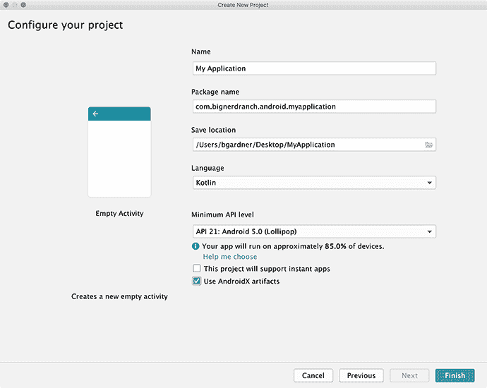

Jetpack 库分为四类：基础（foundation）、架构（architecture）、行为（behavior）和 UI。Jetpack 架构类别中的库通常被称为架构组件。`ViewModel` 就是其中一种架构组件。你将在本书的稍后部分学习学习其他主要的架构组件，包括 Room (第 11 章)、Data Binding (第 19 章) 和 WorkManager (第 27 章)。

你还将学习一些基础 Jetpack 库，包括 AppCompat (第 14 章)、Test (第 20 章) 和 Android KTX (第 26 章)。你将在第 27 章中使用行为 Jetpack 库——Notifications。你还将使用一些 UI Jetpack 库，包括 Fragment (第 8 章) 以及 Layouts (第 9 章 和  [第 10 章)。

某些 Jetpack 组件是全新的。其他一些已经存在了一段时间，但以前被归类在被称为 Support Library 的几个大集中。如果你听到或看到关于 Support Library 的内容，请现在你应该使用该库的 Jetpack (AndroidX) 版本。

## 避免半成品方案（Half-Baked Solution）

有些人尝试通过禁用旋转来解决应用中配置更改引起的状态丢失 bug。如果用户无法旋转应用，他们就不会丢失 UI 状态了，对吗？确实如此，但遗憾的是，这种方法会让你的应用产生其他 bug。

首先，运行时还会发生其他配置更改，例如窗口大小调整和夜间模式切换。是的，你也可以捕获并忽略或处理这些更改。但这样做糟糕——它禁用了系统的一项功能，即根据运行时配置更改自动选择合适的资源。

其次，处理配置更改或禁用旋转并没有解决进程死亡问题。

如果你因为应用需要而将应用锁定在竖屏或横屏模式，你应该应对配置更改和进程死亡进行防御性编程。凭借你学到的 `ViewModel` 和保存实例状态的知识，你完全可以。

简而言之，通过阻止配置更改来处理 UI 状态丢失是不规范的做法。我们提到这一点是为了让你在外面看到它时能认出这是不规范的做法。

# 调试 Android 应用

在本章中，你将了解到当应用出现 Bug 时该做什么。你将学习如何使用 `Logcat`、`Android Lint` 以及 Android Studio 自带的调试器。

为了练习调试，第一步是破坏一些东西。在 `MainActivity.kt` 中，注释掉 `onCreate(Bundle?)` 中通过 ID 查找 `questionTextView` 的代码。

**列表 5.1 注释掉关键行 (`MainActivity.kt`)**

```kotlin
override fun onCreate(savedInstanceState: Bundle?) {

    ...

    trueButton = findViewById(R.id.true_button)

    falseButton = findViewById(R.id.false_button)

    nextButton = findViewById(R.id.next_button)

    // questionTextView = findViewById(R.id.question_text_view)

    ...

}
```

运行 GeoQuiz 观察发生了什么。应用几乎会立即崩溃。

在 Android Pie (API 28) 之前的版本中，会出现一条错误消息提示你应用已崩溃。在运行 Android Pie 的设备上，如果你观察屏幕，可能会看到应用短暂出现一会，然后无声无息地消失。在这种情况下，点击启动器上的 GeoQuiz 图标重新启动应用。这一次，当应用崩溃时，你将看到类似于图 5.1 所示的消息。

**图 5.1 GeoQuiz 即将 E.X.P.L.O.D.E.**

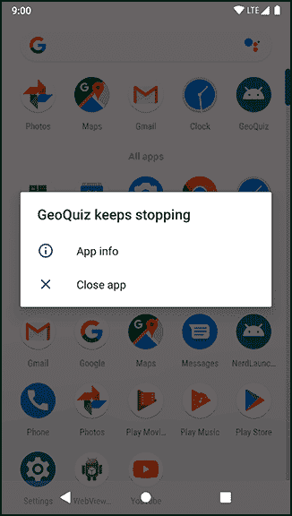

当然，你完全清楚应用哪里出了问题。但如果你不知道，从新的角度观察你的应用可能会有所帮助。

## 异常与堆栈跟踪

展开 Logcat 工具窗口，以便查看发生了什么。如果你在 Logcat 中上下滚动，最终应该会发现大片红色，如图 5.2 所示。这是一个标准的 `AndroidRuntime` 异常报告。

如果你在 Logcat 中没有看到太多内容且找不到异常，你可能需要在过滤器下拉菜单中选择 `No Filters`（无过滤器）选项。相反，如果你在 Logcat 中看到的内容太多，可以将 `Log Level`（日志级别）调整为 `Error`，这将只显示严重的日志消息。你还可以搜索文本 `fatal exception`，这将直接带你找到导致应用崩溃的异常。

**图 5.2 Logcat 中的异常和堆栈跟踪**

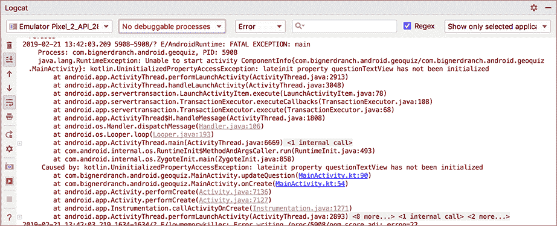

报告会告诉你顶层异常及其堆栈跟踪，然后是导致该异常的异常以及它的堆栈跟踪，以此类推，直到找到一个没有原因的异常。

在堆栈跟踪中看到 `java.lang` 异常可能看起来很奇怪，因为你编写的是 Kotlin 代码。在为 Android 构建应用时，Kotlin 代码会被编译为与 Java 代码相同的低级字节码。在此过程中，许多 Kotlin 异常通过类型别名（type-aliasing）在底层映射到 `java.lang` 异常类。`kotlin.RuntimeException` 是 `kotlin.UninitializedPropertyAccessException` 的父类，并且在 Android 上运行时，它被别命名为 `java.lang.RuntimeException`。

在你编写的大多数代码中，最后一个没有原因的异常是有有趣的。在这里，没有原因的异常是 `kotlin.UninitializedPropertyAccessException`。该异常下方的第一行是其堆栈跟踪的第一行。这一行会告诉你异常发生的类和函数，以及异常发生的文件和行号。点击蓝色链接，Android Studio 将带你跳转到源码中的那一行。

你被带到的那一行是 `updateQuestion()` 内部第一次使用 `questionTextView` 变量的地方。`UninitializedPropertyAccessException` 这个名字给了你关于问题的提示：该变量未初始化。

取消初始化 `questionTextView` 的行的注释来修复 Bug。

**列表 5.2 取消关键行的注释 (`MainActivity.kt`)**

```kotlin
override fun onCreate(savedInstanceState: Bundle?) {

    ...

    trueButton = findViewById(R.id.true_button)

    falseButton = findViewById(R.id.false_button)

    nextButton = findViewById(R.id.next_button)

    // questionTextView = findViewById(R.id.question_text_view)

    ...

}
```

当你遇到运行时异常时，记住在 Logcat 中寻找最后一个异常及其堆栈跟踪的第一行。

### 诊断行为异常

应用出现的问题并不总是崩溃。在某些情况下，它们会表现为行为异常。例如，假设每当你按下 `NEXT` 按钮时，什么都没有发生。那就是一个非崩溃的、行为异常。

在 `MainActivity.kt` 中，修改 `nextButton` 监听器，注释掉增加问题索引的代码。

**列表 5.3 忘记关键行 (`MainActivity.kt`)**

```kotlin
override fun onCreate(savedInstanceState: Bundle?) {

    ...

    nextButton.setOnClickListener {

        // quizViewModel.moveToNext()

        updateQuestion()

    }

    ...

}
```

运行 GeoQuiz 并按下 `NEXT` 按钮。你应该没有看到任何效果。

这个 Bug 比上一个更棘手。它没有抛出异常，所以修复 Bug 并不是简单的让异常消失。此外，这种行为异常可能由两种不同的方式引起：索引可能没有改变，或者 `updateQuestion()` 可能没有被调用。

你知道是什么导致了这个 Bug，因为是你刚刚引入了它。但如果这种 Bug 自动出现而你完全不知道原因，你就需要追溯罪魁祸首。在接下来的几节中，你将看到两种处理方法：堆栈跟踪的诊断日志和使用调试器设置断点。

### 记录堆栈跟踪

在 `MainActivity` 中，为 `updateQuestion()` 添加一条日志语句。

**列表 5.4 为了乐趣和利润的 `Exception` (`MainActivity.kt`)**

```kotlin
private fun updateQuestion() {

    Log.d(TAG, "Updating question text", Exception())

    val questionTextResId = quizViewModel.currentQuestionText

    questionTextView.setText(questionTextResId)

}
```


`Log.d(String, String, Throwable)` 版本的 `Log.d` 会记录整个堆栈跟踪，就像你之前看到的 `kotlin.UninitializedPropertyAccessException` 一样。堆栈跟踪将告诉你哪里调用了 `updateQuestion()`。

你传递给 `Log.d(String, String, Throwable)` 的异常并不一定是你捕获到的抛出异常。你可以创建一个全新的 `Exception` 并将其传递给函数，而无需实际抛出它，这样你就能获得一份关于异常创建位置的报告。

运行 GeoQuiz，点击 `NEXT` 按钮，然后检查 Logcat 中的输出（图 5.3）。

**图 5.3 结果**

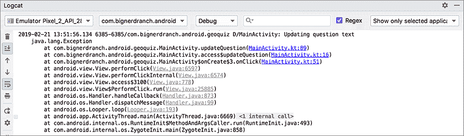

堆栈跟踪的第一行是你记录 `Exception` 的那行代码。在随后的几行中，你可以看到在 `onClick(View)` 实现内部从哪里调用了 `updateQuestion()`。点击此行的链接，你将被带到你注释掉增加问题索引的那行代码。但不要删除这个 bug；稍后你将使用调试器再次找到它。

记录堆栈跟踪是一个强大的工具，但它也非常冗长。如果留下大量的此类信息，Logcat 很快就会变成一个无法管理的混乱局面。此外，竞争对手可能会通过读取你的堆栈跟踪来理解你的代码在做什么，从而窃取创意。

另一方面，有时显示代码行为的堆栈跟踪正是你所需要的。如果你在 [stackoverflow.com](https://stackoverflow.com) 或 [forums.bignerdranch.com](https://forums.bignerdranch.com) 寻求帮助，包含堆栈跟踪通常会有帮助。你可以直接从 Logcat 复制并粘贴行。

在继续之前，删除 `MainActivity.kt` 中的日志语句。

**列表 5.5 再见 (`MainActivity.kt`)**

```
private fun updateQuestion() {

    Log.d(TAG, "Updating question text", Exception())

    val questionTextResId = quizViewModel.currentQuestionText

    questionTextView.setText(questionTextResId)

}
```

### 设置断点

现在你将使用 Android Studio 自带的调试器追踪同一个 bug。你将在 `updateQuestion()` 上设置一个断点，查看它是否被调用。断点会在行执行之前暂停执行，允许你逐行检查接下来发生了什么。

在 `MainActivity.kt` 中，返回 `updateQuestion()` 函数。在该函数的第一行旁边，点击左侧边距的灰色槽区域。你现在应该会在左侧槽中看到一个红圈，如图 5.4 所示。这就是断点。你也可以通过将光标置于所需的行并按下 Command-F8 (Ctrl-F8) 来切换断点的开启和关闭。

**图 5.4 一个断点**

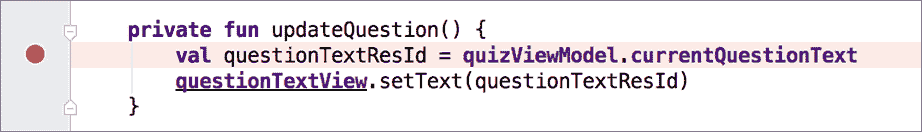

要启动调试器并触发你的断点，你需要调试应用而不是运行它。要调试应用，点击 `Debug 'app'` 按钮（图 5.5）。你也可以在菜单栏中导航到 `Run` → `Debug 'app'`。你的设备将报告它正在等待调试器连接，然后将正常继续。

**图 5.5 调试应用按钮**

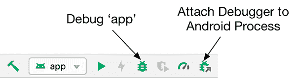

在某些情况下，你可能希望在不重新启动应用的情况下调试正在运行的应用。你可以通过点击图 5.5 所示的 `Attach Debugger to Android Process` 按钮，或者导航到 `Run` → `Attach to process...` 来连接调试器。在出现的对话框中选择你的应用进程并点击 `OK`，调试器就会连接。注意，断点只有在调试器连接时才有效，因此在连接调试器之前命中的任何断点都会被忽略。

你想从代码开始调试 GeoQuiz，这就是为什么你使用 `Debug 'app'` 选项的原因。在你的应用连接调试器启动并运行后不久，它就会暂停。启动 GeoQuiz 调用了 `MainActivity.onCreate(Bundle?)`，接着调用了 `updateQuestion()`，然后触发了你的断点。（如果你在应用启动后才连接调试到进程，应用将不会暂停。）

在图 5.6 中，你可以看到 `MainActivity.kt` 现在在编辑器中打开，带有断点的行被高亮显示。底部的调试窗口现在可见。它包含了 `Frames` 和 `Variables` 视图。（如果调试窗口没有自动打开，你可以点击底部的 `Debug` 打开它。）

**图 5.6 停在这里处！**


你可以使用调试窗口顶部的箭头按钮（图 5.7）来单步执行程序。你可以使用 `Evaluate Expression` 按钮按需执行简单的语句，这是一个强大的工具。

**图 5.7 调试工具控制**


你可以从左侧的堆栈跟踪看到 `updateQuestion()` 在 `onCreate(Bundle?)` 中被调用。但你感兴趣的是 `NEXT` 按钮的行为，所以点击 `Resume Program` 按钮继续执行。然后在 GeoQuiz 中按下 `NEXT` 按钮，查看是否命中了断点并停止了执行。（应该命中了。）

现在你停在一个有趣的执行点上，可以观察周围环境。`Variables` 视图允许你检查程序中对象的值。在顶部，你应该看到值 `this`（`MainActivity` 实例本身）。

展开 `this` 变量可以查看 `MainActivity` 中的所有变量、`MainActivity` 的父类（`Activity`）、`Activity` 的父类，依此类推。现在，专注于你创建的变量。

你只对一个值感兴趣：`quizViewModel.currentIndex`。在变量视图向下滚动直到看到 `quizViewModel`。展开 `quizViewModel` 并寻找 `currentIndex`（图 5.8）。

**图 5.8 运行时检查变量值**

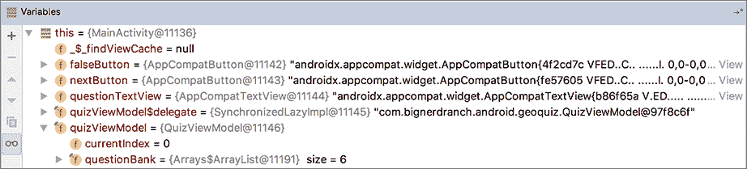

你本应该期望 `currentIndex` 的值为 `1`。你点击了 `NEXT` 按钮，这本会导致 `currentIndex` 从 `0` 增加到 `1`。然而，如图 5.8 所示，在运行时检查值，`currentIndex` 的值仍然是 `0`。

检查编辑器窗口中的代码。`MainActivity.updateQuestion()` 中的代码只是根据 `QuizViewModel` 的内容更新问题。这部分没有问题。那么 Bug 源于哪里呢？为了继续调查，你需要跳出此函数，以确定执行 `MainActivity.updateQuestion()` 之前执行了哪些代码。要这样做，点击 `Step Out`（跳出）按钮。

检查编辑器窗口。它现在已经在你调用 `updateQuestion()` 之后直接跳过了 `nextButton` 的 `OnClickListener`。非常巧妙。正如你所知道的，问题的行为是由于 `quizViewModel.moveToNext()` 从未被调用（因为你把它注释掉了）。你会想要修复这个实现——在对代码进行任何更改之前，你应该先停止应用。如果你在调试时编辑代码，调试器运行的代码将与编辑器窗口中的代码过时。你可以通过两种方式停止调试：停止程序，或者断开调试器。要停止程序，点击图 5.7 所示的 `Stop` 按钮。现在让你的 `OnClickListener` 恢复原状。

#### 列表 5.6 恢复正常 (`MainActivity.kt`)

```kotlin
override fun onCreate(savedInstanceState: Bundle?) {

    ...

    nextButton.setOnClickListener {

        // quizViewModel.moveToNext()

        updateQuestion()

    }

    ...
```

你已经尝试了两种追踪异常代码行的方法：堆栈跟踪日志和在调试器中设置断点。哪种更好？它们各有优处，最终其中一种可能会成为你的最爱。记录堆栈跟踪的优势在于你可以在一个日志中查看来自多个地方的堆栈。缺点是如果要为了某些信息，你必须添加新的日志语句、重新构建并导航应用以查看发生了什么。调试器更加方便。如果你在附加调试器的情况下运行应用（或在应用启动后将调试器附加到应用程序进程），你可以在应用程序运行时设置断点，并探索以获取有关多个问题的信息。

## Android 特有的调试

大多数 Android 调试与 Kotlin 调试相似。然而，你有时会遇到 Android 特有部分的问题，例如资源，Kotlin 编译器对此一无所知。在本节中，你将学习两种 Android 特有的问题：Android Lint 问题和与 `R` 类相关。

### 使用 Android Lint

Android Lint（或简称“Lint”）是 Android 代码的静态分析器。静态分析器是一种在不运行代码的情况下检查代码以发现缺陷的程序。Lint 利用其对 Android 框架的知识深入检查你的代码，发现编译器无法发现的问题。在许多情况下，Lint 的建议非常价值。在第 7 章中，你会看到 Lint 警告你兼容性问题。Lint 还可以对 XML 中定义的对象进行类型检查。你可以手动运行 Lint 以查看项目中的所有潜在问题，包括不那么严重的问题。从菜单栏选择 `Analyze` → `Inspect Code...`。系统会询问你想要检查项目的哪些部分。选择 `Whole project` 并点击 `OK`。Android Studio 将对你的代码运行 Android Lint 以及其他静态分析器（例如拼写检查和 Kotlin 检查）。

扫描完成后，你将在检查工具窗口中看到潜在问题的分类。展开 `Android` 和 `Lint` 类别以查看 Lint 关于你项目的信息（图 5.9）。

**图 5.9 Lint 警告**

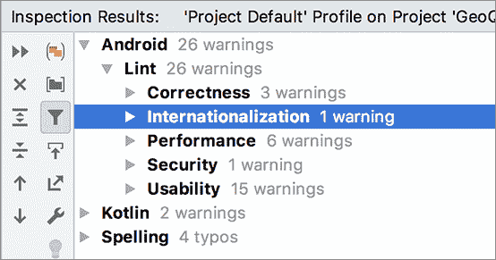

（如果你看到的 Lint 警告数量不同，请不要担心。Android 工具链在不断进化，Lint 可能会添加新的检查，Android 框架可能会添加新的限制，并且可能会有更新版本的工具和依赖项。）

展开 `Internationalization`，然后在其下方展开 `Bidirectional Text` 以查看你项目中关于此问题的更详细信息。点击 `Using left/right instead of start/end attributes` 以学习此特定警告（图 5.10）。Lint 正在警告你，如果你的应用在设置为从右到左而非从左到右阅读的设备上运行，使用 `right` 和 `left` 值可能会有问题。（你将在第 17 章中学习如何为你的应用做好国际化使用的准备。）

进一步挖掘查看是哪个文件和哪些行代码导致了警告。展开 `Using left/right instead of start/end attributes`。点击问题文件 `activity_main.xml` 以查看带有问题的代码片段（图 5.11）。

**图 5.11 查看导致警告的代码**


```
...

<Button

        android:id="@+id/next_button"

        android:layout_width="wrap_content"

        android:layout_height="wrap_content"

        android:layout_gravity="bottom|right"

        android:layout_gravity="bottom|end"

        android:text="@string/next_button"

        android:drawableEnd="@drawable/arrow_right"

        android:drawablePadding="4dp"/>

...
```


重新运行`Lint`以确认你刚刚修复的双向文本问题已不再出现在`Lint`结果中。要预览布局在从右到左语言区域设备上的效果，请打开工具窗口中的`Design`标签页。将`Locale for Preview`下拉菜单中的选择从`Default (en-us)`更改为`Preview Right to Left`（图 5.12）。如果你没有看到`Locale for Preview`下拉菜单，点击预览窗顶部的`>>`以展开预览选项。

**图 5.12 预览从左到右和从右到左**

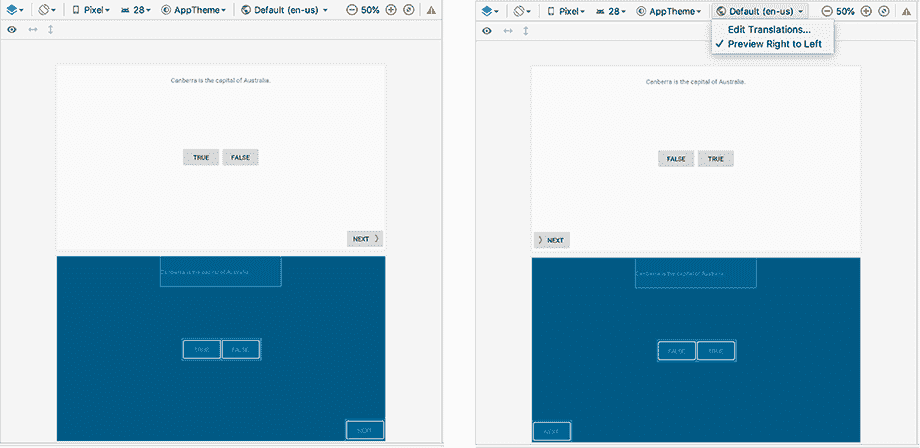

在大多数情况下，即使你不处理`Lint`警告你的事项，你的 App 也能正常运行。然而，处理`Lint`警告通常有助于防止未来出现问题，或提升用户的体验。我们建议你认真对待所有的`Lint`警告，即使你最终决定不处理它们（如在本例中所示）。否则，你可能会习惯忽略`Lint`并漏掉严重的问题。

`Lint`工具为它发现的每个问题提供了详细信息，并就如何处理这些问题提供了建议。我们将其作为一个练习，把检查`GeoQuiz`中`Lint`发现的问题留给你完成。你可以忽略这些问题、按照`Lint`的建议修复它们，或者使用问题描述符面板中的`Suppress`按钮在未来抑制这些警告。在`GeoQuiz`的剩余章节中，我们将假设你留下了剩余的`Lint`问题未处理。

### R 类的问题

你可能熟悉在添加资源之前引用它们，或者删除其他文件引用的资源时发生的构建错误。通常，在资源添加或引用删除后重新保存文件，Android Studio 就会毫无费力地重新构建。

然而，有时这些构建错误会持续存在或似乎无缘无故出现。如果这种情况发生在你身上，可以尝试以下方法：

**重新检查资源文件中 XML 的有效性**

如果你的`R.java`文件在上次构建时没有生成，那么项目中任何引用资源的地方都会看到错误。通常，这是由于你的某一个 XML 文件中的拼写错误导致的。布局 XML 并不总是经过验证，因此这些文件中的拼写错误可能不会被明确指出。找到拼写错误并重新保存文件应该会让`R.java`重新生成。

**清理项目**

选择`Build` → `Clean Project`。Android Studio 将从头重新构建项目，这通常会产生一个无错误的构建。我们每个人都需要的一次深度清理。

**与 Gradle 同步你的项目**

如果你更改了`build.gradle`文件，你需要同步这些更改以更新项目的构建构设置。选择`File` → `Sync Project with Gradle Files`。Android Studio 将根据正确的项目设置从头重新构建项目，这有助于解决更改 Gradle 配置后的问题。

**运行 Android Lint**

密切关注`Lint`的警告。通过这个工具，你经常会发现意想不到的问题。

如果你在资源方面仍然遇到问题（或遇到了不同的问题），请重新查看错误信息和你的布局文件。在忙碌时，很容易忽视错误。同时检查任何`Lint`错误和警告。冷静地重新考虑错误信息可能会发现 bug 或拼写错误。

最后，如果你卡住了或在 Android Studio 中遇到其他问题，请检查 [stackoverflow.com](https://stackoverflow.com) 上的存档，或访问本书的论坛：[forums.bignerdranch.com](https://forums.bignerdranch.com)。

### 挑战：探索布局检查器 (Layout Inspector)

为了调试布局文件问题，可以使用布局检查器交互地检查布局文件是如何渲染到屏幕上的。要使用布局检查器，请确保`GeoQuiz`正在模拟器中运行，并从菜单栏选择`Tools` → `Layout Inspector`。一旦激活检查器，你就可以点击布局检查器视图中的元素来探索布局的属性。

### 挑战：探索分析器 (Profiler)

分析器工具窗口会为你的应用程序使用 Android 设备资源（如 CPU 和内存）创建详细报告。这在评估和调优 App 性能时非常有用。

要查看分析器工具窗口，请在连接的 Android 设备或模拟器上运行你的 App，并从菜单栏选择`View` → `Tool Windows` → `Profiler`。一旦打开分析器，你就可以看到一个包含 CPU、内存、网络和能量部分的时间线。

点击某个部分以查看关于你的 App 使用该资源的更多详细信息。在 CPU 视图上，确保点击`Record`按钮以捕获更多关于 CPU 使用情况的信息。一旦你对 App 执行了任何你想记录的交互，点击`Stop`按钮停止记录。

# 6 你的第二个 Activity

在本章中，你将为`GeoQuiz`添加第二个 Activity。Activity 控制一个信息屏幕，而这个 Activity 将添加第二个屏幕，为用户提供当前问题作弊的机会。图 6.1 显示了新的 Activity。

**图 6.1 `CheatActivity`提供偷看答案的机会**

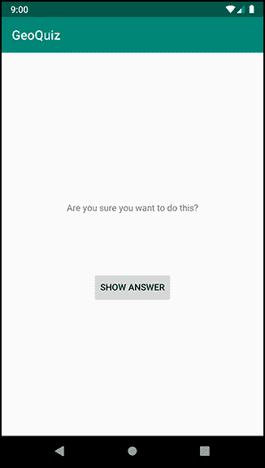

如果用户选择查看答案并返回`MainActivity`回答问题，他们将收到新消息，如图 6.2 所示。

**图 6.2 `MainActivity`知道你是否作弊了**

*(注：此处应有对应的图片描述)*

为什么这是一个良好的 Android 编程练习？因为你将学习如何：

*   创建一个新的 Activity 并为其创建一个新的布局。
*   从另一个 Activity 启动 Activity。启动 Activity 意味着请求操作系统创建一个实例并调用其`onCreate(Bundle?)`函数。
*   在父 Activity（启动方）和子 Activity（被启动方）之间传递数据。

在调用魔法之前，请打开`res/values/strings.xml`并添加本章节所需的所有字符串。

**代码清单 6.1 添加字符串 (`res/values/strings.xml`)**

```
<resources>
    ...
    <string name="incorrect_toast">Incorrect!</string>
    <string name="warning_text">Are you sure you want to do this?</string>
    <string name="show_answer_button">Show Answer</string>
    <string name="cheat_button">Cheat!</string>
    <string name="judgment_toast">Cheating is wrong.</string>
</resources>
```

### 创建一个新的 activity

创建一个活动（activity）通常涉及修改至少三个文件：Kotlin 类文件、XML 布局文件和应用程序清单（manifest）。如果你以错误的方式修改这些文件，Android 可能会发火。为了确保操作正确，你可以使用 Android Studio 的新建 Activity 向导（New Activity wizard）。

在项目工具窗口中右键点击`app/java`文件夹，启动新建 Activity 向导。如图 6.3 所示，选择`New` → `Activity` → `Empty Activity`。

**图 6.3 新建 Activity 菜单**

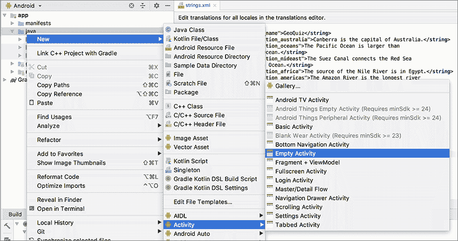

然后你应该看到一个类似图 6.4 的对话框。将`Activity Name`设置为`CheatActivity`。这是你的`Activity`子类的名称。`Layout Name`将被自动设置为`activity_cheat`。这将是向导创建的布局文件的基础名称。

**图 6.4 新建空 Activity 向导**

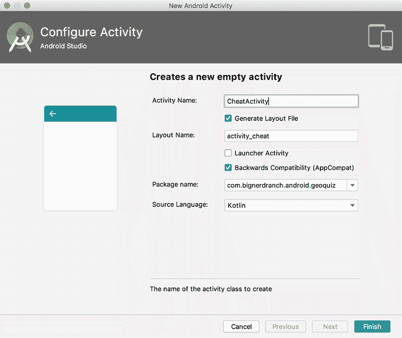

其余字段的默认值是可以的，但要确保包名（package name）是你预期的。这决定了`CheatActivity.kt`在文件系统中的位置。点击`Finish`按钮让魔法发生。

现在是让 UI 变得好看了。章节开头的截图展示了`CheatActivity`的视图应该什么样。图 6.5 显示了组件的定义。

**图 6.5 `CheatActivity`布局图**

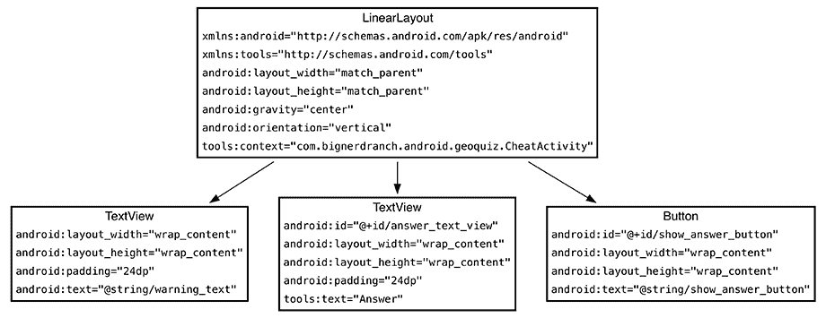

打开`res/layout/activity_cheat.xml`并切换到`Text`视图。

尝试以图 6.5 作为指南，创建该布局的 XML。将示例布局替换为新的`LinearLayout`，并沿着树结构向下继续编写。你可以对照代码清单 6.2 来检查你的工作。

**代码清单 6.2 填充第二个 activity 的布局 (`res/layout/activity_cheat.xml`)**

```
<LinearLayout xmlns:android="http://schemas.android.com/apk/res/android"
    xmlns:tools="http://schemas.android.com/tools"
    android:layout_width="match_parent"
    android:layout_height="match_parent"
    android:gravity="center"
    android:orientation="vertical"
    tools:context="com.bignerdranch.android.geoquiz.CheatActivity">

    <TextView
        android:layout_width="wrap_content"
        android:layout_height="wrap_content"
        android:padding="24dp"
        android:text="@string/warning_text"/>

    <TextView
        android:id="@+id/answer_text_view"
        android:layout_width="wrap_content"
        android:layout_height="wrap_content"
        android:padding="24dp"
        tools:text="Answer"/>

    <Button
        android:id="@+id/show_answer_button"
        android:layout_width="wrap_content"
        android:layout_height="wrap_content"
        android:text="@string/show_answer_button"/>
</LinearLayout>
```

你不需要为`activity.xml`创建横屏备方案。在编辑器窗口的`Design`选项卡中，找到面板上方工具栏中看起来像一个带弯曲箭头的设备的按钮。点击此按钮将预览的方向更改为横屏（图 6.6）。

**图 6.6 预览 activity_xml**


默认布局在两种方向上工作运行良好，所以让我们继续到 activity 子类吧。一个新的 activity 子类`CheatActivity.kt`可能已经在编辑器中自动打开。如果没有打开，请从项目工具窗口打开它。`CheatActivity`类已经包含了基础的`onCreate`实现，将`activity_cheat.xml`中定义的布局 ID 传递给`ContentView`。`CheatActivity`最终会在其`onCreate`函数中做更多事情。

### 在清单文件中声明活动

`manifest`是一个包含描述应用程序元数据的 XML 文件。该文件始终命名为`AndroidManifest.xml`，位于项目的`app/manifests`目录。

在项目工具窗口中找到并打开`manifests/AndroidManifest.xml`。你也可以通过按下`Command-Shift-O`（`Ctrl-Shift-N`）并输入文件名来使用 Android Studio 的查找文件对话框。一旦它猜对了文件，按回打开。应用程序中的每个活动必须在清单文件中声明，以便操作系统访问它。当你使用新建项目向导创建`MainActivity`时，向导为你声明了该活动。同样，新建 Activity 向导通过添加代码清单 6.3 中高亮的 XML 声明了`CheatActivity`。

`android:name`属性是必须的，该属性值开头的点告诉操作系统该活动（activity）的类位于文件顶部`manifest`元素中`package`属性指定的包中。

有时你会看到完全限定的`android:name`属性，例如`android:name="com.bignerdranch.android.geoquiz.CheatActivity"`。这种长格式表示法与列表 6.3 中的版本完全相同。

manifest 中有很多有趣的内容，但目前，让我们专注于让`CheatActivity`运行起来。你将在后面的章节中学习关于 manifest 的不同部分。

### 在 MainActivity 中添加一个作弊按钮

计划是让用户点击`MainActivity`中的按钮来在屏幕上获取`CheatActivity`的实例。因此，你需要在`res/layout/activity_main.xml`和`res/layout-land/activity_main.xml`中添加新按钮。

你可以从图 6.2 中看到新的`CHEAT!`按钮位于`NEXT`按钮上方。在默认布局中，将新按钮定义为根`LinearLayout`的直接子元素，放在`NEXT`按钮定义之前。

**列表 6.4 在默认布局中添加作弊按钮 (`res/layout/activity_main.xml`)**

```
...
    </LinearLayout>

    <Button
        android:id="@+id/cheat_button"
        android:layout_width="wrap_content"
        android:layout_height="wrap_content"
        android:layout_marginTop="24dp"
        android:text="@string/cheat_button" />

    <Button
        android:id="@+id/next_button"
        .../>
</LinearLayout>
```

在横屏布局中，让新按钮显示在根`FrameLayout`的底部并水平居中位置。

**列表 6.5 在横屏布局中添加作弊按钮 (`res/layout-land/activity_main.xml`)**

```
...
    </LinearLayout>

    <Button
        android:id="@+id/cheat_button"
        android:layout_width="wrap_content"
        android:layout_height="wrap_content"
        android:layout_gravity="bottom|center_horizontal"
        android:text="@string/cheat_button" />

    <Button
        android:id="@+id/next_button"
        .../>
</FrameLayout>
```

现在，在`MainActivity.kt`中，添加一个变量，获取引用，并为`CHEAT!`按钮设置`View.OnClickListener`存根。

**列表 6.6 接作弊按钮 (`MainActivity.kt`)**

```kotlin
class MainActivity : AppCompatActivity() {
    private lateinit var trueButton: Button
    private lateinit var falseButton: Button
    private lateinit var nextButton: Button
    private lateinit var cheatButton: Button
    private lateinit var questionTextView: TextView
    ...
    override fun onCreate(savedInstanceState: Bundle?) {
        ...
        nextButton = findViewById(R.id.next_button)
        cheatButton = findViewById(R.id.cheat_button)
```


`questionTextView = findViewById(R.id.question_text_view)`

...

`nextButton.setOnClickListener {`

`quizViewModel.moveToNext()`

`updateQuestion()`

`}`

`cheatButton.setOnClickListener {`

`// Start CheatActivity`

`}`

`updateQuestion()`

`}`

...

`}`

现在你可以开始处理启动 `CheatActivity` 了。

### 启动活动

一个活动启动另一个最简单的方法是使用 `startActivity(Intent)` 函数。

你可能认为 `startActivity(Intent)` 是在你想要启动的 `Activity` 子类上调用的静态函数。但事实并非如此。当活动调用 `startActivity(Intent)` 时，该调用会被发送给操作系统。

特别是，它被发送到操作系统的一个称为 `ActivityManager` 的部分。然后，`ActivityManager` 会创建 `Activity` 实例并调用它的 `onCreate(Bundle?)` 函数，如图 6.7 所示。

**图 6.7 启动活动**

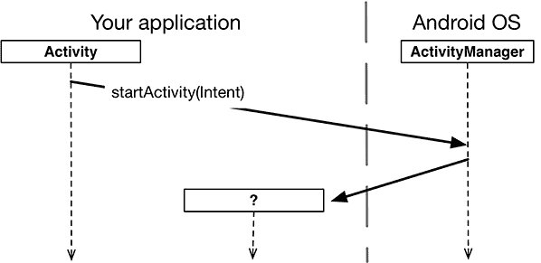

`ActivityManager` 如何知道要启动哪个 `Activity`？这些信息在 `Intent` 中。

#### 使用 intents 通信

`intent` 是组件可以用来与操作系统通信的对象。到目前为止，你看到的组件只有活动，但还有其他服务、广播接收器和内容提供者。

Intents 是多用途通信工具，`Intent` 类根据你使用意图的用途提供了不同的构造函数。

在这种情况下，你正在使用意图来告诉 `ActivityManager` 要启动哪个活动，因此你将使用这个构造函数：`Intent(Context, Class)`。

在 `cheatButton` 的监听器中，创建一个包含 `CheatActivity` 类的 `Intent`。然后将该意图传递给 `startActivity(Intent)`。

**列表 6.7 启动 `CheatActivity` (`MainActivity.kt`)**

```kotlin
cheatButton.setOnClickListener {

    // Start CheatActivity

    val intent = Intent(this, CheatActivity::class.java)

    startActivity(intent)

}
```

你传递给 `Intent` 构造函数的 `Class` 参数指定了 `ActivityManager` 应该启动的活动类。`Context` 参数告诉 `ActivityManager` 该活动类位于哪个应用程序包中。

在启动活动之前，`ActivityManager` 会检查包的 manifest 中是否有与指定的 `Class` 相同的声明。如果找到了，它就会启动活动，一切正常。如果没有找到，你会得到一个糟糕的 `ActivityNotFoundException`，这会导致程序崩溃。这就是为什么你所有的活动都必须在 manifest 中声明。

运行 GeoQuiz。点击 `CHEAT!` 按钮，新活动的实例将出现在屏幕上。现在按返回键。这将销毁 `CheatActivity` 并返回 `MainActivity`。

#### 显式意图和隐式意图

当你使用 `Context` 和 `Class` 对象创建 `Intent` 时，你正在创建一个显式意图。你使用显式意图来启动应用程序内的活动。

一个应用程序内的两个活动必须通过应用程序外部的 `ActivityManager` 进行通信，这似乎很奇怪。但这种模式使得一个应用程序中的活动与另一个应用程序中的活动协作变得简单。

当你的应用程序中的活动想要启动另一个应用程序中的活动时，你会创建一个 `implicit intent`（隐式意图）。你将在第 15 章中使用隐式意图。

#### 在活动之间传递数据

现在你已经有了 `MainActivity` 和 `CheatActivity`，你可以考虑在它们之间传递数据。图 6.8 显示了你将在两个活动之间传递的数据。

**图 6.8 MainActivity 和 CheatActivity 之间的对话**

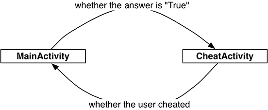

当 `CheatActivity` 启动时，`MainActivity` 将通知它当前问题的答案。

当用户按下返回键回到 `MainActivity` 时，`CheatActivity` 将被销毁。在销毁前的最后，它会将关于用户是否作弊的数据发送给 `MainActivity`。

你将从从 `MainActivity` 向 `CheatActivity` 传递数据开始。

### 使用 intent extras

为了通知 `CheatActivity` 当前问题的答案，你将向它传递以下值：

```
questionBank[currentIndex].answer
```

你将把此值作为 `extra` 发送到传递给 `startActivity(Intent)` 的 `Intent` 中。

Extras 是调用活动可以包含在意图中的任意数据。你可以将它们想象成构造函数参数，尽管你不能在活动子类中使用自定义构造函数。（Android 会创建活动实例并负责它们的生命周期。）操作系统会将意图转发给接收的活动，该活动随后可以访问这些 extras 并检索数据，如图 6.9 所示。

**图 6.9 Intent extras：与其他活动通信**

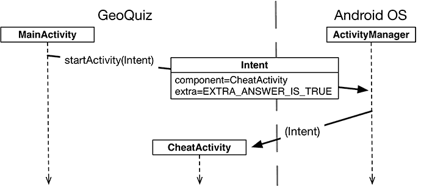

一个 extra 的结构是键值对，类似于你在 `MainActivity.onSaveInstanceState(Bundle)` 中用于保存 `currentIndex` 值时所使用的那种键值对。

要向意图中添加一个 extra，你需要使用 `Intent.putExtra(…)`。具体来说，你将调用 `putExtra(name: String, value: Boolean)`。

`Intent.putExtra(…)` 有许多变体，但它始终有两个参数。第一个参数始终是一个 `String` 键，第二个参数是值，其类型会变化。它返回 `Intent` 本身，因此如果需要，你可以链式调用。

在 `CheatActivity.kt` 中，为 extra 添加一个键。

**代码列表 6.8 添加 extra 常量 (`CheatActivity.kt`)**

```kotlin
private const val EXTRA_ANSWER_IS_TRUE =

        "com.bignerdranch.android.geoquiz.answer_is_true"

class CheatActivity : AppCompatActivity() {

    ...

}
```

一个活动可能会从多个不同的地方启动，因此你应该在检索和使用 extras 的活动上定义对应的键。使用你的包名作为 extra 的限定符（如代码列表 6.8 所示），可以与其他应用的 extras 发生名称冲突。

现在你可以返回 `MainActivity` 并将 extra 放入意图中，但有一种更好的方法。没有理由让 `MainActivity` 或应用中的任何其他代码知道 `CheatActivity` 期望其 `Intent` 中包含哪些 extras 的实现细节。相反，你可以将这些工作封装到 `newIntent(…)` 函数中。

现在在 `CheatActivity` 中创建此函数。将函数放在 `companion object`（复合对象）中。

**代码列表 6.9 用于 `CheatActivity` 的 `newIntent(…)` 函数 (`CheatActivity.kt`)**

```kotlin
class CheatActivity : AppCompatActivity() {

    override fun onCreate(savedInstanceState: Bundle?) {

        ...

    }

    companion object {

        fun newIntent(packageContext: Context, answerIsTrue: Boolean): Intent {

            return Intent(packageContext, CheatActivity::class.java).apply {

                putExtra(EXTRA_ANSWER_IS_TRUE, answerIsTrue)

            }

        }

    }

}
```

此函数允许你创建一个正确配置了 `CheatActivity` 所需 extras 的 `Intent`。`answerIsTrue` 参数（`Boolean` 类型）通过 `EXTRA_ANSWER_IS_TRUE` 常量放入 `Intent` 中。`companion object` 允许你在没有类实例的情况下访问函数，使得其他代码能够正确配置启动意图。

说到其他代码，现在在 `MainActivity` 的作弊监听器中使用这个新函数吧。

**代码列表 6.10 带有 extra 启动 `CheatActivity` (`MainActivity.kt`)**

```kotlin
cheatButton.setOnClickListener {

    // Start CheatActivity

    val intent = Intent(this, CheatActivity::class.java)

    val answerIsTrue = quizViewModel.currentAnswer

    val intent = CheatActivity.newIntent(this, answerIsTrue)

    startActivity(intent)

}
```

你只需要一个 extra，但如果需要，你也可以在 `Intent` 上放置多个 extras。如果这样做，请向你的 `newIntent(…)` 函数添加更多参数，以保持该模式的一致性。

要从 extra 中检索值，你将使用 `Intent.getBooleanExtra(String, Boolean)`。

第一个参数是 extra 的名称。`getBooleanExtra(…)` 的第二个参数是在未找到键时的默认答案。

在 `CheatActivity` 中，在 `onCreate(Bundle?)` 中从 extra 检索值并将其存储在成员变量中。

**代码列表 6.11 使用 extra (`CheatActivity.kt`)**

```kotlin
class CheatActivity : AppCompatActivity() {

    private var answerIsTrue = false

    override fun onCreate(savedInstanceState: Bundle?) {

        super.onCreate(savedInstanceState)

        setContentView(R.layout.activity_cheat)

        answerIsTrue = intent.getBooleanExtra(EXTRA_ANSWER_IS_TRUE, false)

    }

    ...

}
```

注意 `Activity.getIntent()` 始终返回启动活动的 `Intent`。这就是你在调用 `startActivity(Intent)` 时发送的内容。

最后，连接答案 `TextView` 和 `SHOW ANSWER` 按钮以使用检索到的值。

**代码列表 6.12 启用作弊 (`CheatActivity.kt`)**

```kotlin
class CheatActivity : AppCompatActivity() {

    private lateinit var answerTextView: TextView

    private lateinit var showAnswerButton: Button

    private var answerIsTrue = false

    override fun onCreate(savedInstanceState: Bundle?) {

        ...

        answerIsTrue = intent.getBooleanExtra(EXTRA_ANSWER_IS_TRUE, false)

        answerTextView = findViewById(R.id.answer_text_view)

        showAnswerButton = findViewById(R.id.show_answer_button)

        showAnswerButton.setOnClickListener {

            val answerText = when {

                answerIsTrue -> R.string.true_button

                else -> R.string.false_button

            }

            answerTextView.setText(answerText)

        }

    }

    ...

}
```

这段代码非常直观。你使用 `TextView.setText(Int)` 来设置 `TextView` 的文本。`TextView.setText(…)` 有许多变体，而这里你使用的是接受字符串资源 ID 的那一个。

运行 GeoQuiz。点击 `CHEAT!` 进入 `CheatActivity`。然后点击 `SHOW ANSWER` 显示当前问题的答案。

### 从子 Activity 获取结果

此时，用户可以肆无忌惮地作弊。让我们通过让 `CheatActivity` 通知 `MainActivity` 用户是否选择了查看答案来修复这个问题。

当你想要从子 Activity 获取回执时，调用 `Activity.startActivityForResult(Intent, Int)` 函数。

第一个参数与之前的 `intent` 相同。第二个参数是 `request code`（请求码）。请求码是一个用户定义的整数，发送到子 Activity 然后由父 Activity 接收。它用于 Activity 启动了多种类型的子 Activity 并需要知道是谁在返回结果的情况。`MainActivity` 只会启动一种类型的子 Activity，但使用常量作为请求码是一种最佳实践，这将为你未来的变化做好准备。

在 `MainActivity` 中，修改 `cheatButton` 的监听器以调用 `startActivityForResult(Intent, int)`。

**代码列表 6.13 调用 `startActivityForResult(…)` (`MainActivity.kt`)**

```kotlin
private const val TAG = "MainActivity"

private const val KEY_INDEX = "index"

private const val REQUEST_CODE_CHEAT = 0

class MainActivity : AppCompatActivity() {

    ...

    override fun onCreate(savedInstanceState: Bundle?) {

        ...

        cheatButton.setOnClickListener {

            ...

            startActivity(intent)

            startActivityForResult(intent, REQUEST_CODE_CHEAT)

        }

        updateQuestion()

    }

    ...

}
```

### 设置结果

在子 Activity 中，你可以调用两个函数将数据传回父 Activity：

```kotlin
setResult(resultCode: Int)

setResult(resultCode: Int, data: Intent)
```


通常，`result code`（结果码）是两个预定义常量之一：`Activity.RESULT_OK` 或 `Activity.RESULT_CANCELED`。（你可以使用另一个常量 `RESULT_FIRST_USER` 作为在定义自定义结果码时的偏移量。）

当父 `Activity` 需要根据子 `Activity` 结束的方式来采取不同操作时，设置结果码非常有用。

例如，如果一个子 `Activity` 有一个 `OK` 按钮和一个 `Cancel`（取消）按钮，子 `Activity` 会根据点击了哪个按钮设置不同的结果码。然后，父 `Activity` 将根据结果码采取不同的操作。

子 `Activity` 不需要强制调用`setResult(…)`。如果不需要区分结果或在 `Intent` 上接收任意数据，那么可以让操作系统发送默认结果码。如果子 `Activity` 是通过`startActivityForResult(…)`启动的，则始终会向父 `Activity` 返回结果码。如果没有调用`setResult(…)`，当用户按下返回键时，父 `Activity` 将接收到 `Activity.RESULT_CANCELED`。

### 发回 Intent

在此实现中，将特定数据传回 `MainActivity`。因此创建一个 `Intent`，在上面添加一个 extra（额外数据），然后调用`Activity.setResult(Int, Intent)`将该数据交给 `MainActivity`。

在 `CheatActivity` 中，为 extra 的键添加一个常量，以及一个执行此工作的私有函数。然后在 `SHOW ANSWER` 按钮的监听器中调用此函数。

**代码列表 6.14 设置结果 (`CheatActivity.kt`)**

```kotlin
const val EXTRA_ANSWER_SHOWN = "com.bignerdranch.android.geoquiz.answer_shown"
private const val EXTRA_ANSWER_IS_TRUE = "com.bignerdranch.android.geoquiz.answer_shown"

class CheatActivity : AppCompatActivity() {
    ...
    override fun onCreate(savedInstanceState: Bundle?) {
        ...
        answerButton.setOnClickListener {
            ...
            answerTextView.setText(answerText)
            setAnswerResult(true)
        }
    }

    private fun setAnswerResult(isShown: Boolean) {
        val data = Intent().apply {
            putExtra(EXTRA_ANSWER_SHOWN, isShown)
        }
        setResult(Activity.RESULT_OK, data)
    }
    ...
}
```

当用户点击 `SHOW ANSWER` 按钮时，`CheatActivity` 在调用`setResult(…)`时封装了结果码和 `Intent`。

然后，当用户按下返回键回到 `MainActivity` 时，`ActivityManager` 在父 `Activity` 上调用以下函数：

```kotlin
onActivityResult(requestCode: Int, resultCode: Int, data: Intent)
```

参数是来自 `MainActivity` 的原始请求码，以及传递`setResult(…)`的结果码和 `Intent`。

图 6.10 显示了这种交互序列。

### 处理结果

最后一步是在 `MainActivity` 中重写`onActivityResult(Int, Int, Intent)`来处理结果。

在 `QuizViewModel.kt` 中添加一个新属性来保存 `CheatActivity` 回传的值。用户的作弊状态是 UI 状态的一部分。将值存储在 `QuizViewModel` 而不是 `MainActivity` 中意味着它会在配置更改期间持续，而不会随着 `Activity` 销毁。

```kotlin
class QuizViewModel : ViewModel() {
    var currentIndex = 0
    var isCheater = false
    ...
}
```

接下来，在 `MainActivity.kt` 中重写`onActivityResult(…)`以从 `CheatActivity` 返回的结果中提取值。检查请求码和结果码以确保它们符合预期。再次，这是一种便于未来维护的最佳实践。

## 6.16 实现 `onActivityResult(...)` (`MainActivity.kt`)

```kotlin
class MainActivity : AppCompatActivity() {
    ...
    override fun onCreate(savedInstanceState: Bundle?) {
        ...
    }

    override fun onActivityResult(requestCode: Int, resultCode: Int, data: Intent?) {
        super.onActivityResult(requestCode, resultCode, data)
        if (resultCode != Activity.RESULT_OK) {
            return
        }
        if (requestCode == REQUEST_CODE_CHEAT) {
            quizViewModel.isCheater = data?.getBoolean(EXTRA_ANSWER, false) ?: false
        }
    }
}
```

最后，修改 `MainActivity` 中的`checkAnswer(Boolean)`函数来检查用户是否作弊。列表 6.17 根据 `isCheater` 的值更改 toast 消息 (`MainActivity.kt`)

```kotlin
class MainActivity : AppCompatActivity() {
    ...
    private fun checkAnswer(userAnswer: Boolean) {
        val correctAnswer: Boolean = quizViewModel.currentAnswer
        val messageResId = when {
            quizViewModel.isCheater -> R.string.judgment_toast
            userAnswer == correctAnswer -> R.string.correct_toast
            else -> R.string.incorrect_toast
        }
        Toast.makeText(this, messageResId, Toast.LENGTH_SHORT).show()
    }
}
```

运行 GeoQuiz。点击 `CHEAT!`，然后在作弊界面点击 `SHOW ANSWER`。作弊后，点击返回按钮。尝试回答当前问题。应该会看到判断 toast。

如果进入下一个问题会发生什么？仍然作弊。如果想放宽对作弊的限制，可以在*跟踪作弊状态*章节中尝试。

到目前，GeoQuiz 的功能已经完成。在下一章第 7 章，将通过显示 `CheatActivity` 时包含活动动画来为 GeoQuiz 增加一些色彩。通过这样做，将学习如何在支持旧版本 Android 的同时包含最新的 Android 功能。

## Android 如何查看你的活动

看看在活动之间移动时操作系统发生了什么。首先，当点击启动器上的 GeoQuiz 应用时，操作系统并没有启动应用程序；而是启动了应用程序中的一个活动。具体来说，它启动了应用程序的启动活动。对于 GeoQuiz，`MainActivity` 就是启动活动。

当项目向导创建 GeoQuiz 应用和 `MainActivity` 时，它默认将 `MainActivity` 设置为启动活动。启动活动状态通过 `MainActivity` 声明中的 `intent-filter` 元素在清单文件中指定列表 6.18")。

## 6.18 作为启动活动的 `MainActivity` (`manifests/AndroidManifest.xml`)

```xml
<manifest xmlns:android="http://schemas.android.com/apk/res/android"
    ... >
    <application
        ... >
        <activity android:name=".CheatActivity">
        </activity>
        <activity android:name=".MainActivity">
            <intent-filter>
                <action android:name="android.intent.action.MAIN"/>
                <category android:name="android.intent.category.LAUNCHER"/>
            </intent-filter>
        </activity>
    </application>
</manifest>
```


当`MainActivity`实例在屏幕上后，用户可以点击`CHEAT!`按钮。发生此时，会启动`CheatActivity`实例——位于`MainActivity`之上。这些活动存在于栈中（图 6.11）。在`CheatActivity`中点击返回按钮会将此实例从栈中弹出，`MainActivity`恢复其在顶部的位置，如图 6.11](#ch06s04.xhtml_fig_tf_activity_stack "图 6.11 GeoQuiz 的返回栈")所示。

### 图 6.11 GeoQuiz 的返回栈

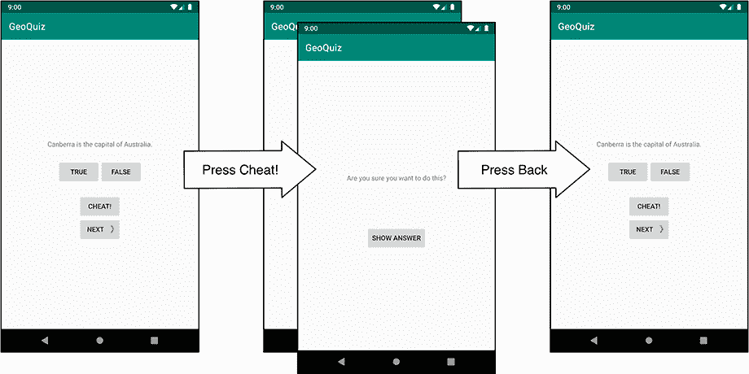

在`CheatActivity`中调用`Activity.finish()`也会将`CheatActivity`从栈中弹出。

如果你运行 GeoQuiz 并从`MainActivity`点击返回按钮，`MainActivity`将从栈中弹出，你返回到之前正在查看的屏幕（图 6.12）。

### 图 6.12 查看主界面

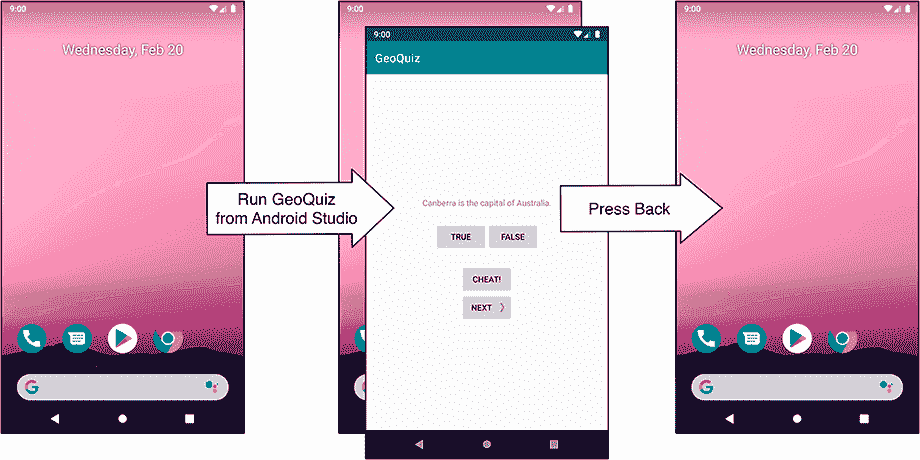

如果你是从启动器启动 GeoQuiz 的，从`MainActivity`点击返回按钮将带你回到启动器（图 6.13）。

### 图 6.13 从启动器启动 GeoQuiz

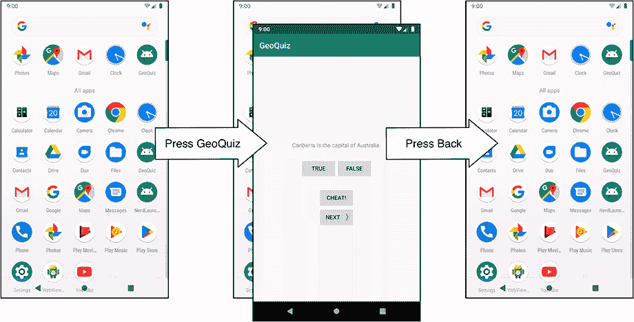

在这里看到的是`ActivityManager`维护着一个“返回栈”，并且这个返回栈不仅仅属于你的应用程序。所有应用程序的活动共享同一个返回栈，这就是为什么`ActivityManager`会参与启动你的活动的原因，它与操作系统共存，而不是留在你的应用程序。

# Android SDK 版本与兼容性

既然你已经对 GeoQuiz 有了初步了解，让我们回顾一下关于 Android 不同版本的的一些背景信息。在你继续阅读本书并开发更复杂、更真实的应用时，掌握这些信息至关重要。

## Android SDK 版本

表 7.1 显示了截至 2019 年 5 月的 SDK 版本、相关的 Android 固件版本以及运行这些版本的设备百分比。

**表 7.1 Android API 级别、固件版本和设备使用百分比**

| API 级别 | 代号 | 设备固件版本 | 设备使用百分比 |
| --- | --- | --- | --- |
| 28 | Pie | 9.0 | 10.4 |
| 27 | Oreo | 8.1 | 15.4 |
| 26 | 8.0 | 12.9 |
| 25 | Nougat | 7.1 | 7.8 |
| 24 | 7.0 | 11.4 |
| 23 | Marshmallow | 6.0 | 16.9 |
| 22 | Lollipop | 5.1 | 11.5 |
| 21 | 5.0 | 3.0 |
| 19 | KitKat | 4.4 | 6.9 |
| 18 | Jelly Bean | 4.3 | 0.5 |
| 17 | 4.2 | 1.5 |
| 16 | 4.1 | 1.2 |
| 15 | Ice Cream Sandwich | 4.0.3, 4.0.4 | 0.3 |
| 10 | Gingerbread | 2.3.3 - 2.3.7 | 0.3 |

（注意：此表中省略了普及率低于 0.1% 的 Android 版本。）

大多数带有“代号”的发布后会紧跟增量式更新。例如，Ice Cream Sandwich 最初作为 Android 4.0（API 级别 14）发布。它几乎立即被增量更新所取代，最终达到了 Android 4.0.3 和 4.0.4（API 级别 15）。

当然，使用每个版本的设备百分比在不断变化，但这些数字揭示了一个重要的趋势：当新版本可用时，运行旧版本的 Android 设备并不会立即升级或更换。截至 2019 年 5 月，仍有近 11% 的设备在运行 KitKat 或更早版本。KitKat（Android 4.4）于 2013 年 10 月发布。

（如果你感兴趣，表 7.1 中的数据可以在[`developer.android.com/about/dashboards/index.html`](https://developer.android.com/about/dashboards/index.html)获取，该数据会定期更新。）

为什么有这么多设备仍在运行旧版本的 Android？这在很大程度上是因为 Android 设备制造商和美国运营商之间的激烈竞争。运营商希望拥有其他网络不具备的功能和手机。设备制造商也面临这种压力——他们所有的手机都基于相同的操作系统，但他们希望在竞争中脱颖而出。市场和运营商的双重压力意味着，市场上存在大量对 Android 进行专有的、一次性修改的设备。

带有专有版本 Android 的设备无法运行 Google 发布的新版本 Android。相反，它必须等待兼容的专有升级。这种升级可能在 Google 发布其版本几个月后才可能可用，如果它真的可用的话。制造商通常选择将资源花在新设备上，而不是让旧设备保持更新。

## 兼容性与 Android 编程

升级的延迟结合定期的新发布，使得兼容性成为 Android 编程中的一个重要问题。为了覆盖广泛的市场，Android 开发者必须创建出的应用，既能在运行最新版本 Android 以及之前的三个到四个版本的设备上表现良好，又能适应不同的设备形式范式。

针对不同尺寸的设备比你想象的要容易。手机屏幕尺寸多种，但 Android 布局系统在适配方面做得很好。如果你需要根据屏幕尺寸提供自定义资源或布局，可以使用配置限定符（configuration qualifiers）来完成工作（正如你将在第 17 章中看到的）。然而，对于 Google 的 Android TV 和 Wear OS 设备（两者都运行 Android），UI 上的差异大到需要你重新考虑应用的用户交互模式和设计。

### 合理的最低限制

本书练习支持的最旧的 Android 版本是 API 级别 21（Lollipop）。虽然提到了 Android 的遗留版本，但重点在于我们认为的现代版本（API 级别 21+）。随着 Gingerbread、Ice Cream Sandwich、Jelly Bean 和 KitKat 的份额逐月下降，支持这些旧版本所需的工作量超过了它们能提供的价值。

增量式发布对向后兼容性的影响很小。主版本则可能是另一种情况。支持 5.x 设备的工作并不显著。幸运的是，Google 提供了库来减轻这种痛苦。

当你创建项目时，在“新建项目”向导中设置了最小 SDK，如图 7.1 所示。（注：Android 交叉使用“SDK 版本”和“API 级别”这两个术语。）

**图 7.1 记得吗？**


除了最低支持，你还可以设置`target`版本和`compile`版本。让我们解释默认选择以及如何更改它们。

所有这些属性都设置在 app 模块的`build.gradle`文件中。编译版本仅存在于该文件中。最小 SDK 版本和目标 SDK 版本设置在`build.gradle`中，但它们被用于覆盖`AndroidManifest.xml`文件中的值。

打开 app 模块中的`build.gradle`文件。注意`compileSdkVersion`、`minSdkVersion`和`targetSdkVersion`的值：

```
compile 28

defaultConfig {

    applicationId "com.bigneranch.android.geoquiz"

    minSdkVersion 21

    targetSdkVersion 28

}
```

### 最小 SDK 版本

`minSdkVersion`值是操作系统拒绝应用的上限。

通过将此版本设置为 API 级别 21（Lollipop），你允许 Android 在 Lollipop 或更高版本上安装 GeoQuiz。Android 将拒绝在低于 Lollipop 的设备上安装 GeoQuiz。

再次查看表 7.1，你可以明白为什么 API 级别 21 是最小 SDK 版本的良好选择：它允许你的应用安装在近 90% 的设备上。

### 目标 SDK 版本

`targetSdkVersion`值告诉 Android 你的应用设计用于哪个 API 级别。通常这是最新的 Android 版本。

什么情况下你会降低目标 SDK？新 SDK 发布可能会改变应用在设备上的外观，甚至改变系统底层的行为。如果你已经设计了应用，应该确认它在新版本上是否按预期运行。检查[`developer.android.com/reference/android/os/Build.VERSION_CODES.html`](https://developer.android.com/reference/android/os/Build.VERSION_CODES.html)文档来发现潜在问题。然后你可以修改应用以适应新行为，或者降低目标 SDK。

在 Android 发布新版本时不增加目标 SDK，可以确保你的应用仍然以其运行良好的目标版本的外观和行为运行。此选项的存在是为了兼容较新的 Android 版本，因为在增加`targetSdkVersion`之前，后续发布中的更改将被忽略。

需要注意的一点重要点是，如果你想在 Play Store 上发布应用，Google 对你目标 SDK 的最低限制有规定。截至本文编写时，任何新应用或应用更新的目标 SDK 必须至少为 API 级别 26 (Oreo)——否则会被 Play Store 拒绝。这确保了用户能够从近期 Android 版本的性能和安全性改进中受益。随着 Android 新版本的发布，这些版本要求将随时间推移，因此请务必关注文档，以了解何时需要更新目标版本。

## 编译 SDK 版本

最后一个 SDK 设置是`compileSdkVersion`。此设置不用于更新`AndroidManifest.xml`文件。在构建应用时，最小 SDK 版本和目标 SDK 版本会被放在清单文件中以便向操作系统发布这些值，而编译 SDK 版本是你与编译器之间的私有信息。

Android 的功能通过 SDK 中的类和函数暴露。编译 SDK 版本指定了在构建代码时使用哪个版本。当 Android Studio 查找你在导入语句中引用的类和函数时，编译 SDK 版本决定了它根据哪个 SDK 版本进行检查。

编译 SDK 版本的最佳选择是可用的最新 API 级别。然而，如果需要，你可以更改现有应用的编译 SDK 版本。例如，当 Android 发布新版本时，你可能想要更新编译 SDK 版本，以便使用它引入的新函数和类。

你可以在`build.gradle`文件中修改最小 SDK 版本、目标 SDK 版本和编译 SDK 版本。记住，在这些更改生效之前，你必须将项目与 Gradle 更改同步。

## 安全地添加来自后续 API 的代码

GeoQuiz 的最小 SDK 版本与编译 SDK 版本之间的差异为你留了一个了一个需要管理的兼容性缺口。例如，如果你调用了比棒棒糖（API 级别 21）最小 SDK 版本更高的代码，会发生什么？当你的应用安装并运行在棒糖设备上，它将会崩溃。

这曾是一个测试噩梦。然而，得益于 Android Lint 的改进，在旧设备上调用新代码引起的潜在问题可以在编译时被捕获。如果你使用了比最小 SDK 较高的版本的代码，Android Lint 将报告构建错误。

目前，GeoQuiz 的所有简单代码都在 API 级别 21 或更早引入。让我们添加一些 API 级别 21（棒棒糖）之后的代码看看会发生什么。

打开`MainActivity.kt`。在`CHEAT!`按钮的`OnClickListener`中，添加以下代码以便在`CheatActivity`出现在屏幕时使用华丽的显示动画。

**列表 7.1 添加活动动画代码 (`MainActivity.kt`)**

```
class MainActivity : AppCompatActivity() {

    ...

    override fun onCreate(savedInstanceState: Bundle?) {

        ...

        cheatButton.setOnClickListener { view ->

            // Start CheatActivity

            val answerIsTrue = quizViewModel.currentQuestionAnswer

            val intent = CheatActivity.newIntent(this@MainActivity, answerIsTrue)

            val options = ActivityOptions

                    .makeClipRevealAnimation(view, 0, 0, view.width, view.height)

            startActivityForResult(intent, REQUEST_CODE_CHEAT, options.toBundle())

        }

        updateQuestion()

    }

    ...

}
```

你使用`ActivityOptions`类来自定义你希望启动活动的方式。在上面的代码中，你调用`makeClipRevealAnimation(…)`来指定`CheatActivity`使用显示动画。你传递给`makeClipRevealAnimation(…)`的值指定了用作动画源的视图对象（在此情况下为`CHEAT!`按钮）、开始显示新活动的 x 和 y 位置（相对于源视图）以及新活动的初始宽度和高度。

请注意，你将 lambda 参数命名为`view`，而不是使用默认名称`it`。在设置点击监听器的上下文中，lambda 的参数代表被点击的视图。为参数命名不是强制的，但它可以帮助提高代码的可读性。我们建议，当 lambda 主体使用该参数，且代码的新读者无法立即弄清该参数代表什么时，请为 lambda 参数命名。

最后，你调用了`options.toBundle()`，将其是将`ActivityOptions`打包成一个`Bundle`对象，然后将其传递给`startActivityForResult(…)`。`ActivityManager`使用该选项包来决定如何将你的活动带入视野。

注意，在你调用`ActivityOptions.makeClipRevealAnimation(…)`的行出现了一个 Lint 错误，形式为函数名下方的红色波浪线，并且当你点击函数时会出现一个红色灯泡图标。`makeClipRevealAnimation(…)`函数是在 API 级别 23 中添加到 Android SDK 的，因此此代码在运行 API 22 或更低的设备上将会崩溃。

由于你的编译 SDK 版本是 API 级别 28，编译器本身对这段代码没有问题。另一方面，Android Lint 知道你的最小 SDK 版本，因此它会报错。

错误信息看起来类似于`Call requires API level 23 (Current min is 21)`。你仍然可以带有此警告运行代码（试试看），但 Lint 知道它是不安全的。

你如何消除此错误？一种方法是将最小 SDK 版本提高到 23。然而，提高最小 SDK 版本并不是在解决这个兼容性问题，不如说是规避它。如果你的应用无法安装在 API 级别 23 及之前的设备上，那么你不再有兼容性问题——但也再也没有那些用户了。

更好的方法是将高 API 代码封装在检查设备 Android 版本的条件语句中。

**列表 7.2 先检查设备的 Android 版本 (`MainActivity.kt`)**

```
class MainActivity : AppCompatActivity() {

    ...

    @SuppressLint("RestrictedApi")

    override fun onCreate(savedInstanceState: Bundle?) {

        ...

        cheatButton.setOnClickListener { view ->

            ...

            if (Build.VERSION.SDK_INT >= Build.VERSION_CODES.M) {

                val options = ActivityOptions

                        .makeClipRevealAnimation(view, 0, 0, view.width, view.height)

                startActivityForResult(intent, REQUEST_CODE_CHEAT, options.toBundle())

            } else {

                startActivityForResult(intent, REQUEST_CODE_CHEAT)

            }

        }

        updateQuestion()

    }

}
```


`Build.VERSION.SDK_INT` 常量代表设备的 Android 版本。你将该版本与代表 `M`（Marsh 棉花糖）发布的常量进行比较。（版本代码列在 [`developer.android.com/reference/android/os/Build.VERSION_CODES.html`](https://developer.android.com/reference/android/os/Build.VERSION_CODES.html) 中。）

现在，你的显示代码只有当应用运行在 API 级别 23 或更高的设备上时才会被调用。你已经让代码在 API 级别 21 上变得安全的，Android Lint 现在应该满意了。

在棉花糖或更高版本的设备上运行 GeoQuiz，对某个问题进行作弊，然后查看你的新动画。

过渡动画非常快，你可能无法看出新动画与原始动画之间的区别。为了更容易观察，你可以调整设备以减慢过渡速度。打开 `Settings` 应用并进入开发者选项（`System` → `Advanced` → `Developer options`）。找到 `Transition animation scale`（在 `Drawing` 下），选择它并将值设置为 `Animation Scale 10x`（Figure 7.2）。

**图 7.2 减慢过渡速度**

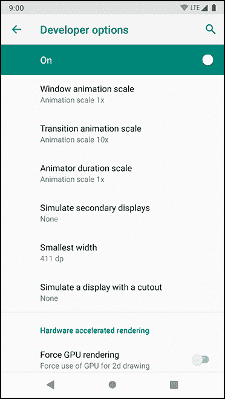

这将使过渡速度减慢 10 倍，这应该让你明显看出新动画有多不同。返回 GeoQuiz 并重新运行应用，以慢动作查看你的新过渡动画。如果你想看原始动画长什么样，请撤销对 `MainActivity` 的更改。在继续之前，返回开发者选项并将过渡动画缩放恢复为 1x。

你也可以在棒棒糖（Lollipop）设备（虚拟或其他设备）上运行 GeoQuiz。它不会有相同的显示动画，但你可以确认应用仍然可以安全运行。

你将在第 27 章中看到另一个保护新版本 API 的示例。

### Jetpack 库

虽然保护 API 级别是可行的，但由于几个原因，它并不是最优的。首先，作为开发者，在应用中为不同的版本支持不同的路径需要花费更多工作。其次，这意味着你的用户将根据其设备运行的版本获得不同的体验。

在第 4 章中，你学习了 Jetpack 库和 AndroidX。Jetpack 库在提供新功能（如 `ViewModel`）的同时，还为旧设备上的新功能提供了向后兼容，并尽可能在不同的 Android 版本之间提供（或尝试提供）一致的行为。至少使用这些库允许你编写尽可能少的条件 API 检查。

Jetpack 中的许多 AndroidX 库都是之前支持库的修改。你应该尽可能尝试使用这些库。这会让你的开发者工作变得更轻松，因为你不再需要防御不同的 API 版本并单独处理每种情况。你的用户也会受益，因为无论他们的设备运行什么版本，他们都将获得相同的体验。

遗憾的是，Jetpack 库并不是兼容性的万能药，因为并不是所有你想使用的功能在库中都可用。Android 团队随着时间的推移在向 Jetpack 库中添加新 API，但你仍然会发现某些 API 是不可用的。在这种情况下，你需要在该功能添加到 Jetpack 版本之前使用显式的版本检查。

## 使用 Android 开发者文档

Android Lint 错误会告诉你不兼容的代码来自哪个 API 级别。但你也可以在 Android 开发者文档中查找特定类和函数属于哪个 API 级别。

养成立即使用开发者文档的习惯是好的。Android SDK 中的内容太多，无法记在脑子里。而且，随着新版本的定期发布，你需要学习新内容以及如何使用它们。

Android 开发者文档是一个优秀且丰富的信息源。文档的主页是 [`developer.android.com`](https://developer.android.com)。它分为六部分：Platform、Android Studio、Google Play、Android Jetpack、Docs 和 News。如果有机会，所有部分都值得细读。每个部分都概述了 Android 开发的不同方面，从刚入门到将应用部署到 Play 商店。

- Platform
- Android Studio
- Google Play
- Android Jetpack
- Docs
- News

你还可以下载文档以便离线访问。在 Android Studio 的 SDK Manager（`Tools` → `SDK Manager`）中，选择 `SDK Tools` 标签页。勾选 `Documentation for Android SDK` 并点击 `Apply`。系统会通知你下载的大小并要求确认。下载完成后，你可以在文件系统中访问文档。你下载 SDK 的目录（如果你不知道在哪里，可以在 SDK Manager 中检查）将有一个新的 `docs` 目录，包含完整的文档。

在文档网站上，通过顶部的搜索栏搜索其名称来确定 `makeRevealAnimation()` 属于哪个 API 级别。选择 `ActivityOptions` 结果（可能是第一个搜索结果），你将被带到 Figure 7.3 所示的类引用页面。页面的右侧是通其不同部分的链接。

**图 7.3 ActivityOptions 参考页面**

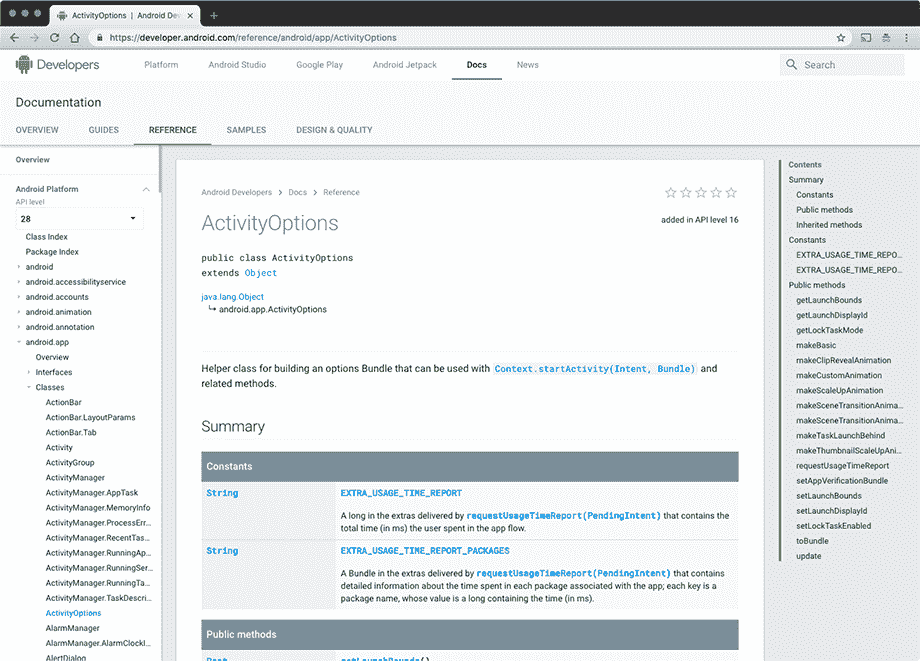

向下滚动，找到 `makeRevealAnimation()` 函数并点击函数名称查看描述。在函数签名右侧，你可以看到 `makeRevealAnimation()` 是在 API 级别 23 的。

如果你想查看在 API 级别 21 中哪些 `ActivityOptions` 方法，可以通过 API 级别过滤引用。在页面左侧按包索引类的地方，找到显示 `API level: 28` 的位置。点击相邻控件并在列表中选择 `21`。Android 在 API 级别 21 之后引入的所有内容将变灰。

API 级别过滤器对于你正在使用的 API 级别可用的类有用得多。在文档中搜索 `Activity` 类的引用页面。将 API 级别过滤器调回 API 级别 21，你会发现许多方法在该级别上是可用的——尽管在该级别之后还增加了一些方法，例如 `onMultiWindowModeChanged()`，它是棉果糖（Nougat）SDK 中添加的，允许你在活动从全屏模式切换到多窗口模式以及反之时收到通知。

在你继续阅读此书时，请经常访问开发者文档。你肯定需要文档来应对挑战性练习，但当你对特定的类、函数或其他主题产生好奇时，也应该探索它们。Android 正在不断更新和改进文档，因此总有新东西可以学习。

## 挑战：报告设备的 Android 版本

在 GeoQuiz 布局中添加一个 `TextView` 控件，向用户报告设备运行的 API 级别。图 7.4 显示了最终结果的样式。

**图 7.4 完成的挑战**

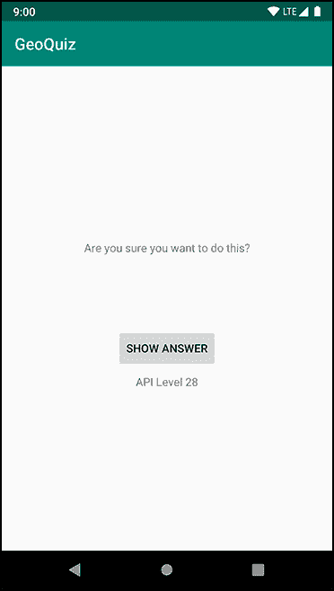

你无法在布局中设置此 `TextView` 的文本，因为在运行之前你不知道设备的 Android 版本。请在 Android 文档的 `TextView` 页面中查找设置文本的 `TextView` 函数。你要寻找的是一个接受单个参数——字符串（或 `CharSequence`）的函数。

使用 `TextView` 引用中列出的其他 XML 属性来调整文本的大小或字体。

## 挑战：有限的作弊

允许用户最多作弊三次。跟踪用户的作弊次数，并在作弊按钮下方显示剩余作弊代币的数量。如果没有剩余的代币，则禁用作弊按钮。

|  |  |
| --- | --- |
|  | 在美国前 25 个应用中，有 19 个是由邀请 Big Nerd Ranch 培训其开发人员的公司开发的。 |
|  | 应用与产品开发 Big Nerd Ranch 为各种规模的客户（从小型初创公司到大型企业）设计、开发和部署应用程序。我们的内部工程和设计团队拥有 iOS、Android 和全栈 Web 开发方面的专业知识。 |
|  | 团队培训对于拥有能力工程团队的公司，Big Nerd Ranch 可以提供 iOS、Android、前端 Web、后端 Web、macOS 和设计的上门企业培训。 |
|  | 编程训练营我们全包式的、沉浸式训练营与众不同。你一到达，我们就会处理好一切，从机场接送到酒店到用餐。我们的佐治亚和加利福尼亚静修营非常适合那些无法离开家几个月的中级和高级开发者。 |
|  | FRONTIER 屏幕演示利用针对各种主题的零碎化教程，包括将你的 Java 项目转换为 Kotlin。我们的作者和开发者准备了各种主题来帮助你提升水平。每周发布新的屏幕演示。欢迎咨询我们的免费试用。 |

[www.bignerdranch.com](http://www.bignerdranch.com)

# 8 UI Fragment 和 Fragment 管理器

在本章中，你将开始构建一个名为 `CriminalIntent` 的应用程序。`CriminalIntent` 记录“办公室犯罪”的细节——例如在茶水间水池里留下脏碗子，或者在文档打印后离开空空的共享打印机。

通过 `CriminalIntent`，你可以对犯罪进行记录，包括标题、日期和照片。你还可以从联系人中识别嫌疑人，并通过电子邮件、Twitter、Facebook 或另一个应用程序提交投诉。在记录并报告犯罪后，你就可以毫无怨恨地继续工作，准备专注于手头的业务。

`CriminalIntent` 是一个复杂的程序，需要 11 章才能完成。它将具有列表-详情界面：主屏幕将显示记录的犯罪列表，用户可以添加新犯罪或选择现有的犯罪来查看和编辑其详情（图 8.1）。

**图 8.1 CriminalIntent，一个列表-详情应用**

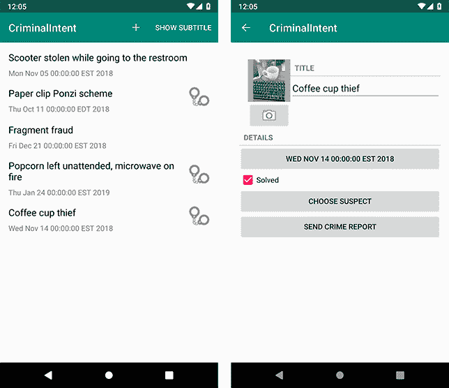

## UI 灵活性的需求

你可能认为列表详情应用由两个 Activity 组成：一个管理列表，另一个管理详情视图。点击列表中的犯罪将启动详情 Activity 的实例。点击返回按钮将销毁详情 Activity 并返回到列表，你可以在那里选择另一个犯罪。

那样可以行得通，但如果你想在屏幕之间进行更复杂的展示和导航呢？

考虑 `CriminalIntent` 运行在大尺寸设备上的可能性。某些设备的屏幕足够大，可以同时显示列表和详情——至少在横屏模式下（图 8.2）。

**图 8.2 适用于不同屏幕宽的理想列表-详情界面**

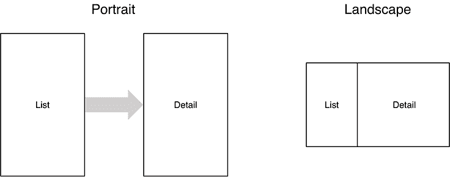

或者想象用户正在查看某个犯罪并想看下一个犯罪。如果他们可以直接从列表中选择另一个犯罪，而不需要先返回到上一个界面，会更好。

这些场景的共同点是 UI 灵活性：根据设备的要求在运行时组合和重新组合 Activity 视图的能力。

Activity 的构建并不是为了提供这种灵活性。Activity 的视图可能会运行时发生变化，但控制这些视图的代码必须存在于 Activity 内部。结果是，Activity 与使用的屏幕紧密耦合的。

## 引入 Fragment

通过将应用程序的 UI 管理从 Activity 移动到多个 Fragment，你可以确保你的应用程序具有灵活性。

Fragment 是一个 Activity 可以委托其执行任务的对象。最常见的任务是管理 UI。UI 可以是整个屏幕，也可以是屏幕的一部分。

管理 UI 的 Fragment 被称为 UI Fragment。UI Fragment 拥有自己的视图，该视图是从布局文件加载的。Fragment 的视图包含了用户想要查看和交互的有趣 UI 元素。

Activity 的视图不再包含 UI，而是持有一个 Fragment 的容器。Fragment 的视图在加载后会被插入容器中。在本章中，Activity 将托管单个 Fragment，但 Activity 的视图可以包含多个用于不同 Fragment 的容器。

你可以使用与 Activity 关联的 Fragment，根据应用程序和用户的需要组合并重新组合屏幕。Activity 的视图在整个生命周期内技术上保持不变，并且没有违反 Android 的规则。

使用 UI 片段（fragments）可以将应用程序的 UI 分为多个构建块，这不仅对于列表-详情应用非常有用。通过操作单个构建块，可以轻松地构建标签页界面、添加动画侧边栏等。此外，一些新的 Android Jetpack API（如导航控制器 navigation controller）与片段配合效果最好。因此，使用片段可以让你能够很好地与 Jetpack API 集成。

## 开始 CriminalIntent

在本章中，你将开始编写 CriminalIntent 的细节部分。图 8.4 展示了 CriminalIntent 在本章节结束时的样子。

**图 8.4 本章结束时的 CriminalIntent**


图 8.4 显示屏幕将由名为 `CrimeFragment` 的 UI 片段管理。`CrimeFragment` 的实例将由名为 `MainActivity` 的活动（activity）托管（hosted）。

目前，将托管理解为：活动在它的视图层次级中提供一个位置，以包含片段及其视图（图 8.5）。片段本身无法在屏幕上获取视图。只有当它被插入到活动的层次级中时，它的视图才会出现。

**图 8.5 MainActivity 托管一个 CrimeFragment**

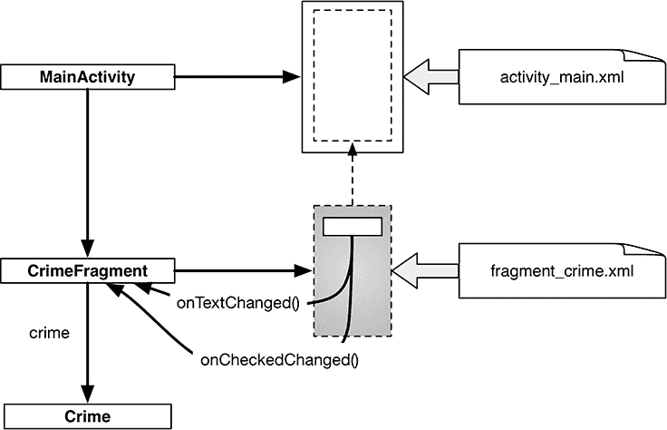

CriminalIntent 将是一个大型项目，而保持项目思路清晰的一种方法是使用对象图。图 8.6 给了你提供了 CriminalIntent 的整体视图。你不需要记住这些对象及它们的关系，但在开始之前对你的去向有一个大致的了解是有好处的。

你可以看到 `CrimeFragment` 将执行你在 GeoQuiz 中活动所做的工作：创建并管理 UI 并与模型对象交互。

**图 8.6 CriminalIntent 的对象图（本章用）**

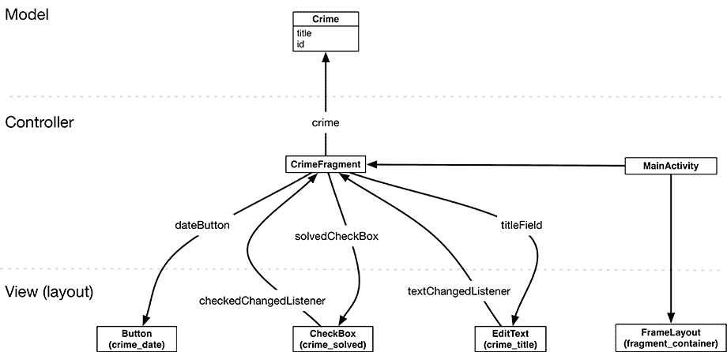

图 8.6 显示的类中有三个是你将编写的类：`Crime`、`CrimeFragment` 和 `MainActivity`。

`Crime` 的实例将代表单个办公犯罪。在本章中，一个犯罪将有一个标题（title）、一个 ID、一个日期（date）和一个指示犯罪是否已解决的 `Boolean` 值。标题是一个描述性名称，例如“毒水池倾倒”或“有人偷了我的酸奶！”。ID 将唯一标识一个 `Crime` 实例。

对于本章，你将保持一切非常简单，并使用单个 `Crime` 实例。`CrimeFragment` 将有一个属性（`crime`）来持有这个孤立事件。

`MainActivity` 的视图将由一个 `FrameLayout` 组成，该框架定义了 `CrimeFragment` 视图出现的位置。

`CrimeFragment` 的视图将由一个 `LinearLayout` 组成，内部包含几个子视图，包括一个 `EditText`、一个 `Button` 和一个 `CheckBox`。`CrimeFragment` 将为这些视图中的每一个设置属性，并在它们上设置监听器以便在发生变化时更新模型层。

### 创建新项目

话不多说，是时候构建新应用了。创建一个新的 Android 应用程序（`File` → `New` → `New Project...`）。选择 `Empty Activity` 模板（图 8.7）。点击 `Next`。

**图 8.7 创建 CriminalIntent 应用程序**

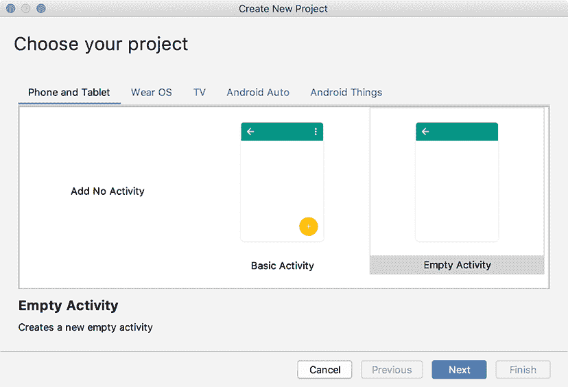

如图 8.8 所示配置你的项目。将应用程序命名为 `CriminalIntent`。确保包名为 `com.criminalintent.criminalintent`，语言为 `Kotlin`。从最低 API 级别下拉菜单中选择 `API 21: Android 5.0 (Lollipop)`。最后，勾选 `Use Android artifacts` 复选框。

**图 8.8 配置 CriminalIntent 项目**

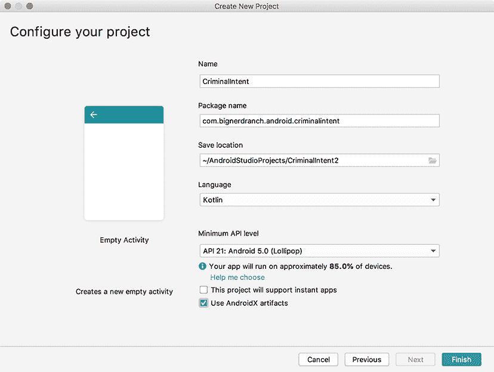

点击 `Finish` 生成项目。

在继续进行 `MainActivity` 之前，通过编写 `Crime` 类创建模型层。

### 创建数据类

在项目窗口中，右键点击 `criminalintent` 包并选择 `New` → `Kotlin File/Class` 来创建一个名为 `Crime.kt` 的文件。

在 `Crime.kt` 中，添加字段来表示犯罪的 ID、标题、日期和状态，以及一个初始化 ID 和日期字段的构造函数。除了字段外，在类定义中添加 `data` 关键字，以使 `Crime` 成为一个数据类。

**清单 8.1 添加 `Crime` 数据类（`Crime.kt`）**


`data class Crime(val id: UUID = UUID.randomUUID(),`

`                 var title: String = "",`

`                 var date: Date = Date(),`

`                 var isSolved: Boolean = false)`

在导入`Date`时，你会看到多个选项。确保导入的是`java.util.Date`。

`UUID`是Android框架包含的一个工具类。它提供了一种生成通用唯一ID值的简单方法。在构造函数中，通过调用`UUID.randomUUID()`生成随机唯一ID。使用默认`Date()`构造函数初始化`date`变量将其设置为当前日期。这将是犯罪的默认日期。

这就是`Crime`类以及CriminalIntent模型层所需的所有内容。

此时你已经创建了模型层和一个能够托管支持片段的活动。现在你将进入细节如何执行其职责。

## 创建 UI 片段

创建UI片段的步骤与你创建活动的步骤相同：

- 通过在布局文件中定义控件来组合UI
- 创建类并将视图设置为你定义的布局
- 在代码中连接从布局中加载的控件

### 定义 CrimeFragment 的布局

`CrimeFragment`的视图将显示`Crime`实例中包含的信息。

首先，在`res/values/strings.xml`中定义用户看到的字符串。

**Listing 8.2 添加字符串 (`res/values/strings.xml`)**

```
<resources>
    <string name="app_name">CriminalIntent</string>
    <string name="crime_title_hint">Enter a title for the crime.</string>
    <string name="crime_title_label">Title</string>
    <string name="crime_details_label">Details</string>
    <string name="crime_solved_label">Solved</string>
</resources>
```

接下来，你将定义UI。`CrimeFragment`的布局将由一个垂直`LinearLayout`组成，其中包含两个`TextView`、一个`EditText`、一个`Button`和一个`CheckBox`。

要创建一个布局文件，在项目工具窗口中右键点击`res/layout`文件夹并选择`New`→`Layout resource file`。将此文件命名为`fragment_crime.xml`并将`LinearLayout`设置为根元素。

Android Studio会创建该文件并为你添加`LinearLayout`。将构成fragment布局的控件添加到`res/layout/fragment_crime.xml`。

**Listing 8.3 fragment 视图的布局文件 (`res/layout/fragment_crime.xml`)**

```
<LinearLayout xmlns:android="http://schemas.android.com/apk/res/android"
    xmlns:tools="http://schemas.android.com/tools"
    android:orientation="vertical"
    android:layout_width="match_parent"
    android:layout_height="match_parent"
    android:layout_margin="16dp">

    <TextView
            style="?android:listSeparatorTextViewStyle"
            android:layout_width="match_parent"
            android:layout_height="wrap_content"
            android:text="@string/crime_title_label"/>

    <EditText
            android:id="@+id/crime_title"
            android:layout_width="match_parent"
            android:layout_height="wrap_content"
            android:hint="@string/crime_title_hint"/>

    <TextView
            style="?android:listSeparatorTextViewStyle"
            android:layout_width="match_parent"
            android:layout_height="wrap_content"
            android:text="@string/crime_details_label"/>

    <Button
            android:id="@+id/crime_date"
            android:layout_width="match_parent"
            android:layout_height="wrap_content"
            tools:text="Wed Nov 14 11:56 EST 2018"/>

    <CheckBox
            android:id="@+id/crime_solved"
            android:layout_width="match_parent"
            android:layout_height="wrap_content"
            android:text="@string/crime_solved_label"/>

</LinearLayout>
```

（第一个`TextView`的定义包含了一些与视图样式相关的新语法：`style="?android:listSeparatorTextViewStyle"`。不要担心，你将在第10章中的*样式、主题和主题属性*部分学习该语法背后的含义。）

记住`tools`命名空间允许你提供预览能够显示的信息。在这种情况下，你为日期按钮添加了文本，以便它在预览中不为空。检查`Design`标签以查看fragment视图的预览（图8.9）。

**图 8.9 预览更新后的crime fragment布局**

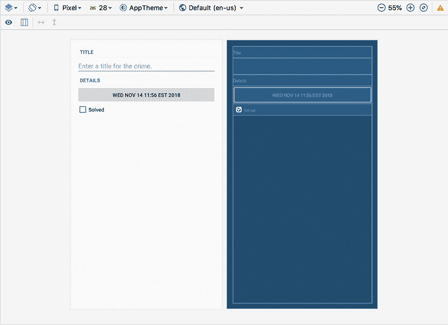

### 创建 CrimeFragment 类

为`CrimeFragment`类创建另一个Kotlin文件。这次选择`Class`作为类型，Android Studio将为你生成类的定义存根。通过子类`Fragment`类将该类转换为fragment。

**Listing 8.4 子类`Fragment`类 (`CrimeFragment.kt`)**

```
class CrimeFragment : Fragment() {
}
```

当你子类`Fragment`类时，你会发现Android Studio找到了两个名为`Fragment`的类。请使用图8.10所示的`androidx.fragment.app.Fragment`版本。（注意Jetpack库以`androidx`开头。）

**图 8.10 选择Jetpack Fragment类**


#### 实现 fragment 生命周期周期函数

`CrimeFragment`是一个与模型和视图对象交互的控制器。它的工作是展示特定犯罪的详情，并在用户更改这些详情时更新这些详情。

在GeoQuiz中，你的活动大部分控制器工作是在活动生命周期函数中完成的。在CriminalIntent中，这些工作将由碎片（fragments）在碎片生命周期函数中完成。其中许多函数与你熟悉的`Activity`函数对应，例如`onCreate(Bundle?)`。（你将在本章稍后的*FragmentManager and the fragment lifecycle*章节中学习更多相关内容。）

在`CrimeFragment.kt`中，为`Crime`实例添加一个属性，以及`Fragment.onCreate(Bundle?)`的实现。

在重写函数时，Android Studio可以提供一些帮助。开始输入`onCreate(Bundle?)`函数的名字。Android Studio将提供一个建议列表，如图8.11所示。

**图 8.11 重写`onCreate(Bundle?)`函数**

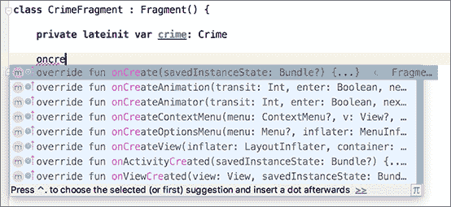

按回车键选择重写`onCreate(Bundle?)`函数的选项，Android Studio将为你创建声明，包括对父类实现的调用。更新你的代码以创建一个新的`Crime`，匹配代码列表8.5。

**代码列表 8.5 重写`Fragment.onCreate(Bundle?)` (`CrimeFragment.kt`)**

```kotlin
class CrimeFragment : Fragment() {

    private lateinit var crime: Crime

    override fun onCreate(savedInstanceState: Bundle?) {
        super.onCreate(savedInstanceState)
        crime = Crime()
    }
}
```

在这个实现中有几点需要注意。首先，`Fragment.onCreate(Bundle?)`是公共的；当定义中没有包含可见性修饰符时，Kotlin函数默认为公共。这与受保护的`Activity.onCreate(Bundle?)`函数不同。`Fragment.onCreate(Bundle?)`和其他`Fragment`生命周期函数必须是公共的，因为它们将由宿主该碎片的任何活动调用。

其次，与活动类似，碎片也有一个bundle用来保存和检索其状态。你可以根据自己的目的重写`Fragment.onSaveInstanceState(Bundle)`，就像重写`Activity.onSaveInstanceState(Bundle)`一样。

此外，注意在`Fragment.onCreate(Bundle?)`中*没有*发生什么：你并没有在这里加载（inflate）碎片的视图。你在`Fragment.onCreate(Bundle?)`中配置碎片实例，但在另一个碎片生命周期函数中创建并配置碎片的视图：`onCreateView(LayoutInflater, ViewGroup?, Bundle?)`。

该函数用于加载碎片视图的布局并将加载后的`View`返回给宿主活动。`LayoutInflater`和`ViewGroup`参数是加载布局所需的。`Bundle`将包含该函数可以使用从保存的状态重新创建视图的数据。

在`CrimeFragment.kt`中，添加`onCreateView(…)`的实现以加载`fragment_crime.xml`。你可以使用与图8.11相同的技巧来填充函数声明。

**代码列表 8.6 重写`onCreateView(…)` (`CrimeFragment.kt`)**

```kotlin
class CrimeFragment : Fragment() {

    private lateinit var crime: Crime

    override fun onCreate(savedInstanceState: Bundle?) {
        super.onCreate(savedInstanceState)
        crime = Crime()
    }

    override fun onCreateView(
        inflater: LayoutInflater,
        container: ViewGroup?,
        savedInstanceState: Bundle?
    ): View? {
        val view = inflater.inflate(R.layout.fragment_crime, container, false)
        return view
    }
}
```

在`onCreateView(…)`中，你通过调用`LayoutInflater.inflate(…)`并传入布局资源ID来显式地加载碎片的视图。第二个参数是视图的父视图，这通常用于正确配置小部件。第三个参数告诉布局加载器是否立即将加载的视图添加到视图的父视图中。你传入`false`是因为碎片的视图将托管在活动的容器视图中。碎片的视图不需要立即添加到父视图——活动将处理它。

### 在碎片中连接小部件

你现在将要连接碎片中的`EditText`、`CheckBox`和`Button`。`onCreateView(…)`函数就是连接这些小部件的地方。

从`EditText`开始。视图加载后，使用`findViewById`获取`EditText`的引用。

**代码列表 8.7 连接`EditText`小部件 (`CrimeFragment.kt`)**

```kotlin
class CrimeFragment : Fragment() {

    private lateinit var crime: Crime
    private lateinit var titleField: EditText
    ...
    override fun onCreateView(
        inflater: LayoutInflater,
        container: ViewGroup?,
        savedInstanceState: Bundle?
    ): View? {
        val view = inflater.inflate(R.layout.fragment_crime, container, false)

        titleField = view.findViewById(R.id.crime_title) as EditText

        return view
    }
}
```

在`Fragment.onCreateView(…)`中获取引用几乎与在`Activity.onCreate(Bundle?)`中相同。唯一区别是你在碎片的视图上调用了`View.findViewById(Int)`。你之前使用的`Activity.findViewById(Int)`函数是一个在背后调用`View.findViewById(Int)`的便利函数。`Fragment`类没有对应的便利函数，因此你必须调用真实的方法。

一旦设置了引用，在`onStart()`生命周期回调中添加一个监听器。

**代码列表 8.8 为`EditText`小部件添加监听器 (`CrimeFragment.kt`)**


```kotlin
class CrimeFragment : Fragment() {
    ...
    override fun onCreateView(
        inflater: LayoutInflater,
        container: ViewGroup?,
        savedInstanceState: Bundle?
    ): View? {
        ...
    }

    override fun onStart() {
        super.onStart()

        val titleWatcher = object : TextWatcher {

            override fun beforeTextChanged(
                sequence: CharSequence?,
                start: Int,
                count: Int,
                after: Int
            ) {
                // This space intentionally left blank
            }

            override fun onTextChanged(
                sequence: CharSequence?,
                start: Int,
                before: Int,
                count: Int
            ) {
                crime.title = sequence.toString()
            }

            override fun afterTextChanged(sequence: Editable?) {
                // This one too
            }
        }

        titleField.addTextChangedListener(titleWatcher)
    }
}
```

在 fragment 中设置监听器的工作与 activity 中完全相同。在这里，你创建了一个实现冗长的`TextWatcher`接口的匿名类。`TextWatcher`有三个函数，但你只关心其中一个：`onTextChanged(…)`。

在`onTextChanged(…)`中，你对用户输入的`CharSequence`调用`toString()`。该函数返回一个字符串，然后你用它来设置`Crime`的标题。

注意，`TextWatcher`监听器是在`onStart()`中设置的。某些监听器不仅在用户与其交互时被触发，而且当视图状态恢复（例如旋转屏幕时）数据设置到它们上时也会触发。对数据输入响应的监听器（例如`EditText`的`TextWatcher`或`CheckBox`的`OnCheckChangedListener`）容易受到这种行为的影响。

只对用户交互响应的监听器（例如`OnClickListener`）不会受到此影响，因为它们不受在视图上设置数据的影响。这就是为什么你在 GeoQuiz 中没有遇到这种情况。该应用只使用了点击监听器，点击监听器在旋转时不会触发，因此你可以在`onCreate(…)`中——在任何状态恢复之前设置好一切。

视图状态恢复发生在`onCreateView(…)`之后和`onStart()`之前。当状态恢复时，`EditText`的内容将被设置为`crime.title`中当前的任何值。此时，如果你已经为`EditText`设置了监听器（例如在`onCreate(…)`或`onCreateView(…)`中），`TextWatcher`的`beforeTextChanged(…)`、`onTextChanged(…)`和`afterTextChanged(…)`函数将执行。在`onStart()`中设置监听器可以避免这种行为，因为监听器是在视图状态恢复后才挂上的。

接下来，连接`Button`以显示犯罪发生的日期。

**Listing 8.9 设置`Button`文本 (`CrimeFragment.kt`)**

```kotlin
class CrimeFragment : Fragment() {

    private lateinit var crime: Crime
    private lateinit var titleField: EditText
    private lateinit var dateButton: Button
    ...
    override fun onCreateView(
        inflater: LayoutInflater,
        container: ViewGroup?,
        savedInstanceState: Bundle?
    ): View? {
        val view = inflater.inflate(R.layout.fragment_crime, container, false)

        titleField = view.findViewById(R.id.crime_title) as EditText
        dateButton = view.findViewById(R.id.crime_date) as Button

        dateButton.apply {
            text = crime.date.toString()
            isEnabled = false
        }

        return view
    }
}
```

禁用按钮可以确保它不会对用户的点击做出任何响应。它还改变了按钮的外观以传达其被禁用状态。在第 13 章中，你将启用按钮并允许用户选择犯罪日期。

继续处理`CheckBox`，在`onCreateView(…)`中获取它的引用。然后于`onStart()`中设置一个监听器，它将更新`Crime`的`solvedCheckBox`字段，如列表 8.10 所示。尽管`OnClickListener`不会因 fragment 的状态恢复而触发，但将其放在`onStart`中也有助于将你所有的监听器保持在同一个地方并易于查找。

**Listing 8.10 监听`CheckBox`变化 (`CrimeFragment.kt`)**

```kotlin
class CrimeFragment : Fragment() {

    private lateinit var crime: Crime
    private lateinit var titleField: EditText
    private lateinit var dateButton: Button
    private lateinit var solvedCheckBox: CheckBox
    ...
    override fun onCreateView(
        inflater: LayoutInflater,
        container: ViewGroup?,
        savedInstanceState: Bundle?
    ): View? {
        val view = inflater.inflate(R.layout.fragment_crime, container, false)

        titleField = view.findViewById(R.id.crime_title) as EditText
        dateButton = view.findViewById(R.id.crime_date) as Button
        solvedCheckBox = view.findViewById(R.id.crime_solved) as CheckBox
        ...
    }

    override fun onStart() {
        ...
        titleField.addTextChangedListener(titleWatcher)

        solvedCheckBox.apply {
            setOnCheckedChangeListener { _, isChecked ->
                crime.isSolved = isChecked
            }
        }
    }
}
```

你的`CrimeFragment`代码现在已经完成了。如果你能运行 CriminalIntent 并玩玩这些代码就太棒了。但你不能。Fragments 无法独自将自己的视图显示在屏幕上。为了实现你的努力，你必须先将`CrimeFragment`添加到`MainActivity`中。

```xml
<androidx.constraintlayout.widget.ConstraintLayout
        xmlns:android="http://schemas.android.com/apk/res/android"
        xmlns:tools="http://schemas.android.com/tools"
        xmlns:app="http://schemas.android.com/apk/res-auto"
        android:layout_width="match_parent"
        android:layout_height="match_parent"
        tools:context=".MainActivity">

    <TextView
            android:layout_width="wrap_content"
            android:layout_height="wrap_content"
            android:text="Hello World!"
            app:layout_constraintBottom_toBottomOf="parent"
            app:layout_constraintLeft_toLeftOf="parent"
            app:layout_constraintRight_toRightOf="parent"
            app:layout_constraintTop_toTopOf="parent"/>

</androidx.constraintlayout.widget.ConstraintLayout>
<FrameLayout
        xmlns:android="http://schemas.android.com/apk/res/android"
        android:id="@+id/fragment_container"
        android:layout_width="match_parent"
        android:layout_height="match_parent"/>
```

`FragmentManager`使用`FrameLayout`的资源 ID 来标识`CrimeFragment`，这似乎很奇怪。但通过其容器视图的资源 ID 来标识 UI fragment 是`FragmentManager`运行机制的内置方式。如果你向一个 activity 添加了多个 fragment，通常会为这些 fragment 各创建一个具有独立 ID 的独立容器。

现在我们可以从头到尾总结一下你在列表 8.12") 中添加的代码：

首先，你向`FragmentManager`请求一个容器视图 ID 为`R.id.fragment_container`的 fragment。如果该 fragment 已经在列表中，`FragmentManager`将返回它。

为什么 fragment 可能已经在列表中了呢？对`MainActivity.onCreate(Bundle?)`的调用可能是为了响应`MainActivity`在因旋转（如屏幕旋转）后被销毁并重新创建，或者是为了回收内存。当 activity 被销毁时，它的`FragmentManager`会保存它的 fragment 列表。当 activity 被重新创建时，新的`FragmentManager`会检索该列表并重新创建列表中的 fragment，以使一切恢复到之前的状态。

另一方面，如果没有与给定容器视图 ID 对应的 fragment，则`fragment`将为`null`。在这种情况下，你会创建一个新的`CrimeFragment`以及一个新的 fragment 事务将该 fragment 添加到列表中。

`MainActivity`现在托管了一个`CrimeFragment`。运行 CriminalIntent 来证明这一点。你应该能看到在`fragment_crime.xml`中定义的视图，如图 8.14 所示。

**图 8.14  MainActivity 托管的`CrimeFragment`视图**


### FragmentManager 和 fragment 生命周期

图 8.15 显示了 fragment 的生命。fragment 的生命与 activity 的生命相似：它有停止（stopped）、暂停（paused）和恢复（resumed）状态，并且拥有你可以重写的函数以便在关键点完成工作——其中许多与 activity 的生命周期函数对应。

**图 8.15  Fragment 生命周期图**

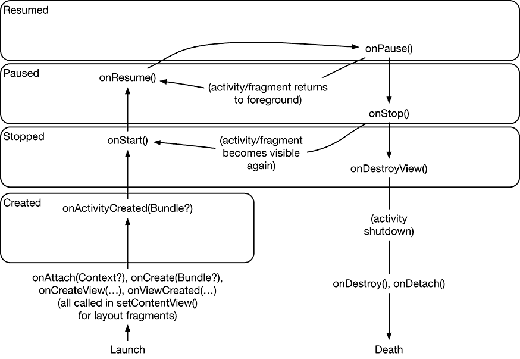

这种对应关系非常重要。因为 fragment 是代表 activity 工作的，它的状态应该反映 activity 的状态。因此，它需要相应的生命周期函数来处理 activity 的工作。

fragment 生命周期与 activity 生命周期之间的一个关键区别是，fragment 生命周期函数是由托管 activity 的`FragmentManager`调用的，而不是操作系统（OS）。操作系统完全不知道 activity 用来管理事务的 fragment。fragment 是 activity 的内部业务。当你将 fragment 添加到`FragmentManager`时，会调用`onAttach(Context?)`、`onCreate(Bundle?)`、`onCreateView(…)`和`onViewCreated(…)`函数。

`onActivityCreated(Bundle?)`函数在托管 activity 的`onCreate(Bundle?)`函数执行后被调用。你是在`MainActivity.onCreate(Bundle?)`中添加`CrimeFragment`的，所以此会在 fragment 添加后被调用。

如果在 activity 已经恢复（resumed）时添加 fragment 会发生什么？在这种情况下，`FragmentManager`会立即引导 fragment 经历所有必要的步骤，以使其与 activity 的状态同步。例如，当一个 fragment 被添加到已经恢复的 activity 时，该 fragment 会被调用`onAttach(Context?)`、`onCreate(Bundle?)`、`onCreateView(…)`、`onViewCreated(…)`、`onActivityCreated(Bundle?)`、`onStart()`，然后是`onResume()`。

一旦 fragment 的状态与 activity 同步，托管 activity 的`FragmentManager`将调用相应的生命周期函数，就像接收到操作系统的调用一样。

## 使用 Fragment 的应用架构

以正确的方式使用 fragment 设计应用至关重要。许多开发者在学习了 fragment 后，尝试将其应用于应用程序中的每一个组件。这是使用 fragment 的错误方式。

Fragment 的意图是以可重用的方式封装主要组件。在这种情况下，主要组件应该是屏幕层面的。如果屏幕上有大量的 fragment，你的代码将充斥着 fragment 事务和不清晰的职责。对于较小的组件，更好的架构解决方案是将其提取为自定义视图（继承`View`或其子类的类）。

负责任地使用 fragment。一个好的经验是，屏幕上的 fragment 不要多于两个三个（参见图 8.16）。

**图 8.16  越少越好**

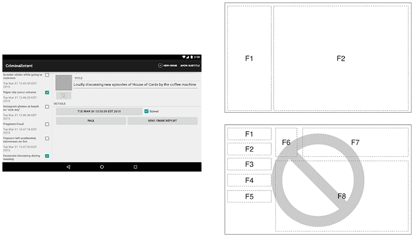

### 决定是否使用 fragment

fragment 是 Android 社区中讨论的热门话题。有些人非常反对 fragment 及其生命周期带来的额外复杂性，因此他们从不在项目中使用它们。这种方法的问题在于，Android 中有许多 API 依赖于 fragment，例如`ViewPager`和 Jetpack Navigation 库。如果你在应用中使用这些选项，那么你就必须使用 fragment 来获得它们的益处。

如果你不需要依赖 fragment 的 API，那么 fragment 在需求更大的应用中更有用。对于简单的单屏幕应用，fragment 引入的复杂性往往是没有必要的。


从这里开始，书中的某些应用将使用片段（fragments），而另一些不会。你将在单个章节中构建一些小型应用程序，你将通过不使用片段来让构建这些应用变得更容易。然而，书中的较大应用将使用片段，以便让你获得额外的使用经验，并使应用在未来更易扩展。

# 9 使用 `RecyclerView` 显示列表

`CriminalIntent` 的模型层目前包含一个 `Crime` 的单实例。在本章中，你将更新 `CriminalIntent` 以能够处理 `Crime` 列表。该列表将显示每个 `Crime` 的标题和日期，如图图 9.1 所示。

**图 9.1 犯罪列表**

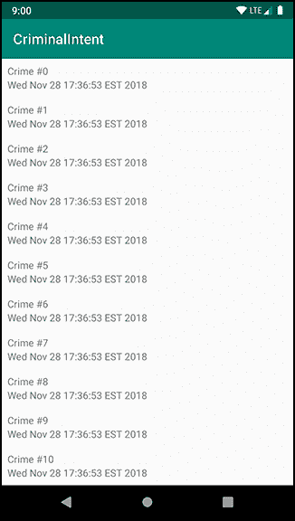

图 9.2 显示了 `CriminalIntent` 在本章中的整体计划。

**图 9.2 带有犯罪列表的 `CriminalIntent`**

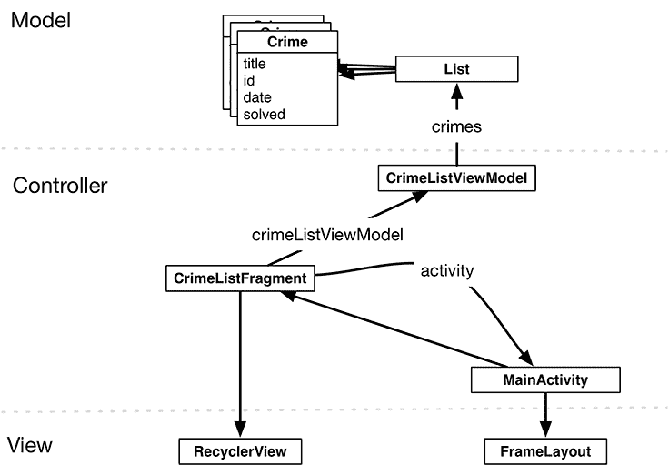

在控制器层中，你有一个新的 `ViewModel`，它将封装新屏幕的数据。`CrimeListViewModel` 将存储 `Crime` 对象的列表。

显示犯罪列表需要在 `CriminalIntent` 的控制器层中创建一个新的片段：`CrimeListFragment`。`MainActivity` 将托管 `CrimeListFragment` 的实例，该实例反过来将在屏幕上显示犯罪列表。

（在图 9.2 中，`CrimeFragment` 在哪里呢？它是详情视图的一部分，所以我们在这里没有显示它。在第 12 节中，你将连接 `CriminalIntent` 的列表和详情部分。）

在图 9.2 中，你还可以看到与 `MainActivity` 和 `CrimeListFragment` 关联的视图对象。activity 的视图将包含同一个包含片段的 `FrameLayout`。片段的视图将包含一个 `RecyclerView`。你将在本章稍后部分学习更多关于 `RecyclerView` 类的知识。

## 添加新的片段和 `ViewModel`

第一步是添加一个新的 `ViewModel` 来存储最终将在屏幕上显示的 `Crime` 对象列表（`List`）。正如你在第 4 节中所学习到的，`ViewModel` 类是 `lifecycle-extensions` 库的一部分。因此，首先开始向你的 `app/build.gradle` 文件添加 `lifecycle-extensions` 依赖项。

**列表 9.1 添加 `lifecycle-extensions` 依赖（`app/build.gradle`）**

```gradle
dependencies {
    ...
    implementation 'androidx.appcompat:appcompat:1.1.0-alpha02'
    implementation 'androidx.core:core-ktx:1.1.0-alpha04'
    implementation 'androidx.lifecycle:lifecycle-extensions:2.0.0'
    ...
}
```

在进行更改后，不要忘记同步你的 Gradle 文件。

接下来，创建一个名为 `CrimeListViewModel` 的新 Kotlin 类。更新新的 `CrimeListViewModel` 类继承自 `ViewModel`。添加一个属性来存储 `Crime` 列表。在 `init` 块中，用虚拟数据填充列表。

**列表 9.2 生成犯罪（`CrimeListViewModel.kt`）**

```kotlin
class CrimeListViewModel : ViewModel() {

    val crimes = mutableListOf<Crime>()

    init {
        for (i in 0 until 100) {
            val crime = Crime()
            crime.title = "Crime #$i"
            crime.isSolved = i % 2 == 0
            crimes += crime
        }
    }
}
```

最终，`List` 将包含用户创建的、可以保存和重新加载的 `Crime` 对象。现在，你用 100 个无聊的 `Crime` 对象填充列表。

`ViewModel` 并不是长期存储的解决方案，但它确实封装了 `CrimeListFragment` 视图所需的数据。在第 11 节中，当你更新 `CriminalIntent` 以存储犯罪列表时，将学习更多关于长期存储的知识。下一步是添加一个新的 `CrimeListFragment` 类并将其与 `ViewModel` 关联。

**列表 9.3 实现 `CrimeListFragment`（`CrimeListFragment.kt`）**

```kotlin
private const val TAG = "CrimeListFragment"

class CrimeListFragment : Fragment() {

    private val crimeListViewModel: CrimeListViewModel by lazy {
        ViewModelProviders.of(this).get(CrimeListViewModel::class.java)
    }

    override fun onCreate(savedInstanceState: Bundle?) {
        super.onCreate(savedInstanceState)
        Log.d(TAG, "Total crimes: ${crimeListViewModel.crimes.size}")
    }

    companion object {
        fun newInstance(): CrimeListFragment {
            return CrimeListFragment()
        }
    }
}
```

现在，`CrimeListFragment` 只是一个片段的空壳。它记录了 `CrimeListViewModel` 中找到的犯罪数量。你将在本章稍后完善这个片段。

一个遵循的良好实践是提供一个 `newInstance(…)` 函数，你的 activity 可以调用它来获取片段的实例。这与你在 `GeoQuiz` 中使用的 `newIntent()` 函数类似。

### 与片段结合的 `ViewModel` 生命周期

在第 4 节中，你学习了在 activity 中使用 `ViewModel` 的生命周期。当 `ViewModel` 与片段结合时，其生命周期略有不同。它仍然只有两个状态：创建或销毁/不存在，但它现在绑定到片段的生命周期而不是 activity。

只要片段的视图在屏幕上，`ViewModel` 就会保持活跃。`ViewModel` 将跨越旋转持久存在（尽管片段实例不会），并可以被新的片段实例访问。

当片段被销毁时，`ViewModel` 将被销毁。这在用户按下返回键关闭屏幕时可能会发生。当托管的 activity 用另一个片段替换该片段时也会发生。即使同一个 activity 仍在屏幕上，该片段及其关联的 `ViewModel` 也会被销毁，因为它们不再需要了。

一种特殊情况是你将片段事务添加到回退栈（back stack）。当 Activity 用不同的片段替换当前片段时，如果该事务被添加到回退栈中，则片段实例及其 `ViewModel` 将不会被销毁。这保持了你的状态：如果用户按下返回键，片段事务将会被反销。原始片段实例会被放回屏幕，且 `ViewModel` 中的所有数据都会被保留。

接下来，更新 `MainActivity` 以托管 `CrimeListFragment` 实例而不是 `CrimeFragment`。

**代码清单 9.4 使用片段事务添加 `CrimeListFragment`（`MainActivity.kt`）**

```kotlin
class MainActivity : AppCompatActivity() {

    override fun onCreate(savedInstanceState: Bundle?) {
        ...
        if (currentFragment == null) {
            val fragment = CrimeFragment() CrimeListFragment.newInstance()
            supportFragmentManager
                .beginTransaction()
                .add(R.id.fragment_container, fragment)
                .commit()
        }
    }
}
```

现在，你已经硬编码了 `MainActivity` 使其始终显示 `CrimeListFragment`。在第 12 章中，你将更新 `MainActivity`，根据用户在应用中的导航，按需切换 `CrimeListFragment` 和 `CrimeFragment`。

运行 `CriminalIntent`，你会看到 `MainActivity` 的 `FrameLayout` 托管了一个空的 `CrimeListFragment`，如图 9.3 所示。

**图 9.3 空的 `MainActivity` 屏幕**

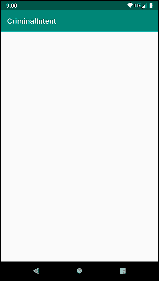

在 Logcat 输出中搜索 `CrimeListFragment`。你会看到一条显示可用犯罪案件总数的日志语句：

```text
2019-02-25 15:19:39.950 26140-26140/com.bignerdranch.android.criminalintent
       D/CrimeListFragment: Total crimes: 100
```

## 添加 `RecyclerView`

你希望 `CrimeListFragment` 向用户显示犯罪列表。为了实现这一点，你将使用 `RecyclerView`。

`RecyclerView` 类存在于另一个 Jetpack 库中。使用 `RecyclerView` 的第一步是将 RecyclerView 库作为依赖项添加。

**代码清单 9.5 添加 RecyclerView 依赖（`app/build.gradle`）**

```gradle
dependencies {
    ...
    implementation 'androidx.lifecycle:lifecycle-extensions:2.0.0'
    implementation 'androidx.recyclerview:recyclerview:1.0.0'
    ...
}
```

再次提醒，在继续之前请同步你的 Gradle 文件。

你的 `RecyclerView` 将位于 `CrimeListFragment` 的布局文件中。首先，你必须创建一个布局文件。创建一个名为 `fragment_crime_list` 的新布局资源文件。对于“根元素”（Root element），指定 `androidx.recyclerview.widget.RecyclerView`（图 9.4）。

**图 9.4 添加 `CrimeListFragment` 的布局文件**

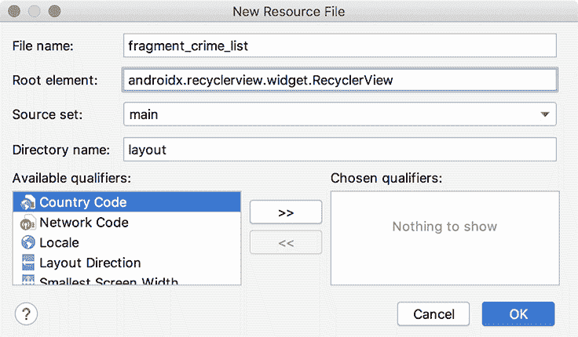

在新的 `layout/fragment_crime_list.xml` 文件中，为 `RecyclerView` 添加一个 ID 属性。将闭合标签合并到起始标签，因为你不会为 `RecyclerView` 添加任何子元素。

**代码清单 9.6 在布局文件中添加 `RecyclerView`（`layout/fragment_crime_list.xml`）**

```xml
<androidx.recyclerview.widget.RecyclerView
        xmlns:android="http://schemas.android.com/apk/res/android"
        android:id="@+id/crime_recycler_view"
        android:layout_width="match_parent"
        android:layout_height="match_parent"/>

</androidx.recyclerview.widget.RecyclerView>
```

现在 `CrimeListFragment` 的视图已设置就绪，将视图连接到片段中。修改 `CrimeListFragment` 以使用此布局文件并在布局文件中查找 `RecyclerView`，如代码清单 9.7 所示。

**代码清单 9.7 为 `CrimeListFragment` 设置视图（`CrimeListFragment.kt`）**

```kotlin
class CrimeListFragment : Fragment() {

    private lateinit var crimeRecyclerView: RecyclerView

    private val crimeListViewModel: CrimeListViewModel by lazy {
        ViewModelProviders.of(this).get(CrimeListViewModel::class.java)
    }

    override fun onCreate(savedInstanceState: Bundle?) {
        super.onCreate(savedInstanceState)
        Log.d(TAG, "Total crimes: ${crimeListViewModel.crimes.size}")
    }

    override fun onCreateView(
        inflater: LayoutInflater,
        container: ViewGroup?,
        savedInstanceState: Bundle?
    ): View? {
        val view = inflater.inflate(R.layout.crime_list, container, false)

        crimeRecyclerView =
            view.findViewById(R.id.crime_recycler_view) as RecyclerView
        crimeRecyclerView.layoutManager = LinearLayoutManager(context)

        return view
    }
}
```

注意，一旦你创建了 `RecyclerView`，就要给它另一个名为 `LayoutManager` 的对象。`RecyclerView` 需要一个 `LayoutManager` 才能工作。如果你忘记给它一个，它将会崩溃。

`RecyclerView` 并不自己负责屏幕上定位。它将此任务委托给 `LayoutManager`。`LayoutManager` 负责定位每个项目并定义滚动方式。因此，如果 `RecyclerView` 尝试执行这些操作而没有 `LayoutManager`，`RecyclerView` 会立即崩溃。

有几个内置的 `LayoutManager` 可供选择，你也可以第三方库中找到更多。你使用的是 `LinearLayoutManager`，它将垂直方向排列列表项。在本书的后面，你将使用 `GridLayoutManager` 以网格形式排列项目。

运行应用。你应该再次看到一个空白屏幕，但现在你看到的是空的 `RecyclerView`。

## 创建项目视图布局

`RecyclerView` 是 `ViewGroup` 的子类。它显示一组子 `View` 对象，称为项目视图（item views）。每个项目视图代表支持回收视图列表中的单个对象（在你的案例中，是列表中的单个犯罪案件）。取决于你需要显示内容的复杂性，这些子 `View` 可以很复杂，也可以非常简单。

对于你的首次实现，列表中的每个项将显示 `Crime` 的标题和日期，如图 9.5 所示。

**图 9.5 带有子 `View` 的 `RecyclerView`**

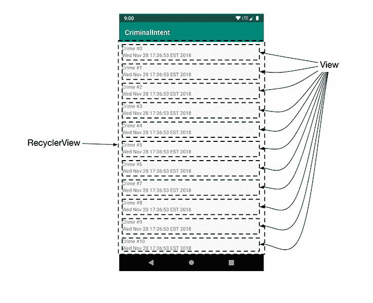

`RecyclerView` 上显示的每个项目都将有自己的视图层级结构，就像 `CrimeFragment` 为整个屏幕拥有一个视图层级结构完全一样。具体来说，每一行的 `View` 对象将是一个包含两个 `TextView` 的 `LinearLayout`。

你为列表项视图创建新布局的方法与为 activity 或 fragment 的视图创建布局的方法完全相同。在项目工具窗口中，右键点击 `res/layout` 目录并选择 `New` → `Layout resource file`。将文件命名为 `list_item_crime`，将根元素设置为 `LinearLayout`，并点击 `OK`。

更新你的布局文件，为 `LinearLayout` 添加内边距并添加两个 `TextView`，如 Listing 9.8 所示。

**Listing 9.8 更新列表项布局文件（`layout/list_item_crime.xml`）**


`<LinearLayout>` 布局文件代码如下：

```xml
<LinearLayout xmlns:android="http://schemas.android.com/apk/res/android"
              android:orientation="vertical"
              android:layout_width="match_parent"
              android:layout_height="match_parent">
              android:layout_height="wrap_content"
              android:padding="8dp">

    <TextView
            android:id="@+id/crime_title"
            android:layout_width="match_parent"
            android:layout_height="wrap_content"
            android:text="Crime Title"/>

    <TextView
            android:id="@+id/crime_date"
            android:layout_width="match_parent"
            android:layout_height="wrap_content"
            android:text="Crime Date"/>

</LinearLayout>
```

查看设计预览，你会发现你已经创建好了一个完整产品的单行。稍后，你将看到 `RecyclerView` 如何为你创建这些行。

## 实现 ViewHolder

`RecyclerView` 期望项视图被封装在 `ViewHolder` 实例中。`ViewHolder` 存储了项目视图的引用（有时也存储该视图内特定控件的引用）。

通过在 `CrimeListFragment` 中添加一个自 `RecyclerView.ViewHolder` 的内部类来定义视图持有。

**Listing 9.9  `ViewHolder` 的开头 (`CrimeListFragment.kt`)**

```kotlin
class CrimeListFragment : Fragment() {
    ...
    override fun onCreateView(
        inflater: LayoutInflater,
        container: ViewGroup?,
        savedInstanceState: Bundle?
    ): View? {
        ...
    }

    private inner class CrimeHolder(view: View)
        : RecyclerView.ViewHolder(view) {

    }
}
```

在 `CrimeHolder` 的构造函数中，你传入了要持有的视图。紧接着，你将其作为参数传递给 `RecyclerView.ViewHolder` 构造函数。基类 `ViewHolder` 类会将该视图保留在名为 `itemView` 的属性中（Figure 9.6）。

**Figure 9.6  `ViewHolder` 及其 `itemView`**

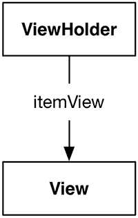

`RecyclerView` 永远不会自己创建 `View`。它总是创建 `ViewHolder`，并让它们带着相应的 `itemView`（Figure 9.7）。

**Figure 9.7  ViewHolder 可视化**

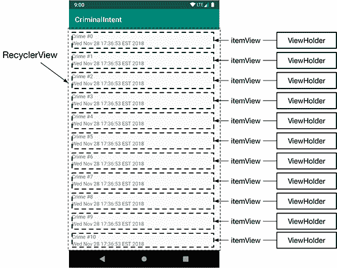

当每个项目的 `View` 简单时，`ViewHolder` 的职责很少。对于更复杂的 `View`，`ViewHolder` 使将 `itemView` 的不同部分与 `Crime` 的连接变得更简单更高效。（例如，你不需要在每次设置标题时都遍历项目视图层级结构来获取标题文本视图的句柄。）

更新 `CrimeHolder`，在创建实例时查找 `itemView` 中的标题和日期文本视图。将视图引用存储在属性中。

**Listing 9.10  在 `CrimeListFragment` 中提取视图**

```kotlin
private inner class CrimeHolder(view: View)
    : RecyclerView.ViewHolder(view) {

    val titleTextView: TextView = itemView.findViewById(R.id.crime_title)
    val dateTextView: TextView = itemView.findViewById(R.id.crime_date)
}
```

更新后的视图持有现在存储了标题和日期文本视图的引用，因此你可以轻松更改值，而无需再次遍历项目层级（Figure 9.8）。

**Figure 9.8  重新可视化的 ViewHolder**


注意，`CrimeHolder` 假设传递给构造函数的视图具有 ID 为 `R.id.crime_title` 和 `R.id.crime_date` 的子视图。你可能会想：“是谁（或什么）创建了 holder 实例？我可以安全地假设传递给构造函数的视图包含了我预期的控件吗？”稍后你就会知道这些问题的答案。

## 实现适配以填充 RecyclerView

Figure 9.7 是经过简化。`RecyclerView` 并不自己创建 `ViewHolder`。相反，它请求适配器（adapter）。适配器是一个位于 `RecyclerView` 和它应该显示的数据集之间的控制对象。

适配器负责：

- 在被请求时创建必要的 `ViewHolder`
- 在被请求时将 `ViewHolder` 绑定到来自模型层的数据

Recycler 视图负责：

- 请求适配器创建新的 `ViewHolder`
- 请求适配器将 `ViewHolder` 绑定到给定位置的数据项

是时候创建你的适配器了。在 `CrimeListFragment` 中添加一个名为 `CrimeAdapter` 的新内部类。添加一个主构造函数，接收犯罪列表作为输入并将传递的犯罪列表存储在属性中，如 Listing 9.11") 所示。

在你的新 `CrimeAdapter` 中，你还将重写三个函数：`onCreateViewHolder(…)`、`onBindViewHolder(…)` 和 `getItemCount()`。为了节省你的输入时间（避免错误），Android Studio 可以为你生成这些重写方法。一旦你输入了新代码的第一行，将光标置于 `CrimeAdapter` 上并按下 Option-Return (Alt-Enter)。在弹出的菜单中选择 `Implement members`。在 `Implement members` 对话框中，选择所有三个函数名并点击 `OK`。然后，你只需要如所示填充函数体内容即可。

**Listing 9.11 创建 `CrimeAdapter` (`CrimeListFragment.kt`)**

```kotlin
class CrimeListFragment : Fragment() {
    ...
    private inner class CrimeHolder(view: View)
        : RecyclerView.ViewHolder(view) {
        ...
    }

    private inner class CrimeAdapter(var crimes: List<Crime>)
        : RecyclerView.Adapter<CrimeHolder>() {

        override fun onCreateViewHolder(parent: ViewGroup, viewType: Int)
                : CrimeHolder {
            val view = layoutInflater.inflate(R.layout.list_item_crime, parent, false)
            return CrimeHolder(view)
        }

        override fun getItemCount() = crimes.size

        override fun onBindViewHolder(holder: CrimeHolder, position: Int) {
            val crime = crimes[position]
            holder.apply {
                titleTextView.text = crime.title
                dateTextView.text = crime.date.toString()
            }
        }
    }
}
```

`Adapter.onCreateViewHolder(…)` 负责创建一个用于显示的 view，将该 view 封装在 view holder 中并返回结果。在这种情况下，你加载了 `list_item_view.xml` 并将生成的 view 传递给新的 `CrimeHolder` 实例。（目前，你可以忽略 `onCreateViewHolder(…)` 的参数。只有当你需要进行某些复杂操作时（例如在同一个 recycler view 中显示不同类型的 view），你才需要这些值。更多信息请参阅本章末尾的 *Challenge: RecyclerView ViewTypes* 章节。）

`Adapter.onBindViewHolder(holder: CrimeHolder, position: Int)` 负责根据给定的 `position` 将犯罪数据填充到指定的 `holder` 中。在这种情况下，你从犯罪列表请求的位置获取犯罪数据。然后，你使用该犯罪的标题和数据来设置相应文本视图中的文本。

当 recycler view 需要知道支持它的数据集中包含多少项目时（例如当 recycler view 首次启动时），它会通过调用 `Adapter.getItemCount()` 询问其适配器。在这里，`getItemCount()` 返回犯罪列表中的项目数量，以回答 recycler view 的请求。

`RecyclerView` 本身对 `Crime` 对象或要显示的 `Crime` 对象列表一无所知。相反，`CrimeAdapter` 了解 `Crime` 的所有细节。适配器还知道支持 recycler view 的犯罪列表（图 9.9）。

**图 9.9 Adapter 位于 recycler view 和数据集之间**

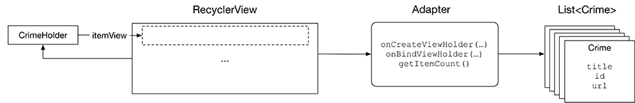

当 `RecyclerView` 需要一个 view 对象进行显示时，它会与它的适配器进行对话。图 9.10 显示了 `RecyclerView` 可能发起的对话示例。

**图 9.10 一次精彩的 RecyclerView-Adapter 对话**

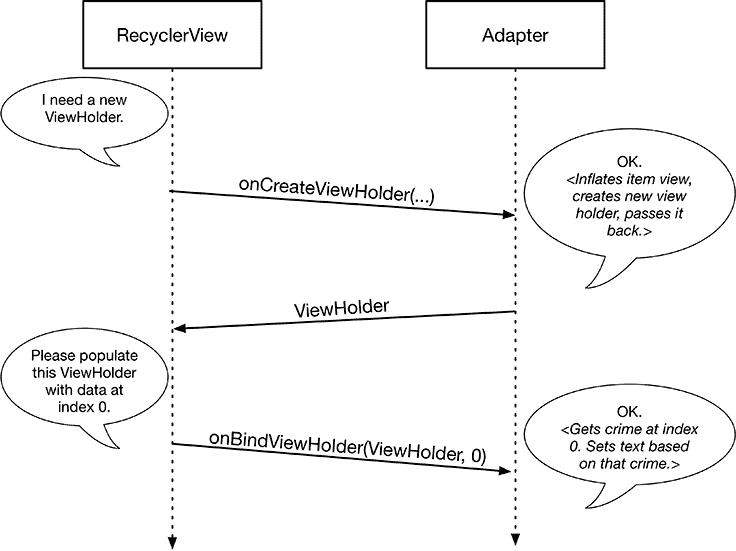

`RecyclerView` 调用适配器的 `onCreateViewHolder(ViewGroup, Int)` 函数来创建一个新的 `ViewHolder`，以及它的“多汁载负载”：一个用于显示的 `View`。适配器创建并返回给 `RecyclerView` 的 `ViewHolder`（及其 `itemView`）尚未填充来自数据集中特定项目的数据。

接下来，`RecyclerView` 调用 `onBindViewHolder(ViewHolder, Int)`，传递一个 `ViewHolder` 及其对应的位置 `position`。适配器将查找该位置的模型并将其绑定到 `ViewHolder` 的 `View` 上。为了完成绑定，适配器会填充 `View` 以反映模型中的数据。在此过程完成后，`RecyclerView` 将把列表项放置在屏幕上。

### 设置 RecyclerView 的适配器

现在你已经有了一个 `Adapter`，请将其连接到你的 `RecyclerView`。实现一个名为 `updateUI` 的函数来设置 `CrimeListFragment` 的 UI。目前，它将创建一个 `CrimeAdapter` 并将其设置在 `RecyclerView` 上。

**Listing 9.12 设置 `Adapter` (`CrimeListFragment.kt`)**

```kotlin
class CrimeListFragment : Fragment() {

    private lateinit var crimeRecyclerView: RecyclerView
    private var adapter: CrimeAdapter? = null
    ...
    override fun onCreateView(
        inflater: LayoutInflater,
        container: ViewGroup?,
        savedInstanceState: Bundle?
    ): View? {
        val view = inflater.inflate(R.layout.fragment_crime_list, container, false)

        crimeRecyclerView =
                view.findViewById(R.id.crime_recycler_view) as RecyclerView
        crimeRecyclerView.layoutManager = LinearLayoutManager(context)

        updateUI()

        return view
    }

    private fun updateUI() {
        val crimes = crimeListViewModel.crimes
        adapter = CrimeAdapter(crimes)
        crimeRecyclerView.adapter = adapter
    }
    ...
}
```

在后面的章节中，随着 UI 配置变得复杂，你将在 `updateUI()` 中添加更多内容。

运行 CriminalIntent 并滚动你的新 `RecyclerView`，它看起来应该像 图 9.11。

**图 9.11 填充了犯罪数据的 RecyclerView**


当你向上滑动视图时，滚动动画应该像温化的黄油一样顺滑。这种效果直接源于保持 `onBindViewHolder(…)` 的短小和高效，只执行必要的最少工作。请注意：在 `onBindViewHolder(…)` 中务必保持高效。否则，你的滚动动画可能会像冰冷的帕玛森芝士一样卡顿。

## 复用视图 (Recycling Views)

图 9.11 显示了 11 行 `View`。你可以通过滑动滚动 100 个 `View` 来查看所有的 `Crime`。这意味着你在内存中拥有 100 个 `View` 对象吗？多亏了 `RecyclerView`，并不会。

一次性为列表中的每个项目创建一个 `View` 很容易变得不可行。正如你想象的，列表的项可能远超 100 个，而且你的列表项可能比我们这里的简单实现要复杂得多。此外，`Crime` 只有在屏幕上时才需要 `View`，因此没有必要准备 100 个 `View` 待命。只在需要时才创建视图对象要有意义得多。

`RecyclerView` 正是这样做。它不是创建 100 个 `View`，而是只创建足够填充屏幕的数量。当一个视图滑出屏幕时，`RecyclerView` 会复用它而不是将其丢弃。简而言之，它名副其实：它在不断地复用视图。

正因如此，`onCreateViewHolder(ViewGroup, Int)` 的发生频率会远低于 `onBindViewHolder(ViewHolder, Int)`。一旦创建了足够的 `ViewHolder`，`RecyclerView` 就会停止调用 `onCreateViewHolder(…)`。相反，它通过复用旧的 `ViewHolder` 并将其传递给 `onBindViewHolder(ViewHolder, Int)` 来节省时间和内存。

## 清理列表绑定 (Cleaning Up Binding List Items)

目前，`Adapter` 在 `Adapter.onBindViewHolder(…)` 中直接将犯罪数据绑定到犯罪 holder 的文本视图上。这运行良好良好，但更清晰地分离 view holder 和 adapter 之间的职责更好。adapter 应该尽可能少地了解 view holder 的内部工作机制和细节。


我们建议你将所有执行绑定实际工作的代码放在你的`CrimeHolder`中。首先，添加一个属性来存放正在绑定的`Crime`。顺便将现有的文本视图属性设为私有。为`CrimeHolder`添加一个`bind(Crime)`函数。在这个新函数中，将正在绑定的犯罪缓存到属性中，并设置`titleTextView`和`dateTextView`上的文本值。

**代码列表 9.13 编写`bind(Crime)`函数 (`CrimeListFragment.kt`)**

```
private inner class CrimeHolder(view: View)
    : RecyclerView.ViewHolder(view) {

    private lateinit var crime: Crime

    private val titleTextView: TextView = itemView.findViewById(R.id.crime_title)
    private val dateTextView: TextView = itemView.findViewById(R.id.crime_date)

    fun bind(crime: Crime) {
        this.crime = crime
        titleTextView.text = this.crime.title
        dateTextView.text = this.crime.date.toString()
    }
}
```

当给出一个`Crime`进行绑定时，`CrimeHolder`现在将更新标题`TextView`和日期`TextView`以反映`Crime`的状态。

接下来，每当`RecyclerView`请求将特定的`CrimeHolder`绑定到特定的`Crime`时，都调用你新创建的`bind(Crime)`函数。

**代码列表 9.14 调用`bind(Crime)`函数 (`CrimeListFragment.kt`)**

```
private inner class CrimeAdapter(var crimes: List<Crime>)
    :  RecyclerView.Adapter<CrimeHolder>() {

    override fun onCreateViewHolder(parent: ViewGroup, viewType: Int): CrimeHolder {
        ...
    }

    override fun onBindViewHolder(holder: CrimeHolder, position: Int) {
        val crime = crimes[position]
        holder.apply {
            titleTextView.text = crime.title
            dateTextView.text = crime.date.toString()
        }
        holder.bind(crime)
    }

    override fun getItemCount() = crimes.size
}
```

再次运行 CriminalIntent。结果应该看起来与图 9.11 所示。

# 响应点击 (Responding to Presses)

正如你所注意到的，`RecyclerView`虽然功能强大，但责任非常少。处理触摸事件主要取决于你。如果你需要，`RecyclerView`可以转发原始触摸事件。但大多数情况下这是没有必要的。

相反，你可以像往常那样处理它们：通过设置一个`OnClickListener`。由于每个`View`都有一个关联的`ViewHolder`，你可以让`ViewHolder`成为其`View`的`OnClickListener`。

修改`CrimeHolder`以处理整行的点击事件。

**代码列表 9.15 在`CrimeHolder`中检测点击 (`CrimeListFragment.kt`)**

```
private inner class CrimeHolder(view: View)
    : RecyclerView.ViewHolder(view), View.OnClickListener {

    private lateinit var crime: Crime

    private val titleTextView: TextView = itemView.findViewById(R.id.crime_title)
    private val dateTextView: TextView = itemView.findViewById(R.id.crime_date)

    init {
        itemView.setOnClickListener(this)
    }

    fun bind(crime: Crime) {
        this.crime = crime
        titleTextView.text = this.crime.title
        dateTextView.text = this.crime.date.toString()
    }

    override fun onClick(v: View) {
        Toast.makeText(context, "${crime.title} pressed!", Toast.LENGTH_SHORT)
                .show()
    }
}
```

在代码列表 9.15 中，`CrimeHolder`本身实现了`OnClickListener`接口。在`itemView`（即整行的`View`），将`CrimeHolder`设置为点击事件的接收者。

运行 CriminalIntent 并点击列表中的一项。你应该看到一个显示项目被点击的`Toast`。

# 给更好奇的人：ListView 和 GridView

Android 核心操作系统包含`ListView`、`GridView`和`Adapter`类。在 Android 5.0 发布之前，这些是创建列表或网格的首选方式。

这些组件的 API 与`RecyclerView`非常相似。`ListView`或`GridView`类负责对一组项目进行滚动，但它们对这些每个项目并不了解。`Adapter`负责创建列表中的每个`View`。然而，`ListView`和`GridView`并不强制你使用`ViewHolder`模式（尽管你可以使用并且应该使用它）。

由于修改`ListView`或`GridView`行为所需的复杂性，这些旧的实现被`RecyclerView`实现所取代了。

例如，创建一个水平滚动的`ListView`并不包含在`ListView` API 中，并且需要大量工作。在`RecyclerView`中创建自定义布局和滚动行为仍然需要很多工作，但`RecyclerView`设计之初就是为了扩展，所以情况没那么糟糕。

`RecyclerView`的另一个关键特性是列表项的动画。在`ListView`或`GridView`中为添加或移除项目动画是一项复杂且容易出错的任务。`RecyclerView`使这变得简单得多，包含了一些内置动画，并允许对这些动画进行轻松自定义。

例如，如果你发现位置 0 处的犯罪移动到了位置 5，你可以这样对该更改进行动画：

```
recyclerView.adapter.notifyItemMoved(0, 5)
```

# 挑战：RecyclerView ViewTypes

在这次高级挑战中，你将在`RecyclerView`中创建两种类型的行：普通行和针对更严重犯罪的行。要实现这一点，你将使用`RecyclerView.Adapter`中提供的`view type`功能。为`Crime`对象添加一个新属性`requiresPolice`，并通过实现`getItemViewType(Int)`函数用来决定在`CrimeAdapter`中加载哪种视图（[`developer.android.com/reference/android/support/v7/widget/RecyclerView.Adapter.html#getItemViewType`](https://developer.android.com/reference/android/support/v7/widget/RecyclerView.Adapter.html#getItemViewType)）。

在`onCreateViewHolder(ViewGroup, Int)`函数中，你还需要添加逻辑，根据`getItemViewType(Int)`返回的新的`viewType`值返回不同的`ViewHolder`。对于不需要警察干预的犯罪，使用原始布局；对于需要干预的犯罪，使用一个带有有“联系警察”按钮的精简界面的新布局。

# 使用布局和控件创建用户界面

在本章中，你将学习更多关于布局和控件的知识，同时为你的`RecyclerView`列表项添加一些样式。你还将学习如何使用图形布局编辑器在`ConstraintLayout`中排列控件。图 10.1 显示了当你对现有应用进行精雕以构建你的杰作后，`CrimeListFragment`的视图将是什么样子。

**图 10.1 CriminalIntent，现在有了精美的图片**

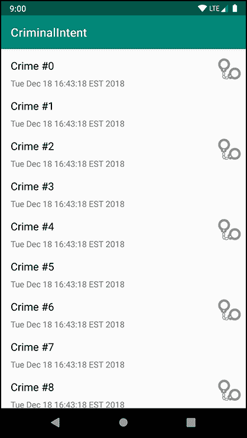

在之前的章节中，你使用嵌套布局层级来排列控件。例如，你在第 1 章中为 GeoQuiz 创建的`layout/activity_main.xml`文件在另一个`LinearLayout`中嵌套了一个`LinearLayout`。这种嵌套对于你作为开发者来说很难阅读和编辑。更糟糕的是，嵌套会降低应用的性能。Android 操作系统需要很长时间来测量和布局嵌套布局，这意味着你的用户在屏幕上看到你的视图之前可能会遇到延迟。

扁平的（非嵌套的）布局对于操作系统来说测量和布局更快。这是`ConstraintLayout`真正大放异彩领域之一。你可以在不使用嵌套的情况下创建复杂的布局。

在深入研究`ConstraintLayout`之前，你必须做一些准备工作并学习一些背景知识。你需要在项目中复制从图 10.1 中获取的那张漂亮的手铐图像。打开解决方案文件（[`www.bigneranch.com/solutions/Android4e.zip`](https://www.bigneranch.com/solutions/Android4e.zip)）和`09_LayoutsAndWidgets/CriminalIntent/app/src/main/res`目录。将`ic.png`的每个密度版本拷贝到相应的 drawable 文件夹中。

## 引入 ConstraintLayout

通过`ConstraintLayout`，你不再使用嵌套布局，而是向你的布局添加一系列约束。约束就像橡皮筋：它将两个物体向彼此拉拢。例如，如果你有一个`ImageView`，你可以从它的右边缘到父布局（`ConstraintLayout`本身）的右边缘附加约束，如图 10.2 所示。约束会将`ImageView`固定在右侧。

**图 10.2 右侧有约束的 ImageView**

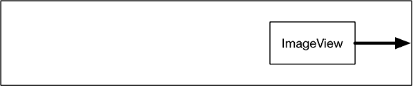

你可以从`ImageView`的所有四个边缘（左、上、右、下）创建约束。如果你有对立的约束，它们将相互相等，你的`ImageView`将位于两个约束的中心（图 10.3）。

**图 10.3 具有对立约束的 ImageView**

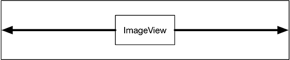

通过这些工具，你可以使用单个`ConstraintLayout`实现许多布局，而无需任何嵌套。在本章的后续内容，你将学习如何在你的`list_item_crime.xml`布局文件中使用约束。

## 介绍图形化布局编辑器

到目前为止，你一直通过输入 XML 来创建布局。在本节中，你将使用 Android Studio 的图形化布局工具。

打开`layout/list_item_crime.xml`并选择文件底部的`Design`标签（图 10.4）。

**图 10.4 图形化布局工具中的视图**

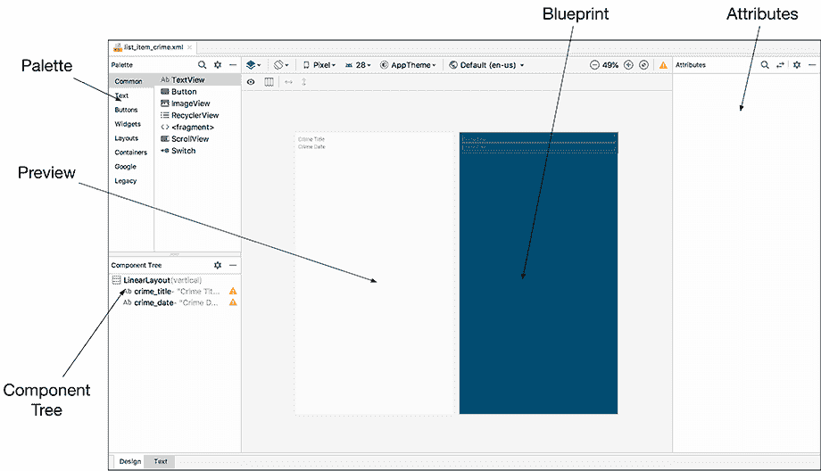

图形化布局编辑器中间是你之前见过的预览。预览右侧是`Blueprint`（蓝图），正如你在第 1 章中看到的，它与预览类似，但显示了每个视图的轮廓。当你需要查看每个视图有多大，而不仅仅是它显示什么时，这非常有用。

屏幕左侧是调色板（palette），它包含了你想要的所有组件，并按类别组织。组件树位于左下角。该树显示了组件在布局中的组织方式。如果你看不到调色板或组件树，请点击预览左侧的标签来打开窗口。

屏幕右侧是`attributes view`（属性视图）。在这里，你可以查看并编辑组件树中选选组件的属性。

你需要做的第一件事是将`list_item_crime.xml`转换为使用`ConstraintLayout`。在组件树中右键点击你的根`LinearLayout`并选择`Convert LinearLayout to ConstraintLayout`（图 10.5）。

**图 10.5 将根视图转换为`ConstraintLayout`**

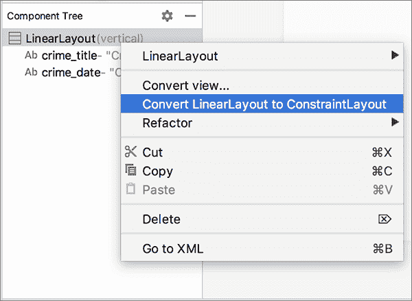

Android Studio 会在弹窗中询问你希望此转换过程具有多大的激进程度（图 10.6）。由于`list_item_crime.xml`是一个简单的布局文件，Android Studio 没有什么可以优化的。保持默认值选中并点击`OK`。

**图 10.6 使用默认配置进行转换**

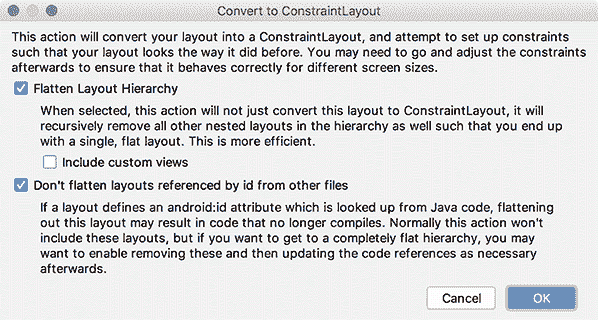

请耐心等待。转换过程可能需要一些时间。但完成后，你将拥有一个良好的、新的`ConstraintLayout`来工作（图 10.7）。

**图 10.7 `ConstraintLayout`的生活**

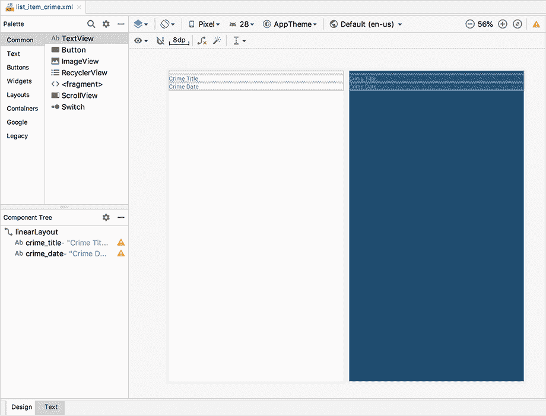

（纳奇为什么组件树显示你有一个`linearLayout`？我们稍后会解释。）

预览上方的工具栏有几个编辑控件（图 10.8）。你可能需要点击预览区域以查看所有控件。

**图 10.8 约束控制**

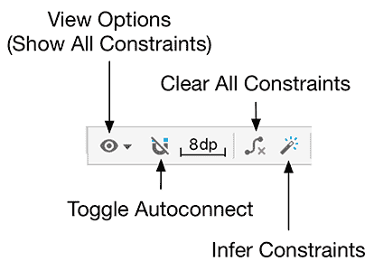

| 视图选项 (View Options) |
| :--- |
| 切换自动连接 (Toggle Autoconnect) |
| 清除所有约束 (Clear All Constraints) |
| 推断约束 (Infer Constraints) |

## 使用 ConstraintLayout

当你将`list_item_crime.xml`转换为使用`ConstraintLayout`时，Android Studio 会自动添加它认为将复制旧布局行为的约束。然而，为了学习约束是如何工作的，你将从零开始。

在组件树中选择标记为`linearLayout`的顶层视图。为什么在你已经将其转换为`ConstraintLayout`的情况下它还显示`linearLayout`呢？那是`ConstraintLayout`转换器提供的 ID。事实上，`linearLayout`就是你的`ConstraintLayout`。

在组件树中选中`linearLayout`后，点击`Clear All Constraints`按钮（如图 10.8 所示）。你将立即看到红旗，其中一个在屏幕上方。点击它查看具体是怎么回事（图 10.9）。

**图 10.9 ConstraintLayout**


当视图没有约束时，`ConstraintLayout`无法知道将它们放在什么位置。你的`TextView`s没有约束，因此在学习本章内容时，它们不会出现在正确的位置。你的`TextView`的垂直和水平尺寸分别由高度设置和宽度设置控制。这些设置可以设置为三种视图大小设置之一（图 10.11），每种设置都对应`layout_width`或`layout_height`的一个值。

### 腾出空间

你需要在图形化布局编辑器中留出工作空间。你的两个`TextView`占据了整个区域，这将使得很难连接其他内容。

在组件树中选择`crime_title`并查看右侧的属性视图（图 10.10）。如果该面板未为你打开，请点击右侧的`Attributes`标签打开它。

**图 10.10 Title `TextView`的属性**

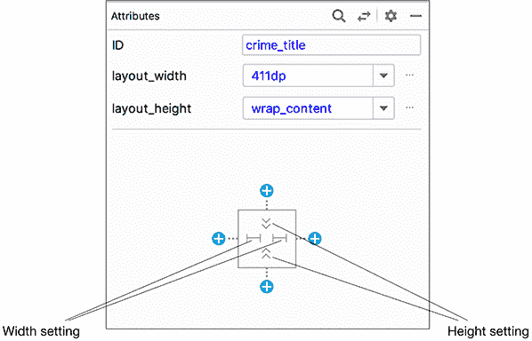

在学习本章内容时，你将添加那些约束来修复这些警告。在自己的工作中心，请注意那个警告指示器，以避免意外的行为。


标题和日期的`TextView`都被设置了较大的固定宽度，这就是为什么它们占据了整个屏幕。调整这两个组件的宽度和高度。在组件树中仍选中`crime_title`的情况下，点击宽度设置，直到它循环到“内容适应（wrap content）”设置。如有必要，调整高度设置，直到高度也被设置为“内容适应（wrap content）”（图 10.12）。

**图 10.12 调整标题的宽度和高度**


对`crime_date`组件重复此过程以设置其宽高。

现在两个组件的大小正确了（图 10.13），但它们在应用运行时仍然会重叠，因为它们没有约束。注意，你在预览中看到的布局与运行应用时看到的布局不同。预览允许你对视图进行定位以便于添加约束，但这些位置仅在预览中有效，在运行时并不有效。

**图 10.13 大小正确的`TextView`s**


你稍后将添加约束来正确定位你的`TextView`s。首先，你将在布局中添加所需的第三个视图。

## 添加组件

处理好其他组件后，你就可以将手铐图像添加到布局中。在布局文件中添加一个`ImageView`。在调色板中，找到`Common`类别下的`ImageView`（图 10.14）。将其拖入组件树，作为`ConstraintLayout`的子项，位于`crime_date`正下方。

**图 10.14 找到`ImageView`**


在弹出窗口中，展开`Project`部分，并选择`ic_solved`作为`ImageView`的资源（图 10.15）。此图像将被用于指示哪些犯罪已被破。点击`OK`。

**图 10.15 选择`ImageView`的资源**


`ImageView`现在是你的布局的一部分了，但它没有约束。因此，虽然图形化布局编辑器为它提供了一个位置，但该位置并没有实际意义。

是时候添加一些约束了。在预览面板中点击你的`ImageView`。（你可能想放大预览以便看得更清楚。缩放控件在约束工具上方的工具栏中）。你会在`ImageView`的每一侧看到圆点（图 10.16）。每一个圆点都代表一个约束句柄。

**图 10.16 `ImageView`的约束句柄**


你想让`ImageView`锚定在视图的右侧。为了实现这一点，你需要从顶部、右侧和底部创建约束。

在添加约束之前，将`ImageView`向右移动，以移开`TextView`（图 10.17）。一旦你设置了约束，这种放置位置将被忽略。

**图 10.17 临时移动组件**


首先，你将在`ImageView`的顶部与`ConstraintLayout`的顶部之间设置约束。在预览中，将`ImageView`的顶部拖动到`ConstraintLayout`的顶部。句柄将显示箭头并变为绿色（图 10.18）。

**图 10.18 通过约束移动组件**


继续拖动。观察句柄变为蓝色，然后松开鼠标以创建约束（图 10.19）。

**图 10.19 创建约束**


注意避免在光标显示为形状时点击——这将调整`ImageView`的大小。此外，确保你没有无意中将约束连接到某个`TextView`。如果你这样做了，点击约束句柄将其删除，然后重试。

当你松开并设置约束时，视图将根据新约束吸附到位置。这就是你在`ConstraintLayout`中移动视图的方法——通过设置和移除约束。

将鼠标悬停在`ImageView`上，验证它是否有一个连接到`ConstraintLayout`顶部的约束。它看起来应该是图 10.20）。

**图 10.20 `ImageView`有顶部约束**


对底部约束句柄执行同样的操作，从`ImageView`拖动到根视图的底部（图 10.21），同样要注意避免附加到`TextView`。

**图 10.21 具有顶部和底部约束的 ImageView**


最后，将右侧约束句柄从`ImageView`拖动到根视图的右侧。这应该会设置你所有的约束。你的约束看起来应该是图 10.22）。

**图 10.22 `ImageView`的三个约束**


## ConstraintLayout 的内部原理

你在图形化布局编辑器中进行的任何更改都会反映在底层的 XML 中。你仍然可以编辑原始的`ConstraintLayout` XML，但图形化布局编辑器在添加初始约束时通常更加方便。`ConstraintLayout`比其他`ViewGroup`详细得多，因此手动添加初始约束可能是一大量工作。当你需要对布局进行细微更改时，直接处理 XML 可能会更有用。

（图形化工具非常有用，特别是对于`ConstraintLayout`。不过，并不是所有人都是它的粉丝。你不需要选边——你可以随时在图形化布局编辑器和直接编辑 XML 之间切换。使用你喜欢的任何工具来创建本书书中的布局。你可以自己决定如何创建——XML、图形化布局编辑器，或者两者兼顾。）

切换到文本视图，查看当你在`ImageView`上创建三个约束时，XML 发生了什么：

```xml
<androidx.constraintlayout.widget.ConstraintLayout
            ... >
        ...
        <ImageView
            android:id="@+id/imageView"
            android:layout_width="wrap_content"
            android:layout_height="wrap_content"
            android:layout_marginTop="8dp"
            android:layout_marginEnd="8dp"
            android:layout_marginBottom="8dp"
            app:layout_constraintBottom_toBottomOf="parent"
            app:layout_constraintEnd_toEndOf="parent"
            app:layout_constraintTop_toTopOf="parent"
            app:srcCompat="@drawable/ic_solved" />

    </android.support.constraint.ConstraintLayout>
```

（你仍然会看到与两个`TextView`相关的错误。保持它们不变——你稍后会修复它们的。）

所有控件都是单个`ConstraintLayout`的直接子元素——没有嵌套布局。如果你使用`LinearLayout`创建相同的布局，将不得不将一个嵌套在另一个里面。正如我们之前提到的，减少嵌套也可以减少渲染布局所需的时间，从而带来更快、更无缝的用户体验。

仔细查看`ImageView`上的顶部约束：

```xml
app:layout_constraintTop_toTopOf="parent"
```

该属性以`layout_`开头。所有以`layout_`开头的属性被称为`布局参数`（layout parameters）。与其他属性不同，布局参数是指向该组件“父布局”的指令，而不是组件本身。它们告诉父布局如何在其内部安排子元素。到目前为止你已经看到了一些布局参数，例如`layout_width`和`layout_height`。

约束名称是`constraintTop`。这意味着它是你`ImageView`上的顶部约束。

最后，属性以`toTopOf="parent"`结束。这意味着该约束连接到父布局的顶部。这里的父布局是`ConstraintLayout`。

呼，真绕口。是时候离开原始 XML 回到图形化布局编辑器了。

## 编辑属性

你的`ImageView`现在已正确到位。接下来是：定位并调整标题`TextView`的大小。

首先，在预览中选择`Crime Date`并将其拖开（图 10.23）。请记住，你在预览中对位置进行的任何更改在应用运行时都不会体现。在运行时，只会保留约束。

**图 10.23 离开这里，日期**


现在，在组件树中选择`crime_title`。这也会高亮预览中的`Crime Title`。

你希望`Crime Title`位于布局的左上角，位于你新`ImageView`的左侧。这需要三个约束：

- 从视图的左侧到父布局的左侧
- 从视图的顶部到父布局的顶部
- 从视图的右侧到新`ImageView`的左侧

修改你的布局，使所有这些约束都到位（图 10.24）。如果约束的作用不符合预期，按`Command-Z`（`Ctrl-Z`）撤销并重试。

**图 10.24 `TextView`约束**


现在你将为`TextView`上的约束添加边距。在预览面板中选中`Crime Title`的情况下，查看右侧的属性面板。由于你为`TextView`的顶部、左侧和右侧添加了约束，会出现下拉菜单，允许你选择每个约束的边距（图 10.25）。为左侧和顶部选择`16dp`，为右边距选择`8dp`。

**图 10.25 为`TextView`添加边距**


注意，Android Studio 默认将边距设置为 16dp 或 8dp 值。这些值遵循了 Android 的设计指南。你可以在`developer.android.com/design/index.html`找到所有的 Android 设计指南。你的 Android 应用应该尽可能地遵循这些指南。检查你的约束是否看起来像图 10.26。（选中的组件的任何拉伸约束都会显示波浪线。）

**图 10.26 Title `TextView`约束**


现在约束设置好了，你就可以恢复标题`TextView`的完整光彩了。将其水平视图设置设置为`match_constraint`，允许标题`TextView`填充其约束内的所有可用空间。将垂直视图设置设置为`wrap_content`（如果尚未设置的话），这样`TextView`的高度将恰好显示案件标题。检查你的设置是否与图 10.27 所示。

**图 10.27 `crime_title`设置**


现在，为日期`TextView`添加约束。在组件树中选择`crime_date`。重复标题`TextView`的步骤添加三个约束：

- 从视图的左侧到父布局的左侧，带有`16dp`边距
- 从视图的顶部到案件标题的底部，带有`8dp`边距
- 从视图的右侧到`ImageView`的左侧，带有`8dp`边距

添加约束后，调整`TextView`的属性。你希望日期`TextView`的宽度为`match_constraint`，高度为`wrap_content`，就像标题`TextView`一样。验证你的设置是否与图 10.28 所示的一致。

**图 10.28 `crime_date`视图设置**


你在预览中的布局应该与章节开头的图 10.1 相似。近距离观察，你的预览应该与图 10.29 一致。

**图 10.29 最终约束近距离观察**


切换到编辑器工具窗口中的文本视图，以检查你在图形布局编辑器中所做更改后生成的 XML。每个`TextView`标签下方不再出现红色下划线。这是因为`TextView`小部件现在有了充分的约束，因此包含它们的`ConstraintLayout`可以在运行时确定如何正确放置这些小部件。

与`TextView`相关仍有两个黄色警告指示器，如果你探索它们，会发现这些警告与它们的硬编码字符串有关。对于生产环境的应用来说，这些警告是非常重要的，但对于*CriminalIntent*来说，你可以忽略它们。（如果你愿意，可以按照建议将硬编码文本提取到字符串资源中。这将解决这些警告。）

此外，`ImageView`上仍然保留一个警告，表示你未能设置内容描述（content description）。目前你也可以忽略这个警告。你将在学习第 18 章中的内容描述时解决这个问题。在此期间，你的应用将运行良好，尽管使用屏幕阅读器的用户无法访问该图像。

运行 CriminalIntent 并验证你是否在`RecyclerView`的每一行中都看到三个组件整齐地排列（图 10.30）。

**图 10.30 现在每行有三个视图**


## 使列表项动态

既然布局已经包含了正确的约束，现在更新`ImageView`，使手铐仅在在已解决的案件中显示。

首先，更新你的`ImageView`的 ID。当你将`ImageView`添加到`ConstraintLayout`时，它被赋予了一个默认名称。该名称没有很好的描述性。选择你的`ImageView`，并在属性面板中，将`ID`属性更新为`crime_solved`（图 10.31）。系统会询问 Android Studio 是否应更新 ID 的所有引用；选择`Yes`。

**图 10.31 更新图像 ID**


你可能会注意到你在不同的布局中使用了相同的视图 ID。`crime_solved` ID 同时使用在`list_item_crime.xml`和`fragment_crime.xml`布局中。你可能认为重用 ID 会产生问题，但在这种情况下并没有问题。布局 ID 只需要在同一个布局中唯一。由于你的 ID 定义在不同的布局文件中，因此在两个地方使用相同的 ID 没有问题。

设置好正确的 ID 后，现在你将更新你的代码。打开`CrimeListFragment.kt`。在`CrimeHolder`中添加一个`ImageView`实例变量，并根据案件的解决状态切换其可见性。

**代码列表 10.1 更新手铐可见性（`CrimeListFragment.kt`）**

```kotlin
private inner class CrimeHolder(view: View)
    : RecyclerView.ViewHolder(view), View.OnClickListener {
    ...
    private val dateTextView: TextView
    private val solvedImageView: ImageView = itemView.findViewById(R.id.crime_solved)

    init {
        ...
    }

    fun bind(crime: Crime) {
        titleTextView.text = crime.title
        dateTextView.text = crime.date.toString()
        solvedImageView.visibility = if (crime.isSolved) {
            View.VISIBLE
        } else {
            View.GONE
        }
    }
}
```

运行 CriminalIntent 并验证手铐现在是否出现在每一行中。（如果你忘记了为什么会，请检查`CrimeViewModel`。）

## 关于布局属性的更多

现在你将对`list_item.xml`的设计进行一些微调，并在此过程中回答你对小部件和属性的某些悬留问题。


返回`list_item.xml`的设计视图。选择`crime_title`并调整它的部分属性：展开`textAppearance`部分并将`textSize`属性设置为`18sp`。将`textColor`属性设置为`@android:color/black`（图 10.32）。

**图 10.32 更新标题大小**


你可以直接在属性面板的字段中输入这些值，从下拉列表中选择（对于`textSize`），或者点击字段旁`...`按钮选择尺寸资源。

运行 CriminalIntent，惊讶于新的漆装让一切变得好得多（图 10.33）。

**图 10.33 新漆装**


### 样式、主题和主题属性

样式是包含描述小部件外观和行为的属性的 XML 资源。例如，以下是一个配置了比正常大字体号的样式资源：

```xml
<style name="BigTextStyle">
    <item name="android:textSize">20sp</item>
    <item name="android:padding">3dp</item>
</style>
```

你可以创建自己的样式（你将在第 21 章中创建）。将它们添加到`res/values/`中的样式文件中，并在布局中这样引用它们：`@style/my_own_style`。

再次查看`layout/fragment_crime.xml`中的`TextView`控件（而不是你在本章一直在使用的`list_item_crime.xml`文件）。每个控件都有一个`style`属性，引用了 Android 创建的样式。这种特定的样式使`TextView`看起来像列表分隔符，并且来自应用的`theme`（主题）。主题是样式的集合。从结构上说，主题本身就是一个样式资源，其属性指向其他样式资源。

Android 提供了你的应用可以使用平台主题。当你创建`CriminalIntent`时，向导为应用设置了一个主题，该主题在清单文件中的`application`标签上被引用。

你可以使用`theme attribute reference`（主题属性引用）将应用主题中的样式应用到控件上。你在`fragment_crime.xml`中使用值`?android:listSeparatorTextViewStyle`时，执行的正是这种操作。

在主题属性引用中，你告诉 Android 的运行时资源管理器：“去应用的主题中找到名为`listSeparatorTextViewStyle`的属性。该属性指向另一个样式资源。将该资源的值放在这里。”

每个 Android 主题都会包含一个名为`listSeparatorTextViewStyle`的属性，但其定义取决于特定主题的整体视觉效果和感受。使用主题属性引用可以确保`TextView`符合你应用的正确视觉效果和感受。

你将在第 21 章中学习更多关于样式和主题的知识。

## 给好奇心强的读者：外边距 Margin 与内边距 Padding

在 GeoQuiz 和 CriminalIntent 中，你都为控件设置了 margin（外边距）和 padding（内边距）属性。初学者有时会对这两者感到困惑。现在你理解了什么是布局参数，它们的区别就更容易解释了。

Margin 属性是布局参数。它们决定了控件之间的距离。由于控件只能感知自身，外边距必须由控件的父容器负责。

另一方面，内边距不是布局参数。`android:padding`属性告诉控件绘制自身时应该比其内容大多少。例如，假设你想让日期按钮在不改变文本大小的情况下变得非常大（参阅图 10.34）。

**图 10.34 我喜欢大按钮，我无法撒谎...**


你可以为`Button`添加以下属性：

```xml
<Button
    android:id="@+id/crime_date"
    android:layout_width="match_parent"
    android:layout_height="wrap_content"
    android:padding="80dp"
    tools:text="Wed Nov 14 11:56 EST 2018"/>
```

遗憾的是，你可能在继续之前应该删掉这个属性。

## 给好奇心强的读者：ConstraintLayout 的新进展

`ConstraintLayout`具有额外的能力来帮助排列子视图。在本章中，你通过将视图约束到父容器以及其他兄弟视图来对视图的位置。`ConstraintLayout`还包含了辅助视图，例如`Guideline`（引导线），它们可以简化屏幕上视图的布局。

引导线不会显示在应用屏幕上；它们只是帮助你按需要定位视图的工具。既有水平引导线也有垂直引导线，可以使用 dp 值将它们放在屏幕上的特定位置，或者将它们设置为屏幕的百分比。其他视图可以约束到引导线上，以确保即使在屏幕尺寸不同，它们也会出现在相同的位置。

图 10.35 显示了使用垂直`Guideline`的示例。它位于父容器宽度的 20% 处。犯罪标题和日期都左侧约束到`Guideline`而不是父容器。

**图 10.35 使用`Guideline`**


`MotionLayout`是`ConstraintLayout`的扩展，简化了为视图添加动画的过程。要使用`MotionLayout`，你需要创建一个`MotionScene`文件，描述应该如何执行动画，以及起始和结束布局中哪些视图相互映射。你还可以设置`Keyframe`（关键帧），为动画提供中间状态视图。`MotionLayout`可以从起始视图通过你提供的各种关键帧进行动画，然后确保视图恰当地动画到结束布局。

## 挑战：格式化日期

`Date`对象更像是一个时间戳而不是传统的日期。当你对`Date`调用`toString()`时，你看到的就是时间戳。虽然时间戳可以很好地记录，但如果行直接按照人类习惯的方式显示日期——例如“Jul 22, 2019”——可能会更好。你可以通过`android.text.DateFormat`的实例来实现此。开始的起点是该类的参考页面。

你可以使用`DateFormat`中的函数来获取通用格式。或者你也可以准备自己的格式字符串。对于一个更高级的挑战，请创建一个也能显示星期几的格式字符串，例如“Monday, Jul 22, 2019。”

# 11 数据库与 Room 库

几乎每个应用程序都需要一个长期保存数据的地方。在本章中，你将为`CriminalIntent`实现一个数据库并填充虚拟数据。然后你将更新应用，从数据库中提取犯罪数据并显示在犯罪列表中（参阅图 11.1）。

**图 11.1 从数据库显示犯罪**


在第 4 章中你学习了如何使用`ViewModel`和保存实例状态跨旋转持久化 UI 状态数据。这两种方法对于关联 UI 的少量数据非常好。这些方法不适用于存储非 UI 数据或未绑定 Activity/Fragment 实例且需要无论 UI 状态如何持久的数据。

相反，将你的非 UI 应用数据存储在本地（文件系统或数据库中，如你为`CriminalIntent`执行的那样）或 Web 服务器上。

## Room 架构组件库

Room 是 Jetpack 架构组件库，简化了数据库的设置和访问。它允许你使用带有注解的 Kotlin 类定义数据库结构和查询。

Room 由 API、注解和编译器组成。API 包含了你扩展以定义数据库并构建其实例的类。你使用注解来指示哪些类需要存储在数据库中、哪个类代表数据库，以及哪个类指定了访问数据库表的访问函数。编译器处理带有注解的类并生成你的数据库的实现。

要使用 Room，你首先需要添加它所需的依赖项。将`room-runtime`和`room-compiler`依赖项添加到你的`app/build.gradle`文件中。

### 列表 11.1 添加依赖（`app/build.gradle`）

```groovy
apply plugin: 'kotlin-android-extensions'

apply plugin: 'kotlin-kapt'

android {
    ...
}
...
dependencies {
    ...
    implementation 'androidx.core:core-ktx:1.1.0-alpha04'
    implementation 'androidx.room:room-runtime:2.1.0-alpha04'
    kapt 'androidx.room:room-compiler:2.1.0-alpha04'
    ...
}
```

在文件顶部附近，你添加了一个新的 Android Studio 插件。插件是为 IDE 添加功能的一种。访问[plugins.jetbrains.com/androidstudio](https://plugins.jetbrains.com/androidstudio)查看更多你可以添加的插件。

`kotlin-kapt`代表“Kotlin 注解处理器工具”。当库为你生成代码时，你通常希望直接在代码中使用这些生成的类。但默认情况下，这些生成的类对 Android Studio 是不可见的，所以如果你尝试导入它们，将会看到错误。添加`kotlin-kapt`插件可以让库生成的文件对 Android Studio 可见，这样你就可以在自己的类中导入它们。

你添加的第一个依赖项`room-runtime`用于 Room API，它包含了你定义数据库所需的所有类和注解。第二个依赖项`room-compiler`用于 Room 编译器，它将根据你指定的注解生成你的数据库实现。编译器使用了`kapt`关键字而不是`implementation`，这得益于`kotlin-kapt`插件，使得编译器生成的类对 Android Studio 都是可见的。

不要忘记同步你的 Gradle 文件。依赖项就绪后，你就可以继续准备你的模型层以将其存储在数据库中。

## 创建数据库

使用 Room 创建数据库有三个步骤：

- 为你的模型类添加注解，使其成为一个数据库实体（entity）
- 创建表示数据库本身的类
- 创建一个类型转换器（type converter），以便你的数据库能够处理你的模型数据

正如你即将在看到的，Room 让这些每一个步骤都变得非常简单。

### 定义实体

Room 根据你定义的`entities`为你的应用程序构建数据库表结构。实体是你创建的模型类，并附有`@Entity`注解。Room 会为任何带有该注解的类创建一个数据库表。

由于你想在数据库中存储犯罪（crime）对象，将`Crime`更新为 Room 实体。打开`Crime.kt`并添加两个注解：

### 列表 11.2 使`Crime`变为实体（`Crime.kt`）

```kotlin
@Entity
data class Crime(@PrimaryKey val id: UUID = UUID.randomUUID(),
                 var title: String = "",
                 var date: Date = Date(),
                 var isSolved: Boolean = false)
```

第一个注解`@Entity`应用在类级别。此实体注解表示该类定义了数据库中一张（或一组表）的结构。在这种情况下，表中的每一行都代表一个单独的`Crime`。类上定义的每个属性都是表中的一列，属性名称即为列名。存储犯罪记录的表将有四列：`id`、`title`、`date`和`isSolved`。

你添加的另一个注解是`@PrimaryKey`，你将其添加到了`id`属性上。该注解指定了数据库中的哪一列是主键。数据库中的主键是每个条目（或行）持有唯一数据的列，因此可以使用它可以查找单个条目。`id`属性对于每个`Crime`都是唯一的，因此通过在该属性上添加`@PrimaryKey`，你将能够根据其`id`从数据库中查询单个犯罪。

现在你的`Crime`类已经添加了注解，你就可以继续创建你的数据库类了。

### 创建数据库类

实体类定义了数据库表的结构。如果你的应用有多个数据库，单个实体类可以跨多个数据库使用。这种情况并不常见，但是可能的。因此，除非你显式地将其与数据库关联，否则 Room 不使用实体来创建表，你稍后就会这样做。

首先，创建一个名为`database`的新包用于存放数据库特定的代码。在项目工具窗口中，右键点击`com.bignerdranch.android.criminalintent`文件夹并选择`New` → `Package`。将你的新包命名为`database`。

现在，在`database`包中创建一个名为`CrimeDatabase`的新类，并如下所示定义该类。

### 列表 11.3 `CrimeDatabase`类（`database/CrimeDatabase.kt`）

```kotlin
@Database(entities = [Crime::class], version = 1)
abstract class CrimeDatabase : RoomDatabase() {
}
```

`@Database`注解告诉 Room 该类代表应用中的一个数据库。注解本身需要两个参数。第一个参数是实体类列表，它告诉 Room 在创建和管理表时使用哪些实体类。在这种情况下，你只传递了`Crime`类，因为它是唯一的实体。

第二个参数是数据库的版本。当你第一次创建数据库时，版本应该是 1。在你日后开发应用时，你可能会向现有实体添加新实体和新属性。当发生这种情况时，你需要修改你的实体并增加数据库版本，以告诉 Room 发生了变化。

此时数据库类本身是空的。`CrimeDatabase`继承自`RoomDatabase`并被标记为`abstract`，因此你不能直接创建它的实例。你将在本章后续部分学习如何使用 Room 获取一个你可以使用的数据库实例。

#### 创建类型转换器

Room 在底层使用 SQLite。SQLite 是一个开源关系型数据库，类似于 MySQL 或 PostgreSQL（SQL 是结构化查询语言的缩写，是一种与数据库交互的标准语言。人们将“SQL”读作“sequel”或作为字母字母“S-Q-L”）。与其他数据库不同，SQLite 将数据存储在可以使用 SQLite 库读写的简单文件中。Android 在标准库中包含了此 SQLite 库，以及一些辅助类。

Room 让 SQLite 的变得更加简单整洁，作为 Kotlin 对象和数据库实现之间的对象关系映射（或 ORM）层。在大多数情况下，使用 Room 时你不需要也不关心 SQLite，但如果你想了解更多，可以访问[www.sqlite.org](https://www.sqlite.org)，那里有完整的 SQLite 文档。

Room 能够轻松在底层 SQLite 数据库表中存储基本类型，但其他类型会导致问题。你的`Crime`类依赖于`Date`和`UUID`对象，Room 默认不知道如何存储它们。你需要给数据库提供帮助，让它知道如何存储这些类型，以及如何正确地从数据库表中提取它们。

要告诉 Room 如何转换你的数据类型，你需要指定一个`<type converter>`。类型转换器告诉 Room 如何将特定类型转换为其存储在数据库中所需的格式。对于每种类型，你需要两个函数，并用`@TypeConverter`对它们进行注解：一个告诉 Room 如何转换该类型以存储在数据库中，另一个告诉 Room 如何从数据库表示形式转换回原始类型。

在`database`包中创建一个名为`CrimeTypeConverters`的类，并为`Date`和`UUID`类型分别添加两个函数。

### 代码列表 11.4 添加`TypeConverter`函数（`database/CrimeTypeConverters.kt`）

```kotlin
class CrimeTypeConverters {

    @TypeConverter
    fun fromDate(date: Date?): Long? {
        return date?.time
    }

    @TypeConverter
    fun toDate(millisSinceEpoch: Long?): Date? {
        return millisSinceEpoch?.let {
            Date(it)
        }
    }

    @TypeConverter
    fun toUUID(uuid: String?): UUID? {
        return UUID.fromString(uuid)
    }

    @TypeConverter
    fun fromUUID(uuid: UUID?): String? {
        return uuid?.toString()
    }
}
```

前两个函数处理`Date`对象，后两个处理`UUID`s。确保你导入了`java.util.Date`版本的`Date`类。

声明转换器函数并不会让你的数据库使用它们。你必须显式地将转换器添加到数据库类中。

### 代码列表 11.5 启用`TypeConverter`s（`database/CrimeDatabase.kt`）


```kotlin
@Database(entities = [ Crime::class ], version=1)
@TypeConverters(CrimeTypeConverters::class)
abstract class CrimeDatabase : RoomDatabase() {
}
```

通过添加 `@TypeConverters` 注解并传入你的 `CrimeTypeConverters` 类，你告诉数据库在转换你的类型时使用该类中的函数。

至此，你的数据库和表定义就完成了。

## 定义数据访问对象（Data Access Object）

如果你无法编辑或访问其内容，那么数据库表将毫无用处。与数据库表交互的第一步是创建一个 `<data access object>`，或者说 DAO。DAO 是一个接口，其中包含了你想要执行的每个数据库操作的函数。在本章中，CriminalIntent 的 DAO 需要两个查询函数：一个返回数据库中所有犯罪的列表，另一个返回匹配给定 `UUID` 的单个犯罪记录。

在 `database` 包中添加一个名为 `CrimeDao.kt` 的文件。在其中定义一个名为 `CrimeDao` 的空接口，并使用 Room 的 `@Dao` 注解。

**代码列表 11.6 创建一个空的 DAO（`database/CrimeDao.kt`）**

```kotlin
@Dao
interface CrimeDao {
}
```

`@Dao` 注解让 Room 知晓 `CrimeDao` 是你的数据访问对象之一。当你将 `CrimeDao` 钩到数据库类上时，Room 将为你生成添加到此接口的函数的实现类。

说到添加函数，现在是时候了。为 `CrimeDao` 增加两个查询函数。

**代码列表 11.7 添加数据库查询函数（`database/CrimeDao.kt`）**

```kotlin
@Dao
interface CrimeDao {

    @Query("SELECT * FROM crime")
    fun getCrimes(): List<Crime>

    @Query("SELECT * FROM crime WHERE id=(:id)")
    fun getCrime(id: UUID): Crime?
}
```

`@Query` 注解表示 `getCrimes()` 和 `getCrime(UUID)` 用于从数据库中提取信息，而不是从数据库中插入、更新或删除项目。DAO 接口中每个查询函数的返回类型反映了查询将返回的结果类型。

`@Query` 注解期望一个包含 SQL 命令的字符串作为输入。在大多数情况下，你只需要最少的 SQL 即可使用 Room，但如果你对学习更多，请查看 [www.sqlite.org](https://www.sqlite.org) 中的 SQL 语法部分。

`SELECT * FROM crime` 要求 Room 提取 `crime` 数据库表中所有行的所有列。`SELECT * FROM crime WHERE id=(:id)` 要求 Room 仅提取 `id` 匹配提供的 ID 值的行的所有列。

至此，`CrimeDao` 就完成了，至少目前是这样。在第 12 章中，你将添加一个更新现有犯罪记录的函数。在第 14 章中，你将添加一个插入新犯罪记录的函数。

接下来，你需要将 DAO 类注册到你的数据库类中。由于 `CrimeDao` 是一个接口，Room 将处理生成具体的版本。但为了让其工作，你必须告诉数据库类生成一个实例。要挂接你的 DAO，请打开 `CrimeDatabase.kt` 并添加一个以 `CrimeDao` 为返回类型的抽象函数。

**代码列表 11.8 在数据库中注册 DAO（`database/CrimeDatabase.kt`）**

```kotlin
@Database(entities = [ Crime::class ], version=1)
@TypeConverters(CrimeTypeConverters::class)
abstract class CrimeDatabase : RoomDatabase() {

    abstract fun crimeDao(): CrimeDao
}
```

现在，当数据库被创建时，Room 将生成 DAO 的具体实现类，你可以访问它。一旦你有了 DAO 的引用，就可以调用其上定义的任何函数来与数据库交互。

## 使用 Repository 模式访问数据库

要访问数据库，你将使用 Google 在其《应用架构指南》中推荐的 `<repository pattern>`（[developer.android.com/jetpack/docs/guide](https://developer.android.com/jetpack/docs/guide)）。

`<repository>` 类封装了从单一源或多个源访问数据的逻辑。它决定如何获取和存储特定的数据集，无论是在本地数据库中还是从远程服务器获取。你的 UI 代码将从仓库请求所有数据，因为 UI 并不关心数据是如何存储或获取的。这些是仓库本身的实现细节。

由于 CriminalIntent 是一个简单的应用，仓库将仅处理从数据库获取数据。

在 `com.bignerdranch.android.criminalintent` 包中创建一个名为 `CrimeRepository` 的类，并在类中定义一个复合对象（companion object）。

**代码列表 11.9 实现仓库（`CrimeRepository.kt`）**

```kotlin
class CrimeRepository private constructor(context: Context) {

    companion object {
        private var INSTANCE: CrimeRepository? = null

         fun initialize(context: Context) {
             if (INSTANCE == null) {
                 INSTANCE = CrimeRepository(context)
             }
        }

         fun get(): CrimeRepository {
            return INSTANCE ?:
            throw IllegalStateException("CrimeRepository must be initialized")
        }
    }
}
```

单例只要应用程序停留在内存中就会存在，因此在单例上存储任何属性将使它们在活动和 fragment 的任何生命周期变化期间始终可用。使用单例类时要小心，当 Android 从内存中移除你的应用程序时，它们会被销毁。`CrimeRepository` 单例并不是长期存储数据的解决方案。相反，它为犯罪数据提供了一个所有者，并提供了一种在控制类之间方便传递这些数据的方法。

为了让 `CrimeRepository` 成为单例，你向它的伴侣对象（companion object）添加两个函数。其中一个初始化仓库的新实例，另一个访问仓库。你还将构造函数标记为私有（private），以确保没有组件可以擅自创建自己的实例。

如果你在调用 getter 函数之前没有调用 `initialize()`，那么它的体验会很糟糕。它会抛出一个 `IllegalStateException`，因此你需要确保在应用程序启动时初始化仓库。

为了在应用程序准备就绪立即执行工作，你可以创建一个 `Application` 子类。这允许你访问应用程序自身的生命周期信息。创建一个名为 `CriminalIntentApplication` 的类，它继承自 `Application` 并重写 `Application.onCreate()` 来设置仓库的初始化。

**Listing 11.10 创建应用程序子类（`CriminalIntentApplication.kt`）**

```kotlin
class CriminalIntentApplication : Application() {

    override fun onCreate() {
        super.onCreate()
        CrimeRepository.initialize(this)
    }
} 
```

与 `Activity.onCreate(…)` 类似，`Application.onCreate()` 在你的应用程序首次加载到内存中时由系统调用。这使其成为进行任何一次性初始化操作的好地方。

应用程序实例不会像你的活动或 fragment 类那样不断地销毁和重建。它在应用启动时创建，在应用进程被销毁时销毁。你在 CriminalIntent 中唯一重写的生命周期函数是 `onCreate()`。

稍后，你将把应用程序实例作为 `Context` 对象传递给仓库。只要你的应用程序进程留在内存中，该对象就是有效的，因此在仓库类中持有它的引用是安全的。

但为了让系统使用你的应用程序类，你需要在清单文件中注册它。打开 `AndroidManifest.xml` 并指定 `android:name` 属性来设置你的应用程序。

**Listing 11.11 挂钩应用程序子类（`manifests/AndroidManifest.xml`）**

```xml
<manifest xmlns:android="http://schemas.android.com/apk/res/android"
          package="com.bignerdranch.android.criminalintent">

    <application
            android:name=".CriminalIntentApplication"
            android:allowBackup="true"
            ... >
        ...
    </application>

</manifest>
```

在清单中注册应用程序类后，操作系统会在启动你的应用时创建 `CriminalIntentApplication` 的实例。随后调用 `CriminalIntentApplication` 实例上的 `onCreate()`。你的 `CrimeRepository` 将被初始化，你可以从其他组件访问它。

接下来，在你的 `CrimeRepository` 上添加两个属性来存储对数据库和 DAO 对象的引用。

**Listing 11.12 设置仓库属性（`CrimeRepository.kt`）**

```kotlin
private const val DATABASE_NAME = "crime-database"

class CrimeRepository private constructor(context: Context) {

    private val database : CrimeDatabase = Room.databaseBuilder(
        context.applicationContext,
        CrimeDatabase::class.java,
        DATABASE_NAME
    ).build()

    private val crimeDao = database.crimeDao()

    companion object {
        ...
    }
}
```

`Room.databaseBuilder()` 使用三个参数创建你的抽象 `CrimeDatabase` 的具体实现。它首先需要一个 `Context` 对象，因为数据库需要访问文件系统。你传入了应用程序上下文，因为如上所述，单例的生命周期可能比你的任何活动类都要长。

第二个参数是你想要让 Room 创建的数据库类。第三个是你想让 Room 为创建的数据库文件名。你使用的是在同一文件中定义的私有字符串常量，因为没有其他组件需要访问它。

接下来，完善你的 `CrimeRepository`，以便你的其他组件可以对数据库执行所需的任何操作。为 DAO 中的每个函数为你的仓库添加一个对应的函数。

**Listing 11.13 添加仓库函数（`CrimeRepository.kt`）**

```kotlin
class CrimeRepository private constructor(context: Context) {

    ...
    private val crimeDao = database.crimeDao()

    fun getCrimes(): List<Crime> = crimeDao.getCrimes()

    fun getCrime(id: UUID): Crime? = crimeDao.getCrime(id)

    companion object {
        ...
    }
}
```

由于 Room 在 DAO 中提供了查询实现，你从仓库中直接调用这些实现。这有助于保持仓库的短小且易于理解。

这看起来似乎是多投入少收的工作，因为仓库只是在进行调用。但不要担心；你很快就会添加仓库需要处理的功能了。

## 测试查询

在仓库就绪后，在测试查询函数之前还有最后一步。目前，你的数据库是空的，因为你还没有向其中添加过任何犯罪数据。为了加快速度，你把现有的数据库文件上传到模拟器中以填充你的数据库。数据库文件已在解决方案文件中提供（[www.bignerdranch.com/solutions/Android4e.zip](https://www.bignerdranch.com/solutions/Android4e.zip)）。

你可以通过程序化生成并向数据库插入虚拟数据，例如你一直在使用的 100 条虚拟犯罪数据。然而，你尚未实现用于插入新数据库条目的 DAO 函数（你将在第 14 章中实现）。上传预定义的数据库文件允许你轻松在不修改应用程序代码的情况下填充数据库。此外，这还让你练习使用设备文件管理器（Device File Explorer）查看模拟器本地存储系统的内容。

尽管如此，这种测试方法也有一个缺点。只有在模拟器（或“已根”的设备）上，你才能访问应用程序的私有文件（数据库文件所在的位置）。你无法将数据库文件上传到典型的物理设备。

### 上传测试数据

Android 设备上的每个应用程序在设备沙箱中都有目录。将文件保留在沙箱中可以保护它们免受其他应用程序的访问，甚至防止用户的窥探（除非设备已根，在这种情况下用户可以获取任何他们想要的内容）。

应用程序沙盒目录是设备 `data/data` 目录下的子目录，并以应用程序包命名。对于 `CriminalIntent`，沙盒目录的完整路径为 `data/data/com.bignerdranch.android.criminalintent`。

要上传文件，请确保模拟器正在运行，并点击 Android Studio 窗口右下角的标签打开 `Device File Explorer`（设备文件管理器）工具栏窗口。文件管理器面板将显示模拟器上当前存在的所有文件（图 11.2）。

**图 11.2 Device File Explorer 窗口**


要找到 `CriminalIntent` 的文件夹，打开 `data/data/` 文件夹并找到与项目包 ID 匹配的子文件夹（图 11.3）。该文件夹中的文件默认对你的应用私有，因此没有其他应用可以读取它们。这就是你上传数据库文件的地方。

**图 11.3 应用沙盒文件夹**


要上传 `databases` 文件夹，右键点击包名文件夹并选择 `Upload...`（上传...）（图 11.4）。

**图 11.4 上传数据库文件**


这将显示一个文件导航器，你可以在其中选择要上传的文件。导航到本章的解决方案文件夹。确保你上传了整个 `databases` 文件夹。Room 需要文件位于名为 `databases` 的文件夹中，否则它无法工作。完成上传后，你的应用沙盒文件夹应该看起来像图 11.5。

**图 11.5 上传的数据库文件**


上传数据库文件后，你现在已经有了可以使用仓库进行查询的数据。目前，你的 `CrimeListViewModel` 创建了 100 个虚假犯罪以便在列表中显示。删除生成虚假犯罪的代码，并将其替换为对 `CrimeRepository` 中 `getCrimes()` 函数的调用。

**列表 11.14 在 `ViewModel` 中访问仓库（`CrimeListViewModel.kt`）**

```kotlin
class CrimeListViewModel : ViewModel() {

    val crimes = mutableListOf<Crime>()

    init {
        for (i in 0 until 100) {
            val crime = Crime()
            crime.title = "Crime #$i"
            crime.isSolved = i % 2 == 0
            crimes += crime
        }
    }

    private val crimeRepository = CrimeRepository.get()
    val crimes = crimeRepository.getCrimes()
}
```


现在，运行你的应用来查看结果。你可能会惊讶地发现……你的应用崩溃了。

不要担心，这是预期的行为。（至少，这是`我们`预期的。抱歉。）查看 Logcat 中的异常以了解发生了什么。

```
java.lang.IllegalStateException: Cannot access database on the main thread since
    it may potentially lock the UI for a long period of time.
```

此错误源于 Room 库。Room 对你尝试在主线程访问数据库的行为感到不悦。在本章的剩余部分中，你将学习 Android 使用的线程模型、主线程的作用，以及在主线程上运行工作类型时的需要考虑因素。此外，你将把数据库交互移动到后台线程。这将会让 Room 感到满意并消除异常，从而修复崩溃。

## 线程

从数据库读取数据并不是立即发生的。因为访问操作可能花费很长时间，Room 禁止在主线程上执行所有数据库操作。如果你试图违反这一规则，Room 将抛出你刚刚看到的`IllegalStateException`。

为什么？为了理解这一点，你需要理解什么是线程、什么是主线程以及主线程是做什么的。

线程是执行的单一序列。在单个线程中运行的代码将一个接一个地执行。每个 Android 应用启动时都有一个`main thread`（主线程）。然而，主线程并不是预先设定的步骤列表。相反，它处于一个无限循环中，等待用户或系统发起的事件。然后它根据这些事件的发生做出相应的代码响应（图 11.6）。

**图 11.6 普通线程 vs 主线程**


想象你的应用是一家巨大的鞋店，而你只有一个员工——闪电侠（The Flash）。商店里有很多事情要做：摆放商品、为客户取鞋子。为了让这种情况运作，闪电侠不能在某件事上花费太多时间。如果有一批鞋子丢失了呢？有人必须花大量时间打电话。

闪电侠就像你应用程序中的主线程。它运行所有更新 UI 的代码。这包括响应不同事件而执行的代码。（因为这些事件以某种方式与 UI 相关，所以主线程有时被称为`UI 线程`）。

事件循环按顺序保持 UI 代码。它确保这些操作之间不会相互干扰，同时确保代码以及时的方式执行。到目前为止，你编写的所有代码都在主线程上。

### 后台线程

从数据库访问数据非常像给你的鞋子供应商打电话：与其他任务相比，它需要很长时间。在此期间，UI 将完全没有响应，这可能导致应用未响应（application not responding），即 ANR。

ANR 发生在 Android 监视程序确定主线程未能响应重要事件（例如按下返回键）时。对用户来说，它看起来像图 11.7）。

**图 11.7 应用未响应**


在你的商店里，你会通过（自然地）雇用第二个闪电侠给鞋子供应商打电话来解决这个问题。在 Android 中，你做类似的事——创建一个后台线程并在访问数据库。

当你开始为应用添加后台线程时，需要考虑两个重要的规则：

*   所有长时间运行的任务应该在后台线程执行。这确保你的主线程空闲处理 UI 相关的任务，以保持 UI 对用户的响应能力。

*   UI 只能从主线程更新。如果你尝试从后台线程修改 UI，将得到错误，因此你需要确保从后台线程生成的任何数据发送到主线程以更新 UI。

在 Android 中有许多方法可以在后台线程上执行工作。你将在第 24 章中学习如何发起异步网络请求，在第 25 章中使用`Handler` 执行许多小型后台操作，并在第 27 章中使用`WorkManager` 执行周期性的后台工作。

对于`CriminalIntent`，你将使用两种选项在后台执行数据库调用。在本章中，你将使用`LiveData` 来封装你的查询数据。在第 12 章和第 14 章中，你将使用`Executor` 来插入和更新数据。

## 使用 LiveData

`LiveData` 是 Jetpack`lifecycle-extensions` 库中的一个数据持有类。Room 的设计是为了与`LiveData` 配合工作。由于你已经在第 4 章的`app/build.gradle` 文件包含了`lifecycle-extensions` 库，因此你可以在项目中使用`LiveData` 类。

`LiveData` 的目标是简化应用程序不同部分之间的数据传递，例如从`CrimeRepository` 到需要显示犯罪数据的 fragment。`LiveData` 还允许在线程之间传递数据。这使其非常符合我们在上面列出的线程规则。

当你在 Room DAO 中配置查询以返回`LiveData` 时，Room 会自动在后台线程上执行这些查询操作，并在查询完成后将结果发布到`LiveData` 对象。你可以设置你的 activity 或 fragment 来观察`LiveData` 对象，在这种情况下，当结果就绪时，你的 activity 或 fragment 将在主线程收到通知。

在本章中，你将重点关注使用`LiveData` 的跨线程通信功能来执行数据库查询。首先，打开`CrimeDao.kt` 并更新查询函数的返回类型，使其返回封装了原始返回类型的`LiveData` 对象。

**清单 11.15 在 DAO 中返回`LiveData` (`database/CrimeDao.kt`)**

```
@Dao
interface CrimeDao {

  @Query("SELECT * FROM crime")
  fun getCrimes(): List<Crime>
  fun getCrimes(): LiveData<List<Crime>>

  @Query("SELECT * FROM crime WHERE id=(:id)")
  fun getCrime(id: UUID): Crime?
  fun getCrime(id: UUID): LiveData<Crime?>
}
```

通过从你的 DAO 类返回`LiveData` 实例，你向 Room 表示在后台线程上运行查询。当查询完成后，`LiveData` 对象将处理将犯罪数据发送到主线程并通知任何观察者。

接下来，更新`CrimeRepository` 使其查询函数返回`LiveData`。

**清单 11.16 从仓库返回`LiveData` (`CrimeRepository.kt`)**

```
class CrimeRepository private constructor(context: Context) {
  ...
  private val crimeDao = database.crimeDao()

  fun getCrimes(): List<Crime> = crimeDao.getCrimes()
  fun getCrimes(): LiveData<List<Crime>> = crimeDao.getCrimes()

  fun getCrime(id: UUID): Crime? = crimeDao.getCrime(id)
  fun getCrime(id: UUID): LiveData<Crime?> = crimeDao.getCrime(id)
  ...
}
```

### 观察 LiveData

要在犯罪列表屏幕中显示数据库中的犯罪，更新`CrimeListFragment` 以观察从`CrimeRepository.getCrimes()` 返回的`LiveData`。

首先，打开`CrimeListViewModel.kt` 并重命名`crimes` 属性，以便更清楚地表示该属性持有什么数据。

**清单 11.17 在`ViewModel` 中访问仓库 (`CrimeListViewModel.kt`)**

```
class CrimeListViewModel : ViewModel() {

    private val crimeRepository = CrimeRepository.get()
    val crimes crimeListLiveData = crimeRepository.getCrimes()
}
```

接下来，清理`CrimeListFragment` 以反映`CrimeListViewModel` 现在暴露了从仓库返回的`LiveData`（清单 11.18）。

`LiveData.observe(LifecycleOwner, Observer)` 函数用于在`LiveData` 实例上注册一个观察者，并将观测的生命周期绑定到另一个组件（如 activity 或 fragment）的生命周期上。

`observe(…)` 函数的第二个参数是一个`Observer` 实现类。该对象负责响应来自`LiveData` 的新数据。在这种情况下，每当`LiveData` 的犯罪列表更新时，观察者的代码块就会被执行。观察者从`LiveData` 接收犯罪列表，如果该属性不为空，则打印一条日志语句。

如果你从不取消或停止你的`Observer` 对`LiveData` 变化的监听，那么你的`Observer` 实现类可能会在视图处于无效状态时（例如视图正在被销毁时）尝试更新 fragment 的视图。如果你尝试更新无效的视图，你的应用程序就会崩溃。

这就是`LiveData.observe(…)` 中`LifecycleOwner` 参数发挥作用的地方。你提供的`Observer` 的生命周期受限于你提供的`LifecycleOwner` 所代表的 Android 组件的生命周期。在上面的代码中，你将观察者的范围限制在 fragment 视图的生命周期。

只要你将观察者绑定的`lifecycle owner` 处于有效的生命周期状态，`LiveData` 对象就会通知观察者任何新进入的数据。当关联生命周期不再处于有效状态时，`LiveData` 对象会自动注销`Observer`。由于`LiveData` 对生命周期的变化做出响应，因此被称为“生命周期感知组件”（lifecycle-aware component）。你将在[第 25 章]中学习更多关于生命周期感知组件的知识。

### Lifecycle

生命周期所有者是一个实现了`LifecycleOwner` 接口并包含`Lifecycle` 对象的组件。`Lifecycle` 是跟踪 Android 生命周期当前状态的对象。（记住，activities、fragments、views 甚至应用程序进程本身都有自己的生命周期。）生命周期状态（如创建 created 和恢复 resumed）在`Lifecycle.State` 中列举。你可以使用`Lifecycle.getCurrentState()` 查询`Lifecycle` 的状态，或者注册以接收状态变化的通知。

AndroidX 的`Fragment` 直接就是一个生命周期所有者——`Fragment` 实现了`LifecycleOwner` 并持有一个代表 fragment 实例生命周期的`Lifecycle` 对象。

fragment 的视图生命周期由`FragmentViewLifecycleOwner` 拥有并跟踪。每个`Fragment` 都有一个`FragmentViewLifecycleOwner` 实例，用于跟踪该 fragment 视图的生命周期。

在上面的代码中，通过将`viewLifecycleOwner` 传递给`observe(…)` 函数，你将观测范围限于 fragment 的视图生命周期，而不是 fragment 本身的生命周期。fragment 的视图生命周期虽然与`Fragment` 实例本身的生命周期分离，但它反映了 fragment 的生命周期。可以通过“保留”（retaining）fragment 来改变这种默认行为（你将在 CriminalIntent 中不会这样做）。你将在[第 25 章]中学习更多关于视图生命周期和保留 fragment 的知识。

`Fragment.onViewCreated(…)` 在`Fragment.onCreateView(…)` 返回后被调用，标志 fragment 的视图层次结构已就绪。你在`onViewCreated(…)` 中观察`LiveData` 以确保你的视图已准备好显示犯罪数据。这也是为什么你将`viewLifecycleOwner` 传递给`observe()` 函数而不是 fragment 本身的原因。你只希望在视图处于良好状态时接收犯罪列表，因此使用视图的生命周期所有者可以确保在视图不在屏幕上时不会接收更新。

当犯罪列表准备好时，你定义的观察者会打印一条日志消息并将列表发送到`updateUI()` 函数以准备适配器。

一切就绪后，运行 CriminalIntent。你不应该再看到之前看到的崩溃了。相反，你应该能看到从上传到模拟器的数据库文件中来自伪犯罪数据（图 11.8）。

**图 11.8 数据库犯罪数据**


在下一章中，你将连接犯罪列表和犯罪详情屏幕，并根据你从数据库中点击的犯罪填充犯罪详情屏幕。

## 挑战：解决 Schema 警告

如果你查看构建日志，会发现一个关于应用未提供 schema 输出目录的警告：

```
warning: Schema export directory is not provided to the annotation processor
    so we cannot export the schema. You can either provide `room.schemaLocation`
    annotation processor argument OR set exportSchema to false.
```

数据库`schema`（模式）表示数据库的结构，包括数据库中有哪些表、表中有哪些列，以及这些表之间的任何约束和关系。Room 支持将数据库 schema 导出到文件中，以便将其存储在版本控制中。导出 schema 通常有用，因为这样你就拥有了数据库的版本历史。

你看到的警告意味着你没有提供 Room 可以保存数据库 schema 的位置。你可以为`@Database` 注解提供一个 schema 路径，或者禁用导出以移除警告。对于此挑战，请选择这些选项之一来解决 schema 警告。

要为导出提供位置，你需要为注解处理器的`room.schemaLocation` 属性提供路径。要完成此操作，向你的`app/build.gradle` 文件添加以下`kapt{}` 块：

```
...
    android {
        ...
        buildTypes {
            ...
        }
        kapt {
            arguments {
                arg("room.schemaLocation", "some/path/goes/here/")
            }
        }
    }
    ...
```

要禁用导出，将`exportSchema` 设置为`false`：

```
@Database(entities = [ Crime::class ], version=1, exportSchema = false)
    @TypeConverters(CrimeTypeConverters::class)
    abstract class CrimeDatabase : RoomDatabase() {

        abstract fun crimeDao(): CrimeDao
    }
```

单例在 Android 中被经常使用，因为它们的生命周期比单个 fragment 或 activity 更长。单例在屏幕旋转时仍然存在，并在你应用程序的 activity 和 fragment 之间移动时依然存在。

单例也是你模型对象非常方便的所有者。想象一个更复杂的`CriminalIntent` 应用，其中有许多修改犯罪记录的 activity 和 fragment。当一个控制器修改了犯罪记录时，你如何确保更新后的犯罪记录已发送给其他控制器呢？

如果`CrimeRepository` 是犯罪的所有者，且所有对犯罪的修改都通过它进行，那么传播更改将变得简单得多。在控制器之间切换时，你可以将犯罪 ID 作为特定犯罪的标识符，并让每个控制器使用该 ID 从`CrimeRepository` 中提取完整的犯罪对象。

然而，单例确实有一些缺点。例如，虽然它们提供了一个方便的地方来存放生命周期比控制器更长的数据，但单例本身是有生命周期的。当你退出应用程序后的某个时间点，Android 回收内存时，单例将连同它们所有的实例变量一起被销毁。单例并不是长期存储解决方案（将文件写入磁盘或发送到网络服务器才是）。

单例还会让你的代码难以进行单元测试（你将在第 20 章中学习更多关于单元测试的知识）。在本章中，没有很好的方法可以将`CrimeRepository` 实例替换为自身的 mock 版本。在实践中，Android 开发者通常使用名为依赖注入的工具来解决这个问题。该工具允许对象作为单例共享，同时仍然可以在需要时替换它们。要了解更多关于依赖注入的信息，请阅读第 24 章中名为**给更好奇的读者：管理依赖**的章节。

而且，正如我们所说，单例有被误用的可能。使用单例来处理一切可能很有诱惑力，因为它们很方便——你可以在任何地方访问它们，并可以在其中存储任何你以后需要获取的信息。但当你这样做时，你是在避免回答重要问题：这些数据在何处使用？这个函数哪里很重要？

单例并不能回答这些问题。所以接在你之后的人打开你的单例时，会发现里面看起来像某人杂乱的杂物抽。电池、扎带、旧照片？这些东西都是干什么用的？确保你单例中的任何内容确实是全局的，并且放在那里有充分的理由。


总体而言，当正确正确地实现时，单例是架构良好的 Android 应用的关键组件。

# 12 Fragment 导航

在本章中，你将让 `CriminalIntent` 的列表部分和详情部分协同工作。当用户点击犯罪列表中的某一项时，`MainActivity` 将用一个新的 `CrimeFragment` 实例替换掉 `CrimeListFragment`。`CrimeFragment` 将显示被点击犯罪记录的详情（图 12.1）。

**图 12.1 用 `CrimeFragment` 替换 `CrimeListFragment`**


为了实现这一功能，你将学习如何通过让宿 activity 响应用户操作来切换 fragment 以实现导航。你还将学习如何使用 fragment 参数向 fragment 实例传递数据。最后，你将学习如何使用 `LiveData` 变换来响应 UI 变化加载不可变数据。

## 单 Activity：Fragment 之王

在 `GeoQuiz` 中，你有一个 activity（`MainActivity`）启动了另一个 activity（`CheatActivity`）。在 `CriminalIntent` 中，你将使用单 activity 架构。使用单 activity 架构的应用只有一个 activity 和多个 fragment。activity 的工作是响应用户事件切换 fragment。

为了实现响应用户点击列表中的犯罪记录时从 `CrimeListFragment` 到 `CrimeFragment` 的导航，你可能会想在 `CrimeListFragment` 的 `CrimeHolder.onClick(View)` 中在宿 activity 的 fragment manager 上启动一个 fragment 事务。这个 `onClick(View)` 将获取 `MainActivity` 的 `FragmentManager` 并提交一个将 `CrimeListFragment` 替换为 `CrimeFragment` 的 fragment 事务。

你在 `CrimeListFragment.CrimeHolder` 中的代码看起来如下：

```
fun onClick(view: View) {
    val fragment = CrimeFragment.newInstance(crime.id)
    val fm = activity.supportFragmentManager
    fm.beginTransaction()
        .replace(R.id.fragment_container, fragment)
        .commit()
}
```

这种方法行得通，但并不是时尚派程序员的做法。fragment 的设计目标是独立的、可组合的单元。如果你编写的 fragment 将 fragment 添加到 activity 的 `FragmentManager` 中，那么该 fragment 就在对宿 activity 的工作方式做出假设，你的 fragment 不再是一个独立的、可组合的单元了。

例如，在上面的代码中，`CrimeListFragment` 向 `MainActivity` 添加了一个 `CrimeFragment`，并假设 `MainActivity` 在其布局中有一个 `fragment_container`。这本应该由 `CrimeListFragment` 的宿 activity 处理，而不是由 `CrimeListFragment` 处理。

为了保持 fragment 的独立性，你将通过在 fragment 中定义回调接口将工作委托回给宿 activity。宿 activity 将实现这些接口以执行“fragment 之王”职责和依赖布局的行为。

### 回调接口

为了将功能委托回给宿 activity，fragment 通常会定义一个名为 `Callbacks` 的自定义回调接口。该接口定义了 fragment 需要其宿主（即宿 activity）完成的工作。任何托管该 fragment 的 activity 都必须实现此接口。

通过回调接口，fragment 能够调用其宿 activity 上的函数，而无需知道具体是哪个 activity 在托管它。

使用回调接口将 `CrimeListFragment` 的点击事件委托回其宿 activity。首先，打开 `CrimeListFragment` 并定义一个包含单个回调函数的 `Callbacks` 接口。添加 `callbacks` 属性来存储实现 `Callbacks` 的对象。重写 `onAttach(Context)` 和 `onDetach()` 以设置和取消 `callbacks` 属性。

### 列表 12.1 添加回调接口 (`CrimeListFragment.kt`)

```
class CrimeListFragment : Fragment() {

    /**
     * 托管活动所需的接口
     */
    interface Callbacks {
        fun onCrimeSelected(crimeId: UUID)
    }

    private var callbacks: Callbacks? = null

    private lateinit var crimeRecyclerView: RecyclerView
    private var adapter: CrimeAdapter = CrimeAdapter(emptyList())
    private val crimeListViewModel: CrimeListViewModel by lazy {
        ViewModelProviders.of(this).get(CrimeListViewModel::class.java)
    }

    override fun onAttach(context: Context) {
        super.onAttach(context)
        callbacks = context as Callbacks?
    }

    override fun onCreateView(
        ...
    ): View? {
        ...
    }

    override fun onViewCreated(view: View, savedInstanceState: Bundle?) {
        ...
    }

    override fun onDetach() {
        super.onDetach()
        callbacks = null
    }
    ...
}
```

当 fragment 挂到一个活动时，会调用 `Fragment.onAttach(Context)` 生命周期函数。在这里，你将传递给 `onAttach(…)` 的 `Context` 参数存储在 `callbacks` 属性中。由于 `CrimeListFragment` 托管在活动中，传递给 `onAttach(…)` 的 `Context` 对象就是托管该 fragment 的活动实例。

请记住，`Activity` 是 `Context` 的子类，因此 `onAttach(…)` 传递 `Context` 作为参数会更加灵活。确保你为 `onAttach(…)` 使用 `onAttach(Context)` 签名，而不是弃用的 `onAttach(Activity)` 函数，后者可能会在未来的 API 版本中被移除。

同样，你在相应的生命周期函数 `Fragment.onDetach()` 中将变量设置为 `null`。你在这里将变量设置为 `null` 是因为之后你无法访问该活动，也无法依赖活动继续存在。

注意，`CrimeListFragment` 对其活动执行了 `CrimeListFragment.Callbacks` 的类型转换。这意味着托管的活动*必须*实现 `CrimeListFragment.Callbacks`。这并不是一个坏的依赖，但记录这一点是非常重要的。

现在 `CrimeListFragment` 有了一种调用其托管活动上的函数的方法。哪个活动在进行托管并不重要。只要该活动实现了 `CrimeListFragment.Callbacks`，`CrimeListFragment` 中的所有内容都能以相同的方式工作。

接下来，更新犯罪列表中单个项的点击监听器，以便点击某个犯罪时通过 `Callbacks` 接口通知托管活动。在 `CrimeHolder.onClick(View)` 中调用 `onCrimeSelected(Crime)`。

### 列表 12.2 调用所有回调！ (`CrimeListFragment.kt`)

```
class CrimeListFragment : Fragment() {
    ...
    private inner class CrimeHolder(view: View)
        : RecyclerView.ViewHolder(view), View.OnClickListener {
        ...
        fun bind(crime: Crime) {
            ...
        }

        override fun onClick(v: View?) {
            Toast.makeText(context, "${crime.title} clicked!", Toast.LENGTH_SHORT)
                .show()
            callbacks?.onCrimeSelected(crime.id)
        }
    }
    ...
}
```

最后，更新 `MainActivity` 以实现 `CrimeListFragment.Callbacks`。目前在 `onCrimeSelected(UUID)` 中记录一条调试语句。

### 列表 12.3 实现回调 (`MainActivity.kt`)

```kotlin
private const val TAG = "MainActivity"
class MainActivity : AppCompatActivity(),
    CrimeListFragment.Callbacks {

    override fun onCreate(savedInstanceState: Bundle?) {
        ...
    }

    override fun onCrimeSelected(crimeId: UUID) {
        Log.d(TAG, "MainActivity.onCrimeSelected: $crimeId")
    }
}
```

运行 `CriminalIntent`。搜索或过滤 Logcat 以查看 `MainActivity` 的日志语句。每当你点击列表中的某个犯罪时，你都应该看到一条日志语句，指示点击事件已通过 `Callbacks.onCrimeSelected(UUID)` 从 `CrimeListFragment` 传播到 `MainActivity`。

## 替换 fragment

现在你的回调接口已经正确连接，更新 `MainActivity` 的 `onCrimeSelected(UUID)`，以便当用户点击 `CrimeListFragment` 列表中的某个犯罪时，将 `CrimeListFragment` 替换为 `CrimeFragment` 实例。目前，请忽略传递给回调的犯罪 ID。

### 列表 12.4 用 `CrimeFragment` 替换 `CrimeListFragment` (`MainActivity.kt`)

```kotlin
class MainActivity : AppCompatActivity(),
    CrimeListFragment.Callbacks {

    override fun onCreate(savedInstanceState: Bundle?) {
        ...
    }

    override fun onCrimeSelected(crimeId: UUID) {
        Log.d(TAG, "MainActivity.onCrimeSelected: $crimeId")
        val fragment = CrimeFragment()
        supportFragmentManager
            .beginTransaction()
            .replace(R.id.fragment_container, fragment)
            .commit()
    }
}
```

`FragmentTransaction.replace(Int, Fragment)` 将活动中托管的 fragment（在具有整数资源 ID 的容器中）替换为提供的新 fragment。如果容器中尚未托管该 fragment，则新 fragment 将被添加，就像你调用 `FragmentTransaction.add(Int, fragment)` 一样。

运行 `CriminalIntent`。点击列表中的一个犯罪。你应该能看到犯罪详情界面出现（图 12.2）。

**图 12.2 一个空白的 `CrimeFragment`**


目前，犯罪详情界面是空的，因为你还没有告诉 `CrimeFragment` 要显示哪个 `Crime`。你很快就会填充详情界面。但在那之前，你需要处理导航实现中残留的一个尖角问题。

按下返回键。这会销毁 `MainActivity`。这是因为应用程序回退栈中唯一的项就是启动应用时启动的 `MainActivity` 实例。

用户期望从犯罪详情界面按下返回键将带他们回到犯罪列表。要实现这种行为，将替换事务添加到回退栈中。

### 列表 12.5 将 fragment 事务添加到回退栈 (`MainActivity.kt`)

```kotlin
class MainActivity : AppCompatActivity(),
    CrimeListFragment.Callbacks {
    ...
    override fun onCrimeSelected(crimeId: UUID) {
        val fragment = CrimeFragment()
        supportFragmentManager
            .beginTransaction()
            .replace(R.id.fragment_container, fragment)
            .addToBackStack(null)
            .commit()
    }
}
```

当你将一个事务添加到回退栈时，这意味着当用户按下返回键时，该事务将被撤销。因此在这种情况下，`CrimeFragment` 将被 `CrimeListFragment` 替换。

你可以通过向 `FragmentTransaction.addToBackStack(String)` 传递一个 `String` 来为你正在添加的回退栈状态命名。这样做是可选的，而且由于在当前实现中你并不关心这个名称，所以你传递了 `null`。

运行你的应用。从列表中选择一个犯罪以启动 `CrimeFragment`。按下返回键回到 `CrimeListFragment`。享受你的应用导航符合用户预期的这种简单快乐吧。

## Fragment 参数 (Fragment Arguments)

`CrimeListFragment` 现在在选择一个犯罪时会通知其宿主活动（`MainActivity`），并传递所选犯罪的 ID。

这都完全没问题。但你真正需要的是一种方法从 `MainActivity` 将选定的犯罪 ID 传递给 `CrimeFragment`。这样，`CrimeFragment` 就可以从数据库中提取该犯罪的数据，并用这些数据填充 UI。

Fragment 参数为这个问题提供了一个解决方案——它们允许你将数据片段存储在属于 fragment 的某个地方。属于 fragment 的“某个地方”被称为其 `arguments bundle`。fragment 可以从 arguments bundle 中检索数据，而无需依赖于其父级活动或其他外部源。

Fragment 参数帮助你保持 fragment 的封装性。一个封装良好的 fragment 是一个可重用的构建块，可以轻松地托管在任何活动中。

要创建 fragment 参数，你首先需要创建一个 `Bundle` 对象。此 bundle 包含了键值对，其工作方式类似于 `Activity` 的 intent extras。每一对被称为一个参数（argument）。接下来，你使用 `Bundle` 中特定类型的“put”函数（类似于 `Intent` 的函数）将参数添加到 bundle 中：

```
val args = Bundle().apply {
    putSerializable(ARG_MY_OBJECT, myObject)
    putInt(ARG_MY_INT, myInt)
    putCharSequence(ARG_MY_STRING, myString)
}
```

每个 fragment 实例都可以附带一个 fragment arguments `Bundle` 对象。

### 将参数附加到 fragment


要将 arguments bundle 附加到 fragment，你需要调用 `Fragment.setArguments(Bundle)`。将参数附加到 fragment 必须在 fragment 创建之后、被添加到活动之前完成。

为了实现这一点，Android 程序员遵循一种惯例，在 `Fragment` 类中添加一个包含 `newInstance(…)` 函数的伴侣对象。该函数创建 fragment 实例并封装、设置它的参数。

当宿主活动需要该 fragment 的实例时，你应该调用 `newInstance(…)` 函数而不是直接调用构造函数。活动可以向 `newInstance(…)` 传递 fragment 创建参数所需的任何必要参数。

在 `CrimeFragment` 中，编写一个接受 `UUID` 的 `newInstance(UUID)` 函数，接收一个 `UUID`，创建一个 arguments bundle，创建一个 fragment 实例，然后将参数附加到 fragment。

**列表 12.6 编写 `newInstance(UUID)` 函数 (`CrimeFragment.kt`)**

```kotlin
private const val ARG_CRIME_ID = "crime_id"

class CrimeFragment : Fragment() {
    ...
    override fun onStart() {
        ...
    }

    companion object {

        fun newInstance(crimeId: UUID): CrimeFragment {
            val args = Bundle().apply {
                putSerializable(ARG_CRIME_ID, crimeId)
            }
            return CrimeFragment().apply {
                arguments = args
            }
        }
    }
}
```

更新 `MainActivity`，在需要创建 `CrimeFragment` 时调用 `CrimeFragment.newInstance(UUID)`。传递在 `MainActivity.onCrimeSelected(UUID)` 中接收到的 `UUID`。

**列表 12.7 使用 `CrimeFragment.newInstance(UUID)` (`MainActivity.kt`)**

```kotlin
class MainActivity : AppCompatActivity(),
    CrimeListFragment.Callbacks {
    ...
    override fun onCrimeSelected(crimeId: UUID) {
        val fragment = CrimeFragment()
        val fragment = CrimeFragment.newInstance(crimeId)
        supportFragmentManager
            .beginTransaction()
            .replace(R.id.fragment_container, fragment)
            .addToBackStack(null)
            .commit()
    }
}
```

注意，独立性的需求并不是双向的。`MainActivity` 必须了解许多关于 `CrimeFragment` 的信息，包括它有一个 `newInstance(UUID)` 函数。这是可以。活动应该知道托管其 fragment 的细节，但 fragment 不应该知道关于其活动的细节。

## 检索参数

要访问 fragment 的参数，请引用名为 `arguments` 的 `Fragment` 属性。然后使用 `Bundle` 中特定类型的“get”函数从参数中提取单个值。

回到 `CrimeFragment.onCreate(…)` 中，从 fragment 参数中检索 `UUID`。目前，记录该 ID 以便验证参数是否已附加。

**列表 12.8 从参数中获取犯罪 ID (`CrimeFragment.kt`)**

```kotlin
private const val TAG = "CrimeFragment"
private const val ARG_CRIME_ID = "crime_id"

class CrimeFragment : Fragment() {
    ...
    override fun onCreate(savedInstanceState: Bundle?) {
        super.onCreate(savedInstanceState)
        crime = Crime()
        val crimeId: UUID = arguments?.getSerializable(ARG_CRIME_ID) as UUID
        Log.d(TAG, "args bundle crime ID: $crimeId")
        // 最终，从数据库加载犯罪
    }
    ...
}
```

运行 CriminalIntent。应用的行为将保持不变，但对于你在保持 `CrimeFragment` 独立性的同时将犯罪 ID 传递给它，你应该感到非常自豪。

## 使用 LiveData 转换 (LiveData Transformations)

现在 `CrimeFragment` 已经有了犯罪 ID，它需要从数据库中提取犯罪对象，以便显示犯罪的数据。由于这需要查找数据库，你不希望在旋转时不意外重复执行，因此添加一个 `CrimeDetailViewModel` 来管理数据库查询。

当 `CrimeFragment` 请求加载特定 ID 的犯罪时，其 `CrimeDetailViewModel` 应该启动一个 `getCrime(UUID)` 数据库请求。当请求完成后，`CrimeDetailViewModel` 应该通知 `CrimeFragment` 并传递查询产生的犯罪对象。

创建一个名为 `CrimeDetailViewModel` 的类，并暴露一个 `LiveData` 属性以存储和发布从数据库中获取的 `Crime`。使用 `LiveData` 实现一种关联关系，使得犯罪 ID 的更改会触发新的数据库查询。

### 列表 12.9 为 `CrimeFragment` 添加 `ViewModel` (`CrimeDetailViewModel.kt`)

```kotlin
class CrimeDetailViewModel() : ViewModel() {

    private val crimeRepository = CrimeRepository.get()
    private val crimeIdLiveData = MutableLiveData<UUID>()

    var crimeLiveData: LiveData<Crime?> =
        Transformations.switchMap(crimeIdLiveData) { crimeId ->
            crimeRepository.getCrime(crimeId)
        }

    fun loadCrime(crimeId: UUID) {
        crimeIdLiveData.value = crimeId
    }
}
```

`crimeRepository` 属性存储了对 `CrimeRepository` 的句柄。这并不是必须，但稍后 `CrimeDetailViewModel` 将在多个处与仓库进行通信，因此该属性在那时将证明非常有用。

`crimeIdLiveData` 存储了 `CrimeFragment` 当前显示（或即将显示）的犯罪 ID。当 `CrimeDetailViewModel` 首次创建时，尚未设置犯罪 ID。最终，`CrimeFragment` 将调用 `CrimeDetailViewModel.loadCrime(UUID)` 来让 `ViewModel` 知道它需要加载哪个犯罪。

注意，你显式定义了 `crimeLiveData` 的类型为 `LiveData<Crime?>`。由于 `crimeLiveData` 是公开的，你应该确保它不会被暴露为 `MutableLiveData`。通常情况下，`ViewModel` 永远不暴露 `MutableLiveData`。

将犯罪 ID 封装在 `LiveData` 中可能看起来很奇怪，因为它是 `CrimeDetailViewModel` 的私有的。你可能会想，这个 `CrimeDetailViewModel` 内部，什么需要监听私有 ID 值的变化呢？

答案在于实时数据 `Transformation` 语句。`实时数据转换`（live data transformation）是在两个 `LiveData` 对象之间建立触发器-响应关系的方法。转换函数接受两个输入：一个作为`触发器`的 `LiveData` 对象和一个必须返回 `LiveData` 对象的`映射函数`。转换函数返回一个新的 `LiveData` 对象，我们称之为`转换结果`，每当在触发器 `LiveData` 实例上设置新值时，它的值就会被更新。

转换结果的值通过执行映射函数计算得出。映射函数返回的 `LiveData` 上的 `value` 属性用于设置实时数据转换结果的 `value` 属性。

通过这种方式使用转换意味着 `CrimeFragment` 只需要观察一次暴露的 `CrimeDetailViewModel.crimeLiveData`。当 fragment 更改它想要显示的 ID 时，`ViewModel` 只会将新的犯罪数据发布到现有的实时数据流中。

打开 `CrimeFragment.kt`。将 `CrimeFragment` 与 `CrimeDetailViewModel` 关联。在 `onCreate(…)` 中请求 `ViewModel` 加载 `Crime`。

### 列表 12.10 将 `CrimeFragment` 挂到 `CrimeDetailViewModel` (`CrimeFragment.kt`)

```kotlin
class CrimeFragment : Fragment() {

    private lateinit var crime: Crime
    ...
    private lateinit var solvedCheckBox: CheckBox
    private val crimeDetailViewModel: CrimeDetailViewModel by lazy {
        ViewModelProviders.of(this).get(CrimeDetailViewModel::class.java)
    }

    override fun onCreate(savedInstanceState: Bundle?) {
        super.onCreate(savedInstanceState)
        crime = Crime()
        val crimeId: UUID = arguments?.getSerializable(ARG_CRIME_ID) as UUID
        Log.d(TAG, "args bundle crime ID: $crimeId")
        // Eventually, load crime from database
        crimeDetailViewModel.loadCrime(crimeId)
    }
    ...
}
```

接下来，观察 `CrimeDetailViewModel` 的 `crimeLiveData` 并在每次发布新数据时更新 UI。

### 列表 12.11 观察变化 (`CrimeFragment.kt`)

```kotlin
class CrimeFragment : Fragment() {

    private lateinit var crime: Crime
    ...

    override fun onCreateView(
        ...
    ): View? {
        ...
    }

    override fun onViewCreated(view: View, savedInstanceState: Bundle?) {
        super.onViewCreated(view, savedInstanceState)
        crimeDetailViewModel.crimeLiveData.observe(
            viewLifecycleOwner,
            Observer { crime ->
                crime?.let {
                    this.crime = crime
                    updateUI()
                }
            })
    }

    override fun onStart() {
        ...
    }

    private fun updateUI() {
        titleField.setText(crime.title)
        dateButton.text = crime.date.toString()
        solvedCheckBox.isChecked = crime.isSolved
    }
    ...
}
```

（确保导入了 `androidx.lifecycle.Observer`。）

你可能已经注意到 `CrimeFragment` 在其 `crime` 属性中存储了自己的 `Crime` 状态。此 `crime` 属性中的值代表用户正在进行的编辑。`CrimeDetailViewModel.crimeLiveData` 中的犯罪代表目前保存在数据库中的数据。当由于 fragment 移动到停止状态时，它会通过将更新后的数据写入数据库来“发布”用户的编辑内容。

运行你的应用。点击列表中的一个犯罪。如果一切按计划进行，你应该看到犯罪详情界面出现，并填充了你在列表中点击的那个犯罪的数据（图 12.3）。

**图 12.3 CriminalIntent 的返回栈**


当 `CrimeFragment` 显示时，如果你正在查看标记为已解决的犯罪，可能会看到复选框动画到选中状态。这是正常的，因为复选框状态是通过异步操作的结果设置的。犯罪的数据库查询在首次启动 `CrimeFragment` 时开始。当数据库查询完成后，fragment 的 `crimeDetailViewModel.crimeLiveData` 观察者收到通知，并更新显示在组件中的数据。

通过在程序设置复选框选中状态时跳过动画来清理此问题。你通过调用 `View.jumpDrawablesToCurrentState()` 实现。注意，如果根据应用需求加载犯罪详情界面时的延迟是不可接受的，你可以提前将犯罪数据加载到内存中（例如在应用启动时），并将其存在共享位置。对于 CriminalIntent 来说，延迟非常微小，所以跳过动画的简单方案足够了。

### 列表 12.12 跳过复选框动画 (`CrimeFragment.kt`)

```kotlin
class CrimeFragment : Fragment() {
    ...
    private fun updateUI() {
        titleField.setText(crime.title)
        dateButton.text = crime.date.toString()
        solvedCheckBox.isChecked = crime.isSolved
        solvedCheckBox.apply {
            isChecked = crime.isSolved
            jumpDrawablesToCurrentState()
        }
    }
    ...
}
```

再次运行你的应用。在列表中点击一个已解决的案件。注意复选框在屏幕旋转启动时不再播放动画。如果你点击复选框，动画将会发生，这符合预期。

现在，编辑案件的标题。点击返回按钮回到案件列表屏幕。遗憾的是，你所做的更改没有被保存。幸运的是，这很容易修复。

## 更新数据库

数据库是犯罪数据的唯一事实来源（single source of truth）。在 `CriminalIntent` 中，当用户离开详情界面时，他们做的任何编辑都应该保存到数据库中。（其他应用可能有其他需求，例如设置“保存”按钮或在用户输入时自动保存更新。）

首先，为你的 `CrimeDao` 添加一个函数来更新现有的犯罪。顺便，也添加一个插入新犯罪的函数。你现在大部分时候会忽略插入函数，但你在第 14 章 中为 UI 添加菜单选项以创建新犯罪时，将将会用到它。

**列表 12.13 添加更新和插入数据库的函数 (`database/CrimeDao.kt`)**


`@Dao`
`interface CrimeDao` {

  `@Query("SELECT * FROM crime")`
  `fun getCrimes(): LiveData<List<Crime>>`

  `@Query("SELECT * FROM crime WHERE id=(:id)")`
  `fun getCrime(id: UUID): LiveData<Crime?>`

  `@Update`
  `fun updateCrime(crime: Crime)`

  `@Insert`
  `fun addCrime(crime: Crime)`
}

这些函数的注解不需要任何参数。`Room` 能够为这些操作生成相应的 SQL 命令。

`updateCrime()` 函数使用了 `@Update` 注解。该函数接收一个犯罪对象，使用该犯罪中存储的 ID 查找关联行，然后根据犯罪对象中的新数据更新该行的数据。

`addCrime()` 函数使用了 `@Insert` 注解。参数是你想添加到数据库表中的犯罪对象。

接下来，更新存储库以调用新的插入和更新 DAO 函数。请记住，`Room` 会自动在后台线程执行 `CrimeDao.getCrimes()` 和 `CrimeDao.getCrime(UUID)` 的数据库查询，因为这些 DAO 函数返回 `LiveData`。在这些情况下，`LiveData` 负责将数据传递到你的主线程，以便你更新 UI。

然而，你不能依赖 `Room` 为你自动在后台线程运行插入和更新数据库交互。相反，你必须显式地在后台线程执行这些 DAO 调用。实现此操作的一种常用方法是使用 `executor`。

### 使用 executor

`Executor` 是一个引用线程的对象。`executor` 实例有一个名为 `execute` 的函数，该函数接受一个要运行的代码块。你在块中提供的代码将在 `executor` 指向的任何线程上运行。

你将创建一个使用新线程（该线程始终是后台线程）的执行器。块中的任何代码都将在该线程上运行，因此你可以安全地在并在那里执行数据库操作。

你不能直接在 `CrimeDao` 中实现 `executor`，因为 `Room` 会根据你定义的接口为你生成函数实现。相反，请在 `CrimeRepository` 中实现 `executor`。为 `executor` 添加一个属性以持有引用，然后使用 `executor` 执行你的插入和更新函数。

**列表 12.14 使用 executor 进行插入和更新 (`CrimeRepository.kt`)**

```
class CrimeRepository private constructor(context: Context) {
  ...
  private val crimeDao = database.crimeDao()
  private val executor = Executors.newSingleThreadExecutor()

  fun getCrimes(): LiveData<List<Crime>> = crimeDao.getCrimes()

  fun getCrime(id: UUID): LiveData<Crime?> = crimeDao.getCrime(id)

  fun updateCrime(crime: Crime) {
      executor.execute {
          crimeDao.updateCrime(crime)
      }
  }

  fun addCrime(crime: Crime) {
      executor.execute {
          crimeDao.addCrime(crime)
      }
  }
  ...
}
```

`newSingleThreadExecutor()` 函数返回一个指向新线程的 `executor` 实例。因此，你使用 `executor` 执行的任何工作将在主线程之外发生。

`updateCrime()` 和 `addCrime()` 都将它们对 DAO 的调用封装在 `execute {}` 块中。这会将这些操作推离主线程，这样你就不会阻塞 UI。

### 将数据库写入与 fragment 生命周期绑定

最后但同样重要的是，更新你的应用，在用户离开屏幕时写入他们在详情界面输入的值（等等，纠正：当用户导航离开时在详情界面输入的值）。打开 `CrimeDetailViewModel.kt` 并添加一个将犯罪保存到数据库的函数。

**列表 12.15 添加保存功能 (`CrimeDetailViewModel.kt`)**

```
class CrimeDetailViewModel() : ViewModel() {
    ...
    fun loadCrime(crimeId: UUID) {
        crimeIdLiveData.value = crimeId
    }

    fun saveCrime(crime: Crime) {
        crimeRepository.updateCrime(crime)
    }
}
```

`saveCrime(Crime)` 接收一个 `Crime` 并将其写入数据库。由于 `CrimeRepository` 处理在后台线程运行更新，因此这里的集成非常简单。

现在，更新 `CrimeFragment` 将用户编辑的数据保存到数据库。

**列表 12.16 在 `onStop()` 中保存 (`CrimeFragment.kt`)**

```
class CrimeFragment : Fragment() {
    ...
    override fun onStart() {
        ...
    }

    override fun onStop() {
        super.onStop()
        crimeDetailViewModel.saveCrime(crime)
    }

    private fun updateUI() {
        ...
    }
    ...
}
```

`Fragment.onStop()` 在你的 fragment 移动到停止状态时会被调用（即当 fragment 完全移出视图时）。这意味着当用户完成详情界面时（例如点击返回按钮），数据将被保存。当用户切换任务时（例如按下主页按钮或使用概述屏幕），数据也会被保存。因此，在 `onStop()` 中保存符合用户离开详情界面时保存数据的要求，并确保在由于内存压力杀掉进程时，编辑的数据不会丢失。

运行 CriminalIntent 列表中选择一个案件。更改该案件的数据。点击返回按钮，并为你最近的成功感到自豪：你在详情界面上做的更改现在反映在列表屏幕上。在下一章中，你将连接详情界面上的日期按钮，允许用户选择犯罪发生的日期。

## 给好奇心强的人：为什么使用 Fragment 参数？

在本章中，你为 fragment 添加了 `newInstance(…)` 函数，以便在创建 fragment 的新实例时传递参数。虽然这种模式从代码组织的角度很有帮助，但在 fragment 参数的情况下也是必须的。你不能使用构造函数向 fragment 实例传递参数。

例如，你可能考虑为 `CrimeFragment` 添加一个单参数构造函数，它接收一个 `UUID` 类型的犯罪 ID 作为输入，而不是添加一个 `newInstance(UUID)` 函数。然而，这种方法是有缺陷的。当配置发生变化时，当前 activity 的 fragment manager 会自动重新创建配置变化发生之前托管的 fragment。然后，fragment manager 将该新 fragment 实例添加到新的 activity 中。

当 fragment manager 在配置变化后重新创建 fragment 时，它会调用 fragment 的默认无参数构造函数。这意味着在旋转之后，新的 fragment 实例将无法接收到犯罪 ID 数据。

那么，fragment 参数（arguments）有什么不同呢？fragment 参数会跨 fragment 销毁进行存储。fragment manager 会在旋转后将参数重新附加到它重新创建的 fragment 上。该新 fragment 就可以使用参数包（bundle）来重建它的状态。

这一切看起来是那么复杂。为什么不在创建 `CrimeFragment` 时直接为它设置一个实例变量呢？

因为这种方法并不总是有效。当 OS 重新创建你的 fragment 时——无论是跨配置变化，还是当用户退出你的应用且 OS 回收内存时——你所有的实例变量都会丢失。此外，请记住，无论你如何努力，都没有办法可以规避低内存死亡。

如果你想要一种在所有情况下有效的方法，你就必须持久化你的参数。

一种方案是使用保存实例状态（saved instance state）机制。你可以将犯罪 ID 作为一个普通的实例变量，在 `onSaveInstanceState(Bundle)` 中保存它，并在 `onCreate(Bundle?)` 中从 `Bundle` 中提取。这在所有情况下都有效。

然而，那种方案很难维护。如果你在几年后再次访问这个 fragment 并添加另一个参数，你可能忘记在 `onSaveInstanceState(Bundle)` 中保存该参数。这种路径不够明确。

Android 开发者更倾向于使用 fragment 参数方案，因为它的意图非常明确且清晰。几年后，当你回来时会知道犯罪 ID 是一个参数，并且安全地传递到该 fragment 的新实例中。如果你添加了另一个参数，你会知道将其存入参数包中。

## 面给更好奇的读者：导航架构组件库

正如你所看到的，有多种方法可以引导用户在应用中导航。你可以拥有多个 activity，每个屏幕一个，并在用户与 UI 交互时启动它们。你也可以选择使用单个 activity，它托管几个构成你 UI 的 fragment。

为了简化应用导航，Android 团队作为 Jetpack 的一部分了导航架构组件库。该库通过提供一个基于 GUI 的编辑器简化了你的导航实现，你可以在其中配置导航流（图 12.4）。

**图 12.4 导航编辑器**


导航库对于你如何在项目中实现导航有自己的倾向。它更倾向于使用单个 activity 配合 fragment 进行导航，而不是为每个屏幕使用一个 activity。你可以直接在导航编辑器工具中提供 fragment 需要的参数。

想要挑战大挑战？创建一个 `CriminalIntent` 的副本，并使用导航架构组件实现应用的导航（[`developer.android.com/​topic/​libraries/​architecture/​navigation`](https://developer.android.com/topic/libraries/architecture/navigation)）。文档对你的之旅非常有帮助。虽然涉及许多部分，但一旦设置完成，向应用中添加新屏幕并连接它们之间的动作就很简单。

截至本文写作，导航架构组件的稳定版本刚刚正式发布。时机上我们未能将其纳入本版，但这个工具具有巨大的前景，我们相信它将是许多 Android 开发者的未来。我们建议你尝试一下并看看你的想法。我们也在进行尝试。

## 挑战：高效的 RecyclerView 刷新

现在，当用户在编辑单个犯罪后返回列表屏幕时，`CrimeListFragment` 会重绘 recycler view 中可见的所有犯罪。这是极低效的，因为最多只有一个 `Crime` 会发生变化。

更新 `CrimeListFragment` 的 `RecyclerView` 实现，仅重绘与更改的犯罪相关的行。要做到这一点，更新 `CrimeAdapter` 使其继承自 `androidx.recyclerview.widget.ListAdapter<Crime, CrimeHolder>` 而不是 `RecyclerView.Adapter<CrimeHolder>`。

`ListAdapter` 是一种 `RecyclerView.Adapter`，它负责计算支持 recycler view 的当前数据集与你应用于支持 recycler view 的新数据集之间的差异。比较在后台线程进行，因此不会减慢 UI。反过来，`ListAdapter` 通知 recycler view 仅重绘数据变化的行。

`ListAdapter` 使用 `androidx.recyclerview.widget.DiffUtil` 来确定数据的哪些部分发生了变化。要完成这个挑战，你需要为你的 `ListAdapter` 提供一个 `DiffUtil.ItemCallback<Crime>`。

你还需要更新 `CrimeListFragment` 向 recycler view 的 adapter 提交更新后的列表，而不是每次想更新 UI 时将 recycler view 的 adapter 重新分配一个新的 adapter。你可以通过调用 `ListAdapter.submitList(MutableList?)` 来提交新列表。或者你可以设置 `LiveData` 并观察变化。

访问 [`developer.android.com/​reference/​kotlin`](https://developer.android.com/reference/kotlin) 上 `androidx.recyclerview.widget.DiffUtil` 和 `androidx.recyclerview.widget.ListAdapter` 的 API 参考页面，获取更多如何使用这些工具的详情。

# 13 对话框

对话框需要用户的注意和输入。它们对于展示选择或重要信息非常有用。在本章中，你将添加一个用户可以在其中更改犯罪日期的对话框。点击 `CrimeFragment` 中的日期按钮将显示此对话框（图 13.1](#ch13.xhtml_ss_ci_dialog_complete "图 13.1 选择日期的对话框")）。


图 13.1 中的对话框是 `DatePickerDialog` 的一个实例，它是 `AlertDialog` 的子类。`DatePickerDialog` 向用户显示日期选择提示，并提供了一个你可以实现的监听器接口以捕获选择结果。为了创建更多自定义的对话框，`AlertDialog` 是你最常用的通用的 `Dialog` 子类。

## 创建 DialogFragment

在显示 `DatePickerDialog` 时，将其封装在 `DialogFragment`（`Fragment` 的子类）实例中是一个好做法。可以在没有 `DialogFragment` 的情况下显示 `DatePickerDialog`，但不建议这样做。让 `FragmentManager` 管理 `DatePickerDialog` 可以为你提供更多展示对话框的选择。

此外，裸的 `DatePickerDialog` 会在设备旋转时消失。如果 `DatePickerDialog` 被封装在 fragment 中，那么对话将在旋转后重新创建并显示回屏幕上。

对于 `CriminalIntent`，你将创建一个名为 `DatePickerFragment` 的 `DialogFragment` 子类。在 `DatePickerFragment` 中，你将创建并配置 `DatePickerDialog` 的实例。`DatePickerFragment` 将由 `MainActivity` 托管。

图 13.2 向你展示了这些关系的概述。

**图 13.2 由 MainActivity 托管的两个 fragment 的对象图**


你的首要任务是：

* 创建 `DatePickerFragment` 类

* 构建一个 `DatePickerFragment`

* 通过 `FragmentManager` 将对话框显示在屏幕上

在本章稍后的部分，你将在 `CrimeFragment` 和 `DatePickerFragment` 之间传递必要的数据。

创建一个名为 `DatePickerFragment` 的新类，并将其父类设置为 `DialogFragment`。务必选择 Jetpack 版本的 `DialogFragment`：`androidx.fragment.app.DialogFragment`。

`DialogFragment` 包含以下函数：

```
onCreateDialog(savedInstanceState: Bundle?): Dialog
```

托管 Activity 的 `FragmentManager` 在将 `DialogFragment` 显示在屏幕上的过程中会调用此函数。

在 `DatePickerFragment.kt` 中，添加 `onCreateDialog(Bundle?)` 的实现，构建一个用当前日期（清单 13.1")）初始化的 `DatePickerDialog`。

**代码清单 13.1 创建一个 DialogFragment (`DatePickerFragment.kt`)**


`class DatePickerFragment : DialogFragment()` 定义了一个继承自 `DialogFragment` 的类。

```kotlin
class DatePickerFragment : DialogFragment() {

    override fun onCreateDialog(savedInstanceState: Bundle?): Dialog {
        val calendar = Calendar.getInstance()
        val initialYear = calendar.get(Calendar.YEAR)
        val initialMonth = calendar.get(Calendar.MONTH)
        val initialDay = calendar.get(Calendar.DAY_OF_MONTH)

        return DatePickerDialog(
            requireContext(),
            null,
            initialYear,
            initialMonth,
            initialDay
        )
    }
}
```

`DatePickerDialog` 构造函数接收几个参数。第一个是 `context` 对象，用于访问视图所需的资源。第二个参数是日期监听器，你将在本章稍后添加它。最后三个参数是日期选择器应该初始化的年、月、日。在知道犯罪日期之前，你只需要将其初始化为当前日期即可。

## 显示 DialogFragment

与所有 `fragment` 一样，`DialogFragment` 实例由托管 `Activity` 的 `FragmentManager` 管理。

要将将 `DialogFragment` 添加到 `FragmentManager` 并显示在屏幕上，你可以对 `fragment` 实例调用以下任一函数：

```kotlin
show(manager: FragmentManager, tag: String)
show(transaction: FragmentTransaction, tag: String)
```

字符串参数在 `FragmentManager` 的列表中唯一标识该 `DialogFragment`。使用 `FragmentManager` 版本还是 `FragmentTransaction` 版本取决于你。如果你传递一个 `FragmentTransaction`，则你负责创建并提交该事务。如果你传递一个 `FragmentManager`，系统将自动为你创建并提交一个事务。在这里，你将传递 `FragmentManager`。

在 `CrimeFragment` 中，为 `DatePickerFragment` 的 `tag` 添加一个常量。

然后，在 `onCreateView(…)` 中，移除禁用日期按钮的代码。在 `onStart()` 中设置一个 `View.OnClickListener`，当点击日期按钮时显示 `DatePickerFragment`。

**代码清单 13.2 显示你的 DialogFragment (`CrimeFragment.kt`)**

```kotlin
private const val TAG = "CrimeFragment"
private const val ARG_CRIME_ID = "crime_id"
private const val DIALOG_DATE = "DialogDate"

class CrimeFragment : Fragment() {
    ...
    override fun onCreateView(inflater: LayoutInflater,
                              container: ViewGroup?,
                              savedInstanceState: Bundle?): View? {
        ...
        solvedCheckBox = view.findViewById(R.id.crime_solved) as CheckBox

        dateButton.apply {
            text = crime.date.toString()
            isEnabled = false
        }

        return view
    }
    ...
    override fun onStart() {
        ...
        solvedCheckBox.apply {
            ...
        }

        dateButton.setOnClickListener {
            DatePickerFragment().apply {
                show(this@CrimeFragment.requireFragmentManager(), DIALOG_DATE)
            }
        }
    }
    ...
}
```

`this@CrimeFragment` 是为了从 `CrimeFragment` 而不是 `DatePickerFragment` 来调用 `requireFragmentManager()`。在 `apply` 块中 `this` 指向 `DatePickerFragment`，因此你需要指定外部作用域的 `this`。

`DialogFragment` 的 `show(FragmentManager, String)` 要求 `fragment manager` 参数非空。`Fragment.fragmentManager` 属性是可空的，因此你不能直接将它传递给 `show(…)`。相反，你应该使用 `Fragment` 的 `requireFragmentManager()` 函数，它的返回类型是非空的的 `FragmentManager`。如果在调用 `Fragment.requireFragmentManager()` 时，片段的 `fragmentManager` 属性为 `null`，该函数将抛出一个 `IllegalStateException`，说明该片段当前未关联到 `fragment manager`。

运行 `CriminalIntent` 并点击日期按钮查看对话框（图 13.3）。

**图 13.3 配置好的对话框**


你的对话框已经显示在屏幕上，并且看起来良好。在下一节中，你将将其连接起来以显示 `Crime` 的日期并允许用户更改它。

## 在两个 Fragment 之间传递数据

你已经学习过使用 `intent extras` 在两个 `activity` 之间传递数据，使用回调接口在 `fragment` 和 `activity` 之间传递数据，以及使用 `fragment arguments` 从 `activity` 向 `fragment` 传递数据。现在你需要在由同一个 `activity` 托管的两个 `fragment` 之间传递数据——`CrimeFragment` 和 `DatePickerFragment`（图 13.4）。

**图 13.4 `CrimeFragment` 和 `DatePickerFragment` 之间的对话**


为了将 `Crime` 的日期传递给 `DatePickerFragment`，你需要编写一个 `newInstance(Date)` 函数并将 `Date` 作为片段的参数。

为了将新日期传回给 `CrimeFragment` 以便更新模型层和自身的视图，你将在 `DatePickerFragment` 中声明一个接受新日期参数的回调接口函数，如图 13.5 所示。

**图 13.5 `CrimeFragment` 和 `DatePickerFragment` 之间的事件序列**


### 向 DatePickerFragment 传递数据

为了将数据传入你的 `DatePickerFragment`，你把日期存储在 `DatePickerFragment` 的参数 `bundle` 中，这样 `DatePickerFragment` 就可以访问它。

创建和设置片段参数通常在 `newInstance(…)` 函数中完成，正如你在第 12 章 中看到的那样。在 `DatePickerFragment.kt` 中，在 `companion object` 中添加一个 `newInstance(Date)` 函数。

**代码 13.3 添加 `newInstance(Date)` 函数 (`DatePickerFragment.kt`)**

```kotlin
private const val ARG_DATE = "date"

class DatePickerFragment : DialogFragment() {

    override fun onCreateDialog(savedInstanceState: Bundle?): Dialog {
        ...
    }

    companion object {
        fun newInstance(date: Date): DatePickerFragment {
            val args = Bundle().apply {
                putSerializable(ARG_DATE, date)
            }

            return DatePickerFragment().apply {
                arguments = args
            }
        }
    }
}
```

在 `CrimeFragment` 中，移除对 `DatePickerFragment` 构造函数的调用，并将其替换为调用 `DatePickerFragment.newInstance(Date)`。

**代码 13.4 添加对 `newInstance(…)` 的调用 (`CrimeFragment.kt`)**

```kotlin
override fun onStart() {
    ...
    dateButton.setOnClickListener {
        DatePickerFragment().apply {
        DatePickerFragment.newInstance(crime.date).apply {
            show(this@CrimeFragment.requireFragmentManager(), DIALOG_DATE)
        }
    }
}
```

`DatePickerFragment` 需要使用 `Date` 中包含的信息初始化 `DatePickerDialog`。然而，初始化 `DatePickerDialog` 需要月、日、年的 `Int` 类型。`Date` 更像是一个时间戳，无法提供此类 `Int`。

为了获取所需的 `Int`，你只需将 `Date` 传递给 `Calendar` 对象。然后你就可以从 `Calendar` 中检索所需的信息。

在 `onCreateDialog(Bundle?)` 中，从参数中获取 `Date`，并使用它以及 `Calendar` 来初始化 `DatePickerDialog`。

**代码 13.5 提取日期并初始化 `DatePickerDialog` (`DatePickerFragment.kt`)**

```kotlin
class DatePickerFragment : DialogFragment() {

    override fun onCreateDialog(savedInstanceState: Bundle?): Dialog {
        val date = arguments?.getSerializable(ARG_DATE) as Date
        val calendar = Calendar.getInstance()
        calendar.time = date
        val initialYear = calendar.get(Calendar.YEAR)
        val initialMonth = calendar.get(Calendar.MONTH)
        val initialDate = calendar.get(Calendar.DAY_OF_MONTH)

        return DatePickerDialog(
            requireContext(),
            null,
            initialYear,
            initialMonth,
            initialDate
        )
    }
    ...
}
```

现在 `CrimeFragment` 成功地告诉 `DatePickerFragment` 要显示哪个日期。你可以运行 `CriminalIntent` 并确保一切如以前一样正常。

### 将数据返回给 CrimeFragment

为了让 `CrimeFragment` 从 `DatePickerFragment` 接收回日期，你需要一种方法来跟踪这两个片段之间的关系。

对于 `activity`，你调用 `startActivityForResult(...)`，`ActivityManager` 会跟踪父子 `activity` 关系。当子 `activity` 结束时，`ActivityManager` 知道哪个 `activity` 应该接收结果。

### 设置目标片段

你可以通过将 `CrimeFragment` 设置为 `DatePickerFragment` 的 `target fragment` 来创建类似的连接。在 `CrimeFragment` 和 `DatePickerFragment` 被系统销毁并重建后，这种连接会自动重新建立。为了创建这种关系，你调用以下 `Fragment` 函数：

```kotlin
setTargetFragment(fragment: Fragment, requestCode: Int)
```

`FragmentManager` 负责跟踪目标 `fragment` 和请求代码。你可以通过访问设置了目标的 `fragment` 上的 `targetFragment` 和 `targetRequestCode` 属性来获取它们。

在 `CrimeFragment.kt` 中，为请求代码创建一个常量，然后将 `CrimeFragment` 设置为 `DatePickerFragment` 实例的目标 `fragment`。

**代码清单 13.6 设置目标 fragment (`CrimeFragment.kt`)**

```kotlin
private const val DIALOG_DATE = "DialogDate"
private const val REQUEST_DATE = 0

class CrimeFragment : Fragment() {
    ...
    override fun onStart() {
        ...
        dateButton.setOnClickListener {
            DatePickerFragment.newInstance(crime.date).apply {
                setTargetFragment(this@CrimeFragment, REQUEST_DATE)
                show(this@CrimeFragment.requireFragmentManager(), DIALOG_DATE)
            }
        }
    }
    ...
}
```

### 向目标 fragment 发送数据

现在你已经建立了 `CrimeFragment` 和 `DatePickerFragment` 之间的连接，你需要将日期传回 `CrimeFragment`。你将在 `DatePickerFragment` 中创建一个回调接口，由 `CrimeFragment` 实现该接口。

在 `DatePickerFragment` 中，创建一个包含 `onDateSelected()` 单个函数的回调接口。

**代码清单 13.7 创建回调接口 (`DatePickerFragment.kt`)**

```kotlin
class DatePickerFragment : DialogFragment() {

    interface Callbacks {
        fun onDateSelected(date: Date)
    }

    override fun onCreateDialog(savedInstanceState: Bundle?): Dialog {
        ...
    }
    ...
}
```

接下来，在 `CrimeFragment` 中实现 `Callbacks` 接口。在 `onDateSelected()` 中，为 `crime` 属性设置日期并更新 UI。

**代码清单 13.8 实现回调接口 (`CrimeFragment.kt`)**


```
class CrimeFragment : Fragment(), DatePickerFragment.Callbacks {
    ...
    override fun onStop() {
        ...
    }

    override fun onDateSelected(date: Date) {
        crime.date = date
        updateUI()
    }
    ...
}
```

现在 `CrimeFragment` 能够响应新日期了，当用户选择日期时，`DatePickerFragment` 需要发送新日期。在 `DatePickerFragment` 中，为 `DatePickerDialog` 添加一个监听器，将日期传回 `CrimeFragment`（见代码清单 13.9）。

**代码清单 13.9 传回日期 (`DatePickerFragment.kt`)**

```kotlin
class DatePickerFragment : DialogFragment() {
    ...
    override fun onCreateDialog(savedInstanceState: Bundle?): Dialog {
        val dateListener = DatePickerDialog.OnDateSetListener {
                _: DatePicker, year: Int, month: Int, day: Int ->

            val resultDate : Date = GregorianCalendar(year, month, day).time

            targetFragment?.let { fragment ->
                (fragment as Callbacks).onDateSelected(resultDate)
            }
        }

        val date = arguments?.getSerializable(ARG_DATE) as Date
        ...
        return DatePickerDialog(
            requireContext(),
            null,
            dateListener,
            initialYear,
            initialMonth,
            initialDate
        )
    }
    ...
}
```

`OnDateSetListener` 用于接收用户选择的日期。第一个参数是结果来源的 `DatePicker`。由于你在这种情况下没有使用该参数，因此将其命名为 `_`。这是 Kotlin 中表示未使用参数的约定。

选择的日期以年、月、日的格式提供，但你需要一个 `Date` 对象来传回 `CrimeFragment`。你将这些值传递给 `GregorianCalendar` 并访问 `time` 属性以获取 `Date` 对象。

一旦获取了日期，就需要将其传回 `CrimeFragment`。`targetFragment` 属性存储了启动 `DatePickerFragment` 的 fragment 实例。由于它是空的，你将其封装在安全调用 `let` 块中。然后将 fragment 实例强制转换为 `Callbacks` 接口并调用 `onDateSelected()` 函数，传入你的新日期。

现在圆环已经完成。日期必须流动。控制了日期就控制了时间。

### 挑战：对话框

编写另一个名为 `DatePickerFragment` 的对话框，允许用户使用 `TimePicker` 控件选择犯罪发生的时间。

`AppCompat` 是“应用兼容性”（application compatibility）的缩写。Jetpack AppCompat 基础库包含了在不同版本的 Android 上提供一致外观 UI 核心的类和资源。你可以在官方 API 列表 [developer.android.com/reference/kotlin/androidx/packages](https://developer.android.com/reference/kotlin/androidx/packages) 上探索每个 AppCompat 子包包含的内容。

当 Android Studio 创建你的项目时，会自动将应用程序的 `theme`（主题）设为 `Theme.AppCompat.Light.DarkActionBar`。该主题指定了整个应用程序的默认样式，设置在 `res/values/styles.xml` 中：

```
<resources>

    <!-- 应用程序主题。 -->
    <style name="AppTheme" parent="Theme.AppCompat.Light.DarkActionBar">
        <!-- 在此处自定义你的主题。 -->
        <item name="colorPrimary">@color/colorPrimary</item>
        <item name="colorPrimaryDark">@color/colorPrimaryDark</item>
        <item name="colorAccent">@color/colorAccent</item>
    </style>

</resources>
```

你的应用程序的主题在清单文件中应用级别指定，并可选地按每个 activity 进行指定。打开 `manifests/AndroidManifest.xml` 并查看 `<application>` 标签。注意 `android:theme` 属性。你应该看到类似下面的内容：

```
<manifest ... >
    <application
        ...
        android:theme="@style/AppTheme" >
        ...
    </application>
</manifest>
```

你将在第 21 章中学习更多关于样式和主题的知识。现在是为应用栏添加操作了。

## 菜单 (Menus)

应用栏的右上角留给应用栏的菜单。菜单由 `action items`（操作项，有时称为 `menu items`）组成，它们可以对当前屏幕或整个应用程序执行操作。你将添加一个操作项，允许用户创建一个新的犯罪案件。

你的新操作项需要一个字符串资源作为标签。打开 `res/values/strings.xml` 并添加一个描述你的新操作的字符串标签。

**代码列表 14.1 为菜单添加字符串 (`res/values/strings.xml`)**

```
<resources>
    ...
    <string name="crime_solved_label">Solved</string>
    <string name="new_crime">New Crime</string>

</resources>
```

### 在 XML 中定义菜单

菜单是资源的一种，类似于布局。你创建一个菜单的 XML 描述，并将文件放置在项目的 `res/menu` 目录中。Android 为菜单文件生成一个资源 ID，然后你使用该 ID 在代码中加载（inflate）菜单。

在项目工具窗口中，右键点击 `res` 目录并选择 `New` → `Android resource file`（Android 资源文件）。将菜单资源命名为 `fragment_crime_list`，将 `Resource type`（资源类型）改为 `Menu`，并点击 `OK`（图 14.3）。

**图 14.3 创建菜单文件**


在这里，你对菜单文件使用了与布局文件相同的命名规范。Android Studio 将生成 `res/menu/fragment_crime_list.xml`，它的名称与你的 `CrimeListFragment` 布局文件相同，但位于 `menu` 文件夹中。在新文件中，切换到文本视图并添加一个 `item` 元素，如代码列表 14.2 所示。

**代码列表 14.2 为 `CrimeListFragment` 创建菜单资源 (`res/menu/fragment_crime_list.xml`)**

```
<menu xmlns:android="http://schemas.android.com/apk/res/android"
      xmlns:app="http://schemas.android.com/apk/res-auto">
    <item
        android:id="@+id/new_crime"
        android:icon="@android:drawable/ic_menu_add"
        android:title="@string/new_crime"
        app:showAsAction="ifRoom|withText"/>
</menu>
```

`showAsAction` 属性引用该项将出现在应用栏本身中还是出现在溢出菜单（overflow menu）中。你组合了两个值，`ifRoom` 和 `withText`，因此如果有空间，该项的图标和文本将出现在应用栏中。如果没有空间显示其中任何一个，则该项将被归入溢出菜单。如果你在溢出菜单中有项，它们将由应用栏右侧的三个点表示，如图 14.4 所示。

**图 14.4 应用栏中的溢出菜单**


`showAsAction` 的其他选项包括 `always` 和 `never`。不建议使用 `always`；最好使用 `ifRoom` 让系统决定。对于不常用的操作，使用 `never` 是一个很好的选择。

#### app 命名空间

注意 `res/menu/fragment_crime_list.xml` 使用 `xmlns` 标签定义了一个新的命名空间 `app`，它与普通的 `android` 命名空间分开。这种不寻常声明是因为 AppCompat 库的历史遗留原因。最初，AppCompat 库的创建是为了为支持早期版本 Android 的应用程序封装兼容版本的应用栏，以便在任何设备上都存在。在运行 Android 2.3 或更旧设备上，菜单及其对应的 XML 是存在的，但 `android:showAsAction` 属性是在应用栏发布后添加的。AppCompat 库定义了自己的自定义 `showAsAction` 属性，而不查找原生属性。

在代码中，菜单由 `Activity` 回调管理。当需要菜单时，Android 调用 `Activity` 函数 `onCreateOptionsMenu(Menu)`。

然而，你的设计要求代码在 fragment 中实现而不是 activity。`Fragment` 自带一组菜单回调，你将在 `CrimeListFragment` 中实现它们。创建菜单和响应操作项选择的函数为：

```
onCreateOptionsMenu(menu: Menu, inflater: MenuInflater)
onOptionsItemSelected(item: MenuItem): Boolean
```

在 `CrimeListFragment.kt` 中，重写 `onCreateOptionsMenu(Menu, MenuInflater)` 以加载在 `fragment_crime_list.xml` 中定义的菜单。

**代码列表 14.3 加载菜单资源 (`CrimeListFragment.kt`)**

```kotlin
class CrimeListFragment : Fragment() {
    ...
    override fun onDetach() {
        super.onDetach()
        callbacks = null
    }

    override fun onCreateOptionsMenu(menu: Menu, inflater: MenuInflater) {
        super.onCreateOptionsMenu(menu, inflater)
        inflater.inflate(R.menu.fragment_crime_list, menu)
    }
    ...
}
```

在此函数中，你调用了 `MenuInflater.inflate(Int, Menu)` 并传入了菜单文件的资源 `id`。这会在 `Menu` 实例中填充你在文件中定义的项。

注意，你调用了父类的 `onCreateOptionsMenu(…)` 实现。这并不是强制要求的，但按照惯例，我们建议调用父类方法。这样，父类定义的任何菜单功能将仍然正常工作。不过，这只是惯例——基类 `Fragment` 的此实现什么都没有做。

当 Activity 接收到来自系统的 `onCreateOptionsMenu(…)` 回调时，`FragmentManager` 负责调用 `Fragment.onCreateOptionsMenu(Menu, MenuInflater)`。你必须显式告诉 `FragmentManager` 你的 fragment 应该接收 `onCreateOptionsMenu(…)` 调用。你通过调用以下 `Fragment` 函数来实现：

```
setHasOptionsMenu(hasMenu: Boolean)
```

定义 `CrimeListFragment.onCreate(Bundle?)` 并让 `FragmentManager` 知道 `CrimeListFragment` 需要接收菜单回调。

**列表 14.4 接收菜单回调 (`CrimeListFragment.kt`)**

```
class CrimeListFragment : Fragment() {
    ...
    override fun onAttach(context: Context) {
        ...
    }

    override fun onCreate(savedInstanceState: Bundle?) {
        super.onCreate(savedInstanceState)
        setHasOptionsMenu(true)
    }
    ...
}
```

现在你可以运行 CriminalIntent 来查看你的菜单（图 14.5）。

**图 14.5 应用栏中“新建犯罪”操作项的图标**


操作项的文本在哪里？大多数手机在竖屏模式下空间仅够显示图标。你可以长按应用栏中的图标来显示其标题（图 14.6）。

**图 14.6 长按应用栏中的图标会显示标题**


在横屏模式下，应用栏有足够的空间同时显示图标和文本（图 14.7）。

**图 14.7 横屏应用栏中的图标和文本**


### 响应菜单选择

为了响应用户点击“新建犯罪”操作项，你需要一种方法让 `CrimeListFragment` 向数据库中添加新的犯罪。在 `CrimeListViewModel` 中添加一个函数，来封装对仓库的 `addCrime(Crime)` 函数的调用。

**列表 14.5 添加新犯罪 (`CrimeListViewModel.kt`)**

```
class CrimeListViewModel : ViewModel() {

    private val crimeRepository = CrimeRepository.get()
    val crimeListLiveData = crimeRepository.getCrimes()

    fun addCrime(crime: Crime) {
        crimeRepository.addCrime(crime)
    }
}
```

当用户点击操作项时，你的 fragment 会接收函数 `onOptionsItemSelected(MenuItem)` 的回调。该函数接收一个描述用户选择的 `MenuItem` 实例。

尽管你的菜单只包含操作项，但菜单通常包含多个。你可以通过检查 `MenuItem` 的 ID 来确定选择了哪个操作项，然后做出相应的响应。此 ID 对应于你在菜单文件中为 `MenuItem` 分配的 ID。

在 `CrimeListFragment.kt` 中，实现 `onOptionsItemSelected(MenuItem)` 以响应 `MenuItem` 选择：创建一个新的 `Crime`，将其保存到数据库中，然后通知父 Activity 新犯罪已被选中。

**列表 14.6 响应菜单选择 (`CrimeListFragment.kt`)**


### 使用 Android Asset Studio

在`android:icon`属性中，值`@android:drawable/ic_menu_add`引用了一个`系统图标`。系统图标是在设备上的图标，而不是你项目资源中的图标。

在原型设计中，引用系统图标可以正常工作。然而，对于一个即将发布的应用程序，最好确保你确定用户将看到什么内容，而不是交由每台设备自行决定。系统图标在不同设备和操作系统版本之间可能会发生巨大变化，某些设备上的系统图标可能与你应用其他部分的设计不协调。

另一种方法是从零开始创建自己的图标。你需要为每种屏幕密度准备版本，可能还需要为其他设备配置准备版本。欲需更多信息，请访问 Android 的[<samp class="uri">developer.android.com/​design/​style/​iconography.html</samp>](https://developer.android.com/design/style/iconography.html) 图标设计指南。

第二种方法是寻找符合你应用所需的系统图标，并将它们直接复制到项目的`drawable`资源中。

你可以在 Android SDK 目录中找到系统图标。在 Mac 上，这通常是`<samp class="filename">/Users/</samp>```user`+<samp class="filename">/Library/Android/sdk</samp>`。在 Windows 上，默认位置是`<samp class="filename">\Users\</samp>```user`+<samp class="filename">\sdk</samp>`。你也可以通过打开项目结构窗口（`File`→ `Project Structure`）并检查显示的`Android SDK location`来验证你的`SDK`位置。

在你的 SDK 目录中，你将找到 Android 的资源，包括`ic_menu_add`。这些资源位于`<samp class="filename">/platforms/android-XX/data/res</samp>`，其中 XX 代表 Android 版本的 API 级别。例如，对于 API 级别 28，Android 的资源位于`<samp class="filename">platforms/android-28/data/res</samp>`。

第三种也是简单的方法是使用包含在 Android Studio 中的 Android Asset Studio。Asset Studio 允许你创建并自定义用于应用标题栏（app bar）的图像。

在项目工具窗口中，右键点击你的`drawable`目录并选择`New` → `Image Asset`以打开 Asset Studio（图 14.10）。

在这里，你可以生成几种类型的图标。尝试为“New Crime”操作项创建一个新图标来体验一下。在`Icon Type`字段中，选择`Action Bar and Tab Icons`。接下来，将资源命名为`ic_menu_add`并将`Asset Type`设置为`Clip Art`。

更新 `Theme`使用`HOLO_DARK`。由于你的标题栏使用深色主题，你的图像应该显示为浅色。这些更改显示在图 14.10 中；注意，虽然我们也展示了你即将选择的剪贴画，但你的屏幕将显示可爱的 Android 图标。

**图 14.10 Asset Studio**


点击`Clip Art`按钮来选择你的剪贴画。在剪贴画窗口中，选择像加号一样的图像（图 14.11）。

回到主界面，点击`Next`进入最后一步。Asset Studio 将向你展示预览（图 14.12）。

**图 14.12 Asset Studio 生成的文件**


点击`Finish`生成图像。然后，在你的布局文件中，修改标题栏引用该资源。

正如你在本章中所看到的，你可以通过添加菜单项来更改应用栏（app bar）的内容。你还可以在运行时更改应用栏的其他属性，例如它显示的标题。

要访问 AppCompat 应用栏，你需要引用`AppCompatActivity`的`supportFragmentManager`属性。在`CrimeFragment`中，代码看起来可能像这样：

```
val appCompatActivity = activity as AppCompatActivity
val appBar = appCompatActivity.supportActionBar as Toolbar
```

托管该 fragment 的 activity 被强制转换为`AppCompatActivity`。请记住，由于`CriminalIntent`使用了`AppCompat`库，你将`MainActivity`变成了`AppCompatActivity`的子类，这允许你访问应用栏。

将`supportActionBar`强制转换为`Toolbar`允许你调用任何`Toolbar`函数。（记住，`AppCompat`使用`Toolbar`来实现应用栏。但它以前使用的是`ActionBar`，正如你刚刚读到的那样，因此访问应用栏的属性名称才有些困惑）。

一旦你获取了应用栏的引用，就可以像这样应用更改：

```
appBar.setTitle(R.string.some_cool_title)
```

请参阅[developer.android.com/reference/androidx/appcompat/widget/Toolbar](https://developer.android.com/reference/androidx/appcompat/widget/Toolbar) 中的`Toolbar` API 参考页面，获取可以更改应用栏的其他函数列表（假设你的应用栏是`Toolbar`）。

注意，如果你需要在 activity 显示期间更改应用栏菜单的内容，可以通过调用`invalidateOptionsMenu()`函数来触发`onCreateOptionsMenu(Menu, MenuInflater)`回调。你可以在`onCreateOptionsMenu`回调中通过编程更改菜单内容，这些更改将在回调完成后出现。

## 挑战：为 RecyclerView 提供一个空视图

目前，当`CriminalIntent`启动时，它显示一个空的`RecyclerView`—— 一片巨大的空白。当列表中没有项目时，你应该给用户一些可以交互的内容。

对于这个挑战，请显示类似`There are no crimes`的消息，并在视图中添加一个按钮，用于触发新犯罪记录创建。

使用任何`View`类中存在的`visibility`属性在适当的时候显示和隐藏这个新的占位视图。

# 15 隐式意图 (Implicit Intents)

在 Android 中，你可以使用`intent`启动设备上另一个应用程序中的 activity。在**显式意图**中，你指定要启动的 activity 类，OS 将会启动它。在**隐式意图**中，你描述你需要完成的任务，OS 将在相应的应用程序中为你启动 activity。

在`CriminalIntent`中，你将使用隐式意图来实现从用户的联系人列表中为`Crime`选择嫌疑人，并发送基于文本的犯罪报告。用户将从设备上安装的任何联系人应用中选择嫌疑人，并将获得发送犯罪报告的应用程序选择（图 15.1）。

**图 15.1 打开联系人和短信发送应用**


使用隐式意图来利用其他应用程序比为常见任务编写自己的实现要简单得多。用户也喜欢能够将他们熟悉并喜欢的应用与你的应用结合使用。

在创建这些隐式意图之前，需要在`CriminalIntent`中进行一些设置：

*   在`CrimeFragment`的布局中添加`CHOOSE SUSPECT`和`SEND CRIME REPORT`按钮
*   为`Crime`类添加一个`suspect`属性，用于存储嫌疑人的姓名
*   使用一组格式化资源字符串创建犯罪报告

## 添加按钮

更新`CrimeFragment`的布局以包含用于指控和告状的新按钮：即一个嫌疑人按钮和一个报告按钮。首先，添加这些按钮将显示的字符串。

**列表 15.1 添加按钮字符串 (`res/values/strings.xml`)**

```
<resources>
    ...
    <string name="new_crime">New Crime</string>
    <string name="crime_suspect_text">Choose Suspect</string>
    <string name="crime_report_text">Send Crime Report</string>
</resources>
```

在`res/values/strings.xml`中，添加两个按钮控件，如列表 15.2 所示。

**列表 15.2 添加 CHOOSE SUSPECT 和 SEND CRIME REPORT (`res/layout/fragment_crime.xml`)**

```
<LinearLayout xmlns:android="http://schemas.android.com/apk/res/android"
              ... >
    ...
    <CheckBox
            android:id="@+id/crime_solved"
            android:layout_width="match_parent"
            android:layout_height="wrap_content"
            android:text="@string/crime_solved"/>

    <Button
            android:id="@+id/crime_suspect"
            android:layout_width="match_parent"
            android:layout_height="wrap_content"
            android:text="@string/crime_suspect_text"/>

    <Button
            android:id="@+id/crime_report"
            android:layout_width="match_parent"
            android:layout_height="wrap_content"
            android:text="@string/crime_report_text"/>
</LinearLayout>
```

预览更新后的布局或运行`CriminalIntent`以确认按钮已就绪。

## 在模型层添加嫌疑人

接下来，打开`Crime.kt`并为`Crime`添加一个存储嫌疑人姓名的属性。

**列表 15.3 添加嫌疑人属性 (`Crime.kt`)**

```
@Entity
data class Crime(@PrimaryKey val id: UUID = UUID.randomUUID(),
                 var title: String = "",
                 var date: Date = Date(),
                 var isSolved: Boolean = false,
                 var suspect: String = "")
```

现在你需要为犯罪数据库添加额外的属性。这需要增加`CrimeDatabase`类的版本，并告诉 Room 如何在版本之间进行迁移。

要告诉 Room 如何从一个版本更改到另一个版本，你需要提供`Migration`。打开`CrimeDatabase.kt`，添加迁移并增加版本。

**列表 15.4 添加数据库迁移 (`database/CrimeDatabase.kt`)**

```
@Database(entities = [ Crime::class ], version=1 version=2)
@TypeConverters(CrimeTypeConverters::class)
abstract class CrimeDatabase : RoomDatabase() {
    abstract fun crimeDao(): CrimeDao
}

val migration_1_2 = object : Migration(1, 2) {
    override fun migrate(database: SupportSQLiteDatabase) {
        database.execSQL(
            "ALTER TABLE Crime ADD COLUMN suspect TEXT NOT NULL DEFAULT ''"
        )
    }
}
```

由于你的初始数据库版本设置为 1，因此你需要将其提升到 2。然后，你创建一个`Migration`对象，该对象包含了更新数据库的指令。

`Migration`类的构造函数接收两个参数。第一个是你要迁移出的数据库版本，第二个是你要迁移到的目标版本。在这种情况下，你提供了版本号`1`和`2`。

你只需要在`Migration`对象中实现一个函数：`migrate(SupportSQLiteDatabase)`。你使用`database`参数来执行任何升级表所需的 SQL 命令。（Room 在底层使用 SQLite，这正如你在第 11 章中读到的那样。）你编写`ALTER TABLE`命令向犯罪表添加了新的嫌疑列。

创建`Migration`之后，你需要在创建数据库时将其提供给数据库。打开`CrimeRepository.kt`，并在创建`CrimeDatabase`实例时将迁移提供给 Room。

**列表 15.5 为 Room 提供迁移 (`CrimeRepository.kt`)**

```
class CrimeRepository private constructor(context: Context) {
    private val database : CrimeDatabase = Room.databaseBuilder(
        context.applicationContext,
        CrimeDatabase::class.java,
        DATABASE_NAME
    ).addMigrations(migration_1_2)
        .build()

    private val crimeDao = database.crimeDao()
    ...
}
```


要设置迁移，你在调用`build()`函数之前调用`addMigrations(…)`。`addMigrations()`接收数量数量的`Migration`对象，因此你可以在声明它们时将所有迁移都传递。

当你的 App 启动且 Room 构建数据库时，它会首先检查设备上现有数据库的版本。如果此版本与你在`@Database`注解中定义的版本不匹配，Room 将搜索适当的迁移将数据库更新到最新版本。

为转换数据库提供迁移是非常关重要的。如果不提供迁移，Room 将删除旧版本的数据库并重新创建一个新版本。这意味着所有数据将丢失，导致用户非常不愉快。

一旦迁移就绪，运行`CriminalIntent`以确保一切都构建正确。应用的行为应该与你应用迁移之前相同，你应该能看到在第 14 章中添加的犯罪记录。你很快就会利用这个新添加的列。

## 使用格式化字符串

最后一个准备步骤是创建一个模板犯罪报告，可以根据特定犯罪的细节进行配置。因为你直到运行时才知道犯罪的细节，所以你必须使用带有占位符的格式字符串，这些占位符可以在运行时被替换。以下是你将使用的格式字符串：

```
%1$s! 犯罪发生在 %2$s。3$s，以及 %4$s
```

`%1$s`、`%2$s`等是接收字符串参数的占位符。在代码中，你将调用`getString(…)`并传入格式字符串以及四个字符串，按照它们替换占位符的顺序传入。

首先，在`strings.xml`中，添加列表 15.6")所示的字符串。

**列表 15.6 添加字符串资源 (`res/values/strings.xml`)**

```
<resources>
    ...
    <string name="crime_suspect_text">选择嫌疑人</string>
    <string name="crime_report_text">发送犯罪报告</string>
    <string name="crime_report">%1$s!
      犯罪发生在 %2$s。%3$s，以及 %4$s
    </string>
    <string name="crime_report_solved">案件已破</string>
    <string name="crime_report_unsolved">案件未破</string>
    <string name="crime_report_no_suspect">没有嫌疑人。</string>
    <string name="crime_report_suspect">嫌疑人是 %s。</string>
    <string name="crime_report_subject">CriminalIntent 犯罪报告</string>
    <string name="send_report">通过发送犯罪报告</string>
</resources>
```

在`CrimeFragment.kt`中，添加一个函数，创建四个字符串，然后将它们拼接在一起并返回一个完整的报告。

**列表 15.7 添加`getCrimeReport()`函数 (`CrimeFragment.kt`)**

```
private const val REQUEST_DATE = 0
private const val DATE_FORMAT = "EEE, MMM, dd"

class CrimeFragment : Fragment(), DatePickerFragment.Callbacks {
    ...
    private fun updateUI() {
        ...
    }

    private fun getCrimeReport(): String {
        val solvedString = if (crime.isSolved) {
            getString(R.string.crime_report_solved)
        } else {
            getString(R.string.crime_report_unsolved)
        }

        val dateString = DateFormat.format(DATE_FORMAT, crime.date).toString()

        var suspect = if (crime.suspect.isBlank()) {
            getString(R.string.crime_report_no_suspect)
        } else {
            getString(R.string.crime_report_suspect, crime.suspect)
        }

        return getString(R.string.crime_report,
                crime.title, dateString, suspect)
    }

    companion object {
        ...
    }
}
```

（注意有多个`DateFormat`类。确保你导入了`android.text.format.DateFormat`。）

现在准备工作已经完成，转向隐式意图。

## 使用隐式意图

`Intent`是一个向 OS 说明想要执行某事的对象。对于你目前创建的显式意图，你显式命名了想要 OS 启动的 Activity，例如：

```
val intent = Intent(this, CheatActivity::class.java)
startActivity(intent)
```

使用隐式意图，你向 OS 描述想要的任务。OS 然后启动宣告它可以胜 Activity。如果 OS 发现多个能力的 Activity，则会为用户提供选择。

### 隐式意图的组成

以下是你用于定义想要的任务的关键部分：

你尝试执行的操作

这些通常是`Intent`类中的常量。例如，如果你想查看 URL，可以使用`Intent.ACTION_VIEW`作为你的操作。要发送内容，使用`Intent.ACTION_SEND`。

任何数据的位置

这可以是设备外部的内容，例如网页的 URL，也可以是文件的 URI 或指向`ContentProvider`中记录的内容 URI。

该操作针对的数据类型

这是一个 MIME 类型，如`text/html`或`audio/mpeg3`。如果意图包含了数据的位置，则通常可以从数据中推断出类型。

可选类别

如果动作（action）用于描述要*做什么*，那么类别（category）通常描述你尝试在*何**何时*或*如何*使用某项活动。Android 使用`android.intent.category.LAUNCHER`类别表示该活动应该在顶层应用启动器中显示。相反，`android.intent.category.INFO`类别表示向用户显示有关包的信息的活动，但不应该出现在启动器中。

例如，一个用于查看网站的简单隐式意图（implicit intent）会包含一个`Intent.ACTION_VIEW`动作和一个指向网站 URL 的数据`Uri`。

基于这些信息，操作系统将启动相应应用程序的相应活动。（如果找到多个候选者，用户将获得选择。）

活动会通过清单文件（manifest）中的意图过滤器（intent filter）声明自己是`ACTION_VIEW`的相应活动。例如，如果你想编写一个浏览器应用，你可以在响应`ACTION_VIEW`的活动声明中包含以下意图过滤器：

```xml
<activity
        android:name=".BrowserActivity"
        android:label="@string/app_name" >
        <intent-filter>
            <action android:name="android.intent.action.VIEW" />
            <category android:name="android.intent.category.DEFAULT" />
            <data android:scheme="http" android:host="www.bignerdranch.com" />
        </intent-filter>
    </activity>
```

为了响应隐式意图，活动必须在意图过滤器显显式设置`DEFAULT`类别。意图过滤器中的`action`告诉操作系统该活动能够执行该工作，而`DEFAULT`类别则告诉操作系统，当系统询问志愿者时，应该考虑让此活动处理该工作。`DEFAULT`类别会被隐式地添加到每个隐式意图中。（在第 23 章中，你会看到当 Android 不再询问志愿者时，情况并非如此。）

隐式意图也可以包含额外数据（extras），就像显式意图一样。但隐式意图上的任何额外数据都不会被操作系统用于寻找合适的活动。

注意，意图的动作和数据部分也可以与显式意图结合使用。那等同于告诉特定的活动去做某些特定的操作。

### 发送犯罪报告

让我们通过在`CriminalIntent`中创建一个发送犯罪报告的隐式意图来看它是如何工作的。你想执行的任务是发送纯文本；犯罪报告是一个字符串。因此，隐式意图的动作将是`ACTION_SEND`。它不会指向任何数据或具有任何类别，但它会指定类型为`text/plain`。

在`CrimeFragment`的`onCreateView(…)`中，获取`SEND CRIME REPORT`按钮的引用，然后在`CrimeFragment`的`onStart()`为其设置监听器。在监听器的实现中，创建一个隐式意图并将其传递给`startActivity(Intent)`。

**列表 15.8 发送犯罪报告 (`CrimeFragment.kt`)**

```kotlin
class CrimeFragment : Fragment(), DatePickerFragment.Callbacks {
    ...
    private lateinit var solvedCheckBox: CheckBox
    private lateinit var reportButton: Button
    ...
    override fun onCreateView(
        ...
    ): View? {
        ...
        dateButton = view.findViewById(R.id.crime_date) as Button
        solvedCheckBox = view.findViewById(R.id.crime_solved) as CheckBox
        reportButton = view.findViewById(R.id.crime_report) as Button
        return view
    }
    ...
    override fun onStart() {
        ...
        dateButton.setOnClickListener {
            ...
        }
        reportButton.setOnClickListener {
            Intent(Intent.ACTION_SEND).apply {
                type = "text/plain"
                putExtra(Intent.EXTRA_TEXT, getCrimeReport())
                putExtra(
                    Intent.EXTRA_SUBJECT,
                    getString(R.string.crime_report_subject))
            }.also { intent ->
                startActivity(intent)
            }
        }
    }
    ...
}
```

在这里，你使用了`Intent`构造函数，它接受一个定义动作的常量字符串。根据你需要创建的隐式意图类型，还可以使用其他构造函数。你可以在文档的`Intent`参考页面上找到它们的所有。没有接受接收类型的构造函数，因此你需要显式地设置它。

你将报告文本和报告主题字符串作为额外数据包含进去。注意，这些额外数据使用了`Intent`类中定义的常量。响应此意图的任何活动将知道这些常量以及如何处理关联的值。

从片段（fragment）启动活动与从另一个活动启动活动几乎相同。你调用`Fragment`的`startActivity(Intent)`函数，它会在后台调用相应的`Activity`函数。

运行`CriminalIntent`并按下`SEND CRIME REPORT`按钮。因为此意图可能会匹配设备上的许多活动，你可能会看到在选择器（图 15.2）中呈现的活动列表。你可能需要向下滚动列表以查看所有活动。

**图 15.2 自愿发送你的犯罪报告的活动**


如果提供了选择，请进行选择。你将看到你的犯罪报告加载到你所选择的应用中。你只需要填写地址并发送它即可。

注意，像 Gmail 和 Google Drive 等应用需要你使用 Google 账户登录。选择 Messages 应用更简单，因为它不需要登录。在`Select conversation`对话窗口中点击`New message`，在`To`字段输入任何电话号码，然后点击出现的`Send to`电话号码的标签（图 15.3）。你将在消息正文中看到犯罪报告。

**图 15.3 使用 Messages 应用发送犯罪报告**


相反，如果你没有看到选择器，这意味着两种情况：要么你已经为相同的隐式意图设置了默认应用，要么你的设备只有一个可以响应此意图的活动。

通常情况下，对于动作使用用户的默认应用是最好的。但在`CriminalIntent`中，我们始终希望用户对`ACTION_SEND`有选择。今天用户可能想谨慎地通过电子邮件发送报告，但明天他们可能更倾向于通过 Twitter 公开举报。

你可以创建一个选择器，以便每次使用隐式意图启动活动时显示它。在像之前创建隐式意图后，调用`Intent.createChooser(Intent, String)`函数，并传入隐式意图和选择器标题的字符串。

然后将`createChooser(…)`返回的意图传递给`startActivity(…)`。

在`CrimeFragment.kt`中，创建一个选择器（chooser）来显示响应你的隐式意图的活动。

**列表 15.9 使用选择器 (`CrimeFragment.kt`)**

```
reportButton.setOnClickListener {
    Intent(Intent.ACTION_SEND).apply {
        type = "text/plain"
        putExtra(Intent.EXTRA_TEXT, getCrimeReport())
        putExtra(
            Intent.EXTRA_SUBJECT,
            getString(R.string.crime_report_subject))
    }.also { intent ->
        startActivity(intent)
        val chooserIntent =
                Intent.createChooser(intent, getString(R.string.send_report))
        startActivity(chooserIntent)
    }
}
```

再次运行 CriminalIntent 并按下`SEND CRIME REPORT`按钮。只要你有多个一个可以处理你意图的活动，系统就会提供一个列表供你选择（图 15.4）。

**图 15.4 使用选择器发送文本**


### 向 Android 请求联系人

现在，你将创建另一个隐式意图，允许用户从其联系人中选择嫌疑人。这个隐式意图将有一个动作（action）和一个可以找到相关数据的路径。动作将是`Intent.ACTION_PICK`。联系人数据位于`ContactsContract.Contacts.CONTENT_URI`。简而言之，你正在请求 Android 帮助在联系人数据库中选择项目。

你期望从启动的活动返回结果，因此你将通过`startActivityForResult(…)`传递意图以及一个请求代码。在`CrimeFragment.kt`中，为请求代码添加一个常量并为`CHOOSE SUSPECT`按钮添加一个成员变量。

**列表 15.10 为 CHOOSE SUSPECT（选择嫌疑人）按钮添加字段 (`CrimeFragment.kt`)**

```
private const val REQUEST_DATE = 0
private const val REQUEST_CONTACT = 1
```


```kotlin
private const val DATE_FORMAT = "EEE, MMM, dd"

class CrimeFragment : Fragment(), DatePickerFragment.Callbacks {

    ...

    private lateinit var reportButton: Button

    private lateinit var suspectButton: Button

    ...

}
```

在`onCreateView(…)`结束处，获取按钮的引用。然后在`onStart()`中，为该按钮设置点击监听器。在点击监听器的实现中，将隐式意图传递给`startActivityForResult(…)`。创建一个请求联系人的隐式意图。此外，如果分配了嫌疑人，则在`CHOOSE SUSPECT`按钮上显示其姓名。

**列表 15.11 发送隐式意图**（`CrimeFragment.kt`）

```kotlin
class CrimeFragment : Fragment(), DatePickerFragment.Callbacks {

    ...

    override fun onCreateView(

        ...

    ): View? {

        ...

        reportButton = view.findViewById(R.id.crime_report) as Button

        suspectButton = view.findViewById(R.id.crime_suspect) as Button

        return view
    }

    ...

    override fun onStart() {

        ...

        reportButton.setOnClickListener {

            ...

        }

        suspectButton.apply {

            val pickContactIntent =
                    Intent(Intent.ACTION_PICK, ContactsContract.Contacts.CONTENT_URI)

            setOnClickListener {

                startActivityForResult(pickContactIntent, REQUEST_CONTACT)

            }

        }

    }

    ...

}
```

稍后你还会再次使用`pickContactIntent`，这就是为什么你将其声明在`OnClickListener`之外。

接下来，修改`updateUI()`，如果有嫌疑人，则设置`CHOOSE SUSPECT`按钮上的文本。

**列表 15.12 设置 CHOOSE SUSPECT 按钮文本**（`CrimeFragment.kt`）

```kotlin
private fun updateUI() {

    titleField.setText(crime.title)

    dateButton.text = crime.date.toString()

    solvedCheckBox.apply {

        isChecked = crime.isSolved

        jumpDrawablesToCurrentState()

    }

    if (crime.suspect.isNotEmpty()) {

        suspectButton.text = crime.suspect

    }

}
```

运行`CriminalIntent`并按下`CHOOSE SUSPECT`按钮。你应该能看到联系人列表（图 15.5）。

**图 15.5 可能的嫌疑人列表**


如果你安装了不同的联系人应用，你的屏幕看起来会有所不同。同样，这是隐式意图的好处之一。你不需要知道联系人程序的名称即可使用它。

### 从联系人获取数据

现在你需要从应用程序获取结果。许多应用程序共享联系人信息，因此 Android 提供了一个用于处理联系人的深度 API。你可以通过`ContentResolver`访问`ContentProvider`。该类的实例封装了数据库并向其他应用程序提供数据。`developer.android.com/guide/topics/providers/basics`（联系人数据库本身就是一个很大的课题，我们在这里不涵盖。）

由于你启动了`ACTION_PICK`的活动，你将通过`onActivityResult(…)`接收意图。此意图包含一个数据 URI。该 URI 是指向用户选择的单个联系人的定位符。

在`CrimeFragment.kt`中，实现`onActivityResult(…)`以从联系人应用程序检索姓名。这是一段新代码，我们将在你输入后逐行进行解释。

**列表 15.13 提取联系人姓名**（`CrimeFragment.kt`）

```kotlin
class CrimeFragment : Fragment(), DatePickerFragment.Callbacks {

    ...

    private fun updateUI() {

        ...

    }

    override fun onActivityResult(requestCode: Int, resultCode: Int, data: Intent?) {

        when {

            resultCode != Activity.RESULT_OK -> return

            requestCode == REQUEST_CONTACT && data != null -> {

                val contactUri: Uri? = data.data

                // 指定你想让查询返回值的字段

                queryFields = arrayOf(ContactsContract.Contacts.DISPLAY_NAME)

                // 执行查询 - contactUri 在这里相当于 "where" 子句

                val cursor = requireActivity().contentResolver
                    .query(contactUri, queryFields, null, null, null)

                cursor?.use {

                    // 验证游标至少包含一个结果

                    if (it.count == 0) {

                        return

                    }

                    // 提取第一行第一列的数据 -

                    // 那就是你的嫌疑人的姓名

                    it.moveToFirst()

                    val suspect = it.getString(0)

                    crime.suspect = suspect

                    crimeDetailViewModel.saveCrime(crime)

                    suspectButton.text = suspect

                }

            }

        }

    }

    ...

}
```

在列表 15.13 中，你创建了一个查询，请求返回数据中所有联系人的显示名称。然后，你查询联系人数据库并获取一个可供操作的`Cursor`对象。一旦你确认返回的游标包含至少一行，你就会调用`Cursor.moveToFirst()`将游标移动到第一行。最后，你调用`Cursor.getString(Int)`将该行第一列的内容作为字符串提取。这个字符串将是嫌疑人的名字，你用它来设置`Crime`的嫌疑人以及`CHOOSE SUSPECT`按钮的文本。

一旦收到嫌疑人数据，你也将将犯罪信息保存到数据库中。你需要这样做的原因很微妙。当`CrimeFragment`被恢复（resume）时，你的`onViewCreated(…)`函数会被调用，你将从数据库中查询犯罪。但`onActivityResult(…)`在`onViewCreated(…)`之前被调用，所以当接收到数据库中的犯罪信息时，它将用嫌疑人信息覆盖掉它。为了避免丢失嫌疑人数据，一旦嫌疑人信息准备就绪你就写入犯罪信息。

现在，信息将持久化在数据库中。`CrimeFragment`仍然会先接收旧的数据库信息，但一旦更新完成，`LiveData`将迅速通知新的犯罪信息。

稍后，你将运行应用程序。确保在安装了联系人应用的设备上运行——如果你的 Android 设备没有，请使用模拟器。如果你正在使用模拟器，在运行`CriminalIntent`之前，使用其联系人应用添加几个联系人。然后运行你的程序。

选择一个嫌疑人。你选择的嫌疑人姓名应该出现在`CHOOSE SUSPECT`按钮上。然后发送犯罪报告。嫌疑人的姓名应该出现在犯罪报告中（Figure 15.6）。

**图 15.6 按钮和犯罪报告中的嫌疑人姓名**


### 联系人权限

你是如何获得读取联系人数据库权限的？联系人应用正在将其权限扩展给你。联系人应用拥有对联系人数据库的完全权限。当联系人应用通过`Intent`向父活动返回数据 URI 时，它还添加了标志`Intent.FLAG_GRANT_READ_URI_PERMISSION`。该标志向 Android Signal，允许`CriminalIntent`中的父活动可以使用一次该数据。这之所以运行良好，是因为你并不需要访问整个联系人数据库。你只需要访问该数据库中的一个联系人。

### 检查响应活动

你在本章中创建的第一个隐式意图总是以某种方式得到响应——可能没有发送报告的方法，但选择器仍会正常显示。然而，第二个示例的情况并非如此：某些设备或用户可能没有联系人应用。这是一个问题，因为如果操作系统找不到匹配的活动，应用程序将会崩溃。

修复方法是先检查操作系统中称为`PackageManager`的部分。在`onStart()`中执行此操作。

**Listing 15.14 防止没有联系人应用**（`CrimeFragment.kt`）

```kotlin
override fun onStart() {

    ...

    suspectButton.apply {

        val pickContactIntent =
            Intent(Intent.ACTION_PICK, ContactsContract.Contacts.CONTENT_URI)

        setOnClickListener {

            startActivityForResult(pickContactIntent, REQUEST_CONTACT)

        }

        val packageManager: PackageManager = requireActivity().packageManager

        val resolvedActivity: ResolveInfo? =
            packageManager.resolveActivity(
                pickContactIntent,
                PackageManager.MATCH_DEFAULT_ONLY
            )

        if (resolvedActivity == null) {

            isEnabled = false

        }

    }

}
```

`PackageManager`了解安装在你 Android 设备上的所有组件，包括它所有的活动。（你将在本书的晚些时候遇到其他组件。）通过调用`resolveActivity(Intent, Int)`，你要求它找到与你提供的`Intent`匹配的活动。`MATCH_DEFAULT_ONLY`标志将此搜索限制为具有`CATEGORY_DEFAULT`标志的活动，就像`startActivity(Intent)`的做法一样。

如果搜索成功，它将返回`ResolveInfo`实例，告诉你关于它找到的活动的所有信息。相反，如果搜索返回`null`，就完蛋了——没有联系人应用。因此你禁用了`CHOOSE SUSPECT`按钮。

如果你想验证过滤器是否有效，但你又没有没有联系人应用的设备，可以临时为你的意图添加一个类别。

**Listing 15.15 添加伪代码以验证过滤器**（`CrimeFragment.kt`）

```kotlin
override fun onStart() {

    ...

    suspectButton.apply {

        ...

        pickContactIntent.addCategory(Intent.CATEGORY_HOME)

        val packageManager: PackageManager = requireActivity().packageManager

        ...

    }

}
```

再次运行`CriminalIntent`，你应该能看到`CHOOSE SUSPECT`按钮被禁用了（Figure 15.7）。

**图 15.7 禁用的 CHOOSE SUSPECT 按钮**


完成后，删除伪代码。

**Listing 15.16 删除伪代码**（`CrimeFragment.kt`）

```kotlin
override fun onStart() {

    ...

    suspectButton.apply {

        ...

        pickContactIntent.addCategory(Intent.CATEGORY_HOME)

        val packageManager: PackageManager = requireActivity().packageManager

        ...

    }

}
```

### 挑战：另一个隐式意图

与其发送犯罪报告，愤怒的用户可能更倾向于与嫌疑人进行对峙。添加一个新的拨打嫌疑人的按钮。

你需要从联系人数据库获取电话号码。这将你需要查询`ContactsContract`数据库中的另一个名为`CommonDataKinds.Phone`的表。查看`ContactsContract`和`ContactsContract.CommonDataKinds.Phone`的文档以获取有关如何查询这些信息的详情。

提示：为了查询额外数据，可以使用`android.permission.READ_CONTACTS`权限。这是一个运行时权限，因此你需要显式请求用户许可访问其联系人。如果你想了解更多信息，请阅读[请求应用权限指南](https://developer.android.com/training/permissions/requesting)。

拥有该权限后，你可以在原始查询中读取`ContactsContract.Contacts._ID`以获取联系人 ID。然后你可以可以使用该 ID 来查询`CommonDataKinds.Phone`表。

一旦你有了手机号码，就可以使用电话 URI 创建隐式意图：

```kotlin
Uri number = Uri.parse("tel:5551234");
```


该动作可以是 `Intent.ACTION_DIAL` 或 `Intent.ACTION_CALL`。它们之间的区别是什么？`ACTION_CALL` 会调出电话应用并立即拨打意图中发送的号码；`ACTION_DIAL` 则只是输入号码并等待用户发起拨号。

我们建议使用 `ACTION_DIAL`。这是一种更具友善、更温和的选择。`ACTION_CALL` 可能会受到限制，并且绝对需要权限。你的用户可能也会感谢在拨打电话之前有一个冷静一下的机会。

# 第 16 章 使用意图拍照

现在你已经学会了如何使用隐式意图，可以更详细地记录犯罪案件了。有了犯罪现场的照片，你就可以向所有人分享那些血腥的细节。拍照将涉及几个新工具，并将它们与你最近了解的工具——隐式意图——结合使用。

隐式意图可以用于启动用户喜欢的相机应用程序，并从中接收一张新照片。但是你把相机拍摄的照片放在哪里呢？一旦照片完成，你又如何显示它呢？在本章中，你将回答这两个问题。

## 照片的存放处

第一步是在犯罪详情屏幕上为你的照片构建一个存放位置。你需要两个新的 `View` 对象：一个用于显示照片的 `ImageView` 和用于点击拍摄新照片的 `Button`（图 16.1）。

**图 16.1 新 UI**


将整行留给缩略图和一个按钮会让你的应用看起来笨拙且不专业。你不希望那样，所以你会把布局安排得整齐。

在 `res/layout/fragment_crime.xml` 中添加新视图来构建这个新区域。从左侧开始，添加一个用于照片的 `ImageView` 和用于拍照的 `ImageButton`。

**列表 16.1 在布局中添加图像和相机按钮（`res/layout/fragment_crime.xml`）**

```xml
<LinearLayout xmlns:android="http://schemas.android.com/apk/res/android"
              ... >

    <LinearLayout
            android:layout_width="match_parent"
            android:layout_height="wrap_content"
            android:orientation="horizontal"
            android:layout_marginStart="16dp"
            android:layout_marginTop="16dp">

        <LinearLayout
                android:layout_width="wrap_content"
                android:layout_height="wrap_content"
                android:orientation="vertical">

            <ImageView
                    android:id="@+id/crime_photo"
                    android:layout_width="80dp"
                    android:layout_height="80dp"
                    android:scaleType="centerInside"
                    android:cropToPadding="true"
                    android:background="@android:color/darker_gray"/>

            <ImageButton
                    android:id="@+id/crime_camera"
                    android:layout_width="match_parent"
                    android:layout_height="wrap_content"
                    android:src="@android:drawable/ic_menu_camera"/>

        </LinearLayout>

    </LinearLayout>

    <TextView
            style="?android:listSeparatorTextViewStyle"
            android:layout_width="match_parent"
            android:layout_height="wrap_content"
            android:text="@string/crime_title_label"/>

    ...

</LinearLayout>
```

现在设置右侧，将你的标题 `TextView` 和 `EditText` 移动到新的 `LinearLayout` 中，作为你刚刚构建的 `LinearLayout` 的子项。

**列表 16.2 更新标题布局（`res/layout/fragment_crime.xml`）**

```xml
<LinearLayout xmlns:android="http://schemas.android.com/apk/res/android"
              ... >

    <LinearLayout
            android:layout_width="match_parent"
            android:layout_height="wrap_content"
            android:orientation="horizontal"
            android:layout_marginStart="16dp"
            android:layout_marginTop="16dp">

        <LinearLayout
                android:layout_width="wrap_content"
                android:layout_height="wrap_content"
                android:orientation="vertical">

                ...

        </LinearLayout>

    </LinearLayout>

    <LinearLayout
            android:orientation="vertical"
            android:layout_width="0dp"
            android:layout_height="wrap_content"
            android:layout_weight="1">

        <TextView
                style="?android:listSeparatorTextViewStyle"
                android:layout_width="match_parent"
                android:layout_height="wrap_content"
                android:text="@string/crime_title_label"/>

        <EditText
                android:id="@+id/crime_title"
                android:layout_width="match_parent"
                android:layout_height="wrap_content"
                android:hint="@string/crime_hint"/>

    </LinearLayout>

    ...

</LinearLayout>
```

运行 CriminalIntent 并点击一个案件查看其详情。你应该看到你的新 UI 看起来像图 16.1。

看起来很棒。现在，为了响应对 `ImageButton` 的点击事件并控制 `ImageView` 的内容，你需要指向它们的属性。在 `CrimeFragment` 中，像常一样在你加载的 `fragment_crime.xml` 上调用 `findViewById(Int)` 来找到并连接它们。

**列表 16.3 添加属性（`CrimeFragment.kt`）**

```kotlin
class CrimeFragment : Fragment() {

    ...

    private lateinit var suspectButton: Button

    private lateinit var photoButton: ImageButton

    private lateinit var photoView: ImageView

    private val crimeDetailViewModel: CrimeDetailViewModel by lazy {

        ViewModelProviders.of(this).get(CrimeDetailViewModel::class.java)

    }

    ...

    override fun onCreateView(
        inflater: LayoutInflater,
        container: ViewGroup?,
        savedInstanceState: Bundle?
    ): View? {

        ...

        suspectButton = view.findViewById(R.id.crime_suspect) as Button

        photoButton = view.findViewById(R.id.crime_camera) as ImageButton

        photoView = view.findViewById(R.id.crime_photo) as ImageView

        return view

    }

    ...

}
```

到此为止，UI 的工作暂时完成了。（我们稍后会连接这些按钮。）

## 文件存储

你的照片不仅仅需要屏幕上的位置。全尺寸照片太大，无法存进 SQLite 数据库，更不用说 `Intent` 了。它们需要在设备文件系统中有一个存放处。

幸运的是，你有一个存放这些文件的地方：私有存储。记得你的数据库保存在应用的私有存储中。通过 `Context.getFileStreamPath(String)` 和 `Context.getFilesDir()` 等函数，也可以对普通文件执行相同的操作（它们将位于与数据库所在的 `databases` 子文件夹相邻的子文件夹中）。

以下是 `Context` 类中的基础文件和目录函数：

`getFilesDir()`: `File`

返回私有应用文件目录的句柄。

`openFileInput(name: String)`: `FileInputStream`

在文件目录中打开一个现有文件进行输入。

`openFileOutput(name: String, mode: Int)`: `FileOutputStream`

在文件目录中打开一个文件进行输出，如果文件不存在可能会创建。

`getDir(name: String, mode: Int)`: `File`

获取文件目录内部的子目录（可能还会创建）。

`fileList(…)`: `Array<String>`

获取主文件目录中的文件名列表，例如用于 `openFileInput(String)`。

`getCacheDir()`: `File`

返回一个目录的句柄，你可以专门用它来存储缓存文件；你应该注意保持该目录的整洁，并尽可能少地占用空间。

这里有一个问题。由于这些文件是私有的，只有你自己的应用程序可以对其进行读取或写入。只要没有其他应用程序访问这些文件，这些函数就足够了。

然而，如果另一个应用程序需要写入你的文件，这些函数就不够了。对于 `CriminalIntent` 来说就是如此，因为外部相机应用需要将拍摄的照片保存为你应用中的一个文件。

在这些情况下，上述函数还不够用：虽然你可以传递给 `openFileOutput(String, Int)` 一个 `Context.MODE_WORLD_READABLE` 标记，但它已被废弃，并且在较新设备上的效果并不完全可靠。曾经你还可以使用公开的外部存储来传输文件，但出于安全考虑，这在最近的 Android 版本中已被锁定。

如果你需要与其他应用程序共享文件或接收它们的文件，你需要通过 `ContentProvider` 暴露这些文件。`ContentProvider` 允许你向其他应用暴露内容 URI。它们就可以从这些内容 URI 下载或向其写入。无论哪种方式，你都拥有控制权，并且如果你需要，始终可以选择拒绝这些读取或写入。

### 使用 FileProvider

当你只需要从另一个应用程序接收文件时，实现整个 `ContentProvider` 就显得大材小用了。幸运的是，Google 提供了一个名为 `FileProvider` 的便利类，它处理了配置工作之外的所有事务。

第一步是将 `FileProvider` 声明为连接到特定 `authority` 的 `ContentProvider`。通过在你的 Android manifest 中添加内容提供者声明来实现这一点。

**列表 16.4 添加 `FileProvider` 声明（`manifests/AndroidManifest.xml`）**

```xml
<activity android:name=".MainActivity">

    ...

</activity>

<provider
        android:name="androidx.core.content.FileProvider"
        android:authorities="com.bignerdranch.android.criminalintent.fileprovider"
        android:exported="false"
        android:grantUriPermissions="true">
</provider>
```

authority 是一个位置——文件将保存的地方。你为 `android:authorities` 选择的字符串在整个系统中必须是唯一的。为了确保这一点，惯例是在 `authority` 字符串前面加上你的包名。（我们在上面显示了包名 `com.bignerdranch.android.criminalintent`。如果你的应用包名不同，请使用你自己的包名代替它。）

通过将 `FileProvider` 连接到你的 `authority`，你为其他应用程序的请求提供了一个目标。通过添加 `exported="false"` 属性，你可以防止除你或你授予权限的任何人之外的人使用你的提供者。通过添加 `grantUriPermissions` 属性，你添加了在通过 intent 发送它们时，授予其他应用写入该 authority 上的 URI 的权限。（稍后请留意这一点。）

现在你已经告诉 Android 你的 `FileProvider` 在哪里，你还需要告诉你的 `FileProvider` 它正在暴露哪些文件。这部分配置通过额外的 XML 资源文件完成。在项目工具窗口中右键点击你的 `app/res` 文件夹，选择 `New` → `Android resource file`。名称输入 `files`，并在 `Resource type` 中选择 `XML`。点击 `OK`，Android Studio 将添加并打开新的资源文件。

在你新的 `res/xml/files.xml` 文本视图中，添加关于文件路径的详细信息（列表 16.5）。

**列表 16.5 填充路径描述（`res/xml/files.xml`）**

```xml
<PreferenceScreen xmlns:android="http://schemas.android.com/apk/res/android">

</PreferenceScreen>

<paths>
    <files-path name="crime_photos" path="."/>
</paths>
```

这个 XML 文件表示：“将我的私有存储根路径映射为 `crime_photos`。”你不会使用 `crime_photos` 这个名字——`FileProvider` 在内部使用它。

现在，通过在 `AndroidManifest.xml` 中添加 `meta-data` 标签，将 `files.xml` 连接到你的 `FileProvider`。

**列表 16.6 连接路径描述（`manifests/AndroidManifest.xml`）**

```xml
<provider
        android:name="androidx.core.content.FileProvider"
        android:authorities="com.bignerdranch.android.criminalintent.fileprovider"
```


### 指定图片位置

是时候给你的照片找一个本地存放的地方了。首先，在`Crime`中添加一个计算属性以获取已知文件名。

**列表 16.7 添加文件名属性 (`Crime.kt`)**

```kotlin
@Entity
data class Crime(@PrimaryKey val id: UUID = UUID.randomUUID(),
                 var title: String = "",
                 var date: Date = Date(),
                 var isSolved: Boolean = false,
                 var suspect: String = "") {
    val photoFileName
        get() = "IMG_$id.jpg"
}
```

`photoFileName`不包含存储照片的文件夹路径。然而，由于它是基于`Crime`的ID的，文件名将唯一的。

接下来，找到照片应该放在哪里。`CrimeRepository`负责`CriminalIntent`中与数据持久化相关的一切，因此它是这个想法的自然所有者。在`CrimeRepository`中添加`getPhotoFile(Crime)`函数，为`Crime`的图像提供完整的本地文件路径。

**列表 16.8 查找照片文件位置 (`CrimeRepository.kt`)**

```kotlin
class CrimeRepository private constructor(context: Context) {
    ...
    private val executor = Executors.newSingleThreadExecutor()
    private val filesDir = context.applicationContext.filesDir
    fun addCrime(crime: Crime) {
        ...
    }
    fun getPhotoFile(crime: Crime): File = File(filesDir, crime.photoFileName)
    ...
}
```

这段代码并没有在文件系统上创建任何文件。它只是返回指向正确位置的`File`对象。稍后，你将使用`FileProvider`将这些路径暴露为URI。

最后，在`CrimeDetailViewModel`中添加一个函数，将文件信息暴露给`CrimeFragment`。

**列表 16.9 通过`CrimeDetailViewModel`暴露文件 (`CrimeDetailViewModel.kt`)**

```kotlin
class CrimeDetailViewModel : ViewModel() {
    ...
    fun saveCrime(crime: Crime) {
        crimeRepository.updateCrime(crime)
    }
    fun getPhotoFile(crime: Crime): File {
        return crimeRepository.getPhotoFile(crime)
    }
}
```

### 使用相机意图

下一步是实际拍照。这部分非常简单：你再次可以使用隐式意图（implicit intent）。

首先，保存照片文件的位置。你稍后还会用到它，这样可以省一些工作。

**列表 16.10 获取照片文件位置 (`CrimeFragment.kt`)**

```kotlin
class CrimeFragment : Fragment(), DatePickerFragment.Callbacks {
    private lateinit var crime: Crime
    private lateinit var photoFile: File
    ...
    override fun onViewCreated(view: View, savedInstanceState: Bundle?) {
        ...
        crimeDetailViewModel.crimeLiveData.observe(
            viewLifecycleOwner,
            Observer { crime ->
                crime?.let {
                    this.crime = crime
                    photoFile = crimeDetailViewModel.getPhotoFile(crime)
                    updateUI()
                }
            })
    }
    ...
}
```

接下来，你把相机按钮连接起来以实际拍照。相机意图定义在`MediaStore`中，它是Android中所有媒体相关事务的主宰。你将发送一个动作为`MediaStore.ACTION_IMAGE_CAPTURE`的意图，Android就会启动一个相机Activity并为你拍照。

但先等一分钟。

### 发送意图

现在你已经准备好发送相机意图了。你想要的动作称为`ACTION_IMAGE_CAPTURE`，它定义在`MediaStore`类中。`MediaStore`定义了Android用于与常用媒体（图像、视频和音乐）交互的公共接口。这包含了启动相机的图像捕捉意图。

默认情况下，`ACTION_IMAGE_CAPTURE`会尽职地启动相机应用并拍照，但它不会是全分辨率照片。相反，它会拍摄一张低分辨率的缩略图并将其放入`onActivityResult(…)`返回的`Intent`对象中。

为了获得全分辨率输出，你需要告诉它在文件系统的什么位置保存图像。可以通过向`MediaStore.EXTRA_OUTPUT`传递一个指向保存位置的`Uri`来做到。这个`Uri`将指向由`FileProvider`服务的位置。

首先，为照片URI创建新属性，并在获取`photoFile`引用后对其进行初始化。

**列表 16.11 添加照片URI属性 (`CrimeFragment.kt`)**

```kotlin
class CrimeFragment : Fragment(), DatePickerFragment.Callbacks {
    private lateinit var crime: Crime
    private lateinit var photoFile: File
    private lateinit var photoUri: Uri
    ...
    override fun onViewCreated(view: View, savedInstanceState: Bundle?) {
        ...
        crimeDetailViewModel.crimeLiveData.observe(
            viewLifecycleOwner,
            Observer { crime ->
                crime?.let {
                    this.crime = crime
                    photoFile = crimeDetailViewModel.getPhotoFile(crime)
                    photoUri = FileProvider.getUriForFile(requireActivity(),
                        "com.bignerdranch.android.criminalintent.fileprovider",
                        photoFile)
                    updateUI()
                }
            })
    }
    ...
}
```

调用`FileProvider.getUriForFile(…)`将你的本地文件路径转换为相机应用可见的`Uri`。该函数接收你的activity、提供者权限（authority）和照片文件，以创建一个指向文件的URI。你传递给`FileProvider.getUriForFile(…)`的权限字符串必须与你在清单定义的权限字符串匹配（列表 16.4）。

接下来，编写一个隐式意图，请求拍摄新照片并保存到`photoUri`保存的位置（列表 16.12）。添加代码以确保如果没有相机应用或没有可以保存照片的位置，则禁用该按钮。（要确定是否存在相机应用，你将查询`PackageManager`中响应你的相机意图的activity，正如在检查响应的activity章节中讨论的那样。）

**列表 16.12 发送相机意图 (`CrimeFragment.kt`)**

```kotlin
private const val REQUEST_CONTACT = 1
private const val REQUEST_PHOTO = 2
private const val DATE_FORMAT = "EEE, MMM, dd"

class CrimeFragment : Fragment(), DatePickerFragment.Callbacks {
    ...
    override fun onStart() {
        ...
        suspectButton.apply {
            ...
        }
        photoButton.apply {
            val packageManager: PackageManager = requireActivity().packageManager
            val captureImage = Intent(MediaStore.ACTION_IMAGE_CAPTURE)
            val resolvedActivity: ResolveInfo? =
                packageManager.resolveActivity(captureImage,
                        PackageManager.MATCH_DEFAULT_ONLY)
            if (resolvedActivity == null) {
                isEnabled = false
            }
            setOnClickListener {
                captureImage.putExtra(MediaStore.EXTRA_OUTPUT, photoUri)
                val cameraActivities: List<ResolveInfo> =
                    packageManager.queryIntentActivities(captureImage,
                            PackageManager.MATCH_DEFAULT_ONLY)
                for (cameraActivity in cameraActivities) {
                    requireActivity().grantUriPermission(
                        cameraActivity.activityInfo.packageName,
                        photoUri,
                        Intent.FLAG_GRANT_WRITE_PERMISSION)
                }
                startActivityForResult(captureImage, REQUEST_PHOTO)
            }
        }
        return view
    }
    ...
}
```

为了实际写入`photoUri`，你需要授予相机应用权限。为了实现这一点，你向解析`captureImage`意图的每个activity授予`Intent.FLAG_GRANT_WRITE_PERMISSION`标志。这将专门授予针对此`Uri`的写入权限。在你的提供者声明中添加`android:grantUriPermissions`属性是开启此功能的必要。稍后，你将撤销此权限以再次关闭你装甲上的漏洞。

运行CriminalIntent并按下相机按钮以运行你的相机应用（图 16.2）。

至此，你已经成功地拍摄了照片。你的图像将保存到文件系统中的一个文件中，供你使用。

接下来的步骤是获取该文件、加载它并显示给用户。要做到这一点，你需要将其加载到一个大小适中的`Bitmap`对象中。要从文件获取`Bitmap`，你只需要使用`BitmapFactory`类即可：

```kotlin
val bitmap = BitmapFactory.decodeFile(photoFile.getPath())
```

但一定有什么猫腻，对吧？否则我们不会把那段文字加粗，你只需要输入它任务就大功告成了。

猫腻就在于：当我们说“大小合适”时，我们是有这个意思的。`Bitmap`是一个存储字面像素数据的简单对象。这意味着即使原始文件经过了压缩，`Bitmap`本身并没有任何压缩。因此，一张160万像素、24位的相机图像——可能只有5MB的JPG——在加载到`Bitmap`对象时，体积会膨胀到48MB。

你可以解决这个问题，但这意味着你需要手动缩小位图。你首先扫描文件查看其有多大，然后计算需要缩放多少比例才能适应给定区域，最后重新读取文件以创建一个缩小后的`Bitmap`对象。

创建一个名为`PictureUtils.kt`的新文件，并向其中添加一个文件级函数`getScaledBitmap(String, Int, Int)` (代码列表 16.13)。

**列表 16.13 创建`getScaledBitmap(...)` (`PictureUtils.kt`)**

```kotlin
fun getScaledBitmap(path: String, destWidth: Int, destHeight: Int): Bitmap {
    // 读取磁盘上图像的尺寸
    var options = BitmapFactory.Options()
    options.inJustDecodeBounds = true
    BitmapFactory.decodeFile(path, options)

    val srcWidth = options.outWidth.toFloat()
    val srcHeight = options.outHeight.toFloat()

    // 计算需要缩放的比例
    var inSampleSize = 1
    if (srcHeight > destHeight || srcWidth > destWidth) {
        val heightScale = srcHeight / destHeight
        val widthScale = srcWidth / destWidth
        val sampleScale = if (heightScale > widthScale) {
            heightScale
        } else {
            widthScale
        }
        inSampleSize = Math.round(sampleScale)
    }

    options = BitmapFactory.Options()
    options.inSampleSize = inSampleSize

    // 读取并创建最终位图
    return BitmapFactory.decodeFile(path, options)
}
```


上面的关键参数是`inSampleSize`。它决定了每个像素的“采样”应该有多大——采样大小为`1`表示原始文件中的每个水平像素对应一个最终水平像素，而采样大小为`2`表示原始文件中的每两个水平像素对应一个水平像素。因此，当`inSampleSize`为`2`时，图像中的像素数量是原始像素数的四分之一。

还有一个坏消息：当你的 fragment 初启动时，你并不知道`PhotoView`有多大。在布局传递发生之前，视图在屏幕上还没有尺寸。第一次布局传递发生在`onCreate(...)`、`onStart()`和`onResume()`运行之后，这就是为什么`PhotoView`不知道自己有多大。

这个问题有两个解决方案：要么等待布局传递发生，要么使用保守的估计。保守估计的方法效率较低，但更直接。再写另一个文件级函数`getScaledBitmap(String, Activity)`，以为特定`Activity`的大小缩放`Bitmap`。

**Listing 16.14 编写一个保守的缩放函数 (`PictureUtils.kt`)**

```
fun getScaledBitmap(path: String, activity: Activity): Bitmap {
    val size = Point()
    activity.windowManager.defaultDisplay.getSize(size)
    return getScaledBitmap(path, size.x, size.y)
}

fun getScaledBitmap(path: String, destWidth: Int, destHeight: Int): Bitmap {
    ...
}
```

此函数会检查屏幕有多大，然后将图像缩小到该尺寸。你加载到`ImageView`中的尺寸始终会比这个尺寸小，因此这是一个非常保守的估计。

接下来，为了将此`Bitmap`加载到你的`ImageView`中，请为`CrimeFragment`添加一个更新`photoView`的函数。

**Listing 16.15 更新 photoView (`CrimeFragment.kt`)**

```
class CrimeFragment : DatePickerFragment.Callbacks {
    ...
    private fun updateUI() {
        ...
    }

    private fun updatePhotoView() {
        if (photoFile.exists()) {
            val bitmap = getScaledBitmap(photoFile, requireActivity())
            photoView.setImageBitmap(bitmap)
        } else {
            photoView.setImageDrawable(null)
        }
    }

    override fun onActivityResult(requestCode: Int, resultCode: Int, data: Intent?) {
        ...
    }
    ...
}
```

然后在从`updateUI()`和`onActivityResult(...)`内部调用该函数。

**Listing 16.16 调用 updateView() (`CrimeFragment.kt`)**

```
class CrimeFragment : DatePickerFragment.Callbacks {
    ...
    private fun updateUI() {
        ...
        if (crime.suspect.isNotEmpty()) {
            suspectButton.text = crime.suspect
        }
        updatePhotoView()
    }
    ...
    override fun onActivityResult(requestCode: Int, resultCode: Int, data: Intent?) {
        when {
            resultCode != Activity.RESULT_OK -> return
            requestCode == REQUEST_CONTACT && data != null {
                ...
            }
            requestCode == REQUEST_PHOTO -> {
                updatePhotoView()
            }
        }
    }
    ...
}
```

现在相机已经完成了对你文件的写入，你可以撤销权限，关闭对该文件的访问。在`onActivityResult(...)`中执行此操作以便在收到有效结果时撤销，同时在`onDetach()`中执行，以涵盖无效响应的情况。

**Listing 16.17 撤销 URI 权限 (`CrimeFragment.kt`)**

```
class CrimeFragment : DatePickerFragment.Callbacks {
    ...
    override fun onStop() {
        ...
    }

    override fun onDetach() {
        super.onDetach()
        requireActivity().revokeUriPermission(photoUri,
            Intent.FLAG_GRANT_WRITE_PERMISSION)
    }

    override fun onActivityResult(requestCode: Int, resultCode: Int, data: Intent?) {
        when {
            ...
            requestCode == REQUEST_PHOTO -> {
                requireActivity().revokeUriPermission(photoUri,
                    Intent.FLAG_GRANT_WRITE_PERMISSION)
                updatePhotoView()
            }
        }
    }
    ...
}
```

你的相机实现现在运行得很好。还剩最后一项任务：向潜在用户介绍它。当你的应用使用诸如相机、近场通信（NFC）或任何可能因设备而异的功能时，强烈建议你告知 Android 系统。这样，如果应用使用了设备不支持的功能，其他应用（如 Play Store）就可以拒绝安装你的应用。

要声明你使用了相机，请在你的`AndroidManifest.xml`中添加`<uses-feature>`标签（列表 16.18）。

**列表 16.18 添加`<uses-feature>`标签 (`manifests/AndroidManifest.xml`)**

```
<manifest xmlns:android="http://schemas.android.com/apk/res/android"
    package="com.bignerdranch.android.criminalintent" >
    <uses-feature android:name="android.hardware.camera"
                  android:required="false"/>
    ...
</manifest>
```

在这里你包含了可选属性`android:required`。为什么呢？默认情况下，声明使用某项功能意味着你的应用在没有该功能的情况下无法正常运行。但 CriminalIntent 并非如此。你调用`resolveActivity(…)`来检查是否有可用的相机应用，如果没有找到，则优雅地禁用相机按钮。

传递`android:required="false"`可以正确地处理这种情况。你告诉 Android，你的应用在没有相机的情况下仍然可以正常工作，但某些部分会随之被禁用。

## 挑战：详情显示

虽然你确实可以看到这里显示的图像，但看得并不清楚。对于第一个挑战，请创建一个新的`DialogFragment`，显示你的犯罪现场照片的放大版本。当你点击缩略图时，它应该弹出这个放大后的`DialogFragment`。

## 挑战：高效加载缩略图

在本章中，你必须对应该缩放的大小使用一个粗略的估计。这并不理想，但它有效且实现快速。

使用开箱即用的 API，你可以使用一个名为`ViewTreeObserver`的工具，你可以从`Activity`层次结构中的任何视图获取该对象：

```
val observer = imageView.viewTreeObserver
```

你可以在`ViewTreeObserver`上注册多种监听器，包括`OnGlobalLayoutListener`。每当发生布局传递时，该监听器就会触发事件。

对于这个挑战，调整你的代码，使其在`photoView`的尺寸有效时使用它们，并在初始调用`updatePhotoView()`之前等待布局传递。

# 17 本地化

由于 CriminalIntent 将是一个非常受欢迎的应用，你决定让更广泛的读者可以使用它。你的第一步是本地化（`localize`）所有面向用户的文本，以便你的应用可以用西班牙语或英语读取。

本地化是根据用户的语言设置为应用提供适当资源的过程。在本章中，你将提供一个西班牙版本的`res/values/strings.xml`。当设备语言设置为西班牙语时，Android 将在运行时查找并使用西班牙语字符串（图 17.1）。

**图 17.1 IntentoCriminal**


## 本地化资源

语言设置是设备配置的一部分。（有关设备配置的概述，请参阅第 3 章中名为**设备配置更改与 Activity 生命周期**的章节）。Android 为不同的语言提供了限定符，就像为屏幕方向、屏幕尺寸和其他配置因素提供一样。这使得本地化变得简单：你创建带有所需语言配置限定符的资源子目录，并将替代资源放在其中。Android 资源系统会完成其余工作。

在你的 CriminalIntent 项目中，创建一个新的资源文件：在项目工具窗口中，右键点击`res/values/`并选择`New` → `Values resource file`。在`File name`中输入`strings`。将`Source set`选项留为`main`并确保`Directory name`设置为`values`。

在`Available qualifiers`列表中选择`Locale`并点击`>>>`按钮将`Locale`移动到`Chosen qualifiers`部分。在`Language`列表中选择`es: Spanish`。`Specific Region`列表中会自动选择`Any Region`——这正是你所需要的，所以保留该选择。生成的`New Resource File`窗口应该与图 17.2 相似。

**图 17.2 添加 strings 文件**


注意，Android Studio 会自动将`Directory name`字段改为`values-es`。语言配置限定符来自 ISO 639-1 代码，每个代码由两个字符组成。对于西班牙语，限定符是`-es`。

点击`OK`。新的`strings.xml`文件将列在`res/values`下，名称后附有`(es)`。字符串文件在项目工具窗口的`Android`视图中分组在一起（图 17.3）。

**图 17.3 在 Android 视图中查看新的 strings.xml**


然而，如果你浏览目录结构，你会发现你的项目现在包含一个额外的值目录：`res/values-es`。新生成的`strings.xml`位于此新目录中（图 17.4）。

**图 17.4 在项目视图中查看新的 strings.xml**


```
<resources>
    <string name="app_name">IntentoCriminal</string>
    <string name="crime_title_hint">Introduzca un título para el crimen.</string>
    <string name="crime_title_label">Título</string>
    <string name="crime_details_label">Detalles</string>
    <string name="crime_solved_label">Solucionado</string>
    <string name="new_crime">Crimen Nuevo</string>
    <string name="crime_suspect_text">Elegir Sospechoso</string>
    <string name="crime_report_text">Enviar el Informe del Crimen</string>
    <string name="crime_report">%1$s!
        El crimen fue descubierto el %2$s. %3$s, y %4$s
    </string>
    <string name="crime_report_solved">El caso está resuelto</string>
    <string name="crime_report_unsolved">El caso no está resuelto</string>
    <string name="crime_report_no_suspect">no hay sospechoso.</string>
    <string name="crime_report_suspect">el/la sospechoso/a es %s.</string>
    <string name="crime_report_subject">IntentoCriminal Informe del Crimen</string>
    <string name="send_report">Enviar el informe del crimen a través de</string>
</resources>
```

这就是你为应用提供本地化字符串资源所需要的所有工作。要确认这一点，打开设置并找到语言设置，将设备语言设置为西班牙语。根据你的 Android 版本，这些设置标记为`Language and input`、`Language and Keyboard`或类似的名称。

当你进入语言选项列表时，选择`Español`（西班牙语）。地区（`España`或`Estados Unidos`）没有区别，因为限定符`-es`同时匹配这两者。（注意，在较新版本的 Android 中，用户可以选择多种语言并分配优先级顺序。如果你使用的是较新的设备，请确保`Español`出现在你语言设置列表的第一位。）

现在运行`CriminalIntent`并享受你新本地化应用的荣光吧。当你享受完毕后，将设备的语言设置改回英语。在启动器中寻找`Ajustes`或`Configuración`（设置），并找到包含`Idioma`（语言）的设置。

### 默认资源

英语的配置限定符是`-en`。在本地化的冲动下，你可能会将现有的`values`目录重命名为`values-en`。这不是一个好主意，但假设你真的这样做了：你的假设更新意味着你的应用现在在`values-en`中有一个英语`strings.xml`，在`values-es`中有一个西班牙语`strings.xml`。

你新更新的应用可以正常编译。它在语言设置为西班牙语或英语的设备上也能正常运行。但如果用户的设备语言设置为意大利语会发生什么？糟糕了。非常糟糕。如果允许应用运行，Android 将找不到与当前配置匹配的字符串资源。这将导致你的应用因`Resources.NotFoundException`而崩溃。

Android Studio 采取了措施保护你免受这种命运。Android 资源打包工具 (AAPT) 在打包资源时会进行许多检查。如果 AAPT 发现你使用的资源未包含在默认资源文件中，它将在编译时抛出错误：

```
Android resource linking failed
    warn: removing resource
```


`com.bignerdranch.android.criminalintent:string/crime_title_label`

without required default value.

AAPT: error: resource `string/crime_title_label`

(aka `com.bignerdranch.android.criminalintent:string/crime_title_label`)

not found.

error: failed linking file resources.

```
```

这个故事的教训是：为你的每个资源提供一个 `default resource`（默认资源）。未限定的资源目录中的资源就是你的默认资源。如果找不到与当前设备配置匹配的资源，将使用默认资源。如果 Android 寻找资源既找不到匹配设备配置的资源也找不到默认资源，你的应用就会运行异常。

### 屏幕密度的工作机制不同

提供默认资源的例外是屏幕密度。正如你所看到的，项目的 `drawable` 目录通常会根据 `-mdpi`、`-xxhdpi` 等屏幕密度进行限定。然而，Android 对于关于应该使用哪种 `drawable` 资源的决定并不是简单的匹配设备屏幕密度，或者在没有匹配时默认使用未限定的目录。

这种选择是基于屏幕尺寸和密度的组合，Android 可能会从一个密度比设备低或高的限定目录中选择 `drawable`，然后对进行进行缩放。更多细节请参见文档 `https://developer.android.com/guide/practices/screens_support`。

### 使用翻译编辑器检查字符串覆盖率

随着你支持的语言增加，确保为每种语言的每个字符串提供版本变得越来越困难。幸运的是，Android Studio 提供了一个翻译编辑器（Translations Editor），让你可以在一个地方看到所有的翻译。在开始之前，打开你的默认 `strings.xml` 并注释掉 `crime_title_label` 和 `crime_details_label`。

**列表 17.2 注释字符串（`values/strings.xml`）**

```xml
<resources>
    <string name="app_name">IntentoCriminal</string>

    <string name="crime_title_hint">Introduzca un título para el crimen.</string>

    <!--<string name="crime_title_label">Título</string>-->
    <!--<string name="crime_details_label">Detalles</string>-->

    <string name="crime_solved_label">Solucionado</string>

    ...
</resources>
```

要启动翻译编辑器，在项目工具窗口中右键点击其中一个 `strings.xml` 文件并选择 `Open Translations Editor`。翻译编辑器显示了应用所有的字符串以及应用当前提供的任何字符串值的语言的翻译状态。由于 `crime_title_label` 和 `crime_details_label` 被注释掉了，你会看到这些字段显示为红色。

**图 17.5 使用翻译编辑器检查字符串覆盖率**


这为你项目中需要添加的资源提供了一个简单的列表。在任何区域配置中找到缺失的资源并将其添加到相关的字符串文件中。虽然你可以直接在翻译编辑器中添加字符串，但在你这里，你只需要取消 `crime_title_label` 和 `crime_details_label` 的注释。在继续之前请这样做。

### 针对特定地区

你可以使用“语言+区域”限定符来对资源目录进行限定，从而更具体地针对资源。例如，针对西班牙西班牙语的限定符为 `-es-rES`，其中 `r` 表示区域限定符，而 `ES` 是西班牙的 ISO 3166-1-alpha-2 代码。配置限定符不区分大小写，但遵循 Android 的惯例比较好：使用小写的语言代码，并使用以小写 `r` 为前缀的大写区域代码。

请注意，语言-区域限定符（例如 `-es-rES`）看起来可能像是组合了两个不同的配置限定符，但它实际上只是一个。区域本身并不是一个有效的限定符。

### 区域语言解析策略（Nougat 之前及之后）

同时用区域语言和区域限定的资源有两次机会来匹配用户的区域语言。当语言和区域限定符都匹配用户的区域语言时，会发生精确匹配。如果没有找到精确匹配，系统将剥离区域限定符，并仅针对语言查找精确匹配。

在没有找到精确匹配时，资源的选择取决于设备的 Android 版本。图 17.6 显示了 Android Nougat 之前之后的区域语言资源解析策略。

**图 17.6 区域语言解析（Nougat 之前及之后）**


在运行 Nougat 之前的版本 Android 的设备上，如果没有找到语言匹配，将使用默认（未限定的资源）。

Nougat 及更高版本增强了区域语言支持，拥有更多的区域语言，并允许在设备设置中选择多个区域语言。系统尽可能显示正确的语言，如果在运行 Nougat 的设备上没有找到精确匹配，且没有找到仅语言匹配，系统将查找具有相同语言但不同区域的限定资源，并使用符合这些标准的最佳匹配资源。

考虑一个例子。假设你将设备的语言设置为西班牙语，区域设置为智利（图 17.7）。你设备上的一个应用包含了针对西班牙和墨西哥定制的西班牙语 `strings.xml` 文件（位于 `values-es-rES` 和 `values-es-rMX` 中）。默认的 `values` 目录包含一个英语 `strings.xml`。

如果你的设备运行 Nougat 之前的 Android，你将看到默认 `values` 目录的英文内容。但如果你的设备运行 Nougat 或更高版本，你将获得更好的体验：你将看到 `values-es-rMX/strings.xml` 的内容——这意味着你将看到西班牙语，尽管不是为智利定制的。

**图 17.7 区域语言解析示例（Nougat 之前及之后）**


这个例子有些牵强。但它引出了一个重要点：尽可能在通用的语境下提供字符串，尽可能多使用仅语言限定的目录，仅在需要时才使用区域限定的目录。与其在区域限定目录中维护所有的西班牙语用户界面字符串，此示例应用将大多数西班牙语字符串存储在仅语言限定的 `values-es` 目录中，并仅对不同区域方言中不同的词汇和短语提供区域限定的字符串。

这不仅让程序员更容易维护字符串文件，还有助于系统在 Nougat 之前的设备和 Nougat 或更高设备上解析资源（通过提供仅语言匹配）。请注意，此建议适用于 `values` 目录中所有类型的备用资源：在更通用的目录中提供共享资源，并在更特定的限定目录中包含需要定制的资源。

### 配置限定符

你现在已经看到并使用了几种用于提供备用资源的配置限定符：语言（例如 `values-es`）、屏幕方向（`layout-land`）和屏幕密度（`drawable-mdpi`）。

Android 提供配置限定符来针对资源的设备配置有：

1. 移动国家代码（MCC），可选后接移动网络代码（MNC）
2. 语言代码，可选后接区域代码
3. 布局方向
4. 最小宽度
5. 可用宽度
6. 可用高度
7. 屏幕尺寸
8. 屏幕比例
9. 圆屏（API 级别 23 及以上）
10. 广色域
11. 高动态范围
12. 屏幕方向
13. UI 模式
14. 夜间模式
15. 屏幕密度（dpi）
16. 触摸屏类型
17. 键盘可用性
18. 主要文本输入法
19. 导航键可用性
20. 主要非触摸导航方法
21. API 级别

你可以在 [developer.android.com/guide/topics/resources/providing-resources.html#AlternativeResources](https://developer.android.com/guide/topics/resources/providing-resources.html#AlternativeResources) 找到这些特性的描述和配置限定符的示例。

早版本的 Android 并不支持所有的限定符。幸运的是，系统会为 Android 1.0 之后引入的限定符隐式地添加平台版本限定符。例如，如果你使用 `round` 限定符，Android 将自动包含 `v23` 限定符，因为圆屏限定符是在 API 级别 23 中添加的。这意味着当你引入针对新设备的限定资源时，不必担心旧设备上出现问题。

### 备用资源的优先级排序

由于有许多针对资源的配置限定符类型，可能会出现设备配置匹配多个备用资源的情况。当这种情况发生时，限定符将根据上述列表所示顺序进行优先级排序。

为了看到这种优先级排序的作用，请为 CriminalIntent 添加另一个备用资源——一个较长的英语版本 `crime_title_hint` 字符串资源——以便在当前配置宽度至少为 600dp 时显示。`crime_title_hint` 资源在用户输入任何文本之前显示在标题文本框中。当 CriminalIntent 运行在至少 600dp 的屏幕上（例如在平板电脑上，或者在较小设备的横屏模式下），此更改将为标题字段显示更具描述性、更具吸引力的提示。

创建一个名为 `strings` 的新资源文件。按照本章前面名为*资源本地化*的节章节中的步骤创建资源文件，但在 `Available qualifiers`（可用限定符）列表中选择 `Screen Width`，并点击 `>>` 按钮将 `Screen Width` 移动到 `Chosen qualifiers`（已选限定符）区域。在出现的 `Screen width` 框中，输入 `600`。目录名称将被自动设置为 `values-w600dp`；`-w600dp` 将匹配任何当前可用宽度为 600dp 或更大的设备，这意味着设备在横屏模式下可能匹配，但在竖屏模式下不匹配。（如需了解更多关于屏幕尺寸限定符的知识，请阅读本章末尾的名为*好奇者：更多关于确定设备尺寸*章节。）你的对话框应该看起来像图 17.8。

**图 17.8 为更宽屏幕添加字符串**


现在，为 `res/values-w600dp/strings.xml` 中的 `crime_title_hint` 添加一个更长的值。

**列表 17.3 为更宽屏幕创建备用字符串资源（`res/values-w600dp/strings.xml`）**

```xml
<resources>
    <string name="crime_title_hint">
        为该案件输入一个有意义且易忘的标题。
    </string>
</resources>
```

你希望在更宽屏幕上不同的字符串资源只有 `crime_title_hint`。这就是为什么 `crime_title_hint` 是你在 `values-w600dp` 中指定的唯一字符串。正如我们之前提到的，你应该只为那些根据某些配置限定符而有所不同的字符串资源（以及其他 `values` 资源）提供替代方案。当字符串相同时，你不需要重复它们。不仅如此，你应该这样做：这些重复的字符串在未来只会带来维护上的麻烦。

现在，你有了三个版本的 `crime_title_hint`：`res/values/strings.xml` 中的默认版本、`res/values-es/strings.xml` 中的西班牙语备用版本，以及 `res/values-w600dp/strings.xml` 中的宽屏备用版本。

将设备语言设置为西班牙语，运行 CriminalIntent 并旋转到横屏（图 17.9）。西班牙语替代方案具有优先级，因此你看到的是来自 `res/values-es/strings.xml` 的字符串，而不是 `res/values-w600dp/strings.xml` 的字符串。

**图 17.9 Android 的语言优先级高于可用屏幕宽度**


如果你愿意，将设置改回英语并再次检查应用，以确认备用的宽屏字符串是否如预期出现。

### 多个限定符

你可能已经注意到 `New Resource File` 对话框有很多可用限定符。你可以在资源目录上放置多个限定符。在目录上使用多个限定符时，你必须按照它们的优先级顺序来放置它们。因此，`values-es-w600dp` 是一个有效的目录名称，但 `values-w600dp-es` 则不是。（当你使用 `New Resource File` 对话框时，它会为你正确配置目录名称。）

为宽屏西班牙语字符串创建一个目录。它的名称应为 `values-es-w600dp`，并有一个名为 `strings.xml` 的文件。在 `values-es-w600dp/strings.xml` 中为 `crime_title_hint` 添加字符串资源（列表 17.4）。

**列表 17.4 创建宽屏西班牙语字符串资源（`res/values-es-w600dp/strings.xml`）**

```xml
<resources>
    <string name="crime_title_hint">
        Introduzca un título significativo y memorable para el crimen.
    </string>
</resources>
```


现在，将语言设置为西班牙语，运行`CriminalIntent`以确认替代资源已出现（图 17.10）。

**图 17.10 屏幕资源**


### 查找资源

让我们了解一下`Android`如何确定显示哪个版本的`crime_title_hint`。首先，考虑`crime_title_hint`的四种替代方案以及一个设置为西班牙语且可用宽度大于`600dp`的示例设备：

| 设备配置 | `crime_title_hint` 的应用值 |
| :--- | :--- |
| 语言：`es` (西班牙语) | `values` (非语言特定) |
| 可用宽度：`411dp` | `values-w600dp` |
| 可用宽度：`731dp` | `values-es` |
| (等等) | `values-es-w600dp` |

#### 排除不兼容的目录

`Android`寻找最佳资源的步是排除任何与当前配置不兼容的资源目录。这四种选择没有与当前配置不兼容。（如果你将设备旋转到竖屏，可用宽度将变为`411dp`，资源目录`values-w600dp`和`values-es-w600dp`将变得不兼容并被排除。）

#### 遍历优先级表

在排除不兼容的资源目录后，`Android`开始处理本章前面名为*配置限定符* 节中所示优先级表，从优先级最高的限定符开始：`MCC`。如果存在`MCC`限定符的资源目录，那么所有`没有` MCC限定符的资源目录都将被排除。如果仍然有多个匹配的目录，`Android`就会考虑下一个高优先级限定符，并持续直到剩下一个目录。

* 可用高度：`411dp`
* `values-es`
* 可用宽度：`731dp`
* `values-es-w600dp`
* （等）
* `values-w600dp`（不特定于语言）

由于仍有多个值处于运行状态，`Android`会逐步降低限定符列表。当它到达可用宽度时，它发现一个目录包含可用宽度限定符，而另一个不包含。于是它排除了`values-es`，只留下了`values-es-w600dp`：

| 设备配置 | `crime_title_hint` 的应用值 |
| :--- | :--- |
* 语言：`es`（西班牙语） |
* `values`（通用语言和宽度） |
* 可用高度：`411dp` |
* `values-es`（不特定宽度） |
* 可用宽度：`731dp` |
* `values-es-w600dp`（最佳匹配） |
* （等） |
* `values-w600dp`（不特定于语言） |

因此，`Android`使用`values-es-w600dp`中的资源。

## 测试备用资源

在不同的设备配置上测试你的应用是非常重要的，以查看布局和其他资源在这些配置下的显示。你可以在真实设备和虚拟设备上进行测试。也可以使用图形布局工具。

图形布局工具具有许多选项，可以预览布局在不同配置下的外观。你可以在不同的屏幕尺寸、设备类型、API 级别、语言等上预览布局。

要查看这些选项，请在图形布局工具中打开`res/layout/fragment_crime.xml`。然后尝试在图 17.11 所示的工具栏中进行一些设置。

**图 17.11 使用图形布局工具预览各种设备配置**


你可以通过将设备或模拟器的语言设置为你尚未对任何资源进行本地化的语言，来查看所有默认资源的实际效果。运行你的应用并对其进行测试。访问所有视图并旋转它们。

在继续下一章节之前，你可能想要将设备的语言切回为英语。

恭喜你！现在你的`CriminalIntent`应用可以完全用西班牙语和英语来体验了。犯罪将被记录。案件将被破解。而且这一切都在用户的原生语言舒适环境中完成（只要该语言是西班牙语或英语即可）。添加对更多语言的支持只需包含额外的限定符字符串文件即可。

## 给更好奇的人：关于确定设备尺寸更多信息

`Android`提供了三个限定符，允许你测试设备的尺寸。表 17.1 显示了这些新的限定符。

**表 17.1 离散屏幕尺寸限定符**

| 限定符格式 | 说明 |
| --- | --- |
| `wXXXdp` | 可用宽度：宽度大于或等于 XXX dp |
| `hXXXdp` | 可用高度：高度大于或等于 XXX dp |
| `swXXXdp` | 最小宽度：宽度或高度（较小者）大于或等于 XXX dp | |

假设你想指定一种仅在显示器宽度至少为`300dp`时才使用的布局。在这种情况下，你可以使用可用宽度限定符，并将你的布局文件放在`res/layout-w300dp`中（“w”代表“width”）。你也可以通过使用“h”（代表“height”）对高度执行相同的操作。

然而，高度和宽度可能会根据设备的方向而交换。要检测特定尺寸的屏幕，可以使用`sw`，它代表`smallest width`（最小宽度）。这指定了屏幕最小尺寸。根据设备的取向，这可以是宽度也可以是高度。如果屏幕是`1024x800`，那么`sw`是`800`。如果屏幕是`800x1024`，`sw`仍然是`800`。

# 18 无障碍辅助

在本章中，你将使`CriminalIntent`更具有`可访问性`（accessible）。一个无障碍的应用是可以被任何人使用的，无论视力、行动或听力如何。这些障碍可能是永久的，也可能是暂时的或情境性的。使完全无障碍是一项艰巨的任务。但这并不是不尝试的理由。在本章中，你将采取一些步骤使`CriminalIntent`对视觉障碍人士更易用。这是开始了解无障碍问题和应用设计的良好起点。

## TalkBack

`TalkBack`是`Google`开发的一款`Android`屏幕阅读器。它根据用户的操作读出屏幕内容。

`TalkBack`之所以有效是因为它是一个`accessibility service`（无障碍服务），这是一个可以读取屏幕信息的特殊组件（无论你在使用哪个应用）。任何人都可以编写自己的无障碍服务，但`TalkBack`是流行的。

要使用`TalkBack`，请通过模拟器或设备上的`Play Store`安装`Android Accessibility Suite`（图 18.1）。如果你选择使用模拟器，必须使用带有`Play Store`的模拟器镜像。

**图 18.1 Android Accessibility Suite**


接下来，确保设备的音频输出未静音——但你可能需要耳机，因为一旦启用`TalkBack`，设备就会进行大量的“说话”。

要启用`TalkBack`，启动设置并点击`辅助`。在`屏幕阅读器`标题下点击`TalkBack`。然后点击屏幕右上角的`使用服务`开关开启`TalkBack`（图 18.2）。

**图 18.2 TalkBack 设置界面**


`Android`会弹出一个对话框请求访问某些信息（例如观察用户的操作）并更改某些设置（例如开启触摸探索）（图 18.3）。点击`确定`。

# 图 18.3 授予 TalkBack 权限


如果你是第一次在设备上使用`TalkBack`，系统将带你通过一遍教程。当你返回`TalkBack`设置菜单时，点击工具栏上的“向上”按钮（左指向箭头）即可退出。

你会立即发现一些不同。在“向上”按钮周围会出现一个绿色的轮框（图 18.4），并且设备会语音：“向上按钮。双击激活。”

## 图 18.4 已启用 TalkBack


（尽管“press（按下）”是`Android`设备的常用术，但`TalkBack`使用“tap（点击）”。此外，`TalkBack`使用双击操作，这在`Android`中并不常见。）

绿色轮框表示哪个 UI 元素具有辅助功能焦点。一次只有一个 UI 元素可以拥有辅助功能焦点。当 UI 元素获得焦点时，`TalkBack`会提供关于该元素的信息。

当`TalkBack`启用时，单击（或“点击”）会使某个元素获得辅助功能焦点。在屏幕任何地方双击都会激活获得焦点的元素。因此，当“向上”按钮获得焦点时，在任何地方双击都会向上导航；当复选框获得焦点时，双击会切换其勾选状态，以此此类推。（此外，如果你的设备锁定了，可以通过点击锁定图标然后在屏幕上任何地方双击来解锁。）

### 触摸探索

通过开启`TalkBack`，你也启用了`TalkBack`的“触摸探索（Explore by Touch）”模式。这意味着设备在按下某个项目后会立即读出关于该项目的信息。（这假设被按的项目提供了`TalkBack`可以读取的信息，稍后你将了解到更多信息。）

让“向上”按钮保持辅助功能焦点选中。在屏幕任何地方双击。设备将你返回辅助功能菜单，`TalkBack`会公布显示的内容以及哪个元素具有辅助功能焦点：“辅助功能。向上按钮。双击激活。”

`Android`框架小部件（如`Toolbar`、`RecyclerView`和`Button`）内置了基本的`TalkBack`支持。你应该尽可能使用框架小部件，以便利用已经为这些小部件完成的辅助功能工作。对于自定义小部件，可以正确响应辅助功能事件，但这超出了本书的论述范围。

要在物理设备上滚动列表，请用两个手指按在屏幕上并向上或向下移动。要在模拟器上滚动列表，请按住键盘上的 Command (Ctrl) 键，点击出现的两个较大的半透明圆圈之一，然后使用鼠标或触控板向上或向下移动（图 18.5）。

### 图 18.5 在模拟器上滚动


根据列表的长度，当你滚动时会听到发生变化的音调。这些音调是“音频听觉提示音（earcons）”，用于提供关于交互元信息的声音。

### 通过滑动的线性导航

想象一下第一次通过触摸探索 App 是什么感觉。你并不知道东西位于哪里。如果学习屏幕上内容的唯一方法就是到处乱按，直到落到一个`TalkBack`可以读取的元素上，那会怎样？你可能会多次按下同一个东西——更糟糕，你可能会完全漏掉某些元素。

幸运的是，有一种方法可以线性探索 UI，事实上实际上这是使用`TalkBack`的更常用方式：向右滑动会将辅助功能焦点移动到屏幕上的下一个项目。向左滑动会将辅助功能焦点移动到屏幕上的上一个项目。这允许用户以线性方式遍历屏幕上的每个项目，而不是通过尝试性的乱点来希望落在某个有意义的地方。

亲自尝试一下。启动`CriminalIntent`并进入犯罪列表屏幕。默认情况下，辅助功能焦点将赋予给应用栏中的`+`操作项。（如果不是，点击`+`给它赋予辅助功能焦点。）设备会读出：“CriminalIntent。新犯罪。双击激活。”（图 18.6）

## 图 18.6 选中了“新犯罪”操作项


对于框架小部件（如菜单项和按钮），`TalkBack`默认会读取小部件上显示的可见文本内容。但“新犯罪”菜单项只是一个图标，没有任何可见文本。在这种情况下，`TalkBack`会在小部件中寻找其他信息。你在菜单 XML 中指定了`title`，这就是`TalkBack`读取给用户的内容。`TalkBack`还会提供用户可以执行的操作详情，有时还会提供关于它是什么种小部件的信息。

现在向左滑动。辅助功能焦点移动到`CriminalIntent`（图 18.7）。

## 图 18.7 应用栏标题


向右滑动，`TalkBack`再次读取`+`（新犯罪）菜单按钮的信息。再次向右；焦点移动到列表中的第一个犯罪。向左滑动，焦点回到`+`按钮。`Android`会尽力按照逻辑顺序移动辅助功能焦点。

# 让非文本元素对 TalkBack 可读

选中“新犯罪”按钮后，在屏幕任何地方双击以启动犯罪详情屏幕。

### 添加内容描述

在犯罪详情屏幕上，按下图像捕捉按钮使其获得焦点（图 18.8）。`TalkBack`：“未命名按钮。双击激活。”（取决于你使用的`Android`版本，可能会得到略不同的结果。）

## 图 18.8 选中了图像捕捉按钮


相机按钮没有显示任何文本，因此`TalkBack`会尽可能描述该按钮。尽管这是`TalkBack`的努力，但这些信息对于视觉障碍的用户来说并没有帮助。

幸运的是，这个问题很容易修复。你将通过为`ImageButton`添加内容描述来为`TalkBack`指定读取的细节。内容描述是描述小部件的文本，并由`TalkBack`读取。（顺便说，你还将为显示所选图片的`ImageView`添加内容描述。）

你可以在 XML 布局文件中通过设置属性`android:contentDescription`值来设置小部件的内容描述。这就是你接下来要做的。你也可以在 UI 设置代码中设置它，使用`someView.setContentDescription("someString")`，你将在本章晚些时候会这样做。

你设置的文本应当具有意义，且不要过于冗长。记住，`TalkBack`用户将收听音频输出，而音频是线性的。他们可以加快`TalkBack`语音输出的速率，但尽管如此，你仍希望避免添加额外信息并浪费用户的时间。例如，如果你正在为框架小部件（widget）设置描述，请避免包含关于它是哪种小部件的信息（例如“一个按钮”），因为`TalkBack`已经知道并包含了这些信息。

首先，是一些基础性工作。将内容描述字符串添加到未分类的`res/values/strings.xml`中。

**Listing 18.1  添加内容描述字符串 (`res/values/strings.xml`)**

```
<resources>

    ...

    <string name="crime_details_label">Details</string>

    <string name="crime_solved_label">Solved</string>

    <string name="crime_photo_button_description">Take photo of crime scene</string>

    <string name="crime_photo_no_image_description">

        Crime scene photo (not set)

    </string>

    <string name="crime_photo_image_description">Crime scene photo (set)</string>

    ...

</resources>
```

`Android Studio`将用红色下划线标记新添加的字符串，警告你尚未定义这些新字符串的西班牙语版本。要修复此，请将内容描述字符串添加到`res/values-es/strings.xml`。

**Listing 18.2  添加西班牙语内容描述字符串 (`res/values-es/strings.xml`)**

```
<resources>

    ...

    <string name="crime_details_label">Detalles</string>

    <string name="crime_solved_label">Solucionado</string>

    <string name="crime_photo_button_description">

        Tomar foto de la escena del crimen

    </string>

    <string name="crime_photo_no_image_description">

        Foto de la escena del crimen (no establecida)

    </string>

    <string name="crime_photo_image_description">

        Foto de la escena del crimen (establecida)

    </string>

    ...

</resources>
```

接下来，打开`res/layout/fragment_crime.xml`并为`ImageButton`设置内容描述。

**Listing 18.3  为 `ImageButton` 设置内容描述 (`res/layout/fragment_crime.xml`)**

```
<ImageButton

    android:id="@+id/crime_camera"

    android:layout_width="match_parent"

    android:layout_height="wrap_content"

    android:src="@android:drawable/ic_menu_camera"

    android:contentDescription="@string/crime_photo_button_description"/>
```


运行`CriminalIntent`并按下相机按钮。TalkBack贴心地播报：“拍摄犯罪现场照片按钮。双击以激活。”这种语音信息比“未命名的按钮”要有用得多。

接下来，点击犯罪现场图片（目前它只是一个灰色的占位符）。你可能预期辅助焦点会移动到`ImageView`，但并没有出现绿色框。TalkBack保持沉默，而不是宣布关于`ImageView`的信息。这是怎么了？

## 让小部件变得可聚焦

问题在于`ImageView`没有注册接收焦点。某些小部件（例如`Button`）默认是可聚焦的。而其他小部件（例如`ImageView`）则不可聚焦。你可以通过将`android:focusable`属性设置为`true`或通过添加点击监听器来让视图可聚焦。你也可以通过添加`android:contentDescription`来让视图可聚焦。

通过为犯罪照片的`ImageView`提供内容描述，来使其变得可聚焦。

**Listing 18.4 通过内容描述让照片`ImageView`可聚焦（`res/layout/fragment_crime.xml`）**

```
<ImageView
    android:id="@+id/crime_photo"
    ...
    android:background="@android:color/darker_gray"
    android:contentDescription="@string/crime_photo_no_image_description" />
```

再次运行`CriminalIntent`并点击犯罪照片。现在`ImageView`接受焦点，TalkBack播报：“犯罪现场照片（未设置）”（图18.9）。

**Figure 18.9 可聚焦的`ImageView`**


## 创建可比的体验

你应该为任何向用户提供信息但未使用文本来提供这些信息的UI小部件（例如图像）指定内容描述。如果某个小部件除了装饰外没有提供任何价值，你应该通过将其内容描述设置为`null`来明确告诉TalkBack忽略它。

你可能会想：“如果用户看不见，他们为什么需要知道是否有图片呢？”但你不应该对你的用户做假设。更重要的是，你应该确保视觉障碍用户获得与没有视觉障碍的用户相同的信息。良好的辅助功能设计并不是为了读出屏幕上的每一个东西，而是关注可比的体验。目前，与照片相关的用户体验非常有限。即使确实设置了图片，TalkBack总是会宣布图片未设置。要亲自验证，请按下相机按钮并在屏幕任意地方双击以激活它。相机应用启动，TalkBack播报：“相机”。按下快门按钮并双击屏幕任意地方来拍照。（根据你使用的相机应用，步骤可能会不同，但记住你需要按下一个按钮然后双击以激活。）犯罪详情界面将显示更新后的照片。为了向TalkBack提供更相关的信息，请在`updatePhotoView()`中动态设置`ImageView`的内容描述。

**Listing 18.5 动态设置内容描述（`CrimeFragment.kt`）**

```
class CrimeFragment : Fragment() {
    ...
    private fun updatePhotoView() {
        if (photoFile.exists()) {
            val bitmap = getScaledBitmap(photoFile.path, requireActivity())
            photoView.setImageBitmap(bitmap)
            photoView.contentDescription =
                getString(R.string.crime_photo_image_description)
        } else {
            photoView.setImageDrawable(null)
            photoView.contentDescription =
                getString(R.string.crime_photo_no_image_description)
        }
    }
    ...
}
```

现在，每当视图更新时，`updatePhotoView()`都会更新内容描述。如果`photoFile`为空，它将设置描述表示没有照片。否则，它将设置描述表示存在照片。

运行`CriminalIntent`。查看你刚刚添加照片的犯罪详情界面。点击犯罪现场的照片（图18.10）。TalkBack自豪地播报：“犯罪现场照片（已设置）”。

**Figure 18.10 具有动态描述的可聚焦`ImageView`**


恭喜你让你的应用更具无障碍性。开发者提到不提高应用无障碍性的常见原因之一是对该主题缺乏认知。你现在已经意识到了这一点，并发现让你的应用对TalkBack用户更易用是非常简单的。而且，作为一个额外奖励，改进应用对TalkBack的支持意味着它更有可能支持其他无障碍服务，例如BrailleBack。

设计和实现一个无障碍的应用可能看起来很繁琐。人们甚至将成为无障碍工程师作为一门职业。但与其因为担心自己做不好而完全放弃无障碍性，不如从基础开始：确保每一部分有意义的内容都能被TalkBack访问和读取。确保TalkBack用户获得足够的上下文来理解你的应用中发生了什么——而无需听取浪费时间的无关信息。最重要的是，要听取你的用户的意见并从他们身上学习。

到此，你对`CriminalIntent`的学习就结束了。在11个章节中，你创建了一个复杂的应用程序，它使用了碎片、与其他应用通信、拍摄照片、存储数据，甚至还会说西班牙语。为什么不吃块蛋糕庆祝一下呢？

只需确保在事后收拾好现场。你不知道谁可能在观察。

## 更有好奇心的人：使用Accessibility Scanner

在这一章中，你专注于如何使用TalkBack让你的应用更具无障碍性。但并不是故事的全部。照顾视障人士只是无障碍性的一个子集。

对你的应用程序进行无障碍测试实际上应该包含由经常使用无障碍服务的人进行的用户测试。但即使这不可行，你也应该尽力让你的应用具有无障碍性。

Google的Accessibility Scanner可以分析应用并评估它们的无障碍程度。它根据发现的结果提供建议。在`CriminalIntent`上尝试一下吧。

首先在设备上安装Accessibility Scanner应用（图18.11）。

**图18.11 安装Accessibility Scanner**


一旦你安装并运行了Accessibility Scanner，并且看到屏幕上悬浮着蓝色勾选图标时，真正的乐趣就可以开始了。从应用启动器或概览屏幕启动`CriminalIntent`，不要管那个勾选标记。一旦`CriminalIntent`出现，确保它显示的是犯罪详情界面（图18.12）。

按下勾选标记，Accessibility Scanner就会开始工作。（你可能需要先授予它某些权限；接受任何请求的权限。）在分析进行时，你会看到进度旋转圈。分析完成后，将会出现显示建议的窗口（图18.13）。

**图18.13 Accessibility Scanner结果摘要**


`EditText`和`CheckBox`周围有轮廓。这表示扫描仪发现了这些组件的潜在无障碍问题。点击`CheckBox`查看该组件的无障碍建议。点击向下箭头进入详细信息（图18.14）。

Accessibility Scanner建议你增大`CheckBox`的尺寸。所有触摸目标的建议最小大小为48dp。`CheckBox`的高度较小，你可以通过为组件指定`android:minHeight`属性来轻松修复。

你可以点击`LEARN MORE`了解更多关于Accessibility Scanner建议的信息。

要关闭Accessibility Scanner，进入设置。点击`Accessibility`，然后点击`Accessibility Scanner`。点击开关关闭扫描仪（图18.15）。

## 挑战：改进列表

在犯罪列表界面上，TalkBack会读取每个项目的标题和日期。然而，它没有指示犯罪是否已破解。通过为手铐图标添加内容描述（content description）来修复这个问题。

注意，由于日期格式，读取内容有点长，而且破解状态是在最后读取的——如果犯罪未破解，则完全不读取。为了进一步提升挑战，不要让TalkBack读取两个`TextView`的内容和图标的内容描述（如果图标存在），而是为每行添加动态内容描述。在描述中，总结用户看到的数据。

## 挑战：为数据输入提供足够的上下文

日期按钮和`CHOOSE SUSPECT`按钮存在类似的问题。无论用户是否使用TalkBack，都没有被明确告知带有日期的按钮用途是什么。同样，一旦用户选择了联系人作为嫌疑人，他们不再被告知该按钮代表什么。用户可能可以推断按钮及其文字的意思，但他们必须这样做吗？

这是UI设计的细微之处。由你（或你的设计团队）来确定最适合你应用程序的方案——平衡UI的简单性与易用性。

对于此挑战，更新详情页面的实现，使用户户丢失他们所选数据的含义。这可以简单地为每个字段添加标签。为了这样做，你可以为每个按钮添加`TextView`标签。然后你使用`android:labelFor`属性告诉TalkBack该`TextView`是`Button`的标签。

```
<TextView
    android:id="@+id/crime_date_label"
    android:layout_width="match_parent"
    android:layout_height="wrap_content"
    android:text="Date"
    android:labelFor="@+id/crime_date"/>

<Button
    android:id="@+id/crime_date"
    android:layout_width="match_parent"
    android:layout_height="wrap_content"
    tools:text="Wed Nov 14 11:56 EST 2018"/>
```

`android:labelFor`属性告诉TalkBack，该`TextView`是由指定ID值的视图的标签。`labelFor`定义在`View`类中，因此你可以将任何视图关联为其他视图的标签。注意，你在这里必须使用`@+id`语法，因为你所引用的是在文件该点之后尚未定义的ID。你现在可以移除`EditText`定义中`android:id="@+id/crime_title"`行的`+`号，但没有必要这样做。

## 挑战：播报事件

通过为犯罪现场照片的`ImageView`添加动态内容描述，你改进了查看犯罪现场照片的体验。但是，点击`ImageView`以检查其状态的责任落在了TalkBack用户身上。对于视力良好的用户，他们享有一个优势，即当他们从相机应用返回时，可以看到图像的变化（或没有变化）。

你可以通过TalkBack播报相机应用关闭的结果来提供类似的体验。在文档中查阅`View.announceForAccessibility(...)`函数，并在`CriminalIntent`的合适时间使用它。

你可能考虑在`onActivityResult(...)`中进行播报。如果你这样做，将会出现一些与活动生命周期相关的计时问题。你可以通过发布一个`Runnable`来延迟播报一小段时间来避免这个问题（你将在第25章中学习更多相关知识）。它看起来可能像：

```
someView.postDelayed(Runnable {
    // 在此处编写播报代码
}, SOME_DURATION_IN_MILLIS)
```

你可以通过其他机制来感知何时播报变化，从而避免使用`Runnable`。例如，你可能考虑在`onResume()`中进行播报——尽管你那时需要跟踪用户是否刚刚从相机应用返回。

# 19 数据绑定与MVVM

本章将开始一个名为`BeatBox`的新项目（图19.1）。`BeatBox`并不是一个用于音乐节拍的盒子。它帮助你在拳击运动中击败对手。不过，它并不能帮助你完成简单的部分：即训练得比对手更快、更强的部分。它帮助的是困难的部分：以经过计算的、恐吓对手屈服的方式进行大叫。

**图19.1 本章结束时的BeatBox**


在这个项目中，你将学习如何使用名为数据绑定的Jetpack架构组件库。你将使用数据绑定来实现一种称为Model-View-View Model（模型-视图-视图模型）的架构。此外，你还将看到如何使用资源系统存储声音文件。

## 不同的架构：何必要？

到目前为止，你写的每个应用都使用了简单版本的MVC。到目前为止——如果我们工作得当——每个应用对你来说都是合理的。那么为什么要改变呢？问题在哪里？

我们向你展示的MVC架构对于小型、简单的应用运行得很好。它易于添加新功能，也便于思考应用程序中移动的组件。它为开发奠定了坚实的基础，让你的应用快速运行，并在项目早期阶段表现良好。

当你的项目变得比我们在书中展示的更大时——现实世界的项目正是如此——问题出现了。巨大的`Fragment`和`Activity`难以在其之上构建，也难以理解。新功能和错误修复需要更长时间。在某个时刻，这些控制器必须被拆分成更小的部分。

你如何做到这一点？你弄清楚你的大型控制器类正在执行的不同任务，并为每个任务分配它自己的类。不再是一个大类，而是由几个类的实例作为一个团队在工作。

那么，你如何确定这些不同的任务是什么呢？这个问题的答案就是你的架构的定义。人们使用“模型-视图-控制器”和“模型-视图-视图模型”等描述来从高层次描述他们回答这个问题的方式。但回答这个问题始终是你的责任，因此你的架构始终是你独一无二的。

正如我们所说，`BeatBox`是采用MVVM架构设计的。我们是MVVM的粉丝，因为它很好地将许多无聊的控制器代码提取到布局文件中，在那里你可以轻松看到界面哪些部分是动态的。同时，它将不无聊的动态控制器代码提取到视图模型（view model）类中，在那里可以更容易地测试和验证。

每个视图模型应该有多大一直是一个主观判断。如果你的view model变得太大，你可以进一步拆分它。你的架构属于你，而不是我们。

## MVVM View Models 与 Jetpack ViewModels

在开始新项目之前，有一个关于术语的说明：MVVM部分的view model与你在第4章和第9章中学习的Jetpack`ViewModel`类不是同一个。为了避免混淆，我们始终将Jetpack类的名称格式化为“`ViewModel`”，将MVVM概念格式化为“view model”。

回想一下，Jetpack`ViewModel`是用于在fragment和activity中维护数据的特定类，即使跨越它们的生命周期。MVVM中的view model是架构中一个更具概念性的部分。view models可以使用Jetpack`ViewModel`实现，但——正如你在本章的大部分内容中所看到的——它们也可以在不使用`ViewModel`类的情况下。

## 创建BeatBox

是时候开始了。第一步是创建你的`BeatBox`应用。

在Android Studio中，选择`File` → `New` → `New Project...`来创建一个新项目。为`Phone and Tablet`选择`Empty Activity`选项。将此应用命名为`BeatBox`并赋予其包名`com.bigneranch.android.beatbox`。选择`Use AndroidX artifacts`选项，其余保持默认值。

活动将在`RecyclerView`中显示按钮网格。在你的`app/build.gradle`文件中添加`androidx.recyclerview:recyclerview:1.0.0`依赖（不要忘记同步文件）。用单个`RecyclerView`替换`res/layout/activity_main.xml`中自动生成的内容。

**列表19.1 更新的MainActivity布局文件（`res/layout/activity_main.xml`）**

```xml
<androidx.constraintlayout.widget.ConstraintLayout
    ...
    tools:context=".MainActivity">
    ...
</androidx.constraintlayout.widget.ConstraintLayout>
```


<androidx.recyclerview.widget.RecyclerView

        xmlns:android="http://schemas.android.com/apk/res/android"

        android:id="@+id/recycler_view"

        android:layout_width="match_parent"

        android:layout_height="match_parent" />

运行你的应用。你应该看到一个空白屏幕，这说明你到目前为止正确地连接了所有内容。在进入数据绑定的新领域之前，先给自己鼓个彩吧。

## 实现简单的数据绑定

下一个任务是连接你的 `RecyclerView`。这个工作你以前做过。但这次，你将使用数据绑定来加速工作。

数据绑定提供了许多用处，让你在处理布局时工作变得更轻松。在简单的情况下（如你在本节中看到的），它允许你无需调用 `findViewById(…)` 即可访问视图。稍后，你将看到数据绑定的高级用法，包括它如何帮助你实现 MVVM。

首先，在应用程序的 `build.gradle` 文件中启用数据绑定并应用 `kotlin-kapt` 插件。

**列表 19.2 启用数据绑定 (`app/build.gradle`)**

```
apply plugin: 'kotlin-kapt'

android {

    ...

    buildTypes {

        ...

    }

    dataBinding {

        enabled = true

    }

}
```

请注意，应用 `kotlin-kapt` 插件允许数据绑定对 Kotlin 进行注解处理。你将在本章稍后的部分了解到为什么这很重要。

要在布局文件中使用数据绑定，你必须使该文件成为数据绑定布局文件。你通过将整个 XML 文件封装在 `<layout>` 标签中来实现。对 `activity_main.xml` 进行此更改，如 列表 19.3") 所示。

**列表 19.3 封装 (`res/layout/activity_main.xml`)**

```
<layout xmlns:android="http://schemas.android.com/apk/res/android">

    <androidx.recyclerview.widget.RecyclerView

            xmlns:android="http://schemas.android.com/apk/res/android"

            android:id="@+id/recycler_view"

            android:layout_width="match_parent"

            android:layout_height="match_parent"/>

</layout>
```

`<layout>` 标签是你给数据绑定库的信号，告诉它应该在你的布局文件上工作。对于带有此标签的布局，库将为你生成一个 `binding class`。默认情况下，该类以你的布局文件命名，但它不是使用划线命名法（snake_case），而是转换为驼峰命名法（CamelCase）并以 `Binding` 为后缀。

因此，数据绑定库应该已经为 `activity_main.xml` 文件生成了一个名为 `ActivityMainBinding` 的绑定类。这个类是你用于数据绑定的：你不再使用 `setContentView(Int)` 实例化视图层级，而是将实例化 `ActivityMainBinding` 的实例。`ActivityMainBinding` 将在一个名为 `root` 的属性中为你持有视图层级。此外，绑定还持有了你在布局文件中标记了 `android:id` 的每个视图的具名引用。

因此，你的 `ActivityMainBinding` 类有两个引用：`root` 指向整个布局，`recyclerView` 指向你的 `RecyclerView`（图 19.2）。

**图 19.2 你的绑定类**


当然，你的布局只有一个视图，所以两个引用都指向同一个视图：你的 `RecyclerView`。

现在来使用你的绑定类。更新 `MainActivity` 中的 `onCreate(Bundle?)` 并使用 `DataBindingUtil` 实例化 `ActivityMainBinding` 的实例（列表 19.4")）。

你需要像导入任何其他类一样导入 `ActivityMainBinding`。如果 Android Studio 找不到 `ActivityMainBinding`，这意味着由于某些原因它没有被自动生成。通过选择 `Build` → `Rebuild Project` 强制 Android Studio 生成该类。如果在强制重新构建项目后仍未生成该类，请重启 Android Studio。

**列表 19.4 实例化绑定类 (`MainActivity.kt`)**

```
class MainActivity : AppCompatActivity() {

    override fun onCreate(savedInstanceState: Bundle?) {

        super.onCreate(savedInstanceState)

        setContentView(R.layout.activity_main)

        val binding: ActivityMainBinding =

            DataBindingUtil.setContentView(this)

    }

}
```

随着你的 `binding class` 创建完成，你现在可以访问并配置你的 `RecyclerView` 了。

**列表 19.5 配置 `RecyclerView` (`MainActivity.kt`)**

```
class MainActivity : AppCompatActivity() {

    override fun onCreate(savedInstanceState: Bundle?) {

        super.onCreate(savedInstanceState)

        setContentView(R.layout.activity_main)

        val binding: ActivityMainBinding =

            DataBindingUtil.setContentView(this)

        binding.recyclerView.apply {

            layoutManager = GridLayoutManager(context)

        }

    }

}
```

接下来，为按钮创建布局文件 `res/layout/item_sound.xml`。你在这里也也将使用数据绑定，所以请用 `<layout>` 标签封装你的布局。

**列表 19.6 创建音效布局 (`res/layout/item_sound.xml`)**

```
<layout xmlns:android="http://schemas.android.com/apk/res/android"

        xmlns:tools="http://schemas.android.com/tools">

    <Button

        android:layout_width="match_parent"

        android:layout_height="120dp"

        tools:text="Sound name"/>

</layout>
```

接下来，创建一个连接到 `item_sound.xml` 的 `SoundHolder`。

**列表 19.7 创建 `SoundHolder` (`MainActivity.kt`)**

```kotlin
class MainActivity : AppCompatActivity() {

    ...

    private inner class SoundHolder(private val binding: ItemSoundBinding) :

            RecyclerView.ViewHolder(binding.root) {

    }

}
```

你的 `SoundHolder` 期望你刚刚创建的绑定类：`ItemSoundBinding`。现在创建一个连接到 `SoundHolder` 的 `Adapter`。

**列表 19.8 创建 `SoundAdapter` (`MainActivity.kt`)**

```kotlin
class MainActivity : AppCompatActivity() {

    ...

    private inner class SoundAdapter() :

        RecyclerView.Adapter<SoundHolder>() {

        override fun onCreateViewHolder(parent: ViewGroup, viewType: Int):

                SoundHolder {

            val binding = DataBindingUtil.inflate<ItemSoundBinding>(

                layoutInflater,

                R.layout.item_sound,

                parent,

                false

            )

            return SoundHolder(binding)

        }

        override fun onBindViewHolder(holder: SoundHolder, position: Int) {

        }

        override fun getItemCount() = 0

    }

}
```

最后，在 `onCreate(Bundle?)` 中连接 `SoundAdapter`。

**列表 19.9 连接 `SoundAdapter` (`MainActivity.kt`)**

```kotlin
override fun onCreate(savedInstanceState: Bundle?) {

    super.onCreate(savedInstanceState)

    val binding: ActivityMainBinding =

        DataBindingUtil.setContentView(this, R.layout.activity_main)

    binding.recyclerView.apply {

        layoutManager = GridLayoutManager(context, 3)

        adapter = SoundAdapter()

    }

}
```

你现在已经使用数据绑定（data binding）设置了列表视图。遗憾的是，它还没有任何要显示。现在时候通过给它提供一些音频文件来解决这个问题了。

## 导入资源

首先，你需要将音频文件添加到项目中，以便你的代码在运行时可以使用它们。你将使用资源系统来完成这项工作，而是使用原始的 `assets`。你可以将 assets 视为精简版的资源：它们像资源一样被打包到 APK 中，但没有任何任何构建在资源之上的配置系统工具。

在某些方面，这样做是好的。因为没有配置系统，你可以随意命名 assets，并按照你自己的文件夹结构对其进行组织。但在另一些方面，这是坏的。由于没有配置系统，你无法自动响应像素密度、语言或方向的变化，也无法在布局文件或其他资源中自动使用 assets。

通常情况下，资源是更好的选择。然而，在仅通过程序访问文件的情况下，assets 会更具优势。例如，大多数游戏都使用 assets 用于图形和声音——BeatBox 也会如此。

你的第一步是导入 assets。通过右键点击 `app` 模块并选择 `New` → `Folder` → `Assets Folder` 在项目内部创建一个 assets 文件夹。在弹出的对话框中，不要勾选 `Change Folder Location` 复选框，并将 `Target Source Set` 设置为 `main`（图 19.3）。

**图 19.3 创建 assets 文件夹**


点击 `Finish` 创建你的 assets 文件夹。

接下来，右键点击 `assets`，通过选择 `New` → `Directory` 为你的声音创建一个子文件夹。输入 `sample_sounds` 作为目录名称（图 19.4）。

**图 19.4 创建 sample_sounds 文件夹**


`assets` 文件夹中的所有内容将随你的应用一起部署。为了方便组织，你创建了一个名为 `sample_sounds` 的子文件夹。与资源不同，assets 不需要子文件夹。你包含它是为了组织你的声音。

那么在哪里可以找到这些声音呢？你将使用一组具有知识产权共享许可的音频集，这是我们最初由用户 plagasul 在 [`freesound.org/people/plagasul/packs/3/`](https://www.freesound.org/people/plagasul/packs/3/) 上提供的。我们已经将它们放在了一个 zip 文件中供你下载：[bignerdranch.com/solutions/sample_sounds.zip](https://www.bignerdranch.com/solutions/sample_sounds.zip)。

下载该 zip 文件并解压其内容。将解压后的音频文件复制或移动到 `assets/sample_sounds`（图 19.5）。

**图 19.5 导入的资源**


（顺便说一下，确保里面只有 `.wav` 文件——而不是获取它们的 `.zip` 文件。）

构建你的应用以确保一切正常。下一步将列出这些资源并将它们显示给用户。

## 访问资源

BeatBox 最后将完成许多与资源相关的工作：查找资源、跟踪它们并最终将它们作为声音播放。为了管理所有这些，在 `com.bignerdranch.android.beatbox` 中创建一个名为 `BeatBox` 的新类。继续添加几个常量：一个用于日志，另一个用于记住你将拳击声保存在哪个文件夹中。

**列表 19.10 新 `BeatBox` 类 (`BeatBox.kt`)**

```kotlin
private const val TAG = "BeatBox"

private const val SOUNDS_FOLDER = "sample_sounds"

class BeatBox {

}
```

现在你已经拥有了资源文件名，应该应该向用户展示它们。最终，你会希望播放这些文件，因此让一个对象负责跟踪文件名、用户应该看到的名称以及与该声音相关的任何信息是有意义的。

创建一个 `Sound` 类来持有所有这些内容。

**列表 19.14 创建 `Sound` 对象 (`Sound.kt`)**

```
private const val WAV = ".wav"

class Sound(val assetPath: String) {

    val name = assetPath.split("/").last().removeSuffix(WAV)

}
```

在构造函数中，你进行了一些少量工作来为你的声音制作一个易于展示的名字。首先，使用 `String.split(String).last()` 分离出文件名。完成后，再使用 `String.removeSuffix(String)` 去掉文件扩展名。

接下来，在 `BeatBox.loadSounds()` 中构建一个 `Sound` 列表。

**列表 19.15 创建 `Sound` 对象 (`BeatBox.kt`)**

```kotlin
class BeatBox(private val assets: AssetManager) {

    val sounds: List<Sound>

    init {

      sounds = loadSounds()

    }

    fun loadSounds(): List<Sound> {

        val soundNames: Array<String>

        try {

            val soundNames = assets.list(SOUNDS_FOLDER)!!

            Log.d(TAG, "Found ${soundNames.size} sounds")

            return soundNames.asList()

        } catch (e: Exception) {

            Log.e(TAG, "Could not list assets", e)

            return emptyList()

        }
```


```kotlin
val sounds = mutableListOf<Sound>()

soundNames.forEach { filename ->

    val assetPath = "$SOUNDS_FOLDER/$filename"

    val sound = Sound(assetPath)

    sounds.add(sound)

}

return sounds

}

}
```

现在，将`SoundAdapter`绑定到`Sound`列表。

**列表 19.16 钩到`Sound`列表 (`MainActivity.kt`)**

```kotlin
private inner class SoundAdapter(private val sounds: List<Sound>) :

        RecyclerView.Adapter<SoundHolder>() {

    ...

    override fun onBindViewHolder(holder: SoundHolder, position: Int) {

    }

    override fun getItemCount() = sounds.size

}
```

现在在`onCreate(Bundle?)`中传入`BeatBox`的声音。

**列表 19.17 将`Sound`传递给适配器 (`MainActivity.kt`)**

```kotlin
override fun onCreate(savedInstanceState: Bundle?) {

    ...

    binding.recyclerView.apply {

        layoutManager = GridLayoutManager(context, 3)

        adapter = SoundAdapter(beatBox.sounds)

    }

}
```

最后，在`onCreate`中移除`BeatBox.loadSounds()`函数调用。

**列表 19.18 从`onCreate(…)`中移除`BeatBox.loadSounds()` (`MainActivity.kt`)**

```kotlin
override fun onCreate(savedInstanceState: Bundle?) {

    ...

    beatBox = BeatBox(assets)

    beatBox.loadSounds()

    ...

}
```

由于`BeatBox.loadSounds()`不再从`BeatBox`的初始化块外部被调用，因此没有必要保持该函数为`public`。为了做一个良好的“公民”并避免从代码的其他部分无意调用`loadSounds()`，请将其可见性修饰符更新为`private`。

**列表 19.19 将`BeatBox.loadSounds()`的可见性修饰符更新为`private` (`BeatBox.kt`)**

```kotlin
class BeatBox(private val assets: AssetManager) {

    ...

    private fun loadSounds(): List<Sound> {

        ...

    }

}
```

完成后，运行 BeatBox 时你应该看到一个按钮网格（图 19.6]）。

**图 19.6 空按钮**


为了给按钮填充标题，你将使用你新数据绑定工具带中的一些额外工具。

## 绑定到数据

通过数据绑定，你可以在布局文件中声明数据对象：

```xml
<layout xmlns:android="http://schemas.android.com/apk/res/android"
        xmlns:tools="http://schemas.android.com/tools">

    <data>

        <variable

            name="crime"

            type="com.bignerdranch.android.criminalintent.Crime"/>

    </data>

    ...

</layout>
```

然后使用数据绑定在布局文件中使用这些对象的值：

```xml
<CheckBox

    android:id="@+id/list_item"

    android:layout_width="wrap_content"

    android:layout_height="wrap_content"

    android:layout_right="true"

    android:checked="@{crime.isSolved}"/>
```

在对象图中，它看起来像图 19.7]：

**图 19.7 纽带缠绕**


你现在的目标是将声音名称放在它们的按钮上。最直接的方法是在`list_item.xml`中直接绑定到`Sound`对象（图 19.8]）：

**图 19.8 直接钩连**


然而，这会导致一些架构问题。要了解为什么，请从 MVC 的角度来看（图 19.9]）：

**图 19.9 架构性崩溃**


任何架构的指导原则都是**单一职责原则**。它说你做的每个类应该有一个职责。MVC 给了你关于这些职责的想法：模型表示应用程序如何工作，控制器决定如何显示应用程序，而视图以你想要的方式显示在屏幕上。

如图 19.8 所示的数据绑定会破坏这种职责分工，因为`Sound`模型对象可能会包含为视图准备数据的代码。这会迅速让你的应用程序变得混乱，因为`Sound.kt`将充斥着两种代码：代表应用程序如何工作的代码以及为视图准备数据的代码。

与其弄乱`Sound`的职责，你将引入一个名为视图模型（view model）的新对象来配合数据绑定。该视图模型将承担为视图准备数据的职责（图 19.10]）：

**图 19.10 模型-视图视图模型**


正如我们所说，这种架构被称为 MVVM，是 Model-View-ViewModel（模型-视图视图模型）的缩写。以前控制器类在运行时格式化数据以显示的大部分工作将进入视图模型。你的活动或片段将负责初始化绑定和视图模型并创建它们之间的链接。

MVVM 中没有控制器；相反，活动和片段被视为视图的一部分。

### 创建视图模型

让我们创建视图模型。创建一个`SoundViewModel`类，并给它提供两个属性：一个供它使用的`Sound`以及一个`BeatBox`用来（最终）播放该声音。

### Listing 19.20 创建`SoundViewModel` (`SoundViewModel.kt`)

```kotlin
class SoundViewModel {

    var sound: Sound? = null

        set(sound) {

            field = sound

        }

}
```

这些属性是你的适配器（adapter）将使用的接口。对于布局文件，你还需要一个额外的函数来获取按钮应该显示的标题。现在将其添加到`SoundViewModel`中。

### Listing 19.21 添加绑定函数 (`SoundViewModel.kt`)

```kotlin
class SoundViewModel {

    var sound: Sound? = null

        set(sound) {

            field = sound

        }

    val title: String?

        get() = sound?.name

}
```

### 绑定到 view model

现在，将 view model 集成到你的布局文件中。第一步是在你的布局文件中声明一个属性，如下所示：

### Listing 19.22 声明 view model 属性 (`res/layout/list_item_sound.xml`)

```xml
<layout xmlns:android="http://schemas.android.com/apk/res/android"
        xmlns:tools="http://schemas.android.com/tools">

    <data>

        <variable

            name="viewModel"

            type="com.bignerdranch.android.beatbox.SoundViewModel"/>

    </data>

    ...

</layout>
```

这在你的绑定类上定义了一个名为`viewModel`的属性，包括一个 getter 和 setter。在绑定类内部，你可以在绑定表达式中使用`viewModel`。

### Listing 19.23 绑定你的按钮标题 (`res/layout/list_item_sound.xml`)

```xml
<layout xmlns:android="http://schemas.android.com/apk/res/android"
        xmlns:tools="http://schemas.android.com/tools">

    <data>

        <variable

            name="viewModel"

            type="com.bignerdranch.android.beatbox.SoundViewModel"/>

    </data>

    <Button

        android:layout_width="match_parent"

        android:layout_height="120dp"

        android:text="@{viewModel.title}"

        tools:text="Sound name"/>

</layout>
```

在绑定大括号（mustache）中，你可以编写简单的 Java 表达式，包括链式函数调用、数学运算以及任何你想包含的内容。

最后一步是连接你的 view model。创建一个`SoundViewModel`并将其附加到你的绑定类。。然后在`SoundHolder`中添加一个绑定函数。

### Listing 19.24 连接 view model (`MainActivity.kt`)

```kotlin
private inner class SoundHolder(private val binding: ListItemSoundBinding) :

        RecyclerView.ViewHolder(binding.root) {

    init {

        binding.viewModel = SoundViewModel()

    }

    fun bind(sound: Sound) {

        binding.apply {

            viewModel?.sound = sound

            executePendingBindings()

        }

    }

}
```

在构造函数内部，你构建并附加了 view model。然后，在`bind`函数中，你更新了 view model 正在处理的数据。

通常不需要调用`executePendingBindings()`。但在这里，你正在`RecyclerView`内部更新绑定数据，而视图是以极快的速度更新的。通过调用此函数，你强制布局立即更新自己，而不是等待一毫秒或两毫秒。这保持了你的`RecyclerView`与其`RecyclerView.Adapter`的同步。

最后，通过实现`onBindViewHolder(…)`完成 view model 的连接。

### Listing 19.25 调用`bind(Sound)` (`MainActivity.kt`)

```kotlin
private inner class SoundAdapter(private val sounds: List<Sound>) :

        RecyclerView.Adapter<SoundHolder>() {

    ...

    override fun onBindViewHolder(holder: SoundHolder, position: Int) {

        val sound = sounds[position]

        holder.bind(sound)

    }

    override fun getItemCount() = sounds.size

}
```

运行你的应用，你将看到屏幕上所有按钮上的标题（图 19.11）。

### 图 19.11 填充后的按钮标题


### 可观测数据

一切看起来都很正常，但你的代码中隐藏着黑暗。如果你向下滚动，可以看到它（图 19.12）。

## 图 19.12 似曾相识 (Déjà vu)


你是否看到顶部有一个`67_INDIOS2`项目，然后在底部又有一个看起来和它一模一样的？反复上下滚动，你会看到其他标题在随机位置反复出现。这不是“黑客矩阵”中的故障。这是是因为你的布局无法感知你更新了`SoundViewModel`。

等一下，将设备旋转到横屏模式，看看兔子洞到底有多深。你的下一个工作是让 view model 在发生变化时与布局文件进行通信。为了做到这一点，你的 view model 需要实现数据绑定的`Observable`接口。该接口允许你的绑定类在 view model 上设置监听器，这样当它的字段被修改时，就能自动接收回调。

实现整个接口是可能的，但它需要额外的工作。如图 19.10 所示，模型并没有正确地将数据推送到你的布局。除了清晰的职责分工外，这一步是把 MVVM 与 MVC 等其他架构区分开来的秘密配方，正如我们在本章早些时候“架构：何必如此？”节中讨论的那样。

所以我们在这里并不回避额外的工作，但我们更倾向于避免它。因此，我们将向你展示如何用简单的方法、通过数据绑定的`BaseObservable`类来实现。

需要三个步骤：

1. 在你的 view model 中子类`BaseObservable`。
2. 在 view model 的可绑定属性上标记`@Bindable`。
3. 每当可绑定属性的值变化时，调用`notifyChange()`或`notifyPropertyChanged(Int)`。

在`SoundViewModel`中，这只需要几行代码。更新`SoundViewModel`为可观测的。

### Listing 19.26 使 view model 可观测 (`SoundViewModel.kt`)

```kotlin
class SoundViewModel : BaseObservable() {

    var sound: Sound? = null

        set(sound) {

            field = sound

            notifyChange()

        }

    @get:Bindable

    val title: String?

        get() = sound?.name

}
```

在这里调用`notifyChange()`，它会通知你的绑定类对象上所有的`Bindable`属性都已更新。绑定类随后再次运行绑定大括号中的代码以重新填充视图。现在，当`sound`的值被设置时，`ListItemSoundBinding`将收到通知并调用你在`list_item_sound.xml`中指定的`Button.setText(String)`。

上面，我们提到了另一个函数：`notifyPropertyChanged(Int)`。`notifyPropertyChanged(Int)`函数的作用与`notifyChange()`相同，但它更具体。通过编写`notifyChange()`，你是在说：“我所有可绑定的属性都已更改；请更新所有内容。”而通过编写`notifyPropertyChanged(BR.title)`，你就可以说：“只有`title`的值改变了。”

`BR.title`是一个由数据绑定库生成的常量。`BR`类名是“binding resource”（绑定资源）的缩写。你用`@Bindable`注解的每个属性都会生成一个同名的生成的 BR 常量。

这里是其他几个例子：

```kotlin
@get:Bindable val title: String // yields BR.title

@get:Bindable val volume: Int // yields BR.volume
```


`@get:Bindable val etcetera: String // yields BR.etcetera`

你可能在想使用`Observable`似乎与使用`LiveData`相似，就像你在第 11 章中学到的那样——而且你是正确的。事实上，你可以使用`LiveData`配合数据绑定来代替`Observable`接口。你将在本章末尾名为“给更好奇的人：LiveData 和数据绑定”的章节中了解到更多信息。

再次运行一次 BeatBox。这次，当你滚动时，你应该看到正确的结果（图 19.13）。

**图 19.13 全部完成**


## 给更好奇的人：更多关于数据绑定

数据绑定的完整覆盖超出了本书的范畴。然而，读者，我们仍然必须尝试。

### Lambda 表达式

你可以通过使用 Lambda 表达式直接在布局文件中编写简短的回调函数。这些是 Java lambda 表达式的简化版本：

```xml
<Button
    android:layout_width="match_parent"
    android:layout_height="120dp"
    android:text="@{viewModel.title}"
    android:onClick="@{(view) -> viewModel.onButtonClick()}"
    tools:text="Sound name"/>
```

像 Java 8 lambda 表达式一样，这些表达式会被转换为你所使用的接口的实现。（在这种情况下，为`View.OnClickListener`）。与 Java 8 lambda 表达式不同，这些表达式必须使用精确的语法：参数必须在括号内，并且右侧必须恰好有一个表达式。

此外，与 Java lambdas 不同，如果你不使用 lambda 参数，可以省略它们。所以这段代码也可以正常工作：

```xml
android:onClick="@{() -> viewModel.onButtonClick()}"
```

### 语法糖

你还为数据绑定获得了一些额外的简便语法。特别别手用的一点是允许使用反引号（backticks）来代替双引号：

```xml
android:text="@{`File name: ` + viewModel.title}"
```

在这里，`File name` 的含义与`"File name"`相同。

绑定表达式还有一个空值合并运算符：

```xml
android:text="@{`File name: ` + viewModel.title ?? `No file`}"
```

在`title`为`null`的情况下，`??`运算符将产生值`"No file"`。

此外，数据绑定表达式还为你提供了自动的空值处理。即使上述代码中的`viewModel`为`null`，数据绑定也会提供适当的空检查以确保应用程序不会崩溃。与其崩溃，子表达式`viewModel.title`将产生`"null"`。

### 绑定适配器（BindingAdapters）

默认情况下，数据绑定将绑定表达式解释为属性调用。因此：

```xml
android:text="@{`File name: ` + viewModel.title ?? `No file`}"
```

会被翻译为`setText(String)`函数的调用。

有时这还够的，你希望对特定属性应用自定义行为。在这种情况下，你可以编写一个`BindingAdapter`：

```kotlin
@BindingAdapter("app:soundName")
fun bindAssetSound(button: Button, assetFileName: String) {
    ...
}
```

只需在项目的任何地方创建一个文件级函数，并用`@BindingAdapter`注解它，将你想绑定的属性名称作为参数传递给注解，并将注解适用的`View`作为函数的第一个参数。（是的，这真的有效。）

在上面的示例中，每当数据绑定遇到带有`app:soundName`属性且包含绑定表达式的`Button`时，它将调用你的函数，并传递`Button`和绑定表达式的结果。

你甚至为更通用的视图（例如`View`或`ViewGroup`）创建`BindingAdapter`。例如，如果你想定义一个属性`app:isGone`，根据布尔值设置任何`View`的可见性，你可以这样做：

```kotlin
@BindingAdapter("app:isGone")
fun bindIsGone(view: View, isGone: Boolean) {
    view.visibility = if (isGone) View.GONE else View.VISIBLE
}
```

因为`View`是`bindIsGone`的第一个参数，因此该属性对应用中的`View`所有子类可用。这意味着你可以在`Button`、`TextView`、`LinearLayout`等上使用它。

你可能会想到一两个你希望在标准库小部件上使用数据绑定的操作。许多常见操作已经有了绑定适配器——例如，`TextViewBindingAdapter`为`TextView`提供了额外的属性。你可以通过查看 Android Studio 中的源码来自己阅读这些绑定适配器。因此，在你编写自己的解决方案之前，输入`Command-Shift-O (Ctrl-Shift-O)`来搜索类，打开相关的绑定适配器文件并检查它是否已存在。

## 给更好奇的人：LiveData 和数据绑定

`LiveData`和数据绑定的相似之处在于，它们都提供了一种观察数据并在数据更改时做出反应的方法。事实上，你可以将`LiveData`和数据绑定结合使用。下面的示例展示了你对`SoundViewModel`所做的修改，将 title 属性绑定为`LiveData`而不是`Observable`属性。

```kotlin
class SoundViewModel : BaseObservable() {
    val title: MutableLiveData<String?> = MutableLiveData()

    var sound: Sound? = null
        set(sound) {
            field = sound
            notifyChange()
            title.postValue(sound?.name)
        }

    @get:Bindable
    val title: String?
        get() = sound?.name
}
```

在这个示例中，不再需要为`BaseObservable`创建子类或提供`@Bindable`注解，因为`LiveData`有它自己的通知观察者机制。然而，正如你在第 11 章中学到的，`LiveData`确实需要一个`LifecycleOwner`。为了告诉数据绑定框架在观察标题属性时使用哪个生命周期所有者，你可以在创建绑定后更新`SoundAdapter`设置`lifecycleOwner`属性：

```kotlin
private inner class SoundAdapter(private val sounds: List<Sound>) :
    RecyclerView.Adapter<SoundHolder>() {

    ...

    override fun onCreateViewHolder(parent: ViewGroup, viewType: Int): SoundHolder {
        val binding = DataBindingUtil.inflate<ListItemSoundBinding>(
            layoutInflater,
            R.layout.list_item_sound,
            parent,
            false
        )
        binding.lifecycleOwner = this@MainActivity
        return SoundHolder(binding)
    }
}
```

这会将`MainActivity`设置为生命周期所有者。只要属性名`title`保持不变，就不需要对视图进行更改。

# 20 单元测试与音频播放

MVVM 架构如此吸引人的原因之一是它让一项关键的编程实践变得更容易：`单元测试`。单元测试是编写小型程序来验证主应用中每个单元的独立行为的实践。因为 BeatBox 的单元都是类，所以类就是你的单元测试要测试的对象。

在本章中，你将最后播放上一章中加载的所有`.wav`文件。在构建和集成音频播放功能时，你将为`SoundViewModel`与`BeatBox`的集成编写单元测试。

Android 的音频 API 在多数程度上是低层的，但有一个工具实际上是为为你正在编写的应用程序量身定制的：`SoundPool`。`SoundPool`可以将大量声音加载到内存中，并控制任何时刻播放声音的最大数量。这样，如果你的应用程序用户过于兴奋并同时点击所有按钮，它也不会崩溃你的程序或让用户的手机负载过重。

准备好了吗？我们开始吧。

## 创建 SoundPool

你的第一项任务是在`BeatBox`内部构建音频播放。要做到这一点，首先创建一个`SoundPool`对象（Listing 20.1"）。

**代码列表 20.1 创建`SoundPool`（`BeatBox.kt`）**

```kotlin
private const val TAG = "BeatBox"
private const val SOUNDS_FOLDER = "sample_sounds"
private const val MAX_SOUNDS = 5

class BeatBox(private val assets: AssetManager) {
    val sounds: List<Sound>

    private val soundPool = SoundPool.Builder()
        .setMaxStreams(MAX_SOUNDS)
        .build()

    init {
        sounds = loadSounds()
    }

    ...
}
```

使用`Builder`来创建`SoundPool`实例。构建器上的`setMaxStreams(Int)`指定了任何时刻可以播放多少声音。在这里，你传递了`5`。如果有五个声音正在播放，而你尝试播放第六个，`SoundPool`将停止播放旧的一个。

除了最大流数选项外，`SoundPool`构建器允许你通过`setAudioAttributes(AudioAttributes)`选项指定音频流的不同属性。请查看文档以获取有关此功能的更多信息。默认的音频属性在这个示例中足够用了，所以你现在可以忽略此选项。

## 访问 Assets

回想一下声音文件存储在应用程序的 assets 中。在访问这些文件播放音频之前，让我们再讨论一下资源的工作原理。

你的`Sound`对象定义了一个资源文件路径。如果你尝试用`File`打开它们，资源文件路径将无法工作；你必须配合`AssetManager`使用它们：

```kotlin
val assetPath = sound.assetPath
val assetManager = context.assets
val soundData = assetManager.open(assetPath)
```

这为你提供了数据的标准`InputStream`，你可以像使用 Kotlin 中任何其他`InputStream`一样使用它。

某些 API 需要`FileDescriptor`。这是你配合`SoundPool`时使用的内容。如果你需要，可以调用`AssetManager.open(String)`：

```kotlin
val assetPath = sound.assetPath
val assetManager = context.assets

// AssetDescriptors 与 FileDescriptors 不同...
val fileDescriptor = assetManager.openFd(assetPath)
```

## 加载声音

对`SoundPool`的下一步操作是为其加载声音。使用`SoundPool`相比某些音频播放方法的的主要优势是`SoundPool`响应非常快：当你告诉它播放声音时，它会立即播放，没有任何延迟。

这种优势的代价是你必须在播放之前将声音加载到`SoundPool`中。你加载的每个声音都会获得一个整数 ID。为了跟踪这个 ID，为`Sound`添加一个`soundId`属性。

**代码列表 20.2 添加声音属性（`Sound.kt`）**

```kotlin
class Sound(val assetPath: String, var soundId: Int? = null) {
    val name = assetPath.split("/").last().removeSuffix(".wav")
}
```

通过将`soundId`为可空类型（`Int?`），你可以通过赋值空值来表示`Sound`的`soundId`未设置。

现在加载你的声音。在`BeatBox`中添加一个`load(Sound)`函数，将`Sound`加载到`SoundPool`中。

**代码列表 20.3 将声音加载到`SoundPool`（`BeatBox.kt`）**

```kotlin
class BeatBox(private val assets: AssetManager) {
    ...

    private fun loadSounds(): List<Sound> {
        ...
    }

    private fun load(sound: Sound) {
        val afd: AssetFileDescriptor = assets.openFd(sound.assetPath)
        val soundId = soundPool.load(afd, 1)
        sound.soundId = soundId
    }
}
```

调用`soundPool.load(AssetFileDescriptor, Int)`将文件加载到`SoundPool`以备播放。为了跟踪声音并再次播放（或卸载），`soundPool.load(…)`返回一个`Int` ID，你将其存入定义的`soundId`字段中。

请注意，由于调用`openFd(String)`会抛出`IOException`，`load(Sound)`也会抛出`IOException`。这意味着每次调用`load(Sound)`时，你都需要处理该异常。

现在，通过在`BeatBox.loadSounds()`中调用`load(Sound)`来加载所有的声音。

**列表 20.4 加载所有声音（`BeatBox.kt`）**

```kotlin
private fun loadSounds(): List<Sound> {
    ...

    val sounds = mutableListOf<Sound>()

    soundNames.forEach { filename ->
        val assetPath = "$SOUNDS_FOLDER/$filename"
        val sound = Sound(assetPath)

        sounds.add(sound)

        try {
            load(sound)
            sounds.add(sound)
        } catch (ioe: IOException) {
            Log.e(TAG, "Cound not load sound $filename", ioe)
        }
    }

    return sounds
}
```

运行 BeatBox 以确保所有声音都正确加载。如果没有加载成功，你将在 Logcat 中看到红色的异常日志。

## 播放声音

`BeatBox`还需要能够播放声音。为`BeatBox`添加`play(Sound)`函数。

**列表 20.5 回放声音（`BeatBox.kt`）**

```kotlin
class BeatBox(private val assets: AssetManager) {
    ...

    init {
        sounds = loadSounds()
    }

    fun play(sound: Sound) {
        sound.soundId?.let {
            soundPool.play(it, 1.0f, 1.0f, 1, 0, 1.0f)
        }
    }

    ...
}
```


在播放 `soundId` 之前，你需要检查它是否为空。如果 `Sound` 加载失败，可能会发生这种情况。

一旦你确定有一个非空值，就可以通过 `SoundPool.play(Int, Float, Float, Int, Int, Float)` 来播放声音。这些参数分别是：声音 ID、左音量、右音量、优先级、音频是否循环以及播放速率。对于全音量和正常播放速率，你只需传递 `1.0`。在循环值处传递 `0` 表示“不循环”。（如果你希望无限循环，可以传递 `-1`。我们推测这会非常烦人。）

写完该函数后，你现在准备好将声音播放集成到 `SoundViewModel` 中了。你将以测试优先的方式进行这种集成——即你先编写一个失败的单元测试，然后实现集成以使测试通过。

## 测试依赖

在编写测试之前，你将为测试环境添加两个工具：Mockito 和 Hamcrest。Mockito 是一个 Java 框架，可以轻松地创建简单的 mock 对象（模拟对象）。这些 mock 对象将帮助你隔离 `SoundViewModel` 的测试，这样你就不会无意中同时测试其他对象。

Hamcrest 是一个匹配器（matchers）库。匹配器是类工具，可以让你轻松地对代码中的条件进行“匹配”，如果你的代码不符合预期，则会失败。你将使用它们来验证代码运行是否符合预期。

JUnit 库自动包含了一个版本的 Hamcrest，而当你创建一个新的 Android Studio 项目时，JUnit 会自动作为依赖包含进来。这意味着你只需要为测试构建添加 Mockito 的依赖。打开 app 模块的 `build.gradle` 文件并添加 Mockito 依赖（列表 20.6）。完成后同步你的文件。

**列表 20.6 添加 Mockito 依赖（`app/build.gradle`）**

```gradle
dependencies {

    ...

    implementation 'androidx.recyclerview:recyclerview:1.0.0'

    testImplementation 'org.mockito:mockito-core:2.25.0'

    testImplementation 'org.mockito:mockito-inline:2.25.0'

}
```

`testImplementation` 范围意味着该依赖将仅包含在应用程序的测试构建中。这样，你就不会用额外的未使用代码导致 APK 膨肿。

`mockito-core` 包含了你将用来创建和配置 mock 对象的所有函数。`mockito-inline` 是一个特殊的依赖，它会让 Mockito 在 Kotlin 中更易使用。

默认情况下，所有 Kotlin 类都是 final（类的）。这意味着除非你显式地将它们标记为 `open`，否则你无法继承这些类。遗憾的是，Mockito 在 mock 类时大量使用了继承。这意味着 Mockito 无法开箱 mock 你的 Kotlin 类。`mockito-inline` 依赖包含了允许 Mockito mock final 类和函数的功能，从而规避了这一继承问题。

## 创建测试

编写单元测试的最方便方法是在测试框架内编写。框架使得更容易一起编写和运行一组测试。JUnit 几乎被统一用作 Android 的测试框架，并与 Android Studio 有方便的集成。

你的首要任务是创建一个存放测试的类。要这样做，打开 `SoundViewModel.kt` 并按下 `Command-Shift-T`（`Ctrl-Shift-T`）。Android Studio 会尝试导航到与你查看的类相关的测试类。如果没有测试类（如所示），你将获得创建一个新测试的选项（图 20.1）。

**图 20.1 尝试打开测试类**

（注：根据文本流省略了图片引用）

`test` 文件夹中的测试通常被称为单元测试。这些测试在 Java 虚拟机（JVM）上运行，不包含任何 Android 运行时。抛弃这些负担使得它们运行非常快。

`androidTest` 文件夹中的测试被称为仪表测试（instrumentation tests）。仪表测试在 Android 设备或模拟器上运行。这样做的好处是，你可以针对 APK 发布后运行的相同系统框架和 API 对应用程序进行测试。缺点是仪表测试的设置和运行时间更长，因为它们是在完整的 Android 操作系统上运行的。

Android 中的“单元测试”（unit test）一术语具有多义性。它有时被用来描述一种孤立验证单个类或功能单元的测试。而在其他时候，它被用于任何位于 `test` 目录下的测试。遗憾的是，该目录下的测试可能会验证单个类或单元——但它也可能是一个集成测试（integration test），即测试应用中多个部分协作运行的情况。你将在本章末尾的*给好奇者的读者：集成测试*章节中学习更多关于集成测试的知识。

在本章的剩余部分中，我们将使用 `JVM test` 来指代位于 `test` 文件夹中并运行在 JVM 上的任一测试。我们将 `unit test` 留给那些仅验证单个类或单元的测试。

单元测试是你可以编写的最小类型的测试：对单个组件本身的测试。它们不需要你的整个应用程序或设备即可运行，而且它们的运行速度足够快，让你可以在工作时反复运行它们。正因如此，它们很少作为仪表测试（instrumentation tests）运行。考虑到这一点，请为你的测试类选择 `test` 文件夹（图 20.3）并点击 `OK`。

**图 20.3 选择目标目录**


## 设置你的测试

现在来构建你的 `SoundViewModel` 测试。Android Studio 已经为你创建了一个名为 `SoundViewModelTest.kt` 的类文件。（你可以在 `app` 模块中标记为 `test` 的源集下找到该类。）模板以一个名为 `setUp()` 的单函数开始：

```kotlin
class SoundViewModelTest {

    @Before
    fun setUp() {

    }

}
```

测试需要为大多数对象执行相同的工作：构建要测试对象的实例，并创建该对象依赖的任何其他对象。与其为每个测试编写这些相同的代码，不如 JUnit 提供了一个名为 `@Before` 的注解。在标记为 `@Before` 的函数内部编写的代码将在每个测试执行之前运行一次。按照惯例，大多数 JUnit 测试类都有一个名为 `setUp()`、标记为 `@Before` 的函数。

### 设置测试主体

在你的 `setUp()` 函数内部，你将构造一个用于测试的 `SoundViewModel` 实例。为此你需要一个 `Sound` 实例，因为 `SoundViewModel` 需要一个 sound 对象来知道如何显示标题。

创建你的 `SoundViewModel` 以及供其使用的 `Sound`（列表 20.7）。由于 `Sound` 是一个简单的数据对象，没有会破坏的行为，因此不对其进行模拟（mock）是安全的。

**列表 20.7 创建一个 `SoundViewModel` 测试主体（`SoundViewModelTest.java`）**

```kotlin
class SoundViewModelTest {

    private lateinit var sound: Sound

    private lateinit var subject: SoundViewModel

    @Before
    fun setUp() {
        sound = Sound("assetPath")

        subject = SoundViewModel()

        subject.sound = sound
    }

}
```

在本书的任何其他地方，你可能会将 `SoundViewModel` 命名为 `soundViewModel`。在这里，你将其命名为 `subject`。这是我们在 Big Nerd Ranch 测试中喜欢使用的惯例，原因有两个：

- 它清楚地表明了 `subject` 是被测试的对象（而其他对象不是）。
- 如果 `SoundViewModel` 上的任何函数以后移动到不同的类（例如，`BeatBoxSoundViewModel`），测试函数可以直接剪切粘贴，而无需将 `soundViewModel` 重命名为 `beatBoxSoundViewModel`。

### 编写测试

现在你已经写好了初始的 `setUp()` 函数，可以编写测试了。测试是测试类中带有 `@Test` 注解的函数。

首先编写一个断言 `SoundViewModel` 中现有行为的测试：`title` 属性已连接到 `Sound` 的 `name` 属性。编写一个测试此项的函数（列表 20.8）。

**列表 20.8 编写一个断言测试（`SoundViewModel.kt`）**

```kotlin
class SoundViewModelTest {

    ...

    @Before
    fun setUp() {
        ...
    }

    @Test
    fun exposesSoundNameAsTitle() {
        assertThat(subject.title, `is`(sound.name))
    }

}
```

此测试使用了 JUnit 的 `assertThat()` 函数配合 Hamcrest 匹配器 `is()`。代码读起来几乎就像一句话：“断言 subject 的 title 与 sound 的值相同。”有两个函数将显示为红色：`assertThat()` 函数和 `is()` 函数。在 `assertThat()` 上按选项键（`Alt-Enter`）并从 `org.junit` 中选择 `assertThat`。对 `is()` 函数执行相同的操作，从 `org.hamcrest` 中选择 `is`。

要运行你的单元测试，右键点击 `SoundViewModelTest` 类名并选择 `Run 'SoundViewModelTest'`。Android Studio 的底部面板会显示结果（图 20.4）。

**图 20.4 通过测试**


默认情况下，测试显示仅显示失败测试的详情，因为只有那些测试才有意义。所以此输出意味着一切正常——你的测试运行了，并且通过了。

### 测试对象交互

现在是真正的任务：构建 `SoundViewModel` 与你新的 `BeatBox.play(Sound)` 函数之间的交互。一种常用方法是在编写函数之前编写一个显示你预期新函数做什么的测试。你将在 `SoundViewModel` 上编写一个名为 `onButtonClicked()` 的新函数，调用 `BeatBox.play(Sound)`。编写一个调用 `onButtonClicked()` 的测试函数（列表 20.9 的测试（`SoundViewModelTest.kt`））。

**列表 20.9 编写 `onButtonClicked()` 的测试（`SoundViewModelTest.kt`）**

```kotlin
class SoundViewModelTest {

    ...

    @Before
    fun setUp() {
        ...
    }

    @Test
    fun exposesSoundNameAsTitle() {
        assertThat(subject.title, `is`(sound.name))
    }

    @Test
    fun callsBeatBoxPlayOnButtonClicked() {
        subject.onButtonClicked()
    }

}
```

该函数尚不存在，所以它显示为红色。将光标悬停在它上方并按下 `Option-Return`（`Alt-Enter`）。然后选择 `Create member function 'SoundViewModel.onButtonClicked'`，系统就会为你创建该函数。

**列表 20.10 创建 `onButtonClicked()`（`SoundViewModel.kt`）**

```kotlin
class SoundViewModel : BaseObservable() {

    fun onButtonClicked() {
        TODO("not implemented") //To change ...
    }

    ...

}
```

现在，先保持它为空（如果 Android Studio 添加了 `TODO`，请将其删除），并按下 `Command-Shift-T`（`Ctrl-Shift-T`）返回 `SoundViewModelTest`。

你的测试调用了该函数，但它还应该验证该函数执行了你预期的操作：调用了 `BeatBox.play(Sound)`。实现这一点的第一步是为 `SoundViewModel` 提供一个 `BeatBox` 对象。

你可以在测试中创建 `BeatBox` 的实例并将其传递给视图模型的构造函数。但如果你在单元测试中这样做，就会产生一个问题：如果 `BeatBox` 损坏了，那么你在 `SoundViewModel` 中编写的使用 `BeatBox` 的测试可能也会失败。这不是你想要的。`SoundViewModel` 的单元测试应该只在 `SoundViewModel` 损坏时才失败。

换句话之，你希望隔离地测试 `SoundViewModel` 的行为及其与其他类的交互。这是单元测试的核心原则之一。

解决方案是使用一个模拟（mocked）的 `BeatBox`。这个 mock 对象将是 `BeatBox` 的子类，具有与 `BeatBox` 相同的所有函数——但这些函数都不会执行任何操作。这样，你对 `SoundViewModel` 的测试就可以验证 `SoundViewModel` 本身是否正确使用了 `BeatBox`，而完全不需要依赖 `BeatBox` 的工作方式。

要使用 Mockito 创建 mock 对象，你需要调用 `mock(Class)` 静态函数，并传入你想要模拟的类。在 `SoundViewModelTest` 中创建一个 `BeatBox` 的 mock 以及一个用于存储它的字段（列表 20.11）。

**列表 20.11 创建一个 mock `BeatBox`（`SoundViewModelTest.kt`）**

```kotlin
class SoundViewModelTest {

    private lateinit var beatBox: BeatBox

    private lateinit var sound: Sound

    private lateinit var subject: SoundViewModel

    @Before
    fun setUp() {
        beatBox = mock(BeatBox::class.java)

        sound = Sound("assetPath")

        subject = SoundViewModel()

        subject.sound = sound
    }

    ...

}
```

`mock(Class)` 函数需要被导入，就像类引用一样。该函数会自动为你创建一个 `BeatBox` 的模拟版本。非常巧妙。

准备好 mock `BeatBox` 后，你就可以完成测试编写，以验证 `play` 函数是否被调用。Mockito 可以帮助你完成这项听起来很奇怪的任务。所有的 Mockito mock 对象都会跟踪哪些函数被调用过，以及每次调用传递了什么参数。Mockito 的 `verify(Object)` 函数可以检查这些函数是否按照你预期的方式被调用。

调用 `verify(Object)` 以确保 `onButtonClicked()` 使用你连接到 `SoundViewModel` 的 `Sound` 对象调用了 `BeatBox.play(Sound)`（列表 20.12 被调用（`SoundViewModelTest.kt`））。

**列表 20.12 验证 `BeatBox.play(Sound)` 被调用（`SoundViewModelTest.kt`）**

```kotlin
class SoundViewModelTest {

    ...

    @Test
    fun callsBeatBoxPlayOnButtonClicked() {
        subject.onButtonClicked()

        verify(beatBox).play(sound)
    }

}
```

`verify(Object)` 使用了流式接口。它是以下代码的缩写：

```kotlin
verify(beatBox)

beatBox.play(sound)
```


调用`verify(beatBox)`意味着：“我正准备验证是否在`beatBox`上调用了一个函数”。接下来的函数调用将被解释为：“验证该函数是否是这样被调用的”。因此，你在这里调用`verify(…)`意味着：“验证在`beatBox`上调用`play(…)`函数时，使用了这个特定的`sound`作为参数。”

当然，这种情况并没有发生。`SoundViewModel.onButtonClicked()`是空的，所以`BeatBox.play(Sound)`没有被调用。此外，`SoundViewModel`甚至没有持有`beatBox`的引用，因此它无法调用其上的任何函数。这意味着你的测试*应该*失败。因为你是先写测试的，所以这是一件好事——如果你的测试一开始没有失败，说明它没有测试到任何东西。运行测试查看其失败。你可以按照之前的步骤操作，或者按下`Control-R`。结果显示在图 20.5。

**图 20.5 失败的测试输出**


输出显示你的测试期望调用`BeatBox.play(Sound)`但没有收到：

```
Wanted but not invoked:

    beatBox.play(

        com.bignerdr.android.beatbox.Sound@3571b78

    );

    -> at ….callsBeatBoxPlayOnButtonClicked(SoundViewModelTest.java:28)

    Actually, there were zero interactions with this mock.
```

在底层，`verify(Object)`执行了一个断言，就像`assertThat(…)`一样。当该断言失败时，它会导致测试失败并记录发生错误的输出。

现在来修复你的测试。首先，为`SoundViewModel`创建一个接受`BeatBox`实例的构造函数属性。

**列表 20.13 为`SoundViewModel`提供`BeatBox` (`SoundViewModel.kt`)**

```kotlin
class SoundViewModel(private val beatBox: BeatBox) : BaseObservable() {

    ...

}
```

这个更改会导致你的代码出现两个错误：测试中和一个生产代码中。先修复生产代码错误。打开`MainActivity.kt`，在`SoundHolder`中创建视图模型时为它们提供`beatBox`对象（列表 20.14"）。

**列表 20.14 修复`SoundHolder`中的错误 (`MainActivity.kt`)**

```kotlin
private inner class SoundHolder(private val binding: ListItemSoundBinding) :

    RecyclerView.ViewHolder(binding.root) {

    init {

        binding.viewModel = SoundViewModel(beatBox)

    }

    fun bind(sound: Sound) {

        ...

    }

}
```

接下来，在你的测试类中为视图模型提供`BeatBox`的模拟版本（参考代码列表 20.15"）。

**Listing 20.15 在测试中提供 mock `BeatBox` (`SoundViewModelTest.kt`)**

```kotlin
class SoundViewModelTest {

    ...

    @Before

    fun setUp() {

        beatBox = mock(BeatBox::class.java)

        sound = Sound("assetPath")

        subject = SoundViewModel(beatBox)

        subject.sound = sound

    }

    ...

}
```

这让你离通过测试进了一步。接下来，实现`onButtonClicked()`来执行测试预期的操作（Listing 20.16 (`SoundViewModel.kt`)）。

**Listing 20.16 实现`onButtonClicked()` (`SoundViewModel.kt`)**

```kotlin
class SoundViewModel(private val beatBox: BeatBox) : BaseObservable() {

    ...

    fun onButtonClicked() {

        sound?.let {

            beatBox.play(it)

        }

    }

}
```

重新运行测试。这次你应该会看到绿色，表示所有测试都已通过（参考图 20.6）。

**Figure 20.6 全绿，一切正常**


## 数据绑定回调

最后一步是让你的按钮工作起来：你需要将`onButtonClicked()`挂钩到你的按钮上。

还记得你如何使用数据绑定将数据放入 UI 中吗？你也可以通过使用 Lambda 表达式来挂钩点击监听器等功能。（如果想复习 Lambda 表达式，请参阅第 19 章中名为 Lambda expressions 的小节。）

添加一个数据绑定回调表达式，以将你的按钮挂钩到`SoundViewModel.onButtonClicked()`。

**Listing 20.17 挂钩你的按钮 (`list_item_sound.xml`)**

```xml
<Button

    android:layout_width="match_parent"

    android:layout_height="120dp"

    android:onClick="@{() -> viewModel.onButtonClicked()}"

    android:text="@{viewModel.title}"

    tools:text="Sound name"/>
```

下一次你运行 BeatBox 时，你的按钮应该就能为你播放声音了。然而，如果你现在尝试点击绿色的运行按钮运行 BeatBox，你的测试将再次运行。这是因为运行测试更改了你的`run configuration`（运行配置）——即决定 Android Studio 在点击运行按钮时执行什么操作设置。

要运行你的 BeatBox 应用，点击运行按钮旁边的运行配置选择器，并切换回`app`运行配置（图 20.7）。

**Figure 20.7 更改你的运行配置**


现在运行 BeatBox 并点击你的按钮。你应该能听到你的应用发出了激进的叫声。不要害怕——这正是 BeatBox 的初衷。

## 卸载声音

应用可以工作了，但作为一个良好的开发者，你应该在完成工作后调用`SoundPool.release()`来清理你的`SoundPool`（参考 Listing 20.18"）。

**Listing 20.18 释放你的`SoundPool` (`BeatBox.kt`)**

```kotlin
class BeatBox(private val assets: AssetManager) {

    ...

    fun play(sound: Sound) {

        ...

    }

    fun release() {

        soundPool.release()

    }

    private fun loadSounds(): List<Sound> {

        ...

    }

    ...

}
```

然后，在`MainActivity`中添加一个相应的`BeatBox.release()`函数（参考 Listing 20.19"）。

**Listing 20.19 释放你的`BeatBox` (`MainActivity.kt`)**

```kotlin
class MainActivity : AppCompatActivity() {

    private lateinit var beatBox: BeatBox

    override fun onCreate(savedInstanceState: Bundle?) {

        ...

    }

    override fun onDestroy() {

        super.onDestroy()

        beatBox.release()

    }

}
```

运行你的应用，确保它在你新的`release()`函数下正常工作。

## 针对好奇者：集成测试

我们之前提到过`SoundViewModelTest`是一个单元测试。那么：什么是集成测试？

在单元测试中，被测试的项目是一个单独的类。在集成测试中，被测试的项目是应用的某部分，这些部分协同工作。集成测试验证单元是否实际正常运行。集成测试可以为非 UI 部分编写（例如数据库交互），但在 Android 上，它们最常被用于在 UI 级别测试应用。

针对 UI 的集成测试需要如 activities 和 fragments 等框架类。它可能还需要系统服务、文件系统以及 JVM 测试无法使用的其他部分。由于原因，Android 集成测试通常实现为仪表测试（instrumentation tests）。

当应用运行符合你的预期时，集成测试应该通过，而不是当应用按照你预期的方式实现时通过。更改按钮 ID 名称不会影响应用程序的功能，但如果你编写的集成测试说：“调用`findViewById(R.id.button)`并确保找到的按钮文本正确”，那么该测试将会断。因此，与其使用标准的 Android 框架工具如`findViewById(Int)`，UI 集成测试通常使用 UI 测试框架编写，该框架让你更容易表达诸如“确保屏幕某个地方有一个带有我预期的文本的按钮”。

Espresso 是 Google 提供的一个用于测试 Android 应用的 UI 测试框架。你可以通过在`app/build.gradle`文件中将`com.android.support.test.espresso:espresso-core`作为`androidTestImplementation`来包含它。Android Studio 在新项目中默认包含了此依赖项。

一旦你包含了 Espresso 依赖项，就可以使用它对你启动的 Activity 进行断言。这里有一个示例测试，展示了如何断言屏幕上存在视图，使用了第一个`sample_sounds`测试文件名：

```kotlin
@RunWith(AndroidJUnit4::class)

    class MainActivityTest {

        @get:Rule

        val activityRule = ActivityTestRule(MainActivity::class.java)

        @Test

        fun showsFirstFileName() {

            onView(withText("65_cjipie"))

                    .check(matches(isDisplayed()))

        }

    }
```

几个注解可以让这段代码运行起来。顶部的`@RunWith(AndroidJUnit4.class)`注解指定这是一个 Android 仪表测试，它可能需要与活动以及其他 Android 运行时组件进行交互。之后，`activityRule`上的`@get:Rule`注解通知 JUnit，它应该在运行每个测试之前启动`MainActivity`的实例。

完成这些设置后，你就可以在测试中对`MainActivity`进行断言了。在`showsFirstFileName()`中，`onView(withText("65_cjipie"))`这一行会找到一个带有文本`65_cjipie`的视图，以便对其进行测试操作。随后的`check(matches(isDisplayed()))`调用将断言该视图在屏幕上可见——如果没有带有该文本的视图，检查将失败。`check(…)`函数是 Espresso 对视图进行类似于`assertThat(...)`类型的断言的方式。

通常情况下，你可能想要点击某个视图，然后进行断言以验证点击的结果。你也可以使用 Espresso 点击视图或以其他方式与它们进行交互：

```
onView(withText("65_cjipie"))

            .perform(click())
```

当你与视图交互时，Espresso 会等待你的应用程序处于`idle`状态后才继续测试。Espresso 内置了方法来检测 UI 是否完成更新，但如果你需要 Espresso 等待更久，可以使用`IdlingResource`的子类来向 Espresso 信号你的应用尚未完全就绪。

有关如何使用 Espresso 操控和测试 UI 的更多信息，请参阅`developer.android.com/training/testing/espresso`中的 Espresso 文档。

记住，集成测试和单元测试各有不同的目的。大多数人倾向于从单元测试开始，因为它们帮助你定义并验证应用各个部分的行为。集成测试依赖于这些单独测试的部分，并验证这些部分作为一个整体能够良好工作。每种测试都能为你提供关于应用健康的独特且重要的视角，因此最好的做法是进行这两种测试。

## 进阶：Mock 与测试

Mock（模拟）在集成测试中的角色与它在单元测试中大不相同。Mock 对象的作用是通过伪装成其他不相关的组件，来隔离被测试的组件。单元测试测试单个类；每个类都有自己独特的依赖，因此每个测试类都有一组不同的 Mock 对象。由于每个测试类中的 Mock 对象是不同的，且行为通常并不重要，易于创建简单 Mock 对象的 Mock 框架（如 Mockito）非常适合单元测试。

另一方面，集成测试旨在测试应用较大的整体。你不是将应用的各个部分相互隔离，而是使用 Mock 来将应用与它可能交互的任何外部实体隔离——例如，通过为 Web 服务提供虚假的数据和响应。在 BeatBox 中，你会提供一个虚假的`SoundPool`，它可以告诉你特定的声音文件何时被播放。由于 Mock 的规模更大且在多个测试之间共享，而且实现 Mock 行为更为常见，因此在集成测试中最好避免使用自动 Mock 框架，而是手动编写 Mock 对象。

在何种情况下，同样的规则都适用：对被测试组件边界的实体进行 Mock。这可以缩小你的测试范围，并确保只有在组件本身出现问题时，测试才断。

## 挑战：播放速度控制

在这个挑战中，你将为 BeatBox 添加播放速度控制，以极大地扩展用户可能的声音库。在`MainActivity`中，连接一个`SeekBar`来控制`SoundPool`的`play(Int, Float, Float, Int, Int, Float)`函数接受的`rate`值。

**图 20.8 带有播放速度控制的 BeatBox**


要实现这一点，请查看`developer.android.com/reference/android/widget/SeekBar.html`中的文档。

## 挑战：旋转时播放声音

目前，如果旋转设备，BeatBox 将停止播放声音。这个挑战将修复这个问题。

当前应用的主要问题在于你保存`BeatBox`对象的地方。你的`MainActivity`持有对`BeatBox`的引用，但它会在旋转时销毁并重建。这意味着你的初始`BeatBox`在每次旋转时都会释放`SoundPool`并重新创建它。

你已经在 GeoQuiz 和 CriminalIntent 中看到过如何在旋转时保持信息持久化。为 BeatBox 添加一个 Jetpack`ViewModel`来保持你的`BeatBox`对象存活。你可以从`ViewModel`中将`BeatBox`对象暴露为公共属性。这样，`MainActivity`就可以从`ViewModel`访问`BeatBox`实例。

# 21 样式与主题

现在 BeatBox 听起来很厉害了，是时候让它看起来也同样厉害了。到目前为止，BeatBox 一直使用默认 UI。按钮是原生的。颜色也是原生的。应用并不出众。它没有自己的品牌。

我们可以重新设计它。我们拥有这项技术。图 21.1 展示了更好、更快——或者至少更有格调的 BeatBox。

**图 21.1 一个带主题的 BeatBox**


## 颜色资源

从定义一些你将在本章使用的颜色开始。编辑你的`res/values/colors.xml`文件以匹配列表 21.1。

**列表 21.1 定义几种颜色 (`res/values/colors.xml`)**

```xml
<resources>

    <color name="colorPrimary">#008577</color>

    <color name="colorPrimaryDark">#00574B</color>
```


<color name="colorAccent">#D81B60</color>

<color name="red">#F44336</color>

<color name="dark_red">#C3352B</color>

<color name="gray">#607D8B</color>

<color name="soothing_blue">#0083BF</color>

<color name="dark_blue">#005A8A</color>

</resources>

## 样式

现在，用样式更新 BeatBox 中的按钮。样式是一组可以应用于组件的属性。

导航到`res/values/styles.xml`并添加一个名为`BeatBoxButton`的样式（列表 21.2）。（当你创建 BeatBox 时，你的新项目应该带有一个内置的`styles.xml`文件。如果你的项目没有，请创建它。）

### 列表 21.2 添加样式 (`res/values/styles.xml`)

```xml
<resources>

    <style name="AppTheme" parent="Theme.AppCompat.Light.DarkActionBar">

        <!--在此处自定义您的主题。 -->

        <item name="colorPrimary">@color/colorPrimary</item>

        <item name="colorPrimaryDark">@color/colorPrimaryDark</item>

        <item name="colorAccent">@color/colorAccent</item>

    </style>

    <style name="BeatBoxButton">

        <item name="android:background">@color/dark_blue</item>

    </style>

</resources>
```

在这里，你创建了一个名为`BeatBoxButton`的样式。该样式定义了一个单一属性`android:background`，并将其设置为深蓝色。你可以将此样式应用到任意数量的组件上，然后在一个地方中统一更新所有这些组件的属性。

现在样式已经定义好了，将`BeatBoxButton`应用到你的按钮上。

### 列表 21.3 使用样式 (`res/layout/list_item_sound.xml`)

```xml
<Button

        style="@style/BeatBoxButton"

        android:layout_width="match_parent"

        android:layout_height="120dp"

        android:onClick="@{() -> viewModel.onButtonClicked()}"

        android:text="@{viewModel.title}"

        tools:text="Sound name"/>
```

运行 BeatBox，你会发现所有的按钮现在都有了深蓝色的背景（图 21.2）。

**图 21.2 带有按钮样式的 BeatBox**


你可以为任何想要在应用程序中复用的属性 set 创建样式。这非常实用。

### 样式继承

样式也支持继承：一个样式可以继承并覆盖另一个样式的属性。

创建一个名为`BeatBoxButton.Strong`的新样式，它继承自`BeatBoxButton`并将文本加粗。

### 列表 21.4 继承自`BeatBoxButton` (`res/values/styles.xml`)

```xml
<style name="BeatBoxButton">

    <item name="android:background">@color/dark_blue</item>

</style>

<style name="BeatBoxButton.Strong">

    <item name="android:textStyle">bold</item>

</style>
```

（虽然你可以直接将`android:textStyle`属性添加到`BeatBoxButton`样式中，但你创建`BeatBoxButton.Strong`是为了演示样式继承。）

这里的命名约定有点奇怪。当你将样式命名为`BeatBoxButton.Strong`时，你是在说你的主题继承了`BeatBoxButton`的属性。

还有另一种继承的命名风格。你可以在声明样式时指定一个`parent`：

```xml
<style name="BeatBoxButton">

        <item name="android:background">@color/dark_blue</item>

    </style>

    <style name="StrongBeatBoxButton" parent="@style/BeatBoxButton">

        <item name="android:textStyle">bold</item>

    </style>
```

在 BeatBox 中坚持使用`BeatBoxButton.Strong`样式。

更新`res/layout/list_item_sound.xml`以使用你新的、更强的样式。

### 列表 21.5 使用更加粗的样式 (`res/layout/list_item_sound.xml`)

```xml
<Button

    style="@style/BeatBoxButton.Strong"

    android:layout_width="match_parent"

    android:layout_height="120dp"

    android:onClick="@{() -> viewModel.onButtonClicked()}"

    android:text="@{viewModel.title}"

    tools:text="Sound name"/>
```

运行 BeatBox 并验证你的按钮文本确实是加粗的，如图 21.3 所示。

**图 21.3 更加粗的 BeatBox**


## 主题

样式非常酷。它们允许你在一个地方定义一组属性，然后将它们应用到你任意数量的组件上。样式的缺点是，你必须一个一个地将它们应用到每一个组件上。如果你有一个更复杂的应用，在许多布局中有许多按钮，那么为它们全部添加`BeatBoxButton`样式可能是一项巨大的任务。

这就是主题用武之地的地方。比样式更进一步：它们允许像样式一样在一个地方定义一组属性——但这些属性会自动应用于整个应用程序中。主题属性可以存储对具体资源的引用，例如颜色。

### 修改主题

当你创建 BeatBox 时，它被赋予了一个默认主题。导航到`AndroidManifest.xml`并查看`application`标签上的`theme`属性：

```xml
<manifest xmlns:android="http://schemas.android.com/apk/res/android"

        package="com.beatbox"

        <application

            android:allowBackup="true"

            android:icon="@mipmap/launcher"

            android:label="@string/app_name"

            android:roundIcon="@mipmap/launcher_round"

            android:supportsRtl="true"

            android:theme="@style/AppTheme">

            ...

        </application>

</manifest>
```

主题也通过在清单文件中声明而获得了强大的能力。通过 Command 点击（或 Ctrl 点击）`@style/AppTheme`跳转到`AppTheme`主题的定义。Android Studio 将带你去`res/values/styles.xml`：

```xml
<resources>

        <style name="AppTheme" parent="Theme.AppCompat.Light.DarkActionBar">

            ...

        </style>

        <style name="BeatBoxButton">

            <item name="android:background">@color/dark_blue</item>

        </style>

        ...

    </resources>
```

AppCompat 库带有三个主主题：

* `Theme.AppCompat` – 深色主题
* `Theme.AppCompat.Light` – 亮主题
* `Theme.AppCompat.Light.DarkActionBar` – 带有深色标题栏的亮主题

将父主题更改为`Theme.AppCompat`为 BeatBox 提供深色主题。

### 列表 21.6 更改为深色主题 (`res/values/styles.xml`)

```xml
<resources>

    <style name="AppTheme" parent="Theme.AppCompat.Light.DarkActionBar">

        ...

    </style>

    ...

</resources>
```

在`styles.xml`文件中，你会看到三个属性。将它们更新以匹配 Listing 21.7")。

### 列表 21.7 设置主题属性 (res/values/styles.xml)

```
<style name="AppTheme" parent="Theme.AppCompat">

    <!-- Customize your theme here. -->

    <item name="colorPrimary">@color/colorPrimaryred</item>

    <item name="colorPrimaryDark">@color/colorPrimaryDarkdark_red</item>

    <item name="colorAccent">@color/colorAccentgray</item>

</style>
```

这些主题属性与你之前设置的样式属性相似，但它们指定了不同的属性。样式属性指定单个组件的属性，例如你用于将按钮文本加粗的`textStyle`。主题属性的范围更大：它们是设置在主题上的属性，任何组件都可以访问。例如，应用栏将查看主题上的`colorPrimary`属性来设置其背景颜色。

这三个属性具有很大影响。`colorPrimary`属性是应用品牌的主色。此颜色将用于应用栏的背景以及其他几个地方。

`colorPrimaryDark`用于状态栏着色，状态栏显示在屏幕顶部。通常`colorPrimaryDark`是你的`colorPrimary`颜色的稍深版本。状态栏主题化是 Android 在 Lollipop 版本中添加的功能。请记住，在旧版设备上，状态栏将是黑色的（无论主题如何指定）。图 21.5 显示了这两个主题属性对 BeatBox 的影响。

### 图 21.5 使用自定义 AppCompat 颜色属性的 BeatBox


最后，你将`colorAccent`设置为。`colorAccent`应与你的`colorPrimary`属性形成对比；它用于渲染某些组件，例如`EditText`。

你不会看到`colorAccent`属性影响 BeatBox，因为`Button`不支持着色。但你仍然指定了`colorAccent`，因为一起考虑这三个颜色属性是一个好主意。这些颜色应该相互协调，而来自父主题的默认`colorAccent`属性可能会与你指定的其他颜色冲突。这为你未来的任何添加做好了准备。

运行 BeatBox 查看新颜色。你的应用看起来应该像图 21.5。

## 覆盖主题属性

现在颜色已经确定了，是时候深入查看存在哪些你可以覆盖的主题属性了。警告你，主题探索（theme spelunking）是非常困难的。关于存在哪些属性、哪些属性你可以自己覆盖、甚至这些属性的作用，几乎没有文档记录。你在这里是在没有地图的情况下行事。幸好有这本书作为你的指南，这是一件好事。

你的第一个目标是通过修改主题来更改 BeatBox 的背景颜色。虽然你可以导航到`res/layout/fragment_beat_box.xml`并在你的`RecyclerView`上手动设置`android:background`属性——然后在可能存在的其他 fragment 和 activity 布局文件中重复此过程——但这将是浪费的。显然，这浪费了你的时间，也浪费了应用的精力。

主题始终在设置背景颜色。通过在上面设置另一种颜色，你是在做额外的工作。你还通过在整个应用中重复背景属性，编写了难以维护的代码。

### 主题探索

相反，你想要覆盖你主题上的背景颜色属性。要发现此属性的名称，请看一眼你的父主题是如何设置此属性的：`Theme.AppCompat`。

你可能会想：“如果我不知道它的名称，我如何知道该覆盖哪个属性呢？”你不会。你将一直读取属性名称，直到其中一个让你觉得：“那个听起来没错。”然后你将覆盖该属性，运行应用，并希望你的选择是明智的。

你想做的是搜索你主题的祖先。为了做到这一点，你将不断导航到上一个父主题，直到找到一个合适的属性。

打开你的`styles.xml`文件，并 Command-click (Ctrl-click) `Theme.AppCompat`。让我们看看这个兔子洞有多深。

（如果你无法直接导航到你的主题，或者你想在 Android Studio 之外执行此操作，你可以在`platforms-28/data/res/values`中找到 Android 的主题源码。在编写此时，你会被带到一个非常大的文件，焦点在这一行：

```
<style name="Theme.AppCompat" parent="Base.AppCompat">
```

`Theme.AppCompat`继承自`Base.AppCompat`的属性。有趣的是，`Theme.AppCompat`没有覆盖任何属性。它只是指向它的父类。

Command-click (Ctrl-click) `Base.AppCompat`。Android Studio 会告诉你是此主题是资源限定的。根据你使用的 Android 版本，此主题有几个版本。

选择`values/values.xml`版本（图 21.6），你将被带到`Base.AppCompat`的定义。

### 图 21.6 选择父类


由于你的应用最低版本是 21，在这里选择未限定版本可能看起来奇怪。你选择未限定版本是因为背景主题属性存在比 API 21 长得多，这意味着它必须存在于原始的`Base.AppCompat`版本中。

```
<style name="Base.AppCompat" parent="Base.V7.Theme.AppCompat">

</style>
```

`Base.AppCompat`是另一个仅为了名称存在的主题，没有覆盖任何属性。继续查看它的父主题：`Base.V7.Theme.AppCompat`。

```
<style name="Base.V7.Theme.AppCompat" parent="Platform.AppCompat">

        <item name="viewInflaterClass">

                androidx.appcompat.app.AppCompatViewInflater</item>

        <item name="windowNoTitle">false</item>

        <item name="windowActionBar">true</item>

        <item name="windowActionBarOverlay">false</item>

        ...

    </style>
```

你越来越接近了。扫描`Base.V7.Theme.AppCompat`中的属性列表。

你不会看到任何似乎更改背景颜色的属性。导航到`Platform.AppCompat`。你会发现它也是资源限定的。再次选择`values/values.xml`版本。

```xml
<style name="Platform.AppCompat" parent="android:Theme.Holo">

        <item name="android:windowNoTitle">true</item>
```


```xml
<item name="android:windowActionBar">false</item>
<item name="android:buttonBarStyle">?attr/buttonBarStyle</item>
<item name="android:buttonBarButtonStyle">?attr/buttonBarButtonStyle</item>
<item name="android:borderlessButtonStyle">?attr/borderlessButtonStyle</item>
...
</style>
```

在这里你可以看到 `Platform.AppCompat` 主题的父级是 `android:Theme.Holo`。注意父主题并没有简单地引用为 `Theme`，它前面有一个 `android` 命名空间。

你可以将 AppCompat 库看作存在于自己的 App 中的东西。当你构建项目时，你会包含 AppCompat 库，它会带来大量的 XML 和 Kotlin（以及 Java）文件。这些文件和你自己编写的文件没有区别。如果你想引用 AppCompat 库中的某些内容，直接引用即可。你只需要写 `Theme.AppCompat`，因为这些文件存在于你的 App 中。

存在于 Android 操作系统中的主题（如 `Theme`）必须使用指向其位置的命名空间进行声明。AppCompat 库使用 `android:Theme` 是因为该主题存在于 Android 操作系统中。

你终于到达了这里。在这里你可以看到许多可以在主题中覆盖的属性。你当然可以导航到 `Platform.AppCompat` 的父级 `Theme.Holo`，但这不是必要的。你在这个主题中就能找到需要的属性。

在文本颜色属性正上方声明了 `windowBackground`。这个属性看起来很可能是主题的背景。

```xml
<style name="Platform.AppCompat" parent="android:Theme.Holo">
    ...
    <!-- 窗口颜色 -->
    ...
    <item name="android:windowBackground">@color/background_material_dark</item>
</style>
```

这就是你想要在 BeatBox 中覆盖的属性。回到你的 `styles.xml` 文件并覆盖 `windowBackground` 属性。

**列表 21.8 设置窗口背景 (`res/values/styles.xml`)**

```xml
<style name="AppTheme" parent="Theme.AppCompat">
    <!-- 在此处自定义你的主题。 -->
    <item name="colorPrimary">@color/red</item>
    <item name="colorPrimaryDark">@color/dark_red</item>
    <item name="colorAccent">@color/gray</item>
    <item name="android:windowBackground">@color/soothing_blue</item>
</style>
```

注意，在覆盖此属性时必须使用 `android` 命名空间，因为 `windowBackground` 是在 Android 操作系统中声明的。

运行 BeatBox，滚动到 recycler view 的底部，验证背景（未被按钮覆盖的部分）是柔和的蓝色，如图 21.7 所示。

**图 21.7 带有主题背景的 BeatBox**


你刚刚寻找 `windowBackground` 属性所经历的步骤是每个 Android 开发者在修改 App 主题时采取的步骤。你找不到关于这些属性的很多文档。大多数人直接查看源代码寻找可用内容。

总结一下，你遍历了以下主题：

- `Theme.AppCompat`
- `Base.Theme.AppCompat`
- `Base.V7.Theme.AppCompat`
- `Platform.AppCompat`

你遍历了主题层级，直到到达 AppCompat 的根主题。随着你对主题选项越来越熟悉，未来你可能会选择直接跳到适当的主题。但遵循层级结构是很好的，这样你可以看到主题的根。

请注意，这个主题层级可能会随着时间而改变。但遍历层级的任务不会改变。你继续遵循主题层级，直到找到想要覆盖的属性。

## 修改按钮属性

早些时候，你通过在 `res/layout/list_item_sound.xml` 文件中手动设置 `style` 属性来自定义 BeatBox 中的按钮。如果你有一个更复杂的 App，在许多活动或碎片中随处都有按钮，那么在每个按钮上设置 `style` 属性的扩展性并不好。你可以通过在主题中为 App 中的每个按钮定义样式，将你的主题更进一步。

在向主题添加按钮样式之前，请从 `list_item_sound.xml` 中移除 `style` 属性。

**列表 21.9 走开！我们有更好的方法 (`res/layout/list_item_sound.xml`)**

```xml
<Button
    style="@style/BeatBox"
    android:layout_width="match_parent"
    android:layout_height="120dp"
    android:text="Sound"/>
```

再次运行 BeatBox，验证按钮是否恢复为旧的、平淡的图 21.8。

**图 21.8 带有旧按钮的 BeatBox**


再次进行探索。这次，你寻找的是 `buttonStyle`。你会在 `Base.V7.Theme.AppCompat` 中找到它。

```xml
<style name="Base.V7.Theme.AppCompat" parent="Platform.AppCompat">
    ...
    <!-- 按钮样式 -->
    <item name="buttonStyle">@style/Widget.AppCompat.Button</item>
    <item name="buttonStyleSmall">@style/Widget.AppCompat.Button.Small</item>
    ...
</style>
```

`buttonStyle` 指定了 App 内任何普通按钮的样式。

`buttonStyle` 属性指向样式资源而不是值。当你更新 `windowBackground` 属性时，你传递的是值：颜色。在这种情况下，`buttonStyle` 指向一个样式。导航到 `Widget.AppCompat.Button` 查看按钮样式。（如果你无法 Command-点击 [Ctrl-点击] 样式，只需在同一个 `values.xml` 文件中搜索即可找到它的声明。）

```xml
<style name="Widget.AppCompat.Button" parent="Base.Widget.AppCompat.Button"/>
```

`Widget.AppCompat.Button` 本身没有定义任何属性。导航到它的父级查看内容。你会发现有两个版本的基础样式。选择 `values/values.xml` 版本。

```xml
<style name="Base.Widget.AppCompat.Button" parent="android:Widget">
    <item name="android:background">@drawable/abc_btn_default_mtrl_shape</item>
    <item name="android:textAppearance">?android:attr/textAppearanceButton</item>
    <item name="android:minHeight">48dip</item>
    <item name="android:minWidth">88dip</item>
    <item name="android:focusable">true</item>
    <item name="android:clickable">true</item>
    <item name="android:gravity">center_vertical|center_horizontal</item>
</style>
```

你在 BeatBox 中使用的每个 `Button` 都被赋予了这些属性。

在 BeatBox 中复制 Android 自身的主题操作。将 `BeatBoxButton` 的父类更改为继承自现有的按钮样式（Listing 21.10）。同时，移除你之前定义的 `BeatBoxButton.Strong` 样式。

**Listing 21.10 创建按钮样式 (`res/values/styles.xml`)**

```xml
<resources>
    <style name="AppTheme" parent="Theme.AppCompat">
        <item name="colorPrimary">@color/red</item>
        <item name="colorPrimaryDark">@color/dark_red</item>
        <item name="colorAccent">@color/gray</item>
        <item name="android:windowBackground">@color/soothing_blue</item>
    </style>

    <style name="BeatBoxButton" parent="Widget.AppCompat.Button">
        <item name="android:background">@color/dark_blue</item>
    </style>

    <style name="BeatBoxButton.Strong">
        <item name="android:textStyle">bold</item>
    </style>
</resources>
```

你指定了 `Widget.AppCompat.Button` 作为父类。你希望你的按钮继承普通按钮所收到的所有属性，然后选择性地修改属性。

如果你没有为 `BeatBoxButton` 指定父主题，你会发现你的按钮退化成了某种完全不像按钮的东西。你期望看到的属性（例如在按钮中居中显示的文本）将会丢失。

现在你已经完全定义了 `BeatBoxButton`，是时候使用它了。回想你之前在研究 Android 主题时发现的 `buttonStyle` 属性。在你自己的主题中复制该属性。

**Listing 21.11 使用 `BeatBoxButton` 样式 (`res/values/styles.xml`)**

```xml
<resources>
    <style name="AppTheme" parent="Theme.AppCompat">
        <!-- 在此处自定义你的主题。 -->
        <item name="colorPrimary">@color/red</item>
        <item name="colorPrimaryDark">@color/dark_red</item>
        <item name="colorAccent">@color/gray</item>
        <item name="android:windowBackground">@color/soothing_blue</item>
        <item name="buttonStyle">@style/BeatBoxButton</item>
    </style>

    <style name="BeatBoxButton" parent="Widget.AppCompat.Button">
        <item name="android:background">@color/dark_blue</item>
    </style>
</resources>
```

注意在定义 `buttonStyle` 时没有使用 `android:` 前缀。这是因为你正在覆盖的 `buttonStyle` 属性是在 AppCompat 库中实现的。

你现在正在覆盖 `buttonStyle` 属性并替换为你自己的样式：`BeatBoxButton`。

运行 BeatBox，你会发现所有的按钮都是深蓝色的（Figure 21.9）。你在没有直接修改任何布局文件的情况下，改变了 BeatBox 中每个普通按钮的外观。赞叹 Android 主题属性的力量吧！

**Figure 21.9 完全主题化的 BeatBox**


如果按钮看起来更像按钮，那就太好了。在下一章中，你将修复这个问题并让这些按钮真正闪耀起来。

## 针对更有好奇心的读者：关于样式继承的更多内容

本章之前对样式继承的描述并没有解释全貌。在探索主题层级时，你可能注意到继承样式发生了变化。AppCompat 主题使用主题名称来表示继承，直到你到达 `Platform.AppCompat` 主题。

```xml
<style name="Platform.AppCompat" parent="android:Theme.Holo">
    ...
</style>
```

在这里，继承的命名样式变为了更具显性的 `parent` 属性样式。为什么呢？

在主题名称中指定父主题仅适用于存在于相同包中的主题。因此，你会看到 Android OS 主题大多数时候都使用主题名称继承样式，你也会看到 AppCompat 库也是这样做。但一旦 AppCompat 库跨越到自身外部的父类，就会使用显式的 `parent` 属性。

在你自己的应用程序中，遵循相同的约定是一个好主意。如果你继承自你自己的主题之一，请在主题名称中指定你的父主题。如果你继承自 Android OS 中的样式或主题，请显式指定 `parent` 属性。

## 针对更有好奇心的读者：访问主题属性

一旦在主题中声明了属性，你就可以在 XML 或代码中访问它们。

要在 XML 中访问主题属性，你使用你在第 8 章的 `listStyle` 属性上看到的表示法。在 XML 中引用具体值（例如颜色）时，你使用 `@` 符号。`@color/gray` 指向一个资源。

在主题中引用资源时，你使用 `?` 符号：

```xml
<Button xmlns:android="http://schemas.android.com/apk/res/android"
    xmlns:tools="http://schemas.android.com/tools"
    android:id="@+id/list_item_sound"
    android:layout_width="match_parent"
    android:layout_height="120dp"
    android:background="?attr/colorAccent"
    tools:text="Sound"/>
```

`?` 符号表示使用 `colorAccent` 属性指向的资源。

你也可以在代码中使用主题属性，尽管这要琐碎得多。

```kotlin
val theme: Resources.Theme = activity.theme
val attrsToFetch = intArrayOf(R.attr.colorAccent)
val a: TypedArray = theme.obtainStyledAttributes(R.style.AppTheme, attrsToFetch)
val accentColor = a.getInt(0, 0)
a.recycle()
```


在`theme`对象上，你解析在`AppTheme`中定义的`R.attr.colorAccent`。此调用返回一个`TypedArray`，它包含了你的数据。在`TypedArray`上，你请求一个`Int`值来提取强调色。从这里开始，可以使用该颜色来更改按钮的背景，例如。

BeatBox 的应用栏和按钮正是这样做来根据你的主题属性设置样式的。

## 22 XML Drawable

既然 BeatBox 已经主题化，是时候处理这些按钮了。

目前，当你按下按钮时，它们不会显示任何响应，只是蓝框。Android 将任何打算绘制到屏幕上的东西称为“drawable”（绘制对象），无论它是一个抽象形状、一段子类化`Drawable`类的巧妙代码，还是位位图。在本章中，你将看到形状 drawable、状态列表 drawable 和层列表 drawable。这三者都在 XML 文件中定义，因此我们将它们归类为 XML drawable。

### 统一按钮

在创建任何 XML 绘制（drawables）之前，先修改`res/layout/list_item_sound.xml`为即将到来的更改做好按钮准备。

**列表 22.1 设置按钮间距 (`res/layout/list_item_sound.xml`)**

```xml
<layout xmlns:android="http://schemas.android.com/apk/res/android"
        xmlns:tools="http://schemas.android.com/tools">
    <data>
        <variable
                name="viewModel"
                type="com.bignerdranch.android.beatbox.SoundViewModel"/>
    </data>
    <FrameLayout
            android:layout_width="match_parent"
            android:layout_height="wrap_content"
            android:layout_margin="8dp">
        <Button
                android:layout_width="match_parent"
                android:layout_height="120dp"
                android:layout_width="100dp"
                android:layout_height="100dp"
                android:layout_gravity="center"
                android:onClick="@{() -> viewModel.onButtonClicked()}"
                android:text="@{viewModel.title}"
                tools:text="Sound name"/>
    </FrameLayout>
</layout>
```

你为每个按钮设置了 100dp 的宽度和高度，这样当按钮变成圆形时，它们就不会变形。

无论屏幕大小如何，你的回收视图（recycler view）始终显示三列。如果有额外的空间，回收视图将拉伸这些列以适应设备。你不希望回收视图拉伸你的按钮，因此你将按钮封装在一个框架布局（frame layout）中。框架布局会被拉伸，但按钮不会。

运行 BeatBox，你会发现所有按钮的大小都相同，并且它们之间有一些间距（图 22.2）。

**图 22.2 间开的按钮**


### 形状绘制 (Shape Drawables)

现在，使用`shape drawable`让你的按钮变成圆形。

由于 XML 绘制不是特定密度的，因此它们放置在默认的 drawable 文件夹中，而不是特定密度的文件夹。在项目工具窗口中，在`res/drawable`中创建一个名为`button_beat_box_normal.xml`的文件（列表 22.2）。（为什么这个是“normal”的？因为很快它就会有一个“不太 normal”的朋友了。）

**列表 22.2 创建一个圆形形状绘制 (`res/drawable/button_beat_box_normal.xml`)**

```xml
<shape xmlns:android="http://schemas.android.com/apk/res/android"
       android:shape="oval">
    <solid android:color="@color/dark_blue"/>
</shape>
```

此文件创建了一个填充深蓝色的椭圆形形状绘制。形状绘制还有其他自定义选项，包括矩形、线条和渐变色。详情请查看 [developer.android.com/guide/topics/resources/drawable-resource.html](https://developer.android.com/guide/topics/resources/drawable-resource.html) 上的。

将`button_beat_box_normal`应用为按钮的背景。

**列表 22.3 修改背景绘制 (`res/values/styles.xml`)**

```xml
<resources>
    <style name="AppTheme" parent="Theme.AppCompat">
        ...
    </style>
    <style name="BeatBoxButton" parent="Widget.AppCompat.Button">
        <item name="android:background">@color/dark_blue</item>
        <item name="android:background">@drawable/button_beat_box_normal</item>
    </style>
</resources>
```

运行 BeatBox。你的按钮现在是漂亮的圆形了（图 22.3）。

**图 22.3 圆形按钮**


按下按钮。你会听到声音，但按钮不会改变外观。如果按钮在按下后看起来有所不同，会更好。

### 状态列表绘制 (State List Drawables)

为了修复这个问题，定义一个新的形状绘制，用于按钮的按下（pressed state）。

在`res/drawable`中创建`button_beat_box_pressed.xml`。让这个按下状态绘制与普通版本相同，但背景颜色为红色。

**列表 22.4 定义按下状态形状绘制 (`res/drawable/button_beat_box_pressed.xml`)**

```xml
<shape xmlns:android="http://schemas.android.com/apk/res/android"
       android:shape="oval">
    <solid android:color="@color/red"/>
</shape>
```

接下来，你将在用户按下按钮时使用这个按下版本。`状态列表绘制`（state list drawable）是一种根据状态指向其他绘制的绘制。在你的`res/drawable`中的新文件中定义一个状态列表绘制。

**列表 22.5 创建一个列表绘制 (`res/drawable/button_box.xml`)**

```xml
<selector xmlns:android="http://schemas.android.com/apk/res/android">
    <item android:drawable="@drawable/button_pressed"
          android:state_pressed="true"/>
    <item android:drawable/button_normal" />
</selector>
```

现在，修改你的按钮样式，使用此状态列表绘制作为背景。

**列表 22.6 应用状态列表绘制 (`res/values/styles.xml`)**

```xml
<resources>
    <style name="AppTheme" parent="Theme.AppCompat">
        ...
    </style>
    <style name="BeatBoxButton" parent="Widget.AppCompat.Button">
        <item name="android:background">@drawable/button_normal</item>
        <item name="android:background">@drawable/button_box</item>
    </style>
</resources>
```

当按钮处于按下状态时，将使用`button_pressed`作为背景。否则，`button_normal`将是按钮的背景。

运行 BeatBox 并按下按钮。按钮背景发生了变化（图 22.4）。很酷，对吧？

**图 22.4 现在具有按下状态的按钮**


状态列表绘制是一个实用的自定义工具。还支持许多其他状态，包括禁用（disabled）、聚焦（focused）和激活（activated）。详情请查看 [developer.android.com/reference/android/graphics/drawable/StateListDrawable](https://developer.android.com/reference/android/graphics/drawable/StateListDrawable)。

### 图列表绘制 (Layer List Drawables)

BeatBox 看起来很不错。你现在有了圆形按钮，而且它们对点击有视觉反馈。是时候用一些高级的了。

`图列表绘制`（layer list drawables）允许你将两个 XML 绘制合并。利用这个工具，在按钮按下状态时添加一个深色圆环。

**列表 22.7 使用图列表绘制 (`res/drawable/button_beat_box_pressed.xml`)**

```xml
<layer-list xmlns:android="http://schemas.android.com/apk/res/android">
    <item>
        <shape xmlns:android="http://schemas.android.com/apk/res/android"
            android:shape="oval">
          <solid android:color="@color/red"/>
        </shape>
    </item>
    <item>
        <shape android:shape="oval">
            <stroke android:width="4dp"
                    android:color="@color/dark_red"/>
        </shape>
    </item>
</layer-list>
```

你在这个层列表 drawable（layer list drawable）中指定了两个 drawable。第一个 drawable 是红色圆形，与此更改之前一样。第二个 drawable 将绘制在第一个之上。在第二个 drawable 中，你指定了另一个描边宽度为 4dp 的椭圆。这将创建一个深红色的环形。

这两个 drawable 组合形成了层列表 drawable。你可以在层列表中组合两个以上的 drawable，以创建出更复杂的视觉效果。

运行 BeatBox 并点击一个或两个按钮。你会看到被点击的界面周围出现了一个精美的圆环（图 22.5）。变得更丝滑了。

**图 22.5 BeatBox 完成**


添加了层列表 drawable 后，BeatBox 现在已经完整了。还记得 BeatBox 以前看起来有多单调吗？你现在拥有了独特且具有可识别性的东西。让你的 App 在视觉上令人愉悦会使其变得变得有趣，而这将在人气上获得回报。

### 进阶好奇者：为什么要费心使用 XML drawable？

你总是希望按钮有按下状态，因此状态列表 drawable（state list drawables）是任何 Android App 的关键组件。但形状 drawable（shape drawables）和层列表 drawable 呢？你应该使用它们吗？

XML drawable 是非常灵活的。你可以将它们用于许多目的，并在未来轻松地更新它们。通过结合层列表 drawable 和形状 drawable，你可以在使用图像编辑器的情况下创建复杂的背景。如果你决定更改 BeatBox 的配色方案，更新 XML drawable 中的颜色是非常容易的。

在本章中，你在`drawable`目录中定义了 XML drawables，且没有针对屏幕密度的资源限定符。这是因为 XML drawable 是与密度无关的。对于作为图像的标准背景，你通常会为不同的密度创建同一张图像的多个版本，以便图像在大多数设备上看起来都很清晰。而 XML drawable 只需要定义一次，在任何屏幕密度下都会看起来很清晰。

### 进阶好奇者：Mipmap 图像

资源限定符和 drawable 非常好用。当你需要在 App 中需要图像时，你会生成几个不同尺寸的图像，并将这些版本添加到资源限定文件夹中：`drawable-mdpi`、`drawable-hdpi` 等。然后你通过名称引用图像，Android 会根据当前设备确定使用哪种密度。

然而，这个系统也有一个缺点。你发布到 Play Store 的 APK 文件将包含你添加到项目中的`drawable`目录中每个密度的所有图像——尽管其中许多图像将不会被使用。那是大量的数据冗余。

为了减少这种冗余，你可以为每个屏幕密度生成单独的 APK。你将拥有一个应用的 mdpi APK、一个 hdpi APK，以此此类推。（有关 APK 拆分的更多信息，请参阅开发者工具文档：[`developer.android.com/studio/build/configure-apk-splits.html`](https://developer.android.com/studio/build/configure-apk-splits.html)。）

但有一个例外。你需要维持启动器图标每一个密度。

Android 上的启动器（launcher）是一个桌面应用程序（你将在第 23 章中学到更多内容）。当你按下设备上的 Home 键时，你会进入启动器。

一些较新的启动器显示的 App 图标比传统启动器显示的尺寸更大。为了让较大的图标看起来好看，这些启动器会从下一个密度桶中获取图标。例如，如果你的设备是 hdpi 设备，启动器将使用 xhdpi 图标来表示你的你的 App。但如果 xhdpi 版本已从你的 APK 中被删除，启动器将被迫退回到低分辨率版本。

放大的低分辨率图标看起来很模糊。你希望你的图标看起来清晰。

`mipmap` 目录是 Android 解决此问题的方案。当启用 APK 拆分时，mipmaps 不从 APK 中删除。否则，mipmaps 与 drawable 相同。

Android Studio 中的新项目会自动配置使用 mipmap 资源作为其启动器图标（图 22.6）。

**图 22.6 Mipmap 图标**


我们建议只将启动器图标放在各种`mipmap`目录中。所有其他图像都属于`drawable`目录。

### 进阶好奇者：9-Patch 图像

有时（也许经常），你会退回到使用普通的图像文件作为按钮背景。但当你的按钮可以以许多不同的尺寸时，这些图像文件会发生什么？如果按钮的宽度大于背景图像的宽度，图像就会拉伸，对吧？这种效果看起来总是良好吗？

均匀地拉伸你的背景图像并不总是正确的。有时你需要对图像如何拉伸有更多的控制。

在这一节中，你将转换 BeatBox 使用`9-patch`图像作为按钮的背景（稍后会详细说明这意味着什么）。这并不是因为它一定是 BeatBox 更好的解决方案——它是为了让你观察 9-patch 是如何工作的方法。如果你喜欢，可以复制项目进行操作。首先，修改`list_sound.xml`以允许按钮大小根据可用空间更改（列表 22.8）。

**列表 22.8 允许按钮拉伸 (`res/layout/list_sound.xml`)**

```xml
<layout xmlns:android="http://schemas.android.com/apk/res/android"
        xmlns:tools="http://schemas.android.com/tools">
    <data>
        <variable
                name="viewModel"


`type="com.bigneranch.android.beatbox.SoundViewModel"`

在`<data>`标签中，`FrameLayout`的布局宽度设置为`match_parent`，布局高度设置为`wrap_content`，并设置了`8dp`的布局边距。

在`Button`中，布局宽度和高度均设置为`100dp`，同时布局宽度和高度也设置为`match_parent`，布局重心设置为`center`，点击事件绑定为`@() -> viewModel.onButtonClicked()}`，文本内容绑定为`@{viewModel.title}`，并设置了`tools:text="Sound name"`。

```
<layout>
    <data>
        <variable
            name="viewModel"
            type="com.bigneranch.android.beatbox.SoundViewModel"/>
    </data>

    <FrameLayout
        android:layout_width="match_parent"
        android:layout_height="wrap_content"
        android:layout_margin="8dp">

        <Button
            android:layout_width="100dp"
            android:layout_height="100dp"
            android:layout_width="match_parent"
            android:layout_height="match_parent"
            android:layout_gravity="center"
            android:onClick="@() -> viewModel.onButtonClicked()}"
            android:text="@{viewModel.title}"
            tools:text="Sound name"/>
    </FrameLayout>
</layout>
```

现在按钮将占据可用空间，留出`8dp`的间距。位于图 22.7 中的图像带有酷炫的折角和阴影，将成为你新的按钮背景。

**图 22.7 新按钮背景（`res/drawable-xxhdpi/ic_button_beat_box_default.png`）**


在本章的解决方案文件（[www.bignerdranch.com/solutions/AndroidProgramming4e.zip](https://www.bignerdranch.com/solutions/AndroidProgramming4e.zip)）中，你可以找到这张图片以及一个位于`drawable-xxhdpi`文件夹中的按下状态版本。将这两张图片复制到项目的`drawable-xxhdpi`文件夹中，并通过修改`button_beat_box.xml`（Listing 22.9）来将它们应用为按钮背景。

### 列表 22.9 应用新的按钮背景图像（`res/drawable/button_beat_box.xml`）

```xml
<selector xmlns:android="http://schemas.android.com/apk/res/android">
    <item android:drawable="@drawable/button_beat_box_pressed"
        android:state_pressed="true"/>
    <item android:drawable="@drawable/ic_button_beat_box_pressed"
        android:state_pressed="true"/>
    <item android:drawable="@drawable/button_beat_box_normal"/>
    <item android:drawable="@drawable/ic_button_beat_box_default"/>
</selector>
```

运行`BeatBox`，你将看到新的按钮背景（图 22.8）。

### 图 22.8 BeastBox


哇。这看起来……很糟糕。

为什么看起来是那样？Android 正在均匀地拉伸`ic_button_beat_box_default.png`，包括折角和圆角。如果你能指定图像的哪些部分拉伸、哪些部分不拉伸，效果会更好。这就是 9-patch（九分图）图像的用处。

9-patch 图像文件采用特殊格式，使得 Android 知道哪些部分可以缩放哪些不能。如果处理得当，它可以确保背景的边缘和角与你创建时的图像保持一致。

为什么它们被称为 9-patch？一个 9-patch 将你的图像分解为三乘三的网格——一个包含九个区域（或块）的网格。网格的角保持不缩放，边只在一个维度上缩放，而中心在两个维度上都缩放，如 图 22.9 所示。

### 图 22.9 9-patch 的缩放方式


9-patch 图像在除两个方面外与普通 PNG 图像完全相同：它的文件名以`.9.png`结尾，并且在边缘有一个额外的一像素边框。该边框用于指定 9-patch 中心正方形的位置。边框像素被绘制为黑色表示中心，绘制为透明表示边缘。

你可以使用任何图像编辑器创建 9-patch，使用 Android SDK 提供的`draw9patch`工具，或者使用 Android Studio。

首先，在项目工具窗口中右键点击`ic_button_beat_box_default.png`并选择`Refactor`（重构）→`Rename...`（重命名...），将文件重命名为`ic_button_beat_box_default.9.png`，将你的两个新背景图像转换为 9-patch 图像。（如果 Android Studio 警告已存在同名资源，点击`Continue`）。然后重复过程将按下版本重命名为`ic_button_beat_box_pressed.9.png`。

接下来，双击项目工具窗口中的默认图像，在 Android Studio 内置的 9-patch 编辑器中打开它，如 图 22.10 所示。（如果 Android Studio 没有打开编辑器，尝试关闭文件并折叠项目工具窗口中的`drawable`文件夹。然后重新打开默认图像。）

在 9-patch 编辑器中，首先勾选`Show patches`选项，使你的分块更可见。现在，在顶部和左侧边界上填充黑色像素，以标记图像的可拉伸区域（图 22.10）。你也可以拖动彩色覆盖层的边缘以匹配图表。

### 图 22.10 创建 9-patch 图像


在本章中，你将使用隐式意图（implicit intents）创建一个启动器应用，以替换 Android 的默认启动器应用。图 23.1 显示了这款名为 NerdLauncher 的应用外观。

**图 23.1 NerdLauncher 最终产品**


NerdLauncher 将显示设备上的应用列表。用户将点击列表项来启动应用。

为了让其正常工作，你将加深对意图、意图过滤器（intent filters）以及 Android 环境应用程序交互的理解。

## 设置 NerdLauncher

在 Android Studio 中，选择`File`→`New Project...`创建新项目。从`Phone and Tablet`的`Add No Activity`选项开始。将应用命名为`NerdLauncher`，并指定包名为`com.bignerdranch.android.nerdlauncher`。选择`Use AndroidX artifacts`选项，并将其余选项保持默认值。

一旦 Android Studio 初始化了项目，使用`File`→`New`→`Activity`→`Empty Activity`创建一个新的空活动。将活动命名为`NerdLauncherActivity`并勾选`Launcher Activity`复选框。

`NerdLauncherActivity`将在`RecyclerView`中显示应用名称列表。为`app/build.gradle`添加`androidx.recyclerview:recyclerview:1.0.0`依赖，就像你在第 9 章中做的那样。如果你想使用更高版本的 RecyclerView，可以在 [developer.android.com/jetpack/androidx/releases/recyclerview](https://developer.android.com/jetpack/androidx/releases/recyclerview) 找到最新的发布版本。

将代码项 23.1 所示的`RecyclerView`替换`layout/activity_nerd_launcher.xml`的内容。

**代码项 23.1 更新`NerdLauncherActivity`布局（`layout/activity_nerd_launcher.xml`）**

```xml
<?xml version="1.0" encoding="utf-8"?>
<androidx.recyclerview.widget.RecyclerView
    xmlns:android="http://schemas.android.com/apk/res/android"
    android:id="@+id/app_recycler_view"
    android:layout_width="match_parent"
    android:layout_height="match_parent"/>
```

打开`NerdLauncherActivity.kt`并在属性中存储对`RecyclerView`对象的引用。（稍后我们将把数据连接到`RecyclerView`上。）

**代码项 23.2 基础`NerdLauncherActivity`实现（`NerdLauncherActivity.kt`）**

```kotlin
class NerdLauncherActivity : AppCompatActivity() {

    private lateinit var recyclerView: RecyclerView

    override fun onCreate(savedInstanceState: Bundle?) {
        super.onCreate(savedInstanceState)
        setContentView(R.layout.activity_nerd_launcher)

        recyclerView = findViewById(R.id.app_recycler_view)
        recyclerView.layoutManager = LinearLayoutManager(this)
    }
}
```

运行你的应用，确保到目前为止一切都已正确连接。如果是这样，你将拥有一个名为 NerdLauncher 的应用，它将显示一个空的`RecyclerView`（图 23.2）。

**图 23.2 NerdLauncher 的开始**


## 解析隐式意图

NerdLauncher 将向用户显示设备上可启动的应用列表。（可启动应用是指用户可以通过点击主屏幕或启动器屏幕上的图标来打开的应用。）为此，它将查询系统中的可启动的主活动（main activities）。

你在第 15 章中学习过的`PackageManager`被用于解析活动。可启动的主活动仅仅是包含`MAIN`动作和`LAUNCHER`类带有意图过滤器的活动。你已经在`AndroidManifest.xml`中看到过这个意图过滤器：

```xml
<intent-filter>
    <action android:name="intent.action.MAIN" />
    <category android:name="intent.category.LAUNCHER" />
</intent-filter>
```

当你将`NerdLauncherActivity`设置为启动器活动时，这些意图过滤器会自动为你添加。在`NerdLauncherActivity.kt`中，添加一个名为`setupAdapter()`的函数并在`onCreate()`中调用它。记录`PackageManager`返回的活动数量。

**代码项 23.3 查询`PackageManager`（`NerdLauncherActivity.kt`）**

```kotlin
private const val TAG = "NerdLauncherActivity"

class NerdLauncherActivity : AppCompatActivity() {

    private lateinit var recyclerView: RecyclerView

    override fun onCreate(savedInstanceState: Bundle?) {
        super.onCreate(savedInstanceState)
        setContentView(R.layout.activity_nerd_launcher)

        recyclerView = findViewById(R.id.app_recycler_view)
        recyclerView.layoutManager = LinearLayoutManager(this)

        setupAdapter()
    }

    private fun setupAdapter() {
        val startupIntent = Intent(Intent.ACTION_MAIN).apply {
            addCategory(Intent.CATEGORY_LAUNCHER)
        }

        val activities = packageManager.queryIntentActivities(startupIntent, 0)
        Log.i(TAG, "Found ${activities.size} activities")
    }
}
```

在这里，你创建了一个动作设定为`ACTION_MAIN`的隐式意图。你向意图类别添加了`CATEGORY_LAUNCHER`。调用`PackageManager.queryIntentActivities(Intent, Int)`返回包含所有匹配给定意图的活动的`ResolveInfo`列表。你可以指定标志来修改结果。例如，`PackageManager.GET_SHARED_LIBRARY_FILES`标志会导致查询结果中包含与每个应用程序关联的库路径。在这里你传递`0`，表示你不修改结果。

运行 NerdLauncher 并检查 Logcat 以查看`PackageManager`返回了多少应用。（我们第一次尝试时返回了 30 个。）

在`CriminalIntent`中，你使用隐式意图来发送犯罪报告。你通过创建隐式意图、将其封装在选择器意图中，并通过`startActivity(Intent)`将其发送给操作系统，从而展示了活动选择器：

```kotlin
val intent = Intent(Intent.ACTION_SEND)
    ... // 创建并放入意图额外

chooserIntent = Intent.createChooser(intent, getString(R.string.send_report))
startActivity(chooserIntent)
```


你可能在奇怪为什么在这里没有使用那种方法。简单来说，`MAIN/LAUNCHER` 意图过滤器可能匹配也不匹配通过 `startActivity(Intent)` 发送的 `MAIN/LAUNCHER` 隐式意图。

`startActivity(Intent)` 并不是“启动匹配此隐式意图的 activity”。它的意思是“启动匹配此隐式意图的 `default` activity”。当你通过 `startActivity(Intent)`（或 `startActivityForResult(…)`）发送隐式意图时，操作系统会秘密地向意图添加 `Intent.CATEGORY_DEFAULT` 类别。

因此，如果你希望意图过滤器匹配通过 `startActivity(Intent)` 发送的隐式意图，你必须在该意图过滤器中包含 `DEFAULT` 类别。

拥有 `MAIN/LAUNCHER` 意图过滤器的 activity 是所属应用程序的主入口。它只想要担任该应用程序的主入口的任务。它通常不在乎是否是“默认”的主入口，因此它不需要包含 `CATEGORY_DEFAULT` 类别。

由于 `MAIN/LAUNCHER` 意图过滤器可能不包含 `CATEGORY_DEFAULT`，你无法可靠地将它们与通过 `startActivity(Intent)` 发送的隐式意图匹配。相反，你应该使用意图直接查询 `PackageManager` 以获取具有 `MAIN/LAUNCHER` 意图过滤器的 activity。

下一步是在 `NerdLauncherFragment` 的 `RecyclerView` 中显示这些 activity 的标签。activity 的 `label` 是它的显示名称——用户应该能够识别。鉴于这些 activity 是启动器 activity，标签可能是应用程序名称。

你可以在 `PackageManager` 返回的 `ResolveInfo` 对象中找到 activity 的标签以及其他元数据。

首先，使用 `ResolveInfo.loadLabel(PackageManager)` 函数对 `PackageManager` 返回的 `ResolveInfo` 对象按标签进行字母顺序排序。

### 列表 23.4 按字母顺序排序（`NerdLauncherActivity.kt`）

```kotlin
class NerdLauncherActivity : AppCompatActivity() {

    ...

    private fun setupAdapter() {

        val startupIntent = Intent(Intent.ACTION_MAIN).apply {

            addCategory(Intent.CATEGORY_LAUNCHER)

        }

        val activities = packageManager.queryIntentActivities(startupIntent, 0)

        activities.sortWith(Comparator { a, b ->

            String.CASE_INSENSITIVE_ORDER.compare(

                a.loadLabel(packageManager).toString(),

                b.loadLabel(packageManager).toString()

            )

        })

        Log.i(TAG, "Found ${activities.size} activities")

    }

}
```

现在定义一个 `ViewHolder` 来显示 activity 的标签。将 activity 的 `ResolveInfo` 存储在属性中（你之后会多次使用它）。

### 列表 23.5 实现 `ViewHolder`（`NerdLauncherActivity.kt`）

```kotlin
class NerdLauncherActivity : AppCompatActivity() {

    ...

    private fun setupAdapter() {

        ...

    }

    private class ActivityHolder(itemView: View) :

            RecyclerView.ViewHolder(itemView) {

        private val nameTextView = itemView as TextView

        private lateinit var resolveInfo: ResolveInfo

        fun bindActivity(resolveInfo: ResolveInfo) {

            this.resolveInfo = resolveInfo

            val packageManager = itemView.context.packageManager

            val appName = resolveInfo.loadLabel(packageManager).toString()

            nameTextView.text = appName

        }

    }

}
```

接下来添加一个 `RecyclerView.Adapter` 的实现。

### 列表 23.6 实现 `RecyclerView.Adapter`（`NerdLauncherActivity.kt`）

```kotlin
class NerdLauncherActivity : AppCompatActivity() {

    ...

    private class ActivityHolder(itemView: View) :

            RecyclerView.ViewHolder(itemView) {

            ...

    }

    private class ActivityAdapter(val activities: List<ResolveInfo>) :

            RecyclerView.Adapter<ActivityHolder>() {

        override fun onCreateViewHolder(container: ViewGroup, viewType: Int):

                ActivityHolder {

            val layoutInflater = LayoutInflater.from(container.context)

            val view = layoutInflater

                .inflate(android.R.layout.simple_list_item_1, container, false)

            return ActivityHolder(view)

        }

        override fun onBindViewHolder(holder: ActivityHolder, position: Int) {

            val resolveInfo = activities[position]

            holder.bindActivity(resolveInfo)

        }

        override fun getItemCount(): Int {

            return activities.size

        }

    }

}
```

你在 `onCreateViewHolder(…)` 中填充了 `android.R.layout.simple_list_item_1`。`simple_list_item_1` 布局文件是 Android 框架的一部分，这就是为什么你引用 `android.R.layout` 而不是 `R.layout`。该文件包含一个 `TextView`。

最后，但同样重要的是，更新 `setupAdapter()` 以创建 `ActivityAdapter` 实例并将其设置为 `RecyclerView` 的适配器。

### 列表 23.7 设置 `RecyclerView` 的适配器（`NerdLauncherActivity.kt`）

```kotlin
class NerdLauncherActivity : AppCompatActivity() {

    ...

    private fun setupAdapter() {

        ...

        Log.i(TAG, "Found ${activities.size} activities")

        recyclerView.adapter = ActivityAdapter(activities)

    }

    ...

}
```

运行 NerdLauncher，你会看到一个填充了 activity 标签的 `RecyclerView`（图 23.3）。

### 图 23.3 你的所有 activity 都属于我们


## 在运行时创建显式意图

你使用隐式意图来收集所需的 activity 并将它们展示在列表中。下一步是在用户按下列表项时启动所选的 activity。你将使用显式意图来启动 activity。

要创建显式意图，你需要从 `ResolveInfo` 获取 activity 的包名和类名。你可以从 `ResolveInfo` 的一个名为 `ActivityInfo` 的部分获取这些数据。（你可以从其参考页面了解 `ResolveInfo` 的不同部分提供的可用数据：[developer.android.com/reference/kotlin/android/content/pm/ResolveInfo.html](https://developer.android.com/reference/kotlin/android/content/pm/ResolveInfo.html)）

更新 `ActivityHolder` 以实现点击监听器。当列表中的某个 activity 被按下时，使用该 activity 的 `ActivityInfo` 创建一个显式意图。然后使用该显式意图启动所选的 activity。

### 列表 23.8 启动被点击的 activity（`NerdLauncherActivity.kt`）

```kotlin
class NerdLauncherActivity : AppCompatActivity() {

    ...

    private class ActivityHolder(itemView: View) :

            RecyclerView.ViewHolder(itemView),

            View.OnClickListener {

        private val nameTextView = itemView as TextView

        private lateinit var resolveInfo: ResolveInfo

        init {

            nameTextView.setOnClickListener(this)

        }

        fun bindActivity(resolveInfo: ResolveInfo) {

            ...

        }

        override fun onClick(view: View) {

            val activityInfo = resolveInfo.activityInfo

            val intent = Intent(Intent.ACTION_MAIN).apply {

                setClassName(activityInfo.applicationInfo.packageName,

                    activityInfo.name)

            }

            val context = view.context

            context.startActivity(intent)

        }

    }

    ...

}
```

注意，在这个 `intent` 中，你发送了一个 action 作为显式意图（explicit intent）的一部分。大多数应用无论是否包含该 action 行为都是相同的。然而，某些应用可能会改变它们的行为。同一个 activity 可以根据启动方式的不同显示不同的界面。作为程序员，最好清晰地声明你的意图，让你启动的 activity 按照它们原本的方式运行。

在 Listing 23.8")，你从元数据中获取包名和类名，并使用它们通过 `Intent` 函数创建一个显式意：

```kotlin
fun setClassName(packageName: String, className: String): Intent
```

这与你过去创建显式意的方式不同。之前，你使用一个接受 `Context` 和 `Class` 对象的 `Intent` 构造函数：

```kotlin
Intent(packageContext: Context, cls: Class<?>)
```

该构造函数使用其参数来获取 `Intent` 真正需要的——`ComponentName`。`ComponentName` 是包名和类名的组合。当你传递一个 `Activity` 和一个 `Class` 来创建 `Intent` 时，构造函数会从 `Activity` 中确定完全限定包名。

```kotlin
fun setComponent(component: ComponentName): Intent
```


然而，使用`setClassName(…)`代码更少，它会在后台创建组件名称。

运行`NerdLauncher`并启动一些应用。

## 任务与后栈（Back Stack）

Android 使用任务（tasks）来跟踪每个运行应用程序内部的状态。从 Android 默认启动器打开的每个应用都有自己的任务。这是预期的行为——但遗憾的是，对于你的`NerdLauncher`来说，这不是默认行为。在我们尝试强制应用启动到自己的任务之前，让我们先讨论什么是任务以及它们如何工作。

一个`task`是用户所关注的 activity 栈。位于栈底部的 activity 被称为`base activity`（基础活动），而栈顶部的任何 activity 都是用户看到的活动。当你按下返回键（Back）时，你是从栈中弹出顶部的 activity。如果你正在查看基础 activity 并按下返回键，它将带你回到主屏幕。

默认情况下，新的 activity 在当前任务中启动。在`CriminalIntent`项目中，每当你启动一个新的 activity，该 activity 就会被添加到当前任务中（如图 23.4 所示）。即使该 activity 不是`CriminalIntent`应用的一部分也是如此，例如当你启动一个 activity 来选择犯罪嫌疑人时。

**图 23.4 CriminalIntent 任务**


将 activity 添加到当前任务的好处是，用户可以通过任务返回，而不是通过应用程序层级结构（如图 23.5 所示）。

**图 23.5 在 CriminalIntent 中按下返回键**


### 切换任务

使用概览屏幕（overview screen），你可以在任务之间切换，而不影响每个任务的状态。例如，如果你开始输入一个新的联系人并切换到检查你的 Twitter Feed 馈，你将有两个已启动的任务。如果你切换回编辑联系人，你在两个任务中的进度都会被保存。

尝试使用你设备或模拟器上的概览屏幕切换任务。首先，从主屏幕或你的应用启动器启动`CriminalIntent`。（如果你的设备或模拟器未安装`CriminalIntent`，请在 Android Studio 中打开`CriminalIntent`项目并从那里运行它。如果你跳过了 CriminalIntent 章节没有构建该应用，可以在解决方案文件中访问代码：[`www.bignerdranch.com/solutions/AndroidProgramming4e.zip`](https://www.bignerdranch.com/solutions/AndroidProgramming4e.zip)。）

从列表中选择一个犯罪。然后按下 Home 键返回主屏幕。接下来，从主屏幕或你的应用启动器启动`BeatBox`（或者如果有必要，从 Android Studio 启动）。最后，使用最近键（Recents，Home 键旁边）打开概览屏幕（图 23.6 and Pie (right)")。

**图 23.6 Nougat（左）和 Pie（右）上的概览屏幕**


图 23.6 and Pie (right)") 中的左侧概览屏幕是运行 Android Nougat（API 级别 24）的用户看到的。右侧的概览屏幕是运行 Android Pie（API 级别 28）的用户看到的（只要他们没有启用“向上滑动 Home”选项，正如第 3 章所述）。

在这两种情况下，每个应用的显示（称为`card`卡片）代表应用程序的任务。会显示每个任务栈顶部 activity 的截图。你可以点击`BeatBox`或`CriminalIntent`卡片返回应用程序（并回到你之前在该应用中交互的任何 activity）。

你可以通过滑动卡片项来清除应用程序的任务将其从任务列表中移除。清除任务将移除应用程序栈中的所有 activity。

尝试清除`CriminalIntent`的任务，然后重新启动应用。你将看到犯罪列表，而不是你在清除任务之前编辑的犯罪。

### 启动新任务

当你启动 activity 时，有时你希望将 activity 添加到当前任务中。其他时候，你希望它启动在一个独立于启动它的 activity 的新任务中。

现在，任何从`NerdLauncher`的 activity 都被添加到`NerdLauncher`的任务中，如图 23.7 所示。

**图 23.7 NerdLauncher 任务包含 CriminalIntent**


你可以通过清除概览屏幕上显示的所有任务来确认这一点。然后启动`NerdLauncher`并点击`CriminalIntent`条目以启动`CriminalIntent`应用。再次打开概览屏幕。尽管你启动了另一个应用，你在概览屏幕上也只能看到一个任务。

当`CriminalIntent`的`MainActivity`启动时，它被添加了`NerdLauncher`的任务中（图 23.8"）。如果你按下`NerdLauncher`任务，你将返回到启动概览屏幕之前正在查看的`CriminalIntent`界面。

**图 23.8 CriminalIntent 不在它自己的任务中**


这样行的。相反，你希望`NerdLauncher`在新任务中启动活动（图 23.9"）。这样，通过点击`NerdLauncher`列表中的项目打开的每个应用程序都会获得自己的任务，用户可以根据喜好通过概览屏幕、`NerdLauncher`或主屏幕在正在运行的应用之间切换。

**图 23.9 将 CriminalIntent 启动到它自己的任务中**


要在启动新活动时启动新任务，请向`NerdLauncherActivity.kt`中的 intent 中添加一个标记。

**列表 23.9 向 intent 中添加新任务标记 (`NerdLauncherActivity.kt`)**

```kotlin
class NerdLauncherActivity : AppCompatActivity() {

    ...

    private class ActivityHolder(itemView: View) :
            RecyclerView.ViewHolder(itemView),
            View.OnClickListener {

        ...

        override fun onClick(view: View) {
            val activityInfo = resolveInfo.activityInfo

            val intent = Intent(Intent.ACTION_MAIN).apply {
                setClassName(activityInfo.applicationInfo.packageName,
                    activityInfo.name)
                addFlags(Intent.FLAG_ACTIVITY_NEW_TASK)
            }

            val context = view.context
            context.startActivity(intent)
        }
    }

    ...

}
```

清除你概览屏幕中列出的任务。运行`NerdLauncher`并启动`CriminalIntent`。这次，当你拉出概览屏幕时，你会看到`CriminalIntent`有一个独立的任务（图 23.10"）。

**图 23.10 CriminalIntent 现在在它自己的任务中**


如果你再次从`NerdLauncher`启动`CriminalIntent`，不会创建第二个`CriminalIntent`任务。`FLAG_ACTIVITY_NEW_TASK`标记会每个活动创建一个任务。`MainActivity`已经有一个正在运行的任务，因此 Android 将切换到该任务而不是启动新任务。

尝试一下这个。在`CriminalIntent`中打开某个犯罪的详情界面。使用概览屏幕切换到`NerdLauncher`。点击列表中的`CriminalIntent`。你将直接回到之前在`CriminalIntent`应用中的位置，查看单个犯罪的详情。

## 将 NerdLauncher 作为主屏幕

谁想要启动一个应用来启动其他应用呢？将`NerdLauncher`作为设备主屏幕的替代品会更有意义。打开`NerdLauncher`的`AndroidManifest.xml`文件并向其主 intent 过滤器添加内容。

**列表 23.10 修改 `NerdLauncherActivity` 的类别 (`manifests/AndroidManifest.xml`)**

```xml
<intent-filter>
    <action android:name="android.intent.action.MAIN" />
    <category android:name="android.intent.category.LAUNCHER" />
    <category android:name="android.intent.category.HOME" />
    <category android:name="android.intent.category.DEFAULT" />
</intent-filter>
```

通过添加`HOME`和`DEFAULT`类别，`NerdLauncherActivity`请求作为主屏幕的一个选项被提供。按下 Home 键，`NerdLauncher`将作为一个选项被提供（图 23.11"）。

**图 23.11 选择主应用程序**


如果你将`NerdLauncher`设置为主主屏幕，以后可以轻松改回来。从`NerdLauncher`启动`Settings`应用。进入`Settings` → `Apps & Notification`。从应用列表中选择`NerdLauncher`。（如果你在列表中没有看到`NerdLauncher`，选择`See all apps`以展开列表并滚动直到找到`NerdLauncher`。）

然而，联系列表活动实例实际上是在联系人应用进程的内存空间中创建的，并运行在位于联系人应用进程中的虚拟机上。（该场景下的活动实例状态和任务引用如图 23.12 所示所示。）

**图 23.12 任务引用多个进程**


为了进一步探索进程与任务之间的关系，请让`CriminalIntent`保持在联系列表界面上打开并运行。（确保联系人应用本身没有列在概览屏幕上。如果是，请清除联系人应用任务。）按下 Home 键。从主屏幕启动联系人应用。从联系人列表中选择一个联系人（或选择添加新联系人）。

当你执行此操作时，新的联系列表活动实例和联系人详情实例将在联系人应用进程中创建。将为联系人应用创建一个新任务，该任务将引用新的联系列表和联系人详情活动实例（如图 23.13 所示）。

**图 23.13 多个任务引用的进程**


在本章中，你创建了任务并在它们之间进行了切换。那么，替换 Android 的默认概览屏幕呢（就像你可以替换主屏幕那样）？遗憾的是，Android 没有提供实现此方法。此外，你应该知道，在 Play Store 上作为“任务杀手”投放广告的应用实际上是“进程杀手”。此类应用会杀死特定的进程，这意味着它们可能会杀死被其他应用程序任务引用的活动。

### 针对更具好奇心的读者：并发文档

如果你尝试使用`CriminalIntent`测试概览屏幕并与其他应用共享犯罪数据，你可能会注意到一些有趣的行为。当你选择从`CriminalIntent`发送犯罪报告时，你从选择器中选择的应用活动会被添加到它自己的任务中，而不是`CriminalIntent`的任务中（图 23.14）。

**图 23.14 Gmail 启动到独立的任务**


隐式意图选择器会为使用`android.intent.action.SEND`或`android.intent.action.SEND_MULTIPLE`动作启动的活动创建一个新的、独立的任务。

这种行为使用了一种称为“并发文档”（concurrent documents）的概念。并发文档允许在运行时为某个应用动态创建任意数量的任务。注意，这种行为是在 Android Lollipop（API 级别 21）中引入的，因此如果你在旧版设备上测试，将不会在概览屏幕中看到并发文档。在 Lollipop 之前，应用只能有一组预定义的任务，每个任务都必须在清单（manifest）中命名。

并发文档在实践中的一个典型例子是 Google Drive 应用。你可以打开并编辑多个文档，每个文档在概览屏幕中都有自己的对应任务（图 23.15）。

**图 23.15 多个 Google Drive 任务**


你可以通过以下方式从自己的应用中启动多个“文档”（任务）：在调用`startActivity(…)`之前向意图添加`Intent.FLAG_ACTIVITY_NEW_DOCUMENT`标志，或者在清单中的活动设置`documentLaunchMode`，如下：

```xml
<activity
    android:name=".CrimePagerActivity"
    android:label="@string/app_name"
    android:parentActivityName=".MainActivity"
    android:documentLaunchMode="intoExisting" />
```


使用这种方法，每个文档只会创建一个任务（因此，如果你发送了一个与现有任务相同数据的意图，则不会创建新任务）。你可以通过在发送意图之前同时添加`Intent.FLAG_ACTIVITY_MULTIPLE_TASK`标志和`Intent.FLAG_ACTIVITY_NEW_DOCUMENT`标志，或者在清单中使用`always`作为`documentLaunchMode`的值，来强制始终创建一个新任务，即使该文档已经存在一个任务。

## 挑战：图标

在本章中，你使用了`ResolveInfo.loadLabel(PackageManager)`在启动器中显示实用的名称。`ResolveInfo`提供了一个类似的函数`loadIcon()`，它可以检索用于显示每个应用程序的图标。作为一个小挑战，为NerdLauncher中的每个应用添加一个图标。

# 24 HTTP 和后台任务

占据用户大脑的应用是网络化应用。那些在晚餐时玩手机而不是互相聊天的人？他们正在疯狂地检查新闻源、回复短信或玩网络游戏。

要开始学习Android网络编程，你将创建一个名为`PhotoGallery`的新应用。`PhotoGallery`是照片共享网站Flickr的客户端。它将根据Flickr获取并显示当天最有趣的公共照片。图24.1让你对应用的样子有一个直观的了解。

**图24.1 Complete PhotoGallery**


我们在PhotoGallery实现中添加了过滤器，仅显示在Flickr上标记为无版权限制的照片。访问`flickr.com/commons/usage/`了解更多关于无限制图像的信息。Flickr上所有其他照片都是发布者的财产，并根据所有者指定的许可受到使用限制。要了解更多关于从Flickr获取图像的使用权限，请访问`flickr.com/creativecommons/`。

你将花费几个章节来学习`PhotoGallery`。在本章中，你将学习如何使用`Retrofit`库向REST API发起网络请求，并使用`Gson`库将请求的JSON响应反序列化为Kotlin对象。如今几乎所有的网络服务编程都基于HTTP网络协议。`Retrofit`提供了一种类型安全的方式，可以从Android应用轻松访问HTTP和HTTP/2网络服务。

在本章结束时，你将从Flickr获取、解析并显示照片标题（图24.2）。获取和显示照片的操作将在第25章](../Text/ch25.xhtml "25 Loopers, Handlers, and HandlerThread")中进行。

创建一个新的Android项目。如你之前所做的那样，选择`Phone and Tablet`作为目标设备形态，并选择不添加活动的选项。将项目命名为`PhotoGallery`。确保`Package name`（包名）为`com.bignerdranch.android.photogallery`，`Language`（语言）为`Kotlin`，且`Minimum API level`（最低API级别）为`API 21: Android 5.0 (Lollipop)`。勾选`Use AndroidX artifacts`。

一旦项目初始化完成，在项目工具窗口中点击`app`并添加一个名为`PhotoGalleryActivity`的空活动（`File` → `New` → `Activity` → `Empty Activity`）。勾选使`PhotoGalleryActivity`成为`Launcher Activity`（启动活动）。

`PhotoGalleryActivity`将托管一个`PhotoGalleryFragment`，稍后我们会创建它。首先，打开`res/layout/activity_photo_gallery.xml`，并将自动生成的内容替换为单个`FrameLayout`。此框架布局将作为托管fragment的容器。为该框架布局分配ID为`fragmentContainer`。完成后，`activity_photo_gallery.xml`的内容应与代码24.1一致。

### 代码24.1 添加fragment容器 (`res/layout/activity_photo_gallery.xml`)

```xml
<?xml version="1.0" encoding="utf-8"?>
<FrameLayout
        xmlns:android="http://schemas.android.com/apk/res/android"
        xmlns:tools="http://schemas.android.com/tools"
        android:id="@+id/fragmentContainer"
        android:layout_width="match_parent"
        android:layout_height="match_parent"
        tools:context=".PhotoGalleryActivity"/>
```

在`PhotoGalleryActivity.kt`中，更新`onCreate(…)`以检查fragment容器是否已经托管了一个fragment。如果没有，创建一个`PhotoGalleryFragment`实例并将其添加到容器中。（请暂时忍受代码产生的错误。在你创建`PhotoGalleryFragment`类后，该错误将会消失。）

### 代码24.2 设置活动 (`PhotoGalleryActivity.kt`)

```kotlin
class PhotoGalleryActivity : AppCompatActivity() {
    override fun onCreate(savedInstanceState: Bundle?) {
        super.onCreate(savedInstanceState)
        setContentView(R.layout.activity_photo_gallery)
        val isFragmentContainerEmpty = savedInstanceState == null
        if (isFragmentContainerEmpty) {
            supportFragmentManager
                .beginTransaction()
                .add(R.id.fragmentContainer, PhotoGalleryFragment.newInstance())
                .commit()
        }
    }
}
```

在CriminalIntent中，你通过对fragment容器ID调用`findFragmentById(…)`来检查容器中是否已经托管了fragment。这种检查是必要的，因为fragment manager在配置更改或系统发起的进程死亡后，会自动创建并将托管的fragment添加回活动中。你只在容器中已经没有fragment时才希望将其添加。

`PhotoGalleryActivity`采取了不同的方法来判断fragment是否已托管：它检查传递给`onCreate(…)`的`savedInstanceState`bundle是否为空。记住，如果bundle为空，则说明活动是首次启动，你可以安全地假设没有fragment被自动恢复并托管。如果bundle不为空，则意味着活动正在系统发起的销毁（如旋转或进程死亡）后进行重建，任何在销毁前托管的fragment都已重新创建并添加回它们各自的容器中。

这两种方法都可以判断活动的单一容器中是否已经托管了fragment，你可能会在实际项目中看到这两种方法并存。使用哪种主要取决于风格偏好。

检查`savedInstanceState`允许你利用已有的信息来判断fragment是否被托管。然而，它假设代码的读者理解`savedInstanceState`以及跨配置更改的fragment恢复的工作原理。

使用`supportFragmentManager.findFragmentById(R.id.fragment_container)`检查fragment是否存在更加明确，并且对于Android新手来说更容易理解。然而，在容器中已经存在fragment的情况下，这涉及到不必要的与fragment manager交互。

现在设置fragment的视图。PhotoGallery将在`RecyclerView`中显示其结果，并使用内置的`GridLayoutManager`将项以网格形式排列。首先，像你在第9章中那样将RecyclerView库作为依赖。打开app模块的`build.gradle`文件并添加RecyclerView依赖（代码24.3）。

### 代码24.3 添加RecyclerView (`app/build.gradle`)

```gradle
dependencies {
    ...
    implementation 'androidx.constraintlayout:constraintlayout:2.0.0-alpha2'
    implementation 'androidx.recyclerview:recyclerview:1.0.0'
    ...
}
```

完成这些更改后，使用Android Studio的提示同步Gradle文件。

接下来，在项目工具窗口中右键点击`res/layout`文件夹并选择`New` → `Layout resource file`。将文件命名为`fragment_photo_gallery.xml`并输入`androidx.recyclerview.widget.RecyclerView`作为根元素。文件创建后，将recycler view的`android:id`设置为`@+id/photo_recycler_view`。将结束标签合并到起始标签，因为你不在它们之间放置任何内容。完成后，`res/layout/fragment_photo_gallery.xml`的内容应与代码24.4一致。

### 代码24.4 在fragment布局中添加recycler view (`res/layout/fragment_photo_gallery.xml`)

```xml
<?xml version="1.0" encoding="utf-8"?>
<androidx.recyclerview.widget.RecyclerView
        xmlns:android="http://schemas.android.com/apk/res/android"
        android:id="@+id/photo_recycler_view"
        android:layout_width="match_parent"
        android:layout_height="match_parent"/>
```

最后，创建`PhotoGalleryFragment`类。加载你刚刚创建的布局，并初始化一个引用`RecyclerView`的成员变量。将recycler view的`layoutManager`设置为`GridLayoutManager`的新实例。目前，将列数硬编码为`3`。（在本章末尾的*挑战：动态调整列数*节中，你将负责调整列数以适应屏幕宽度。）完成后，你的fragment代码应与Listing 24.5匹配。

**Listing 24.5 设置fragment (`PhotoGalleryFragment.kt`)**

```kotlin
class PhotoGalleryFragment : Fragment() {
    private lateinit var photoRecyclerView: RecyclerView
    override fun onCreateView(
        inflater: LayoutInflater,
        container: ViewGroup?,
        savedInstanceState: Bundle?
    ): View {
        val view = inflater.inflate(R.layout.fragment_photo_gallery, container, false)
        photoRecyclerView = view.findViewById(R.id.photo_recycler_view)
        photoRecyclerView.layoutManager = GridLayoutManager(context, 3)
        return view
    }
    companion object {
        fun newInstance() = PhotoGalleryFragment()
    }
}
```

在继续后续之前，运行PhotoGallery以确保所有内容都连接正确。如果一切正常，你将看到一个非常漂亮的空白屏幕。

## 使用Retrofit进行网络基础

Retrofit是由Square创建并维护的开源库（[`square.github.io/retrofit`](https://square.github.io/retrofit/)）。在底层，它使用OkHttp库作为其HTTP客户端（[`square.github.io/okhttp`](https://square.github.io/okhttp/)）。

Retrofit帮助你构建一个HTTP网关类。你编写一个带有注解实例方法的接口，由Retrofit创建其实现类。Retrofit的实现处理发送HTTP请求并将HTTP响应解析为`OkHttp.ResponseBody`。但这样是有局限性的：如果能与你应用程序的数据类型一起工作会更好。为了支持这一点，Retrofit允许你注册一个响应转换器，Retrofit随后使用它将你的数据类型序列化（marshal）到请求中并从响应中反序列化（un-marshal）。

在应用模块的`build.gradle`文件中添加Retrofit依赖。更改后同步一次你的Gradle文件。

**Listing 24.6 添加Retrofit依赖 (`app/build.gradle`)**

```gradle
dependencies {
    implementation fileTree(dir: 'libs', include: ['*.jar'])
    implementation"org.jetbrains.kotlin:kotlin-stdlib-jdk7:$kotlin_version"
    ...
    implementation 'com.squareup.retrofit2:retrofit:2.5.0'
}
```

在对Flickr REST API进行“重构”（retrofit，这里是个双关语）之前，你将首先配置Retrofit来获取并记录网页URL的内容——特别是Flickr的首页。使用Retrofit涉及到许多活动部件。从简单的开始将让你看到基础。稍后，你将在此基础实现的基础上构建你的Flickr请求并反序列化响应——即意味着将线性的、序列化的数据转换为非序列化的数据片段。这些非序列化数据将是你的模型对象。

### 定义API接口

现在是时候定义你希望应用程序能够进行的API调用了。首先，为你的API特定代码创建一个新包。在项目工具窗口中，右键点击`com.bignerdranch.android.photogallery`文件夹并选择`New` → `Package`。将你的新包命名为`api`。

接下来，在你新包中添加一个Retrofit API接口。Retrofit API接口是一个标准的Kotlin接口，使用Retrofit注解来定义API调用。在项目工具窗口中右键点击`api`文件夹。选择`New` → `Kotlin File/Class`并将文件命名为`FlickrApi`。将`Kind`下拉菜单设置为`File`。在新文件中，定义一个名为`FlickrApi`的接口并添加一个代表GET请求的单函数。

**Listing 24.7 添加Retrofit API接口 (`api/FlickrApi.kt`)**

```kotlin
interface FlickrApi {
    @GET("/")
    fun fetchContents(): Call<String>
}
```


如果在导入`Call`时有选择，请选择`retrofit2.Call`。

接口中的每个函数映射到一个特定的 HTTP 请求，并且必须带有`HTTP 请求方法注解`。HTTP 请求方法注解告诉 Retrofit 光 API 接口中的函数映射到的 HTTP 请求类型（也称为“HTTP 动词”）。最常见的请求类型是`@GET`、`@POST`、`@PUT`、`@DELETE`和`@HEAD`。（可用类型的完整列表，请参见[`square.github.io/retrofit/2.x/retrofit`](https://square.github.io/retrofit/2.x/retrofit)中的 API 文档）。

代码中的`@GET("/")`注解配置了由`fetchContents()`返回的`Call`执行 GET 请求。`"/"`是相对路径——表示从 API 端点基础 URL 的相对 URL 路径字符串。大多数 HTTP 请求方法注解都包含相对路径。在这种情况下，`"/"`的相对路径意味着请求将发送到你提供的基础 URL。

默认情况下，所有 Retrofit Web 网络请求都返回一个`retrofit2.Call`对象。`Call`对象代表一个可以执行的单一网络请求。执行`Call`会产生相应的网络响应。（你也可以配置 Retrofit 返回 RxJava `Observable`s，但这超出了本书的范围。）

你用作`Call`泛型参数的类型指定了你希望 Retrofit 将 HTTP 响应序列化的数据类型。默认情况下，Retrofit 将响应解析为`OkHttp.ResponseBody`。指定`Call<String>`告诉 Retrofit 你希望响应反序列化为`String`对象。

## 构建 Retrofit 对象并创建 API 实例

Retrofit 实例负责实现并创建 API 接口的实例。为了根据你定义的 API 接口发送网络请求，你需要 Retrofit 实现并实例化`FlickrApi`接口。

首先，构建并配置 Retrofit 实例。打开`PhotoGalleryFragment.kt`。在`onCreate(...)`中，构建一个 Retrofit 对象并使用它创建你的`FlickrApi`接口的具体实现。

**Listing 24.8 使用 Retrofit 对象创建 API 实例 (`PhotoGalleryFragment.kt`)**

```kotlin
class PhotoGalleryFragment : Fragment() {

    private lateinit var photoRecyclerView: RecyclerView

    override fun onCreate(savedInstanceState: Bundle?) {

        super.onCreate(savedInstanceState)

        val retrofit: Retrofit = Retrofit.Builder()

            .baseUrl("https://www.flickr.com/")

            .build()

        val flickrApi: FlickrApi = retrofit.create(FlickrApi::class.java)

    }

    ...

}
```

`Retrofit.Builder()`是一个流式接口，可以轻松地配置和构建你的 Retrofit 实例。你使用`baseUrl(…)`函数为端点提供基础 URL。在这里，你提供了 Flickr 的首页地址：`"https://www.flickr.com/"`。请确保 URL 包含适当的协议（此处为`https://`）。此外，务必在结尾包含一个`/`，以确保 Retrofit 能够正确将你在 API 接口中提供的相对路径附加到基础 URL 上。

调用`build()`返回一个`Retrofit`实例，该实例根据你使用构建器对象指定的设置进行配置。一旦你有了`Retrofit`对象，就可以使用它来创建 API 接口的实例。注意，Retrofit 不会在编译时生成任何代码——相反，所有工作都在运行时完成。当你调用`retrofit.create(…)`时，Retrofit 会使用你指定的 API 接口信息以及你在构建 Retrofit 实例时指定的信息，动态创建并实例化实现该接口的匿名类。

## 添加字符串转换器

默认情况下，Retrofit 将网络响应反序列化为`okhttp3.ResponseBody`对象。但为了记录网页内容，直接使用普通的`String`要方便得多。为了让 Retrofit 将响应反序列化为字符串，你需要在构建 Retrofit 对象时指定一个`converter`（转换器）。

转换器知道如何将`ResponseBody`对象解码为其他对象类型。你可以创建一个自定义的转换器，但没必要这样做。幸运的是，Square 创建了一个名为 scalars converter 的开源转换器，它可以将响应转换为字符串。你将使用它将 Flickr 响应反序列化为字符串对象。

要使用 scalars 转换器，首先要在 app 模块的`build.gradle`文件中添加依赖。添加依赖后别忘记同步文件。

**列表 24.9 添加 scalars 转换器依赖 (`app/build.gradle`)**

```kotlin
dependencies {

    ...

    implementation 'com.squareup.retrofit2:retrofit:2.5.0'

    implementation 'com.squareup.retrofit2:converter-scalars:2.5.0'

}
```

现在，创建一个 scalars 转换器工厂的实例并将其添加到 Retrofit 对象中。

**列表 24.10 将转换器添加到 Retrofit 对象中 (`PhotoGalleryFragment.kt`)**

```kotlin
class PhotoGalleryFragment : Fragment() {

    private lateinit var photoRecyclerView: RecyclerView

    override fun onCreate(savedInstanceState: Bundle?) {

        super.onCreate(savedInstanceState)

        val retrofit: Retrofit = Retrofit.Builder()

            .baseUrl("https://www.flickr.com/")

            .addConverterFactory(ScalarsConverterFactory.create())

            .build()

        val flickrApi: FlickrApi = retrofit.create(FlickrApi::class.java)

    }

    ...

}
```

`Retrofit.Builder`的`addConverterFactory(…)`函数期望一个`Converter.Factory`实例。转换器工厂知道如何创建并返回特定转换器的实例。`ScalarsConverterFactory.create()`返回一个 scalars 转换器工厂的实例 (`retrofit2.converter.scalars.ScalarsConverterFactory`)，它随后会在 Retrofit 需要时提供 scalars 转换器的实例。

更具体地说，由于你将`Call<String>`指定为`FlickrApi.fetchContents()`的返回类型，scalars 转换器工厂将提供一个字符串转换器实例 (`retrofit2.converter.scalars.StringResponseBodyConverter`)。你的`Retrofit`对象将使用字符串转换器在返回`Call`结果之前将`ResponseBody`对象转换为`String`。

Square 还为 Retrofit 提供了其他实用的开源转换器。在本章的稍后部分，你将使用 Gson 转换器。你可以在[square.github.io/retrofit](https://square.github.io/retrofit/)查看其他可用的转换器以及关于创建你自定义转换器的信息。

## 执行网络请求

到目前，你一直在编写配置网络请求的代码。现在就是你一直等待的时刻了：执行网络请求并记录结果。首先，调用`fetchContents()`生成一个`retrofit2.Call`对象，该对象代表一个可执行的网络请求。

**列表 24.11 获取代表请求的`Call` (`PhotoGalleryFragment.kt`)**

```kotlin
class PhotoGalleryFragment : Fragment() {

    private lateinit var photoRecyclerView: RecyclerView

    override fun onCreate(savedInstanceState: Bundle?) {

        ...

        val flickrApi: FlickrApi = retrofit.create(FlickrApi::class.java)

        val flickrHomePageRequest: Call<String> = flickrApi.fetchContents()

    }

    ...

}
```

注意，在`FlickrApi`实例上调用`fetchContents()`并不会导致任何网络操作。相反，`fetchContents()`返回一个代表网络请求的`Call<String>`对象。你可以在未来的任何时候执行该`Call`。Retrofit 会根据你提供的 API 接口 (`FlickrApi`) 和你创建的`Retrofit`对象来确定调用对象的细节。

要执行由`Call`对象代表的网络请求，请在`onCreate(savedInstanceState: Bundle?)`中调用`enqueue(…)`函数并传递一个`retrofit2.Callback`实例。顺便，添加一个`TAG`常量。

**列表 24.12 异步执行请求 (`PhotoGalleryFragment.kt`)**

```kotlin
private const val TAG = "PhotoGalleryFragment"

class PhotoGalleryFragment : Fragment() {

    private lateinit var photoRecyclerView: RecyclerView

    override fun onCreate(savedInstanceState: Bundle?) {

        ...

        val flickrHomePageRequest: Call<String> = bnrInterface.fetchContents()

        flickrHomePageRequest.enqueue(object : Callback<String> {

            override fun onFailure(call: Call<String>, t: Throwable) {

                Log.e(TAG, "获取照片失败", t)

            }

            override fun onResponse(

                call: Call<String>,

                response: Response<String>

            ) {

                Log.d(TAG, "收到响应: ${response.body()}")

            }

        })

    }

}
```

Retrofit 让你能够轻松遵守 Android 最重要的两个线程规则：

1.  在后台线程中执行耗时操作，切勿在主线程中执行。
2.  仅从主线程更新 UI，切勿从后台线程更新。

`Call.enqueue(...)`执行由`Call`对象表示的网络请求。最重要的一点是，它**在后台线程执行请求**。Retrofit 会替你管理后台线程，因此你无需担心它。

该线程维护着一个待处理的任务队列（或列表）。当你调用`Call.enqueue(...)`时，Retrofit 会将你的请求添加到它的工作队列中。你可以入队多个请求，Retrofit 将一个接一个处理它们，直到队列为空。（你将在第 25 章中学习到更多关于创建和管理后台线程的知识。）

你传递给`enqueue(...)`的`Callback`对象是你定义“在请求完成并返回响应后想要发生什么”的地方。当运行在后台线程上的请求完成后，Retrofit 会在主线程（UI 线程）上调用你提供的回调函数之一：如果从服务器收到响应，它会调用`Callback.onResponse(...)`；如果没有，它会调用`Callback.onFailure(...)`。

Retrofit 传递给`onResponse()`的`Response`对象在其正体（body）中包含了结果内容。结果的类型将与你在 API 接口相应函数中指定的返回类型匹配。在这种情况下，`fetchContents()`返回`Call<String>`，因此`response.body()`返回一个`String`。

传递给`onResponse()`和`onFailure()`的`Call`对象是用于启动请求的原始调用对象。

你可以通过调用`Call.execute()`来强制请求同步执行。只需确保执行发生在后台线程而不是主 UI 线程上即可。正如你在第 11 章中学习到的那样，Android 不允许在主线程上进行所有网络操作。如果你尝试这样做，Android 将抛出`NetworkOnMainThreadException`。

## 请求网络权限

为了让网络功能运行起来，还需要一点：你必须请求权限。正就像用户不希望你偷偷拍摄他们的照片一样，他们也不希望你偷偷下载农场动物的 ASCII 图片。

要请求网络权限，请向你的`manifests/AndroidManifest.xml`文件添加以下权限。

**列表 24.13 在 manifest 中添加网络权限 (`manifests/AndroidManifest.xml`)**

```xml
<manifest xmlns:android="http://schemas.android.com/apk/res/android"

          package="com.bignerdranch.android.photogallery" >

    <uses-permission android:name="android.permission.INTERNET" />

    <application>

        ...

    </application>

</manifest>
```

Android 将`INTERNET`权限视为“普通”权限，因为有太多的应用需要它。因此，使用此权限你需要做的只是在 manifest 中声明它即可。更危险的权限（例如允许你获取设备位置的权限）也需要运行时请求。

运行你的代码，你应该能看到 Logcat 中弹出惊叹的 Flickr 首页 HTML，如图 24.3 所示。（在 Logcat 窗口中找到你的日志语句可能很棘手。搜索特定内容会有帮助。在这种情况下，如图所示，在 Logcat 搜索框中输入`PhotoGalleryFragment`。）

**图 24.3 Logcat 中的`Flickr.com` HTML**


## 向仓库模式迈进

现在，你的网络代码嵌入在碎片（fragment）中。在继续之前，将 Retrofit 配置代码和 API 直接访问代码移动到一个新类。

创建一个名为`FlickrFetchr.kt`的新 Kotlin 文件。添加一个属性来存储`FlickrApi`实例。从`PhotoGalleryFragment`中剪切 Retrofit 配置代码和 API 接口实例化代码，并将其粘贴到新类的`init`块中（这些是以`val retrofit: Retrofit = ...`和`flickrApi = ...`开头的两行，见列表 24.14"）。将`flickrApi`的声明和赋值拆分为两行，将`flickrApi`声明为`FlickrFetchr`的私有属性。这样做是为了你就可以在类的其他地方（`init`块之外）访问它，但不能在类外部访问。

完成后，`FlickrFetchr`应该匹配列表 24.14"。

**列表 24.14 创建`FlickrFetchr` (`FlickrFetchr.kt`)**

```kotlin
private const val TAG = "FlickrFetchr"

class FlickrFetchr {

    private val flickrApi: FlickrApi

    init {

        val retrofit: Retrofit = Retrofit.Builder()

            .baseUrl("https://www.flickr.com/")
```


进入`/path/to/xxx`目录，找到`xxx.json`。

在表达式`cvar = avar + bvar`中，加法运算符（`+`）将`avar`与`bvar`相加，得到它们的和`cvar`。

在`List.of(arg0, arg1, arg2)`中，`List`接口的工厂方法`of()`接受一系列的元素，返回包含它们的只读列表。

之后我们这样调用`cmd`命令：`cmd arg0 arg1 arg2`。

```
if (condVar > someVal) {console.log("xxx")}
```
[/content]

---

[content]
如果你还没有执行，请从`PhotoGalleryFragment`中剪切冗余的 Retrofit 配置代码（列表 24.15）。这会导致一个错误，一旦你完成`FlickrFetchr`的完善就可以修复它。

**列表 24.15 从碎片中移除 Retrofit 设置 (`PhotoGalleryFragment.kt`)**

```kotlin
class PhotoGalleryFragment : Fragment() {

    private lateinit var photoRecyclerView: RecyclerView

    override fun onCreate(savedInstanceState: Bundle?) {

        super.onCreate(savedInstanceState)

        val retrofit: Retrofit = Retrofit.Builder()

            .baseUrl("https://www.flickr.com/")

            .addConverterFactory(ScalarsConverterFactory.create())

            .build()

        val flickrApi: FlickrApi = retrofit.create(FlickrApi::class.java)

        val flickrHomePageRequest : Call<String> = flickrApi.fetchContents()

        ...

    }

    ...

}
```

接下来，在`FlickrFetchr`中添加一个名为`fetchContents()`的函数，以封装你为获取 Flickr 首页定义的 Retrofit API 函数。（你可以从`PhotoGalleryFragment`复制下面的大部分代码，但请确保调整后的结果匹配列表 24.16 到`FlickrFetchr` (`FlickrFetchr.kt`)）。

**列表 24.16 在`FlickrFetchr`中添加`fetchContents()` (`FlickrFetchr.kt`)**

```kotlin
private const val TAG = "FlickrFetchr"

class FlickrFetchr {

    private val flickrApi: FlickrApi

    init {

        ...

    }

    fun fetchContents(): LiveData<String> {

        val responseLiveData: MutableLiveData<String> = MutableLiveData()

        val flickrRequest: Call<String> = flickrApi.fetchContents()

        flickrRequest.enqueue(object : Callback<String> {

            override fun onFailure(call: Call<String>, t: Throwable) {

                Log.e(TAG, "Failed to fetch photos", t)

            }

            override fun onResponse(

                call: Call<String>,

                response: Response<String>

            ) {

                Log.d(TAG, "Response received")

                responseLiveData.value = response.body()

            }

        })

        return responseLiveData

    }

}
```

在`fetchContents()`中，你实例化了`responseLiveData`为一个空的`MutableLiveData<String>`对象。然后，你入队了一个网络请求来获取 Flickr 页面，并立即返回`responseLiveData`（在请求完成之前）。当请求成功完成时，你通过设置`responseLiveData.value`来发布结果。这样，其他组件（如`PhotoGalleryFragment`）就可以观察`fetchContents()`返回的`LiveData`，最终接收网络请求的结果。

请注意，`fetchContents()`的返回类型是非可变的`LiveData<String>`。你应该尽可能避免暴露可变的 live data 对象，以限制其他组件更改 live 数据的内容。数据应该通过`LiveData`进行单向流动。

`FlickrFetchr`将封装 PhotoGallery 中的大部分网络代码（目前它还很小且简单，但在接下来的几个章节中将会增长）。`fetchContents()`入队网络请求并将结果封装在`LiveData`中。现在，你应用中的其他组件，例如`PhotoGalleryFragment`（或某些`ViewModel`或活动等），可以创建`FlickrFetchr`的实例并请求照片数据，而无需了解 Retrofit 或数据的来源。

更新`PhotoGalleryFragment`以使用`FlickrFetchr`来查看这一魔法的效果（代码列表 24.17）。

### 代码列表 24.17 在`PhotoGalleryFragment`中使用`FlickrFetchr` (`PhotoGalleryFragment.kt`)

```kotlin
class PhotoGalleryFragment : Fragment() {

    private lateinit var photoRecyclerView: RecyclerView

    override fun onCreate(savedInstanceState: Bundle?) {

        super.onCreate(savedInstanceState)

        val flickrHomePageRequest : Call<String> = flickrApi.fetchContents()

        flickrHomePageRequest.enqueue(object : Callback<String> {

            override fun onFailure(call: Call<String>, t: Throwable) {

                Log.e(TAG, "Failed to fetch photos", t)

            }

            override fun onResponse(

                call: Call<String>,

                response: Response<String>

            ) {

                Log.d(TAG, "Response received: ${response.body()}")

            }

        })

        val flickrLiveData: LiveData<String> = FlickrFetchr().fetchContents()

        flickrLiveData.observe(

            this,

            Observer { responseString ->

                Log.d(TAG, "Response received: $responseString")

            })

    }

    ...

}
```

这次重构使你的应用更接近于 Google 在其应用架构指南中推荐的仓库模式。`FlickrFetchr`充当了一个非常基础的仓库。仓库类封装了从单一源或一组源访问数据的逻辑。它决定了如何获取和存储特定的数据集，无论是在本地数据库中，还是从远程服务器获取。你的 UI 代码将从仓库请求所有数据，因为 UI 不关心数据实际上是如何被存储或获取的。这些都是仓库自身的实现细节。

目前，你应用的所有数据都直接来自 Flickr Web 服务器。然而，在未来你可能决定将这些数据缓存在本地数据库中。在这种情况下，仓库将负责从正确的地方获取数据。你应用中的其他组件可以使用仓库获取数据，而无需知道数据来自何。

花点运行你的应用并验证它是否仍然正常工作。你应该能看到 Flickr 主页的内容打印到 Logcat 中，如图 24.3 所示。

## 从 Flickr 获取 JSON

JSON 代表 JavaScript 对象表示（JavaScript Object Notation）。它是一种流行的数据格式，特别是 Web 服务。你可以在 [json.org](https://json.org) 获取有关 JSON 的更多信息。Flickr 提供了一个强大的 API。你所需的所有细节都在 [flickr.com/services/api](https://www.flickr.com/services/api/) 中。Flickr 的响应默认是 XML 格式的。要获得有效的 JSON 响应，你需要同时为`format`和`nojsoncallback`参数指定值。将`nojsoncallback`设置为`1`会告诉 Flickr 从其回的响应中排除外层的方法名和括号。这让你的 Kotlin 代码能够更容易地解析响应。

指定参数`extras`且值为`url_s`会告诉 Flickr 如果可用，则包含小尺寸图片的 URL。

将示例 URL 复制到浏览器中，并将`yourApiKeyHere`替换为你的实际 API 密钥。这将允许你看到响应数据的示例，如图 24.4 所示。

**图 24.4 示例 JSON 输出**


是时候更新现有的网络代码了，从 Flickr REST API 请求最近有趣的照片数据，而不是请求 Flickr 主页的内容。首先，向你的`FlickrApi` API 接口中添加一个函数。再次，将`yourApiKeyHere`替换为你的 API 密钥。现在，在相对路径字符串中硬编码 URL 查询参数。（稍后，你将抽象这些查询参数并通过程序添加它们。）

**列表 24.18 定义“获取最近有趣照片”请求 (`api/FlickrApi.kt`)**

```kotlin
interface FlickrApi {

    @GET("/")

    fun fetchContents() : Call<String>

    @GET(

        "services/rest/?method=flickr.interestingness.getList" +

                "&api_key=yourApiKeyHere" +

                "&format=json" +

                "&nojsoncallback=1" +

                "&extras=url_s"

    )

    fun fetchPhotos(): Call<String>

}
```

注意你为`method`、`api_key`、`format`、`nojsoncallback`和`extras`参数添加的值。

接下来，更新`FlickrFetchr`中的 Retrofit 实例配置代码。将基础 URL 从 Flickr 主页更改为基础 API 端。将`fetchContents()`函数重命名为`fetchPhotos()`并调用 API 接口上的新`fetchPhotos()`函数。

**列表 24.19 更新基础 URL (`FlickrFetchr.kt`)**

```kotlin
class FlickrFetchr {

    private val flickrApi: FlickrApi

    init {

        val retrofit: Retrofit = Retrofit.Builder()

            .baseUrl("https://wwwapi.flickr.com/")

            .addConverterFactory(ScalarsConverterFactory.create())

            .build()

        flickrApi = retrofit.create(FlickrApi::class.java)

    }

    fun fetchPhotos(): LiveData<String> {

        val responseLiveData: MutableLiveData<String> = MutableLiveData()

        val flickrRequest: Call<String> = flickrApi.fetchPhotos()

        ...

    }

}
```

注意你设置的基础 URL 是`api.flickr.com`，但你想要访问的节点位于`api.flickr.com/services/rest`。这是因为你在`FlickrApi`的`@GET`注解中指定了路径的`services`和`rest`部分。你在`@GET`注解中包含的路径和其他信息将在 Retrofit 发布网络请求之前添加到 URL。

最后，更新`PhotoGalleryFragment`以执行网络请求，使其获取最近有趣的照片而不是 Flickr 主页的内容。将`fetchContents()`调用替换为对新函数`fetchPhotos()`的调用。现在像以前一样将响应序列化为字符串。

**列表 24.20 执行“获取最近有趣照片”请求 (`PhotoGalleryFragment.kt`)**

```kotlin
class PhotoGalleryFragment : Fragment() {

    private lateinit var photoRecyclerView: RecyclerView

    override fun onCreate(savedInstanceState: Bundle?) {

        super.onCreate(savedInstanceState)

        val flickrLiveData: LiveData<String> = FlickrFetchr().fetchPhotos()

        ...

    }

    ...

}
```

对你的现有代码进行这些细微调整后，你的应用就准备好获取并记录 Flickr 数据了。运行 PhotoGallery，你应该会在 Logcat 中看到丰富的、肥实的 Flickr JSON，如图 24.5 所示。

---

（注：原文中存在大量重复的乱码文本，已根据指令要求过滤，仅对核心技术内容进行翻译。）

...对你的现有代码进行这些细微调整后，你的应用就准备好获取并记录 Flickr 数据了。运行 PhotoGallery，你应该会在 Logcat 中看到丰富的、肥实的 Flickr JSON，如图 24.5 所示。

### 将 JSON 文本反序列化为模型对象

浏览器和 Logcat 中显示的 JSON 响应很难阅读。如果你对响应进行`pretty print`（带有空格），它看起来像图 24.6 左侧的文本。

JSON 对象是一组包含在大括号`{ }`之间的键值对。JSON 数组是包含在方括号`[ ]`中的逗号分隔的 JSON 对象列表。你可以在每个对象内部嵌套对象，形成层次结构。

Android 包含了标准的`org.json`包，它提供了用于创建和解析 JSON 文本的类（例如`JSONObject`和`JSONArray`）。然而，许多聪明人士创建了库来简化 JSON 文本转换为 Java 对象的过程。

这样的库之一是 Gson ([`github.com/google/gson`](https://github.com/google/gson))。Gson 自动将 JSON 数据映射到 Kotlin 对象。这意味着你不需要编写任何解析代码。相反，你定义映射到 JSON 对象层次结构的 Kotlin 类，并让 Gson 完成其余工作。

Square 为 Retrofit 创建了一个 Gson 转换器，可以轻松将 Gson 插入到你的 Retrofit 实现中。首先，将 Gson 和 Retrofit Gson 转换器依赖项添加到应用模块的 Gradle 文件中。完成后，务必同步文件。

**列表 24.22 添加 Gson 依赖 (`app/build.gradle`)**

```gradle
dependencies {

    ...

    implementation 'com.squareup.retrofit2:retrofit:2.5.0'
```


```gradle
implementation 'com.squareup.retrofit2:converter-scalars:2.5.0'

implementation 'com.google.code.gson:gson:2.8.5'

implementation 'com.squareup.retrofit2:converter-gson:2.4.0'

}
```

接下来，创建到 Flickr 响应中 JSON 数据的模型对象。你已经有了 `GalleryItem`，它几乎直接映射到 `"photo"` JSON 数组中的单个对象。默认情况下，Gson 会将 JSON 对象的名称映射到属性名称。如果你的属性名称与 JSON 对象的名称直接匹配，你可以保持原样。

但你的属性名称并不需要与 JSON 对象的名称匹配。以你的 `GalleryItem.url` 属性对比 JSON 数据中的 `"url_s"` 字段为例。`GalleryItem.url` 在你的代码库语境中更具意义，因此保留它更好。在这种情况下，你可以为属性添加 `@SerializedName` 注解，以告诉 Gson 该属性映射到哪个 JSON 字段。

现在更新 `GalleryItem` 来实现这一操作。

### Listing 24.23 重写默认的名称-属性映射（`GalleryItem.kt`）

```kotlin
data class GalleryItem(
    var title: String = "",
    var id: String = "",
    @SerializedName("url_s") var url: String = ""
)
```

现在，创建一个 `PhotoResponse` 类来映射到 JSON 数据中的 `"photos"` 对象。将新类放在 `api` 包中，因为这个类是你实现 Flickr API 反序列化时产生的副作用类，而不是你的应用其他部分关心的模型对象。

包含一个名为 `galleryItems` 的属性来存储画廊项列表，并用其标记为 `@SerializedName("photo")` 注解。Gson 会自动创建一个列表，并根据名为 `"photo"` 的 JSON 数组填充画廊项对象。（目前，你在这个特定对象中关心的唯一数据是 `"photo"` JSON 对象中的照片数据数组。在本章的稍后部分，如果你选择完成名为 *Challenge: Paging*（挑战：分页）的章节中的挑战，你将需要获取分页数据）。

### Listing 24.24 添加 `PhotoResponse`（`PhotoResponse.kt`）

```kotlin
class PhotoResponse {
    @SerializedName("photo")
    lateinit var galleryItems: List<GalleryItem>
}
```

最后，在 `api` 包中添加一个名为 `FlickrResponse` 的类。该类将映射到 JSON 数据中最外层的对象（JSON 对象层次结构顶部的对象，由最外层的 `{ }` 表示）。添加一个属性映射到 `"photos"` 字段。

### Listing 24.25 添加 `FlickrResponse`（`FlickrResponse.kt`）

```kotlin
class FlickrResponse {
    lateinit var photos: PhotoResponse
}
```

图 24.6 中的图表显示了你创建的对象是如何映射到 JSON 数据的。

现在是时候见奇迹了：配置 Retrofit 使用 Gson 将你的数据反序列化为刚刚定义的模型对象。首先，更新 Retrofit API 接口中指定的返回类型，以匹配你定义的映射最外层 JSON 对象的模型对象。这告诉 Gson 应该使用 `FlickrResponse` 来反序列化 JSON 响应数据。

### Listing 24.26 更新 `fetchPhoto()` 的返回类型（`FlickrApi.kt`）

```kotlin
interface FlickrApi {
    @GET(...)
    fun fetchPhotos(): Call<StringFlickrResponse>
}
```

接下来，更新 `FlickrFetchr`。将标量转换器工厂替换为 Gson 转换器工厂。更新 `fetchPhotos()` 返回封装画廊项列表的 `LiveData`。将 `LiveData` 和 `MutableLiveData` 的类型限定从 `String` 改为 `List<GalleryItem>`。将 `Call` 和 `Callback` 的类型限定从 `String` 改为 `FlickrResponse`。最后，更新 `onResponse(…)` 从响应中提取出画廊项列表，并用列表更新活动数据对象。

### Listing 24.27 为 Gson 更新 `FlickrFetchr`（`FlickrFetchr.kt`）

```kotlin
class FlickrFetchr {
    private val flickrApi: FlickrApi

    init {
        val retrofit: Retrofit = Retrofit.Builder()
            .baseUrl("https://api.flickr.com/")
            .addConverterFactory(ScalarsConverterFactoryGsonConverterFactory.create())
            .build()

        flickrApi = retrofit.create(FlickrApi::class.java)
    }

    fun fetchPhotos(): LiveData<StringList<GalleryItem>> {
        val responseLiveData: MutableLiveData<String> = MutableLiveData()
        val responseLiveData: MutableLiveData<List<GalleryItem>> = MutableLiveData()
        val flickrRequest: Call<StringFlickrResponse> = flickrApi.fetchPhotos()

        flickrRequest.enqueue(object : Callback<StringFlickrResponse> {
            override fun onFailure(call: Call<StringFlickrResponse>, t: Throwable) {
                Log.e(TAG, "Failed to fetch photos", t)
            }

            override fun onResponse(
                call: Call<StringFlickrResponse>,
                response: Response<StringFlickrResponse>
            ) {
                Log.d(TAG, "Response received")
                responseLiveData.value = response.body()

                val flickrResponse: FlickrResponse? = response.body()
                val photoResponse: PhotoResponse? = flickrResponse?.photos
                var galleryItems: List<GalleryItem> = photoResponse?.galleryItems
                    ?: mutableListOf()

                galleryItems = galleryItems.filterNot {
                    it.url.isBlank()
                }

                responseLiveData.value = galleryItems
            }
        })

        return responseLiveData
    }
}
```

注意，Flickr 并不总是为每个图像返回有效的 `url_s` 值。上面的代码使用 `filterNot` 过滤掉空白值。

最后，更新 `PhotoGalleryFragment` 中的 `LiveData` 类型限定。

### Listing 24.28 更新 `PhotoGalleryFragment` 中的类型限定（`PhotoGalleryFragment.kt`）

```kotlin
class PhotoGalleryFragment : Fragment() {
    private lateinit var photoRecyclerView: RecyclerView

    override fun onCreate(savedInstanceState: Bundle?) {
        super.onCreate(savedInstanceState)

        val flickrLiveData: LiveData<String> = FlickrFetchr().fetchPhotos()
        val flickrLiveData: LiveData<List<GalleryItem>> = FlickrFetchr().fetchPhotos()

        flickrLiveData.observe(
            this,
            Observer { responseStringgalleryItems ->
                Log.d(TAG, "Response received: $responseStringgalleryItems")
            })
    }

    ...
}
```

运行 PhotoGallery 测试你的 JSON 解析代码。你应该能在 Logcat 中看到画廊项列表的 `toString()` 输出。你想进一步探索结果，请在 `Observer` 中的日志记录行设置断点，并使用调试器深入查看 `galleryItems`（图 24.7）。

如果你遇到 `UninitializedPropertyAccessException`，请确保你的网络请求格式正确。在某些情况下（例如 API key 无效），Flickr API 将返回一个具有良好响应码（200）但响应体空的响应，Gson 将无法初始化你的延迟模型。

现在你已经让应用能够将 JSON 反序列化为模型对象，请仔细观察当发生配置更改时，你的实现表现如何。运行你的应用，确保设备或模拟器已开启自动旋转，然后连续快速旋转设备五次左右。检查 Logcat 输出，通过 `PhotoGalleryFragment` 进行过滤并关闭软换行功能（图 24.8）。

### 图 24.8 多次旋转的 Logcat 输出


这里发生了什么？每当你旋转设备时，都会发出一个新的网络请求。这是因为你是在 `onCreate(…)` 中启动了该请求。由于 fragment 在每次旋转时都会被销毁并重建，因此系统会发出新请求来（不必要地）重新下载数据。这是问题的，因为你正在做重复工作——相反，你应该在 fragment 首次创建时发出下载请求。同一个请求（以及产生的数据）应该跨旋转持续存在，以确保快速的用户体验（并且在用户没有连接 WiFi 的情况下避免不必要的消耗用户流量）。

与其在每次发生配置更改时启动新的网络请求，你需要在 fragment 初始创建并显示在屏幕上获取一次照片数据。然后，通过将结果缓存在内存中并在 fragment 的感知生命周期内跨越任何所有配置更改（如旋转），允许网络请求在发生配置更改时继续执行。最后，你可以在可用时使用这些缓存结果，而不是发送新请求。

`ViewModel` 是帮助你完成这项工作的正确工具。（如果你需要复习 `ViewModel`，请参阅第 4 章

```gradle
dependencies {
    ...
    implementation 'androidx.appcompat:appcompat:1.0.2'
    implementation 'androidx.lifecycle:lifecycle-extensions:2.0.0'
    ...
}
```

接下来，创建一个名为 `PhotoGalleryViewModel` 的 `ViewModel` 类。添加一个属性来存储包含图库项目列表 live data 对象。在 `ViewModel` 首次初始化时启动网络请求以获取照片数据，并将生成的 live data 存入你创建的属性中。完成后，你的代码应该匹配列表 24.30。

### 列表 24.30 全新的 `ViewModel`（`PhotoGalleryViewModel.kt`）

```kotlin
class PhotoGalleryViewModel : ViewModel() {
    val galleryItemLiveData: LiveData<List<GalleryItem>>

    init {
        galleryItemLiveData = FlickrFetchr().fetchPhotos()
    }
}
```

你在 `PhotoGalleryViewModel` 的 `init{}` 块中调用了 `FlickrFetchr().fetchPhotos()`。这在 `ViewModel` 首次创建时启动了照片数据获取请求。由于 `ViewModel` 在生命周期所有者的生命周期内只创建一次（当第一次从 `ViewModelProviders` 类查询时），该请求只会执行一次（当用户启动 `PhotoGalleryFragment` 时）。当用户旋转设备或发生其他配置更改时，`ViewModel` 将留在内存中，重建的 fragment 版本能够通过 `ViewModel` 访问原始请求的结果。

通过这种设计，使用户提前退出托管该 fragment 的 activity，`FlickrFetchr` 仓库也将继续执行请求。在你的应用中，请求结果将被忽略。但在生产环境应用中，你可能会将结果缓存在数据库或其他本地存储中，因此让获取持续到完成是有意义的。

如果你想在用户退出 fragment 时停止正在进行中的 `FlickrFetchr` 请求，你可以更新 `FlickrFetchr` 以存储代表网络请求的 `Call` 对象，并在 `ViewModel` 从内存中移除时取消请求。更多信息请参阅本章节稍后名为[给更好奇的人：取消请求][Text/ch24s07.xhtml "给更好奇的人：取消请求"]的节。

更新 `PhotoGalleryFragment.onCreate(…)` 以获取对 `ViewModel` 的访问。在属性中存储 `ViewModel` 的引用。移除与 `FlickrFetchr` 交互的现有代码，因为 `ViewModel` 会处理这些。

### 列表 24.31 从 provider 获取 `ViewModel` 实例（`PhotoGalleryFragment.kt`）

```kotlin
class PhotoGalleryFragment : Fragment() {
    private lateinit var photoGalleryViewModel: ViewModel
    private lateinit var photoRecyclerView: RecyclerView

    override fun onCreate(savedInstanceState: Bundle?) {
        super.onCreate(savedInstanceState)

        val flickrLiveData: LiveData<List<GalleryItem>> = FlickrFetchr().fetchPhotos()

        flickrLiveData.observe(
            this,
            Observer { galleryItems ->
                Log.d(TAG, "Response received: $galleryItems")
            })

        photoGalleryViewModel =
            ViewModelProviders.of(this).get(PhotoGalleryViewModel::class.java)
    }

    ...
}
```


记住，当首次为给定的生命所有者请求`ViewModel`时，会创建一个`ViewModel`的新实例。当`PhotoGalleryFragment`由于旋转等配置更改被销毁并重建时，现有的`ViewModel`会持续存在。对`ViewModel`的后续请求将返回最初创建的实例。

现在，更新`PhotoGalleryFragment`在视图创建后观察`PhotoGalleryViewModel`的`live data`。现在，只需打印一条表示已接收数据的语句。最终你将使用这些结果来更新你的列表视图内容。

**列表 24.32 观察`ViewModel`的`live data`（`PhotoGalleryFragment.kt`）**

```
class PhotoGalleryFragment : Fragment() {

    ...

    override fun onCreateView(

        ...

    ): View {

        ...

    }

    override fun onViewCreated(view: View, savedInstanceState: Bundle?) {

        super.onViewCreated(view, savedInstanceState)

        photoGalleryViewModel.galleryItemLiveData.observe(

            viewLifecycleOwner,

            Observer { galleryItems ->

                Log.d(TAG, "Have gallery items from ViewModel $galleryItems")

                // 最终，更新支持列表视图的数据

            })

    }

    ...

}
```

最终，你将根据数据更改更新UI相关的内容（例如`recycler view`适配器）。在`onViewCreated(…)`中开始观察可以确保UI组件和其他相关对象已就绪。这也确保了你能够妥善处理fragment被卸载且其视图被销毁的情况。在这种情况下，当fragment被重新附加时，视图将重新创建，一旦新视图创建，`live data`订阅将被添加到新视图中。

（在实际开发中，你可能还会看到观察是在`onCreateView(…)`或`onActivityCreated(…)`中启动的，这也能正常工作，但对于被观察的`live data`与视图生命之间的关系描述得不够明确。）

将`viewLifecycleOwner`作为`LifecycleOwner`参数传递给`LiveData.observe(LifecycleOwner, Observer)`，可以确保当fragment的视图销毁时，`LiveData`对象会移除你的观察者。

运行你的应用。在Logcat中通过`FlickrFetchr`进行过滤。多次旋转模拟器。无论你旋转多少次，你都只会在Logcat窗口看到打印一次`FlickrFetchr: Response received`。

## 在RecyclerView中显示结果

在本章的最后一个任务中，你将切换到视图层，让`PhotoGalleryFragment`的`RecyclerView`显示一些标题。

首先，在`PhotoGalleryFragment`中定义一个`ViewHolder`类。

**Listing 24.33 添加`ViewHolder`实现（`PhotoGalleryFragment.kt`）**

```
class PhotoGalleryFragment : Fragment() {

    ...

    override fun onViewCreated(view: View, savedInstanceState: Bundle?) {

        ...

    }

    private class PhotoHolder(itemTextView: TextView)

        : RecyclerView.ViewHolder(itemTextView) {

        val bindTitle: (CharSequence) -> Unit = itemTextView::setText

    }

    ...

}
```

接下来，添加一个`RecyclerView.Adapter`，以便根据`GalleryItem`列表按需要提供`PhotoHolder`。

**Listing 24.34 添加`RecyclerView.Adapter`实现（`PhotoGalleryFragment.kt`）**

```
class PhotoGalleryFragment : Fragment() {

    ...

    private class PhotoHolder(itemTextView: TextView)

        : RecyclerView.ViewHolder(itemTextView) {

        val bindTitle: (CharSequence) -> Unit = itemTextView::setText

    }

    private class PhotoAdapter(private val galleryItems: List<GalleryItem>)

        : RecyclerView.Adapter<PhotoHolder>() {

        override fun onCreateViewHolder(

                parent: ViewGroup,

                viewType: Int

        ): PhotoHolder {

            val textView = TextView(parent.context)

            return PhotoHolder(textView)

        }

        override fun getItemCount(): Int = galleryItems.size

        override fun onBindViewHolder(holder: PhotoHolder, position: Int) {

            val galleryItem = galleryItems[position]

            holder.bindTitle(galleryItem.title)

        }

    }

    ...

}
```

现在你已经为`RecyclerView`准备好了相应的螺丝组件，当`live data`观察者回调触发时，添加代码来挂载带有更新gallery item数据的适配器。

**Listing 24.35 在数据可用或更改时为recycler view添加适配器（`PhotoGalleryFragment.kt`）**

```
class PhotoGalleryFragment : Fragment() {

    ...

    override fun onViewCreated(view: View, savedInstanceState: Bundle?) {

        super.onViewCreated(view, savedInstanceState)

        photoGalleryViewModel.galleryItemLiveData.observe(

            this,

            Observer { galleryItems ->

                Log.d(TAG, "Have gallery items from ViewModel $galleryItems")

                // 最终，更新支持 recycler view 的数据

                photoRecyclerView.adapter = PhotoAdapter(galleryItems)

            })

        return view

    }

    ...

}
```

到此，你这一章的工作就完成了。运行PhotoGallery，你应该能看到为你下载的每个`GalleryItem`显示的文本（类似于图24.2）。

## 给更进阶的读者：替代解析器和数据格式

Gson是一个流行的JSON解析器，但它并不是你唯一可以使用。Moshi（[github.com/square/moshi](https://github.com/square/moshi)）是Square开发的另一个流行的库，也能处理JSON数据解析。Moshi借鉴了Gson的一些想法，并尝试使其更快、更高效。Square为Moshi创建了一个转换器，使其能够直接与Retrofit工作。

Retrofit并不限制你仅使用JSON作为数据格式。如果你愿意，也可以使用XML甚至Protobufs。Retrofit有许多可用的序列化库，因此你可以使用最适合你数据传输配置的那一个。

## 给更进阶的读者：取消请求

在你目前的实现中，`PhotoGalleryFragment`请求其`ViewModel`（即`PhotoGalleryViewModel`）启动一个网络请求来下载照片数据。如果用户在启动应用后足够快按下返回键，网络请求可能会在用户退出activity后继续执行。这不会导致内存泄漏，因为`FlickrFetchr`没有持有任何UI组件的引用，也没有`ViewModel`的引用。

然而，由于你忽略了结果，允许请求继续会导致一些电量浪费、CPU周期浪费，而且如果用户处于流量计费网络，还可能导致一些流量浪费。诚然，在这种情况下没有大大碍，因为你获取的数据量非常小。

在大多数生产应用中，你可能会让请求继续，正如你在这里做的那样。但不是忽略结果，而是将其缓存在本地，例如数据库中。

由于你目前的实现中没有缓存结果，你可以在视图销毁时取消正在进行的请求。为了实现这一点，你需要保存代表正在进行的网络请求的`Call`对象。然后，通过对你保存的call对象调用`Call.cancel()`来取消网络请求：

```
SomeResitoryClass {

        private lateinit var someCall: Call<SomeResponseType>

        ...

        fun cancelRequestInFlight() {

            if (::someCall.isInitialized) {

                someCall.cancel()

            }

        }

    }
```

当你取消一个`Call`对象时，相应的`Callback.onFailure(…)`方法会被调用。你可以检查`Call.isCancelled`的值来判断失败是否是由取消引起的（值为true表示请求确实被取消了）。

为了钩入`ViewModel`的生命周期，特别是在`ViewModel`销毁时取消调用，你需要重写`ViewModel.onCleared()`。该函数在`ViewModel`将被销毁时（例如用户使用返回键退出activity时）被调用。

```
class SomeViewModel : ViewModel() {

        private val someRepository = SomeRespositoryClass()

        ...

        override fun onCleared() {

            super.onCleared()

            someRepository.cancelRequestInFlight()

        }

        ...

    }
```

## 进阶：管理依赖关系

`FlickrFetchr`为Flickr照片元数据的源提供了一层抽象。其他组件（如`PhotoGalleryFragment`）使用这种抽象来获取Flickr数据，而无需担心数据来自何。

`FlickrFetchr`本身并不知道如何从Flickr下载JSON数据。相反，`FlickrFetchr`依赖`FlickrApi`来获取端点URL、连接到该端点并执行下载JSON数据的实际工作。可以说`FlickrFetchr`对`FlickrApi`有依赖。

你在`FlickrFetchr`的`init`块中初始化了`FlickrApi`：

```
class FlickrFetchr {

        ...

        private val flickrApi: FlickrApi

        init {

            val retrofit: Retrofit = Retrofit.Builder()

                    .baseUrl("https://www.flickr.com/")

                    .addConverterFactory(ScalarsConverterFactory.create())

                    .build()

            flickrApi = retrofit.create(FlickrApi::class.java)

        }

        fun fetchContents(): LiveData<String> {

            ...

        }

    }
```

这对于简单的应用程序运行良好，但有几个潜在问题需要考虑。

首先，很难对`FlickrFetchr`进行单元测试。回顾第20章，单元测试的目标是验证类的行为及其与其他类的交互。为了正确对`FlickrFetchr`进行单元测试，你需要将其与真实的`FlickrApi`隔离。但这是一项困难甚至是不可能的任务，因为`FlickrApi`是在`FlickrFetchr`的`init`块内部初始化的。

因此，没有方法为`FlickrFetchr`提供`FlickrApi`的mock实例用于测试。这是是有问题的，因为你针对`fetchContents()`运行任何测试都会导致网络请求。你测试的成功将取决于网络状态以及运行测试时Flickr后端API的可用性。

另一个问题是`FlickrApi`的实例化非常繁琐。在构建`FlickrApi`实例之前，你必须构建并配置一个`Retrofit`实例。这种实现要求你在任何想要创建`FlickrApi`实例的地方都复制五行Retrofit配置代码。

最后，在每个需要使用它的地方创建新的`FlickrApi`实例会导致不必要的对象创建。相对于移动设备上稀缺的资源相比，对象的创建是昂贵的。只要可行，你应该在整个应用中共享类实例并避免不必要的对象分配。`FlickrApi`是共享的完美候选者，因为它没有变量实例状态。

依赖注入（或DI）是一种设计模式，它通过集中处理创建依赖项（如`FlickrApi`）的逻辑，并将依赖项提供给需要的类来解决这些问题。通过将DI应用于PhotoGallery，你可以轻松地在每次构建`FlickrFetchr`新实例时，将`FlickrApi`实例传递给`FlickrFetchr`。使用DI将允许你：

*   将`FlickrApi`的初始化逻辑封装在`FlickrFetchr`之外的公共位置
*   在整个应用中使用`FlickrApi`的单例实例
*   在单元测试时替换`FlickrApi`的mock版本

将DI模式应用到`FlickrFetchr`可能如下：

```
class FlickrFetchr(flickrApi: FlickrApi) {

        fun fetchContents(): LiveData<String> {

            ...

        }

    }
```


注意，DI 并不强制所有依赖项遵循单例模式。`FlickrFetchr` 在构造时接收 `FlickrApi` 实例。这种构建 `FlickrFetchr` 的机制赋予了你根据用例提供 `FlickrApi` 的新实例或共享实例的灵活性。

DI 是一个广泛的话题，许多方面远超 Android。这一节仅仅是冰山一角。有专门的书介绍 DI 概念，以及许多让 DI 变得简单的库。

在本书期间，Dagger 2 是 Google 官方推荐用于 Android 实现 DI 的库。你可以在`google.github.io/dagger`找到关于 DI 的详细文档、代码示例和教程。

## 挑战：添加 Gson 反序列化器

来自 Flickr 的 JSON 响应包含多层嵌套数据（图 24.6）。在将 JSON 文本序列化为模型对象的章节中，你创建了直接映射到 JSON 层次结构的模型对象。但如果你不在乎外层的数据呢？避免用不必要的模型对象弄乱代码库不是更好吗？

默认情况下，Gson 通过匹配 Kotlin 属性名（或`@SerializedName`注解）与 JSON 字段名将所有 JSON 数据直接映射到你的模型对象。你可以通过定义自定义的`com.google.gson.JsonDeserializer`来自定义此行为。

对于这个挑战，实现一个自定义的反序列化器来剥离最外层的 JSON 数据（映射到`FlickrResponse`的层）。反序列化器应该返回一个根据 JSON 数据填充的`PhotoResponse`对象。为了实现这一点，创建一个自`com.google.gson.JsonDeserializer`的新类并重写`deserialize()`函数：

```
class PhotoDeserializer : JsonDeserializer<PhotoResponse> {

    override fun deserialize(
        json: JsonElement,
        typeOfT: Type?,
        context: JsonDeserializationContext?
    ): PhotoResponse {
        // 从 JsonElement 中提取 photos 对象
        // 并转换为 PhotoResponse 对象
    }
}
```

查看 Gson API 文档以学习如何解析`JsonElement`并将其转换为模型对象。（提示：仔细查看`JsonElement`、`JsonObject`和`Gson`的文档。）

一旦创建了反序列化器，请更新`FlickrFetchr`的初始化代码：

- 使用`GsonBuilder`创建`Gson`实例并将自定义的反序列化器注册为类型适配器（type adapter）。
- 创建一个`retrofit2.converter.gson.GsonConverterFactory`实例，使用`Gson`实例作为其转换器。
- 更新 Retrofit 实例配置以使用此自定义 Gson 转换工厂实例。

最后，从项目中移除`FlickrResponse`并相应更新任何依赖代码。

## 挑战：分页

默认情况下，`getList`返回一页 100 条结果。你可以使用一个名为`page`的额外参数，它可以让你返回第二页、第三页等。

对于这个挑战，请研究 Jetpack Paging Library（[developer.android.com/topic/libraries/architecture/paging](https://developer.android.com/topic/libraries/architecture/paging)）并使用它为 PhotoGallery 实现分页。该库提供了一个在需要时加载应用数据的框架。虽然你可以手动实现此功能，但使用分页库的工作量会更少且更不容易出错。

## 挑战：动态调整列数

目前，网格中显示的列数固定为三列。更新你的代码以提供动态列数，以便在横屏模式和更大的设备上出现更多列。

一种简单的方法是为不同的方向和/或屏幕尺寸提供整数资源限定（integer resource qualified）。这类似于你在第 17 章中为不同屏幕尺寸提供不同字符串的方式。整数资源应该放置在`res/values`文件夹中。查看 Android 开发者文档以获取更多详情。

但提供限定资源在粒度上并没多少。对于一个更有挑战性的任务（以及更灵活的实现），请在每次 fragment 的 view 创建时计算并设置列数。根据`RecyclerView`的当前宽度和某些预定义的常量列宽来计算列数。

这里有一个限制：你不能在`onCreateView(…)`中计算列数，因为此时`RecyclerView`还没有尺寸。相反，请实现一个`ViewTreeObserver.OnGlobalLayoutListener`并将你的列计算代码放在`onGlobalLayout()`中。使用`addOnGlobalLayoutListener()`将监听器添加到你的`RecyclerView`中。

# 25 循环器、处理器和处理线程

现在你已经从 Flickr 下载并解析了 JSON 数据，你的下个任务是下载并显示图像。在本章中，你将学习如何使用`Looper`、`Handler`和`HandlerThread`在 PhotoGallery 中动态下载并显示照片。在此过程中，你将更深入地理解应用的主线程，并进一步探索主线程上可以执行的工作与后台线程可以执行的工作之间的限制。最后，你将学习如何在主线程和后台线程之间进行通信。

## 准备 RecyclerView 以显示图像

`PhotoGalleryFragment`中当前的`PhotoHolder`仅为`RecyclerView`的`GridLayoutManager`提供用于显示的`TextView`。每个`TextView`显示`GalleryItem`的说明。

为了显示照片，你将更新`PhotoHolder`以提供`ImageView`而不是`TextView`。最终，每个`ImageView`将显示从`GalleryItem`的`url`下载的照片。

首先为你的画廊列表项创建一个新的布局文件，名为`list_item_gallery.xml`。此布局将包含单个`ImageView`（列表 25.1）。

**列表 25.1 画廊项布局 (`res/layout/list_item_gallery.xml`)**

```
<?xml version="1.0" encoding="utf-8"?>
<ImageView xmlns:android="http://schemas.android.com/apk/res/android"
           android:layout_width="match_parent"
           android:layout_height="120dp"
           android:layout_gravity="center"
           android:scaleType="centercrop"/>
```

这些`ImageView`将由`RecyclerView`的`GridLayoutManager`管理，这意味着它们的宽度会变化。另一方面，它们的高度将保持固定。为了充分利用`ImageView`的空间，你将`scaleType`设置为`centerCrop`。此设置会将图像居中，然后对其进行缩放，使较小的维度等于视图，而较大的维度在两边被裁剪。

接下来，更新`PhotoHolder`以持有`ImageView`而不是`TextView`。用函数引用替换`bindTitle`以设置`ImageView`的`Drawable`。

**列表 25.2 更新`PhotoHolder` (`PhotoGalleryFragment.kt`)**

```
class PhotoGalleryFragment : Fragment() {
    ...
    private class PhotoHolder(private val itemTextView: TextView)
        : RecyclerView.ViewHolder(itemTextView) {
            val bindTitle: (CharSequence) -> Unit = itemTextView::setText
    }
    private class PhotoHolder(private val itemImageView: ImageView)
        : RecyclerView.ViewHolder(itemImageView) {
        val bindTitle: (CharSequence) -> Unit = itemTextView::setText
        val bindDrawable: (Drawable) -> Unit = itemImageView::setImageDrawable
    }
  ...
}
```

之前，`PhotoHolder`构造函数假设将接收一个`TextView`。新版本改为期望一个`ImageView`。

更新`PhotoAdapter`的`onCreateViewHolder(…)`以填充你创建的`list_item_gallery.xml`文件并将其传递给`PhotoHolder`的构造函数。添加`inner`关键字以便`PhotoAdapter`可以直接访问父的`layoutInflater`属性。（你可以从`parent.context`获取加载器，但稍后你需要访问父类的其他属性和函数，使用`inner`会让这更容易。）

**列表 25.3 更新`PhotoAdapter`的`onCreateViewHolder(…)` (`PhotoGalleryFragment.kt`)**

```
inner class PhotoAdapter : RecyclerView.Adapter<PhotoAdapter.PhotoHolder>() {
    override fun onCreateViewHolder(parent: ViewGroup, viewType: Int): PhotoHolder {
        val view = layoutInflater.inflate(R.layout.list_item_gallery, parent, false)
        return PhotoHolder(view)
    }
    ...
}
```

```
class PhotoGalleryFragment : Fragment() {
    ...
    private inner class PhotoAdapter(private val galleryItems: List<GalleryItem>)
        : RecyclerView.Adapter<PhotoHolder>() {
        override fun onCreateViewHolder(
            parent: ViewGroup,
            viewType: Int
        ): PhotoHolder {
            val textView = TextView(activity)
            return PhotoHolder(textView)
            val view = layoutInflater.inflate(
                R.layout.list_item_gallery,
                parent,
                false
            ) as ImageView
            return PhotoHolder(view)
        }
        ...
    }
    ...
}
```

接下来，你需要为每个`ImageView`准备一个占位图，在下载图片并替换它之前显示。从解决方案文件（[www.bignerdranch.com/solutions/AndroidProgramming4e.zip](https://www.bignerdranch.com/solutions/AndroidProgramming4e.zip)）找到`bill_up_close.png`并将其放入`res/drawable`。

更新`PhotoAdapter`的`onBindViewHolder(…)`，将占位图设置为`ImageView`的`Drawable`。

**Listing 25.4 绑定默认图片 (PhotoGalleryFragment.kt)**

```
class PhotoGalleryFragment : Fragment() {
    ...
    private inner class PhotoAdapter(private val galleryItems: List<GalleryItem>)
        : RecyclerView.Adapter<PhotoHolder>() {
        ...
        override fun onBindViewHolder(holder: PhotoHolder, position: Int) {
            val galleryItem = galleryItems[position]
            holder.bindTitle(galleryItem.title)
            val placeholder: Drawable = ContextCompat.getDrawable(
                requireContext(),
                R.drawable.bill_up_close
            ) ?: ColorDrawable()
            holder.bindDrawable(placeholder)
        }
    }
    ...
}
```

注意，如果`ContextCompat.getDrawable(…)`返回`null`，你将提供一个空的`ColorDrawable`对象。

运行 PhotoGallery，你应该能看到一组特写的账单，如图 25.1 所示。

**图 25.1 账单风暴**


## 从 URL 下载字节流

你的 Retrofit API 接口还不支持下载图片。现在修复这个漏洞。添加一个新函数，接受 URL 字符串作为输入并返回一个可执行的调用对象（`retrofit2.Call`），其结果将是一个`okhttp3.ResponseBody`。

**Listing 25.5 更新 FlickrApi (api/FlickrApi.kt)**

```
interface FlickrApi {
    ...
    @GET
    fun fetchUrlBytes(@Url url: String): Call<ResponseBody>
}
```

这个新的 API 函数看起来有点不同。它接受 URL 作为输入，并在确定从哪里下载数据时直接使用该参数值。使用无参数的`@GET`注解，并对`fetchUrlBytes(…)`中的第一个参数使用`@Url`注解，会导致 Retrofit 完全重写基础 URL。相反，Retrofit 将使用传递给`fetchUrlBytes(…)`函数的 URL。

在`FlickrFetchr`中添加一个函数，从给定的 URL 获取字节并将其解码为`Bitmap`（Listing 25.6）。

**Listing 25.6 在 FlickrFetchr 中添加图片下载 (FlickrFetchr.kt)**

```
class FlickrFetchr {
    ...
    @WorkerThread
    fun fetchPhoto(url: String): Bitmap? {
        val response: Response<ResponseBody> = flickrApi.fetchUrlBytes(url).execute()
        val bitmap = response.body()?.byteStream()?.use(BitmapFactory::decodeStream)
        Log.i(TAG, "Decoded bitmap=$bitmap from Response=$response")
        return bitmap
    }
}
```


在这里，你使用了`Call.execute()`，它是同步执行网络请求。正如你所学的，不允许在主线程进行网络操作。`@WorkerThread`注解表示此函数应仅在后台线程调用。

然而，注解本身并不负责创建线程或将工作放在后台线程。那是你的工作。（如果你调用该函数的函数标记了`@MainThread`或`@UiThread`，则`@WorkerThread`注解将显示Lint错误。但在编写本文时，Android生命周期函数尚未标记为`@MainThread`或`@UiThread`，尽管所有生命周期函数都在主线程执行。）最终，你将在自己创建的后台线程调用`fetchPhoto(String)`。

你使用`ResponseBody.byteStream()`函数从响应体中提取`java.io.InputStream`。一旦获得字节流，你就将其传递给`BitmapFactory.decodeStream(InputStream)`，它将根据流中的字节创建一个`Bitmap`。

响应和字节流必须关闭。由于`InputStream`实现了`Closeable`，当`BitmapFactory.decodeStream(…)`返回时，Kotlin标准库函数`use(…)`会清理资源。

最后，你返回由`BitmapFactory`构建的位图。这样，你的API接口和仓库就准备好下载图片了。

但还有（很多）工作要做。

## 下载大量小文件

目前，PhotoGallery的网络工作方式如下：`PhotoGalleryViewModel`调用`FlickrFetchr().fetchPhotos()`从Flickr下载JSON数据。`FlickrFetchr`立即返回一个空的`LiveData<List<GalleryItem>>`对象，并排一个异步Retrofit请求以检索数据。该网络请求在后台线程执行。

当数据下载完成后，`FlickrFetchr`将JSON数据解析为`GalleryItem`列表，并发布到它返回的生存数据对象。每个`GalleryItem`现在都有了一个缩略图URL。

下一步是获取这些缩略图。你将如何处理？`FlickrFetchr`默认只请求100个URL，因此你的`GalleryItem`列表最多包含100个URL。因此，一种方案是逐个下载图像，直到获取所有100张，通知`ViewModel`并最终在`RecyclerView`中批量显示图像。

然而，一次性下载所有缩略图会导致两个问题。第一个问题可能是需要很长时间，在下载完成之前UI不会更新。在慢连接上，用户将面对满屏的账单很长时间。

第二个问题是存储整组图像的成本。一百张缩略图可以轻松放入内存中。但如果是1000张呢？如果你想实现无限滚动呢？最终，你会耗尽空间。

针对这些问题，现实世界的应用通常只在图片需要在屏幕上显示时才下载。按需下载将责任交给了`RecyclerView`及其适配器（adapter）。适配器会在其`onBindViewHolder(…)`实现中触发图像下载。

好了，你打算如何做呢？你可以为每次图片下载入队一个单独的异步Retrofit请求。然而，你需要跟踪所有的`Call`对象，并根据每个视图持有者（view holder）以及fragment本身来管理它们的生命周期。

相反，你将创建一个专门的后台线程。该线程将逐个接收并处理下载请求，并在每个单独请求完成时，为该请求提供结果图像。由于所有请求都由后台线程管理，你可以轻松地清理所有请求或完全停止线程，而不再需要管理大量的独立请求。

## 组装后台线程

创建一个名为`ThumbnailDownloader`的新类，继承自`HandlerThread`。然后为它提供一个构造函数、一个名为`queueThumbnail()`函数的存根实现，以及对`quit()`函数的重写，用于信号线程已退出。（在本章的末尾，你会用到这部分信息。）

**Listing 25.7 线程代码 (`ThumbnailDownloader.kt`)**

```kotlin
private const val TAG = "ThumbnailDownloader"

class ThumbnailDownloader<in T>
    : HandlerThread(TAG) {
    private var hasQuit = false

    override fun quit(): Boolean {
        hasQuit = true
        return super.quit()
    }

    fun queueThumbnail(target: T, url: String) {
        Log.i(TAG, "Got a URL: $url")
    }
}
```

注意，你为类提供了一个单一的泛型参数`<T>`。`ThumbnailDownloader`的用户（在此例中为`PhotoGalleryFragment`）需要使用某些对象来识别每次下载，并在图片下载后确定更新哪个UI元素。与其将用户锁定在某种特定类型的对象作为标识符，不如使用泛型，使实现更具活性。

`queueThumbnail()`函数期望一个类型为`T`的对象作为下载的标识符，以及一个包含下载URL的`String`。这将是你让`PhotoAdapter`在其`onBindViewHolder(…)`实现中调用的函数。

### 让你的线程感知生命周期

由于`ThumbnailDownloader`的唯一目的是下载并为`PhotoGalleryFragment`提供图像，请将线程的生命周期与用户感知的fragment生命周期相挂钩。换句话说，当用户首次启动屏幕时启动线程。当用户完成屏幕操作时停止线程（例如，通过按下返回键或关闭任务）。当用户旋转设备时，不要销毁并重建线程——在配置更改期间保留线程实例。

`ViewModel`的生命周期与用户感知的fragment生命周期相匹配。然而，在`PhotoGalleryViewModel`中管理线程会使实现比必要的更复杂，并可能导致后续出现视图泄漏等某些挑战。将线程管理推给其他组件（例如仓库`FlickrFetchr`）会更有意义。在现实世界的应用中，你很可能会这样做。但在这种情况下，这样做会偏离理解`HandlerThread`的目标。

相反，出于本章的目的，请直接将`ThumbnailDownloader`实例绑定到你的`PhotoGalleryFragment`。首先，保留`PhotoGalleryFragment`，以便fragment实例的生命周期与用户感知的fragment生命周期匹配。

**Listing 25.8 保留`PhotoGalleryFragment` (`PhotoGalleryFragment.kt`)**

```kotlin
class PhotoGalleryFragment : Fragment() {
    ...
    override fun onCreate(savedInstanceState: Bundle?) {
        super.onCreate(savedInstanceState)
        retainInstance = true
        ...
    }
    ...
}
```

（通常情况下，你应该避免保留fragment。你在这里之所以这样做是因为保留fragment简化了实现，让你专注于学习`HandlerThread`是如何工作的。你将在本章稍后的“保留的fragment”(Retained Fragments)章节中了解更多关于保留fragment的影响。）

现在fragment被保留了，在调用`PhotoGalleryFragment.onCreate(…)`时启动线程，并在调用`PhotoGalleryFragment.onDestroy()`时停止线程。你可以通过直接在`PhotoGalleryFragment`的生命周期函数中添加代码来实现这一点，但这会为你的fragment类增加不必要的复杂度。相反，通过让`ThumbnailDownloader`感知生命周期，将代码抽象到`ThumbnailDownloader`中。

感知生命周组件被称为生命周期观察者（lifecycle observer），它观察生命周期所有者（lifecycle owner）的生命周期。`Activity`和`Fragment`是生命周期所有者的示例——它们拥有生命周期并实现了`LifecycleOwner`接口。

更新`ThumbnailDownloader`以实现`LifecycleObserver`接口，并观察其生命周期所有者的`onCreate(…)`和`onDestroy`函数。让`ThumbnailDownloader`在调用`onCreate(…)`时自启动，在调用`onDestroy()`时自停止。

**Listing 25.9 让`ThumbnailDownloader`感知生命周期 (`ThumbnailDownloader.kt`)**

```kotlin
private const val TAG = "ThumbnailDownloader"

class ThumbnailDownloader<in T>
    : HandlerThread(TAG), LifecycleObserver {
    private var hasQuit = false

    override fun quit(): Boolean {
        hasQuit = true
        return super.quit()
    }

    @OnLifecycleEvent(Lifecycle.Event.ON_CREATE)
    fun setup() {
        Log.i(TAG, "Starting background thread")
    }

    @OnLifecycleEvent(Lifecycle.Event.ON_DESTROY)
    fun tearDown() {
        Log.i(TAG, "Destroying background thread")
    }

    fun queueThumbnail(target: T, url: String) {
        Log.i(TAG, "Got a URL: $url")
    }
}
```

实现`LifecycleObserver`意味着你可以注册`ThumbnailDownloader`来接收来自任何`LifecycleOwner`的生命周期回调。你使用`@OnLifecycleEvent(Lifecycle.Event)`注解将类中的函数与生命周期回调关联。`Lifecycle.Event.ON_CREATE`注册`ThumbnailDownloader.setup()`，在调用`LifecycleOwner.onCreate(…)`时被调用。`Lifecycle.Event.ON_DESTROY`注册`ThumbnailDownloader.tearDown()`，在调用`LifecycleOwner.onDestroy()`时调用。

你可以通过访问API参考页面查看可用的`Lifecycle.Event`常量列表（[developer.android.com/reference/android/arch/lifecycle/Lifecycle.Event](https://developer.android.com/reference/android/arch/lifecycle/Lifecycle.Event)）。

（顺带一下，`LifecycleObserver`、`Lifecycle.Event`和`OnLifecycleEvent`是Jetpack的一部分，位于`android.arch.lifecycle`包。由于你已经在第24章中在Gradle文件中添加了`lifecycle-extensions`依赖，因此你已经可以访问这些类了。）

接下来，你需要创建一个`ThumbnailDownloader`实例并注册它以接收来自`PhotoGalleryFragment`的生命周期回调。在`PhotoGalleryFragment.kt`中进行操作。

**Listing 25.10 创建`ThumbnailDownloader` (`PhotoGalleryFragment.kt`)**

```kotlin
class PhotoGalleryFragment : Fragment() {
    private lateinit var photoGalleryViewModel: PhotoGalleryViewModel
    private lateinit var photoRecyclerView: RecyclerView
    private lateinit var thumbnailDownloader: ThumbnailDownloader<PhotoHolder>

    override fun onCreate(savedInstanceState: Bundle?) {
        super.onCreate(savedInstanceState)
        retainInstance = true
        photoGalleryViewModel =
                ViewModelProviders.of(this).get(PhotoGalleryViewModel::class.java)
        thumbnailDownloader = ThumbnailDownloader()
        lifecycle.addObserver(thumbnailDownloader)
    }
    ...
    override fun onViewCreated(view: View, savedInstanceState: Bundle?) {
        ...
    }

    override fun onDestroy() {
        super.onDestroy()
        lifecycle.removeObserver(
            thumbnailDownloader
        )
    }
    ...
}
```

你可以为`ThumbnailDownloader`的泛型参数指定任何类型。然而，请记住，此参数指定了用作下载标识符的对象类型。在这种情况下，`PhotoHolder`是一个非常方便的标识符，因为它也是下载后的图像最终去向的目标。

由于`Fragment`实现了`LifecycleOwner`，因此它有一个`lifecycle`属性。你使用该属性为fragment的`Lifecycle`添加观察者。调用`lifecycle.addObserver(thumbnailDownloader)`会注册缩图下载器实例以接收fragment的生命周期回调。现在，当调用`PhotoGalleryFragment.onCreate(…)`时，`ThumbnailDownloader.setup()`会被调用。当调用`PhotoGalleryFragment.onDestroy()`时，`ThumbnailDownloader.tearDown()`被调用。

你在`Fragment.onDestroy()`中调用`lifecycle.removeObserver(thumbnailDownloader)`，以便在fragment实例销毁时移除作为生命周期观察者的`thumbnailDownloader`。你可以依赖垃圾回收在垃圾回收器释放fragment（可能还有activity）的对象图时释放fragment的生命周期和生命周期观察者。然而，我们更倾向于确定性的资源释放，而不是等待下一次清理发生。这有助于将错误保持在触发它们的事件附近。

运行你的应用。你仍然应该看到满屏的比尔斯肖写。检查你的日志语句中的消息`ThumbnailDownloader: Starting background thread`，以验证`ThumbnailDownloader.setup()`执行了一次。按返回键退出应用程序并完成（并销毁）`PhotoGalleryActivity`（以及它托管的`PhotoGalleryFragment`）。再次检查日志语句；消息`ThumbnailDownloader: Destroying background thread`证实`ThumbnailDownloader.tearDown()`执行了一次。

### 启动和停止HandlerThread

既然`ThumbnailDownloader`正在观察`PhotoGalleryFragment`的生命周期，更新`ThumbnailDownloader`，使其在调用`PhotoGalleryFragment.onCreate(…)`时启动自己，并在调用`PhotoGalleryFragment.onDestroy()`时停止自己。

**Listing 25.11 启动和停止`ThumbnailDownloader` (`Downloader.kt`)**

```kotlin
class ThumbnailDownloader<in T>
    : HandlerThread(TAG), LifecycleObserver {
    ...
    @OnLifecycleEvent(Lifecycle.Event.ON_CREATE)
    fun setup() {


`Log.i(TAG, "Starting background thread")`

`start()`

}

`@OnLifecycleEvent(Lifecycle.Event.ON_DESTROY)`

`fun tearDown() {`

`Log.i(TAG, "Destroying background thread")`

`quit()`

}

`fun queueThumbnail(target: T, url: String) {`

`Log.i(TAG, "Got a URL: $url")`

}

}

几点安全注意事项。其一：注意你在对 `Downloader` 调用 `start()` 后访问了 `looper`（你稍后将学习更多关于 `Looper` 的知识）。这是确保在继续之前线程内部就绪的方法，消除潜在（尽管很少发生）的竞态条件。在第一次访问 `looper` 之前，无法保证 `onLooperPrepared()` 已调用，因此调用 `queueThumbnail(…)` 可能会因为 `Handler` 为空而失败。

安全注意事项二：你调用 `quit()` 来终止线程。这是至关重要的。如果你不退出你的 `HandlerThread`，它们将永远不会。就像僵尸一样。或者像摇滚乐一样。

最后，在 `PhotoAdapter.onBindViewHolder(…)` 中，调用线程的 `queueThumbnail()` 函数，并传入最终放置图像的目标 `PhotoHolder` 以及要下载的 `GalleryItem` 的 URL。

**Listing 25.12 挂接 `ThumbnailDownloader` (`PhotoGalleryFragment.kt`)**

```kotlin
class PhotoGalleryFragment : Fragment() {

    ...

    private inner class PhotoAdapter(private val galleryItems: List<GalleryItem>)
        : RecyclerView.Adapter<PhotoHolder>() {

        ...

        override fun onBindViewHolder(holder: PhotoHolder, position: Int) {
            val galleryItem = galleryItems[position]
            ...
            thumbnailDownloader.queueThumbnail(holder, galleryItem.url)
        }
    }
}
```

再次运行 `PhotoGallery` 并检查 `Logcat`。当你滚动 `RecyclerView` 时，你应该能看到 `Logcat` 中的几行日志，表明 `ThumbnailDownloader` 正在获取你的每一个下载请求。你仍然会在应用中看到满屏的“账单（Bills）”（不要担心，你很快就会修复这个问题）。

现在你已经启动并运行了一个 `HandlerThread`，下一步是在你的应用主线程和新后台线程之间进行通信。

## 消息与消息处理器（Messages and Message Handlers）

你的专用线程将下载照片，但在它无法直接访问主线程的情况下，它如何与 `RecyclerView` 的适配器协作显示它们呢？（记住，后台线程不允许执行修改视图的代码——只有主线程允许这样做。主线程不能执行耗时任务——只有后台线程允许这样做。）

回想一下有两个闪电（Flash）的鞋店。背景闪电刚结束与分销商的电话。他需要告诉主闪电鞋子补货了。如果主闪电正忙，背景闪电无法立即做到这一点。他必须在收银台旁等，直到主闪电空闲。这种方法可行，但效率不高。

更好的解决方案是给每个闪电提供一个收件箱。背景闪电写一条关于鞋子补货的消息并将其放在主闪电收件箱的顶部。当主闪电想告诉背景闪电鞋子卖同时，他也做同样的事情。

收件箱的想法被证明非常有用。闪电（即任何一个闪电）可能有很快需要处理的事情，但不必立即处理。在这种情况下，他可以把消息放在自己的收件箱里，等有时间时再处理。

在 Android 中，线程使用的收件箱被称为 `message queue`（消息队列）。使用消息队列工作的线程被称为 `message loop`（消息循环）；它会不断循环，查找其队列上的新消息（图 25.2）。

**图 25.2 闪电之舞**


消息循环由一个线程和一个 `looper` 组成。`Looper` 是管理线程消息队列的对象。

主线程是一个消息循环，并有一个 `looper`。你的主线程执行的所有操作都由它的 `looper` 完成，由 `looper` 从消息队列中取出消息并执行它们指定的任务（图 25.3）。

**图 25.3 主线程是一个 `HandlerThread`**


你将创建一个同样是消息循环的后台线程。你将使用一个名为 `HandlerThread` 的类，它会为你准备好 `Looper`。

主线程和你的后台线程将通过使用 `Handler` 在对方的队列中放置消息来相互通信（图 25.4）。

**图 25.4 与 `Handler` 通信**


在创建消息之前，你需要了解什么是 `Message` 以及它与它的 `Handler`（通常称为其消息处理器）之间的关系。

### 消息的结构（Message anatomy）

让我们先仔细观察消息。闪电可能放入收件箱（自己的收件箱或另一个闪电的收件箱）的消息并不是支持性的备注，比如“你跑得很快，闪电”。它们是需要处理的任务。

消息是 `Message` 的一个实例，包含几个字段。有三个与你的实现相关：

| `what` | `obj` | `target` |
| --- | --- | --- |

`Message` 的目标（`target`）是一个 `Handler` 实例。你可以将 `Handler` 这个名字视为“message handler”的缩写。当你创建一个 `Message` 时，它会自动绑定到 `Handler` 上。当你的 `Message` 准备好被处理时，`Handler` 将是负责执行该操作的对象。

### Handler 的结构（Handler anatomy）

要对消息进行任何实际工作，你首先需要一个 `Handler` 实例。`Handler` 不仅仅是处理 `Message` 的目标。`Handler` 是你创建和发布 `Message` 的接口。查看图 25.5。

**图 25.5 `Looper`、`Handler` 和 `Message`**


`Message` 必须在 `Looper` 上发布和消费，因为 `Looper` 拥有 `Message` 的收件箱。因此 `Handler` 始终有一个 `Looper` 的引用。

一个 `Handler` 恰好绑定到一个 `Looper`，而一个 `Message` 恰好绑定到一个 `Handler`（称为它的 `target`）。一个 `Looper` 拥有整个 `Message` 队列。多个 `Message` 可以引用同一个 `Handler`（图 25.5）。

多个 `Handler` 可以绑定到一个 `Looper` 上（图 25.6）。这意味着你的 `Handler` 的 `Message` 可能与另一个 `Handler` 的消息并存。

**图 25.6 多个 `Handler`，一个 `Looper`**


### 使用 handlers

通常情况下，你不会手动设置消息的目标 `Handler`。更好的方法是通过调用 `Handler.obtainMessage()` 来构建消息。你将其他消息字段传递给此函数，它会自动为你将目标设置为调用该函数的 `Handler` 对象。

`Handler.obtainMessage()` 从公共重用池中获取以避免创建新的 `Message` 对象，因此它也比创建新实例更高效。

一旦获取了 `Message`，就可以调用 `sendToTarget()` 将 `Message` 发送给它的 `Handler`。然后 `Handler` 将把 `Message` 放入 `Looper` 消息队列的末尾。

在这种情况下，你将在 `queueThumbnail()` 的实现中获取一条消息并将其发送到其目标。消息的 `what` 将是一个定义为 `MESSAGE_DOWNLOAD` 的常量。消息的 `obj` 将是一个类型为 `T` 的对象，用于标识下载任务。在这种情况下，`obj` 将是适配器传递给 `queueThumbnail()` 的 `PhotoHolder`。

当 `looper` 从队列中取出一个 `Message` 时，它会将该消息传递给消息的目标 `Handler` 进行处理。通常情况下，消息会在目标 `Handler` 的 `handleMessage(…)` 实现中被处理。

图 25.7 显示了其中涉及的对象关系。

**图 25.7 创建一条 `Message` 并将其发送出去**


在这种情况下，你对 `handleMessage(…)` 的实现将使用 `FlickrFetchr` 从 URL 下载字节，然后将这些字节转换为位图（bitmap）。

首先，添加列表 25.13 所示的常量和属性。

**列表 25.13 添加常量和属性 (`ThumbnailDownloader.kt`)**

```kotlin
private const val TAG = "ThumbnailDownloader"
private const val MESSAGE_DOWNLOAD = 0

class ThumbnailDownloader<in T>
    : HandlerThread(TAG), LifecycleObserver {

    private var hasQuit = false
    private lateinit var requestHandler: Handler
    private val requestMap = ConcurrentHashMap<T, String>()
    private val flickrFetchr = FlickrFetchr()
    ...
}
```

`MESSAGE_DOWNLOAD` 将被用于标识消息为下载请求（`ThumbnailDownloader` 将在创建任何新下载消息时将此设置为 `what` 字段）。

新添加的 `requestHandler` 将存储对 `Handler` 的引用，该 handler 负责将下载请求作为消息队列到 `ThumbnailDownloader` 后台线程的队列中。该 handler 还负责在下载请求消息从队列中取出时处理这些消息。

`requestMap` 属性是一个 `ConcurrentHashMap`，它是 `HashMap` 的线程安全版本。在这里，使用类型为 `T` 的下载请求标识对象作为键，你可以存储并检索与特定请求相关的 URL。（在这种情况下，标识对象是 `PhotoHolder`，因此请求响应可以轻松地路由回到放置下载图片的 UI 元素。）

`flickrFetchr` 属性存储了对 `FlickrFetchr` 实例的引用。这样一来，所有的 Retrofit 设置代码只会在线程的生命周期内执行一次。（每次进行网络请求时都创建并配置新的 Retrofit 实例可能会减慢应用速度，特别是当你连续执行许多请求时。）

接下来，在 `queueThumbnail(…)` 中添加代码来更新 `requestMap` 并向后台线程的消息队列发送一条新消息。

**列表 25.14 获取并发送消息 (`ThumbnailDownloader.kt`)**

```kotlin
class ThumbnailDownloader<in T>
    : HandlerThread(TAG), LifecycleObserver {

    ...

    fun queueThumbnail(target: T, url: String) {
        Log.i(TAG, "Got a URL: $url")
        requestMap[target] = url
        requestHandler.obtainMessage(MESSAGE_DOWNLOAD, target)
            .sendToTarget()
    }
}
```

你直接从 `requestHandler` 获取一条消息，它会自动将新 `Message` 对象的 `target` 字段设置为 `requestHandler`。这意味着 `requestHandler` 将负责在消息从消息队列中取出时处理该消息。消息的 `what` 字段被设置为 `MESSAGE_DOWNLOAD`。其 `obj` 字段被设置为传递 `queueThumbnail(…)` 的 `T target` 值（在这种情况下为 `PhotoHolder`）。

新消息代表了针对指定的 `T target`（在这种情况下为 `PhotoHolder`）的下载请求，而这些 `RecyclerView` 正在被复用。`GalleryFragment` 在 `onBindViewHolder(…)` 中调用 `queueThumbnail(…)`，传递了用于下载图片的 `PhotoHolder` 以及要下载的 URL。

请注意，消息本身并不包含 URL。相反，你通过更新 `requestMap` 建立了请求标识符（`PhotoHolder`）与请求 URL 之间的映射。稍后，你从 `requestMap` 中提取 URL，以确保你下载的是给定 `PhotoHolder` 实例最新请求的 URL。（这很重要，因为 `RecyclerView` 中的 `ViewHolder` 对象是会被复用的。）

最后，初始化 `requestHandler` 并定义该 `Handler` 在下载消息从队列中取出并传递给它时将做什么。

**列表 25.15 处理消息 (ThumbnailDownloader.kt)**

```kotlin
class ThumbnailDownloader<in T>
    : HandlerThread(TAG), LifecycleObserver {

    ...

    private val requestMap = ConcurrentHashMap<T, String>()
    private val flickrFetchr = FlickrFetchr()

    @Suppress("UNCHECKED_CAST")
    @SuppressLint("HandlerLeak")
    override fun onLooperPrepared() {
        requestHandler = object : Handler() {
            override fun handleMessage(msg: Message) {
                if (msg.what == MESSAGE_DOWNLOAD) {
                    val target = msg.obj as T
                    Log.i(TAG, "Got a request for URL: ${requestMap[target]}")
                    handleRequest(target)
                }
            }
        }
    }

    ...

    fun queueThumbnail(target: T, url: String) {
        ...
    }

    private fun handleRequest(target: T) {
        val url = requestMap[target] ?: return
        val bitmap = flickrFetchr.fetchPhoto(url) ?: return
    }
}
```


在导入`Message`时，请确保从给出的选项中选择`android.os.Message`。

你在`onLooperPrepared()`方法中的`Handler`子类中实现了`Handler.handleMessage(…)`。`HandlerThread.onLooperPrepared()`在`Looper`第一次检查队列之前被调用。这使其成为创建`Handler`实现的好位置。

在`Handler.handleMessage(…)`中，你会检查消息类型，获取`obj`值（其类型为`T`，作为请求的标识符），然后将其传递给`handleRequest(…)`。（请记住，当下载消息从队列中取出并准备好进行处理时，就会调用`Handler.handleMessage(…)`。）

`handleRequest()`函数是一个执行下载操作的辅助函数。在这里，你检查URL是否存在。然后，你将该URL传递给你在本章初由于远见卓识而创建的`FlickrFetchr.fetchPhoto(…)`函数。

`@Suppress("UNCHECKED_CAST")`注解告诉Lint检查器，你清楚地知道自己正在将`msg.obj`强制转换为类型`T`，而没有先检查`msg.obj`是否确实为类型`T`。目前这样做没问题，因为你是处理该`PhotoGallery`代码的唯一开发者。你控制着添加到队列中的消息，并且知道在此时，你入队的所有消息的`obj`字段都设置为`PhotoHolder`实例（这与`ThumbnailDownloader`上指定的`T`相匹配）。

你上面创建`Handler`实现的方式在技术上创建了一个内部类。内部类持有对其外部类的引用（在本例中为`ThumbnailDownloader`），如果内部类的生命周期比外部类的预期生命周期长，反过来可能会导致外部类泄漏。

只有当你的处理器挂载到主线程的looper上时，这才会产生问题。你使用`@SuppressLint("HandlerLeak")`抑制了`HandlerLeak`警告，因为你创建的处理器是附加到后台线程的looper的。如果处理器被挂载到主线程的looper上，它可能无法被垃圾回收。如果发生泄漏，由于它也持有对`ThumbnailDownloader`的引用，你的应用程序也会泄露`ThumbnailDownloader`实例。

通常情况下，只有当你真正理解该警告，并且知道在给定场景下抑制它是安全的时，才应该抑制Lint警告。

运行PhotoGallery并检查Logcat以确认你的日志语句。

当然，在你将位图设置到最初来自`PhotoAdapter`的`PhotoHolder`之前，请求将不会被完全处理。然而，那是UI工作，因此必须在主线程上完成。

你到目前为止看到的所有内容都使用单个线程上的处理器和消息——`ThumbnailDownloader`将消息放入`ThumbnailDownloader`自己的收件箱中。在下一节中，你将看到`ThumbnailDownloader`如何使用`Handler`将请求发送到单独线程（即主线程）。

## 传递处理器

到目前为止，你能够使用`ThumbnailDownloader`的`requestHandler`从主线程在后台调度工作。这一流程如图图25.8。

**图25.8 从主线程向`ThumbnailDownloader`调度工作**


你也可以使用挂载到主线程的`Handler`从后台向主线程调度工作。这一流程类似于图25.9。

**图25.9 从`ThumbnailDownloader`线程向主线程调度工作**


主线程是一个带有处理器和`Looper`的消息循环。当你在主线程中创建`Handler`时，它将与主线程的`Looper`关联。然后你可以将该`Handler`传递给另一个线程。传递过的`Handler`会保持其对创建它的线程的`Looper`的忠诚。该`Handler`负责的任何消息将在主线程的队列上处理。

在`ThumbnailDownloader.kt`中，添加上述`responseHandler`属性以持有从主线程传递的`Handler`。然后，将构造函数替换为接受`Handler`（将存储在`responseHandler`中）和一个函数类型的构造，该类型将作为回调与请求者（主线程）通信响应（下载的图像）。

**代码列表25.16 添加`responseHandler` (`ThumbnailDownloader.kt`)**

```
class ThumbnailDownloader<in T>(
    private val responseHandler: Handler,
    private val onDownloaded: (T, Bitmap) -> Unit
) : HandlerThread(TAG), LifecycleObserver {
    ...
}
```

你在新构造函数中定义的函数类型最终会在图像下载完成并准备好添加到UI时被调用。使用此监听器将处理下载图像的责任交给`ThumbnailDownloader`以外的类（在本例中，是交给了`PhotoGalleryFragment`）。这样做将下载任务与UI任务（将图像放入`ImageView`）分离，以便`ThumbnailDownloader`可以根据需要用于下载到其他类型的`View`对象。

接下来，修改`PhotoGalleryFragment`以将挂载到主线程的`Handler`传递给`ThumbnailDownloader`。同时也传递一个匿名函数来处理下载完成的图像。

**代码列表25.17 挂接响应`Handler` (`PhotoGalleryFragment.kt`)**

```
class PhotoGalleryFragment : Fragment() {
    ...
    override fun onCreate(savedInstanceState: Bundle?) {
        ...
        thumbnailDownloader = ThumbnailDownloader()
        val responseHandler = Handler()
        thumbnailDownloader =
                ThumbnailDownloader(responseHandler) { photoHolder, bitmap ->
                    val drawable = BitmapDrawable(resources, bitmap)
                    photoHolder.bindDrawable(drawable)
                }
        lifecycle.addObserver(thumbnailDownloader)
    }
    ...
}
```

记住，默认情况下，`Handler`将将其附加到当前线程的`Looper`。由于此`Handler`是在`onCreate(…)`中创建的，它将附加到主线程的`Looper`。

现在，`ThumbnailDownloader`能够通过`responseHandler`访问一个绑定到主线程`Looper`的`Handler`。它还拥有你的函数类型实现，用于对返回的`Bitmap`执行UI操作。具体而言，传递给`onThumbnailDownloaded`高阶函数的函数，会将原始请求的`PhotoHolder`的`Drawable`设置为新下载的`Bitmap`。

你可以向主线程发送一个自定义的`Message`，请求将图像添加到UI，这就像你在后台线程上队请求下载图像的方式一样。然而，这将你需要另一个`Handler`的子类，并重写`handleMessage(…)`。

相反，请使用另一个方便的`Handler`函数——`post(Runnable)`。

`Handler.post(Runnable)`是一个便利函数，用于发布如下所示的`Message`：

```
var myRunnable: Runnable = object : Runnable {
    override fun run() {
        // 在此处编写你的代码
    }
}
var msg: Message = Message.obtain(someHandler, myRunnable)
// 将msg.callback设置为myRunnable
```

当一个`Message`的`callback`字段被设置时，当它从消息队列中取出时，不会被路由到它的目标`Handler`。相反，将直接执行存储在`callback`中的`Runnable`的`run()`函数。

在`ThumbnailDownloader.handleRequest()`中，通过`responseHandler`向主线程队列发送一个`Runnable`（Listing 25.18")）。

**Listing 25.18 下载并显示图像 (`ThumbnailDownloader.kt`)**

```
class ThumbnailDownloader<in T>(
    private val responseHandler: Handler,
    private val onThumbnailDownloaded: (T, Bitmap) -> Unit
) : HandlerThread(TAG), LifecycleObserver {
    ...
    private fun handleRequest(target: T) {
        val url = requestMap[target] ?: return
        val bitmap = flickrFetchr.fetchPhoto(url) ?: return
        responseHandler.post(Runnable {
            if (requestMap[target] != url || hasQuit) {
                return@Runnable
            }
            requestMap.remove(target)
            onThumbnailDownloaded(target, bitmap)
        })
    }
}
```

因为`responseHandler`与主线程的`Looper`相关，所以`Runnable`的`run()`内部的所有代码都将在主线程上执行。

那么这段代码是做什么的呢？首先，你再次检查了`requestMap`。这是必要的，因为`RecyclerView`会复用它的视图。当`ThumbnailDownloader`完成`Bitmap`的下载时，`RecyclerView`可能已经回收了`PhotoHolder`并为它请求了不同的URL。此检查确保了每个`PhotoHolder`都能获得正确的图像，即使在此期间发起了其他请求。

接下来，你检查`hasQuit`。如果`ThumbnailDownloader`已经退出，那么运行任何回调可能是不安全的。

最后，你从`requestMap`中移除了`PhotoHolder`-URL映射，并将位图设置在目标`PhotoHolder`上。

## 监听视图生命周期

在运行PhotoGallery并看到你辛苦得来的图像之前，还有一个最后一个需要考虑的危险。如果用户旋转屏幕，`ThumbnailDownloader`可能正持有着无效的`PhotoHolder`。如果`ThumbnailDownloader`尝试将位图发送到一个由于旋转而销毁的视图中的`PhotoHolder`，你的应用程序可能会崩溃。

通过在fragment视图销毁时清除队列中的所有请求来修复此泄漏。为了做到这一点，`ThumbnailDownloader`需要知道fragment视图的生命周期。（记得fragment和其视图生命周期是不同的，因为你保留了fragment：视图会在旋转时被销毁，但fragment实例本身不会。）

首先，重构现有的fragment生命周期观察者代码，为第二个生命周期观察者留出空间。

**Listing 25.19 重构你的fragment观察者 (`ThumbnailDownloader.kt`)**

```
class ThumbnailDownloader<in T>(
    private val responseHandler: Handler,
    private val onThumbnailDownloaded: (T, Bitmap) -> Unit
) : HandlerThread(TAG), LifecycleObserver {
    val fragmentLifecycleObserver: LifecycleObserver =
        object : LifecycleObserver {
            @OnLifecycleEvent(Lifecycle.Event.CREATE)
            fun setup() {
                Log.i(TAG, "Starting background thread")
                start()
                looper
            }
            @OnLifecycleEvent(Lifecycle.Event.DESTROY)
            fun tearDown() {
                Log.i(TAG, "Destroying background thread")
                quit()
            }
        }
    private var hasQuit = false
    ...
    @OnLifecycleEvent(Lifecycle.Event.CREATE)
    fun setup() {
        start()
        looper
    }
    @OnLifecycleEvent(Lifecycle.Event.DESTROY)
    fun tearDown() {
        Log.i(TAG, "Background thread destroyed")
        quit()
    }
    ...
}
```

接下来，定义一个新的观察者，它最终将监听来自fragment视图的生命周期回调。

**Listing 25.20 添加视图生命周期观察者 (`ThumbnailDownloader.kt`)**

```
class ThumbnailDownloader<in T>(
    private val responseHandler: Handler,
    private val onThumbnailDownloaded: (T, Bitmap) -> Unit
) : HandlerThread(TAG) {
    val fragmentLifecycleObserver: LifecycleObserver =
        object : LifecycleObserver {
        ...
    }
    val viewLifecycleObserver: LifecycleObserver =
        object : LifecycleObserver {
            @OnLifecycleEvent(Lifecycle.Event.DESTROY)
            fun clearQueue() {
                Log.i(TAG, "Clearing all requests from queue")
                requestHandler.removeMessages(MESSAGE_DOWNLOAD)
                requestMap.clear()
            }
        }
    ...
}
```


当观察 fragment 视图生命周期时，`Lifecycle.Event.ON_DESTROY` 映射到 `Fragment.onDestroyView()`。（要了解其他 `Lifecycle.Event` 常量在观察 fragment 视图生命周期时如何映射到 fragment 生命周期回调，请查看 `Fragment` API 参考中的 `getViewLifecycleOwner()`：[developer.android.com/reference/kotlin/androidx/fragment/app/Fragment](https://developer.android.com/reference/kotlin/androidx/fragment/app/Fragment)。）

现在更新 `PhotoGalleryFragment` 以注册重构后的 fragment 观察者。同时注册新添加的生命周期观察者以监听 fragment 的视图生命周期。

## Listing 25.21 注册视图生命周期观察者 (`PhotoGalleryFragment.kt`)

```kotlin
class PhotoGalleryFragment : Fragment() {
    ...
    override fun onCreate(savedInstanceState: Bundle?) {
        ...
        thumbnailDownloader = ThumbnailDownloader(responseHandler) {
            ...
        }
        lifecycle.addObserver(thumbnailDownloader.fragmentLifecycleObserver)
    }
    override fun onCreateView(
        inflater: LayoutInflater,
        container: ViewGroup?,
        savedInstanceState: Bundle?
    ): View {
        viewLifecycleOwner.lifecycle.addObserver(
            thumbnailDownloader.viewLifecycleObserver
        )
        ...
    }
    ...
}
```

只要你在 `onCreateView(…)` 函数结束时返回一个非空视图，你就可以在 `Fragment.onCreateView(…)` 中安全地观察视图生命周期。请参阅本章末尾附近的挑战：观察 `ViewLifecycleOwner` `LiveData`* 章节，了解更多关于观察 `viewLifecycleOwner` 的信息，它在配置视图生命周期观察方面提供了更大的灵活性。

最后，在 `Fragment.onDestroyView()` 中注销 `thumbnailDownloader` 作为 fragment 视图生命周期观察者。更新现有的注销 `thumbnailDownloader` 作为 fragment 生命周期观察者的代码，以反映你最近的重构。

## Listing 25.22 注销视图生命周期观察者 (`PhotoGalleryFragment.kt`)

```kotlin
class PhotoGalleryFragment : Fragment() {
    ...
    override fun onDestroyView() {
        super.onDestroyView()
        viewLifecycleOwner.lifecycle.removeObserver(
            thumbnailDownloader.viewLifecycleObserver
        )
    }
    override fun onDestroy() {
        super.onDestroy()
        lifecycle.removeObserver(
            thumbnailDownloader.fragmentLifecycleObserver
        )
    }
    ...
}
```

与 fragment `lifecycle` 观察者一样，你不需要显式地注销 fragment `viewLifecycleOwner.lifecycle` 观察者。fragment 的视图生命周期注册表负责跟踪所有的视图生命周期观察者，它在 fragment 视图销毁时会被置空。然而，和之前一样，我们更倾向于显式注销观察者，而不是依赖垃圾回收。

至此，你这一章的工作就完成了。运行 `PhotoGallery`。滚动屏幕查看图像动态加载（图 25.10）。

## 图 25.10 显示中的图像


`PhotoGallery` 已经实现了从 `Flickr` 显示图片的基本目标。在接下来的章节中，你将添加更多功能，例如搜索照片以及在 `web view` 中打开每个照片的 `Flickr` 页面。

## 保留的 fragment (Retained Fragments)

默认情况下，fragment 的 `retainInstance` 属性为 `false`。这意味着它不会被保留，而会随着宿主它的 `activity` 一起销毁并重建。调用 `setRetainInstance(true)` 可以保留该 fragment。当 fragment 被保留时，它不会随 `activity` 销毁。相反，它会被完好地保留并传递给新的 `activity`。

当你保留一个 fragment 时，你可以放心地认为所有的实例变量保持相同的值。当你调用它们时，它们就在那里。

## 旋转与保留的 fragment

让我们仔细观察保留的 fragment 如何工作的。保留的 fragment 利用了这样一个事实：fragment 的视图可以销毁并重建，而无需销毁 fragment 本身。

在配置更改期间，`FragmentManager` 首先销毁列表中 fragment 的视图。fragment 视图在配置更改时总是销毁并重建，这与 `activity` 视图销毁并重建的原因相同：如果你有了新的配置，你可能需要新的资源。为了以防现在有了更匹配的资源，你会从头开始重建视图。

接下来，`FragmentManager` 检查每个 fragment 的 `retainInstance` 属性。如果为 `false`（默认如此），则 `FragmentManager` 会销毁该 fragment 实例。该 fragment 及其视图将由“另一侧”新 `activity` 的 `FragmentManager` 重新创建（图 25.11）。

## 图 25.11 带有 UI fragment 的默认旋转


另一方面，如果 `retainInstance` 为 `true`，则 fragment 的视图会被销毁，但 fragment 本身不会销毁。当新 `activity` 创建时，新的 `FragmentManager` 会找到保留的 fragment 并重建它的视图（图 25.12）。

## 图 25.12 带有保留 UI fragment 的旋转


保留的 fragment 不会被销毁，但它从消亡的 `activity` 中被`分离`（detached）。这使得 fragment 处于保留状态。fragment 仍然存在，但没有被任何 `activity` 托管（图 25.13）。

## 图 25.13 fragment 生命周期周期


当满足以下两个条件时，会进入保留状态：

* 在 fragment 上调用了 `setRetainInstance(true)`
* 宿主 `activity` 正在因配置更改（通常是旋转）而被销毁

fragment 处于保留状态的时间是一个极短的间隔——即从从旧 `activity` 分离到重新附加到立即创建的新 `activity` 之间的时间。

## 是否保留

保留的 fragment：很酷，对吧？是的！它们确实很酷。它们似乎解决了 `activity` 和 fragment 在旋转时销毁而产生的所有问题。当设备配置更改时，你通过创建一个全新的视图来获取最合适的资源，并且你有一种简单的方法来保留数据和对象。

你可能会想，为什么不保留每一个 fragment，或者为什么默认不保留 fragment。通常情况下，除非绝对需要，否则我们不建议使用这种机制，原因如下：

第一个原因仅仅是因为保留的 fragment 比不保留的 fragment 更复杂。当它们出现问题时，需要更长时间才能查明原因。程序总是比你想象的要复杂，所以如果你可以在不引入这种复杂性的情况下运行，会更好。

第二个原因是，使用保存实例状态（saved instance state）处理旋转的 fragment 可以处理所有的生命周期情况，但保留的 fragment 只能处理 `activity` 因配置更改而被销毁的情况。如果你的 `activity` 因为操作系统回收内存而被销毁，那么你所有的保留 fragment 也会被销毁，这可能意味着你会丢失某些数据。

第三个原因是，在大多数情况下，`ViewModel` 类取代了对保留 fragment 的需求。使用 `ViewModel` 而不是保留 fragment 来跨配置更改持久化 UI 相关的状态。`ViewModel` 提供了跨配置更改保留状态的相同益处，而没有引入 fragment 复杂生命周期的缺点。

# 给更有好奇心的读者：解决图片下载问题

这本书主要教你关于标准 Android 库中的工具。如果你愿意使用更多的第三方库（除了我们介绍过的 `Retrofit` 等其他库之外），那么有几个库可以在各种场景下为你节省大量时间，包括你在 `PhotoGallery` 中实现的图片下载工作。

诚然地说，你在本章中实现的解决方案远非完美。当你开始需要缓存、变换和更好的性能时，自然会问是否有人在你之前已经解决过这个问题。答案是肯定的：有人解决过。有几个库可以解决图片加载问题。我们目前在生产应用程序中使用 `Picasso` ([<samp class="uri">square.github.io/​picasso</samp>](https://square.github.io/picasso/)) 来进行图片加载。

`Picasso` 让你只需通过几个函数调用即可完成本章中的所有工作：

```kotlin
private class PhotoHolder(private val itemImageView: ImageView)
    : RecyclerView.ViewHolder(itemView) {
        ...
        fun bindGalleryItem(galleryItem: GalleryItem) {
            Picasso.get()
                .load(galleryItem.url)
                .placeholder(R.drawable.bill_up_close)
                .into(itemImageView)
        }
        ...
}
```


流式接口要求你使用`get()`获取`Picasso`实例。你可以使用`load(String)`指定要下载的图片 URL，并使用`into(ImageView)`将结果加载到`ImageView`对象中。还有许多其他配置选项，例如指定在请求的图片完全下载之前显示的临时图片（使用`placeholder(Int)`或`placeholder(drawable)`）。

在`PhotoAdapter.onBindViewHolder(…)`中，你将把现有代码替换为调用新的`bindGalleryItem(…)`函数。

`Picasso`完成了`ThumbnailDownloader`的所有工作（以及`ThumbnailDownloader.ThumbnailDownloadListener<T>`回调）以及`FlickrFetchr`中图片相关的工作。这意味着如果你使用了`Picasso`，就可以移除`ThumbnailDownloader`（你仍然需要`FlickrFetchr`来下载 JSON 数据）。除了简化你的代码外，Picasso 还可以在你付出极少努力的情况下支持更高级的功能，如图片变换和磁盘缓存。

你可以像处理其他依赖（如`RecyclerView`）一样，将`Picasso`作为库依赖添加到你的项目中。

`Picasso`的缺点是它被刻意限制以保持较小。因此，它无法下载和显示动画图片。如果你有这种需求，请查看 Google 的`Glide`库或 Facebook 的`Fresco`库。两者之间，`Glide`的占用更小，但`Fresco`在性能上更有优势。

## 给更有好奇心的读者：StrictMode

有些事情是你 Android 应用中绝对不应该做的——这些会导致崩溃的事情。例如，在主线程上执行操作。它不会愉快地允许你调用网络请求，而是得到一个`NetworkOnMainThread`异常。`StrictMode`可以帮助你检测这些其他问题，例如主线程上的磁盘读写。

引入`StrictMode`是为了帮助你检测编程错误。要启用所有的`StrictMode`策略，调用`StrictMode.enableDefaults()`（[developer.android.com/reference/os/StrictMode#enableDefaults()](https://developer.github.com/reference/os/StrictMode#enableDefaults())）。一旦调用了`StrictMode`，你将在 Logcat 中看到以下内容：
- 主线程上的网络操作
- 主线程上的磁盘读写
- 存活超过生命周期的 activity（称为“activity 泄漏”）
- 明文网络流量

为了对发生策略违规时发生的情况进行自定义控制，你可以配置`ThreadPolicy`和`VmPolicy`类。你可以指定是希望发生异常、显示对话框还是记录语句。

## 挑战：ViewOwner

`PhotoGalleryFragment`在`onCreateView(…)`中调用了`viewLifecycleOwner.observe(…)`。只要你从`onCreateView(…)`返回的视图不空，这样做就是简单且运行良好的。

你不能在`onCreate(…)`中直接观察视图的生命周期，因为视图生命周期从调用`onCreateView(…)`到调用`onDestroyView(…)`才有效。但你可以通过调用`getViewLifecycleOwner()`来观察 fragment 视图的生命周期，它返回一个`LiveData<LifecycleOwner>`。一旦`onCreateView(…)`返回非空视图，fragment 的`viewLifecycleOwner`就会发布到数据数据，并在调用`onDestroyView(…)`后被设置为 null。

对于这个挑战，请重构你的代码，通过`getViewLifecycleOwner()`返回的`LiveData<LifecycleOwner>`来观察 fragment 的`viewLifecycleOwner`。新添加的观察者关系应该与 fragment 实例生命绑定。

### 挑战：提高 ThumbnailDownloader 的生命周期感知能力

`LiveData`是一个感知生命周期组件，它根据其生命周期所有者的事件自动移除观察者身份。更新`ThumbnailDownloader`，使其在所观察的生命周期发出`ON_DESTROY`事件时，自动将其从观察者列表中移除。

`ThumbnailDownloader`同时观察 Fragment 的生命周期和 Fragment 视图生命周期，这使得`ThumbnailDownloader`与`Fragment`紧密耦合。有许多不同的方法可以清理这种耦合，但在这里我们要求你迈出一小步：重构`ThumbnailDownloader`，使其只观察 Fragment 的生命周期。然后当调用`Fragment.onDestroyView()`时，让 Fragment 清空队列。这样，你的下载器也可以更方便地在 Activity 中使用。

### 挑战：预加载与缓存

用户接受并非所有操作都能瞬时完成。（好吧，大多数用户是这样的。）尽管如此，程序员仍然追求完美。

为了实现即时性，大多数真实世界的应用都会通过两种方式增强你此处拥有的代码：添加缓存层和预加载图像。

缓存是一个存放特定数量`Bitmap`对象的地方，以便它们在你完成使用后后仍然存在。缓存能存储的项目数量是有限的，因此你需要一种策略来决定当缓存空间不足时保留哪些内容。许多缓存使用名为`LRU`（或“最近最少使用”）的策略。当空间不足时，缓存会丢弃最久未使用的项。

Android 支持库有一个名为`LruCache`的类，它实现了 LRU 策略。对于第一个挑战，使用`LruCache`为`ThumbnailDownloader`添加一个简单的缓存。每当你下载某个 URL 的`Bitmap`时，将其放入缓存中。然后，当你准备下载新图像时，先检查缓存看你是否已经有了它。

一旦你构建了缓存，就可以在实际需要之前将其预加载到其中。这样，`Bitmap`在显示之前就不会有下载延迟。

预加载很难很好，但它为用户体验带来了巨大的提升。对于第二个更具挑战性的任务，对于你显示的每个`GalleryItem`，预加载前 10 个和后 10 个`GalleryItem`的`Bitmap`。

## SearchView 和 SharedPreferences

你在 PhotoGallery 中的下一个任务是在 Flickr 上搜索照片。你将学习如何使用`SearchView`将搜索集成到你的应用中。`SearchView`是一个`action view`类——一个可以直接嵌入`Toolbar`的视图。你还将学习如何使用`SharedPreferences`轻松地将数据存储到设备文件系统中。

在本章结束时，用户将能够点击`SearchView`、输入查询内容并提交。提交查询会将查询字符串发送到 Flickr 的搜索 API，并用搜索结果填充`RecyclerView`（见图 26.1）。查询字符串本身将持久化到文件系统中。这意味着用户的最后一次查询在应用重启甚至设备重启后仍然是可访问的。

**图 26.1 应用预览**


### 搜索 Flickr

让我们从 Flickr 这一端开始。要搜索 Flickr，你需要调用`flickr.photos.search`方法。以下是搜索文本“cat”的 GET 请求示例：

```
https://api.flickr.com/services/rest/?method=flickr.photos.search
    &api_key=xxx&format=json&nojsoncallback=1&extras=url_s&safe_search=1&text=cat
```

该方法被设置为`flickr.photos.search`。`text`参数设置为你要搜索的任何字符串（在本例中为“cat”）。将`safesearch`设置为`1`可以从返回的搜索数据中过滤掉潜在的性结果。

某些参数-值对（例如`format=json`）在`flickr.photos.search`和`flickr.interestingness.getList`请求 URL 中是相同的。你将把这些共享的参数-值对抽象到一个拦截器（interceptor）中。器的器的正如你预期的——它拦截请求或响应，并允许你在请求或响应完成之前操作内容或采取某些操作。

在你的`api`文件夹中创建一个名为`PhotoInterceptor`的新`Interceptor`类。重写`intercept(chain)`以访问请求，添加共享的参数-值对，并用新构建的 URL 覆盖原始 URL。（不要忘记包含你在第 24 章创建的 API key，请替换`yourApiKey`。）

**列表 26.1 添加拦截器以插入 URL 常量 (`api/PhotoInterceptor.kt`)**

```kotlin
private const val API_KEY = "yourApiKey"

class PhotoInterceptor : Interceptor {

    override fun intercept(chain: Interceptor.Chain): Response {

        val originalRequest: Request = chain.request()

        val newUrl: HttpUrl = originalRequest.url().newBuilder()

                .addQueryParameter("api_key", API_KEY)

                .addQueryParameter("format", "json")

                .addQueryParameter("nojsoncallback", "1")

                .addQueryParameter("extras", "url_s")

                .addQueryParameter("safesearch", "1")

                .build()

        val newRequest: Request = originalRequest.newBuilder()

                .url(newUrl)

                .build()

        return chain.proceed(newRequest)

    }

}
```

在导入`Request`和`Response`时，Android Studio 为你提供了多个选项。两种情况下都选择`okhttp3`选项。

在这里，你调用`chain.request()`来访问原始请求。`originalRequest.url()`从请求中提取原始 URL，你使用`HttpUrl.Builder`添加查询参数。`HttpUrl.Builder`根据原始请求创建一个新的`Request`并用新 URL 覆盖原始 URL。最后，你调用`chain.proceed(newRequest)`来产生`Response`。如果你没有调用`chain.proceed(…)`，网络请求将不会发生。

现在打开`FlickrFetchr.kt`并为你的`Retrofit`配置添加拦截器。

**列表 26.2 为你的 Retrofit 配置添加拦截器 (`FlickrFetchr.kt`)**

```kotlin
class FlickrFetchr {

    private val flickrApi: FlickrApi

    init {

        val client = OkHttpClient.Builder()

            .addInterceptor(PhotoInterceptor())

            .build()

        val retrofit: Retrofit = Retrofit.Builder()

            .baseUrl("https://api.flickr.com/")

            .addConverterFactory(GsonConverterFactory.create())

            .client(client)

            .build()

        flickrApi = retrofit.create(FlickrApi::class.java)

    }

    ...

}
```

你创建了一个`OkHttpClient`实例并将`PhotoInterceptor`作为拦截器添加。然后，你将新配置的客户端设置到你的`Retrofit`实例上，这将替换掉已有的默认客户端。现在，Retrofit 将使用你提供的客户端，并反过来对任何发请求应用`PhotoInterceptor.intercept(…)`。

你不再需要在`FlickrApi`中指定`flickr.interestingness.getList` URL 了。清理掉它，取而添加一个`searchPhotos()`函数，来为你的 Retrofit API 配置定义一个搜索请求。

**列表 26.3 向`FlickrApi`中添加搜索函数 (`api/FlickrApi.kt`)**

```kotlin
interface FlickrApi {

    @GET("services/rest/?method=flickr.interestingness.getList" +

            "&api_key=yourApiKeyHere" +

            "&format=json" +

            "&nojsoncallback=1" +

            "&extras=url_s")

    @GET("services/rest?method=flickr.interestingness.getList")

    fun fetchPhotos(): Call<FlickrResponse>

    @GET

    fun fetchUrlBytes(@Url url: String): Call<ResponseBody>

    @GET("services/rest?method=flickr.photos.search")

    fun searchPhotos(@Query("text") query: String): Call<FlickrResponse>

}
```

`@Query`注解允许你动态地向 URL 附加查询参数。在这里，你添加了一个名为`text`的查询参数。赋值给`text`的值取决于传递给`searchPhotos(String)`的参数。例如，调用`searchPhotos("robot")`会向 URL 中添加`text=robot`。

在`FlickrFetchr`中添加一个搜索函数，以封装新添加的`FlickrApi.searchPhotos(String)`函数。将异步执行`Call`对象并将结果封装在`LiveData`中的代码提取到一个辅助函数。

**列表 26.4 向`FlickrFetchr`中添加搜索函数 (`FlickrFetchr.kt`)**

```kotlin
class FlickrFetchr {

  private val flickrApi: FlickrApi

  init {

      ...

  }

  fun fetchPhotos(): LiveData<List<GalleryItem>> {

      return fetchPhotoMetadata(flickrApi.fetchPhotos())

  }

  fun searchPhotos(query: String): LiveData<List<GalleryItem>> {

      return fetchPhotoMetadata(flickrApi.searchPhotos(query))

  }

  fun fetchPhotos(): LiveData<List<GalleryItem>> {

  private fun fetchPhotoMetadata(flickrRequest: Call<FlickrResponse>)

          : LiveData<List<GalleryItem>> {

      val responseLiveData: MutableLiveData<List<GalleryItem>> = MutableLiveData()

      val flickrRequest: Call<FlickrResponse> = flickrApi.fetchPhotos()

      flickrRequest.enqueue(object : Callback<FlickrResponse> {

          ...

      })

      return responseLiveData

  }

  ...

}
```


最后，更新`PhotoGalleryViewModel`以启动 Flickr 搜索。目前，将搜索术语硬编码为“planets”。硬编码查询允许你测试新的搜索代码，即使你还还没有提供一种通过 UI 输入查询的方法。

**列表 26.5 启动搜索请求 (`PhotoGalleryViewModel.kt`)**

```kotlin
class PhotoGalleryViewModel : ViewModel() {

    val galleryItemLiveData: LiveData<List<GalleryItem>>

    init {
        galleryItemLiveData = FlickrFetchr().fetchPhotos()searchPhotos("planets")
    }
}
```

虽然搜索请求 URL 与你请求有趣照片时使用的 URL 不同，但返回的 JSON 数据格式保持不变。这是一个好消息，因为这意味着你可以使用已经编写的 Gson 配置和模型映射代码。

运行`PhotoGallery`以确保你的搜索查询正常工作。希望你将看到一两张地球的酷炫照片。（如果你没有得到显然与行星相关的结果，这并不意味着你的查询没有起作用。尝试不同的搜索术语——例如“bicycle”或“llama”——并再次运行你的应用，以确认你确实看到了搜索结果。）

## 使用`SearchView`

现在`FlickrFetchr`支持搜索了，是时候添加一种方法让用户输入查询并启动搜索了。通过添加`SearchView`来实现。

正如我们在章节开头所说的，`SearchView`是一个操作视图（action view），这意味着你的整个搜索界面都可以存在应用程序的标题栏（app bar）中。

为`PhotoGalleryFragment`创建一个新的菜单 XML 文件，命名为`res/menu/fragment_photo_gallery.xml`。此文件将指定应该出现在工具栏中的项目。（如果需要添加菜单 XML 文件的详细步骤，请参考第 14 章）。

**列表 26.6 添加菜单 XML 文件 (`res/menu/fragment_photo_gallery.xml`)**

```xml
<menu xmlns:android="http://schemas.android.com/apk/res/android"
      xmlns:app="http://schemas.android.com/apk/res-auto">

    <item android:id="@+id/menu_item_search"
          android:title="@string/search"
          app:actionViewClass="androidx.appcompat.widget.SearchView"
          app:showAsAction="ifRoom" />

    <item android:id="@+id/menu_item_clear"
          android:title="@string/clear_search"
          app:showAsAction="never" />
</menu>
```

你会在新的 XML 中看到一些错误，提示你尚未定义`android:title`中引用的字符串。先忽略这些错误，稍后我们会修复它们。

第一个`item`条目在列表 26.6 中通过为`actionViewClass`指定`androidx.appcompat.widget.SearchView`来告诉工具栏显示`SearchView`。（注意`showAsAction`和`actionViewClass`属性使用的`app`空间。如果你不确定为什么要这样做，请返回参考第 14 章）。第二个项目在列表 26.6 中将添加“清除搜索”选项。由于你设置了`app:showAsAction`为`never`，该选项将始终显示在溢出菜单中。稍后我们将配置此项目，以便在按下时将用户的存储查询从磁盘中删除。目前，你可以忽略此项目。

现在是时候处理你菜单 XML 中的错误了。打开`res/values/strings.xml`并添加这些字符串。

**列表 26.7 添加搜索字符串 (`res/values/strings.xml`)**

```xml
<resources>
    ...

    <string name="search">Search</string>
    <string name="clear_search">Clear Search</string>
</resources>
```

最后，打开`PhotoGalleryFragment.kt`。在`onCreate(…)`中添加`setHasOptionsMenu(true)`调用以注册 fragment 接收菜单回调。重写`onCreateOptionsMenu(…)`并加载你创建的菜单 XML 文件。这将把菜单 XML 中列出的项目添加到工具栏中。

**列表 26.8 重写`onCreateOptionsMenu(…)` (`PhotoGalleryFragment.kt`)**

```kotlin
class PhotoGalleryFragment : Fragment() {

    ...

    override fun onCreate(savedInstanceState: Bundle?) {
        super.onCreate(savedInstanceState)

        retainInstance = true
        setHasOptionsMenu(true)

        ...
    }

    ...

    override fun onDestroy() {
        ...
    }

    override fun onCreateOptionsMenu(menu: Menu, inflater: MenuInflater) {
        super.onCreateOptionsMenu(menu, inflater)
        inflater.inflate(R.menu.fragment_photo_gallery, menu)
    }

    ...
}
```

启动`PhotoGallery`并查看`SearchView`的外观。点击搜索图标会展开视图，显示出一个文本框，可以在其中输入查询内容（图 26.2）。

**图 26.2 `SearchView`的折叠与展开**


当`SearchView`展开时，右侧会出现一个`x`图标。点击一次`x`会清除你输入的内容。再次点击`x`则会将`SearchView`折叠回单个搜索图标。

如果你尝试提交查询，它现在还不会产生任何操作。别担心，稍后你就能让你的`SearchView`变得更有用。

### 响应`SearchView`的用户交互

当用户提交查询时，你的应用应该对 Flickr Web 服务执行搜索，并根据搜索结果刷新用户看到的图像。首先，更新`PhotoGalleryViewModel`以跟踪用户的最新搜索词，并在查询发生变化时更新搜索结果。

**代码列表 26.9 在`PhotoGalleryViewModel`中存储最近的查询 (`PhotoGalleryViewModel.kt`)**

```kotlin
class PhotoGalleryViewModel : ViewModel() {

    val galleryItemLiveData: LiveData<List<GalleryItem>>

    private val flickrFetchr = FlickrFetchr()
    private val mutableSearchTerm = MutableLiveData<String>()

    init {
        mutableSearchTerm.value = "planets"

        galleryItemLiveData = FlickrFetchr().searchPhotos("planets")
        Transformations.switchMap(mutableSearchTerm) { searchTerm ->
            flickrFetchr.searchPhotos(searchTerm)
        }
    }

    fun fetchPhotos(query: String = "") {
        mutableSearchTerm.value = query
    }
}
```

每当搜索值变化时，画廊列表列表应变化以反映新结果。由于搜索词和画廊列表都封装在`LiveData`中，你使用`Transformations.switchMap(trigger: LiveData<X>, transformFunction: Function<X, LiveData<Y>>)`来实现这种关系。（如果你需要复习`LiveData`转换，请查看第 12 章）。

你还将将`FlickrFetchr`实例存储在一个属性中。这样，你只需要在`ViewModel`实例的生命周期内创建一个`FlickrFetchr`实例。复用同一个`FlickrFetchr`实例可以避免应用每次执行搜索时重新创建`Retrofit`和`FlickrApi`实例的必要开销。这意味着对于用户来说，应用运行得更快。

接下来，更新`PhotoGalleryFragment`，每当用户通过`SearchView`提交新查询时，就更改`PhotoGalleryViewModel`的搜索词值。幸运的是，`SearchView.OnQueryTextListener`接口提供了一种提交查询时接收回调的方法。

更新`onCreateOptionsMenu(…)`为你的`SearchView`添加`SearchView.OnQueryTextListener`。

**代码列表 26.10 记录`SearchView.OnQueryTextListener`事件 (`PhotoGalleryFragment.kt`)**

```kotlin
class PhotoGalleryFragment : Fragment() {

    ...

    override fun onCreateOptionsMenu(menu: Menu, inflater: MenuInflater) {
        super.onCreateOptionsMenu(menu, inflater)
        inflater.inflate(R.menu.fragment_photo_gallery, menu)

        val searchItem: MenuItem = menu.findItem(R.id.menu_item_search)
        val searchView = searchItem.actionView as SearchView

        searchView.apply {
            setOnQueryTextListener(object : SearchView.OnQueryTextListener {

                override fun onQueryTextSubmit(queryText: String): Boolean {
                    Log.d(TAG, "QueryTextSubmit: $queryText")
                    photoGalleryViewModel.fetchPhotos(queryText)
                    return true
                }

                override fun onQueryTextChange(queryText: String): Boolean {
                    Log.d(TAG, "QueryTextChange: $queryText")
                    return false
                }
            })
        }
    }

    ...
}
```

在导入`SearchView`时，从选项中选择`androidx.appcompat.widget.SearchView`。

在`onCreateOptionsMenu(…)`中，你从菜单中提取代表搜索框的`MenuItem`并将其存储在`searchItem`中。然后，你使用`getActionView()`从`searchItem`中提取`SearchView`对象。

一旦你获取了`SearchView`的引用，你就可以使用`setOnQueryTextListener(…)`设置一个`SearchView.OnQueryTextListener`。你必须在`SearchView.OnQueryTextListener`的实现中覆盖两个函数：`onQueryTextSubmit(String)`和`onQueryTextChange(String)`。

`onQueryTextChange(String)`回调在`SearchView`文本框中的文本发生变化时都会执行。这意味着每当单个字符变化时它都会被调用。你在这个回调中除了记录输入字符串并返回`false`之外什么都不做。返回`false`向系统指示你的回调覆盖没有处理文本变化。这提示系统执行`SearchView`的默认操作（即显示相关的建议，如果可用）。

`onQueryTextSubmit(String)`回调在用户提交查询时执行。用户提交的查询作为输入传递。返回`true`向系统表示搜索请求已处理。在这个回调中，你调用`PhotoGalleryViewModel`来触发针对搜索查询的图片下载。

运行你的应用并提交查询。你应该能看到你的`SearchView.OnQueryTextListener`回调函数执行的日志语句。你还应该看到显示的图像根据你输入的搜索词发生变化（图 26.3）。

请注意，如果你在模拟器上使用硬件键盘提交查询（而不是使用模拟器的屏幕键盘），你可能会看到搜索执行了两次，接连发生。这是由于`SearchView`中存在一个小的 Bug。你可以忽略这种行为，因为它是使用模拟器的副作用，并且不会影响你的应用在真实 Android 设备上的运行。

## 使用`SharedPreferences`进行简单持久化

在你的应用中，一次只会有一个活跃查询。`PhotoGalleryViewModel`在碎片（fragment）的感知生命周期内持久化该查询。但查询也应该在应用重启之间进行持久化（即使用户关闭了设备）。

你将使用`shared preferences`来实现这一点。每当用户提交查询时，你都会将搜索词写入 shared preferences，覆盖掉之前的任何查询。当应用程序首次启动时，你将从 shared preferences 中读取存储的查询，并使用它来执行 Flickr 搜索。

Shared preferences 是文件系统上的文件，你使用`SharedPreferences`类对其进行读取和编辑。`SharedPreferences`实例就像一个键值存储器，类似于`Bundle`，不同在于它由持久化存储提供支持。键是字符串，值是原子数据类型。如果你查看它们，会发现文件是简单的 XML，但`SharedPreferences`让你轻松忽略这些实现细节。

顺便说一下，shared preferences 文件存储在你的应用程序沙箱中，因此你不应该在存储处存储敏感信息（如密码）。

添加一个名为`QueryPreferences.kt`的新文件，作为读取和写入 shared preferences 中查询的便利接口。

**列表 26.11 添加一个对象来管理存储的查询 (`QueryPreferences.kt`)**

```kotlin
private const val PREF_SEARCH_QUERY = "searchQuery"

object QueryPreferences {

    fun getStoredQuery(context: Context): String {
        val prefs = PreferenceManager.getDefaultSharedPreferences(context)
        return prefs.getString(PREF_SEARCH_QUERY, "")!!
    }

    fun setStoredQuery(context: Context, query: String) {
        PreferenceManager.getDefaultSharedPreferences(context)
            .edit()
            .putString(PREF_SEARCH_QUERY, query)
            .apply()
    }
}
```


你的应用始终只需要`QueryPreferences`的一个实例，该实例可以在所有其他组件之间共享。正因如此，你使用`object`关键字（而不是`class`）来指定`QueryPreferences`是单例。这强制了你的意图，即应用中只会创建一个实例。它还允许你使用`ClassName.functionName(…)`语法访问对象中的函数（你很快就会看到）。

`PREF_SEARCH_QUERY`被用作查询偏好的键。每当你读取或写入查询值时，你都会使用这个键。

`PreferenceManager.getDefaultSharedPreferences(Context)`返回一个具有默认名称和私有权限的实例（因此偏好仅对你的应用程序内部可用）。要获取特定的`SharedPreferences`实例，你可以使用`Context.getSharedPreferences(String, Int)`函数。但在实践中，你通常不需要太关心具体的实例，只需要它在整个应用中共享即可。

`getStoredQuery(Context)`函数返回存储在shared preferences中的查询值。它是通过首先获取给定context的默认`SharedPreferences`实现的。（因为`QueryPreferences`本身不拥有`Context`，因此调用组件必须将其context作为输入。）

获取你之前存储的值只需调用`SharedPreferences.getString(…)`、`SharedPreferences.getInt(…)`或任何适用于你数据类型的函数即可。`SharedPreferences.getString(String, String)`的第二个输入指定了在没有`PREF_SEARCH_QUERY`键项时应使用的默认返回值。

`SharedPreferences.getString(…)`的返回类型定义为可空`String`，因为编译器无法保证与`PREF_SEARCH_QUERY`关联的值存在且不为空。但你知道你从未为`PREF_SEARCH_QUERY`存储空值——并且在`setStoredQuery(context: Context, query: String)`尚未调用时，你提供了一个空`String`作为默认值。因此，在这里使用非空断言操作 (`!!`) 是安全的，无需配合`try`/`catch`块。

`setStoredQuery(Context)`函数将输入的`query`写入给定context的默认shared preferences。在`QueryPreferences`中，你调用`SharedPreferences.edit()`来获取`SharedPreferences.Editor`实例。这是你用于在`SharedPreferences`中存入值的类。它允许你将一组更改组合在一起，就像你处理`FragmentTransaction`时所做的一样。如果你有很多更改，这将允许将它们分组为单个存储操作。

一旦你完成了所有更改，就会对编辑器调用`apply()`，使这些更改对`SharedPreferences`文件的其他用户可见。`apply()`函数立即在内存中更改，然后在后台线程上执行实际写入。

`QueryPreferences`是你整个PhotoGallery的整个持久化引擎。

现在你有了一种轻松存储和访问用户最近查询的方法，请更新`PhotoGalleryViewModel`以根据需要从shared preferences中读取和写入查询。在`ViewModel`首次创建时读取查询，并使用该值初始化`mutableSearchTerm`。每当`mutableSearchTerm`发生变化时写入查询。

**列表 26.12 在shared preferences中持久化查询 (`PhotoGalleryViewModel.kt`)**

```kotlin
class PhotoGalleryViewModel : ViewModel() {

class PhotoGalleryViewModel(private val app: Application) : AndroidViewModel(app) {

    ...

    init {

        mutableSearchTerm.value = "planets"QueryPreferences.getStoredQuery(app)

        ...

    }

    fun fetchPhotos(query: String = "") {

        QueryPreferences.setStoredQuery(app, query)

        mutableSearchTerm.value = query

    }

}
```

你的`ViewModel`需要一个context来使用`QueryPreferences`函数。将`PhotoGalleryViewModel`的父类从`ViewModel`更改为`AndroidViewModel`使`PhotoGalleryViewModel`能够访问应用context。`PhotoGalleryViewModel`持有应用context的引用是安全的，因为应用context的生命周期比`PhotoGalleryViewModel`长。

接下来，当用户从溢出菜单选择“Clear Search”（清除搜索）项时，清除存储的查询（将其设置为`""`）。

### 列表 26.13 清除存储的查询 (`PhotoGalleryFragment.kt`)

```kotlin
class PhotoGalleryFragment : Fragment() {

    ...

    override fun onCreateOptionsMenu(menu: Menu, inflater: MenuInflater) {

        ...

    }

    override fun onOptionsItemSelected(item: MenuItem): Boolean {

        return when (item.itemId) {

            R.id.menu_item_clear -> {

                photoGalleryViewModel.fetchPhotos("")

                true

            }

            else -> super.onOptionsItemSelected(item)

        }

    }

    ...

}
```

最后，但同样重要的是，更新`PhotoGalleryViewModel`，以便在清除查询时获取有趣的照片，而不是基于空搜索词进行搜索。

### 列表 26.14 在查询为空时获取有趣的照片 (`PhotoGalleryViewModel.kt`)

```kotlin
class PhotoGalleryViewModel(private val app: Application) : AndroidViewModel(app) {

    ...

    init {

        mutableSearchTerm.value = QueryPreferences.getStoredQuery(app)

        galleryItemLiveData =

                Transformations.switchMap(mutableSearchTerm) { searchTerm ->

                    if (searchTerm.isBlank()) {

                        flickrFetchr.fetchPhotos()

                    } else {

                        flickrFetchr.searchPhotos(searchTerm)

                    }

                }

    }

    ...

}
```

现在搜索功能运行得非常完美了。运行PhotoGallery并尝试搜索一些有趣的词，如“unicycle”。看看你会得到什么结果。然后使用返回键完全退出应用。甚至，甚至可以重启你的手机。当你重新启动应用时，你应该能看到相同搜索词的same。

## 完善你的App

为了进行一点细节上的完善，当用户点击搜索图标展开搜索视图时，用保存的查询预预填充搜索文本框。

首先，在`PhotoGalleryViewModel`中添加一个计算属性，以暴露UI当前正在显示结果的搜索词。

### 列表 26.15 从`PhotoGalleryViewModel`暴露搜索词 (`PhotoGalleryViewModel.java`)

```kotlin
class PhotoGalleryViewModel(private val app: Application) : AndroidViewModel(app) {

    ...

    private val mutableSearchTerm = MutableLiveData<String>()

    val searchTerm: String

        get() = mutableSearchTerm.value ?: ""

    init {

        ...

    }

    ...

}
```

`SearchView`的`View.OnClickListener.onClick()`函数在用户按下搜索图标时被调用。挂钩此回调，并在视图展开时设置`SearchView`的查询文本。

### 列表 26.16 预填充`SearchView` (`PhotoGalleryFragment.java`)

```kotlin
class PhotoGalleryFragment : Fragment() {

    ...

    override fun onCreateOptionsMenu(menu: Menu, inflater: MenuInflater) {

        ...

        searchView.apply {

            setOnQueryTextListener(object : SearchView.OnQueryTextListener {

                ...

            })

            setOnSearchClickListener {

                searchView.setQuery(photoGalleryViewModel.searchTerm, false)

            }

        }

    }

    ...

}
```

运行你的应用并尝试提交几次搜索。为你最后的那段代码所带来的完善感到喜悦吧。当然，你总可以添加更多的完善……

## 使用Android KTX编辑SharedPreferences

Jetpack包含了Android KTX基础库。Android KTX是一组Kotlin扩展，允许你在编写依赖Java编写的Android API代码时利用Kotlin语言特性。使用Android KTX不改变现有Java API的功能，但它确实帮助你保持Kotlin代码的地道。

截至本文写作，Android KTX仅包含部分Android Java API的扩展。参见Android KTX文档 ([developer.android.com/kotlin/ktx](https://developer.android.com/kotlin/ktx)) 获取可用扩展模块列表。然而，核心Android KTX模块确实包含一个用于编辑偏好的扩展。

更新`QueryPreferences`以使用Android KTX。首先，向你应用模块的`build.gradle`文件添加核心Android KTX依赖。

### 列表 26.17 添加`core-ktx`依赖 (`app/build.gradle`)

```gradle
dependencies {

    implementation fileTree(dir: 'libs', include: ['*.jar'])

    implementation"org.jetbrains.kotlin:kotlin-stdlib-jdk7:$kotlin_version"

    implementation 'androidx.core:core-ktx:1.0.0'

    ...

}
```

接下来，更新`QueryPreferences.setStoredQuery(…)`以使用Android KTX。

### 列表 26.18 使用Android KTX (`QueryPreferences.kt`)

```kotlin
object QueryPreferences {

    ...

    fun setStoredQuery(context: Context, query: String) {

        PreferenceManager.getDefaultSharedPreferences(context)

            .edit() {

            .putString(PREF_SEARCH_QUERY, query)

            .apply()

            }

    }

}
```

`SharedPreferences.edit(commit: Boolean, action: Editor. -> Unit)`是`core-ktx`中的一个扩展函数。如果你的代码报错，请检查是否添加了`androidx.core.content`的导入语句。

你在传递给`SharedPreferences`的lambda表达式中指定你想的操作。在这里，你使用`android.content.SharedPreferences.Editor.putString(…)`写入单个字符串。

你删除了显式的`SharedPreferences.Editor.apply()`调用，因为`edit`扩展函数默认会为你调用`apply()`。你可以通过向`edit`扩展函数传递`true`作为参数来覆盖此行为。这样做会导致`edit`调用`SharedPreferences.Editor.commit()`而不是`apply()`。

运行你的应用并确保PhotoGallery的功能没有受到影响。你的应用行为应该与进行Android KTX编辑之前一样。但现在，你的偏好设置代码更地道了。Kotlin爱好者们，欣喜吧。

来自Jetpack WorkManager架构组件库的工具将处理检查Flickr是否有新照片的周期任务。你将创建一个`Worker`类来执行实际工作，然后调度它按时间间隔执行。当发现新照片时，你将使用`NotificationManager`向用户发送一条`Notification`。

## 创建Worker

`Worker`类是你放置想要在后台执行的逻辑的地方。一旦你的worker准备就绪，你就可以创建一个`WorkRequest`，告诉系统你希望何时执行该工作。

在添加worker之前，你首先需要在`app/build.gradle`文件中添加适当的依赖项。

**列表 27.1 添加WorkManager依赖 (`app/build.gradle`)**

```gradle
dependencies {

    ...

    implementation 'androidx.recyclerview:recyclerview:1.0.0'

    implementation "android.arch.work:work-runtime:1.0.1"

    ...

}
```

同步项目以下载依赖项。

在新库就绪后，开始创建你的`Worker`。创建一个名为`PollWorker`的新类，它继承自`Worker`基类。你的`PollWorker`需要两个参数：一个`Context`和一个`WorkerParameters`对象。这两个参数将传递给父类构造函数。目前，重写`doWork()`函数并向控制台打印消息。

**列表 27.2 创建worker (`PollWorker.kt`)**

```kotlin
private const val TAG = "PollWorker"

class PollWorker(val context: Context, workerParams: WorkerParameters)

    : Worker(context, workerParams) {

    override fun doWork(): Result {

        Log.i(TAG, "Work request triggered")

        return Result.success()

    }

}


`doWork()`函数是从后台线程调用的，因此你可以在那里执行任何所需的长时间耗时任务。函数的返回值表示你操作的状态。在这种情况下，你返回成功，因为该函数只是向控制台打印了一条日志。

如果工作无法完成，`doWork()`可以返回失败结果。在这种情况下，工作请求将不会再次运行。如果遇到临时错误且你希望工作在将来再次运行，它还可以返回重试结果。

`PollWorker`只知道如何执行后台工作。你需要另一个组件来调度这些工作。

## 调度工作

要调度一个`Worker`执行，你需要一个`WorkRequest`。`WorkRequest`类本身是抽象的，因此你需要根据需要执行的工作类型使用它的一个子类。如果你有只需要执行一次的任务，请使用`OneTimeWorkRequest`。如果你的工作必须周期性执行，请使用`PeriodicWorkRequest`。

现在，你将使用`OneTimeWorkRequest`。这将让你验证你的`PollWorker`是否运行正常，并学习更多关于创建和控制请求的知识。稍后你更新应用以使用`PeriodicWorkRequest`。

打开`PhotoGalleryFragment.kt`，创建一个工作请求并调度其执行。

**列表 27.3 调度一个`WorkRequest` (`PhotoGalleryFragment.kt`)**

```
class PhotoGalleryFragment : Fragment() {

    ...

    override fun onCreate(savedInstanceState: Bundle?) {

        ...

        lifecycle.addObserver(thumbnailDownloader.fragmentLifecycleObserver)

        val workRequest = OneTimeWorkRequest

            .Builder(PollWorker::class.java)

            .build()

        WorkManager.getInstance()

            .enqueue(workRequest)

    }

    ...

}
```

`OneTimeWorkRequest`使用构建器（builder）来构造实例。你向构建器提供工作请求将触发的`Worker`类。一旦你的工作请求准备就绪，你需要使用`WorkManager`类进行调度。你调用`getInstance()`函数来访问`WorkManager`，然后将工作请求作为参数调用`enqueue(...)`。这将根据请求类型以及你向请求添加的任何约束条件调度你的工作请求执行。

运行你的应用并在Logcat中搜索`PollWorker`。你应该在应用启动后不久就能看到你的日志语句（[图 27.1]）。

**图 27.1 工作日志**


在许多情况下，你想要在后台执行的工作与网络相关。也许你正在轮询用户尚未看到的新信息，或者你正在从本地数据库向远程服务器推送更新。虽然这些工作很重要，但你应该确保自己没有无谓地消耗昂贵的数据。

你可以使用`Constraints`类将这些信息添加到你的工作请求中。通过该类，你可以要求在工作执行之前满足某些条件。要求特定的网络类型就是一种情况。你还可以要求诸如电池电量充足或设备正在充电等条件。

编辑`PhotoGalleryFragment`中的`OneTimeWorkRequest`以向请求添加约束。

**列表 27.4 添加工作约束 (`PhotoGalleryFragment.kt`)**

```
class PhotoGalleryFragment : Fragment() {

    ...

    override fun onCreate(savedInstanceState: Bundle?) {

        ...

        lifecycle.addObserver(thumbnailDownloader.fragmentLifecycleObserver)

        val constraints = Constraints.Builder()

            .setRequiredNetworkType(NetworkType.UNETERED)

            .build()

        val workRequest = OneTimeWorkRequest

            .Builder(PollWorker::class.java)

            .setConstraints(constraints)

            .build()

        WorkManager.getInstance()

            .enqueue(workRequest)

    }

    ...

}
```

与工作请求类似，`Constraints`对象使用构建器来配置新实例。在这种情况下，你指定了必须在非计费网络（unmetered）才能执行工作请求。

为了测试此功能，你需要在模拟器上模拟不同的网络类型。默认情况下，模拟器连接到模拟的WiFi网络。由于WiFi是非计费网络，如果你现在运行应用并应用了约束，你应该能看到来自`PollWorker`的日志消息。

为了验证当设备处于计费网络时运行时不执行工作请求，你需要修改模拟器的网络设置。退出PhotoGallery并向下拖动通知栏以显示设备的快速设置。在通知栏打开后再次向下滑动，会显示出一个更大、描述更详尽的快速设置版本（[图 27.2]）。通常使用哪个版本没有关系，但某些旧版本的Android需要双击滑动才能访问网络设置。

**图 27.2 访问快速设置**


点击快速设置中的`WiFi`图标可以禁用`WiFi`网络，并强制模拟器使用其（模拟的）蜂窝网络，该网络是计费的。

在禁用`WiFi`后，运行`PhotoGallery`并验证`PollWorker`的日志没有出现。在继续之前，返回快速设置并重新启用`WiFi`网络。

## 检查新照片

现在你的worker正在执行，你可以添加检查新照片的逻辑了。实现此功能需要处理几部分内容。首先，你需要一种方法来保存用户过的最近一张照片的`ID`，然后你需要更新你的worker类来拉取新照片，并将存储的`ID`与服务器上最新的`ID`进行比较。如果存在已有的搜索查询，你的worker还会处理请求类型的选择。

你将要执的的第一个更改是更新`QueryPreferences`，以便从共享偏好（shared preferences）中存储和检索最新的照片ID。

**列表 27.5 保存最新的照片ID (`QueryPreference.kt`)**

```
private const val PREF_SEARCH_QUERY = "searchQuery"

private const val PREF_LAST_RESULT_ID = "lastResultId"

object QueryPreferences {

    ...

    fun setStoredQuery(context: Context, query: String) {

        ...

    }

    fun getLastResultId(context: Context): String {

        return PreferenceManager.getDefaultSharedPreferences(context)

            .getString(PREF_LAST_RESULT_ID, "")!!

    }

    fun setLastResultId(context: Context, lastResultId: String) {

        PreferenceManager.getDefaultSharedPreferences(context).edit {

            putString(PREF_LAST_RESULT_ID, lastResultId)

        }

    }

}
```

正如你在第26章中所做的，在`getLastResultId(…)`从默认`SharedPreferences`实例中检索最后结果ID时使用了非空断言操作 (`!!`)，因为从`getString(PREF_LAST_RESULT_ID, "")`返回的`String`永远不为空。

有了就地存储照片ID的能力，你可以继续轮询新照片了。你需要更新`FlickrFetchr`以允许你的`PollWorker`执行同步网络请求。`fetchPhotos()`和`searchPhotos()`函数都是异步执行请求并使用`LiveData`传递结果。由于你的`PollWorker`在后台线程上执行，你不需要`FlickrFetchr`为你执行请求。更新`FlickrFetchr`以暴露Retrofit的`Call`对象，供你的worker使用。

**列表 27.6 暴露`Call`对象 (`FlickrFetchr.kt`)**

```
class FlickrFetchr {

    ...

    fun fetchPhotosRequest(): Call<FlickrResponse> {

        return flickrApi.fetchPhotos()

    }

    fun fetchPhotos(): LiveData<List<GalleryItem>> {

        return fetchPhotoMetadata(flickrApi.fetchPhotos())

        return fetchPhotoMetadata(fetchPhotosRequest())

    }

    fun searchPhotosRequest(query: String): Call<FlickrResponse> {

        return flickrApi.searchPhotos(query)

    }

    fun searchPhotos(query: String): LiveData<List<GalleryItem>> {

        return fetchPhotoMetadata(flickrApi.searchPhotos(query))

        return fetchPhotoMetadata(searchPhotosRequest(query))

    }

    ...

}
```

在`FlickrFetchr`中暴露了`Call`对象后，你可以将查询添加到`PollWorker`中。你需要根据是否存在保存的搜索查询来决定`PollWorker`应该发出哪个请求。一旦你获取了最新的照片，你将检查最近的照片ID是否与你保存的匹配。如果不匹配，你将向用户显示通知。

首先从`QueryPreferences`中提取当前的搜索查询和最新的照片ID。如果没有搜索查询，则获取普通照片。如果有搜索查询，则执行搜索请求。为了安全起见，如果任何一个请求未能返回任何照片，请使用空列表。同时顺便把日志语句删掉，因为它已经不再需要了。

**列表 27.7 获取最近的照片 (`PollWorker.kt`)**

```
class PollWorker(val context: Context, workerParameters: WorkerParameters)

    : Worker(context, workerParameters) {

    override fun doWork(): Result {

        Log.i(TAG, "Work request triggered")

        val query = QueryPreferences.getStoredQuery(context)

        val lastResultId = QueryPreferences.getLastResultId(context)

        val items: List<GalleryItem> = if (query.isEmpty()) {

            FlickrFetchr().fetchPhotosRequest()

                .execute()

                .body()

                ?.galleryItems

        } else {

            FlickrFetchr().searchPhotos(query)

                .execute()

                .body()

                ?.galleryItems

        } ?: emptyList()

        return Result.success()

    }

}
```

接下来，如果`items`列表为空，则从`doWork()`函数返回。否则，通过比较列表中第一个项目的ID与`lastResultId`来检查是否有新照片。添加日志语句以便你可以看到worker的输出。此外，如果你发现了新结果，更新`QueryPreferences`中的最后结果ID。

**列表 27.8 检查新照片 (`PollWorker.kt`)**

```
class PollWorker(val context: Context, workerParameters: WorkerParameters)

    : Worker(context, workerParameters) {

    override fun doWork(): Result {

        val query = QueryPreferences.getStoredQuery(context)

        val lastResultId = QueryPreferences.getLastResultId(context)

        val items: List<GalleryItem> = if (query.isEmpty()) {

            FlickrFetchr().fetchPhotosRequest()

                .execute()

                .body()

                ?.galleryItems

        } else {

            FlickrFetchr().searchPhotos(query)

                .execute()

                .body()

                ?.galleryItems

        } ?: emptyList()

        if (items.isEmpty()) {

            return Result.success()

        }

        val resultId = items.first().id

        if (resultId == lastResultId) {

            Log.i(TAG, "Got an old result: $resultId")

        } else {

            Log.i(TAG, "Got a new result: $resultId")

            QueryPreferences.setLastResultId(context, resultId)

        }

        return Result.success()

    }

}
```


在设备或模拟器上运行你的程序。当你第一次运行时，`QueryPreferences` 中没有保存最后结果 ID，因此你应该能看到 `PollWorker` 发现新结果的日志语句。如果你快速再次运行程序，你应该看到你的 worker 发现了相同的 ID（见图 27.3）。（确保你的 Logcat 正如所示设置为 `No Filters`，而不是 `Show only selected application`。）

**图 27.3 发现新和旧结果**


## 通知用户

你的 worker 现在正在后台运行并检查新照片，但用户对此并不知。当 PhotoGallery 发现用户尚未看到的新照片时，它应该提示用户打开应用查看新内容。

当你的应用需要与用户通信某些信息时，正确的工具几乎总是“通知”。通知是出现在通知栏中的项目，用户可以通过从屏幕顶部滑动来访问它们。

在运行 Android Oreo (API 级别 26) 及更高版本的 Android 设备上创建通知之前，你必须创建一个 `Channel`（通道）。`Channel` 对通知进行分类，并允许用户对通知偏好进行细粒度的控制。用户不再仅仅只有关闭整个应用通知的选项，而是可以选择只关闭你应用内某些类别的通知。用户还可以逐个通道地自定义静音、震动和其他通知设置。

例如，假设你希望 `PhotoGallery` 在获取到新的可爱动物图片时发送三类通知：新幼猫照片（New Kitten Pics）、新幼狗照片（New Puppy Pics）以及“太可爱了！”Totes Adorbs!，针对所有可爱动物图片，无论物种）。你需要创建三个通道，每个通道对应一个通知类别，用户可以独立地配置它们（图 27.4）。

**图 27.4 通道的细粒度通知配置**


你的应用程序必须至少创建一个通道以支持 Android Oreo 及更高版本。目前没有文档说明应用可以创建通道数量的上限。但请保持合理——让通道数量对用户而言简洁且意义。记住，目标是允许用户配置你应用中的通知。添加过多的通道会导致用户困惑，并带来糟糕的用户体验。

添加一个名为 `PhotoGalleryApplication` 的新类。扩展 `Application` 并重写 `Application.onCreate()`，如果设备运行的是 Android Oreo 或更高版本，则创建并添加通道。

**列表 27.9 创建通知通道 (`PhotoGalleryApplication.kt`)**

```kotlin
const val NOTIFICATION_CHANNEL_ID = "flickr_poll"

class PhotoGalleryApplication : Application() {

    override fun onCreate() {
        super.onCreate()

        if (Build.VERSION.SDK_INT >= Build.VERSION_CODES.O) {
            val name = getString(R.string.notification_channel_name)
            val importance = NotificationManager.IMPORTANCE_DEFAULT
            val channel = NotificationChannel(NOTIFICATION_CHANNEL_ID, name, importance)

            val notificationManager: NotificationManager = getSystemService(NotificationManager::class.java)
            notificationManager.createNotificationChannel(channel)
        }
    }
}
```

通道名称是一个面向用户的字符串，会显示在你应用的通知设置界面中（见图 27.4）。在 `res/values/strings.xml` 中添加一个字符串资源来存储通道名称。既然都在那里了，顺便把通知所需的其他字符串也添加上。

**列表 27.10 添加字符串 (`res/values/strings.xml`)**

```xml
<resources>
    <string name="clear_search">Clear Search</string>
    <string name="notification_channel_name">FlickrFetchr</string>
    <string name="new_pictures_title">New PhotoGallery Pictures</string>
    <string name="new_pictures_text">You have new pictures in PhotoGallery.</string>
</resources>
```

接下来，更新清单（manifest）以指向你创建的新应用程序类。

**列表 27.11 更新清单中的 application 标签 (`manifests/AndroidManifest.xml`)**

```xml
<manifest ... >
...
  <application
      android:name=".PhotoGalleryApplication"
      android:allowBackup="true"
      ... >
  </application>
</manifest>
```

要发布通知，你需要创建一个 `Notification` 对象。`Notification` 是通过构建器对象创建的，就像你在第 13 章中使用的 `AlertDialog` 一样。至少，你的 `Notification` 应该包含：

*   一个显示在状态栏的 `icon`
*   一个显示在通知抽屉中以表示通知本身的 `view`
*   一个在用户点击抽屉中的通知时触发的 `PendingIntent`
*   一个用于应用样式并提供用户对通知控制的 `NotificationChannel`

你还会为通知添加跑灯文本（ticker text）。这段文本在通知显示时不会显示，但它会被发送给辅助服务，以便屏幕阅读器等工具可以通知视力障碍的用户。

一旦你创建了 `Notification` 对象，就可以通过调用 `NotificationManager` 系统服务上的 `notify(Int, Notification)` 来发布它。`Int` 是来自你应用的通知的 ID。

首先，你需要添加一些胶接代码，如列表 27.12。打开 `PhotoGalleryActivity.kt` 并添加一个 `newIntent(Context)` 函数。该函数将返回一个 `Intent` 实例，用于启动 `PhotoGallery`。（最终，`PollWorker` 将调用 `PhotoGalleryActivity.newIntent(...)`，将生成的意图封装在 `PendingIntent` 中，并将该 `PendingIntent` 设置在通知上。）

**列表 27.12 在 PhotoGalleryActivity 中添加 `newIntent(...)` (`PhotoGalleryActivity.kt`)**

```kotlin
class PhotoGalleryActivity : AppCompatActivity() {

    override fun onCreate(savedInstanceState: Bundle?) {
        ...
    }

    companion object {
        fun newIntent(context: Context): Intent {
            return Intent(context, PhotoGalleryActivity::class.java)
        }
    }
}
```

现在，通过创建 `Notification` 并调用 `NotificationManager.notify(Int, Notification)`，让 `PollWorker` 通知用户结果已就绪。

**列表 27.13 添加通知 (`PollWorker.kt`)**

```kotlin
class PollWorker(val context: Context, workerParameters: WorkerParameters)
    : Worker(context, workerParameters) {

    override fun doWork(): Result {
        ...
        val resultId = items.first().id

        if (resultId == lastResultId) {
            Log.i(TAG, "Got an old result: $resultId")
        } else {
            Log.i(TAG, "Got a new result: $resultId")
            QueryPreferences.setLastResultId(context, resultId)

            val intent = PhotoGalleryActivity.newIntent(context)
            val pendingIntent = PendingIntent.getActivity(context, 0, intent, 0)

            val resources = context.resources
            val notification = NotificationCompat
                .Builder(context, NOTIFICATION_CHANNEL_ID)
                .setTicker(resources.getString(R.string.new_pictures_title))
                .setSmallIcon(android.R.drawable.ic_menu_report_image)
                .setContentTitle(resources.getString(R.string.new_pictures_title))
                .setContentText(resources.getString(R.string.new_pictures_text))
                .setContentIntent(pendingIntent)
                .setAutoCancel(true)
                .build()

            val notificationManager = NotificationManagerCompat.from(context)
            notificationManager.notify(0, notification)
        }

        return Result.success()
    }
}
```

让我们从上到下复习这段代码。

你使用 `NotificationCompat` 类来轻松地在 Oreo 之前和 Oreo 及以上版本的设备上支持通知。`NotificationCompat.Builder` 接受一个通道 ID，并在用户运行 Oreo 或更高版本时，会使用该 ID 设置通知的通道。如果用户运行的是 Oreo 之前的 Android 版本，`NotificationCompat.Builder` 则会忽略该通道。（请注意，你在此传递的通道 ID 来源于你添加到 `PhotoGalleryApplication` 中的常量 `NOTIFICATION_CHANNEL_ID`。）

在 Listing 27.9 中，你在创建通道之前检查了构建版本 SDK，因为没有用于创建通道的 AppCompat API。你在这里不需要那样做，因为 AppCompat 的 `NotificationCompat` 会替你完成检查构建版本的繁琐工作，使你的代码保持整洁且高效。这就是为什么只要可能尽可能使用 Android API 的 AppCompat 版本的原因之一。

你通过调用 `setTicker(CharSequence)` 和 `setSmallIcon(Int)` 来配置滚动文字（ticker text）和小图标。（你使用的图标资源作为 Android 框架的一部分提供的，通过包名限定符 `android` 在 `android.R.drawable.ic_menu_report_image` 中表示，因此你不需要将图标图像引入自己的资源文件夹中。）

之后，你配置了 `Notification` 在抽屉本身中的外观。虽然可以创建完全自定义的外观效果，但使用通知的标准外观更为简单，它包含一个图标、标题和一个文本区域。它将使用来自 `setSmallIcon(Int)` 的值作为图标。要设置标题和文本，你需要分别调用 `setContentTitle(CharSequence)` 和 `setContentText(CharSequence)`。

接下来，你指定当用户点击你的 `Notification` 时会发生什么。这是通过 `PendingIntent` 对象完成的。你传递给 `setContentIntent(PendingIntent)` 的 `PendingIntent` 将在用户点击抽屉中的 `Notification` 时触发。调用 `setAutoCancel(true)` 会稍微调整该行为：当用户点击通知时，该通知也会从通知抽屉中删除。

最后，你从当前上下文（`NotificationManagerCompat.from`）获取 `NotificationManager` 实例并调用 `NotificationManager.notify(...)` 来发布你的通知。

你传递给 `notify(...)` 的整数参数是通知的标识符。它在你的应用程序中应该是唯一的，但是可以重用的。如果通知抽屉中已有一个相同 ID 的通知，它将替换另一个。如果不存在该 ID 的现有通知，系统将显示新通知。这就是你实现进度条或其他动态效果的方式。

就是这样。运行你的应用，你最终应该能看到状态栏中出现通知图标（图 27.5）。（你可能需要清除任何搜索词以加快进度。）

**图 27.5 新照片通知**


## 为轮询提供用户控制

某些用户可能不希望你的应用在后台运行。提供用户的一个重要控制是启用和禁用后台轮询的能力。

### 切换 Worker 状态

对于 Gallery，你将为工具栏添加一个菜单项，在选中时切换你的 Worker。你还将更新你的工作请求，使其定期运行你的 Worker 而非只运行一次。

要切换你的 Worker，你首先需要确定 Worker 当前是否正在运行。要做到这一点，请完善你的 `QueryPreferences` 以存储一个指示 Worker 已启用的标志。

**Listing 27.14 保存 Worker 状态 (`QueryPreferences.kt`)**

```kotlin
private const val PREF_SEARCH_QUERY = "searchQuery"
private const val PREF_LAST_RESULT_ID = "lastResultId"
private const val PREF_IS_POLLING = "isPolling"

object QueryPreferences {
    ...
    fun setLastResultId(context: Context, lastResultId: String) {
        ...
    }

    fun isPolling(context: Context): Boolean {
        return PreferenceManager.getDefaultSharedPreferences(context)
            .getBoolean(PREF_IS_POLLING, false)
    }

    fun setPolling(context: Context, isOn: Boolean) {
        PreferenceManager.getDefaultSharedPreferences(context).edit {
            putBoolean(PREF_IS_POLLING, isOn)
        }
    }
}
```

接下来，添加选项菜单所需的字符串资源。你需要两个字符串，一个提示用户启用轮询，另一个提示他们禁用。

**Listing 27.15 添加轮询切换资源 (`res/values/strings.xml`)**

```xml
<resources>
    ...
    <string name="new_pictures_text">Gallery 有新照片。</string>
```


```xml
<string name="start_polling">开始轮询</string>

<string name="stop_polling">停止轮询</string>
```

```xml
</resources>
```

字符串就绪后，打开你的`res/menu/fragment_photo_gallery.xml`菜单文件，为你的轮询切换添加新项。

### Listing 27.16 添加轮询切换项（`res/menu/fragment_photo_gallery.xml`）

```xml
<?xml version="1.0" encoding="utf-8"?>

<menu xmlns:android="http://schemas.android.com/apk/res/android"
      xmlns:app="http://schemas.android.com/apk/res-auto">

    ...

    <item android:id="@+id/menu_item_clear"
          android:title="@string/clear_search"
          app:showAsAction="never" />

    <item android:id="@+id/menu_item_toggle_polling"
          android:title="@string/start_polling"
          app:showAsAction="ifRoom|withText"/>

</menu>
```

此项的默认文本为`start_polling`字符串。如果工作已经在运行，你将需要更新此文本。打开`PhotoGalleryFragment.kt`并更新`onCreateOptionsMenu(…)`以检查工作是否已经在运行，如果是，则设置正确的标题文本。此外，从`onCreate(…)`函数中删除`OneTimeWorkRequest`逻辑，因为已不再需要它了。

### 列表 27.17 设置正确的菜单项文本（`PhotoGalleryFragment.kt`）

```kotlin
class PhotoGalleryFragment : Fragment() {

    ...

    override fun onCreate(savedInstanceState: Bundle?) {

        ...

        lifecycle.addObserver(thumbnailDownloader)

        val constraints = Constraints.Builder()
            .setRequiredNetworkType(NetworkType.UNMETERED)
            .build()

        val workRequest = OneTimeWorkRequest
            .Builder(PollWorker::class.java)
            .setConstraints(constraints)
            .build()

        WorkManager.getInstance()
            .enqueue(workRequest)
    }

    ...

    override fun onCreateOptionsMenu(menu: Menu, inflater: MenuInflater) {

        ...

        searchView.apply {

            ...

        }

        val toggleItem = menu.findItem(R.id.menu_item_toggle_polling)

        val isPolling = QueryPreferences.isPolling(requireContext())

        val toggleItemTitle = if (isPolling) {
            R.string.stop_polling
        } else {
            R.string.start_polling
        }

        toggleItem.setTitle(toggleItemTitle)
    }

    ...

}
```

最后，更新`onOptionsItemSelected(…)`以响应轮询切换项的点击。如果工作未运行，则创建一个新的`PeriodicWorkRequest`并使用`WorkManager`调度它。如果工作正在运行，则停止它。

### 列表 27.18 处理轮询切换项的点击（`PhotoGalleryFragment.kt`）

```kotlin
private const val TAG = "PhotoGalleryFragment"

private const val POLL_WORK = "POLL_WORK"

class PhotoGalleryFragment : Fragment() {

    ...

    override fun onOptionsItemSelected(item: MenuItem): Boolean {

        return when (item.itemId) {

            R.id.menu_item_clear -> {
                photoGalleryViewModel.fetchPhotos("")
            }

            R.id.menu_item_toggle_polling -> {

                val isPolling = QueryPreferences.isPolling(requireContext())

                if (isPolling) {
                    WorkManager.getInstance().cancelUniqueWork(POLL_WORK)
                } else {

                    val constraints = Constraints.Builder()
                        .setRequiredNetworkType(NetworkType.UNMETERED)
                        .build()

                    val periodicRequest = PeriodicWorkRequest
                        .Builder(PollWorker::class.java, 15, TimeUnit.MINUTES)
                        .setConstraints(constraints)
                        .build()

                    WorkManager.getInstance().enqueueUniquePeriodicWork(
                        POLL_WORK,
                        ExistingWorkPolicy.KEEP,
                        periodicRequest
                    )
                }

                activity?.invalidateOptionsMenu()

                return true
            }

            else -> super.onOptionsItemSelected(item)
        }
    }
}
```

## 广播意图

这类从系统发送的广播被称为`system broadcasts`（系统广播），你也可以发送和接收自己的`custom broadcasts`（自定义广播）。接收系统广播和自定义广播的机制是相同的，但在本文中你将只处理自定义广播。

广播意图（Broadcast intents）的工作原理与你熟悉并喜欢的意图类似，不同在于它们可以同时被多个组件（称为广播接收器，broadcast receivers）接收（图 28.1）。

### 图 28.1 普通意图对比广播意图


当`Activity`和`Service`作为公共 API 使用时，它们应该响应隐式意图。当它们不是公共 API 的时候，显式意图（explicit intents）通常是足够的。另一方面，广播意图仅用于向多个监听者发送信息。因此，虽然广播接收器*可以*响应显式意图，但很少（甚至从未）这样使用，因为显式意图只能有一个接收器。

## 过滤前台通知

你的通知功能很好，但即使用户已经打开了应用程序，它们仍然会被发送。你可以使用广播意图根据应用是否处于前台来更改`PollWorker`的行为。

首先，每当获取新照片时，你都会从`PollWorker`发送广播意图。接下来，你将注册两个广播接收器。第一个接收器将在 Android manifest 中注册。每当它接收到`PollWorker`的广播时，它将像你之前做的那样向用户发布通知。第二个接收器将动态注册，因此只有当你的应用程序对用户可见时才激活。它的工作是拦截传递到 manifest 中广播接收器的广播，从而防止其发布通知。

使用两个广播接收器来完成这一点听起来很寻常，但 Android 并没有提供判断当前运行哪些`Activity`或`Fragment`的机制。由于`PollWorker`无法直接判断你的 UI 是否可见，你无法在`PollWorker`中使用简单的`if`语句来跳过发布通知。同样，你无法根据`PhotoGallery`是否可见来选择性地发送广播，因为没有方法确定你的应用程序处于什么种状态。然而，你可以使用两个接收器并设置它们使得只有其中一个对广播做出反应。这就是你将要做。

### 发送广播意图

第一步是直观的：你需要发送自己的广播意图，通知感兴趣的组件有一个搜索结果通知已准备好发布。要发送广播意图，请创建一个`intent`并将其传递给`sendBroadcast(Intent)`。在这种情况下，你希望它广播一个你定义的 action，因此也要定义一个 action 常量。

如所示更新`PollWorker.kt`。

### 列表 28.1 发送广播意图（`PollWorker.kt`）

```kotlin
class PollWorker(
    val context: Context,
    workerParams: WorkerParameters
) : Worker(context, workerParams) {

    override fun doWork(): Result {

        ...

        val resultId = first().id

        if (resultId == lastResultId) {
            Log.i(TAG, "Got an old result: $resultId")
        } else {

            ...

            val notificationManager = NotificationManagerCompat.from(context)

            notificationManager.notify(0, notification)

            context.sendBroadcast(Intent(ACTION_SHOW_NOTIFICATION))
        }

        return Result.success()
    }

    companion object {
        const val ACTION_SHOW_NOTIFICATION =
            "com.bignerdranch.android.photogallery.SHOW_NOTIFICATION"
    }
}
```

### 创建并注册独立的接收器

尽管你的广播正在发送，但还没有人监听它。为了对广播做出反应，你将实现一个`BroadcastReceiver`。广播接收器有两种类型；在这里你将使用`standalone`（独立）广播接收器。

独立的广播接收器是在 manifest 中声明的接收器。即使你的应用进程已死亡，这种接收器也可以被激活。稍后你将学习`dynamic`（动态）广播接收器，它们可以绑定到可见应用组件（如 fragment 或 activity）的生命周期。

就像`Service`和`Activity`一样，接收器向系统注册才能执行任何有用操作。如果接收器没有向系统注册，系统永远不会调用它的`onReceive(…)`函数。

在注册广播接收器之前，你必须先编写它。创建一个名为`NotificationReceiver`的新 Kotlin 类，它是`android.content.BroadcastReceiver`的子类。

### 列表 28.2 你的第一个广播接收器（`NotificationReceiver.kt`）

```kotlin
private const val TAG = "NotificationReceiver"

class NotificationReceiver : BroadcastReceiver() {

    override fun onReceive(context: Context, intent: Intent) {
        Log.i(TAG, "received broadcast: ${intent.action}")
    }
}
```

广播接收器是一个接收 intent 的组件，就像`Service`或`Activity`一样。当一个 intent 发送到`NotificationReceiver`时，它的`onReceive(…)`函数会被调用。

接下来，打开`manifests/AndroidManifest.xml`并将`NotificationReceiver`挂载为独立的接收器。

### 列表 28.3 将你的接收器添加到 manifest（`manifests/AndroidManifest.xml`）

```xml
<application ...>

    <activity android:name=".PhotoGalleryActivity">
        ...
    </activity>

    <receiver android:name=".NotificationReceiver">
    </receiver>

</application>
```

为了接收你的接收器感兴趣的广播，你的接收器还应该有一个 intent filter。这个过滤器的行为与你在隐式意图时使用的过滤器完全一样，只是它过滤的是广播意图而不是普通意图。为你的广播接收器添加 intent filter 以接受带有`SHOW_NOTIFICATION` action 的 intent。

### 列表 28.4 为你的接收器添加 intent filter（`manifests/AndroidManifest.xml`）

```xml
<receiver android:name=".NotificationReceiver">

    <intent-filter>

        <action
            android:name="com.bignerdranch.android.photogallery.SHOW_NOTIFICATION" />

    </intent-filter>

</receiver>
```

如果你在做出这些更改后在运行 Android Oreo 或更高设备上运行 PhotoGallery，你将看不到你的日志。事实上，你的接收器的`onReceive(…)`函数将根本不会被调用。但在旧版本的 Android 上，你的日志将如你预期那样出现。这是因为新版本的 Android 对广播施加了限制。但不要担心——你之前的努力白费。

你可以通过在发送广播时带有权限来绕这些限制。

## 使用私有权限将广播限制在你的应用内

此类广播的一个问题是，系统上的任何人都可以监听它，或者触发你的接收器。你通常不希望这两种任一发生。方便的是，在你的广播上指定权限还可以让你的新广播接收器在较新的 Android 版本上工作，因此你可以一举两得地修复两个 bug。

你可以通过为接收器应用自定义权限，并将接收器的`android:exported`属性设置为`"false"`，来防止这些对你个人业务的未经授权入侵。这可以防止接收器对系统上的其他应用程序可见。应用权限意味着只有请求（并授予）权限的组件才能向接收器发送广播。

首先，在`AndroidManifest.xml`中声明并获取你自己的权限。

### Listing 28.5 添加私有权限（`manifests/AndroidManifest.xml`）

```xml
<manifest ...>

    <permission
        android:name="com.bignerdranch.android.photogallery.PRIVATE"
        android:protectionLevel="signature" />

    <uses-permission android:name="android.permission.INTERNET"/>
```


`<uses-permission android:name="com.bignerdranch.android.photogallery.PRIVATE" />`

`...`

`</manifest>`

注意，你定义了一个 `protection level` 为 `signature` 的自定义权限。你将在稍后学习到更多关于保护级别的知识。权限本身是一个简单的字符串，就像你使用的 intent 动作、类别和系统权限一样。你必须在使用权限时始终获取该权限，即使它是你定义的。规则就是如此。

顺便提一下，请注意上面的阴影常量值。该字符串是自定义权限的唯一标识符，你将在 manifest 的其他地方引用它，并在向接收器发送广播意图时也从你的 Kotlin 代码中引用它。该标识符在每个地方必须完全相同。最好复制粘贴它，而不是手动输入。

接下来，将权限应用到接收器标签上，并将 `exported` 属性设置为 `"false"`。

**Listing 28.6 应用权限并设置 `exported` 为 `"false"` (`manifests/AndroidManifest.xml`)**

```
<manifest ... >

    ...

    <application ... >

        ...

        <receiver android:name=".NotificationReceiver"
                  android:permission="com.bignerdranch.android.photogallery.PRIVATE"
                  android:exported="false">
                  ...
        </receiver>

    </application>

</manifest>
```

现在，通过在代码中定义相应的常量，然后将其传递到 `sendBroadcast(…)` 调用中来使用你的权限。

**Listing 28.7 使用权限发送广播 (`PollWorker.kt`)**

```
class PollWorker(val context: Context, workerParams: WorkerParameters) :
    Worker(context, workerParams) {

    override fun doWork(): Result {

        ...

        val resultId = first().id

        if (resultId == lastResultId) {

            Log.i(TAG, "Got an old result: $resultId")

        } else {

            ...

            val notificationManager = NotificationManagerCompat.from(context)

            notificationManager.notify(0, notification)

            context.sendBroadcast(Intent(ACTION_SHOW_NOTIFICATION), PERM_PRIVATE)

        }

        return Result.success()

    }

    companion object {

        const val ACTION_SHOW_NOTIFICATION =
            "com.bignerdranch.android.photogallery.SHOW_NOTIFICATION"

        const val PERM_PRIVATE = "com.bignerdranch.android.photogallery.PRIVATE"

    }

}
```

现在，你的应用是唯一可以触发该接收器的应用。再次运行 PhotoGallery。你应该能看到来自 `NotificationReceiver` 的日志出现在 Logcat 中（尽管你的通知尚未学会适当的礼仪，它们会在应用程序处于前台时继续显示——就像在本章之前一样）。

## 更多关于保护级别的更多信息

每个自定义权限都必须为 `android:protectionLevel` 指定一个值。你权限的 `protectionLevel` 告诉 Android 它应该如何被使用。在你的情况下，你使用了 `signature` `protectionLevel`。

`signature` 保护级别意味着如果另一个应用程序想要使用你的权限，它必须与你的应用程序使用相同的签名。对于你在应用程序内部使用的权限，这通常是正确的选择。因为其他开发者没有你的密钥，他们无法访问此权限保护的任何内容。此外，由于你*确实*拥有自己的密钥，你可以在以后决定编写的任何其他应用中使用此权限。

四个可用保护级别总结在 表 28.1 中：

**表 28.1 `protectionLevel` 的值**

| 值 | 描述 |
| --- | --- |
| `normal` | 用于保护不会执行任何危险操作的应用功能，例如访问安全的个人数据或查找你在地图上的位置。用户在选择安装应用之前可以看到该权限，但永远不会被显式要求授予它。`android.permission.INTERNET` 使用此权限级别，允许你的应用振动用户设备的权限也是如此。 |
| `dangerous` | 用于大多数你不会使用 `normal` 的情况——访问个人数据、访问可能被用于监视用户的硬件，或任何可能导致实际问题的其他内容。相机权限、位置权限和联系人权限都属于这一类别。从 Marshmallow 版本开始，`dangerous` 权限要求你在运行时调用 `requestPermission(…)` 来请求用户显式授予你的应用。 |
| `signature` | 如果应用程序与声明应用程序具有相同的签名，则系统将授予此权限，否则拒绝。如果权限被授予，用户不会收到通知。这适用于应用程序内部的功能——作为开发者，由于你拥有密钥且只有使用相同签名的应用程序才能使用该权限，你控制着谁可以使用该权限。你在这里使用它是为了防止其他任何人看到你的广播。如果你愿意，你也可以编写另一个应用来监听它们。 |
| `signatureOrSystem` | 这类似于 `signature`，但它还会向 Android 系统映像中的所有包授予权限。这用于与系统映像内置的应用程序通信。如果权限被授予，用户不会收到通知。大多数开发者不需要使用此权限级别，因为它是为硬件供应商设计的。 |

## 创建并注册动态接收器

接下来，你需要为你的 `ACTION_SHOW_NOTIFICATION` 广播意图创建一个接收器。该接收器的工作是在用户使用你的应用程序时阻止发布通知。

此接收器仅会在活动处于前台时注册。如果此接收器的生命周期更长（例如应用程序进程的生命周期），那么你将需要其他方式来知道 `PhotoGalleryFragment` 正在运行（这违背了最初设置这个动态接收器的初衷）。

解决方案是使用动态广播接收器。你通过调用 `Context.registerReceiver(BroadcastReceiver, IntentFilter)` 注册接收器，通过调用 `Context.unregisterReceiver(BroadcastReceiver)` 取消注册。接收器本身通常定义为内部类或 lambda 表达式，就像按钮点击器一样。但是，由于你在 `registerReceiver(…)` 和 `unregisterReceiver(…)` 中需要同一个实例，你需要将接收器赋值实例变量。

创建一个名为 `VisibleFragment` 的新抽象类，以 `Fragment` 为其父类。该类将是一个隐藏前台通知的通用 fragment。（你将在第 29 章中编写另一个类似的 fragment。）

### 列表 28.8 `VisibleFragment` 自身的接收器 (`VisibleFragment.kt`)

```kotlin
abstract class VisibleFragment : Fragment() {

    private val onShowNotification = object : BroadcastReceiver() {

        override fun onReceive(context: Context, intent: Intent) {

            Toast.makeText(requireContext(),
                    "Got a broadcast: ${intent.action}",
                    Toast.LENGTH_LONG)
                    .show()

        }

    }

    override fun onStart() {

        super.onStart()

        val filter = IntentFilter(PollWorker.ACTION_SHOW_NOTIFICATION)

        requireActivity().registerReceiver(
            onShowNotification,
            filter,
            PollWorker.PERM_PRIVATE,
            null
        )

    }

    override fun onStop() {

        super.onStop()

        requireActivity().unregisterReceiver(onShowNotification)

    }

}
```

注意，要传递一个 `IntentFilter`，你必须在代码中创建一个。你这里的 `filter` 与以下 XML 中指定的过滤器是相同的：

```xml
<intent-filter>
    <action android:name=
            "com.bignerdranch.android.photogallery.SHOW_NOTIFICATION" />
</intent-filter>
```

任何可以在 XML 中表示的 `IntentFilter` 都可以像这样在代码中表示。只需调用 `addCategory(String)`、`addAction(String)`、`addDataPath(String)` 等来配置你的过滤器。

当你使用动态注册的广播接收器时，必须处理好清理工作。通常，如果你在启动生命周期函数中注册接收器，你需要在相应的关闭函数中调用 `Context.unregisterReceiver(BroadcastReceiver)`。在这里，你在 `onStart()` 中注册并在 `onStop()` 中取消注册。如果你是在 `onCreate(…)` 中注册的，则要在 `onDestroy()` 中取消注册。

（顺便提一下，注意保留型 fragment（retained fragments）中的 `onCreate(…)` 和 `onDestroy()`。如果屏幕发生了旋转，`getActivity()` 在 `onCreate(…)` 和 `onDestroy()` 中将返回不同的值。如果你想在 `Fragment.onCreate(…)` 和 `Fragment.onDestroy()` 中注册和取消注册，请使用 `requireActivity().getApplicationContext()`。）

接下来，修改 `PhotoGalleryFragment` 成为你新 `VisibleFragment` 的子类。

### 列表 28.9 让你的 fragment 可见 (`PhotoGalleryFragment.kt`)

```kotlin
class PhotoGalleryFragment : Fragment() VisibleFragment() {

  ...

}
```

运行 PhotoGallery 并切换几次后台轮询。你会看到一个漂亮的 toast 弹出(图 28.2）。

### 图 28.2 证明你的广播接收器存在


## 使用有序广播传递和接收数据

是时候把这个宝贝带回家了。最后一步是确保你的动态注册接收器始终在任何其他接收器之前接收 `PollWorker.ACTION_SHOW_NOTIFICATION` 广播，并且它修改广播以指示不应发布通知。

目前你正在发送你自己的私有广播，但到为止你只有单向通信(图 28.3）。

### 图 28.3 普通广播意图


这是因为普通广播意图概念上是由所有人同时接收的。实际上，由于 `onReceive(…)`是在主线程上调用的，你的接收器实际上并不是并发执行的。然而，无法依赖它们按任何特定顺序执行，无法知道它们何时完成。

你可以使用 `ordered` 广播意图来实现可预测的通信(图 28.4）。有序广播允许一组广播接收器按顺序处理广播意图。

### 图 28.4 有序广播意图


在接收端，这与普通广播大部分相同。但你获得了一个额外的工具：一组用于更改沿链传递意图的函数。在这里，你想取消通知。这可以通过将 `resultCode` 设置为 `Activity.RESULT_CANCELED` 并使用简单的结果码来通信。

修改 `VisibleFragment` 以告诉 `SHOW_NOTIFICATION` 的发送者是否应该发布通知。此信息也会发送给链上的任何其他广播接收器。

### 列表 28.10 发回简单的结果 (`VisibleFragment.kt`)

```kotlin
private const val TAG = "VisibleFragment"

abstract class VisibleFragment : Fragment() {

    private val onShowNotification = object : BroadcastReceiver() {

        override fun onReceive(context: Context, intent: Intent) {

            Toast.makeText(requireActivity(),
                    "Got a broadcast:" + intent.getAction(),
                    Toast.LENGTH_LONG)
                    .show()

            // 如果我们收到这个，说明我们可见，所以取消
            // 通知
            Log.i(TAG, "canceling notification")

            resultCode = Activity.RESULT_CANCELED

        }

    }

    ...

}
```

由于你在这里只需要发出信号“是”或“否”，你只需要结果码。如果你需要传递更复杂的数据，可以设置 `resultData` 或调用 `setResultExtras(Bundle?)`。如果你想设置所有三个值，可以调用 `setResult(Int, String?, Bundle?)`。随后的每个接收器都能够看到甚至修改这些值。

为了让这些函数发挥任何作用，你的广播必须是有序的。在 `PollWorker` 中编写一个新函数来发送有序广播。该函数将封装一个 `Notification` 调用并作为广播发送出去。更新 `doWork()`以调用你新写的函数，并转而发送有序广播，而不是直接将通知发送到 `NotificationManager`。

**代码列表 28.11 发送有序广播 (`PollWorker.kt`)**

```
class PollWorker(val context: Context, workerParams: WorkerParameters) :
    Worker(context, workerParams) {

    override fun doWork(): Result {

        ...

        val resultId = items.first().id

        if (resultId == lastResultId) {

            Log.i(TAG, "Got an old result: $resultId")

        } else {

            ...

            val notification = NotificationCompat
                .Builder(context, NOTIFICATION_CHANNEL_ID)
                ...
                .build()

            val notificationManager = NotificationManagerCompat.from(context)

            notificationManager.notify(0, notification)

            context.sendBroadcast(Intent(ACTION_SHOW_NOTIFICATION), PERM_PRIVATE)
```


```kotlin
showBackgroundNotification(0, notification)
```

```kotlin
return Result.success()
```

```kotlin
private fun showBackgroundNotification(
    requestCode: Int,
    notification: Notification
) {
    val intent = Intent(ACTION_SHOW_NOTIFICATION).apply {
        putExtra(REQUEST_CODE, requestCode)
        putExtra(NOTIFICATION, notification)
    }

    context.sendOrderedBroadcast(intent, PERM_PRIVATE)
}

companion object {
    const val ACTION_SHOW_NOTIFICATION =
        "com.bignerdranch.android.photogallery.SHOW_NOTIFICATION"

    const val PERM_PRIVATE =
        "com.bignerdranch.android.photogallery.PRIVATE"

    const val REQUEST_CODE = "REQUEST_CODE"
    const val NOTIFICATION = "NOTIFICATION"
}
```

`Context.sendOrderedBroadcast(Intent, String?)` 的行为与`sendBroadcast(…`非常相似，但它会保证你的广播逐个传递给每个接收者。当发送此有序广播时，结果代码最初被设置为`Activity.RESULT_OK`。

更新`NotificationReceiver`以便将通知发布给用户。

**代码列表 28.12 实现你的结果接收器 (`NotificationReceiver.kt`)**

```kotlin
private const val TAG = "NotificationReceiver"

class NotificationReceiver : BroadcastReceiver() {
    override fun onReceive(context: Context, intent: Intent) {
        Log.i(TAG, "received broadcast: ${intent.action} result: $resultCode")

        if (resultCode != Activity.RESULT_OK) {
            // 前台活动取消了广播
            return
        }

        val requestCode = intent.getIntExtra(PollWorker.REQUEST_CODE, 0)
        val notification: Notification =
            intent.getParcelableExtra(PollWorker.NOTIFICATION)

        val notificationManager = NotificationManagerCompat.from(context)
        notificationManager.notify(requestCode, notification)
    }
}
```

为了确保`NotificationReceiver`在你动态注册的接收者之后接收广播（以便它可以检查是否应该将通知发布到`NotificationManager`），你需要在清单文件中为`NotificationReceiver`设置低优先级。给它分配`-999`的优先级，使其最后运行。这是可能的最低用户定义优先级（`-1000`及以下是预留的）。

**代码列表 28.13 优先考虑通知接收器 (`manifests/AndroidManifest.xml`)**

```xml
<receiver ...>
    <intent-filter android:priority="-999">
        <action
            android:name="com.bignerdranch.android.photogallery.SHOW_NOTIFICATION" />
    </intent-filter>
</receiver>
```

运行 PhotoGallery。你应该会发现当应用处于前台时，通知不再出现。（你可以切换轮询的开启关闭来触发`WorkManager`运行你的`PollWorker`。）

## 接收器与长时间运行的任务

如果你想让广播意图（broadcast intent）启动一个比主循环限制允许的更长时间的任务，该怎么办？你有两个选择。

第一种方案是将该工作放入服务（service）中，并在广播接收器的短暂机会期内启动该服务。服务可以队列多个请求并按顺序运行它们，或者根据需要或其他管理请求。这是我们推荐的方法。服务拥有更长的窗口来执行工作，但如果运行时间过长，它仍可能被停止。（此阈值随操作系统版本和设备而异，但在较新的设备上通常为几分钟。）你也可以选择在前台运行服务以消除对工作运行时间的所有限制，这对于备份照片、播放音乐或提供逐路导航等任务非常理想。

第二种方案是使用`BroadcastReceiver.goAsync()`函数。该函数返回一个`PendingResult`对象，可以用于稍后提供结果。因此，你可以将该`PendingResult`交给`AsyncTask`来执行某些较长时间运行的工作，然后响应广播。

使用`goAsync()`函数有一个缺点：它的灵活性较低。你仍然需要在大约 10 秒内处理广播，而且与使用服务相比，你的架构选择更少。当然，`goAsync()`有一个巨大的优势：你可以为有序广播设置结果。如果你真的需要这一点，那么没有其他方法可以做到。只需确保不要花费太长时间即可。

## 给更具好奇心的：本地事件

广播意图允许你以全局的方式跨系统传播信息。如果你只想在应用程序进程内广播事件的发生呢？使用事件总线（event bus）是一个极佳的替代方案。

事件总线的工作原理是拥有一个共享的线路或数据流，应用程序内部的组件可以订阅该总线。当事件发布到总线上时，订阅的组件将变为激活并执行其回调代码。

greenrobot 的 EventBus 是我们在某些 Android 应用中使用过的一个第三方事件总线库。你也可以使用 Square 的 Otto（它是另一种事件总线实现），或者 RxJava 的`Subject`和`Observable`。

Android 确实提供了一种发送本地广播意图的方法，称为`LocalBroadcastManager`。但我们发现，这里提到的第三方库为广播本地事件提供了更灵活、更易用的 API。

### 使用 EventBus

要在你的应用程序中使用 EventBus，你必须为项目添加库依赖项。一旦设置好依赖项，就可以定义一个表示事件的类（如果你需要传递数据，可以为事件添加字段）：

```kotlin
class NewFriendAddedEvent(val friendName: String)
```

你可以从应用程序的任何地方向总线发布消息：

```kotlin
val eventBus: EventBus = EventBus.getDefault()
eventBus.post(NewFriendAddedEvent("Susie Q"))
```

应用程序的其他部分可以通过先在总线（bus）注册监听来订阅接收事件。通常，你会在相应的生命周期函数中注册和注销活动或碎片，例如`onStart(…)`和`onStop(…)`：

```kotlin
// 在某个 fragment 或 activity...

private lateinit var eventBus: EventBus

public override fun onCreate(savedInstanceState: Bundle?) {
    super.onCreate(savedInstanceState)
    eventBus = EventBus.getDefault()
}

public override fun onStart() {
    super.onStart()
    eventBus.register(this)
}

public override fun onStop() {
    super.onStop()
    eventBus.unregister(this)
}
```

你通过实现一个带有适当事件类型作为输入的函数，并在该函数上添加`@Subscribe`注解来指定订阅者如何处理事件。使用不带参数的`@Subscribe`注解意味着事件将在发送它的同一个线程上被处理。相反，你可以使用`@Subscribe(threadMode = ThreadMode.MAIN)`来确保如果事件是从后台线程发布的，它也会在主线程进行处理。

```kotlin
// 在某个已注册的组件，如 fragment 或 activity...

@Subscribe(threadMode = ThreadMode.MAIN)
fun onNewFriendAdded(event: NewFriendAddedEvent) {
    // 更新 UI 或响应事件执行某些操作...
}
```

### 使用 RxJava

RxJava 也可以用于实现事件广播机制。RxJava 是一个编写“响应式”风格 Java 代码的库。这种“响应式”理念非常广泛，超出了我们这里涵盖的范围。简单来说，它允许你发布和订阅事件序列，并提供了一系列通用的工具来操作这些事件序列。

因此，你可以创建一个名为`Subject`的对象，它是一个既可以向其发布事件，也可以在其上订阅的对象：

```kotlin
val eventBus: Subject<Any, Any> =
    PublishSubject.create<Any>().toSerialized()
```

你可以向它发布事件：

```kotlin
val someNewFriend = "Susie Q"
val event = NewFriendAddedEvent(someNewFriend)
eventBus.onNext(event)
```

并在其上订阅事件：

```kotlin
eventBus.subscribe { event: Any ->
    if (event is NewFriendAddedEvent) {
        val friendName = event.friendName
        // 更新 UI
    }
}
```

RxJava 方案的优势在于，你的`eventBus`现在也是一个`Observable`（RxJava 对事件流的表示）。这意味着可以使用所有 RxJava 的各种事件处理工具。如果这激发了你的兴趣，可以查看 RxJava 项目页上的维基：[github.com/ReactiveX/RxJava/wiki](https://github.com/ReactiveX/RxJava/wiki)。

## 进阶读者看：广播接收器的局限性

正如你在本章早期看到的，在 Android manifest 中声明的广播接收器存在局限性，这可能导致你的接收器没有被调用。这种行为不适用于使用`registerReceiver(…)`动态注册的接收器，并且仅适用于应用程序运行在 Android Oreo（API 26）及更高版本的 Android 上。

引入独立广播接收器的限制的目的是提高用户设备的电池寿命和性能。如果你在 manifest 中注册了广播接收器且应用程序没有运行，那么每当需要向该接收器投递广播时，系统必须启动一个新进程。如果只有一两个应用，这种启动进程的行为是非常难以察觉的。

一个直接损害用户体验的例子是，许多应用都想处理同一个广播。为了缓解这种性能顾虑，从 Oreo 开始的 Android 新版本不再向 manifest 中声明的接收器投递隐式广播——某些例外除外。显式广播不受此规则影响，但请记住这些广播只会发送给一个接收器。

许多系统广播被排除在这一规则之外。`BOOT_COMPLETE`、`TIMEZONE_CHANGED`、`NEW_OUTGOING_CALL`仍然有效。你可以在 Android 文档中找到完整的豁免列表：[developer.android.com/components/broadcast-exceptions](https://developer.android.com/components/broadcast-exceptions)。

正如你在学习本章时看到的，使用签名级权限（signature-level permission）发送的广播也不受此限制。这允许你继续使用你应用程序私有的独立接收器，不太可能因为这些广播导致系统其他部分出现性能问题。

## 进阶读者看：检测 Fragment 的可见性

当你回想 PhotoGallery 的实现时，可能会注意到你使用了全局广播机制来广播`SHOW_NOTIFICATION`意图。然而，你通过自定义权限将该广播的接收限制在你应用本地的项上。你可能会问：“如果我只是在和自己的应用通信，为什么要使用全局机制呢？为什么不使用本地机制呢？”

这是因为你专门在尝试解决判断`PhotoGalleryFragment`是否可见的问题。有序广播、独立接收器和动态注册接收器的组合完成了这项工作。在 Android 中，没有更直接的方法可以实现这一点。

具体来说，`LocalBroadcastManager`无法用于 PhotoGallery 的通知广播和可见碎片检测，主要有两个原因。

首先，`LocalBroadcastManager`不支持有序广播（尽管它提供了一种阻塞的广播方式，即`sendBroadcastSync(Intent)`）。这对于 PhotoGallery 来说是不可行的，因为你需要强制`NotificationReceiver`在链条的最后运行。

其次，`sendBroadcastSync(Intent)`不支持在不同的线程上发送和接收广播。在 PhotoGallery 中，你需要在后台发送广播（在`PollWorker.doWork()`中），并在主线程接收意图（由`PhotoGalleryFragment`在主线程的`onStart(…)`中注册的动态接收器接收）。

截至目前，`LocalBroadcastManager`线程投递的语义并没有详尽的文档说明，或者根据我们的经验，并不直观。例如，如果你从后台线程调用`sendBroadcastSync(…)`，所有悬挂的广播都会在那个后台线程上刷新，即使它们是从主线程提交的。

这并不是说`LocalBroadcastManager`没有用。它只是不是解决你在本章中遇到的问题的正确工具。

# 29 浏览网页和 WebView

你从 Flickr 获取的每张照片都有一个关联页面。在本章中，你将更新`PhotoGallery`，使用户可以通过点击照片来查看其 Flickr 页面。你将学习两种将网页内容集成到应用中的方法，如图 29.1 所示。第一种方法与设备的浏览器应用程序配合（左侧），第二种方法使用`WebView`在`PhotoGallery`内部显示网页内容（右侧）。

**图 29.1 网页内容：两种不同的方法**


## 最后一点 Flickr 数据

无论你选择如何打开 Flickr 的照片页面，你都需要获取它的 URL。如果你查看当前为每张照片接收的 JSON 数据，你会发现照片页面并不在这些结果中。

```json
{
    "photos": {
        ...,
        "photo": [
            {
                "id": "9452133594",
                "owner": "44494372@N05",
                "secret": "d6d20af93e",
                "server": "7365",
                "farm": 8,
                "title": "Low and Wisoff at Work",
                "ispublic": 1,
                "isfriend": 0,
                "isfamily": 0,
                "url_s": "https://farm8.staticflickr.com/7365/9452133594_d6d20af93e_m.jpg"
            },
            ...
        ]
    },
    "stat": "ok"
}
```


进入`/path/to/xxx`目录，找到`xxx.json`。

在表达式`cvar = avar + bvar`中，加法运算符（`+`）将`avar`与`bvar`相加，得到它们的和`cvar`

在`List.of(arg0, arg1, arg2)`中，`List`接口的工厂方法`of()`接受一系列的元素，返回包含它们的只读列表。

之后我们这样调用`cmd`命令：`cmd arg0 arg1 arg2`。

```
if (condVar > someVal) {console.log("xxx")}
```


运行`PhotoGallery`并点击一张图片。你应该看到一个新的空白活动。

## 加载 WebView 页面

好了，现在进入核心部分，并让你的 fragment 真正做点什么。你需要做三件事才能让`WebView`成功显示页面。第一件事是直观的——你需要告诉它要加载哪个 URL。

你需要做的第二件事是启用 JavaScript。默认情况下，JavaScript 是关闭的。你并不总是需要开启它，但对于 Flickr 来说，是需要的。（如果你运行 Android Lint，它会针对此操作给出警告。它担心跨站脚本攻击。你可以通过在`onCreateView`上添加`@SuppressLint("JavaScriptEnabled")`来抑制此 Lint。）

最后，你需要提供一个名为`WebViewClient`的类的默认实现。`WebViewClient`用于响应`WebView`上的事件。在我们输入代码后将再详细讨论这个类。

在`PhotoPageFragment`中进行这些更改。

**列表 29.9 将 URL 加载到`WebView`（`PhotoPageFragment.kt`）**

```kotlin
class PhotoPageFragment : VisibleFragment() {

    ...

    @SuppressLint("JavaScriptEnabled")
    override fun onCreateView(
        inflater: LayoutInflater,
        container: ViewGroup?,
        savedInstanceState: Bundle?
    ): View? {
        val view = inflater.inflate(R.layout.fragment_photo_page, container, false)

        webView = view.findViewById(R.id.web_view)

        webView.settings.javaScriptEnabled = true
        webView.webViewClient = WebViewClient()
        webView.loadUrl(uri.toString())

        return view
    }

    ...

}
```

加载 URL 必须在配置`WebView`之后进行，所以你最后执行它。在此之前，通过访问`settings`属性获取`WebSettings`实例，并设置`WebSettings.javaScriptEnabled = true`来开启 JavaScript。`WebSettings`是修改`WebView`的三种方法中的一种。它有很多可以设置的属性，例如用户代理字符串和字体大小。

之后，你为`WebView`添加一个`WebViewClient`。为了知道为什么，让我们先看看没有`WebViewClient`时会发生什么。

可以通过几种不同的方式加载新 URL：页面可以自己引导你到另一个 URL（重定向），或者用户可以点击链接。如果没有`WebViewClient`，`WebView`将请求活动管理器（activity manager）寻找一个合适的活动来加载新的 URL。

这并并不是你希望发生的情况。许多网站（包括 Flickr 的照片页面）当你从手机浏览器加载它们时，它们会立即重定向到该网站的移动版。如果当发生这种情况时它会触发一个隐式意图（implicit intent），那么自己动手创建页面的视图也就意义不大了。

相反，如果你为`WebView`提供了自定义的`WebViewClient`，处理过程就会会有所不同。它不再询问活动管理器该做什么，而是询问你的`WebViewClient`。在默认的`WebViewClient`实现中，它会说：“自己去加载 URL 吧！”因此页面将显示在你的`WebView`中。

运行`PhotoGallery`，点击一个项目，你应该能看到`WebView`中显示了该项目的照片页面（类似于图 29.1 右侧的图像）。

## 使用 WebChromeClient 美化界面

既然你花时间创建了自己的`WebView`，那么就通过添加进度条并用加载页面的标题更新工具栏的副标题来稍微美化一下吧。这些装饰和`WebView`之外的 UI 被称为`chrome`（不要与 Google Chrome 浏览器混淆）。再次打开`fragment_photo_page.xml`。

在`Design`视图中，将一个`ProgressBar`拖入作为你的`ConstraintLayout`的第二个子元素。使用`ProgressBar (Horizontal)`版本的`ProgressBar`。删除`WebView`的顶部约束，然后将其高度设置为`Fixed`（固定），这样你就可以轻松地操作它的约束句柄。

完成后，创建以下附加约束：

- 从`ProgressBar`到其父布局的顶部、右侧和左侧
- 从`WebView`的顶部到`ProgressBar`的底部

完成后将`WebView`的高度改回`Match Constraint`（匹配约束），将`ProgressBar`的高度改为`wrap_content`，并将`ProgressBar`的宽度改为`Match Constraint`。

最后，选择`ProgressBar`并注意力移到属性面板。将`visibility`改为`gone`（隐藏），并将工具`visibility`改为`visible`（显示）。将其 ID 重命名为`progress_bar`。你的结果看起来将像图 29.2。

**图 29.2 添加进度条**


为了连接`ProgressBar`，你将使用`WebView`的第二个回调，即`WebChromeClient`。`WebViewClient`是响应渲染事件的接口；`WebChromeClient`是一个用于响应改变浏览器周围`chrome`元素的事件接口。这包括 JavaScript 警报、图标（favicons），当然以及加载进度和当前页面标题的更新。

在`onCreateView(…)`中进行连接。

**代码列表 29.10 使用`WebChromeClient`（`PhotoPageFragment.kt`）**

```kotlin
class PhotoPageFragment : VisibleFragment() {

    private lateinit var uri: Uri
    private lateinit var webView: WebView
    private lateinit var progressBar: ProgressBar

    ...

    @SuppressLint("SetJavaScriptEnabled")
    override fun onCreateView(
        inflater: LayoutInflater,
        container: ViewGroup?,
        savedInstanceState: Bundle?
    ): View? {
        val view = inflater.inflate(R.layout.fragment_photo_page, container, false)

        progressBar = view.findViewById(R.id.progress_bar)
        progressBar.max = 100

        webView = view.findViewById(R.id.web_view)
        webView.settings.javaScriptEnabled = true

        webView.webChromeClient = object : WebChromeClient() {
            override fun onProgressChanged(webView: WebView, newProgress: Int) {
                if (newProgress == 100) {
                    progressBar.visibility = View.GONE
                } else {
                    progressBar.visibility = View.VISIBLE
                    progressBar.progress = newProgress
                }
            }

            override fun onReceivedTitle(view: WebView?, title: String?) {
                (activity as AppCompatActivity).supportActionBar?.subtitle = title
            }
        }

        webView.webViewClient = WebViewClient()
        webView.loadUrl(uri.toString())

        return view
    }

    ...

}
```

进度更新和标题更新各有自己的回调函数，`onProgressChanged(WebView, Int)`和`onReceivedTitle(WebView, String)`。你从`onProgressChanged(WebView, Int)`接收到的是一个 0 到 100 的整数。如果它是 100，你就知道页面已加载完成，因此通过将其可见性设置为`View.GONE`来隐藏`ProgressBar`。

运行`PhotoGallery`来测试你的更改。它看起来应该像图 29.3。

**图 29.3 华丽的 WebView**


当你点击照片时，`PhotoPageActivity`会弹出。在页面加载时会显示进度条，并在`onReceivedTitle(…)`中接收到的标题会出现在工具栏中。一旦页面加载完成，进度条就会消失。

## WebView 的正确旋转

确保你的模拟器或设备已开启自动旋转，并尝试旋转屏幕。虽然它运行正常，但你会发现`WebView`必须完全重新加载网页。这是因为`WebView`拥有的数据过多，无法全部保存在`onSaveInstanceState(…)`中。在每次旋转并重新创建时，它都必须从头开始。

你可能认为解决这个问题最简单的方法是保留`PhotoPageFragment`。然而这是不可行的，因为`WebView`是视图层次的一部分，因此在旋转时仍然会被销毁并重新创建。

对于某些此类类（`VideoView`也是如此），Android 文档建议你自己处理某些配置更改，例如旋转。这意味着 activity 在旋转时并不会被销毁，它的视图（views）只会移动以适应新的屏幕尺寸。结果是，`WebView`不需要重新加载其所有数据。

要告诉`PhotoPageActivity`你将亲自处理配置更改，请对`manifests/AndroidManifest.xml`进行以下调整。

**列表 29.11 自行处理配置更改（`manifests/AndroidManifest.xml`）**

```xml
<manifest ... >

    ...

    <activity
        android:name=".PhotoPageActivity"
        android:configChanges="keyboardHidden|orientation|screenSize" />

    ...

</manifest>
```

该属性表示，如果由于键盘的打开或关闭、方向的改变或屏幕尺寸发生变化（这在 Android 3.2 之后切换竖屏和横屏时也会发生）而导致配置更改，那么你将在 activity 内部处理该更改，且它不应该被销毁。事实上，你不需要执行任何特殊操作来处理配置更改，因为视图会自动调整大小并移动以适应新屏幕。

就是这样。再次尝试旋转，并欣赏这种更改处理得有多顺畅。

## 自行处理配置更改的危险

它是如此简单且效果良好，以至于你可能在想为什么不一直这样做。这似乎会让生活变得容易得多。然而，自行处理配置更改是一个危险的习惯。

首先，基于资源限定限定符（resource qualifier）的配置更改不再自动工作。相反，你必须在检测到配置更改时手动重新加载你的视图。这比听起来要复杂。

其次，也是更重要的一点，这种方法可能会导致你忽略重写`Activity.onSavedInstanceState(…)`来暂存瞬时 UI 状态。即使 activity 在旋转时被保留，这样做仍然是必要的，因为你仍然需要担心低内存情况下的“死亡”和重建。（请记住，如果 activity 不处于运行状态，系统可能会随时将其销毁并暂存，如图 4.9 所示。）

## WebView 与自定义 UI

使用原生构建的 UI（不使用`WebView`）可以让你完全控制应用的外和行为。此外，它对用户来说通常感觉响应更迅速、更一致。但是，显示 Web 内容而不是推出你自己的自定义 UI 也有许多优势。

在`WebView`中显示 Flickr 网站可以让你更快地集成一个庞大的功能。你不需要担心获取图像描述、用户账户名或其他照片元数据来构建此 UI。你只需利用 Flickr 已经提供的内容。

显示 Web 内容的另一个优势是，Web 内容可以在你无需更新应用程序的情况下进行更改。例如，如果你需要在应用中显示隐私政策或服务条款，你可以选择显示网站，而不是将文档硬编码到应用程序中。这样，任何更改都可以简单地推送到网站，而不是作为应用更新发布。

## 进心好奇的读者：注入 JavaScript 对象

在本章中，你已经看到了如何使用`WebViewClient`和`WebChromeClient`来响应`WebView`中发生的特定事件。然而，通过向`WebView`包含的文档注入任意 JavaScript 对象，可以实现更多。请查看 [developer.android.com/reference/android/webkit/WebView.html](https://developer.android.com/reference/android/webkit/WebView.html) 上的文档，并滚动到`addJavascriptInterface(Object, String)`函数。文档使用了 Java 方法签名，但请记住`Object`在 Kotlin 中等同于`Any`。利用此，你可以向文档注入一个带有指定的指定的任意对象：

```kotlin
webView.addJavascriptInterface(object : Any() {
    @JavascriptInterface
    fun send(message: String) {
        Log.i(TAG, "Received message: $message")
    }
}, "androidObject")
```

然后像这样调用它：

```html
<input
    type="button"
    value="In WebView!"
    onClick="sendToAndroid('In Android land')" />

<script type="text/javascript">
    function sendToAndroid(message) {
        androidObject.send(message);
    }
</script>
```


这里有几个棘手的地方。首先，当你调用`send(String)`时，Kotlin 函数不是在主线程上调用的。相反，它是在`WebView`拥有的线程上调用的。因此，如果你想更新 Android UI，将使用`Handler`将控制权传回主线程。

另一部分是支持的数据类型不多。你只有`String`核心原始类型，仅此而已。任何更复杂的内容必须通过`String`进行封化，通常是在发送之前将其转换为 JSON，并在接收时将其解析出来。

从 API 17（Jelly Bean 4.2）开始，只有标记了`@JavascriptInterface`注解的公共函数才会导出给 JavaScript。在此之前，对象层次结构中的所有公共函数都是可用的。

无论如何，这可能是危险的。你让某些奇怪的网页摆弄你的程序。因此，为了安全见见最好确保你拥有相关的 HTML——要么如此，要么对你暴露的接口极其保守。

### 进心好奇的读者：WebView 更新

`WebView`基于 Chromium 开源项目。它与 Android 版 Chrome 使用相同的渲染引擎，这意味着页面在两者之间的外观和行为应该是一致的。（但是，`WebView`并不具备 Chrome 版应用的所有功能。你可以在[developer.chrome.com/multidevice/webview/overview](https://developer.chrome.com/multidevice/webview/overview)查看对比表格。）

基于 Chromium 意味着`WebView`跟进 Web 标准和 JavaScript。从开发角度来看，最令人兴奋的功能之一是使用 Chrome DevTools 对`WebView`进行远程调试的支持（可以通过调用`WebView.setWebContentsEnabled()`启用）。

从 Lollipop（Android 5.0）开始，`WebView`的 Chromium 层从 Google Play 商店自动更新。用户不再需要等待 Android 发布版本来接收安全更新（以及新功能）。最近，从 Nougat（Android 7.0）开始，`WebView`的 Chromium 层直接来自 Chrome APK 文件，降低了内存和资源消耗。因此，你可以放心，Google 正在努力保持`WebView`组件的更新。

### 进心好奇的读者：Chrome Custom Tabs（另一种方式）

你已经看到了两种显示网页内容的方法：你可以启动用户的 Web 浏览器，也可以将内容嵌入到你的应用程序中。还有第三种选择，它是你到目前为止看到的方法的混合体。

Chrome Custom Tabs（[developer.chrome.com/multidevice/android/customtabs](https://developer.chrome.com/multidevice/android/customtabs)）让你能够以一种让应用程序感觉原生的方式启动 Chrome Web 浏览器。你可以配置它的外观，使其看起来像你应用的一部分，让用户感觉自己从未离开过你的应用。图 29.4 显示了自定义标签页的示例。你可以看到结果看起来像是 Google Chrome 和你的`PhotoPageActivity`的混合体。

**图 29.4 一个 Chrome Custom Tab**


当你使用自定义标签页时，它的行为与启动 Chrome 非常相似。浏览器实例甚至可以访问来自完整 Chrome 浏览器的信息，如用户的保存密码、浏览器缓存和 Cookie。这意味着，如果用户已经在 Chrome 中登录了 Flickr，那么他们在每个自定义标签页中也会登录登录 Flickr。如果使用`WebView`，用户则必须在 Chrome 和 PhotoGallery 中都登录 Flickr。

使用自定义标签页而不是`WebView`的缺点是，你对所显示的内容没有那么多的控制权。例如，你无法选择仅在屏幕的上半部分使用自定义标签页，或者在自定义标签页的底部添加导航按钮。

要开始使用 Chrome Custom Tabs，你需要添加此依赖项：

```gradle
implementation 'androidx.browser:browser:1.0.0'
```

然后你可以启动自定义标签页。例如，在 PhotoGallery 中，你可以启动一个自定义标签页而不是`PhotoPageActivity`：

```kotlin
class PhotoGalleryFragment : VisibleFragment() {

    ...

    private inner class PhotoHolder(private val itemImageView: ImageView) :
        RecyclerView.ViewHolder(itemImageView),
        View.OnClickListener {

        ...

        override fun onClick(view: View) {
            val intent = PhotoPageActivity
                .newIntent(requireContext(), galleryItem.photoPageUri)

            startActivity(intent)

            CustomTabsIntent.Builder()
                .setToolbarColor(
                    ContextCompat.getColor(
                        requireContext(),
                        R.color.colorPrimary
                    )
                )
                .setShowTitle(true)
                .build()
                .launchUrl(requireContext(), galleryItem.photoPageUri)
        }
    }

    ...

}
```

通过此更改，点击照片的用户将看到一个像图 29.4 所示的自定义标签页。（如果用户没有安装 45 或更高版本的 Chrome，则 PhotoGallery 将退回到使用系统浏览器。结果将与你在本章开始使用隐式 intent 时一样。）

## 挑战：使用返回按钮处理浏览器历史记录

你可能注意到，一旦启动了`PhotoPageActivity`，就可以点击`WebView`中的其他链接。然而，无论你点击多少个链接，返回按钮始终会将你带回`PhotoGalleryActivity`。如果你希望返回按钮能让用户在`WebView`内的浏览历史之间切换怎么办？

通过重写返回按钮函数`Activity.onBackPressed()`来实现此行为。在该函数内部，结合`WebView`的浏览历史函数（`WebView.canGoBack()`和`WebView.goBack()`）来执行正确的操作。如果`WebView`的浏览历史中存在项目，则返回上一个项目。否则，通过调用`super.onBackPressed()`让返回按钮按正常运行。

# 30 自定义视图和触摸事件

在本章中，你将学习通过编写一个名为`BoxDrawingView`的`View`自定义子类来处理触摸事件。`BoxDrawingView`类将是一个名为 DragAndDraw 的新项目的核心，并将响应用户触摸屏幕和拖放来绘制方框。完成品看起来像图 30.1。

**图 30.1 各种形状和大小的框**


## 设置 DragAndDraw 项目

创建一个名为 DragAndDraw 的新项目，使用 API 21 作为最小 SDK，并使用 AndroidX 产物。在不带 activity 的情况下启动项目，然后创建一个名为`DragAndActivity`的空启动 activity。`DragAndActivity`将是`AppCompatActivity`的子类，并将托管你将编写的自定义视图`BoxDrawingView`。所有的绘制和触摸事件处理都将在`BoxDrawingView`中实现。

## 创建自定义视图

Android 提供了许多标准视图和控件，但有时你需要一个展示你的应用特有视觉效果的自定义视图。

虽然有各种类型的自定义视图，但你可以将其归为两个大类：

| 简单 | 复合 |
| --- | --- |

创建自定义视图时要遵循三个步骤：

1. 选取一个父类。对于简单视图，`View`是一块空白画布，因此是最常见的选择。对于复合视图，选择一个合适的布局类，例如`FrameLayout`。
2. 编写该类的子类并重写父类的构造函数。
3. 重写其他关键函数以自定义行为。

### 创建 BoxDrawingView

`BoxDrawingView`将是一个简单视图，是`View`的直接子类。

创建一个名为`BoxDrawingView`的类，并使`View`为其父类。在`BoxDrawingView.kt`中，添加一个接收`Context`对象和默认值为`null`的可选`AttributeSet`的构造函数。

**列表 30.1 BoxDrawingView 的初始实现（`BoxDrawingView.kt`）**

```kotlin
class BoxDrawingView(context: Context, attrs: AttributeSet? = null) :
    View(context, attrs) {
}
```

为属性集提供空默认值实际上为你的视图提供了两个构造函数。需要两个构造函数是因为你的视图可以在代码中实例化也可以从布局文件实例化。从布局文件实例化的视图会接收`AttributeSet`实例，其中包含 XML 中指定的属性。即使你不计划使用两个构造函数，包含它们也是良好的做法。

接下来，更新你的`res/layout/activity_drag_and_draw.xml`布局文件以使用你的新视图。

**列表 30.2 在布局中添加 BoxDrawingView（`res/layout/activity_drag_and_draw.xml`）**

```xml
<androidx.constraintlayout.widget.ConstraintLayout
    xmlns:android="http://schemas.android.com/apk/res/android"
    xmlns:app="http://schemas.android.com/apk/res-auto"
    xmlns:tools="http://schemas.android.com/tools"
    android:layout_width="match_parent"
    android:layout_height="match_parent"
    tools:context="com.bignerdranch.android.draganddraw.DragAndDrawActivity">
</androidx.constraintlayout.widget.ConstraintLayout>

<com.bignerdranch.android.draganddraw.BoxDrawingView
    xmlns:android="http://schemas.android.com/apk/res/android"
    android:layout_width="match_parent"
    android:layout_height="match_parent" />
```

你必须使用`BoxDrawingView`的全限定类名，以便布局器（layout inflater）能够找到它。布局器通过布局文件创建`View`实例来工作。如果元素名称是非全限定的类名，布局器将在`android.view`和`android.widget`包中查找同名的类。如果该类位于其他地方，布局器将无法找到它，你的应用程序将会崩溃。

因此，对于位于`android.view`和`android.widget`之外的自定义类和其他类，你必须始终指定全限定类名。

运行 DragAndDraw 以确认所有连接都是正确的。你将看到一个空视图（图 30.2）。

**图 30.2 没有矩形的 BoxDrawingView**


下一步步骤是让`BoxDrawingView`监听触摸事件，并使用来自这些事件的信息在屏幕上绘制矩形。

## 处理触摸事件

监听触摸事件的一种方法是使用以下`View`函数设置触摸事件监听器：

```kotlin
fun setOnTouchListener(l: View.OnTouchListener)
```

此函数的工作方式与`setOnClickListener(View.OnClickListener)`相同。你提供`View.OnTouchListener`的实现，每当发生触摸事件时，你的监听器就会被调用。

然而，由于你正在子类化`View`，你可以采取快捷方式并重写此`View`函数：

```kotlin
override fun onTouchEvent(event: MotionEvent): Boolean
```

此函数接收一个`MotionEvent`实例，这是一个描述触摸事件的类，包括它的位置和`action`。action 描述了事件的阶段：

| Action 常量 | 描述 |
| --- | --- |
| `ACTION_DOWN` | 用户在屏幕上触摸手指 |
| `ACTION_MOVE` | 用户在屏幕上移动手指 |
| `ACTION_UP` | 用户将手指离开屏幕 |
| `ACTION_CANCEL` | 父视图拦截了触摸事件 |

在你的`onTouchEvent(MotionEvent)`实现中，你可以通过调用`MotionEvent`函数来检查 action 的值：

```kotlin
final fun getAction(): Int
```

让我们开始吧。在`BoxDrawingView.kt`中，添加一个 log 标签，然后添加`onTouchEvent(MotionEvent)`的实现，为四种动作中的每一种记录一条消息。

**列表 30.3 实现 BoxDrawingView（`BoxDrawingView.kt`）**

```kotlin
private const val TAG = "BoxDrawingView"

class BoxDrawingView(context: Context, attrs: AttributeSet? = null) :
    View(context, attrs) {

    override fun onTouchEvent(event: MotionEvent): Boolean {
        val current = PointF(event.x, event.y)

        var action = ""

        when (event.action) {
            MotionEvent.ACTION_DOWN -> {
                action = "ACTION_DOWN"
            }

            MotionEvent.ACTION_MOVE -> {
                action = "ACTION_MOVE"
            }

            MotionEvent.ACTION_UP -> {
                action = "ACTION_UP"
            }

            MotionEvent.ACTION_CANCEL -> {
                action = "ACTION_CANCEL"
            }
        }

        Log.i(TAG, "$action at x=${current.x}, y=${current.y}")

        return true
    }
}
```

注意你将 X 和 Y 坐标封装在一个`PointF`对象中。在接下来的章节中，你希望将这两个值一起传递。`PointF`是 Android 提供的容器类，可以为你完成此工作。

运行 DragAndDraw 并打开 Logcat。触摸屏幕并拖动手指。（在模拟器上，点击并拖动。）你应该能看到`BoxDrawingView`接收到的每个触摸动作的 X 和 Y 坐标报告。

### 跨运动事件的跟踪

`BoxDrawingView`的意图是在屏幕上绘制矩形，而不仅仅是记录坐标。为了实现目标，有几个问题需要解决。

首先，要定义一个矩形，你需要两个点：起点（手指最初放置的位置）和终点（手指当前所在的位置）。因此，定义一个矩形需要跟踪来自多个`MotionEvent`的数据。

创建一个名为`Box`的类来表示这些数据。

**列表 30.4 添加 Box（`Box.kt`）**


```kotlin
class Box(val start: PointF) {

    var end: PointF = start

    val left: Float
        get() = Math.min(start.x, end.x)

    val right: Float
        get() = Math.max(start.x, end.x)

    val top: Float
        get() = Math.min(start.y, end.y)

    val bottom: Float
        get() = Math.max(start.y, end.y)
}
```

当用户触摸 `BoxDrawingView` 时，将创建一个新的 `Box` 并将其添加到现有的矩形列表中（图 30.3）。

**图 30.3 DragAndDraw 中的对象**


回到 `BoxDrawingView`，使用你新的 `Box` 对象来跟踪你的绘制状态。

**列表 30.5 添加拖动生命周期函数（`BoxDrawingView.kt`）**

```kotlin
class BoxDrawingView(context: Context, attrs: AttributeSet? = null) :
        View(context, attrs) {

    private var currentBox: Box? = null

    private val boxen = mutableListOf<Box>()

    // ... 其余实现
}
```

每当接收到 `ACTION_DOWN` 运动事件时，你将 `currentBox` 设置为一个新的 `Box`，其原点为事件发生的位置。这个新的 `Box` 会被添加到框列表中。（在下一节中，当你实现自定义绘制时，`BoxDrawingView` 将此列表中的每个 `Box` 绘制到屏幕上。）

当用户手指在屏幕上移动时，你会更新 `currentBox.end`。然后，当触摸取消或用户手指离开屏幕时，你用最终报告的位置更新当前框，并将 `currentBox` 置为空以结束你的绘制动作。此时 `Box` 已完成；它被安全地存储在列表中，但将不再接收运动事件的更新。

注意 `updateCurrentBox()` 函数中对 `invalidate()` 的调用。这强制 `BoxDrawingView` 重新绘制自己，以便用户在屏幕上拖动时可以看到该框。这引你进入下一步：将框绘制到屏幕上。

## 在 `onDraw(Canvas)` 内部渲染

当你的应用程序启动时，它所有的视图都是“无效的（invalid）”。这意味着它们还没有在屏幕上绘制任何内容。为了解决这种情况，Android 会调用顶层 `View` 的 `draw()` 函数。这会导致该视图绘制自己，进而导致其子视图绘制自己。这些子视图的子视图继续绘制自己，沿着层次结构向下延伸。当层次结构中的所有视图都完成绘制后，顶层 `View` 就不再无效了。

你也可以手动指定某个视图是无效的，即使它当前在屏幕上。这将导致系统使用任何必要的更新重新绘制该视图。每当用户创建新框或通过移动手指调整框大小时，你都会将 `BoxDrawingView` 标记为无效。这将确保用户在创建框时可以看到这些框的样子。

为了钩入这种绘制过程，你重写了以下 `View` 函数：

```kotlin
protected fun onDraw(canvas: Canvas)
```

你在 `onTouchEvent(MotionEvent)` 中响应 `ACTION_MOVE` 时调用的 `invalidate()` 会使 `BoxDrawingView` 再次变为无效。这会导致它重新绘制自己，并触发再次调用 `onDraw(Canvas)`。

现在让我们考虑 `Canvas` 参数。`Canvas` 和 `Paint` 是 Android 中两个主要的绘制类：

* `Canvas` 类包含了你执行的所有绘制操作。你在 `Canvas` 上调用的函数决定了在什么位置绘制什么——一条线、一个圆、一个单词或一个矩形。
* `Paint` 类决定了这些操作是如何执行的。你在 `Paint` 上调用的函数指定了特征——形状是否填充、使用什么字体绘制文本，以及线条是什么颜色的。

在 `BoxDrawingView.kt` 中，在 `BoxDrawingView` 初始化时创建两个 `Paint` 对象。

**列表 30.6 创建你的画笔（`BoxDrawingView.kt`）**

```kotlin
class BoxDrawingView(context: Context, attrs: AttributeSet? = null) :
        View(context, attrs) {

    private var currentBox: Box? = null

    private val boxen = mutableListOf<Box>()

    private val boxPaint = Paint().apply {
        color = 0x22ff0000.toInt()
    }

    private val backgroundPaint = Paint().apply {
        color = 0xfff8efe0.toInt()
    }

    ...
}
```

有了画笔后，你现在可以将框绘制到屏幕上了。

**列表 30.7 重写 `onDraw(Canvas)`（`BoxDrawingView.kt`）**

```kotlin
class BoxDrawingView(context: Context, attrs: AttributeSet? = null) :
        View(context, attrs)

    ...

    override fun onDraw(canvas: Canvas) {
        // 填充背景
        canvas.drawPaint(backgroundPaint)

        boxen.forEach { box ->
            canvas.drawRect(box.left, box.top, box.right, box.bottom, boxPaint)
        }
    }
}
```

这段代码的第一部分非常直观：使用你的米白色背景画笔，填充画布以为你的框提供背景。

然后，对于框列表中的每个框，你通过查看框的两个点来确定框的左、右、顶、底应该是多少。左和顶部的值将是最小值，底部和右侧的值将是最大值。

计算这些值后，你调用 `Canvas.drawRect` 来绘制一个红色矩形。

## 给好奇者：`GestureDetector`

处理事件的另一种方案是使用 `GestureDetector` 对象。与其通过添加逻辑来检测滑动（swipe）或飞掷（fling）等事件，不如 `GestureDetector` 拥有监听器来完成繁重工作并在特定事件发生时通知你。`GestureDetector.OnGestureListener` 的实现包含了长按、飞掷和滚动等函数。还有一个 `GestureDetector.OnDoubleTapListener`，它会在检测到双击时触发。许多情况并不需要重写 `onTouch` 函数所提供的完全控制，因此使用 `GestureDetector` 是一个很棒的选择。

## 挑战：保存状态

想想如何在 `View` 内部跨方向变化时保持你的框的持久化。这可以通过以下 `View` 函数实现：

```kotlin
protected fun onSaveInstanceState(): Parcelable

protected fun onRestoreInstanceState(state: Parcelable)
```

这些函数的工作方式与 `Activity` 和 `Fragment` 的 `onSaveInstanceState(Bundle)` 不同。首先，它们只有在你的 `View` 拥有 ID 时才会被调用。其次，它们不接收 `Bundle`，而是返回并处理实现 `Parcelable` 接口的对象。

我们建议使用 `Bundle` 作为 `Parcelable`，而不是自己实现一个 `Parcelable` 类。Kotlin 有一个 `@Parcelize` 注解，可以更方便地创建 `Parcelable` 类，但 `Bundle` 是 Android 中常用的类，大多数开发者对其工作原理非常熟悉。

最后，你还必须维护 `BoxDrawingView` 的父类 `View` 类的保存状态。将 `super.onSaveInstanceState()` 的结果保存在你的新 `Bundle` 中，并在调用 `super.onRestoreInstanceState(Parcelable)` 时将相同的结果发送给父类。

## 挑战：旋转盒子

为了一个更具挑战性的任务，请实现使用第二个手指来旋转你的矩形。为了做到这一点，你需要在处理 `MotionEvent` 的代码中处理多个指针。你还需要旋转你的画布（canvas）。

在处理多触控时，你需要这些额外的思路：

| `pointer index` |
| --- |
| `pointer ID` |

指针索引可能会 way，但指针 ID 不会。

要了解更多细节，请查看以下 `MotionEvent` 函数的文档：

```kotlin
final fun getActionMasked(): Int

final fun getActionIndex(): Int

final fun getPointerId(pointerIndex: Int): Int

final fun getX(pointerIndex: Int): Float

final fun getY(pointerIndex: Int): Float
```

还要查看 `ACTION_POINTER_UP` 和 `ACTION_POINTER_DOWN` 常量的文档。

## 挑战：辅助功能支持

内置控件提供了 TalkBack 和 Switch Access 等辅助选项的支持。创建自定义控件意味着你作为开发者有责任确保你的应用具有可访问性。作为本章的最后一个挑战，请让你的 `BoxDrawingView` 能够让视力用户通过 TalkBack 进行描述。

你有几种方法可以实现这一目标。你可以提供视图的整体摘要，并告诉用户视图中有多少被盒子覆盖。或者，你也可以让每个盒子成为一个可访问元素，并向用户描述它在屏幕上的位置。参考第 18 章获取有关让你的应用具有访问性的更多信息。

# 31 属性动画

为了让一个应用具有功能，你只需要正确编写代码使其不崩溃。然而，为了让一个应用用起来很愉快，你需要给它更多的关注。你需要让它感觉像是手机或平板电脑屏幕上发生的真实物理现象。

物体是移动的。要让你的 UI 移动，你 `animate` 它的元素到新位置。

在本章中，你将编写一个名为 `Sunset` 的应用，显示天空中的太阳场景。当你点击场景时，太阳将动画到地平线以下，天空会像日落一样改变颜色。

## 构建场景

第一步是构建将要化的场景。创建一个名为 `Sunset` 的新项目。确保你的最小 API 设置为 21，并使用空 Activity 模板和 AndroidX 组件。

海边的日落应该是色彩斑的，因此从命名一些颜色开始会有帮助。打开 `res/values` 文件夹中的 `colors.xml` 文件并向其中添加以下值。

**列表 31.1 添加日落颜色（`res/values/colors.xml`）**

```xml
<resources>
    <color name="colorPrimary">#008577</color>
    <color name="colorPrimaryDark">#00574B</color>
    <color name="colorAccent">#D81B60</color>
    <color name="bright_sun">#fcfcb7</color>
    <color name="blue_sky">#1e7ac7</color>
    <color name="sunset_sky">#ec8100</color>
    <color name="night_sky">#05192e</color>
    <color name="sea">#224869</color>
</resources>
```

矩形视图将对天空和海洋留下良好的印象。但是，在《Minecraft》之外，人们不会接受一个矩形的太阳，无论你如何辩护它的技术简单性。因此，在 `res/drawable/` 文件夹中，为圆形太阳添加一个椭圆形状 drawable，名为 `sun.xml`。

**列表 31.2 添加太阳 XML drawable（`res/drawable/sun.xml`）**

```xml
<shape xmlns:android="http://schemas.android.com/apk/res/android"
        android:shape="oval">
    <solid android:color="@color/bright_sun" />
</shape>
```

当你在正方形视图中显示这个椭圆时，你将得到一个圆。人们会点头表示认可，然后思考天空中真实的太阳。

接下来，在布局文件中构建整个场景。打开 `res/layout/activity_main.xml`，删除当前内容并添加以下内容。

**列表 31.3 设置布局（`res/layout/activity_main.xml`）**

```xml
<LinearLayout xmlns:android="http://schemas.android.com/apk/res/android"
              android:id="@+id/scene"
              android:orientation="vertical"
              android:layout_width="match_parent"
              android:layout_height="match_parent">

    <FrameLayout
            android:id="@+id/sky"
            android:layout_width="match_parent"
            android:layout_height="0dp"
            android:layout_weight="6">

        <ImageView
                android:id="@+id/sun"
                android:layout_width="100dp"
                android:layout_height="100dp"
                android:layout_gravity="center"
                android:src="@drawable/sun" />
    </FrameLayout>

    <View
            android:layout_width="match_parent"
            android:layout_height="0dp"
            android:layout_weight="3"
            android:background="@color/sea" />
</LinearLayout>
```

查看预览。你应该看到一个天空中有太阳的白天场景。在继续之前，运行一下 `Sunset` 以确保一切连接正确。

**图 31.1 日落前的场景**

## 简单属性动画

现在你已经设置好了场景，是时候通过移动它的部分来听你指挥了。你将让太阳向地平线移动。

但在开始动画之前，你会希望手头有一些信息。在 `onCreate()` 内部，将一些视图提取为属性。

**列表 31.4 提取视图引用（`MainActivity.kt`）**

```kotlin
class MainActivity : AppCompatActivity() {

    private lateinit var sceneView: View

    private lateinit var sunView: View

    private lateinit var skyView: View

    override fun onCreate(savedInstanceState: Bundle?) {
        super.onCreate(savedInstanceState)

        setContentView(R.layout.activity_main)

        sceneView = findViewById(R.id.scene)

        sunView = findViewById(R.id.sun)

        skyView = findViewById(R.id.sky)
    }
}
```

第一步是找到动画应该开始和结束的位置。将此步写在一个名为 `startAnimation()` 的新函数中。

**列表 31.5 获取视图顶部位置（`MainActivity.kt`）**
```kotlin
class MainActivity : AppCompatActivity() {

    ...

    override fun onCreate(savedInstanceState: Bundle?) {
        ...

    }
```


`private fun startAnimation()` 方法中：

```
    private fun startAnimation() {

        val sunYStart = sunView.top.toFloat()

        val sunYEnd = skyView.height.toFloat()

    }

}
```

`top` 属性是 `View` 的四个属性之一，它们返回该视图的“local layout rect”（本地布局矩形）：`top`、`bottom`、`right` 和 `left`。`rect`（rectangle 的缩写）是视图的矩形边界框，由这四个属性指定。视图的本地布局矩形指定了该视图相对于父视图的位置和大小，这是在视图进行布局时确定的。

可以通过修改这些值来更改视图在屏幕上的位置，但不建议这样做。因为它们在每次发生布局传递时都会被重置，因此它们通常不会保持原有值。

无论如何，动画将从视图顶部的当前位置开始。它需要结束在 `sunView` 的父视图 `skyView` 的底部。为了到达那里，它应该向下移动到等于 `skyView` 高度的地方，你可以通过调用 `height.toFloat()` 找到这一点。`height` 属性的值等于 `bottom` 减 `top`。

现在你已经知道了动画应该在哪里开始和结束，创建一个并运行一个 `ObjectAnimator` 来执行它。

**Listing 31.6 创建太阳动画器 (`MainActivity.kt`)**

```kotlin
private fun startAnimation() {

    val sunYStart = sunView.top.toFloat()

    val sunYEnd = skyView.height.toFloat()

    val heightAnimator = ObjectAnimator

        .ofFloat(sunView, "y", sunYStart, sunYEnd)

        .setDuration(3000)

    heightAnimator.start()

}
```

我们稍后会回来讨论 `ObjectAnimator` 是如何工作的。首先，连接 `startAnimation()`，使其在用户点击场景中的任何位置时都能被调用。

**Listing 31.7 在点击时启动动画 (`MainActivity.kt`)**

```kotlin
override fun onCreate(savedInstanceState: Bundle?) {

    super.onCreate(savedInstanceState)

    setContentView(R.layout.activity_main)

    sceneView = findViewById(R.id.scene)

    sunView = findViewById(R.id.sun)

    skyView = findViewById(R.id.sky)

    sceneView.setOnClickListener {

        startAnimation()

    }

}
```

运行 Sunset 并点击场景上的任何地方来运行动画（图 31.2）。

**图 31.2 设置太阳**


你应该能看到太阳移动到了地平线以下。

这是它的工作原理：`ObjectAnimator` 是一个“属性动画器”（property animator）。它并不具体知道如何在屏幕上移动视图，而是反复带有不同值的属性设置器函数。

你在调用 `ObjectAnimator.ofFloat(sunView, "y", 0, 1)` 时创建了一个 `ObjectAnimator`。当该 `ObjectAnimator` 启动时，它会反复调用 `sunView.setY(Float)`，值从 `0` 开始并逐渐增加。如下：

```text
sunView.setY(0)
sunView.setY(0.02)
sunView.setY(0.04)
sunView.setY(0.06)
sunView.setY(0.08)
...
```

……以此此类推，直到它最终调用 `sunView.setY(1)`。这种在起点和终点之间寻找值的过程被称为“插值”（interpolation）。在每个插值之间会经过一短时间，这使得视图看起来在移动。

### 视图变换属性

属性动画器非常棒，但仅靠它们，就不可能像你刚刚那样轻松地制作视图动画。现代 Android 属性动画与“变换属性”（transformation properties）协同工作。

我们之前提到过视图有一个本地布局矩形，即它在布局过程中被分配的位置和大小。之后，你可以通过在视图上设置额外的属性（称为变换属性）来移动视图。你有三个属性来旋转视图（`rotation`、`pivotX` 和 `pivotY`，见图 31.3）、两个属性来垂直和水平缩放视图（`scaleX` 和 `scaleY`，见图 31.4）以及两个属性在屏幕上移动视图（`translationX` 和 `translationY`，见图 31.5）。

那么 `y` 属性是做什么的呢？`x` 和 `y` 属性是基于本地坐标和变换属性的便利方法。它们允许你编写简单的代码：“将此视图放在此坐标和那个坐标”。在底层，这些属性会修改 `translationX` 或 `translationY`。这意味着 `sunView.y = 50` 实际上：

```text
sunView.translationY = 50 - sunView.top
```

所有这些属性都可以被获取和修改。例如，如果你想知道 `translationX` 的当前值，可以调用 `view.translationX`。如果你想设置它，可以调用 `view.translationX = Float`。

### 使用不同的插值器

你的动画虽然很漂亮，但很突兀。如果太阳真的静止地停在空中，它需要一点时间来加速。要添加这种加速的感觉，你只需要使用 `TimeInterpolator`。`TimeInterpolator` 只有一个作用：改变动画从 A 点到 B 点的方式。

在 `startAnimation()` 中使用 `AccelerateInterpolator` 让你的太阳在开始时速度快一点。

**Listing 31.8 添加加速 (`MainActivity.kt`)**

```kotlin
private fun startAnimation() {

    val sunYStart = sunView.top.toFloat()

    val sunYEnd = skyView.height.toFloat()

    val heightAnimator = ObjectAnimator

        .ofFloat(sunView, "y", sunYStart, sunYEnd)

        .setDuration(3000)

    heightAnimator.interpolator = AccelerateInterpolator()

    heightAnimator.start()

}
```

再次运行 Sunset 并点击查看你的动画。你的太阳现在应该开始缓慢移动，并在向地平线移动时加速到更快的节奏。

你可能想在应用程序中使用许多种运动风格，因此有许多不同的 `TimeInterpolator`。要查看 Android 自带的所有插值器，请查看 `TimeInterpolator` 参考文档中的“已知间接子类”部分。

### 颜色评估

现在你的太阳正在向下移动，让我们让天空也变为适合日落的颜色。使用延迟委托将你在 `colors.xml` 中定义的颜色提取到属性中。

**Listing 31.9 提取日落颜色 (`MainActivity.kt`)**

```kotlin
class MainActivity : AppCompatActivity() {

    private lateinit var sceneView: View

    private lateinit var sunView: View

    private lateinit var skyView: View

    private val blueSkyColor: Int by lazy {

        ContextCompat.getColor(this, R.color.blue_sky)

    }

    private val sunsetSkyColor: Int by lazy {

        ContextCompat.getColor(this, R.color.sunset_sky)

    }

    private val nightSkyColor: Int by lazy {

        ContextCompat.getColor(this, R.color.night_sky)

    }

    ...

}
```

现在为 `startAnimation()` 添加一个动画，使天空从 `blueSkyColor` 变到 `sunsetSkyColor`。

**列表 31.10 动画化天空颜色 (`MainActivity.kt`)**

```kotlin
private fun startAnimation() {

    val sunYStart = sunView.top.toFloat()

    val sunYEnd = skyView.height.toFloat()

    val heightAnimator = ObjectAnimator

        .ofFloat(sunView, "y", sunYStart, sunYEnd)

        .setDuration(3000)

    heightAnimator.interpolator = AccelerateInterpolator()

    val sunsetSkyAnimator = ObjectAnimator

        .ofInt(skyView, "backgroundColor", blueSkyColor, sunsetSkyColor)

        .setDuration(3000)

    heightAnimator.start()

    sunsetSkyAnimator.start()

}
```

这看起来方向是正确的，但如果你运行它，会发现有些不对劲。颜色并没有平滑地从蓝色变为橙色，而是像万花筒一样剧烈变幻。

发生这种情况的原因是，颜色整数并不是一个简单的数字。它是四个较小的数字组合成一个 `Int`。因此，为了让 `ObjectAnimator` 正确评估蓝色和橙色之间的中间颜色是什么，它需要知道这种机制是如何工作的。

当 `ObjectAnimator` 对寻找开始和结束值之间值的常规理解不足时，你可以提供 `TypeEvaluator` 的子类来修复问题。`TypeEvaluator` 是一个对象，它可以告诉 `ObjectAnimator` 起始值和结束值之间四分之一处的值应该是什么。Android 提供了一个名为 `ArgbEvaluator` 的 `TypeEvaluator` 子类，它可以解决这个问题。

**列表 31.11 提供 `ArgbEvaluator` (`MainActivity.kt`)**

```kotlin
private fun startAnimation() {

    val sunYStart = sunView.top.toFloat()

    val sunYEnd = skyView.height.toFloat()

    val heightAnimator = ObjectAnimator

        .ofFloat(sunView, "y", sunYStart, sunYEnd)

        .setDuration(3000)

    heightAnimator.interpolator = AccelerateInterpolator()

    val sunsetSkyAnimator = ObjectAnimator

        .ofInt(skyView, "backgroundColor", blueSkyColor, sunsetSkyColor)

        .setDuration(3000)

    sunsetSkyAnimator.setEvaluator(ArgbEvaluator())

    heightAnimator.start()

    sunsetSkyAnimator.start()

}
```

（有多个版本的 `ArgbEvaluator`；请导入 `android.animation` 包的版本。）

再次运行你的动画，你应该能看到天空渐变到美丽的美丽的橙色（图 31.6）。

**图 31.6 改变日落颜色**


## 共同播放动画器

如果你只需要同时启动几个动画，那么你的任务就很简单了：同时对它们调用 `start()` 即可。它们将相互同步进行动画。

对于更复杂的动画编排，这种方法就不够了。例如，为了完成日落的幻象，在太阳落下后，如果能显示天空从橙色变为午蓝色，那就太好了。

这可以通过使用 `AnimatorListener` 来实现，它会在动画完成时通知你。所以你可以写一个监听器，等待第一个动画结束，在那个时候你可以启动第二个夜空动画。但这非常麻烦，而且需要很多监听器。使用 `AnimatorSet` 要简单得多。

首先，构建好夜空动画，并删除你旧的动画启动代码。

**列表 31.12 构建夜间动画 (`MainActivity.kt`)**

```kotlin
private fun startAnimation() {

    val sunYStart = sunView.top.toFloat()

    val sunYEnd = skyView.height.toFloat()

    val heightAnimator = ObjectAnimator

        .ofFloat(sunView, "y", sunYStart, sunYEnd)

        .setDuration(3000)

    heightAnimator.interpolator = AccelerateInterpolator()

    val sunsetSkyAnimator = ObjectAnimator

        .ofInt(skyView, "backgroundColor", blueSkyColor, sunsetSkyColor)

        .setDuration(3000)

    sunsetSkyAnimator.setEvaluator(ArgbEvaluator())

    heightAnimator.start()

    sunsetSkyAnimator.start()

}
```

然后构建一个 `AnimatorSet`。

**列表 31.13 构建动画器集 (`MainActivity.kt`)**

```kotlin
private fun startAnimation() {

    val sunYStart = sunView.top.toFloat()

    val sunYEnd = skyView.height.toFloat()

    val heightAnimator = ObjectAnimator

        .ofFloat(sunView, "y", sunYStart, sunYEnd)

        .setDuration(3000)

    heightAnimator.interpolator = AccelerateInterpolator()

    val sunsetSkyAnimator = ObjectAnimator

        .ofInt(skyView, "backgroundColor", blueSkyColor, sunsetSkyColor)

        .setDuration(3000)

    sunsetSkyAnimator.setEvaluator(ArgbEvaluator())

    val animatorSet = AnimatorSet()

    animatorSet.play(heightAnimator)

        .with(sunsetSkyAnimator)

        .before(nightSkyAnimator)

    animatorSet.start()

}
```


`AnimatorSet` 本质上是一组共同播放的动画。构建它的方法有多种，但最简单的方法是使用你上面用的`play(Animator)`函数。当你调用`play(Animator)`时，你会得到一个`AnimatorSet.Builder`，它允许你构建一个指令链。传入`play(Animator)`的`Animator`就是这条链的“主体”。

过渡框架的基本思想是你可以定义场景，它们在某个点代表视图的状态，并在这些场景之间进行过渡。场景可以在 XML 文件中描述，过渡也可以在 XML 文件中描述。

当一个活动正在运行时，在本章中，过渡框架并不是非常有用。这是属性动画大放异彩的地方。然而，属性动画并不擅长布局。

以 Intent 的图片为例。如果你尝试对对话框实现“缩放”动画，你需要弄清楚原始图像在哪里，新图像在哪里。`ObjectAnimator`无法在大量工作的情况下实现这种效果。在这种情况下，你会希望使用过渡框架。

## 挑战

第一个挑战：在完成后添加`reverse`功能，以便用户可以点击日落，然后再次点击获取日出。你需要构建另一个`AnimatorSet`来完成此操作`AnimatorSet`可以反向运行。

第二个挑战：添加一个持续动画。让它随热波动，或者给它一个光晕。（你可以在`ObjectAnimator`上使用`repeatCount(Int)`函数让动画重复。）

另一个好的挑战是在水中有反射。

你的最后一个挑战是添加`reverse`功能，在日落仍在发生时执行它。因此，如果用户在日落一半时点击，它将无缝地返回。同样，如果用户在过渡到夜晚时点击，它将平滑地返回日出。

# 32 后记

恭喜！你已经读到了本指南的末尾。每个人都有完成你所做和所学内容的。。给自己拍拍吧。

你的努力得到了回报：你现在是一个 Android 开发者了。

## 最终挑战

我们为你最后一个最后一个挑战：成为一个`good`Android 开发者。优秀的开发者都有自己的方式，所以从现在起你必须找到自己的道路。

你可以从哪里开始？这里是我们推荐的地方：

- **编写代码。** 现在。如果你不应用，你会很快忘记在这里学到的。为项目贡献或编写你自己的应用程序。无论做什么，不要浪费时间：编写代码。
- **学习。** 你学习了书中的很多东西。有什么激发了你的想象力吗？编写一些代码玩玩你感兴趣的东西。找到阅读更多关于它的文档——如果有的话。还要查看 [Android Developers YouTube 频道](https://www.youtube.com/user/androiddevelopers) 并收听 [Android Developers 播客](https://androidbackstage.blogspot.com/) 以获取 Google 的更新。
- **结识。** 本地聚会是结志道合开发者的好地方。许多顶尖 Android 开发者活跃在 Twitter 上。参加 Android 会与其他 Android 开发者见面（比如我们！
- **探索开源社区。** Android 开发在 [github](https://github.com) 上爆发。当你发现一个酷库时，看看其他贡献者提交了什么。也分享自己的代码——你不知道谁会觉得它有用或有趣。我们认为 [Android Weekly 邮件列表](https://androidweekly.net) 是了解 Android 动态的好方法。

你可以在 Twitter 上找到我们所有人。Kristin 是`@kristinmars`，Brian 是`@briardnerdev`，Bill 是`@billjings`，Chris 是`@cstew`。

如果你喜欢这本书，请查看 [bignerdranch.com/books](https://www.bignerdranch.com/books) 的其他 Big Nerd Ranch Guides。我们还为开发者提供了大量的课程，可以让你在一周内学会这些内容。当然，如果你只需要有人编写优秀代码，我们也提供合同编程。更多信息，请访问我们的网站 [bignerdranch.com](https://www.bignerdranch.com)。

## 感谢

没有像你这样的读者，我们的工作将不复。感谢购买和阅读我们的书。

# 索引

A B C D E F G H I J K L M N O P Q R S T U V W X

### 符号

- `.apk`文件，深入好奇的：Android 构建过程
- `mipmap`图片，深入好奇的：9-patch
- `9-patch`图片，功能
- `<uses-feature>`标签，声明功能
- `??`（空合并）运算符，语法糖
- `@string/`语法，`android:text`
- `@Before`注解，设置你的测试
- `@Bindable`注解，可绑定数据
- `@Dao`注解 (Room)，定义数据访问对象
- `@Database`注解 (Room)，创建数据库
- `@Entity`注解 (Room)，定义实体
- `@GET`注解
- `@Insert`注解，更新数据库
- `@MainThread`注解，准备从 URL 下载字节
- `@OnLifecycleEvent(Lifecycle.Event)`注解，感知线程生命周期
- `@PrimaryKey` (Room)，实体
- `@Query`注解
  - 在 Retrofit 中，搜索 Flickr
  - 在 Room 中，定义数据访问对象
- `@StringRes`注解，创建一个新类
- `@Test`注解，编写测试
- `@TypeConverter`注解 (Room)，创建类型转换器
- `@TypeConverters`注解 (Room)，创建类型转换器
- `@UiThread`注解，准备从 URL 下载字节
- `@Update`注解，更新数据库
- `@WorkerThread`注解，准备从 URL 下载字节

`@{}` (binding mustache) 操作符，绑定到数据, 绑定到视图模型

### A

`aapt2` (Android 资源打包工具），深入进阶：Android 构建过程

抽象类，创建数据库类

### accessibility (无障碍性)

- （另见 TalkBack, 创建可比较的体验
- 焦点，TalkBack
- Accessibility Scanner（无障碍扫描仪），深入进阶：使用无障碍扫描仪
- 无障碍服务，TalkBack
- `android:focusable`属性，让控件可聚焦
- `android:labelFor`属性，挑战：为数据输入提供足够的上下文
- 触摸探索，触摸探索
- `setContentDescription(…)`，创建可比较的体验
- 滚动文本，通知用户
- 针对触摸目标，深入进阶：使用无障碍扫描仪

Accessibility Scanner（无障碍扫描仪），深入进阶：使用无障碍扫描仪

- 使用搜索框

- `ActionBar`类，深入进阶：AppBar vs Action Bar vs Toolbar

- `ACTION_CALL`类别，挑战：另一个隐式意图

- `ACTION_DIAL`类别，挑战：另一个隐式意图，触发意图
- `ACTION_PICK`类别，向 Android 请求联系人

- （另见 Activity 类, fragments, 你的第二个 Activity, 任务与后退栈, 从子 Activity 获取结果, 带有 WebView 的正确旋转, 托管 UI Fragment, `FragmentManager`与 fragment 生命周期周期, 旋转 Activity, 生成日志消息` 启动，启动 Activity, 实例状态和 Activity 记录`，使用意图额外数据`，Activity 状态与回调`，创建菜单`，Activity 状态与回调`，Activity 状态与回调`，Activity 状态与回调`，跨进程保存数据`，Activity 状态与回调`，Activity 状态与回调`，启动 Activity, 发送犯罪报告，运行时创建显式意图, 返回意图`，使用 Adapter 填充 RecyclerView 驱动，在设备上运行` 函数 (`FragmentTransaction`)，[Fragment 事务](../ch08s06.xhtml_idm133755993824

- `addFlags(Int)`函数 (`Intent`), 启动新任务
- `addToBackStack(String)`函数 (`FragmentTransaction`), 替换片段
- Android 资源打包工具 (`aapt`), 进阶导读：Android 构建过程
- Android Asset Studio, 使用 Android Asset Studio
- Android 调试桥 (`adb`) 驱动, 在设备上运行
- Android 开发者文档, 使用 Android 开发者文档
- Android 固件版本, Android SDK 版本

### Android Lint
- 作为代码检查器，创建新类
- 作为静态分析器，使用 Android Lint
- 兼容性与安全地从后续 API 添加代码
- 运行，使用 Android Lint
- 抑制警告，使用处理器

### Android SDK Manager, 下载早期的 SDK 版本

### Android Studio
- Android Asset Studio, 使用 Android Asset Studio
- Android Lint 代码检查器，创建新类
- AppCompat 主题默认，修改主题
- assets（参见 assets）
- 构建过程，进阶导读：Android 构建过程
- 构建工具窗口，在 Android Studio 中导航
- 代码补全，制作 Toast, 实现片段生命周期函数
- 创建 Activity，创建新的 Activity
- 创建类，创建新类
- 创建布局文件，创建横向布局
- 创建菜单文件，在 XML 中定义菜单
- 创建包，创建数据库类
- 创建项目，创建 Android 项目
- 创建值资源文件，资源本地化
- 调试器（另参见 debugging）
- 设备视图，在设备上运行
- 编辑器，在 Android Studio 中导航
- 图形布局工具，测试备用资源）
- 安装，下载并安装 Android Studio
- Instant Run，创建 Android 项目
- Logcat（另参见 Logcat, logging）
- 9-patch 编辑器，进阶导读：9-Patch 
- 插件，Room 架构组件库
- 预览布局装饰，预览布局
- 项目工具窗口，在 Android Studio 中导航
- 项目窗口，在 Android Studio 中导航
- 运行配置，数据绑定回调
- 覆盖函数的快捷键，实现填充 RecyclerView 的适配
- 工具窗口，在 Android Studio 中导航
- 翻译器，使用编辑器检查字符串覆盖
- 变量视图，设置断点
- Android 版本（参见 SDK 版本），设备管理器，在模拟器上运行
- Android 虚拟设备 (AVDs)，在模拟器上运行
- Android XML 命名空间，view
- `android.text.format.DateFormat`类，格式化日期
- `android.util.Log`类（另参见 Log）
- `android.view.animation`包，旧动画工具
- `android:background`属性，样式
- `android:configChanges`属性，在 WebView 中正确旋转
- `android:contentDescription`属性，挑战：从按钮到图像
- `android:documentLaunchMode`属性，进阶导读：并发文档
- `android:drawableEnd`属性，在 XML 中引用资源
- `android:drawablePadding`属性，在 XML 中引用资源
- `android:focusable`属性，使小部件可聚焦
- `android:grantUriPermissions`属性，使用`FileProvider`
- `android:icon`属性，使用 Android Asset Studio
- `android:id`属性，资源 ID
- `android:labelFor`属性，挑战：为数据输入提供足够的上下文
- `android:layout_gravity`属性，创建横向布局
- `android:layout_height`属性，`android:layout_width`和`android:layout_height`
- `android:layout_margin`属性，进阶导读：外边距与内间距
- `android:layout_width`属性，`android:layout_width`和`android:layout_height`
- `android:name`属性，在清单中声明 Activity
- `android:orientation`属性，`android:orientation`
- `android:padding`属性，进阶导读：外边距与内间距
- `android:protectionLevel`属性，更多保护级别
- `android:text`属性，`android:text`
- `AndroidManifest.xml`（参见 manifest）
- AndroidX（参见 Jetpack 库）

### animation（另参见 transformation properties）
- 关于，属性动画
- `android.view.animation`包，旧动画工具
- 视图的绘制顺序，简单属性动画
- 插值器，简单属性动画
- 属性动画与过渡框架，过渡
- 运行多个动画，一起播放
- 简单属性动画，简单属性动画
- 过渡框架，过渡
- 平移，简单属性动画
- `AnimatorListener`类，一起播放
- `AnimatorSet`类
  - 关于，一起播放
  - `play(Animator)`,一起播放
- API 级别（参见 SDK 版本）
- `.apk`文件，进阶导读：Android 构建过程, 进阶导读：Mipmap 图像

### app bar
- 关于，应用栏
- 操作视图在...，使用`SearchView`
- `app:showAsAction`属性，在 XML 中定义菜单
- `colorPrimary`主题属性和添加主题颜色

- 来自`AppCompatActivity`的默认，AppCompat 默认应用栏
- `menu`（参见菜单
- 术语对比 action bar、toolbar，给更有奇心的人：App Bar vs Action Bar vs Toolbar

## app 特性
- app bar，应用栏
- 在 manifest 中声明，声明特性
- app 命名空间，app 命名空间
- `app/build.gradle`文件，包含 ViewModel 依赖
- `app/java`目录，从布局 XML 到视图对象

## AppCompat 基础库
- 关于，AppCompat 默认应用栏
- app 命名空间，app 命名空间
- 主题中的，修改主题
- `AppCompatActivity`类，从布局 XML 到视图对象
- 数据绑定与，绑定到数据
- Google 应用架构指南，使用仓库模式访问数据库，MVC 与 Android，不同的架构：何必之，向仓库模式迁移
- 单 Activity 架构，单 Activity：Fragment 之王`，使用仓库模式访问数据库`，连接资源供使用`，访问资源，单个属性名）
- `AttributeSet`类，创建 BoxDrawingView，任务与返回栈，挑战：使用返回键处理浏览器历史
- 溯栈，Android 如何看待你的 Activity` (Retrofit) 和，执行网络请求` 和，创建一个 Worker` (`FragmentManager`，Fragment 事务)`，缩放和显示位图`，准备从 URL 下载字节，简单属性动画
- （另见调试` 中，跨进程保存数据` 中，[跨进程保存数据](../Text/ch04s03.xhtml

- `putCharSequence(…)`, 片段参数
- `putInt(…)`, 片段参数
- `putSerializable(…)`, 片段参数

# Button 类
- `example`, 布局 UI
- `vs ImageButton`, 挑战：从 Button 到 ImageButton
- `inheritance`, 挑战：从 Button 到 ImageButton

# buttons
- (另阅 Button 类, ImageButton 类)
- `添加图标`, 在 XML 中引用资源
- `添加 ID`, 资源和资源 ID
- `drawables 用于`, XML Drawables
- `修改属性`, 修改 Button 属性
- `9-patch 图片用于`, 给更好奇的人：9-Patch 图片
- `通过懒加载`, 向你的 ViewModel 添加数据

### C
#### 缓存
- `关于`, 挑战：预加载和缓存
- `LRU（最近最少使用）策略`, 挑战：预加载和缓存

- `Calendar 类`, 向 DatePickerFragment 传递数据

- `Call 类` (Retrofit), 定义 API 接口

- `回调接口，在片段中`, 片段回调接口

#### 相机
- `关于`, 使用 Intent 拍照
- `触发意图`, 发送意图
- `使用 Intent 拍照`, 使用相机 Intent

- `Canvas 类`, 在 `onDraw(Canvas)` 中渲染

- `Channel 类`, 通知用户

- `CheckBox 类`, 定义 CrimeFragment 的布局

- `选择器，创建`, 发送犯罪报告

- `Chrome Custom Tabs`, 给更好奇的人：Chrome Custom Tabs（另一种简单方法)

- `Class 类`, 显式意图和， 通过意图通信

# classes
- (另阅 单例)
- `抽象类`, 创建数据库类
- `依赖`, 给更好奇的人：管理依赖
- `导入`, 获取组件的引用
- `内部类`, 使用 handler

- `代码补全`, 制作 Toast
- `代码别名，版本`, Android SDK 版本

# color
- `colorAccent`主题属性, 添加主题颜色
- `colorPrimary`主题属性, 添加主题颜色
- `colorPrimaryDark`主题属性, 添加主题颜色
- `用于动画`, 颜色评估
- `res/values/colors.xml`, 颜色资源
- `resources`, 颜色资源
- `主题和`, 添加主题颜色

- `伴随对象`, 使用 intent extras

# compatibility
- `Android Lint 和`, 安全地从后期 API 添加代码
- `片段和`, 不同类型的片段
- `重要性`, Android SDK 版本
- `问题`, 兼容性与 Android 编程
- `Jetpack 库和`, 不同类型的片段
- `最小 SDK 版本和`, 最小 SDK 版本
- `使用条件代码用于`, 从后期 API 添加代码
- `封装代码用于`, 从后期 API 添加代码
- `编译版本`, 编译 SDK 版本
- `compileSdkVersion`, 编译 SDK 版本
- `ComponentName 类`, 运行时意图
- `组件`, 通过意图通信
- `数据`, 运行时数据

#### 配置更改
- `片段生命周期和`, 片段生命周期
- `对活动的影响`, 使用 Intent 切换
- `对片段的影响`, 切换片段

### 配置限定符
- `关于`, 挑战：预加载和缓存
- `语言`, 颜色资源
- `多个`, 多语言限定符
- `优先级`, 资源优先级
- `屏幕`, 屏幕密度配置
- `屏幕密度`, 屏幕密度配置
- `屏幕尺寸`, 屏幕尺寸配置

# ConstraintLayout 类
- `关于`, 挑战：预加载和缓存
- `在 XML 中转换`, 引入布局编辑器
- `Guideline`, 给更好奇的人：Constraint 布局
- `MotionLayout`, 给更好奇的人：Constraint 布局

# constraints
- `关于`, 挑战：预加载和缓存
- `在 XML 中添加`, 引入布局编辑器
- `内部工作机制`, Constraint 布局内部工作机制
- `移除`, 使用 Constraint 布局
- `警告时`, 使用 Constraint 布局

- `Constraints 类`, `WorkRequest`, 调度工作

# contacts
- `获取数据`, 发送犯罪报告
- `权限用于`, 权限

# container views
- `关于`, 定义容器视图
- `ID`, 片段事务

# ContentProvider 类
- `获取数据`, 发送犯罪报告
- (另阅 FileProvider 类)

# ContentResolver 类
- `获取数据`, 发送犯罪报告

# Context 类
- `AssetManager`, 访问资源
- `显式意图和`, 通过意图通信
- `私有文件和目录函数`, 文件存储
- `资源 ID 和`, 制作 Toast
- `revokeUriPermission(…)`, 缩放和显示位图

- `Context.MODE_WORLD_READABLE`, 文件存储

- `controller 对象`, 模型-视图-控制器与 Android

- `conventions` (另阅 命名规范)

- `Converter.Factory 类` (Retrofit), 添加字符串转换器

#### converters
- `关于`, 添加字符串转换器
- `转换器工厂`, 添加字符串转换器
- `标量转换器`, 添加字符串转换器

- `Constraints 类`, `WorkRequest`, 调度工作

### D

### `d(String, String, Throwable)`函数 (`Log`), 日志堆栈跟踪

### `@Dao`注解 (`Room`), 定义数据访问对象

### 数据访问对象 (`DAOs`), 定义数据访问对象

### 数据绑定 
- 关于，实现简单数据绑定
- `@{}` (binding mustache) 运算符，绑定到数据, 绑定到 ViewModel, 可观察数据, 语法糖
- 应用架构和，绑定到数据
- 绑定类，实现简单数据绑定
- lambda 表达式，Lambda 表达式
- 布局文件和，实现简单数据绑定
- 空值处理，语法糖
- 可观察数据，可观察数据
- ViewModel 和，绑定到数据, 创建数据库类, 在模型层添加可疑项, 定义数据访问对象，挑战：解决模式警告， 定义数据访问对象, Android Studio, 将 NerdLauncher 作为主页，屏幕密度 设计模式
- 关于，进阶内容：管理依赖``](#ch04s03.xhtml_idm1337572744
- 硬件，在模拟器上运行, 在设备上运行`，创建 DialogFragment`，显示 DialogFragment，屏幕密度，屏幕密度` 函数 (`View`), 在 `onDraw(Canvas)` 中渲染` 中渲染](../Text/ch30s04.xhtml
- 在 `onDraw(Canvas)` 中，在 `onDraw(Canvas)` 中渲染` 中渲染](../Text/ch30s04.xhtml

### E

### 编辑器 (Android Studio), 在 Android Studio 中导航``](#ch04s03.xhtml_idm1337572744
- 安装，[下载早期 SDK 版本](../Text/pr04s02.xhtml
- 快速设置，[旋转 GeoQuiz](../Text/ch03s01.xhtml
- 旋转，[在 XML 中引用资源](../ch02s05.xhtml_idm133757985552, [旋转 GeoQuiz](../Text/ch03s01.xhtml
- 在模拟器上运行，[在模拟器上运行](../Text/ch01s08.xhtml

- 关于 SearchView 的搜索查询，响应 SearchView 用户交互
- 模拟网络类型，调度工作
- `enqueue(...)`函数 (`Retrofit`),执行网络请求
- `@Entity`注解 (`Room`),定义实体

## 错误
-（另见 调试, 异常)
- Android Studio 指示，获取控件的引用
- 避免使用`StrictMode`，深入了解：StrictMode
- `Exception`类，记录堆栈轨迹

## 异常
-（另见 调试, 错误)
- 关于，记录堆栈轨迹
- `ActivityNotFoundException`,通过 Intent 通信
- 创建，记录堆栈轨迹,使用仓库模式访问数据库,显示 DialogFragment
- 在 Logcat 中，在模拟器上运行,异常与堆栈轨迹,将 JSON 文本反化为模型对象,使用执行器` 函数 (`ViewDataBinding`),绑定到视图模型`，使用执行器,隐式 Intent`,文件存储`,文件存储`,文件存储,触发 Intent`,文件存储` (`String`),文件存储`,文件存储,深入了解：为什么使用 Fragment 参数,将数据传递给 DatePickerFragment``,获取参数`,设置目标 Fragment`,设置目标 Fragment`,将参数附加到 Fragment`,FragmentManager 和 Fragment 周期`,在两个 Fragment 之间传递数据`,FragmentManager 和 Fragment 周期`,实现 Fragment 周期函数,FragmentManager 和 Fragment 周期`,创建菜单`,实现 Fragment 周期函数,FragmentManager 和 Fragment 周期`,FragmentManager 和 Fragment 周期`,FragmentManager 和 Fragment 周期`,FragmentManager 和 Fragment 周期`,创建菜单,响应菜单选择`,FragmentManager 和 Fragment 周期`,FragmentManager 和 Fragment 周期`,实现 Fragment 周期函数`,FragmentManager 和 Fragment 周期`,FragmentManager 和 Fragment 周期`,FragmentManager 和 Fragment 周期`,将参数附加到 Fragment`,创建菜单`,设置目标 Fragment`,发送犯罪报告)

## Fragment 事务 (Fragment transactions)
- 关于，Fragment 事务
- 活动与，单 Activity：Fragment 骨干
- 向 activity 中添加 fragment，Fragment 事务
- 添加到回退栈，替换 fragment
- 在 activity 中替换 fragment，替换 fragment

## `FragmentManager`类
- 添加 fragment，Fragment 事务
- `beginTransaction()`,Fragment 事务
- 职责，向 FragmentManager 添加 UI fragment
- 在旋转中的作用，旋转与被保留的 fragment

## fragments (片段)
- （另见 Fragment 类, fragment 事务, `FragmentManager`类）
- 关于，介绍 Fragments
- activities 对比，UI 灵活性的需求
- activity 生命周期周期与，FragmentManager 与 fragment 生命周期周期
- 添加到 FragmentManager，向 FragmentManager 添加 UI fragment
- 应用架构中的，使用 Fragments 的应用架构
- 参数包，Fragment 参数
- 作为可组合单元，UI 灵活性的需求, 单 Activity：Fragment 骨干
- 检查是否存在，Fragment 事务, 创建相库
- 兼容性与，不同类型的 fragment
- 容器视图 ID，Fragment 事务
- 用于...的容器视图，定义容器视图
- 创建，创建 UI Fragment
- 定义回调接口，Fragment 回调接口
- 将功能委托给 activity，Fragment 回调接口
- 配置更改对...的影响，旋转与被保留的 fragment
- fragment 事务，Fragment 事务
- 托管，开始 CriminalIntent, 托管 UI Fragment
- 实现生命周期函数，实现 fragment 生命周期函数
- 在单 Activity 架构中，单 Activity：Fragment 骨干
- 为...填充布局，实现 fragment 生命周期函数
- Jetpack 库与，不同类型的 fragment
- 生命周期，实现 fragment 生命周期函数, FragmentManager 与 fragment 生命周期周期
- 生命周期图，旋转与被保留的 fragment
- 生命周期函数，FragmentManager 与 fragment 生命周期周期
- 保持独立性，单 Activity：Fragment 骨干
- 在（相同 activity）之间传递数据，在两个 Fragments 之间传递数据
- 通过 fragment 参数传递数据，向 DatePicker 传递数据
- 感知寿命，让线程感知
- ...的原因，UI 灵活性的需求, 决定是否使用 fragments
- 不保留的原因，是否保留
- 保留，被保留的 Fragments
- 在...中设置监听器，在 fragment 中设置组件
- 使用 Jetpack 版本，创建 Fragment 类`,Fragment 事务
- `addToBackStack(String)`,替换 fragment
- `replace(...)`,替换 fragment
- 作为 fragments 的容器视图，定义容器视图

## `@GET`注解
- 带参数，定义 API 接口`,处理触摸事件
- `getArguments(...)` (`Fragment`),获取参数` (`Intent`),使用 intent 额外数据` (`File`),文件存储
- `getDir(...)` (`File`),文件存储` (`File`),文件存储` (`Activity`),使用 intent 额外数据` (`Fragment`),设置目标 fragment` (`Fragment`),设置目标 fragment
- 图形布局工具 (Android Studio),介绍图形布局编辑器, 测试替代资源, 准备 RecyclerView 显示图像`,传递 handler
- 在模拟器上运行
- hdpi 后缀，添加图标,简单属性动画,使用 NerdLauncher 作为主屏幕）

## I
- 图标，使用 Android Asset Studio
- [显示 `DialogFragment`](Text/ch13s01.xhtml_idm1337

# `ImageButton`类，挑战：从按钮到 ImageButton

图片、布局用于，你的照片空间

# 隐式意图 (implicit intents)

> 关于，显式和隐式意图, 隐式意图

> 操作，隐式意图的部分, 解析隐式意图

> `ACTION_CALL`类别，挑战：另一个隐式意图

> `ACTION_DIAL`类别，挑战：另一个隐式意图

> `ACTION_IMAGE_CAPTURE`动作，使用相机意图

> `ACTION_PICK`类别，向 Android 请求联系人

> `ACTION_SEND`类别，发送犯罪报告

> 使用的好处，隐式意图

> 类别，隐式意图的部分, 解析隐式意图

> `CATEGORY_DEFAULT`标志，解析隐式意图

> 数据，隐式意图的部分

> `DEFAULT`类别，使用 NerdLauncher 作为桌面

> 显式意图对比，隐式意图, 使用隐式意图

> 额外数据，隐式意图的部分

> `EXTRA_OUTPUT`额外数据，发送意图

> `FLAG_ACTIVITY_NEW_DOCUMENT`标志，进阶阅读：并发文档

> `FLAG_GRANT_READ_URI_PERMISSION`标志，联系人权限

> `FLAG_GRANT_WRITE_URI_PERMISSION`标志，发送意图

> 用于浏览网页内容，简单方法：隐式意图

> `HOME`类别，使用 NerdLauncher 作为桌面

> `LAUNCHER`类别，Android 如何看待你的 Activity, 解析隐式意图

> `MAIN`类别，Android 如何看待你的 Activity, 解析隐式意图

> ...的部分，隐式意图的部分

> 使用相机拍照，使用相机意图

> 填充布局，从布局 XML 到 View, 实现 fragment 函数

> 继承，`Style`继承(ch21s02.xhtml_idm13375932401), 进阶阅读：更多关于 Style

> 内部类以及内存泄漏，使用 handlers

> `inner`关键字，准备 RecyclerView 显示

> `@Insert`注解，更新数据库

> 关于，进阶阅读：集成测试

> Espresso 工具，进阶阅读：集成测试

> Mock 对象，进阶阅读：Mock 与测试

> 与单元测试对比，创建测试

> `addFlags(Int)`，启动新任务

> 构造函数，与意图通信, 发送犯罪报告

> `createChooser(…)`,发送犯罪报告

> `getBooleanExtra(...)`,使用意图额外数据

> `putExtra(...)`,使用意图额外数据

> `setClassName(...)`,运行时创建显式意图

> 解释，隐式意图的部分

> `SHOW_NOTIFICATION`，创建并注册动态接收器

> `Intent.FLAG_GRANT_READ_URI_PERMISSION`标志，联系人权限

> `Intent.FLAG_GRANT_WRITE_URI_PERMISSION`标志，发送意图, 显式意图, 额外数据, 隐式意图, `Intent 类`)

 关于，与意图通信

> 检查响应 Activity，检查响应 Activity

> 与意图通信，与意图通信

> 以及伴随对象，使用意图额外数据

> 额外数据，使用意图额外数据

> 隐式对比显式，显式和隐式意图, 隐式意图

> 权限以及，联系人权限，设置监听器`，跨运动事件追踪 (另请 JavaScript 对象表示法)

javaScriptEnabled 属性 (WebSettings)，简单方法：WebView, 进阶阅读：Jetpack, AndroidX 和架构组件，包含 ViewModel, Room 架构组件, WorkManager 架构组件)

> Data Binding 架构组件 (另请 数据绑定)

# JSON (JavaScript 对象表示法)

> 关于，[从 Flickr 获取 JSON](../Text/ch24s03.xhtml

> 数组，[将 JSON 文本反序列化为模型对象](../ch24s03.xhtml_sect-deserialize-json

> 反序列化，[将 JSON 文本反序列化为模型对象](../ch24s03.xhtml_sect-deserialize-json

> Gson 库，[将 JSON 文本反序列化为模型对象](../ch24s03.xhtml_sect-deserialize-json

> Moshi 库，[进阶阅读：替代解析器和数据格式](../Text/ch24s06.xhtml

> 对象，将 JSON 文本反序列化为模型对象

`jumpDrawablesToCurrentState()`函数 (View)，使用 LiveData Transformations

## K

### Kotlin
- 在 Android Studio 项目中启用，创建 Android 项目
- 异常，编译为`java.lang`异常，异常和堆栈跟踪
- Android KTX 扩展，使用 Android KTX 编辑 SharedPreferences
- 默认公开的函数，实现 fragment 生命周期周期函数
- Kotlin 注解处理器工具 (`kotlin-kapt`)，Room 架构组件库
- java 目录中的 Kotlin 文件，从布局 XML 到 View 对象
- Mockito 库和，测试依赖
- 单抽象方法接口 (SAMs) 和，设置监听器
- `kotlin.RuntimeException`类，异常和堆栈跟踪

### L
- lambda 表达式，Lambda 表达式
- -land 限定符，创建横向布局
- 语言限定符，本地化资源
- 设备语言设置，本地化资源
- 语言-区域限定符，目标区域
- `last(…)`函数 (Array)，为使用连接资源
- 启动 Activity，Android 如何查看你的 Activity
- LAUNCHER 类别 (Intent)，Android 如何查看你的 Activity，解析隐式 Intent
- 图层列表 drawable，图层列表 drawable

### 布局属性
- `android:background`，样式
- `android:drawableEnd`，在 XML 中引用资源
- `android:drawablePadding`，在 XML 中引用资源
- `android:icon`，使用 Android Asset Studio
- `android:id`，资源和资源 ID
- `android:layout_gravity`，创建横向布局
- `android:layout_height`，`android:layout_width` and `android:layout_height`
- `android:layout_margin`，深入了解：外边距与内边距
- `android:layout_width`，`android:layout_width` and `android:layout_height`
- `android:orientation`，`android:orientation`
- `android:padding`，深入了解：外边距与内边距
- `android:text`，`android:text`
- `colorAccent`，添加主题颜色
- `colorPrimary`，添加主题颜色
- `colorPrimaryDark`，添加主题颜色

- 布局约束（参见 constraints)
- 布局参数，ConstraintLayout 的工作原理
- `LayoutInflater`类，深入了解：Android 构建过程，实现 fragment 生命周期周期函数
- `LayoutManager`类，添加 RecyclerView

### 布局
- （另见 constraints，图形布局工具 (Android Studio),布局属性)
- 关于，基础知识
- 替代方案，创建横向布局
- 动画，深入了解：ConstraintLayout 的新进展
- 创建布局文件，创建横向布局
- 在 XML 中定义，布局 UI
- 设计指南，编辑属性
- 用于图片，图片位置
- 膨胀，从 XML 到 View 对象，实现 fragment 生命周期周期函数
- 横向，创建横向布局
- 命名，布局 UI
- 嵌套与平铺，使用 Layouts 和 Widgets 创建界面
- 预览，预览布局，创建新 activity，替代方案
- 用于属性动画，构建场景
- 根元素，View 层级结构
- 测试，替代方案
- 使用指南，深入了解：ConstraintLayout 的新进展
- View 组和，布局 UI
- View 层级结构和，View 层级结构
- 懒加载，向你的 ViewModel 添加数据
- ldpi 后缀，添加图标
- 左属性 (View)，属性动画
- 库，包含 ViewModel 依赖

### 生命周期感知
- `@OnLifecycleEvent(Lifecycle.Event)`注解，使线程感知感知
- 结束生命观察，使线程感知感知
- 生命周期观察者和生命所有者，使线程感知感知
- 生命周期回调，Activity 状态和生命回调
- 生命周期所有者，观察 LiveData
- 生命周期感知组件，添加 ViewModel，观察 LiveData
- 生命周期扩展架构组件库 (`androidx.lifecycle`)，包含 ViewModel 依赖
- `LifecycleObserver`接口，使线程感知感知
- `LifecycleOwner`接口
  - 关于，使线程感知感知
  - 生命周期属性，使线程感知感知
- `LinearLayout`类，布局 UI，View 层级结构
- Lint (参见 Android Lint)
- `list(String)`函数 (AssetManager)，访问资源
- 列表-详情接口，UI Fragments 和 Fragment Manager

### 监听器
- 关于，设置监听器
- 作为接口，设置监听器
- 在 fragment 中设置，在 fragment 中连接组件
- 设置，设置监听器

### 列表
- 显示，使用 RecyclerView 显示列表
- 获取项目数据，实现 Adapter 填充 RecyclerView
- `ListView`类，深入了解：ListView 和 GridView

### Live 数据转换，使用 LiveData Transformations

### LiveData 类
- 关于，使用 LiveData
- 和 LifecycleOwner，观察 LiveData
- `observe()`，观察 LiveData
- Observer 和，观察 LiveData
- 线程和，使用 LiveData
- 转换和，使用 LiveData Transformations

`load(…)`函数 (`SoundPool`), 加载声音

`loadLabel(PackageManager)`函数 (`ResolveInfo`), 解析隐式 Intent

`local files`, 上传测试数据

`local layout rect`, 简单属性动画

`LocalBroadcastManager`类, 进阶阅读：本地事件, 进阶阅读：检测 Fragment 的可见性

## localization (本地化)

> 关于, 本地化
> 创建值资源文件, 资源本地化
> 默认资源和, 默认资源
> 语言限定符, 资源本地化
> 语言-区域限定符, 针对特定区域
> 以及其他配置限定符, 优先考虑备用资源
> 资源选择与 Android 版本, 针对特定区域
> 测试, 测试备用资源
> 翻译编辑器, 使用翻译编辑器检查字符串覆盖率

## Log class (Log 类)

> `d(String, String, Throwable)`, 记录堆栈跟踪
> 级别, 进阶阅读：Log 级别
> 记录日志消息, 制作日志消息)
> 关于, 使用 Logcat
> 过滤, 在模拟器上运行, 使用 Logcat, ViewModel 生命周期与 ViewModelProvider
> 记录日志消息, 制作日志消息
> 设置日志级别, 异常与堆栈跟踪
> 包装输出, 从 Flickr 获取 JSON

> 异常, 记录堆栈跟踪
> 消息, 制作日志消息
> `TAG`常量, 制作日志消息

> 作为消息循环管理器, 消息与消息处理器
> `Handler`与, 传递处理器
> `Handler`, `Message`以及, Handler 结构分析 缓存策略, (LRU 缓存策略), 挑战：预加载与缓存, Android 如何正视你的 Activity, 解析隐式 Intent

> 关于, 应用线程
> `@MainThread`注解, 准备从 URL 下载字节 错误和, 后台线程` 函数 (`Toast`), 制作 Toast

> (另参阅 app bar)
> 关于, 菜单

> 关于, Message 结构分析, 在模型层中添加嫌疑对象, 测试交互, 进阶阅读：Mock 与测试

> 关于, Model-View-Controller and Android, 架构：为什么要这样做, [数据绑定](../Text/ch19s08.xhtml

Moshi 库, [进阶阅读：替代解析器和数据格式](../Text/ch24s06.xhtml

运动事件, 处理, [处理触摸事件](../Text/ch30s03.xhtml

- `actions`, 处理触摸事件
- `getAction()`, 处理触摸事件
- `MotionLayout`类，进阶阅读：ConstraintLayout 的新进展
- 多窗口（分屏）模式
  - `activity 状态与`, 进阶阅读：UI 更新与多窗口模式
  - `进入和退出`, 临时离开一个 activity
  - `多重恢复支持`, 进阶阅读：UI 更新与多窗口模式
- MVC（参阅 模型-视图-控制器 (MVC)）
- MVVM（模型-视图视图模型），不同的架构：为什么要这样做？, 数据绑定

### N

### 命名空间
- `android`, 主题探险
- Android 资源 XML，视图层级
- `app`, app 命名空间
- `tools`, 更新视图层

#### 命名规范
- `用于类`,在 Android Studio 中导航
- `用于 extras`,使用 intent extras
- `用于布局`,布局 UI
- `用于菜单文件`,在 XML 中定义菜单
- `用于包`,创建 Android 项目
- `用于未使用参数`,向目标 fragment 发送数据
- `用于样式继承`,样式继承

导航架构组件库，进阶阅读：导航架构组件库
- `后台线程与`,准备从 URL 下载字节
- `取消请求`,进阶阅读：取消请求
- `配置更改与`,跨配置更改的网络
- `按网络类型限制`,调度工作
- `权限`,请求网络权限
- `提供用户控制`,提供轮询的用户控制
- `调度`,调度工作
- `StrictMode 与`,进阶阅读：StrictMode
`newInstance(…)`函数 (Fragment)，向 fragment 附加参数
`newSingleThreadExecutor()`函数 (Executors)，使用执行器

9-patch 图片，进阶阅读：9-Patch 图片
不存在的 activity 状态，Activity 状态与生命周期回调）
- `关于`,通知用户
- `NotificationManager 与`,通知用户

`NotificationCompat`类，通知用户
`NotificationManager`类
- `Notification 与`,通知用户
- `notify(…)`,通知用户
- `配置`,通知用户
- `过滤来自前台应用的通知`,过滤前台通知
- `通知通道`,通知用户
- `notify(…)`函数 (NotificationManager)，通知用户
- `null 合并 (??)`运算符，语法糖
`observe()`函数 (LiveData)，观察 LiveData` 函数 (Fragment)，FragmentManager 与 fragment 生命周期`
`onActivityResult(…)`函数 (Activity)，发送 intent` 函数 (Fragment)，在 fragment 之间传递数据` 函数 (Fragment)，FragmentManager 与 fragment 生命周期`
`OnCheckedChangeListener`接口，在 fragment 中连接小部件` 函数 (ViewModel)，添加 ViewModel` 函数 (Application)，使用 Repository 访问数据库` 函数 (Activity)，Activity 状态与生命周期回调` 函数 (Fragment)，实现生命周期函数`` 函数 (DialogFragment)，创建 DialogFragment` 函数 (Activity)，创建菜单` 函数 (Fragment)，创建菜单` 函数 (Fragment)，实现生命周期`` 函数 (Activity)，Activity 状态与生命周期回调` 函数 (Fragment)，FragmentManager 与 fragment 生命周期`` 函数 (Fragment)，FragmentManager 与 fragment 生命周期`` 函数 (Fragment)，FragmentManager 与 fragment 生命周期`` 函数 (View)，在 onDraw(Canvas) 中渲染，调度工作` 注解，让你的线程感知生命周期` 函数 (Fragment)，创建菜单` 函数 (Activity)，Activity 状态与生命周期回调` 函数 (Fragment)，FragmentManager 与 fragment 生命周期`` 函数 (WebChromeClient)，使用 WebChromeClient 进行修饰` 接口 (SearchView)，响应 SearchView 用户交互` 函数 (WebChromeClient)，使用 WebChromeClient 进行修饰` 函数 (View)，挑战：保存状态` 函数 (Activity)，Activity 状态与生命周期回调` 函数 (Fragment)，FragmentManager 与 fragment 生命周期`` 函数 (View)，挑战：保存状态` 函数 (Activity)，跨进程死亡保存数据` 函数 (Fragment)，[实现生命周期函数`](ch08s05.xhtml

- `onStart()`函数 (`Activity`), Activity 状态与生命周期回调
- `onStart()`函数 (`Fragment`), FragmentManager 与 Fragment 生命周期
- `onStop()`函数 (`Activity`), Activity 状态与生命周期回调
- `onStop()`函数 (`Fragment`), FragmentManager 与 Fragment 生命周期
- `onTextChanged(…)`函数 (`TextWatcher`), 在 fragment 中连接组件
- `onTouchEvent(MotionEvent)`函数 (`View`), 处理触摸事件
- `OnTouchListener`接口 (`View`), 处理触摸事件
- `onViewCreated(…)`函数 (`Fragment`), FragmentManager 与 Fragment 生命周期
- `openFileInput(…)`函数 (`FileInputStream`), 文件存储
- `openFileOutput(…)`函数 (`FileInputStream`), 文件存储
- 溢出菜单, 在 XML 中定义菜单
- `override`关键字, 制作日志消息
- 重写函数，Android Studio 快捷键, 实现 fragment 生命周期函数
- 概述屏幕, 暂时离开 activity, 任务间切换

### P

`PackageManager`类
- 关于, 检查响应的 activity
- 查询, 发送意图
- `resolveActivity(…)`, 检查响应的 activity
- 包，命名, 创建 Android 项目
- 内边距, 深入探索：外边距与内边距
- `Paint`类, 在 onDraw(Canvas) 中渲染
- 参数，用 _ 表示未使用, 向目标 fragment 发送数据
- `Parcelable`接口, 挑战：保存状态
- 暂停 activity 状态, Activity 状态与生命周期回调, 深入探索：UI 更新与多窗口模式
- fragment 的感知寿命, 让你的线程生命周期感知
- `PeriodicWorkRequest`类 (`WorkRequest`), 调度工作
- 权限
  - 添加到 manifest, 请求网络权限
  - `android:grantUriPermissions`属性, 使用 FileProvider, 发送意图
  - 用于广播接收器, 使用私有权限限制广播应用于应用
  - 用于联系人数据库, 联系人权限
  - `Intent.FLAG_GRANT_READ_URI_PERMISSION`标记, 联系人权限
  - `Intent.FLAG_GRANT_WRITE_URI_PERMISSION`标记, 发送意图
  - `INTERNET`, 请求网络权限
  - 普通, 请求网络权限
  - 私有, 使用私有权限限制广播应用于应用
  - 保护级别, 更多关于保护级别
  - 应用权限指南, 挑战：另一种隐式意图
  - 撤销, 缩放并显示 bitmaps
  - 运行时, 挑战：另一种隐式意图
- 照片
  - 全分辨率捕捉, 发送意图
  - 捕捉缩略图, 发送意图
  - 指定文件位置, 制作图片
  - 缩放并显示 bitmaps, 缩放并显示 bitmaps
  - 使用 intents 获取, 使用相机
- `PhotoView`类, 缩放并显示 bitmaps
- 占位符（格式中）, 使用格式
- `play(Animator)`函数 (`Animator`), 播放 Animators
- `play(…)`函数 (`SoundPool`), 播放 Sounds
- `PointF`类, 处理触摸事件
- `post(Runnable)`函数 (`Handler`), 传递 handlers
- 预加载, 挑战：预加载与缓存
- 按压（见 touch events）（ix01.xhtml_idm133755820）
- `@PrimaryKey`注解 (`Room`), 定义实体
- 进程
  - 关于, 深入探索：进程与任务
  - 死, 跨进程保存数据
  - 任务杀手应用和, 深入探索：进程与任务
- 进度指示器，隐藏, 使用 WebChrome 来美化
- 工具窗口 (Android Studio), 在 Android Studio 中导航
- 项目窗口 (Android Studio), 在 Android Studio 中导航
- 项目
  - 添加依赖, 包含 ViewModel
  - 添加资源, 向项目添加资源
  - `app/java`目录, 从 XML 到 View 对象
  - 配置, 创建 Android 项目
  - 创建, 创建 Android 项目
  - 布局, 布局 UI
  - `res/layout`目录, 资源与资源 ID
  - `res/menu`目录, 在 XML 中定义菜单
  - `res/values`目录, 资源与资源 ID
  - 设置包名, 创建 Android 项目
  - 设置项目名, 创建 Android 项目
- 属性动画（见 `animation`(ix01.xhtml_pri_idm133759953)））
- 保护级别值, 更多关于保护级别
- `putCharSequence(…)`函数 (`Bundle`), Fragment 参数
- `putInt(…)`函数 (`Bundle`), Fragment 参数
- `putSerializable(…)`函数 (`Bundle`), Fragment 参数

### Q

`@Query`注解
- 在 Retrofit 中,搜索 Flickr
- 在 Room 中,定义数据访问对象

### R

- `randomUUID()`函数 (`UUID`), 创建数据类
- 最近按钮, 暂时离开 activity
- `RecyclerView`类
  - 关于, 添加 RecyclerView
  - 作为一个 `ViewGroup`, 创建项目 View 布局
  - 创建视图, 回收视图
  - 用于显示网格, 创建相册
  - 用于按需下载, 下载大量小文件
  - 项目视图, 创建项目 View 布局
  - `LayoutManager`与, 添加 RecyclerView
  - `setOnItemClickListener(…)`, 简单的方法：隐式意图
  - `ViewHolder`与, 实现 ViewHolder
  - vs ListView 和 GridView, 深入探索：ListView 和 GridView
- 释放键, 深入探索：Android 构建过程
- `release()`函数 (`SoundPool`), 卸载音频

### Functions

`replace(…)`函数 (`FragmentTransaction`), 替换片段

`replace(…)`函数 (`String`), 为使用接接资源

`repositories`, 使用仓库模式访问数据库, 向仓库模式演进

用于应用架构的 `repository pattern`, 使用仓库模式访问数据库, 向仓库模式演进

`request code` (`Activity`), 从子活动获取结果

### Directories and Files

`res/layout`目录, 资源和资源 ID

`res/menu`目录, 在 XML 中定义菜单

`res/values`目录, 创建字符串资源, 资源和资源 ID

`res/values/colors.xml`文件, 颜色资源

`res/values/styles.xml`文件, 样式

`resolveActivity(…)`函数 (`PackageManager`), 检查响应活动

### Classes

`ResolveInfo`类
- 关于, 解析隐式意图
- `ActivityInfo`和, 在运行时创建显式意图`, 解析隐式意图

`resource IDs`
- 关于, 资源和资源 ID
- `+ prefix`在, 资源和资源 ID

`resources`
- (另见 配置限定符, 可绘制资源, 布局, 菜单, 字符串资源)
- 关于, 资源和资源 ID
- 添加, 向项目添加资源
- 备用, 优先考虑备用资源
- 对比资源, 导入资源
- 默认, 默认资源
- 本地化, 本地化
- 位置, 资源和资源 ID
- 在 XML 中引用, 在 XML 中引用资源
- 字符串, `android:text`

`Resources.NotFoundException`类, 默认资源, 设置结果

`resumed activity state`, 活动状态和生命周期回调, 进：UI 更新和多窗口模式

`retainInstance`属性 (`Fragment`), 旋转和保留的片段

### Libraries

`Retrofit library`
- 关于, 使用 Retrofit 进行网络基础
- `Call`类, 定义 API 接口
- `Converter.Factory`类, 添加字符串转换器
- `enqueue(…)`, 执行网络请求` 类, 构建 Retrofit 对象并创建 API 实例` 类 (`Retrofit`), 构建 Retrofit 对象并创建 API 实例` 函数 (`Context`), 缩放和显示位图, 简单属性动画`, [设置数据库](../ch17s01.xhtml
- `SQLite`在, [定义数据访问对象](../Text/ch11s03.xhtml

## SearchView 和 SharedPreferences
- 关于，SearchView 和 SharedPreferences
- 在 Flickr 中，搜索 Flickr
- 集成到应用，SearchView 和 SharedPreferences
- 用户触发，使用 SearchView

## SearchView 类
- 关于，使用 SearchView
- 错误，响应 SearchView 用户交互
- `OnQueryTextListener(…)`,响应 SearchView 用户交互
- 响应用户交互，响应 SearchView 用户交互

- `setArguments(…)`函数 (`Fragment`),为 fragment 附加参数
- `setClassName(…)`函数 (`Intent`),运行时创建显式 Intent
- `setContentView(…)`函数 (`Activity`),从布局  XML 到 View 对象
- `setHasOptionsMenu(Boolean)`函数 (`Fragment`),创建菜单
- `setOnClickListener(OnClickListener)`函数 (`View`),设置监听器
- `setOnItemClickListener(…)`函数 (`RecyclerView`),简单方法：隐式 Intent
- `setOnTouchListener(…)`函数 (`View`),处理触摸事件
- `setResult(…)`函数 (`Activity`),设置结果
- `setTargetFragment(…)`函数 (`Fragment`),设置目标 fragment
- `setText(Int)`函数 (`TextView`),使用 intent extras

## 形状绘制对象 (Shape Drawables)
- 形状绘制对象，形状绘制对象
- `ShapeDrawable`类，形状绘制对象

## SharedPreferences
- `SharedPreferences`类，使用 SharedPreferences 进行简单持久化
- `shouldOverrideUrlLoading(…)`函数 (`WebViewClient`),更复杂的方法：WebView
- `show()`函数 (`Toast`),制作 Toast
- `show(…)`函数 (`DialogFragment`),显示 DialogFragment

- 模拟器（参见 模拟器）
- 单抽象方法接口 (SAMs)，设置监听器
- 单 Activity 架构，单 Activity：Fragment 之王
- 单责任原则，绑定数据
- 单例
  - 关于，使用 Repository 模式访问数据库
  - activity/fragment 生命周期和，使用 Repository 模式访问数据库
  - 优点与缺点，给更好奇的人看：单例
  - 解决方案文件，添加图标

## SoundPool
- `SoundPool`类
  - 关于，单元测试和音频播放
  - 音频播放，播放声音
  - 创建，创建一个 SoundPool
  - `load(…)`,加载声音
  - 加载声音，加载声音
  - `play(…)`,播放声音
  - `release()`,卸载声音
  - 卸载声音，卸载声音

- `sp` (密度无关像素)，像素密度
- `split(…)`函数 (`String`),连接资源以使用

## 堆栈轨迹 (Stack traces)
- 堆栈轨迹
- 在 Logcat 中，异常和堆栈轨迹
- 日志，记录堆栈轨迹
- `startActivity(Intent)`函数 (`Activity`),启动 Activity,发送报告
- `startActivity(Intent)`函数 (`Fragment`),发送报告
- `startActivityForResult(…)`函数 (`Activity`),从子 activity 获取结果
- 保存 activity 状态，activity 记录
- 列表绘制对象，绘制对象
- 已停止状态，Activity 状态和回调
- `StrictMode`类，给更好奇的人看：StrictMode
- `@string/`语法，`android:text`](ch01s04.xhtml_idm133758184)

## String 资源
- string 资源
- 关于，`android:text`](ch01s04.xhtml_idm133758184)
- 创建，创建 string 资源
- 引用，在 XML 中引用资源
- `res/values/strings.xml`,创建 string 资源
- strings 文件，`android:text`](ch01s04.xhtml_idm133758184)

## String 类型
- String 类型
- `fileList(…)`,文件存储
- `replace(…)`,连接资源以使用
- `split(…)`,连接资源以使用
- `@StringRes`注解，创建一个新类
- strings, `format`,使用格式字符串

## 结构化查询语言 (SQL)
- 结构化查询语言 (SQL),定义数据对象

## 样式 (Styles)
- 样式
- 关于，样式、主题和主题属性,样式
- 继承，样式继承,给更好奇的人看：样式继承
- 修改 widget 属性，修改按钮属性
- `res/values/styles.xml`文件，样式
- 主题和，样式、主题和主题属性
- 系统图标，使用 Android Asset Studio

### T
- T
- `TAG`常量，制作日志消息

## TalkBack
- TalkBack
- 关于，TalkBack
- Android widget 原生支持，触摸探索
- 启用，TalkBack
- 滑动线性导航，滑动线性导航
- 非文本元素和，添加内容描述

- 目标 fragment，设置目标 fragment
- target SDK 版本，合理的最小值,目标 SDK 版本
- `targetSdkVersion`,合理的最小值

## 任务 (Tasks)
- 任务
- 关于，任务和返回栈
- 返回键和，任务和返回栈
- 与进程的对比，给更好奇的人看：进程 vs 任务
- 开始新的，启动一个新任务
- 切换之间，切换任务

## TextView
- TextView 类
- 示例，布局 UI
- 继承，挑战：从按钮到图像按钮
- `setText(Int)`,使用 intent extras
- `tools:text`和，更新视图层
- `TextWatcher`接口，`onTextChanged(…)`,在 fragment 中连接 widget
- 主题属性，修改主题`

## 主题 (Themes)
- 主题
- 关于，主题
- 访问属性，给更好奇的人看：访问主题属性
- 添加颜色，添加主题颜色
- 属性，添加主题颜色
- 修改，修改主题`
- 覆盖属性，覆盖主题属性

threads

> (另参见 后台线程, 主线程)

> @UiThread 注解，准备从 URL 下载字节

> @UiThread 注解，准备从 URL 下载字节

> @WorkerThread 注解，准备从 URL 下载字节

> 主线程与后台线程之间的通信，消息和消息处理器

> Handler 和，消息和消息处理器

> 主线程对比后台线程，执行网络请求

> 消息队列，消息和消息处理器

> 进程和，进阶学习：进程与任务

> 作为执行序列，应用线程

> UI，应用线程

> 滚动文字，通知用户

> TimeInterpolator 类，使用不同的插值器

> 着色，控件，添加主题颜色

> Toast 类

> makeText(…),制作 Toast

> show(),制作 Toast

> 提示，制作 Toast

> 工具窗口 (Android Studio)，在 Android Studio 中导航

> Toolbar 类，进阶学习：App Bar vs Action Bar vs Toolbar

> tools:text 属性，更新视图层，简单属性动画

> 触摸事件

> 动作常量，处理触摸事件

> 处理，响应按下, 处理触摸事件

> 使用 GestureDetector 处理，进阶学习：GestureDetector

> MotionEvent 和，处理触摸事件

> 触摸目标的建议最小尺寸，进阶学习：使用辅助扫描器

> 变换属性

> pivotX，View 变换属性

> pivotY，View 变换属性

> rotation，View 变换属性

> scaleX，View 变换属性

> scaleY，View 变换属性

> translationX，View 变换属性

> translationY，View 变换属性

> 过渡框架，用于动画，过渡

> 翻译编辑器，使用翻译编辑器检查字符串覆盖率

> -tvdpi 后缀，添加图标，创建类型转换器

> @TypeConverters 注解 (Room)，创建类型转换器

> TypeEvaluator 类，颜色评估)

UI 线程 (参见 主线程)

> @UiThread 注解，准备从 URL 下载字节, 将 JSON 反序列化为模型, 编写测试, 测试交互, [进阶学习：Mocks 和测试]

> Mockito 工具，测试依赖` 函数，创建一个数据类，设置断点 (参见 SDK 版本)

版本 (固件)，Android SDK 版本, widgets)

> bottom，简单属性动画,在 Canvas 上绘制,跨运动事件跟踪,使用 LiveData 变换,在 Canvas 上绘制,保存状态,保存状态,处理触摸事件,设置监听器,处理触摸事件, 挑战：从 Button 到 ImageButton，绑定数据,绑定到视图模型, 视图层级, 创建一个横向布局, 跨配置更改网络,[添加 ViewModel](../Text/ch04s02.xhtml

> 用于存储，[添加新的 Fragment 和 ViewModel](../Text/ch09s01.xhtml

> 优点和缺点，[ViewModel vs 保存实例状态](../Text/ch04s04.xhtml

> vs 保存实例状态，[ViewModel vs 保存实例状态](../Text/ch04s04.xhtml

ViewModelProvider 类，[添加 ViewModel](../Text/ch04s02.xhtml

## `ViewModelProviders`类, 添加 ViewModel

### views
- 关于，布局 UI
- 操作，使用 SearchView
- 在图形化布局编辑器中添加，添加组件
- 创建自定义视图，创建自定义视图
- 通过 `RecyclerView`创建，复用视图
- 自定义，创建自定义视图
- 绘制顺序，简单属性动画
- 层次结构，视图层级
- 无效，在 `onDraw(Canvas)` 内部渲染
- 持久，挑战：保存状态
- 简单与复合，创建自定义视图
- 尺寸设置，留出
- 触摸事件与，处理触摸事件
- 在布局中使用全限定名，创建 BoxDrawingView
- 视图组，布局 UI
- 视图层，模型-视图-控制器与 Android
- 视图对象，模型-视图-控制器与 Android
- 组件，布局 UI

### `ViewTreeObserver`类, 挑战：高效加载缩略图
- 虚拟设备（参见 模拟器）

## W

### web content
- 通过隐式意图浏览，简单的方法：隐式意图
- 转换网络响应数据，添加字符串转换器
- 在 Activity 中显示，较难的方法：WebView
- 启用 JavaScript，较难的方法：WebView
- 在 Chrome Custom Tabs 中，给更有好奇心的人：Chrome Custom Tabs（另一种简单的方法)
- 响应网络渲染事件，较难的方法：WebView

### `WebChromeClient`接口
- 关于，使用 WebChromeClient 美化界面
- 用于增强 `WebView` 的外观，使用 WebChromeClient 美化界面
- `onProgressChanged(…)`，使用 WebChromeClient 美化界面
- `onReceivedTitle(…)`，使用 WebChromeClient 美化界面

### `WebSettings`类, 较难的方法：WebView

### `WebView`类
- 用于展示网络内容，较难的方法：WebView
- 处理旋转，WebView 的正确旋转
- 与自定义 UI 比较，WebView 与自定义 UI

### `WebViewClient`类
- 关于，较难的方法：WebView
- `shouldOverrideUrlLoading(…)`，较难的方法：WebView

### widgets
- 关于，布局 UI
- 在图形化布局编辑器中添加，添加组件
- 属性，布局 UI
- `Button`，布局 UI, 挑战：从 Button 到 ImageButton
- `CheckBox`，定义 CrimeFragment 的布局
- 在 XML 中定义，布局 UI
- `EditText`，定义 CrimeFragment 的布局
- `FrameLayout`，检查新照片
- `ImageButton`，挑战：从 Button 到 ImageButton
- `LinearLayout`，布局 UI
- 间距，给更有好奇心的人：间距与内边距
- 修改属性，修改
- 内边距，给更有好奇心的人：间距与内边距
- 引用，组件
- 样式和，样式
- 以及 TalkBack，探索
- `TextView`，布局 UI
- 在视图层级中，视图层级
- 作为视图层，模型-视图-控制器与 Android
- 连接，连接组件
- 在 fragment 中连接，定义 CrimeFragment 的布局

### 工作请求
- 关于，调度
- 约束，调度

### `Worker`类
- 关于，创建 Worker
- `doWork()`，创建 Worker
- 启用和禁用，对轮询的用户控制
- 执行同步任务，检查新照片
- 使用 `WorkRequest`调度，调度

### `@WorkerThread`注解，从 URL 下载字节

### `WorkManager`库
- （参见各个类名）
- 关于，WorkManager
- 约束，调度
- `Worker`，创建 Worker
- `WorkRequest`，创建 Worker

### `WorkRequest`类
- 关于，创建 Worker
- 约束和，调度
- 调度 Worker，调度
- 子类，调度
- `wrap_content`，`android:layout_width`和`android:layout_height`](ch01s04.xhtml_idm13375855016

## X
- `-xhdpi`, `-xxhdpi`, `-xxxhdpi`后缀，添加图标

### XML
- Android 命名空间，视图层级
- 在 XML 中引用资源，在 XML 中引用资源
- XML 绘制（参见 drawable）
