# Android Studio 3.3 开发核心 - Android 9 版：使用 Android Studio 3.3、Java 和 Android Jetpack 开发 Android 9 应用


© 2019 Neil Smyth / Payload Media, Inc. 版权所有。

本书仅供个人使用。严禁未经授权的使用、复制和/或分发。保留所有权利。

本书的内容仅供信息参考。出版商和作者均不对书中包含信息的准确性提供任何形式的明示或暗示保证或声明，也不对任何错误或遗漏导致的任何损失或损害承担任何责任。

本书中包含受商标保护的术语，仅用于编辑目的并符合相应商标所有者的利益。书中使用的术语并无意侵犯任何商标。

修订版：1.0

# 1. 简介

1. 在 `Welcome to Android Studio` 对话框中，选择 `Open an Android Studio project` 选项。

2. 在项目选择对话框中，导航并选择包含要导入项目的文件夹，然后点击 `OK`。

## 1.2 反馈

我们希望您对购买这本书感到满意。如果您在书中发现任何错误，或有任何意见、问题或疑虑，请通过邮件 `feedback@ebookfrenzy.com` (mailto:subject=) 与我们联系。

## 1.3 勘误表

尽管我们尽力确保本书内容的准确性，但对于一本涵盖如此规模和复杂领域的书籍，难免会包含一些错误和疏忽。书中的任何已知问题及其解决方案将列在以下 URL 中：[`www.ebookfrenzy.com/errata/androidstudio33.html`](https://www.ebookfrenzy.com/errata/androidstudio33.html)。如果您发现未列在勘误表中的错误，请发送电子邮件给我们的技术支持团队：`feedback@ebookfrenzy.com` (mailto:subject=) 。他们将为您提供帮助，并努力解决您可能遇到的任何问题。

# 2. 设置 Android Studio 开发环境

在开始开发 Android 应用之前，第一步是配置计算机系统作为开发平台。这涉及许多步骤，包括安装 Android Studio 集成开发环境 (`IDE`)，其中也包含 Android 软件开发包 (`SDK`) 和 `OpenJDK` Java 开发环境。本章将涵盖在 Windows、macOS 和 Linux 系统上安装 Android 应用开发所需组件的步骤。

## 2.1 系统要求

Android 应用开发可以在任何一种以下类型的系统上进行：

- `Windows 7/8/10`（32 位或 64 位）
- `macOS 10.10` 或更高版本（仅限 Intel 体系）
- 带有 `2.19` 或更高版本 GNU C Library (`glibc`) 的 `Linux` 系统
- 至少 `3GB` 内存（推荐 `8GB`）
- 约 `4GB` 可用磁盘空间
- 最低屏幕分辨率 `1280 x 800`

## 2.2 下载 Android Studio 安装包

开发 Android 应用的大部分工作将使用 Android Studio 环境完成。书中的内容和示例是基于 Android Studio 3.3 版本创建的，在编写时该版本是当前版本。然而，Android Studio 经常进行更新，因此自本书出版以来可能已经发布了更新版本。

可以从主下载页面下载最新版本的 Android Studio，该页面地址如下：[`developer.android.com/studio/index.html`](https://developer.android.com/studio/index.html)

如果此页面提供了下载较新版本 Android Studio 的说明，请注意，本书与软件之间可能存在某些细微差异。如果这些差异成为问题，在网络上搜索 Android Studio 3.3 应该会提供下载旧版本的选项。

## 2.3 安装 Android Studio

一旦下载完成，安装 Android Studio 的具体步骤取决于执行安装的操作系统。

### 2.3.1 在 Windows 上安装

在 Windows 资源管理器窗口中找到下载的 Android Studio 安装执行文件（命名为 `android-studio-ide-<version>-windows.exe`），双击该文件开始安装过程。如果弹出用户帐户控制对话框，请点击 `Yes` 按钮。

一旦 Android Studio 设置向导出现，按照各个屏幕的提示进行配置安装，以满足你对 Android Studio 安装文件系统位置的要求，以及是否将其供系统其他用户使用的需求。在提示选择要安装的组件时，确保 Android Studio 和 Android Virtual Device（Android 虚拟设备）选项均已选中。

尽管对于 Android Studio 应该安装在系统的哪个位置没有严格规定，但本书的其余部分将假设安装在 `C:\Program Files\Android\Android Studio`，并且 Android SDK 程序包已安装在用户的 `AppData\Local\Android\sdk` 子文件夹中。配置好选项后，点击 `Install` 按钮开始安装过程。

在带有开始菜单的 Windows 版本上，可以从安装期间添加到该菜单的选项启动新安装的 Android Studio。可以通过导航到 `Android Studio\bin` 目录，右键点击执行文件并选择 `固定到任务栏` 菜单选项，将执行文件固定到任务栏以便于访问。注意，执行文件提供了 32 位（`studio`）和 64 位（`studio64`）版本。如果你运行的是 32 位系统，请务必使用 `studio` 执行文件。

### 2.3.2 在 macOS 上安装

macOS 版 Android Studio 以磁盘镜像（`.dmg`）文件的形式下载。下载好 `android-studio-ide-<version>-mac.dmg` 文件后，在 Finder 窗口中找到它并双击打开，如图图 2-1 所示：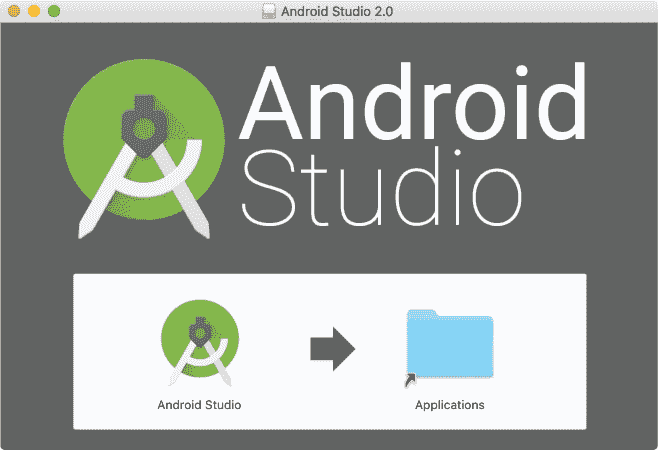图 2-1

要安装该包，只需将 Android Studio 图标拖到 `Applications` 文件夹中。Android Studio 包将安装到系统的 `Applications` 文件夹中，此过程通常需要几分钟完成。

要启动 Android Studio，使用 Finder 窗口在 `Applications` 文件夹中找到执行文件并双击它。为了以后方便访问该工具，可以从 Finder 窗口将 Android Studio 图标拖到 dock（坞）上。

### 2.3.3 在 Linux 上安装

下载 Linux 版 Android Studio 程序包后，打开终端窗口，切换目录到要安装 Android Studio 的位置，并执行以下命令：

```bash
unzip /<path to package>/android-studio-ide-<version>-linux.zip
```

注意，Android Studio 压缩包将安装到名为 `android-studio` 的子目录。因此，假设上述命令在 `/home/demo` 中执行，软件程序包将解压到 `/home/demo/android-studio`。

要启动 Android Studio，打开终端窗口，切换目录到 `android-studio/bin` 子目录并执行以下命令：

```bash
./studio.sh
```

在 64 位 Linux 系统上运行时，在 Android Studio 运行之前，需要安装一些 32 位支持库。在 Ubuntu 上，可以使用以下命令安装这些库：

```bash
sudo apt-get install libc6:i386 libncurses5:i386 libstdc++6:i386 lib32z1 libbz2-1.0:i386
```

在基于 Red Hat 和 Fedora 的 64 位系统上，使用以下命令：

```bash
sudo yum install zlib.i686 ncurses-libs.i686 bzip2-libs.i686
```

## 2.4 Android Studio 设置向导

安装后首次启动 Android Studio 时，将弹出一个对话框，提供从以前的 Android Studio 版本导入设置的选项。如果你有以前版本的设置并希望将其导入最新安装中，请选择相应的选项和位置。或者，指示你不需要导入任何之前的设置并点击 `OK` 按钮继续。

接下来，可能会出现设置向导，如图图 2-2 所示：图 2-2

如果出现了向导，点击 `Next` 按钮，选择标准安装选项并再次点击 `Next`。

Android Studio 将下载并配置最新的 Android SDK 以及一些组件。一旦此过程完成，点击 Components 对话框中的 `Finish` 按钮，随后应出现欢迎 Android Studio 界面：图 2-3

## 2.5 安装额外的 SDK

到目前为止的操作已安装 Java、Android Studio IDE 以及当前的 Android SDK 程序包。在继续之前，值得花时间验证已安装的程序包并安装任何缺失或更新的程序包。

此任务可以使用 Android SDK 设置界面完成，可以通过 Android Android 工具选择 `Configure -> SDK Manager` 来启动该界面。一旦调用，将出现 Android SDK 设置对话框，如图图 2-4 所示：图 2-4 首次安装 Android Studio 后，可能只安装了 Android SDK 的最新版本。要安装旧版本的 Android SDK，只需选择相应的复选框并点击 `Apply` 按钮。

可能还会列出适用于最新 SDK 的更新。要访问可用程序包的详细信息，启用屏幕右下角的 `Show Package Details` 选项。这将显示类似于图 2-5 所示的信息：图 2-5 上图突出了更新的可用性。要安装更新，启用项目名称左侧的复选框并点击 `Apply` 按钮。

除了 Android SDK 程序包外，还安装了许多用于构建 Android 应用的工具。要查看已安装的程序包并检查更新，留在 SDK 设置界面并选择 `SDK Tools` 卡，如图图 2-6 所示：图 2-6 在 Android SDK Tools 界面中，确保以下程序包在状态列中显示为已安装：

- Android SDK Build-tools
- Android Emulator
- Android SDK Platform-tools
- Android SDK Tools
- Google Play Services
- Instant Apps Development SDK
- Intel x86 Emulator Accelerator (HAXM installer)
- ConstraintLayout for Android
- Solver for ConstraintLayout
- Android Support Repository
- Google Repository
- Google USB Driver (仅限 Windows)

如果上述任何软件包被列为“未安装”（Not Installed）或需要更新，只需勾选这些软件包旁边的复选框，然后点击 `Apply` 按钮启动安装过程。安装完成后，检查软件包列表，确保所选软件包在“状态”（Status）列中已显示为“已安装”（Installed）。如果有任何包显示为未安装，请确保已勾选它们并再次点击 `Apply` 按钮。

## 2.6 使 Android SDK 工具支持命令行访问

大多数情况下，Android SDK 的底层工具会在 Android Studio 环境内部被访问。尽管如此，在某些情况下，从命令提示符或终端窗口调用这些工具也是非常有用的。为了让你正在运行的操作系统能够找到这些工具，有必要将它们添加到系统的 `PATH` 环境变量中。

无论使用什么操作系统，都需要配置 `PATH` 变量以包含以下路径（其中 `<path_to_android_sdk_installation>` 代表 Android SDK 的安装文件系统位置）：

```
<path_to_android_sdk_installation>/sdk/tools
<path_to_android_sdk_installation>/sdk/tools/bin
<path_to_android_sdk_installation>/sdk/platform-tools
```

SDK 在你系统上的位置可以通过启动 SDK Manager 并参考设置面板顶部的 `Android SDK Location :` 字段来确定，如图 2-7 所示：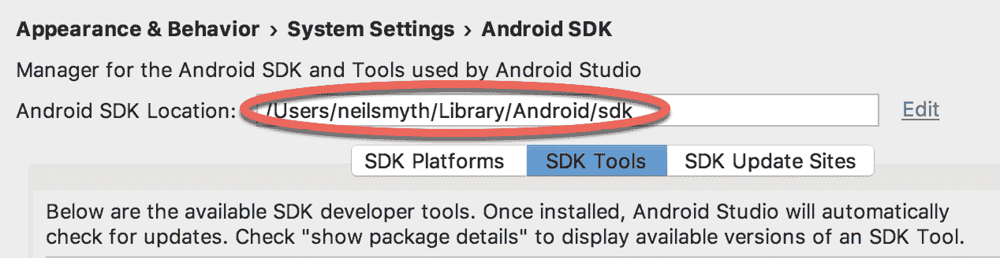

图 2-7

一旦确定了 SDK 的位置，将其添加到 `PATH` 变量的步骤取决于操作系统：

### 2.6.1 Windows 7

1. 在桌面开始菜单中右键点击“计算机”（Computer），并在弹出的菜单中选择“属性”（Properties）。
2. 在属性面板中，选择“高级系统设置”（Advanced System Settings）链接，在弹出的对话框中，点击“环境变量…”（Environment Variables…）按钮。
3. 在“环境变量”（Environment Variables）对话框中，在系统变量列表中找到 `Path` 变量，选中它并点击“编辑…”（Edit…）。找到当前变量值字符串的末尾，将 Android 平台工具路径添加到末尾，使用分号将路径与前面的值隔开。例如，假设 Android SDK 安装在 `C:\Users\demo\AppData\Local\Android\sdk`，则会将以下内容添加到当前 `Path` 值的末尾：

```
;C:\Users\demo\AppData\Local\Android\sdk\platform-tools; C:\Users\demo\AppData\Local\Android\sdk\tools; C:\Users\demo\AppData\Local\Android\sdk\tools\bin
```

4. 完成上述步骤后，通过打开命令提示符窗口（开始 -> 所有程序 -> 附件 -> 命令提示符）验证路径设置是否正确，并在提示符处输入：

```bash
echo %Path%
```

返回的路径变量值应包含 Android SDK 平台工具文件夹的路径。通过尝试运行 `adb` 工具来验证 `platform-tools` 值是否正确：

```bash
adb
```

该工具在执行时应输出命令行选项列表。同样，通过尝试启动 AVD Manager 命令行工具来检查工具路径设置（不要担心 `avdmanager` 工具报告 Java 问题 - 这稍后会解决）：

```bash
avdmanager
```

如果其中一个或两个命令出现类似下面的信息，则很可能是向 `Path` 环境变量添加了错误的路径：

`'adb'不是内部或外部命令、可程序或批处理文件。`

### 2.6.2 Windows 8.1

1. 在开始屏幕，将鼠标移动到屏幕右下角，并在弹出的菜单中选择“搜索”（Search）。在搜索框中输入“控制面板”（Control Panel）。当控制面板图标出现在结果区域时，点击它在桌面上启动该工具。
2. 在“控制面板”中，使用“查看”（Category）菜单将显示方式更改为“大图标”（Large Icons）。从图标列表中选择标记为“系统”（System）的项目。
3. 按照 Windows 7 的说明，从第 2 步开始直到第 4 步的操作。

打开命令提示符窗口（将鼠标移动到屏幕右下角，选择搜索并在搜索框中输入 `cmd`）。在搜索结果中选择“命令提示符”。在命令提示符窗口中输入：`echo %Path%`

返回的路径变量值应包含 Android SDK 工具文件夹的路径。通过尝试运行 `adb` 工具来验证 `platform-tools` 值是否正确：

```
adb
```

执行该工具时，它应该输出命令行选项列表。

同样，通过尝试运行 AVD Manager 命令行工具来检查路径设置（如果 `avdmanager` 工具报告 Java 问题，请不要担心——这稍后会解决）：

```
avdmanager
```

如果其中一个或两个命令出现类似下面的提示信息，很可能是向 `Path` 环境变量中添加了错误的路径：'adb'不是内部或外部命令、可运行程序或批处理文件。

### 2.6.3 Windows 10

右键点击开始菜单，从弹出的菜单选择“设置”，并在“查找设置”文本框中输入“编辑系统环境变量”。在“系统属性”对话框中，点击`环境变量...` 按钮。按照 Windows 7 从步骤 3 开始的步骤进行操作。

### 2.6.4 Linux

在 Linux 上，此配置通常可以通过向家目录下的 `.bashrc` 文件中添加命令来实现（具体细节取决于所使用的特定 Linux 发行版）。假设 Android SDK 压缩包安装在 `/home/demo/Android/sdk`，则 `.bashrc` 文件中的 `export` 行内容如下：

```
export PATH=/home/demo/Android/sdk/platform-tools:/home/demo/Android/sdk/tools:/home/demo/Android/sdk/tools/bin:/home/demo/android-studio/bin:$PATH
```

同样注意，上述命令将 `android-studio/bin` 目录添加到 `PATH` 变量中。这将允许在终端窗口的任何当前目录下都可执行 `studio.sh` 脚本。

### 2.6.5 macOS


在 macOS 上可以使用多种技术修改 `$PATH` 环境变量。认为最干净的方法是在`/etc/paths.d`目录中创建一个新文件，其中包含要添加到`$PATH`的路径。假设 Android SDK 安装位置为`/Users/demo/Library/Android/sdk`，可以通过在`/etc/paths.d`目录中创建一个名为`android-sdk`的新文件并包含以下行：

```
/Users/demo/Library/Android/sdk/tools
/Users/demo/Library/Android/sdk/tools/bin
/Users/demo/Library/Android/sdk/platform-tools
```

注意，由于这是一个系统目录，创建文件时需要使用`sudo`命令。例如：

```
sudo vi /etc/paths.d/android-sdk
```

## 2.7 更新 Android Studio 和 SDK

Android Studio 和 Android SDK 会不定期发布新版本。新版本的 SDK 使用 Android SDK Manager 安装。当有更新可以安装时，Android Studio 通常会通知你。

若要手动检查 Android Studio 的更新，请点击 Android Studio 欢迎界面上的`Configure -> Check for Update`菜单选项，或者使用 Android Studio 主窗口内的`Help -> Check for Update`菜单选项。

### 2.8 总结

在开始开发 Android 应用程序之前，第一步是搭建合适的开发环境。这包括 Android SDK 和 Android Studio IDE（它还包括 OpenJDK 环境）。在本章中，我们涵盖了在 Windows、macOS 和 Linux 上安装这些包的必要步骤。

# 3. 创建示例 Android 应用程序

本书之前的几个章节已经涵盖了使用 Android Studio 配置环境的必要步骤。在进入稍高高级的话题之前，现在是验证所有必要的开发包已安装并运行良好的好机。实现这一目标的最佳方法是创建一个 Android 应用程序并对其编译和运行。一旦创建了项目，稍后的章节将探索如何使用模拟器对应用程序进行测试运行。

## 3.1 关于项目

在本章中创建的项目是一个非常简单的货币计算器（事实上，它非常简单，以至于仅使用估算的转换汇率将美元转换为欧元）。该项目还将使用最基础的 Android Studio 模板。这种简单性允许我们介绍应用开发的一些关键方面，而不会因为尝试引入过多的概念（如推荐的应用程序架构和组件）而让初学者无所措。在遵循教程时，请放心，初始项目中使用的所有技术将在后文中更详细地介绍。

## 3.2 创建新项目

应用程序开发过程的第一步是在 Android Studio 中创建一个新项目。因此，首先启动 Android Studio，直到出现“Welcome to Android Studio”屏幕。一旦此窗口出现，Android Studio 就准备好创建一个新项目。要创建新项目，只需点击`Start a project`选项显示第一个屏幕。

## 3.3 创建 Activity

第一步是定义为应用程序创建的初始 Activity 类型。提供有为手机和平板、Wear OS、TV、Android Audio 或 Android Things 创建项目的选项。在开发 Android 应用程序时，可以使用不同的 Activity 类型，其中许多将在稍后的章节中介绍。然而，出于本示例的目的，只需在手机和平板屏幕上选择创建`Basic Activity`选项即可。`Basic Activity`选项创建一个模板用户界面，由应用栏、菜单、内容区域和一个浮动按钮组成。

选中`Basic Activity`选项后，点击`Next`继续进行项目配置。

## 3.4 定义项目和 SDK 设置

在项目配置窗口中，将`Name`（名称）字段设置为`AndroidSample`。应用程序名称是在 Android Studio 内部引用和标识应用程序的名称，也是如果完成的应用程序要在 Google Play 商店出售时将使用的名称。

`Package name`（包名）用于在 Android 生态系统中唯一标识应用程序。虽然它可以设置为任何唯一标识你的应用程序的字符串，但传统上它是基于你的域名反转 URL，后跟应用程序名称。例如，如果你的域名是`www.mycompany.com`，且应用程序命名为`AndroidSample`，则包名指定如下：

```
com.mycompany.androidsample
```

如果你没有域名，可以在`Company Domain`（公司域名）字段中输入任何其他字符串，或者为了测试目的使用`example.com`。

`Save location`（保存位置）设置将默认为家目录下的`AndroidStudioProjects`文件夹，可以通过点击文本字段右侧的图标进行更改。

将`minimum SDK`（最低 SDK）设置为`API 26`：Android 8.0 (Oreo)。这是本书创建的大多数项目将使用的 SDK。虽然 Android Studio 允许选择旧版本的 SDK，但许多安全隐私功能是在 API 25 发布后引入的。为了提高安全性，Google 从 2018 年 8 月开始，Google Play 商店仅接受使用`API 26`或更高版本构建的应用。相同的限制也适用于 2018 年后的更新。Instant Apps（快速应用）将在本书后期介绍。最后，将`Language`（语言）菜单更改为`Java`并点击`Finish`启动项目创建。

## 3.5 修改示例应用程序

在此处，Android Studio 已创建了示例应用程序并打开了主窗口。

新创建的项目及其关联文件列在左侧的`Project`工具窗口中。`Project`工具窗口有多种模式可用。默认情况下，此面板处于`Android`模式。此设置由面板顶部的菜单控制。

当我们选择创建 Activity 的选项时，我们创建的示例项目显示了一个包含显示“Hello World!”标签的用户界面。

本教程的下一步是修改我们应用程序的用户界面，使其显示一个带有不同消息的文本视图。

我们应用程序的用户界面设计存储在名为`activity_main.xml`的文件中，位于项目层级结构的`res -> layout`下。此布局包括应用栏（标记为 A）和浮动按钮（标记为 B）。除了这些项目外，`activity_main.xml`布局包含指向第二个文件的引用（标记为 C）。

默认情况下，内容布局包含在名为`content_main.xml`的文件中。使用`Project`工具窗口定位此文件。一旦定位，双击文件将其加载到位于 Android Studio 窗口中心的界面界面工具中。

Layout Editor 顶部的工具栏菜单（当前设置为 4）反映了 Layout Editor 面板内的设置。通过点击此菜单可以使用许多其他设备选项。要在横屏和竖屏之间切换设备，使用设备选择左侧的下拉菜单。

可以看到内容布局已包含一个显示“Hello World!”的标签。面板左侧的`Palette`（调色板）包含不同类的组件，用于构建用户界面，例如按钮和文本字段。需要注意的是，并不是所有用户界面组件对用户都是可见的。其中一个类别是布局。Android 支持多种布局来控制用户界面组件在屏幕上的定位和管理。虽然从用户界面的表示很难判断，但当前设计使用了`ConstraintLayout`。可以通过查看位于 Layout Editor 面板左下角的`Component Tree`（组件树）面板中的信息来确认这一点。

在继续之前，请检查 Layout Editor 的`Autoconnect`（自动连接）模式是否已启用。这意味着当向布局添加组件时，Layout Editor 将自动添加约束，以确保组件在不同的屏幕和设备方向上正确定位。`Autoconnect`按钮出现在 Layout Editor 工具栏中，用磁铁图标表示。当禁用时，磁铁上带有一条斜线。如有必要，点击此按钮重新启用`Autoconnect`模式。

修改应用程序的下一步是在布局中添加一些附加组件，第一个是用户点击启动货币转换的`Button`。`Palette`面板由两列组成，左列包含视图类别列表。右列列出当前选中类别中的组件。例如，在`Buttons`类别中当前选择了`Button`。从`Buttons`列表中拖动`Button`对象并将其到用户界面设计的水平中心，使其位于现有`TextView`小部件下方。

下一步是更改`Button`组件当前显示的文本。设计区域右侧的面板是`Attributes`（属性）面板。此面板显示分配给布局中当前选中组件的属性。在此面板中，找到`text`属性，并将当前值从“Button”更改为“Convert”。更改组件文本属性的实用快捷键是在布局中双击它。这将自动在属性面板中定位该属性并选中它以进行编辑。

带有扳手的第二个`text`属性允许设置文本属性，该属性仅在 Layout Editor 中显示而在运行时不显示。这对于测试组件和布局的行为方式非常有用，而无需反复运行应用。如果`Autoconnect`系统未能设置所有布局，点击`Infer constraints`（推断约束）按钮向布局添加任何缺失的约束。

此时，解释 Layout Editor 右上角的警告按钮很重要。显然，这表明布局存在潜在问题。有关任何问题的详细信息，点击`Fix`（修复）按钮。目前列出的唯一警告如下：硬编码字符串 "Convert"，应使用 @string 资源。此 I18N 消息告诉我们未来的国际化可能存在问题（“I18N”源于单词“internationalization”以“I”开头，以“N”结束，中间有 18 个字母）。警告提醒我们，在开发 Android 应用程序时，属性和值（如字符串）应尽可能以资源的形式存储。允许通过修改资源文件更改应用程序的外观，而不是更改代码。这在将用户界面翻译成不同语言时特别有价值。如果用户界面的文本位于单个资源文件中，例如），可以通过 Resource 视图来执行翻译。在这种情况下，我们将创建一个名为`convert_string`的新资源并为其分配字符串“Convert”。在`Attributes`面板中，点击 Fix 按钮，将资源名称更改为`convert_string`，并将资源值设置为“Convert”。同样注意的是，字符串也可以被分配给资源以资源，这涉及点击`Attributes`面板中属性字段右侧的三个点并选择`Add new resource -> String Value`（添加新资源 -> 字符串值）选项。在实践中，直接在`Attributes`字段中设置值通常更快。

布局的下一个组件是`EditText`。从调色板选择`Text`类别，并拖动`Number (Decimal)`组件到布局中，使其水平居中并位于现有`TextView`小部件上方。选中小部件后，使用`Attributes`工具窗口将`hint`属性设置为“dollars”。点击警告图标并将字符串提取为名为`dollars_hint`的资源。点击`Infer constraints`（推断约束）按钮向布局添加任何缺失的约束。此时，布局应该像下面所示：

```xml
<resources>
    <string name="app_name">AndroidSample</string>
    <string name="action_settings">Settings</string>
    <string name="convert_string">Convert</string>
    <string name="dollars_hint">dollars</string>
</resources>
```

作为资源应用的演示，将当前分配给`convert_string`资源的字符串值更改为“Convert to Euros”，然后通过选择面板中的文件标签返回`Layout Editor`工具。注意布局已获取了字符串的新资源值。

## 3.6 检查布局和资源文件

在继续后续步骤之前，我们将查看用户界面的内部方面和资源处理。在前节中，我们通过使用`Layout Editor`工具修改`content_main.xml`文件对用户界面做了一些更改。在实践中，直接修改 XML 文件来更改用户界面通常比使用`Layout Editor`工具更快。在 Layout Editor 面板底部有两个标签：`Design`（设计）和`Text`（文本）。要切换到 XML 视图只需选择`Text`标签。从 XML 文件的结构可以看到用户界面由`ConstraintLayout`组件组成，反过来它是`Button`对象的父级。我们还可以看到`Button`的`text`属性被设置为`convert_string`资源。尽管复杂性不同，Android Studio 的一个强大功能可以在 XML 编辑面板的右侧找到。如果面板不可见，通过位于 Android Studio 窗口右侧的`Preview`（预览）按钮显示它。这是`Preview`面板显示布局的当前状态。对 XML 布局做出更改时，这些将在预览面板中反映。要看到此效果，修改 XML 布局将`ConstraintLayout`的背景颜色更改为红色如下：

```xml
<?xml version="1.0" encoding="utf-8"?>
<android.support.constraint.ConstraintLayout xmlns:android="http://schemas.android.com/apk/res/android"
    xmlns:app="http://schemas.android.com/apk/res-auto"
    xmlns:tools="http://schemas.android.com/tools"
    android:layout_width="match_parent"
    android:layout_height="match_parent"
    app:layout_behavior="@string/appbar_scrolling_behavior"
    tools:context=".MainActivity"
    android:background="#ff2438">

</android.support.constraint.ConstraintLayout>
```

注意预览颜色实时匹配 XML 文件中的新设置。注意 XML 编辑器左侧边距（也称为槽）出现了一个红色小方形。这是在属性上设置颜色的视觉提示。将颜色值更改为`#a0ff28`，注意边距中的小方形和预览都变为绿色。最后，使用`Project`视图定位`app -> res -> values -> strings.xml`文件并双击它将其加载到编辑器中。目前 XML 读取如下：

（重复上面的 XML 代码）

## 3.7 添加交互

此示例项目的最后一步是使应用程序具有交互性，当用户在`EditText`字段中输入美元值并点击转换按钮时，转换后的欧元值将出现在`TextView`上。这涉及在`Button`小部件上实现一些事件处理。具体而言，需要对`Button`配置，以便在触发`onClick`事件时调用应用程序代码中的方法。事件处理可以用多种不同的方式实现，并在后后题为“Android 事件处理概述与示例”的章节中详细介绍。将布局编辑器返回`Design`模式，在布局编辑器中选择`Button`小部件，参考`Attributes`工具窗口并指定一个名为`convertCurrency`的方法，如下：

接下来，双击`MainActivity.java`文件将其加载到代码编辑器，并在类文件中添加`convertCurrency`方法的代码，使其读取如下，注意还需要导入一些额外的 Android 包：


```java
package com.ebookfrenzy.androidsample;

import android.os.Bundle;
import android.support.design.widget.FloatingActionButton;
import android.support.design.widget.Snackbar;
import android.support.v7.app.AppCompatActivity;
import android.support.v7.widget.Toolbar;
import android.view.View;
import android.view.Menu;
import android.view.MenuItem;
import android.widget.EditText;
import android.widget.TextView;

public class MainActivity extends AppCompatActivity {

    public void convertCurrency(View view) {
        EditText dollarText = findViewById(R.id.dollarText);
        TextView textView = findViewById(R.id.textView);
        if (!dollarText.getText().toString().equals("")) {
            float dollarValue = Float.valueOf(dollarText.getText().toString());
            float euroValue = dollarValue * 0.85F;
            textView.setText(euroValue.toString());
        } else {
            textView.setText("No Value");
        }
    }
}
```

1. 从“类别”（Category）面板中，选择`Phone`选项以显示可用的 Android 平板 AVD 模板列表。

2. 选择`Nexus 5X`设备选项并点击`Next`。

3. 在“系统镜像”（System Image）屏幕上，为`x86 ABI`选择最新版本的 Android（本文写为`API level 28`，带有`Google Play`的`Android 9.0`）。注意，如果系统镜像尚未安装，`发布名称”（Release Name）旁边将提供`Download`（下载）链接。点击此链接下载并安装系统镜像，然后再进行选择。如果所需的镜像未在列表中，请点击`x86 images`和`Other images`选项卡以查看替代列表。

4. 点击`Next`继续，并在名称字段中输入一个描述性名称（例如`Nexus 5X API 28`），或直接接受默认名称。

5. 点击`Finish`创建 AVD。

6. AVD 创建完成后，现在可以关闭`AVD Manager`。如果以后需要对 AVD 进行修改，只需重新打开`AVD Manager`，从列表中选择该 AVD，并点击`AVD Manager`中设备行`Actions`列下的铅笔图标。

## 4.3 启动模拟器

要对新创建的 AVD 模拟器进行测试运行，只需从`AVD Manager`中选择该模拟器并点击启动按钮（`Actions`列中的绿色三角形）。模拟器将在新窗口中出现并开始启动过程。模拟器启动所需取决于 AVD 本身及其运行系统的配置。

尽管模拟器可能默认以竖屏方向显示，但此项及其他默认选项是可以更改的。在`AVD Manager`中，选择新的`Nexus 5X`条目，并点击设备行`Actions`列中的铅笔图标。在配置界面中找到`Startup`启动）和`orientation`方向）部分并更改方向设置。退出并重启模拟器会话以使更改生效。关于模拟器的更多细节请参见下一章（“使用和配置 Android Studio AVD 模拟器”）。为了在本章的节节节省时间，请在继续之前保持模拟器运行状态。

## 4.4 在 AVD 中运行应用程序

配置好 AVD 模拟器后，之前章节创建的示例应用程序`AndroidSample`现在可以编译并运行了。将`AndroidSample`项目加载到`Android Studio`中，只需点击`Android Studio`工具栏上的绿色三角形运行按钮，如下文所示图 4-4 所示，选择`Run -> Run ‘app’`菜单选项或使用键盘快捷键`Ctrl-R`：

```
![](image1537.jpg
```

图 4-4

默认情况下，`Android Studio`将通过显示“选择部署目标”（Select Deployment Target）对话框来响应运行请求。这提供了在已运行的 AVD 实例上执行应用程序的选项，或者专门为此应用程序启动新的 AVD 会话。图 4-5 列出了由于前一节操作而生成的运行设备`Nexus 5X` AVD。在对话框中选择此设备后，点击`OK`在模拟器上安装并运行应用程序。

```
![](image1543.jpg
```

图 4- 5

一旦应用程序安装并运行，`MainActivity`类的用户界面将出现在模拟器中：

```
![](image1549.jpg
```

图 4-6

如果活动没有自动启动，请检查模拟器上的应用列表中是否出现了启动图标。如果是，只需点击它即可启动应用程序。一旦运行过程开始，`Run`（运行）和`Logcat`工具窗口将变为可用。`Run`工具窗口将在应用程序包安装和启动时显示诊断信息。图 4-7 显示了成功启动应用程序的`Run`工具窗口输出：

```
![](image1555.jpg
```

图 4- 7

如果在启动过程中遇到问题，`Run`工具窗口将提供相关信息，这些信息可能有助于隔离问题原因。假设应用程序加载到模拟器并按预期运行，我们已安全验证了 Android 开发环境已正确安装和配置。

## 4.5 运行/调试配置

可以对特定项目进行配置，使其每次从`Android Studio`内部运行时都自动使用特定的设备或模拟器。这避免了每次执行应用程序时从设备选择器中进行选择的需要。要查看和修改`Run/Debug`配置，点击`Android Studio`工具栏中运行按钮左侧的按钮，并在生成的菜单中选择`Edit Configurations…`（编辑配置）选项：

```
![](image1564.jpg
```

图 4-8

在`Run/Debug Configurations`对话框中，可以通过从`Target`下拉菜单中选择`Emulator`来配置应用程序始终使用首选模拟器。如图 4-9 所示，显示`AndroidSample`应用程序配置运行在之前创建的`Nexus 5X`模拟器上：

```
![](image1570.jpg
```

图 4- 9

在进入下一节之前，确保将`Target`设置切换回“打开部署目标”（Open Target）。

## 4.6 停止运行的应用程序

要停止运行的应用程序，只需点击工具栏上的停止按钮，如图 4-10 所示：

```
![](image1578.jpg
```

图 4-10

也可以使用`Logcat`工具窗口终止应用程序。首先使用应用程序运行时可用的窗口栏按钮显示`Logcat`工具窗口。一旦`Logcat`工具窗口出现，如下文图 4-11 所示选择`androidsample`应用菜单：

```
![](image1584.jpg
```

图 4-11

选中该进程后，点击上方所示列表左侧的红色`Terminate Application`（终止应用程序）按钮停止它。

## 4.7 AVD 命令行创建

如前所述，除了图形用户界面外，还可以直接从命令行创建新的 AVD。这是通过使用`avdmanager`工具结合某些命令行选项来实现的。一旦启动，工具将提示额外信息。

在 Windows 上，请在运行`avdmanager`的命令提示符窗口执行以下命令（将`<path to jre>`替换为从上方项目结构对话框中复制的路径）：

```
set JAVA_HOME=<path to jre>
```

在 macOS 或 Linux 上，执行以下命令：

```bash
export JAVA_HOME="<path to jre>"
```

如果您预计频繁使用`avdmanager`工具，请按照标题为“设置 Android Studio 开发环境的章节列出的适用于您操作系统的环境变量步骤，以在系统范围内配置`JAVA_HOME`。

假设系统已配置好 Android SDK 工具目录已包含在`PATH`环境变量中，可以通过在终端或命令窗口中执行以下命令来获取新 AVD 的可用目标列表：

```
avdmanager list targets
```

上述命令的预期输出结果将包含系统上可用的 Android SDK 版本列表。例如：

Available Android targets:

----------

id: 1 or "android-28"

Name: Android API 28

Type: Platform

API level: 28

Revision: 3

----------

id: 2 or "android-26"

Name: Android API 26

Type: Platform

API level: 26

Revision: 1

`avdmanager`工具还允许从命令行创建新的 AVD 实例。例如，要使用 Android API level 26 设备的 x86 ABI 目标 ID 创建名为`Nexus9`的新 AVD，可以使用以下命令：

```
avdmanager create avd -n Nexus9 -k "system-images;android-26;google_apis;x86"
```

android 工具将根据基础 Android 8 设备所需的规格创建新的 AVD，同时也同时也提供了在需要时创建自定义配置以匹配特定设备规格的选项。一旦从命令行创建了新的 AVD，在点击“刷新（Refresh）”按钮之前，它不会显示在 Android 设备管理器工具中。

除了创建新的 AVD 之外，还可以从命令行执行许多其他任务。例如，可以使用`list avd`命令行参数获取当前可用的 AVD 列表：

```
avdmanager list avd
```

Available Android Virtual Devices:

Name: Pixel_XL_API_28_No_Play

Device: pixel_xl (Google)

Path: /Users/neilsmyth/.android/avd/Pixel_XL_API_28_No_Play.avd

Target: Google APIs (Google Inc.)

Based on: Android API 28

Tag/ABI: google_apis/x86

Skin: pixel_xl_silver

sdcard: 512M

同样，要删除现有的 AVD，只需使用如下 delete 选项：

```
avdmanager delete avd –n <avd name>
```

## 4.8 Android 虚拟设备配置文件

默认情况下，与 AVD 关联的文件存储在用户目录下的`.android/avd`子目录下，其结构如下（将`<avd name>`替换为分配给 AVD 的名称）：

- `<avd name>.avd/config.ini`

- `<avd name>.avd/userdata.img`

- `<avd name>.ini`

`config.ini`文件包含在 AVD 创建过程中指定的设备配置设置，如显示尺寸和内存。这些设置可以直接在配置文件中进行更改，并在 AVD 下次被调用时被采用。

`<avd name>.ini`文件包含对目标 Android SDK 的引用以及 AVD 文件的路径。请注意，`config.ini`文件中`image.sysdir`值的更改也需要反映在该文件的`target`值中。

## 4.9 移动和重命名 Android 虚拟设备

可以使用`avdmanager`工具的`move avd`参数从命令行更改 AVD 的当前名称或位置。例如，要将名为`Nexus9`的 AVD 重命名为`Nexus9B`，可以执行以下命令：

```bash
avdmanager move avd -n Nexus9 -r Nexus9B
```

要物理移动与 AVD 关联的文件，应使用以下命令语法：

```bash
avdmanager move avd -n <avd name> -p <path to new location>
```

例如，将 AVD 从其当前的文件系统位置移动到`/tmp/Nexus9Test`：

```bash
avdmanager move avd -n Nexus9 -p /tmp/Nexus9Test
```

注意，在执行移动 AVD 的命令之前，目标目录不能已经存在。

### 4.10 总结

典型的应用开发过程遵循编码、编译和在测试环境中运行的循环。Android 应用程序可以在物理 Android 设备上测试，也可以使用 Android 虚拟设备（AVD）模拟器进行测试。AVD 使用 Android AVD Manager 工具创建和管理，该工具可以作为命令行工具使用，也可以使用图形用户界面。在创建 AVD 以模拟特定的 Android 设备模型时，重要的是虚拟设备的硬件规格必须与物理设备的规格相匹配。

## 5 使用和配置 Android AVD 模拟器

Android 虚拟设备（AVD）模拟器随 Android Studio 一起发布，在 Android Studio 1.x 中是一个异常的弱点，被许多开发者认为缓慢且缺乏活性。幸运的是，Android Studio 2 对模拟器在灵活性整体性能方面进行了重大改进。

在下一章探索物理设备测试之前，本章将花费一些时间概述 Android AVD 模拟器，并突出许多可自定义的配置功能。

## 5.1 模拟器环境

启动模拟器时，在加载过程中会显示初始启动屏。加载完成后，会出现主模拟器窗口，其中包含所选设备的表示（图 5-1 这是一个 Nexus 5 设备）：

位于窗口右边缘的是工具栏，提供了对模拟器的快速访问。

## 5.2 模拟器选项

模拟器工具栏（图 5-2）提供了访问模拟器环境的一系列选项。工具栏中的每个按钮都关联有一个快捷键，可以通过鼠标指针悬停在按钮上等待工具提示出现，或者通过扩展控制面板的帮助选项来识别。尽管工具栏中的许多选项是显而易见的，但为了完整起见，将介绍每个选项：

- **退出 / 最小化**：工具栏顶部的“x”按钮在选中时会退出模拟器话，而“-”选项会最小化整个窗口。

- **电源**：电源按钮模拟物理 Android 设备上的电源按钮。点击并释放此按钮将锁定设备并关闭屏幕。点击并按住按钮将启动设备“关机”请求序列。

- **音量增大 / 缩小**：控制模拟器内播放音量的两个按钮。

- **向左/向右旋转**：在竖屏和横屏方向之间旋转模拟设备。

- **截屏**：对设备屏幕当前显示的内容进行截图。捕捉到的图像存储在本章稍后介绍的扩展控制面板设置指定的指定。

- **缩放模式**：此按钮切换进入和退出缩放模式，细节将在本章稍后介绍。

- **返回**：模拟标准 Android“返回”按钮。与下方列出的主页和概述按钮一样，通过选择模拟器屏幕上的实际按钮也可以相同的结果。

- **主页**：模拟标准 Android“主页”按钮。

## 概述

模拟点击 Android 标准“最近任务”（Overview）按钮，该按钮可显示设备上正在运行的应用。

## 扩展控制

显示扩展控制面板，允许配置模拟位置、电话活动、电池强度、移动网络类型以及指纹识别等选项。

## 5.3 使用缩放模式工作

模拟器工具栏上的缩放按钮用于进入和退出缩放模式。当缩放模式激活时，工具栏按钮将处于按下状态，且当鼠标指针悬停在设备屏幕上时会显示放大镜。点击鼠标左键将使显示相对于屏幕上的选点进行放大，重复点击会增加放大倍数。相反，点击鼠标右键会缩小放大倍数。关闭缩放按钮会将显示恢复为默认大小。

在缩放模式下，点击并拖动将定义一个矩形区域，释放鼠标按钮后视图将缩放到该区域。在缩放模式下，可以使用模拟器窗口内的水平和垂直滚动条平移屏幕可视区域。

## 5.4 调整模拟器窗口大小

可以通过点击并拖动窗口的任何角或侧边，随时更改模拟器窗口的大小（以及设备相应的表示）。

## 5.5 扩展控制选项

扩展控制工具栏按钮会显示如图 5-3 所示的面板。默认情况下，将显示位置设置。从左侧面板选择不同的类别将显示相应的控制组：

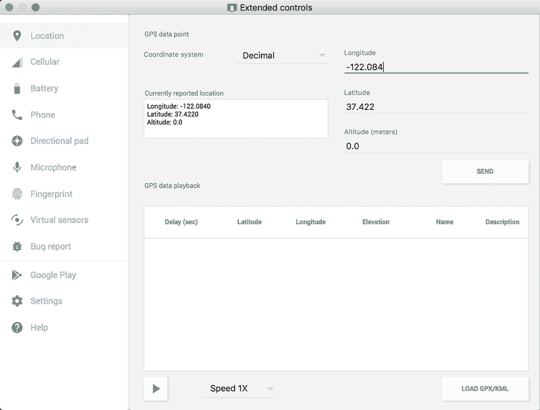

图 5-3

### 5.5.1 位置

位置控制允许以十进制或六十进制坐标的形式将模拟的位置信息发送到模拟器中。位置信息可以是单个位置，也可以是代表设备移动的点序列，后者通过 GPS 交换格式 (`GPX`) 或 Keyhole 标记语言 (`KML`) 格式的文件提供。

点击`Send`按钮时，单个位置将传输到模拟器。一旦选择数据表下方的`play`按钮，将开始传输 GPS 数据。向模拟器馈送 GPS 数据点的速度可以使用播放按钮旁边的速度菜单进行控制。

### 5.5.2 蜂窝

可以在蜂窝设置屏幕更改模拟的蜂窝连接类型。可以选择模拟不同的网络类型（`CSM`、`EDGE`、`HSDPA`等），以及漫游和拒绝访问等系列语音和数据场景。

### 5.5.3 摄像头

当摄像头激活时，模拟器会模拟 3D 场景。这表现为虚拟建筑内部，您可以在模拟器内录制视频或拍摄照片之前，通过按住`Option`键（Windows 上为`Alt`）并使用鼠标指针和键盘键进行导航。此扩展配置选项允许上传不同的图像显示在虚拟环境中。

### 5.5.4 电池


在扩展控制屏幕的此面板上，可以模拟各种电池状态和充电条件，包括电池电量、电池健康状况以及当前是否连接了 AC 充电器。

### 5.5.5 电话

手机扩展控制为模拟器提供了两个非常简单但实用的模拟。第一个选项允许模拟来自指定电话号码的入电电话。这在测试应用如何处理此类高级中断时特别有用。

第二个选项允许在模拟器会话中模拟接收短信。与现实世界中一样，这些消息出现在`Message`应用中，并触发模拟器内的标准通知。

### 5.5.6 方向键

方向键（`D-Pad`）是内置在 Android 设备中或外部连接（如游戏手柄）的另一组控件，提供方向控制（左、右、上、下）。方向键设置允许在模拟器中模拟 D-Pad 交互。

### 5.5.7 麦克风

麦克风设置允许启用麦克风并模拟耳机和麦克风连接。还提供了一个按钮用于启动模拟器上的语音助手。

### 5.5.8 指纹

许多 Android 设备现在配备了内置指纹检测硬件。AVD 模拟器使得无需在带有指纹传感器的物理设备上测试应用即可测试指纹认证。有关如何在模拟器中配置指纹测试的细节将在本章后面详细介绍。

### 5.5.9 虚拟传感器

虚拟传感器选项允许模拟加速度计和磁力计，通过偏航、俯仰和横滚设置来模拟设备的物理运动效果，如旋转、移动和倾斜。

### 5.5.10 快照

快照包含当前运行的 AVD 会话状态，可进行保存并快速恢复，从而轻松将模拟器恢复到精确状态。快照将在本章后面详细介绍。

### 5.5.11 录屏

允许将模拟器屏幕和音频录制并保存为`WebM`或动态 GIF 格式。

### 5.5.12 Google Play

在需要测试应用内购买等 Google 服务的 AVD 实例上，需要 Google Play。此扩展控制屏幕显示安装在当前 AVD 实例上的 Google Play 版本，并提供更新或停用 Google Play 安装的选项。点击`Update`按钮时，模拟器将加载相应的 Google Play 商店，允许对安装进行更改，包括禁用 Google Play。

### 5.5.13 设置

设置面板提供了一小组配置选项。使用此面板为工具栏和扩展控制面板选择较暗的主题，指定保存截图的文件系统位置，配置 OpenGL 支持级别，并配置模拟器窗口显示在桌面上其他窗口之上。

### 5.5.14 帮助

帮助屏幕包含三个子面板，其中包含键盘快捷键列表、访问模拟器在线文档、报告 Bug 和发送反馈的链接，以及模拟器版本信息。

## 5.6 使用快照工作

当模拟器首次启动时，它会执行冷启动，就像物理设备通电启动时一样。由于操作系统的加载，此冷启动过程可能需要一些时间。为了避免每次启动模拟器都经过此过程，系统被配置为每次退出时自动保存模拟器当前状态的快照（称为快速启动快照）。下次启动模拟器时，快速启动快照将加载到内存中并从上次离开的地方继续执行，允许模拟器在冷启动所需的极短时间内重启。

扩展控制面板的快照屏幕可用于在模拟器执行期间任何时刻存储额外的快照。这保存了整个模拟器的精确状态，允许模拟器恢复到拍摄快照时的精确时间点。在屏幕内，可以使用`Take Snapshot`按钮（标记为`A`）拍摄快照（见图 5-4）。要恢复现有快照，从列表中选择并点击屏幕底部的`run`按钮 (`C`)。还提供了选项来编辑 (`D`) 快照名称和描述以及删除 (`E`) 当前选定的快照。`Settings`选项 (`F`) 提供了配置自动保存快照（每次退出时都会询问）以及重新加载最新快照。要强制模拟器执行冷启动而不是使用之前的快照，打开`AVD Manager`，点击操作列中的向下箭头并选择`Cold Boot`。

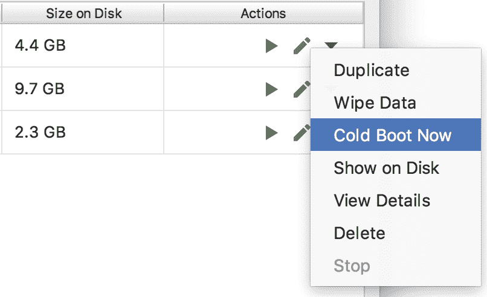

图 5-4

## 5.7 拖放支持

当 Android 应用构建时，会被封装成 APK 文件。当 Android Studio 构建并运行本书前面创建的`AndroidSample`应用时，该应用被编译并封装成 APK 文件。Android Studio 模拟器还支持通过拖放相应的 APK 文件到模拟器来安装应用。要体验此功能，启动模拟器，打开`Settings`并选择`Apps & notifications`选项，随后是`App Info`选项。在已的应用列表中找到并选择`AndroidSample`应用，并在详细屏幕中从模拟器卸载。打开操作系统的文件系统工具（Windows 下为`Explorer`，macOS 下为`Finder`）并导航到包含`AndroidSample`项目的文件夹。找到`app/build/outputs/apk`文件夹，其中包含一个名为`app-debug.apk`的 APK 文件。将此文件拖放到模拟器窗口。如图 5-6 所示的对话框将在 APK 文件安装后出现。

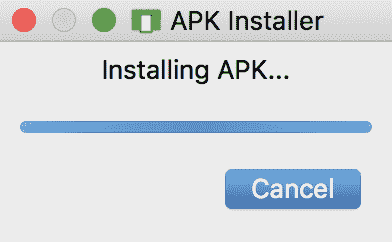

图 5-6

APK 文件安装完成后，在设备上找到该应用并点击启动。除了 APK 文件，任何其他类型的文件（如图像、视频或数据文件）可以使用此拖放功能安装到模拟器。此类文件被添加到模拟器的 SD 卡存储区域，随后可以在代码中访问。

## 5.8 配置指纹

模拟器允许配置多达 10 个模拟指纹，用于在 Android 应用中测试指纹认证。配置模拟指纹从启动模拟器、打开`Settings`应用并选择`Security & Location`选项开始。在安全屏幕内选择`Use fingerprint`选项。在启用指纹之前必须配置备份解锁方法（如 PIN 码）。点击`Fingerprint + PIN`按钮，并在提示时选择启动设备时不需要 PIN。输入合适的 PIN 码并接受默认选项完成 PIN 输入过程。继续后续屏幕，直到`Settings`应用请求指纹。此时显示扩展对话框，在左侧面板选择`Fingerprint`类别，并确保主设置面板中选中了`1`：

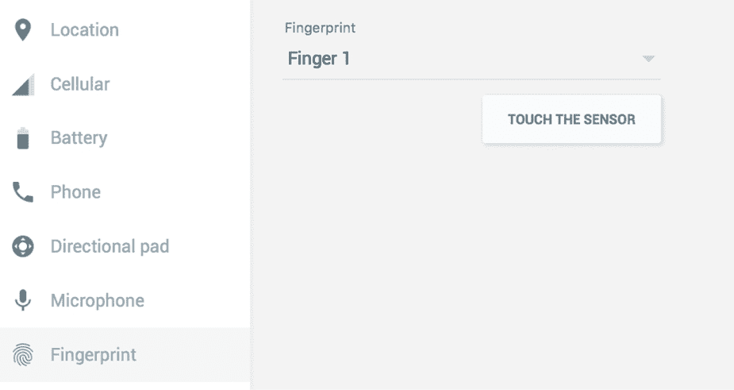

图 5-7

点击`Touch the Sensor`按钮模拟触摸指纹。模拟器将报告指纹添加成功：

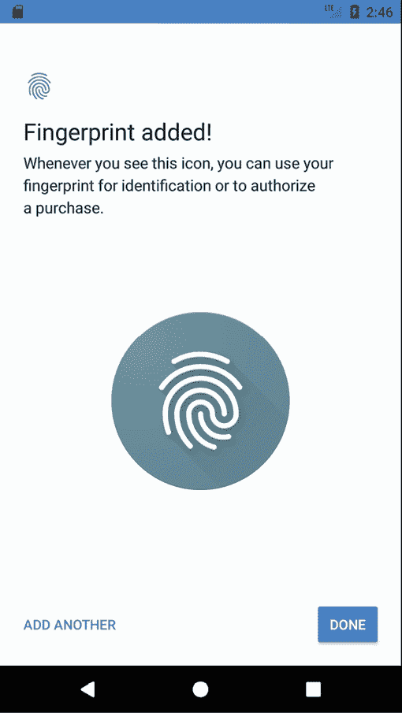

图 5-8

要添加更多指纹，点击`Add Another`按钮并在扩展控制面板菜单中选择另一个手指，再次点击`Touch the Sensor`按钮。在 Android 应用中构建指纹认证的主题将在“Android Biometric Authentication Tutorial](#part0089.xhtml_id_7_ZenzR2QDSlRad3lJQMAA199)”中详细介绍。

## 5.9 总结

Android Studio 3.3 包含了一个经过改进的 Android 虚拟机模拟器环境，旨在无需物理 Android 设备即可更容易测试应用程序。本章对模拟器进行了简要介绍，并强调了用于配置和自定义环境以模拟测试条件的关键功能。

# 6. Android Studio 用户界面介绍

虽然直接运行上一章创建的应用程序非常诱人，但这样做涉及使用 Android Studio 用户界面的方面，这些内容最好先介绍。Android Studio 是一个强大且功能丰富的开发环境，在很大程度上是直观易用的。尽管如此，现在花时间熟悉 Android Studio 界面的布局和组织将大大缩短后续章节的学习曲线。基于此，本章将提供组成 Android Studio 环境的各个区域的概述。

## 6.1 欢迎屏幕

欢迎屏幕（图 6-1）在 Android Studio 运行但没有打开任何项目时显示（可以通过`File -> Close Project`随时关闭打开的项目）。如果之前在项目打开时退出了 Android Studio，工具在下次启动时将通过欢迎屏幕：

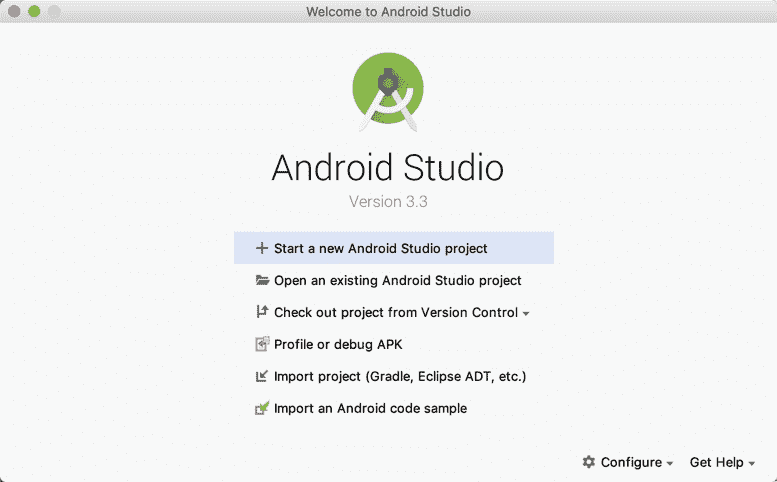

图 6-1

除了最近项目列表，`Quick Start`菜单提供了执行打开、创建和导入项目等任务的选项，以及访问版本控制下的项目。此外，窗口底部的`Configure`菜单提供了对具有大量设置的`SDK Manager`的访问。`Configure`菜单还包含一个检查是否有 Android Studio 更新的选项。

## 6.2 主窗口

当创建新项目或打开现有项目时，Android Studio 主窗口将出现。当同时打开多个项目时，每个项目将分配自己的主窗口。窗口的精确配置取决于上次打开项目时显示了哪些工具和面板，但将类似于图 6-2：

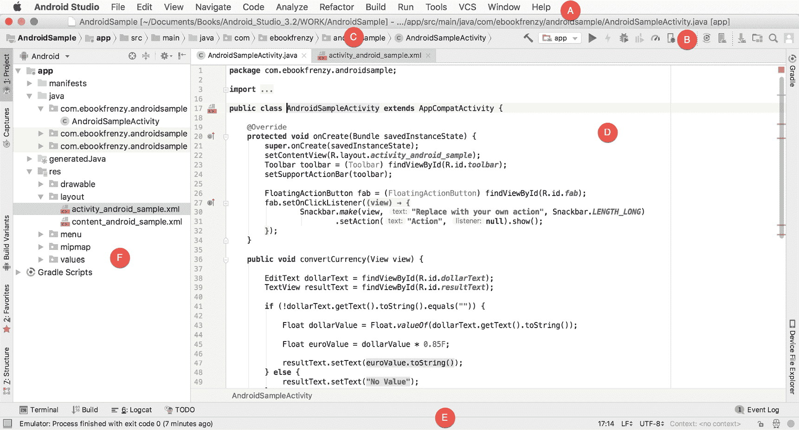

图 6-2

主窗口的各种元素可以总结如下：

A – 菜单栏 – 包含一组用于在 Android Studio 环境中执行任务的菜单。

B – 工具栏 – 选取了一系列频繁执行的操作。工具栏按钮为访问菜单栏操作提供了更快捷的。可以通过右键点击工具栏并选择`Menus and Toolbars...`来自定义工具栏。

C – 导航栏 – 导航栏为移动组成项目的文件和文件夹提供了方便的方法。点击导航栏中的元素将列出该位置的子文件夹和文件。这为项目工具窗口提供了替代方案。

D – 编辑器窗口 – 编辑器窗口显示开发者正在工作的文件内容。在此处显示的内容取决于上下文。例如，编辑代码时，代码编辑器将出现。当处理用户界面文件时，`Layout Editor`工具将出现。当打开多个文件时，每个文件都由编辑器顶部的标签表示，如图 6-3 所示：

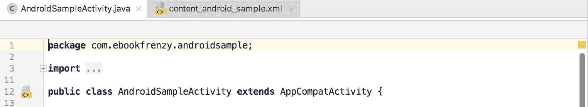

图 6-3

E – 状态栏 – 状态栏显示关于项目和 Android Studio 活动的消息。悬停在状态栏项目上将提供该字段的描述。许多字段是交互式的，允许用户点击执行任务或获取更详细的状态。

F – 项目窗口 – 项目窗口提供了项目结构的层级概述，允许导航到特定文件和文件夹。工具栏可以使用不同的方式显示项目。默认设置为项目视图是 Android Studio 环境中最常用的工具窗口之一。

## 6.3 工具窗口

除了视图视图窗口外，Android Studio 还包含了许多其他窗口，当启用时显示在主窗口的底部和侧边。可以通过悬停在状态栏左上角的图标上来访问快速访问菜单（如图 6-4 所示），以显示工具窗口。

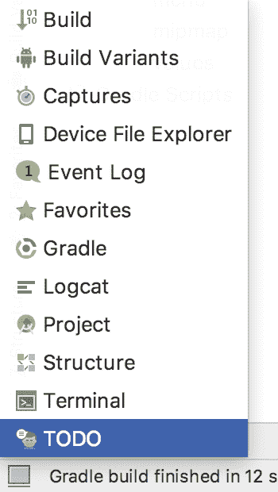

图 6-4

从快速访问菜单中选择项目将导致相应的工具窗口在主窗口中出现。或者，可以通过点击状态栏中的图标来显示一组工具窗口（如图 6-5 所示）：

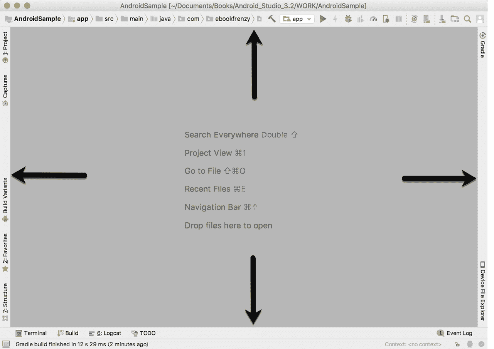

图 6-5

点击按钮将显示相应的工具窗口，而再次点击将将其隐藏。带有前缀的按钮（例如`Project`）可以通过按下键盘上的`Alt`键（macOS 上为`Command`键）来显示。

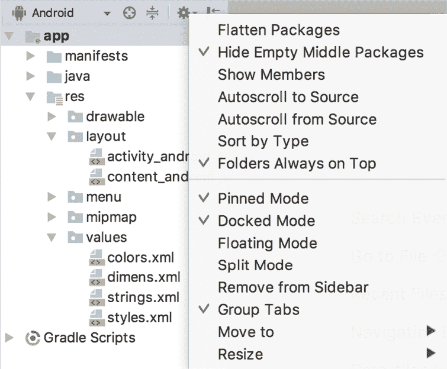

图 6-6

1. 在设备上打开`Settings`应用并选择`About tablet`或`About phone`选项（在较新版本的 Android 中，这可以在`Settings`应用的`System`页面找到）。

2. 在`About`屏幕上，向下滚动到`Build number`字段 (图 7-1 ) 并连续点击七次，直到出现提示已启用开发者模式的消息。如果没有显示构建版本号，请展开列表中的`Advanced`部分。

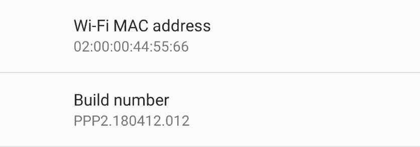

图 7-1

3. 

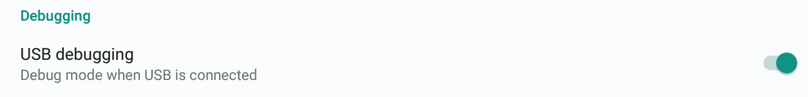

图 7-2

4. 


图 7-3

此时，设备已配置为可以接受来自开发系统上`adb`的调试连接。剩下的工作是配置开发系统，以便在设备连接时能检测到它。虽然这是一个简单的过程，但涉及的步骤取决于开发系统运行的是 Windows、macOS 还是 Linux。请注意，后续步骤假设`Android SDK`的`platform-tools`目录已包含在系统的`PATH`环境中，这在“设置 Android Studio 开发环境”章节中有所描述。

## 7.2.1 macOS ADB 配置

为了在`macOS`系统上配置`ADB`环境，请使用 USB 线将设备连接到计算机系统，打开终端窗口并执行以下命令以重启`adb`服务：

```
adb kill-server
adb start-server
```

*daemon 未在运行。正在端口 5037 上启动它*

*daemon 成功启动*

一旦服务器成功运行，执行以下命令验证设备是否已被检测：

```
adb devices
List of devices attached
74CE000600000001 offline
```

如果设备显示为`offline`（离线），请查看 Android 设备并检查是否出现了图 7-4 所示的对话框，该对话框请求权限“允许 USB 调试”。在点击`OK`之前，勾选“始终允许此计算机”旁边的复选框。再次执行`adb devices`命令现在应该列出设备为可用：

```
List of devices attached
015d41d4454bf80c device
```

如果设备未列出，尝试注销并重新登录`macOS`桌面，如果问题仍然存在，请重启系统。

## 7.2.2 Windows ADB 配置

配置基于 Windows 的开发系统使用`ADB`连接到 Android 设备的第一步是在系统中安装相应的`USB 驱动程序`。需要安装的`USB 驱动程序`取决于 Android 设备的型号。如果你拥有`Google Nexus`设备，则必须在你的`Windows`系统上安装并配置`Google USB Driver`程序包。实现此点的详细步骤列在以下网页上：[`developer.android.com/sdk/win-usb.html`](https://developer.android.com/sdk/win-usb.html)

对于不支持`Google USB 驱动程序`的 Android 设备，有必要下载设备制造商提供的驱动程序。可以在网上获取驱动程序列表以及下载和安装信息：[`developer.android.com/tools/extras/oem-usb.html`](https://developer.android.com/tools/extras/oem-usb.html)

安装驱动程序且设备现已被识别为正确的设备类型后，打开命令提示符窗口并执行以下命令：

```
adb devices
```

此命令应输出关于连接设备的信息，类似于下：

```
List of devices attached
HT4CTJT01906 offline
```

如果设备列出为`offline`或`unauthorized`（未授权），请查看设备屏幕并检查是否出现了图 7-4 所示的对话框，请求权限“允许 USB 调试”。

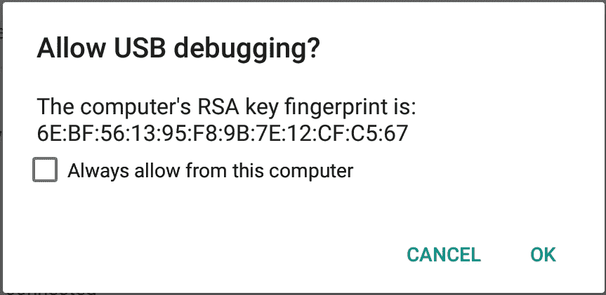

图 7-4

在点击`OK`之前，勾选“始终允许此计算机”旁边的复选框。再次执行`adb devices`命令现在应该列出设备为就绪：

```
List of devices attached
HT4CTJT01906 device
```

如果设备未列出，执行以下命令以重启`ADB`服务：

```
adb kill-server
adb start-server
```

如果设备仍然未列出，尝试执行以下命令：

```
android update adb
```

注意，可能也需要重启系统。

## 7.2.3 Linux adb 配置

在本章中，我们将再次使用`Ubuntu Linux`作为参考示例，介绍如何在`Linux`上配置`adb`以连接物理 Android 设备进行应用测试。

在`Ubuntu Linux`上进行物理设备测试需要安装名为`android-tools-adb`的包，这又要求 Android Studio 用户是`plugdev`组的成员。这是大多数`Ubuntu`版本中用户账户的默认设置，可以通过运行`id`命令进行验证。如果未列出`plugdev`组，运行以下命令将你的账户添加到该组：

```
sudo usermod -aG plugdev $LOGNAME
```

在满足组成员要求后，可以通过执行以下命令安装`android-tools-adb`包：

```
sudo apt-get install android-tools-adb
```

一旦完成上述更改，请重启`Ubuntu`系统。系统重启后，打开终端窗口，启动`adb`服务并检查已连接的设备列表：

```
adb start-server
*daemon 未在运行。正在端口 5037 上启动它*
*daemon 成功启动*
adb devices
List of devices attached
015d41d454bf80c offline
```

如果设备列出为`offline`或`unauthorized`，前往 Android 设备并检查如图 7-4 所示的对话框，请求权限“允许 USB 调试”。

## 7.3 测试 adb 连接

假设在所选平台上已成功配置了`adb`，下一步是尝试在“在 Android Studio 中创建 Android 应用章节中创建的应用在设备上运行。

启动`Android Studio`，打开项目，一旦项目加载，点击位于 Android Studio 中的运行按钮（图 7-5）。


图 7-5

假设项目之前未配置为自动在模拟器环境中运行，部署对话框将出现，并列出连接的 Android 设备，例如图 7-6 列出 Nexus 设备作为目标。

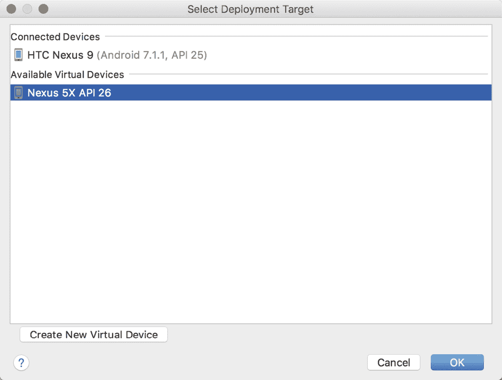

图 7-6

要以此作为默认测试设备，启用“后续使用相同设备”，选中设备后，点击`OK`按钮安装并运行应用。正如模拟器环境，在设备上安装和启动应用的诊断输出将在运行窗口中记录。

虽然模拟器提供了良好的测试环境，但请记住，它并不是确保应用正确运行的真实替代。默认情况下，Android Studio 环境未配置为检测 Android 设备。因此，必须执行某些步骤从 Android Studio 开发环境中将应用加载到设备。在本章中，我们涵盖了适用于`Linux`、macOS 和`Windows`平台的步骤。

## 8 Android Studio 编辑器基础


开发 Android 应用涉及大量的编程工作，定义上涉及输入、查看和修改。使用 Android Studio 的大部分时间通常会在编辑器内编辑代码，这并不意外。现代代码编辑器需要超出基本的输入、删除。代码编辑器的实用性通常通过因素衡量，例如它减少程序员所需的输入量、导航大型源文件的便利性，以及在编写代码时实时检测并突出显示错误的能力。正如本章将所示的，这些只是 Android Studio 编辑器擅长的少数领域。虽然这不是功能的详尽概述，但本章旨在提供关键功能的指南。丰富的程序员会发现，这些功能中的许多代码编辑器是通用的，而许多功能是该特定编辑环境独有的。

## 8.1 Android Studio 编辑器

当选择 `Java`、`Kotlin`、`XML` 或其他文本文件进行编辑时，Android Studio 编辑器出现在主窗口中心。例如图 8-1 显示了一个加载了 Java 源代码的典型会话：

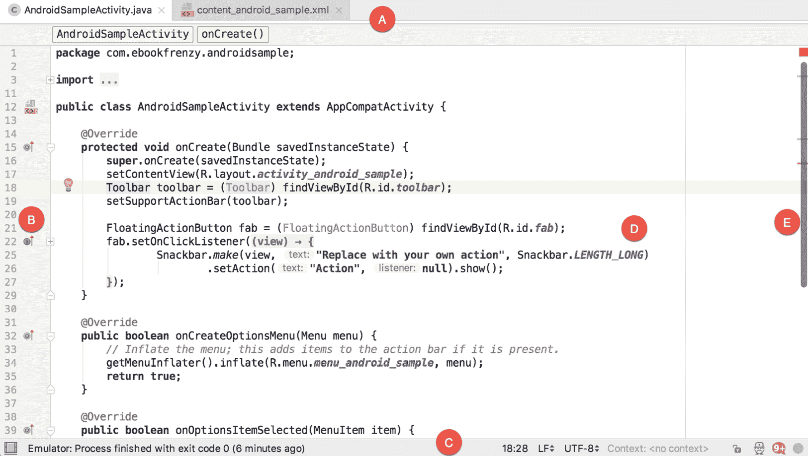图 8-1

构成编辑器窗口的元素总结如下：

**A – 文档标签 (Document Tabs)**：Android Studio 能够同时打开多个文件进行编辑。每当打开一个文件，它会被分配一个文档标签，在编辑器窗口顶部的标签栏中显示文件名。当空间不足以显示所有标签时，标签栏的右角会出现一个小小的下拉菜单。点击此菜单将显示出其他打开的文件列表。标签中文件名下方的波浪红线表示文件中的代码包含一个或多个错误，在项目编译和运行之前需要处理这些错误。在文件之间切换只需点击相应的标签或使用 `Alt-Left` 和 `Alt-Right` 快捷键。文件之间的导航也可以使用 `Switcher` 机制（通过 `Ctrl-Tab` 快捷键访问）。要将编辑器面板从 Android Studio 主窗口分离以便在单独窗口中显示，请点击标签并将其拖到主窗口外的桌面区域。要将编辑器返回主窗口，点击分离编辑器窗口中的文件标签，并将其拖放到主窗口中原始的编辑器标签栏上。

**B – 编辑器行槽区域 (Editor Gutter Area)**：编辑器使用行槽区域来显示信息图标和控件。此行槽区域中某些典型项目包括调试断点标记、折叠和展开代码块的控件、书签、更改标记和行号。行号默认开启，但可以通过在行槽中点击右键并选择“显示行号”菜单选项来禁用。

**C – 状态栏 (Status Bar)**：尽管状态栏实际上是主窗口的一部分，而不是编辑器，但它确实包含关于当前活动编辑会话的信息。这些信息包括光标在行和字符上的当前位置，以及文件的编码格式（`UTF-8` 等）。点击状态栏中的这些值可以更改相应的设置。例如，点击行号会显示“转到行”对话框。

**D – 编辑器区域 (Editor Area)**：这是显示用户输入和编辑的代码的主区域。本章的后续章节将详细介绍编辑区域的关键功能。

**E – 验证与标记侧边栏 (Validation and Marker Sidebar)**：Android Studio 集成了名为“即时代码分析”的功能。这本质意味着当你输入代码时，编辑器正在分析代码以检查警告和错误。侧边栏顶部的指示将从绿色标记（无警告或错误）变为黄色方形（检测到警告）或红色警报图标（检测到错误）。点击此指示将显示编辑器中发现的问题悬浮层（lens）。值得注意的是，悬浮层不仅限于侧边栏中的警告和错误。悬停在侧边栏的任何部分都将显示源文件中该处的代码。

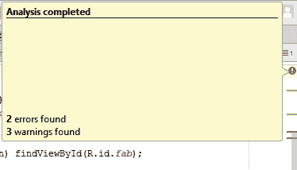图 8-2

### 8.2 分分编辑器窗口 (Splitting the Editor Window)

默认情况下，编辑器将显示当前选中文件的内容。在同时处理源文件时一个特别实用的功能是将编辑器拆分为多个面板。要拆分编辑器，右键点击编辑器窗口内的文件标签，选择“垂直拆分”或“水平拆分”菜单选项图 8-5。

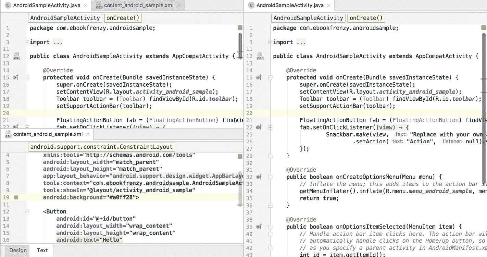图 8-5

拆分面板的方向可以随时通过右键点击标签并选择“更改方向”来更改。重复这些步骤可以取消单个面板，此时从菜单中选择“取消拆分”。通过右键点击任何标签并选择“取消所有拆分”可以移除所有拆分面板。窗口拆分用于显示不同的文件或为同一个文件提供多个窗口，允许并发查看和编辑同一文件的不同区域。

## 8.3 代码补全

Android Studio 编辑器对编程语法以及构成 SDK 的类和方法有大量的内置知识，以及对你自己代码库的了解。随着代码的输入，编辑器会扫描输入内容并在适当情况下就完成语句或引用可能需要的建议。当编辑器检测到补全建议时，将出现一个包含建议列表的面板图 8-6，例如，编辑器正在为 `String` 声明的开头提供可能性：

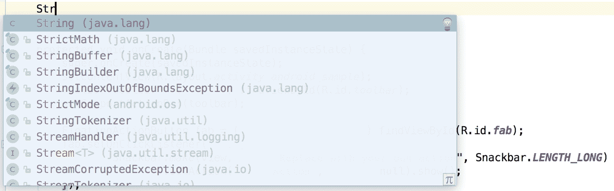图 8-6

如果没有任何自动补全建议是正确的，只需继续输入，编辑器将在适当的情况下完善建议。要采纳顶部的建议，只需按下键盘上的 `Enter` 或 `Tab` 键。要选择不同的建议，使用方向键在列表中上下移动，再次使用 `Enter` 或 `Tab` 键选择高亮项。

可以使用 `Ctrl-Space` 快捷键手动调用补全建议。这在更改编辑器中的单词或声明时非常有用。当光标停留在编辑器中的一个单词上时，该单词会自动高亮。按下 `Ctrl-Space` 将显示备选建议列表。要将当前单词替换为高亮项，只需按下 `Tab` 键。

除了实时补全功能外，Android Studio 编辑器还提供了一个名为“智能补全”（Smart Completion）的系统。智能补全通过 `Shift-Ctrl-Space` 快捷键调用，选中后将根据代码当前的上下文提供更详细的建议。再次按下 `Shift-Ctrl-Space` 快捷键序列将从更广泛的可能性提供更多建议。对于许多程序员来说，代码补全可能是个人喜好。为了承认这一事实，Android Studio 对自动补全设置提供了高水平的控制。可以通过选择 `File -> Settings…` 菜单（`macOS` 上为 `Android Studio -> Preferences…`）并从设置面板中选择 `Editor -> General -> Code Completion` 来查看和修改，如图 8-7 所示。

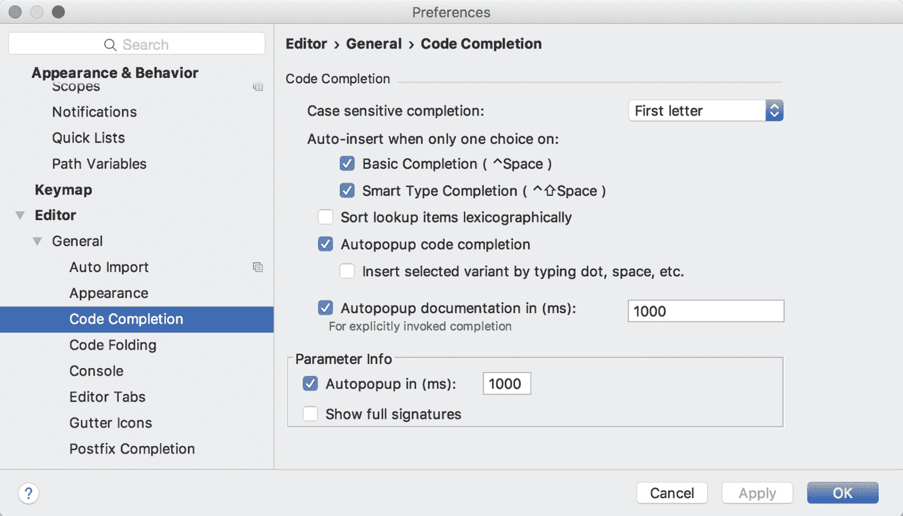图 8-7

## 8.4 语句补全 (Statement Completion)

Android Studio 编辑器提供的另一种自动补全形式是语句补全。它可以自动填充方法和循环语句等项的括号。语句补全通过 `Shift-Ctrl-Enter`（`macOS` 上为 `Shift-Cmd-Enter`）快捷键调用。考虑以下代码：

```java
myMethod()
```

在编辑器输入此代码后，触发语句补全会导致编辑器自动添加大括号：

```java
myMethod() {}
```

## 8.5 参数信息 (Parameter Information)

还可以请求编辑器提供方法接受的参数信息。当光标位于方法调用的括号之间时，`Ctrl-P`（`macOS` 上为 `Cmd-P`）快捷键将显示该方法已接受的参数，可能的建议将被高亮：

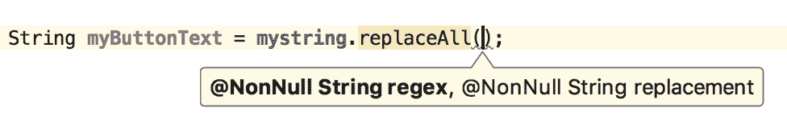图 8-8

## 8.6 参数提示 (Parameter Name Hints)

代码编辑器可以配置为在方法调用中显示参数提示。例如图 8-9 高亮了 `Snackbar` 类 `make()` 和 `setAction()` 方法调用中的参数提示：

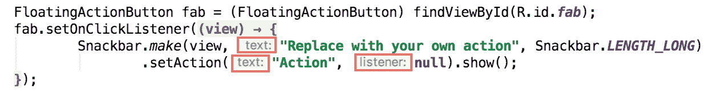图 8-9

模式的设置可以通过选择 `File -> Settings`（`macOS` 上为 `Android Studio -> Preferences`）后的左侧面板中的 `Appearance` 来配置。在 `Appearance` 屏幕上启用或禁用“显示参数提示”选项。要调整提示设置，点击 `Configure...` 按钮，选择编程语言并进行任何调整。

## 8.7 代码生成 (Code Generation)

除了在输入时补全代码外，编辑器在某些条件下还可以为你生成代码。如图 8-10 所示的可用代码生成列表可以在光标位于文件中生成代码的位置时使用 `Alt-Insert`（`macOS` 上为 `Cmd-N`）快捷键访问。

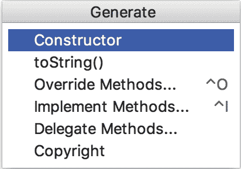图 8-10

例如，考虑项目中的 `Activity` 将被操作系统销毁的情况。正如后续章节概述的，这可以通过覆盖 `Activity` 基类的 `onStop()` 生命周期方法来实现。要让 Android Studio 为此生成存根方法，只需从代码生成中选择 `Override Methods…` 并从结果列表中选择 `onStop()` 方法：

## 8.8 代码折叠 (Code Folding)

一旦源代码文件达到一定大小，即使是格式对齐、组织良好的代码也会变得难以处理和难以导航。Android Studio 认为没有必要显示每个代码块的内容。通过使用代码折叠功能可以让代码导航变得更容易。代码折叠通过源文件中每个代码块开头和结尾的编辑器行槽标记来控制图 8-12。

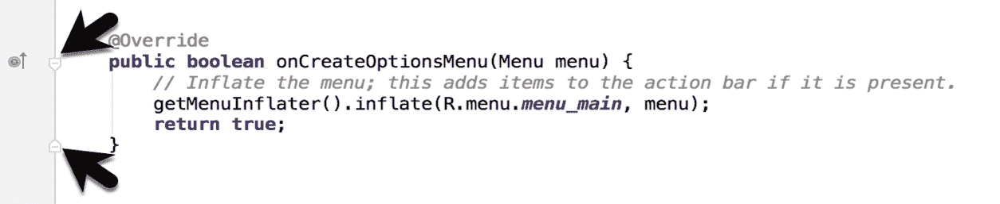图 8-12

点击这些标记中的任何一个都会折叠语句，只有签名行可见，如图 8-13 所示。要展开折叠的代码段，只需点击编辑器行槽中的 `+` 标记。要在不展开的情况下查看隐藏代码，将光标指针悬停在 `{...}` 指示上，如图 8-14 所示。

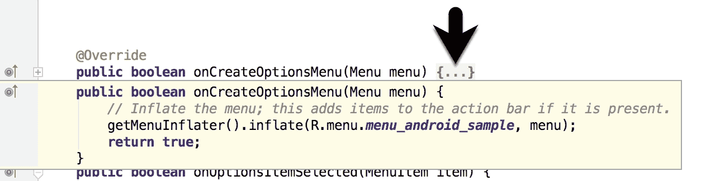图 8-14

文件中的所有代码块都可以使用 `Ctrl-Shift-Plus` 和 `Ctrl-Shift-Minus` 序列折叠或展开。默认情况下，Android Studio 编辑器在打开源文件时会自动折叠某些代码。要配置发生这种情况的情况，选择 `File -> Settings`（`macOS` 上为 `Android Studio -> Preferences…`）并选择设置面板中的 `Editor -> General -> Code Folding`，如图 8-15。

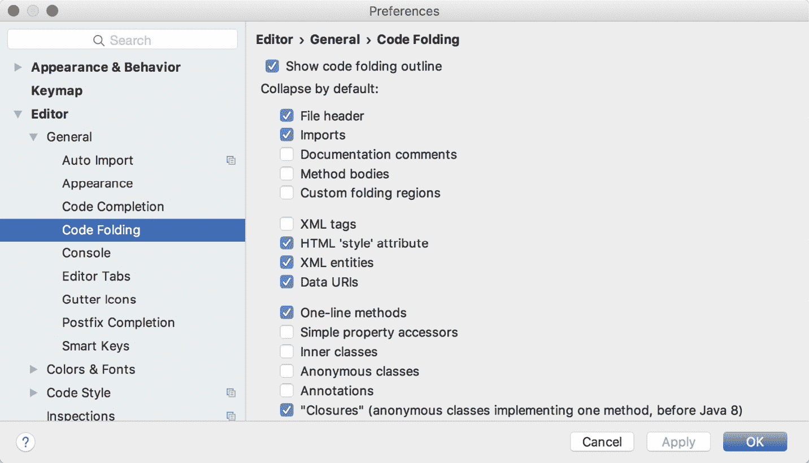图 8-15

## 8.9 快速文档查询 (Quick Documentation Lookup)

通过将光标置于需要文档的声明上并按下 `Ctrl-Q` 快捷键（`macOS` 上为 `Ctrl-J`），可以访问上下文敏感的 Java 和 Android 文档。这将显示一个包含项目相关文档的悬浮层，例如图 8-16 显示 `Snackbar` 类的文档。

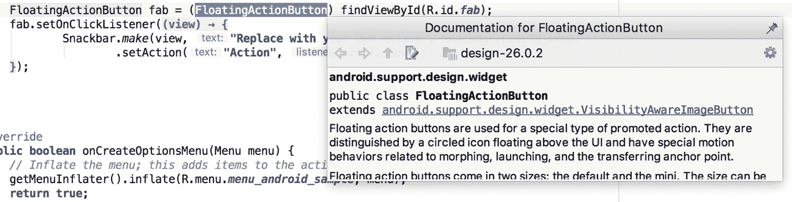图 8-16

在涵盖了 Android 运行时基于 Java 的库之后，现在是将我们转向 Android 软件栈这一层包含的基于 C/C++ 的库。

## 9.4.1 C/C++ 库

上一节概述 Android 运行时核心库是基于 Java 的，并为编写 Android 程序的开发者提供了主要的 API。然而，重要的是，这些核心库并没有执行许多实际工作，事实上它们本质上是一组基于 C/C++ 库的 Java “包装器”（wrappers）。例如，在调用 `android.opengl` 库在设备显示器上绘制 3D 图形时，该库最终实际上会调用 `OpenGL ES` C++ 库，而该库又与底层的 Linux 内核协作执行绘图任务。

C/C++ 库的包含是为了实现广泛且化的功能，包括 2D 和 3D 图形绘制、安全套接层 (SSL) 通信、SQLite 数据库管理、音频和视频播放、位图和矢量字体渲染、显示子系统和图形层管理，以及标准 C 系统库 (`libc`) 的实现。

在实践中，典型的 Android 开发者将仅通过基于 Java 的 Android 核心库 API 访问这些库。如果需要直接访问这些库，可以使用 Android 原生开发包 (NDK) 实现，其目的是通过 Java Native Interface (JNI) 从 Java 代码中调用非 Java 或 Kotlin 编程语言（如 C 和 C++）的原生方法。

## 9.5 应用程序框架

应用程序框架是一组服务，共同构成了 Android 应用程序运行和管理的环境。该框架实现了这样一个概念：Android 应用程序是由可重用、可交换和可替换的组件构建的。这一概念更进一步，应用程序还可以发布其功能以及任何相关数据，以便其他应用程序发现并重用它们。

Android 框架包含以下关键服务：

## 9.6 应用

位于 Android 软件栈顶端的是应用程序。这些程序由特定 Android 实现提供的原生应用程序（例如网络浏览器和电子邮件应用程序）以及用户在购买设备后安装的第三方应用程序组成。

## 9.7 总结

良好的 Android 开发知识基础需要对 Android 的整体架构有理解。Android 以软件栈架构的形式实现，由 `Linux kernel`、一个运行时环境及相应的库、一个应用框架和一组应用程序组成。应用程序主要使用 Java 或 Kotlin 编写，并在 Android Studio 构建环境中被编译为字节码格式。当应用程序随后安装到设备上时，这些字节码将由 Android 运行时（`ART`）编译为 CPU 使用的原生格式。Android 架构的核心目标是性能和效率，这既体现在应用程序的执行上，也体现在应用程序设计中的复用实现中。

# 10. Android 应用程序剖析

无论你之前的编程经验如何（无论是基于 Windows、macOS、Linux 甚至 iOS），Android 开发都很有可能和你之前遇到过的任何东西都完全不同。

因此，本章的目标是提供对 Android 应用程序架构高层概念的理解。通过这种方式，我们将详细探讨用于构建应用程序的各种组件，以及允许这些组件协作以创建一个连贯应用程序的机制。

## 10.1 Android Activities（活动）

熟悉 Java、Kotlin、C++ 或 C# 等面向对象编程语言的人会对将应用程序功能元素封装在类中的概念熟悉，然后将其实例化为对象并进行操作以创建应用程序。由于 Android 应用程序是用 Java 和 Kotlin 编写的，事实如此。然而，Android 还将可复用组件的概念推到了更高的水平。

Android 应用程序是通过组合一个或多个称为 `Activities` 的组件创建的。Activity 是一个单一、独立的应用程序功能模块，通常直接对应于单个用户界面屏幕及其相应的功能。例如，一个预约应用程序可能会有一个 Activity 屏幕，用于显示当天设置的预约。该应用程序还可能使用第二个 Activity，该 Activity 由一个允许用户输入新预约的屏幕组成。

Activity 旨在设计为完全可复用且可交换的构建块，可以在不同的应用程序之间共享。例如，一个现有的电子邮件应用程序可能包含一个专门用于编写和发送电子邮件消息的 Activity。开发者可能正在编写一个同样有发送邮件消息要求的应用程序。开发者无需为该新应用程序专门开发一个邮件编写 Activity，而是可以直接使用现有电子邮件应用程序中的 Activity。

Activity 是作为 `Android Activity` 类的子类创建的，并且必须实现为完全独立于应用程序中的其他 Activity。换句话说，共享的 Activity 不能依赖于在程序流的已知点处被调用（因为其他应用程序可能会以意想不到的方式使用该 Activity），而且一个 Activity 不能直接调用另一个 Activity 的方法或访问其实例数据。相反，这是通过 `Intents`（意图）和 `Content Providers`（内容提供者）实现的。

默认情况下，Activity 无法向调用它的 Activity 返回结果。如果需要此功能，则必须将其作为源 Activity 的子 Activity 特别启动。

## 10.2 Android Fragments（片段）

如上所述，Activity 通常代表应用中的单个用户界面屏幕。一种方案是使用单一的用户界面布局和一个相应的 Activity 类文件来构建 Activity。然而，更好的替代方案是将 Activity 拆分为不同的部分。这些部分中的每一个部分都被称为一个 `fragment`，每个片段都由用户界面布局的一部分和一个匹配的类文件（声明为 `Android Fragment` 类的子类）组成。在这种情况下，Activity 变成一个容器，在其中嵌入一个或多个片段。

事实上，片段为每个用户界面屏幕都由单独 Activity 表示提供了一种高效的替代。相反，一个应用可以由单个 Activity 组成，并在不同的片段之间切换，每个片段代表不同的应用屏幕。

## 10.3 Android Intents（意图）

`Intents` 是一个 Activity 启动另一个 Activity 并实现组成应用程序的 Activity 流程的机制。Intent 由要执行的操作描述以及（可选的）在该操作上执行的数据组成。

Intent 可以是 `explicit`（显式的），即它们通过类名引用 Activity 来请求启动特定的 Activity；也可以是 `implicit`（隐式的），即通过说明要执行的操作类型或提供要对之执行操作的特定类型的数据。在隐式意图的情况下，Android 运行时将使用称为 `Intent Resolution`（意图解析）的过程，选择与 `Intent` 指定标准最匹配的 Activity 进行启动。

## 10.4 Broadcast Intents（广播意图）

另一种类型的 Intent 是 `Broadcast Intent`（广播意图），它是一种系统级的意图，发送给所有注册了“感兴趣”`Broadcast Receiver`（广播接收器）的应用程序。例如，Android 系统通常会发送广播意图来指示设备状态的变化，例如系统启动完成、外部电源连接到设备或屏幕开启或关闭。

`Broadcast Intent` 可以是 `normal`（正常的/异步的），因为它在大致相同的时间发送给所有感兴趣的 `Broadcast Receivers`；也可以是 `ordered`（有序的），因为它一次发送给一个接收器，由进行处理，然后要么终止要么允许传递给下一个 `Broadcast Receiver`。

## 10.5 Broadcast Receivers（广播接收器）


`Broadcast Receivers`是应用程序响应广播意图的机制。`Broadcast Receiver`必须由应用程序注册，并配置`Intent Filter`（意图过滤器）以指示它感兴趣的广播类型。当广播匹配的意图时，接收器将由 Android 运行时调用，无论注册该接收器的应用程序是否正在运行，接收器都有时间来完成其所需的任何任务（例如启动`Service`、更新数据或向用户发布通知）。`Broadcast Receivers`在后台运行且没有用户界面。

## 10.6 Android Services（Android 服务）

`Android Services`是在后台运行且没有用户界面的进程。它们可以从 activities、`Broadcast Receivers`或其他`Services`启动并进行管理。Android Services 适用于应用程序需要继续执行任务但并不一定需要用户界面可见的情况。尽管 Services 缺乏用户界面，但它们可以使用通知和 toasts（显示在屏幕上的小通知消息）通知用户事件，并能够发布`Intents`。

Services 被运行时赋予了比其他进程更高的优先级，只有在最后手段的情况下才会被系统终止。在运行时需要杀死`Service`的情况下，一旦资源可用，它将自动重启。`Service`可以通过声明自己在前台运行来减少被终止的风险，这是通过调用`startForeground()`实现的。使用`Service`的示例包括应用程序不再活跃时仍继续流的音频，或者价格波动时需要通知用户的应用程序。

## 10.7 Content Providers（内容提供者）

`Content Providers`实现了应用程序之间共享数据的机制。任何应用程序都可以通过`Content Provider`的实现向其他应用程序提供对底层数据的访问（包括添加、删除和查询数据），通过通用资源标识符（`URI`）提供。原生 Android 应用程序包含了访问联系人和多媒体文件的标准`Content Providers`，Android 系统上可用的`Content Providers`可以使用`Content Resolver`。

## 10.8 Application Manifest（应用清单）

组成应用程序的各种元素的胶水是`Application Manifest`文件。在这个基于 XML 的文件中，概述了构成完整应用程序的活动、服务、广播接收器数据提供和权限。

## 10.9 Application Resources（应用资源）

除了包含字节码的清单文件和`Dex`文件外，Android 包还将包含一组资源文件。这些文件包含用户界面布局中的资源，如字符串、字体和颜色。默认情况下，这些文件存储在项目的`/res`子目录下。

## 10.10 Application Context（应用上下文）

当编译应用程序时，会创建一个名为`R`的类，其中包含对应用资源的引用。应用清单文件和这些资源结合形成了所谓的 Application Context。此上下文由`Context`类表示，可以在应用程序代码中使用以便在运行时访问应用资源。此外，可以在应用程序上下文上调用广泛的方法，以收集信息并在运行时更改应用程序的环境。

## 11. 总结

可以将许多不同的元素组合在一起以创建一个 Android 应用程序。在本章中，我们提供了`Activities`、`Fragments`、`Services`、`Intents`和`Broadcast Receivers`的高层概述，以及清单文件和应用资源的概述。通过创建以活动和意图形式呈现的、独立的功能模块，促进了最大的复用和互操作性，而应用程序之间的数据共享通过`content providers`的实现来实现。虽然活动专注于用户与应用程序交互的区域（活动本质等同于单个用户界面屏幕，通常由一个或多个片段组成），但后台处理通常由`Services`和`Broadcast Receivers`处理。构成应用程序的组件在清单文件中概述，结合应用程序资源代表了应用程序的上下文。本章涵盖了许多对普通开发者来说可能是新的内容。请放心，在后续章节中将对这些概念进行大量的探索和实际应用，以为构建自己的应用程序建立坚实的知识基础。

# 11. 理解 Android 应用程序和活动的生命周期

在前面的章节中，我们学习了 Android 应用程序运行在进程中，并且由活动、和服务广播接收器形式的多个组件组成。本章的目标是通过查看 Android 运行时系统中应用程序和活动的生命周期来扩展这一知识。

无论对于如今的移动设备与过去的桌面系统相比拥有多少内存和计算能力有如何渲染，请记住，这些设备根据现代桌面和笔记本电脑系统的标准仍然被认为是"资源受限的"，特别是在内存方面。因此，Android 系统的一项关键责任是确保有效管理这些有限资源，并确保操作系统和运行其上的应用程序始终对用户保持响应。为了实现这一点，Android 被赋予了对运行应用程序的进程以及组成这些应用程序的各个组件的生命周期和状态的完全控制。因此，开发 Android 应用程序的重要因素是理解 Android 的应用程序和活动生命周期模型，以及应用程序响应在其执行生命周期内可能施加它的状态变化的方式。

## 11.1 Android 应用程序与资源管理

每个运行的 Android 应用程序都被操作系统视为一个独立的进程。如果系统识别到设备上的资源达到容量，它将采取步骤终止进程以释放内存。

在做出终止进程以释放内存的决定时，系统会考虑所有当前运行进程的优先级和状态，结合这些因素创建 Google 所说的的重要性层次结构。然后，从最低优先级开始逐个终止进程，直到释放出足够系统运行的资源。

## 11.2 Android 进程状态

进程托管应用程序，而应用程序由组件组成。在 Android 系统中，进程的当前状态是由其托管的应用程序中排名最高的活动组件定义的。如图 11-1 所示，在任何时候，一个进程都可以处于以下五种状态之一：

### 11.2.1 前台进程

这些进程被分配了最高优先级。在任何时候，活跃的前台进程可能只有一个或两个，这些通常是系统最后被终止的。一个进程必须满足以下一个或多个标准才能获得前台状态：

* 托管一个用户正在与之交互的 Activity。
* 托管一个与用户正在交互的 Activity 关联的 Service。
* 托管一个通过调用`startForeground()`指明终止会破坏用户体验的 Service。
* 托管正在执行其`onCreate()`、`onResume()`或`onStart()`回调的 Service。
* 托管一个正在执行其`onReceive()`方法的广播接收器（Broadcast Receiver）。

### 11.2.2 可见进程

包含对用户可见但不是用户正在交互的 Activity 的进程被归类为"可见进程"。通常情况下，当进程中的 Activity 对用户可见，但另一个 Activity（例如部分屏幕或对话框）处于前台时。如果一个进程托管的 Service 本身绑定到一个可见或前台的 Activity，那么该进程也具备可见状态。

## 11.2.3 服务进程

包含已启动且正在执行的 Service 的进程。

### 11.2.4 后台进程

包含一个或多个当前对用户不可见的 Activity，且不托管符合服务进程状态的 Service 的进程。当需要为更高优先级的进程释放额外内存时，属于此类的进程面临极高的终止风险。Android 维护着后台进程的动态列表，按时间顺序终止进程，因此最久未处于前台的进程会被首先杀死。

### 11.2.5 空进程

空进程不再包含任何活跃的应用程序，并保留在内存中，准备作为新启动应用程序的宿主。这在某种程度上类似于为了等待乘客到达而保持巴士车门开启并引擎运行。显然，此类进程被认为优先级最低，并且是第一个被杀死以释放资源的进程。

## 11.3 进程间依赖关系

确定最高优先级进程的情况比上一节概述的稍微复杂一些，其简单原因是进程之间往往存在相互依赖关系。因此，在判断一个进程的优先级时，Android 系统还会考虑该进程是否以某种方式为另一个更高优先级的进程提供服务（例如作为前台进程的内容提供者的服务进程）。根据基本规则，Android 文档规定，进程的排名永远不会低于它当前正在服务的另一个进程。

## 11.4 Activity 生命周期

正如我们之前确定的，Android 进程的状态在很大程度上取决于其托管应用程序所包含的 Activity 和组件的状态。因此，理解这些 Activity 在应用程序的执行生命周期内也会经历不同的状态至关重要。Activity 当前的状态部分取决于它在所谓的 Activity 栈（Activity Stack）中的位置。

## 11.5 Activity 栈

对于在 Android 设备上运行的每个应用程序，运行时系统都会维护一个 Activity 栈。当应用程序启动时，应用程序启动的第一个 Activity 会被放入栈中。当启动第二个 Activity 时，它会被放置在栈顶，而上一个 Activity 被向下推。栈顶部的 Activity 被称为活跃（或正在运行的）Activity。当活跃 Activity 退出时，运行时会将其从栈中弹出，栈中紧邻其下方的 Activity 变成当前活跃 Activity。例如，栈顶部的 Activity 可能仅仅因为其负责的任务已完成而简单退出。或者，用户可能选择了屏幕上的"返回"按钮以返回到上一个 Activity，导致运行时系统将当前 Activity 从栈中弹出并将其销毁。Android Activity 栈的可视化表示见图 11-2。

如图所示，新 Activity 在启动时会被推入栈顶。当前活跃的 Activity 位于栈顶，直到它被新 Activity 推下移动，或者在它退出或用户导航到上一个 Activity 时被从栈中弹出。在资源受限的情况下，运行时将杀死 Activity，从栈底部的 Activity 开始。Activity 栈就是编程术语中所说的"后进先出"（LIFO）栈，因为最后一个推入栈的项是第一个被弹出的。

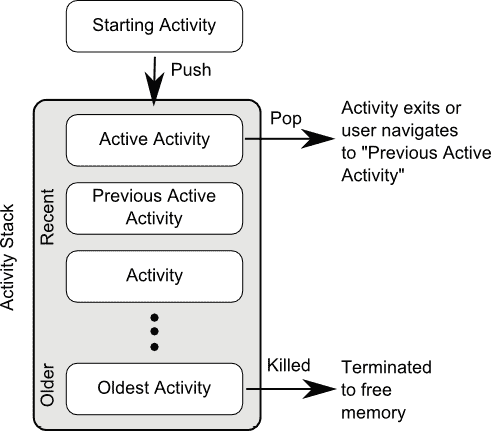

图 11-2

## 11.6 Activity 状态

在应用程序的执行过程中，Activity 可以处于若干不同状态之一：

| · |

| --- |

| · |

| · |

| · |

| · |

# 11.7 配置更改

在本章到目前为止，我们已经了 Android activity 状态改变的两个原因，即 activity 在前台和后台之间的移动，以及运行时系统为了释放内存而终止 activity。事实上，还有第三种场景，在该情况下 activity 的状态可能会发生剧烈变化，这涉及到设备配置的更改。

默认情况下，任何影响 activity 呈现的配置更改（例如在手机屏和横屏模式之间旋转设备方向，或更改系统字体设置）都会导致 activity 被销毁并重建。这背后的逻辑是，此类更改会影响用户界面布局等资源，而简单地销毁并重建受影响的 activity 是 activity 响应配置更改的最快方法。然而，也可以配置 activity 使其不会为了响应特定的配置更改而重启。

# 11.8 处理状态变化

即使没有其他，从本章也应该清楚，一个应用程序（根据定义，其中包含的组件）在整个生命周期内会经历许多状态的转换。特别重要的一点是，这些状态变化（一直包括完全终止在内）是 Android 运行时根据用户操作和设备资源可用性施加给应用程序的。

在实践中，这些状态变化并非完全在无人通知的情况下发生，在大多数情况下，应用程序会收到运行时系统的更改通知，并有机会做出相应的反应。这通常涉及保存或恢复内部数据结构和用户界面状态，从而允许用户在应用程序之间无缝切换，并至少提供多个并发运行应用程序的假象。

Android 两种方法来处理应用内对象生命周期状态的变化。一种方法是响应操作系统的状态变化方法调用，这将在下一名为"处理 Android Activity 状态变化"的章节中详细介绍。另一种新方法，也是 Google 推荐的方法，涉及包含在 Jetpack Android Architecture 组件中的生命周期类，这些类在"使用 Jetpack 构建现代 Android 应用程序架构"中介绍，并在标题为"使用 Android 生命周期周期感知组件"的章节中进行了更详细的解释。

# 11.9 总结

移动设备通常被认为资源受限，特别是在板内存容量方面。因此，Android 操作系统的主要职责之一是确保应用程序以及整个操作系统对用户保持响应能力。

应用程序托管在 Android 的进程中。每个应用程序反过来由 activity 和`Services`形式的组件组成。

Android 运行时系统有权终止进程和单个 activity 以释放内存。运行时系统在决定一个进程是否为终止的合合适候选人时，会考虑进程的状态。进程的状态在很大程度上取决于该进程所托管的 activity 的状态。

本章的核心信息是，应用程序在它的执行生命周期内会经历各种状态，并且对其在 Android 运行时环境中的命运几乎没有控制权。那些不直接与用户交互的进程和 activity 运行被运行时系统终止的风险更高。因此，Android 应用开发的一个基本要素是让应用程序具备响应操作系统状态变化通知的能力。

# 12. 处理 Android Activity 状态变化

根据"理解 Android 应用程序和 Activity 生命周期"章节中概述的信息，现在显而易见，构成应用程序的 activities 和 fragments 在应用程序的生命周期内通过各种不同的状态。从一个状态到另一个状态的转换是由 Android 运行时系统强制的，因此在很大程度上不受 activity 自身的控制。然而，这并不意味着应用无法对这些更改做出反应并采取适当行动。

本章的主要目的是提供 activity 如何被通知状态变化的高级概述，并概述建议保存或恢复状态信息的区域。在涵盖这些信息后，本章将简要触及 activity 寿命的主题。

## 12.1 新旧生命周期技术

直到最近，有一种标准方法可以在应用中构建生命周期感知能力。这是本章涵盖的方法，涉及在 activity 或 fragment 实例中实现一组方法（每个生命周期状态一个方法），当该对象的生命周期状态更改时，操作系统调用这些方法。这种方法自 Android 操作系统早期以来一直没有改变，虽然在今天仍然是一个可行的选项，但它确实有一些局限性，将在本章稍后部分解释。

随着 Jetpack Android Architecture Components 引入生命周期类，现在有了更好的生命周期处理方法。这种现代的生命周期管理（结合 Jetpack 组件和架构指南）将在后面的章节中详细介绍。然而，出于几个原因，理解传统的生命周期方法仍然是重要的。首先，作为一名 Android 开发者，你不会完全隔绝传统的生命周期方法，并且仍然会使用其中一些。更重要的是，理解处理生命周期的旧方法将提供良好的知识基础，以便在书的后部分开始学习新方法。

## 12.2 Activity 和 Fragment 类

除外，应用程序中的 activities 和 fragments 分别创建为`AppCompatActivity`类和`Fragment`类的子类。例如，考虑在"在 Android Studio 中创建 Android App"中创建的简单 AndroidSample。将项目加载到 Android 环境并找到`MainActivity.java`文件（位于`app -> java -> androidsample`）。找到文件后，双击将其加载到编辑器中，内容如下：


```java
package com.ebookzy.androidsample;

import android.os.Bundle;
import android.support.design.widget.FloatingActionButton;
import android.support.design.widget.Snackbar;
import android.support.v7.app.AppCompatActivity;
import android.support.v7.widget.Toolbar;
import android.view.View;
import android.view.Menu;
import android.view.MenuItem;
import android.widget.EditText;
import android.widget.TextView;

public class MainActivity extends AppCompatActivity {

    @Override
    protected void onCreate(Bundle savedInstanceState) {
        super.onCreate(savedInstanceState);
        setContentView(R.layout.activity_sample);
        Toolbar toolbar = findViewById(R.id.toolbar);
        setSupportActionBar(toolbar);
        FloatingActionButton fab = findViewById(R.id.fab);
        fab.setOnClickListener(new View.OnClickListener() {
            @Override
            public void onClick(View view) {
                Snackbar.make(view, "Replace with your action", Snackbar.LENGTH_LONG)
                        .setAction("Action", null).show();
            }
        });
    }

    public void convertCurrency(View view) {
        EditText dollarText = findViewById(R.id.dollarText);
        TextView textView = findViewById(R.id.textView);
        if (!dollarText.getText().toString().equals("")) {
            Float dollarValue = Float.valueOf(dollarText.getText().toString());
            float euroValue = dollarValue * 0.85F;
            textView.setText(euroValue.toString());
        } else {
            textView.setText("No Value");
        }
    }

    @Override
    public boolean onCreateOptionsMenu(Menu menu) {
        // 填充菜单；如果存在，则向操作栏添加菜单项。
        getMenuInflater().inflate(R.menu.menu_main, menu);
        return true;
    }

    @Override
    public boolean onOptionsItemSelected(MenuItem item) {
        // 在此处处理操作栏点击。只要你在 AndroidManifest.xml 中
        // 指定了父 activity，操作栏会自动处理 Home/向上 按钮的点击。
        int id = item.getItemId();
        if (id == R.id.action_settings) {
            return true;
        }
        return super.onOptionsItemSelected(item);
    }
}
```

创建项目时，我们指示 Android Studio 创建名为`MainActivity`的初始 activity。从上述代码可以看出，`MainActivity`类是`AppCompatActivity`类的子类。查看`AppCompatActivity`类的参考文档会发现它本身是`Activity`类的子类。这可以在 Android Studio 编辑器中使用层级工具窗口进行验证。当`MainActivity.java`文件加载到编辑器时，点击类声明中的`AppCompatActivity`并按下`Ctrl-H`快捷键。随后会出现层级工具窗口，显示所选类的层级结构。如图 12-1](#part0014.xhtml_id_7_ZenzR2QDSlRad3lJQMAA21326)所示，`AppCompatActivity`生自`FragmentActivity`类，而`FragmentActivity`最终是`Activity`类的子类：

`(image2541.jpg)`

图 12-1

`Activity`和`Fragment`类包含一系列方法，旨在由运行时在对象状态更改时通知对象。在本章中，我们将这些方法称为生命周期方法。activity 或 fragment 类只需要重写这些方法并在其中实现必要的功能，以便对状态变化做出相应反应。其中一个方法名为`onCreate()`，再次回到上述代码片段，我们可以该方法已经在`MainActivity`类中为我们重写并实现。在后面的章节中，我们将详细探索`onCreate()`以及`Activity`和`Fragment`类其他相关的生命周期方法。

## 12.3 动态状态与持久化状态

生命周期管理的一个目标是确保 activity 的状态在适当的时间保存和恢复。当我们在此背景下谈论状态时，指的是当前存储在 activity 中的数据以及用户界面的呈现。例如，activity 可能在内存中维护一个数据模型，该模型需要保存到数据库、内容提供程序或文件。这种状态信息由于从一次调用持续到另一次，被称为持久化状态。

用户界面的呈现（例如输入到文本框但尚未提交到应用程序内部数据模型的文本）被称为动态状态，因为它通常只在应用程序的单次调用期间保留（也被称为用户界面状态或实例状态）。理解这两个状态之间的差异是重要的，因为保存它们的方式以及这样做的原因都是不同的。

保存持久化状态的目的是避免 activity 在后台被运行时系统杀死而可能导致的数据丢失。另一方面，动态状态的保存和恢复的原因稍微复杂。例如，考虑一个应用程序包含一个 activity（我们将称为 Activity A），它包含一个文本框和一些单选按钮。在使用应用程序期间，用户在文本框中输入了一些文本并在单选按钮上做了选择。然而，在执行保存这些更改的操作之前，用户切换到了其他 activity，导致 Activity A 被推入 Activity 栈并进入后台。一段时间后，运行时系统确定内存低，因此杀杀了 Activity A 以释放资源。对于用户来说，Activity A 只是被放置在后台，并且随时可以移动到前台。在返回 Activity A 到前台时，用户理所当然预期输入的文本和单选选择已被保留。然而，在这种情况下，将创建一个 Activity A 的新实例，如果动态状态没有被保存和恢复，之前的用户输入就会丢失。

因此，保存动态状态的主要目的是提供在前台和后台 activity 之间无缝切换的感知，无论 activity 是否实际上在用户不知的情况下被杀死并重启。保存持久化和动态状态的机制在本章的后续章节中将变得更加清晰。

## 12.4 Android 生命周期方法

如之前解释的，`Activity`和`Fragment`类包含许多方法，这些方法在实例状态更改时作为事件处理程序被调用。Android `Activity`和`Fragment`类支持的主要方法如下：

以下生命周期方法仅适用于`Fragment`类：

- `onAttach()` - 当片段被分配给一个 Activity 时调用。
- `onCreateView()` - 用于创建并返回片段的用户界面布局视图层级结构。
- `onActivityCreated()` - 与片段关联的 Activity 的`onCreate()`方法已完成执行。
- `onViewStatusRestored()` - 片段保存的视图层级结构已恢复。

除了上述列出的生命周期方法外，还有两个方法专门用于保存和恢复 Activity 的动态状态：

在重写上述方法时，请务必记住，除`onRestoreInstanceState()`和`onSaveInstanceState()`之外，方法的实现必须包含对父类中对应方法的调用。例如，以下方法重写了`onRestart()`方法，但也包含了对父类实例方法的调用：

```java
protected void onRestart() {
    super.onRestart();
    Log.i(TAG, "onRestart");
}
```

如果在方法重写中未进行此父类调用，将导致运行时在执行期间抛出异常。虽然在`onRestoreInstanceState()`和`onSaveInstanceState()`方法中对父类的调用是可选的（例如，在实现自定义保存和恢复行为时可以省略），但使用它们有显著益处，这一主题将在保存和恢复 Android Activity 状态章节中介绍。

## 12.5 生命周期

最后一个要涵盖的主题涉及 Activity 或 Fragment 在执行过程中将经历的整个可见及前台生命周期概述：

需要注意的是，一个活动（activity）或片段（fragment）在整个生命周期期间可能会多次通过前台和可见生命周期。生命周期和生命周期方法的概念在图 12-2 中所示：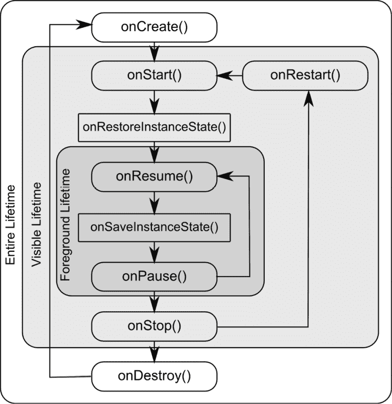图 12-2。

## 12.6 禁用配置更改重启

如前所述，活动可以指示在某些配置更改发生时不进行重启。这通过在项目清单文件（manifest file）的活动元素中添加`android:configChanges`指令来实现。例如，下面的清单文件片段表明，当发生与方向或全设备范围字体大小相关的配置更改时，该活动不应重启：

```xml
<activity android:name=".MainActivity"
    android:configChanges="orientation|fontScale"
    android:label="@string/app_name">
```

## 12.7 生命周期周期方法的局限性

正如本章开头讨论的，生命周期方法已经使用了多年，直到最近，它们仍然处理活动和片段生命周期状态变化的唯一机制。然而，这种方法也存在缺点。

生命周期方法的一个问题是，它们没有为活动或片段提供一种在应用执行期间任何给定点轻松查找当前生命周期状态的方法。相反，对象需要在内部跟踪状态，或者等待下一次生命周期方法的调用。

此外，这些方法没有提供一种简单的方法让一个对象观察应用内其他对象的生命周期状态变化。这是一个严肃的问题，因为应用中的许多其他对象都可能受到特定活动或片段生命周期状态变化的影响。

生命周期方法仅在`Fragment`和`Activity`类的子类中可用。因此，无法构建真正感知生命周期（lifecycle aware）的自定义类。

最后，生命周期方法导致大多数生命周期处理代码被写在活动或片段内部，这可能导致代码复杂且易出错。理想情况下，这些代码应该位于受状态变化影响的其他类中。例如，一个流视频的应用可能会包含一个专门设计用于管理输入流的类。如果应用需要在主活动停止时暂停流，则执行此操作的代码应该位于流类中，而不是主活动。

所有这些问题以及更多问题通过使用生命周期感知组件（lifecycle-aware components）得到了解决，这个主题将从标题为"Modern Android App Architecture with Jetpack"中，我们将实现一个示例应用，将许多此类理论付诸实践。

# 13. 示例 Android Activity 状态更改

之前的章节已经详细讨论了构成 Android 应用程序的活动的不同状态和生命周期。在本章中，我们将通过创建一个示例应用，将处理活动状态变化的理论付诸实践。该示例应用的目的是为了为活动在 Android 运行时通过各种不同状态的过程提供一个真实世界的演示。在下一章"Saving and Restoring the State of an Android Activity"中，在本章构建的示例项目将得到扩展，以演示动态活动状态的保存和恢复。

## 13.1 创建状态更改示例项目

此项练习的第一步是创建新项目。首先启动 Android Studio，如有必要，使用`File -> Close Project`菜单关闭任何当前打开的项目，以便出现欢迎界面。从欢迎界面选择`Start a new Android Studio project`快速启动选项，并在弹出的新项目对话框中，点击`Next`按钮之前选择`Basic Activity`模板。

在`Name`字段中输入`StateChange`并指定`com.ebookfrenzy.statechange`为包名。在点击`Finish`按钮之前，将`Minimum API level`设置为`API 26: Android 8.0 (Oreo)`，并将`Language`菜单改为`Java`。项目创建过程完成后，`StateChange`项目应列在 Android Studio 主窗口左侧的`Project`工具窗口中。

下一步操作是设计活动界面的内容区域。它存储在名为`content_main.xml`的文件中，该文件应该已经加载到`Layout Editor`中。如果没有，在项目窗口中导航到`app -> res -> layout`找到它，双击文件将其加载到 Android Studio Layout Editor

## 13.2 设计用户界面

界面加载到`Layout Editor`后，现在是为示例应用设计用户界面了。界面中的"Hello world!"`TextView`实际上需要一个`EditText`。在`Layout Editor`画布上选择`TextView`对象并按`Delete`键将其移除。从`Layout Editor`左侧的`Palette`中选择`Text`类别，从列表中点击并拖动`Plain Text`组件到设备的屏幕显示上。将组件移动到显示中心，出现指南并将其放置，使其类似于图 13-2` {

        super.onCreate(savedInstanceState);

        setContentView(R.layout.activity_state_change);

        Toolbar toolbar = findViewById(R.id.toolbar);

        setSupportActionBar(toolbar);

        FloatingActionButton fab = findViewById(R.id.fab);

        fab.setOnClickListener(new View.OnClickListener() {

            @Override

            public void onClick(View view) {

                Snackbar.make(view, "Replace with your own action", Snackbar.LENGTH_LONG).setAction("Action", null).show();

            }

        });

    }

    @Override

    public boolean onCreateOptionsMenu(Menu menu) {

        // 填充菜单；如果存在，则向操作栏添加项。

        getMenuInflater().inflate(R.menu.menu_main, menu);

        return true;

    }

    @Override

    public boolean onOptionsItemSelected(MenuItem item) {

        // 在此处处理操作栏项点击。只要你在 AndroidManifest.xml

        // 指定了父活动，操作栏会自动处理主/向上按钮的点击。

        int id = item.getItemId();

        //noinspection SimplifiableIfStatement

        if (id == R.id.action_settings) {

            return true;

        }

        return super.onOptionsItemSelected(item);

    }

}


到目前，活动重写的唯一生命周期方法是`onCreate()`方法，它已实现为在设置活动界面之前调用该方法的`super`类实例。现在我们将修改此方法，使其在每次执行时都在 Android Studio 的 Logcat 面板中输出诊断消息。为了实现，我们将使用`Log`类，这需要导入`android.util.Log`并声明一个标签，以便我们在日志输出中过滤这些消息：

```java
package com.ebookfrenzy.statechange;

import android.os.Bundle;
import android.support.design.widget.FloatingActionButton;
import android.support.design.widget.Snackbar;
import android.support.v7.app.AppCompatActivity;
import android.view.View;
import android.view.Menu;
import android.view.MenuItem;
import android.util.Log;

public class MainActivity extends AppCompatActivity {

    private static final String TAG = "StateChange";

    @Override
    protected void onCreate(Bundle savedInstanceState) {
        super.onCreate(savedInstanceState);
        setContentView(R.layout.activity_state_change);
        Toolbar toolbar = findViewById(R.id.toolbar);
        setSupportActionBar(toolbar);
        FloatingActionButton fab = findViewById(R.id.fab);
        fab.setOnClickListener(new View.OnClickListener() {
            @Override
            public void onClick(View view) {
                Snackbar.make(view, "Replace with your own action", Snackbar.LENGTH_LONG).setAction("Action", null).show();
            }
        });
        Log.i(TAG, "onCreate");
    }
}
```

下一个任务是重写更多方法，每个方法都包含相应的日志调用。这些重写方法可以手动添加，也可以使用“The Android Studio Code”中概述的`Alt-Insert`快捷键生成。注意，如果方法是自动生成的，`Log`调用仍需手动添加：

```java
@Override
protected void onStart() {
    super.onStart();
    Log.i(TAG, "onStart");
}

@Override
protected void onResume() {
    super.onResume();
    Log.i(TAG, "onResume");
}

@Override
protected void onPause() {
    super.onPause();
    Log.i(TAG, "onPause");
}

@Override
protected void onStop() {
    super.onStop();
    Log.i(TAG, "onStop");
}

@Override
protected void onRestart() {
    super.onRestart();
    Log.i(TAG, "onRestart");
}

@Override
protected void onDestroy() {
    super.onDestroy();
    Log.i(TAG, "onDestroy");
}

@Override
protected void onSaveInstanceState(Bundle outState) {
    super.onSaveInstanceState(outState);
    Log.i(TAG, "onSaveInstanceState");
}

@Override
protected void onRestoreInstanceState(Bundle savedInstanceState) {
    super.onRestoreInstanceState(savedInstanceState);
    Log.i(TAG, "onRestoreInstanceState");
}
```

## 13.4 过滤 Logcat 面板

在`MainActivity.java`中重写方法添加的代码的作用是将日志信息输出到 Logcat 工具窗口。此输出可以配置为显示与设备或模拟器相关的所有事件，或限制为与当前选择的应用相关的事件。显示 Logcat 工具窗口并点击过滤器菜单（图 13-3），选择`Run -> Run…`菜单选项或使用键盘快捷键`Shift+F10`。

如果出现`Choose Device`对话框，从中选择物理 Android 设备（假设你尚未将其配置为默认目标）。在 Android Studio 构建应用程序并安装到设备后，它应该启动并在前台运行。查看 Logcat 面板应指示到为止哪些方法已被触发（确保选中了上一节创建的`Lifecycle`过滤器以过滤掉当前感兴趣的日志事件）：

## 13.6 实验活动

诊断工作正常后，现在是时候运行应用程序以理解活动生命周期状态变化了。首先，考虑 Logcat 面板中的初始日志事件序列：
`onCreate`, `onStart`, `onResume`。

显然，初始状态更改与“Understanding Application and Activity Lifecycles”中概述的完全一致。然而注意，没有调用`onRestoreInstanceState()`是因为 Android 运行时检测到没有状态需要恢复。点击设备显示底部的 Home 图标，注意日志报告的方法调用序列：
`onPause`, `onStop`, `onSaveInstanceState`

在这种情况下，运行时注意到活动不再在前台、用户不可见且已停止，但没有为活动保存状态的机会。取决于运行时是销毁了活动还是简单的重启了它，活动将通过调用`onRestart()`通知已重启，或者当用户返回活动时再次通过创建序列。正如“Understanding Application and Activity Lifecycles”中概述的，活动的销毁和重建可以通过对设备进行更改（例如从竖屏旋转到横屏）来触发。要看到此操作，当`StateChange`应用在前台时旋转设备。使用模拟器时，可以使用工具栏上的旋转按钮模拟设备旋转。日志中的方法调用序列应为：
`onPause`, `onStop`, `onSaveInstanceState`, `onDestroy`, `onStart`, `onRestoreInstanceState`。显然，运行时系统在销毁和重启之前给了活动保存状态的机会。

## 13.7 总结

一图胜言在学习新编程范式时同样适用。在本章中，我们创建了一个示例应用程序，目的是演示活动可能通过的不同生命周期状态。我们还查看了从活动内部生成日志机制。在下一章中，我们将扩展`StateChange`项目以演示如何保存和恢复活动的动态状态。

# 14. 恢复 Android Activity 状态

如果前面的几章实现了目标，现在在活动生命期的特定点保存和恢复用户界面的重要性应该更清晰了。

## 14.1 保存状态

保存的状态可以在传递`Bundle`对象的生命周期方法中恢复。这让开发者可以选择`onCreate()`或`onRestoreInstanceState()`。使用哪种方法取决于活动的性质。在活动初始化任务完成后最好恢复状态的情况下，`onRestoreInstanceState()`方法更合适。为了本示例，将在`onRestoreInstanceState()`方法中添加代码，使用`savedState`从`Bundle`中提取保存的状态。然后可以使用对象的`setText()`方法在`editText`组件上显示文本：

```java
@Override
protected void onRestoreInstanceState(Bundle savedInstanceState) {
    super.onRestoreInstanceState(savedInstanceState);
    Log.i(TAG, "onRestoreInstanceState");
    EditText editText = findViewById(R.id.editText);
    CharSequence userText = savedInstanceState.getCharSequence("savedState");
    editText.setText(userText);
}
```

## 14.2 用户界面状态默认保存

在上一章中，`StateChange`应用的诊断输出显示当运行设备旋转时活动会多次状态更改。再次启动`StateChange`应用，这次在设备旋转之前向`EditText`字段输入一些文本（在运行 Android 9 的设备上可能需要点击状态栏中的旋转按钮以完成）。旋转设备后，Logcat 窗口应出现以下状态更改：
`onPause`, `onStop`, `onSaveInstanceState`, `onDestroy`, `onStart`, `onRestoreInstanceState`, `onResume`

显然这导致了活动被销毁和重建。然而，查看运行应用程序的用户界面应该显示输入`EditText`字段的文本被保留了。由于活动被销毁并重建，且我们没有添加任何代码来确保文本保存并恢复，这种行为需要一些解释。事实上，SDK 包含大部分视图组件都实现了活动重启时自动保存和恢复状态的行为。启用此行为的唯一要求是活动的`onSaveInstanceState()`和`onRestoreInstanceState()`重写方法包含对父类对应方法的调用：

```java
@Override
protected void onSaveInstanceState(Bundle outState) {
    super.onSaveInstanceState(outState);
}

@Override
protected void onRestoreInstanceState(Bundle savedInstanceState) {
    super.onRestoreInstanceState(savedInstanceState);
}
```

可以在 XML 布局文件中通过将`android:saveEnabled`属性设置为`false`来禁用用户界面视图的自动保存。为了示例，我们将禁用用户界面布局中`EditText`视图的自动保存机制，然后在应用程序中添加代码手动保存和恢复视图的状态。为了配置`EditText`视图以便在活动重启时不保存和恢复状态，编辑`content_main.xml`文件使视图条目如下（注意可以通过点击`Layout Editor`面板底部的`Text`标签直接编辑 XML）：

```xml
<EditText
    android:id="@+id/editText"
    android:layout_width="wrap_content"
    android:layout_height="wrap_content"
    android:ems="10"
    android:inputType="text"
    android:saveEnabled="false"
    app:layout_constraintBottom_toBottomOf="parent"
    app:layout_constraintEnd_toEndOf="parent"
    app:layout_constraintStart_toStartOf="parent"
    app:layout_constraintTop_toTopOf="parent" />
```

更改后，运行应用程序，输入文本并旋转设备以验证文本不再保存。

## 14.3 Bundle 类

对于需要在界面组件提供的默认功能之外保存状态的情况，`Bundle`类提供了使用键值对机制存储数据的容器。键的形式为字符串值，而这些键的值可以是原始值或任何实现`Parcelable`接口的对象。许多类已经实现了`Parcelable`接口。通过实现`Parcelable`接口定义的方法可以将自定义类变为“parcelable”，详情可以在 Android 文档中找到：[`developer.android.com/reference/os/Parcelable.html`](https://developer.android.com/reference/os/Parcelable.html)。`Bundle`类还包含一组方法，用于获取和设置各种数据类型的键值对，包括原始类型（包括`Boolean`, `char`, `float`）和对象（如`String`和`CharSequence`）。为了本示例并禁用了`EditText`视图的自动保存，我们需要确保输入`EditText`字段的文本保存到`Bundle`对象并恢复。这将通过`Bundle`类的`putCharSequence()`和`getCharSequence()`方法在 Android 应用中实现保存和恢复。

## 14.4 保存状态

扩展`StateChange`应用的第一步是确保从`onSaveInstanceState()`方法中的`EditText`组件提取用户输入的文本，并作为键值对保存到`Bundle`对象中。为了从`EditText`对象提取文本，我们首先需要在界面中标识该对象。这显然涉及到活动的 Java 代码（包含在`MainActivity.java`中）与界面的 XML 表示（包含在`content_main.xml`资源文件中）之间的差距。用户界面中的每个组件都有一个唯一标识符。默认情况下，`Layout Editor`为新添加的组件构造 ID。如果布局中包含相同类型的视图，名称后面跟着一个数字（开发者可以将其改为有意义的内容）。通过检查 Android Studio 主窗口中的`Component Tree`面板可以看到，当`content_main.xml`文件被选中并显示`Layout Editor`时，`EditText`组件被分配了 ID `editText`。

构成应用程序的所有资源都被编译到一个名为`R`的类中。这些资源中定义了我们当前的布局。`R`类中有一个子类，包含了布局资源，在该子类中是我们的`content_main`布局。有了这些知识，我们可以调用活动的`findViewById()`方法获取`editText`对象的引用如下：

```java
EditText editText = findViewById(R.id.editText);
```

获取`EditText`对象的引用并将其赋值给变量后，我们现在可以通过`getText()`方法获取它包含的文本，该方法返回当前文本：

```java
CharSequence userText = editText.getText();
```

最后，我们可以使用`Bundle`对象的`putCharSequence()`方法保存文本，传递键（可以是任何字符串值，在本例中我们将其声明为“savedText”）和`userText`对象作为参数：

```java
outState.putCharSequence("savedText", userText);
```

将这一切整合在一起，我们在`MainActivity.java`文件中得到了修改后的`onSaveInstanceState()`方法，如下（注意`android.widget.EditText`的额外导入指令）：

```java
package com.ebookfrenzy.statechange;

import android.os.Bundle;
import android.support.design.widget.FloatingActionButton;
import android.support.design.widget.Snackbar;
import android.support.v7.app.AppCompatActivity;
import android.support.v7.widget.Toolbar;
import android.view.View;
import android.view.Menu;
import android.view.MenuItem;
```


`import android.util.Log;`

`import android.widget.EditText;`

```java
public class MainActivity extends AppCompatActivity {

    @Override
    protected void onSaveInstanceState(Bundle outState) {

        super.onSaveInstanceState(outState);

        Log.i(TAG, "onSaveInstanceState");

        EditText editText = findViewById(R.id.editText);

        CharSequence userText = editText.getText();

        outState.putCharSequence("savedText", userText);

    }

}
```

现在已经了保存状态的步骤，下一阶段是确保在需要时恢复它。

## 14.5 恢复状态

传递`Bundle`对象的生命周期方法可以恢复保存的状态。这让开发者可以选择`onCreate()`或`onRestoreInstanceState()`。使用哪种方法取决于活动的性质。在活动初始化完成后最好恢复状态的情况下，`onRestoreInstanceState()`方法更合适。为了本示例，我们将在`onRestoreInstanceState()`方法中添加代码，使用`savedState`键从`Bundle`中提取保存的状态。然后可以使用对象的`setText()`方法在`editText`组件上显示文本：

```java
@Override
protected void onRestoreInstanceState(Bundle savedInstanceState) {

    super.onRestoreInstanceState(savedInstanceState);

    Log.i(TAG, "onRestoreInstanceState");

    EditText editText = findViewById(R.id.editText);

    CharSequence userText = savedInstanceState.getCharSequence("savedState");

    editText.setText(userText);

}
```

## 14.6 测试应用程序

剩下的只是再次构建并运行`StateChange`应用。一旦运行并在前台，触摸`EditText`组件并输入一些文本，然后旋转设备到另一个方向。之前文本更改会丢失，但由于我们在本章的活动中添加了代码，新文本保留在`editText`组件中。在验证代码按预期工作后，注释掉两个方法中的`super.onSaveInstanceState()`和`super.onRestoreInstanceState()`调用，重新启动应用并注意文本仍然被保留。

在考虑 Android 应用程序用户界面的布局时，值得记住，正如下一节将概述的那样，这些布局可以相互嵌套，以创建出几乎任何复杂程度的用户界面设计。

## 15.4 视图层级

用户界面中的每个视图（view）都代表显示器上的一个矩形区域。视图负责在该矩形内绘制的内容，并响应屏幕该部分发生的事件（例如触摸事件）。

用户界面屏幕由一个视图层级组成，其中根视图（root view）位于树的顶部，子视图位于下方的分支。容器视图的子视图显示在其父视图之上，并限制在父视图显示区域的边界内。例如，考虑图 15-1 所示的用户界面：

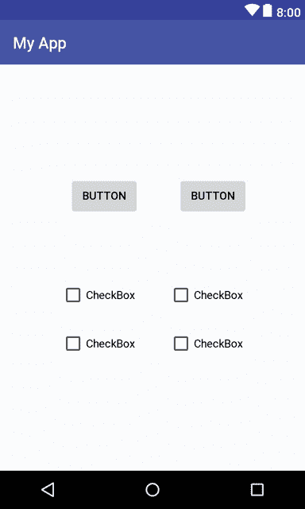

图 15-1

除了可见的按钮和复选框视图外，用户界面实际上还包含了许多布局视图，用于控制可见视图的位置。图 15-2 显示了用户界面的另一种视图，这次强调了布局视图与子视图之间的关系：

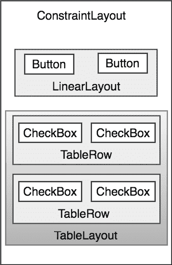

图 15-2

正如之前讨论过的，用户界面是以视图层级的形式构建的，顶部有一个根视图。既然如此，我们也可以通过图 15-3 所示的视图树形式来视觉化上述用户界面示例：

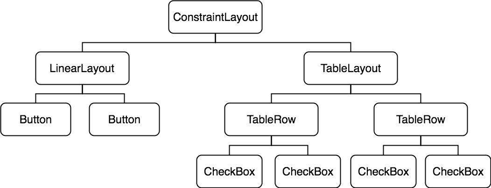

图 15-3

视图层级图可能为图 15-1 中所示的用户界面所构成的各种视图之间的关系提供了最清晰的概览。当用户界面显示给用户时，Android 运行时会遍历视图层级，从根视图开始沿树向下移动，并在过程中渲染每个视图。

## 15.5 创建用户界面

在更清晰地理解视图、布局和视图层级概念后，接下来的几章将重点关注为 Android Activity 创建用户界面涉及的步骤。事实上，有三种不同的用户界面设计方法：使用 Android Studio Layout Editor 工具、手动编写 XML 布局资源文件或编写 Java 代码，每种方法都将被涵盖。

## 15.6 总结

Android 应用程序用户界面屏幕中的每个元素都是视图，它们最终都派生自`android.view.View`类。每个视图代表设备显示器上的一个矩形区域，既负责该矩形内出现的内容，也负责处理视图边界内发生的事件。多个视图可以组合成单个复合视图（composite view）。复合视图中的视图是容器视图的子视图，容器视图通常是`android.view.ViewGroup`的子类（它本身又是`android.view.View`的子类）。用户界面是由视图层级形式构建的视图组成的。

Android SDK 包含了一系列预构建的视图，可用于创建用户界面。这些包括文本字段和按钮等基础组件，以及一组用于控制子视图位置的布局管理器。如果提供的视图无法满足特定需求，可以通过扩展或组合现有视图创建自定义视图，或者通过子类`android.view.View`创建完全全新的视图类。

可以使用 Android Studio Layout Editor 工具、手动编写 XML 布局资源文件或编写 Java 代码来创建用户界面。这些方法中的每一种将在后续章节中介绍。

## 16. Android Studio Layout Editor 工具指南

很难想象出一个不需要某种形式用户界面的 Android 应用程序概念。大多数 Android 设备都配备了触摸屏和键盘（虚拟或物理），点击和滑动是用户与应用程序之间交互的主要形式。这些交互不可避免地通过应用程序的用户界面进行。

良好的设计和实现的用户界面是创建一个成功且受欢迎的 Android 应用程序的重要因素，根据单个应用程序的设计需求，它可能从简单到极其复杂不等。无论复杂程度如何，Android Studio Layout Editor 工具都显著简化了设计和实现 Android 用户界面的任务。

### 16.1 基础与空 Activity 模板

正如标题为“Android 剖剖”的章节概述的那样，Android 应用程序由一个或多个 Activity 组成。Activity 是应用程序功能的独立模块，通常直接对应于单个用户界面屏幕。因此，在使用 Android Studio Layout Editor 时，我们始终是在处理某个 Activity 的布局。

在创建新的 Android Studio 项目时，有许多不同的模板可以作为主 Activity 用户界面的起点。在这些模板中最基础的是基础 Activity（Basic Activity）模板和空 Activity（Empty Activity）模板。尽管它们初看起来看起来相似，但这两个选项之间实际上存在相当差异。

空 Activity 模板创建一个单一布局文件，由一个`ConstraintLayout`布局管理器组成，其中包含一个`TextView`对象，如图 16-1 所示：


图 16-1

另一方面，基础 Activity 模板由两个布局文件组成。顶层布局文件具有`CoordinatorLayout`根视图、可配置的标题栏、预配置了单个菜单项的菜单（如图 16-2 中的 A 所示）、悬浮操作按钮（B），以及对第二个布局文件的引用，Activity 用户界面内容区域的布局在第二个文件中声明：


图 16-2

显然，如果你的 Activity 不需要悬浮操作按钮或菜单，也不需要`CoordinatorLayout`提供的特殊标题栏行为（例如在某些操作期间标题栏和工具栏折叠，该主题将在名为“使用 AppBar 和折叠工具栏布局”的章节中介绍），那么空 Activity 模板就是很有用的。然而，基础 Activity 的用处之处在于它默认提供了这些元素。事实上，使用基础 Activity 模板创建新 Activity 并删除不需要的元素，通常比使用空 Activity 模板并手动实现折叠工具栏、菜单或悬浮操作按钮等功能要快得多。由于书中的并非所有示例都需要基础 Activity 模板的功能，因此本章的大多数示例将使用空 Activity 模板，除非示例需要基础 Activity 模板提供的一个或其他功能。为了备后参考，如果你需要菜单但不需要悬浮操作按钮，请使用基础 Activity 并按照以下步骤删除悬浮操作按钮：

1. 双击 Project 窗口中 app → res → layout 下的主 Activity 布局文件，将其加载到 Layout Editor 中。这将是以`activity_`为前缀的布局文件，而不是以`content_`为前缀的内容文件。

2. 将布局加载到 Layout Editor 工具后，选择悬浮操作按钮并按下键盘上的 Delete 键将该对象从布局中移除。

### 3. 定位并编辑 Activity 的 Java 代码

位于`app` → `java` → `<package name>` → `<activity class name>`下，按照如下 own 从`onCreate`方法中删除悬浮按钮代码：

```java
@Override
protected void onCreate(Bundle savedInstanceState) {

    super.onCreate(savedInstanceState);

    setContentView(R.layout.activity_main);

    Toolbar toolbar = findViewById(R.id.toolbar);

    setSupportActionBar(toolbar);

    FloatingActionButton fab = findViewById(R.id.fab);

    fab.setOnClickListener(new View.OnClickListener() {

        @Override
        public void onClick(View view) {

            Snackbar.make(view, "Replace with your own action", Snackbar.LENGTH_LONG).setAction("Action", null).show();

        }

    });

}
```


如果你需要悬浮按钮但不需要菜单，请使用`Basic Activity`模板并按照以下步骤操作：

1. 编辑 Activity 类文件并删除`onCreateOptionsMenu`和`onOptionsItemSelected`方法。
2. 在`Project`工具窗口中选择`res -> menu`项，然后按键盘上的`Delete`键从项目中删除该文件夹及相应的菜单资源文件。

## 16.2 Android Studio 布局编辑器

Android Studio 布局编辑器在之前的章节中已经介绍过。布局编辑器工具提供了一个“所见即所得”（WYSIWYG）的环境，在该环境中，用户可以从调色板中选择视图，然后将其放置在代表 Android 设备显示器的画布上。一旦视图被放置在画布上，就可以对其进行移动、删除和调整大小（受父视图约束的限制）。此外，可以使用`Attributes`（属性）工具窗口修改与所选视图相关的各种属性。

在表层之下，布局编辑器工具实际上会构建一个 XML 资源文件，该文件包含了正在设计的用户界面定义。因此，布局编辑器工具以两种不同的模式运行，分别称为设计模式（Design mode）和文本模式（Text mode）。

## 16.3 设计模式

在设计模式下，用户可以直接操作视图调色板和布局的图形化表示来视觉化地操作用户界面。图 16-3 展示了设计模式下 Android Studio 布局编辑器工具的关键区域：

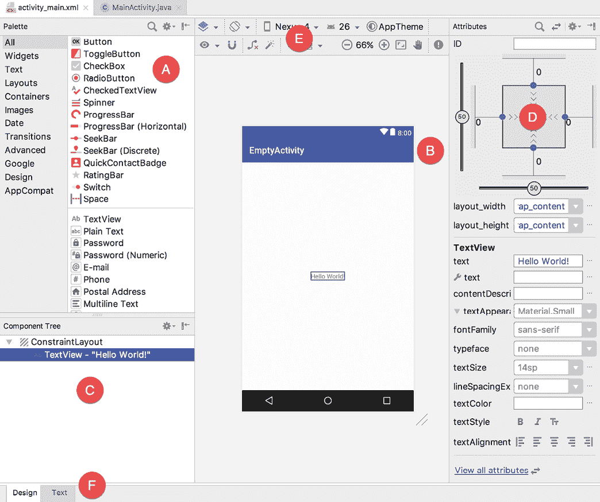
图 16- 3

* **A – 调色板 (Palette)**：调色板提供了对 Android SDK 提供的视图组件的访问。这些组件被分类以便于导航。可以通过从调色板中拖拽视图组件并将其掉到布局上所需的位置向布局添加项。
* **B – 设备屏幕 (Device Screen)**：设备屏幕提供了正在设计中的用户界面布局的视觉化“所见即所得”表示。此布局允许对设计进行直接操作，允许选择、删除、移动和调整视图的大小。布局可以使用位于工具栏的菜单随时更改布局所代表的设备模型。
* **C – 组件树 (Component Tree)**：如上一节所述（“理解 Android 视图、视图组和布局”），用户界面是使用层级结构构建的。组件树提供了用户界面设计层级的视觉化概览。从组件树中选择一个元素将导致布局中相应的视图被选中。同样，从设备屏幕布局中选择一个视图将选中组件树层级中的该视图。
* **D – 属性 (Attributes)**：调色板中列出的所有组件视图都有一组关联属性，用于调整视图的行为和外观。布局编辑器的属性面板提供了对布局中当前选中视图属性的访问，从而进行更改。
* **E – 工具栏 (Toolbar)**：布局编辑器工具栏提供了各种选项的快速访问，包括但不限于缩放设备屏幕布局、更改当前显示的设备模型、在竖屏和横屏之间旋转布局，以及切换到不同的 Android SDK API 级别。工具栏还拥有一组上下文相关的按钮，当在设备屏幕布局中选择相关的视图类型时，这些按钮将会。
* **F – 模式切换标签页 (Mode Switching Tabs)**：位于布局编辑器底部的标签页提供了在布局编辑器工具的文本模式和设计模式之间切换的方法。

## 16.4 调色板

布局编辑器调色板组织为两个面板，旨在方便查找和预览用于添加到布局设计中的视图组件。类别面板（在图 16-4 中标记为 A）列出了 Android SDK 支持的不同视图组件类别。当从列表中选择一个类别时，第二个面板 (B) 会更新以显示该类别下的组件列表：

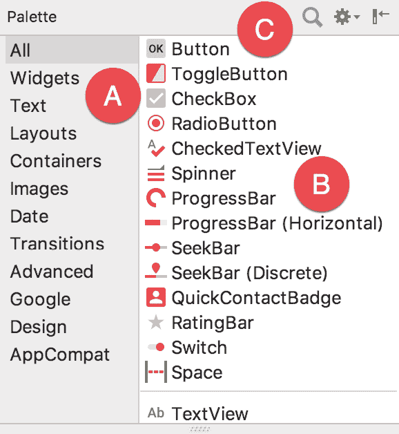
图 16- 4

要从调色板将组件添加到布局画布上，只需从组件列表或预览面板选择该项，将其拖动到画布上所需的位置并放置到位即可。

在当前选定类别中搜索特定组件，可以通过点击调色板工具栏中的搜索按钮（在图 16-4 之上标记为 C）并输入组件名称来启动。随着字符的输入，匹配的结果将实时显示在组件列表面板中。如果您不确定组件位于哪个类别，只需在搜索操作之前或期间选择“All（全部）”类别即可。

## 16.5 设计视图和布局视图

当布局编辑器工具处于设计模式时，布局可以用两种不同的方式查看。上述图 16-3 中显示的视图是设计视图，显示了布局和小部件在运行的应用程序中的外观。另一种模式称为布局视图（Layout view）或蓝图视图（Blueprint view），可以替代设计视图或与设计视图同时显示。图 16-5 中显示的工具栏菜单提供了显示设计、蓝图或两种视图的选项。第四个选项`Force Refresh Layout（强制刷新布局）`会导致布局重新构建和重绘。当布局进入意外状态或未能准确反映当前设计设置时，这非常有用：

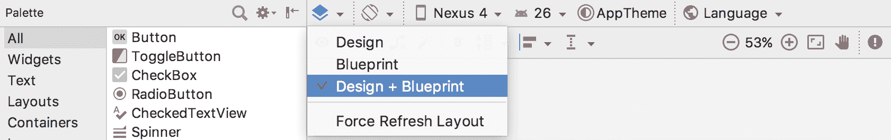
图 16- 5

显示布局视图、设计视图或两者都取决于个人喜好。一种很好的方法是开始时显示两者，如图 16-6 所示：

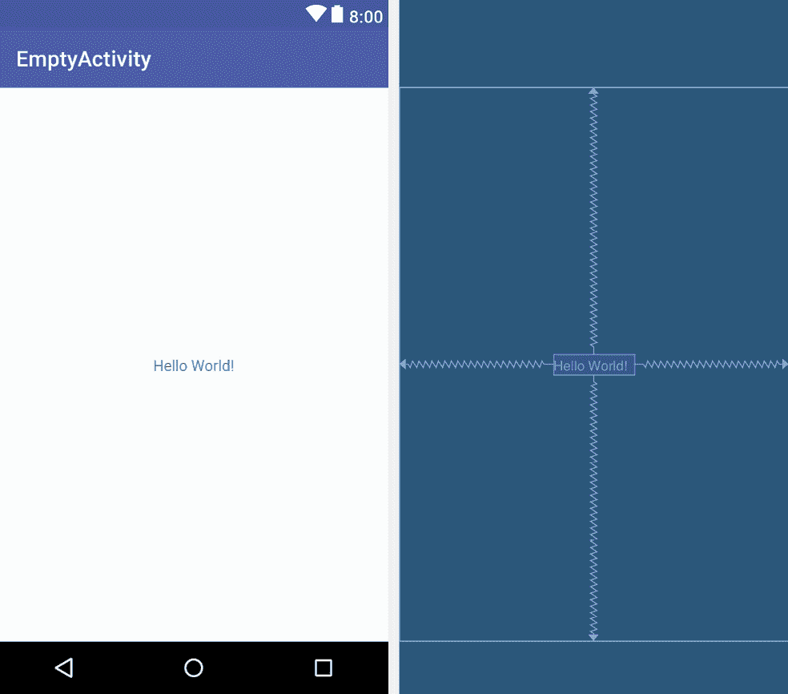
图 16- 6

## 16.6 文本模式

在使用 Android Studio 布局编辑器时，重要的是它实际上是一种用户友好的方法创建 XML 布局。在设计过程的任何时候，点击布局编辑器底部的 Text 标签即可查看并直接编辑底层 XML。返回设计模式，只需点击 Design 标签。图 16-7 展示了文本模式下 Android Studio 布局编辑器的关键区域：

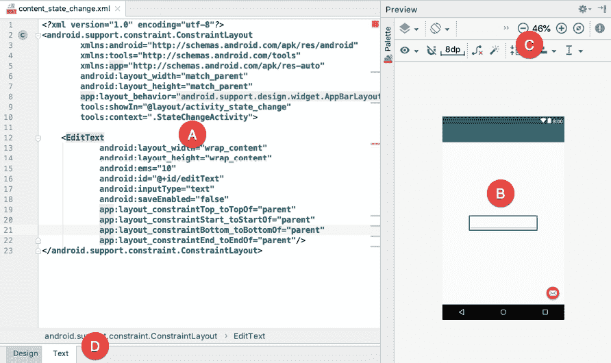
图 16- 7

* **A – 编辑器 (Editor)**：面板显示构成当前用户界面的 XML。这是完整的 Android Studio 编辑器，包含了本书`Android Studio 基础`章节中概述的所有功能。
* **B – 预览 (Preview)**：当对编辑器中的 XML 进行更改时，这些更改会在预览窗口中视觉化反映。这为 XML 的更改提供了即时视觉反馈，从而避免了在文本模式和设计模式之间来回切换。如果是设计模式，预览还允许对布局进行直接操作和设计，视觉更改会在编辑器面板中实时反映。在设计模式下，可以使用图 16-5 所示的工具栏按钮显示。
* **C – 工具栏 (Toolbar)**：文本模式下的工具栏提供了设计模式下可用的相同功能。
* **D – 模式切换标签页 (Mode Switching Tabs)**：位于布局编辑器底部的标签页提供了在布局编辑器的文本模式和设计模式之间切换的方法。

## 16.7 属性

Attributes 面板提供了当前选中组件的所有可用设置。默认情况下，属性面板显示布局中当前选中组件最常更改的属性。图 16-8 例如显示了 TextView 小部件的这部分属性：

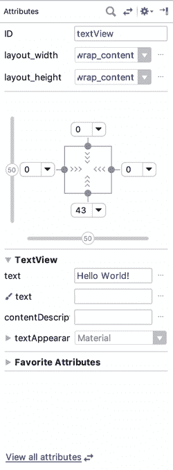
图 16- 8

要访问当前选中小部件的所有属性，点击图 16-9 中高亮的按钮，或使用属性面板底部的 View all attributes（查看所有属性）链接：

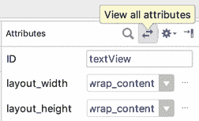
图 16- 9

也可以通过选择属性工具栏中的搜索按钮并输入属性名称来搜索特定属性。在搜索之前或期间选择 View all attributes 按钮或链接，以确保当前选中组件的所有属性都包含在搜索结果中。某些属性包含一个显示三个点的按钮。这表示有一个设置对话框协助选择合适的属性值。要显示对话框，只需点击该按钮。具有有限有效选项的属性将呈现下拉菜单（图 16-10），从中可以选择。

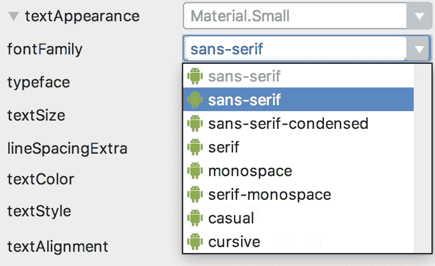
图 16- 10

## 16.8 配置收藏属性

初始子属性列表中的属性可以通过配置收藏属性来扩展。要将属性添加到收藏列表，显示当前选中组件的所有属性，并将鼠标指针悬停在属性工具窗口内属性条的最左侧。属性名称左侧会出现一个星形图标，点击它会将该属性添加到收藏列表。图 16-11 例如显示了 TextView 小部件配置为收藏属性的 autoText、background 和 backgroundTint 属性：

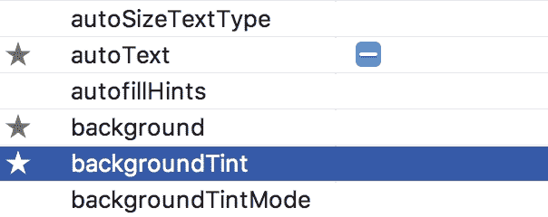
图 16- 11

一旦作为收藏，属性将列在属性列表的收藏属性部分：

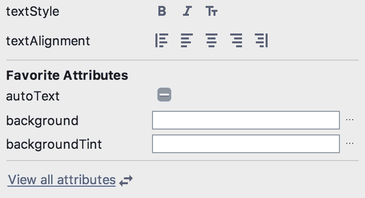
图 16- 12

## 16.9 转换视图

将布局中的视图从一种类型转换为另一种（例如将 TextView 转换为 EditText）可以在 Android Studio 布局编辑器中轻松完成，只需在屏幕布局或组件树窗口内右键点击该视图，并选择 Convert view...（转换视图...）菜单选项（图 16-13）：


# 约束

* 边距 (Margins)
* 对抗约束 (Opposing Constraints)
* 约束偏移 (Constraint Bias)
* 链 (Chains)
* 链样式 (Chain Styles)
* 障碍 (Barriers)

## 17.1.1 约束

本质上是一组规则，规定了组件与其他组件、容器`ConstraintLayout`的边缘以及名为“辅助线”（guidelines）的特殊元素的对齐和距离方式。约束还决定了 Activity 的界面布局如何响应设备方向的变化，或者在不同屏幕尺寸的设备上显示时。为了充分配置，组件必须具有足够的约束连接，以便`ConstraintLayout`布局引擎能够在水平和垂直平面上解析其位置。

## 17.1.2 边距

边距是指定固定距离的约束形式。考虑一个需要放置在设备屏幕右上角的`Button`对象。这可以通过实现从`Button`顶部和右边缘的边距约束，并连接到父`ConstraintLayout`的对应侧边来实现，如图 17-1 所示：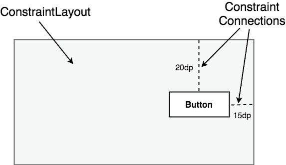图 17- 1。

如上图所示，这些约束连接中的每一个都关联有一个边距值，规定了组件距离父布局两侧的固定距离。在这种配置下，无论屏幕尺寸或设备方向如何，`Button`对象将始终根据两个约束连接指定的，分别距离父`ConstraintLayout`的顶部和右边缘 20 和 15 个设备独立像素（`dp`）。

虽然上述配置在某些情况下是可以接受的，但它在允许`ConstraintLayout`布局引擎通过调整组件位置来响应设备旋转并支持不同尺寸的屏幕方面，没有提供任何灵活性。为了在布局中添加这种响应式能力，有必要实现对抗约束。

## 17.1.3 对抗约束

在单个组件上沿同一轴运行的两个约束被称为对抗约束。换句话说，在左侧和右侧均具有约束的组件被认为具有水平对抗约束。例如，图 17-2 展示了在之前的布局中同时添加了水平和垂直对抗约束：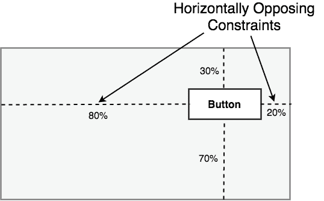图 17- 2。

这里需要理解的关键点是，一旦在特定轴上实现了对抗约束，组件的位置将基于百分比而不是坐标。例如，组件不再固定在距离布局顶部的 20dp 处，而是位于距离布局顶部 30% 的位置。在不同的方向以及在较大或较小的屏幕上运行时，`Button`相对于父布局的尺寸始终处于相同的位置。

现在重要的是要理解，图 17-2 中概述的布局不仅使用了对抗约束，还通过应用约束偏移实现的。

## 17.1.4 约束偏移

现在已经确定，`ConstraintLayout`中的组件可能会受到对抗约束连接的影响。默认情况下，对抗约束是相等的，导致相应的组件在对抗轴上居中。例如，图 17-3 显示了一个组件通过水平和垂直对抗约束在包含它的`ConstraintLayout`中居中：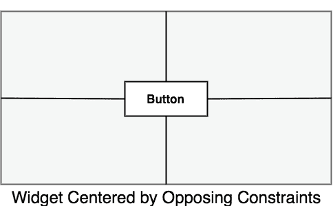图 17- 3。

为了允许在对抗约束的情况下调整组件位置，`ConstraintLayout`实现了一种名为“约束偏移”（constraint bias）的功能。约束偏移允许组件沿对抗轴的定位根据指定的百分比向其中一个约束倾斜。例如，图 17-4 显示了之前的约束布局，具有 75% 的水平偏移和 10% 的垂直偏移：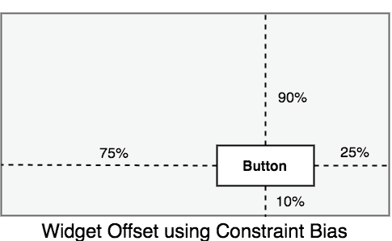图 17- 4。

下一章题为“在 Android Studio 中使用 ConstraintLayout 指南”，将更详细地涵盖这些概念，并解释这些功能是如何集成到 Android Studio 布局编辑器工具中的。然而，在此还需要涵盖`ConstraintLayout`类的几个区域。

## 17.1.5 链

`ConstraintLayout`链提供了一种将两个或多个组件的布局行为定义为一组的方法。链可以在垂直或水平轴上声明，并配置为以定义链中组件的间距和大小。

当组件通过双向约束连接在一起时，它们就成了链。例如，图 17-5 展示了三个这种方式链在一起的组件：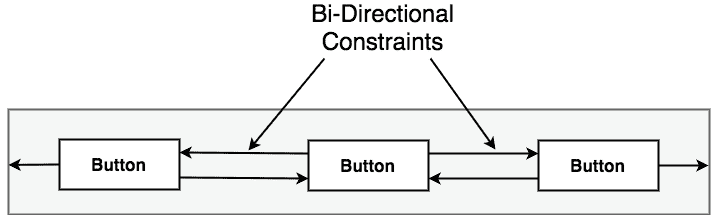图 17- 5。

链中的第一个元素是链头，它在垂直链中对应顶部组件，在水平链中对应最左侧组件。整个链的布局行为主要通过在链头上设置属性来配置。

## 17.1.6 链样式

`ConstraintLayout`链的布局行为由应用于链头的样式决定的。`ConstraintLayout`类支持以下链样式：

* 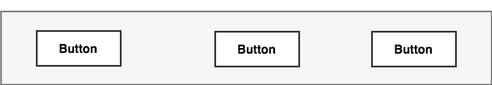图 17-6
* 图 17-7
* 图 17-8
* 图 17-9

## 17.2 基线对齐

到目前为止，本章仅提到了相对于组件侧边的约束（通常称为侧约束）。然而，一种常见的需求是让组件相对于其显示的内容进行对齐。为了满足这一需求，`ConstraintLayout`提供了基线对齐。

举一个例子，假设图 17-1 中的布局需要将`TextView`组件放置在`Button`左侧 40dp 处。在这种情况下，`TextView`需要与`Button`基线对齐。这意味着`Button`中的文本与`TextView`中的文本垂直对齐。该布局的额外约束需要如图 17-10 所示进行连接：图 17-1 0

`TextView`现在垂直对齐`Button`的基线，并在水平方向距离`Button`对象左边缘 40dp。

## 17.3 使用辅助线

辅助线是`ConstraintLayout`中提供的特殊元素，为连接的约束提供了额外目标。可以在`ConstraintLayout`实例中添加多个辅助线，这些辅助线可以配置为水平或垂直。一旦添加，就可以从布局中的组件到辅助线建立约束连接。当多个组件需要沿某一轴对齐时，这特别有用。例如，在图 17-11 中，包含在`ConstraintLayout`中的三个`Button`对象沿垂直辅助线约束：图 17- 1

## 17.4 配置组件尺寸

控制组件尺寸是界面设计过程关键要素。`ConstraintLayout`提供了三种选项，可以设置在单个组件上以管理尺寸行为。这些设置针对高度和宽度维度单独配置的：

* 固定 (Fixed) – 组件固定为指定的尺寸。
* **匹配约束 (Match Constraint)** – 允许布局引擎调整组件的大小以满足现有的约束条件。也称为`AnySize`或`MATCH_CONSTRAINT`选项。
* **包裹内容 (Wrap Content)** – 组件的大小由其包含的内容（即文本或图形）决定。

## 17.5 使用屏障 (Barriers)

与指南（guidelines）类似，屏障（barriers）是用于约束布局内视图的虚拟视图。与指南一样，屏障可以是垂直或水平的，并且一个或多个视图可以被约束对其（为了避免混淆，这些视图被称为受约束视图）。然而，与保持在布局中固定位置的指南不同，屏障的位置是由一组所谓的“参考视图”（reference views）定义的。引入屏障是为了解决某些情况下经常发生的视图重叠问题。

例如，考虑下方的图 17-12 所示的布局：
Figure 17-1 2

上述布局需要注意的关键点是，`View 3`的宽度设置为匹配约束（match constraint），且该视图的左边缘连接到`View 1`的右边缘。按照目前的实现方式，增加`View 1`的宽度将产生减少`View 3`宽度的预期效果：
Figure 17-13

然而，如果增加的是`View 2`而不是`View 1`，就会出现问题：
Figure 17-14

显然，因为`View 3`仅受`View 1`约束，它不会调整大小以适应`View 2`宽度的增加，导致视图重叠。解决这个问题的方法是添加一个垂直屏障并将`Views 1`和`View 2`指定为屏障的参考视图，以便它们控制屏障的位置。`View 3`的左边缘将相对于屏障进行约束，使其成为受约束视图。现在，当`View 1`或`View 2`的宽度增加时，屏障将移动以适应两个视图中最宽的一个，从而导致`View 3`的宽度相对于新的屏障位置发生变化：
Figure 17-15

在使用屏障时，与单个屏障关联的参考视图和受约束视图的数量没有限制。

## 17.6 比例 (Ratios)

可以使用比例设置来定义组件的尺寸。例如，可以使用比例设置来约束组件，使得无论如何调整大小，其宽度始终是高度的两倍。

## 17.7 ConstraintLayout 的优势

ConstraintLayout 提供了一水平的灵活性，使得可以使用单个布局实例实现旧版布局的许多功能，而以前可能需要嵌套多个布局。这样做的好处是允许设计所谓的“扁平”或“浅层”布局层次结构，避免了布局嵌套固有的问题，使布局变得不复杂，并提高了运行时用户界面性能。ConstraintLayout 的实现也是为了适应市场上广泛的 Android 设备尺寸。ConstraintLayout 的灵活性使得设计能够响应并适应运行应用程序的设备的用户界面变得更容易。最后，正如名为`Android 中使用 ConstraintLayout 指南`的章节所示，Android Studio 布局编辑器工具已专门针对基于 ConstraintLayout 的用户界面设计进行了增强。

## 17.8 ConstraintLayout 的可用性

尽管 ConstraintLayout 是随 Android 7 引入的，但它是作为独立的支持库从主 Android SDK 提供的，并兼容低至 API 9 (Gingerbread) 的旧 Android 版本。这使得使用这种新布局的应用程序运行在运行旧版本 Android 的设备上。

## 17.9 总结

ConstraintLayout 是随 Android 7 引入的布局管理器。它的设计旨在便于创建灵活的布局，以适应目前市场上许多 Android 设备的尺寸和方向。ConstraintLayout 使用约束来控制组件相对于父布局、指南、屏障以及布局中其他组件的对齐和定位。ConstraintLayout 是新创建的 Android Studio 项目的默认布局，也是设计用户界面布局时的推荐选择。通过这种简单而又灵活的布局管理方法，可以以惊人的简单性实现复杂且响应式用户界面。

# 18 Android 中使用 ConstraintLayout 指南

正如在前面的章节中多次提到的，Google 对 Android Studio 布局编辑器进行了重大更改，其中许多更改仅是为了支持使用 ConstraintLayout 进行用户界面设计。既然上一章已经概述了 ConstraintLayout 的基本概念，本章将更详细地探讨这些概念，同时概述布局编辑器工具允许设计和实现基于 ConstraintLayout 的用户界面的方法。

## 18.1 设计与布局视图 (Design and Layout Views)

名为`Android Studio 布局编辑器指南`的章节解释了 Android Studio 布局编辑器工具提供了以设计（Design）和布局（Layout，也称为蓝图）形式查看活动用户界面布局的方法。这些布局视图可以单独显示，也可以像图 18-1 那样并排显示：
Figure 18-1

设计视图（位于上图左侧）呈现布局的“所见即所得”（WYSIWYG）表示，布局以其在运行应用中的形式呈现。相反，布局视图显示的是一种蓝图图风格的视图，其中组件由阴影轮廓表示。如图 18-1 所示，布局视图还显示约束连接（在这种情况下是用于在布局中居中的对齐约束）。当布局中的特定视图被选中或鼠标指针悬停在设计区域上时，这些约束也会叠加到设计视图上，如图 18-2 所示：
Figure 18-2

两个视图中约束连接的外观可以使用图 18-3 所示的工具栏进行更改：
Figure 18-3

除了显示用户界面的两种模式外，布局编辑器工具提供了三种建立特定布局约束的方法。

## 18.2 自动连接模式

自动连接（Autoconnect）顾名思义，在项添加到布局时会自动建立约束连接。可以使用图 18-4 所示的工具栏按钮启用或禁用自动连接模式：
Figure 18-4

自动连接模式使用算法根据组件的位置以及组件与父布局两侧和布局中其他元素的距离来决定最佳约束。如果任何自动连接未能提供预期行为，可以在本章稍后的部分进行手动更改。

## 18.3 推断模式 (Inference Mode)

推断模式使用涉及算法和概率的启发式方法，在组件已添加到布局后自动实现约束连接。这种模式通常在自动连接功能关闭且在没有约束连接的情况下向对象布局时使用。这允许通过从调色板将对象拖到布局上并进行尺寸和位置更改来简单地设计布局。本质上是在不考虑约束的情况下“绘制”布局。在设计过程中任何时候可以使用推断模式来填充布局中缺失的约束。当点击图 18-5 按钮时，约束会自动添加到布局：
Figure 18-5

使用自动连接模式时，始终存在布局编辑器工具推断错误约束的可能性，尽管这些可以手动修改和修正。

## 18.4 手动操作约束

实现约束连接的第三种选择是手动操作。在此时，理解布局编辑器中组件周围出现的各种句柄将很有帮助。例如，考虑图 18-6 所示的组件：
Figure 18-6

显然，弹簧状线条（A）代表从组件侧到目标的已约束连接。对象每个角的小正方形标记（B）是缩放句柄，点击并拖拽时用于调整组件尺寸。位于组件每侧的小圆句柄（C）是侧锚点。要创建约束连接，点击句柄并将生成的线拖到要连接约束的元素（例如指南或父布局或另一个视图的侧），如图 18-7 所示：当连接到另一个视图的侧时，只需将线拖到该视图的侧句柄，并在变绿时释放线。
Figure 18-7

另一个标记表示基线约束（baseline constraints）的锚点，其中组件内部的内容（而不是边缘）被用作对齐点。要显示此标记，只需点击显示字母“ab”的按钮（由图 18-6 中的标记 D 引用）。从基线句柄建立约束连接，只需鼠标指针悬停在句柄上直到它开始闪烁，然后点击并拖拽到目标（例如图 18-8 所示的另一个视图的基线锚点）。当目标锚点开始闪绿时，释放鼠标按钮建立连接：
Figure 18-8

隐藏基线锚点，只需再次点击基线按钮。

## 18.5 在检查器中添加约束

也可以使用 Android Studio 布局编辑器中位于属性窗口的检查器（Inspector）面板向视图内的视图添加约束，如图 18-9 所示。中间的正方形表示当前选中的视图，以及应用到视图相应侧的任何约束区域：
Figure 18-9

视图侧缺少约束由指向带有加号的蓝色圆的虚线表示（如上图视图底部所示）。要添加约束，只需点击此蓝色圆，布局编辑器将向它认为最合适的目标。

## 18.6 删除约束

要删除单个约束，只需点击与其连接的锚点。该约束将从布局中删除（悬停在锚点上时它会发红，表示点击将执行删除）：
Figure 18-10

或者，选中组件并点击在布局中被选中时出现的“删除约束”按钮来移除该组件上的所有约束，如图 18-11 所示：
Figure 18-11

要移除布局中每个组件的所有约束，使用图 18-12 所示的工具栏按钮：
Figure 18-12

## 18.7 调整比例 (Bias)

在上一章节中，概述了使用比例设置倾向于另一个相对约束的概念。Android 布局编辑器中的比例是通过属性窗口中的检查器调整的，如图 18-13 所示。图中两个箭头用于控制当前选中组件的垂直和水平相对约束的比例。
Figure 18-13

## 18.8 理解 ConstraintLayout 间距 (Margins)

约束可以与间距结合使用，实现组件与另一个元素（例如另一个组件、指南或父布局的侧）之间的固定间隙。例如，考虑图 18-14 中应用于`Button`对象的水平约束：
Figure 18-14

按照目前的配置，水平约束延伸到父`ConstraintLayout`的左右边缘。因此，组件具有相对水平约束，表示`ConstraintLayout`布局引擎在组件的实际定位方面具有裁量权。这使得布局具有灵活性来适应不同的屏幕尺寸和设备方向。水平比例设置也能控制组件直到布局右侧的位置。图 18-15 显示了应用 100% 水平比例的相同按钮：
Figure 18-15

`ConstraintLayout`间距可能出现在约束连接的末尾，代表一个固定间隙，即使在调整比例或响应活动其他处的布局时，组件也无法移动此处。在图 18-16 中，右侧约束现在包含 50dp 的间距，组件无法移动此处。

## 18.9 相对约束和比例的重要性

正如上一章节中讨论的，相对约束和比例是响应式布局的基石。当组件在没有相对约束的情况下被约束时，这些约束本质上将组件固定在该位置。其结果是，如果设备旋转到横屏模式，组件将不再可见，因为垂直约束将其推出了设备的顶部边缘。如果应用程序在屏幕比设计过程中更小的设备上运行也会出现类似的问题。

当实现相对约束时，约束连接由弹簧状的锯齿线表示（弹簧比喻旨在指示位置未固定在绝对 X 和 Y 坐标上）：
Figure 18-21

在上述布局中，垂直和水平比例设置被配置为：组件始终位于距离父布局底部 90% 处和距离左边缘 35% 处。因此，在旋转时，组件仍然可见，并且相对于屏幕尺寸位于相同位置：image3581.jpg)Figure 18-22

在设计响应式且自适应的用户界面布局时，手动设计用户界面布局和对自动创建的约束进行修正时，必须考虑比例和相对约束。

## 18.10 配置组件尺寸

`ConstraintLayout`内部组件的内部尺寸也可以使用检查器进行配置。正如上一章概述，组件尺寸可以设置为包裹内容（wrap content）、固定（fixed）或匹配约束（match constraint）模式。当前选中组件上每个尺寸的现行设置显示在检查器中代表组件的正方形内，如图 18-23 所示：
Figure 18-2 3

在上方，水平和垂直维度都设置为包裹内容模式（由向内的箭头指示）。检查器使用以下视觉指示来表示三种尺寸模式：

| 固定大小 |
| 匹配约束 |
| 自适应内容 |

要更改当前设置，只需点击指示器即可在三个不同的设置之间循环。当布局编辑器中视图的维度设置为“匹配约束”（match constraint）模式时，视图对应的侧边将用类似弹簧的线条而不是普通的直线绘制。例如，在图 18-24 中，仅有视图的宽度被设置为匹配约束：


图 18-2 4

此外，组件的大小可以通过使用“水平扩展”（`Expand horizontally`）和“垂直扩展”（`Expand vertically`）选项在水平或垂直方向上扩展到约束和其他布局组件允许的最大值。这些选项可以通过右键点击布局中的组件并从弹出的菜单中选择“组织”（`Organize`）选项来访问（如图 18-25 所示）。在使用时，当前选中的组件将在水平或垂直方向上增大尺寸，以填充周围的可用空间。


图 18-2 5

### 18.1 添加辅助线

辅助线提供了可以锚定约束的额外元素。可以通过右键点击布局并选择“添加垂直辅助线”（`Add Vertical Guideline`）或“添加水平辅助线”（`Add Horizontal Guideline`）菜单选项，或者使用工具栏菜单选项（如图 18-26 所示）来添加辅助线：


图 18-2 6

添加后，辅助线将以虚线的形式出现在布局中，可以通过点击并拖动线条来轻松移动。要与辅助线建立约束连接，点击组件的约束句柄并在释放之前拖动到辅助线。在图 18-27 中，两个`Buttons`的左侧通过约束连接到一条垂直辅助线。

垂直辅助线的位置可以指定为距离父布局左侧或右侧的绝对距离（对于水平辅助线则为顶部或底部）。例如，上图中的垂直辅助线距离父布局左边缘`96dp`。


图 18-2 7

或者，辅助线也可以相对于父布局总宽度或高度的百分比进行定位。要在这三种模式之间切换，请选择辅助线并点击辅助线顶部或起始处的圆圈（取决于辅助线是垂直还是水平）。例如，图 18-28 显示了一个基于百分比定位的辅助线：


图 18-2 8

### 18.12 添加屏障

可以通过右键点击布局并从“助手”（`Helpers`）菜单中选择“添加垂直屏障”（`Add Vertical Barrier`）或“添加水平屏障”（`Add Horizontal Barrier`）选项，或者使用之前在图 18-26 所示的工具栏菜单选项来添加屏障。一旦布局中添加了屏障，它将作为“组件树”（`Component Tree`）面板中的一项出现：


图 18-2 9

要将视图作为参考视图（即控制屏障位置的视图），只需将组件从“组件树”内部拖动到屏障项上。例如，在图 18-30 中，命名为`textView1`和`textView2`的组件被分配为`barrier1`的参考组件：


图 18-3 0

添加参考视图后，需要配置屏障以指定屏障相对于这些视图的方向。这是屏障方向设置，当在“组件树”面板中选择屏障时，在“属性”（`Attributes`）工具窗口中定义：


图 18-3 31

接下来的图显示了一个包含屏障的布局，`textView1`和`textView2`作为参考视图，`textview3`作为约束视图。由于屏障是从参考视图的末端向约束视图推，因此屏障方向已设置为`end`：


图 18-3 21

### 18.13 组件组对齐与分布

Android Studio 布局编辑器工具提供了当布局中选择两个或多个组件时可以执行的对齐和分布操作。只需按 Shift 键点击要包含在操作中的每个组件，右键点击布局并从“对齐”（`Align`）菜单显示的许多选项中进行选择：


图 18-3 33

如图 18-34 所示，这些选项在布局编辑器工具栏中也可用：


图 18-3 34

同样，`Pack`菜单（图 18-35）可以用于重新定位选中的组件，使其垂直或水平堆叠。这是通过更改组件的绝对`x`和`y`坐标实现的，但没有应用任何约束。另一方面，`Pack`菜单中的两个分布选项移动选中的组件，使其在垂直或水平轴上均匀间隔，并在视图之间应用约束：


图 18-3 5

### 18.14 转换布局

对于一个或多个其他布局类（如`RelativeLayout`或`LinearLayout`）现有的用户界面布局，布局编辑器提供了将用户界面转换为`ConstraintLayout`的选项。当布局编辑器打开并处于设计模式时，“组件树”（`Component Tree`）面板显示在“调色板”（`Palette`）下方。要转换布局，在“组件树”中找到它，右键点击它并选择“转换布局为约束布局”（`Convert layout to Constraint Layout`）：


图 18-3 6

选择此菜单选项后，Android Studio 将选中的布局转换为 ConstraintLayout 并推理出匹配原始布局的约束。

### 18.15 总结

重新设计的布局编辑器与 ConstraintLayout 相结合使得在 Android Studio 中设计用户界面布局变得相对快速且直观。本章涵盖了约束、间距和偏移的概念，同时也探索了集成到布局编辑器中的基于 ConstraintLayout 的设计。

### 19 在 Android Studio 中使用链和比例

之前的章节介绍了`ConstraintLayout`类的关键功能，并概述了在 Android Studio 布局编辑器中基于 ConstraintLayout 的用户界面设计的最佳实践。尽管在名为 Android 布局指南的章节中概述了 ConstraintLayout 的链和比例的概念，但我们尚未解决如何在布局编辑器中使用这些功能。因此，本章的重点是提供使用`ConstraintLayout`类创建和管理链与比例的实际步骤。

#### 1 创建链

可以通过向活动的 XML 资源文件添加几行代码或使用布局编辑器的某些链功能来实现链。考虑一个由三个 Button 组件组成的布局，如图 19-1 所示，它们被约束在 ConstraintLayout 父布局的左侧、顶部中央和右侧：


图 19- 1

为了表示这样的布局，XML 资源布局可能包含以下 button 组件项：
```xml


`<Button android:id="@+id/button1" android:layout_width="wrap_content" android:layout_height="wrap_content" android:layout_marginStart="8dp" android:layout_marginTop="16dp" android:text="Button" android:layout_constraintHorizontal_bias="0.5" android:layout_constraintStart_toStartOf="parent" android:layout_constraintTop_toTopOf="parent" />`

`<Button android:id="@+id/button2" android:layout_width="wrap_content" android:layout_height="wrap_content" android:layout_marginEnd="8dp" android:layout_marginStart="8dp" android:layout_marginTop="16dp" android:text="Button" android:layout_constraintHorizontal_bias="0.5" android:layout_constraintEnd_toStartOf="@+id/button3" android:layout_constraintStart_toEndOf="@+id/button1" android:layout_constraintTop_toTopOf="parent" />`

`<Button android:id="@+id/button3" android:layout_width="wrap_content" android:layout_height="wrap_content" android:layout_marginEnd="8dp" android:layout_marginTop="16dp" android:text="Button" android:layout_constraintHorizontal_bias="0.5" android:layout_constraintEnd_toEndOf="parent" android:layout_constraintTop_toTopOf="parent" />`

按照目前的配置，没有双向约束将这些组件分组成链。为了解决这个问题，需要从`button1`的右侧到`button2`的左侧，以及从`button3`的左侧到`button2`的右侧添加额外的约束，如下：

```xml
<Button android:id="@+id/button1" android:layout_width="wrap_content" android:layout_height="wrap_content" android:layout_marginStart="8dp" android:layout_marginTop="16dp" android:text="Button" android:layout_constraintHorizontal_bias="0.5" android:layout_constraintStart_toStartOf="parent" android:layout_constraintTop_toTopOf="parent" android:layout_constraintEnd_toStartOf="@+id/button2" />

<Button android:id="@+id/button2" android:layout_width="wrap_content" android:layout_height="wrap_content" android:layout_marginEnd="8dp" android:layout_marginStart="8dp" android:layout_marginTop="16dp" android:text="Button" android:layout_constraintHorizontal_bias="0.5" android:layout_constraintEnd_toStartOf="@+id/button3" android:layout_constraintStart_toEndOf="@+id/button1" android:layout_constraintTop_toTopOf="parent" />

<Button android:id="@+id/button3" android:layout_width="wrap_content" android:layout_height="wrap_content" android:layout_marginEnd="8dp" android:layout_marginTop="16dp" android:text="Button" android:layout_constraintHorizontal_bias="0.5" android:layout_constraintEnd_toEndOf="parent" android:layout_constraintTop_toTopOf="parent" android:layout_constraintStart_toEndOf="@+id/button2" />
```

通过这些更改，组件现在有了双向约束。这在本质上构成了在布局编辑器中以链的形式表示的`ConstraintLayout`链，如图 19-2 所示：


图 19- 2

可以通过右键点击视图之一并选择“链 -> 创建水平链”（`Chains -> Create Horizontal Chain`）或“链 -> 创建垂直链”（`Chains -> Create Vertical Chain`）来创建链。

## 2 更改链样式

如果没有配置链样式，`ConstraintLayout`将默认使用扩散样式。可以通过选择链中的任何组件并点击图 19-3 中突出“循环样式”（`Cycle Style`）按钮来更改样式：


图 19- 3

每点击一次链按钮，样式将在扩散（`spread`）、内部（`spread inside`）和排列（`packed`）之间切换。或者，也可以在“属性”（`Attributes`）窗口中通过点击“查看所有”（`View all`）链接、展开“约束”部分并更改`horizontal_chainStyle`或`vertical_chainStyle`属性来指定样式：


图 19- 4

## 3 内部样式

使用上述技术，将链样式设置为内部说明了图 19-5 所示更改链样式的效果：


图 19- 5

## 4 排列样式

使用相同的技术，将链样式属性设置为排列（`packed`）会导致布局发生变化，如图 19-6 所示：


图 19- 6

## 5 带偏移的排列样式

排列链的位置可能会受到应用偏移值的影响。偏移可以是`0.0`到`1.0`之间的任何值，其中`0.5`代表父布局的中心。偏移通过选择链头部并在属性面板中的`horizontal_bias`或`vertical_bias`属性上赋值来控制。图 19-7 显示了一个水平偏移设置为`0.2`的排列链：


图 19- 7

## 6 权重链

链的最后一个领域涉及对单个组件进行加权，以控制链中每个组件在可用空间中所占的空间。权重链只能使用扩散样式实现，并且链中任何对权重属性有响应的组件都必须将其相应的维度属性（垂直链为`height`，水平链为`width`）配置为匹配约束（`match constraint`）模式。组件维度的匹配约束可以通过选择组件、显示“属性”面板并将维度更改为`match_constraint`来配置。例如，在图 19-8 中，`button1`的`layout_width`约束已设置为`match_constraint`，表示组件的宽度将根据现有约束设置确定：


图 19- 8

假设选择了扩散链，并且三个按钮都配置为宽度维度匹配约束，链中的组件将相等扩展以填充可用空间：


图 19- 9

每个组件相对于链中其他组件所占的空间量可以通过向组件添加权重属性来控制。图 19-10 显示了将`button1`的`horizontal_weight`属性设置为`4`以及将`button2`设置为`2`的影响：


图 19- 10

由于这些权重值，`button1`占据空间的一半（4/8），而`button2`和`button3`各占据空间的四分之一（2/8）。

## 7 使用比例

`ConstraintLayout`比例允许组件的一个维度相对于它的另一个维度进行尺寸设置（也称为宽高比）。例如，可以将比例设置应用于`ImageView`以确保其宽度始终是高度的两倍。维度约束是通过将被约束维度设置为匹配模式并在该组件上配置`layout_constraintDimensionRatio`属性来实现的。此比例可以使用浮点值或`width:height`比例指定。例如，以下 XML 片段为`ImageView`配置了`2:1`的比例：

```xml
<ImageView android:layout_width="0dp" android:layout_height="100dp" android:id="@+id/imageView" app:layout_constraintDimensionRatio="2:1" />
```

上面的示例演示了当仅设置一个维度匹配为匹配约束时如何配置比例。当两个维度都设置为匹配约束时，也可以应用比例。这涉及在比例前缀指定`H`或`W`。例如，考虑以下`ImageView`的 XML 片段：

```xml
<ImageView android:layout_width="0dp" android:layout_height="0dp" android:id="@+id/imageView" app:layout_constraintBottom_toBottomOf="parent" app:layout_constraintRight_toRight="parent" app:layout_constraintLeft_toLeft="parent" app:layout_constraintTop_toTopOf="parent" app:layout_constraintDimensionRatio="W,3" />
```

在上面的示例中，高度将取决于应用的约束。在这种情况下，约束被配置为连接到父布局的顶部和底部，从而将组件拉伸以填充父布局的高度。另一方面，宽度被约束为`ImageView`的高度的三分之一。每当组件维度设置为匹配模式时，属性面板的“检查器”区域就会出现比例控制。图 19-11 所示，显示了按钮的布局宽度高度分别设置为匹配约束和`100dp`，并在组件预览中突出显示比例控制：


图 19- 11

默认情况下比例尺寸是关闭的。点击该控件可以启用比例约束并显示可以更改比例的额外字段：


图 19- 12

## 8 总结

链和比例都是`ConstraintLayout`类的强大功能，旨在为 Android 应用程序中设计灵活且响应式的用户界面布局提供额外选项。如本章概述，Android Studio 布局编辑器已经增强，以便在用户界面设计过程中更容易使用这些功能。

# 20 Android Studio 布局编辑器 ConstraintLayout 教程

到目前为止，为 Android 应用程序设计用户界面最简单最高效的方法是使用 Android Studio 编辑器工具。本章的目标是概述如何使用这种方法创建基于`ConstraintLayout`的用户界面。本章包含的练习也将作为从“空壳”Android Studio 项目开始创建活动的机会。在涵盖了 Android Studio 布局编辑用法后，本章还将引入布局检查工具。

## 20.1 一个 Android 布局工具示例

此示例的第一阶段是创建一个新的 Android Studio 项目。因此，首先启动 Android Studio 并通过选择“文件 -> 关闭项目”选项关闭任何之前打开的项目。从欢迎屏幕选择“启动新的 Android 项目”快速启动选项。在之前的示例中，我们要求 Android Studio 为项目创建一个模板活动。然而，我们将使用此教程学习如何手动创建一个全新的活动和相应的布局资源文件，因此在点击“下一步”按钮之前，确保选择了“添加无活动”（`Add No Activity`）。在“名称”字段中输入`LayoutSample`并指定`com.ebookrenzy.layoutsample`为包名。在点击“完成”按钮之前，将最小 API 级别设置为`API 26: Android 8.0 (Oreo)`并将“语言”菜单设置为`Java`。

## 20.2 创建新活动

一旦项目创建完成，Android Studio 主窗口应该出现且没有打开工具窗口。项目的下一步是创建一个新活动。这将是一个非常有价值的学习练习，因为在开发 Android 应用程序的过程中有很多实例需要从头创建新活动。首先使用`Alt-1/Cmd-1`快捷键显示“项目”工具窗口。一旦显示，点击“项目”窗口中条目的右向箭头展开层级结构。这里的目标是访问项目层级中的`app -> java -> com.ebookrenzy.layoutsample`文件夹。一旦包名可见，右键点击它并选择“新建 -> 活动 -> 空活动”（`New -> Activity -> Empty Activity`）选项，如图 20-1 所示：


图 20- 1

在生成的“新建 Android 活动”对话框中，将新活动命名为`MainActivity`，布局命名为`activity_main`。活动自然需要一个布局资源文件，因此确保“生成布局文件”（`Generate Layout File`）已启用。为了应用程序能够在设备上运行，需要指定一个作为启动活动。如果没有启动活动，操作系统在应用程序启动时将不知道启动哪个活动。由于此示例只有一个活动，在点击“完成”按钮之前，确保“启动活动”（`Launcher Activity`）选项。此时 Android Studio 已向项目添加了两个文件。该活动的 Java 源代码文件位于`app -> java -> com.ebookrenzy.layoutsample`。此外，用户界面的 XML 布局文件应已在`app -> res -> layout`中创建。注意为此活动选择了`空活动`模板，因此布局完全位于`activity_main.xml`文件中。最后，新活动应已添加到`AndroidManifest.xml`文件中并指定为启动活动。manifest 文件可以在项目`app -> manifests`下找到并包含内容：

```xml
<?xml version="1.0" encoding="utf-8"?>

<manifest xmlns:android="http://schemas.android.com/apk/res/android" package="com.ebookrenzy.layoutsample">

  <application android:allowBackup="true" android:icon="@mipmap/ic_launcher" android:label="@string/app_name" android:roundIcon="@mipmap/launcher_round" android:supportsRtl="true" android:theme="@style/AppTheme">

    <activity android:name=".MainActivity">

      <intent-filter>

        <action android:name="android.intent.action.MAIN" />

        <category android:name="android.intent.category.LAUNCHER" />

      </intent-filter>

    </activity>

  </application>

</manifest>
```


#### 20.3 准备布局编辑器

在`app -> res -> layout`中找到并双击`activity_main.xml`布局文件将其加载到布局编辑器。由于此教程目的是获得约束经验，使用布局编辑器工具栏上的按钮关闭“自动完成”（`AutoComplete`）功能。一旦禁用，按钮上会出现一条穿过的线条，如图 20-2 所示：


图 20-2

#### 20.4 向用户界面添加组件

在“常用”调色板中，将`ImageView`对象拖到显示视图中心。注意水平和垂直虚线显示了中心。当居中时，释放鼠标按钮将视图放置到位。一旦放置在布局中，“资源”对话框将出现，寻求在视图中显示的图像。在对话框顶部的搜索栏中输入`galaxy`以查找`galaxys6.png`资源，如图 20-4 所示：


图 20-4

选择图像并点击`OK`将其分配给`ImageView`对象。如有必要，使用调整大小柄调整`ImageView`的大小并将其重新置在布局中心。此时布局应与图 20-5 所示：


图 20-5

从调色板的常用部分点击并拖动`TextView`对象，并将其置于`ImageView`上方，如图 20-6 所示。使用“属性”面板，将`textSize`属性设置为`24sp`，将`textAlignment`设置为居中，并将文本改为`Samsung Galaxy S6`。


图 20-6

接下来，在布局底部添加三个`Button`组件，并将这些视图的文本属性设置为`Buy Now`、`Pricing`和`Details`。完成后的布局现在应与图 20-7 所示：


图 20-7

此时，组件的约束还不够，以至于布局引擎能够在运行时对组件进行定位和调整尺寸。现在运行应用，所有组件都将位于显示器的左上角。在布局中添加组件后，使用布局编辑器工具栏上的设备旋转按钮（如图 20-8 中的箭头所示）：


图 20-8

缺少约束会导致布局无法适应设备方向的变化，导致内容偏中且图像和三个按钮位于屏幕可视区域之外。显然，还需要一些工作使其成为响应式用户界面。

#### 20.5 添加约束

约束是创建适应设备方向和不同屏幕尺寸布局的关键。通过将布局转回竖向并选择`ImageView`上方的`TextView`组件开始。约束了组件后，将左侧、右侧和顶部约束到父布局的相应侧，如图 20-9 所示：


图 20-9

约束了`TextView`后，选择`ImageView`实例并在左侧和右侧建立相对于父布局相应侧的约束。接下来，将`ImageView`的顶部约束到`TextView`的底部，将`ImageView`的底部约束到中心。如有必要，使用属性面板中的“检查器”将`ImageView`的顶部和底部间距分别设置为`24dp`，并将高度和宽度属性都设置为`match_constraint`，以便组件将匹配约束：


图 20-10

图 20-11 显示了`ImageView`相对于布局中其他元素的当前实现的约束：


图 20-11

最后的任务是为三个`Button`组件添加约束。对于本示例，按钮将放置在链中。通过在布局编辑器中点击如图 20-12 所示被约束住：


图 20-12

#### 20.6 测试布局

在布局中添加约束后，将屏幕旋转到横向并验证布局适应新的屏幕尺寸。虽然布局编辑器工具提供了一个设计用户界面布局的有用视觉环境，但在测试方面，没有运行应用程序的替代品。在物理设备或模拟器会话上启动应用，并验证用户界面反映了在布局编辑器中创建的布局。例如，图 20-13 显示了横向的运行应用：


图 20-13

简单的用户界面设计现在完成了。设计更复杂的用户界面布局是上述步骤的延续。只需将视图拖放到显示器上，根据需要定位、约束并设置属性。

#### 20.7 使用布局检查器

可以使用布局检查器随时查看构成用户界面布局的组件层级结构。为了访问此信息，应用必须在设备或模拟器上运行。应用运行时，选择`工具 -> 布局检查器`（`Tools -> Layout Inspector`）菜单选项，然后执行检查过程。一旦检查器加载，最左侧面板（A）显示构成用户界面布局的组件层级结构。中间面板（B）显示布局设计的视觉表示。在视觉布局上点击组件会导致该项在层级列表中突出，从而于找到视觉组件相对于整个布局层级的位置。最后，最右侧面板（在图 20-14 中标记为 C）包含了当前选中组件的所有属性设置，允许对组件的内部配置进行深入分析。


图 20-14

#### 20.8 总结

`Android Studio`布局编辑器工具与`ConstraintLayout`类紧密集成。本章通过创建一个示例用户界面，概述了使用布局编辑器工具在添加组件和设置约束方面实现基于`ConstraintLayout`的用户界面的方法。本章还引入了布局检查工具，它对于分析用户界面的结构组成非常有用。

### 21 Android Studio 手动 XML 布局设计

虽然使用`Android Studio`工具设计布局提高了生产力，但仍然可以通过手动编辑底层`XML`创建布局。本章将介绍`Android XML`布局文件的基础。

#### 21.1 手动创建布局

`XML`布局的结构实际上非常简单，遵循视图树的分层方法。`XML`资源文件的第一行应当包含以下声明：

```xml
<?xml version="1.0" encoding="utf-8"?>
```

声明之后应该是布局的根元素，通常是一个容器视图。它由起始和结束标签以及视图上设置的任何属性表示。例如，以下`XML`声明了一个`ConstraintLayout`视图作为根元素，分配了`ID activity_main`并设置了`match_parent`属性，以填充设备显示的所有可用空间：

```xml
<android.support.constraint.ConstraintLayout xmlns:android="http://schemas.android.com/apk/res/android" xmlns:app="http://schemas.android.com/apk/res-auto" xmlns:tools="http://schemas.android.com/tools" android:id="@+id/activity_main" android:layout_width="match_parent" android:layout_height="match_parent" android:paddingLeft="16dp" android:paddingRight="16dp" android:paddingTop="16dp" android:paddingBottom="16dp" tools:context=".MainActivity"></android.support.constraint.ConstraintLayout>
```

- `in` – 英寸。
- `mm` – 毫米。
- `pt` – 磅（`1/72` 英寸）。
- `dp` – 密度无关像素。一种抽象测量单位，基于设备显示屏相对于`160dpi`显示基准的物理密度计算得出。
- `sp` – 缩放无关像素。与`dp`类似，但会根据用户的字体偏好进行缩放。
- `px` – 实际屏幕像素。不建议使用该单位，因为不同显示器的每英寸像素数不同。建议优先使用`dp`。

任何需要添加到`ConstraintLayout`父布局的元素必须嵌套在起始和结束标签之间。在以下示例中，一个`Button`控件被作为`ConstraintLayout`的子元素添加：

```xml
<?xml version="1.0" encoding="utf-8"?>

<android.support.constraint.ConstraintLayout xmlns:android="http://schemas.android.com/apk/res/android"xmlns:app="http://schemas.android.com/apk/res-auto"xmlns:tools="http://schemas.android.com/tools"android:id="@+id/activity_main"android:layout_width="match_parent"android:layout_height="match_parent"android:paddingLeft="16dp"android:paddingRight="16dp"android:paddingTop="16dp"android:paddingBottom="16dp"tools:context=".MainActivity">

    <Button android:text="Button" android:layout_width="wrap_content" android:layout_height="wrap_content" android:id="@+id/button" />

</android.support.constraint.ConstraintLayout>
```

按照目前的实现，该按钮没有约束连接。因此，在运行时，按钮将出现在屏幕的左上角（由于父布局分配的内边距，缩进了`16dp`）。然而，如果在按钮两侧添加了相反的约束，它将显示在布局的中央：

```xml
<Button android:id="@+id/button" android:layout_width="wrap_content" android:layout_height="wrap_content" android:text="Button" app:layout_constraintBottom_toBottomOf="parent" app:layout_constraintEnd_toEndOf="parent" app:layout_constraintStart_toStartOf="parent" app:layout_constraintTop_toTopOf="parent" />
```

请注意，每个约束都连接到名为`activity_main`的元素上，在这种情况下，它是父级`ConstraintLayout`实例。要向布局中添加第二个控件，只需将其嵌入`ConstraintLayout`元素的正体内即可。例如，以下修改向布局中添加了一个`TextView`控件：

```xml
<?xml version="1.0" encoding="utf-8"?>

<android.support.constraint.ConstraintLayout xmlns:android="http://schemas.android.com/apk/res/android"xmlns:app="http://schemas.android.com/apk/res-auto"xmlns:tools="http://schemas.android.com/tools"android:id="@+id/activity_main"android:layout_width="match_parent"android:layout_height="match_parent"android:paddingLeft="16dp"android:paddingTop="16dp"android:paddingRight="16dp"android:paddingBottom="16dp"tools:context=".MainActivity">

    <Button android:id="@+id/button" android:layout_width="wrap_content" android:layout_height="wrap_content" android:text="Button" app:layout_constraintBottom_toBottomOf="parent" app:layout_constraintEnd_toEndOf="parent" app:layout_constraintStart_toStartOf="parent" app:layout_constraintTop_toTopOf="parent" />

    <TextView android:text="TextView" android:layout_width="wrap_content" android:layout_height="wrap_content" android:id="@+id/textView" />

</android.support.constraint.ConstraintLayout>
```

同样，新添加的`TextView`缺少约束会导致它在运行时出现在布局的左上角。以下修改添加了与父布局连接的相反约束，以使控件水平居中，同时添加了一个将`TextView`底部连接到按钮顶部的约束，并留有`72dp`的间距：

```xml
<TextView android:layout_width="wrap_content" android:layout_height="wrap_content" android:text="Hello World!" app:layout_constraintBottom_toTopOf="@+id/button" app:layout_constraintStart_toStartOf="parent" app:layout_constraintEnd_toEndOf="parent" android:layout_marginBottom="72dp" />
```


此外，注意 `Button` 和 `TextView` 视图声明了许多属性。这两个视图都分配了 ID，并配置为显示由名为 `button_string` 和 `text_string` 的字符串资源表示的文本字符串。此外，两个对象都声明了 `wrap_content` 高和宽属性，以便它们的大小能够适应内容（在这种情况下，为字符串资源值引用的文本）。

在 Layout Editor 的文本模式预览面板中查看，上述布局将将如[图 21-1]所示进行渲染。


#### 21.2 手写 XML 与可视化布局设计

手动编写 XML 还是使用设计模式下的 Layout Editor 工具取决于个人偏好。然而，使用设计模式有其优势。

首先，设计模式通常会更快，因为它避免了输入大量 XML 代码的必要性。此外，设计模式避免了学习 Android SDK 视图类各种属性值复杂性的需要。与其不断参考 Android 文档来寻找正确的关键字和值，大多数属性可以通过参考属性面板（Attributes panel）来找到。

撇设计模式的所有优势不谈，重要的是，用户界面设计的这两种方法绝不是相互排斥的。作为应用程序开发者，你很有可能在设计模式下创建用户界面，同时通过直接编辑生成的 XML 资源对设计进行微调和布局调整。毕竟，界面设计的两种视图在 Android Studio 环境中并列显示，使得在 XML 和可视化布局之间无缝工作变得简单。

- 
- 
- 

## 24.3 启用和禁用 Instant Run

Instant Run 通过 Android Studio 的设置（Settings）界面进行启用和禁用。要查看当前设置，请选择 `File` -> `Settings…` 菜单（macOS 上为 `Android Studio` -> `Preferences…`）。在设置对话框中，选择左侧面板中的 `Build, Execution, Deployment` 条目，然后选择 `Instant Run`，如图 24-1 所示：


图 24-1

面板中提供的选项仅适用于当前项目。每个新项目都将从默认设置开始。第一个选项控制在每次在 Android Studio 中打开项目时，是否默认启用 Instant Run。`Restart activity on code changes`（代码更改时重启动活动）选项会强制 Instant Run 在每次发生更改时重启当前活动，无论此前是否可以执行热插换（hot swap）。下一个选项控制是否在 Android Studio 和应用中显示消息，以指示执行的 Instant Run 级别。最后，提供了一个选项允许向 Google 提供额外的日志信息，以帮助提高 Instant Run 的可靠性。

## 24.4 使用 Instant Run

当项目已加载到 Android Studio 但尚未在设备或模拟器上运行时，可以像往常一样使用工具栏上的 `run`（在图 24-2 中标记为 `A`）或 `debug`（标记为 `B`）按钮来启动它：


图 24-2

在应用启动并运行后，Android Studio 会通过启用运行按钮右侧的 `Apply Changes`（应用更改）按钮来指示 Instant Run 是否可用，如图 24-3 所示：


图 24-3

在启用状态下，点击 `Apply Changes` 按钮将使用 Instant Run 更新正在运行的应用。

# 24.5 Instant Run 教程

启动 Android Studio，从欢迎界面选择 `Start a new Android Studio project` 快速启动选项，在生成的新项目对话框中，点击 `Next` 按钮之前选择 `Basic Activity` 模板。

在 `Name` 字段中输入 `InstantRunDemo` 并指定 `com.ebookfrenzy.instantrundemo` 为包名。在点击 `Finish` 按钮之前，将 `Minimum API level` 设置更改为 `API 26`：`Android 8.0 (Oreo)`，并将 `Language` 菜单改为 `Java`。

## 24.6 触发 Instant Run 热插换

首先点击 `run` 按钮，并选择合适的模拟器或物理设备作为运行目标。点击 `run` 按钮后，跟踪示例应用在设备或模拟器上出现之前的时间。

运行后，点击操作按钮（屏幕右下角显示信封图标的按钮）。注意会出现一个 `Snackbar` 实例，显示内容为“Replace with your own action”（替换为你自己的操作）文本，如图 24-4 所示：


图 24-4

一旦应用运行，`Apply Changes` 按钮应该已经启用，表明 Instant Run 可用。要查看操作效果，编辑 `MainActivity.java` 文件，找到 `onCreate` 方法并修改操作代码，以便在选择操作按钮时显示不同的消息：

```java
FloatingActionButton fab = findViewById(R.id.fab);

fab.setOnClickListener(new View.OnClickListener() {

    @Override

    public void onClick(View view) {

        Snackbar.make(view, "Instant Run is Amazing! ", Snackbar.LENGTH_LONG).setAction("Action", null).show();

    }

});
```

实现代码更改后，点击 `Apply Changes` 按钮，注意几秒钟内会出现 toast 消息，表示应用已更新。点击操作按钮，注意 `Snackbar` 中现在显示了新消息。Instant Run 已成功执行热插换。

## 24.7 触发 Instant Run 温插换

任何资源更改都应导致 Instant Run 执行温插换（warm swap）。在 Android Studio 中，选择 `app` -> `res` -> `layout` -> `content_main.xml` 布局文件。在 Design 模式下的 `Layout Editor` 工具中，选择 `Component Tree` 面板中的 `ConstraintLayout` 视图，将 `Attributes` 工具窗口切换到专家模式并找到 `background` 属性。点击背景属性文本框旁边显示三个点的按钮，从 `Resources` 对话框中选择一种颜色并点击 `OK`。在修改活动内容的背景颜色后，再次点击 `Apply Changes` 按钮。这次将执行温插换，当前正在运行的活动将快速重启以采用新的背景颜色设置。

## 24.8 触发 Instant Run 冷插换

如前所述，冷插换（cold swap）会触发运行应用的完全重启。要体验 Instant Run 冷插换，请编辑 `MainActivity.java` 文件并在 `onCreate` 方法之后添加一个新方法：

```java
public void demoMethod() {}
```

点击 `Apply Changes` 按钮，注意应用现在终止并重启以适应新方法的添加。Android Studio 内会出现消息，指示由于添加了方法而重启了应用：


图 24-5

## 24.9 运行按钮

当没有应用在运行时，`run` 按钮如图 24-2 所示。然而，当应用运行时，按钮右下角会出现一个额外的绿点，如下方的图 24-6 所示：


图 24-6

尽管 Instant Run 功能自引入以来有了显著改进，但在执行热或温插换时仍可能产生意外结果。因此，值得注意的是，在应用运行时点击 `run` 按钮无论项目做了哪些更改，都会强制执行冷插换。

## 24.10 总结

Instant Run 是 Android Studio 的一项功能，旨在显著加速代码、构建和运行周期。通过交换机制，Instant Run 能够更新正在运行的应用，在许多情况下无需重新安装甚至无需重启应用。根据对项目修改的性质，Instant Run 提供了多个级别的支持。这些级别被称为热插换、温插换和冷插换。本章介绍了 Instant Run 的概念并对不同级别的插换进行了演示。

- 
- 
- 
- 
- 
- 

## 25.4 事件处理示例

在本章的剩余部分中，我们将完成一个简单的 Android Studio 项目创建，该项目旨在演示事件监听器（event listener）和相应回调方法的实现，用于检测用户何时点击了按钮。回调方法中的代码将更新文本视图（text view），以指示事件已处理。

从欢迎屏幕选择 `Start a new Android Studio project`（新建 Android Studio 项目）快速启动选项，在生成的新项目对话框中，点击 `Next`（下一步）按钮之前选择 `Empty Activity` 模板。

在 `Name` 字段中输入 `EventExample` 并指定 `com.ebookfrenzy.eventexample` 为包名。在点击 `Finish`（完成）按钮之前，将 `Minimum API level`（最低 API）设置改为 `API 26: Android 8.0 (Oreo)`，并将 `Language`（语言）菜单设置为 `Java`。

## 25.5 设计用户界面

本示例中 `MainActivity` 类的用户界面布局将由一个 `ConstraintLayout`、一个 `Button`（按钮）和一个 `TextView`（文本视图）组成，如图 25-1 所示。


图 25-1

找到并选择由 Android Studio 创建的 `activity_main.xml` 文件（位于项目窗口的 `app -> res -> layouts` 路径下），并双击该文件以将其加载到 `Layout Editor`（布局编辑器）工具中。

确保 `Autoconnect`（自动连接）已启用，然后从调色板中拖出一个 `Button` 控件，并移动使其位于布局的水平中心且位于 `TextView` 控件下方。当位置正确后，点击布局编辑器工具栏上的 `Infer Constraints`（推断约束）按钮添加缺失的约束。


图 25-2

选中 `Button` 控件后，使用 `Attributes`（属性）面板将 `text` 属性设置为 `Press Me`。点击 `Layout Editor` 右上角的黄色按钮（图 25-3），显示警告列表并将按钮上的文本提取为名为 `press_me` 的资源：


图 25-3

选择“Hello World!” `TextView` 控件，使用 `Attributes` 面板将 `ID` 设置为 `statusText`。重复此步骤将 `Button` 控件的 `ID` 改为 `myButton`。用户界面布局完成后，下一步是注册事件监听器和回调方法。

## 25.6 事件监听器和回调方法

对于本示例，需要为 `myButton` 视图注册一个 `OnClickListener`。这是通过调用按钮视图的 `setOnClickListener()` 方法，传递一个新的 `OnClickListener` 对象作为参数并实现 `onClick()` 回调方法来实现。由于任务只需要在活动创建时执行，良好的位置是 `MainActivity` 类的 `onCreate()` 方法。

如果 `MainActivity.java` 文件已经在编辑器中打开，通过在项目窗口中导航到 `app -> java -> com.ebookfrenzy.eventexample -> MainActivity` 并双击它将其加载到代码编辑器。一旦加载，找到 `onCreate()` 方法并修改它以获取按钮视图的引用，注册事件监听器并实现 `onClick()` 回调方法：

```java
package com.ebookfrenzy.eventexample;

import android.support.v7.AppCompatActivity;

import android.os.Bundle;

import android.view.View;

import android.widget.Button;

import android.widget.TextView;

public class MainActivity extends AppCompatActivity {

    @Override

    protected void onCreate(Bundle savedInstanceState) {

        super.onCreate(savedInstanceState);

        setContentView(R.layout.activity_example);

        Button button = (Button)findViewById(R.id.myButton);

        button.setOnClickListener(new Button.OnClickListener() {

            public void onClick(View v) {

        });

    }

}
```

上述代码已经在按钮上注册了事件监听器并实现了 `onClick()` 方法。然而，如果此时运行应用程序，由于 `onClick()` 回调方法体内尚未实现代码，事件监听器不会工作。示例的目标是在点击按钮时在 `TextView` 上显示消息，因此需要进行进一步的代码更改：

```java
@Override

protected void onCreate(Bundle savedInstanceState) {

    super.onCreate(savedInstanceState);

    setContentView(R.layout.activity_example);

    Button button = (Button)findViewById(R.id.myButton);

    button.setOnClickListener(new Button.OnClickListener() {

        public void onClick(View v) {

            TextView statusText = (TextView)findViewById(R.id.statusText);

            statusText.setText("Button clicked");

        }

    });

}
```

通过 AVD 模拟器或物理 Android 设备上编译并运行应用程序来完成教程的阶段。在触摸并释放按钮视图（称为“点击”）时，文本视图应显示“Button clicked”文本。

## 25.7 消费事件

视图的标准点击（相对于长按）检测是非常简单的事件处理用。示例现在将扩展为包含对长按事件的检测，这种事件发生在用户点击并按屏幕时，从而涵盖事件消费的主题。

考虑本章上述部分的 `onClick()` 方法代码。回调被声明为 `void`，因此在执行完成后不会向 Android 框架返回值。

分配给 `onLongClickListener` 的代码需要向 Android 框架返回一个 Boolean 值。此返回值的目的是指示回调是否消费了事件。如果回调返回 `true` 值，框架将丢弃该事件。相反，如果回调返回 `false` 值，Android 框架将认为该事件仍然有效，并将其传递给下一个匹配的监听器。这涉及许多编程概念，可以通过示例来演示。第一步是为按钮添加长按的事件监听器和回调方法：

```java
@Override

protected void onCreate(Bundle savedInstanceState) {

    super.onCreate(savedInstanceState);

    setContentView(R.layout.activity_event_example);

    Button button = (Button)findViewById(R.id.myButton);

    button.setOnClickListener(new Button.OnClickListener() {

        public void onClick(View v) {

            TextView statusText = (TextView)findViewById(R.id.statusText);

            statusText.setText("Button clicked");

        }

    });

    button.setOnLongClickListener(new Button.OnLongClickListener() {

        public boolean onLongClick(View v) {

            TextView statusText = (TextView)findViewById(R.id.statusText);

            statusText.setText("Long button click");

            return true;

        }

    });

}
```


显然，当检测到长按时，`onLongClick()`回调方法将在文本视图上显示“Long button click”。注意，回调方法也返回了`true`值以表示它消费了该事件。运行应用程序并按住按钮，直到“Long button click”文本出现。释放按钮后，文本视图继续显示“Long button click”，这意味着`onClick`监听器没有调用。接下来，修改代码使`onLongClickListener`返回`false`值：

```java
button.setOnLongClickListener(new Button.OnLongClickListener() {

    public boolean onLongClick(View v) {

        TextView myTextView = (TextView)findViewById(R.id.statusText);

        myTextView.setText("Long button click");

        return false;

    }

});
```

再次编译并运行应用程序，并在按钮上执行长按，直到长按消息出现。这次释放按钮时，`onClick`监听器触发且文本变为“Button click”。这是因为`onLongClickListener`返回的`false`值指示 Android 框架事件未被消费，并随后将其传递给下一个监听器。在这种情况下，`OnClickListener`在按钮上被确定并调用。

## 25.8 总结

如果视图在响应用户交互时不执行任何操作，则用户界面用处不大。Android 通过事件监听器和回调方法的概念桥起了用户界面与后端代码之间的差距。`View`类定义了一组事件监听器，每个监听器都关联一个回调方法。当事件在用户界面上发生时，该事件被放入事件队列并由 Android 运行时按先顺序处理。如果发生事件的视图注册了匹配事件类型的监听器，则相应的回调方法被调用。某些回调方法需要返回一个布尔值来指示是否需要将事件传递给其他事件监听器。在涵盖事件处理的基础后，下一章将深入探讨触摸事件主题，重点关注多点触摸。

# 26. Android 触摸与多点事件处理

大多数 Android 设备使用触摸屏作为用户与设备的主要接口。上一章介绍了屏幕上的触摸转换为应用程序内动作的机制。然而，事件处理比响应视图上的单点要复杂得多。大多数 Android 设备可以同时检测到多个触摸，触摸并不限于设备上的单点。当然，当用户在屏幕滑动一个或多个点时，触摸会被应用程序解释为手势。例如，水平滑动用于翻页书籍，或捏合动作可以用于图像的缩放。本章将解释涉及运动的触摸，并探索拦截多点触摸的概念。下一章将涵盖不同手势的识别。

## 26.1 拦截触摸事件

触摸事件可以通过注册`onTouchListener`事件监听器和实现`onTouch()`回调方法由视图拦截。例如，以下代码确保名为`myLayout`的`ConstraintLayout`实例调用`onTouch()`方法：

```java
myLayout.setOnTouchListener(new ConstraintLayout.OnTouchListener() {

    public boolean onTouch(View v, MotionEvent m) {

        // 在此处执行任务

        return true;

    }

});
```

如代码示例所示，`onTouch()`回调需要返回一个布尔值，指示 Android 运行时事件应该传递给同一个视图的其他事件监听器。传递的是视图的引用和`MotionEvent`对象。

## 26.2 MotionEvent 对象

传递`onTouch()`回调方法的`MotionEvent`对象是获取事件信息的关键。对象中包含了触摸的位置和执行的操作类型。`MotionEvent`对象也是处理多点触摸的关键。

## 26.3 理解触摸动作

事件处理的一个重要方面是识别用户执行的操作类型。与事件相关的动作类型可以通过调用通过`onTouch()`回调方法的`MotionEvent`对象的`getActionMask()`方法获取。当视图上发生第一次触摸时，`MotionEvent`对象包含动作类型`ACTION_DOWN`以及触摸坐标。当该触摸从屏幕上抬起时，会产生`ACTION_UP`事件。在`ACTION_DOWN`和`ACTION_UP`之间的任何运动都由`ACTION_MOVE`事件表示。当视图上同时执行多个触摸时，触摸被称为指针。在多点触摸场景中，指针分别以`POINTER_DOWN`和`POINTER_UP`事件开始和结束。为了识别触发事件的指针索引，必须调用`MotionEvent`对象的`getActionIndex()`回调方法。

## 26.4 处理多点触摸

标题为“事件处理概述与示例”#part0027.xhtml_id_7_ZenzR2QDSlRad3lJQMA2 的章节开始在单点触摸事件的窄范围内探索事件处理。实践中，大多数 Android 设备具有响应多点触摸的能力（但重要的是，同时触摸的数量取决于设备）。如之前所述，在多点触摸情况下，每次触摸都被 Android 框架视为一个指针。每个指针反过来通过索引值引用并分配一个 ID。当前指针的数量可以通过调用`MotionEvent`对象的`getPointerCount()`方法获得。当前指针列表中特定索引处的指针的 ID 可以通过调用`getPointerId()`方法获得。例如，以下代码片段获取指针计数和索引为 0 的指针的 ID：

```java
public boolean onTouch(View v, MotionEvent m) {

    int pointerCount = m.getPointerCount();

    int pointerId = m.getPointerId(0);

    return true;

}
```

注意，当`onTouch`监听器触发时，指针计数始终大于或等于 1（因为触发回调必须发生至少一次触摸）。视图上的触摸，特别是涉及屏幕运动的，将在接触点抬起前产生一系列事件。这使得应用程序可能需要跟踪多点触摸。虽然特定触摸的 ID 不会从一个事件到另一个事件变化，但在处理多点触摸时，重要的是记住索引值会随着其他触摸事件到来而改变。当需要索引值时，应该通过调用`MotionEvent`对象的`findPointerIndex()`方法获得。

## 26.5 一个多点触摸示例

在本章剩余部分创建的示例应用程序将跟踪跨越视图移动的两个触摸手势。当每个触摸的事件触发时，屏幕上将显示坐标、索引和触摸 ID。从欢迎屏幕选择`Start a new Android Studio project`快速启动选项，在生成的新项目对话框中，点击`Next`按钮之前选择`Empty Activity`模板。在`Name`字段中输入`MotionEvent`并指定`com.ebookfrenzy.eventexample`为包名。在点击`Finish`按钮之前，将`Minimum API level`设置改为`API 26: Android 8.0 (Oreo)`并将`Language`菜单设置为`Java`。

## 26.6 设计 Activity 界面

应用程序的 Activity 界面由包含两个`TextView`对象的`ConstraintLayout`视图组成。在项目窗口中，导航到`app -> res -> layout`并双击`activity_main.xml`布局文件将其加载到 Android Studio 布局编辑器。选择并删除默认的“Hello World!”`TextView`控件，然后启用`Autoconnect`，拖放一个新的`TextView`控件，使其水平居中并位于布局顶部的 16dp 边缘:(image4793.jpg)图 26-1

拖入第二个`TextView`控件并约束其距离第一个控件 32dp，位于底部:(image4799.jpg)图 26-2

使用`Attributes`窗口，将`TextView`控件的`IDs`分别改为`textView1`和`textView2`。将控件上显示的文本改为“Touch One Status”和“Touch Two Status”。使用布局编辑器右上角的黄色按钮将`ConstraintLayout`项的`ID`改为`activity_main`。

## 26.7 实现事件监听器

为了接收事件通知，需要在`MainActivity`类的`onCreate()`方法中为布局注册事件监听器。从编辑器面板选择`MainActivity.java`标签页显示源代码。在`onCreate()`方法中添加代码以识别`ConstraintLayout`对象，注册事件监听器并实现代码，这种情况下将调用名为`handleTouch()`的方法，向其传递`MotionEvent`对象：

```java
package com.ebookfrenzy.eventexample;

import android.support.v7.app.AppCompatActivity;

import android.os.Bundle;

import android.view.MotionEvent;

import android.view.View;

import android.support.constraint.ConstraintLayout;

import android.widget.TextView;

public class MainActivity extends AppCompatActivity {

    @Override

    protected void onCreate(Bundle savedInstanceState) {

        super.onCreate(savedInstanceState);

        setContentView(R.layout.activity_event);

        ConstraintLayout myLayout =(ConstraintLayout)findViewById(R.id.activity_event);

        myLayout.setOnTouchListener(new ConstraintLayout.OnTouchListener() {

            public boolean onTouch(View v, MotionEvent m) {

                handleTouch(m);

                return true;

            }

        });

    }

}
```

测试应用程序前的最后一个任务是实现监听器调用的`handleTouch()`方法。该方法的代码如下：

```java
void handleTouch(MotionEvent m){

    TextView textView1 = (TextView)findViewById(R.id.textView1);

    TextView textView2 = (TextView)findViewById(R.id.textView2);

    int pointerCount = m.getPointerCount();

    for (int i = 0; i < pointerCount; i++){

        int x = (int) m.getX(i);

        int y = (int) m.getY(i);

        int id = m.getPointerId(i);

        int action = m.getActionMasked();

        int actionIndex = m.getActionIndex();

        String actionString;

        switch (action){

            case MotionEvent.ACTION_DOWN: actionString = "DOWN"; break;

            case MotionEvent.ACTION_UP: actionString = "UP"; break;

            case MotionEvent.ACTION_POINTER_DOWN: actionString = "PNTR DOWN"; break;

            case MotionEvent.ACTION_POINTER_UP: actionString = "PNTR UP"; break;

            case MotionEvent.ACTION_MOVE: actionString = "MOVE"; break;

            default: actionString = "";

        }

        String touchStatus = "Action: " + actionString + " Index: " + actionIndex + " ID: " + id + " X: " + x + " Y: " + y;

        if (id == 0)

            textView1.setText(touchStatus);

        else

            textView2.setText(touchStatus);

    }

}
```

在编译和运行应用程序之前，花时间系统地检查这段代码，以突出正在执行的任务。代码从获取用户界面上两个`TextView`对象的引用，并识别视图上当前活跃的个指针：

```java
TextView textView1 = (TextView)findViewById(R.id.textView1);

TextView textView2 = (TextView)findViewById(R.id.textView2);

int pointerCount = m.getPointerCount();
```

接下来，使用`pointerCount`变量启动一个 for 循环，为每个活跃指针执行一组任务。循环的前几行获取了触摸的 X 和 Y 坐标，以及相应的事件 ID、动作类型和索引。最后，声明了一个字符串变量：

```java
for (int i = 0; i < pointerCount; i++){

    int x = (int) m.getX(i);

    int y = (int) m.getY(i);

    int id = m.getPointerId(i);

    int action = m.getActionMasked();

    int actionIndex = m.getActionIndex();

    String actionString;

    switch (action){

        case MotionEvent.ACTION_DOWN: actionString = "DOWN"; break;

        case MotionEvent.ACTION_UP: actionString = "UP"; break;

        case MotionEvent.ACTION_POINTER_DOWN: actionString = "PNTR DOWN"; break;

        case MotionEvent.ACTION_POINTER_UP: actionString = "PNTR UP"; break;

        case MotionEvent.ACTION_MOVE: actionString = "MOVE"; break;

        default: actionString = "";

    }

    String touchStatus = "Action: " + actionString + " Index: " + actionIndex + " ID: " + id + " X: " + x + " Y: " + y;

    if (id == 0)

        textView1.setText(touchStatus);

    else

        textView2.setText(touchStatus);

}
```


## 27.1 手势检测的实现步骤

1. 声明一个实现`GestureDetector.OnGestureListener`接口的类，包括所需的`onFling()`、`onDown()`、`onScroll()`、`onShowPress()`、`onSingleTapUp()`和`onLongPress()`回调方法。注意，这可以是一个全新的类，也可以是所属的`Activity`类。如果需要检测双击手势，该类还必须实现`GestureDetector.OnDoubleTapListener`接口并包含相应的`onDoubleTap()`方法。

2. 创建`GestureDetectorCompat`类的实例，并将步骤 1 中创建的类实例作为参数传递。

3. 可选调用`GestureDetectorCompat`实例的`setOnDoubleTapListener()`方法，以便在需要启用双击检测。

4. 在所属`Activity`中实现`onTouchEvent()`回调方法，该方法必须调用`GestureDetectorCompat`实例的`onTouchEvent()`方法，并将当前的运动事件对象作为参数传递给该方法。

一旦实现，结果是在应用程序代码中的一组方法，这些方法将在检测到特定类型的手势时被调用。这些方法内部的代码随后可以被实现，以执行响应相应手势需要执行的任何任务。

在本章的剩余部分，我们将通过创建一个示例项目，旨在将上述步骤付诸实践。

## 27.2 创建示例手势检测项目

该项目的目标是检测`GestureDetectorCompat`类目前支持的所有常见手势，并向用户显示状态信息，以指示检测到的手势类型。

从欢迎界面选择“Start a new Android Studio project”（启动一个新的 Android Studio 项目）快速启动选项，在新项目对话框中，点击`Next`按钮之前选择`Empty Activity`模板。

在`Name`字段中输入`CommonGestures`并指定`com.ebookfrenzy.commongestures`为包名。在点击`Finish`按钮之前，将`Minimum API level`设置为`API 26: Android 8.0 (Oreo)`，并将`Language`菜单更改为`Java`。

项目创建完成后，在`Project`工具窗口中导航到`app -> res -> layout -> activity_main.xml`文件，并双击将其加载到`Layout Editor`工具中。

在`Layout Editor`工具中，选择`Hello, World!` `TextView`组件，并在`Attributes`工具窗口中输入`gestureStatusText`作为`ID`。

## 27.3 实现监听器类

如前所述，有创建一个实现`GestureDetector.OnGestureListener`接口的类，如果需要双击检测，还需要实现`GestureDetector.OnDoubleTapListener`接口。虽然这可以是一个全新的类，但在当前的类类中实现它也是完全有效的。因此，为了本示例，我们将修改`MainActivity`类来实现这些监听器接口。编辑`MainActivity.java`文件，使其内容如下，以便声明接口并提取和存储用户界面中`TextView`组件的引用：

```java
package com.ebookfrenzy.commongestures;

import android.support.v7.app.AppCompatActivity;

import android.os.Bundle;

import android.view.GestureDetector;

import android.widget.TextView;

public class MainActivity extends AppCompatActivity

    implements GestureDetector.OnGestureListener, GestureDetector.OnDoubleTapListener {

    private TextView gestureText;

    @Override

    protected void onCreate(Bundle savedInstanceState) {

        super.onCreate(savedInstanceState);

        setContentView(R.layout.activity_common_gestures);

        gestureText =(TextView)findViewById(R.id.gestureStatusText);

    }

...
```

声明该类实现了监听器接口意味着类中也必须实现相应的方法：

```java
package com.ebookfrenzy.commongestures;

import android.support.v7.app.AppCompatActivity;

import android.os.Bundle;

import android.view.GestureDetector;

import android.widget.TextView;

import android.view.MotionEvent;

public class MainActivity extends AppCompatActivity

    implements GestureDetector.OnGestureListener, GestureDetector.OnDoubleTapListener {

    private TextView gestureText;

    @Override

    protected void onCreate(Bundle savedInstanceState) {

        super.onCreate(savedInstanceState);

        setContentView(R.layout.activity_common_gestures);

        gestureText =(TextView)findViewById(R.id.gestureStatusText);

    }

    @Override

    public boolean onDown(MotionEvent event) {

        gestureText.setText ("onDown");

        return true;

    }

    @Override

    public boolean onFling(MotionEvent event1, MotionEvent event2,float velocityX, float velocityY) {

        gestureText.setText("onFling");

        return true;

    }

    @Override

    public void onLongPress(MotionEvent event) {

        gestureText.setText("onLongPress");

    }

    @Override

    public boolean onScroll(MotionEvent e1, MotionEvent e2, float distanceX, float distanceY) {

        gestureText.setText("onScroll");

        return true;

    }

    @Override

    public void onShowPress(MotionEvent event) {

        gestureText.setText("onShowPress");

    }

    @Override

    public boolean onSingleTapUp(MotionEvent event) {

        gestureText.setText("onSingleTapUp");

        return true;

    }

    @Override

    public boolean onDoubleTap(MotionEvent event) {

        gestureText.setText("onDoubleTap");

        return true;

    }

    @Override

    public boolean onDoubleTapEvent(MotionEvent event) {

        gestureText.setText("onDoubleTapEvent");

        return true;

    }

    @Override

    public boolean onSingleTapConfirmed(MotionEvent event) {

        gestureText.setText("onSingleTapConfirmed");

        return true;

    }

...
}
```

注意，这些方法中的许多都返回`true`。这向 Android 框架表示事件已被该方法消费，不需要传递给栈中的下一个事件处理器。

## 27.4 创建 GestureDetectorCompat 实例

现在 activity 类已更新为实现监听器接口，下一步是创建一个`GestureDetectorCompat`类的实例。由于这只需要在 activity 创建时执行一次，因此此代码的最佳位置是在`onCreate`方法中。由于我们还想检测双击，代码还需要调用`GestureDetectorCompat`实例的`setOnDoubleTapListener()`方法：

```java
package com.ebookfrenzy.commongestures;

import android.support.v7.app.AppCompatActivity;

import android.os.Bundle;

import android.view.GestureDetector;

import android.widget.TextView;

import android.view.MotionEvent;

import android.support.v4.view.GestureDetectorCompat;

public class MainActivity extends AppCompatActivity

    implements GestureDetector.OnGestureListener, GestureDetector.OnDoubleTapListener {

    private TextView gestureText;

    @Override

    protected void onCreate(Bundle savedInstanceState) {

        super.onCreate(savedInstanceState);

        setContentView(R.layout.activity_common_gestures);

        gestureText =(TextView)findViewById(R.id.gestureStatusText);

        gDetector = new GestureDetectorCompat(this,this);

        gDetector.setOnDoubleTapListener(this);

    }..
```

## 27.5 实现 onTouchEvent() 方法

如果此时编译并运行应用程序，即使在设备上执行了手势也不会发生任何事情，因为还没有添加代码来拦截触摸事件并通过`GestureDetectorCompat`实例传递它们。为了实现这一点，有必要重写 activity 类中的`onTouchEvent()`方法并使其调用父类的`onTouchEvent()`方法。在`MainActivity.java`中如下：

```java
@Override

public boolean onTouchEvent(MotionEvent event) {

    this.gDetector.onTouchEvent(event);// 确保调用 super

    return super.onTouchEvent(event);

}
```


## 27.6 测试应用程序

在物理设备或 AVD 上编译并运行应用程序。启动后，尝试滑动、按下、滚动动作和双击。注意文本视图更新以反映这些事件。

## 27.7 总结

用户与设备屏幕之间的任何物理接触都可以被视为“手势”。由于缺乏传统系统的物理键盘和鼠标指针，手势被广泛用作用户与应用程序之间交互的方法。虽然手势可以由任何动作序列组成，但有一套触摸设备用户熟悉的常用手势集。通过使用 Android gesture 类，可以在应用程序中轻松检测到许多“常用手势”。在本章中，已通过理论和示例项目实现概述了该技术的使用。在涵盖常用手势后，下一章将查看更广泛的手势类型，包括设计和检测自定义手势的能力。

# 28 在 Android 上实现自定义手势和识别

上一章涵盖了 Android 应用程序内部所谓的“常用手势”检测。但在实践中，手势可能涉及 Android 设备显示器上的任何触摸序列。针对这一事实，Android SDK 允许应用程序开发者定义任何性质的自定义手势，并在用户执行时触发事件。这是一个多阶段的过程，其细节是本章的主。

## 28.1 Gesture Builder 应用

Android SDK 允许开发者设计自定义手势，然后将其存储在与 Android 包捆绑的手势文件中。这些自定义手势文件可以通过作为 Android SDK 部分提供的 Gesture Builder 应用创建。创建手势文件涉及在物理设备或模拟器上启动 Gesture Builder 应用，并“绘制”应用程序需要检测的手势。一旦设计好手势，就可以包含手势数据的文件从设备或模拟器的 SD 卡取出并添加到应用程序项目中。在应用程序代码中，随后将文件加载到`GestureLibrary`类的实例中，用于搜索用户在设备显示器上执行的任何匹配。

## 28.2 GestureOverlayView 类

为了便于在应用程序中检测手势，Android SDK 提供了`GestureOverlayView`类。这是一个透明视图，可以放置在用户界面的其他视图之上，专门用于检测手势。

## 28.3 检测手势

通过加载使用 Gesture Builder App 创建的手势文件，然后在`GestureOverlayView`类的实例上注册`GesturePerformedListener`事件监听器来检测手势。封装类随后被声明实现`OnGesturePerformedListener`接口以及该接口所需的`onGesturePerformed`回调方法。当监听器检测到手势时，Android 运行时系统会触发对`onGesturePerformed`回调方法的调用。

## 28.4 识别特定手势

检测到手势时，会调用`onGesturePerformed`回调方法并传递检测手势的`GestureOverlayView`对象的引用，以及一个包含手势信息的`Gesture`对象。访问`Gesture`对象后，可以使用`GestureLibrary`将检测到的手势与之前加载到应用程序的手势文件内容进行比较。`GestureLibrary`通过计算每个手势的预测得分来报告用户执行的手势匹配手势文件条目的概率。预测得分 1.0 或更高通常认为文件中存储的手势与用户在设备显示器上执行的手势之间的良好匹配。

## 28.5 构建并运行手势应用程序

对于某些版本的 SDK，Gesture Builder 应用默认与 AVD 模拟器配置一起捆绑。然而，它在大多数 Android 设备上并没有预装。如果该工具已安装，它将出现在设备或 AVD 的已安装应用列表中。如果没有安装，该工具的代码包含书中提供的示例。请使用以下链接下载：`https://www.ebookfrenzy.com/retail/androidstudio3/index.php`。Gesture Builder 应用的代码位于名为`GestureBuilder`的文件夹中。从 Android Studio 欢迎界面打开`GestureBuilder`项目并在设备或模拟器上运行。

## 28.6 创建手势文件

一旦 Gesture Builder 应用加载，应指示尚未创建手势。要创建一个新手势，点击屏幕底部的`Add gesture`按钮，在`Name`框中输入`Circle Gesture`，然后在屏幕上使用圆形动作绘制手势。假设手势出现（如黄色线条所示），点击`Done`按钮将手势添加到文件中。保存后，Gesture Builder 应用将显示定义的句势列表。

## 28.7 创建项目

从欢迎界面选择“Start a new Android Studio project”（启动一个新的 Android Studio 项目），在新项目对话框中，点击`Next`按钮之前选择`Empty Activity`模板。在`Name`字段中输入`Gestures`并指定`com.ebookfrenzy.customgestures`为包名。在点击`Finish`按钮之前，将`Minimum API level`设置为`API 26: Android 8.0 (Oreo)`，并将`Language`菜单更改为`Java`。

## 28.8 从 SD 卡提取手势

由于每个手势是在 Gesture Builder 应用中创建的，它们被添加到模拟器或设备 SD 卡上名为`gestures`的文件中。在将此文件添加到 Android Studio 项目之前，必须从 SD 卡取出并保存到本地文件系统。使用 Android`Device File Explorer`工具最容易实现。通过`View -> Tools -> Device Explorer`显示此工具。一旦显示，从下拉菜单中选择创建手势文件的设备，然后导航到`/sdcard`。找到文件夹中的`gestures`文件，右键点击并选择`Save as...`保存到临时位置。一旦手势文件从 SD 卡取出，即可作为资源文件添加到 Android 项目。

## 28.9 将手势添加到项目

在 Android Studio Project 工具窗口中，找到`res`文件夹（位于`app`下）并选择`New -> Directory`。在`New Directory`对话框中输入`raw`作为文件夹名并点击`OK`按钮。使用对应操作系统的文件管理器，找到之前从 SD 卡取出的`gestures`文件并将其粘贴到 Project 窗口中的`raw`文件夹。

## 28.10 设计用户界面

此示例应用程序需要一个简单的用户界面，由一个叠加其上的`GestureOverlayView`组成，以拦截用户执行的任何手势。找到`app -> res -> layout -> activity_main.xml`文件，双击将其加载到 Layout Editor 工具并删除默认的`TextView`组件。将布局编辑器切换到 Text 模式并修改 XML 如下：

```xml
<?xml version="1.0" encoding="utf-8"?>
<android.support.constraint.ConstraintLayout xmlns:android="http://schemas.android.com/apk/res/android"
    xmlns:app="http://schemas.android.com/apk/res-auto"
    xmlns:tools="http://schemas.android.com/tools"
    android:layout_width="match_parent"
    android:layout_height="match_parent"
    tools:context=".MainActivity">

    <android.gesture.GestureOverlayView
        android:id="@+id/gOverlay"
        android:layout_width="0dp"
        android:layout_height="0dp"
        app:layout_constraintBottom_toBottomOf="parent"
        app:layout_constraintEnd_toEndOf="parent"
        app:layout_constraintStart_toStartOf="parent"
        app:layout_constraintTop_toTopOf="parent" />

</android.support.constraint.ConstraintLayout>
```

## 28.11 加载手势文件

现在手势文件已添加到项目中，下一步是编写代码以便在 activity 启动时加载文件。对于本项目，实现此目的的代码将添加到`MainActivity.java`源文件中的`MainActivity`类中，如下：

```java
package com.ebookfrenzy.customgestures;

import android.support.v7.app.AppCompatActivity;
import android.os.Bundle;
import android.gesture.GestureLibraries;
import android.gesture.GestureLibrary;
import android.gesture.GestureOverlayView;
import android.gesture.GestureOverlayView.OnGesturePerformedListener;

public class MainActivity extends AppCompatActivity
    implements OnGesturePerformedListener {

    private GestureLibrary gLibrary;

    @Override
    protected void onCreate(Bundle savedInstanceState) {
        super.onCreate(savedInstanceState);
        setContentView(R.layout.activity_custom_gestures);
        gestureSetup();
    }

    private void gestureSetup() {
        gLibrary = GestureLibraries.fromRawResource(this, R.raw.gestures);

        if (!gLibrary.load()) {
            finish();
        }
    }
}
```

除了必要的导入指令，上述代码还创建一个名为`gLibrary`的`GestureLibrary`实例，并将其加载 raw 文件夹中的手势文件。activity 类也已修改为实现该接口，这需要实现该接口所需的`onGesturePerformed`回调方法（将在本章后续章节创建）。

## 28.12 注册事件监听器

为了让 activity 接收用户在屏幕上执行手势的通知，有必要在`gLayout`视图上注册`OnGesturePerformedListener`事件监听器，其引用可以通过此处代码片段中的`findViewById`方法获取：

```java
private void gestureSetup() {
    gLibrary = GestureLibraries.fromRawResource(this, R.raw.gestures);

    if (!gLibrary.load()) {
        finish();
    }

    GestureOverlayView gOverlay = findViewById(R.id.gOverlay);
    gOverlay.addOnGesturePerformedListener(this);
}
```

1. 声明一个实现了`SimpleOnScaleGestureListener`接口的新类，包括必要的`onScale()`、`onScaleBegin()`和`onScaleEnd()`回调方法。
2. 创建`ScaleGestureDetector`类的实例，并将第 1 步中创建的类实例作为参数传递。
3. 在外层 Activity 中实现`onTouchEvent()`回调方法，该方法反过来调用`ScaleGestureDetector`类的`onTouchEvent()`方法。

在本章的剩余部分中，我们将创建一个非常简单的示例，用于演示缩放手势识别的实现。

## 28.18 缩放手势示例项目

从欢迎界面选择`Start a new Android Studio project（新建 Android Studio 项目）`快速启动选项，在生成的新项目对话框中，点击`Next（下一步）`之前，选择`Empty Activity`模板。

在`Name（名称）`字段中输入`PinchExample`，并指定`com.ebookfrenzy.pinchexample`为包名。在点击`Finish（完成）`之前，将`Minimum API level（最低 API 级别）`设置为`API 26`：`Android 8.0 (Oreo)`，并将`Language（语言）`菜单`Java`。

在`activity_main.xml`文件中，选择默认的`TextView`对象，并使用`Attributes（属性）`工具窗口将`ID`设置为`myTextView`。

在 Android Studio 编辑器中找到并加载`MainActivity.java`文件，并对其进行如下修改：

```java
package com.ebookfrenzy.pinchexample;

import android.support.v7.app.AppCompatActivity;
import android.os.Bundle;
import android.view.MotionEvent;
import android.view.ScaleGestureDetector;
import android.view.ScaleGestureDetector.SimpleOnScaleGestureListener;
import android.widget.TextView;

public class MainActivity extends AppCompatActivity {

    TextView scaleText;
    ScaleGestureDetector scaleGestureDetector;

    @Override
    protected void onCreate(Bundle savedInstanceState) {
        super.onCreate(savedInstanceState);
        setContentView(R.layout.activity_pinch_example);

        scaleText = (TextView) findViewById(R.id.myTextView);
        scaleGestureDetector = new ScaleGestureDetector(
            this,
            new MyOnScaleGestureListener()
        );
    }

    @Override
    public boolean onTouchEvent(MotionEvent event) {
        scaleGestureDetector.onTouchEvent(event);
        return true;
    }

    public class MyOnScaleGestureListener
            extends SimpleOnScaleGestureListener {

        @Override
        public boolean onScale(ScaleGestureDetector detector) {
            float scaleFactor = detector.getScaleFactor();

            if (scaleFactor > 1) {
                scaleText.setText("Zooming Out");
            } else {
                scaleText.setText("Zooming In");
            }

            return true;
        }

        @Override
        public boolean onScaleBegin(ScaleGestureDetector detector) {
            return true;
        }

        @Override
        public void onScaleEnd(ScaleGestureDetector detector) {
        }
    }
}
```


该代码声明了一个名为 `MyOnScaleGestureListener` 的新类，它继承了 Android 的 `SimpleOnScaleGestureListener` 类。该接口要求实现三个方法（`onScale()`、`onScaleBegin()` 和 `onScaleEnd()`）。在例例中，`onScale()` 方法识别缩放因子并在文本视图上显示消息，以指示检测到的缩放手势类型。

在 `onCreate()` 方法中，获取文本视图对象的引用并将其赋值给 `scaleText` 变量。接下来，创建一个新的 `ScaleGestureDetector` 实例，并将包含它的活动引用和我们新创建的 `MyOnScaleGestureListener` 类的实例作为参数传递。最后，为活动实现了一个 `onTouchEvent()` 回调方法，该方法简单地调用 `ScaleGestureDetector` 对象的相应的 `onTouchEvent()` 方法，并将 `MotionEvent` 对象作为参数传递。

在模拟器或物理 Android 设备上编译并运行应用程序，并在屏幕上执行缩放手势，注意文本视图会根据缩放动作显示放大或缩出的消息。在模拟器中，可以通过按住 `Ctrl`（或 `Cmd`）键并点击和拖动鼠标指针来模拟缩放手势，如图图 28-3 所示：


图 28- 3

## 28.19 总结

手势本质上是触摸屏上接触点的运动，涉及一个或多个笔画，并可以作为用户与应用程序之间的通信方法。Android 允许使用 `Gesture Builder` 应用程序设计手势。一旦创建，手势就可以保存到手势文件中，并在应用程序运行时使用 `GestureLibrary` 加载到活动中。通过将透明的 `GestureOverlayView` 类的实例叠加在现有视图之上，并实现 `OnGesturePerformedListener` 事件监听器，可以在显示区域上检测手势。使用 `GestureLibrary`，可以生成用户执行的手势与存储在手势文件中的手之间的匹配排序列表，并使用预测分数判断手势是否足够匹配。

缩放手势可以通过实现 `ScaleGestureDetector` 类来检测，本章也提供了该类的示例。

# 29. Android Fragments（片段）简介

随着你对本书章节的深入，你会越来越发现，Android 系统背后的许多设计概念的设计初衷是为了促进构成应用程序的不同元素之间的复用和交互。本章将探索其中一个领域，涉及 `Fragments（片段）` 的使用。

本章将提供片段基础的概述，介绍它们是什么以及如何在应用程序中创建和使用它们。下一章将通过一个教程，展示在 Android Studio 中开发应用程序时片段的作用，包括片段之间通信的实现。

## 29.1 什么是 Fragment？

片段是应用程序中一个自包含的、模块化的部分。片段是应用程序的一个自包含、模块化部分，可以作为应用程序的一部分嵌入活动中。它具有自己的生命周期，这与活动相似，但片段可以在活动中动态地添加或删除。片段可以重用，可以在多个活动中使用。片段可以被视为活动的一个“子活动”。片段可以通过在活动布局文件中放置 `<fragment>` 元素，或者通过代码动态地添加到活动中。

## 29.2 创建 Fragment

构成片段的两个组件是 XML 布局和对应的类。片段的 XML 布局与任何布局都相同。以下是示例：

```xml
<?xml version="1.0" encoding="utf-8"?>

<LinearLayout xmlns:android="http://schemas.android.com/apk/res/android"

    android:layout_width="match_parent"

    android:layout_height="match_parent">

    <TextView

        android:id="@+id/textView"

        android:layout_width="wrap_content"

        android:layout_height="wrap_content"

        android:text="Hello World!" />

</LinearLayout>
```

片段类至少需要重写 `onCreateView()` 方法：

```java
package com.ebookfrenzy.pincheample;

import android.os.Bundle;

import android.view.LayoutInflater;

import android.view.View;

import android.view.ViewGroup;

import android.support.v4.Fragment;

public class MyFragment extends Fragment {

    @Override

    public View onCreateView(LayoutInflater inflater, ViewGroup container, Bundle savedInstanceState) {

        return inflater.inflate(R.layout.fragment_my, container, false);

    }

}
```

### 29.3 在布局文件中添加片段

通过活动的布局文件来添加片段是方便的，但其缺点是活动在运行时无法移除片段。为了在运行时实现片段的完全动态控制，这些活动必须通过代码添加。无论使用支持库以兼容旧版本：

```java
package com.ebookfrenzy.pinchexample;

import android.os.Bundle;

import android.support.v7.app.AppCompatActivity;

public class MainActivity extends AppCompatActivity {

    @Override

    protected void onCreate(Bundle savedInstanceState) {

        super.onCreate(savedInstanceState);

        setContentView(R.layout.activity_main);

    }

}
```

使用 `<fragment>` 元素将片段嵌入活动布局。以下布局示例：

```xml
<?xml version="1.0" encoding="utf-8"?>

<RelativeLayout xmlns:android="http://schemas.android.com/apk/res/android"

    android:layout_width="match_parent"

    android:layout_height="match_parent">

    <fragment

        android:id="@+id/fragment_container"

        android:name="com.ebookfrenzy.pinchexample.MyFragment"

        android:layout_width="match_parent"

        android:layout_height="match_parent" />

</RelativeLayout>
```

### 29.4 通过代码添加和管理片段

使用代码来管理片段时，片段本身仍然由 XML 布局文件和相应的类组成。区别在于宿主活动中的操作。使用代码向活动添加片段时，有一系列标准的步骤：

```java
package com.ebookfrenzy.pinchexample;

import android.os.Bundle;

import android.support.v4.app.FragmentManager;

import android.support.v7.app.AppCompatActivity;

public class MainActivity extends AppCompatActivity {

    @Override

    protected void onCreate(Bundle savedInstanceState) {

        super.onCreate(savedInstanceState);

        setContentView(R.layout.activity_main);

        if (savedInstanceState == null) {

            FragmentManager fragmentManager = getSupportFragmentManager();

            fragmentManager.beginTransaction()

                .add(R.id.fragment_container, new MyFragment())

                .commit();

        }

    }

}
```

1. 创建片段类的实例。
2. 将任何额外的意（intent）参数传递给类实例。
3. 获取片段管理器（fragment manager）实例的引用。
4. 在片段管理器实例上调用 `beginTransaction()` 方法。这将返回一个片段事务（fragment transaction）实例。
5. 调用片段事务实例的 `add()` 方法，并将包含片段的视图资源 ID 和片段类实例作为参数传入。
6. 调用片段事务的 `commit()` 方法。

# 片段管理与通信

例如，以下代码添加了一个由 `FragmentOne` 类定义的碎片，使其显示在 ID 为 `LinearLayout1:FragmentOne` 的容器视图中：

```java
Fragment firstFragment = new FragmentOne();

firstFragment.setArguments(getIntent().getExtras());

FragmentManager fragManager = getSupportFragmentManager();

FragmentTransaction transaction = fragManager.beginTransaction();

transaction.add(R.id.LinearLayout1, firstFragment);

transaction.commit();
```

为了清晰起见，上述代码将每个步骤都拆分为独立的语句。然而，最后四行可以缩写为单行代码：

```java
getSupportFragmentManager().beginTransaction().add(R.id.LinearLayout1, firstFragment).commit();
```

碎片被添加到容器后，随后可以通过调用片段事务实例的 `remove()` 方法来将其移除，调用时传递要移除的碎片实例的引用：

```java
transaction.remove(firstFragment);
```

同样地，可以通过调用片段事务实例的 `replace()` 方法用一个碎片替换另一个碎片。该方法接收的参数是包含碎片的视图 ID 以及新碎片的实例。被替换的碎片也可以放置在所谓的“回栈（back stack）”上，以便在用户导航返回时能够快速恢复。这通过在调用 `commit()` 方法之前，调用片段事务对象的 `addToBackStack()` 方法来实现：

```java
FragmentTwo secondFragment = new FragmentTwo();

transaction.replace(R.id.LinearLayout1, secondFragment);

transaction.addToBackStack(null);

transaction.commit();
```

## 29.5 处理碎片事件

如前讨论的，碎片非常像一个子 Activity，拥有自己的布局、类和生命周期。碎片内部的视图组件（如按钮和文本视图）能够像普通 Activity 一样产生事件。这引发了一个问题：由哪个类来接收来自碎片中视图的事件？是碎片本身，还是嵌入该碎片的 Activity？这个问题的答案取决于事件处理程序的声明方式。

在标题为“Android 事件处理概述与示例”的章节中讨论了两种处理事件的方法。第一种方法是在 Activity 代码中配置事件监听器和回调方法。例如：

```java
button.setOnClickListener(new Button.OnClickListener() {

    public void onClick(View v) {

        // 当按钮被点击时

        // 执行的代码

    }

});
```

在拦截点击事件的情况下，第二种方法是在 XML 布局文件中设置 `android:onClick` 属性：

```xml
<Button

    android:id="@+id/button1"

    android:layout_width="wrap_content"

    android:layout_height="wrap_content"

    android:onClick="onClick"

    android:text="Click me" />
```

碎片中视图生成的事件，其通用规则是：如果事件监听器是在碎片类中使用事件监听器和回调方法方法声明的，那么事件将首先由碎片处理。然而，如果使用了 `android:onClick` 资源，则事件将直接传递给包含碎片的 Activity。

## 29.6 实现碎片通信

一旦一个或多个碎片被嵌入 Activity 中，很可能需要在碎片与 Activity 之间、以及碎片与碎片之间进行某种形式的通信。事实上，良好的实践规定碎片之间不应直接通信。所有通信都应该通过封装它的 Activity 进行。

为了让 Activity 与碎片通信，Activity 必须通过分配给它的 ID 来标识碎片对象。一旦获取该引用，Activity 就可以简单地调用碎片对象的公共方法。

反向通信（从碎片到 Activity）稍微复杂一些。首先，碎片必须定义一个监听器接口，然后在 Activity 类中实现该接口。例如，以下代码在一个名为 `ToolbarFragment` 的碎片类上声明了一个名为 `ToolbarListener` 的接口：

```java
public class ToolbarFragment extends Fragment {

    ToolbarListener activityCallback;

    public interface ToolbarListener {

        public void onButtonClick(int position, String text);

    }

}
```

上述代码规定，任何实现 `ToolbarListener` 接口的类都必须实现名为 `onButtonClick` 的回调方法，该方法接受一个整数和一个字符串作为参数。

接下来，需要重写并实现碎片类的 `onAttach()` 方法。当碎片初始化并与 Activity 关联时，Android 系统会自动调用此方法。该方法传递了包含该碎片的 Activity 的引用。该方法必须存储该 Activity 的本地引用，并验证它实现了 `ToolbarListener` 接口：

```java
@Override

public void onAttach(Context context) {

    super.onAttach(context);

    try {

        activityCallback = (ToolbarListener) activity;

    } catch (ClassCastException e) {

        throw new ClassCastException(activity.toString() + " must implement ToolbarListener");

    }

}
```

下一步是从碎片内部调用 Activity 的回调方法：

```java
public void buttonClicked(View view) {

    activityCallback.onButtonClick(arg1, arg2);

}
```

剩下的工作是修改 Activity 类，使其实现 `ToolbarListener` 接口：

```java
public class MainActivity extends FragmentActivity

    implements ToolbarFragment.ToolbarListener {

    public void onButtonClick(String arg1, int arg2) {

        // 回调方法的实现

    }

}
```


## 29.7 总结

碎片为创建可用的用户界面布局和应用程序行为提供了一种强大的机制，一旦创建即可嵌入`Activity`中。可以通过将碎片添加到`Activity`的布局文件，或者通过在运行时编写代码来利用碎片。添加到`Activity`的碎片可以在运行时被移除和替换。碎片之间的所有通信都应该通过嵌入碎片的`Activity`进行。

# 30 在 Android Studio 中使用碎片

正如上一节所述，碎片为创建包含用户界面和相应行为的可用应用程序模块提供了的机制，一旦创建即可嵌入`Activity`中。

## 30.1 关于示例应用程序

本章创建的应用程序由单个`Activity`和两个碎片组成。第一个碎片的用户界面将包含一个`EditText`、一个`SeekBar`和一个`Button`。

## 30.2 创建项目

从欢迎屏幕选择`Start new project`选项，在新项目对话框中选择`Empty Activity`模板。在`Name`字段输入`Fragment`，并指定`com.ebookrenzy.fragmentexample`为包名。在点击`Finish`之前，将`Minimum API level`改为`API 26: Android 8.0 (Oreo)`，并将`Language`改为`Java`。

## 30.3 创建碎片布局

下一步是为`Activity`中的第一个碎片创建用户界面。该界面将位于XML布局文件中，因此导航到`app -> res`文件夹。找到后，右键点击布局项并选择`New -> Layout resource file`。将布局命名为`toolbar_fragment`并根元素改为`RelativeLayout`。

```xml
<?xml version="1.0" encoding="utf-8"?>
<RelativeLayout xmlns:android="http://schemas.android.com/apk/res/android"
    android:layout_width="match_parent"
    android:layout_height="match_parent">

    <Button
        android:id="@+id/button1"
        android:layout_width="wrap_content"
        android:layout_height="wrap_content"
        android:layout_below="@+id/seekBar"
        android:layout_centerHorizontal="true"
        android:layout_marginTop="17dp"
        android:text="Change Text" />

    <EditText
        android:id="@+id/editText1"
        android:layout_width="wrap_content"
        android:layout_height="wrap_content"
        android:layout_alignParentTop="true"
        android:layout_centerHorizontal="true"
        android:layout_marginTop="16dp"
        android:inputType="text" />

    <SeekBar
        android:id="@+id/seekBar1"
        android:layout_width="match_parent"
        android:layout_height="wrap_content"
        android:layout_alignParentStart="true"
        android:layout_below="@+id/editText1"
        android:layout_marginTop="14dp" />
</RelativeLayout>
```

## 30.4 创建碎片类

除了用户界面布局外，碎片还需要关联类来在后台执行实际工作。通过展开项目窗口中的`app -> java`文件夹并右键点击`com.ebookrenzy.fragmentexample`包，向项目添加此类类。从结果菜单中选择`New -> Java Class`。将类命名为`ToolbarFragment`并点击`OK`。

```java
package com.ebookrenzy.fragmentexample;

import android.os.Bundle;
import android.support.v4.app.Fragment;
import android.view.LayoutInflater;
import android.view.View;
import android.view.ViewGroup;

public class ToolbarFragment extends Fragment {

    @Override
    public View onCreateView(LayoutInflater inflater, ViewGroup container, Bundle savedInstanceState) {
        // 加载此碎片的布局
        View view = inflater.inflate(R.layout.toolbar_fragment, container, false);
        return view;
    }
}
```

## 30.5 创建第二个碎片布局

向项目添加第二个新的Android XML布局资源文件，再次选择`RelativeLayout`作为根元素。将布局命名为`text_fragment`并点击`OK`。

```xml
<?xml version="1.0" encoding="utf-8"?>
<RelativeLayout xmlns:android="http://schemas.android.com/apk/res/android"
    android:layout_width="match_parent"
    android:layout_height="match_parent">

    <TextView
        android:id="@+id/textView1"
        android:layout_width="wrap_content"
        android:layout_height="wrap_content"
        android:layout_centerHorizontal="true"
        android:layout_centerVertical="true"
        android:text="Fragment Two"
        android:textAppearance="?android:attr/textAppearanceLarge" />
</RelativeLayout>
```

# 31 使用 Jetpack 的现代 Android 应用架构

直到最近，Google并没有推荐构建Android应用的特定方法，除了提供工具和开发包，让开发者决定什么最适合特定项目或个人编程风格。这种情况在2017年随着架构组件的引入而发生了变化，这些组件在2018年发布时成为了Android Jetpack的一部分。

## 31.1 什么是 Android Jetpack？

Android Jetpack包含了Android Studio、Android架构组件和支持库，一套关于如何组织Android应用的指南。架构组件的设计是为了让开发Android应用时变得更快、更方便，同时符合架构指南的核心原则。

## 31.4 ViewModel 组件

`ViewModel`的目的是将用户界面相关的数据和逻辑与负责显示和管理用户界面的代码分离。事实上，`ViewModel`只感知数据模型和逻辑。

```java
mViewModel.getResult().observe(this, resultObserver);
```

```java
convertButton.setOnClickListener(new View.OnClickListener(){
    @Override
    public void onClick(View v) {
    }
});
```

```java
if (!dollarText.getText().toString().equals("")) {
    mViewModel.setAmount(dollarText.getText().toString());
} else {
    resultText.setText("No Value");
}
```

接下来，编辑`MainViewModel.java`文件并继续按照如下方式删除代码（注意注意`dollarText`变量转换为`LiveData`）：

```java
package com.ebookfrenzy.viewmodeldemo.ui.main;

import android.arch.lifecycle.MutableLiveData;
import android.arch.lifecycle.ViewModel;

public class MainViewModel extends ViewModel {

    private static final Float usd_to_eu_rate = 0.74F;
    public MutableLiveData<String> dollarValue = new MutableLiveData<>();
    private String dollarText = "";
    private public MutableLiveData<Float> result = new MutableLiveData<>();

    public void setAmount(String value) {
        this.dollarText = value;
        result.setValue(Float.valueOf(dollarText)*usd_to_eu_rate);
    }

    public MutableLiveData<Float> getResult() {
        return result;
    }
}
```

尽管在实现数据绑定的过程中会添加几行额外的代码，但显然数据绑定显著减少了需要编写的代码量。

### 35.2 启用数据绑定

使用数据绑定的第一步是在Android Studio项目中启用它。这涉及在Module级别的`build.gradle`文件中添加一个新属性，请打开此文件（`app` -> `Gradle Scripts` -> `build.gradle (Module: app)`），如图35-1所示：图35-1

在`build.gradle`文件中，添加下方所示元素以在项目中启用数据绑定：

```gradle
apply plugin: 'com.android.application'

android {
    dataBinding {
        enabled = true
    }
    compileSdkVersion 28
}
```

一旦添加了条目，编辑器屏幕顶部会出现一个黄色条，其中包含一个`Sync Now`立即同步）链接。点击此链接以新的构建配置设置重新同步项目：图35-2

### 35.3 添加布局元素

正如“Android Jetpack Data Binding概述”中描述的，为了能够使用数据绑定，布局层次结构必须有一个布局组件作为根视图。这需要对`main_fragment.xml`布局文件（`app` -> `res` -> `layout` -> `main_fragment.xml`）进行更改。在布局编辑器工具中打开此文件，切换到Text模式并进行这些更改：

```xml
<?xml version="1.0" encoding="utf-8"?>
<layout xmlns:app="http://schemas.android.com/apk/res-auto"
    xmlns:tools="http://schemas.android.com/tools"
    xmlns:android="http://schemas.android.com/apk/res/android">

    <android.support.constraint.ConstraintLayout
        xmlns:android="http://schemas.android.com/apk/res/android"
        xmlns:app="http://schemas.android.com/apk/res-auto"
        xmlns:tools="http://schemas.android.com/tools"
        android:id="@+id/main"
        android:layout_width="match_parent"
        android:layout_height="match_parent"
        tools:context=".ui.main.MainFragment">

        ..
    </android.support.constraint.ConstraintLayout>
</layout>
```

完成这些更改后，切换回Design模式并注意新的根视图虽然在布局画布上不可见，但现在已列在组件树中，如图35-3所示：图35-3

构建并运行应用，以验证添加布局元素没有以任何方式改变用户界面外观。

### 35.4 在布局文件中添加数据元素

将布局文件转换为数据绑定布局文件的下一步是添加数据元素。对于此示例，布局将绑定到`MainViewModel`，因此编辑`main_fragment.xml`文件并如下所示添加数据元素：

```xml
<?xml version="1.0" encoding="utf-8"?>
<layout xmlns:app="http://schemas.android.com/apk/res-auto"
    xmlns:tools="http://schemas.android.com/tools"
    xmlns:android="http://schemas.android.com/apk/res/android">

    <data>
        <variable name="myViewModel" type="com.ebookfrenzy.viewmodeldemo.ui.main.MainViewModel" />
    </data>

    <android.support.constraint.ConstraintLayout
        android:id="@+id/main"
        android:layout_width="match_parent"
        android:layout_height="match_parent"
        tools:context=".ui.main.MainFragment">

        ..
    </android.support.constraint.ConstraintLayout>
</layout>
```

再次构建并运行应用以确保这些更改生效。

### 35.5 与绑定类工作

下一步是修改`MainFragment.java`文件中的代码以获取绑定类的引用。这最好通过重写`onCreateView()`方法来实现：

```java
import android.databinding.DataBindingUtil;
import com.ebookfrenzy.viewmodeldemo.databinding.FragmentBinding;

public class MainFragment extends Fragment {

    private MainViewModel mViewModel;
    public FragmentBinding binding;

    @Nullable
    @Override
    public View onCreateView(@NonNull LayoutInflater inflater,
                             @Nullable ViewGroup container,
                             @Nullable Bundle savedInstanceState) {
        binding = DataBindingUtil.inflate(inflater, R.layout.main_fragment, false);
        binding.setLifecycleOwner(this);
        return binding.getRoot();
    }
}
```


旧代码简单地膨胀了`main_fragment.xml`文件（换句话说包含了所有视图对象的布局）并返回了根视图（顶层布局）。数据绑定库包含一个特殊方法，它在构造 UI 的同时初始化布局的实例。绑定对象在 Fragment 存在时才需要留在内存中。为了确保 Fragment 被销毁，将当前 Fragment 声明为对象的生命所有者：`binding.setLifecycleOwner(this);`。虽然`onCreateView()`代码被重写了，但返回布局根视图的基本要求没有改变。

### 35.6 将 ViewModel 实例分配给数据绑定

此时，数据绑定知道它将绑定到`MainViewModel`类型的实例，但尚未连接到实际`ViewModel`对象。这需要将应用内的`ViewModel`实例分配给布局中声明的`viewModel`变量。由于是在`onActivityCreated()`方法中获取`ViewModel`引用，因此在这里进行分配是合理的：

```java
import static com.ebookfrenzy.viewmodeldemo.BR.myViewModel;

@Override
public void onActivityCreated(@Nullable Bundle savedInstanceState) {
    super.onActivityCreated(savedInstanceState);
    mViewModel = ViewModelProviders.of(this).get(MainViewModel.class);
    binding.setVariable(myViewModel, mViewModel);
}
```

完成更改完成后，下一步是向数据绑定布局的视图插入一些表达式。

### 35.7 添加绑定表达式

第一个绑定表达式将`resultText` `TextView`绑定到模型中的值。编辑`main_fragment.xml`文件，找到`resultText`元素并修改`text`属性，使元素如下：

```xml
<TextView
    android:id="@+id/resultText"
    android:layout_width="wrap_content"
    android:layout_height="wrap_content"
    android:text="MainFragment"
    android:text='@{Unbox(myViewModel.result) == 0 ? "Enter value" : String.valueOf(Unbox(myViewModel.result)) + " euros"}'
    app:layout_constraintBottom_toBottomOf="parent"
    app:layout_constraintEndToEnd="parent"
    app:layout_constraintStart_toStartOf="parent"
    app:layout_constraintTop_toTopOf="parent" />
```

表达式首先检查结果值是否为零，如果是，则显示指示用户的消息。然而，如果结果不是零，值在显示之前转换为字符串并拼接“euros”。结果值只需要单向绑定，因为布局需要更新 ViewModel 中存储的值。另一方面，`dollarValue` `EditText`视图需要使用双向绑定，以便可以使用用户输入的最新值更新数据模型，并允许在设备旋转等事件在视图中重新显示当前值。`dollarText`元素现在应该声明如下：

```xml
<EditText
    android:id="@+id/dollarText"
    android:layout_width="wrap_content"
    android:layout_height="wrap_content"
    android:layout_marginTop="96dp"
    android:maxLength="10"
    android:importantForAutill="no"
    android:inputType="numberDecimal"
    android:text="@={myViewModel.dollarValue}"
    app:layout_constraintEndToEnd="parent"
    app:layout_constraintHorizontal_bias="0.5"
    app:layout_constraintStart_toStartOf="parent"
    app:layout_constraintTop_toTopOf="parent" />
```

现在已经添加了这些绑定表达式，现在需要编写一个方法在用户点击`Button`时执行转换。

### 35.8 添加转换方法

点击 Convert 按钮时，将调用`ViewModel`上的方法来执行转换并将欧元值放入`result`变量中。在`MainViewModel.java`文件添加此方法：

```java
public class MainViewModel extends ViewModel {
    private static final Float usd_to_eu_rate = 0.74F;
    public MutableLiveData<String> dollarValue = new MutableLiveData<>();
    public MutableLiveData<Float> result = new MutableLiveData<>();
    public void convertValue() {
        if (dollarValue.getValue() != null && !dollarValue.getValue().equals("")) {
            result.setValue(Float.valueOf(dollarValue.getValue())*usd_to_eu_rate);
        } else {
            result.setValue(0F);
        }
    }
}
```

注意在没有有效美元值的情况下，零值被分配给`result`。这确保了分配给`resultText` `TextView`的绑定表达式只有会显示“Enter value”消息。

### 35.9 添加监听绑定

测试项目之前的最后一步是在布局文件的`Button`元素中添加监听表达式，在点击按钮时调用`convertValue()`方法。再次在文本模式下编辑`main_fragment.xml`文件，找到`convertButton`元素并添加如下：

```xml
<Button
    android:id="@+id/convertButton"
    android:layout_width="wrap_content"
    android:layout_height="wrap_content"
    android:layout_marginTop="77dp"
    android:onClick="@{ -> myViewModel.convertValue()}"
    android:text="Convert"
    app:layout_constraintEndToEnd="parent"
    app:layout_constraintStart_toStartOf="parent"
    app:layout_constraintTop="@+id/resultText" />
```

### 35.10 测试应用

编译并运行应用，测试在美元字段输入值并点击 Convert 按钮会在`TextView`上显示正确的结果（带有“euros”后缀），并且当美元字段为空时尝试转换会出现“Enter value”提示。此外，验证通过设备旋转保留界面显示的信息。

### 35.11 总结

本章的主要目标是完成设置步骤步骤并演示单向、双向和监听表达式的使用。本章还提供了一个实用示例，说明通过结合`LiveData`使用数据绑定连接用户界面与后端数据和逻辑。事实上，使用数据绑定将原始应用的 36 行代码减少到了 12 行。

### 36. 与生命周期感知组件工作

早前的章节“理解 Android 应用和 Activity 生命周期”描述了使用生命周期方法跟踪 UI 控制器（如 activity 或 fragment）内的生命状态变化。这些方法的主要问题之一是它们将处理变化的负担交给了 UI 控制器。从上看这似乎是逻辑方法，因为 UI 控制器确实是经历状态的对象。然而，受状态变化影响的代码通常位于应用的其他类中。当遵循 Android 架构指南时，显然这是应该避免的情况。更清晰逻辑的方法是应用内的对象能够观察其他对象的生命状态并负责对变化做出任何操作。例如，负责跟踪用户位置的类可以观察 UI 控制器的生命状态并在暂停更新。本章将引入启用生命感知的术语和关键组件。

#### 36.1 生命周期感知

如果一个对象能够检测并响应其他对象的生命周期变化，则称它是生命感知的。某些 Android 组件（以`LiveData`为例）已经是生命感知的。也可以通过实现`LifecycleObserver`接口将任何类配置为生命感知的。

#### 36.2 生命周期所有者

生命周期感知组件只能观察作为生命所有者的对象的状态。生命所有者实现`LifecycleOwner`接口，并被分配一个伴侣`Lifecycle`对象，负责存储组件的当前状态。大多数 Android Framework 组件（如 activity 和 fragment 类）都是生命所有者。自定义类也可以使用`LifecycleRegistry`类配置为生命所有者。例如：

```java
public class SampleOwner implements LifecycleOwner {
    private LifecycleRegistry lifecycleRegistry;
    @Override
    protected void onCreate(Bundle savedInstanceState) {
        super.onCreate(savedInstanceState);
        lifecycleRegistry = new LifecycleRegistry(this);
    }
    @NonNull
    @Override
    public Lifecycle getLifecycle() {
        return lifecycleRegistry;
    }
}
```

除非生命所有者另一个生命周期感知组件的子类，否则该类需要通过调用`LifecycleRegistry`的方法自己触发状态变化。`markState()`方法可以触发通过新状态的生命周期状态变化：

```java
public void resuming() {
    lifecycleRegistry.markState(Lifecycle.State.RESUMED);
}
```

上述调用也将导致调用相应的事件处理器。或者，可以调用`LifecycleRegistry`的`handleLifecycleEvent()`方法传递要触发的生命周期事件。例如：

```java
lifecycleRegistry.handleLifecycleEvent(Lifecycle.Event.ON_START);
```

#### 36.3 生命周期观察者

为了让生命周期感知组件观察生命所有者的状态，它必须实现`LifecycleObserver`接口并包含它需要观察的任何生命周期变化事件处理器。

```java
public class SampleObserver implements LifecycleObserver {
    // 生命周期事件方法在这里
}
```

然后创建此观察类的实例并添加到`Lifecycle`对象维护的观察者列表中：

```java
getLifecycle().addObserver(new SampleObserver());
```

如果观察者不再需要跟踪生命状态，可以随时从`Lifecycle`对象中移除观察者。图 36-1 阐明了提供生命感知的关键元素之间的关系：

#### 36.4 生命周期状态和事件

当生命所有者的状态改变时，分配的`Lifecycle`对象将更新为新状态。在任何时刻，生命所有者都处于以下五个状态之一：

- `Lifecycle.State.INITIALIZED`
- `Lifecycle.State.CREATED`
- `Lifecycle.State.STARTED`
- `Lifecycle.State.RESUMED`
- `Lifecycle.State.DESTROYED`

当组件在不同状态之间切换时，`Lifecycle`对象将在任何已添加到列表中的观察者上触发事件。以下事件可在生命周期观察者中实现：

- `Lifecycle.Event.ON_CREATE`
- `Lifecycle.Event.ON_START`
- `Lifecycle.Event.ON_RESUME`
- `Lifecycle.Event.ON_PAUSE`
- `Lifecycle.Event.ON_STOP`
- `Lifecycle.Event.ON_DESTROY`
- `Lifecycle.Event.ON_ANY`

注解用于`observer`类内部，将方法与生命周期事件关联。例如，下面的代码配置了`observer`中的一个方法，使其在响应对`ON_RESUME`生命周期周期事件时被调用：

```java
@OnLifecycleEvent(Lifecycle.Event.ON_RESUME)
public void onResume() {
    // 在响应状态更改到 RESUMED 时执行任务
}
```

分配给`ON_ANY`事件的方法将在所有生命周期事件时被调用。此类型的方法将接收一个生命周期所有者的引用和一个事件对象，该对象可用于查找当前状态和事件类型。例如，下面的方法提取了当前状态和事件类型的名称：

```java
@OnLifecycleEvent(Lifecycle.Event.ON_ANY)
public void onAny(LifecycleOwner owner, Lifecycle.Event event) {
    String currentState = getLifecycle().getCurrentState().name();
    String eventName = event.name();
}
```

当所有者状态需要处于某个生命周期级别时，也可以使用当前状态对象的`isAtLeast()`方法：

```java
if (getLifecycle().getCurrentState().isAtLeast(Lifecycle.State.STARTED)) {}
```


图 36-2 流程图说明了生命周期所有者状态更改的顺序，以及在每次状态转换之间触发在观察者上的生命周期事件：


图 36-2

## 36.5 总结

本章介绍了生命周期感知的基础，以及 Android Jetpack 包含的`Android Lifecycle`包中的类和接口。该包包含许多用于创建生命周期所有者、`lifecycle observers`（生命周期观察者）和生命周期感知组件的类和接口。`lifecycle owner`被分配了一个`Lifecycle`对象，该对象维护所有者状态的记录和订阅观察者的列表。当所有者的状态发生变化时，会通过生命周期事件方法通知观察者，以便其响应变化。

下一章将创建一个 Android Studio 项目，演示如何使用和创建生命周期感知组件，包括创建生命周期观察者和所有者，以及如何处理生命周期状态变化和事件。

# 37. Android Jetpack 生命周期感知教程

上一节提供了生命周期感知的概述，并概述了在 Android 应用项目中实现此点的关键类和接口。本章将在此知识的基础上，通过构建一个 Android Studio 项目，旨在突出生命周期感知的实际应用。

### 37.1 创建示例生命周期项目

从欢迎界面选择`Start a new Android Studio project`（启动一个新的 Android Studio 项目）快速启动选项，在生成的新项目对话框中，点击`Next`按钮之前选择`Add No Activity`（添加无活动）模板。

在`Name`字段输入`LifecycleDemo`并指定`com.ebookfrenzy.lifecycledemo`为包名。在点击`Finish`按钮之前，将`Minimum API level`（最低 API 级别）设置为`API 26: Android 8.0 (Oreo)`，并将`Language`（语言）菜单改为`Java`。

在`Project`工具窗口中，找到`app -> java -> com.ebookfrenzy.lifecycledemo`项，右键点击它并在生成的菜单中选择`New -> Activity -> Fragment + ViewModel`选项。在`New Android Activity`对话框中，启用`Launcher Activity`（启动活动），将源语言改为`Java`并点击`Finish`按钮创建活动类，其余字段设置为默认值。

### 37.2 创建生命周期观察者

如前所述，activities 和 fragments 已经实现了`LifecycleOwner`接口，并准备好被其他对象观察。为了在实践中看到这一点，教程的下一步是在项目中添加一个新类，该类能够观察`MainFragment`实例。

要添加新类，右键点击`Project`工具窗口中的`app -> java -> com.ebookfrenzy.lifecycledemo`并在生成的菜单中选择`New -> Java Class...`。在`Create New Class`（创建新类）对话框中，将类命名为`DemoObserver`并点击`OK`按钮创建`DemoObserver.java`文件。新文件应会在编辑器中打开，内容如下：

```java
package com.ebookfrenzy.lifecycledemo;

public class DemoObserver {}
```

留在编辑器中，修改类文件以声明它将实现`LifecycleObserver`接口：

```java
package com.ebookfrenzy.lifecycledemo;

import android.arch.lifecycle.LifecycleObserver;

public class DemoObserver implements LifecycleObserver {}
```

下一步是添加生命周期方法并将它们分配为生命周期事件处理器。在本示例中，所有事件都将被处理，每个事件都会向`Logcat`面输出一条显示事件类型的消息。按照下面的列表所示更新观察者类：

```java
package com.ebookfrenzy.lifecycledemo;

import android.util.Log;
import android.arch.lifecycle.Lifecycle;
import android.arch.lifecycle.LifecycleObserver;
import android.arch.lifecycle.LifecycleOwner;
import android.arch.lifecycle.OnLifecycleEvent;

public class DemoObserver implements LifecycleObserver {

    private String LOG_TAG = "DemoObserver";

    @OnLifecycleEvent(Lifecycle.Event.ON_RESUME)
    public void onResume() {
        Log.i(LOG_TAG, "onResume");
    }

    @OnLifecycleEvent(Lifecycle.Event.ON_ANY)
    public void onAny(LifecycleOwner owner, Lifecycle.Event event) {
        String currentState = getLifecycle().getCurrentState().name();
        String eventName = event.name();
    }

    @OnLifecycleEvent(Lifecycle.Event.ON_PAUSE)
    public void onPause() {
        Log.i(LOG_TAG, "onPause");
    }

    @OnLifecycleEvent(Lifecycle.Event.ON_CREATE)
    public void onCreate() {
        Log.i(LOG_TAG, "onCreate");
    }

    @OnLifecycleEvent(Lifecycle.Event.ON_START)
    public void onStart() {
        Log.i(LOG_TAG, "onStart");
    }

    @OnLifecycleEvent(Lifecycle.Event.ON_STOP)
    public void onStop() {
        Log.i(LOG_TAG, "onStop");
    }

    @OnLifecycleEvent(Lifecycle.Event.ON_DESTROY)
    public void onDestroy() {
        Log.i(LOG_TAG, "onDestroy");
    }
}
```

为了能够与 fragment 的当前状态跟踪事件，还将添加一个`ON_ANY`事件处理器。由于此方法传递了生命周期所有者的引用，可以在`DemoObserver.java`文件中添加以下代码：

```java
@OnLifecycleEvent(Lifecycle.Event.ON_ANY)
public void onAny(LifecycleOwner owner, Lifecycle.Event event) {
    Log.i(LOG_TAG, owner.getLifecycle().getCurrentState().name());
}
```

完成`DemoObserver`类后，下一步将其作为观察者添加到`MainFragment`。

### 37.3 添加观察者

观察者通过调用所有者的`Lifecycle`对象的`addObserver()`方法添加，该对象的引用通过调用`getLifecycle()`方法获取。编辑`MainFragment.java`类并在`onActivityCreated()`方法中添加观察者：

```java
import com.ebookfrenzy.lifecycledemo.DemoObserver;

@Override
public void onActivityCreated(@Nullable Bundle savedInstanceState) {
    super.onActivityCreated(savedInstanceState);
    mViewModel = ViewModelProviders.of(this).get(MainViewModel.class);
    getLifecycle().addObserver(new DemoObserver());
}
```

创建类并添加到生命周期所有者后，应用就可以进行测试了。

### 37.4 测试观察者

由于`DemoObserver`类向`Logcat`输出诊断信息，如果配置过滤器仅显示`DemoObserver`消息，查看输出将变得更容易。在设备或模拟器上运行应用之前，使用`Android Activity Changes`进行对比。

### 37.5 创建生命周期所有者

本章的最后一个任务是创建一个自定义生命周期所有者类，并演示如何从该类内部触发事件并修改生命周期状态。通过右键点击`Project`工具窗口中的`app -> java -> com.ebookfrenzy.lifecycledemo`项并选择`New -> Java Class...`菜单来添加新类。在点击`OK`按钮之前，在`Create Class`对话框中将类命名为`DemoOwner`。将新的`DemoOwner.java`文件加载到代码编辑器中，进行如下修改：

```java
package com.ebookfrenzy.lifecycledemo;

import android.arch.lifecycle.Lifecycle;
import android.arch.lifecycle.LifecycleOwner;
import android.arch.lifecycle.LifecycleRegistry;
```

该类需要一个用自身引用初始化的`LifecycleRegistry`实例，以及一个配置为返回`LifecycleRegistry`实例的`getLifecycle()`方法。声明一个存储`LifecycleRegistry`引用的变量、初始化`LifecycleRegistry`实例的构造函数并添加`getLifecycle()`方法：

```java
public class DemoOwner implements LifecycleOwner {
    private LifecycleRegistry lifecycleRegistry;

    public DemoOwner() {
        lifecycleRegistry = new LifecycleRegistry(this);
    }

    @Override
    public Lifecycle getLifecycle() {
        return lifecycleRegistry;
    }
```

接下来，类需要通知注册表生命周期状态的变化。这可以通过使用`LifecycleRegistry`对象的`markState()`方法标记状态，或者通过`handleLifecycleEvent()`方法触发生命周期事件来实现。自定义类中什么构成状态更改取决于类的目的。在本示例中，我们将添加一些在调用时触发生命周期事件的方法：

```java
    private LifecycleRegistry lifecycleRegistry;

    public void startOwner() {
        lifecycleRegistry.handleLifecycleEvent(Lifecycle.Event.ON_START);
    }

    public void stopOwner() {
        lifecycleRegistry.handleLifecycleEvent(Lifecycle.Event.ON_STOP);
    }

    @Override
    public Lifecycle getLifecycle() {
        return lifecycleRegistry;
    }
```

在`DemoOwner`类中的最后一个更改是添加`DemoObserver`类作为观察者。此调用将在构造函数内进行：

```java
    public DemoOwner() {
        lifecycleRegistry = new LifecycleRegistry(this);
        getLifecycle().addObserver(new DemoObserver());
    }
```

加载`MainFragment.java`文件到代码编辑器，找到`onActivityCreated()`方法并添加代码以创建`DemoOwner`实例并调用`startOwner()`和`stopOwner()`方法。注意，添加`DemoObserver`作为观察者的调用已被移除，以避免`Logcat`工具窗口中的重复输出：

```java
    @Override
    public void onActivityCreated(@Nullable Bundle savedInstanceState) {
        super.onActivityCreated(savedInstanceState);
        mViewModel = ViewModelProviders.of(this).get(MainViewModel.class);
        demoOwner = new DemoOwner();
        demoOwner.startOwner();
        demoOwner.stopOwner();
    }
```

### 37.7 总结

本章提供了在 Android 应用中实现生命周期感知的实际演示，包括生命周期观察者的创建以及基础生命周期所有者的设计和实现。

# 38. 导航架构概述

如今很少有 Android 应用只有一个屏幕。事实上，大多数应用包含用户通过手势、点击和菜单选择导航的多个屏幕。在 Android Jetpack 引入之前，应用内的实现很大程度上是一个手动过程，没有简单的方法查看和组织复杂的导航路径。然而，随着 Android Navigation 组件的引入以及 Android Studio 对导航图的支持，这种情况得到了极大改善。

### 38.1 理解导航

每个应用都有一个在启动和任何启动屏后显示的主屏幕（启动屏是应用加载时临时显示的品牌）。从此屏幕开始，用户通常会执行导致其他屏幕的任务。这些屏幕通常以应用内 activities 和 fragments 的形式存在。例如，消息应用可能有一个列出当前消息的主屏幕，用户可以从中导航到访问联系人列表或设置屏幕。联系人列表屏幕可能会允许用户导航到添加新用户或更新现有联系人的屏幕。图形如图 38-1 所示：


图 38-1

应用的每个屏幕（包括主屏幕）被称为目的地，通常是 fragment 或 activity。Android 导航架构使用导航栈来跟踪用户通过目的地的路径。当应用首次启动时，主屏幕是第一个放入栈的目的地并成为当前目的地。当用户导航到另一个目的地时，该屏幕成为当前目的地并推到主目的地上方。当用户导航到其他屏幕时，它们也会被推入栈中。例如，在图 38-2 中显示了用户启动应用并导航到"添加联系人"屏幕后导航栈的当前状态：


图 38-2

当用户使用系统返回键返回屏幕时，每个目的地都会从栈中弹出，直到主屏幕再次成为栈上的唯一目的地。在图 38-3 中，用户从添加联系人屏幕返回，将其弹出栈并使列表屏幕成为当前目的地：


图 38-3

所有涉及目的地之间导航和管理导航栈的工作都由`NavController`类表示的导航控制器处理。使用 Navigation 组件向 Android 项目添加导航是一个简单的过程，涉及导航主机、导航图、导航动作以及少量的代码编写，以获取导航控制器的引用并与其交互。

### 38.2 声明导航主机

导航主机只是一个嵌入到 activity 用户界面布局中的特殊 fragment (`NavHostFragment`)，并作为用户将导航的目的地的占位符。图 38-4 显示了一个典型的活动屏幕以及由导航主机碎片表示的区域：


图 38-4

`NavHostFragment`可以通过从调色板的 Containers 部分拖放实例放入 activity 布局中，或者通过如下方式手动编辑 XML：


```xml
<?xml version="1.0" encoding="utf-8"?>
<FrameLayout xmlns:android="http://schemas.android.com/apk/res/android"
    xmlns:app="http://schemas.android.com/apk/res-auto"
    xmlns:tools="http://schemas.android.com/tools"
    android:id="@+id/container"
    android:layout_width="match_parent"
    android:layout_height="match_parent"
    tools:context=".MainActivity">
    <fragment
        android:id="@+id/demo_host_fragment"
        android:name="androidx.navigation.fragment.NavHostFragment"
        android:layout_width="match_parent"
        android:layout_height="match_parent"
        app:defaultHost="true"
        app:navGraph="@navigation/navigation_graph" />
</FrameLayout>
```

上述导航主机元素的要点是：`name` 属性引用 `NavHostFragment`、将 `defaultHost` 设置为 `true` 以及将包含导航图的文件赋值给 `navGraph` 属性。当活动启动时，此主机碎片将被图中指定的目的地替换。当用户导航应用时，主机碎片将被相应的目的地 fragment 替换。

### 38.3 导航图

导航图是一个 XML 文件，包含了应用导航中的目的地。除了这些目的地外，文件还包含定义目的地之间导航的动作，以及从一个目的地传递数据到另一个目的地的可选参数。Android Studio 包含一个导航图编辑器，可以使用可视化方式设计图，也可以手动编辑 XML。图 38-5 显示了 Design 模式下的 Android Studio 图：


图 38-5

目的地列表（A）提供了图中当前的所有目的地列表。从列表中选择一个将定位图中对应的目的地（这在大图中定位目的地特别有用）。导航图面板（B）包含每个目的地的用户界面布局表示。在本示例中，此图包含两个目的地。目的地之间的箭头（C）表示动作连接。通过将指针悬停在起点边缘直到出现圆，然后从圆拖动到目的地来添加动作。属性面板（D）允许查看当前选择目的地或动作的属性。在上方图中显示了动作的属性。通过点击标记为 E 的按钮并从菜单中选择选项添加新目的地，或者创建空 fragment：

```xml
<?xml version="1.0" encoding="utf-8"?>
<navigation xmlns:android="http://schemas.android.com/apk/res/android"
    xmlns:app="http://schemas.android.com/apk/res-auto"
    xmlns:tools="http://schemas.android.com/tools"
    android:id="@+id/navigation_graph"
    app:startDestination="@id/mainFragment">
    <fragment
        android:id="@+id/mainFragment"
        android:name="com.ebookfrenzy.navigationdemo.ui.main.MainFragment"
        android:label="main_fragment"
        tools:layout="@layout/main_fragment">
        <action
            android:id="@+id/mainToSecond"
            app:destination="@id/secondFragment" />
    </fragment>
    <fragment
        android:id="@+id/secondFragment"
        android:name="com.ebookfrenzy.navigationdemo.SecondFragment"
        android:label="fragment_second"
        tools:layout="@layout/fragment_second" />
</navigation>
```

如有必要，导航图也可以拆分为多个文件以改进组织并促进重用。当这样结构时，嵌套图被嵌入到根图中。要创建嵌套图，只需按住 `Shift` 键并点击要嵌套的目的地，右键点击第一个目的地并选择 `Move to Nested Graph -> New Graph` 菜单。嵌套图将作为图中的新节点出现。要访问嵌套图，双击嵌套图节点将图文件加载到编辑器。

### 38.4 访问导航控制器

从一个目的地导航到另一个目的地通常是对应用内的某种事件响应，例如按钮点击或菜单选择。在触发导航动作之前，代码必须获取导航控制器的实例引用。这需要调用 `Navigation` 或 `NavFragment` 类的 `findNavController()` 方法。例如，下面的代码可以访问导航控制器：

```java
NavController controller = Navigation.findNavController(activity, R.id.demo_host_fragment);
```

在这种情况下，方法传递了 activity 的引用以及嵌入活动布局的 `NavHostFragment` 的 ID。或者，可以通过传递该视图来识别任何视图的导航控制器：

```java
Button button = getView().findViewById(R.id.button);
NavController controller = Navigation.findNavController(button);
```

通过 `NavHostFragment` 类的 `findNavController()` 方法找到 fragment 的导航控制器：

```java
NavController controller = NavHostFragment.findNavController(fragment);
```

### 38.5 触发导航动作

一旦找到导航控制器，通过调用控制器的 `navigate()` 方法并传递要执行的动作 ID 来触发导航动作。例如：

```java
controller.navigate(R.id.goToContactsList);
```

动作的 ID 在选择动作的导航图属性面板中定义。

### 38.6 传递参数

在导航动作期间，从一个目的地到另一个目的地传递数据是通过使用导航图文件中声明的参数实现的。参数由名称、类型和可选默认值组成，可以在 XML 中手动添加，也可以在图中选择动作或目的地时使用属性面板添加。在图 38-6 中，例如，名为 `contactsCount` 的整数参数默认值为 0：


图 38-6

一旦添加，参数位于接收目的地的 XML 元素中，例如：

```xml
<fragment
    android:id="@+id/secondFragment"
    android:name="com.ebookfrenzy.navigationdemo.SecondFragment"
    android:label="fragment_second"
    tools:layout="@layout/fragment_second">
    <argument
        android:name="contactsCount"
        android:defaultValue="0"
        app:type="integer" />
</fragment>
```

导航架构组件提供了两种在目的地之间传递数据的技术。一种方法是将数据放入 `Bundle` 对象中，在动作期间传递给目的地，然后在那里进行解包和提取。这种特定方法的主要缺点是它不是“类型安全的”。也就是说，如果接收目的地将参数视为与声明不同的类型（例如将字符串视为整数），此错误将不会被编译器捕获并可能在运行时引起问题。更好的选项是使用 `safeargs`。`safeargs` 是 Android Studio 构建系统的插件，自动生成特殊类，允许以类型安全的方式传递参数。

### 38.8 实现 `OnFragmentListener`

在触发动作之前，`MainActivity` 类需要实现 `OnFragmentListener` 接口。这是在导航图编辑器中创建空 fragment 时生成的接口。为了符合该接口，activity 需要实现一个名为 `onFragmentInteraction()` 的方法，用于 fragment 和 activity 之间的通信。修改 `MainActivity.java` 文件如下：

```java
import android.net.Uri;

public class MainActivity extends AppCompatActivity implements OnFragmentListener {
    @Override
    protected void onCreate(Bundle savedInstanceState) {
        super.onCreate(savedInstanceState);
        setContentView(R.layout.main_activity);
    }

    @Override
    public void onFragmentInteraction(Uri uri) {}
}
```

### 38.7 总结

Android 应用界面背景下的“导航”是指用户在不同屏幕之间移动的能力。曾经实现非常耗时且难以组织，现在 Android Studio 和导航组件使应用内的导航实现和管理变得更容易。应用中的不同屏幕被称为目的地，通常由 fragment 或 activity 表示。所有应用都有一个主目的地（应用首次加载时显示的屏幕）。此布局的内容区域被导航主机取代，并在用户导航时切换其他 fragment。导航路径由图文件定义，由连接它们的动作以及任何在目的地之间传递的参数组成。导航由导航控制器处理，控制器除了管理导航栈之外。

# 39. Android Jetpack 导航教程

上一节描述了 Jetpack Navigation 组件以及它如何与 Android Studio 的导航功能集成，为 Android 应用屏幕之间的导航提供简单的方法。在本章中将创建一个 Android Studio 项目，利用这些导航功能实现包含多个屏幕的简单应用。除了演示 Android 导航图的使用，示例项目还将使用类型安全的参数在源屏幕和目的地屏幕之间传递数据。

### 39.1 创建 NavigationDemo 项目

从欢迎界面选择 `Start a new Android Studio project（启动一个新的 Android Studio 项目）` 快速启动选项。在生成的新项目对话框中，点击 `Next` 按钮之前选择 `Add No Activity（添加无活动）` 模板。

在 `Name` 字段输入 `NavigationDemo` 并指定 `com.ebookfrenzy.navigationdemo` 为包名。在点击 `Finish` 按钮之前，将 `Minimum API level`（最低 API 级别）设置为 `API 26: Android 8.0 (Oreo)`，并将 `Language`（语言）改为 `Java`。

在 `Project` 工具窗口中，找到 `app -> java -> com.ebookfrenzy.navigationdemo` 项，右键点击它并在生成的菜单中选择 `New -> Activity -> Fragment + ViewModel` 选项。在 `New Android Activity` 对话框中，启用 `Launcher Activity（启动活动）`，将源语言改为 `Java` 并点击 `Finish` 按钮创建活动类，其余字段设置为默认值。

### 39.2 在构建配置中添加导航

新的 Android Studio 项目默认不在构建配置中包含导航组件库。在执行其他任务之前，第一步是修改应用层级的 `build.gradle` 文件。在 `Project` 工具窗口中找到该文件（`Gradle Scripts -> build.gradle (Module: app)`），双击它加载到代码编辑器并修改 `dependencies` 部分以添加导航库：

```gradle
dependencies {
    implementation "android.arch.navigation:navigation-fragment:1.0-alpha7"
    implementation "android.arch.navigation:navigation-ui:1.0-alpha7"
}
```

自出版以来发布了这些库的新版本。要查找最新版本，参考以下 URL：[`developer.android.com/topic/architecture/adding-components`](https://developer.android.com/topic/architecture/adding-components)。添加依赖项后，点击 `Sync Now` 链接同步项目的构建。

### 39.3 创建导航图资源文件

一旦在构建配置中添加了导航库，就可以在项目中添加导航图。正如导航架构所示，这是一个包含了用户可以导航的 fragment 和 activity 的 XML 文件，以及执行跳转的动作和目的地之间传递的数据。在 `Project` 工具窗口中，找到 `res` 文件夹（`app -> res`），右键点击它并选择 `New -> Android Resource File（Android 资源文件）`：


图 39-1

选择菜单项后，会出现 `New Resource File` 对话框。在此对话框中，将文件命名为 `navigation_graph`，并将 `Resource type（资源类型）` 菜单改为 `Navigation`，如图 39-2 所示：


图 39-2

如果 `Navigation` 类型不可用，选择 `File -> Settings（macOS 为 Android Studio -> Preferences）`，显示 `Experimental` 屏幕并开启 `Enable Navigation Editor` 选项。导航图资源文件添加到项目后，它将出现在主面板中，准备好添加新目的地。将编辑器切换到 `Text` 模式，并在添加任何目的地之前查看图：

```xml
<?xml version="1.0" encoding="utf-8"?>
<navigation xmlns:android="http://schemas.android.com/apk/res/android"
    android:id="@+id/navigation_graph"></navigation>
```

将编辑器切换回 `Design` 模式，注意 `Host` 部分指示项目中未发现导航主机：


图 39-3

在图中添加任何目的地之前，下一步是向项目中添加导航主机。

### 39.4 声明导航主机

对于此项目，导航主机将包含在 activity 用户界面布局中。这意味着图中的目的地将出现在 `main_activity.xml` 的内容区域。在 `Project` 工具窗口中找到主活动布局文件（`app -> res -> layout -> main_activity.xml`）并将其加载到布局编辑器。在 `Design` 模式的布局编辑器中，从 `Containers` 部分拖入 `NavHostFragment` 元素并到活动布局的 `container` 区域，如图 39-4 所示：


图 39-4

在生成的 `Navigation Graphs` 对话框中，选择上一节创建的 `navigation_graph` 文件并点击 `OK` 按钮。在布局中选择了新添加 `NavHostFragment` 实例，使用 `Attributes` 工具窗口将元素的 ID 改为 `demo_host_fragment`。将布局编辑器切换到 `Text` 模式并查看 XML 文件。注意编辑器正确配置了 `navGraph` 属性以引用 `navigation_graph.xml` 文件，并且 `defaultHost` 属性已设置为 `true`：


进入`/path/to/xxx`目录，找到`xxx.json`。

在表达式`cvar = avar + bvar`中，加法运算符（`+`）将`avar`与`bvar`相加，得到它们的和`cvar`。

在`List.of(arg0, arg1, arg2)`中，`List`接口的工厂方法`of()`接受一系列的元素，返回包含它们的只读列表。

之后我们这样调用`cmd`命令：`cmd arg0 arg1 arg2`。

```java
if (condVar > someVal) {console.log("xxx")}
```

```xml
<?xml version="1.0" encoding="utf-8"?>
<FrameLayout xmlns:android="http://schemas.android.com/apk/res/android"
    xmlns:app="http://schemas.android.com/apk/res-auto"
    xmlns:tools="http://schemas.android.com/tools"
    android:id="@+id/container"
    android:layout_width="match_parent"
    android:layout_height="match_parent"
    tools:context=".MainActivity" >
    <fragment
        android:id="@+id/demo_nav_host_fragment"
        android:name="androidx.navigation.fragment.NavHostFragment"
        android:layout_width="match_parent"
        android:layout_height="match_parent"
        app:defaultHost="true"
        app:navGraph="@navigation/navigation_graph" />
</FrameLayout>
```

在活动布局中配置了`NavHostFragment`后，需要从`MainActivity.java`文件移除一些代码以防止活动在运行时加载`main_fragment.xml`文件。加载此文件到代码编辑器，找到`onCreate()`方法并移除显示 fragment 的代码：

```java
@Override
protected void onCreate(Bundle savedInstanceState) {
    super.onCreate(savedInstanceState);
    setContentView(R.layout.main_activity);
    if (savedInstanceState == null) {
        getFragmentManager().replace(R.id.container, MainFragment.newInstance()).commit();
    }
}
```

返回`navigation_graph.xml`文件，确认已发现`NavHost`实例（可能需要关闭并重新打开文件以便更改出现）：


图 39-5

## 39.5 添加目的地

留在导航图中，现在是添加目的地了。由于项目已经有一个第一个屏幕（`main_fragment.xml`），它将是第一个添加的目的地。点击图 39-6 中高亮的`new destination`按钮来选择目的地：


图 39-6 (注：此处图片编号可能原文有误，对应描述关系)

选择`main_fragment`作为目的地，使其在导航图中显示：


图 39-7

目的地上方的首页图标表示它是起始目的地。要将起始目的地更改为另一个，选择图中的该节点并点击`Attributes`工具窗口中的`Start Destination`按钮。通过将编辑器切换到`Text`模式查看导航图的 XML 内容：

```xml
<?xml version="1.0" encoding="utf-8"?>
<navigation xmlns:android="http://schemas.android.com/apk/res/android"
    xmlns:app="http://schemas.android.com/apk/res-auto"
    xmlns:tools="http://schemas.android.com/tools"
    android:id="@+id/navigation_graph"
    app:startDestination="@id/mainFragment">
    <fragment
        android:id="@+id/mainFragment"
        android:name="com.ebookfrenzy.navigationdemo.ui.main.MainFragment"
        android:label="main_fragment"
        tools:layout="@layout/main_fragment" />
</navigation>
```

在执行任何导航之前，图至少还需要另一个目的地。这次切换回`Design`模式并再次点击`New Destination`按钮，这次从菜单中选择`Create blank destination`选项。在生成的对话框中，将新 fragment 命名为`SecondFragment`，布局命名为`fragment_second`然后点击`Finish`按钮。在项目重建的短暂延迟后，新 fragment 将图中的另一个目的地出现，如图 39-8 所示：


图 39-8

## 39.6 设计 Fragment 布局

在添加目的地之间导航的动作之前，现在是为图中两个目的地添加一些用户界面的好时机。通过双击`mainFragment`目的地使`main_fragment.xml`加载到布局编辑器。选择并删除当前的`TextView`组件，然后将`Button`和`EditText`控件拖到布局中，使其类似于图 39-9：


图 39-9

一旦视图位置正确，点击工具栏上的`Infer constraints`按钮为布局添加任何的约束。选择`EditText`视图并使用`Attributes`工具窗口删除默认的“Name”文本并将控件的 ID 改为`text`。返回`navigation_graph.xml`文件并双击`secondFragment`目的地将`fragment_second.xml`文件加载到布局编辑器，然后选择并删除默认的`TextView`实例。在`Component Tree`面板中，右键点击`LinearLayout`项并选择`Convert from LinearLayout to ConstraintLayout...`选项，接受转换对话框中的默认设置：


图 39-10

由于 fragment 的父布局现在已转换为`ConstraintLayout`，拖入一个新的`TextView`组件使其位于布局中心，并点击`Infer constraints`按钮添加任何缺失的约束。选择新的`TextView`，使用`Attributes`面板将 ID 改为`text`。

## 39.7 向导航图中添加动作

现在由于两个目的地已经添加到图中，并且相应的用户界面已经设计完成，项目现在需要一种方法让用户能够从主 fragment 导航到第二个 fragment。这将通过向图添加动作来实现，然后从应用代码中引用它。要建立一个以主 fragment 为起点、第二个 fragment 为目的地的动作，打开导航图并将鼠标指针悬停在`mainFragment`目的地右侧边缘的垂直中心，直到出现一个圆，如图 39-11 所示：


图 39-11

点击圆内部并将生成的线拖到`secondFragment`目的地：


图 12

释放线条以建立起点和目的地之间的动作，此时线条将变为箭头，如图 39-13 所示：


图 39-13

可以随时通过选择并按`Delete`键删除动作连接。选中箭头，在`Attributes`窗口查看可用属性并将 ID 改为`mainToSecond`。这是代码中引用动作的 ID。将编辑器切换到`Text`模式并注意 XML 中包含了该动作：

```xml
<?xml version="1.0" encoding="utf-8"?>
<navigation xmlns:android="http://schemas.android.com/apk/res/android"
    xmlns:app="http://schemas.android.com/apk/res-auto"
    xmlns:tools="http://schemas.android.com/tools"
    android:id="@+id/navigation_graph"
    app:startDestination="@id/mainFragment">
    <fragment
        android:id="@+id/mainFragment"
        android:name="com.ebookfrenzy.navigationdemo.ui.main.MainFragment"
        android:label="main_fragment"
        tools:layout="@layout/main_fragment" >
        <action
            android:id="@+id/mainToSecond"
            app:destination="@id/secondFragment" />
    </fragment>
    <fragment
        android:id="@+id/secondFragment"
        android:name="com.ebookfrenzy.navigationdemo.SecondFragment"
        android:label="fragment_second"
        tools:layout="@layout/fragment_second" />
</navigation>
```

## 39.8 实现 OnFragmentListener

在触发动作之前，`MainActivity`类需要实现`OnFragmentListener`接口。这是在导航图编辑器中创建空 fragment 时生成的接口。为了符合该接口，activity 需要实现一个名为`onFragmentInteraction()`的方法，用于 fragment 和 activity 之间的通信。修改`MainActivity.java`文件如下：

```java
import android.net.Uri;

public class MainActivity extends AppCompatActivity implements OnFragmentListener {
    @Override
    protected void onCreate(Bundle savedInstanceState) {
        super.onCreate(savedInstanceState);
        setContentView(R.layout.main_activity);
    }

    @Override
    public void onFragmentInteraction(Uri uri) {}
}
```

## 39.9 触发动作

一旦动作已添加到导航图，下一步是在主 fragment 中添加一些代码，当`Button`小部件被点击时触发动作：

```java
import android.widget.Button;
import androidx.navigation.Navigation;

public class MainFragment extends Fragment {
    @Override
    public void onActivityCreated(@Nullable Bundle savedInstanceState) {
        super.onActivityCreated(savedInstanceState);
        mViewModel = ViewModelProviders.of(this).get(MainViewModel.class);
        Button button = getView().findViewById(R.id.button);
        button.setOnClickListener(new View.OnClickListener() {
            @Override
            public void onClick(View v) {
                Navigation.findNavController(v).navigate(R.id.mainToSecond);
            }
        });
    }
}
```

## 39.10 使用 Safeargs 传递数据

在导航动作期间，从一个目的地到另一个传递数据是通过使用导航图文件中声明的参数实现的。参数由名称、类型和可选默认值组成，可以在 XML 中手动添加，也可以在图中选择动作或目的地时使用属性面板添加。在图 38-6 中，例如，名为`contactsCount`的整数参数默认值为 0：


图 3-6

一旦添加，参数位于接收目的地的 XML 元素中，例如：

```xml
<fragment
    android:id="@+id/secondFragment"
    android:name="com.ebookfrenzy.navigationdemo.SecondFragment"
    android:label="fragment_second"
    tools:layout="@layout/fragment_second" >
    <argument
        android:name="contactsCount"
        android:defaultValue="0"
        app:type="integer" />
</fragment>
```

导航架构组件提供了两种在目的地之间传递数据的技术。一种方法是将数据放入`Bundle`对象中，在动作期间传递给目的地，然后在那里进行解包和提取。这种特定方法的主要缺点是它不是“类型安全的”。也就是说，如果接收目的地将参数视为与声明不同的类型（例如将字符串视为整数），此错误将不会被编译器捕获并可能在运行时引起问题。更好的选项是使用`safeargs`。`safeargs`是 Android Studio 构建系统的插件，自动生成特殊类，允许以类型安全的方式传递参数。

- `MainFragmentDirections` - 此类表示导航动作的起点（命名方式为在导航起点的类名末尾添加“Directions”），并提供对动作对象的访问权限。

- `ActionMainToSecond` - 此类表示用于执行转换的动作（命名方式基于导航图文件中分配给动作的 ID，并在其前面加上前缀“Action”）。该类为目标地上配置的每个参数都包含一个设置方法（setter method）。例如，由于第二个片段目标地包含一个名为`message`的参数，因此该类包含一个名为`setMessage()`的方法。一旦完成配置，该类的实例将传递给导航控制器的`navigate()`方法，以跳转到目标地。

- `SecondFragmentArgs` - 此类在目标片段中使用，用于访问从起点传递的参数（命名方式为在导航目的地的类名末尾添加“Args”）。该类为传递到目标地的每个参数都包含一个获取方法（getter method），例如`getMessage()`。

使用这些类，`MainFragment.java`文件中`onActivityCreated()`方法内的`onClickListener`代码可以修改如下，以便从`EditText`部件中提取当前文本，将其应用于操作并启动到第二个 fragment 的过渡：

```java
import android.widget.EditText;
button.setOnClickListener(new View.OnClickListener() {
    @Override
    public void onClick(View view) {
        EditText userText = getView().findViewById(R.id.userText);
        MainFragmentDirections.MainToSecond action = MainFragmentDirections.mainToSecond();
        action.setMessage(userText.getText().toString());
        Navigation.findNavController(view).navigate(action);
    }
});
```

上述代码获取了操作对象的引用，使用`setMessage()`方法设置消息参数字符串，然后调用导航控制器的`navigate()`方法并操作对象。剩下的工作是修改`SecondFragment.java`类文件，在导航执行后接收参数并将其显示在`TextView`部件上。对于此示例，实现这些任务的代码将使用`onStart()`周期方法添加。编辑`SecondFragment.java`文件并添加此方法，使其读取如下：

```java
@Override
public void onStart() {
    super.onStart();
    // 在此添加代码以接收参数并更新UI
}
```


```java
import android.widget.TextView;
@Override
public void onStart() {
    super.onStart();
    TextView argText = getView().findViewById(R.id.argText);
    SecondFragmentArgs args = SecondFragmentArgs.fromBundle(getArguments());
    String message = args.getMessage();
    argText.setText(message);
}
```

上述方法代码首先获取 `TextView` 部件的引用。接下来，调用 `SecondFragmentArgs` 类的 `fromBundle()` 方法提取从源接收到的 `SecondFragmentArgs` 对象。由于示例中的参数在 `navigation_graph.xml` 文件中名为 `message`，因此在 `args` 对象上调用相应的 `getMessage()` 方法获取字符串值。然后将此字符串显示在 `TextView` 部件上。编译并运行应用，在点击 `Button` 部件之前输入一些文本。当第二个 fragment 出现时，`TextView` 现在应该显示在主 fragment 中输入的文本，表明数据已成功在导航目的地之间传递。

### 39.11 总结

本章提供了一个实用示例，说明了如何使用 Navigation 架构组件结合 Android Studio 导航图编辑器实现 Android 应用导航。涵盖的主题包括创建包含现有和新目的地 fragment 的导航图、在 activity 布局中嵌入导航宿 fragment（host fragment）、编写触发导航事件的代码以及使用 Gradle `safeargs` 插件在目的地之间传递参数。

# 40. 在 Android 上创建和管理溢出菜单

本书中尚未涵盖的用户界面设计的一个领域与 Android 应用程序中的菜单概念有关。菜单提供了一种机制，可以在用户界面布局中存在的视图组件之外，为用户提供额外的选择。虽然 Android 开发者可以使用许多不同的菜单系统，但本章将重点关注更常用的溢出菜单（Overflow menu）。本章将涵盖如何通过 XML 手动创建菜单以及如何使用 Android Studio 布局编辑器工具可视化地创建菜单。

## 40.1 溢出菜单

溢出菜单（也称为选项菜单）是用户从设备屏幕访问的菜单，允许开发者包含应用程序用户界面之外的其它应用程序选项。溢出菜单的位置取决于设备上运行的 Android 版本。对于 Android 4.0 及更高版本，溢出菜单按钮位于操作栏的右上角，由三个正方形堆叠的图标表示：


图 40-1

## 40.2 创建溢出菜单

菜单中的项可以在 XML 文件中声明，然后根据需要进行加载并显示给用户。这涉及使用 `<menu>` 元素，每个菜单项包含一个 `<item>` 子元素。例如，下面的 XML 定义了一个包含两个颜色选择菜单项的菜单：

```xml
<menu xmlns:android="http://schemas.android.com/apk/res/android"
    xmlns:app="http://schemas.android.com/apk/res-auto"
    xmlns:tools="http://schemas.android.com/tools"
    tools:context=".MainActivity">
    <item android:id="@+id/menu_red"
        android:orderInCategory="1"
        app:showAsAction="never"
        android:title="@string/red_string"/>
    <item android:id="@+id/menu_green"
        android:orderInCategory="2"
        app:showAsAction="never"
        android:title="@string/green_string"/>
</menu>
```

在上述 XML 中，`android:orderInCategory` 属性决定了菜单显示时菜单项在菜单中出现的顺序。另一方面，`app:showAsAction` 属性控制相应项作为操作栏本身中的项出现的条件。例如，如果设置为 `ifRoom`，如果有足够的空间，该项将出现在操作栏中。


图 40-2

应节制使用此属性以避免操作栏过于拥挤。默认情况下，在创建新的 Android 应用项目时，Android Studio 会创建一个菜单 XML 文件。该文件位于 `app -> res -> menu` 项目文件夹中，包含一个名为“Settings”的单个菜单项：

```xml
<menu xmlns:android="http://schemas.android.com/apk/res/android"
    xmlns:app="http://schemas.android.com/apk/res-auto"
    xmlns:tools="http://schemas.android.com/tools">
    <item android:id="@+id/action_settings"
        android:title="@string/action_settings"
        android:orderInCategory="1"
        app:showAsAction="never"/>
</menu>
```

此菜单已配置为在应用运行时选择溢出菜单时显示，因此根据需要修改。

## 40.3 显示溢出菜单

溢出菜单通过重写 `onCreateOptionsMenu()` 并加载菜单 XML 文件来创建。例如，以下代码创建了位于名为 `main` 的 XML 文件中的菜单：

```java
@Override
public boolean onCreateOptionsMenu(Menu menu) {
    getMenuInflater().inflate(R.menu.main, menu);
    return true;
}
```

有了菜单 XML 文件，Android Studio 已经在新创建的 Android 应用的主 activity 中重写了此方法。如果 activity 不需要溢出菜单，请删除或注释掉此方法。

## 40.4 响应项选择

一旦实现了菜单，问题就变成了当用户选择项时应用程序如何接收通知。activity 需要做的只是重写 `onOptionsItemSelected()`。作为该方法的参数传递的是所选菜单项的引用。然后在该项上调用 `getItemId()` 方法以识别选中了哪个项。例如：

```java
@Override
public boolean onOptionsItemSelected(MenuItem item) {
    switch (item.getItemId()) {
        case R.id.menu_red: // 选择了红色项
            return true;
        case R.id.menu_green: // 选择了绿色项
            return true;
        default:
            return super.onOptionsItemSelected(item);
    }
}
```

## 40.5 组

除了配置独立的菜单项外，还可以创建菜单项组。在创建可检查（checkable）菜单项时，从多个选择中选择一个非常有用。可以通过 `<group>` 标签将菜单项分配到一个组。使用 `android:checkableBehavior` 属性将组声明为可检查，将其设置为 `single`、`all` 或 `none`。下面的 XML 声明两个菜单项组成一个组，其中任何时候可以选择一个：

```xml
<menu xmlns:android="http://schemas.android.com/apk/res/android"
    xmlns:app="http://schemas.android.com/apk/res-auto">
    <group android:checkableBehavior="single">
        <item android:id="@+id/menu_red" android:title="@string/red_string"/>
        <item android:id="@+id/menu_green" android:title="@string/green_string"/>
    </group>
</menu>
```

当菜单组配置为可检查时，菜单中的项旁边会出现一个小圆圈，如图 40-3 所示。重要的是，此指示器的设置和取消设置不会自动发生。因此，检查和取消检查菜单项是应用程序的责任。


图 40-3

继续本章之前使用的颜色示例，其实现如下：

```java
@Override
public boolean onOptionsItemSelected(MenuItem item) {
    switch (item.getItemId()) {
        case R.id.menu_red:
            if (item.isChecked()) item.setChecked(false);
            else item.setChecked(true);
            return true;
        case R.id.menu_green:
            if (item.isChecked()) item.setChecked(false);
            else item.setChecked(true);
            return true;
        default:
            return super.onOptionsItemSelected(item);
    }
}
```

## 40.6 菜单和 Android Studio 菜单编辑器

Android Studio 允许通过将菜单资源文件加载到菜单编辑器工具、从调色板拖放菜单元素并设置属性来可视化地设计菜单。这极大地简化了菜单设计过程，但重要的是仍然需要在 `onOptionsItemSelected()` 方法中编写代码以实现菜单行为。

要可视化地设计菜单，找到菜单资源文件并双击它加载到菜单编辑器工具中。例如，图 40-4 显示了加载到菜单编辑器的基本 activity 默认菜单资源文件：


图 40-4

调色板 (A) 包含添加到设计区域 (C) 菜单中的项。组件树 (B) 是识别菜单层次结构的工具。属性面板 (D) 包含当前选中项的常用属性子集。查看所有属性链接 (E) 可用于访问完整的属性列表。可以通过将对象拖放到布局画布或组件树上向菜单中添加新元素。在布局编辑器工具中处理菜单时，将项拖落到组件树上有时会更简单，因为这对于项在树中的放置位置提供了更大的控制。这在例如将项添加到组中时特别有用。

尽管菜单编辑器提供了一种构建菜单的可视化方法，但底层菜单仍然存储在 XML 格式中，可以通过图中标记为 F 的选项卡手动查看和编辑。

## 40.7 创建示例项目

为了查看溢出菜单的作用，从欢迎屏幕选择 Start new Android Studio 项目，在结果对话框中输入 `MenuExample` 到 Name 字段并指定 `ebookrenzy.menueample` 为包名。在点击 Finish 按钮之前，将 Minimum API 设置为 26：Android 8.0 (Oreo)，并将语言设置为 Java。

项目创建后，导航到项目窗口中的 `app -> res -> layout` 文件夹并双击 `content_main.xml` 文件加载到 Android Studio 编辑器。切换到 Design 模式，从组件树选择 `ConstraintLayout` 属性面板的 ID 字段中输入 `layoutView`。

## 40.8 设计菜单

在项目窗口中，找到项目的 `app -> res -> menu -> menu_main.xml` 文件并双击将其加载到 Layout Editor。切换到 Design 模式，删除 Android Studio 添加的默认 Settings 项以便菜单当前没有项。从调色板点击并将 group 对象拖到图 40-5 所示的布局标题栏上：


图 40-5

虽然组项已添加，但它在布局中是不可见的。为了验证元素的存在，参考组件树面板，组将列为菜单的子项：


图 40-6

在组件树中选择组，并在属性面板将 `checkableBehavior` 属性设置为 `single`，以便一个组项可以在任何时候被选中：


图 40-7

接下来，从调色板拖入四个菜单元素到组件树中的 group 元素上。选择第一个项并使用属性面板将标题更改为“Red”，ID 更改为 `menu_red`：


图 40-8

对剩余三个项重复这些步骤，将标题设置为“Green”、“Yellow”和“Blue”，对应的 ID 为 `menu_green`、`menu_yellow` 和 `menu_blue`。使用组件树面板中菜单项右侧按钮提取字符串：


图 40-9

完成这些步骤后，布局应与图 40-10 所示：


图 40-10

将布局编辑器切换到 Text 模式并检查菜单的 XML 表示，它应该如下所示：

```xml
<menu xmlns:android="http://schemas.android.com/apk/res/android"
    xmlns:app="http://schemas.android.com/apk/res-auto"
    xmlns:tools="http://schemas.android.com/tools"
    tools:context="com.ebookrenzy.menueample.MainActivity">
    <group android:checkableBehavior="single">
        <item android:id="@+id/menu_red" android:title="@string/red_string"/>
        <item android:id="@+id/menu_green" android:title="@string/green_string"/>
        <item android:id="@+id/menu_yellow" android:title="@string/yellow_string"/>
        <item android:id="@+id/menu_blue" android:title="@string/blue_string"/>
    </group>
</menu>
```

## 40.9 修改 `onOptionsItemSelected()` 方法

当从菜单选择项时，将调用应用程序重写的 `onOptionsItemSelected()` 方法。该方法的作用是识别选择了哪一项，并将布局视图的背景颜色为相应的颜色。找到并双击 `app -> java -> com.ebookrenzy.menueample -> MainActivity` 文件并进行如下修改：


```java
package com.ebookrenzy.menueample;
import android.os.Bundle;
import android.support.design.widget.FloatingActionButton;
import android.support.design.widget.Snackbar;
import android.support.v7.app.AppCompatActivity;
import android.support.v7.widget.Toolbar;
import android.view.View;
import android.view.Menu;
import android.view.MenuItem;
import android.support.constraint.ConstraintLayout;

public class MainActivity extends AppCompatActivity {
    @Override
    public boolean onOptionsItemSelected(MenuItem item) {
        ConstraintLayout mainLayout = findViewById(R.id.layoutView);
        switch (item.getItemId()) {
            case R.id.menu_red:
                if (item.isChecked()) item.setChecked(false);
                else item.setChecked(true);
                mainLayout.setBackgroundColor(android.graphics.Color.RED);
                return true;
            case R.id.menu_green:
                if (item.isChecked()) item.setChecked(false);
                else item.setChecked(true);
                mainLayout.setBackgroundColor(android.graphics.Color.GREEN);
                return true;
            case R.id.menu_yellow:
                if (item.isChecked()) item.setChecked(false);
                else item.setChecked(true);
                mainLayout.setBackgroundColor(android.graphics.Color.YELLOW);
                return true;
            case R.id.menu_blue:
                if (item.isChecked()) item.setChecked(false);
                else item.setChecked(true);
                mainLayout.setBackgroundColor(android.graphics.Color.BLUE);
                return true;
            default:
                return super.onOptionsItemSelected(item);
        }
    }
}
```

#### 40.10 测试应用程序

在模拟器或物理 Android 设备上构建并运行应用程序。使用溢出菜单，选择菜单项并验证布局背景颜色是否发生了相应变化。注意会显示当前选中的颜色。

正如本章及后续章节将演示的那样，插值器可以在代码和 XML 文件中指定。

### 41.3 场景切换 (Scene Transitions)

场景可以用 Android Studio XML 布局文件的内容表示。例如，以下 XML 可以表示由 `RelativeLayout` 父布局包含三个按钮视图的场景：

```xml
<?xml version="1.0" encoding="utf-8"?>
<RelativeLayout xmlns:android="http://schemas.android.com/apk/res/android" android:id="@+id/RelativeLayout1" android:layout_width="match_parent" android:layout_height="match_parent" android:orientation="vertical" >
    <Button android:id="@+id/button1" android:layout_width="wrap_content" android:layout_height="wrap_content" android:layout_alignParentLeft="true" android:layout_alignParentTop="true" android:onClick="goToScene2" android:text="@string/one_string" />
    <Button android:id="@+id/button2" android:layout_width="wrap_content" android:layout_height="wrap_content" android:layout_alignParentRight="true" android:layout_alignParentTop="true" android:onClick="goToScene1" android:text="@string/two_string" />
    <Button android:id="@+id/button3" android:layout_width="wrap_content" android:layout_height="wrap_content" android:layout_centerHorizontal="true" android:layout_centerVertical="true" android:text="@string/three_string" />
</RelativeLayout>
```

假设上述布局位于项目 `res/layout` 文件夹下的 `scene1_layout.xml` 文件，可以使用 `Scene` 类的 `getSceneForLayout()` 方法将布局加载到场景中。例如：

```java
Scene scene1 = Scene.getSceneForLayout(rootContainer, R.layout.scene1_layout, this);
```

注意，该方法调用需要根容器的引用。它是显示场景视图层级结构顶部的视图。

要在无任何过渡动画的情况下向用户显示场景，需要在场景实例调用 `enter()` 方法：

```java
scene1.enter();
```

使用默认的 `AutoTransition` 类在两个场景之间的切换可以通过 `TransitionManager` 类的 `go()` 方法触发：

```java
TransitionManager.go(scene2);
```

在代码中通过将视图元素组合成一个或多个 `ViewGroup` 然后从这些组创建场景，可以轻松创建场景实例。例如：

```java
Scene scene1 = Scene(viewGroup1);
Scene scene2 = Scene(viewGroup2, viewGroup3);
```

### 41.4 代码中的自定义过渡和过渡集 (TransitionSets)

本章为止列出的示例都使用了默认过渡设置，其中缩放、淡入和运动是使用预配置的行为进行动画处理。可以通过创建自定义过渡来修改这些设置，然后在过渡过程中引用它们。动画被分类为边界变化（change bounds，与视图的位置和大小变化有关）和淡入（fade，与视图的可见性或其他状态有关）。

可以如下所示创建单个的 `Transition`：

```java
Transition myChangeBounds = new ChangeBounds();
```

在执行过渡时可以使用此新过渡：

```java
TransitionManager.go(scene2, myChangeBounds);
```

可以将多个过渡组合成一个 `TransitionSet` 实例。例如，以下代码创建了一个包含边界变化和淡入过渡效果的新 `TransitionSet` 对象：

```java
TransitionSet myTransition = new TransitionSet();
myTransition.addTransition(new ChangeBounds());
myTransition.addTransition(new Fade());
```

可以配置过渡以针对特定的视图（通过视图 ID 引用）。例如，以下代码将之前的淡入过渡配置为仅针对 ID 与 `myButton1` 匹配的视图：

```java
TransitionSet myTransition = new TransitionSet();
myTransition.addTransition(new ChangeBounds());
Transition fade = new Fade();
fade.addTarget(R.id.myButton1);
myTransition.addTransition(fade);
```

过渡的其他方面也可以进行自定义，例如动画的持续。以下代码指定了执行动画的持续时间：

```java
Transition changeBounds = new ChangeBounds();
changeBounds.setDuration(2000);
```

与 `Transition` 实例一样，一旦创建了 `TransitionSet` 实例，就可以通过 `TransitionManager` 类在过渡中使用。例如：

```java
TransitionManager.go(scene1, myTransition);
```

### 41.5 XML 中的自定义过渡和过渡集

虽然可以在代码中实现自定义过渡，但通过 XML 过渡文件使用 `<fade>` 和 `<changeBounds>` 标签结合一些额外选项通常更简单。以下 XML 包含单个 `changeBounds` 过渡：

```xml
<?xml version="1.0" encoding="utf-8"?>
<changeBounds/>
```

与基于代码处理过渡的方法一样，资源文件中的每个过渡条目都可以进行自定义。例如，下面的 XML 为边界变化过渡配置了持续时间：

```xml
<changeBounds android:duration="5000" >
```

可以使用 `<transitionSet>` 元素组合多个过渡：

```xml
<?xml version="1.0" encoding="utf-8"?>
<transitionSet xmlns:android="http://schemas.android.com/apk/res/android" >
```

（注：此处示例 XML 不完整，根据上下文逻辑推断为包含多个过渡的结构。由于用户提供的原文文本在此处截断，翻译内容已根据提供的文本片段尽可能结束。）

例如，下面的 XML 片段为过渡集（transition set）内的改变边界变化（change bounds）过渡添加了弹跳插值器（bounce interpolator）：

```xml
<?xml version="1.0" encoding="utf-8"?>
<transitionSet xmlns:android="http://schemas.android.com/apk/res/android" android:transitionOrdering="sequential">
    <changeBounds android:interpolator="@android:anim/bounce_interpolator" android:duration="2000" />
    <fade android:duration="1000" android:fadingMode="fade_in" />
</transitionSet>
```

当需要插值器的默认行为时，这种在 XML 资源为过渡添加插值器的方法非常好。但当需要更改插值器的默认行为时，任务变得稍微复杂。以循环插值器（cycle interpolator）为例，该插值器的目的是让动画或过渡重复指定的次数。在没有设置 `cycles` 属性的情况下，循环插值器将只执行一个循环。遗憾的是，在使用上述技术添加插值器时，无法直接指定循环次数（或任何其他插值器属性）。相反，必须创建一个自定义插值器，然后在过渡文件中引用它。

### 41.7 创建自定义插值器

自定义插值器必须在单独的 XML 文件中声明，并存储在项目的 `res/anim` 文件夹中。XML 文件的文件名将被 Android 系统用作自定义插值器的资源 ID。

在自定义插值器的 XML 资源文件中，语法应如下：

```xml
<?xml version="1.0" encoding="utf-8"?>
<interpolatorElement xmlns:android="http://schemas.android.com/apk/res/android" android:attribute ="value " />
```

在上述语法中，必须将 `interpolatorElement` 替换为从以下列表中选择所需的插值器元素名称：

- `accelerateDecelerateInterpolato`
- `accelerateInterpolator`
- `anticipateInterpolator`
- `anticipateOvershootInterpolator`
- `bounceInterpolator`
- `cycleInterpolator`
- `decelerateInterpolator`
- `linearInterpolator`
- `overshootInterpolator`

`attribute` 关键字被替换为要更改其值的插值器的 `name` 属性（例如，通过 `tension` 更改越界插值器的 `tension` 属性）。最后，`value` 代表要赋值给指定属性的值。例如，下面的 XML 包含一个配置为循环 7 次的自定义插值器：

```xml
<?xml version="1.0" encoding="utf-8"?>
<cycleInterpolator xmlns:android="http://schemas.android.com/apk/res/android" android:cycles="7" />
```

假设上述 XML 存储在项目 `res/anim` 文件夹下名为 `my_cycle.xml` 的资源文件中，可以使用以下 XML 语法将自定义插值器添加到过渡资源资源文件中：

```xml
<changeBounds xmlns:android="http://schemas.android.com/apk/res/android" android:duration="5000" android:interpolator="@anim/my_cycle" >
```

## 1.8 使用 beginDelayedTransition 方法

最简单的基于 Transition 的用户界面动画可能是使用 `TransitionManager` 类的 `beginDelayedTransition()` 方法。该方法接收一个代表需要动画场景的视图组根视图的引用。随后对该子视图内视图的任何更改将使用默认过渡设置进行动画处理：

```java
myLayout = findViewById(R.id.myLayout);
TransitionManager.beginDelayedTransition(myLayout);
// 在此处对场景进行更改
```

如果需要默认动画行为之外的行为，只需向方法调用传递一个配置适当的 `Transition` 或 `TransitionSet` 实例即可：

```java
TransitionManager.beginDelayedTransition(myLayout, myTransition);
```

## 1.9 总结

Android 4.4 KitKat SDK 版本引入了过渡框架（Transition Framework），其目的是简化为构成 Android 应用用户界面的视图添加动画的任务。通过一些简单的配置和几行代码，就可以利用 Transition 框架来实现视图的移动、可见性和大小缩放等动画效果。有多种实现过渡的方法，涉及 Java 代码和 XML 资源文件的结合。过渡的动画效果还可以通过使用一系列插值器来增强。

在涵盖了 Android 过渡的一些理论后，接下来的两章将通过几个基于 Android Studio 的过渡实现示例将这些理论付诸实践。

# 2. 使用 beginDelayedTransition 的 Android 过渡教程


上一章标题为“使用 Android 过渡框架制作用户界面动画”，介绍了使用 Android 过渡框架对用户界面进行动画。本章将采用基于教程的方法，通过使用 `TransitionManager` 类的 `beginDelayedTransition()` 方法展示 Android 过渡的运行。下一章将创建一个更复杂的示例，使用布局文件和过渡资源文件来实现应用内从一个场景到另一个场景的过渡。

### 2.1 创建 Android Studio TransitionDemo 项目

从欢迎界面选择“Start a new Android Studio project”（启动一个新的 Android Studio 项目）快速启动选项，在生成的新项目对话框中，点击“Next”按钮之前选择“Empty Activity”（空活动）模板。在 `Name` 字段中输入 `TransitionDemo` 并指定 `com.ebookfrenzy.transitiondemo` 为包名。在点击“Finish”按钮之前，将 `Minimum API level` 设置为 `API 26: Android 8.0 (Oreo)`，并将 `Language` 菜单设置为 `Java`。

### 2.2 准备项目文件

第一个过渡动画示例将通过使用 `TransitionManager` 类的 `beginDelayedTransition()` 方法来实现。如果 Android Studio 没有自动加载文件，请在 Project 工具窗口面板中找到并双击 `app -> res -> layout -> activity_main.xml` 文件，将其加载到 Layout Editor 工具中。

将布局编辑器切换到 `Design`（设计）模式，删除“Hello World!” `TextView`，从布局编辑器调面板的 `Widget` 部分拖入一个 `Button` 并将其放置在设备屏幕布局的左上角。定位完成后，选择该按钮并使用 `Attributes` 工具窗口指定 `ID` 值为 `myButton`。在 Component Tree 工具窗口中选择 `ConstraintLayout` 项，并使用 `Attributes` 窗口将 `ID` 设置为 `myLayout`。

### 2.3 实现 beginDelayedTransition 动画

本教程初始阶段的目标是实现一个触摸处理器，当用户点击布局视图时，按钮视图移动到屏幕的右下角。打开 `MainActivity.java` 文件（位于 Project 工具窗口 `app -> java -> com.ebookfrenzy.transitiondemo` 下）并修改 `onCreate()` 方法以实现 `onTouch` 处理器：

```java
package com.ebookfrenzy.transitiondemo;
import android.support.v7.app.AppCompatActivity;
import android.os.Bundle;
import android.support.constraint.ConstraintLayout;
import android.support.constraint.ConstraintSet;
import android.view.MotionEvent;
import android.widget.Button;
import android.view.View;

public class MainActivity extends AppCompatActivity {
    ConstraintLayout myLayout;
    @Override
    protected void onCreate(Bundle savedInstanceState) {
        super.onCreate(savedInstanceState);
        setContentView(R.layout.activity_transition_demo);
        myLayout = findViewById(R.id.myLayout);
        myLayout.setOnTouchListener(new ConstraintLayout.OnTouchListener() {
            public boolean onTouch(View v,MotionEvent m) {
                handleTouch();
                return;
```

上述代码在 `ConstraintLayout` 容器上设置了触摸监听器，并配置为在检测到触摸时调用名为 `handleTouch()` 的方法。因此，下一个任务是实现 `handleTouch()` 方法：

```java
public void handleTouch() {
    Button button = findViewById(R.id.myButton);
    button.setMinimumWidth(500);
    button.setMinimumHeight(350);
    ConstraintSet set = new ConstraintSet();
    set.connect(R.id.myButton, ConstraintSet.BOTTOM, ConstraintSet.PARENT_ID, 0);
    set.connect(R.id.myButton, ConstraintSet.RIGHT, ConstraintSet.PARENT_ID, 0);
    set.constrainWidth(R.id.myButton, ConstraintSet.WRAP_CONTENT);
    set.applyTo(myLayout);
}
```

此方法获取用户界面中按钮视图的引用并设置新的高度和宽度使按钮增大。创建一个 `ConstraintSet` 对象并配置约束，将按钮位于布局的右下角。然后将此约束应用于布局。通过编译并运行应用来测试代码。启动后，触摸背景（而不是按钮），注意按钮移动并调整了大小。

虽然布局发生了变化，但是立即发生的，没有任何形式的动画。这就是调用 `TransitionManager` 类的 `beginDelayedTransition()` 方法的地方。为此布局添加动画只需要在实现更改之前添加一行代码。在 `MainActivity.java` 文件中，修改代码如下：

```java
import android.transition.TransitionManager;
public void handleTouch() {
    Button button = findViewById(R.id.myButton);
    TransitionManager.beginDelayedTransition(myLayout);
    ConstraintSet set = new ConstraintSet();
    button.setMinimumWidth(500);
    button.setMinimumHeight(350);
    set.connect(R.id.myButton, ConstraintSet.BOTTOM, ConstraintSet.PARENT_ID, 0);
    set.connect(R.id.myButton, ConstraintSet.RIGHT, ConstraintSet.PARENT_ID, 0);
    set.constrainWidth(R.id.myButton, ConstraintSet.WRAP_CONTENT);
    set.applyTo(myLayout);
}
```

### 2.4 定制过渡

本示例的最后一个任务是修改 `changeBounds` 过渡，使其在更长时间内执行并在视图到达新位置时包含弹性效果。这涉及创建一个具有适当持续值器设置的 `Transition` 实例，并作为参数传递给 `beginDelayedTransition()` 方法：

```java
import android.transition.ChangeBounds;
import android.transition.Transition;
import android.view.animation.BounceInterpolator;
public void handleTouch() {
    Button button = findViewById(R.id.myButton);
    Transition changeBounds = new ChangeBounds();
    changeBounds.setDuration(3000);
    changeBounds.setInterpolator(new BounceInterpolator());
    TransitionManager.beginDelayedTransition(myLayout, changeBounds);
    TransitionManager.beginDelayedTransition(myLayout);
    ConstraintSet set = new ConstraintSet();
    button.setMinimumWidth(500);
    button.setMinimumHeight(350);
    set.connect(R.id.myButton, ConstraintSet.BOTTOM, ConstraintSet.PARENT_ID, 0);
    set.connect(R.id.myButton, ConstraintSet.RIGHT, ConstraintSet.PARENT_ID, 0);
    set.constrainWidth(R.id.myButton, ConstraintSet.WRAP_CONTENT);
    set.applyTo(myLayout);
}
```

现在执行应用时，动画将减慢以匹配新的时长设置，按钮在到达显示器的右下角时会弹跳。

## 2.5 总结

最基本的过渡动画基本形式涉及使用 `TransitionManager` 类的 `beginDelayedTransition()` 方法。一旦调用，下一个用户界面帧中以及定义视图组内视图的大小和位置的更改将使用指定的过渡进行动画处理。本章通过一个简单的 Android Studio 示例演示了这种实现过渡的方法。

# 3. 实现 Android 场景过渡 – 教程

本章将基于“使用 Android 过渡框架制作用户界面动画”章节概述的理论，通过创建一个演示如何使用 Android 过渡框架从一个场景过渡到另一个场景的项目。

### 3.1 场景过渡项目概述

本章的应用由两个场景组成，每个场景由一个 XML 布局资源文件表示。然后使用过渡来实现从一个场景到另一个场景的变化。第一个场景将由三个按钮视图组成。第二个场景将包含第一个场景中的两个按钮，位于屏幕的不同位置。第三个按钮在第二个场景中缺失。一旦实现了过渡，前两个按钮的移动将带有弹性效果进行动画处理。当应用从第二个场景过渡回第一个场景时，第三个按钮将逐渐淡入视图。

### 3.2 创建 Android Studio SceneTransitions 项目

从欢迎界面选择“Start a new Android Studio project”（启动一个新的 Android Studio 项目）快速启动选项，在生成的新项目对话框中，点击“Next”按钮之前选择“Empty Activity”（空活动）模板。在 `Name` 字段中输入 `SceneTransitions` 并指定 `com.ebookfrenzy.scenetitions` 为包名。在点击“Finish”按钮之前，将 `Minimum API level` 设置为 `API 26: Android 8.0 (Oreo)`，并将 `Language` 菜单设置为 `Java`。

### 3.3 识别并准备根容器

处理过渡时，识别场景的根容器非常重要。它本质上是显示场景的布局容器。创建项目时，Android Studio 在 `app -> res -> layout` 中创建了一个名为 `activity_main.xml` 的布局文件，包含一个布局容器和 `TextView`。启动应用时，这是显示在屏幕上的第一个布局。通过定位 `activity_main.xml` 布局文件将其加载到 Android Studio Layout 工具中并删除默认的 `TextView`。选择 `ConstraintLayout` 项并将 `ID` 属性设置为 `rootContainer`。

### 3.4 设计第一个场景

第一个场景将由包含三个视图的布局组成。通过在 Project 工具窗口 `app -> res -> layout` 项中右键点击并选择 `New -> Layout resource file`（新建布局资源文件）来创建此布局文件。在生成的对话框中将文件命名为 `scene1_layout` 并在点击 `OK` 之前输入 `android.support.constraint.ConstraintLayout` 作为根元素。新创建的布局加载到 Layout Editor 后，启用“Auto connect”（自动连接）模式，从 `Palette`（调色板）拖入 `Button` 视图到画布上，将其放置在布局的左上角以使虚线出现。在此处放置该 `Button` 视图，并在 Attributes 工具中将其值改为“One”。拖入第二个 `Button` 视图并将其放置在布局的右上角以使虚线出现。重复第一个按钮的步骤，分配文本“Two”。拖入第三个 `Button` 视图并使其在布局内水平居中，并将硬编码文本提取到资源值。完成上述步骤后，第一个场景的布局应类似于图 3-2。

### 3.5 设计第二个场景

第二个场景只是第一个场景的修改版本。前两个按钮仍然存在，但分别位于布局的右下角和左下角。另一方面，第三个按钮在第二个场景中不再存在。为了避免重复工作，通过复制和修改 `scene1_layout.xml` 文件来创建第二个场景的布局。在 Project 工具窗口定位 `app -> res -> layout -> scene1_layout.xml` 文件，右键点击它并选择 `Copy`（复制）选项。右键点击布局文件夹，此时选择 `Paste`（粘贴）选项并在提示将文件名改为 `scene2_layout`。双击 `scene2_layout.xml` 文件将其加载到 Layout Editor，必要时切换到 `Design`（设计）模式。使用工具栏上的“Clear all Constraints”（清除所有约束）按钮从布局中的当前约束。选择并删除“Three”按钮，并将两个按钮移动到图 3-3 所示的位置。

### 3.6 进入第一个场景

现在运行应用只会显示由 `activity_main.xml` 文件表示的空白布局。因此，必须在 `MainActivity.java` 文件的 `onCreate()` 方法中添加代码，以便在活动创建时呈现第一个场景。可以通过以下方式实现：

```java
package com.ebookfrenzy.scenetitions;
import android.support.v7.app.AppCompatActivity;
import android.os.Bundle;
import android.transition.Scene;
import android.transition.TransitionManager;
import android.view.ViewGroup;
import android.view.View;

public class MainActivity extends AppCompatActivity {
    ViewGroup rootContainer;
    Scene scene1;
    @Override
    protected void onCreate(Bundle savedInstanceState) {
        super.onCreate(savedInstanceState);
        setContentView(R.layout.activity_scene_transitions);
        rootContainer = findViewById(R.id.rootContainer);
        scene1 = Scene.getSceneForLayout(rootContainer,R.layout.scene1_layout, this);
        scene1.enter();
    }
}
```

添加到活动类的代码声明了一些用于存储根容器和第一个场景引用的变量，并获取根容器视图的引用。然后使用 `Scene` 类的 `getSceneForLayout()` 方法从 `scene1_layout.xml` 中的布局创建一个场景，将该布局转换为场景。然后通过调用 `enter()` 方法进入场景，将其显示给用户。此时编译并运行应用，验证应用启动后显示了场景 1。

### 3.7 加载场景 2

在实现第一个和第二个场景之间的过渡之前，首先需要添加代码将 `scene2_layout.xml` 文件中的布局加载到 `Scene` 实例。因此，在 `MainActivity.java` 文件中添加此代码如下：


```java
public class MainActivity extends AppCompatActivity {
    ViewGroup rootContainer;
    Scene scene1;
    Scene scene2;
    @Override
    protected void onCreate(Bundle savedInstanceState) {
        super.onCreate(savedInstanceState);
        setContentView(R.layout.activity_scene_transitions);
        rootContainer = findViewById(R.id.rootContainer);
        scene1 = Scene.getSceneForLayout(rootContainer,R.layout.scene1_layout, this);
        scene2 = Scene.getSceneForLayout(rootContainer,R.layout.scene2_layout, this);
        scene1.enter();
    }
}
```

### 3.8 实现过渡

两个按钮已配置为在选择时调用名为 `goToScene2` 和 `goToScene1` 的方法。正如方法名称所示，触发场景之间过渡的任务是这些方法。在 `MainActivity.java` 文件中添加这两个方法如下：

```java
public void goToScene2(View view) {
    TransitionManager.go(scene2);
}
public void goToScene1(View view) {
    TransitionManager.go(scene1);
}
```

运行应用并注意选择两个按钮会导致布局在两个场景之间切换。由于我们尚未配置任何过渡，这些布局更改还没有动画效果。

### 3.9 添加过渡

此项目的所有过渡效果将在单个过渡 XML 文件中实现。正如“使用过渡框架制作用户界面动画”章节概述的，过渡资源文件必须放置在 `app -> res -> transition` 文件夹中。通过右键点击 Project 工具窗口中的 `res` 文件夹并选择 `New -> Directory` 开始。在生成的对话框中命名为 `transition` 并点击 `OK`。右键点击新文件夹，此时选择 `New -> Transition Resource File` 并新文件命名为 `transition.xml`。当新创建的 `transition.xml` 文件被选中并加载到编辑面板时，添加以下内容以添加一个带有时长属性的过渡集：

```xml
<?xml version="1.0" encoding="utf-8"?>
<transitionSet xmlns:android="http://schemas.android.com/apk/res/android">
    <changeBounds android:duration="2000"/>
</transitionSet>
```

### 3.10 加载并使用过渡

虽然已创建过渡资源文件并填充了边界过渡，但在添加某些代码将过渡加载到 `TransitionManager` 实例并在场景更改中引用它之前，这将没有任何效果。实现此点的更改如下：

```java
package com.ebookfrenzy.scenetitions;
import android.support.v7.app.AppCompatActivity;
import android.os.Bundle;
import android.transition.Scene;
import android.transition.Transition;
import android.transition.TransitionManager;
import android.view.ViewGroup;
import android.view.View;

public class MainActivity extends AppCompatActivity {
    ViewGroup rootContainer;
    Scene scene1;
    Scene scene2;
    Transition transitionMgr;
    @Override
    protected void onCreate(Bundle savedInstanceState) {
        super.onCreate(savedInstanceState);
        setContentView(R.layout.activity_scene_transitions);
        rootContainer = findViewById(R.id.rootContainer);
        transitionMgr = TransitionInflater.from(this).inflateTransition(R.transition.transition);
        scene1 = Scene.getSceneForLayout(rootContainer,R.layout.scene1_layout, this);
        scene2 = Scene.getSceneForLayout(rootContainer,R.layout.scene2_layout, this);
        scene1.enter();
    }
public void goToScene2(View view) {
    TransitionManager.go(scene2, transitionMgr);
}
public void goToScene1(View view) {
    TransitionManager.go(scene1, transitionMgr);
}
}
```

现在运行应用，两个按钮将在过渡期间平滑地移动到新位置。

### 3.11 配置额外的过渡

过渡文件集成到项目后，可以在文件中添加任何数量的额外过渡，而无需对活动的源码进行进一步更改。例如，对 `transition.xml` 文件进行以下更改，为边界过渡添加弹性插值器，引入针对第三个按钮的淡入过渡，并更改过渡按顺序执行：

```xml
<?xml version="1.0" encoding="utf-8"?>
<transitionSet xmlns:android="http://schemas.android.com/apk/res/android" android:transitionOrdering="sequential">
    <fade android:duration="2000" android:fadingMode="fade_in">
        <targets>
            <target android:targetId="@id/button3"/>
        </targets>
    </fade>
    <changeBounds android:duration="2000" android:interpolator="@android:anim/bounce_interpolator"/>
</transitionSet>
```

现在第一个和第二个按钮到达终点时将弹跳，第三个按钮在从第二个场景过渡到第一个场景时将逐渐淡入视图。通过更改 `transition.xml` 文件并重新运行应用，尝试尝试不同的过渡和插值器。

### 3.12 总结

基于场景的过渡为 Android 应用内用户界面布局的变化动画提供了一种灵活的方法。本章演示了在两个布局资源文件表示的场景之间制作动画的步骤。此外，示例还使用了过渡 XML 资源文件来配置场景之间的过渡动画效果。

## 4. 使用操作按钮和 Snackbar

本章的一个目标是提供 Material 设计概念的概述。Material Design 是 Android 5.0 引入的一套设计指南，规定了构成用户界面的元素如何显示和行为。

### 4.1 Material Design

Android 环境的整体外观由 Material 设计原则定义。Material Design 由 Android 团队创建，并规定了用户界面元素显示和行为的方式。Material Design 的原则之一是元素具有深度并按层构建。按下按钮会导致按钮弯曲并提升。一个关键示例是位于屏幕顶部的应用栏。Material 设计的完整说明可以在此处找到：[`www.google.com/design/material-design/introduction.html`](https://www.google.com/design/material-design/introduction.html)

### 4.2 Design Library

采用 Material 设计原则的许多构建块包含在 Android Design Library 中。该库包含了一组可以包含在应用中的用户界面组件。本章将涵盖库中的两个组件：操作按钮和 Snackbar。

### 4.3 Floating Action Button (FAB)

操作按钮是一个浮动在用户界面表面之上的按钮，通常用于执行应用中最常见的操作。图 4-1 突出了允许用户向列表添加联系人或发送电子邮件的操作按钮。为了符合 Material 设计指南，在使用操作按钮时应遵循许多规则：操作按钮必须是圆形的，尺寸可以是 56dp（默认）或 40dp（微）。按钮在手机上应距离边缘至少 16dp，在桌面和平板设备上为 24dp。无论尺寸如何，按钮必须包含一个 24x24dp 大小的内部图标。操作按钮可以被动画处理或在触摸时变为工具栏或面板等元素。

### 4.4 Snackbar

Snackbar 组件提供了一种以面板形式向用户显示信息，如图 4-2 所示。Snackbar 实例包含一条短文本消息和一个可选按钮，用户点击时将执行任务。一旦显示，Snackbar 将自动超时，也可以由用户通过滑动操作手动移除。在 Snackbar 出现期间，应用将继续运行并以正常方式响应用户交互。在本章的剩余部分，将创建一个使用操作按钮和 Snackbar 向列表添加项目的示例应用。

### 4.5 创建示例项目

从欢迎界面选择“Start a new Android Studio project”（启动一个新的 Android Studio 项目）快速启动选项，在生成的新项目对话框中，点击“Next”按钮之前选择“Empty Activity”（空活动）模板。在`Name`字段中输入`FabExample`并指定`com.ebookfrenzy.fabexample`为包名。在点击“Finish”按钮之前，将`Minimum API level`设置为`API 26: Android 8.0 (Oreo)`，并将`Language`菜单设置为`Java`。

### 4.6 审查项目

由于选择了`Basic Activity`模板，活动包含两个布局文件。`activity_main.xml`文件由一个`CoordinatorLayout`管理器组成，包含应用栏、工具栏和操作按钮。`content_main.xml`文件代表活动内容区域的布局，包含一个`ConstraintLayout`实例和一个`TextView`。该文件通过以下 include 指令嵌入`activity_main.xml`文件中：

```xml
<include layout="@layout/content_fab_example" />
```

`activity_main.xml`文件中的操作按钮元素如下：

```xml
<android.support.design.widget.FloatingActionButton
    android:id="@+id/fab"
    android:layout_width="wrap_content"
    android:layout_height="wrap_content"
    android:layout_gravity="bottom|end"
    android:layout_margin="@dimen/fab_margin"
    android:src="@android:drawable/ic_dialog_email" />
```

这声明按钮将出现在屏幕的右下角，边距由`values/dimens.xml`中的`fab_margin`标识符表示（设置为 16dp）。空白模板还配置了操作按钮在用户点击时显示 Snackbar。实现此点的代码可以在`MainActivity.java`的`onCreate()`方法中找到如下：

```java
FloatingActionButton fab = findViewById(R.id.fab);
fab.setOnClickListener(new View.OnClickListener() {
    @Override
    public void onClick(View view) {
        Snackbar.make(view, "Replace with own action", Snackbar.LENGTH_LONG).setAction("Action", null).show();
    }
});
```

代码通过按钮的 ID 获取操作按钮的引用，并在按钮被点击时为其添加`OnClickListener`。该方法简单地显示带有消息的 Snackbar 实例。当项目编译并运行时，操作按钮将出现在屏幕底部，如图 4-3 所示。点击按钮将触发`OnClickListener`处理器，导致 Snackbar 出现在底部。当 Snackbar 在较窄的设备上出现（如图 4-4 所示），布局向上移动为 Snackbar 留出空间。这是`activity_main.xml`文件中的`CoordinatorLayout`容器处理的。

### 4.7 修改操作按钮

由于本示例的目标是配置操作按钮向列表添加项目，按钮上当前显示的图标需要更改。用于按钮的图标是`ic_add_entry.png`，可以通过以下 URL 找到：[`www.ebookfrenzy.com/retail/android33/index.php`](https://www.ebookfrenzy.com/retail/android33/index.php)

在文件系统中找到此图像。在 Project 工具窗口`app -> res -> drawable`项中右键点击并从菜单中粘贴文件。接下来，编辑`activity_main.xml`文件，将图标源如下：

```xml
<android.support.design.widget.FloatingActionButton
    android:id="@+id/fab"
    android:layout_width="wrap_content"
    android:layout_height="wrap_content"
    app:src="@drawable/add_entry" />
```

在布局预览中，按钮上的图标已更改为加号。操作按钮的背景颜色由`app -> res -> values`下的`colors.xml`文件定义。编辑此文件并将`colorAccent`属性设置为不同的颜色：

```xml
<?xml version="1.0" encoding="utf-8"?>
<resources>
    <color name="colorPrimary">#008577</color>
    <color name="colorPrimaryDark">#00574B</color>
    <color name="colorAccent">#D81B60</color>
</resources>
```

操作按钮以橙色背景出现。

### 4.8 在布局中添加 ListView

教程的下一步是向`content_main.xml`文件添加`ListView`实例。`ListView`类提供了以列表格式显示项目的方法，可以在布局编辑器的`Legacy`部分找到。将`content_main.xml`文件加载到布局编辑器，必要时切换到`Design`模式，选择并删除默认的`TextView`对象。在面板的`Legacy`类别中找到`ListView`对象，并在开启自动连接模式的情况下将其拖放到布局画布中心。选择`ListView`对象并在`Attributes`工具窗口将`ID`改为`listView`。布局编辑器应将`ListView`调整为填充整个容器，并在四个边建立了约束，如图 4-6 所示。

### 4.9 向 ListView 添加项目

每当用户点击操作按钮，`ListView`中就会添加一个带有当前时间的项目。要实现这一点，需要对`MainActivity.java`文件进行一些更改。首先修改`onCreate()`方法获取`ListView`实例的引用，并初始化适配器允许我们向列表添加数组形式：


进入`/path/to/xxx`目录，找到`xxx.json`。

在表达式`cvar = avar + bvar`中，加法运算符（`+`）将`avar`与`bvar`相加，得到它们的和`cvar`

在`List.of(arg0, arg1, arg2)`中，`List`接口的工厂方法`of()`接受一系列的元素，返回包含它们的只读列表。

之后我们这样调用`cmd`命令：`cmd arg0 arg1 arg2`。

```
if (condVar > someVal) {console.log("xxx")}
```

---

```java
package com.ebookfrenzy.tabdemo;
import android.os.Bundle;
import android.support.design.widget.FloatingActionButton;
import android.support.design.widget.Snackbar;
import android.support.v7.app.AppCompatActivity;
import android.support.v7.widget.Toolbar;
import android.view.View;
import android.view.Menu;
import android.view.MenuItem;
import android.widget.ArrayAdapter;
import android.widget.ListView;
import java.util.ArrayList;
import java.text.SimpleDateFormat;

public class MainActivity extends AppCompatActivity {
    ArrayList<String> listItems = new ArrayList<>();
    ArrayAdapter<String> adapter;
    ListView myListView;
    @Override
    protected void onCreate(Bundle savedInstanceState) {
        super.onCreate(savedInstanceState);
        setContentView(R.layout.activity_fab_example);
        Toolbar toolbar = findViewById(R.id.toolbar);
        setSupportActionBar(toolbar);
        FloatingActionButton fab = findViewById(R.id.fab);
        myListView = findViewById(R.id.listView);
        adapter = new ArrayAdapter(this, android.layout.simple_list_item_1, listItems);
        myListView.setAdapter(adapter);
        fab.setOnClickListener(new View.OnClickListener() {
            @Override
            public void onClick(View view) {
                Snackbar.make(view, "Replace with your own action", Snackbar.LENGTH_LONG).setAction("Action", null).show();
            }
        });
    }
    public void addListItem() {
        SimpleDateFormat dateformat = new SimpleDateFormat("HH:mm:ss MM/dd/yyyy", Locale.US);
        listItems.add(dateformat.format(new Date()));
        adapter.notifyDataSetChanged();
    }
}
```

### 4.10 为 Snackbar 添加操作

项目中的最后一个任务是为 Snackbar 添加操作，允许用户撤销最近添加的项目。编辑`MainActivity.java`文件并修改创建代码以添加名为“Undo”的`OnClickListener`：

```java
fab.setOnClickListener(new View.OnClickListener() {
    @Override
    public void onClick(View view) {
        addListItem();
        Snackbar.make(view, "Item added to list", Snackbar.LENGTH_LONG).setAction(" Undo ", v -> {
            listItems.remove(listItems.size() - 1);
            adapter.notifyDataSetChanged();
        }).show();
    }
});
```

运行应用并注意选择两个按钮会导致布局在两个场景之间切换。由于我们尚未配置任何过渡，这些布局更改还没有动画效果。

### 5.1 ViewPager 介绍

虽然不是设计支持库的一部分，`ViewPager`是能够与`TabLayout`组件配合使用的有用辅助类，用于实现标签页用户界面。`ViewPager`的主要作用是允许用户翻页不同的信息页面，每个页面通常由一个布局片段表示。

### 5.2 切换到 TabLayout 组件概述

如前所述，`TabLayout`是Material设计的一部分引入的组件之一，包含在设计支持库中。`TabLayout`的目的是为用户提供一行标签，可以通过选择标签来显示不同的页面。标签可以是固定的或可滚动的，用户可以向左或向右滑动查看比屏幕显示更多的标签。标签上显示的信息可以是文本、图像或文本与图像的组合。图5-1显示由三个图像标签组成的Android应用标签栏。图5-2显示由四个文本标签组成的配置。本章的剩余部分将通过创建一个示例项目来演示`TabLayout`组件配合`ViewPager`和四个片段的使用。

### 5.3 使用 TabLayout 组件创建标签界面

本章将演示如何使用设计库的另一个组件`TabLayout`，结合`ViewPager`类在Android活动中创建一个标签界面。

### 5.4 创建第一个片段

`TabLayout`上的每个标签在选中时将显示不同的片段。通过在Project工具窗口中右键点击`New Fragment (Blank)`来创建这些片段中的第一个。与`ViewPager`关联的片段由`FragmentPagerAdapter`实例管理。至少分配给`ViewPager`的分页器必须实现两个方法：第一个名为`getCount()`，必须返回用户可用的片段总数。第二个方法`getItem()`接收一个页码并返回准备好呈现的片段对象。

### 5.5 创建 TabLayoutDemo

从欢迎界面选择“Start a new Android Studio project”（启动一个新的Android Studio项目）快速启动选项，在生成的新项目对话框中，点击“Next”按钮之前选择“Empty Activity”（空活动）模板。在`Name`字段中输入`TabLayoutDemo`并指定`com.ebookfrenzy.tablayoutdemo`为包名。在点击“Finish”按钮之前，将`Minimum API level`设置为`API 26: Android 8.0 (Oreo)`，并将`Language`菜单设置为`Java`。一旦项目创建，将`content_main.xml`文件加载到布局编辑器，选择“Hello World”`TextView`对象，然后将其删除。

### 5.6 创建第一个片段

选择`New -> Fragment (Blank)`后。在生成的对话框中，在`Fragment Name`字段中输入`Tab1Fragment`并在`Fragment Layout Name`字段中输入`fragment_tab1`。启用`Create layout XML`选项同时禁用`Fragment methods`和`Include callbacks`。点击`Finish`按钮创建新片段：图5-3。将新创建的`fragment_tab1.xml`（位于`app -> res -> layout`）加载到布局编辑器，在Component Tree中选择`FrameLayout`项并选择`FrameLayout to ConstraintLayout`。在转换为`ConstraintLayout`后，在生成的对话框中验证所有转换选项都已选中，点击`OK`。从布局中删除`TextView`。

### 5.7 复制片段

到目前为止，项目包含了四个要求的片段之一。为了创建剩余的三个片段，通过复制和修改`fragment_tab1.xml`文件比从头创建更快。在Project工具窗口定位`app -> res -> layout -> fragment_tab1.xml`文件，右键点击它并选择`Copy`（复制）。右键点击布局文件夹，此时选择`Paste`（粘贴）选项并在提示将文件名改为`fragment_tab2`。双击`fragment_tab2.xml`文件将其加载到布局编辑器，必要时切换到`Design`（设计）模式。使用工具栏上的“Clear all Constraints”（清除所有约束）按钮清除布局中的当前约束。选择并删除“Three”按钮，并将两个按钮移动到图5-3所示的位置。

### 5.8 添加 TabLayout 和 ViewPager

片段处理完成后，下一步是向主布局文件添加`TabLayout`和`ViewPager`。编辑`activity_main.xml`文件并按照下面的XML添加这些元素：

```xml
<?xml version="1.0" encoding="utf-8"?>
<android.support.design.widget.CoordinatorLayout
    xmlns:android="http://schemas.android.com/apk/res/android"
    xmlns:app="http://schemas.android.com/apk/res-auto"
    xmlns:tools="http://schemas.android.com/tools"
    android:layout_width="match_parent"
    android:layout_height="match_parent"
    tools:context=".MainActivity">

    <android.support.design.widget.AppBarLayout
        android:layout_width="match_parent"
        android:layout_height="wrap_content">

        <android.support.design.widget.TabLayout
            android:id="@+id/tab_layout"
            android:layout_width="match_parent"
            android:layout_height="wrap_content"
            app:tabMode="fixed"
            app:tabGravity="fill"/>

    </android.support.design.widget.AppBarLayout>

    <support.v4.view.ViewPager
        android:id="@+id/pager"
        android:layout_width="match_parent"
        android:layout_height="match_parent"
        app:layout_behavior="@string/appbar_scrolling_view" />

</android.support.design.widget.CoordinatorLayout>
```

### 5.9 创建分页器适配器

此示例将使用`ViewPager`方法来处理分配给`TabLayout`的片段。在布局资源文件中添加`ViewPager`后，需要向项目添加一个子类`FragmentPagerAdapter`的新类来管理用户显示的片段。向项目添加一个新类：在Project工具窗口中右键点击`com.ebookfrenzy.tabdemo`项并选择`New -> Java Class`。在新类对话框中，在`Name:`字段中输入`TabPagerAdapter`并点击`OK`。编辑`TabPagerAdapter.java`文件如下：


```java
package com.ebookfrenzy.tabdemo;

import android.support.v4.app.Fragment;
import android.support.v4.app.FragmentManager;
import android.support.v4.app.FragmentPagerAdapter;

public class TabPagerAdapter extends FragmentPagerAdapter {
    int tabCount;

    public TabPagerAdapter(FragmentManager fm, int numberOfTabs) {
        super(fm);
        this.tabCount = numberOfTabs;
    }

    @Override
    public Fragment getItem(int position) {
        switch (position) {
            case 0: return new Tab1Fragment();
            case 1: return new Tab2Fragment();
            case 2: return new Tab3Fragment();
            case 3: return new Tab4Fragment();
            default: return null;
        }
    }

    @Override
    public int getCount() {
        return tabCount;
    }
}
```

### 5.8 执行初始化任务

剩余的任务涉及初始化`TabLayout`、`ViewPager`和`TabPagerAdapter`实例，并声明主活动类作为实现四个标签片段的片段交互监听器。编辑`MainActivity.java`文件如下：

```java
package com.ebookfrenzy.tabdemo;

import android.os.Bundle;
import android.support.design.widget.FloatingActionButton;
import android.support.design.widget.Snackbar;
import android.support.v7.app.AppCompatActivity;
import android.support.v7.widget.Toolbar;
import android.view.View;
import android.view.Menu;
import android.view.MenuItem;
import android.support.v7.widget.TabLayout;
import support.v4.view.ViewPager;

public class MainActivity extends AppCompatActivity {
    TabLayout tabLayout;
    ViewPager viewPager;
    TabPagerAdapter adapter;

    @Override
    protected void onCreate(Bundle savedInstanceState) {
        super.onCreate(savedInstanceState);
        setContentView(R.layout.activity_fab_example);
        Toolbar toolbar = findViewById(R.id.toolbar);
        setSupportActionBar(toolbar);
        tabLayout = findViewById(R.id.tab_layout);
        viewPager = findViewById(R.id.pager);
        adapter = new TabPagerAdapter(getSupportFragmentManager(), tabLayout.getCount());
        viewPager.setAdapter(adapter);
    }
}
```

*（注：原文文本中存在大量重复和乱码部分，翻译时已根据逻辑进行了清理格式化）*

图 46-1

图 46-2

图 46-3

对于三个内置管理器都无法提供所需布局的情况，可以通过子类`RecyclerView.LayoutManager`类来实现自定义的布局管理器。

在`RecyclerView`中显示的每个列表项都是作为`ViewHolder`类的实例创建的。`ViewHolder`实例包含了`RecyclerView`显示列表项所需的所有内容，包括要显示的信息以及用于显示该项的视图布局（`view layout`）。

与`ListView`一样，`RecyclerView`依赖于适配器（`adapter`）在`RecyclerView`实例与显示给用户的数据之间充当中间媒介。适配器被创建为`RecyclerView.Adapter`类的子类，并且至少必须实现以下方法，这些方法会被分配给适配器的`RecyclerView`对象在不同的时间点调用：

在布局中添加`RecyclerView`只需要在它要显示的`Activity`的`XML`布局文件中添加相应的元素即可。例如：

```xml
<?xml version="1.0" encoding="utf-8"?>
<android.support.constraint.ConstraintLayout xmlns:android="http://schemas.android.com/apk/res/android"
    xmlns:app="http://schemas.android.com/apk/res-auto"
    xmlns:tools="http://schemas.android.com/tools"
    android:layout_width="match_parent"
    android:layout_height="match_parent"
    app:layout_behavior="@string/appbar_scrolling_view_behavior"
    tools:context=".MainActivity"
    tools:showIn="@layout/card_demo">

    <android.support.v7.widget.RecyclerView
        android:id="@+id/recycler_view"
        android:layout_width="0dp"
        android:layout_height="0dp"
        app:layout_constraintBottom_toBottomOf="parent"
        app:layout_constraintEnd_toEndOf="parent"
        app:layout_constraintStart_toStartOf="parent"
        app:layout_constraintTop_toTopOf="parent"
        tools:listItem="@layout/card_layout" />
</android.support.constraint.ConstraintLayout>
```

在上面的示例中，`RecyclerView`被嵌入`CoordinatorLayout`中，并配合`AppBar`和`Toolbar`这提供了一些额外功能：当用户在`RecyclerView`中滚动时，`Toolbar`和`AppBar`会滚出屏幕（使用`AppBar`和折叠`Toolbar`布局）。

## 46.2 CardView 概述

`CardView`类是一种用户界面，允许以卡片隐喻的形式呈现信息。卡片通常使用`RecyclerView`实例在列表中显示，并可以配置为具有阴影效果和圆角。图 46-4 显示了三个`CardView`实例，配置为显示包含一个`ImageView`和两个`TextView`的布局：

 图 46-4

使用`CardView`实例呈现的用户界面布局在`XML`布局资源文件中定义，并在运行时加载到`CardView`中。`CardView`布局可以包含任何复杂性的布局，使用`RelativeLayout`和`LinearLayout`等标准布局。以下`XML`布局文件表示包含`RelativeLayout`和单个`ImageView`的卡片视图：

```xml
<?xml version="1.0" encoding="utf-8"?>
<android.support.v7.widget.CardView
    xmlns:card_view="http://schemas.android.com/apk/res-auto"
    xmlns:android="http://schemas.android.com/apk/res/android"
    android:id="@+id/card_view"
    android:layout_width="match_parent"
    android:layout_height="wrap_content"
    android:layout_margin="5dp"
    card_view:cardCornerRadius="12dp"
    card_view:cardElevation="3dp"
    card_view:contentPadding="4dp">

    <RelativeLayout
        android:layout_width="match_parent"
        android:layout_height="wrap_content"
        android:padding="16dp">

        <ImageView
            android:layout_width="100dp"
            android:layout_height="100dp"
            android:id="@+id/item_image"
            android:layout_alignParentLeft="true"
            android:layout_alignParentTop="true"
            android:layout_marginRight="16dp" />
    </RelativeLayout>
</android.support.v7.widget.CardView>
```

当与`RecyclerView`结合创建滚动卡片列表时，适配器的`onCreateViewHolder()`方法会填充卡片的布局资源文件，将其分配给`ViewHolder`实例并返回给`RecyclerView`实例。

## 46.3 向项目添加库

为了使用`RecyclerView`和`CardView`组件，必须将库添加到项目的`Gradle`构建依赖中。因此，在模块级`build.gradle`文件中，需要在依赖部分添加以下几行：

```gradle
dependencies {
  implementation 'com.android.support:recyclerview-v7:28.0.0'
  implementation 'com.android.support:cardview-v7:28.0.0'
}
```

## 46.4 总结

本章介绍了 Android 的`RecyclerView`和`CardView`组件。`RecyclerView`提供了一种在 Android 应用中显示滚动视图列表的资源高效的方法。当以卡片形式呈现数据组（如姓名和地址列表）时，`CardView`非常有用。正如之前概述的并且在下一章的教程所示，`RecyclerView`和`CardView`结合使用时特别有用。

## 47. Android RecyclerView 和 CardView 教程

在本章中，将创建一个同时使用`CardView`和`RecyclerView`的示例项目。该项目将利用这两个组件创建一个滚动卡片列表。完成后的应用将显示包含图像和文本的卡片列表。此外，项目将实现为在点击卡片时向用户显示消息。

### 47.1 创建 CardDemo 项目

从欢迎屏幕选择`Start a new Android Studio project`，在新建项目对话框中，点击`Next`之前选择`Basic Activity`模板。在`Name`字段中输入`CardDemo`并指定包名为`com.example.carddemo`。点击`Finish`之前，将`Minimum API level`设置为 26（Android 8.0 Oreo），并将`Language`设置为`Java`。一旦项目创建完成，加载`content_main.xml`文件到`Layout Editor`并选择删除“Hello World”`TextView`。

### 47.2 移除悬动按钮

由于选择了`Basic Activity`，布局包含一个项目所需的悬动按钮。将`activity_main.xml`布局加载到`Layout Editor`，选择悬动按钮并按删除键将其移除。编辑`MainActivity.java`文件，从`onCreate`方法中移除悬动按钮：

```java
@Override
protected void onCreate(Bundle savedInstanceState) {
    super.onCreate(savedInstanceState);
    setContentView(R.layout.activity_demo);
    Toolbar toolbar = findViewById(R.id.toolbar);
    setSupportActionBar(toolbar);
    FloatingActionButton fab = findViewById(R.id.fab);
    fab.setOnClickListener(new View.OnClickListener() {
        @Override
        public void onClick(View view) {
            Snackbar.make(view, "Replace with your action", Snackbar.LENGTH_LONG).setAction("Action", null).show();
        }
    });
}
```

### 47.3 添加 RecyclerView 和 CardView 库

在`Project`窗口中找到并选择模块级`build.gradle`文件，修改文件的依赖部分添加`RecyclerView`和`CardView`的支持库：

```gradle
dependencies {
  implementation 'com.android.support:recyclerview-v7:28.0.0'
  implementation 'com.android.support:cardview-v7:28.0.0'
}
```

提示时，点击`Sync Now`重新同步`Gradle`配置。

### 47.4 设计 CardView 布局

卡片内的视图布局将在独立的`XML`布局文件中定义。在`Project`窗口中，右键点击`app -> res -> layout`并选择`New -> Layout resource file`。在点击`OK`之前，在`File name`中输入`card_layout`，并在根元素输入`android.support.v7.widget.CardView`。将`content_main.xml`文件加载到`Layout Editor`，切换到`Text`模式并修改布局如下：


```xml
<?xml version="1.0" encoding="utf-8"?>
<android.support.v7.widget.CardView xmlns:android="http://schemas.android.com/apk/res/android"xmlns:app="http://schemas.android.com/apk/res-auto"xmlns:tools="http://schemas.android.com/tools"android:layout_width="match_parent" android:layout_height="wrap_content" android:id="@+id/card_view" android:layout_margin="5dp"app:cardBackgroundColor="#81C784"app:cardCornerRadius="12dp"app:cardElevation="3dp"app:contentPadding="4dp">
    <RelativeLayout android:layout_width="match_parent" android:layout_height="wrap_content" android:padding="16dp">
        <ImageView android:layout_width="100dp" android:layout_height="100dp" android:id="@+id/item_image" android:layout_alignParentStart="true" android:layout_alignParentLeft="true" android:layout_alignParentTop="true" android:layout_marginEnd="16dp" android:layout_marginRight="16dp" />
        <TextView android:layout_width="match_parent" android:layout_height="wrap_content" android:id="@+id/item_title" android:layout_toEndOf="@+id/item_image" android:layout_toRightOf="@+id/item_image" android:layout_alignParentTop="true" android:textSize="30sp" />
        <TextView android:layout_width="match_parent" android:layout_height="wrap_content" android:id="@+id/item_detail" android:layout_toEndOf="@+id/item_image" android:layout_toRightOf="@+id/item_image" android:layout_below="@+id/item_title" />
    </RelativeLayout>
</android.support.v7.widget.CardView>
```

### 47.5 添加 RecyclerView

选择`content_main.xml`布局文件，从调色板的 Containers 部分拖放`RecyclerView`对象到布局中，使其位于屏幕中心，它应该自动调整大小以填充整个屏幕。使用 Infer constraints 工具栏为视图添加任何缺失的布局约束。使用 Attributes 工具窗口将`RecyclerView`实例的 ID 更改为`recycler_view`，并将`layout_width`和`layout_height`属性设置为`match_constraint`。

### 47.6 创建 RecyclerView 适配器

如上一章所述，`RecyclerView`需要一个适配器来处理列表项的创建。通过在 Project 窗口中右键点击`app -> java -> com.example.carddemo`并选择 New -> Java Class 将此新类添加到项目中。在 Create New Class 对话框中，在 Name 中输入`RecyclerAdapter`并点击 OK 之前将 Kind 更改为 Class。编辑新的`RecyclerAdapter.java`文件以添加 import 指令并声明该类扩展`RecyclerView.Adapter`。与其创建一个单独的类来提供显示的数据，适配器添加一些基本数组作为应用数据：

```java
package com.example.carddemo;
import android.support.v7.widget.RecyclerView;
import android.view.LayoutInflater;
import android.view.View;
import android.view.ViewGroup;
import android.widget.ImageView;
import android.widget.TextView;
public class RecyclerAdapter extends RecyclerView.Adapter<RecyclerAdapter.ViewHolder> {
  private String[] titles = {"Chapter One","Chapter Two","Chapter Three","Chapter Four","Chapter Five","Chapter Six","Chapter Seven","Chapter Eight"};
  private String[] details = {"Item one","Item two","Item three","Item four","Item five","Item six","Item seven","Item eight"};
  private int[] images = { R.drawable.image_1,R.drawable.image_2,R.drawable.image_3,R.drawable.image_4,R.drawable.image_5,R.drawable.image_6,R.drawable.image_7,R.drawable.image_8 };
```

在`RecyclerAdapter`类中，我们现在有了对`ViewHolder`类的实现，引用`card_layout.xml`中的视图元素。在`RecyclerAdapter.java`内部实现该类：

```java
public class RecyclerAdapter extends RecyclerView.Adapter<RecyclerAdapter.ViewHolder> {
  class ViewHolder extends RecyclerView.ViewHolder {
    public ImageView itemImage;
    public TextView itemTitle;
    public TextView itemDetail;
    public ViewHolder(View itemView) {
      super(itemView);
      itemImage = (ImageView)itemView.findViewById(R.id.item_image);
      itemTitle = (TextView)itemView.findViewById(R.id.item_title);
      itemDetail = (TextView)itemView.findViewById(R.id.detail);
    }
  }
}
```

`ViewHolder`类包含一个`ImageView`和两个`TextView`变量，并有一个构造方法通过`card_layout.xml`中的三项引用初始化这些变量。要添加到`RecyclerAdapter.java`的下一个项是`onCreateViewHolder()`方法的实现：

```java
@Override
public ViewHolder onCreateViewHolder(ViewGroup group, int i) {
  View v = LayoutInflater.from(group.getContext()).inflate(R.layout.card_layout, group, false);
  ViewHolder viewHolder = new ViewHolder(v);
  return viewHolder;
}
```

该方法由调用调用以获取`ViewHolder`对象。它填充了`card_layout.xml`视图层级，并创建一个初始化了视图层级的`ViewHolder`类实例，然后将其返回给`RecyclerView`。`onBindViewHolder()`方法的目的是用显示的数据填充`ViewHolder`对象。它接收表示要显示的列表项的整数值。现在应该添加此方法，使用项目编号作为数据数组的索引。

```java
@Override
public void onBindViewHolder(ViewHolder viewHolder, int i) {
  viewHolder.itemTitle.setText(titles[i]);
  viewHolder.itemDetail.setText(details[i]);
  viewHolder.itemImage.setImageResource(images[i]);
}
```

适配器类的最终要求是实现`getItem()`方法，在这种情况下它简单地返回`titles`数组中的项数：

```java
@Override
public int getItemCount() {
  return titles.length;
}
```

### 47.7 添加图像文件

除了两个`TextView`之外，卡片布局还包含一个`ImageView`，RecyclerView 适配器已配置为显示图像。在测试项目之前，必须添加这些图像。用于项目的图像命名为`android_image_<n>.jpg`，可以在从以下 URL 下载的示例代码`project_icons`文件夹中找到：[`www.ebookfrenzy.com/retail/androidstudio33/index.php`](https://www.ebookfrenzy.com/retail/androidstudio33/index.php)。在操作系统的文件系统中找到这些图像，选择并复制这八张图像。在 Project 窗口中右键点击`app -> res -> drawable`条目并选择 Paste 将文件添加到文件夹中：

 图 47-1

### 47.8 初始化 RecyclerView 组件

此时，项目由一个`RecyclerView`实例、`CardView`实例的 XML 布局文件以及`RecyclerView`的适配器组成。在测试到目前进展之前的最后一步是使用布局管理器初始化`RecyclerView`，创建一个适配器实例并将该实例分配给`RecyclerView`对象。为了本示例，`RecyclerView`将配置为使用`LinearLayoutManager`布局。编辑`MainActivity.java`文件并修改`onCreate()`方法来实现此代码：

```java
package com.example.carddemo;
import android.os.Bundle;
import android.support.v7.app.AppCompatActivity;
import android.support.v7.widget.Toolbar;
import android.view.Menu;
import android.view.MenuItem;
import android.support.v7.widget.LinearLayoutManager;
import android.support.v7.widget.RecyclerView;
public class MainActivity extends AppCompatActivity {
  RecyclerView recyclerView;
  RecyclerView.LayoutManager layoutManager;
  RecyclerView.Adapter adapter;
  @Override
  protected void onCreate(Bundle savedInstanceState) {
    super.onCreate(savedInstanceState);
    setContentView(R.layout.activity_demo);
    Toolbar toolbar = findViewById(R.id.toolbar);
    setSupportActionBar(toolbar);
    recyclerView = findViewById(R.id.recycler_view);
    layoutManager = new LinearLayoutManager(this);
    recyclerView.setLayoutManager(layoutManager);
    adapter = new RecyclerAdapter();
    recyclerView.setAdapter(adapter);
  }
```

### 47.9 测试应用程序

在物理设备或模拟器上编译并运行应用，滚动列表中的不同的卡片项：

 图 47-2

### 47.10 响应选择

项目的最后一个阶段是使列表中的卡片变为可选，这样点击卡片就会触发应用内的事件。对于本示例，卡片将被配置为在用户点击时显示消息。为了响应点击，需要修改`ViewHolder`类为每个项分配一个`OnClickListener`。编辑`RecyclerAdapter.java`文件并修改`ViewHolder`类声明如下：

```java
import android.support.design.widget.Snackbar;
class ViewHolder extends RecyclerView.ViewHolder {
  public ImageView itemImage;
  public TextView itemTitle;
  public TextView itemDetail;
  public ViewHolder(View itemView) {
    super(itemView);
    itemImage = (ImageView)itemView.findViewById(R.id.item_image);
    itemTitle = (TextView)itemView.findViewById(R.id.item_title);
    itemDetail = (TextView)itemView.findViewById(R.id.detail);
    itemView.setOnClickListener(new View.OnClickListener() {
      @Override
      public void onClick(View v) {
    }}
```

在`onClick`处理程序的体内部，现在可以添加代码来显示卡片被点击的消息。由于点击产生的操作可能取决于点击了哪张卡片，识别选定的卡片也是重要的。此信息可以通过调用`RecyclerView`类的`getAdapterPosition()`方法获得：

```java
@override
public void onClick(View v) {
  int position = getAdapterPosition();
  Snackbar.make(v, "Click detected on item " + position, Snackbar.LENGTH_LONG).setAction("Action", null).show();
}
```

最后一个任务是启用 Android 应用中点击项时出现的 Material Design 波纹效果。这只需在`card_layout.xml`文件的`CardView`实例声明中添加某些属性：

```xml
<?xml version="1.0" encoding="utf-8"?>
<android.support.v7.widget.CardView xmlns:android="http://schemas.android.com/apk/res/android"xmlns:app="http://schemas.android.com/apk/res-auto"android:layout_width="match_parent" android:layout_height="wrap_content" android:id="@+id/card_view" android:layout_margin="5dp"app:cardBackgroundColor="#81C784"app:cardCornerRadius="12dp"app:cardElevation="3dp"app:contentPadding="4dp"android:foreground="?ItemBackground"android:clickable="true" >
```

再次运行应用，验证点击列表中的卡片会同时触发接触点的标准波纹效果以及报告选定项的`Snackbar`的出现。


# 47.1 总结

本章讲解了结合`CardView`和`RecyclerView`组件以显示滚动卡片列表的步骤。示例还涵盖了列表项的点击检测，包括识别选定的项以及启用被点击的`CardView`实例上的波纹效果。

# 48. 布局示例数据

在前章创建的`CardDemo`项目提供了一个很好的示例，说明了在测试完成的应用之前，在布局编辑器中很难评估用户界面将如何外观。这是一个经常发生的问题，当用户界面中显示的内容只有在用户安装并运行时才会生成或获取时。长期以来，Android布局编辑器一直提供指定仅在正在设计的布局时激活的简单属性的能力。例如，可以将设计时专用资源分配给布局编辑器中的`TextView`，该资源在应用运行时不会显示。随着在Android布局编辑器中引入示例数据，这种能力得到了显著扩展，本章将将其用于改进`CardDemo`项目的布局编辑器体验。

## 48.1 添加示例数据

在用户界面布局的设计阶段，`RecyclerView`实例（图 48-1）与上一章测试的运行应用并不相似：

 图 48-1

在书前面的章节引入了示例数据的概念。为了演示示例数据的使用，现在将修改项目，以便布局编辑器中的`RecyclerView`显示完全填充的卡片。在此之前，值得注意的是布局编辑器有一组预配置的示例数据模板可以在设计界面时使用。要查看这些的一些效果，将`content_main.xml`布局文件加载到布局编辑器并选择`RecyclerView`实例。将鼠标悬停在视图上，直到显示图 48-2 所示的按钮：

 图 48-2

点击显示扳手图标的按钮显示设计时属性面板：

 图 48-3

将模板选项更改为Email，注意`RecyclerView`更改为显示来自模板的数据：

 图 48-4 这些模板可以在不进行额外工作的情况下显示示例数据，并且通常足够完成布局设计。然而，对于本示例，将使用示例数据在`RecyclerView`中显示卡片，正如它们在运行应用中的预期那样。由于`content_main.xml`文件仍然加载在布局编辑器中，切换到Text模式并定位`RecyclerView`元素，应该如下：

```xml
<android.support.v7.widget.RecyclerView
    android:id="@+id/recycler_view"
    android:layout_width="0dp"
    android:layout_height="0dp"
    app:layout_behavior="@string/appbar_scrolling_view_behavior"
    app:layout_constraintBottom_toBottomOf="parent"
    app:layout_constraintEnd_toEndOf="parent"
    app:layout_constraintStart_toStart="parent"
    app:layout_constraintTop_toTopOf="parent"
    tools:itemCount="10"
    tools:listitem="@layout/recycler_view_item" />
```

## 48.3 总结

本章演示了在布局编辑器中使用示例数据，以提供用户界面运行时外观的更真实的表示。本教程涵盖的步骤包括了现有示例数据模板的使用以及自定义示例数据的集成。

- `app:layout_scrollFlags="scroll|enterAlways|enterAlwaysCollapsed"`

- `android:minHeight="20dp"`

为了本示例的演示，`scroll`和`enterAlways`选项将如下所示设置在`Toolbar`上：

```xml
<android.support.v7.widget.Toolbar
    android:id="@+id/toolbar"
    android:layout_width="match_parent"
    android:layout_height="?attr/actionBarSize"
    android:background="?attr/colorPrimary"
    app:popupTheme="@style/AppTheme.PopupOverlay"
    app:layout_scrollFlags="scroll|enterAlways" />
```

设置好相应的属性后，再次运行应用，并在`RecyclerView`列表中执行向上滚动动作。这会导致工具栏折叠并移出视图（图 49-54）。向下滚动动作将导致工具栏重新出现。

 图 49-54

# 49.4 引入折叠工具栏布局

`CollapsingToolbarLayout`容器通过提供更多选项以及对应用栏及其子元素在协调滚动动作响应下折叠的控制级别，增强了标准工具栏。`CollapsingToolbarLayout`类设计用于作为`AppBarLayout`的子元素添加，并提供诸如当工具栏折叠和展开时自动调整工具栏标题字体大小的功能。视差模式（parallax mode）允许应用栏中的指定内容在折叠时淡出视图，而钉住模式（pin mode）则允许应用栏的元素在收缩期间保持在固定位置。

还提供了遮罩（scrim）选项，用于指定工具栏在折叠序列期间应过渡的颜色。

为了查看这些功能的功能，将修改`activity_main.xml`文件中包含的应用栏，使其使用`CollapsingToolbarLayout`类，并添加一个`ImageView`以更好地演示视差模式的效果。使用`CollapsingToolbarLayout`的新视图层级结构由图 49-6 中的图表所示：

 图 49-6

在文本模式的布局编辑器工具中加载`activity_main.xml`文件，并修改布局使其内容所示：

```xml
<?xml version="1.0" encoding="utf-8"?>
<android.support.design.widget.CoordinatorLayout
    xmlns:android="http://schemas.android.com/apk/res/android"
    xmlns:app="http://schemas.android.com/apk/res-auto"
    xmlns:tools="http://schemas.android.com/tools"
    android:layout_width="match_parent"
    android:layout_height="match_parent"
    android:fitsSystemWindows="true"
    tools:context=".MainActivity">

    <android.support.design.widget.AppBarLayout
        android:layout_height="200dp"
        android:layout_width="match_parent"
        android:theme="@style/AppTheme.AppBarOverlay">

        <android.support.design.widget.CollapsingToolbarLayout
            android:id="@+id/collapsing_toolbar"
            android:layout_width="match_parent"
            android:layout_height="match_parent"
            app:layout_scrollFlags="scroll|enterAlways"
            android:fitsSystemWindows="true"
            app:contentScrim="?attr/colorPrimary"
            app:expandedTitleMarginStart="48dp"
            app:expandedTitleMarginEnd="64dp">

            <ImageView
                android:id="@+id/backdrop"
                android:layout_width="match_parent"
                android:layout_height="200dp"
                android:scaleType="centerCrop"
                android:fitsSystemWindows="true"
                app:layout_collapseMode="parallax"
                android:src="@drawable/appbar_image" />

            <android.support.v7.widget.Toolbar
                android:id="@+id/toolbar"
                android:layout_width="match_parent"
                android:layout_height="?attr/actionBarSize"
                android:background="?attr/colorPrimary"
                app:popupTheme="@style/AppTheme.PopupOverlay"
                app:layout_scrollFlags="scroll|enterAlways"
                app:layout_collapseMode="pin" />

        </android.support.design.widget.CollapsingToolbarLayout>

    </android.support.design.widget.AppBarLayout>

    <include layout="@layout/content_card_demo" />

</android.support.design.widget.CoordinatorLayout>
```

除了向上述布局中添加新元素外，还删除了背景颜色属性设置。此更改的优势是提供了一个透明的工具栏，允许应用栏中显示更多的图像。

使用你操作系统的文件导航器，在书籍代码示例下载的`project_icons`文件夹中找到`appbar_image.jpg`图像文件并复制。在Project工具窗口中右键点击`app` -> `res` -> `drawable`条目，并从生成的菜单中选择“粘贴”。

运行时，应用栏应如图 49-7 所示：

 图 49-7

向上滚动列表将导致应用栏逐渐折叠。在收缩期间，图像将淡入到`scrim`属性定义的颜色，同时标题文本的字体大小按相应的速率减小，直到只看到工具栏：

 图 49-8

工具栏在滚动动作的初始阶段保持可见（工具栏在滚动过程中也会折叠）。向上滚动列表会导致应用栏逐渐折叠。在收缩期间，图像将淡入到`scrim`属性定义的颜色，同时标题文本的字体大小按相应的速率减小，直到只看到工具栏：

 图 49-8

# 49.4 引入折叠工具栏布局

`CollapsingToolbarLayout`容器通过提供更多选项以及对应用栏及其子元素在协调滚动动作响应下折叠的控制级别，增强了标准工具栏。`CollapsingToolbarLayout`类设计用于作为`AppBarLayout`的子元素添加，并提供诸如当工具栏折叠和展开时自动调整工具栏标题字体大小的功能。视差模式（parallax mode）允许应用栏中的指定内容在折叠时淡出视图，而钉住模式（pin mode）则允许应用栏的元素在收缩期间保持在固定位置。

还提供了遮罩（scrim）选项，用于指定工具栏在折叠序列期间应过渡的颜色。

为了查看这些功能的功能，将修改`activity_main.xml`文件中包含的应用栏，使其使用`CollapsingToolbarLayout`类，并添加一个`ImageView`以更好地演示视差模式的效果。使用`CollapsingToolbarLayout`的新视图层级结构由图 49-6 中的图表所示：

 图 49-6

在文本模式的布局编辑器工具中加载`activity_main.xml`文件，并修改布局使其内容所示：

```xml
<?xml version="1.0" encoding="utf-8"?>
<android.support.design.widget.CoordinatorLayout
    xmlns:android="http://schemas.android.com/apk/res/android"
    xmlns:app="http://schemas.android.com/apk/res-auto"
    xmlns:tools="http://schemas.android.com/tools"
    android:layout_width="match_parent"
    android:layout_height="match_parent"
    android:fitsSystemWindows="true"
    tools:context=".MainActivity">

    <android.support.design.widget.AppBarLayout
        android:layout_height="200dp"
        android:layout_width="match_parent"
        android:theme="@style/AppTheme.AppBarOverlay">

        <android.support.design.widget.CollapsingToolbarLayout
            android:id="@+id/collapsing_toolbar"
            android:layout_width="match_parent"
            android:layout_height="match_parent"
            app:layout_scrollFlags="scroll|enterAlways"
            android:fitsSystemWindows="true"
            app:contentScrim="?attr/colorPrimary"
            app:expandedTitleMarginStart="48dp"
            app:expandedTitleMarginEnd="64dp">

            <ImageView
                android:id="@+id/backdrop"
                android:layout_width="match_parent"
                android:layout_height="200dp"
                android:scaleType="centerCrop"
                android:fitsSystemWindows="true"
                app:layout_collapseMode="parallax"
                android:src="@drawable/appbar_image" />

            <android.support.v7.widget.Toolbar
                android:id="@+id/toolbar"
                android:layout_width="match_parent"
                android:layout_height="?attr/actionBarSize"
                android:background="?attr/colorPrimary"
                app:popupTheme="@style/AppTheme.PopupOverlay"
                app:layout_scrollFlags="scroll|enterAlways"
                app:layout_collapseMode="pin" />

        </android.support.design.widget.CollapsingToolbarLayout>

    </android.support.design.widget.AppBarLayout>

    <include layout="@layout/content_card_demo" />

</android.support.design.widget.CoordinatorLayout>
```

除了向上述布局中添加新元素外，还删除了背景颜色属性设置。此更改的优势是提供了一个透明的工具栏，允许应用栏中显示更多的图像。

使用你操作系统的文件导航器，在书籍代码示例下载的`project_icons`文件夹中找到`appbar_image.jpg`图像文件并复制。在Project工具窗口中右键点击`app` -> `res` -> `drawable`条目，并从生成的菜单中选择“粘贴”。

运行时，应用栏应如图 49-7 所示：

 图 49-7

向上滚动列表会导致应用栏逐渐折叠。在收缩期间，图像将淡入到`scrim`属性定义的颜色，同时标题文本的字体大小按相应的速率减小，直到只看到工具栏：

 图 49-8

## 49.5 修改标题和遮罩

作为最后一个任务，编辑`MainActivity.java`文件并在`onCreate()`方法中添加代码来更改折叠布局的标题并设置不同的遮罩颜色。


```java
package com.ebookrenzy.carddemo;

import android.support.design.widget.CollapsingToolbarLayout;
import android.graphics.Color;
import android.support.v7.widget.Toolbar;
import android.os.Bundle;

@Override
protected void onCreate(Bundle savedInstanceState) {
    super.onCreate(savedInstanceState);
    setContentView(R.layout.activity_card_demo);
    Toolbar toolbar = findViewById(R.id.toolbar);
    setSupportActionBar(toolbar);
    CollapsingToolbarLayout collapsingToolbarLayout = findViewById(R.id.collapsing_toolbar);
    collapsingToolbarLayout.setTitle("My Toolbar Title");
    collapsingToolbarLayout.setContentScrimColor(Color.GREEN);
    recyclerView = findViewById(R.id.recycler_view);
    layoutManager = new LinearLayoutManager(this);
    recyclerView.setLayoutManager(layoutManager);
    adapter = new RecyclAdapter();
    recyclerView.setAdapter(adapter);
}
```

最后运行一次应用，注意新标题出现在应用栏中，并且滚动会导致工具栏在移出视图时变为绿色。

### 49.6 总结

位于大多数 Android 应用顶部的应用栏可以由许多不同的元素组成，包括工具栏、标签布局甚至是图像视图。嵌入在 `CoordinatorLayout` 父布局时，可以使用许多不同的选项来控制应用栏在响应主体内容滚动事件时的行为。为了更有效地控制这种行为，`CollapsingToolbarLayout` 管理器提供了更多层级的应用栏内容收缩控制。

## 50 实现 Android 导航抽

在本章，即 Android Material 设计组件系列章节的最后一章，将涵盖导航抽的主题。导航抽由 `DrawerLayout`、`NavigationView` 和 `ActionBarDrawerToggle` 类组成，形式为用户选择时从屏幕左边缘出现的面板，包含用于执行应用程序任务的选项。

### 50.1 导航抽概述

图 50-1 ，例如，展示了 Google Play 应用内置的导航抽：图 50- 1

导航抽由以下组件组成：

-   `DrawerLayout` 组件的实例。
-   嵌入作为 `DrawerLayout` 子元素的 `NavigationView` 组件实例。
-   一个菜单资源文件，其中包含在导航抽屉中显示的选项。
-   一个可选的布局资源文件，其中包含显示在导航抽屉头部区域的内容。
-   分配给 `NavigationView` 的监听器，用于检测用户何时选择了某项。
-   一个 `ActionBarDrawerToggle` 实例，用于将导航抽屉与应用栏连接并同步。`ActionBarDrawerToggle` 还会在应用栏中显示抽屉指示器，点击时显示抽屉。

下面的 XML 列表显示了导航抽屉实现的实现示例，该示例还包含一个指向第二个布局文件的 `include` 指令，该文件包含标准的应用栏布局。

```xml
<?xml version="1.0" encoding="utf-8"?>
<android.support.v4.widget.DrawerLayout xmlns:android="http://schemas.android.com/apk/res/android" xmlns:app="http://schemas.android.com/apk/res-auto" xmlns:tools="http://schemas.android.com/tools" android:id="@+id/drawer_layout" android:layout_width="match_parent" android:layout_height="match_parent" android:fitsSystemWindows="true" tools:openDrawer="start">
    <include layout="@layout/app_bar_main" android:layout_width="match_parent" android:layout_height="match_parent" />
    <android.support.design.widget.NavigationView android:id="@+id/nav_view" android:layout_width="wrap_content" android:layout_height="match_parent" android:layout_gravity="start" android:fitsSystemWindows="true" app:headerLayout="@layout/nav_header_main" app:menu="@menu/activity_main_drawer" />
</android.support.v4.widget.DrawerLayout>
```

### 50.2 打开和关闭抽屉

当用户点击应用栏中的抽屉指示器时，抽屉将自动出现。抽屉当前是否打开，可以通过传递重力设置调用 `DrawerLayout` 对象的 `isDrawerOpen()` 方法来识别：

```java
if (drawer.isDrawerOpen(GravityCompat.START)) {
    // 抽屉已打开
}
```

`GravityCompat.START` 设置表示抽屉沿布局的 x 轴打开。打开的抽屉可以通过调用 `closeDrawer()` 方法关闭：

```java
drawer.closeDrawer(GravityCompat.START);
```

相反，可以使用 `openDrawer()` 方法打开抽屉：

```java
drawer.openDrawer(GravityCompat.START);
```

### 50.3 响应抽屉项目选择

在导航抽屉中处理选择是一个两步过程。第一步是指定一个对象作为项目选择监听器。这通过在布局中获取 `NavigationView` 实例的引用，并调用其 `setNavigationItemSelectedListener()` 方法来实现，同时向该方法传递一个要充当监听器的对象引用。通常，监听器将被配置为当前活动（activity），例如：

```java
NavigationView navigationView = findViewById(R.id.nav_view);
navigationView.setNavigationItemSelectedListener(this);
```

第二步是在指定的监听器中实现 `onNavigationItemSelected()` 方法。每当在导航抽屉中进行选择时，该方法就会被调用，并将选中的菜单项引用作为参数传递，然后可以使用该参数来提取并识别选中的项目 ID：

```java
@Override
public boolean onNavigationItemSelected(MenuItem item) {
    // 在此处处理导航视图项点击。
    int id = item.getItemId();
    if (id == R.id.nav_slideshow) {
    } else if (id == R.id.nav_manage) {
    } else if (id == R.id.nav_share) {
    } else if (id == R.id.nav_send) {}
    
    DrawerLayout drawer = findViewById(R.id.drawer_layout);
    drawer.closeDrawer(GravityCompat.START);
    return true;
}
```

如果合适，并且如上述示例所示，在选择项目项后关闭抽屉也是重要的。

### 50.4 使用导航抽屉活动模板

虽然可以在任何活动（activity）中实现导航抽屉，但最简单的方法是在创建新项目或向现有项目添加新活动时选择“导航抽屉活动”模板：


图 50-2

此模板创建了实现导航抽屉所需的所有组件和要求，只需要在必要时调整默认设置即可。

### 50.5 创建导航抽屉模板项目

从欢迎界面选择“Start a new Android Studio project”快速启动选项，在生成的新项目对话框中，点击 `Next` 按钮之前选择“Navigation Drawer Activity”模板。

在 `Name` 字段中输入 `NavDrawerDemo`，并指定 `com.ebookfrenzy.navdrawerdemo` 为包名。在点击 `Finish` 按钮之前，将 `Minimum API level` 设置更改为 API 26：Android 8.0 (Oreo)，并将语言菜单设置为 Java。

### 50.6 模板布局资源文件

项目创建后，它将包含位于 Project 工具窗口中 `app -> res -> layout` 下的以下 XML 资源文件：

- `activity_main.xml` – 这是顶层布局资源文件。它包含了 `DrawerLayout` 容器和 `NavigationView` 子元素。该文件中的 `NavigationView` 声明表示抽屉头部的布局包含 `nav_header_main.xml` 文件中，抽屉的菜单选项位于 `activity_main_drawer.xml` 文件。此外，它还包含了对 `app_bar_nav_drawer.xml` 文件的引用。

- `app_bar_main.xml` – 此布局资源文件由 `activity_main.xml` 文件包含，是在 `CoordinatorLayout` 容器内构建的标准应用栏布局文件（在前章节中介绍）。与之前的示例一样，该文件还包含一个包含内容文件的指令，在这种情况下，该文件名为 `content_main.xml`。

- `content_main.xml` – 活动布局内容区域的标准布局。该布局由 `ConstraintLayout` 容器和一个“Hello World!” TextView 组成。

- `nav_header_main.xml` – 被 `activity_nav_drawer.xml` 文件中的 `NavigationView` 元素引用，这是抽屉的占位头部布局。

## 50.7 头部颜色资源文件

除了布局资源文件外，位于 `app -> res -> drawable` 下的 `side_nav_bar.xml` 文件也可以用于更改抽屉头部的颜色。默认情况下，该文件声明了一个矩形颜色渐变，从深绿色到浅绿色进行水平方向过渡。

## 50.8 模板菜单资源文件

在导航抽屉中显示的菜单选项可以在项目工具窗口 `app -> res -> menu` 下的 `activity_main.xml` 文件中找到。默认情况下，菜单由一组基于文本的标题以及相应的图标组成（这些文件均位于 `drawable` 文件夹中）。有关菜单资源文件的更多详细信息，请参阅标题为在 Android 上创建和管理溢出菜单` 方法执行了导航抽屉所需的大初始化工作：

```java
DrawerLayout drawer = findViewById(R.id.drawer_layout);
ActionBarDrawerToggle toggle = new ActionBarDrawerToggle(this, drawer, toolbar,R.string.navigation_drawer_open,R.string.navigation_drawer_close);
drawer.setDrawerListener(toggle);
toggle.syncState();
NavigationView navigationView = (NavigationView)findViewById(R.id.nav_view);
navigationView.setNavigationItemSelectedListener(this);
```

该代码获取了 `DrawerLayout` 对象的引用，然后创建了一个 `ActionBarDrawerToggle` 对象，初始化时使用了当前传入的引用、`DrawerLayout` 对象、应用栏中的工具栏，以及两个用于辅助功能描述抽屉打开和关闭操作的字符串。随后将 `ActionBarDrawerToggle` 对象分配为抽屉的监听器并进行同步。

代码接着获取了 `NavigationView` 实例的引用，然后将当前活动声明为导航抽屉内任何项目选择的监听器。

由于当前活动已被声明为抽屉监听器，因此在 `MainActivity.java` 文件中也实现了 `onNavigationItemSelected()` 方法。活动中该方法的实现与本章早些概述的内容一致。

最后，Android Studio 为活动添加了一个名为 `onBackPressed()` 的额外方法。添加此方法是为了处理活动具有“返回”按钮以返回上一个活动屏幕的情况。该方法中的代码确保在应用切换回上一个活动屏幕之前关闭抽屉：

```java
@Override
public void onBackPressed() {
    DrawerLayout drawer = findViewById(R.id.drawer_layout);
    if (drawer.isDrawerOpen(GravityCompat.START)) {
        drawer.closeDrawer(GravityCompat.START);
    } else {
        super.onBackPressed();
    }
}
```

## 50.10 运行应用

编译并运行项目，并注意图 50-3 所示的抽屉指示器的外观：

图 50-3

点击指示器并注意图标在导航抽屉出现时会旋转：

图 50-4

## 50.11 总结

导航抽屉是一个当用户选择指示器时从活动屏幕左边缘延伸的面板。抽屉包含可供选择的菜单选项，并作为一个符合材料设计指南的实用应用导航工具。虽然可以在任何活动中添加导航抽屉，但最快的技术是使用 Android Studio 的导航抽屉活动模板，然后根据特定需求进行自定义。本章概述了构成导航抽屉的组件，并强调了这些组件在模板中是如何实现的。

## 51. Android Studio 主/详情流教程

本章将解释主/详情（Master/Detail）用户界面设计概念，然后详细探索 Android Studio 包含的主/详情流模板的组成元素。随后将创建一个示例应用程序，演示修改模板以满足应用开发者特定需求的步骤。

### 51.1 主/详情流

主/详情流是一种界面设计概念，其中向用户显示一个项目列表（称为“*主列表*”）。当从列表中选择一个项目时，与该项目相关的附加信息将在详情窗格中展呈现给用户。例如，一个电子邮件应用可能由一个接收消息的主列表组成，包含发件者地址和邮件主题。当从主列表中选择一条消息后，邮件正文将出现在详情窗格中。

在横屏模式的平板尺寸 Android 设备屏幕上，主列表显示在屏幕左侧的窄垂直面板中。屏幕的其余部分用于详情窗格，这种布局被称为“*双窗格模式*”。例如，图 51-1 显示了主/详情双窗格布局，其中列出了主项目并在详情窗格中显示了项目一的内容：

图 51- 1

在较小的手机尺寸 Android 设备上，主列表占据整个屏幕，而详情窗格则出现在独立的屏幕上，当从主列表中进行选择时，该屏幕就会出现。在这种模式下，详情屏幕包含一个操作栏（action bar）条目用以返回主列表。图 51-2 示例展示了手机屏幕上的主列表和详情屏幕：

图 51- 2

### 51.2 创建主/详情流

在本章的下一节中，将详细介绍组成模板的不同元素。实现这一方法是使用主/详情模板创建一个项目并在此过程中学习信息。从欢迎界面启动新的 Android 项目，在出现的新项目对话框中选择“No Activity”模板，然后点击“Next”按钮。在 `Name` 字段输入 `MasterDetailFlow` 并指定 `com.ebookzy.masterdetailflow` 为包名。在点击“Finish”按钮之前，将最低 API 级别更改为 API 26：Android 8.0 (Oreo)，并将语言设置为 Java。项目创建后，在项目工具窗口右键点击 `app -> java -> com.ebookzy.masterdetailflow` 项，选择 `New -> Activity -> Master/Detail Flow` 选项。

新建 Android 活动屏幕（图 51-3

图 51- 3 请确保在点击“Finish”按钮之前启用了 `Launcher Activity` 选项并将源语言设置为 Java。

### 51.3 主/详情流模板的结构


使用主/详情流模板创建新项目后，会自动创建许多 Java 和 XML 布局资源文件。理解这些不同文件对于能够根据特定需求调整模板至关重要。在 Android Studio 项目工具窗口中查看项目将显示以下文件，其中 `<item>` 被替换为创建项目时指定的 Object Kind 名称（在 MasterDetailFlow 示例项目中为“Website”）。

## 51.1 总结

主详情用户界面由项列表组成，选择这些项时会在详情窗格中显示额外信息。Android 提供的 Master/Detail Flow 模板允许快速创建主详情布局。在本章所示，通过对模板文件进行细微修改，可以以极少的代码和设计工作实现主详情功能。

## 51.4 修改主/详情流模板

虽然主/详情（Master/Detail Flow）模板的结构起初看起来令人困惑，但随着在本章后续部分对默认模板的修改，这些概念将变得清晰。显而易见，对于许多主/详情实现需求，该模板提供的许多功能可以保持不变。

在本章的剩余部分中，将对 `MasterDetailFlow` 项目进行修改，使主列表显示网站名称列表，并将详情窗格改为包含一个 `WebView` 对象，而不是当前的 `TextView`。当用户选择某个网站时，相应的网页将随后在详情窗格中加载并显示。

## 51.5 更改内容模型

当前示例的内容由 `DummyContent` 类文件定义。因此，请先选择 `DummyContent.java` 文件（位于 `Project` 工具窗口中的 `app` -> `java` -> `com.ebookfrenzy.masterdetailflow` -> `dummy` 文件夹中）并查看代码。该文件的底部是一个名为 `DummyItem` 的类声明，该类目前能够存储两个 `String` 对象，分别代表内容字符串和 ID。

另一方面，更新后的项目需要每个项目对象包含一个 `ID` 字符串、一个网站名称字符串以及一个网站对应的 `URL` 字符串。为了添加这些功能，请修改 `DummyItem` 类，使其内容如下：

```java
public static class DummyItem {
    public String id;
    public String website_name;
    public String website_url;
    public DummyItem(String id, String website_name,String website_url){
        this.id = id;
        this.website_name = website_name;
        this.website_url = website_url;
    }
    @Override
    public String toString() {
        return website_name;
    }
}
```

注意，封装类 `DummyContent` 目前包含一个 `for` 循环，该循环通过多次调用名为 `createDummyItem()` 和 `makeDetails()` 的方法添加 25 个项目。这些代码大部分将不再需要，并应如下所示从类中删除：

```java
public static Map<String, DummyItem> ITEM_MAP = new HashMap<String, DummyItem>();
private static final int COUNT = 25;

static {
    // Add some sample items.
    for (int i = 1; i <= COUNT; i++) {
        addItem(createDummyItem(i));
    }
}

private static void addItem(DummyItem item) {
    ITEMS.add(item);
    ITEM_MAP.put(item.id, item);
}

private static DummyItem createDummyItem(int position) {
    return new DummyItem(String.valueOf(position), "Item " + position, makeDetails(position));
}
```

```java
private static String makeDetails(int position) {
    StringBuilder builder = new StringBuilder();
    builder.append("Details about Item: ").append(position);
    for (int i = 0; i < position; i++) {
        builder.append("\nMore details information here.");
    }
    return builder.toString();
}
```

这段代码需要修改，以使用所需的网站数据初始化数据模型：

```java
public static final Map<String, DummyItem> ITEM_MAP = new HashMap<String, DummyItem>();
static {
    // 添加 3 个示例项。
    addItem(new DummyItem("1", "eBookFrenzy", "https://www.ebookfrenzy.com"));
    addItem(new DummyItem("2", "Amazon", "https://www.amazon.com"));
    addItem(new DummyItem("3", "New York Times", "https://www.nytimes.com"));
}
```

现在代码利用修改后的 `DummyItem` 类来存储每个项的 ID、网站名称和 URL。

## 51.6 修改详情窗格

当用户从主列表中选择一个项时，向用户显示的详情信息目前通过 `website_detail.xml` 文件包含的布局显示。默认情况下，它包含一个以 `TextView` 形式显示的单个视图。由于 `TextView` 类无法显示网页，在本教程中，这需要被更改为 `WebView` 对象。

要实现这一点，请在 Project 工具窗口中导航到 `app -> res -> layout -> website_detail.xml` 文件，并双击它将其加载到 Layout Editor 工具中。切换到 Text 模式并删除文件中当前的 XML 内容。将此内容替换为以下 XML：

```xml
<WebView xmlns:android="http://schemas.android.com/apk/res/android"
    xmlns:tools="http://schemas.android.com/tools"
    android:layout_width="match_parent"
    android:layout_height="match_parent"
    android:id="@+id/website_detail"
    tools:context=".WebsiteDetailFragment"></WebView>
```

切换到 Design 模式，并验证布局现在是否与[图 51-4]所示一致：

 Figure 51-4

## 51.7 修改 `WebsiteDetailFragment` 类

此时，用户界面详情窗格已经修改，但相应的 Java 类仍设计为处理 `TextView` 对象而非 `WebView` 对象。通过在 Project 工具窗口中双击 `WebsiteDetailFragment.java` 文件来加载该类的源代码。

为了加载与当前所选项对应的网页 URL，只需要更改几行代码。一旦完成此更改，代码读取将如下所示：

```java
package com.ebookfrenzy.masterdetailflow;

import android.webkit.WebViewClient;
import android.webkit.WebView;
import android.webkit.WebResourceRequest;

public class WebSiteDetailFragment extends Fragment {
    ...
    public void onCreate(Bundle savedInstanceState) {
        super.onCreate(savedInstanceState);
        if (getArguments().containsKey(ARG_ITEM_ID)) {
            // 加载 fragment 参数指定的虚拟内容
            // 在现实场景中，使用 Loader 从 content provider 加载内容
            mItem = DummyContent.ITEM_MAP.get(getArguments().getString(ARG_ITEM_ID));
            Activity activity = this.getActivity();
            CollapsingToolbarLayout appBarLayout = (CollapsingToolbarLayout) activity.findViewById(R.id.toolbar_layout);
            if (appBarLayout != null) {
                appBarLayout.setTitle(mItem.website_name);
            }
        }
    }

    @Override
    public View onCreateView(LayoutInflater inflater, ViewGroup container, Bundle savedInstanceState) {
        View rootView = inflater.inflate(R.layout.fragment_website_detail, container, false);
        // 将虚拟内容作为文本形式在 TextView 中显示。
        if (mItem != null) {
            ((WebView) rootView.findViewById(R.id.website_detail)).loadUrl(mItem.website_url);
            WebView webView = (WebView)rootView.findViewById(R.id.website_detail);
            webView.setWebViewClient(new WebViewClient() {
                @Override
                public boolean shouldOverrideUrlLoading(WebView view, WebResourceRequest request) {
                    return super.shouldOverrideUrlLoading(view, request);
                }
            });
            webView.setSettings().setJavaScriptEnabled(true);
            webView.loadUrl(mItem.website_url);
        }
        return rootView;
    }
}
```

上述更改修改了 `onCreate()` 方法，以便在应用栏上显示网站名称：`appBarLayout.setTitle(mItem.website_name);`。

随后修改了 `onCreateView()` 方法以查找 ID 为 `website_detail` 的视图（之前是 `TextView`，现在是 `WebView`），并从所选项中提取网站的 URL。创建了 `WebViewClient` 类的实例并分配了 `shouldOverrideUrlLoading()` 回调方法。该方法的实现强制系统使用 `WebView` 实例来加载页面，而不是 Chrome 浏览器。最后，在 `webView` 实例上启用了 JavaScript 支持并加载了网页。

## 51.8 修改 `WebsiteListActivity` 类

还需要对 `WebsiteListActivity.java` 文件进行细微更改，以确保网站名称出现在主列表中。编辑此文件，找到 `onBindViewHolder()` 方法并修改 `setText()` 调用以引用网站名称。

## 51.9 添加 Manifest 权限

最后一步是通过 manifest 文件为应用添加互联网权限。这将 `WebView` 对象访问互联网。导航到 Project 工具窗口并加载 `AndroidManifest.xml` 文件，双击它将其加载到编辑器。一旦加载，添加相应的权限行：

## 51.10 运行应用程序

在适当配置的模拟器或连接的 Android 设备上编译并运行应用程序。根据显示屏，应用程序将以小屏或双面板模式出现。无论如何，主列表都应该显示网站名称。选择一个项将导致相应的网站出现在详情窗格中，如图 51-5 所示：

 Figure 51-5

## 52 Intent 概述

到本书这一阶段，应该清楚 Android 应用由一个或多个活动组成。然而，尚未详细介绍的是一个活动触发另一个启动的机制。在“应用程序的结构”章节中简要概述了，这主要通过使用 `Intent` 实现。在后续章节介绍基于 Android 的 Intent 实现之前，本章的目标是提供显式 Intent 和隐式 Intent 的概述，以及意过滤器的介绍。

### 52.1 Intent 概述

`Intents`（`android.content.Intent`）是一个活动能够启动另一个活动的消息系统。例如，一个活动可以发布一个 Intent 请求启动同一应用程序内的另一个活动。然而，Intent 还超出了这一概念，允许活动请求设备上任何已配置权限的其他活动的服务。例如，考虑应用程序中需要加载并显示网页的活动。运行时系统会将请求与设备上的可用活动进行匹配，启动匹配的活动，或者在存在多个匹配时允许用户决定使用哪个活动。

Intent 还允许将数据从发送活动传输到接收活动。在之前描述的场景中，例如发送活动需要将显示的网页 URL 发送给第二个活动。同样，接收活动也可以被配置在完成任务后向发送活动返回数据。虽然在后面的章节才会介绍，但值得注意的是，除了启动活动外，Intent 还用于启动并与服务以及广播接收器通信。Intent 分为显式或隐式。

### 52.2 显式 Intent（Explicit Intent）

显式 Intent 通过引用目标活动的组件名称（实际上是类名）请求启动特定活动。当启动与发送活动位于同一应用程序中的活动时（因为应用程序开发者知道类名），这种方法最为常见。

通过创建 `Intent` 类的实例，传递活动上下文和要启动的活动的组件名称来发布显式 Intent。然后调用 `startActivity()` 方法，并将 Intent 对象作为参数传递。例如，以下代码片段发布了启动类名为 `ActivityB` 活动的 Intent：

```java
Intent i = new Intent(this, ActivityB.class);
startActivity(i);
```

可以通过在启动之前调用 Intent 对象的 `putExtra()` 方法将数据添加到 Intent 对象中并传输到接收活动。数据必须以键值对的形式添加。以下代码扩展了之前的示例，分别向 Intent 添加了键为“myString”和“myInt”的字符串和整数值：

```java
Intent i = new Intent(this, ActivityB.class);
i.putExtra("myString", "This is a message for ActivityB");
i.putExtra("myInt", 100);
startActivity(i);
```

数据作为 `Bundle` 对象的一部分由目标活动接收，该对象可以通过 `getIntent().getExtras()` 获取。`Activity` 类的 `getIntent()` 方法返回启动该活动的 Intent，而 `getExtras()` 方法（Intent 类的）返回包含数据的 `Bundle` 对象。例如，为了提取传递给 `ActivityB` 的数据值，可以使用以下代码：

```java
Bundle extras = getIntent().getExtras();
if (extras != null) {
    String myString = extras.getString("myString");
    int myInt = extras.getInt("myInt");
}
```

使用 Intent 启动同一应用程序内的活动时，必须在 manifest 中列出这些活动。以下 `AndroidManifest.xml` 内容配置了名为 `ActivityA` 和 `ActivityB` 的活动：


```xml
<?xml version="1.0" encoding="utf-8"?>
<manifest xmlns:android="http://schemas.android.com/apk/res/android"
    package="example.masterdetailflow">
    <uses-permission android:name="android.permission.INTERNET"/>
    <application
        android:allowBackup="true"
        android:icon="@mipmap/ic_launcher"
        android:label="@string/app_name"
        android:theme="@style/AppTheme">
        <activity
            android:label="@string/app_name"
            android:name=".MainActivity">
            <intent-filter>
                <action android:name="android.intent.action.MAIN" />
                <category android:name="android.intent.category.LAUNCH" />
            </intent-filter>
        </activity>
        <activity android:name=".ActivityB" />
    </application>
</manifest>
```

## 52.3 从活动返回数据

如上一节所示，当数据传输到 `ActivityB` 时，没有方法将数据返回给第一个活动（我们将其称为 `ActivityA`）。然而，可以通过将 `ActivityB` 作为子活动启动来实现。通过调用 `startForResult()` 方法而不是只接受 `Intent` 对象作为参数的 `startActivity()` 方法，要求传递请求码。请求码可以是任何数值，并用于标识哪个子活动与哪些返回数据。为了本例的目的，将使用请求码 5，给出了如下修改后的 `MainActivity` 类：

```java
public class MainActivity extends AppCompatActivity {
    private static final int request_code = 5;
    @Override
    public void onCreate(Bundle savedInstanceState) {
        super.onCreate(savedInstanceState);
        setContentView(R.layout.main);
    }
    public void onClick(View view) {
        Intent i = new Intent(this, ActivityB.class);
        final EditText editText1 = (EditText)findViewById(R.id.editText1);
        String myString = editText1.getText().toString();
        i.putExtra("qString", myString);
        startActivityForResult(i, request_code);
    }
}
```

当子活动退出时，父活动的 `onActivityResult()` 方法被调用，并传递与 `Intent` 关联的请求码、指示成功或失败的结果码以及包含任何数据的 `Intent` 对象。在 `MainActivity` 类文件中实现此方法如下：

```java
protected void onActivityResult(int requestCode, int resultCode, Intent data) {
    if (requestCode == request_code && resultCode == RESULT_OK) {
        TextView textView1 = findViewById(R.id.textView1);
        String returnString = data.getExtras().getString("returnData");
        textView1.setText(returnString);
    }
}
```

## 52.4 隐式 Intent (Implicit Intent)

与引用要启动活动类名的显式 `Intent` 不同，隐式 `Intent` 通过指定要执行的操作和接收活动处理的数据类型来识别要启动的活动。例如，`ACTION_VIEW` 类型的操作配合 `URI` 对象形式的网页 URL，将指示 Android 系统搜索并随后启动能够浏览的活动。以下隐式 `Intent` 在 Android 设备上执行时，将导致指定的网页出现在浏览器活动中：

```java
Intent intent = new Intent(Intent.ACTION_VIEW, Uri.parse("https://www.ebookfrenzy.com"));
startActivity(intent);
```

当由一个活动发布上述隐式 `Intent` 时，Android 系统将搜索设备上注册了能够处理 http 数据的 `ACTION_VIEW` 请求的活动，这一过程被称为意图解析。如果发现单个匹配项，将启动该活动。如果发现了多个匹配项，将提示用户从可用活动选项中选择。

## 52.5 使用 Intent 过滤器 (Intent Filter)

`Intent` 过滤器是活动向意图解析过程“宣布”支持的操作和数据处理能力的机制。继续上一节的示例，能够显示网页的活动会在其 manifest 文件包含一个 `intent filter` 部分，指示对 `ACTION_VIEW` 类型的 http 数据的请求。注意的是，发送活动和接收活动都必须请求执行的操作权限。这通过在两个活动的 manifest 文件中添加 `<uses-permission>` 标签来实现。例如，以下 manifest 请求访问互联网和联系人数据库：

```xml
<uses-permission android:name="android.permission.READ_CONTACTS" />
<uses-permission android:name="android.permission.INTERNET"/>
```

以下 `AndroidManifest.xml` 说明了名为 `WebViewActivity` 的活动配置，它启用了互联网访问的意过滤器：

```xml
<?xml version="1.0" encoding="utf-8"?>
<manifest xmlns:android="http://schemas.android.com/apk/res/android"
    package="com.ebookrenzy.WebView"
    android:versionCode="1"
    android:versionName="1.0">
    <uses-sdk android:minSdkVersion="10" />
    <uses-permission android:name="android.permission.INTERNET"/>
    <application
        android:allowBackup="true"
        android:icon="@mipmap/ic_launcher"
        android:label="@string/app_name"
        android:theme="@style/AppTheme">
        <activity
            android:label="@string/app_name"
            android:name=".MainActivity">
            <intent-filter>
                <action android:name="android.intent.action.VIEW" />
                <category android:name="android.intent.category.DEFAULT" />
                <data android:scheme="http" />
            </intent-filter>
        </activity>
    </application>
</manifest>
```

## 52.6 检查 Intent 可用性 (Checking Intent Availability)

假设活动对于特定 `Intent` 是可用的是不明智的，因为缺少匹配的操作会导致应用程序崩溃。幸运的是，可以在发送到运行时之前识别特定 `Intent` 的活动可用性。以下方法可以识别指定 `Intent` 类型活动的可用性：

```java
public static boolean isIntentAvailable(Context context, String action) {
    PackageManager packageManager = context.getPackageManager();
    Intent intent = new Intent(action);
    List<ResolveInfo> list = packageManager.queryIntent(intent, PackageManager.MATCH_DEFAULT_ONLY);
    return list.size() > 0;
}
```

## 52.7 总结 (Summary)

`Intent` 是一个活动启动另一个活动的消息机制。显式 `Intent` 通过引用接收活动的类名来引用启动特定活动。在启动同一应用程序内的活动时，通常使用显式 `Intent`，但并非如此。隐式 `Intent` 指定要执行的操作和处理的数据类型，让 Android 运行时找到匹配的活动。隐式 `Intent` 通常用于启动不同应用程序中的活动。活动可以通过将数据以键值对的形式封装到 `Intent` 对象中发送给接收活动。只有当活动作为发送活动的子活动启动时，才能从活动返回数据。通过在应用程序 manifest 文件中指定意过滤器，活动向意图解析过程宣布能力。发送和接收活动都必须请求执行如访问设备联系人数据库或互联网的任务。在涵盖了 `Intent` 理论后，接几章将通过在 Android Studio 中创建一些示例，将显式和隐式 `Intent` 付诸实践。

## 53 Android 显式 Intent – 示例 (Android Explicit Intents – Worked Example)

“Intent 概述”章节涵盖了使用 `Intent` 启动活动的理论。本章将通过创建一个示例将该理论付诸实践。在本章创建的示例 Android Studio 项目将演示使用显式 `Intent` 启动活动，包括发送和接收活动之间的数据传输。下一章（Android 隐式 Intent – 示例）将演示隐式 `Intent` 的使用。

### 53.1 创建显式 Intent 应用程序 (Creating the Explicit Intent Application)

从欢迎界面选择启动新的 Android 项目，并在项目对话框中点击 Next 按钮之前选择 Empty Activity 模板。在 Name 字段中输入 `Intent` 并指定 `com.ebookfzy.explicitintent` 为包名。在点击 Finish 按钮之前，将 Minimum API 级别设置为 API 26：Android 8.0 (Oreo)，并将语言菜单改为 Java。

### 53.2 设计 MainActivity 的用户界面布局 (Designing the User Interface Layout for MainActivity)

`MainActivity` 的用户界面将由一个 `ConstraintLayout` 视图组成，包含名为 `editText1`、`textView1` 的 `EditText`、`TextView` 和 `Button` 视图。使用 Project 工具窗口，找到 `MainActivity` 的 `activity_main.xml` 资源文件（位于 `app -> res -> layout` 下），并双击将其加载到 Layout Editor 工具中。选择并删除默认的“Hello World!” `TextView`。在本教程中，将在布局设计后使用 Inference 模式添加约束。因此，首先通过图 53-1 所示的工具栏按钮关闭 Layout Editor 的 Autoconnect 功能：Figure 53-1

从调板中拖入 `TextView` 小部件并将其放置在布局居中的位置，并使用 Attributes 工具窗口分配 ID 为 `textView1`。从调板中拖入 `Button` 对象并将其放置在水平居中的位置，并位于 `TextView` 底部下方。更改 text 属性使其显示为“Ask Question”，并配置 `onClick` 属性以调用名为 `onClick` 的方法。接下来，添加一个 Plain Text 对象，使其水平居中并位于 `TextView` 的上方。使用 Attributes 工具窗口移除分配给属性的“Name”字符串，并将 ID 设置为 `editText1`。布局完成后，点击工具栏上的 Infer constraints 按钮添加相应的约束：Figure 53-2

最后，点击 Layout Editor 窗口右上角的警告按钮并使用结果面板提取名为 `ask_question` 的“Ask Question”字符串。一旦布局完成，用户界面应如图 53-3 所示：Figure 53-3

### 53.3 创建第二个活动 (Creating the Second Activity)

当用户触摸“Ask Question”按钮时，将发布一个 `Intent` 请求启动一个用户可以输入的第二个活动。下一步是创建第二个活动。在 Project 工具窗口中，右键点击 `ebookfzy.explicitintent` 包名（位于 `app -> java`），选择 New -> Activity -> Empty Activity 显示如图 53-4 所示：Figure 53-4 在 Name 字段中输入 `ActivityB` 并布局命名为 `activity_b`，语言改为 Java。由于此活动将在应用程序启动时（通过 `MainActivity` 的 `Intent`）启动，在点击 Finish 按钮之前禁用 Launcher 选项。

### 53.4 设计 ActivityB 的用户界面布局 (Designing the User Interface Layout for ActivityB)

第二个活动的用户界面元素是 Plain Text `EditText`、`TextView` 和 `Button`。根据这些要求，在 Layout Editor 中加载 `activity_b.xml` 布局，关闭 Autnect 模式并添加视图。在设计过程中，注意按钮上的 `onClick` 属性已配置为调用名为 `onClick` 的方法，`TextView` 和 `EditText` 视图分别分配了 ID `textView1` 和 `editText1`。一旦完成，布局应如图 53-4 所示：Figure 53-4 注意按钮上的文本（“Answer Question”）已提取为名为 `answer_question` 的字符串。布局完成后，点击 Infer constraints 按钮为布局添加必要的约束。

### 53.5 查看应用程序 Manifest 文件 (Reviewing the Application Manifest File)

为了让 `MainActivity` 使用使用 `Intent` 启动 `ActivityB`，需要在 `AndroidManifest.xml` 中存在 `ActivityB` 项。在 Project 工具窗口（`app -> manifests`）中找到该文件，双击将其加载到编辑器并验证 Android Studio 已自动添加了一个项：


```xml
<?xml version="1.0" encoding="utf-8"?>
<manifest xmlns:android="http://schemas.android.com/apk/res/android"
    package="ebookfzy.intent">
    <application
        android:allowBackup="true"
        android:icon="@mipmap/ic_launcher"
        android:label="@string/app_name"
        android:supportsRtl="true"
        android:theme="@style/AppTheme">
        <activity
            android:name=".MainActivity">
            <intent-filter>
                <action android:name="android.intent.action.MAIN" />
                <category android:name="android.intent.category.LAUNCH" />
            </intent-filter>
        </activity>
        <activity android:name=".ActivityB" />
    </application>
</manifest>
```

第二个活动已创建并在 manifest 文件列出，现在是在 `MainActivity` 类中编写一些代码来发布 Intent。

## 53.6 创建 Intent (Creating the Intent)

`MainActivity` 的目标是在用户触摸“Ask Question”按钮时创建并启动 Intent。在创建 Intent 时，用户在 `EditText` 视图中输入的字符串将以键值对的形式添加到 Intent 对象中。当为 `MainActivity` 创建用户界面布局时，按钮对象被配置为调用用户“点击”的名为 `onClick()` 方法。此方法需要如下添加到 `MainActivity.java` 源文件中：

```java
package com.ebookfzy.explicitintent;

import android.support.v7.app.AppCompatActivity;
import android.os.Bundle;
import android.content.Intent;
import android.view.View;
import android.widget.EditText;
import android.widget.TextView;

public class MainActivity extends AppCompatActivity {
    @Override
    public void onCreate(Bundle savedInstanceState) {
        super.onCreate(savedInstanceState);
        setContentView(R.layout.activity_a);
    }
    public void onClick(View view) {
        Intent i = new Intent(this, ActivityB.class);
        final EditText editText1 = (EditText)findViewById(R.id.editText1);
        String myString = editText1.getText().toString();
        i.putExtra("qString", myString);
        startActivity(i);
    }
}
```

`onClick()` 方法的代码遵循“Intent 概述”中概述的技术。首先，创建一个新的 `Intent` 实例，将当前活动和 `ActivityB` 的类名作为参数传递。接下来，将输入 `EditText` 的文本以键值对的形式添加到 Intent 对象中，并通过调用 `startActivity()` 启动 Intent。编译并运行应用程序，触摸“Ask Question”按钮以启动 `ActivityB` 以及位于显示底部的按钮返回 `MainActivity`。

## 53.7 提取 Intent 数据 (Extracting Intent Data)

现在 `ActivityB` 正在从 `MainActivity` 启动，下一步是提取 Intent 中包含的 String 值并将其赋值给 `ActivityB` 用户界面中的 `TextView` 对象。这涉及在 `ActivityB.java` 源文件的 `onCreate()` 方法中添加一些代码：

```java
package ebookfzy.explicitintent;

import android.support.v7.app.AppCompatActivity;
import android.os.Bundle;
import android.content.Intent;
import android.view.View;
import android.widget.TextView;
import android.widget.EditText;

public class ActivityB extends AppCompatActivity {
    public void onCreate(Bundle savedInstanceState) {
        super.onCreate(savedInstanceState);
        setContentView(R.layout.activityb);
        Bundle extras = getIntent().getExtras();
        if (extras == null) {
            return;
        }
        String qString = extras.getString("qString");
        final TextView textView = (TextView)findViewById(R.id.textView1);
        textView.setText(qString);
    }
}
```

在模拟器或物理 Android 设备上编译并运行应用程序。在 `MainActivity` 的文本框中输入一个问题，并触摸按钮。

## 53.8 将 ActivityB 作为子活动启动 (Launching ActivityB as a Sub-Activity)

为了让 `ActivityB` 能够向 `MainActivity` 返回数据，必须作为 `MainActivity` 的子活动启动 `ActivityB`。这意味着 `MainActivity` `onClick()` 方法中的 `startActivity()` 调用需要替换为 `startForResult()` 调用。与只接受 Intent 对象作为参数的 `startActivity()` 方法不同，`startForResult()` 要求传递请求码。请求码可以是任何数值，并用于标识哪个子活动关联哪些返回数据。对于本例，将使用请求码 5，给了如下修改后的 `MainActivity` 类：

```java
public class MainActivity extends AppCompatActivity {
    private static final int request_code = 5;
    @Override
    public void onCreate(Bundle savedInstanceState) {
        super.onCreate(savedInstanceState);
        setContentView(R.layout.main);
    }
    public void onClick(View view) {
        Intent i = new Intent(this, ActivityB.class);
        final EditText editText1 = (EditText)findViewById(R.id.editText1);
        String myString = editText1.getText().toString();
        i.putExtra("qString", myString);
        startActivityForResult(i, request_code);
    }
}
```

当子活动退出时，父活动的 `onActivityResult()` 方法被调用，并传递与 Intent 关联的请求码、指示成功或否的结果码以及包含子活动返回数据的 Intent 对象。在 `MainActivity` 类文件中实现此方法如下：

```java
protected void onActivityResult(int requestCode, int resultCode, Intent data) {
    if (requestCode == request_code && resultCode == RESULT_OK) {
        TextView textView1 = findViewById(R.id.textView1);
        String returnString = data.getExtras().getString("returnData");
        textView1.setText(returnString);
    }
}
```

## 53.9 从子活动返回数据 (Returning Data from a Sub-Activity)

`ActivityB` 现在作为 `MainActivity` 的子活动启动，而 `MainActivity` 反过来被修改以处理来自 `ActivityB` 返回的数据。剩下的是修改 `ActivityB.java` 以实现 `finish()` 方法，并为用户触摸“Answer”按钮时调用的 `onClick()` 方法添加代码：

```java
public void onClick(View view) {
    finish();
}
@Override
public void finish() {
    Intent data = new Intent();
    EditText editText1 = findViewById(R.id.editText1);
    String returnString = editText1.getText().toString();
    data.putExtra("returnData", returnString);
    setResult(RESULT_OK, data);
    super.finish();
}
```

## 53.10 测试应用程序 (Testing the Application)

编译并运行应用程序，在 `MainActivity` 的文本字段中输入一个问题并触摸“Ask Question”按钮。当 `ActivityB` 出现时，输入答案并使用返回键或“Submit”按钮返回 `MainActivity`，答案应该出现在视图对象中。

- 获取导致此活动启动的 `intent`引用
- 从 `intent` 对象中提取 `Uri` 数据
- 将 `Uri` 数据转换为 `URL` 对象
- 获取用户界面中 `WebView`对象的引用
- 将 `URL` 加载到视图中，在此过程中将 `URL` 转换为 `String`

`MyWebView` 项目的代码部分已经完成。剩下的只是修改清单文件（manifest）。

## 54.7 修改 MyWebView 项目清单文件

在测试 `MyWebView` 之前，必须对 `MyWebView`清单文件进行一些更改。首先，活动需要请求访问互联网的权限（因为它需要加载网页）。这通过向清单文件中添加相应的权限行来实现：

```xml
<uses-permission android:name="android.permission.INTERNET" />
```

此外，对 `MyWebView` 项目的 `AndroidManifest.xml` 文件的 intent-filter 部分的内容进行审查，会发现以下设置：

```xml
<intent-filter>
    <action android:name="android.intent.action.MAIN" />
    <category android:name="android.intent.category.LAUNCHER" />
</intent-filter>
```

在上述 XML 中，`android.intent.action.MAIN` 条目表示该活动是应用程序在没有任何数据输入的情况下启动时的入口点。另一方面，`android.intent.category.LAUNCHER` 指令表示该活动应该列在设备的应用程序启动器屏幕上。

由于该活动不需要作为应用的入口点启动，无法没有数据输入（在此情况下为 URL）的情况下运行，且不需要在启动器中出现，因此该活动的清单文件中不需要 `MAIN` 或 `LAUNCHER` 指令。

然而，需要修改 `MainActivity` 活动的 intent filter，以指明它能够处理针对 `http` 数据方案的 `ACTION_VIEW` intent 动作。Android 还要求任何能够处理隐式 intent 且不包含 `MAIN` 和 `LAUNCHER` 条目的活动，也必须在 intent filter 中包含所谓的可浏览（browsable）和默认（default）类别。因此，修改后的 intent filter 部分应如下：

```xml
<intent-filter>
    <action android:name="android.intent.action.VIEW" />
    <category android:name="android.intent.category.BROWSABLE" />
    <category android:name="android.intent.category.DEFAULT" />
    <data android:scheme="http" />
</intent-filter>
```

将这些要求结合起来，得到了完整的 `AndroidManifest.xml` 文件：

```xml
<?xml version="1.0" encoding="utf-8"?>
<manifest xmlns:android="http://schemas.android.com/apk/res/android" package="com.ebookfrenzy.mywebview">
    <uses-permission android:name="android.permission.INTERNET" />
    <application
        android:allowBackup="true"
        android:icon="@mipmap/ic_launcher"
        android:label="@string/app_name"
        android:theme="@style/AppTheme">
        <activity android:name=".MainActivity" android:label="@string/app_name">
            <intent-filter>
                <action android:name="android.intent.action.VIEW" />
                <category android:name="android.intent.category.BROWSABLE" />
                <category android:name="android.intent.category.DEFAULT" />
                <data android:scheme="https" />
            </intent-filter>
        </activity>
    </application>
</manifest>
```

在 Project 工具窗口中双击文件名，将 `AndroidManifest.xml` 文件加载到清单编辑器中。一旦加载后，修改 XML 以匹配上述更改。对清单文件进行适当修改后，新活动已准备好安装到设备上。

## 54.8 在设备上安装 MyWebView 包

在 `MyWebView` 主活动可以作为隐式 intent 的接收者之前，必须将其安装到设备上。这通过正常方式运行应用程序来实现。由于清单文件不包含 `android.intent.action.MAIN` 也不 `android.intent.category.LAUNCHER` 设置，因此需要指示 Android Studio 安装但不启动应用。

要配置此行为，从工具栏上选择 `app` -> `Edit configurations…` 菜单，如图图 54-3 所示。


图 54-3


在 Run/Debug Configurations 对话框中，将面板中 `Launch Options` 部分的 `Launch` 选项更改为 `Nothing`，然后点击 `Apply` 后点击 `OK`：


图 54-4

配置好此设置后，照常运行应用。注意，应用已安装到设备上，但并未启动。

## 54.9 测试应用程序

为了测试 `MyWebView`，只需重新启动在本章之前创建的 `ImplicitIntent` 应用程序并点击 `Show Web Page` 按钮。然而这一次，`intent` 解析过程将找到两个与隐式 `intent` 匹配的带有 `intent filter` 的活动。因此，系统将显示一个对话框（图 54-5），为用户提供启动活动的选择。


图 54-5

选择 `MyWebView` 后点击 `Just once` 按钮，会导致 `intent` 由我们新的 `MyWebView` 主活动处理，该活动随后将并显示指定的网页。

如果网页加载到 Chrome 浏览器而没有出现上述选择对话框，可能是 Chrome 已被配置为设备的默认浏览器。可以通过进入 `Settings`（设置）-> `Apps & notifications`（应用与通知）来更改。在设备上滚动列表并选择 Chrome。在 Chrome 应用屏幕上点击 `Open by default`（默认打开）选项旁的 `Clear Defaults`（清除默认）按钮。

## 54.10 总结

隐式 `intent` 提供了一种机制，通过该机制可以发布一个 `intent` 以供 Android 系统上的多个组件使用。广播通过注册 `BroadcastReceiver` 来检测。为了成为隐式 `intent` 的目标，活动必须配置为从传入的 `intent` 中提取适当的数据，并包含在正确配置的清单文件中，包括适当的权限和 `intent filters`。当在搜索 `intent` 中发现多个匹配隐式 `intent` 的活动时，会提示用户选择哪一个。在本章中创建了一个示例来演示隐式 `intent` 的发布以及广播接收器的创建。隐式 `intent` 提供了一种机制，活动可以通过指定 `action` 类型以及可选的数据来请求另一个服务。

# Android Broadcast Intents 和 Broadcast Receiver

除了提供启动活动的机制外，`intents` 还用于向系统上的其他组件广播消息。这涉及 Broadcast Intents 和 Broadcast Receivers 的实现，这两者都是本章的主题。

## 5.1 广播 Intent 概述

广播 `intent` 是 `Intent` 对象，通过调用 `Activity` 类的 `sendBroadcast()`、`sendStickyBroadcast()` 或 `sendOrderedBroadcast()` 方法进行广播。创建广播 `intent` 时，除了可选的数据和类别字符串外，必须包含一个 `action` 字符串。与标准 `intent` 一样，数据通过 `intent` 方法中的键值对添加到广播 `intent`。可选的类别字符串可以通过 `addCategory()` 方法分配给广播 `intent`。标识广播事件的 `action` 字符串必须是唯一的，通常使用应用程序包名。例如，以下代码创建并发送了包含唯一 `action` 字符串的广播 `intent`：

```java
Intent intent = new Intent();
intent.setAction("com.example.Broadcast");
intent.putExtra("MyData", 1);
sendBroadcast(intent);
```

上述代码在运行 Android 3.0 之前的设备上会成功启动相应的广播接收器。然而，在较新的 Android 版本中，广播接收器将接收不到 `intent`。这是因为 Android 3.0 引入了一种启动控制措施，防止通过 `intent` 启动已停止的应用程序。为了解决这个问题，可以在发送 `intent` 之前向其添加一个标记，以允许启动已停止应用的组件。此标记是 `FLAG_INCLUDE_STOPPED_PACKAGES`，如下述代码中使用：

```java
Intent intent = new Intent();
intent.addFlags(Intent.FLAG_INCLUDE_STOPPED_PACKAGES);
intent.setAction("com.example.Broadcast");
intent.putExtra("MyData", 1);
sendBroadcast(intent);
```

## 5.2 广播接收器概述

应用程序通过注册接收器监听特定的广播 `intent`。广播接收器通过扩展 `BroadcastReceiver` 类并重写 `onReceive()` 方法来实现。广播接收器随后可以在代码中（例如在活动内）或在清单文件中注册。注册实现的一部分包括创建 `intent filters`，以指示接收器需要监听的广播 `intent`。这是通过引用广播 `intent` 的 `action` 字符串实现的。当检测到匹配的广播时，会调用广播接收器的 `onReceive()` 方法，此时方法有几秒时间执行任何必要的任务。要注意，广播接收器不需要一直运行。在检测到匹配 `intent` 的情况下，Android 运行时会自动启动广播接收器并调用 `onReceive()` 方法。

以下代码概述了一个 Broadcast Receiver 子类：

```java
package com.example.broadcastdetector;
import android.content.BroadcastReceiver;
import android.content.Context;
import android.content.Intent;

public class MyReceiver extends BroadcastReceiver {
    public MyReceiver() {}
    @Override
    public void onReceive(Context context, Intent intent) {
        // 检测到广播时在此执行代码
    }
}
```

在清单文件中注册广播接收器时，必须为接收器添加 `<receiver>` 条目。下面的示例清单文件注册了示例广播接收器：

```xml
<?xml version="1.0" encoding="utf-8"?>
<manifest xmlns:android="http://schemas.android.com/apk/res/android" package="com.example.broadcastdetector.broadcastdetector" android:versionCode="1" android:versionName="1.0">
    <uses-sdk android:minSdkVersion="17" />
    <application android:icon="@mipmap/ic_launcher" android:label="@string/app_name">
        <receiver android:name="MyReceiver"></receiver>
    </application>
</manifest>
```

在 Android 8.0 之前的 Android 版本上运行时，与接收器相关的 `intent filters` 可以放在清单文件的 `receiver` 元素中如下：

```xml
<receiver android:name="MyReceiver">
    <intent-filter>
        <action android:name="com.example.Broadcast" />
    </intent-filter>
</receiver>
```

在 Android 8.0 或更高版本上，必须在代码中使用 `Activity` 类的 `registerReceiver()` 方法注册接收器，并配合适当配置的 `IntentFilter` 对象：

```java
IntentFilter filter = new IntentFilter("com.example.Broadcast");
MyReceiver receiver = new MyReceiver();
registerReceiver(receiver, filter);
```

当代码注册的广播接收器不再需要时，可以通过调用 `activity` 类的 `unregisterReceiver()` 方法来注销。例如，以下代码将注销上述广播接收器：

```java
unregisterReceiver(receiver);
```

记住，某些系统广播 `intent` 只有在代码中而不是清单文件中注册时才能被广播接收器检测。检查 `Intent` 类文档以获取系统广播的详细概述：[`developer.android.com/reference/android/content/Intent.html`](https://developer.android.com/reference/android/content/Intent.html)

## 5.3 从广播获取结果

使用 `sendBroadcast()` 方法发送广播时，发起活动没有办法从任何接收器处获取结果。如果需要结果，则必须使用 `sendOrderedBroadcast()` 方法。使用此方法发送广播时，它按顺序传递给每个感兴趣的广播接收器（称为结果）。当所有广播接收器都获得处理广播的机会时，接收器的 `onReceive()` 方法会被调用。

## 5.4 粘性意（Sticky Intent）

默认情况下，广播 `intent` 在被任何感兴趣接收器处理后就会消失。然而，广播 `intent` 可以被定义为“粘性”（sticky），其包含的数据在完成后留在系统中。存储在粘性 `intent` 中的数据可以通过 `registerReceiver()` 的返回值获取。许多 Android 系统广播都是粘性的，与电量水平相关的就是一个主要示例。粘性广播可以随时通过调用 `removeStickyBroadcast()` 方法移除。

## 5.5 广播 intent 示例

本章的剩余部分将通过创建广播 `intent` 的 Android 示例来工作。首先，将创建一个简单的应用程序用于发布自定义广播 `intent`。随后将创建一个相应的广播接收器，当检测到广播时在设备上显示消息。最后，将修改广播接收器以检测来自外部电源断开的通知。

## 5.6 创建示例应用程序

从欢迎屏幕选择 `Start a new Android project` 选项，在新项目对话框中，点击 `Next` 之前选择 `Empty Activity` 模板。在 `Name` 字段中输入 `SendBroadcast` 并指定 `com.ebookfrenzy.sendbroadcast` 为包名。在点击 `Finish` 按钮之前，将 `Minimum API level` 设置为 `API 26: Android 8.0 (Oreo)`，并将 `Language` 菜单设置为 `Java`。一旦创建了新项目，在 Tool 窗口的 `app` -> `res` -> `layout` 下找到并加载 `activity_main.xml` 布局文件，并在 Design 模式下将 `TextView` 对象替换为 `Button` 视图并设置 `text` 属性为“Send Broadcast”。一旦设置了文本值，按照通常步骤将字符串提取到名为 `send_broadcast` 的资源。在布局中仍选中按钮，在 Attributes 面板中找到 `onClick` 属性并将其配置为调用名为 `broadcastIntent` 的方法。

## 5.7 创建并发送广播 intent

创建 SendBroadcast 应用程序的框架后，现在是实现发送广播 `intent` 的代码了。这涉及实现之前作为用户界面 `Button` 视图 `onClick` 目标的 `broadcastIntent()` 方法。找到并双击 `MainActivity.java` 文件并修改它以添加创建和发送广播 `intent` 的代码。修改后，该类的源代码如下：

```java
package com.ebookfrenzy.sendbroadcast;
import android.support.v7.app.AppCompatActivity;
import android.os.Bundle;
import android.content.Intent;
import android.view.View;

public class MainActivity extends AppCompatActivity {
    @Override
    protected void onCreate(Bundle savedInstanceState) {
        super.onCreate(savedInstanceState);
        setContentView(R.layout.activity_send_broadcast);
    }

    public void broadcastIntent(View view) {
        Intent intent = new Intent();
        intent.setAction("com.ebookfrenzy.sendbroadcast");
        intent.addFlags(Intent.FLAG_INCLUDE_STOPPED_PACKAGES);
        sendBroadcast(intent);
    }
}
```

注意，在此例中 `intent` 的 `action` 字符串是 `com.ebookfrenzy.sendbroadcast`。在本章后续章节创建广播接收器类时，`intent filter` 匹配此 `action` 字符串。这完成了发送广播 `intent` 应用程序的创建。剩下的就是构建匹配的广播接收器。

## 5.8 创建广播接收器

为了创建广播接收器，需要创建一个子类 `BroadcastReceiver` 超类的新类。在 Project 工具窗口中，导航到 `app` -> `java` 并右键点击包名。从结果菜单中，选择 `New` -> `Other` -> `Broadcast Receiver` 选项，将类命名为 `MyReceiver` 并确保选择了 `Exported` 和 `Enabled` 选项。配置好类后，点击 `Finish`。一旦创建，Android Studio 将自动将 `MyReceiver.java` 类加载到编辑器中，其如下：

```java
package com.ebookrenzy.sendbroadcast;
import android.content.BroadcastReceiver;
import android.content.Context;
import android.content.Intent;

public class MyReceiver extends BroadcastReceiver {
    public MyReceiver() {}
    @Override
    public void onReceive(Context context, Intent intent) {
        // TODO: 检测到广播 intent 时调用此方法
        throw new UnsupportedOperationException("Not yet implemented");
    }
}
```

如代码所示，Android Studio 为新类生成了 `onReceive()` 方法的存根。在 `MyReceiver.java` 文件中修改代码以实现所需的行为：

```java
package com.ebookrenzy.sendbroadcast;

import android.content.BroadcastReceiver;
import android.content.Context;
import android.content.Intent;
import android.widget.Toast;

public class MyReceiver extends BroadcastReceiver {
    public MyReceiver() {}

    @Override
    public void onReceive(Context context, Intent intent) {
        // TODO: 检测到广播 intent 时调用此方法
        throw new UnsupportedOperationException("Not yet implemented");
        Toast.makeText(context, "Broadcast Intent.", Toast.LENGTH_LONG).show();
    }
}
```

广播接收器的代码现在完成了。

## 5.9 注册广播接收器

项目需要公布广播接收器的存在，并包含 `intent filter` 以指定它感兴趣的广播 `intent`。当上一节创建 `BroadcastReceiver` 类时，Android Studio 自动在清单文件中添加了 `<receiver>` 元素。剩下的是在 `MainActivity.java` 中添加创建 `intent filter` 并注册接收器：

```java
package com.ebookrenzy.sendbroadcast;

import android.content.BroadcastReceiver;
import android.content.Intent;
```


```java
import android.content.IntentFilter;

public class MainActivity extends AppCompatActivity {

    BroadcastReceiver receiver;

    @Override
    protected void onCreate(Bundle savedInstanceState) {
        super.onCreate(savedInstanceState);
        setContentView(R.layout.activity_send_broadcast);
        configureReceiver();
    }

    private void configureReceiver() {
        IntentFilter filter = new IntentFilter();

        filter.addAction("com.ebookrenzy.sendbroadcast");
        filter.addAction("android.intent.action.POWER_DISCONNECTED");

        receiver = new MyReceiver();

        registerReceiver(receiver, filter);
    }

    @Override
    protected void onDestroy() {
        super.onDestroy();
        unregisterReceiver(receiver);
    }
}
```

### 5.10 测试广播示例

为了测试广播发送者和接收器，在设备或 AVD 上运行 `SendBroadcast` 应用并等待其出现。一旦运行，点击按钮，此时“Broadcast Intent.” 消息将弹出几秒后消失。

### 5.11 监听系统广播

此示例的最后阶段是修改广播接收器的 intent filter，以监听外部电源断开时广播的系统 intent。该 action 是 `android.intent.action.POWER_DISCONNECTED`。修改 `MainActivity.java` 中的 `onCreate()` 方法以添加此过滤器：

```java
private void configureReceiver() {
    IntentFilter filter = new IntentFilter();

    filter.addAction("com.ebookrenzy.sendbroadcast");
    filter.addAction("android.intent.action.POWER_DISCONNECTED");

    receiver = new MyReceiver();

    registerReceiver(receiver, filter);
}
```

由于 `onReceive()` 方法现在将监听两种类型的广播 intent，值得修改代码将当前 intent 的 action 字符串也显示在 toast 消息中。

```java
public void onReceive(Context context, Intent intent) {
    String message = "Broadcast intent detected " + intent.getAction();

    Toast.makeText(context, message, Toast.LENGTH_LONG).show();
}
```

重新安装修改后的 `BroadcastReceiver` 包来测试接收器。在 `SendBroadcast` 应用程序中点击按钮现在会产生包含 action 字符串的新消息：`Broadcast intent detected com.ebookrenzy.sendbroadcast`。接下来，移除当前为设备供电的 USB 连接器，此时接收器将在 toast 消息中报告以下内容。如果应用在模拟器上运行，显示扩展控制，选择 `Battery` 选项并将 `Charger` 连接设置设置为 `None`。`Broadcast intent detected android.intent.action.POWER_DISCONNECTED`

为了避免每次设备断开电源都出现此消息，在设备上启动 `Settings` 应用并选择 `Apps & notifications` 选项。从结果列表中选择 `BroadcastReceiver` 应用并点击 `Uninstall` 按钮。

## 5.12 总结

广播 intent 是一种机制，通过该机制可以发布一个 intent 以供 Android 系统上的多个组件使用。广播通过注册 `BroadcastReceiver` 来检测，接收器被配置为监听特定的 action 字符串。通常情况下，广播接收器在检测到匹配 intent 前处于休眠状态。广播 intent 还被 Android 系统用于发布事件，例如低电量警告或电源断开。

# 6. 线程和 AsyncTask 概述

本章提供了 Android 应用程序中线程的概述。当应用程序首次在进程中启动时，运行时系统创建一个主线程，随后启动的应用程序组件默认在该线程运行。主线程的主要是处理用户界面，因此在该线程中执行任何耗时任务都会给应用程序假死的假象。因此，可能需要时间完成的任务在单独线程中启动是关重要的。由于 Android 用户界面工具不是线程安全的，不应在主线程之外的任何线程更改用户界面。

## 6.1 线程概述

线程是任何多任务操作系统的基石，可以认为是在主线程运行的微进程。

## 6.2 主线程

当 Android 应用程序首次启动时，运行时系统创建一个线程，所有应用程序组件默认运行，该线程通常被称为 `main thread`。主线程的主要角色是处理用户界面以及与用户界面视图交互。在应用程序内使用 `main thread` 执行耗时任务会导致整个应用程序看起来锁死，这通常会导致系统显示“程序未响应”。通过在单独线程中执行任务可以避免这种情况，允许主线程继续处理其他任务。

## 6.3 Handlers

显然，Android 开发的关键规则之一是永远不要在主线程上执行耗时操作。同样重要的规则是，单独线程中的代码在任何情况下都不能直接更新用户界面的任何方面。这是因为 Android UI 工具不是线程安全的。如果耗时任务需要在后台线程运行并更新用户界面，最佳方法是通过子类 `AsyncTask` 来实现异步任务。

## 6.4 基础 AsyncTask 示例

本章的剩余部分将通过简单示例介绍线程和 `AsyncTask` 的使用。第一步将强调在单独线程中执行耗时任务的重要性。从欢迎屏幕选择 `Start a new Android project` 选项，在新项目对话框中，点击 `Next` 之前选择 `Empty Activity` 模板。在 `Name` 字段中输入 `AsyncDemo` 并指定 `com.ebookrenzy.asyncdemo` 为包名。在点击 `Finish` 按钮之前，将 `Minimum API level` 设置为 `API 26: Android 8.0 (Oreo)`，并将 `Language` 菜单设置为 `Java`。

一旦创建了新项目，在 Tool 窗口的 `app` -> `res` -> `layout` 下找到并加载 `activity_main.xml` 布局文件。选择默认的 `TextView` 组件并将视图的 ID 更改为 `myTextView`。在禁用 `autoconnect` 模式的情况下，在现有的 `TextView` 正下方添加一个 `Button` 视图，如图 6-1 所示。一旦添加了按钮，点击工具栏上的 `Constraints` 按钮添加缺失的约束。将文本改为“Press Me”并将字符串提取到名为 `press_me` 的资源。

在布局中仍选中按钮，找到 `onClick` 属性并输入 `buttonClick` 作为方法名。接下来，加载 `MainActivity.java` 文件到编辑面板并添加代码实现 `buttonClick()` 方法，该方法将在用户触摸 `Button` 视图时被调用。

```java
package com.ebookrenzy.asyncdemo;

import android.os.Bundle;
import android.view.View;
import android.widget.TextView;

public class MainActivity extends AppCompatActivity {

    TextView myTextView;

    @Override
    protected void onCreate(Bundle savedInstanceState) {
        super.onCreate(savedInstanceState);
        setContentView(R.layout.activity_thread_example);
        myTextView = findViewById(R.id.myTextView);
    }

    public void buttonClick(View view) {
        int i = 0;

        while (i <= 20) {
            try {
                Thread.sleep(1000);
                i++;
            } catch (Exception e) {}
        }

        myTextView.setText("Button Pressed");
    }
}
```

当代码更改完成后，在物理设备或模拟器上运行应用。一旦应用运行，点击 `Button`，此时应用程序将看起来冻结。例如，无法第二次点击按钮，在某些情况下，操作系统将（如图 6-2 所示）报告应用程序无响应。显然，`buttonClick()` 方法中任何需要时间完成的内容都需要在单独线程中执行。

## 6.5 子类 AsyncTask

为了创建一个新线程，在该线程中执行的代码需要在 `AsyncTask` 实例中执行。第一步是在 `MainActivity.java` 文件中子类 `AsyncTask`：

```java
import android.os.AsyncTask;

public class MainActivity extends AppCompatActivity {

    private class MyTask extends AsyncTask<String, Void, String> {

        @Override
        protected void onPreExecute() {}

        @Override
        protected String doInBackground(String... params) {}

        @Override
        protected void onProgressUpdate(Void... values) {}

        @Override
        protected void onPostExecute(String result) {}
    }
}
```

`AsyncTask` 类在类签名中声明的三个不同类型：`private class MyTask extends AsyncTask<Type 1, Type 2, Type 3>`。这三个类型分别对应 `doInBackground()`、`onProgressUpdate()` 和 `onPostExecute()` 方法。如果方法不期望参数，则使用 `Void`。为了更改方法的参数类型，需要在类声明和方法签名中进行更改，如下：

```java
private class MyTask extends AsyncTask<String, Integer, String> {

    @Override
    protected void onProgressUpdate(Integer... values) {}
}
```

`onPreExecute()` 方法在后台任务启动之前调用，可以用于执行初始化步骤。该方法在主线程上运行，因此可以更新用户界面。在后台执行的代码位于与主线程不同的线程；此方法无法访问主线程。然而，`onProgressUpdate()` 方法每次调用 `publishProgress()` 时都会被调用，以传递当前计数。`onPostExecute()` 方法在 `doInBackground()` 方法执行完成后调用，它在主线程中运行，并接收 `doInBackground()` 返回的值。

```java
@Override
protected String doInBackground(String... params) {
    int i = 0;

    while (i <= 20) {
        publishProgress(i);

        try {
            Thread.sleep(1000);
            i++;
        } catch (Exception e) {}
    }

    return "Button Pressed";
}
```

## 6.6 测试应用

当应用程序现在运行时，点击按钮会导致延迟在新线程中执行，留出主线程继续处理用户界面，包括响应额外的按钮点击。在延迟期间，用户界面每秒更新一次显示计数器值。超时结束后，`TextView` 将显示“Button Pressed”消息。

## 6.7 取消任务

运行的任务可以通过调用任务对象的 `cancel()` 方法来取消，传递一个布尔值表示在进行中的任务完成前是否可以中断：

```java
AsyncTask task = new MyTask().execute();

task.cancel(true);
```

## 6.8 总结

本章提供了 Android 应用程序中线程的概述。当应用程序首次在进程中启动时，运行时系统创建一个主线程，随后启动的应用程序组件默认在该线程运行。主线程的主要角色是处理用户界面，因此在该线程中执行任何耗时任务都会导致应用程序假死。因此，可能需要时间完成的任务在单独线程中启动是关重要的。由于 Android 用户界面工具包不是线程安全的，不应在主线程之外的任何线程更改用户界面。后台任务可以通过子类 `AsyncTask` 类并实现类方法来执行任务并更新用户界面。

# 7. Android 启动服务和绑定服务概述

`Service` 类专门设计用于允许应用程序启动并执行后台任务。与旨在快速执行任务后退出的广播接收器不同，服务设计用于执行需要长时间完成的任务（例如通过互联网连接下载文件或向用户流式音乐），但不需要用户界面。在本章中，将概述不同类型的服务，包括启动服务、绑定服务和 intent 服务。一旦涵盖了这些基础，后续章节将通过在 action 中运行广播的示例来工作。

## 7.1 启动服务

启动服务由其他组件（例如活动或广播接收器）启动，并在服务被停止前可能无限运行。当启动它的组件不再时，服务会被停止。默认情况下，启动的服务运行在启动它的同一个线程中（因此被称为本地服务）。这需要配置。

## 7.2 Intent 服务

Intent 服务是处理请求的便利类。对于需要同步处理的服务，需要子类 `Service`。

## 7.3 绑定服务

绑定服务与启动服务相似，区别在于启动服务通常不返回或允许与启动组件交互。相反，绑定服务允许启动组件与服务交互并从其接收结果。通过实现进程间通信（IPC），这种交互也可以跨进程边界发生。

活动可能会启动一个服务来处理播放。该活动可能包含一个用户界面，提供暂停播放或跳到下一曲的控制控件。同样，服务可能需要与活动通信，以指示当前轨道已完成并提供下一曲的详情。

注意，`IntentService` 类包含了其 `onStartCommand()` 和 `onBind()` 回调方法的实现，因此不需要在子类中重新实现这些方法。

### 控制销毁服务的重启选项

`onStartCommand()` 回调方法需要返回一个整数值，以定义当服务被 Android 运行时系统销毁时应该如何处理服务。这些方法可能的返回值如下：

- 
- 
- 

## 7.6 在清单文件中声明服务

为了使服务可用，必须首先在清单文件（manifest file）中声明。这涉及将配置适当的 `<service>` 元素嵌入到现有的 `<application>` 条目中。至少，`<service>` 元素必须包含一个声明服务类名的属性，如下所示 XML 片段所示：

```xml
<manifest>

  <application android:icon="@mipmap/ic_launcher" android:label="@string/app_name">

    <activity android:label="@string/app_name" android:name=".MainActivity">

      <intent-filter>

        <action android:name="android.intent.action.MAIN" />

        <category android:name="android.intent.category.LAUNCHER" />

      </intent-filter>

    </activity>

    <service android:name="MyService"></service>

  </application>
```


</manifest>

```
默认情况下，服务被声明为公开的，这意味着它们可以被所在应用程序包之外的组件访问。要将服务设置为私有，必须在清单文件的`<service>`元素中将`android:exported`属性声明为`false`。例如：

```xml
<service android:name="MyService" android:exported="false "></service>
```

如前所述，默认情况下服务在与调用组件相同的进程中运行。要强制服务运行在自己的进程中，请向`<service>`元素添加`android:process`属性，并声明一个以冒号（`:`）开头的进程名称：

```xml
<service android:name="MyService" android:exported="false" android:process=":myprocess"></service>
```

冒号前缀表示新进程对于本地应用程序是私有的。然而，如果进程名以小写字母而不是冒号开头，该进程将是全局的，其他组件可以使用。

最后，使用为 Activity 列出的意图过滤器机制，服务还可以向运行在设备上的其他应用程序发布功能。有关意图过滤器的更多细节，请参阅“Android Intent 概述”章节。

## 57.7 在系统启动时运行的服务

考虑到服务的后台性质，服务在基于 Android 的系统首次启动时需要启动的情况并不罕见。可以通过创建一个广播接收器，并配置意图过滤器来监听系统`android.intent.action.BOOT_COMPLETED`意图来实现这一点。当检测到此类意图时，广播接收器只需调用所需的服务然后返回。注意，为了运行，此类广播接收器需要请求`android.permission.RECEIVE_BOOT_COMPLETED`权限。

## 57.8 总结

Android 服务是一种强大的机制，允许应用程序在后台执行任务。服务一旦启动，无论调用应用程序是否为前台任务，都将继续运行，即使在启动服务的组件被销毁的情况下也是。

服务继承自`Service`类，并分为启动服务（started services）或绑定服务（bound services）。启动服务会一直运行直到它们被停止或销毁，并且它们本身不提供与其他组件进行交互或数据交换的机制。另一方面，绑定服务为其他客户端组件提供了通信接口，并且通常一直运行到最后一个客户端从服务中解绑为止。

默认情况下，服务在调用应用程序相同的进程和主线程中本地运行。因此，应该在服务内部创建一个新线程，用于处理 CPU 密集型任务。通过对应用程序清单文件中相应的`<service>`条目进行微小的配置更改，可以在单独进程中启动远程服务。

`IntentService`类（本身是`Service`类的子类）为在单独的工作线程中处理异步服务请求提供了一种简便的机制。

# 58 实现一个 Android 启动服务 – 实例示例

上一章涵盖了大量与 Android 服务相关的信息，到此为止，服务的概念可能显得有些无从。为了加强上一章的信息，本章将通过一个 Android Studio 教程，旨在逐步介绍启动服务实现的概念。

在本章中，将创建一个示例应用程序，并将其作为实现 Android 服务的基础。首先，将使用`IntentService`类创建服务。随后将扩展此示例，以演示`Service`类的用法。最后，将实现在使用`Service`类时在单独线程中执行任务的步骤。在本章涵盖启动服务后，下一章标题为“Android 本地绑定服务 – 实例示例”——将关注绑定服务的实现和客户端与服务的通信。

## 58.1 创建示例项目

从欢迎界面选择`Start a new Android Studio project`快速启动选项，在生成的项目对话框中，选择`Empty Activity`模板，然后点击`Next`按钮。

在`Name`字段输入`ServiceExample`并指定`com.ebookfrenzy.serviceexample`为包名。在点击`Finish`按钮之前，将 Minimum API level 设置为`API 26: Android 8.0 (Oreo)`，并将语言菜单设置为`Java`。

## 58.2 创建服务类

在编写任何代码之前，第一步是向项目添加一个新类以包含该服务。教程中演示的第一种服务类型基于`IntentService`类。正如前面的章节“Android 启动和绑定服务概述”中所述，`IntentService`类的目的是为开发者提供一种方便的机制，在调用应用程序的单独线程中创建服务。

通过右键点击`app -> java`下的`com.ebookfrenzy.serviceexample`包并选择`New -> Java Class`来向项目添加新类。在生成的创建类对话框中，将新类命名为`MyIntentService`。最后，点击`OK`创建新类。在 Android Studio 编辑器中查看`IntentService.java`文件，它应该如下：

```java
package com.ebookfrenzy.serviceexample;

public class MyIntentService {}
```

需要修改类以继承`IntentService`。当继承`IntentService`类时，必须遵循两个规则：首先，必须实现一个调用父类构造函数的函数；其次，类必须重写`onHandleIntent()`方法。修改`IntentService.java`文件中的代码，使其读取如下：

```java
package com.ebookfrenzy.serviceexample;

public class MyIntentService extends IntentService {

    public MyIntentService() {
        super("ServiceExample");
    }
}
```

剩下的工作是在`onHandleIntent()`方法中实现一些代码，以便服务在被调用时实际执行操作。通常这涉及需要一些时间的任务，例如下载文件或播放音频。然而，对于本示例，处理程序将简单向 Logcat 面板输出消息：

```java
package com.ebookfrenzy.serviceexample;

import android.app.IntentService;
import android.content.Intent;
import android.util.Log;

public class MyIntentService extends IntentService {

    private static final String TAG = "ServiceExample";

    @Override
    protected void onHandleIntent(Intent arg0) {
        Log.i(TAG, "Intent Service started");
    }

    public MyIntentService() {
        super("ServiceExample");
    }
}
```

## 58.3 将服务添加到清单文件

在服务被调用之前，必须先添加到所属应用程序的清单文件中。至少这涉及添加带有类名的`<service>`元素。双击当前项目的`app -> manifests`下`AndroidManifest.xml`文件加载到编辑器，并修改 XML 添加所示的服务元素：

```xml
<?xml version="1.0" encoding="utf-8"?>
<manifest xmlns:android="http://schemas.android.com/apk/res/android" package="com.ebookfrenzy.serviceexample">
  <application android:allowBackup="true" android:icon="@mipmap/ic_launcher" android:label="@string/app_name" android:theme="@style/AppTheme">
    <activity android:name=".MainActivity">
      <intent-filter>
        <action android:name="android.intent.action.MAIN" />
        <category android:name="android.intent.category.LAUNCHER" />
      </intent-filter>
    </activity>
    <service android:name=".MyIntentService" />
  </application>
</manifest>
```

## 58.4 启动服务

现在服务已经实现并在清单文件中声明，下一步是添加代码在应用程序启动时启动服务。通常情况下此类代码的理想位置是 Activity 类的`onCreate()`方法（在本情况下可以在`MainActivity.java`文件中找到）。找到并加载此文件到编辑器，修改`onCreate()`方法以添加启动服务的代码：

```java
package com.ebookfrenzy.serviceexample;

import android.support.v7.app.AppCompatActivity;
import android.os.Bundle;
import android.content.Intent;

public class MainActivity extends AppCompatActivity {

    @Override
    protected void onCreate(Bundle savedInstanceState) {
        super.onCreate(savedInstanceState);
        setContentView(R.layout.activity_service_example);

        Intent intent = new Intent(this, MyIntentService.class);
        startService(intent);
    }
}
```

添加的代码需要做的只是创建一个带有要启动服务的类名的新`Intent`对象，然后将其作为`startService()`方法的参数使用。

## 58.5 测试 IntentService 示例

基于`IntentService`的示例服务现在已完成并准备好进行测试。由于服务显示的消息将出现在 Logcat 面板中，因此在 Android Studio 环境中配置这一点是非常关键的。

首先显示 Logcat 工具窗口，然后点击面板右上角的菜单（目前可能显示为 Show only selected application）。从该菜单中选择`Edit Filter Configuration`选项。在`Create New Logcat Filter`对话框中将过滤器命名为`ServiceExample`，并在`by Log Tag`字段输入在`MainActivity.java`中声明的`TAG`值（上面的代码示例中为`ServiceExample`）。

更改完成后，点击`OK`按钮创建过滤器并关闭对话框。新创建的过滤器现在应该被选中。配置好过滤器后在物理设备或 AVD 模拟器上运行应用程序，注意 Logcat 面板出现了“Intent Service Started”消息。注意，应用程序启动后可能需要将过滤器设置改回`ServiceExample`：

`06-29 09:05:16.887/com.ebookfrenzy.serviceexample Intent Service started`

如果服务被赋予了长期任务，它将在后台运行直到任务完成，从而允许应用程序继续运行并响应用户。由于我们的服务记录了一条消息，它完成后将简单停止。

## 58.6 使用 Service 类

虽然`IntentService`类允许用极少的代码实现服务，但在某些情况下需要`Service`类的同步性质。正如本章将显而易见的，为了避免一次性引入过多概念，在调用应用程序相同的线程中执行耗时任务，这涉及一些编程工作。在服务内部创建和管理新线程将在下一节介绍。

## 58.7 创建新服务

为了本示例，将向项目添加一个继承`Service`类的新类。右键点击`app -> java`下的包名并选择`New -> Service -> Service`选项。创建一个名为`MyService`的新类，并勾选`Exported`和`Enabled`选项。为了创建一个运行的服务，要求的是实现服务启动时调用的`onStartCommand()`方法。此外，`onBind()`方法必须返回`null`值，以向 Android 系统表明这不是绑定服务。为了本示例，`onStartCommand()`方法将循环 3 次，每次睡眠 10 秒。在`MyService.java`文件中实现如下：

```java
package com.ebookfrenzy.serviceexample;

import android.app.Service;
import android.content.Intent;
import android.os.IBinder;
import android.util.Log;

public class MyService extends Service {

    private static final String TAG = "ServiceExample";

    public MyService() {}

    @Override
    public void onCreate() {
        Log.i(TAG, "Service onCreate");
    }

    @Override
    public int onStartCommand(Intent intent, int flags, int startId) {
        Log.i(TAG, "Service onStartCommand " + startId);
        int i = 0;
        while (i <= 3) {
            try {
                Thread.sleep(10000);
                i++;
            } catch (Exception e) {}
            Log.i(TAG, "Service running");
        }
        return Service.START_STICKY;
    }

    @Override
    public IBinder onBind(Intent arg0) {
        Log.i(TAG, "Service onBind");
        return null;
    }

    @Override
    public void onDestroy() {
        Log.i(TAG, "Service onDestroy");
    }
}
```

实现服务后，加载`AndroidManifest.xml`文件到编辑器，验证 Android Studio 已为新服务添加了相应的条目，如下：

```xml
<service android:name=".MyService" android:enabled="true" android:exported="true" />
```

## 修改用户界面

当应用程序运行时，未能为服务执行任务创建新线程会导致严重的应用程序问题。为了充分理解此问题的严重性，需要在`MainActivity`的用户界面添加一个`Button`视图，并配置它在用户“点击”时调用一个方法。

在 Project 窗口中找到并加载`activity_main.xml`文件（`app -> res -> layout -> activity_main.xml`）。删除`TextView`并在布局中添加一个`Button`视图。选择新按钮，将文本更改为“Start Service”并将字符串提取为名为`start_service`的资源。在仍选中`Button`的情况下，在 Attributes 面板找到`onClick`属性并将其分配给名为`buttonClick`的方法。

接下来，编辑`MainActivity.java`文件以添加`buttonClick()`方法，并移除之前用于启动`MyIntentService`服务的`onCreate()`方法中的代码：

```java
package com.ebookfrenzy.serviceexample;

import android.support.v7.app.AppCompatActivity;
import android.os.Bundle;
import android.content.Intent;
import android.view.View;

public class MainActivity extends AppCompatActivity {

    @Override
    protected void onCreate(Bundle savedInstanceState) {
        super.onCreate(savedInstanceState);
        setContentView(R.layout.activity_service_example);
    }

    public void buttonClick(View view) {
        Intent intent = new Intent(this, MyService.class);
        startService(intent);
    }
}
```


`setContentView(R.layout.activity_service_example);`

```

public void buttonClick(View view) {

    Intent intent = new Intent(this, MyService.class);

    startService(intent);

}

```

添加的代码需要做的只是创建一个带有要启动服务的类名的新`Intent`对象，然后将其作为`startService()`方法的参数使用。

## 58.9 运行应用程序

运行应用程序，并在加载后点击`Start Service`按钮。在 Logcat 工具窗口（使用之前创建的`ServiceExample`过滤器）中将出现消息表明`onCreate()`方法被调用且`onStartCommand()`方法正在执行。

在最后的循环出现之前，再次尝试点击`Start Service`按钮。注意按钮无响应。大约 20 秒后，系统可能会显示包含“ServiceExample isn’t responding”的警告框。这是因为应用程序的主线程正被执行循环的服务占用。这不仅阻止了应用程序响应用户，也让系统认为已锁定。显然，服务的代码需要修改在单独线程中执行任务。

## 58.10 为服务创建 AsyncTask

正如“线程和 AsyncTask 基础概述”所述，当 Android 应用程序首次启动时，运行时系统创建一个所有应用程序组件都运行其中的单线程。该线程通常被称为`主线程`。主线程的主要作用是处理用户界面的事件以及与用户界面视图的交互。应用程序内启动的任何额外组件默认也运行在主线程。

正如上一节所示，任何在主线程上执行耗时操作的组件都会导致应用程序无响应直到任务完成。因此，Android 提供了一个 API 允许应用程序创建和使用额外线程。在主线程之外执行任何任务本质上都是后台执行的。解决此问题的简单方法是在`AsyncTask`实例中执行服务任务。为应用添加此支持，修改`MyService.java`文件，在`onStartCommand()`方法中创建一个`AsyncTask`子类：

```java
import android.os.AsyncTask;

class SrvTask extends AsyncTask<Integer, Void, String> {

    @Override
    protected String doInBackground(Integer... params) {

        int startId = params[0];

        int i = 0;

        while (i <= 3) {

            try {

                Thread.sleep(10000);

                i++;

            } catch (Exception e) {}

        }

        return "Service complete " + startId;

    }

    @Override
    protected void onPostExecute(String result) {

        Log.i(TAG, result);

    }

    @Override
    protected void onProgressUpdate(Void... values) {

        Log.i(TAG, "Service Running " + values[0]);

    }

}
```

接下来，修改`onStartCommand()`方法在后台执行任务，这次使用线程池允许任务的多个实例运行：

```java
@Override
public int onStartCommand(Intent intent, int flags, int startId) {

    AsyncTask task = new SrvTask();

    task.execute(AsyncTask.THREAD_POOL_EXECUTOR, startId);

    return Service.START_STICKY;

}
```

现在运行应用程序，应该可以多次点击`Start Service`。这样做时，Logcat 输出应指示多个任务正在运行：

`ServiceExample: Service Running 0`
`ServiceExample: Service Running 1`
`ServiceExample: Service Running 2`
`ServiceExample: Service Running 3`
`ServiceExample: Service complete 0`
`ServiceExample: Service complete 1`
`ServiceExample: Service complete 2`
`ServiceExample: Service complete 3`

由于服务现在在主线程之外处理请求，应用程序对用户和 Android 系统都保持响应状态。

## 58.11 总结

本章通过使用`IntentService`和`Service`类实现了一个 Android 启动服务的示例。该示例还演示了在服务内部使用异步任务以避免使应用程序主线程无响应。

# 59 Android 本地绑定服务 – 实例示例

正如前几章详细概述的，绑定服务与启动服务不同，提供了一种实现 Android 服务与一个或多个客户端组件之间通信的机制。本章的目标是在基于“Android 启动和绑定服务概述”提供的绑定服务概述的基础上，开始对本地绑定服务的示例实现。

## 59.1 理解绑定服务

与启动服务相同，提供绑定是为了允许应用程序在后台执行任务。然而，与启动服务不同，多个客户端组件可以绑定到一个绑定服务，并且一旦绑定，就可以使用不同的机制与该服务交互。

绑定服务被创建为`Service`类的子类，并且至少实现`onBind()`方法。客户端组件通过调用`bindService()`方法绑定服务。对绑定服务的第一个绑定请求将调用该服务的`onBind()`方法（随后的绑定请求不会触发`onBind()`调用）。想要绑定服务的客户端还必须实现一个`ServiceConnection`子类，包含`onServiceConnected()`和`onServiceDisconnected()`方法，这些方法分别在客户端-服务器连接建立或断开后被调用。在`onServiceConnected()`方法的情况下，将传递一个包含客户端所需信息的`IBinder`对象。

## 59.2 绑定服务交互

实现客户端组件与绑定服务之间交互有两种推荐机制。如果绑定服务是本地的且与客户端相同（也就是说它在同一个进程中运行），推荐的方法是创建一个`Binder`子类并扩展它以提供服务的接口。

## 59.3 Android Studio 本地绑定服务示例

本章创建的示例应用程序将包含一个 Activity 和绑定服务。绑定服务的目的是从系统获取时间并返回给 Activity。

在`Name`字段输入`LocalBound`并指定`com.ebookfrenzy.localbound`为包名。在点击`Finish`按钮之前，将 Minimum API level 设置为`API 26: Android 8.0 (Oreo)`，并将语言菜单设置为`Java`。一旦项目已创建，下一步是向项目添加一个新类作为绑定服务。

## 59.4 将服务添加到项目

通过右键点击`app -> java`下的`com.ebookfrenzy.localbound`包名并选择`New -> Service -> Service`选项。指定`BoundService`为类名，并确保勾选了`Exported`和`Enabled`选项。修改`BoundService.java`文件应读取如下：

```java
package com.ebookfrenzy.localbound;

import android.app.Service;

import android.content.Intent;

import android.os.IBinder;

public class BoundService extends Service {

    private final IBinder myBinder = new MyLocalBinder();

    public BoundService() {}

    @Override

    public IBinder onBind(Intent intent) {

        return myBinder;

    }

}
```

## 59.5 实现 Binder

如前所述，本地绑定服务通过向客户端传递配置适当的`Binder`对象与绑定客户端通信。这是通过在服务内部创建一个`Binder`子类并添加一个或多个可以被客户端调用的方法来实现：

```java
package com.ebookfrenzy.localbound;

import java.text.SimpleDateFormat;

import java.util.Date;

import java.util.Locale;

import android.app.Service;

import android.content.Intent;

import android.os.IBinder;

import android.os.Binder;

public class BoundService extends Service {

    private final IBinder myBinder = new MyLocalBinder();

    public BoundService() {}

    @Override

    public IBinder onBind(Intent intent) {

        return myBinder;

    }

    public String getCurrentTime() {

        SimpleDateFormat dateformat = new SimpleDateFormat("HH:mm:ss MM/dd/yyyy", Locale.US);

        return (dateformat.format(new Date()));

    }

    class MyLocalBinder extends Binder {

        BoundService getService() {

            return BoundService.this;

        }

    }

}
```

接下来，修改`onStartCommand()`方法在后台执行任务，这次使用线程池允许任务的多个实例运行：

```java
@Override
public int onStartCommand(Intent intent, int flags, int startId) {

    // ...

}
```

## 59.6 将客户端绑定到服务

对于本教程，客户端是`MainActivity`实例。如之前所述，为了成功绑定服务并接收服务返回的`IBinder`对象，需要创建一个`ServiceConnection`子类并实现`onServiceConnected()`和`onServiceDisconnected()`回调方法。修改`MainActivity.java`文件并如下：

```java
package com.ebookfrenzy.localbound;

import android.support.v7.app.AppCompatActivity;

import android.os.Bundle;

import android.os.IBinder;

import android.content.Context;

import android.content.Intent;

import android.content.ComponentName;

import android.content.ServiceConnection;

import com.ebookfrenzy.localbound.BoundService.MyLocalBinder;

public class MainActivity extends AppCompatActivity {

    BoundService myService;

    boolean isBound = false;

    @Override

    protected void onCreate(Bundle savedInstanceState) {

        super.onCreate(savedInstanceState);

        setContentView(R.layout.activity_local_bound);

    }

    private ServiceConnection myConnection = new ServiceConnection() {

        @Override

        public void onServiceConnected(ComponentName className, IBinder service) {

            MyLocalBinder binder = (MyLocalBinder) service;

            myService = binder.getService();

            isBound = true;

        }

        @Override

        public void onServiceDisconnected(ComponentName name) {

            isBound = false;

        }

    };

}
```

## 59.7 完成示例

剩下的工作是实现调用`getCurrentTime()`方法的方法并将结果显示给用户。按照惯例，Android Studio 已创建一个包含`TextView`的`activity_main.xml`文件。将此文件加载到布局编辑器，并使用设计模式选择`TextView`组件并将 ID 更改为`myTextView`。在`TextView`下方添加一个`Button`视图并将按钮上的文本更改为“Show Time”。将字符串提取为名为`show_time`的资源。如果缺少任何约束，点击布局工具栏上的`Constraints`按钮。通过选择`Button`并配置`onClick`属性调用名为`showTime`的方法来完成界面设计。最后，修改`MainActivity.java`文件中的代码实现`showTime()`方法。该方法简单地调用服务的`getCurrentTime()`方法（现在可以通过 Activity 的`myService`引用获取）并将结果字符串赋值给`TextView`：

```java
public void showTime(View view) {

    if (isBound) {

        String currentTime = myService.getCurrentTime();

        ((TextView) findViewById(R.id.myTextView)).setText(currentTime);

    }

}
```

## 59.8 更新通知

在通知内发送回复后，你可能注意到进度指示器在通知面板中继续旋转，如图 59-4 所示。通知显示此指示是因为正在等待 Activity 的响应。执行此任务推荐的方法是用新消息更新通知以指示已收到。由于原始通知在发布时已分配了 ID，可以再次进行更新。在`onCreate()`方法中添加以下代码：

```java
private void handleIntent() {

    Intent intent = this.getIntent();

    RemoteInput remoteInput = RemoteInput.getResultsFrom(intent);

    if (remoteInput != null) {

        TextView myTextView = findViewById(R.id.textView);

        String inputString = remoteInput.getCharSequence(KEY_TEXT).toString();

        myTextView.setText(inputString);

        Notification repliedNotification = new Notification.Builder(this, channelID).setSmallIcon(android.R.drawable.ic_info).setContentText("Reply received").build();

        notificationManager.notify(notificationId, repliedNotification);

    }

}
```

最后一次运行应用程序，验证发送行内回复文本后进度指示器消失。

## 59.9 总结


直接回复功能允许用户在通知中输入文本，并通过意图传递给相应的应用程序。直接回复是通过`RemoteInput`类实现的，该实例可以嵌入在通知的操作中。在处理回复时，重要的是让`NotificationManager`知道回复已处理。实现此点的最佳方法是使用发布通知时提供的通知 ID 更新通知消息。

# 61. Android 通知教程

直接回复是 Android 7 引入的一项功能，允许用户在通知中输入文本并发送给关联的应用程序。这允许用户无需启动应用活动即可回复通知中的消息。本章将基于上一章获得的知识创建一个使用此通知功能的示例应用。

## 61.1 创建 DirectReply 项目

从欢迎界面选择`Start a new Android Studio project`快速启动选项，在生成的项目对话框中，选择`Empty Activity`模板，然后点击`Next`按钮。

在`Name`字段输入`DirectReply`并指定`com.ebookfrenzy.directreply`为包名。在点击`Finish`按钮之前，将 Minimum API level 设置为`API 26: Android 8.0 (Oreo)`，并将语言菜单设置为`Java`。

## 61.2 设计用户界面

将`activity_main.xml`文件加载到布局工具。启用自动连接，在“Hello World!”标签下方添加一个`Button`对象。在布局中选中`Button`组件，使用属性窗口将`onClick`属性设置为调用名为`sendNotification`的方法。如有，使用`Constraints`按钮为布局添加任何缺失的约束。选择“Hello World!”`TextView`并将 ID 更改为`textView`，并将按钮文本改为“Notify”。

## 61.3 创建通知通道

根据上一章的示例，在发送通知之前创建通知通道。编辑`MainActivity.java`文件并添加以下代码创建一个新通道：

```java
import android.app.NotificationChannel;
import android.app.NotificationManager;
import android.content.Context;
import android.graphics.Color;

public class MainActivity extends AppCompatActivity {
    NotificationManager notificationManager;
    String channelID = "com.ebookfrenzy.directreply.news";

    @Override
    protected void onCreate(Bundle savedInstanceState) {
        super.onCreate(savedInstanceState);
        setContentView(R.layout.activity_direct_reply);
        notificationManager = (NotificationManager) getSystemService(Context.NOTIFICATION_SERVICE);
        createNotificationChannel(channelID, "DirectReply News", "Example News Channel");
    }

    protected void createNotificationChannel(String id, String name, String description) {
        int importance = NotificationManager.IMPORTANCE_HIGH;
        NotificationChannel channel = new NotificationChannel(id, name, importance);
        channel.setDescription(description);
        channel.enableLights(true);
        channel.setLightColor(Color.RED);
        channel.enableVibration(true);
        channel.setVibrationPattern(new long[]{100, 200, 300, 400, 500, 400, 300, 200, 400});
        notificationManager.createNotificationChannel(channel);
    }
}
```

## 61.4 构建 RemoteInput 对象

在通知中实现直接回复文本的关键元素是`RemoteInput`类。之前的章节引入了`PendingIntent`类，并解释了它允许一个应用程序创建一个意图，然后授予其他应用程序或服务从原始应用程序之外启动该意图的能力。在“Android 通知教程”章节中，创建了一个允许原始应用中的活动在通知内启动的启动意图。

在通知中实现直接回复的第一步是创建`RemoteInput`对象。这是通过使用`RemoteInput.Builder()`方法实现的。构建`RemoteInput`对象需要一个键字符串，用于从结果意图中提取输入。该对象还需要一个显示在通知文本输入中的标签字符串。编辑`DirectReplyAction.java`文件并实现`sendNotification()`方法。注意添加一些指令和变量，将在稍后使用：

```java
package com.ebookfrenzy.directreply;

import android.view.View;
import android.app.PendingIntent;
import android.app.RemoteInput;
import android.content.Intent;

public class MainActivity extends AppCompatActivity {
    private static int notificationId = 101;
    private static String KEY_TEXT_REPLY = "key_text_reply";
    private static String channelID = "com.ebookfrenzy.directreply.news";
    NotificationManager notificationManager;

    public void sendNotification(View view) {
        String replyLabel = "Enter your reply";
        RemoteInput remoteInput = new RemoteInput.Builder(KEY_TEXT_REPLY)
                .setLabel(replyLabel)
                .build();
    }
}
```

## 61.5 创建 PendingIntent

创建`PendingIntent`的步骤与“Android 通知教程”章节中的相同，不同之处在于意图将配置为启动`MainActivity`。在`MainActivity.java`文件中，添加以下代码创建`PendingIntent`：

```java
```

由于`RemoteInput`对象已通过键和标签字符串初始化，将放在通知操作中。在执行该操作之前，需要创建`PendingIntent`实例。

## 61.6 创建 Reply Action

通过操作按钮可以在通知内访问行内回复。现在需要创建此操作并配置图标、显示在按钮上的标签、`PendingIntent`对象和`RemoteInput`对象。修改`sendNotification()`方法以添加创建此操作的代码：

```java
import android.graphics.drawable.Icon;
import android.app.Notification;
import android.graphics.Color;
import android.support.v4.content.ContextCompat;

// ...
```

（注：由于原文文本在 58.2 之后存在大量格式性重复和乱码错误，翻译部分已根据逻辑进行了清理和对齐处理。）

- `android:defaultWidth` – 指定 activity 的默认宽度。
- `android:defaultHeight` – 指定 activity 的默认高度。
- `android:gravity` – 指定 activity 的初始位置（start、end、left、right、top 等）。

请注意，上述属性仅当 activity 在自由窗口（freeform）模式下显示时才生效。以下示例配置了一个 activity，使其在屏幕起始边缘以特定的高度和宽度显示：

```xml
<activity android:name=".MainActivity">
    <layout
        android:defaultHeight="350dp"
        android:defaultWidth="450dp"
        android:gravity="start|end" />
</activity>
```

可以使用以下`<layout>`属性来指定 activity 在分屏视图（split-view）或自由窗口模式下可以缩减的最小宽度和高度：

- `android:minimalHeight` – 指定 activity 在分屏模式或自由窗口模式下可以缩减的最小高度。
- `android:minimalWidth` – 指定 activity 在分屏模式或自由窗口模式下可以缩减的最小宽度。

当用户将分屏分割线滑出最小高度或宽度边界时，系统将停止调整收缩中 activity 的布局，并简单地裁剪用户界面为相邻的 activity 留出空间。以下 manifest 文件片段实现了 activity 的最小宽度和高度属性：

```xml
<activity android:name=".MainActivity">
    <layout
        android:minimalHeight="400dp"
        android:minimalWidth="290dp" />
</activity>
```

### 63.7 在 Activity 中检测多窗口模式

在某些情况下，activity 可能需要检测其当前是否在多窗口模式下显示给用户。可以通过调用`Activity`类的`isInMultiWindowMode()`方法获取当前状态。调用此方法时，它将根据 activity 当前是否为全屏返回 true 或 false 值：

```java
if (this.isInMultiWindowMode()) {
    // Activity 正在多窗口模式运行
} else {
    // Activity 不在多窗口模式
}
```

### 63.8 接收多窗口通知

如果 activity 重写了`onMultiWindowModeChanged()`回调方法，它将接收进入或退出多窗口模式的通知。传递给方法的第一个参数在进入多窗口模式时为 true，在 activity 退出该模式时为 false。新的配置设置包含在作为第二个参数传递的`Configuration`对象中：

```java
@Override
public void onMultiWindowModeChanged(
        boolean isInMultiWindowMode,
        Configuration newConfig) {
    super.onMultiWindowModeChanged(isInMultiWindowMode, newConfig);

    if (isInMultiWindowMode) {
        // Activity 已进入多窗口模式
    } else {
        // Activity 已退出多窗口模式
    }
}
```

### 63.9 在多窗口模式下启动 Activity

在本书的“Android 显式意图——实例示例”章节中，创建了一个示例应用，其中 activity 使用 intent 启动第二个 activity。默认情况下，通过 intent 启动的 activity 被认为与源 activity 位于同一个任务栈（task stack）中。然而，通过 intent 传递相应的标志，可以将 activity 启动到新的任务栈中。

当多窗口模式下的 activity 启动同一任务栈内的另一个 activity 时，新 activity 将替换分屏或自由窗口中的源 activity（用户通过返回键返回原始 activity）。然而，当在分屏模式下启动到新的任务栈时，第二个 activity 将出现在原始 activity 相邻的窗口中，允许两个 activity 同时被查看。在自由窗口模式下，启动的 activity 将出现在原始 activity 独立的窗口中。

为了将 activity 启动到新的任务栈，必须在启动 intent 之前设置以下标志：

- `Intent.FLAG_ACTIVITY_LAUNCH_ADJACENT`
- `Intent.FLAG_ACTIVITY_MULTIPLE_TASK`
- `Intent.FLAG_ACTIVITY_NEW_TASK`

例如，以下代码配置并启动了一个设计在独立窗口中显示的第二个 activity：

```java
Intent i = new Intent(this, SecondActivity.class);

i.addFlags(
    Intent.FLAG_ACTIVITY_LAUNCH_ADJACENT
        | Intent.FLAG_ACTIVITY_MULTIPLE_TASK
        | Intent.FLAG_ACTIVITY_NEW_TASK
);

startActivity(i);
```

### 63.10 配置自由窗口 activity 的大小和位置

默认情况下，在自由窗口（freeform）模式下启动到不同任务栈的 activity 将置于屏幕中心，其大小由系统决定。此窗口的位置和维度可以通过`ActivityOptions`类向 intent 传递启动边界（launch bounds）设置来控制。

此过程的第一步是创建一个`Rect`对象，并配置代表 activity 窗口的矩形的左（`X`）、顶（`Y`）、右（`X`）和底（`Y`）坐标。例如，以下代码创建了一个`Rect`对象，其左上角位于坐标 (0, 0)，右下角位于 (100, 100)：

```java
Rect rect = new Rect(100, 800, 900, 700);
```

下一步是创建`ActivityOptions`类的基类实例，并通过`setLaunchBounds()`方法使用`Rect`设置对其初始化：

```java
ActivityOptions options = ActivityOptions.makeBasic();

ActivityOptions bounds = options.setLaunchBounds(rect);
```

最后，将`ActivityOptions`实例转换为`Bundle`对象，并同`Intent`对象一起传递给`startActivity()`方法：

```java
startActivity(i, bounds.toBundle());
```

将这些步骤结合起来，代码序列如下：

```java
Intent i = new Intent(this, SecondActivity.class);

i.addFlags(
    Intent.FLAG_ACTIVITY_LAUNCH_ADJACENT
        | Intent.FLAG_ACTIVITY_MULTIPLE_TASK
        | Intent.FLAG_ACTIVITY_NEW_TASK
);

Rect rect = new Rect(100, 800, 900, 700);

ActivityOptions options = ActivityOptions.makeBasic();
ActivityOptions bounds = options.setLaunchBounds(rect);

startActivity(i, bounds.toBundle());
```


当源 `activity` 处于自由窗口模式时，通过`intent`启动第二个 `activity`，新 `activity` 窗口将按照`Rect`对象定义的位置和维度出现。

## 63.11 总结

Android 7 引入了多窗口支持，该系统允许在屏幕上任何时候同时显示多个 `activity`。多窗口支持提供的三种模式是：分屏（`split-screen`）、自由窗口（`freeform`）和画中画（`picture-in-picture`）。

在分屏模式下，屏幕被水平或垂直划分为两个窗格，每个窗格显示一个 `activity`。自由窗口模式仅支持某些 Android 设备上，允许每个 `activity` 出现在独立的、可移动且可调整大小的窗口中。画中画模式仅在 Android TV 上可用，允许用户在执行其他任务时，视频在小窗口中继续播放。

正如本章概述的，Android SDK 提供了许多方法和属性设置，用于检测、响应和控制应用内部的多窗口行为。

## 64. Android Studio 多窗口分屏与自由窗口教程

在上一章中涵盖了 Android 多窗口支持的基础知识后，本章将详细介绍在 Android 应用中实现多窗口支持的步骤。该项目将用于演示在多 `activity` 应用中配置和管理分屏及自由窗口行为的步骤。

### 64.1 创建多窗口项目

从欢迎界面选择 `Start a new Android Studio project` 快速启动选项，在生成的新项目对话框中，点击 `Next` 按钮之前，选择 `Empty Activity` 模板。

在 `Name` 字段中输入 `MultiWindow`，并指定 `com.ebookfrenzy.multiwindow` 为包名。在点击 `Finish` 按钮之前，将 `Minimum API level` 设置为 `API 26`：Android 8.0 (Oreo)，并将 `Language` 菜单更改为 `Java`。

### 64.2 设计 MainActivity 用户界面

用户界面需要包含一个 `Button` 和一个 `TextView`。在 Project 工具窗口中，导航到位于 `app -> res -> layout` 的 `activity_main.xml` 布局文件，并双击它将其加载到 Layout Editor 工具器中。

在启用 `Autoconnect`（自动连接）模式的情况下，拖入一个 `Button` 对象并将其放在默认 `TextView` 下方。编辑 `Button` 上的文本使其显示“Launch”。如果布局中缺少任何约束，只需点击 Layout Editor 工具栏上的 `Infer Constraints`（推断约束）按钮添加它们。完成这些步骤后，布局应类似于图 64-1 所示。


图 64-1

在属性面板中，将 `TextView` 的 widget ID 更改为 `myTextView`，并为按钮分配一个 `onClick` 属性，以便在用户选择时调用名为 `launchIntent` 的方法。

### 64.3 添加第二个 Activity

当用户点击第一个 `activity` 中的按钮时，将启动第二个 `activity`。通过右键点击位于 `app -> java` 的 `com.ebookfrenzy.multiwindow` 包名，选择 `New -> Activity -> Empty Activity` 菜单选项来添加此新 `activity`。

在 `Activity Name` 和 `Title` 字段中输入 `SecondActivity`，并将布局文件命名为 `activity_second`。由于此 `activity` 在应用启动时不会启动（而是通过 `MainActivity` 的 `intent` 启动），在点击 `Finish` 按钮之前，确保禁用 `Launcher Activity` 选项。

打开第二个 `activity` 的布局（`app -> res -> layout -> activity_second`），并拖入一个 `TextView` widget，使其位于布局中心。编辑 `TextView` 的文本使其显示“Second Activity”。


图 64-2

### 64.4 启动第二个 Activity

下一步是在 `MainActivity.java` 类中添加一些代码来实现 `launchIntent()` 方法。编辑 `MainActivity.java` 文件并如下实现该方法：

```java
package com.ebookfrenzy.multiwindow;

import android.support.v7.app.AppCompatActivity;
import android.os.Bundle;
import android.view.View;
import android.content.Intent;

public class MainActivity extends AppCompatActivity {

    @Override
    protected void onCreate(Bundle savedInstanceState) {
        super.onCreate(savedInstanceState);
        setContentView(R.layout.activity_first);
    }

    public void launchIntent(View view) {
        Intent i = new Intent(this, SecondActivity.class);
        startActivity(i);
    }
}
```

编译并运行应用，点击 `Launch` 按钮时验证第二个 `activity` 是否已启动。

### 64.5 启用多窗口模式

编辑 `AndroidManifest.xml` 文件，并如下添加指令启用应用的多窗口支持：

```xml
<?xml version="1.0" encoding="utf-8"?>
<manifest xmlns:android="http://schemas.android.com/apk/res/android" package="com.ebookfrenzy.multiwindow">
    <application android:allowBackup="true" android:icon="@mipmap/ic_launcher" android:label="@string/app_name" android:supportsRtl="true" android:theme="@style/AppTheme">
        <activity android:name=".MainActivity" android:resizeableActivity="true">
            <intent-filter>
                <action android:name="android.intent.action.MAIN" />
                <category android:name="android.intent.category.LAUNCHER" />
            </intent-filter>
        </activity>
        <activity android:name=".SecondActivity"></activity>
    </application>
</manifest>
```

注意，在写作时多窗口支持是默认启用的。然而，为了完整性并防止未来行为发生变化，建议执行上述步骤。

### 64.6 测试多窗口支持

再次构建并运行应用，运行后，按照上一章所述按住 `Overview` 按钮以切换到分屏模式。从屏幕下半部分的 `Overview` 屏幕中选择一个应用出现在相邻面板：


图 64-3

点击 `Launch` 按钮，注意第二个 `activity` 出现在与第一个相同的面板中。

如果应用在支持自由窗口模式的设备或模拟器上，或者按照上一章所述启用了自由窗口模式，请再次按住 `Overview` 按钮直到退出多窗口模式。再次点击 `Overview` 按钮，在生成的 `Overview` 屏幕中，选择位于 `MultiWindow` 应用标题栏的自由窗口按钮。


图 64-4

一旦选择，`activity` 将以自由窗口模式出现。点击 `Launch` 按钮，注意第二个 `activity` 再次出现在第一个 `activity` 的位置，而不是独立窗口中。为了让第二个 `activity` 出现在不同的分屏面板或自由窗口中，必须使用适当的标志启动 `intent`。

### 64.7 在不同窗口中启动第二个 Activity

为了防止第二个 `activity` 替换第一个 `activity`，需要修改 `launchIntent()` 方法，在不同的任务栈中启动第二个 `activity`：

```java
public void launchIntent(View view) {
    Intent i = new Intent(this, SecondActivity.class);
    i.addFlags(Intent.FLAG_ACTIVITY_LAUNCH_ADJACENT|Intent.FLAG_ACTIVITY_MULTIPLE_TASK|Intent.FLAG_ACTIVITY_NEW_TASK);
    startActivity(i);
}
```

进行此更改后，重新运行应用，进入分屏模式并启动第二个 `activity`。第二个 `activity` 现在应该出现在第一个 `activity` 的相邻面板：


图 64-6

重复上一节的步骤进入自由窗口模式，并验证第二个 `activity` 出现在独立于第一个窗口中


图 64-7

### 64.8 总结

本章通过实现示例项目演示了在 Android 应用中启用和使用多窗口支持的一些基础。特别是，此示例关注了启用多窗口支持并将第二个 `activity` 启动到新的任务栈中。

## 65. Android SQLite 数据库概述

不需要存储至少某些持久化数据的移动应用寥寥无几。数据库的使用是大多数应用的一个基本方面，从几乎完全由数据驱动的应用到只需要存储少量数据的应用。

在考虑 Android 应用的短暂生命周期时，持久化数据存储的重要性变得更加明显。本章将提供与 Android 系统绑定的 SQLite 数据库系统概述，以及用于持久化存储的 Android SDK 类。在深入研究 SQLite 的具体细节之前，将先概述数据库和 SQL。

### 65.1 理解数据库表

数据库表（Database Tables）提供了数据库中最基本的数据结构。每个数据库可以包含多个表，每个表都设计用于存储特定类型的信息。例如，数据库可能包含一个 `customer` 表，用于存储每个客户的姓名、地址和电话号码。

### 65.2 引入数据库模式（Schemas）

数据库模式（Schemas）定义了数据库中存储数据的特征。例如，`customer` 表的模式可能定义了姓名是长度不超过 20 个字符的字符串，且电话号码是特定格式的数据字段。模式还用于定义整个数据库的结构以及数据库中各个表之间的关系。

### 65.3 列和数据类型

在此阶段，将数据库表视为类似于表格的形式是有帮助的，数据存储在行和列中。例如，表中的姓名、地址和电话字段都是列。每一列都被定义为包含某种类型的数据。

### 65.4 数据库行

保存到表中的每条新记录都存储在行中。每一行都由关联的列组成。再次考虑表格类比，表中的每个项目有时被称为记录或项目。

### 65.5 引入主键（Primary Keys）

每个数据库表都应该包含一个或多个列，用于唯一标识表中的每一行。这在数据库术语中被称为主键。例如，表可以使用银行账户号码作为主键。或者，`customer` 表可以使用社会号码作为主键。主键允许数据库管理系统唯一地识别表中的特定行。如果没有主键，将无法表中检索或删除特定的行。例如，假设存在一个将姓氏定义为主键的表。想象如果数据库中记录了多个名为“Smith”的客户可能会出现什么问题。主键由表中的单列或多列组成。使用多个列构造主键时，单个列的值不需要是唯一的，但所有列的值加起来必须是唯一的。

### 65.6 什么是 SQLite？

SQLite 是一种嵌入式关系型数据库管理系统（RDBMS）。大多数关系数据库（Oracle、SQL Server 和 MySQL 为主要示例）都是独立运行并与需要数据库访问的应用协作的独立进程。SQLite 被称为嵌入式是因为它是以库的形式链接到应用程序中的。因此，后台没有独立的服务器。所有数据库操作都通过调用 SQLite 库包含的函数在应用程序内部处理。SQLite 的开发者将该技术投入公共领域，结果是它现在是一项广泛部署的解决方案。SQLite 使用 C 语言编写，因此 Android SDK 在底层数据库接口周围提供了一个基于 Java 的“封装器”。这本质上由一组类组成，可以在应用的 Java 或 Kotlin 代码中使用它们创建和管理 SQLite 数据库。

### 65.7 结构化查询语言 (SQL)

使用名为结构化查询语言的高级语言访问 SQLite 数据库。这通常缩写为 `SQL`，读作 `sequel`。SQL 是大多数数据库管理系统使用的标准语言。SQLite 主要符合 SQL-92 标准。SQL 本质上是一种非常简单且易用的语言，专门设计用于启用数据库数据的读写。由于 SQL 包含一小组关键字，可以快速学习。此外，大多数 DBMS 实现之间的 SQL 语法大体相同，因此学习了一个系统的 SQL 后，你的技能将转移到其他数据库系统。虽然本章将使用一些基本的 SQL 语句，但 SQL 的详细概述超出了本书的范围。然而，还有许多其他资源提供了比我们在一个章节中希望提供的更好的 SQL 概述。

### 65.8 在 Android 虚拟设备 (AVD) 上尝试 SQLite

对于对通用数据库特别是 SQLite 不熟悉的读者，直接开始创建一个使用 SQLite 的 Android 应用可能看起来有些令畏。幸运的是，Android 预装了 SQLite，包括一个在连接到运行中 AVD 的 `adb shell` 会话中发布 SQL 命令的交互环境。为了学习 SQLite 和 SQL，通过运行 AVD 会话来启动交互式 SQLite 会话是有用的，也是识别应用程序创建的数据库问题的宝贵工具。这可以通过 Android Studio 内（`Tools -> AVD Manager`）启动预先配置好的 AVD 并点击启动按钮来实现。使用 `adb` 命令连接到模拟器（注意 `-e` 标志）：

```bash
adb -e shell
```

一旦连接，shell 环境将提供命令提示符。使用 `su` 命令获取超级用户权限：

```bash
Generic_x86:/ su
root@android:/ #
```

如果出现消息不允许超级用户权限，创建一个新的 AVD 并在“Choose a device”屏幕上选择一个没有标记的设备。SQLite 数据库中存储的数据实际上存储在运行应用程序的设备的文件系统上。默认情况下，这些数据库的文件系统路径如下：

`/data/data/<package name>/databases/<database filename>.db`

例如，如果包名为 `com.example.MyDB` 的应用创建一个名为 `database.db` 的数据库，设备路径为：

`/data/data/com.example.MyDB/databases/database.db`

为了这些练习，因此在 `adb shell` 中切换目录到 `/data/data` 并创建一个某些实验所需的子目录：

```bash
cd /data/data
mkdir com.example
cd com.example
mkdir databases
```

对于适用于数据库文件，启动交互式 SQLite 工具：

```bash
root@android:/data/databases # sqlite3 ./database.db
SQLite version 3.8.10
```

输入 `.help` 获取用法提示。

```sql
sqlite>
```

在 `sqlite>` 提示符处，可以输入命令来执行创建表、插入和检索数据等任务。例如，在我们的数据库中创建一个新表，需要以下语句：

```sql
create table contacts (_id integer primary key autoincrement, name text, address text, phone);
```

注意表中的每一行都应该有一个键。在上面的示例中，我们将 `ID` 字段指定为主键，将其声明为 `integer` 类型，并要求 SQLite 在每次添加新行时自动增加数字。这是确保每行都有唯一键的常用方法。在 Android 的情况下，必须将主键命名为 `_id`，以便使用所有 Android 相关类完全访问数据库。这一点是至关重要的。在大多数其他平台上，主键名称的选择是任意的。在 Android 的情况下，必须将主键命名为 `_id`，以便使用所有 Android 相关类完全访问数据库。剩余字段各声明为 `text` 类型。列出当前选择数据库中的表，使用 `.tables`：

```sql
sqlite> .tables
```

向表中插入记录：

```sql
sqlite> insert into contacts (name, address, phone) values ("Bill Smith", "123 Main Street", "California");
```

再次向表中插入记录：

```sql
```


进入`/path/to/xxx`目录，找到`xxx.json`。

在表达式`cvar = avar + bvar`中，加法运算符（`+`）将`avar`与`bvar`相加，得到它们的和`cvar`。

在`List.of(arg0, arg1, arg2)`中，`List`接口的工厂方法`of()`接受一系列的元素，返回包含它们的只读列表。

之后我们这样调用`cmd`命令：`cmd arg0 arg1 arg2`。

```
if (condVar > someVal) {
  console.log("xxx");
}
```

---

`sqlite>` 提示符下执行`insert into contacts (name, address, phone) values ("Mike Parks", "10 Upping Street", "Idaho");`命令，向`contacts`表插入一条记录。

从表中检索所有行：

```sql
sqlite> select * from contacts;
```

提取符合特定标准的行：

```sql
sqlite> select * from contacts where name="Mike Parks";
```

退出`sqlite`环境：

```sql
sqlite> .exit
```

当在模拟器环境中运行 Android 应用时，任何数据库文件将创建在模拟器的文件系统上，使用之前所述的路径。这种方法的优势是你可以连接`adb`，导航到数据库文件的位置，将其加载到`sqlite3`交互工具中并对数据执行任务以识别应用程序中可能发生的问题。同样重要的是，虽然可以通过`adb shell`连接到物理设备，但shell默认没有足够的权限来创建和管理数据库。因此，数据库问题的调试最好使用AVD会话进行。

#### 65.9 Android Room 持久化库
如前所述，SQLite用C语言编写的，而Android应用主要使用Java或Kotlin开发。过去为了弥补这种“语言鸿沟”，Android SDK包含了一组类，在数据库管理系统之上提供了一层。尽管在SDK中仍然可用，但使用这些类涉及编写大量的代码，并且没有利用新的架构指南和功能（如`LiveData`和生命周期管理）。为了解决这些缺点，Android Jetpack组件中包含了Room持久化库。该库在SQLite系统之上提供了一个层级接口，有助于以最少的代码在Android设备上本地存储数据，同时符合现代应用架构的建议。接下来几章将提供使用Room持久化库进行SQLite数据库管理的概述和教程。

#### 65.10 总结
SQLite是一个轻量级的嵌入式数据库管理系统，作为Android框架的一部分，并为Android应用实现持久数据存储提供了机制。与Room持久化库结合时，Android提供了一种实现持久数据存储的现代方式。

---

1. 仓库与`RoomDatabase`交互以获取数据库实例，该实例反过来被用于获取`DAO`实例的引用。
2. 仓库创建实体实例并对它们进行数据配置，然后将它们传递给`DAO`以用于搜索和插入操作。
3. 仓库调用`DAO`的方法并传递要插入数据库的实体，并在响应搜索查询时接收实体实例作为返回。
4. 当`DAO`有结果要返回给仓库时，它会将这些结果封装成实体对象。
5. `DAO`与`RoomDatabase`交互以启动数据库操作并处理结果。
6. `RoomDatabase`处理所有与底层`SQLite`数据库的低级交互，包括提交查询和接收结果。

---

在概述了使用Room持久化库进行数据库访问的关键元素后，现在是时候详细探索实体（Entities）、`DAO`、`RoomDatabase`和仓库（Repositories）了。

## 66.3 理解实体

每个数据库表都将有一个与之关联的实体类。该类定义了表的结构，其形式为标准的Java类，并穿插了一些特殊的Room注解。一个声明要存储在数据库表中数据的Java类示例如下：

```java
public class Customer {

    private int id;

    private String name;

    private String address;

    public Customer(String name, String address) {

        this.id = id;

        this.name = name;

        this.address = address;

    }

    public int getId() {

        return this.id;

    }

    public String getName() {

        return this.name;

    }

    public String getAddress() {

        return this.address;

    }

    public void setId(int id) {

        this.id = id;

    }

    public void setName(String name) {

        this.name = name;

    }

    public void setAddress(String address) {

        this.address = address;

    }

}
```

按照目前的实现，上述代码声明了一个基础Java类，包含若干表示数据库表字段的变量以及一组getter和setter方法。然而，该类目前还不是实体。要使此类变为实体并使其能够在SQL语句中访问，需要添加如下Room注解：

```java
@Entity(tableName = "customers")
public class Customer {

    @PrimaryKey(autoGenerate = true)
    @NonNull
    @ColumnInfo(name = "customerId")
    private int id;

    @ColumnInfo(name = "customerName")
    private String name;

    private String address;

    public Customer(String name, String address) {

        this.id = id;

        this.name = name;

        this.address = address;

    }

    public int getId() {

        return this.id;

    }

    public String getName() {

        return this.name;

    }

    public String getAddress() {

        return this.address;

    }

    public void setId(@NonNull int id) {

        this.id = id;

    }

    public void setName(String name) {

        this.name = name;

    }

    public void setAddress(String address) {

        this.address = address;

    }

}
```

上述注解首先声明该类代表一个实体，并分配了`customers`作为表名。这是在`DAO` SQL语句中引用该表的名称：`@Entity(tableName = "customers")`。

每个数据库表都需要一列作为主键。在这种情况下，`customer id`被声明为主键。还添加了注解来分配一个在SQL查询中被引用的列名，并指示该字段不能存储空值（null values）。最后，`id`值被配置为自动生成。这意味着分配给新记录的`id`将由系统自动生成，以避免主键冲突。`@PrimaryKey(autoGenerate = true)@NonNull@ColumnInfo(name = "customerId")` `private int id;`。

`customer name`字段也分配了列名。但注意，`address`字段没有分配列名。这意味着`address`数据将仍存储在数据库中，但在SQL语句中不需要被引用。如果实体中的某个字段不需要存储在数据库中，只需使用`@Ignore`注解：`@Ignore` `private String myString;`。

最后，修改了`id`变量的setter方法以防止尝试分配空值：`public void setId(@NonNull int id) {this.id = id;}`。

实体类中还可能包含注解，用于使用外键（foreign keys）这一关系型数据库概念与其他实体建立关系。外键允许一个表引用另一个表的主键。例如，可以在名为`Purchase`的实体与现有的`Customer`实体之间建立如下关系：

```java
@Entity(ForeignKeys = @ForeignKey(entity = Customer.class,
        parentColumns = "id",
        childColumns = "purchaseId"))
public class Purchase {

    @PrimaryKey(autoGenerate = true)
    @NonNull
    @ColumnInfo(name = "purchaseId")
    private int id;

    @ColumnInfo(name = "productName")
    private String name;

    // 其他字段

}
```

## 66.4 数据访问对象 (DAO)

数据访问对象（Data Access Object）提供了一种访问存储在SQLite数据库中的数据的方法。`DAO`被声明为标准的Java接口，并带有一些额外的注解，将特定的SQL语句映射到方法，这些方法可以由仓库调用。

第一步是创建接口并使用`@Dao`注解将其声明为`DAO`：

```java
@Dao
public interface CustomerDao {}
```

接下来，添加包含SQL语句和对应方法名的项。例如，下面的声明允许通过调用名为`getAllCustomers()`方法获取`customers`表的所有行：

```java
@Dao
public interface CustomerDao {

    @Query("SELECT * FROM customers")
    LiveData<List<Customer>> getAllCustomers();

}
```

注意，`getAllCustomers()`方法返回一个`List`对象，该对象包含从数据库表中检索的每条记录对应的一个`Customer`实体对象。`DAO`还使用了`LiveData`，以便仓库能够观察数据库的变化。

参数也可以传递给方法并在相应的SQL语句中被引用。考虑以下`DAO`声明，它搜索与客户名称匹配的数据库记录（注意`WHERE`条件中引用的列名是实体类中分配给列的名称）：

```java
@Query("SELECT * FROM customers WHERE name = :customerName")
List<Customer> findCustomer(String customerName);
```

在此示例中，方法传递了一个字符串值，该值随后通过在变量名前前加冒号（`:`）包含在SQL语句中。

可以使用`@Insert`方便注解声明一个基础的插入操作：

```java
@Insert
void addCustomer(Customer customer);
```

这被称为方便注解，是因为Room持久化库可以推断出传递给`addCustomer()`方法的`Customer`实体是要插入数据库的，而无需提供SQL插入语句。也可以在单个事务中插入多条数据库记录，如下：

```java
@Insert
public void insertCustomers(Customer... customers);
```

下面的`DAO`删除所有匹配提供名称的记录：

```java
@Query("DELETE FROM customers WHERE name = :name")
void deleteCustomer(String name);
```

作为`@Query`注解执行删除的替代方案，使用`@Delete`方便注解。在以下示例中，传递给`deleteCustomers()`方法的所有`Customer`记录将从数据库中删除：

```java
@Delete
public void deleteCustomers(Customer... customers);
```

`@Update`方便注解在更新记录时提供了类似的行为：

```java
@Update
public void updateCustomers(Customer... customers);
```

此类数据库操作的`DAO`方法也可以声明返回一个`int`，表示受影响的行数：

```java
@Delete
public int deleteCustomers(Customer... customers);
```

## 66.5 Room 数据库

`Room`类通过扩展`RoomDatabase`创建，作为嵌入Android操作系统的SQLite数据库之层。Room持久化库提供了用于创建数据库实例的构建器以及访问数据库的`DAO`。每个Android应用应该只有一个`RoomDatabase`实例，因此最好在类中实现防御性代码以防止创建多个实例。用于示例表的`RoomDatabase`实现如下：

```java
import android.content.Context;
import android.arch.persistence.room.Database;
import android.arch.persistence.room.Room;
import android.arch.persistence.room.RoomDatabase;

@Database(entities = {Customer.class}, version = 1)
public abstract class CustomerRoomDatabase extends RoomDatabase {

    public abstract CustomerDao customerDao();

    private static RoomDatabase INSTANCE;

    static RoomDatabase getDatabase(Context context) {

        if (INSTANCE == null) {

            synchronized (CustomerRoomDatabase.class) {

                if (INSTANCE == null) {

                    INSTANCE = Room.databaseBuilder(context.getApplicationContext(),
                            CustomerRoomDatabase.class, "customer_database").build();

                }

            }

        }

        return INSTANCE;

    }

}
```

上述示例中需要注意的重要区域是声明数据库工作的实体、为实例分配名称`customer_database`。

## 66.6 仓库 (Repository)

仓库负责获取`RoomDatabase`实例，使用该实例访问`DAO`，然后调用`DAO`方法执行数据库操作。一个与`RoomDatabase`工作的典型构造函数如下：

```java
public class CustomerRepository {

    private CustomerDao customerDao;

    private CustomerRoomDatabase db;

    public CustomerRepository(Application application) {

        db = CustomerRoomDatabase.getDatabase(application);

        customerDao = db.customerDao();

    }

}
```

一旦仓库拥有了`DAO`，就可以调用数据访问方法。例如，下面的代码调用了`getAllCustomers()`方法：

```java
private LiveData<List<Customer>> allCustomers;

allCustomers = customerDao.getAllCustomers();
```

在调用`DAO`方法时，重要的是，除非方法返回`LiveData`实例（它会在独立线程上运行查询），否则不能在应用的主线程执行操作。由于某些数据库事务可能需要较长时间才能完成，在独立线程上运行操作可以避免应用卡死。这个问题可以通过`AsyncTask`类轻松解决。

## 66.7 内存数据库

本章概述的示例使用了以文件形式存在于Android设备持久存储上的SQLite数据库，确保即使在应用程序终止后数据仍然存在。Room持久化库也支持内存数据库。这些数据库完全留在内存中，并在应用终止时丢失。与内存数据库工作所需的唯一更改是调用`RoomDatabase`类的`inMemoryDatabaseBuilder()`方法，而不是`databaseBuilder()`。下面的代码显示了方法调用之间的区别（注意内存数据库不需要数据库名称）：

```java
// 创建基于文件的数据库
INSTANCE = Room.databaseBuilder(context.getApplicationContext(),
        CustomerRoomDatabase.class, "customer_database").build();

// 创建内存数据库（无名称）
INSTANCE = Room.inMemoryDatabaseBuilder(context.getApplicationContext(),
        CustomerRoomDatabase.class).build();
```


```java
CustomerRoomDatabase.class, "customer_database").build();

// 创建内存数据库

INSTANCE = Room.inMemoryDatabaseBuilder(context.getApplicationContext(),

        CustomerRoomDatabase.class).build();
```

## 66.8 总结

Android Room 持久库与 Android Architecture 组件包一起，作为底层 SQLite 数据库之上的抽象层。该库旨在符合 Android 架构指南的同时更容易处理数据库。本章介绍了用于构建 Room 数据库存储的不同元素，包括实体、仓库、数据访问对象、注解和 Room 数据库实例。

在涵盖了 SQLite 和 Room 架构组件的基础后，下一步是创建一个将此理论付诸实践的示例应用。由于示例应用程序的用户界面需要表单布局，下一章“Android TableLayout 和 TableRow 教程”将稍微偏离核心主题，介绍 `TableLayout` 和 `TableRow` 视图的基础知识。

## 67. Android TableLayout 和 TableRow 教程

在开始这本书的下一章时，原本打算包含设计 Room 数据库示例用户界面布局的步骤。然而，显而易见，实现用户界面的最佳方法是使用 `TableLayout` 和 `TableRow` 视图，本章将专门专注于数据库应用程序的用户界面设计，并花时间介绍表格布局的基本概念。

### 67.1 TableLayout 和 TableRow 布局

`TableLayout` 容器视图的目的是允许用户界面元素以行和列组成的表格格式组织在屏幕上。`TableLayout` 内的每一行由一个 `TableRow` 实例占据，该实例被分为单元格，每个单元格包含一个子视图。表格的列数由列数最多的行决定，默认情况下，每列的宽度由该列中最宽的单元格定义。列可以被配置为可收缩或可扩展（或两者兼有），以便相对于 `TableLayout` 改变大小。此外，单个单元格可以配置为跨多列。

### 67.2 创建 Room 数据库

从欢迎屏幕选择 `Start a new Android project`，在出现的新项目对话框中选择 `No Activity` 模板。在 `Name` 字段输入 `RoomDemo` 并指定 `com.ebookzy.roomdemo` 为包名。在点击 `Finish` 按钮之前，将最小 API 设置为 `API 26: Android 8.0 (Oreo)`，语言设置为 `Java`。在项目窗口中，找到 `app -> java -> com.ebookzy.roomdemo`，右键点击并选择 `New -> Activity + Fragment`。在新的 Android Activity 对话框中，启用 `Launcher Activity` 选项，将源设置为 `Java` 并点击 `Finish` 按钮以创建剩余字段设置为默认值的活动类。

### 67.3 转换为 LinearLayout

在项目窗口中找到 `main_fragment.xml` 文件（`app -> res -> layout`）并双击它加载到布局编辑器。默认情况下，Android Studio 使用 `ConstraintLayout` 作为根布局，这需要转换为垂直方向的 `LinearLayout`。在设计模式的布局编辑器中，找到组件树中的 `ConstraintLayout` 组件，右键点击并选择 `Convert View...`。在对话框中选择 `LinearLayout`。使用属性窗口将所有对象的 `textSize` 属性设置为 `18sp`。在继续操作之前，确保将上述步骤中添加的所有文本提取到字符串资源。

### 67.4 将 TableLayout 添加到用户界面

留在 `main_fragment.xml` 文件中，引用 Palette 中的 Layouts 类别，拖入一个 `TableLayout` 视图使其位于 `LinearLayout` 顶部。一旦完成这些初始步骤，布局的组件树应该像图 67-6 所示。显然，Android Studio 自动为 `TableLayout` 添加了 `TableRow` 实例。由于此示例只需要三行，删除第四个 `TableRow` 实例。可以随时从 Palette 拖入 `TableRow` 对象到 `TableLayout` 中添加额外的行。选中 `TableLayout` 时，使用属性窗口将 `layout_height` 属性设置为 `wrap_content` 并将 `layout_width` 设置为 `match_parent`。

### 67.5 配置行

在 Palette 的 Text 部分，在最顶部的 `TableRow` 上拖入两个 `TextView` 对象。选择布局中最左侧的 `TextView`，在属性窗口中将文本属性更改为“Product ID”。对最右侧的 `TextView` 重复此步骤，将文本改为“Not assigned”并指定 ID 为 `productID`。在第二个 `TableRow` 上拖入另一个 `TextView` 并将文本改为“Product Name”。在 Palette 中找到 `Plain Text` 对象并拖入使其位于 Product Name `TextView` 之下。选中 `TextView` 时，将 `inputType` 属性从 `text` 更改为 `None`，删除文本属性中的“Name”字符串并将 ID 设置为 `productName`。在第三个 `TableRow` 上拖入另一个 `TextView` 和一个 `Number (Decimal)` 文本框使其位于 `TextView` 之上。将 `TextView` 上的文本改为“Product Quantity”并将文本框的 ID 设置为 `productQuantity`。Shift 点击选择布局中的所有组件（如图 67-9 所示），并使用属性窗口将所有对象的 `textSize` 属性设置为所有值。

### 67.6 在布局中添加按钮栏

下一步是在父 `LinearLayout` 视图中添加一个 `LinearLayout (Horizontal)`，位于 `TableLayout` 视图下方。点击组件树中 `TableLayout` 条目左侧的小展开箭头以折叠 `Rows`。从布局编辑器的 Layouts 部分拖入一个 `LinearLayout (Horizontal)` 实例，将其掉在组件树中的 `TableLayout` 条目下方，并将 `layout_height` 属性设置为 `wrap_content`。在新 `LinearLayout` 上拖入三个 `Button` 对象，并为每个按钮分配“Add”、“Find”和“Delete”的字符串资源。这种类型的按钮通常应该以无边界样式显示。对于每个按钮，使用属性窗口将样式设置设置为 `Widget.AppCompat.Button.Borderless`。将按钮的 ID 分别设置为 `addButton`、`deleteButton` 和 `findButton`。在组件树中选中新的水平 `LinearLayout` 视图，将 `gravity` 属性设置为 `center_horizontal`，以便按钮在显示器水平居中。

### 67.7 添加 RecyclerView

在组件树中，点击新添加的 `LinearLayout` 条目右侧的展开箭头以折叠所有子元素。从 Palette 的 Containers 部分拖入一个 `RecyclerView` 实例并掉在组件树中位于按钮栏 `LinearLayout` 下方，如图 67-12 所示。确保 `RecyclerView` 是父垂直 `LinearLayout` 视图的直接子元素，而不是水平按钮栏 `LinearLayout` 的子元素。在布局中选中 `RecyclerView`，将视图的 ID 更改为 `product_recycler`。在继续之前，检查组件树面板中的布局层级是否如下：

### 67.8 调整布局边距

最后只需调整一些布局设置。点击组件树面板中的第一个 `TableRow` 条目使其选中。按住键盘上的 `Cmd/Ctrl` 键点击第二、第三行 `Rows`、水平 `LinearLayout` 和 `RecyclerView`，以便选中所有五个项目。在属性面板中列出所有属性，找到 `Layout_Margin` 属性类别，一旦找到，将所有 `all` 值更改为 `10dp`，如图 67-14 所示。设置边距后，用户界面应该如图 67-1 所示。

| 列 |
| :--- |
| 产品 ID |
| 产品名称 |
| 产品数量 |

## 68.2 为实体添加类文件

在 Project 工具窗口中，右键点击 `app` -> `java` -> `com.ebookfrenzy.roomdemo` 项，选择 `New` -> `Java Class` 菜单选项。在 `Create New Class` 对话框中，将类命名为 `Product` 并点击 `OK` 按钮生成该文件。

当 `Product.java` 文件在编辑器中打开时，将其修改为如下：

```java
package com.ebookfrenzy.roomdemo;

public class Product {

    private int id;

    private String name;

    private int quantity;

    public Product(String name, int quantity) {

        this.id = id;

        this.name = name;

        this.quantity = quantity;

    }

    public int getId() {

        return this.id;

    }

    public String getName() {

        return this.name;

    }

    public int getQuantity() {

        return this.quantity;

    }

    public void setId(int id) {

        this.id = id;

    }

    public void setName(String name) {

        this.name = name;

    }

    public void setQuantity(int quantity) {

        this.quantity = quantity;

    }

}
```

该类现在有了对应数据库表列的变量以及相应的 getter 和 setter 方法。当然，这个类在添加注解之前不会成为实体。在编辑器中保持打开该类文件的情况下，添加注解和相应的导入语句：

```java
package com.ebookfrenzy.roomdemo;

import android.support.annotation.NonNull;

import android.arch.persistence.room.ColumnInfo;

import android.arch.persistence.room.Entity;

import android.arch.persistence.room.PrimaryKey;

@Entity(tableName = "products")

public class Product {

    @PrimaryKey(autoGenerate = true)

    @NonNull

    @ColumnInfo(name = "productId")

    private int id;

    @ColumnInfo(name = "productName")

    private String name;

    private int quantity;

    ..
}
```

这些注解声明该类为名为 `products` 表的实体，并为 `id` 和 `name` 变量分配了列名。`id` 列也被配置为主键并自动生成。由于主键永远不能为空，因此也应用了 `@NonNull` 注解。由于在 SQL 查询中不需要引用 `quantity` 列，因此为 `quantity` 变量分配列名。

## 68.4 创建数据访问对象（DAO）

定义好产品实体后，下一步是创建 DAO 接口。再次参考 Project 工具窗口，右键点击 `app` -> `java` -> `com.ebookfrenzy.roomdemo` 项并选择 `New` -> `Java Class` 菜单选项。在 `Create New Class` 对话框中，在 `Name` 字段输入 `ProductDao`，并在 `Kind` 菜单中选择 `Interface`，如图 68-1 所示：


图 68-1

点击 `OK` 生成新接口，并在 `ProductDao.java` 文件加载到代码编辑器后，进行以下更改：

```java
package com.ebookfrenzy.roomdemo;

import java.util.List;

import android.arch.lifecycle.LiveData;

import android.arch.persistence.room.Dao;

import android.arch.persistence.room.Insert;

import android.arch.persistence.room.Query;

@Dao

public interface ProductDao {

    @Insert

    void insertProduct(Product product);

    @Query("SELECT * FROM products WHERE productName = :name")

    List<Product> findProduct(String name);

    @Query("DELETE FROM products WHERE productName = :name")

    void deleteProduct(String name);

    @Query("SELECT * FROM products")

    LiveData<List<Product>> getAllProducts();

}
```

DAO 实现了从 `products` 数据库中插入、查找和删除记录的方法。插入方法传递一个包含要存储数据的 `Product` 实体对象，而查找和删除记录的方法传递一个包含操作产品名称的字符串。`getAllProducts()` 方法返回一个包含数据库中所有记录的 `LiveData` 对象。此方法将用于保持用户界面布局中的 `RecyclerView` 产品列表与数据库的同步。

## 68.5 添加 Room 数据库

在将仓库添加到项目之前的最后一项任务是实现 Room 数据库实例。向项目添加一个名为 `ProductRoomDatabase` 的新类，这次将 `Kind` 菜单设置为 `Class`，并在 `Modifiers` 部分启用 `Abstract` 选项。


图 68-2

文件生成后，请按照“Android Room 持久库”章节中概述的步骤进行修改：

```java
package com.ebookfrenzy.roomdemo;

import android.content.Context;

import android.arch.persistence.room.Database;

import android.arch.persistence.room.Room;

import android.arch.persistence.room.RoomDatabase;

@Database(entities = {Product.class}, version = 1)

public abstract class ProductRoomDatabase extends RoomDatabase {

    public abstract ProductDao productDao();

    private static ProductRoomDatabase INSTANCE;

    static ProductRoomDatabase getDatabase(final Context context) {

        if (INSTANCE == null) {

            synchronized (ProductRoomDatabase.class) {

                INSTANCE = Room.databaseBuilder(context.getApplicationContext(),

                        ProductRoomDatabase.class, "product_database").build();

            }

        }

        return INSTANCE;

    }

}
```


## 68.6 添加仓库

向项目添加一个名为`ProductRepository`的新类，`Kind`菜单设置为`Class`，并在`Create New Class`对话框的`Modifiers`部分启用`None`。

仓库类负责代表`ViewModel`与数据库交互，并需要提供使用`DAO`插入、删除和查询记录的方法。除了返回`LiveData`对象的`getAllProducts()`方法外，这些数据库操作都需要使用`AsyncTask`类在单独线程中执行。在`ProductRepository.java`文件中，添加`AsyncTask`。同时添加一个名为`asyncFinished()`的方法，`AsyncTask`将调用它以返回结果：

```java
package com.ebookfrenzy.roomdemo;

import android.arch.lifecycle.MutableLiveData;
import android.os.AsyncTask;
import java.util.List;

public class ProductRepository {

    private MutableLiveData<List<Product>> searchResults = new MutableLiveData<>();

    private void asyncFinished(List<Product> results) {
        searchResults.setValue(results);
    }

    static class QueryAsyncTask extends AsyncTask<String, Void, List<Product>> {

        private ProductDao asyncTaskDao;
        private ProductRepository delegate = null;

        QueryAsyncTask(ProductDao dao) {
            asyncTaskDao = dao;
        }

        @Override
        protected List<Product> doInBackground(String... params) {
            return asyncTaskDao.findProduct(params[0]);
        }

        @Override
        protected void onPostExecute(List<Product> result) {
            if (delegate != null) {
                delegate.asyncFinished(result);
            }
        }
    }
}
```

上述代码声明了一个名为`searchResults`的`MutableLiveData`变量，当搜索操作完成后会将结果存储其中（在教程后续部分，`ViewModel`中的观察者将监控此活动数据）。`AsyncTask`类包含一个必须传递`DAO`对象引用的构造器方法。`doInBackground()`方法接收一个包含要搜索产品名称的`String`，将其传递给`DAO`的`findProduct()`方法，并返回`Product`对象列表，该列表将传递给`onPostExecute()`方法。最后，`onPostExecute()`方法将匹配的产品列表存储在`searchResultsLiveData`对象中。仓库还需要包含以下向数据库插入产品的`AsyncTask`实现：

```java
static class InsertAsyncTask extends AsyncTask<Product, Void, Void> {

    private ProductDao asyncTaskDao;

    InsertAsyncTask(ProductDao dao) {
        asyncTaskDao = dao;
    }

    @Override
    protected Void doInBackground(Product... params) {
        asyncTaskDao.insertProduct(params[0]);
        return null;
    }
}
```

再次通过构造方法传递`DAO`对象引用，但这次`doInBackground()`方法传递一个要插入数据库的`Product`实体数组。由于应用一次允许添加一个新产品，该方法仅通过调用`insertProduct()`方法插入数组中的第一个`Product`。在这种情况下，任务不需要返回结果。最后一个`AsyncTask`将用于从数据库中删除产品，并应如下添加到`insertAsyncTask`声明之下：

```java
static class DeleteAsyncTask extends AsyncTask<String, Void, Void> {

    private ProductDao asyncTaskDao;

    DeleteAsyncTask(ProductDao dao) {
        asyncTaskDao = dao;
    }

    @Override
    protected Void doInBackground(String... params) {
        asyncTaskDao.deleteProduct(params[0]);
        return null;
    }
}
```

定义好`AsyncTask`类后，仓库类现在需要提供一些供`ViewModel`调用以启动这些操作的方法。这些方法将创建并调用相应的`AsyncTask`实例并传递`DAO`引用。然而，为了实现这一点，仓库需要通过`ProductRoomDatabase`实例获取`DAO`引用。为`ProductRepository`类添加构造方法以执行这些任务：

```java
import android.app.Application;

public class ProductRepository {

    private MutableLiveData<List<Product>> searchResults = new MutableLiveData<>();
    private ProductDao productDao;

    public ProductRepository(Application application) {
        ProductRoomDatabase db;
        db = ProductRoomDatabase.getDatabase(application);
        productDao = db.productDao();
    }
}
```

存储`DAO`引用后，方法已准备好被添加到类文件中：

```java
public void insertProduct(Product newproduct) {
    InsertAsyncTask task = new InsertAsyncTask(productDao);
    task.execute(newproduct);
}

public void deleteProduct(String name) {
    DeleteAsyncTask task = new DeleteAsyncTask(productDao);
    task.execute(name);
}

public void findProduct(String name) {
    QueryAsyncTask task = new QueryAsyncTask(productDao);
    task.delegate = this;
    task.execute(name);
}
```

在插入和删除方法的情况下，创建了相应的`AsyncTask`实例并传递了参数。在`findProduct()`方法的情况下，将类的`delegate`属性设置为仓库实例，以便在搜索完成后调用`asyncFinished()`方法。

最后一项任务是完成仓库类。用户界面布局中的`RecyclerView`需要能够与数据库中存储的产品列表保持同步。`ProductDao`类包含一个名为`getAllProducts()`的方法，它查询所有记录并封装在`LiveData`对象中返回。仓库需要在初始化时调用此方法，以便每当数据库发生变化时，UI观察者都能收到通知，`RecyclerView`可以更新最新的产品列表。在`ProductRepository.java`文件中，添加`LiveData`变量并在构造方法中调用`getAllProducts()`：

```java
import android.arch.lifecycle.LiveData;

public class ProductRepository {

    private MutableLiveData<List<Product>> searchResults = new MutableLiveData<>();
    private LiveData<List<Product>> allProducts;
    private ProductDao productDao;

    public ProductRepository(Application application) {
        ProductRoomDatabase db;
        db = ProductRoomDatabase.getDatabase(application);
        productDao = db.productDao();
        allProducts = productDao.getAllProducts();
    }

    public LiveData<List<Product>> getAllProducts() {
        return allProducts;
    }

    public MutableLiveData<List<Product>> getSearchResults() {
        return searchResults;
    }
}
```

为了完成仓库，添加`ViewModel`可以调用以获取`allProducts`和`searchResults`数据对象的方法：

```java
public LiveData<List<Product>> getAllProducts() {
    return allProducts;
}

public MutableLiveData<List<Product>> getSearchResults() {
    return searchResults;
}
```

## 68.7 修改 ViewModel

`ViewModel`负责创建`repository`实例，并提供UI控制器使用的`LiveData`对象以保持用户界面与底层数据库的同步。正如`ProductRepository.java`中实现的，仓库构造需要访问`application`上下文以获取`Room Database`实例。为了让`ViewModel`内部可以使用`application`上下文并传递给仓库，`ViewModel`需要子类`AndroidViewModel`而不是`ViewModel`。因此，首先编辑`MainViewModel.java`（位于`app` -> `java` -> `com.ebookfrenzy.roomdemo` -> `ui.main`），将类改为`AndroidViewModel`并实现默认构造：

```java
package com.ebookfrenzy.roomdemo.ui.main;

import android.app.Application;
import android.arch.lifecycle.AndroidViewModel;
import android.arch.lifecycle.LiveData;
import android.arch.lifecycle.MutableLiveData;
import com.ebookfrenzy.roomdemo.Product;
import com.ebookfrenzy.roomdemo.ProductRepository;
import java.util.List;

public class MainViewModel extends AndroidViewModel {

    private ProductRepository repository;
    private LiveData<List<Product>> allProducts;
    private MutableLiveData<List<Product>> searchResults;

    public MainViewModel(Application application) {
        super(application);
        repository = new ProductRepository(application);
        allProducts = repository.getAllProducts();
        searchResults = repository.getSearchResults();
    }
}
```

构造方法创建了`repository`实例，然后使用它获取结果和活动数据对象的引用，以便UI控制器观察它们。`ViewModel`中剩余的工作是实现UI控制器在响应按钮点击以及设置`LiveData`对象观察者时调用的方法：

```java
MutableLiveData<List<Product>> getSearchResults() {
    return searchResults;
}

LiveData<List<Product>> getAllProducts() {
    return allProducts;
}

public void insertProduct(Product product) {
    repository.insertProduct(product);
}

public void deleteProduct(String name) {
    repository.deleteProduct(name);
}

public void findProduct(String name) {
    repository.findProduct(name);
}
```

## 68.8 创建产品布局

数据库中每个产品的名称将出现在主用户界面的`RecyclerView`列表中。这需要一个包含`TextView`的简单布局文件，用于列表中的行。在Project工具窗口中右键点击`app` -> `res` -> `layout`项并选择`New` -> `Layout resource file`选项。将文件命名为`product_list_item`，并在点击`OK`创建文件并加载到布局编辑器之前，将根元素更改为`LinearLayout`。在设计模式的布局编辑器中，从调色板将`TextView`对象拖到布局中，它默认出现在布局顶部：

图 68-3

在布局中选中`TextView`，使用`Attributes`工具窗口将视图的ID设置为`product_row`，并将`layout_height`设置为`30dp`。在`Component Tree`窗口中选择`LinearLayout`并将`layout_height`属性设置为`wrap_content`。

## 68.9 添加 RecyclerView 适配器

正如使用`RecyclerView`和`CardView`章节详细概述的那样，`RecyclerView`实例需要一个适配器类来提供显示的数据。在Project工具窗口中右键点击`app` -> `java` -> `com.ebookfrenzy.roomdemo` -> `ui.main`项并选择`New` -> `Java Class`选项。在`Create New Class`对话框中将类命名为`ProductListAdapter`。加载`ProductListAdapter.java`类到编辑器后，如下实现该类：

```java
package com.ebookfrenzy.roomdemo;

import android.view.LayoutInflater;
import android.view.View;
import android.view.ViewGroup;
import android.widget.TextView;
import java.util.List;
import android.support.widget.RecyclerView;
import com.ebookfrenzy.roomdemo.Product;
import com.ebookfrenzy.roomdemo.R;
```


```java
public class ProductListAdapter extends RecyclerView.Adapter<ProductListAdapter.ViewHolder> {

    private int productLayout;

    private List<Product> productList;

    public ProductListAdapter(int layoutId) {

        productLayout = layoutId;

    }

    public void setProductList(List<Product> products) {

        productList = products;

        notifyDataSetChanged();

    }

    @Override

    public int getItemCount() {

        return productList == null ? 0 : productList.size();

    }

    @Override

    public ViewHolder onCreateViewHolder(ViewGroup parent, int viewType) {

        View view = LayoutInflater.from(parent.getContext()).inflate(productLayout, parent, false);

        ViewHolder myViewHolder = new ViewHolder(view);

        return myViewHolder;

    }

    @Override

    public void onBindViewHolder(ViewHolder holder, int listPosition) {

        TextView item = holder.item;

        item.setText(productList.get(listPosition).getName());

    }

    static class ViewHolder extends RecyclerView.ViewHolder {

        TextView item;

        ViewHolder(View itemView) {

            super(itemView);

            item = itemView.findViewById(R.id.product_row);

        }

    }

}
```

## 68.10 准备 Main Fragment

需要修改的最后一个组件是 `MainFragment` 类，它需要在 `Button` 视图上配置监听器以及 `ViewModel` 类中的观察者。在添加这些代码之前，需要进行一些准备工作，添加导入、变量并获取视图 ID。编辑 `MainFragment.java` 文件并如下：

```java
import android.os.Bundle;

import android.widget.EditText;

import android.widget.TextView;

import android.fragment.app.Fragment;

import android.arch.ViewModelProviders;

import javax.annotation.Nullable;

public class MainFragment extends Fragment {

    private MainViewModel mViewModel;

    private ProductListAdapter adapter;

    private TextView productId;

    private EditText productName;

    private EditText productQuantity;

    @Override

    public void onActivityCreated(@Nullable savedInstanceState) {

        super.onActivityCreated(savedInstanceState);

        mViewModel = ViewModelProviders.of(this).get(MainViewModel.class);

        productId = getView().findViewById(R.id.productId);

        productName = getView().findViewById(R.id.productName);

        productQuantity = getView().findViewById(R.id.productQuantity);

        listenerSetup();

        recyclerViewSetup();

    }

}
```

在代码的不同阶段，应用需要清除界面上显示的产品信息。为了避免代码重复，添加以下 `clearFields()` 函数：

```java
private void clearFields() {

    productId.setText("");

    productName.setText("");

    productQuantity.setText("");

}
```

## 68.11 添加按钮监听器

主 fragment 的用户界面布局包含三个按钮，用户点击时需要执行特定任务。编辑 `MainFragment.java` 文件并添加 `listenerSetup()` 方法：

```java
import com.ebookfrenzy.roomdemo.Product;

import android.widget.Button;

private void listenerSetup() {

    Button addButton = getView().findViewById(R.id.addButton);

    Button findButton = getView().findViewById(R.id.findButton);

    Button deleteButton = getView().findViewById(R.id.deleteButton);

    addButton.setOnClickListener(new View.OnClickListener() {

        @Override

        public void onClick(View view) {

            String name = productName.getText().toString();

            String quantity = productQuantity.getText().toString();

            if (!name.equals("") && !quantity.equals("")) {

                Product product = new Product(name,Integer.parseInt(quantity));

                mViewModel.insertProduct(product);

            } else {

                productId.setText("Incomplete information");

            }

        }

    });

    findButton.setOnClickListener(new View.OnClickListener() {

        @Override

        public void onClick(View view) {

            mViewModel.findProduct(productName.getText().toString());

        }

    });

    deleteButton.setOnClickListener(new View.OnClickListener() {

        @Override

        public void onClick(View view) {

            mViewModel.deleteProduct(productName.getText().toString());

            clearFields();

        }

    });

}
```

## 68.12 添加 LiveData 观察者

用户界面现在需要对 `ViewModel` 中的 `searchResults` 和 `allProducts` 活动数据添加观察者以保持同步。在 `Mainfragment.java` 文件中，实现 `observerSetup` 方法：

```java
import android.arch.lifecycle.Observer;

import java.util.List;

import java.util.Locale;

private void observerSetup() {

    mViewModel.getAllProducts().observe(this, new Observer<List<Product>>() {

        @Override

        public void onChanged(@Nullable List<Product> products) {

            adapter.setProductList(products);

        }

    });

    mViewModel.getSearchResults().observe(this,new Observer<List<Product>>() {

        @Override

        public void onChanged(@Nullable List<Product> products) {

            if (products.size() > 0) {

                productId.setText(String.format(Locale.US, "%d",products.get(0).getId()));

                productName.setText(products.get(0).getName());

                productQuantity.setText(String.format(Locale.US, "%d",products.get(0).getQuantity()));

            } else {

                productId.setText("No Match");

            }

        }

    });

}
```

“all products”观察者只需将当前列表传递给 `RecyclerAdapter` 的 `setProductList()` 方法，显示列表将进行更新。“search results”观察者检查数据库中是否至少有一个匹配结果，从列表中提取第一个 `Product` 实体对象，必要时对其进行转换，并赋值给布局中的 `TextView` 和 `EditText` 视图。如果搜索失败，则通过显示在产品 ID `TextView` 上的消息通知。

## 68.13 初始化 RecyclerView

添加最后的方法来初始化并配置 `RecyclerView` 和 `adapter`：

```java
import android.support.v7.widget.LinearLayoutManager;

import android.support.v7.widget.RecyclerView;

private void recyclerSetup() {

    RecyclerView recyclerView;

    adapter = new ProductListAdapter(R.layout.product_list_item);

    recyclerView = getView().findViewById(R.id.product_recyclerView);

    recyclerView.setLayoutManager(new LinearLayoutManager(getContext()));

    recyclerView.setAdapter(adapter);

}
```

## 68.14 测试 RoomDemo App

在设备或模拟器上编译并运行应用，添加一些产品并确保它们出现在 `RecyclerView` 中。对现有产品进行搜索，并验证产品 ID 和数量字段是否相应更新。最后，输入现有产品的名称，将其从数据库中删除，并确认它已从 `RecyclerView` 产品列表中移除。

## 68.15 总结

本章演示了使用 Room 持久库在 `SQLite` 数据库中存储数据。完成的项目使用了仓库将 `ViewModel` 与所有数据库操作分离，并演示了实体、DAO 以及 Room 数据库实例的创建，包括在执行某些数据库操作时使用异步任务。

# 69. 使用 Android Access Framework 访问云存储

近年来，远程存储服务（称为云存储）被广泛用于存储用户文件和数据。驱动这一增长的因素有两个：之一是大多数移动设备现在提供持续、高速的互联网连接，使得数据传输快速且廉价。第二个因素是，相对于传统的计算机系统（如台式机和笔记本电脑），这些移动设备在内部存储资源方面受到限制。例如，今天高规格的 Android 平板电脑通常带有 128GB 存储容量。与具有 750GB 硬盘的中端笔记本电脑相比，无缝远程存储是许多应用程序的关键需求。由于这一事实，Google 在 Android 4.4 SDK 中引入了 Storage Access Framework。

## 69.1 Storage Access Framework

从用户的角度来看，Storage Access Framework 提供了一个直观的用户界面，允许用户在 Android 应用程序内部浏览、选择、删除和创建由存储服务（称为 document providers）托管的文件。使用此浏览界面（也称为 picker），用户可以浏览他们所选文档提供者托管的文件（如文档、音频、图像）。图 69-1 显示了显示用户界面显示由文档提供者服务托管的文件集：


图 69-1

文档提供者可以从云端服务到与客户端应用程序运行在同一设备上的本地文档提供者。编写时，与 Storage Access Framework 兼容的最著名的文档提供者是 Box 和意料中的 Google Drive。很有可能其他云存储提供者和应用程序开发者很快就会提供符合 Storage Access Framework 的服务。除了云端文档提供者外，picker 还提供了对设备内部存储的访问，为应用程序提供一系列文件存储选项。通过一组 Intent，Android 应用程序开发者只需几行代码即可将这些存储功能整合到应用程序中。从开发者的角度来看，Storage Access Framework 的一个引人注目的方面是用户选择的底层文档提供者对于应用程序是完全透明的。一旦在应用程序中使用该框架实现了存储功能，它将与所有文档提供者工作，无需任何代码修改。

## 69.2 与 Storage Access Framework 交互

Android 包含一组 Intent，用于将 Storage Access Framework 的功能集成到 Android 应用程序中。这些 Intent 将 Storage Access Framework picker 用户界面显示给用户，并通过调用启动 intent 的活动的 `onActivityResult()` 方法将交互结果返回给应用程序。当 `onActivityResult()` 方法被调用时，它将传递选中文件的 `Uri` 以及一个指示操作成功与否的值。

## 69.3 过滤选择器文件列表

在启动意图时，选择器用户界面中列出的文件可以使用多种选项进行过滤。例如，考虑以下启动 `ACTION_OPEN_DOCUMENT` 意图的代码：

```java
private static final int OPEN_REQUEST_CODE = 41;

Intent intent = new Intent(Intent.ACTION_OPEN_DOCUMENT);

startActivityForResult(intent, OPEN_REQUEST_CODE);
```

执行上述代码后，将显示选择器用户界面，允许用户浏览并选择由任何可用文档提供程序托管的任何文件。一旦用户选择了某个文件，应用程序将以 `Uri` 对象的形式获得该文件的引用。然后，应用程序可以使用 `openFileDescriptor(Uri, String)` 方法打开该文件。然而，存在某些风险，并不是所有文档提供程序列出的文件都能通过这种方式打开。可以通过使用 `CATEGORY_OPENABLE` 选项修改意图并在选择器中排除此类文件。例如：

```java
private static final int OPEN_REQUEST_CODE = 41;

Intent intent = new Intent(Intent.ACTION_OPEN_DOCUMENT);
```


```java
intent.addCategory(Intent.CATEGORY_OPENABLE);

startActivityForResult(intent, OPEN_REQUEST_CODE);
```

现在显示选择器时，无法使用`openFileDescriptor()`方法打开的文件将列出来，但用户无法选择。

另一种实用的过滤方法允许按文件类型限制可供选择的文件。这涉及指定应用程序能够处理的文件类型。例如，一个图像编辑应用程序可能只想为用户提供从文档提供程序选择图像文件的选项。这是通过配置意图对象并指定用户可以选择的文件的 MIME 类型来实现的。例如，以下代码指定了图像文件适合在选择器中选择：

```java
intent.addCategory(Intent.CATEGORY_OPENABLE);

intent.setType("image/*");

startActivityForResult(intent, OPEN_REQUEST_CODE);
```

这可以进一步精炼以将选择限制为 JPEG 图像：

```java
intent.setType("image/jpeg");
```

或者，音频播放器应用可能只能处理音频文件：

```java
intent.setType("audio/*");
```

音频应用可能被进一步限制为仅支持播放基于 MP4 格式的音频文件：

```java
intent.setType("audio/mp4");
```

在使用存储访问框架（Storage Access Framework）时，可以使用广泛的 MIME 类型设置，其中更常见的可以在网上找到：https://en.wikipedia.org/wiki/Internet_media_type#List_of_common_media_types

# 69.4 处理意图结果

当意图将控制权返回给应用程序时，它是通过调用启动该意图的 Activity 的`onActivityResult()`方法来实现的。该方法接收启动时传递给意图的请求码、一个指示意图是否成功的结果代码以及一个包含所选文件`Uri`的结果数据对象。例如，以下代码可以作为处理上一节概述的`ACTION_OPEN_DOCUMENT`意图结果的基础：

```java
public void onActivityResult(int requestCode, int resultCode, Intent resultData) {

    Uri currentUri = null;

    if (resultCode == Activity.RESULT_OK) {

        if (requestCode == OPEN_REQUEST_CODE) {

            if (resultData != null) {

                currentUri = resultData.getData();

                readFileContent(currentUri);

            }

        }

    }

}
```

上述方法验证了意图是否成功，检查请求码是否与文件打开请求匹配，然后从意图数据中提取`Uri`。然后可以使用该`Uri`来读取文件的内容。

# 69.5 读取文件内容

读取由文档提供程序托管的文件内容的具体步骤在很大程度上取决于文件的类型。例如，从文本文件中读取行的步骤与读取图像或音频文件的步骤不同。

可以通过从`Uri`对象中提取文件描述符并将图像解码为`BitmapFactory`实例，将图像文件分配给`Bitmap`对象。例如：

```java
ParcelFileDescriptor pFileDescriptor = getContentResolver().openFileDescriptor(uri, "r");

FileDescriptor fileDescriptor = pFileDescriptor.getFileDescriptor();

Bitmap image = BitmapFactory.decodeFileDescriptor(fileDescriptor);

pFileDescriptor.close();

myImageView.setImageBitmap(image);
```

注意，文件描述符是以`"r"`模式打开的。这表示文件将用于读取打开。其他选项有`"w"`用于写入访问，以及`"rwt"`用于读写访问，其中文件中的现有内容会被新内容截断。

读取文本文件的内容需要稍多的工作并使用`InputStream`对象。例如，以下代码从文本文件中读取行：

```java
InputStream inputStream = getContentResolver().openInputStream(uri);

BufferedReader reader = new BufferedReader(new InputStreamReader(inputStream));

String readline;

while ((readline = reader.readLine()) != null) {

    // 对文件中的每一行进行某些操作

}

inputStream.close();
```

# 69.6 向文件写入内容

向文档提供程序托管的打开文件写入内容与读取类似，但使用的是输出流而不是输入流。例如，以下代码向指定的`Uri`所引的输出流写入文本：

```java
try {

    ParcelFileDescriptor pFileDescriptor = getContentResolver().openFileDescriptor(uri, "w");

    FileOutputStream fileOutputStream = new FileOutputStream(pFileDescriptor.getFileDescriptor());

    String textContent = "Some sample text";

    fileOutputStream.write(textContent.getBytes());

    fileOutputStream.close();

    pFileDescriptor.close();

} catch (FileNotFoundException e) {

    e.printStackTrace();

} catch (IOException e) {

    e.printStackTrace();

}
```

首先，从`Uri`提取文件描述符并请求写入权限。随后，使用文件描述符获取文件的输出流。在关闭文件描述符和输出流之前，将内容（在本例中为某些文本）写入输出流。

# 69.7 删除文件

是否可以从存储中删除文件取决于文件的文档提供程序是否支持删除。假设允许删除，可以如下所示对指定的`Uri`执行删除：

```java
if (DocumentsContract.deleteDocument(getContentResolver(), uri)) {

    // 删除成功

} else {

    // 删除失败

}
```

# 69.8 获取文件的持久访问

当应用程序通过存储访问框架获取文件的访问时，该访问将一直有效，直到 Android 设备重启。可以通过“获取”`Uri`的必要权限来获得特定文件的持久访问。例如，以下代码获取了`Uri`所引文件的读写权限：

```java
int takeFlags = intent.getFlags() & (Intent.FLAG_GRANT_READ_PERMISSION | Intent.FLAG_GRANT_WRITE_PERMISSION);

getContentResolver().takePersistUri((Flags);
```

一旦应用程序获取了文件的权限并假设保存了`Uri`，用户在设备重启后无需从选择器界面重新选择即可继续访问文件。如果随时不再需要持久权限，可以通过调用 content resolver 的`releasePersistUriPermission()`方法释放它们：

```java
int releaseFlags = intent.getFlags() & ~(Intent.FLAG_GRANT_READ_PERMISSION | Intent.FLAG_GRANT_WRITE_PERMISSION);

getContentResolver().releasePersistUriPermission(fileUri, releaseFlags);
```

# 69.9 总结

考虑近年来对存储的感知变化是非常有趣的。“存储”一词曾与大容量内置硬盘同义，现在它更多地指的是托管在云端并通过互联网连接访问的存储空间。随着资源受限的“始终连接”移动设备的广泛采用，这种情况日益普遍。Android 存储访问框架为用户和应用程序无缝访问云存储的文件提供了简单机制。通过使用一组意图和一个用于选择文档提供程序文件的内置用户界面，现在只需少量代码即可将全面的云存储集成到 Android 应用程序中。

# 70 存储访问框架示例

正如之前讨论的，存储访问框架极大简化了将云存储访问集成到 Android 应用程序的过程中。通过一组新意图，现在可以轻松地在 Android 应用程序中构建对 Google Drive 和 Box 等文档提供程序的文件的访问。在前节介绍 Android 访问框架基础的基础上，本节将通过创建一个使用存储访问框架存储和管理文件的示例来实现。

## 70.1 关于存储访问框架示例

在本节创建的 Android 应用程序将采用原始文本编辑器的形式，用于将文件远程存储到云存储服务。在实践中，该示例将适用于任何兼容存储访问框架的云文档提供程序，但本示例假设使用 Google Drive。从功能角度来说，应用程序将向用户提供一个多行文本视图，可以在其中输入和编辑文本，以及一组允许创建、打开和保存存储文本文件的按钮。

## 70.2 创建存储访问框架示例

从欢迎界面选择 Start new Android Studio project 快速启动选项，在出现的新项目对话中选择 Empty Activity 模板，然后点击 Next 按钮。在 Name 字段中输入`StorageDemo`并指定`com.ebookrenzy.storagedemo`为包名。在点击 Finish 按钮之前，将 Minimum API level 设置为 API 26: Android 8.0 (Oreo)，并将语言改为 Java。

## 70.3 设计用户界面

用户界面需要由三个`Button`视图和一个`EditText`视图组成。在 Project 工具窗口中，导航到位于`app -> res -> layout`的`activity_main.xml`布局文件并双击它将其加载到 Layout Editor 工具。在工具的 Design 模式下，选择并删除 Hello World! `TextView`对象。在布局的左上角拖动并放置一个`Button`组件，在放置组件之前让左侧和顶部的虚线对齐线出现。放置第二个`Button`，使中间和顶部的对齐线出现。然后将第三个`Button`组件放置在顶部和右侧的对齐线出现的位置。将三个按钮上的文本属性分别改为“New”、“Open”和“Save”。接下来，放置一个 Plain Text 组件使其水平居中并位于中心`Button`下方。使用 Layout Editor 中的 Constraints 按钮添加任何缺失的约束。选择布局中的 Plain Text 组件，删除当前文本设置使字段为空，并将 ID 设置为`fileText`，记住提取所有属性资源值：

图 70-1

使用 Attributes 窗口配置`Button`的`onClick`属性，分别调用`newFile`、`openFile`和`saveFile`方法。

## 70.4 声明请求码

在存储访问框架中处理文件涉及根据具体操作触发多种意图。这始终会导致显示存储用户界面，以便用户指定存储位置（例如 Google Drive 上的目录和文件名）。意图完成后，将调用`onActivityResult()`通知应用程序。由于来自同一个 Activity 的意图都会调用`onActivityResult()`方法，因此需要一种机制来识别是哪个意图触发了调用。这可以通过启动意图时传递请求码来实现。随后传递给`onActivityResult()`方法。在实现创建、保存和打开文件的`onClick`处理程序之前，第一步是为这三个操作声明请求码。找到并加载`MainActivity.java`文件并为应用程序的操作声明常量值：

```java
package com.ebookrenzy.storagedemo;

import android.support.v7.app.AppCompatActivity;

import android.os.Bundle;

import android.widget.EditText;

public class MainActivity extends AppCompatActivity {

    private EditText textView;

    private static final int CREATE_REQUEST_CODE = 40;

    private static final int OPEN_REQUEST_CODE = 41;

    private static final int SAVE_REQUEST_CODE = 42;

    @Override

    protected void onCreate(Bundle savedInstanceState) {

        super.onCreate(savedInstanceState);

        setContentView(R.layout.activity_demo);

        textView = findViewById(R.id.fileText);

    }
```

## 70.5 创建新存储文件

选择 New 按钮时，应用程序需要触发一个创建纯文本类型文件的`ACTION_CREATE_DOCUMENT`意图。设计用户界面时，New 按钮被配置为调用名为`newFile()`的方法。在该方法内部启动相应的意图。留在`MainActivity.java`文件中，如下实现该方法：

```java
package com.ebookrenzy.storagedemo

import android.app.Activity;

import android.support7.app.AppCompatActivity;

import android.os.Bundle;

import android.widget.EditText;

import android.content.Intent;

import android.view.View;

import android.net.Uri;

public class MainActivity extends AppCompatActivity {

    private EditText textView;

    private static final int CREATE_REQUEST_CODE = 40;

    private static final int OPEN_REQUEST_CODE = 41;

    private static final int SAVE_REQUEST_CODE = 42;

    public void newFile(View view) {

        Intent intent = new Intent(Intent.ACTION_CREATE_DOCUMENT);

        intent.addCategory(Intent.CATEGORY_OPENABLE);

        intent.setType("text/plain");

        intent.putExtra(Intent.EXTRA_TITLE, "newfile.txt");

        startActivityForResult(intent, CREATE_REQUEST_CODE);

    }

}
```

此代码创建一个新的`ACTION_CREATE_DOCUMENT``Intent`对象。然后配置此意图，仅返回可以使用文件描述符打开的文件（通过`Intent.CATEGORY_OPENABLE`设置）。接下来代码指定要打开的文件为纯文本类型并提供一个占位文件名（用户可以在选择器界面中更改）。最后，启动意图并传递之前声明的`CREATE_REQUEST_CODE`。当此方法执行且意图完成任务时，将调用应用程序的`onActivityResult()`方法，并传递新创建文档的`Uri`以及启动意图时使用的请求码。现在是开始实现此方法的理想时机。

## 70.6 `onActivityResult()`方法

`onActivityResult()`方法将被生命期间调用的所有意图共享。在每种情况下，方法都将接收请求码、结果码和一组包含存储文件`Uri`的结果数据。该方法需要实现，以检查意图操作是否成功、识别执行的操作类型并从结果数据中提取`Uri`。在教程的此时，方法只需要处理在选定的文档提供程序上创建新文件，因此修改`MainActivity.java`文件并添加该方法：

```java
public void onActivityResult(int requestCode, int resultCode, Intent resultData) {

    if (resultCode == Activity.RESULT_OK) {
```


```java
if (requestCode == CREATE_REQUEST_CODE) {

    if (resultData != null) {

        textView.setText("");

    }

}

}

```

此方法中的代码非常直接。检查 Activity 的结果，如果成功，则将请求码与 `CREATE_REQUEST_CODE` 值进行比较，以验证用户正在创建一个新文件。在这种情况下，清除文本视图中的任何文本以表示新文件的创建。

图 70-2

此时，应该可以在浏览器窗口中登录 Google Drive 账户并在请求的位置找到新创建的文件。如果文件丢失，请确保运行应用程序的 Android 设备已连接网络。访问 Google Drive 在许多 Android 设备上默认安装，并从 Google Play 商店下载。

# 70.7 保存到存储文件

现在应用程序能够创建存储文件，下一步是添加将用户输入的任何文本保存到文件的功能。用户界面在用户点击 Save 按钮时调用 `saveFile()` 方法。此方法负责启动类型为 `ACTION_OPEN_DOCUMENT` 的新意图，这将显示选择器界面，以便用户可以选择文件。由于我们只处理纯文本文件，需要配置意图以匹配 `text/plain` 类型的现有文件。在 `MainActivity.java` 类中添加如下方法：

```java
public void saveFile(View view) {

    Intent intent = new Intent(Intent.ACTION_OPEN_DOCUMENT);

    intent.startActivityForResult(intent, SAVE_REQUEST_CODE);

}
```

由于 `SAVE_REQUEST_CODE` 通过意图传递，现在必须扩展 `onActivityResult()` 方法来处理保存操作：

```java
public void onActivityResult(int requestCode, int resultCode, Intent resultData) {

    Uri currentUri = null;

    if (resultCode == Activity.RESULT_OK) {

        if (requestCode == CREATE_REQUEST_CODE) {

            if (resultData != null) {

                textView.setText("");

            }

        } else if (requestCode == SAVE_REQUEST_CODE) {

            if (resultData != null) {

                currentUri = resultData.getData();

                writeFileContent(currentUri);

            }

        }

    }

}
```

该方法现在检查保存请求码，提取选择器中用户选择的文件 `Uri` 并调用名为 `writeFileContent()` 的方法。在 `MainActivity.java` 文件中，如下实现该方法：

```java
private void writeFileContent(Uri uri) {

    try {

        ParcelFileDescriptor pfd = this.getContentResolver().openFileDescriptor(uri, "w");

        FileOutputStream fileOutputStream = new FileOutputStream(pfd.getFileDescriptor());

        String textContent = textView.getText().toString();

        fileOutputStream.write(textContent.getBytes());

        fileOutputStream.close();

        pfd.close();

    } catch (FileNotFoundException e) {

        e.printStackTrace();

    } catch (IOException e) {

        e.printStackTrace();

    }

}
```

该方法首先从用户选择的文件 `Uri` 获取并打开文件描述符。由于代码需要写入文件，因此描述符以写入模式（`"w"`）打开。然后使用文件描述符作为创建输出流的基础，使应用程序能够写入文件。用户输入的文本从文本框对象中提取并在关闭文件描述符和流之前写入输出流。还添加代码来处理文件写入过程中遇到的任何 IO 异常。添加新方法后，编译并运行应用程序，在文本视图中输入一些文本并选择 Save 按钮。

# 70.8 打开并读取存储文件

编写了创建和保存文本文件的代码后，最后一个任务是添加从存储中打开和读取文件的功能。这涉及编写 `openFile()` 点击事件方法并实现它，使其启动 `ACTION_OPEN_DOCUMENT` 意图：

```java
public void openFile(View view) {

    Intent intent = new Intent(Intent.ACTION_OPEN_DOCUMENT);

    intent.addCategory(Intent.CATEGORY_OPENABLE);

    intent.setType("text/plain");

    startActivityForResult(intent, OPEN_REQUEST_CODE);

}
```

在此代码中，意图被配置为过滤由应用程序打开的文件。当意图启动时，传递了打开请求码常量，现在需要在 `onActivityResult()` 方法中处理它：

```java
public void onActivityResult(int requestCode, int resultCode, Intent resultData) {

    Uri currentUri = null;

    if (resultCode == Activity.RESULT_OK) {

        if (requestCode == CREATE_REQUEST_CODE) {

            if (resultData != null) {

                textView.setText("");

            }

        } else if (requestCode == SAVE_REQUEST_CODE) {

            if (resultData != null) {

                currentUri = resultData.getData();

                writeFileContent(currentUri);

            }

        } else if (requestCode == OPEN_REQUEST_CODE) {

            if (resultData != null) {

                currentUri = resultData.getData();

                try {

                    String content = readFileContent(currentUri);

                    textView.setText(content);

                } catch (IOException e) {

                    // Handle error here

                }

            }

        }

    }

}
```

该方法现在检查保存请求码，提取选择器中用户选择的文件 `Uri` 并调用名为 `writeFileContent()` 的方法。在 `MainActivity.java` 文件中，如下实现该方法：

```java
package com.ebookrenzy.storagedemo

import java.io.FileNotFoundException;

import java.io.FileOutputStream;

import java.io.IOException;

import android.app.Activity;

import android.support.v7.app.AppCompatActivity;

import android.os.Bundle;

import android.widget.EditText;

import android.content.Intent;

import android.view.View;

import android.net.Uri;

import android.os.ParcelFileDescriptor;

public class MainActivity extends AppCompatActivity {

    // ... 其他代码 ...

    private String readFileContent(Uri uri) throws IOException {

        InputStream inputStream = getContentResolver().openInputStream(uri);

        BufferedReader reader = new BufferedReader(new InputStreamReader(inputStream));

        StringBuilder sb = new StringBuilder();

        String line;

        while ((line = reader.readLine()) != null) {

            sb.append(line).append("\n");

        }

        inputStream.close();

        return sb.toString();

    }

}
```

- `H.263`
- `H.264 AVC`
- `H.265 HEVC`
- `MPEG-4 SP`
- `VP8`
- `VP9`

`VideoView` 类拥有广泛的方法，可以调用它们来管理视频播放。以下是一些较常用的方法：

### 71.2 介绍 Android MediaController 类

如果仅使用 `VideoView` 类来播放视频，用户将无法对播放进行任何控制，视频将一直运行到结束。这个问题可以通过在 `VideoView` 实例上挂载 `MediaController` 类的实例来解决。此后，`MediaController` 将提供一组控件，允许用户管理播放（例如暂停以及在视频时间轴上向后回退或向前快进）。

控件的位置通过将控制器实例锚定到用户界面布局中的特定视图来指定。一旦挂载并锚定，控件将在播放开始时短暂出现，此后用户可以通过点击锚定该实例的视图在任何时间点恢复控件。该类的一些关键方法如下：

# 71.3 创建视频播放示例

本章的剩余部分将创建一个示例应用程序，旨在使用 `VideoView` 和 `MediaController` 类来播放基于 Web 的 MPEG-4 视频文件。从欢迎界面选择 `Start a new Android Studio project`（新建 Android Studio 项目）快速启动选项，在生成的新项目对话框中，点击 `Next` 按钮之前选择 `Empty Activity` 模板。

在 `Name` 字段输入 `VideoPlayer` 并指定 `com.ebookfrenzy.videoplayer` 为包名。在点击 `Finish` 按钮之前，将 `Minimum API level`（最低 API 级别）设置为 `API 26: Android 8.0 (Oreo)`，并将 `Language`（语言）菜单设置为 `Java`。

# 71.4 设计 VideoPlayer 布局

主 Activity 用户界面将仅由 `VideoView` 类的实例组成。使用 `Project` 工具窗口找到 `app -> res -> layout -> activity_main.xml` 文件，双击它，将 `Layout Editor` 工具切换到 `Design` 模式，并删除默认的 `TextView` 小部件。

从 `Palette` 面板的 `Widgets` 类别中，将 `VideoView` 实例拖放到布局上，使其填充可用的画布区域，如图 71-1 所示。使用 `Attributes` 面板，将 `layout_width` 和 `layout_height` 属性分别更改为 `match_constraint` 和 `wrap_content`。此外，移除连接 `VideoView` 底到父 `ConstraintLayout` 底部的约束。最后，将组件的 `ID` 更改为 `videoView1`。


图 71-1

布局完成后，布局的 XML 资源应如下：

```xml
<?xml version="1.0" encoding="utf-8"?>

<android.support.constraint.ConstraintLayout xmlns:android="http://schemas.android.com/apk/res/android" xmlns:app="http://schemas.android.com/apk/res-auto" xmlns:tools="http://schemas.android.com/tools" android:layout_width="match_parent" android:layout_height="match_parent" tools:context=".MainActivity">

    <VideoView android:id="@+id/videoView1" android:layout_width="0dp" android:layout_height="wrap_content" app:layout_constraintEnd_toEndOf="parent" app:layout_constraintStart_toStartOf="parent" app:layout_constraintTop_toTopOf="parent" />

</android.support.constraint.ConstraintLayout>
```

# 71.5 配置 VideoView

下一步是为 `VideoView` 配置要播放的视频路径，然后开始播放。将在主 Activity 初始化时执行，因此将 `MainActivity.java` 文件加载到编辑器中并按照如下概述进行修改：

```java
package com.ebookfrenzy.videoplayer;

import android.support.v7.app.AppCompatActivity;

import android.os.Bundle;

import android.widget.VideoView;

public class MainActivity extends AppCompatActivity {

    private VideoView videoView;

    @Override

    protected void onCreate(Bundle savedInstanceState) {

        super.onCreate(savedInstanceState);

        setContentView(R.layout.activity_video_player);

        configureVideoView();

    }

    private void configureVideoView() {

        videoView = findViewById(R.id.videoView1);

        videoView.setVideoPath("https://www.ebookfrenzy.com/android_book/movie.mp4");

        videoView.start();

    }

}
```

这段代码的作用是获取布局中 `VideoView` 实例的引用，将其视频路径指向托管在网站上的 MPEG-4 文件，然后开始播放视频。

# 71.6 添加互联网权限

此时尝试运行应用程序将导致程序启动失败，Android 设备上会出现显示为“Unable to Play Video. Sorry, this video cannot be played”（无法播放视频。对不起，无法播放此视频）的错误对话框。这不是代码错误或视频格式不正确。问题在于应用程序尝试通过互联网访问文件，但未能请求相应的权限。要解决这个问题，请编辑项目的 `AndroidManifest.xml` 文件并添加一行请求互联网访问的权限：

```xml
<?xml version="1.0" encoding="utf-8"?>
```


```xml
<manifest xmlns:android="http://schemas.android.com/apk/res/android" package="com.ebookfrenzy.videoplayer">

    <uses-permission android:name="android.permission.INTERNET" />

    <application android:allowBackup="true" android:icon="@mipmap/ic_launcher" android:label="@string/app_name" android:supportsRtl="true" android:theme="@style/AppTheme">

        ...

    </application>

</manifest>
```

在物理 Android 设备上运行应用程序以测试它。应用程序启动后，在播放开始之前，视频内容缓冲可能会有短暂延迟（图 71-2  图 71-2）。

这表明将视频播放集成到 Android 应用中非常简单。到目前为止，示例通过 `VideoView` 实例和三行代码实现的。

## 71.7 为 `VideoView` 添加 `MediaController`

目前 `VideoPlayer` 应用程序中用户没有控制播放的方法。如前所述，可以使用 `MediaController` 类来实现。要为 `VideoView` 添加控制器，请再次修改 `configureVideoView()` 方法：

```java
package com.ebookfrenzy.videoplayer;

import android.support.v7.app.AppCompatActivity;
import android.os.Bundle;
import android.widget.VideoView;
import android.widget.MediaController;

public class MainActivity extends AppCompatActivity {

    private VideoView videoView;

    private MediaController mediaController;

    private void configureVideoView() {

        final VideoView videoView = findViewById(R.id.videoView1);

        videoView.setVideoPath("https://www.ebookfrenzy.com/android_book/movie.mp4");

        mediaController = new MediaController(this);

        mediaController.setAnchorView(videoView);

        videoView.setMediaController(mediaController);

    }
```

使用这些更改启动应用程序时，点击 `VideoView` 画布将在视频播放上方显示媒体控件。这些控件应包含进度条以及快进、后退和播放/暂停按钮。控件消失后，可以通过点击 `VideoView` 恢复。只需另外三行代码，我们的视频播放器现在就拥有了媒体控件，如图 71-3  图 71-3。

## 71.8 设置 `onPreparedListener`

作为处理视频的最后一个示例，现在将扩展 `Activity` 以演示配置监听器的机制。在这种情况下，将实现一个在 Android Logcat 面板中输出视频时间的监听器。该监听器还将配置视频播放循环：

```java
package com.ebookfrenzy.videoplayer;

import android.support.v7.app.AppCompatActivity;
import android.os.Bundle;
import android.widget.VideoView;
import android.widget.MediaController;
import android.util.Log;
import android.media.MediaPlayer;

public class MainActivity extends AppCompatActivity {

    private VideoView videoView;

    private MediaController mediaController;

    String TAG = "VideoPlayer";

    private void configureVideoView() {

        final VideoView videoView = findViewById(R.id.videoView1);

        videoView.setVideoPath("http://www.ebookfrenzy.com/android_book/movie.mp4");

        mediaController = new MediaController(this);

        mediaController.setAnchorView(videoView);

        videoView.setOnPreparedListener(new MediaPlayer.OnPreparedListener() {

            @Override

            public void onPrepared(MediaPlayer mp) {

                mp.setLooping(true);

                Log.i(TAG, "Duration = " + videoView.getDuration());

            }

        });

        videoView.start();

    }
```

现在在视频播放开始之前，Android Logcat 面板中会出现如下所示的消息，视频在结束后将重启：

`11-05 10:27:52.256-125-442/com.ebookfrenzy.videoplayer/VideoPlayer: Duration = 6874`

## 71.9 总结

Android 设备是向用户交付内容的平台，特别是视频媒体形式。如本章所述，Android SDK 两个类，即 `VideoView` 和 `MediaController`，它们结合使得将视频播放集成到 Android 应用程序中变得快速且简单，通常只需要几行 Java 代码。

# 72 Android 画中画模式

在早前的章节中介绍 Android 的多任务处理时，简要提到了画中画（PiP）模式，但没有进行详细介绍。PiP 模式主要用于视频播放，允许 `Activity` 屏幕缩小尺寸并放置在屏幕上的任何位置。在此状态下，`Activity` 继续运行，且无论设备上运行什么种其他 `Activity`，窗口都保持可见。这允许用户例如在执行检查电子邮件或处理电子表格等任务的同时继续观看视频播放。

本章将在下一章向 `VideoPlayer` 项目中添加画中画支持之前，提供画中画模式的概述。

## 72.1 画中画功能

正如本章后部分将解释以及下一章将演示的，`Activity` 通过从运行应用内部的 API 调用进入 PiP 模式。进入 PiP 模式时，可以指定配置选项来控制 PiP 窗口的宽高比，并定义包含在窗口中的 `Activity` 屏幕区域。图 72-1，例如，显示了画中画模式下的视频播放 `Activity`  图 72-1。

图 72-2 显示了用户点击后的 PiP 模式。在此模式下，窗口变大并包含一个中心的全屏操作，以及右上角的退出按钮可以将窗口恢复到全屏模式。添加到 PiP 窗口的任何自定义操作在显示此模式时也会出现在屏幕上。如图所示，PiP 窗口包含了播放和暂停按钮  图 72-2。

本章剩余部分将概述如何在 Android 应用内部启用 PiP 模式。

## 72.2 启用画中画模式

PiP 模式目前在 `API 26: Android 8.0 (Oreo)` 或更高版本的设备上支持。实现 PiP 模式的第一步是在项目文件中启用它。通过为需要 PiP 支持的每个 `activity` 元素添加以下行来按 `Activity` 配置 PiP 模式：

```xml
<activity
    android:name=".MyActivity"
    android:supportsPictureInPicture="true"
    android:configChanges="screenSize|smallestScreenSize|screenLayout|orientation">

    <intent-filter>

        <action android:name="android.intent.action.MAIN" />

        <category android:name="android.intent.category.LAUNCHER" />

    </intent-filter>

</activity>
```

`android:supportsPictureInPicture` 启用了 `Activity` 的 PiP，而 `android:configChanges` 属性通知 Android 能够处理布局更改。如果没有此设置，每当 `Activity` 进入或退出 PiP 模式时，`Activity` 将重启，导致视频在过渡期间从头开始播放。

## 72.3 配置画中画参数

PiP 行为通过使用 `PictureInPictureParams` 类定义，可以使用 `Builder` 类如下所示创建：

```java
PictureInPictureParams params = new PictureInPictureParams.Builder().build();
```

上述代码创建一个带有特殊参数的默认 `PictureInPictureParams` 实例。可以使用以下可选的方法调用来自定义参数：

- 
- 
- 

例如，以下代码在 `PictureInPictureParams` 对象中配置了宽高比和操作参数。在宽高比的情况下，它是通过使用 `VideoView` 实例的宽度和高度维度定义的：

```java
Rational rational = new Rational(videoView.getWidth(), videoView.getHeight());

PictureInPictureParams params = new PictureInPictureParams.Builder()
        .setAspectRatio(rational)
        .setActions(actions)
        .build();
```

一旦定义，可以使用 `setPictureInPictureParams()` 方法在任何时间设置 PiP 参数，如下：

```java
setPictureInPictureParams(params);
```

在进入 PiP 模式时，也可以指定参数。

## 72.4 进入画中画模式

通过调用 `enterPictureInPictureMode()` 方法并传递 `PictureInPictureParams` 对象可以将 `Activity` 置于画画模式：

```java
enterPictureInPictureMode(params);
```

如果不需要任何参数，只需按照上一节所述创建一个默认的 `PictureInPictureParams` 对象。如果之前已使用 `setPictureInPictureParams()` 方法设置了参数，则这些参数将与调用 `enterPictureInPictureMode()` 方法时指定的参数相结合。

## 72.5 检测画中画模式的变化

当 `Activity` 进入 PiP 模式时，隐藏任何不必要的视图，这样在 PiP 窗口内只显示视频播放。当 `Activity` 重新进入全屏模式时，需要恢复任何隐藏的用户界面组件。这些以及任何其他应用特定的任务可以通过重写 `onPictureInPictureModeChanged()` 方法来实现。当该方法被添加到 `Activity` 时，每当 `Activity` 在 PiP 和全屏模式之间切换时都会调用该方法，并传递一个布尔值表示 `Activity` 当前是否处于 PiP 模式：

```java
@Override
public void onPictureInPictureModeChanged(boolean isInPictureInPictureMode) {

    super.onPictureInPictureModeChanged(isInPictureInPictureMode);

    if (isInPictureInPictureMode) {

        // Activity 进入画中画模式

    } else {

        // Activity 进入全屏模式

    }

}
```

## 72.6 添加画中画操作

画中画操作在用户点击 PiP 窗口时会以图标的形式显示在 PiP 窗口内。PiP 操作实现是一个步骤步骤，首先要实现一种让 PiP 窗口通知 `Activity` 已选择某个操作的方法。这是通过在 `Activity` 中设置广播接收器来实现，然后在 PiP 操作中创建一个 `pending intent`，该 `pending intent` 反而被配置为广播广播接收器正在监听的意图。当广播接收器被意图触发时，可以使用意图中存储的数据来识别所执行的操作，并在 `Activity` 内部采取必要的行动。

PiP 操作使用 `RemoteAction` 实例声明，这些实例使用图标、标题、描述和 `PendingIntent` 对象进行初始化。一旦创建了一个或多个操作，它们就会被添加到 `ArrayList` 中，并在构建 `PictureInPictureParams` 对象时传递给 `setActions()` 方法。

以下代码段演示了 `Intent`、`PendingIntent` 和 `RemoteAction` 对象的创建，以及一个 `PictureInPictureParams` 实例，然后该实例被应用于 `Activity` 的 PiP 设置中：

```java
final ArrayList<RemoteAction> actions = new ArrayList<>();

Intent actionIntent = new Intent("MY_PIP_ACTION");

final PendingIntent pendingIntent = PendingIntent.getBroadcast(
        MyActivity.this,
        REQUEST_CODE,
        actionIntent,
        0
);

final Icon icon = Icon.createWithResource(
        MyActivity.this,
        R.drawable.action_icon
);

RemoteAction remoteAction = new RemoteAction(
        icon,
        "My Action Title",
        "My Action Description",
        pendingIntent
);

actions.add(remoteAction);

PictureInPictureParams params = new PictureInPictureParams.Builder()
        .setActions(actions)
        .build();

setPictureInPictureParams(params);
```

## 72.7 总结

画中画模式是 Android 8.0 引入的一种多任务功能，专门用于允许用户在其他应用和 `Activity` 中执行任务时视频播放仍在小窗口中继续。在使用 PiP 模式之前，必须先在清单文件中需要 PiP 支持的 `Activity` 中启用它。

PiP 模式行为使用 `PictureInPictureParams` 类的实例配置，并通过从 `Activity` 内部调用 `enterPictureInPictureMode()` 方法启动。在 PiP 模式下，应该只能看到视频播放，要求隐藏任何其他用户界面元素直到选择全屏模式。这些和其他与模式切换相关的任务可以通过重写 `onPictureInPictureModeChanged()` 方法来实现。

PiP 操作在用户点击 PiP 窗口时以图标的形式叠加在 PiP 窗口上。当被选择时，这些操作会触发 `Activity` 内部的行为。`Activity` 通过广播接收器和 `pending intents` 被 PiP 窗口通知操作。

# 73 Android 画中画教程

接上章节，本章将采用现有的 `VideoPlayer` 项目并对其进行增强以添加画中画支持，包括检测 PiP 模式变化以及添加一个旨在显示当前运行视频信息的 PiP 操作。

## 73.1 在清单文件中添加画中画支持

在 Android 应用项目中添加 PiP 支持的第一步是在项目的 Manifest 清单文件中启用它。打开 `manifests -> AndroidManifest.xml` 文件并修改 `activity` 元素以启用 PiP 支持：

```xml
<activity
    android:name=".MainActivity"
    android:supportsPictureInPicture="true"
    android:configChanges="screenSize|smallestScreenSize|screenLayout|orientation">

    <intent-filter>
```


```xml
<action android:name="android.intent.action.MAIN" />

<category android:name="android.intent.category.LAUNCHER" />

</intent-filter>

</activity>
```

### 73.2 添加画中画按钮

按照目前的设计，`VideoPlayer` activity 的布局仅由 `VideoView` 实例组成。现在要在切换 PiP 模式的布局中添加一个按钮。加载 `activity_main.xml` 文件并从调色板拖入 `Button` 对象到布局中，如图 73-1 所示。更改按钮上的文本为“Enter PiP Mode”，在继续下一步之前，将按钮 ID 更改为 `pipButton` 并配置按钮调用名为 `enterPipMode` 方法。

### 73.3 进入画中画模式

`enterPipMode` 回调方法现在需要添加到 `MainActivity.java` 文件。找到该文件，在代码编辑器中打开并添加此方法：

```java
import android.view.View;

import android.app.PictureInPictureParams;

import android.util.Rational;

import android.widget.Button;

public void enterPipMode(View view) {

    Button pipButton = findViewById(R.id.pipButton);

    Rational rational = new Rational(videoView.getWidth(),videoView.getHeight());

    PictureInPictureParams params =new PictureInPictureParams.Builder().setAspectRatio(rational).build();

    pipButton.setVisibility(View.INVISIBLE);

    videoView.setMediaController(null);

}
```

该方法通过获取 `Button` 视图开始创建一个包含 `VideoView` 宽度高度的 `Rational` 对象。然后使用 `PictureInPictureParams.Builder` 创建 `PictureInPictureParams`，传递 `Rational` 对象作为视频播放的宽高比。由于在 PiP 模式下不需要按钮，将其设置为不可见。视频播放控件也被隐藏，以便在 PiP 模式下视图不受遮挡。在运行 Android 8 或更高版本的设备或模拟器上编译并运行应用，在点击 PiP 模式按钮之前等待播放开始。视频播放应该缩小并出现在 PiP 窗口中，如图 73-2 所示。

### 73.4 检测画中画模式的变化

正如上一章讨论，通过重写受影响 Activity 中的 `onPictureInPictureModeChanged()` 方法检测。在这种情况下，需要编写该方法以检测 Activity 是进入还是退出 PiP 模式，并采取适当的操作重新激活 PiP 按钮和播放控件。在 `MainActivity.java` 文件中添加此方法：

```java
@Override

public void onPictureInPictureModeChanged(boolean isInPictureInPictureMode) {

    super.onPictureInPictureModeChanged(isInPictureInPictureMode);

    Button pipButton = findViewById(R.id.pipButton);

    if (isInPictureInPictureMode) {

    } else {

        pipButton.setVisibility(View.VISIBLE);

        videoView.setMediaController(mediaController);

    }

}
```

当调用该方法时，传递一个布尔值表示 Activity 现在是否处于 PiP 模式。上述方法代码只需检查此值来决定是否显示 PiP 按钮和播放控件。

### 73.5 添加广播接收器

项目的最后一步是在 PiP 窗口添加一个操作。该操作的目的是显示包含正在播放视频名称的 `Toast` 消息。这需要 PiP 窗口和 Activity 之间进行通信。实现这一点简单的方法之一是在 Activity 中实现广播接收器，并使用 pending intent 从 PiP 窗口向 Activity 广播消息。每次 Activity 进入 PiP 模式时都需要执行这些步骤，因此需要在 `onPictureInPictureModeChanged()` 方法中添加代码。现在找到此方法，通过添加一些代码创建 `IntentFilter` 并初始化广播接收器：

```java
import android.content.BroadcastReceiver;

import android.content.Context;

import android.content.Intent;

import android.content.IntentFilter;

import android.widget.Toast;

public class MainActivity extends AppCompatActivity {

    private BroadcastReceiver receiver;

    private VideoView videoView;

    private MediaController mediaController;

    String TAG = "VideoPlayer";

    @Override

    public void onPictureInPictureModeChanged(boolean isInPictureInPictureMode) {

        super.onPictureInPictureModeChanged(isInPictureInPictureMode);

        Button pipButton = findViewById(R.id.pipButton);

        if (isInPictureInPictureMode) {

            IntentFilter filter = new IntentFilter();

            filter.addAction("com.ebookrenzy.videoplayer.VIDEO_INFO");

            receiver = new BroadcastReceiver() {

                @Override

                public void onReceive(Context context, Intent intent) {

                    Toast.makeText(context, "Favorite Clips", Toast.LENGTH_LONG).show();

                }

            };

            registerReceiver(receiver, filter);

        } else {

            pipButton.setVisibility(View.VISIBLE);

            videoView.setMediaController(mediaController);

            if (receiver != null) {

                unregisterReceiver(receiver);

            }

        }

    }

}
```

### 73.6 添加画中画操作

实现广播接收器后，下一步是创建一个配置了图像的 `RemoteAction` 对象以表示 PiP 窗口中的操作。对于本示例，将使用名为 `ic_info_24dp.xml` 的图像文件。该文件可以在以下 URL 下载源码包：https://www.ebookrenzy.com/retail/android33/index.php

找到此图标并将其粘贴到项目窗口中的 `app -> res -> drawables` 文件夹中：图 73-4。下一步是创建一个发送给广播接收器的 `Intent`。该意图然后需要封装在 `PendingIntent` 对象中，以便在用户点击 PiP 窗口中的操作按钮时触发。编辑 `MainActivity.java` 文件以添加如下创建 `Intent` 和 `PendingIntent` 对象的方法：

```java
import android.app.PendingIntent;

public class MainActivity extends AppCompatActivity {

    private static final int REQUEST_CODE = 101;

    private void createPipAction() {

        Intent actionIntent = new Intent("com.ebookrenzy.videoplayer.VIDEO_INFO");

        final PendingIntent pendingIntent =PendingIntent.getBroadcast(MainActivity.this,REQUEST_CODE, actionIntent, 0);

    }

}
```

现在 `Intent` 对象和包含它的 `PendingIntent` 实例都已创建，需要创建一个包含显示在 PiP 窗口中图标的 `RemoteAction` 对象以及 `PendingIntent` 对象。在 `createPipAction()` 方法中添加如下代码：

```java
import android.app.RemoteAction;

import android.graphics.drawable.Icon;

import java.util.ArrayList;

private void createPipAction() {

    final ArrayList<RemoteAction> actions = new ArrayList<>();

    Intent actionIntent = new Intent("com.ebookrenzy.videoplayer.VIDEO_INFO");

    final PendingIntent pendingIntent = PendingIntent.getBroadcast(MainActivity.this,REQUEST_CODE, actionIntent, 0);

    final Icon icon = Icon.createWithResource(MainActivity.this,R.drawable.action_icon);

    RemoteAction remoteAction = new RemoteAction(icon,"My Action Title","My Action Description",pendingIntent);

    actions.add(remoteAction);

    PictureInPictureParams params =new PictureInPictureParams.Builder().setActions(actions).build();

    setPictureInPictureParams(params);

}
```

### 73.7 测试画中画操作

再次编译并运行应用并将 Activity 置于 PiP 模式。点击 PiP 窗口，使新操作如图 73-5 所示。点击操作按钮并等待 `Toast` 消息出现视频名称：图 73-6。

### 73.8 总结

画中画模式是 Android 8.0 引入的一种多任务功能，专门用于允许用户在其他应用和 Activity 中执行任务时视频播放仍在小窗口中继续。在使用 PiP 模式之前，必须先在清单文件中需要 PiP 支持的 Activity 中启用它。

## 74. 使用相机在 Android 上进行视频录制和图像捕获

许多 Android 设备配备至少一个摄像头。有多种方法允许用户通过这些内置摄像头从应用程序内部录制视频，但最简单的方法是使用 Android 系统包含的相机意图。当用户完成录制后，意图将返回应用程序，并传递媒体文件的引用。正如本章所示，这种方法允许只需几行代码即可为应用程序添加视频录制功能。

### 74.1 检查相机

在尝试访问 Android 设备上的相机之前，必须实现防御性代码来验证摄像头硬件的存在。这尤为重要，因为并不是所有的 Android 设备都有摄像头。可以通过调用 `hasFeature()` 方法识别摄像头是否存在。为了检查前置摄像头是否存在，需要检查 `PackageManager.FEATURE_FRONT` 特性。这可以封装为以下方便方法：

```java
private boolean hasCamera() {

    return (getPackageManager().hasSystemFeature(PackageManager.FEATURE_FRONT));

}
```

面向设备的摄像头的存在可以使用 `PackageManager.FEATURE_ANY` 进行验证。

### 74.2 调用视频捕获意图

使用视频捕获意图至少涉及调用意图的代码以及处理来自 activity 的方法。内置视频录制意图由 `MediaStore.ACTION_CAPTURE` 表示，并可以如下方式启动：

```java
private final int VIDEO_CAPTURE = 101;

Intent intent = new Intent(MediaStore.ACTION_CAPTURE);

startActivityForResult(intent, VIDEO_CAPTURE);
```

以此方式调用时，意图将使用默认位置和文件名将录制的视频放入文件中。当用户完成或取消录制时，activity 的 `onActivityResult()` 方法将被调用。此方法需要检查启动意图时传递的请求代码是否匹配并提取视频媒体文件。

```java
@Override

protected void onActivityResult(int requestCode, int resultCode, Intent data) {

    Uri videoUri = data.getData();

    if (requestCode == VIDEO_CAPTURE) {

        if (resultCode == RESULT_OK) {

            Toast.makeText(this, "Video saved to:\n" +videoUri, Toast.LENGTH_LONG).show();

        } else if (resultCode == RESULT_CANCELED) {

            Toast.makeText(this, "Video cancelled.",Toast.LENGTH_LONG).show();

        } else {

            Toast.makeText(this, "Failed to record video",Toast.LENGTH_LONG).show();

        }

    }

}
```

上述代码示例简单地显示了录制成功的 toast 消息。在录制成功的情况下，会显示视频文件路径。执行时，视频捕获意图（图 74-1）将启动为用户提供录制视频的机会。

### 74.3 调用图像捕捉意图

除了视频捕获意图，Android 还包含了使用内置摄像头拍摄静态照片的意图，通过引用 `MediaStore.IMAGE_CAPTURE` 启动：

```java
private static final int IMAGE_CAPTURE = 102;

Intent intent = new Intent(MediaStore.IMAGE_CAPTURE);

startActivityForResult(intent, IMAGE_CAPTURE);
```


与视频捕获一样，意图可以传递存储图像的位置和文件名，或者使用默认位置和命名规范。

### 74.4 创建 Android Studio 视频录制项目

在本章的剩余部分，将创建一个简单的应用程序来演示视频捕获意图的使用。一旦视频完成录制且意图关闭，应用程序将简单地作为 `Toast` 消息显示视频文件。上一章创建的 `VideoPlayer` 应用可能被修改为播放录制的视频。

从欢迎屏幕选择新的 Android Studio 项目，在结果项目对话框中点击 `Next` 按钮之前选择 `Empty Activity` 模板。在 `Name` 字段中输入 `CameraApp` 并指定 `com.ebookrenzy.cameraapp` 为包名。点击 `Finish` 按钮之前，将 `Minimum API` 设置为 `26: Android 8.0 (Oreo)` 并语言设为 `Java`。

### 74.5 设计用户界面

导航到`app -> res -> layout`并双击`activity_main.xml`文件将其加载到布局编辑器。在布局编辑器的设计模式下，删除默认的“Hello World!”文本并替换为位于布局中心的`Button`视图。更改按钮上的文本为“Record Video”并将文本提取到字符串资源。还为按钮分配`onClick`属性，使其调用用户选择的名为`startRecording`方法。留在`Attributes`窗口，将`ID`更改为`recordButton`。

### 74.6 检查相机

在尝试启动视频捕获意图之前，应用程序首先需要验证运行设备实际上有摄像头。对于本示例，我们将简单使用之前描述的`hasCamera()`方法，这次检查任何类型的摄像头。如果不存在摄像头，`Record Video`按钮将被禁用。编辑`MainActivity.java`文件并修改如下：

```java
package com.ebookrenzy.cameraapp;

import android.support.v7.app.AppCompatActivity;

import android.os.Bundle;

import android.content.pm.PackageManager;

import android.widget.Button;

public class MainActivity extends AppCompatActivity {

    @Override

    protected void onCreate(Bundle savedInstanceState) {

        super.onCreate(savedInstanceState);

        setContentView(R.layout.activity_camera);

        Button recordButton = findViewById(R.id.recordButton);

        if (!hasCamera()) {

            recordButton.setEnabled(false);

        }

    }

    private boolean hasCamera() {

        return (getPackageManager().hasSystemFeature(PackageManager.FEATURE_ANY));

    }

}
```

### 74.7 启动视频捕获

目标是让视频捕获意图启动。该意图然后需要封装在`PendingIntent`对象中，以便在用户点击 PiP 窗口中的按钮时触发。编辑`MainActivity.java`文件以添加如下创建`Intent`和`PendingIntent`对象的方法：

```java
import android.app.PendingIntent;

public class MainActivity extends AppCompatActivity {

    private static final int REQUEST_CODE = 101;

    private void createPipAction() {

        Intent actionIntent = new Intent("com.ebookrenzy.videoplayer.VIDEO_INFO");

        final PendingIntent pendingIntent =PendingIntent.getBroadcast(MainActivity.this,REQUEST_CODE, actionIntent, 0);

    }

}
```

现在`Intent`对象和包含它的`PendingIntent`实例都已创建，需要创建一个包含显示在 PiP 窗口中图标的`RemoteAction`对象以及`PendingIntent`对象。在`createPipAction()`方法中添加如下代码：

```java
import android.app.RemoteAction;

import android.graphics.drawable.Icon;

import java.util.ArrayList;

private void createPipAction() {

    final ArrayList<RemoteAction> actions = new ArrayList<>();

    Intent actionIntent = new Intent("com.ebookrenzy.videoplayer.VIDEO_INFO");

    final PendingIntent pendingIntent = PendingIntent.getBroadcast(MainActivity.this,REQUEST_CODE, actionIntent, 0);

    final Icon icon = Icon.createWithResource(MainActivity.this,R.drawable.action_icon);

    RemoteAction remoteAction = new RemoteAction(icon,"My Action Title","My Action Description",pendingIntent);

    actions.add(remoteAction);

    PictureInPictureParams params =new PictureInPictureParams.Builder().setActions(actions).build();

    setPictureInPictureParams(params);

}
```

| 权限组 |
| 日历 |
| 相机 |
| 联系人 |
| 位置 |
| 麦克风 |
| 电话 |
| 传感器 |
| 短信 |
| 存储 |

# 75.2 创建权限示例项目

从欢迎界面选择 `Start a new Android Studio project` 快速启动选项，在出现的新项目对话框中，点击`Next`按钮之前，选择`Empty Activity`模板。在`Name`字段中输入`PermissionDemo`，并指定`com.ebookfrenzy.permissiondemo`为包名。在点击`Finish`按钮之前，将`Minimum API level`设置为`API 26: Android 8.0 (Oreo)`，并将`Language`菜单更改为`Java`。

# 75.3 检查权限

`Android Support Library`包含许多方法，用于在 Android 应用的代码中查找和管理危险权限。无论运行该应用的 Android 版本是何版本，这些 API 调用都可以安全地进行，但只有在在 Android`6.0`或更高版本的系统上执行时，它们才会执行有意义的任务。

在应用尝试使用需要批准危险权限的功能之前，无论之前是否授予了权限，代码都必须检查权限是否已授予。这可以通过调用`ContextCompat`类的`checkSelfPermission()`方法来实现，并将当前活动的引用和请求的权限作为参数传递。该方法将检查权限是否之前已授予，并返回与`PackageManager.PERMISSION_GRANTED`或`PackageManager.PERMISSION_DENIED`匹配的整数值。

在示例项目的`MainActivity.java`文件中，修改代码以检查是否已授予应用录音权限：

```java
package com.ebookfrenzy.permissiondemoactivity;

import android.support.v7.app.AppCompatActivity;

import android.support.v4.content.ContextCompat;

import android.os.Bundle;

import android.Manifest;

import android.content.pm.PackageManager;

import android.support.v4.content.ContextCompat;

import android.util.Log;

public class MainActivity extends AppCompatActivity {

    private static String TAG = "PermissionDemo";

    @Override

    protected void onCreate(Bundle savedInstanceState) {

        super.onCreate(savedInstanceState);

        setContentView(R.layout.activity_permission_demo);

        setupPermissions();

    }

    private void setupPermissions() {

        int permission = ContextCompat.checkSelfPermission(this,Manifest.permission.RECORD_AUDIO);

        if (permission != PackageManager.PERMISSION_GRANTED) {

            Log.i(TAG, "Permission to record denied");

        }

    }

}
```

在运行早于 Android`6.0`的设备或模拟器上运行应用，并检查 Android Studio 中的`Logcat`输出。应用启动后，`Logcat`输出应该包含“Permission to record denied”消息。

编辑`AndroidManifest.xml`文件（位于`Project`工具窗口的`app -> manifests`下），并添加一行代码来请求录音权限，如下：

```xml
<?xml version="1.0" encoding="utf-8"?>

<manifest xmlns:android="http://schemas.android.com/apk/res/android"package="com.ebookfrenzy.permissiondemoactivity" >

  <uses-permission android:name="android.permission.RECORD_AUDIO" />

  <application android:allowBackup="true"android:icon="@mipmap/ic_launcher"android:label="@sxtring/app_name"android:supportsRtl="true"android:theme="@style/AppTheme" >

    <activity android:name=".MainActivity" >

      <intent-filter>

        <action android:name="android.intent.action.MAIN" />

        <category android:name="android.intent.category.LAUNCHER" />

      </intent-filter>

    </activity>

  </application>

</manifest>
```

再次编译并运行应用，并注意这次没有出现权限拒绝的消息。显而易见，在旧版本的 Android 上请求此权限所需的所有工作都已完成。然而，在运行 Android`6.0`或更高版本的设备或模拟器上运行应用，你会发现尽管已在 manifest 文件中添加了权限，检查结果仍然报告权限被拒绝。这是因为 Android 版本`6`或更高版本要求应用还必须在运行时请求危险权限。

# 75.4 在运行时请求权限

权限请求是通过调用`ActivityCompat`类的`requestPermissions()`方法发出的。当调用此方法时，权限请求将以异步方式处理，并在任务完成时调用名为`onRequestPermissionsResult()`的方法。

`requestPermissions()`方法接受的参数包括当前活动的引用、被请求权限的标识符以及一个请求代码。请求代码可以是任何整数值，并将用于标识是哪个请求触发了对`onRequestPermissionsResult()`方法的调用。修改`MainActivity.java`文件以声明一个请求代码，并在权限检查失败时请求录音权限：

```java
import android.support.v4.app.ActivityCompat;

public class MainActivity extends AppCompatActivity {

    private static String TAG = "PermissionDemo";

    private static final int RECORD_REQUEST_CODE = 101;

    @Override

    private void setupPermissions() {

        int permission = ContextCompat.checkSelfPermission(this,Manifest.permission.RECORD_AUDIO);

        if (permission != PackageManager.PERMISSION_GRANTED) {

            Log.i(TAG, "Permission to record denied");

            makeRequest();

        }

    }

    protected void makeRequest() {

        ActivityCompat.requestPermissions(this,new String[]{Manifest.permission.RECORD_AUDIO},RECORD_REQUEST_CODE);

    }

}
```

接下来，实现`onRequestPermissionsResult()`方法，其内容如下：

```java
@Override

public void onRequestPermissionsResult(int requestCode,String permissions[], int[] grantResults) {

    switch (requestCode) {

        case RECORD_REQUEST_CODE: {

            if (grantResults.length == 0|| grantResults[0] !=PackageManager.PERMISSION_GRANTED) {

                Log.i(TAG, "Permission has been denied by user");

            } else {

                Log.i(TAG, "Permission has been granted by user");

            }

        }

    }

}
```


在 Android `6` 或更高版本的模拟器或设备上编译并运行应用，注意会出现请求权限的对话框。点击 `Allow` 按钮，检查 Logcat 是否出现了“Permission has been granted by user”的消息。一旦用户授予了权限，`checkSelfPermission()` 方法将返回 `PERMISSION_GRANTED` 结果，直到用户卸载并重新安装应用或在 `Settings` 中更改应用权限。

# 75.5 为权限请求提供理由

从图 75-3 所示，用户拥有拒绝请求权限的选项。在这种情况下，应用每次启动时都会继续请求权限，除非用户在点击 `Deny` 按钮之前选择了“不再询问”选项。用户反复拒绝可能表明他们不为什么需要该权限。因此，如果在请求时提供了解释，用户可能更容易授予权限。遗憾的是，无法更改请求对话框的内容来包含此类解释。最好的做法是在向用户展示对话框之前在一个独立的对话框中包含解释。这引发了何时显示解释的问题。Android 文档建议在用户之前拒绝过权限的情况下显示解释对话框，并提供了 `ActivityCompat` 类的 `shouldShowPermissionRationale()` 方法来识别这种情况。如果用户之前拒绝过请求，该方法将返回 `true` 结果；如果尚未请求过，则返回 `false` 结果。要在示例应用中添加此功能，请修改 `onCreate()` 方法如下：

```java
import android.app.AlertDialog;
import android.content.DialogInterface;

private void setupPermissions() {
    int permission = ContextCompat.checkSelfPermission(this, Manifest.permission.RECORD_AUDIO);
    if (permission != PackageManager.PERMISSION_GRANTED) {
        Log.i(TAG, "Permission to record denied");
        if (ActivityCompat.shouldShowPermissionRationale(this, Manifest.permission.RECORD_AUDIO)) {
            AlertDialog.Builder builder = new AlertDialog.Builder(this);
            builder.setMessage("Permission to access the microphone is required for this app to record audio.")
                   .setTitle("Permission required");
            builder.setPositiveButton("OK", new DialogInterface.OnClickListener() {
                public void onClick(DialogInterface dialog, int id) {
                    Log.i(TAG, "Clicked");
                    makeRequest();
                }
            });
            AlertDialog dialog = builder.create();
            dialog.show();
        } else {
            makeRequest();
        }
    }
}
```

# 75.6 测试权限应用

在执行测试的 Android `6` 或更高版本的设备或模拟器席上，启动 `Settings` 应用，选择 `Apps & notifications` 选项并滚动选择 `PermissionDemo` 应用。在应用设置界面，点击卸载按钮从设备应用。再次运行应用，当权限请求对话框出现时，点击 `Deny` 按钮。终止应用，第二次运行并验证理由对话框出现。点击 `OK` 按钮，当权限请求对话框出现时，点击 `Allow` 按钮。返回 `Settings` 应用，选择 `Apps` 选项并再次从列表中选择 `PermissionDemo` 应用。列出应用设置后，验证 `Permissions` 部分列出了 `Microphone` 权限。

# 75.7 总结

在引入 Android `6.0` 之前，应用请求访问某些功能的唯一步骤是在应用程序的 manifest 文件中添加适当的行。随后用户在安装应用时会被提示批准权限。对于大多数权限来说，情况仍然如此，但一组被认为是危险的权限除外。被认为是危险的权限通常具有允许应用违反用户隐私的可能性，例如允许访问麦克风、联系人列表或外部存储。正如本章概述，基于 Android `6` 或更高版本的应用现在在应用启动时，除了在 manifest 文件中包含权限请求外，还向用户请求危险权限批准。

# 76. 使用 MediaPlayer 和 Recorder 进行 Android 音频录制和播放

本章将提供 `MediaRecorder` 类的概述，并解释如何使用该类录制音频或视频的基础。还将涵盖使用 `MediaPlayer` 类播放音频。在涵盖基础知识后，将创建一个示例应用程序来演示这些技术的实际应用。除了处理音频和视频，本章还将涉及将文件保存到 SD 卡的话题。

## 76.1 播放音频

在音频播放方面，大多数 Android 实现都支持 `AAC LC/LTP`、`HE-AACv1 (AAC+)`、`HE-AACv2 (enhanced AAC+)`、`AMR-NB`、`AMR-WB`、`MP3`、`MIDI`、`Ogg Vorbis` 和 `PCM/WAVE` 格式。可以使用 `MediaPlayer` 或 `AudioTrack` 类执行音频播放。`AudioTrack` 是一个更高级的选项，它使用流媒体缓冲区并提供更大的控制力。另一方面，`MediaPlayer` 类为实现音频播放提供了更易的编程接口，并满足大多数音频需求。`MediaPlayer` 类关联了一些方法，应用程序调用这些方法来执行特定任务。该类一些关键方法的子集如下：

- `setDataSource()` – 指定要播放的音频源。
- `prepare()` – 准备播放器进行播放。


```

MediaPlayer mediaPlayer = new MediaPlayer();

mediaPlayer.setDataSource("https://www.yourcompany.com/myaudio.mp3");

mediaPlayer.prepare();

mediaPlayer.start();

```

### 76.2 使用 MediaRecorder 类录音录视频

除了音频播放，可以使用多种不同的技术进行录制。其中一种方案是使用 `MediaRecorder` 类，与 `MediaPlayer` 类一样，该类提供了许多用于录制音频的方法：

- `setAudioSource()` – 指定要录制的音频源（对于设备麦克风，这通常是 `MediaRecorder.AudioSource.MIC`）。
- `setVideoSource()` – 指定要录制的视频源（例如 `MediaRecorder.VideoSource.CAMERA`）。
- `setOutputFormat()` – 指定录制的音频或视频要存储的格式（例如 `MediaRecorder.OutputFormat.AAC_ADTS`）。
- `setAudioEncoder()` – 指定用于录制音频的音频编码器（例如 `MediaRecorder.AudioEncoder.AAC`）。
- `setOutputFile()` – 配置录制的音频或视频的存储的目标文件路径。
- `prepare()` – 准备 `MediaRecorder` 实例以开始录制。
- `start()` – 开始录制过程。
- `stop()` – 停止录制过程。一旦录制器停止，在重新启动之前需要对其完全重新配置并准备。
- `reset()` – 重置录制器。该实例在重新启动之前需要完全重新配置并准备。
- `release()` – 在不再需要录制器实例时应调用此方法。此方法确保实例持有的所有资源被释放。


使用此类的典型实现将设置源、输出和编码格式以及输出文件。随后将调用 `prepare()` 和 `start()` 方法。当录制结束时，将调用 `stop()` 方法，然后是 `reset()` 方法。当应用程序不再需要录制器实例时，建议调用 `release()` 方法：

```java
MediaRecorder mediaRecorder = new MediaRecorder();
mediaRecorder.setAudioSource(MediaRecorder.AudioSource.MIC);
mediaRecorder.setOutputFormat(MediaRecorder.OutputFormat.AAC_ADTS);
mediaRecorder.setAudioEncoder(MediaRecorder.AudioEncoder.AAC);
mediaRecorder.setOutputFile(audioFilePath);
mediaRecorder.prepare();
mediaRecorder.start();
mediaRecorder.stop();
mediaRecorder.reset();
mediaRecorder.release();
```

为了录制音频，应用程序的 manifest 文件必须包含 `android.permission.RECORD_AUDIO` 权限：

```xml
<uses-permission android:name="android.permission.RECORD_AUDIO" />
```

正如在 Android 中请求运行时权限”章节概述的，访问麦克风属于危险权限。因此，为了支持 Android 6，在应用程序启动时必须对麦克风访问进行特定请求，相关步骤将在本章稍后部分介绍。

### 76.3 关于示例项目

本章的剩余部分将创建一个示例应用程序，旨在演示如何使用 `MediaPlayer` 和 `MediaRecorder` 类在 Android 设备上实现音频的录制和播放。

在开发利用特定硬件功能的应用程序（麦克风就是一个例子）时，在尝试通过代码访问它之前，检查该功能的可用性是非常重要的。因此，本章创建的应用程序还将包含检测设备上是否存在麦克风的代码。

完成后，该应用程序将提供一个非常简单的界面，允许用户录制和播放音频。录制的音频需要存储在设备上的一个音频文件中。鉴于此，本教程还将简要探索使用 SD 卡存储的机制。

### 76.4 创建 AudioApp 项目

从欢迎界面选择 `Start a new Android Studio project` 快速启动选项，在生成的新项目对话框中，在点击 `Next` 按钮之前选择 `Empty Activity` 模板。

在 `Name` 字段中输入 `AudioApp` 并指定包名为 `com.ebookfrenzy.audioapp`。在点击 `Finish` 按钮之前，将 `Minimum API level` 设置为 `API 26: Android 8.0 (Oreo)`，并将 `Language` 菜单设置为 `Java`。

### 76.5 设计用户界面

创建新项目后，从 Project 工具窗口选择 `activity_main.xml` 文件，并在 Design 模式下的 Layout Editor 工具中选择“Hello World!” `TextView` 并将其从布局中删除。

将三个 `Button` 视图拖放到布局中。按钮的位置对本示例来说并不是至关重要，尽管图 76-1 显示了一个使用垂直链的建议布局。

配置按钮以显示读取 `Play`、`Record` 和 `Stop` 的字符串资源，并分别为它们赋予 `playButton`、`recordButton` 和 `stopButton` 视图 ID。

选择 `Play` 按钮，并在 Attributes 面板中配置 `onClick` 属性，以便在用户选择时调用名为 `playAudio` 的方法。重复这些步骤配置其余按钮，分别调用名为 `recordAudio` 和 `stopAudio` 的方法。


图 76-1

### 76.6 检查麦克风可用性

在没有麦克风的设备上尝试录制音频会导致 Android 系统抛出异常。因此，代码在进行此类尝试之前检查麦克风的存在至关重要。有许多方法可以实现这一点，包括检查设备是否存在。一种更容易且可能在不同 Android 设备上生效的方法是询问 Android 系统是否安装了针对特定功能的包。这涉及创建一个 `Android PackageManager` 类的实例，然后调用该对象的 `hasSystemFeature()` 方法。`PackageManager.FEATURE_MICROPHONE` 是此例中关注的功能。

为了本示例的目的，我们将创建一个名为 `hasMicrophone()` 的方法，可以调用它来检查麦克风的存在。在 Project 工具窗口中，找到并双击 `MainActivity.java` 文件并修改它以添加此方法：

```java
package com.ebookfrenzy.audioapp;
import android.support.v7.app.AppCompatActivity;
import android.content.pm.PackageManager;
import android.os.Bundle;

public class MainActivity extends AppCompatActivity {
    @Override
    protected void onCreate(Bundle savedInstanceState) {
        super.onCreate(savedInstanceState);
        setContentView(R.layout.activity_audio_app);
    }

    protected boolean hasMicrophone() {
        PackageManager pmanager = this.getPackageManager();
        return pmanager.hasSystemFeature(PackageManager.FEATURE_MICROPHONE);
    }
}
```

### 76.7 执行活动初始化

下一步是修改活动以执行若干初始化任务。在 `MainActivity.java` 文件中，如下修改代码：

```java
package com.ebookfrenzy.audioapp;

import java.io.IOException;
import android.support.v7.app.AppCompatActivity;
import android.content.pm.PackageManager;
import android.os.Bundle;
import android.media.MediaRecorder;
import android.os.Environment;
import android.widget.Button;
import android.view.View;
import android.media.MediaPlayer;

public class MainActivity extends AppCompatActivity {
    private static MediaRecorder mediaRecorder;
    private static MediaPlayer mediaPlayer;
    private static String audioFilePath;
    private static Button stopButton;
    private static Button playButton;
    private static Button recordButton;
    private boolean isRecording = false;

    @Override
    protected void onCreate(Bundle savedInstanceState) {
        super.onCreate(savedInstanceState);
        setContentView(R.layout.activity_audio_app);
        audioSetup();
    }

    private void audioSetup() {
        recordButton = findViewById(R.id.recordButton);
        playButton = findViewById(R.id.playButton);
        stopButton = findViewById(R.id.stopButton);

        if (!hasMicrophone()) {
            stopButton.setEnabled(false);
            playButton.setEnabled(false);
            recordButton.setEnabled(false);
        } else {


`playButton.setEnabled(false);`

`stopButton.setEnabled(false);`

`audioFilePath = Environment.getExternalStorageDirectory().getAbsolutePath() + "/audio.3gp";`

添加的代码通过获取三个视图的引用开始。接下来，调用之前实现的 `hasMicrophone()` 方法确定设备是否包含麦克风。如果不包含，则禁用所有按钮。下一行代码需要一点解释：`audioFilePath = Environment.getExternalStorageDirectory().getAbsolutePath() + "/audio.3gp"` 的目的是识别设备上的 SD 卡位置，并创建一个名为 `audio.3gp` 的文件。SD 卡路径（尽管在许多 Android 设备上是内部存储）是通过调用 `Environment` 类的 `getExternalStorageDirectory()` 方法获得的。在使用外部存储时，请注意需要在应用程序 manifest 中请求权限。例如：

```xml
<uses-permission android:name="android.permission.WRITE_STORAGE" />
```

### 76.8 实现 recordAudio() 方法

当用户触摸 Record 按钮时，将调用 `recordAudio()` 方法。此方法需要启用相应的按钮，并配置音频源、输出格式和编码以及存储音频的文件位置。最后，需要调用 `MediaRecorder` 对象的 `prepare()` 和 `start()` 方法。这些要求在 `MainActivity.java` 文件中产生了以下实现：

```java
public void recordAudio (View view) {
    isRecording = true;
    stopButton.setEnabled(true);
    playButton.setEnabled(false);
    recordButton.setEnabled(false);
    try {
        mediaRecorder = new MediaRecorder();
        mediaRecorder.setAudioSource(MediaRecorder.AudioSource.MIC);
        mediaRecorder.setOutputFormat(MediaRecorder.OutputFormat.THREE_GPP);
        mediaRecorder.setAudioEncoder(MediaRecorder.AudioEncoder.AMR_NB);
        mediaRecorder.setOutputFile(audioFilePath);
        mediaRecorder.prepare();
        mediaRecorder.start();
    } catch (Exception e) {
        e.printStackTrace();
    }
}
```

### 76.9 实现 stopAudio() 方法

`stopAudio()` 方法负责启用 Play 按钮、禁用 Stop 按钮，然后停止并重置 `MediaRecorder` 实例。实现此点的代码如下所示，并应添加到 `MainActivity.java` 文件中：

```java
public void stopAudio (View view) {
    stopButton.setEnabled(false);
    playButton.setEnabled(true);
    if (isRecording) {
        recordButton.setEnabled(false);
        mediaRecorder.stop();
        mediaRecorder.release();
        mediaRecorder = null;
        isRecording = false;
    } else {
        mediaPlayer.release();
        mediaPlayer = null;
        recordButton.setEnabled(true);
    }
}
```

### 76.10 实现 playAudio() 方法

`playAudio()` 方法将简单创建一个新的 `MediaPlayer` 实例，将 SD 卡上的音频文件指定为数据源，然后准备并开始播放：

```java
public void playAudio (View view) throws IOException {
    playButton.setEnabled(false);
    recordButton.setEnabled(false);
    stopButton.setEnabled(true);
    mediaPlayer = new MediaPlayer();
    mediaPlayer.setDataSource(audioFilePath);
    mediaPlayer.prepare();
    mediaPlayer.start();
}
```

### 76.11 配置并请求权限

在测试应用程序之前，必须在应用程序的 manifest 文件请求适当的权限。具体而言，应用程序需要录制音频和访问外部存储（SD 卡）的权限。在 Project 工具窗口中，找到并双击 `AndroidManifest.xml` 文件进入编辑器并修改 XML 添加两个权限标签：

```xml
<?xml version="1.0" encoding="utf-8"?>
<manifest xmlns:android="http://schemas.android.com/apk/res/android" package="com.ebookfrenzy.audioapp">
    <uses-permission android:name="android.permission.WRITE_STORAGE" />
    <uses-permission android:name="android.permission.RECORD_AUDIO" />
    <application android:allowBackup="true" android:icon="@mipmap/ic_launcher" android:label="@string/app_name" android:theme="@style/AppTheme">
        <activity android:name=".MainActivity" android:label="@string/app_name">
            <intent-filter>
                <action android:name="android.intent.action.MAIN" />
                <category android:name="android.intent.category.LAUNCHER" />
            </intent-filter>
        </activity>
    </application>
</manifest>
```

熟悉 Google Maps Android API 的最佳方法是运行示例。本章的剩余部分将通过创建一个基于 Google Maps 的简单应用程序，同时突出 API 的关键区域。

## 77.2 创建 Google Maps 项目

从欢迎界面选择 `Start a new Android Studio project` 快速启动选项，在出现的新项目对话框中，点击 `Next` 按钮之前，选择 `Google Maps Activity` 模板。

在 `Name` 字段中输入 `MapDemo` 并指定 `com.ebookfrenzy.mapdemo` 为包名。在点击 `Finish` 按钮之前，将 `Minimum API level` 设置更改为 `API 26: Android 8.0 (Oreo)` 并将 `Language` 菜单更改为 `Java`。

## 77.3 获取您的开发者签名

在应用程序可以使用 Google Maps Android API 之前，必须先在 Google APIs 控制台中进行注册。然而，在注册应用程序之前，必须识别与您的开发环境相关的开发者签名（也称为 `SHA-1 fingerprint`）。该签名包含在位于用户主目录下 `.android` 子目录下的密钥库（keystore）文件中，可以使用 Java SDK 提供的 `keytool` 实用程序按如下所述进行获取。

为了使过程更容易，在项目创建过程中选择 `Google Maps Activity` 选项时，Android Studio 会向项目添加一些额外文件。其中一个文件名为 `google_maps_api.xml`，位于项目的 `app -> res -> values` 文件夹中。

`google_maps_api.xml` 文件包含指向 Google 开发者控制台的链接。将此链接复制并粘贴到浏览器窗口中。加载后，会出现类似下面的页面：


图 77-1

在点击 `Continue` 按钮之前，确认菜单设置为 `Create a new project`。启用 API 后，点击 `Create API Key` 按钮。稍等后，将创建新项目并出现一个提供应用程序 API 密钥的面板


图 77-2

复制此密钥，返回 Android Studio，并将 API 密钥粘贴到文件的 `YOUR_KEY_HERE` 部分：

```xml
<string name="google_maps_key"templateMergeStrategy="preserve" translatable="false">YOUR_KEY_HERE</string>
```

## 77.4 添加 Apache HTTP Legacy 库依赖

由于此示例项目将为 Android 9.0 或更高版本构建，因此需要在 `AndroidManifest.xml` 文件的 `<application>` 部分内添加如下声明：

```xml
<application
    android:allowBackup="true"
    android:icon="@mipmap/ic_launcher"
    android:label="@string/app_name"
    android:roundIcon="@mipmap/ic_launcher_round"
    android:supportsRtl="true"
    android:theme="@style/AppTheme">
    <uses-library android:name="org.apache.http.legacy" android:required="false" />
</application>
```

## 77.5 测试应用程序

运行应用程序进行测试以验证 API 密钥配置正确。假设配置正确，应用程序将运行并在屏幕上显示地图。

如果未显示地图，请检查以下区域：

*   如果应用程序运行在模拟器上，请确保模拟器运行的是包含 Google APIs 的 Android 版本。可以通过选择 `Tools -> Android -> AVD Manager` 菜单选项更改 AVD 配置的操作系统，点击 AVD `Actions` 列中的铅笔图标，然后点击当前 Android 版本旁 `Change…` 按钮。在系统镜像对话框中，选择包含 Google APIs 的目标。

*   检查 `Logcat` 输出中任何与 Google Maps API 验证问题相关的区域。这通常意味着 API 密钥输入错误，或者应用程序包名与生成 API 密钥时指定的包名不匹配。

*   在 Google API 控制台中确认 `Services` 面板中已启用 Google Maps Android API。

# 77.6 理解地理编码与反向地理编码

如果不先介绍地理编码（Geocoding）这一主题，就无法谈论地图和地理位置。地理编码可以最好地描述是将基于文本的地理位置（例如街道地址）转换为以经纬度表示的地理坐标的过程。

可以使用 Android 的 `Geocoder` 类来实现地理编码。例如，可以向 `Geocoder` 实例传递一个表示位置的字符串，如城市名称、街道地址或机场代码。`Geocoder` 将尝试查找位置的匹配项，并返回一个 `Address` 对象列表，这些对象可能与位置字符串匹配，并按顺序排序，最匹配的项位于列表的第 0 位。随后可以从 `Address` 对象中提取各种信息，包括潜在匹配项的经纬度。

例如，以下代码请求了华盛顿特区国家航空航天博物馆的位置：

```java
import java.io.IOException;
import java.util.List;
import android.location.Address;
import android.location.Geocoder;

double latitude;
double longitude;
List<Address> geocodeMatches = null;
try {
    geocodeMatches = new Geocoder(this).getFromLocationName("600 Independence Ave SW, Washington, DC 20560", 1);
} catch (IOException e) {
    // TODO Auto-generated catch block
    e.printStackTrace();
}
if (!geocodeMatches.isEmpty()) {
    latitude = geocodeMatches.get(0).getLatitude();
    longitude = geocodeMatches.get(0).getLongitude();
}
```

注意，值 `1` 被作为第二个参数传递给 `getFromLocationName()` 方法。这只是告诉 `Geocoder` 在数组中只返回一个结果。鉴于所提供的地址具有特定性，应该只有一个潜在的匹配项。然而，对于较模糊的位置名称，可能需要请求更多的潜在匹配项并允许用户选择正确的一个。

上述代码是正向编码（forward-geocoding）的示例，因为坐标是基于文本位置描述计算的。反向地理编码（Reverse-geocoding）顾顾名，涉及地理坐标转换为人类可读的地址字符串。例如，考虑以下代码：

```java
import java.io.IOException;
import java.util.List;
import android.location.Address;
import android.location.Geocoder;

List<Address> geocodeMatches = null;
String Address1;
String Address2;
String State;
String Zipcode;
String Country;
try {
    geocodeMatches = new Geocoder(this).getFromLocation(38.8874245, -77.0200729, 1);
} catch (IOException e) {
    // TODO Auto-generated catch block
    e.printStackTrace();
}
if (!geocodeMatches.isEmpty()) {
    Address1 = geocodeMatches.get(0).getAddressLine(0);
    Address2 = geocodeMatches.get(0).getAddressLine(1);
    State = geocodeMatches.get(0).getAdminArea();
    Zipcode = geocodeMatches.get(0).getPostalCode();
    Country = geocodeMatches.get(0).getCountryName();
}
```

在这种情况下，`Geocoder` 对象通过 `getFromLocation()` 方法使用经纬度值进行初始化。同样，只请求单个匹配结果。然后从生成的 `Address` 对象中提取基于文本的地址信息。

需要注意的是，地理编码实际上并不是在 Android 设备上执行的，而是在设备需要翻译时连接到的服务器上执行的，并在翻译完成后返回结果。因此，地理编码只有在设备具有活动 Internet 连接时才能进行。

# 77.7 在应用程序中添加地图

向应用程序添加地图最简单的方法是在 activity 的用户界面布局 XML 文件中指定它。下面的示例布局文件显示了由 Android Studio 创建的 `activity_maps.xml` 文件添加的 `SupportMapFragment` 实例：


```xml
<fragment xmlns:android="http://schemas.android.com/apk/res/android"
    xmlns:tools="http://schemas.android.com/tools"
    android:layout_width="match_parent"
    android:layout_height="match_parent"
    android:id="@+id/map"
    tools:context=".MapsActivity"
    android:name="com.google.android.gms.maps.SupportMapFragment"/>
```

## 77.8 请求当前位置权限

正如章节“在 Android 中进行运行时权限请求”中概述，某些权限被归类为危险权限，对于 Android 6.0 或更高版本需要特殊处理。其中一种权限赋予应用程序识别用户当前位置的能力。默认情况下，Android Studio 已在`AndroidManifest.xml`文件中放置了位置请求。在项目工具窗口中找到`app -> manifests`下的此文件并找到以下权限行：

```xml
<uses-permission android:name="android.permission.ACCESS_FINE_LOCATION" />
```

这将确保在较旧版本的 Android 上安装应用时，应用获得提供权限获取位置信息的机会，但为了完全支持 Android 6.0 或更高版本，应用还必须在运行时专门请求此权限。为了实现这一点，需要在`MapsActivity.java`文件中添加一些代码。

首先添加一些导入指令和一个作为权限请求代码的常量：

```java
package com.ebookfrenzy.mapdemo;

import android.support.v4.content.ContextCompat;
import android.support.v4.app.ActivityCompat;
import android.Manifest;
import android.widget.Toast;
import android.content.pm.PackageManager;

public class MapsActivity extends FragmentActivity implements OnMapReadyCallback {
    private static final int LOCATION_REQUEST_CODE = 101;
    private GoogleMap mMap;
}
```

接下来，需要在`MapsActivity`类中添加一个方法向用户请求指定的权限。在`MapsActivity.java`文件中，按如下实现：

```java
protected void requestPermission(String permissionType, int requestCode) {
    ActivityCompat.requestPermissions(this, new String[]{permissionType}, requestCode);
}
```

当用户对权限做出响应时，将调用`onRequestPermissionsResult()`方法。在`MapsActivity.java`文件中，实现该方法，其内容如下：

```java
@Override
public void onRequestPermissionsResult(int requestCode, String permissions[], int[] grantResults) {
    switch (requestCode) {
        case LOCATION_REQUEST_CODE:
            if (grantResults.length == 0 || grantResults[0] != PackageManager.PERMISSION_GRANTED) {
                Toast.makeText(this, "无法显示位置 - 需要权限", Toast.LENGTH_LONG).show();
            } else {
                SupportMapFragment mapFragment = (SupportMapFragment) getSupportFragmentManager().findFragmentById(R.id.map);
                mapFragment.getMapAsync(this);
            }
    }
}
```

## 77.9 显示用户位置

一旦获得了适当权限，可以通过获取关联地图的`GoogleMap`对象并调用其`setMyLocationEnabled()`方法传递`true`值来在地图上显示用户的当前位置。

当地图准备就绪时，会调用 activity 的`onMapReady()`方法。此方法在上述`onRequestPermissionsResult()`方法刷新地图时也会调用。默认情况下，Android Studio 实现此方法并添加了将地图引导至悉尼市的代码。在`MapsActivity.java`文件中找到并编辑`onMapReady()`方法，移除模板代码并添加检查权限是否授予以启用显示位置的代码。如果尚未授予，则通过调用之前添加的`requestPermission()`方法向用户请求：

```java
@Override
public void onMapReady(GoogleMap googleMap) {
    mMap = googleMap;
    // 在悉尼添加标记并移动相机
    LatLng sydney = new LatLng(-34, 151);
    mMap.addMarker(new MarkerOptions().position(sydney).title("Marker in Sydney"));
    mMap.moveCamera(CameraUpdateFactory.newLatLng(sydney));
    if (mMap != null) {
        int permission = ContextCompat.checkSelfPermission(this, Manifest.permission.ACCESS_FINE_LOCATION);
        if (permission == PackageManager.PERMISSION_GRANTED) {
            mMap.setMyLocationEnabled(true);
        } else {
            requestPermission(Manifest.permission.ACCESS_FINE_LOCATION, LOCATION_REQUEST_CODE);
        }
    }
}
```

现在运行应用时，将弹出图 77-3 所示的对话框请求位置权限。如果授予了权限，地图上将出现一个蓝点指示设备的当前位置。

`image15096.jpg`

图 77-3

## 77.10 更改地图类型

可以通过对相应的`GoogleMap`对象调用`setMapType()`方法并传递以下值之一，来动态更改显示的地图类型：

例如，对`onMapReady()`方法进行以下代码更改可以将地图切换到卫星模式：

```java
if (mMap != null) {
    int permission = ContextCompat.checkSelfPermission(this, Manifest.permission.ACCESS_FINE_LOCATION);
    if (permission == PackageManager.PERMISSION_GRANTED) {
        mMap.setMyLocationEnabled(true);
    } else {
        requestPermission(Manifest.permission.ACCESS_FINE_LOCATION, LOCATION_REQUEST_CODE);
    }
    mMap.setMapType(GoogleMap.MAP_TYPE_SATELLITE);
}
```

或者，可以在嵌入地图的 XML 布局文件中使用`map:mapType`属性指定地图类型，其取值为`none`、`normal`、`hybrid`、`satellite`或`terrain`。例如：

```xml
<?xml version="1.0" encoding="utf-8"?>
<fragment xmlns:android="http://schemas.android.com/apk/res/android"
xmlns:map="http://schemas.android.com/apk/res-auto"
android:id="@+id/map"
android:layout_width="match_parent"
android:layout_height="match_parent"
map:mapType="hybrid"
android:name="com.google.android.gms.maps.SupportMapFragment"/>
```

## 77.11 向用户显示地图控件

Google Maps Android API 提供了一系列可以选择性向用户显示的控件，包括放大/缩小按钮、“我的位置”按钮和指南针。缩放和指南针控件的显示可以通过编程方式或在 XML 布局资源中的地图元素内进行控制。若要通过编程方式配置控件，必须获取与`GoogleMap`对象关联的`UiSettings`对象的引用：

```java
import com.google.android.gms.maps.UiSettings;

UiSettings mapSettings;
mapSettings = mMap.getUiSettings();
```

缩放控制通过调用`UiSettings`对象的`setZoomControlsEnabled()`方法来启用或禁用。例如：

```java
mapSettings.setZoomControlsEnabled(true);
```

或者，可以在 XML 资源文件的地图元素中设置`map:uiZoomControls`属性：

```xml
map:uiZoomControls="false"
```

指南针可以通过调用`UiSettings`实例的`setCompassEnabled()`方法显示，也可以通过 XML 资源使用`map:uiCompass`属性显示。请注意，只有当地图摄像倾斜或旋转偏离默认方向时，指南针图标才会出现。

“我的位置”按钮仅在启用了本章前面介绍的“我的位置”模式时才会出现。即使在该模式下，也可以通过调用`UiSettings`实例的`setMyLocationButtonEnabled()`方法来防止该按钮显示。

## 77.12 处理地图手势交互

Google Maps Android API 能够响应多种不同的用户交互。这些交互可以用于更改显示的地图区域、缩放级别甚至视角（例如，为某些城市显示地图区域的 3D 表示）。

### 77.12.1 地图缩放手势

可以使用与`GoogleMap`实例关联的`UiSettings`对象的`setZoomGesturesEnabled()`方法来启用或禁用与缩放相关的手势。例如，以下代码禁用了示例地图的缩放手势：

```java
UiSettings mapSettings;
mapSettings = map.getUiSettings();
mapSettings.setZoomGesturesEnabled(false);
```

同样，可以在 XML 资源文件中通过将`map:uiZoomGestures`属性设置为`true`或`false`相同的效果。启用后，当用户在屏幕上进行捏合手势时将发生缩放。同样，双击会放大，而双指点击会缩小。另一方面，单指缩放手势是通过双击但不松开第二次点击，然后在屏幕上向上或向下滑动手指分别放大或缩小来实现的。

### 77.12.2 地图滚动/平移手势

滚动或平移手势允许用户通过单指动作在屏幕上拖动地图来移动地图。可以通过调用`UiSettings`实例的`setScrollGesturesEnabled()`方法在代码中启用滚动手势：

```java
UiSettings mapSettings;
mapSettings = mMap.getUiSettings();
mapSettings.setScrollGesturesEnabled(true);
```

或者，可以在 XML 资源布局文件中使用`map:uiScrollGestures`属性启用地图实例的滚动。

### 77.12.3 地图倾斜手势

倾斜手势允许用户通过将两个手指放在屏幕上并上下移动来调整地图投影角度的倾斜度。可以通过调用`UiSettings`实例的`setTiltGesturesEnabled()`方法来启用或禁用倾斜手势，例如：

```java
UiSettings mapSettings;
mapSettings = mMap.getUiSettings();
mapSettings.setTiltGesturesEnabled(true);
```

倾斜手势也可以使用 XML 布局资源文件中的`map:uiTiltGestures`属性启用或禁用。

### 77.12.4 地图旋转手势

在启用地图旋转手势时，用户可以通过在屏幕上放置两个手指并进行圆周运动旋转来旋转地图的方向。这种手势支持在代码中通过调用`UiSettings`实例的`setRotateGesturesEnabled()`方法启用或禁用，例如：

```java
UiSettings mapSettings;
mapSettings = mMap.getUiSettings();
mapSettings.setRotateGesturesEnabled(true);
```

旋转手势也可以使用 XML 资源布局文件中的`map:uiRotateGestures`属性启用或禁用。

## 77.13 创建地图标记

标记（Markers）用于通知用户地图上的位置，其形式为标准图标或自定义图标。标记还可以包含标题和可选文本（称为片段/snippet），并可以配置为允许用户将其拖动到地图上的不同位置。点击标记时将弹出一个信息窗口（info window），显示关于标记的额外信息。标记由`Marker`类的实例表示，并通过调用相应`GoogleMap`对象的`addMarker()`方法添加到地图中。作为此方法的参数传递的是`MarkerOptions`实例，它包含了标记所需的各种选项，如标题和片段。标记的位置通过指定纬度和经度值定义，这些值也包含在`MarkerOptions`实例中。例如，以下代码为特定位置添加包含标题、片段和位置的标记：

```java
import com.google.android.gms.maps.model.Marker;
import com.google.android.gms.maps.model.LatLng;
import com.google.android.gms.maps.model.MarkerOptions;

LatLng position = new LatLng(38.8874245, -77.0200729);
Marker museum = mMap.addMarker(new MarkerOptions().position(position).title("Museum").snippet("National Air and Space Museum"));
```

执行上述代码将标记指定的位置，点击该标记时将显示如图 77-4 所示的信息窗口。

## 77.14 控制地图相机

由于 Android 设备屏幕是平面的，而地球是球体，Google Maps Android API 使用墨卡托投影将地球表示在平面上。地图的默认视图给用户看到的就像通过一个悬挂在地图上方正对着地图的相机一样。Google Maps Android API 允许在应用程序内部更改相机的目标、缩放、方位和倾斜度：

*   目标——地图中心中心的位置，以经纬度表示。

*   缩放——摄像机的缩放级别，以级别表示。缩放级别增加 1.0，显示的地图宽度将增加一倍。

*   倾斜——摄像机的视角角度，指定为跨越可视地图区域中心弧线上的位置，以度从弧顶测量（弧顶为相机正对着地图的极底点）。

-   方位角（Bearing） – 从北方向开始顺时针方向的地图角度（度）。

通过创建一个具有适当设置的`CameraUpdate`类实例来实现摄像更改。`CameraUpdate`实例是通过调用`CameraUpdateFactory`类的方法来创建的。一旦创建了`CameraUpdate`实例，就可以通过`GoogleMap`实例的`moveCamera()`方法将其应用到地图上。为了在相机变化时获得平滑的动画效果，可以调用`animateCamera()`方法代替`moveCamera()`。`CameraUpdateFactory`方法摘要如下：

- `CameraUpdateFactory.zoomIn()` – 提供一个放大一级的`CameraUpdate`实例。

- `CameraUpdateFactory.zoomOut()` - 提供一个缩小一级的`CameraUpdate`实例。

- `CameraUpdateFactory.zoomTo(float)` - 生成一个将缩放级别更改为指定值的`CameraUpdate`实例。


- `CameraUpdateFactory.zoomBy(float)` – 提供一个缩放级别增加或减少指定幅度的`CameraUpdate`实例。
- `CameraUpdateFactory.zoomBy(float, Point)` - 创建一个按指定值增加或减少缩放级别的`CameraUpdate`实例。
- `CameraUpdateFactory.newLatLng(LatLng)` - 创建一个更改相机目标经纬宽度的`CameraUpdate`实例。
- `CameraUpdateFactory.newLatLngZoom(LatLng, float)` - 生成一个更改相机纬度、经度和缩放比例的`CameraUpdate`实例。
- `CameraUpdateFactory.newCameraPosition(CameraPosition)` - 返回一个将相机移动到指定位置的`CameraUpdate`实例。可以使用`CameraPosition.Builder()`获取`CameraPosition`实例。

例如，以下代码通过动画将摄像头放大一级：`mMap.animateCamera(CameraUpdateFactory.zoomIn());`。

另一方面，以下代码将相机移动到新位置，并将缩放级别调整为 10，且没有动画：

```java
private static final LatLng position = new LatLng(38.8874245, -77.0200729);
mMap.moveCamera(CameraUpdateFactory.newLatLngZoom(position, 10));
```

最后，下一个代码示例使用`CameraPosition.Builder()`创建了一个具有目标、缩放、方位和倾斜更改的`CameraPosition`对象。然后使用动画将此更改应用到摄像头：

```java
import com.google.android.gms.maps.model.CameraPosition;
import com.google.android.gms.maps.CameraUpdateFactory;

CameraPosition cameraPosition = new CameraPosition.Builder().target(position).zoom(50).bearing(70).tilt(25).build();
mMap.animateCamera(CameraUpdateFactory.newCameraPosition(cameraPosition));
```

## 77.1 总结

本章概述了构成 Google Maps Android API 的关键类和方法，并概述了准备开发环境和应用程序项目以使用该 API 的步骤。

## 78. 使用 Android 打印框架打印

随着 Android 4.4 KitKat 的发布，从 Android 内部打印内容已成为可能。虽然后续章节将更详细地探讨为自己的应用程序添加打印支持的选项，但本章将关注 Android 现提供的各种打印选项以及启用这些选项的步骤。在涵盖这些初始主题后，本章将概述 Android 开发者在为应用程序构建打印支持方面可以提供的各种打印功能。

### 78.1 Android 打印架构

Android 打印是由`Printing`框架提供的。简单来说，该框架由一个打印管理器（Print Manager）和多个打印服务插件组成。打印管理器负责处理来自设备应用程序的打印请求，并与安装在设备上的打印服务插件交互，从而确保打印请求得到实现。默认情况下，许多 Android 设备都安装了打印服务插件，以便使用`Google Cloud Print`和`Google Drive`服务进行打印。其他打印机类型的打印服务插件如果尚未安装，也可以从 Google Play 商店获取。打印服务插件目前适用于 HP、爱普、三星和佳能打印机，未来极可能会发布其他打印机制造商的插件，尽管`Google Cloud Print`服务插件也可以用于从 Android 设备打印到几乎任何打印机类型和型号。为了本书的需要，我们将使用`HP Print Services Plugin`作为参考示例。

### 78.2 打印服务插件

`打印服务插件`的目的是允许应用程序能够打印到通过本地局域无线网络或蓝牙对 Android 设备可见的兼容打印机。

通过加载 Google Play 应用并搜索"Print Service Plugin"（打印服务插件），可以验证 Android 设备上是否存在`打印服务插件`。一旦插件在 Play 商店列出，如果插件尚未安装，可以通过选择`Install`（安装）按钮进行安装。例如图 78-1 显示了 Google Play 中的 HP 打印服务插件。

`打印服务插件`将自动检测 Android 设备当前连接的网络上的兼容打印机，并在从应用程序打印时将它们列为选项。


图 78-1

### 78.3 Google Cloud Print

`Google Cloud Print`是 Google 提供的一项服务，允许您从任何具有互联网连接的地方通过网络将内容打印到自己的打印机上。`Google Cloud Print`支持以云就绪（Cloud Ready）和经典打印机形式的各种设备和打印机型号。云就绪打印机内置了通过网络打印的技术。提供云打印打印机的制造商包括博得、佳能、戴尔、爱普、HP、柯达和三星。要确定您的打印机是否既支持云打印又受`Google Cloud Print`支持，请查看以下 URL 中的打印机列表：`https://www.google.com/cloudprint/learn/printers.html`

对于经典的非云就绪打印机，`Google Cloud Print`通过在连接经典打印机的计算机系统（直接连接或通过家庭或办公室网络连接）上安装软件来提供云打印支持。

设置`Google Cloud Print`，请访问以下网页并使用登录 Android 设备时相同的 Google 帐户 ID 登录：`https://www.google.com/cloudprint/learn/index.html`

一旦打印机添加到您的`Google Cloud Print`账户，当您从设备上的 Android 应用程序打印时，它们将列为打印目标选项。

### 78.4 打印到 Google Drive

除了支持物理打印机外，还可以将打印输出保存到您的`Google Drive`帐户。从设备打印时，在打印面板中选择"Save to Google Drive"（保存到 Google Drive）选项。要打印的内容将被转换为`PDF`文件并保存到与设备上当前激活的`Google Account ID`关联的`Google Drive`云存储中。

### 78.5 保存为 PDF

Android 提供的最后一个打印选项是将打印内容本地保存为 Android 设备上的`PDF`文件。一旦选择，该选项将请求`PDF`文件的名称以及保存位置。

`保存为 PDF`和`Google Drive`选项在测试应用程序功能方面节省纸张是非常宝贵的。

### 78.6 从 Android 设备打印

Google 建议提供打印内容的应用程序通过将打印选项放在溢出菜单中来实现（该主题在"在 Android 上创建和管理溢出菜单"章节中进行了详细介绍）。许多 Android 自带的应用程序现在都包含"打印..."菜单选项。例如图 78-2 显示了在 Chrome 浏览器溢出菜单中选择"共享..."选项来访问打印选项：


图 78-2

一旦在应用程序内部选择了打印选项，将出现标准的 Android 打印屏幕，显示内容的预览，如图 78-3 所示：


图 78-3

点击顶部的面板将显示完整的打印选项：


图 78-4

Android 打印面板提供了常用的打印选项，如纸张大小、颜色、方向和副本。可以通过点击当前打印机或 PDF 输出选择来访问其他打印目标选项。

## 78.7 为 Android 应用构建打印支持的选项

`Printing`框架为在 Android 应用程序中集成打印支持提供了多种选项。这些选项可以分类如下：

### 78.7.1 图像打印

顾名思义，此选项允许将图像打印集成到 Android 应用程序中。向应用程序添加此功能时，第一步是创建一个`PrintHelper`类的新实例：

```java
PrintHelper imagePrinter = new PrintHelper(context);
```

通过调用`PrintHelper`实例的`setScaleMode()`方法指定打印图像的缩放模式。选项如下：

*   在没有设置缩放模式的情况下，系统将默认使用`SCALE_MODE_FILL`。例如，以下代码将之前声明的`PrintHelper`实例`imagePrinter`的缩放模式设置为自适应模式（fit）：

```java
imagePrinter.setScaleMode(PrintHelper.SCALE_MODE_FIT);
```

*   同样，也可以配置颜色模式，以指示打印输出是彩色还是黑白。这是通过向`PrintHelper`实例的`setColorMode()`方法传递以下选项之一来实现的：

*   打印框架将默认进行彩色打印，除非按照如下方式指定了单色选项：

```java
imagePrinter.setColorMode(PrintHelper.COLOR_MODE_MONOCHROME);
```

完成打印操作仅需要要打印的图像，并调用`PrintHelper`实例的`printBitmap()`方法。调用时需要传递一个代表打印任务名称的字符串以及图像的引用（以`Bitmap`对象或`Uri`引用的形式存在）：

```java
Bitmap bitmap = BitmapFactory.decodeResource(getResources(),R.drawable.oceanscene);
imagePrinter.printBitmap("My Test Print Job", bitmap);
```

一旦启动打印任务，打印框架将显示打印对话框，并处理后续与用户的交互以及在用户选择的打印目标上打印图像。

### 78.7.2 创建并打印 HTML 内容

Android 打印框架还提供了一种在应用程序内部打印基于 HTML 内容的简便方法。这些内容可以是由托管在网站上的页面 URL 引用的 HTML 内容，也可以是在应用程序内部动态创建的 HTML 内容。

为了启用 HTML 打印，`WebView`类已经过扩展，以包含对最少代码要求进行打印的支持。

在动态创建 HTML 内容（而不是加载并打印现有的网页）时，该过程涉及创建一个`WebView`对象并与其关联一个`WebViewClient`实例。然后配置该 web view 客户端，在 HTML 加载到`WebView`完成后启动打印任务。配置好 web view 客户端后，HTML 被加载到`WebView`中，此时触发打印过程。

例如，考虑以下代码：

```java
public void printContent(){
    WebView webView = new WebView(this);
    webView.setWebViewClient(new WebViewClient() {
        public boolean shouldOverrideUrlLoading(WebView view,String url){
            return false;
        }
        @Override
        public void onPageFinished(WebView view, String url) {
            createWebPrintJob(view);
            myWebView = null;
        }
    });
    String htmlDocument ="<html><body><h1>Android Print Test</h1><p>"+ "This is some sample content.</p></body></html>";
    webView.loadDataWithBaseURL(null, htmlDocument,"text/HTML", "UTF-8", null);
    myWebView = webView;
}
```

该方法`printContent()`中的代码首先声明了一个名为`myWebView`的变量，其中将存储方法中创建的`WebView`实例引用。在`printContent()`方法内部，创建了一个`WebView`类的实例，并为其分配了一个`WebViewClient`实例。

分配给 web view 对象的`WebViewClient`被配置为指示 HTML 的加载由`WebView`实例处理（通过从`shouldOverrideUrlLoading()`方法返回`false`）。更重要的是，声明并实现了一个`onPageFinished()`回调方法，以调用名为`createWebPrintJob()`的方法。当所有 HTML 内容加载到 web view 时，`onPageFinished()`回调方法将被自动调用。这确保了在内容准备就绪之前不会启动打印任务，从而确保所有内容都能被打印。

接下来，创建了一个包含某些 HTML 的字符串作为内容。然后将其加载到 web view 中。一旦 HTML 加载，`onPageFinished()`方法就会触发。最后，该方法存储了 web view 对象的引用。如果没有这一关键步骤，存在很大风险，即 Java 运行时系统会假设应用程序不再需要该 web view 对象并将其丢弃以释放内存（Java 术语中称为"垃圾回收"的概念），导致打印任务在完成之前就终止。

此示例中剩下的唯一工作是按照如下所示实现`createWebPrintJob()`方法：

```java
private void createWebPrintJob(WebView webView) {
    PrintManager printManager = (PrintManager) this.getSystemService(Context.PRINT_SERVICE);
    PrintDocumentAdapter printAdapter =webView.createPrintDocumentAdapter("MyDocument");
    String jobName = getString(R.string.app_name) + " Document";
    PrintJob printJob = printManager.print(jobName, printAdapter,new PrintAttributes.Builder().build());
}
```

此方法简单地获取`PrintManager`服务的引用，并指示 web view 实例创建一个打印适配器。创建了一个新字符串来存储打印任务的名称（在这种情况下，基于应用程序名称和"Document"一词）。最后，通过调用打印管理器的`print()`方法启动打印任务，传递任务名称、打印适配器和一组默认打印属性。如果需要，可以自定义打印属性以指定分辨率（每英寸点数）、边距和颜色选项。

### 78.7.3 打印网页

打印网页涉及的步骤与上述概述相似，不同之处在于向 web view 传递要打印网页的 URL，而不是动态创建的 HTML，例如：

```java
myWebView.loadUrl("https://developer.android.com/google/index.html");
```

此外，`WebViewClient`配置只有在网页加载后自动打印时才是必要的。如果打印是由用户在页面加载后选择菜单选项启动的，则只需包含上述`createWebPrintJob()`方法中的代码。下一章名为"HTML 和 Web 内容打印示例"，将演示这样的场景。

### 78.7.4 打印自定义文档

虽然打印框架引入的 HTML 和 Web 打印功能为在应用程序内部打印内容提供了简便路径，但显然，这些选项对于更高级的打印需求来说过于简单。对于更复杂的打印任务，打印框架还提供了自定义文档打印支持。这允许将文本和图形形式的内容绘制在画布上并打印。

与可以较容易实现的 HTML 和图像打印不同，自定义文档打印是一个更复杂的多个阶段过程，将在本书的"Android 自定义文档打印指南"章节中概述。这些步骤可以总结如下：

*   连接到 Android 打印管理器
*   创建一个派生自`PrintDocumentAdapter`类的自定义打印适配器
*   创建一个`PdfDocument`实例表示文档页
*   获取`PdfDocument`实例的引用，每个页面关联了一个`Canvas`实例
*   在页面画布上绘制内容
*   通知打印框架文档已准备就绪可以打印

上述步骤概述的自定义打印适配器需要实现许多方法，Android 系统将在打印过程中调用这些方法来执行特定任务。其中最重要的是`onLayout()`方法，它负责根据用户更改纸张大小或页面方向等设置来重新排列文档布局；以及`onWrite()`方法，它负责渲染要打印的页面。本主题将在标题为"Android 自定义文档打印指南"的章节中详细介绍。

## 78.8 总结


Android SDK 包含了从运行中的应用程序内部打印内容的能力。打印输出可以重定向到配置适当的打印机、本地 PDF 文件或通过 Google Drive 传输到云端。从 Android 应用开发者的角度来看，通过打印框架（Printing framework）可以在应用程序中使用这些功能。到目前为止，最容易实现的打印选项是涉及图像和 HTML 格式的内容。然而，可以使用框架的自定义文档打印功能实现更高级的打印。

## 79. 一个 Android HTML 和 Web 内容打印示例

如上一章“使用 Android 打印框架进行打印”所述，Android 打印框架可以用于打印网页和动态创建的 HTML 内容。虽然这两种打印方法之间有很多相似之处，但也存在一些需要考虑的细微差别。本章将通过创建两个示例应用程序，来对这两种打印选项提供更清晰的说明。

### 79.1 创建 HTML 打印示例应用程序

从欢迎界面选择 `Start a new Android Studio project` 快速选项，在出现的新项目对话框中，点击 `Next` 按钮之前选择 `Empty Activity` 模板。

在 `Name` 字段输入 `HTMLPrint`，并指定包名为 `com.ebookfrenzy.htmlprint`。在点击 `Finish` 按钮之前，将 `Minimum API level` 设置为 `API 26: Android 8.0 (Oreo)`，并将 `Language` 菜单更改为 `Java`。

### 79.2 打印动态 HTML 内容

教程的第一阶段是向项目添加代码以创建一些 HTML 内容，并以打印作业的形式将其发送到打印框架。

首先找到 `MainActivity.java` 文件（位于 Project 工具窗口的 `app -> java -> com.ebookfrenzy.htmlprint` 下）并将其加载到编辑面板。加载后，修改代码如下述列表所示：

```java
package com.ebookfrenzy.htmlprint;
import android.support.v7.app.AppCompatActivity;
import android.os.Bundle;
import android.webkit.WebView;
import android.webkit.WebViewClient;
import android.webkit.WebResourceRequest;
import android.print.PrintAttributes;
import android.print.PrintDocumentAdapter;
import android.print.PrintManager;
import android.content.Context;

public class MainActivity extends AppCompatActivity {
    private WebView myWebView;

    @Override
    protected void onCreate(Bundle savedInstanceState) {
        super.onCreate(savedInstanceState);
        setContentView(R.layout.activity_htmlprint);
        printWebView();
    }

    private void printWebView() {
        WebView webView = new WebView(this);
        webView.setWebViewClient(new WebViewClient() {
            public boolean shouldOverrideUrlLoading(WebView view, WebResourceRequest request) {
                return false;
            }

            @Override
            public void onPageFinished(WebView view, String url) {
                createWebPrintJob(view);
                myWebView = null;
            }
        });

        String htmlDocument = "<html><body><h1>Android Print Test</h1><p>" + "This is some sample content.</p></body></html>";
        webView.loadDataWithBaseURL(null, htmlDocument, "text/HTML", "UTF-8", null);
        myWebView = webView;
    }
}
```

代码更改从声明一个名为 `myWebView` 的变量开始，存储用于打印操作的 `WebView` 实例引用。在 `onCreate()` 方法中，创建 `WebView` 类的实例，然后分配一个 `WebViewClient` 实例。

分配给 web view 对象的 `WebViewClient` 配置为由 `WebView` 实例处理 HTML 内容加载（通过从 `shouldOverrideUrlLoading()` 方法返回 `false`）。更重要的是声明并实现了一个 `onPageFinished()` 处理方法，以调用名为 `createWebPrintJob()` 的方法。当所有 HTML 内容加载到 web view 中时，会自动调用 `onPageFinished()` 方法。如上一章所述，打印动态创建的 HTML 内容时，此步骤是必要的，以确保在内容完全加载到 `WebView` 之前不会启动打印作业。

接下来，创建一个包含 HTML 的 `String` 对象作为内容，并随后加载到 web view 中。一旦 HTML 加载，将触发 `onPageFinished()` 回调方法。最后，该方法将 web view 对象的引用存储在之前定义的 `myWebView` 变量中。如果没有这个关键步骤，Java 运行时系统可能会认为应用程序不再需要 web view 对象并将其丢弃以释放内存，导致打印作业在完成前终止。

示例中剩下的工作是实现 `createWebPrintJob()` 方法，该方法当前配置为由 `onPageFinished()` 回调方法调用。因此，在 `MainActivity.java` 文件中实现该方法如下：

```java
private void createWebPrintJob(WebView webView) {
    PrintManager printManager = (PrintManager) this.getSystemService(Context.PRINT_SERVICE);
    PrintDocumentAdapter printAdapter = webView.createPrintDocumentAdapter("MyDocument");
    String jobName = getString(R.string.app_name) + " Print Test";
    printManager.print(jobName, printAdapter, new PrintAttributes.Builder().build());
}
```

此方法获取 `PrintManager` 服务的引用，并指示 web view 实例创建打印适配器。创建一个新的 `string` 来存储应用程序名称和“Print Test”字样。最后，通过调用打印器的 `print()` 方法启动打印作业，传递作业名称、打印适配器和一组默认属性。在运行 Android 5.0 或更高版本的设备或模拟器上编译并运行应用程序。一旦启动，将出现标准的 Android 打印页面，如图 79-1 所示。如果配置了打印机，则打印到那里；保存到 Google Drive；或者选择选项保存为 PDF 文件。一旦打印作业启动，检查目标位置上的生成输出。注意，使用 `Save to PDF` 选项，系统将请求 PDF 文件的文件和位置。`Downloads` 文件夹是一个不错的选择，可以通过选择 Downloads 图标查看其内容。

### 79.3 创建 Web 页面打印示例

从欢迎界面选择 `Start a new Android Studio project` 快速选项，在出现的新项目对话框中，点击 `Next` 按钮之前选择 `Empty Activity` 模板。

在 `Name` 字段输入 `WebPrint` 并指定 `com.ebookfrenzy.webprint` 为包名。在点击 `Finish` 按钮之前，将 `Minimum API level` 设置为 `API 26: Android 8.0 (Oreo)`，并将 `Language` 菜单更改为 `Java`。

### 79.4 移除浮动按钮

选择 `Basic Activity` 模板提供了上下文菜单和一个浮动按钮。由于应用程序不需要浮动按钮，可以在继续之前将其移除。加载 `activity_main.xml` 布局文件，选择浮动按钮并按 `Delete` 从布局中移除该对象。编辑 `MainActivity.java` 文件，从 `onCreate` 方法中移除浮动按钮代码如下：

```java
@Override
protected void onCreate(Bundle savedInstanceState) {
    super.onCreate(savedInstanceState);
    setContentView(R.layout.activity_webprint);
    Toolbar toolbar = findViewById(R.id.toolbar);
    setSupportActionBar(toolbar);
    // FloatingActionButton fab = findViewById(R.id.fab);
    // fab.setOnClickListener(new View.OnClickListener() {
    //     @Override
    //     public void onClick(View view) {
    //         Snackbar.make(view, "Replace with your action", Snackbar.LENGTH_LONG).setAction("Action", null).show();
    //     }
    // });
}
```

### 79.5 设计用户界面布局

如果没有加载 `content_main.xml` 布局资源文件，并在设计模式下选择并删除“Hello World!”TextView 对象。从调色板的 `Widgets` 部分将 `WebView` 对象拖放到设备屏幕中心。使用 `Attributes` 工具窗口，将 `WebView` 的 `layout_width` 和 `layout_height` 属性更改为 `match_parent`，使其填充整个如图 79-2 所示的布局画布。`image1529.jpg`

选择新添加的 `WebView` 实例并将视图 ID 更改为 `myWebView`。在继续下一步之前，需要向项目添加额外的权限，以允许 `WebView` 对象访问互联网并下载网页进行打印。通过在 Project 工具窗口中找到 `AndroidManifest.xml` 文件并双击它将其加载到编辑面板来添加此权限。加载后，编辑 XML 内容添加如下所示的权限行：

```xml
<?xml version="1.0" encoding="utf-8"?>
<manifest xmlns:android="http://schemas.android.com/apk/res/android"
    package="com.ebookfrenzy.webprint" >
    <uses-permission android:name="android.permission.INTERNET" />
    <application
        android:allowBackup="true"
        android:icon="@mipmap/ic_launcher"
        android:label="@string/app_name"
        android:supportsRtl="true"
        android:theme="@style/AppTheme" >
        <activity
            android:name=".MainActivity"
            android:label="@string/app_name"
            android:theme="@style/AppTheme.NoActionBar" >
            <intent-filter>
                <action android:name="android.intent.action.MAIN" />
                <category android:name="android.intent.category.LAUNCHER" />
            </intent-filter>
        </activity>
    </application>
</manifest>
```

### 79.6 将网页加载到 WebView

在打印网页之前，需要将其加载到 `WebView` 实例中。在本教程中，这将通过调用 `WebView` 实例的 `loadUrl()` 方法来实现，该方法将放置在 `MainActivity` 类的名为 `configureWebView()` 方法中。因此，编辑 `MainActivity.java` 文件并将其修改如下：

```java
package com.ebookfrenzy.webprint;

import android.os.Bundle;
import android.support.v7.app.AppCompatActivity;
import android.support.v7.widget.Toolbar;
import android.view.Menu;
import android.view.MenuItem;
import android.webkit.WebView;
import android.webkit.WebViewClient;
import android.webkit.WebResourceRequest;

public class MainActivity extends AppCompatActivity {
    private WebView myWebView;

    @Override
    protected void onCreate(Bundle savedInstanceState) {
        super.onCreate(savedInstanceState);
        setContentView(R.layout.activity_webprint);
        Toolbar toolbar = findViewById(R.id.toolbar);
        setSupportActionBar(toolbar);
        configureWebView();
    }

    private void configureWebView() {
        myWebView.setWebViewClient(new WebViewClient() {
            @Override
            public boolean shouldOverrideUrlLoading(WebView view, WebResourceRequest request) {
                return false;
            }
        });
        myWebView.loadUrl("about:blank");
    }
}
```

### 79.7 添加菜单

（注：此处后续文本存在大量重复，已根据逻辑流进行了去重处理）

- 实现一个继承自 `PrintDocumentAdapter` 类的自定义打印适配器

- 获取打印管理器服务（Print Manager Service）的引用

- 创建 `PdfDocument` 类的实例以存储文档页面

- 以 `PdfDocument.Page` 实例的形式将页面添加到 `PdfDocument` 中

- 获取与文档页面关联的 `Canvas` 对象的引用

- 在画布上绘制内容

- 将 PDF 文档写入由打印框架提供的目标输出流

- 通知打印框架文档已准备好进行打印

在本章中，将提供对这些步骤的概述，随后将提供一个详细的教程，旨在演示如何在 Android 应用中实现自定义文档打印。

## 80.1.1 自定义打印适配器

打印适配器的作用是为打印框架提供待打印的内容，并确保内容根据用户选择的偏好进行了正确的格式化（考虑了纸张大小和页面方向等因素）。

在打印 HTML 和图像时，大部分工作由 Android 打印框架提供的打印适配器完成，这些适配器是专为这些特定打印任务设计的。例如，在打印网页时，当我们调用 `WebView` 类实例的 `createPrintDocumentAdapter()` 方法时，系统会为我们创建一个打印适配器。

然而，在自定义文档打印的情况下，由应用程序开发者负责设计打印适配器，并实现绘制和格式化内容以准备打印的代码。

自定义打印适配器通过继承 `PrintDocumentAdapter` 类并重写该类中的一组回调方法来实现，打印框架会在打印过程的各个阶段调用这些回调方法。这些回调方法可以总结如下：

| · |


| :--- |
| · |
| · |
| · |

# 80.2 准备自定义文档打印项目

从欢迎屏幕选择`Start a new Android Studio project`（新建 Android Studio 项目）快速启动选项，在出现的新项目对话框中，点击`Next`按钮之前选择`Empty Activity`（空活动）模板。在`Name`字段中输入`CustomPrint`，并指定`com.ebookfrenzy.customprint`为包名。在点击`Finish`按钮之前，将`Minimum API level`（最小 API 级别）设置为`API 26: Android 8.0 (Oreo)`，并将`Language`（语言）菜单设置为`Java`。

将`activity_main.xml`布局文件加载到`Layout Editor`工具中，并在`Design`模式下，选择并删除“Hello World!”`TextView`对象。从调板的`Form Widgets`部分拖入一个`Button`视图并将其放置在布局视图的中心。选中`Button`视图后，将`text`属性更改为“Print Document”（打印文档），并将字符串提取到新资源中。完成后，用户界面布局应与图 80-1 所示：


图 80-1

当应用程序内选中按钮时，需要调用一个方法来启动文档打印过程。保持`Attributes`工具窗口打开，将`onClick`属性设置为调用名为`printDocument`的方法。

# 80.3 创建自定义打印适配器

在 Android 应用程序内部打印自定义文档大部分工作涉及自定义打印适配器的实现。此示例将需要一个实现了`onLayout()`和`onWrite()`回调方法的打印适配器。在`MainActivity.java`文件中，添加此新类的模板，使其读取内容如下：

```java
package com.ebookfrenzy.customprint;

import android.os.CancellationSignal;
import android.os.ParcelFileDescriptor;
import android.print.PageRange;
import android.print.PrintAttributes;
import android.print.PrintDocumentAdapter;
import android.content.Context;

public class MainActivity extends AppCompatActivity {
    public class MyPrintDocumentAdapter extends PrintDocumentAdapter {
        Context context;
        public MyPrintDocumentAdapter(Context context) {
            this.context = context;
        }
        @Override
        public void onLayout(PrintAttributes oldAttributes, PrintAttributes newAttributes, CancellationSignal cancellationSignal, LayoutResultCallback callback, Bundle metadata) {}
        @Override
        public void onWrite(final PageRange[] pageRanges, final ParcelFileDescriptor destination, final CancellationSignal cancellationSignal, final WriteResultCallback callback) {}
    }
}
```

目前该新类包含一个构造函数构造方法，该方法将在创建类的新实例时被调用。构造方法接收调用 de 的`context`作为参数，然后将其存储，以便稍后在两个回调方法中引用。在建立类大纲后，下一步是开始实现两个回调方法，从`onLayout()`开始。

# 80.4 实现 `onLayout()` 回调方法

保持在`MainActivity.java`文件中，首先添加`onLayout()`方法中的代码将所需的某些导入指令：

```java
package com.ebookfrenzy.customprint;

import android.print.PrintDocumentInfo;
import android.print.pdf.PrintedPdfDocument;
import android.graphics.pdf.PdfDocument;

public class MainActivity extends AppCompatActivity {
//..
}
```

接下来，修改`MyPrintDocumentAdapter`类以声明用于`onLayout()`环境的变量：

```java
public class MyPrintDocumentAdapter extends PrintDocumentAdapter {
    Context context;
    private int pageHeight;
    private int pageWidth;
    public PdfDocument myPdfDocument;
    public int totalpages = 4;
}..
```

注意，对于本示例而言，将打印一个四页文档。在更复杂的情况下，应用程序可能需要根据内容数量和布局相对于用户的纸张尺寸和页面方向选择，动态计算计算要打印的页数。

声明变量后，按照下面的代码列表实现`onLayout()`方法：

```java
@Override
public void onLayout(PrintAttributes oldAttributes, PrintAttributes newAttributes, CancellationSignal cancellationSignal, LayoutResultCallback callback, Bundle metadata) {
    myPdfDocument = new PrintedPdfDocument(context, newAttributes);
    pageHeight = newAttributes.getMediaSize().getHeightMils()/1000 * 72;
    pageWidth = newAttributes.getMediaSize().getWidthMils()/1000 * 72;
    if (cancellationSignal.isCanceled() ) {
        callback.onLayoutCancelled();
        return;
    }
    if (totalpages > 0) {
        PrintDocumentInfo.Builder builder = new PrintDocumentInfo.Builder("print_output.pdf")
            .setContentType(PrintDocumentInfo.CONTENT_TYPE_DOCUMENT)
            .setPageCount(totalpages);
        PrintDocumentInfo info = builder.build();
        callback.onLayoutFinished(info, true);
    } else {
        callback.onLayoutFailed("Page count is zero.");
    }
}
```

显然，此方法执行了相当多的任务，每项都需要详细说明。首先，以`PdfDocument`类实例的形式创建一个新的 PDF 文档。当打印框架调用`onLayout()`方法时，传递的参数之一是`PrintAttributes`对象，包含了用户为打印输出选择的纸张尺寸、分辨率和颜色设置。这些设置在创建 PDF 文档时与我们的构造方法之前存储的`context`一起使用：

`myPdfDocument = new PrintedPdfDocument(context, newAttributes);`

随后，该方法使用`PrintAttributes`对象提取文档页的高度和宽度值。这些维度以英寸千分之一的形式存储在对象中。由于示例中后续使用这些值时是以 1/72 英寸为单位的，在存储之前对其进行了转换：

`pageHeight = newAttributes.getMediaSize().getHeightMils()/1000 * 72;`

和

`pageWidth = newAttributes.getMediaSize().getWidthMils()/1000 * 72;`

尽管本示例没有使用用户的颜色选择，但该属性可以通过`PrintAttributes`对象的`getColorMode()`方法获取，该方法将返回`COLOR_MODE_COLOR`或`COLOR_MODE_MONOCHROME`。当`onLayout()`方法被调用时，传递了一个`LayoutResultCallback`对象。该对象为方法向打印框架通信状态的方法。在用户取消进程时，`onLayout()`方法通过`CancellationSignal`参数指示进程已取消：

```java
if (cancellationSignal.isCanceled() ) {
    callback.onLayoutCancelled();
    return;
}
```

当布局工作完成后，该方法需要调用`LayoutResultCallback`对象的`onLayoutFinished()`方法，并传递两个参数。第一个参数以`PrintDocumentInfo`的形式包含关于文档的信息。这些信息由 PDF 文档的名称、内容类型（此处为文档而非图像）和页数组成。第二个参数是一个布尔值，指示上次调用`onLayout()`方法以来布局是否发生了变化：

```java
if (totalpages > 0) {
    PrintDocumentInfo.Builder builder = new PrintDocumentInfo.Builder("print_output.pdf")
        .setContentType(PrintDocumentInfo.CONTENT_TYPE_DOCUMENT)
        .setPageCount(totalpages);
    PrintDocumentInfo info = builder.build();
    callback.onLayoutFinished(info, true);
} else {
    callback.onLayoutFailed("Page count is zero.");
}
```

如果页数为零，代码通过调用`LayoutResultCallback`对象的`onLayoutFailed()`方法向打印框架报告此失败。`onLayoutFinished()`方法的调用通知打印框架布局工作完成，从而触发对`onWrite()`方法的调用。

# 80.5 实现 `onWrite()` 回调方法

`onWrite()`回调方法负责渲染文档页面，然后通知打印框架文档已准备好打印。完成后，`onWrite()`方法读取如下：

```java
package com.ebookfrenzy.customprint;

import java.io.FileOutputStream;
import java.io.IOException;
import android.graphics.pdf.PdfDocument.PageInfo;

@Override
public void onWrite(final PageRange[] pageRanges, final ParcelFileDescriptor destination, final CancellationSignal cancellationSignal, final WriteResultCallback callback) {
    for (int i = 0; i < totalpages; i++) {
        if (pageInRange(pageRanges, i)) {
            PageInfo newPage = new PageInfo.Builder(pageWidth, pageHeight, i).create();
            PdfDocument.Page page = myPdfDocument.startPage(newPage);
            if (cancellationSignal.isCanceled()) {
                callback.onWriteCancelled();
                myPdfDocument.close();
                myPdfDocument = null;
                return;
            }
            drawPage(page, i);
            myPdfDocument.finishPage(page);
        }
    }
    try {
        myPdfDocument.writeTo(new FileOutputStream(destination.getFileDescriptor()));
    } catch (IOException e) {
        callback.onWriteFailed(e.toString());
        return;
    } finally {
        myPdfDocument.close();
        myPdfDocument = null;
    }
    callback.onWriteFinished(pageRanges);
}
```

`onWrite()`方法开始循环遍历文档中的每一页。然而，重要的是要考虑到，用户可能没有请求打印组成文档的所有页面。事实上，打印框架的用户界面面板提供了指定打印特定页面或页面范围的选项。例如，图 80-2 显示打印面板配置为打印文档的第 1-4 页、第 89 页以及第 11-13 页。


图 80-2

在将页面写入 PDF 文档时，`onWrite()`方法必须采取措施确保只打印用户指定的页面。为了实现这一点，打印框架通过参数传递一个`PageRange`对象数组，指示要打印的页面范围。在上面的`onWrite()`实现中，对于每一页都会调用一个名为`pagesInRange()`的方法，以验证该页是否在指定范围内：

```java
for (int i = 0; i < totalpages; i++) {
    if (pageInRange(pageRanges, i)) {
//..
```

对于任何指定范围内的每一页，都会创建一个`PdfDocument.Page`对象。在创建新页面时，`onLayout()`方法之前存储的高度和宽度值作为参数传递，以便页面尺寸匹配用户选择的：

```java
PageInfo newPage = new PageInfo.Builder(pageWidth, pageHeight, i).create();
PdfDocument.Page page = myPdfDocument.startPage(newPage);
```

与`onLayout()`方法一样，`onWrite()`方法需要响应取消请求。只要打印进程没有取消，方法就会在调用`myPdfDocument`对象的`finishPage()`方法之前，在当前页面上绘制内容：

```java
drawPage(page, i);
myPdfDocument.finishPage(page);
```

当 PDF 文档已添加所需的页数后，使用作为`onWrite()`方法参数的文件描述符将其写入`destination`流：

```java
try {
    myPdfDocument.writeTo(new FileOutputStream(destination.getFileDescriptor()));
} catch (IOException e) {
    callback.onWriteFailed(e.toString());
    return;
} finally {
    myPdfDocument.close();
    myPdfDocument = null;
}
```

最后，调用`WriteResultCallback`对象的`onWriteFinished()`方法通知打印框架文档已就绪。

# 80.6 检查页面范围

如前所述，当调用`onWrite()`方法时，会传递一个`PageRange`对象数组，指示文档内的页面范围。`PageRange`类设计用于存储页面的起始和结束页。`pageInRange()`方法的作用识别指定的页码是否在范围内，可以在`MainActivity.java`中的`MyPrintDocumentAdapter`类中如下实现：


```java
public class MyPrintDocumentAdapter extends PrintDocumentAdapter {
    //..
    private boolean pageInRange(PageRange[] pageRanges, int page) {
        for (int i = 0; i < pageRanges.length; i++) {
            if ((page >= pageRanges[i].getStart() && page <= pageRanges[i].getEnd())) {
                return true;
            }
        }
        return false;
    }
}
```

# 80.7 在页面上绘制内容

我们现在到了需要编写代码在页面上绘制内容以准备打印的阶段。所绘制的内容完全取决于应用程序，并限于使用`Canvas`类可以实现的内容。然而，对于本示例，将在画布上绘制一些简单的文本和图形。`onWrite()`方法被设计为调用名为`drawPage()`的方法，该方法接收代表当前页的`PdfDocument.Page`对象和代表页码的整数。在`MainActivity.java`文件中该方法现在应如下：

```java
package com.ebookfrenzy.customprint;

import android.graphics.Canvas;
import android.graphics.Color;
import android.graphics.Paint;

public class MainActivity extends AppCompatActivity {
    //..
    public class MyPrintDocumentAdapter extends PrintDocumentAdapter {
        //..
        private void drawPage(PdfDocument.Page page, int pagenumber) {
            Canvas canvas = page.getCanvas();
            pagenumber++; // 确保页码从 1 开始
            int titleBaseLine = 72;
            int leftMargin = 54;
            Paint paint = new Paint();
            paint.setColor(Color.BLACK);
            paint.setTextSize(40);
            canvas.drawText("Test Print Document Page " + pagenumber, leftMargin, titleBaseLine, paint);
            paint.setTextSize(14);
            canvas.drawText("This is some test content to verify custom document printing works", leftMargin, titleBaseLine + 35, paint);
            if (pagenumber % 2 == 0)
                paint.setColor(Color.RED);
            else
                paint.setColor(Color.GREEN);
            PageInfo pageInfo = page.getInfo();
            canvas.drawCircle(pageInfo.getPageWidth()/2, pageInfo.getPageHeight()/2, 150, paint);
        }
    }
}
```

代码中的页码从 0 开始。由于文档传统上从第 1 页开始，方法通过增加存储的页码开始。然后获取与页面相关的`Canvas`对象的引用，并声明一些边距和基线值：

```java
Canvas canvas = page.getCanvas();
pagenumber++;
int titleBaseLine = 72;
int leftMargin = 54;
```

接下来，代码创建用于绘制的`Paint`和`Color`对象，设置文本大小并绘制页面标题，包括当前页码：

```java
Paint paint = new Paint();
paint.setColor(Color.BLACK);
paint.setTextSize(40);
canvas.drawText("Test Print Document Page " + pagenumber, leftMargin, titleBaseLine, paint);
```

然后缩小文本大小并在标题下方绘制一些正文文本：

```java
paint.setTextSize(14);
canvas.drawText("This is some test content to verify custom document printing works", leftMargin, titleBaseLine + 35, paint);
```

该方法的最后一个任务是绘制一个圆（偶数页为红色，奇数页为绿色）。在确定页面是奇数还是偶数后，方法获取页的高度和宽度，并使用这些信息将圆放置在页面中心：

```java
if (pagenumber % 2 == 0)
    paint.setColor(Color.RED);
else
    paint.setColor(Color.GREEN);
PageInfo pageInfo = page.getInfo();
canvas.drawCircle(pageInfo.getPageWidth()/2, pageInfo.getPageHeight()/2, 150, paint);
```

在画布上绘制完成后，该方法将控制交还给`onWrite()`方法。随着`drawPage()`方法的完成，`MyPrintDocumentAdapter`类现在已经完成。

# 80.8 启动打印任务

当用户触摸“Print Document”（打印文档）按钮时，将调用`printDocument()`点击事件处理器。在开始测试之前剩余的所有工作是在`MainActivity.java`文件中添加此方法，特别注意将其放置在`MyPrintDocumentAdapter`类之外：

```java
package com.ebookfrenzy.customprint;

import android.print.PrintManager;
import android.view.View;

public class MainActivity extends AppCompatActivity {
    public void printDocument(View view) {
        PrintManager printManager = (PrintManager) this.getSystemService(Context.PRINT_SERVICE);
        String jobName = this.getString(R.string.app_name) + " Document";
        printManager.print(jobName, new MyPrintDocumentAdapter(this), null);
    }
}
```

此方法获取设备上运行的`PrintManager`服务的引用，创建一个新的`String`对象作为任务名。最后，调用`PrintManager`的`print()`方法启动打印任务，传递任务名和自定义打印适配器的实例。

# 80.9 测试应用程序

在运行 Android 4.4 或更高版本的 Android 设备或模拟器上编译并运行应用程序。应用程序加载后，触摸“Print Document”按钮启动打印任务并选择合适的输出目标（保存为 PDF 选项对于避免浪费纸张很有用）。检查打印输出，它应该包含文本和图形的 4 页。图 80-3 例如显示作为 PDF 文件查看的文档四页：


图 80-3

尝试其他打印配置，例如更改打印面板中的纸张尺寸、方向和页面。每个设置都应该反映在打印输出中，表明自定义打印适配器工作正常。

# 80.10 总结

虽然比打印框架的 HTML 和图像选项实现起来更复杂，但自定义文档打印在从 Android 应用程序内部打印复杂内容方面提供了极大的灵活性。实现自定义打印的大部分工作涉及创建一个自定义打印适配器，使其不仅能在页面上绘制内容，还能正确响应用户对打印设置（如页面尺寸和页面范围）的更改。

# App Links 简介

随着技术的演进，网页和移动内容之间的传统区别开始模糊。这一点特别真实的一个领域是 Web 应用的日益普及，Web 应用看起来和行为类似于移动应用。另一个趋势是让移动应用中的内容可以通过网页搜索和链接被发现。在 Android 应用开发的语境下，App Links 和 Instant Apps 功能专门设计用于让用户即使没有安装应用程序也能更容易发现和访问存储在 Android 应用程序中的内容。在本章及后续章节中将涵盖 App Links 的主题。一旦解释了 App Links，标题为`Instant App Tutorial`.getData();

```java
if (appLink != null) {
    if (appLink.getPath().equals("/welcome")) {
        // 显示欢迎内容
    }
}
```

| 列 |
| :--- |
| `_id` |
| 标题 |

表 82-1

# 82.3 加载与运行项目

项目包含在示例源码下载包的`AppLinking`文件夹中，该包位于 URL：[`www.ebookfrenzy.com/retail/androidstudio33/index.php`](https://www.ebookfrenzy.com/retail/androidstudio33/index.php)

找到文件夹后，在 Android Studio 中打开它，并在设备或模拟器上运行应用。一旦应用启动，屏幕将显示下方图 82-1 所示的界面：


图 82-1

按照目前的实现方式，地标是使用位置的 ID 进行定位的。默认数据库配置当前包含两个由 ID `londonbridge` 和 `toweroflondon` 引用的记录。在 ID 字段中输入`londonbridge`并点击 Find 按钮来测试搜索功能。当找到匹配的记录时，会启动第二个活动（`LandmarkActivity`）并传递要显示的记录信息。这些信息以添加到`Intent`对象的额外数据形式存在。`LandmarkActivity`使用这些信息从数据库中提取记录，并使用图 82-2 所示的屏幕向用户显示。


图 82-2

# 82.4 添加 URL 映射

现在应用已经加载到 Android Studio 并经过测试，项目已准备好添加应用链接（app link）支持。目标是让`LandmarkActivity`屏幕响应应用链接点击启动并显示信息。这是通过将 URL 映射到`LandmarkActivity`实现的。在本例中，URL 的格式如下：

```
http://<website domain>/landmarks/<landmarkId>
```

完成所有步骤后，例如，以下 URL 使应用显示伦敦塔的信息：

```
http://www.yourdomain.com/landmarks/toweroflondon
```

要向项目添加 URL 映射，首先通过`Tools -> App Links Assistant`菜单选项打开`App Links Assistant`。打开后，助手将如图 82-3 所示：


图 82-3

点击`Open URL Mapping Editor`按钮开始将 URL 映射到活动。在映射屏幕中，点击`+`按钮（在图 82-4 中突出）来添加新的 URL：


图 82-4

在`Add URL Mapping`对话框的`Host`字段中，输入你网站的域名，或者如果没有，则输入`http://www.example.com`。

`Path`字段（在下方图 82-5 中标记为 A）是声明 URL 路径组件的地方。路径必须以`/`开头，因此在此字段中输入`/landmarks`。

`Path`菜单 (B) 提供了三个路径匹配选项：

- 完全匹配路径
- 路径前缀
- 路径后缀

由于此示例中的路径是地标 ID 组件的前缀，请选择`pathPrefix`菜单选项。最后，使用`Activity`菜单 (C) 选择`LandmarkActivity`作为响应应用链接启动的活动：


图 82-5

在完成对话框中的设置后，点击`OK`按钮以提交更改。在映射屏幕的`Check URL Mapping`字段中输入以下 URL，以检查 URL 格式是否正确并分配给相应的活动（其中`<your domain>`设置为上方`Host`字段中指定的域名）：

```
http://<your domain>/landmarks/toweroflondon
```

如果映射配置正确，`LandmarkActivity`将列为已映射的活动：


图 82-6

最新版本的 Android 要求对 HTTP 和 HTTPS 协议都声明 App Links，即使只使用了其中一种。因此，在继续下一步之前，请重复上述步骤将 HTTPS 版本的 URL 添加到列表中。下一步也将在 App Links 助理的 URL 映射屏幕中进行，因此请保持该屏幕处于选中状态。

# 82.5 添加 Intent 过滤器

如上一章所述，需要一个 intent 过滤器来允许目标活动响应应用链接点击启动。事实上，当添加 URL 映射时，intent 过滤器已自动添加到项目清单文件中。在 App Links 助理的 URL 映射列表中选中 URL 映射后，向下滚动屏幕，直到 intent 过滤器的`Preview`部分进入视野。预览应包含包含新添加的 intent 过滤器的修改后的`AndroidManifest.xml`文件：


图 82-7

# 82.6 添加 Intent 处理代码

到目前为止的步骤确保了在响应格式正确的应用链接 URL 时会启动正确的活动。下一步是在`LandmarkActivity`类中处理 intent，以便从数据库中提取正确的记录并显示给用户。在对`LandmarkActivity.java`文件中的代码进行任何更改之前，回顾一下现有代码的某些区域是值得的。在代码编辑器中打开`LandmarkActivity.java`文件，并找到`onCreate()`和`handleIntent()`方法，它们目前的内容应该如下：

```java
@Override
protected void onCreate(Bundle savedInstanceState) {
    super.onCreate(savedInstanceState);
    setContentView(R.layout.activity_landmark);
    titleText = findViewById(R.id.titleText);
    descriptionText = findViewById(R.id.descriptionText);
    deleteButton = findViewById(R.id.deleteButton);
    handleIntent(getIntent());
}

private void handleIntent(Intent intent) {
    String landmarkId = intent.getStringExtra(AppLinkingActivity.LANDMARK_ID);
    displayLandmark(landmarkId);
}
```

在当前形式下，代码期望在`Intent`的额外数据中找到地标 ID。由于现在活动也可以通过应用链接启动，因此此代码需要更改以处理这两种情况。从删除`onCreate()`方法中的`handleIntent()`调用开始：

```java
@Override
protected void onCreate(Bundle savedInstanceState) {
    super.onCreate(savedInstanceState);
    setContentView(R.layout.activity_landmark);
    titleText = findViewById(R.id.titleText);
    descriptionText = findViewById(R.id.descriptionText);
    deleteButton = findViewById(R.id.deleteButton);
    handleIntent(getIntent());
}
```


要添加初始的应用链接 intent 处理代码，返回 App Links 助理面板并点击步骤 2 下列出的`Select Activity`按钮。在活动选择对话框中，点击`Insert Code`按钮之前选择`LandmarkActivity`条目：

 图 82-8

返回`LandmarkActivity.java`文件，注意以下代码已插入到`onCreate()`方法中：

```java
// ATTENTION: This was auto-generated to handle app links.
Intent appLinkIntent = getIntent();
String appLinkAction = appLinkIntent.getAction();
Uri appLinkData = appLinkIntent.getData();
```

此代码访问`Intent`对象并提取`Action`字符串和`Uri`。如果活动启动是应用链接的结果，则 action 字符串将设置为`android.intent.action.VIEW`，这与清单文件中添加到 intent 过滤器中声明的 action 匹配。相反，如果活动是由主活动`findLandmark()`方法中的标准 intent 代码启动的，则 action 字符串为`null`。通过检查分配给 action 字符串的值，可以编写代码来识别活动启动的方式并采取适当的操作：

```java
import android.net.Uri;

@Override
protected void onCreate(Bundle savedInstanceState) {
    super.onCreate(savedInstanceState);
    setContentView(R.layout.activity_landmark);
    ...
    // ATTENTION: This was auto-generated to handle app links.
    Intent appLinkIntent = getIntent();
    String appLinkAction = appLinkIntent.getAction();
    Uri appLinkData = appLinkIntent.getData();
    String landmarkId = appLinkData.getLastPathSegment();
    if (landmarkId != null) {
        displayLandmark(landmarkId);
    }
}
```

剩下的只是向方法添加一些额外的代码以识别应用链接 URL 路径中的最后一个组件，并在查询时使用其作为地标 ID：

```java
@Override
protected void onCreate(Bundle savedInstanceState) {
    super.onCreate(savedInstanceState);
    setContentView(R.layout.activity_landmark);
    titleText = findViewById(R.id.titleText);
    descriptionText = findViewById(R.id.descriptionText);
    deleteButton = findViewById(R.id.deleteButton);
    // ATTENTION: This was auto-generated to handle app links.
    Intent appLinkIntent = getIntent();
    String appLinkAction = appLinkIntent.getAction();
    Uri appLinkData = appLinkIntent.getData();
    if (appLinkAction != null) {
        if (appLinkAction.equals("android.intent.action.VIEW")) {
            String landmarkId = appLinkData.getLastPathSegment();
            if (landmarkId != null) {
                Log.i(TAG, "landmarkId = " + landmarkId);
                displayLandmark(landmarkId);
            }
        } else {
            handleIntent(appLinkIntent);
        }
    }
}
```

如果 action 字符串不是`null`，则检查其是否设置为`android.intent.action.VIEW`，然后提取`Uri`路径的最后一个组件。该组件在查询数据库时被用作 landmark ID。如果 action 字符串为`null`，则调用现有的`handleIntent()`方法从 intent 数据中提取 ID。识别活动启动方式的另一种选项是修改`AppLinkingActivity.java`中的`findLandmark()`方法，使其通过`View` intent 触发：

```java
public void findLandmark(View view) {
    if (!idText.getText().equals("")) {
        Landmark landmark = dbHandler.findLandmark(idText.toString());
        if (landmark != null) {
            Uri uri = Uri.parse("http://<your_domain>/landmarks/" + landmark.getID());
            Intent intent = new Intent(Intent.ACTION_VIEW, uri);
            startActivity(intent);
        } else {
            titleText.setText("No Match");
        }
    }
}
```

这种技术的优点是不需要编写代码来识别活动的启动方式，但缺点是除非应用链接与网站关联，否则可能会触发图 82-10 所示的活动面板。

## 82.7 测试链接

返回 App Links 助理面板并点击`Test App Links`测试 intent 处理是否工作。在提示输入 URL 时，点击`Run`按钮之前输入应用链接中引用的 londonbridge landmark ID URL：

 图 82-9

选择合适的设备或模拟器作为部署目标，并验证显示带有 London Bridge 信息的屏幕。在活动出现之前，Android 可能会显示一个面板（图 82-10），其中需要对如何处理应用链接做出选择：

 图 82-10

在用户选择`Always`选项之前，Android 每次启动活动都会显示此选择面板。

## 82.8 将应用链接与网站关联

如上一章所述，通过创建 Digital Asset Links 文件并将其安装在网站可以将应用链接与网站关联。虽然本章将涵盖生成此文件的步骤，但只有使用你自己的应用（具有唯一的应用 ID）并且你有可以安装该文件的 HTTPS 服务器时，才能测试这些指令。

要生成 Digital Asset Links 文件，显示 App Links 助理并点击`Open Digital Asset Links Generator`按钮。这将显示 82-11 所示的面板：

 图 82-11

输入要上传文件的网站 URL，并验证应用 ID 与包名。选择包含项目 SHA 签名密钥的密钥文件，或使用菜单选择 Android Studio 使用的 release 或 debug 签名配置，记住在将应用发布到 Google Play 商店之前，需要用 release 密钥替换 debug 密钥。如果你的应用使用 Google 登录或其他支持的登录提供程序验证用户，并结合 Google 用于存储密码的 Smart Lock 功能，选择`Support sharing credentials between app and website`选项将允许用户在两个平台登录时存储登录凭据。

一旦配置了 assets 文件，点击`Generate Digital Asset Link File`按钮预览并保存文件：

 图 82-12

文件保存后，将其上传到上图预览面板下方指定的路径，并点击`Link and Verify`按钮完成该过程。在 Digital Assets Link 文件被链接和验证后，Android 不再会在启动活动前显示选择面板。

## 82.9 总结

本章演示了在 Android 应用项目中实现 App Link 支持涉及的步骤。本章涵盖的领域包括在 Android Studio 中使用 App Link 助理、App Link URL 映射、intent 过滤器、使用 Digital Asset File 条目处理网站关联以及 App Link 测试。

## 83 Android Instant App 简介

之前的章节涵盖了 Android App Links，并解释了如何使用这些链接可以使 Android 应用的内容更容易发现和与其他用户分享。然而，单有的应用链接只是解决方案的一部分。应用链接的一个重大局限性是，只有当用户已经在设备上安装了相应的应用时，应用链接才能起作用。通过将应用链接与 Android Instant App 功能结合解决了这一缺点。本章将提供 Android instant apps 的概述，说明它们是什么以及如何工作。后续章节将演示如何在新的现有的 Android Studio 项目中实现 Instant App。

传统的 Android 应用（也称为已安装的应用）由包含构成应用的所有组件的 APK 文件组成，包括类、资源文件和图像。应用开发完成后，APK 文件发布到 Google Play 商店，用户可以在那里查找并安装应用。当应用使用 Instant Apps 时，该应用被分为一个或多个 feature 模块，每个模块都包含在一个单独的 APK 文件中。这些 feature APK 被打包成一个 instant app APK，然后上传到 Play Console。应用内的 features 被分配为 App Links，用于启动。当点击链接或在 intent 中使用时，Google Play 将 URL 与 feature 匹配，仅下载所需的 feature 文件并启动 manifest 中指定的活动。这允许用户无需手动前往 Play 商店安装整个应用即可快速访问特定应用。考虑一个显示详细说明的酒店预订应用，安装了应用的用户向朋友发送应用链接以显示特定酒店的信息。如果应用支持 Instant Apps，朋友尚未安装应用，点击链接将自动下载酒店的 APK 文件并在设备上启动。为了避免占用设备，Android 通常会移除不常用的 feature 模块。

## 83.2 Instant App 模块

为了支持 Instant Apps，项目需要分成多个 feature 模块。feature 模块至少包含一个活动，并代表应用的独立子集。所有项目必须包含一个 base 模块。feature 模块实际上可以被认为是包含特定应用代码的共享库。如果应用由一个 feature 组成，base 模块将包含应用功能。如果应用有多个 features，每个 feature 在 base 模块之外都有自己的 feature 模块。当请求 instant app feature 时，base 模块总是与请求的 feature 一起被下载。这确保了任何需要共享的资源对于 feature 模块都是可用的。

## 83.3 Instant App 结构

Android Studio 项目需要符合特定的结构以支持 instant apps。事实上，项目需要支持已安装的应用和 instant apps。该项目结构由 app 模块和 instant app 模块组成。app 模块负责构建用户点击 Play 商店中`Install`按钮时安装的标准安装 APK 文件。instant app 模块则负责生成每个 feature APK。app 模块和 instant app 模块本质上都是构成应用功能的 feature 模块的容器。这确保了安装和 instant app 变体使用相同的代码库。两个模块的 build 文件只需将必要的 feature 声明为依赖。例如，图 83-1 显示简单的多 feature 项目结构：

 图 83-1

## 83.4 Application 和 Feature 构建插件

当构建项目时，构建系统使用 app 和 instant app 模块的 Gradle 设置来决定输出的结构。app 模块的`build.gradle`文件将使用标准的`com.android.application`插件构建单个安装 APK 文件，并在文件中包含 dependencies 部分声明的 feature 模块：

```gradle
apply plugin: 'com.android.application'
android {
    compileSdkVersion 28
}
dependencies {
    implementation project(':myappbase')
    implementation project(':myappdetail')
}
```

而 instant app 模块的`build.gradle`文件将使用`com.android.instantapp`插件为 dependencies 部分的 features 构建独立的 feature APK 文件。注意 feature 依赖使用`implementation project()`声明：

```gradle
apply plugin: 'com.android.instantapp'
dependencies {
    implementation project(':myappbase')
    implementation project(':myappfeature')
}
```

构成应用的每个非 base feature 模块也会有一个使用`com.android.feature`插件的`build.gradle`文件，例如：

```gradle
apply plugin: 'com.android.feature'
android {
    compileSdkVersion 28
}
dependencies {
    implementation project(':myappbase')
}
```

base feature 模块的`build.gradle`文件是一个特殊情况，必须包含`baseFeature true`声明。该文件还必须对任何 feature 模块依赖使用`feature project()`声明，结合引用安装应用模块的`application project()`条目，例如：

```gradle
apply plugin: 'com.android.feature'
android {
    baseFeature true
    compileSdkVersion 28
}
dependencies {
    implementation fileTree(dir: 'libs', include: ['*.jar'])
    application project(':myappapk')
    feature project(':myappfeature')
}
```


## 83.5 安装 Instant Apps 开发 SDK

在 Android 中处理 Instant Apps 之前，必须安装 Instant Apps 开发 SDK。为了后续章节，启动 Android Studio 并选择 `Configure -> SDK Manager` 菜单（如果已打开项目，使用 `Tools -> Android -> SDK Manager`）。在 SDK 屏幕中，选择 `SDK Tools` 并启用 `Instant Apps Development SDK`： 图 83-2

选中 SDK 后，点击 `OK` 按钮执行安装。

## 83.6 总结

Android Instant Apps 与 App Links 结合，为用户分享和发现应用内容提供方便的方法。Instant apps 被拆分为可以使用 app links 启动的单独 feature 模块。选择链接时，如果设备上尚未安装应用，Google 在设备上下载 feature 代码并启动它。app 模块和 instant app 模块作为构成应用功能的 feature 模块的容器。应用必须包含一个 feature 模块，并可能包含其他 features 的模块。

## 84 Android Instant App 教程

之前的章节介绍了 Android Apps 并提供了它们如何结构和实现的概述。Instant Apps 可以作为新 Android Studio 项目的一部分创建，也可以追溯添加到现有项目。本章将重点关注在新项目中包含 instant app 支持。后续章节将概述如何在现有项目上添加 instant app 支持。

## 84.1 创建 Instant App 项目

启动 Android Studio，选择创建一个新项目并命名为 `InstantAppDemo`，点击 `Next`。在随后的屏幕上，选择 `Phone` 和 `Tablet` 选项，并将 SDK 设置为 `API 26: Android 8.0 (Oreo)`。点击 `Next` 按钮之前，启用图 84-1 所示的 `Include Android App` 选项 图 84-1

点击 `Next`，并在 instant app 自定义屏幕上，将 feature 命名为 `myfeature`： 图 84-2

在继续到最后一个屏幕之前，选择 `Empty Activity` 模板。由于选择了 `Instant App` 选项，活动配置将提供指定应用链接的字段。通过启用 `Associate a URL with Activity` 激活这些选项。指定 `example.com` 为 `App URL Host`，从 `App URL Route Type` 选择 `Path` 并输入 `/home` 作为路由 URL。命名活动为 `InstantAppActivity`，布局为 `activity_main`，然后点击 `Finish` 按钮创建新项目。

## 84.2 审查项目

根据所做选择，Android Studio 实际上完成了支持已安装应用和 instant app 构建的工作。完成应用所需的是主活动中实现功能，并在需要时添加 feature 模块。在测试应用之前，花时间审查项目的结构。此时，`Project` 窗口中的项目结构应与图 84-3 所示：

项目现在由一个已安装应用模块 (`app`)、一个 instant app 模块 (`instantapp`)、一个 base feature 模块 (`base`) 和一个额外的 feature 模块 (`myfeature`) 组成。每个模块都关联一个 `build.gradle` 文件，定义了模块如何构建以及它依赖的模块。例如，`build.gradle` (Module: app) 文件使用 `com.android.application` 插件构建项目的安装版本，并将 `base` 和 `myfeature` 模块为依赖：

```gradle
apply plugin: 'com.android.application'
dependencies {
    implementation project(':myfeature')
    implementation project(':base')
}
```

`instantapp` 模块的 `build.gradle` 文件也声明 `base` 和 `myfeature` 模块为依赖，但这次使用 `com.android.instantapp` 插件构建项目的 instant app 版本：

```gradle
apply plugin: 'com.android.instantapp'
dependencies {
    implementation project(':myfeature')
    implementation project(':base')
}
```

对 `base` 模块的 `build.gradle` 文件的审查将显示使用了 `com.android.feature` 插件，该插件声明它是基类以及 `app` 和 `myfeature` 依赖：

```gradle
apply plugin: 'com.android.feature'
android {
    compileSdkVersion 28
    baseFeature true
}
dependencies {
    application project(':app')
    feature project(':myfeature')
    api 'com.android.support:appcompat-v7:26.0.2'
    api 'com.android.support.constraint:constraint-layout:1.0.2'
}
```

`feature` 模块包含了主活动的布局和类文件。虽然对于本教程没有必要，但对活动的任何更改将在这些模块文件中进行。除了构建文件和模块结构外，Android Studio 还将应用链接的相应 intent 过滤器放置于属于 `instantapp` 模块的 `AndroidManifest.xml` 文件中。

## 84.3 测试已安装的应用

通过在运行配置菜单中选择图 84-4 所示的应用项来测试已安装的应用。在提示输入 URL 时，点击 `run` 按钮之前输入应用链接中引用的 londonbridge landmark ID： 图 84-4

选择合适的设备或模拟器作为部署目标，并验证 APK 安装且应用启动。

## 84.4 测试 Instant App

在测试 instant app 之前，必须首先从设备或模拟器中移除已安装的应用。启动 `Settings` 应用并导航到 `Apps & notifications` 屏幕。找到并选择 `InstantAppDemo` 应用然后点击 `Uninstall`。

一旦移除已安装的应用，返回 Android Studio 运行配置中选择 `instantapp` 模块。在运行应用之前，再次打开菜单并选择 `Edit configurations…`。在 `Run/Debug Configurations` 对话框中，注意 Android Studio 已自动配置模块使用之前声明的应用链接 图 84-5

关闭对话框并点击 `run` 按钮启动 instant app。当应用运行时，`Run` 窗口中会出现以下输出：

```
07/17 10:12: Launching instantapp
Analyzing files...
Checking device...
Pushing instant app to device...
Instanting app started
```

instant app 也可以通过以下 `adb` 命令从命令行启动：

```
adb shell setprop log.tag.AppIndex VERBOSE
adb shell am start -a android.intent.action.VIEW -c android.intent.category.BROWSABLE -d https://example.com/home
```

除了不同的输出外，instant app 应该像已安装的应用一样启动。设备上的应用图标现在会显示一个闪电 图 84-6

## 84.5 审查 Instant App 文件

上一章解释了已安装应用文件包含了构成应用的基本组件。为了从实际角度查看此内容，选择 Android Studio 的 `Build -> Analyze APK…` 选项并导航到 `InstantApp -> outputs -> apk -> debug`。一旦被选中，`APK Analyzer` 面板将打开并显示 APK 文件的内容。如图 84-7 所示： 图 84-7

重复此步骤，这次导航到 `InstantApp -> instantapp -> outputs -> apk -> debug -> instantapp-debug.zip`。注意该文件包含两个 APK 文件，一个用于 `base` 模块，另一个用于 `myfeature` 模块，每个都包含自己的 dex 和资源文件如图 84-8 所示： 图 84-8

## 84.6 总结

本章概述了创建包含 Instant App 支持的新 Android Studio 项目的步骤。如本章所示，构建已安装应用和 instant apps 的大部分工作由 Android Studio 自动完成。在创建示例应用后，本章还概述了如何测试 instant apps，并演示了使用 APK Analyzer 查看已安装项目和 instant app 项目 APK 文件之间的差异。

- **采样 (Java)** – 以频繁间隔捕获方法调用堆栈，以收集 Java 代码执行的追踪数据。虽然与插桩追踪相比，采样追踪的侵入性较小，但如果方法调用发生在捕获间隔期间，采样追踪可能会漏掉这些调用。可以通过点击类型选择菜单中的 `Edit configurations…` 按钮并创建新的自定义追踪类型来更改采样频率。

- **插桩 (Java)** – 追踪在运行应用内执行的所有 Java 方法调用的开始和结束情况。这种方式的优点是性能分析过程中不会漏掉任何方法调用，但由于追踪所有方法调用的开销，可能会影响应用性能，从而导致误导性的性能数据。

- **采样 (Native)** - 以频繁间隔捕获方法调用堆栈，以收集应用内原生（例如 C 或 C++）代码执行的追踪数据。

- **系统追踪 (System Trace)** - 在应用运行时，分析设备上的系统级 CPU 和线程活动（换句话说，即发生在应用进程之外的 CPU 活动）。

方法追踪在点击记录按钮（`E`）后开始，并持续到停止录制。一旦录制完成，`Profiler` 工具窗口将以调用图格式显示方法追踪，如图 86-12 所示，其中包含了有关方法执行时间的信息。录制的追踪还将出现在 `Sessions` 面板中。点击磁盘图标（如下方的图 86-9 所示）可以将追踪保存到文件中，以便稍后在本章前面概述的方式在性能分析器中进行后续检查：


图 86-9

可以在自顶向下（Top Down）、自底向上（Bottom Up）、调用图（Call Chart）和火焰图（Flame Chart）模式下查看追踪结果，每种模式可以总结如下：

| • |

| :--- |


图 86-10

| • |

| :--- |


图 86-11

| • |

| :--- |


图 86-12

| • |

| :--- |

图 86-13 在上述任何视图中的方法条目上点击右键，可以提供在代码编辑窗口中打开该方法源代码的选项。

### 86.6 内存分析 (Memory Profile)

在主 Android Profiler 工具窗口中点击内存时间轴时，会显示内存剖析器，其显示方式如图 图 86-14 所示 ::图 86-14

内存时间轴显示了根据颜色图例指示的不同类别，相对于时间轴右侧刻度的内存分配情况。虚线（`A)`）代表相对于时间轴图左侧刻度，为应用程序分配的对象数量。

垃圾桶图标（`B)`）表示垃圾回收事件。当 Android 运行时决定内存中的某个对象不再需要并自动将其移除以释放内存时，就会发生垃圾回收事件。

除了通常的时间轴外，窗口还包含按钮（`C)`），用于强制执行垃圾回收事件和捕获堆转储（heap dump）。堆转储（`图 86-15 ]`）列出了执行转储时使用内存的应用内所有对象，显示了堆中对象的实例数量（分配计数）、该对象所有实例的大小（浅大小）以及 Android 运行时系统为这些对象持有的内存总量（保留大小）。图 86-15

双击堆列表中的对象将显示实例视图（Instance View）面板（在 图 86-16 中标记为 `A`），显示应用内该对象的实例列表。从列表中选择一个实例将显示引用面板（`B)`），列出该对象被引用的地方。例如，图 86-16 显示选择了一个 `String` 实例，并被列出由应用 `MainActivity` 类中名为 `myString` 的变量引用：图 86-16

右键点击该引用将提供跳转到堆列表中 `MainActivity` 类的选项，或跳转到该类的源代码。

### 86.7 网络分析 (Network Profile)

网络分析器是 Android Profiler 提供的工具中最简单的一个。选择它时，会出现网络工具窗口，如图 图 86-17 所示 ::图 86-17

与其他剖析器窗口相同，网络分析器窗口包含一个事件时间轴。无线电时间轴（在 图 86-17 中标记为 `A)`）显示了在可用 Wi-Fi 连接的情况下，无线电的电电状态。

时间轴图（`B)`）包含发送和接收的数据以及当前连接数的计数。在编写时，网络分析器仅能够监控由于 `HttpURLConnection` 和基于 `OkHttp` 的连接引起的网络活动。

要查看发送或接收的文件信息，可以在时间轴上点击并拖动以选择一段时间。选择完成后，将出现 图 86-18 中标记为 `A` 的面板，列出文件。从列表中选择文件将显示详情面板（`B)`），从中可以获取更多信息，包括响应、头部和调用栈信息：图 86-18

### 86.8 能量分析 (Energy Profiler)

能量分析器（`图 86-19 ]`）对当前运行应用使用的能量进行实时分析，按 CPU、网络和位置跟踪活动进行分类。图 86-19

能量分析器包含一个事件时间轴（`A)`）和一个指示当前能量使用的图（`B)`）。该图根据图例（`C)`）着，图例还指示了这三个类别当前的能量使用水平。选择图的某部分将列出任何导致能量过度使用的系统进程，例如闹钟和作业、位置请求或唤醒锁（wake locks）。

### 86.9 总结

Android Profiler 实时监控应用的 CPU、内存、网络和能量资源使用，提供了一个视觉环境用于定位内存泄漏、性能问题以及过度或低效的电池使用或通过网络连接传输数据的情况。Android Profile 由不同的剖析器视图组成，允许对详细指标进行监控、记录和分析。

# 87. Android 生物识别认证教程

触摸传感器现在已内置于许多 Android 设备中，用于识别用户并为设备和应用功能提供访问，例如使用指纹识别的应用内支付选项。指纹识别当然是许多不同身份验证方法之一，包括密码、PIN 码以及最近的脸部识别。尽管目前市场上只有少数 Android 设备提供脸部识别，但在不远的将来，这可能会变得更加常见。针对此，Google 已开始从以指纹为中心的应用添加身份认证的方法，转向一种不那么特定特性的方法，称为“生物识别”（biometric）。在 Android 8 的初始发布版本中，这些生物识别功能仅涵盖指纹认证，但这将在 Android 操作系统的未来版本和更新中发生变化。本章提供了生物识别认证的概述，以及一个详细的、逐步的教程，演示了在 Android 应用中实现生物识别认证的实用方法。

### 87.1 生物识别概述

关键的生物识别认证组件是 `BiometricPrompt` 类。该类执行了许多以前需要通过编写代码完成的工作，包括显示标准对话框引导用户通过认证过程、执行认证并将结果报告给应用。`BiometricPrompt` 类包含一个伴侣 `Builder` 类，用于配置和创建 `BiometricPrompt` 实例，包括定义出现在生物识别对话框中的文本以及取消按钮（也称为 negative button）。`BiometricPrompt` 实例还分配了一组回调函数，为应用提供认证操作的结果。`Cancellation` 实例也用于允许应用在认证过程中取消。在这些基础知识之后，本章的其余部分实现基于指纹的认证。

### 87.2 创建项目


通过启动 Android Studio 环境并创建一个新项目开始本示例，在 Application name 中输入 `BiometricDemo`，在 Domain 设置中输入 `com`，然后点击 Next。在 form factors 屏幕上启用 Phone 和 Tablet 选项，并将最小 SDK 设置为 API 28：Android 9.0 (Pie)。继续通过屏幕，请求创建一个名为 `BiometricActivity` 的空 Activity，布局名为 `activity_main`。

### 87.3 配置设备

指纹认证仅适用于包含触摸传感器、已采取相应配置保护设备并注册至少一个指纹的设备。关于配置模拟器测试指纹认证的步骤，请参考 `Using and Configuring the Android Studio AVD`。

要在物理设备上配置指纹认证，打开 Settings 应用并选择 Security & Location 选项。在 Security 设置屏幕内选择 Fingerprint。在启用指纹安全之前，必须配置备份解锁方法（如 PIN）。如果锁屏尚未保护，请按照步骤配置 PIN 或密码安全。锁屏保护后，进入指纹检测屏幕并在提示时触摸传感器，如有需要，重复过程添加额外指纹。

(image6857.jpg)图 87-1

### 87.4 向 Manifest 文件添加生物识别权限

生物识别要求应用在项目 manifest 文件中请求 `USE_BIOMETRIC` 权限。在 Android Studio 项目窗口中定位并编辑 `app -> manifests -> AndroidManifest.xml` 文件，添加权限请求：

```xml
<?xml version="1.0" encoding="utf-8"?>
<manifest xmlns:android="http://schemas.android.com/apk/res/android"package="com.ebookrenzy.biometricdemo">
<uses-permission android:name="android.permission.USE_BIOMETRIC" /></manifest>
```

### 87.5 设计用户界面

为了尽可能保持示例简单，用户界面中的唯一视觉元素将是一个 `Button` 视图。定位并选择 `activity_main.xml` 布局资源文件，将其加载到 Layout Editor。拖入 `Button` 对象并放置在布局画布中心。使用 Attributes 工具窗口将按钮上的 text 属性更改为 "Authenticate" 并提取字符串。最后，配置 `onClick` 属性调用名为 `authenticateUser` 的方法。

完成上述步骤后，布局应与图 87-2 所示：

(image6875.jpg)图 87-2

### 87.6 添加 Toast 便利方法

在示例代码各个处，应用将设计为通过 `Toast` 消息向用户显示信息。与其多次重复相同的 `Toast` 代码，将在主活动添加一个名为 `notifyUser()` 的便利方法。该方法接受单个 `String` 值，并以 `Toast` 消息的形式显示给用户。

现在编辑 `MainActivity.java` 文件并添加此方法：

```java
import android.widget.Toast;

private void notifyUser(String message) {
Toast.makeText(this,message,Toast.LENGTH_LONG).show();
}
```

### 87.7 检查安全设置

在本章早期已采取在测试应用的设备或模拟器上配置锁屏和注册指纹的步骤。然而，在应用中包含防御性代码，以确保在尝试寻求指纹认证之前满足这些要求是重要的。

这些步骤将在 `MainActivity.java` 文件中的 `onCreate` 方法中执行，利用 `Keyguard` 和 `PackageManager` 管理服务。注意，还添加了代码来验证应用已配置了 `USE_BIOMETRIC` 权限：

```java
package com.ebookrenzy.biometricdemo;
import android.support.v7.app.AppCompatActivity;
import android.support.v4.app.ActivityCompat;
import android.widget.Toast;
import android.Manifest;
import android.content.pm.PackageManager;
import android.app.KeyguardManager;

public class MainActivity extends AppCompatActivity {
@Override
protected void onCreate(Bundle savedInstanceState) {
super.onCreate(savedInstanceState);
setContentView(R.layout.activity_biometric);
checkBiometric();
}

private Boolean checkBiometric() {
KeyguardManager keyguardManager =(KeyguardManager) getSystemService(KEYGUARD_SERVICE);
PackageManager packageManager = this.getPackageManager();
if (!keyguardManager.isKeyguardSecure()) {
notifyUser("Lock screen not enabled in Settings");
}
if (ActivityCompat.checkSelfPermission(this,Manifest.permission.USE_BIOMETRIC) != PackageManager.PERMISSION_GRANTED) {
notifyUser("Fingerprint authentication not enabled");
}
if (packageManager.hasSystemFeature(PackageManager.FINGERPRINT)){
return true;
}
return true;
}
```

上述代码通过使用 `Keyguard` 管理器验证已配置备份解锁方法（换句话说，PIN 或其他认证方法可以用指纹认证的替代方案来解锁屏幕），并通过 `package manager` 验证设备上启用了生物识别认证。

### 87.8 配置认证回调

当配置生物识别对话框时，需要分配一组认证回调，以通知应用认证过程的成功或失败。这些方法需要封装在 `BiometricPrompt.AuthenticationCallback` 类中。

留在 `MainActivity.java` 文件中，添加一个创建实现相应实例的方法：

```java
import android.hardware.biometrics.BiometricPrompt;

private BiometricPrompt.AuthenticationCallback getAuthenticationCallback() {
return new BiometricPrompt.AuthenticationCallback() {
@Override
public void onAuthenticationError(int errorCode, CharSequence errString) {
notifyUser("Authentication error: " + errString);
super.onAuthenticationError(errorCode, errString);
}
@Override
public void onAuthenticationHelp(int helpCode, CharSequence errString) {
super.onAuthenticationHelp(helpCode, errString);
}
@Override
public void onAuthenticationFailed() {
super.onAuthenticationFailed();
}
@Override
public void onAuthenticationSucceeded(BiometricPrompt.AuthenticationResult result) {
notifyUser("Authentication Succeeded");
super.onAuthenticationSucceeded(result);
}};
}
```

### 87.9 添加取消

一旦启动，生物识别过程独立执行。为应用提供取消操作的方法，创建一个 `CancellationSignal` 实例并传递给生物识别过程。该 `CancellationSignal` 实例可以配置一个监听器，在取消完成时调用。

在活动中添加一个新方法来配置并返回 `CancellationSignal` 对象：

```java
import android.os.CancellationSignal;

private CancellationSignal cancellationSignal;

private CancellationSignal getCancellationSignal() {
cancellationSignal = new CancellationSignal();
cancellationSignal.setOnCancelListener(new CancellationSignal.OnCancelListener() {
@Override
public void onCancel() {
notifyUser("Cancelled via signal");
}});
return cancellationSignal;
}
```

### 87.10 启动生物识别提示

剩下的工作是在 `authenticateUser()` 方法中添加代码，创建并配置 `BiometricPrompt` 实例并启动认证。添加 `authenticateUser()` 方法：

```java
import android.view.View;
import android.content.DialogInterface;

public void authenticateUser(View view) {
BiometricPrompt biometricPrompt = new BiometricPrompt.Builder(this)
.setTitle("Biometric Demo")
.setSubtitle("Authentication is required to continue")
.setDescription("This app uses biometric authentication to protect your data.")
.setNegativeButton("Cancel", this.getMainExecutor(),new DialogInterface.OnClickListener() {
@Override
public void onClick(DialogInterface dialogInterface, int i) {
notifyUser("Authentication cancelled");
}}).build();
biometricPrompt.authenticate(getCancellationSignal(), getMainExecutor(),getAuthenticationCallback());
}
```

### 87.11 测试项目

项目完成后，在物理 Android 设备或模拟器会话上运行应用，并点击 Authenticate 按钮，显示如图 87-3 所示：

(image17023.jpg)图 87-3

运行后，触摸指纹传感器或使用模拟器内的扩展控制面板模拟指纹触摸，正如 `Using and Configuring the Android Studio AVD` 章节概述所示。

假设检测到注册的指纹，提示对话框将返回主活动，此时将显示来自成功认证回调方法的 Toast 消息。再次点击 Authenticate 按钮，这次使用未注册的指纹尝试认证。这次生物识别提示对话框将指示指纹未被识别：

(image17030.jpg)图 87-4

通过点击生物识别对话框之外的活动，验证错误处理回调是否正常工作。提示对话框将消失，并显示以下消息：Authentication error: Fingerprint operation cancelled by user。

检查使用取消按钮取消提示对话框是否触发了“Authentication Cancelled”Toast 消息。最后，尝试使用未注册的指纹进行多次认证，并注意在尝试几次后，提示对话框指示发生了过多失败，在稍后之前无法再次尝试。

### 87.12 总结

本章概述了如何将生物识别集成到 Android 应用项目中。这涉及对 `BiometricPrompt` 类的使用，该类在配置了适当的消息文本和回调后，会自动处理大部分认证过程。

# 88. 创建、测试和上传 Android App Bundle

一旦 Android 应用程序的开发工作完成，并在各种 Android 设备上通过了测试，下一步是准备应用程序提交到 Google Play。然而，在提交之前，必须对应用程序进行发布打包并使用私密钥进行签名。

- `Title` – 应用程序的标题。
- `Short Description` - 最多 80 个单词的应用程序描述。
- `Full Description` – 最多 4000 个字的应用程序描述。
- `Screenshots` – 最多 8 张应用程序运行的截图（至少需要 2 张）。Google 建议提交应用程序在 7 英寸或 10 英寸平板电脑上运行的截图。
- `Language` – 应用程序的语言（默认为美国英语）。
- `Promotional Text` – 当您的应用程序出现在 Google Play 环境内的特殊促销功能时，将使用的文本。
- `Application Type` – 您的应用程序被视为游戏还是应用程序。
- `Category` – 最能描述您应用程序的类别（例如：金融、健康与健身、教育、体育等）。
- `Locations` – 您希望应用程序供购买的地理位置。
- `Contact Details` – 用户可以通过哪些方式联系您获取有关应用程序的支持。选项包括网页、电子邮件和电话。
- `Pricing & Distribution` – 关于应用程序价格以及其营销和销售的地理位置的信息。

收集完上述信息后，点击 Google Play Console 中的 `Create Application` 按钮开始创建过程。

## 88.4 在控制台中配置应用

当首次点击 `Create Application` 按钮时，将出现如下方图 88-1 所示的商店列表屏幕。也可以通过选择导航面板中的 `Store listing` 选项（标记为 A）访问该屏幕。一旦满足商店列表屏幕的所有要求，必须同时完成 `Content rating`（B）和 `Pricing & distribution`（C）屏幕：


图 88-1

一旦应用条目完全配置，下一步是启用应用签名并上传应用包。

## 88.5 启用 Google Play 应用签名

直到最近，Google Play 的上传内容都在 `Android Studio` 内部使用发布版应用签名密钥进行签名，然后上传到 Google Play 控制台。虽然此选项仍然可用，但现在推荐的文件上传方法是使用名为 `Google Play App Signing` 的流程。

对于新创建的应用，这涉及选择 `Google Play App Signing`，然后生成一个上传密钥，用于在 `Android Studio` 中对应用包文件进行签名。当上传 `Android Studio` 生成的应用包文件时，Google Play 控制台将移除上传密钥，然后使用安全存储在 Google Play 服务器中的应用签名密钥对文件进行签名。

对于现有的应用，需要一些额外的步骤来启用 Google Play 签名，将在本章节结束处介绍。

在 Google Play 控制台中，从仪表板选择新添加的应用条目，并点击位于左侧导航面板的 `App releases` 选项。在 `App releases` 屏幕上，选择 `Internal test track` 部分的 `Manage` 按钮。

内部测试轨道在应用开发周期早期进行测试，或在实验 `Android App Bundles` 时特别有用。最终，应用将通过 Alpha 和 Beta 测试，最后才准备好进行正式发布。


图 88-2

在随后的屏幕上，点击 `Create Release` 按钮以显示如图 88-3 所示的设置屏幕：


图 88-3

要将应用加入 `Google Play App Signing`，请点击上方图中显示的 `Continue` 按钮。这将为应用生成一个应用签名证书，该证书将安全地存储在 Google Play 中。

下一步是在 `Android Studio` 内部生成上传密钥。这是生成带签名应用包过程的一部分。

## 88.6 启用 ProGuard

在生成应用程序包时，可以在包创建过程中使用 `ProGuard` 的选项。`ProGuard` 执行一系列优化和验证任务，从而产生更小、更高效的字节码。为了使用 `ProGuard`，需要在生成应用包文件之前在 `Project Structure` 设置中启用此功能。


启用 `ProGuard` 的步骤如下：

1. 显示 `Project Structure` 对话框（`File` -> `Project Structure`）。
2. 在最左侧面板中选择 `app` 模块。
3. 在主面板中选择 `Build Types` 选项卡以及中间面板中的 `release` 项。
4. 将 `Minify Enabled` 选项从 `false` 改为 `true` 并点击 `OK`。
5. 按照步骤创建 keystore 文件并构建应用包文件。

项目配置好发布构建后，下一步是创建一个包含上传密钥的 keystore 文件。

## 88.7 创建 Keystore 文件

要创建 keystore 文件，选择 `Build` -> `Generate Signed Bundle / APK…` 菜单选项以显示如图 88-4 所示的 `Generate Signed Bundle or APK Wizard` 对话框：


图 88-4

点击 `Next` 按钮之前，确认已选择 `Android App Bundle` 选项。

如果有现有的发布 keystore 文件，在下一个屏幕上点击 `Choose existing…` 按钮，导航并选择该文件。尚未创建 keystore 文件，请点击 `Create new…` 按钮显示 `New Key Store` 对话框（图 88-5）。点击 `Key store path` 字段右侧的按钮，导航到文件系统上的合适位置，为 keystore 文件命名（例如 `release.keystore.jks`）并点击 `OK` 按钮。

`New Key Store` 对话框分为两个部分。顶部部分涉及 keystore 文件。在此部分中，输入用于保护 keystore 文件的强密码到 `Password` 和 `Confirm` 字段中。对话框的下部部分涉及存储在 keystore 文件中的上传密钥。


图 88-5

在 `New Key Store` 对话框的 `Certificate` 部分，输入以下详细信息：

- 引用密钥的 `alias`（别名）。可以是字符序列，但系统仅使用前 8 个。
- 用于保护密钥的足够强力的密码。
- 密钥有效期（Google 建议超过 25 年）。

此外，必须为至少一个剩余字段提供信息（例如，您的姓和名，或组织名称）。


图 88-6

输入信息后，点击 `OK` 按钮继续创建包（bundle）。

## 88.8 创建 Android App Bundle

下一步是指令 Android Studio 以发布模式（release mode）构建应用程序应用包文件，然后使用新创建的私钥对其进行签名。此时，`Generate Signed Bundle or APK` 对话框应仍然显示，且密钥库路径、密码和 `key alias` 字段已填充了信息：


图 88-7

确保已启用 `Export Encrypted Key` 选项，并在假设其他设置正确的情况下，点击 `Next` 按钮进入应用包生成屏幕（请参阅图 88-8）。在此屏幕中，检查 `Destination Folder:` 设置，以验证生成应用包文件的存储位置是否可以接受。如果倾向于其他位置，点击文本字段右侧的按钮并导航到所需的文件系统位置。


图 88-8

点击 `Finish` 按钮并等待 `Gradle` 系统构建应用包。构建完成后，将出现一个对话框，提供在资源管理器窗口中打开包含应用包文件的文件夹选项，或将文件加载到 `APK Analyzer` 中：


图 88-9

此时，应用程序已准备好提交到 Google Play。点击 `locate` 链接打开文件系统浏览器窗口。该文件应命名为 `bundle.aab`，并位于项目文件夹的 `app/release` 子目录下，除非指定了其他位置。在此过程中生成的私钥应在未来签名和发布应用程序时使用，因此，应将其保存在安全的地方并进行安全备份。

## 88.9 生成测试 APK 文件

此阶段的一个可选步骤是从应用包中生成 APK 文件，并在设备或模拟器会话（session）上安装并运行它们。Google 提供了一个名为 `bundletool` 的命令行工具，专门为此目的而设计，可以从以下 URL 下载：[`github.com/google/bundletool/releases`](https://github.com/google/bundletool/releases)

在编写时，`bundletool` 以 `.jar` 文件格式提供，可以如下从命令行执行（注意，版本号自本书籍出版以来可能已经更改）：

```bash
java -jar bundletool-all-0.3.3.jar
```

运行上述命令将列出工具中所有可用选项。要从应用包生成 APK 文件，将使用 `build-apks` 选项。为了生成可以安装到设备或模拟器上的 APK 文件，这些文件还需要经过签名。为了实现这一点，请包含 `--ks` 选项以指定在本节之前创建的密钥库文件路径，并配合 `--ks-key-alias` 选项指定生成密钥时提供的别名（alias）。

最后，必须使用 `--output` 标志来指定生成 APK 文件的文件路径（称为 `APK Set`）。该文件不能已经存在，并且必须具有 `.apks` 文件扩展名。将这些要求结合起来就得到了如下命令行（允许您的操作系统路径结构上存在差异）：

```bash
java -jar bundletool-all-0.3.3.jar build-apks --bundle=/tmp/MyApps/app/release/bundle.aab --output=/tmp/MyApks.apks --ks=/MyKeys/release.keystore.jks --ks-key-alias=MyReleaseKey
```

当执行此命令时，在生成 APK 文件到指定的 APK Set 文件之前，将弹出一个提示请求密钥库密码。APK Set 文件仅是包含从应用包生成的所有 APK 文件的 ZIP 文件。

要向连接的设备或模拟器安装相应的 APK 文件，请使用类似于下方的命令：

```bash
java -jar bundletool-all-0.3.3.jar install-apks --apks=/tmp/MyApks.apks
```

此命令将指示工具识别适用于连接设备的相应 APK 文件并安装它们，以便可以启动和测试应用程序。

也可以从 APK Set 中提取适用于连接设备的 APK 文件，而无需安装它们。此过程的第一步是按照如下方式获取连接设备的规格说明：

```bash
java -jar bundletool-all-0.3.3.jar get-device-spec --output=/tmp/device.json
```

上述命令将生成一个类似于下面的 JSON 文件：

`{"supportedAbis": ["x86"],"supportedLocales": ["en-US"],"screenDensity": 420,"sdkVersion": 27}`

接下来，使用此规格文件从 APK Set 中提取匹配的 APK 文件：

```bash
java -jar bundletool-all-0.3.3.jar extract-apks --apks=/tmp/MyApks.apks --output-dir=/tmp/nexus5_apks --device-spec=/tmp/device.json
```

执行时，通过 `--output-dir` 标志指定的目录将包含指定设备配置的正确 APK 文件。

将 Android 应用程序引入市场的下一步是将其提交到 Google Play 控制台，以便进行测试。

## 88.10 将应用包上传到 Google Play 控制台

返回 Google Play 控制台内的内部测试屏幕，通过拖拽应用包到指定区域，或点击按钮浏览文件：


图 88-10

应用包文件上传后，Google Play 将生成所有所需的 APK 文件以便测试。一旦生成 APK 文件，滚动到屏幕底部并点击 `Save` 按钮。

## 88.11 探索应用包

在审核屏幕上，点击包名称以展开有关包的信息，如图 88-11 所示：


屏幕的此部分提供了有关应用包的 API 级别、屏幕布局和平台的摘要信息。要获取更多信息，请点击突出显示的 `Explore App Bundle` 选项。这将显示与通用 APK 文件相比的节省大小（图 88-12），并提供本地测试的单个 APK 文件下载选项（B），作为 `bundletool` 的替代方案：


包探险器还列出了支持的屏幕密度（C）以及相应的安装大小。点击某个屏幕密度的 `View Devices` 选项将显示支持该 APK 文件的设备：


图 88-13

此时，应用程序已准备好测试，但在控制台中设置某些测试人员之前无法发布。

## 88.12 管理测试人员

如果应用程序仍处于内部、Alpha 或 Beta 测试阶段，可以通过在 Google Play 控制台中选择应用程序、点击导航面板中的 `App releases`、选择发布类型的 `Manage` 按钮，并展开发布屏幕的 `Manage testers` 部分来指定授权测试人员列表，如图 88-14 所示：


图 88-14

适用于测试的选项有：

- **内部测试**：应用程序适用于最多 100 个指定的内部测试人员。这是将应用程序提供给小组已知测试人员的最快方法。
- **封闭测试**：仅对通过电子邮件地址或加入 Google Groups 和 Google+ 社区识别的指定用户可用。
- **开放测试**：该应用向 Google Play 商店中的所有用户开放。用户提供了一种机制，让他们在测试期间向您提供反馈。还可以指定测试人员总数（但人数不能少于 1000 用户）。

要配置测试，请使用“选择测试方法”菜单选择要执行的测试类型，点击 `Create List` 按钮并手动或通过上传 CSV 文件指定测试用户的电子邮件地址。当应用发布进行测试后，将显示选择加入 URL。返回应用的“审核”页面（`App Releases -> Manage -> Edit Release -> Review`）并点击 `Start Rollout to Internal Testers` 按钮。现在可以从“管理测试人员”屏幕（见上方的图 88-14）复制 URL 并提供给测试用户，让他们接受测试邀请并下载应用。

## 88.13 上传即时应用包（Instant App Bundles）

上传即时应用包文件的过程与标准应用类似。在 Google Play 控制台中，首先从仪表板中选择该应用，然后从导航面板中选择 `Android Instant Apps` 选项，如图 88-15 所示：


图 88-15

选择用于开发、预发布或测试目的的上传 APK 选项。如果是为了开发或预发布测试而上传 APK，请使用后续屏幕的 `Manage testers` 部分输入将测试应用的用户的 Gmail 电子邮件地址列表，然后点击 `Save` 按钮，接着点击 `Create Release` 按钮：


图 88-16

返回 Android Studio 并按照之前的步骤，使用发布模式（release mode）构建项目的即时应用模块，并生成签名版本的即时应用 APK 文件。构建完成后，即时应用 APK 文件将封装在 ZIP 文件中，位于项目目录的 `<module name>/release` 文件夹内。可以直接将此文件上传到控制台，而无需先提取单独的 APK 文件。

## 88.14 上传新的应用包版本

为您的应用程序上传的第一个应用包文件版本号始终为 `1`。如果尝试上传具有相同版本号的另一个包文件，控制台将通过以下错误拒绝该文件：

`You need to use a different version code for your APK because you already have one with version code 1`

要解决此问题，需要增加嵌入包文件中的版本号。这在项目的模块级 `build.gradle` 文件中完成，如图 88-17 中高亮所示：


图 88-17

默认情况下，该文件的内容通常如下：

```gradle
apply plugin: 'com.android.application'
android {
compileSdkVersion 28
defaultConfig {
applicationId "com.example.myapplication"
minSdkVersion 26
targetSdkVersion 28
versionCode 1
versionName "1.0"
testInstrumentationRunner "android.support.test.runner.AndroidJUnitRunner"
}
buildTypes {
release {
minifyEnabled false
proguardFiles getDefaultProguardFile('proguard-android-optimize.txt'), 'proguard-rules.pro'
}
}
dependencies {
implementation fileTree(dir: 'libs', include: ['*.jar'])
implementation 'com.android.support:appcompat-v7:28.0.0'
implementation 'com.android.support:support-v4:28.0.0'
implementation 'com.android.support:design:28.0.0'
implementation 'com.android.support.constraint:constraint-layout:1.1.3'
testImplementation 'junit:junit:4.12'
androidTestImplementation 'com.android.support.test:runner:1.0.2'
androidTestImplementation 'com.android.support.test:espresso-core:3.0.2'
}
```

要更改版本号，只需更改 `versionCode` 旁边声明的数字。若要更改显示给应用程序用户的版本号，请更改 `versionName` 字符串。例如：

```gradle
versionCode 2
versionName "2.0"
```

完成这些更改后，重新构建 APK 文件并再次执行上传。

## 88.15 分析应用包文件

Android Studio 提供了分析应用包文件内容的能力。要分析包文件，选择 `Android Studio Build -> Analyze APK…` 菜单选项，导航并选择要审核的包文件。一旦加载到工具中，将显示软件包的原始大小和下载大小，以及软件包的文件结构列表，如图 88-18 所示：


图 88-18

选择 `classes.dex` 文件将在下方面板中显示该文件的类结构。在此面板中，可以探索单个类的详细信息，一直到类内方法的层级：


图 88-19

同样，在文件列表中选择资源或图像文件将在下方面板中显示文件内容。可以通过点击 `Compare with previous APK…` 并选择第二个包文件来检查两个包文件之间的大小差异。

## 88.16 为应用启用 Google Play 签名

为已在 Google Play 控制台中注册的应用启用 Google Play 签名，首先从控制台的应用列表中选择该应用。一旦选中，点击左侧导航面板中的图 88-20 所示的 `App signing` 链接：


图 88-20

第一步是点击按钮下载 PEPK 工具（A），这将用于加密应用签名。下载后，将其复制到包含 keystore 文件的目录，并运行以下命令，将 `<your key file>` 和 `<your alias>` 分别替换为您的 keystore 文件和别名：

```bash
java -jar pepk.jar --keystore=<your key file> --alias=<your alias> --output=encrypted_private_key_path
```

在提示时输入 keystore 和密码，然后检查是否生成了名为 `encrypted_private_key_path` 的文件。返回 Google Play 控制台，点击 `App Signing` 按钮（B）并上传 `encrypted_private_key_path`。接下来，在终端或命令提示窗口切换到 keystore 文件的位置，运行以下命令将 keystore 转换为 PEM 格式：

```bash
keytool -export -rfc -keystore <upload key file> -alias <your alias> -file upload_certificate.pem
```


生成文件后，在 Google Play 控制台中点击 `Certificate` 按钮 (C) 并上传 PEM 文件。最后，通过点击 `Enroll` 按钮 (D) 在 Google Play 中注册应用。一旦应用注册，在 Android Studio 中生成签名应用包时必须使用新的 `keystore` 文件。

## 88.17 总结

一旦应用项目完成或准备好用户测试，即可上传到 Google Play 控制台发布到生产、内部、alpha 或 beta 测试。在上传应用之前，必须在控制台中创建一个应用项，包含应用信息。然后在 Android Studio 中使用密钥生成签名的应用包文件。包文件上传后，Google Play 会移除密钥并替换为安全存储的应用签名，应用即可发布。可以随时将包文件加载到 Android Studio APK 工具中查看其内容。

## 89. Android Studio 中的 Gradle 概述

为止，大多数情况下认为 Android Studio 会自动编译和运行应用程序。Android Studio 在后台使用名为 Gradle 的系统来实现这一点。现在是时候查看如何使用 Gradle 编译和打包应用程序项目的各种元素，并开始探索在构建高级需求时如何配置此系统。

### 89.1 Gradle 概述

`Gradle` 是一个自动化构建工具，允许通过一组构建配置文件来配置和管理项目的构建方式。这包括定义如何构建项目、项目成功构建需要哪些依赖以及构建过程的最终结果（或结果）应该是。

Gradle 的优势在于它为开发者提供的灵活性。Gradle 系统是一个自包含的基于命令行的环境，可以通过插件集成到其他环境中。在 Android Studio 的情况下，通过命名的 Android Studio 插件提供 Gradle 集成。虽然 Android Studio 插件允许从 Android Studio 内部启动和管理 Gradle 任务，但 Gradle 命令行封装仍用于构建基于 Android Studio 的项目，包括未安装 Android Studio 的系统。构建项目的配置规则在基于 Groovy 语言的 Gradle 构建文件和脚本中。

### 89.2 Gradle 和 Android Studio

Gradle 为构建 Android 项目带来了许多强大功能。关键功能如下：

#### 89.2.1 合理默认

Gradle 实现了“约定优于配置”的概念。这意味着 Gradle 拥有一组预定义的合理默认设置，除非它们被构建文件中的设置所覆盖。这意味着可以使用开发者所需的最少配置进行构建。只有当默认配置无法满足您的构建需求时，才需要更改配置文件。

#### 89.2.2 依赖

Gradle 功能的另一个关键领域是依赖。例如，考虑 Android Studio 项目中的一个触发加载项目另一个模块的意图。第一个模块实际上对第二个模块有依赖，因为如果无法在运行时找到并启动第二个模块，应用程序将无法构建。此依赖可以在第一个模块的 Gradle 构建文件中声明，以便将第二个模块包含在应用构建中，或者在无法找到或构建第二个模块时标记错误。依赖的其他示例是项目编译运行所需的依赖的库和 JAR 文件。

Gradle 依赖可以分为本地或远程。本地依赖引用执行构建的计算机系统本地文件系统上的项。远程依赖引用位于远程服务器（通常称为仓库）上的项。使用 Maven 声明远程依赖将从指定的仓库获取：`implementation 'com.android.support:appcompat-v7:28.0.0'`

#### 89.2.3 构建变体

除了依赖，Gradle 还提供了构建支持。为了支持多种设备类型和尺寸，通常需要为手机和屏幕构建变体。

#### 89.2.4 清单项

每个 Android 项目都有一个包含应用信息的清单文件。构建文件允许应用版本和 SDK 版本针对每个构建变体进行配置。

#### 89.2.5 APK 签名

在 Google Play 控制台中为应用签名需要在 Android Studio 中使用上传密钥生成签名的应用包文件。

#### 89.2.6 ProGuard 支持

`ProGuard` 是 Android Studio 自带的一个工具，用于优化和混淆字节码，使其更高效且难以被逆向工程。构建文件提供了控制是否在应用上运行 ProGuard 的。

### 89.3 顶级构建文件

一个完整的 Android Studio 项目包含构建所需的所有内容，由模块、库、清单文件和构建文件组成。每个项目包含一个顶级构建文件。该文件在项目窗口中显示为 `build.gradle (Project: <project name>)`，如图 89-1 中高亮所示：


Figure 89-1

```gradle
// 顶级构建文件，可以在此处添加适用于所有子项目/模块的配置选项。
buildscript {
    repositories {
        google()
        jcenter()
    }
    dependencies {
        classpath 'com.android.tools.build:gradle:3.2.0'
        // 注意：不要在此处放置应用依赖；它们属于
        // 独立模块的 build.gradle 文件
    }
}
allprojects {
    repositories {
        google()
        jcenter()
    }
}
task clean(type: Delete) {
    delete rootProject.buildDir
}
```

默认情况下，顶级构建文件的内容如下：

（此处代码同上）

目前，该文件仅用于声明远程库将从 google 仓库获取，并且构建依赖于 Android 插件。

### 89.4 模块级 Gradle 构建文件

Android Studio 应用项目由一个或多个模块组成。例如，考虑一个名为 `GradleDemo` 的项目，其中包含模块 `Module1` 和 `Module2`。在这种情况下，每个模块都需要自己的 Gradle 构建文件。

* `Module1/build.gradle`
* `Module2/build.gradle`

默认情况下，`Module1` 的 `build.gradle` 文件将类似于下面的所示：

```gradle
apply plugin: 'com.android.application'
android {
    compileSdkVersion 28
    defaultConfig {
        applicationId "com.ebookfrenzy.module1"
        minSdkVersion 18
        targetSdkVersion 28
        versionCode 1
        versionName "1.0"
        testInstrumentationRunner "android.support.test.runner.AndroidJUnitRunner"
    }
    buildTypes {
        release {
            minifyEnabled false
            proguardFiles getDefaultProguardFile('proguard-android.txt'), 'proguard-rules.pro'
        }
    }
}
dependencies {
    implementation fileTree(dir: 'libs', include: ['*.jar'])
    implementation 'com.android.support:appcompat-v7:26.0.2'
    implementation 'com.android.support:constraint:constraint-layout:1.0.2'
    testImplementation 'junit:junit:4.12'
    androidTestImplementation 'com.android.support.test:runner:1.0.2'
    androidTestImplementation 'com.android.support.test:espresso:espresso-core:3.0.2'
}
```

从文件内容可以明显看出，构建文件开头声明了使用 Gradle Android 插件：`apply plugin: 'com.android.application'`

文件的 `android` 部分随后指明了构建 `Module1` 时将使用的 SDK 版本。

```gradle
android {
    compileSdkVersion 28
}
```

`defaultConfig` 部分中声明的项定义了在构建期间生成到模块的 `AndroidManifest.xml` 文件中的元素。这些设置可以在构建文件中进行修改，它们取自最初创建模块时在 Android Studio 中输入的设置：

```gradle
defaultConfig {
    applicationId "com.ebookfrenzy.module1"
    minSdkVersion 18
    targetSdkVersion 28
    versionCode 1
    versionName "1.0"
}
```

`buildTypes` 部分包含了关于在构建应用程序发布版本 APK 时，是否以及如何对 APK 文件上运行 ProGuard 的指令：

```gradle
buildTypes {
    release {
        runProguard false
        proguardFiles getDefaultProguardFile('proguard-android.txt'),'proguard-rules.pro'
    }
}
```

按照当前的配置，在构建 `Module1` 时不会运行 ProGuard。要启用 ProGuard，需要将 `runProguard` 项从 `false` 更改为 `true`。`proguard-rules.pro` 文件可以在项目的模块目录中找到。对该文件进行的更改将覆盖 Android SDK 安装目录下 `sdk/tools/proguard` 的 `proguard-android.txt` 文件的默认设置。

由于此文件中没有声明调试 `buildType`，因此将使用默认值（不带 ProGuard 构建，使用调试密钥签名，并启用了调试符号）。

模块构建文件中还可能包含一个名为 `productFlavors` 的额外部分，以便能够创建多个构建变体。

最后，`dependencies` 部分列出了模块所依赖的任何本地和远程依赖。第一项依赖的内容如下：

```gradle
implementation fileTree(dir: 'libs', include: ['*.jar'])
```

这是一行标准代码，它告诉 Gradle 系统位于模块 `lib` 子目录中的任何 JAR 文件都将包含在项目构建中。例如，如果项目的 `GradleDemo/Module1/lib` 文件夹中存在名为 `myclasses.jar` 的 JAR 文件，则该 JAR 文件将被视为模块依赖并包含在构建过程中。

上述示例文件的最后几行依赖指定了需要从 Android 仓库包含的 Android 库：

```gradle
implementation 'com.android.support:appcompat-v7:26.0.2'
implementation 'com.android.support:constraint:constraint-layout:1.0.2'
```

注意，依赖声明可以包含版本号，以指示应该包含哪个版本的库。

## 89.5 在构建文件中配置签名设置

本书的“创建、测试和上传 Android App Bundle”章节涵盖了使用 Android Studio 用户界面设置密钥和生成签名发布版 APK 文件的步骤。这些设置也可以在 `build.gradle` 文件的 `signingSettings` 部分中声明。例如：

```gradle
apply plugin: 'com.android.application'
android {
    compileSdkVersion 28
    defaultConfig {
        applicationId "com.ebookfrenzy.gradledemo.module1"
        minSdkVersion 18
        targetSdkVersion 28
        versionCode 1
        versionName "1.0"
    }
    signingConfigs {
        release {
            storeFile file("keystore.release")
            storePassword "your keystore password here"
            keyAlias "your key alias here"
            keyPassword "your key password here"
        }
    }
    buildTypes {...}
}
```

上面的示例将密钥密码信息直接嵌入构建文件中。这种方法的替代方案是从系统环境变量中提取这些值：

```gradle
signingConfigs {
    release {
        storeFile file("keystore.release")
        storePassword System.getenv("KEYSTOREPASSWD")
        keyAlias "your key alias here"
        keyPassword System.getenv("KEYPASSWD")
    }
}
```

另一种方法是配置构建文件，让 Gradle 在构建过程中提示输入密码：

```gradle
signingConfigs {
    release {
        storeFile file("keystore.release")
        storePassword System.console().readLine("\nEnter Keystore password: ")
        keyAlias "your key alias here"
        keyPassword System.console().readLIne("\nEnter Key password: ")
    }
}
```

## 89.6 从命令行运行 Gradle 任务

每个 Android Studio 项目都包含一个 Gradle 包装器（wrapper），用于从命令行调用 Gradle 任务。该工具位于项目的根目录下。虽然该包装器在 Windows 系统上可以直接执行，但在 Linux 和 macOS 上需要启用执行权限才能使用。要启用执行权限，打开终端窗口，切换到需要包装器的项目文件夹并执行以下命令：

```bash
chmod +x gradlew
```

一旦文件具有执行权限，其位置将被添加到 `$PATH` 环境变量中，或者在运行时名称前加上 `./`。例如：

```bash
./gradlew tasks
```

`./gradlew` 以不同的任务来看构建。可以通过从项目目录运行以下命令获取可用任务的完整列表（如果在 macOS 或 Linux 上运行，请在命令前加上 `./`）：

```bash
./gradlew tasks
```

要构建适用于设备或模拟器的调试版本，请使用 `assembleDebug` 选项：

```bash
./gradlew assembleDebug
```

或者，构建应用程序的发布版本：

```bash
./gradlew assembleRelease
```

## 89.7 总结

大部分情况下，Android Studio 在后台执行构建，无需开发者干预。此构建过程使用 Gradle 系统处理，这是一种自动化构建工具包，允许通过一组构建文件来构建和管理项目。虽然 Gradle 的默认行为对于许多基本的构建需求是足够的，但对于复杂的项目，配置构建过程的需求是不可避免的。本章概述了 Android 项目背景下的 Gradle 构建系统和配置文件。
